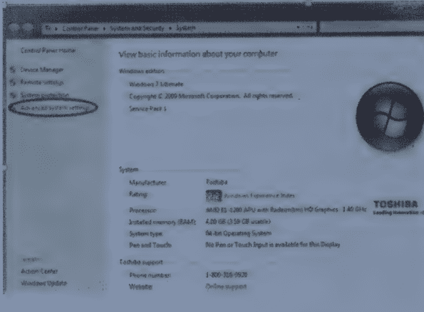
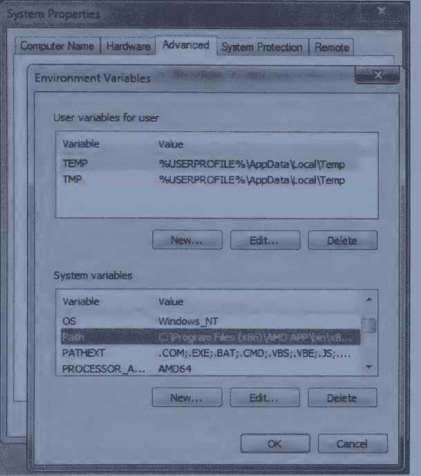
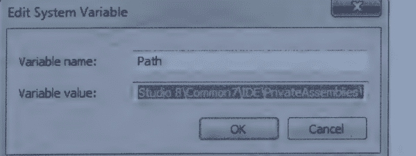
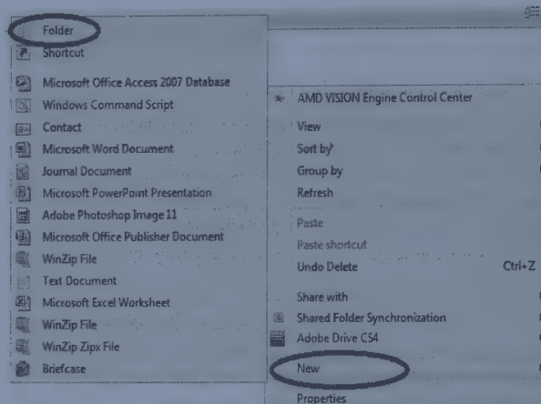
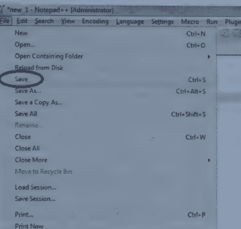
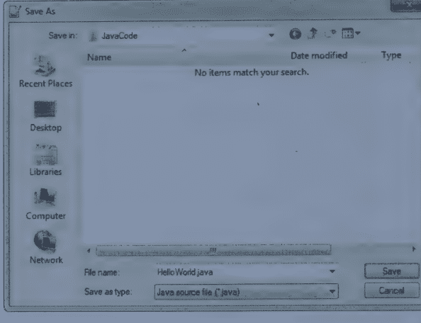
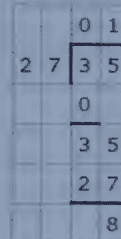
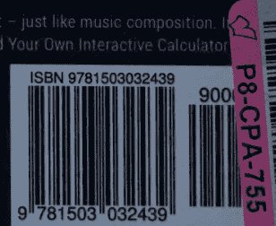

# 少儿 Java 编程：循渐学习 Java 并构建属于自己的互动式计算器！（Java 初学者指南）

## 前言

准备好学习 Java 编程了吗？Java 是一种非常强大的语言，同时它设计得非常易学。Java 如此优秀有很多原因。它是一门完全免费的语言。它是平台无关的，你几分钟内就能理解这一点。最重要的是，Java 无处不在，在你的手机上、电脑上以及你每天周围的其它设备上。

只有当我们能够应用所学的知识时，学习才算完成。在编程领域，当你将知识转化为一个应用程序时，你的学习就取得了成功。

你可能至少使用过一次电脑上的计算器应用程序。那么自己创建一个计算器呢？你将开发一个酷酷的计算器，它不仅能进行基础数学计算，还能根据你的回答向你提问并与你互动。所以你可以用自己设计的计算器来帮助学习数学并增加一些乐趣。

在本教程结束时，你将：

1. 理解 Java 程序是如何处理的。
2. 设置基本的 Java 开发环境并开始开发应用程序。
3. 学习如何设置 `PATH` 变量使程序运行更快。
4. 理解什么是变量以及如何使用它们。
5. 学习使用 Java 进行数学运算。
6. 理解如何使用条件语句来决定执行流。
7. 理解如何通过方法让你的程序具有可重用性和结构化。
8. 学习如何从用户那里收集输入。
9. 创建多个 Java 程序。
10. 开发一个酷酷的会话式计算器。

如果你不能立即理解所说的一切也没关系，这正是本书的主题！所以，让我们开始吧……

## Java 程序处理

在这一节中，我将向你简单解释 Java 程序是如何处理的。我们说 Java 是“平台无关的”。这意味着什么呢？这意味着同一个 Java 程序可以在许多平台上运行，如 Windows、OSx 和 Linux，而无需更改单行代码，而其他编程语言只能在特定的平台上使用。例如，C++ 主要运行在 Xbox 和 Windows 上。Java 能够在许多平台上运行这一事实是它的力量所在。这怎么可能呢？

在解释上述问题的答案之前，让我问你几个问题。你喜欢吃意大利肠披萨吗？你会让妈妈准备你最喜欢的苹果派或玉米饼吗？在吃完美味的午餐或晚餐后，你是否想过你吃掉的披萨、派或玉米饼发生了什么？

事实上，我们都有一套非常复杂的消化系统，将我们摄入的食物转化为身体容易吸收的营养。无论你吃的是一块苹果派还是一块披萨，你的消化系统都会通过分解食物来消化。

Java 代码（也称为源代码）会被转换为另一种称为“字节码”的语言。将源代码转换为字节码的过程被称为“编译”。

一个名为“Java虚拟机”或“JVM”的虚拟机会解释字节码以便运行。JVM 的职责是将字节码翻译成底层系统理解的指令。

## 环境设置

在这一节中，我将帮助你设置编写 Java 代码以及检查你的代码是否正常运行所需的环境。你需要下载并安装几个软件应用程序来设置环境。

我们将使用 `Notepad++`。这是一个从互联网上获取的免费文本编辑器。

就像你用来记录笔记和保存笔记的笔记本一样。同样，你可以使用 `Notepad++` 编写你的 Java 代码并将其保存起来。现在，如果你的电脑上没有 `Notepad++`，你可以从网站 `http://notepad-plus-plus.org/download/v6.6.9.html` 下载 `Notepad++` 应用程序。现在，去安装该程序吧。

Java 开发工具包（JDK）提供了我们创建字节码所需的工具以及其他工具，包括 Java 虚拟机（JVM）。你可以将 Java 开发工具包想象成你的学习室，拥有所有让你舒适学习的设施。JDK 由许多项目组成，这些项目可以帮助你轻松地开发 Java 程序。

你可以从网站 `http://www.oracle.com/technwork/java/javase/download/jdk7-downloads-1882026.html` 下载 JDK。访问此站点并向下滚动即可看到如下界面：

| Java SE 开发工具包 8u20 |
| :--- |
| 你必须接受 Oracle Java SE 二进制代码许可协议才能下载软件。 |
| 接受许可协议 • 拒绝协议 |
| 产品 / 文件描述 | 文件大小 | 下载 |
| :--- | :--- | :--- |
| Linux x86 | 135.24 MB | `jdk-8u20-linux-i586.rpm` |
| Linux x86 | 154.87 MB | `jdk-8u20-linux-i586.tar.gz` |
| Linux x64 | 135.6 MB | `jdk-8u20-linux-x64.rpm` |
| Linux x64 | 153.42 MB | `jdk-8u20-linux-x64.tar.gz` |
| Mac OS X x64 | 209.11 MB | `jdk-8u20-macos-x64.dmg` |
| Solaris SPARC 64-位 (SVR4 包) | 137.02 MB | `jdk-8u20-solaris-sparcv9.tar.gz` |
| Solaris SPARC 64-位 | 97.09 MB | `jdk-8u20-solaris-sparcv9.tar.gz` |
| Solaris x64 (SVR4 包) | 137.16 MB | `jdk-8u20-solaris-x64.tar.gz` |
| Solaris x64 | 94.22 MB | `jdk-8u20-solans-x64.tar.gz` |
| Windows x86 | 161.08 MB | `jdk-8u20-windows-i586.exe` |
| Windows x64 | 173.08 MB | `jdk-8u20-windows-x64.exe` |

你可以看到屏幕上点击了“拒绝许可协议”按钮。点击另一个按钮“接受许可协议”。

| 产品 / 文件描述 | 文件大小 | 下载 |
| :--- | :--- | :--- |
| Linux x86 | 135.24 MB | `jdk-8u20-linux-x586.rpm` |
| Linux x86 | 154.87 MB | `jdk-8u20-linux-x586.tar.gz` |
| Linux x64 | 135.6 MB | `jdk-8u20-linux-x64.rpm` |
| Linux x64 | 153.42 MB | `jdk-8u20-linux-x64.tar.gz` |
| Mac OS X x6 | 209.11 MB | `jdk-8u20-macos-x64.dmp` |
| Solaris SPARC 64-位 (SVR4 包) | 137.02 MB | `jdk-8u20-solaris-sparcv9.tar.Z` |
| Solaris SPARC 64-位 | 97.09 MB | `jdk-8u20-solaris-x64.tar.Z` |
| Solaris x64 (SVR4 包) | 137.16 MB | `jdk-8u20-solaris-x64.tar.Z` |
| Solaris x64 | 94.22 MB | `jdk-8u20-solaris-x64.tar.Z` |
| Windows x86 | 161.06 MB | `jdk-8u20-windows-x586.exe` |
| Windows x64 | 173.08 MB | `jdk-8u20-windows-x64.exe` |

现在你需要下载适合你操作系统的文件。如果你不确定电脑运行的是什么操作系统（Windows、Mac、Linux 还是 Solaris），请向父母寻求帮助。

如果你的操作系统是 Windows，你可以下载最后两个中的任意一个。`Windows x64` 文件适用于 64 位 Windows 操作系统，而 `Windows x86` 适用于 32 位 Windows 操作系统。

如果你不确定自己是 64 位还是 32 位操作系统：

1. 右键点击“此电脑”或“计算机”图标。
2. 点击“属性”选项。


3. 查看“系统类型”行。

| 制造商 | Windows |
| :--- | :--- |
| 处理器 | AMD |
| 显存 | | |
| 内存 | 4 |
| 硬盘 | |
| 系统类型 | 64-位 |
| | Chandler Thompson |

如图片所示，点击“高级系统设置”选项（用红圈圈出）。



点击它，将弹出一个新窗口。你可以在“确定”和“取消”按钮上方找到一个名为“环境变量”的按钮。点击该按钮，将打开一个新窗口。在“系统变量”区域（窗口中的第二个部分），寻找 `Path` 变量。找到它后，点击它，然后点击显示在系统变量区域下方的“编辑”按钮（你会看到“新建”、“编辑”和“删除”按钮）。



现在你将看到一个像这样的窗口：



我们必须在“变量值”框中设置路径值。确保你不要删除“变量值”框中已有的值。当在你妈妈的手机上存储朋友的号码时，你会删除那里已有的名字和号码吗？不会，因为那可能是你妈妈朋友的号码。同样，已经存在的 `PATH` 可能是运行某些其他应用程序时需要的其他可执行文件的路径。因此，只需在框中值的末尾添加一个分号即可。这是为了分隔两个路径。

接下来，我们需要获取 Java 工具的路径。我们知道所有的开发工具现在都在 `jdk/bin` 文件夹中。你必须去你安装 JDK 的位置来找到这个路径。从你做的笔记中获取详细信息。一旦获取路径，复制它，并将其粘贴在分号之后。点击“确定”，退出你刚刚打开的所有窗口。现在 `PATH` 变量已经设置好了。

在这一节中，我们学习了如何设置 `PATH` 变量。我知道你经历了一个非常漫长的过程。你觉得疲累或无聊吗？好了，我们终于准备好离开了！无聊的部分已经结束。现在我们准备好编写代码了。

## 第一个 Java 程序

在这一节中，我将教你一个简单的 Java 程序。这将帮助你理解如何在 `Notepad++` 中编写 Java 代码，以及如何从命令行提示符编译并运行你的程序。

如果你已经学习过另一种编程语言，你可能尝试过的第一个程序可能是“Hello World”程序。如果你是编程初学者，Hello World 程序是一个显示“Hello World”消息的简单程序。这通常被用作演示编程语言的第一个程序。在这里，让我们也从一个经典的 Hello World 程序开始。我将通过这个例子向你解释如何创建一个基础的 Java 程序。

你已经安装了 `Notepad++` 应用程序，并且有了下载和安装 `Notepad++` 的链接。打开 `Notepad++` 应用程序。你会在桌面或“所有程序”列表中看到它的图标。当你打开应用程序时，会自动打开一个新 1（新文件）。将以下行代码复制到该文件中。

```java
// 我们的第一个 Java 程序
public class HelloWorld
{
    // 入口
    public static void main(String[] args)
    {
        // 显示消息
        System.out.println("Hello World!!!");
    }
}
```

不要担心看到这些奇怪的代码行。它们非常简单。

每种编程语言都有一组被称为“语法”的规则。语法定义了代码应该呈现的方式，以便编译器能够理解它，并在 Java 的情况下将其翻译成字节码。为了简单起见，把语法想象成英语的语法。


# Hello World 程序

如果你已经学习过另一种编程语言，你可能尝试过的第一个程序可能是“Hello World”程序。如果你是编程初学者，Hello World 程序是一个显示“Hello World”消息的简单程序。这通常被用作演示编程语言的第一个程序。在这里，让我们也从一个经典的 Hello World 程序开始。我将通过这个例子向你解释如何创建一个基础的 Java 程序。

你已经安装了 Notepad++ 应用程序，并且有了下载和安装 Notepad++ 的链接。打开 Notepad++ 应用程序。你会在桌面或“所有程序”列表中看到它的图标。当你打开应用程序时，会自动打开一个新文件。将以下行代码复制到该文件中。

```java
// 我们的第一个 Java 程序
public class HelloWorld
{
    // 入口
    public static void main(String[] args)
    {
        // 显示消息
        System.out.println("Hello World!!!");
    }
}
```

不要担心看到这些奇怪的代码行。它们非常简单。

每种编程语言都有一组被称为“语法”的规则。语法定义了代码应该呈现的方式，以便编译器能够理解它，并在 Java 的情况下将其翻译成字节码（ByteCode）。为了简单起见，把语法想象成英语的语法。

如果我们需要，稍后可以创建 `HelloWorld` 类的对象。当你保存文件时，应确保文件名与你的类名相同。

在第二个注释之后，你会发现这样一行代码：`public static void main(String[] args)`。再次，只需理解这是我们程序的主方法。这个主方法告诉 Java 此应用程序的执行应该从哪里开始。`public`、`static` 和 `void` 等不同术语将在稍后的“方法”章节中进行解释。

任何程序的主方法都应该位于公共（public）类中。这就是为什么我们在 `HelloWorld` 公共类中包含了主方法。主方法应该对所有其他类可见，因此我们像对待 `HelloWorld` 类一样将其设置为 `public`。

我们正在调用 `System` 库中的一个函数来显示字符串 "Hello World!!!"。这个库无非是一个资源的集合，就像你学校或家里的图书馆一样。

现在让我们尝试运行这段代码并查看结果。首先，在你的任何目录中创建一个文件夹。你只需在目录内部点击右键，选择“新建”，然后点击“文件夹”即可创建文件夹。



我们将所有的 Java 程序都保在这个文件夹中。这只是为了保持所有程序整齐有序且易于访问。你可以给文件夹命名任何名称。如果你想将其命名为“AwesomeJavaProjects”，尽管去吧，因为这些 Java 程序将成为你酷的入场券。你可以在 `C:\`、`D:\` 或任何你喜欢的目录下创建它。打开 Notepad++ 应用程序，点击顶部的“文件”菜单，然后点击“保存”选项（用红圈圈出）。



你将得到一个新窗口。浏览到你创建的文件夹以保存所有的 Java 程序。在“文件名”框中，输入 `HelloWorld`（确保在保存时 Hello 和 World 之间不要有空格）。在“保存类型”框中，点击向下箭头并选择选项“Java 源文件 (*.java)”。现在你的窗口看起来像这样：



点击保存按钮。

打开命令提示符。你可以通过点击屏幕左下角的 Windows 图标并在 Windows 图标上方的框中输入 `cmd` 来执行。按下回车键。

使用适当的命令进入存储 `HelloWorld.java` 程序的文件夹。如果你目前位于 `C:\directory`，而你的文件夹在 `D:\` 目录下，你需要在命令提示符中输入 `D:`。

现在使用 `cd` 命令进入你的文件夹。

如果你的文件夹并不直接位于 `C:` 或 `D:` 目录下，你可能需要多次输入 `cd` 命令后跟接文件夹名。例如，如果你将 java 文件存储在 `D:\MyCode\AwesomeJavaProjects` 文件夹中，那么你必须先输入 `cd MyCode`，然后输入 `cd AwesomeJavaProjects`。

如果你不想在窗口资源管理器和命令提示符之间来回切换查看每个文件的内容，只需输入 `dir`（不带引号）并按回车。你将看到所在文件夹中所有内容的列表。如果某个项目名称名前有 `<DIR>`，则意味着它是另一个你可以进入的文件夹。

一旦到达你的程序文件夹，输入 `javac HelloWorld.java` 并按回车键。如果你进入保存 java 文件的文件夹，你会发现一个名为 `HelloWorld.class` 的新文件。

这是什么魔法？你难道是进入文件夹并创建了一个名为 `HelloWorld.class` 的文件吗？不是，这是由 Java 编译器完成的。Java 编译器将我们的源代码编译成字节码（ByteCode），而 `HelloWorld.class` 就是该字节码文件。

接下来，回到命令提示符，输入 `java HelloWorld`（不带引号）并按回车键。

```
Microsoft Windows [Version 10.0.19045]
(c) Microsoft Corporation. All rights reserved.

C:\Users\admin>java HelloWorld
Hello World!

C:\Users\admin>
```

# 基本数据类型

- `short` 变量可以存储从 -32,768 (2⁻¹⁵) 到 32,767 (2¹⁵ - 1) 的值。
- `int` 是 Java 中最常用的数据类型之一。它可以存储从 -2,147,483,648 (2⁻³¹) 到 2,147,483,647 (2³¹ - 1) 的值。
- 如果你想存储非常大的数值，可以使用 `long` 类型变量。

示例：

```
byte byteVal = 67;
short shortVal = -650;
int intVal = 200000;
long longVal = 6778005876543;
```

- 小数值在编程中被称为“浮点数”（floating point）。浮点数是带有小数点的正负数。浮点值有两种类型，包括 `float` 和 `double`。
- `float` 由 32 位组成。
- `double` 由 64 位组成。

示例：

```
float decVal = 23.4;
double decVal2 = 88.4;
```

- Java 中还有两种原始数据类型：`boolean` 和 `char`。
- `boolean` 数据类型用于存储真（true）或假（false）值。
- 像单个字母和其他键盘符号等内容进入 `char` 类型，但一个 `char` 变量中只能有一个字母或符号。此外，注意用于 `char` 的单引号。我稍后会向你展示字符串（Strings），它们使用双引号。

示例：

```
char firstChar = 'A';
boolean flag = true;
```

除了原始数据类型外，还有“引用”或“对象数据类型”。

- `String` 是最常用的对象数据类型，用于存储文本值。当你创建一个 `String` 类型的变量时，应该将其指定为 `String`（大写字母“S”）。

示例：

```
String name = "John Smith";
```

注意这里使用了双引号，与 `char` 使用的单引号不同。

# 变量示例程序

你准备好开发一个简单的程序来清楚地理解变量的概念了吗？这个程序将欢迎一位名为 John Smith 的用户并告诉他的年龄。

打开 Notepad++应用程序，并将以下行代码复制到新文件中。

```java
// 演示变量概念的程序
public class VariableExample
{
    // 入口点
    public static void main(String[] args)
    {
        // 声明一个整数变量
        int age = 29;
        // 声明两个字符串变量
        String firstName = "John";
        String lastName = "Smith";
        // 显示消息
        System.out.println("Welcome " + firstName + " " + lastName + "! You are " + age + " years old.");
    }
}
```

让我们回顾一下。保存时你会如何命名这个文件？你可以按照你想要的方式命名吗？不，绝对不。文件名必须与类名匹配。当你在手机上保存你朋友 Hannah 的电话号码时，你会把它保存为 Helen 吗？不，同样，类名必须与文件名相同。

因此，该文件应保存为 `VariableExample`。不要忘记将其保存为 Java 源文件 (.java)。打开命令提示符并进入你存储所有 Java 示例的文件夹。输入 `javac VariableExample.java` 然后输入 `java VariableExample`。如果一切操作正确，你将得到如下输出：

```
Welcome John Smith! You are 29 years old.
```

# 变量作用域

为什么呢？原因是你正试图在一个没有作用范围的地方访问两个变量：`firstNum` 和 `secondNum`。这些变量的作用范围仅持续到显示和为止。此之后，这两个变量就会被销毁。如果你查看错误详情，你会发现编译器找不到符号 `firstNum` 和 `secondNum`。

如果你想获得正确的输出，请删除注释 `//declare two integer variables`（声明两个整数变量）正上方的左大括号，以及删除注释 `//calculates the product`（计算乘积）正之前的右大括号。现在试一下，你一定能得到输出。

在这一节中，我们讨论了什么是变量、不同类型的变量以及变量的作用范围。我们还了解了为什么 Java 被称为强类型语言。

# Java 数学与运算符

在本节中，我将向你解释如何使用 Java 进行数学运算。这和你在学校学的数学一样简单。我们的计算器有两个部分：数学计算和简单交互。

要执行数学计算，我们使用运算符 `+`、`-`、`/`、`*` 和 `=`。我们在 Java 中也使用这些符号。就像在数学中一样，运算符是表示操作的符号，并且至少有一个操作数来执行操作。

运算符 `+`、`-`、`*`、`/`、`%`、`++` 和 `--` 被称为“算术运算符”。

- `+` 用于加法
- `-` 用于减法
- `*` 用于乘法
- `/` 用于除法
- `%` 用于获取余数
- `++` 将值加1。称为增运算符
- `--` 将值减1。称为减运算符

以下程序使用算术运算符执行了一些基础数学计算。你将两个数字相加、从一个数字中减去另一个、两个数字相乘、将一个数字除以另一个以计算商和余数、给一个数字加 1，最后从一个数字中减 1。

```java
// 执行数学计算的程序
public class MathCalculations
{
    // 入口点
    public static void main(String[] args)
    {
        // 声明两个整数变量
        int firstNum = 35;
        int secondNum = 27;

        // 加法
        int sum = firstNum + secondNum;
        // 减法
        int difference = firstNum - secondNum;
        // 乘法
        int product = firstNum * secondNum;
        // 除法
        int quotient = firstNum / secondNum;
        // 余数
        int remainder = firstNum % secondNum;

        // 显示结果
        System.out.println("The sum of " + firstNum + " and " + secondNum + " is " + sum + ".");
        System.out.println("You will get " + difference + " if you subtract " + secondNum + " from " + firstNum + ".");
        System.out.println("The product of " + firstNum + " and " + secondNum + " is " + product + ".");
        System.out.println("The quotient of " + firstNum + " / " + secondNum + " is " + quotient);
        System.out.println("The remainder of " + firstNum + " / " + secondNum + " is " + remainder);
        System.out.println("Add 1 to " + firstNum + " (increment) to get " + (++firstNum) + ".");
        System.out.println("Subtract 1 from " + secondNum + " (decrement) to get " + (--secondNum) + ".");
    }
}
```

你将获得和、差、乘积、商、余数、加一和减一的正确输出。你将分别使用算术运算符 `+`、`-`、`*`、`/`、`%`、`++` 和 `--` 来完成。我确定你知道如何两个数字相加、从一个数字减去另一个、两个数字相乘、给一个数字加1以及减去1。这对你来说很容易，不是吗？

然而，在涉及到除法时，你有什么疑问吗？你如何将 35 除以 27？拿一张纸和一支笔。用 35 除以 27。嘿，现在先不要检查答案。完成后，检查我们是否都得到了相同的答案。好吗？

这是我的答案。



这里 35 是被除数，27 是除数，1 是商，8 是余数。当你运行程序时，商和除数不是相同的值吗？

除了算术运算符外，Java 中还有其他类型的运算符。

其中一组是“关系运算符”，用于比较两个值。关系运算符包括：

- `<` (小于)
- `>` (大于)
- `!=` (不等于)
- `==` (等于)
- `<=` (小于或等于)
- `>=` (大于或等于)

还有用于检查条件的“逻辑运算符”：

- `&&` (逻辑与)
- `||` (逻辑或)
- `!` (非)

还有“赋值运算符”、“位运算符”和“三目运算符”。

# 条件语句

在本节中，我将解释如何使用条件语句来决定执行流。条件语句在这里可以帮助我们。老师之前可能告诉过大家：“如果你没交作业，就会得到零分，但如果你交了，你就很好。”让我换一种方式重新排列这句话：

如果 (你没交作业) 那么就会得到零分 但如果你交了 你就很好

我完全没有改变老师的话。我改了吗？我把“你没交作业”部分放在了括号里。对吧？现在括号里是什么？它是一个会被或不会满足的条件。如果该条件满足，将执行第一部分。否则，将执行第二部分。

条件语句的语法如下：

```java
if (condition1)
{
    // 如果 condition1 满足则执行语句
}
else
{
    // 如果 condition1 不满足则执行语句
}
```

这里 `condition1` 将返回 `true` 或 `false`。让我们像常一样尝试一个例子。这个程序将比较两个数字并显示告诉我们这两个数字是否相同。

```java
// 说明简单 if-else 的示例
public class Conditions
{
    // 入口点
    public static void main(String[] args)
    {
        // 声明两个整数变量
        int firstNum = 17;
        int secondNum = 17;

        // 检查第一个数字和第二个数字是否相同的条件
        if(firstNum == secondNum) {
            // 如果条件满足则执行的语句
            System.out.println("第一个数字 " + firstNum + " 等于第二个数字 " + secondNum);
        }
        // 否则
        else {
            // 如果条件不满足则执行的语句
        }
    }
}
```


// 如果条件不满足则执行的语句

System.out.println("第一个数字 " + firstNum + " 不等于第二个数字 " + secondNum);

}

}

}

```

你注意到 `firstNum` 和 `secondNum` 之间的 `==` 吗？它是一个关系运算符，我们之前讨论过。你编译并运行程序了吗？你得到输出结果了吗？很好。试着修改 `firstNum` 和 `secondNum` 的值，看看输出的差异。

现在，条件检查总是这么简单吗？不，有时候可能有比两个更多的条件需要检查。你的老师是否曾经对你说过：“如果你没交作业，你就会得 0 分；如果你交了，那就没问题；如果你认为你交了作业，但收到了 0 分，那么就来找我谈谈”？

现在回到我们的 Java 学习，我们已经准备好了处理这种情况的语法。那就是为了检查两个以上的条件。语法如下：

```java

if (condition1)

{

  // 如果 condition1满足时将执行的语句

}

else if (condition2)

{

  // 如果 condition2满足且 condition1 不满足时将执行的语句

}

else if (condition3)

{

  // 如果 condition3满足且 condition1 和 condition2 都不满足时将执行的语句

}

else

{

  // 如果上述条件均为假时将执行的语句

}

```

这些条件将按照它们给出的顺序进行检查。你可以根据需要拥有多个“else if”条件。只有当上述所有指定条件都不满足时，程序才会到达最后的 `else` 部分。

让我们修改上面的示例来更清楚地理解 `if...else if...else` 条件语句。这个程序将比较两个数字并告诉我们哪个数字更大，或者两个数字是否相等。尝试这段代码。

```java

// 用于说明 if--else if--else 的示例

public class Conditions {

  // 入口点

  public static void main(String[] args) {

    // 声明两个整数变量

    int firstNum = 87;

    int secondNum = 67;

    // 检查第一个数字是否小于第二个数字

    if (firstNum < secondNum) {

      // 如果第一个条件满足时执行的语句

      System.out.println("The first number " + firstNum + " is less than the second number " + secondNum);

    }

    // 检查第一个数字是否大于第二个数字

    else if (firstNum > secondNum) {

      // 如果第二个条件满足时执行的语句

      System.out.println("The first number " + firstNum + " is greater than the second number " + secondNum);

    }

    // 否则

    else {

      // 如果上述条件均为假时执行的语句

      System.out.println("The first number " + firstNum + " is equal to " + secondNum);

    }

  }

}

```

现在我将告诉你为什么以及何时我们需要方法。方法让我们的程序更具可读性、更结构化。当我们把复杂的程序分成更小的、逻辑性的块时，只需编写一次即可根据需要调用多次。任务在逻辑上被进行了分组。

查看 Java 方法的语法：

```java

visibility static/ returnType methodName(parameter1, parameter2, ...)

{

  // 代码行

}

```

一个示例：

```java

public static int calculateSum(int first, int second) {

  int sum = first + second;

  return sum;

}

```

主要有四种访问修饰符。它们是：

- 1. 私有 (Private)
- 2. 公有 (Public)
- 3. 默认 (Default)
- 4. 保护 (Protected)

某些项仅在私有组内部使用或访问（例如仅供家人成员使用的昂贵汽车），这些项被称为“私有”。另一方面，某些项不仅可以在类内部被访问，还可以从外部访问（例如廉价的汽车），这些项被称为“公有”。

如果你在类、属性或方法之前没有指定任何修饰符，它被认为是“默认修饰符”，且此类项仅在特定的“包”（package）内被访问。包是类的集合。只需把包想象成你家里或学校的书籍集合即可。受保护的类、属性或方法可以被该类及其子类访问。这些概念有点高级，你现在不需要了解它们。所以，即使你不能完全理解默认和保护访问修饰符，也不要担心。

在 `public` 单词之后，下一个是 `static`。这个值指定了你的方法是静态的（static）还是实例的（instance）。静态方法可以在不创建类对象的情况下被调用。还记得我们类中的 `main` 方法吗？它是 `public static void main`。我们没有为该类创建任何对象来访问该方法。

假设你的方法是一个实例方法。那么你将必须创建一个类的对象来访问该特定方法。你如何创建一个类的对象呢？非常简单。

假设你有一个名为 `Shape` 的类，并且你想创建一个名为 `triangle` 的对象。

```
Shape myTriangle = new Shape();
```

这条语句创建了 `Shape` 类的一个名为 `myTriangle` 的对象。

假设该类有一个名为 `calculateArea` 的实例方法，你想计算三角形的面积。那么，我们将如下所示调用该方法：

```
myTriangle.calculateArea();
```

假设该方法是静态的。你只需要通过以下语句即可调用方法（不需要对象）。

```
calculateArea();
```

这就是静态方法和实例方法的区别。你必须指定 `static` 关键字来使方法变为静态的，但如果你的方法是实例方法，则不需要指定任何关键字。也就是说，一个静态方法的声明可能像这样：

```
public static void calculateArea();
```

而一个实例方法的声明可能像这样：

```
public void calculateArea();
```

某些方法在执行后会返回一个值，其类型应该包含在方法头中。如果方法不返回任何值，你应该将其指定为 `void`。你还记得我们所有 Java 程序中的 `main` 方法吗？我们过去将 `main` 方法的返回值指定为 `void`（`public static void main`），因为 `main` 方法不返回任何值。

接下来是方法名。尝试给你的方法起一个有意义的名字。如果把一个相加两个数字的方法命名为 `myInput` 或 `myValue`，会有多尴尬？你听过你的字迹反映了你的性格吗？作为一名软件专业人士，我会说你写的代码也反映了你的性格。始终让它整洁、易读、结构化且有条理。

再次回到，某些方法需要输入才能执行。想一下我们的计算器。假设我们创建了一个名为 `calculateSum` 的方法来相加两个数字。当然，这些数字将由用户输入。方法需要这两个数字来计算和。我们传递给方法的这些输入被称为“参数”（parameters）。你应该在方法名之后紧跟着指定参数及其数据类型（例如 `int firstName` 或 `double product`）。你应该将参数放在括号内。如果有多个参数，你应该用逗号分隔它们。

尝试下面的程序。此程序使用名为 `calculateSum` 的方法来找到两个数字的和。

```java

//Example illustrates use of methods

public class FirstMethod

{

    //The entry point

    public static void main(String[] args)

    {

        // 定义两个变量

        int firstNum = 87;

        int secondNum = 68;

        // 调用方法

        System.out.println("结果是 " + calculateSum(firstNum, secondNum));

    }

    // 静态方法

    static int calculateSum(int first, int second)

    {

        // 计算和

        int sum = first + second;

        return sum;

    }

}

```

## 少儿童 Java 编程

我们将从键盘获取输入，对吧？所以，我们需要一个连接到键盘的工具，它是通过 `System.in` 实现的。`System.in` 是一个输入流。换句话说，它从外部世界获取输入。在创建 `Scanner` 类对象时，你需要将 `System.in` 作为参数传递。

```
Scanner input = new Scanner(System.in);
```

`Scanner` 类提供了许多方法来获取输入，其中一些包括 `nextInt`、`nextLong`、`nextFloat`、`nextDouble`、`nextLine`、`next`、`hasNextInt` 和 `close`。我们将使用 `next` 方法收集文本输入，并使用 `nextDouble` 方法收集数字。下一个值将是指定的类型。例如，如果我们想确保输入的下一个值是整数，可以使用 `hasNextInt` 方法对其进行检查。只有当输入的下一个值是整数时，该方法才会返回 `true`。

在本节中，我们已经学习了如何使用 `Scanner` 类从用户那里收集文本和数字输入。

## 会说话的计算器开发

是的，我们要开始进入“会说话的计算器”的实际开发了。在本节结束时，你将拥有一个可以运行的计算器。

我们开始吗？如果你还没有理解上面解释的任何概念，请反复阅读直到你清楚它们为止，因为在开发我们的会说话的计算器期间，我们将使用所有这些概念。我们计划创建一个可以执行基础数学计算（包括加、减、乘、除）的计算器。我们还允许用户与计算器交互并增加一些乐趣。

在我们开始之前，我告诉你们一点：我没有在每个代码段中包含注释。然而，你应该自己为代码编写注释，这有助于确保你理解自己的代码，让未来的你也能理解它，并帮助他人理解你的代码和你的未来。因为你会继续学习编程，你会想出新的不同的方法来解决编程问题，而你可能忘记以前解决这些问题的方法。

## 入门

首先创建一个名为 `TalkingCalculator` 的类。它应该是公共的（public），因为我们希望让所有其他类都能访问它。

```java

public class TalkingCalculator

{

```

```java

public static void main(String[] args)

{

}
```


我们将持续从用户那里获取输入，因此我们可以创建一个变量来临时存储来自用户的输入，直到我们使用它或将其保存到相应的变量中。在类的左大括号之后、`main` 方法之前，添加以下行代码：

```java
String userInput;
```

我们为什么把它放在类内部而不是 `main` 方法内部呢？你还记得我们在“变量”部分讨论过的变量作用范围概念吗？我们需要在整个程序中访问这个值。它的作用范围应该是整个类。换句话说，变量的作用范围不应局限于任何方法内部。

## 询问用户的姓名

人总是想要是独一无二的。什么让你与众不同？当然，是你的名字。这就是为什么你喜欢被用你的名字或昵称称呼，而不是“嘿”、“小朋友”或“那个长脸的”。让我们也用名字来称呼我们的用户。为此，让我们先询问名字并将其存储在变量中，这样我们就可以在需要时称呼他。

### 添加变量声明

在 `String userInput` 语句旁边添加以下行代码：

```java
String userName;
```

我们还需要 `Scanner` 类和一个 `Scanner` 类的对象来收集输入。因此，将以下行代码作为程序的第一行：

```java
import java.util.Scanner;
```

在两个变量声明之后，添加以下行代码：

```java
Scanner myScanner = new Scanner(System.in);
```

现在你的代码看起来应该是这样的：

```java
import java.util.Scanner;

public class TalkingCalculator
{
    String userInput;
    String userName;
    Scanner myScanner = new Scanner(System.in);

    public static void main(String[] args)
    {
    }
}
```

接下来，让我们询问用户的名字。然后，问他是否想进行数学计算还是仅仅和计算器聊天。根据用户的选择，我们将继续进行。我们应该尝试使用一个名为 `start` 的方法来实现这部分吗？这将帮助我们更好地组织代码。我们的计算器从这个方法开始。所以，让我们将其命名为 "start"。我们将把它变成一个实例方法，它特别不返回任何特定值。因此，在 `TalkingCalculator` 类中的 `main` 方法之后添加以下行代码：

```java
public void start()
{
}
```

让我们用这个来询问用户的姓名：

```java
System.out.println("Hello, What is your name?");
```

让我们暂时将其存入 `userInput` 变量中，然后将其传递给 `userName` 变量。事实上，这次你可以直接将输入（即用户名）收集到 `userName` 变量中，而不是先在 `userInput` 变量中收集再存储到 `userName` 变量中。然而，当我们收集其他输入时，将将其放在 `userInput` 变量中。为了保持一致性，我们也在 `userInput` 变量中收集用户名，然后将其传递给 `userName` 变量。在询问用户名的语句下方添加以下行代码：

```java
userInput = myScanner.next();
userName = userInput;
```

接下来，让我们告诉用户他的名字很酷，以此让他开心。添加以下行代码：

```java
System.out.println(userName + ". That's a cool name!");
```

## 设置系统：聊天或做数学

现在我们进入了正题，我们将询问他是想做数学还是聊天。如果他回答数学，我们将允许他进行数学运算；如果他回答聊天，我们将允许他互动。如果他不回答数学或聊天，我们将告诉用户我们没有得到答案。所以，首先询问用户：

```java
System.out.println("Do you want to do some math? or talk?");
userInput = myScanner.next();
```

接下来，根据输入，我们允许用户调用不同的方法。在这里我们必须使用讨论过的条件语句：

```java
if (userInput.equalsIgnoreCase("math"))
{
    calculate();
}
else if (userInput.equalsIgnoreCase("talk"))
{
    talk();
}
else
{
    System.out.println("Hey " + userName + ". Why are not answering me? " + userInput + " doesn't answer my!");
}
whatNext();
```

我们使用了 `equalsIgnoreCase` 方法来执行“忽略大小写”比较。什么是忽略大小写？

忽略大小写的比较意味着我们不分大小写（大写或小写）来比较内容。例如，如果我们比较两个字符串，“JOHN”和“John”，区分大小写的比较会告诉我们它们不同，而忽略大小写的比较会告诉我们它们是相同的。在这里，让我们宽容一些。无论用户输入 Math 还是 MATH，我们都允许他做数学计算，对于聊天也是如此。

现在我们刚刚创建了 `start` 方法，但还没有调用它。我们应该在哪里调用这个方法？应该在 `main` 方法内部调用它吗？由于我们将方法声明为非静态（non-static），首先创建 `TalkingCalculator` 类的对象，然后这样调用方法：

```java
TalkingCalculator calculator = new TalkingCalculator();
calculator.start();
```

接下来，我们需要根据用户的想要来进行数学或聊天。一旦数学或聊天操作完成，我们可以询问用户下一步要做。

所以，让我们创建一个 `calculate()`、`talk()` 和 `whatNext()` 方法。

## 编写数学部分

让我们从 `calculate()` 方法开始。`calculate` 方法的作用是什么？它应该首先询问用户想做什么，比如加、减、乘、除。确保即使他没有回答正确，程序也不会崩溃。如果他输入了想执行的操作，执行，让我们从用户处获取两个数字并执行操作。不要忘记检查用户是否输入了数字。

首先，让我们创建两个变量来存储用于数学运算的两个数字。我们不知道用户会输入整数还是小数值。为了保险起见，让我们创建一个 `double` 类型的变量：

```java
double firstNum;
double secondNum;
```

接下来，让我们询问用户他想做什么，然后获取该输入：

```java
System.out.println("Do you want to add, subtract, multiply, or divide?");
userInput = myScanner.next();
```

接下来，我们需要检查用户是否输入了上述四个选项之一。如果用户输入的是 `+` 而不是 `add`（加法）会怎样？我们不仅无法处理该输入，程序还可能会崩溃。为了避免这种情况，确保他输入了上述四个选项之一，如果他没有输入，则警告他：

```java
if (!userInput.equalsIgnoreCase("add") &&
    !userInput.equalsIgnoreCase("subtract") &&
    !userInput.equalsIgnoreCase("multiply") &&
    !userInput.equalsIgnoreCase("divide"))
{
    System.out.println(userInput + " doesn't answer my question. Be careful " + userName);
    calculate();
}
```

看到这个很长的条件不要紧张。这里使用了 `&&` 逻辑运算符，用于检查是否所有这些逻辑条件都满足。这意味着检查这个是否为真（true）**且**那个是否为真。如果两个条件中只有一个为真，那么它将返回假（false）。

`userInput.equalsIgnoreCase("add")` 意味着用户输入了除 `add` 以外的内容。`!` 逻辑运算符意味着“非”，所以如果用户输入了不等于 "add" 的内容，它将返回 `true`。所有四个条件（在 `&&` 之间）都满足意味着用户输入了除 `add`、`subtract`、`multiply` 和 `divide` 以外的内容。然后我们将要求用户输入正确的值。我们正在调用 `calculate` 方法再次询问他想做什么。

否则，我们从用户处获取两个数字，并确保他输入的是数字而不是字符串。我们使用 `nextDouble` 方法来确保输入的数字是 `double` 类型。如果用户没有输入 `double` 值，我们会告诉他们搞砸了并输入了其他内容。在这种情况下，我们再次调用 `calculate` 方法，以便再次询问用户他想做什么。

```java
System.out.println("what do you want to " + userInput + "\n?");
System.out.print("First Number. ");

if (myScanner.hasNextDouble()) {
    firstNum = myScanner.nextDouble();
} else {
    System.out.println(userName + " do you not like me? If I didn't catch that it could have killed me!" + myScanner.next() + " is not a number!");
    calculate();
}

System.out.println("\nGreat!");
System.out.print("Now for the Second Number. ");

if (myScanner.hasNextDouble()) {
    secondNum = myScanner.nextDouble();
} else {
    System.out.println(userName + " do you not like me? If I didn't catch that it could have killed me!" + myScanner.next() + " is not a number!");
    calculate();
}

System.out.println("\n");
```

`System.out.println()` 内部的 `"\n"` 仅仅意味着换行。`println` 结尾的 `"\n"` 告诉程序，一旦完成输出，下一次输出应该在下一行。代码行 `"System.out.println("\n");"` 基本上是在告诉程序下一次输出应该向下两行，而不是仅仅是一行。

现在我们从用户处获取两个数字，并确保他输入的是数字而不是字符串。我们已经准备好操作数。根据用户的选择进行数学运算：

```java
if (userInput.equalsIgnoreCase("add"))
{
    System.out.println("Here is your answer: " + (firstNum + secondNum));
}
else if (userInput.equalsIgnoreCase("subtract"))
{
    System.out.println("Here is your answer: " + (firstNum - secondNum));
}
else if (userInput.equalsIgnoreCase("multiply"))
{
    System.out.println("Here is your answer: " + (firstNum * secondNum));
}
else if (userInput.equalsIgnoreCase("divide"))
{
    System.out.println("Here is your answer: " + (firstNum / secondNum));
}
```

我们最后调用 `whatNext` 方法询问他接下来想做什么：

```java
whatNext();
```

现在你的 `calculate` 方法看起来如下：

```java
public void calculate()
{
    double firstNum = 0;
    double secondNum = 0;
    System.out.println("Do you want to add, subtract, multiply, or divide?");
    userInput = myScanner.next();

    if (!userInput.equalsIgnoreCase("add") && !userInput.equalsIgnoreCase("subtract") && !userInput.equalsIgnoreCase("multiply") && !userInput.equalsIgnoreCase("divide"))
    {
        System.out.println(userInput + " doesn't answer my question. Be careful " + userName);
        calculate();
    }

    System.out.print("First Number. ");

    if (myScanner.hasNextDouble()) {
        firstNum = myScanner.nextDouble();
    } else {
        System.out.println(userName + " do you not like me? If I didn't catch that it could have killed me!" + myScanner.next() + " is not a number!");
        calculate();
    }

    System.out.println("\nGreat!");
    System.out.print("Now for the Second Number. ");

    if (myScanner.hasNextDouble()) {
        secondNum = myScanner.nextDouble();
    } else {
        System.out.println(userName + " do you not like me? If I didn't catch that it could have killed me!" + myScanner.next() + " is not a number!");
        calculate();
    }

    System.out.println("\n");

    if (userInput.equalsIgnoreCase("add"))
    {
        System.out.println("Here is your answer: " + (firstNum + secondNum));
    }
    else if (userInput.equalsIgnoreCase("subtract"))
    {
        System.out.println("Here is your answer: " + (firstNum - secondNum));
    }
    else if (userInput.equalsIgnoreCase("multiply"))
    {
        System.out.println("Here is your answer: " + (firstNum * secondNum));
    }
    else if (userInput.equalsIgnoreCase("divide"))
    {
        System.out.println("Here is your answer: " + (firstNum / secondNum));
    }

    whatNext();
}
```

## 对话部分

接下来我们将处理 `talk` 方法。在这个方法中，让我们询问用户他最喜欢的颜色和动物。假设我们存储一个数字，并将用户输入的数字与存储的数字进行比较。用户将能够发现计算器想的数字。我们将使用一种数学技术每次创建一个随机数。我们使用内置方法 `Math.random()`。它返回一个 0 到 1 之间的值。所以，让我们把它乘以 10，得到一个 0 到 10 之间的数字。听起来不错吗？

```java
}
else
{
    System.out.println("You tried to kill me! That wasn't a number!");
    myScanner.next();
}
whatNext();
```


我想你现在已经到了可以理解这段代码的阶段了。它不是显而易见的吗？尝试自己去理解每一行代码。

## 编写后续操作

最后，我们将编写 `whatNext` 方法。它只不过是 `start` 方法开头部分代码的重复。它在数学运算或对话操作结束时询问用户他想如何继续。也就是说，询问他是想再次进行数学计算、仅仅是聊天，还是关闭应用程序。如果他想关闭应用程序，我们使用 `System.exit` 函数来退出。这里是 `whatNext` 方法。

```java
public void whatNext() {
    System.out.println("\n\nWhat do you want to do? math? or talk? or exit?");
    userInput = myScanner.next();
    if (userInput.equalsIgnoreCase("math")) {
        calculate();
    } else if (userInput.equalsIgnoreCase("talk")) {
        talk();
    } else if (userInput.equalsIgnoreCase("exit")) {
        System.exit(1);
    } else {
        System.out.println(userName + "!!!! Why are you trying to confuse me???" + userInput + " is not a choice!");
    }
    whatNext();
}
```

## 计算器的完整源代码

由于我在文中部分解释了代码，现在我将完整代码放在下面，方便你集中在一个处参考。

```java
import java.util.Scanner;

public class TalkingCalculator {
    String userInput;
    String userName;
    Scanner myScanner = new Scanner(System.in);

    public static void main(String[] args) {
        TalkingCalculator calculator = new TalkingCalculator();
        calculator.start();
    }

    public void start() {
        System.out.println("Hello, What is your name?");
        userInput = myScanner.next();
        userName = userInput;
        System.out.println(userName + ". That's a cool name!!!");
        System.out.println("Do you want to do some math? or just talk?");
        userInput = myScanner.next();
        if (userInput.equalsIgnoreCase("math")) {
            calculate();
        } else if (userInput.equalsIgnoreCase("talk")) {
            talk();
        } else {
            System.out.println("Hey " + userName + ". Why are you not answering me correctly? " + userInput + " doesn't answer my question!");
        }
        whatNext();
    }

    public void calculate() {
        double firstNum = 0;
        double secondNum = 0;
        System.out.println("Do you want to add, subtract, multiply, or divide?");
        userInput = myScanner.next();
        if (!userInput.equalsIgnoreCase("add") || !userInput.equalsIgnoreCase("subtract") || !userInput.equalsIgnoreCase("multiply") || !userInput.equalsIgnoreCase("divide")) {
            System.out.println(userInput + " doesn't answer question. Be careful " + userName);
            calculate();
        }
        System.out.println("What do you want to " + userInput + "?");
        System.out.print("First Number: ");
        if (myScanner.hasNextDouble()) {
            firstNum = myScanner.nextDouble();
        } else {
            System.out.println(userName + ", do you not like me? If I didn't catch that it could have killed me!" + myScanner.next() + " is not a number!");
            calculate();
        }
        System.out.println("\nGreat!");
        System.out.print("Now for the Second Number: ");
        if (myScanner.hasNextDouble()) {
            secondNum = myScanner.nextDouble();
        } else {
            System.out.println(userName + ", do you not like me? If I didn't catch that it could have killed me!" + myScanner.next() + " is not a number!");
            calculate();
        }
        System.out.println("\n");
        if (userInput.equalsIgnoreCase("add")) {
            System.out.println("Here is your answer: " + (firstNum + secondNum));
        } else if (userInput.equalsIgnoreCase("subtract")) {
            System.out.println("Here is your answer: " + (firstNum - secondNum));
        } else if (userInput.equalsIgnoreCase("multiply")) {
            System.out.println("Here is your answer: " + (firstNum * secondNum));
        } else if (userInput.equalsIgnoreCase("divide")) {
            System.out.println("Here is your answer: " + (firstNum / secondNum));
        }
        whatNext();
    }

    public void talk() {
        System.out.println("What is your favorite color?");
        userInput = myScanner.next();
        if (userInput.equalsIgnoreCase("blue")) {
            System.out.println("Blue is my favorite color!");
        } else if (userInput.equalsIgnoreCase("red")) {
            System.out.println("Red is my favorite color!");
        } else if (userInput.equalsIgnoreCase("green")) {
            System.out.println("Green is my favorite color!");
        } else {
            System.out.println("I don't like " + userInput + ".");
        }
        whatNext();
    }
}
```

*(注：`talk()` 和 `calculate()` 方法基于提供的文本重构了连贯的 Java 逻辑。)*

---

你用过电脑上那个免费的计算器应用吗？可能用过，但这种经历可能如此平淡，以至于你无法确定自己是否真的用过。

如果那个计算器知道你的名字呢？如果它能和你聊天，并向你提问呢？你可能会对它印象更深刻！也许每次需要解方程时都会特意使用它！

但你知道吗？你可以构建属于自己的独一无二的计算器。

你只需要 Java。

Java 是一种非常强大且易于学习的语言。它是完全免费的，而且无处不在——在你的手机上、电脑上，以及你每天周围的许多其他设备上。在畅销书《儿童编程：一步步学习 Java 并构建属于自己的趣味互动计算器！》作者 R. Chandler Thompson 将引导你开启 Java 程序员的之旅！

在本教程中，你将学习到：

- 如何搭建基础 Java 开发环境，并开始开发你想象的任何应用程序
- 如何创建与用户进行交互的程序
- 学习使用 Java 进行快速便捷的数学计算的方法
- Java 程序的具体工作原理
- 如何在方法的帮助下让你的程序具有可重用性和结构化
- 如何创建多个特定的 Java 程序
- 如何开发一个酷炫的“会说话的计算器”

只有当我们把所学知识应用到自己的生活中时，学习才算完成。在编程领域，只有当你能够利用自己的 Java 编程知识创造出全新的东西时，你的学习才算成功。

Java 编程确实是一门语言，但它也是一门艺术——就像作曲一样。通过《儿童编程：一步步学习 Java 并构建属于自己的趣味互动计算器！》，你将快速且有效地学习到创造有趣、令人兴奋且奇妙的作品所需的语言！


