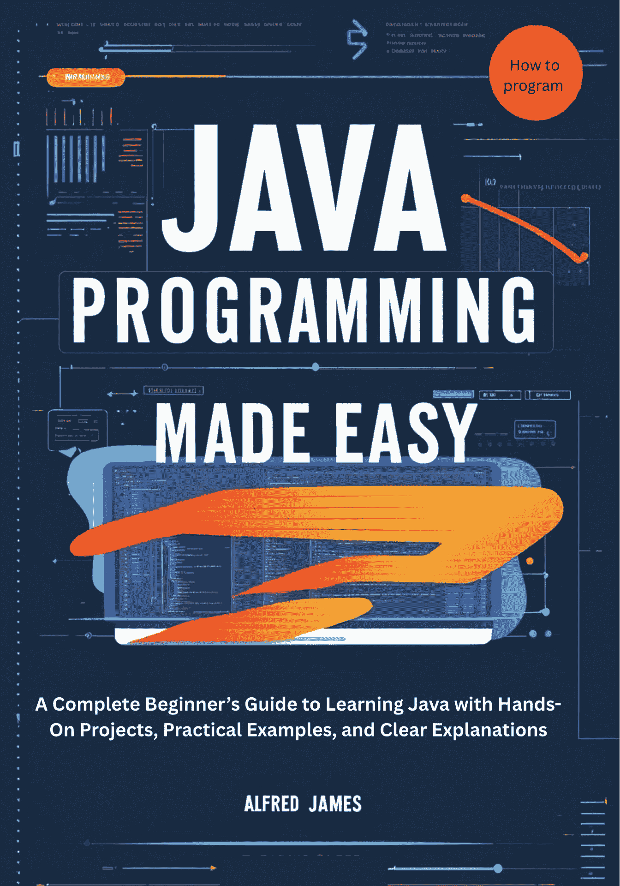

# Java 编程简上手：通过实战项目、实用示例和清晰讲解学习 Java 的初学者指南



***

# 序言

无论你是刚开始学习的学者，还是从其他领域转过来的开发者，本书都是为你量身定制的。我们将从基础开始，循序渐进地带你掌握 Java。Java 仍然是当今最广泛使用的编程语言之一，从 Android 开发到企业级系统，它无处不在。本书通过将理论与实战项目相结合，帮助你深入理解 Java。

***

## 你将学到

在本书结束，你将能够：

- 使用 IntelliJ IDEA 或 VS Code 设置开发环境。
- 编写简洁高效的代码。
- 理解 Java 语法、变量和数据类型。
- 掌握方法。
- 理解类、对象、继承与多态。
- 处理数组和集合。
- 高效处理输入输出。
- 使用异常处理编写健壮的程序。
- 构建实际项目。

***

## 如何使用本书

本书的结构旨在循序渐进地教授 Java。

### 1. 按照顺序阅读章节

每一章都建立在前章的基础上。早期介绍的概念（如变量和循环）会在后续章节中使用。如果你已有经验，可以跳读，但对于新手，建议按顺序学习。

### 2. 手打示例

阅读代码很有用，但自己输入可以建立肌肉记忆并发现可能忽略的细节。本书中的每个示例都是完整的。这里是第 1 章的一个示例：

```java
// HelloWorld.java
public class HelloWorld {
    public static void main(String[] args) {
        // 在控制台打印一条问候语
        System.out.println("Hello, Java!");
    }
}
```

解释：

- `public class HelloWorld` 定义了一个名为 `HelloWorld` 的类。
- `public static void main(String[] args)` 是任何 Java 程序的入口。
- `System.out.println("Hello, Java!")` 将文本打印到控制台。

你可以使用以下编译并运行它：

```bash
javac HelloWorld.java
java HelloWorld
```

如果你使用的是 IntelliJ IDEA 或 VS Code，在设置好 SDK 后，直接使用内置选项运行文件即可。

### 3. 完成实战项目

每一章结束时都有一个项目，将你所学的知识结合起来。这些项目经过精心挑选，简单且实用，例如构建计算器、数字猜谜游戏或学生记录系统。这些不仅仅是学术练习——它们反映了现实世界应用所需的逻辑和结构。

### 4. 使用附录和速查表

在书的最后，你将找到一些快速参考资料，例如：

- Java 语法速查表
- IDE 快捷键
- 额外的学习资源

当你自己独立编码并需要快速回顾时，这些资料非常有帮助。

最后一章将挑战你把所有内容整合成一个完整的基于控制的 Java 应用程序。我们将引导你逐步构建一个简单的图书管理系统或 ATM 模拟。你将学习如何跨多个类结构化代码、处理用户输入、管理文件，并像开发者一样思考。

***

# 第 1 章：Java 入门

## 1.1 什么是 Java？

Java 是一种高级、面向对象且平台无关的编程语言，由 Sun Microsystems 公司于 1995 年开发（现归 Oracle 骨文所有）。它被广泛用于构建桌面应用程序、Web 应用程序、移动应用（尤其是 Android）以及企业系统。

Java 最强大的特性之一是其“编写一次，随处运行”的哲学。Java 代码被编译成字节码，并在 Java 虚拟机（`JVM`）上运行。这意味着你可以在一个操作系统（如 Windows）上编写 Java 程序，并在无需任何更改的情况下在另一个操作系统（如 macOS 或 Linux）上运行。

### Java 的主要特性：

- **面向对象**：Java 使用对象和类来逻辑化组织代码。
- **平台无关**：`JVM` 抽象了底层的操作系统。
- **强类型**：你必须显式声明变量类型。
- **丰富的标准库**：Java 自带了一系列内置 API。
- **被广泛采用**：用于从金融、电信到游戏和嵌入式系统的各个行业。

从本质上说，Java 是成熟、健壮且经过实战检验的。得益于性能、安全性和广泛适用性的结合，它仍然是全球最流行的语言之一。

***

## 1.2 为什么今天学习 Java？

即使在使用了几十年后，Java 仍然是最相关且需求量最大的编程语言之一。以下是它仍然是一门优秀学习语言的原因：

1. **职业机会**：Java 广泛用于企业应用、银行系统、Android 开发和大规模后端系统。许多世界 500 强公司依赖 Java 构建其核心基础设施。
2. **强大的社区和生态系统**：全球有数百万开发者，Java 拥有庞大的支持社区、开源工具和丰富的文档——这让初学者更容易找到帮助和资源。
3. **Android 开发**：Java（以及 Kotlin）是 Android 应用开发的主要语言之一。如果你对构建移动应用感兴趣，Java 仍然具有很高的相关性。
4. **其他语言的基础**：学习 Java 有助于为在面向对象设计、类型安全和结构化错误处理等编程原则方面建立坚实的基础。这使得以后学习其他语言（如 Kotlin、Scala 或 C#）变得更容易。
5. **企业级性能**：Java 快速、可靠且可扩展。这就是为什么它是构建大规模 Web 服务、后端 API 和高并发交易系统的默认选择。

### 近期数据快照 (2025)：

- Java 始终在 TIOBE 指数和 Stack Overflow 开发者调查中位列前三。
- 有超过 800 万开发者活跃使用 Java。
- Google、Amazon、Netflix 和 IBM 等公司广泛使用 Java。

***

## 1.3 安装 Java 和 IntelliJ IDEA（或 VS Code）

在我们编写任何代码之前，让我们设置你的开发环境。你需要两个工具：

- Java 开发工具包（`JDK`）
- IDE（集成开发环境），如 IntelliJ IDEA 或 Visual Studio Code

### 步骤 1：安装 Java JDK

从 Oracle 或 OpenJDK 官方网站下载最新的 Java SE 开发工具包。

**选项 A：Oracle JDK（推荐初学者使用）**

- **网站**：`https://www.oracle.com/java/technologies/javase-downloads.html`

**选项 B：OpenJDK**

- **网站**：`https://jdk.java.net/`

选择适用于你操作系统（Windows, macOS, Linux）的版本，下载安装程序并按照设置说明操作。

安装完成后，验证安装情况：

```bash
java -version
```

预期输出（截至 2025 年）：

```
java version "21.0.2" 2025-01-16 LTS
Java(TM) SE Runtime Environment (build 21.0.2+13-LTS)
Java HotSpot(TM) 64-Bit Server VM (build 21.0.2+13-LTS, mixed mode)
```

### 步骤 2：安装 IntelliJ IDEA（推荐 IDE）

JetBrains 开发的 IntelliJ IDEA 是一款专为 Java 开发定制的功能丰富的 IDE。

1. 从此处下载：`https://www.jetbrains.com/idea/download`
2. 选择 Community Edition（免费）或 Ultimate Edition（付费，含更多功能）。
3. 运行安装程序并按照提示操作。
4. 启动 IntelliJ IDEA，在首次运行时选择主题、键盘映射等偏好设置。
5. 点击 New Project 开始。

***

## 1.4 编写你的第一个程序

现在你准备好了环境，是时候编写你的第一个程序了。

### 逐步步骤：在 IntelliJ IDEA 中创建项目

1. 打开 IntelliJ IDEA。
2. 点击 New Project（新建项目）。
3. 选择 Java 类型。
4. 设置 SDK 为 `21`。
5. 为你的项目命名为 `FirstApp`。
6. 点击 Finish（完成）。

现在，在 `src` 目录下：

1. 右键点击 New → Java Class。
2. 将类命名为 `Main`。

### 你的 Java 程序：Hello World

让我们编写第一个完整可运行的程序：

```java
// 文件：Main.java
// 定义了一个名为 Main 的类
public class Main {
    // main 方法是程序的入口
    public static void main(String[] args) {
        // 在控制台打印消息
        System.out.println("Hello, World!");
    }
}
```

### 解析与解释

- `public class Main`：此行声明了一个名为 `Main` 的类。在 Java 中，每个应用程序至少有一个类，且文件名必须与类相同（例如 `Main.java`）。
- `public static void main(String[] args)`：这是 main 方法，程序由此开始。
    - `public`：公开可见。
    - `static`：属于类而不是对象（你不需要创建对象即可运行它）。
    - `void`：该方法没有返回值。
    - `String[] args`：此参数允许程序接收命令行参数（你现在不需要，但它是标准要求）。
- `System.out.println("Hello, World!");`：这是一个向控制台打印文本的语句。
    - `System` 是一个内置 Java 类。
    - `out` 是一个静态字段（`PrintStream` 的实例）。
    - `println()` 是一个输出字符串并换行的方法。

### 编译并运行程序

如果你使用 IntelliJ IDEA：

1. 点击 `main` 方法旁边或右上角的绿色播放按钮。
2. 你将在下方的控制台中看到输出：`Hello, World!`

如果你使用终端：

```bash
javac Main.java // 编译文件
java Main       // 运行编译后的程序
```

### 常见错误及避免方法

- **文件名与类名不匹配**：如果你的类命名为 `Main`，那么你的文件必须命名为 `Main.java`。
- **缺少分号**：Java 中的每条语句必须以分号 `;` 结尾。
- **大小写错误**：Java 对大小写敏感。`System` 必须大写。`system.out.println` 将导致编译错误。

### 扩展程序：添加第二行

你可以修改程序来打印多行：

```java
public class Main {
    public static void main(String[] args) {
        System.out.println("Hello, World!");
        System.out.println("Welcome to Java Programming.");
    }
}
```

输出：

```text
Hello, World!
Welcome to Java Programming.
```

这展示了如何逐行构建程序以添加更多功能。

### 从第一天开始良好实践

- **使用有意义的类名**：在实际应用中，使用反映用途的名称，如 `InvoiceManager` 或 `StudentPortal`。
- **保持代码整洁可读**：缩进、一致的空格和注释有助于让你的代码更容易理解。
- **始终测试你的代码**：在编写完小部分后运行程序，以及早发现错误。

***

# 第 2 章：Java 基础

在本章中，我们将涵盖任何 Java 程序的要素组成部分：变量、数据类型、运算符、输入/输出和编码风格。这些基础是你 Java 编程之旅的基石。在结束时，你将使用所学知识创建一个自己的基础计算器。

## 2.1 变量和数据类型

每个 Java 程序都会处理数据——数字、文本、布尔逻辑等。为了处理这些数据，你需要一种将它们存储在内存中的方法。这就是变量的用处。在本节中，我们将介绍变量是什么、如何使用以及 Java 提供的各种数据类型。

### 什么是变量？

变量仅仅是计算机内存中一个命名的存储位置，用于存放值。你给它起一个名字，分配一个值，然后在代码中通过该名称引用它。

#### 变量声明语法

```java
dataType variableName = value;
```

#### 示例：

```java
int age = 30;
String name = "Alice";
double temperature = 22.5;
```

在上面的示例中：

- `int` 声明了一个整数变量 `age`，值为 `30`。
- `String` 声明了一个文本变量 `name`，值为 `"Alice"`。
- `double` 声明了一个小数数字 `temperature`，值为 `22.5`。

### Java 的数据类型

Java 有两大类数据类型：

#### 1. 基本数据类型

这些是最基础的数据类型，且不是对象。

| 类型 | 大小 (位) | 说明 | 示例 |
| :--- | :--- | :--- | :--- |
| byte | 8 | 非常小的整数 (-128 到 127) | `byte b = 100;` |
| short | 16 | 小整数 | `short s = 30000;` |
| int | 32 | 标准整数 | `int x = 200;` |
| long | 64 | 大整数 | `long l = 123456789L;` |
| float | 32 | 小数（精度较低） | `float f = 5.5f;` |
| double | 64 | 小数（高精度） | `double d = 10.99;` |
| char | 16 | 单个字符 | `char c = 'A';` |
| boolean | 1 | 真或假 | `boolean active = true;` |

#### 2. 引用类型

这些包括对象和数组。目前最常用的引用类型是 `String`。

```java
String greeting = "Welcome to Java!";
```

### 类型转换（强制类型转换）

Java 是静态类型，这意味着每个变量必须有一个声明的类型。有时，你需要将一种类型转换为另一种。

#### 隐式转换（宽化）

在转换为更大的类型时自动发生。

```java
int x = 10;
double y = x; // 将 int 转换为 double
```

#### 显式转换（窄化）

在转换为较小类型时需要强制转换。

```java
double a = 5.75;
int b = (int) a; // 手动将 double 转换为 int (b 变为 5)
```

### 最终变量（常量）

使用 `final` 关键字声明一个值不应改变的变量。

```java
final double PI = 3.14159;
```

稍后重新赋值 `PI` 将导致编译错误。

### 命名规范

遵循 Java 命名规范有助于提高可读性：

- 变量使用驼峰法 (`camelCase`)：`userAge`, `maxSpeed`。
- 变量名应该有意义：`totalPrice` 比 `tp` 好。
- 避免以数字开头或使用保留关键字（如 `class`, `int`, `static`）。

### 实际示例


# Java 基础教程

## 数据类型演示

让我们写一个短的 Java 程序来演示所有类型：

```java
public class DataTypes {
    public static void main(String[] args) {
        int age = 25;
        double salary = 45;
        char grade = 'B';
        boolean isEm = true;
        String name = "Sophia";

        System.out.println("Age: " + age);
        System.out.println("Salary: " + salary);
        System.out.println("Grade: " + grade);
        System.out.println("Employed: " + isEm);
        System.out.println("Name: " + name);

        int x = 10;
        double y = x;
        System.out.println("y: " + y);

        double a = 5.75;
        int b = (int) a;
        System.out.println("b: " + b);

        final double PI = 3.14159;
        // System.out.println("PI: " + PI);
    }
}
```

```java
System.out.println("Access granted.");
} else {
    System.out.println("Access denied.");
}
```

---

### 5. 一元运算符

对单个操作数进行操作。

| 运算符 | 描述 |
| :--- | :--- |
| `+` | 正值（无影响） |
| `-` | 取反值 |
| `++` | 加增 1 |
| `--` | 减去 1 |
| `!` | 逻辑非 |

示例：

```java
int num = 5;
num++;  // num 变为 6
--num;  // num 再次变为 5
System.out.println("Current value: " + num);
```

---

### 6. 位运算符（高级）

在位位上进行操作。在底层编程、性能调优和嵌入式系统中非常有用。

| 运算符 | 描述 |
| :--- | :--- |
| `&` | 与与 |
| `^` | 异或 |
| `~` | 取反 |
| `<<` | 左移 |
| `>>` | 右移 |

示例：

```java
int a = 5;      // 二进制为 0101
int b = 3;      // 二进制为 0011
System.out.println(a & b); // 1  (0001)
System.out.println(a | b); // 7  (0111)
```

---

### 7. 三元运算符

编写简单 if-else 语句的简写方式。

```java
String result = (age >= 18) ? "Adult" : "Minor";
System.out.println(result);
```

---

## 表达式

表达式是变量、值、运算符和方法调用的组合，产生一个结果。

```java
int a = 10;
int b = 5;
int result = (a + b) * 2;
System.out.println("Result: " + result); // 输出 30
```

---

## 运算符优先级和结合性

Java 根据运算符优先级和结合性评估表达式。

- `*`、`/` 和 `%` 的优先级高于 `+` 和 `-`。
- 括号 `()` 可以覆盖优先级。

示例：

```java
int result = 10 + 5 * 2;      // 输出 20
int correct = (10 + 5) * 2;  // 输出 30
```

---

## 2.3 Java 中的输入与输出

输入和输出（I/O）是每个应用程序的基础方面。它们允许你的程序与用户进行交互——请求数据并显示结果。在本节中，你将学习如何使用现代且易于初学者的技术在 Java 中执行输入输出。

---

## 使用 System.out.println() 控制台输出

让我们从输出开始，因为它是最简单且实时的反馈工具。

### 使用 System.out.println()

此方法将文本打印到控制台并将光标移动到下一行。

```java
public class OutputExample {
    public static void main(String[] args) {
        System.out.println("Hello, world!");
        System.out.println("Welcome to Java.");
    }
}
```

### 使用 System.out.print()

此方法打印文本但将光标保持在同一行。

```java
public class PrintExample {
    public static void main(String[] args) {
        System.out.print("Hello, ");
        System.out.print("world!");
    }
}
```

### 使用 System.out.printf()

当你需要格式化输出（例如显示两位小数）时，`printf()` 是你的好伙伴。

```java
public class FormattedOutput {
    public static void main(String[] args) {
        double price = 49.99;
        int quantity = 3;
        System.out.printf("Price: $%.2f | Quantity: %d%n", price, quantity);
    }
}
```

解释：

- `%.2f` 将浮点数格式化为 2 位小数。
- `%d` 格式化整数。
- `%n` 是与平台相关的换行。

---

## 使用 Scanner 获取用户输入

Java 提供了 `Scanner` 类（位于 `java.util` 包中）来从包括键盘在内的各种源读取输入。

### 步骤 1：导入 Scanner 类

```java
import java.util.Scanner;
```

### 步骤 2：创建 Scanner 对象

```java
Scanner scanner = new Scanner(System.in);
```

### 步骤 3：读取用户输入

让我们来看基础示例，获取用户的姓名和年龄：

```java
import java.util.Scanner;
public class InputExample {
    public static void main(String[] args) {
        // 创建 Scanner 对象
        Scanner scanner = new Scanner(System.in);
        // 提示并读取用户名
        System.out.print("Enter your name: ");
        String name = scanner.nextLine(); // 读取整行
        // 提示并读取用户年龄
        System.out.print("Enter your age: ");
        int age = scanner.nextInt(); // 读取整数
        // 输出输入
        System.out.println("Hello, " + name + "! You are " + age + "!");
    }
}
```

---

## Common Scanner 方法

| 方法 | 描述 |
| :--- | :--- |
| `next()` | 读取下一个标记 |
| `nextLine()` | 读取整行 |
| `nextInt()` | 读取一个整数 |
| `nextDouble()` | 读取一个浮点数 |
| `nextBoolean()` | 读取一个布尔值 |

---

## Scanner 的常见陷阱

混合 `nextInt()` 和 `nextLine()` 会产生问题，因为换行符会被留下。

```java
import java.util.Scanner;
public class ScannerPitfall {
    public static void main(String[] args) {
        Scanner scanner = new Scanner(System.in);
        System.out.print("Enter age: ");
        int age = scanner.nextInt();
        // 这里的 nextLine 会读取换行符
        System.out.print("Enter name: ");
        String name = scanner.nextLine(); // 这会读到空字符串
        System.out.println("Age: " + age + ", Name: " + name);
    }
}
```

---

## 解决方法

在 `nextInt()` 之后调用一次 `nextLine()` 来消耗掉换行符。

```java
import java.util.Scanner;
public class ScannerSolution {
    public static void main(String[] args) {
        Scanner scanner = new Scanner(System.in);
        System.out.print("Enter age: ");
        int age = scanner.nextInt();
        scanner.nextLine(); // 消耗换行符
        System.out.print("Enter name: ");
        String name = scanner.nextLine(); // 现在可以正常读取
        System.out.println("Age: " + age + ", Name: " + name);
    }
}
```

---

如果你正在编写库或可复用类，请使用 Javadoc 对公共方法和类进行文档。

---

# 编码风格：编写美观的 Java 代码

注释有助于解释代码，但你的编码风格首先决定了代码的可读性。

Java 有一种被广泛接受的编码风格。让我们来看一些要点：

---

### 1. 使用有意义的名称

你的变量、方法和类名应该一目了然。

```java
// BAD
int x = 10;
String y = "John";

// GOOD
int maxAttempts = 10;
String customerName = "John";
```

---

### 2. 使用驼峰命名法 (Camel Case) 和大驼峰命名法 (Pascal Case)

变量和方法使用 `camelCase`：

```java
int userAge;
void calculateTotal() {}
```

类名使用 `PascalCase`：

```java
public class BankAccount {}
```

---

### 3. 缩进与括号

使用 4 个空格进行缩进。即使是单行代码块，也始终使用大括号 `{}`。

```java
// BAD: 无括号
if (age >= 18)
    System.out.println("Adult");

// GOOD: 一致的括号
if (age >= 18) {
    System.out.println("Adult");
}
```

---

### 4. 保持行长度短

每行目标为 80–100 个字符。如果某行太长，考虑将其断开。

---

### 5. 逻辑化组织代码

将相关的变量和方法组合在一起。在逻辑上独立的章节之间添加空行。

```java
public class User {
    private String name;
    private int age;

    public void login() {
        // login logic
    }

    public void logout() {
        // logout logic
    }
}
```

---

### 6. 带代码的注释块示例

这是一个将所有元素（代码、注释、风格和逻辑）结合在一起的运行示例：

```java
import java.util.Scanner;

/**
 * 此类演示了一个基础的用户登录模拟
 * 使用了良好的注释和编码风格。
 */
public class LoginApp {
    public static void main(String[] args) {
        Scanner scanner = new Scanner(System.in);
        // 提示用户名
        System.out.print("Enter your username: ");
        String username = scanner.nextLine();
        // 提示密码
        System.out.print("Enter your password: ");
        String password = scanner.nextLine();
        // 检查凭据（仅用于演示，不安全）
        if (isAuthenticated(username, password)) {
            System.out.println("Login successful!");
        } else {
            System.out.println("Invalid username or password.");
        }
        scanner.close();
    }

    /**
     * 检查提供的用户名和密码是否有效。
     * 这是一个用于演示的模拟检查。
     * @param user 用户名
     * @param pass 密码
     * @return 如果凭据匹配则返回 true；否则返回 false
     */
    public static boolean isAuthenticated(String user, String pass) {
        return user.equals("admin") && pass.equals("1234");
    }
}
```

---

# 实践项目：简单计算器

现在你已经学习了变量、数据类型、操作符、输入输出以及编码风格，是时候通过一个小小但有意义的项目将一切整合起来了：简单计算器。

这个计算器将允许用户使用整洁的控制台界面执行基础算术运算——加、减、乘、除。

---

## 项目概述

- **目标**：使用 Java 构建一个简单的控制台计算器。
- **涵盖技能**：变量、数据类型、输入输出、条件判断、操作符和方法使用。
- **所需工具**：IntelliJ IDEA、VS Code 或任何 Java IDE/编辑器，以及安装 Java 17 或更高版本。

---

## 步骤 1：设置项目

在项目目录下创建一个名为 `SimpleCalculator.java` 的新 Java 文件。

```bash
SimpleCalculator/
├── SimpleCalculator.java
```

在你的 IDE 或编辑器中打开此文件。

---

## 步骤 2：编写代码

下面是完整的、带注释的代码。稍后我们将对其进行逐步解析。

### Java: SimpleCalculator.java


```java
import java.util.Scanner;

/**
 * SimpleCalculator
 * 一个执行基础算术运算的控制台计算器。
 */
public class SimpleCalculator {
    public static void main(String[] args) {
        Scanner scanner = new Scanner(System.in);
        // 显示欢迎消息
        System.out.println("Welcome to the Simple Calculator");
        // 提示用户输入两个数字
        System.out.print("Enter the first number: ");
        double num1 = scanner.nextDouble();
        System.out.print("Enter the second number: ");
        double num2 = scanner.nextDouble();
        // 提示用户选择操作
        System.out.println("Choose an operation (+, -, *, /): ");
        char operator = scanner.next().charAt(0);
        double result = 0.0;
        boolean validOperation = true;

        // 使用 switch 执行所选操作
        switch (operator) {
            case '+':
                result = num1 + num2;
                break;
            case '-':
                result = num1 - num2;
                break;
            case '*':
                result = num1 * num2;
                break;
            case '/':
                if (num2 != 0) {
                    result = num1 / num2;
                } else {
                    System.out.println("Error: Division by zero");
                    validOperation = false;
                }
                break;
            default:
                System.out.println("Error: Invalid operator");
                validOperation = false;
                break;
        }

        // 如果操作有效则显示结果
        if (validOperation) {
            System.out.println("Result: " + result);
        }
        scanner.close();
    }
}
```

---

## 第 3 课：理解代码

### 导入 Scanner

我们使用 `java.util` 中的 `Scanner` 来读取输入。

### 读取数字

我们读取 `double` 类型的值。

### 选择操作

我们使用 `char` 来捕获操作符。

### Switch 语句

使用 `switch` 来处理不同的情况。

### 除法检查

在除法之前，我们确保第二个数字不为零。

---

## 第 4 课：示例输出

```text
Welcome to the Simple Calculator
Enter the first number: 10
Enter the second number: 5
Choose an operation (+, -, *, /): +
Result: 15.0
```

---

## 额外练习贴士

- 使用循环支持重复计算。
- 允许用户在一次会话中执行多次操作。
- 扩展计算器更多功能：模 (`%`)、平方根或幂。
- 使用 `try-catch` 处理输入错误。

---

## 你学到了

- 如何使用 `Scanner` 获取输入
- 在实际代码中应用算术操作符
- 使用 `switch-case` 逻辑进行分支
- 在除法前进行条件检查
- 编写注释整洁且可维护的代码

```java
System.out.println("You passed the test.");
} else {
    System.out.println("You failed the test.");
}
```

解释：

- 如果 `score` 大于或等于 `60`，则显示第一个消息。
- 否则，显示 `else` 块中的消息。

---

### if-else if 阶梯

有时候，你需要检查多个条件。这就是 `else if` 变得有用的地方。

示例：

```java
int grade = 85;

if (grade >= 90) {
    System.out.println("Excellent");
} else if (grade >= 75) {
    System.out.println("Very Good");
} else if (grade >= 60) {
    System.out.println("Good");
} else {
    System.out.println("Needs Improvement");
}
```

解释：

- 条件从上到下进行评估。
- 第一个结果为真的条件将执行其代码块，其余部分将被跳过。

---

### 条件中的逻辑运算符

你可以使用逻辑运算符组合多个条件：

- `&&` (与)
- `||` (或)
- `!` (非)

使用 `&&` 的示例：

```java
int age = 25;
boolean hasLicense = true;

if (age >= 18 && hasLicense) {
    System.out.println("You are allowed to drive.");
}
```

---

### switch 语句

`switch` 语句是检查单个变量是否匹配多个值的更简洁的替代方案。

语法：

```java
switch (expression) {
    case value1:
        // 代码块
        break;
    case value2:
        // 代码块
        break;
    default:
        // 代码块
}
```

示例：

```java
int day = 3;
switch (day) {
    case 1:
        System.out.println("Monday");
        break;
    case 2:
        System.out.println("Tuesday");
        break;
    case 3:
        System.out.println("Wednesday");
        break;
    default:
        System.out.println("Invalid day");
}
```

解释：

- `switch` 将 `day` 的值与其中一个 `case` 值进行匹配。
- 如果找到匹配项，则执行该代码块。
- `break` 用于停止检查后续的 case。
- 如果没有 `case` 匹配，则执行 `default`。

---

### 增强型 switch (Java 14+)

Java 14 引入了改进的 `switch` 语法，使其更具可读性。

使用 `switch` 表达式的示例：

```java
int day = 2;
String dayName = switch (day) {
    case 1 -> "Monday";
    case 2 -> "Tuesday";
    case 3 -> "Wednesday";
    default -> "Invalid day";
};
System.out.println("Day: " + dayName);
```

优点：

- 不需要 `break` 语句。
- 模板代码更少。
- 更整洁且不易出错。

---

### 真实世界示例：简单登录

这是一个条件语句提供帮助的基础示例：

```java
String username = "admin";
String password = "secret123";

if (username.equals("admin") && password.equals("secret123")) {
    System.out.println("Login successful!");
} else {
    System.out.println("Invalid credentials.");
}
```

解释：

- 我们使用 `.equals()` 来比较字符串值。
- 条件检查 `username` 和 `password` 是否都匹配。

---

### 最佳实践

- 在检查一个变量是否匹配多个固定值时，始终优先使用 `switch`。
- 使用 `else if` 阶梯进行基于范围的检查或变量比较。
- 保持条件的可读性；避免深度嵌套的 `if` 语句。
- 在组合逻辑条件时对其进行分组并使用括号。

---

## 3.2 循环 (for, while, do-while)

循环是 Java 中强大的工具，允许你多次执行一段代码块。无论是处理用户输入、遍历列表还是生成模式，循环都能允许你编写简洁、高效且无重复的代码。

在本节中，我们将探索 Java 中三种常见的循环类型：`for`、`while` 和 `do-while`。

---

### for 循环

`for` 循环在你预先知道想要迭代的次数时是最理想。

语法：

```java
for (初始化; 条件; 更新) {
    // 要执行的代码
}
```

示例：打印从 1 到 5 的数字

```java
public class ForLoopExample {
    public static void main(String[] args) {
        for (int i = 1; i <= 5; i++) {
            System.out.println("Number: " + i);
        }
    }
}
```

解释：

- `int i = 1` 初始化循环变量。
- `i <= 5` 是保持循环运行的条件。
- `i++` 在每次迭代后增加变量。

该循环运行五次并打印从 1 到 5 的数字。

---

### while 循环

当迭代次数无法预知但取决于条件时，使用 `while` 循环。

语法：

```java
while (condition) {
    // 要执行的代码
}
```

示例：打印从 1 到 5 的数字

```java
public class WhileLoopExample {
    public static void main(String[] args) {
        int i = 1;
        while (i <= 5) {
            System.out.println("Number: " + i);
            i++;
        }
    }
}
```

解释：

- 条件 `i <= 5` 在每次迭代前进行检查。
- 如果条件为真，则执行循环。

---

### do-while 循环

`do-while` 循环与 `while` 类似，但它保证执行一次。

语法：

```java
do {
    // 要执行的代码
} while (condition);
```

示例：打印从 1 到 5 的数字

```java
public class DoWhileExample {
    public static void main(String[] args) {
        int i = 1;
        do {
            System.out.println("Number: " + i);
            i++;
        } while (i <= 5);
    }
}
```

解释：

- 即使初始条件为假，体也会运行一次。
- 适用于你需要至少执行一次块的情况（例如菜单）。

---

### 循环比较

| 循环类型 | 条件 | 用场景 |
| :--- | :--- | :--- |
| `for` | 已知迭代次数 | 固定计数 |
| `while` | 未知次数 | 基于条件 |
| `do-while` | 至少执行一次 | 保证运行 |

---

### 嵌套循环

嵌套循环是指在一个循环内部放置另一个循环。它们常用于多维数据处理或模式打印。

示例：乘法表

```java
public static void main(String[] args) {
    for (int i = 1; i <= 5; i++) { // 外层循环（行）
        for (int j = 1; j <= 10; j++) { // 内层循环（列）
            System.out.print(i * j + "\t");
        }
        System.out.println(); // 每行结束后移动到下一行
    }
}
```

### 解析：

- 外层循环从 `1` 运行到 `5`。
- 对于每个 `i` 的值，内层循环打印 `j = 1` 到 `10` 的 `i * j`。
- `\t` 添加间距用于格式化。

### 输出：

```
1 2 3 4 5 6 7 8 9 10
2 4 6 8 10 12 14 16 18 20
3 6 9 12 15 18 21 24 27 30
4 8 12 16 20 24 28 32 36 40
5 10 15 20 25 30 35 40 45 50
```

---

### 使用嵌套循环打印模式

嵌套循环经常用于编程练习中的模式生成。这是一个经典的例子。

#### 示例：直角三角形模式

```java
public class TrianglePattern {
    public static void main(String[] args) {
        int rows = 5;
        for (int i = 1; i <= rows; i++) {
            for (int j = 1; j <= i; j++) {
                System.out.print("* ");
            }
            System.out.println();
        }
    }
}
```

### 解析：

- 外层循环控制行数。
- 内层循环按增加打印星号。

### 输出：

```
*
* *
* * *
* * * *
* * * * *
```

---

### 循环控制语句

#### 1. `break` 语句

`break` 语句会立即退出其所在的循环，跳过所有剩余迭代。

##### 示例：在第一个偶数处停止

```java
public class BreakExample {
    public static void main(String[] args) {
        int[] numbers = {3, 7, 9, 12, 15};
        for (int num : numbers) {
            if (num % 2 == 0) {
                System.out.println("找到第一个偶数: " + num);
                break; // 找到第一个偶数后退出循环
            }
        }
    }
}
```

---

#### 2. `continue` 语句

`continue` 语句跳过当前迭代并跳转到下一个循环周期。

##### 示例：跳过偶数

```java
public class ContinueExample {
    public static void main(String[] args) {
        for (int i = 1; i <= 10; i++) {
            if (i % 2 == 0) {
                continue; // 跳过偶数
            }
            System.out.println("奇数: " + i);
        }
    }
}
```

---

### 使用 `break` 和 `continue` 的嵌套循环

你可以在嵌套循环中使用 `break` 和 `continue`，但重要的是知道你影响的是哪一个循环。

#### 示例：从内层循环跳出外层循环


```java
public class NestedBreakExample {
    public static void main(String[] args) {
        outerLoop:
        for (int i = 1; i <= 3; i++) {
            for (int j = 1; j <= 3; j++) {
                if (i == 2 && j == 2) {
                    break outerLoop; // 直接退出外层循环
                }
                System.out.println("i = " + i + ", j = " + j);
            }
        }
    }
}
```

### 输出：

```
i = 1, j = 1
i = 1, j = 2
i = 1, j = 3
i = 2, j = 1
```

***

### 最佳实践

- 仅在必要时使用嵌套循环。过度使用会使代码变得复杂且效率低下。
- 如果循环嵌套深度超过两层，请优先使用描述性的循环变量名。
- 清晰地注释你的循环逻辑，特别是当使用控制语句时。
- 通过将复杂问题拆解为函数来避免深度嵌套的循环。

***

### 小挑战

使用嵌套循环打印一个从 1 到 25 的数字正方形。

#### 预期输出：

```
1 2 3 4 5
6 7 8 9 10
11 12 13 14 15
16 17 18 19 20
21 22 23 24 25
```

#### 答案：

```java
public class NumberGrid {
    public static void main(String[] args) {
        int count = 1;
        for (int i = 1; i <= 5; i++) {
            for (int j = 1; j <= 5; j++) {
                System.out.print(count + "  ");
                count++;
            }
            System.out.println();
        }
    }
}
```

***

### 动手实践项目：猜数字游戏

### 目标

在这个项目中，计算机将随机选择一个 1 到 100 之间的数字。用户将尝试猜它。程序将提供反馈直到猜中。

### 第一步：设置

我们将通过导入必要的库并定义结构开始。

```java
import java.util.Scanner;
import java.util.Random;

public class GuessingGame {
    public static void main(String[] args) {
        Scanner scanner = new Scanner(System.in);
        Random random = new Random();
        int secretNumber = random.nextInt(100) + 1;
        int guess = 0;
        int attempts = 0;

        System.out.println("欢迎来到猜数字游戏!");
    }
}
```

### 第二步：逻辑

在我们学习了循环和条件语句之后，现在是时候付诸实践了。

```java
        while (guess != secretNumber) {
            System.out.print("输入你的猜测: ");
            guess = scanner.nextInt();
            attempts++;

            if (guess < secretNumber) {
                System.out.println("太小了！再试一次.");
            } else if (guess > secretNumber) {
                System.out.println("太大了！再试一次.");
            } else {
                System.out.println("恭喜！你用了 " + attempts + " 次猜中了。");
            }
        }
        scanner.close();
    }
}
```

### 第三步：增强体验

你可以通过添加更多功能来进一步改进游戏，例如：

**输入验证**：目前程序假设用户总是输入有效的整数。如果用户输入了字符串或其他意外内容怎么办？添加输入验证会让游戏更健壮。

输入验证示例：

```java
if (!scanner.hasNextInt()) {
    System.out.println("请输入有效的数字!");
    scanner.next(); // 清除无效输入
} else {
    guess = scanner.nextInt(); // 如果有效则继续
}
```

**范围更改**：不再是总是猜 1 到 100 之间的数字，而是允许用户在游戏开始时设置范围。

范围自定义示例：

```java
System.out.print("输入下限： ");
int lowerBound = scanner.nextInt();
System.out.print("输入上限： ");
int upperBound = scanner.nextInt();
int secretNumber = random.nextInt(upperBound - lowerBound + 1) + lowerBound;
```

**重玩选项**：在游戏结束后，询问用户是否想再次玩。这会让游戏更有趣！

重玩功能示例：

```java
System.out.print("你想再玩一次吗？(y/n) ");
String playAgain = scanner.next();
if (playAgain.equalsIgnoreCase("y")) {
    // 重新启动游戏的逻辑
    main(args); // 通过再次调用 main 方法来重启游戏
} else {
    System.out.println("Thanks for playing!");
}
```

### 第 4 步：运行游戏

一旦你完成了代码，就可以运行该程序了。游戏将持续提示用户猜测，直到用户给出正确答案为止。

# 第 4 章：方法与模块化编程

在本章中，我们将探索 Java 中方法（methods）的概念。方法是以模块化方式组织程序的最强大的工具之一。设计良好的方法可以让你的代码更具可读性、可用性和可维护性。我们将涵盖创建和调用方法的基础、理解参数和返回类型，以及如何使用方法重载（method overloading）来让你的代码更加灵活。

## 4.1 创建和调用方法

方法是任何 Java 程序的构建区块之一。它们允许你组织代码，使其具有模块化、可重用且易于维护的特点。在本节中，我们将探索如何创建方法、调用方法并理解其背后的基本概念。你将熟悉语法、结构以及如何有效地使用方法。

### 什么是方法？

在 Java 中，方法是执行特定任务的代码块。你可以将方法想象成其他编程语言中的函数，旨在处理特定的操作，例如打印消息、执行计算，甚至与用户输入进行交互。

### 创建方法

方法由三个主要部分组成：

1. 返回类型（Return Type）：指定方法将返回的值的类型。如果方法不返回任何值，我们使用 `void`。
2. 方法名（Method Name）：方法的名称，用于调用它。
3. 方法参数（Method Parameters）：当你调用方法时传递给方法的值。参数是可选的；方法可以有零个、一个或多个参数。

以下是方法的通用结构：

```java
returnType methodName(parameters) {
    // 要执行的代码
}
```

#### 示例：打印消息的简单方法

让我们创建一个简单的方法，向控制台打印问候消息。

```java
public class HelloWorld {
    // 打印问候消息的方法
    public static void greet() {
        System.out.println("Hello, welcome to learning Java!");
    }

    public static void main(String[] args) {
        // 调用 greet() 方法
        greet();  // 这将调用 greet() 方法并打印消息
    }
}
```

解释：

* 方法 `greet()` 的返回类型为 `void`，意味着它不返回任何值。
* 该方法在 `main()` 方法内部被调用，它是程序的入口点。
* 当我们运行这段代码时，输出为：

```
Hello, welcome to learning Java!
```

### 调用方法

一旦你定义了方法，你就可以在类的任何地方调用它，只要它在作用域内。要调用方法，你使用它的名称，后跟括号 `()`。

方法调用主要有两种类型：

1. 静态方法调用（Static Method Call）：当你调用一个用 `static` 关键字定义的方法时。
2. 实例方法调用（Instance Method Call）：当你调用属于类实例的方法时（即非静态方法）。

#### 示例：调用方法

考虑以下方法，它相加两个整数并返回总和：

```java
public class Calculator {
    // 将两个数字相加并返回结果的方法
    public static int add(int num1, int num2) {
        return num1 + num2;
    }

    public static void main(String[] args) {
        // 调用 add() 方法并将结果存储在变量中
        int result = add(10, 5);
        System.out.println("The sum is: " + result);  // 输出: 15
    }
}
```

解释：

* 我们定义了一个名为 `add()` 的方法，它接受两个 `int` 参数：`num1` 和 `num2`。
* 它返回它们的和，其类型为 `int`。
* 在 `main()` 方法中，我们调用 `add(10, 5)` 并将结果存储在 `result` 变量中。
* 打印输出为：

```
The sum is: 15
```

### 从方法返回值

方法可以返回可以在程序其他地方使用的值。要实现这一点，你需要在方法签名中指定返回类型，并使用 `return` 关键字返回一个值。

在以前的示例中，`add()` 方法返回两个数字的和。返回值的类型必须与方法声明中指定的返回类型匹配（在本例中为 `int`）。

如果方法不需要返回值，你使用 `void` 作为返回类型，这意味着方法执行了某些操作但不返回任何内容。

#### 方法参数

方法参数允许你将数据传递到方法以便它可以处理这些数据。参数定义在方法定义的括号 `()` 内部。

#### 示例：在方法中使用参数

让我们创建一个接受人的名和姓的参数并打印问候的方法。

```java
public class PersonalizedGreeting {
    // 打印问候的方法
    public static void greet(String firstName, String lastName) {
        System.out.println("Hello, " + firstName + " " + lastName + "!");
    }

    public static void main(String[] args) {
        // 带参数调用 greet() 方法
        greet("John", "Doe");
    }
}
```

解释：

* 方法 `greet()` 拥有两个参数：`firstName` 和 `lastName`，类型均为 `String`。
* 调用方法时，我们传递了 `"John"` 和 `"Doe"` 作为参数。
* 输出将是：

```
Hello, John Doe!
```

### 方法签名（Method Signature）

方法签名由方法的名称及其参数列表组成。Java 使用它来标识方法。返回类型不属于方法签名。

例如：

`public static int add(int num1, int num2)` 是一个方法签名，其中：

* `add` 是方法名。
* `(int num1, int num2)` 是参数列表。

Java 不允许同一个类中有两个签名相同的方法，即使返回类型不同。

## 4.2 方法参数与返回类型

在 Java 中，方法是代码的构建区块，允许你将功能分组为重用的单元。在本节中，我们将探索方法参数和返回类型在创建灵活且可维护的方法中的作用。我们还将查看它们如何允许方法处理数据、接受输入并产生输出。

### 方法参数：向方法传递数据

参数是你想传递到方法的占位符。当你调用方法时，提供的参数必须与方法签名中定义的参数匹配。这允许方法在执行中使用这些参数。

#### 方法参数

你通过在方法签名的括号内列出参数来声明方法。每个参数由一个数据类型和一个变量名组成。

示例：

```java
public class Rectangle {
    // 计算矩形面积的方法
    public static int calculateArea(int length, int width) {
        return length * width;  // 返回长度和宽的乘积
    }

    public static void main(String[] args) {
        // 带参数 5 和 10 调用 calculateArea() 方法
        int area = calculateArea(5, 10);
        System.out.println("The area of the rectangle is: " + area);  // 输出: 50
    }
}
```

当你调用一个方法时，你传递的是实际值（称为参数），这些值与方法定义中的参数相对应。参数的顺序和数据类型必须与方法签名匹配。

```java
public class Sum {
    // Method to add two numbers
    public static int add(int num1, int num2) {
        return num1 + num2;  // Returns the sum of num1 and num2
    }

    public static void main(String[] args) {
        // Calling add() with two integers
        int result = add(3, 4);
        System.out.println("Sum: " + result);  // Output: 7
    }
}
```

解释：

- 我们定义了一个方法 `add()`，它接收两个类型为 `int` 的参数。
- 在方法内部，我们计算了 `num1` 和 `num2` 的和，然后返回结果。
- 在调用方法时传递了参数 `3` 和 `4`，并打印了结果：`7`。

***

### 返回类型：从方法返回数据

方法可以返回一个值，允许你将数据传回给调用代码。返回类型定义了方法将返回什么类型的值。如果方法不需要返回任何值，则使用 `void` 返回类型。

#### 使用返回类型

让我们定义一个向调用者返回结果的方法。在这种情况下，我们将计算一个数字的平方。

```java
public class SquareCalculator {
    // Method to calculate the square of a number
    public static int square(int number) {
        return number * number;  // Returns the square of the number
    }

    public static void main(String[] args) {
        // Calling square() with an argument of 5
        int result = square(5);
        System.out.println("The square of 5 is: " + result);  // Output: 25
    }
}
```

解释：

- 方法 `square()` 的返回类型为 `int`，这意味着它返回一个整数。
- 在方法内部，将数字与其相乘，并将结果返回给调用者。
- 当我们调用 `square(5)` 时，打印了结果 `25`。

#### void 方法：无返回值

并不是所有方法都需要返回值。对于这些方法，你使用 `void` 返回类型。带有 `void` 的方法执行操作（例如打印消息或更新值），但不向调用者返回任何内容。


```java
public class MessagePrinter {
    // Method to print a message
    public static void printMessage() {
        System.out.println("This is a message!");
    }

    public static void main(String[] args) {
        // Calling printMessage() method
        printMessage();  // Output: This is a message!
    }
}
```

解释：

- 方法 `printMessage()` 声明为 `void`，意味着它不返回任何值。
- 该方法简单地向控制台打印消息。
- 在 `main()` 方法中，我们调用了 `printMessage()`，它的输出为：

```
This is a message!
```

***

### 多返回值类型：使用重载方法

有时，你可能想创建一个执行相同任务但处理不同类型输入的方法。Java 允许你重载方法，这意味着你可以定义多个具有相同名称但参数列表不同的方法（即不同的参数数量或类型）。返回类型不是方法签名的一部分，因此重载必须依赖于参数。

#### 示例：方法重载

让我们重载一个方法来计算形状的面积，可以是矩形或正方形。

```java
public class ShapeArea {
    // Method to calculate the area of a rectangle
    public static int calculateArea(int length, int width) {
        return length * width;
    }

    // Overloaded method to calculate the area of a square
    public static int calculateArea(int side) {
        return side * side;
    }

    public static void main(String[] args) {
        // Calling the overloaded methods
        int rectangleArea = calculateArea(5, 10);
        int squareArea = calculateArea(4);
        System.out.println("Rectangle area: " + rectangleArea);  // Output: 50
        System.out.println("Square area: " + squareArea);      // Output: 16
    }
}
```

解释：

- 方法 `calculateArea()` 被重载了：一个版本接受矩形的长度和宽两个参数，而另一个版本接受正方形边的单个参数。
- 当我们调用 `calculateArea(5, 10)` 时，它计算矩形的面积；当我们调用 `calculateArea(4)` 时，它计算正方形的面积。

***

### 传递多个参数

方法还可以接收多个参数，使其能够处理更复杂的操作。这里是一个接收三个参数并返回这三个数字平均值的方法示例。

```java
public class AverageCalculator {
    // Method to calculate the average of three numbers
    public static double calculateAverage(int num1, int num2, int num3) {
        return (num1 + num2 + num3) / 3.0;
    }

    public static void main(String[] args) {
        // Calling calculateAverage() with three arguments
        double average = calculateAverage(10, 20, 30);
        System.out.println("The average is: " + average);
    }
}
```

解释：

- 方法 `calculateAverage()` 接收三个参数。
- 它返回三个数字的平均值。

```
The average is: 20.0
```

- `add()` 方法被重载了三次，每个版本都具有不同的参数列表。
- 第一个版本接受两个 `int` 参数。
- 第二个版本接受三个 `int` 参数。
- 第三个版本接受两个 `double` 参数。
- 当调用 `add()` 时，Java 将根据传入的参数数量和类型选择正确的版本。

## 方法重载的规则

虽然方法重载非常强大，但有几条重要的规则需要记住：

### 不同的参数数量

你可以通过更改方法签名中参数的数量来重载方法。

```java
public static int multiply(int a, int b) {
    return a * b;
}

public static int multiply(int a, int b, int c) {
    return a * b * c;
}
```

### 不同的参数类型

你可以通过更改参数的类型来重载方法。

```java
public static double add(double a, double b) {
    return a + b;
}

public static int add(int a, int b) {
    return a + b;
}
```

### 相同的数量和类型，不同的顺序

当参数类型相同但顺序不同时，也可以发生重载。

```java
public static void printDetails(String name, int age) {
    System.out.println("Name: " + name + ", Age: " + age);
}

public static void printDetails(int age, String name) {
    System.out.println("Age: " + age + ", Name: " + name);
}
```

## 使用不同返回类型的重载

你可能认为 Java 允许你根据返回类型来重载方法，但实际上这是不可能的。返回类型不能区分重载方法。方法必须在参数列表上不同才能实现重载。

以下示例代码无法编译：

```java
public static int add(int num1, int num2) {
    return num1 + num2;
}

public static double add(int num1, int num2) { // 方法签名相同！
    return num1 + num2;
}
```

尽管返回类型不同（`int` 与 `double`），但两个方法仍然具有相同的参数列表（`int num1`, `int num2`），因此会导致编译时错误。

## 实际示例：方法重载的运用

让我们来看一个方法重载可以派上用场的更实际示例。假设我们正在开发一个计算不同形状周长的程序：矩形、正方形和圆。我们可以使用方法重载来为每个形状的周长定义独立的方法。

```java
public class ShapePerimeter {
    // 计算矩形周长的方法
    public static int perimeter(int length, int width) {
        return 2 * (length + width);
    }

    // 计算正方形周长的重载方法
    public static int perimeter(int side) {
        return 4 * side;
    }

    // 计算圆的周长的重载方法
    public static double perimeter(double radius) {
        return 2 * Math.PI * radius;
    }

    public static void main(String[] args) {
        // 计算不同形状的周长
        int rectanglePerimeter = perimeter(5, 10); // 矩形：2 * (5 + 10)
        int squarePerimeter = perimeter(4);        // 正方形：4 * 4
        double circlePerimeter = perimeter(7.5);    // 圆：2 * π * 7.5

        System.out.println("Rectangle Perimeter: " + rectanglePerimeter);  // 输出：30
        System.out.println("Square Perimeter: " + squarePerimeter);      // 输出：16
        System.out.println("Circle Perimeter: " + circlePerimeter);      // 输出：47.12388980384689
    }
}
```

**解释：**

- 我们定义了三个重载方法，它们的名称都命名为 `perimeter()`，用于处理不同形状的周长计算：
    - 矩形，接受两个 `int` 值（`length` 和 `width`）。
    - 正方形，接受一个 `int` 值（`side`）。
    - 圆，接受一个 `double` 值（`radius`）。
- 根据参数的类型和数量，Java 会自动调用方法的正确版本。

## 动手实践项目：单位转换器应用

在本章中，我们将运用目前学到的所有知识创建一个实用的应用程序：单位转换器。这个简单的应用将允许用户在不同的测量单位之间进行转换，例如长度、重量和温度。完成此项目后，你将对如何在 Java 中使用方法、循环、条件判断和用户输入有更深入的理解。

### 应用将实现什么？

单位转换器应用将允许用户：

- 转换距离（例如，公里到英里）。
- 转换重量（例如，公斤到磅）。
- 转换温度（例如，摄氏度到华氏度）。

我们将专注于一个基于控制台的应用，但其结构可以扩展为基于 GUI 的应用。

### 准备项目

在开始之前，请确保你已经安装并准备好了 Java。

### 第一步：为每种转换创建一个方法

现在让我们从定义应用将执行的转换方法开始。每个方法将接受一个数字作为输入并返回转换后的值。

```java
public class UnitConverter {
    // 将公里转换为英里的方法
    public static double kmToMiles(double kilometers) {
        return kilometers * 0.621371;
    }

    // 将公斤转换为磅的方法
    public static double kgToPounds(double kilograms) {
        return kilograms * 2.20462;
    }

    // 将摄氏度转换为华氏度的方法
    public static double celsiusToFahrenheit(double celsius) {
        return (celsius * 9/5) + 32;
    }

    public static void main(String[] args) {
        // 此处为占位，将在后续步骤中完善
    }
}
```

**解释：**

- `kmToMiles`: 使用公式 `kilometers * 0.621371` 转换公里。
- `kgToPounds`: 使用公式 `kilograms * 2.20462` 转换公斤。
- `celsiusToFahrenheit`: 使用公式 `celsius * 9/5 + 32` 转换摄氏度。

### 第二步：用户输入增强应用

现在我们有了转换方法，需要允许用户输入他们想要转换的值。我们将使用 `Scanner` 类来捕获输入。

```java
import java.util.Scanner;

public class UnitConverter {
    // 将公里转换为英里的方法
    public static double kmToMiles(double kilometers) {
        return kilometers * 0.621371;
    }

    // 将公斤转换为磅的方法
    public static double kgToPounds(double kilograms) {
        return kilograms * 2.20462;
    }

    // 将摄氏度转换为华氏度的方法
    public static double celsiusToFahrenheit(double celsius) {
        return (celsius * 9/5) + 32;
    }

    public static void main(String[] args) {
        // 创建一个 Scanner 对象用于用户输入
        Scanner scanner = new Scanner(System.in);
        System.out.println("欢迎使用单位转换器！");

        // 让用户选择转换类型
        System.out.println("选择转换类型：");
        System.out.println("1. 公里到英里");
        System.out.println("2. 公斤到磅");
        System.out.println("3. 摄氏度到华氏度");

        int choice = scanner.nextInt();

        // 要求用户输入转换值
        double inputValue = 0;
        double convertedValue = 0;

        switch (choice) {
            case 1:
                System.out.print("输入公里数： ");
                inputValue = scanner.nextDouble();
                convertedValue = kmToMiles(inputValue);
                System.out.println("结果：" + convertedValue + " 英里");
                break;
            case 2:
                System.out.print("输入公斤数： ");
                inputValue = scanner.nextDouble();
                convertedValue = kgToPounds(inputValue);
                System.out.println("结果：" + convertedValue + " 磅");
                break;
            case 3:
                System.out.print("输入摄氏度： ");
                inputValue = scanner.nextDouble();
                convertedValue = celsiusToFahrenheit(inputValue);
                System.out.println("结果：" + convertedValue + " 华氏度");
                break;
            default:
                System.out.println("无效的选择。");
        }
        scanner.close();
    }
}
```


```java
System.out.println(inputValue + " kilometers is equal to " + convertedValue + " miles.");

break;

case 2:

System.out.print("Enter the value in kilograms: ");
inputValue = scanner.nextDouble();
convertedValue = kgToPounds(inputValue);
System.out.println(inputValue + " kilograms is equal to " + convertedValue + " pounds.");

break;

case 3:

System.out.print("Enter the value in Celsius: ");
inputValue = scanner.nextDouble();
convertedValue = celsiusToFahrenheit(inputValue);
System.out.println(inputValue + " Celsius is equal to " + convertedValue + " Fahrenheit.");

break;

default:

System.out.println("Invalid choice. Please restart the program.");
}

// Close the scanner to prevent resource leaks

scanner.close();

}

}
```

### 解释：

- `Scanner`：我们使用 `Scanner` 来获取用户输入。
- `Switch Case`：用户可以从三个选项中选择——公里转英里、公斤转磅或摄氏度转华氏度。根据用户的选择，程序会要求输入转换的值，调用相应的方法并显示结果。
- `Closing Scanner`：使用后务必关闭 `scanner` 对象以防止资源泄漏。

***

### 第 3 步：添加输入验证

此时应用程序已经可以工作了，但我们应该添加一些基础验证以确保用户输入有效数据。例如，如果用户为公里或公斤输入负数，这是不符合逻辑的。我们可以通过检查输入并显示适当的消息来处理这种情况。

以下是我们添加输入验证的方法：

```java
import java.util.Scanner;

public class UnitConverter {

    // 将公里转为英里的方法
    public static double kmToMiles(double kilometers) {
        return kilometers * 0.621371;
    }

    // 将公斤转为磅的方法
    public static double kgToPounds(double kilograms) {
        return kilograms * 2.20462;
    }

    // 将摄氏度转为华氏度的方法
    public static double celsiusToFahrenheit(double celsius) {
        return (celsius * 9/5) + 32;
    }

    // 运行程序的主方法
    public static void main(String[] args) {
        Scanner scanner = new Scanner(System.in);
        System.out.println("欢迎使用单位转换器!");
        System.out.println("选择转换类型:");
        System.out.println("1. 公里转英里");
        System.out.println("2. 公斤转磅");
        System.out.println("3. 摄氏度转华氏度");
        int choice = scanner.nextInt();
        double inputValue = 0;
        double convertedValue = 0;

        switch (choice) {
            case 1:
                System.out.print("输入公里的数值： ");
                inputValue = scanner.nextDouble();
                if (inputValue < 0) {
                    System.out.println("输入无效！公里不能为负数.");
                } else {
                    convertedValue = kmToMiles(inputValue);
                    System.out.println(inputValue + " kilometers is equal to " + convertedValue + " miles.");
                }
                break;

            case 2:
                System.out.print("输入公斤的数值： ");
                inputValue = scanner.nextDouble();
                if (inputValue < 0) {
                    System.out.println("输入无效！公斤不能为负数.");
                } else {
                    convertedValue = kgToPounds(inputValue);
                    System.out.println(inputValue + " kilograms is equal to " + convertedValue + " pounds.");
                }
                break;

            case 3:
                System.out.print("输入摄氏度的数值： ");
                inputValue = scanner.nextDouble();
                convertedValue = celsiusToFahrenheit(inputValue);
                System.out.println(inputValue + " Celsius is equal to " + convertedValue + " Fahrenheit.");
                break;

            default:
                System.out.println("选择无效。请重启程序.");
        }
        scanner.close();
    }
}
```

### 解释：

- `Validation`：我们检查用于公里或公斤的 `inputValue` 是否为负数。如果是，我们就会打印错误信息。否则，我们继续转换。
- `Celsius to Fahrenheit`：摄氏度到华氏度的转换允许正值和负值，因此我们在这里没有应用任何限制。

***

### 第 4 步：测试应用程序

一旦添加了验证，你运行程序并通过输入不同的值来测试它。程序应该：

1. 要求用户选择转换类型。
2. 请求用户输入要转换的值。
3. 执行转换并显示结果。

以下是运行程序的示例：

```vbnet
欢迎使用单位转换器!
选择转换类型：
1. 公里转英里
2. 公斤转磅
3. 摄氏度转华氏度
1
输入公里的数值： 10
10 kilometers is equal to 6.21371 miles.
```

***

# 第 5 章：Java 面向对象编程

在本章中，我们将深入探索 Java 的面向对象编程 (OOP) 世界。OOP 是一种编程范式，它围绕数据或对象来组织软件设计，而不是围绕函数和逻辑。它是 Java 的基础，用于构建灵活、可重用且易维护的代码。我们将探索 OOP 的核心概念，并带你了解。

## 5.1 OOP 简介（面向对象编程）

面向对象编程 (OOP) 是目前最流行的编程范式之一。其核心在于对现实世界的实体及其交互进行建模。在本节中，我们将探讨 OOP 的基础原理、如何应用于 Java 以及理解它们对于成为熟练 Java 开发人员的关键。OOP 基于四个原则：

1. 封装
2. 抽象
3. 继承
4. 多态

每个原则在 Java 编程中都起着至关重要的作用，帮助你构建、组织、扩展和调试代码。

### 封装：隐藏内部细节

封装是将数据（属性）和操作数据的方法封装在一个单元中，通常是一个类。封装的主要目标是保护数据免受直接访问和修改，确保只能通过定义的方法进行操作。这有助于确保对象的状态有效且一致。

在 Java 中，封装通常通过使用 `private` 字段并提供访问和修改它们的公共 `getter` 和 `setter` 方法来实现。

#### 封装示例：

```java
public class Person {
    // 私有字段，封装数据
    private String name;
    private int age;

    // name 的公 getter 方法
    public String getName() {
        return name;
    }

    // name 的公 setter 方法
    public void setName(String name) {
        this.name = name;
    }

    // age 的公 getter 方法
    public int getAge() {
        return age;
    }

    // age 的公 setter 方法
    public void setAge(int age) {
        if (age >= 0) { // setter 方法内的验证
            this.age = age;
        } else {
            System.out.println("年龄不能为负数!");
        }
    }
}
```

在这个示例中：

- `name` 和 `age` 字段是 `private` 的，这意味着它们在 `Person` 类之外无法直接访问。
- 我们提供了 getter 和 setter 方法来访问和修改这些字段的值。`age` 的 setter 验证以确保年龄非负，展示了封装如何保护对象的完整性。

***

### 抽象：隐藏复杂性

抽象是指隐藏对象复杂实现细节并只暴露基本特征的概念。抽象并不关注“如何”工作，而是允许你思考对象“做什么”。

在 Java 中，抽象通常通过使用 `abstract` 类和接口（interfaces）来实现。

#### 使用抽象类的抽象示例：

```java
abstract class Animal {
    // 抽象方法（没有正体）
    public abstract void sound();

    // 带有实现的普通方法
    public void sleep() {
        System.out.println("This animal is sleeping.");
    }
}

class Dog extends Animal {
    // 实现 Animal 中的抽象方法
    public void sound() {
        System.out.println("Woof!");
    }
}

class Cat extends Animal {
    // 实现 Animal 中的抽象方法
    public void sound() {
        System.out.println("Meow!");
    }
}
```

在这里：

- `Animal` 是一个抽象类，包含一个抽象方法 `sound()`，该方法必须由任何子类（如 `Dog` 或 `Cat`）实现。
- `sleep()` 方法是一个带有方法体的普通方法，这说明了抽象可以同时包含抽象方法和非抽象方法。

通过关注 `sound()` 方法并忽略内部细节，我们可以轻松地扩展功能，而无需更改现有代码——这就是抽象的力量。

***

### 继承：在现有代码的基础上构建

继承是一种允许一个类继承另一个类的属性和行为的机制。在 Java 中，这允许你基于现有的类（父类）创建一个新类（子类）。继承促进了代码的重用，并实现了层次化的类结构。

#### 继承示例：

```java
class Animal {
    public void eat() {
        System.out.println("This animal is eating.");
    }
}

class Dog extends Animal {
    public void bark() {
        System.out.println("The dog barks.");
    }
}

public class Main {
    public static void main(String[] args) {
        Dog myDog = new Dog();
        myDog.eat();  // 继承的方法
        myDog.bark(); // Dog 自己的方法
    }
}
```

在这个示例中：

- `Dog` 是 `Animal` 的子类，继承了 `Animal` 的 `eat()` 方法。
- `Dog` 类还定义了自己的方法 `bark()`，该方法是 `Dog` 类特有的。

继承允许我们在现有类的基础上进行构建而无需重写代码，使我们的程序更具可维护性和扩展性。

***

### 多态：一个接口，多种实现

多态意味着“多种形状”，允许你使用单个方法或对象来表示不同的类型。这在 Java 中最常见有两种形式：方法重写和方法重载。

- **方法重写** 允许子类为其父类中已定义的方法提供自己的特定实现。
- **方法重载** 允许类定义多个同名但参数不同的方法。

#### 通过方法重写实现多态的示例：

```java
class Animal {
    public void sound() {
        System.out.println("Some generic animal sound");
    }
}

class Dog extends Animal {
    @Override
    public void sound() {
        System.out.println("Woof! Woof!");
    }
}

public class Main {
    public static void main(String[] args) {
        Animal myAnimal = new Animal();
        Animal myDog = new Dog();
        myAnimal.sound();  // 输出：Some generic animal sound
        myDog.sound();      // 输出：Woof! Woof!
    }
}
```

在这里：

- `sound()` 在 `Dog` 类中被重写以提供特定的实现。
- 在运行时，Java 根据对象的实际类型而非其引用类型来确定要调用的 `sound()` 方法的版本。这被称为运行时多态。

***

### 为什么 OOP 在 Java 中很重要

Java 被设计为一种面向对象的语言，采用 OOP 允许你：

- 构建模块化且易于维护的软件。
- 鼓励代码重用，减少重复。
- 通过允许编写可以与不同类型的对象工作的代码来增加灵活性。
- 提高可扩展性和组织性，使大型项目更容易管理。

通过掌握 OOP，你将能够编写更整洁、更高效的代码，并更好地准备好应对复杂的软件设计挑战。

***

## 5.2 类和对象

在面向对象编程 (OOP) 世界中，类和对象是核心构建块。如果你刚刚开始学习 OOP，理解这两者是如何协同工作的是至关重要的。在本章中，我们将深入探讨类和对象是什么、如何创建它们，以及它们在 Java 中如何相互作用。

***

### 什么是类？

类本质上是创建对象的蓝图或模板。它定义了从它创建的实例将拥有的属性（变量）和行为（方法）。将类想象成一个概述对象看起来像什么样以及如何运行的计划。

在 Java 中，类使用 `class` 关键字定义，它们可以包含：

- **字段**：这些是持有对象相关数据的变量。
- **方法**：这些是定义对象可以执行的操作或行为的函数。
- **构造函数**：创建对象时初始化对象的特殊方法。

#### 简单类的示例


```java
public class Car {
    // 字段（属性）
    String model;
    int year;
    String color;

    // 方法（行为）
    public void startEngine() {
        System.out.println("The " + color + " is starting.");
    }

    // 另一个方法（行为）
    public void stopEngine() {
        System.out.println("The " + color + " is stopping.");
    }
}
```

在 `Car` 类中：

- 属性：`model`、`year` 和 `color`。
- 方法：`startEngine()` 和 `stopEngine()`。

***

### 什么是对象？

对象是类的实例。如果类是蓝图，对象就是具体的实体。在 Java 中，创建对象时使用 `new` 关键字，后面紧跟构造函数的调用。

#### 创建对象的示例

```java
public class Main {
    public static void main(String[] args) {
        // 创建 Car 类对象
        Car myCar = new Car();

        // 设置对象的字段
        myCar.model = "Toyota";
        myCar.year = 2022;
        myCar.color = "red";

        // 调用对象的方法
        myCar.startEngine();
        myCar.stopEngine();
    }
}
```

在 `Main` 类中：

- `myCar` 对象是 `Car` 类的实例。
- 我们设置了对象的 `model`、`year` 和 `color`。

***

### 实例变量与局部变量

在 Java 中，变量可以分为两大类：

- **实例变量**：这些是定义在类内部但在任何方法之外的变量。它们代表对象的属性，每个对象都有这些变量的副本。
- **局部变量**：这些是定义在方法、构造函数或块内部的变量。它们仅在声明的方法或块内可访问。

在我们的 `Car` 类示例中，`model`、`year` 和 `color` 是实例变量，因为它们定义在类内部但在方法之外。如果你在方法内部（例如循环或函数中）定义变量，该变量就是局部变量，且仅在该方法有效。

***

### 使用构造函数创建对象

构造函数是在从类创建对象时自动调用的特殊方法。它用于初始化对象的属性。如果你没有显式定义构造函数，Java 会提供一个默认构造函数。

在上面的 `Car` 类示例中，我们没有提供构造函数，因此 Java 使用默认构造函数。然而，你可以定义自定义构造函数以更灵活的方式初始化对象。

#### 构造函数的示例

```java
public class Car {
    // 实例变量
    String model;
    int year;
    String color;

    // 初始化对象的构造函数
    public Car(String model, int year, String color) {
        this.model = model;
        this.year = year;
        this.color = color;
    }

    // 启动引擎的方法
    public void startEngine() {
        System.out.println("The " + color + " " + model + " is starting.");
    }
}

public class Main {
    public static void main(String[] args) {
        // 使用构造函数创建对象
        Car myCar = new Car("Toyota", 2022, "red");
        // 在对象上调用方法
        myCar.startEngine();
    }
}
```

在 `Car` 类的这个版本中：

- 我们添加了一个构造函数 `public Car(String model, int year, String color)`，它接收参数来初始化 `model`、`year` 和 `color` 字段。
- `this` 关键字用于引用当前对象的实例变量，将它们与构造函数中的参数区分开来。

现在当我们创建 `myCar` 对象时，直接将值传递给构造函数，从而初始化对象的字段。

***

### `this` 关键字

你可能已经注意到在上面的构造函数示例中使用了 `this` 关键字。Java 中的 `this` 关键字是对类当前实例的引用。它通常用于构造函数和方法内部，以区分实例变量与具有相同名的局部变量或方法参数。

- 在构造函数中，`this.model = model;` 意味着实例变量 `model`（与对象关联的那个）被赋值为参数 `model`（传递给构造函数的）的值。

如果没有 `this`，将无法确定你是指代实例变量还是构造函数参数。

***

### 访问对象数据

一旦你创建了对象，就可以使用点运算符 (`.`) 访问它的属性（字段）并调用它的方法。这允许你与对象的状态进行交互并对其进行操作。

例如：

```java
public class Main {
    public static void main(String[] args) {
        // 创建一个 Car 类的新对象
        Car myCar = new Car("Honda", 2023, "blue");
        // 访问对象字段
        System.out.println("Car model: " + myCar.model);
        System.out.println("Car year: " + myCar.year);
        System.out.println("Car color: " + myCar.color);
        // 调用方法
        myCar.startEngine();
    }
}
```

在这里：

- 我们直接访问了 `myCar` 对象的 `model`、`year` 和 `color` 字段。
- 我们还调用了对象上的 `startEngine()` 方法。

***

## 5.3 构造函数与 `this` 关键字

在面向对象编程中，构造函数起着至关重要的作用。它们是特殊方法，在创建类的新实例时自动调用。构造函数对于用初始值初始化对象并确保对象从有效状态开始至关重要。在本章中，我们将深入 Java 构造函数的工作原理、如何有效地使用它们，以及 `this` 关键字如何帮助你管理类中变量的作用域。

***

### 什么是构造函数？

构造函数是用于在创建对象时初始化对象的特殊方法。构造函数的名称与类名相同，且不返回任何类型（即使是 `void`）。如果你没有在类中显式定义构造函数，Java 会提供一个默认构造函数，它不执行任何初始化（仅创建对象）。

当你想要设置对象的初始状态时（例如在对象创建时立即给其字段赋值），构造函数会特别有用。

### 示例：基础构造函数

```java
public class Car {
    // 实例变量（属性）
    String model;
    int year;
    String color;

    // 初始化 Car 对象的构造函数
    public Car(String model, int year, String color) {
        this.model = model;  // 'this' 指向实例变量
        this.year = year;
        this.color = color;
    }

    // 显示汽车信息的方法
    public void displayInfo() {
        System.out.println("Car Model: " + model);
        System.out.println("Car Year: " + year);
        System.out.println("Car Color: " + color);
    }
}

public class Main {
    public static void main(String[] args) {
        // 使用构造函数创建 Car 类对象
        Car myCar = new Car("Tesla", 2023, "Red");
        // 调用方法显示信息
        myCar.displayInfo();
    }
}
```

在上面的示例中：

- `Car` 类有一个构造函数 `public Car(String model, int year, String color)`，它接收参数来初始化 `model`、`year` 和 `color` 字段。
- 当使用 `new Car("Tesla", 2023, "Red")` 创建 `myCar` 对象时，构造函数使用提供的值初始化对象。
- `displayInfo()` 方法用于显示汽车的详情。

***

### 构造函数重载

Java 支持构造函数重载，这意味着可以在同一个类中拥有多个不同参数列表的构造函数。每个构造函数执行相同的初始化对象任务，但可以接受不同类型或数量的参数。

#### 示例：构造函数重载

```java
public class Car {
    // 实例变量
    String model;
    int year;
    String color;

    // 构造函数 1：初始化 model, year 和 color
    public Car(String model, int year, String color) {
        this.model = model;
        this.year = year;
        this.color = color;
    }

    // 构造函数 2：初始化 model，设置 year 和 color 的默认值
    public Car(String model) {
        this.model = model;
        this.year = 2022;    // 默认年份
        this.color = "Black"; // 默认颜色
    }

    // 显示信息的方法
    public void displayInfo() {
        System.out.println("Car Model: " + model);
        System.out.println("Car Year: " + year);
        System.out.println("Car Color: " + color);
    }
}

public class Main {
    public static void main(String[] args) {
        // 使用构造函数 1
        Car myCar = new Car("Tesla", 2023, "Red");
        myCar.displayInfo();

        // 使用构造函数 2（重载的构造函数）
        Car defaultCar = new Car("Honda");
        defaultCar.displayInfo();
    }
}
```

在这里，我们添加了另一个仅接收 `model` 参数的构造函数，为 `year` 和 `color` 设置了默认值。当你希望为对象的创建提供灵活性时，这是一个非常有用的功能。

***

### 构造函数中的 `this` 关键字

Java 中的 `this` 关键字指向当前对象实例。在构造函数需要区分实例变量（字段）和方法参数时（特别是当它们同名时），它特别有用。

如果没有 `this`，Java 会混淆局部参数和类字段。使用 `this` 可以明确表示你指代的是对象字段。

#### 示例：`this` 关键字

```java
public class Car {
    // 实例变量（属性）
    String model;
    int year;
    String color;

    // 使用 'this' 区分字段和参数的构造函数
    public Car(String model, int year, String color) {
        this.model = model;
        this.year = year;
        this.color = color;
    }

    // 显示信息的方法
    public void displayInfo() {
        System.out.println("Car Model: " + model);
        System.out.println("Car Year: " + year);
        System.out.println("Car Color: " + color);
    }
}
```

构造函数链（Constructor chaining）是指在同一个类中从一个构造函数调用另一个构造函数。这通常通过使用 `this()` 关键字来实现。当你想要重用类代码的同时提供多种初始化对象的方式时，构造函数链非常有用。

### 示例：构造函数链

```java
public class Car {
    // 实例变量
    String model;
    int year;
    String color;

    // 构造函数 1: 初始化所有字段
    public Car(String model, int year, String color) {
        this.model = model;
        this.year = year;
        this.color = color;
    }

    // 构造函数 2: 使用默认值调用构造函数 1
    public Car(String model) {
        this(model, 2022, "Black");  // 调用构造函数 1
    }

    // 显示汽车信息的方法
    public void displayInfo() {
        System.out.println("Car Model: " + model);
        System.out.println("Car Year: " + year);
        System.out.println("Car Color: " + color);
    }
}

public class Main {
    public static void main(String[] args) {
        // 使用构造函数 1
        Car myCar = new Car("Tesla", 2023, "Red");
        myCar.displayInfo();

        // 使用构造函数 2（构造函数链）
        Car defaultCar = new Car("Honda");
        defaultCar.displayInfo();
    }
}
```

在上面的示例中，第二个构造函数 `Car(String model)` 通过 `this(model, 2022, "Black");` 调用了第一个构造函数 `Car(String model, int year, String color)`。这是一种在避免代码重复的同时，为对象初始化提供灵活性的整洁方法。

***

## 5.4 实例 vs 静态

在 Java 中，理解实例（instance）和静态（static）的区别是编写高效、可维护且结构良好的代码的关键。这两个概念涉及变量和方法在类内部如何访问和管理，它们决定了成员属于类的实例还是属于类本身。让我们深入探讨这两种类型，看看何时以及为什么要使用每种类型。

***

### 实例成员

实例变量和实例方法与类的特定实例（或对象）绑定。每当创建一个类的新对象时，都会创建这些成员的全新副本。

- 实例变量是每个对象所独有的。
- 实例方法绑定到单个对象，这意味着它们可以访问并修改该特定对象的实例变量。

简而言之，实例成员是那些特定于对象的成员，每个对象都拥有这些成员的自己的副本。

### 示例：实例变量和方法


```java
public class Car {
    // 实例变量
    String model;
    int year;

    // 初始化实例变量的构造函数
    public Car(String model, int year) {
        this.model = model;
        this.year = year;
    }

    // 实例方法
    public void displayInfo() {
        System.out.println("Car Model: " + model);
        System.out.println("Car Year: " + year);
    }

    public static void main(String[] args) {
        // 创建 Car 类的实例
        Car car1 = new Car("Tesla", 2023);
        Car car2 = new Car("Ford", 2022);

        // 对每个对象调用实例方法
        car1.displayInfo();
        car2.displayInfo();
    }
}
```

在此示例中：

- `Car` 类拥有实例变量 `model` 和 `year`。这些是每个 `Car` 对象独有的。
- 每个汽车对象（`car1`、`car2`）都可以有自己的 `model` 和 `year`。
- `displayInfo()` 方法是一个实例方法。它访问调用它的特定对象的实例变量，并作用于单个实例的数据。

***

### 静态成员

静态成员属于类而不是属于任何特定实例。当成员被声明为 `static` 时，意味着该成员只有一份副本，供类的所有实例共享。可以在不创建类实例的情况下访问静态变量和方法。

- 静态变量在类的所有对象之间共享。
- 静态方法可以在不创建对象的情况下调用，但它们只能直接访问其他静态成员（包括变量和方法）。

当你需要在类的所有实例之间共享数据或方法，或者当你想要执行不依赖特定对象状态的操作时，静态成员会特别有用。

### 示例：静态变量和方法

```java
public class Car {
    // 实例变量
    String model;
    int year;

    // 在所有实例共享的静态变量
    static int carCount = 0;

    // 初始化实例变量并增加 carCount 的构造函数
    public Car(String model, int year) {
        this.model = model;
        this.year = year;
        carCount++; // 增加静态变量
    }

    // 实例方法
    public void displayInfo() {
        System.out.println("Car Model: " + model);
        System.out.println("Car Year: " + year);
    }

    // 静态方法
    public static void displayCarCount() {
        System.out.println("Total number of cars: " + carCount);
    }

    public static void main(String[] args) {
        // 创建 Car 类的实例
        Car car1 = new Car("Tesla", 2023);
        Car car2 = new Car("Ford", 2022);

        // 调用实例方法
        car1.displayInfo();
        car2.displayInfo();

        // 调用静态方法
        Car.displayCarCount();
    }
}
```

在此示例中：

- `carCount` 是所有实例共享的静态变量。
- `displayCarCount()` 是一个可以在不创建实例的情况下调用的静态方法。
- `car1.displayInfo()` 和 `car2.displayInfo()` 是实例方法。
- `Car.displayCarCount()` 使用类名调用。

***

### 何时使用实例与静态

使用实例还是静态取决于类的设计和行为。

- 当数据或行为特定于对象时，使用实例变量和方法。例如，如果你有一个 `Car` 类，每辆汽车可能有自己的 `model`、`year` 以及其他随汽车变化的属性。
- 当你需要共享不依赖于实例的数据或功能时，使用静态变量和方法。例如，跟踪创建了多少 `Car` 对象的计数应该是静态的，因为这是类属性，而不是单个汽车的属性。

***

### 实例与静态成员的主要区别

| 特性 | 实例成员 | 静态成员 |
| :--- | :--- | :--- |
| 归属 | 属于特定的对象实例。 | 属于类本身，供所有实例共享。 |
| 访问方式 | 通过对象访问。 | 通过类本身或通过对象访问。 |
| 内存 | 每个对象都有属于自己的实例成员副本。 | 只有一份静态成员副本，所有实例共享。 |
| 用途 | 适用于特定对象的属性和行为。 | 适用于所有对象共享的属性和行为。 |
| 关键字 | 不使用 `static` 关键字声明。 | 使用 `static` 关键字声明。 |

```java
System.out.println("Account Holder: " + accountHolder);
System.out.println("Balance: $" + balance);
}

// Static method to display the total number of accounts
public static void displayTotalAccounts() {
    System.out.println("Total Accounts: " + totalAccounts);
}

public static void main(String[] args) {
    // Creating two BankAccount objects
    BankAccount account1 = new BankAccount("Alice", 1500.00);
    BankAccount account2 = new BankAccount("Bob", 3000.00);
    // Displaying individual account information
    account1.displayAccountInfo();
    account2.displayAccountInfo();
    // Displaying the total number of accounts
    BankAccount.displayTotalAccounts();  // Static method called via class name
}
}
```

在这个示例中：

- `accountHolder` 和 `balance` 是实例变量，因为它们每个账户都是唯一的。
- `totalAccounts` 是一个静态变量，因为它跟踪了创建的账户总数，并且在所有 `BankAccount` 对象之间共享。
- `displayTotalAccounts()` 方法是静态的，允许你直接在类上调用它，而无需创建实例。

***

## 动手项目：银行账户类

在本次动手项目中，我们将使用 Java 构建一个简单的银行账户类。该类将管理银行账户，允许我们执行如存款、取款、检查账户余额和显示账户详情等操作。我们将利用实例变量处理特定账户的信息，并利用静态变量跟踪全局统计数据（例如创建的账户总数）。此项目将让你实践地理解如何应用面向对象的编程概念，如类、对象、实例变量、方法和静态成员。

让我们立即开始，逐步构建 `BankAccount` 类。

***

### 第 1 步：定义 BankAccount 类

我们将开始定义一个 `BankAccount` 类，它将包含用于账户持有人姓名、余额的实例变量，以及一个跟踪账户总数的静态变量。我们还提供了用于存款、取款和显示账户信息的方法。

```java
public class BankAccount {
    // 账户详情的实例变量
    private String accountHolder;
    private double balance;
    // 用于跟踪银行账户总数的静态变量
    static int totalAccounts = 0;

    // 构造函数，初始化账户持有者和初始余额
    public BankAccount(String accountHolder, double initialBalance) {
        this.accountHolder = accountHolder;
        this.balance = initialBalance;
        totalAccounts++;  // 每当创建一个新账户时增加静态变量的值
    }

    // 向账户存款的方法
    public void deposit(double amount) {
        if (amount > 0) {
            balance += amount;
            System.out.println("Deposited $" + amount + " into " + accountHolder + "'s account.");
        } else {
            System.out.println("存款金额必须为正数。");
        }
    }

    // 从账户取款的方法
    public void withdraw(double amount) {
        if (amount > 0 && amount <= balance) {
            balance -= amount;
            System.out.println("Withdrew $" + amount + " from " + accountHolder + "s account.");
        } else {
            System.out.println("取款金额无效或资金不足。");
        }
    }

    // 显示账户信息的方法
    public void displayAccountInfo() {
        System.out.println("Account Holder: " + accountHolder);
        System.out.println("Balance: $" + balance);
    }

    // 显示账户总数的静态方法
    public static void displayTotalAccounts() {
        System.out.println("Total Accounts Created: " + totalAccounts);
    }
}
```

#### 代码解释：

- **实例变量**：
    - `accountHolder`：一个表示账户持有人姓名的字符串。
    - `balance`：一个用于存储账户当前余额的 double 类型。

- **静态变量**：
    - `totalAccounts`：一个跟踪已创建的银行账户总数的静态变量。该变量被 `BankAccount` 类的所有实例共享。

- **构造函数**：
    - 构造函数接收两个参数 `accountHolder` 和 `initialBalance`，并初始化实例变量。每当创建一个新账户时，它还会增加 `totalAccounts` 静态变量的值。

- **存款方法 (`deposit`)**：
    - 该方法允许向账户存款。在将金额添加到余额之前，它会检查该金额是否为正数。

- **取款方法 (`withdraw`)**：
    - 该方法允许从账户中取款。它会检查取款金额是否为正数以及是否有足够的资金。

- **显示方法 (`display method`)**：
    - `displayAccountInfo()` 方法打印账户持有人的姓名和账户的当前余额。

- **静态方法 (`static method`)**：
    - 静态方法 `displayTotalAccounts()` 打印创建的账户总数，该数值由类的所有实例共享。

***

### 第 2 步：测试 BankAccount 类

接下来，让我们创建 `BankAccount` 类的几个实例并对它们执行一些操作，如存款、取款和显示账户详情。

```java
public class Main {
    public static void main(String[] args) {
        // 创建 BankAccount 对象
        BankAccount account1 = new BankAccount("Alice", 1500.00);
        BankAccount account2 = new BankAccount("Bob", 3000.00);
        // 显示单个账户信息
        account1.displayAccountInfo();
        account2.displayAccountInfo();
        // 显示账户总数
        BankAccount.displayTotalAccounts();  // 通过类名调用静态方法
    }
}
```

*(注：原文提供的代码块在结束处不完整，此处保留了可见部分)*

在此示例中：

- `accountHolder` 和 `balance` 是实例变量，因为它们每个账户都是唯一的。
- `totalAccounts` 是一个静态变量，因为它跟踪了创建的账户总数，并且在所有 `BankAccount` 对象之间共享。
- `displayTotalAccounts()` 方法是静态的，允许你直接在类上调用它，而无需创建实例。

***

## 动手项目：银行账户类

在本次动手项目中，我们将使用 Java 构建一个简单的银行账户类。该类将管理银行账户，允许我们执行如存款、取款、检查账户余额和显示账户详情等操作。我们将利用实例变量处理特定账户的信息，并利用静态变量跟踪全局统计数据（例如创建的账户总数）。此项目将让你实践地理解如何应用面向对象的编程概念，如类、对象、实例变量、方法和静态成员。

让我们立即开始，逐步构建 `BankAccount` 类。

***

### 第 1 步：定义 BankAccount 类

我们将开始定义一个 `BankAccount` 类，它将包含用于账户持有人姓名、余额的实例变量，以及一个跟踪账户总数的静态变量。我们还提供了用于存款、取款和显示账户信息的方法。


```java
public class BankAccount {
    // 账户详情的实例变量
    private String accountHolder;
    private double balance;
    // 用于跟踪银行账户总数的静态变量
    static int totalAccounts = 0;

    // 构造函数，初始化账户持有者和初始余额
    public BankAccount(String accountHolder, double initialBalance) {
        this.accountHolder = accountHolder;
        this.balance = initialBalance;
        totalAccounts++;  // 每当创建一个新账户时增加静态变量的值
    }

    // 向账户存款的方法
    public void deposit(double amount) {
        if (amount > 0) {
            balance += amount;
            System.out.println("Deposited $" + amount + " into " + accountHolder + "'s account.");
        } else {
            System.out.println("存款金额必须为正数。");
        }
    }

    // 从账户取款的方法
    public void withdraw(double amount) {
        if (amount > 0 && amount <= balance) {
            balance -= amount;
            System.out.println("Withdrew $" + amount + " from " + accountHolder + "s account.");
        } else {
            System.out.println("取款金额无效或资金不足。");
        }
    }

    // 显示账户信息的方法
    public void displayAccountInfo() {
        System.out.println("Account Holder: " + accountHolder);
        System.out.println("Balance: $" + balance);
    }

    // 显示账户总数的静态方法
    public static void displayTotalAccounts() {
        System.out.println("Total Accounts Created: " + totalAccounts);
    }
}
```

#### 代码解释

- **实例变量**
    - `accountHolder`：一个表示账户持有人姓名的字符串。
    - `balance`：一个用于存储账户当前余额的 `double` 类型。

- **静态变量**
    - `totalAccounts`：一个跟踪已创建的银行账户总数的静态变量。该变量被 `BankAccount` 类的所有实例共享。

- **构造函数**
    - 构造函数接收两个参数 `accountHolder` 和 `initialBalance`，并初始化实例变量。每当创建一个新账户时，它还会增加 `totalAccounts` 静态变量的值。

- **存款方法 (`deposit`)**
    - 该方法允许向账户存款。在将金额添加到余额之前，它会检查该金额是否为正数。

- **取款方法 (`withdraw`)**
    - 该方法允许从账户中取款。它会检查取款金额是否为正数以及是否有足够的资金。

- **显示方法 (`display method`)**
    - `displayAccountInfo()` 方法打印账户持有人的姓名和账户的当前余额。

- **静态方法 (`static method`)**
    - 静态方法 `displayTotalAccounts()` 打印创建的账户总数，该数值由类的所有实例共享。

***

### 第 2 步：测试 BankAccount 类

接下来，让我们创建 `BankAccount` 类的几个实例并对它们执行一些操作，如存款、取款和显示账户详情。

```java
public class Main {
    public static void main(String[] args) {
        // 创建 BankAccount 对象
        BankAccount account1 = new BankAccount("Alice", 1500.00);
        BankAccount account2 = new BankAccount("Bob", 3000.00);
        // 显示单个账户信息
        account1.displayAccountInfo();
        account2.displayAccountInfo();
        // 显示账户总数
        BankAccount.displayTotalAccounts();  // 通过类名调用静态方法
    }
}
```

*(注：原文提供的代码块在结束处不完整，此处翻译了可见部分)*

在此示例中：

- `accountHolder` 和 `balance` 是实例变量，因为它们每个账户都是唯一的。
- `totalAccounts` 是一个静态变量，因为它跟踪了创建的账户总数，并且在所有 `BankAccount` 对象之间共享。
- `displayTotalAccounts()` 方法是静态的，允许你直接在类上调用它，而无需创建实例。

***

## 动手项目：银行账户类

在本次动手项目中，我们将使用 Java 构建一个简单的银行账户类。该类将管理银行账户，允许我们执行如存款、取款、检查账户余额和显示账户详情等操作。我们将利用实例变量处理特定账户的信息，并利用静态变量跟踪全局统计数据（例如创建的账户总数）。此项目将让你实践地理解如何应用面向对象的编程概念，如类、对象、实例变量、方法和静态成员。

让我们立即开始，逐步构建 `BankAccount` 类。

***

### 第 1 步：定义 BankAccount 类

我们将开始定义一个 `BankAccount` 类，它将包含用于账户持有人姓名、余额的实例变量，以及一个跟踪账户总数的静态变量。我们还提供了用于存款、取款和显示账户信息的方法。

```java
public class BankAccount {
    // 账户详情的实例变量
    private String accountHolder;
    private double balance;
    // 用于跟踪银行账户总数的静态变量
    static int totalAccounts = 0;

    // 构造函数，初始化账户持有者和初始余额
    public BankAccount(String accountHolder, double initialBalance) {
        this.accountHolder = accountHolder;
        this.balance = initialBalance;
        totalAccounts++;  // 每当创建一个新账户时增加静态变量的值
    }

    // 向账户存款的方法
    public void deposit(double amount) {
        if (amount > 0) {
            balance += amount;
            System.out.println("Deposited $" + amount + " into " + accountHolder + "'s account.");
        } else {
            System.out.println("存款金额必须为正数。");
        }
    }

    // 从账户取款的方法
    public void withdraw(double amount) {
        if (amount > 0 && amount <= balance) {
            balance -= amount;
            System.out.println("Withdrew $" + amount + " from " + accountHolder + "s account.");
        } else {
            System.out.println("取款金额无效或资金不足。");
        }
    }

    // 显示账户信息的方法
    public void displayAccountInfo() {
        System.out.println("Account Holder: " + accountHolder);
        System.out.println("Balance: $" + balance);
    }

    // 显示账户总数的静态方法
    public static void displayTotalAccounts() {
        System.out.println("Total Accounts Created: " + totalAccounts);
    }
}
```

#### 代码解释

- **实例变量**
    - `accountHolder`：一个表示账户持有人姓名的字符串。
    - `balance`：一个用于存储账户当前余额的 `double` 类型。

- **静态变量**
    - `totalAccounts`：一个跟踪已创建的银行账户总数的静态变量。该变量被 `BankAccount` 类的所有实例共享。

- **构造函数**
    - 构造函数接收两个参数 `accountHolder` 和 `initialBalance`，并初始化实例变量。每当创建一个新账户时，它还会增加 `totalAccounts` 静态变量的值。

- **存款方法 (`deposit`)**
    - 该方法允许向账户存款。在将金额添加到余额之前，它会检查该金额是否为正数。

- **取款方法 (`withdraw`)**
    - 该方法允许从账户中取款。它会检查取款金额是否为正数以及是否有足够的资金。

- **显示方法 (`display method`)**
    - `displayAccountInfo()` 方法打印账户持有人的姓名和账户的当前余额。

- **静态方法 (`static method`)**
    - 静态方法 `displayTotalAccounts()` 打印创建的账户总数，该数值由类的所有实例共享。

***

### 第 2 步：测试 BankAccount 类

接下来，让我们创建 `BankAccount` 类的几个实例并对它们执行一些操作，如存款、取款和显示账户详情。

```java
public class Main {
    public static void main(String[] args) {
        // 创建 BankAccount 对象
        BankAccount account1 = new BankAccount("Alice", 1500.00);
        BankAccount account2 = new BankAccount("Bob", 3000.00);
        // 显示单个账户信息
        account1.displayAccountInfo();
        account2.displayAccountInfo();
        // 显示账户总数
        BankAccount.displayTotalAccounts();  // 通过类名调用静态方法
    }
}
```

*(注：原文提供的代码块在结束处不完整，此处翻译了可见部分)*

在此示例中：

- `accountHolder` 和 `balance` 是实例变量，因为它们每个账户都是唯一的。
- `totalAccounts` 是一个静态变量，因为它跟踪了创建的账户总数，并且在所有 `BankAccount` 对象之间共享。
- `displayTotalAccounts()` 方法是静态的，允许你直接在类上调用它，而无需创建实例。

***

### 第 3 步：输出

当你运行 `Main` 类时，你将看到以下输出：

```yaml
Account Holder: Alice
Balance: $1500.0
Account Holder: Bob
Balance: $3000.0
Account Holder: Charlie
Balance: $500.0
Updated Account Information:
Account Holder: Alice
Balance: $1700.0
Account Holder: Bob
Balance: $2000.0
Account Holder: Charlie
Balance: $800.0
Total Accounts Created: 3
```

### 输出中发生了什么

- 起初，每个账户的详情按照创建时进行显示。
- 在执行存款和取款操作后，余额相应地更新了。
- `displayTotalAccounts()` 方法打印创建的账户总数，在这种情况下为 3，因为我们创建了三个 `BankAccount` 对象。

***

### 第 4 步：增强与进一步改进

这个简单的银行账户类提供了基本功能，但有许多方法可以扩展和改进它：

1. **输入验证**
    - 你可以添加更详细的输入验证，以确保仅向 `deposit` 和 `withdraw` 方法传递有效值，例如检查负值或零值。

2. **利息计算**
    - 你可以添加方法来计算并随时间对余额应用利息。

3. **交易历史**
    - 你可以通过在 `BankAccount` 类中通过列表或数组存储交易来跟踪交易历史（存款和取款）。

4. **账户类型**
    - 你可以添加一个 `accountType` 实例变量（例如支票账户或储蓄账户）以及处理不同账户类型的方法。

# 第 6 章：封装、继承与多态

在本章中，我们将探索面向对象编程（OOP）中的三个核心概念：封装、继承和多态。这些原则帮助我们构建结构良好、易于维护且灵活的软件系统。在本章结束时，你将理解如何使用访问修饰符、通过继承创建类层次结构，并利用多态来编写动态且高效的代码。

***

## 6.1 访问修饰符与 Getter/Setter

在面向对象编程中，核心原则之一是封装。封装有助于确保对象的内部状态不受意外的干扰和误用。访问修饰符以及 getter 和 setter 的使用在实现封装方面起着至关重要的作用。

### 访问修饰符

访问修饰符是 Java 中用于设置类成员（字段、方法、构造函数）可见性的关键字。通过为每个类成员仔细地选择正确的访问修饰符，我们可以控制程序的其他部分如何与这些成员交互。

Java 中有四种访问修饰符：

1. `public`：成员可以从任何其他类访问。
2. `private`：成员仅在定义它的类内部可访问。
3. `protected`：成员可以在同一个包内或通过子类进行访问。
4. `default`（无修饰符）：成员仅在同一个包内可访问。

### 为什么要使用访问修饰符？

访问修饰符通过控制字段和方法的访问方式，帮助实现封装的目标：

- `private` 确保字段对外部类隐藏，并且只能通过类内部的方法进行访问或修改。
- `public` 暴露字段和方法以供常规访问，这在某些功能需要在类或包之间共享时非常有用。
- `protected` 和 `default` 提供了中间级别的访问权限。

### 示例：使用访问修饰符

让我们从一个示例开始，我们有一个 `Person` 类，它对其字段使用了不同的访问修饰符。


```java
public class Person {
    // 私有字段 - 不能从类外部直接访问
    private String name;
    private int age;

    // 初始化 Person 对象的构造函数
    public Person(String name, int age) {
        this.name = name;
        this.age = age;
    }

    // 获取名称的 public getter
    public String getName() {
        return name;
    }

    // 设置名称的 public setter
    public void setName(String name) {
        this.name = name;
    }

    // 获取年龄的 public getter
    public int getAge() {
        return age;
    }

    // 设置年龄的 public setter
    public void setAge(int age) {
        if (age >= 0) {
            this.age = age;
        } else {
            System.out.println("Age cannot be negative.");
        }
    }

    // 显示人员信息的 public 方法
    public void displayInfo() {
        System.out.println("Name: " + name + ", Age: " + age);
    }
}
```

#### 代码解释

1. **私有字段**

   - `name` 和 `age` 字段被标记为 `private`，这意味着它们不能从类外部直接访问。
   - 这确保了 `Person` 类的内部状态受到保护，并防止了任何意外的外部修改。

2. **公共 Getter 和 Setter 方法**

   - getter 方法 `getName()` 和 `getAge()` 是 `public` 的，允许外部类在不直接访问字段的情况下检索 `name` 和 `age` 的值。
   - setter 方法 `setName()` 和 `setAge()` 允许外部类修改这些字段，但带有一些控制。例如，`setAge()` 方法确保年龄不能被设置为负值，这是一种简单形式的验证。

3. **显示方法**

   - `displayInfo()` 方法是一个 `public` 方法，用于显示 `name` 和 `age` 的值。它允许其他类以受控的方式打印 `Person` 对象的状态。

### 为什么要使用 Getter 和 Setter？

使用 getter 和 setter 有以下几个重要目的：

- **封装**：通过将字段设为 `private` 并通过公共方法提供访问，我们可以控制这些字段如何被访问和修改。这确保了对象内部状态的变化始终以受控且可预测的方式进行。
- **验证**：setter 允许你添加验证逻辑。在我们的示例中，`setAge()` 方法防止将年龄设置为负值。如果没有 setter，任何代码都可以直接修改字段，绕过任何验证规则。
- **灵活性**：如果类的内部实现发生变化（例如，我们将 `age` 的存储从 `int` 切换到 `Date` 对象），getter 和 setter 方法提供了一层抽象。使用 `Person` 类的外部代码不需要知道内部实现；它们只需要调用 getter 和 setter 方法即可。

### 示例：在操作中使用 Getter 和 Setter

让我们使用 `Person` 类创建一个对象，并使用 getter 和 setter 方法与其数据交互。

```java
public class Main {
    public static void main(String[] args) {
        // 创建一个新的 Person 对象
        Person person = new Person("John", 25);
        // 显示初始信息
        person.displayInfo(); // 输出: Name: John, Age: 25

        // 使用 setter 修改人员的姓名和年龄
        person.setName("Jane");
        person.setAge(30);
        // 显示更新信息
        person.displayInfo(); // 输出: Name: Jane, Age: 30

        // 尝试设置负年龄
        person.setAge(-5); // 输出: Age cannot be negative.
    }
}
```

#### 主类的解释

1. **创建 Person 对象**

   - 使用构造函数创建了一个新的 `Person` 对象，将 `name` 初始化为 "John"，`age` 初始化为 25。

2. **显示信息**

   - 我们调用 `displayInfo()` 来打印 `name` 和 `age`。

3. **使用 Setter 修改信息**

   - 使用 `setName()` 和 `setAge()` 方法修改 `name` 和 `age` 字段。这些更改通过 setter 方法进行，确保执行了任何必要的验证（如对年龄的检查）。

4. **验证演示**

   - 当我们尝试设置负年龄时，setter 方法阻止了该操作并打印了消息 "Age cannot be negative."

***

#### 使用访问修饰符和 Getter/Setter 的最佳实践

1. **字段优先使用 `private`**：始终将类字段标记为 `private` 以防止外部访问并确保封装。这确保类的内部状态不会被其他类直接修改，从而引入错误或不一致。
2. **使用 `public` Getter 和 Setter**：提供 getter 和 setter 方法以允许对字段进行受控访问。这些方法允许你在获取或设置值时执行检查、转换。
3. **保持 Setter 简单**：setter 应该只用于验证或简单的转换。如果一个方法涉及复杂的逻辑，可能更好地放在其他方法而不是 setter。
4. **避免过度使用 Getter/Setter**：如果一个字段不需要在类外部访问或修改，就不要为它创建 getter 和 setter。这减少了不必要的暴露并使类设计更加简洁、易于维护。

***

## 6.2 继承与 `super`

继承是面向对象编程（OOP）的基础概念之一。它允许你基于现有类创建新类，从而促进代码复用并在类之间建立天然的层级结构。通过扩展一个类，子类（子类）会从父类继承字段和方法，使你能够在现有功能的基础上进行构建和扩展。

在本章中，我们将探索 Java 中继承是如何运作的、`super` 关键字的作用，以及你如何结合使用这两者来创建更高效、模块化的代码。

***

### 什么是继承？

继承允许一个类（子类）从另一个类（父类）继承属性和方法。子类可以：

- 使用父类的方法和字段。
- 重写父类方法以为子类提供特定的行为。
- 添加自己的字段和方法。

在 Java 中，一个类可以使用 `extends` 关键字继承另一个类。

### 为什么要使用继承？

- **代码复用性**：通过继承父类，你避免了代码的重复。当你有多个具有相似功能但需要细微修改的类时，这一点尤为有用。
- **可维护性**：当你需要对共享功能进行更改时，可以在父类中进行修改，更改将自动传播到所有子类。
- **多态性**：继承实现了多态，允许你将不同类的对象视为同一个公共父类的对象。

***

### 基础继承示例

让我们从一个简单的示例开始，演示继承是如何运作的。我们将创建一个名为 `Animal` 的父类和一个名为 `Dog` 的子类。

```java
// 父类
class Animal {
    // 字段
    private String name;

    // 构造函数
    public Animal(String name) {
        this.name = name;
    }

    // 方法
    public void speak() {
        System.out.println(name + " makes a sound.");
    }

    // 获取名称的 getter
    public String getName() {
        return name;
    }
}

// 子类
class Dog extends Animal {
    // 构造函数
    public Dog(String name) {
        // 调用父类构造函数
        super(name);
    }

    // 重写 speak 方法
    @Override
    public void speak() {
        System.out.println(getName() + " barks.");
    }
}

public class Main {
    public static void main(String[] args) {
        // 创建 Dog 的对象
        Dog dog = new Dog("Buddy");
        // 调用 speak 方法
        dog.speak();  // 输出: Buddy barks.
    }
}
```

#### 代码解释

1. `Animal` 类

   - `Animal` 类拥有一个私有字段 `name` 和一个用于初始化它的构造函数。`speak()` 方法简单地打印一条表示动物正在发出声音的消息。

2. `Dog` 类

   - `Dog` 类继承了 `Animal` 类，这意味着它继承了 `name` 字段和 `speak()` 方法。
   - 在 `Dog` 构造函数中，我们使用 `super(name)` 调用来调用 `Animal` 构造函数。这确保了 `name` 字段被正确初始化。
   - `Dog` 类重写了 `speak()` 方法，为狗提供了更具体的实现，使其打印“barks”而不是通用的“makes a sound”。

3. 在 `Main` 类中

   - 我们创建了一个 `Dog` 对象并调用它的 `speak()` 方法。由于 `Dog` 类重写了 `speak()` 方法，它会打印“Buddy barks.”。

***

### `super` 关键字

`super` 关键字用于引用父类。它在 Java 中有两个主要用途：

1. **调用父类构造函数**：`super()` 调用允许你调用父类的构造函数。当父类没有默认构造函数，或者当你想用特定值初始化父类时，这一点尤为有用。
2. **访问父类方法和字段**：如果子类重写了某个方法，你仍然可以使用 `super.methodName()` 访问父类的该方法版本。同样，你可以使用 `super.fieldName` 访问父类字段。

### 示例：使用 `super` 调用父类方法

让我们修改之前的示例，演示如何使用 `super` 调用父类方法：

```java
// 父类
class Animal {
    private String name;
    public Animal(String name) {
        this.name = name;
    }
    public void speak() {
        System.out.println(name + " makes a sound.");
    }
    public void eat() {
        System.out.println(name + " eats food.");
    }
    public String getName() {
        return name;
    }
}

// 子类
class Dog extends Animal {
    public Dog(String name) {
        super(name); // 调用父类构造函数
    }

    // 重写 speak 方法
    @Override
    public void speak() {
        System.out.println(getName() + " barks.");
    }

    // 使用 super 调用父类 eat 方法
    public void eat() {
        super.eat();  // 调用父类的 eat 方法
        System.out.println(getName() + " eats dog food.");
    }
}

public class Main {
    public static void main(String[] args) {
        Dog dog = new Dog("Buddy");
        // 调用重写的 speak 方法
        dog.speak();  // 输出: Buddy barks.
        // 调用父类的 eat 方法
        dog.eat();
    }
}
```

#### 代码解释

1. `Dog` 类

   - `speak()` 方法被重写了。
   - `eat()` 方法调用 `super.eat()`，执行父类的 `eat` 方法并添加狗特有的逻辑。

2. 在 `Main` 类中

   - 我们对 `Dog` 对象调用 `speak()` 和 `eat()`，结果是重写行为和父类行为。

***

## 方法重写 (Overriding)

方法重写发生在子类对其父类中已定义的方法提供特定实现时。在上面的示例中，我们重写了 `Dog` 类中的 `speak()` 方法。

这里是重写的规则回顾：

1. 方法签名（名称、返回类型和参数）在父子类中必须相同。
2. 子类中重写方法的访问修饰符不能比父类中的方法严格。
3. `@Override` 注解是可选的但强烈建议使用。它可以帮助确保你确实重写了父类的方法而不是定义了一个新方法。

#### 示例：重写 vs 重载

为了澄清重写和重载的区别，请考虑以下示例：

```java
// 父类
class Animal {
    public void sound() {
        System.out.println("Animal makes a sound");
    }
    // 方法重载：相同名称，不同参数
    public void sound(String type) {
        System.out.println("Animal makes a " + type + " sound");
    }
}

// 子类
class Dog extends Animal {
    @Override
    public void sound() {
        System.out.println("Dog barks");
    }
}

public class Main {
    public static void main(String[] args) {
        Animal animal = new Animal();
        animal.sound(); // 输出: Animal makes a sound
        animal.sound("loud");  // 输出: Animal makes a loud sound

        Dog dog = new Dog();
        dog.sound();  // 输出: Dog barks
    }
}
```

在这个示例中：

- **方法重写**：`Dog` 类重写了 `Animal` 类的 `sound()` 方法。
- **方法重载**：`Animal` 类有两个 `sound()` 方法——一个没有参数，另一个接受一个 `String` 参数。

方法重写在多态中起着重要作用，我们将在后面的章节中介绍这一内容。通过重写方法，你可以在子类中创建更特化的行为，同时仍使用父类中定义的相同方法签名。这确保了程序能够按预期运行，无论该对象属于哪个子类。

让我们深入研究方法重写，探索它的工作原理并查看一些实际示例。

### 什么是方法重写？

方法重写发生在子类为其父类中已经声明的方法提供新的实现时。子类中的这个新方法实现会“覆盖”父类中的实现。

关于方法重写，这里有几个需要记住的键要点：

- **相同的方法签名**：子类中的方法名称、返回类型和参数必须与父类中的方法相同。
- **`@Override` 注解**：虽然是可选的，但强烈建议使用 `@Override` 注解。这有助于编译器检查你是否真的在重写一个方法，并确保方法签名没有错误。
- **访问修饰符**：被重写方法的访问修饰符不能比父类方法更严格。例如，如果父类方法是 `public`，则重写的方法也必须是 `public`，不能是 `private`。

### 方法重写的示例

让我们考虑一个简单的示例来说说明方法重写在实践中是如何工作的。


```java
// 父类
class Animal {
    // 父类中的方法
    public void sound() {
        System.out.println("Animal makes a sound");
    }
}

// 子类
class Dog extends Animal {
    // 方法重写：在子类中提供特定的实现
    @Override
    public void sound() {
        System.out.println("Dog barks");
    }
}

public class Main {
    public static void main(String[] args) {
        // 创建 Animal 和 Dog 对象
        Animal animal = new Animal();
        Dog dog = new Dog();
        // 对两个对象调用 sound 方法
        animal.sound();  // 输出: Animal makes a sound
        dog.sound();      // 输出: Dog barks
    }
}
```

#### 代码解释

1. `Animal` 类：
   - `Animal` 类中的 `sound()` 方法打印一条通用消息：“Animal makes a sound.”

2. `Dog` 类：
   - `Dog` 类继承了 `Animal` 并重写了 `sound()` 方法。这次，它打印“Dog barks”，而不是父类的通用消息。

3. 在 `Main` 类中：
   - 我们同时创建了 `Animal` 和 `Dog` 的对象。当我们对 `Animal` 对象调用 `sound()` 方法时，它打印来自 `Animal` 类的消息。然而，当我们对 `Dog` 对象调用 `sound()` 方法时，它打印来自 `Dog` 类的重写后的消息。

### `@Override` 注解

虽然不是强制，但使用 `@Override` 注解有几个益处：

- 如果方法签名错误，它可以帮助编译器捕获错误，确保你正在正确地重写父类中的方法。
- 它通过明确标出该方法旨在重写父类方法，从而提高了代码的可读性。

让我们来看一个方法签名错误且 `@Override` 注解帮助我们捕获错误的示例：

```java
class Animal {
    public void sound() {
        System.out.println("Animal makes a sound");
    }
}

class Dog extends Animal {
    // 错误的方法签名：它应该与父类的方法签名匹配
    @Override
    public void makeSound() { // 这是一个错误：方法名应该是 "sound"
        System.out.println("Dog barks");
    }
}

public class Main {
    public static void main(String[] args) {
        Dog dog = new Dog();
        dog.sound();  // 由于由于 Dog 类中方法名错误，这将导致编译时错误
    }
}
```

在这种情况下，`@Override` 注解导致了编译时错误，因为 `makeSound()` 方法与父类中 `sound()` 方法的签名不匹配。如果没有注解，代码将通过编译，但你会遇到意外之外的运行时行为。

### 为什么要使用方法重写？

在面向对象的设计中，你应该使用方法重写有几个原因：

1. **多态**：重写开启了多态，允许你使用父类引用来指向子类对象。当你想要在统一处理不同对象的同时仍保持它们各自的行为时，这至关重要。

   让我们来看一个多态运行的示例：

```java
class Animal {
    public void sound() {
        System.out.println("Animal makes a sound");
    }
}

class Dog extends Animal {
    @Override
    public void sound() {
        System.out.println("Dog barks");
    }
}

class Cat extends Animal {
    @Override
    public void sound() {
        System.out.println("Cat meows");
    }
}

public class Main {
    public static void main(String[] args) {
        Animal myDog = new Dog();
        Animal myCat = new Cat();
        myDog.sound(); // 输出: Dog barks
        myCat.sound(); // 输出: Cat meows
    }
}
```

在这个示例中：

- 我们创建了 `Animal` 类型的引用，但赋值给了 `Dog` 和 `Cat` 对象。
- 调用了 `sound()` 方法。由于使用了重写，每个对象都会调用它们自己的 `sound()` 方法。
- 这展示了多态允许我们通过共同接口（`Animal`）处理对象，同时执行它们特定的行为。

2. **行为的定制**：方法重写允许子类根据需要定制继承方法的行为。这样，你可以在父类中保留通用功能，只在需要时重写方法。

### 方法重写的规则

在 Java 中重写方法时，有以下几个重要的规则：

1. **相同的方法签名**：子类中的方法名称、返回类型和参数必须与父类中的方法相同。
2. **访问修饰符**：被重写方法的访问修饰符不能比父类方法更严格。例如，如果父类方法是 `public`，则重写的方法也必须是 `public`。但是访问修饰符可以更宽松，例如从 `protected` 到 `public`，或从 `default` 到 `protected`。
3. **返回类型**：重写方法的返回类型必须与父方法的返回类型相同或为子类型（这被称为协变返回）。
4. **异常处理**：重写方法抛出的检查异常不能大于父方法。

### 方法重写与 `final` 方法

在 Java 中，如果一个方法被声明为 `final`，则它不能被重写。`final` 关键字通常用于防止子类修改行为，以确保方法的功能在子类中保持不变。

```java
class Animal {
    public final void sound() {
        System.out.println("Animal makes a sound");
    }
}

class Dog extends Animal {
    // 这将导致编译错误
    @Override
    public void sound() {
        System.out.println("Dog barks");
    }
}
```

在这种情况下，`Animal` 类中的 `sound()` 方法被标记为 `final`，意味着它不能在 `Dog` 类中被重写。

---

## 多态

在本章中，我们将多态分解为各个组件，探索它在 Java 中如何工作，并观察它如何应用于真实场景。我们还将介绍两种主要的多态：编译时多态（也称为方法重载）和运行时多态（通过方法重写实现）。

### 什么是多态？

“Polymorphism”一词源于希腊语，意思是“多种形式”。在面向对象编程（OOP）中，它允许一个方法或函数处理不同类型的对象。其核心思想是定义一种方法或操作，它可以根据所使用的对象类型产生不同的行为。

Java 中有两种主要的多态：

1. **编译时多态（方法重载）**：当同一个类中两个或多个方法名称相同，但参数的数量或类型不同时，就会发生这种情况。执行的方法在编译时根据方法签名确定。
2. **运行时多态（方法重写）**：当子类为其父类中已经定义的方法提供了特定的实现时，就会发生这种情况。执行的方法在运行时根据引用对象的类型（而不是引用变量的类型）确定。

### 编译时多态（方法重载）

编译时多态，也称为方法重载，当一个类拥有多个同名但参数列表不同的方法时发生。要调用的方法由 Java 编译器在编译时解析。

让我们来看一个方法重载的示例：

```java
class Calculator {

    // 添加两个整数的方法
    public int add(int a, int b) {
        return a + b;
    }

    // 重载的添加三个整数的方法
    public int add(int a, int b, int c) {
        return a + b + c;
    }

    // 重载的添加两个双精度数的方法
    public double add(double a, double b) {
        return a + b;
    }
}

public class Main {
    public static void main(String[] args) {
        Calculator calc = new Calculator();
        System.out.println(calc.add(2, 3));       // 调用 add(int, int) 方法
        System.out.println(calc.add(2, 3, 4));    // 调用 add(int, int, int) 方法
        System.out.println(calc.add(2.5, 3.5));   // 调用 add(double, double) 方法
    }
}
```

#### 解析

1. `Calculator` 类定义了三个同名方法 `add()`，但它们具有不同的参数类型和/或参数数量。
2. 在 `Main` 类中，我们创建了 `Calculator` 的实例，并使用不同的参数组合调用了 `add()` 方法。
3. Java 编译器根据方法签名（即参数的数量和类型）在编译时解析出要调用的方法。

这是一个编译时多态的示例，因为要执行的方法是在编译时确定的。

### 运行时多态（方法重写）

运行时多态（或方法重写）允许子类对其父类中已定义的方法提供自己的实现。这是通过使用 `@Override` 注解实现的。

关于执行哪个版本的方法的决策是在运行时根据对象类型做出的，而不是引用类型。这使得同一个方法名可以根据被调用的对象而产生不同的行为。

让我们看看运行时多态是如何工作的：

```java
class Animal {
    // 父类中的方法
    public void sound() {
        System.out.println("Animal makes a sound");
    }
}

class Dog extends Animal {
    // 方法重写：在子类中提供特定实现
    @Override
    public void sound() {
        System.out.println("Dog barks");
    }
}

class Cat extends Animal {
    // 方法重写：在子类中提供特定实现
    @Override
    public void sound() {
        System.out.println("Cat meows");
    }
}

public class Main {
    public static void main(String[] args) {
        Animal myAnimal = new Animal();  // 父类引用
        Animal myDog = new Dog();        // 子类引用
        Animal myCat = new Cat();        // 子类引用
        myAnimal.sound();  // 输出：Animal makes a sound
        myDog.sound();     // 输出：Dog barks
        myCat.sound();     // 输出：Cat meows
    }
}
```

#### 解析

1. `Animal` 类定义了一个 `sound()` 方法。
2. `Dog` 和 `Cat` 类重写了 `sound()` 方法以提供它们自己的特定实现。
3. 在 `Main` 类中，我们创建了 `Animal`、`Dog` 和 `Cat` 对象。尽管引用变量的类型是 `Animal`，但 Java 运行时根据实际对象类型（即 `Dog` 或 `Cat`）确定要调用哪个 `sound()` 方法。
4. 这是运行时多态，因为要执行的方法是在运行时决定的。

#### 核心洞察

当你想要统一处理不同对象但仍保持它们各自的行为时，多态特别有用。在上面的示例中，我们可以在任何对象上调用 `sound()` 方法。

### 为什么要使用多态？

多态在面向对象编程中提供了许多优势：

1. **灵活性**：多态允许不同类的对象被视为共同父类的对象，使代码更具活性和可扩展性。
2. **可重用性**：多态有助于减少代码重复。通过使用多态，你可以编写出适用于层次结构中任何对象的更通用代码。
3. **可维护性**：通过与特定类交互并使其与通用类工作，多态提高了可维护性。对子类行为的更改（通过方法重写）不需要对代码库进行更改。

### 多态的实践

为了说明多态在真实场景中的威力，考虑一个处理不同类型交易的软件系统：存款、取款和转账。每种交易类型都可以被视为共同父类的子类。多态允许系统统一地处理每种类型，同时调用其特定的行为。

这里是一个基础示例：

```java
abstract class Transaction {
    abstract void process();  // 将重写的抽象方法
}

class Deposit extends Transaction {
    @Override
    void process() {
        System.out.println("Processing deposit");
    }
}

class Withdrawal extends Transaction {
    @Override
    void process() {
        System.out.println("Processing withdrawal");
    }
}

class Transfer extends Transaction {
    @Override
    void process() {
        System.out.println("Processing transfer");
    }
}

public class Main {
    public static void main(String[] args) {
        Transaction[] transactions = {
            new Deposit(),
            new Withdrawal(),
            new Transfer()
        };

        // 多态实践：根据类型处理每种交易
        for (Transaction transaction : transactions) {
            transaction.process();  // 为每个子类调用正确的 process() 方法
        }
    }
}
```

---

## 实战项目：构建 Animal 类层次结构

在这个项目中，我们将构建一个 `Animal` 类层次结构，用以演示继承、多态和方法重写概念的实际应用。我们将创建一组代表不同动物的类，每个类都将具有共同的行为（例如发出声音），但每种动物将对该行为有自己的特定的实现。

在项目结束时，你将对如何设计类层次结构以及如何应用 OOP 原则有稳固的理解。

### 第 1 步：创建 Animal 超类

首先，我们将从定义一个基类 `Animal` 开始。这将是所有特定动物类型的共同祖先。基类有一个通用方法 `makeSound()`，该方法将被每个子类重写，以提供特定的动物声音。

```java
// Base class: Animal
public class Animal {
    // Animal 类中定义了 makeSound 方法，但它没有执行具体操作。
    public void makeSound() {
        System.out.println("This animal makes a sound");
    }
}
```

在 `Animal` 类中：

- 我们定义了一个简单的方法 `makeSound()`。
- 该方法没有执行任何具体操作，而是作为一个占位符，供子类重写为它们特定的实现。

### 第 2 步：创建子类（Dog, Cat, Bird）

现在，让我们创建一些特定的动物子类：`Dog`、`Cat` 和 `Bird`。这些类继承自 `Animal` 类并重写 `makeSound()` 方法以提供特定的动物声音。

```java
// Subclass: Dog
public class Dog extends Animal {
    @Override
    public void makeSound() {
        System.out.println("The dog barks");
    }
}

// Subclass: Cat
public class Cat extends Animal {
    @Override
    public void makeSound() {
        System.out.println("The cat meows");
    }
}

// Subclass: Bird
public class Bird extends Animal {
    @Override
    public void makeSound() {
        System.out.println("The bird chirps");
    }
}
```

在子类中：

- 我们重写了 `makeSound()` 方法，为每种动物提供特定的声音。
- `@Override` 注解表示我们正在重写在 `Animal` 类中定义的方法。

### 第 3 步：测试动物层次结构


接下来，我们将编写一个测试类来创建 `Dog`、`Cat` 和 `Bird` 类的实例。我们在这里演示运行时多态，即使用基类引用（`Animal`）来引用子类对象。尽管引用的类型是 `Animal`，但将根据实际的对象类型（即 `Dog`、`Cat` 或 `Bird`）调用正确的 `makeSound()` 方法。

```java
public class Main {
    public static void main(String[] args) {
        // 创建 Dog, Cat 和 Bird 对象的 Animal 引用
        Animal myDog = new Dog();  // Dog 对象，由 Animal 引用指向
        Animal myCat = new Cat();  // Cat 对象，由 Animal 引用指向
        Animal myBird = new Bird(); // Bird 对象，由 Animal 引用指向

        // 在每个对象上调用 makeSound 方法
        myDog.makeSound();  // 输出: The dog barks
        myCat.makeSound();  // 输出: The cat meows
        myBird.makeSound(); // 输出: The bird chirps
    }
}
```

### 解析

1. 在 `Main` 类中，我们创建了 `Animal` 引用（`myDog`、`myCat` 和 `myBird`），它们分别指向类型为 `Dog`、`Cat` 和 `Bird` 的对象。

2. 当我们在每个引用上调用 `makeSound()` 方法时，多态确保了运行时调用正确的方法。

   - 对于 `myDog`，执行 `Dog` 类中的 `makeSound()` 方法。

   - 对于 `myCat`，执行 `Cat` 类中的 `makeSound()` 方法。

   - 对于 `myBird`，执行 `Bird` 类中的 `makeSound()` 方法。

这是一个运行时多态示例，因为执行的方法是根据对象类型而不是引用类型决定的。

### 第 4 步：为 Animal 类添加功能

为了让这个层次结构更有趣，让我们为 `Animal` 类添加更多属性和方法，例如 `name` 和 `age`。我们还为这些属性添加了 getter 和 setter，这将允许我们自定义并检索每种动物的信息。

以下是带有额外功能的更新后的 `Animal` 类：

```java
// Base class: Animal
public class Animal {
    // name 和 age 的实例变量
    private String name;
    private int age;

    // 初始化动物名称和年龄的构造函数
    public Animal(String name, int age) {
        this.name = name;
        this.age = age;
    }

    // name 的 getter
    public String getName() {
        return name;
    }

    // name 的 setter
    public void setName(String name) {
        this.name = name;
    }

    // age 的 getter
    public int getAge() {
        return age;
    }

    // age 的 setter
    public void setAge(int age) {
        this.age = age;
    }

    // 显示动物信息的方法
    public void displayInfo() {
        System.out.println("Name: " + name + ", Age: " + age);
    }

    // Animal 类中的 makeSound 方法
    public void makeSound() {
        System.out.println("This animal makes a sound");
    }
}
```

更新后的 `Animal` 类中：

- 我们添加了实例变量：`name` 和 `age`。

- 我们为这些属性提供了 getter 和 setter 方法。

- 我们还添加了 `displayInfo()` 方法来打印名称和年龄。

让我们也更新子类以使用这些：

```java
// Subclass: Dog
public class Dog extends Animal {
    public Dog(String name, int age) {
        super(name, age);
    }
    @Override
    public void makeSound() {
        System.out.println("The dog barks");
    }
}

// Subclass: Cat
public class Cat extends Animal {
    public Cat(String name, int age) {
        super(name, age);
    }
    @Override
    public void makeSound() {
        System.out.println("The cat meows");
    }
}

// Subclass: Bird
public class Bird extends Animal {
    public Bird(String name, int age) {
        super(name, age);
    }
    @Override
    public void makeSound() {
        System.out.println("The bird chirps");
    }
}
```

最后，更新 `Main` 类以使用新的：

```java
public class Main {
    public static void main(String[] args) {
        // 创建带有名称和年龄的 Dog, Cat 和 Bird 对象的 Animal 引用
        Animal myDog = new Dog("Buddy", 5);
        Animal myCat = new Cat("Whiskers", 3);
        Animal myBird = new Bird("Tweety", 2);

        // 显示每种动物的信息
        myDog.displayInfo(); // 输出: Name: Buddy, Age: 5
        myCat.displayInfo(); // 输出: Name: Whiskers, Age: 3
        myBird.displayInfo(); // 输出: Name: Tweety, Age: 2

        // 在每个对象上调用 makeSound 方法
        myDog.makeSound();  // 输出: The dog barks
        myCat.makeSound();  // 输出: The cat meows
        myBird.makeSound(); // 输出: The bird chirps
    }
}
```

## 7.1 一维数组

在 Java 中，数组是一个用于存储固定数量单一类型数值的容器。它是编程中最基础的数据结构之一，特别适用于在单个变量名下存储多个相同的值。当我们谈论一维数组时，我们简单地指的是存储在单行中的值列表。

在本节中，我们将学习如何在 Java 中声明、初始化和操作一维数组，并结合一些实际示例来演示它们的用法。

### 声明数组

在使用数组之前，你必须先对它进行声明。在 Java 中，数组是对象，其类型通过指定它们所包含的元素类型，并在该类型后跟上方括号 `[]` 来表示。

以下是声明数组的基本语法：

```java
// 语法：type[] arrayName;

int[] numbers;
```

在上面的示例中，我们声明了一个名为 `numbers` 的数组，它将存储整数值。然而，此时数组仅被声明了，还没有为其分配内存。让我们进入初始化阶段。

### 数组初始化

一旦声明了数组，我们需要为它分配内存并用值对其进行初始化。在 Java 中，数组可以通过几种方式进行初始化：

1. 使用 `new` 关键字：

```java
// 为 5 个元素分配内存

int[] numbers = new int[5];
```

在这种情况下，数组 `numbers` 可以存储五个整数，并且数组元素会自动初始化为它们的默认值（`int` 为 `0`，对象类型为 `null`）。

2. 使用预定义值初始化：

如果你已经知道想要在数组中使用的值，可以一次性初始化数组：

```java
int[] numbers = {1, 2, 3, 4, 5};
```

通过这种方式，数组 `numbers` 被初始化为值 `1`、`2`、`3`、`4` 和 `5`。

### 访问数组元素

数组元素通过索引访问。在 Java 中，数组索引从 0 开始，这意味着第一个元素位于索引 0，第二个元素位于索引 1，以此类推。要访问某个元素，你使用数组名后跟方括号中的索引。

这里是一个示例：

```java
public class ArrayExample {
    public static void main(String[] args) {
        int[] numbers = {1, 2, 3, 4, 5};
        // 通过索引访问元素
        System.out.println("First element: " + numbers[0]);  // 输出: 1
        System.out.println("Second element: " + numbers[1]); // 输出: 2
        System.out.println("Last element: " + numbers[4]);   // 输出: 5
    }
}
```

在示例中：

- `numbers[0]` 访问第一个元素 (1)，

- `numbers[1]` 访问第二个元素 (2)，

- 而 `numbers[4]` 访问最后一个元素 (5)。

### 修改数组元素

Java 中的数组是可变的，这意味着你可以在初始化后修改它们的元素。你只需要通过索引引用元素并分配一个新值。

```java
public class ModifyArray {
    public static void main(String[] args) {
        int[] numbers = {10, 20, 30, 40, 50};
        // 修改第三个元素（索引 2）
        numbers[2] = 100;  // 将 30 改为 100
        // 显示修改后的数组
        System.out.println("Modified element at index 2: " + numbers[2]);  // 输出: 100
    }
}
```

在代码中，第三个元素（原始为 `30`）被改为 `100`。当我们访问 `numbers[2]` 时，可以看到更新后的值 (100)。

### 遍历数组

通常，你需要对数组的每个元素执行某种操作。你可以使用 `for` 循环遍历数组。方法如下：

```java
public class ArrayLoop {
    public static void main(String[] args) {
        int[] numbers = {1, 2, 3, 4, 5};
        // 遍历数组
        for (int i = 0; i < numbers.length; i++) {
            System.out.println("Element at index " + i + ": " + numbers[i]);
        }
    }
}
```

在示例中：

- `numbers.length` 提供了数组的长度（在本例中为 5）。

- 循环从 `i = 0` 运行到 `i = 4`，打印每个元素。

输出将是：

```text
Element at index 0: 1
Element at index 1: 2
Element at index 2: 3
Element at index 3: 4
Element at index 4: 5
```

使用 `for` 循环允许我们高效地处理数组中的每个元素。

### 增强 for 循环 (for-each 循环)

Java 还提供了增强型 `for` 循环，被称为 for-each 循环，使得遍历数组更加简洁。这里是一个示例：

```java
public class EnhancedForLoop {
    public static void main(String[] args) {
        int[] numbers = {1, 2, 3, 4, 5};
        // 使用增强型循环
        for (int number : numbers) {
            System.out.println("Element: " + number);
        }
    }
}
```

在此示例中，`number` 代表数组中的每一个值。

### 数组长度 (Array Length)

Java 数组有一个名为 `length` 的属性，它返回数组中元素的个数。这在需要遍历数组时非常有用。

```java
public class ArrayLength {
    public static void main(String[] args) {
        int[] numbers = {1, 2, 3, 4, 5};
        System.out.println("Array length: " + numbers.length); // 输出: 5
    }
}
```

### 数组的常见陷阱

虽然数组很有用，但初学者在使用它们时会犯一些常见的错误。

**索引越界 (Array Out of Bounds)**：尝试访问范围之外的元素将抛出 `ArrayIndexOutOfBoundsException`。例如：

```java
int[] numbers = {1, 2, 3};
System.out.println(numbers[5]); // 将抛出异常
```

**固定大小 (Fixed Size)**：一旦数组按特定大小创建，就无法更改。如果你需要动态添加或删除元素，应该考虑使用 `ArrayList`。

## 7.2 多维数组 (Multidimensional Arrays)

在 Java 中数组非常强大，但如果你需要以更复杂的结构存储数据呢？这就是多维数组。多维数组本质上是数组的数组。与其单行值，你得到的是网格结构，非常适合表示表格、矩阵或复杂的数据排列。

在本节中，我们将深入多维数组的世界，学习如何声明和初始化它们，以及如何访问和操作存储的数据。我们将重点关注二维数组（类似于具有行和列的表格），也会涉及高维数组。

### 声明多维数组

在 Java 中声明多维数组的语法与声明一维数组相似，但为每个维度增加一组方括号。

以二维数组为例，我们使用以下语法：

```java
// 语法：type[][] arrayName;

int[][] matrix;
```

在这里，`matrix` 被声明为整数的二维数组。让我们继续初始化该数组。

### 初始化多维数组

与一维数组一样，多维数组也需要初始化。你可以通过几种方式初始化多维数组。

1. 使用 `new` 关键字：

```java
// 创建一个 3 行 4 列的二维数组

int[][] matrix = new int[3][4];
```

在这种情况下，`matrix` 是一个 3 行 4 列的二维数组。所有元素初始化为 `0`（Java 中整数的默认值）。

2. 使用预定义值初始化：

如果你已经知道想要存储的值，可以直接初始化数组。

```java
int[][] matrix = {
    {1, 2, 3},
    {4, 5, 6},
    {7, 8, 9}
};
```

```java
int[][] matrix = {
    {1, 2, 3, 4},
    {5, 6, 7, 8},
    {9, 10, 11, 12}
};
```

在这个示例中，`matrix` 数组被初始化为一个 3x4 的网格，其中每个内部数组代表行。行和列可以被看作是一个以网格格式排列数据的表格。

### 访问多维数组元素

要访问多维数组中的元素，你需要使用两个索引：一个用于行，另一个用于列。

以下是访问我们之前初始化的 `matrix` 中特定元素的示例：


```java
public class MultidimensionalArrayExample {
    public static void main(String[] args) {
        // 初始化一个 2D 数组 (3x4 矩阵)
        int[][] matrix = {
            {1, 2, 3, 4},
            {5, 6, 7, 8},
            {9, 10, 11, 12}
        };
        // 访问矩阵中的元素
        System.out.println("Element at row 0, column 1: " + matrix[0][1]); // Output: 2
        System.out.println("Element at row 2, column 3: " + matrix[2][3]); // Output: 12
    }
}
```

在此代码中：

- `matrix[0][1]` 访问第 0 行第 1 列的元素，其值为 `2`。
- `matrix[2][3]` 访问第 2 行第 3 列的元素，其值为 `12`。

你可以使用与其在矩阵中位置对应的两个索引来访问任何元素。

### 遍历多维数组

要遍历多维数组的元素，我们通常使用嵌套的 `for` 循环：一个循环用于遍历行，另一个嵌套内部循环用于遍历列。

以下是一个示例：

```java
public class ArrayIteration {
    public static void main(String[] args) {
        // 初始化一个 2D 数组
        int[][] matrix = {
            {1, 2, 3, 4},
            {5, 6, 7, 8},
            {9, 10, 11, 12}
        };
        // 使用嵌套循环遍历 2D 数组
        for (int i = 0; i < matrix.length; i++) {
            for (int j = 0; j < matrix[i].length; j++) {
                System.out.print(matrix[i][j] + " ");
            }
            System.out.println();  // 每行结束后移动到下一行
        }
    }
}
```

在这个示例中：

- 外层循环 `for (int i = 0; i < matrix.length; i++)` 遍历 `matrix` 的行。
- 内层循环 `for (int j = 0; j < matrix[i].length; j++)` 遍历每一行中的列。
- 我们逐行打印 `matrix` 中的元素。

输出将是：

```
1 2 3 4
5 6 7 8
9 10 11 12
```

### 使用高维数组

在 Java 中，数组的维度可以超过两个。例如，三维数组类似于矩阵数组，或者是一个立方体，具有三层数据。声明和初始化 3D 数组的语法与 2D 数组相似，但多了一组方括号。

以下是声明和初始化 3D 数组的方法：

```java
int[][][] cube = {
    {
        {1, 2, 3},
        {4, 5, 6}
    },
    {
        {7, 8, 9},
        {10, 11, 12}
    }
};
```

这是一个 2x2x3 的 3D 数组，其中每个“层”包含一个 2x3 矩阵。

要访问 3D 数组中的元素，你需要三个索引：

```java
public class ThreeDArray {
    public static void main(String[] args) {
        // 初始化一个 3D 数组
        int[][][] cube = {
            {
                {1, 2, 3},
                {4, 5, 6}
            },
            {
                {7, 8, 9},
                {10, 11, 12}
            }
        };
        // 访问 3D 数组中的元素
        System.out.println("Element at [0][1][2]: " + cube[0][1][2]); // Output: 6
    }
}
```

在这种情况下，`cube[0][1][2]` 访问第一“层”、第二行和第三列的元素，其值为 `6`。

## 锯形数组 (Jagged Arrays)

锯形数组是一种数组数组，其中每个内部数组的长度不同。这与矩形多维数组不同，后者的每一行必须具有相同数量的列。

以下是一个锯形数组的示例：

```java
int[][] jaggedArray = {
    {1, 2, 3},  // 第一行 (3 个元素)
    {4, 5},      // 第二行 (2 个元素)
    {6, 7, 8, 9} // 第三行 (4 个元素)
};
```

- `fruits.remove(1)` 删除了索引为 1 的元素，即 "Banana"。
- `fruits.remove("Apple")` 从列表中删除了元素 "Apple"。

## ArrayList 的性能考量

- **随机访问**：`ArrayList` 通过索引读取元素时提供常数时间访问 (O(1))，这使其非常适合经常需要通过索引访问元素的场景。
- **插入/删除**：在 `ArrayList` 的末尾添加元素通常很快（分摊 O(1)），但在列表的开头或中间进行插入或删除操作可能会很慢 (O(n))，因为所有后续元素都需要向前移动。

## LinkedList

`LinkedList` 是一种集合，它以节点（nodes）的形式存储元素，每个节点都包含元素本身以及指向列表中下一个节点的引用（或链接）。这与 `ArrayList` 不同，后者将元素存储在连续的内存块（数组）中。`LinkedList` 是 `java.util` 包的一部分，并且实现了 `List` 接口。

### LinkedList 的工作原理

`LinkedList` 中的每个元素都是节点的一部分，每个节点持有指向列表中下一个节点的引用。这使得 `LinkedList` 能够高效地在列表开头或中间插入或删除元素，因为只需要更新节点之间的链接。然而，通过索引访问元素的速度较慢，因为它必须从头遍历列表到目标位置（时间复杂度为 O(n)）。

### 创建 LinkedList

```java
import java.util.LinkedList;

public class LinkedListExample {
    public static void main(String[] args) {
        // 创建一个字符串类型的 LinkedList
        LinkedList<String> fruits = new LinkedList<>();

        // 向 LinkedList 添加元素
        fruits.add("Apple");
        fruits.add("Banana");
        fruits.add("Cherry");

        // 打印 LinkedList
        System.out.println("Fruits: " + fruits);
    }
}
```

**解释：**

- `LinkedList<String> fruits = new LinkedList<>();` 创建了一个 `String` 类型的空 `LinkedList`。
- 使用 `add()` 方法向列表添加元素。
- 使用 `System.out.println()` 打印 `LinkedList`，输出如下：

```
Fruits: [Apple, Banana, Cherry]
```

### 访问 LinkedList 中的元素

与 `ArrayList` 一样，你可以使用 `get()` 方法访问 `LinkedList` 中的元素。但请注意，由于列表是实现为节点链，通过索引访问元素需要遍历列表（时间复杂度为 O(n)）。

```java
public class LinkedListAccessExample {
    public static void main(String[] args) {
        LinkedList<String> fruits = new LinkedList<>();
        fruits.add("Apple");
        fruits.add("Banana");
        fruits.add("Cherry");

        // 通过索引访问元素
        System.out.println("First fruit: " + fruits.get(0));  // 输出: Apple
        System.out.println("Second fruit: " + fruits.get(1)); // 输出: Banana
    }
}
```

**解释：**

- `fruits.get(0)` 访问第一个元素，即 "Apple"。
- `fruits.get(1)` 访问第二个元素，即 "Banana"。

### 在 LinkedList 中添加和删除元素

与 `ArrayList` 不同，`LinkedList` 允许在列表的开头或中间快速插入和删除。

```java
public class LinkedListAddExample {
    public static void main(String[] args) {
        LinkedList<String> fruits = new LinkedList<>();
        fruits.add("Apple");
        fruits.add("Banana");
        fruits.add("Cherry");

        // 在开头添加元素
        fruits.addFirst("Mango");

        // 从开头删除元素
        fruits.removeFirst();

        // 修改后打印 LinkedList
        System.out.println("Remaining fruits: " + fruits); // 输出: [Banana, Cherry]
    }
}
```

**解释：**

- `fruits.addFirst("Mango")` 将 "Mango" 添加到列表开头。
- `fruits.removeFirst()` 从列表中删除第一个元素。

### LinkedList 的性能考量

- **插入/删除**：`LinkedList` 在插入和删除操作方面表现出色，特别是在开头或中间（时间复杂度为 O(1)）。
- **随机访问**：与 `ArrayList` 相比，通过索引访问元素较慢，因为列表必须从头遍历到目标位置（时间复杂度为 O(n)）。

## ArrayList vs LinkedList：何时使用

| 特性 | ArrayList | LinkedList |
| :--- | :--- | :--- |
| 索引访问 | 快 (O(1)) | 慢 (O(n)) |
| 末尾插入 | 快 (分摊 O(1)) | 快 (O(1)) |
| 开头插入 | 慢 (O(n)) | 快 (O(1)) |
| 中间插入 | 慢 (O(n)) | 快 (O(1)) |
| 内存占用 | 开销较小（连续存储） | 开销较大（基于节点） |
| 使用场景 | 快速随机访问，大数据集 | 频繁的插入和删除 |

当你需要通过索引快速访问元素，且不经常在列表中间插入或删除元素时，`ArrayList` 非常棒。它非常适合存储数据或维护项目列表等场景。当你需要在列表中间或开头执行大量插入和删除操作时，`LinkedList` 更合适；适用于集合大小频繁变化的情况，例如实现队列或栈。

```java
public void addStudent(Student student) {
    students.add(student);
    System.out.println("Student added: " + student);
}

// Display all students
public void displayStudents() {
    if (students.isEmpty()) {
        System.out.println("No students available.");
    } else {
        System.out.println("Student Records:");
        for (Student student : students) {
            System.out.println(student);
        }
    }
}

// Remove a student by roll number
public void removeStudent(int rollNumber) {
    boolean found = false;
    for (Student student : students) {
        if (student.getRollNumber() == rollNumber) {
            students.remove(student);
            System.out.println("Student removed: " + student);
            found = true;
            break;
        }
    }
    if (!found) {
        System.out.println("Student with roll number " + rollNumber + " not found.");
    }
}

// Search for a student by roll number
public void searchStudent(int rollNumber) {
    boolean found = false;
    for (Student student : students) {
        if (student.getRollNumber() == rollNumber) {
            System.out.println("Student found: " + student);
            found = true;
            break;
        }
    }
    if (!found) {
        System.out.println("Student with roll number " + rollNumber + " not found.");
    }
}
```

### 解释：

- `students` 是一个 `ArrayList<Student>` 集合，用于存储学生记录。
- `addStudent()` 方法将新学生添加到列表中并打印确认消息。
- `displayStudents()` 方法显示列表中的所有学生。如果列表为空，它会通知用户。
- `removeStudent()` 方法根据学号删除学生。如果没有找到与给定学号匹配的学生，它会通知用户。
- `searchStudent()` 方法根据学号搜索学生，如果找到，则显示学生详情。

***

### 第 3 步：实现 main 方法以测试系统

最后，让我们创建一个 `main` 方法来与我们的 `StudentRecordSystem` 交互。在这一部分，我们将测试所有功能：添加、显示、删除和搜索学生。

```java
public class Main {
    public static void main(String[] args) {
        // 创建一个新的 StudentRecordSystem 对象
        StudentRecordSystem system = new StudentRecordSystem();
        // 添加学生
        Student student1 = new Student("John Doe", 101, 85.5);
        Student student2 = new Student("Jane Smith", 102, 92.0);
        Student student3 = new Student("Tom Brown", 103, 78.5);
        system.addStudent(student1);
        system.addStudent(student2);
        system.addStudent(student3);

        // 显示所有学生
        system.displayStudents();

        // 根据学号搜索学生
        system.searchStudent(102);

        // 根据学号删除学生
        system.removeStudent(101);

        // 删除后显示所有学生
        system.displayStudents();
    }
}
```

### 解释：


- 我们创建了一个新的 `StudentRecordSystem` 对象。
- 系统中添加了三个学生。
- 我们使用 `displayStudents()` 显示系统中的所有学生。
- 我们搜索了学号为 `102` 的学生，并删除了学号为 `101` 的学生。
- 最后，我们显示了剩余的学生以验证删除是否成功。

***

### 输出：

```yaml
Student added: Roll Number: 101, Name: John Doe, Marks: 85.5
Student added: Roll Number: 102, Name: Jane Smith, Marks: 92.0
Student added: Roll Number: 103, Name: Tom Brown, Marks: 78.5
Student Records:
Roll Number: 101, Name: John Doe, Marks: 85.5
Roll Number: 102, Name: Jane Smith, Marks: 92.0
Roll Number: 103, Name: Tom Brown, Marks: 78.5
Student found: Roll Number: 102, Name: Jane Smith, Marks: 92.0
Student removed: Roll Number: 101, Name: John Doe, Marks: 85.5
Student Records:
Roll Number: 102, Name: Jane Smith, Marks: 92.0
Roll Number: 103, Name: Tom Brown, Marks: 78.5
```

***

### 核心概念与收获：

1. 使用 `ArrayList` 来存储学生记录，是因为我们需要一个能够提供快速访问并允许动态调整大小的集合。
2. 通过将学生详情保持在单独的 `Student` 类中，应用了封装性，这改进了代码的组织和可维护性。
3. **搜索和删除元素**：通过学号搜索学生和删除学生涉及遍历 `ArrayList` 并执行必要的操作。

### 增强与未来改进：

- **验证**：添加输入验证，以确保分数和学号在可接受范围内。
- **排序**：实现按分数或学号进行排序。

***

# 第 8 章：异常处理

每位程序员都会遇到错误。有些错误在编译时被捕获，另一些错误则发生在运行时。Java 提供了一种处理异常的机制，以确保你的程序不会意外崩溃。我们将探索 `try`、`catch`、`finally` 和 `throw`。

***

## 8.1 Try-Catch 块

错误是开发的一部分，但并不意味着你的程序必须终止。本节将介绍如何实现。

### 什么是 Try-Catch 块？

`try-catch` 块允许你封装风险代码。当 `try` 块中的代码抛出异常时，Java 会立即跳转到 `catch` 块。

### 结构

```java
try {
    // 代码
} catch (ExceptionType e) {
    // 处理异常
}
```

### 使用 Try-Catch？

- 防止程序因意外错误而崩溃。
- 具体且有意义地处理不同类型的错误。
- 允许你的应用程序进行恢复或提供用户友好的反馈。

***

### 示例 1：处理 ArithmeticException

```java
public class BasicTryCatch {
    public static void main(String[] args) {
        int a = 10;
        int b = 0;
        try {
            // 风险操作
            int result = a / b;
            System.out.println("Result: " + result);
        } catch (ArithmeticException e) {
            // 处理除以零
            System.out.println("Error: Cannot divide by zero.");
        }
        System.out.println("Program continues running.");
    }
}
```

### 解释：

- `a / b` 抛出了 `ArithmeticException`，因为除以零是非法的。
- catch 块捕获了该异常并打印帮助信息。
- 程序不会终止，并在 catch 块之后继续执行。

***

### 捕获特定异常

你可以捕获特定异常以适当处理不同的错误类型。

### 示例 2：捕获多种异常类型

```java
public class MultipleCatchExample {
    public static void main(String[] args) {
        String input = null;
        try {
            // 可能抛出 NullPointerException
            int length = input.length();
            // 可能抛出 ArithmeticException
            int result = 10 / 0;
        } catch (NullPointerException e) {
            System.out.println("Null value encountered. Please initialize the variable.");
        } catch (ArithmeticException e) {
            System.out.println("Arithmetic error occurred. Cannot divide by zero.");
        }
    }
}
```

### 关键点：catch 块的顺序非常重要——从更具体的异常开始，向更通用的异常。如果你在捕获特定类型之前捕获了 `Exception`，则特定的 catch 块将永远不会到达。

***

### 在一个 catch 中使用多个异常 (Java 7+)

Java 7 引入了使用 `|` 符号在单个 `catch` 块中捕获多个异常的方法。

### 示例 3：多捕获块

```java
public class MultiCatch {
    public static void main(String[] args) {
        try {
            String text = null;
            System.out.println(text.length()); // Throws NullPointerException
        } catch (NullPointerException | ArithmeticException e) {
            System.out.println("Caught an exception: " + e.getClass().getSimpleName());
        }
    }
}
```

这可以保持代码整洁，并在当多个异常需要相同的处理逻辑时避免代码重复。

***

### 最佳实践

1.  **只捕获你能够处理的内容**

    除非绝对必要，否则不要使用通用的 `catch (Exception e)`。它可能会隐藏真实问题并增加调试难度。

2.  **避免静默失败**

    永远不要编写空的 catch 块。始终要记录或做出有意义的响应。

    ```java
    // Bad practice
    catch (IOException e) {
        // 什么都不做
    }
    ```

3.  **使用有意义的错误信息**

    提供用户友好且信息丰富的反馈。

4.  **不要过度使用 try-catch**

    只对可能失败的代码进行封装——而不是不必要地封装整个方法。

***

### 真实场景：安全的输入解析

try-catch 的一个常见用是将字符串输入转换为数字。这在处理用户输入时经常出现。

```java
import java.util.Scanner;

public class InputParsing {
    public static void main(String[] args) {
        Scanner scanner = new Scanner(System.in);
        System.out.print("Enter a number: ");
        String input = scanner.nextLine();
        try {
            int number = Integer.parseInt(input); // Risky: could throw NumberFormatException
            System.out.println("You entered: " + number);
        } catch (NumberFormatException e) {
            System.out.println("Invalid number format. Please enter digits only.");
        }
        scanner.close();
    }
}
```

***

## 8.2 Finally, Throw 和自定义异常

现在你已经了解了 `try-catch` 块是如何工作的，现在是时候理解三个关键组件来完成 Java 异常处理系统的蓝图了：`finally`、`throw` 和自定义异常类。这些允许你构建更清晰、更健壮的应用程序，以有意识且一致的方式处理错误。

让我们逐一分析它们，展示如何以及何时使用它们，并介绍你可以在实际开发中应用的实用示例。

***

### `finally` 块

`finally` 块用于无论是否抛出或捕获到异常都执行代码。它最适用于清理操作，如关闭文件、释放资源或断开数据库连接。

#### 语法

```java
try {
    // 危险代码
} catch (ExceptionType e) {
    // 异常处理
} finally {
    // 始终运行的清理代码
}
```

#### 示例：使用 `finally` 关闭文件

```java
import java.io.BufferedReader;
import java.io.FileReader;
import java.io.IOException;

public class FinallyExample {
    public static void main(String[] args) {
        BufferedReader reader = null;
        try {
            reader = new BufferedReader(new FileReader("example.txt"));
            String line = reader.readLine();
            System.out.println("First line: " + line);
        } catch (IOException e) {
            System.out.println("Error reading file: " + e.getMessage());
        } finally {
            try {
                if (reader != null) {
                    reader.close(); // 始终尝试关闭
                    System.out.println("File closed.");
                }
            } catch (IOException e) {
                System.out.println("Failed to close file: " + e.getMessage());
            }
        }
    }
}
```

其重要性：即使在读取文件时发生异常，`finally` 块也能确保文件流被正确关闭。

***

### `throw` 语句

`throw` 关键字允许你手动触发异常。当你检测到 Java 默认不认为是异常的错误条件时，这种方法非常有用。

#### 语法

```java
throw new ExceptionType("Custom error message");
```

#### 示例：手动抛出异常

```java
public class ThrowExample {
    public static void main(String[] args) {
        int age = -5;
        try {
            if (age < 0) {
                throw new IllegalArgumentException("Age cannot be negative.");
            }
            System.out.println("Age is: " + age);
        } catch (IllegalArgumentException e) {
            System.out.println("Exception: " + e.getMessage());
        }
    }
}
```

何时使用：在验证输入或强制执行需要自定义逻辑业务规则时使用 `throw`。

***

### 创建自定义异常

内置异常如 `NullPointerException` 或 `IOException` 涵盖了广泛的错误。但有时，你需要一个更具领域特定的异常——这就是自定义异常大显用场。

#### 如何创建自定义异常

Java 中的自定义异常是通过扩展 `Exception` 类（用于检查异常）或 `RuntimeException`（用于非检查异常）来创建的。

#### 示例：定义自定义异常

```java
// 定义一个自定义异常
class InvalidScoreException extends Exception {
    public InvalidScoreException(String message) {
        super(message);
    }
}

// 在类中使用它
public class CustomExceptionExample {
    public static void validateScore(int score) throws InvalidScoreException {
        if (score < 0 || score > 100) {
            throw new InvalidScoreException("Score must be between 0 and 100.");
        }
        System.out.println("Score is valid: " + score);
    }

    public static void main(String[] args) {
        try {
            validateScore(150);
        } catch (InvalidScoreException e) {
            System.out.println("Validation failed: " + e.getMessage());
        }
    }
}
```

解释：

- 我们定义了一个扩展 `Exception` 的类 `InvalidScoreException`。
- 当分数超出范围时我们抛出它。
- 在 `main` 方法中，我们像处理其他任何异常一样捕获它。

***

### 检查异常 vs 非检查异常

在创建自定义异常时，理解检查异常和非检查异常是有帮助的：

| 类型 | 父类 | 是否在方法签名中声明 |
| :--- | :--- | :--- |
| 检查 (Checked) | Exception | 是 |
| 非检查 (Unchecked) | RuntimeException | 否 |

对于程序可以恢复的条件使用检查异常。对于程序员错误使用非检查异常。

***

### 最佳实践

1.  **在 `finally` 中关闭资源或使用 try-with-resources**

    Java 支持 try-with-resources，比手动使用 `finally` 更简洁。

2.  **抛出特定异常**

    避免抛出通用的 `Exception`。始终使用最具体的类型。

3.  **不要过度使用自定义异常**

    当内置异常无法提供意义上下文时使用它们。

4.  **包含帮助信息**

    抛出时始终传递清晰的消息。

***

## 动手项目：安全读取器应用

在这个动手项目中，我们将构建一个安全读取器应用，它可以读取文件内容并优雅地处理潜在异常。目标是实践本章中的概念——try-catch 块、`finally`、`throw` 和自定义异常——同时构建一个功能齐全且重用的文件读取工具。

此应用将教你如何：

- 妥善处理常见的 I/O 异常。
- 使用 `finally` 确保资源释放。
- 创建并使用自定义异常管理特定错误情况。
- 实现清晰且用户友好的报告结构。


让我们开始吧。

## 项目概述

我们的应用将：

1. 提示用户输入文件路径。
2. 尝试逐行读取文件。
3. 处理异常：
   - 文件找不到
   - 文件为空
   - 路径无效
4. 如果文件为空，使用自定义异常。
5. 始终使用 `finally` 块关闭文件读取器。

---

### 步骤 1：创建自定义异常

我们将定义一个名为 `EmptyFileException` 的自定义异常，用于文件存在但无数据的情况。

```java
// EmptyFileException.java

public class EmptyFileException extends Exception {
    public EmptyFileException(String message) {
        super(message);
    }
}
```

---

### 步骤 2：SafeFileReader 工具类

现在让我们来实现一个封装文件读取逻辑的工具类。

```java
// SafeFileReader.java

import java.io.BufferedReader;
import java.io.FileReader;
import java.io.IOException;
import java.io.File;

public class SafeFileReader {
    public static void readFile(String filePath) throws EmptyFileException {
        BufferedReader reader = null;
        try {
            File file = new File(filePath);
            if (!file.exists()) {
                throw new IOException("File does not exist.");
            }
            reader = new BufferedReader(new FileReader(file));
            StringBuilder content = new StringBuilder();
            String line;
            // 逐行读取文件内容
            while ((line = reader.readLine()) != null) {
                content.append(line).append("\n");
            }
            // 检查是否为空文件
            if (content.toString().trim().isEmpty()) {
                throw new EmptyFileException("The file is empty.");
            }
            System.out.println("\n--- File Content ---");
            System.out.println(content);
        } catch (IOException e) {
            System.out.println("I/O Error: " + e.getMessage());
        } finally {
            // 确保文件始终被关闭
            try {
                if (reader != null) {
                    reader.close();
                    System.out.println("File closed successfully.");
                }
            } catch (IOException e) {
                System.out.println("Failed to close file: " + e.getMessage());
            }
        }
    }
}
```

---

### 步骤 3：带有用户输入的主程序

我们将创建一个 `Main` 类，与用户交互并调用文件读取器。

```java
// Main.java

import java.util.Scanner;

public class Main {
    public static void main(String[] args) {
        Scanner scanner = new Scanner(System.in);
        System.out.print("Enter the path to the file you want to read: ");
        String filePath = scanner.nextLine();
        try {
            SafeFileReader.readFile(filePath);
        } catch (EmptyFileException e) {
            System.out.println("Custom Exception: " + e.getMessage());
        }
    }
}
```

---

### 示例运行

```text
Enter the path to the file you want to read: data/info.txt
--- File Content ---
Java is a versatile programming language.
It is widely used in enterprise and mobile applications.
File closed successfully.
```

或者，如果文件是空的：

```text
Enter the path to the file you want to read: empty.txt
Custom Exception: The file is empty.
File closed successfully.
```

或者，如果文件不存在：

```text
Enter the path to the file you want to read: missing.txt
I/O Error: File does not exist.
```

---

### 核心要点

- `try-catch` 块允许我们在文件操作期间同时处理受检异常和未检查异常。
- `finally` 块确保资源被释放，防止内存泄漏和文件锁定。
- 抛出自定义异常使错误报告更具描述性并与业务逻辑相关。
- 将逻辑分离到工具类（`SafeFileReader`）可以保持代码的整洁、模块化和可重用。

---

### 挑战

尝试扩展应用程序：

- 计算并显示文件的行数。
- 处理不同的文件类型（例如 `.csv`、`.txt`）并带有特定格式的消息。
- 将错误记录到单独的日志文件中，而不仅仅打印到控制台。

这些练习将强化本章中的概念，并让你在处理 Java 现实异常时更有信心。

在下一章中，随着进入类和对象，我们将更深入地探索 Java 的面向对象特性。

---

# 第 9 章：文件处理

处理文件是许多 Java 应用程序的重要组成部分。无论是保存用户偏好、记录日志还是存储数据供以后使用，文件 I/O 操作都提供了一种持久化数据的实用方法。在本章中，你将学习如何使用 `java.io` 和 `java.util` 包中的各种类从文本文件中读取和写入内容。在章节结束时，你还将构建一个功能完整的待办事项列表，并将任务保存到文件中。

---

## 9.1 读取和写入文本文件

处理文件是任何 Java 开发者的基本技能。无论是存储配置数据、记录活动日志，还是处理用户生成的内容，文件 I/O（输入/输出）操作都赋予你的应用程序高效持久化和检索数据的能力。在本节中，我们将探索处理文本文件的核心类：`FileReader` 和 `FileWriter`。

本章将保持简单且实用，重点关注你在真实世界 Java 应用程序中执行的最常见操作。

---

### FileReader 和 FileWriter 简介

Java 提供了 `java.io` 包来处理文件输入和输出。处理文本文件的两个常用类是：

- `FileReader`：从文件中读取字符数据。
- `FileWriter`：向文件中写入字符数据。

这些类适用于处理文本文件。

---

### 使用 FileWriter 写入文件

`FileWriter` 类允许你向文件写入字符数据。如果文件不存在，它将创建该文件。除非显式设置为追加模式，否则它将被覆盖。

#### 示例：向文件写入

```java
import java.io.FileWriter;
import java.io.IOException;

public class FileWriterExample {
    public static void main(String[] args) {
        try {
            // 创建 FileWriter
            FileWriter writer = new FileWriter("example.txt");
            // 写入行
            writer.write("Hello from Java.\n");
            writer.write("This is the second line.\n");
            // 始终关闭 writer 以释放资源
            writer.close();
            System.out.println("Data has been written.");
        } catch (IOException e) {
            System.out.println("An error occurred writing to the file: " + e.getMessage());
        }
    }
}
```

解释：

- `new FileWriter("example.txt")`：创建文件。
- `write(...)`：写入字符串。
- `\n`：添加换行符。
- `close()`：刷新缓冲区并释放资源。

---

### 使用 FileReader 读取文件

向文件中写入数据后，你可能想读取它。这就是 `FileReader` 派上用场。

#### 示例：从文件中读取字符

```java
import java.io.FileReader;
import java.io.IOException;

public class FileReaderExample {
    public static void main(String[] args) {
        try {
            // 创建读取文件的 FileReader
            FileReader reader = new FileReader("example.txt");
            int character;
            // 逐个读取字符直到文件结束
            while ((character = reader.read()) != -1) {
                System.out.print((char) character); // 将 int 转换为 char
            }
            reader.close();
        } catch (IOException e) {
            System.out.println("An error occurred reading from the file: " + e.getMessage());
        }
    }
}
```

解释：

- `read()` 方法返回读取字符的 `int` 值，如果到达末尾则返回 `-1`。
- 转换为 `(char)` 显示实际字符。
- 读取是逐个完成的，对于小文件可以，但对于大文件效率较低（稍后我们将用 `BufferedReader` 优化）。

---

### 追加文件

如果你想向现有文件添加内容而不覆盖它，可以向 `FileWriter` 构造函数传递第二个参数 `true`。

#### 示例：追加数据

```java
import java.io.FileWriter;
import java.io.IOException;

public class AppendExample {
    public static void main(String[] args) {
        try {
            // 'true' 启用追加模式
            FileWriter writer = new FileWriter("example.txt", true);
            writer.write("Appended line.\n");
            writer.close();
            System.out.println("Data has been appended to the file.");
        } catch (IOException e) {
            System.out.println("An error occurred appending to the file: " + e.getMessage());
        }
    }
}
```

---

### 处理文件路径

你可以在文件操作中使用相对路径和绝对路径。

- 相对路径：`"example.txt"` 指向项目根目录下的文件。
- 绝对路径：`"/Users/yourname/Documents/example.txt"` 是指向特定文件的完整路径。

```java
FileWriter writer = new FileWriter("/Users/jane/Documents/log.txt", true);
```

务必处理特定平台的路径分隔符（Windows 使用 `\`，macOS/Linux 使用 `/`），或使用 `File` 类来构建可移植的路径。

---

### 最佳实践

- 始终使用 `close()` 或 try-with-resources 关闭文件流，以避免内存泄漏。
- 捕获 `IOException` 等异常，以优雅地处理文件访问问题。
- 对于大文件，优先使用 `BufferedWriter` 或 `BufferedReader`（将在下一节介绍）。
- 开发期间使用相对路径以获得更好的可移植性。

---

## 9.2 BufferedReader 和 Scanner

在 Java 中处理文本文件或用户输入时，性能和灵活性是关键。虽然 `FileReader` 和 `FileWriter` 适用于简单用例，但在读取大文件或逐行处理数据时，它们的效率可能较低。这就是 `BufferedReader` 和 `Scanner` 大显身手的地方。

在本章，我们将探索这两个类，解释何时使用每一个，并向你展示可以在自己的应用程序中使用的示例。

---

### 为什么使用 BufferedReader 和 Scanner？

`BufferedReader` 和 `Scanner` 都用于读取文本，但它们的作用略不同：

- `BufferedReader` 设计用于快速读取文本文件，特别是在读取大块文件或文本行时。
- `Scanner` 当你需要解析输入或从文件/用户输入中读取格式化数据时，它更加灵活且强大。

让我们详细查看这两个类。

---

### 使用 BufferedReader 读取文件

`BufferedReader` 类从字符输入流中读取文本，并缓存字符，以便高效地读取行或字符。它包装了 `FileReader` 等其他读取器。

#### 示例：逐行读取文件

```java
import java.io.BufferedReader;
import java.io.FileReader;
import java.io.IOException;

public class BufferedReaderExample {
    public static void main(String[] args) {
        try {
            // 使用 FileReader 打开文件，并用 BufferedReader 包装
            BufferedReader reader = new BufferedReader(new FileReader("example.txt"));
            String line;
            // 读取每行，直到文件结束
            while ((line = reader.readLine()) != null) {
                System.out.println(line);
            }
            // 关闭读取器以释放系统资源
            reader.close();
        } catch (IOException e) {
            System.out.println("读取时发生错误：" + e.getMessage());
        }
    }
}
```

解释：

- `readLine()` 每次读取一行，在换行符处停止。


- 缓冲方法意味着更少的直接磁盘访问操作，从而提高了性能。

### BufferedReader 的优势

- 对于大文件处理效率高。
- 可以使用 `readLine()` 读取整行。
- API 简单且性能良好。

## 使用 Scanner 读取输入

`Scanner` 类是 `java.util` 包的一部分，非常适合解析数据，无论数据来自文件还是键盘。你可以逐行、逐单词甚至逐数字地扫描输入。

### 示例：读取用户输入

```java
import java.util.Scanner;

public class ScannerUserInputExample {
    public static void main(String[] args) {
        Scanner scanner = new Scanner(System.in); // 从标准输入读取
        System.out.print("输入你的名字： ");
        String name = scanner.nextLine(); // 读取整行
        System.out.print("输入你的年龄： ");
        int age = scanner.nextInt(); // 读取一个整数
        System.out.println("欢迎，" + name + "。你今年 " + age + " 岁。");
        scanner.close();
    }
}
```

解释：

- `nextLine()`：读取整行。
- `nextInt()`, `nextDouble()` 等：读取特定类型。
- `System.in`: 标准输入流（控制台）。

### 示例：使用 Scanner 读取文件

```java
import java.io.File;
import java.io.FileNotFoundException;
import java.util.Scanner;

public class ScannerFileExample {
    public static void main(String[] args) {
        try {
            File file = new File("example.txt");
            Scanner scanner = new Scanner(file);
            // 读取并打印每一行
            while (scanner.hasNextLine()) {
                String line = scanner.nextLine();
                System.out.println(line);
            }
            scanner.close();
        } catch (FileNotFoundException e) {
            System.out.println("未找到文件：" + e.getMessage());
        }
    }
}
```

解释：

- `Scanner` 类从 `File` 读取。
- `hasNextLine()` 检查是否有更多数据。

## BufferedReader 与 Scanner 的对比

| 特性 | BufferedReader | Scanner |
| :--- | :--- | :--- |
| 性能 | 读取大文件时更快 | 较慢，未缓冲 |
| 逐行读取 | 是 (`readLine()`) | 是 (`nextLine()`) |
| 标记解析 | 否 | 是 (`nextInt()`, `nextDouble()`) |
| 输入源 | 仅限读取器 | 键盘、文件等 |
| 理想用例 | 高效文件读取 | 用户输入 |

### 何时使用何种工具

- 当你想从文件快速逐行读取内容时，使用 `BufferedReader`。
- 当你需要解析不同的数据时，使用 `Scanner`。

## 处理字符编码

除非指定，否则 `BufferedReader` 和 `Scanner` 都使用平台的默认编码。对于 UTF-8 编码的文件，使用 `InputStreamReader` 包装读取器：

```java
BufferedReader reader = new BufferedReader(
    new InputStreamReader(new FileInputStream("example.txt"), "UTF-8"));
```

这确保了跨平台的行为。

## 第 9.3 节 FileWriter 和 BufferedWriter

向文件写入文本是许多应用程序的核心，无论是记录数据、保存用户设置还是导出报告。在 Java 中，`FileWriter` 和 `BufferedWriter` 是可靠输出文本的首选类。在本章中，我们将深入探讨它们，比较性能，并演示示例。

### FileWriter：基础

`FileWriter` 是用于写入文件的字符流类。它直接写入文件，当你只需要写入几行文本时非常方便。

#### 语法

```java
FileWriter writer = new FileWriter("output.txt");
```

如果文件不存在，它将创建一个名为 `output.txt` 文件。如果存在，内容将被覆盖，除非你告诉 Java 追加。

#### 示例：使用 FileWriter 写入文本

```java
import java.io.FileWriter;
import java.io.IOException;

public class FileWriterExample {
    public static void main(String[] args) {
        try {
            // 创建写入 "output.txt" 的 FileWriter 实例
            FileWriter writer = new FileWriter("output.txt");
            // 向文件写入文本
            writer.write("Hello, world!\n");
            writer.write("这是第二行。\n");
            // 关闭写入器以刷新并释放资源
            writer.close();
            System.out.println("数据写入成功.");
        } catch (IOException e) {
            System.out.println("发生错误：" + e.getMessage());
        }
    }
}
```

要点：

- `write()` 向文件写入字符或字符串。
- 始终关闭写入器以确保数据正确保存。
- 如果你想追加文件而不是覆盖它，请使用构造函数 `new FileWriter("output.txt", true)`。

### BufferedWriter：带缓冲写入

`BufferedWriter` 在 `FileWriter` 之上缓冲区，通过将字符收集到缓冲区中一次性写入，减少了 I/O 操作的次数。这提高了性能，特别是在写入大量文本时。

#### 语法

```java
BufferedWriter writer = new BufferedWriter(new FileWriter("output.txt"));
```

```java
public class BufferedWriterExample {

    public static void main(String[] args) {
        try {
            // 将 FileWriter 封装在 BufferedWriter 中
            BufferedWriter writer = new BufferedWriter(new FileWriter("output.txt"));
            // 写入多行
            writer.write("BufferedWriter improves performance.");
            writer.newLine(); // 添加换行
            writer.write("Great for writing large files.");
            writer.newLine();

            // Always 关闭 writer
            writer.close();
            System.out.println("File written using BufferedWriter.");
        } catch (IOException e) {
            System.out.println("Error writing file: " + e.getMessage());
        }
    }
}
```

### 主要特性：

- 使用 `newLine()` 代替 `\n` 来写入与平台无关的换行。
- `BufferedWriter` 对于较大的写入操作效率更高。
- 可以与 `FileWriter` 或 `OutputStreamWriter` 链式，用于编码等高级场景。

---

### 向文件追加数据

`FileWriter` 和 `BufferedWriter` 都支持向现有文件追加内容。

#### 示例：使用 BufferedWriter 进行追加

```java
import java.io.BufferedWriter;
import java.io.FileWriter;
import java.io.IOException;

public class AppendExample {
    public static void main(String[] args) {
        try {
            // 设置追加模式为 true
            BufferedWriter writer = new BufferedWriter(new FileWriter("output.txt", true));
            writer.write("Appending new data.");
            writer.newLine();
            writer.close();
            System.out.println("Data appended successfully.");
        } catch (IOException e) {
            System.out.println("Failed to append: " + e.getMessage());
        }
    }
}
```

---

### 在 FileWriter 和 BufferedWriter 之间选择

| 特性 | FileWriter | BufferedWriter |
| :--- | :--- | :--- |
| 性能 | 频繁写入时较慢 | 由于内部缓冲速度更快 |
| 缓冲 | 否 | 是 |
| 使用场景 | 简单或小文件写入 | 大文件或频繁写入 |
| API 简单性 | 非常简单 | 略显繁琐但更灵活 |

通常情况下，由于性能优势，在大多数实际应用中优先选择 `BufferedWriter`。

---

### 处理编码

`FileWriter` 使用平台默认的字符编码。如果你想控制编码（例如 `UTF-8`），请将其封装在 `OutputStreamWriter` 中。

#### 示例：写入 UTF-8 编码的文件

```java
import java.io.BufferedWriter;
import java.io.FileOutputStream;
import java.io.OutputStreamWriter;
import java.io.IOException;

public class UTF8WriterExample {
    public static void main(String[] args) {
        try {
            BufferedWriter writer = new BufferedWriter(
                new OutputStreamWriter(new FileOutputStream("utf8_output.txt"), "UTF-8")
            );
            writer.write("Writing UTF-8 encoded text.");
            writer.newLine();
            writer.close();
            System.out.println("UTF-8 file written.");
        } catch (IOException e) {
            System.out.println("Error: " + e.getMessage());
        }
    }
}
```

---

## 动手项目：待办事项列表应用（保存到文件）

这个动手项目结合了我们学到的所有文件处理知识。我们将创建一个简单的基于控制台的待办事项应用，允许用户添加任务、查看所有任务、删除任务并将他们的列表保存到文件中。它既实用又对初学者友好，为未来更高级的应用奠定了基础。

---

### 项目目标

在项目结束时，你将理解如何：

- 使用 `BufferedReader` 和 `Scanner` 获取用户输入。
- 使用 `FileWriter` 和 `BufferedWriter` 将任务写入文件。
- 在启动时从文件中读取保存的任务。
- 执行添加、删除和查看任务等基本操作。

---

### 项目结构

为了简单，我们将构建单个 `ToDoApp.java` 文件。

任务将保存到当前目录下的 `tasks.txt` 中。

---

### 第 1 步：设置与导入

从导入必要的类开始。

```java
import java.io.*;
import java.util.ArrayList;
import java.util.List;
import java.util.Scanner;
```

---

### 第 2 步：类与 main 方法

我们将定义主类并初始化必要的变量。

```java
public class ToDoApp {
    private static final String FILE_NAME = "tasks.txt";
    private static List<String> tasks = new ArrayList<>();

    public static void main(String[] args) {
        loadTasks(); // 程序启动时从文件加载任务
        runApp();    // 开始用户交互
        saveTasks(); // 退出前将任务保存到文件
    }
}
```

---

### 第 3 步：从文件加载任务

我们想要加载之前保存在 `tasks.txt` 中的任务。

```java
private static void loadTasks() {
    try (BufferedReader reader = new BufferedReader(new FileReader(FILE_NAME))) {
        String task;
        while ((task = reader.readLine()) != null) {
            tasks.add(task);
        }
    } catch (IOException e) {
        // 第一次运行时文件可能不存在；没关系
        System.out.println("No existing task file found. Starting fresh.");
    }
}
```

---

### 第 4 步：将任务保存到文件

```java
private static void saveTasks() {
    try (BufferedWriter writer = new BufferedWriter(new FileWriter(FILE_NAME))) {
        for (String task : tasks) {
            writer.write(task);
            writer.newLine();
        }
        System.out.println("Tasks saved successfully.");
    } catch (IOException e) {
        System.out.println("Error saving tasks: " + e.getMessage());
    }
}
```

---

### 第 5 步：运行应用程序

提供一个友好的菜单与应用交互。


```java
private static void runApp() {
    Scanner scanner = new Scanner(System.in);
    boolean running = true;
    while (running) {
        System.out.println("\n===== 待办事项 ====");
        System.out.println("1. 查看任务");
        System.out.println("2. 添加任务");
        System.out.println("3. 删除任务");
        System.out.println("4. 退出");
        System.out.print("选择选项： ");
        String choice = scanner.nextLine();
        switch (choice) {
            case "1":
                viewTasks();
                break;
            case "2":
                addTask(scanner);
                break;
            case "3":
                deleteTask(scanner);
                break;
            case "4":
                running = false;
                break;
            default:
                System.out.println("无效选项，请重试。");
        }
    }
    scanner.close();
}
```

---

### 第 6 步：查看任务

列出带编号的任务。

```java
private static void viewTasks() {
    if (tasks.isEmpty()) {
        System.out.println("列表中没有任务。");
    } else {
        System.out.println("\n任务：");
        for (int i = 0; i < tasks.size(); i++) {
            System.out.println((i + 1) + ". " + tasks.get(i));
        }
    }
}
```

---

### 第 7 步：添加任务

获取用户输入并将任务添加到列表。

```java
private static void addTask(Scanner scanner) {
    System.out.print("输入任务内容： ");
    String task = scanner.nextLine().trim();
    if (!task.isEmpty()) {
        tasks.add(task);
        System.out.println("任务已添加。");
    } else {
        System.out.println("任务不能为空。");
    }
}
```

---

### 第 8 步：删除任务

根据编号删除任务。

```java
private static void deleteTask(Scanner scanner) {
    if (tasks.isEmpty()) {
        System.out.println("没有任务可以删除。");
        return;
    }
    viewTasks();
    System.out.print("要删除的任务编号：");
    try {
        int taskNumber = Integer.parseInt(scanner.nextLine());
        if (taskNumber > 0 && taskNumber <= tasks.size()) {
            tasks.remove(taskNumber - 1);
            System.out.println("任务已删除。");
        } else {
            System.out.println("无效的任务编号。");
        }
    } catch (NumberFormatException e) {
        System.out.println("请输入有效的数字。");
    }
}
```

在本节中，我们将逐步介绍构建一个简单的基于控制台的 Java 应用程序。在本章结束时，你将拥有一个功能完备的系统，并理解构建更复杂的 Java 应用程序所需的核心概念。在本示例中，我们将创建一个微型 ATM 系统，但你可以轻松地将其结构调整为图书馆管理系统或任何简单的基于控制台应用程序。这次练习将巩固你对 Java 核心特性的理解，例如面向对象编程（OOP）、输入/输出（I/O）操作以及基础控制流。

## 目标

在这个项目中，我们将：

* 创建一个基础的 ATM 模拟，用户可以在其中查询余额、存款和取款。
* 使用面向对象编程原则来组织系统。
* 针对常见的 ATM 相关问题实现基础的错误处理。
* 在控制台中提供一个简单的用户界面以与系统进行交互。

## 第 1 步：设置与基础结构

让我们首先创建一个名为 `ATMSystem.java` 的类，存放 ATM 系统的主逻辑。我们还将创建一个 `BankAccount.java` 类来表示银行账户。该类将存储账户详情，如余额、持卡人姓名以及交易方法（存款和取款）。

```java
import java.util.Scanner;

public class ATMSystem {

    public static void main(String[] args) {
        // 创建一个带有示例余额的 BankAccount 实例
        BankAccount account = new BankAccount("John Doe", 1000.00);
        // 调用方法启动 ATM 系统
        startATM(account);
    }

    private static void startATM(BankAccount account) {
        Scanner scanner = new Scanner(System.in);
        boolean exit = false;
        while (!exit) {
            System.out.println("\nATM Main Menu:");
            System.out.println("1. Check Balance");
            System.out.println("2. Deposit Money");
            System.out.println("3. Withdraw Money");
            System.out.println("4. Exit");
            System.out.print("Please choose an option: ");
            String choice = scanner.nextLine();
            switch (choice) {
                case "1":
                    System.out.println("Balance: $" + account.getBalance());
                    break;
                case "2":
                    depositMoney(account, scanner);
                    break;
                case "3":
                    withdrawMoney(account, scanner);
                    break;
                case "4":
                    System.out.println("Thank you for using the ATM. Goodbye!");
                    exit = true;
                    break;
                default:
                    System.out.println("Invalid option. Please try again.");
            }
        }
        scanner.close();
    }

    private static void depositMoney(BankAccount account, Scanner scanner) {
        System.out.print("Enter deposit amount: ");
        double amount = Double.parseDouble(scanner.nextLine());
        if (amount <= 0) {
            System.out.println("Deposit amount must be greater than zero.");
        } else {
            account.deposit(amount);
            System.out.println("Successfully deposited $" + amount);
        }
    }

    private static void withdrawMoney(BankAccount account, Scanner scanner) {
        System.out.print("Enter withdrawal amount: ");
        double amount = Double.parseDouble(scanner.nextLine());
        if (amount <= 0) {
            System.out.println("Withdrawal amount must be greater than zero.");
        } else if (amount > account.getBalance()) {
            System.out.println("Insufficient funds for this withdrawal.");
        } else {
            account.withdraw(amount);
            System.out.println("Successfully withdrew $" + amount);
        }
    }
}
```

## 第 2 步：BankAccount 类

`BankAccount` 类是一个存储持卡人姓名和余额等信息的简单类。它还将包含存款和取款的方法，以及获取余额的 getter 方法。

```java
public class BankAccount {
    private String accountHolderName;
    private double balance;

    // 构造函数，用持卡人姓名和初始余额初始化账户
    public BankAccount(String accountHolderName, double balance) {
        this.accountHolderName = accountHolderName;
        this.balance = balance;
    }

    // 余额 getter
    public double getBalance() {
        return balance;
    }

    // 存款方法
    public void deposit(double amount) {
        balance += amount;
    }

    // 取款方法
    public void withdraw(double amount) {
        if (amount <= balance) {
            balance -= amount;
        } else {
            System.out.println("Error: Not enough funds.");
        }
    }
}
```

## 第 3 步：理解流程

以下是应用程序流程的分解：

1. **`ATMSystem` 类**：
   * `ATMSystem` 类包含 `main` 方法，程序从这里启动。它创建了一个带有初始余额的 `BankAccount` 实例，并将其传递给 `startATM` 方法以启动用户界面。
   * `startATM` 方法显示简单的菜单并允许用户选择操作（查询余额、存款、取款或退出）。根据用户的选择，调用相应的方法。

2. **`BankAccount` 类**：
   * `BankAccount` 类表示账户。它拥有持卡人姓名和余额的字段。
   * `deposit` 方法根据存款金额增加余额，`withdraw` 方法减少余额，并确保资金充足。

3. **存款与取款**：
   * 对于存款和取款，方法会确保输入的金额有效。如果金额为零或负数，将显示错误。
   * 如果取款金额超过余额，系统会提示。

## 第 4 步：测试系统

运行 `ATMSystem` 后，你应该能够通过控制台与系统进行交互。选项包括：

* 查询你的余额。
* 向账户存款。
* 从你的账户取款。
* 退出系统。

以下是交互的一个示例：

```
ATM Main Menu:
1. Check Balance
2. Deposit Money
3. Withdraw Money
4. Exit
Please choose an option: 1
Balance: $1000.0
ATM Main Menu:
1. Check Balance
2. Deposit Money
3. Withdraw Money
4. Exit
Please choose an option: 2
Enter deposit amount: 500
Successfully deposited $500.0
ATM Main Menu:
1. Check Balance
2. Deposit Money
3. Withdraw Money
4. Exit
Please choose an option: 3
Enter withdrawal amount: 200
Successfully withdrew $200.0
```

## 第 5 步：改进与后续步骤

这个基础 ATM 系统对于学习目的效果良好，但对于实际应用程序，你可以考虑以下改进措施：

1. **密码保护**：你可以添加一个登录系统，在允许用户访问账户之前进行身份验证。
2. **交易历史**：实现一个跟踪每笔存款和取款的功能，并允许用户查看其历史。
3. **多账户**：你可以添加支持多个用户的功能，每个用户都有自己的账户。
4. **错误处理**：针对边缘情况（如无效输入或系统故障）添加更全面的错误处理。
5. **利息与手续费**：引入诸如余额自动计息或交易手续费等功能。


```java
System.out.println("3\. Withdraw Money");

System.out.println("4\. Exit");

System.out.print("Please choose an option: ");

String choice = scanner.nextLine();  // Read user input

switch (choice) {
  case "1":  // Check balance
    System.out.println("Balance: $" + account.getBalance());
    break;
  case "2":  // Deposit money
    depositMoney(account, scanner);
    break;
  case "3":  // Withdraw money
    withdrawMoney(account, scanner);
    break;
  case "4":  // Exit the system
    System.out.println("Thank you for using the ATM. Goodbye!");
    exit = true;
    break;
  default:
    System.out.println("Invalid option. Please try again.");
}

}

scanner.close();  // Close scanner to free resources

}

private static void depositMoney(BankAccount account, Scanner scanner) {
  System.out.print("Enter deposit amount: ");
  double amount = Double.parseDouble(scanner.nextLine());  // Read the deposit amount
  if (amount <= 0) {
    System.out.println("Deposit amount must be greater than zero.");
  } else {
    account.deposit(amount);  // Call deposit method from BankAccount class
    System.out.println("Successfully deposited $" + amount);
  }
}

private static void withdrawMoney(BankAccount account, Scanner scanner) {
  System.out.print("Enter withdrawal amount: ");
  double amount = Double.parseDouble(scanner.nextLine());  // Read the withdrawal amount
  if (amount <= 0) {
    System.out.println("Withdrawal amount must be greater than zero.");
  } else if (amount > account.getBalance()) {  // Check for sufficient balance
    System.out.println("Insufficient funds for this withdrawal.");
  } else {
    account.withdraw(amount);  // Call withdraw method from BankAccount class
    System.out.println("Successfully withdrew $" + amount);
  }
}

}
```

### ATMSystem 类说明

- **导入 Scanner**: 我们导入了 `Scanner` 类来捕获控制台用户输入。这允许我们实时与用户进行交互。

- **Main 方法**: 在 `main` 方法中，我们创建了 `BankAccount` 类的实例，用账户持有人姓名和初始余额对其初始化。该对象被传递给 `startATM` 方法以开始 ATM 交互。

- **startATM 方法**: 该方法包含 ATM 系统的主循环。循环一直运行，直到用户决定退出。用户将看到一个简单的菜单，可以在以下选项之间进行选择：

  - 检查余额

  - 存款

  - 取款

  - 退出系统。根据用户的选择，将触发相应的操作（检查余额、存款、取款或退出）。

- **depositMoney 方法**: 该方法允许用户向其账户存款。它读取存款金额并检查其是否有效（大于 0）。如果有效，它将使用 `BankAccount` 类的 `deposit` 方法将存款添加到账户余额中。

- **withdrawMoney 方法**: 该方法用于取款。它会检查输入的取款金额是否有效（大于 0）以及用户是否有足够的余额。如果满足这两个条件，它将使用 `BankAccount` 类的 `withdraw` 方法进行取款。

***

### BankAccount.java

```java
public class BankAccount {
  private String accountHolderName;
  private double balance;

  // Constructor to initialize account with a holder name and initial balance
  public BankAccount(String accountHolderName, double balance) {
    this.accountHolderName = accountHolderName;
    this.balance = balance;
  }

  // Getter for the balance
  public double getBalance() {
    return balance;
  }

  // Deposit method
  public void deposit(double amount) {
    balance += amount;  // Increase balance by deposit amount
  }

  // Withdrawal method
  public void withdraw(double amount) {
    if (amount <= balance) {  // Ensure there are sufficient funds
      balance -= amount;  // Deduct the withdrawal amount from the balance
    } else {
      System.out.println("Error: Not enough funds.");
    }
  }
}
```

### BankAccount 类说明

- **类字段**: `BankAccount` 类有两个主要字段：

  - `accountHolderName`: 用于存储账户持有人姓名的字符串。

  - `balance`: 用于存储账户当前余额的双精度类型。

- **构造函数**: 构造函数用账户持有人姓名和初始余额初始化账户。这些值是在 `ATMSystem` 类中创建 `BankAccount` 对象时传递的。

- **余额 Getter**: `getBalance()` 方法简单地返回账户的当前余额。

- **存款方法**: `deposit()` 方法将指定的金额添加到余额中。每当用户在 ATM 系统中存款时，都会调用此方法。

- **取款方法**: `withdraw()` 方法检查取款金额是否小于或等于当前余额。如果资金充足，它将从余额中扣除指定的金额。否则，它会打印错误信息。

***

### 代码流程总结

- **模块化结构**: ATM 系统被分为两个主要类：`ATMSystem` 和 `BankAccount`。这种模块化方法有助于保持应用程序的条理，并使大型系统更易管理。

- **用户交互**: `ATMSystem` 处理检查余额、存款和取款的用户交互。使用 `Scanner` 进行输入。

- **面向对象设计**: 我们在项目中使用面向对象的原则。`BankAccount` 类封装了所有与账户的功能。`ATMSystem` 侧重于用户界面。

- **控制流**: 程序利用基础控制结构（如 `while` 和 `if-else`）来处理各种情况，例如资金不足。

- **错误处理**: 实现了简单的错误处理以防止无效操作，例如取款超过余额。

例如，在一个图书馆管理系统中，你可能会有以下模块：

- 用户身份验证：处理用户登录、注册和角色管理。

- 物品库存管理：管理图书馆中的书籍、杂志和其他物品。

- 图书借阅：管理书籍的借和和还流程。

- 通知：处理电子邮件通知和告警。

每个模块可以由多个类、接口和其他资源组成，这些资源共同工作以执行特定任务。

通过将程序划分为易于管理的模块，你可以更容易独立地开发和维护每个部分。这种模块化还允许更好的测试和调试，因为你可以将问题隔离在特定的模块中。

### 3. 使用类和接口来抽象功能

在面向对象的设计中，类是功能的主要单元。但为了创建更灵活、更具扩展的代码，你应该利用接口和抽象类。这些设计模式允许你的代码更具模块化且解耦，从而更容易扩展和维护。

#### 接口

接口定义了类“应该做什么”的契约，而不是“如何做”。这允许相同功能的不同实现共存并易地进行切换。

```java
public interface PaymentMethod {
    void processPayment(double amount);
}

public class CreditCardPayment implements PaymentMethod {
    @Override
    public void processPayment(double amount) {
        System.out.println("Processing credit card payment of " + amount);
    }
}

public class PayPalPayment implements PaymentMethod {
    @Override
    public void processPayment(double amount) {
        System.out.println("Processing PayPal payment of " + amount);
    }
}
```

在这里，`PaymentMethod` 接口定义了处理支付的契约。我们随后有两个实现：`CreditCardPayment` 和 `PayPalPayment`。这种方法允许你在未来轻松地扩展系统以支持更多支付方式，而无需修改现有代码。

#### 抽象类

抽象类允许你定义供多个子类共享的共同行为，同时允许每个子类实现其某些方法的特定版本。

```java
public abstract class Animal {
    public abstract void makeSound();
    public void sleep() {
        System.out.println("This animal is sleeping");
    }
}

public class Dog extends Animal {
    @Override
    public void makeSound() {
        System.out.println("Woof!");
    }
}
```

在这个示例中，`Animal` 是一个抽象类，包含一个必须由子类实现的 `makeSound` 方法。`sleep` 方法是一个被所有子类继承的共享行为。

### 4. 使用数据访问对象 (DAO) 处理数据

在较大的 Java 应用程序中，特别是与数据库交互的程序，将数据访问逻辑分离到单独的层是一个良好实践。数据访问对象 (DAO) 是一种用于抽象和封装与数据源所有交互的模式，无论它是数据库、文件系统的任何其他数据存储库。

假设你正在构建一个需要与数据库交互以获取用户详情的应用程序。你可以创建一个 `UserDAO` 类来处理数据库交互：

```java
public class UserDAO {
    public User getUserById(int id) {
        // Code to fetch user from database using the provided id
    }
    public void saveUser(User user) {
        // Code to save user to the database
    }
}
```

这样，你的业务逻辑就不需要关心数据存储和检索的细节。`DAO` 类隔离了所有的数据库操作，使你的代码更易维护和测试。

### 5. 异常处理

随着程序的增长，妥善处理错误变得越来越重要。Java 提供了丰富的异常处理机制，你应该使用它来优雅地捕获和处理错误。

良好的实践是为特定的应用程序错误定义自定义异常。例如，在 ATM 系统中，你可能有一个针对余额不足的异常：

```java
public class InsufficientFundsException extends Exception {
    public InsufficientFundsException(String message) {
        super(message);
    }
}
```

在你的业务逻辑中，当用户尝试提取超过其拥有的金额时，你可以抛出此异常：

```java
public void withdraw(double amount) throws InsufficientFundsException {
    if (amount > balance) {
        throw new InsufficientFundsException("Insufficient funds for this withdrawal.");
    }
    balance -= amount;
}
```

这种自定义异常有助于保持清晰度，并允许你的程序以一致的方式响应错误。

### 6. 遵循单一职责原则 (SRP)

软件设计中最重要的原则之一是单一职责原则 (SRP)。该原则规定每个类应该只有一个责任或工作。通过遵循 SRP，你的类将变得更小、更集中且更容易维护。

例如，假设你有一个同时处理用户数据和身份验证的 `User` 类。这违反了 SRP，因为该类有两个职责。相反，你应该创建单独类，例如用于数据的 `User` 和处理身份验证的 `Authenticator`。

```java
public class User {
    private String name;
    private String email;
    // Getter and Setter methods
}

public class Authenticator {
    public boolean authenticate(User user, String password) {
        // Code to authenticate the user
        return true;
    }
}
```

通过拆分职责，你的类将变得更具维护性且更容易测试。

### 7. 组织你的目录结构

对于大型 Java 项目，正确组织目录结构至关重要。一个典型的目录结构可能如下：

```bash
/src
  /com
    /mycompany
      /ecommerce
        /products
          Product.java
        /orders
          Order.java
      /users
        User.java
      /payment
        PaymentMethod.java
        CreditCardPayment.java
        PayPalPayment.java
      /utils
        Logger.java
        Validator.java
/lib
  external-library.jar
```

- `/src`：包含源代码。

- `/lib`：包含第三方库。

- `/resources`：包含配置文件、图像或数据库脚本等非代码文件。

通过保持良好的组织，可以在应用程序增长时更容易找到并更新特定部分。

***

# 附录

***

## Java 关键字与语法表

Java 是一种拥有丰富语法规则的语言，规则有助于定义代码的结构和行为。如果你开始学习 Java，理解关键字是至关重要的一步。它们是语言的骨干，也是构建 Java 应用程序的基础。在本章中，我们将涵盖 Java 的核心关键字并提供带有实用示例的简洁语法指南，帮助你有效地使用它们。

#### Java 关键字

Java 有 53 个保留关键字，每个关键字都有特定的用途。这些关键字不能作为变量名、方法名或类名。我们将这些关键字分为易于管理的部分，并对每个进行示例说明其用法。

| 关键字 | 说明 | 示例 |
| :--- | :--- | :--- |
| `abstract` | 声明抽象类或方法。抽象类不能直接实例化，作为其他类的蓝图。 | `abstract class Animal { abstract void sound(); }` |


| 关键字 | 描述 | 示例 |
| :--- | :--- | :--- |
| `assert` | 用于调试。它测试表达式，如果假则抛出异常。 | `assert x > 0 : "x is negative";` |
| `boolean` | 定义布尔数据类型，可以存储真或假值。 | `boolean isActive = true;` |
| `break` | 退出循环或 `switch` 语句。 | `if (x > 10) break;` |
| `byte` | 定义一个 8 位符号整数数据类型。 | `byte b = 100;` |
| `case` | 定义 `switch` 语句中的一个分支。 | `switch (day) { case 1: System.out.println("Monday"); }` |
| `catch` | 捕获由 `try` 块抛出的异常。 | `try { ... } catch (Exception e) { ... }` |
| `char` | 定义字符数据类型。 | `char letter = 'A';` |
| `class` | 声明一个类。 | `class Car { String model; }` |
| `const` | 留供未来使用，在 Java 中未使用。 | `(Not used in Java)` |
| `continue` | 跳过循环的当前迭代并进入下一次。 | `if (x < 0) continue;` |
| `default` | 指定 `switch` 语句中的默认情况。 | `switch (day) { default: System.out.println("Unknown day"); }` |
| `do` | 定义 `do-while` 循环的开始。 | `do { System.out.println("Running..."); } while (x < 10);` |
| `double` | 定义双精度浮点数。 | `double pi = 3.14159;` |
| `else` | 当 `if` 条件为假时执行的代码块。 | `if (x > 10) { ... } else { ... }` |
| `enum` | 定义一个持有常量的特殊类类型。 | `enum Day { MONDAY, TUESDAY, WEDNESDAY }` |
| `extends` | 表示一个类继承自父类。 | `class Dog extends Animal {}` |
| `final` | 用于定义常量、防止方法重写或防止继承。 | `final int MAX_SIZE = 100;` |
| `finally` | 定义在 `try` 块之后始终执行的代码块，无论是否抛出异常。 | `finally { System.out.println("Done!"); }` |
| `float` | 定义单精度浮点数。 | `float temperature = 36.6f;` |
| `for` | 定义一个用于执行的 `for` 循环。 | `for (int i = 0; i < 5; i++) { System.out.println(i); }` |
| `goto` | 留供未来使用，在 Java 中未使用。 | `(Not used in Java)` |
| `if` | 定义一个条件代码块。 | `if (x > 0) { System.out.println("Positive"); }` |
| `implements` | 声明一个类实现某个接口。 | `class Dog implements AnimalBehavior {}` |
| `import` | 导入类或整个包供当前文件使用。 | `import java.util.Scanner;` |
| `instanceof` | 测试对象是否是特定类或接口的实例。 | `if (obj instanceof String) { ... }` |
| `int` | 定义一个 32 位整数数据类型。 | `int score = 100;` |
| `interface` | 定义一个接口，可以被类实现。 | `interface Animal { void sound(); }` |
| `long` | 定义一个 64 位整数数据类型。 | `long distance = 1234567890L;` |
| `native` | 指定方法由原生代码（通常是 C 或 C++）实现。 | `public native void print();` |
| `new` | 创建新对象。 | `Person p = new Person();` |
| `null` | 代表空值，意味着没有引用。 | `String str = null;` |
| `package` | 定义一个包或命名空间，用于组织类。 | `package com.example;` |
| `private` | 指定字段或方法仅在类内部可见。 | `private int age;` |
| `protected` | 指定字段或方法在同一包内或子类中可见。 | `protected void display() {}` |
| `public` | 指定字段或方法在任何地方均可见。 | `public void print() {}` |
| `return` | 从方法返回值。 | `return x + y;` |
| `short` | 定义 16 位整数数据类型。 | `short number = 3200;` |
| `static` | 表示字段或方法属于类而不是实例。 | `static int counter = 0;` |
| `super` | 指向当前对象的父类。 | `super.print();` |
| `switch` | 根据条件执行不同的代码部分。 | `switch (day) { case 1: ... }` |
| `synchronized` | 定义线程安全的代码块。 | `synchronized(this) { ... }` |
| `this` | 指向方法或构造函数中的当前对象。 | `this.name = name;` |
| `throw` | 显式抛出异常。 | `throw new Exception("Error!");` |
| `throws` | 声明可能抛出的异常。 | `public void myMethod() throws IOException {}` |
| `transient` | 将字段排除在序列化之外。 | `private transient int temp;` |
| `try` | 定义可能抛异常的代码块。 | `try { ... } catch (Exception e) { ... }` |
| `void` | 指定方法不返回任何值。 | `public void display() {}` |
| `volatile` | 指定字段可能会被多个线程修改。 | `private volatile boolean flag;` |
| `while` | 定义条件真就持续的 `while` 循环。 | `while (x > 0) { ... }` |

## Java 语法基础

在涵盖了关键字之后，让我们来看您在编写 Java 代码时会遇到的一些基础语法规则。以下是快速概览：

### 类和方法

每个 Java 应用程序至少有一个类，在类内部您通常定义方法来执行操作。

```java
public class MyFirstClass {
    public static void main(String[] args) {
        System.out.println("Hello, Java!");
    }
}
```

### 变量声明

变量必须声明类型。

```java
int number = 10;
String name = "John";
boolean isActive = true;
```

### 流程结构

Java 包含了 `if`、`for` 和 `switch` 等用于条件和迭代操作的结构。

```java
if (number > 5) {
    System.out.println("Number is greater than 5");
}
```

### 循环

Java 支持三种循环：`for`、`while` 和 `do-while`。

```java
for (int i = 0; i < 5; i++) {
    System.out.println(i);
}
```

### 代码示例：使用 Java 关键字

让我们通过一个使用了多个关键字的示例将一切整合起来：

```java
public class BankAccount {
    // 实例变量
    private String accountHolder;
    private double balance;

    // 构造函数
    public BankAccount(String accountHolder, double balance) {
        this.accountHolder = accountHolder;
        this.balance = balance;
    }

    // 存款方法
    public void deposit(double amount) {
        if (amount > 0) {
            balance += amount;
            System.out.println("Deposited: " + amount);
        } else {
            System.out.println("Invalid deposit amount.");
        }
    }

    // 取款方法
    public void withdraw(double amount) {
        if (amount <= balance && amount > 0) {
            balance -= amount;
            System.out.println("Withdrew: " + amount);
        } else {
            System.out.println("Insufficient balance or invalid amount.");
        }
    }

    // 显示账户信息的方法
    public void display() {
        System.out.println("Account Holder: " + accountHolder);
        System.out.println("Balance: $" + balance);
    }

    // 运行的主方法
    public static void main(String[] args) {
        BankAccount myAccount = new BankAccount("Alice", 1000.0);
        myAccount.deposit(500.0);
        myAccount.withdraw(200.0);
        myAccount.display();
    }
}
```

---

这份备查表在您刚开始学习或需要快速回顾 Java 基础元素时是一份很棒的资源。随着经验的增加，这些关键字和语法模式将成为本能，但随手可用非常有帮助。继续构建和测试小程序以强化这些概念。

## B. 推荐的 IDE 快捷键

当你花更多时间编写 Java 代码时，你会很快发现开发环境可以加快你的速度，也可以拖慢你的速度。提高效率的最有效方法之一是掌握 IDE 的快捷键。无论你使用的是 IntelliJ IDEA、Eclipse 还是 Visual Studio Code (VS Code)，掌握正确的快捷键都能帮助更快地编写整洁的代码、更高效地调试并轻松地导航项目。

### 1. IntelliJ IDEA（社区版或 Ultimate 版）

IntelliJ IDEA 因其智能代码辅助、重构工具和无缝集成而深受 Java 开发者的青睐。以下是能够极大提高效率的常用快捷键。

#### 导航与编辑

| 操作 | 快捷键 (Windows/Linux) | 快捷键 (macOS) |
| :--- | :--- | :--- |


# Java IDE 快捷键速查与学习资源指南

## 1. IntelliJ IDEA

### 导航与编辑

| 操作 | 快捷键 | 快捷键 |
| :--- | :--- | :--- |
| | Windows/Linux | macOS |
| 转到类/文件/符号 | `Ctrl + N` / `Ctrl + Shift + N` / `Ctrl + Alt + Shift + N` | `Cmd + O` / `Cmd + Shift + O` / `Cmd + Alt + O` |
| 转到定义/声明 | `Ctrl + B` 或 `Ctrl + Click` | `Cmd + B` 或 `Cmd + Click` |
| 查找用处 | `Alt + F7` | `Option + F7` |
| 后退 | `Ctrl + Alt + Left` | `Cmd + Option + Left` |
| 前进 | `Ctrl + Alt + Right` | `Cmd + Option + Right` |
| 最近文件 | `Ctrl + E` | `Cmd + E` |

### 编辑与重构

| 操作 | 快捷键 | 快捷键 |
| :--- | :--- | :--- |
| | Windows/Linux | macOS |
| 自动补全 | `Ctrl + Space` | `Ctrl + Space` |
| 智能补全 | `Ctrl + Shift + Space` | `Cmd + Shift + Space` |
| 包裹代码 | `Ctrl + Alt + T` | `Cmd + Option + T` |
| 重命名符号 | `Shift + F6` | `Shift + Fn + F6` |
| 提取方法/变量 | `Ctrl + Alt + M / V` | `Cmd + Option + M / V` |
| 格式化代码 | `Ctrl + Alt + L` | `Cmd + Option + L` |
| 优化导入 | `Ctrl + Alt + O` | `Ctrl + Option + O` |
| 注释/取消注释 | `Ctrl + /` | `Cmd + /` |

### 调试

| 操作 | 快捷键 | 快捷键 |
| :--- | :--- | :--- |
| | Windows/Linux | macOS |
| 切换断点 | `Ctrl + F8` | `Cmd + F8` |
| 步过 | `F8` | `F8` |
| 步入 | `F7` | `F7` |
| 步出 | `Shift + F8` | `Shift + F8` |
| 恢复程序 | `F9` | `Cmd + Option + R` |
| 评估表达式 | `Alt + F8` | `Option + F8` |

在调试复杂的 Java 代码时，结合 `Evaluate Expression`（评估表达式）和 `Step Into`（步入）可以帮助你理解复杂的逻辑流，而无需猜测底层发生了什么。

---

## 2. Eclipse

Eclipse 是另一个流行的 Java IDE，拥有庞大的用户群，特别是在企业环境中。它为插件开发提供了强力支持，功能完备。

### 导航与编辑

| 操作 | 快捷键 | 快捷键 |
| :--- | :--- | :--- |
| | Windows/Linux | macOS |
| 打开类型/文件 | `Ctrl + Shift + T / R` | `Cmd + Shift + T / R` |
| 转到声明 | `F3` | `F3` |
| 在新窗口中打开声明 | `Ctrl + F3` | `Cmd + F3` |
| 显示大纲 | `Ctrl + O` | `Cmd + O` |

### 编辑与重构

| 操作 | 快捷键 | 快捷键 |
| :--- | :--- | :--- |
| | Windows/Linux | macOS |
| 内容辅助 | `Ctrl + Space` | `Ctrl + Space` |
| 重命名 | `Alt + Shift + R` | `Cmd + Shift + R` |
| 提取方法 | `Alt + Shift + M` | `Cmd + Shift + M` |
| 格式化代码 | `Ctrl + Shift + F` | `Cmd + Shift + F` |
| 组织导入 | `Ctrl + Shift + O` | `Cmd + Shift + O` |
| 注释/取消注释 | `Ctrl + /` | `Cmd + /` |

### 调试

| 操作 | 快捷键 | 快捷键 |
| :--- | :--- | :--- |
| | Windows/Linux | macOS |
| 切换断点 | `Ctrl + Shift + B` | `Cmd + Shift + B` |
| 步过 | `F6` | `F6` |
| 步入 | `F5` | `F5` |
| 步出 | `F7` | `F7` |
| 恢复 | `F8` | `F8` |

实际示例：在调试时，使用 `Step Into(F5)` 深入方法调用，理解对象之间的控制流，这在处理递归逻辑或追踪异常时特别有用。

---

## 3. Visual Studio Code (带有 Java 扩展包)

VS Code 因其轻量级特性和广泛的扩展支持变得越来越流行。通过微软提供的 Java Extension Pack，你可以拥有一个完整的 Java 开发环境。

### 导航与编辑

| 操作 | 快捷键 | 快捷键 |
| :--- | :--- | :--- |
| | Windows/Linux | macOS |
| 快速打开文件 | `Ctrl + P` | `Cmd + P` |
| 转到定义 | `F12` | `F12` |
| 预览定义 | `Alt + F12` | `Option + F12` |
| 显示所有符号 | `Ctrl + T` | `Cmd + T` |

### 编辑与重构

| 操作 | 快捷键 | 快捷键 |
| :--- | :--- | :--- |
| | Windows/Linux | macOS |
| 自动补全 | `Ctrl + Space` | `Ctrl + Space` |
| 重命名符号 | `F2` | `F2` |
| 格式化文档 | `Shift + Alt + F` | `Shift + Option + F` |
| 注释行 | `Ctrl + /` | `Cmd + /` |

### 调试

| 操作 | 快捷键 | 快捷键 |
| :--- | :--- | :--- |
| | Windows/Linux | macOS |
| 切换断点 | `Ctrl + F8` | `Cmd + F8` |
| 步过 | `F8` | `F8` |
| 步入 | `F7` | `F7` |
| 步出 | `Shift + F8` | `Shift + F8` |
| 恢复程序 | `F9` | `Cmd + Option + R` |
| 评估表达式 | `Alt + F8` | `Option + F8` |

在 VS Code 中，使用快捷键面板快速访问如安装扩展或 Java 运行时设置。

### 额外技巧：自定义你的快捷键

大多数 IDE 都允许你修改和自定义快捷键：

- IntelliJ IDEA: `Settings`
- Eclipse: `Preferences`
- VS Code: `Keymap`

---

# C. 持续学习顶级资源

学习 Java 并非读完本书就结束。Java 生态系统庞大且不断进化。在此部分，我将分享最有价值的资源。

## 1. 官方文档

### Java SE (Oracle)
- URL: `docs.oracle.com/java/`
- 收藏此处获取官方 API。

### OpenJDK 文档
- URL: `openjdk.org`
- 关注 JEP（JDK 增强提案）。

---

## 2. 在线学习平台

### JetBrains Academy
- URL: `www.jetbrains.com/academy/`
- 提供与 IDE 集成的交互项目。

### Codecademy
- URL: `codecademy.com/learn-java`
- 提供结构化的课程。

### Coursera
- 热门课程：`Object Oriented Programming in Java`（杜克大学提供）
- 提供同行评审作业。

### Udemy
- 推荐课程：`Java Programming Masterclass`
- 提供终身访问和问答支持。

---

## 3. YouTube 频道

### Amigoscode
- 以易于理解的方式讲解 Spring Boot、JPA 和微服务等 Java 话题。

### Telusko
- 涵盖核心和高级 Java 话题，并带有实时代码示例。

### CodeAcademy (非官方)
- 专注于 Java 算法、数据结构和设计模式。

个人建议：订阅一两个活跃频道并进行实战操作。暂停、编写代码并测试不同的输入。

---

## 4. 播客与通讯邮件

### Inside Java Podcast
- URL: `https://inside.java/podcast/`
- 由 Oracle 工程师主持，讨论 Java 开发的最新动态。

### The Java Pub House
- URL: `https://javapubhouse.com`
- 使用类比解释 Java 相关概念，适合中高级开发者。

### Baeldung Weekly Review
- URL: `https://www.baeldung.com`
- 订阅他们的邮件以获取每周 Java、Spring 和 DevOps 文章。

---

## 5. 高质量 Java 博客

### Baeldung
非常适合 Spring、REST API 和现代 Java 实践的教程。

### InfoQ 和 DZone
- 关注企业级 Java 趋势、实际用例和架构模式。

### Oracle 的 Dev.java
- URL: [`dev.java`](https://dev.java)
- 由 Java 创造者精心策划，包含教程、活动公告和示例项目。

---

## 6. 实践导向型平台

### LeetCode, HackerRank, Codeforces
- 通过从初级到高级的挑战来练习 Java。
- 推荐主题：字符串、数组、集合、递归、面向对象设计。

### Exercism.io (Java 轨道)
- URL: https://exercism.io/tracks/java
- 来自导师和贡献者的反馈驱动型学习。

### GitHub 仓库
- 关注并贡献开源 Java 项目。寻找如 `good first issue` 等对新手友好的标签。

---

## 7. 框架和特定工具学习

### Spring 框架 (Spring Boot, Spring MVC, Spring Security)
- 网站：[`spring.io/guides`](https://spring.io/guides)
- 尝试实操指南，例如“构建 RESTful Web 服务”。

### Maven & Gradle
- 学习如何管理依赖、构建生命周期和自定义插件。

### JUnit 和 TestNG
- 学习单元测试和测试驱动开发 (TDD)。

---

## 8. Java 社区与论坛

### Stack Overflow
- 最大的编程问答社区。
- 使用 `java`、`spring`、`intellij-idea` 等标签过滤相关内容。

### Reddit
- 子社区如 `r/java`、`r/learnjava` 和 `r/programming` 提供了讨论和项目反馈。

### Dev.to
- 搜索 Java 标签，并关注分享教程和案例研究的顶级贡献者。
