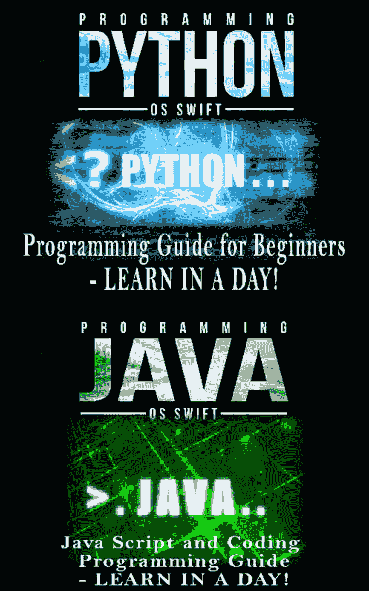
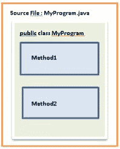
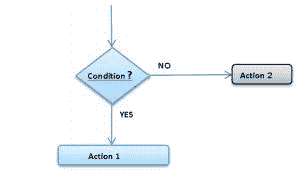

# Java 编程：Python 编程：编程高级指南：一天学会系列（Python, Java, SQL, PHP, HTML, Ruby）



## 目录

- Java 简介
- 控制语句
- 使用 JavaScript 调试器
- JavaScript 原生对象
- 标准版 (`J2SE`)
- 企业版 (`J2EE`)

对于个人使用，可以从[下载页面](http://www.oracle.com/technetwork/java/javase/downloads/index.html) 下载与其操作系统对应的最新 SE 版本 `.exe` 文件。安装后，检查 `PATH` 变量是否指向 Java 的安装路径。在终端窗口执行 `javac` 将在屏幕上显示安装的 Java 版本。

## 代码结构



每个 Java 代码都以 `.java` 扩展名保存。每个 Java 程序包含一个或多个类。每个类都包含一个或多个方法定义，每个方法内部包含几条语句。

# 关键字的语法与含义

```java
import java.io.*;

public class MyFirstProgram {
    public static void main(String[] args) {
        //This is my first java program
        System.out.println(" Hello World !");
    }
}
```

- `import` 关键字 `import` 用于引入名为 `packages`（包）的 Java 库，包包含了可以在程序使用的预定义函数。
- `public class MyFirstProgram` - 这是类的定义，关键字 `public` 表示该类对所有人可见，`class` 表示定义为一个类定义。
- `MyFirstProgram` – 这是类的类名。带有 `main()` 函数的类名必须与源文件名相同。

类的定义被包含在大括号 `{}` 之中。

- `public static void main (String args[])`: 这是程序的主体。由于 `main()` 是驱动函数，它应该始终 `public`（公共的）。
- `static`: 你需要记住 `main()` 方法应该是 `static`（静态的），因为这使得程序在内存利用上更高效。
- `void`: 这是方法的返回类型。这意味着 `main()` 方法将不会返回任何内容。
- `main`: 方法名。解释器仅从 `main()` 方法开始执行。运行程序意味着指示 JVM `load`（加载）从源码编译的 `.class` 文件并从 `main()` 方法开始执行。

`main` 方法的两个用途可以总结为：

1. 测试程序中的所有其他方法
2. 启动程序的执行

- `String[] args`: 是传递给 `main` 方法的参数。该方法始终接收字符串数组作为输入参数，且数组名称应始终为 `args`。

注意数据类型大大写字母 `S`，这是因为 `String` 是 Java 中的一个类，且所有类名都以大写字母开头。

方法的定义包含在花括号 `{}` 中，在这种情况下，我们希望程序执行的唯一目的是打印“Hello World!”。

要向标准输出控制台打印语句，使用 `System.out.println("");`。注意所有语句必须以分号（`;`）结尾。

你也可以使用 `System.out.print()` 来显示输出，区别在于 `println` 在其打印的每个语句末尾引入一个新行。

我们程序中 `main()` 方法中的另一个语句被称为“注释”语句。这些语句不会被编译，以 `//` 开头的这些语句的作用仅向程序员提供更多关于代码的信息。

Java 完全没有全局变量的概念，但使用 `final`、`static`、`public` 等关键字可以实现同样。

# 面向对象编程

Java 的语法与 C 相似，但编程哲学源自 C++ —— 即 Java 是一种面向对象的语言。

在我们看到的第一个示例中，我们有一个类声明，并说明 `main()` 函数负责程序中执行的内容，不过，这并没有让 Java 成为一种 OOP（面向对象）语言，让我们通过示例来更好地理解 OOP —— 对象和类。

## 过程化方法

这并不那么简单，因为之前的形状是确定的，动画代码可以假设一个中心点并旋转形状，而对于变形虫这样不确定的形状，它无法使用其他形状的代码进行旋转，相反，API 需要更多的参数来定义形状应该旋转的坐标。

## 面向对象方法

因此，你可以为每个形状编写一个类文件，这样通过简单的添加新类就可以添加变形虫或修改旋转方法，而不会扰动现有代码。你只需要测试新类，引入的任何新问题都可以轻松追踪到所做的新更改。

### 示例 1

```java
class Movie{
    //变量声明
    //方法
} m1; //m1 是类型为“Movie”的类的对象
```

### 示例 2

```java
class Movie{
    //变量声明
    //方法
}

class TestMovie{
    public static void main(String[] args){
        Movie m1 = new Movie(); // m1 是类型为“Movie”的对象
        m1.variable = value;
        m1.method();
    }
}
```

# 变量声明与数据类型

要学习的下一个重要且基础的概念是关于创建有用程序的“变量”和“数据类型”。变量本质上是命名的内存位置，用于存储值。Java 是一种强类型语言，因此类型为 `x` 的变量只能持有类型为 `x` 的值。

例如：

```java
int n;
```

这里声明变量 `n` 用于存储 `int` 类型的值。声明变量类型确保了 Java 的“类型安全”特性，这反过来有助于“安全性”。

Java 中的变量可以是：

- 局部变量（原始数据类型如 `int`、`float`、`double`、`boolean` 等）
- 引用变量（对象 – 用户定义的类实例）

注意数据类型大写字母 `S`，这是因为 `String` 是 Java 中的一个类，且所有类名都以大写字母开头。

## 字符串

`String` 是一个类。字符串的一些常用操作：

```java
String str = "Hello";
int len = str.length();
String concatStr = "hello"+"world";
if (str1 == str2) {
    System.out.println("strings are equal");
}
```

## 引用变量

`Movie m1 = new Movie()`

左侧是持有对象的声明。

```java
int[] n;
n = new int[5];
```

注意即使是原始类型的数组，数组也是对象。

## Equals 操作

我们知道 `==` 和 `!=` 等比较运算符可以用于原始类型，但为了对对象进行比较，不能使用默认运算符，相反 Java 提供了 `equals` 方法。

## 列表

```java
import java.util.ArrayList;
ArrayList myList = new ArrayList<>();
```

它允许声明不同数据类型的数组。它提供了多个方法来执行常见的数组操作，如 `add(elem)`、`remove(index)` 用于从列表中添加/删除元素。还有 API 如 `size()` 用于查找长度、`isEmpty()` 或列表是否 `contains()` 给定元素。

让我们来看一个使用目前所学概念的示例：

```java
class MyProgram{
    public static void main(String[] args){
        //声明并赋值变量
        int num = 10;  
        float fNum = 10.5;
        //打印语句到控制台
        System.out.println("The value of integer num is : " + num);
        System.out.println("The Value of integer fNum is : " + fNum);
        num = num/2;
        fNum = fNum+num;
        System.out.println("The value of integer num after operation is : " + num);
        System.out.println("The Value of integer fNum after operation is : " + fNum);
    }
}
```

输出：

The value of integer num is : 10

The value of integer fNum is : 10.5

The value of integer num after operation is : 5

The value of integer fNum after operation is : 20.5

# 控制语句

程序中的控制语句顾名思义，控制着每个程序的通用流程。它包括诸如 `if else` 的条件语句，或如 `while()`、`do while()` 等迭代语句。



## If else

语法：

```java
if(condition)
    do action1;
else
    do action2;
```

当 `condition` 为真时，执行 `action1`，否则执行 `else` 部分的操作。

### Switch case

当你需要检查多个条件时，这种操作会非常有用。`Switch case` 根据给定的值执行操作。

语法：

```java
switch(id)
{
    case id1:
        Action;
        break;
    case id2:
        Action;
        break;
    ....
    default:
        ....
}
```

### While ()

这是一个迭代语句，只要条件为真，它就会执行操作。

语法：

```java
while(condition)
{
    // 当 condition 为真时执行某些操作;
}
```

### Do - while ()

这同样是一个迭代操作，与 `while()` 循环非常相似，区别在于无论条件是否有效，循环至少会执行一次，因为条件是在 `do` 语句之后才评估的。

语法：

```java
do{
    // 执行某些操作
}while(condition);
```

### For 循环

语法：`for ( 初始化; 条件; 更新)`

示例：`for (int i=0; i<5; i++)` 现在将执行该语句 5 次。第一部分声明并为 `counter` 变量初始化一个值，第二部分检查条件，如果条件为真，则进入循环。循环完成后，它执行递增。然后它再次检查条件并继续执行相同操作，直到条件变为假。一旦条件为假，它就会退出循环。

示例：

```java
class MyProgram{
    public static void main(String[] args){
        //声明并赋值变量
        int num = 5, i;
        while( num > 0){
            System.out.println("整数型 Num 的值为：" + num);
            num--;
        }
        for(i = 0; i < 5; i++)
            System.out.println("整数型 Num 的值为：" + num);
    }
}
```

输出：

整数型 Num 的值为：5

整数型 Num 的值为：4

整数型 Num 的值为：3

整数型 Num 的值为：2

整数型 Num 的值为：1

上述程序使用了两个循环语句来执行操作。

# 封装

封装，顾名思义，将数据封装起来。简单来说，它隐藏了数据，从而提供了安全性。传递的参数可以是值传递，也可以是引用传递。在确定使用哪种类型后声明数据类型。类的方法通过对象使用点运算符来访问。

`Movie m1 = new Movie()`

`m1.printName()` //打印名称

或 `m1.play(count)` //播放 n 次电影

在接下来的示例中，使用 getter 来读取类变量的值，然后为变量设置一个值。

```java
public class GetterSetter{
    //声明实例变量
    private String name;
    private int age;

    // getters
    public int getAge(){
        return age;
    }
    public String getName(){
        return name;
    }
    // setters
    public void setAge(int newAge){
        age = newAge;
    }
    public void setName(String newName){
        name = newName;
    }
}

//测试 getter 和 setter 方法的类
public class TestGetterSetter{
    public static void main(String[] args){
        GetterSetter gs = new GetterSetter();
        gs.setName("John");
        gs.setAge(30);
        System.out.println("你的名字是：" + gs.getName());
        System.out.println("你的年龄是：" + gs.getAge());
    }
}
```

输出：

你的名字是：John

你的年龄是：30

## JavaScript 简介

JavaScript 是一种基于对象的动态脚本语言。Netscape 是这种语言的开发者。这种语言用于服务器应用程序和网页开发。它是世界上最广泛使用的脚本语言。

Java 和 JavaScript 唯一相似之处是它们的名称相似。在功能和概念方面，这些语言是完全不同的。让 JavaScript 脱颖于 Java 和 C++ 等面向对象语言的特点是，它的对象可以在运行时创建或修改。为了实现这一点，向空对象添加了方法和属性。一旦创建了对象，就可以创建其他类似对象的过程中像原型一样使用。

变量参数列表、源码恢复、动态脚本创建、动态对象创建函数变量等都是 JavaScript 拥有的动态能力。

# 第一章：JavaScript 基础

## 在 JavaScript 中存储数据

- 本地存储 (`Local Storage`)：本地存储用于永久存储数据。通过它，可以随时访问该页面的数据。本地存储没有过期日期。如果人们希望数据在一段时间内被反复使用，可以使用本地存储。
- 会话存储 (`Session Storage`)：会话存储与本地存储不同，因为它只保留单个会话的数据，并在用户关闭页面后丢弃数据。这种存储用于用于预订的网页。

## 使用变量和常量存储数据

变量和常量存储数据。变量和常量在 JavaScript 中都有它们自己的重要性。`if` 语句使用这些数据。

变量数据：顾名思义，这种随时间变化的类型在 JavaScript 中被广泛。变量是动态的。

常量数据：常量数据是不改变值的。这种类型的数据是静态的。我们使用这种类型用于不可修改的数据。

### 创建变量和常量

声明变量

通过在名称前添加 `var` 关键字来声明变量。例如，如果你想声明 `group` 为变量，只需添加 `var` 关键字。每个变量都应该以 `;`（分号）结束。这使得语句自包含。在使用单词时应小心，因为 JavaScript 是大小写敏感的。对于这一点，字母必须与原始一致。

```javascript
var Dell;
```

上面的对象 `Dell` 是一个变量。

声明常量

在名称前使用 `const` 关键字使其成为常量。这种声明就像声明常量一样。

```javascript
const Book;
```

上面的示例中 `Book` 是常量。

### JavaScript 中的决策

总是会出现我们需要在两个路径中选择一个的情况。这时我们能够实现 `if` 和 `else` 等条件语句。

`if` 和 `else` 语句可以用于决策。这将允许程序选择正确的路径。

JavaScript 支持以下条件语句：

1. `if` 语句
2. `if...else` 语句
3. `if...else if` 语句

if 语句：`if` 是用于决策的基本语句。在 `if` 语句中添加一个条件，如果给定的条件为真，就可以给出一组语句。

```javascript
var age = 20;
if( age > 18 ){
    document.write("<b>允许进入酒吧。</b>");
}
```

输出：允许进入酒吧（如果给出了 18 以上的数字）

if else 语句：这是 `if` 语句的扩展。如果 `if` 语句为假，系统运行并执行 `else` 块中的语句。

语法：

```javascript
if(condition) {
    // statements
} else {
    // statements
}
```

示例：


```html
<script type="text/javascript">
<!--
var age = 15;
if( age > 18 ){
  document.write("<b>Allowed inside the pub</b>");
}else{
  document.write("<b>Is not allowed.</b>");
}
//-->
</script>
```

输出：

允许进入酒吧（如果给出一个大于 18 的数字）

不允许（如果给出一个小于 18 的数字）

## if else if

这就像是给 `if else` 语句又添加了一个步骤。这被用于使用一系列条件的情况。

语法：

```javascript
if(condition){
  statements
}
else if(condition){
  statements
}
else if(condition){
  statements
}
else{
  statements
}
```

示例：

```html
<script type="text/javascript">
<!--
var book = "JAVASCRIPT";
if( book == "JAVA" ){
  document.write("<b>JAVA Book</b>");
}else if( book == "JAVASCRIPT" ){
  document.write("<b>JAVASCRIPT Book</b>");
}else if( book == "DBMS" ){
  document.write("<b>DBMS Book</b>");
}else{
  document.write("<b>UNKNOWN Book</b>");
}
//-->
</script>
```

输出：JAVASCRIPT book

## 嵌套 if

“嵌套 if”是指在另一个“if”语句内部的另一个“if”语句。

语法：

```javascript
if(condition) {
  if(condition){
    statement
  }
}
```

## switch 和 break 语句

在 `switch` 语句中将有一个表达式，后面跟着几个不同的语句。这些语句将根据所选表达式的值执行。

语法：

```javascript
switch (expression)
{
  case condition 1:
    statement(s)
    break;
  case condition 2:
    statement(s)
    break;
  .
  .
  .
  case condition n:
    statement(s)
    break;
  default:
    statement(s)
}
```

`break` 语句用于表示前面的 `switch case` 的结束。

# 第 2 章：JavaScript 中的循环与函数

## JavaScript 中的循环

### for 循环

如果人们希望重复执行相同的代码，就会使用循环。`for` 循环是可以使用的三种循环之一。`for` 循环简单且紧凑。

它包含以下三点：

1. 启动语句在循环开始之前执行。
2. 只有当给定的条件为真时才会执行循环。但会执行一次测试代码来运行该代码。
3. 迭代的计数器可以增加也可以减少。

语法：

```javascript
for (initialization; test condition; iteration statement){
  如果测试条件为真，则执行的语句(s)
}
```

示例：

```html
<script type="text/javascript">
<!--
var count;
document.write("This will repeat for 10 times" + "<br />");
for(count = 0; count < 10; count++){
  document.write("Currently repeated : " + count );
  document.write("<br />");
}
document.write("Done!!");
//-->
</script>
```

输出：

这将重复 10 次

当前重复： 1

当前重复： 2

当前重复： 3

当前重复： 4

当前重复： 5

当前重复： 6

当前重复： 7

当前重复： 8

当前重复： 9

当前重复： 10

## JavaScript 中的函数和事件

### 什么是函数？

一组在需要时可以在程序中任何地方被重用的代码被称为函数。它减少了人们反复编写相同代码的时间和精力。这减少了代码冗余。使用函数可以编写模块化代码。使用函数可以将一个大程序分成许多或所需的部分。JavaScript 与任何其他编程语言一样，都支持编写模块化代码所需的特征。这是通过使用“函数”来实现的。

`write()` 和 `alert()` 等函数是默认函数。JavaScript 为用户提供了许多可以直接使用的函数。

JavaScript 还允许人们创建自己的自定义函数。

### 函数定义

在使用函数之前，应该先定义它。`function` 关键字是 JavaScript 中定义函数的常用方法。后面应该紧跟一个唯一的函数名和参数列表。它还应该包含一个带有大括号的语句块。

语法：

```html
<script type="text/javascript">
<!--
function functionname(parameter-list)
{
  statements
}
//-->
</script>
```

示例：在下面的示例中，有一个简单的函数程序。

```html
<script type="text/javascript">
<!--
function simplefunction()
{
  alert("This is a simple function");
}
//-->
</script>
```

### 调用函数

要在 JavaScript 中调用函数，应该如下所示编写该函数的名称。

```html
<script type="text/javascript">
<!--
simplefunction();
//-->
</script>
```

### 函数的参数

在 JavaScript 中，函数也可以带有参数传递。在调用函数时，JavaScript 可以传递不同的参数。可以通过传递的函数中的参数进行操作。逗号用于分隔函数中的多个参数。

示例：

在接下来的示例中，我们将修改我们的 `simplefunction` 函数。

```html
<script type="text/javascript">
<!--
function simplefunction(name, age)
{
  alert(name + " is " + age + " years old.");
}
//-->
</script>
```

现在函数可以这样调用：

```html
<script type="text/javascript">
<!--
simplefunction('Zara', 7);
//-->
</script>
```

### return 语句

如果用户期望函数的返回值，则可以在函数中添加可选的 `return` 语句。`return` 语句总是函数的最后一个语句。

例如：

```html
<script type="text/javascript">
<!--
function concatenate(first, last)
{
  var full;
  full = first + last;
  return full;
}
//-->
</script>
```

现在函数可以这样调用：

```html
<script type="text/javascript">
<!--
var result;
result = concatenate('Zara', 'Ali');
alert(result);
//-->
</script>
```

## JavaScript 中的事件

### 事件

事件处理 JavaScript 和 HTML 之间的交互。当页面被用户或浏览器操作时就会发生这种情况。

一切都是事件。页面加载是一个事件。当用户通过点击选择内容时，点击也被视为事件。事实上，用户执行的任何操作如关闭窗口、选择链接、按键、关闭标签、调整窗口大小等都是事件的示例。

在 JavaScript 中编写的响应是通过这些事件执行的。事件是文档对象模型 (DOM) Level3 的。每个 HTML 元素都提供一组事件。这些事件触发 JavaScript 代码。

### onclick 事件类型

这是一种事件，点击时会显示所需的验证或警告等。这被广泛使用。

示例：下面的代码，当点击 `onclick hello` 按钮时，它会触发 `events()` 函数。

```html
<html>
<head>
<script type="text/javascript">
<!--
function events() {
  alert("Hello World")
}
//-->
</script>
</head>
<body>
<input type="button" onclick="events()" value="Say Hello" />
</body>
</html>
```

### onsubmit 事件类型

`onsubmit` 事件是另一个重要的事件类型。在这里提交表单时会进行验证。如果函数返回 `true`，则文本将被发送。

示例：

```html
<html>
<head>
<script type="text/javascript">
<!--
function validation() {
  // 所有验证都在这里
  .........
  return true 或 false
}
//-->
</script>
</head>
<body>
<form method="POST" action="t.cgi" onsubmit="return validation()">
.......
<input type="submit" value="Submit" />
</form>
</body>
</html>
```

# 第 3 章：JavaScript 中的调试

在编写程序时，有很多机会出现错误。

脚本中的此类错误被称为 bug（漏洞）。

调试是修复 bug 的过程。在开发过程中，调试是正常的一部分。

我们编写的代码可能存在逻辑错误或语法错误，这些错误很难识别。很多时候，当 JavaScript 代码包含错误时，什么都不会发生。没有任何消息指示程序中存在错误。

## 使用验证器 (Validator)

如果想要检查代码中的 bug，就必须确保它是有效代码，并通过运行一个名为 `Validators`（简称为验证器）的程序来检查它是否遵循语言的官方规则。这些验证器通常随 JavaScript 编辑器一起。访问网页后，将代码粘贴到文本区域，然后点击按钮。该程序将解析我们的代码，确保所有变量和函数定义都符合正确的语法。

## 在程序中添加调试代码

`alert()` 或 `document.write()` 方法有助于调试你的代码。例如：

```javascript
var debugging = true;
var whichImage = "widget";

if( debugging )
  alert( "swapImage() with argument: " + whichImage );
var swapStatus = swapImage( whichImage );

if( debugging )
  alert( "swapImage() with swapStatus=" + swapStatus );
```

## 使用 JavaScript 调试器 (Debugger)

调试器是一种允许程序员控制脚本执行的应用程序。调试器方便用户检查执行流程。脚本按行运行，并可以指示其在断点停止。程序员可以在执行完成后检查脚本的状态和变量。

## 表单验证 (Form Validation)

在客户端输入所需信息并点击提交按钮后，会发生表单验证。服务器必须将所有数据再次发送给用户，并要求用户使用正确或有效的信息重新提交表单。如果用户未能输入所有必需信息或输入了无效数据，就会发生这种情况。在将表单发送到网页浏览器之前，JavaScript 可以在客户端计算机本身完成表单数据的验证。

表单通常会执行两个功能：

- 基础验证：为了确保每个必填字段都提供了数据，首先需要检查表单。数据需要遍历每个字段。
- 数据验证：这是为了检查表单中输入的是否正确或有效。

## 基础表单验证

让我们看看如何执行基础表单验证。当发生提交事件时，我们调用 `validate()` 函数来验证数据。`validate()` 函数的实现如下：

```html
<script type="text/javascript">
<!--
// 表单验证代码将放在这里。
function validate()
{
  if( document.myForm.Name.value == "" )
  {
    alert( "Please enter your name!" );
    document.myForm.Name.focus() ;
    return false;
  }
  if( document.myForm.EMail.value == "" )
  {
    alert( "Please enter your id!" );
    document.myForm.EMail.focus() ;
    return false;
  }
  if( document.myForm.Zip.value == "" ||
      isNaN( document.myForm.Zip.value ) ||
      document.myForm.Zip.value.length != 5 )
  {
    alert( "Please enter the zip in the format #####." );
    document.myForm.Zip.focus() ;
    return false;
  }
  if( document.myForm.Country.value == "-1" )
  {
    alert( "Please enter your country name!" );
    return false;
  }
  return( true );
}
//-->
</script>
```

## 数据格式验证

可以在将数据提交到 Web 服务器之前完成数据验证。验证邮箱 ID 意味着 ID 应该包含 `@` 符号和点 (`.`)，下文给出的示例中所示。此外，最后一个点在 `@` 符号之后至少应有一个字符，且邮箱地址不能以 `@` 符号开头。

```html
<script type="text/javascript">
<!--
function validateEmail()
{
  var emailID = document.myForm.EMail.value;
  atpos = emailID.indexOf("@");
  dotpos = emailID.lastIndexOf(".");
  if (atpos < 1 || ( dotpos - atpos < 2 ))
  {
    alert("Please enter a valid email ID")
    document.myForm.EMail.focus() ;
    return false;
  }
  return( true );
}
//-->
</script>
```

# 第 4 章：JavaScript 中的对象

## JavaScript 对象

JavaScript 中的对象由属性组成。如果一个属性包含函数，则它被认为是一个方法。

## 对象属性 (Object Properties)

对象的属性可以是任何数据类型。使用以下语法向对象添加属性：

```javascript
objectName = propertyValue;
```

## 示例

下一个示例展示了如何使用 "title" 属性：

```javascript
strg = document.title;
```

## 对象方法 (Object Methods)

允许对象执行特定任务的函数。

## 示例

以下示例展示了如何使用 `write()`：

```javascript
document.write("This is");
```

## 自定义对象 (User-Defined Objects)

`new` 运算符有助于创建对象的实例。以下示例中的 `Object()`、`Array()` 和 `Date()` 是内置函数。

## `Object()` 构造函数

对象可以通过构造函数进行创建和初始化。接下来的示例展示了对象：

```html
<html>
<head>
<title>objects defined by the user</title>
<script type="text/javascript">
var book = new Object();
book.subject = "Perl";
book.author = "Yashwanth";
</script>
</head>
<body>
<script type="text/javascript">
document.write("Book name is : + book.subject + "<br>");
document.write("Book author is : + book.author + "<br>");
</script>
</body>
</html>
```

## JavaScript 原生对象 (JavaScript Native Objects)

JavaScript 包含许多内置对象。它们的行为不受浏览器或运行平台的影响。以下是常用对象列表：

1. Number 对象
2. Boolean 对象
3. [String](https://www.tutorialspoint.com/javascript/strings_object.htm) 对象


# 4. JavaScript Math 对象

## Number 对象

JavaScript 中的数字对象用于表示数值。它可以包含整数和浮点数。每当遇到数值时，网络浏览器会自动将这些值转换为数字类实例。

### 语法

创建数字对象的语法如下：

```javascript
value = new Number(number);
```

### Number 方法

以下是数字对象包含的方法：

| 方法 | 描述 |
| :--- | :--- |
| `constructor()` | 该方法用于返回创建实例的函数。 |
| `toExponential()` | 该方法以标准指数形式显示标准范围数字。 |
| `toLocaleString()` | 该方法接收一个数字并返回它的字符串版本。其格式随网络浏览器的本地化设置而变化。 |
| `toPrecision()` | 该方法定义了给定数字显示的位数。这包括了小数点两侧的数字。 |
| `toString()` | 该方法有助于将数字转换为字符串值。 |
| `valueOf()` | 此方法表示数字的值。 |
| `valueOfOf()` | 此方法表示数字的值。 |

## 布尔对象 (Boolean Object)

`Boolean` 对象用于表示可以是“真”（True）或“假”（False）值的值。

### 语法

可以使用以下语法创建布尔对象：

`var bval = new Boolean(value);`

如果参数 `value` 为以下任何值：空字符串、`null`、`0`、`NaN`、`-0`、`null` 或 `undefined`，则 `Boolean` 对象的初始值为 false。

### Boolean 方法

以下是 `Boolean` 对象包含的方法。

| 方法 | 说明 |
| :--- | :--- |
| `toSource()` | 此方法用于返回由 `Boolean` 对象源代码组成的字符串。可以使用该字符串创建一个等的对象。 |
| `toString()` | 此方法用于根据对象的值返回“true”字符串或“false”字符串。 |
| `valueOf()` | 此方法用于返回 `Boolean` 对象的原始值。 |

## 字符串对象 (String Object)

`String` 对象允许用户处理一组字符，并用辅助方法封装 JavaScript 的字符串原始值。

### 语法

可以使用以下语法创建 `String` 对象：

`var value = new String(string);`

`string` 参数表示一组正确编码的字符。

### String 方法

以下是 `String` 对象包含的方法。

| 方法 | 说明 |
| :--- | :--- |
| `charCodeAt()` | 此方法用于返回一个数字，表示给定索引处字符的 Unicode 值。 |
| `concat()` | 此方法用于合并两个字符串的字符并返回新创建的字符串。 |
| `match()` | 此方法用于用正则表达式匹配字符串。 |
| `toLocaleLowerCase()` | 用于在保持当前区域设置的同时将字符串转换为小写。 |
| `toLocaleUpperCase()` | 用于在保持当前区域设置的同时将字符串转换为大写。 |
| `toLowerCase()` | 返回一个其中所有大写字母都转换为小写的字符串。 |
| `toUpperCase()` | 返回一个其中所有小写字母都转换为大写的字符串。 |

## Math 对象 (Math Object)

它允许用户执行许多常见的数学计算。通过编写对象的名称、点、以及随后的方法名称来调用对象方法。参数写在方法的括号中。

```javascript
document.writeln(Math.sqrt(81));
```

以下是 `Math` 对象的一些广泛使用的函数：

| 方法 | 说明 |
| :--- | :--- |
| `abs(x)` | `x` 的绝对值 |
| `ceil(x)` | 将 `x` 舍入为不小于 `x` 的最小整数。 |
| `round(x)` | 将 `x` 舍入到最近的整数。 |
| `pow(x, y)` | `x` 的 `y` 次方 |
| `floor(x)` | 将 `x` 舍入为不大于 `x` 的最大整数。 |

# 结论

我们已经完成了学习 Java 和 JavaScript 编程基础的书。

感谢你购买本书。我希望这本书对你有所帮助，并帮助你理解使用 Java 和 JavaScript 的编程概念。作为高级编程语言，它们很容易学习基础并开始自己编写程序。

只要学习得当，任何语言都不是火箭科学。本书涵盖的两种语言也是如此。投身其中，掌握这些语言的基础知识吧。

谢谢！

注册免费计算机培训和电子书！

<http://freecomputertraining.strikingly.com>

## 你可能也会喜欢我的其他书籍！

- Android 应用开发与编程指南：一天学会！<http://hyperurl.co/androids>
- [PYTHON：学者编程指南：一天学会！](http://hyperurl.co/python)
- [C++ 编程：学者编程语言：一天学会！](http://smarturl.it/cplusplus)
- [JAVA：Java 编程、JavaScript、编码：编程指南：一天学会！](http://hyperurl.co/javaos)
- [SQL：编程指南：JavaScript 和编码：一天学会！](http://smarturl.it/sql)
- HTML 编程：编程指南：计算机编程：一天学会！<http://hyperurl.co/html>
- Swift 编程：一天学会！<http://hyperurl.co/swift>

<http://freecomputertraining.strikingly.com>

# 引言

尽管计算机编程的基础早在 19 世纪初就由数学家奠定，但之后经过了近一百年的时间，真正的编程语言才出现。从那时起，编程语言从复杂的低级指令演变为复杂的且易于阅读的高级语言。编程导致了软件系统的发展，彻底改变了计算机科学领域。

软件可以被视为一种技术文献，它可以同时被计算机和人类阅读，但形式不同。只有当软件是用像英语这样人类可读的语言编写时，人类才能轻松理解它。另一方面，计算机只能理解机器码（0 和 1）形式的指令。因此，开发出了某些可以将高级代码翻译成机器码的特定程序（编译器和解释器）。

尽管高级语言易于理解，但大多数语言都具有复杂的语法，这使得编写和修改大型程序变得繁琐。因此，一些具有简单、清晰语法的高级语言被开发出来，`Python` 就是其中一种语言。由于其简单的语法、高可读性以及其他各种创新特性，全球的程序员都越来越喜欢 `Python`。最近，由于其简单性，许多大学已采用 `Python` 来向学生教授入门计算机编程。

因此，`Python` 不仅在软件开发人员中越来越流行，而且作为学习计算机编程的理想语言也越来越受到欢迎。如果你是编程新手，这本书是学习如何编写代码的理想起点。如果你已经熟悉编程，这本书对你来说将是一本易读的读物，并能让你理解 `Python` 与其他编程语言的不同之处。

# 第 1 章：理解 Python

复杂的硬件技术的出现和软件系统需求的增长，导致了编程语言的大规模发明和开发。即使现在，每年都有新语言被开发和发布。但，大多数出现的新语言并不是完全全新的；它们受到了之前发布的语言的启发和影响。它们可以被认为是旧语言的改进版本。`Python` 就是这样的语言之一，它的设计和特性源自 `ABC`、`ALGOL-68`、`C++` 和 `UNIX shell` 等其他语言。

## 什么是 Python？

正如你可能已经知道的，`Python` 基本是一种高级编程语言。如果一种语言与机器无关，并且使用英语等人类语言来指定其语法，以便人类可以轻松理解，那么它就被认为是高级语言。程序员只需要处理类英语的语法，而无需担心底层的机器码。尽管市场上有很多高级语言可用，但 `Python` 因其清晰的语法和良好的可读性在软件开发人员中广泛流行。`Python` 中的实际代码行看起来像伪代码，因此易于理解。

为什么编程语言的可读性在软件开发中如此重要？这是因为程序员在阅读代码行上花费的时间比编写代码的时间要多。`Python` 通过强调代码的可读性使这项任务变得更加简单。此外，与 `Java` 或 `C++` 等其他高级语言相比，`Python` 可以使用较少的代码行完成给定的任务。

现在，关于精确的描述，`Python` 可以描述如下：

`Python` 是一种免费、开源、通用的、面向对象的编程语言。

由于 `Python` 是免费且开源的软件，其源代码可以被自由地访问、修改和重用。它是面向对象的，这意味着在编程中涉及对类和对象的使用。它被用于开发各种领域的应用程序，使其成为一种“通用型”编程语言。它在软件社区中具有潜在的用户群。

`Python` 最初由 Guido Van Rossum 在 1985-1995 年间开发。`Python` 减少了应用开发的许多复杂性，因为它使用了易于理解的英语关键字，不像其他需要大量标点符号的语言。此外，它对开发所需的语法要求极低。

关于 `Python` 可以说以下点：

- `Python` 是解释型的：这表明处理是由解释器在运行时完成的，人们不需要在执行之前编译程序。这与 `PHP` 和 `PERL` 等各种语言密切相关。
- `Python` 是交互式的：这意味着你可以直接与 `Python` 提示符交互并执行程序。
- `Python` 是面向对象的：这表明 `Python` 处理的是面向对象的编程，即我们可以在创建的对象中封装代码。
- 适合初学者的语言：`Python` 是初学者和刚开始编码的程序员入门的极好语言。它还扩展了对开发各种与文本和网页相关的游戏的支持。

## Python 特性

- 易于学习：`Python` 具有简单的结构、较少的关键字和定义的语法，允许学习者在更短时间内理解它。
- 易于阅读：代码定义良好，因为它只需要最少的语法构建。
- 易于维护：与其他语言相比，它的源代码易于维护。
- 标准库：它最大的优势之一是它拥有一个可移植的大型库，并且兼容 `UNIX`、`Macintosh` 和 `Windows` 等各种操作系统。
- 交互模式：`Python` 支持交互模式，可以从终端系统输入结果，并使用这种模式对代码调试。
- 可移植性：`Python` 在各种硬件平台上运行时提供相同的用户界面。
- 可扩展性：可以在 `Python` 解释器中添加低级部分。这些低级模块帮助程序员使用定制化工具来提高他们的效率。
- 数据库：它提供了与市场上主流数据库的连接。
- GUI 编程：`Python` 支持图形用户界面，并适用于不同的库、系统调用和操作系统，如 `Macintosh`、`Windows MFC` 和 `Unix` 的 `X Window system`。
- 可扩展性：`Python` 提供了简单且更好的结构，并支持比 `Shell` 等脚本语言更大的程序。

## 作为脚本语言的 Python

作为一种动态编程语言，`Python` 可以在运行时表现某些行为，而静态编程语言只能在编译时表现出这些行为。

脚本语言本质上是用于控制软件应用程序的编程语言。它们支持仅为运行时操作编写的脚本或程序。脚本不被编译而是被解释；而它们所控制的应用程序通常是编译的。因此，脚本与核心应用程序是不同的。脚本和应用程序通常使用不同的语言编写。通常，通过将脚本嵌入应用程序来实现对应用程序的控制。

`Python` 中的变量类型可以快速更改，无需产生任何麻烦或错误。在静态编程语言中，这是无法实现的，因为变量类型在程序执行过程中不能更改。`Python` 可以很容易与其他技术集成。`Python` 的设计使其能够轻松地嵌入到其他技术中。由于其简单性、可读性以及易于使用的支持库，程序员在使用 `Python` 工作时效率大大提高。

可以使用 `Python` 轻松开发 Web 服务。如果开展的项目较大或复杂，且需求经常变化，`Python` 是一个理想的编程语言。科学应用利用了 `numeric Python` 和 `Scientific Python` 等工具。

通常情况下，科学研究的理想编程语言是那种可以将记事本或纸上的草稿直接翻译成代码的语言。`Python` 高效地完成了任务，因为它看起来类似于易读的伪代码。`Python` 是免费软件，也可以免费用于商业目的。

# 第 2 章：Python 安装

可以在 Python 官方网站访问带有二进制文件、当前源代码、文档、最新新闻等的最新版本。

Python 官方网站：<http://www.python.org/>

在这里，你可以从该网站下载 `Python` 的文档。它支持 PDF、HTML 和 PostScript 等多种格式。

Python 文档网站：<http://www.python.org/doc/>

## 如何安装 Python

`Python` 适用于多种平台。你只需要下载与该平台良好运行的二进制代码，之后即可安装 `Python`。如果没有二进制文件，可以使用可以对源代码进行手动编译的 C 编译器。源代码编译让你在所需功能方面更具灵活性。

### Python 环境变量

| 变量 | 说明 |
| :--- | :--- |
| `PYTHONPATH` | 它类似于 `PATH`。此变量告诉 `Python` 解释器在何处定位你可以在程序中导入的模块文件。`PYTHONPATH` 必须包含 `Python` 的源库目录以及存放你的 `Python` 代码的目录。`PYTHONPATH` 有时由 `Python` 安装程序自动设置。 |
| `PYTHONSTARTUP` | 它包含一个初始化文件的路径，该文件包含 `Python` 源代码，每当你操作解释器时都会执行一次。该文件在 Unix 中通常命名为 `.pythonrc.py`，通常包含可以加载工具或修改 `PYTHONPATH` 的命令。 |
| `PYTHONCASEOK` | 这用于 Windows 操作系统，用于指示 `Python` 在导入语句中查找不区分大小写的匹配。你可以将其设置为任何随机值以激活它。 |
| `PYTHONHOME` | 这是一个替代搜索路径，嵌入在 `PYTHONSTARTUP` 或 `PYTHONPATH` 目录中，用于轻松切换模块库。 |

## 运行 Python

`Python` 可以在系统上通过三种方式运行：

### 交互式解释器

你可以通过输入 `python` 开始，然后在任何提供命令行解释器或 shell 窗口的平台上，从命令行开始在它的解释器中进行编程。

命令行选项列表下表所示：

| 选项 | 说明 |
| :--- | :--- |
| `-d` | 调试后提供输出 |
| `-O` | 优化的字节码生成，即生成 `.pyo` 文件 |
| `-S` | 启动时不运行用于搜索 Python 路径的导入钩子模块（import site）。 |
| `-v` | 导入语句的详情 |
| `-X` | 禁用基于类的内置异常 |
| `-c cmd` | 运行在 `cmd` 字符串中发送的 `python` 脚本 |
| `File` | 从指定文件运行 `Python` 脚本 |

### 命令行脚本

在你的应用程序上调用解释器可以帮助你在命令行运行并执行你的 `python` 脚本。

### 集成开发环境

也可以从 GUI 运行 `Python`。你只需要一个支持 `Python` 的系统。

# 第 3 章：Python 简单编程规则

现在，让我们详细学习 `Python` 的一些简单但重要的编程规则。

进入开始菜单 -> Python -> 'IDLE'（或集成开发环境）。

在 `python` 提示符中输入以下内容并按回车：（不要输入 `>>>`，因为它已经在命令行中存在了）

### 代码示例 1 - Hello, World!

```python
>>> print "Hello, World!"
```

输出：Hello, World!

这里是另一个示例，显示了如何在屏幕上打印字符串：

```python
print ('hi, Michael')
```

关键字 `print` 用于在屏幕上打印字符串。上述示例程序的输出为：

OUTPUT: hi, Michael

上面的程序也可以写如下所示：

```python
print 'hi, Michael'
```

上面的程序也给出输出：hi, Michael

1. 在 `print` 语句中使用括号是可选的。是否使用括号没有区别。两种情况下获得相同的输出。但是，从 Python 3.x 版本开始，在 `print` 语句中使用括号是强制的。
2. 在每个语句的末尾使用分号也不是强制的。使用分号是可选的。

示例：`print 'hi, Michael';`

我们可以使用分号（`;`）在单行上指定多个语句。

示例：`print 'hi'; print 'Michael'; print 'how are you?';`

输出：

```
hi
Michael
how are you?
```

## Python 中的注释

程序中的注释有助于更好地理解代码。

### 单行注释

在 `Python` 中，注释以井号（`#`）开始。`#` 符号后的字符被视为注释，并被 `Python` 解释器忽略。从 `#` 符号到行尾的字符构成单行注释。

示例：

```python
# 这里是你应该写注释的地方
print 'hi, Michael'
```

考虑其他几个例子：

```python
# print "food is very bad"
```

（没有输出，因为 print 语句在注释之后输入）

```python
print "food is tasty" eat it
```

（显示了错误，因为我们没有在井号后面放置注释）

### 多行注释

在 `Python` 中，井号（`#`）符号仅用于编写单行注释。不能使用井号编写多行注释。例如，考虑以下脚本：


# Python 基础语法

## 注释

```python
# 这是
a Python Script
print 'hi, Michael'
```

上面的脚本会报错，因为注释 `This is a Python Script` 写了两行，但 `#` 符号只允许单行注释。因此，在 `Python` 中编写多行注释，我们可以使用三引号 `'''` 或 `"""`。

示例 1：

```python
'''
这是一个 Python 脚本
'''
print 'hi, Michael'
```

示例 2：

```python
"""
这是一个 Python 脚本
"""
print 'hi, Michael'
```

## Python 中的引号

为了打印字符串，`Python` 允许使用单引号（`'`）、双引号（`"`）或三引号（`'''` 或 `"""`）。应确保字符串的开头和结尾使用相同类型的引号。例如，字符串 `'I like Python'` 可以通过以下方式使用 `print` 语句打印：

```python
print 'I like Python'
print "I like Python"
print '''I like Python'''
print """I like Python"""
```

上述四个语句给出相同的输出。但是，多行只能使用三引号打印。尝试使用单引号或双引号打印多行字符串会导致错误。

示例：

```python
print """I like Python. It is very simple and easy to learn"""
```

上面的语句是合法的，因为使用了三引号来打印多行字符串。

让我们看看当上面的脚本更改如下时会发生什么：

```python
print 'Python is object oriented'''
```

上述语句会报错，因为字符串以单引号开头，但以三引号结束。如前所述，字符串的两端需要指定相同类型的引号。

现在，如果你想在屏幕上打印单引号 `''` 作为字符串的一部分，该怎么办呢？

例如，如果你想在屏幕上打印字符串 `'Python'`（包括单引号），该怎么办呢？可以使用以下语句实现：

```python
print "'Python'" # 这里要打印的字符串是 'Python'
```

OUTPUT: `'Python'`

注意：`#` 号后面的语句是注释。

如果你只想在屏幕上打印一个单引号呢？可以使用以下语句实现：

```python
print "'" # 单引号位于两个双引号之间
```

OUTPUT: '

同样地，如果你想在屏幕上打印一个双引号呢？你可能认为以下脚本可以完成任务：

```python
print """ # 要打印的双引号被包含在两个双引号之间。
```

上述脚本将产生错误，因为解释器认为三个双引号 `"""` 是一个三引号，而不是打印双引号的指令。在这种情况下，反斜杠 `\` 字符派上用场了。

通常情况下，反斜杠 `\` 用于编码那些难以使用普通引号打印的字符。为了打印此类难以打印的字符（如引号内的引号），需要使用转义序列。如果你遵循给出的示例，你将理解什么是转义序列：

让我们假设你想打印如下包含标点符号的句子：

`"I am happy"`，迈尔 说道。你可能选择使用单引号或双引号来打印上述句子。假设你写的脚本如下：

```python
print "I am happy", said Michael." # 将要打印的句子包含在双引号中。
```

上述脚本报错，因为 Python 解释器会困惑，因为它假设字符串开头 `"I am happy"` 处的双引号是 print 语法的一部分，并认为字符串已经结束了。它不会理解那些双引号只是需要作为字符串的一部分打印的字符。我们需要让 Python 知道这些双引号不是 print 语法的一部分。

如果可以将字符串 `"I am happy"` 周围的双引号进行“转义”，那么这个问题就可以解决，这样它们就不会被视为 print 语法的一部分，而是可以被视为普通的可打印字符。在字符前加上反斜杠表示该字符需要被“转义”并作为普通字符打印。

这里有几个展示反斜杠 `\` 用法的示例：

```python
print "\"I am happy\", said Michael." # 转义字符串 "I am happy" 周围的双引号
```

OUTPUT: `"I am happy", said Michael.`

另一个示例：

```python
print 'I am 5\'4 tall' # 转义 5 和 4 之间的单引号
```

OUTPUT: I am 5'4 tall

其他几个示例如下：

示例 1：

```python
print '\'Python\''
```

OUTPUT: `'Python'`

示例 2：

```python
print '\"Python\"'
```

OUTPUT: `"Python"`

处理打印单引号或双引号的另一种方法是将它们包含在三引号内：

```python
print ''' "I am happy", said Michael. '''
```

OUTPUT: `"I am happy", said Michael.`

这仅适用于内部不包含作为普通字符的三引号字符串。如果字符串内部也存在三引号，反斜杠再次派上用场。看以下示例：

```python
print ''' Triple quotes (''') are never used in written English'''
```

上述示例报错，因为解释器认为括号 `('''')` 内提供的三引号表示字符串的结束。可以使用反斜杠再次解决此问题。

```python
print ''' Triple quotes (\''') are never used in written English'''
```

OUTPUT: Triple quotes (''') are never used in written English

如果你想将反斜杠 `\` 作为字符串的一部分打印呢？

考虑以下打印字符串 `\Python\`（包括反斜杠）的示例：

示例：

```python
print "\Python\"
```

上述脚本报错且不打印 `\Python\`。这是因为解释器认为字符串末尾的 `\"` 是转义序列，是转义双引号（`"`）并打印它的指令。

考虑另一个示例，你想原样打印以下语句，包括反斜杠 `\` 字符。

```python
print "The backslash ' \' is not used in written English"
```

OUTPUT: The backslash ' ' is not used in written English

你可以观察到上述脚本没有报错，也没有给出预期的输出。它没有原样打印 `\` 字符，因为再次，它认为字符 `\'` 是转义单引号（`‘`）的转义序列。那么，我们如何在屏幕上打印反斜杠 `\` 呢？为了此目的，我们使用另一个反斜杠字符，放在要打印的反斜杠之前。考虑以下打印字符串 `\Python\`（包括反斜杠）的示例：

示例 1：

```python
print '\\Python\\'
```

OUTPUT: `\Python\`

上述示例提供了作为字符串一部分打印反斜杠的正确脚本。

示例 2：

```python
print "The backslash '\\' is not used in written English"
```

OUTPUT: The backslash '\' is not used.

## 转义序列

以下是 Python 支持的一些常用转义序列。如前所述，转义字符反斜杠 `\` 位于某些字符前面形成转义序列。

| 转义序列 | 功能 |
| :--- | :--- |
| `\\` | 打印反斜杠 `\` |
| `\'` | 打印单引号 `'` |
| `\"` | 打印双引号 `"` |
| `\'''` | 打印三引号 `'''` |
| `\b` | ASCII 退格 |
| `\n` | ASCII 换行符 |
| `\r` | 回车 |
| `\t` | 水平制表符 |
| `\v` | ASCII 垂直制表符 |

```python
a = "\t I have space before me."
b = "My name is in the next line \n It is Michael."
c = "A sentence can be divided as: \\ Michael."
d = """
About me:
\t* I am Michael
\t* I like Python
\t* It is very simple and\t* easy to learn
"""

print a
print b
print c
print d
```

注意你指定的制表、反斜杠和换行符。

OUTPUT:

```text
	 I have space before me.
My name is in the next line
 It is Michael.
A sentence can be divided as: \ Michael.
About me:
	* I am Michael
	* I like Python
	* It is very simple and	* easy to learn
```

## 第 4 章：Python 中的行缩进

Python 的一个独特之处是它不允许使用括号来表示代码块。在 C 或 Java 等语言中，我们使用括号 `{ }` 来表示代码块。但在 Python 中，使用行缩进来表示代码块。程序员需要对行缩进小心，因为 Python 严格执行它。在代码行左侧添加空格以构建块结构被称为缩进。

考虑以下示例：

```python
print 'The cat is fluffy'
print 'The dog is pudgy'
print 'The bird is chattering'
```

上述脚本没有产生错误，输出为：

The cat is fluffy
The dog is pudgy
The bird is chattering

现在，尝试如下更改第二行的缩进：

```python
print 'The cat is fluffy'
    print 'The dog is pudgy'
print 'The bird is chattering'
```

上面的脚本生成了一个“缩进错误”；这意味着所有三个语句本应该形成一个块，因此它们应该具有相同的缩进。

用户可以使用任意数量的空格作为缩进。但必须注意，同一个块内的语句的缩进空格数必须相同。

如果你熟悉 C 语言，可以看一眼用 C 语言编写的 `if-else` 语句：

```c
if(5<7)
{
    printf ("The given condition is true");
    printf ("abc");
}
else
{
    printf ("This given condition is false");
    printf ("xyz");
}
```

上面的 C 代码可以用如下方式写成 Python 代码：

```python
if 5<10:
    print 'The given condition is true'
    print 'abc'
else:
    print 'The given condition is false'
    print 'xyz'
```

注意这两种语言语法之间的区别。此外，请注意 Python 中使用缩进而不是大括号 `{}` 来指定块。

考虑将上述代码中其中一个 `print` 语句的缩进更改如下：

```python
if 5<10:
    print 'The given condition is true'
print 'abc'
else:
    print 'The given condition is false'
    print 'xyz'
```

OUTPUT：

```text
[Line 3](http://codepad.org/gpkkOzLB#line-3)
  print "abc"
       ^
Indentation Error: unindent does not match any outer indentation level
```

在上面的代码中，第 3 行的 `print` 语句其缩进与其他所有 `print` 语句的缩进不一致，因此产生了错误。

来看 Python 的另一个示例：

### 块 1

```python
if 5<10:
    print "abc"
else:
    print "xyz"
```

OUTPUT: abc

在上面的块中，`if` 和 `else` 具有相同的缩进，因为它们共同组成了一个控制语句块。同样，`print` 语句应该具有相同的缩进，因为每个 `print` 语句都被视为一个代码块。

然而，下面的块将会报错：

### 块 2

```python
if 5<10:
print "abc"
else:
print "xyz"
```

OUTPUT:

```text
[Line 2](http://codepad.org/rnoeN4o0#line-2)
  print "abc"
IndentationError: expected an indented block
```

由于 `if else` 语句和 `print` 语句都被赋予了相同的缩进，因此生成了错误。

考虑另一个语句块：

### 块 3

```python
    if 5<10:
    print "abc"
else:
    print "xyz"
```

上面的代码输出如下所示：

OUTPUT:

```text
[Line 1](http://codepad.org/81avkQsU#line-1)
  if 5<10:
  ^
IndentationError: unexpected indent
```

因此，在对 Python 代码行进行缩进时应该小心。至于行之间的空格，可以在任何两行代码之间留下任意数量的空行。

示例：

```python
if 5<10:
    print '5 is less than 10'
    print "abc"
else:
    print "xyz"
```

在上面的代码块中，`if` 语句和 `else` 语句之间留下了 5 个空行。尽管如此，这对输出没有影响，也没有产生错误。程序员只需要注意行的缩进。

**注意：**尽管可以使用任意数量的空格作为缩进，但使用 4 个空格作为缩进是一个良好的习惯。

## 多行语句

在 Python 中，语句以单行结束。新的一行表示前一行的语句已经结束。换句话说，Python 不允许将单个语句写在多行中。

示例：考虑一个用于计算三个数字之和的程序

```python
a=10
b=5
c=5
sum= a+b+c
print sum
```

OUTPUT: 20

现在，尝试通过将第 4 行的表达式分成两行来重写代码：

```python
a=10
b=5
c=5
sum= a+
    b+c
print sum
```

OUTPUT:

```text
[Line 3](http://codepad.org/I13POw#line-3)
  sum= a+
    ^
Syntax Error: invalid syntax
```

在上面的程序中，第 4 行只包含语句的一部分，其延续在后续行中。然而，解释器认为语句在单行处已结束。因此，由于表达式 `sum = a+` 没有关联，生成了错误。

考虑按如下方式编写相同的程序：

```python
a=10
b=5
c=5
sum= a
+b+c
print sum
```

上面的代码没有生成错误，但没有给出预期的输出。这是因为第 4 行的语句以 `a` 结束，解释器认为这就是语句的结束。由于使用了赋值运算符 `=`（你将在下一章中学习），解释器将 `a` 的值赋给 `sum`，使其变为 10。

然而，我们可以使用续行字符 `\` 在多行中编写单个语句。例如：

```python
a=10
b=5
c=5
sum= a+\
    b+c
print sum
```

OUTPUT: 20

## 运算符

| 运算符 | 说明 | 示例 |
| :--- | :--- | :--- |
| `==` | 它是“等于”运算符，用于检查两个操作数的值是否相等。如果它们相等，返回布尔值‘True’，否则返回‘False’。 | `(p == q)` 返回 false（因为 p=10 且 q=5）。 |


## 关系运算符

| 运算符 | 含义及作用 | 示例 |
| :--- | :--- | :--- |
| `!=` | 它是“不等于”运算符，用于检查两个操作数的值是否不同。如果它们的值不同，返回布尔值‘True’，否则返回‘False’。 | `(p != q)` 返回 false |
| `<>` | 它类似于“不等于”运算符，用于检查两个操作数的值是否不同。如果它们的值不同，返回布尔值‘True’，否则返回‘False’ | `(p <> q)` 返回 false |
| `>` | 它是“大于”运算符，用于检查第一个操作数是否大于第二个操作数。如果第一个操作数大于第二个操作数，返回布尔值‘True’，否则返回‘False’。 | `(p > q)` 返回 true。 |
| `<` | 它是“小于”运算符，用于检查第一个操作数是否小于第二个操作数。如果第一个操作数小于第二个操作数，返回布尔值‘True’，否则返回‘False’ | `(p < q)` 返回 false。 |
| `>=` | 它是“大于等于”运算符，用于检查第一个操作数是否大于或等于第二个操作数。如果第一个操作数大于或等于第二个操作数，返回布尔值‘True’，否则返回‘False’。 | `(p >= q)` 返回 true。 |
| `<=` | 它是“小于等于”运算符，用于检查第一个操作数是否小于或等于第二个操作数。如果第一个操作数小于或等于第二个操作数，返回布尔值‘True’，否则返回‘False’。 | `(p <= q)` 返回 False。 |

如果你查看下面的示例程序，将更好地理解关系运算符：

### 示例

```python
#!/usr/bin/python

p = 10
q = 5

if ( p == q ):
  print " p is equal to q"
else:
  print "p is not equal to q"

if ( p != q ):
  print "p is not equal to q"
else:
  if ( p <> q ):
    print "p is not equal to q"
  else:
    print "p is equal to q"

if ( p < q ):
  print " p is less than q"
else:
  print " p is not less than q"

if ( p > q ):
  print "p is greater than q"
else:
  print "p is not greater than q"

if ( p <= q ):
  print "p is either less than or equal to q"
else:
  print "p is neither less than nor equal to q"

if ( p >= q ):
  print "p is either greater than or equal to q"
else:
  print "p is neither greater than nor equal to q"
```

**输出：**

```
p is not equal to q
p is not equal to q
p is equal to q
p is less than q
p is not less than q
p is greater than q
p is not greater than q
p is either less than or equal to q
p is neither less than nor equal to q
p is either greater than or equal to q
p is neither greater than nor equal to q
```

## 3. 赋值运算符

赋值运算符用于将操作数的值存储另一个操作数中。此外，它们也可以用于将计算结果赋值给操作数。Python 中使用的赋值运算符列于下表：

| 运算符 | 含义及作用 | 示例 |
| :--- | :--- | :--- |
| `=` | 用于两个操作数之间的赋值运算符。使用时，将右操作数的值赋值给左操作数。 | `a=6`（将值 6 赋值给 `a`），`b=a`（将 `a` 的值赋值给 `b`），`p=q+r`（将 `q+r` 的和赋值给 `p`） |
| `+=` | 加赋值运算符，同时执行加法和赋值。将右、左操作数相加，并将和存储在左操作数中。 | `p+=q`（将 `p` 和 `q` 相加并将和存储在 `p` 中），等同于 `p=p+q` |
| `-=` | 减赋值运算符，同时执行减法和赋值。它通过从左操作数减去右操作数并将差存储在左操作数中来实现。 | `p-=q`（从 `p` 中减去 `q`并将差存储在 `p` 中），等同于 `p=p-q` |
| `*=` | 乘赋值运算符，同时执行乘法和赋值。它通过将右操作数乘以左操作数并将积存储在左操作数中来实现。 | `p*=q`（将 `q` 乘以 `p`并将积存储在 `p` 中），等同于 `p=p*q` |
| `/=` | 除法赋值运算符，执行除法和赋值。它通过将左操作数除以右操作数并将商存储在左操作数中来实现。 | `p/=q`（将 `p` 除以 `q`并将商存储在 `p` 中），等同于 `p=p/q` |
| `%=` | 取模赋值运算符，同时执行取模（余数）和赋值。它通过将左操作数除以右操作数并将余数存储在左操作数中来实现。 | `p%=q`（将 `p` 除以 `q`并将余数存储在 `p` 中），等同于 `p=p%q` |
| `**=` | 幂赋值运算符，同时执行幂和赋值。它将左操作数升为右操作数的幂并将结果存储在左操作数中。 | `p**=q`（将 `p` 升为 `q` 的幂并将结果存储在 `p` 中），等同于 `p=p**q` |
| `//=` | 在操作数之间执行地板除法和赋值并将结果存储在左操作数中。地板除法等同于普通除法，不同在于商是向下取整的。 | `p//=q`（将 `p` 除以 `q`并将取整后的商存储在 `p` 中），等同于 `p=p//q` |

如果你查看下面的示例程序，将更好地理解赋值运算符：

### 示例

```python
#!/usr/bin/python

p = 10
q = 5

p += q
print "Value of p after p += q:", p

p -= q
print "Value of p after p -= q:", p

p *= q
print "Value of p after p *= q:", p

p /= q
print "Value of p after p /= q:", p

p %= q
print "Value of p after p %= q:", p

p **= q
print "Value of p after p **= q:", p

p //= q
print "Value of p after p //= q:", p
```

**输出：**

```
Value of p after p += q: 15
Value of p after p -= q: 10
Value of p after p *= q: 50
Value of p after p /= q: 10
Value of p after p %= q: 0
Value of p after p **= q: 0
Value of p after p //= q: 0
```

## 4. 位运算符

对位（二进制 0 和 1）操作的运算符称为位运算符。Python 中使用的位运算符列于下表：

| 运算符 | 含义及作用 | 示例 |
| :--- | :--- | :--- |
| `&` | 位与运算符。它检查两个操作数的每一个位，如果两个操作数中至少有一个为‘0’，则结果为‘0’。 | `p=2, q=5`<br>二进制形式：p=0010, q=0101<br>-----------------<br>`p&q=0000` |
| `|` | 位或运算符。它检查两个操作数的每一个位，如果两个操作数中至少有一个为‘1’，则结果为‘1’。 | `p=0010, q=0101`<br>-----------------<br>`p\|q=0111` |
| `^` | 位异或运算符（互斥或）。它类似于位或运算符，区别在于，如果只在一个操作数中存在‘1’而不在两者中都存在，则结果为‘1’。 | `p=2 and q=3`<br>二进制形式：p=0010, q=0011<br>-----------------<br>`p^q=0001` |
| `~` | 二进制按位反运算符。它是一个一元运算符，意味着它只对单个位进行操作。它将位翻转为其补位。这意味着 0 被替换为 1，1 被替换为 0。 | `p=2` 在二进制形式下 `p= 0010`，`~p=1101` |
| `<<` | 二进制左移运算符。该运算符将左操作数的位向左移动。向左移动并丢失的位位数个数由右操作数决定。左侧的位丢失后，右侧将填充相同数量的 0。 | `p=0010`, `p << 2 = 1000` |
| `>>` | 二进制右移运算符。该运算符将左操作数的位向右移动。向右移动并丢失的位位数个数由右操作数决定。右侧的位丢失后，左侧将填充相同数量的 0。 | `p=0010`, `p >> 2 = 0000` |

二进制左移和右移运算符可以通过以下插图轻松理解：

如果你查看下面的示例程序，将更好地理解位运算符：

### 示例

```python
#!/usr/bin/python

p = 60                             # 60 = 0011 1100
q = 13                             # 13 = 0000 1101
r = 0

r = p & q                          # 12 = 0000 1100
print " Binary AND of p and q gives: ", r

r = p | q                          # 61 = 0011 1101
print "Binary OR of p and q gives: ", r

r = p ^ q                          # 49 = 0011 0001
print "Binary XOR of p and q gives: ", r

r = ~p;                            # -61 = 1100 0011
print "The value of p after one's complement is ", r

r = p << 2;                       # 240 = 1111 0000
print "The value of p after binary left shift is ", r

r = p >> 2;                       # 15 = 0000 1111
print "The value of p after binary right shift of is ", r
```

**输出：**

```
Binary AND of p and q gives: 12
Binary OR of p and q gives: 61
Binary XOR of p and q gives: 49
The value of p after one's complement is -61
The value of p after binary left shift is 240
The value of p after binary right shift of is 15
```

## 5. 逻辑运算符

Python 支持以下逻辑运算符：

| 运算符 | 功能 | 示例 |
| :--- | :--- | :--- |
| `and` | 两个或多个表达式之间的逻辑“与”运算符，即使给出的表达式中至少有一个为假也会返回假。 | `a=10, b=20, c=0`。表达式 `a>b` 返回假。表达式 `b>c` 返回真。因此，表达式 `(a>b and b>c)` 返回假 |
| `or` | 两个或多个表达式之间的逻辑“或”运算符，即使给出的表达式中至少有一个为真也会返回真。 | `a=10, b=20, c=0`。表达式 `a>b` 返回假。表达式 `b>c` 返回真。因此，表达式 `(a>b or b>c)` 返回真 |
| `not` | 逻辑“非”运算符用于反转表达式的逻辑状态 | `a=10, b=20, c=0`。表达式 `a>b` 返回假。表达式 `b>c` 返回真。因此，表达式 `(a>b or b>c)` 返回真。因此，表达式 `not(a>b)` 返回真，`not(b>c)` 返回假，`not(a>b or b>c)` 返回假 |

如果你查看下面的示例程序，将更好地理解逻辑运算符：

### 示例

```python
#!/usr/bin/python

p=10
q=20
r=0
if(p>q):
  print'(p>q) is true'
else:
  print'(p>q) is false'

if(q>r):
  print'(q>r) is true'
else:
  print'(q>r) is false'

if(p>q and q>r):
  print 'Hence,(p>q and q>r) is true'
else:
  print 'Hence,(p>q and q>r) is false'

if(p>q or q>r):
  print 'Hence,(p>q or q>r) is true'
else:
  print 'Hence,(p>q or q>r) is false'

a= not(p>q and q>r)
print 'not(p>q and q>r) is', a
b= not(p>q or q>r)
print 'not(p>q or q>r) is', b
```

**输出：**

```
(p>q) is false
(q>r) is true
Hence,(p>q and q>r) is false
Hence,(p>q or q>r) is true
not(p>q and q>r) is true
not(p>q or q>r) is false
```

## 6. 成员运算符

成员运算符检查变量是否为序列的成员。序列可以是字符串或列表。Python 支持以下成员运算符：

| 运算符 | 功能 | 示例 |
| :--- | :--- | :--- |
| `in` | 如果给定的变量是特定序列的成员，该运算符返回真。如果在序列中找不到，则返回假。 | `a in b`。`in` 运算符在 `a` 序列中时返回真。 |
| `not in` | 如果给定的变量不是特定序列的成员，该运算符返回真。如果在序列中找到了，则返回假。 | `a not in b`。`not in` 运算符在 `a` 不在序列中返回真。 |

如果你查看下面的程序，将更好地理解成员运算符：

### 示例

```python
#!/usr/bin/python
p = 10
q = 20
r = 20
Powers_of_10 = [10,100,1000]

if ( p in Powers_of_10 ):
  print "p is a member of the list"
else:
  print "p is not a member of the list"

if ( q not in Powers_of_10 ):
  print "q is not a member of the list"
else:
  print "q is a member of the list"

if ( r in Powers_of_10 ):
  print "r is a member of the list"
else:
  print "r is not a member of the list"
```

**输出：**

```
p is a member of the list
q is not a member of the list
r is a member of the list
```

## 7. 身份运算符

身份运算符比较两个对象的内存位置。有两个身份运算符：

| 运算符 | 功能 | 示例 |
| :--- | :--- | :--- |
| `is` | 如果操作的变量指向同一个对象，该运算符返回真。 | `a is b`，如果 `id(a)` 等于 `id(b)`，`is` 运算符返回真。 |
| `is not` | 如果操作的变量不指向同一个对象，该运算符返回真。 | `a is not b`，如果 `id(a)` 不等于 `id(b)`，`is not` 运算符返回真。 |

如果你查看下面的程序，将更好地理解身份运算符：

### 示例

```python
#!/usr/bin/python
p = 20
q = 20
r = 10

if ( p is q ):
  print "p and q have same identity"
else:
  print "p and q do not have same identity"

if ( id(p) == id(q) ):
  print "p and q have same identity"
else:
  print "p and q do not have same identity"

if ( r is not p ):
  print "r and p do not have same identity"
else:
  print "r and p have same identity"
```

**输出：**

```
p and q have same identity
p and q have same identity
r and p do not have same identity
```


| `is not` | 如果操作的变量不指向同一个对象，该运算符返回真。 | `a is not b`，如果 `id(a)` 不等于 `id(b)`，`is not` 运算符返回真。 |

如果你通过以下程序，可以更好地理解身份运算符：

```python
#!/usr/bin/python
p = 20
q = 20
if ( p is q ):
  print "p and q have the same identity"
else:
  print "p and q do not have the same identity"

if ( id(p) == id(q) ):
  print "p and q have the same identity"
else:
  print "p and q do not have the same identity"

q = 30
if ( p is q ):
  print "p and q have the same identity"
else:
  print "p and q do not have the same identity"

if ( p is not q ):
  print "p and q do not have the same identity"
else:
  print "p and q have the same identity"
```

**OUTPUT:**

```
p and q have the same identity
p and q have the same identity
p and q do not have the same identity
p and q do not have the same identity.
```

# 第 6 章：变量

假设你想运行一个 Python 程序，但你不知道如何编写代码。此时，你的朋友可以在记事本中输入代码并保存为 `.py` 扩展的文件，发送给你。你可以下载并在 IDLE 中运行它检查输出。

### 示例：记事本文件

```python
#Demo program
print "Mary has a little lamb,"
print "It's fleece is white as snow;"
print "And everywhere that Mary went",
print "her lamb was sure to go."
```

**朋友系统上的输出（即命令行中）：**

```
Mary had a little lamb,
It's fleece was white as snow;
And everywhere that Mary went her lamb was sure to go.
```

在上面的示例中，我们看到记事本文件的最后两行被合并了，原因是放在双引号外的逗号。

### 变量

变量用于存储可以在以后阶段访问或更改的值。

### 示例-变量

```python
#variables
print "Variable demo"
v = 1
print "V=”, v
v = v + 1
print "v=v+1 now”, v
v = 51
```

## 字符串

变量也可以包含一组字符。包含文本的变量是字符串。

### 示例-字符串

```python
wor1 = "Good"
wor2 = "Morning"
wor3 = "to you too!"
print wor1, wor2
sentence = wor1 + " " + wor2 + " " +wor3
print sentence
```

**OUTPUT:**

```
Good Morning
Good Morning to you too!
```

使用循环的主要目的是为了避免重复工作，节省大量的时间和精力。想象一下，如果一个计算需要执行 100 次，手动输入 100 次将非常困难，因此在这样的情况下循环是有益的。

### While 循环

示例：

```python
a = 0
while a < 10:
    a = a + 1
    print a
```

O/p: `1 2 3 4 5 6 7 8 9`

使用缩进的 While 循环语法：

```python
while {循环继续的条件}:
    {在循环中执行的操作}
    {是否缩进，通常为四个空格}
```

`{这里的代码不会循环}` 

`{因为它们没有缩进}`

---

### 条件语句

这些语句用于检查给定的条件是否被满足。

#### 示例 1：

```python
a = 1
if a > 5:
    print "This shouldn't happen."
else:
    print "This should happen."
```

O/p: `This should happen.`

#### 示例 2：

```python
z = 4
if z > 7:
    print "Very Wrong"
elif z < 7:
    print "This is normal"
```

O/p: `This is normal`

注意，在 Python 中 `else if` 被缩写为 `elif`。我们可以使用多个 `elif`，但只能有一个 `else` 语句。每个语句的末尾应该有一个冒号。缩进有助于区分条件语句内部的内容。

#### 示例：

```python
a = 10
while a > 0:
    print a
    if a > 5:
        print "Big number!"
    elif a % 2 != 0:
        print "The number is odd"
        print "Not greater than 5"
    else:
        print "Smaller than 5"
        print "nor is it odd"
        print "feeling special?"
    a = a - 1
    print "we just made 'a' value lesser"
    print "and unless a>0 loop again"
    print "well, it seems as if 'a'>0"
    print "loop is now over"
```

---

### For 循环

用于访问列表中的项。

**语法**：`for 迭代变量 in 序列:`

    `语句 s`

示例：

```python
#!/usr/bin/python
for letter in 'Acting':           # 第一示例
    print 'Current Letter :', letter

fruits = ['grape', 'pineapple', 'orange']
for fruit in fruits:             # 第二示例
    print 'Current fruit :', fruit
```

**输出**：

```
Current Letter: A
Current Letter: c
Current Letter: t
Current Letter: i
Current Letter: n
Current Letter: g
```

---

### 第 8 章：函数

#### 定义

函数是执行特定任务的小程序，可以整合到我们的代码中。你可以随时随地创建函数。它节省了在迭代过程中重复系统操作的时间和精力。

#### 函数

Python 有许多内置函数可以通过简单的`调用`它们来使用。`调用`函数意味着向该函数提供贡献并获取输出。

#### 如何调用函数

`函数名(参数)`

`函数名` 决定了你应该使用哪个函数。例如，`raw_input` 是第一个使用的函数。

参数是传递给函数的值。例如，如果是整数，参数将告诉函数要乘以五。在括号内插入数字，函数将返回一个字符串。

#### 使用 raw_input

```python
a = raw_input ("Type something:")
print a
```

#### 以你的方式定义

目前一直在使用内置函数，但我们可以创建自己的函数并在任何地方使用它。`def` 运算符在这里创建一个（告诉 Python 要做什么，例如 `+` 指令 Python 执行加法）。

#### def 运算符

```python
def function_name(parameter_1, parameter_2):
    {这是函数中的代码}
    {更多代码}
    {更多代码}
    return {返回给主程序的值}
```

`{代码不在函数中}`

`{因为没有缩进}`

记得在以 `def` 开头的行尾加上冒号 `:`。函数不需要依赖主程序。

#### 传递参数

使用参数定义函数

```python
def function_name(parameter_1, parameter_2):
    {这是函数中的代码}
    {更多代码}
    {更多代码}
    return {返回给主程序的值（例如文本或数字）}
```

#### 传递参数的方法

`add(5,40)`

当 `add` 程序运行时，会加上两个数字 5 和 40，然后打印结果。`add` 程序没有 `return` 运算符，因此它不会向主程序返回任何内容。它只是相加了作为参数传递的数字，然后将它们打印在屏幕上，主程序无所不知。

除了 `input("Add this: "),input("to this: ")`，你也可以使用变量作为参数。

#### 变量参数

```python
num1 = 4
num2 = 2
addition(num1,num2)
```

在上面的示例中，变量作为参数传递给函数。可以直接向函数传递值：

#### 结果

`add(45,7)`

函数看到的只是传递参数的值。这些值被放在定义 `add` 时提到的变量中（`def add(a,b)` 那一行）。然后函数使用这些参数来执行其任务。

---

### 使用嵌套循环进行矩阵乘法

现在你已经对 Python 编程的基础有了了解，让我们通过几个简单的 Python 程序来让你更清楚地理解概念：

源代码

```python
# 使用嵌套循环进行两个矩阵乘法
# 3x3 矩阵
X = [[12,7,3],
      [4,5,6],
      [7,8,9]]

# 3x4 矩阵
Y = [[5,8,1,2],
      [6,7,3,0],
      [4,5,9,1]]

# 结果是 3x4
result = [[0,0,0,0],
          [0,0,0,0],
          [0,0,0,0]]

# 遍历 X 的行
for i in range(len(X)):
    # 遍历 Y 的列
    for j in range(len(Y[0])):
        # 遍历元素
        for k in range(len(Y)):
            result[i][j] += X[i][k] * Y[k][j]

for r in result:
    print(r)
```

```python
if n <= 1:
    return n
else:
    return(recur_fibo(n-1) + recur_fibo(n-2))
```

# 从用户输入

nterms = int(input("How many terms? "))

# 检查项的个数是否有效

if nterms <= 0:

    print("Plese enter a positive integer")

else:

    print("Fibonacci sequence:")

    for i in range(nterms):

        print(recur_fibo(i))

```

Output

```

How many terms? 10

Fibonacci sequence:

0

1

1

2

3

5

8

13

21

34

```

# 检查字符串是否为回文的 Python 程序

## 什么是回文？

回文是指反转后仍然保持不变的字符串。回文的一个例子是单词‘madam’。将这个单词反转，你仍然得到‘madam’。像‘Sir’ 这样的单词就回文。反转该单词得到的是‘riS’。因此，它不是回文。

# 检查字符串是否为回文的 Python 程序

```python

print "What is the word you would like to check?" # 询问用户想要检查的单词是什么。

x = raw_input("> ") # 用户输入单词。

y = x[::-1] # 反转字符串。

if x.lower() == y.lower(): # 检查字符串是否匹配，这种方法处理了大小写敏感。

    print x,"is a palindrome!" # 打印它是回文

else: # 如果不是回文

    print x,"is not a palindrome!" # 它将打印它不是回文

```

让我们在下一节中介绍元组（tuples）和字典（diction）的概念。

# 第 9 章：元组、列表和字典

我们之前看到变量用于存储少量信息，但如果需要存储一个不随时间变化的数据列表怎么办？

例如，考虑一个电话簿。你在其中保存了许多联系人姓名及其电话，它们不会随时间改变。因此，要通过变量来创建这样的东西是非常的。所以，这个问题可以使用列表、元组和字典来解决。列表可以定义为值的集合。每个列表的编号从零开始。可以在列表末尾添加值，如果我们需要，也可以删除一些。例如：一个朋友列表。

元组与列表相似，但它们的值不能被更改。一旦给定值，就必须在不更改的情况下使用。编号从零开始。例如：月份名称。

字典，其含义体现在名称本身——字典（dictionary）。在字典中，我们有一个单词的“目录”，每个词都有一个定义。在 Python 中，这个词被称为“键”（key），而定义被称为“值”（value）。在字典中可以删除、添加或修改值。例如：电话簿。

## 元组

只需通过给元组命名即可轻松地创建元组，之后它就携带了一组值。例如，一年的月份：

示例 - 创建元组

```python

months= ('January','February','March','April','May','June',

'July','August','September','October','November','  December')

```

注意，第一行末尾的 `\'` 有助于将代码延续到下一行。它使得长行更具可读性。号后的空格是可选的。

Python 按你输入的顺序，通过从 0 开始的编号索引组织这些值。

表 - 元组索引

| 索引 | 值 |
| :--- | :--- |
| 0 | January |
| 1 | Feb |
| 2 | Mar |
| 3 | Apr |
| 4 | May |
| 5 | Jun |
| 6 | Jul |
| 7 | Aug |
| 8 | Sep |
| 9 | Oct |
| 10 | Nov |
| 11 | Dec |

## 列表

列表与元组非常相似。列表是“可变的”，所以它们的值是可以更改的。通常我们使用列表和元组，是因为我们能够进行任何更改。例如，有四只猫分别名为 Snappy、Kitty、Jessie 和 Chester。

### 创建列表

示例 - 创建列表

你发现的唯一区别是使用方括号而不是括号。向列表添加值可以使用 `append()` 函数。

```python

cats = ['Snappy', 'Jessie', 'Chester']

```

### 向列表添加项

```python

cats.append('Catherine')

```

### 在列表末尾添加新值

```python

cats.append(value-to-add)

```

### 删除项目

```python

del cats[1]

```

## 字典

到为止我们给出了数字并检索了值，但现在反过来了。初始创建一个字典与创建元组或列表相似。我们有一个下面的示例，描述了其中的三个联系人：

### 创建字典

示例 - 创建字典

```python

phonebook = {'Emily Everett':678436, 'Peter Power':765834,'Lewis Lame':122345}

```

### 向字典添加条目

```python

phonebook['Ginger Man'] = 123456

```

上述行表示——键是 'Ginger Man'，值为 123456。

### 从字典中移除条目

```python

del phonebook['Emily Everett']

```

`del` 操作符删除字典项。

# 第 10 章：类

## 类的局限性

* 它们不存储任何信息。
* 每次运行时，它们都是新的开始。
* 产生单条输出。
* 我们需要一种替代方案以便产生多个输出。
* 面向对象编程用于管理它们。
* 它们被组合在一起，以便可以操作。

## 创建类

类被定义为蓝图。你也可以创建该类的实例。

### 定义类

示例 - 定义类

```python

class class_name:

    [statement 1]

    [statement 2]

    [statement 3]

```

### 类的示例

一个类的示例

```python

class Shape:

    def __init__(self,x,y):

        self.x = x

        self.y = y

        self.description = "这个形状尚未被描述”

        self.author = "没有人作者”

    def area(self):

        return self.x * self.y
```


## 类方法定义

```python
def perimeter(self):
    return 2 * self.x + 2 * self.y

def describe(self, text):
    self.description = text

def authorName(self, text):
    self.author = text

def scaleSize(self, scale):
    self.x = self.x * scale
    self.y = self.y * scale
```

在这里创建了描述，并且可以对形状进行操作。形状具有宽度（`x`）、高度（`y`）、面积和周长（分别为 `area(self)` 和 `perimeter(self)`）。定义类并不意味着运行代码。

`__init__` 函数在我们创建 `Shape` 的实例时执行。

`self` 用于引用类中属于它自己的事物。`self` 是类中函数的第一个参数。（要在类或其他地方访问变量和函数，其名称应置于 `self` 和 `.` 之后，即 `self.variable_name`）。

## 使用类

### 示例 - 创建类

```python
rectangle = Shape(100, 45)
```

当我们通过类的实例时，提供名称（在本例中为 `Shape`）并在括号中传递给 `__init__` 函数的值，它运行并给出一个类的实例，赋值给名称 `rectangle`，即类名。

### 示例 - 从实例外部访问属性

```python
# 获取矩形的面积：
print rectangle.area()

# 获取矩形的周长：
print rectangle.perimeter()

# 描述矩形
rectangle.describe("一个宽矩形")

# 将矩形缩小 50%
rectangle.scaleSize(0.5)
```

如所示，`self` 在类内部被使用。它给定的名称在类外部时会被应用。我们可以这样做来访问外部的函数。我们并不限制于使用单个实例，还可以为同一个类创建多个实例。

## 术语

面向对象编程有一套与之相关的术语。

当我们描述 `class` 时，我们将其定义为：

- `Encapsulation`（封装）：将相似的函数和变量组合在一起的能力
- `class` 中的变量被称为 `Attribute`（属性）
- `class` 中的函数被称为 `method`（方法）
- 如果一个 `class` 存储数据以及处理数据的技巧，则它被称为“数据结构”。

## 继承

继承是获取父类属性的现象。如果需要，我们还可以添加额外的功能。

### 示例 - `Shape` 类

```python
class Shape:
    def __init__(self, x, y):
        self.x = x
        self.y = y

    description = "This shape has not been described yet"
    author = "Nobody has claimed to make this shape yet"

    def area(self):
        return self.x * self.y

    def perimeter(self):
        return 2 * self.x + 2 * self.y

    def describe(self, text):
        self.description = text

    def authorName(self, text):
        self.author = text

    def scaleSize(self, scale):
        self.x = self.x * scale
        self.y = self.y * scale
```

现在，如果我们想基于之前的类 `Shape` 定义另一个类，比如 `square`，我们可以这样做：

### 示例 - 使用继承

```python
class Square(Shape):
    def __init__(self, x):
        self.x = x
        self.y = x
```

我们继承属性的父类名称写在括号中。

## 类中使用的指针与字典

在类实例的情况下，左侧的名称成为右侧的类实例。因此，在 `instance2 = instance1` 中，我们说 `instance2` 正在“指向” `instance1`。

在 Python 中，这样做不需要指针。

### 示例 - 类的字典

```python
dictionary = {}
dictionary["DoubleSquare 1"] = DoubleSquare(5)
dictionary["long rectangle"] = Shape(600, 40)
print dictionary["long rectangle"].area()
```

# 第 11 章：模块

## 概述

Python 标准库中有一个大量的集合，或者说范围广泛的模块。Python 库中存在各种模块。每个模块的设计都是为了执行特定的任务。几乎所有的函数都被这些模块覆盖。所有的大型 Python 程序都直接或间接地使用这些模块。简单来说，为了将类引入各种程序，我们将它们存储在模块中并导入到其他程序。我们将在本章学习这些模块。

## 模块的定义

只包含变量、函数和类定义的 Python 文件是一个模块。考虑一个例子。

### 示例 - `moduletest.py`

```python
# EXAMPLE PYTHON MODULE
numberone = 1
ageofqueen = 78

# 定义一些函数
def printhello():
    print "hello everyone"

def timesfour(input):
    print input * 4

# 定义一个类
class Piano:
    def __init__(self):
        self.type = raw_input("What type of sky")

    def printdetails(self):
        print "The sky is " + self.type + " foot"
```

模块看起来与普通程序相似。模块的目的是从你编写的其他程序中导入它的部分，你可以使用 `import` 运算符。例如，为了将 `moduletest.py` 导入主程序，我们可以这样操作：

### 示例 - `mainprogram.py`

```python
import moduletest

cfcpiano = moduletest.Piano()
cfcpiano.printdetails()
```

## 内置函数与异常

Python 中有两个基础模块：1. 内置函数和 2. 异常。当 Python 启动时，它会导入这两个模块，使得这些模块中的内容对所有程序可用。

### 内置函数

在这个模块中，`python` 拥有所有的内置函数。这些内置函数在所有存在的模块中都是可用的。`Python` 会自动为你导入内置模块，让你无需担心每次都导入它。

### 使用元组或字典调用带参数的函数

在 Python 中，你可以构建构建自己的参数列表。你可以通过将所有参数放在一个元组中并调用 `apply` 函数来实现。这个 `apply` 函数也是一个内置函数。这里有一个示例将让你更好地理解 `apply` 函数。

#### 示例：利用 `apply` 函数

文件：`builtin-apply-example-1.py`

```python
def function(a, b):
    print a, b

apply(function, ("whither", "canada?"))
apply(function, (1, 2 + 3))
```

你可以使用字典作为 `apply` 的第三个参数，向给定的函数传递关键字参数。下面的示例将向你展示如何使用 `apply` 函数传递关键字参数。

#### 示例：使用 `apply` 函数传递关键字参数

文件：`builtin-apply-example-2.py`

```python
def function(a, b):
    print a, b

apply(function, ("crunchy", "frog"), {"b": "frog"})
apply(function, (), {"b": "frog"})
```

`apply` 函数广泛用于将子类中的构造函数参数传递给基类或父类。这通常在构造函数中存在大量参数时完成。这里有一个使用 `apply` 函数调用基类函数的示例。

#### 示例：使用 `apply` 函数调用基类函数

文件：`builtin-apply-example-3.py`

```python
class Rectangle:
    def __init__(self, color="white", width=10, height=10):
        print "create a", color, self, "sized", width, "x", height

class RoundedRectangle(Rectangle):
    def __init__(self, **kw):
        apply(Rectangle.__init__, (self,), kw)

rect = Rectangle(color="green", height=100, width=100)
rect = RoundedRectangle(color="blue", height=20)
```

Python 2.0 提供了另一种语法。与其使用 `apply`，你可以使用普通的函数调用，并使用 `*` 标记元组，使用 `**` 标记字典。以下两个语句是等价的：

```python
result = function(*args, **kwargs)
result = apply(function, args, kwargs)
```

## 加载与重载模块

任何专业的 Python 程序员都知道通过 `import` 语句调用外部模块。但你应该知道 `import` 用于将工作委托给一个名为 `__import__` 的内置函数。这里有一个使用 `import` 函数的示例程序。

### 示例：使用 `__import__` 函数加载命名模块

文件：`builtin-import-example-1.py`

```python
import glob, os

modules = []

for module_file in glob.glob("*-plugin.py"):
    try:
        module_name, ext = os.path.splitext(os.path.basename(module_file))
        module = __import__(module_name)
        modules.append(module)
    except ImportError:
        pass # 忽略损坏的模块
```

# 向所有模块问好

```python
for module in modules:
    module.hello()
```

`example-plugin` 问好。

这里是使用 `import` 函数的更多示例。

### 示例：使用 `import` 函数实现懒导入

#### 文件：`builtin-import-example-3.py`

```python
class LazyImport:
    def __init__(self, module_name):
        self.module_name = module_name
        self.module = None

    def __getattr__(self, name):
        if self.module is None:
            self.module = __import__(self.module_name)
        return getattr(self.module, name)

string = LazyImport("string")
print string.lowercase
```

输出：
```
abcdefghijklmnopqrstuvwxyz
```

对于已经导入的模块，Python 为用户提供了一些基础支持。下面是一个示例，`hello.py` 文件将被加载三次。Python 为你已经导入的模块重载提供了基本支持。下面的示例加载了 `hello.py` 文件三次。

### 示例：实现 `reload` 函数

#### 文件：`builtin-reload-example-1.py`

```python
import hello
reload(hello)
reload(hello)
```

输出：
```
再次问好，欢迎来到节目
再次问好，欢迎来到节目
再次问好，欢迎来到节目
```

`reload` 不会使用变量名，而是使用模块对象关联的模块名。通过此，即使模块被重命名，`reload` 仍然能够找到该（原始）模块。

你应该注意，在模块字典中，旧模块在重新编译后会被新模块替换。但如果该模块中有该类的实例，它们将继续使用旧的实现。同样，当你使用 `from-import` 函数为其他模块创建模块成员时，这些引用将保持不变且不会更新。

## 更多模块

使用 `from` 运算符可以帮助你仅将所需的对象导入程序中。

### 示例 - 导入单个对象

#### 直接将项目导入你的程序

```python
# 导入它们
from moduletest import ageofqueen
from moduletest import printhello

# 现在尝试使用它们
print ageofqueen
printhello()
```

使用 `*` 运算符我们可以将模块中的所有对象导入程序中。

## 文件 I/O

我们使用 `open()` 函数来打开一个新的文本文件。打开文件的模式可以作为参数传递，例如 `'r'` 表示读取，`'w'` 表示写入等。

### 示例 - 打开文件

```python
openfile = open('pathtofile', 'r')
openfile.read()
```

要设置光标位置，请使用 `seek()` 函数。

语法：`seek(offset, whence)`。

`whence` 是一个可选参数，它决定了你应该从哪里开始跳转。当 `whence` 的值为 `0` 时；从开头开始计数；如果为 `1`，则从当前光标位置计算字节；如果是 `2`，则从文件末尾计数。

`offset` 描述了光标应该从 `whence` 移动多少。

#### 示例：

- `openfile.seek(4, 0)` 将光标移动到文件开头后 4 个字符处。
- `openfile.seek(1, 1)` 将光标移动到当前光标位置后 1 个字符处。
- `openfile.seek(-7, 2)` 将光标移动到文件末尾前 7 个字符处。

## 其他 I/O 函数

有很多函数可以帮助你完成很多事情并让事情变得非常简单。让我们看看 `tell()`、`readline()`、`readlines()`、`write()` 和 `close()` 等各种函数。

`tell()` 返回光标在文件上的位置。它没有特定的参数。对于知道正在引用什么、它在哪里以及简单地控制光标，它是很有用的。输入 `fileobjectname.tell()`，其中 `fileobjectname` 是打开文件时创建的文件对象名称。

`readline()` 从光标处开始读取文件直到行尾。在你按下回车键后会开始新的一行。`readline()` 不需要传递任何参数。你可以选择要读取的最大字节数。配合 `fileobjectname.readline()` 使用它。

`readlines()` 与 `readline()` 类似，但它一次读取多行并返回一个列表，列表每个元素包含一行代码。配合 `fileobjectname.readlines()` 使用它。

#### 示例 - 示例文本文件

```
Line 1

Line 3
Line 4

Line 6
```

那么 `readlines()` 返回的列表将是：

**表 1 - readlines 的结果列表**

| 索引 (Index) | 值 (Value) |
| :--- | :--- |
| 0 | 'Line 1' |
| 1 | '' |
| 2 | 'Line 3' |
| 3 | 'Line 4' |
| 4 | '' |
| 5 | 'Line6' |

`write()` 帮助向文件中写入。它从光标所在的位置开始写入，并覆盖前面的文本。例如 `fileobjectname.write('this is a string')`。

`close()` 用于关闭文件。例如 `fileobjectname.close()`。

## Pickle（序列化）

Pickles 是保存到文件中的对象。对象可以是变量、类、列表、字典、元组等。对象稍后可以恢复。简而言之我们在文件中保存对象。使用 `dump()` 来保存对象。

### 示例 - pickletest.py

#### 序列化对象

```python
import pickle

picklelist = ['one', 2, 'three', 'four', 5]
file = open('filename', 'w')
pickle.dump(picklelist, file)
file.close()
```

#### `pickletest.py`

```python
import pickle
```


picklefile = open('filename', 'r')

unpicklelist = pickle.load(picklefile)

picklefile.close()

for item in unpicklelist:

    print item

```

局限性：
只能创建一个对象。

## 异常与异常处理

程序员经常遇到错误。错误有不同的严重程度。某些错误是可以恢复的，这意味着它们会让程序运行，而某些错误甚至会导致程序崩溃。

### 捕获异常

Python 与其他许多语言一样有它自己的 `exceptions`。它会发现抛出的错误，这样你就可以编写代码来避免它。这些是 `异常处理器`。

考虑容易出错的代码：

```python
def menu(list, question):

    for entry in list:

        print 1 + list.index(entry),

        print ") " + entry

    return input(question) - 1

# 运行函数

# 记住反斜杠的作用

answer = menu(['A','B','C','D','E','F','H','I'],\
'你最喜欢哪个字母？ ')

print '你选择了答案 ' + (answer + 1)
```

### Bug - 人为错误

应该注意，许多错误是因为程序员的疏忽造成的。对于单个错误有许多代码列表和文件，因为错误可能发生在两行代码之间的交互中。

#### 示例 - 调用 menu 函数

```python
answer = menu(['A','B','C','D','E','F','H','I'],\
'你最喜欢哪个字母？ ')
```

#### 示例 - 错误在哪里

```python
return raw_input(question) - 1
```

`raw_input` 总是返回字符串，所以这是一个挫折。让我们把它改为 `input()`，当你输入数字时它会返回数字：

#### 示例 - 修复它

```python
return input(question) - 1
```

在代码中，如果我们输入一些随机文本而不是给定的 `std` 数据类型会发生什么？这就是异常出现用场的时候。我们可以使用 `try` 来克服这些异常。

### 示例 - try 运算符

```python
try:

    function(world, parameters)

except:

    print world.errormsg
```

现在让我们把容易出错的部分放入 `try` 块中并看看会发生什么。菜单如下：

### 示例 - 测试我们的修复

```python
def menu(list, question):

    for entry in list:

        print 1 + list.index(entry),

        print ") " + entry

        try:

            return input(question) - 1

        except NameError:

            print "Enter a valid number"
```

让我们来看另一个错误。

### 示例 - 另一个错误信息

```
Traceback (most recent call last):

File "/home/steven/errortest.py", line 12, in -toplevel-

    print 'You picked answer', (answer + 1)

TypeError:unsupported operand type(s) for+: 'NoneType' and 'int'
```

上述错误的解决方案是。

### 示例 - 另一个解决方案

```python
answer = menu(['A','B','C','D','E','F','H','I'],
'Which letter is your favourite? ')

try:

    print 'You picked answer', (answer + 1)

except:

    print '\nincorrect answer.'
```

### 无尽的错误

使用许多 `except` 语句面临的问题是没有任何错误都不会被检测到。

### 示例 - 我们面临的问题

```python
print 'Subtraction program, v0.0.1 (beta)'

a = input('Enter a number to subtract from> ')

b = input('Enter the number to subtract> ')

print a - b
```

只有提供两个数字时它才有效。如果你提供一个字母，它将显示 `NameError`：

### 示例 - 处理 NameError

```python
print 'Subtraction program, v0.0.2 (beta)'

loop = 1

while loop == 1:

    try:

        a = input('Enter a number to subtract from > ')

        b = input('Enter the number to subtract > ')

    except NameError:

        print "\n Subtraction of a letter isn't possible"

        continue

    print a - b

    try:

        loop = input('1 to try again')

    except NameError:

        loop = 0
```

如果有任何语法错误，应按照如下方式处理：

### 示例 – 需要处理的 SyntaxErrors

```python
print 'Subtraction prog, v0.3 (alpha)'

loop = 1

while loop == 1:

    try:

        a = input('Enter a number to subtract from > ')

        b = input('Enter the number to subtract > ')

    except NameError:

        print "\nYou cannot subtract a letter"

        continue

    except SyntaxError:

        print "\nDo not enter anything than number"

        continue

    print a - b

    try:

        loop = input('Press 1 to try again > ')

    except (NameError,SyntaxError):

        loop = 0
```

在这里，多个 `except` 处理不同的问题。相反，我们可以使用括号在单个 `except` 语句中写所有异常。

# 结论

所以，我们已经完成了 Python 的基础知识，从简单的变量和常量概念到中等概念，即面向对象编程（它也可以称为编程的核心），最后到复杂的概念，如文件 I/O、错误处理、异常等。

循环、模块和条件语句的基础将对于在不遇到太大困难的情况下构建独立应用程序有极大的帮助。该语言具有简单、解释型和面向对象的特性，这使其与其他脚本语言区分开来。在 Python 中进行编码和开发应用程序的易用性为这种脚本语言增添了光彩。

我希望你获得灵感并尝试新事物，在脚本语言时代带来一场新的革命。

祝你好运！

免费注册获取计算机培训和电子书！
[`freecomputertraining.strikingly.com`](http://freecomputertraining.strikingly.com)

你可能喜欢我的其他书籍！

- Android App Development & Programming Guide: Learn In A Day! [hyperurl.co/androids](http://hyperurl.co/androids)
- [PYTHON: Programming Guide For Beginners: LEARN IN A DAY!](http://hyperurl.co/python) (hyperurl.co/python)
- [C ++ Programming : Programming Language For Beginners: LEARN IN A DAY!](http://smarturl.it/cplusplus) (smarturl.it/cplusplus)
- [JAVA: Java Programming, JavaScript, Coding: Programming Guide: LEARN IN A DAY!](http://hyperurl.co/javaos) (hyperurl.co/javaos)
- [SQL: Programming Guide: Javascript and Coding: LEARN IN A DAY!](http://smarturl.it/sql) (hyperurl.co/sql)
- [Programming HTML: Programming Guide: Computer Programming: LEARN IN A DAY!](http://hyperurl.co/html) (hyperurl.co/html)
- [Programming Swift: Create A Fully Functioning App: Learn In A Day!](http://hyperurl.co/swift) (hyperurl.co/swift)

