# Java 编程简化：从新手到专业人士 - 从入门开始学习 Java 世界

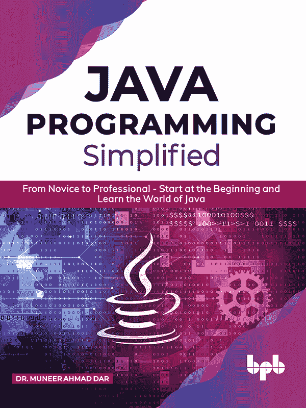


# 献给

*我亲爱的女儿*

*Maheen Muneer 和 Fajr Muneer*

# 关于作者

**Muneer Ahmad Dar 博士** 目前在**国家电子和信息技术学院 (NIELIT), J&K**担任科学家-C，该学院是印度政府电子和信息技术部 (MeitY) 的部门。他是研究员、教师以及 NIELIT 斯林格加 MCA 系主任。他积极参与计算机科学领域。他在克什米尔大学获得计算机应用硕士学位 (MCA)，在马杜赖卡马拉杰大学获得哲学硕士（计算机科学），并在克什米尔大学获得博士学位（计算机科学）。他的兴趣领域包括智能手机应用程序的安全、编程语言、算法的设计与分析、数据结构和优化技术。作为一名创意型作家，他编写了大量研究论文和书籍章节，发表在 IEEE、Scopus 索引期刊和 Springer 讲义笔记中。

# 关于审稿人

**Syed Nisar Bukhari** 在国家电子和信息技术学院 (NIELIT) J&K 斯林格加担任科学家-C，该学院是印度政府电子和信息技术部下属机构。他也是 NIELIT 斯林格加信息技术 (IT) 系主任。他在研究、开发和学术方面拥有 12 年经验。在加入 NIELIT 之前，Syed Nisar Bukhari 担任软件工程师，使用最新技术开发复杂的企业级 Windows、Web 和基于服务的应用程序。他的研究领域是机器学习和深度学习，他的问题领域是免疫信息学（免疫学），这属于生物信息学，其中他将机器学习技术应用于生物数据库以预测结果。他还从事 Web 开发，并致力于 Web 应用程序的安全方面。Syed Nisar Bukhari 已经在各种国内和国际期刊及会议上发表了大量论文。

# 致谢

*全能的真拉* – 最仁慈、慈悲，宇宙中无限事物的主宰。感谢我仁慈的主 *真拉* 在我整个生命中赐予我的无数和恩典的福。。他无尽的祝福鼓励并激励我写下这本书。*感谢你*，*真拉*。此外，我还要感谢许多在本书期间帮助、激励和支持我的人。本书的成功完成很大程度上取决于我父母和妻子的鼓励和劝说。由于写书是一个耗时间的过程，因此我想感谢我的两个小女儿，我利用了她们的时间而没有花太多时间陪伴。我想借此机会向直接或间接参与本书成功完成的人表示诚挚的谢意。

我同样感谢 NIELIT 斯林格加技术和非技术人员的支持，并感谢他们的巨大支持。

我由衷感谢我所有的学生，他们激励我以最简单的方式写这本书，以便他们能够在不利的情况下在家学习。

最后，但同样重要的是，我要感谢我的兄弟，没有他的爱、支持和祝福，这本书是不可能实现的。

# 前言

本书的设计旨在让任何人通过在 Eclipse 平台上实现的大量实践示例来理解 Java 语言。本书全面涵盖了 Java 的所有概念，从 Java 的安装到 Java IDE 的使用。本书详尽涵盖了异常处理、包、接口、Applet、事件处理和 Java 数据库连接等所有主要主题。

写这本关于 Java 书的动力是那些由于不可避免的情况无法定期上课的爱的学生。这本书为那些希望在没有指导的情况下自学的学生提供了一个最好的平台，因为书中涵盖了大部分程序。

本书对主题提供了详细的描述，以便先理解，然后实施了综合程序以对主题有更清晰的认识。这本书非常适合 BCA、BSc-IT 以及计算机科学和信息技术硕士、B.Tech 和计算机科学和信息技术工程专业的第一级编程课程。对于 MCA、MSc-IT 和 NIELIT 课程的学生来说，这也是很好的书。

总之，这本书适用于所有想要从零学习 Java 并并在 Java 中实现一些高级项目的程序员和学生。

# 关于本书

本书系统地尝试涵盖 Java 编程语言的所有概念。本书的主要目标是为初学者提供一个理解 Java 流行的平台，并向用户解释 Java 的重要性。这本书对于没有任何编程语言知识的初学者非常有用；然而，在 C 和 C++ 中做过基础编程的程序员可以轻松接触一些高级概念并继续学习高级 Java。本书的重点是尽可能涵盖大量的程序，并强调实践环节。书籍结构如下：

**第一章**：提供了 Java 语言的详细介绍，包括 Java 的特性。进一步解释了 Java 的逐步安装方法。

**第二章**：在安装 Java 编程语言后，本章的主要目标是理解 Java 编程的基础。本章解释了 Java 程序的结构并引入了控制结构。

## 第 3 章

本章介绍了面向对象编程编程。通过一些优秀的编程示例解释了类和对象等概念。

## 第 4 章

本章解释了包和接口，以深入了解 Java 内置的包。

## 第 5 章

本章解释了数组，以深入了解一维数组和二维数组。字符串处理被认为是实现任何 Java 项目的一项主要任务。本章通过 `String` 和 `StringBuffer` 类的帮助解释了字符串处理的实现。本章还解释了包装类（Wrapper classes）。

## 第 6 章

对于开发者来说，理解异常处理的工作至关重要。本章解释了异常处理的概念。通过创建自定义异常来充分理解 `try`、`catch` 和 `finally` 块的工作机制。

## 第 7 章

Java 的重要能力之一是多线程。本章通过相关的 Java 示例创建了多个线程并解释了线程的工作。本章还解释了线程如何进行同步和相互通信。

## 第 8 章

本章介绍了 Applet，它是可以在互联网上执行的 Java 程序。

## 第 9 章

本章解释了输入流和输出流，以便从文件和其他源检索数据。

## 第 10 章

作为图形用户界面，开发者创建了界面来与用户交互。这种交互仅通过事件处理才可能。本章解释了委托事件模型。

## 第 11 章

使用 `java.sql` 包解释了 Java 数据库连接。解释了 JDBC 架构，以理解用于访问数据库数据的各种类。

# 勘误 (Errata)

我们对 BPB Publications 的工作非常自豪，并遵循最佳实践以确保内容的准确性，为订阅者提供极佳的阅读体验。读者是我们的镜子，我们利用他们的反馈来反映并改进出版过程中可能发生的任何人为错误。为了让我们保持质量并帮助可能因任何不可见错误而遇到困难的读者，请通过以下邮箱与我们联系：

`errata@bpbonline.com`

BPB Publications 全体衷感谢您的支持、建议和反馈。

# 第 1 章

## 引言与安装

## 引言

每家企业都以或或的方式使用 Java。根据 Oracle 的数据，有超过 30 亿设备运行基于该开发平台设计的应用程序。Java 用于设计各种应用程序，从桌面 GUI、嵌入式系统、Web 应用程序（包括电子商务应用、前端和后台电子交易系统、结算和确认系统、数据处理、Web 服务器和应用程序服务器）、移动应用（包括 Android 应用）、企业级应用、科学应用以及中间件产品。

由于应用范围广泛，我们需要足够的具备 Java 应用程序开发技能的人才来使用 Java 来开发这一基础设施。编程语言的增长有两个原因：一个是为了适应环境的变化，另一个是为了实践编程能力的进步。促进 Java 产生的环境变化是对于旨在在互联网上共享的平台无关程序的需求。

另一方面，Java 也体现了人们编写程序方式的转变。例如，Java 改进并完善了 C++ 及其他面向对象编程语言使用的面向对象模型，进一步加入了对多线程的支持，并提供了一个简化互联网访问的库。Java 是应对近期新兴的、极其分散的计算世界需求的理想回答。Java 之于互联网编程就像 C 语言之于系统编程：一种改变世界的创新力量。

## 结构

* 引言
* Java 历史
* Java 特性
* 下载并安装 JDK
* JDK 版本
* 配置 Java 开发环境
* Eclipse IDE
* 练习题

## 目标

本章提供了 Java 编程语言的详细背景。阅读完本章后，读者将能够安装 Java 并处理 Eclipse IDE 来设计和开发各种 Java 项目。

### Java 历史

Java 最初于 1991 年由 `James Gosling`、`Patrick Naughton`、`Chris Warth`、`Ed Frank` 和 `Mike Sheridan` 命名为 `Oak`，在 1995 年于 `Sun MicroSystems` 工作期间更名为 Java。许多人对 Java 语言的蓝图和发展做出了贡献，但主要的贡献者 Tim `Lindholm`、`Frank Yellin`、`Jonathan Payne`、`Bill Joy` 和 `Arthur van Hoff`。Java 的新初衷并非基于互联网的应用程序，主要的灵感是对平台无关（或者说架构无关）语言的需求，这种语言可能用于生成嵌入到各种客户电子设备中的软件，例如微波炉和遥控器。正如我们推测的，许多不同类型的 CPU 被用控制器。为了寻找这种解决方案，Gosling 等人开始研究一种通用的、平台无关的语言，它可以用于构建在不同平台的多种 CPU 上运行的代码。这一努力最终导致了 Java 编程语言的基础。

### Java 特性

Java 的流行是因为其广泛的特性，这些特性促进了 Java 作为一种语言的成功。Java 的一些特性如下：

* **简单且熟悉**：根据 Sun Microsystems 开发一种简单且熟悉的的语言的愿景，Java 语言的语法源自 C，面向对象概念源自 C++。Java 像 C 一样是一种区分大小写的语言，它移除了指针概念（`this` 指针除外）、运算符重载、模板类、全局变量和头文件。对 C 和 C++ 有良好知识的程序员可以利用 C 的语法和控制结构以及 C++ 的面向对象概念。Java 的这一特性使其成为一种简单且熟悉的语言。

* **编译和解释**：如果我们考虑任何其他语言，它们要么被编译要么被解释，例如在 C 中我们编译并运行它来生成输出。在 Java 中，我们首先使用 `javac`（编译器）将其生成具有 `.class` 扩展名的字节码文件。编译后我们需要使用 `java`（解释器）生成输出。这种生成字节码文件的两步过程使得这种语言既安全又平台无关。

* **平台无关**：Java 编程语言成功的主要原因是它在任何平台上运行的能力。Java 程序可以轻松从一个计算机系统移动到另一个计算机系统，随时随地。操作系统、处理器和系统资源的更改和升级都不会强迫 Java 程序发生任何更改。这就是 Java 在互联网编程中如此受欢迎的原因。这样的一个例子就是 Java Applet 的使用，它们可以通过互联网从远程计算机下载到我们的本地机器并在本地执行。

如前所述，Java 程序是经过编译的，会生成一个字节码文件，该文件可以在任何机器上执行。使用 Java 的第二个优势是其原始数据类型的大小，这些类型是机器无关的。

* **面向对象**：使用 Java 作为编程语言时，最重要的特性是它能够以对象和类的形式来封装并实现一切内容。Java 是一门真正的面向对象的语言，它拥有海量的包（类组）来实现广泛的功能。因此，我们可以说，无论面向对象编程具有什么优势和特性，它们都自动适用于 Java。

* **安全且健壮**：作为互联网编程的首选语言被实现，Java 保护自己免受许多安全风险的影响。不使用指针、对所有内存访问进行验证以及对小程序（applets）进行适当审查都是 Java 为确保安全而采取的措施。

    Java 对数据类型有严格的编译时运行时检查，以确保代码的可靠性。捕捉运行时错误并消除系统崩溃风险的异常处理，以及基于垃圾回收的内存管理，是该语言保持健壮的原因。

* **多线程**：Java 语言能够将其程序划分为多个任务并同时执行。例如，一个任务可能正在复制文件，而另外两个任务正在显示动画和播放音乐。用户会有所有三个任务都在同时执行的印象。操作系统级的功能如线程间通信和同步通过 Java 的多线程能力得到了高效实现。

* **性能**：Java 的高性能主要归功于中间字节码文件及其旨在减少运行时开销的高效架构。此外，多线程通过增强 Java 程序的整体执行速度为 Java 的性能做出了贡献。

* **对开发者友好**：增强型 `forloop` 循环、泛型、自动装箱/拆箱、类型安全的枚举（enums）、静态导入和注解等特性使 Java 成为一门对程序员友好的语言。

* 还有许多其他特性，如可扩展性和性能、JDBC、核心 XML 支持等，基于这些特性，Java 被认为是一种强大且流行的语言。

### 下载并安装 JDK

`Java Development Kit (JDK)`，正式名称为 `Java Platform Standard Edition` 或 `Java SE`，是编写从小型到大型 Java 项目的主要要。。JDK 可以从 Sun Microsystems（现为 Oracle 的一部分）免费获取。可以从以下网站免费下载 JDK (`Java SE`)：[`www.oracle.com/technetwork/java/javase/overview/index.html`](http://www.oracle.com/technetwork/java/javase/overview/index.html)。

JDK 包含 `Java Runtime (JRE)` 和各种开发执行程序（如编译器和调试器），是编写 Java 项目和进一步执行 Java 程序的强制要求。运行 Java 程序需要 JRE。换句话说，JRE 是 JDK 的子集。由于我们将编写并执行 Java 项目，因此应该安装包含 Java 运行环境的 JDK。

### JDK 版本

从 Java 语言诞生之初，就发布了不同版本的 Java 以增强其能力并为程序员提供新包，以便在 Java 中实现一些主要项目。以下是已经发布的 Java 版本。参考：[`en.wikipedia.org/wiki/Java_version_history`](https://en.wikipedia.org/wiki/Java_version_history)。

* **JDK Alpha and Beta (1995)**：Sun Microsystem 在 1995 年 9 月 23 日宣布了 Java。

* **JDK 1.0 (1996 年 1 月)**：最初称为 Oak（以 James Gosling 办公室外的橡树树命名）。在 JDK 1.0.2 中重命名为 Java 1。

* **JDK 1.1 (1997 年 2 月)**：引入了 AWT 事件模型、内部类、JavaBean、JDBC 和 RMI。

* **J2SE 1.2 (JDK 1.2) (1998 年 12 月)**：重新品牌为 `Java 2`并将 JDK 重命名为 J2SE（Java 2 标准版）。还发布了 `J2EE (Java 2 企业版)` 和 `J2ME (Java 2 微版)`。包含了 `JFC (Java Foundation Classes - Swing、Accessibility API、Java 2D、可插件式外观和拖放)`。还引入了集合框架（Collection Framework）和 JIT 编译器。

* **J2SE 1.3 (JDK 1.3) (2000 年 5 月)**：引入了 Hotspot JVM。

* **J2SE 1.4 (JDK 1.4) (2002 年 2 月)**：引入了断言语句、非阻塞 IO (nio)、日志 API、图像 IO、Java webstart、正则表达式（regex）支持。

* **J2SE 5.0 (JDK 5) (2004 年 9 月)**：正式命名为 5.0 而不是 1.5。引入了泛型、自动装箱/拆箱、注解、枚举、可变参数、for-each 循环、静态导入。

* **Java SE 6 (JDK 6) (2006 年 12 月)**：将 J2SE 重命名为 Java SE。

* **Java SE 7 (JDK 7) (2011 年 7 月)**：Oracle 收购 Sun Microsystems 后的第一个版本 - 也称为 Oracle JDK。

* **Java SE 8 (JDK 8) (LTS) (2014 年 3 月)**：包含了对 Lambda、接口中默认方法的支持、改进的集合以及 Java 运行时。

* **Java SE 9 (JDK 9) (2017 年 9 月)**：引入了 Lambda 模块化、项目 Jigsaw 以及 jshell。

* **Java SE 10 (JDK 10) (2018 年 3 月)**：引入了用于类型推断的 var。

* **Java SE 11 (JDK 11) (LTS) (2018 年 9 月)**：扩展了 java.net 中的 HTTP 。

* **Java SE 12 (JDK 12) (2019 年 3 月)**：删除了 javah

### 安装 JDK

要在 Windows 上安装 JDK，遵循以下步骤：

1. **移除/卸载旧版本的 JDK**

   强烈建议我们只安装最新版本的 JDK。尽管我们可以同时安装多个版本的 JDK，但在运行 Java 程序时可能会产生不必要的混乱。

   可以通过 `控制面板 | 程序和功能` 卸载所有以 Java 开头的程序，例如 `Java SE Development Kit...`、`Java SE...`、`Java X Update...` 等。

2. **第 2 步：下载最新版本的 JDK**

   * 前往 Java SE 下载站点：

     [`www.oracle.com/technetwork/java/javase/overview/index.html`](http://www.oracle.com/technetwork/java/javase/overview/index.html)

   * 在 `Java Platform, Standard Edition|Java SE 11.0` 下点击 `Oracle JDK |下载` 按钮。

   * 在 `Java SE Development Kit 11.0` 下勾选 `接受许可协议`。


根据您的操作系统选择 JDK，即 `Windows 64 位或 32 位`。下载 `exe` 安装程序（例如 `jdk-11.0.{x}_windows-64_bin.exe`，约 150MB）。

### 第 3 步：安装 JDK

运行下载的安装程序（例如 `jdk-11.0.{x}_windows-64_bin.exe`），这将安装 JDK 和 JRE。

默认情况下，JDK 安装在目录 `C:\Program Files\Java\jdk-11.0.{x}`，同意默认设置并按照屏幕说明安装最新版本的 JDK。

使用`文件管理器`导航到 `C:\Program Files\Java` 以检查子目录。记录下您的 JDK 安装目录，特别是更新更新号 {x}，您在下一步中将需要它。

在下面的图中，JDK 的安装目录为 `C:\Program Files\Java\jdk1.8.0_131:`。

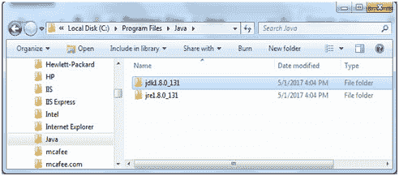

**图 1.1:** Java 安装目录

## 配置 Java 开发环境

Windows 的 `Command Prompt (CMD)` 通过查找路径环境变量或系统变量来执行各种 Java 程序。负责执行 Java 程序的的可执行程序（例如 Java 编译器 `javac.exe` 和 Java 运行环境 `java.exe`）位于 JDK 安装目录的子目录 `bin` 中。此 JDK 的 `bin` 文件夹必须在 `PATH` 中，才能运行 Java 程序。

在 Windows 10 中编辑 `PATH` 环境变量：

1.  启动`控制面板|系统和安全|系统`。在左侧窗格中点击`高级系统设置`。
2.  切换到`高级` 选项卡并点击`环境变量` 按钮。
3.  在`系统变量`（下方窗格）下，向下滚动选择变量 `Path` 并点击`编辑…`。
4.  对于较新版本的 Windows 10：你将看到一个列出所有现有 `PATH` 条目的`表格`（如果没有，请到下一步）。点击`新建`并点击`浏览`，导航到你 JDK 的 `bin` 目录，即 `c:\Program Files\Java\jdk-11.0.{x}\bin`，其中 {x} 是你的安装更新数字。点击`上移`将此条目移动至最顶部。跳过下一步：


**图 1.2:** 设置路径

## 验证 JDK 安装

通过以下方式之一启动 CMD：

1.  点击`搜索`按钮。输入 `cmd` 并选择`命令提示符`。
2.  右键点击`开始`按钮并输入 `cmd` 回车，或
3.  点击`开始`按钮。搜索`Windows 系统|命令提示符`。

执行以下命令来验证你的 JDK 安装：

1.  执行路径命令列出 `PATH` 环境变量的内容。确保你的 JDK 的 `bin` 已列在 `PATH` 中：

    ```
    path
    PATH=c:\Program Files\Java\jdk-11.0.{x}\bin;[other entries…]
    ```

2.  执行以下命令以验证 JDK/JRE 已正确安装并显示它们的版本：

    ```
    // 显示 JDK 版本
    javac -version
    javac 11.0.1

    // 显示 JRE 版本
    java -version
    java version “11.0.1” 2018-10-16 LTS
    Java(TM) SE Runtime Environment 18.9 (build 11.0.1+13-LTS)
    Java HotSpot(TM) 64-Bit Server VM 18.9 (build 11.0.1+13-LTS, mixed mode)
    ```

## Eclipse IDE

为了编写我们的 Java 程序，我们需要一个文本编辑器。在 Windows 机器上，你可以使用任何简单的文本编辑器（如记事本或 TextPad）来编写 Java 程序。程序的编译和执行可以通过命令提示符进行，将在下一节讨论。市场上还有更复杂的 IDE，例如 NetBeans 编辑器。有一个开源免费的 Java IDE 可以从 `[http://www.netbeans.org/index.html]` 下载。然而，目前我们可以考虑使用 Eclipse IDE。书中的所有程序都是在 Eclipse IDE 上编写和执行的。对于编写 Java ，首选 IDE 是 Eclipse，这是一个具有可扩展插件系统的多语言软件开发环境。它可以使用 Java、Ada、C、C++、COBOL、Python 等语言开发各种类型的应用程序。对于 Java 开发，我们可以下载适用于 Java EE 开发人员的 Eclipse IDE `(www.eclipse.org/downloads/packages/eclipse-ide-java-eedevelopers/heliossr1))`。有多个版本可用：Windows (32 和 64 位)，Mac OS X (Cocoa 32 和 64) 以及 Linux (32 和 64 位)。只需为你的操作系统选择相应的相关版本即可。书中的所有示例都是使用 Windows 版 Eclipse 进行测试的。

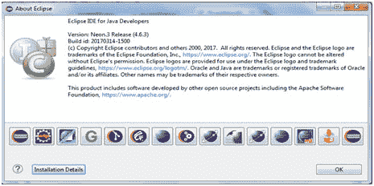

**图 1.3:** 关于 Eclipse

Eclipse 采用了工作空间（workspace）的概念。工作空间是你选择用来累积所有项目的文件夹。当我们首次启动 Eclipse 时，必须选择一个工作空间，如 [图 1.4] 所示。

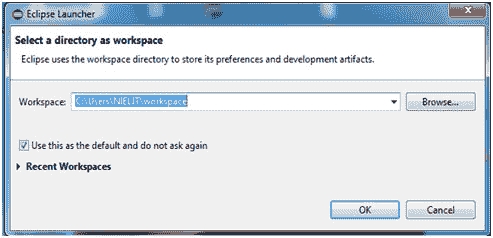

**图 1.4:** 带有工作空间详情的 Eclipse 启动器

当 Eclipse 完成位于你工作空间项目启动后，它会在 IDE 中显示多个窗，如 [图 1.5] 所示。

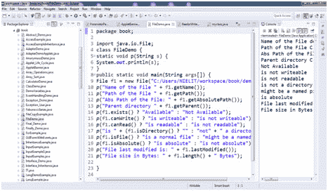

**图 1.5:** 具有不同窗的 Eclipse IDE

### Package Explorer

[图 1.6] 所示的 `Package Explorer` 列出了当前位于你工作空间中的所有项目。

## 调试 Java 程序

如果我们想妥善地检查 Java 程序，可以设置断点——这种方法可以暂时暂停应用程序的运行，并在之后在 Java 代码窗口中验证变量和对象的值。可以通过双击 Eclipse IDE 代码编辑器最左侧的列来设置断点。`图 1.13`显示了在特定语句上设置的断点。

当应用程序运行并遇到初始断点时，Eclipse 将显示“确认视图切换”（Confirm Perspective Switch）对话框。本质上，它请求切换到“调试视图”（Debug perspective）。为了防止此窗口再次出现，请勾选底部的“记住我的决定”（Remember my decision）复选框并点击“是”。

Eclipse 现在会高亮断点。此时，你可以右键点击任何选定的对象或变量，使用监视（Watch）、检查（Inspect）和显示（Display）等各种选项查看其内容，如`图 1.13`所示：

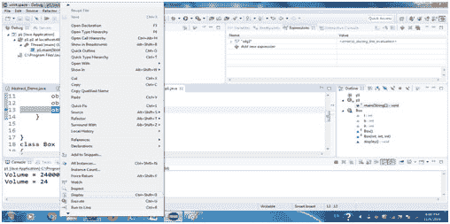

**图 1.13:** 设置断点并查看内容

此时有若干选项可以继续执行：

*   `进入（Step into）`: 按 `F5` 进入下一个方法调用/语句。
*   `跳过（Step over）`: 按 `F6` 跳过下一个方法调用而不进入内部。
*   `返回（Step return）`: 按 `F7` 从已进入的方法返回。
*   `继续执行（Resume execution）`: 按 `F8` 继续执行。

## 作业

1. Java 相比 C 和 C++ 安全在哪里？
2. Java 中的字节码文件是什么？它有什么区别？
3. 如何设置 `PATH` 以执行 Java 程序？
4. Java 移除 C 和 C++ 的某些功能。列出这些功能并解释它们如何正面影响 Java 语言？
5. 如何调试 Java 程序？
6. 什么是断点？创建一个断点来检查变量的值？

# 第二章 基础

## Java 编程基础

### 简介

与大多数编程语言一样，Java 中的组件并不是孤立工作的，而是相互依赖的，以形成一个有意义的语言。对 Java 语言的理解取决于几个概念，主要是面向对象的概念。Java 的语法源自 C，面向对象的特性源自 C++。

因此，对于一个具有 C 和 C++ 知识的程序员来说，更有机会理解 Java 并使用该平台开发一些优秀的应用程序。本章从 Java 程序的结构开始，向程序员解释 Java 程序的不同部分。某些部分是可选的，可以根据程序员的需要而使用。在本章中，将编译基础程序并解释 JDK 的工作原理。本单元中解释了数据类型和关键字等基本结构。控制结构是任何编程语言的基本构建块；这些结构将进行详细解释，以帮助初学者编写一些基础程序。

### 结构

*   简介
*   Java 程序的结构
*   一个简单的 Java 程序
*   执行程序
*   Java 中的数据类型、变量和关键字
*   Java 中的控制结构
*   命令行参数
*   在 Java 中创建基础程序
*   作业

### 目标

本章解释了 Java 程序的基本结构。阅读本章后，读者应该能够编写一些基础程序并处理命令行参数。

## Java 程序的结构

Java 程序有不同的部分来处理不同的功能。某些部分是强制性的，例如包含 main 方法的类（class），而大多数部分是可选的，例如导入包，因为这取决于程序员是否需要使用任何包。Java 程序的不同部分将在其他章节中详细解释，本章仅给出 Java 程序的整体结构。

Java 程序的不同部分如下：

*   **文档部分（Documentation section）：** 此部分是可选的，可能包含在注释中对程序的详细描述。与 C 语言一样，注释可以是单行的 `//` 或是块状的 `/* */`。例如，以下几行描述了任何 Java 程序的详细信息：

    `/* 该 Java 程序从命令行获取一个数字，并检查该数字是否为质数 */`

*   **包部分（Package section）：** 此部分是可选的，该部分的唯一目的是将你的类包含在任何包中。由程序员决定包含包名还是留空。编写包名的语法为：

    `package nielit;`

    因此，我们将创建的程序类将在 `nielit` 包内。

*   **导入部分（Import section）：** 此部分是可选的，可用于导入任何现有的包（内置或用户定义）。导入任何包的语法为：

    `import java.io.*; // 导入输入输出包中的所有类`
    `import java.awt.Button; // 仅导入 awt 包中的 Button 类`
    `import nielit.*; // 导入程序员创建的 nielit 包中的所有类`

*   **接口部分（Interface section）：** 此部分是可选的，包含用于实现多继承的接口。接口包括抽象类和最终数据（将在第 4 章：包与接口中解释）。接口的示例为：

    ```
    interface MyInterface
    {
        void display();
        void show();
        final int data=100;
    }
    ```

*   **类定义部分（Class definitions section）：** 由于 Java 程序可能包含多个类，此部分包含了这些类的定义。此部分也是可选的，因为我们可能只有一个带有 main 方法的类。例如：

    ```
    // 此类是可选的
    class MyClassA
    {
        // 数据 + 方法
    }

    // 此类是强制性的，因为它包含了 main 方法
    class MyClassB
    {
        // 数据 + 方法
        // main 方法
        public static void main( String arg[])
        {
        }
    }
    ```

*   **带有 main 方法的类（Class with main method）：** 由于 Java 程序的执行从 main 方法开始，此类是强制性的，因为它包含了开始执行的 main 方法。

    ```
    class MainClassB
    {
        // 数据 + 方法
        // main 方法
        public static void main( String arg[])
        {
        }
    }
    ```

以下是带有不同部分的示例程序：

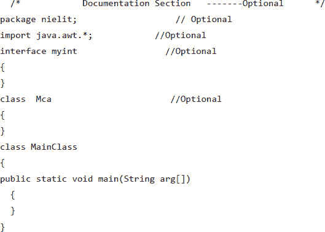

唯一的强制部分是包含 main 方法的类。这些部分的详细描述将在其他章节给出。

## 第一个简单的 Java 程序

我们应该开始编写程序以理解 Java 语言的不同组件：

```java
/* 这是我们的第一个 Java 程序，解释了 Java 的各种元素 */
class MyExample {
    // 这是包含 main 方法的主类
    public static void main (String arg[])
    {
        System.out.println (" 这是我的第一个 Java 程序");
    }// main 方法的结束大括号
}// 类的结束大括号
```

这个简单程序的各种组件解释如下：

*   `class MyExample:`: 由于 Java 是一种真正的面向对象的语言，因此必须至少有一个类，该类将包含一个 main 方法。我们示例中的 `MyExample` 类是一个用户定义的类，必须遵循 C 语言中标识符命名的所有约定。由于 Java 像 C 一样是大小写敏感的语言，在这里提到类名以大写字母开头，且类名中的所有单词也以大写字母开头。Java 中内置类的示例包括：`String`、`Exception`、`ArrayIndexOutOfException` 等等。这就是为什么上述程序中唯一的大写单词是 `MyExample`、`String` 和 `System` 的原因，因为它们都是类。

*   `public:`: Java 中使用 `public`、`private` 和 `protected` 等不同的访问修饰符用于数据成员和方法。`main` 方法必须被 Java 的运行时环境访问，因此它必须声明为 `public`。因为 Java 的默认可见性是包级（friendly），而不是像 C++ 那样的私有（private）。默认访问修饰符限制了对 `main` 方法的访问，因此必须声明为 `public` 以便所有人访问。后续章节将详细解释这些访问修饰符。

*   `static:`: 在面向对象编程（OOP）中，我们创建类的对象来访问其方法，但如果我们想在不创建对象的情况下访问方法怎么办？对于那些可以独立于对象而使用类名的情况，我们使用 `static` 成员。最重要的例子是声明为 `static` 的 `main()` 方法，其由于它必须在任何对象创建之前被调用。`static` 可以用于方法或数据成员。当一个成员被声明为 `static` 时，可以在该类的任何对象创建之前被访问，且无需引用任何对象。这些静态数据成员被所有对象共享，并直接通过类名访问。下例在在不创建对象的情况下调用了 `Integer` 类的 `parseInt` 方法：

    ```java
    int i = Integer.parseInt("20");
    ```

*   `void main:`: 像任何其他编程语言一样，`void` 是返回类型，而 `main` 是用于指定 `main` 方法的关键字。

*   `System.out.println(""):`: 该语句打印双引号中的消息。使用 `System` 类是因为 Java 中的所有内容都是通过类和对象执行的。`println` 方法显示消息并将光标移到下一行。

### 执行程序

为了理解执行 Java 程序的基本思想，我们将尝试通过命令提示符（Command Prompt）使用记事本查找执行程序的步骤。执行程序需要两个重要的文件：`javac`（编译器）和 `java`（解释器）。在记事本中运行程序的步骤如下：

1.  打开记事本。
2.  在记事本编写以下程序：

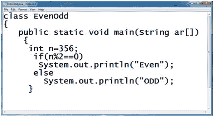


**图 2.1:** 带有基础 Java 程序的记事本

3. 如果没有设置路径，请将程序保存到 Java 安装的路径，在我们的案例中路径为：


**图 2.2**

4. 现在使用命令编译程序。如果没有错误，将生成带有 `.class` 扩展的字节码文件：

```bash
javac EvenOdd.java
```

5. 成功编译程序后，使用以下命令生成输出：

```bash
java EvenOdd
```

### 关键点

关于 Java 程序，记住以下几点非常重要：

* **大小写敏感：** Java 是大小写敏感的，这意味着标识符 `Java` 和 `java` 在 Java 中具有不同的含义。

* **类名：** 对于所有类名，首字母应该大写。如果使用多个单词来组成类名，则每个内部单词的首字母都应该大写。例如，类 `MyFirstJavaClass`。

* **方法名：** 所有方法名都应该以小写字母开头。如果使用多个单词来组成方法名，那么每个内部单词的首字母应该大写。例如，`public void myMethodName()`。

* **文件名：** 程序的文件名必须与类名完全匹配。在保存文件时，您应该使用类名保存并在名称末尾附加 `.java`。例如，假设 `MyFirstJavaProgram` 是类名，那么文件应该保存为 `MyFirstJavaProgram.java`。

* `public static void main(String args[])`: Java 程序的处理从 `main()` 方法开始，这是每个 Java 程序中不可少的一部分。

### Java 中的数据类型

与其他编程语言一样，Java 拥有原始数据类型和非原始数据类型。原始类型可以使用基本的计算机指令进行修改。Java 中可用的 8 种原始数据类型是 `byte`、`short`、`int`、`long`、`char`、`float`、`double` 和 `boolean`。它们可以分为四大类：

* **整数：** 这组包括 `byte`、`short`、`int` 和 `long`，用于带符号整数。例如：

```java
int x,y,z;
byte s1,s2;
```

* **浮点数：** 这组包括 `float` 和 `double`，表示具有小数精度的数字。例如：

```java
float f1;
double var1;
```

* **字符：** 这组包括 `char`，表示字符集中的符号。例如：

```java
char ch='A';
```

* **布尔值：** 这组包括 `boolean`，是一种表示真/假的唯一类型。例如：

```java
boolean b;
```

原始类型用于创建数组。以下语句创建了 int 数组：

```java
int a[] = new int[10];
```

原始类型具有确定的范围。Java 与 C++ 不同之处在于 Java 的移植性；所有数据类型的大小 `int` 是 32 位。

除了原始数据类型，Java 还有包装类为处理不同情况提供额外的灵活性。包装类是对应数据类型的类，例如用于 `int` 的 `Integer`，用于 `float` 的 `Float` 等。这些类具有许多帮助方法。这些原始类型的位范围如下：

| 名称 | 宽度（位） | 范围 |
| :--- | :--- | :--- |
| `long` | 64 | –9,223,372,036,854,775,808 到 9,223,372,036,854,775,807 |
| `int` | 32 | –2,147,483,648 到 2,147,483,647 |
| `short` | 16 | –32,768 到 32,767 |
| `byte` | 8 | –128 到 127 |

**表 2.1:** 原始类型的范围

| 名称 | 位宽 | 近似范围 |
| :--- | :--- | :--- |
| `Double` | 64 | 4.9e–324 到 1.8e+308 |
| `Float` | 32 | 1.4e–045 到 3.4e+038 |

**表 2.2:** 原始类型的范围

### Java 中的变量

与其他编程语言一样，Java 使用变量，变量是 Java 程序存储的基础元素。变量通过标识符、类型和初始化（可选）的组合创建。基本变量使用以下语法创建：

```java
type identifier1 [ = value, identifier2 [= value] …] ;
```

```java
int var1=10,var2=100;
```

```java
// 创建 var1 和 var2 变量并分别初始化为 10 和 100
```

我们可以创建多个用逗号分隔的变量。这些变量可以像上面一样进行初始化，`var1` 初始化为 `10`，`var2` 初始化为 `100`。这里是变量声明的更多示例：

```java
float f1; // 声明一个 float 类型变量
```

```java
int var1=30, var2, var3=100; // 声明三个变量并仅初始化了 var1 和 var3
```

```java
char ch= 'Y'; // 声明 ch 为 char 类型并初始化为 Y
```

```java
byte b; // 声明一个 byte 类型变量
```

```java
double d1=3.14; // 声明一个 double 类型变量并对其初始化
```

虽然前面的示例仅使用了常量作为初始化器，但 Java 允许动态初始化变量，即使用在变量声明时有效的任何表达式。例如，这里有一个动态计算 `z` 值的短程序：

```java
class DynInitDemo {
    public static void main(String args[]) {
        double x = 6.0, y = 8.0;
        double z = Math.sqrt(x * x + y * y);
        System.out.println("Hypotenuse= " + z);
    }
}
```

### Java 中的关键字

关键字是保留字，不能像 C 和 C++ 等其他语言那样用作变量名、类名、接口名、包名或方法名。这些关键字结合运算符和分隔符的语法，构成了 Java 语言的基础。以下是 Java 中用的关键字：

| `abstract` | `continue` | `for` | `new` | `switch` |
| `assert` | `default` | `goto` | `package` | `synchronized` |
| `boolean` | `do` | `if` | `private` | `this` |
| `break` | `double` | `implements` | `protected` | `throw` |
| `byte` | `else` | `import` | `public` | `throws` |
| `case` | `enum` | `instanceof` | `return` | `transient` |
| `catch` | `extends` | `int` | `short` | `try` |
| `char` | `final` | `interface` | `static` | `void` |
| `class` | `finally` | `long` | `strictfp` | `volatile` |
| `const` | `float` | `native` | `super` | `while` |

**表 2.3：** Java 中的关键字

以下程序使用了上述节定义的数据类型、变量和关键字：

```java
package book;
public class DemoVariables {
    public static void main(String[] args) {
        int var_a[] = { 5,7,10}; // 一个包含三个元素的 int 类型数据数组
        double d = 12.8; // double 类型变量 d
        double c;
        System.out.println("The addition of int array and double variable");
        for (int i=0;i<var_a.length;i++) {
            c= var_a[i]+ d;
            System.out.println(var_a[i] +" + " + d + " = " + c);
        }
    }
}
```

上述代码的输出如下：

**The addition of int array and double variable**

`5 + 12.8 = 17.8`

`7 + 12.8 = 19.8`

`10 + 12.8 = 22.8`

### Java 中的控制结构

Java 从未尝试重新发明用于决策或循环的现有方法。由于 Java 的语法几乎与 C 语言相同，它拥有了所有语法与 C 和 C++ 相似的控制结构。在本节中，我们将结合相关的 Java 程序详细讨论决策结构和循环结构。

#### if 语句

`if` 语句为了控制 Java 程序中各种语句的执行流，`if` 语句被认为强大的语句。`if` 语句的不同形式如下：

```java
// 带有一个语句的 if
if (condition )
    Statement ;

// 带有多个语句的 if
if (condition ) {
    Statement 1 ;
    Statement 2 ;
    Statement N ;
}

// 带有一个语句和 else 的 if
if (condition )
    Statement 1 ;
else
    Statement 2 ;

// 带有多个语句和 else 的 if
if (condition ) {
    Statement 1 ;
    Statement 2 ;
    Statement N ;
}
else {
    Statement 1 ;
    Statement 2 ;
    Statement N ;
}
```

上述语句可以通过下面的 Java 程序来理解：

```java
public class ExampleIf {
    public static void main(String args[]) {
        int x, y;
        x = 100;
        y = 200;
        if(x < y) System.out.println("Y is greater than X");
        x = x * 2;
        if(x == y) System.out.println("X equal to Y");
        x = x * 2;
        if(x > y) System.out.println("X greater than Y");
        // 这不会显示任何内容
    }
}
```

上述代码的输出如下：

**Y is greater than X**

**X equal to Y**

**X greater than Y**

下一个示例也使用了 `if` 语句：

```java
public class IfElse {
    public static void main(String ar[]) {
        int n=30;
        if(n>40)
            System.out.println("You are Old");
        else
            System.out.println("You are Young");
    }
}
```

输出将是 `You are Young.`

我们可以如下实现嵌套的 `if…else` 语句：

```java
if (Marks >75) {
    if (marks > 50)
        Statement 1;
    else
        Statement 2;
} else
```

上述 `if` 语句也可以写为：

```java
if (Marks >75) {
    if (marks > 50) {
        Statement 1;
    } else {
        Statement 2;
    }
}
```

#### switch 语句

`if` 语句使得从多种情况中选择变得复杂，而 `switch` 语句允许根据值从多种选项中选择。`switch` 语句的通用结构如下：

```java
switch (Expression) {
    case value1:
        Statement 1;
        break;
    case value2:
        Statement 2;
        break;
    case valueN:
        Statement N;
        break;
    default:
        Statement 1;
}
```

下面的程序演示了 `switch` 语句的使用。用户被给予选择，根据其选择执行相应的 case：

```java
import java.util.Scanner;
public class SwitchExample {
    public static void main(String[] args) {
        int a=30;
        int b=20;
        int c;
        int choice;
        while(true) {
            System.out.println(" Press 1 for Addition");
            System.out.println(" Press 2 for Subtraction");
            System.out.println(" Press 3 for Multiplication");
            System.out.println(" Press 4 for Division");
            System.out.println(" Press 5 for Exit");
            Scanner s = new Scanner(System.in);
            choice = Integer.parseInt(s.nextLine());
            switch(choice) {
                case 1:
                    c=a+b;
                    System.out.println(" Addition =" + c);
                    break;
                case 2:
                    c=a-b;
                    System.out.println(" Subtraction =" + c);
                    break;
                case 3:
                    c=a*b;
                    System.out.println(" Multiplication =" + c);
                    break;
                case 4:
                    c=a/b;
                    System.out.println(" Division =" + c);
                    break;
                case 5:
                    System.exit(0);
            }
        }
    }
}
```

以下将是输出：

**Press 1 for Addition**

**Press 2 for Subtraction**

**Press 3 for Multiplication**

**Press 4 for Division**

**Press 5 for Exit**

**4**

**Division =1**

**Press 1 for Addition**

**Press 2 for Subtraction**

**Press 3 for Multiplication**

**Press 4 for Division**

**Press 5 for Exit**

**2**

**Subtraction =10**

**Press 1 for Addition**

**Press 2 for Subtraction**

**Press 3 for Multiplication**

**Press 4 for Division**

**Press 5 for Exit**

**1**

**Addition =50**

**Press 1 for Addition**

**Press 2 for Subtraction**

**Press 3 for Multiplication**

**Press 4 for Division**

**Press 5 for Exit**

**3**

**Multiplication =600**

**Press 1 for Addition**


**Press 2 for Subtraction**

**Press 3 for Multiplication**

**Press 4 for Division**

**Press 5 for Exit**

**5**

#### ?: 运算符

通称为条件运算符的是另一种根据表达式的值选择一个语句的方法。`?:` 运算符的通用形式为：

`Expression Condition ? Expression 1 : Expression 2`

`Example`

`Value = (a>b ) ? 10 : 20;`

在上面的示例中，如果表达式 `a>b` 结果为真，则 `Value` 将获得值 `10`，否则它将存储 20。上面的表达式可以使用 `if…else` 语句写为：

```java
if (a>b)
Value =10;
else
Value =20;
```

下面的程序阐述了 `?:` 运算符的使用：

```java
public class Operator
{
    public static void main(String arg[])
    {
        int salary;
        int da=70;
        int basic = 8000;
        salary = (da>50)? (basic + 100) : (basic +50);
        System.out.println("The Net Salary is" + salary);
    }
}
```

我们将得到以下输出：

```
The Net Salary is 8100
```

#### for 循环

正如你从之前的编程经验中所了解的，循环结构是几乎任何编程语言的重要部分。Java 也不例外。事实上，最通用的是 `for` 循环。`for` 循环的最简单形式所示所示：

```java
for(initialization; condition; iteration) statement;
```

或者

```java
for(initialization; condition; iteration)
{
    Block of statements;
}
```

在最常见的形式中，循环的初始化部分将循环控制变量设置为初始值。条件是一个测试循环控制变量的 `Boolean` 表达式。如果该测试的结果为真，`for` 循环将继续迭代。如果为假，循环将终止。迭代表达式决定了每次循环迭代时循环控制变量是如何变化的。这里有一个说明 `for` 循环的简短程序：

```java
public class ForExample {
    public static void main(String args[]) {
        int i;
        for(i = 0; i<10; i++)
            System.out.println("This is i: " + i);
    }
}
```

上面的程序将生成以下输出：

```
This is i: 0
This is i: 1
This is i: 2
This is i: 3
This is i: 4
This is i: 5
This is i: 6
This is i: 7
This is i: 8
This is i: 9
```

在这个示例中，`i` 是循环控制变量。它在 `for` 的初始化部分被初始化为零。在每次迭代开始时，执行条件测试 `x < 10`。如果此测试的结果为真，则执行 `println( )` 语句，然后执行循环的迭代部分。这个过程一直持续到条件测试为假。

#### while 循环

与 `for` 循环一样，`while` 循环是用于循环的 Java 结构。主要区别在于，初始化和增/减语句不像 `for` 循环那样在大括号内：

```java
//Initialization
while (condition)
{
    block of statements including
    increment / decrement
}
```

下面的 Java 程序利用 `while` 循环生成与上面程序相同的输出：

```java
public class WhileExample {
    public static void main(String args[]) {
        int i;
        i=0; // Initialization
        while (i<10) {
            System.out.println("This is i: " + i);
            i++; // Increment
        }
    }
}
```

上面程序的输出是：

```
This is i: 0
This is i: 1
This is i: 2
This is i: 3
This is i: 4
This is i: 5
This is i: 6
This is i: 7
This is i: 8
This is i: 9
```

#### do…while 循环

`while` 和 `do…while` 循环之间的唯一区别是，`do…while` 中的条件是在语句或语句块第一次执行末尾时检查的。这意味着即使条件为假，`do…while` 循环也会至少执行一次语句。语法如下：

```java
//Initialization
do {
    block of statements including
    increment / decrement
} while (condition);
```

可以使用如下的 `do…while` 循环执行相同的程序：

```java
public class ForExample {
    public static void main(String args[]) {
        int i;
        i=0; // Initialization
        do {
            System.out.println("This is i: " + i);
            i++; // Increment
        } while (i<10);
    }
}
```

上面的程序将生成以下输出：

```
This is i: 0
This is i: 1
This is i: 2
This is i: 3
This is i: 4
This is i: 5
This is i: 6
This is i: 7
This is i: 8
This is i: 9
```

后续关于控制结构的示例将进一步阐明这些在 Java 中的用法。接下来的 Java 程序使用两个 `for` 循环生成 `1` 到 `100` 之间的质数。外层循环控制需要验证的数字，内层循环控制用于除以实际数字的数字：

```java
public class PrimeExample {
    public static void main(String args[]) {
```

（注：此处原文代码不完整，已按要求保留格式）

上述程序将生成以下输出：

`Sum = 110`

在这个命令行参数的示例中，我们从命令行获取字符串并对其进行排序。步骤序列如下：

```java
class StringSort
{
    public static void main (String arg[])
    {
        int i,j;
        for(i=0;i<arg.length;i++)
        {
            for(j=i+1;j<arg.length;j++)
            {
                if ( arg[i].compareTo(arg[j])>0)
                {
                    String temp = arg[i];
                    arg[i]= arg[j];
                    arg[j] = temp;
                }
            }
        }
        System.out.println( " The Sorted Names are");
        for(i=0;i<arg.length;i++)
        System.out.println(arg[i]);
    }
} // 程序结束
```

`javac StringSort.java // 用于编译`

`java StringSort Dr Muneer Ahmad Dar // 带有命令行参数运行`

使用上述命令行参数执行后，输出将为：

`The Sorted Names are`

`Ahmad`

`Dar`

`Dr`

`Muneer`

在下面的 Java 程序中，检查了阿姆斯特数（Armstrong number）：

```java
public class ArmStrong
{
    public static void main(String [] args)
    {
        int num=15051,r,sum=0;
        int num2=num;
        while(num>0)
        {
            r=num%10;
            sum=(sum*10)+r;
            num/=10;
        }
        if(sum==num2){
            System.out.println("Armstrong number");
        }
        else{
            System.out.println("Not ArmStrong number");
        }
    }
}
```

上述程序将生成以下输出：

`Armstrong number`

下面的程序生成 7 的九法表：

```java
public class Mul
{
    public static void main(String arg[])
    {
        int n=7;
        for(int i=1;i<=10;i++)
        {
            System.out.println(n + "*" + i + " =" + (n*i));
        }
    }
} // 程序结束
```

上述程序将生成以下输出：

`7 * 1= 7`

`7 * 2= 14`

`7* 3= 21`

`7 * 4= 28`

`7 * 5= 35`

`7 * 6= 42`

`7 * 7= 49`

`7 * 8= 56`

`7 * 9= 63`

`7 * 10= 70`

下面的 Java 程序计算数字之和：

```java
public class Sum
{
    public static void main(String [] args)
    {
        int num=1274,r,sum=0;
        while(num>0)
        {
            r=num%10;
            sum+=r;
            num/=10;
        }
        // 在这里打印和
        System.out.println("The Sum is"+sum);
    }
}
```

上述程序将生成以下输出：

`The Sum is 14`

下面的 Java 程序计算一个数字的反转：

```java
public class Reverse
{
    public static void main(String [] args)
    {
        int num=12345,r,reverse=0;
        int num2=num;
        while(num>0)
        {
            r=num%10;
            reverse=(reverse*10)+r;
            num/=10;
        }
        System.out.println("The reverse of "+num2+" is "+ reverse);
    } // 程序结束
}
```

上述程序将生成以下输出：

`The reverse of 12345 is 54321`

#### Assignment

1. 解释 `public static void main(String arg[])` 中使用的关键字。

2. Java 中创建变量的规则是什么？

3. 写一个 Java 程序，使用 `do...while` 循环显示输出。

4. Java 程序的结构是什么？

5. 使用命令行参数从用户处获取数字并检查其是否为质数。

6. 通过命令行输入字符串并显示其反转。

# CHAPTER 3

Java 中的面向对象编程 (OOP)

## Introduction

Java 的基本构建单元是类和对象。从一开始，我们就使用了类，它们定义了对象的内部细节。它们构成了面向对象编程的框架。如果我们想实现 Java 的任何功能，无论是创建图形用户界面还是处理输入输出，都只能通过类和对象来实现。如果我们理解对象和类的概念，就能正确地理解 Java 语言并编写高级程序，因为 Java 的一切都是通过类和对象实现的。

## Structure

* Introduction
* 类和对象
* Java 中的构造函数
* 理解 `this` 关键字
* 理解访问修饰符
* 方法重载
* 继承
* 理解 `super`、`final` 和 `abstract` 关键字

## Objective

本章解释了 Java 编程的面向对象概念。读完本章后，读者将能够

## Introduction

Java 的基本构建单元是类和对象。从一开始，我们就使用了类，它们定义了对象的内部细节。它们构成了面向对象编程的框架。如果我们想实现 Java 的任何功能，无论是创建图形用户界面还是处理输入输出，都只能通过类和对象来实现。如果我们理解对象和类的概念，就能正确地理解 Java 语言并编写高级程序，因为 Java 的一切都是通过类和对象实现的。

### 创建类和对象

正如讨论过的，类是一个模板，我们在类中包含的任何内容都会反映在对象中。类的通用格式如下：

```java
class MyClass [extends classname, Implements interfacename
{
    // 类的体
}
```

```java
Student s1 = new Student();
```

OR

```java
Student s1;
```

```java
s1=new Student();
```

创建对象后，我们可以通过使用 `.`（点）运算符来访问数据成员或方法。例如，如果我们想访问 `s1` 的名称，可以使用 `s1.name`。到目前为止我们还没有使用访问修饰符，因此默认使用了 friendly 访问修饰符（这不是一个关键字）。由于 C++ 的默认访问修饰符是 `private`，但 `Java` 并非如此，`Java` 的默认访问修饰符是 friendly：


```java
class Student
{
    //Data
    int en_no, marks;
    String name;
    // Methods
    void getData(int no, int m,String nm)
    {
        en_no=no;
        marks=m;
        name=nm;
    }
    void putData()
    {
        System.out.println("Enrolment Number = " + en_no + "Name = " +name+ "marks =" + marks );
    }
}

//Main Class
public class MainClass {
    public static void main(String[] args) {
        // TODO Auto-generated method stub
        Student s1=new Student();
        Student s2=new Student();
        s1.getData(33, 500, "Abdul Wahid Wali");
        s2.getData(13, 400, "Mohammad Saleem Mir");
        s1.putData();
        s2.putData();
    }
}
```

我们将得到以下输出：

**Enrolment Number = 33Name = Abdul Wahid Walimarks =500**

**Enrolment Number = 13Name = Mohammad Saleem Mirmarks =400**

我们可以在同一个程序中创建 `N` 个对象。我们将进一步增强上面的程序并包含另一个类 `Box`。`Box` 的对象在主类中创建并访问：

```java
class Box
{
    //Data
    int length, breadth, height;
    // Methods
    void getData(int a, int b,int c)
    {
        length=a;
        breadth=b;
        height=c;
    }
    void putData()
    {
        System.out.println("Length = " + length + "breadth = " +breadth+ "height =" + height );
    }
}

class Student
{
    //Data
    int en_no, marks;
    String name;
    // Methods
    void getData(int no, int m,String nm)
    {
        en_no=no;
        marks=m;
        name=nm;
    }
    void putData()
    {
        System.out.println("Enrolment Number = " + en_no + "Name = " +name+ "marks =" + marks );
    }
}

//Main Class
public class MainClass {
    public static void main(String[] args) {
        // TODO Auto-generated method stub
        Student s1=new Student();
        Student s2=new Student();
        Box b1 = new Box();
        Box b2= new Box();
        s1.getData(33, 500, "Abdul Wahid Wali");
        s2.getData(13, 400, "Mohammad Saleem Mir");
        b1.getData(2, 3, 9);
        b2.getData(4, 7, 5);
        s1.putData();
        s2.putData();
        b1.putData();
        b2.putData();
    }
}
```

我们将得到以下输出：

**Enrolment Number = 33Name = Abdul Wahid Walimarks =500**

**Enrolment Number = 13Name = Mohammad Saleem Mirmarks =400**

**Length = 2breadth = 3height =9**

**Length = 4breadth = 7height =5**

在上面的程序中，`Student` 和 `Box` 这两个类定义了新的数据类型。我们使用这些名称来创建 `Student` 类型和 `Box` 类型的对象。需要重要的是，类声明仅仅创建了一个可以用于定义对象的模板，它并不会创建实际的对象。

为了创建 `Student` 和 `Box` 对象，我们需要使用如下语句：

```java
Student s1=new Student(); // 创建一个 Student 类型对象
Student s2=new Student(); // 创建第二个 Student 类型对象
Box b1 = new Box(); // 创建一个 Box 类型对象
Box b2= new Box(); // 创建第二个 Box 类型对象
```

在这些语句执行后，`s1` 和 `s2` 将是 `Student` 类的实例，而 `b1` 和 `b2` 将是 `Box` 类的对象。每当我们声明一个类的实例时，我们都在创建一个对象，该对象包含了该类定义的所有实例变量的独立副本。因此，每个 `Student` 对象都包含其自己的实例变量副本。

构造函数在对象形成时会立即对其初始化。它的名称与它所在的类名称相同，并且与方法相似，但我们称之为“特殊成员函数”，因为它具有一些特殊特性，例如构造函数会在对象形成后立即自动调用，在 `new` 运算符完成之前就会执行。构造函数看起来既奇特又奇妙，因为它们没有返回类型，甚至 `void` 也没有。这是因为类构造函数的固有返回类型是类本身。

作为类的特殊成员函数，它具有以下一系列特有特征：

*   构造函数的名称与类名相同。例如，如果我们想创建一个 `Student` 类，它的构造函数名称将与 `Student();` 相同；例如下面的类有两个名称与类名 `Employee` 相同的构造函数：

```java
class Employee
{
    // 默认构造函数
    Employee( )
    {
        // 构造函数体
    }
    // 参数构造函数
    Employee( int d1, int d2)
    {
        // 构造函数体
    }
}
```

*   构造函数不返回任何值，甚至连 `void` 也没有。在上面的示例中，构造函数没有返回类型。

*   构造函数在对象创建时会被自动唤起/调用。如果我们创建了一个 `Box` 类并正在创建一个对象 `Box b = new Box();`，那么它会自动调用 `Box()` 构造函数（如果存在）。上面的构造函数通过以下语句自动调用：

```java
Employee emp1= new Employee( ); // 将调用默认构造函数
Employee emp2= new Employee(2, 200 ); // 将调用带参数的构造函数
```

下面的关于构造函数的程序将清楚地解释这一概念。

在接下来的示例中，我们创建包含三个数据成员的 `Student` 类。现在为了初始化这些数据成员，我们使用了上一个示例中的 `putData()` 成员函数。现在，当对象创建时，我们可以通过使用构造函数来初始化它们。因此，我们用 `Student()` 构造函数替换了 `putData()` 函数，并使用三个对象来初始化：

```java
class Student
{
    // 数据
    int en_no, marks;
    String name;
    // 构造函数
    Student(int no, int m,String nm)
    {
        en_no=no;
        marks=m;
        name=nm;
    }
    void putData()
    {
        System.out.println("Enrolment Number = " + en_no + "Name = " +name+ "marks =" + marks );
    }
}

public class Constructor_Demo {
    public static void main(String[] args) {
        Student s1=new Student(3,300,"Arshid");
        Student s2=new Student(4,500,"Rahid");
        s1.putData();
        s2.putData();
    }
}
```

我们将得到以下输出：

**`Enrolment Number = 3Name = Arshidmarks =300`**

**`Enrolment Number = 4Name = Rahidmarks =500`**

在接下来的示例中，我们创建了多个具有不同参数的构造函数和一个没有任何参数的默认参数。这种概念被称为构造函数重载。现在取决于取决于创建的对象的参数的数量和类型。如果创建的对象没有参数，它将进入无参数的默认构造函数。下面的示例根据传递的参数创建了三个构造函数。第一个对象通过默认构造函数创建，其他对象通过参数构造函数创建：

```java
class Student
{
    // 数据
    int en_no, marks;
    String name;
    // 构造函数
    Student()
    {
        System.out.println("Default Constructor Invoked" );
    }
    Student(int r)
    {
        en_no =r;
        System.out.println("Constructor with One Argument" );
    }
    Student(int no, int m,String nm)
    {
        en_no=no;
        marks=m;
        name=nm;
        System.out.println("Constructor with three Arguments" );
    }
    void putData()
    {
        System.out.println("Enrolment Number = " + en_no + "Name = " +name+ "marks =" + marks );
    }
}

public class Constructor_Demo {
    public static void main(String[] args) {
        Student s1=new Student();
        Student s2= new Student(44);
        Student s3= new Student(4,500,"Rahid");
    }
}
```

我们将得到以下输出：

**`Default Constructor Invoked`**

**`Constructor with One Argument`**

**`Constructor with three Arguments`**

Stack（栈）程序使用了构造函数进行了重复：

```java
package book;
class Stack {
    String stck[] = new String[5];
    int tos ;
    // 构造函数
    Stack( )
    {
        System.out.println(" Constructing a Stack:");
        tos = -1
    }
    void push(String item) {
        if(tos==5)
            System.out.println("Stack Overflow.");
        else
            stck[++tos] = item;
    }
    String pop() {
        if(tos < 0) {
            System.out.println("Stack underflow.");
            return "";
        }
        else
            return stck[tos--];
    }
}

class StackExample {
    public static void main(String args[]) {
        Stack stack1 = new Stack();
        Stack stack2 = new Stack();
        // 在第一个栈中压入
        stack1.push("Apple");
        stack1.push("Ball");
        stack1.push("Cat");
        stack1.push("Dog");
        stack1.push("Egg");
        // 在第二个栈中压入
        stack2.push("Allah");
        stack2.push("Basket");
        stack2.push("Carrot");
        stack2.push("Donkey");
        stack2.push("Email");
        System.out.println("Stack in mystack1:");
        for(int i=0;i<5;i++)
            System.out.println(stack1.pop());
        System.out.println("Stack in mystack2:");
        for(int i=0; i<5;i++)
            System.out.println(stack2.pop());
    }
}
```

我们将得到以下输出：

**`Constructing a Stack:`**

**`Constructing a Stack:`**

**`Stack in mystack1:`**

**`Egg`**

**`Dog`**

**`Cat`**

**`Ball`**

**`Apple`**

**`Stack in mystack2:`**

**`Email`**

**`Donkey`**

**`Carrot`**

**`Basket`**

**`Allah`**

在接下来的示例中，我们将扩展之前的程序并添加两个 `Box` 类对象，将结果存储在第三个对象中。`this` 运算符用于累加调用对象的的内容：

```java
class Box {
    private int l,b,h, vol;
    Box() {
        l=0;
        b=0;
        h=0;
    }
    Box(int a,int b, int c) {
        l=a;
        this.b=b; // this 用于消除歧义
        h=c;
        vol= a*b*c;
    }
    void display() {
        System.out.println( "Volume After Addition = " + vol);
    }
    Box compare(Box b2) {
        if (this.vol>b2.vol)
            return this;
        else
            return b2;
    }
    Box add(Box b2) {
        return (new Box(this.b+b2.b,this.h+b2.h,this.l+b2.l));
    }
    public static void main(String[] args) {
        // TODO Auto-generated method stub
        Box b1= new Box(2,3,4);
        Box b2= new Box(12,3,40);
        Box temp = new Box();
        temp=b1.compare(b2);
        //temp.display();
        temp=b1.add(b2);
        temp.display();
    }
}
```

我们将得到以下输出：

`Volume After Addition = 3696`

在下面的 Java 程序中，`this` 运算符用于访问调用对象并与另一个对象进行比较。如果调用对象较大，则返回引用当前对象的 `this`：


```java
package book;
public class Rect {
    int length,width;
    Rect() {
        this.length=0;
        this.width=0;
    }
    Rect(int a, int b) {
        this.length=a;
        this.width=b;
    }
    int area() {
        return(length*width);
    }
    Rect max(Rect obj) {
        if (this.area() > obj.area())
            return(this);
        else
            return(obj);
    }
}
public class ThisOperatorDemo {
    public static void main(String[] args) {
        Rect r1 = new Rect(20,30);
        Rect r2 = new Rect(10,500);
        System.out.println("Area of First Rectangle = " + r1.area());
        System.out.println("Area of 2nd Rectangle = " + r2.area());
        System.out.println("Area of Largest Rectangle = " + r1.max(r2).area());
    }
}
```

我们将得到以下输出：

`Area of First Rectangle = 600`

`Area of 2nd Rectangle = 5000`

`Area of Largest Rectangle = 5000`

## 理解访问修饰符

正如我们在之前的程序中所看到的，数据和方法可以从类外部访问。这在面向对象编程（OOP）并不是正确的方法，因为我们希望从类外部隐藏数据。为了实现数据封装（即隐藏数据使其仅能从类内部访问），Java 与其他面向对象的语言一样，提供了访问修饰符来限制数据和方法的访问。Java 有三个可见性控制 `public`、`private` 和 `protected`，它们可以用于数据成员或成员函数。在之前的示例中，我们没有使用任何访问修饰符，但仍然能够访问数据和方法，这是因为 `javac` 会提供一个默认访问修饰符，它是友好的的，其作用范围是相同包内的所有类（包是一组相似的类，将在后续章节中讨论）。

- `public`：如果我们希望数据和方法对包内和包外的所有类都可用，我们可以使用 `public` 访问控制。通常情况下，我们希望隐藏数据并让其他类可以使用成员函数，因此我们在方法上使用 `public`，以便它们可以从其他类调用。`public` 访问控制的语法如下：

```java
public float data1;
public void method_name() {
}
```

- `private`：当类的成员被指定为 `private` 时，该成员只能由其所属类的其他成员访问。这就是为什么 `main()` 前总是带有 `public` 修饰符的原因。它是由程序外部的代码——即 Java 运行时系统——调用的。当不使用访问修饰符时，默认情况下类的成员在其私有包内是公开的，但无法在包外访问。

- `protected`：主要用于继承，声明为 `protected` 的数据可以从包内或包外的子类访问。如果我们希望数据能被子类访问。

为了理解 `public` 和 `private` 之间的区别，下面的程序创建了 `TestData`，其中 `a` 为 `public`，`b` 为 `protected`，而 `c` 为 `private`：

```java
class TestData {
    public int a;
    protected int b;
    private int c;

    void setc(int value) {
        c = value;
    }
    int getc() {
        return c;
    }
}

class AccessTest {
    public static void main(String args[]) {
        TestData obj = new TestData();
        obj.a = 10; // OK
        // obj.b = 20; // 错误：b 受保护访问限制
        // obj.c = 30; // 错误：c 是私有访问
        System.out.println("a: " + obj.a);
    }
}
```

下表列出了访问修饰符：

| 访问修饰符 | 类 | 包 | 子类 | 世界 |
| :--- | :---: | :---: | :---: | :---: |
| `public` | 是 | 是 | 是 | 是 |
| `protected` | 是 | 是 | 是 | 否 |
| `default` | 是 | 是 | 否 | 否 |
| `private` | 是 | 否 | 否 | 否 |

如果我们有多个同名但参数不同的方法，根据它们的参数来实现不同的功能，这种概念被称为 `method overloading`（方法重载）。Java 根据方法的名称、参数类型和数量来调用特定的方法来实现该功能。这个过程被称为 `polymorphism`（多态）——*poly* 意味着许多，*morphism* 意味着形式。同样的概念也适用于构造函数，因为我们可以拥有默认构造函数和带参数构造函数，以不同的方式初始化对象。当调用重载方法时，Java 使用参数的类型和/或数量作为通道，来决定本质上调用哪个版本的重载方法。因此，重载方法的参数在类型和/或数量上必须不同。虽然重载方法可能有不同的返回类型，但仅凭返回类型不足以区分两个版本的方法。当 Java 遇到对重载方法的调用时，它基本上会执行参数与调用时使用的参数匹配的方法版本。下面的示例说明了构造函数重载和方法重载的使用。

```java
public class Overloading_Demo {
    public int a, b;

    Overloading_Demo() {
        a=0;
        b=0;
    }

    Overloading_Demo(int x,int y) {
        a=x;
        b=y;
    }

    void show() {
        System.out.println("Show Method with No Arguments");
    }

    void show(int a) {
        System.out.println("Show Method with One Argument");
    }

    void show(int a, int b) {
        System.out.println("Show Method with Two Arguments");
    }

    public static void main(String[] args) {
        Overloading_Demo obj1 = new Overloading_Demo();
        Overloading_Demo obj2 = new Overloading_Demo(2,5);
        obj1.show();
        obj1.show(1);
        obj1.show(1,2);
    }
}
```

我们将得到以下输出：

`Show Method with No Arguments`

`Show Method with One Argument`

`Show Method with Two Arguments`

方法重载的一个更实用的示例是根据参数访问不同的方法。例如，在下面的程序中，`display()` 函数被带有一个和两个参数重载。这两个函数分别通过一个和两个参数被调用：

```java
package book;
class Exam {
    int roll;
    String name;
    Exam() {}
    Exam(int a, String s) {
        roll=a;
        name=s;
    }

    void display(int x) {
        System.out.print(roll);
    }

    void display(int x, int y) {
        System.out.print(roll + " " + name);
    }
}

class Result extends Exam {
    int marks;
    Result() {}
    Result(int a, String s, int m) {
        super(a,s);
        marks = m;
    }

    void display() {
        super.display(1);
        super.display(1,2);
        System.out.println(" " +marks );
    }

    static void sort(Result a[], int n) {
        Result temp = new Result();
        for(int i=0;i<n;i++) {
            for(int j=(i+1);j<n;j++) {
                if(a[i].marks<a[j].marks) {
                    temp = a[i];
                    a[i]= a[j];
                    a[j]=temp;
                }
            }
        }
    }
}

public class Overloading_Demo {
    public static void main(String[] args) {
        Result a[] = new Result[5];
        a[0] = new Result(2,"Maheen", 200);
        a[1] = new Result(3,"Hina", 210);
        a[2] = new Result(4,"Mehak", 100);
        a[3] = new Result(5,"Mareen", 150);
        a[4] = new Result(6,"Sadaf", 120);
        System.out.println("Before Sorting ");
        for(int i=0;i<5;i++)
            a[i].display();
        Result.sort(a, 5);
        System.out.println("After Sorting based on Marks and Sports marks");
        for(int i=0;i<5;i++)
            a[i].display();
    }
}
```

我们将得到以下输出：

`Before Sorting`

`22 Maheen 200`

`33 Hina 210`

`44 Mehak 100`

`55 Mareen 150`

`66 Sadaf 120`

`After Sorting based on Marks and Sports marks`

`22 Maheen 200`

`33 Hina 210`

`44 Mehak 100`

`55 Mareen 150`

`66 Sadaf 120`

## 继承

面向对象编程（OOP）最令人兴奋的特性之一是继承，它可以重用现有代码。如果我们已经编写了很多代码并想要重用，可以简单地将其继承到我们的新类中，这种将基类特征扩展到派生类的过程被称为 `inheritance`。要继承一个类，我们只需要使用 `extends` 关键字将一个类的定义集成到另一个类中。

下面的程序实现了基本的继承。`BaseClass` 定义了数据成员 `da` 和 `db` 以及成员函数 `showBase`。现在创建了另一个名为派生类（derived class）的类，它继承自 `BaseClass`，这意味着 `BaseClass` 的数据和方法现在供 `DerivedClass` 使用。在 `main` 方法中创建了这两个类的对象，以访问它们各自的成员以及 `BaseClass` 的数据和方法。

```java
package book;

class BaseClass {
    int da, db;
    void showBase() {
        System.out.println("da = " + da + " db = " + db);
    }
}

// 通过扩展类 BaseClass 创建子类。
class DerivedClass extends BaseClass {
    int dc;
    void showdc() {
        System.out.println("dc = " + dc);
    }
    void showMul() {
        System.out.println("da*db*dc = " + (da*db*dc));
    }
}

public class InheritanceExample {
    public static void main(String arg[]) {
        BaseClass superObj = new BaseClass();
        DerivedClass derObj = new DerivedClass();
        superObj.da = 10;
        superObj.db = 20;
        System.out.println("Contents of superObj: ");
        superObj.showBase();
        System.out.println();
        /* 子类可以访问其父类的所有的公共成员。 */
        derObj.da = 7;
        derObj.db = 8;
        derObj.dc = 9;
        System.out.println("Contents of subObj: ");
        derObj.showBase();
        derObj.showdc();
        System.out.println();
        System.out.println("Multiplication of da, db and dc in subOb:");
        derObj.showMul();
    }
}
```

我们将得到以下输出：

`Contents of superObj:`

`da = 10 db = 20`

`Contents of subObj:`

`da = 7 db = 8`

`dc = 9`

`Multiplication of da, db and dc in subOb:`

`da*db*dc = 504`

在上面的示例中，尽管没有使用访问修饰符，且子类包含了其父类的每一个成员，但它无法访问父类中声明为 `private` 的成员。例如，考虑以下这个简单的 Java 程序：

下面的程序将无法编译并生成错误，因为无法从声明私有数据的类外部访问该数据：

```java
package book;

class FirstClass {
    int fr_data; // 默认权限
    private int pr_data; // 私有数据
    void setData(int a, int b)
    {
        fr_data = a;
        pr_data = b;
    }
}

class SecondClass extends FirstClass {
    int total;
    void sum() {
        total = fr_data + pr_data;
        // 错误，pr_data 不可用
    }
}

public class AccessExampleInheritance {
    public static void main(String args[]) {
        SecondClass subOb = new SecondClass();
        subOb.setData(100, 120);
        subOb.sum();
        System.out.println("Total is " + subOb.total);
    }
}
```

上述程序被修改以访问 `FirstClass` 中定义的私有数据。修改后的程序如下：


```java
package book;

class FirstClass {
    int fr_data; // 默认权限
    private int pr_data; // 私有数据
    void setData(int a, int b) {
        fr_data = a;
        pr_data = b;
    }
    int getPrData() {
        return pr_data;
    }
}

class SecondClass extends FirstClass {
    int total;
    void sum() {
        total = fr_data + getPrData();
        // 错误，pr_data 不可用
    }
}

class AccessExampleInheritance {
    public static void main(String args[]) {
        SecondClass subOb = new SecondClass();
        subOb.setData(100, 120);
        subOb.sum();
        System.out.println("Total is " + subOb.total);
    }
}
```

我们将得到以下输出：

`Total is 220`

与 C++ 和许多其他面向对象的语言一样，Java 以多种形式实现继承，详见下。

### 单继承

如果我们有一个类 `A` 以及其被继承的类 `B`，我们称类 `A` 为基类，类 `B` 为派生类。这两个类的定义如下：

```java
class A {
    // A 的数据 + 方法
}
class B extends A {
    // B 的数据 + 方法
}
```

图 3.3: 单继承

### 层级继承

如图所示，类 `A` 被多个派生类继承。派生类的定义如下：

```java
class A {
    // 基类
}
class B extends A {
    // 派生类 B
}
class C extends A {
    // 派生类 C
}
class D extends A {
    // 派生类 D
}
```

图 3.4: 层级继承

### 多级继承

在多级继承的情况下，一个类被另一个类继承，而该类又被另一个类继承。这些类的定义如下：

```java
class A {
    // 基类
}
class B extends A {
    // 类 B
}
class C extends B {
    // 类 C
}
```

图 3.5: 多级继承

### 多继承

在 Java 中无法直接实现多继承。这意味着一个类不能被两个类继承。Java 中多继承的选项是通过接口实现的（将在下一节讨论）。现在，这些类的定义如下：

```java
interface MyInterface {
    // 抽象方法和数据
}
class A {
    // 类 A
}
class B implements MyInterface {
    // 类 B
}
```

图 3.6: 多继承

```java
for(int i=0;i<n;i++) {
    for(int j=(i+1);j<n;j++ ) {
        if(a[i].marks<a[j].marks) {
            temp = a[i];
            a[i]= a[j];
            a[j]=temp;
        }
    }
}
```

```java
public class Student {
    public static void main(String[] args) {
        Result a[] = new Result[5];
        a[0] = new Result(2,"Arshid", 200);
        a[1] = new Result(3,"Mehvish", 210);
        a[2] = new Result(4,"Mushtaq", 100);
        a[3] = new Result(5,"Feroz", 150);
        a[4] = new Result(6,"Sadaf", 120);
        System.out.println("Before Sorting ");
        for(int i=0;i<5;i++)
            a[i].display();
        Result.sort(a, 5);
        System.out.println("After Sorting based on Marks");
        for(int i=0;i<5;i++)
            a[i].display();
    }
}
```

我们将得到以下输出：

**排序前**

**2 Arshid 200**

**3 Mehvish 210**

**4 Mushtaq 100**

**5 Feroz 150**

**6 Sadaf 120**

**按分数排序后**

**3 Mehvish 210**

**2 Arshid 200**

**5 Feroz 150**

**6 Sadaf 120**

**4 Mushtaq 100**

在接下来的 Java 程序中，实现了多级继承。创建了 `Father` 类，它被 `Student1` 类继承，随后又被 `Result1` 类进一步继承：

```java
package book;
class Father {
    String f_name;
    Father() {
    }
    Father(String nm) {
        f_name=nm;
    }
}
class Student1 extends Father {
    protected int roll,marks;
    private String name;
    Student1() {
    }
    Student1(String fnm,int a,int b,String nm) {
        super(fnm);
        roll=a;
        marks=b;
        name=nm;
    }
    void display() {
        System.out.println("Fathers Name =" + f_name+"\nRoll Number " + roll+" \nName "+ name +"\nMarks " + marks);
    }
}
public class Result1 extends Student1 {
    private int sp_marks;
    Result1() {}
    Result1(String fnm,int a,int b,String s,int m) {
        super(fnm,a,b,s);
        sp_marks=m;
    }
    void display() {
        super.display();
        System.out.println("Total Marks Are " + get_Total());
    }
    int get_Total() {
        return(sp_marks+marks);
    }
    public static void main(String arg[]) {
        Result1 s1 =new Result1("Gh. Mohammad ",3,400,"Sajad",300);
        s1.display();
    }
}
```

我们将得到以下输出：

**父亲姓名 =Gh. Mohammad**

**学号 3**

**姓名 Sajadtt**

**分数 400**

**总分数为 700**

### 方法重写

如果我们在基类中有一个方法，并在派生类中重新定义了同名方法，这种概念就被称为**方法重写**（method overriding）。在类继承链中，当子类中的方法与其父类中的方法具有相同的名称和类型签名时，则子类中的方法被认为重写了父类中的方法。当从子类内部调用被重写的方法时，它将始终引用由子类定义的该方法版本。父类定义的方法版本将被隐藏。例如，下面的程序段重写了基类中的 `show` 方法：

```java
class BaseClass {
    // Body of the class
    void show() {
        // Body of show() method
    }
}
class DerivedClass extends BaseClass {
    // Body of the class
    void show() {
        // Body of show() method
    }
}
```

现在，如果我们创建一个 `DerivedClass` 的对象，它将拥有两个 `show()` 方法。将调用它所在类中的 `show()` 方法。为了调用 `BaseClass` 的 `show()` 方法，使用了 `super` 关键字。下面的示例说明了方法重写的用法。在接下来的 Java 程序中，我们有一个基类和一个派生类。两个类中都定义了 `display` 方法。如果使用派生类对象来访问 `display`，它将访问其在所属类中定义的版本。现在，如果我们想调用基类的 `display`，我们必须使用 `super.display()`：

```java
class Base {
    void display() { }
}
class Derived extends Base {
    void display() {
        super.display();
    }
}
```

（注：由于原文在后半部分存在大量重复和格式混乱，上述译文已根据指令对核心逻辑部分进行了翻译与格式整理。）

```java
class A {
    A() {
        System.out.println(" Default Constructor of A Class");
    }
    A(int a) {
        da=a;
        System.out.println("Parameterized Constructor of A Class");
    }
    void show() {
        System.out.println("Data of A =" + da);
    }
}

class B extends A {
    int db;
    B() {
        System.out.println(" Default Constructor of B Class");
    }
    B(int a,int b) {
        super(a);
        db=b;
        System.out.println("Parameterized Constructor of B Class");
    }
    void show() {
        super.show();
        System.out.println("Data of B =" + db);
    }
}

class C extends B {
    int dc;
    C() {
        System.out.println("Constructor of C Class");
    }
    C(int a,int b,int c) {
        super(a,b);
        dc=c;
        System.out.println("Parameterized Constructor of C Class");
    }
    C(int a) {
        //super();
        dc=a;
        System.out.println("Parameterized Constructor of C Class");
    }
    void show() {
        super.show();
        System.out.println("Data of C =" + dc);
    }
}

public class Super_Demo {
    public static void main(String[] args) {
        C obj=new C(2,3,4);
        C obj2=new C(2);
        obj.show();
    }
}
```

我们将得到以下输出：

*Parameterized Constructor of A Class*

*Parameterized Constructor of B Class*

*Parameterized Constructor of C Class*

*Default Constructor of A Class*

*Default Constructor of B Class*

*Parameterized Constructor of C Class*

*Data of A =2*

*Data of B =3*

*Data of C =4*

### final 关键字

`final` 关键字用于以下场景：

*   **将类声明为 final：** 如果类被声明为 `final`，则不能被继承。声明类为 `final` 的语法如下：

```java
final ClassName {
    // 类的体
}
```

*   **防止方法重写：** 如我们所知，方法重写是在基类中有一个方法，并在派生类中以相同的名称重新定义该方法。如果我们不希望派生类创建同名方法，我们可以在基类中创建一个为 `final` 方法。这将防止派生类重写该方法。使用 `final` 方法的语法为：

```java
final methodName() {
}
```

*   `final` 关键字的另一个重要特性是我们可以创建常量。如果我们对变量使用 `final`，则它的值就不能更改。例如，`data` 的值无法更改，因为它已经被声明为 `final` 了。

```java
final int data=100;
```

让我们通过以下示例来理解 `final` 的用法：

在接下来的示例中，我们创建了一个 `final` 类 `MyClass` 并尝试继承它，但从错误信息可以看出 `class B` 无法继承 `final` 类：

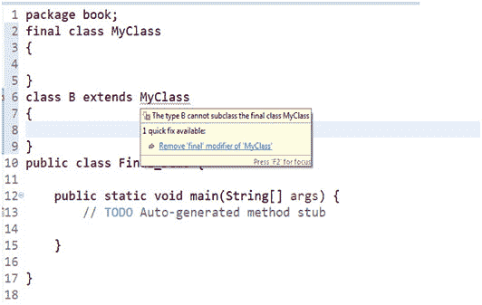

**图 3.7：** final 类无法被继承 final 类无法被继承

在这个 Java 程序中，方法被创建为 `final` 方法，Java 不允许我们重写基类中的 `final` 方法：

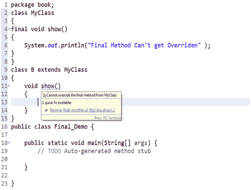

**图 3.8：** final 方法无法被重写

在这个 Java 程序中，我们尝试更改一个 `final` 数据成员的内容：

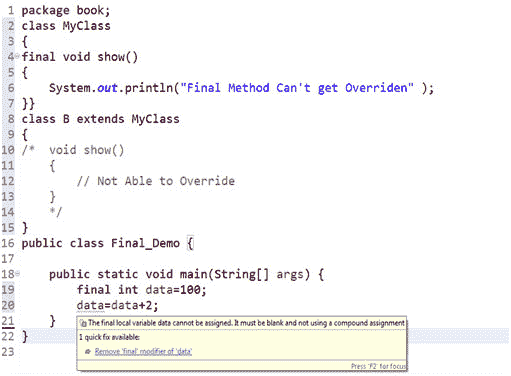

**图 3.9：** final 数据示例

### abstract 关键字

`abstract` 关键字用于方法或类。如果它在定义方法时被使用，则表示该方法必须在派生类中重新定义，换句话说，它必须被重写。这意味着 `abstract` 关键字与 `final` 关键字是相反的。如果 `abstract` 关键字用于类名，则表示我们必须继承该类，并且不能直接创建该类的对象。我们不能在构造函数和静态方法中使用 `abstract`。下面的示例说明了 `abstract` 的用法。

在接下来的 Java 程序中，创建了一个带有抽象方法的抽象基类。这些方法的实际定义在派生类中实现。这里要提的是，`abstract` 方法没有体，且所有抽象方法必须在派生类中定义：

```java
package book;
abstract class MyClass {
    abstract void show();
    abstract void display();
}

class B extends MyClass {
    void show() {
        System.out.println("Actual Implementation of show method");
    }
    void display() {
        System.out.println("Actual Implementation of display method");
    }
}

public class Abstract_Demo {
    public static void main(String[] args) {
        B obj=new B();
        obj.show();
        obj.display();
    }
}
```

1. 创建一个与 `nielit` 同名的子目录。如果我们正在使用命令提示符（Command Prompt），可以使用以下命令完成：

```bash
md nielit
```

在 Eclipse 中，我们应该右键点击当前所在的包，并点击 `New Package`（新建包），如如下所示：

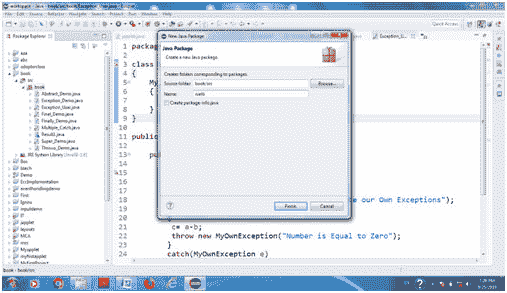

**图 4.1：** 创建包

2. 现在在输入包名 `nielit` 后，我们将右键点击 `nielit` 包，以为我们的 `nielit` 包创建 `classMCA` 类：

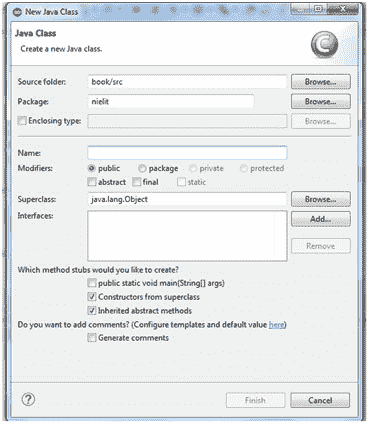

**图 4.2：** 在包内创建类


## 类的定义

该类的第一行以包名开头，因为此类属于 `nielit` 包，所以第一行是 `package nielit`：

```java
// Class MCA
package nielit;
public class MCA {
    public MCA()
    {
        System.out.println("Constructor of MCA");
    }
    public void showMCA()
    {
        System.out.println("MCA Class within nielit package");
    }
}
```

## IT 和 BCA 类

同样地，我们应该包含 `IT` 和 `BCA` 类：

```java
// IT Class
package nielit;
public class IT {
    public IT()
    {
        System.out.println("Constructor of IT");
    }
    public void showIT()
    {
        System.out.println("IT Class within nielit package");
    }
}

// BCA Class
package nielit;
public class BCA {
    public BCA()
    {
        System.out.println("Constructor of BCA");
    }
    public void showBCA()
    {
        System.out.println("BCA Class within nielit package");
    }
}
```

## 编译与复用

在 `nielit` 包中创建完三个类后，下一步是编译这些类。我们没有在这些类中编写 `main` 方法，因为我们希望在其他程序中重用这些类。

现在成功编译类后，我们将在父包中创建一个类来导入所有类并重用它们。新类的创建如下：

```java
package book;
import nielit.*;
public class Package_Demo {
    public static void main(String[] args) {
        MCA m1 = new MCA();
        IT m2 = new IT();
        BCA m3 = new BCA();
        m1.showMCA();
        m2.showIT();
        m3.showBCA();
    }
}
```

## 导入语句

为了导入所有类，我们使用的 `import` 语句如下：

```java
import nielit.*;
```

`*` 表示此包中的所有类。假设我们只想导入 `MCA` 类，可以使用 `import nielit.MCA;`。

因此上述程序的输出如下所示：

```
Constructor of MCA
Constructor of IT
Constructor of BCA
MCA Class within nielit package
IT Class within nielit package
BCA Class within nielit package.
```

## 在包中创建包

我们的下一个目标是在一个包中创建另一个包。其层级表示如下所示：

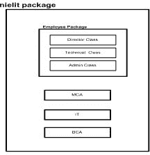

**图 4.3：** 包中的包

现在根据上面的图，我们有一个包 `nielit` 和一个子包 `Employee`。`Employee` 包有三个类，即 `Director`、`Technical` 和 `Admin` 类。由于我们已经在上一节中实现了 `nielit` 包，我们可以通过以下步骤将子包添加到 `nielit` 包中继续进行：

1. 右键点击 `nielit` 包并点击 `New Package` 在 `nielit` 包下创建一个子包。将此子包命名为 `employee`。

2. 创建以下类并将第一行代码写为 `package nielit.employee`，因为这三个类都属于 `nielit.employee` 包：

```java
// Director Class
package nielit.employee;
public class Director {
    public Director()
    {
        System.out.println("Constructor of Director");
    }
    public void showDir()
    {
        System.out.println("Director Class within nielit.employee package");
    }
}

// Technical Class
package nielit.employee;
public class Technical {
    public Technical()
    {
        System.out.println("Constructor of Technical");
    }
    public void showTechnical()
    {
        System.out.println("Technical Class within nielit.employee package");
    }
}

// Admin Class
package nielit.employee;
public class Admin {
    public Admin()
    {
        System.out.println("Constructor of Admin");
    }
    public void showAdmin()
    {
        System.out.println("Admin Class within nielit.employee package");
    }
}
```

3. 现在成功编译类后，是时候重用它们了。使用以下语句来导入所有类：

```java
package book;
import nielit.employee.*;
import nielit.*;
public class Package_Demo {
    public static void main(String[] args) {
        MCA m1 = new MCA();
        IT m2 = new IT();
        BCA m3 = new BCA();
        m1.showMCA();
        m2.showIT();
        m3.showBCA();
    }
}
```

4. 我们将得到以下输出：

```
Constructor of MCA
Constructor of IT
Constructor of BCA
MCA Class within nielit package
IT Class within nielit package
BCA Class within nielit package.
```

## 包的访问控制

在前面的章节中，我们学习了 Java 访问控制机制的不同方面及其访问修饰符。例如，我们之前理解对私有成员的访问仅允许该类的其他成员访问。包为访问控制增加了额外的维度。正如我们所看到的，Java 提供了许多安全级别，允许对类、子类和包内部变量和方法的可见性进行更细粒度的控制。类和包是封装和包含命名空间及范围的方式。包是类和其他包的容器。类是数据和代码的容器。类是 Java 抽象单元。由于类和包之间的关系，Java 处理类成员的四种可见性：

* 同包中的子类
* 同包中的非子类
* 不同包中的子类
* 既不在同一包也不是子类的类

三个访问修饰符 `private`、`public` 和 `protected` 提供了多种方式来产生这些类别所需的各种访问级别。下表总结了这些相互作用：

| | private | 无修饰符 | protected | public |
| :--- | :--- | :--- | :--- | :--- |
| 同一个类 | 是 | 是 | 是 | 是 |
| 同包子类 | 否 | 是 | 是 | 是 |
| 同包非子类 | 否 | 是 | 是 | 是 |
| 不同包子类 | 否 | 否 | 是 | 是 |
| 不同包非子类 | 否 | 否 | 否 | 是 |

#### 表 4.1: 使用包访问类成员

为了理解类成员的可见性，让我们来看以下示例：

```java
// nielit 包内部的 BCA 类
package nielit;

public class BCA {
    public int pub_data;
    private int pri_data;
    protected int pro_data;

    public BCA() {
        System.out.println("Constructor of BCA");
    }

    public void showBCA() {
        System.out.println("BCA Class within nielit package");
    }
}
```

上述类中的三个数据成员分别被声明为公共（`public`）、私有（`private`）和保护（`protected`）。如果我们想像下面的类那样，在同一个包内访问这些成员，那么对于私有数据我们将遇到错误，因为它只能在定义的类内部被访问：

```java
package nielit;
public class IT extends BCA {
    public IT() {
        System.out.println("Constructor of IT");
    }

    public void showData() {
        System.out.println("Public Data =" + pub_data);
        System.out.println("Private Data =" + pri_data); // 私有数据不可访问
        System.out.println("Protected Data =" + pro_data);
    }

    public void showIT() {
        System.out.println("IT Class within nielit package");
    }
}
```

现在，假设我们没有从 `BCA` 类继承 `IT` 类，那么私有数据将产生如下错误：

```java
package nielit;
public class IT {
    public IT() {
        System.out.println("Constructor of IT");
    }

    public void showData() {
        BCA obj = new BCA();
        System.out.println("Public Data =" + obj.pub_data);
        System.out.println("Private Data =" + obj.pri_data); // 私有数据不可访问
        System.out.println("Protected Data =" + obj.pro_data);
    }

    public void showIT() {
        System.out.println("IT Class within nielit package");
    }
}
```

现在，如果我们想从其他包访问相同的数据，私有和保护数据将产生如下错误：

```java
package book;
import nielit.BCA;
public class IT {
    public IT() {
        System.out.println("Constructor of IT");
    }

    public void showData() {
        BCA obj = new BCA();
        System.out.println("Public Data =" + obj.pub_data);
        System.out.println("Private Data =" + obj.pri_data); // 私有数据不可访问
        System.out.println("Protected Data =" + obj.pro_data); // 错误
    }

    public void showIT() {
        System.out.println("IT Class within nielit package");
    }
}
```

如果我们继承上述类，那么保护数据就不会产生错误，只有私有数据会产生如下错误：

```java
package book;
import nielit.BCA;
public class IT extends BCA {
    public IT() {
        System.out.println("Constructor of IT");
    }

    public void showData() {
        System.out.println("Public Data =" + pub_data); // OK
        System.out.println("Private Data =" + pri_data); // 私有数据不可访问
        System.out.println("Protected Data =" + pro_data); // OK
    }

    public void showIT() {
        System.out.println("IT Class within nielit package");
    }
}
```

从上面的说明可以清楚地看出，公共数据可以从任何地方访问，而私有成员仅在定义它们的类内部可见。保护成员在同一个包内可见，并且如果该类是子类，则在包外部也可见。

## 理解 Java 内置包

Java 的大部分功能是通过存储在不同 Java API 包中的类来实现的。这些类根据其功能组合在一起，并以包的形式提供给程序员。以下是一些常用的 Java 包：

| 包名 | 类描述 |
| :--- | :--- |
| `java.lang` | 它包含了语言支持类，如 `Integer`、`String`、`Thread` 等。 |
| `java.util` | 它包含了各种工具类，如 `Date`、`Random` 等。 |
| `java.awt` | 为了创建 GUI 类型的应用程序，导入此包。它包含了 `Button`、`Frame`、`TextField` 等类。 |
| `java.io` | 为了处理 Java 中的输入/输出，需要 `io` 包。该包将在 `[第 9 章：Java 中的输入输出]` 中讨论。 |
| `java.sql` | 此 `sql` 包用于数据库连接。它包含了 `Connection`、`ResultSet` 等类。 |
| `java.event` | 事件处理。 |
| `java.applet` | Applet 类。 |

#### 表 4.2: `java.lang` 中的类

`java.lang` 是默认包。我们不需要导入它。它包含以下类：

| 类 | 描述 |
| :--- | :--- |
| `Boolean` | |
| `Byte` | |
| `Character` | |
| `Class` | |
| `ClassLoader` | |
| `Complex` | |
| `Exception` | |
| `Float` | |
| `Integer` | |
| `Long` | |
| `Math` | |
| `Number` | |
| `Object` | |
| `Process` | |
| `Runtime` | |
| `String` | |
| `StringBuilder` | |
| `StringBuffer` | |
| `System` | |
| `Thread` | |
| `Throwable` | |
| `Void` | |

#### 表 4.3: `java.lang` 中的接口

`java.lang` 包包含以下接口：

| 接口 | 描述 |
| :--- | :--- |
| `Cloneable` | |
| `Comparable` | |
| `CharSequence` | |
| `Iterable` | |
| `Runnable` | |
| `Serializable` | |

#### 表 4.4: `java.lang` 示例

以下程序使用了 `java.lang` 包的一些类：


```java
package book;
public class LangExample {
    public static void main(String[] args) {
        Runtime r = Runtime.getRuntime();
        Process p = null;
        long first, second;
        String data[] = new String[1000];
        System.out.println("Memory = " + r.totalMemory());
        first = r.freeMemory();
        System.out.println("Free Memory = " + first);
        for (int i = 0; i < 1000; i++) {
            data[i] = new String("i");
        }
        second = r.freeMemory();
        System.out.println("After allocation: " + second);
        System.out.println("Memory used by String: " + (first - second));
        for (int i = 0; i < 1000; i++) data[i] = null;
        r.gc(); // 请求垃圾回收
        second = r.freeMemory();
        System.out.println("Free memory after collecting discarded Strings: " + second);
        System.out.println(" Using Runtime to open a Calculator ");
        try {
            p = r.exec("calc");
        } catch (Exception e) {
            System.out.println("Error Opening the Calculator.");
        }
    }
}
```

```java
class CloneExample implements Cloneable {
    String data_1;
    double data_2;
    CloneExample cloneTest() {
        try {
            return (CloneExample) super.clone();
        } catch (CloneNotSupportedException e) {
            System.out.println("Cloning not allowed.");
            return this;
        }
    }
}
class LangDemoExample {
    public static void main(String args[]) {
        CloneExample obj1 = new CloneExample();
        CloneExample obj2;
        obj1.data_1 = "Hello Java";
        obj1.data_2 = 4.7;
        obj2 = obj1.cloneTest(); // clone obj1
        System.out.println("obj1: " + obj1.data_1 + " " + obj1.data_2);
        System.out.println("obj2: " + obj2.data_1 + " " + obj2.data_2);
    }
}
```

我们将得到以下输出：

`obj1: Hello Java 4.7`

`obj2: Hello Java 4.7`

### java.util

下表列出了 `java.util` 包中可用的类。一些最常用的类包括：`Random` – 用于生成随机数，`Scanner` – 用于从用户获取输入，`Calendar`、`Date`、`Vector` 以及其他。

| `AbstractCollection` | `EventObject` | `Random` |
| :--- | :--- | :--- |
| `AbstractList` | `FormattableFlags` | `ResourceBundle` |
| `AbstractMap` | `Formatter` | `Scanner` |
| `AbstractQueue` | `GregorianCalendar` | `ServiceLoader` |
| `AbstractSequentialList` | `HashMap` | `SimpleTimeZone` |
| `AbstractSet` | `HashSet` | `Stack` |
| `ArrayDeque` | `Hashtable` | `StringTokenizer` |
| `ArrayList` | `IdentityHashMap` | `Timer` |
| `Arrays` | `LinkedHashMap` | `TimerTask` |
| `BitSet` | `LinkedHashSet` | `TimeZone` |
| `Calendar` | `LinkedList` | `TreeMap` |
| `Collections` | `ListResourceBundle` | `TreeSet` |
| `Currency` | `Locale` | `UUID` |
| `Date` | `Observable` | `Vector` |
| `Dictionary` | `PriorityQueue` | `WeakHashMap` |
| `EnumMap` | `Properties` | |
| `EnumSet` | `PropertyPermission` | |
| `EventListenerProxy` | `PropertyResourceBundle` | |

**表 4.5:** `java.util` 中可用的类

`java.util` 中可用的接口如下：

| `Collection` | `List` | `Queue` |
| :--- | :--- | :--- |
| `Comparator` | `ListIterator` | `RandomAccess` |
| `Deque` | `Map` | `Set` |
| `Enumeration` | `Map.Entry` | `SortedMap` |
| `EventListener` | `NavigableMap` | `SortedSet` |
| `Formattable` | `NavigableSet` | |
| `Iterator` | `Observer` | |

**表 4.6:** `java.util` 中的接口

在下面的 Java 程序中，探索了 `java.util` 包中的 `Arrays` 类。`Arrays` 类在处理数组时非常有用。`Arrays` 类中的如 `sort` 和 `binarySearch` 等方法在此程序中使用：

```java
package book;
import java.util.*;
public class UtilDemo {
    public static void main(String args[]) {
        int array[] = new int[10];
        for (int i = 0; i < 10; i++)
            array[i] = 5 * i;
        System.out.print("Original contents: ");
        display(array);
        Arrays.sort(array);
        System.out.print("Sorted: ");
        display(array);
        Arrays.fill(array, 2, 4, 3);
        System.out.print("After fill(): ");
        display(array);
        Arrays.sort(array);
        System.out.print("After sorting again: ");
        display(array);
        System.out.print("The value 25 is at location ");
        int index = Arrays.binarySearch(array, 25);
        System.out.println(index);
    }
    static void display(int array[]) {
        for (int i : array)
            System.out.print(i + " ");
        System.out.println();
    }
}
```

我们将得到以下输出：

`Original contents: 0 5 10 15 20 25 30 35 40 45`

`Sorted: 0 5 10 15 20 25 30 35 40 45`

`After fill(): 0 5 3 3 20 25 30 35 40 45`

`After sorting again: 0 3 3 5 20 25 30 35 40 45`

`The value 25 is at location 5`

在这个 Java 程序中，最重要的类之一是名为 `Calendar` 的类：

```java
package book;
import java.util.*;
public class UtilExample {
    public static void main(String args[]) {
        String months[] = {"January", "February", "March", "April", "May", "June", "July", "August", "September", "October", "November", "December"};
        Calendar calendar = Calendar.getInstance();
        System.out.print("Date: ");
        System.out.println(months[calendar.get(Calendar.MONTH)] + " " + calendar.get(Calendar.DAY_OF_MONTH));
        System.out.print("Time: ");
        System.out.println(calendar.get(Calendar.HOUR_OF_DAY) + ":" + calendar.get(Calendar.MINUTE) + ":" + calendar.get(Calendar.SECOND));
        System.out.print("Updated time: ");
        System.out.println(calendar.get(Calendar.HOUR_OF_DAY) + ":" + calendar.get(Calendar.MINUTE) + ":" + calendar.get(Calendar.SECOND));
    }
}
```

我们将得到输出：

`Date: October 22`

`Time: 9:12:58`

`Updated time: 10:29:22`

### java.awt

AWT 类封装在 `java.awt` 包中。它是 Java 最大的包之一。`awt` 包的一些类如下：

| 类 | 描述 |
| :--- | :--- |
| `AWTEvent` | 封装 AWT 事件。 |
| `AWTEventMulticaster` | 向多个监听器分发事件。 |
| `BorderLayout` | 边界布局管理器。边界布局使用五个组件：`North`、`South`、`East`、`West` 和 `Center`。 |
| `Button` | 创建按钮对象。 |
| `Canvas` | 一个无语义的窗口。 |
| `CardLayout` | 卡片布局管理器。卡片布局模拟索引卡。只有顶部的在显示。 |
| `Checkbox` | 创建复选框对象。 |
| `CheckboxGroup` | 创建复选框组。 |
| `CheckboxMenuItem` | 创建开启关闭菜单项。 |
| `Choice` | 创建下拉列表。 |
| `Color` | 以可移植、平台无关的方式管理颜色。 |
| `Component` | 各种 AWT 组件的抽象父类。 |
| `Container` | `Component` 的子类，可以包含其他组件。 |
| `Cursor` | 封装位图光标。 |
| `Dialog` | 创建对话框窗口。 |
| `Dimension` | 指定对象的尺寸。宽度存储在 `width`，高度存储在 `height` 中。 |
| `Event` | 封装事件。 |
| `EventQueue` | 队列事件。 |
| `FileDialog` | 创建一个可以从中选择文件的窗口。 |
| `FlowLayout` | 流布局管理器。流布局将组件从左到右、从上到下排列。 |
| `Font` | 封装类型字体。 |
| `FontMetrics` | 封装与字体相关的各种信息。这些信息帮助您在窗口中显示文本。 |
| `Frame` | 创建一个具有标题栏、缩放角和菜单栏的标准窗口。 |
| `Graphics` | 封装图形上下文。该上下文被各种输出方法用于在窗口中显示输出内容。 |
| `GraphicsDevice` | 描述图形设备，如屏幕或打印机。 |
| `GraphicsEnvironment` | 描述可用的 `Font` 和 `GraphicsDevice` 对象集合。 |
| `GridBagConstraints` | 定义与 `GridBagLayout` 类相关的各种约束条件。 |
| `GridBagLayout` | 网格袋布局管理器。GridBag 布局根据 `GridBagConstraints` 指定的约束条件显示组件。 |
| `GridLayout` | 网格布局管理器。网格布局在二维网格中显示组件。 |
| `Image` | 封装图形图像。 |
| `Insets` | 封装容器的内边距。 |
| `Label` | 创建一个显示字符串的标签。 |
| `List` | 创建一个允许用户从中选择的列表。类似于标准的 Windows 列表框。 |
| `MediaTracker` | 管理媒体对象。 |
| `Menu` | 创建一个下拉菜单。 |
| `MenuBar` | 创建一个菜单栏。 |
| `MenuComponent` | 由各种菜单类实现的抽象类。 |
| `MenuItem` | 创建一个菜单项。 |
| `MenuShortcut` | 封装菜单项的键盘快捷键。 |
| `Panel` | `Container` 最简单的具体子类。 |
| `Point` | 封装一个笛卡尔坐标对，存储在 `x` 和 `y` 中。 |
| `Polygon` | 封装多边形。 |
| `PopupMenu` | 封装一个弹出菜单。 |
| `PrintJob` | 代表打印作业的抽象类。 |
| `Rectangle` | 封装矩形。 |
| `Robot` | 支持基于 AWT 的应用程序的自动化测试。 |
| `Scrollbar` | 创建一个滚动条对象。 |
| `ScrollPane` | 为另一个组件提供水平和/或垂直滚动条的容器。 |
| `SystemColor` | 包含 GUI 控件的颜色，如窗口、滚动条、文本等。 |
| `TextArea` | 创建一个多行编辑对象。 |
| `TextComponent` | `TextArea` 和 `TextField` 的父类。 |
| `TextField` | 创建一个单行编辑对象。 |
| `Toolkit` | 由 AWT 实现抽象类。 |
| `Window` | 创建一个没有框架、没有菜单栏且没有标题的窗口。 |

**表 4.7:** `java.awt` 包中的某些类

现在，为了理解内置包的重要性，下面的程序描述了这些包的用法。

下面的程序使用了多个类，且所有这些类都是从 `awt`、`event`、`swing` 等多个不同的包导入的。对于程序员来说，如果没有这些内置包的支持，编写如此大型程序是非常困难的。


# 深入数组、字符串和包装类

## 引言

数组是相同类型变量的集合，其目的是通过一个所有变量通用的通用名称来引用它们。可以形成任何类型的数组，并且可能具有一个或多个维度。数组中的精确组件通过其索引（index）来访问。数组为关联信息提供了一种分组的方法。假设我们被编写一个程序，其中创建 100 个学生的学号。一种方法是创建 100 个 `int` 变量，但这不是推荐的方法，因为它会让程序变得非常复杂。为了编写简洁高效的程序，另一种方法是创建一个数组，数组是一组共享共同名称的连续或相关数据项。例如，我们可以定义一个 `int` 数组 `roll` 来表示 100 个不同学生的学号集。如果我们想访问任何一个学号，必须在数组名后的方括号中使用索引或下标，如下：

```java
roll[60]; // 代表第 60 个学生的学号
```

借助单一的循环结构，我们可以通过更改循环内的索引值来访问数组的所有元素。在本章中，我们将详细讨论一维数组和二维数组，还将详细关注字符串和向量（vectors）。

## 结构

* 引言
* 1-D 数组的实现
* 2-D 数组的实现
* Java 中的字符串处理
* StringBuffer 类
* Java 中的类型包装类
* 练习

## 目标

本章详细解释了数组。本章还解释了字符串处理和包装类。

## 1 维数组的实现

Java 中的一维数组通过以下方式之一声明：

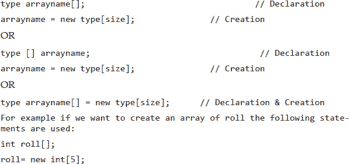

在创建数组后，我们可以使用语句存储数字：

```java
roll[0]=50;
roll[1]= 130;
roll[2]= 430;
roll[3]= 300;
roll[4]= 60;
```

或者，可以通过以下语句完成上述赋值：

```java
int roll[] = {50, 130,430,300,60};
```

该语句将自动创建一个包含 5 个变量的数组，其中 `roll[0]` 存储第一个数字 50。由于数字存储在连续的内存位置，其内存表示如下：

```text
roll[0]
roll[1]
roll[2]
roll[3]
roll[4]
```

这个 Java 程序对存储在数组 `roll` 中的给定学号数组进行排序：

```java
package book;

public class Array_Sort {
    public static void main(String[] args) {
        int roll[] = new int[10];
        roll[0]=4;
        roll[1]=2;
        roll[2]=1;
        roll[3]=5;
        roll[4]=3;
        System.out.println("Before Sorting");
        for(int i=0;i<5;i++)
            System.out.print(roll[i] +" ");
        for(int i=0;i<5;i++)
        {
            for(int j=i+1;j<5;j++)
            {
                if (roll[i]>roll[j])
                {
                    int temp=roll[i];
                    roll[i]=roll[j];
                    roll[j]=temp;
                }
            }
        }
        System.out.println("\n After Sorting");
        for(int i=0;i<5;i++)
            System.out.print(roll[i] +" ");
    }
}
```

我们将得到以下输出：

**Before Sorting**

`4 2 1 5 3`

**After Sorting**

`1 2 3 4 5`

以下 Java 程序创建了一个包含 N 个玩家对象的数组，并根据它们的得分对其进行排序：


# Java 数组与字符串处理示例

## 继承与排序示例

```java
package book;
class Player
{
    int player_id;
    String name;
    Player()
    {}
    Player(int a, String s)
    {
        player_id=a;
        name=s;
    }
    void display()
    {
        System.out.print(player_id + " " + name);
    }
}

class Performance extends Player
{
    int score;
    Performance()
    {}
    Performance(int a, String s, int m)
    {
        super(a,s);
        score=m;
    }
    void display()
    {
        super.display();
        System.out.println(" " +score);
    }
    static void sort(Performance a[], int n)
    {
        Performance temp = new Performance();
        for(int i=0;i<n;i++)
        {
            for(int j=i+1;j<n;j++)
            {
                if(a[i].score<a[j].score)
                {
                    temp = a[i];
                    a[i]= a[j];
                    a[j]=temp;
                }
            }
        }
    }
}

public class Player_Sort {
    public static void main(String[] args) {
        Performance a[] = new Performance[5];
        a[0] = new Performance("Saleem",2000);
        a[1] = new Performance("Feroz",2100);
        a[2] = new Performance("Wahid",1000);
        a[3] = new Performance("Nisar",1500);
        a[4] = new Performance("Ishfaq",1200);
        System.out.println("Before Sorting ");
        System.out.print("ID Name Score \n");
        for(int i=0;i<5;i++)
            a[i].display();
        Performance.sort(a, 5);
        System.out.println("After Sorting on Score");
        for(int i=0;i<5;i++)
            a[i].display();
    }
}
```

我们将得到以下输出：

**Before Sorting**

`ID Name Score`

`Saleem 2000`

`Feroz 2100`

`Wahid 1000`

`Nisar 1500`

`Ishfaq 1200`

**After Sorting on Score**

`Feroz 2100`

`Saleem 2000`

`Nisar 1500`

`Ishfaq 1200`

`Wahid 1000`

## 数组操作示例

在下面的 Java 程序中，对数组执行了各种操作，如求和、求最大值和反转。最后数组进行了排序：

```java
package book;
public class Array_Operations {
    public static void main(String[] args) {
        int arr[] = { 20,50,10,60,70};
        int sum=0,max,min;
        for(int i=0;i<arr.length;i++)
        {
            sum=sum + arr[i];
        }
        max=min=arr[0];
        System.out.println("The various operations on this array" );
        for(int i=0;i<arr.length;i++)
        {
            System.out.print(" " + arr[i] );
            if (max<arr[i])
                max=arr[i];
            if (min>arr[i])
                min = arr[i];
        }
        System.out.println("");
        System.out.println("The sum of above array =" + sum);
        System.out.println("The Max of above array =" + max);
        System.out.println("The Min of above array =" + min);
        System.out.println("The Reverse of above array =");
        for(int i=arr.length-1;i>=0;i--)
        {
            System.out.print(" " + arr[i] );
        }
        for(int i=0;i<arr.length;i++)
        {
            for(int j=i+1;j<arr.length;j++)
            {
                if (arr[i]>arr[j])
                {
                    int temp=arr[i];
                    arr[i]=arr[j];
                    arr[j]=temp;
                }
            }
        }
        System.out.println("");
        System.out.println("After Sorting ");
        for(int i=0;i<arr.length;i++)
        {
            System.out.print(" " + arr[i] );
        }
    }
}
```

我们将得到以下输出：

**The various operations on this array**

`20 50 10 60 70`

**The sum of above array=210**

**The Max of above array =70**

**The Min of above array=10**

**The Reverse of above array =**

`70 60 10 50 20`

**After Sorting**

`10 20 50 60 70`

## 二维数组的实现

二维数组实际上是数组的数组。假设我们想存储两个不同城市的票价信息，我们需要使用带有两个索引的二维数组来控制行和列。下表给出了三个不同城市的票价：

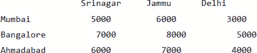

如果我们想存储这些信息并通过我们的 Java 程序进行处理，那么我们需要创建一个二维数组。二维数组的声明和创建语法如下：

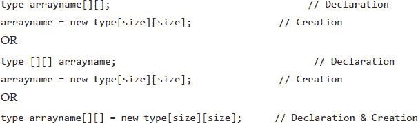

例如，如果我们想为上述票价创建一个二维数组，则使用以下语句：

```java
int fare[][];
fare= new int[5][5];
```

`fare[1][1] = 8000;`

`fare[1][2] = 5000;`

`fare[2][0] = 6000;`

`fare[2][1] = 7000;`

`fare[2][2] = 4000;`

或者，上述语句可以合并为一个语句，如下：

```java
int fare[][] = {
  { 5000,6000,3000},
  { 7000,8000,5000},
  { 6000,7000,4000},
};
```

由于数字存储在连续的内存位置，其内存表示如下。由于使用了两个索引，其中一个控制行，另一个用于控制列：

`fare[row][column];`

```text
[0][0] [0][1] [0][2]
[1][0] [1][1] [1][2]
[2][0] [2][1] [2][2]
```

下面的 Java 程序演示了二维数组的使用。接下来的 Java 程序计算两个矩阵的相加。二维数组用于存储这三个矩阵：

```java
package book;
public class Matrix_Addition {
  public static void main(String[] args) {
    int a[][]= { {22,55,50,4,51},
      {10,2,8,4,9},
      {11,2,6,7,2},
      {1,20,13,4,15},
    };
    int b[][]= { {2,5,0,4,1},
      {10,12,18,14,19},
      {10,7,6,70,20},
      {11,10,13,40,10},
    };
    int c[][]=new int[5][5];
    for(int i=0;i<4;i++)
    {
      for (int j=0;j<5;j++)
      {
        c[i][j]=a[i][j] + b[i][j];
      }
    }
    System.out.println("The addition of Matrices");
    for(int i=0;i<4;i++)
    {
      for (int j=0;j<5;j++)
      {
        System.out.print(c[i][j] + " ");
      }
      System.out.println();
    }
  }
}
```

我们将得到以下输出：

`The addition of Matrices`

`24 60 50 8 52`

`20 14 26 18 28`

`21 9 12 77 22`

`12 30 26 44 25`

下面的程序帮助你利用二维数组创建一个乘法表：

```java
package book;
public class MultiTable {
  public static void main(String[] args) {
    int m[][] = new int[11][11];
    int i,j;
    System.out.println("Multiplication Table");
    System.out.print(" " );
    for(i=1;i<=10;i++)
    System.out.print(" " + i);
    System.out.println();
    for(i=1;i<=10;i++)
    {
      System.out.print(i + " ");
      for(j=1;j<=10;j++)
      {
        m[i][j]= i*j;
        System.out.print(" " + m[i][j]);
      }
      System.out.println();
    }
  }
}
```

我们将得到以下输出：

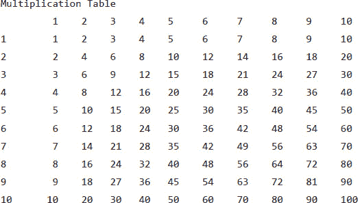

在下面的 Java 程序中，执行了两个矩阵的乘法：

```java
package book;
public class Matrix_Multiplication {
  public static void main(String[] args) {
    int a[][]= { {1,2},
      {2,2},
    };
    int b[][]= { {2,5},
      {1,2},
    };
    int c[][] = new int[5][5];
    for(int i=0;i<2;i++)
    {
      for (int j=0;j<2;j++)
      {
        for (int k=0;k<2;k++)
        {
          c[i][j]=c[i][j] + a[i][k]*b[k][j];
        }
      }
    }
    System.out.println("The 1st Matrix =");
    for(int i=0;i<2;i++)
    {
      for (int j=0;j<2;j++)
      {
        System.out.print(a[i][j] + " ");
      }
      System.out.println("");
    }
    System.out.println("The 2nd Matrix =");
    for(int i=0;i<2;i++)
    {
      for (int j=0;j<2;j++)
      {
        System.out.print(b[i][j] + " ");
      }
      System.out.println("");
    }
    System.out.println("The Multiplication of Matrices");
    for(int i=0;i<2;i++)
    {
      for (int j=0;j<2;j++)
      {
        System.out.print(c[i][j] + " ");
      }
      System.out.println();
    }
  }
}
```

我们将得到以下输出：

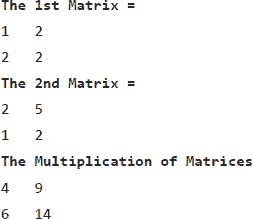

# Java 字符串处理

字符串处理是开发中的某项主要任务。许多编程语言中的字符串可以通过创建字符数组来处理，但 Java 对字符串处理赋予了特殊重视，并以名为 `String` 的类来实现。因此，Java 中的字符串不是基本类型而是完整的类。因此，`String` 类拥有一套构造函数和方法来比较两个字符串、在字符串中搜索字符、查找字符串中的子字符串以及更改字母的大小写。此外，String 对象可以通过多种方式构造。`String`、`StringBuffer` 和 `StringBuilder` 类定义在 `java.lang` 包中。它们都被声明为 `final`，这意味着这些类不能被继承。要创建一个 `String` 对象，可以使用以下构造函数：

- `String()`
- `String(char[])`
- `String(char ch, int startIndex, int numchars)`
- `String(String st)`
- `String(byte[])`
- `String(byte[], int startIndex, int numchars)`

下面的示例演示了如何使用构造函数创建 `String` 对象。在下面的 Java 程序中，使用字符串类的不同构造函数创建 String 对象：

```java
package book;
public class String_Demo {
  public static void main(String[] args) {
    System.out.println("Creation of String object using String Constructors");
    String str1 = new String();
    char c[]={'N','I','E','T'};
    String str2 = new String(c);
    String str3 = new String(c, 4,2);
    String str4 = new String(str2);
    byte b[]={65,66,67,68};
    String str5 = new String(b);
    String str6 = new String(b,0,2);
    System.out.println("Using Default Constructor str1 holds nothing " + str1);
    System.out.println("str2 = " + str2);
    System.out.println("str3 = " + str3);
    System.out.println("str4 = " + str4);
    System.out.println("str5 = " + str5);
    System.out.println("str6 = " + str6);
  }
}
```

我们将得到以下输出：


# 使用 String 构造器创建 String 对象

## 使用默认构造器 str1 不包含任何内容

```text
str2 = NIELIT
str3 = IT
str4 = NIELIT
str5 = ABCD
str6 = AB
```

可以通过 Eclipse 编辑器的智能提示（按下对象名和运算符 `Ctrl+Space`）轻松访问各种字符串方法。下表提供了 `String` 类中可用方法的详细信息：

**表 5.1: String 方法**

| 方法 | 说明 |
| :--- | :--- |
| `int length()` | 返回字符串的长度，即它包含的字符数。 |
| `char charAt(int where)` | 返回指定位置的字符。 |
| `void getChars(int sourceStart, int sourceEnd, char target[], int targetStart)` | 一次返回多个字符。 |
| `byte[] getBytes()` | 返回字节数组形式字符。 |
| `char[] toCharArray()` | 将 String 对象中的所有字符转换为字符数组。 |
| `boolean equals(Object str)` | 比较两个字符串是否相等。 |
| `boolean equalsIgnoreCase(String str)` | 执行忽略大小写的比较。 |
| `boolean regionMatches(int startIndex, String str2, int str2StartIndex, int numChars)` | `regionMatches()` 方法比较字符串内部的特定区域与另一个字符串的特定区域。 |
| `boolean regionMatches(boolean ignoreCase, int startIndex, String str2, int str2StartIndex, int numChars)` | 在忽略大小写的情况下比较字符串内部的特定区域与另一个字符串的特定区域。 |
| `boolean startsWith(String str)` | 判断字符串是否以指定的字符串开始。 |
| `boolean endsWith(String str)` | 判断字符串是否以指定的字符串结束。 |
| `boolean startsWith(String str, int startIndex)` | 判断给定字符串是否从指定索引开始以指定的字符串开始。 |
| `int compareTo(String str)` | 对于排序应用，我们需要知道哪个字符串小于、等于或大于下一个。 |
| `int compareToIgnoreCase(String str)` | 忽略问题字符串的大小。 |
| `int indexOf(int ch)` | 搜索字符的第一次出现位置。 |
| `int lastIndexOf(int ch)` | 搜索字符的最后一次出现位置。 |
| `int indexOf(String str)` | 搜索子字符串第一次出现的位置。 |
| `int lastIndexOf(String str)` | 搜索子字符串最后出现的位置。 |
| `int indexOf(int ch, int startIndex)` | 指定搜索的起始点。 |
| `int lastIndexOf(int ch, int startIndex)` | 指定搜索的起始点。 |
| `int indexOf(String str, int startIndex)` | 指定字符串搜索的起始点。 |
| `int lastIndexOf(String str, int startIndex)` | 指定字符串搜索的起始点。 |
| `String substring(int startIndex)` | 使用 `substring()` 提取子字符串。 |
| `String substring(int startIndex, int endIndex)` | 使用带有起始位置和结束位置的 `substring()` 提取子字符串。 |
| `String concat(String str)` | 使用 `concat()` 连接两个字符串。 |
| `String replace(char original, char replacement)` | 将调用字符串中所有指定的某个字符替换为另一个字符。 |
| `String replace(CharSequence original, CharSequence replacement)` | 将一个字符序列替换为另一个。 |
| `String trim()` | 删除任何前导和尾部空白。 |
| `static String valueOf(double num)` | 将数据从其内部格式转换为人类可读的形式。 |
| `static String valueOf(long num)` | 将数据从其内部格式转换为人类可读的形式。 |
| `static String valueOf(Object ob)` | 将数据从其内部格式转换为人类可读的形式。 |
| `static String valueOf(char chars[])` | 将数据从其内部格式转换为人类可读的形式。 |
| `static String valueOf(char chars[], int startIndex, int numChars)` | 根据起始索引和字符数量将数据从其内部格式转换为人类可读的形式。 |
| `String toLowerCase()` | 将字符串中的所有字符从大写转换为小写。 |
| `String toUpperCase()` | 将字符串中的所有字符从小写转换为大写。 |
| `int codePointAt(int i)` | 返回 `i` 指定位置的 Unicode 代码点。 |
| `int codePointBefore(int i)` | 返回 `i` 指定位置之前的 Unicode 代码点。 |
| `int codePointCount(int start, int end)` | 返回调用 `String` 部分中 `start` 到 `end–1` 之间的代码点数量。 |
| `boolean contains(CharSequence str)` | 如果调用对象包含 `str` 指定字符串，则返回 true。否则返回 false。 |
| `boolean contentEquals(CharSequence str)` | 如果调用字符串包含与 `str` 相同的字符串，则返回 true。否则返回 false。 |
| `boolean contentEquals(StringBuffer str)` | 如果调用字符串包含与 `str` 相同的字符串，则返回 true。否则返回 false。 |
| `static String format(String fmtstr, Object … args)` | 返回按照 `fmtstr` 指定格式的字符串。 |
| `static String format(Locale loc, String fmtstr, Object … args)` | 返回按照 `fmtstr` 指定格式的字符串。格式由 `loc` 指定的区域决定。 |
| `boolean matches(String regExp)` | 如果调用字符串匹配传入的 `regExp` 正则表达式，则返回 true。否则返回 false。 |
| `int offsetByCodePoints(int start, int num)` | 返回调用字符串中在 `start` 指定起始索引之后 `num` 个代码点的索引。 |
| `String replaceFirst(String regExp, String newStr)` | 返回一个字符串，其中第一个匹配 `regExp` 指定正则表达式的子字符串被替换为 `newStr`。 |
| `String replaceAll(String regExp, String newStr)` | 返回一个字符串，其中所有匹配 `regExp` 指定正则表达式的子字符串都被替换为 `newStr`。 |

## 了解 String 类中的重要方法

### `int compareTo(String str2)`

此方法将调用字符串与 `String` 对象的 `str2` 进行比较，并返回一个 `int` 值，该值可以是零、负或正。如果为零，则两个字符串相等；如果小于零，则调用字符串小于 `str2`；如果大于零，则调用字符串大于 `str2`。例如，在下面的程序段中，我们可以使用此方法比较两个 `String` 对象：

```java
String str1 = new String("Java");
String str2 = new String("Hello");
if (str1.compareTo(str2) > 0)
    System.out.println(" Str1 is Greater");
else
    System.out.println(" Str2 is Greater");
```

下面的示例程序使用了字符串类中可用的方法。该程序使用了 `String` 类的各种方法来解释 Java 中字符串处理的实现：

```java
package book;
public class String_Handling {
    public static void main(String[] args) {
        String str = new String("I Love Java");
        System.out.println("The Input String is----> " + str);
        System.out.println("The Length of above String = " + str.length());
        System.out.println("The Character at 0th Position = " + str.charAt(0));
        System.out.println("The SubString = " + str.substring(2, 6));
        System.out.println("Coverted to UpperCase " + str.toUpperCase());
    }
}
```

我们将得到如下输出：

```text
The Input String is----> I Love Java
The Length of above String = 11
The Character at 0th Position = I
The SubString = Love
Coverted to UpperCase LOVE JAVA
```

## StringBuffer 类的方法

| 方法 | 说明 |
| :--- | :--- |
| `String substring(int startIndex, int endIndex)` | 返回 `StringBuffer` 中具有指定起始和结束位置的部分。 |
| `StringBuffer replace(int startIndex, int endIndex, String str)` | 在 `StringBuffer` 对象内部将一组字符替换为另一组字符。 |
| `StringBuffer delete(int startIndex, int endIndex)` | 删除 `StringBuffer` 对象内部的字符。 |
| `StringBuffer deleteCharAt(int loc)` | 删除 `StringBuffer` 对象中特定位置的字符。 |
| `StringBuffer reverse()` | 反转 `StringBuffer` 对象内部的字符。 |
| `StringBuffer insert(int index, String str)` | 将一个字符串插入另一个字符串中。 |
| `StringBuffer insert(int index, char ch)` | 将一个字符插入到字符串中。 |
| `StringBuffer insert(int index, Object obj)` | 将一个对象插入另一个字符串中。 |
| `StringBuffer append(String str)` | 将字符串连接到调用 `StringBuffer` 对象的末尾。 |
| `StringBuffer append(int num)` | 将 `int` 类型的数据连接到调用 `StringBuffer` 对象的末尾。 |
| `StringBuffer append(Object obj)` | 将任何类型的 Object 连接到调用 `StringBuffer` 对象的末尾。 |
| `void getChars(int sourceStart, int sourceEnd, char target[], int targetstart)` | 将 `StringBuffer` 对象的子字符串拷贝到数组中。 |
| `char charAt(int where)` | 获取指定索引处的字符。 |
| `void setCharAt(int where, char ch)` | 设置指定索引处的字符。 |
| `void setLength(int len)` | 设置 `StringBuffer` 对象中缓冲区长度。 |
| `void ensureCapacity(int capacity)` | 设置缓冲区的大小。 |
| `int length()` | 获取 `StringBuffer` 对象的长度。 |
| `int capacity()` | 可以通过此方法找到分配的总容量。 |
| `StringBuffer appendCodePoint(int ch)` | 在调用对象的末尾追加一个 Unicode 代码点。 |
| `int codePointAt(int i)` | 返回 `i` 指定位置的 Unicode 代码点。 |
| `int codePointBefore(int i)` | 返回 `i` 指定位置之前的 Unicode 代码点。 |
| `int codePointCount(int start, int end)` | 返回调用对象部分中的代码点数量。 |
| `int indexOf(String str)` | 在调用 `StringBuffer` 中搜索 `str` 第一次出现的位置。 |
| `int indexOf(String str, int startIndex)` | 在调用 `StringBuffer` 中搜索 `str` 第一次出现的位置。 |
| `int lastIndexOf(String str)` | 在调用 `StringBuffer` 中搜索 `str` 最后一次出现的位置。 |
| `int lastIndexOf(String str, int startIndex)` | 在调用 `StringBuffer` 中搜索 `str` 最后一次出现的位置。 |

**表 5.3: `StringBuffer` 类的方法**

以下程序演示了 `StringBuffer` 类方法的用法：

```java
package book;
class StringBufferMethods {
    public static void main(String args[]) {
        StringBuffer sb_obj = new StringBuffer("NIELIT");
        System.out.println("Buffer = " + sb_obj);
        System.out.println("Length of Object= " + sb_obj.length());
        System.out.println("Capacity of Object " + sb_obj.capacity());
        sb_obj.ensureCapacity(100);
        System.out.println("Now Capacity = " + sb_obj.capacity());
        System.out.println("Character At 0th Location = " + sb_obj.charAt(0));
        sb_obj.setCharAt(0, 'R');
        System.out.println("Buffer = " + sb_obj);
        char ch[] = new char[10];
        sb_obj.getChars(0, 3, ch, 0);
        System.out.println("ch = " + ch[0] + ch[1] + ch[2]);
        System.out.println("Append = " + sb_obj.append("J&K"));
        System.out.println("Insert = " + sb_obj.insert(0, ch));
        System.out.println("Reverse = " + sb_obj.reverse());
        System.out.println("Replace = " + sb_obj.replace(0, 2, "OK"));
        System.out.println("Sub String = " + sb_obj.substring(0, 2));
    }
}
```

我们将得到以下输出：

```text
Buffer = NIELIT
Length of Object= 6
Capacity of Object 22
```


`Now Capacity = 100`

`Character At 0th Location = N`

`Buffer = RIELIT`

`Append = RIELITJ&K`

`Insert = RIE RIELITJ&K`

`Reverse = K&JTILEIR EIR`

`Replace = OKJTILEIR EIR`

`Sub String = OK`

# 包装类 (Wrapper classes)

除了 `int`、`float`、`char` 等基本数据类型外，Java 还使用了名为类型包装器（type wrappers）的内置类，这些类与基本数据对应。

`Number` 类是 `Byte`、`Short`、`Integer`、`Long`、`Float` 和 `Double` 的超类。它提供了将值转换为各种基本类型的方法。

`Number` 类定义了抽象方法：

| 方法 | 说明 |
| :--- | :--- |
| `byteValue()` | 返回 `byte` 类型数值 |
| `shortValue()` | 返回 `short` 类型数值 |
| `intValue()` | 返回 `int` 类型数值 |
| `longValue()` | 返回 `long` 类型数值 |
| `floatValue()` | 返回 `float` 类型数值 |
| `doubleValue()` | 返回 `double` 类型数值 |

`Number` 类还提供了静态方法：

- `int valueOf(double d)`: 返回 `d` 的 `int` 类型数值。
- `long valueOf(double d)`: 返回 `d` 的 `long` 类型数值。
- `float valueOf(double d)`: 返回 `d` 的 `float` 类型数值。
- `double valueOf(double d)`: 返回 `d` 的 `double` 类型数值。
- `int valueOf(long l)`: 返回 `l` 的 `int` 类型数值。
- `float valueOf(long l)`: 返回 `l` 的 `float` 类型数值。
- `double valueOf(long l)`: 返回 `l` 的 `double` 类型数值。
- `int valueOf(float f)`: 返回 `f` 的 `int` 类型数值。
- `long valueOf(float f)`: 返回 `f` 的 `long` 类型数值。
- `double valueOf(float f)`: 返回 `f` 的 `double` 类型数值。
- `int valueOf(char c)`: 返回 `c` 的 `int` 类型数值。
- `float valueOf(char c)`: 返回 `c` 的 `float` 类型数值。
- `double valueOf(char c)`: 返回 `c` 的 `double` 类型数值。
- `int valueOf(String s)`: 返回 `s` 的 `int` 类型数值。
- `float valueOf(String s)`: 返回 `s` 的 `float` 类型数值。
- `double valueOf(String s)`: 返回 `s` 的 `double` 类型数值。

## 包装类

包装类用于将基本数据类型封装成对象。这允许基本类型用于 `ArrayList` 等集合。

下表显示了基本类型与其包装类之间的关系：

| 基本类型 | 包装类 |
| :--- | :--- |
| `boolean` | `Boolean` |
| `byte` | `Byte` |
| `char` | `Character` |
| `short` | `Short` |
| `int` | `Integer` |
| `float` | `Float` |
| `long` | `Long` |
| `double` | `Double` |

### Double 类

`Double` 类封装了 `double` 基本类型。它提供了对 `double` 值进行操作的方法。

创建 `Double` 对象的示例：

```java
class Example {
    public static void main(String args[]) {
        Double d1 = new Double(10.5);
        Double d2 = Double.valueOf(20.5);
        System.out.println(d1);
    }
}
```

使用 `Double` 方法的示例：

```java
class DoubleMethods {
    public static void main(String args[]) {
        System.out.println(Double.parseDouble("10.5"));
        System.out.println(Double.toString(10.5));
        System.out.println(Double.isNaN(Double.NaN));
    }
}
```

### Integer 类

`Integer` 类封装了 `int` 基本类型。它提供了对 `int` 值进行操作的方法。

创建 `Integer` 对象的示例：

```java
class Example {
    public static void main(String args[]) {
        Integer i1 = new Integer(10);
        Integer i2 = Integer.valueOf(20);
        System.out.println(i1);
    }
}
```

使用 `Integer` 方法的示例：

```java
class IntegerMethods {
    public static void main(String args[]) {
        System.out.println(Integer.parseInt("10"));
        System.out.println(Integer.toString(10));
        System.out.println(Integer.valueOf(10));
    }
}
```

### Float 类

`Float` 类封装了 `float` 基本类型。它提供了对 `float` 值进行操作的方法。

创建 `Float` 对象的示例：

```java
class Example {
    public static void main(String args[]) {
        Float f1 = new Float(10.5f);
        Float f2 = Float.valueOf(20.5f);
        System.out.println(f1);
    }
}
```

使用 `Float` 方法的示例：

```java
class FloatMethods {
    public static void main(String args[]) {
        System.out.println(Float.parseFloat("10.5"));
        System.out.println(Float.toString(10.5f));
        System.out.println(Float.isNaN(Float.NaN));
    }
}
```

### Long 类

`Long` 类封装了 `long` 基本类型。它提供了对 `long` 值进行操作的方法。

创建 `Long` 对象的示例：

```java
class Example {
    public static void main(String args[]) {
        Long l1 = new Long(100L);
        Long l2 = Long.valueOf(200L);
        System.out.println(l1);
    }
}
```

使用 `Long` 方法的示例：

```java
class LongMethods {
    public static void main(String args[]) {
        System.out.println(Long.parseLong("100"));
        System.out.println(Long.toString(100L));
        System.out.println(Long.valueOf(100L));
    }
}
```

### Character 类

`Character` 类封装了 `char` 基本类型。它提供了对 `char` 值进行操作的方法。

创建 `Character` 对象的示例：

```java
class Example {
    public static void main(String args[]) {
        Character c1 = new Character('A');
        Character c2 = Character.valueOf('B');
        System.out.println(c1);
    }
}
```

使用 `Character` 方法的示例：

```java
class CharacterMethods {
    public static void main(String args[]) {
        System.out.println(Character.isLetter('A'));
        System.out.println(Character.isDigit('1'));
        System.out.println(Character.toUpperCase('a'));
    }
}
```

### Short 类

`Short` 类封装了 `short` 基本类型。它提供了对 `short` 值进行操作的方法。

创建 `Short` 对象的示例：

```java
class Example {
    public static void main(String args[]) {
        Short s1 = new Short(10);
        Short s2 = Short.valueOf((short)20);
        System.out.println(s1);
    }
}
```

### Byte 类

`Byte` 类封装了 `byte` 基本类型。它提供了对 `byte` 值进行操作的方法。

创建 `Byte` 对象的示例：

```java
class Example {
    public static void main(String args[]) {
        Byte b1 = new Byte(10);
        Byte b2 = Byte.valueOf((byte)20);
        System.out.println(b1);
    }
}
```

### Boolean 类

`Boolean` 类封装了 `boolean` 基本类型。它提供了对 `boolean` 值进行操作的方法。

创建 `Boolean` 对象的示例：

```java
class Example {
    public static void main(String args[]) {
        Boolean b1 = new Boolean(true);
        Boolean b2 = Boolean.valueOf(false);
        System.out.println(b1);
    }
}
```

### Float 类方法表

| 方法 | 说明 |
| :--- | :--- |
| `static float parseFloat(String str) throws NumberFormatException` | 使用 radix 10 返回 `str` 指定字符串中包含的数字的浮点等价值。 |
| `short shortValue()` | 返回调用对象作为 `short` 类型的值。 |
| `static String toHexString(float num)` | 返回一个包含 `num` 的十六进制格式值的字符串。 |
| `String toString()` | 返回调用对象的字符串等价值。 |
| `static String toString(float num)` | 返回 `num` 指定值的字符串等价值。 |
| `static Float valueOf(float num)` | 返回一个包含传入 `num` 值的 `Float` 对象。 |
| `static Float valueOf(String str) throws NumberFormatException` | 返回包含 `str` 字符串中指定值的 `Float` 对象。 |

表 5.5: `Float` 定义的方法

### Double 类方法表

| 方法 | 说明 |
| :--- | :--- |
| `byte byteValue()` | 返回调用对象作为 `byte` 类型的值。 |
| `static int compare(double num1, double num2)` | 比较 `num1` 和 `num2` 的值。如果相等则返回 0。如果 `num1` 小于 `num2`，返回负值。如果 `num1` 大于 `num2`，则返回正值。 |
| `int compareTo(Double d)` | 比较调用对象的数值与 `d` 的数值。如果相等则返回 0。如果调用对象的值较小，则返回负值。如果调用对象的值较大，则返回正值。 |
| `double doubleValue()` | 返回调用对象作为 `double` 类型的值。 |
| `boolean equals(Object DoubleObj)` | 如果调用的 `Double` 对象等于 `DoubleObj`，则返回 `true`。否则返回 `false`。 |
| `float floatValue()` | 返回调用对象作为 `float` 类型的值。 |
| `int hashCode()` | 返回调用对象的哈希码。 |
| `int intValue()` | 返回调用对象作为 `int` 类型的值。 |
| `boolean isInfinite()` | 如果调用对象包含无穷值，则返回 `true`。否则返回 `false`。 |
| `static boolean isInfinite(double num)` | 如果 `num` 指定一个无穷值，则返回 `true`。否则返回 `false`。 |
| `boolean isNaN()` | 如果调用对象包含非数字的值，则返回 `true`。否则返回 `false`。 |
| `static boolean isNaN(double num)` | 如果 `num` 指定一个非数字的值，则返回 `true`。否则返回 `false`。 |
| `static double longBitsToDouble(long num)` | 返回由 `num` 指定的 IEEE 兼容双精度位模式的 `double` 等价值。 |
| `long longValue()` | 返回调用对象作为 `long` 类型的值。 |
| `static double parseDouble(String str) throws NumberFormatException` | 使用 radix 10 返回 `str` 指定字符串中包含的数字的 `double` 等价值。 |
| `short shortValue()` | 返回调用对象作为 `short` 类型的值。 |
| `static String toHexString(double num)` | 返回一个包含 `num` 的十六进制格式值的字符串。 |
| `String toString()` | 返回调用对象的字符串等价值。 |
| `static String toString(double num)` | 返回 `num` 指定值的字符串等价值。 |
| `static Double valueOf(double num)` | 返回一个包含传入 `num` 值的 `Double` 对象。 |
| `static Double valueOf(String str) throws NumberFormatException` | 返回包含 `str` 字符串中指定值的 `Double` 对象。 |

表 5.6: `Double` 定义的方法

`Byte`、`Short`、`Integer` 和 `Long` 类分别是 `byte`、`short`、`int` 和 `long` 类型的包装类。`Double` 类是 `double` 类型的包装类。`Byte`、`Short`、`Integer` 和 `Long` 的方法分别对应 `byte`、`short`、`int` 和 `long` 类型。

`Byte` 类的可用方法如下：

| 方法 | 描述 |
| :--- | :--- |
| `byte byteValue()` | 返回调用对象作为 `byte` 类型的值。 |
| `int compareTo(Byte b)` | 比较调用对象的数值与 `b` 的数值。如果相等则返回 0。如果调用对象的值较小，则返回负值。如果调用对象的值较大，则返回正值。 |


# Byte 类方法

| 方法 | 描述 |
| :--- | :--- |
| `static Byte decode(String str) throws NumberFormatException` | 返回包含 `str` 字符串中指定值的 `Byte` 对象。 |
| `double doubleValue()` | 返回调用对象作为 `double` 类型的值。 |
| `boolean equals(Object ByteObj)` | 如果调用的 `Byte` 对象等于 `ByteObj`，则返回 `true`。否则返回 `false`。 |
| `float floatValue()` | 返回调用对象作为 `float` 类型的值。 |
| `int hashCode()` | 返回调用对象的哈希码。 |
| `int intValue()` | 返回调用对象作为 `int` 类型的值。 |
| `long longValue()` | 返回调用对象作为 `long` 类型的值。 |
| `static byte parseByte(String str) throws NumberFormatException` | 使用 radix 10 返回 `str` 指定字符串中包含的数字的 `byte` 等价值。 |
| `static byte parseByte(String str, int radix) throws NumberFormatException` | 使用指定的 `radix` 返回 `str` 指定字符串中包含的数字的 `byte` 等价值。 |
| `short shortValue()` | 返回调用对象作为 `short` 类型的值。 |
| `String toString()` | 返回调用对象的字符串等价值。 |
| `static String toString(byte num)` | 返回 `num` 指定值的字符串等价值。 |
| `static Byte valueOf(byte num)` | 返回一个包含传入 `num` 值的 `Byte` 对象。 |
| `static Byte valueOf(String str) throws NumberFormatException` | 返回包含 `str` 字符串中指定值的 `Byte` 对象。 |
| `static Byte valueOf(String str, int radix) throws NumberFormatException` | 使用指定的 `radix` 返回包含 `str` 字符串中指定值的 `Byte` 对象。 |

**表 5.7: `Byte` 定义的方法**

# Short 类方法

| 方法 | 描述 |
| :--- | :--- |
| `byte byteValue()` | 返回调用对象作为 `byte` 类型的值。 |
| `int compareTo(Short s)` | 比较调用对象的数值与 `s` 的数值。如果相等则返回 0。如果调用对象的值较小，则返回负值。如果调用对象的值较大，则返回正值。 |
| `static Short decode(String str) throws NumberFormatException` | 返回包含 `str` 字符串中指定值的 `Short` 对象。 |
| `double doubleValue()` | 返回调用对象作为 `double` 类型的值。 |
| `boolean equals(Object ShortObj)` | 如果调用的 `Short` 对象等于 `ShortObj`，则返回 `true`。否则返回 `false`。 |
| `float floatValue()` | 返回调用对象作为 `float` 类型的值。 |
| `int hashCode()` | 返回调用对象的哈希码。 |
| `int intValue()` | 返回调用对象作为 `int` 类型的值。 |
| `long longValue()` | 返回调用对象作为 `long` 类型的值。 |
| `static short parseShort(String str) throws NumberFormatException` | 使用 radix 10 返回 `str` 指定字符串中包含的数字的 `short` 等价值。 |
| `static short parseShort(String str, int radix) throws NumberFormatException` | 使用指定的 `radix` 返回 `str` 指定字符串中包含的数字的 `short` 等价值。 |
| `short shortValue()` | 返回调用对象作为 `short` 类型的值。 |
| `String toString()` | 返回调用对象的字符串等价值。 |
| `static String toString(short num)` | 返回 `num` 指定值的字符串等价值。 |
| `static Short valueOf(short num)` | 返回一个包含传入 `num` 值的 `Short` 对象。 |
| `static Short valueOf(String str) throws NumberFormatException` | 返回包含 `str` 字符串中指定值的 `Short` 对象。 |
| `static Short valueOf(String str, int radix) throws NumberFormatException` | 使用指定的 `radix` 返回包含 `str` 字符串中指定值的 `Short` 对象。 |

**表 5.8: `Short` 定义的方法**

# Short 类方法补充

| 方法 | 描述 |
| :--- | :--- |
| `short shortValue()` | 返回调用对象的 `short` 类型值。 |
| `String toString()` | 返回一个包含调用对象十进制等价值的字符串。 |
| `static String toString(short num)` | 返回一个包含 `num` 十进制等价值的字符串。 |
| `static Short valueOf(short num)` | 返回一个包含传入 `num` 值的 `Short` 对象。 |
| `static Short valueOf(String str) throws NumberFormatException` | 使用 `radix 10` 返回一个包含字符串 `str` 中指定值的 `Short` 对象。 |
| `static Short valueOf(String str, int radix) throws NumberFormatException` | 使用指定的 `radix` 返回一个包含字符串 `str` 中指定值的 `Short` 对象。 |

**表 5.9: `Integer` 定义的方法**

# Integer 类方法

| 方法 | 描述 |
| :--- | :--- |
| `static int bitCount(int num)` | 返回 `num` 中设置位（1）的个数。 |
| `byte byteValue()` | 返回调用对象的 `byte` 类型值。 |
| `int compareTo(Integer i)` | 比较调用对象的数值与 `i` 的数值。如果值相等，返回 `0`。如果调用对象的值较小，返回负值。如果调用对象的值较大，返回正值。 |
| `static Integer decode(String str) throws NumberFormatException` | 返回一个包含字符串 `str` 中指定值的 `Integer` 对象。 |
| `double doubleValue()` | 返回调用对象的 `double` 类型值。 |
| `boolean equals(Object IntegerObj)` | 如果调用的 `Integer` 对象与 `IntegerObj` 等效，则返回 `true`。否则返回 `false`。 |
| `float floatValue()` | 返回调用对象的 `float` 类型值。 |
| `static Integer getInteger(String propertyName)` | 返回与 `propertyName` 指定的环境属性关联的值。失败时返回 `null`。 |
| `static Integer getInteger(String propertyName, int default)` | 返回与 `propertyName` 指定的环境属性关联的值。失败时返回 `default` 的值。 |
| `static Integer getInteger(String propertyName, Integer default)` | 返回与 `propertyName` 指定的环境属性关联的值。失败时返回 `default` 的值。 |
| `int hashCode()` | 返回调用对象的哈希码。 |
| `static int highestOneBit(int num)` | 确定 `num` 中最高位设置位的位置。返回一个仅该位被设置为 1 的。如果没有位设置为 1，则返回 0。 |
| `int intValue()` | 返回调用对象的 `int` 类型值。 |
| `long longValue()` | 返回调用对象的 `long` 类型值。 |
| `static int lowestOneBit(int num)` | 确定 `num` 中最低位设置位的位置。返回一个仅该位被设置为 1 的。如果没有位设置为 1，则返回 0。 |
| `static int numberOfLeadingZeros(int num)` | 返回 `num` 中在第一个高位设置位之前的高位零的个数。如果 `num` 为 0，则返回 32。 |

| 方法 | 描述 |
| :--- | :--- |
| `static int numberOfTrailingZeros(int num)` | 返回 `num` 中在第一个低位设置位之前的低位零的个数。如果 `num` 为 0，则返回 32。 |
| `static int parseInt(String str) throws NumberFormatException` | 使用 `radix 10` 返回字符串 `str` 中包含的数字的整数等价值。 |
| `static int parseInt(String str, int radix) throws NumberFormatException` | 使用指定的 `radix` 返回字符串 `str` 中包含的数字的整数等价值。 |
| `static int reverse(int num)` | 反转 `num` 中位顺序并返回结果。 |
| `static int reverseBytes(int num)` | 反转 `num` 中字节顺序并返回结果。 |
| `static int rotateLeft(int num, int n)` | 返回 `num` 向左旋转 `n` 位的结果。 |
| `static int rotateRight(int num, int n)` | 返回 `num` 向右旋转 `n` 位的结果。 |
| `static int signum(int num)` | 如果 `num` 为负则返回 -1，为 0 则返回 0，若为正则返回 1。 |
| `short shortValue()` | 返回调用对象的 `short` 类型值。 |
| `static String toBinaryString(int num)` | 返回一个包含 `num` 二进制等价值的字符串。 |
| `static String toHexString(int num)` | 返回一个包含 `num` 十六进制等价值的字符串。 |
| `static String toOctalString(int num)` | 返回一个包含 `num` 八进制等价值的字符串。 |
| `String toString()` | 返回一个包含调用对象十进制等价值的字符串。 |
| `static String toString(int num)` | 返回一个包含 `num` 十进制等价值的字符串。 |
| `static String toString(int num, int radix)` | 使用指定的 `radix` 返回一个包含 `num` 进制等价值的字符串。 |
| `static Integer valueOf(String str)` | 返回一个包含字符串 `str` 中指定值的 `Integer` 对象。 |
| `static Integer valueOf(String str, int radix)` | 使用指定的 `radix` 返回一个包含字符串 `str` 中指定值的 `Integer` 对象。 |

**表 5.10: `Long` 定义的方法**

# Long 类方法

| 方法 | 描述 |
| :--- | :--- |
| `static int bitCount(long num)` | 返回 `num` 中设置位（1）的个数。 |
| `byte byteValue()` | 返回调用对象的 `byte` 类型值。 |
| `int compareTo(Long i)` | 比较调用对象的数值与 `i` 的数值。如果值相等，返回 `0`。如果调用对象的值较小，返回负值。如果调用对象的值较大，返回正值。 |
| `static Long decode(String str) throws NumberFormatException` | 返回一个包含字符串 `str` 中指定值的 `Long` 对象。 |
| `double doubleValue()` | 返回调用对象的 `double` 类型值。 |
| `boolean equals(Object LongObj)` | 如果调用的 `Long` 对象与 `LongObj` 等效，则返回 `true`。否则返回 `false`。 |
| `float floatValue()` | 返回调用对象的 `float` 类型值。 |
| `static Long getLong(String propertyName)` | 返回与 `propertyName` 指定的环境属性关联的值。失败时返回 `null`。 |
| `static Long getLong(String propertyName, long default)` | 返回与 `propertyName` 指定的环境属性关联的值。失败时返回 `default` 的值。 |


## Long 类方法

| 方法 | 描述 |
| :--- | :--- |
| `static Long getLong(String propertyName, Long default)` | 返回与 `propertyName` 指定的环境属性关联的值。失败时返回 `default` 的值。 |
| `int hashCode()` | 返回调用对象的哈希码。 |
| `static long highestOneBit(long num)` | 确定 `num` 中最高位设置位的位置。返回一个仅该位被设置为 1 的值。如果没有位设置为 1，则返回 0。 |
| `int intValue()` | 返回调用对象的 `int` 类型值。 |
| `long longValue()` | 返回调用对象的 `long` 类型值。 |
| `static long lowestOneBit(long num)` | 确定 `num` 中最低位设置位的位置。返回一个仅该位被设置为 1 的值。如果没有位设置为 1，则返回 0。 |
| `static int numberOfLeadingZeros(long num)` | 返回 `num` 中在第一个高位设置位之前的高位零的个数。如果 `num` 为 0，则返回 64。 |
| `static int numberOfTrailingZeros(long num)` | 返回 `num` 中在第一个低位设置位之前的低位零的个数。如果 `num` 为 0，则返回 64。 |
| `static long parseLong(String str) throws NumberFormatException` | 使用 `radix 10` 返回字符串 `str` 中包含的数字的整数等价值。 |
| `static long parseLong(String str, int radix) throws NumberFormatException` | 使用指定的 `radix` 返回字符串 `str` 中包含的数字的整数等价值。 |
| `static long reverse(long num)` | 反转 `num` 中位顺序并返回结果。 |
| `static long reverseBytes(long num)` | 反转 `num` 中字节顺序并返回结果。 |
| `static long rotateLeft(long num, int n)` | 返回 `num` 向左旋转 `n` 位的结果。 |
| `static long rotateRight(long num, int n)` | 返回 `num` 向右旋转 `n` 位的结果。 |
| `static long signum(long num)` | 如果 `num` 为负则返回 -1，为 0 则返回 0，若为正则返回 1。 |
| `static String toBinaryString(long num)` | 返回一个包含 `num` 二进制等价值的字符串。 |
| `static String toHexString(long num)` | 返回一个包含 `num` 十六进制等价值的字符串。 |
| `static String toOctalString(long num)` | 返回一个包含 `num` 八进制等价值的字符串。 |
| `String toString()` | 返回一个包含调用对象十进制等价值的字符串。 |
| `static String toString(long num)` | 返回一个包含 `num` 十进制等价值的字符串。 |
| `static String toString(long num, int radix)` | 使用指定的 `radix` 返回一个包含 `num` 进制等价值的字符串。 |
| `static Long valueOf(String str)` | 返回一个包含字符串 `str` 中指定值的 `Long` 对象。 |
| `static Long valueOf(String str, int radix)` | 使用指定的 `radix` 返回一个包含字符串 `str` 中指定值的 `Long` 对象。 |
| `static Long valueOf(long num)` | 返回一个包含传入 `num` 值的 `Long` 对象。 |
| `short shortValue()` | 将调用对象转换为 `short` 类型返回。 |

**表 5.11:** 由 `Long` 定义的方法

## Character（字符）

`Character` 是 `char` 的简单包装类。`Character` 的构造函数如下：

```java
Character(char ch)
```

`Character` 类中提供的各种方法如下：

| 方法 | 描述 |
| :--- | :--- |
| `static boolean isDefined(char ch)` | 如果 `ch` 被 Unicode 定义则返回 true；否则返回 false。 |
| `static boolean isDigit(char ch)` | 如果 `ch` 是数字则返回 true；否则返回 false。 |
| `static boolean isIdentifierIgnorable(char ch)` | 如果 `ch` 在 `identifier` 中应被忽略，则返回 true；否则返回 false。 |
| `static boolean isISOControl(char ch)` | 如果 `ch` 是 ISO 控制字符则返回 true；否则返回 false。 |
| `static boolean isJavaIdentifierPart(char ch)` | 如果 `ch` 允许作为 Java 标识符的一部分（第一个字符外），则返回 true；否则返回 false。 |
| `static boolean isJavaIdentifierStart(char ch)` | 如果 `ch` 允许作为 Java 标识符的首字符，则返回 true；否则返回 false。 |
| `static boolean isLetter(char ch)` | 如果 `ch` 是字母则返回 true；否则返回 false。 |
| `static boolean isLetterOrDigit(char ch)` | 如果 `ch` 是字母或数字则返回 true；否则返回 false。 |
| `static boolean isLowerCase(char ch)` | 如果 `ch` 是小写字母则返回 true；否则返回 false。 |
| `static boolean isMirrored(char ch)` | 如果 `ch` 是镜像 Unicode 字符则返回 true。镜像字符是在从右向左显示的文本中反的字符。 |
| `static boolean isSpaceChar(char ch)` | 如果 `ch` 是 Unicode 空格字符则返回 true；否则返回 false。 |
| `static boolean isTitleCase(char ch)` | 如果 `ch` 是 Unicode 标题大小字符则返回 true；否则返回 false。 |
| `static boolean isUnicodeIdentifierPart(char ch)` | 如果 `ch` 允许作为 Unicode 标识符的一部分（第一个字符外），则返回 true；否则返回 false。 |
| `static boolean isUnicodeIdentifierStart(char ch)` | 如果 `ch` 允许作为 Unicode 标识符的首字符，则返回 true；否则返回 false。 |
| `static boolean isUpperCase(char ch)` | 如果 `ch` 是大写字母则返回 true；否则返回 false。 |
| `static boolean isWhitespace(char ch)` | 如果 `ch` 是空白字符则返回 true；否则返回 false。 |
| `static char toLowerCase(char ch)` | 返回 `ch` 的小写等效值。 |
| `static char toTitleCase(char ch)` | 返回 `ch` 的标题大小等效值。 |
| `static char toUpperCase(char ch)` | 返回 `ch` 的大写等效值。 |

**表 5.12:** 各种 `Character` 方法

## Boolean（布尔）

`Boolean` 是 `boolean` 值的浅包装类，当我们想要按引用传递布尔变量时通常很有帮助。它包含常量 `TRUE` 和 `FALSE`，这两个常量定义了真和假的 `Boolean` 对象。`Boolean` 还定义了 `TYPE` 字段，它是 `Boolean` 的 `Class` 对象。`Boolean` 定义了这些构造函数：

```java
Boolean(boolean boolValue)
Boolean(String boolString)
```

`Boolean` 类中提供的各种方法如下：

| 方法 | 描述 |
| :--- | :--- |
| `boolean booleanValue()` | 返回 `boolean` 等效值。 |
| `int compareTo(Boolean b)` | 如果此对象大于 `b` 则返回正值，如果相等则返回 0，如果小于则返回负值。 |
| `boolean equals(Object obj)` | 如果指定对象相等则返回 true。 |
| `int hashCode()` | 返回 `Boolean` 对象的哈希值。 |
| `static boolean parseBoolean(String s)` | 解析字符串并返回对应的布尔值。 |
| `static Boolean valueOf(String s)` | 返回一个表示字符串布尔值的 `Boolean` 对象。 |

**表 5.13:** 解析布尔值的方法

## 示例程序

下面的程序阐述了包装类的用法。

```java
package abc;

class Candidate {
    int roll;
    String name;

    Candidate() {}

    Candidate(int a, String s) {
        roll = a;
        name = s;
    }

    void display() {
        System.out.print(roll + " " + name);
    }
}

interface SportsMarks {
    void show_sports();
}

class Topper extends Candidate implements SportsMarks {
    static final int sp_marks = 50;
    int marks;

    Topper() {}

    Topper(int a, String s, int m) {
        super(a, s);
        marks = m + sp_marks;
    }

    void display() {
        super.display();
        System.out.println(" " + marks);
    }

    static void sort(Topper a[], int n) {
        Topper temp = new Topper();
        for (int i = 0; i < n; i++) {
            for (int j = (i + 1); j < n; j++) {
                if (a[i].marks < a[j].marks) {
                    temp = a[i];
                    a[i] = a[j];
                    a[j] = temp;
                }
            }
        }
    }

    @Override
    public void show_sports() {
        System.out.println("Sports Marks = " + sp_marks);
    }
}

public class WrapperDemo {
    public static void main(String[] args) {
        Topper a[] = new Topper[5];
        int i = 0, j = 1, k = 2, l;
        for (l = 0; l < 3; l++) {
            a[l] = new Topper(Integer.parseInt(args[i]), args[j], Integer.parseInt(args[k]));
            i = i + 3;
            j = j + 3;
            k = k + 3;
        }
        System.out.println("Before Sorting ");
        for (l = 0; l < 3; l++) {
            a[l].display();
        }
        Topper.sort(a, 3);
        System.out.println("After Sorting based on Marks and Sports marks");
        for (l = 0; l < 3; l++) {
            a[l].display();
        }
    }
}
```

我们将得到以下输出：

```
排序前
1 Shahid 450
2 Rahid 650
3 Majid 550
根据分数和体育成绩排序后
2 Rahid 650
3 Majid 550
1 Shahid 450
```

在下面的 Java 程序中，我们探索了 `Character` 类：


```java
package abc;
public class CharWrapperDemo {
    public static void main(String args[])
    {
        char data[] = {'N', 'i', 'E', 'L', 'I', 'T', ' ', '7'};
        for(int i=0; i<data.length; i++) {
            if(Character.isDigit(data[i]))
                System.out.println(data[i] + " is data digit.");
            if(Character.isLetter(data[i]))
                System.out.println(data[i] + " is data letter.");
            if(Character.isWhitespace(data[i]))
                System.out.println(data[i] + " is whitespace.");
            if(Character.isUpperCase(data[i]))
                System.out.println(data[i] + " is uppercase.");
            if(Character.isLowerCase(data[i]))
                System.out.println(data[i] + " is lowercase.");
        }
    }
}
```

我们将得到以下输出：

`N is data letter.`

`N is uppercase.`

`i is data letter.`

`i is lowercase.`

`E is data letter.`

`E is uppercase.`

`L is data letter.`

`L is uppercase.`

`I is data letter.`

`I is uppercase.`

`T is data letter.`

`T is uppercase.`

`is whitespace.`

`7 is data digit.`

# 作业

1. 编写一个 Java 程序，根据用户提供的选项在一维数组中插入、更新和删除特定的数字？

2. `String` 类与 `StringBuffer` 类有什么区别？

3. 编写一个 Java 程序，将两个排序数组 `arr1` 和 `arr2` 合并到第三个数组 `arr3` 中。以升序显示第三个数组？

4. `String` 类中提供了哪些各种方法？

5. 编写一个 Java 程序，读取文本并统计特定单词的所有出现次数？

# 第 6 章

## Java 中的异常处理

### 简介

程序员面临的挑战之一是处理错误，特别是 Java 程序执行时抛出的运行时错误。运行时错误的原因是程序员的计算错误。例如，如果在从用户处获取输入后我们需要执行以下行代码：

`Z= ((a*b)-c)/ (b-c);`

程序员可能不确定用户输入的值是多少，如果由于某种原因 `(b-c)` 的值等于零，那么我们的程序将会异常终止，因为我们正尝试除以零，这将导致除以零异常并且我们的程序将终止。另一个帮助我们理解 `Exception`（异常）概念的例子是，如果我们从命令行获取值，并尝试判断该数字是否为质数。在处理此类程序时，我们的程序在执行时期望在命令行参数中提供一个数字。如果没有提供数字，它将导致 `NumberFormatException`。

因此，Java 异常是一个对象，它描述了代码部分发生的异常情况。当异常情况发生时，会产生一个表示该异常的对象，并抛在导致该错误的方法中。该方法可以决定自己处理异常，也可以将其向上抛出。无论哪种方式，异常在某处会被捕获并处理。`Exception` 是执行 Java 程序时出现的运行时错误或异常代码行。通过 Java 的异常处理机制处理这些运行时错误或异常被称为*异常处理*（exception handling）。在本章中，我们将使用大多数实际示例来理解异常处理的概念，以便在我们的 Java 项目中正确处理异常。

### 结构

* 简介
* 理解异常处理
* 使用 try 和 catch
* 嵌套 try…catch 语句
* 理解 `throw` 和 `throws`
* 理解内置异常类
* 创建自定义异常
* 作业

### 目标

本章解释了各种类型的错误，重点关注异常处理。本章的读者将能够处理任何 Java 程序中的异常异常。

### 理解异常处理

为了理解异常处理的概念，让我们执行下面的程序，看看 Java 的运行时环境如何对其做出反应。我们期望该程序输出两行内容：`Before Exception`（异常前）和 `After Exception`（异常后），在这两行之间写了一个基本的计算语句：

```java
public class Exception_Demo {
    public static void main(String[] args) {
        int a,b,c,z;
        a=10;
        b=10;
        c=10;
        System.out.println("Before Exception");
        z=(a+b)/(b-c);
        System.out.println("After Exception");
    }
}
```

现在我们将运行此程序并得到以下输出：

`Before Exception`

`Exception in thread "main" java.lang.ArithmeticException: / by zero at Exception_Demo.main(10)`

如果我们仔细观察上面的程序，第一行是 "Before Exception"，但在下面的行出现了问题：

`z=(a+b)/(b-c);`

我们尝试除以零，这将导致除以零异常并且我们的程序将终止。这意味着作为程序员，我们必须理解异常在哪里发生，并且必须处理 `java.lang.ArithmeticException` 类。我们将通过另一个例子来理解这一概念：

```java
package book;
public class Exception_Demo {
    public static void main(String[] args) {
        int n[]= new int[10];
        int sum=0;
        for (int i=0;i<3;i++) {
            n[i]=Integer.parseInt(args[i]);
            sum=sum+n[i];
        }
        System.out.println("The sum ="sum);
    }
}
```

在没有任何命令行参数的情况下执行上述程序，生成了以下错误或异常：

`Exception in thread "main" java.lang.ArrayIndexOutOfBoundsException: 0at Exception_Demo.main(8)`

我们没有处理的异常是 `ArrayIndexOutOfBoundsException`。作为程序员，我们期望运行时给出输入，程序生成相应的输出，因为 `args[]` 数组尚未初始化。

### 使用 try, catch 和 finally

Java 提供了一种内置机制来处理运行时出现的错误并异常终止程序。正如上一节理解，每当异常发生时，它都会生成一个包含错误信息的异常对象。如果我们想捕获该对象，必须使用 `try`、`catch` 和 `finally` 块。语法如下：

```
try {
    // 可能会发生异常的代码块
}
catch (ExceptionObject obj) {
    // 给用户的错误信息和纠正措施
}
finally {
    // 此块是可选的，并且始终会被执行
}
```

为了使用异常处理，程序员必须遵循以下步骤：

1. 程序员必须正确理解代码并找出异常可能发生的地方。不应不地使用 `try` 和 `catch` 块。
2. 程序员应该将可能生成异常的代码封装在 `try` 块中。如果行或几行代码被正确封装在 `try` 块中，它会将对象抛出给 `catch` 块。
3. 在将代码块包含在 `try` 块之后，程序员必须在 `catch` 块中 `catch` 那些对象。
4. 如果程序员想要采取一些纠正措施，因为他们不确定异常是否会发生（即不确定是完全执行 `try` 块还是 `catch` 块），他们可以使用 `finally` 块，该块总是会被执行的。

#### 异常类型

每种异常类型都是内置类 `Throwable` 的子类。因此，`Throwable` 处于异常类阶梯的顶端。紧邻 `Throwable` 之下有两个子类，将异常分为两个不同的分支。一个分支由 `Exception` 引导。该类用于用户程序必须捕的异常情况。此外，我们通过对该类进行子类来创建自定义的异常类型。`Exception` 有一个重要的子类，称为 `RuntimeException`。这种类型的异常为你编写的程序自动定义，包括例如除以零和无效数组索引等内容。

在下面的 Java 程序中，预期发生异常的行包含在 `try` 块中，由于它尝试除以零，它会生成一个 `ArithmeticException` 类型的对象，并且该对象在 `catch` 块中被捕获：

```java
public class Exception_Demo {
    public static void main(String[] args) {
        int a,b,c,z;
        a=10;
        b=10;
        c=10;
        System.out.println("Before Exception");
        try{
            z=(a+b)/(b-c);
        }
        catch(ArithmeticException obj)
        {
            System.out.println("Divide by Zero Exception");
        }
        System.out.println("After Exception");
    }
}
```

我们将得到以下输出：

`Before Exception`

`Divide by Zero Exception`

`After Exception`

在下面的 Java 程序中，运行时生成异常的语句被包含在 `try` 块中，因为程序依赖于用户提供的命令行参数。用户可能提供也可能提供精确的输入数量，因此我们必须使用异常处理来处理此类场景：

```java
package book;
public class Exception_Demo {
    public static void main(String[] args) {
        int n[] = new int[10];
        int sum=0;
        try
        {
            for (int i=0;i<3;i++)
            {
                n[i]=Integer.parseInt(args[i]);
                sum=sum+n[i];
            }
        }
        catch(ArrayIndexOutOfBoundsException obj)
        {
            System.out.println("Error in arguments");
        }
        System.out.println("The sum =" +sum);
    }
}
```

我们将得到以下输出：

`Error in arguments`

`The sum =0`

在下面的程序中，我们使用了所有的块，即 `try`、`catch` 和 `finally` 块。由于我们不确定 `try` 块还是 `catch` 块会被完全执行，如果我们在任何情况下都要执行某些语句，那么我们必须使用 `finally` 块，因为它总是执行的。在这个 Java 程序中，我们尝试打开一个文件。文件可能存在也可能不存在并在运行时产生异常，因此我们在打开文件时使用了 `try` 块，并使用 `finally` 块关闭文件：

```java
package book;
import java.io.*;
public class Finally_Demo {
    public static void main(String[] args) {
        File f1 = new File("in.dat");
        FileInputStream fin=null;
        try
        {
            fin = new FileInputStream(f1);
            System.out.println("File OK");
        }
        catch(IOException e)
        {
            System.out.println("Error in Opening a File");
        }
        finally
        {
            try{
                fin.close();
            }
            catch(IOException e)
            {
                System.out.println(e);
            }
        }
    }
}
```

我们将得到以下输出：

`Error in Opening a File`

`Exception in thread "main" java.lang.NullPointerException`

`at book.Finally_Demo.main(Finally_Demo.java:20)`

#### 嵌套 try…catch 语句

在我们的 Java 程序中，我们可能有一个语句，但它可能会产生多个异常。例如，下面的 Java 语句可以被求值：

```java
sum = a[i]/ b[i+j];
```

在这条语句中，我们正在将一个数字除以另一个数字，而另一个数字可能是零，所以可能产生的异常之一是 `ArithmeticException`。现在第二个可能产生的异常是 `ArrayIndexOutOfBoundsException`，因为我们不确定 `(i+j)` 的值是多少。所以对于单个语句，我们可能会得到两个异常。因此可以将此语句包含在 `try` 块中，后面跟着两个 `catch` 语句：

```java
try
{
    Statement ;
}
catch(ExceptionType1 e)
{
}
catch(ExceptionType2 e)
{
}
```

正如前几节讨论的，我们了解到当发生任何异常时，是异常对象进入了 `catch` 块。因此，这完全取决于运行时错误，只有在发生错误时，包含所有详细信息的对象会被发送到 `catch` 块。如果我们想强制将控制权转移到 `catch` 块，我们可以利用 `throw`，例如：

```java
throw new IOException();
throw new NumberFormatException();
throw new ArithmeticException();
```

上述三个语句都会生成各自对应类的三个对象并发送到 `catch` 块。接下来的示例说明了如何使用 `throw` 语句生成对象并强制将它们抛给 catch 块。如果我们运行该程序，会发现并没有异常，因为除法操作是正确的，数组的使用也是如此，但由于 `throw` 语句的存在，我们仍然执行了 `catch` 块：


```java
package book;

public class Multiple_Catch {
    public static void main(String[] args) {
        try {
            int a[] = {10};
            int b, c, z;
            b = 100;
            c = 10;
            try {
                z = a[0] / (b - c);
                System.out.println("No Arithmetic Exception ");
                throw new ArithmeticException();
            } catch (ArithmeticException e) {
                System.out.println("Division By Zero in Arithmetic Exception");
            }
            a[0] = 700;
            System.out.println("No Array Index Exception ");
            throw new ArrayIndexOutOfBoundsException();
        } catch (ArrayIndexOutOfBoundsException e) {
            System.out.println("Array Index out of Bounds Exception");
        }
    }
}
```

我们将得到以下输出：

`No Arithmetic Exception`

`Division By Zero in Arithmetic Exception`

`No Array Index Exception`

`Array Index out of Bounds Exception`

### throws 关键字

方法具有返回类型、函数名和参数，但我们也可能看到在方法末尾附加 `throws` 关键字，例如：

```java
int get_Data(int n) throws IOException
```

现在我们理解了返回类型和参数，但问题是这个 `throws IOException` 是什么。这意味着该函数在定义中处理了输入/输出操作，并且没有处理在调用时可能发生的异常。因此，程序员的责任是在执行或调用此方法时处理 `throws` 语句中提到的异常。所以如果我们必须调用这个方法，必须这样写：

```java
try {
    objname.get_Data(2);
} catch (IOException obj) {
}
```

在接下来的示例中，我们对 `get_Data` 方法使用了 `throws NumberFormatException`。因此，为了调用它，我们必须使用 `try` 和 `catch` 块将其封装起来：

```java
package book;

class MyCls {
    static int get_Data(String a) throws NumberFormatException {
        return (Integer.parseInt(a));
    }
}

public class Throws_Demo {
    public static void main(String[] args) {
        int n;
        try {
            n = MyCls.get_Data("200");
            System.out.println("Data = " + n);
        } catch (NumberFormatException e) {
        }
    }
}
```

我们将得到以下输出：

`Data = 200`

### 理解内置异常类

正如前几节讨论的，对于程序员来说，留意程序中可能发生异常的地方并据此处理这些异常非常重要。作为程序员，我们必须理解可能发生的各种类型的异常以及内置异常类。以下是 Java 中可用的一些异常类：

| Exception | 含义 |
| :--- | :--- |
| `ArithmeticException` | 算术错误，例如除以零。 |
| `ArrayIndexOutOfBoundsException` | 数组索引越界。 |
| `ArrayStoreException` | 向类型不兼容的数组元素赋值。 |
| `ClassCastException` | 无效的类型转换。 |
| `EnumConstantNotPresentException` | 尝试使用未定义的枚举值。 |
| `IllegalArgumentException` | 调用方法时使用了非法的参数。 |
| `IllegalMonitorStateException` | 非法监视器操作，例如在未锁定的线程上等待。 |
| `IllegalStateException` | 环境或应用程序处于错误状态。 |
| `IllegalThreadStateException` | 请求的操作与当前线程状态不兼容。 |
| `IndexOutOfBoundsException` | 某种索引越界。 |
| `NegativeArraySizeException` | 使用负数大小创建数组。 |
| `NullPointerException` | 非法使用空引用。 |
| `NumberFormatException` | 字符串转换为数值格式时转换无效。 |
| `SecurityException` | 尝试违反安全性。 |
| `StringIndexOutOfBounds` | 尝试访问字符串范围外的索引。 |
| `TypeNotPresentException` | 未找到类型。 |
| `UnsupportedOperationException` | 不支持的操作。 |
| `ClassNotFoundException` | 未找到类。 |
| `CloneNotSupportedException` | 尝试克隆未实现 `Cloneable` 的对象。 |
| `IllegalAccessException` | 拒绝访问类。 |
| `InstantiationException` | 尝试创建抽象类或接口的对象。 |
| `InterruptedException` | 一个线程被另一个线程中断。 |
| `NoSuchFieldException` | 请求的字段不存在。 |
| `NoSuchMethodException` | 请求的方法不存在。 |

### 创建异常

由于所有异常都继承自 `Exception` 类，我们可以通过扩展 `Exception` 类来创建自定义异常。由于这不是内置异常，我们必须使用 `throw` 关键字来强制抛出异常。下面的示例解释了如何创建并抛出该异常。`Exception` 类本身没有定义任何方法，它确实继承了 `Throwable` 的这些方法。因此，所有异常（包括你创建的）都有 `Throwable` 定义的方法可以使用。它们如表 6.2：

| 方法 | 描述 |
| :--- | :--- |
| `fillInStackTrace()` | 返回一个包含堆栈跟踪的 `Throwable` 对象。该对象可以被重新抛出。 |
| `getCause()` | 返回底层异常。如果没有底层异常，则返回 `null`。 |
| `getLocalizedMessage()` | 返回异常的本地化描述。 |
| `getMessage()` | 返回异常的描述。 |
| `getStackTrace()` | 返回包含堆栈跟踪的数组，以 `StackTraceElement` 数组的形式逐个返回。 |
| `initCause(Throwable causeExc)` | 将 `causeExc` 与调用异常关联。返回异常引用。 |
| `printStackTrace()` | 显示堆栈跟踪。 |
| `printStackTrace(PrintWriter stream)` | 将堆栈跟踪发送到指定的流。 |
| `setStackTrace(StackTraceElement elements[])` | 设置传入的堆栈跟踪。此方法用于特殊应用程序，不用于正常用途。 |
| `toString()` | 返回一个包含异常描述的 `String` 对象。在输出 `Throwable` 对象时由 `println()` 调用。 |

表 6.2: 由 `Throwable` 定义的方法

在接下来的 Java 程序中，我们通过扩展 `Exception` 类创建了自己的自定义异常，并通过使用 `throw` 关键字强制抛出该异常：

```java
package book;

class MyOwnException extends Exception {
    MyOwnException(String msg) {
        super(msg);
    }
}

public class Exception_User {
    public static void main(String[] args) {
        int a, b, c;
        a = 10;
        b = 10;
        System.out.println("We are Trying to Create our Own Exceptions");
        try {
            c = a - b;
            throw new MyOwnException("Number is Equal to Zero");
        } catch (MyOwnException e) {
            System.out.println(e.getMessage());
        }
    }
}
```

我们将得到以下输出：

`We are Trying to Create our Own Exceptions`

`Number is Equal to Zero`

### 课作业

1. 异常处理的优点有哪些？它与普通错误有什么区别？
2. 异常有哪些类型？请结合合适的示例进行说明。
3. `finally block` 的作用是什么？它与 `try` 和 `catch` 块有什么区别？
4. `throw` 和 `throws` 有什么区别？请结合合适的示例进行说明。
5. 定义一个名为 `NameException` 的异常，当字符串不等于 `Hello Java` 时抛出异常。编写一个使用该异常的 Java 程序。
6. 编写一个 Java 程序，在处理数组时处理两个嵌套异常。

# 第 7 章

## Java 中的多线程

## 结构

- 引言
- 创建线程
- 线程的生命周期
- 线程优先级
- 线程同步
- 线程间通信
- 练习

## 目标

Java 流行的原因之一是多线程。解释线程生命周期是为了在 Java 中编写多线程程序。本章还阐述了线程间通信。

## 引言

多线程是 Java 语言的强大工具之一，使其与其他编程语言区别开来且更加高效。多线程是一种概念性编程范式，程序被分为两个或多个子程序，这些子程序可以并行实现。在操作系统的术语中，程序被称为进程（process），因此多个子进程正在同时执行。多线程的主要优势是程序员可以同时执行多个任务，例如，一个子程序可以在屏幕上显示动画，而另一个子程序可以从大型数据库中获取数据。这种多任务处理允许程序员给人们一种一切都在同时运行的印象。通常情况下，Java 程序是从上到下执行的，例如下面的程序：

```java
package book;

public class Mult_Threading {
    public static void main(String[] args) {
        System.out.println("Beginning of The Program");
        for (int i = 0; i < 10; i++) {
            System.out.println("Body of The Program");
        }
        System.out.println("End of The Program");
    }
}
```

上述程序的输出如预期所示：

`Beginning of The Program`

`Body of The Program` (重复 10 次)

`End of The Program`

在多线程中，同一个程序被分为多个线程，输出可能是随机的，因为多个进程将同时执行。重要的一点是理解，只有一个处理器在执行多个线程，这并不意味着它们实际上是同时执行的，而是执行在一个进程和另一个进程之间切换，从而产生了所有都在同时执行的印象。控制权的切换是由 Java 解释器完成的。如果我们有一个作为主线程的主方法以及另外三个线程，那么切换过程描述如图所示：

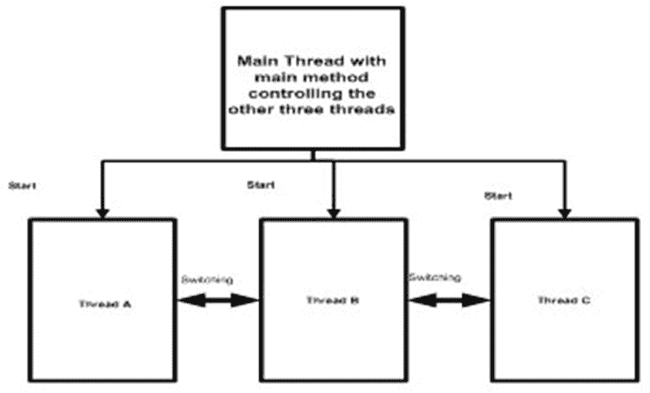

**图 7.1:** 多线程

### 创建线程

可以使用以下两种方法在 Java 中创建线程。

通过扩展 `Thread` 类并重写 `run()` 方法。如果我们想将任何类实现为线程，就必须继承内置的 `Thread` 类。`Thread` 类位于 `java.lang` 包中，我们不需要导入它，因为这是默认包。`Thread` 类有一个 `run()` 方法，该方法必须在派生类中重新定义，并包含我们想要作为线程执行的所有代码。因此程序段的实例如下：

```java
class MyThread extends Thread {
    public void run() {
        for (int i = 0; i < 10; i++) {
            System.out.println(" From MyThread i = " + i);
        }
    }
}
```

现在我们想要执行上述线程，必须像下面从主线程执行：

```java
MyThread ta = new MyThread();
ta.start();
```

在调用 `Thread` 类的 `start` 方法后，线程并不一定会立即运行，因为它可能忙于其他线程，并且可能将其置于可运行状态（runnable state）：

`Thread` 类有许多方法可以与 `Thread` 类对象一起使用。例如，如果我们希望这个线程在 `i = 2` 的时候停止，我们可以写：

```java
if (i == 2)
    ta.stop();
```

`Thread` 类定义了几个帮助管理线程的方法。

| 方法 | 含义 |
| :--- | :--- |
| `getName()` | 获取线程名称。 |
| `getPriority()` | 获取线程的优先级。 |
| `isAlive()` | 确定线程仍在运行。 |
| `join()` | 等待线程终止。 |
| `run()` | 线程的入口点。 |
| `sleep()` | 挂起线程一段时间。 |
| `start()` | 通过调用 `run()` 方法启动线程。 |

以下示例说明了在实现多线程时 `Thread` 类的用法。在多线程中，同一个程序被分为多个线程，由于多个进程将同时执行，输出可以是随机的。我们可以看到线程的输出是不可预测的。

```java
package threadingca;

class A extends Thread {
    public void run() {
        for (int i = 0; i < 10; i++) {
            System.out.println("From A i =" + i);
        }
    }
}

class B extends Thread {
    public void run() {
        for (int j = 0; j < 10; j++) {
            System.out.println("From B j =" + j);
        }
    }
}

class C extends Thread {
    public void run() {
        for (int k = 0; k < 10; k++) {
            System.out.println("From C k =" + k);
        }
    }
}

public class ThreadingMca {
    public static void main(String[] args) throws InterruptedException {
        A threada = new A();
        B threadb = new B();
        C threadc = new C();
        threada.start();
        threadb.start();
        threadc.start();
        for (int j = 1; j < 10; j++) {
            System.out.println("From Main =" + j);
        }
        System.out.println("All done");
    }
}
```

我们将得到以下输出：

`From A i =0`

`From C k =0`


## 线程执行示例

**From B j =0**

**From Main =1**

**From Main =2**

**From Main =3**

**From Main =4**

**From Main =5**

**From Main =6**

**From Main =7**

**From Main =8**

**From Main =9**

**All done**

**From B j =1**

**From B j =2**

**From B j =3**

**From B j =4**

**From B j =5**

**From B j =6**

**From B j =7**

**From B j =8**

**From B j =9**

**From C k =1**

**From C k =2**

**From C k =3**

**From C k =4**

**From C k =5**

**From C k =6**

**From C k =7**

**From C k =8**

**From C k =9**

**From A i =1**

**From A i =2**

**From A i =3**

**From A i =4**

**From A i =5**

**From A i =6**

**From A i =7**

**From A i =8**

**From A i =9**

在下面的多线程程序中，使用了 `Thread` 类的不同方法：

```java
package threadingmca;
class A extends Thread {
    public void run() {
        for(int i=1;i<10;i++) {
            if (i==2)
                stop();
            System.out.println("From A i =" + i);
        }
    }
}
```

```java
class B extends Thread
{
  public void run()
  {
    for(int j= 1 ;j<10 ;j++)
    {
      if (j==2)
        try {
          sleep(1000);
        } catch (InterruptedException e) {
          e.printStackTrace();
        }
        System.out.println("From Thread B j =" + j);
    }
  }
}
class C extends Thread
{
  public void run()
  {
    for(int k= 1 ;k<10 ;k++)
    {
      System.out.println("From Thread C K =" + k);
    }
  }
}
public class ThreadingMca {
  public static void main(String[] args) throws InterruptedException {
    A threada = new A();
    B threadb = new B();
    C threadc = new C();
    threada.start();
    threadb.start();
    threadc.start();
    for(int j= 1 ;j<10 ;j++)
    {
      System.out.println("From Main =" + j);
    }
    System.out.println("All done");
  }
}
```

我们将得到以下输出：

`From Main =1`

`From Thread A i =1`

`From Thread C K =1`

`From Thread C K =2`

`From Thread C K =3`

`From Thread C K =4`

`From Thread C K =5`

`From Thread C K =6`

`From Thread C K =7`

`From Thread C K =8`

`From Thread C K =9`

`From Main =2`

`From Main =3`

`From Main =4`

`From Main =5`

`From Main =6`

`From Main =7`

`From Main =8`

`From Main =9`

`All done`

`From Thread B j =1`

`From Thread B j =2`

`From Thread B j =3`

`From Thread B j =4`

`From Thread B j =5`

`From Thread B j =6`

`From Thread B j =7`

`From Thread B j =8`

`From Thread B j =9`

## Runnable 接口

实现多线程的另一种方法是通过实现 `Runnable` 接口。该 `Runnable` 接口包含一个 `run()` 方法，实现 `Runnable` 接口的类必须实现该方法。所有希望作为线程执行的代码都必须保留在该 `run()` 方法中：

```java
class MyClass implements Runnable
{
  // Code to be executed as thread
}
```

现在，在实现 `Runnable` 后，如下所示从上述 `Runnable` 类实例化创建一个 `Thread` 对象：

```java
MyClass r = new MyClass();
Thread ta = new Thread(r);
```

现在在创建线程类型对象后，通过调用 `Thread` 类的 `start` 方法来启动线程：

```java
ta.start();
```

下面的示例展示了三个不同的类如何实现 `Runnable` 接口并实现了 `run` 方法。在 `main` 方法中创建了 `Thread` 类对象，它们是从这些 `Runnable` 接口类实例化的：

```java
package threadingmca;
class A implements Runnable
{
  public void run()
  {
    for(int i= 1 ;i<10 ;i++)
    {
      System.out.println("From Thread A i =" + i);
    }
  }
}
class B implements Runnable
{
  public void run()
  {
    for(int j= 1 ;j<10 ;j++)
    {
      System.out.println("From Thread B j =" + j);
    }
  }
}
class C implements Runnable
{
  public void run()
  {
    for(int k= 1 ;k<10 ;k++)
    {
      System.out.println("From Thread C K =" + k);
    }
  }
}
public class ThreadingMca {
  public static void main(String[] args) throws InterruptedException {
    A runnablea = new A();
    B runnableb = new B();
    C runnablec = new C();
    Thread ta = new Thread(runnablea);
    Thread tb = new Thread(runnableb);
    Thread tc = new Thread(runnablec);
    ta.start();
    tb.start();
    tc.start();
    for(int j= 1 ;j<10 ;j++)
    {
      System.out.println("From Main =" + j);
    }
    System.out.println("All done");
  }
}
```

我们将得到以下输出：

`From Thread B j =1`

`From Thread C K =1`

`From Thread C K =2`

`From Main =1`

`From Main =2`

`From Main =3`

`From Main =4`

`From Main =5`

`From Main =6`

`From Main =7`

`From Main =8`

`From Main =9`

`All done`

`From Thread C K =3`

`From Thread C K =4`

`From Thread C K =5`

`From Thread C K =6`

`From Thread C K =7`

`From Thread B j =1`

`From Thread B j =2`

`From Thread B j =3`

`From Thread B j =4`

`From Thread B j =5`

`From Thread B j =6`

`From Thread B j =7`

`From Thread B j =8`

`From Thread B j =9`

`From Thread A i =1`

`From Thread A i =2`

`From Thread A i =3`

`From Thread A i =4`

`From Thread A i =5`

`From Thread A i =6`

`From Thread A i =7`

`From Thread A i =8`

`From Thread A i =9`

## 线程优先级示例

以下 Java 程序通过设置线程的优先级创建了多线程另一个示例：

```java
package threadingmca;
class A extends Thread {
    public void run() {
        for(int i= 1 ;i<5 ;i++) {
            System.out.println("From Thread A i =" + i);
        }
    }
    public void start() {
        super.start();
        System.out.println("Thread A Started" );
    }
}
class B extends Thread {
    public void run() {
        for(int j= 1 ;j<5 ;j++) {
            if (j==2)
                try {
                    sleep(1000);
                } catch (InterruptedException e) {
                    e.printStackTrace();
                }
            System.out.println("From Thread B j =" + j);
        }
    }
    public void start() {
        super.start();
        System.out.println("Thread B Started" );
    }
}
class C extends Thread {
    public void run() {
        for(int k= 1 ;k<5 ;k++) {
            System.out.println("From Thread C K =" + k);
        }
    }
    public void start() {
        super.start();
        System.out.println("Thread C Started" );
    }
}
public class ThreadingMca {
    public static void main(String[] args) throws InterruptedException {
        A threada = new A();
        B threadb = new B();
        C threadc = new C();
        threada.setPriority(10);
        threada.start();
        threadb.start();
        threadc.start();
        for(int j= 1 ;j<5 ;j++) {
            System.out.println("From Main =" + j);
        }
        System.out.println("All done");
    }
}
```

我们将得到以下输出：

`Thread A Started`

`From Thread A i =1`

`From Thread A i =2`

`Thread B Started`

`From Thread A i =3`

`From Thread A i =4`

`From Thread B j =1`

`Thread C Started`

`From Main =1`

`From Main =2`

`From Thread C K =1`

`From Main =3`

`From Main =4`

`All done`

`From Thread C K =2`

`From Thread C K =3`

`From Thread C K =4`

`From Thread B j =2`

`From Thread B j =3`

`From Thread B j =4`

## 线程同步

到目前为止，我们将代码放在每个线程的 `run` 方法中。如果线程在 `run` 方法之外访问公共资源呢？例如同一个文件正在被一个线程读取，而另一个线程在同一个文件上写入。这会导致严重的问题。Java 通过将部分代码创建为同步（synchronized）提供了此类常见资源的解决方案：

```java
synchronized void commonupdate {
    ..// 需要同步的代码
    ..
}
```

接下来的 Java 程序解释了 `synchronized` 块的使用。在该程序中，两个线程尝试访问同一个代码块。该块保持为同步状态：

```java
package threadingdemo;
class counter {
    int count;
    public synchronized void increment() {
        count++;
    }
}
public class mc {
    public static void main(String[] args)throws Exception {
        counter obj = new counter();
        Thread ta = new Thread( new Runnable() {
            @Override
            public void run() {
                for(int i=0;i<1000;i++)
                    obj.increment();
            }
        });
        Thread tb = new Thread(new Runnable() {
            @Override
            public void run() {
                for(int j=0;j<1000;j++)
                    obj.increment();
            }
        });
        ta.start();
        tb.start();
        ta.join();
        tb.join();
        System.out.println("Count =" + obj.count);
        System.out.println("End of Program");
    }
}
```

我们将得到以下输出：

`Count =2000`

`End of Program`

在下方的 Java 程序中，产生了三个消息字符串的混合输出。因为没有任何机制阻止这三个线程在同一时间调用同一个对象上的同一个方法。这被称为竞态条件（race condition），因为三个线程正在相互竞争以完成该方法。使用 `synchronized` 关键字重复相同的程序后，会产生正确的输出：


```java
package book;
class Action_Class {
    void call(String content) {
        System.out.print("start " + content);
        try {
            Thread.sleep(1000);
        } catch(InterruptedException e) {
            System.out.println("Exception");
        }
        System.out.println(" end");
    }
}
class Trigger implements Runnable {
    String content;
    Action_Class target;
    Thread t;
    public Trigger(Action_Class targ, String s) {
        target = targ;
        content = s;
        t = new Thread(this);
        t.start();
    }
    public void run() {
        target.call(content);
    }
}
class SyncDemo {
    public static void main(String[] args) {
        Action_Class target = new Action_Class();
        new Trigger(target, "1");
        new Trigger(target, "2");
        new Trigger(target, "3");
    }
}
```

*(注：由于原文后半部分存在截断或复杂的逻辑重复，此处根据上下文翻译并整理了同步部分的逻辑说明)*

### 线程间通信

我们可以通过线程间通信以更细粒度的控制来实现线程同步。为了避免轮询，Java 通过 `wait()`、`notify()` 和 `notifyAll()` 方法提供了良好的线程通信机制。这些方法是在 `Object` 类中实现的，因此所有类都拥有它们。这些方法只能在同步上下文中调用：

* `wait()` 告诉调用线程释放监锁并进入睡眠，直到另一个线程进入监锁并调用 `notify()`。
* `notify()` 唤醒调用过 `wait()` 的线程。
* `notifyAll()` 唤醒所有调用过 `wait()` 的线程。

这些方法在 `Object` 类中声明如下：

```java
final void wait() throws InterruptedException
final void notify()
final void notifyAll()
```

在下面的 Java 程序中，虽然使用了同步块，但我们仍然无法获得预期的输出，因为问题 0 应该得到答案 0，以此类推。在下一个程序中，我们实现了线程间通信来解决这个问题：

```java
package book;
class Ques {
    int n;
    synchronized int get() {
        System.out.println("Answer " + n);
        return n;
    }
    synchronized void put(int n) {
        this.n = n;
        System.out.println("Question " + n);
    }
}
class Teacher implements Runnable {
    Ques Ques;
    Teacher(Ques Ques) {
        this.Ques = Ques;
        new Thread(this, "Teacher").start();
    }
    public void run() {
        int i = 0;
        while(i<5) {
            Ques.put(i++);
        }
    }
}
class Student implements Runnable {
    Ques Ques;
    Student(Ques Ques) {
        this.Ques = Ques;
        new Thread(this, "Student").start();
    }
    public void run() {
        int j=0;
        while(j<5) {
            Ques.get();
            j++;
        }
    }
}
public class ThreadCommunication {
    public static void main(String[] args) {
        Ques q = new Ques();
        new Teacher(q);
        new Student(q);
    }
}
```

```java
public static void main(String args[]) {
    Ques Ques = new Ques();
    new Teacher(Ques);
    new Student(Ques);
}
}
```

我们将得到以下输出：

`Question 0`
`Question 1`
`Question 2`
`Question 3`
`Question 4`
`Answer 4`
`Answer 4`
`Answer 4`
`Answer 4`
`Answer 4`

相同的程序通过进程间通信实现。使用 `wait()`、`notify()` 和 `notifyAll()` 方法来获取进程间通信并实现正确的的结果：

```java
package book;
class Ques1 {
    int n;
    boolean valueSet = false;
    synchronized int get() {
        while(!valueSet)
            try {
                wait();
            } catch(InterruptedException e) {
                System.out.println("InterruptedException caught");
            }
            System.out.println("Answer " + n);
            valueSet = false;
            notify();
            return n;
    }
    synchronized void put(int n) {
        while(valueSet)
            try {
                wait();
            } catch(InterruptedException e) {
                System.out.println("InterruptedException caught");
            }
            this.n = n;
            valueSet = true;
            System.out.println("Question" + n);
            notify();
    }
}
class Teacher1 implements Runnable {
    Ques1 Ques1;
    Teacher1(Ques1 Ques1) {
        this.Ques1 = Ques1;
        new Thread(this, "Teacher1").start();
    }
    public void run() {
        int i = 0;
        while(i<5) {
            Ques1.put(i++);
        }
    }
}
class Student1 implements Runnable {
    Ques1 Ques1;
    Student1(Ques1 Ques1) {
        this.Ques1 = Ques1;
        new Thread(this, "Student1").start();
    }
    public void run() {
        int j = 0;
        while(j<5) {
            Ques1.get();
        }
    }
}
public class InterProcessComm {
    public static void main(String args[]) {
        Ques1 Ques1 = new Ques1();
        new Teacher1(Ques1);
        new Student1(Ques1);
    }
}
```

我们将得到输出：

`Question0`
`Answer 0`
`Question1`
`Answer 1`
`Question2`
`Answer 2`
`Question3`
`Answer 3`
`Question4`
`Answer 4`

# 作业

1. 多线程的优势是什么？它是如何提高 Java 程序效率的？
2. 解释线程的完整生命周期？
3. 在 Java 中实现多线程的不同方式有哪些？请结合相关示例进行说明？
4. `Thread` 类中定义了哪些方法可以挂起和停止线程？
5. 编写一个 Java 程序，解释多线程中同步的作用？

# 第 8 章：Java 中的 Applets

## 引言

Java 主要将 applets 用于网络计算。Applets 是较小的 Java 程序，可以通过 `appletviewer` 或任何支持 applets 的浏览器执行。如果我们想通过 html 页面获取输入、执行某些算术操作、播放声音、显示图形、创建动画以及玩任何交互游戏，可以利用 applets 实现广泛的应用。

## 结构

* 引言
* applets 的特性
* 理解 `Applet` 类
* Applet 生命周期周期
* 理解 `applet` 标签
* 创建带有 applet 的 页面
* 向 applets 传递参数
* 处理 applet 事件
* 作业

## 目标

本章详细介绍了 Applets。在读完本章后，我们应该能够创建 applets 并处理 applet 事件。

## applets 的特性

为了理解基本 applet 的工作原理，让我们用以下代码创建一个 applet：

```java
import java.applet.*;
import java.awt.*;
public class MyApplet extends Applet {
    public void paint(Graphics g) {
        g.drawString(" Welcome to Applets", 20, 20);
    }
}
```

上面的程序创建了一个简单的 applet，显示 `Welcome to Applets`。在使用 applets 时需要注意以下几点：

1. Applets 没有 `main` 方法。Applets 有一个生命周期（将要讨论），执行从 `init()` 方法开始。
2. 为了创建一个 applet，我们必须导入 `java.applet` 包，因为它包含了 `Applet` 类。`Applet` 类为 applet 的实现提供了所有支持，例如启动和停止 applet。它还提供了加载和显示图像的方法，以及加载和播放音频片段的方法。
3. applet 类必须保持为 `public`，因为它可以从类外部访问。在上面的例子中，我们创建了具有 `public` 可见性的 `MyApplet` 类以及具有 `public` 访问修饰符的 `paint` 方法。
4. 要运行 applet，可以使用 `applet` 标签，如下：
   ```html
   /* <applet code=MyApplet Height=200 Width=200> */
   ```
5. 此标签必须包含在多行注释中。执行 applet 时可以使用 `appletviewer`：
   ```bash
   appletviewer MyApplet
   ```
6. 要从 HTML 文件中执行 applet，可以使用以下标签：
   ```html
   <html>
   <body>
       <applet code=MyApplet Height=200 Width=200>
   </body>
   </html>
   ```
7. `paint` 方法可以显示字符串。`Graphics` 对象用于各种方法。`Applet` 类从 `java.applet` 包定义了如下表所示的方法：

| 方法 | 描述 |
| :--- | :--- |
| `void destroy()` | 在 applet 终止之前调用。如果 applet 需要在销毁前进行清理，将覆盖此方法。 |
| `AccessibleContext AccessibleContext()` | 返回对象的访问上下文。 |
| `AppletContext getAppletContext()` | 返回与 applet 关联的上下文。 |
| `String getAppletInfo()` | 返回描述 applet 的字符串。 |
| `AudioClip getAudioClip(URL url)` | 返回位于 `url` 位置的音频片段 `AudioClip` 对象。 |
| `AudioClip getAudioClip(URL url, String clipName)` | 返回位于 `url` 且名为 `clipName` 的音频片段 `AudioClip` 对象。 |
| `URL getCodeBase()` | 返回与调用 applet 关联的 URL。 |
| `URL getDocumentBase()` | 返回调用 applet 的 HTML 文档 URL。 |
| `Image getImage(URL url)` | 返回位于 `url` 位置的图像 `Image` 对象。 |
| `Image getImage(URL url, String imageName)` | 返回位于 `url` 且名为 `imageName` 的图像 `Image` 对象。 |
| `Locale getLocale()` | 返回由各种区域敏感类和方法使用的 `Locale` 对象。 |
| `String getParameter(String paramName)` | 返回与 `paramName` 关联的参数。如果没有找到指定的参数，则返回 `null`。 |
| `String[][] getParameterInfo()` | 返回描述 applet 识别的参数的 `String` 表。表中的每个条目由三个字符串组成：参数名称、类型或范围的描述以及用途的解释。 |
| `void init()` | 在 applet 开始执行时调用。它是任何 applet 被调用的第一个方法。 |
| `boolean isActive( )` | 如果 applet 已启动，返回 true。如果 applet 已停止，则返回 false。 |
| `static final AudioClip newAudioClip(URL url)` | 返回一个 `AudioClip` 对象，它封装了在 `url` 指定位置的音频片段。此方法与 `getAudioClip()` 类似，不同之处它是静态的，不需要 `Applet` 对象即可执行。 |
| `void play(URL url)` | 如果在 `url` 指定的位置找到了音频片段，则播放该片段。 |
| `void play(URL url, String clipName)` | 如果在 `url` 指定的位置找到了名为 `clipName` 的音频片段，则播放该片段。 |
| `void resize(Dimension dim)` | 根据 `dim` 指定的调整 applet 的大小。`Dimension` 是存储在 `java.awt` 内部的一个类。它包含两个整数字段：宽度（width）和高度（height）。 |
| `void resize(int width, int height)` | 根据 `width` 和 `height` 指定的调整 applet 的大小。 |
| `final void setStub(AppletStub stubObj)` | 将 `stubObj` 设置为 applet 的存根（stub）。此方法由运行时使用，通常不由你的 applet 调用。存根是一段很小的代码，提供你的 `applet` 与浏览器之间的连接。 |
| `void showStatus(String str)` | 在浏览器或 applet 查看器的状态窗口中显示 `str`。如果浏览器不支持状态窗口，则不执行任何操作。 |


| `void start()` | 浏览器在 applet 应该开始（或恢复）执行时调用它。当 applet 首次启动时，它会在 `init()` 之后被自动调用。 |
| `void stop()` | 浏览器调用它来暂停 applet 的执行。一旦停止，applet 在调用 `start()` 时重启。 |

**表 8.1:** `Applet` 类定义的方法

### 创建 Applet

每个创建的 applet 都是 `Applet` 类的子类。applet 不是独立程序。相反，它们在网络浏览器或 applet 查看器中运行。applet 的执行并不是从 `main()` 开始的。事实上，很少有 applet 拥有 `main()` 方法。作为替代，applet 的实现是通过完全不同的方法启动和控制的，这将在本章中解释。

这个简单的 applet 是使用记事本创建的。`init()` 方法用于初始化，`paint()` 方法用于显示简单的消息。使用 applet 查看器执行程序：

```java
/*<applet code="MyFirstApplet" width="200" height="400">
</applet>
*/
import java.applet.Applet;
import java.awt.*;
public class MyFirstApplet extends Applet
{
    public void init()
    {
    }
    public void paint(Graphics g)
    {
        g.drawString("Welcome to Applets", 100, 200);
    }
}
```

运行 applet 需要在 HTML 文件中指定。实现这一点的方法之一是使用 `applet 标签`。当启用 Java 的网络浏览器在 HTML 文件中遇到 applet 标签时，将执行该 applet。为了更方便地查看和测试 applet，只需在你的 Java 源代码文件头部包含一个带有 applet 标签的注释。这样，我们的代码就包含了 applet 所需的必要 HTML 语句，你可以通过指定我们的 Java 源代码文件为目标启动 applet 查看器来测试编译后的 applet。以下是此类注释的示例：

```java
/*
<applet code="MyFirstApplet" width="200" height="400">
</applet>
*/
```

此注释包含一个 applet 标签，将在一个宽度为 200 像素、高度为 200 像素的窗口中运行名为 `MyFirstApplet` 的 applet。插入 applet 命令使得测试 applet 变得更容易。使用 applet 查看器生成如下输出：

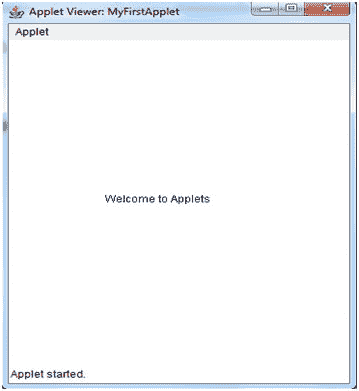

**图 8.1:** 使用 `AppletViewer` 运行的 Applet

一个设置了前景和背景颜色并输出字符串的简单 Java applet：

```java
import java.awt.*;
import java.applet.*;
/*
<applet code="AppletExample2" width=500 height=100>
</applet>
*/
public class AppletExample2 extends Applet{
    String msg;
    // 设置前景和背景颜色。
    public void init() {
        setBackground(Color.cyan);
        setForeground(Color.red);
        msg = "init() Method Invoked";
    }
    // 初始化要显示的字符串。
    public void start() {
        msg += " start() Method Invoked";
    }
    // 在 applet 窗口中显示 msg。
    public void paint(Graphics g) {
        msg += " paint() Method Invoked";
        g.drawString(msg, 50, 30);
    }
}
```

`paint()` 方法在每次 applet 的输出需要重绘时被调用。

`stop()` 方法在 浏览器离开包含该 applet 的 HTML 页面时立即被调用。

`destroy()` 方法在设置认为 applet 需要完全从内存中分离时立即被调用。`stop()` 方法始终在 `destroy()` 之前被调用：

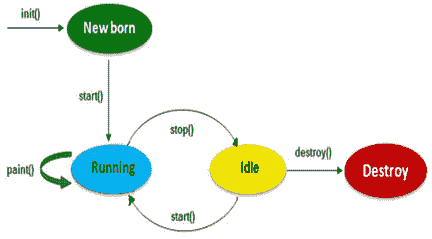

**图 8.5：** Applet 的生命周期

在接下来的 Java 程序中，创建了一个 applet 来演示其生命周期。显示了各种方法执行的顺序：

```java
package book;
import java.applet.Applet;
import java.awt.Graphics;
import java.awt.Label;
public class Applet_Life_Cycle extends Applet {
    String msg="";
    @Override
    public void destroy() {
        super.destroy();
        msg=msg+" Applet Destroyed ";
    }
    @Override
    public void init() {
        Label l = new Label("Life Cycle of Applet");
        add(l);
        super.init();
        msg=msg+" Applet Initialized ";
    }
    @Override
    public void start() {
        super.start();
        msg=msg+" Applet Started ";
    }
    @Override
    public void stop() {
        super.stop();
        msg=msg+" Applet Stopped ";
    }
    public void paint(Graphics g)
    {
        msg=msg+" Paint Method ";
        g.drawString(msg, 100, 100);
    }
}
```

我们将得到以下输出：

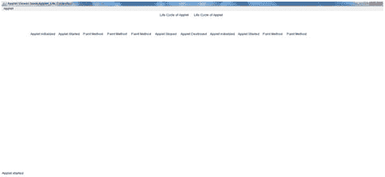

**图 8.6：** Applet 生命周期

### 了解 applet 标签

到目前为止，我们只使用了 applet 的强制性属性，即 `code`、`width` 和 `height`。applet 标签还拥有其他可选属性，可以利用这些属性来增强功能。如前所述，applet 标签可以在带有多行注释的 Java 程序中使用，并可以由 applet viewer 执行。我们还可以在 HTML 内部使用多个 applet 标签。在这两种情况下，applet 标签都可以使用完整的功能。带有强制属性和可选属性的 applet 标签如下：

```html
< APPLET
[CODEBASE = code_baseURL]
CODE = applet_File
[ALT = alternate_Text]
[NAME = applet_Instance_Name]
WIDTH = Inpixels HEIGHT = Inpixels
[ALIGN = alignment]
[VSPACE = Inpixels]
[HSPACE = Inpixels]
[< PARAM NAME = Attribute_Name VALUE = Attribute_Value>]
[< PARAM NAME = Attribute_Name2 VALUE = Attribute_Value>] …
[HTML Displayed in the absence of Java]
</APPLET>
```

applet 标签的每个部分解释如下：

| `[CODEBASE = code_baseURL]` | 指定 applet 代码的基 URL。此属性是可选的。如果没有指定此属性，则使用 HTML 页面的 `URL` 目录作为 `CODEBASE`。 |
| `CODE = applet_File` | 强制性属性，指定包含我们的 applet 编译后的 `.class` 文件的文件名。该文件相对于 applet 的代码基 URL。 |
| `[ALT = alternate_Text]` | `ALT` 标签是一个可选属性，用于指示一条短文本消息，如果浏览器识别 `APPLET` 标签但当前无法运行 Java applet，则显示该消息。 |
| `[NAME = applet_Instance_Name]` | 可选属性，用于指定 applet 实例名称。applet 应该进行命名，以便同一页面上的新 applet 能够通过名称找到它们并与其通信。要通过名称获取 applet，请使用 `getApplet()` 方法。 |
| `WIDTH = Inpixels HEIGHT = Inpixels` | 强制性属性，给出 applet 显示区域的大小（以像素为单位）。 |
| `[ALIGN = alignment]` | 可选属性，指定 applet 的对齐方式。此属性的处理方式与 HTML img 标签类似，其可能的取值为：`LEFT, RIGHT, TOP, BOTTOM, MIDDLE, BASELINE, TEXTTOP, ABSMIDDLE,` 和 `ABSBOTTOM`。 |
| `[VSPACE = Inpixels]` | 此属性是可选的。`VSPACE` 指定 applet 上方的空间（以像素为单位）。 |
| `[HSPACE = Inpixels]` | 此属性是可选的。`HSPACE` 指定 applet 左右两侧的空间（以像素为单位）。 |
| `[< PARAM NAME = Attribute_Name VALUE = Attribute_Value>]` | `PARAM` 标签允许我们在 HTML 页面中指定 applet 特定的参数。Applets 通过 `getParameter()` 方法访问其属性。 |
| `[< PARAM NAME = Attribute_Name2 VALUE = Attribute_Value>] …` | 我们可以有多个参数，并允许我们在 HTML 页面中指定 applet 特定的参数。 |

**表 8.2：** 带有强制属性和可选属性的 applet 标签

### 向 Applets 传递参数

如前所述，`applet` 标签可以将参数传递给 Java 文件。我们可以使用 `param` 标签传递多个参数，并指定名称和值，这些值可以在 Java 文件中进一步处理。`param` 标签具有以下形式：

```html
< PARAM NAME = Attribute_Name1 VALUE = Attribute_Value1>
< PARAM NAME = Attribute_Name2 VALUE = Attribute_Value2>
```

例如，如果我们想向 applet 传递 `sname` 和 `marks`，在 `applet` 标签中使用：

```html
<applet code="ParameterPassing" width=300 height=80>
<param name=CourseName value=Java>
<param name=marks value=300>
</applet>
```

现在，为了在 Java 程序中获取值，使用如下代码：

```java
import java.applet.*;
import java.awt.*;
public class ParameterPassing extends Applet{
    String CourseName="nnn";
    int marks_1;
    String Result;
    boolean active;
    public void start()
    {
        super.start();
        String param;
        CourseName = getParameter("CourseName");
        if(CourseName == null)
        CourseName = "Not Found";
        param = getParameter("marks");
        try {
        if(param != null) // 如果找到
        marks_1 = Integer.parseInt(param);
        else
        marks_1 = 0;
        } catch(NumberFormatException e)
        {
        marks_1 = -1;
        }
        Result = getParameter("Result");
        param = getParameter("next_class");
        if(param != null)
        active = Boolean.valueOf(param).booleanValue();
    }
    public void init()
    {
    }
    // 显示参数。
    public void paint(Graphics g)
    {
        g.drawString("Course Name: " + CourseName, 0, 10);
        g.drawString("Marks : " + marks_1, 0, 26);
        g.drawString("Result: " + Result, 0, 42);
        g.drawString("Next Class: " + active, 0, 58);
    }
}
```

因此，我们能够通过 `applet` 标签从 HTML 文件获取参数。

### 创建带有 Applet 的网页

如前所述，我们可以创建一个 HTML 文件来包含 applet 标签；通过带有以下代码的 HTML 文件来实现：

```html
<html>
<body bgcolor = "CYAN">
<h1> Welcome to applets through HTML</h1>
<applet code="AppletBanner" width=300 height=80>
</applet>
</body>
</html>
```

通过浏览器执行上述 HTML 文件后生成的输出如下：


**图 8.8**

事件处理将在`第 10 章：Java 中的事件处理`中详细讨论。但我们仍然可以查看一些使用 applet 的事件处理程序。

下面的程序 applet 响应鼠标事件。


```java
package myfirstapplet;

import java.applet.*;
import java.awt.Dimension;
import java.awt.Graphics;
import java.awt.Image;
import java.awt.*;
import java.awt.event.*;
import java.net.URL;
import java.util.Locale;
import javax.accessibility.AccessibleContext;
public class abc extends Applet implements MouseListener
{
    int x,y;
    public void init()
    {
        Label l=new Label("Click at any place on Applet");
        add(l);
        addMouseListener(this);
    }
    public void paint(Graphics g)
    {
        g.drawString("*", x, y);
        showStatus("You Clicked on Applet");
    }

    @Override
    public void mouseClicked(MouseEvent arg0) {
        // TODO Auto-generated method stub
        x= arg0.getX();
        y= arg0.getY();
        repaint();
    }

    @Override
    public void mouseEntered(MouseEvent arg0) {
        // TODO Auto-generated method stub
    }

    @Override
    public void mouseExited(MouseEvent arg0) {
        // TODO Auto-generated method stub
    }

    @Override
    public void mousePressed(MouseEvent arg0) {
        // TODO Auto-generated method stub
    }

    @Override
    public void mouseReleased(MouseEvent arg0) {
        // TODO Auto-generated method stub
    }
}
```

我们将得到以下输出：

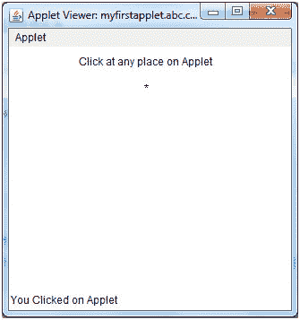

**图 8.9：** 运行 Applet

下面的 applet 根据用户对两个按钮的响应计算两个数字的加法减法：

```java
package eventhandlingdemo;

import java.applet.Applet;
import java.awt.*;
import java.awt.event.KeyEvent;
import java.awt.event.KeyListener;
import java.awt.event.MouseAdapter;
import java.awt.event.MouseEvent;
import java.awt.event.MouseListener;
public class eventhandling extends Applet {
    TextField tf;
    TextField tf2;
    Button bplus;
    Button bMinus;
    String msg;
    int n1,n2,n3;

    @Override
    public void init() {
        // TODO Auto-generated method stub
        Label l1 = new Label("Enter the numbers");
        tf= new TextField(20);
        tf2= new TextField(20);
        bplus= new Button("Addition");
        bMinus= new Button("Subtraction");
        add(l1);
        add(tf);
        add(tf2);
        add(bplus);
        add(bMinus);
        bplus.addMouseListener( new add());
        bMinus.addMouseListener(new add());
    }

    @Override
    public void paint(Graphics g)
    {
        g.drawString(msg + n3, 100, 200);
    }
    public class add extends MouseAdapter
    {
        public void mouseClicked(MouseEvent arg0) {
            // TODO Auto-generated method stub
            if (arg0.getSource() == bplus)
            {
                n1= Integer.parseInt(tf.getText());
                n2= Integer.parseInt(tf2.getText());
                n3=n1+n2;
                msg ="Addition =";
            }
            else
            {
                n1= Integer.parseInt(tf.getText());
                n2= Integer.parseInt(tf2.getText());
                n3=n1-n2;
                msg ="Subtraction =";
            }
            repaint();
        }
    }
}
```

我们将得到以下输出：

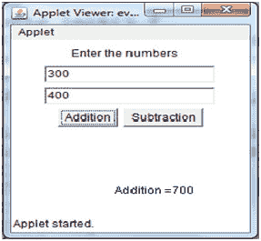

**图 8.10**

# 作业

1. applet 与普通的 Java 应用程序有什么不同？

2. 解释 applet 的生命周期？利用 `showStatus()` 方法来显示 applet 的各种状态？

3. 创建一个 applet，对文本框中输入的文本执行各种字符串操作？

4. 解释 `PARAM` 标签？编写一个从 HTML 页面接收两个参数的程序？

5. 开发一个执行计算器所有操作的 applet？

# 第 9 章

# Java 中的输入与输出

## 引言

在本章中，我们将讨论 Java 中最重要的包之一，即 `java.io` 包。正如名称所示，我们将使用 `java.io` 包。

| `ObjectOutputStream` | 对象的输出流 |
| :--- | :--- |
| `OutputStream` | 描述流输出的抽象类 |
| `PipedInputStream` | 输入管道。 |
| `PipedOutputStream` | 输出管道。 |
| `PrintStream` | 包含 `print()` 和 `println()` 的输出流。 |
| `PushbackInputStream` | 支持单字节重置（unget）的输入流，它可以向输入流返回一个字节。 |
| `RandomAccessFile` | 支持随机访问文件 I/O。 |
| `SequenceInputStream` | 两个或多个输入流的组合，这些流将按顺序一个接一个地读取。 |

**表 9.1：** 字节流类

`InputStream` 是一个抽象类，定义了 Java 的字节输入流模型。该类中的大多数方法会在发生错误时抛出 `IOException`。`InputStream` 中的方法列如表 9.2 所示：

| 方法 | 描述 |
| :--- | :--- |
| `int available( )` | 返回当前可读的输入字节数。 |
| `void close( )` | 关闭输入源。后续的读取尝试将产生 `IOException`。 |
| `void mark(int numBytes)` | 在输入流的当前位置放置标记，该标记在读取 `numBytes` 个字节之前有效。 |
| `boolean markSupported( )` | 如果调用流支持 `mark( )/reset( )`，则返回 true。 |
| `int read( )` | 返回下一个可用字节的整数表示。遇到文件末尾时返回 -1。 |
| `int read(byte buffer[ ])` | 尝试向缓冲区读取最多 `buffer.length` 个字节，并返回实际读取的实际字节数。遇到文件末尾时返回 -1。 |
| `int read(byte buffer[ ], int offset, int numBytes)` | 尝试从 `buffer[offset]` 开始向缓冲区读取最多 `numBytes` 个字节，返回实际读取的字节数。遇到文件末尾时返回 -1。 |
| `void reset( )` | 将输入指针重置为之前设置的标记。 |
| `long skip(long numBytes)` | 忽略（跳过）`numBytes` 个输入字节，返回实际忽略的字节数。 |

**表 9.2：** `InputStream` 定义的方法

`OutputStream` 是一个定义字节输出的抽象类。表 9.3 显示了 `OutputStream` 的方法：

| 方法 | 描述 |
| :--- | :--- |
| `void close( )` | 关闭输出流。后续的写入尝试将产生 `IOException`。 |
| `void flush( )` | 结束输出状态以便清除任何缓冲区。也就是说，刷新输出缓冲区。 |
| `void write(int b)` | 向输出流写入单个字节。注意参数是 int，这允许你直接对表达式调用 `write( )` 而无需将其转换回字节。 |
| `void write(byte buffer[ ])` | 向输出流写入完整的字节数组。 |
| `void write(byte buffer[ ], int offset, int numBytes)` | 从 `buffer[offset]` 开始向输出流写入 `numBytes` 个字节范围。 |

**表 9.3：** `OutputStream` 定义的方法

## 字符流类

字符流通过两个类层次结构定义。顶部是两个抽象类：`Reader` 和 `Writer`。这些抽象类处理 Unicode 字符流。Java 为这些类提供了几个具体的子类。字符流类如下所示：

| 流类 | 含义 |
| :--- | :--- |
| `BufferedReader` | 缓冲输入字符流。 |
| `BufferedWriter` | 缓冲输出字符流。 |
| `CharArrayReader` | 从字符数组的输入流。 |
| `CharArrayWriter` | 向字符数组写入的输出流。 |
| `FileReader` | 从文件读取的输入流。 |
| `FileWriter` | 向文件写入的输出流。 |
| `FilterReader` | 过滤器。 |
| `FilterWriter` | 过滤器 writer。 |
| `InputStreamReader` | 将字节转换为字符的输入流。 |
| `LineNumberReader` | 统计行的输入流。 |
| `OutputStreamWriter` | 将字符转换为字节的输出流。 |
| `PipedReader` | 输入管道。 |
| `PipedWriter` | 输出管道。 |
| `PrintWriter` | 包含 `print()` 和 `println()` 的输出流。 |
| `PushbackReader` | 允许字符返回输入流的输入流。 |
| `Reader` | 描述字符流输入的抽象类。 |
| `StringReader` | 从字符串读取的输入流。 |
| `StringWriter` | 向字符串写入的输出流。 |
| `Writer` | 描述字符流输出的抽象类。 |

**表 9.4：** java.io 中定义的字符流类

`Reader` 是一个抽象类，定义了 Java 的字符输入流模型。表 9.5 提供了 `Reader` 方法的概述：

| 方法 | 描述 |
| :--- | :--- |
| `abstract void close( )` | 关闭输入源。后续的读取尝试将产生 `IOException`。 |
| `void mark(int numChars)` | 在输入流的当前位置放置标记，该标记在读取 `numChars` 个字符之前有效。 |
| `boolean markSupported( )` | 如果此流支持 `mark( )/reset( )`，则返回 true。 |
| `int read( )` | 返回输入流中下一个可用字符的整数表示。遇到文件末尾时返回 -1。 |
| `int read(char buffer[ ])` | 尝试向缓冲区读取最多 `buffer.length` 个字符，并返回实际读取的字符数。遇到文件末尾时返回 -1。 |
| `int read(char buffer[ ], int offset, int numChars)` | 尝试从 `buffer[offset]` 开始向缓冲区读取最多 `numChars` 个字符，返回实际读取的字符数。遇到文件末尾时返回 -1。 |
| `boolean ready( )` | 如果下一次读取不需要等待，则返回 true。否则返回 false。 |
| `void reset( )` | 将输入指针重置为之前设置的标记。 |
| `long skip(long nChars)` | 忽略（跳过）`nChars` 个输入字符，返回实际忽略的字符数。 |

**表 9.5：** `Reader` 定义的方法

`Writer` 是一个定义字符输出的抽象类。`Writer` 类的各种方法如下：

| 方法 | 描述 |
| :--- | :--- |
| `append(char ch)` | 将 `ch` 追加到输出流的末尾。返回调用流的引用。 |
| `append(CharSequence chars)` | 将 `chars` 追加到输出流的末尾。返回调用流的引用。 |
| `append(CharSequence chars, int begin, int end)` | 将 `begin` 和 `end` 指定的 `chars` 追加到输出流的末尾。返回调用流的引用。 |
| `void close( )` | 关闭输出流。后续的写入尝试将产生 `IOException`。 |
| `void flush( )` | 结束输出状态以便清除任何缓冲区。也就是说，刷新输出缓冲区。 |
| `void write(int ch)` | 向输出流写入单个字符。注意参数是 int，这允许你直接对表达式调用 `write( )` 而无需将其转换回字符。 |
| `void write(char buffer[ ])` | 向输出流写入完整的字符数组。 |
| `void write(char buffer[ ], int offset, int numChars)` | 从缓冲区 `buffer[offset]` 开始向输出流写入 `numChars` 个字符范围。 |
| `void write(String str)` | 向输出流写入 `str`。 |
| `void write(String str, int offset, int numChars)` | 从 `string str` 的指定偏移量开始写入 `numChars` 个字符范围。 |

以下接口在 `java.io` 中被定义：

| `Closeable` | `FileFilter` | `ObjectInputValidation` |
| :--- | :--- | :--- |
| `DataInput` | `FilenameFilter` | `ObjectOutput` |
| `DataOutput` | `Flushable` | `ObjectStreamConstants` |
| `Externalizable` | `ObjectInput` | `Serializable` |

**表 9.7:** `java.io` 中的接口

两个通过缓冲输入输出来提高性能的重要类是 `BufferedReader` 和 `BufferedWriter`。`BufferedReader` 有两个构造函数：

`BufferedReader(Reader inputStream)`

`BufferedReader(Reader inputStream, int bufSize)`

`BufferedWriter` 拥有以下两个构造函数：

`BufferedWriter(Writer outputStream)`

`BufferedWriter(Writer outputStream, int bufSize)`

以下示例说明了上述类的用法。


该程序使用了 `BufferedReader` 类，该类反而使用 `InputStreamReader` 和 `System.in` 作为其构造函数的参数，以便从用户处获取输入。程序使用了 `BufferedReader` 的 `read` 方法：

```java
package book;
import java.io.*;
class InputExample {
    public static void main(String args[]) {
        char in;
        try {
            BufferedReader br = new BufferedReader(new InputStreamReader(System.in));
            System.out.println("Enter Anything you want, '0' to quit.");
            do {
                in = (char) br.read();
                System.out.println(in);
            } while(in != '0');
        } catch(IOException e) {
            System.out.println("Error While reading");
        }
    }
}
```

我们将得到以下输出：

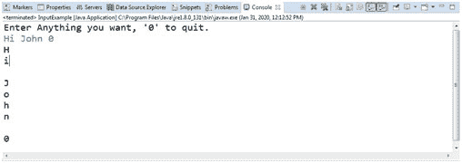

**图 9.2**

以下程序使用了 `BufferedReader` 类，该类反而使用 `InputStreamReader` 和 `System.in` 作为其构造函数的参数，通过利用 `readLine` 方法以行的形式从用户处获取输入。

```java
package book;
import java.io.*;
class InputExamples {
    public static void main(String args[]) throws IOException {
        BufferedReader br = new BufferedReader(new InputStreamReader(System.in));
        String str;
        System.out.println("Please Write Something");
        System.out.println("Enter 'exit' to quit.");
        do {
            str = br.readLine();
            System.out.println(str);
        } while(!str.equals("stop"));
    }
}
```

我们将得到以下输出：

`Please Write Something`

`Enter 'exit' to quit.`

`Hello Dear`

`Hello Dear`

`How are you`

`How are you`

`stop`

`stop`

## Java 中的文件处理

`File` 类是 `java.io` 包中的一个关键类。`File` 类对象用于实现或操作与磁盘上文件相关的信息，例如权限、时间、日期和目录路径，以及在子目录层级中导航。

可以使用以下构造函数创建 `File` 对象：

`File(String directoryPath)`

`File(String directoryPath, String filename)`

`File(File dirObj, String filename)`

`File(URI uriObj)`

一些实用的 File 方法如下：

| 方法 | 说明 |
| :--- | :--- |
| `String getName()` | 获取文件名称。 |
| `String getPath()` | 获取文件路径。 |
| `String getAbsolutePath()` | 获取文件的绝对路径。 |
| `String getParent()` | 获取文件的父目录。 |
| `boolean exists()` | 如果文件存在则返回 `true`，否则返回 `false`。 |
| `boolean isFile()` | 如果是一个 `File` 则返回 `true`。 |
| `long length()` | 返回文件的长度。 |
| `void deleteOnExit()` | 当 `JVM` 终止时删除调用对象关联的文件。 |
| `long getFreeSpace()` | 返回调用对象关联分区上可用的可用字节数。 |
| `long getTotalSpace()` | 返回调用对象关联分区的存储容量。 |
| `long getUsableSpace()` | 返回调用对象关联分区上可用的可用字节数。 |
| `boolean isHidden()` | 如果调用文件是隐藏的则返回 `true`。否则返回 `false`。 |
| `boolean setLastModified(long millisec)` | 将调用文件的时间戳设置为 `millisec` 指定的值，`millisec` 是从协调世界时 (UTC) 1970 年 1 月 1 日开始的毫秒数。 |
| `boolean setReadOnly()` | 将调用文件设置为只读。 |

**表 9.8:** File 类的方法

正如在前一节中讨论过的，我们可以使用流类来向包括文件在内的不同设备读写数据。文件处理中使用的两个重要类是 `FileInputStream` 和 `FileOutputStream`。

`FileInputStream` 类创建一个 `InputStream`，我们可以用它从文件中读取字节。`FileOutputStream` 类创建一个 `OutputStream`，我们可以用它向文件写入字节。

正如我们讨论过的，字符流类被称为 `Writer` 和 `Reader`。`FileReader` 类创建一个 `Reader`，我们可以用它来读取文件内容。它的两个主要构造函数在此所示：

`FileReader(String filePath)`

`FileReader(File fileObj)`

其中任何一个构造函数都可能抛出 `FileNotFoundException`。

以下示例展示了如何从文件中读取行并将其打印到标准输出流中。它读取了自身的源文件，该文件必须位于当前目录下：

```java
import java.io.*;

public class ReaderWriterDemo {
    public static void main(String args[]) throws IOException
    {
        FileReader fr = new FileReader("Demo.java");
        BufferedReader br = new BufferedReader(fr);
        String s;
        while((s = br.readLine()) != null)
        {
            System.out.println(s);
        }
        fr.close();
    }
}
```

`FileWriter` 创建了一个我们可以用来向文件写入内容的 `Writer`。这里展示了它最常用的构造函数：

`FileWriter(String filePath)`

`FileWriter(String filePath, boolean append)`

`FileWriter(File fileObj)`

`FileWriter(File fileObj, boolean append)`

它们可能会抛出 `IOException`。下面的程序说明了 `FileWriter` 和 `FileReader` 类的用法。这两个文件是通过分别向两个文件写入文本并逐一读取内容创建的：

```java
package book;
import java.io.*;
public class ReaderWriterDemo {
    public static void main(String args[]) throws IOException
    {
        String source = "Hello, Its working in Files\n ";
        char buffer[] = new char[source.length()];
        source.getChars(0, source.length(), buffer, 0);
        FileWriter f0 = new FileWriter("demofile.txt");
        // Writing All Characters to demofile
        for (int i=0; i < buffer.length; i ++)
        {
            f0.write(buffer[i]);
        }
        f0.close();
        // Reading the demo file
        System.out.println("Reading the First File ");
        FileReader fin = new FileReader("demofile.txt");
        for (int i=0; i < buffer.length; i ++)
        {
            buffer[i]=(char)fin.read();
            System.out.print(buffer[i]);
        }
        int l = buffer.length;
        fin.close();
        //Writing alternate characters to file1
        FileWriter f1 = new FileWriter("file1.txt");
        for (int i=0; i < buffer.length; i +=2)
        {
            f1.write(buffer[i]);
        }
        f1.close();
        System.out.println("Reading the Second File with alternate characters ");
        FileReader f2 = new FileReader("file1.txt");
        int i;
        while((i=f2.read())!=-1)
        {
            System.out.print((char)i);
        }
        f2.close();
    }
}
```

我们将得到如下输出：

`Reading the First File`

`Hello, Its working in Files`

`Reading the Second File with alternate characters`

`Hlo t okn nFls`

## 习题

1. 区分 `ByteStream`（字节流）和 `CharacterStream`（字符流）？

2. 编写一个 Java 程序，接受用户输入的 N 个字符串并按排序显示名称？

3. 读取一个文件的内容，并将偶数写入第二个文件，将奇数写入第三个文件？

4. 解释 Java 中读写文件时使用的各种方法？

5. 区分 `InputStream`（输入流）和 `Reader`（读取器）类？

# 第 10 章

## Java 事件处理

## 引言

Java 开发的重要领域之一是事件处理。在图形用户界面（GUI）程序中，用户必须在文本框中输入内容并点击不同类型的按钮，如提交、取消、OK 等。在这些情况下，程序员理解事件处理是至关重要的。在本章中，将探索有助于实现事件处理的包，如 `java.awt`、`java.awt.event` 和 `java.util`。由于前面的章节讨论了 applet 是我们在互联网上运行的 GUI 程序，因此将探索 applet 中的事件处理。

当用户响应基于图形用户界面的程序时，会产生大量的我们程序将采取行动的事件。事件以事件对象的形式传递，通过多种方式指定已发生事件的细节，具体方法取决于实际发生的事件。本章将讨论由鼠标、键盘和各种 GUI 控制生成的各种类型的事件。

在本章中，我们将详细讨论委托事件模型（delegation event model），并尝试从零开始了解事件是如何工作的，以及参与事件处理的不同类和接口。

## 结构

- 引言
- 委托事件模型
- 事件源
- 事件监听器
- 事件类
- 使用适配器类（adapter classes）
- 匿名内部类
- 习题

## 目标

本章提供了对事件处理的详细理解，旨在处理基于 GUI 的 Java 程序中的所有事件。

## 委托事件模型

处理事件最先进的方法是委托事件模型。我们需要首先的是事件。简单来说，事件是状态的改变。事件以事件对象的形式传递，通过多种方式指定已发生事件的细节，具体方法取决于实际发生的事件。本章将讨论由鼠标、键盘和各种 GUI 控制生成的各种类型的事件。

委托事件模型展示了事件源如何与监听器交互。委托事件模型的详细图如下所示：


在委托事件模型中，事件源是事件的起源。事件的产生是用户访问图形用户界面元素的结果。产生事件的原因包括点击按钮、使用键盘输入字符、在列表中选择以及点击鼠标的左键、右键或中间键。

事件源是产生事件的对象。这发生在对象的内部状态发生微变化时。事件源可能会产生多种类型的事件。

事件处理中最关键的步骤是注册。事件源必须注册自身。注册的通用格式为：

`public void addTypeListener(TypeListener evli)`

在这个通用格式中，type 是事件名称，`evli` 是事件监听器的引用。例如，注册鼠标监听器的方法是 `addMouseListener()`。注册动作监听器的方法是 `addActionListener()`。当事件触发时，所有注册的监听器都会收到并收集事件对象的副本。例如，如果我们想处理 `Button` 对象和 `TextField` 对象的鼠标事件，那么这两个对象都需要如下注册 `MouseListener`：

```java
Button b1 = new Button("OK");
TextField tf = new TextField();
b1.addMouseListener(this);
tf.addMouseListener(this);
```

委托事件模型的所有组件将在后续章节中逐一解释。

## 事件源

在委托事件模型中，事件源必须向 `Listener` 注册自身。图形用户界面中的某些事件源列如下表所示：

| 事件源 | 描述 |
| :--- | :--- |
| `Button` | 当按钮按下时产生动作事件。 |
| `Check box` | 当复选框被选中或取消选中时产生项目事件。 |
| `Choice` | 当选择改变时产生项目事件。 |
| `List` | 当项目被双击时产生动作事件；当项目被选中或取消选中时产生项目事件。 |
| `Menu Item` | 当选中菜单项时生成动作事件；当可勾选菜单项被选中或取消勾选时，生成项目事件。 |
| `Scroll bar` | 当操作滚动条时生成调整事件。 |
| `Text components` | 当用户输入字符时生成文本事件。 |
| `Window` | 当窗口被激活、关闭、去激活、取消最小化、最小化、打开或退出时，生成窗口事件。 |

**表 10.1：** 事件源

### 事件监听器

监听器（Listener）是一个在事件发生时会被告知通知的对象。事件监听器的两个最基本的必要条件是：首先，它必须已在一个或多个源注册，以便接收有关特定类型事件的通知；其次，它应该实现方法来接收并处理这些通知。

例如，如果一个 `Button` 对象向 `MouseListener` 接口注册，它必须实现其所有接收和处理事件的方法。这些方法定义在 `java.awt.event` 中的一组接口中。例如，`MouseListener` 接口定义了五个方法，用于在鼠标被点击时接收通知：

```java
void mouseClicked(MouseEvent me)
{
    // 鼠标被点击时要执行的操作
}

void mouseEntered(MouseEvent me)
{
    // 鼠标进入控件时要执行的操作
}

void mouseExited(MouseEvent me)
{
    // 鼠标离开控件时要执行的操作
}

void mousePressed(MouseEvent me)
{
    // 鼠标按钮按下时要执行的操作
}

void mouseReleased(MouseEvent me)
{
    // 鼠标按钮松开时要执行的操作
}
```

下表列出了可用的接口以及事件监听器需要实现的方法：

| 接口 | 方法 | 描述 |
| :--- | :--- | :--- |
| `ActionListener` | `void actionPerformed(ActionEvent ae)` | 定义了一个接收动作事件的方法。 |
| `AdjustmentListener` | `void adjustmentValueChanged(AdjustmentEvent ae)` | 定义了一个接收调整事件的方法。 |


| `ComponentListener` | `void componentResized(ComponentEvent ce)` `void componentMoved(ComponentEvent ce)` `void componentShown(ComponentEvent ce)` `void componentHidden(ComponentEvent ce)` | 定义了四个方法，用于识别组件何时隐藏、移动、调整大小或显示。 |

| `ContainerListener` | `void componentAdded(ContainerEvent ce)` `void componentRemoved(ContainerEvent ce)` | 定义了两个方法，识别组件何时被添加到或从容器中移除。 |

| `FocusListener` | `void focusGained(FocusEvent fe)` `void focusLost(FocusEvent fe)` | 定义了两个方法，识别组件何时获得或丢失键盘焦点。 |

| `ItemListener` | `void itemStateChanged(ItemEvent ie)` | 定义了一个方法，识别项目状态何时改变。 |

| `KeyListener` | `void keyPressed(KeyEvent ke)` `void keyReleased(KeyEvent ke)` `void keyTyped(KeyEvent ke)` | 定义了三个方法，识别按键何时被按下、松开或输入。 |

| `MouseListener` | `void mouseClicked(MouseEvent me)` `void mouseEntered(MouseEvent me)` `void mouseExited(MouseEvent me)` `void mousePressed(MouseEvent me)` `void mouseReleased(MouseEvent me)` | 定义了五个方法，识别鼠标何时被点击、进入组件、离开组件、按下或松开。 |

| `MouseMotionListener` | `void mouseDragged(MouseEvent me)` `void mouseMoved(MouseEvent me)` | 定义了两个方法，识别鼠标何时被拖动或移动。 |

| `MouseWheelListener` | `void mouseWheelMoved(MouseWheelEvent mwe)` | 定义了一个方法，识别滚轮何时移动。 |

| `TextListener` | `void textChanged(TextEvent te)` | 定义了一个方法，识别文本值何时改变。 |

| `WindowFocusListener` | `void windowGainedFocus(WindowEvent we)` `void windowLostFocus(WindowEvent we)` | 定义了两个方法，识别窗口何时获得或丢失输入焦点。 |

| `WindowListener` | `void windowActivated(WindowEvent we)` `void windowClosed(WindowEvent we)` `void windowClosing(WindowEvent we)` `void windowDeactivated(WindowEvent we)` `void windowDeiconified(WindowEvent we)` `void windowIconified(WindowEvent we)` `void windowOpened(WindowEvent we)` | 定义了七个方法，识别窗口何时被激活、关闭、去激活、取消最小化、最小化、打开或退出。 |

**表 10.2：** 具有抽象方法的事件监听器

### 事件类

一旦对象注册监听器，它就会向监听器内部的方法发送通知。在通知方法的同时，一个事件对象会被发送到监听器，该对象封装了已发生事件的细节。因此，事件对象是 Java 事件处理的核心。例如，如果我们如下所示将 `TextField` 对象注册到 `KeyListener` 接口上：

```java
TextField tf = new TextField();
tf.addKeyListener(this);
```

`KeyListener` 接口有三个方法，由事件监听器实现。所有三个方法都必须如下所示实现：

```java
void keyPressed(KeyEvent ke) {
}

void keyReleased(KeyEvent ke) {
}

void keyTyped(KeyEvent ke) {
}
```

一旦我们按下任何键，我们都想知道输入的是哪个键，例如，我们这样使用 `KeyEvent` 类：

```java
char ch = ke.getKeyChar();
```

各种事件类列如如下所示：

| 事件类 | 描述 |
| :--- | :--- |
| `ActionEvent` | 当按钮被按下、列表项被点击或菜单项被选中时生成。 |
| `AdjustmentEvent` | 当滚动条被操作时生成。 |
| `ComponentEvent` | 当组件隐藏、移动、调整大小或显示时生成。 |
| `ContainerEvent` | 当组件被添加到或从容器中移除时生成。 |
| `FocusEvent` | 当组件获得或丢失键盘焦点时生成。 |
| `InputEvent` | 输入事件的抽象父类。 |
| `ItemEvent` | 当复选框或列表项被点击；也当选择产生或可勾选菜单项被选中/取消勾选时生成。 |
| `KeyEvent` | 从键盘接收输入时生成。 |
| `MouseEvent` | 当鼠标被拖动、移动、点击、按下或松开时生成；也当鼠标进入或离开组件时生成。 |
| `MouseWheelEvent` | 当滚轮移动时生成。 |
| `TextEvent` | 当文本区域或字段的值改变时生成。 |
| `WindowEvent` | 当窗口被激活、关闭、去激活、取消最小化、最小化、打开或退出时生成。 |

**表 10.3：** 事件类

| `ActionEvent` | `ActionEvent(Object src, int type, String cmd)` `ActionEvent(Object src, int type, String cmd, int modifiers)` `ActionEvent(Object src, int type, String cmd, long when, int modifiers)` | `String getActionCommand()` `int getModifiers()` `long getWhen()` | `ALT_MASK, CTRL_MASK META_MASK SHIFT_MASK ACTION, PERFORMED` |
| `AdjustmentEvent` | `AdjustmentEvent(Adjustable src, int id, int type, int data)` | `int getAdjustmentType()` `Adjustable getAdjustable()` `int getValue()` | `BLOCK_INCREMENT`, `BLOCK_DECREMENT`, `TRACK`, `UNIT_DECREMENT`, `UNIT_INCREMENT` |
| `ComponentEvent` | `ComponentEvent(Component src, int type)` | `Component getComponent()` | `COMPONENT_HIDDEN`, `COMPONENT_MOVED`, `COMPONENT_RESIZED`, `COMPONENT_SHOWN` |
| `ContainerEvent` | `ContainerEvent(Component src, int type, Component comp)` | `Container getContainer()` `Component getChild()` | `COMPONENT_ADDED and COMPONENT_REMOVED` |
| `FocusEvent` | `FocusEvent(Component src, int type)` `FocusEvent(Component src, int type, boolean temporaryFlag)` `FocusEvent(Component src, int type, boolean temporaryFlag, Component other)` | `Component getOppositeComponent()` `boolean isTemporary()` | `FOCUS_GAINED`, `FOCUS_LOST` |
| `InputEvent` | `abstract class inherited by KeyEvent and MouseEvent` | `boolean isAltDown()` `boolean isAltGraphDown()` `boolean isControlDown()` `boolean isMetaDown()` `boolean isShiftDown()` `int getModifiers()` | `BUTTON1_MASK`, `CTRL_MASK`, `ALT_MASK`, `BUTTON2_MASK`, `META_MASK`, `ALT_GRAPH_MASK`, `BUTTON3_MASK`, `SHIFT_MASK` |
| `ItemEvent` | `ItemEvent(ItemSelectable src, int type, Object entry, int state)` | `Object getItem()` `ItemSelectable getItemSelectable()` `int getStateChange()` | `DESELECTED`, `SELECTED`, `ITEM_STATE_CHANGED` |
| `KeyEvent` | `KeyEvent(Component src, int type, long when, int modifiers, int code, char ch)` | `char getKeyChar()` `int getKeyCode()` | `KEY_PRESSED`, `KEY_RELEASED`, `KEY_TYPED`, `VK_DOWN`, `VK_ENTER`, `VK_ALT`, `VK_LEFT`, `VK_RIGHT`, `VK_UP`, `VK_PAGE_DOWN` |
| `MouseEvent` | `MouseEvent(Component src, int type, long when, int modifiers, int x, int y, int clicks, boolean triggersPopup)` | `int getX()` `int getY()` `Point getPoint()` `void translatePoint(int x, int y)` `int getClickCount()` `boolean isPopupTrigger()` `int getButton()` `Point getLocationOnScreen()` `int getXOnScreen()` `int getYOnScreen()` | `MOUSE_CLICKED`, `MOUSE_DRAGGED`, `MOUSE_ENTERED`, `MOUSE_EXITED`, `MOUSE_MOVED`, `MOUSE_PRESSED`, `MOUSE_RELEASED`, `MOUSE_WHEEL`, `NOBUTTON`, `BUTTON1`, `BUTTON2`, `BUTTON3` |
| `MouseWheelEvent` | `MouseWheelEvent(Component src, int type, long when, int modifiers, int x, int y, int clicks, boolean triggersPopup, int scrollHow, int amt, int cnt)` | `int getWheelRotation()` `int getScrollType()` `int getScrollAmount()` | `WHEEL_BLOCK_SCROLL`, `WHEEL_UNIT_SCROLL` |
| `TextEvent` | `TextEvent(Object src, int type)` | `String paramString()` | `TEXT_VALUE_CHANGED` |
| `WindowEvent` | `WindowEvent(Window src, int type)` `WindowEvent(Window src, int type, Window other)` `WindowEvent(Window src, int type, int fromState, int toState)` | `Window getWindow()` `int getOldState()` `int getNewState()` | `WINDOW_ACTIVATED`, `WINDOW_CLOSED`, `WINDOW_CLOSING`, `WINDOW_DEACTIVATED`, `WINDOW_DEICONIFIED`, `WINDOW_GAINED_FOCUS`, `WINDOW_ICONIFIED`, `WINDOW_LOST_FOCUS`, `WINDOW_OPENED`, `WINDOW_STATE_CHANGED` |

**表 10.4:** 带有构造函数、方法和常量的事件类

在下面的 Java 程序中，创建了一个 GUI，并且控件对各种键盘和鼠标事件做出响应，如输出所示：

```java
package book;

import java.awt.*;
import java.awt.event.KeyEvent;
import java.awt.event.KeyListener;
import java.awt.event.MouseEvent;
import java.awt.event.MouseListener;
import javax.swing.JOptionPane;

public class GUIFormWithEvents implements MouseListener, KeyListener {
    static TextField txtname;
    static TextField txtenrolment;
    static Button btnsubmit;
    static Button btncancel;
    String msg;
    String name;
    int en_no;
    static Frame f = null;

    public static void main(String arg[]) {
        f = new Frame("Calculator....");
        Label l1 = new Label("Please Fill the Form Correctly");
        Label l2 = new Label("Enter Name");
        Label l3 = new Label("Enter Enrolment");
        // Label Objects are used within the Frame
        l1.setBackground(Color.BLUE);
        txtname = new TextField(20);
        txtenrolment = new TextField(20);
        btnsubmit = new Button("Submit");
        btncancel = new Button("Cancel");
        f.setLayout(null);
        f.setBackground(Color.CYAN);
        f.add(l1).setBounds(150, 50, 340, 40);
        f.add(l2).setBounds(150, 100, 100, 40);
        f.add(l3).setBounds(150, 150, 100, 40);
        f.add(txtname).setBounds(300, 100, 175, 30);
        f.add(txtenrolment).setBounds(300, 100, 175, 30);
    }
}
```


```java
import java.awt.event.MouseEvent;
import java.awt.event.MouseListener;
import javax.swing.JOptionPane;

public class TextListenerDemo implements MouseListener, KeyListener {
    static TextField tf = null;
    static Frame jf = null;

    public static void main(String[] args) {
        jf = new Frame("Event Handling");
        Label lbl = new Label("Enter Your Name:");
        tf = new TextField();
        // Register TextField With the KeyListener
        tf.addKeyListener(new TextListenerDemo());
        Button b1 = new Button("Click Here…");
        // Register Button With the MouseListener
        b1.addMouseListener(new TextListenerDemo());
        jf.setSize(500, 500);
        jf.setLayout(null);
        jf.add(lbl).setBounds(50, 50, 100, 70);
        jf.add(tf).setBounds(50, 120, 400, 30);
        jf.add(b1).setBounds(200, 200, 100, 70);
        jf.setVisible(true);
    }

    @Override
    public void mouseClicked(MouseEvent arg0) {
        int n = JOptionPane.showOptionDialog(
            jf, "Welcome " + tf.getText(),
            "A Welcome Message",
            JOptionPane.DEFAULT_OPTION,
            JOptionPane.INFORMATION_MESSAGE,
            null,
            null,
            null);
    }

    @Override
    public void mouseEntered(MouseEvent arg0) {
    }

    @Override
    public void mouseExited(MouseEvent arg0) {
    }

    @Override
    public void mousePressed(MouseEvent arg0) {
        // TODO Auto-generated method stub
    }

    @Override
    public void mouseReleased(MouseEvent arg0) {
        // TODO Auto-generated method stub
    }

    @Override
    public void keyPressed(KeyEvent arg0) {
        // TODO Auto-generated method stub
    }

    @Override
    public void keyReleased(KeyEvent arg0) {
        // TODO Auto-generated method stub
    }

    @Override
    public void keyTyped(KeyEvent arg0) {
        char ch = arg0.getKeyChar();
        if (Character.isDigit(ch)) {
            int n = JOptionPane.showOptionDialog(
                jf, "Numbers are Not allowed",
                "Message",
                JOptionPane.PLAIN_MESSAGE,
                JOptionPane.ERROR_MESSAGE,
                null,
                null,
                null);
            arg0.setKeyChar((char) KeyEvent.VK_CANCEL);
        }
    }
}
```

我们将得到以下输出：

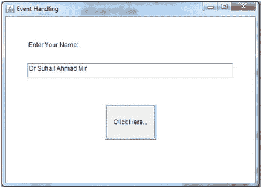

**图 10.5**

点击上面的按钮后，欢迎消息将如输出所示弹出：


**图 10.6**

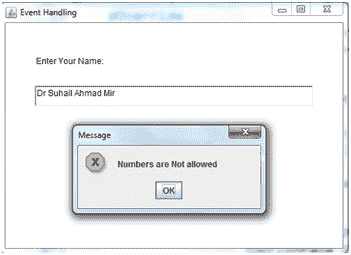

**图 10.7**

在 Java 程序中，创建了一个 applet 并为其注册了 `MouseListener` 和 `MouseMotionListener`。这两个监听器的所有方法都已实现，并使用 applet 的 `paint()` 方法在事件触发时显示消息：

```java
package book;
import java.awt.event.*;
import java.applet.*;
import java.awt.*;

/*
<applet code="MouseEvents" width=300 height=100></applet>
*/
public class EventHandlingDemo extends Applet implements MouseListener, MouseMotionListener {
    String msg = "";
    int mouseX = 0, mouseY = 0; // coordinates of mouse

    public void init() {
        addMouseListener(this);
        addMouseMotionListener(this);
        setBackground(Color.RED);
    }

    // 处理鼠标点击.
    public void mouseClicked(MouseEvent me) {
        mouseX = 100; mouseY = 100;
        msg = "Mouse clicked."; repaint();
    }

    // 处理鼠标进入.
    public void mouseEntered(MouseEvent me) {
        mouseX = 0; mouseY = 10;
        msg = "Mouse entered."; repaint();
    }

    // 处理鼠标移出.
    public void mouseExited(MouseEvent me) {
        mouseX = 0; mouseY = 10;
        msg = "Mouse exited."; repaint();
    }

    // 处理鼠标按下.
    public void mousePressed(MouseEvent me) {
        mouseX = me.getX(); mouseY = me.getY();
        msg = "Mouse Down Here"; repaint();
    }

    public void mouseReleased(MouseEvent me) {
        mouseX = me.getX(); mouseY = me.getY();
        msg = "Mouse Up Here"; repaint();
    }

    // 处理鼠标拖动.
    public void mouseDragged(MouseEvent me) {
        mouseX = me.getX(); mouseY = me.getY();
        msg = "*";
    }

    // 处理移动.
    public void mouseMoved(MouseEvent me) {
        mouseX = me.getX(); mouseY = me.getY();
        msg = "The X & Y Position of " + mouseX + ", " + mouseY;
        repaint();
    }

    public void paint(Graphics g) {
        g.drawString(msg, mouseX, mouseY);
    }
}
```

### 匿名内部类

Java 的一个独特特性是名为 `Adapter`（适配器）类，它在某些情况下可以让事件处理器的构建变得更加简单。`Adapter` 类提供了事件监听器接口中所有方法的空实现。当我们只想获取并处理由特定事件监听器接口处理的少数几个事件时，`Adapter` 类就非常有帮助。我们可以通过扩展其中一个适配器类并仅实现我们感兴趣的事件，来命名一个新类作为事件监听器。例如，如果我们想实现 `MouseListener` 接口，就必须实现它所有的方法，即 `void mouseClicked(MouseEvent me)`、`void mouseEntered(MouseEvent me)`、`void mouseExited(MouseEvent me)`、`void mousePressed(MouseEvent me)` 和 `void mouseReleased(MouseEvent me)`。但在所有五个方法中，我们只想实现 `mouseClicked()` 方法来处理点击事件。我们可以创建一个名为 `MyMouseAdapter` 的类，扩展 `MouseAdapter` 并重写 `mouseClicked()` 方法。其他的鼠标事件将由继承自 `MouseAdapter` 类的代码静默忽略。下表列出了用于实现 `Listener` 接口的 `Adapter` 类：

| 适配器类 | 监听器接口 |
| :--- | :--- |
| `ComponentAdapter` | `ComponentListener` |
| `ContainerAdapter` | `ContainerListener` |
| `FocusAdapter` | `FocusListener` |
| `KeyAdapter` | `KeyListener` |
| `MouseAdapter` | `MouseListener` |
| `MouseMotionAdapter` | `MouseMotionListener` |
| `WindowAdapter` | `WindowListener` |

**表 10.5:** 适配器类

在下面的 Java 程序中演示了 `Adapter` 类的使用。`AdapterClass` 类使用了并扩展了 `MouseAdapter`。在 `MouseListener` 的五个方法中，只实现了 `mouseClicked()` 方法：

```java
package book;

import java.awt.*;
import java.awt.event.MouseAdapter;
import java.awt.event.MouseEvent;
import java.awt.event.MouseListener;
import javax.swing.JOptionPane;

public class AdapterDemo {
    static TextField tf;
    static TextField tf2;
    static Button bplus;
    static Button bMinus;
    static Button bdivide;
    static Button bmult;
    static String msg;
    static float n1;
    static float n2;
    static float n3;
    static Frame f = null;

    public static void main(String arg[]) {
        f = new Frame("Calculator….");
        Label l1 = new Label("Enter the Numbers");
        tf = new TextField(20);
        tf2 = new TextField(20);
        bplus = new Button("Addition");
        bMinus = new Button("Subtraction");
        bdivide = new Button("Division");
        bmult = new Button("Multiplication");
        f.setLayout(null);
        f.add(l1).setBounds(150, 30, 120, 70);
        f.add(tf).setBounds(150, 100, 100, 30);
        f.add(tf2).setBounds(250, 100, 100, 30);
        f.add(bplus).setBounds(150, 150, 100, 30);
        f.add(bMinus).setBounds(150, 200, 100, 30);
        f.add(bdivide).setBounds(250, 150, 100, 30);
        f.add(bmult).setBounds(250, 200, 100, 30);
        bplus.addMouseListener(new AdapterClass());
        bMinus.addMouseListener(new AdapterClass());
        bdivide.addMouseListener(new AdapterClass());
        bmult.addMouseListener(new AdapterClass());
        f.setSize(500, 500);
        f.setVisible(true);
    }
}

class AdapterClass extends MouseAdapter {
    @Override
    public void mouseClicked(MouseEvent arg0) {
        // TODO Auto-generated method stub
        AdapterDemo.n1 = Integer.parseInt(AdapterDemo.tf.getText());
        AdapterDemo.n2 = Integer.parseInt(AdapterDemo.tf2.getText());
        if (arg0.getSource() == AdapterDemo.bplus) {
            AdapterDemo.n3 = AdapterDemo.n1 + AdapterDemo.n2;
            AdapterDemo.msg = "Addition =";
        } else if (arg0.getSource() == AdapterDemo.bMinus) {
            AdapterDemo.n3 = AdapterDemo.n1 - AdapterDemo.n2;
            AdapterDemo.msg = "Subtraction =";
        } else if (arg0.getSource() == AdapterDemo.bmult) {
            AdapterDemo.n3 = AdapterDemo.n1 * AdapterDemo.n2;
            AdapterDemo.msg = "Multiplication =";
        } else {
            AdapterDemo.n3 = AdapterDemo.n1 / AdapterDemo.n2;
            AdapterDemo.msg = "Division =";
        }
        JOptionPane.showMessageDialog(f, AdapterDemo.msg + AdapterDemo.n3, "Result", JOptionPane.INFORMATION_MESSAGE);
    }
}
```


```java
f.add(btnsubmit).setBounds(350, 250, 100, 30);

f.add(btncancel).setBounds(200, 250, 100, 30);

txtname.addKeyListener(new KeyAdapter(){
    public void keyTyped(KeyEvent arg0)
    {
        if ((arg0.getSource() == txtname) && (Character.isDigit(arg0.getKeyChar())))
        {
            JOptionPane.showOptionDialog(
                f,"Numbers Not Allowed",
                "Enter a valid Name",
                JOptionPane.DEFAULT_OPTION,
                JOptionPane.INFORMATION_MESSAGE,
                null,
                null,
                null);
            arg0.setKeyChar((char) KeyEvent.VK_CANCEL);
        }
    }
});});
txtenrolment.addKeyListener(new KeyAdapter(){
    public void keyTyped(KeyEvent arg0)
    {
        if ((arg0.getSource() == txtenrolment) && (Character.isAlphabetic(arg0.getKeyChar())))
        {
            JOptionPane.showOptionDialog(
                f,"Characters Not Allowed",
                "Enter a valid Enrolment",
                JOptionPane.DEFAULT_OPTION,
                JOptionPane.INFORMATION_MESSAGE,
                null,
                null,
                null);
            arg0.setKeyChar((char) KeyEvent.VK_CANCEL);
        }
    }
});});btnsubmit.addMouseListener(new MouseAdapter(){
    @Override
    public void mouseClicked(MouseEvent arg0) {
        // TODO Auto-generated method stub
        name= txtname.getText();
        en_no= Integer.parseInt(txtenrolment.getText());
        JOptionPane.showOptionDialog(f,"Hello " + name + " Your enrollment " + en_no + " has been submitted","Submission",JOptionPane.DEFAULT_OPTION, JOptionPane.INFORMATION_MESSAGE, null, null, null);
    }
});f.setSize(500, 500);

f.setVisible(true);
}
```

```java
f.add(btnsubmit).setBounds(350, 250, 100, 30);

f.add(btncancel).setBounds(200, 250, 100, 30);

txtname.addKeyListener(new KeyAdapter(){

    public void keyTyped(KeyEvent arg0)

    {

        if ((arg0.getSource() == txtname) && (Character.isDigit(arg0.getKeyChar())))

        {

            JOptionPane.showOptionDialog(

                f,"不允许输入数字",

                "请输入有效的姓名",

                JOptionPane.DEFAULT_OPTION,

                JOptionPane.INFORMATION_MESSAGE,

                null,

                null,

                null);

            arg0.setKeyChar((char) KeyEvent.VK_CANCEL);

        }

    }

});});

txtenrolment.addKeyListener(new KeyAdapter(){

    public void keyTyped(KeyEvent arg0)

    {

        if ((arg0.getSource() == txtenrolment) && (Character.isAlphabetic(arg0.getKeyChar())))

        {

            JOptionPane.showOptionDialog(

                f,"不允许输入字母",

                "请输入有效的注册号",

                JOptionPane.DEFAULT_OPTION,

                JOptionPane.INFORMATION_MESSAGE,

                null,

                null,

                null);

            arg0.setKeyChar((char) KeyEvent.VK_CANCEL);

        }

    }

});});btnsubmit.addMouseListener(new MouseAdapter(){

    @Override

    public void mouseClicked(MouseEvent arg0) {

        // TODO 自动生成的方法存根

        name= txtname.getText();

        en_no= Integer.parseInt(txtenrolment.getText());

        JOptionPane.showOptionDialog(f,"你好 " + name + " 你的注册号 " + en_no + " 已经提交","提交",JOptionPane.DEFAULT_OPTION, JOptionPane.INFORMATION_MESSAGE, null, null, null);

    }

});f.setSize(500, 500);

f.setVisible(true);

}
```

上述语句的相关示例在下一节中：

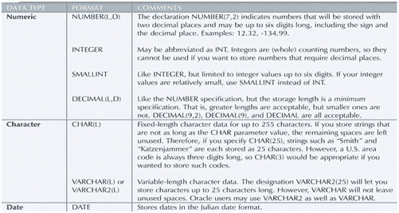

**表 11.4:** 常见的 SQL 数据类型

为了理解上述命令和数据类型，让我们在 `hr` 数据库中创建一个如下的 `Employee` 表：

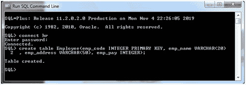

**图 11.1:** 创建员工表

`Employee` 表包含四列。第一列是 `emp_code`，数据类型为整数并被设置为主键；第二个属性是 `emp_name`，数据类型为 `varchar`；第三和第四列分别是 `emp_address` 和 `emp_pay`，数据类型分别为 `varchar` 和 `integer`。现在，我们可以按照如下方式向 `Employee` 表中插入数据：

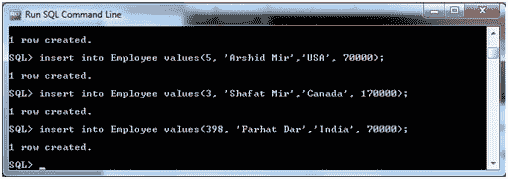

**图 11.2:** 向员工表中插入记录

在向 `Employee` 表中输入值时，注意行内容输入在括号之间，字符和日期值输入在单引号之间，数值输入不包含单引号，属性项之间用逗号分隔，且每列都需要一个值。使用 `NULL` 表示未知值。

现在要从 `Employee` 中检索数据，使用了 `select` 命令，下图显示了三种方法。第一条命令从 `Employee` 表中检索所有记录。第二条命令只检索 `emp_name` 和 `emp_pay`，第三条语句利用 `where` 子句仅检索名称符合条件的员工。执行的 SQL 命令的截屏如图所示：

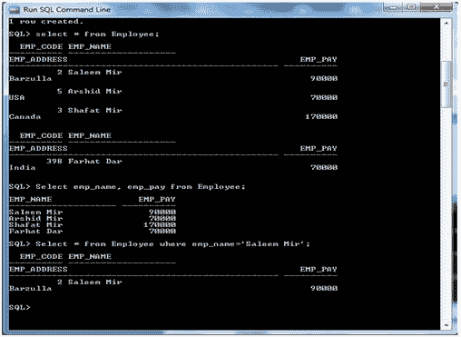

**图 11.3:** 从员工表中检索数据

由于，对表内容的更改在发生以下一种情况之前，不会在物理上保存到磁盘中：

- 数据库关闭
- 程序关闭
- 使用 `COMMIT` 命令

**语法：**

```sql
COMMIT [WORK];
```

将永久保存对数据库中任何表所做的任何更改。

`ROLLBACK` 用于将数据库恢复到之前的状态，并且在未使用 `COMMIT` 命令永久存储数据库中的更改时才有效。

**语法：**

```sql
ROLLBACK;
```

`COMMIT` 和 `ROLLBACK` 仅适用于添加、修改或删除表行的数据操纵命令。

### JDBC 架构

JDBC 的通用架构如下图所示。在 Java 中实现数据库连接时，遵循以下顺序程序：

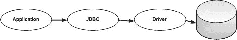

**图 11.4:** JDBC 架构

由于我们将通过 Java 程序访问数据库，已经有了专门的包供开发者在处理数据库时执行多种功能。其中一个重要的包是 `java.sql`。因此，第一步是加载 JDBC 库。

为了处理特定的数据库，需要一个驱动程序。Java 可以使用任何驱动程序：

| 驱动程序 | 说明 |
| :--- | :--- |
| **Type I 驱动:** | 使用桥接技术将 JDBC 翻译为 ODBC，并依赖 ODBC 驱动与数据库通信。该驱动程序需要在客户端机器上安装/配置，不适合 Web。例如：JDBC/ODBC Bridge |
| **Type II 驱动** | 部分用 Java、部分用原生代码编写的原生 API 驱动。需要在客户端机器上安装/配置，用于利用现有的 CLI 库，通常不是线程安全的，现在大部分已淘汰。例如：Intersolv Oracle Driver, WebLogic 驱动 |
| **Type III 驱动** | 它是一个纯 Java 客户端库，并调用中间件服务器（通常在数据库主机上），非常灵活——允许使用一个驱动程序访问多个数据库，只需下载一个驱动程序。但它是另一个需要安装和维护的服务器应用程序。例如：Symantec DB Anywhere |
| **Type IV 驱动** | 100% 纯 Java —— 圣杯，使用 Java 网络库直接与数据库引擎通信。缺点是：需要为每个数据库引擎下载新的驱动程序。例如：Oracle, mSQL |

**表 11.5:** 驱动程序类型

因此，一个驱动程序与特定的数据库通信，并且可以有多个驱动程序和多个数据库。

### JDBC 的实现

JDBC 的实现通过从 `java.sql` 导入以下类和接口完成：

- `DriverManager`: 加载、选择驱动程序。
- `Driver`: 连接到实际数据库。
- `Connection`: 访问数据库的一系列 SQL 语句。
- `Statement`: 单条 SQL 语句。
- `ResultSet`: 语句返回的记录。

### Driver

如果我们知道想要某个特定的驱动程序，那么这个类就是很有用的。因此，不推荐此类类，我们可以使用 `DriverManager` 代替 `Driver`。例如，下面的语句显式加载了一个特定的驱动程序：

```java
Driver dr = new xyz.may.MyDriver();

Connection c = dr.connect(…);
```

`Driver` 类的各种方法如下：

| Driver 的方法 |
| :--- |
| `public abstract java.sql.Connection connect(java.lang.String arg0, java.util.Properties arg1) throws java.sql.SQLException;` |
| `public abstract boolean acceptsURL(java.lang.String arg0) throws java.sql.SQLException;` |
| `public abstract java.sql.DriverPropertyInfo[] getPropertyInfo(java.lang.String arg0, java.util.Properties arg1) throws java.sql.SQLException;` |
| `public abstract int getMajorVersion();` |
| `public abstract boolean jdbcCompliant();` |
| `public abstract java.util.logging.Logger getParentLogger() throws java.sql.SQLException;` |
| `public abstract int getMinorVersion();` |
| `public abstract boolean acceptsURL(java.lang.String arg0) throws java.sql.SQLException;` |

**表 11.6:** Driver 的方法

### DriverManager

它根据给定的 JDBC URL、用户名和密码建立连接。抛出 `java.sql.SQLException`。返回一个 `Connection` 对象。例如，下面的代码与 Oracle 数据库建立连接，如果成功，则返回 Connection 对象。我们必须将这些代码封装在 `try` 和 `catch` 块中，因为它可能会抛出 `SQLException` 或 `ClassNotFoundException`：

```java
String dbURL = "jdbc:oracle:thin:@localhost:1521:xe";

String username ="hr";

String password ="hr";

Class.forName("oracle.jdbc.driver.OracleDriver");

Connection conn = DriverManager.getConnection(dbURL, username, password);
```

下表列出了 `DriverManager` 的各种方法：

| DriverManager 的方法 |
| :--- |
| `private static java.sql.Connection getConnection(java.lang.String arg0, java.util.Properties arg1, java.lang.Class arg2) throws java.sql.SQLException;` |
| `private static void loadInitialDrivers();` |
| `private static boolean isDriverAllowed(java.sql.Driver arg0, java.lang.ClassLoader arg1);` |
| `private static boolean isDriverAllowed(java.sql.Driver arg0, java.lang.Class arg1);` |
| `public static void println(java.lang.String arg0);` |
| `public static void setLogStream(java.io.PrintStream arg0);` |
| `public static int getLoginTimeout();` |
| `public static java.util.Enumeration getDrivers();` |
| `public static synchronized void deregisterDriver(java.sql.Driver arg0) throws java.sql.SQLException;` |
| `public static synchronized void registerDriver(java.sql.Driver arg0, java.sql.DriverAction arg1) throws java.sql.SQLException;` |
| `public static java.sql.Driver getDriver(java.lang.String arg0) throws java.sql.SQLException;` |
| `public static java.sql.Connection getConnection(java.lang.String arg0) throws java.sql.SQLException;` |


### DriverManager 类的方法

| 方法签名 |
| :--- |
| `public static java.sql.Connection getConnection(java.lang.String arg0, java.lang.String arg1, java.lang.String arg2) throws java.sql.SQLException;` |
| `public static java.sql.Connection getConnection(java.lang.String arg0, java.util.Properties arg1) throws java.sql.SQLException;` |
| `public static void setLogWriter(java.io.PrintWriter arg0);` |
| `public static java.io.PrintWriter getLogWriter();` |

### Connection

`Connection` 表示与特定数据库的会话。在 `Connection` 的上下文中，会执行 SQL 语句并返回结果。它可以与数据库建立多个连接。它还提供了 `metadata` —— 关于数据库、表和字段的信息。同时也提供了处理事务的方法。延续上一节中使用的代码行，我们可以使用 `Connection` 对象来创建一个 `Statement` 对象，如下所示：

```java
Statement stmt = conn.createStatement();
```

下表列出了 `Connection` 的各种方法：

| Connection 中的方法 |
| :--- |
| `public abstract java.sql.Statement createStatement() throws java.sql.SQLException;` |
| `public abstract java.sql.CallableStatement prepareCall(java.lang.String arg0) throws java.sql.SQLException;` |
| `public abstract java.sql.PreparedStatement prepareStatement(java.lang.String arg0) throws java.sql.SQLException;` |
| `public abstract void setAutoCommit(boolean arg0) throws java.sql.SQLException;` |
| `public abstract boolean getAutoCommit() throws java.sql.SQLException;` |
| `public abstract java.lang.String nativeSQL(java.lang.String arg0) throws java.sql.SQLException;` |
| `public abstract void commit() throws java.sql.SQLException;` |
| `public abstract void close() throws java.sql.SQLException;` |
| `public abstract void rollback() throws java.sql.SQLException;` |
| `public abstract java.sql.DatabaseMetaData getMetaData() throws java.sql.SQLException;` |
| `public abstract boolean isClosed() throws java.sql.SQLException;` |
| `public abstract boolean isReadOnly() throws java.sql.SQLException;` |
| `public abstract java.lang.String getCatalog() throws java.sql.SQLException;` |
| `public abstract void setReadOnly(boolean arg0) throws java.sql.SQLException;` |
| `public abstract void setCatalog(java.lang.String arg0) throws java.sql.SQLException;` |
| `public abstract java.sql.Statement createStatement(int arg0, int arg1) throws java.sql.SQLException;` |
| `public abstract java.sql.PreparedStatement prepareStatement(java.lang.String arg0, int arg1, int arg2) throws java.sql.SQLException;` |
| `public abstract java.sql.CallableStatement prepareCall(java.lang.String arg0, int arg1, int arg2) throws java.sql.SQLException;` |
| `public abstract java.util.Map getTypeMap() throws java.sql.SQLException;` |
| `public abstract void setTypeMap(java.util.Map arg0) throws java.sql.SQLException;` |
| `public abstract void setHoldability(int arg0) throws java.sql.SQLException;` |
| `public abstract int getHoldability() throws java.sql.SQLException;` |
| `public abstract java.sql.Savepoint setSavepoint() throws java.sql.SQLException;` |
| `public abstract java.sql.Savepoint setSavepoint(java.lang.String arg0) throws java.sql.SQLException;` |
| `public abstract void rollback(java.sql.Savepoint arg0) throws java.sql.SQLException;` |
| `public abstract void releaseSavepoint(java.sql.Savepoint arg0) throws java.sql.SQLException;` |
| `public abstract java.sql.Statement createStatement(int arg0, int arg1, int arg2) throws java.sql.SQLException;` |
| `public abstract java.sql.PreparedStatement prepareStatement(java.lang.String arg0, int arg1, int arg2, int arg3) throws java.sql.SQLException;` |
| `public abstract java.sql.CallableStatement prepareCall(java.lang.String arg0, int arg1, int arg2, int arg3) throws java.sql.SQLException;` |
| `public abstract java.sql.PreparedStatement prepareStatement(java.lang.String arg0, int arg1) throws java.sql.SQLException;` |
| `public abstract java.sql.PreparedStatement prepareStatement(java.lang.String arg0, int[] arg1) throws java.sql.SQLException;` |
| `public abstract java.sql.Statement createStatement(int arg0, int[] arg1) throws java.sql.SQLException;` |
| `public abstract java.sql.PreparedStatement prepareStatement(java.lang.String arg0, int arg1, int arg2) throws java.sql.SQLException;` |
| `public abstract java.sql.CallableStatement prepareCall(java.lang.String arg0, int arg1, int arg2) throws java.sql.SQLException;` |
| `public abstract java.sql.PreparedStatement prepareStatement(java.lang.String arg0, int arg1) throws java.sql.SQLException;` |

### Statement

`Statement` 对象用于执行静态 SQL 语句并获取其产生的结果。例如，通过以下代码行获取 `ResultSet` 对象：

```java
String sql = "SELECT * from Employee";
stmt.executeQuery(sql);
ResultSet rs = stmt.getResultSet();
```


`Statement` 中的方法如下：

| Statement 的方法 |
| :--- |
| `public long executeLargeUpdate(java.lang.String arg0, java.lang.String[] arg1) throws java.sql.SQLException;` |
| `public long executeLargeUpdate(java.lang.String arg0, int[] arg1) throws java.sql.SQLException;` |
| `public long executeLargeUpdate(java.lang.String arg0, int arg1) throws java.sql.SQLException;` |
| `public long executeLargeUpdate(java.lang.String arg0) throws java.sql.SQLException;` |
| `public long[] executeLargeBatch() throws java.sql.SQLException;` |
| `public long getLargeMaxRows() throws java.sql.SQLException;` |
| `public void setLargeMaxRows(long arg0) throws java.sql.SQLException;` |
| `public long getLargeUpdateCount() throws java.sql.SQLException;` |
| `public abstract boolean isCloseOnCompletion() throws java.sql.SQLException;` |
| `public abstract void closeOnCompletion() throws java.sql.SQLException;` |
| `public abstract boolean isPoolable() throws java.sql.SQLException;` |
| `public abstract void setPoolable(boolean arg0) throws java.sql.SQLException;` |
| `public abstract boolean isClosed() throws java.sql.SQLException;` |
| `public abstract int getResultSetHoldability() throws java.sql.SQLException;` |
| `public abstract boolean execute(java.lang.String arg0, java.lang.String[] arg1) throws java.sql.SQLException;` |
| `public abstract boolean execute(java.lang.String arg0, int[] arg1) throws java.sql.SQLException;` |
| `public abstract boolean execute(java.lang.String arg0, int arg1) throws java.sql.SQLException;` |
| `public abstract int executeUpdate(java.lang.String arg0, java.lang.String[] arg1) throws java.sql.SQLException;` |
| `public abstract int executeUpdate(java.lang.String arg0, int[] arg1) throws java.sql.SQLException;` |
| `public abstract int executeUpdate(java.lang.String arg0, int arg1) throws java.sql.SQLException;` |
| `public abstract boolean getMoreResults(int arg0) throws java.sql.SQLException;` |
| `public abstract java.sql.ResultSet getGeneratedKeys() throws java.sql.SQLException;` |
| `public abstract java.sql.Connection getConnection() throws java.sql.SQLException;` |
| `public abstract java.sql.ResultSet executeQuery(java.lang.String arg0) throws java.sql.SQLException;` |
| `public abstract int executeUpdate(java.lang.String arg0) throws java.sql.SQLException;` |
| `public abstract void close() throws java.sql.SQLException;` |
| `public abstract int getMaxFieldSize() throws java.sql.SQLException;` |
| `public abstract void setMaxFieldSize(int arg0) throws java.sql.SQLException;` |
| `public abstract int getMaxRows() throws java.sql.SQLException;` |
| `public abstract void setMaxRows(int arg0) throws java.sql.SQLException;` |
| `public abstract void setEscapeProcessing(boolean arg0) throws java.sql.SQLException;` |
| `public abstract int getQueryTimeout() throws java.sql.SQLException;` |
| `public abstract void cancel() throws java.sql.SQLException;` |
| `public abstract java.sql.SQLWarning getWarnings() throws java.sql.SQLException;` |
| `public abstract void clearWarnings() throws java.sql.SQLException;` |
| `public abstract void setCursorName(java.lang.String arg0) throws java.sql.SQLException;` |
| `public abstract boolean execute(java.lang.String arg0) throws java.sql.SQLException;` |
| `public abstract java.sql.ResultSet getResultSet() throws java.sql.SQLException;` |
| `public abstract int getUpdateCount() throws java.sql.SQLException;` |
| `public abstract boolean getMoreResults() throws java.sql.SQLException;` |
| `public abstract void setFetchDirection(int arg0) throws java.sql.SQLException;` |
| `public abstract int getFetchDirection() throws java.sql.SQLException;` |
| `public abstract void setFetchSize(int arg0) throws java.sql.SQLException;` |
| `public abstract int getFetchSize() throws java.sql.SQLException;` |
| `public abstract int getResultSetConcurrency() throws java.sql.SQLException;` |
| `public abstract int getResultSetType() throws java.sql.SQLException;` |

**表 11.9:** Statement 方法

### ResultSet

`ResultSet` 提供了对执行 `Statement` 后生成的数据表的访问。每个 `Statement` 同时只能打开一个 `ResultSet`。表行是按顺序检索的。`ResultSet` 维护一个指向其当前数据行的游标。`next()` 方法将游标移动到下一行。如前一节所示，我们使用 `Statement` 对象来执行查询并获取 `ResultSet` 对象。接几行代码利用 `ResultSet` 对象从表中检索数据：

```java
ResultSet rs = stmt.getResultSet();

System.out.println("Retrieving the Data from Student table " );

System.out.println("Roll No Name " );

while(rs.next()){

    int roll = rs.getInt(1);

    String u = rs.getString(2);

    System.out.println(roll + "      " +u);

}
```

以下表列出了 `ResultSet` 中可用的方法：

| 方法 |  |
| :--- | :--- |
| `boolean next()` | 激活下一行。第一次调用 `next()` 激活第一行；如果没有更多行，则返回 false。 |
| `void close()` | 释放 `ResultSet`，允许你重用创建它的 `Statement`。由大多数 `Statement` 方法自动调用。 |
| `Type getType(int columnIndex)` | 将给定的字段作为给定的类型返回。字段索引从 1 开始（而不是 0）。 |
| `Type getType(String columnName)` | 将给定的字段作为给定的类型返回。使用字段名，效率较低。 |
| `int findColumn(String columnName)` | 根据列名查找列索引。 |
| `String getString(int columnIndex)` | 以给定的类型返回 `String`。 |
| `boolean getBoolean(int columnIndex)` | 返回 `Boolean`。 |
| `byte getByte(int columnIndex)` | 返回 `byte`。 |
| `short getShort(int columnIndex)` | 返回 `short`。 |
| `int getInt(int columnIndex)` | 返回 `int`。 |
| `long getLong(int columnIndex)` | 返回 `long`。 |
| `float getFloat(int columnIndex)` | 返回 `float`。 |
| `double getDouble(int columnIndex)` | 返回 `double`。 |
| `Date getDate(int columnIndex)` | 返回 `Date`。 |
| `Time getTime(int columnIndex)` | 返回 `Time`。 |
| `Timestamp getTimestamp(int columnIndex)` | 返回 `Timestamp`。 |
| `String getString(String columnName)` | 返回 `String`。 |
| `boolean getBoolean(String columnName)` | 返回 `boolean`。 |
| `byte getByte(String columnName)` | 返回 `byte`。 |
| `short getShort(String columnName)` | 返回 `short`。 |
| `int getInt(String columnName)` | 返回 `int`。 |
| `long getLong(String columnName)` | 返回 `long`。 |
| `float getFloat(String columnName)` | 返回 `float`。 |
| `double getDouble(String columnName)` | 返回 `double`。 |
| `Date getDate(String columnName)` | 返回 `Date`。 |
| `Time getTime(String columnName)` | 返回 `Time`。 |
| `Timestamp getTimestamp(String columnName)` | 返回 `Timestamp`。 |

下面的类图解释了上述各个类的用法。我们可以从 `DriverManager` 开始获取 `Connection` 对象，该对象可以进一步用于 `Statement` 对象，最后使用此 `Statement` 对象获取 `ResultSet` 对象以从数据库中检索数据。为了对数据库执行各种操作，上述每个类都提供了各种函数/方法：

以下 Java 程序通过从 Oracle 数据库检索表实现了 JDBC：

```java
package book;

import java.sql.*;

public class MyOracleDatabaseExample {

    public static void main(String[] args) throws SQLException, ClassNotFoundException {

        String dbURL = "jdbc:oracle:thin:@localhost:1521:xe";

        String username ="hr";

        String password ="hr";

        Class.forName("oracle.jdbc.driver.OracleDriver");

        Connection conn = DriverManager.getConnection(dbURL, username, password);

        Statement stmt = conn.createStatement();

        String sql ="SELECT * from abc";

        stmt.executeQuery(sql);

        ResultSet rs = stmt.getResultSet();

        Boolean r = null;

        System.out.println("Retrieving the Data from Student table " );

        System.out.println("Roll No Name " );

        while(rs.next()){

            int roll = rs.getInt(1);

            String u = rs.getString(2);

            System.out.println(roll + "      " +u);

        }

    }

}
```

我们将得到以下输出：

**`Retrieving the Data from Student table`**

**`Roll No Name`**

**`10 Muneer`**

**`1 Saleem`**

**`20 fayaz`**

以下 Java 程序通过从 Access 数据库中检索表数据实现了 JDBC：

```java
package book;

import java.sql.*;

class AccessExample

{

    public static void main(String a[]) throws SQLException

    {

        String url = "jdbc:odbc:MyDsn";

        Connection con=null;

        try {

            Class.forName ("sun.jdbc.odbc.JdbcOdbcDriver");

            con = DriverManager.getConnection(url);

            System.out.println("congrats you are connected");

        }

        catch (ClassNotFoundException e)

        {

            System.out.println("Error 1");

        }

        catch (SQLException e)

        {
```


```java
System.out.println("Error 2");

}

Statement st = con.createStatement();

ResultSet results = st.executeQuery("select * from Student");

while (results.next()) {

    int id = results.getInt(1);

    String last = results.getString(2);

    System.out.println("" + id + ": " + last);

}

st.close();

con.close();

}

}
```

我们将得到以下输出：

```
congrats you are connected

1: Musadiq

2: Muneer
```

# 作业

1. 解释 JDBC 相比其他数据库编程的优势是什么？
2. `Driver` 类与 `DriverManager` 类有何区别？
3. 列出五种以不同方式从 `Employee` 表中检索数据的五 SQL 命令？
4. 编写一个 Java 程序，向在本章讨论的 `Employee` 表中插入数据？
5. 使用 `ResultSet` 对象检索同一列的不同方法有哪些？
