# Java 编程：初学者指南 (初学者指南系列第 1 本)

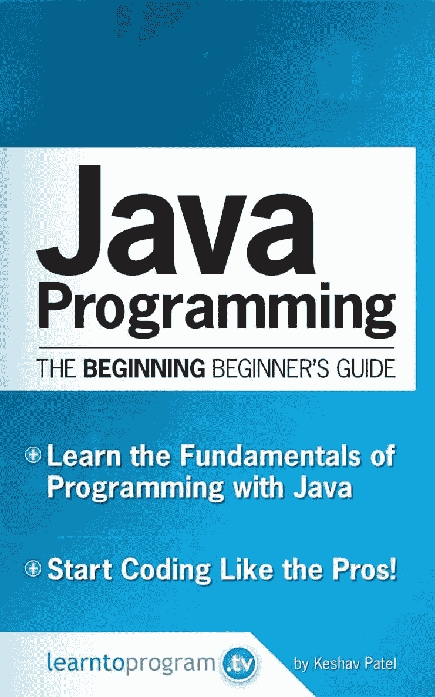

LearnToProgram.tv, Incorporated 27 Hartford Turnpike Suite 206 Vernon, CT 06066

contact@learntoprogram.tv

(860) 840-7090

## 关于入门指南系列

这个入门系列书籍源于一种挫败感：大多数关于网络和移动开发的入门书籍并不是为真正的初学者设计的。

在初学者书中，语言往往过于复杂，充满了只有有编程经验的人才能理解的术语。这些书籍假设了过多的先验知识或经验。最终，许多编程新手在挫败中咬牙切齿并放弃。

事实是，如果教学得当，编程完全是可以掌握的，甚至很有趣。

这正是“入门指南”系列的目标：帮助真正的初学者学会编写代码。

如果你从未写过代码——或者如果你尝试过从其他书中学习但失败了，这系列编程书籍就是为你准备的。你完全可以学好编程。你不需要数学数学，也不需要超级智能。学习编程并不总是容易的——但是这是行的。如果你能操作 Excel 表格，你就能学习编程。

希望这个过程对你来说和我们教学一样收获。

如果你有任何问题或建议，请直接发送邮件至 mark@learntoprogram.tv。

-Mark Lassoff, LearnToProgram Media 创始人

第 4 页


## 第 1 章：编写你的第一个程序

欢迎。如果这是你第一次编程，恭喜你！你即将开始一段大多数人认为非常有成就感的旅程。如果你是在之前的尝试失败后尝试学习，你同样应该获得认可。应对编程并不总是容易的——但它并非普通人的能力范围。

多年来，我已经在在线和线下向超过 50 万人教授过编程。多年来我遇到过的程序员——无论是初学者还是资深老兵——都来自不同的背景。我发现，博士和高中中辍的学生都能成为优秀的程序员。在多年里，我的课上曾出现过数学家、精神科医生和 12 岁的孩子，他们都学会了一些编程。

你也会的。在这个入门章节中——专为略有疑虑的初学者设计——我将带你一步步完成编写第一个程序的流程。除了笔记本电脑或台式电脑，你不需要任何特殊设备。

那么，不再多说，让我们开始吧！

### 你将学到什么

第一章将作为设置编程环境和入门的介绍。之后的每一章都旨在带你了解开发某个方面的基础知识，并为你进一步的学习奠定基础。为了让你有一个背景了解，这里是书中剩下的内容：

**第二章：输入与输出**

输入和输出是任何程序的关键。在本章中，我们将查看如何将数据输入和输出程序。

**第三章：理解变量**

变量是任何程序的构建块。本章将引导读者在表达式中使用声明变量。

**第四章：条件与循环**

条件和循环是允许程序做出决策并改变执行结果结构。这些本章中演示和解释。

**第五章：处理数据**

几乎每个实用程序在某种程度上都要处理数据。在本章中，你将学习如何在程序中存储各种形式的数据。

**第六章：整合一切**

在最后一章中，读者将学习如何利用之前章节中学技能创建一个处理和存储数据的实用程序。

在我们编写任何程序之前，我们需要设置好开发环境。我不会要求你购买任何东西，你会有几个选项可以选择。

图 1.1：作者的开发环境。不包含多比兄弟音乐

### 设置你的开发环境

我们在书中将使用一种名为 Java 的语言。在你的机器上安装 Java 相当简单，对于大多数主流操作系统，过程通常是相同的。使用浏览器，你需要导航到 `oracle.com`。Oracle 是维护 Java 的公司，也是你编写 Java 代码所需的下载 `JDK`（Java 开发工具包）。

到达 `Oracle.com` 后，在顶部菜单栏找到 `Downloads`，点击 `Popular Downloads` 下的 `Java for Developers`。

图 1.2：打开了下载菜单的 Oracle.com

点击该链接后，你会看到下载页面。会弹出一个显示 `JDK`，下方有一个下载按钮。点击它，它将重定向到一个你可以选择操作系统的页面。网站将提供一套说明，详细介绍如何将 `JDK` 安装到你的电脑上。图 1.3：作者电脑上的终端。注意作者通过终端偏好更改了默认颜色

如果你不想在机器上通过安装 `JDK` 的过程，我建议你使用 Koding.com 朋友提供的虚拟 Linux 服务器。在浏览器中访问 `www.Koding.com` 并注册一个免费账户。免费账户将为你提供一个可以通过网页浏览器访问的虚拟 Linux 机器——它可以开箱即用编译并运行 Java 代码！无需任何下载。这就是我编写书中将用到的代码时使用的工具。

一旦你拥有了账户，点击按钮启动虚拟机（VM）并开始编码。你将使用 Koding 上的文本编辑器输入 Java 文件，并使用终端运行它们。

图 1.4：Koding.com 中的命令行（或终端）。

## 编写和运行你的代码

现在你已经准备好了环境，是时候（终于）写一些代码了。我们将在文本编辑器中编写代码。文本编辑器与文字处理程序不同。文字处理程序会在文件中引入不可见的格式代码。如果你运行在文字处理程序中编写的代码，可能会因为嵌入的格式代码而导致错误。

另一方面，文本编辑器将你输入的文本保存为纯文本——不会引入任何不必要的格式。文本编辑器产生的文本可以被 Java 编译器轻松处理。在 Koding.com 虚拟机和 Mac 的命令行环境中，有两个可以使用的文本编辑器。它们被称为 `nano` 和 `vi`。这些文本编辑器的历史可以追溯到 20 世纪 70 年——所以当你使用它们时，你可以真正感受到“老派”！另一个选项是使用 Koding 上的默认文本编辑器、Mac 上的 TextEdit 或 Windows 上的 Notepad。它们都非常通俗易懂，尽管可能需要更改一些设置来高亮 Java 代码。顺带提一下，确保每次当你第一次保存代码文件时，将其保存为“filename.java”。

### nano

Nano 是一个易于使用的 Linux 编辑器。它非常直观。当 `nano` 环境加载时，你只需开始输入代码即可。Nano 拥有许多控制代码，列在屏幕底部供你参考。最需要注意的是 `CTRL+L`（保存文件）和 `CTRL+X`（退出 nano 并返回命令行）。

默认情况下，nano 将你的文件保存在你打开 `nano` 本身时所在的文件夹中。

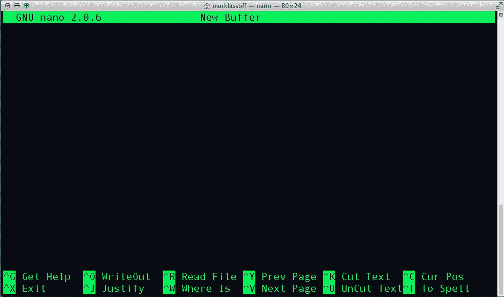图 1.5：nano 文本编辑器。

你可以在命令行中输入 `nano` 然后按回车键来启动 nano。

### vi

vi 是一个稍微复杂（甚至更“老派”）的文本编辑器。理解 `vi` 最重要的一点是它有两种模式：命令模式和插入模式。要进入插入模式，按下键盘上的‘i’。当你想要进入命令模式以执行如写入（write）和退出（quit）之类的命令时，按下 `ESC` 键。如果你搞砸了发现自己处于错误的模式，多按几次 `ESC` 似乎可以从任何地方回到命令模式。

关于 `vi` 有一个老笑话是：*vi 有两种模式，而你正处于错误的模式中。*（如果你现在觉得这不好笑，在你用 `vi` 一段时间后就会觉得好笑了！）

当你进入 `vi` 时，输入 `i` 进入插入模式，你就可以输入代码了。完成后，按 `ESC` 回到命令模式。所有命令必须以冒号开头。所以要写文件，你需要输入 `:w`。要退出，输入 `:q`。`vi` 还允许你组合命令。例如，组合命令 `:wq` 将写入文件并退出返回命令行。

图 1.6：vi 希望你帮助乌干达的贫困儿童。它为全球的新程序员提供有限的帮助。

你可以在命令行中输入 `vi` 然后按回车键来启动 `vi`。

现在你应该已经启动了文本编辑器并准备好输入代码了。在你的文本编辑器中完全按照所示内容输入以下代码：

```java
public class HelloWorld{
    public static void main (String[] args) {
        System.out.println("This is my first program!"); 
        System.out.println("Programmers are rockstars!");
    }
}
```

这段代码的作用应该是显而易见的。`println()` 函数将内容打印到命令行。在这种情况下，你正在打印两个字符串。字符串仅仅是字符行。字符串始终被引号括起来。

一旦你输入了代码，就是时候运行它了。在 nano 中，输入 `CTRL+W` 保存文件。在提示时，输入文件名 `HelloWorld.java`。`.java` 扩展名表示这是一个 Java 源文件。接下来输入 `CTRL+X` 退出，返回返回命令行。在 `vi` 中，进入命令模式并通过输入 `:w HelloWorld.java` 保存文件。这将以适当的文件名写入你的文件。最后，在 `vi` 中，按 `:q` 退出并返回命令行。在任何其他编辑器（包括 Koding 上的）中都可以打开菜单并点击“另存为”，就像在任何其他计算机程序中一样。

注意，我们给这个程序起的文件名与类名（`HelloWorld`）匹配。这是 Java 标准。该标准使得当你有多个源文件时，类文件在构建时易于识别。因此，为了方便管理，每当你创建一个新的 `.java` 文件时，请确保将其保存为“filename.java”。

图 1.7：在 Koding 中保存文件。

一旦你输入了代码，就是时候运行它了。在 nano 中，输入 `CTRL+W` 保存文件。在提示时，输入文件名 `HelloWorld.java`。`.java` 扩展名表示这是一个 Java 源文件。接下来输入 `CTRL+X` 退出，返回命令行。在 `vi` 中，进入命令模式并通过输入 `:w HelloWorld.java` 保存文件。这将以适当的文件名写入你的文件。最后，在 `vi` 中，按 `:q` 退出并返回命令行。

图 1.8：HelloWorld.java 的执行

一旦你输入了代码，就是时候运行它了。在 nano 中，输入 `CTRL+W` 保存文件。在提示时，输入文件名 `HelloWorld.java`。`.java` 扩展名表示这是一个 Java 源文件。接下来输入 `CTRL+X` 退出，返回命令行。在 `vi` 中，进入命令模式并通过输入 `:w HelloWorld.java` 保存文件。这将以适当的文件名写入你的文件。最后，在 `vi` 中，按 `:q` 退出并返回命令行。

图 1.9：HelloWorld.java 的输出

如果你的输出看起来不像 1.9，那么你需要重新加载文本编辑器和代码并找到错误。你可以在命令行提示符处通过以下命令重新加载代码：

对于 `vi`：`vi HelloWorld.java`

对于 `nano`：`nano HelloWorld.java`

在任何其他编辑器中，像打开其他文件一样打开它。常见的错误包括：

- 未闭合括号

- 忘记行末的分号

- 误写 `public static void main(String[] args)`（它是大小敏感的！）

恭喜！你写了第一个程序。

### 理解 println() 函数

在前面的示例中，我们使用 `println` 函数输出了一个字符串。该打印函数还能够打印以下类型的数据：

### 整数

整数是“整数”，没有小数点。在 Java 中，你可以这样打印一个整数：

```java
System.out.println(2573);
```

### 浮点数

浮点数是包含小数点的更精确的数字。在 Java 中你可以这样打印一个浮点数：

```java
System.out.println(3.45783);
```

## 表达式

表达式在确定结果之前必须求值。表达式通常是算术题。在 Java 中打印表达式：

```java
System.out.println(3.0/(6+4));
```

在上面的表达式中，由于运算顺序，括号中的表达式部分将首先求值。打印的结果是 0.3。

我们将在下一章中更详细地研究表达式。

顺便提一下，了解 `println` 函数是 `print()` 函数的一个版本是有用的。结尾的 ‘ln’ 代表 line（行）。这意味着在打印完你放在括号中的内容后，该函数将另起新行来打印下一个表达式。`print` 函数只会简单打印你放在括号里的任何内容，而不会引入它自己的格式。

## 第 2 章：输入与输出

在本章中，我们将更详细地查看输入和输出，这也许是任何程序中两个关键的活动。在上一一章中，我们详细地查看了使用 `println` 命令产生的输出。通过 `println`，我们能够向命令行屏幕输出三种类型的数据：字符串、整数和浮点数。然而，我们编写的程序并没有接收输入和处理数据的能力。

在本章中，我们将详细查看两类输入。首先，输入语句将允许我们通过程序化请求用户输入。然后，我们将使用命令行参数为我们的程序提供输入。

在查看输出时，我们还将学习将输出重定向到文件而不是返回命令行。

现在是时候放上你最喜欢的编程音乐了（我建议听听 The Cure），打开 `nano`、`vi` 或你喜欢的文本编辑器并开始编码吧……

### 输入语句

我们将从一个程序开始，该程序根据 `sideA` 输入和 `sideB` 输入来计算矩形的面积。在你的文本编辑器中输入以下 Java 代码：

```java
import java.util.Scanner;

public class Square{

    public static void main (String[] args) {
        System.out.println("RECTANGLE AREA CALCULATOR");
        Scanner input = new Scanner(System.in);
        System.out.println("What's the length of side A? "); float sideA = input.nextFloat();
        System.out.println("What's the length of side B? "); float sideB = input.nextFloat();
        float area = sideA*sideB;
        System.out.println("The area of your rectangle is: " + area);
    }
}
```

一旦你确定已正确输入程序并保存，请在命令行上运行该程序。我将我的文件保存为 `Square.java`。你的输出应该类似于图 2.1：

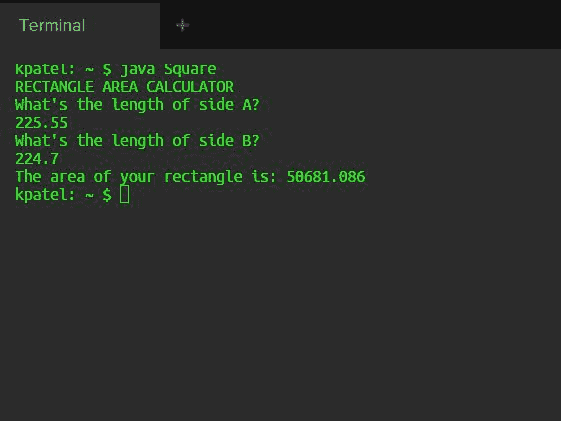

图 2.1：执行 `Square.java` 程序，该程序通过 Java 的 `nextFloat()` 函数从用户处获取输入。

在程序的的第一行，我们遇到了 `import` 语句。在许多语言中，import 用于向语言添加语言核心中不存在的额外命令库。在这种情况下，我们从 `util` 库添加了 `Scanner` 对象，该库包含了许多工具和实用对象。

如果你想导入整个库，只需将 `Scanner` 替换为星号 (`*`) 即可。

例如：

```java
import java.util.*;
```

虽然很有用，但要理解，在大型程序中，仅仅为了获取像我们这里这样的一个对象就导入整个库会降低程序的运行效率。这就像是你只需要一把锤子时却拿了整个工具箱。

现在，根据上下文和程序执行，你可能已经猜到了 `nextInt()` 函数的作用。让我们来拆解一下：

```java
public static void main (String[] args) {
    Scanner grabAge = new Scanner(System.in);
    System.out.println("How old are you?");
    int age = grabAge.nextInt();
}
```

该类的第一行创建了一个 `Scanner` 对象。Scanner 是我们用于从命令行获取输入的对象。

在上面的示例中，用户在提示“How old are you?”处输入的任何内容将通过 `Scanner` 的 `nextInt` 方法赋值给变量 `age`。我们将在下一章更详细地查看变量——现在，只需将变量视为值的临时存储位置即可。这些值可以是字符串、浮点数或整数。你必须在使用变量之前对其进行声明。通常语法是数据类型后跟着一个引用该变量的名称。

你可能奇怪什么是数据类型。数据类型决定了变量可以包含什么，以及可以对其执行哪些操作。数据类型的示例包括整数、字符串和浮点数。

这是一个整数变量声明的示例：

```java
int name;
```

注意：`Int` 表示该变量的数据类型是整数。

在声明 `Scanner` 对象之前，记得导入 `Scanner` 对象或 `util` 库。否则，你的程序将遇到错误。

让我们尝试一个新示例。在你的文本编辑器中创建一个名为 `StringInput.java` 的新文件。你可以通过 `vi` 实现，例如在命令行上输入以下命令：`vi StringInput.java`。

输入以下代码：

```java
import java.util.Scanner;

public class StringInput{
    public static void main (String[] args) {
        Scanner input = new Scanner(System.in);
        System.out.println("What's your name? ");
        String name = input.nextFloat();
        System.out.println("Hello " + name);
    }
}
```


退出文本编辑器，并在命令行中使用 `javac StringInput.java` 编译程序。


图 2.2：哎呀。这不妙。我们遇到了错误。如何修复它？

所以发生了什么？而不是编译并让程序运行，程序退出了错误。幸运的是错误很容易修复。`nextFloat()` 函数设计用于接受浮点类型，仅此如此。当你输入任何非浮点数时，就会导致你在 2.2 中看到的错误。我们有一个专门用于字符串的函数，叫做 `nextLine()`。

修改你的代码如下：

```java
import java.util.Scanner;

public class StringInput{
    public static void main (String[] args) {
        Scanner input = new Scanner(System.in);
        System.out.println("What's your name?");
        String name = input.nextLine();
        System.out.println("Hello " + name);
    }
}
```

**注意：** scanner 有获取每种数据类型的函数。

这里是一些示例：

- `nextLine()`：字符串
- `nextInt()`：整数
- `nextFloat()`：浮点数
- `nextDouble()`：双精度浮点数

你可能识别这种模式。Scanner 的文档可以在这里找到：

`http://docs.oracle.com/Javase/7/docs/api/Java/util/Scanner.html`

学习阅读 Java 文档本身就是一项重要的技能。

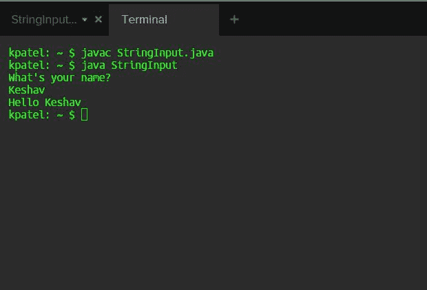

图 2.3：使用 `nextLine()` 效果好多了！

当你处理字符串时，应该使用 `nextLine()` 函数，它不扫描字符串以外的任何数据类型。它将始终返回用户在提示处输入的任何内容，包括数字或符号。

### 错误

前面的示例可能是你遇到的第一个错误示例之一。这种类型的错误被称为运行时错误。它是编写 Java 代码时可能发生的三种类型错误之一。

这三种类型是：

#### 语法错误

语法错误是代码格式上的问题。包括遗漏分号、未闭合括号或拼错方法名。文本编辑器通常能很好地指出这些问题，因此修复它们相当简单。

#### 运行时错误

运行时错误比较难捕捉。在语法上，所有的运行时错误都是正确的，所以编辑器不会指出它们。当发生意外情况时，会导致程序无法正常编译或执行。示例包括尝试除以零或尝试调用一个不存在的文件。Java 在尝试执行时才会遇到错误。

#### 逻辑错误

这些是程序内部的错误。它们是最难修复的，因为代码本身并没有错误，只是结果不正确。有些逻辑错误在程序发布后仍未被检测到。

### 参数化输入

你当前的工作流强制你在输入之前编译并运行代码。包含参数的 `java` 命令传递输入并执行代码。结果如下：

`$ java ClassName arg1 arg2`

在上面的示例中，我们仍然使用 `java` 命令和类名作为输入。这在我们需要处理数字时可能很有用。例如，如果我们想要程序接收用户名和年龄作为输入，参数可能像这样：

`$ java moreInput Keshav 17`

“Keshav”和“17”通过单个空格隔开传递给程序。让我们看看效果。将其保存为 `MoreInput.java`：

```java
public class MoreInput{
    public static void main (String[] args) {
        System.out.println("Your name is: " + args[0]); 
        System.out.println("Your age is: " + args[1]);
        System.out.println("All the arguments: ");
        System.out.println(args[0] + ", " + args[1]); 
    }
}
```

接下来，运行程序并提供命令行参数作为输入：

`$ java MoreInput Keshav 17`

你应该得到与图 2.4 类似的结果：

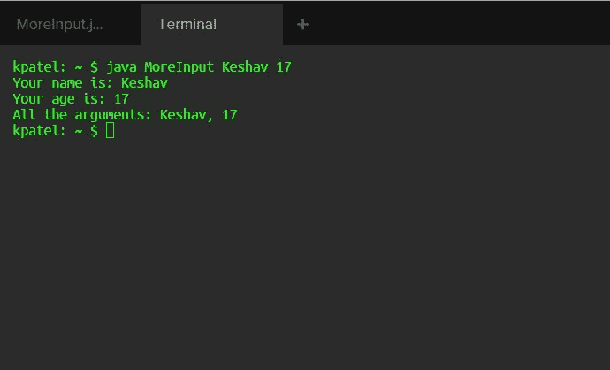

图 2.4：命令行参数作为输入在命令行处理。

**注意：** parameter 和 argument 术语可以通用。

参数顺序进入 Java，因此在我们的情况下，用户名是参数零，年龄是参数一。在代码中，我们分别调用 `args[0]` 和 `args[1]`。如果你仔细研究截图，可能会发现一些有趣的现象——`args[1]` 不是第一个参数。

这是因为 Java 从 0 开始计数，而不是 1。这意味着我们输入的第一个参数（在本例中是名字）实际上位于 0 号槽位。因此，Java 经常被称为零索引语言。

### 输出到文件流

到目前为止，代码的输出只重定向到了命令行。情况并非总是如此。输出可以重定向到文件中进行更永久的存储。能够多程度上永久地存储数据是程序员需要学习的一项技能。让我们写一个程序，让用户输入几条数据，然后将它们存储在文件中。

参考以下代码：

```java
import java.io.*;
import java.util.Scanner; 

public class Storage{
    public static void main (String[] args) {
        Scanner grab = new Scanner(System.in);
        System.out.println("What's your name?"); 
        String name = grab.nextLine();
        System.out.println("What's your email?"); 
        String mail = grab.nextLine();
        System.out.println("What's your favorite band?");
        String band = grab.nextLine();
        String fname = name.replaceAll(" ","")+".txt";
        try{ 
            PrintWriter saver = new PrintWriter(fname);
            saver.println("Name:" + name); 
            saver.println("Email:" + mail); 
            saver.println("Band:" + band); 
            saver.close();
        }
        catch(FileNotFoundException e){ 
            System.out.println("Oh no, it didn't work!");
        } 
        System.out.println(name + "|" + mail + "|" + band + " has been stored to "+ name + ".txt."); 
    }
}
```

这绝对是我们我们写过的最复杂的程序了。在命令行中运行它并确保没有任何错误。如果你遇到问题，请检查导入。如果一切运行正常，你的命令行应该像这样：

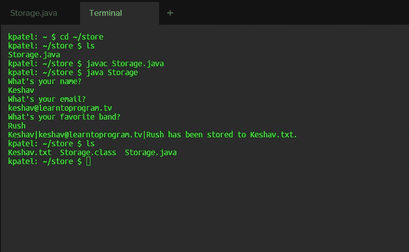

图 2.5：程序将数据存储在名为 Keshav.txt 的文件中，现在可以通过在命令行使用 `ls` 命令在目录列表中看到。

## 变量的声明与初始化

Java 是一种所谓的强类型语言。这意味着变量在使用之前需要进行声明。在 Java 中，变量是根据它们所持的数据类型来区分的。这种数据类型被称为变量的数据类型。

Java 中有两种变量：基本类型和类类型（也称为引用类型）。

### 基本类型变量

在 Java 中，有八种基本数据类型。它们分别是 `byte`、`short`、`int`、`long`、`float`、`double`、`boolean` 和 `char`。

声明和初始化语句通常非常短，并根据变量的类型预留特定数量的内存。这里有一个整数的整数声明和初始化示例：

```java
int name = 93;
```

### 类变量

类类型变量（也称为引用类型变量）通常比基本类型更复杂。在大多数情况下，基本类型是类类型变量的构建模块。当你声明并初始化一个类类型变量时，该名称并不代表对象本身，而是指向组成对象的所有部分和信息的内存位置。

世界上有成百种不同的类类型变量，它们的功能各相同。你已经遇到过其中之一就是 `Scanner`。

这里再次给出声明和初始化：

```java
Scanner name = new Scanner(<parameters>);
```

### 字符串

Java 中的字符串实际上是类或引用类型变量。然而，它们可以像基本类型一样被声明。这是 Java 开发人员的一种快捷方式，为了让处理字符串变得简单一些，因为它们是最常见的数据类型之一，使用频率与基本类型一样。（想想你已经使用了它们多少次！）

如果你愿意，可以像声明类类型变量一样声明字符串，但这样做并没有优势。

它看起来像这样：

```java
String blogName = new String("Edukwest!");
```

**注意：** 由于字符串是类类型，因此不能像基本类型那样使用 `>` 或 `==` 等通用比较运算符进行比较。

在这里，我们创建了一个名为 `blogName` 的变量，并将其初始化为字符串值“Edukwest!”。这里的等号是赋值运算符。字符串值“Edukwest!”被赋值给变量 `blogName`。

一旦声明了变量，通常你就可以对它做很多操作。这里有一个使用变量更改句子中打印内容的示例。

输入以下代码中的关键部分。（你可以自由为变量替换自己的值。）注意注释是由两个斜杠（`//`）指示的。多行注释可以使用斜杠和星号创建并用星号和斜杠结束（`/*注释!*/`）。

```java
public class Variables{
    public static void main (String[] args) {
        float gpa = 3.95f; int age = 17;
        String name = "Keshav";
        //注意变量声明的第一个单词是类型。
        System.out.println(name + " is " + age + " and wished he had a " + gpa + " gpa.");
    }
}
```

将文件保存为 `Variables.java` 并使用 `java` 命令运行它。你的输出应该与图 3.1 相似

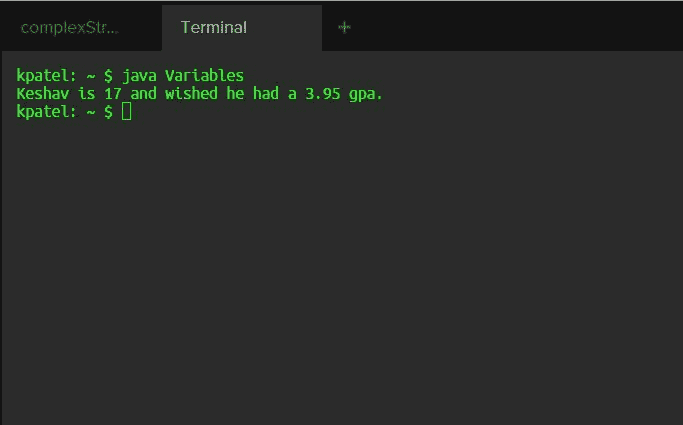

图 3.1：在 Koding.com 虚拟 Linux 环境中执行 `Variables.java`。

声明中的第一个单词是要创建的变量类型。回顾一下，此程序中的变量类型为：

- `String`：`String` 变量由特定顺序的一系列字符组成，这些字符没有数学值。
- `Integer`：`Integer` 变量包含不带小数点的整数值。
- `float`：浮点型变量包含更精确的数字，通过小数点值表示整数部分和小数部分。

变量是动态的，因为其值在程序的整个生命周期内可以被更改或重新赋值。例如，在视频游戏中，你有一个跟踪玩家得分的变量。随着玩家得分的变化，该值将一直增加直到游戏结束。一旦游戏结束，`player’s score` 变量中的值可能会被重新赋值为零。

考虑以下代码：

```java
import java.util.*; 
public class Var2{
    public static void main (String[] args) { 
        Scanner names = new Scanner(System.in);
        String firstName, lastName, middleName, fullName;
        System.out.println("What's your first name?");
        firstName = names.nextLine();
        System.out.println("What's your last name?");
        lastName = names.nextLine();
        fullName = firstName +" "+ lastName;
        System.out.println(fullName);
        System.out.println("What's your middle name?");
        middleName = names.nextLine();
        fullName = firstName + " " + middleName + " " + lastName;
        System.out.println(fullName);
    }
}
```

输入代码并运行程序将得到以下结果：

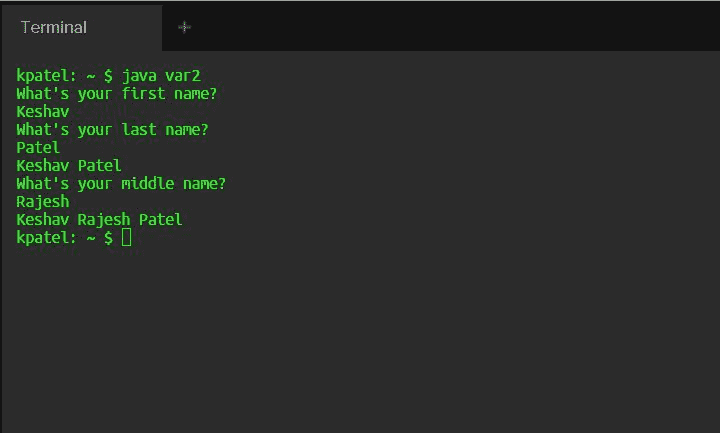

图 3.2：在 `fullName` 变量生命周期内，值被重新赋值

注意，当我们第一次声明 `fullName` 变量时，它被赋值为通过 `+` 号连接的 `first` 和 `last` 值。然后该值被打印到控制台。随着程序的继续执行，该值会改变。

### 类型转换

Java 要求你识别变量的类型。当你将不同类型的变量一起使用时，你可能需要显式地说明你希望结果是什么类型的变量。根据一条经验法则：较小的变量类型会自动向上转换，但较大的变量必须手动向下强制转换。

以下是层级结构：

`byte < short < int < long < float < double`

使用 `int` 配合 `float` 不需要类型转换。但使用 `float` 和 `int` 获取一个 `int` 类型的结果则**需要**你显式地对变量进行强制转换。

最后的打印语句在表达式中使用了模运算语句。当你使用 `java` 命令运行程序时，结果应该类似于所示：

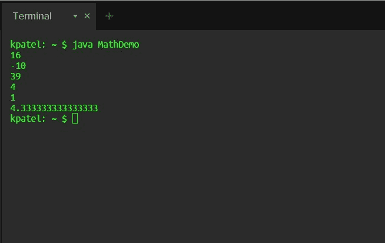

图 3.3：评估多个数学表达式并将结果输出到控制台的 Java 程序。

在编程中进行算术运算时，记住操作顺序非常重要。Java 在进行数学计算时始终会遵循操作顺序。因此，确保你编写的任何表达式都考虑了操作顺序以防止逻辑错误是一个很好的主意。

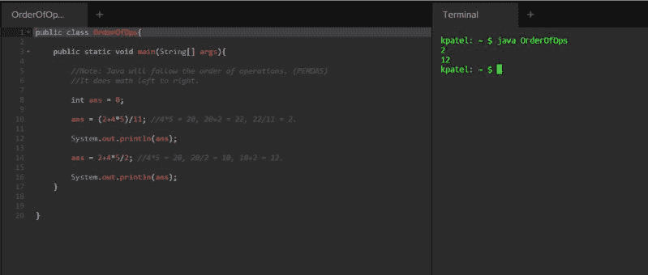

图 3.4：Java 程序中对不同表达式进行评估，展示了操作顺序。

结果总是你预期的吗？操作顺序决定了数学表达式的哪部分先被评估。表达式通常从左到右进行评估，但具体的操作顺序是：

1. 括号
2. 幂
3. 乘法
4. 除法
5. 加法
6. 减法

**注意：** 尽管乘法在除法之前、加法在减法之前，但 Java 将它们视为同一水平，并从左到右对它们进行评估。

新程序员犯的一个常见错误是错误解释了数学问题中的操作顺序。当发生这种情况时，程序仍然运行，但通常会给出错误的结果。

Java 的 `Math` 类中提供了更多高级的数学工具。利用这个类允许你对数字进行四舍五入、使用幂、平方根等。文档可以在此处查看：

`http://docs.oracle.com/Javase/7/docs/api/Java/lang/Math.html`

### 处理字符串

处理字符串是程序员的一项常见任务。例如，假设你给你一个数据列表，其中姓和名合并在一个字段中。使用字符串处理技术，你必须通过从字符串中提取数据将它们分离到单独的字段中。

**Java String 方法**将允许你以各种想象的方式操作字符串。你可以在此处查看 `String` 方法 的文档：`http://docs.oracle.com/Javase/7/docs/api/Java/lang/String.html`

让我们操作几个 `String` 方法。复制以下程序。该程序仅演示了几个字符串函数。如果你不想输入，不需要输入嵌入的注释。它们仅供你参考。

```java
public class Strings{

public static void main (String[] args) {

String phrase = "The quick brown fox jumped over the lazy dogs.";

//打印字符串中字符的个数 
System.out.println(phrase.length());

// 查找单词 fox 的索引。
System.out.println(phrase.indexOf("fox"));

// 将 jumped 替换为新词。
System.out.println(phrase.replace("jumped" , "hopped"));

//改变大小写
System.out.println(phrase.toUpperCase()); 
System.out.println(phrase.toLowerCase());

} }
```

一旦运行程序，你应该应该看到类似于图 3.5 的结果：

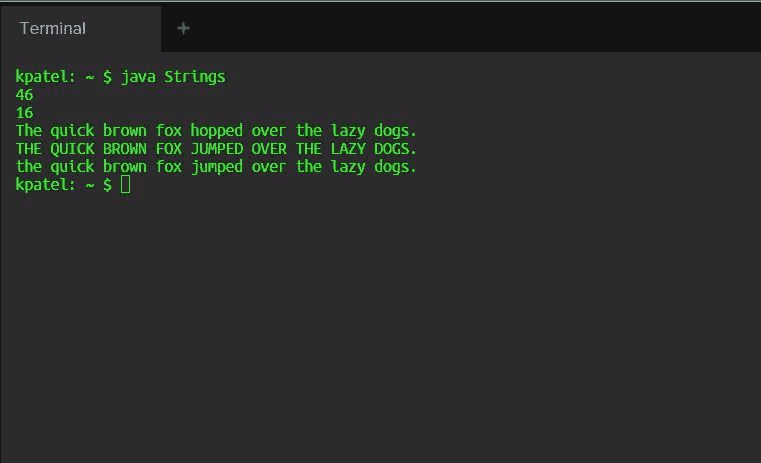

图 3.5：Java 中的字符串处理结果

你可以看到，Java 的字符串处理功能是非常强大的。

## 第 4 章：条件与循环


# 条件语句与循环

在上一章中，我们仔细研究了变量。在本章中，我们将再次使用变量。首先，我们将使用变量来决策并在程序中执行分支。然后，我们将使用变量创建循环，多次迭代部分代码。条件语句和循环是我们到目前尚未涵盖的概念，出现在几乎每种编程语言中。到目前为止，我们写的程序都是串行的——它们每次都以相同的顺序通过相同的步骤。在我们的编程库中加入条件语句和循环后，你的程序将根据你设置的条件改变其路径。听起来很有趣，对吧？

## 简单条件语句

让我们从编写一些代码开始。启动你的开发环境并输入以下代码（确保文件名和类名匹配）：

```java
import java.util.*;

public class Drink {

    public static void main(String[] args) {

        Scanner ageGetter = new Scanner(System.in);

        System.out.println("你多大了？");

        int age = ageGetter.nextInt();

        if (age >= 21) {

            System.out.println("你可以合法饮酒了！");

        }

    }

}
```

一旦你在文本编辑器中输入了程序，请分别运行三次。第一次，输入一个大于 21 的年龄。下次运行时，输入一个小于 21 的年龄。最后运行一次时，恰好输入 21。为了确保程序正确运行，我们想要测试所有可能的执行场景。

你的输出应该类似于图 4.1：

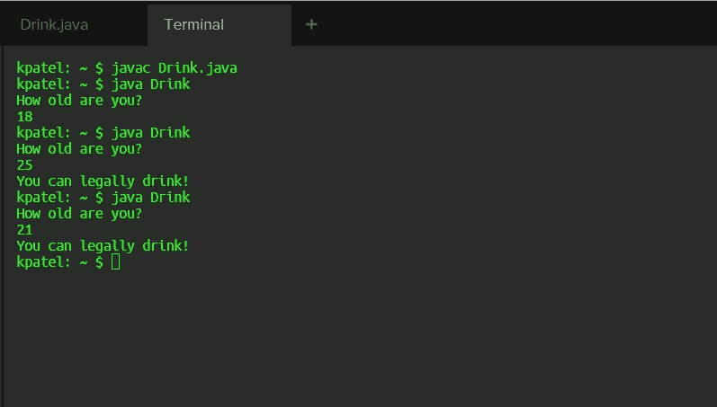

图 4.1：对三种不同用户响应进行测试的程序

该程序非常直观。新奇的是 `if` 语句。在这种情况下，我们正在判断用户输入的值是否大于或等于 21。`if` 语句中像这样的 `age >= 21` 部分被称为**条件**。每个条件语句都会评估为 `true` 或 `false`。如果是 `true`，则执行括号缩进的代码。如果是 `false`，通常会被跳过。

注意图 4.1 所示的示例，只有当用户输入 21 或更大的值时，程序才会响应“你可以饮酒”。Java 使用括号来包含代码块，因此在你打开括号后要确保关闭它，否则你的程序将无法编译。

如果为 `true` 时运行的代码块超过一行，请注意每行都应该在括号内。在条件语句下方保持相同的缩进级别也是良好的做法。这不会影响代码的运行，但会让代码看起来要整洁得多。阅读你代码的其他程序员会感谢你的。

## 还有什么？

我们写的程序只在条件评估为 `true` 时才有响应。如果条件评估为 `false`，用户将收不到任何响应。这可能会让用户感到困惑。我们将对程序进行扩展，使其在条件评估为 `true` 时做出一种反应，在条件评估为 `false` 时做出另一种反应。向你的类添加指定的代码。

```java
import java.util.*;

public class Drink {

    public static void main(String[] args) {

        Scanner ageGetter = new Scanner(System.in);

        System.out.println("你多大了？");

        int age = ageGetter.nextInt();

        if (age >= 21) {

            System.out.println("你可以合法饮酒了！");

        } else {

            System.out.println("你还没到饮酒年龄。");

        }

    }

}
```

在修改程序代码后，像以前一样运行这三种可能的场景。测试用户小于 21 岁的情况、用户大于 21 岁的情况，最后是用户恰好为 21 岁的场景。你的输出应该类似于图 4.2：

不要忘记保存并重新编译！！


图 4.2：添加 `else` 语句后的结果

正如你所看到的，添加 `else` 语句后，当输入小于 21 的值时会得到结果。当用户输入小于 21 的值时，条件被求为假并触发 `else` 语句块。再次，只有括号中的代码被视为语句块的一部分。

让我们为程序多添加一些代码：

```java
import java.util.*;

public class Drink {

    public static void main(String[] args) {

        Scanner ageGetter = new Scanner(System.in);

        System.out.println("How old are you?");

        int age = ageGetter.nextInt();

        if (age >= 21) {

            System.out.println("You can legally drink!");

        } else {

            System.out.println("You're not of drinking age.");

        }

        if (age == 21) {

            System.out.println("Congratulations, Here's a free drink.");

        }

    }

}
```

现在，如果用户说他们恰好是 21 岁，程序将打印祝贺信息。注意，使用了比较运算符 `==` 来表示相等。如果 `age` 中的值恰好是 21，则条件被求为真。

以下是你可以在 `if` 语句中使用的所有比较运算符：

- `==` 等于
- `>` 大于
- `>=` 大于或等于
- `<` 小于
- `<=` 小于等于
- `!=` 不等于

> **注意**：这些运算符只能用于基本类型，如 `int` 或 `float`！对于引用类型，通常有一个方法可以用来比较元素。通常是使用 `.equals()` 方法。

虽然你已经可以看到条件语句的威力，但让我们增加一层复杂性：如果你想同时测试两个值该呢？

## 复合条件

假设我们正在为一所大学编写软件，用以判断特定学生是否进入了荣誉名单。在我们的大学里，为了获得荣誉的资格，你的 GPA 必须大于 3.5 且修读学分超过 12 个学分。

在你的文本编辑器中创建一个名为 `Honors.java` 的新程序，并在文件中输入以下代码：

```java
import java.util.*;

public class Honors {

    public static void main(String[] args) {

        Scanner gpaGet = new Scanner(System.in);

        Scanner hoursGet = new Scanner(System.in);

        System.out.println("What was your GPA this semester?");

        double gpa = gpaGet.nextDouble();

        System.out.println("How many credit hours did you attempt this semester?");

        int hours = hoursGet.nextInt();

        if (gpa > 3.5 && hours > 12) {

            System.out.println("Congratulations! You made honor roll!");

        } else {

            System.out.println("Sorry, you didn't make honor roll. Better luck next time.");

        }

    }

}
```

测试你的程序并查看你得到的结果。你的结果应该与图 4.3 显示的类似：

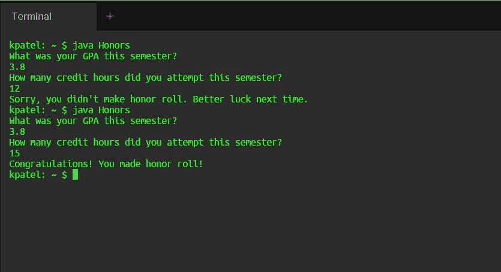

图 4.3：同时测试两个条件

你会发现，在 `if` 语句中，我们通过两个和符号 (`&&`) 连接了两个条件，在这种情况下它充当了运算符。在这个 `if` 语句中，由 `&&` 连接的两个条件都必须被求为真，整个语句才会被求为真。在其他情况下，你可以使用两个竖线 (`||`) 作为运算符，只要其中一个条件或另一个为真即可。你可以在单个 `if` 语句中使用 `&&` 和 `||` 运算符连接任意数量的条件。

**专业术语**：通常在阅读代码时，程序员会将 `&&` 读为“和”，并将 `||` 读为“或”。因此，`if (a > b && c < d || d < c)` 这行会被读为“如果 a 大于 b 且 c 小于 d，或者 d 小于 c（条件为）真”。

## 使用 else-if 的复杂条件

到目前为止，我们创建的条件语句可以在“二选一”的场景中做出决策——要么你有饮酒资格，要么没有。然而，生活比这复杂得多，这就是为什么 `if` 语句可以与 `else-if` 语句配合。这种组合允许你像下面的程序一样从多个选项中进行。

请输入此程序并使用 Java 命令运行它以查看结果：

```java
import java.util.*;

public class ComplexConditionals {

    public static void main(String[] args) {

        Scanner ageGet = new Scanner(System.in);

        System.out.println("How old are you?");

        int age = ageGet.nextInt();

        if (age < 18) {

            System.out.println("You're a kid!");

            System.out.println("Go to school.");

        } else if (age < 29) {

            System.out.println("Time to establish yourself.");

            System.out.println("Good Luck!");

        } else if (age < 39) {

            System.out.println("These are the years to focus on your career.");

            System.out.println("Get a job.");

        } else if (age < 49) {

            System.out.println("Time to start thinking about retirement.");

            System.out.println("I hope you're putting away.");

        } else if (age < 59) {

            System.out.println("Maintain your health through exercise.");

            System.out.println("Get a trainer.");

        } else {

            System.out.println("You are old");

        }

    }

}
```

对于 59 岁及以上的人，该程序根据年龄提供反馈。如果年龄小于 18 岁，程序回答“你是个孩子！去上学吧。”如果年龄小于 29 岁，建议是“是时候自立起来了。你好运！”

## While 循环

循环允许你运行多次代码块。代码块执行的每一次都被称为一次**迭代**。循环对许多类型的程序至关重要。让我们编写一个简单的循环：

```java
public class Loop {

    public static void main(String[] args) {

        int tracker = 0;

        while (tracker < 100) {

            System.out.println(tracker);

            tracker += 5;

        }

    }

}
```

使用 Java 命令运行程序，结果应该像图 4.4 所示：


图 4.4：`while` 循环的结果

在程序的第一行，我们声明并初始化了一个变量 `tracker`。接下来是我们的 `while` 语句，它表示只要 `tracker` 的值小于 100，`while` 语句括号中的代码块就会执行。在这种情况下，代码块将 `tracker` 的值打印到控制台，然后将 `tracker` 的值增加 5。

注意 `tracker += 5` 写法是 `tracker = tracker + 5` 的简写。`+=` 被称为**复合赋值运算符**。

**专业术语**：程序员通常将 `+=` 称为“加等于”。因此在描述这段代码时人们会说“tracker 加五”。

这里另一个循环示例程序供你尝试。我将其保存为 `Loop2.java`。

```java
import java.util.*;

public class Loop2 {

    public static void main(String[] args) {

        Scanner bandName = new Scanner(System.in);

        String band = "";

        while (!band.equals("XXX")) {

            System.out.println("喜欢的乐队名称或输入 XXX 停止。");

            band = bandName.nextLine();

            if (!band.equals("XXX")) {

                System.out.println(band + " ROCKS!");

            }

        }

    }

}
```

> **注意**：由于字符串是引用类型，你必须使用 `.equals()` 方法来检查相等性。该方法在字符串相等时返回真，否则返回假。

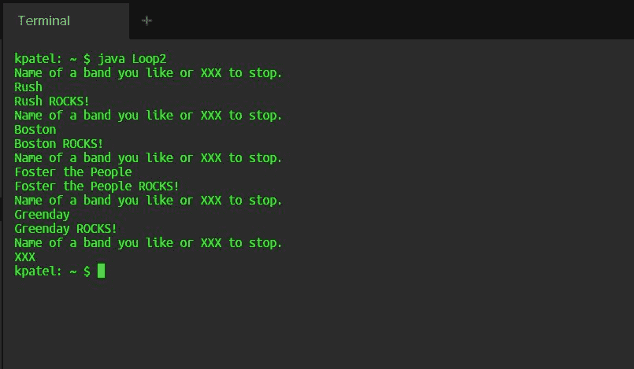

图 4.5：用户在循环内部输入文本

当此程序首次运行时，变量 `band` 被设置为空字符串。在每次循环中，`band` 的值都会与字符串“XXX”进行比较。如果循环的内容任何不是“XXX”，循环将再次迭代。如果值不是 `XXX`，则会将带的名称回显到控制台。

注意，所有的左括号都有对应的右括号。如果你在一段有连续多个右括号的代码中迷失了方向，这里有一个技巧：类中的左括号和右括号的数量**总是**相同的——如果你有更多左括号，请尝试对每一个左括号进行配对，直到发现缺少了右括号。

## 不要在家里尝试

编程中一个常见的错误是**死循环**。这些死循环会消耗越来越多的计算资源，最终导致程序或你的电脑崩溃。考虑以下代码：

```java
public class LetsBreakTheComputer {

    public static void main(String[] args) {

        double x = 1;

        while (0 < x) {

            System.out.println(x);

            x *= 300000;

        }

    }

}
```

你会注意到，在这个示例中，继续条件将**始终**为真——`x` 的值将始终大于零。`x` 的值迅速失控，实际上变得大到无法存储在内存中。我在 `Koding.com environment` 中运行了这个。我花了大约 10 分钟才停止程序的执行，因为 koding 的环境由于程序而卡顿。

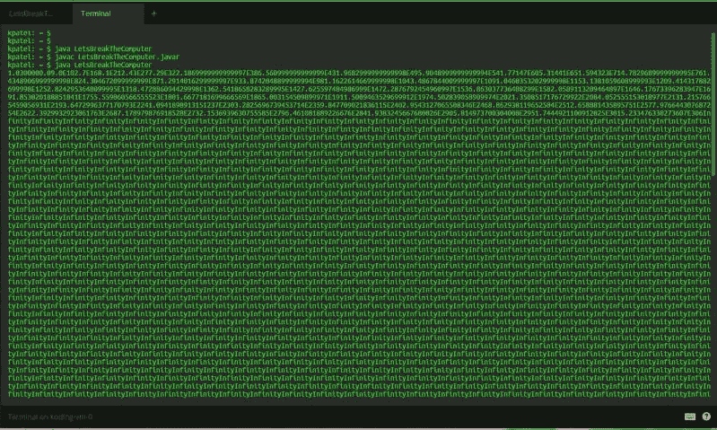

图 4.6：此时环境由于死循环而冻结。它偶尔会打印几百次“Infinity”，然后立即再次冻结。

你可以自己尝试这个示例。我对造成的任何损坏不负责。（损坏不会永久的……玩得开心点！）

## For 循环

我们已经确定，在 `while` 循环中忘记放入正确的迭代器会对你的程序不利。我们如何避免出现死 `while` 循环？答案是 `for` 循环。`for` 循环的作用与 `while` 循环相同，但它们只会执行固定的次数，因为你被要求在条件之外，还将迭代器和变量作为循环语法的一部分。因此，创建一个无限执行的 `for` 循环极其困难。

这是一个非常简单的 `for` 循环示例。它的作用与我们的第一个循环相同：打印 0 到 100，且步长为 5。

这个循环在一个名为 `Loop3` 的文件中：

```java
public class Loop3 {

    public static void main(String[] args) {

        for (int x = 0; x < 100; x += 5) {

            System.out.println(x);

        }

    }

}
```

循环的语法非常简单。首先，我们有一个初始化并声明的局部变量 `x`。局部变量无法在循环外部访问或更改。然后，我们有一个条件。该条件的作用与 `while` 循环中相同。当它不再为真时，循环将停止迭代。最后，我们有所谓的迭代器。这是对你为循环声明的变量进行重新赋值。迭代器就是之所以通常很难意外创建死循环的原因。注意，这三个语句之间用分号隔开，就像它们是行尾一样。这是执行此代码的结果：

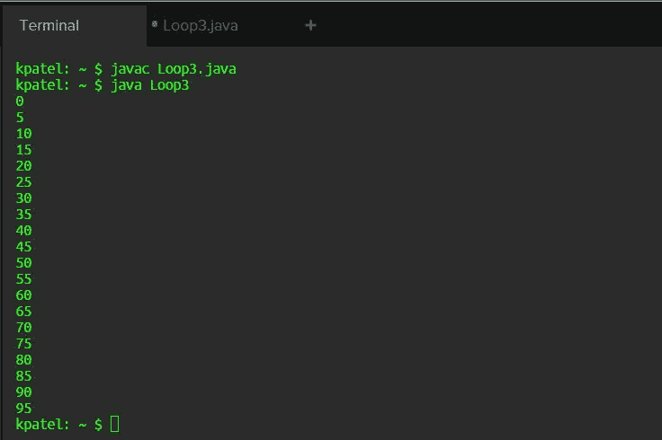

图 4.7：`for` 循环的结果与我们原始 `while` 循环的结果相同。

# 第 5 章：处理数据


在上一章中，我们检查了控制结构。在本章中，我们将检查控制结构、条件和循环，这些在大多数编程语言中都是关键的。它们允许程序根据你设置的标准做出决策。在本章中，我们将切换视角检查数据以及它是如何存储的。我们将仔细观察四种数据结构：`Arrays`、`ArrayLists`、`Immutables` 和 `HashTables`。你之前可能对数据没有进行太多思考。最简单的方法是将数据组织化。例如，如果你的数据是一个购物列表，那么 `Array` 就是组织数据的最佳方式。然而，如果你想在不同的时间段存储不同的成绩，`Array` 的效果并不理想。程序员使用了许多不同的数据结构，且每种都针对特定数据类型进行了优化。

## 数组

我们以前都做过购物列表，但你可能还没有在 Java 代码中存储过它。现在让我们使用以下代码来实现（记住将它放在你的 `main` 方法中！）：

```java
String [] groceries = {
    "oranges","apples","milk","bread","butter","pepper","salt","sugar","pears"
};
```

与存储单元数据的变量不同，我们在 `array` 中存储了多个元素。我确定你可以想象到许多方便这种情况的情况。在这种情况下，数组的所有 `members` 或元素都是字符串。这是因为我们将数组声明为 `String` 数组。`String` 是数组成员的数据类型。

这是另一个可以添加到你代码中的数组。这次它由 `double` 值组成：

```java
double [] gpas = {
    3.25, 2.26
};
```

在上述情况下，我们正在创建一个包含 10 个槽位的整数数组。这些槽位目前填充了值为 0 的整数，因为 0 是没有显式赋值的整数的默认值。

我们并没有在声明语句之后放置一系列值，而是命令 JVM 创建一个新的空数组，并留出足够的空间存放十个整数类型的数字。

记住，Java 是从零索引的，因此此数组中的最后一个槽位并不是通过在括号中放入一个十来命名的。`ten` 仅仅是数组中元素的数量。最后一个元素通过 `nine` 来引用。

```java
vals[9];
```

上述代码将访问数组的最后一个槽位。通过在括号中放入 `0` 可以访问第一个槽位。

数组计数这种方式的技术术语是“基于零的”（zero-based）。（Java 是从零索引的。数组是基于零的）。

### 编辑数组成员

你还可以使用数组成员的索引来更改列表中不同成员的值。这是通过赋值语句实现的，就像给标准变量赋值一样。以下语句将更改 `gpas` 列表的第 0 个索引：

```java
gpas[0] = 4.0;
```

注意，数组其他成员的索引不受影响。

这也是我们填充空数组的一种方法。我们只需要将空槽位重新赋值为我们想要的值。

### 数组排序

到目前为止，我们已经操作并存储了大量数据。然而，我们还没有组织很多数据。

数组是一种强大的组织工具。其中之一是因为 `sort()` 方法。它的作用正如其名——对数组成员进行排序。不过，`sort` 方法的调用方式与普通方法略有不同。`sort()` 是作为数组类的静态成员调用的，如下：

```java
Arrays.sort(<Array>);
```

创建一个新文件并复制此代码。我的文件名为 `ArraySortDemo.java`：

```java
import java.util.Arrays;

public class ArraySortDemo {
    public static void main (String[] args) {
        String[] groceries = {
            "oranges","apples","milk","bread","butter","pepper", "salt","sugar","pears"
        };
        System.out.println("___UNSORTED ARRAY___");
        for(String a:groceries){
            System.out.print(a + " ");
        }
        System.out.println();
        System.out.println("___SORTED ARRAY___");
        Arrays.sort(groceries);
        for(String a:groceries){ System.out.print(a + " "); }
        System.out.println();
    }
}
```

注意：如果你不理解 `for` 循环，不要担心。它们用于打印我们的数组。我们将在下一节介绍它们。

使用 Java 命令运行你的程序。你的输出应该像这样：

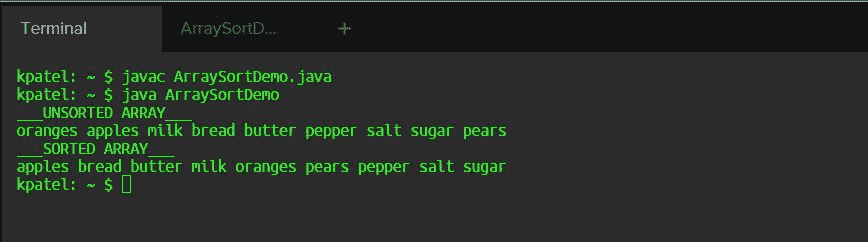
图 5.3：运行 `sort()` 函数后，杂货列表重新索引。现在它是按字母顺序排列的！

`sort` 方法还将数字按从小到大排序，并组织其他原始数据。

### 打印数组

到目前为止，我们打印数组信息的唯一方法是通过引用单个数组元素。但如果我们需要打印整个数组呢？

复制下面的文件：

```java
public class PrintingArrays {
    public static void main (String[] args) {
        int[] oneToTen = { 1,2,3,4,5,6,7,8,9,10 };
        System.out.println(oneToTen);
    }
}
```

执行上述代码会导致产生不可读的文本：

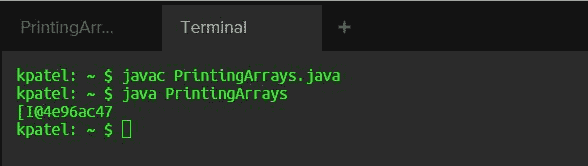
图 5.4：传递变量名打印了 Java 编译器使用的内部引用。很奇怪。

相反，我们必须使用循环。有几种方法可以实现；我将向你展示最简单和最常用的两种。

#### 使用 for 循环

第一种方法使用简单的 `for` 循环来打印数组。在 `PrintingArrays` 中用这几行代码替换 `print` 方法：

```java
for(int x = 0; x < oneToTen.length; x++){ System.out.println(oneToTen[x]); }
```

现在如果你运行程序，你将看到数组的内容被打印出来了：

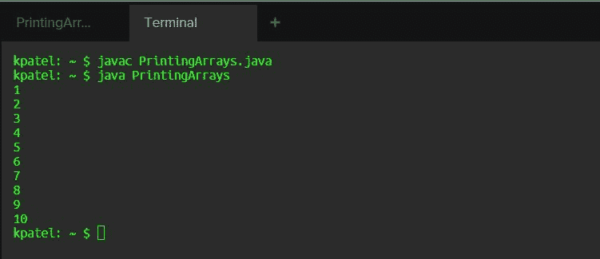
图 5.5：太棒了！我们打印了数组。

这个循环的工作原理非常简单。我们创建的用于跟踪循环迭代次数的局部变量在调用数组元素时被用作索引值。结果是迭代之后，变量的值增加了 1，我们引用的槽位也随之改变。

换句话说：`x` 从零开始。下一次迭代将 `x` 的值从零变为一。由于括号中包含的是动态变量 `x` 而不是静态数字，我们调用的索引（最初是索引零）切换到了索引一。

迭代次数使用 `.length` 属性设置，该属性返回数组中元素的总数。

#### 使用 for-each 循环

第二种打印方法是通过使用被称为 `for-each loop` 的改进型 `for` 循环。这种循环的语法比普通的 `for` 循环简单。

将以下代码添加到你的 `PrintingArrays` 程序末尾：

```java
System.out.println("_______ a for each loop______");
for(int print:oneToTen){ System.out.println(print); }
```

## ArrayLists

`ArrayList` 是一种可调整大小的数组实现。与数组不同，`ArrayList` 可以动态地增长和收缩。让我们看看如何使用它。

创建一个名为 `ArrayLists.java` 的新文件并添加以下代码：

```java
import java.util.ArrayList;

public class ArrayLists {
    public static void main (String[] args) {
        ArrayList<String> languages = new ArrayList<String>(3);

        languages.add("Spanish");
        languages.add("French");
        languages.add("English");
        System.out.println(languages.size());
        languages.add("German");
        System.out.println(languages.size());
    }
}
```

`main` 方法的第一行声明了一个名为 `languages` 的新 `ArrayList`，并给它设置了初始容量为 3。

**术语交流：** 有几种方法可以表示你使用了一个方法。最常用的术语是‘call’（调用）或‘invoke’。当程序员说‘I invoked the method’（我调用了该方法）时，他们实际上是在说使用了该方法。

接下来的三行代码调用 `add` 方法来填充 `ArrayList`。然后调用 `size` 方法查看 `ArrayList` 的大小。之后，在 `ArrayList` 的末尾又添加了一个元素，使其从原始的三个元素增加到了四个。

当你运行代码时，输出应该类似于此所示：

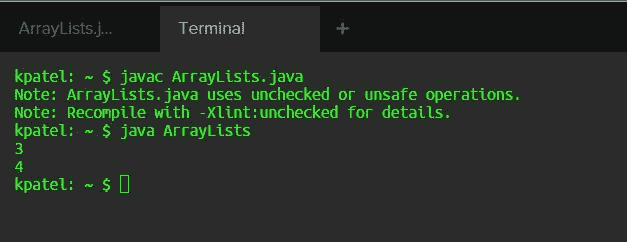
图 5.6：我们可以看到当向末尾添加元素时，`ArrayList` 的大小是如何增加的。

除了程序的输出外，Java 还打印了两条备注。这是因为我们正在使用未参数化的 `ArrayList`。未参数化的 `ArrayList` 是未指定类型的 `ArrayList`。结果是不同类型的变量可以存储在同一个 `ArrayList` 中，并由于类型不匹配导致异常。

为了缓解这个问题，我们必须对列表进行类型化以接收一个特定的对象，就像数组那样。声明和实例化应如下所示：

`ArrayList<DataType> name = new ArrayList<DataType>();`

**术语交流：** 未参数化的 `ArrayList` 接受所谓的泛型（generic type）。泛型是一种可以由程序员稍后指定的类型，以提高功能性。该类型可以是任何类型，包括你自己实现和设计的自定义类。

让我们修改 `ArrayLists.java` 文件中的代码以遵循这一做法（实际上上述代码已使用泛型，此处为强调）：

```java
public class ArrayLists {
    public static void main (String[] args) {
        ArrayList <String> languages = new ArrayList<String>(3);
        languages.add("Spanish");
        languages.add("French");
        languages.add("English");
        System.out.println(languages.size());
        languages.add("German");
        System.out.println(languages.size());
    }
}
```

现在当我们重新编译并运行代码时，没有问题了！

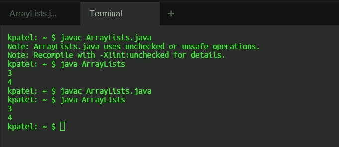
图 5.7：好多了。对 `ArrayList` 进行类型化消除了那个烦人的警告。

现在关于 `ArrayLists` 需要知道的最后一点是如何从中获取数据。与数组不同，我们不通过索引直接引用。相反，我们使用一个方法来检索数据：`.get(index)` 方法。括号中的数字是你想要访问的元素的索引值。就像 `Arrays` 一样，`ArrayLists` 也是基于零索引的。

向你的代码中添加以下行，重新编译并运行以查看效果：

```java
System.out.println(languages.get(0));
```

当你重新编译并运行时，输出应该类似于此：

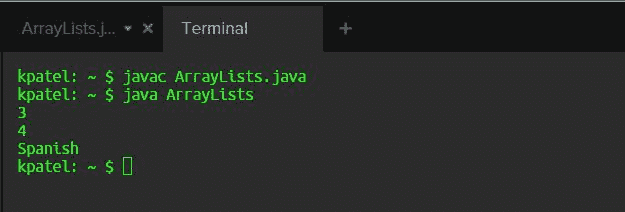
图 5.8：我们打印了 `ArrayList` 的第一个元素。

`ArrayLists` 还有许多其他非常有用的方法。最著名的是 `.set()` 方法，它替换值就像给数组重新赋值一样。

官方文档位于此处：
http://docs.oracle.com/javase/7/docs/api/java/util/ArrayList.html

## 不可变对象 (Immutables)

不可变对象与 `ArrayLists` 非常相似，但有一个重要的区别：不可变对象是非动态的。这意味着一旦定义了 `Immutable`，其内部的值就不能更改。让我们开始一个新的程序，在其中定义一个 `Immutable`。

将此代码复制到名为 `ImmutablesDemo.java` 的文件中：

```java
import java.util.*;

public class ImmutablesDemo {
    public static void main (String[] args) {
        // 注意：数组不能变为不可变的。因此，我们使用 List。
        String [] turn = {"600", "800", "1024", "1280", "1366", "1920"};
        List<String> list = java.util.Arrays.asList(turn);
        List<String> unmodList = Collections.unmodifiableList(list);
        for(String p: unmodList){
            System.out.println(p);
        }
        System.out.println();
        System.out.print(unmodList.get(0));
        unmodList.add("464");
    }
}
```

编译代码然后使用 `java` 命令运行它，并仔细检查输出。

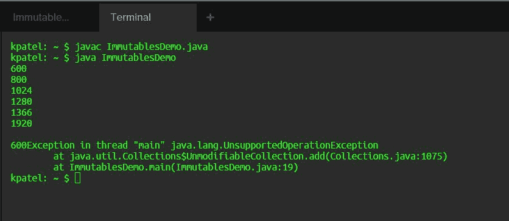
图 5.9：注意，我们可以访问整个不可变对象、不可变对象内的单个索引，但当尝试重新赋值不可变对象内部的值时，会产生错误。不可变对象是非动态的，一旦初始化，内部的值就不能更改。

不可变对象用于存储在程序生命周期内不改变的数据。例如，在上面的程序中，屏幕宽度可能不会改变。

## 哈希表 (HashTables)

`HashTables` 是另一种数据结构。它们非常适合存储成对的数据，有时被称为 *键值对 (key: value)* 数据。在这种数据类型中，不再使用数值索引，每个数据点都由程序员确定的键进行索引。州名和州首府、城镇和邮政编码都是 `HashTables` 可用于存储数据的示例。

丰富的程序员可能会发现 `HashTables` 与字典（Dictionaries）非常相似。这是因为 `HashTables` 是源自它们的。

考虑以下程序：

```java
import java.util.*;

public class HashTableDemo {
    public static void main (String[] args) {
        Hashtable <String,String> statesAndCapitals = new Hashtable<String,String>();

        statesAndCapitals.put("Connecticut","Hartford");
        statesAndCapitals.put("New York","Albany");
        statesAndCapitals.put("Mississippi","Jackson");
        statesAndCapitals.put("Maine","Augusta");
        statesAndCapitals.put("Montana","Helena");
        statesAndCapitals.put("Texas","Austin");

        String connCap = statesAndCapitals.get("Connecticut");
        System.out.println(connCap);
    }
}
```

当你使用 `java` 命令运行程序时，你会看到输出“Hartford”。这是键“Connecticut”对应的结果。

就像数组一样，Java 的 `HashTables` 是一个对象，并拥有与其关联的函数。让我们看看其中一个函数。更新你的代码使其看起来如下所示：

```java
System.out.println("Values: " + statesAndCapitals.values());
System.out.println("Keys: " + statesAndCapitals.keySet());
```

## 类与对象

类和对象不仅是一种编程概念，更是一种观察世界和解决问题的方式。从高层面上来说，类和对象代表了分类的过程——这项活动与科学一样古老。当我们创建一个类时，我们实际上是在创建一个对象的模型，将对象拆解为它的核心活动和属性。Java 是一种面向对象的语言，意味着它完全依赖于 `Class` 和 `Object` 结构，并且所有内容都必须包含其中。Java 并不是唯一支持对象的语言。理解对象是有益的，因为它们在编程中非常常见。

### 类与对象

我经常告诉学生，把类想象成一个对象的蓝图。从这幅蓝图中，可以创建出许多该类的实例（对象）。想象一下规划好的住宅社区：单张蓝图可以用来建造许多不同的房屋。这些房屋在实质上可能有很多不同——它们的颜色可能不同，厨房台面不同，浴室的固定具也不同——但它们仍然都是基于同一张蓝图。

在编程中，类定义了该类的对象是如何被描述的以及它可以做什么。将类类比一组形容词和一组动词可能会很有用。形容词为我们提供了描述的方法，而动词告诉我们该类可以做什么。用于描述类的形容词集合被称为 `fields`（字段）。与类相关的动词集合被称为 `methods`（方法）。

如果我们描述一个“车辆”类，我们可能会包含以下方法和属性：

| 字段（形容词） | 方法（动词） |
| :--- | :--- |
| color | `accelerate()` |
| weight | `decelerate()` |
| height | `turnLeft()` |
| topSpeed | `turnRight()` |
| vehicleType | `startIgnition()` |
| | `stopIgnition()` |


显然，这个模型是高度简化的。如果我们真的试图在代码中表示一辆汽车，我们可能需要使用几个相互相关的类。在 Java 中，我们还必须声明每个属性将持有的数据类型。例如，`color` 属性将持有字符串，而 `weight`、`height` 和 `topSpeed` 可以是整数。当我们为上一个表中定义的 `Vehicle` 类创建一个实例时，我们可能会给所有属性赋值，如下所示：

```
String color = "blue"; double weight = 5565.3; int height = 48;
int topSpeed = 90;
String vehicleType = "car";
```

这个示例假设创建了一个名为 `theVehicle` 的实例（对象）。

## 在 Java 中编写类

让我们写出代表 Java 中 `Animal` 类的代码。稍后，我们会在另一个文件中创建该类的名为 `myDog` 的实例。

```java
public class Animal{
    private static int numberOfAnimals = 0; 
    public int length;
    public String color;
    public double weight;
    public boolean hasFur;

    public Animal(int Length, double Weight, String Color, boolean Fur){
        color = Color;
        weight = Weight;
        hasFur = Fur;
        length = Length;
        numberOfAnimals ++;
    }
}
```

这里肯定有一些新东西。首先，我们这里没有 `public static void main`。这是因为这个程序的运行方式与我们目前看到的有所不同。`main` 方法通常是 JVM 并执行我们代码的入口点。它将位于我们稍后编写的驱动类中。我们用 `public class` 关键字开始类的定义，然后是类的名——在这种情况下是“Animal”。`public` 关键字提供了有关可见性的信息。它告诉 JVM 任何类都被从此类创建对象并调用其方法。`Class` 关键字告诉 Java 这个文件是什么。接下来你会注意到我声明了一个名为 `numOfAnimals` 的变量并将其初始化为零。`numOfAnimals` 变量设计用于类内部的一些内部工作。它的具体工作是跟踪我们创建了多少个 `Animal` 实例。数据类型和可见性级别（在本例中为 `private`）之间的 `static` 关键字使我们能够将此变量作为跟踪器。`Static` 意味着你不需要创建类的实例就可以访问或修改此信息。这意味着每个对象并没有 `numOfAnimals` 的实例，而是存在于类中。

在 `numOfAnimals` 之后，我简单地创建了一些变量来详细说明有关我们动物的信息：诸如 `weight`、`color`、`length` 以及它是否有毛。

关键字是一个保留字，除了其预定功能外，不能用于任何其他地方。示例包括：`public`、`private`、`for`、`while` 和 `do`。通常关键字会被你的文本编辑器高亮。我正在使用的 Koding 编辑器将它们显示为紫色，如图 6.1 左侧所示。由于关键字已经被预留，因此不能用作变量、函数或类名。

然后我们在 `Animal` 文件中使用 `public` 关键字定义了所谓的“构造函数（constructor）”。这个方法非常重要。它做了三件事：详细列出我们根据此类创建对象所需的信息，执行任何内部清理工作，并为字段分配初始值。每当你根据你的类创建一个对象时，构造函数就会执行一次。

构造函数由下面的驱动类调用。我将我的命名为 `AnimalDriver.java`：

```java
public class AnimalDriver{
    public static void main (String[] args) {
        Animal myDog = new Animal(19, 12, "brown", true);
    }
}
```

你会注意到，我为类添加了一个额外的属性，数据类型为 `Boolean`：`hungry`。这个属性的设计非常简单，用于追踪 `Animal` 实例是否饥饿。当我们创建一个名为 `myDog` 的 `Animal` 实例时，我们将 `hungry` 属性的值设置为 `true`。

我们还向类中添加了两个方法。第一个方法 `walk()` 简单地打印消息“Animal is walking.”（动物正在行走.）。

第二个方法 `eat()` 则更为复杂。它与对象的属性进行交互。首先，`eat()` 方法将 `hungry` 属性的值设置为 `"false."`。然后，它通过打印语句告知用户 `Animal` 正在吃。最后，由于动物正在吃，我们访问了 `weight` 属性并向其值加上了 `.1`。

在类定义和 `myDog` 实例实例化之后，我们运行了 `walk()` 和 `eat()` 方法。

你会注意到，所有这些方法都使用了 `return` 关键字。

这些方法的定义包含了所谓的“返回类型”（return type）。它出现在方法声明中，可见性级别之后。这就是为什么 `Scanner` 对象需要几个方法来从提示符获取输入的原因；方法只能返回一种数据类型和一个对象。在我们所有的实例中，我们返回的都是字符串。当我们调用 `AnimalDriver` 类中的这些方法时，无论方法返回给我们什么，都将是一个字符串。这意味着我们可以设置一个 `String` 变量来捕获方法的返回值：

```
public String walkText = myDog.walk();
```

请注意，尽管到为止我们返回的是像 `int`、`float` 或 `boolean` 这样的原始类型，但我们也可以返回像 `ArrayLists` 这样的引用类型。

`return` 关键字本身起着两个作用。

第一件事是将你放在该行剩余部分的任何内容发送回给方法调用者。如果你放入一个表达式，它会返回结果。如果你放入一个字符串，它会返回整个字符串。

`return` 关键字做的下一件事是标记方法的完成。一旦你的方法返回了某些内容，它就会退出，无论代码中 `return` 之后还有什么。这非常有用，因为你可以将 `return` 语句放置 `if` 语句中，并在符合特定标准时提前结束。

某些方法不需要返回任何内容。我们遇到的一个例子是 `print` 方法。在这种情况下，返回类型是 `"void"`，它取代了数据类型的位置。具有此类声明的方法示例如下：

```
public void name(<Datatype>Parameter){}
```

需要注意的是，`return` 关键字也可以用于强制 `void` 方法退出。只需输入 `return`，并用一个分号结束该行，即可停止方法的执行。

### 多个实例

你可能还记得我们最初的讨论，类仅仅是一个蓝图，可以从该类构建出多个对象。请在文本编辑器中输入以下修改后的代码：

```java
public class Animal{

    private static int numberOfAnimals = 0; 
    public String name;

    public int length;

    public String color;

    public double weight;

    public boolean hasFur;

    public boolean isHungry;

    public Animal(String Name, String Color, int Length, double Weight, boolean Fur, boolean Hungry){
        color = Color;
        weight = Weight; hasFur = Fur;
        isHungry = Hungry; length = Length; name = Name;
    }

    public String walk(){
        return name +" is walking";
    }

    public String eat(){
        isHungry = false;
        weight += .1;
        return name + " has eaten.\n" + name + " now weighs: "
        + weight + " pounds";
    }

    public String getLength(){
        return name + "'s length is " + length;
    }

}
```

我向 `Animal` 类又添加了另一个属性。`name` 属性设计用于持有 `Animal` 实例的名字。请记住；这与代码引用该实例的名称是不同的。

现在让我们更新 `AnimalDriver` 类以反映新功能。复制这段修改后的代码：

```java
public class AnimalDriver{
    public static void main (String[] args) {
        Animal myDog = new Animal("Sparky","Grey", 17, 56.4, true, true);
        Animal yourDog = new Animal("Rover","Brown", 19, 41.8, true, true);
        System.out.println(myDog.walk()); System.out.println(myDog.eat());
        System.out.println(yourDog.walk()); System.out.println(yourDog.eat());
    }
}
```

### 继承类

我们的树形结构如下：

`GroundVehicle` 是一个 `Vehicle`，而 `Vehicle` 是一个 `Object`。

**专业术语：** 在面向对象编程中，当程序员引用子类的父类时，他们说子类与父类共享“一种”（is a/an）的关系。

接下来的几行代码为我们的对象添加了两个新字段。`numWheels` 包含了 `GroundVehicle` 对象的轮子数量。`vehicleType` 变量允许我们传入如“car”、“motorcycle”或“truck”之类的字符串。这两个新变量除了 `Vehicle` 类中的所有变量外还额外存在。`Vehicle` 的变量可以通过 `super` 关键字进行访问。由于 `GroundVehicle` 是 `Vehicle` 的子类，`GroundVehicle` 继承了 `Vehicle` 的属性和功能。

`super` 关键字允许你引用直接父类（`extends` 关键字之后的类）的字段、构造函数和方法。

我们已经在 `GroundVehicle` 类的构造函数中使用 `super` 关键字引用了它的构造函数。我们将 `super` 关键字视为了 `Vehicle` 的实例化语句。

正常的实例化看起来如下：

```
new Vehicle(100,"Orange",1034.2, false);
```

在构造函数内部，`new Vehicle` 被 `super` 取替，结果是由于我们调用了父类的构造函数，`GroundVehicle` 内部的所有隐藏字段将在构造时被填充。

构造函数之后我们有三个方法。它们改变了车辆类中的一个变量，然后返回一个确认这些更改的字符串。阅读 `GroundVehicle` 中前两个方法的名称，以及 `Vehicle` 中前两个方法。当子类中的方法与其父类中的方法同名时，它们会重写（override）父类方法。我们只是改变了方法的功能，并没有更多。如果我们更改了任何其他内容，例如返回类型，那就是方法重载（overloading）。

记住，我们需要一个驱动类来使用我们的对象。

将以下代码复制到名为 `VehicleDriver.java` 的文件中：

```java
public class VehicleDriver{
  public static void main(String[] args){
    Vehicle transportationMachine = new Vehicle(50,"Blue",210,false);
    System.out.println(transportationMachine.startMoving());
  }
}
```

这段代码的输出结果是：

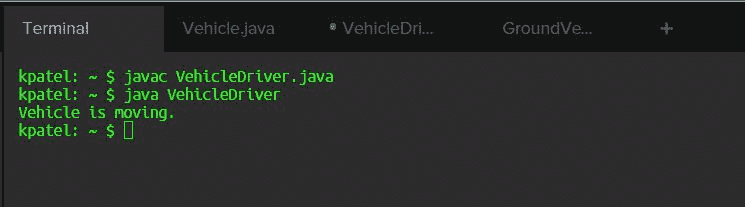图 6.4：输出我们在 Vehicle Driver 类中输入的字符串，因为那是我们放在返回语句之后的内容。

让我们为我们的 `VehicleDriver` 添加一些额外的代码，以更好地了解发生了什么。将此代码添加到你的 Vehicle Driver 类中：

```java
GroundVehicle horseAndBuggy = new GroundVehicle(5, "Black", 300, false, 4,"Horse and Buggy");
String result = horseAndBuggy.startMoving();
System.out.println(result);
```

一旦我们重新编译并运行，输出看起来像这样：

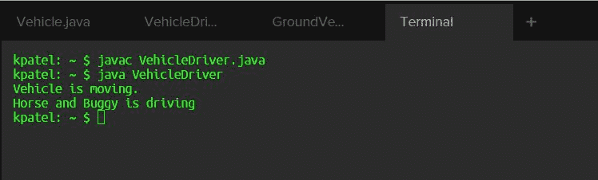

图 6.5：我们在 `GroundVehicle` 类中更具体的方法导致了更具体的输出。

这段代码段的第一行是 `GroundVehicle` 对象的实例化，我们用它来制作一辆马车。下一行创建一个字符串，并将其设置为 `startMoving` 方法的输出。最后一行打印 `result`。

最后，让我们看看类扩展能够做的另一件事情。

将这最后几行复制到驱动类中：

```java
Vehicle goKart = new GroundVehicle(25,"Yellow", 3, true, 4, "GoKart" );
System.out.println(goKart.startMoving());
```

观察对象的声明和实例化。它们并不匹配。然而，当我们编译并运行这段代码时，并没有问题，因为 `GroundVehicle` 是 `Vehicle` 的类型。由于 `GroundVehicle` 类派生自 `Vehicle` 类，可以使用 `Vehicle` 类型变量来持有 `GroundVehicle` 类型对象，正如我们在代码中所做的那样。

然而，`GroundVehicle` 类型变量**不能**被用来持有 `Vehicle` 类型对象！`GroundVehicle` 是一个 `Vehicle`，但 `Vehicle` 不一定是 `GroundVehicle`。`GroundVehicle` 具有并非 `Vehicle` 都具备的参数，例如轮子数量。

这在所有编程树中都是如此。不模糊的对象可以包含在更模糊的变量中。然而，模糊的对象不能包含在具体的变量中。

这意味着你可以将 `GroundVehicle` 或 `Vehicle` 放在 `Object` 类型变量中，因为所有引用类型对象都派生自 `Object` 类。（一切都是对象。）

此时你可能会疑惑当在下一行调用 `startMoving` 方法时会发生什么。它是使用 `GroundVehicle` 类中更具体的方法，还是 `Vehicle` 类中模糊的方法？

嗯，如果你编译并运行代码，结果如下：

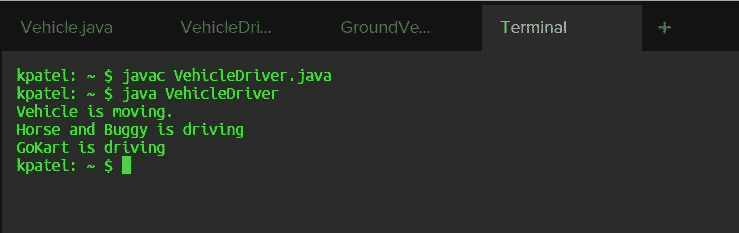图 6.6：它使用了更具体的方法！

尽管变量是 `Vehicle` 类型，但该变量引用的对象是 `GroundVehicle` 类型。由于对象是 `GroundVehicle` 类型，当我们对对象调用方法时，它执行了它应该做的事，并执行了它所访问的代码：更具体的方法。

我鼓励你添加代码并对车辆类进行实验，或者创建自己的类和方法来观察你可以做什么。

一个很好的项目是用代码表示某些其他现实系统。本节旨在向你提供关于类和对象的面向对象编程的基础介绍。然而，你会发现这些基础概念可以应用于许多现代编程语言。

本节的结束也标志着本书的终结。你现在掌握了使用 Java 语言编程的基础。无论你继续学习 Java，还是转向其他开发领域（如 Web 应用或移动端），这些信息都对你有帮助。

无论你走向哪个方向，我都祝你好运。

## LearnToProgram 在线课程


## 课程列表

- Become a Certified Web Developer Level One
- Become a Certified Web Developer Level Two
- Certified Mobile Developer
- Roadmap to Web Developer
- HTML and CSS for Beginners (with HTML5)
- Javascript for Beginners
- Programming for Absolute Beginners
- PHP and MySQL for Beginners
- jQuery for Beginners
- CSS Development with CSS3
- Node.js for Beginners
- Advanced Javascript Development
- AJAX Development
- SQL Database for Beginners
- Ruby on Rails for Beginners
- Famo.us Javascript Framework
- GitHub Fundamentals Creating a PHP Login Script
- Front End Developer with Adobe Dreamweaver
- Codeless Web Development with Adobe Muse
- Mobile App Development with HTML5
- 10 Apps in 10 Weeks
- Java Programming for Beginners
- Swift Language Fundamentals
- iOS Development for Beginners
- Android Development for Beginners
- 10 Apps in 10 Weeks: iOS Edition
- Python for Beginners
- Construct 2 for Beginners
- Game Development with Unity
- Mobile Game Development for iOS
- 3D Fundamentals with iOS
- Project Management using Microsoft Project
- .Net for Beginners
- C++ for Beginners
- Joomla for Beginners
- User Experience Design Fundamentals
- Photoshop CS6 Training for Coders
- Design for Coders
- C Programming for Beginners
- Objective C for Beginners
- Introduction to Web Development
- Game Development Fundamentals with Python
