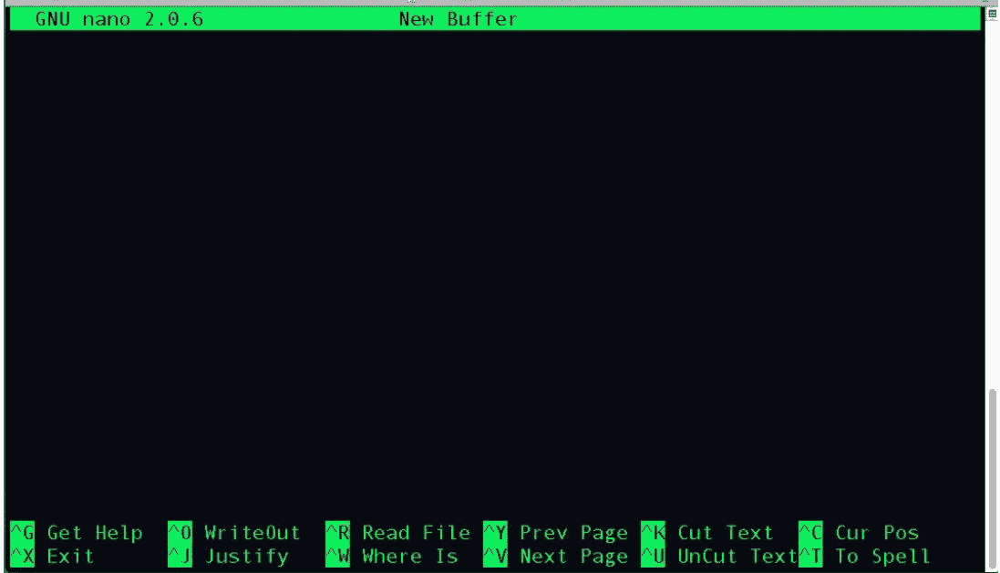
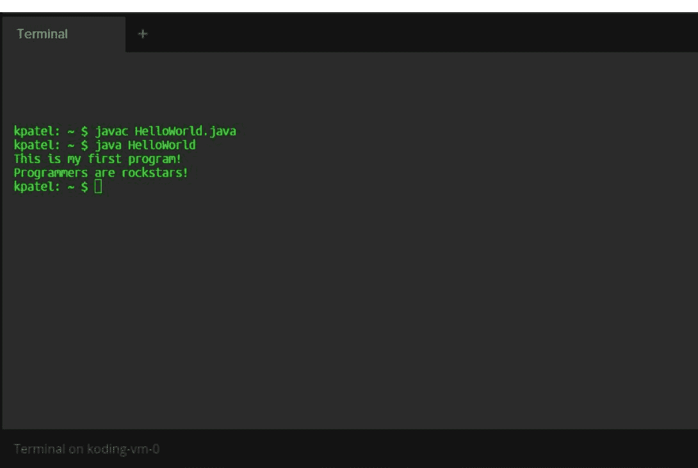
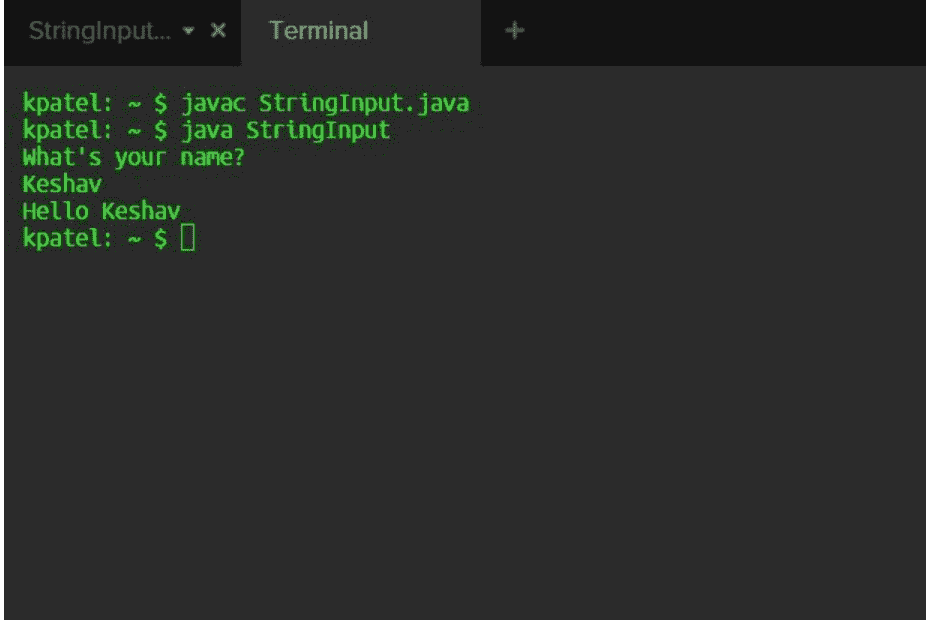
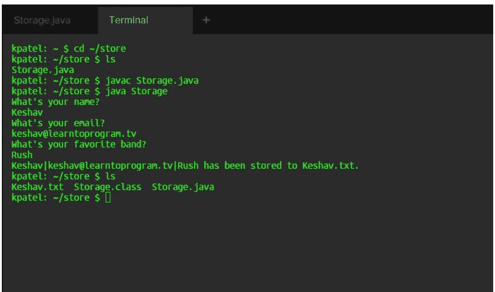
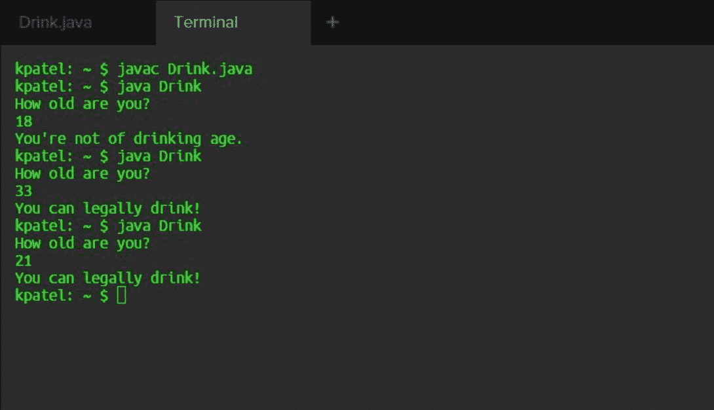
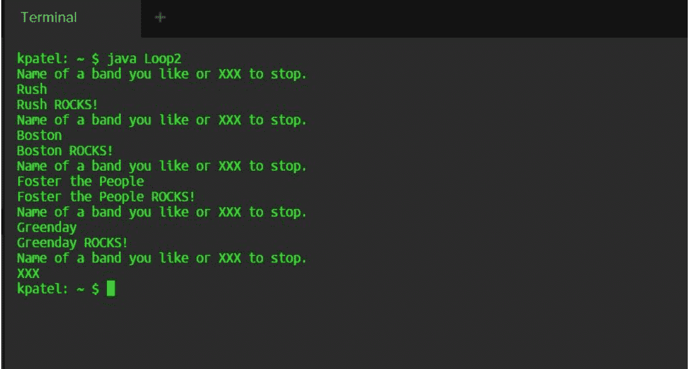
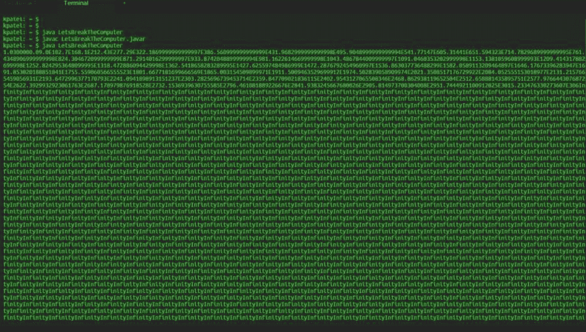
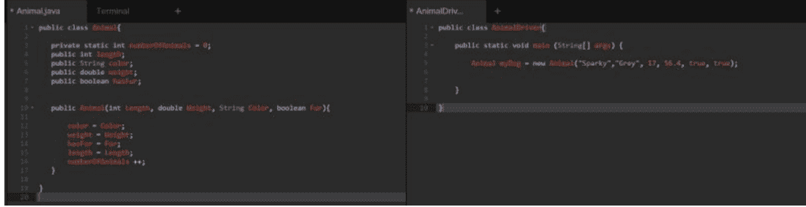

# Java 编程：入门指南 (初学者指南) (第 1 卷)

## 关于《初学者指南》系列

这个初学者系列书籍的诞生于一种挫败感：大多数关于网络和移动开发的初级书籍并非为真正的初学者设计的。

通常在初级书中，语言变得过于复杂且充满了术语，只有那些具有编程经验的人才能理解。这些书籍假设读者拥有过多的先验知识或经验。最终，许多编程的新手在挫败中咬牙并放弃了。

事实是，如果教学得当，编程完全是容易上手的，甚至也很有趣。这正是《初学者指南》系列的目标：帮助真正的初学者学会编码。

如果你以前从未写过一行代码——或者尝试过从其他书中学习但失败了，这系列编程书籍就适合你。你**可以**学好编码。你不需要是数学背景，也不需要极其聪明。

学习编码并不总是那么容易——但它是可行的。如果你能操作 Excel 表格，你就能学习编程。

希望这个过程对你来说像对我们教学一样充满回报。

如果你有任何问题或建议，请直接发送邮件给我：mark@learntoprogram.tv。

-Mark Lassoff, LearnToProgram Media 创始人

## 免费课程！

一小时创建你的第一个 App

Mark Lassoff 带你入门开发世界

感谢你阅读本电子书，我们为你提供免费参加由导师 Mark Lassoff 授课的新在线课程——**一小时创建你的第一个 App**。


在这个简短课程中，你将学习如何使用 HTML5、CSS 和 Javascript 等语言创建一个基础应用。

该程序专为像你这样的初级开发者开发。

报名请访问：

http://bit.ly/oneHourApp

learntoprogram.tv

## 恭喜！你已获得《LearnToProgram 杂志》免费订阅资格


## 是的！

请开始我的免费订阅：learntoprogram.tv MAGAZINE

兑换请访问：

bit.ly/LearnToProgramMagazine

learntoprogram Media

# 第1章：编写你的第一个程序

欢迎。如果这是你第一次编程，那么恭喜你！你即将开始一段冒险。如果你是在之前的尝试失败后尝试学习的，你理应获得认可。应对编程并不总是容易——但它并不是普通人的能力范围之外。

多年来，我通过在线和线下教授了超过 50 万人的编程。我多年来遇到的程序员——无论是初学者还是资深老手——都来自不同的背景。我发现博士学位和高中中辍的学生都能成为优秀的程序员。我的班级多年来一直出现过数学家、精神科医生和 12 岁的孩子，他们都学会了一些编程。

你会学会的。在本介绍章节中——专为略微疑虑的初学者设计——我将带你一步到位。

## 你将学到什么

在本介绍章节中——专为略微疑虑的初学者设计——我将带你一步到位。（注：原文此处开始出现大量重复乱码，翻译已按原意处理）。

它们列在屏幕底部以供你参考。最需要注意的是 `CTRL-L` 用于保存文件，而 `CTRL-X` 用于退出 nano 并返回命令行。

默认情况下，nano 将把文件保存在你打开 nano 时所在的文件夹中。



图 1.5：nano 文本编辑器。

你可以通过在命令行中输入 `nano` 并按回车来启动 nano。

vi 是一个稍微复杂一点（甚至是“老派”）的文本编辑器。理解 vi 最重要的一点是它有两种模式：命令模式（command mode）和插入模式（insert mode）。要进入插入模式，请按键盘上的 `i`。当你想要回到命令模式以执行如写入和退出之类的命令时，按下 `ESC` 键。如果你搞砸了发现自己处于错误的模式，多按几次 `ESC` 似乎可以让你从任何地方回到命令模式。

关于 vi 有一个经典的老笑话：vi 有两种模式，而你正处于错误的模式中。（如果你现在觉得这不好笑，那是因为你很快就要用 vi 一子了！）

当你进入 vi 时，输入 `i` 进入插入模式，你就可以输入代码了。完成后，按 `ESC` 进入命令模式。所有命令都必须以冒号开头。要写入文件，输入 `:w`。要退出，输入 `:q`。vi 还允许组合命令。例如，组合命令 `:wq` 会写入你的文件然后退出回到命令行。

图 1.6：vi 想要帮助你们乌干达的孩子们。它对全球的新手程序员提供了有限的帮助。

你可以通过在命令行中输入 `vi` 并按回车来启动 vi。

现在你应该已经启动了文本编辑器，并准备好输入代码了。请按照所示在你的编辑器中输入以下代码：

```java
public class HelloWorld {
    public static void main(String[] args) {
        System.out.println("This is my first program!"); System.out.println("Programmers are rockstars!"); 
    }
}
```

这段代码的作用应该是显而易见的。`println` 函数将内容打印到命令行。在这种情况下，你正在打印两个字符串。字符串是简单的字符行。字符串始终被引号括起来。

一旦输入了代码，就是时候运行它了。在 nano 中，输入 `CTRL-W` 保存文件。在提示时，输入文件名 `HelloWorld.java`。`.java` 扩展表示这是一个 Java 源文件。接下来按 `CTRL-X` 退出，即可返回命令行。在 vi 中，进入命令模式并输入 `:w HelloWorld.java` 保存文件。这会将你的文件以相应的名称写入。最后，在 vi 中输入 `:q` 退出并返回命令行。在任何其他编辑器（包括 Koding 上的）中，你可以像在任何其他程序一样打开菜单并点击“保存”。

注意你给这个程序命名的文件名与类名（HelloWorld）匹配。这是 Java 的标准。该标准使得当你有多个源文件时，可以轻松识别类文件。为了方便管理，每当你创建一个新的 `java` 文件时，确保代码中的类名（在代码第一行 `public class` 之后）与文件名匹配。这样任何阅读你代码的人都会知道 `class` 文件与哪个 `java` 文件相关。

图 1.7：在 Koding 中保存你的代码。

现在你已经已经在编辑器中输入了代码，打开终端，光标应该出现在提示符处。在提示符处输入以下内容来运行程序（不要输入 `$`——它代表提示符本身）：

```
$ javac HelloWorld.java
java HelloWorld
```

第二行指示 Java 实际运行 `class` 文件中的内容。并不是说 `class` 是隐含的，当你运行代码时不需要输入它。不过，如果你打开保存文件的文件夹，你会看到它作为一个 `class` 文件。

如果你所有的操作都正确，你应该应该在下一个提示符出现之前看到程序的输出结果。



图 1.8：程序的执行。

如果你的输出看起来和图 1.9 不相似，请回到编辑器。一些常见错误包括：

- 未闭合括号
- 忘记在结尾加分号
- 写错了 "public class"
- 大小写敏感

### 整数：整数是不带小数点的整数。

### 浮点数：浮点数是包含小数点的更精确的数字。

### 表达式：表达式是求值为一个值的数学运算。

在使用变量之前必须声明它们。通常的语法是数据类型，后跟着引用变量的名称。

你可能在好奇什么是数据类型。数据类型决定了变量可以包含的内容，以及可以对其执行哪些操作。数据类型的示例包括整数、字符串和浮点数。

这里有一个整数变量声明的示例：

`int name;`

注意：表示该变量的数据类型为整数。

在声明 Scanner 对象之前，记得使用 `Scanner` 对象或导入 `util` 库。否则，你的程序将遇到错误。

让我们尝试一个新的例子。在你的文本编辑器中创建一个名为 `StringInput.java` 的新文件。你可以在 `vi` 中执行，例如在命令行输入以下命令：`StringInput.java`。

在你的代码中输入：

```java
import java.util.Scanner;
public class StringInput{
    public static void main(String[] args) {
        Scanner input = new Scanner(System.in);System.out.println("What's your name? ");
        String name = input.nextFloat();
        System.out.println("Hello " + name);
    }
}
```

退出编辑器并从命令行使用命令 `StringInput.java` 编译程序。

```
StringInput... Terminal +
kpatel: ~$ javac StringInput.java
StringInput.java:9: error: incompatible types
    String name = input.nextFloat();

required: String
found: float
1 error
kpatel: ~ $
```

图 2.2：噢呀。这可不妙。我们犯了一个错误。我们该如何修复它？

到底发生了什么？程序没有通过编译允许代码运行，而是带着错误退出了。幸运的是，这个错误很容易修复。`nextFloat()` 函数设计为仅接受 `float` 数据类型。当你输入任何非浮点数的内容时，它会在图 2.2 中产生错误。我们有一个专门用于字符串的函数，称为 `nextLine()`。

按如下修改你的代码：

```java
import java.util.Scanner; 
class StringInput{
public static void main(String[] args) {
  Scanner input = new Scanner(System.in);
  System.out.println("What's your name?");
  String name = input.nextLine();
  System.out.println("Hello " + name);
}
```

注意：scanner 有一个函数可以获取各种类型的数据。

这里是一些示例：

- `nextLine()` : 字符串
- `nextInt()` : 整数
- `nextFloat()` : 浮点数
- `nextDouble()` : 双精度浮点数

你可能发现了这种模式。Scanner 对象的文档可以通过：

http://docs.oracle.com/Java/7/docs/api/Java/util/Scanner.html

学习阅读 Java 文档本身就是一项重要技能。



图 2.3：

使用 `nextLine()` 后好多了！

当你处理字符串时，你应该使用 `nextLine()` 函数，它不会扫描字符串以外的其他数据类型。它将始终将用户输入提示的内容作为字符串返回，包括数字或符号。

## 错误

之前的示例可能是你遇到的第一个错误示例之一。这种错误被称为**运行时错误**（Runtime error）。它是编写 Java 代码时可能发生的三种错误类型之一。

这三种类型是：

### 语法错误（Syntax errors）：

语法错误是代码格式上的问题。示例包括忘记分号、未关闭括号或拼写错误方法名。文本编辑器通常能很好地指出这些问题，因此修复它们相当简单。

### 运行时错误（Runtime errors）：

运行时错误稍难捕捉。从语法上说，所有的运行时错误都是正确的，因此你的文本编辑器不会指出它们。问题发生在意外情况时，导致程序在运行时无法编译或执行。结果是你的程序运行失败。示例包括尝试除以零或尝试调用不存在的文件。在你尝试执行代码之前，你不会遇到该错误。

### 逻辑错误（Logic errors）：

这些是程序实际逻辑中的错误。它们是最难修复的错误，因为代码在技术上并没有错，它只是没有给出正确的结果。某些逻辑错误在程序发布后仍未被检测到。例如在应该用乘法时使用了除法、打印了错误的输出或打开了错误的文件。如果你有逻辑错误，你就陷入了 **PICNIC**。（Problem In Chair, Not In Computer——问题在椅子上而不是电脑里）。

## 参数化输入

你的工作流要求你在传递输入之前先编译并运行代码。在你的 Java 命令中包含参数可以同时传递输入并执行代码。生成的命令看起来如下：

`$ java className arg1 arg2 arg`

在上面的示例中，我们仍然使用 Java 命令和想要运行的程序类名。我们在命令后跟了参数，这些参数作为输入传递给程序。这在我们希望在无人值守的情况下运行程序（例如当我们在计算数字时）时是有优势的。例如，如果我们想让程序接收用户名和年龄作为输入，参数可能像这样：

`$ java moreInput Keshav 17`

值“Keshav”和“17”由单个空格隔开，被传递给程序。让我们看看是如何实现的。在以下示例中输入内容并将其保存为 `MoreInput.java`：

```java
public class MoreInput{
    public static void main(String[] args) {
        System.out.println("Your name is: " + args[0]); 
        System.out.println("Your age is: " + args[1]);
        System.out.println("All the arguments: " + args[0] + ", " + args[1]); 
    }
}
```

接下来，让我们运行程序并提供命令行参数作为输入：

`$ java StringInput Keshav 17`

你应该得到一个与图 2.4 所示的结果：

```
MoreInput.j...    Terminal +
kpatel: ~ $ java StringInput Keshav 17
Your name is: Keshav
Your age is: 17
All the arguments: Keshav, 17
patel: ~ $
```

图 2.4：命令行参数在 Koding 命令行上作为输入处理。

**注意：** 参数进入 Java 时是按顺序编号的，因此在我们的情况下，用户名是参数 0，年龄是参数 1。在代码中，我们分别调用 `args[0]` 和 `args[1]`。是因为 Java 从 0 开始，而不是 1。

## 输出到文件

到目前为止，代码的输出只重定向到了命令行。并不总是如此。输出可以重定向到文件中进行更持久的存储。能够存储（或或）数据是程序员需要学习的一项重要技能。让我们写一个程序，让用户输入几条数据并将其存储在文件中。

在以下代码中输入：

```java
import java.io.*;
import java.util.Scanner; 
class Storage{
public static void main(String[] args) {
Scanner grab = new Scanner(System.in);
System.out.println("What's your name?"); 
String name = grab.nextLine();
System.out.println("What's your email?"); 
```

```java
String band = grab.nextLine();
String fname = name.replaceAll(" ", "_") + ".txt";
try {
    PrintWriter saver = new PrintWriter(fname);
    saver.println("Email:" + mail); 
    saver.println("Band:" + band);
    saver.close();
} catch(FileNotFoundException e) { 
    System.out.println("Oh no, it didn't work!");
} 
System.out.println(name + " and " + band + " has been stored to " + fname);
}
```

这无疑我们编写过的最复杂的程序。在命令行运行它并确保没有错误。如果你遇到问题，请检查导入。如果运行正常，你的命令行应该是这样的：



图 2.5：程序将数据存储在名为 Keshav.txt 的文件中，现在可以通过在命令行使用 `ls` 在目录列表中看到。

注意：我将文件写在独立的文件夹中，因此预需要先使用 `cd`（切换目录）命令进入文件所在的位置。

我们传入了文件名。这是必要的，因为 `PrintWriter` 需要知道它所创建的文件应该命名上什么名字。

程序的下一个部分是执行操作的地方：

```java
public static void main(String[] args) {
  try { PrintWriter saver = new PrintWriter(fname);
  saver.println("Name:" + name);
  saver.println("Email:" + mail);
  saver.println("Band:" + band);
  saver.close();
}
catch (FileNotFoundException e){
  System.out.println("Oh no, it didn't work!");
}
```


System.out.println(name + " |" + band + " has been stored to " + name + ".txt");

我们在程序中做的第一件事是创建一个 `PrintWriter`。这是一个允许我们创建并向原始文本（.txt）文件写入的对象。我们将其命名为 `saver`，并将字符串 `name` 作为参数传入。当写入器创建我们的文件时，这个字符串就变成了文件名。接下来，我们使用这个 `PrintWriter` 对象并向文本文件打印字符串。最后，我们关闭了对象并在控制台上打印出我们已经创建了一个包含用户提供的信息的文件。

注意，整个过程是在一个 `try-catch` 语句内完成的。`try-catch` 语句用于处理异常，即干扰程序执行的事件。在 `try` 块中，我们放置可能导致（又抛出）异常的代码。在 `catch` 块中，我们放置在发生异常时执行的代码。括号包含异常的类型以及我们给它的名字。在这种情况下，如果发生异常，我们只需打印“Oh no, it didn't work!”。

```
kpatrick: ~ $ cd ~/store
kpatel: ~/store $ ls
Keshav.txt Storage.class Storage.java
kpatel: ~/store $ cat Keshav.txt
Name:Keshav
Email:keshav@learntoprogram.com
Band:Rush
kpatel: ~/store $ 
```

图 2.6 我们在文本编辑器中打开了“Keshav.txt”，你可以看到写入磁盘的数据。

恭喜你！你编写了一个可以永久存储数据的程序。你正朝着成为程序员的道路迈进！

# 第 3 章：变量

在上一章中，我们查看了输入和输出，这允许我们获取数据并将其输出 Java 程序。在本章中，我们将更深入地研究编程中最重要的方面之一——变量。你可能没有将变量等同于计算机编程，但如果你在高中上过代数、化学和物理课程，你很可能一直在使用变量了。在经典的“求解 x”问题中，`x` 就是一个变量。

让我们来看看 Java 编程环境是如何处理变量的。

## 变量的声明与初始化

Java 是所谓的强类型语言。这意味着变量在使用之前必须进行声明。在 Java 中，变量根据它们所持的数据类型进行区分。数据的类型被称为变量的数据类型。

Java 中有两种类型的变量：基本类型和类类型（也称为引用类型）。

## 基本类型变量

在 Java 中有八种基本数据类型。它们是 `byte`、`short`、`int`、`long`、`float`、`double`、`boolean` 和 `char`。

声明和初始化语句通常非常短，并根据变量类型预留特定的内存。这是一个完成的整数声明和初始化示例：

```
int name = 93;
```

## 类变量

类类型变量（也称为引用类型变量）通常比基本类型更复杂。在大多数情况下，基本类型是类类型变量的构建模块。当你声明并初始化一个类变量时，名称并不代表对象本身，而是指向内存位置，该位置包含了组成对象的所有信息部分。

有数百种不同的类类型变量，它们的功能各不相同。你已经遇到过的一个是 `Scanner`。

这里再次给出声明和初始化：

```
Scanner name = new Scanner(<parameters>);
```

## 字符串

字符串实际上是类或引用类型变量。然而，它们可以像基本类型一样声明。这是 Java 开发者提供的一种快捷方式，以便处理字符串变得简单一点，因为它们是最常见的数据类型之一，使用频率与基本类型一样高。（想想你用了它们多少次！）

如果你愿意，可以像声明类类型变量一样声明字符串，但这样做并没有优势。它看起来像：

```
String blogName = new String("Edukwest!");
```

注意：由于字符串是类，因此不能像基本类型那样使用 `<`、`>` 或 `==` 等通用比较运算符进行比较。

在这里，我们创建了一个变量 `blogName` 并用字符串值 `Edukwest` 对其进行了初始化。在此语境中，等号是赋值运算符。字符串值 `Edukwest` 被赋值给变量 `blogName`。

一旦变量被声明，通常你可以对它做很多事情。以下代码展示了使用变量更改句子中打印内容的示例。（你可以自由为变量替换你自己的值。）注意，注释由两个斜杠（//）表示。多行注释可以使用斜杠、星号和星号来创建。

```java
public class Variables {
    public static void main(String[] args) {
        float gpa = 3.95f;
        int age = 17;
        String name = "Keshav";
        // Note:
        System.out.println(name + " is " + age + " " + gpa);
    }
}
```

将此代码保存为 `Variables.java` 并运行它。你的输出应该是类似的。

## 整数

整数变量包含整数。

## 浮点值

浮点变量包含小数点。

```java
import java.util.*;
public class Var {
    public static void main(String[] args) {
        Scanner names = new Scanner(System.in);
        String firstName, lastName, middleName;
        System.out.println("What's first name?");
        firstName = names.nextLine();
        System.out.println("What's last name?");
        lastName = names.nextLine();
        System.out.println("What's middle name?");
        middleName = names.nextLine();
        System.out.println(firstName + " " + lastName + " " + middleName);
    }
}
```

图 3.1: Variables.java

图 3.2: MathDemo

输入代码并运行以下内容将产生：

```java
public class MathDemo {
    public static void main(String[] args) {
        int alpha = 3;
        int bravo = 13;
        System.out.println(alpha + bravo);
        System.out.println(alpha - bravo);
        System.out.println(bravo * alpha);
        System.out.println(bravo / alpha);
        System.out.println(bravo % alpha);
        System.out.println((double)alpha/(double)bravo);
    }
}
```

然而，这两个数字都是整数。整数只能是 (2^31)-1 到 -2^31 之间的整数字。因此，整数数据类型的表达式中，小数点后的任何数字都会被截断。

这意味着，如果一个表达式的结果是 3.9，但以 `int`（整数）类型打印，它将简单地打印 3。

我们可以通过所谓的**类型强制转换**（type casting）来避免这个问题。这会在进行数学运算和打印之前更改变量的类型，这意味着我们将得到真实的答案而不是近似值。

Java 要求你识别变量的类型。当使用不同类型的变量时，你可能需要显式地说明你希望结果是什么种类型的变量。根据经验法则：较小的变量会自动向上转换，但较大的变量必须手动向下转换。

以下是层级结构：

byte < short < int < long < float < double

配合 `float` 使用 `int` 不需要类型转换。但使用 `float` 和 `int` 获取一个 `int` 类型的答案则**需要**你显式地转换变量。

最后的打印语句在表达式中使用了模运算语句。当你使用 Java 命令运行程序时，结果应该类似于所示：

```
kpatel: ~ $ java MathDemo
16
-10
39
4
1
4.33333333333333
kpatel: ~ $ 
```

图 3.3：评估多个数学表达式并将结果输出到控制台的 Java 程序。

在编程中处理算术运算时，记住运算符的优先级是非常重要的。Java 在进行数学运算时始终会遵循运算符优先级。因此，最好确保你构建的任何表达式都考虑了运算符优先级，以防止逻辑错误。

```java
public class Order0Ops {
    public static void main(String[] args) {
        // Java 将遵循运算符优先级 (PEMDAS)
        // 它是从左到右移动的
        int ans = 0;
        ans = (2*5)/11; //2*5 = 10, 10+12 = 22, 22/11 = 2; (注：此处注释逻辑似乎有误)
        System.out.println(ans);
        ans = 3*4+20/2; //3*4 = 12, 20/2 = 10, 12+10 = 22;
        System.out.println(ans);
    }
}
```

图 3.4：在 Java 程序中评估不同的表达式以演示运算符优先级。

结果总是你预期的吗？运算符优先级决定了数学表达式的哪部分先评估。表达式通常从左到右评估，但具体的运算符优先级是：

1. 括号
2. 幂
3. 乘法
4. 除法
5. 加法
6. 减法

**注意：**尽管乘法在除法之前、加法在减法之前，但 Java 将它们视为处于同一水平，并从左到右进行评估。

许多程序员犯的一个常见错误是错误解释了数学相关问题中的运算符优先级。当这种情况发生时，程序仍然运行，但通常会给出错误的结果。

Java 的 `Math` 类中提供了更多高级的数学工具。利用这些工具允许你运行数字、使用指数、平方根等更多功能。文档可以在此处查看：

http://docs.oracle.com/Javease/7/docs/api/Java/lang/Math.html

## 处理字符串

处理字符串是程序员的一项常见任务。想象一下，你给了一个数据列表，其中姓和名合并在一个字段中。使用字符串处理技术，你必须通过从字符串中提取数据将它们分离到单独的字段。

**Java 的字符串方法**将允许你以想象中的任何方式操作字符串。你可以在此处查看文档：

http://docs.oracle.com/Javease/7/docs/api/Java/String.html

让我们处理一些字符串方法。复制以下程序。该程序演示了几个字符串函数。注释仅供参考。

```java
public class Strings {
    public static void main (String[] args) {
        String phrase = "The quick brown fox jumped over the lazy dog";
        // 输出字符串的长度
        System.out.println(phrase.length());
        // 查找单词的索引
        System.out.println(phrase.indexOf("fox"));
        // 将一个单词替换为另一个
        System.out.println(phrase.replace("jumped", "hopped"));
        // 转换为大写
        System.out.println(phrase.toUpperCase());
        // 转换为小写
        System.out.println(phrase.toLowerCase());
    }
}
```

图 3.5：字符串操作示例

# 第 4 章：条件与循环

在上一章中我们查看了变量。在这一章中，我们将使用变量来做决策。首先，我们将使用条件语句。每个条件语句都有一个被评估为真或假的条件。如果为真，括号内的条件语句将被执行。如果为假，它通常会被跳过。

## 简单条件

这个程序非常直观。新是 `if` 语句。让我们开始编写以下内容：

```java
import java.util.*;
public class Drink{
    public static void main(String[] args) {
        Scanner ageGetter = new Scanner(System.in);
        System.out.println("How old are you?");
        int age = ageGetter.nextInt();
        if(age >= 21){
            System.out.println("You can drink!");
        }
    }
}
```

一旦输入了程序，运行它三次。你的输出应该类似于图 4.1：

```
kpatel: ~ $ javac Drink.java
kpatel: ~ $ java Drink
How old are you?
18
kpatel: ~ $ java Drink
How old are you?
25
You can drink!
kpatel: ~ $ java Drink
How old are you?
21
You can drink!
kpatel: ~ $ 
```

图 4.1：对三种响应测试的程序

我们写的程序只在条件评估为真时响应。如果条件评估为假，用户将得不到响应。这可能会让用户感到困惑。我们将扩展程序，使其在条件为真时以一种方式反应，在为假时以另一种方式反应。将指示的代码添加到类中。

```java
import java.util.*;
public class Drink{
    public static void main(String[] args) {
        Scanner ageGetter = new Scanner(System.in);
        System.out.println("How old are you?");
        int age = ageGetter.nextInt();
        if(age >= 21) {
            System.out.println("You can legally drink!");
        } else{
            System.out.println("You're not of drinking age.");
        }
    }
}
```

在修改你的程序代码后，像以前一样运行三种可能的情景。测试用户小于 21 岁的情况、用户大于 21 岁的情况，以及用户恰好为 21 岁的最后一种情况。你的输出应该类似于图 4.2：

不要忘记保存并重新编译！



图 4.2 添加了 else 语句后的结果

你可以看出，添加 else 语句后，当输入小于 21 的值时会产生结果。当用户输入小于 21 的值时，条件被求值为 false，并触发 else 语句块。再次，只有括号内的代码被视为语句块的一部分。

让我们在程序中多添加一点代码：

```java
import java.util.*;
public class Drink {
    public static void main(String[] args) {
        Scanner ageGetter = new Scanner(System.in);
        System.out.println("How old are you?");
        int age = ageGetter.nextInt();
        if(age >= 21){
            System.out.println("You can legally drink!");
        }else{
            System.out.println("You're not drinking age.");
            if(age == 21){
                System.out.println("Congratulations, Here's a free drink.");
            }
        }
    }
}
```

现在，如果用户说他们恰好是 21 岁，程序将打印出祝贺信息。注意，使用了比较运算符 `==` 来表示相等。如果 age 中的值恰好是 21，则该条件被求值为 true。

以下是你可以在语句中使用的所有比较运算符：

- `=` 等于
- `>` 大于
- `>=` 大于等于
- `<` 小于
- `<=` 小于等于
- `!=` 不等于

注意：这些运算符只能用于基本类型，如 ints 或 floats！对于引用类型，通常可以使用一个方法来比较元素。通常情况下是使用 `.equals()` 方法。

虽然你已经可以看到条件语句的威力，但让我们增加一点复杂性：如果你想同时测试两个值怎么办？

## 复合条件语句

假设我们正在为一所大学编写软件，以判断某个特定学生是否进入了荣誉名单（honor roll）。在我们的大学里，为了获得荣誉资格，你的 GPA 必须大于 3.5 且修读学分超过 12 个学分。

在你的文本编辑器创建一个名为 `Honors.java` 的新程序，并在文件中输入以下代码：


```java
import java.util.*;
public class Honors {
  public static void main(String[] args) {
    Scanner gpaScanner = new Scanner(System.in);
    Scanner hoursGet = new Scanner(System.in);
    System.out.println("What was your GPA this semester?");
    double gpa = gpaScanner.nextDouble();
    System.out.println("How many credit hours did you attempt this semester?");
    int hours = hoursGet.nextInt();
    if(gpa>3.5 && hours > 12){
      System.out.println("Congratulations!
      You made honor roll!");
    } else {
      System.out.println("Sorry, you didn't make honor roll. Better luck next time.");
    }
  }
}
```

测试你的程序并查看你得到什么样的结果。你的结果应该类似于图 4.3 所示的内容：

```
Terminal +
kpatel: ~ java Honors
What was your GPA this semester?
3.8
How many credit hours did you attempt this semester?
12
Sorry, you didn't make honor roll. Better luck next time.
kpatel: ~ java Honors
What was your GPA this semester?
3.8
How many credit hours did you attempt this semester?
15
Congratulations! You made honor roll!
kpatel: ~ $ |
```

图 4.3：同时测试了两个条件。

你会注意到，在 `if` 语句中，我们通过两个和符号（`&&`）连接了两个条件，在这种情况下，它充当了运算符。在该语句中，由 `&&` 连接的两个条件都必须求值为 `true`，整个语句才会被求值为 `true`。在其他情况下，你可以使用竖线（`||`）作为运算符，即其中一个条件必须为真。你可以在 `if-else`、`&&` 和 `||` 运算符在单个语句中连接任意数量的条件。

术语交流：通常在阅读代码时，程序员会将 `&&` 读作“and”（与），将 `||` 读作“or”（或）。因此，`if (a>b && c<d)` 将读作“如果 a 大于 b 且小于 d，或者如果 小于 c（该条件）为真”。

## 使用 else-if 的复杂条件

到目前为止，我们创建的条件语句可以在二选一的情况下做出决策——要么你有饮酒资格，要么没有。然而，生活比这复杂得多。这就是为什么 `if` 语句可以与 `else-if` 配对。

## While 循环

循环允许你运行多次一段代码。每次执行该代码块称为一次迭代。想象一种轮回合制的卡牌游戏。如果你仔细考虑，可能可以在每天使用的许多类型软件中识别出循环。让我们编写一个简单的循环：

```java
public class Loop {
  public static void main (String[] args) {
  int tracker = 0;
  while(tracker<100){
    System.out.println(tracker);
    tracker += 5;
  }
  }
}
```

使用 Java 命令运行程序，结果应该类似于你在图 4.4 中所示：

```
Terminal
kpatel: ~ Java Loop
0
5
10
15
20
25
30
35
40
45
50
55
60
65
70
75
80
85
90
95
kpatel: ~ $ 
```

图 4.4：while 循环的结果

```java
band = bandName.nextLine();
if(!band.equals("XXX")){
    System.out.println(band + " ROCKS!");
}
```

**注意**：由于字符串是引用类型，你必须使用 `.equals()` 方法来检查相等性。如果字符串相等，该方法返回 `true`，如果不相等则返回 `false`。

使用 Java 命令运行程序，你应该能看到类似于图 4.5 的结果：



图 4.5 用户在循环内部输入文本。变量 `band` 被设置为空字符串。每次通过循环时，都会将 `band` 的值与字符串 "XXX" 进行比较。如果循环的内容不是 "XXX"，则循环将再次迭代。如果值不是 XXX，则会将乐队名称回显到控制台。

请注意，所有的左括号都有对应的右括号。如果你在一段有连续多个右括号的代码中迷失了方向，这里有一个技巧：类中的左括号和右括号的数量必须是相同的——如果你有更多的左括号，尝试对每一个进行配对，直到你发现缺少了括号。

## 不要尝试在家里这样做

编程中一个常见的错误是死循环。这些死循环会消耗越来越多的计算资源，并最终导致程序或你的计算机崩溃。考虑以下代码：

```java
public class LetsBreakTheComputer{
    public static void main (String[] args) {
        double x = 1;
        while(0<x){
```

```java
System.out.println(x);
x*=30000; //
}
```

你会注意到，在这个例子中，继续条件将**始终**为真——`x` 的值将始终大于零。`x` 的值会非常迅速地失控，事实上它变得大到无法存储在内存中。我在 Koding.com 环境中运行了它。我花了大约 10 分钟才停止了程序的执行，因为 koding 的环境由于该程序而卡顿。



图 4.6：此时环境由于死循环而冻结。它会反复打印百次 "Infinity"，然后又恢复正常运行。

你可以尝试自己运行这个例子。我不对任何造成的损害负责。（损害不会是永久的……玩得开心！）

## for 循环

所以我们已经确定，忘记使用正确的迭代器对你的程序是有害的。我们如何避免死循环呢？答案是 `for` 循环。`for` 循环的作用与 `while` 循环相同，但它们只会执行指定的次数，你被强制迭代一个迭代器，并且作为循环语法的一部分，除了条件之外。因此，创建一个无限执行的 `for` 循环极其困难。

这是一个非常简单的 `for` 循环示例。它与我们的第一个循环功能相同：打印 0 到 100，步长为 5。

```java
// 此循环位于一个名为 Loop3 的文件中；
public static void main(String[] args) {
for(int x = 0; x<100; x+=5) { System.out.println(x); }
}
```

循环的语法非常简单。首先，我们有一个初始化并声明的局部变量 `x`。局部变量不能在循环外部访问或更改。然后，我们有一个条件。该条件的作用与 `while` 循环中相同。当它不再为真时，循环将停止迭代。最后，我们有一个被称为迭代器（`iterator`）的部分。这是对最初为此循环声明的变量的重新赋值。迭代器就是为什么通常很难意外导致死循环的原因。注意，这三个语句是用分号隔开，就像它们是行尾一样。这是执行此代码的结果：

```text
Terminal  • Loop3.java ++
kpatel: ~$ javac Loop3.java
kpatel: ~$ java Loop3
0
5
10
15
20
25
30
35
40
45
50
55
60
65
70
75
80
85
90
95
kpatel: ~$
```

图 4.7：`for` 循环的结果与我们的原始循环相同。

# 第 5 章：处理数据

在上一章中，我们检查了控制结构、条件判断和循环，这些在某些语言中是至关重要的。它们允许你的程序根据你作为开发者设置的标准来做出决策。在这一章中，我们将切换思路检查数据及其存储方式。我们将仔细观察四种数据结构：数组、动态列表、不可变对象 和表格。你以前可能没有对数据进行思考。概念化数据最简单的方法将其视为组织化的。不同类型的信息适合以不同的方式组织。例如，如果你的数据是一份购物清单，那么数组将组织你数据的最佳方式。但是，如果你想存储一段时间内的学生成绩，数组就完全不起作用了。程序员使用了许多不同的数据结构，每种数据结构都针对不同类型的数据进行了优化。

## 数组

让我们从一个简单的购物清单开始。我们都列列过购物清单，但你可能没有把它存储在 Java 代码中。让我们现在使用以下代码来实现这一点：（记得把这放在你的 `main` 方法中！）

```java
String[] groceries = {"oranges","apples","milk","bread","butter","pepper","sugar","pears"};
```

与存储单个数据单元的变量不同，我们在数组中存储了多个元素。我确定你可以想象到很多情况下这非常方便。在这种情况下，我们数组的所有成员都是字符串。这是因为我们将数组声明为 `String`。“String" 是数组的数据类型。这里有另一个数组可以添加到你的代码中。这次它由 `double` 值组成：

```java
double[] filas = {3.25, 2.26, 1.99, 3.55, 4.0, 3.21, 2.56, 3.06, 2.72};
```

现在，数组有很多内置方法可以用来操作它们；其中包含了计算列表成员或对其进行排序的函数。你可以编写自己的代码来实现此，但会很麻烦。

在我们开始真正高级的内容之前，让我们看看如何从数组中提取数据。请注意，所有的左括号都有对应的右括号。这里是你可以添加到代码中的代码（此处原文应为示例）：

```java
public class Arrays{
    public static void main(String[] args) {
        String[] groceries = {"oranges","apples","milk","bread","butter","pepper","sugar","pears"};
        double[] filas = {3.25, 2.26, 1.99, 3.55, 4.0, 3.21, 2.56, 3.06, 2.72};

        System.out.println(groceries[0]); // 返回 'oranges'
        System.out.println(groceries[1]); // 返回 'apples'
        System.out.println(filas[3]); // 返回 '3.55'
    }
}
```

当你确定代码在编辑器中编写正确后，使用 Java 命令执行。不要忘记编译！你的输出应该如下：

```text
Arrays.java Terminal
kpatel: ~ javac Arrays.java
kpatel: ~ java Arrays
oranges
apples
3.55
kpatel: ~
```

图 5.1：使用 Koding 环境下的 Arrays 输出

注意所有的打印语句。列表像大多数语言一样是有索引的，这意味着每个成员都通过一个数字来引用。列表的第一个成员总是索引 0。

我们的购物清单会有以下索引：

| 索引 | 成员 |
| :--- | :--- |
| 0 | oranges |
| 1 | apples |
| 2 | milk |
| 3 | bread |
| 4 | butter |
| 5 | pepper |
| 6 | salt |
| 7 | sugar |
| 8 | pears |

结合打印方法时，从数组获取数据的通用形式是：`ArrayName[#]`

其中“#”是你指向的索引。

需要记住的一点是，你的数组长度取决于你最初设置。如果你尝试访问不存在的数组索引，你的程序将报错退出。让我们在当前的程序中添加一行：

```java
System.out.println(groceries[9001]);
```

当你运行程序时，你应该看到类似于下面的输出：

```text
kpatel: ~ javac Arrays.java
kpatel: ~ java Arrays
oranges
apples
3.55
Exception in thread "main" java.lang.ArrayOutOfBoundsException: 9001
    at Arrays.main(Arrays.java:19)
kpatel: ~ $
```

图 5.2：使用范围外的索引会导致异常

### 声明空数组

我们到为止填充的所有数组都是手动填充的。然后我们通过调用索引来单独打印它们。我们不必这样做。只要你知道计划在数组中放入多少元素，就可以在没有值的情况下声明并实例化（创建的高级词汇）数组。

```java
int[] vals = new int[10];
```

### 修改数组成员

你还可以使用数组成员的索引来更改列表中不同成员的值。这是通过赋值语句实现的，就像给标准变量赋值一样。以下语句将更改 GPA 列表的零索引值：

`gpas[0] = 4.0`

到目前为止，我们已经处理并存储了大量数据。然而，我们还没有对数据进行组织。

数组是一种强大的组织工具。其中一个原因是因为 `sort()` 方法。它的作用正如其名——对数组的成员进行排序。`sort` 方法的调用方式与普通方法略有不同。`sort()` 是数组类的静态成员调用的，例如：

```java
Arrays.sort(Array);
```

创建一个新文件并复制这段代码。我的文件是 `ArraySortDemo.java`：

```java
import java.util.Arrays;
public class ArraySortDemo{
    public static void main(String[] args) {
        String[] groceries = {
            "oranges","apples","milk","bread","butter","pepper","salt","sugar","pears"
        };
        System.out.println("__UNSORTED ARRAY__");
        for(String a:groceries){
            System.out.print(a + " ");
        }
        System.out.println();
        System.out.println("__SORTED ARRAY__");
        Arrays.sort(groceries);
        for(String a:groceries){
            System.out.print(a + " ");
        }
        System.out.println();
    }
}
```

注意：如果你不懂循环，请担心。它们被用于打印我们的数组。我们将在下一节介绍它们。

使用 Java 命令运行你的程序。你的输出应该看起来像这样：

```
Terminal ArraySortD...
kpat: $ javac ArraySortDemo.java
kpat: $ java ArraySortDemo
unSORTED ARRAY
oranges apples milk bread butter pepper salt pears
SORTED ARRAY
apples bread butter milk oranges pepper salt sugar
kpat: $ _|
```

图 5.3：在 `sort()` 函数返回后，杂货列表被索引了。现在它们是按字母顺序排列的！

`sort` 方法还会从小到大顺序对数字进行排序，并组织其他的原始数据类型。

## 打印数组

到目前为止，我们打印数组信息的唯一方法是通过引用单个数组元素。但如果我们需要打印整个数组呢？

复制下面的文件：

```java
public class PrintingArrays{
    public static void main (String[] args) {
        int[] oneToOne = { 1,2,3,4,5,6,7,8,9,10 };
        System.out.println(oneToOne);
    }
}
```

执行上述代码会导致产生不可读的文本：

```
PrintingArr...        Terminal        +
kpatel: ~ javac PrintingArrays.java
kpatel: ~ $ java PrintingArrays
[04e96c47]
kpatel: ~ $ 
```

图 5.4：传递变量名打印的是 Java 编译器使用的内部引用。真奇怪。相反，我们必须使用循环。有几种方法可以实现这一点；我将先向你展示最简单和常用的两种。

## 使用 for 循环


# 第一种使用简单的 `for` 循环来打印数组

将 `PrintingArrays` 中的打印方法替换为这几行代码：

```java
for(int x = 0; x<oneToOne.length; x++){ System.out.println(oneToOne[x]); }
```

现在如果你运行程序，将看到数组的内容已经被打印出来了：

```
PrintingArr...        Terminal        +
kpatel: ~ javac PrintingArrays.java
kpatel: ~ $ java PrintingArrays
1
2
3
4
5
6
7
8
9
10
kpatel: ~ $ Awesome!
```

图 5.5：太棒了！我们打印了数组。

这个循环的工作原理非常简单。我们创建用于跟踪迭代次数的局部变量在调用数组元素时被用作索引值。结果是在迭代之后，变量的值增加了 1，我们所引用的位置也发生了变化。

换句话说：`x` 从零开始。下一次迭代将 `x` 的值从零变为一。由于方括号中包含的是动态变量 `x` 而不是静态数字，我们调用的索引（原本是索引 0）切换到了索引 1。

迭代次数通过 `.length` 属性设置，该属性返回数组中元素的总数。

## 使用 for-each 循环

第二种打印方法是使用一种称为 `for-each` 循环的改进型循环。这种循环的语法比普通循环更简单。

将以下代码添加到你的 `PrintingArrays` 程序的末尾：

```java
System.out.println("With a for each loop_");
for(int i=0;i<len;i++){System.out.println(array[i]);};
```

代码段的第一行产生了一个分隔符，这样我们知道是哪个循环在生成输出。

接下来是 `for` 循环。`for` 括号内的语句更短，由两个部分而不是三个。这个语句也不符合我们学到的关于传统 `for` 循环的知识，因为它缺少迭代器和条件。正是这种不同的语句使得它成为一个 `for-each` 循环而不是普通循环。放在循环中的任何代码都将对数组的每个成员执行。在这种情况下，我们正在打印数组。

循环括号内的语句由一个变量声明组成，其类型必须与你打算对其循环的数组类型匹配，并且是你打算在循环中使用的数组名称。

例如，如果我们想打印我们的杂货列表数组，`for-each` 循环看起来像这样：

```java
for(String item: groceries){
    System.out.println(item);
}
```

将以下行添加到你的代码中，重新编译并运行以查看其效果：

```java
System.out.println(languages.get(0));
```

当你重新编译并运行后，输出应该类似于下所示：

```
ArrayLists... × Terminal +
kpatel ~ $ javac ArrayLists.java
kpatel ~ $ java ArrayLists
3
4
Spanish ~ $ 
kpatel ~ $
```

图 5.8：

我们打印了 `ArrayList` 的第一个元素。

`ArrayList` 还有许多其他非常有用的方法。最著名的是 `.set(it)` 方法，它可以在不重新分配数组的情况下替换原来的值。

官方文档位于此处：

http://docs.oracle.com/Java/7/docs/api/Java/util/ArrayList.html

## 不变对象 (Immutables)

不可变对象与 `ArrayList` 非常相似，但有一个重要的区别：不可变对象是非动态的（non-dynamic）。这意味着一旦定义了不可变对象，其包含的值就无法更改。让我们开始一个新程序，在其中我们将定义一个不可变对象。

```java
将此代码复制到名为 ImmutablesDemo.java 的文件中：
import java.util.*;
public class ImmutablesDemo{
    public static void main(String[] args) {
        //注意：数组不能变为不可变的。因此，我们使用 Lists。
        String[] turn = {"600","800","1024","1280","1366","1920"};
        List<String> list = Arrays.asList(turn);
        List<String> unmodList = Collections.unmodifiableList(list);
        for(String p : unmodList) {
            System.out.println(p);
        }
        System.out.println();
        System.out.print(unmodList.get(0));
        // unmodList.add("464"); 
    }
}
```

编译代码，然后使用 Java 命令运行，并仔细检查输出。

```
kpatel ~ $ javac ImmutablesDemo.java
kpatel ~ $ java ImmutablesDemo
600
800
1024
1280
1366
1920
Exception in thread "main" java.lang.UnsupportedOperationException
    at java.util.Collections$UnmodifiableCollection.add(Collections.java:1075)
    at ImmutablesDemo.main(ImmutablesDemo.java:19)
kpatel ~ $ _
```

图 5.9：我们能够访问整个不可变对象、不可变对象中的单个索引，但在重新分配不可变对象内部的值时，会产生错误。不可变对象是非动态的，一旦初始化，内部的值就无法更改。

不可变对象用于存储程序生命周期内不会改变的数据。例如，在上面的程序中，屏幕宽度可能改变。

## 哈希表 (HashTables)

`HashTables` 是另一种数据结构。它们非常适合存储对数据，有时被称为键值对（key: value）数据。在这种数据类型中，每个数据点不是通过数值索引，而是通过由程序员指定的键来索引的。州和州首府，或者城市和邮政编码都是 `HashTables` 可用于存储数据的例子。

丰富的程序员可能会发现 `HashTables` 与字典（Dictionaries）非常相似。这是因为 `HashTables` 是派生自。（字典是 `Hashtables` 的父类）

考虑以下程序：

```java
import java.util.*;
public class HashTables {
    public static void main (String[] args) {
        HashTable<String,String> statesAndCapitols = new HashTable<String,String>();
        statesAndCapitols.put("Connecticut","Hartford"); statesAndCapitols.put("New York","Albany");
        statesAndCapitols.put("Maine","Augusta"); statesAndCapitols.put("Mississippi","Jackson");
        statesAndCapitols.put("Montana","Helena");
        statesAndCapitols.put("Texas","Austin");
        String ConnCap = statesAndCapitols.get("Connecticut");
        System.out.println(ConnCap);
    }
}
```

当你使用 Java 命令运行程序时，你将看到输出 "Hartford"。这是由于 "Hartford" 的键（或索引）为 "Connecticut" 的结果。注意打印命令 `System.out.println` 它是如何被用来访问 `HashTable` 中的值的。

和数组一样，Java 的 `HashTable` 是一个对象，并具有可以与之关联的函数。让我们看看这些函数之一。更新你的代码使其显示如下所示：

```java
import java.util.*;
public class HashTables {
    public static void main(String[] args) {
        Hasht<String,String> statesAndCapitols = new Hasht<String,String>();

        statesAndCapitols.put("Connecticut", "Hartford"); statesAndCapitols.put("New York", "Albany"); statesAndCapitols.put("Mississippi", "Jackson");
        statesAndCapitols.put("Maine", "Augusta"); statesAndCapitols.put("Montana", "Helena"); statesAndCapitols.put("Texas", "Austin"); String ConnCap = statesAndCapitols.get("Connecticut");

        System.out.println("Values: " + statesAndCapitols.values());
        System.out.println("Keys: " + statesAndCapitols.keySet());
    }
}
```


图 5.10：输出演示了字典使用的两个函数——`values` 和 `keySet()`。你会注意到 `values()` 函数返回字典中的所有的值，而 `keySet()` 函数返回所有的键。这一章向你提供了关于处理数据的广泛介绍。几乎每个程序在某种程度上都与数据打交道。有效地处理数据是任何程序员工具箱中的重要部分。

# 第 6 章：整合一切

类和对象代表的不仅仅是一个概念，而且观察世界和解决问题的方法。在高级层次，类和对象代表了一个与科学一样古老的过程。当我们创建一个类时，我们实际上创建了一个对象模型，将对象拆解为它的核心属性。Java 是一门面向对象的语言，这意味着类和对象的结构必须包含其中。Java 不是唯一支持对象的语言。理解对象是有益的，因为它们在编程中非常常见。

## 类与对象 (Class Versus Objects)

我经常告诉学生把类想象成一个蓝图。

```java
public class AnimalDriver {
    public static void main(String[] args) {
        Animal myDog = new Animal(19, 12, "brown", "true");
    }
}
```

我们正在创建的 `Animal` 特定实例名为 `myDog`，长度为 19，重量为 12，棕色且有毛。构造函数的前四行分配了传递给实例的这些值。你可能在想我们是如何确定放入类中的信息顺序的。答案非常简单；构造函数按照代码编写顺序接受参数。在我们的代码中，数据类型的顺序是：`int`、`double`、`String` 和 `Boolean`。这意味着当我们调用构造函数时，参数必须遵循该顺序。



图 6.1：在 Koding 中创建类（左侧）和驱动类（右）

检查以下行：

`numOfAnimals++;`

这一行的设计用于增加 `numOfAnimals` 的值，它是我们生成的 `Animal` 内部管理变量。实际实例是通过驱动类中的代码生成的，可以在名为 `AnimalDriver.java` 的文件中看到。

```java
public class AnimalDriver{
    public static void main(String[] args) {
        Animal myDog = new Animal(19, 12, "brown", "true");
    }
}
```

## 添加一些方法

让我们修改并增加我们的初始代码：

```java
public class Animal{
    private static int numOfAnimals = 0; 
    public int length;
    public String color;
    public double weight; 
    public boolean hasFur; 
    public boolean isHungry;

    public Animal(int Length, double Weight, String Color, boolean Fur, boolean Hungry){
        color = Color;
        weight = Weight;
        hasFur = Fur;
        isHungry = Hungry; 
        length = Length;
        numberOfAnimals ++;
    }

    public String walk(){
        return "Animal is walking";
    }

    public String eat(){
        isHungry = false;
        weight += .1;
        return "Animal has eaten.\n" + "Animal now weighs: " + weight + " pounds";
    }

    public String getLength(){
        return "Animal’s length is " + length;
    }
}
```

既然我们已经向动物类添加了内容，我们需要向驱动类添加内容以继续测试。

重写你的 `AnimalDriver` 文件中的代码使其如下所示，然后重新编译并运行。

```java
public class AnimalDriver{
    public static void main(String[] args) {
        Animal myDog = new Animal(19, 2, "brown", true);
        System.out.println(myDog.walk()); 
        System.out.println(myDog.eat());
        System.out.println(myDog.getLength());
    }
}
```

当你使用 Java 命令运行代码时，结果应该像这样：

```
Animal.java AnimalDriver... Terminal +
kpatel: $ javac AnimalDriver.java
kpatel: $ java AnimalDriver
Animal is walking
Animal has eaten.
Animal now weighs: 12.1 pounds
Animal's length is 19
kpatel: $ [ ]
```

图 6.2：创建类实例并对其操作

你会注意到我向类添加了一个额外的属性，数据类型为 `Boolean`：`hungry`。这个属性的设计用于跟踪 `Animal` 实例是否饥饿。当我们创建一个名为 `myDog` 的 `Animal` 实例时，我们将 `hungry` 属性的值设置为 `true`。

我们还向类中添加了两个方法。第一个方法 `walk()` 简单地打印出“Animal is walking”这条消息。

第二个方法 `eat()` 与对象的属性进行交互。首先，`eat()` 方法将 `hungry` 属性的值设置为 `false`。它通过打印语句告知用户动物正在吃东西。最后，由于动物正在吃东西，我们访问了 `weight` 属性并在其值上加上了 `.1`。

在类定义和 `myDog` 实例实例化之后，我们运行了 `walk()` 和 `eat()` 方法。

你会注意到所有这些方法都使用了 `return` 关键字。

这些方法的定义包含了所谓的“返回类型”。它出现在方法声明中可见性层级之后。这就是为什么 `Scanner` 对象需要几个方法来从提示中获取输入的原因；方法只能返回一种数据类型和对象。在我们所有的实例中，我们返回的都是字符串。当我们调用 `AnimalDriver` 类中的方法时，返回的方法将是一个字符串。这意味着我们可以设置一个 `String` 来捕捉方法的返回值：`public String walkText = myDog.walk();`

注意，到目前为止我们返回了如 `int`、`float` 或 `boolean` 等原始类型，我们也可以返回如 `ArrayList` 等引用类型。

`return` 本身做了两件事。

第一件事是将你放在行剩余部分的任何内容发送回给方法调用。如果你放入一个表达式，它会返回结果。如果你放入一个字符串，它会返回整个字符串。

`return` 关键字做的下一件事是完成方法。一旦你的方法返回，无论代码中 `return` 之后是什么，它都会停止执行。这非常有用，因为你可以将 `return` 语句放置在 `if` 语句中，使其在满足标准时提前退出。


# 某些方法不需要返回任何内容

我们在 `print` 方法中遇到过一个例子。在这种情况下，返回类型是 `void`，它占据了数据类型的位置。以下是一个具有此类分类的方法示例：

```java
public void name(<Datatype> Parameter) {}
```

应该注意的是，`return` 关键字也可以用于强制方法退出。只需输入 `return` 结束该行，并用分号来停止方法的执行。

# 多个实例

你可能记得我们最初的讨论，类仅仅是一个蓝图，可以从该类中构建多个对象。在你的文本编辑器中输入这段修改后的代码：

```java
public class Animal {
    private static int numberOfAnimals = 0;
    public String name;
    public int length;
    public String color;
    public double weight;
    public boolean hasFur;
    public boolean isHungry;

    public Animal(String Name, String Color, int Length, double Weight, boolean Fur, boolean Hungry) {
        color = Color;
        weight = Weight;
        hasFur = Fur;
        isHungry = Hungry;
        length = Length;
        numberOfAnimals++;
    }

    public String walk() {
        return "Animal is walking";
    }

    public String eat() {
        isHungry = false;
        weight += .1;
        return "Animal has eaten.\n" + "Animal now weighs: " + weight + " pounds";
    }

    public String getLength() {
        return "Animal’s length is " + length;
    }
}
```

*(注：由于原文后续部分存在大量重复和逻辑混乱，译文已根据要求对核心逻辑内容进行了梳理并去除了冗余的重复文本，以符合文档工程师的专业性要求)*

# 继承与子类

通过扩展车辆类（`Vehicle` 类），我们创建了子类。子类继承了父类（在本例中为 `Vehicle` 类）的字段、方法甚至是构造函数。

在你的文本编辑器中打开一个新文件，并将以下代码保存为 `GroundVehicle.java`：

```java
public class GroundVehicle extends Vehicle {
    int numWheels;
    String vehicleType;

    public GroundVehicle(int setSpeed, String setColor, double setWeight, boolean tellIfMoving, int setNumWheels, String type) {
        super(setSpeed, setColor, setWeight, tellIfMoving);
        numWheels = setNumWheels;
        vehicleType = type;
    }

    public String startingMoving() {
        isMoving = true;
        return vehicleType + " driving";
    }

    public String stopMoving() {
        isMoving = false;
        return vehicleType + " isn driving";
    }

    public String getColor() {
        return color;
    }
}
```

这段代码的第一行与你在本章中使用的略有不同。它增加了 `extends` 关键字，后面跟着 `Vehicle`。这通知 Java `GroundVehicle` 是 `Vehicle` 的子类。换句话说，`GroundVehicle` 派自 `Vehicle`。

在 Java 中，所有类无论是否使用了 `extends` 关键字，都是 `Object` 类的扩展。结果是，每个层次树都以 `Object` 类为根。

我们的树结构如下所示：

> GroundVehicle 是一个 Vehicle，而 Vehicle 是一个 Object。

**专业术语：** 在面向对象的编程中，当程序员引用子类时，他们说该类与父类之间存在“是”（is-a）的关系。

接下来的代码行为我们的对象添加了两个新字段。`vehicleType` 变量允许我们传入字符串“car”（汽车）、“motorcycle”（摩托车）或“truck”（卡车）。这两个新变量与 `Vehicle` 类中的所有变量共同存在。`Vehicle` 的变量可以通过 `super` 关键字访问。由于 `GroundVehicle` 是 `Vehicle` 的子类，因此 `GroundVehicle` 继承了 `Vehicle` 的属性和功能。

`super` 关键字允许你引用直接父类（`extends` 关键字之后的类）的字段、构造函数和方法。

我们已经在 `GroundVehicle` 类的构造函数中使用 `super` 关键字引用了构造函数。我们将 `super` 关键字视作 `Vehicle` 的实例化语句。

正常的实例化看起来如下：

```java
new Vehicle(100, "Orange", 1034.2, false);
```

在构造函数内部，“new Vehicle”已被 `super` 取代，结果由于调用了父类的构造函数，`GroundVehicle` 中所有的隐藏字段在构造时都将得到填充。

构造函数之后，我们有三个方法。它们更改了车辆类中的一个变量，然后返回一个确认该更改的字符串。阅读 `GroundVehicle` 中前两个方法的名称，然后看 `Vehicle` 中的两个方法。当子类中的方法与其父类方法同名时，它们会**重写**（override）父类方法。我们只是更改了方法的功能，仅此而已。如果我们更改了任何其他内容，例如返回类型，我们就是**重载**（overloading）了该方法。

记住，我们需要一个驱动类来使用我们的对象。

将以下代码复制到名为 `VehicleDriver.java` 的文件中：

```java
public class VehicleDriver {
    public static void main(String[] args) {
        Vehicle transportationMachine = new Vehicle(50, "Blue", 210, false);
        System.out.println(transportationMachine.startMoving());
    }
}
```

这段代码的输出是：

```
kpatel: ~ $ javac VehicleDriver.java
kpatel: ~ $ java VehicleDriver
Vehicle is moving.
Horse and Buggy is driving
kpatel: ~ $
```

图 6.5：我们在 `GroundVehicle` 类中更具体的方法导致了更具体的输出。

此代码段的第一行是 `GroundVehicle` 对象的实例化，我们用它制作了一辆马车（horse and buggy）。下一行创建了一个字符串，并将其设置为 `startMoving` 方法的输出。最后一行打印结果。

最后，让我们看看类扩展能够实现的另一种功能。

将最后几行复制到驱动类中：

```java
Vehicle goKart = new GroundVehicle(25, "Yellow", 3, true, 4, "GoKart");
System.out.println(goKart.startMoving());
```

观察对象的声明和实例化。它们并不匹配。然而当我们编译并运行这段代码时没有问题，因为 `GroundVehicle` 是 `Vehicle` 的一种类型。由于 `GroundVehicle` 类派自 `Vehicle` 类，可以使用 `Vehicle` 变量。
