# Java 编程初学者指南：学者掌握 Java 编程的完整实战速成课程

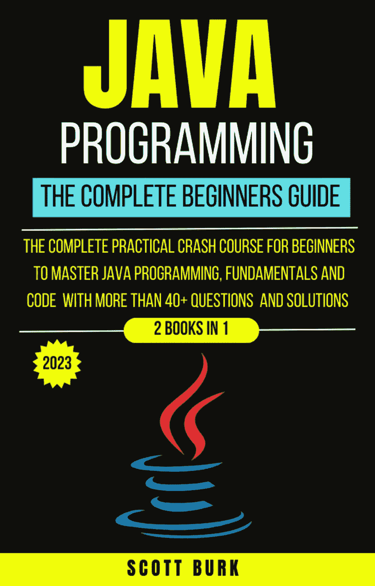

# 目录

- Java 编程：初学者完全指南
- 本书中提到的所有商标和品牌仅供参考之用，归所有者所有，与本文档无关联
- 引言
- 第一章：Java 历史
- 第二章：编写你的第一个 Java 程序
- 第三章：数据类型
- 第四章：变量
- 第五章：操作符
- 第六章：对象与类
- 第七章：决策制定
- 第八章：循环控制
- 第九章：文件处理
- 第十章：异常处理
- 引言
- 问题 1
- 问题 2
- 问题 3
- 问题 4
- 问题 5
- 问题 6
- 问题 7
- 问题 8
- 问题 9
- 问题 10
- 问题 11
- 问题 12
- 问题 13
- 问题 14
- 问题 15
- 问题 16
- 问题 17
- 问题 18
- 问题 19
- 问题 20
- 问题 21
- 问题 22
- 问题 23
- 问题 24
- 问题 25
- 问题 26
- 问题 27
- 问题 28
- 问题 29
- 问题 30
- 问题 31
- 问题 32
- 问题 33
- 问题 34
- 问题 35
- 问题 37
- 问题 38
- 问题 39
- 问题 40
- 问题 41
- 问题 42
- 问题 43
- 问题 44
- 问题 45
- 问题 46
- 问题 47
- 问题 48
- 问题 49
- 问题 50


就在不久前的过去，也许大约二十年前，我们仍然使用打字机来创建家里、学校或工作所需的文档。还记得你母亲在索引卡片上的食谱、你大学的论文、你申请工作的简历等等。随后，计算机系统的诞生了，它让一切都变得简单得多！当这些神奇机器问世时，这是一场彻底的革命。现在，只需点击一下鼠标或敲击键盘，你就能打印出照片装饰家里、观看高中舞会的 YouTube 视频，或者为工作准备视觉冲击力营销演示文稿。

––––––––


计算机系统由计算机的所有基本组件以及这些组件如何集成在一起组成，使设备能够高效有效地运行。这些组件可以分类为硬件或软件。计算机硬件指的是物理部分，例如中央处理器（`CPU`）、鼠标、键盘和显示器等。另一方面，软件是指告诉计算机该做什么的各种程序。硬件和软件组件共同工作，以产生用户所需的结果。

由于本电子书的编写是为了提供 Java 编程的逐步级教程，因此我们将重点介绍计算机系统的软件方面。此外，万维网（或简单地称为互联网）的出现为计算机编程带来了更多创新。这条在线超级公路在信息共享和通信方面日益增长的需求，迫使程序员们探索 `JAVA` 编程语言的潜力。

## 计算机编程语言的演变

––––––––


 **1954-1957**

John Backus 与 IBM 团队开发了 `FORTRAN`（被认为第一种现代计算机编程语言，但绝对并不用户友好）。

––––––––


 **1959**

Grace Hopper 在 Remington Rand 公司开发了 `COBOL`（字母 B 代表业务，这是 `COBOL` 的主要特性，包括处理客户、员工等人的记录）。

 **1972**

Dennis Ritchie 在 AT&T 贝尔实验室开发了 `C` 编程语言。

––––––––


 **1986**

Bjarne Stroustrup 在 AT&T 贝尔实验室开发了 `C++`，它支持面向对象编程（`OOP`）。

––––––––


 **1995**

正是在 5 月 23 日，Sun Microsystems 发布了 Java 编程语言的第一个正式版本，它被认为是对 `C++` 的改进。这种通用软件使你能够构建和探索数据库、编写窗口应用程序以及控制手持设备等。仅仅在五年后，`Java` 在全球就已经拥有了 250 万开发者。

––––––––


 **2000**

大学理事会（College Board）在 11 月宣布，到 2003 年，计算机科学高级课程考试将基于 `Java`。

––––––––


 **2002**

微软引入了 `C#`，这是一种继承了 `Java` 大部分编程特性的新语言。Sys-Con Media 在同年 6 月报告说，对 `Java` 程序员的需求日益增长（与对 `C++` 程序员的需求相比已超过了 50%）。

––––––––


 **2007**

谷歌开始使用 `Java` 语言在 Android 移动设备上开发应用。

––––––––


 **2010**

甲骨文公司（Oracle Corporation）在 1 月通过收购 Sun Microsystems 将 `Java` 技术整合到了甲骨文家族中。

––––––––


 **2010**

eWeek 在 6 月将 `Java` 评为“让你保持就业的 Top 10 编程语言”第一（www.eweek.com/c/a/Application-Development/Top-10-Programming-Languagesto-Keep-You-Employed-719257）。

––––––––


 **2013**

自 2013 年 8 月以来，超过 11 亿台台式电脑和 25 亿部手机一直在使用 `Java` 平台（www.mobiledevicemanager.com/mobile-devicestatistics/250-million-android-devices-in-use 和 http://java.com/en/about）。此外，具有交互能力的蓝光设备也应运而生。

––––––––


### Java 技术的出现

当 IT 专家在 90 年代初意识到需要通过引入智能技术让人们的日常生活变得简单时，Sun Microsystems 合作开发了一种运行在嵌入式芯片上的便携软件。这种芯片正在变得越来越小、越来越便宜且越来越强大。团队最初计划使用 `C++`，但移植性问题阻碍了他们的成功之路。因此，他们决定开发一种全新的编程语言。

1991 年，Java 语言由 James Gosling、Chris Warth、Patrick Naughton、Mike Sheridan 和 Ed Frank 构思。`Oak` 是该语言的最初名称，它是 James Gosling 窗外的树（团队的项目）。然而，`Oak` 已经被作为另一种编程语言的名字。因此在 1995 年，它被正式命名为 `Java`，代表了程序员在休息时享受的咖啡。然而，当这类设备的需求并未达到 Sun Microsystems 的预期时，团队不得不找到另一个渠道来扩展 `Java`。最终，在 1995 年 5 月，`Java` 在 SunWorld 大会上首次发布，随后 Netscape（当时的全球第一浏览器）宣布他们将把这种编程语言整合到他们的开发中。通过嵌入 Java 的网页，网站从单调无味变成了交互式。Web 不仅向受众发送信息，还能接受用户输入。

# 第二章：Java 环境

––––––––


深入探讨 Java 编程，本章将开始讨论如何在各种环境中使用和部署该软件。它还将提供逐步说明，介绍如何在你的计算机上正确安装 Java 程序本身以及其他所需的工具。

随着万维网不可阻挡的增长，开发者们已经找到了在每个网页上整合 Java 程序的方法。以下是该软件语言在不同环境中使用的总结：

––––––––


 **Applet（小程序）** - 一种嵌入 Web 网页的网络 Java 程序，当通过互联网传输时，由另一个兼容 Java 的浏览器自动执行。这通常是一个小型程序，可以显示来自服务器的数据、管理用户输入，甚至执行诸如计算器之类的简单功能。这些功能在客户端计算机上本地完成，而不是连接到服务器，这意味着当你点击 applet 链接时，它将自动下载并在浏览器中运行。

––––––––


 **Servlet** - 一种小型 Java 程序，它支持浏览器但运行在另一台计算机或 Web 服务器上以扩展其功能。Servlet 的引入升级了客户端/服务器的连接。

––––––––


 **JavaServer Page (JSP，Java 服务页面）** - 一个由 Java 程序片段组成的 Web 页面（与完整程序的 applet 不同）。

––––––––


 **Micro Edition (ME) 微型 Java 应用** - 运行在内存限制资源设备上的 Java 程序，例如手机或电视机顶盒。

––––––––


 **Standard Edition (SE) 标准版 Java 应用** - 运行在标准计算机（如台式机或笔记本电脑）上的 Java 程序。

––––––––


 **JavaFX** - 一个与多媒体平台（如 Flash 播放器）集成的 Java 程序。

## 初始 Java 设置

在你坐在电脑前开始编码之前，你需要确保你和你的机器已准备好编写 Java 代码。强烈建议你查看以下网站并按照说明下载所需的软件（这些软件通常是免费的）：

按照以下步骤下载并安装 Java 软件：

1.  在 Web 浏览器的地址栏输入 `http://java.com` 进入网站。它将带你来到下面的屏幕：

––––––––


––––––––


1.  点击 `FREE JAVA DOWNLOAD（免费下载 Java）` 。它将带你来到此屏幕：


––––––––


1.  点击 `AGREE AND START FREE DOWNLOAD（同意并开始免费下载）`按钮。当 Java 下载完成后，你需要关闭所有浏览器并重新加载以启用 Java 安装。

1.  运行下载的文件，将看到下面的屏幕。只需点击 `INSTALL（安装）`按钮。

––––––––


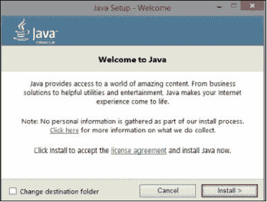

––––––––


 `www.oracle.com/technetwork/java/javase/downloads` - 下载并安装所需的 Java SE （也称为 Javadoc 页面或 Java SE API 文档）

下一步：

1.  进入 `www.oracle.com/technetwork/java/javase/downloads` 网站，它将带你来到下面的屏幕：

––––––––


––––––––


1.  点击此选项

––––––––


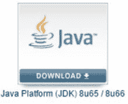

––––––––


1.  下一个页面将要求你选择想要下载的 Java SE 开发工具包（JDK）版本。在开始下载之前，确保你清楚你的电脑或笔记本电脑使用的是什么操作系统。

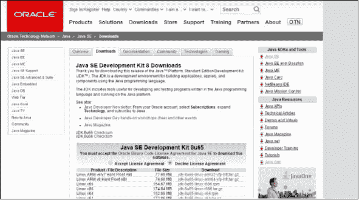

––––––––


1.  要检查操作系统的版本，你可以前往电脑/笔记本电脑的`SYSTEMS（系统）`或`PC INFO（电脑信息）`设置。

––––––––


1.  打开下载的程序完成 Java SE 开发工具包的安装。确保你仔细阅读并遵循步骤操作。

––––––––


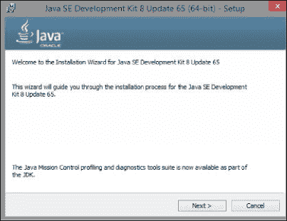

––––––––


 `http://eclipse.org/downloads` - 下载并安装所需的 Eclipse；然后

1.  在浏览器的地址栏输入 `http://eclipse.org/downloads` 进入网站。它将带你来到下面的屏幕：

––––––––


 **适用于 Java 开发人员的 Eclipse**

1.  根据你电脑的操作系统选择合适的 Eclipse 版本。对于 64 位 Windows 系统，你将看到下面的屏幕：

––––––––


1.  下载完成后，点击 `INSTALL（安装）`按钮。确保你接受了`SOFTWARE AGREEMENT（软件协议）`。

––––––––


––––––––


1.  下载完成后，打开程序你将看到下面的屏幕：


––––––––


1.  保持框内内容为空，然后点击`OK`按钮。你应该能在桌面上看到`ECLIPSE`图标。启动 Eclipse。

––––––––


1.  通过顶部菜单`FILE > NEW > JAVA PROJECT` 创建一个新的 Java 项目。

––––––––


––––––––


1.  在项目中创建一个名为 `Displayer` 的新类。

––––––––


––––––––


1.  在编辑器中输入以下代码行修改 `Displayer.java` 文件：

```java
public class Displayer {
    public static void main(String args[]) {
        System.out.println("Hello Java!");
    }
}
```

––––––––


––––––––


––––––––


1.  点击顶部的按钮执行 `Displayer.java`，并通过检查下图确认输出为 `Hello Java!`。

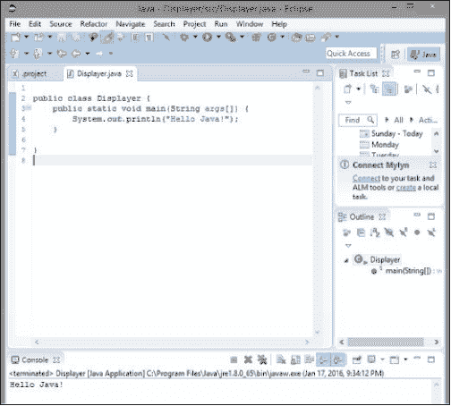

––––––––

## Java 工具

以下是 Java 编程所需的在线免费下载的不同工具：

––––––––


### 编译器


编译器将你编写的 Java 代码转换为计算机可以理解并运行的内容。计算机理解指令的方式与人类不同。例如，检查下面的程序代码：

```java
// 寻找可租用的汽车
rentalcarNum = 1;
while (rentalcarNum < 100) {
    if (client[rentalcarNum] == 0) {
        out.println("Car " + rentalcarNum + " is available.");
        exit(0);
    } else {
        rentalcarNum++;
    }
}
out.println("All cars or vehicles are rented out");
```

这段基础 Java 代码用于为特定客户搜索任何可用的租赁汽车或车辆，假设公司总共有 99 辆车。你不能直接通过这样输入来运行这段代码。然而，忽略那些奇怪的标点符号和输入格式，人类能够理解它想让计算机做什么：

1. 将租赁车辆编号设置为 1。
2. 只要租赁车辆编号小于 100，就检查租赁车辆的客户人数。
3. 如果租赁车辆的客户人数为 0，则报告车辆可用，并停止。
4. 否则，通过将租赁车辆编号加 1 来准备检查下一辆车。
5. 如果你达到了不存在的租赁车辆编号 100，则报告所有汽车或车辆均已租出。

对于计算机来说，它们并不遵循翻译成英文的指令来执行特定任务。相反，它们理解的是晦涩的 Java 字节码命令。这就是编译器派上用场的地方。在编写完 Java 源码后，编译器会将其翻译并编写成计算机可以执行的 Java 字节码。查看下述相同 Java 代码的字节码对应：

```
aload_0 iconst_1
putfield Company/rentalcarNum I goto 32
aload_0
getfield Company/client I aload_0
getfield Company/rentalcarNum I iaload
ifne 26
getstatic java/lang/System/out Ljava/io/PrintStream; new java/lang/StringBuilder
dup
ldc " Car "
invokespecial java/lang/StringBuilder/<init>(Ljava/lang/String;)V aload_0
getfield Company/rentalcarNum I
invokevirtual java/lang/StringBuilder/append(I)Ljava/lang/StringBuilder; ldc " is available."
invokevirtual java/lang/StringBuilder/append(Ljava/lang/String;)Ljava/lang/StringBuilder; invokevirtual java/lang/StringBuilder/toString()Ljava/lang/String; invokevirtual java/io/PrintStream/println(Ljava/lang/String;)V
iconst_0
invokestatic java/lang/System/exit(I)V goto 32
aload_0
dup
getfield Company/rentalcarNum I iconst_1
iadd
putfield Company/rentalcarNum I aload_0
getfield Company/rentalcarNum I bipush 100
if_icmplt 5
getstatic java/lang/System/out Ljava/io/PrintStream; ldc " All cars or vehicles are rented out"
invokevirtual java/io/PrintStream/println(Ljava/lang/String;)V return
```

源代码可以保存到名为 `Company.java` 的文件中，编译器可能会将 Java 字节码放在另一个名为 `Company.class` 的文件中。你甚至需要一个工具来显示类文本的 Java 字节码文件（你可以使用 Ando Saabas 的 Java Bytecode Editor）。如果你尝试用记事本甚至 Microsoft Word 打开 `Company.class` 文件的代码，你只会看到像点、波浪线等乱码。

## Java 虚拟机 (JVM)

如果说编译器负责编写 Java 字节码，那么 Java 虚拟机就负责解码它。实际上，每种计算机处理器都有其自己的可执行指令，这些指令由每个操作系统以略有不同的方式进行解释。让我们来看下面两个针对不同处理器的程序，它们在计算机屏幕上将显示相同的输出——“Hello world！”

### 简单程序 - Pentium 处理器

```assembly
.data
msg:.ascii "Hello, world!\n"
len = . - msg
.text
.global _start
_start:
movl $len,%edx
movl $msg,%ecx
movl $1,%ebx
movl $4,%eax
int $0x80
movl $0,%ebx
movl $1,%eax
int $0x80
```

### 简单程序 - Powerpc 处理器

```assembly
.data
msg:.string "Hello, world!\n"
len = . - msg
.text
.global _start
_start:
li 0,4
li 3,1
lis 4,msg@ha
addi 4,4,msg@l
li 5,len
sc
li 0,1
li 3,1
sc
```

这两个程序本应该显示相同的结果，但它们不能互换，因为当它们在错误的处理器上运行时，这些指令将毫无意义。你只会收到通知或错误信息，例如“不是有效的 Win32 ”或“Windows 打开此文件”。这就是为什么在 Java 虚拟机的帮助下，这些 Java 字节码在这个混乱的编程世界中建立了秩序！JVM 像一个解释器，将这些字节码翻译给任何计算机系统理解。因此，你不需要担心，无论是你的电脑还是朋友的电脑，都能运行这些字节码。因此，Java 语言通过 JVM 解决了移植性和通用性问题。

## 集成开发环境 (IDE)

Java 编程的早期涉及几个窗口——一个用于输入代码，另一个用于运行，也许第三个用于跟踪所有内容。随着集成开发环境 (IDE) 的出现，这一切被无缝地结合在了一个整体中。以下是一些流行的 IDE：

1. **Eclipse** (eclipse.org)
   因其交互功能被认为是最受欢迎的 IDE，Eclipse 是开源的。
2. **NetBeans** (netbeans.org)
   与上一个一样，这个开源软件受推荐并支持 Java。
3. **BlueJ** (bluej.org)
   BlueJ 拥有最简单的界面，专为帮助新手理解 Java 设计。
4. **DrJava** (drjava.org)
   DrJava 也是为业余程序员设计的。尽管简单，但它仍然强大。
5. **Java Development Kit (JDK)**
   Java 开发工具箱既是编译器也是解释器的工具。最新版本可以从 Oracle 网站下载。确保你下载了适用于你电脑的版本。如果你使用的是 32 位操作系统，请下载 `x86` 版本。

现在，我们已经了解到 Java 有多种部署方式。本章还为你提供了关于如何安装软件以及所有程序所需工具的清晰指令。在下一章中，你将体验如何在 Java 环境中开始编码。

## 面向对象概念示例

为了帮助你理解这个概念，让我们来看一个例子。假设我们创建了一个名为 `Car` 的类。`Car` 是所有四轮小型车辆的通用术语。然而，每辆汽车都有一套不同的规格，如 `brand`、颜色、引擎、`transmission` 类型和功能。这些功能是可以被修改的。例如，你可能会更改颜色或增强某项功能。

因此，`Car` 是一个模板（在我们的情况下是一个类），但具体的汽车是该类的对象或实例。规格集是变量，而我们对这些变量执行的任何初始化或操作都是通过方法完成的。

这个例子也可以很好地用于理解面向对象的两个原则：封装和抽象。类将变量和方法封装在它内部。因此，作为用户，你处理的仅有 `Car` 类，而它的实现细节对你是隐藏的。这就是 `Java` 实现抽象的方式。

## 示例程序

学习编程的最好方法是编写程序。因此，我们在下文中为你提供了一个示例程序供你尝试。我们还将使用这个程序来解释 Java 编程语言的基本语法。

```java
public class SampleJava { // 这一程序将在屏幕上打印 hello World!
    public static void main(String[] args) {
        System.out.println("hello World!"); // 打印语句
    }
}
```

为了编写、编译和运行此程序，你需要按照下面的说明进行——

1. 使用任何文本编辑器，创建一个文本文件并将代码复制到其中。将文件保存为 `SampleJava.java`。
2. 使用 IDE 编译并运行代码。对于手动执行，你需要输入以下命令：

```bash
javac SampleJava.java
```

```bash
java SampleJava
```

第一个命令将从 Java 文件创建一个类文件，而第二个命令将执行程序以产生所需的结果。

如果你已经到了这里，说明你成功执行了你的第一个 Java 程序。现在是时候检查程序了，看看我们是如何写它的以及为什么它会给出那个结果。

## Java 编程约定

首先，在 Java 中编写程序需要遵循一些约定。这些约定列如下——

*   **大小写敏感**：`Java` 是一种区分大小写的语言。换句话说，`class` 和 `Class` 在 `Java` 中是两个不同的单词。在程序中使用关键字或任何其他元素时要务必小心。
*   **类名命名约定**：按照约定，类名中每个单词的首字母应该大写。例如，如果类名是 `car`，那么 `C` 应该是大写的（即 `Car`）。反之，如果类名是 `Sportscar`（由 `Sports` 和 `Car` 组成），那么 `S` 和 `C` 都必须大写，因为它们都是组成类名称的两个单词的首字母。
*   **方法名命名约定**：方法名也遵循大小写约定，即方法名的首字母必须是小写。然而，如果名称是多个单词，除了第一个单词外，其他每个单词的首字母都必须大写。例如，如果方法名是 `add`，`a` 必须是小写的；但如果方法名是 `addOn`，则 `a` 是小写的而 `O` 是大写的。
*   **文件名约定**：Java 文件名必须与类名相同，并以 `.java` 结尾。例如，如果你的类名是 `SampleApplication`，那么 Java 文件名必须是 `SampleApplication.java`。还要记住字母的大小写必须匹配。如果你不符合任何这些要求，你将无法编译程序。
*   **程序入口点**：Java 程序的执行从 `main` 方法开始。因此，每个 Java 程序都必须有一个 `main` 方法，而 Java 编程中的 `main` 方法定义为：

```java
public static void main(String[] args)
```


但再次强调，如果你的程序没有 `main` 方法，程序将无法运行。

## 标识符

任何编程语言由英语单词组成。其中一些单词是编程语言语法的一部分，而另一些则是变量名、类和方法的自定义名称。属于语法部分的单词被称为关键字。另一方面，所有用户定义的名称都称为标识符。

关于 Java 有一些需要知道并记住的重要事项。这些包括——赋予标识符的名字可以以字母（小写或大写）以及特殊字符开头——下划线 `_` 和货币符号 `$`。这意味着标识符名称不能以任何其他特殊字符开头。


不允许将定义的关键字作为标识符。


最后，始终记住 Java 是区分大小写的，`count` 和 `Count` 是两个不同的标识符。

## 修饰符

类、方法和变量只能通过修饰符进行修改。修饰符有两种类型，如下：

非访问修饰符：`static`、`abstract`、`final`
访问修饰符：`public`、`default`、`private`、`protected`


访问修饰符决定了类、方法或变量如何被访问，以及谁有权访问它们。其他类似的被分类为非访问修饰符。

## 变量

Java 支持三种变量：类变量、局部变量和实例变量。类变量也被**称为**静态变量，实例变量被称为非静态变量。

## 数组

相同类型元素的集合称为数组。Java 支持不同类型的数组。

## 枚举

某些变量只能包含几个值。作为程序员，你可能希望限制变量获取其他值。其中一种变量是 `enum`，它是在 Java 5.0 中引入的。可以在类内部或外部定义枚举。此外，枚举可以拥有构造函数、变量和方法。

## 关键字

Java 编程语言的一部分且不能作为标识符使用的单词被称为关键字。这些关键字是——

| assert | abstract | break | boolean |
| :--- | :--- | :--- | :--- |
| catch | char | byte | case |
| const | class | default | continue |
| else | enum | do | double |
| final | extends | float | finally |
| if | implements | for | goto |
| instanceof | import | interface | int |
| new | package | long | native |
| protected | private | return | public |
| strictfp | super | short | static |
| synchronized | switch | throw | this |
| try | void | throws | transient |
| while | volatile | | |

面向对象编程的继承特性在 `Java` 中通过从现有类派生出新类的概念来实现。这允许你重用现有代码。现有类被称为 `superclass`（父类），而派生的类被称为 `derived class`（派生类）。

## 接口

当两个对象需要相互通信时，则需要在这些对象之间建立一种通信协议。这种通信协议被称为 `interface`（接口）。这个概念通常用于继承概念的实现。`interface` 用于定义子类必须具备的方法。然而，这些方法是由子类来实现的。

 |  |  |


# 第 3 章：数据类型


当我们声明变量时，基本上是在内存中封锁一段空间并给它一个引用名称，以便我们以后访问它并操作其内容。为变量保留的内存数量取决于声明时给出的数据类型。因此，通过给变量赋予不同的数据类型，你可以在内存中为变量保留不同数量的内存。`Java` 中有两种主要类型：基本数据类型和对象数据类型。

## 基本数据类型

`Java` 支持八种基本数据类型，每种数据类型都有一个对应的关键字，允许在该数据类型下声明变量。这些数据类型包括——

### byte
- 最大值 = 127（包含)(2⁷ -1)

- 最小值 = -128 (-2⁷)

- 8 位有符号二补码整数

- 默认值 = 0


这种数据类型通常用于需要节省内存的情况。`byte` 数据类型用于在大数组中节省空间，主要代替整数，因为 `byte` 比整数小四倍。


### short
- 最大值 = 32,767（包含） (2¹⁵ -1)

- 默认值 = 0.

- 最小值 = -32,768 (-2¹⁵)

- 16 位有符号二补码整数


这是另一种在需要节省内存时使用的类型。


### int
- 默认值 = 0

- 最大值 = 2,147,483,647（包含） (2³¹ -1)

- 32 位有符号二补码整数。
- 最小值 = - 2,147,483,648 (-2³¹)


这是用于所有整数值的默认数据类型。


### long
- 默认值为 `0L`

- 最小值 = -9,223,372,036,854,775,808(-2⁶³)

- 64 位有符号二补码整数
- 最大值 = 9,223,372,036,854,775,807（包含）（2⁶³ -1) 当期望变量持有大数字时使用此。


### float
- 默认值为 `0.0f`

- 32 位 IEEE 754 浮点数，单精度


这种数据类型用作存储小数的默认类型。必须避免对需要精度的值使用这种数据类型。


### double
- 默认值为 `0.0d`

- 64 位 IEEE 754 浮点数，双精度


这种数据类型用作存储小数的默认类型。对于需要精度的值，可以使用这种数据类型。


### boolean
- 默认值为 `false`

- 1 位，可能的值：`true` 和 `false`
这种数据类型用于标记。


### char
- 最大值 = '\uffff'（或 65535）

- 最小值 = '\u0000'（或 0）

- 16 位 Unicode 字符

这种数据类型专门用于存储字符。


## 引用类型

正如名称所示，引用变量用于访问对象。它们通常通过构造函数创建，一旦定义不可更改。数组和对象都是引用变量。最后，这种情况下默认值为 `null`。

## 字面量

字面量用于表示固定值。它们像变量一样声明并具有数据类型。字面量的示例：

`Char x = 'X';`

你可能会注意到不同进制的整数和浮点。根据规则，任何带有 `0` 前缀的字面值为八进制，而 `0x` 前缀表示十六进制。如果你处理字符串，字符串字面量总是用双引号定义的。另一组你会使用的字符是转义字符。转义字符列表如下：

- 回车 `\r`
- 换行 `\n`
- 退格 `\b`
- 分页 `\f`
- 制表符 `\t`
- 空格 `\s`
- 单引号 `\'`
- 双引号 `\"`
- 十六进制字符 `\uxxxx`
- 八进制字符 `\ddd`
- 反斜杠 `\\`

 |  |  |


# 第 4 章：变量


变量的最简单定义是给某些内存区域的名称。然而，`Java` 支持多种类型的变量。根据变量的类型，决定了以下参数：

- 为变量分配内存的大小。

- 锁定内存的布局。

- 在变量上执行的操作。

- 变量可以持有的值范围。


根据规则，每个变量在使用之前都需要声明。变量声明的标准语句是：

```
data_type variable_name;
```

在这里，`data_type` 是变量的数据类型，而 `variable_name` 是用于该变量的标识符。如果你正在使用相同类型的多个变量，可以通过逗号分隔的变量名称将它们组合在同一个语句中。如前所述，`Java` 支持三种类型的变量，即：类变量、实例变量和局部变量。本章将详细解释这些变量类型。

## 局部变量

在方法或代码块内部声明的变量对于该作用域是局部的，被称为局部变量。变量在块中声明和定义时被创建。此外，一旦块的作用域结束，变量就会被销毁。这种类型的变量无法使用访问修饰符（在本章稍后部分描述）。

由于这种变量仅在方法或块的作用域内有效，因此只能在此代码块内进行访问。在内部，局部变量是在栈级别创建的。因此，当它们被创建时，它们会被推入栈中，一旦代码块执行完毕，栈就会被清空。最后，局部变量的默认值是垃圾（garbage）。因此，这些变量在使用前必须初始化。

下面提供了说明局部变量工作原理的示例代码。它在类的方法中实现了一个局部变量 `agep`，该变量从 `main` 方法访问。

```java
public class lvdemo {

    public void puppyage() {

        int agep = 0;

        agep = agep + 10;

        System.out.println("Age of the puppy is : " + agep);

    }

    public static void main(String args[]) {

        lvdemo testobj = new lvdemo();

        testobj.puppyage();

    }

}
```

此代码的输出已在下方图中所示。

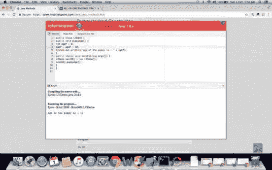

## 实例变量

作为类的一部分创建，但不在任何方法或构造函数作用域内的变量被称为实例变量。这些变量之所以被称为实例变量的原因是，它们只有在使用该类创建对象时才会创建一次。因此，对于使用该类使用 `new` 关键字所实例化的每个对象，都会创建这些变量。

此外，这些变量在对象被删除或程序执行终止时就会被销毁。可以从该类实现的方法或构造函数访问这些变量。可以说实例变量是可以使用访问修饰符的类级变量。

这些变量具有默认值。例如，所有数字的默认值为 0，布尔型的默认值为 false。作为引用变量创建的对象引用被初始化为 `null`。虽然必须声明变量，但赋值可以在方法或构造函数中完成。如果你在同一个类内部工作，可以直接通过变量名称访问变量。然而，如果你想从任何静态方法访问它，则需要使用格式 – `Object_name.variable_name` 来访问。

下面提供了示例代码帮助你更好地理解这一概念。该类实现了一个员工类，并使用初始化方法初始化了类的变量。

```java
import java.io.*;

public class demoemployee {

    public String nameemp;

    private double salaryemp;

    public demoemployee(String nameemp) {

        this.nameemp = nameemp;

    }

    public void itsalary(double itsal) {

        salaryemp = itsal;

    }

    public void printInfo() {

        System.out.println("Employee name = " + nameemp);

        System.out.println("Employee Salary = " + salaryemp);

    }

    public static void main(String args[]) {

        demoemployee empobj = new demoemployee("aes");

        empobj.itsalary(5000);

        empobj.printInfo();

    }

}
```

此代码的输出已在下方图中所示。

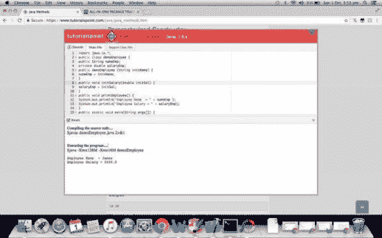

## 静态变量

任何用 `static` 声明的变量位于类中，但在方法、构造函数或类内部任何其他块之外。无论为该类创建了多少对象，整个类都只维护该变量的一个副本。因此，这些变量也被称为类变量。尽管建议不使用使用这些变量，但存在某些需要此类实现的场景。然而，每当使用此类变量时，你必须将其作为常量使用，其值不能更改。这些变量在程序启动时创建。然而，一旦程序执行终止，它们就会被销毁。

类变量对类的所有元素都是可见。因此，它们的可见性与实例变量相似。事实上，类变量的默认值与实例变量相同。可以使用以下语句访问这些变量 – `Class_name.variable_name`

下面提供了静态变量实现的示例代码。

```java
import java.io.*;

public class svdemo {

    private static double salaryemp;

    public static final String department = "dev ";

    public static void main(String args[]) {

        salaryemp = 1000;

        System.out.println(department + "Salary = " + salaryemp);

    }

}
```


可以在下方图中看到代码输出。

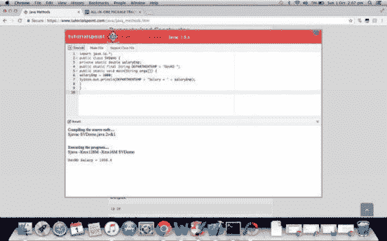

## 修饰符类型

可以使用修饰符修改变量的行为和访问权限。修饰符有两种主要类型，即访问修饰符和非访问修饰符。

### 访问修饰符


Java 支持多个访问级别，每个级别都有对应的关键字。这些包括：

- `public`：所有人可见
- `private`：类内部可见
- `protected`：类及其子类可见
- `default`：如果没有提到关键字，则对包内可见

### 非访问修饰符


Java 中还有其他修饰符。这些包括：

- `static`
- `final`
- `abstract`
- `volatile` 和 `synchronized`

## 算术运算符

### 取模 (%)

该运算符返回两个数字相除后的余数。如果 `a` 和 `b` 是分别持有 10 和 5 的变量，那么 `c = a % b` 将产生 `c = 0`。

### 递增 (++)

该运算符将变量的值加 1。如果 `a` 是一个持有值 1 的变量，那么 `a++` 将产生值 2。

### 递减 (--)

该运算符从变量的值中减去 1。如果 `a` 是一个持有值 1 的变量，那么 `a--` 将产生值 0。

## 关系运算符

所有涉及比较的操作都使用关系运算符执行。下面是该编程语言支持的运算符列表——

### 不等于 (!=)

该运算符应用于两个操作数上。它检查两个操作数之间的相等性。如果它们相等，则返回 `FALSE`，否则返回 `true`。

### 等于 (==)

该运算符应用于两个操作数上。它检查两个操作数之间的相等性。如果它们相等，则返回 `true`，否则返回 `FALSE`。

### 大于 (>)

该运算符应用于两个操作数上。它检查两个操作数之间的相等性。如果第一个操作数大于第二个操作数，则返回 `true`，否则返回 `FALSE`。

### 小于 (<)

该运算符应用于两个操作数上。它检查两个操作数之间的相等性。如果第一个操作数小于第二个操作数，则返回 `true`，否则返回 `FALSE`。

### 大于或等于 (>=)

该运算符应用于两个操作数上。它检查两个操作数之间的相等性。如果第一个操作数大于或等于第二个操作数，则返回 `true`，否则返回 `FALSE`。

### 小于或等于 (<=)

该运算符应用于两个操作数上。它检查两个操作数之间的相等性。如果第一个操作数小于或等于第二个操作数，则返回 `true`，否则返回 `FALSE`。

## 位运算符

普通运算符与位运算符之间的唯一区别是这些运算符按位执行操作。此外，这些运算符可以应用于 `byte`、`int`、`short`、`long` 和 `char`。Java 中支持的位运算符包括——

### 位与 (&)

该运算符作用于两个操作数，如果两个输入位均为 1，则每组输入位的输出为 1，否则输出为 0。

### 位或 (|)

该运算符作用于两个操作数，如果其中一个或两个输入为 1，则每组输入位的输出为 1，否则输出为 0。

### 位异或 (^)

该运算符作用于两个操作数，只有当其中一个输入为 1 时，每组输入位的输出才为 1，否则输出为 0。

### 位取反 (~)

该运算符作用于单个操作数，将值从 0 反转为 1，从 1 反转为 0。

### 左移 (<<)

该运算符作用于两个操作数。左操作数的位向左移动。移动位数等于第二个操作数指定的值。

### 右移 (>>)

该运算符作用于两个操作数。左操作数的位按第二个操作数指定的值向右移动。

### 零填充右移 (>>>)

该运算符作用于两个操作数。左操作数的位按第二个操作数指定的值向右移动。此外，0 会替换被移出的位。

为了理解位运算是如何发生的，让我们来看一个例子。假设有两个变量 `a` 和 `b` 分别持有值 60 和 13。`a` 和 `b` 的二进制等价如下——

```
A = 00111100
b = 00001101
```

使用位与真值表（只有当两个输入均为 1 时输出才为 1）。相应地，`a & b = 00001100`。同理，其他位运算也是这样执行的。

## 逻辑运算符

Java 中所有的逻辑操作都使用逻辑运算符执行。该语言支持的运算符列表为：

### 逻辑与 (&&)

该运算符作用于两个操作数。如果两个操作数都非零，则表达式返回 `true`，否则返回 `FALSE`。

### 逻辑或 (||)

该运算符作用于两个操作数。如果两个操作数都非零，则表达式返回 `true`，否则返回 `FALSE`。

### 逻辑非 (!)

该运算符作用于一个操作数。如果操作数为 0，则该表达式返回 `true`，否则返回 `FALSE`。

## 赋值运算符

Java 支持的赋值运算符列表包括——

### 简单赋值运算符 (=)

该运算符将右侧计算的值赋值给左侧。如果 `a` 和 `b` 是变量且表达式为 `c = a + b`，则 `a + b` 的值赋值给 `c`。

### 加赋值运算符 (+=)

该运算符将右侧与左侧相加的值赋值给左侧。如果 `a` 和 `c` 是变量且表达式为 `c += a`，则 `a` 和 `c` 的值被赋值给 `c`。

### 减赋值运算符 (-=)

该运算符将左侧减去右侧的值赋值给左侧。如果 `a` 和 `c` 是变量且表达式为 `c -= a`，则 `c - a` 的值赋值给 `c`。

### 乘赋值运算符 (*=)

该运算符将右侧与左侧相乘的值赋值给左侧。如果 `a` 和 `c` 是变量且表达式为 `c *= a`，则 `c * a` 的值赋值给 `c`。

### 除赋值运算符 (/=)

该运算符将左侧除以右侧的值赋值给左侧。如果 `a` 和 `c` 是变量且表达式为 `c /= a`，则 `c / a` 的值赋值给 `c`。

### 取模赋值运算符 (%=)

该运算符将左侧对右侧取模的值赋值给左侧。如果 `a` 和 `c` 是变量且表达式为 `c %= a`，则 `c % a` 的值赋值给 `c`。

### 左移赋值运算符 (<<=)

如果 `a` 和 `c` 是变量且表达式为 `c <<= a`，则 `c << a` 的值赋值给 `c`。

### 右移赋值运算符 (>>=)

如果 `a` 和 `c` 是变量且表达式为 `c >>= a`，则 `c >> a` 的值赋值给 `c`。

### 位与赋值运算符 (&=)

如果 `a` 和 `c` 是变量且表达式为 `c &= a`，则 `c & a` 的值赋值给 `c`。

### 位异或赋值运算符 (^=)

如果 `a` 和 `c` 是变量且表达式为 `c ^= a`，则 `c ^ a` 的值赋值给 `c`。

### 位或赋值运算符 (|=)

如果 `a` 和 `c` 是变量且表达式为 `c |= a`，则 `c | a` 的值赋值给 `c`。

## 运算符优先级

如果表达式使用了多个运算符，则使用运算符优先级规则来确定操作的执行顺序。运算符从右到左或从左到右评估的优先级按如下运算符组定义：

1. 从右到左
   - 一元运算符
   - 条件运算符
   - 赋值
2. 从左到右
   - 后置
   - 乘法
   - 加法
   - 移位
   - 关系
   - 等于
   - 位与
   - 位异或
   - 位或
   - 逻辑与
   - 逻辑或

例如，如果我们评估表达式 `a = 3 + 5 * 5`，乘法先于加法执行。因此，`a = 28` 而不是 40。

# 第 6 章：对象与类

首先，让我们理解类和对象的概念。类是一个模板，用于创建对象。对象是真实的实体，它们进行相互作用并构成了 Java 程序的核心元素。类中可以存在三种类型的变量。首先，变量定义在类内部、方法外部。此类变量是为每个对象定义的，被称为实例变量。

此外，变量也可以存在类的方法块内部。这些变量对于方法是私有的，被称为局部变量。任何在类内部、方法块外部使用 `static` 关键字声明的变量都称为类变量。

## 创建对象

显而易见，由于类是一个模板，你需要使用此模板来创建对象。为了创建对象，使用了关键字 `new`。对象的创建涉及三个步骤。第一步是为对象声明一个变量。第二步是使用 `new` 关键字创建一个对象。最后，需要使用类的构造函数对对象进行初始化。

如果省略了第三步，Java 将使用默认构造方法进行对象初始化。这三个步骤可以被合并成一条语句来创建对象。例如，我们有一个类 `democ`，并想要创建一个对象 `o1`，可以使用以下语句完成：

```java
democ o1 = new democ();
```

用于创建对象的类的变量和方法可以通过 `.` 运算符来访问。因此，如果我们有一个带有变量 `x` 的类 `democo` 并创建一个对象 `o1`，那么可以使用以下语句访问 `x`：`o1.x`。

## 构造函数

当你开始创建类和对象时，你需要做的第一件事就是初始化对象。Java 有专门用于初始化的方法实现，称为构造函数。这些元素的实现方式类似于方法，但它们具有与类相同的名称且没有返回类型。

那么，你可以在哪里使用构造函数？每当你创建一个类的对象并需要初始化某些参数或执行该类所有对象通用的某些功能时，就可以使用它。例如，如果你创建一个名为 `rectangle` 的类。你可以创建一个构造函数来初始化矩形的长度和宽度。

如果你不定义构造函数，Java 将使用默认构造函数供程序使用。此构造函数会将类的所有参数值初始化为零。因此，如果你创建了一个类，无论你是否显式定义它，你的程序都将有一个激活的构造函数。

让我们创建一个带有显式构造函数的类，看看这个概念是如何工作的。

```java
class Sampleclass1 {

    int i;

    Sampleclass1() {
        i = 100;
    }
}

public class demosasampleclass1 {

    public static void main(String args[]) {
        Sampleclass1 c1 = new Sampleclass1();
        Sampleclass1 c2 = new Sampleclass1();
        System.out.println(c1.i + "\n" + c2.i);
    }
}
```

下方的截图说明了代码以及执行后生成的输出。为了运行此代码，你需要创建两个文件，每个文件以其包含的类命名。

在上面的示例中，我们给了参数 `static`。然而，你的程序可能需要对参数进行动态初始化。为了这一点，你需要参数化构造函数。此类构造函数接受作为构造方法参数的值。下面给了示例实现。

```java
class Sampleclass2 {

    int i;

    Sampleclass2(int x) {
        i = x;
    }
}

public class demosasample2 {

    public static void main(String args[]) {
        Sampleclass2 c1 = new Sampleclass2(100);
        Sampleclass2 c2 = new Sampleclass2(200);
        System.out.println(c1.i + "\n" + c2.i);
    }
}
```

该代码的输出下文所示。

在构造函数的实现方面，专门使用了一个关键字。该关键字是 `this` 关键字。它用于引用当前类的对象。通过 `this` 关键字的帮助，可以在构造函数或方法内部访问类的变量。

```java
class Sampleclass3 {

    int i;

    Sampleclass3(int i) {
        this.i = i;
    }
}

public class demosasample2 {

    public static void main(String args[]) {
        Sampleclass3 c1 = new Sampleclass3(200);
        Sampleclass3 c2 = new Sampleclass3(200);
        System.out.println(c1.i + "\n" + c2.i);
    }
}
```

执行后，此代码给出了以下输出——

## 可变参数

在某些程序中，可能存在一种需求，即你不知道 `main` 方法在执行期间会给出多少个参数。为了允许这种程度的动态性，使用了 var-args 或可变参数。Var-args 在方法参数中使用以下语法声明：`<type>...<var_name>`

在变量声明中给出的 `var_name` 是一个数组，包含了 `main` 方法执行时发送的所有变量值。在实现此概念之前，你需要记住两点——

- 每个方法只能实现一个 var-args。
- 如果方法有其他参数（普通性质），这些参数必须出现在 var-args 之前。换句话说，var-args 必须是方法的最后一个参数。

此概念的示例实现如下。

```java
public class demovarargs {

    public static void main(String args[]) {
        printNum(56.5, 3, 34, 2, 3);
        printNum(new double[]{2, 1, 3});
    }

    public static void printNum(double... number) {
        if (number.length == 0) {
            System.out.println("no argument passed");
            return;
        }

        double resultNum = number[0];
        for (int x = 1; x < number.length; x++)
            if (number[x] > resultNum)
                resultNum = number[x];

        System.out.println("the max value in set is " + resultNum);
    }
}
```

该代码的输出如下所示。

## 方法实现

一组用于执行操作的指令被称为方法。你可以在大多数程序中看到打印语句调用 `System.out.println()`。此方法打印传递给它的字符串。

就像这种内置方法一样，开发者也可以创建特定于问题的方法。用户定义的方法可能有参数，也可能没有返回返回值。创建方法的标准是——

```java
public static int methodDemo(int i, int j) {
    /* body */
}
```

在这里，`methodDemo` 是方法的名称，`i` 和 `j` 是该方法接受的参数。方法的实现逻辑位于大括号内部。此外，你还会注意到函数声明中写的三个单词——`public`、`static` 和 `int`。这里 `int` 是方法的返回类型，而 `public static` 是修饰符。此示例方法可以被修改以适应开发者的需求。

```java
public static int minDemo(int num1, int num2) {
    int minVal;
    if (num1 > num2)
        minVal = num2;
    else
        minVal = num1;
    return minVal;
}
```

此方法确定传递给它的两个参数值中哪一个最小，并将此结果返回给调用方法。现在你对方法以及它们如何实现有了了解，是时候我们讨论这些方法在整体代码中是如何被使用了。

## 调用方法

方法需要被调用或执行才能使用。正如上面提供的示例代码所示，该方法正在执行某些计算并返回计算结果。这种方法返回一个值，其返回类型在方法声明中已经指定。除此，存在另一种类型的方法。此类方法不返回任何内容，通常被称为无返回值的方法。

当程序调用方法时，控制权从程序移动到方法，方法开始执行。一旦遇到 `return` 语句，控制权就会传回调用它的程序。在没有 `return` 语句的情况下，一旦遇到方法的结束大括号，控制权会自动传回。这通常是无返回值方法的情况。

对于返回值的方法，返回类型在方法声明中会被提到。另一方面，对于不返回任何内容的方法，返回类型为 `void`。为了调用我们上面实现的方法，需要在调用它的程序的某处出现以下语句：

```java
int result;
result = minDemo(5, 6);
```

由于该方法返回一个 `int` 类型的值，该值需要被收集在一个 `int` 变量（`result`）中。方法调用提供了方法所需的两个参数值。这种类型的方法调用也称为参数方法调用或按值传参。

你可能会遇到某些情况，即可能有不同类型的参数且数量很多。在这种情况下，请务必按照所需的顺序提供参数值，以避免任何意外的编译错误或运行时错误。

## 方法重载

可以拥有名称相同但参数不同的方法。当方法被调用时，系统会检测与调用语句中给参数类型和数量匹配的方法，并将控制权转移到对应的方法。这种方法实现的形式被称为方法重载。不要将此概念与重写（overriding）混淆。在方法重写中，方法名、参数和参数数量也是相同的。

为了理解这个概念，让我们来看一个例子——

```java
```


public class overloadingDemo {

    public static void main(String[] args) {

        int x = 34;

        int y = 56;

        double z = 10.5;

        double u = 7.8;

        int resultxy = minDemo(x, y);

        double resultzu = minDemo(z, u);

        System.out.println("Min Value (Integers) = " + resultxy);

        System.out.println("Min Value (double) = " + resultzu);

    }

    public static int minDemo(int num1, int num2) {

        int minval;

        if (num1 > num2)

            minval = num2;

        else

            minval = num1;

        return minval;

    }

    public static double minDemo(double num1, double num2) {

        double minval;

        if (num1 > num2)

            minval = num2;

        else

            minval = num1;

        return minval;

    }

}

```

该代码实现了两个名称同为 `minDemo` 但参数类型不同的方法。其中一个方法使用两个 `int` 类型的参数，返回类型为 `int`。另一方面，另一个方法使用 `double` 参数并返回 `double`。该代码的输出如图所示。

## 使用命令行参数

有些程序要求你在运行时执行程序时传递参数。这些参数以命令行参数的形式传递给程序。这些参数在执行程序时连同程序名称一起提供给程序。

在程序内部访问这些参数的方式在示例代码所示。

```java
public class CommandLineDemo {

    public static void main(String args[]) {

        for(int x = 0; x < args.length; x++) {

            System.out.println("args[" + x + "]: " + args[x]);

        }

    }

}
```

输入以下命令行运行程序并查看你的结果：
`java CommandLineDemo 200 100 10 8 7`

### Finalize (finalize)

在 Java 编程中你处理大量的对象，所有这些对象都占用内存空间。如果你正在处理大规模代码，可能需要在终止程序之前清理这些对象占用的空间。为了方便此操作，Java 提供了一个垃圾回收方法，称为 `finalize()` 方法。

该方法用于实现你希望程序在终止之前执行的所有操作。其中一些操作包括关闭所有打开的文件、删除所有创建的对象以及释放程序元素占据的任何其他内存。该方法的实现方式如下——

```java
protected void finalize() {

    /*Implementation*/

}
```

在 `finalize()` 的声明中使用 `protected` 访问修饰符，以防止任何外部程序在代码执行之前破坏它。

## 源文件声明规则

在源文件中编写 `import` 语句、类声明和包语句时，你需要遵循一些规则。这些规则如下：

- 一个源文件不能有多个 `public` 类。
- 一个源文件中可以有很多非公共类。
- 源文件的名称应与该文件中 `public` 类的名称相同。此外，文件的扩展名应该是 `.java`。
- 如果你正在处理一个包且该类作为包的一部分被实现，那么源文件的第一个语句必须是包语句。
- 包语句必须是源文件的第一个语句。任何其他 `import` 语句必须跟在包语句之后。最后，必须存在声明。

你需要理解包和 `import` 语句对于源文件中的所有类都是通用的。

在我们结束讨论之前，让我们对包给出一个结语。它只是接口和类的形式。

# 第 7 章：决策选择

决策结构用于以下情况：如果条件为真，则执行一组指令；当条件被判定为假时，执行另一组指令。Java 中提供了几种结构用于此类场景编程。这些结构包括——

## If 语句

该语句用于需要测试条件的情况，如果发现条件为真，则需要执行该语句随后的代码块。该结构的语法如下：

```java
if(condition){

    /*body*/

}
```

该结构的示例实现如下：

```java
public class ifDemo {

    public static void main(String[] args) {

        int i = 10;

        int j = 1;

        if(i > j){

            System.out.print(i);

        }

    }

}
```

该代码执行后的输出如下 –

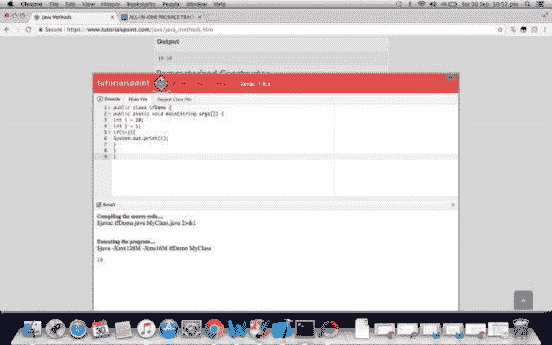

## if else 语句

该语句用于需要测试条件的情况：如果条件为真，则执行该语句之后的代码块；否则执行 else 语句之后的代码块。该结构的语法为——

```java
if(condition){

    /*body*/

} else {

    /*body*/

}
```

以下是该结构的示例实现——

```java
public class ifelseDemo {

    public static void main(String[] args) {

        int i = 1;
        int j = 0;

        if(i > j){

            System.out.print(i);

        } else {

            System.out.print(j);

        }

    }

}
```

该代码执行后的输出如下 –

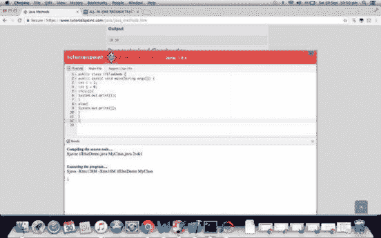

## 嵌套 if 语句

该语句用于需要测试条件的情况：如果条件为真，则执行该语句之后的代码块；否则测试下一个条件。如果该条件为真，则执行与该条件对应的 if 语句代码块。如果没有任何条件为真，则执行 else 语句之后的代码块。可以使用嵌套的 if 语句测试多个条件。该结构的语法为——

```java
if(condition1) {

    /*body*/

} else if (condition2) {

    /*body*/

} else {

    /*body*/

}
```

以下是该结构的示例实现——

```java
public class nestedIfDemo {

    public static void main(String[] args) {

        int i = 0;
        int j = 0;

        if(i > j){

            System.out.print(i);

        } else if(j > i) {

            System.out.print(j);

        } else {

            System.out.print("Equal");

        }

    }

}
```

该代码执行后的输出如下 –

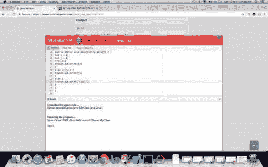

## Switch

如果你有一个变量，并且需要该变量的不同值执行不同的代码块，那么理想的结构是 switch 语句。该结构的语法为——

```java
switch(variable){

    case <value1>:

        /*body*/

        break;

    case <value2>:

        /*body*/

        break;

    case <value3>:

        /*body*/

        break;

    default:

        /*body*/

        break;

}
```

以下是该结构的示例实现——

```java
public class switchDemo {

    public static void main(String[] args) {

        int i = 5;

        switch (i) {

            case 0:

                System.out.print(0);

                break;

            case 2:

                System.out.print(2);

                break;

            case 5:

                System.out.print(5);

                break;

            default:

                System.out.print(999);

                break;

        }

    }

}
```

该代码执行后的输出如下 –

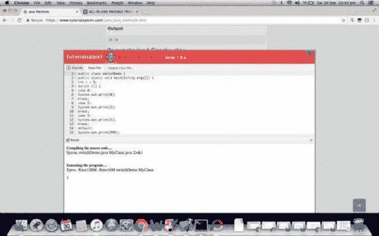

## 三元运算符

Java 还支持条件运算符，也称为 `?:` 运算符。该运算符用于替换 ‘if else’ 结构。其语法如下——

`Expression1 ? Expression2 : Expression3` 这里，`Expression1` 是需要测试的条件。如果条件为真，则执行 `Expression2`，否则执行 `Expression3`。

 |  |  |


# 第 8 章：循环控制


有几种情况需要你多次执行一组结构。例如，如果你需要对一组数字排序，你需要多次遍历以获得所需的结果。这种执行流被称为循环。简单来说，循环是一种允许多次执行代码块的结构。Java 支持几种用于循环的结构，包括 `while` 循环、`for` 循环和 `do while` 循环。

`while` 循环迭代执行代码块，直到 `while` 指定条件为真。一旦条件失败，循环停止。


`for` 循环允许程序员在同一个结构中操作条件和循环变量。因此，你可以初始化一个循环变量，增加/减少它并运行循环直到该变量为真。


`do while` 循环与 `while` 循环相似。然而，在 `while` 循环中，是在执行代码块之前检查条件。而在 `do while` 循环中，是执行代码块后检查条件。如果条件满足，则再次迭代循环，否则终止。可以说 `do while` 循环至少执行一次。


## 循环状态

有两个专门用于循环的关键字，被称为控制状态，因为允许控制流从一段代码转移到另一个部分。这些关键字是——

- `break` 用于循环内部，当你希望执行流终止循环并直接从循环后的第一个语句开始。
- `continue` 用于循环内部，当你希望计算机忽略循环的剩余部分并将控制移动到循环的第一语句。

为了帮助你理解循环如何执行，让我们来看一个实现所有三种循环控制的示例。

### For 循环实现

```java
public class forDemo {

    public static void main(String[] args) {

        int[] numberArray = {100, 300, 500, 700, 900};

        for(int i = 0; i < 5; i++) {

            System.out.print(numberArray[i]);

            System.out.print(",");

        }

        System.out.print("\n");

    }

}
```

该代码执行后的输出如下 –

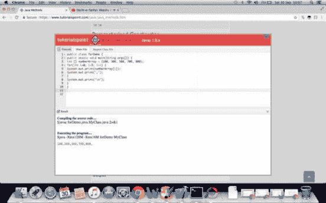

### While 循环实现

```java
public class whileDemo {

    public static void main(String[] args) {

        int[] numberArray = {100, 300, 500, 700, 900};

        int i = 0;

        while(i < 5) {

            System.out.print(numberArray[i]);

            System.out.print(",");

            i++;

        }

        System.out.print("\n");

    }

}
```

该代码执行后的输出如下 –

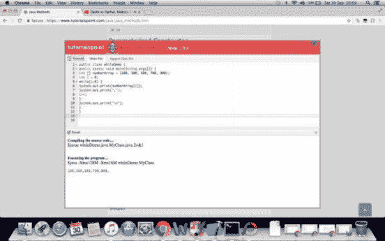

### do While 循环实现

```java
public class doWhileDemo {

    public static void main(String[] args) {

        int[] numberArray = {100, 300, 500, 700, 900};

        int i = 0;

        do {

            System.out.print(numberArray[i]);

            System.out.print(",");

            i++;

        } while (i < 5);

        System.out.print("\n");

    }

}
```

所有的文件操作都由 `java.io` 包下的 Java 支持，这些函数的实现基于流的概念。流简单来说就是数据的序列，它分为两种类型，即 `InputStream` 和 `OutputStream`。前者用于读取数据，后者用于写入数据。

## 字节流

Java 支持的第一种流是字节流。限制在 8 字节大小的 I/O 操作属于这一类。在开始编码之前，你需要意识到用于执行输入和输出的类分别是 `FileInputStream` 和 `FileOutputStream`。现在让我们来看将一个文件的内容复制到另一个文件的示例。

```java
import java.io.*;

public class copyFileBs {

    public static void main(String args[]) throws IOException {

        FileInputStream inputFile = null;

        FileOutputStream outputFile = null;

        try {

            inputFile = new FileInputStream("in.txt");

            outputFile = new FileOutputStream("out.txt");

            int i;

            while ((i = inputFile.read()) != -1) {

                outputFile.write(i);

            }

        } finally {

            if (inputFile != null) {

                inputFile.close();

            }

            if (outputFile != null) {

                outputFile.close();

            }

        }

    }

}
```

在类文件相同的文件夹中保留名为 `in.txt` 的输入文件，并执行代码查看其作用。

## 字符流

从 8 位数据操作转移到 16 位 Unicode 数据操作，我们需要从二进制流切换到字符流。用于执行输入和输出的类分别是 `FileReader` 和 `FileWriter`。上面的代码可以修改如下以使用字符流。

```java
import java.io.*;

public class copyFileCs {

    public static void main(String args[]) throws IOException {

        FileReader inputFile = null;

        FileWriter outputFile = null;

        try {
```


```java
inputfile = new FileReader("in.txt");
outputfile = new FileWriter("out.txt");
int i;
while ((i = inputfile.read()) != -1) {
    outputfile.write(i);
}
} finally {
    if (inputfile != null) {
        inputfile.close();
    }
    if (outputfile != null) {
        outputfile.close();
    }
}
}
}
```

在类文件相同的文件夹中保留名为 `in.txt` 的输入文件，并执行代码查看其作用。

## 标准流

为了允许用户从键盘输入输入并在屏幕上打印输出，Java 支持标准流——

- `System.in` 代表标准输入流，允许用户通过键盘提供输入。
- `System.out` 代表标准输出流，允许用户在屏幕上获取输出。
- `System.err` 代表标准错误流，允许用户获取系统的错误消息。

提供的示例程序允许系统从用户获取输入并将输入的内容打印到屏幕上，直到用户按下‘q’键后程序退出。

```java
import java.io.*;

public class ssddemo {

    public static void main(String args[]) throws IOException {

        InputStreamReader inputc = null;

        try {

            inputc = new InputStreamReader(System.in);

            System.out.println("Enter characters, 'q' to quit.");

            char char;

            do {

                char = (char) inputc.read();

                System.out.print(char);

            } while(char != 'q');

        } finally {

            if (inputc != null) {

                inputc.close();

            }

        }

    }

}
```

可以执行此程序来查看输出是什么以及代码的工作原理。

# 异常处理

异常是任何程序无法处理的意外事件。显然，在这种情况下，程序的正常执行流受到干扰，程序可能会因错误终止或表现异常。这就是为什么异常需要由程序处理的原因。

那么，为什么会发生异常？异常的发生可能是由于一系列原因。导致这种情况的一些场景包括：

- 无效的数据输入
- 程序正尝试打开指定位置不存在的文件
- JVM 内存不足
- 正在进行通信且系统丢失连接

显然，异常可能由于系统、用户产生的问题或程序层的问题引起。基于这一观察，创建了三类异常。这三类异常已在章节中讨论。

## 编译异常

在编译时由编译器检查并报告的异常称为编译异常（Checked Exceptions）。这些异常是编译时异常，需要在编写代码时进行处理。

处理此类异常的示例如下面的代码所示：

```java
import java.io.File;
import java.io.FileReader;

public class demoh {

    public static void main(String args[]) {

        File file = new File("E://samplefile.txt");
        FileReader infile = new FileReader(file);

    }

}
```

如果在创建文件时指定的路径不存在，编译器将抛出 `FileNotFoundException`。

## 非编译异常

某些异常是在运行时发生的。此类异常被称为非编译异常（Unchecked Exceptions）或运行时异常。逻辑错误、程序 Bug 和不当使用都是此类错误的示例。此类错误的一个重要特征是它们在编译时不会被检测。

为了帮助理解什么是运行时错误，让我们来看一个例子。假设你在程序中实现了一个包含 5 个元素的数组。然而，代码访问了第 6 个元素。此错误将在运行时检测，系统将生成 `ArrayIndexOutOfBoundsException`。

## 错误

某些异常是系统或程序员无法控制的。此类错误的一个常见例子是 `StackOverflowError`。对于这些错误你几乎无法做什么，因此最好忽略它们。当它们发生时，会中断程序的执行，但无能为力。

## 异常体系

Java 有一个名为 `java.lang.Exception` 的内置类，所有异常都属于该类。所有异常类都是该类的子类。此外，`Throwable` 是异常类的父类。`Throwable` 的另一个子类是 `Error` 类。上述所有栈溢出错误都属于这个 `Error` 类。

`Exception` 类有两个子类，分别为 `RuntimeException` 和 `IOException`。以下是 `Throwable` 类中提供的定义的方法列表：

- `String getMessage()`：调用时，该方法返回所遇到的异常的详细描述。
- `Throwable getCause()`：该方法被调用时返回一个包含异常原因的消息。
- `String toString()`：该方法返回类名以及异常的详细描述。
- `void printStackTrace()`：通过调用此方法可以将 `toString()` 的结果以及堆栈轨迹打印到标准错误流（`System.err`）。
- `StackTraceElement[] getStackTrace()`：返回堆栈轨迹元素的数组。

在某些场景下，你可能需要访问栈轨迹的不同元素。此方法返回一个数组，将栈轨迹的每个元素都保存到数组的不同元素中。数组的第一个元素包含栈轨迹的顶端元素，而栈轨迹的底部被保存在数组的最后一个元素。

`public Throwable fillInStackTrace()`

将当前栈轨迹的内容附加到之前的栈轨迹信息之后，并以数组的形式返回。

## 捕获异常

捕获异常的标准方法是使用 `try` 和 `catch` 关键字以及它们的代码实现。这个 `try-catch` 块需要以这种方式实现：即包含可能会抛出异常的代码。在这里还需要提到，预期抛出异常的代码被称为保护代码。`try` 和 `catch` 块实现的语法如下——

```java
try {
    /*保护代码*/
} catch(Exception exc1) {
    /*捕获代码*/
}
```

预期抛出异常的代码被放在 `try` 块中。如果抛出了异常，则在 `catch` 块中实现对应的异常处理要执行的操作。每个 `try` 块必须有一个 `catch` 块或一个 `finally` 块。

在 `catch` 语句中，需要声明预期抛出的异常。一旦发生异常，执行流将转移到 `catch` 块。如果抛出的异常与 `catch` 块中定义的异常匹配，则执行 `catch` 块。

下面是 `try-catch` 块的示例实现。该代码实现了一个包含 2 个元素的数组。然而，代码尝试访问并不存在的第 3 个元素。结果导致抛出了异常。

```java
import java.io.*;

public class demoexception {

    public static void main(String args[]) {

        try {
            int arr[] = new int[2];
            System.out.println("访问数组的第 3 (rd) 元素:" + arr[3]);
        } catch(ArrayIndexOutOfBoundsException exp) {
            System.out.println("捕捉异常:" + exp);
        }

        System.out.println("到达 catch 块外部");

    }

}
```

此代码的输出所示。

## 实现多个 catch 块

一段代码块可能会导致多个异常。为了满足这一需求，允许实现多个 `catch` 块。此类实现的语法如下所示。

```java
try {
    /*保护代码*/
} catch(Exptype1 exp1) {
    /*捕获块 1*/
} catch(Exptype2 exp2) {
    /*捕获块 2*/
} catch(Exptype3 exp3) {
    /*捕获块 3*/
}
```

上述语法演示了三个 `catch` 块的实现。然而，你可以根据需要实现任意数量的 `catch` 块。当执行此代码时，会先执行保护代码。如果发生异常，异常类型将与第一个 `catch` 块的异常进行匹配。但如果异常类型不匹配，将忽略 `catch` block 1 并尝试匹配第二个 `catch` 块的异常类型。哪一个 `catch` 块与抛出的异常类型相同，就会执行相应的 `catch` 块。

## 关键字：throw/throws

这两个关键字是相似的词，但用途完全不同。`throws` 关键字用于方法的末尾，用于声明代码会抛出异常但方法不处理它。换句话说，`throw` 关键字用于字面上的抛出异常。此异常可以是新的，也可以是之前已经创建的异常。

下面是说明 `throws` 和 `throw` 用法的示例代码。在方法声明中，它声明了方法抛出异常，而 `throw` 的使用启动了该异常的抛出。

```java
import java.io.*;

public class name {

    public void deposit(double amount) throws Exception {
        /*implementation*/
        throw new Exception();
    }

}
```

可能会抛出多个异常。为了在方法声明中声明这些异常，你可以提供一个逗号分隔的异常列表。下面是该概念的示例实现。

```java
import java.io.*;

public class name {

    public void withdraw(double amount) throws Exception, InsufficientException {
        /*implementation*/
    }

}
```

## finally 块

现在你已经熟悉了 `try-catch` 块，让我们来看看异常处理中使用的第三个块：`finally` 块。这是出现在 `try` 和 `catch` 块之后的最后一个块。此外，如果没有找到异常，则可能会省略 `catch` 块的执行，但无论是否发生异常，`finally` 块始终会被执行。

该块的目标是执行程序员可能认为必要的任何清理活动。无论 `try` 块中包含的代码发生了什么，你都执行这段代码。该块的语法及其实现方式如下。

```java
try {
    /*保护代码*/
} catch(Exptype1 exp1) {
    /*捕获块 1*/
} catch(Exptype2 exp2) {
    /*捕获块 2*/
} catch(Exptype3 exp3) {
    /*捕获块 3*/
} finally {
    /*finally 块实现*/
}
```

下面提供了实现此概念的示例代码，以使概念更清晰。

```java
public class democep {

    public static void main(String args[]) {

        int arr[] = new int[2];

        try {
            System.out.println("访问第 3 (rd) 元素:" + arr[3]); 
        } catch(ArrayIndexOutOfBoundsException exp) {
            System.out.println("捕捉异常:" + exp);
        } finally {
            arr[0] = 5;
            System.out.println("第一个元素是: " + arr[0]);
            System.out.println("finally 块已执行");
        }

    }

}
```

代码的输出所示。

在实现 `try/catch/finally` 块时，始终记住以下几点。首先，没有 `try` 块，就不会有 `catch` 块。同样，没有 `catch` 或 `finally` 块，就不会有独立的 `try` 块。此外，`finally` 块是一个可选的结构，即使你的代码中没有 `finally` 块，`try/catch` 也能正常工作。

## 自定义异常

Java 允许你定义自己的异常。然而，在此之前，你需要记住几点。首先，任何异常都需要派生或作为 `Throwable` 类的子类。为了实现受检异常，你必须扩展 `Exception` 类。然而，运行时异常的实现必须扩展 `RuntimeException` 类。

定义异常的标准方法是——`class demoexception extends Exception`

以下代码说明了自定义异常的实现和用法。

```java
import java.io.*;

public class InsufficientException extends Exception {

    private double amount;

    public InsufficientException(double amount) {
        this.amount = amount;
    }

    public double getAmount() {
        return amount;
    }

}
```


## 总结

本书为你提供了一个关于 Java 基础的入门教程。我们涵盖了 Java 编程的基本概念，以及开始 Java 编程所需的一切内容。现在你已经回顾了 Java 的基本概念，并且假设你尝试了书中给所有的代码，你已经准备好跳转到高级 Java 编程了。

成为编程专家的关键（无论是任何种编程语言）在于实践。你练习得越多，你的编程技能就会越强大！我们希望你喜欢这本书，并希望它帮助你获得 Java 的基础级知识。我们希望已经为你打下了良好的基础，让你能够磨练技能并成为一名专家 Java 程序员。

# 第 2 册 - Java 问题与解答

# 引言

本书面向 Java 学习者，特别是初学者和中级学习者。本书涵盖了以下内容。Java 版本为 8。

`String` / `Integer` / `Long` / `Exception` / `static initializer` / `constructor` / `File` / `Files` / `Zip` / `Properties` / `StringBuilder` / `LocalDateTime` / `Random` / `Array` / `ArrayList` / `HashMap` / `LinkedHashMap` / `Functional Interface` / `Lambda` / `Stream` / `Objects` / `Optional` / etc...

---

学习了基本概念和语法后，下一步是阅读和理解代码。本书中的代码包含了上述类中各种方法。

共有 50 个问题。开始时问题较简单，但到最后难度会逐渐增加。

---

本书的主要目的是提高代码阅读的理解能力，而不是详细的语法理论之类的内容。

请注意，为了教学目的，书中包含一些干扰性问题（在实际开发领域中不推荐）。

---

问题从下一页开始。

希望你有所收获并发现新知识。

# 问题 1

选择一个能描述该程序编译并运行结果的语句。

```java
public class Question_1 {

    public static void main(String[] args) {

        int a = 1;
        int b = 2;
        int c = 3;

        if (a + b == c) {

            System.out.println(method1()[0]);

        }
    }

    private static String[] method1() {

        String[] array = new String[1];
        StringBuilder sb = new StringBuilder();

        sb.append("Be a");
        sb.append("Java ");
        sb.append("Programmer");

        array[0] = sb.toString();
        return array;
    }
}
```

(A) 输出 Be a Java Programmer
(B) 什么都不输出
(C) 编译错误
(D) 运行时异常

### 答案：(A) 输出 "Be a Java Programmer"

方法 `method1()` 返回 `String` 类型的 `array`，并将来自 `StringBuilder` 对象的 `String` 设置为 `array[0]`。

因此，该程序输出 "Be a Java Programmer"且没有任何错误。

---

### Notes：

(1) if 语句中的条件

在学习过程中，你可能见过简单的条件，如 `"a == 1"`，你也可以在条件括号中进行计算，例如问题中第 7 行的 `"a + b == c"`。

---

(2) StringBuilder

`StringBuilder` 在 Java 编程中被频繁使用，因为它比仅使用 `String` 对象进行拼接要快。

在之后的很多情况下，为了将 `StringBuilder` 对象转换为 `String` 对象，程序员会使用 `toString()` 方法。

当你初始化 `StringBuilder` 时，可以通过两种方式：

首先，初始化一个空的 `StringBuilder` 对象，如问题中第 15 行的 `StringBuilder sb = new StringBuilder();`。

其次，你也可以使用一个 `String` 这样做 `StringBuilder sb = new StringBuilder("text");`。

如果你决定先追加第一个字符串，可以使用这种方法来简化代码。

# 问题 2

```java
public class Question_2_1 {

    private String a = "str";
    private Long b = 1L;
    private int c = 0;
}
```

选择一个能描述上述程序编译并运行结果的语句。

---

```java
public class Question_2_2 extends Question_2_1 {

    public static void main(String[] args) {

        for (int i = 0; i < 5; i++) {

            if (true) {
                System.out.println(a);
            }
            if (true) {
                System.out.println(b);
            }
            if (true) {
                System.out.println(c);
            }
        }
    }
}
```

(A) 输出 str
(B) 输出 0
(C) 编译错误
(D) 运行时异常

### 答案：(C) 编译错误

`Question_2_1` 中的访问修饰符是 `private`。虽然 `Question_2_2` 继承了 `Question_2_1`，但它无法直接访问 `a`、`b` 和 `c`。

# 问题 3

选择一个能描述该程序编译并运行结果的语句。

```java
public class Question_3 {

    public static void main(String[] args) {

        LocalDateTime ldt1 = LocalDateTime.now();
        LocalDateTime ldt2 = ldt1.plusDays(0);

        if (ldt1.isAfter(ldt2) || ldt1.isBefore(ldt2)) {
            System.out.println("ldt1 and ld2 are different");
        } else {
            System.out.println("ldt1 and ld2 are the same");
        }
    }
}
```

(A) 输出 ldt1 和 ld2 相同
(B) 输出 ldt1 和 ld2 不相同
(C) 什么都不输出
(D) 编译错误或运行时异常

### 答案：(A) 输出 "ldt1 and ld2 are the same"

在该代码中，创建了两个 `LocalDateTime` 对象。第二个对象 `ldt2` 是通过 `ldt1` 调用 `plusDays()` 方法生成的。

然而，由于参数是 "0"，它们作为 `LocalDateTime` 对象是相同的。

由于上述原因，第 12 行的语句没有执行，程序输出 "ldt1 and ld2 are the same"。

---

### Notes：

(1) LocalDateTime

`LocalDateTime` 从 Java 8 开始引入。默认格式如下：`"yyyy-MM-ddTHH:mm:ss.SSS"`。

当你需要带有时间戳的对象而不仅仅是日期或时间时，可以使用这个类。

`now()` 方法在运行程序时创建一个带有日期和时间的 `LocalDateTime` 对象。

`isAfter()` 和 `isBefore` 方法比较两个 `LocalDateTime` 对象，判断一个在另一个之后还是之前。

(2) return

使用此语句有两种方式。你可以返回方法的的结果，或者在编写该语句的地方停止程序。

### (3) instanceof

该运算符检查参数是否为给定 `Class` 的对象。在题目的第 21 行，它检查 "ldt" 是否是 `LocalDateTime` 类对象。

在这种情况下，"flg" 为 `true`；

# 问题 4

选择一个语句作为下方代码中 `// some code` 的替换，以便该程序在编译运行后输出 "JAVA"。

```java
public class Question_4 {

    public static void main(String[] args) {

        LinkedHashMap<String, String> map = new LinkedHashMap<String, String>();

        map.put("1 ", "J");
        map.put("2", "A");
        map.put("3", "V");
        map.put("4", "A");

        // some code

        if (flg) {

            map.entrySet().stream().forEach(e -> {
                System.out.print(e.getKey());
            });

        } else {

            map.entrySet().stream().forEach(e -> {
                System.out.print(e.getValue());
            });

        }
    }
}
```

(A) `boolean flg = true;`
(B) `boolean flg = false;`
(C) `Boolean flg = null;`
(D) `Object flg = null;`

## Answer : (B) boolean flg = false;

在此代码中，创建了 "map" 对象并放入了键值。目标是按照添加顺序输出 "map" 对象内部的值。

在第 15 行的 `if` 语句条件下，如果 "flg" 为 `true`，程序将输出所有的键；如果为 `false`，则输出值。因此答案是 (B)。

## Notes :

(1) LinkedHashMap

当你开始学习 Java 时，大多数情况下首先学习 `HashMap`。但在这种情况，你必须按照添加顺序输出所有值。

`HashMap` 不保证顺序，这就是为什么这段代码使用 `LinkedHashMap` 代替它的。

### (2) 选项 (C) 和 (D)

关于选项 (C)：如果你在代码中写 `Boolean flg = null;`，编译不会报错；但如果你在代码中写 `boolean flg = null;`，则会报错。

这就是基本类型和对象之间的区别。基本类型是值本身。而对象提供引用，`null` 意味着没有引用。因此，对象被称为“可空的 (nullable)”。

关于选项 (D)：`Object` 类封装了所有类，所以如果你在代码中写它，编译不会报错。

### (3) forEach

这是从 Java 8 开始引入的 `StreamAPI` 中的一个方法。它对流内部的所有元素执行某些某种操作。

对于初学者来说，将其考虑为编写集合 `for` 循环的替代方式会更好。严格来说，它们并不相同，但起初这样足够了。

# 问题 5

```java
public class Question_5_1 {

    public Integer number;

    public Integer getNumber() {
        return number;
    }

    public void setNumber(Integer number) {
        this.number = number;
    }
}
```

选择一个语句，描述使用上述程序的程序在编译运行时的结果。

```java
public class Question_5_2 {

    public static void main(String[] args) {

        Question_5_1 instance1 = new Question_5_1();
        Question_5_1 instance2 = new Question_5_1();

        instance1.setNumber(0);
        instance2.setNumber(0);

        if (instance1.getNumber() == instance2.getNumber()) {
            System.out.print("true");
        }
        if (instance1.equals(instance2)) {
            System.out.print("true");
        } else {
            System.out.print("false");
        }
    }
}
```

(A) 输出 true true
(B) 输出 true false
(C) 输出为空
(D) 编译错误或运行时异常

## Answer : (B) 输出 true false

在此代码的第 8 行，比较了 `Question_5_1` 实例的 `number` 字段。它返回 `true`，所以程序会输出内容，这就是为什么选项 (C) 是错误的。第 10 行的条件返回 `false`，所以选项 (B) 是正确的。

## Notes :

(1) 不在圆括号内部换行

在圆括号内部开启新行在 Java 中非常常见。当然，如果存在多个语句，这样做可以提高代码的可读性；但如果圆括号内只有一个语句，不新起行是良好的代码编写方式。

### 比较 :

<不新起行>
```java
{ some code; }
```

<新起行>
```java
{
    some code;
}
```

### (2) Object 类的 equals 方法

在第 10 行，比较两个实例是否相同。如你在第 5 行和第 6 行所示，字段的值相同，但它们是不同的实例。这就是为什么条件返回 `false`；

# 问题 6

选择一个语句，描述此程序在编译运行时的结果。

```java
public class Question_6 {

    public static void main(String[] args) {

        while (!false) {

            try {
                System.out.print("A");
                Integer.parseInt("Hello World");
            } catch (Exception e) {
                System.out.print("B");
                break;
            } finally {
                System.out.print("C");
            }
        }

        System.out.print("D");
    }
}
```

(A) 输出 AD
(B) 输出 ABO
(C) 输出 ABCD
(D) 输出 ABDC

## Answer : (C) 输出 ABCD

在第 5 行，`!false` 等同于 `true`，所以循环开始。

由于参数不是数字，在第 8 行发生异常，因此 `catch` 和 `finally` 块中的语句都会执行。

## Notes :

(1) Integer.parseInt()

这是 `Integer` 类的一个静态方法。它将 `String` 参数转换为 `int` 值，在 Java 编程中非常常见。

当参数不是数字（值而非类型时），会发生 `NumberFormatException`。这是与 `NullPointerException` 最著名的异常之一。

(2) break 语句与 finally 块的处理顺序

如你在第 11 行所示，程序将退出 `while` 循环。`finally` 块会优先执行，然后退出 `while` 循环。

(3) catch 块

在此代码中，你只看到一个 `catch` 块，但你可以通过编写如下多个 `catch` 块来处理每种异常。如果你希望根据不同的异常产生不同的结果，应该这样写代码。

```java
catch (NullPointerException e) {
    // some code;
} catch (NumberFormatException e) {
    // some code;
}
```

```java
public static void main(String[] args) {
    String str1 = "Hello";
```


String space=" ";

Question_? question_?= new Question_?();

question_7.method1(str1 + space);

System.out.println(str1);

}

private void method1(String str1) {

    String str2 = "World";

    str1 += str2;

}

```

(A) 输出 Hello
(B) 输出 Hello World
(C) 编译错误
(D) 运行时异常

**答案：(A) 输出 Hello**

第 9 行将参数 "Hello" 传递给 `method1`。

在 `method1` 中，`str1` 从 `"Hello "` 变为 `"Hello World"`，但这段代码输出 `"Hello"`。

让我们从下面详细查看。


### Notes

**(1) 值传递**

第 9 行传递给 `method1` 的参数是值拷贝（value），因此 `main` 方法中的变量 `str1` 与 `method1` 方法中的 `str1` 是不同的。它只是一个拷贝。

如第 17 行所示，`method1` 中的变量 `str1` 发生了变化，但它不会影响 `main` 方法中的 `str1`。因此，该程序输出 `"Hello"`而不是 `"Hello World"`。

**(2) 静态与非静态方法**

`main` 方法是 `static` 的，但 `method1` 不是。如果你重写第 9 行的代码为 `method1(str1 + space);`，就会发生编译错误。

这被称为静态引用（static reference）。如果两个方法都是 `static`，则不会发生编译错误。

**(3) 运算符 "+="**

该运算符的作用等同于下方：

| 1 | `String str1 =` | `"ABC";` |
| 2 | `String str2 =` | `"DEF";` |
| 3 | | |
| 4s 6 | `// samestr1 = str1 + str1 += str2;` | `str2;` |

|  | |  |


# 问题 8


当此程序被编译时，会发生编译错误。选择一个描述错误发生所在行的语句。


```java
public class Question_8 {

    public static void main(String[] args) {

        final List<String> list1 = new Arraylist<>();

        list1.add( "This ");

        list1.add("list ");

        list1.add("is ");

        list1.add("final.");

        List<String> list2 = new Arraylist<>();

        System.out.println(list2.size());

        list1 = list2;

        System.out.println(" done.");

    }

}
```

| (A) | 行 | 7 |
| (B) | 行 | 14 |
| (C) | 行 | 16 |
| (D) | 行 | 18 |

**答案：(C) 行 16**

第 5 行，`list1` 被初始化为 `final Arraylist`。如果你给 `final Arraylist` 赋值另一个列表，就会发生编译错误。


### Notes

**(1) ArrayList**

`<final ArrayList>`

如上所述，`final ArrayList` 在初始化后不能被重新赋值。

你可能会想为什么第 7 行没有发生编译错误。这是一个很好的视角。对于 `final Arraylist`，允许添加新元素，反之则不允许重新赋值。

**<method size()>**

你可能也会想为什么第 14 行没有发生编译错误，这也是一个很好的视角。显然 `list2` 已经初始化了，到此为止。

之后没有添加任何元素，但使用方法 `size()` 没有问题。它只是简单的返回 0。

**<初始化方法>**

在代码中，通过第 5 行和第 7 到第 10 行，使用了 5 行代码创建了一个包含四个元素的 `Arraylist`。

它不会导致任何错误或运行时异常。

然而，还有另一种初始化方法，不需要使用更少的行，所示，这样更好记忆。

```java
final List<String> list1 = Arrays.aslist("This ", "list ", "final.");
```

|  | |  |


# 问题 9


选择一个描述此程序编译并运行结果的语句。


```java
public class Question_9 {

    public static void main(String[] args) {

        HashMap<Integer, Integer> map = new HashMap<>();

        map.put(1, 2);

        map.put(3, 4);

        map.clear();

        if (map.isEmpty()) {

            map.put(1, 2);

        }

        System.out.println(map.size());

    }

}
```

(A) 输出 true
(B) 输出 false
(C) 编译错误
(D) 运行时异常

**答案：(A) 输出 true**

第 17 行，`map.size()` 返回 1，因为 `map.put(1, 2)` 被执行了。


### Notes

**(1) clear()**

此方法清空 map 中的所有元素。

如上所述，`map.clear()` 会删除所有条目。

在第 10 行，`map.isEmpty()` 返回 true，因为 map 是空的。


**(2) isEmpty()**

此方法检查 map 是否为空。

在第 12 行，`map.isEmpty()` 返回 true。


**(3) duplicate key**

在第 13 和 14 行，`map.put(1, 2)` 覆盖了之前的键。在第 17 行，`map.size()` 返回 1。

|  | |  |

# 问题 10


选择一个描述此程序编译并运行结果的语句。


```java
public class Question_10 {

    public static void main(String[] args) {

        Integer a = method1("1");

        if (a == 0 && a != null) {

            System.out.println(a);

        }

    }

    private static Integer method1(String str) {

        if (Integer.parseInt(str) > 0) {

            return null;

        } else {

            return 100;

        }

    }

}
```

(A) 输出 null
(B) 输出 100
(C) 编译错误
(D) 运行时异常

**答案：(D) 运行时异常**

在第 12 行，`method1` 返回 `null`，因为参数大于 0。在第 6 行，比较 `null` 和 0 会导致运行时异常。

### Notes

**(1) NullPointerException**

这是 Java 中最著名的异常之一。在大多数情况下，Java 程序员至少会遇到一次。

**<if condition>**

在代码的第 6 行，使用 `==` 比较 `null` 和 0，这就是为什么会发生异常。反转它们的顺序，这样你可以先进行空检查，如果它为 null，则返回 false，不会发生运行时异常。

**(2) method1**

此方法在第 12 行返回 `null`，因为参数大于 0。

**(3) happens normally**

这种异常在很多时候经常发生。例如，急于发布应用而没有进行空检查。

|  | |  |

# 问题 12

选择描述该程序编译并运行结果的陈述。

```java
public class Question_12 {

    public static void main(String[] args) {

        String str = "123";

        if (method1(str)) {

            Object a= Integer.parseInt(str);

            System.out.println((String) a);

        }

    }

    public static boolean method1(String value) {

        try {

            Integer.parseInt(value);

            return true;

        } catch (NumberFormatException e) {

        }

        return false;

    }

}
```

(A) 输出 123
(B) 无输出
(C) 编译错误
(D) 运行时异常

### 答案：(D) 运行时异常

第 7 行的 `if` 条件返回 true，因为 `str` 的 `value` 是数字。

然而，在第 9 行发生了运行时异常，因为对象 `a` 是 `Integer` 类型。下面让我们详细查看。

### 注释：

### (1) ClassCastException
当将对象强制转换为没有继承关系的类型时会发生此异常。第 8 行和第 9 行的 `String` 和 `Integer` 就是一个很好的例子。

#### <第 8 行>
在第 8 行，初始化对象 `a` 时指定了 `Object` 类型，因此编译器在程序运行之前不知道赋值给 `value` 的类型。

以下是此代码中第 8 行的两种写法：
1. `Object a= Integer.parseInt(str);`
2. `Integer a= Integer.parseInt(str);`

如果你用方式 2 重写第 8 行的代码，第 9 行会导致编译错误，因为在初始化对象 `a` 时指定 `Integer` 类型会告诉编译器对象 `a` 的类型。

### (2) method1
第 14 行中 `method1` 的名称是 `method1`。但在实际编码中，这类方法的名称通常以 "is" 开头。例如 "isString","isNumber","isFile","isDir(Dir 表示目录)"。

如果方法的作用是检查参数是否满足某种条件并返回布尔值，你应该像上面那样命名方法。

---

# 问题 13

选择描述该程序编译并运行结果的陈述。

```java
public class Question_13 {

    public static void main(String[] args) {

        String[] array = { "a", "b", "c" };

        for (int i = 0; i < array.length; i++) {

            if (isArrayEmpty(array)) {

                return;

            }

            array[i] = array[i].toUpperCase();

        }

        System.out.println(array[array.length]);

    }

    public static boolean isArrayEmpty(String[] array) {

        return array == null || array.length == 0;

    }

}
```

(A) 输出 C
(B) 输出 null
(C) 编译错误
(D) 运行时异常

### 答案：(D) 运行时异常

这段代码似乎输了转换为大写的 `array` 的最后一个元素。

思考方式是正确的，但在输出数组最后一个元素时使用 `array.length` 的值是错误的。

### 注释：

### (1) toUpperCase()
该方法位于第 10 行。它非常简单易于理解。它将小写转换为大写。

### (2) array
在第 6 行到第 11 行，这个 `for` 循环经常操作数组中的所有元素，因此 `array` 的所有元素都变为大写。

之前：`{"a", "b", "c"}`
之后：`{"A", "B", "C"}`

#### <获取最后一个元素>
在此代码中，`array length` 返回 3，因为有三个元素。但是，要获取它的最后一个元素，需要编写 `array[2]`。在第 13 行，`array[array.length]` 等于编写 `array[3]`，因此发生了运行时异常。

### (3) ArrayOutOfBoundsException
这是程序运行时发生的异常。最好记住这个异常，因为在实际编码中经常会看到。

---

# 问题 14

选择描述该程序编译并运行结果的陈述。

```java
public class Question_14 {

    public static void main(String[] args) {

        Random random = new Random();

        int a = 0;

        for (int i = 0; i < 10000; i++) {

            a = random.nextInt(10);

            if (a > 9) {

                System.out.println("abc");

                return;

            }

        }

        System.out.println("ABC");

    }

}
```

(A) 输出 abc
(B) 输出 ABC
(C) 编译错误
(D) 运行时异常

### 答案：(B) 输出 ABC

在第 7 行到第 16 行，检查字段 `a` 是否大于 9 共 10000 次。

然而，`a` 不可能大于 9，因为第 9 行的 `nextInt()` 方法返回 0 到 9 之间的随机数。结果是该程序输出 ABC。

### 注释：

### (1) Random
#### <method nextInt()>
如上所述，该方法返回 0 到参数之间的随机数。

#### <石头剪刀游戏>
下面是使用该方法的另一个示例，该程序是一个简单的石头剪刀游戏。

```java
public static void main(String[] args) {

    String[] array= {

        "Rock",

        "Paper",

        "Scissors"

    };

    System.out.println(array[new Random().nextInt(3)]);

}
```


创建一个包含 `Rock`、`Paper`、`Scissors` 字符串的数组。在输出数组成员时，通过 `nextInt()` 方法为数组索引提供随机数。因此，该程序在编译和运行时将随机输出 `Rock`、`Paper` 或 `Scissors`。

---

# 问题 15

目录 `C:/Users/user/Desktop/` 下有三个文本文件。

### 目录 (C:/Users/user/Desktop/)

1. file1.txt
2. file2.txt
3. file3.txt


选择一个描述该程序编译并运行结果的陈述。

––––––––


```java
1 public class Question_15 {
2
3     public static void main(String[] args) {
4
5         File dir = new File("C:/Users/user/Desktop/");
6
7         Arrays.stream(dir.listFiles()).forEach(file -> {
8             System.out.print(file.getName() + " | ");
9
9         });
10
11     }
12
13 }
```

(A) 输出 file1.txtfile2.txtfile3.txt
(B) 输出 null

### 答案：(A) 输出 file1.txtfile2.txtfile3.txt

该程序的功能如下：

1. 获取目录 `C:/Users/user/Desktop/` 中的所有文件
2. 输出所有文件的名称

––––––––


### Notes：

### (1) File
**创建文件对象**

`File` 类是操作文件对象的良好选择。
正如你在第 5 行看到的，如果你想通过向 `File` 构造函数传递文件路径来创建目录对象，也可以使用 `File` 类。

##### 方法 listFiles()
这个方法非常常见。在第 7 行，它将目录中的所有文件作为 `File` 类型数组返回。

##### 方法 getName()
在第 8 行，你可以看到这个方法。它只返回文件名。如果你输出 `file` 而不是 `file.getName()`，它将输出带有完整路径。

### (2) Arrays
在第 7 行，方法 `forEach()` 与问题 4 中的相同。它属于 `StreamAPI`，但 `File` 类型的数组没有 `stream()` 方法，因此该程序第 7 行到第 9 行执行的操作如下：

1. 创建 `File` 类型数组的流
2. 使用流的 `forEach()` 方法
3. 输出每个元素

箭头 (`->`) 之前的参数 `file` 是流中的单个元素。

|  | |  |


# 问题 16


选择一个描述该程序编译并运行结果的陈述。

––––––––


```java
1 public class Question_16 {
2     public static void main(String[] args) {
3
4         String str1 = "a";
5         String str2 = "b";
6         String str3 = "c";
7
8         List<String> list = Arrays.asList("a", "b", "c");
9
10         list.stream().forEach(e -> {
11             switch (e) {
12                 case str1:
13                     System.out.println("switch");
14                     break;
15                 case str2:
16                     break;
17                 case str3:
18                     break;
19             }
20         });
21
22     }
23 }
```

(A) 输出 switch
(B) 输出无
(C) 编译错误

答案：(C) 编译错误

在第 4 行到第 6 行，都是变量。
然而，`switch` 语句中的 `case` 子句需要 final 变量，因此在第 12、15、17 行处发生编译错误。

––––––––


### Notes：

### (1) switch 语句
与 `if` 语句相比，当有很多条件时，`switch` 语句是一个很好的选择。

##### 使用 if-else 语句处理三个条件
```java
1 if (condition1) {
2     return;
3 } else if (condition2) {
4     return;
5 } else {
6     return;
7 }
```

##### 使用 switch 语句处理三个条件
```java
1 switch (condition1) {
2     case condition1: break;
3     case condition2: break;
4     default: break;
5 }
```
上述代码的第 4 行 `"default"` 等同于 `if` 语句的 `else`。
使用 `if` 语句或 `switch` 语句的另一个点是条件是简单还是复杂。
`Switch` 语句需要 final 变量并且看起来简单，但 `if` 语句比 `switch` 语句更容易地评估复杂的条件。

|  | |  |


# 问题 17


以下是文件 `C:/Users/user/Desktop/abc.properties` 的内容。

––––––––


1 key=value

选择一个描述该程序编译并运行结果的陈述。

––––––––


```java
1 public class Question_17 {
2     public static void main(String[] args) throws Exception {
3         Properties property = new Properties();
4         File file = new File("C:/Users/user/Desktop/abc.properties");
5         FileInputStream stream = new FileInputStream(file);
6         String str = "key";
7
8         property.load(stream);
9         property.clear();
10         property.setProperty(str, "java");
11
12         System.out.println(property.getProperty(str));
13         stream.close();
14     }
15 }
```

(A) 输出 value
(B) 输出 java
(C) 输出 null
(D) 编译错误

答案：(B) 输出 java

该程序的功能如下：
1. 通过 `FileInputStream` 加载文件
2. 清空 `property` 对象
3. 设置键-值对
4. 从 `property` 对象中获取 `String` 值

––––––––


### Notes：

### (1) properties
`.properties` 结尾的文件
`Properties` 类是存储配置的良好选择。

### (2) FileInputStream
该类用于操作文件流。

##### 方法 load()
在第 8 行，该方法通过 `FileInputStream` 加载属性。

##### 方法 clear()
在第 9 行，该方法清空 `property` 对象。

##### 方法 setProperty() 和 getProperty()
这两个方法非常简单。你可以设置键-值内容，并在第 12 行获取它。如果 `property` 中没有项，`getProperty()` 将返回 `null`。

|  | |  |


# 问题 18


选择一个描述此处代码中 `shuffleText()` 方法永远不会返回与参数相同结果的陈述。

––––––––


```java
1 public class Question_18 {
2     public static void main(String[] args) {
3         System.out.println(shuffleText("java"));
4     }
5
6     static String shuffleText(String text) {
7         while (true) {
8             List<String> list = new ArrayList<>();
9             StringBuilder sb = new StringBuilder();
10
11             for (char character : text.toCharArray()) {
12                 list.add(String.valueOf(character));
13             }
14             Collections.shuffle(list);
15             list.forEach(e -> sb.append(e));
16             if (!sb.toString().equals(text)) {
17                 return sb.toString();
18             }
19         }
20     }
21 }
```

––––––––


(A) `sb.toString().equals(text)`
(B) `!sb.toString().equals(text)`
(C) `true`
(D) `false`

答案：(B) `!sb.toString().equals(text)`

`shuffleText()` 方法的功能如下：
1. 循环直到返回与参数值不同的乱序文本
2. 创建列表并添加参数的每个字符
3. 乱序列表并添加到 `StringBuilder`
4. 从 `StringBuilder` 对象返回 `String` 值

––––––––


### Notes：

### (1) toCharArray()
该方法在处理 `String` 的每个字符时非常常见，如第 11 行到第 13 行。

### (2) Collections.shuffle()
这个方法非常有用。如果你想打乱列表中的元素，只需编写此代码并传递列表作为参数即可。

### (3) 此问题的答案

选项 (B) `!sb.toString().equals(text)` 检查洗牌后的字符串是否与参数不同。

如果是，则返回它。（因为这段代码本不应该返回与给定参数相同的值。）

然而，如果第 18 行使用选项 (A) `sb.toString().equals(text)`，这段代码将只会返回与给定参数相同的值。

在这段代码中，它始终返回 `"java"`。

# 问题 19

方法 `Character.isLetter()` 在参数为字母时返回 true。请选择一个能够描述 `// code here` 的语句，使得下面代码中的 `isAlphabet()` 方法在方法参数为字母时返回 true。

```java
public class Question_19 {

    public static void main(String[] args) {
        List<String> list = Arrays.asList("abc", "def", "123");

        for (String str : list) {
            if (!isAlphabet(str)) {
                System.out.println(str);
            }
        }
    }

    public static boolean isAlphabet(String text) {
        int cnt = 0;

        for (char character : text.toCharArray()) {
            if (!Character.isLetter(character)) {
                cnt++;
            }
        }

        return // code here;
    }
}
```

(A) `cnt < 1`
(B) `cnt > 1`
(C) `cnt < 2`
(D) `cnt > 2`

答案：(A) `cnt < 1`

该程序 `isAlphabet()` 方法的功能如下：
1. 从参数创建 `charArray`
2. 对其所有字符进行操作
3. 如果不是字母，则增加 `cnt`
4. 如果 `cnt` 小于 1（从未自增），则返回

### 注意事项：
(1) 在编码场景中何时使用这段代码

方法 `isAlphabet()` 根据检查参数的结果返回布尔值。这种类型的方法用于验证。例如，从用户输入的参数中发送的消息、目录内的文件名、数据库中的特定列等。

### 第 5 行到 8 行
在实际编码场景中，这段代码可以用于输出或存储所有非字母字符串以生成错误信息。如果第 4 行列表的元素是文件名，用户可以知道特定应用程序的所有错误文件名。然而，如果验证在仅有一个元素是非字母后立即返回错误信息，用户将无法知道所有的元素。因此，这种编码风格在输出错误信息时非常有用。

# 问题 20

以下是 zip 文件内部的内容（`C:/Users/user/Desktop/file.zip`）：
1. file1.txt
2. file2.txt
3. file3.txt

选择一个能够描述该程序编译并运行结果的语句。

```java
public class Question_20 {

    public static void main(String[] args) throws Exception {
        File file = new File("C:/Users/user/Desktop/file.zip");
        ZipInputStream stream = new ZipInputStream(new FileInputStream(file));
        ZipEntry entry = stream.getNextEntry();

        while (entry != null) {
            System.out.print(entry.getName());
            stream.closeEntry();
            entry = stream.getNextEntry();
        }

        stream.close();
    }
}
```


(A) 输出 `file1.txtfile2.txtfile3.txt`
(B) 无输出
(C) 编译错误
(D) 运行时异常

答案：(A) 输出 `file1.txtfile2.txtfile3.txt`

该程序的功能如下：
1. 从 zip 文件创建 `ZipInputStream`
2. 如果元素不为空则循环并输出文件名

### 注意事项：
(1) zip 文件处理
代码仅使用标准库，未使用任何外部库，是处理 zip 文件的基础代码。详细的处理顺序如下：
1. 创建 `ZipInputStream` 后，创建 `ZipEntry` 对象。该对象是 zip 文件中的一个元素（文件）。
2. 在 `while` 循环中，检查 `ZipEntry` 对象是否为空，输出 `fileName`，并在每次循环关闭 `ZipEntry` 对象。在循环最后将 `ZipEntry` 对象赋值给变量 `entry`。
3. 像第 11 行和第 15 行一样关闭 `ZipEntry` 对象和 `ZipInputStream`。

(2) 嵌套流
你可能意识到为什么这段代码没有关闭第 5 行的 `FileInputStream`。这是一个很好的观点。在 Java 中，如果流是嵌套的，你不需要关闭每个流。你只需要关闭包装流。在这段代码中，它是 `ZipInputStream`。当你关闭它时，嵌套的 `FileInputStream` 也会关闭。

# 问题 21

选择一个能够描述该程序编译并运行结果的语句。

```java
public class Question_21 {

    public static void main(String[] args) {

        String str1 = "ABC, ABC";

        String[] array = str1.split(",");

        for (String str : array) {

            method1(str.toLowerCase().trim());

        }

        for (String str : array) {

            method1(str);

        }

    }

    private static void method1(String value) {

        System.out.print(value);

    }

}
```

(A) 输出 `abc ABC ABC`
(B) 输出 `abca b`
(C) 输出 `abcABC`
(D) 输出 `abcabc`

答案：(A) 输出 `abc ABC`

该程序的功能如下：
1. 创建包含 "ABC" 和 "ABC" 元素的 `array`。
2. 通过两种方式输出每个：更改大小写并去除首尾空格，以及原样输出。

### 注意事项：
(1) `toLowerCase()`
该方法仅将 `String` 中的大写字符转换为小写。
(2) `trim()`
该方法移除首尾空格，因此中间的空格保留。这就是为什么选项 (C) 和 (D) 是错误的。
(3) 方法链
在第 9 行，对 `str.toLowerCase()` 和 `trim()` 运行了多个方法。这被称为“方法链”。
(4) 为什么选项 (B) 是错误的
`String` 是不可变的。第 9 行似乎改变了 `str` 的值，但这是错误的。`str` 的值永远不会改变，如果你想继续使用更改的值，需要赋值给另一个变量。如果 `String` 是可变的，答案是 (B)。

# 问题 22

选择一个能够描述该程序编译并运行结果的语句。

```java
public class Question_22 {

    public static void main(String[] args) {

        String str1 = null;

        String str2 = str1 == null ? null : ...;

        try {

            System.out.print(str2.trim());

        } catch (Exception e) {

            System.out.print(str2 == null ? 0 : 1);

            System.exit(1);

        } finally {

            System.out.print(str2 == null ? 0 : 1);

        }

    }

}
```

(A) 输出 `00`
(B) 输出 `11`
(C) 输出 `0`
(D) 输出 `1`

答案：(C) 输出 `0`

这道题的关键在于 `finally` 块是否会被执行。

---

### Notes：

(1) 停止应用的方法

`<return>`

如果代码中存在 `return` 语句，你可以停止该方法。然而，这意味着只是返回到调用者，所以应用程序会继续运行。

如果你将第 13 行的代码从 `System.exit(1)` 重写为 `return`，那么答案就是选项 (A)。

`<method System.exit()>`

相反，这个方法会直接停止应用程序。

这就是为什么 `finally` 块中的语句没有被执行，所以答案是选项 (C)。

此外，该方法的参数通常是 `0` 或 `1`，其中 `0` 表示程序无错误结束，`1` 表示程序带错误结束。

---

### (2) 三元运算符

在第 6、12 和 16 行有三元运算符。以下是这段代码的逻辑思路：

1.  问号之前是返回布尔值的条件。
2.  此之后，将返回 `"0 : 1"` 中的某一个值。
3.  如果问号前的条件为真，则返回 `0`；如果问号前的条件为假，则返回 `1`。

这非常有用，因为你不需要编写空值检查代码等。

---

# 第 23 题

选择一个描述该程序编译并运行结果的语句。

```java
public class Question_23 {

    public static void main(String[] args) {

        List<String> list1 = Arrays.asList("a", "b");
        List<String> list2 = Arrays.asList("c", "d");
        List<String> list3 = Arrays.asList("e", "f");

        List<List<String>> lists = Arrays.asList(list1, list2, list3);

        List<String> concatenatedList = concatList(lists);

        concatenatedList.forEach(e -> System.out.print(e));

    }

    public static List<String> concatList(List<List<String>> lists) {

        List<String> list = new ArrayList<>();

        for (List<String> e : lists) {
            for (String str : e) {
                list.add(str);
            }
        }

        return list;
    }
}
```

(A) 输出 `abcdef`
(B) 输出 `fedcba`
(C) 输出为空
(D) 编译错误或运行时异常

### 答案：(A) 输出 `abcdef`

这段代码的点在于合并多个列表。

与其他问题相比，你可能觉得这道题很难，所以让我们来看看这段代码是如何工作的。

---

### Notes：

(1) 这段代码是如何工作的
1.  在第 6 行，创建一个存储列表的列表。如果你只见过像如 `List<String>` 或 `List<Integer>` 这样的列表，这可能很难理解。
2.  首先，在 `concatList()` 方法中，创建一个将要返回的列表。其次，通过两个 `for` 循环，合并了所有的列表。让我们看看第 15 行的第一个循环。对象 `e` 是在第 6 行添加到 `lists` 中的每个列表，所以第二个 `for` 循环需要添加它中的所有 `String` 元素。在第二个循环中，`str` 是第 3 到 5 行中每个列表的每个对象。它们是 `"a","b","c","d","e","f"`。通过将这些所有元素添加到第 13 行的列表中，合并就完成了。

(2) 使用 Stream API
以下是写在第 15 行到 19 行的替代代码。

```java
lists.forEach(x -> {
    x.forEach(y -> {
        list.add(y);
    });
});
```

---

# 第 24 题

选择一个描述该程序编译并运行结果的语句。

```java
public class Question_24 {
    public static void main(String[] args) {
        List<Integer> list1 = Arrays.asList(1, 2, 3, 4, 5);
        List<Integer> list2 = list1.stream()
            .filter(e -> e % 2 == 0)
            .collect(Collectors.toList());
        System.out.println(add(list2));
    }
    static int add(List<Integer> list) {
        int number = 0;
        for (int e : list) {
            number += e;
        }
        return number;
    }
}
```

(A) 输出 `10`
(B) 输出 `2`
(C) 输出 `12`
(D) 输出 `24`

### 答案：(C) 输出 `12`

这段代码的作用是：

1.  `list1` 是包含 1, 2, 3, 4, 5 的列表。
2.  `list2` 是对 `list1` 进行流处理，过滤出 `e % 2 == 0`（即偶数），然后收集成列表。所以 `list2` 包含 `[2, 4]`。
3.  `add(list2)` 方法遍历 `list2` 中的元素并求和，即 $2 + 4 = 12$。

### Notes：

(1) Stream API

`<filter()>`
这个方法返回布尔值。你可以使用这个条件来过滤元素。

`<collect()>`
这个方法通常用于流处理的结束，将结果转换为列表。`Collectors.toList()` 将结果转换为列表。

---

# 问题 26

选择一个描述该程序编译并运行结果的陈述。

```java
public class Question_26 {
    public static void main(String[] args) {
        int a = 1;
        int b = Arrays.asList(100, 200).size();
        int c = new Long(3L).intValue();

        if (a + b == c && (c - a) % 2 == 0) {
            System.out.println(method1()[0]);
        }
    }

    private static String[] method1() {
        String[] array = new String[1];
        StringBuilder sb = new StringBuilder();

        sb.append("1 ".trim());
        sb.append(sb.toString().toUpperCase());
        array[0] = sb.toString();

        return array;
    }
}
```

(A) 输出 `1`
(B) 输出 `11`

**答案：(B) 输出 `11`**

有几点看起来有点复杂。让我们逐一来看。

### 注意事项：

(1) 第 5 行
`Arrays.asList(100, 200).size()` 表示包含两个元素 100 和 200 的 `ArrayList` 的大小，因此它返回 2。

(2) 第 6 行
首先，通过 `new Long(3L)` 创建了 `Long` 类型。然而，如果将其赋值给变量 `c` 会导致编译错误，因为它们的类型是不同的。
`intValue()` 方法有助于处理这种情况，它返回 `Long` 对象的 int 值。

(3) 第 8 行
表达式的第二部分 `((c - a) % 2 == 0)` 看起来有点复杂。让我们把它分成两部分。在此代码中，变量 `c` 是 3，`a` 是 1，所以 `"(c - a)"` 是 2，是一个偶数，所以该条件返回 true。

(4) 第 17 行
`trim()` 方法在之前的题目中见过，但这种情况似乎是错误的。在代码中，它被用于双引号中的 `String`，而不是变量。不过没有问题，所以不会发生错误。

(5) 第 18 行
当操作 `StringBuilder` 时，你可以像这一行一样使用对象本身。

---

# 问题 27

选择一个描述上述程序在扩展后编译并运行后结果的陈述。

```java
public class Question_27_1 {
    private static String str1 = "A";

    public static String concatStr(String str1, String str2) {
        return new StringBuilder()
            .append(str1)
            .append(str2)
            .toString();
    }

    public static String getStr1() {
        return str1;
    }
}

public class Question_27_2 extends Question_27_1 {
    public static void main(String[] args) {
        getStr1().toLowerCase();
        Question_27_2 instance = new Question_27_2();
        instance.method1();
    }

    private void method1() {
        System.out.println(concatStr(getStr1(), getStr1()));
    }
}
```

(A) 输出 `aa`
(B) 输出 `AA`

**答案：(B) 输出 `AA`**

此代码的要点如下：
1. 访问父类的字段和方法
2. 返回语句的写法（在父类的第 4 行）

### 注意事项：

(1) 访问父类的字段和方法
父类字段 `str1` 的访问修饰符是 `private`。然而，这里有一个方法 `getStr1()`。该方法的访问修饰符是 `public`，所以如果你使用此方法来获取字段而不是直接访问，就不会发生任何错误。这种方法被称为“getter 方法”或简单称为“getter”。相反，还有另一种类型的方法，被称为“setter 方法”。其访问修饰符通常像 getter 一样是 public，此方法用于为特定类的私有字段赋值。下面是它的样子（如果这是本题的代码）。

```java
public static void setStr(String str1) {
    Question_27_1.str1 = str1;
}
```

(2) 返回语句的写法（在父类的第 4 行）
在很多情况下，返回值在返回语句之前已经初始化了，这是一种常见的编码风格。然而，你不需要在返回语句之前创建值，你可以在返回语句中完成。只需像这段代码第 4 行那样写在 `return` 之后。

---

# 问题 28

选择一个描述该程序编译并运行结果的陈述。


```java
public class Question_28 {
    public static void main(String[] args) {
        LocalDateTime ldt1 = LocalDateTime.of(2020, 01, 01, 12, 34, 56);
        if (!isLocalDateTime(ldt1)) {
            return;
        }
        if (!isLocalDateTime(ldt1)) {
            System.exit(1);
        }
        System.out.println(ldt1.getYear());
    }

    public static boolean isLocalDateTime(LocalDateTime ldt) {
        Predicate<LocalDateTime> predicate = new Predicate<LocalDateTime>() {
            public boolean test(LocalDateTime e) {
                return e instanceof LocalDateTime;
            }
        };
        return predicate.test(ldt);
    }
}
```

(A) 输出 2020

(B) 无输出

**答案：(A) 输出 2020**

此程序的操作如下：

1. 创建 `LocalDateTime` 对象
2. 检查是否为 `LocalDateTime` 类型
3. 输出它的年份

### 注意事项：

(1) `LocalDateTime.of()`

创建 `LocalDateTime` 对象使用 `now()` 或 `of()`。`now()` 返回应用程序运行时的 `LocalDateTime` 对象。你可以使用 `of()` 指定时间戳。

### `getYear()`

此方法返回 `LocalDateTime` 对象的年份。还有更多方法，如 `getMonth()`、`getHour()` 等。

(2) `Predicate`

这是 Java 8 中的函数式接口之一。用于返回布尔值。在代码第 16 行到第 21 行，它不是 Lambda 表达式。你可以像下面一样重写它：

```java
Predicate<LocalDateTime> predicate = e -> e instanceof LocalDateTime;
```

并使用上述代码，在第 22 行编写相同的代码。

---

# 问题 29

选择一个描述该程序编译并运行结果的陈述。

```java
public class Question_29 {
    public static void main(String[] args) {
        HashMap<Object, String> map = new HashMap<Object, String>();
        map.put(1L, "A");
        map.put(null, "B");
        map.put("String", null);

        Question_29 instance = new Question_29();
        instance.method1(map.get("String"));
    }

    public void method1(Object object) {
        Optional<Object> a = Optional.ofNullable(object);
        System.out.println(a.orElse("output"));
    }
}
```

(A) 输出 null

(B) 输出 output

(C) 编译错误

(D) 运行时异常

**答案：(B) 输出 output**

此程序的操作如下：

1. 创建包含三个条目的 `HashMap`
2. 如果键为 `"String"` 的值不为空，则输出它。
3. 如果键为 `"String"` 的值为空，则输出 `"output"`。

### 注意事项：

(1) 作为 map 键的 `Object` 类型

`Object` 类型可空，所以如果你将其指定为 map 的键，可以对其设置为 `null`。

此外，`Object` 类型封装了所有类型，因此可以设置 `1L` 和 `"String"`。

### (2) Optional

`Optional` 类型用于可能为空的对象。它封装了该对象。

### `ofNullable()`

`method1` 的参数可能为 null，因此使用了该方法。如果参数可能为 null，你可以使用 `of()` 代替。

### `orElse()`

此方法用于处理可空的值。

如果你使用 `if` 语句，你必须编写如下所示的代码，而不是第 19 行的代码。

```java
if (object != null) {
    System.out.println(object);
} else {
    System.out.println("output");
}
```

# 问题 30

选择一个描述编译并运行上述程序后结果的语句。

```java
public class Question_30_1 {
  private Long a;
  public Long getA() { return a; }
  public void setA(Long a) { this.a = a; }
}

public class Question_30_2 {
  public static void main(String[] args) {
    Question_30_1 a = new Question_30_1();
    Question_30_1 b = new Question_30_1();

    a.setA((long) 1); 
    b.setA(Long.valueOf(2));
    List<Question_30_1> list = Arrays.asList(a, b); 
    method1(list);
  }

  public static void method1(List<Question_30_1> list) {
    list.forEach(new Consumer<Question_30_1>() {
      public void accept(Question_30_1 object) {
        System.out.print(object.getA());
      }
    });
  }
}
```

(A) output 12

(B) output 1212

(C) 编译错误

(D) 运行时异常

**Answer : (A) output 12**

该程序的逻辑如下：

1. 创建两个只有一个字段的 `Class` 实例
2. 为它们的每个值赋值
3. 创建一个包含这些实例的列表
4. 输出列表中每个元素的每个字段

**Notes：**

(1) 转换为 `Long`

有三种将对象转换为 `long` 的简单方法：

1. `(long) object`
2. `Long.valueOf(object)`
3. `new Long(object)`

方法 2 和 3 都是 `Long`，但方法 1 是 `long`。Java 编译器会自动将其转换为 `Long`。

(2) `Consumer`

这是 Java 8 中的函数式接口之一。该方法没有返回值，类型为 `void`。

在代码第 14 到第 18 行中，它不是 lambda 表达式。

你可以像下面用 lambda 表达式重写：

```java
list.forEach(e -> System.out.print(e.getA()));
```

或者：

```java
list.forEach(e -> {
  System.out.print(e.getA());
});
```

# 问题 31

选择一个描述编译并运行此程序后结果的语句。

```java
public class Question_31 {
  public static void main(String[] args) {
    Long a = 100L;
    Integer b = 100;
    if (Integer.compare(a.intValue(), b) == 0 && b instanceof Integer) {
      try {
        String str = null; 
        Objects.requireNonNull(str, "ABC");
      } catch (NullPointerException e) {
        System.out.println(e.getMessage());
      }
    }
  }
}
```

(A) 什么都不输出

(B) 输出 ABC

**Answer : (B) output ABC**

这段代码的重点在于：

1. `Integer.compare` 的作用
2. `Objects.requireNonNull` 的作用

**Notes：**

(1) `Integer.compare()`

该方法使用两个参数，并比较第一个参数是否等于、大于或小于第二个参数。它返回 `int`。返回值如下：

- 参数相等：0
- 第一个大于第二个：1
- 第一个小于第二个：-1

所以，此代码在第 7 行的返回值为 `true`。

(2) `Objects.requireNonNull()`

第 13 行的此方法使用了两个参数。它检查第一个参数是否为 null，如果是，则抛出 `NullPointerException`。第二个参数用于消息，因此这段代码输出了 `ABC`。

然而，有一重要的一点：如果你将第 17 行的代码重写为 `System.out.println("Java");`，则这段代码将输出 `"Java"`。第二个参数影响 `NullPointerException` 对象的消息字段，但上面的代码没有使用它。

# 问题 32

选择一个描述编译并运行此程序后结果的语句。

```java
public class Question_32 {
  public static void main(String[] args) {
    List<Integer> list1 = Arrays.asList(1, 2, 3);
    List<Integer> list2 = Arrays.asList(4, 5, 6);
    List<List<Integer>> list3 = Arrays.asList(list1, list2);
    method1(list3).forEach(System.out::print);
  }

  private static List<Object> method1(List<List<Integer>> list) {
    return list.stream()
      .flatMap(e -> e.stream())
      .sorted(Comparator.reverseOrder())
      .collect(Collectors.toList());
  }
}
```

(A) output 123456

(B) output 654321

**Answer : (B) output 654321**

该程序的功能：

1. 创建存储 `Integer` 元素的列表
2. 创建包含这些元素的列表
3. 将反序排序列表中的元素
4. 输出它们

**Notes：**

(1) `flatMap()`

此方法将多个集合转换为一个流。它可以方便合并列表，例如。在此代码中，第 8 行有一个列表。

在 `list3` 中：

- `[1, 2, 3]`
- `[4, 5, 6]`

使用 `flatMap()` 和 `sorted()` 之后：`(6, 5, 4, 3, 2, 1)`

(2) 方法引用

第 10 行的 `method1(list3).forEach(System.out::print);` 使用了方法引用。你可以以此简化代码。

如果你将其重写为 lambda，看起来像：

```java
method1(list3).forEach(e -> System.out.print(e));
```

# 问题 33

选择一个描述编译并运行此程序后结果的语句。

```java
public class Question_33 {
  public static void main(String[] args) {
    String str = "JAVA";
    try {
      throw new NumberFormatException();
    } catch (NullPointerException e) {
      return;
    } catch (Exception e) {
      Predicate<Long> a = Predicate.isEqual(2L);
      if (a.test(10L)) {
        str.replace("JAVA", "ABC");
      } else {
        str.replace("JAVA", "");
      }
    }
    System.out.println(str.length());
  }
}
```

(A) 输出 0

(B) 输出 3

(C) 输出 4

(D) 编译错误或运行时异常

**Answer : (C) output 4**

这段代码逻辑如下：

1. 初始化 `str`
2. 显式抛出 `NumberFormatException`
3. 第二个 catch 块，替换 `str`
4. 输出 `str` 的长度

**Notes：**

(1) 显式抛出异常

显式抛出异常看起来有点奇怪，但不会导致任何错误。

第 8 行抛出的异常是 `NumberFormatException`，所以第一个 `catch` 块不会被执行。

然而，第二个 catch 块捕获了所有异常，因为 `Exception` 类封装了所有异常。

---

### (2) Predicate

第 13 行和第 14 行的代码非常简单。它比较了 `2L` 和 `10L` 并返回布尔值。

这是在 `Predicate` 接口中使用 `isEqual()` 方法的方法。

---

### (3) String

`String` 是不可变的。如果第 14 行返回 true 且第 15 行是 `"str = str.replace("JAVA", "ABC");"`，答案是 (B)。

如果第 14 行返回 false 且第 17 行是 `"str = str.replace("JAVA", "");"`，答案是 (A)。

# 问题 34

选择一个描述该程序编译和运行结果的语句。

---

```java
public class Question_34 {
  public static void main(String[] args) {

    Question_34 a = new Question_34();
    ABC b = a.new ABC(false);

    System.out.println(b.str1);

  }
}

class ABC {
  private String str1;

  public ABC(boolean flg) {
    Predicate<Boolean> a = new Predicate<Boolean>() {
      public boolean test(Boolean flg) {
        return ! flg;
      }
    };

    str1 = a.test(flg) ? "a" : "b";
  }
}
```

(A) 输出 a

(B) 输出 b

(C) 编译错误

(D) 运行时异常

### 答案：(A)

以下是此代码的功能

1. 使用 false 创建内部类实例 `b`
2. 输出实例的 `str`

---

### Notes：

### (1) 内部类

#### `<内部类和构造函数>`

在 Java 中，你可以在外部类内部创建内部类，如第 11 行所示。

第 11 行的内部类 `ABC` 有一个字段，构造函数位于第 14 到第 22 行。

构造函数使用一个布尔类型的参数，因此如果你在不传递任何参数或提供错误参数的情况下创建该类的实例，会导致编译错误。

`Predicate` 接口第 15 行的 `test()` 方法使用 `Boolean` 类型参数并返回其反值，因此赋值给 `str1` 的参数是 `a`。

#### `<创建实例>`

那么，如何使用内部类有点复杂。

如果你在 `main()` 方法中写下下面的代码，会导致编译错误：`ABC instance = new ABC();`

这意味着当在创建内部类实例时，你必须先创建外部类的实例。

之后，你可以像第 5 行的代码那样创建内部类实例。

# 问题 35

选择一个描述该程序编译和运行结果的语句。


```java
public class Question_35 {
  private static final String str1;
  private static final String str2;

  static {
    if (Question_35.class.getSimpleName().length() < 0) {
      str1 = "U";
      str2 = "U";
    } else {
      str1 = "A";
      str2 = "B";
    }
  }

  public static void main(String[] args) {
    Optional<String> a = Optional.ofNullable(str1);
    a.ifPresent(new Consumer<String>() {
      @Override
      public void accept(String t) {
        System.out.println(str2);
      }
    });
  }
}
```

(A) 输出 A

(B) 输出 B

(C) 输出为空

(D) 编译错误或运行时异常

### 答案：(B) 输出 B

以下是此程序的功能：

1. 在静态初始化器中初始化常量
2. 输出 `str2`

---

### Notes：

#### (1) 静态初始化器

静态初始化器是在类加载时仅执行一次的代码。例如，当你想用 `if` 语句初始化常量时，静态初始化器非常有用。正如你在第 3 和第 4 行所示，`final` 修饰符都是，但你可以在静态初始化器中赋值。

#### (2) method `getSimpleName()`

此方法位于 `Class` 类。它如方法名所示直接返回类名。因此，`Question_35.class.getSimpleName()` 的返回值是 `Question_35`。

#### (3) method `ifPresent()`

这是 `Optional` 类中非常有用的方法。第 18 行到 23 行的代码等同于下面：

```java
if (a != null) {
  System.out.println(Question_35.class.getSimpleName());
}
```

#### (4) `@Override` annotation

此注解不是必须的，但为了避免错误建议使用。这位于 `file.txt` (`C:/Users/user/Desktop/file.txt`) 中：

```
a,b,c,d,e
A,B,C,D,E
1,2,3,4,5
```

选择一个描述该程序编译和运行结果的语句。

```java
public class Question_36 {
  public static void main(String[] args) throws IOException {
    Path path = Paths.get("C:/Users/user/Desktop/file.txt");
    List<String> list1 = Files.readAllLines(path);
    List<String> list2 = list1.stream()
      .map(e -> e.split(","))
      .flatMap(e -> Arrays.stream(e))
      .map(e -> e.toLowerCase())
      .distinct()
      .collect(Collectors.toList());
    list2.forEach(e -> {
      if (e.matches("[0-9]*$")) {
        System.out.print("0");
      }
    });
  }
}
```

(A) 输出 00000

(B) 输出 000000000

(C) 编译错误

(D) 运行时异常

### 答案：(B) 输出 B

1. 从 `file.txt` 读取所有行
2. 创建包含元素 `[a, b, c, d, e, 1, 2, 3, 4, 5]` 的列表
3. 输出五次（遍历列表并检查元素是否为数字）

---

### Notes：

#### (1) method `readAllLines()`

`Files` 类中的此方法非常有用。如果你想读取文本文件的所有行，只需要像代码中第 3 行那样写一行代码。

#### (2) 第 6 行

如果不熟悉 `Stream API`，这看起来有点复杂。这些行的功能是：

1. 文件中的所有行变为三个 `String` 数组
2. 它们变为一个 `stream`
3. 将其中所有大写字母转换为小写
4. 删除其中的重复值
5. 返回列表

如上文所述，`map()` 和 `flatMap()` 方法用于更改某些内容。

#### (3) Stream API 操作

它们是 `Stream API` 中的两种操作。它们分别是中间操作和终端操作。在代码中，第 7 行到第 10 行是中间操作。而第 11 行是终端操作。

# 问题 37

选择一个描述该程序编译和运行结果的语句。

```java
public class Question_37 {
  public static void main(String[] args) {
    Function<String, Boolean> a = new Function<String, Boolean>() {
      @Override
      public Boolean apply(String t) {
        return null;
      }
    };

    if (null == null) {
      method1(a);
    }
  }

  public static void method1(Function<String, Boolean> a) {
    try {
      Optional<Boolean> b = Optional.of(a.apply("123"));
    } catch (NullPointerException e) {
      System.exit(1);
    } finally {
      System.out.println("321 ");
    }
  }
}
```

(A) 输出 321

(B) 无输出

(C) 编译错误

(D) 运行时异常

### 答案：(B) 无输出

这段代码的执行如下：

1. 创建函数接口
2. 捕获 `NullPointerException`
3. 程序停止

---

### Notes：

#### (1) `Function`

这是函数式接口之一。它的默认方法是 `apply()`，所以你可以在第 5 行看到 `@Override` 注解。

为了方便理解，可以把它看作 Java 中的普通方法。在第 3 行和第 4 行，有两个泛型参数。

这意味着该函数使用 `String` 参数并返回 `Boolean` 值。所以它的逻辑与下面的代码相同：

```java
<access modifier> Boolean method1(String str) {
  return null;
}
```

#### (2) 第 11 到 13 行

这看起来像是编译错误，但它运行正常。它返回 `true`。然而，在实际代码中不建议这样做。

#### (3) method `of()`

`Optional` 类的此方法用于封装非空值。如果值为 `null`，它会抛出 `NullPointerException`，因此在执行完第 19 行后，异常会被捕获。

另外，如果应用程序通过 `System.exit()` 方法结束，`finally` 块将不会执行，所以答案是 (B)。

# 问题 38

选择一个描述该程序在编译和运行后结果的语句。

```java
public class Question_38 {
  public static void main(String args[]) throws Exception {
    int min = 1, a = 0, b = 0;
    Integer[] array = { 2, 5, 1, 3, 4 };
    Arrays.parallelSort(array);
    a = array[0];
    Thread.sleep(1000);
    Arrays.sort(array);
    b = array[0];
    if (min == a && a == b) {
      Integer[] array2 = Arrays.copyOf(array, 6);
      System.out.print(Arrays.toString(array2));
    } else {
      return;
    }
  }
}
```

(A) 输出 [1, 2, 3, 4, 5, null]

(B) 无输出

(C) 编译错误

(D) 运行时异常

### 答案：(A) 输出 [1, 2, 3, 4, 5, null]

该程序的逻辑如下：

1. 初始化三个变量
2. 初始化一个包含五个元素的 `Integer` 类型的数组
3. 进行了两次排序
4. 创建它的副本
5. 输出它

---

### Notes：

#### (1) 初始化多个变量

第 5 行看起来像是编译错误，但你可以在一行中初始化多个变量。这有助于代码保持简洁。你不需要为每个变量使用换行。

#### (2) method `sort()` 和 `parallelSort()`

这些方法用于对数组排序。实际上它们的作用相同，但处理速度不同。`parallelSort()` 方法是多线程的，所以如果数组很大，它比 `sort()` 更快。

#### (3) method `sleep()`

此方法位于 `Thread` 类中。它会根据指定的时间暂停应用程序。在代码的第 11 行中，参数 `1000` 等于 1 秒。

#### (4) method `copyOf()`

此方法位于 `Arrays` 类中。在代码的第 17 行中，将 `6` 作为第二个参数。实际上它大于数组的长度，但它不会抛出异常。如答案 (A) 所示，它创建了一个带有 `null` 的数组副本。

# 问题 39

选择一个描述该程序在编译和运行后结果的语句。

```java
public class Question_39 {
  public static void main(String args[]) {
    List<Integer> list1 = new ArrayList<>();
    List<Integer> list2 = new ArrayList<>();
    list1.addAll(Arrays.asList(1, 2, 3, 4));
    list2.addAll(Arrays.asList(1, 2, 3, 4));
    list1.sublist(3, 5);
    if (list1.equals(list2)) {
      list2.clear();
      list2.sort(Comparator.naturalOrder());
      list2.sort(Comparator.reverseOrder());
      System.out.print(list2.get(0));
    } else {
      return;
    }
  }
}
```

(A) 输出 2

### 答案：(D) 运行时异常

该程序的逻辑如下：

1. 初始化两个不同元素的列表
2. 向第二个列表添加元素且两者相同
3. 尝试输出第一个元素

---

### Notes：

#### (1) method `addAll()`

此方法用于通过参数向列表添加元素。

#### (2) method `subList()`

为了方便理解这个方法，请记住 `String` 类中的 `substring()`。它接收列表的范围元素。

#### (3) method `equals()`

如果大小和顺序都相同，此方法返回 `true`。

#### (4) method `clear()`

它使列表为空。在第 16 行它不会抛出异常。

#### (5) `IndexOutOfBoundsException`

当你尝试获取大于列表的元素时会发生此异常。在代码的第 19 行。

# 问题 40

选择一个描述该程序在编译和运行后结果的语句。

```java
public class Question_40 {
  class ABC {
    private String str;
  }
  public static void main(String args[]) {
    Question_40 a = new Question_40();
    ABC b = a.new ABC();
    ABC c = a.new ABC();
    ABC d = a.new ABC();
    b.str = "All";
    c.str = "B";
    d.str = "C";
    List<ABC> list = Arrays.asList(b, c);
    list.add(d);
    for (ABC e : list) {
      if (e instanceof ABC) {
        System.out.print(e.str);
      } else {
        System.exit(1);
      }
    }
  }
}
```

(A) 输出 ABC

### 答案：(D) 运行时异常

该程序的逻辑如下：

1. 创建三个内部类的实例
2. 设置它们每个字段的值
3. 将它们用于列表元素
4. 尝试添加最后一个元素并发生异常

---

### Notes：

#### (1) initializing `ArrayList`

使用 `Arrays.asList()` 初始化 `ArrayList` 是常见的代码。然而在执行此操作时有一个重要的点。

有两种类型的列表如下所示：

1. 可变的列表
2. 不可变的列表

不可变列表意味着你在初始化后不能再添加元素。

如果你使用 `Arrays.asList()` 创建列表，它是一个不可变列表，因此你无法添加元素。

相反，如果你用 `new ArrayList<>()` 初始化列表，它是一个可变列表。

所以你可以无问题地添加元素。

顺便说一下，`final` 列表也是可变列表。在这种情况下，`final` 意味着你不能将另一个列表赋值给它。

然而，添加元素是没有问题的。

# 问题 41

选择一个描述该程序在编译和运行时结果的语句。


```java
1 public class Question_41 {
2
3  private static Function<StringBuilder, String> function = new
4 Function<StringBuilder, String>() {
5  @Override
6  public String apply(StringBuilder sb) {
7 return sb.delete(0, sb.length() - 1)
8  .append("bc123")
9  .toString();
10 }
11 };
12
13  public static void main(String[] args) {
14 String str = function.apply(new StringBuilder("java"));
15
16 List<String> list= new ArrayList<>();
17 for (char e : str.toCharArray()) {
18  if (Character.isletter(e)) {
19  list.add(String.valueOf(e));
20  }
21  }
22
23  list.forEach(System.out::print);
24 }
25 }
```

(A) 输出 abc (B) 输出 be (C) 编译错误 (D) 运行时异常

### 答案：(A) 输出 abc

该程序的执行逻辑如下：

1. 创建值为 abc123 的 String 对象
2. 创建一个仅包含其中字母值的列表
3. 输出每个元素

––––––––


### 注释：

### (1) Function

这是函数接口之一。

这意味着该函数使用 `StringBuilder` 参数，并返回 `String` 值。因此，它的作用与下面的代码相同。

```java
1 private static String method1(StringBuilder sb) {
2 return sb.delete(0, sb.length() - 1)
3  .append("bc123")
4 .toString();
5 }
```

该函数在第 14 行执行。

––––––––


#### (2) `StringBuilder` 中的 `delete()` 方法

为了容易理解这个方法，记住 `String` 类中的 `substring()` 方法是一个好方法。

它像下面这样删除 `StringBuilder` 中指定范围的元素。

```
j a v a
I I I I I
0 1 2 3 4
```

所以，该方法在第 7 行的返回值为 "a"，追加 "bc123" 并结果将其转换为 String。

|  |  |  |


# 问题 42


选择一个描述该程序在编译和运行时结果的语句。

––––––––


```java
1 public class Question_42 {
2 class ABC {
3  private HashMap<Integer, String> map;
4
5  public ABC(int a) {
6  for (int i= 0; i < a; i++) {
7
8
9 }
10 }
11
map.put(i, "java" + (i + 1));
11 } 
12 public static void main(String args[]) {
13  Question_42 a= new Question_42();
14 ABC b = a.new ABC(S);
15
16 List<Object> list= b.map.entrySet().stream()
17  .map(e -> e.getValue())
18  .collect(Collectors.tolist());
19
20 list.forEach(new Consumer<Object>() {
21 public void accept(Object object) {
22 System.out.print(object);
23 }
24
} ) ;
25 }
26 }
```

––––––––


(A) 输出 java0java1java2java3java4 (B) 输出 java1java2java3java4 (C) 编译错误 (D) 运行时异常

### 答案：(D) 运行时异常

该程序的执行如下：

1. 创建 `Question_42` 实例
2. 创建 `ABC` 实例
3. 抛出 `NullPointerException`

––––––––


注释：

### (1) ABC 构造函数中的 NullPointerException

在构造函数中发生

1. 使用 `int` 类型循环
2. 尝试向 map 添加元素

––––––––


在第 3 行初始化 map 它是 null。

因此在第 11 行调用 `put` 时会抛出 `NullPointerException`。

这是因为 map 没有被初始化，它在第 11 行执行。

这就是为什么答案是 (D)。

|  |  |  |


# 问题 43


选择一个描述该程序在编译和运行时结果的语句。

––––––––


```java
1 public class Question_43 {
2
3  public static void main(String args[]) {
4
5  Boolean flg = null;
6  Integer[] array= { 10, 20, 30 };
7  int a=array[0], b=array[1];
8
9 flg=Integer.compare(a, b) != 0 ? true : false;
10
11 Optional<Boolean> c = Optional.ofNullable(flg);
12
13 c.ifPresent(x -> {
14  for (Integer y : array) {
15    y = 0;
16  }
17 ) ;
18
19 Arrays.stream(array).forEach(System.out::print);
20 }
21 }
```

(A) 输出 10200 (B) 输出 00


### 答案：(A) 输出 10200

该程序的执行逻辑如下：

1. 创建包含 10, 20, 30 的 Integer 数组
2. 检查其中的字母值（此处应为数组值）
3. 输出每个元素

––––––––


### 注释：

### (1) Integer.compare()

该方法使用两个参数并比较第一个参数是否等于、大于或小于第二个参数。它返回 `int` 值。返回值如下：

在第 9 行

1. The arguments are equal : 0
2. The first is greater than second : 1
3. The first is less than second : -1

所以，第 9 行的结果为 true，flg 为 true。

––––––––


### (2) 标准 for 循环，增强 for 循环，forEach of Stream

三种循环数组的方法，但只有一种方法会影响原始数组如下：

1. 标准 for 循环（影响原始数组）
2. 增强 for 循环（不影响原始数组）
3. forEach of StreamAPI（不影响原始数组）

这就是为什么在第 14 到 16 行使用 `forEach` 的 StreamAPI 时，答案也是 (A)。

```java
try {
    if (list1.equals(list2)) {
        System.exit(1);
    } else {
        Objects.requireNonNull(list3, "list3 is null");
    }
} catch (Exception e) {
    System.out.println("Exception occurred");
}
```

(A) 输出 list3 is null

(B) 输出 Exception occurred


## Answer : (B) 输出 Exception occurred

该程序的执行逻辑如下：

1. 创建包含元素 `["a", "b", "c"]` 的 `list1`
2. 创建 `list2`，其元素为 `list1` 中除数字以外元素并倒序排列
3. 将 `list3` 赋值为 `null`
4. 比较 `list1` 和 `list2` 是否相等
5. 抛出 `NullPointerException`
6. 输出 Exception occurred

––––––––


## Notes :

(1) 正则表达式

在第 7 行，你可以看到 `"h[0-9]*S"`。这意味着 `0` 到 `9`。然而，元素 `["a", "b", "c"]` 中没有数字，因此这段代码实际上没有产生影响。

––––––––


## (2) `List` 中的 `equals()` 方法

如果类型、大小、元素和顺序都相等，则该方法返回 `true`。

如第 8 行所示，通过 `sorted()` 方法，`list2` 的顺序变为了倒序，因此第 14 行返回 `false`。

––––––––


## (3) `Objects.requireNonNull()` 方法

第 17 行的该方法使用了两个参数。

它检查第一个参数是否为 `null`，如果为 `null`，则抛出 `NullPointerException`。第二个参数用于异常的消息信息。

然而，第二个参数只影响 `NullPointerException` 对象的 message（消息） 字段，但第 20 行的代码并没有使用它。


|  |  |  |


# Question 45


选择一个描述该程序编译并运行结果的陈述。

––––––––


```java
public class Question_45 {
    private static Supplier<Question_45> a = new Supplier<Question_45>() {
        @Override
        public Question_45 get() {
            // 
            return new Question_45();
        }
    } ;
    
    public static void main(String args[]) {
        Question_45 b = a.get();
        Question_45 c = a.get();

        HashMap<Integer, String> map = new HashMap<Integer, String>();
        map.put(1, "a");
        map.put(1, "b");
        if (b.equals(c)) {
            return;
        } else {
            Optional<String> d = Optional.of(map.get(2));
            System.out.print(d.isPresent());
        }
    }
}
```

(A) 输出 null

(B) 输出 false

(C) 编译错误

(D) 运行时异常

## Answer : (D) 运行时异常

该程序的执行逻辑如下：

1. 创建一个返回 `Question` 类实例的 `Supplier`
2. 创建 `map` 并存入一个元素（因为键是重复的）
3. 尝试获取其中不存在的值（键为 `2`）
4. 在尝试用 `of()` 方法将其封装后抛出 `NullPointerException`

––––––––


## Notes :

(1) `Supplier`

这是 Java 8 中的函数式接口之一。用于返回该类的新实例。

第 6 行的 `get()` 方法在第 12 行和 13 行执行。

### (2) `Object` 类的 `equals` 方法

在第 18 行，比较两个实例是否为同一个“实例”。

如第 12 行和 13 行所示，字段的值相同，但它们是不同的实例。这就是为什么条件返回了 `false`；

### (3) `of()` 方法

`Optional` 类的该方法用于封装非空值。

如果值为 `null`，它会抛出 `NullPointerException`，因此在执行第 21 行后发生了异常。

这就是为什么答案是 (D)。

如果第 21 行代码使用的是 `ofNullable()` 而不是 `of()`，则答案为 (B)。

`ofNullable()` 可以封装 `null` 值而不抛出异常。

 |  |  |


# Question 46


选择一个描述该程序编译并运行结果的陈述。

––––––––


```java
public class Question_45 {
    private static Supplier<Question_45> a = new Supplier<Question_45>() {
        @Override
        public Question_45 get() {
            // 
            return new Question_45();
        }
    } ;
    
    public static void main(String args[]) {
        Question_45 b = a.get();
        Question_45 c = a.get();

        HashMap<Integer, String> map = new HashMap<Integer, String>();
        map.put(1, "a");
        map.put(1, "b");
        if (b.equals(c)) {
            return;
        } else {
            Optional<String> d = Optional.of(map.get(2));
            System.out.print(d.isPresent());
        }
    }
}
```

*(注：由于原文文本中 Question 46 之后的内容似乎与 Question 45 的代码逻辑混淆或存在重复，以下翻译将严格按照您提供的文本结构进行)*


# Question 45

```java
public class Question_45 {
    private static Supplier<Question_45> a = new Supplier<Question_45>() {
        @Override
        public Question_45 get() {
            // 
            return new Question_45();
        }
    } ;
    
    public static void main(String args[]) {
        Question_45 b = a.get();
        Question_45 c = a.get();

        HashMap<Integer, String> map = new HashMap<Integer, String>();
        map.put(1, "a");
        map.put(1, "b");
        if (b.equals(c)) {
            return;
        } else {
            Optional<String> d = Optional.of(map.get(2));
            System.out.print(d.isPresent());
        }
    }
}
```

(A) 输出 null

(B) 输出 false

(C) 编译错误

(D) 运行时异常

## Answer : (D) 运行时异常

该程序的执行逻辑如下：

1. 创建一个返回 `Question_45` 类实例的 `Supplier`
2. 创建 `map` 并存入一个元素（因为键是重复的）
3. 尝试获取其中不存在的值（键为 `2`）
4. 在尝试用 `of()` 方法将其封装后抛出 `NullPointerException`

---

### Notes

#### (1) `Supplier`

这是 Java 8 中的函数式接口之一。用于返回该类的新实例。

第 6 行的 `get()` 方法在第 12 行和 13 行执行。

#### (2) `Object` 类的 `equals` 方法

在第 18 行，比较两个实例是否为同一个“实例”。

如第 12 行和 13 行所示，字段的值相同，但它们是不同的实例。这就是为什么条件返回了 `false`；

#### (3) `of()` 方法

`Optional` 类的该方法用于封装非空值。

如果值为 `null`，它会抛出 `NullPointerException`，因此在执行第 21 行后发生了异常。

这就是为什么答案是 (D)。

如果第 21 行代码使用的是 `ofNullable()` 而不是 `of()`，则答案为 (B)。

`ofNullable()` 可以封装 `null` 值而不抛出异常。

---

# Question 46

选择一个描述该程序编译并运行结果的陈述。

---

```java
public class Question_45 {
    ... (此处代码同上，但原文中该处标记为 Question 46)
}
```

*(注：由于提供的源文本在 Question 46 标题后完全重复了 Question 45 的代码和内容，此处翻译完全遵循原文内容)*

在第 13 行有一个 `return` 语句。然而，在返回之前，会先执行 `finally` 块。

执行 `finally` 块后，将执行 `return` 语句。

---

### (3) 方法 `orElse()`

`Optional` 类中的此方法用于处理可空值。

如果你使用 `if` 语句，你需要编写像下面的代码，而不是第 16 行的代码。

```java
if (object != null) {
    System.out.print(d);
} else {
    System.out.print(abc);
}
```

---

# 问题 48

选择描述该程序编译并运行结果的语句。

---

```java
public class Question_48 {
    private static Predicate<Integer> predicate = Predicate.isEqual(1);

    public static void main(String args[]) {
        List<Integer> list1 = Arrays.asList(1, 2, 3, 4, 5);
        List<Integer> list2 = Arrays.asList(1, 2);
        List<Integer> list3 = Arrays.asList(3, 4, 5);
        List<List<Integer>> list4 = Arrays.asList(list2, list3);
        List<Integer> lists = null;

        Optional<List<Integer>> a = Optional.ofNullable(list5);
        try {
            a.orElseThrow(NullPointerException::new);
        } catch (Exception e) {
            lists = list4.stream()
                .flatMap(b -> b.stream())
                .sorted(Comparator.reverseOrder())
                .collect(Collectors.toList());

            System.out.print(predicate.test(list1.get(0))
                && predicate.test(list5.get(list1.size() - 1)));
        }
    }
}
```

(A) 输出 true

(B) 输出 false

(C) 编译错误

(D) 运行时异常

## 答案：(A) 输出 true

该程序的执行逻辑如下：

1. 创建包含元素 `[1, 2, 3, 4, 5]` 的 `list1`
2. 创建包含元素 `[1, 2]` 的 `list2`
3. 创建包含元素 `[3, 4, 5]` 的 `list3`
4. 创建包含元素 `[list2, list3]` 的 `list4`
5. 创建 `lists` 为 `null` 并使用方法 `ofNullable()` 将其封装
6. 抛出 `NullPointerException`
7. 以反序顺序 `[5, 4, 3, 2, 1]` 将元素赋值给 `lists`
8. 输出比较结果：`1` 是否等于 `list1` 的第一个元素且 `lists` 的最后一个元素

---

### Note

#### (1) 方法 `orElseThrow()`

`Optional` 类中的此方法用于处理可空值。在第 12 行，此时 `lists` 为 `null`，因此第 14 行抛出了 `NullPointerException`。

如果对象 `a` 为 `null`，此方法会抛出 `NullPointerException`。

此外，你也可以像下面这样不使用方法引用重写第 14 行的代码：

```java
a.orElseThrow(() -> new NullPointerException());
```

#### (2) 方法 `flatMap()`

此方法将多个集合转换为一个流。它使得合并列表变得简单。

#### (3) `Predicate`

第 3、21 和 22 行的代码逻辑非常简单。它比较了 `1` 与 `list1` 的第一个元素以及 `lists` 的最后一个元素。

这是使用 `Predicate` 接口中 `isEqual()` 方法的方法。

---

# 问题 49

选择描述该程序编译并运行结果的语句。

```java
public class Question_49 {
    private static final String str;
    private static final String[] array;

    static {
        str = "a, b,c";
        array = str.split(",");
    }

    public static void main(String args[]) {
        Arrays.stream(array).forEach(e -> {
            switch (e) {
                case "a":
                    System.out.print(1);
                case "b":
                    System.out.print(2);
                case "c":
                    System.out.print(3);
                default:
                    System.out.print(4);
            }
        });
    }
}
```

(A) 输出 123

(B) 输出 123423434

(C) 输出 1234123

(D) 编译错误

### 答案：(B) 输出 123423434

该程序的执行逻辑如下：

1. 初始化 `str` 字段
2. 遍历数组并使用 `switch` 语句

---

### Note

#### (1) `switch` 语句

在第 13 到 22 行没有 `break` 语句。因此执行顺序如下。这就是为什么答案是 (B)。

```java
switch (e) {
    case "a":
        System.out.print(1);
    case "b":
        System.out.print(2);
    case "c":
        System.out.print(3);
    default:
        System.out.print(4);
}
```

如果 `e` 为 `"a"`，它会输出 1 并穿透执行到 2、3、 4。

如果 `e` 为 `"b"`，它会输出 2 并穿透执行到 3、 4。

如果 `e` 为 `"c"`，它会输出 3 并穿透执行到 4。

如果 `e` 为默认值，它会输出 4。

---

# 问题 50

选择描述该程序编译并运行结果的语句。

```java
public class Question_50 {
    private static Predicate<Integer> a = new Predicate<Integer>() {
        public boolean test(Integer b) {
            return b > 0;
        }
    };

    public static void main(String args[]) {
        try {
            String[] array = {"12 3 ", "123 "};
            for (String str : array) {
                str = str.replace(" ", "");
            }
            System.out.print(a.test(Integer.parseInt(array[0])));
        } catch (Exception e) {
            System.exit(1);
        } finally {
            System.out.print("done");
        }
    }
}
```

(A) 输出为空

(B) 输出 truedone

(C) 输出 done

(D) 编译错误或运行时异常

### 答案：(A) 输出为空

该程序的执行逻辑如下：

1. 创建包含元素 `["12 3 ", "123 "]` 的 `array`
2. 遍历并将空格替换为空字符串
3. 终止应用程序

---

### Note

#### (1) 标准 for 循环、增强 for 循环、Stream 的 `forEach`

有三种遍历数组的方法，但只有一种会影响根数据：

```java
for (String str : array) {
    str = str.replace(" ", "");
}
```

在增强 for 循环中，`str` 是局部变量，因此重新赋值不会改变数组中的元素。

#### (2) 停止应用程序的方法

在第 19 行，使用 `System.exit()` 方法停止应用程序。在这种情况下，`finally` 块不会被执行。

如果你在第 19 行使用 `return;` 代替 `System.exit(1);`，答案是 (C)。
