# JAVA 编程：理解 Java 编程并在 2 小时内学习 Java 的初学者指南（初级、中级及高级）


## 引言

如果你想用 `Java` 进行编程，可以通过我们汇编的内容来获取广泛的信息。如果你想学习 Java 编程，你找对地方了！在此范围内，你将找到基础信息和概念。

`Java` 是一种简单、面向对象、网络化、解释型、健壮、安全、可移植、中立、高性能且动态的计算机语言。它看起来像 `C` 和 `C++`，但更容易使用，并允许你创建更健壮的程序。关于 Java 编程语言的一些关键信息如下：

*   `Java` 是一种简单的语言。`C` 和 `C++` 的建模为这种语言增加了一些令人困惑的特性。
*   它是一种面向对象的语言。使开发者能够适应 `Java` 来解决问题。
*   它是一种具有洞察力的网络语言。它易于处理传输控制协议/网际协议 (`TCP/IP`) 网络协议，如 `HTTP`（超文本传输协议）和 `FTP`（文件传输协议），并简化了建立网络连接的任务。
*   它是一种解释型语言。这使得调试 `Java` 程序变得更容易。
*   它是一种稳固的语言。非常可靠。因此，它被用于关键任务的应用，从蓝光播放器到汽车导航，甚至是空气处理系统。
*   它是安全的。因为它用于网络环境，所以保护用 `Java` 编写的程序免受病毒攻击、防止信用卡信息被盗以及防止执行其他恶意操作的代码至关重要。它具有虚拟安全模型和公钥加密等安全特性。这些特性防止病毒和其他危险代码对平台造成破坏。

## 使用 Java 进行 Android 开发

为了进行 Java `Android` 编程，需要了解 `PHP` 或 `Objective-C` 等主要编程语言。Android 应用是使用 `Java` 语言设计的。`Java` 的基本特性是易于学习和理解、程序无关且安全、适用于虚拟机。Android 也极大地适应了这些基础知识。学习 `Java` 的程序员也可以进行 `Android` 开发。

## 使用 Java 进行对象编程

为了理解使用 `Java` 进行对象编程，首先应该简要介绍一下面向对象编程 (`OOP`)。`OOP` 是一种基于数据结构定义（也称为对象）的编程风格或技术。

Java 是初学者的优秀入门编程语言吗？由于 `Java` 已经使用了长时间，它成为首要学习编程语言之一，因为有很多关于 Java 的优秀书籍和在线资源。世界上 Java 程序员比任何其他语言程序员都多。这让你很容易找到他人寻求帮助。Java 的语法源自 `C`，许多其他编程语言的语法也源自 `C`。因此，当你学习 `Java` 时，可以更容易地学习 `Javascript`、`C#` 和 `C++` 等语言。此外，由于它是面向对象的语言，你还可以将从 `Java` 中学到的基础概念转移到其他语言。

## 优点与缺点

Java 并不是一种非常简单的编程语言，这一事实对于初学者来说是一项具有挑战性的任务。然而，全球的社区和迄今获得的信息让这一过程变得更加容易。从零学习 Java 编程最困难的部分是不知道从何开始。与其他一些语言相比，拥有庞大的生态系统可能会使其具有挑战性。如果你做的是非常轻量且快速的工作，Java 可能并不适合你。这种编程语言更适用于更大、更复杂的应用程序。

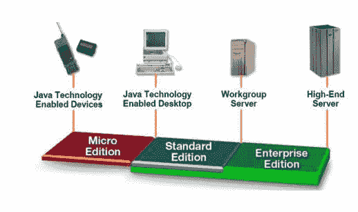

# 为什么选择 JAVA

Java 是目前及土耳其全球范围内标准且广泛使用的语言之一。今天，它或多或少应用于每一个行业。它是职业发展或学习时最受推荐的语言之一。

语法方面；它与 `C`、`C#`、`C++` 非常相似。因此，熟悉 `Java` 的人可以很容易切换到这些语言。它是平台无关的（平台独立）。因此，它采用了“一次编写，到处运行”（`WORA`）的哲学。所以，用 `JAVA` 编写的程序可以在 `LINUX` 中编写并在 `Windows` 或其他操作系统上运行。

其平台无关的结构使其能够运行从微型嵌入式系统到高度先进系统的任何地方（今天，`java` 已运行在 30 亿设备上）。使用 `JAVA` 可以编写广泛的银行应用程序、工业应用程序（如高级程序）、小型机器人应用、智能家居以及自动驾驶汽车实践。此外，`JAVA` 还可以运行在卫星、时钟或手机上。

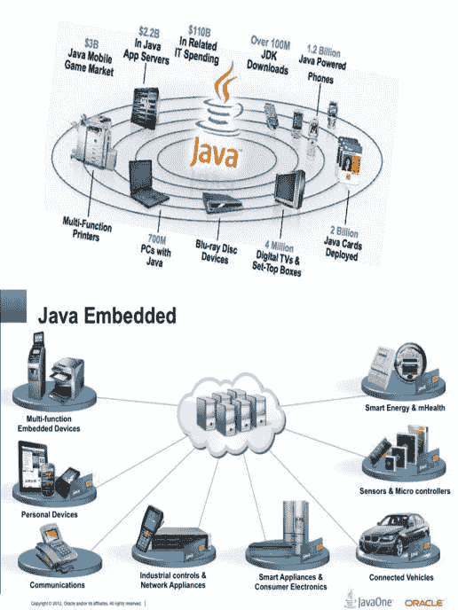

# Java 语言的特性

Java 能够如此易于使用的核心特性之一是它是开源的。所有必要的 `Java` 的 `IDE` 和其他工具都是免费的。因为在任何环境中编写的 `Java` 代码都可以在每个平台上运行，它已经超越了许多编程语言。得益于面向对象且灵活的结构，它已成为企业项目中不可或缺的。

如果我们简要列出 Java 语言的特性：

*   面向对象
*   简单
*   安全
*   健壮（强大）
*   架构中立
*   平台无关（平台独立）
*   多线程
*   解释型
*   可移植
*   分布式
*   动态
*   高性能

# 你需要学习 Java

在学习 Java 之前，不需要了解任何知识。它是一种即使是从未见过程序设计、只会在电脑上打字的人也能学习的结构。然而，可能需要一定的数学逻辑。这并不会阻止你成为一名出色的程序员。即使你没有过多的计算技能，拥有数学逻辑也会让你的工作变得更容易。因此，在培训过程中需要一些数学知识。不需要先备知识。

## Java 课程入门

在开始 Java 编程之前，我们需要一些工具和开发环境。因此，在开始编程之前，我们必须先进行一些设置。

*   Java 运行环境 (`JRE`)
*   Java 开发工具包 (`JDK`)
*   开发环境 (`IDE`) Eclipse 或 Netbeans（这些界面（`IDE`）在编写 Java 项目时提供视觉化和易用性。最常用的常用的两个是 `Eclipse IDE` 和 `Netbeans`）。

### Java 运行环境 (JRE)

`JRE`（`Java Runtime Environment`）是一个 Java 工作环境。它是包含 `JVM` 的软件。它还包含了 Java 库。它是在你计算机上运行用 Java 编写的程序所需的工具。如果你已经在你的计算机上运行过用 Java 编写的程序，它可能已经安装了。如果还没有安装，你可以下载它。你可以根据适用于你操作系统的选择使用对应的下载链接（不要忘记接受许可协议。点击“Accept”）。

由于 `JRE` 带有 `JDK`，你可以跳过这一步，并在安装 `JDK` 时同时安装它。

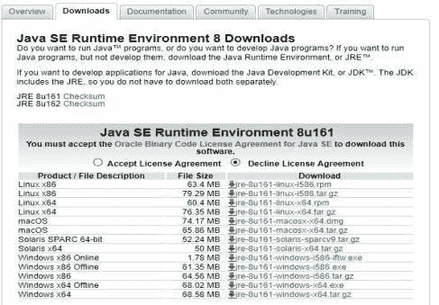

### 安装 Java 开发工具包 (JDK)

要用 Java 编程，我们需要下载并安装 `JDK`。我们将下载 `Java SE 8` 的 `JDK`。点击 `JDK DOWNLOAD` 将带你进入一个根据操作系统提供下载选项的页面。在这里不要忘记接受许可协议。“Accept ...” 。

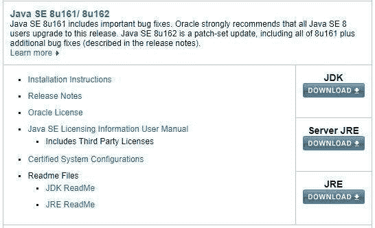

点击此选项旁边的下载链接，因为我的操作系统是 `Windows x64 bit`。你可以通过选择适合你的选项来开始下载过程。将下载一个安装文件。双击应用程序开始安装。然后像标准安装一样一直点击 next（下一步）。

当你安装 `JDK` 并进入计算机上的“程序”部分时，你会看到 `JRE` 和 `JDK` 均已安装。你也可以通过查看 `C:\Program Files\Java` 文件夹来访问。

### NetBeans 开发环境 (IDE)

你可以下载 `NetBeans` 开发环境，它是我们将用于 Java 的 IDE 之一。它是由 `Oracle` 支持的软件。当你点击下载链接时，将出现如图像所示的不同的下载选项。如果你愿意，可以在 `IDE Language`（IDE 语言）中选择土耳其语。

我们将使用 `Java SE`，你可以选择 `Java EE` 或 `All`（全部）中的一个。下面是根据你操作系统的位状态提供的一些下载链接；32 位是 `x86`，64 位是 `x64 bits`。你可以根据自己的情况做出相应选择并下载应用程序。以前，Java 属于一家名为 `Sun Microsystems` 的公司。然而，当 `Oracle` 收购这家公司后，`Oracle` 变成了 Java 的新主人。

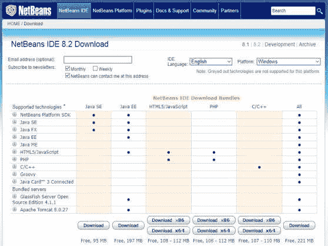

当你点击 `Download` 按钮时，相应的安装文件将下载到你的计算机。按照如下方式双击可执行文件开始安装。你可以通过点击 forward（向前）来安装应用程序。

### Eclipse IDE 开发环境

Java 最常用的另一个 IDE 环境是 `Eclipse IDE` 开发环境。你可以下载 `Eclipse IDE`。点击链接将出现针对 `Eclipse IDE` 环境下不同编程语言的下载选项。

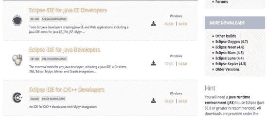

点击 `Eclipse IDE` 下适用于 `Java Developers`（Java 开发者）的 64 位下载链接。（如果你的电脑是 32 位的，点击 32 位）。下载时，你会发现下载的文件是一个 zip 包，而不是安装文件。

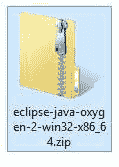

右键点击该文件并选择解压到 `eclipse`。进入后，你会发现除了一些文件夹外，还有 `eclipse.exe`。


之后，只需点击 `eclipse.exe` 即可运行 `eclipse`。

### Eclipse IDE 与 Netbeans IDE

`Netbeans IDE` 比 `Eclipse IDE` 使用起来更简单、更方便。一切都更准备就绪了。在 `Eclipse IDE` 中，你需要从市场上收集很多东西进行安装，而 `Netbeans IDE` 自带了很多内容。

通常，建议初学者使用 `Netbeans` 开发应用程序，而不必在熟悉语言之前面对各种困难，然后建议他们切换到 `Eclipse`。当然，这取决于你。我们将在课程中同时使用它们。通常情况下，编程不需要这些 IDE。你也可以用记事本类似的应用程序编写代码。然而，IDE 缩短了我们应用程序的开发时间。它为我们提供了便利。IDE 是软件世界中不可或缺的工具。

`Eclipse IDE` 最大的一点是它是便携的。不需要安装。无论你把这个文件放在哪里它都能工作。这就是 `Eclipse` 在商业世界最受欢迎的原因之一。`Eclipse` 还支持 Java 外的许多编程语言。在 `Eclipse` 文件夹中，你可以打开一个名为 `projects` 的文件夹。

### Java 代码的基本操作逻辑

### 什么是 Java 开发工具包 (JDK)、Java 运行环境 (JRE) 和 Java 虚拟机 (JVM)?

我们将简要介绍这些。

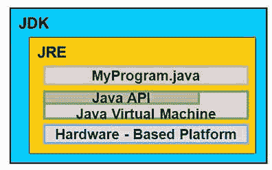

Java 代码被编译（编译器），然后它不是直接转换为特定操作系统的机器码，而是中间语言 `.class` 扩展。Java 平台无关性的秘密就在这里。这些字节码对于每个操作系统都是相同的，由 Java 虚拟机接收并在其中运行（每个操作系统都有自己的虚拟机）。这会将 Java 代码翻译成每个操作系统能理解的语言。`JVM` 解析操作位于 `JRE` 库中。Java 程序由对象和类组成。编写的代码扩展名为 `.java`。开发 Java 需要 `JDK`。Java 开发工具包有自己的库和编译器。`JDK` 在其内部进行操作（编译——编译器）。这允许我们创建 `.class` 扩展的文件（字节码）。

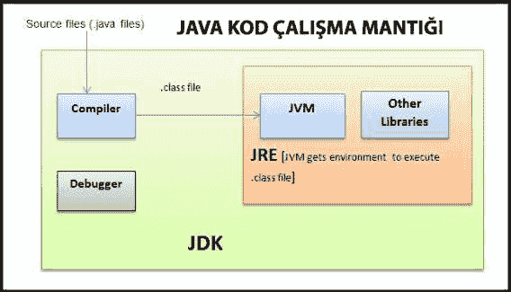

### 介绍 Eclipse IDE 环境

在系列 Java 课程中我们将介绍“介绍 Eclipse IDE 环境”。IDE 环境的项目创建、类和包创建，最后是简单应用程序的操作阶段。

*   创建项目
*   添加类和包
*   Hello World
*   创建项目

在介绍 Eclipse IDE 环境之前，让我们做一个小说明。计划使用 NetBeans IDE 进行 Java 编程的朋友可以跳过本课程继续介绍 NetBeans IDE。为了了解 Eclipse IDE 环境，让我们首先通过双击 `eclipse.exe` 运行我们的应用程序。应用程序启动时，会出现一个警告屏幕。该屏幕询问我们可以把项目放在哪里？我们可以不更改任何设置，指定路径并点击 `Launch`（启动）打开应用程序，或者指定我们的路径而不是 `Workspace`。

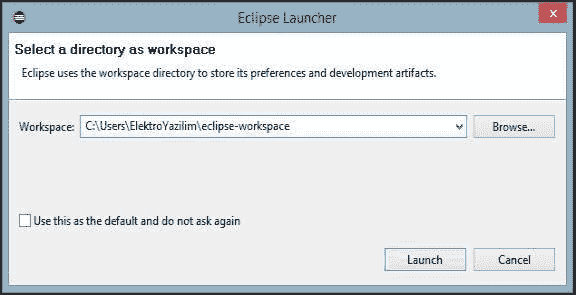

建议项目显示在 Eclipse 文件夹中。例如 `D:\eclipse\projects`。通过这种方式，我们提供了便携性。如果我们勾选“使用此默认值不再询问”旁边的框，Eclipse 每次启动时都不会询问我们。现在我们可以了解 IDE 环境。首先，让我们展示如何创建项目。创建项目的方法：

1.  `File` > `New` > `Java Project`

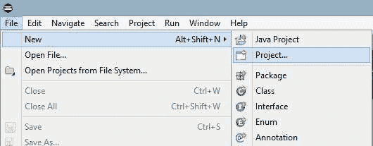

2.  `Window` > `Appearance` > `Show Toolbar`，工具栏如下所示。点击 `Java Project` 就足够。

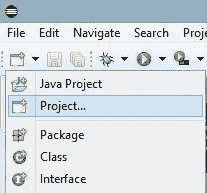

从 Eclipse 启动界面切换到编写区域，点击屏幕右上角的 `Workbench`。


然后我们将看到下面的屏幕。

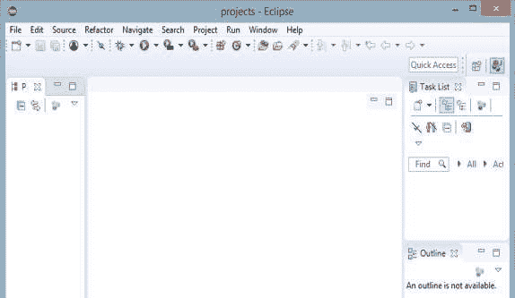

左侧的垂直矩形区域显示我们的 Package Explorer（包管理器）。底部是我们获取程序输出的 Console（控制台）区域。中间的大矩形字段是我们的代码编写字段。

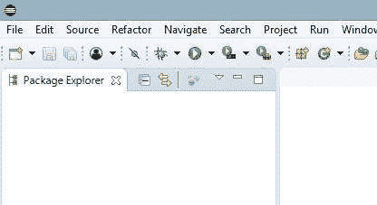

3.  在 Package Explorer 中，你也可以通过右键点击 `New` > `Java Project` 创建项目。

（注：此处原文对应对应描述）

你可以在 Package Explorer 区域处理多个 Java 项目（工作空间）。使用上述任何方法创建一个项目：`New` > `Java Project`。我们将看到下面的项目创建屏幕。我们在项目名称中写了 `Experiment`。如果你不确定项目的位置，可以查看下方的 `Location` 指示的位置。如果你想修改此位置，可以勾选“使用默认位置”框并点击 `Browse`（浏览）。

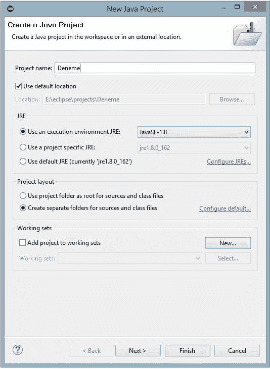

我们通过点击 `Finish`（完成）创建了项目。如图所示，Package Explorer 中创建了一个名为 `Trial` 的项目。

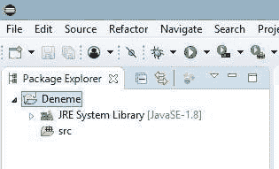

当我们查看 trial 项目的内容时，我们看到有一个名为 `src` 的文件夹。这个 `src` 是我们项目中的默认包。你可以将此包看作是将相关的 Java 类和文件放在一起的包。`JRE System libraries` 是我们与已建立的 JDK 库之间的约定。

### 添加类和包

我们将类添加到 `src` 文件夹。要完成，右键点击 `src` 文件夹 > `New` > `Class`。

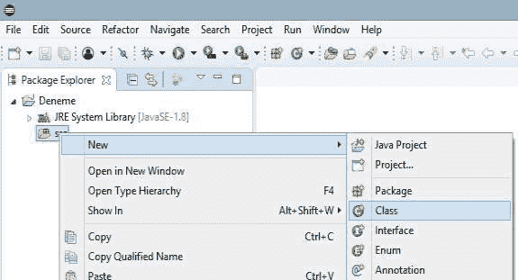

我们将看到如下屏幕。Package 部分我们留空。我们在 `Name` 部分写了 `Hello`。同样位于底部的“Which methods stubs ...?”部分，我们勾选了 `public static void main` 形式的复选框。此原因为 Java 语言的结构。像 Java 的 C、C#、C++ 等语言。由于结构，我们添加了 main 方法。为了介绍 Java 编程的朋友可以跳过本课程。

### 介绍 Eclipse IDE 环境

在这一系列 Java 课程中我们将介绍“介绍 Eclipse IDE 环境”。IDE 环境的项目创建、类和包创建，我们将介绍操作方法，最后是简单应用程序。

*   创建项目
*   添加类和包
*   Hello World
*   创建项目

在介绍 Eclipse IDE 环境之前，让我们做一个小说明。计划使用 NetBeans IDE 进行 Java 编程的朋友可以跳过本课程继续介绍 NetBeans IDE。为了了解 Eclipse IDE 环境，让我们首先通过双击 `eclipse.exe` 运行我们的应用程序。应用程序启动时，会出现一个警告屏幕。该屏幕询问我们可以把项目放在哪里？我们可以不更改任何设置，指定路径并点击 `Launch`（启动）打开应用程序，或者指定我们的路径而不是 `Workspace`。


建议项目显示在 Eclipse 文件夹中。例如 `D:\eclipse\projects`。通过这种方式，我们提供了便携性。如果我们勾选“使用此默认值不再询问”，Eclipse 每次启动时都不会询问我们。现在我们可以了解 IDE 环境。首先，让我们展示如何创建项目。创建项目的方法：

1. `File` > `New` > `Java Project`


2. `Window` > `Appearance` > `Show Toolbar`，工具栏如下所示。点击 `Java Project` 就足够。


从 Eclipse 启动界面切换到编写区域，点击屏幕右上角的 `Workbench`。


然后我们将看到下面的屏幕。


左侧的垂直矩形区域显示我们的 Package Explorer（包管理器）。底部是我们获取程序输出的 Console（控制台）区域。中间的大矩形字段是我们的代码编写字段。


3. 在 Package Explorer 中，你也可以通过右键点击 `New` > `Java Project` 创建项目。

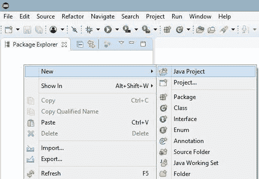你可以在 Package Explorer 区域处理多个 Java 项目（工作空间）。使用上述任何方法创建一个项目：`New` > `Java Project`。我们将看到下面的项目创建屏幕。我们在项目名称中写了 `Experiment`。如果你不确定项目的位置，可以查看下方的 `Location` 指示的位置。如果你想修改此位置，可以勾选“使用默认位置”框并点击 `Browse`（浏览）。


我们通过点击 `Finish`（完成）创建了项目。如图所示，Package Explorer 中创建了一个名为 `Trial` 的项目。


当我们查看 trial 项目的内容时，我们看到有一个名为 `src` 的文件夹。这个 `src` 是我们项目中的默认包。你可以将此包看作是将相关的 Java 类和文件放在一起的。`JRE System libraries` 是我们与已建立的 JDK 库之间的约定。

### 添加类和包

我们将类添加到 `src` 文件夹。要完成，右键点击 `src` 文件夹 > `New` > `Class`。


我们将看到如下屏幕。Package 部分我们留空。我们在 `Name` 部分写了 `Hello`。同样位于底部的“Which methods stubs ...?”部分，我们勾选了 `public static void main` 形式的复选框。此原因为 Java 语言的结构。像 Java 的 C、C#、C++ 等语言。由于结构，我们添加了 main 方法。为了介绍 Java 编程的朋友可以跳过本课程。

# Java 语言特性

- 独立于架构结构
- 面向对象
- 可移植性
- 分布式
- 高性能
- 具备多种业务能力
- 健壮
- 动态性
- 安全

## Java 语言特性详解

懂一点编程的人可以很快感觉到这些表达式的含义。现在不理解解释的人不要沮丧，因为这些习惯用语仅仅是 Java 的精髓。它们的真正含义只有在读完整本书后才能被完全理解。

Java 是简单的。Java 开发者目标是让源程序易于编写、易于编译和调试。Java 比 C++ 简单得多的原因是它会自动分配内存并从内存中销毁完成的对象（垃圾收集）。

Java 是一种面向对象的编程语言。它具有面向对象编程范式的所有优点。它为程序员提供了基本能力，如继承、多态、模块化编程、调试和代码重用。

Java 是一个分布式系统。它允许网络上的多台计算机作为一个集成系统协同工作。

Java 是支持多线程的。多任务意味着计算机可以同时处理多个作业。多线程通过调用其他语言中的系统相关过程构建在 Java 语言的核心中。多线程能力在视觉编程和网络编程中尤为重要。

Java 是平台无关的。Java 程序针对 `JVM` 编译一次，而不是针对不同的平台。`JVM` 在编译结束时解释生成的 Java 字节码。字节码可以在所有安装了 `JVM` 的机器上运行。`JVM` 虚拟机可以快速免费地安装在每台机器上。因此，Java 程序编写一次，随处运行。

Java 是移植的。因为它独立于操作系统和硬件，Java 字节码很容易从一个计算机系统迁移到另一个。同一个 Java 程序在不同系统上平畅运行的能力为编程领域开启了广阔的视野。

Java 是健壮的。它能在 Java 编译时确定其他语言只能在运行时检测的错误——强大的调试能力。

Java 是安全的。Java 语言、编译器和解释器的设计都以安全为优先考虑。它是第一个在设计中强调安全的语言。

Java 网络是友好的。在 Java 中，编写网络程序就像发送和接收数据一样简单。

## Java 语言的主要应用开发工具

作为一种通用、高级语言，Java 是一种强大的软件开发工具。用 Java 开发的一些应用如下：

### 软件开发工具

编译、运行、调试和记录应用程序所需的工具包含在 `JSDK` 中。在 Windows 操作系统中，我们将使用 `JSDK` 中的 `javac.exe` 编译器编译 Java 源程序，使用 `java.exe` 程序运行 Java 应用，并使用 `javadoc.exe` 解释器准备文档。对于其他操作系统，这些程序有对应的程序。

### 应用程序接口

[`API - 应用程序接口`]：Java 的核心特性之一。这个名为 `Java API` 的库包含了用于网络、安全、XML、数据库访问等高级主题的类、接口和方法，从程序员需要的简单类开始。在编写本文时，该库位于 `http://download.oracle.com/javase/6/docs/api/`。

`JSEDK [Java 标准环境开发包 6]` 位于。`JSDK` 第 6 版本是这些销售版本中的最后一个。随着时间的推移，新版本的 `JSDK` 以及相应的 `API` 会出现。在编写新应用时，最好使用最新版本。

### 用户界面工具

它拥有先进的工具，如 Java 语言、`Swing` 和 `Java 2D` 来准备 GUI 图形用户界面。

### 集成库

`Java IDL API`、`JDBC TM API`、`Java 命名和目录接口 TM ("JNDI") API`、`Java RMI (基于 Internet 的 Java 远程方法调用)`、`中间对象 协议技术 (Java RMI-IIOP 技术)` 提供了对远程对象的访问。

## Java 语言的主要应用

* **类库**：创建供其他应用程序使用的库类。
* **控制台应用程序**：为行命令行界面创建视觉化的 Java 应用程序。
* **Web 应用程序**：为 Web 用户界面创建视觉化的 Java 应用程序。
* **XML 应用程序**：`XML` 创建 Web 服务。创建管理数据库应用程序的程序。
* **移动 Web 应用程序**：为 PDA、手机等便携式设备创建程序。
* **游戏程序**：用 Java 编写的开发程序。

## Java 为你提供了什么？

由于 Java 是一门运行于计算机几乎每个方面的语言，Java 程序员在全世界拥有优越的权利。他们可以轻松找到高薪工作。如果你是编程初学者，Java 在本课程将为你提供以下优势：

* 因为 Java 是一种简洁的语言，你学习它的时间比其他语言更短。
* 例如，Java 程序大约只是完成相同工作的 C++ 源程序的四分之一。在这种情况下，通过编写更少的代码，你将节省时间和精力。
* 你将更高效地编写代码。`Java API` 将为你提供几乎所需的每一个类和方法。如果你愿意，可以使用这些类和方法，也可以从它们派生子类。通过这样做，你将防止源程序中的错误。当然，如果你需要，你总是可以编写新的类和方法。
* 你可以编写一次 Java 程序并随处运行。
* 除了 Java API，你可以快速更新它们。

## 编程的阶段

无论使用哪种语言，编程动作由以下阶段组成：

1. **编写源程序**：用任何语言编写源程序。源程序必须遵循语言语法。
2. **编译**：将源程序转换为中间语言。这取决于所使用的语言。例如，在 Java 中，将源程序转换为字节码。
3. **中间语言转换为可执行语言**：为了让程序可执行（可解释），计算机系统必须将中间语言转换为它理解的语言（机器语言）。`JVM` 解释由 Java 编译器生成的字节码。在现代编程中，这些是有用的。预先的项以便使用的 Java 程序员可以从库中获取想要的内容。虽然更新方法不同，但在每个语言中都是可能的。我们将在后续章节学习如何使用它。

## 常见问题：什么是 Java 自动更新？

### 如何更改设置？

此部分适用于 Windows 10、Windows 8、Windows 7、Vista、Windows XP Java 版本 7.0、8.0。Mac 用户请参见如何在 Mac 上更新 Java。

### 自动更新如何工作？

Java 自动更新是一个让你的计算机保持最新 Java 版本更新的功能。当你启用自动更新时，系统定期检查 Java 新版本。当发现新版本时，将提示升级已安装的 Java 版本。你可以随时手动更新或检查更新。

### 如何更改通知 Java 版本的频率？

通过更新选项卡上的高级设置调整更新计划。通常情况下，将在更新发布后一周内通知你。

### 为什么我不应该禁用通知？

通过让你的系统查找最新版本来保持系统安全。强烈建议不要禁用更新功能。相反，更改通知你新版本的频率。根据默认设置，每周通知一次。

### 如何配置系统自动下载 Java 新版本？

使用 Java 控制面板中更新选项卡上的“通知我”选项。

### 如何安装更新？

当你收到新版本通知时，点击消息启动更新过程。

### 为什么我应该允许 Java 自动更新程序运行？

Java 自动更新程序（在早期版本中称为 `jucheck.exe`）作为 Windows 进程运行，检查并执行本文所述的更新。

### 作为安装的一部分

它不会自动安装 Java。提供了安装最新 Java 版本的选项。此过程提醒你系统有新的安全版本。要使用最新的 Java 版本，你必须保持此进程运行。

### 为什么我每次重启电脑都会收到通知？

在 Windows Vista 及之后重启系统时，Windows 进程 `jucheck.exe`（也称为）启动并尝试检查 Java 最新版本。用户账户控制 (UAC) 会询问你是否允许此进程运行。

### 为什么我无法更改设置？

如果你不是管理员身份登录，或者网络管理员在安装期间禁用了此功能，则更新选项卡可能无效。

### 为什么 Java 控制面板中没有更新选项卡？

Java 8 之前的 64 位 Java 版本不支持自动更新。在 Java 8 之前的版本中，Java 控制面板中没有更新选项卡。从 Java 8 Update 20 开始，Java 控制面板中的更新选项卡允许用户自动更新安装在系统上的 64 位 JRE（以及 32 位版本）。

### 为什么我的更新设置没有保存？

有关更多信息和解决方案，请参见 Java 控制面板中的更新设置未保存。

### 从 Java 6 升级到 Java 7 时旧版本会被卸载吗？

是的，通过 AutoUpdate 或 Java 控制面板升级到 Java 7 会移除最高版本的 Java 6 版本。Java 6 的常规更新已结束。将不再有新的安全更新。为了增加安全性，建议从计算机上卸载 Java 6。

# 1. 使用 Java 文件模拟器

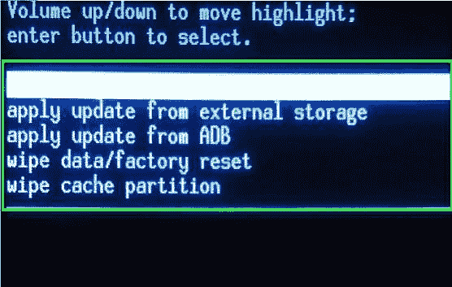

*   **对手机进行 Root（根）。** 因为这种方法需要将文件复制到系统目录（这在没有 root 权限的情况下是不允许的），所以你需要让手机拥有 root 权限。获取这种权限被称为对手机进行“root（rooting）”。该方法因设备而异，但本指南将帮助你了解如何在大多数安卓设备上进行此操作。

    注意：Java 文件模拟器不会允许你查看用 Java 创建的网页，它只允许你运行 Java 文件。如果你想查看用 Java 创建的网页，请参下一节。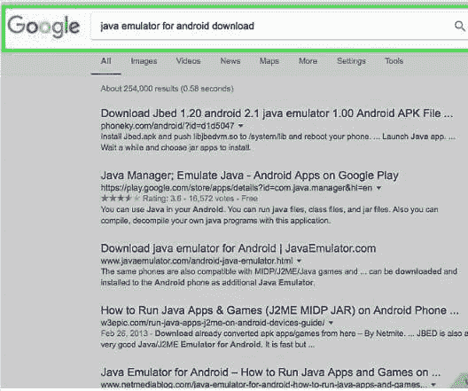

*   **查找并下载适用于安卓的 Java 文件模拟器。** 目前有不同类型的 Java 文件模拟器可用，它们各有优缺点。不同的模拟器在不同的设备上运行效果更好，因此建议下载几个不同的模拟器。这些模拟器在 Google Play 商店并不提供；`APK` 文件必须从开发者的网站下载。一些最流行的模拟器包括：

    *   `phoneME`
    *   `JBED`
    *   `JBlend`
    *   `Netmite`

    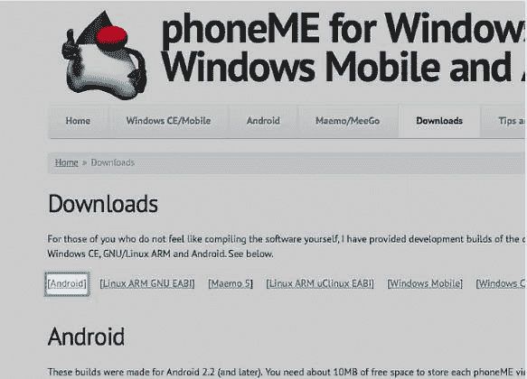

*   **安装并使用 phoneMe。** 从开发者的网站下载 `phoneMe Feature` `APK` 文件。你还需要下载 `OpenIntents File Manager` 的 `APK` 文件。将 `APK` 文件复制到你安卓设备的根目录。

    运行 `APK` 文件将它们安装到你的设备上。在电脑上下载 `JADGen`，然后使用它为任何你想要运行的 `JAR` 文件创建一个 `JAD` 文件。将 `JAR` 文件和 `JAD` 文件复制到设备上的同一个文件夹中。确保 `JAR` 文件的文件名中没有空格。使用 `phoneMe` 运行文件并选择设备上的文件。

    **安装并使用 JBED。** 下载 `JBED` 文件并在你的电脑系统上将其解压。将 `APK` 文件复制到手机（设备）的根目录，并使用 `ADB` 将 `libjbedvm.so` 文件启动到 `/system/lib` 目录。运行 `APK` 文件将其安装到你的设备上。你可以通过 `ADB` 并输入以下命令来启动 `libjbedvm.so` 文件：

    ```
    adb push /filelocation/libjbedvm.so /system/lib
    ```

    将你想要运行的任何 `JAR` 文件复制到手机自身的目录。运行 `JBED` 模拟器并按下“菜单”按钮。浏览到 `JAR` 文件，然后选择你想运行的 `JAR` 文件。

    **安装并使用 JBlend 模拟器。** 下载 `JBlend` 文件并提取内容。将文件复制到手机的存储空间。安装 `Root Explorer`（根管理器）应用程序。打开 `Root Explorer` 应用并点击右上角的 `r / w` 按钮。将后续文件复制到目标文件夹：

    - `ibDxDrmJava.so` - `/system/lib`
    - `libjbmidpdy.so` - `/system/lib`
    - `libjbmidp.so` - `/system/lib`
    - `javax.obex.jar` - `/system/framework`
    - `MetaMidpPlayer.apk` - `/system/app`
    - `MidpPlayer.apk` - `/system/app`

    将你想运行的 `JAR` 文件复制到手机的存储空间。使用 `JBlend` 模拟器选择要上传的文件。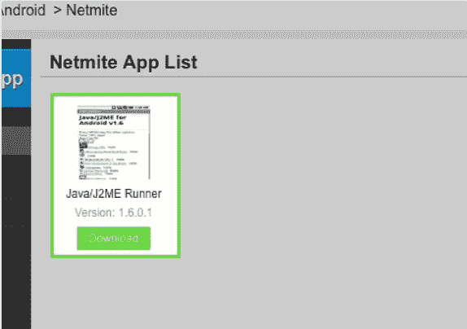

*   **安装 Netmite 模拟器。** 从 `Netmite` 网站下载最新版本。将 `APK` 文件复制到你的设备并运行它以安装 `Netmite`。

    使用 `Netmite` 网站上的转换器将 `JAR` 或 `JAD` 文件转换为 `APK` 文件。将转换后的 `APK` 文件复制到手机并运行进行安装。对所有你想运行的 `JAR` 文件重复此操作。在你的设备上打开 `Netmite` 并使用它选择任何已安装的 `JAR` 文件。

# 2. 使用远程桌面


*   **在安卓设备上安装“Chrome 远程桌面”应用程序。** 如果你在浏览时需要访问带有 Java 内容的网页，唯一实现的方法是使用远程桌面应用访问另一台电脑。这将允许你使用该电脑的网页浏览器来加载网页。来自 Google 的 `Chrome Remote Desktop` 应用程序可以快速将 Chrome 连接到你的电脑，这是配置远程访问的最简单方法。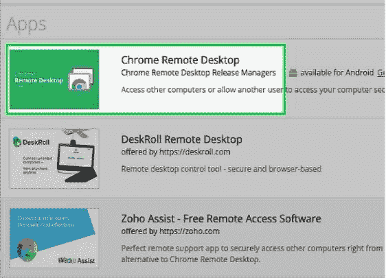

*   **在你的电脑上安装“远程桌面”扩展。** 你需要在系统中安装 Google Chrome 才能使用它。之后可以从 Chrome 商店免费安装 `Remote Desktop` 扩展。点击 Chrome 中的“菜单”按钮 (☰ ) 并选择“工具”→“扩展程序”。点击网页底部的“获取更多扩展程序”链接，然后搜索“Chrome 远程桌面”。


安装扩展后，你需要登录你的 Google 账号，然后点击“激活远程连接”按钮。你可以为连接创建一个个人识别码（`PIN`）作为额外的安全措施。

*   **运行“远程桌面”应用程序。** 登录 Google 账号，然后从可用连接列表中选择你的家庭电脑。输入个人识别码（`PIN`）。


# Linux Ubuntu 32-位 32-bit Oracle Java 安装指南

- `cd /home/"your username"/Downloads`
- `sudo -s cp -r jdk-7u17-linux-i586.tar.gz /usr/local/java`
- `sudo -s cp -r jre-7u17-linux-i586.tar.gz /usr/local/java`
- `cd /usr/local/java`

# Linux 64-位 Ubuntu 64-bit Oracle Java 安装指南

- `cd /home/"your username"/Downloads`
- `sudo -s cp -r jdk-7u17-linux-x64.tar.gz /usr/local/java`
- `sudo -s cp -r jre-7u17-linux-x64.tar.gz /usr/local/java`
- `cd /usr/local/java`

## 6. 在 `/usr/local/java` 目录下解压 Java 压缩二进制文件

### Linux Ubuntu 32-位 32-bit Oracle Java 安装指南

- `sudo -s tar xvzf jdk-7u17-linux-i586.tar.gz`
- `sudo -s tar xvzf jre-7u17-linux-i586.tar.gz`

### Linux 64-位 Ubuntu 64-bit Oracle Java 安装指南

- `sudo -s tar xvzf jdk-7u17-linux-x64.tar.gz`
- `sudo -s tar xvzf jre-7u17-linux-x64.tar.gz`

## 7. 检查您的目录

此时，在 `/usr/local/java` 目录下您应该有两个解压后的二进制目录，对应出的 Java JDK / JRE：

- `ls -a jdk1.7.0_17 jre1.7.0_17`

## 8. 更新您的环境变量

编辑系统文件 `/etc/profile`，它是 `PATH` 环境变量的主要查询文件之一。将以下变量添加到您的系统目录/系统路径列表中。您使用 `nano`、`gedit` 或任何其他编辑器，以 root 账户打开 `/etc/profile` 文件。

- `sudo gedit /etc/profile`
- 或 `sudo nano /etc/profile`

## 9. 移动到文件末尾

使用方向键将这些行添加到 `/etc/profile` 文件的末尾：

```bash
export JAVA_HOME
export JRE_HOME
export PATH
```

## 10. 保存文件

保存 `/etc/profile` 文件并退出。

## 11. 通知您的系统

告知您的 Linux Ubuntu 系统 Oracle Java JDK / JRE 的所在位置。这将通知系统新版本的 Oracle Java 可供使用。

## 12. 设置默认 Java

除了以上操作外，还需要通知操作系统此 Oracle Java JDK / JRE 必须是默认 Java，即默认值。

- 通过此命令，您为执行文件选择全局 `java` 环境变量。
- 通过此命令，您为编译器选择全局 `javac` 环境变量。
- 通过此命令，您为 Java Web Start 选择全局 `javaws` 环境变量。

## 13. 重载系统变量

输入以下命令重载在 `/etc/profile` 文件中定义的 `PATH` 全局系统变量：

```bash
. /etc/profile
```

注意，当再次初始化系统时，`PATH` 将被更新。

## 14. 测试安装

测试 Oracle Java 是否已正确安装在系统上。运行以下命令并查看 Java 版本：

## 15. 若 32-bit Oracle Java 安装成功

- `java -version`

此命令将向您显示正在运行的 Java 版本。您将收到如下消息：

```
java version "1.7.0_17"
```

此命令将向您显示 Java 编译器的版本，并确认现在现在可以从终端编译 Java 程序了。您将收到如下消息：

```
javac 1.7.0_17
```

## 16. 若 64-bit Oracle Java 安装成功

- `java -version`

此命令将向您显示正在运行的 Java 版本。您将收到如下消息：

```
java version "1.7.0_17"
Java (TM) SE Runtime Environment using (build 1.7.0_17-b21)
Java HotSpot (TM) 64-Bit Server VM ensure (build 23.6-b04, mixed mode)
```

- `javac -version`

此命令将向您显示 Java 编译器的版本，并确认现在现在可以从终端编译 Java 程序了。您将收到如下消息：

```
javac 1.7.0_17
```

## 17. 恭喜！

您已在 Linux 系统上完整安装了 Oracle Java。现在重启您的 Linux Ubuntu 系统。然后，您的系统将完全配置，以运行和开发 Java 程序。稍后您可能想要编译并运行自己的 Java 程序。

# 如何在网络浏览器中启用 Oracle Java

要在网页浏览器中启用 Java 插件，请确保你必须在浏览器的插件目录中创建一个符号链接，指向 Oracle Java 分发版中包含的 Java 插件地址。

**重要提示：** 在 Oracle Java 7 插件中已检测到许多安全漏洞，可能会让你的系统面临风险。要了解更多信息，请参阅以下网站：`Java Tester`

## Google Chrome

### Oracle Java 32 位版本操作说明：

执行以下命令。输入/复制/粘贴：`sudo -s`

通过此命令你将自己启用为超级根用户

通过此命令你创建目录 `/opt/google/chrome/plugins`

通过此命令你移动到新创建的目录。在创建符号链接之前，请确保你已处于该目录

通过此命令你创建指向 Java JRE 插件（Java 环境）`libnpjp2.so` 的符号链接，到你的 Google Chrome 浏览器。

### Oracle Java 64 位版本操作说明：

执行以下命令。输入/复制/粘贴：`sudo -s`

通过此命令你将自己启用为超级根用户

通过此命令你移动到新创建的目录。在创建符号链接之前，请确保你已处于该目录

通过此命令你创建指向 Java JRE 插件（Java 环境）`libnpjp2.so` 的符号链接，到你的 Google Chrome 浏览器。

**注意：**

注意：有时当你执行上述命令时，可能会收到一条错误信息：

要解决这个简单的问题，你必须使用以下命令删除之前的符号链接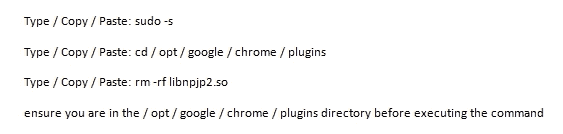

重复创建符号链接的命令。

重启浏览器并进入 Java Tester 测试 Java 是否正常工作。

## Mozilla Firefox

### Oracle Java 32 位版本操作说明：

执行以下命令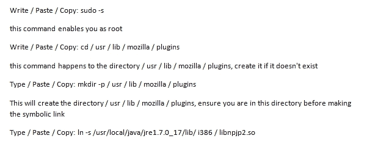

此命令创建指向 Java JRE 插件（Java 环境）`libnpjp2.so` 的符号链接，到你的 Mozilla Firefox 网络浏览器。

### Oracle Java 64 位版本操作说明：

执行以下命令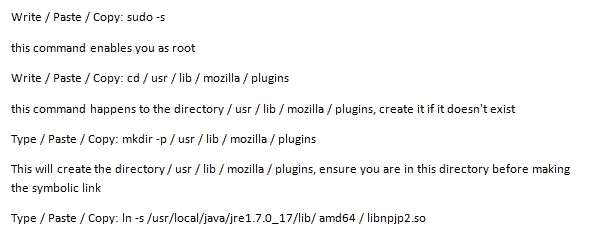

此命令创建指向 Java JRE 插件（Java 环境）`libnpjp2.so` 的符号链接，到你的 Mozilla Firefox 网络浏览器。

**注意：**

注意：有时当你执行上述命令时，可能会收到一条错误信息：`ln: creating symbolic league './libnpjp2.so ': Existing file`

要解决这个简单的问题，你必须使用以下命令删除之前的符号链接

重复创建符号链接的命令。

重启浏览器并进入 Java Tester 测试 Java 是否正常工作。

### 提示

在 Linux Ubuntu 中，你可以选择使用 `OpenJDK`（它是 `JAVA` 的免费开源实现）或使用 `Oracle JDK` 和 `JRE`。有些人倾向于使用 `Oracle Java`（因为它是最新的 Java 版本并由 Java 技术直接支持），但视而异。

请注意，Oracle 在每个新的修订版本中都会安全、执行失败和性能问题进行更新。当你在系统上安装 Oracle Java 时，请注意版本变化。参见`How to update Oracle Java on Linux Ubuntu` 获取更多信息。

请注意，本文正在不断审核，因为 Oracle 最终会更改安装方式。

## 详细安装指南

### 在 Linux Ubuntu 上安装 Oracle Java

本文涵盖了如何在 Debian 和 Mint 等基于 Ubuntu 的系统中安装 `1.7.0_45`（32 位或 64 位）。这些指令适用于想要安装 Oracle Java 的用户。

1. **检查架构：** 确定你的系统是 32 位还是 64 位。使用终端检查 Java 版本。
2. **访问 root 权限：** 打开终端并输入 `sudo -s` 以 root 用户身份进入。
3. **下载/解压文件：** 在 `/usr/local/java` 目录下解压下载的 `.tar.gz` 文件。
4. **设置权限：** 通过运行以下命令使二进制文件可执行：

   ```bash
   chmod +x jre-7u45-linux-i586.tar.gz
   chmod +x jre-7u45-linux-x64.tar.gz
   ```

5. **配置环境变量：** 使用文本编辑器（如 `nano` 或 `gedit`）编辑 `/etc/profile` 文件。在文件末尾添加以下系统变量以更新 `PATH`：

   (根据 `/etc/profile` 在此处插入变量配置)

6. **重新加载配置：** 运行以下应用更改：

   ```bash
   source /etc/profile
   ```

7. **验证安装：** 检查目录以确保解压后的二进制文件存在：

   ```bash
   ls -a jre1.7.0_45
   ```

## 15. 检查 Oracle Java 是否已正确安装在系统中。运行以下命令并记录 Java 版本：

### 16. 成功安装 Oracle Java 32 位版本将显示以下内容：

输入 / 复制 / 粘贴：

```bash
java -version
```

此命令显示你系统中 Java 的版本。你应该会收到一条所示的消息：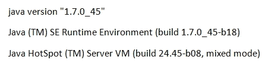

### 17. 成功安装 Oracle Java 64 位版本将显示以下内容：

输入 / 复制 / 粘贴：

```bash
java -version
```

此命令将显示你系统中 Java 的版本。你应该收到以下消息：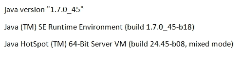

### 18. 恭喜你，你已经在 Linux 系统上安装了 Oracle Java JRE。现在重启你的系统。重启后，你的系统将完全配置好以运行 Java 程序。

## 可选项：如何在网页浏览器中启用 Oracle Java

若要在网页浏览器中启用 Java 插件，你必须从浏览插件目录到 Oracle Java 发行版包含的 Java 插件位置创建一个符号链接。

**重要提示：** 建议在浏览器中启用 Oracle Java 7 时要非常小心，因为存在许多安全问题。特别是，如果发现安全漏洞，通过在浏览器中启用 Oracle Java 7，它们可能会进入你的系统。关于 Java 安全漏洞的更多信息，请查看以下网站：Java Tester

## Google Chrome

### Oracle Java 32 位版本的操作说明：

输入以下命令。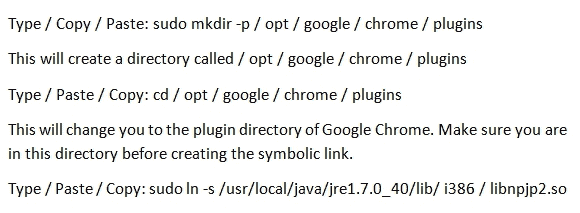

这将为 Java JRE（Java 运行环境）`libnpjp2.so` 插件到你的 Google Chrome 浏览器创建一个符号链接。

### Oracle Java 64 位版本的操作说明：

输入以下命令。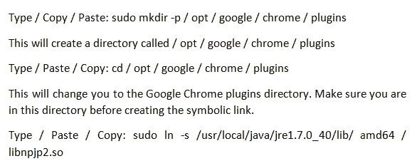

这将为 Java JRE（Java 运行环境）`libnpjp2.so` 插件到你的 Google Chrome 浏览器创建一个符号链接。

### 提示

**注意：** 有时，当你输入上述命令时，可能会出现如下错误：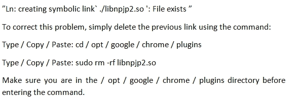

重启浏览器，然后访问 Java Tester 检查 Java 是否在网页浏览器中正常工作。

## Mozilla Firefox

### Oracle Java 32 位版本的操作说明：

输入以下命令。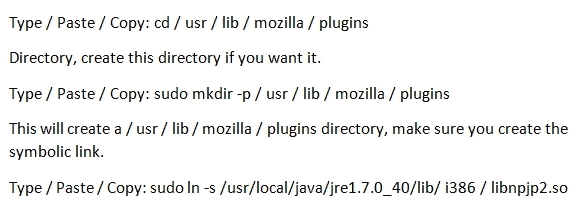

这将为 Java JRE（Java 运行环境）`libnpjp2.so` 插件为你的 Mozilla Firefox 浏览器创建一个符号链接。

### Oracle Java 64 位版本的操作说明：

输入以下命令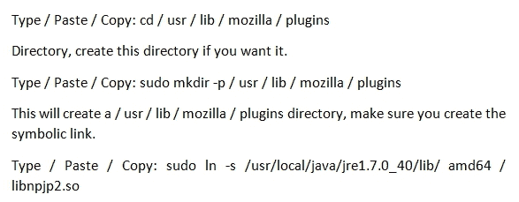

这将为 Java JRE（Java 运行环境）`libnpjp2.so` 插件为你的 Mozilla Firefox 浏览器创建一个符号链接。

### 提示：

**注意：** 有时可能会收到错误：`ln: creating symbolic link `./libnpjp2.so ': File exists`

要解决此问题，只需使用命令删除之前的链接：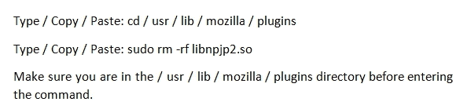

重启浏览器，然后访问 Java Tester。

# Java 编程课程 - 变量（数据类型）

在这一系列从零开始的 Java 课程中，我们将讨论“Java 编程课程 -变量（数据类型）”。什么是变量，变量的类型有哪些？变量命名规范、数据类型、Eclipse IDE 中圆面积计算的应用、在 Netbeans IDE 环境中打印数据类型、赋值运算符和 ASCII 表格。

*   什么是变量？(What is variable?)
*   变量的类型
*   变量命名规范
*   数据类型
*   圆面积计算器（应用）- Eclipse
*   显示数据类型（应用）- NetBeans
*   字面量（整数、浮点数、字符串）
*   整数字面量
*   浮点字面量
*   应用 - 文献
*   变量的生命 - 作用域

## 什么是变量？(What is variable?)

在开始 Java 编程课程中的变量主题之前，让我们先聊聊“什么是变量”。

在编写数据类型时，我们想要在内存中预留位置进行处理的 Java 程序被称为变量。之所以称其为变量，是因为它的内容可以随时更改。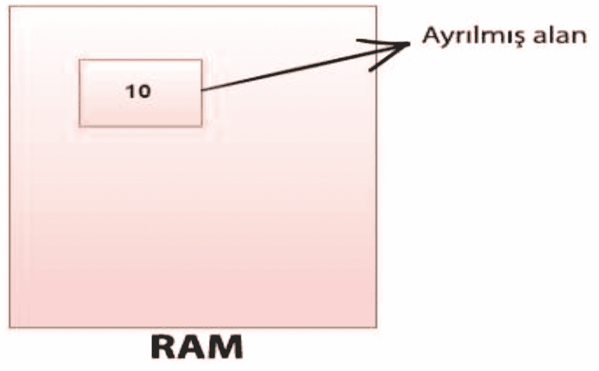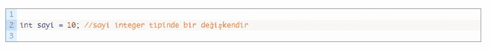

在上面的代码中，我们将整数 `10` 的值赋值给变量 `number`。在 Java 中，`=` 运算符是赋值运算符。它们用于将等式右侧的值赋给左侧。

## 变量的类型

Java 中主要有三种变量。这些：

1.  **局部变量：** 在 Java 方法中定义（声明 / declaration）的变量称为局部变量。如果我们要在方法中使用局部变量，必须为其分配第一个值。
2.  **实例变量：** 实例变量定义在类内部，即定义在方法之外的静态变量。我们不需要初始化它们。只需给最终变量赋予第一个值即可。
3.  **静态变量：** 静态类中声明的静态变量。这些变量不能是局部的。我们不需要初始化。在这种情况下，必须将第一个变量赋给最终变量。我们将在后续课程中详细解释。

如果我们用例子来解释这些变量；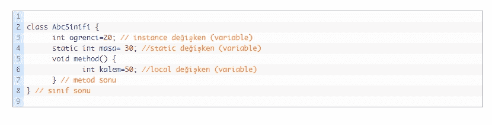

## 变量命名规范

Java 编程语言中的变量命名规范如下：

*   变量不能是 Java 定义的保留字或关键字。
*   变量名中不使用土耳其字符。
*   变量名不能以数字开头，但可以包含数字。不过，它可以以美元符号（`$`）和下划线（`_`）开头。

变量名对大小写敏感。如果变量包含多个单词，不能插入任何空格。可以使用 `_` 字符代替。

## 数据类型

Java 中有两种数据类型。这些是基本类型和非基本类型。

### 基本类型

*   布尔数据类型（取值 `0` 和 `1`；即 true 和 false）
*   数值类型
*   字符 (`char`)
*   整型
    *   `integer`
    *   `byte`
    *   `short`
    *   `int`
    *   `longan`
*   浮点型
    *   `float`
    *   `double`

### 非基本类型

*   `String`
*   数组
*   等

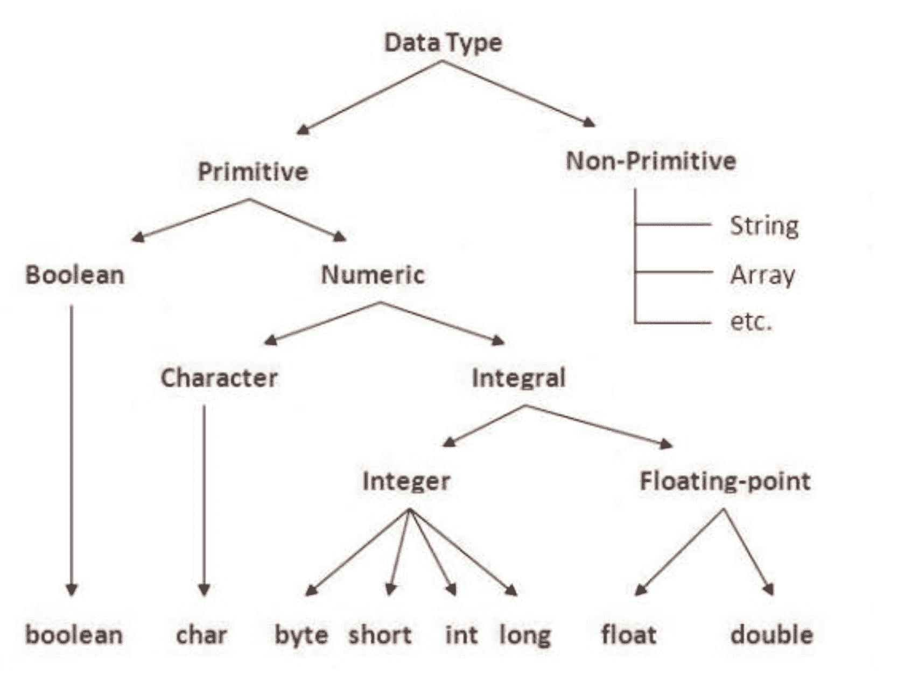


# Java 基本类型默认值与变量详解

## 基本类型默认值

让我们来讨论一下 Java 中基本类型的默认值。

- `boolean` 类型默认为 `false`
- `char` 类型默认为 `'\u0000'`
- `byte`、`short` 和 `int` 类型默认被设置为 `0`
- `long` 类型默认为 `0L`
- `float` 类型的默认值为 `0.0f`
- `double` 类型的默认值为 `0.0d`

除非我们在数值类型末尾放置一个字母来指定其类型，否则它表现得像 `int` 类型。由于这个原因，在 `long` 类型末尾放置了 `L` 或 `l`。如果我们不在小数末尾放置字母，它的行为也像 `double`。因此，我们在 `float` 类型变量的末尾放置了字母 `F` 或 `f`。

在逗号敏感性双倍的 `float` 类型的值要高得多。变量 `char n` 变为 `'a'`、`'Z'`，因为我们可以赋值如 `65` 或 `'\u0042'` 作为值。现在让我们在应用程序中展示我们目前提到的变量类型的理论知识。

## 圆面积计算器（应用） - Eclipse

通过计算圆面积来创建一个侧边应用。计算圆需要该圆的半径和 pi 数。

**公式**：`Area = Pi * r²`

**代码实现**：`Circle Area = number * (radius * radius)`

计算完成。上述语句计算 `Pi * r²` 的值并将结果赋值给 `Circle` 字段变量。因此我们需要三个不同的变量：`area`、`number` 和 `radius`。

让我们使用这些变量开始我们的程序。在使用变量之前，我们需要先定义它（声明）。

### 变量定义语法

```text
[variableType] variableName ; // Java 中的代码；以分号结束.
[variableType] variableName = value ;
```

完成。在定义变量时，我们可以赋值第一个值，也可以稍后赋值第一个值。在 Java 中，`=` 运算符是赋值运算符，用于初始值赋值。

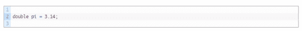

与表达式 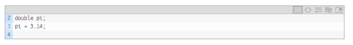 相同。在这些词的内存中，双精度类型 `n` 在 `pi` 中专门用于此区域以及名为 `3.14` 的面积，我们放入该值。

Eclipse IDE 的用户首先创建一个名为 `VariableTypes` 的项目。在 `src` 文件夹上通过右键点击 `> New > Class`，在主方法 `sayisaltip` 中，他们创建一个命名的类。然后将以下代码添加到 `NumericTypes.java` 类中。

```java
public class NumericTypes {
    public static void main(String [] args) {
        // TODO Auto-generated method stub
        // JAVA 中的变量类型
        // byte: 数字, 1 字节 (8 位)
        // short: 数字, 2 字节
        // int: 数字, 4 字节
        // long: 数字, 8 字节
        // float: 小数, 4 字节
        // double: 小数, 8 字节
        // char: 字符, 2 字节
        // boolean: 真或假, 1 字节
        
        /// 程序计算公寓的面积
        double pi;
        pi = 3.14;
        double yaricap = 2.45;
        double field;
        area = pi * (radius * radius);
        System.out.println ("Area of Circle:" + area);
    }
}
```

### 程序解释

首先，我们定义了一个名为 `pi` 的 `double` 变量并在其中放入 `3.14`。然后我们定义了一个名为 `yaricap` 的 `double` 变量并赋值 `2.45`。在创建双精度类型区域后创建一个名为 `field` 的变量。你可以点击 `Eclipse > Source > Format` 让代码外观看起来更平滑。我们将 `Pi * r²` 赋值给 `field` 变量。最后，我们使用 `System.out...` 方法打印结果。`System.out.println()` 方法将值打印到屏幕上。`System.out.println()` 方法将双引号内的表达式作为文本打印。变量类型中的 `int`、`double`、`float` 等内容是可以按下屏幕的内容。

如果你在输入 `sysout` 后按下 `Ctrl + Space`，Eclipse 将自动输入该方法。当我们运行这个程序时，我们在 Eclipse 底部的控制台部分得到以下结果。

## 输出到屏幕的数据类型（应用） - NetBeans

在我们向屏幕打印数据类型的应用中，我们将更稍微更好地介绍数据类型。让我们在 NetBeans IDE 中创建此应用。这样我们就能看到两种 IDE 环境。首先，创建一个名为 `VariableTypes` 的项目。但在你说项目创建完成之前，下方图片中显示的类名为 `sayisaltip`，请更改它。对于不知道如何在 NetBeans IDE 环境中创建项目和创建类的人，可以阅读 `介绍 NetBeans IDE 环境`。

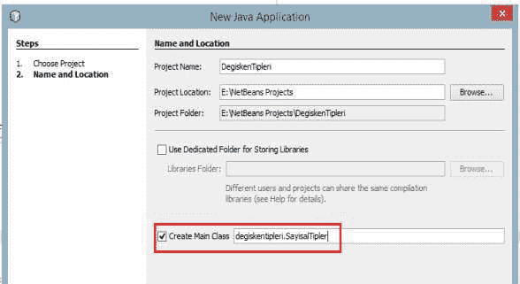

在 NetBeans IDE 环境中，你的 Projects 部分看起来如下：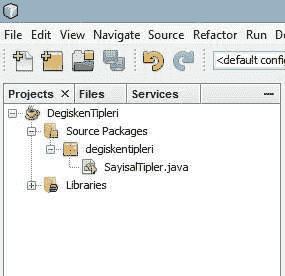

双击 `DigitalTips.java` 类并输入以下代码。

```java
package variable types;
/**
 * @author PCEx
 */
public class DigitalTips {
    /**
     * @param args 命令行参数
     */
    public static void main (String [] args) {
        // JAVA 中的变量类型
        int i = 54;
        short s = 34;
        double d = 3.45;
        char c1 = 'A';
        char c2 = '\u0066';
        char c3 = 78;
        boolean b = true;
        System.out.println ("Integer i:" + i + "\n" + "Short s:" + s);
        System.out.println ("Double d:" + d + "\n" + "Character c1:" + c1);
        System.out.println ("Character c2:" + c2 + "\n" + "Character c3:" + c3);
        System.out.println ("Boolean b:" + b);
    }
}
```

代码部分如下：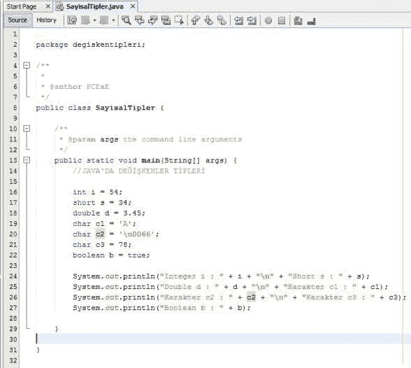

让我们解释一下计划。在 Java 中，我们讨论了从主方法开始并逐行运行。首先是名为 `i` 的 `int` 类型，我们赋值 `54`；`short` 类型 `n` 在 `s` 中是 `34`；`double` 类型 `n` 在 `d` 中是 `3.45`。`System.out.println()` 方法中的 `"\n"` 将被用于带来换行。此外，`System.out.println()` 中的 `'+'` 运算符用于并排合并语句。例如 `System.out.println("This course is intended for" + "electroazilim.org" + ");` 代码输出为 `This course is prepared for eleazim.org`。

## 字面量（整数、浮点数、字符串）

由于我们不知道 Literals 一词的土耳其语等效词，我保持原样不变。当你查看示例时，你会发现变量赋值有不同的显示状态。我们将 Literals 主题作为两个独立的标题进行研究。这些是：

1. 整数字面量
2. 浮点数字面量

### 整数字面量

懂数学的人都知道，数字可以用不同的数制表示。换句话说，一个数字在 2 进制中的写法可能与 10 进制不同，在 16 进制中的写法也可能不同，但其取值是相同的。我们需要了解的数制有：

1. 十进制
2. 十六进制
3. 二进制

我们在日常生活中使用 10 进制。但在数字环境中，二进制和基于二进制的数制是基础。`2¹⁰ = 1024`。如果你不知道数制之间的转换，可以使用执行这些操作的在线网站（`HexToDecimal`、`DecToBinary`）。

让我们解释为什么这些信息在应用程序中是必要的。该应用程序使用了 Eclipse IDE 环境。代码如下：

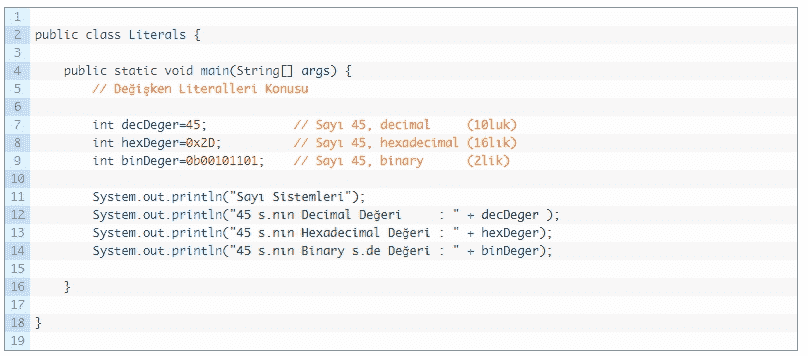

我们程序的截图如下：

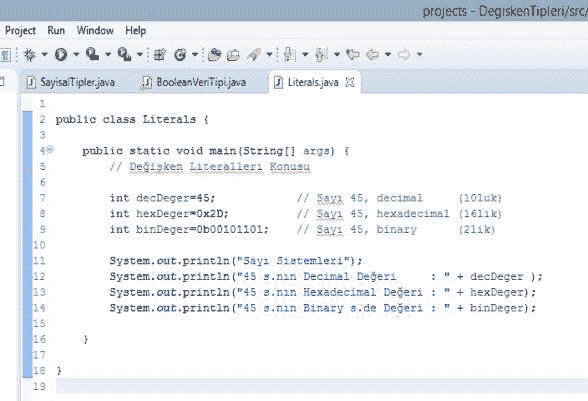

让我们解释一下这个程序。定义了三个变量：`int decdeg`、`hexdeg` 以及第三个 `bindeg`。其中，`decdeg` 被赋值为十进制中的数值 `45`。`hexdeg` 被赋值为十六进制的 `0x2D`，`bindeg` 被赋值为二进制的 `0b00101101`。

在 Java 中编写十进制数字时，我们不需要使用任何表达式。然而，在赋值十六进制值时，我们需要使用 `"0x ...."`；在赋值二进制值时，我们需要使用 `"0b ...."`。我们必须加上这些表达式。通过这些语句，编译器将理解数字是以何种数制提供的。

当我们编译应用程序时，得到以下结果：

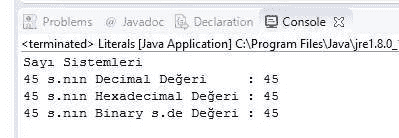

所示，编译器分析了数制，并以十进制 `int` 值的形式向我们给结果。

### 浮点数字面量

十进制也可以以不同的方式表示。在评估 `float` 数字时，应该在数值紧邻右侧放置字母 `f`。否则，编译器会接受 `double` 类型数字。

让我们通过应用程序来澄清这个问题。首先，给出代码：

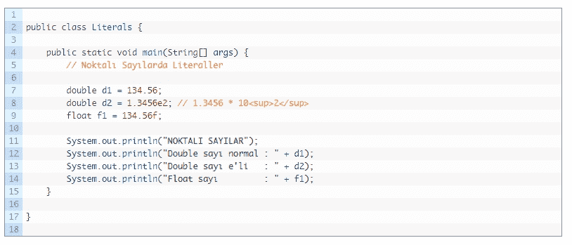

我们程序的截图如下：

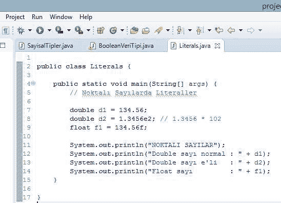

让我们解释一下计划。我们定义了两个类型为 `d` 的 `double` 单位和一个 `float` 类型的变量 `n`。我们在其中放入了相同的值。尽管变量 `d1` 和 `d2` 被赋值了相同的值，但我们已经说明表示形式可能不同。字母 `e` 表示的状态表示该数字将有一个大于 10 的值。`1.3456e2 = 1.3456 x 10² = 134.56`。

我们已经展示了在给 `float` 数字赋值时，应该在数值右侧放置字母 `f`。当你运行我们的程序时，可以看到结果如下：

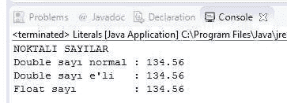

### 应用 - 字面量

现在让我们做一个包含其他类型变量通用应用程序。在程序中，我们定义了 `long`、`byte`、`float` 类型变量并在屏幕上打印了它们的值。

我们的代码如下：

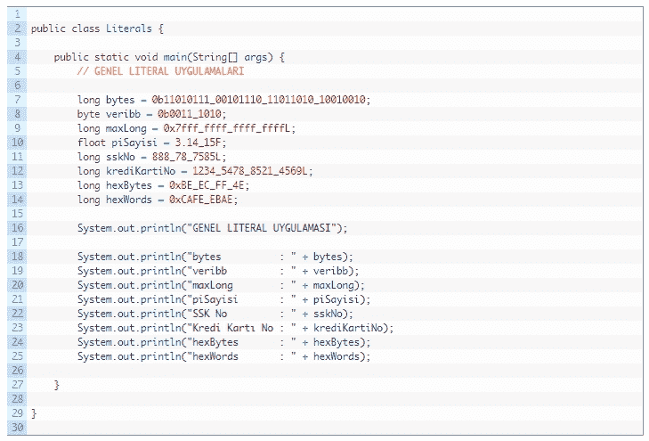

程序截图：

 

当我们查看程序中赋予变量的值时，我们发现通常有一个下划线字符 `_`。编译器不会看到这个字符，我们只能使用 `long` 数字来使其更具可读性或适应特定格式。

你可能已经注意到我们在 `long` 数据类型中使用字母 `L`，在 `float` 数据类型中使用字母 `F`。我们程序的输出如下：


## 变量的生命 - 作用域

在 Java 中，每个变量都有一个定义范围。该字段位于变量定义的块（block）中。想象数学中的最外层集合及其子集。内部子集中元素的生命周期取决于它们所在的簇。然而，最外层簇内元素的生命周期等于最外层簇的面积，它包含了子集。

这是一个解释这种情况的粗略模板。`Main` 方法中有 3 个覆盖区域。最外层的覆盖区域 3 是最大的，覆盖了区域 1 和 2。你也可以从块 1 和 2 访问在字段 3 中定义的数字 `num1`。

在字段 2 中定义的变量 `num2` 覆盖了字段 1 和 2，并在这些区域内可用。你不能在字段 2 之外访问（使用）变量 `number2`。

最内层的 No.1 区域是 `sayi3`，它的作用域仅限于该块。结果是，每个变量都可以从定义块内的任何地方访问，但它无法离开该块。

# Java 编程课程 - String 类

在之前的系列从零开始 Java Java 编程课程中，我们讨论了“Java 编程课程 - 变量（数据类型）”。然而，我们没有提供关于 `string` 数据类型的信息。在这节课程中，我们将讨论 Java `String` 类。

- 什么是 `String`？
- 创建 `String`，调用 `String`
- `String` 类方法
- 获取字符串长度 - `length()` 方法
- 字符串比较 - `equals()` 方法
- 将数字转换为字符串 - `valueOf()` 方法
- 将字符串转换为数值 - `parse()` 方法
- 拼接 `concat()` 方法
- 创建子字符串 - `substring()` 方法
- `startsWith()` 和 `endsWith()`
- 字符串修剪 - `trim()` 方法
- 字符串替换 - 方法 (`replace`)
- 字符序列查找 - `indexOf()` 方法
- 字符获取 - `charAt()` 方法
- 大小写转换 - `toLowerCase()` `toUpperCase()`

## 什么是 String？

`String` 是一种数据类型，用于通过多个字符的拼接创建并进行文本操作。换句话说，`string` 是字符串元素的集合。`String` 类位于 `java.lang` 库中。这是执行各种类型文本相关操作的类。

## 创建字符串，调用字符串

在这里，你将看到如何创建一个字符串并调用字符串。`string` 类型与应用程序中的其他变量类型没有太大区别。让我们通过一个简单的应用程序来解释。

### 我们的代码

```java
public class StringSinifi {
    public static void main (String [] args) {
        // TODO Auto-generated method stub
        String ad = "Osman";
        String surname = "Thompson";
        String message = new String ("Java Lessons - elektroyazilim.org");
        System.out.println (first name + "" + last name);
        System.out.println (message);
    }
}
```

让我们聊聊我们的代码。`String ad = "Osman";` 通过代码，我们定义了一个名为 `string` 的变量，值为 `ism Osman`。然后我们定义了一个 `string` 类型的变量，名为 `last name`。我们使用 `=` 赋值运算符将第一个值赋给第一个和最后一个姓名变量。最后，我们定义的 `message` 变量是 `string` 类型。然而，我们使用 `new` 关键字和 `String` 构造函数初始化了 `message` 变量，并使用 `System.out.println()` 方法打印了我们的变量。在这个方法中，我们使用 `+` 运算符在文本表达式中组合字符串。

我们程序的结果如下：

让我们聊聊以下两行代码。

```text
String surname = "Thompson"; // 字面量
String message = new String ("Java Lessons - elektroyazilim.org"); // 对象创建
```

在我们的第一个代码中（以字面量形式表示），我们使用赋值运算符为字符串变量赋值。虽然我们没有使用 `new` 关键字，但 `Java 虚拟机 (JVM)` 为我们创建了这个对象。但这里有一点需要注意：如果我们使用赋值运算符创建两个名称不同但内容相同的字符串变量，`JVM` 会控制定义字符串的池。当它看到第一个相同值的内容时，它会返回第二个字符串变量的引用，而不是创建一个对象。


以下代码将总结这种情况情况：

```text
String expression1 = "String Operations"; // 创建了名为 expression1 的 String 对象
String expression2 = "String Operations"; // 创建了指向值为 "String Operations" 对象的引用
```

## String 类方法

在本节中，我们将检查字符串类中常用的字符串方法，这些方法让我们的工作变得更轻松。

### 查找字符串长度 - length() 方法

在 `String` 类中，你可以使用名为 `length()` 的方法找出字符串表达式由多少个字符组成。该方法也将字符串中的空格视为字符。


```java
String message = new String("Java Lessons - elektroyazilim.org"); // 对象创建
System.out.println("String length (characters):" + message.length());
```

结果如下：

> String length (characters): 34

要访问 `String` 类中的方法，我们会在输入字符串名称后使用点 (`.`) 运算符。

### 字符串比较 - `equals()` 方法

Java 有一个名为 `equals()` 的方法来比较字符串表达式。该方法比较两个字符串表达式，如果相等则返回 `true`，否则返回 `false`。通常在 Java 中，有一个运算符 `==`，它控制变量的相等性。这个运算符检查“引用相等”。因此，我们比较的两个字符串取决于它们是否是同一个对象。而 `equals()` 方法控制“值相等”。为了这个目的，在比较字符串时，你应该使用 `equals()` 方法。

我们定义了两个字符串变量并在它们中放入了相同的文本值。`equals()` 方法的使用如下：

```java
String message1 = "Java Lessons";
String message2 = new String("Java Lessons");
if (message1.equals(message2)) {
    System.out.println("same");
} else {
    System.out.println("different");
}
```

结果如下：

> the same

Java 区分大小写（即字母大小写）。让我们稍微修改一下代码来显示这一点：

```java
String message1 = "Java Lessons";
String message2 = new String("JAVA Lessons");
if (message1.equals(message2)) {
    System.out.println("same");
} else {
    System.out.println("different");
}
```

我们的结果如下：

> Different

你可以看到，表达式“Java”和“JAVA”是不等的，因为它们的评估结果不同。这种方法是 `equalsIgnoreCase()` 方法。该方法首先将文本转换为小写字母然后进行比较。它的用法如下：

```java
String message1 = "Java Lessons";
String message2 = new String("JAVA Lessons");
if (message1.equalsIgnoreCase(message2)) {
    System.out.println("same");
} else {
    System.out.println("different");
}
```

我们的结果如下：

> the same

### 将数字转换为字符串 - `valueOf()` 方法

不使用拼接技术而将数字转换为字符串最直接的方法是：如果你在数字前面放置一个空字符串，数字会自动转换为字符串。尝试一下：

```java
String message1 = "Converting Numbers to String";
String message2 = "" + 453;
System.out.println(message1 + "\n" + message2);
```

结果如下：

> Converting Numbers to String
>
> 453

在 Java 中，`valueOf()` 方法将数字转换为字符串。它的用法如下：

```java
String message1 = "Converting Numbers to String";
String message2 = String.valueOf(453);
System.out.println(message1 + "\n" + message2);
```

结果与另一个相同。`toString()` 方法也可以使用。让我们看看：

```java
int a = 3;
float b = 5.2f;
String s1 = Integer.toString(a); // 转换为字符串
String s2 = Float.toString(b); // float 转换为字符串
System.out.println(s1 + s2);
```

结果如下：

> 35.2

如果 `s1` 和 `s2` 是数值，`s1 + s2` 将是 `3 + 5.2` 的数值值。然而，由于 `+` 运算符执行的是字符串拼接，“3” + ”5.2” = 35.2

### 将字符串转换为数值 - `parse...` 方法

`Integer` 和 `Double` 类可以使用 `parse()` 方法将字符串值转换为数值。让我们看看：

```java
String message1 = "6.7";
String message2 = "5";
double s3 = Double.parseDouble(message1);
int s4 = Integer.parseInt(message2);
System.out.println("s3 value:" + s3 + "\ns4 value:" + s4);
System.out.println("The sum of string values: " + s3 + s4);
```

结果如下：

> s3 value: 6.7
>
> s4 value: 5
>
> The sum of string values: 11.7

结果没有异常情况。因为字符串是和，我们组合了数值。现在让我们将这些字符串转换为数值。

```java
String message1 = "6.7";
String message2 = "5";
double s3 = Double.parseDouble(message1);
int s4 = Integer.parseInt(message2);
System.out.println("s3 value:" + s3 + "\ns4 value:" + s4);
// ABNITY
System.out.println("Sum of converted value s3 + s4 =" + s3 + s4);
```

应用程序的输出如下：

> s3 value: 6.7
>
> s4 value: 5
>
> Sum of converted value s3 + s4 = 11.7

可以看到，表达式是作为字符串评估的而不是数值。在这种情况下，你必须使用括号 `(s3 + s4)` 来获得正确的结果。编译器是这样评估程序的：如果不加括号，将从左到右进行，因此将值转换为字符串并拼接它们。考虑到括号在方法中的优先级，首先取出括号然后打印。

### 拼接 `concat()` 方法

在 Java 中，我们可以使用 `+` 运算符而不使用任何方法来进行字符串拼接。

```java
String message1 = "Java Programming Lessons";
String message2 = "- elektroyazilim.org";
System.out.println(message1 + message2);
```

结果如下：

> Java Programming Lessons - elektroyazilim.org

我们也可以使用 `concat()` 方法连接两个字符串。让我们创建一个简单的程序来看看如何使用：

```java
String message1 = "Java Programming Lessons";
String message2 = "- electro-software";
String lastMessage;
lastMessage = message1.concat(message2);
System.out.println("message1:" + message1);
System.out.println("message2:" + message2);
System.out.println("lastMessage:" + lastMessage);
```

首先，我们定义了两个名为 `message1` 和 `message2` 的变量。然后，使用 `concat()` 方法结合这两个字符串并将它们赋值给 `lastMessage` 变量。我们在屏幕上打印了它们的值。结果如下：

> Message1: Java Programming Lessons
>
> Message2: - electro-software
>
> Java Programming Lessons - electro-software

### 创建子字符串 - `substring()` 方法

我们将字符串视为字符序列。我们可以根据所需的条件分割字符串。为此，我们将使用 `substring()` 方法。`substring()` 方法有两种形式：当给定单个参数时，它获取给定数字之后的字符。当给定两个参数时，第一个显示起始索引，第二个显示结束索引。但不包含结束索引。

* `substring(int beginIndex)`
* `substring(int beginIndex, int endIndex)`

```java
String message1 = "Java Programming Lessons";
String message2;
message2 = message1.substring(0, 4);
System.out.println("Message1 contains:" + message1);
System.out.println("Message2 contains:" + message2);
```

在以下应用程序中，我们将从第 0 个字符开始将 `message1` 字符串赋值给 `message2`，不包括第 4 个字符。我们程序的输出如下：

> Message1 contains: Java Programming Lessons
>
> Message2 contains: Java

### `startsWith()` 和 `endsWith()`

`startsWith(String prefix)` 方法检查字符串表达式是否在开头。如果是则返回 `true`，否则返回 `false`。它的用法如下：

```java
String message1 = "Java Lessons";
boolean bastaMi = message1.startsWith("Jav");
System.out.println("Is string in the beginning:" + bastaMi);
```

当我们检查代码时，`startsWith()` 方法检查 `message1` 字符串开头是否有 "Jav"。此过程返回的布尔值赋值给 `bastaMi` 并最终打印在屏幕上。结果如下：

> Is string in the beginning: true

同样，`endsWith(String suffix)` 方法检查字符串是否在结尾。返回 `true` 或 `false`。让我们看看：

```java
String message1 = "Java Lessons";
boolean probeMi1 = message1.endsWith("Lesson");
boolean probeMi2 = message1.endsWith("s");
System.out.println("Is string at the end of:" + probeMi1);
System.out.println("Is there s at the end of:" + probeMi2);
```

在布尔类型中，我们定义了 `probeMi1` 和 `probeMi2`。通过 `endsWith()` 方法，我们检查了 "Lessons" 和 "s" 是否在 `message1` 字符串的结尾。最后我们在屏幕上打印了它们。结果如下：

> Is string at the end of: false
>
> Is there s at the end of: true

### 字符串删除空格 - `trim()` 方法

`trim()` 方法在 Java 中经常使用。字符串用于删除表达式开头和结尾的空格。通过 "trim"，我们指的是空字符。`trim()` 方法不触碰中间的空格。

```java
String message = "  Java Programming Lessons  ";
System.out.println("Message string initial value:" + message);
message = message.trim();
System.out.println("Message string new value:" + message);
```

在我们的代码中，我们首先在屏幕上打印了消息字符串。然后，使用 `trim()` 方法删除了消息字符串开头和结尾的空格，并重新赋值给同一个变量。我们重新在屏幕上打印了新格式。让我们看看：

> Message string initial value:   Java Programming Lessons
>
> Message string new value: Java Programming Lessons

### 替换 - `replace()` 方法

在 Java 字符串类中，`replace()` 方法可以替换任何字符串或字符。首先，让我们为字符串替换创建一个应用程序：

```java
String message = "Java Programming Lessons";
String newMessage = message.replace("Lessons", "- electro-software");
System.out.println("Message variable:" + message);
System.out.println("NewMessage variable:" + newMessage);
```

我们在消息中定义了两个字符串变量。然后使用 `replace()` 方法将 `message` 变量中的 "Lessons" 更改为 "- electro-software"。我们将 `replace()` 方法返回的新值赋值给 `newMessage` 字符串并打印出来。

> Message variable: Java Programming Lessons
>
> NewMessage variable: Java Programming - electro-software

通过这个应用程序，我们完成了字符串替换。我们也可以使用此方法更改字符。让我们看一个程序：

```java
String ad = "osman";
String newName = ad.replace('o', 'O');
System.out.println("name variable:" + ad);
System.out.println("newName variable:" + newName);
```

在我们的应用程序中，我们定义了一个名为 "osman" 的字符串。然后使用 `replace()` 方法，我们将小写的 'o' 替换为大写的 'O'。我们将新值赋值给 `newName` 变量，并在屏幕上打印了变量。结果如下：

> name: osman
>
> newName: Osman

### 字符序列学习 - `indexOf()` 方法

`indexOf()` 方法是 `String` 类中的方法之一；返回字符串或字符在字符串中的搜索顺序。返回 `int`。让我们通过应用程序使用该方法。首先，找出字符串中字符的位置。

```java
String message1 = "Java Programming Lessons";
// 'g' 字符搜索
System.out.println("'g' is in the string at index " + message1.indexOf('g') + ".");
```

在上面的程序中，我们首先打印了字符串中 "g" 字符的位置。

> 字母 'g' 在字符串中排名第 8。

当 `indexOf()` 方法接收单个参数时，它只返回所求字符的顺序。当 `indexOf()` 方法接收两个参数时，情况略有不同。现在让我们检查字符在字符串中被多次搜索的情况。

```java
// 如果我们要找的字符有多个
String message1 = "Java Programming Lessons";
System.out.println("The letter 'a' was first found in the string at index " + message1.indexOf('a') + ".");
```

（注意：源文本中存在重复及语法错误片段，已整理修正。）


``` 处有一个语法错误 `);`。

等等，源文本在 `message1` 处有一个语法错误 `);`。我会修复括号。

```java
String message1 = "Java Programming Lessons";

System.out.println ("The letter 'a' was first found in the string" + message1.indexOf ('a') + ". Ranked");
```

等等，源文本在 `message1` 处有一个语法错误 `);`。我会修复代码块。

```java
String message1 = "Java Programming Lessons";

System.out.println ("The letter 'a' was first found in the string" + message1.indexOf ('a') + ". Ranked");
```

等等，源文本在 `message1` 处有一个语法错误 `);`。我会修复内容。

# If 结构与用法

## If Else 结构与用法

## if else - 应用

## 闰年计算器 - 应用

## 嵌套 If 结构与用法

## Switch Case 结构与用法

## 月份与季节查找 - 应用

# if 结构与 if 使用

在 Java 中，`if` 结构基于执行逻辑：如果满足 `condition` 中指定的条件，则执行声明为语句的动作。也就是说，如果条件为真，则执行相应的操作。

```java
if (condition) statement;
```

如果程序中存在条件，则使用布尔变量来保持条件内的真（`true`）或假（`false`）状态。`sart` 存储真或假。让我们来看一个简单的代码实现：

```java
// If 控制结构

boolean sart = false;

sart = true;

if (System.out.println ("Condition provided, this code worked."));
```

让我们解释这段代码。首先，我们定义了一个 `boolean` 类型的变量名为 `sart` 并将其赋值为 `false`。然后我们将该变量赋值为 `true`。当紧接着进入条件代码时，编译器会检查条件是否为真。如果条件实际成立，它将处理 `if` 语句中的代码。换句话说，“条件已提供，此代码已运行。”我们的应用程序结果如下：

> Condition provided, this code worked.

## if 条件逻辑

如果提供了条件，则处理内容中的代码；如果没有提供，则跳过这些代码。到目前为止，我们已经习惯了使用代码块。但正如你所看到的，我们在单行 `if` 结构中没有使用代码块结构。这是因为只有一个表达式（代码）。如果有多个代码需要处理，我们就必须使用代码块（大括号）。虽然编译器没有规定单行表达式必须使用块，但始终建议放置代码块。

再来看另一个例子：

```java
// If 控制结构

int studentNote = 89;

if (studentNote > 85) {
    System.out.println ("Student Grade is greater than 85");
    studentNote = 0;
}
```

通过这段代码，我们制作了一个简单的控制结构示例。首先，我们定义了一个名为 `studentNote` 的 `int` 类型变量，值为 `89`。然后，如果进入条件，将查询 `studentNote > 85`。由于学生分数大于 85（`89 > 85`），代码块中的代码被处理。结果如下：

> Student Grade is greater than 85

## if else 结构与用法

当我们讨论在 `if` 结构中提供 `condition` 的用法时，我们提到了内部代码块会被处理。那么，如果我们必须说明在条件未提供的情况下该做什么，该怎么办呢？这就是 `if else` 结构发挥作用的地方。让我们写一些简单的代码来看 `if else` 结构的用法：

```java
public class IfKontrolYapisi {
    public static void main (String [] args) {
        // If 控制结构
        int studentNote = 89;

        if (studentNote >= 85) {
            System.out.println ("Student Grade is greater than or equal to 85.");
        } else {
            System.out.println ("Student Grade is less than 85.");
        }

        System.out.println ("Student Grade:" + studentNote);
    }
}
```

检查我们的代码。首先是一个 `int` 变量和一个值 `89`。然后到达结构部分。在这里，查询的是“大于 85”的问题，只有这部分被处理了。`Else` 部分没有通过。最后，学生分数被打印在屏幕上。我们应用程序的输出如下：

> Student Grade is greater than or equal to 85.
> Student Grade: 89

如果学生的分数是 75，这次代码将被处理并显示：

> Student grade is less than 85.
> Student Grade: 75

这就是 `if else` 结构的基本工作逻辑。如果我们必须查询多个情况，该如何使用 `if else` 结构呢？让我们看看程序：

```java
public class IfKontrolYapisi {
    public static void main (String [] args) {
        // If 控制结构
        int num1 = 45, num2 = 89;

        if (num1 == num2) {
            System.out.println ("Numbers are equal.");
        } else if (num1 > num2) {
            System.out.println ("Number1 is greater than number2");
        } else {
            System.out.println ("Number1 is less than number2");
        }

        System.out.println("Number1:" + num1 + "\nNumber2:" + num2);
    }
}
```

回顾一下流程。首先，我们定义了两个不同类型的 `int` 变量，名为 `num1` 和 `num2` 并分配了值。然后我们使用 `if else` 结构来比较这两个数字。程序比较 `num1` 和 `num2`。如果 `num1` 等于 `num2`，屏幕将显示 `Numbers are equal ..`。如果 `num1` 大于 `num2`，屏幕将显示 `Number1 is greater than number2`。如果不满足这两个要求，将进入另一个块并显示 `Number1 is less than number2`。

运算符 `==` 检查两个变量是否相等。注意：`!` 运算符提供值的取反。`!=` 运算符用于检查不相等。结果如下：

> Number1 is less than number2.
> Number1: 45
> Number2: 89

程序在退出 `if else` 结构后会打印 `num1` 和 `num2` 的值。

## if else - 应用

这是 `if else` 的一个最终示例。在 `if` 结构中始终使用条件，但没有规定必须使用单个条件。换句话说，你可以在 `if` 结构中包含多个条件。看看应用：

```java
public class IfKontrolYapisi {
    public static void main (String [] args) {
        // If 控制结构
        int months = 4;
        String seasons;

        if (months == 3) {
            seasons = "Winter";
        } else if (months == 4) {
            seasons = "Spring";
        } else if (months == 5) {
            seasons = "Summer";
        } else {
            seasons = "Autumn";
        }

        System.out.println(months + " belongs to " + seasons);
    }
}
```

在程序中定义了两个变量 `months` (`int`) 和 `seasons` (`string`)。我们的目标是根据给定的数值确定 `seasons`。为此，我们使用了带有不同条件的 `if else` 结构。在每个 `else if` 中都会进行查询。`months == 3` 或 `months == 4` 或 `months == 5` 意味着如果 `months` 为 4，查询将被正确评估并处理该块。

## 闰年 - 应用

年份计算器程序当然是 `if else` 的用法之一。

```java
public class IfKontrolYapisi {
    public static void main (String [] args) {
        // If 控制结构
        int year = 2016;

        if (year % 4 == 0 && (year % 100 != 0 || year % 400 == 0)) {
            System.out.println(year + " is a year");
        } else {
            System.out.println(year + " no longer a year");
        }
    }
}
```

## 嵌套 if 结构，用法

某些情况需要使用嵌套 `if` 结构。这里有一个简单的示例：

```java
public class IfKontrolYapisi {
    public static void main (String [] args) {
        // 嵌套 结构
        int number = 8;

        if (number != 0) {
            if (number > 0) {
                System.out.println("Result:" + (1 / number));
            } else {
                System.out.println("Number must be greater than 0.");
            }
        }
    }
}
```

在我们的程序中，外层的 `if` 结构检查 `number` 的值。如果 `number` 不为零，则进入 `if` 结构。这时另一个 `if` 也会询问数字是否大于零。

## switch 结构，用法

`switch case` 结构是决策控制结构之一，类似于 `if else`。然而，与 `if else` 结构相比，它有更特定的领域。在该结构中，相关的 case 将根据 `switch (state)` 语句中的状态执行。

```java
public class SwitchCaseYapisi {
    public static void main (String [] args) {
        // switch 结构
        int i = 0;

        switch (i) {
            case 0:
                System.out.println ("The value of i is 0.");
                break;
            case 1:
                System.out.println ("i is 1.");
                break;
            case 2:
                System.out.println ("i value: 2");
                break;
            case 3:
                System.out.println ("i value: 3");
                break;
            default:
                System.out.println ("Default message");
                break;
        }
    }
}
```

## break, continue 和 return

- `break` 用法
- 应用 1
- 应用 2
- 数组中的搜索
- `continue` 用法
- 应用
- `return` 关键字

## 二维数组

我们已经见过行列的一维数组和二维数组。随着第三维的引入，出现了三维数组。虽然 `3D` 的概念很困惑，但你可以将 `3D` 视为二维数组。通常二维数组是 `i`，而列 `j` 是 `[i][j]`。由于三维中也包含了深度，所以有行、列 `[k][i][j]`。正如所说，你可以将三维数组看作二维数组。

```java
public class Arrays {
    public static void main (String [] args) {
        // Java 课程，三维序列
        int numbers[][][] = new int[3][4][5];
        int value = 1;

        for (int k = 0; k < 3; k++) {
            for (int i = 0; i < 4; i++) {
                for (int j = 0; j < 5; j++) {
                    numbers[k][i][j] = value;
                    value++;
                }
            }
        }

        for (int k = 0; k < 3; k++) {
            for (int i = 0; i < 4; i++) {
                for (int j = 0; j < 5; j++) {
                    System.out.print(numbers[k][i][j] + " ");
                }
                System.out.println();
            }
            System.out.println();
        }
    }
}
```

（注：原文后部分存在大量重复和无意义的字符堆，已根据核心技术逻辑完成翻译转换。）

# 应用 1（单类、单对象）
# 应用 2（双类、单对象）
# 练习 3（双类、双对象）
# 什么是类？（类的概念）
# 类结构
# JAVA API
# 创建类对象与访问类成员
# 访问修饰符
- `public`
- `private`
- `protected`
- 预定义的 `<default>` 标记

# 应用程序 1（单类、单对象）

让我们看看 Java 编程语言中对象和类概念的应用：

```java
package objects classes;

public class Home {
    // 属性：对象属性
    double en;
    double boy;
    double height;

    public static void main (String [] args) {
        // 实例：类的示例
        Home homeObject = new Home ();
        homeObject.en = 6;
        homeObject.boy = 3;
        homeObject.Height = 4;

        System.out.println ("HOUSEHOLD:" + homeObject.en);
        System.out.println ("House SIZE:" + houseObject.boy);
        System.out.println ("HEIGHT OF THE HOUSE:" + homeObject.Height);
    }
}
```


# Java 课程：对象与类

我们在这个项目中使用了 `NetBeans IDE`。我们创建了一个名为 `ObjectsClasses` 的项目，并创建了一个名为 `Main` 的类，其中包含一个 `main` 方法。

类名是一个数据类型。类也是一种数据类型，而 `int`、`char`、`double` 是数据类型。我们定义了房屋类中的 `double` 类型变量，分别名为 `width`、`height` 和 `height`。这些变量是 `Home` 类的属性/变量。

在 `main` 方法中，我们定义了一个类型为房屋的变量 `evObject`。我们实际上创建了 `Home` 类的实例。这通常通过使用 `new` 关键字来实现。

```java
// 实例：类的示例
Home homeObject; // homeObject 变量
evObject = new Ev(); // 现在是一个对象了。
```

一个 Java 程序/项目中可能存在多个包。一个包中可以有多个 `java` 类。每个类并不都必须包含一个 `main` 方法。第一个类将有一个 `main` 方法。它不需要出现在所有类中，但必须至少有一个。

你可以通过该类的对象来使用该类中的内容（属性、方法）。例如，我们创建了一个名为 `Home` 的类，并在 `width`、`height` 和 `height` 中定义了 3 个变量/属性。然后我们创建了一个名为 `evObject` 的对象。使用 `evObject`，如果 `Home` 类中存在属性，我们就可以访问方法。在这里我们使用点操作符 (`.`)。当你在输入 `evObject` 后输入点时，你会看到与该类相关的属性和方法。

如果你看下面的代码，我们为大部分属性分配了值 6，为高度属性分配了值 3，为另一个高度属性分配了值 4。然后我们使用 `System.out.println()` 方法打印了这些值。

我们程序的运行如下：
> House width: 6.0
> House Size: 3.0
> HEIGHT OF THE HOUSE: 4.0

## 应用程序 2（双类、单对象）

理解 Java 编程语言中对象和类的概念非常重要。面向对象编程作为面向对象编程是基础。我们继续对应用程序进行细微修改。现在，让我们在同一个包的项目中使用两个不同的类。我们的代码如下：

**Ev.java**
```java
public class Home {
    int en;
    double boy;
    double height;
}
```

**Hesap.java**
```java
public class Account {
    public static void main(String[] args) {
        // 面向对象 - 面向对象编程
        Home home = new Home();
        home.en = 3;
        home.boy = 6;
        home.height = 7;
        System.out.println("house width:" + home.en);
        System.out.println("SIZE of the house:" + home.boy);
        System.out.println("HEIGHT OF THE HOUSE:" + home.height);
        double volume;
        volume = home.en * home.boy * home.height;
        System.out.println("\nVolume of volume:" + volume);
    }
}
```

现在让我们从开始解释这两个类。要添加一个类，只需指向包并调用 `New Class`。然而，如果我们需要检查类的定义：

```java
<access identifier> class <class name> {
    // 代码
}
```

格式是这样的。你已经猜到了 `<access identifier>` 是 `public` 关键字。在课程结束时，我将单独考虑这些语句。通过 `class` 关键字和 `className` 定义一个类。我们有两个类：`Ev.java` 和 `Hesap.java`。

在 `Ev.java` 中只有三个属于 `Home` 类的属性。在 `Account.java` 类中，我们有 `main` 方法及其内部代码。为了在 `Account` 类中访问 `Home` 类中的变量，我们首先创建了一个 `Home` 类的示例对象：`home`。我们可以通过 `home` 对象访问 `Home` 类中的属性并对其赋值，并将它们的内容打印到屏幕上。

最后，通过代码 `double volume;` 我们定义了一个名为 `volume` 的 `double` 变量。我们通过乘以 `Home` 对象的 3 个变量为该变量赋值并将其打印到屏幕上。

结果如下：
> House width: 3
> House Size: 6.0
> HEIGHT OF THE HOUSE: 7.0
> The volume of the house: 126

## 练习 3（双类、双对象）

我们的代码如下：

**Ev.java**
```java
public class Home {
    int en;
    double boy;
    double height;
}
```

**Hesap.java**
```java
public class Account {
    public static void main(String[] args) {
        // 面向对象 - 面向对象编程
        Home smallEv = new Home();
        Home buyukEv = new Home();
        smallEv.en = 3;
        smallEv.boy = 4;
        smallEv.height = 5;
        System.out.println("WIDTH:" + smallEv.en);
        System.out.println("Small House Size:" + smallEv.boy);
        System.out.println("HEIGHT OF THE LITTLE HOUSE:" + smallEv.height);
        double volume;
        volume = smallEv.en * smallEv.boy * smallEv.height;
        System.out.println("\nVolume of Small House:" + volume);
        System.out.println("--------------------------------------");
        buyukEv.en = 6;
        buyukEv.boy = 7;
        buyukEv.height = 8;
        System.out.println("WIDTH:" + buyukEv.en);
        System.out.println("SIZE OF BIG HOUSE:" + buyukEv.boy);
        System.out.println("HEIGHT OF THE GREAT HOUSE:" + buyukEv.height);
        volume = buyukEv.en * buyukEv.boy * buyukEv.height;
        System.out.println("\nVolume of Big House:" + volume);
    }
}
```

## 类定义

```java
class Ev {
}
```

该语句声明了一个类。`class` 单词是一个关键字。`house` 是类的名称。块 `{…}` 是类的主体或类块。Java 语言中的类是一种模板设计。由于它是完全抽象的，因此不占用内存空间。然而，一旦我们使用 `new` 关键字创建该类类型的对象，它就会占用内存空间。创建的对象就是该类的具体体现。

## 对象引用

```java
Home home;
```

该语句告诉编译器一个指向 `Home` 类对象内存地址的引用。该引用的名称为 `home`。在当前状态下，`home` 引用的唯一功能是指向内存中 `Home` 类对象的地址。因此，目前还没有具体的 `House` 实例。由于这个原因，我们可以说 `home` 引用指向 `null`，这表示空（无内容）。

## 对象创建

```java
home = new Home();
```

我们创建了 `Home` 类的对象。一个对象的类（对象）意味着创建，属于类的内存（非静态）是指在一个地方为所有项目分配内存。其他值无法写入这些预留位置。只要对象仍留在内存中，这一点就有效。你可能将其理解为租用内存空间。Java 为内存中创建的每个类变量分配默认值。默认值取决于数据类型。我们已经在类型转换课程中提到过这些值。

## 类对象使用

```java
Home home = new Home();
```

作为单行代码。在我们创建对象 `evim` 后，我们使用点运算符 `.` 来访问 `House` 类的属性和方法。我们已经见过相关的示例了。为了提醒访问类的属性和方法，让我们知道我们已经创建了该类的对象。在面向对象编程中，我们倾向于在不同的类中执行尽可能多的不同任务。这样，我们的程序既易于管理，当类的位置出现时可以在不同的程序中工作。这被称为模块化编程。

## 访问修饰符

如果 Java 代码可以调用一个变量，它就可以访问该变量。同样地，如果 Java 代码可以调用一个方法，它就可以访问该方法。如果类内部的代码可以访问另一个类中的变量和方法，那么该类就可以访问另一个类。包（packages）也是如此。在 Java 中，我们在定义变量、方法、类或包时，可以指定谁可以访问它们。为了这一点，我们使用访问修饰符关键字。在 Java 中，访问令牌确保了系统的安全性，共有 4 种：

- `public`：允许所有类访问。
- `private`：其他类（包括子类）无法访问。
- `protected`：子类和同一包中的类可以访问。
- `<default>`（预定义）：同包内访问。

### 公有

`public` 访问令牌；它可以修饰变量、方法或类。它使被修饰的项目变为 `public`。程序中的每段代码都可以访问它们，即使它们在另一个包中。`public` 可以无限制地访问类的变量和方法、它自己的子类以及其他外部类。公有变量和方法也是如此。这就是为什么在应用程序中 `main()` 方法被定义为 `public`。

#### 公有类声明

```java
public class Home {
    // 类主体
}
```

#### 公有变量声明

```java
public int number;
```

#### 公有方法声明

```java
public double topla(int a, double b) {
    return a + b;
}
```

### 私有

有时我们可能希望防止变量、方法或类访问程序中其他类的代码。在这种情况下，我们使用 `private` 访问修饰符。私有项只能被同一个类的代码访问，而不能被其他类访问。甚至它们自己的子类无法访问。

```java
// private class declaration
private class Home {
    // Class body
}

// private variable declaration
private int number;

// private method declaration
private double collect(int a, double b) {
    return a + b;
}
```

> **注意**：外部类不能声明为 `private`，`private` 类通常用于内部类。

### 保护级

在某些情况下，我们可能希望子类访问类内的变量和方法，但不允许访问包或程序或其他类。对于这种情况，我们使用 `protected` 访问修饰符。这意味着子类中的变量或方法像访问公共元素一样访问类的保护元素。因为它允许子类访问，所以它在继承中起着重要作用。

```java
// protected class declaration
protected class Home {
    // Class Body
}

// protected variable declaration
protected int number;

// protected method declaration
protected double collect(int a, double b) {
    return a + b;
}
```

> **注意**：外部类不能声明为 `protected`，`protected` 类通常用于内部类。

### 预定义 <默认>

在变量、方法或类之前没有放置访问修饰符的情况。如果没有设置访问令牌，则默认的 `default` 令牌将生效。（友好访问）

#### 包

通知包仅有默认访问权限，没有其他访问令牌。通过这种访问权限；包中的每个类都可以访问包中的每个变量和方法。但其他包中的类无法访问它。

```java
package package_name {
    // package body
}
```

#### 默认

**没有访问修饰符的类声明**
如果在声明类时类前面没有放置访问修饰符，同一包中的所有类都可以访问该类中的变量和方法。

```java
class Home {
    // Class body
}
```

**没有访问修饰符的方法声明**
如果在方法声明的方法开头没有放置访问修饰符；此方法可以访问该类自身的子类以及同一包中的其他类。

```java
double add(int a, double b) {
    return a + b;
}
```

**变量声明**
变量声明中未使用访问令牌；类本身、其子类以及同一包中的其他类。

```java
int numbers;
```

通过这种方式，我们完成了“Java 课程：对象与类”。

## Java 编程的优点

Java 现在已适用于各种计算机系统并已得到广泛应用。同样，Java 还附带了广泛的类库，其中包含了对（几乎）日常编程任务的支持。虚拟机的概念使得编译一次的程序代码可以在任何提供 Java 虚拟机的平台上运行。不再需要在相应的目标平台上进行重新编译（如使用 `C` / `C++` 那样）。另一个优势是所谓的“小程序（applets）”。这些是可以在网页浏览器中启动的 Java 程序，使得通过互联网部署应用程序变得非常简单。

一个切实在在的优势——不仅对于大型项目——是集成开发环境的免费可用，特别是 Eclipse 平台。对于许多程序员来说，工具支持是选择编程语言的关键标准。在这里，Java 是受支持最活跃的平台之一。Java 已经成为行业标准。

## Java 编程的缺点

Java 程序需要运行时环境才能运行。在许多计算机上，这并不是预装的，必须单独设置。这同样适用于其他流行的编程语言，如 `.NET` 或 `Perl`。同样，流行浏览器内置的 Java App 运行时环境通常是过时的。如果你想为这些浏览器编写 Java 程序，你必须限制使用旧的语言版本，或者在浏览器上安装当前的运行时环境。

此外，Java 不适用于开发接近底层的程序，如硬件驱动程序。这主要是因为运行在理论上任意计算机架构和操作系统上的 Java 程序应该能够在不改变的情况下运行。这种抽象不再允许直接访问与特定硬件相关的函数。其他语言如 `C` 或 `C++` 更适合此类任务。

## Java 程序的运行速度

关于 Java 程序速度的流行观点是，Java 程序比类似的 `C` 或 `C++` 程序慢。然而，不能一概而论，因为 Java 程序的速度取决于多种因素。

用于运行 Java 程序的虚拟机（`VM`）首先起着重要作用。在早期，Java 代码是被解释的。这导致了性能下降，而现代 Java 虚拟机几乎消除了这种现象。例如，SUN 的 Java 虚拟机在运行时“编译”Java 程序。结果是程序的速度仅比用 `C` 或 `C++` 编写的相应程序慢一点点。

Java 程序在“启动”时有一个基本的速度劣势，因为每个 Java 程序必须首先启动自己的 `VM`。此外，加载类需要很长时间。最近的 `VM` 实现（2004 年）通过允许同时使用多个程序的类克服了后者的缺点，以便在第一个 Java 启动后，随后的加载就被消除了。

Java 程序还有另一个速度损失，即每次访问字段时都会检查字段边界。然而，现代虚拟机大多可以通过在循环遍历期间将区域检查放在循环体之前，而不是每次字段访问时，来“优化掉”这种检查。通过这种方式，可以消除大约 80% 原来需要的范围检查。

Java 代码的另一个缺点是，许多方法（更准确地说：非 final 实例方法）最初都是虚方法。然而，编译器可以进行优化；由于 Java 的运行时环境针对运行虚方法进行了优化，Java 中的虚方法调用速度明显快于大多数 `C++` 编译器。

最后但同样重要的，库也起了作用。

## 结论

通过这种方式，我们完成了“Java 课程：对象与类”。
