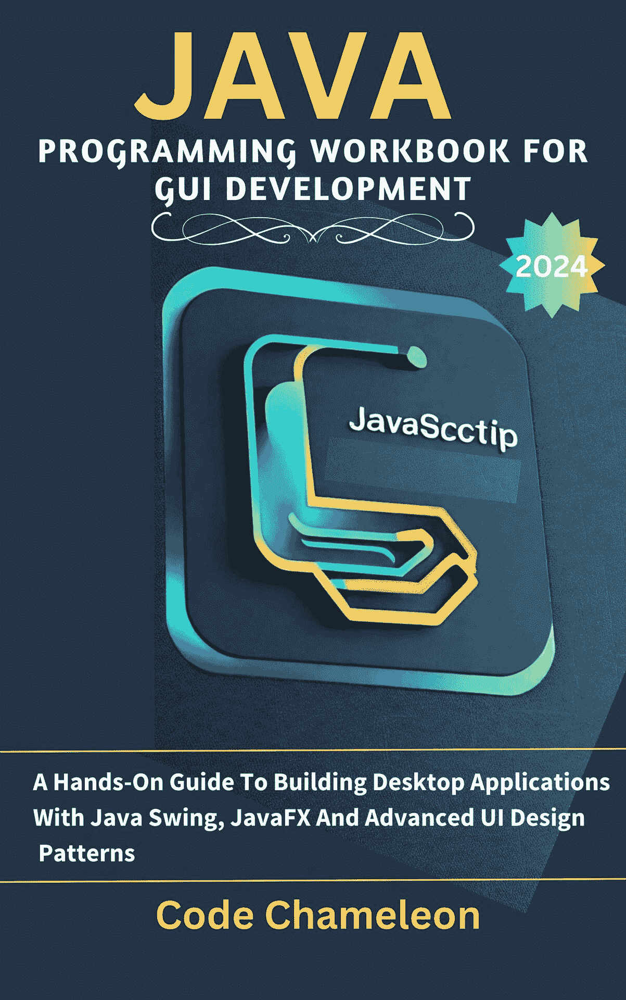

# Java GUI 开发编程工作手册：桌面应用构建实用指南：使用 Java Swing、JavaFX 和高级 UI 设计模式



# 免责声明

本书的作者和出版者已尽力确保内容的准确性和完整性。然而，对于书中信息的准确性或实用性，他们不提供任何形式或暗示的保证。

作者和出版者对于在使用或无法使用书中信息而引起的任何损害（包括但不限于间接的、后果性的或惩罚性的损害）不承担责任。

书中提供的示例和代码段仅供参考，不建议在未经适当测试的情况下用于生产环境。

作者和出版者不认可或推荐书中提到的任何特定产品、服务或公司。

书中的信息可能会在另行通知的情况下更改，作者和出版者对此类更改引起的任何损害不承担责任。

读者阅读并使用本书信息即表示其已阅读并理解本免责声明的条款。

版权所有 2024，Code Chameleon。所有。未经出版者书面许可，本书的任何部分不得复制、存储在检索系统中，或以任何形式或手段（电子、机械、复印、录音或其他）传输。

本书的销售是基于：出版者并未从事专业服务。如果需要专业建议，应寻求合格专业人士的服务。

作者和出版者对于使用书中信息而引起的任何损害概不负责。

使用本书及书中信息的风险由读者自担。

# 引言

在当今的数字领域，创建用户友好且视觉良好的桌面应用程序对于各种任务和功能仍然至关重要。本综合指南为您提供了所需的知识和技术，开启您的 `JavaFX` 开发之旅。

无论你是寻求扩展技能的资深程序员，还是对开发世界充满好奇的新手，本书都提供了一个结构化且易于学习的路径。我们将深入探讨 `JavaFX`，这是一个基于 `Java` 的强大框架，能够让你设计、开发和部署丰富的桌面应用程序。

## 你将学习

- **掌握核心概念**：深入理解 `JavaFX` 的核心功能，包括 UI 组件、事件处理、属性、数据绑定以及使用 `CSS` 样式。
- **拥抱设计原则**：探索用户界面 (UI) 设计的最佳实践，确保你的应用程序不仅功能强大，而且直观友好。
- **结构化你的应用程序**：学习模型-视图-视图模型 (`MVVM`) 等基本设计模式，以有效地组织代码，提高可维护性和扩展性。
- **构建真实世界应用**：通过遵循使用 `JavaFX` 构建桌面应用程序的逐步指南，从基础概念迈向实践应用。
- **探索部署策略**：了解适用于应用程序的不同打包和部署选项，确保其能够到达各种平台上的用户。
- **领先趋势**：洞察 `JavaFX` 开发的潜在未来趋势，并探索如何在不断演变的技术格局中保持你的技能相关性。

## 基础知识之外

本指南不仅教你如何编写代码。我们还将赋予你解决问题的思维方式和最佳实践，使你能够自信地进行应用程序开发。你将学习如何规划、设计、测试和调试你的应用程序，确保它们是健壮的并能提供良好的用户体验。

## 谁应该读此书

- **Java 程序员**：如果你具有 `Java` 编程经验，本书将为你提供一个重点介绍，教你如何利用 `JavaFX` 进行桌面应用程序开发。
- **UI/UX 设计师**：具有用户界面或用户体验设计背景的人可以从使用 `JavaFX` 构建交互式应用程序中获得宝贵的见解。
- **抱行的开发者**：任何对编程充满热情并对创建桌面应用程序感兴趣的人，都能在本指南中找到有价值的学习资源。

当你读完这本书时，你将掌握所需的技能和知识，能够自信地设计、开发和部署自己的 `JavaFX` 桌面应用程序。

让我们开始进入 `JavaFX` 开发世界的精彩旅程吧！

# 第一部分：使用 Java 进行 GUI 开发简介

## 第 1 章：图形用户界面 (GUI) 简介

### GUI 的优势与应用

图形用户界面（GUI）改变了我们与计算机交互的方式。与需要用户记忆复杂命令的旧文本界面不同，GUI 提供了更直观、更易友的体验。以下是 GUI 关键优势和应用的详细介绍：

#### GUI 的优势

- **提高用户友好性**：GUI 利用了图标、菜单和窗口等视觉元素，使得对于没有计算机经验的用户来说更易学习和理解。用户可以通过点击按钮、拖放对象和填写表单来与计算机交互，消除了对晦涩命令的需要。
- **提高效率**：GUI 允许用户更快速、更高效地完成任务。文本界面中需要多个命令才能完成的复杂操作，在 GUI 中只需点击几次即可完成。菜单和工具栏提供了快速访问常用功能的快捷方式，简化了工作流。
- **降低学习曲线**：GUI 的直观性使其更容易学习，特别是对于非技术用户而言。通过极少的培训，用户就能熟练地使用基于 GUI 的应用程序，减少了用户入职所需的时间和资源。
- **减少错误**：GUI 提供了视觉反馈和确认消息，这有助于尽量减少用户交互过程中的错误。例如，下拉菜单和预定义选项可以帮助用户选择正确的值，减少拼写错误或输入错误的概率。
- **增强可访问性**：GUI 可以进行定制以迎合残障用户。屏幕阅读器、键盘快捷键和可调整的字体大小等功能确保了有视觉或身体限制的用户能够有效地与计算机交互。
- **提高一致性**：GUI 在不同的应用程序之间提供了一致的外观和感受。这种一致性让用户更容易学习新软件，因为他们可以利用自己对 GUI 通用工作方式的现有知识。
- **视觉吸引力与参与感**：GUI 可以具有视觉吸引力且令人参与感，使用户体验变得更加愉快。通过图形、颜色和动画的使用，GUI 可以为复杂概念和数据提供更直观的表示。

#### GUI 的应用

- **操作系统**：所有现代操作系统如 `Windows`、`macOS` 和 `Linux` 都利用 GUI 为用户提供了一种易用的方式来管理文件、运行程序和配置设置。
- **桌面应用程序**：绝大多数桌面应用程序（从文字处理器、电子表格到图像编辑软件和游戏）都使用 GUI 允许用户与程序的功能进行交互。
- **Web 应用程序**：现代 Web 应用通常利用基于 Web 的 GUI 来模仿桌面应用程序的外观感受。这允许用户通过按钮、菜单和表单等熟悉的元素与网站交互。
- **移动应用程序**：智能手机和平板电脑严重依赖带有触摸式界面的 GUI。用户可以通过触摸屏上的手势和点击来导航应用程序、输入数据并与功能交互。
- **嵌入式系统**：即使是嵌入式系统，如 ATM 自动取款机、POS 终端和自助服务机，也越来越多地使用 GUI 来提供易用的交互界面。

总之，GUI 已经成为现代计算不可缺的一部分。它们众多的优势和广泛的应用使其成为人机交互的主导模式。随着技术的不断演进，GUI 可能会变得更加复杂和易用，进一步增强我们与数字世界交互的方式。

### 用户界面设计原则

遵循一系列核心用户界面 (UI) 设计原则对于创建不仅具有功能性，而且直观、友好且美观的 GUI 至关重要。这些原则指导设计师打造出满足用户需求和预期的界面，从而产生良好的用户体验 (UX)。以下是需要考虑的一些关键 UI 设计原则：

- **以用户为中心的设计**：这一原则强调将用户放在设计流程前端。理解目标用户的需求、目标和心理模型应该指导每一个设计决策。可用性测试和用户反馈是确保 UI 直观并符合用户预期的基本工具。
- **简单与清晰**：努力保持整洁、不混乱的界面。避免用不必要的信息或复杂的布局让用户过载。重点突出显示核心元素，并优先考虑清晰简洁的标签。
- **一致性**：在整个应用程序中保持一致的外观和感受。这包括在所有屏幕上使用相同的字体、颜色、图标和布局样式。一致性有助于用户快速学习界面，并通过建立熟悉感建立信任。
- **视觉层级**：使用视觉层级组织 UI 元素以引导用户的注意力。这可以通过尺寸、颜色、对比和定位来实现。重要的元素在视觉上应该是主导性的，引导用户完成预期的交互流程。
- **可用性与可访问性**：UI 的设计应适用于广泛范围的用户群，包括残障人士。考虑颜色对比度、键盘导航和屏幕阅读器兼容性等因素，以确保每个人都能有效地与应用程序交互。
- **反馈与用户控制**：对用户的操作提供清晰且实时的反馈。使用进度条、确认消息和错误通知等视觉线索让用户随时了解情况。此外，通过允许用户撤销操作、自定义设置和返回之前的步骤，赋予用户对操作的控制感。
- **错误预防**：只要可能，通过设计 UI 来防止错误的发生。这包括在表单上使用验证、提供清晰的说明以及提供建议或自动补全功能。

## 美学与视觉吸引力

虽然这不是重点，但设计良好的 UI 可以具有美感。请考虑使用平衡的调色板、适当的字体以及微妙的动画来创建一个具有视觉吸引力的界面。这可以增强用户体验并让应用程序的使用更加愉快。

通过遵循这些核心 UI 设计原则，你可以创建出不仅功能齐全，而且易于使用、无障碍且具有视觉吸引力的 GUI。请记住，良好的 UI 可以显著提高用户满意度，并最终带来应用程序的成功。

## 第 2 章：开始 Java GUI 开发

### 设置开发环境

在深入 Java GUI 开发世界之前，你将需要设置开发环境。这涉及到安装必要的软件工具，以便你能够编写、编译、调试和运行 Java GUI 应用程序。以下是设置环境的详细指南：

#### 安装 Java 开发工具包 (JDK)

Java Development Kit (JDK) 对于开发 Java 应用程序至关重要。它包含了构建和运行程序所需的 Java 编译器、库和工具。以下是安装 JDK 的方法：

1. 访问 Oracle 官网：[`www.oracle.com/java/technologies/downloads/`](https://www.oracle.com/java/technologies/downloads/)
2. 下载与你的操作系统（Windows、macOS 或 Linux）兼容的最新版本 JDK。
3. 运行下载的安装程序并按照屏幕指令进行操作。

#### 验证 JDK 安装

安装完成后，请验证 JDK 是否在你的系统上正确配置。打开终端或命令提示符窗口并输入以下命令：

```
java -version
```

此命令应显示已安装的 Java 版本信息。如果成功，说明你已成功安装了 JDK。

#### 设置 JAVA_HOME 环境变量（可选）

虽然不是必须的，但设置 `JAVA_HOME` 环境变量可以简化开发过程。它告诉系统 JDK 的安装位置。以下是设置环境变量的方法：

**Windows:**

1. 右键点击“此电脑”或“我的电脑”，选择“属性”。
2. 进入“高级系统设置”。
3. 在“系统属性”选项卡下，点击“环境变量”。
4. 在“系统变量”区域，点击“新建”。
5. 将变量名设置为 `JAVA_HOME`，变量值设置为你的 JDK 安装目录（例如：`C:\Program Files\Java\jdk-18.0.2`）。
6. 点击所有打开窗口的“确定”以保存更改。

**macOS/Linux:**

具体步骤可能会根据你的操作系统和 Shell（Shell）而异。你需要编辑系统环境配置文件（例如 `.bashrc` 或 `.zshrc`）。请参阅你特定操作系统的文档获取详细说明。

#### 选择文本编辑器或 IDE

虽然可以使用简单的文本编辑器编写 Java 代码，但强烈建议使用专门的集成开发环境 (IDE)。IDE 提供了一系列可以简化开发流程的功能，包括代码补全、语法高亮、调试工具以及内置的项目管理功能。

以下是 Java 开发的一些流行选择：

- **IntelliJ IDEA**: 一款功能强大且极其丰富的 IDE，对 Java 开发支持卓越，包括 GUI 开发工具。（付费软件，但也提供免费的社区版）。
- **Eclipse**: 一个流行的开源 IDE，拥有庞大的用户社区以及各种用于 Java 开发和 GUI 构建器的插件。
- **NetBeans**: 另一个免费开源的 IDE，侧重于对初学者的简单性和易用性。
- **JEdit**: 一个轻量且可自定义的文本编辑器，带有各种用于 Java 开发的插件。

IDE 的选择取决于你的个人喜好和经验水平。考虑尝试几个选项，以找到最适合你工作流的一个。

#### （可选）安装 GUI 构建器插件

某些 IDE（如 NetBeans 和 Eclipse）内置了 GUI 构建器，允许你通过拖放功能直观地设计用户界面。这些对于初学者或快速原型 UI 布局非常有帮助。

一旦你安装了 JDK、配置了环境（如有必要）并选择了开发环境，你就可以开始编写你的第一个 Java GUI 应用程序了！

### 理解 Java AWT 和 Swing 框架

Java 提供了两种开发图形用户界面 (GUI) 的主要框架：抽象窗口工具包 (AWT) 和 Swing。以下是每个框架的概述：

#### 抽象窗口工具包 (AWT)

- **概述**: AWT 是两个框架中较老的，随 Java 初期版本引入。它提供了一组用于创建按钮、窗口、菜单和文本框等 GUI 类。
- **特性**:
    - **依赖平台**: AWT 组件严重依赖底层操作系统的原生外观和感觉。这可能导致应用程序在不同平台（Windows、macOS、Linux）上的显示不一致。
    - **功能有限**: AWT 提供的组件范围比 Swing 小。
    - **低层 API**: AWT 使用比 Swing 更底层的 API，可能会使开发变得更加复杂。

#### Swing

- **概述**: Swing 作为 AWT 的扩展被引入，提供了一种更强大且平台无关的 GUI 开发方法。它完全由 Java 编写。
- **特性**:
    - **平台无关**: Swing 组件完全用 Java 编写，确保在不同系统上具有一致的外观和感觉。
    - **功能丰富**: Swing 提供了比 AWT 更广泛的 GUI 组件，包括高级元素。
    - **高层 API**: Swing 使用比 AWT 更高层的 API，通过提供预构建的组件和功能简化了开发。

#### 在 AWT 和 Swing 之间选择

虽然 AWT 仍然包含在 Java 中以保持对旧程序的兼容性，但由于其平台无关性、功能丰富且对开发者友好，Swing 是现代 Java GUI 开发的首选。

然而，在某些特定情况下，可能仍考虑 AWT：

- **简单应用程序**: 对于需求极少的非常基础 GUI 应用程序，AWT 可能足够。
- **性能敏感型应用程序**: 在极少数性能是绝对首要任务的情况下，AWT 组件可能会有微弱优势。

### 构建你的第一个 Java GUI 应用程序

让我们通过创建一个简单的 Java GUI 应用程序来动手实践！此示例将演示构建具有极简功能的 Swing 应用程序的基本步骤。

1. **创建一个新的 Java 项目**

   打开你选择的 IDE（例如 IntelliJ IDEA、Eclipse）并创建一个新的 Java 项目。给它起一个描述性的名称，如 "MyFirstSwingApp"。

2. **创建主类**

   在你的项目中，创建一个名为 `MyFirstSwingApp` 的 Java 类。该类将作为你应用程序的入口。

3. **继承 `JFrame` 类**

   让你的 `MyFirstSwingApp` 类继承 `javax.swing.JFrame` 类。`JFrame` 类代表应用程序的主窗口。

4. **定义窗口标题**

   在 `MyFirstSwingApp` 构造函数内部，使用 `setTitle` 方法设置应用程序窗口的标题：

   ```java
   public class MyFirstSwingApp extends JFrame {
       public MyFirstSwingApp() {
           super("My First Swing Application");
       }
       // ... other code for your application
   }
   ```

5. **设置窗口大小（可选）**

   你可以使用 `setSize` 方法可选地设置应用程序窗口的大小：

   ```java
   public class MyFirstSwingApp extends JFrame {
       public MyFirstSwingApp() {
           super("My First Swing Application");
           setSize(400, 300); // 像素单位宽度和高度
       }
       // ... other code for your application
   }
   ```

6. **让窗口在退出时关闭**

   默认情况下，关闭窗口不会终止应用程序。为了确保正常终止，使用带有 `JFrame.EXIT_ON_CLOSE` 的 `setDefaultCloseOperation` 方法：

   ```java
   public class MyFirstSwingApp extends JFrame {
       public MyFirstSwingApp() {
           super("My First Swing Application");
           setSize(400, 300);
           setDefaultCloseOperation(JFrame.EXIT_ON_CLOSE);
       }
       // ... other code for your application
   }
   ```

7. **（可选）添加一个简单的标签**

   为了向窗口添加一个基础元素，创建一个带有文本的 `JLabel` 对象，并使用 `add` 方法将其添加到框架的内容窗格中：

   ```java
   public class MyFirstSwingApp extends JFrame {
       public MyFirstSwingApp() {
           super("My First Swing Application");
           setSize(400, 300);
           setDefaultCloseOperation(JFrame.EXIT_ON_CLOSE);
           JLabel label = new JLabel("Hello, World!");
           add(label);
       }
       // ... other code for your application
   }
   ```


### 8. 让窗口可见

最后，通过在你的 `JFrame` 对象上调用 `setVisible` 方法使应用程序窗口可见：

```java
public class MyFirstSwingApp extends JFrame {
    public MyFirstSwingApp() {
        super("My First Swing Application");
        setSize(400, 300);
        setDefaultCloseOperation(JFrame.EXIT_ON_CLOSE);
        JLabel label = new JLabel("Hello, World!");
        add(label);
        setVisible(true);
    }
    public static void main(String[] args) {
        new MyFirstSwingApp();
    }
}
```

### 9. 运行应用程序

编译并运行 `MyFirstSwingApp` 类。你应该能看到一个标题为“My First Swing Application”且内部显示“Hello, World!”文本的窗口。

恭喜你！你成功使用 Swing 创建了自己的第一个 Java GUI 应用程序。这只是一个基础示例，但它演示了创建窗口、添加组件和设置应用程序逻辑的核心概念。在后续章节中，我们将深入探讨各种 Swing 组件、事件处理、布局管理器以及构建丰富交互式 Java GUI 应用程序的更高级的技术。

## 第 3 章：Java GUI 开发的核心概念

### 组件与容器

本章将深入探讨 Java GUI 应用程序的基础构建模块：组件和容器。理解它们的作用至关重要。

#### 组件

组件是构成用户界面的单个元素。它们代表按钮、文本字段、标签等。以下是一些关键类型：

- `Buttons`（按钮）：允许用户触发操作。
- `TextFields`（文本框）：允许用户输入文本。
- `Labels`（标签）：显示静态信息。
- `TextAreas`（文本区域）：提供多行文本编辑。
- `Panels`（面板）：作为分组其他组件的容器。
- `Menus`（菜单）：提供下拉选项。
- `Tables`（表格）：以网格格式显示数据。

#### 容器

容器用于组织布局。它们将布局责任委托给布局管理器，确保组件定位正确。以下是关于容器你需要了解的：

- `JFrame`：代表应用程序的主窗口。
- `JPanel`：用于分组组件的通用容器。
- `JDialog`：创建模态或非模态对话框。
- `JTabbedPane`：将内容组织成多个标签页。

**关键操作：**

- **向容器添加组件**：要向容器添加组件，你使用容器对象的 `add` 方法。
- **嵌套容器**：容器可以嵌套在其他容器中，以创建复杂的层次结构布局。

### 布局管理器 (FlowLayout, BorderLayout, 等)

布局管理器是 Java GUI 开发中的基础概念。它们决定了组件在容器内的定位和大小方式。

#### FlowLayout

- **描述**：`FlowLayout` 布局在容器内从左到右一个接一个排列组件。如果当前行空间不足以容纳组件，它将换行到下一行。
- **优点**：对于组件较少的简单布局易于使用；允许自动换行。
- **缺点**：
    - 对组件布局的控制有限。
    - 不适用于具有特定对齐要求的复杂布局。

#### 示例：

```java
JPanel panel = new JPanel(new FlowLayout());
panel.add(new JLabel("Name:"));
panel.add(new JTextField(15));
panel.add(new JButton("Submit"));
```

这段代码创建了一个使用 `FlowLayout` 布局器的 `JPanel`。组件将水平排列，必要时会自动换到下一行。

### BorderLayout

- **描述**：`BorderLayout` 将容器分为五个区域：`North`（北）、`South`（南）、`East`（东）、`West`（西）和 `Center`（中）。每个区域只能包含一个组件。
- **优点**：
    - 适用于具有明确划分区域的布局（例如顶部的标题栏，底部的按钮）。
    - 提供了 UI 元素的清晰分离。
- **缺点**：
    - 对于包含超过五个组件的复杂布局，灵活性有限。
    - 每个区域内的组件无法自动调整大小。

#### 示例：

```java
JFrame frame = new JFrame();
frame.setLayout(new BorderLayout());
frame.add(new JLabel("Title"), BorderLayout.NORTH);
frame.add(new JButton("OK"), BorderLayout.SOUTH);
frame.add(new JTextArea(), BorderLayout.CENTER);
frame.setSize(400, 300);
frame.setDefaultCloseOperation(JFrame.EXIT_ON_CLOSE);
frame.setVisible(true);
```

这段代码创建了一个使用 `BorderLayout` 的 `JFrame`。`JLabel` 位于 `North` 区域，`JButton` 位于 `South` 区域，而 `JTextArea` 填充了剩余的 `Center` 区域。

### 其他布局管理器

Swing 为特定用例提供了多种其他布局管理器：

- `GridLayout`：按指定的行和列在网格中排列组件。
- `BoxLayout`：在单行或单列中水平或垂直地排列组件。
- `GroupLayout`：一种更复杂的布局管理器，通过约束对组件的位置和大小进行精确控制。
- `自定义布局管理器`：你甚至可以根据特定需求创建自定义的布局管理器。

选择正确的布局管理器取决于用户界面的复杂程度和所需的结构。考虑组件数量、相对大小以及你想要实现的整体视觉层次结构等因素。

#### 选择布局管理器的提示：

- 从简单布局开始，在适当的情况下使用 `FlowLayout` 或 `BorderLayout`。
- 随着 UI 复杂性的增加，探索 `GridLayout` 或 `BoxLayout` 以获得更多控制。
- 对于高度自定义的布局，考虑使用 `GroupLayout` 或创建自定义布局管理器。
- 尝试不同的布局管理器，以找到最适合你特定需求的。

通过理解并有效使用布局管理器，你可以为 Java GUI 应用程序创建组织良好且视觉吸引的用户界面。这些管理器为结构化你的 UI 提供了强大的工具，并确保了一致且友好的体验。

### 事件处理机制（ActionListeners 等）

事件处理是 Java GUI 开发中的核心概念。它允许你的应用程序对 UI 组件的用户交互做出响应。当用户点击按钮、在字段中输入文本或与屏幕上的任何元素交互时，就会产生一个事件。事件处理机制允许你根据这些事件定义并执行特定的代码。

以下是 Swing 中事件处理关键方面的详细介绍：

#### 事件与事件对象

- **事件**：事件代表应用程序中的用户交互或系统事件。示例包括按钮点击、文本输入更改、窗口关闭等。
- **事件对象**：当事件发生时，会创建一个包含事件细节的事件对象。该对象可能包含此类信息，如触发事件的源组件、发生的事件类型以及与事件相关的任何数据（例如在文本字段中输入的文本）。

#### 事件监听器

- **事件监听器**：这些对象是用于监听特定组件上特定事件的。它们实现了 Swing 提供的接口，如 `ActionListener` 或 `MouseListener`。
- **实现事件监听器**：你创建一个实现所需的事件监听器接口的类，并重写其方法，以定义你想在事件发生时要执行的代码。
- **注册事件监听器**：你随后使用 `addActionListener` 或 `addMouseListener` 等方法将事件监听器注册到组件上。当组件上发生相应的事件时，注册的监听器方法将被调用。

#### Swing 中常见的事件监听器

Swing 为不同类型的事件提供了各种事件监听器接口：

- `ActionListener`：监听按钮点击和文本字段的回车键按下。
- `MouseListener`：监听鼠标事件，如点击、悬停和拖拽。
- `KeyListener`：监听键盘事件，如按键和释放。
- `WindowListener`：监听窗口事件，如打开、关闭和最小化。
- **更多**：Swing 提供了针对各种其他组件交互的事件监听器。

#### 示例：按钮点击监听器

这是一个演示了如何处理按钮点击事件的示例：

```java
public class MyButtonListener implements ActionListener {
    @Override
    public void actionPerformed(ActionEvent e) {
        System.out.println("Button clicked!");
    }
}

public class MyApplication {
    public static void main(String[] args) {
        JButton button = new JButton("Click Me");
        MyButtonListener listener = new MyButtonListener();
        button.addActionListener(listener);
        JFrame frame = new JFrame("Event Handling Example");
        frame.add(button);
        frame.setSize(300, 200);
        frame.setDefaultCloseOperation(JFrame.EXIT_ON_CLOSE);
        frame.setVisible(true);
    }
}
```

在此示例中，`MyButtonListener` 类实现了 `ActionListener`，并在按钮被点击时触发 `actionPerformed` 方法，在控制台打印“Button clicked!”。

通过理解并实现监听器，你可以创建响应用户操作并提供动态用户体验的交互式 GUI。下一节将探索 GUI 应用程序中有效事件处理的最佳实践。

### 文本字段、按钮与其他组件的操作

现在你已经掌握了组件、容器、布局管理器和事件处理的基本概念，让我们深入研究一些核心组件的使用：

**1. 文本字段 (JTextField)**

- **功能**：允许用户输入和编辑单行文本。
- **常用属性**：
    - `setText(String text)`：设置字段显示的初始文本。
    - `getText()`：获取用户输入的当前文本。
    - `setColumns(int columns)`：以字符而非像素设置文本字段的宽度。
    - `setFont(Font font)`：设置文本的字体和大小。
- **事件处理**：
    - 使用 `ActionListener` 监听 `actionPerformed` 事件，该事件在用户按下 Enter 或点击字段外触发。
    - 可选使用 `DocumentListener` 在用户输入时跟踪字段内部的变化。

**2. 文本区域 (JTextArea)**

- **功能**：允许用户输入和编辑多行文本。
- **属性**：类似于 `JTextField`，但具有处理换行和滚动额外方法。
- **事件处理**：类似于 `JTextField`，使用 `ActionListener` 和可能的 `DocumentListener`。

**3. 按钮 (JButton)**

- **功能**：在点击时启动操作。
- **属性**：
    - `setText(String text)`：设置按钮上显示的文本。
    - `setEnabled(boolean enabled)`：启用或禁用按钮供用户交互。
- **事件处理**：使用 `ActionListener` 监听按钮点击时触发的 `actionPerformed` 事件。

**4. 标签 (JLabel)**

- **功能**：显示静态文本以提供信息或说明。
- **属性**：
    - `setText(String text)`：设置标签上显示的文本。
    - `setFont(Font font)`：设置文本的字体样式和大小。
- **事件处理**：标签通常不需要事件处理。

**5. 复选框 (JCheckBox)**

- **功能**：允许用户选择或取消勾选单个选项。
- **属性**：
    - `setSelected(boolean selected)`：设置复选框的初始选中状态。
    - `isSelected()`：获取当前的选中状态。
- **事件处理**：使用 `ActionListener` 监听当复选框被点击时触发的 `actionPerformed` 事件。

**6. 单选按钮 (JRadioButton)**

- **功能**：允许用户在一组单选按钮中仅选择一个。
- **属性**：与 `JCheckBox` 类似，具有管理单选按钮组的方法。
- **事件处理**：与 `JCheckBox` 类似，使用 `ActionListener` 处理点击事件。

**7. 组合框 (JComboBox)**

- **功能**：允许用户从预定义的选项列表中选择。
- **属性**：
    - `addItem(String item)`：向组合框列表添加一个项。
    - `setSelectedItem(Object item)`：设置当前选中的项。
    - `getSelectedItem()`：获取当前选中的项。
- **事件处理**：使用 `ActionListener` 监听用户从列表中选择某项时触发的 `actionPerformed` 事件。

## 有效使用技巧

- 根据所需的用户交互类型（文本输入、按钮点击、选择等）选择合适的组件。
- 设置清晰简洁的标签，以引导用户与组件进行交互。
- 使用合适的字体大小和样式以确保可读性。
- 有效处理事件以响应用户操作并相应更新 UI。
- 考虑可访问性，提供与组件交互的替代方式（例如按钮的键盘快捷键）。

通过掌握这些基础组件及其功能，你将完全能够构建用户友好且具有交互性的 Java GUI 应用程序。随着你开发之旅的不断，你可以探索表格、菜单和自定义面板等更高级组件，以创建更丰富、更复杂的用户界面。

***

# 第 4 章：深入研究 Java Swing 组件

### 高级 Swing 组件（表格、树、菜单）

在掌握了核心 Swing 组件、容器和事件处理的基础知识后，本章将深入探讨更高级的组件，这些组件能够让你为 Java 程序构建丰富且强大的用户界面。在这里，我们将详细探讨表格、树和菜单。

### 表格 (JTable)

**功能**：`JTable` 是一个强大的组件，允许以网格格式显示表格数据。它非常适合展示具有行和列的结构化信息。

**关键特性**：

- **数据模型**：表格依赖数据模型来存储和管理底层数据。Swing 提供了 `TableModel` 接口，可以通过实现接口来定义数据如何在表格中被访问和呈现。
- **可自定义外观**：你可以通过为单个单元格设置单元渲染器（renderers）和编辑器（editors）来自定义表格外观。这允许你格式化数据显示并启用特定单元格内的用户交互。
- **排序和过滤**：可以通过点击列标题进行排序。你还可以实现自定义过滤机制，允许用户缩小显示的数据范围。
- **选择**：用户可以选择单行或多行、列，从而与特定的数据点进行交互。

**示例**：

```java
String[] columnNames = {"Name", "Age", "City"};
Object[][] data = {
    {"Alice", 30, "New York"},
    {"Bob", 25, "Los Angeles"},
    {"Charlie", 40, "Chicago"}
};

// 创建一个 DefaultTableModel 对象
DefaultTableModel model = new DefaultTableModel(data, columnNames);
// 使用数据模型创建 JTable 对象
JTable table = new JTable(model);

// 如果需要，将表格添加到 JScrollPane 中以便滚动
// 将表格添加到你的容器（JPanel, JFrame, 等）中
```

此示例创建了一个具有三列和三行数据的简单表格。`DefaultTableModel` 类是 `TableModel` 接口的一种常用实现。

### 树 (JTree)

**功能**：`JTree` 是一个以树形结构表示层级数据的组件。它适用于显示嵌套信息，如目录结构、文件系统或组织架构。

**关键特性**：

- **树模型**：与表格类似，树依赖数据模型（`TreeModel` 接口）来定义节点之间的层级关系并访问节点数据。
- **节点与展开/折叠**：树数据组织成节点，代表层级中的元素。用户可以展开和折叠节点以显示或隐藏嵌套元素。
- **选择**：用户可以选择树内的一个或多个节点，允许与层级中的特定元素进行交互。
- **自定义渲染器**：你可以像表格一样使用自定义单元渲染器来自定义节点外观。

**示例**：


```java
DefaultMutableTreeNode root = new DefaultMutableTreeNode("Root Node");
DefaultMutableTreeNode child1 = new DefaultMutableTreeNode("Child 1");
root.add(child1);
DefaultMutableTreeNode child2 = new DefaultMutableTreeNode("Child 2");
root.add(child2);

// 使用根节点创建 JTree 对象
JTree tree = new JTree(root);
```

此示例创建了一个带有根节点两个子节点的简单树。`DefaultMutableTreeNode` 类是创建树节点的常用实现。

### 菜单 (`JMenuBar`, `JMenu`, `JMenuItem`)

**功能**: Swing 提供了一组组件，用于创建层级菜单，允许用户访问各种功能。

**组件**:

- `JMenuBar`: 代表窗口顶部的菜单栏。
- `JMenu`: 代表子菜单，可以包含菜单项或子菜单。
- `JMenuItem`: 代表单个菜单项，点击时会触发操作。

**关键特性**:

- **菜单层级**: 你可以通过将 `JMenu` 对象添加到其他 `JMenu` 对象中来创建嵌套菜单，形成层级结构。
- **菜单监听器**: 使用 `ActionListener` 监听菜单项的点击并定义要执行的操作。
- **菜单助记键**: 你可以为菜单项分配键盘快捷键以便访问。

**示例**:

```java
JMenuBar menuBar = new JMenuBar();
JMenu fileMenu = new JMenu("File");
menuBar.add(fileMenu);
JMenuItem openItem = new JMenuItem("Open");
fileMenu.add(openItem);
JMenuItem saveItem = new JMenuItem("Save");
fileMenu.add(saveItem);
```

## 高级特性

- **菜单分隔符**：使用分隔符在子菜单内对相关的菜单项进行视觉分组。
- **菜单图标**：将图标与菜单项关联，为其功能提供视觉提示。
- **禁用菜单项**：禁用当前上下文不适用的菜单项，以避免用户困惑。
- **菜单快捷键**：为频繁使用的菜单项利用键盘快捷键（助记符），提高用户效率。
- **子菜单级联**：创建级联子菜单以高效组织大量的菜单项。

## 有效使用技巧

- 保持顶部菜单栏简洁，专注于应用程序的核心功能。
- 逻辑清晰地组织菜单项，将相关操作分组在相关的子菜单下。
- 为菜单项使用清晰且具描述性的文本，以避免用户歧义。
- 在整个应用程序中保持菜单结构和术语的一致性。
- 当菜单项被选中或悬停在上方时，提供清晰的视觉反馈。

通过理解这些高级特性并遵循提供的技巧，你可以创建多功能且用户友好的表格、树和菜单，从而增强 Java Swing 应用程序的功能性和可用性。

## 自定义组件外观

虽然 Swing 提供了一套默认的视图和感觉（Look and Feels），但你可能希望在提供之外自定义组件的外观。以下是实现视觉定制的一些方法：

### 使用外观和感觉 (LAFs)

- **概念**：外观和感觉（LAFs）定义了应用程序组件的整体视觉样式。Swing 提供了几种内置的 LAF，如“System”、“Metal” 和“Motif”。你可以选择最符合你预期美学的 LAF。
- **设置外观和感觉**：

```java
try {
    UIManager.setLookAndFeel("com.sun.java.swing.plaf.metal.MetalLookAndFeel");
} catch (ClassNotFoundException | InstantiationException | IllegalAccessException | UnsupportedLookAndFeelException e) {
    // 处理潜在的异常
}
// 在此处创建你的 Swing 组件
```

### 自定义单个组件

- **属性**：许多 Swing 组件提供了 `setBackground`、`setForeground` 和 `setFont` 等属性，用于修改背景颜色、文本颜色和字体样式。
- **边框**：可以使用 `setBorder` 方法设置组件的边框。Swing 提供了多种边框类，如 `LineBorder`、`BeveledBorder` 和 `EtchedBorder` 用于视觉分离。
- **图标**：组件可以使用 `setIcon` 方法显示图标。这允许你添加标志或状态指示器等视觉元素。

### 重写绘制方法

为了进行更细粒度的控制，你可以重写组件的 `paintComponent` 方法。这允许你使用提供的 `Graphics` 对象直接在组件上绘制自定义图形。

### 自定义渲染器和编辑器

对于高级定制，表格和树等 Swing 组件允许你实现自定义的渲染器和编辑器。这些类控制数据在特定单元格或节点中如何被显示（渲染）和编辑。

### 第三方 LAF 和库

若干第三方库和框架扩展了 Swing 的定制能力。这些库可以提供更广泛的主题、样式和高级渲染技术。

### 最佳实践

- **保持一致性**：努力在整个应用程序中保持一致的视觉样式，避免出现混乱或困惑的用户界面。
- **可用性优先**：确保自定义不会阻碍可用性。优先考虑清晰易读的文本、适当的颜色组合以及直观的组件交互。
- **考虑无障碍性**：确保你的自定义不会为残障用户创建无障碍障碍。使用适当的颜色对比，并提供访问信息的替代方法。

通过有效结合这些技术，你可以创建符合你的品牌形象和设计偏好的视觉吸引且用户友好的 Swing 应用程序。

# 在 Swing 中使用图像和图标

图像和图标在增强 Swing 应用程序的视觉吸引力和传递信息方面起着至关重要的作用。以下是有效整合它们的全面指南：

### 使用图标

- **ImageIcon**：在 Swing 组件中显示图像的主要方法是使用 `ImageIcon` 类。它可以从文件、URL 或字节数组等各种源加载图像。

```java
ImageIcon icon = new ImageIcon("images/icon.png");
JLabel label = new JLabel(icon);
```

- **图标接口**：Swing 定义了多个图标接口，如 `Icon` 和 `CompositeIcon`，提供了管理图标的功能，包括设置大小和组合多个图标。

### 加载图像

- **文件路径**：使用相对或绝对文件路径加载位于项目目录内的图像。
- **资源**：将图像作为资源封装在项目中，并使用 `getClass().getResource` 访问它们，以采用更健壮的方法。
- **URLs**：从外部 URL 加载图像用于动态内容，但要注意网络延迟。

### 图像考虑因素

- **图像格式**：Swing 支持 GIF、JPEG 和 PNG 等常见图像格式。根据图像的复杂性和所需的透明度选择合适的格式。
- **图像尺寸**：将图像调整为适合组件的适当尺寸，以避免缩放伪影或性能问题。
- **图像缓存**：考虑缓存频繁使用的图像以提高加载性能。

### 高级技术

- **自定义图标**：扩展 `Icon` 接口以创建具有独特功能或绘制逻辑的自定义图标。
- **动画 GIF**：虽然原生不支持，但你可以使用第三方库来处理动画 GIF 图标。
- **图像处理**：对于高级图像处理，请探索如 Java Advanced Imaging (JAI) 等库或第三方解决方案。

### 最佳实践

- **清晰度与相关性**：使用清晰、与上下文相关并能增强用户体验的图像。
- **无障碍性**：使用 `JLabel` 组件的 `setLabelFor` 方法为图像提供替代文本描述，以帮助视觉障碍用户。
- **性能**：优化图像加载和缩放，以避免 UI 冻结或渲染缓慢。
- **一致性**：在整个应用程序中保持图像使用的一致风格。

通过遵循这些指南并探索高级技术，你可以有效利用图像和图标创建具有视觉吸引力且信息丰富的 Swing 应用程序。

## 鼠标事件

鼠标事件提供了大量关于用户如何使用鼠标与你的 `Swing` 组件交互的信息。以下是关键鼠标事件及其用例的详细介绍：

### MouseListener

- `mouseClicked(MouseEvent e)`: 当在组件上点击鼠标按钮（按下并释放）时触发。
- `mousePressed(MouseEvent e)`: 当在组件上按下鼠标按钮时触发。
- `mouseReleased(MouseEvent e)`: 当在组件上释放已按下的鼠标按钮时触发。
- `mouseEntered(MouseEvent e)`: 当鼠标光标进入组件的范围时触发。
- `mouseExited(MouseEvent e)`: 当鼠标光标离开组件的范围时触发。

### MouseMotionListener

- `mouseDragged(MouseEvent e)`: 当鼠标按钮在组件上被按下并沿在组件上拖动时触发。
- `mouseMoved(MouseEvent e)`: 当鼠标光标在组件范围内移动（不带拖动）时触发。

#### 示例：实现拖放功能

```java
public class MyDragAndDropListener implements MouseListener, MouseMotionListener {
    private JLabel dragLabel;

    public MyDragAndDropListener(JLabel label) {
        this.dragLabel = label;
    }

    // 实现鼠标交互的事件监听器方法
    // ...

    @Override
    public void mouseDragged(MouseEvent e) {
        int x = e.getX() + dragLabel.getX();
        int y = e.getY() + dragLabel.getY();
        dragLabel.setLocation(x, y);
    }
}
```

在这个示例中，`MyDragAndDropListener` 捕捉 `JLabel` 上的鼠标事件。当标签被拖动时，`mouseDragged` 方法会根据鼠标光标的位置更新它的位置。

## 焦点事件：跟踪组件焦点

焦点事件对于跟踪组件何时获得或失去焦点至关重要，这表明了用户何时与其交互。

### FocusListener

- `focusGained(FocusEvent e)`: 当组件获得焦点（成为活动元素）时触发。
- `focusLost(FocusEvent e)`: 当组件失去焦点（变为非活动）时触发。

#### 示例：高亮聚焦的文本字段

```java
public class MyFocusListener implements FocusListener {
    @Override
    public void focusGained(FocusEvent e) {
        JTextField textField = (JTextField) e.getSource();
        textField.setBackground(Color.YELLOW); // 聚焦时高亮
    }

    @Override
    public void focusLost(FocusEvent e) {
        JTextField textField = (JTextField) e.getSource();
        textField.setBackground(Color.WHITE); // 失去焦点时重置背景
    }
}
```

在这里，`MyFocusListener` 在 `JTextField` 获得或失去焦点时改变其背景颜色，为用户提供视觉反馈。

## 高级事件处理技术

除了基础的事件监听器实现，这里是增强你的事件处理实践的技术：

- **事件链式 (Event Chaining)**: 在单个组件上注册多个事件监听器，以处理用户交互的不同方面。
- **自定义事件 (Custom Events)**: 定义你自己的自定义事件类，用以封装特定的应用程序事件并在组件之间传播它们。
- **事件队列 (Event Queues)**: `Swing` 使用单线程的事件分派线程 (`EDT`) 来处理所有的 GUI 事件。这确保了组件更新的线程安全。然而，在事件监听器方法中的长时间任务可能会阻塞 `EDT`，导致 UI 结。
- **工作线程 (Worker Threads)**: 为了避免阻塞 `EDT`，考虑使用工作线程处理由事件触发的长时间任务。这些线程可以在后台执行工作，然后使用 `SwingUtilities.invokeLater` 或 `EventQueue.invokeLater` 等技术在 `EDT` 上更新 UI 组件。这些方法将更新任务队列并在稍后于 `EDT` 上执行，确保 UI 渲染流畅。
- **自定义事件监听器 (Custom Event Listeners)**: 扩展现有事件监听器接口或创建你自己的，以捕捉根据应用程序需求的特定用户交互。这允许对事件处理逻辑进行更细粒度的控制。
- **事件传播 (Event Propagation)**: 事件可以沿组件层次向上传播。理解事件如何从子组件泡到父容器以及在需要时停止传播对于处理复杂的 UI 交互至关重要。

### 有效事件处理的最佳实践

在你的 `Swing` 应用程序中，健壮且高效的事件处理遵循以下关键原则：

- **清晰与关注点分离 (Clarity and Separation of Concerns)**: 保持事件监听器实现简洁并专注于处理特定事件。避免让无关的逻辑填充它们。
- **事件委托 (Event Delegation)**: 考虑使用专用事件处理类或管理器来集中事件监听器的注册和逻辑，以获得更好的组织性和可重用性。
- **关注用户体验 (Focus on User Experience)**: 设计你的事件处理，根据用户的交互通过视觉提示或信息性消息向用户提供清晰的反馈。
- **性能优化 (Performance Optimization)**: 注意事件监听器的开销。对于频繁事件，考虑在事件处理逻辑中使用高效的数据结构或算法。
- **错误处理 (Error Handling)**: 在事件监听器内部实现适当的错误处理，以优雅处理意外情况或无效的用户输入。

通过有效利用这些高级技术和最佳实践，你可以创建结构良好、响应迅速且用户友好的 `Swing` 应用程序，拥有健壮的事件处理基础。

### 用于事件监听器的内部类和匿名类

`Swing` 开发通常涉及为各种组件创建事件监听器。虽然你可以定义单独的监听器类，但内部类和匿名类提供了改进代码组织和可读性的替代方法。

#### 1. 内部类 (Inner Classes)

- **嵌套类 (Nested Classes)**: 内部类是定义在另一个类中的类。它们可以直接访问外层类的成员，包括私有成员。
- **事件监听器实现 (Event Listener Implementations)**: 你可以定义实现 `ActionListener` 或 `MouseListener` 等事件监听器接口的内部类。这可以让你的事件处理逻辑与其相关的组件紧密结合。

#### 示例：用于按钮点击的内部类

```java
public class MyFrame extends JFrame {
    private JButton button;

    public MyFrame() {
        button = new JButton("Click Me");
        // 创建实现 ActionListener 的内部类
        ActionListener listener = new InnerButtonListener();
        button.addActionListener(listener);
        // ... 框架的其他设置
    }

    private class InnerButtonListener implements ActionListener {
        @Override
        public void actionPerformed(ActionEvent e) {
            System.out.println("从内部类点击了按钮!");
        }
    }
}
```

在这个示例中，`InnerButtonListener` 内部类实现了 `ActionListener` 并定义在 `MyFrame` 类内部。它可以直接访问 `button` 并在点击时更新框架的状态。

#### 2. 匿名类 (Anonymous Classes)

- **简洁的监听器定义 (Concise Listener Definitions)**: 匿名类允许你在注册组件监听器时直接定义事件监听器实现。这对于简单的用例非常有用。

#### 示例：用于按钮点击的匿名类


```java
public class MyFrame extends JFrame {
    private JButton button;

    public MyFrame() {
        button = new JButton("Click Me");
        // 创建并注册一个匿名 ActionListener
        button.addActionListener(new ActionListener() {
            @Override
            public void actionPerformed(ActionEvent e) {
                System.out.println("从匿名类点击了按钮!");
            }
        });
        // ... 框架的其他设置
    }
}
```

在这里，实现 `ActionListener` 的匿名内部类直接在 `addActionListener` 方法调用中创建。它提供了一种定义监听器逻辑的方式，不需要单独的类。

### 在内部类和匿名类之间进行选择

- **内部类**：当事件监听器逻辑更复杂并且需要访问外层类的成员或状态时，选择内部类。它们还可以改进主类内部的代码组织。

- **匿名类**：在认为没有必要单独定义一个类时，使用匿名类来实现简单的监听器实现。通过将监听器逻辑保持在使用的位置附近，可以提高代码的可读性。

记住：

- 内部类和匿名类都可以共享相同的功能。选择取决于编码风格偏好、监听器逻辑的复杂度以及可维护性的考虑。

- 过度使用匿名类会使代码更难以阅读和维护。请针对真正简单的用例审慎地使用它们。

通过理解这些技术，你可以有效地利用内部类和匿名类，在你的 Swing 应用程序中创建整洁且结构良好的事件处理代码。

## 第 6 章：Swing 中的布局管理器

### 高级布局管理器 (`GridLayout`, `GridBagLayout`)

本章深入探讨了 `Swing` 中的高级布局管理器，提供了对 `GridLayout` 和 `GridBagLayout` 更深层次的理解，用于构建更复杂、更灵活的用户界面。

#### 回顾：基础布局管理器

在探索高级选项之前，让我们简要回顾一下之前涵盖的基础布局管理器：

- `FlowLayout`：将组件从左到右排列，必要时换行到下一行。适用于具有可变宽度组件（如按钮或标签）的简单布局。

- `BorderLayout`：将组件位于五个区域（`north`、`south`、`east`、`west` 和 `center`）以实现结构化布局。适用于具有菜单、工具栏、内容和状态栏清晰区域的应用。

### GridLayout：在网格中对齐组件

- **功能**：`GridLayout` 将组件在具有相等单元格的矩形网格中排列。它提供了一种创建表格布局的简单方法。

- **关键特性**：

    - 行和列：你可以指定网格的行数和列数。

    - 组件尺寸：组件调整大小以相等地适应其分配的单元格。

    - 组件间距：你可以可选地设置单元格之间的水平和垂直间距以便留白。

- **示例**：

```java
JPanel gridPanel = new JPanel(new GridLayout(2, 3, 5, 10)); // 2 行，3 列，5px 水平间距，10px 垂直间距
gridPanel.add(new JButton("Button 1"));
gridPanel.add(new JTextField(10));
gridPanel.add(new JLabel("Label"));
gridPanel.add(new JCheckBox("Option 1"));
gridPanel.add(new JCheckBox("Option 2"));
gridPanel.add(new JTextArea(5, 10));
// 将 gridPanel 添加到你的容器（JFrame, 等）
```

此示例创建了一个 2 行 3 列的网格布局，单元格之间有指定的间距。

### GridBagLayout：用于复杂且灵活的布局

**功能**：`GridBagLayout` 是一种强大但更复杂的布局管理器，它允许对容器内组件的放置、尺寸和权重分布进行精确控制。

**关键特性**：

- **网格包**：组件放置在具有行和列的虚拟网格包中（类似于 `GridLayout`）。

- **约束**：每个组件都有一个关联的 `GridBagConstraints` 对象，定义了在网格中的位置和行为。

- **约束细节**：约束指定了因素，如网格位置（行、列）、单元格跨越、权重（用于调整大小）和内边距（边距）。

- **锚点**：你可以定义组件在单元格内的锚定方式（`northwest`、`center` 等）。

- **填充**：控制组件如何填充单元格内分配的空间（`horizontal`、`vertical`、两者都有或无）。

**示例**：

```java
JPanel panel = new JPanel();
GridBagLayout layout = new GridBagLayout();
panel.setLayout(layout);
GridBagConstraints c = new GridBagConstraints();
// 为不同组件定义约束
c.gridx = 0;
c.gridy = 0;
c.weightx = 1.0; // 水平填充
c.fill = GridBagConstraints.HORIZONTAL;
panel.add(new JLabel("Label 1:"), c);
c.gridx = 1;
c.weightx = 0.0; // 不水平缩放
c.fill = GridBagConstraints.NONE;
panel.add(new JTextField(10), c);
// 添加带有特定约束的更多组件
// 将 panel 添加到你的容器（JFrame, 等）
```

此示例演示了 `GridBagLayout` 的基本用法，并带有标签和文本框放置的约束。

#### 高级 GridBagLayout 技术

- **组件跨越**：组件可以使用约束在水平或垂直方向上跨越多个单元格。

- **权重分配**：为组件分配权重，以控制它们在可用空间内如何调整大小。

- **组件锚点**：使用锚点精调组件在单元格内的对齐方式。

- **填充**：指定组件如何填充其分配的空间（`horizontal`、`vertical`、两者都有或无）。

**有效使用 GridBagLayout 的提示**：

- **从简单开始**：从基础布局开始，逐渐增加复杂度。

- **规划是关键**：在定义约束之前，先规划你的布局结构和组件放置。

- **视觉辅助**：使用视觉布局编辑器或绘制网格来视觉化组件的放置。

- **实验**：尝试不同的约束值以实现所需的布局。

- **可维护性**：在约束中使用清晰、简洁的变量名和注释。

通过掌握 `GridBagLayout`，你可以创建复杂且适应性良好的用户界面。

### 为复杂的 GUI 创建自定义布局

虽然像 `GridBagLayout` 这样的高级布局管理器提供了高度的控制，但在某些情况下，对于高度定制的 UI 需求，它们的功能可能不足。在这些情况下，请考虑以下方法：

1. **组合布局管理器**：

- **嵌套布局**：在嵌套面板中组合不同的布局管理器。例如，使用 `BorderLayout` 作为主结构，并在特定区域使用 `GridLayout` 实现组件的网格状排列。

- **自定义布局管理器（高级）**：为了获得终极控制，你可以扩展 `LayoutManager` 类并实现针对你需求的自定义布局逻辑。

2. **绝对定位（慎用）**：

- **直接放置组件**：`setLayout(null)` 方法允许使用 `setBounds(x, y, width, height)` 对组件进行绝对定位。然而，这种方法在窗口调整时会导致布局问题，由于可维护性的考虑通常不建议使用。

3. **第三方布局库**：

- **额外功能**：如 `MigLayout` 或 `JGoodies Forms` 等第三方库提供了扩展的布局能力，具有声明式布局（类似于 `GridBagLayout` 但语法更简单）以及用于视觉布局设计的表单工具。

**设计有效自定义布局的提示**：

- **从简单开始**：使用内置布局管理器从基础布局开始，根据需要逐渐增加复杂度。

- **维护可复用性**：如果创建了自定义布局逻辑，考虑使其适用于相似的 UI 元素。

- **优先考虑可读性**：保持布局代码良好的注释和组织，以便后续维护。

- **测试响应式**：在不同的屏幕尺寸和分辨率下彻底测试你的布局，确保组件放置和缩放行为正确。

**选择正确的方法**：

创建自定义布局的最佳方法取决于 UI 的复杂程度和你的专业水平。如下：

- **简单布局**：利用 `FlowLayout`、`BorderLayout` 或 `GridLayout` 等内置布局管理器来实现简单的布局。

- **中等复杂度**：考虑组合布局管理器或探索具有声明式布局功能的第三方库。

- **高度定制的 UI**：对于非常复杂的布局，可能需要 `GridBagLayout` 甚至是自定义布局管理器，但由于开发和维护成本增加，请审慎使用。

通过理解这些概念和技术，你可以创建符合你特定设计需求、具有自定义布局的用户友好且美观的 Swing 应用程序。

# 模块化设计与代码复用

构建结构良好且易于维护的 Swing 应用程序需要关注模块化设计和代码复用。本章深入探讨实现这些基本原则的实用技术。

## 为什么模块化设计至关重要

模块化设计将你的 Swing 应用程序分解为更小的、自包含且可重用的组件。这种方法具有许多优势：

- **提高可维护性**：模块化的代码更容易被理解、修改和调试。模块内部的变化对应用程序其他部分的影响较小。

- **增强可重用性**：可重用的代码组件可以在应用程序的不同部分甚至在其他项目中使用，从而节省开发时间和精力。

- **更好的团队协作**：模块化设计允许开发者在独立的模块上工作，减少冲突风险，从而促进了团队协作。

- **降低复杂度**：通过将应用程序划分为更小的单元，你可以更有效地管理复杂度，并更容易对代码库进行推理。

## Swing 中的模块化设计技术

以下是在 Swing 应用程序中实现模块化的实用方法：

- **包组织**：使用包来组织你的代码，根据功能（例如模型、视图、控制器）对相关类进行分组。这提升了代码的可发现性和可维护性。

- **自定义组件**：创建自定义 Swing 组件来封装特定的 UI 元素和功能。这允许你在整个应用程序中复用这些组件，而无需重复代码。

- **关注点分离**：将与应用程序数据模型、视觉 UI 组件（视图）以及事件处理控制器相关的逻辑分离。这使代码更加整洁并更易于维护。

- **工具类**：开发包含常用辅助方法的工具类（例如，用于字符串处理、文件操作）。这些类可以在不同的模块之间复用。

## 实现代码复用

代码复用是模块化设计的基石。以下是有效实现它的方法：

- **识别可重用组件**：寻找机会，创建可以在应用程序多个部分甚至可能在其他项目中的使用的组件。

- **优先使用继承**：使用继承来创建组件层次结构，子组件继承父组件的属性和功能，同时添加自己的特定行为。

- **接口实现灵活性**：定义接口来指定组件行为的约定。这些接口的实现可以在遵循相同交互模式的同时提供不同的功能。

- **依赖注入**：考虑使用依赖注入技术将组件与其依赖项解耦。这允许更灵活的测试并更易地集成替代实现。

## 模块化设计与复用的最佳实践

- **清晰的命名规范**：为包、类、方法和变量使用清晰且描述性的名称，以增强代码的可读性和可维护性。

- **文档**：使用注释和 JavaDoc 对你的代码模块和重用组件进行记录，说明它们的用途、用法以及任何做的假设。

- **测试**：为单个模块和组件编写单元测试，以确保它们在孤立状态和修改后都能正确正常工作。

- **松耦合**：努力实现模块之间的松耦合，这意味着它们相互依赖应该尽可能少，以最小程度地减少一个模块的变化对另一个模块的影响。

通过遵循这些指南和技术，你可以创建组织良好、易于维护的 Swing 应用程序，并利用代码复用的力量来提高你的开发效率。

## 全球化应用的国际化 (i18n)

在当今全球化的世界，创建可供不同语言的人使用的应用程序至关重要。国际化（i18n）让你的应用程序能够处理多个区域。

### 核心概念

- **资源包**：这些文件包含键值对，其中键是文本的标识符，值是该区域的翻译文本（例如，`messages.properties`）。

- **区域**：代表特定的语言和地区（例如，`en_US`、`fr_FR`）。

- **本地化 (l10n)**：通过提供翻译将国际化应用程序适配到特定区域的过程。

### i18n 在 Swing 应用中的益处

- **更广泛的受众**：通过满足不同语言的用户，接触更广泛的用户群。

- **提升用户体验**：为用户提供母语，以便更好地理解和交互。

- **增加市场潜力**：让你的应用程序在全球范围内更有竞争力。

### 在 Swing 中实现 i18n

1. **识别需要国际化的文本**：从你的 Swing 组件（标签、按钮、消息）中提取所有文本并将其存储在资源包中。

2. **创建资源包**：为每个目标区域开发单独的 .properties 文件。

3. **区域处理**：在运行时确定用户的区域（例如，从系统设置获取）。

4. **加载本地化资源**：使用 `ResourceBundle` 类根据区域加载相应的资源包。

5. **动态设置组件文本**：不要在你的 Swing 组件中硬编码文本，而是使用加载的资源包检索翻译后的文本并将其设置到组件。

#### 示例（使用资源包）

```properties
// messages.properties (en_US)
welcome.message=Welcome!
button.label=Click Me
```

```properties
// messages_fr.properties (fr_FR)
welcome.message=Bienvenue!
button.label=Cliquez ici
```

```java
// 在你的 Swing 代码中
ResourceBundle messages = ResourceBundle.getBundle("messages", Locale.getDefault());
String welcomeText = messages.getString("welcome.message");
String buttonLabel = messages.getString("button.label");

JLabel welcomeLabel = new JLabel(welcomeText);
JButton clickButton = new JButton(buttonLabel);
```

### 额外考虑

- **字符编码**：确保使用正确的字符编码（例如，UTF-8）来处理不同语言的字符。

- **日期和数字格式**：使用区域敏感的日期、数字和货币格式，以匹配用户的预期。

- **从右向左 (RTL) 语言**：考虑 RTL 语言（例如，阿拉伯语、希伯来语）的布局要求。

通过遵循这些实践，你可以创建国际化的 Swing 应用程序，这些应用程序可以轻松适配到不同的区域，从而扩大你的全球受众。

记住：i18n 奠定了基础，而本地化（l10n）是为特定区域翻译的过程。你需要与翻译人员或翻译服务合作，创建资源包的本地化版本。

## GUI 设计中的无障碍考虑

创建无障碍的 Swing 应用程序可以确保每个人（包括残障用户）都能有效地与你的应用程序交互。以下是实现无障碍的关键原则和技术：

- **WCAG 指南**：遵循 W3C 联盟发布的 Web 内容无障碍指南 (WCAG)。这些指南为创建无障碍 Web 内容提供了一个全面的框架，也适用于具有图形用户界面的应用程序。

- **焦点管理**：确保使用 `Tab` 键进行正确的键盘导航，按逻辑顺序在 UI 组件之间移动焦点。依赖屏幕阅读器或键盘导航的用户能够在不依赖鼠标的情况下访问所有功能。

- **替代文本**：使用 `JLabel` 组件的 `setLabelFor` 方法或组件的 `setAccessibleDescription` 方法为图像和文本内容提供替代文本描述。这允许屏幕阅读器向用户传达非文本元素的含义。

- **色彩对比**：保持文本与其背景之间足够的色彩对比度，以确保视觉障碍用户的可读性。可以使用在线色彩对比度检查工具来验证您的颜色选择。

- **键盘快捷键**：考虑为频繁的操作提供键盘快捷键，以提高主要依赖键盘导航的用户效率。

- **逻辑布局**：以逻辑且一致的方式构建应用程序布局，使用户更容易导航并理解组件之间的关系。

- **清晰的指令**：为应用程序的使用提供清晰简洁的指令，特别是在对话框或错误消息中。

### 额外考虑

- **屏幕阅读器兼容性**：使用 `JAWS` 或 `NVDA` 等流行的屏幕阅读器测试您的应用程序，以识别并解决任何问题。

- **辅助技术**：考虑与视觉障碍用户可能依赖的屏幕放大器等辅助技术的兼容性。

- **用户测试**：让残障用户参与测试过程，以收集反馈并识别应用程序可访问性方面需要改进之处。


### 无障碍应用程序的优势

- **更广泛的用户群 (Wider User Base)**：通过包含残障用户接触更广泛的受众。
- **提高可用性 (Improved Usability)**：无障碍设计原则通常为所有人带来更友好的体验。
- **合规性 (Compliance)**：在某些背景下（如政府或教育机构），无障碍标准可能是强制性的。

通过将这些无障碍考虑纳入您的 Swing 应用程序的设计和开发过程中，您可以创建服务于广泛用户的包容性应用程序，并履行社会责任。

***

# 第 3 部分：探索 JavaFX

## 第 8 章：GUI 开发 JavaFX 简介

### JavaFX 的优势与特性

JavaFX 是一个现代且强大的框架，用于构建具有视觉冲击力且交互式用户界面的丰富互联网应用程序 (RIAs) 和桌面应用程序。它利用 Java 作为核心编程语言，对于 Java 开发者来说是一个熟悉且易于上手的选择。

### JavaFX 相比 Swing 的优势

虽然 Swing 长期以来一直是 Java GUI 开发的标准，但 JavaFX 提供了许多优势，使其成为现代应用程序极具吸引力的选择：

- **丰富的图形和动画 (Rich Graphics and Animations)**：JavaFX 利用硬件加速和强大的图形渲染流水线，能够创建视觉丰富、平滑动画和动态用户界面，这些在 Swing 中是难以实现的。
- **声明式 UI 开发 (Declarative UI Development)**：JavaFX 采用使用 `FXML` (FXML 语言) 的声明式 UI 开发方法。`FXML` 允许您在单独的 XML 文件中定义 UI 布局和组件结构，提高了关注点分离并促进更整洁的代码。
- **CSS 样式 (CSS Styling)**：使用层叠样式表 (CSS) 为您的 JavaFX 应用程序建模，提供了一种熟悉且强大的方式来控制 UI 组件的外观，而不会让样式逻辑弄乱 Java 代码。
- **跨平台兼容性 (Cross-Platform Compatibility)**：JavaFX 应用程序可以部署在各种平台上，包括 Windows、macOS、Linux 和移动平台（带有 JavaFX Mobile），与 Swing 主要关注桌面相比，提供了更广泛的覆盖和灵活性。
- **现代 UI 控件 (Modern UI Controls)**：JavaFX 提供了一系列现代 UI 控件，如图表、媒体播放器和 Web 查看，这些在 Swing 中无法轻易获得，简化了复杂用户交互的开发。
- **与 Java 技术集成 (Integration with Java Technologies)**：JavaFX 与其他 Java 技术（如 `JavaFX` 和 Java 8 特性，例如 `Lambdas`）无缝集成，实现高效流的开发。

### JavaFX 的核心特性

- **场景图 (Scene Graph)**：场景图是 JavaFX 中的一个基本概念，它以层次结构组织 UI 元素。这种结构有助于 UI 组件的高效渲染和操作。
- **形状与特效 (Shapes and Effects)**：JavaFX 提供了丰富的内置形状（线条、矩形、圆形等）和视觉效果（如投影阴影和模糊），允许创建具有视觉吸引力且动态的 UI。
- **媒体支持 (Media Support)**：JavaFX 与媒体播放无缝集成，允许在应用程序中包含音频、视频和图像。
- **网络与通信 (Networking and Communication)**：JavaFX 应用程序可以利用网络功能与服务器或其他应用程序进行通信和数据交换。
- **3D 图形 (3D Graphics)**：虽然不是主要关注，但 JavaFX 提供了基本的 3D 图形能力，用于在应用程序 UI 中创建简单的 3D 元素。
- **属性绑定 (Property Binding)**：JavaFX 支持数据绑定，允许将 UI 组件属性链接到底层数据模型。这简化了数据变化时的 UI 更新，并促进了具响应性的 UI 体验。

### 何时选择 JavaFX 而非 Swing

以下是 JavaFX 可能比 Swing 更好的选择场景：

- **现代、丰富的 UI**：如果您的应用程序需要具有视觉冲击力、高度交互性且带有动画和效果的用户界面，JavaFX 非常适合。
- **跨平台兼容性**：如果您的应用程序需要在各种平台（桌面、移动）上运行，与 Swing 主要关注桌面端相比，JavaFX 提供了一个更高效的解决方案。
- **声明式 UI 开发**：如果您倾向于使用使用 `FXML` 的声明式方法进行 UI 开发，JavaFX 提供了明显的优势。
- **与现代 Java 特性的集成**：如果您计划大量利用 Java 8 特性（`Lambdas`、`Streams`）或其他现代 Java 技术，JavaFX 提供了更平滑的集成。

然而，对于简单的应用程序或如果您有需要维护的大现有代码库，Swing 可能仍然是一个很好的选择。

通过理解 JavaFX 的优势和特性，您可以为您的 GUI 开发选择最佳技术。下一章将深入探讨如何开始 JavaFX 应用程序的开发。

### 设置 JavaFX 开发环境

在探索了 JavaFX 的优势之后，现在让我们设置开发环境来创建第一个 JavaFX 应用程序。您需要：

#### 前提条件

- **Java 开发工具包 (JDK)**：确保系统上安装了最新版本的 Java 开发工具包 (JDK)。可以从 Java 官方网站下载并安装。
- **集成开发环境 (IDE)**：虽然可以使用简单的文本编辑器开发 JavaFX 应用程序，但强烈建议使用提供 JavaFX 支持的 IDE。流行的选项包括：
    - **IntelliJ IDEA**：一个强大且功能丰富的 IDE，具有出色的 JavaFX 支持和内置工具。它提供的免费社区版具有足够的 JavaFX 开发功能。
    - **Eclipse**：另一个流行的 IDE，拥有许多插件，如用于视觉化 UI 设计的 `JavaFX Scene Builder` 以及用于增强 JavaFX 开发体验的 `e(fx)clipse` 插件。
    - **NetBeans**：一个免费且开源的 IDE，内置了 JavaFX 支持，在功能和易用性之间提供了良好的平衡。

以下是关于为 JavaFX 开发配置 IDE 的通用指南（以 `IntelliJ IDEA` 为例）：

1. **下载并安装 IntelliJ IDEA**：从 JetBrains 官网下载社区版：[https://www.jetbrains.com/idea/]
2. **创建新的 JavaFX 项目**：启动 `IntelliJ IDEA` 并选择“Create New Project”（创建新项目）。在左侧面板中选择“JavaFX”，并提供项目名称和位置。点击“Next”（下一步）。
3. **配置 JDK**：确保选择了正确的 `JDK` 版本（应与你安装的 `JDK` 匹配）。点击“Finish”（完成）。

额外考虑：

- **JavaFX SDK（可选）**：在旧版本的 JavaFX 中，可能需要单独的 `JavaFX SDK`。然而，在现代 Java 版本（`JDK 11` 及以上）中，JavaFX 已包含在 `JDK` 中，因此你通常不需要单独安装。
- **JavaFX 版本兼容性**：确保你选择的 IDE 版本与安装的 `JDK` 中包含的 JavaFX 版本兼容。

一旦设置好开发环境，你就可以开始编写你的第一个 JavaFX 程序了！下一章将引导你如何使用 JavaFX 构建一个简单的 Hello World。

## 第 9 章：使用 JavaFX 构建 GUI

### JavaFX 场景图与 FXML

JavaFX 应用依赖两个构建用户界面的基本概念：场景图（Scene Graph）和 FXML。本章将深入探讨这些核心构建模块：

#### 场景图 (Scene Graph)

场景图是一种层次化数据结构，代表 JavaFX 应用中所有的视觉元素（节点）。它定义了这些元素之间的组织结构和关系，为在屏幕上渲染 UI 基础。

- **节点 (Nodes)**：应用程序中的每个视觉元素，从简单的矩形形状到复杂的布局甚至是文本，都由场景图中的一个 `node` 来表示。
- **父子关系**：`Nodes` 可以具有父子关系。一个父节点可以包含一个或多个子节点，形成层次结构。`root node` 位于场景图的顶端，包含了应用 UI 中的所有其他节点。
- **属性 (Properties)**：每个 `node` 都有各种属性，定义了它在 UI 中的外观、行为和交互。这些属性可以包括尺寸、位置、颜色、可见性等等。
- **变换 (Transformations)**：可以使用缩放、旋转或平移等各种操作对 `Nodes` 进行变换。这允许创建动态和带动画的 UI。

##### 场景图的优势：

- **高效渲染**：场景图通过仅关注自上次更新以来发生变化的的 UI 部分，实现了高效的渲染。
- **结构化组织**：场景图的层次结构有助于编写组织良好且易于维护的 UI 代码。
- **可扩展性**：场景图可以高效处理包含大量元素的复杂 UI。

#### FXML (FXML 语言)

FXML（FXML 语言）是一种基于 XML 的声明式语言，允许你在单独的 `.fxml` 文件中定义 JavaFX UI 的结构和布局。这种方法具有若干优势：

- **关注点分离**：将 UI 定义（FXML）与应用程序逻辑（Java 代码）分离，可以提高代码的可读性和维护性，并促进更整洁的代码库。
- **声明式语法**：FXML 使用声明式方法，你描述 UI 应该看起来什么样，而不是编写命令式代码来创建和排列 UI 元素。
- **视觉设计工具**：多个视觉设计工具（如 `Scene Builder`）与 FXML 集成，允许你视觉化地创建 UI 布局并生成对应的 FXML 代码。

##### FXML 文件的结构：

一个 FXML 文件通常包含以下元素：

- **根元素 (Root Element)**：根元素定义了 UI 布局的顶层容器。它通常对应于 JavaFX 布局面板，如 `VBox`、`HBox` 或 `GridPane`。
- **UI 组件标签**：根元素内的子元素代表各种 JavaFX UI 组件，如按钮、标签、文本字段等。每个标签都定义了对应 UI 组件的属性。
- **事件处理器 (Event Handlers)**：FXML 允许你通过 `onMouseClicked` 或 `onKeyPressed` 等属性直接在 FXML 代码中定义事件处理器。这些属性引用了 Java 代码中的 `methods`，用于处理用户与 UI 元素的交互。

##### FXML 代码示例：

```xml
<VBox xmlns:fx="http://javafx.com/fxml/1" xmlns="http://www.w3.org/1999/xhtml" fx:controller="com.example.mycontroller">
    <Label fx:id="welcomeLabel" text="Welcome to JavaFX!" />
    <Button fx:id="clickMeButton" text="Click Me" onAction="handleClick" />
</VBox>
```

#### 使用 FXML 创建 JavaFX 应用

以下是使用 FXML 创建 JavaFX 应用的基本工作流：

1. **设计你的 UI 布局**：你可以使用视觉化设计工具（如 `Scene Builder`），也可以手动编写 FXML 代码。
2. **开发 Java 类**：创建一个 Java 类作为你的 FXML 的控制器（controller）。
3. **加载 FXML 文件**：在你的控制器类中，使用 `FXMLLoader` 加载 FXML 文件并与 JavaFX 场景关联。
4. **访问 UI 组件**：使用 FXML 中定义的 `fx:id` 属性在控制器代码中引用 UI 组件。然后你就可以操作这些组件的属性并处理用户交互。

### 使用 JavaFX 控件（按钮、文本字段等）

JavaFX 提供了一系列丰富的预构建 UI 控件，简化了交互性和友好型应用的构建。本节探索一些常用的控件：

- **按钮 (Buttons)**：使用 `Button` 类创建按钮。按钮可以带有文本标签、图标，并进行各种样式自定义。你可以在 FXML 或控制器类中定义 `setOnAction` 等事件处理器来处理按钮点击。
- **文本字段 (Text Fields)**：利用 `TextField` 类允许用户输入文本。你可以设置 `promptText` 等属性来提供提示并控制允许的文本类型（例如仅限数字）。
- **标签 (Labels)**：使用 `Label` 类显示文本。标签是只读的，主要向用户显示信息。
- **文本区域 (Text Areas)**：对于多行文本输入，使用 `TextArea` 类。文本区域为用户提供了更大的可滚动文本输入区域。
- **复选框和单选按钮**：实现复选框 (`CheckBox`) 和单选按钮 (`RadioButton`)，允许用户选择单个或多个选项。
- **图像和图标**：使用 `ImageView` 类在你的 UI 中嵌入图像和图标。你可以在 FXML 或控制器类中指定图像路径。
- **布局 (Layouts)**：JavaFX 提供了各种布局面板，如 `VBox`（垂直框）、`HBox`（水平框）、`GridPane`（网格布局）和 `BorderPane`（北、南、东、西和中央区域），用于在场景中安排和放置你的 UI 组件。

#### 示例：构建简单的登录表单

以下是使用 JavaFX 控件和 FXML 构建简单登录表单的示例：

##### login.fxml (FXML 文件)：

```xml
<VBox xmlns:fx="http://javafx.com/fxml/1"
xmlns="http://www.w3.org/1999/xhtml"
fx:controller="com.example.logincontroller">
    <Label text="Username:" />
    <TextField fx:id="usernameField" />
    <Label text="Password:" />
    <PasswordField fx:id="passwordField" />
    <Button text="Login" onAction="handleLogin" />
</VBox>
```

##### LoginController.java (控制器类)：

```java
public class LoginController {
    @FXML
    private TextField usernameField;
    @FXML
    private PasswordField passwordField;

    public void handleLogin() {
        String username = usernameField.getText();
        String password = passwordField.getText();
        // 在此处实现登录逻辑，例如：验证凭据并处理登录成功/失败的情况
    }
}
```

此示例演示了如何使用 `FXML` 通过标签、文本字段和按钮定义 UI 布局。控制器类使用 `fx:id` 属性引用这些 UI 元素，并提供 `handleLogin` 方法来处理按钮点击并实现你的登录逻辑。

## 额外的 JavaFX 控件

JavaFX 提供了比此处涵盖的基础内容更丰富的控件。以下是一些额外的值得关注的控件：

- **滑块 (Sliders)**：允许用户通过可拖动的滑块从连续范围内选择值。
- **选择框和组合框 (Choice Boxes and Combo Boxes)**：为用户提供选项列表供其选择。
- **进度条 (Progress Bars)**：视觉化指示操作的进度。
- **菜单和上下文菜单 (Menus and Context Menus)**：为用户交互创建层级菜单。
- **网页视图 (Web Views)**：在你的 JavaFX 应用中嵌入网页内容。
- **列表视图和表格视图 (List Views and Table Views)**：显示列表或表格数据用于交互。

探索 JavaFX 文档将为你提供关于所有可用控件及其功能的全面概述。

通过有效利用这些控件并结合 `FXML` 进行 UI 布局，你可以构建出视觉吸引人且用户友好的 JavaFX 应用。

## JavaFX 中的动画与效果

JavaFX 擅长通过动画和效果创建动态且具有吸引力的用户界面。本节将深入探讨如何将这些元素整合到应用中。

### JavaFX 动画类：

- **时间线 (Timeline)**：创建动画的基础类。它定义了一个动画发生的时间轴，并允许你指定关键帧，关键帧代表动画在不同时间点的状态。
- **关键帧 (KeyFrame)**：代表动画在时间轴上特定点的特定状态。你可以在关键帧内定义 UI 元素的属性以创建动画效果。
- **过渡动画 (Transitions)**：JavaFX 为常见的动画效果（如淡入淡出、缩放、旋转和平移动 UI 组件）提供了预构建的过渡效果。这些过渡简化了动画的创建。

### JavaFX 动画类型：

- **基于时间轴的动画 (Timeline-Based Animations)**：你可以使用 `Timeline` 类创建自定义动画，对动画的行为具有完全控制权。
- **CSS 过渡 (CSS Transitions)**：直接在 `FXML` 代码中通过 CSS 过渡属性定义动画。这种方法对于基础动画更为简单。

### 示例：标签的淡入 (Fading In a Label)

这是一个在 `FXML` 中使用 CSS 过渡实现标签淡入的示例：


```xml
<Label fx:id="welcomeLabel" text="Welcome!" opacity="0.0">
    <transition:Fade transitionDuration="Fast" />
</transition:Fade>
```

`opacity` 属性初始设置为 `0.0`，使标签不可见。`transition:Fade` 元素定义了一个具有 `Fast` 预设时间的淡入过渡。

### 额外的动画与效果技术

- **路径过渡 (Path Transitions)**：让 UI 元素沿着定义的路径移动以实现更复杂的动作。
- **插值器 (Interpolator)**：使用插值器控制动画过渡的节奏和缓动。
- **效果 (Effects)**：应用阴影、模糊和颜色调整等视觉效果来增强你 UI 的美感。

### 动画与效果的好处

- **提升用户体验**：动画和效果可以使你的 UI 更具吸引力和交互性，提升用户体验。
- **视觉反馈**：动画可以为用户提供应用内操作或状态变化的视觉线索。
- **吸引注意力**：设计良好的动画可以有效地将用户的注意力吸引到特定的 UI 元素上。

**记住**：谨慎使用动画和效果，以避免让用户过载或影响性能。

通过理解这些动画概念和技术，你可以为你的 JavaFX 应用增添动态感和视觉趣味。

## 第 10 章：JavaFX 中的事件处理

### JavaFX 中的事件处理机制

事件处理是创建交互式应用的基本方面。JavaFX 提供了一个健壮的事件处理机制，允许你的应用响应用户交互以及系统其他事件。本章将探索在 JavaFX 中进行有效事件处理的关键概念和技术。

### 事件模型概述

JavaFX 应用遵循事件驱动编程模型。这意味着应用不会持续检查用户输入或更改；而是响应由用户交互（例如点击按钮）、系统事件（例如窗口调整大小）或应用逻辑触发的事件。

**事件模型的组成部分：**

- **事件 (Events)**：代表应用中感兴趣的发生情况。事件封装了关于发生了什么、何地发生（源）以及何时发生的信息。
- **事件源 (Event Sources)**：产生事件的对象。按钮、文本字段和窗口等 UI 组件是常见的事件源。
- **事件处理器 (Event Handlers)**：代码中负责处理特定事件的方法。事件处理器通常定义在控制器类中。
- **事件监听器 (Event Listeners)**：注册接收特定事件通知感兴趣的对象。事件监听器附加到事件源上，并在事件发生时调用相应的事件处理器。
- **事件传播 (Event Propagation)**：事件通常通过场景图层级传播。如果事件未被特定的 UI 组件处理，它将向父节点传递，直到到达根节点或被处理。

### 在 JavaFX 中附加监听器

在 JavaFX 中为 UI 组件附加监听器有两种主要方式：

- **FXML 事件处理器**：在你的 `FXML` 代码中，可以使用 `onMouseClicked` 或 `onKeyPressed` 等属性直接为 UI 组件定义事件处理器。这些属性引用控制器类中处理对应事件的方法。

```xml
<Button text="点击" onAction="#handleClick" />
```

- **Java 代码监听器**：通过编程方式，控制器类中的 UI 组件对象可以使用 `setOnAction` 或 `setOnKeyPressed` 方法来附加事件监听器。

```java
button.setOnAction(this::handleClick);
```

两种方法的效果相同：当 UI 组件上发生指定的事件时注册你的事件处理器方法。

### 常见 JavaFX 事件

JavaFX 提供了许多可以在应用中处理的事件。以下是一些常用的事件：

- **鼠标事件 (Mouse Events)**：与鼠标交互相关的事件，如点击、按下、释放、悬停和拖动（例如 `onMouseClicked`、`onMousePressed`）。
- **键盘事件 (Keyboard Events)**：由键盘输入触发的事件，如按下、释放和输入字符（例如 `onKeyPressed`、`onKeyReleased`、`onKeyTyped`）。
- **动作事件 (Action Events)**：对 UI 组件执行操作（如点击按钮或选择项目）时触发（例如 `setOnAction`）。
- **窗口事件 (Window Events)**：与窗口管理相关的事件，如打开、关闭、调整大小和最小化（例如 `onShowing`、`onCloseRequest`）。
- **焦点事件 (Focus Events)**：与 UI 组件获得或失去焦点相关的事件（例如 `onFocused`、`onLostFocus`）。
- **拖放事件 (Drag and Drop Events)**：与拖拽和放放 UI 元素相关的事件（例如 `onDragDetected`、`onDragDropped`）。

### 事件处理最佳实践

以下是在 JavaFX 中进行有效事件处理时应遵循的一些最佳实践：

- **分离事件处理逻辑**：尽力让你的事件处理器方法保持集中且简洁。避免在事件处理器内部编写复杂的逻辑，因为这会使代码更难以维护。考虑为事件处理逻辑中的特定任务使用独立的方法。
- **事件过滤器（Event Filters）**：利用事件过滤器在事件向场景图层级结构进一步传播之前拦截并可能消费这些事件。这对于处理低级事件或防止不必要的事件冒泡非常有用。
- **消费事件（Event Consuming）**：在事件处理器内部，你可以调用事件对象上的 `consume()` 方法来阻止事件继续向场景图上层传播。如果你已经在当前处理器中完全处理了该事件，这种方法非常有用。
- **命名规范**：为你的事件处理器方法使用清晰且具描述性的名称以提高代码可读性。考虑使用 `handle` 或 `on` 等前缀后跟事件类型（例如 `handleClick`、`handleKeyPressed`）。

## 消费事件与事件冒泡

1. **消费事件**：在事件处理器内部，你可以调用事件对象上的 `consume()` 方法来阻止事件继续向场景图上层传播。如果你已经在当前处理器中完全处理了该事件，并且不希望任何父节点接收相同的事件通知，则非常有用。

```java
public void handleClick(MouseEvent event) {
    // 在此处处理点击事件逻辑
    event.consume(); // 防止事件进一步冒泡
}
```

**事件冒泡控制**：你可以通过两种方式控制事件冒泡行为：

- **事件过滤器**：事件过滤器是附加到场景图节点上的对象。它们充当拦截器的角色，在事件到达实际 UI 组件或其处理器之前接收事件。你可以在事件过滤器中定义逻辑，以消费事件或允许其继续传播。
- **`EventTarget.fireEvent(Event)` 方法**：通过编程方式，你可以使用 `fireEvent` 方法在 UI 组件上触发事件。该方法允许你指定事件是否应该在场景图中向上冒泡。

### 示例：在 Pane 中消费鼠标点击

想象这样一个场景：你有一个包含按钮的 `Pane`。你想处理整个 `Pane` 内部任何地方的点击，但在点击 `button` 本身时防止触发按钮自身的点击处理器。以下是实现方法：

```java
pane.setOnMouseClicked(event -> {
    // 处理整个 Pane 的点击事件逻辑
    if (event.getTarget() instanceof Button) {
        // 点击源自按钮，在此处消费事件
        event.consume();
    }
});
```

在例例中，`Pane` 的点击处理器会检查事件目标（产生事件的 UI 组件）。如果目标是按钮，则事件在 `Pane` 的处理器中被消费，从而防止按钮自身的点击处理器被调用。

事件处理是构建交互式 JavaFX 应用程序的基本方面。通过理解事件模型、有效地附加事件监听器并遵循最佳实践，你可以创建出响应迅速且用户友好的 UI，对用户交互和应用程序中的其他事件做出相应反应。

## 使用 Lambda 进行高效事件处理

Java SE 8 引入了 Lambda 表达式，它提供了一种定义匿名方法的简洁方式。Lambda 对于简化 JavaFX 中的事件处理器定义特别有用。

### Lambda 用于事件处理的优势

- **简洁性**（Conciseness）：Lambda 允许你在单行代码内定义事件处理器，与传统的匿名类相比，它改进了代码可读性并减少了样板代码。
- **提高代码可维护性**：更简单的事件处理器定义可以使代码更易维护和理解。

### 示例：使用 Lambda 定义按钮点击事件处理器

这是一个使用 Lambda 表达式定义的按钮点击事件处理器示例：

```java
button.setOnAction(event -> {
    // 在此处处理点击事件逻辑
});
```

此 Lambda 表达式替换了定义一个单独的匿名类来编写事件处理器逻辑的需求。

### 在 FXML 中使用 Lambda

你也可以在 FXML 中利用 Lambda 直接定义事件处理器：

```xml
<Button text="点击我" onAction="() -> handleClick()" />
```

在这里，`onAction` 属性引用了控制器类中名为 `handleClick` 的方法。然而，通过 Lambda，你可以直接在 FXML 中使用 Lambda 语法直接定义事件处理逻辑。

### 使用 Lambda 的注意事项

- **Java 版本**：Lambda 需要 Java SE 8 或更高版本。如果你在使用旧版本的 Java，你将需要使用传统的匿名类来处理事件。
- **代码可读性**：虽然 Lambda 可以很简洁，但仍要力求清晰。如果事件处理器的逻辑变得复杂，请考虑使用单独的命名方法以获得更好的可读性。

总的来说，Lambda 为 JavaFX 中定义事件处理器提供了一种方便且简洁的方法，特别是对于简单逻辑。然而，对于复杂的事件处理场景，传统的匿名类或命名方法可能更合适。

本章涵盖了 JavaFX 中的事件处理机制。你学习了事件模型、附加事件监听器、常见的 JavaFX 事件以及有效事件处理的最佳实践。此外，我们还探索了使用 Lambda 定义简洁的事件处理器。通过有效利用这些概念，你可以创建出响应迅速且用户友好的 JavaFX 应用程序，优雅地处理用户交互和各种事件。

# 第 11 章：高级 JavaFX 特性

## 在 JavaFX 中处理多媒体（音频、视频）

JavaFX 通过提供在应用程序中整合音频和视频播放等多媒体元素的功能，扩展了其在基础 UI 开发之外的能力。本章将深入探讨在 JavaFX 中处理多媒体的工作。

### 使用 JavaFX Media 进行媒体播放

JavaFX 提供了一个内置的媒体处理框架，简化了将音频和视频播放集成到你的应用程序中的过程。以下是关键元素的概述：

- **`MediaPlayer` 类**：媒体播放的核心类。它负责管理媒体资源的加载、控制播放（播放、暂停、停止）以及在媒体内容中跳转。
- **`Media` 类**：代表媒体资源本身，封装了媒体文件的信息（例如位置、格式）。
- **`MediaView` 类**：负责显示媒体内容视频部分的视觉组件。

### JavaFX Media 的优势

- **跨平台兼容性**：JavaFX 媒体利用特定平台的媒体引擎，确保在各种操作系统上的播放一致。
- **硬件加速**：利用硬件加速实现更平滑的播放，特别是对于视频格式。
- **声明式媒体集成**：你可以在 FXML 中使用 `<MediaView>` 元素集成媒体播放，采用声明式的方法。

### 在 JavaFX 中播放音频和视频

以下是在 JavaFX 应用程序中播放音频或视频的基本流程：

1. **创建 Media 对象**：构造 `Media` 对象并指定媒体文件的路径（例如音频 MP3、视频 MP4）。
2. **创建 MediaPlayer**：实例化 `MediaPlayer` 对象，并将 `Media` 对象作为参数传递。
3. **创建 MediaView（视频可选）**：如果你正在播放视频，创建一个 `MediaView` 对象并将其与 `MediaPlayer` 关联。
4. **控制播放**：在 `MediaPlayer` 对象上使用 `play()`、`pause()`、`stop()` 和 `seek()` 等方法控制播放行为。

### 示例：播放音频文件

```java
Media audio = new Media(getClass().getResource("/resources/audio.mp3").toExternalForm());
MediaPlayer mediaPlayer = new MediaPlayer(audio);
mediaPlayer.play(); // 开始播放
```

此示例创建了一个引用 `/resources` 文件夹内音频文件的 `Media` 对象。然后使用该 `Media` 对象创建一个 `MediaPlayer`，并通过 `play()` 方法启动播放。

注意：请将 `/resources/audio.mp3` 替换为音频文件的实际路径。

## 用于媒体播放的 FXML 集成

你可以利用 FXML 在 UI 布局中声明式地集成媒体播放功能：

```xml
<HBox>
  <MediaView fx:id="mediaView" />
  <Button text="Play" onAction="#playMedia" />
  <Button text="Pause" onAction="#pauseMedia" />
</HBox>
```

这段 FXML 代码定义了一个 `MediaView` 元素，并带有 `fx:id` 以便在控制器类中引用它。同时还定义了按钮用于触发播放控制方法。

### 控制器类 (`playMedia` 和 `pauseMedia` 方法)

```java
public void playMedia() {
    mediaPlayer.play();
}

public void pauseMedia() {
    mediaPlayer.pause();
}
```

控制器类通过 `fx:id` 引用 `MediaView`，并提供方法根据用户与按钮的交互来控制播放。

### 额外考虑

- **支持的媒体格式**：JavaFX 媒体播放能力取决于特定平台上的底层媒体引擎。请参阅 JavaFX 文档获取支持的格式列表。
- **高级功能**：JavaFX API 提供了设置音量、静音和处理媒体事件（例如播放结束）等功能。探索 JavaFX 文档获取全面概述。

通过理解这些概念和技术，你可以在 JavaFX 应用中加入音频和视频播放，用多媒体内容丰富用户体验。

## 使用 JavaFX 创建 3D 图形和特效

JavaFX 提供了内置的 3D 图形能力，允许你创建沉浸式且具有视觉吸引力的用户界面。本节将介绍在 JavaFX 中处理 3D 图形的基础知识。

### JavaFX 3D 概念

- **场景图扩展**：作为 UI 布局基础的场景图扩展到了支持 3D 元素。3D 节点代表 3D 场景中的几何形状、材质、光照和相机。
- **形状**：JavaFX 提供了预定义的 3D 形状，如盒子、球体、圆体以及用于复杂几何形状的网格。
- **材质**：材质定义了 3D 对象的表面属性，包括颜色、纹理和光照效果。
- **光照**：光照照亮场景并投射影子，为你的 3D 环境营造深度和真实感。
- **相机**：相机定义了渲染 3D 场景的视角。你可以操作相机的位置和方向以获得不同的观察角度。

### JavaFX 3D 的优势

- **跨平台兼容性**：JavaFX 3D 利用硬件加速，在各种操作系统上实现平滑渲染。
- **声明式方法 (FXML)**：与普通 UI 元素类似，你可以在 FXML 中声明式地定义基础的 3D 场景结构。
- **Scene Builder 集成**：JavaFX 的视觉 UI 设计工具 Scene Builder 提供了基本的 3D 场景编辑能力。

### JavaFX 3D 的局限性

- **并非全功能 3D 引擎**：虽然功能强大，但 JavaFX 3D 并非为高端、计算密集型的 3D 图形应用而设计。
- **学习曲线**：与基础 UI 开发相比，理解 3D 概念并有效使用 JavaFX 3D API 需要额外的学习。

### 构建一个简单的 3D 场景

以下是使用立方体和光源创建一个简单 3D 场景的步骤：

1. **创建 3D 节点**：实例化 `Box` 类对象来表示立方体。
2. **定义材质**：创建一个 `Material` 对象来定义立方体的表面颜色。
3. **添加光照**：创建一个 `PointLight` 对象代表场景内的光源。
4. **定位节点**：使用变换方法设置立方体和光在 3D 空间中的位置。
5. **创建相机（可选）**：定义一个 `PerspectiveCamera` 对象来指定渲染场景的视角。

#### 示例代码 (JavaFX 类)


```java
public class My3DApp extends Application {
    @Override
    public void start(Stage stage) throws Exception {
        // 创建 3D 场景元素 (盒子、材质、光照)
        Box cube = new Box(100, 100, 100);
        Material material = new PhongMaterial(Color.BLUE);
        PointLight light = new PointLight(Color.WHITE);
        light.setTranslateX(200);
        light.setTranslateY(100);

        // 将节点添加到场景图
        Group root = new Group();
        root.getChildren().addAll(cube, light);

        // (可选) 设置相机位置
        PerspectiveCamera camera = new PerspectiveCamera(false);
        camera.setTranslateX(-200);
        camera.setTranslateY(-200);
        camera.setTranslateZ(500);

        // 创建场景并设置相机（如果已定义）
        Scene scene = new Scene(root, 600, 400);
        scene.setCamera(camera);

        // 设置场景并显示阶段
        stage.setScene(scene);
        stage.show();
    }
}
```

这段代码创建了一个由白色光源照亮的蓝色立方体基础 3D 场景。在这里也定义了相机位置，但如果你喜欢默认视角，可以省略它。

## 更多资源和学习

如需深入探索 JavaFX 3D 图形，请参阅以下资源：

- **JavaFX 3D 文档**：探索官方文档以获取详细信息。
- **JavaFX 3D 教程**：探索在线教程获取实践学习体验。

# 常见 UI 设计模式示例

这里是一些广泛使用的 UI 设计模式，用于说明它们的应用：

- **导航栏 (Navigation Bar)**：水平或垂直的条形，包含菜单、按钮或面包屑导航等导航元素，为用户提供探索应用程序不同部分的清晰方式。
- **标签页 (Tabs)**：通过带有标签的页将内容组织到不同的区域，允许用户在视图之间高效切换。
- **搜索栏 (Search Bar)**：允许用户在应用程序内搜索特定信息。
- **表单布局 (Form Layouts)**：用于用户输入的结构化布局，包括标签、文本字段、复选框和单选按钮，有效引导用户完成数据输入任务。
- **模态框和对话框 (Modals and Dialogs)**：用于特定交互的覆盖层，如确认提示、错误消息或登录表单，在继续之前需要用户注意。
- **进度条 (Progress Bars)**：视觉化地通信长时间运行操作的状态，让用户了解进度。

这些只是示例之一，还存在许多其他 UI 设计模式来解决各种设计挑战。

## 选择与应用设计模式

以下是有效利用 UI 设计模式的一些指南：

- **理解问题**：识别你正在尝试解决的特定设计挑战。
- **研究可用模式**：探索不同的模式及其对你需求的适用性。
- **适配而非复制**：不要盲目复制模式；要根据你应用程序的特定上下文和用户需求进行定制。
- **保持一致性**：一旦采用某种模式，要努力在整个 UI 中保持一致使用，以获得统一的用户体验。
- **优先考虑可用性测试**：即使使用既有模式，可用性测试对于确保你的 UI 直观且易用也是至关重要的。

UI 设计模式是开发者和设计师创建以用户为中心、高效且视觉良好的图形用户界面的宝贵工具。通过理解设计模式的核心原则及其适当应用，你可以提升 JavaFX 应用程序的质量和有效性。

## 流行 UI 设计模式概述 (MVC, MVVM)

虽然上一节介绍了 UI 设计模式的通用概念，但本节将深入探讨两种与 JavaFX 开发特别相关的流行设计模式：模型-视图-控制器 (`MVC`) 和模型-视图-视图模型 (`MVVM`)。

### 模型-视图-控制器 (MVC)

`MVC` 是一种广泛使用的架构模式，将应用程序逻辑 (`model`)、数据展示 (`view`) 和用户交互处理 (`controller`) 分离到不同的组件中。这有助于更好的代码组织、可维护性和可测试性。

#### MVC 的组件

- **模型 (Model)**：代表应用程序的数据和业务逻辑。它封装了数据访问和操作。
- **视图 (View)**：负责向用户显示数据的 UI 组件。视图不应包含任何应用程序逻辑。
- **控制器 (Controller)**：处理与视图的用户交互，并相应地更新模型。它充当视图和模型之间的中介。

#### MVC 在 JavaFX 中的优势

- **改进代码分离**：`MVC` 促进了关注点的清晰分离，使代码更具维护性和可测试性。
- **灵活性**：对 UI (`view`) 或数据模型 (`model`) 的更改对其他组件的影响可以降到最低。
- **更清晰的职责**：每个组件（`model`、`view`、`controller`）都有定义良好的职责，简化了开发。

#### MVC 在 JavaFX 中的局限性

- **简单应用程序的复杂性**：对于较小的应用程序，`MVC` 可能会引入不必要的开销。
- **双向数据流**：更新 UI 通常需要修改控制器，这可能导致组件之间紧密的耦合。

### 模型-视图-视图模型 (MVVM)

`MVVM` 是一种建立在 `MVC` 之上的架构模式，引入了 `ViewModel` 组件。`ViewModel` 充当视图和模型之间的中介，处理数据准备和展示逻辑。

#### MVVM 的组件

- **模型 (Model)**：与 `MVC` 类似，模型代表应用程序的数据和业务逻辑。
- **视图 (View)**：负责显示数据的 UI 组件。视图保持被动状态，不包含应用程序逻辑。
- **ViewModel**：位于视图和模型之间的新组件。它为视图准备数据，处理用户交互，并暴露可观察属性，当底层数据更改时会自动更新视图。

#### MVVM 在 JavaFX 中的优势

- **改进的可测试性**：与 `MVC` 中的控制器相比，`ViewModels` 更容易进行孤立单元测试。
- **松耦合**：视图和模型通过 `ViewModel` 保持松耦合，促进了更好的维护性。
- **双向数据绑定**：`MVVM` 允许视图和 `ViewModel` 之间进行双向绑定，简化了数据流管理。

#### MVVM vs. MVC

虽然 `MVC` 和 `MVVM` 都解决了关注点分离，但 `MVVM` 通过数据绑定提供了视图和 `ViewModel` 之间更紧密的集成。这对于具有动态 UI 的复杂 JavaFX 应用程序特别有利。

#### 在 MVC 和 MVVM 之间选择

- **简单应用程序**：对于较小的 JavaFX 应用程序，`MVC` 因为结构简单可能足够。
- **复杂应用程序**：对于具有动态 UI 的数据驱动应用程序，`MVVM` 的双向绑定和松耦合可以带来更整洁、更易维护的代码。

# 第 13 章：实现模型-视图-控制器 (MVC) 模式

## 使用 MVC 分离关注点

模型-视图-控制器 (`MVC`) 模式是构建用户界面的基础架构模式。它将应用程序逻辑 (`model`)、数据展示 (`view`) 和用户交互处理 (`controller`) 分离到不同的组件。本章深入探讨 `MVC` 在 JavaFX 应用程序中的实现，强调关注点分离的优势。

## MVC 的核心原则

`MVC` 促进了应用程序内部关注点的清晰分离。以下是这些关注点及其 MVC 组件的详细说明：

- **数据和业务逻辑 (Model)**：模型代表应用程序的核心数据，并封装了负责操作数据的业务逻辑。它应该独立于任何 UI 或用户交互。
- **数据展示 (View)**：视图包含了负责向用户显示数据的 UI 组件。视图通常使用 `FXML` 创建，不应包含任何应用程序逻辑或数据访问代码。
- **用户交互处理 (Controller)**：控制器充当视图和模型之间的中介。它处理与 UI 的交互（例如按钮点击、表单提交）并相应地更新模型。然后控制器从模型中获取更新的数据，并指示视图反映这些更改。

## 分离关注点的优势

通过采用 `MVC` 模式，你的 JavaFX 应用程序将获得若干优势：

- **提高可维护性**：分离关注点使你的代码更加模块化，更容易理解和维护。对一个组件（`model`、`view` 或 `controller`）的更改对应用程序其他部分的影响较小。
- **增加可测试性**：每个 MVC 组件都可以孤立地测试，简化了测试过程并确保了应用程序的可靠性。
- **灵活性**：如果你需要更改 UI (`view`) 或数据结构 (`model`)，你可以这样做，而对其他组件的影响最小，提升了灵活性适应性。
- **可重用性**：控制器和模型可以在应用程序内的不同视图之间重复使用，甚至可以在具有相似数据模型的其他应用程序中使用。

## 在 JavaFX 中实现 MVC

以下是在 JavaFX 应用程序中实现 `MVC` 的基本结构：

- **Model 包**：包含表示你的应用程序数据和业务逻辑的类。这些类不应有任何与 UI 相关的依赖。
- **视图包 (View Package)**：包含定义 UI 布局的 FXML 文件以及与这些 FXML 文件关联的 Java 类（控制器类），用于处理 UI 逻辑。
- **控制器包 (Controller Package)**：包含处理视图内用户交互并与模型通信以更新数据或获取新数据用于显示的控制器类。

## 示例：简单通讯录应用程序

想象一个管理通讯录条目（姓名、电话、电子邮件）的应用程序。以下是 MVC 应用的简化说明：

- **模型 (Model)**：一个 `Address` 类，封装了 `name`、电话和 `email` 等属性。它可能还包含添加、编辑和删除联系人的方法。
- **视图 (View)**：一个定义显示和管理联系人 UI 布局的 FXML 文件，可能包含列表视图、文本字段和按钮。
- **控制器 (Controller)**：与视图 FXML 文件关联的 `ContactController` 类。它处理用户交互，如添加新联系人、编辑现有联系人和删除联系人。控制器与 `Address` 模型通信以执行这些操作，并相应地更新视图。

## MVC 组件之间的通信

虽然 MVC 促进了职责分离，但组件之间的某些通信是必须的。以下是常见的方法：

- **控制器直接更新模型**：控制器可以根据用户交互直接访问并修改模型。
- **事件和监听器 (Events and Listeners)**：模型可以通过事件和监听器通知视图数据变化。这种方法可以提高松耦合。
- **属性绑定（在 MVC 中有限）**：在 JavaFX 中，你可以在 MVC 内有限地利用属性绑定来建立视图元素与模型属性之间的连接。然而，要小心引入过多的双向数据流，这在 MVC 中可能会变得难以管理。

> **记住**：MVC 核心在于职责分离，因此在促进必要的通信的同时，努力维持组件之间清晰的边界。

## MVC 的局限性

虽然 MVC 是一种强大的模式，但确实有一些需要考虑的局限性：

- **简单应用的复杂性**：对于非常基础的应用，MVC 的结构可能会引入不必要的开销。
- **双向数据流**：更新 UI 通常需要修改控制器，这会导致组件之间的耦合更加紧密。对于更复杂的场景，可以考虑模型-视图-视图模型 (`MVVM`)，将在下一章中探讨，因为它通过数据绑定提供了视图和模型之间更紧密的集成。

## 使用 MVC 构建 Swing/JavaFX 应用程序

本节提供一个使用 MVC 模式构建简单 Swing/JavaFX 应用程序的逐步指南。我们将创建一个基础计数器应用程序，允许用户增加和减少屏幕上显示的计数器值。

### 选择 Swing 还是 JavaFX

对于此示例，你可以选择 Swing 或 JavaFX 来开发视图组件。虽然两者都可以与 MVC 配合，但 Swing 是一个更传统的选项，而 JavaFX 提供了具有丰富 UI 能力的现代方法。选择取决于你的项目需求和偏好。

### 1. 定义模型（Swing/JavaFX 通用）

创建一个名为 `Counter` 的模型类来表示应用程序的数据。以下是 Java 实现示例：

```java
public class Counter {
    private int value;

    public Counter() {
        this.value = 0;
    }

    public int getValue() {
        return value;
    }

    public void increment() {
        value++;
    }

    public void decrement() {
        value--;
    }
}
```

此 `Counter` 类封装了计数器值并提供了增加和减少该值的方法。它没有 UI 依赖项，遵循职责分离原则。

### 2. 开发视图（Swing 示例）

这里有一个使用 `JFrame` 和关联 UI 组件的 Swing 视图示例：

- `counter.fxml`：可以用于布局定义的 FXML 文件（Swing 可选）。
- `CounterView.java`：与 FXML 关联的 Java 类（或直接在 Swing 中实现 UI）。

```java
// CounterView.java (Swing 示例)
public class CounterView extends JFrame {
    private JLabel counterLabel;
    private JButton incrementButton;
    private JButton decrementButton;
    private Counter model;

    public CounterView(Counter model) {
        this.model = model;
        initializeComponents();
        createLayout();
        addEventListeners();
    }

    private void initializeComponents() {
        counterLabel = new JLabel("0");
        incrementButton = new JButton("Increment");
        decrementButton = new JButton("Decrement");
    }

    private void createLayout() {
        // 使用 Swing 布局管理器（例如 BorderLayout）定义布局的代码
    }

    private void addEventListeners() {
        incrementButton.addActionListener(e -> incrementCounter());
        decrementButton.addActionListener(e -> decrementCounter());
    }

    private void incrementCounter() {
        model.increment();
        updateView();
    }

    private void decrementCounter() {
        model.decrement();
        updateView();
    }

    private void updateView() {
        counterLabel.setText(String.valueOf(model.getValue()));
    }
}
```

此 Swing 实现定义了一个 `CounterView` 类，使用 Swing 组件（`JLabel`、`JButton`）创建 UI。它还包含了处理与按钮的用户交互以及根据模型更新显示的计数器值的方法。

### 3. 开发视图（JavaFX 示例）

这里有一个使用 FXML 和控制器类的 JavaFX 视图示例：

- `counter.fxml`：定义计数器应用程序 UI 布局的 FXML 文件。

```xml
<HBox fx:id="root" spacing="10">
    <Label text="Counter:" />
    <Label fx:id="counterLabel" text="0" />
    <Button text="Increment" onAction="incrementCounter" />
    <Button text="Decrement" onAction="decrementCounter" />
</HBox>
```

- `CounterViewController.java`：与 FXML 关联的 Java 控制器类。


```java
// CounterViewController.java (JavaFX 示例)
public class CounterViewController {
    @FXML
    private Label counterLabel;
    private Counter model;

    public void setModel(Counter model) {
        this.model = model;
    }

    @FXML
    public void incrementCounter() {
        model.increment();
        updateView();
    }

    @FXML
    public void decrementCounter() {
        model.decrement();
        updateView();
    }

    private void updateView() {
        counterLabel.setText(String.valueOf(model.getValue()));
    }
}
```

### 4. 创建控制器（Swing/JavaFX 通用）

控制器类负责处理用户交互以及视图与模型之间的通信。

```java
// CounterController.java
public class CounterController {
    private Counter model;
    private Object view; // Swing 或 JavaFX 视图

    public CounterController(Counter model, Object view) {
        this.model = model;
        this.view = view;
    }

    public void incrementCounter() {
        model.increment();
        // 更新视图的逻辑
    }

    public void decrementCounter() {
        model.decrement();
        // 更新视图的逻辑
    }
}
```

### 5. 整合在一起（Swing 示例）

```java
public class Main {
    public static void main(String[] args) {
        Counter model = new Counter();
        CounterView view = new CounterView(model);
        CounterController controller = new CounterController(model, view);
        view.setVisible(true);
    }
}
```

### 6. 整合在一起 (JavaFX 示例)

```java
public class Main extends Application {
    @Override
    public void start(Stage stage) throws Exception {
        Counter model = new Counter();
        FXMLLoader loader = new FXMLLoader(getClass().getResource("counter.fxml"));
        CounterViewController controller = new CounterViewController();
        controller.setModel(model);
        loader.setController(controller);
        Parent root = loader.load();
        Scene scene = new Scene(root);
        stage.setScene(scene);
        stage.show();
    }
}
```

JavaFX 的 `Main` 类（一个应用程序类）遵循类似的方法：创建模型、加载带有关联控制器的 FXML 视图，并设置用于显示的场景。

此示例演示了如何在简单的 Swing/JavaFX 应用中实现 MVC。请记住根据你的偏好（Swing 或 JavaFX）调整视图的实现。通过遵循这些步骤，你可以创建关注点分离的应用程序，提高可维护性和可重用性。

# 第 14 章：探索模型-视图-视图模型 (MVVM) 模式

## MVVM 在复杂应用的优势

模型-视图-视图模型 (MVVM) 是一种用于构建用户界面的流行架构方法，适用于复杂的数据驱动型应用程序。它通过引入 `ViewModel` 组件建立在模型-视图-控制器 (MVC) 的基础之上，促进了关注点分离并简化了数据管理。本章将深入探讨 MVVM 在复杂应用中的优势。

## MVVM 的核心概念

MVVM 将应用程序的逻辑分为三个不同的部分：

- **模型 (Model)**：代表应用程序的核心数据，并封装处理这些数据的业务逻辑。与 MVC 类似。
- **视图 (View)**：负责向用户显示数据的 UI 组件。视图保持被动状态，不应包含任何应用程序逻辑或数据访问代码。
- **视图模型 (ViewModel)**：位于视图和模型之间的新组件。它充当桥梁，以可消费的格式为视图准备数据，处理用户交互，并暴露可观察属性，当底层数据变化时会自动更新视图。

## MVVM 在复杂应用中的优势

与 MVC 相比，MVVM 提供了若干优势，随着应用程序复杂性的增加，这些优势变得越来越重要：

- **提高可测试性**：`ViewModels` 通常比 MVC 中的控制器更小、更专注。这种隔离性使其更容易进行单元测试，确保了你的应用程序逻辑的可靠性。
- **松耦合**：视图和模型通过 `ViewModel` 实现松耦合。这促进了更好的可维护性，因为对一个组件的更改不太影响其他组件。
- **双向数据绑定**：MVVM 利用了视图和 `ViewModel` 之间的双向数据绑定。这简化了数据流管理，因为 UI 中的更改会自动反映在模型中，反之亦然。
- **关注点分离**：MVVM 强制了 UI 显示逻辑（视图）、数据和业务逻辑（模型）以及数据准备和显示逻辑（`ViewModel`）之间的清晰分离。这导致了更整洁、更易维护的代码。
- **提高代码重用性**：`ViewModels` 可以在应用程序的不同视图之间重用，特别是对于涉及相似数据模型的功能。

### 针对复杂应用的关键优势

在具有动态 UI 和频繁数据更新的复杂应用中，MVVM 的双向数据绑定大放异彩。它消除了在视图和模型之间手动同步数据的需求，减少了模板代码并简化了开发。

## MVVM vs MVC：选择合适的模式

虽然 MVC 和 MVVM 都促进关注点分离，但 MVVM 通过数据绑定提供了视图和模型之间更紧密的集成。以下是帮助你做出决定的对比分析：

- **简单应用**：对于具有基础 UI 和有限数据交互的较小应用，由于其结构更简单，MVC 可能足够了。
- **复杂应用**：对于具有动态 UI、用户交互和频繁数据更新的数据驱动应用，MVVM 的双向数据绑定和松耦合变得极有益处，使其成为复杂场景的更好选择。

## 在 JavaFX 中实现 MVVM

以下是在 JavaFX 中实现 MVVM 的基本方法：

1. **模型 (Model)**：创建代表应用程序数据和业务逻辑的类（类似于 MVC）。
2. **视图 (View)**：使用 FXML 设计你的 UI 布局。视图不应包含任何应用程序逻辑或数据访问代码。
3. **视图模型 (ViewModel)**：为你的视图开发 `ViewModel` 类。这些类将：
    - 为视图显示的数据暴露可观察属性。
    - 为视图消费准备数据。
    - 处理用户交互并相应地更新模型。
    - 根据模型的变化更新视图属性。

### 数据绑定

- 利用 JavaFX 的数据绑定功能将视图元素（例如标签、文本字段）链接到 `ViewModel` 暴露的属性。
- 视图中的更改将通过数据绑定自动更新 `ViewModel` 的属性，反之亦然。

### 示例：联系人列表应用程序

想象一个管理联系人列表（姓名、电话号码、电子邮件）的应用程序。以下是 MVVM 如何助力这一场景：

- 模型将代表带有属性的 `Contact` 对象。
- 视图将使用 FXML 和数据绑定显示联系人列表，用 `ViewModel` 中的数据填充 UI 元素。
- `ViewModel` 为每个联系人持有可观察属性，通过模型处理添加、编辑和删除联系人，并在数据更改时自动更新视图。

此示例中的 MVVM 简化了数据流管理，特别是处理用户交互和联系人列表的动态更新时。

## MVVM 开发的最佳实践

在你的 JavaFX 应用中使用 MVVM 时，请考虑以下额外的最佳实践：

- **保持 ViewModel 专注**：`ViewModels` 主要应负责处理其所属视图范围内的数据显示逻辑和用户交互。避免在 `ViewModel` 中包含复杂的业务逻辑。
- **利用依赖注入**：通过构造函数将依赖（如模型实例或服务）注入到 `ViewModels`。这促进了松耦合并便于测试。
- **为复杂交互实现命令模式**：对于涉及多个步骤或验证的复杂用户交互，考虑在 `ViewModel` 中使用命令模式。这种模式有助于 UI 操作与其执行逻辑解耦。
- **利用数据绑定框架**：对于涉及响应式编程和数据流的高级场景，探索 JavaFX Properties 或 RxJava 等库的数据绑定框架。
- **彻底测试 ViewModel**：隔离测试你的 `ViewModels` 以确保它们正确处理数据和用户交互。利用 Mock 框架模拟模型交互。

MVVM 是一种构建复杂数据驱动用户界面的强大架构模式。通过利用其核心原则，你可以创建结构良好、可维护且可测试的 JavaFX 应用。

## 使用 JavaFX 框架实现 MVVM

虽然 JavaFX 提供了内置的数据绑定功能，但某些框架可以增强 JavaFX 应用中的 MVVM 开发体验。以下是两种流行的选项：

1. **FXMLPlus**
    - `FXMLPlus` 是一个扩展 FXML 的库，提供了专为 MVVM 开发设计的额外功能。
    - 它提供了以下功能：
        - FXML 元素与 `ViewModel` 属性之间的自动属性绑定。
        - 用于处理复杂用户交互的命令集成。
        - 支持 FXML 文件中的验证。
    - `FXMLPlus` 简化了数据绑定的设置并简化了 MVVM 的实现，减少了模板代码。

2. **MVVM FX**
    - `MVVM FX` 是另一个为在 `JavaFX` 中构建 MVVM 应用提供工具和帮助的框架。
    - 它提供了以下功能：
        - `ViewModels` 的生命周期管理。
        - 视图自动注入到 `ViewModels` 中。
        - 用于数据绑定的属性更改监听器和便利方法。
    - `MVVM FX` 专注于通过自动化常见任务来简化整个 MVVM 开发流程。

### 选择框架

`FXMLPlus` 和 `MVVM FX` 都为 MVVM 开发提供了非常有价值的功能。选择取决于你的具体需求和偏好。请考虑以下因素：

- **项目复杂度**：对于较简单的项目，`JavaFX` 内置的数据绑定可能就足够了。随着复杂性的增加，框架可以显著节省时间并并在代码组织方面提供益处。
- **所需功能**：评估哪个框架的功能（自动属性绑定、命令集成等）最符合你的项目需求。
- **开发风格**：某些开发者倾向于使用 `FXMLPlus` 更为简洁的方法，而另一些人可能更青睐 `MVVM FX` 的生命周期管理和自动化功能。

### 示例：使用 FXMLPlus

这是一个基础示例，展示了 `FXMLPlus` 如何简化 FXML 视图与 `ViewModel` 之间的数据绑定。

`user.fxml` (FXML 文件):

```xml
<HBox fx:id="root" fx:controller="com.example.user.UserViewController">
    <Label fx:id="nameLabel" text="Name:" />
    <TextField fx:id="nameField" fx:modelValue="user.name" />
    <Label fx:id="emailLabel" text="Email:" />
    <TextField fx:id="emailField" fx:modelValue="user.email" />
    <Button text="Save" onAction="saveUser" />
</HBox>
```

注意文本字段中的 `fx:modelValue` 属性。`FXMLPlus` 会自动将这些元素绑定到关联的 `ViewModel` 中的对应属性（`name` 和 `email`）。

`User.java` (模型):

```java
public class User {
    private String name;
    private String email;
    // name 和 email 的 getter 和 setter
}
```

`UserViewModel.java` (ViewModel):

```java
public class UserViewModel {
    public final StringProperty name = new SimpleStringProperty();
    public final StringProperty email = new SimpleStringProperty();

    public UserViewModel(User user) {
        this.name.setValue(user.getName());
        this.email.setValue(user.getEmail());
    }

    public void saveUser() {
        // 实现保存用户数据的逻辑
    }
}
```

`ViewModel` 暴露了 `name` 和 `email` 的可观察属性，FXML 视图利用 `FXMLPlus` 的 `fx:modelValue` 建立数据绑定。这种方法简化了视图与 `ViewModel` 之间数据流所需的代码。

> **记住**：这是一个简化示例。`FXMLPlus` 和 `MVVM FX` 等框架提供了更广泛的功能，供 `JavaFX` 中的高级 MVVM 开发探索。

`MVVM` 是一种构建复杂的 `JavaFX` 的强大模式。通过理解它的优势并使用如 `FXMLPlus` 和 `MVVM FX` 等可用框架，你可以创建结构良好、易于维护且高效的用户界面。

# 第 15 章：GUI 开发的高级设计模式

## 组件间通信的观察者模式

之前的章节探索了模型-视图-控制器 (`MVC`) 和模型-视图-模型 (`MVVM`) 模式，这些对于构建结构良好的用户界面至关重要。本章将深入探讨观察者模式，这是在 `JavaFX` 中各种组件之间建立通信的基础设计模式。

## 观察者模式的核心原理

观察者模式定义了对象之间一对多的依赖关系。其工作原理如下：

- **主题 (Subject)**：一个维护依赖对象（观察者）列表的对象。它提供了添加和移除观察者的方法，并在其状态更改时通知它们。
- **观察者 (Observer)**：一个向主题注册自身并感兴趣于接收其状态更改通知的对象。观察者实现一个方法，以根据主题的通知来更新其状态。

### 益处

- **松耦合**：主题和观察者之间是松耦合的。对主题的变化不会直接影响观察者的实现。
- **灵活性**：你可以动态地添加或移除观察者，而不影响主题或其他观察者。
- **解耦通信**：主题不需要了解关于其观察者的特定信息，从而促进了重用性。

## 在 JavaFX 中实现观察者模式

`JavaFX` 提供了实现观察者模式的内置机制：

- **JavaFX 属性 (Properties)**：这些是用于存储值并在值更改时通知监听器的特殊对象。它们充当主题，你可以注册监听器（观察者）来获取这些更改。
- **更改监听器 (ChangeListener)**：这些是接口（例如 `ChangeListener<T>`），它们定义了一个名为 `changed` 的方法，当 `JavaFX` 属性的值改变时，该方法会接收这些通知。

### 示例：进度条更新

想象一个应用程序正在下载文件并使用进度条显示进度。以下是观察者模式的应用方式：

- **主题**：`DownloadModel` 类封装了下载逻辑，并维护一个代表下载进度的 `JavaFX DoubleProperty`（在 0.0 到 1.0 之间）。它提供了添加和移除进度监听器的方法。
- **观察者**：与进度条 UI 组件关联的 `ProgressBarController` 类。它实现了 `ChangeListener<Number>` 并向 `DownloadModel` 注册自身以监听进度更新。
- **通知**：每当 `DownloadModel` 中的下载进度变化时，它都会通过调用 `ChangeListener` 的 `changed` 方法通知所有注册的监听器（在本例中为 `ProgressBarController`）。
- **更新**：`ProgressBarController` 根据接收到的进度更新进度条。

此示例演示了观察者模式如何通过属性和监听器促进下载逻辑（主题）与进度条（观察者）之间的通信。

## 何时使用观察者模式

观察者模式在以下场景中有用：


- 单一对象的状态变化需要在 UI 组件中。
- 你希望在接收通知的对象之间解耦通信。
- 你的应用程序需要一种灵活的机制来添加或移除需要更新的组件。

**记住**：虽然观察者模式具有优势，但过度使用会导致复杂的依赖关系。考虑使用 MVVM 中的属性绑定或简单的事件处理机制。

## 高级观察者模式实现

以下是使用观察者模式的一些高级考虑：

- **可观察列表 (Observable Lists)**：`JavaFX` 提供了 `ObservableList`，它扩展了 `List` 并实现了观察者模式。你可以注册监听器来监听列表内容的更改（添加、删除、修改）。
- **自定义观察者接口**：对于更复杂的场景，你可以定义自己的观察者接口，指定观察者期望在通知中接收的信息类型。
- **第三方库**：如 `RxJava` 等库提供了处理异步数据流和事件的强大抽象，这可能非常适合复杂的观察者交互。

通过理解这些概念，你可以有效地利用观察者模式在你的 `JavaFX` 应用中创建协调良好且响应迅速的用户界面。

### 其他有用的设计模式（工厂方法、单例）

之前的章节涵盖了观察者模式，这是组件间通信的有价值工具。本章将深入探讨 `JavaFX` 应用中常用的另外两种设计模式：工厂方法和单例。

### 工厂方法模式

工厂方法模式提供了一种在不向客户端代码暴露创建逻辑的情况下创建对象。它促进了松耦合并改进了代码的灵活性。

- **创建者类 (Creator Class)**：定义接口或抽象类，指定对象的创建操作（例如 `ProductCreator`）。
- **具体创建者类 (Concrete Creator Classes)**：创建类的实现，为创建不同类型的产品提供特定逻辑（例如 `WindowFactory`、`DialogFactory`）。
- **产品 (Product)**：表示要创建对象的接口或基类。
- **具体产品 (Concrete Products)**：产品接口的具体实现（例如 `Window`、`Dialog`）。

### 优势

- **解耦 (Decoupling)**：客户端代码与 `creator` 交互，而不是与具体的实现类交互。这允许在不修改客户端代码的情况下轻松切换不同的产品类型。
- **灵活性 (Flexibility)**：你可以引入新的具体创建者和产品类，而不影响现有代码。
- **封装的创建逻辑 (Encapsulated Creation Logic)**：创建对象的逻辑集中在一起，更容易管理。

### 示例：创建不同类型的窗口

想象一个可以创建不同类型窗口（模态对话框、弹出窗口）的应用程序。以下是工厂模式的应用方式：

- **产品 (Product)**：接口 `Window`，定义了所有窗口类型共有的方法。
- **具体产品 (Concrete Products)**：`ModalDialog` 和 `PopupWindow` 类，实现 `Window` 接口并具有特定功能。
- **创建者 (Creator)**：抽象类 `WindowFactory`，定义了一个 `createWindow` 方法，该方法接收一个类型参数（例如 `MODAL_DIALOG`、`POPUP`）并返回一个 `Window` 对象。
- **具体创建者类 (Concrete Creator Classes)**：`ModalDialogFactory` 和 `PopupWindowFactory` 扩展了 `WindowFactory`，并通过返回特定的具体产品实例（`ModalDialog` 或 `PopupWindow`）来实现 `createWindow`。

客户端代码与 `WindowFactory`（或其具体子类）交互以创建不同类型的窗口，而无需知道具体的实现细节。

### 单例模式 (Singleton Pattern)

单例模式确保类只有一个实例，并提供一个全局访问点。

- **单例类 (Singleton Class)**：定义私有构造函数以防止直接实例化，并定义静态方法来获取唯一实例 (`getInstance`)。它确保只创建一个实例并提供访问该实例的方法。

### 优势

- **全局访问 (Global Access)**：从应用程序的任何地方提供对对象的单一访问点。
- **资源管理 (Resource Management)**：用于管理数据库连接或配置文件等资源，确保它们被高效地创建和使用。

### 缺点

- **紧密耦合 (Tight Coupling)**：全局状态会导致应用程序部分之间产生紧密耦合。
- **测试挑战 (Testing Challenges)**：由于其全局性质，单例类可能很难单元测试。

### 在 JavaFX 中的用例：

虽然单例模式有局限性，但在特定场景下可以谨慎地在 JavaFX 中使用：

- **配置管理器 (Configuration Manager)**：单例类可以持有整个应用程序的配置设置，供应用程序的不同部分访问。
- **日志服务 (Logging Service)**：单例可以管理一个集中的日志系统，确保整个应用程序日志行为的一致性。

记住：谨慎使用单例模式，对于松散耦合至关重要的情况，考虑依赖注入等替代方案。

本章探讨了工厂方法和单例设计模式。虽然它们在 GUI 开发中的应用没有 MVVM 或观察者模式那样广泛，但在特定情况下可以是非常有价值的工具。通过理解这些模式及其权衡，你可以对它们在你的 JavaFX 应用程序中的适用性做出明智的决策。

***

# 第 5 部分：构建完整的桌面应用程序

## 第 16 章：项目：设计并开发桌面应用程序

### 规划与需求收集

本章标志着你开发桌面应用程序之旅的开始。在深入编写代码之前，一个成功的项目需要详尽的规划以及对应用程序应该实现的目标的清晰理解。本章关注关键的初始阶段：需求收集。

### 定义项目范围

第一步是概述应用程序的核心目的和功能。以下是一些需要考虑的关键问题：

- 该应用程序解决了什么问题，或者满足了什么需求？
- 该应用程序的目标用户是谁（例如：学生、专业人士、普通大众）？
- 应用程序应该提供哪些主要功能？
- 是否存在具有类似功能的现有应用程序？如果是，你的程序如何与它们不同或提供额外的价值？

通过回答这些问题，你为你的应用程序及其目标群体建立了清晰的愿景。

### 需求收集技术

一旦你对项目范围有了高层次的理解，就是收集详细需求了。以下是一些有效的技术：

- **用户访谈 (User Interviews)**：与潜在用户进行访谈，以理解他们对应用程序的需求、痛点和期望。鼓励他们描述自己的工作流以及应用程序如何融入到他们的日常工作中。
- **用例图 (Use Case Diagrams)**：创建图表来直观展示用户与应用程序之间各种功能之间的交互。这有助于识别用户操作、系统响应和潜在的备用流程。
- **用户故事 (User Stories)**：从用户的角度编写捕捉特定功能的用户故事。这些内容可以写成简单的陈述，例如“作为一个学生，我想按名称搜索课程，这样我就能轻松找到我感兴趣的课程。”
- **现有应用程序（可选）**：如果存在类似的应用程序，分析其用户界面、功能和特性，以为你的应用程序识别潜在的改进或独特功能。

记住：有效的需求收集是一个迭代过程。随着你收集到更多信息，你可能需要精炼初始的项目范围或识别额外的功能。

### 需求文档化

对收集的需求进行文档化对于清晰沟通和项目管理至关重要。以下是需求文档中应包含的内容：

- **功能性需求 (Functional Requirements)**：应用程序应该提供的所有功能的详细列表。
- **非功能性需求 (Non-Functional Requirements)**：指定性能预期（速度、内存占用）、用户界面 (UI) 设计考量（外观和感觉、可用性）以及任何其他非功能方面。
- **用户故事 (User Stories)**：包括你开发的用户故事，捕捉用户需求和所需功能。
- **用例图（可选）**：如果你创建了用例图，将其包含在文档中，作为用户交互的可视化表示。
- **其他备注**：记录与项目相关的任何额外信息、假设或约束。

### 需求收集工具

若干工具可以促进需求收集过程：

- **思维导图软件**：这些工具可以帮助可视化地组织你的思路并脑暴与应用程序功能相关的想法。
- **用户故事编写工具**：在线工具可以简化用户故事的编写过程和协作。
- **项目管理软件**：这些平台可以帮助管理任务、跟踪进度并与利益者共享需求文档。

通过采用这些技术和工具，你可以有效地收集全面的需求，确保你的桌面应用程序能够满足目标用户的需求。

桌面应用程序的有效 UI 设计需要对可用性和用户体验进行仔细考虑。以下是需要遵循的一些关键原则：

- **清晰与简单**：努力保持整洁且不杂的界面，便于用户导航和理解。使用清晰的标签、一致的格式和直观的布局。
- **以用户为中心的设计**：在设计 UI 时考虑用户的需求和心理模型。界面应该是直观的，并允许用户高效地实现目标。
- **一致性**：在整个应用程序中保持布局、术语和视觉风格的一致性。这可以营造熟悉感，并降低用户的学习曲线。
- **可访问性**：确保您的应用程序对残障用户可访问。考虑颜色对比度、键盘导航和屏幕阅读器兼容性等因素。

这些原则将引导你为桌面应用程序创建一个用户友好型且高效的 UI。

### 用户界面 (UI) 原型

UI 原型是应用程序界面的低保真或高保真视觉表示。它帮助在深入编码之前，视觉化 UI 元素的布局、用户交互以及整体外观和感受。

### UI 原型的益处：

- **早期反馈**：原型允许你在开发过程早期从潜在用户和利益相关者那里收集反馈。这有助于在投入大量代码工作之前识别可用性问题并完善设计。
- **沟通**：原型提供了一个清晰的视觉通信工具，用于与开发者和其他团队成员分享设计想法。
- **迭代设计**：你可以根据反馈轻松对设计进行迭代，在将其实现到代码之前对原型进行更改。

### UI 原型的类型：

- **低保真原型**：这些是基础草图或线框图，重点关注 UI 的布局和功能，而不包含详细的视觉设计。它们创建速度快，适用于早期阶段的设计探索。
- **高保真原型**：这些原型更加详细，并在视觉上呈现了 UI 的最终外观和感受，包括颜色、字体和图标。它们为最终应用程序提供了更真实的印象。

### 创建 UI 原型：

可以使用以下工具和技术来创建原型：

- **纸和笔**：可以很容易地手绘低保真原型。
- **线框图工具**：如 `Figma`、`Sketch` 或 `Adobe XD` 等工具提供了创建低保真和高保真原型的功能。
- **UI 设计组件库（可选）**：预设计的 UI 组件库可以加速具有一致风格的高保真原型的创建。

记住：原型中细节的程度取决于你的项目需求和资源。关键在于创建一个能够有效传达设计意图的视觉表示。

### 使用原型进行用户测试

一旦你开发了原型，请考虑进行用户测试会议。方法如下：

- 招募代表你的目标受众的潜在用户。
- 展示原型，并要求用户演示他们通常在应用程序中会执行的任务。
- 观察用户交互，并对 UI 的可用性、清晰度和整体用户体验收集反馈。

通过将用户反馈整合到你的设计迭代中，你可以创建一个不仅在视觉上吸引人，而且满足用户需求的 UI。

### 使用所学技术实现应用程序

上一个章节引导你通过了规划、UI 设计和原型创建阶段。现在，是时候利用收集到的需求和设计想法来让你的桌面应用程序变为现实。本节侧重于实现阶段，利用在整个指南中探索的技术。

### 选择开发框架

`JavaFX` 是一个强大且多功能的框架，用于构建具有视觉吸引力用户界面的丰富桌面应用程序。本章假设你将使用 `JavaFX` 进行开发。然而，根据项目的特定需求，其他框架（如 `Swing`）或第三方库可能适用。

### 系统架构设计

在编写代码之前，定义应用程序的系统架构至关重要。这涉及识别应用程序的主要组件以及它们相互交互。以下是分解：

- **模型 (Model)**：代表应用程序的核心数据，并封装负责操作数据的业务逻辑。
- **视图 (View)**：负责向用户显示数据的 UI 组件。
- **ViewModel（可选）**：如果使用 `MVVM`，`ViewModel` 作为模型和视图之间的桥梁，准备供消费的数据并处理用户交互。
- **控制器 (Controller)（可选）**：在 `MVC` 中，`controller` 处理用户交互并协调模型与视图之间的通信。

### 利用设计模式：

- **模型-视图-模型 (MVVM)**：如前所述，`MVVM` 是构建结构良好且可维护的 `JavaFX` 应用程序的高度推荐架构模式。
- **观察者模式 (Observer Pattern)**：该模式可以用于根据底层数据变化需要动态更新的 UI 组件之间的通信。

记住：特定的架构和选择的模式将取决于你应用程序的复杂性。对于较简单的应用程序，基本的 `MVC` 结构可能足够了。

### 使用 JavaFX 实现

以下是使用 `JavaFX` 实现桌面应用程序的通用工作流：

1. **项目设置**：在你偏好的 IDE 中创建一个新的 `JavaFX` 项目。
2. **模型开发**：定义代表应用程序数据及其相关业务逻辑的类。
3. **UI 开发 (FXML)**：使用 `FXML` 设计你的用户界面布局，它是用于构建 `JavaFX` UI 的声明性语言。
4. **ViewModel 开发（MVVM 可选）**：创建 `ViewModel` 类来管理数据准备、用户交互处理以及与模型的通信。
5. **控制器开发（MVC 可选）**：实现 `controllers` 以处理用户交互并协调模型与视图之间的通信。
6. **数据绑定**：利用 `JavaFX` 的数据绑定功能将 `FXML` 视图中的 UI 元素与 `ViewModel` 暴露的属性连接起来。这确保了当底层数据更改时，UI 会自动更新。

记住：这是一个简化的概述。取决于应用程序的复杂性，每一步都可能涉及进一步的子任务和代码编写。

### 单元测试

在你开发应用程序时，编写单元测试以确保 `models` 和 `view models` 等单个组件的正确性。这提高了代码的可靠性，并有助于未来更易维护。

### 集成测试

一旦实现了各个组件，请进行集成测试以验证它们如何相互作用。这有助于识别数据流或组件之间通信的任何问题。

### 用户验收测试 (UAT)

最后，与真实用户进行 `UAT` 会话以确保应用程序符合他们的需求和预期。收集有关可用性、性能和整体用户体验的反馈。

遵循这些步骤并利用本指南涵盖的设计模式和技术，你可以使用 `JavaFX` 开发一个健壮且用户友好的桌面应用程序。

记住：本章提供了实现的通用路线图。请参考 `JavaFX` 文档和教程获取特定的代码示例和最佳实践。

本章结束了桌面应用程序开发的核心阶段。你学习了规划、需求收集、UI 设计、系统架构以及使用 `JavaFX` 和设计模式进行实现。记住，这是一个持续的过程。准备好根据用户反馈和测试结果对你的设计和代码进行迭代。

## 应用程序的测试与调试

在整个生命周期进行有效的测试对于交付稳健且可靠的桌面应用程序至关重要。以下是一些关键测试策略：

- **单元测试 (Unit Testing)**：专注于测试代码的单个单元，例如模型类或视图模型。单元测试隔离这些组件，并验证它们在各种输入场景下的行为。
- **集成测试 (Integration Testing)**：测试应用程序的不同组件之间如何相互作用。这确保了数据在系统各个部分之间正确流动。
- **用户验收测试 (UAT)**：涉及真实用户对应用程序进行测试，以验证其符合他们的需求和预期。UAT 有助于从用户的角度识别可用性问题和需要改进之处。

记住：测试应该是一个持续的过程，而不是开发结束时的一次性活动。

### 使用 JavaFX 进行单元测试

JavaFX 提供了用于单元测试的内置机制和库。以下是一些流行的选项：

- **JUnit**：一个广泛使用的单元测试框架，可用于测试 JavaFX 组件。
- **JavaFX Testfx**：一个专门为 JavaFX 应用程序单元测试设计的库。它提供了模拟用户交互和隔离测试 UI 组件的实用程序。

通过为应用程序的核心功能编写单元测试，你可以在开发过程早期识别并修复错误，从而获得更稳定、更可维护的代码库。

### 调试技术

即使经过彻底的测试，仍然可能出现错误。以下是 JavaFX 应用程序的基本调试技术：

- **打印语句**：虽然对于生产代码并不理想，但有策略地放置打印语句可以帮助你跟踪变量值并识别问题可能出现的地方。
- **Java 调试器**：你 IDE 的调试器允许你逐行执行代码执行、检查变量并设置断点以在特定点暂停执行。这对于精确定位错误源是无比价值的。
- **Scene Builder**：JavaFX 的 Scene Builder 可用于检查 UI 的视觉结构，并识别可能导致意外行为的布局问题。
- **控制台日志**：IDE 中的控制台窗口通常显示应用程序生成的错误消息或日志。这些消息可以为运行时错误提供宝贵的线索。

记住：有效的调试需要系统的方法。隔离问题区域，使用调试工具检查变量和执行流，并尝试可能的解决方案。

### 常见的 JavaFX 调试问题

以下是 JavaFX 开发中常见的调试挑战：

- **空指针异常 (NullPointerExceptions)**：这些错误在你尝试访问空对象引用时发生。确保适当的初始化和对象创建以避免这些错误。
- **类类型转换异常 (ClassCastException)**：当你尝试将对象转换为不兼容的类型时会抛出此异常。开发期间验证对象类型以防止此类错误。
- **布局与渲染问题**：仔细检查你的 `FXML` 代码和 CSS 样式，以确保 UI 元素按预期定位和显示。
- **数据绑定错误**：如果使用数据绑定，请确保模型或视图模型暴露的属性正确链接到 `FXML` 视图中的 UI 元素。

通过理解这些常见问题并采用适当的调试技术，你可以高效地排除并解决开发过程中出现的问题。

测试和调试是构建高质量桌面应用程序的基本方面。通过结合本章涵盖的测试策略和调试技术，你可以确保你的 JavaFX 应用程序稳健、可靠，并提供良好的用户体验。

## 第 17 章：Java GUI 应用程序的部署与分发


## 打包与交付你的应用程序

之前的章节引导你完成了整个应用程序开发流程，从规划、设计到实现和测试。本章侧重于最后步骤：将你的桌面应用程序打包并交付给用户。

## JavaFX 应用程序的打包策略

有几种方法可以将你的 JavaFX 应用程序打包部署：

- **可执行 JAR**：这是一种常用方法，将所有应用程序文件（类、资源、库）封装到单个 JAR 文件。只要用户系统中安装了 Java，他们就可以双击 JAR 来启动应用程序。

- **原生打包工具 (JDK 11+)**：Java 11 引入了 `jlink` 和 `jpackage` 等工具，允许你为各种平台（Windows、macOS、Linux）创建原生安装程序。这为可能没有安装 Java 的用户提供了更友好的体验。

- **第三方工具**：可以使用 `Launch4J`、`Inno Setup` 或 `Nativefier` 等多种第三方工具为你的 JavaFX 应用程序创建特定平台的安装程序或可执行文件。

### 选择正确的策略

打包策略的选择取决于几个因素：

- **目标群体**：如果你预计用户熟悉 Java，那么一个简单的 JAR 可能足够了。对于更广泛的受众，原生安装程序或启动器可以提高可访问性。

- **平台兼容性**：考虑你的应用程序是否需要在不同的操作系统上运行。原生打包工具或第三方解决方案可以简化跨平台部署。

- **应用程序大小**：如果你的应用程序有大量的依赖项，单个 JAR 可能比包含所有资源的原生安装程序更易管理。

### 使用 Maven 构建可执行 JAR

以下是使用 Maven（一种用于 Java 项目的流行构建自动化工具）创建可执行 JAR 的基本概述：

1. **配置 Maven 项目**：确保你的项目有一个 `pom.xml` 文件，该文件定义了依赖和构建配置。

2. **打包插件**：在 `pom.xml` 中包含 Maven shade plugin，将所有依赖项打包到单个 JAR 中。

3. **清单文件 (Manifest File)**：在项目根目录下创建一个清单文件 (`MANIFEST.MF`)，指定主应用程序类和启动器配置。

4. **构建命令**：在终端中使用 `mvn package` 命令构建项目并创建可执行 JAR。

> 记住：这是一个简化的的解释。请参考 Maven 文档和教程，获取有关配置项目以生成可执行 JAR 的详细说明。

### 使用 jlink & jpackage 创建原生安装程序 (JDK 11+)

Java 11 引入了简化原生打包的工具：

- **jlink**：用于创建仅包含应用程序所需的模块的 Java 运行时 (JRE)。

- **jpackage**：利用 `jlink` 的输出为应用程序创建特定平台的安装程序或启动器。

#### 优势

- **减少占用**：原生安装程序通常比在 JAR 中包含整个 JRE 要小。

- **改进用户体验**：原生安装程序为可能未安装 Java 的用户提供了熟悉的安装过程。

> 参考 Oracle 文档获取使用 `jlink` 和 `jpackage` 进行 JavaFX 应用程序原生打包的详细说明和示例。

## 签名与版本控制

- **数字签名**：考虑使用数字证书对你的应用程序进行签名。这向用户验证应用程序的真实性和完整性并有助于防止篡改。

- **版本控制**：实施版本方案以跟踪更改并识别应用程序的不同版本。这允许用户在需要时下载特定版本。

## 部署考虑

- **分发渠道**：为你的应用程序选择合适的分发渠道，例如你的网站、在线商店或内容交付网络 (CDN)。

- **系统要求**：清晰记录应用程序的系统要求（操作系统、Java 版本），以帮助用户判断兼容性。

- **文档与支持**：提供用户指南、教程或常见问题解答（FAQ）部分，帮助用户进行安装、使用和故障排除。

通过有效地打包、部署和分发你的 JavaFX 应用，你可以确保它到达目标受众并提供无缝的用户体验。请考虑上述因素，并选择最适合你应用程序需求的打包策略。

## 针对不同操作系统的考虑

上一节涵盖了 JavaFX 应用程序的各种打包和部署策略。本节将深入探讨针对不同操作系统的特定考虑：

### 部署到 Windows

- **用户体验**：Windows 用户可能习惯传统的安装程序格式（EXE）。考虑使用原生打包工具（`jlink` & `jpackage`）或第三方工具如 `Launch4J` 或 `Inno Setup` 来创建熟悉的安装体验。

- **Java 运行时环境 (JRE)**：如果不使用原生打包，请确保用户系统中安装了兼容的 JRE 版本。你可以提供下载链接或获取必要 JRE 的说明。

- **用户账户控制 (UAC)**：Windows 上的 UAC 在启动你的应用程序时可能会提示用户确认。如有必要，你可能需要调整清单文件以请求适当的权限。

### 部署到 macOS

- **应用程序包**：在 macOS 上，将你的应用程序封装为包（带有特定配置的文件夹结构）。这确保了与 macOS 用户界面和文件系统的正确集成。`jpackage` 等工具可以协助创建这些包。

- **Gatekeeper（守门员）**：macOS Gatekeeper 可能会警告用户运行身份不明开发者的应用程序。你可以从 Apple 获取开发者 ID 来为你的应用程序签名并绕过这些警告。

- **Java 运行时环境 (JRE)**：与 Windows 类似，确保与用户安装的 JRE 版本兼容。

### 部署到 Linux

- **软件包管理器**：许多 Linux 发行版使用软件包管理器。考虑创建针对特定发行版的包（基于 Debian 的系统的 DEB，基于 Red Hat 的系统的 RPM），以便通过这些软件包管理器进行安装。`Launch4J` 等工具有时可以协助此过程。

- **JRE 可用性**：JRE 的可用性在不同的 Linux 发行版之间可能不同。如果不存在，请为用户提供的说明或链接以安装必要的 JRE。

- **用户权限**：根据你的应用程序的功能，你可能需要处理 Linux 系统上的用户权限。确保你的应用程序拥有访问所需文件或资源的权限。

## 通用跨平台考虑

- **字体兼容性**：在不同的操作系统上测试你的应用程序，以确保 UI 中使用的字体渲染一致。如果字体在所有目标平台上并不常见，你可能需要封装特定字体。

- **原生外观与感受**：虽然 JavaFX 提供了跨平台的 UI 工具包，但考虑使用特定平台的外观和感受库，以便在每个操作系统上实现更原生的体验。

通过理解这些针对不同操作系统的考虑，无论目标平台是什么，你都可以确保 JavaFX 应用程序的顺利部署和良好的用户体验。

以上就是跨各种操作系统部署 JavaFX 应用程序的额外考虑因素。请记住在最终分发之前，在不同平台上充分测试你的应用程序。

## 第 18 章：总结与展望

### 核心概念与技术总结

本指南让你掌握了使用 JavaFX 设计、开发和部署桌面应用程序的知识和技术。在你开启开发之旅时，以下是指南涵盖的关键概念和技术的总结：

### 核心 JavaFX 概念

- **作为 UI 工具包的 JavaFX**：学习了 JavaFX 作为一个强大且多功能的框架，用于构建具有视觉吸引力用户界面的丰富桌面应用程序。

- **FXML**：理解了 FXML，这是一种用于设计 JavaFX 用户界面的声明式语言，将 UI 布局与代码逻辑分离。

- **属性与绑定**：探索了数据绑定，这是 JavaFX 中一种在模型和 UI 组件之间自动同步数据的机制。

- **事件处理**：掌握了 JavaFX 中的事件处理概念，允许 UI 元素响应用户交互。

- **阶段 (Stages)、场景 (Scenes) 和控件 (Controls)**：理解了 JavaFX 应用程序的基础构建块：阶段（应用程序窗口）、场景（显示在阶段上的视觉内容）和控件（交互式 UI 元素）。

- **用于样式的 CSS**：学习了如何利用 CSS 为你的 JavaFX 应用程序设置视觉外观的样式。

### 设计模式与最佳实践

- **模型-视图-模型 (MVVM)**：深入研究了 MVVM 设计模式，这是构建组织良好且易于维护的 JavaFX 应用程序的高度推荐。

- **观察者模式**：探索了观察者模式，这对于根据底层数据变化动态更新的 UI 组件之间的通信是一种价值贵的工具。

- **规划与需求收集**：发现了有效的规划和需求收集技术，确保你的应用程序满足用户需求并具有的范围。

- **UI 设计原则**：学习了核心 UI 设计原则，如清晰性、以用户为中心、一致性和可访问性，以创建用户友好且直观的界面。

- **系统架构设计**：理解了定义应用程序系统架构的重要性，识别主要组件及其相互作用。

- **单元测试与调试**：掌握了对单个组件进行单元测试以及调试技术的重要性，以确保应用程序健壮可靠。

### 部署与分发策略

- **打包策略**：探索了 JavaFX 应用程序的各种打包策略，包括可执行 JAR、使用 `jlink` & `jpackage` 的原生安装程序以及第三方工具。

- **签名与版本控制**：理解了对应用程序进行签名以确保真实性，以及实施版本控制以跟踪发布中的更改的重要性。

- **部署考虑**：学习了部署期间需要考虑的因素，例如分发渠道、系统要求和用户文档。

- **跨平台考虑**：发现了跨不同操作系统（Windows、macOS、Linux）部署 JavaFX 应用程序的特定考虑，以确保无缝的用户体验。

## 展望

本指南为你的 JavaFX 开发之旅提供了坚实的基础。在你继续前进时，请考虑以下领域的进一步探索：

- **高级 JavaFX 特性**：探索高级 JavaFX 特性，如动画、特效、多媒体集成和自定义控件，以增强你的应用程序。

- **JavaFX 库和框架**：调查基于 JavaFX 构建的提供额外功能和组件的第三方库和框架。

- **与其他技术的集成**：学习将 JavaFX 应用程序与数据库、Web 服务和其他外部集成以扩展其功能。

- **版本控制系统**：利用 `Git` 等版本控制系统有效地管理你的代码库，跟踪更改并在开发项目中与他人协作。

通过不断的学习和实验，你可以创建出利用 JavaFX 力量和灵活性的卓越桌面应用程序。记住，这是你进入 JavaFX 开发世界精彩之旅的开始！

### Java GUI 开发的未来趋势

技术世界正在不断演变，Java GUI 开发也不例外。以下是未来几年可能塑造 JavaFX 和桌面应用开发的若干潜在趋势，让我们一窥一角：

### 声明式 UI 语言的持续兴起

像 `FXML` 等声明式 UI 语言因其 UI 布局与代码逻辑之间的关注点分离而受到了极大关注。这一趋势可能会持续下去，可能包括 `FXML` 本身的进一步改进，或者出现专门为现代 UI 开发设计的新型声明式语言。

### 与现代 UI 框架的集成

未来可能会更加关注将 `JavaFX` 与其他编程语言的流行 UI 框架集成。想象一下，利用 `JavaFX` 的优势处理核心应用功能，同时结合使用 `React` 或 `Flutter` 等框架构建的 UI 组件，以提供更动态、更交互性的用户体验。

### 强调 JavaFX 的跨平台开发

随着混合应用和渐进式 Web 应用（PWA）的日益流行，`JavaFX` 可能会进一步增强，以简化可以在桌面和网络浏览器上无缝运行的应用程序创建。这可能涉及 `webview` 组件的进步，或用于更方便地部署 `JavaFX` 应用的工具。

### 模型-视图-意图（MVI）的兴起

虽然 `MVVM` 仍然是主流的设计模式，但人们对构建用户界面的模型-视图-意图（MVI）越来越感兴趣。`MVI` 单向数据流和对用户意图的显式处理，在复杂应用的预测性和可维护性方面可能提供优势。

### 拥抱云和微服务架构

Java 开发日益拥抱云计算和微服务架构。未来的 `JavaFX` 应用可能会利用云服务来实现数据存储、后端逻辑或用户验证等功能，同时在桌面端保持丰富且响应迅速的 UI 体验。

### 人工智能（AI）集成

AI 具有变革用户界面的潜力。想象在你的 `JavaFX` 应用中加入自然语言处理或语音助手等 AI 驱动的功能，创建更直观、更交互的用户体验。

### 保持信息灵通

这些只是可能影响 Java GUI 开发的潜在趋势。为了获取最新进展，请考虑关注以下资源：

- **JavaFX 官方博客**：来自 `Oracle` 的官方 `JavaFX` 博客提供了有关框架的新闻和更新。

- **Java 社区活动**：参加 Java 用户组会议或会议，以与其他开发者建立联系并学习最新趋势。

- **开源 JavaFX 库**：探索基于 `JavaFX` 构建的开源库，这些库提供了创新的功能，并让你处于 UI 开发实践的前沿。

通过保持信息灵通并拥抱新技术，你可以确保在格局不断演变的过程中，你的 `JavaFX` 开发技能始终保持竞争力且广受需求。

本章结束了关于 `JavaFX` 桌面应用开发的指南。你已经对 `JavaFX` 开发的核心概念、最佳实践和潜在的未来方向有了全面的理解。请记住，成功的关键在于持续学习、实验以及在通过本指南建立的坚实基础之上不断构建。

## 关键术语表

- **抽象类 (Abstract Class)**：一种不能直接实例化的类，它用作为继承其属性和方法的子类的蓝图。

- **应用程序编程接口 (API)**：一组预定义的类和方法，提供程序化访问方式，以使用框架或库提供的功能。

- **绑定 (Binding (JavaFX))**：一种在 `JavaFX` 中自动同步模型和 UI 组件之间数据的机制。每当底层数据发生变化时，绑定到该数据的 UI 元素就会自动更新。

- **控制器 (Controller (MVC))**：模型-视图-控制器（`MVC`）设计模式中的组件，负责处理用户交互并协调模型与视图之间的通信。

- **数据绑定 (Data Binding (JavaFX))**：参见 `Binding (JavaFX)`。

- **事件处理 (Event Handling (JavaFX))**：在 `JavaFX` 应用中捕获并响应与 UI 元素交互的过程。

- **FXML**：JavaFX 标记语言，一种声明式语言，用于定义 `JavaFX` 应用中用户界面的布局和结构。`FXML` 将 UI 设计与代码逻辑分离，提升了可维护性。

- **JavaFX**：一个强大且多功能的框架，用于构建具有视觉吸引力界面的丰富桌面应用程序。`JavaFX` 使用 Java 作为其编程语言。

- **JRE (Java Runtime Environment)**：运行 Java 应用所需的软件环境。它包含 Java 虚拟机（`JVM`）和库。

- **JAR (Java Archive)**：一种压缩包文件格式，用于分发 Java 类文件、资源和配置文件。

- **库 (Library)**：预写代码模块（类和函数）的集合，为开发者提供可重用的功能。

- **清单文件 (Manifest File (JAR))**：`JAR` 包中的一个文件，指定有关包含的应用的元数据，例如主类和启动器配置。

- **模型 (Model (MVC/MVVM))**：应用设计模式（`MVC` 或 `MVVM`）中代表核心数据和业务逻辑的组件。

- **模型-视图-控制器 (MVC)**：一种结构化应用程序经典模式，将数据模型（模型）、用户界面（视图）和交互逻辑（控制器）分离。

- **模型-视图-视图模型 (MVVM)**：一种用于构建用户界面的流行模式，常用于 `JavaFX`。它通过引入在模型和视图之间起作用的 `ViewModel` 来促进关注点分离，为消费准备数据并处理用户交互。

- **原生打包 (Native Packaging)**：使用 `jlink` & `jpackage` 等工具或第三方解决方案为你的 Java 应用创建特定平台的安装程序或可执行文件。这可以简化部署，并避免用户需要预安装 Java。

- **观察者模式 (Observer Pattern)**：一种允许对象订阅另一个对象（主题）更改的设计模式。每当主题状态发生时，所有被订阅的对象都会收到通知并可以相应更新。

- **属性 (Property (JavaFX))**：`JavaFX` 中与 UI 元素关联的数据值。绑定允许属性与模型中的数据链接，确保数据变化时 UI 更新。

- **场景 (Scene (JavaFX))**：`JavaFX` 应用中显示在 `stage`（窗口）上的视觉内容。场景可以包含各种 UI 元素，如按钮、文本框或布局。

- **Stage (JavaFX)**：`JavaFX` 应用的主窗口。一个应用程序可以有多个阶段。

- **Stage (MVC)**：参见 `View (MVC)`。

- **UI (User Interface)**：用户与软件应用程序交互的图形元素。

- **单元测试 (Unit Testing)**：为代码单元（类或方法）编写并执行测试的过程，以验证其在各种输入情况下的正确性和行为。

- **用户验收测试 (UAT)**：由真实用户进行的测试，以确保应用程序符合他们的需求和期望并提供良好的用户体验。

- **视图 (View (MVC/MVVM))**：应用设计模式（`MVC` 或 `MVVM`）中代表显示在屏幕上的用户界面元素的组件。

- **视图模型 (ViewModel (MVVM))**：模型-视图-视图模型（`MVVM`）设计模式中的组件，作为模型和视图之间的桥梁。它为视图消费准备数据，处理用户交互并简化数据绑定。

- **版本控制系统 (VCS)**：一种随时间跟踪代码变化的系统。流行的 VCS 包括 `Git`，它允许开发者在项目中进行有效协作。

### 类 (Java)

在 Java 中创建对象的蓝图。它定义了该类对象将拥有的属性（数据）和方法（函数）。

### CSS (级联样式表)

一种样式语言，用于定义网页或 JavaFX 应用程序中元素的视觉外观。CSS 允许你对 UI 的字体、颜色、布局和其他视觉方面进行样式化。

### 依赖 (Java)

你的 Java 应用程序正常运行所依赖的软件库或模块。依赖通常使用 `Maven` 等构建工具进行管理。


## 扩展术语表

此扩展术语表为本 JavaFX 桌面应用程序开发指南中会遇到的各种关键术语提供了全面的参考。通过理解这些术语，你将能够胜任 JavaFX 开发工作并创建出出色的桌面应用程序。

### 部署
将你开发的应用程序提供给用户使用的过程。这可能涉及打包应用程序、通过选定的渠道进行分发以及提供安装说明。

### 事件
表示 JavaFX 应用程序内发生用户交互或系统变化的信号。事件通常与 UI 元素相关，并在发生时触发特定的操作。

### 垃圾回收
Java 的自动内存管理系统。它识别未使用的对象并回收其内存以防止内存泄漏。

### 继承
面向对象编程中的一个概念，子类继承父类的属性和方法。这促进了代码复用并简化了类层次结构。

### Java 虚拟机 (JVM)
执行 Java 字节码的软件程序。JVM 是跨平台的，允许 Java 应用程序运行在不同的操作系统上。

### 布局
容器元素，用于在 JavaFX 应用程序的场景内组织和定位其他 UI 元素。常见的布局类型包括 `HBox`、`VBox`、`GridPane` 和 `BorderPane`。

### 方法
类中定义特定功能的代码块。方法可以接受参数并返回值。

### 对象
类的实例。对象封装了由类定义的数据（属性）和行为（方法）。

### 包
将 Java 类组织成层级结构的方法。包有助于避免命名冲突并提高代码的可维护性。

### 属性
参见上一个术语表中的 `Property (JavaFX)`。该术语更泛泛地适用于 Java 编程中与对象相关的数据属性。

### 阶段
参见上一个术语表中的 `Stage (JavaFX)`。

### 子类
继承自父类的类。它们可以扩展父类的功能并添加自己的特定行为。

### 测试
参见上一个术语表中的 `Unit Testing`。

### 用户界面 (UI)
参见上一个术语表中的 `UI (User Interface)`。

### 版本控制系统 (VCS)
参见上一个术语表中的 `Version Control System (VCS)`。
