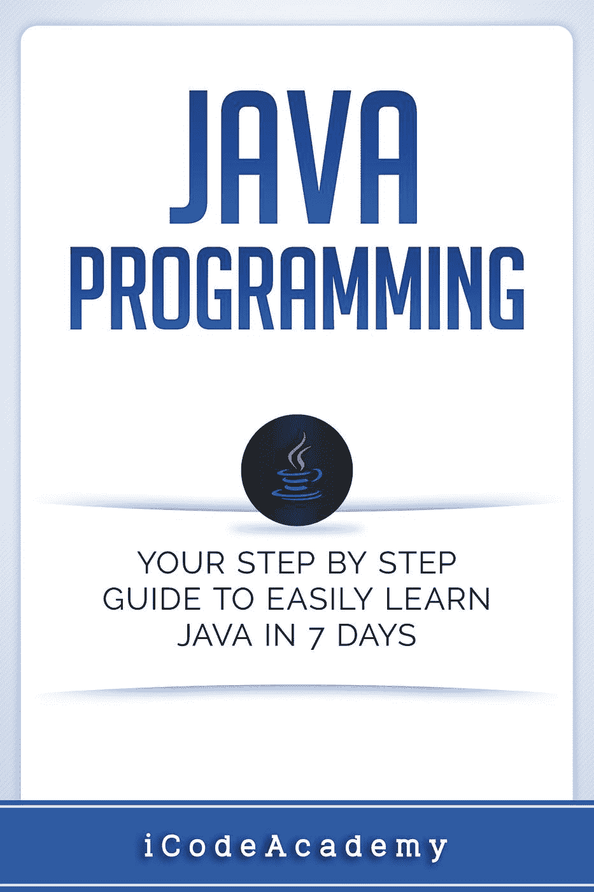

# Java 编程：7 天轻松学会 Java 逐步指南



iCode Academy

初学者 Java

# 引言

编程世界是非常多样化的世界，每种编程语言都有其特定的优势。有像 C 和汇编语言这样的语言关注操作系统指令和其他计算机软件，而也有像 HTML 和 JavaScript 这样的语言关注基于 Web 的应用程序。Java 就是兼顾这两者的编程语言示例。本电子书包含了指南和说明，帮助你在一天内学习并理解 Java。

## 什么是 Java？

Java 实际上是由 Sun Microsystems 开发的一种优秀的编程语言。它最初用于内核应用程序或小程序（applets）。这些小程序嵌入网页并在浏览器中运行。Java 使用一种名为字节码（`byte code`）的特殊格式，而不是普通的机器码。在 Java 解释程序的帮助下，字节码可以在任何计算机上执行。这个 Java 解释器程序被称为 Java 虚拟机或 `JVM`。它在大多数计算机系统中都是可用的。Java 可能使用字节码格式，但 Java 没有任何部分要求使用这种字节码技术。存在一些编译器可以生成真正的机器码，或者更广为人知的原生代码。

Java 程序由一系列类组成。这些程序的源代码使用 `.java` 编写。这些源文件然后被编译成 `.class` 文件，其中包含字节码而不是针对特定 CPU 的机器码。`.class` 文件在运行时由 Java 虚拟机（`JVM` 或解释器）执行。

Java 并不限于互联网应用程序。从技术上讲，它是一种完整的通用面向对象编程语言，可以开发各种应用程序。Java 的语法与 C++ 的语法非常相似，但去除了其容易出错的特性和复杂性。

不要将 Java 误认为 JavaScript。JavaScript 是一种完全不同的语言。JavaScript 是一种解释型编程语言，作为网页或网站内容生成的三个基本组成部分之一。Java 和 JavaScript 的区别在于 Java 是面向对象的语言，而 JavaScript 是面向对象的脚本语言。Java 编写的代码需要编译，而 JavaScript 编写的代码全是文本。两种语言在虚拟机和浏览器中都需要不同的插件。

创建 Java 的 Sun Microsystems 为开发 Java 软件提供了免费工具。如果你想了解更多关于这些工具的信息，可以访问网站 [`www.sun.com`](https://www.sun.com) 获取更多信息，例如针对不同计算机系统（UNIX、Microsoft Windows、OSX）的 Java 编译器以及详细文档。Java 编译器是免费的，可以从给定链接下载。

在整个电子书中，我们将讨论 Java 程序编译的基础、简单表达式和声明、类、对象和语句，直到你能够在一天内学习、理解并编写一个完整的 Java 程序。

# 第一章：Java 基础

## 编译和运行 Java 程序

每个 Java 源文件只包含一个类。文件名必须与类名相同。例如，`Hello` 类应该存储在源文件 `Hello.java` 中。使用 `javac` 编译器可以在终端编译源文件 `Hello.java`：

```
javac Hello.java
```

这将产生一个与源文件相同但扩展名不同的文件；`.class` 扩展。类文件现在包含字节码。这意味着它不能立即执行。它需要 Java 虚拟机或字节码解释器：

```
java Hello
```

上述命令加载并执行了 `Hello` 类及其 `main` 方法。如果该类包含了对其他类的扩展（将在接下来的章节中进一步讨论），这些类会在需要时自动加载。如果你有一个源文件扩展了其他源文件，可以使用以下命令编译所有文件：

```bash
javac *.java
```

假设所有文件都在同一个文件夹中，每个源文件将加载并执行其对应的类文件。

## 声明与表达式

Java 中有八种基本数据类型。所谓基本类型，意味着这些类型不是基于其他类型定义的；本质上是原子的。它们是 CPU 准备好处理的位序列。这些类型是：

`byte`、`short`、`int`、`long`、`float`、`double`、`char`、`boolean`

如果一个变量类型不是基本类型，则它被视为引用类型。引用类型可以是类、接口或数组类型。任何引用类型的变量都可以被设置为 `null`。这意味着它可以不包含任何内容。

Java 支持通常的一组数据类型，如整数、字符、布尔型和其他变量。以下是一些示例：

```java
int a, b;   //整数变量
float f;    //浮点数变量
char s;     //字符变量
boolean a;  //返回 true 或 false
```

注意：`//` 和 `/* */` 分别用于单行注释和多行注释。

数值表达式的编写方式与其它语言几乎相同：

```java
a = 2 * (3 + 1);
b = c / 4.12643;
p = q % 2;
o = true;
s = 'L';
```

在声明变量时，可以直接为其分配一个初始值：

```java
int a = 5;
float f = 0.52;
```

Java 中的除法运算符实际上代表两种不同的含义。它可以是实数的浮点除法，也可以是整数的整除。在大多数情况下这并不是真的问题，尽管它可能会导致不同的结果。

```java
double a;
a = 1 / 9;      // a 的结果将是 0.0
a = 1.0 / 9.0;  // a 的结果将是 0.111...
```

第一个操作执行了整除，因此结果为 `0`。如果你想得到 `1` 和 `9` 的精确商，你需要将 `1` 和 `9` 表示为实值，以便除法变为浮点除法。

在 Java 中，可以为整数变量分配实值。该值会自动转换为对应的类型。这被称为类型转换（`typecasting`）。

Java 支持类型转换，但不会自动执行转换。程序员需要通过在表达式前的括号中写入所需的类型，来指示在何处以及进行哪些转换。

```java
double a;
int b;
b = (int) (a * 12.3223122);
```

当然，可以在不进行类型转换的情况下为实数变量分配整数。只要转换可以在不丢失任何信息的情况下进行，就没有必要强制转换。

## 类与方法

Java 是一种面向对象的编程语言，因此我们使用的术语与结构化编程语言中的术语略有不同。

Java 中的函数、子程序和过程被称为 `methods`（方法）。用于调用或执行函数的术语称为 `invoking`（调用）。变量和方法的组合在一起被称为 `class`（类）。

以下是方法的一些示例：

```java
class HelloWorld{
    public void sayHi(int a, int b){
        aa = a;
        bb = b;
    }
    private int getAge(){
        return x;
    }
}
```

上面的示例包含两个方法：`sayHi` 和 `getAge`。一个方法可以有多个参数，也可以没有参数。

注意第一个方法以关键字 `public` 开头，第二个方法以 `private` 开头。这表示该方法是否可以从其他类访问。当你需要保护某些不应被其他方法访问的数据时这非常有帮助。

与 C 语言中的 `struct` 类型（记录结构）类似，Java 中的变量被视为类每个实例的一个组。一个对象被视为结构体或记录的发生实例。换句话说，一个对象是其类的实例。

了解对象属于哪个类也意味着了解它拥有哪组变量以及它可以执行哪些方法。这听起来可能很奇怪，因为一组变量按理不能执行任何操作。这是面向对象编程的核心。这意味着每一段代码都被认为是由一个对象在执行的。

这里是一个简单的 Java 代码示例：

```java
class Section{ //这是定义了一个名为“Section”的类
    int a, b, c; //这些是定义的三个整数实例变量
    /*每个 Section 实例都为这些变量拥有自己的值 */
    void add(int aa, int bb, int cc){
        a+= aa; //将 (aa, bb) 加到 (a, b)
        b+=bb; 
        this.c += cc //“this.c” 等于“c”
    }
}
```

现在你可能在想 `this` 是做什么用的。很好，类中的每个方法都包含一个未列出的秘密参数，即变量组。该参数就是 `this`。`add` 方法需要知道它正在加哪个 section。调用者需要告诉加哪个 section。任何对 `add` 的调用都需要链接到 `Hello` 类的特定实例。

```java
Section s1;
s1 = new Section();
s1.a = 1;
s1.b = p;
s1.c = 0;
```

我们将在第 3、4 章中详细讨论方法、对象和类。现在来看这个简单的程序示例：

```java
public class HelloWorld{
    public static void main(String[] args){
        System.out.print("Hello World!");
    }
}
```

逐行讨论：

首先你会看到类声明 `HelloWorld`。`public` 表示它可以被其他类访问。

其次，我们看到方法 `main`。注意方法声明中的 `static` 吗？这意味着当调用该方法时，它并不与对象关联，而是与类本身关联。换句话说，方法无法访问任何属性。

第三是 `args` 参数。该参数从 Java 解释器执行的类名以外的信息中获取值（如果有的话）。

注意：`System.out.print` 是显示程序员在引号（"）内编写内容的方法。如果你想在运行时换行，可以使用 `System.out.println`。这将为输出创建一个新行。

示例 #2：

```java
import java.util.Scanner; //导入包
public class User{
    public static void main( String[] args ){
        Scanner inp = new Scanner(System.in); //实例化新对象 Scanner
        String f_name; //字符串变量声明
        String l_name;
        String full_name;
        System.out.print("Enter your first name:"); //这一行要求输入你的名
        f_name = inp.next(); //输入的内容将通过 inp.next() 存储在 f_name 中
        System.out.print("Enter your last name:"); //此行要求输入你的姓
        l_name = inp.next(); //输入的内容现在将存储在 l_name 中
        full_name = f_name + " " + l_name; //这一行将 f_name 和 l_name 存储在 full_name 中，并用 " " 分隔
        System.out.println("Hello,"+ full_name + "! Pleased to meet you."); //这一行打印你的全名
    }
}
```

现在，上面的代码是一个 Java 基础输入输出程序的示例。首先，让我们来讨论一下 `import java.util.Scanner;` 这一行的含义。`Scanner` 类是一个在处理用户输入时非常有用的类。要使用 `Scanner` 类，我们需要通过关键字 `import` 将其引用到我们的代码中。`Import` 基本上与 C 语言中的 `#include` 相同。这意味着 `import` 引用了我们的程序可以直接使用的外部库。

接下来是这一行 `Scanner inp = new Scanner(System.in);`。

这一行简单地创建了 `Scanner` 方法的对象实例。`System.in` 表示它将存储用户提供的输入。

```java
f_name = inp.next();
l_name = inp.next();
```

上述两行代码演示了输入如何分别存储在 `f_name` 和 `l_name` 中。`inp.next();` 行意味着用户接下来输入的任何内容，都将存储在赋值给它的相应变量中。

`full_name = f_name + " " + l_name;` 这一行。`f_name` 之后和 `l_name` 之前的 `+` 符号表示你可以在它们之间定义的字符串或字符。`+` 符号仅将两个用户输入以及字符或符号连接在一个行或语句中。

# 第 2 章：条件语句、迭代语句和分支语句

Java 中的语句的编写方式与其他语言相同。与在 C 或 Pascal 中编写语句的方式类似，这些语句可以使用 `{` 和 `}` 在部分中分组在一起。

## If-then-else 语句

与几乎所有语言一样，Java 中的 `if-then-else` 语句允许当“if”条件评估为假时执行另一种执行路径。以下是一个示例：

```java
void isZero() {
  if( x == 0 ) {
    System.out.println("x is zero.");
  }
  System.out.println("X is not equal to zero.");
}
```

与其他语言一样，在 Java 中单独使用 `if`-语句是可能的。如果你的代码中没有很多条件执行，你只需要 `if`-语句即可。

现在，看看下方的代码：

```java
import java.util.Scanner;

class ConditionCheck {
  public static void main ( String[] args ) {
    int grade;
    Scanner sc = new Scanner( );
    System.out.println("Enter your grade (0 – 100):");
    grade = sc.nextInt();
    if (grade == 100) {
      System.out.println(" You had a perfect score! Congratulations!");
    } else if (grade >= 60) {
      System.out.println("You passed the exam with a score of " + grade + "%.");
    } else if (grade < 60 ) {
      System.out.println("You failed the exam. You should study more to pass the next one.");
    }
  }
}
```

上面的程序演示了一个简单的成绩检查器。与任何其他语言一样，Java 也可以有条件语句。`ConditionCheck` 类其中一个示例。如果用户输入等于 `100`，程序将输出“You had a perfect score”。如果用户输入大于或等于 `60`，程序将输出“You passed the exam with a score of grade%”，但如果用户输入小于 `60`，程序将输出“You failed the exam. You should study more to pass the next one.”

## 布尔表达式

布尔表达式可以与逻辑运算符如‘and’‘or’和‘not’一起使用。这些运算符在 Java 中的写法为：

- `&&`
- `||`
- `!`

以下是一个示例：

```java
if(a == 0 && b) {
  b++;
}
```

## Switch-Case 语句

虽然 `switch` 语句也是像 `if-then` 和 `if-then-else` 一样的条件语句，但它在许多方面有所不同。`switch` 语句与 `byte`、`char` 和 `int` 等原始类型一起工作。`switch` 语句也适用于枚举数据，如 `String` 以及少数覆盖原始类型（如 `byte`、`char` 和 `int`）的特殊类——换句话说，即记录。


# Java 控制流语句

## Switch 语句

```java
public class SwitchCase {
  public static void main(String[] args) {
    int month = 8;
    String monthStr;
    switch (month) {
      case 1: monthStr = "January"; break;
      case 2: monthStr = "February"; break;
      case 3: monthStr = "March"; break;
      case 4: monthStr = "April"; break;
      case 5: monthStr = "May"; break;
      case 6: monthStr = "June"; break;
      case 7: monthStr = "July"; break;
      case 8: monthStr = "August"; break;
      case 9: monthStr = "September"; break;
      case 10: monthStr = "October"; break;
      case 11: monthStr = "November"; break;
      case 12: monthStr = "December"; break;
      default: monthStr = "Invalid month"; break;
    }
    System.out.println(monthStr);
  }
}
```

上面的代码演示了在 Java 中如何编写 `switch` 语句。注意 `int month` 的值为 `8`，并且编写了 `13` 种情况，包括一个 `default` 情况，用于检查 `month` 的值是否为 `1` 到 `12` 之间的整数。考虑到 `int month` 的值，`println` 的结果将是 ‘August’。

`if-else` 语句和 `switch` 语句之间的区别在于 `switch` 语句更易读。想象一下在 `if-else` 中写了多个条件。它将很难编写也难以阅读。另一个区别是关键字 `break`。在 `if-else` 中，程序每次只进入一个条件块，而在 `switch` 语句中，程序可以按顺序通过所有情况。这里有一个示例：

```java
int month = 8;
switch (month) {
  case 1: System.out.println(" January ");
  case 2: System.out.println(" February ");
  case 3: System.out.println(" March ");
  case 4: System.out.println(" April ");
  case 5: System.out.println(" May ");
  case 6: System.out.println(" June ");
  case 7: System.out.println(" July ");
  case 8: System.out.println(" August ");
  case 9: System.out.println(" September ");
  case 10: System.out.println(" October ");
  case 11: System.out.println(" November ");
  case 12: System.out.println(" December ");
}
```

由于 `month` 的值为 `8` 且编写了 `13` 种情况（包括一个用于检查 `month` 值是否为 `1` 到 `12` 之间整数的 `default` 情况），程序将跳转到 `case 8`。输出将是：

```
September
October
December
```

### Switch 语句与字符串

在 Java SE 7 及更高版本中，可以在 switch 语句中使用 `String` 类型。以下是一个示例：

```java
public class getDate {
  public static int getNo(String month) {
    int monthNo = 0;
    if (month == null) {
      return monthNo;
    }
    switch ( month.toLowerCase() ) {
      case "january" : monthNo = 1; break;
      case "february" : monthNo = 2; break;
      case "march" : monthNo = 3; break;
      case "april" : monthNo = 4; break;
      case "may" : monthNo = 5; break;
      case "june" : monthNo = 6; break;
      case "july" : monthNo = 7; break;
      case "august" : monthNo = 8; break;
      case "september": : monthNo = 9; break;
      case "october" : monthNo = 10; break;
      case "november": : monthNo = 11; break;
      case "december": : monthNo = 12; break;
      default: monthNo = 0; break;
    }
    return monthNo;
  }
  public static void main (String[] args) {
    String month = "August";
    int returnedMonthNo = getDate.getNo(month);
    if (returnedMonthNo == 0) {
      System.out.println( Invalid month");
    } else {
      System.out.println(returnedMonthNo);
    }
  }
}
```

上述代码的输出是 `8`。switch 表达式中的 `String` 类型与每个 case 标签关联的表达式进行比较，就像使用了 `String=` 方法一样。为了让 `getDate` 类示例能够接受任何大小写的月份，需要使用 `.toLowerCase` 方法将变量的值转换为小写。与 case 标签关联的所有字符串都是小写的。

注意：上面的代码还检查了 switch 语句中的表达式是否为 null。记住，为了防止 `NullPointerException` 产生或被抛出，任何 switch 语句中的表达式都不能为 null。

## 循环与迭代语句

### while 语句

Java 中的 `while` 语句与其他编程语言中的 `while` 语句并没有太大区别。`while` 语句在指定的条件为真时，会持续执行一段指令。它的语法可以写为：

```
while (expression | instruction| condition) {
    Statement | instruction | condition (s);
}
```

`while` 语句检查 `expression`，该表达式需要返回一个布尔值。只要 `expression` 的值求为 `true`，`while` 语句就会继续执行 `while` 区域包含的指令或语句。`while` 语句将继续评估 `expression` 并执行其指令，直到 `expression` 的值变为 `false`。下面的示例代码根据表达式 `count` 打印从 1 到 10 的值。

```java
class displayNumbers {
    public static void main(String[] args){
        int count = 1;
        while (count < 11) {
            System.out.println ("Count is: " + count);
            count++;
        }
    }
}
```

如你在上面的代码所示，`while` 语句检查 `count` 的值是否大于 11。如果 `expression` 求为 `true`，程序将进入 `while`语句并执行 `System.out.println("Count is:" + count)` 这一行。之后，`count` 的值将增加并重新评估其值，直到表达式 `count < 11` 变为 `false`。

还可以使用 `while` 语句实现无限循环。下面的示例代码演示了如何实现：

```java
while (true){
    //在此处编写你的代码
}
```

由于 `expression` 始终求为 `true`，`while` 语句将一直执行块内部的指令；因此形成了无限循环。

### do-while 语句

在 Java 编程语言中，也有 `do-while` 语句。与其他编程语言的 `do-while` 语句相比，`do-while` 语句并没有太大区别。`do-while` 语句可以如下：

```
do {
    statement(s)
} while (expression);
```

当程序进入 `do-while` 语句时，它会立即执行块内部的指令和语句。之后，它才会检查 `expression` 是否为 `true`。

#### do-while 和 while 之间有什么区别？

`do-while` 和 `while` 的区别在于 `do-while` 在循环的底部评估其 `expression`，而不是顶部。因此，`do` 块中的语句至少会被执行一次。下面的代码演示了带有简单 `do-while` 循环的 Java 程序是如何运行的：

```java
class DoWhileSample {
    public static void main(String[] args){
        int count = 1;
        do {
            System.out.println("Count is: " + count);
            count++;
        } while (count < 11);
    }
}
```

### for 语句

在 Java 编程语言中，`for` 语句提供了一个精确的任务来循环或迭代一个值范围。开发者和程序员员对 `for` 语句的常用术语是“for 循环”，因为它在满足其条件之前会进行重复迭代。一个 `for` 循环可以写为：

```
for (initial value; terminating condition; incrementing value) {
    //expressions | statements
}
```

在使用 `for` 循环时，注意 `initial value` 是循环的起点至关重要。它只在开始时执行一次。一旦满足 `terminating condition`，循环将停止并结束。如果尚未满足 `terminating condition`，则在每次循环迭代时，`incrementing value` 都会被加到当前值上。只要 `terminating condition` 求为 `true`，它就会持续增加。根据程序的执行流，`incrementing value` 也可以递减。

```java
class sample_For {
    public static void main(String[] args){
        for (int x=1; x<10; x++){
            System.out.println ("The current value is: " + x);
        }
    }
}
```

上面的示例代码展示了 Java 中 `for` 循环的常见用法。程序的输出将是：

```
The current value is: 1
The current value is: 2
...
The current value is: 9
```

如果你注意到，代码在 `expression` 中声明了一个变量。循环的作用范围了从变量声明直到循环区域的结束。对于 `for` 语句，这在 `expression` 的 `terminating` 和 `incrementing` 部分可能很有用。如果循环内部的变量在其他不需要，更好的做法是在循环内部声明变量以减少错误。`for` 循环内部的表达式不是必须的。换句话说，如果程序进入 `for` 循环且没有表达式存在，将没有内容可以评估。这将导致如下示例代码所示的无限循环：

```
for ( ; ) {
    //过程 / 语句
}
```

编写 `for` 循环还有另一种方法。这种形式在遍历数组和记录时非常有用。这种形式循环的其他术语是 `增强 for 语句`（enhanced for statement）。`增强 for 语句` 有助于使循环更加简洁。这里是应用 `增强 for statement` 的示例：

```java
class EnhancedFor {
    public static void main(String[] args){
        int[] values = {11, 12, 13, 14, 15, 16, 17, 18, 19, 20};
        for (int list : values ) {
            System.out.println("The number is: " + list);
        }
    }
}
```

这种 `enhanced for statement` 看起来与普通的 `for` 循环有些不同。`list` 变量的作用是访问当前值。上述程序的输出将是：

```
The number is: 11
The number is: 12
The number is: 13
The number is: 14
The number is: 15
The number is: 16
The number is: 17
The number is: 18
The number is: 19
The number is: 20
```

## 分支语句

### Break 语句

我们已经见过 `break` 语句是如何工作的。一旦程序遇到 `break` 语句，它就会终止其包含的区域。确实，这是 `break` 语句最常见的应用。另一种应用是带标签的 `break`。虽然它与无标签的 `break` 几乎相同，但 `label` 产生了区别。这里有一个示例代码：

```java
class Hello{
    public static void main(String[] args){
        int x,y;
        loop:
        for(x=0;x<5;x++){
            System.out.println(" ");
            for(y=0;y<5;y++){
                System.out.print("x ");
                if(y==3 && x==2 ){
                    break loop;
                }
            }
        }
    }
}
```

通过添加语句 `loop`，标签 `break` 变得可能。根据上面的代码，当 `y` 的值为 3 且 `x` 的值为 2 时，`break` 语句将终止由标签 `loop` 覆盖的区域。上述程序的结果是：

```
x x x x x
x x x x x
x x x
```

### Continue 语句

`continue` 语句实际上是 `break` 语句的相反。在某种意义上，当 `expression` 内部的条件求为 `true` 时，它保持区域运行。但它完全相反，因为它会跳过 `for`、`while` 和 `do-while` 循环的当前迭代。

与 `break` 语句一样，`continue` 语句也有无标签和标签的形式。在无标签的 `continue` 语句中，会评估 `expression`，以便程序知道是否应该跳到代码区域的结束。这是一个无标签 `continue` 语句的示例：

```java
class Hello{
    public static void main(String[] args){
        int x,y;
        for(x=0;x<5;x++){
            System.out.println(" ");
            for(y=0;y<5;y++){
                System.out.print("x ");
                if(y==3 && x==2 ){
                    continue;
                }
            }
        }
    }
}
```

上述代码的输出将是：

```
x x x x x
x x x x x
x x x x x
x x x x x
x x x x x
```

注意：由于上面的代码是一个未标记的 continue 语句，代码将不会跳过包含的表达式，尽管它仍然会评估该表达式的真假。

相反，带标签的 continue 会跳过从该标签开始的循环。这里是有一个带标签的 continue 语句的示例：


```java
public class Hello {
    public static void main(String[] args) {
        int x, y;
        loop:
        for (x = 0; x < 5; x++) {
            System.out.println(" ");
            for (y = 0; y < 5; y++) {
                System.out.print("x ");
                if (y == 3 && x == 2) {
                    continue loop;
                }
            }
        }
    }
}
```

程序的输出将是：

x x x x x

x x x x x

x x x x

x x x x x

x x x x x

注意第三行没有 5 个 x 吗？那是因为当表达式 `if (y == 3 && x == 2)` 为真时，`continue loop` 直接跳回 `for (x = 0; x < 5; x++)` 循环。这意味着当程序运行到表达式 `if (y == 3 && x == 2)` 为真时，`continue` 语句跳过了剩余迭代。这就是带标签的 `continue` 语句的作用。

## return 语句

`return` 语句与 `break` 和 `continue` 语句都不同。它退出方法并返回到调用方法的地方。

与其他编程语言中的 `return` 语句一样，`return` 语句有两种形式：返回值的和不返回值的。为了返回一个值，只需在 `return` 关键字后编写计算该值的值或表达式即可。这是一个示例：

```java
return answer;
```

这是一个不带值的 `return` 语句示例：

```java
return;
```

注意：使用 `return` 语句时，方法的返回类型应与返回值匹配。如果方法声明为 `void`，则不能返回值。返回值的数据类型必须与方法声明的返回类型相同。否则，程序将报错。

我们将在第 4 章看到更多 `return` 语句的用法。

# 第 3 章：数组

数组在 Java 中不是基本数据类型。换句话说，它是相同数据类型变量的集合；基本上是一个容器。它存储许多相同数据类型的值。数组的大小总是固定的。一旦创建了数组，就无法扩展。

正如你在上面的图片所示，数组中的位置被称为 `indices`（索引）或 `index`。存储在这些索引中的值被称为 `elements`（元素）。如果你注意到了，数组从索引 `0` 开始，到索引 `9` 结束。Java 中的数组与其他编程语言基本相同。

## 数组声明

考虑一个整数变量 `sample_array`。为了让 `sample_array` 成为整数数组，在 `int` 之后添加 `[]`。这是一个示例：

```java
int[] sample_array;
```

你刚刚声明了一个名为 `sample_array` 的整数数组。现在，数组声明可以分为两个部分：数组的数据类型和数组本身的名称。根据上面的示例，数组的数据类型是 `int[]`，数组的名称是 `sample_array`。`[]` 保持为空，因为它们不是数据类型的一部分。它只是表示你将该变量声明为数组。虽然你已经声明了数组，但并不意味着你已经创建了一个。

注意：与任何其他变量一样，正确声明数组是非常重要的。否则，你的程序将遇到编译错误。

Java 数组不仅限于整数数组。以下是 Java 中其他类型数组的示例：

```java
String[] string_array_sample;
byte[] byte_array_sample;
long[] long_array_sample;
float[] float_array_sample;
boolean[] boolean_array_sample;
double[] double_array_sample;
char[] char_array_sample;
short[] short_array_sample;
```

以下代码是为特定数组索引赋值值（元素）的示例：

```java
sample_array[0] = 24;
char_array_sample[4] = 'E';
```

为了访问并显示数组，可以使用数组的名称和你想访问的元素索引：

```java
System.out.println("The value is: " + sample_array[0]);
System.out.println("The element is: " + char_array_sample[4]);
System.out.println("The element in the index is " + sample_array[5] + ".");
```

另一种声明数组的方法可以如下代码所示：

```java
int[] sample_array = {
    20, 444, 195,
    23, 0, 100,
    32, 55, 195
};
```

使用上面的方法，可以确定数组的大小。将括号放在数组之后是可以接受的。看下文：

```java
public class simple_array {
    public static void main(String[] args) {
        int x = 10;
        int[] sample_array;
        sample_array = new int[x];
        for (x = 0; x < 10; x++) {
            sample_array[x] = x;
            System.out.println("The element of index " + x + " is " + sample_array[x] + ".");
        }
    }
}
```

上述代码的输出将是：

The element of index 0 is 0.

The element of index 1 is 1.

The element of index 2 is 2.

The element of index 3 is 3.

The element of index 4 is 4.

The element of index 5 is 5.

The element of index 6 is 6.

The element of index 7 is 7.

The element of index 8 is 8.

The element of index 9 is 9.

仔细检查这段代码。你会发现数组的大小被设置为 `x`，其值为 `10`。你还会看到，代码中并没有逐个地声明元素，而是编写了一个 `for` 循环来遍历数组所有元素的存储和打印。`for` 循环遍历每个索引，并在 `x` 增加时存储其当前值，然后移动到下一个索引。

在 Java 中，也可以声明数组的数组，换句话说就是多维数组。通过在数据类型后添加两个或多个方括号，而不是仅一组，就可以创建一个多维数组。数组中的每个元素都可以通过特定的索引组合来访问。

Java 中的多维数组与 C 或其他语言中的多维数组略不同，因为 Java 中多维数组的组件也是数组。

为了更好地理解这一点，这里有一个示例代码：

```java
class sample_md_array {
    public static void main(String[] args) {
        String[][] rankings = {
            {"Sgt. ", "Lt. ", "Capt. "},
            {"John", "Maximus"}
        };
        System.out.println(rankings[0][0] + rankings[1][0]);
        System.out.println(rankings[0][1] + rankings[1][1]);
    }
}
```

代码的输出结果为：

Sgt. John

Lt. Maximus

现在，既然我们可以声明数组的元素，现在就可以使用内置的 `length` 属性来获取任何数组的大小。这可以写成：

```java
System.out.println(sample_array.length);
```

这将打印出数组中元素的个数。

## 数组复制

Java 的 `System` 类提供了一个内置方法，可以将数据从一个数组复制到另一个数组。该方法称为 `arraycopy`。这是一个示例：

```java
System.arraycopy(src, srcPos, dest, destPos, length)
```

对象 `src` 和 `dest` 决定了源数组和目标数组。换句话说，`src` 意味着数据来源数组，而 `dest` 意味着数据复制到的数组。`srcPos` 决定了 `arraycopy` 方法开始的起始位置或起始索引。`destPos` 的功能与 `srcPos` 相同，但决定的是目标数组中的起始位置。整数 `length` 决定了程序员想要复制的元素数量。

查看以下示例程序 `arr_copy_sample`：

```java
class arr_copy_sample {
    public static void main(String[] args) {
        int[] sourceArr = {0, 2, 4, 6, 8, 10, 12, 14, 16};
        int[] destArr = new int[7];
        int x;
        System.arraycopy(sourceArr, 1, destArr, 0, 7);
        for (x = 0; x < 7; x++) {
            System.out.print(destArr[x] + " ");
        }
    }
}
```

该程序的输出为：

2 4 6 8 10 12 14

## 数组元素操作

在编程世界，数组的使用是一个非常强大且高效的概念。在 Java SE 中，有一些方法允许程序员执行一些最常见的数组操作。其中一个例子是 `arr_copy_sample` 类。示例代码中的 `arraycopy` 方法利用了 `System` 类，而不是手动遍历源数组的每一个元素并将每个元素复制到目标数组。这一过程发生在程序运行期间。它只是允许开发者使用代码来调用该方法。

为了避免手动迭代并提供便利，Java SE 提供了一些操作数组的方法。这些方法包含了常见的过程，如复制、搜索和排序数组。`java.util.Arrays` 类提供了这些方法。其中一个示例可以应用于 `arr_copy_sample` 代码中。

```java
class Hello {
    public static void main(String[] args) {
        int[] sourceArr = {0, 2, 4, 6, 8, 10, 12, 14, 16};
        int x;
        int[] destArr = java.util.Arrays.copyOfRange(sourceArr, 1, 8);
        for (x = 0; x < 7; x++) {
            System.out.print(destArr[x] + " ");
        }
    }
}
```

你会发现，这里使用了 `java.util.Arrays` 包中的 `copyOfRange` 方法而不是 `arraycopy` 方法。它的区别在于，开发者在调用该方法之前不再需要初始化目标数组，因为目标数组本身就是该方法返回的值。

程序的输出也将与使用 `arraycopy` 方法的程序相同，但如果你更仔细地观察，不再需要指定复制到目标数组的起始索引。只需要源数组、起始索引以及方法需要到达的索引上限；换句话说，就是要复制的最终索引。

`java.util.Arrays` 类包含的其他方法包括：

- `binarySearch` 方法：
    - 该方法通过定位特定值所在的索引来在数组中搜索该值。
- `equals` 方法：
    - 该方法通过比较两个数组来确定它们的值是否相等。
- `fill` 方法：
    - 该方法用于存储值。它通过在每个索引处放置特定值来填充数组。
- `parallelSort` 方法：
    - 该方法仅在 Java SE 8 中引入。它并发地将元素按升序排列。
- `sort` 方法：
    - 该方法的作用与 `parallelSort` 相同，但它是按顺序对元素进行排序。

代码 `new Example(0, 10, 5)` 在内存中为初始化对象及其值创建了空间。

构造函数中的参数不是必须的。例如：

```java
public Example() {
    int start = 0;
    int end = 10;
    int middle = 5;
}
```

创建对象的方式也是相同的，但不需要参数：

```java
Example example = new Example();
```

这两个构造函数都可以声明。构造函数可以根据参数的数量和类型来区分。

```java
public MyOwnClass solveMethod(MyOwnClass sample1, MyOwnClass sample2) {
    MyOwnClass example_1;
    // insert some code here
    return example_1;
}
```

## this 语句

我们在之前的章节中已经见过 `this` 的用法。`this` 实际上指的是当前正在调用的方法或构造函数的当前对象。通过使用 `this`，可以在实例方法内部引用当前对象的任何成员或属性。

`this` 关键字通常用于字段，因为它会被方法或构造函数的参数所遮蔽。

看下面的示例：

```java
public class Sample {
    public int a;
    public int b;
    public Sample(int i, int j) {
        a = i;
        b = j;
    }
}
```

通过使用 `this` 语句，代码可以重写为：

```java
public class Sample {
    public int a;
    public int b;
    public Sample(int a, int b) {
        this.a = a;
        this.b = b;
    }
}
```

构造函数的每个参数都遮蔽了对象的每个属性。构造函数 `Sample` 内部的属性 `a` 属于类 `Sample` 参数的本地副本。为了引用样本属性 `a`，构造函数需要使用 `this.a`。

可以使用 `this` 语句调用同一类中的另一个构造函数，前提是它位于构造函数内部。这个过程可以称为显式构造函数调用。例如：

```java
public class Sample {
    private int a, b, var1, var2;
    public Sample() {
        this(0, 1, 3, 3);
    }
    public Sample(int var1, int var2) {
        this(0, 1, var1, var2);
    }
    public Sample(int a, int b, int var1, int var2) {
        this.a = a;
        this.b = b;
        this.var1 = var1;
        this.var2 = var2;
    }
}
```

上面的代码包含了一组构造函数。每个构造函数都提供了一个默认值，并创建了类 `Sample` 成员变量的实例。

# 第 5 章：接口与继承

在编程和软件工程中，在某些情况下，不同的程序员或不同的程序员小组之间拥有“共同基础”是至关重要的，这使得他们的代码和软件具有交互性。这些程序员在不知道其他程序员代码如何编写的情况下也能编写自己的代码。这些程序员的“共同基础”被称为接口。


例如，一个社区中存在可以在没有人类操作员的情况下运行并传输人的先进车辆。为了让这些车辆运行，车辆制造商开发了用 Java 编写的软件，可以在无需人工操作的情况下操控车辆。想象你的车辆或汽车自动启动并加速，能够管理速度以避免事故。

另一个可以考虑的例子是全球定位系统 `GPS`。有计算机系统接收 `GPS` 传输的数据，以跟踪车辆的位置并提供其他数据的无线传输，如最新的地图、天气和交通状况。结合 `GPS`，自动驾驶车辆可以感知应该选择哪条路线、选择正确的方向以到达目的地，而不会遇到拥堵之类的困扰。

现在，`GPS` 软件和车辆的自动化软件显然是由不同的程序员团队开发的。开发自动化软件的程序员小组不知道 `GPS` 软件的代码长什么样，也不知道它是如何实现的，但他们可以通过单一的共同基础进行交互。那就是接口。只要他们保持接口的交互性，每个程序员小组实际上都可以让另一个小组修改代码。

# Java 接口

Java 编程语言将接口视为一种引用类型。它被认为类似于类，只能包含常量、默认方法和静态方法、方法签名和嵌套类类型。接口的方法体仅用于默认方法和静态方法的目的。

接口不能有实例。接口无法实例化，因为接口只能被类或其他接口实现或扩展。

这里是一个接口的示例：

```java
public interface automateVehicle {
    // 静态变量声明
    // 方法签名
    int init(Speed s, float distance, float gas, float angle, boolean collision);
    int accelerate(Speed s, float gas, float distance);
    int decelerate(Speed s, float gas, float distance, boolean collision);
    int steerWheel(Speed s, float distance, boolean collision);
    // 其他方法
}
```

注意：记住，方法签名不需要大括号，因为它们以分号结束。

为了使用接口，使用了 `implements` 关键字。每当一个可以实例化的类实现接口时，它就会为接口中声明的方法创建方法体。

以下代码是一个示例：

```java
public class Car implements automateVehicle {
    int init(Speed s, float distance, float gas, float angle, boolean collision)
    // 上面的代码包含了方法签名和实现
    // 让类 car 初始的代码写在这里
    // 更多代码
    // 其他类成员可以写在这里
}
```

如果你还记得，接口 `automateVehicle` 的开发者并不是类 `car` 的开发者。其他的汽车 `car` 类可以使用 `automateVehicle` 接口，并有不同的实现。这些汽车开发者随后将构建如 `GPS` 系统和数字地图，并通过接口的方法使其可用且有效。

# 接口的声明与定义

接口的声明需要五个组件：修饰符、接口名称、父接口列表（如果有的话）、体、以及 `interface` 关键字。

```java
public interface SampleInterface extends AnotherInterface, ThatInterface, SampleInterfaceAgain {
    float value = 1.54;
    void doSomething(int i, double x);
    int doSomethingElse(String s);
}
```

在前面的代码中，修饰符 `public` 意味着任何包的类都可以访问该接口。如果没有指定接口的修饰符，则接口默认只对相同包内的类可见。

像普通类一样，接口是可以扩展的。它不能只扩展一个类；它可以扩展任意数量的接口，因此如果有父接口，则有一个列表。

现在，接口的体可以包含多种方法，例如抽象方法、默认方法和静态方法。每个方法与其他方法略有不同。

抽象方法（abstract method）与方法签名几乎相同。它不需要实现。默认方法（default method）是在 `default` 修饰符内声明的方法。而 `static` 修饰符是在 `static` 修饰符内声明的。接口中的抽象方法、`static` 方法和默认方法默认都是公共的（public）。

除了方法之外，接口中还可能使用常量声明。接口中声明的每个常量值都可以是任何修饰符（`public`、`static`、`final`）。

为了使一个类能够实现一个接口，在声明中必须在接口名称之前编写 `implements` 关键字。一个类可以实现多个接口。如果发生这种情况，该类要实现的接口将用逗号隔开。如果一个类继承一个父类并实现一个接口，则 `extends` 关键字后面总是跟父类名，然后是 `implements` 关键字。

想象一个定义了对象大小比较的接口：

```java
public interface Comparison {
    public int isSmallerThan(Comparison object_1);
}
```

为了能够不分类型地比较相似对象的大小，`Comparison` 接口需要由实例化这些对象的类来实现。

只要有一个方法可以比较从该类实例化的对象的相似字段，任何类都可以实现 `Comparison` 接口。对于 `strings` 等其他数据类型，可以比较字符数。对于 `person` 等其他对象，可以使用 `height` 和 `age` 等字段。对于几何对象等数学情况，可以对面积进行比较，而像体积等其他情况则适用于三维对象的比较。`isSmallerThan()` 方法可以由所有上述类实现。

如果已知某个类可以实现 `Comparison` 接口，那么比较从该类实例化的对象大小也是一个肯定的事实。

# 继承

我们在之前的某些章节中已经看到过继承的应用。Java 编程语言允许类派生自其他类。由于这种可能性的存在，父类的属性和方法将由派生类或子类继承。

以下代码是 `Vehicle` 类的简单实现，它在之前的示例中用过：

```java
public class Vehicle {
    Float distance;
    Float gas;
    Float angle;

    public Vehicle(float Vgas, float Vdistance, float Vangle) {
        gas = Vgas;
        distance = Vdistance;
        angle = Vangle;
    }

    public void setDistance(int Ndistance) {
        distance = Ndistance;
    }

    public void setGas(int Ngas) {
        gas = Ngas;
    }

    public void turnStraight(int value) {
        angle -= value;
    }

    public void turn(int value) {
        angle += value;
    }
}
```

作为 `Vehicle` 类子类的 `Car` 类声明看起来如下所示：

```java
public class Car extends Vehicle {
    public int heatRate;

    public Car(float heatR, float sDistance, float sGas, float sAngle) {
        super(sDistance, sGas, sAngle);
        heatRate = heatR;
    }

    // 汽车子类增加了一个方法
    public void setHeatRate(int newValue) {
        heatRate = newValue;
    }
}
```

子类 `Car` 继承了其父类 `Vehicle` 的所有字段和方法。它还增加了另一个名为 `setHeatRate` 的方法及其字段 `heatRate`。除了构造函数之外，编写子类 `Vehicle` 看起来就像是完全凭空创建的另一个类，连同它的字段和方法。感觉是这样，但现在它是这样创建的。如果父类 `Vehicle` 中的方法更复杂且调试需要很长时间，这种技术将非常重要。

子类是派生自另一个类的类。它也可以被称为派生类或子类。子类的对面是父类。父类是子类派生的那个类。父类的另一个术语是父母类。

父类的所有成员，包括属性、方法和其他嵌套类，都由子类继承。虽然它不继承构造函数，但可以从子类调用父类的构造函数。

Java 编程语言不支持多父类继承。这意味着每个类只能有一个直接父类。除了对象之外，每个类基本上都是 `Object` 类的子类；假设该类没有声明父类。子类拥有一个被另一个子类派生的子类是可能的。每个类的顶层父类都是 `Object` 类。无论子类如何，每一个类都可以追溯到对象。

在处理本质上具有相同结构的多个类时，继承的概念可以非常高效。

例如，想象一个 `Mountain` 类和一个 `Valley` 类。与其将 `Mountain` 类的所有属性重写到 `Valley` 类中，不如创建一个 `Landform` 类，它包含了 `Mountain` 和 `Valley` 类都拥有的所有相同属性和方法。这减少了错误的可能性并缩短了调试时间。

# Java 平台层次结构

在 Java 编程语言中，`Object` 类基本上是所有类的核心类。它是最常见的类。所有类都派生自 `Object` 类。这些类然后又有子类，依此类推。这被称为类的层次结构。与其父类相比，层次结构底部的类倾向于执行更具体的方法。

## 子类

子类可以继承其父类的公共和保护成员，无论子类位于哪个包。如果子类和它的父类在同一个包中，子类还可以继承所有的私有成员。如此，子类可以对其继承的成员进行操作，例如：

- 直接使用继承的字段
- 在子类中声明与父类相同的字段
- 声明父类未包含的新字段
- 直接使用从父类继承的所有方法
- 在子类中创建一个实例方法，其方法签名与父类相同（方法重写）
- 创建一个与父类同名的静态方法
- 在子类中声明父类未包含的新方法
- 创建一个调用父类构造函数的子类构造函数

子类不能继承父类的私有成员。只有当子类和父类位于同一个包时才是可能的。

如果父类访问私有字段的方法是公共或保护的，那么这些方法对子类是可访问的。嵌套类可以访问其所在类的所有私有字段和方法。因此，如果嵌套类是公共或保护的，其子类可以访问父类的所有私有成员。

上面的代码声明 `obj1` 同时被声明为 `Object` 和 `MyOwnClass`。这种方法被称为隐式转换。

相比之下，下面的代码被称为显式转换：

```java
MyOwnClass sample = obj1;

MyOwnClass sample = (MyOwnClass) obj;
```

如果没有将类型 `MyOwnClass` 赋值给 `obj1`，将会遇到错误，因为 `obj1` 的数据类型最初是未知的。显式转换在运行时初始化一个观察，以确保 `obj1` 的类型是 `MyOwnClass`。这是为了确保编译器能够识别出 `obj1` 是 `MyOwnClass` 的实例。如果 `obj1` 没有成为 `MyOwnClass` 的实例，程序将抛出异常。

可以使用 `instanceof` 来确定特定对象的类型。这减少了因转换不当而导致运行时错误的几率。

```java
if (obj1 instanceof MyOwnClass) {
    MyOwnClass sample = (MyOwnClass) obj1;
}
```

`instanceof` 运算符检查 `obj1` 是否引用 `MyOwnClass`，以便在不会产生抛出运行时异常的情况下进行转换。

## 多重继承

类和接口之间的区别在于，接口不允许拥有字段，而类可以。另一个区别是，接口不能创建自身的实例来创建对象，而类可以被实例化来创建对象。正如第 4 节所述，对象可以将其当前状态存储在字段中，这些字段可以通过类来定义。

Java 语言不允许一个类拥有多个父类，的原因是为了避免状态多重继承的可能性，换句话说，避免从多个类继承字段的能力。

考虑一种情况，即创建一个可以扩展多个类的类。当通过一个类的实例创建对象时，该类所有父类的字段都将由对象继承。可能会出现一个方法或构造函数创建相同字段的实例。这将非常难以解决。这也是为什么接口不能包含字段；为了避免状态多重继承带来的问题。

从多个类中继承方法定义的能力被称为实现的多重继承。这种继承可能会带来很多问题，例如方法名冲突。能够支持多重继承的编程语言可能会遇到多个父类具有同名方法的情况。这些编程语言的编译器将无法区分一个方法与另一个方法之间的区别。人为错误（如与父类方法产生冲突）也可能发生。

默认方法也具有不同形式实现多重继承。一个类可以实现多个接口。这些接口可以包含同名的默认方法。在 Java 中，编译器有一套规则可以验证特定类需要或使用的默认方法。

Java 语言具有支持类型多重继承的能力。这在技术上是指实现多个接口的能力。一个对象可以拥有多个类型。这些类型可以是它们所属类的类型，也可以是该类实现的所有接口的类型。换句话说，如果一个声明变量被声明为接口类型，则该变量的值可以用来引用来自实现该接口的任何类的任何实例化对象。

另一方面，实现的多重继承允许类从它所扩展的接口中继承不同的实现，无论定义了任何方法。

## 实例方法

在子类中，与父类实例方法具有相同签名和返回类型的实例方法具有覆盖父类实例方法的能力。

由于子类的重写能力，允许类继承特征相对相似的父类，并根据需要修改这些特征。重写方法的组件（名称、参数类型和参数数量、返回值）必须与它将重写的方法相同。重写方法还可以返回被重写方法返回类型的子类型；换句话说，即协变返回类型。

在方法重写期间，建议使用 `@Override`，以便指示编译器父类中的方法将被重写。如果父类中不存在要重写的方法，将发生错误。

## 静态方法

当在子类中定义与父类相同的静态方法（方法签名相同）时，子类的方法将隐藏来自父类的方法。

实例方法重写和静态方法重写的区别在于：

- 子类中被重写的实例方法是被调用的方法。
- 使用的隐藏静态方法可能会有所不同，因为调用它的位置在父类和子类之间可能有所不同。

在接口中，默认方法和抽象方法可以像实例方法一样处理，使其能够像实例方法一样被继承。尽管如果类或接口的父类型已经具有相同方法签名的默认方法，Java 编译器将遵循继承规则，以解决方法名的冲突。这些规则是：

- 接口默认方法的优先级低于实例方法。
- 被其他候选者重写的方法将被忽略。这种情况发生在父类型具有相似祖先类时。
- 在抽象方法的情况下，如果至少有一个定义的默认方法与抽象方法冲突，Java 编译器将抛出编译错误。需要注意的是，父类型方法必须显式重写。

## 多态

在生物学中，多态术语指的是生物或物种可以呈现多种不同的阶段或形式。在 Java 语言中，这个概念同样适用。独特的行为由它们自己的子类定义，但仍然共享父类的一些功能。

为了演示多态，我们将对 `Vehicle` 类进行一些调整。例如，可以在类中添加一个名为 `displayData` 的方法。该方法显示存储在实例中的所有数据。

```java
public void displayData() {
    System.out.println("\nThe Vehicle is " + "in the correct" +
            + with a gas in liters of " + this.gas +
            " and currently have  a total distance of " + this.distance + ". ");
}
```

为了演示 Java 语言的多态，`Vehicle` 类被 `Car` 类和 `RallyCar` 类扩展。对于 `Car` 类，将添加一个名为 `breaks` 的字段，它是一个指示汽车是否包含后减震器的字符串值。这里是更新后的类：

```java
public class Car extends Vehicle {
    private String breaks;

    public Car(
            int sDistance,
            int sGas,
            int sAngle,
            String breakType) {
        super(sDistance,
                sGas,
                sAngle);
        this.setBreaks(breakType);
    }

    public String getBreaks() {
        return this.breaks;
    }
}
```


```java
public void setBreaks(String breakType) {
    this.break = breakType;
}

public void displayData() {
    super.displayData();
    System.out.println("The " + "car has a" +
    getBreaks() + " type as breaks");
}
}
```

注意重写的方法 `displayData()`。另一个需要考虑的细节是输出中包含的关于刹车（breaks）的数据。

下一步是创建 `RallyCar` 类。由于拉赛车（Rally cars）使用不同的轮组能够在地上转弯，因此在字段集中添加了一个新字段 `WheelWidth`。以下是 `RallyCar` 类：

```java
public class RallyCar extends Vehicle {

    private int WheelWidth;

    public RallyCar(int sDistance,
    int sGas,
    int sAngle,
    int newWheelWidth) {

        super(startDistance,
        startGas,
        startAngle);

        this.setWheelWidth(newWheelWidth);
    }

    public int getWheelWidth() {
        return this.WheelWidth;
    }

    public void setWheelWidth(int newWheelWidth) {
        this.WheelWidth = newWheelWidth;
    }

    public void displayData() {
        super.displayData();
        System.out.println("The Rally Car" + " has " + getWheelWidth() +
        "set of  wheels.");
    }
}
```

Java 虚拟机（`JVM`）能够为每个变量引用的对象调用相应的方法。它没有能力根据变量类型来调用方法。这种特性可以被称为虚方法调用。这展示了 Java 编程语言中多态性这一重要特性的一个方面。

# 第 6 章：包

在编程中，开发者倾向于将相关的类型分组成组以便更容易找到并避免命名冲突。这些组被称为包。

包本质上是一组相关的类型，它们允许访问保护和命名空间管理。

**注意：** 请记住，类型可以被称为类（`class`）、接口（`interface`）、注解（`annotation`）或枚举（`enumeration`）。

特殊的类类型是枚举，而特殊的接口被称为注解，但通常情况下，类型通常被称为类和接口。

在 Java 平台上，某些类型同时也是某些包的成员，可以根据功能对类分组。例如：

`java.lang` 包含基础类，而 `java.io` 包含用于读取和写入（输入/输出）的类。还有其他包提供了 `i/o` 和基础功能之外的功能。程序员也可以将自己的类封装到包中。

将类和接口分组到包中的优势是：

*   对于其他程序员来说，定位特定类型（如图形相关的函数）更加方便且易于访问。
*   由于包利用了新的命名空间，因此类型名称与开发的类型名称之间不会发生冲突。
*   同一包内的类型之间可以进行无限制的访问，但对来自其他包的类型保留受保护访问。

## 包的创建

在创建包时，重要的是首先选择一个名称并在其前面加上一个包语句，该名称必须写在包含你想要从包中包含的类型的每个源文件的顶部。

例如：

```java
package example;
```

上面的代码行需要是写在源文件的第一行。每个源文件最多只能写一个 `package` 语句。此规则适用于文件中的所有类型。

如果将多个类型放置在单个源文件中，则只有一个类型可以被修改为 `public`。该类型的名称也必须与源文件的名称相同。

以名为 `Test.java` 和 `Example.java` 的源文件为例，在文件中定义一个名为 `Test` 的 `public` 类是可能的。在 `Example.java` 源文件中定义一个名为 `Example` 的 `public` 接口也是可能的。类型名称相对于源文件的排他性是重要的。

非公共类型也可以通过被视为公共类型而包含在同一个文件中，尽管除非非公共类型的大小较小且与公共类型相对接近，否则不建议这样做。可以包含非公共类型，但对公共类型的访问仅在包外部才可用。这意味着所有顶层非公共类型在包内将保持为私有。

每当在一个名为 `graphics` 的包中，图形接口和实现该图形接口的类被创建时，总共需要六个源文件。

如果不使用 `package` 语句，类型将最终位于未命名包中。未命名包通常只用于小型和临时应用程序，或用于程序的早期开发阶段。如果你的类型很重要，那么它应该被放在一个命名的包中。

由于现在全球有这么多程序员使用 Java 编程语言开发类和接口，很有可能有很多程序员会为不同的类型使用相同的名称。

## 包命名的惯例

包名通常用小写字母，以避免与类名或接口名发生冲突的可能性。

公司使用的包名通常来自它们的域名，但顺序是反过来的。

例如：

`net.sample.samplepackage`

Java 编程语言中的包（准确来说是 Java 语言）以 `java.` 开头，在某些情况下以 `javax.` 开头。

在某些情况下，使用域名不是有效的包名。如果域名名包含符号或特殊字符（如‘@’），就会出现这种情况。如果包名以数字或任何不应使用的字符开头，它也是无效的。如果包名以 `int` 等特殊关键字开头，该包名也是无效的。最安全的符号是简单的名称，后面可以跟一个下划线。

## 包成员的使用

包内部的组件通常被称为包成员。为了从外部使用包成员（`public`），可以通过其全名来引用包成员。导入包本身也是可能的。另一种方法是导入成员所在的整个包。这些解决方案适用于特定的情况。

名称引用可能是我们在之前的章节中看到的引用方法或类型的最常用方式。如果所开发的代码和包成员来自同一个包，或者包本身已被导入，则可以使用包成员的简单名称。

尽管这种方法很有用，但在尝试使用来自未导入的包的成员时，需要使用包含包名的成员全限定名。

全限定名被用于不频繁的时刻。一个多次使用的名称会变得厌烦并使代码难以理解，因此导入成员或包本身是一种更简单的解决方案。

## 包成员导入

为了能够将成员导入到当前文件，在文件开头添加 `import` 语句，位于其他内容之前，但不在 `package` 语句之前。

## 包导入

为了能够导入包内的所有组件，使用与导入成员相同的方法，但使用星号 `*` 代替成员名。这会导入所有成员而仅仅是一个。

如果来自不同包的两个成员具有相同的名称，则需要通过使用完全限定名的方法来导入这些成员。这样做是为了避免不同包之间的名称之间出现任何歧义。

## 静态导入语句

在导入包时，在某些情况下，需要频繁地访问来自多个类中的字段和静态方法。多次使用类名作为前缀会导致代码可读性差，非常难以理解。

静态导入语句为导入所需的静态方法和常量提供了解决方案，从而避免了多个前缀的问题。

## 源文件与类文件管理

Java 编程语言平台有许多实现依赖于层次文件系统来管理类和源文件，虽然这在 Java 语言规范中并不是强制要求的。为了实现这一点，必须执行以下步骤：

1.  将类型的源代码放在一个文本文件中，文件名与类型名相同，且扩展名为 `.java`。

```java
// 来自一个名为 sample.java 的文件

package example;

public class sample {
// code
}
```

2.  之后，将源文件放在与其所属包名相同的目录中。

包成员的名称与文件的路径名称应该是平行的。假设文件名分隔符是反斜杠（Microsoft Windows）。

正如我们在之前的主题中讨论过的，包名源自其公司域名的是一种常见做法。记住示例域名 `sample.net` 的包名将为 `net.sample`。包内的所有组件都将对应一个子目录。因此，如果域名 `sample.net` 的公司有一个名为 `net.sample.packagemember` 的包成员，其中包含一个文件 `sample.java`，它将被放置在系列子目录下，如：

`....\net\sample\package\sample.java`

在编译源文件时，编译器会为每个定义的类型创建一个不同的输出文件。

## 总结

总的来说，Java 编程语言是一种非常强大的编程语言，可以用于许多方面。具有简单、面向对象、独立于主机平台、包含网络系统语言设施和库的能力，以及专门设计用于从远程源安全执行代码的结构等目标，Java 语言拥有 C 和 C++ 等其他语言所不具备的特性。

考虑到 Java 编程语言的模块化，它将代码划分为模块的能力使其比 C/C++ 等语言具有巨大的优势。在 Java 中，输出应用程序可以以模块的形式呈现，而不仅仅是单个可执行文件。相比之下，C/C++ 等编程语言在遇到代码的微小变化或调整时，需要重新编译整个应用程序。

Java 编程语言的想法是将源代码编译成一种可以被解释的中间语言。这种中间语言被认为是 `byte code`（字节码）。而 Java 虚拟机 `JVM` 是解释器。在标准化方面，Java 拥有标准库，能够以多种方式访问主机的特性（如网络和图形）。Java 语言还可以支持多线程程序，这对于网络应用程序可能是必要的。

Java 同样具有平台独立性，并且当带有服务器端应用程序（如 Web 服务和微型服务器）时，将变得更加强大高效。对于客户端，Java 还提供了一些改进，如 Windows 工具包、小部件工具包和 `Swing`。Java 是一种“编写一次，到处运行”的编程语言。这意味着只要存在 Java 虚拟机，它的任何硬件可移植性就没有太大问题。它也是一种“编写一次，到处测试”的编程语言。这使得 Java 非常非常高效且快速。

在执行和错误处理方面，Java 可以像任何其他对象一样让异常抛出一个对象。唯一的要求是实现 `Throwable` 接口。编译器还会指定异常是否可以被捕获。如果没有为抛出的异常创建 `catch` 块，编译器将产生错误。

Java 强制要求程序员处理异常。尽管如此，程序员必须能够处理异常，或者定义用户必须能够处理该异常。

在网络能力领域，Java 的前身并没有具备允许其语言与其他计算机系统联网的功能。这意味着 Java 具有了平台独立性，并且几乎所有的网络协议都是标准化的。这使得 Java 语言的开发者更加关注其在互联网中的集成。

Java 最初设计时就将网络计算作为其特性之一。它是最早为远程源代码执行提供广泛支持的语言系统之一。

对于动态类加载，Java 中的类可以根据需要进行编译。如果程序执行期间不需要某个类，则无法将该类编译成代码。

这种优势在涉及网络编程时非常有用。能够运行一个从文件系统或远程源加载类的程序是一个非常高效的概念。Java 语言编写的程序还可以在执行过程中修改自己的代码。然而，用 Java 编写的程序带有某些反馈执行并随着时间的推移改进生成的代码更符合现实且可能的。

在 Java 中，释放内存不再是程序员的责任范围。Java 虚拟机 (`JVM`) 会跟踪并记录所有使用的内存。当内存不再被使用时，它会自动释放。在这一发生时，`JVM` 在后台执行另一项任务：释放未引用的、未使用的内存，这也称为垃圾回收。垃圾回收器始终运行。这一特性使得编写复杂的服务器端程序变得简单。现在程序员唯一做的就是观察对象创建的速度。如果应用程序创建对象的速度快于垃圾回收释放的速度，就会导致内存问题。应用程序可能会耗尽内存或抛出异常，或者停下来给垃圾回收留出应对并执行任务的时间。

关于 Java 还有一点可以说明，其背后的人也是 `applet`（插件）概念的创建者。Java 程序具有在网络浏览器中运行的能力。Java 最初是为 Web 应用程序设计的。Java 语言的承诺在于浏览器端，代码可以下载并作为 `applet` 在浏览器中执行。

由于 Java 基本上是某些编程语言的升级，其他语言中的某些特性在 Java 中被禁用了，例如多重继承、类型转换限制等，以避免错误。

作为最后的总结，Java 是一种能够交付结果并实现其目标的编程语言。Java 语言不仅仅是其他语言之一，因为它允许创建高级数据类型（对象），这些对象可以是现实世界事物的表示。这些对象还可以可以修改的字段。

Java 是一种非常灵活的编程语言。从软件开发到 Applet 开发，Java 已在许多方面证明了自己是一种强大的语言。但它的灵活性远未于此。

由于它是平台无关，相同的 Java 程序可以在不同的操作系统上运行，而无需重新创建或重写代码，这与 `C` 和 `C++` 等编程语言不同。这一切之所以可能，归功于 `Java Runtime Environment`（Java 环境），它可以解释 Java 源码并告知操作系统需要执行的操作。

当然，这种语言也有一些缺点，但它仍然易于理解和学习。在一天的时间内，任何人都可以创建属于自己的 Java 程序。
