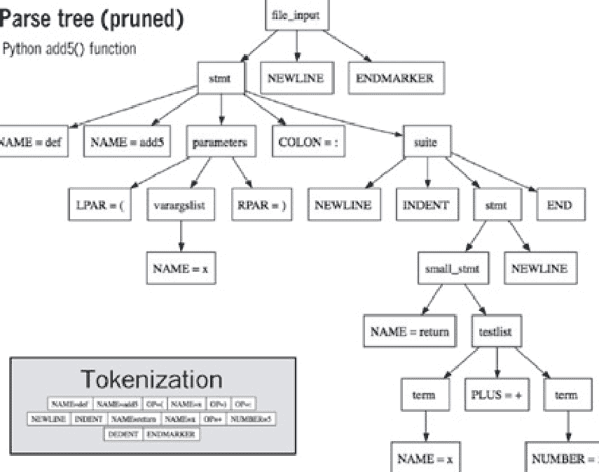
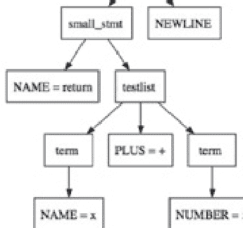
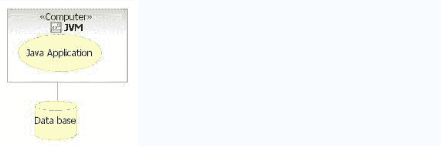
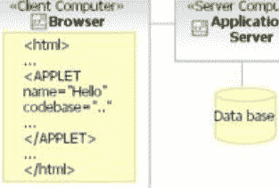
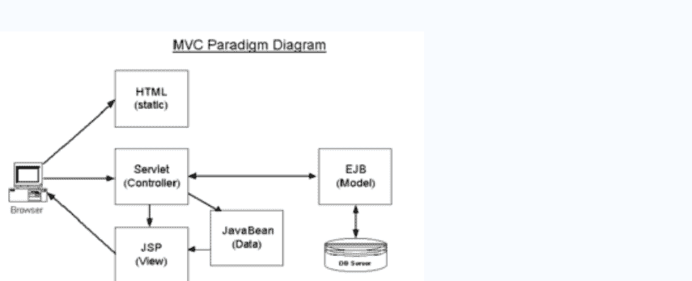
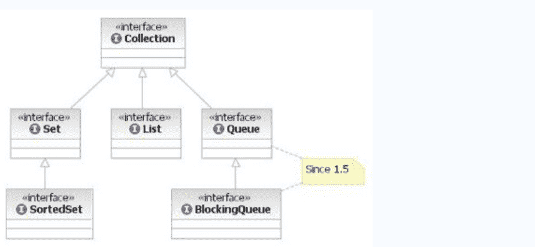
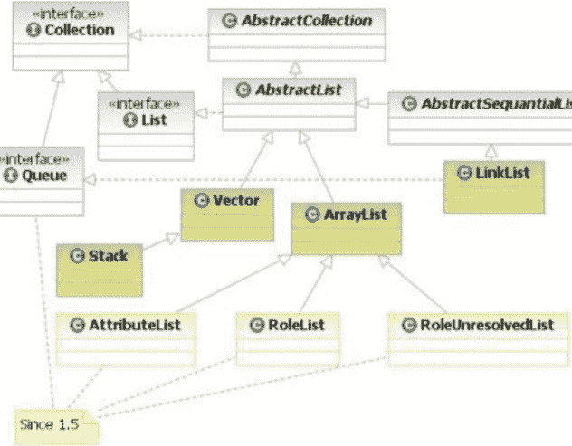
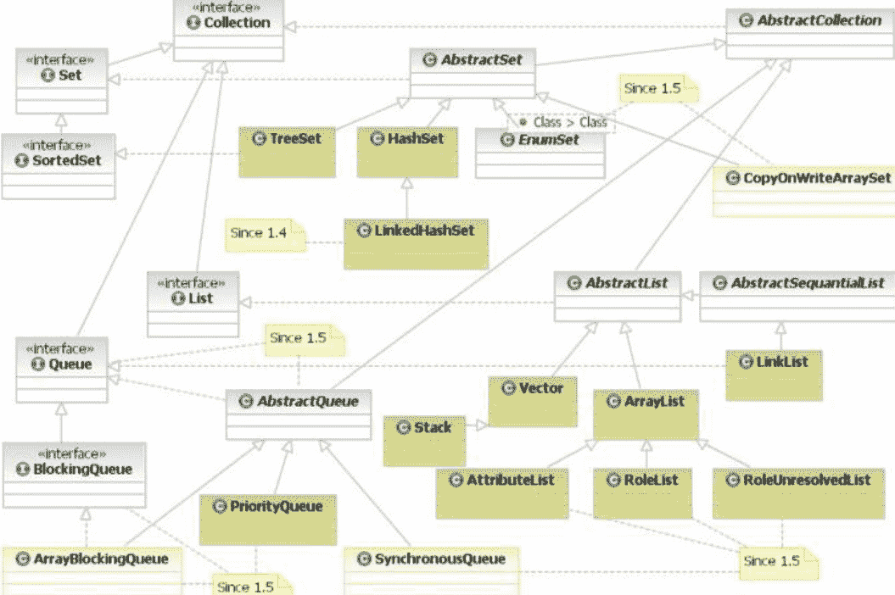
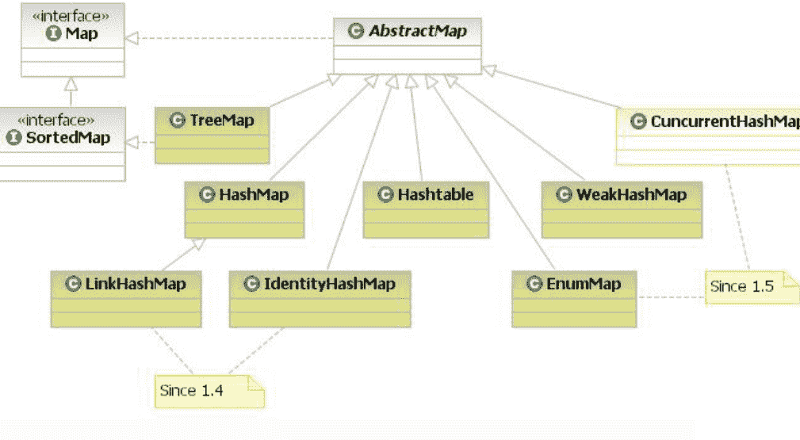

# Java 编程入门指南

## 语法分析树（修剪后）

Python `addS()` 函数



## 词法分析

| NAME=def | NAME=addS | Op= | NAME() | Op= |
|---|---|---|---|---|
| NEWLINE | INDENT | SAMMission | Name | Op= | Number5 |
| SDENT | ENDMARKER | | | | |



## 概述

本部分介绍 Java 语言和 Java 平台

- Java 概述
- Java 平台
- Java 编程环境

## 入门

本节是使用 Java 的快速上手：安装 Java 软件、编译和运行程序，以及一些用于说明 Java 入门基础的小型示例程序。

- 在你的计算机上安装 Java
- 编译程序
- 运行 Java 程序
- 开发第一个 Java 程序
- 理解 Java 程序

## 语言基础

本节介绍了 Java 编程语言的基础性元素。

- 语法关键字
- 语句
- 类、对象与类型
- 包
- 嵌套类
- 在类内部嵌套类
- 在方法内部嵌套类
- 在 Java 源文件中添加额外的类
- 匿名类
- 访问修饰符
- 方法
- 基本类型
- 类型
- String
- 数组
- 数据与变量
- 泛型

# 类与对象

- 定义类
- 创建对象
- 接口
- 使用静态成员
- 销毁对象
- 方法与构造函数的重载

# 集合

- 导言
- 数组
- 集合类
- 集合或 Map
  - 集合 (Collection)
    - 映射 (Map)
  - Set 或 List 或 Queue
    - Set
    - List
    - Queue
  - Map 类
- 线程安全集合
- 类图 (UML)

# 异常

- 抛出与捕获异常
- 应用程序异常
- 运行时异常
  - 空指针异常 (`NullPointerException`)
- 主要异常类
- 检查异常 (Checked exceptions)
- 未检查异常 (Unchecked exceptions)
- 防止空指针异常

1. 重定向模板:Java编程:并发编程

模板:流

# 反射

- 反射概述
- 动态类加载
- 动态方法调用
- 使用反射访问私有特性

# 小程序 (Applets)

- 概述
- 用户界面
  - 应用样式和添加内容
  - 字体
  - 按钮
  - 标签
  - 文本框
  - 布局
  - 面板
- 事件监听器
  - 动作监听器 (`ActionListener`)
  - 鼠标监听器 (`MouseListener`)
  - 鼠标移动监听器 (`MouseMotionListener`)
- 分析用户输入
- 图形与媒体
  - 绘制
  - 绘画
  - 声音
- HTML 实现

# JavaBeans

JavaBeans 简介

# 库、扩展与框架

- 数学与几何
- 正则表达式
- 安全
- 输入与输出
  - 日志记录
  - 数据库连接
  - Zip 及其他存档
- XML
- 图形用户界面
- 开源
  - Struts
  - Spring 框架

# 用于 Java 编程书籍的标记模板

有一些前缀模板有助于创建书籍内容，特别是在代码示例中。书籍前缀 "Java" 重定向到 "Java Programming"，因此我们也使用 "Java" 作为某些模板的前缀（为 Ada 定义的模板）：

```
{{Java://comment}}
用于代码块中的注释。示例：{{Java//Check for a null value}}
yield // 检查值是否为空
```

```
{{Java:kw}}
用于标记关键字。这将创建指向书中该关键字页面的链接。示例：{{Java:kw{for}} yields for
```

```
{{Java:int}}
用于 int 关键字。每个 Java 关键字都有对应的 Java: 模板；参见关键字。
```

```
{{Java:string}}
用于标记字符串字面量。Java:String 模板会为你添加前后引号。这纯粹是一个格式模板，不创建任何链接。示例：{{Java:string|}}
```

```
{{Java:null}}
用于空值
```

```
{{Java:true}}
用于 true
```

```
{{Java:false}}
用于 false
```

```
{{Java:exception}}
用于异常类
```

```
{{Java:Object}}
用于 Object
```

```
{{Java:Class}}
用于 Class
```

```
{{Java:String}}
用于 String
```

```
{{Java:util}}
用于 util
```

```
{{Java:pkg}}
用于包
```

```
{{Java:name}}
用于名称
```

```
{{Java:version}}
用于版本
```

```
{{Java:io}}
用于 IO
```

```
{{Java:content}}
用于内容
```

## JIT 即时编译编译器简介

1.3 版本，该语言本身自 JDK 1.0 以来一直保持稳定；JDK 附带的类库变得越来越，并在某些部分发生了变化。与 Java 编程语言紧密相关的扩展和架构包括：`J2EE`, `J2ME`, `JNDI`, `JSML`, `JDBC`, `JAIN`, `JDBCK`, `Jini`, `Jy`, `Jiro`, `JXTA`, `JavaSpaces`, `JMI`。

1.5（代号为 Tiger）于 2004 年 9 月发布。

# 主要变化包括：

- 泛型 (`Generics`) 为集合提供编译时类型安全，并消除了强制转换的繁琐。
- 自动装箱/拆箱 (`Autoboxing/unboxing`) - 消除了基本类型（如 `int`）与包装类型（如 `Integer`）之间手动转换的繁琐。
- 增强 for 循环 (`Enhanced for`) - 缩短在 Collections 中使用的 for 循环。
- 静态导入 (`Static imports`) - 允许你导入类的所有静态部分。
- 元数据 (`Metadata`) - 通过允许工具从源代码的注解生成代码，来避免编写样板代码。这导致了“声明式”编程风格，程序员只需说明应该做什么，工具就会生成执行该操作的代码。
- JVM 改进 (`JVM Improvements`) - 大部分运行时库现在作为内存镜像映射到内存中，而不是从一系列类文件中加载。运行时库的大部分现在多个 JVM 实例之间共享。

## Java 平台

较新版本的 Java，即版本 6.0 和 7.0 正在开发中，分别以代号 Mustang 和 Dolphin 闻名。

Java 平台是 Sun Microsystems 提供的一种计算环境（或平台），它可以运行使用 Java 编程语言和一套开发工具开发的应用程序。在这种情况下，该平台不是特定的硬件或操作系统，而是一个称为虚拟机的执行引擎，以及一组提供通用功能的标准库。

该平台的正规名称是 Java 2 平台（尽管去掉了“2”），它包含了标准版 JSE（现为 Java SE）、企业版 JEE（现为 Java EE）和微版 JME（现为 Java ME）。Java 2 平台的当前版本也可以被指定为版本 1.5 或 5（两者均指同一个版本）。关于构成 Java 2 平台的众多技术的良好概述，可以在 JDK 文档页面找到。

## Java 技术

Java 平台由广泛的技术组成，每种技术都提供了整体开发或运行时环境的不同部分。例如，最终用户通常与 Java 虚拟机和类库集交互。此外，Java 应用程序有许多部署方式，包括嵌入到网页中。最后，为该平台创建应用程序的开发者使用一套称为 Java 开发包（`JDK`）的开发工具。

## Java 运行时环境

针对 Java 平台的程序需要在其主机上存在两个组件：一个 Java 虚拟机和一个一组提供其依赖的任何服务的类库。Sun 的 JVM 分发及其标准类的实现被称为 Java 运行时环境（`JRE`）。

## Java 虚拟机

Java 平台的核心是通用“虚拟”处理器的概念，用于执行 Java 字节码程序。无论程序在什么硬件或操作系统下运行，字节码都是相同的。Java 平台提供了一个称为 Java 虚拟机（`JVM`）的解释器，它在运行时将 Java 字节码翻译成原生处理器指令。这使得同一个应用程序可以在任何带有可用虚拟机的平台上运行。

从 `JRE` 版本 1.2 开始，Sun 的 `JVM` 实现中还包含了一个即时编译器。

它不是一次解释一条字节码指令，而是在程序加载到虚拟机时，将程序的字节码转换为可执行的原生机器码，从而在每次加载新字节码时以微小延迟为代价，使其执行速度快得多。

这允许 `JIT` 编译器针对特定的主机平台和硬件，甚至可能优化输出代码。

## 语言

Java 一词本身通常指的是为 Java 平台设计的 Java 编程语言。编程语言通常不在“平台”一词的范围内。然而，Sun 不鼓励在平台上使用任何其他语言，并将 Java 编程语言列为 Java 2 平台的核心部分。这些包括：

- Groovy
- Scala
- GJ（泛型 Java），自 Sun 的 1.5 版本起已并入 Java。
- NetREXX

另一种选择是使用更具接口的方法，如 Jyphon。

## 类似平台

Java 的成功及其“一次编写，随运行”的概念也导致了其他类似的努力。其中最值得注意的是微软 `.NET` 平台，它借用了 Java 的许多概念和创新；事实上，它是对类 Java 语言 Visual J#（以前称为 J++）的实现。

后来微软停止并撤回了对 J# 的支持，并推出了一种名为 C# 的新语言。C# 与 J# 和 Java 非常相似，但与它们不兼容。Java 和 C# 之间的差异可以阅读 w:Comparison of C Sharp and Java。

| Java 编程 | | 索引 |
|---|---|---|
| | 概述 | 入门 | 基础 | 类与对象 |
| 集合 | 异常 | 并发编程 | 反射 |
| Applets | JavaBeans | Libraries |

## Java 编程环境

要编译 Java 程序，你需要下载并安装 Java 开发工具包 (`JDK`)。你可以从 Sun 网站获取它。其他硬件和操作系统供应商也为他们的平台提供 Java 开发工具包，尽管它们可能会更改工具包的名称。Sun 为 Windows、Linux 和 Solaris 提供了 `JDK`。

你有许多环境可以用来开发你的 Java 程序。你可以选择在文本编辑器中编写程序，然后使用命令行进行编译，或者你可以使用集成开发环境 (`IDE`)。像 `NetBeans` 和 `Eclipse` 这样的 `IDE` 提供了许多有用功能，如语法错误检查、代码补全、自动编译和调试，你可能会发现这些功能非常有用，特别是当你第一次尝试编程时。

## Java 编译器

`JDK` 包含了一组构建 Java 程序所必需的工具。`JDK` 中最著名的工具是 Java 编译器，也称为 `javac`。

`javac` 将 Java 源文件编译成可执行的 Java 类文件。源文件是带有 `.java` 扩展名的文件。你可以使用文本编辑器（如记事本）或 `IDE` 创建此类文件。然后 `javac` 将这些文件编译为可加载和执行的类文件，使用 `.class` 扩展名。例如，如果你创建了一个 Java 类 `org/yahoos/util/PrintDate.java`

```java
package org.yahoos.util;
import java.util.Date;
public class PrintDate {
    public void main(String[] args) {
        System.out.println(new Date());
    }
}
```

你可以通过在 shell 中输入以下命令来编译它：

你通常会在包含所有源文件的根目录工作目录的 shell 中调用它。Java 的包语句 `package org.yahoos.util` 对应于目录结构 `org/yahoos/util`，详见 Java 包。

`javac` 会在源文件所在目录中创建 `PrintDate.class`。如果有语法错误，`javac` 将错误信息打印到 shell 中。`PrintDate.class` 文件包含了在 Java 运行时安装的任何硬件上运行的代码。如果 `PrintDate.class` 文件是在 Windows 操作系统中创建的，你可以将此文件复制到 unix，它将正常执行。

通常会创建多个类，这些文件被打包成一个 `application_name.jar` 文件，以便分发并在任何硬件上运行。

`IDE` 会自动管理这个过程。例如，`Eclipse` 包含它自己的 Java 编译器，并不直接使用 `javac`。它会在你保存文件时自动编译 Java 源文件。然而，使用像 `Eclipse` 这样的 `IDE` 超出了本模块的范围，因此请参考 `IDE` 的教程和帮助，查看它们如何提供 Java 编程环境。

## 字节码

从上述段落可以看出，Java 编译器将扩展名为 `.java` 的源文本文件编译成位于 `.class` 扩展类文件中的可执行代码。这种代码被称为字节码。

在 Java 之前的许多语言中，源代码通常编译为编译程序时特定机器的机器码。因此，如果程序在 X86 机器上编译，它将只在 X86 机器上运行，其他机器均不行。相反，Java 生成字节码 —— 一种中间二进制代码，它是 Java 类的可迁移表示。任何硬件/操作系统平台上的 Java 虚拟机都可以执行这种字节码。这种可移植性有一些限制：例如，`Java ME` 系统无法执行所有为 `Java SE` 环境编译的程序，因为 `Java ME` 是精简后用于小型设备的。但通常情况下，`Java SE` 程序可以在任何 `Java SE` 机器上无需修改地运行。

## JIT 编译器

由于只编译了一半，Java 虚拟机的任务是在执行时将程序的剩余部分编译为原生代码，使 Java 遵循“一次编写，随运行”(WORA) 策略。在运行时将字节码编译为机器码的编译器是即时编译器（Just-In-Time 或 `JIT`）。一旦一段代码被 `JVM` 编译为执行代码，该代码就会被反复使用，以加速执行。

## Java 运行环境

Java 运行环境（或简称 `JRE`）负责 Java 程序的执行。Sun `JDK` 也包含了 `JRE`。但是，可以在不安装 `JDK` 的情况下安装 `JRE`，这对于只想运行 Java 程序而不是构建程序的人来说是很有用的。`JRE` 帮助将 Java 程序加载到内存中并执行它们。

## 入口点

在 Java 中，任何程序的入口点都是 `main` 方法。该方法必须具有以下签名：

```java
public static void main(String[] args)
```

`main` 方法是 Java 程序启动时由 `JVM` 执行的第一段代码。`args` 参数是一个 `String` 数组，包含了传递给程序的命令行参数。


从上述段落可以看出，Java 编译器将扩展名为 `.java` 的源文本文件编译成位于 `.class` 扩展类文件中的可执行代码。这种代码被称为字节码。

在 Java 之前的许多语言中，源代码通常编译为编译程序时特定机器的机器码。因此，如果程序在 X86 机器上编译，它将只在 X86 机器上运行，其他机器均不行。相反，Java 生成字节码 —— 一种中间二进制代码，它是 Java 类的可迁移表示。任何硬件/操作系统平台上的 Java 虚拟机都可以执行这种字节码。这种可移植性有一些限制：例如，Java ME 系统无法执行所有为 Java SE 环境编译的程序，因为 Java ME 是精简后用于小型设备的。但通常情况下，Java SE 程序可以在任何 Java SE 机器上无需修改地运行。

## JIT 编译器

由于只编译了一半，Java 虚拟机的任务是在执行时将程序的剩余部分编译为原生代码，使 Java 遵循“一次编写，随处运行”(WORA) 策略。在运行时将字节码编译为机器码的编译器是即时编译器（Just-In-Time 或 JIT）。一旦一段代码被 JVM 编译为执行代码，该代码就会被反复使用，以加速执行。

## Java 运行环境

Java 运行环境（或简称 JRE）负责 Java 程序的执行。Sun JDK 也包含了 JRE。但是，可以在不安装 JDK 的情况下安装 JRE，这对于只想运行 Java 程序而不是构建程序的人来说是很有用的。JRE 帮助将 Java 程序加载到内存中并执行它们。

## 入口点

在 Java 中，任何程序的入口点都是 `main` 方法。该方法必须具有以下签名：

```java
public static void main(String[] args)
```

`extcheck` 也在 Java 1.5 中首次出现。它可以在将 Java 扩展安装到 JDK 或 JRE 环境之前使用。它会检查特定的 Jar 文件是否与已安装的扩展冲突。

## 安全工具

JDK 自带了许多与 Java 安全功能相关的工具。在使用这些工具之前，首先需要学习特定的安全机制。

这些工具包括：

- `keytool`：管理密钥和证书
- `jarsigner`：生成和验证 JAR（Java 归档）的数字签名
- `policytool`：编辑策略文件
- `kinit`：获取 Kerberos v5 票据
- `klist`：管理 Kerberos 凭据缓存和密钥表
- `ktab`：管理密钥表中的条目

## native2ascii 工具

`native2ascii` 是一个重要但被低估的工具，用于编写属性文件（包含配置数据的文件）或资源包（包含文本语言翻译的资源包）。

此类文件仅包含 ASCII 和 Latin-1 字符，但国际化程序员需要全范围字符集。只有当非 ASCII 和非 Latin-1 字符转换为 Unicode 序列（`\uXXXX` 表示法）时，使用这些字符的文本才能出现在属性文件和资源包中。

使用此类序列的任务由 `native2ascii` 处理。你可以使用适当的字符编码编写国际文本，然后使用 `native2ascii` 生成嵌入 Unicode 序列的必要 ASCII 文本。尽管名称如此，`native2ascii` 也可以从 ASCII 转换为原生格式，因此它对于将现有的属性文件或资源包转换回其他编码也很有用。

`native2ascii` 在集成到构建系统中以实现自动化转换时最具意义。

## RMI 工具

TODO

## Java IDL 和 RMI-IIOP 工具

TODO

## 部署与 Web Start 工具

## 浏览器插件工具

TODO

## 监控与管理工具 / 故障排除工具

在 Java 1.5 中，JDK 除了增加了一套故障排除工具外，还增加了一套监控和管理工具。

监控和管理工具用于监控虚拟机和执行环境。它们允许在 Java 程序执行期间监控内存使用情况。

故障排除工具提供了对虚拟机某些方面较为深层的洞察。（有趣的是，Java 调试器并未被归类为故障排除工具。）

目前所有的监控、管理故障排除工具都标记为“实验性”（这不影响 `jdb`）。它们可能会在未来的 JDK 中消失。

## Jar 工具

Jar 是 Java archive（Java 归档）的缩写。这是一个用于创建 Java 归档或 jar 文件的工具（扩展名为 `.jar`）。Java 归档是编译后的 Java 类以及运行时所需的其他资源（如文本文件、配置文件、图像）的集合。在内部，jar 文件实际上是一个 `.zip` 文件。

## jdb 工具

`jdb` 是 Java debugger（Java 调试器）的缩写。Java 调试器是一个命令行控制，为 Java 程序提供调试环境。虽然你可以使用这个命令行控制，但 IDE 通常提供更容易使用的调试环境。

## Javadoc 工具

随着程序变得庞大且复杂，程序员需要方法来跟踪更改，并在代码演化的每一步更好地理解代码。几十年来，程序员一直使用一种称为“注释”的特殊编程结构——这些注释是源码中帮助为代码段声明用户定义的区域。但注释往往变得冗长且难以理解，更不用说在拥有数百行代码的应用程序中难以阅读。

Java 为用户提供了一种通过特殊的注释系统和 `javadoc` 工具轻松发布代码文档的方法。`javadoc` 工具可以生成有关一组用户创建的 Java 类应用程序编程接口（API）的文档。`javadoc` 从 `.java` 源文件读取源码，并生成更易阅读且无需理解代码本身即可的 HTML 文档。

## javap 工具

如果说 Javadoc 提供 Java 类 API 和文档的详细视图，那么 `javap` 工具则打印有关类中成员（构造函数、方法和变量）的信息。换句话说，它列出了类的 API 以及类编译后的指令。`javap` 是 Java 字节码的反汇编器。

| Java 编程 | 索引 |
|---|---|
| 入门 | 基础 | 类与对象 |
| 集合 | 异常 | 反射 |
| Applets | JavaBeans | 库 |

## 安装

### 检查 Java

Java 开发包 (JDK) 是构建 Java 程序所需的。Java 运行时环境 (JRE) 是执行 Java 程序所需的。对于我们的目的，你必须使用 JDK。首先，检查系统是否已安装了 JDK。为此，请打开终端窗口或命令行窗口并执行 `javac -version` 命令。如果 JDK 已安装并位于可执行路径中，你应该能看到关于运行版本的输出。输出结果取决于安装了哪个版本以及哪个供应商提供的 Java 安装。

以下是 RedHat Fedora Core 4 安装时的输出：

```bash
$ java -version
Eclipse Java Compiler 0.548, pre-3.1.0 milestone-6, Copyright IBM Corp 2000, 2005. All rights reserved.
```

你可能安装了其他版本的 Java；此命令只会显示 PATH 中的第一个。

如果你遇到错误，例如：

```bash
javac: command not found
```

那么 JDK 可能未安装，或者它不在你的路径中。你可以使用系统的文件搜索工具检查是否存在 `javac` 或 `javac.exe`。

如果你从 Sun 网站下载 Java，你也可以安装 NetBeans IDE + JDK 5.0 Update 6 绑定包。

### 安装验证

当你完成上述 JDK 下载和安装说明后，请重复执行 `javac -version` 命令以验证你的路径是否获取了正确的 JDK 版本。

| Java 编程 | 索引 |
|---|---|
| 概述 | 入门 | 基础 | 类与对象 |
| 集合 | 异常 | 并发编程 反射 |
| Applets | JavaBeans | 库 |

## 编译

我们已经讨论过编译的基本知识。这里是对我们之前看到的概念的总结以及一些额外的细节。

### 编译为字节码

在 Java 中，程序并不是被编译成可执行文件；它们被编译成字节码（如之前所述），由 JVM 在运行时执行字节码。当我们使用 `javac` 编译器时，Java 源代码会被编译成字节码。字节码以 `.class` 扩展名保存在磁盘上。当运行程序时，字节码将由即时编译器（JIT）转换。结果是机器码，它被输入内存并执行。

因此，Java 有两步编译：

- 第一步：创建字节码
- 第二步：创建机器级代码

Java 类/字节码会被编译成机器码，并在第一次需要时由 JVM 加载到内存中。这与 C/C++ 等语言不同，在这些语言中，整个程序必须先编译成机器码并链接成一个可执行文件，程序才能启动。

JIT 编译器编译一次字节码，编译后的机器码会被反复使用以加快执行速度。JIT 更好的名称应该是“仅编译一次”编译器，COO，或“仅一次”编译器，JOT。早期的 Java 编译器每次使用时都会将字节码编译成机器码，那速度很慢。但它仍然比“解释型语言”快，解释型语言每次使用时都是从高级语言编译代码，而不是从字节码编译。

### 依赖类的自动编译

在 Java 中，如果你使用了任何其他对象的引用，如果该对象的类尚未编译，它将被自动编译。这些自动编译是嵌套的，并且会持续进行直到运行程序所需的所有类都被编译。因此，只需编译高层类就足够了，所有的依赖类都将自动编译。

```bash
javac ... MainClass.java
```

如果你的程序使用反射来创建对象，或者你正在为 servlets 或 "jar" 包编译，就不能依赖此特性。在这些情况下，你应该列出这些类进行显式编译。

```bash
javac ... MainClass.java ServletOne.java ...
```

最好的方法是使用构建工具来构建你的应用程序。构建工具会检查所有所需的依赖项，并仅为构建编译所需的类。Ant 是目前可用最好且流行的构建工具。使用 Ant，你可以通过输入以下命令从命令行构建应用程序：

```bash
ant build.xml
```

xml 文件包含了构建应用程序所需的所有信息。

构建应用程序最流行的方法是使用 IDE。IDE 代表集成开发环境。下面列出了其中一些。

### 包与子目录

每个 Java 级别的类都属于一个包（在关于“包”的章节中介绍）。这可以在文件开头的 `package` 语句中声明；如果缺少该语句，类属于未命名包。

对于编译，文件必须位于正确的目录结构中。包含未命名包类的文件必须位于当前根目录下；如果类属于某个包，则它必须位于与包名同名的目录中。

惯例是包名和对应包的目录名仅由小写字母组成。

#### 顶层包

具有此包声明的类：

```java
package example;
```

必须位于名为 `example` 的目录中。

#### 子包

具有此包声明的类：

```java
package org.yahoos.en;
```

必须位于名为 `en` 的目录中，该目录必须是 `yahoos` 的子目录，而该目录又是 `org` 的子目录，结果为 `org/yahoos/en/`。

### 文件名大小写

Java 源文件名必须与该文件包含的 public 类名相同。每个文件只能定义一个 public 类。Java 类名对大小写敏感，源文件名也是如此。

类名的命名惯例是以大写字母开头。

### 编译器选项

#### 调试与符号信息

### 附加工具

### IDEs

本节简要介绍了一些不同的 IDE 及其优缺点。

#### JBuilder

JBuilder 是一个拥有私有源代码的 IDE，由 Borland 销售。它的优势之一是与建模工具 together 集成。

#### JCreator

信息见：http://www.apcomputerscience.com/ide/jcreator/index.htm

#### Eclipse

Eclipse 是一个免费的 IDE，也是一个可以根据特定开发需求扩展的开发者框架，IBM 是该免费软件的开发者，它取代了 Age 工具。扩展性使它区别于其他 IDE。Eclipse 旨在与 Visual Studio 工具竞争。其目标有两个：

- 为开发提供标准的 IDE

Eclipse 特性：

- 标准窗口管理（视角、视图、资源管理器）
- 实时错误检查（错误提示）
- 帮助窗口
- 自动构建（更改源码）
- 内置调试器
- 代码生成（getter 和 setter）
- 搜索（实现）
- 代码重构（全局引用）
- 基于插件的架构（能够与环境和其他工具集成）

#### NetBeans

NetBeans IDE 是一个面向软件开发者的开源集成开发环境。该 IDE 运行在 Windows、Linux、Solaris 和 MacOS 等多个平台上。它易于安装和使用。IDE 为开发者提供了创建跨平台桌面、企业、Web 和移动应用程序所需的所有工具。

#### BlueJ

BlueJ 是一个包含模板的 IDE，并为你编译和运行应用程序。BlueJ 经常被类使用，因为它不需要设置类路径。BlueJ 有自己的库集，你可以在偏好设置中添加任何一个。它会为其产生的所有编译设置类路径，包括你添加的和 BlueJ 的库。

BlueJ 提供了一个有趣的图形化界面，用于创建包和程序。类用框表示，类之间的箭头表示继承/实现，或者一个类在另一个类中构造。在编译时，BlueJ 会将所有类（整个项目）添加到类路径中。

#### Kawa

Kawa 由 Tek-Tools 开发。它基本上是一个 Java 编辑器，不包含向导和 GUI 工具，最适合中小型开发团队经验丰富的 Java 程序员。

#### Ant

Ant 是一种构建管理工具，旨在取代 MAKE 作为大型 Java 应用程序自动化构建的工具。与 Java 类似，Ant 设计为平台无关。

构建 Java 应用程序需要执行某些任务。这些任务不仅包括编译代码，还包括复制代码、将代码打包、创建 EJB、运行自动化测试、将代码 FTP 到远程站点等。对于某些任务可以分配条件，例如仅编译更改的代码，或者如果尚未完成则执行该任务。

因此，也可以指定任务依赖，这将确保任务的执行顺序是正确的。例如，在将代码打包成 jar 包之前进行编译，那么打包到 jar 的任务依赖于编译任务。

任务及其依赖关系定义在 `build.xml` 文件中。Ant 程序会解析它并执行其描述的所有操作。Ant 工具比 MAKE 工具强大得多。因为 Java 代码分布在文件系统中（Java 包/命名空间），使用 MAKE 工具会让人感到非常别扭。

此外，Ant 工具是用 Java 编写的，并且可以扩展，因此，如果你想在构建期间执行某项任务，而该任务不在预定义的任务列表中，你可以自己编写它。将你的 Ant 任务代码挂接到其他任务上非常简单，你只需要它在类路径中，Ant 工具就会在运行时加载它。你的 Ant 任务代码只需要遵循 Ant 框架，此就足够。

### JIT 编译器

标准的 JIT 编译器是按需运行。当一个方法被反复调用时，JIT 编译器会分析字节码并产生高效的机器码，这种机器码的运行速度非常快。JIT 编译器足够智能，能够识别代码是否已经编译，因此随着应用程序的运行，编译仅在需要时发生。随着 Java 应用程序的运行，它们往往变得越来越快，因为 JIT 可以对代码进行运行时分析和优化，以适应执行环境。不经常运行的方法或代码块接收的优化较少；经常运行的（所谓的热点）接收更多的分析和优化。

| Java 编程 | 索引 |
|---|---|
| 概述 | 快速上手 |
| 基础 | 类与对象 |
| 集合 | 异常 |
| 并发反射 | Applets, JavaBeans, 库 |

## 执行


# Java 代码执行方式

Java 代码有多种执行方式。复杂的 Java 应用程序通常使用第三方 API 或服务。在本节中，我们列出了 Java 代码被打包和/或执行的最常用方式。

## JSE 代码执行

Java 语言第一版出现在客户端/服务器时代。当时开发了具有丰富 GUI 界面的胖客户端。Java 第一版 JSE（Java 标准版）具备以下功能：

- GUI 能力（`AWT`、`Swing`）
- 网络计算能力（`RMI`）
- 多任务能力（线程）

通过以下 Java 代码执行是可能的：



### 独立 Java 应用程序

独立应用程序指的是用户界面和业务模块都运行在同一台计算机上的 Java 程序。应用程序可能使用也不使用数据库来持久化数据。用户界面可以是 `AWT` 或 `Swing`。

应用程序将从类的 `main()` 方法开始启动。当 `main()` 方法退出，或者应用程序向 JVM 抛出异常时，应用程序停止。类由 JVM 根据需要加载到内存并进行编译，可以来自文件系统，也可以来自 `*.jar` 文件。

## Java ‘jar’ 类库

工具类、框架类和/或第三方类通常打包并分发在 Java `*.jar` 文件中。这些 `*.jar` 文件需要被放入使用这些类的 Java 程序的 `CLASSPATH` 中。



## Java Applet

Java Applets 是在 HTML 页面中通过 `<APPLET>` 标签引用的 Java 代码。Java 代码从服务器下载并在客户端浏览器的 JVM 中运行。Java 内置支持在浏览器窗口中渲染 applet。

在本书时（2006 年），Applets 并没有实现它的承诺。复杂的 GUI 客户端被发现很难开发，主要是因为下载时间、浏览器 JVM 之间的兼容性以及返回服务器的通信需求。Applet 现在仍然被使用，如果被使用，它们被作为小型图形动画使用。微软造成了致命打击，首先是从 Internet Explorer 中撤销对 Java 的支持，其次是在 Internet Explorer 的默认配置中排除了 Java JRE。

关于 applet 的更多信息可以在本书的 Applet 章节找到。Google 也有关于 Applet 的文章。

## 客户端服务器应用程序

客户端服务器应用程序由前端和后端组成，运行在独立的计算机上。这种设计理念是业务逻辑位于后端部分，供所有客户端复用。这里的挑战是实现前端用户界面代码与后端业务逻辑代码的分离。

前端与后端之间的通信可以通过方式实现：

- 一种方法是在两层之间定义通信协议。后端部分将监听传入的请求。根据协议它解释请求并以数据形式返回结果。
- 另一种方法是使用 Java 远程方法调用（`RMI`）。通过使用 `RMI`，可以创建并供客户端使用的对象。在这种情况下，Java 对象跨网络传输。

## Web 应用程序

对于需要大量客户端安装的应用程序，客户端-服务器模型行不通。维护和升级成百上千个客户端会导致问题。创建 Web-服务器模型是解决方案。客户端是浏览器，服务器托管应用程序。

业务逻辑在服务器上，而呈现层发送到浏览器。这就是客户端-服务器架构。客户端处理用户界面和交互，而服务器处理业务逻辑和数据处理。这种分离有利于扩展和便于维护。

客户端与服务器之间的通信通常通过 `HTTP` 完成。客户端向服务器发送请求，服务器返回响应。这些响应通常包含 `HTML`、`JSON` 或其他类型的数据，客户端随后对这些数据进行渲染。

`EJB` 面临着与其他任何重用代码相同的问题。`EJB` 需要具有足够的通用性才能被重用。它们的更改和维护可能会影响现有客户端。很多时候，`EJB` 在并不真正需要的情况下被过度使用。一个 `EJB` 应该被设计成企业中一个独立的应用程序，实现一个功能。



### 组合 J2EE 组件创建 MVC 架构

这引导我们进入三层/分层架构。

在现代 Web 应用中，由于大量的静态数据和精美的图形，数据如何呈现给用户变得非常重要，通常需要图形设计师的帮助。

为了帮助程序员和图形设计师共同工作，数据与呈现方式之间的分离至关重要。

- **视图**（用户界面逻辑）包含了构建呈现层所需的逻辑。这可以通过 `JSP` 技术处理。
- **Servlet** 充当控制器，包含了处理用户事件和选择恰当响应所需的逻辑。
- **业务逻辑**（模型）实际上实现了交互的目标。这可能是对数据库的查询或更新。这可以通过 `EJB` 技术处理。

## JINI

在 Sun J2EE 对网络计算的下一步有了愿景之后，出现了 `JINI`。其核心思想是：在网络环境中会有许多独立的服务和消费者。`JINI` 允许这些服务/消费者以稳健的方式相互进行动态交互。`JINI` 的基本特征是：

- 服务上线或离线时不需要用户干预。（相比之下，`EJB` 的客户端程序必须知道部署 `EJB` 的服务器和端口号。在 `JINI` 中，客户端应该在网络中查找并发现该服务。）
- 当服务（服务的消费者）出现或离开时，通过自适应来实现自愈。（服务需要定期续租，以标明它们仍然可用。）
- `JINI` 服务的消费者不需要预先了解服务的实现。实现代码是动态下载并运行在消费者的 JVM 上的，无需配置和用户干预。（例如，根据当前正在使用的服务，终端用户可能会看到略有不同的界面。这些用户界面代码的实现将由所使用的服务提供。）

一个简易的 `JINI` 网络环境由以下部分组成：

- 一个或多个服务
- 保存注册服务列表查找服务
- 一个或多个消费者

在本文写作时（2006年），`JINI` 尚未广泛使用。有两个可能的原因。一是 `JINI` 的理解和设置有点复杂。另一个原因是由于微软退出了 Java，这导致行业转向使用专有解决方案。

# 第一个 Java 程序

## Hello World

通常，当你开始学习任何语言的编程时，都会从传统的 Hello World 示例开始。如此，让我们开始构建你的第一个 Java 程序吧。你猜对了，就是 Hello World！在开始此练习之前，确保你知道如何编译和运行 Java 程序。

打开你的 IDE 并输入以下文本。特别注意大小写，因为 Java 对大小写敏感。

```java
public class HelloWorld {
  public static void main(String[] args) {
    System.out.println("Hello, world!");
  }
}
```

将其保存为 `HelloWorld.java`。再次，确保文件名与名称的大小写一致。编译并运行它：

```bash
javac HelloWorld.java
java HelloWorld
```

你的电脑应该显示：

```
Hello, world!
```

## 逐行分析

类的第一行：

```java
public class HelloWorld
```

声明了一个名为 `HelloWorld` 的 Java 类。该类被声明为 `public` - 它对任何其他类可用。下一行：

```java
public static void main(String[] args) {
```

开始了一个名为 `main` 的 Java 方法。`main` 方法是 Java 开始执行程序的地方。`args` 是一个方法参数，将包含运行程序时使用的命令行参数。该方法必须同时是 `public` 和 `static` 的，程序才能正确运行。关于 `public` 和 `static` 等修饰符的更多信息，请参阅访问修饰符。

```java
System.out.println("Hello, world!");
```

该语句将文本 `Hello, world!` 发送到控制台（带有一个换行符）。最后两个大括号标记了 `main` 方法的结束和类的结束。

## 修改程序

现在，我们将修改此程序，以便在存在命令行参数时，打印出第一个命令行参数（如果有的话），并打印问候语。例如，如果你通过如下方式调用程序：

```bash
java HelloWorld yaaho
```

它将打印：

```
Hello, yahoos!
```

回到你的程序，并将其修改为读取：

```java
public class HelloWorld {
    public static void main(String[] args) {
        String who;
        if (args.length > 0) {
            who = args[0];
        } else {
            who = "World";
        }
        System.out.println("Hello, " + who + "!");
    }
}
```

再次运行它。它应该显示：

```
Hello, yahoos!
```

或者，如果你没有传递命令行参数，它将仅打印：

```
Hello, World!
```

## 常见问题

如果程序没有按照你的预期运行，请检查以下常见错误。

- 你确定所有单词拼写正确且大小写与所示完全一致吗？
- 分号和括号是否在合适的位置？
- 你是否漏掉了引号？

## 下一步

现在你已经看到了 Java 中经典的 Hello, World 程序，让我们进入一个更真实的示例，该示例突出了 Java 的面向对象特性。访问[理解 Java 程序]，该章节介绍了 Java 语言特性，以及对基础 Java 程序语法和结构的更完整的解释。

| Java 编程 | | 索引 |
|---|---|---|
| 概述 | 入门 | 基础 |
| 类与对象 | 集合 | 异常 |
| 并发编程 | 反射 | Applets |
| JavaBeans | 库 | |

# 理解 Java 程序

本文介绍了一个可以从控制台运行的微型 Java 程序。它计算了平面上两点之间的距离。你现在不需要理解程序的结构；我们很快就会涉及到这一点。此外，由于该程序旨在作为一个简单的介绍，它还有一些改进空间，将在模块的稍后部分进行。

## 距离类、源码与使用

该类是 `Distance`，所以请使用你最喜欢的编辑器首先创建一个名为 `Distance.java` 的文件，然后复制下面的源码：

```java
public class Distance {
    private java.awt.Point point0, point1;
    public Distance(int x0, int y0, int x1, int y1) {
        point0 = new java.awt.Point(x0, y0);
        point1 = new java.awt.Point(x1, y1);
    }

    public void printDistance() {
        System.out.println("Distance between " + point0 + " and " + point1 + " is " + point0.distance(point1));
    }

    public static void main(String[] args) {
        Distance dist = new Distance(intValue(args[0]), intValue(args[1]), intValue(args[2]), intValue(args[3]));
        dist.printDistance();
    }

    private static int intValue(String data) {
        return Integer.parseInt(data);
    }
}
```

## 详细程序结构与概述

正如所承诺，我们现在将对这个 Java 程序进行详细描述。我们将讨论程序的语法和结构以及该结构的含义。

## Java 语法介绍

Java 类的语法是使用 Unicode 因子编写类时的字符和符号及其结构。关于 Java 语法元素的更充分的处理可以参阅语法。我们仅提供足够的语法描述来理解上述程序。

Java 程序由标记序列组成。有不同类型的标记。例如，有像 `class` 和 `public` 这样的单词标记，代表关键字 - 具有特殊的 Java 中的保留字含义。其他单词（非关键字，如 `Distance.point0.x` 和 `printDistance`）是标识符。标识符在 Java 中有许多用途，但主要被用作名称。Java 还有表示数字的标记，例如 `1` 和 `3`；这些被称为字面量。字符串字面量，例如 `"Distance between "`，由嵌入双引号中的零或多个字符组成；运算符如 `+` 和 `=` 被用于表示基本计算，如加法、字符串拼接或赋值。还有用于包含块的左、右括号 `(( ))`。类的体就是一个块。某些标记是标点符号，如句号、逗号和分号。你使用空白字符（空格、制表符和换行符）来分隔标记。例如，关键字和标识符之间需要空白：`publicstatic` 是一个包含12个字符的单一标识符，而不是两个 Java 关键字。

## 声明与定义

标记序列被用于构建 Java 类的下一个构建块：声明和定义。类声明提供了类的名称和可见性。对于我们的示例，

```java
public class Distance
```

就是类声明。它（在这种情况下）由两个关键字 `public` 和 `class` 以及标识符 `Distance` 组成。

这意味着我们正在定义一个名为 `Distance` 的类。其他类，或者在我们的例子中命令行，可以引用该类名。`public` 关键字是一个访问修饰符，声明该类及其成员可以从其他类访问。`class` 关键字显然标识此声明为一个类。Java 还允许接口的声明和（从 Java 5 开始）注解的声明。

类声明之后是一个块（由大括号包围），它提供了类的定义。定义是类的实现——类成员的声明和定义。该类恰好包含六个成员，我们将依次解释它们。

1. 字段声明，命名为 `point0` 和 `point1`
2. 一个构造方法声明
3. 三个方法声明

### 示例：实例字段

声明

```java
private java.awt.Point point0, point1;
```

声明了两个实例字段。实例字段代表在构造类实例时分配的具名值。当 Java 程序创建一个 `Distance` 实例时，该实例将包含用于 `point0` 和 `point1` 的空间。创建另一个 `Distance` 对象时，它将包含它自己的 `point0` 和 `point1` 值的空间。第一个 `Distance` 对象中 `point0` 的值可以独立于第二个 `Distance` 对象中 `point0` 的值。

此声明包含：

1. `private` 访问修饰符，意味着这些实例字段对其他类**不**可见。
2. 实例字段的类型。在这种情况下，类型是 `java.awt.Point`。这意味着 `java.awt` 包中的 `Point` 类。
3. 逗号分隔列表中的实例字段名称。

这两个字段也可以使用独立但更冗长的声明进行声明：

```java
private java.awt.Point point0;
private java.awt.Point point1;
```

由于字段的类型是引用类型（即引用或可以持有对象引用的字段），Java 在创建 `Distance` 实例时会隐式地将 `point0` 和 `point1` 的值初始化为 `null`。`null` 值意味着引用值不指向任何对象。特有的 Java 字面量 `null` 用于表示程序中的空值。虽然你可以在声明中显式分配 `null` 值，如：

```java
private java.awt.Point point0 = null;
private java.awt.Point point1 = null;
```

但没有必要，大多数程序员都会省略此类默认赋值。

## 示例：构造方法

构造方法是类中的一种特殊方法，用于构造类的实例。构造方法可以对对象执行初始化，超出 Java VM 自动完成范围。例如，Java 将自动将字段 `point0` 和 `point1` 初始化为 `null`。

下面是该类的构造方法。它由五个部分组成：

1. 可选的访问修饰符。在这种情况下，构造方法声明为 `public`。
2. 构造方法名，必须与类名完全匹配：在这种情况下为 `Distance`。
3. 构造参数。参数列表是必须的。即使构造方法没有任何参数，你也必须指定空列表 `()`。参数列表声明了方法每个参数的类型和名称。
4. 可选的 `throws` 子句，用于声明构造方法抛出的异常。此构造方法没有声明任何异常。
5. 构造方法体，这是一个 Java 块（封装在 `{}` 中）。此构造方法包含两个语句。

```java
public Distance(int x0, int y0, int x1, int y1) {
  point0 = new java.awt.Point(x0, y0);
  point1 = new java.awt.Point(x1, y1);
}
```

此构造方法接受四个参数，命名为 `x0`、`y0`、`x1` 和 `y1`。每个参数都需要一个参数声明，在本示例中，所有参数都是 `int`。Java 整数值是有符号的 32 位补码整数。参数列表中的参数用逗号分隔。

此构造方法中的两次赋值使用 Java 的 `new` 运算符来分配两个 `java.awt.Point` 对象。第一个赋值分配了一个表示第一个点 `(x0, y0)` 的对象，并将其赋值给 `point0` 实例变量（替换了实例初始化的 `null` 值）。第二个语句分配了一个具有 `(x1, y1)` 的第二个 `java.awt.Point` 实例，并将其赋值给 `point1` 实例变量。

这是 `Distance` 类的构造方法。`Distance` 隐式继承自 `java.lang.Object`。Java 插入了对超类构造方法的调用。构造方法体是初始化逻辑所在。


## 示例：方法

方法是类的第三种也是最重要的成员类型。该类包含三个定义了类行为的方法：`printDistance()`、`main()` 和 `intValue()`。

### `printDistance()` 方法

`printDistance()` 方法将两个点之间的距离输出到标准输出（通常是控制台）。

```java
public void printDistance() {
    System.out.println("Distance between " + point0
        " and " + point1
        " is " + point0.distance(point1));
}
```

此方法在隐式 `Distance` 对象的范围内执行。实例字段引用 `point0` 和 `point1` 指向该隐式对象的字段。你也可以使用变量 `this` 来显式引用当前对象。在方法内部，Java 将名称绑定到执行的对象上，`this` 的类型是当前类。`printDistance` 方法体也可以写成：

```java
System.out.println("Distance between " + this.point0
    " and " + this.point1
    " is " + this.point0.distance(this.point1));
```

以使实例字段引用更加显式。

此方法在一个语句中计算并打印距离。距离通过 `point0.distance(point1)` 计算；`distance()` 是 `java.awt.Point` 类的实例方法（`point0` 和 `point1` 是该类的实例）。该方法操作 `point0`（在执行方法时将其绑定到 `point0` 所指向的对象）并接受另一个 `Point` 作为参数。（实际上，这要复杂得多，我们稍后会解释。）`distance()` 方法的结果是一个双精度浮点数。

此方法使用以下语法

```java
"Distance between " + this.point0
    " and " + this.point1
    " is " + this.point0.distance(this.point1)"
```

来构造一个传递给 `System.out.println()` 的字符串。该表达式是一系列字符串拼接方法，用于拼接字符串或字符串的字符串表示。

原始类型（如 `double`）或对象会返回一个长字符串。例如，对于点 (0,3) 和 (4,0)，该表达式的结果是一个字符串（`String`）：

```
"Distance between java.awt.Point[x=0,y=3] and java.awt.Point[x=4,y=0] is 5.0"
```

然后该方法会将其打印到 `System.out`。

为了打印，我们调用了 `println()`。这是 `java.io.PrintStream` 的实例方法，它是 `java.lang.System` 类中静态字段 `out` 的类型。Java 在启动程序时会将 `System.out` 绑定到标准输出流。

## `main()` 方法

`main()` 方法是你从命令行启动 Java 程序时 Java 调用的入口点。命令

```
java Distance 0 3 4 0
```

指示 Java 定位 `Distance` 类，将四个命令行参数放入一个 `String` 值的数组中，然后将这些参数传递给该类的 `public static main(String[])` 方法。（我们稍后会介绍数组。）任何你想要从命令行或桌面快捷方式调用的 Java 类都必须具有此签名的 `main` 方法。

```java
public static void main(String[] args) {
    Distance dist = new Distance(
        intValue(args[0]), intValue(args[1]),
        intValue(args[2]), intValue(args[3]));
    dist.printDistance();
}
```

`main()` 调用了四次最终方法 `intValue()`。`intValue()` 接收一个字符串参数，并返回字符串所表示的整数值。例如，`intValue("3")` 将返回整数 3。

### `intValue()` 方法

`intValue()` 方法将它的工作委托给 `Integer.parseInt()` 方法。`main` 方法本可以直接调用 `Integer.parseInt()`；`intValue()` 方法只是让 `main()` 方法更具可读性。

```java
private static int intValue(String data) {
    return Integer.parseInt(data);
}
```

该方法是私有的（`private`），因为和字段 `point0` 和 `point1` 一样，它是类内部实现的一部分，而不是 `Distance` 类外部编程接口的一部分。

### 静态方法与实例方法

`main()` 和 `intValue()` 方法是静态方法。`static` 关键字告诉编译器创建一个与类关联的单一内存空间。每个实例化的独立对象都有自己的状态变量，并使用由编译器在第一个对象实例化或创建时创建的单一类对象通用的相同静态方法和成员。这意味着方法在静态或非对象上下文中执行——当静态方法从各种对象运行时，没有隐式的独立实例可用，且无法使用特殊变量 `this`。因此，静态方法无法直接访问实例方法或字段（如 `printDistance()` 或 `point0`）。`main()` 只能通过实例引用（如 `dist`）调用实例方法 `printDistance()`。

## 数据类型

大多数声明都有一个数据类型。Java 有几类数据类型：引用类型、原始类型、数组类型和一种特殊类型 `void`。

### 引用类型

引用类型是 Java 类或接口定义的 Java 数据类型。引用类型之所以得此名，是因为此类值引用一个对象或包含指向一个对象的引用。这个思想与 C 等其他语言中的指针类似。

Java 使用引用类型 `java.lang.String` 表示字符数据序列 `String`，它通常被称为 `String`。字符串字面量（例如 `"Distance between "`）是类型为 `String` 的常量。

此程序使用了三种引用类型：

1. `java.lang.String`（或简单的 `String`）
2. `Distance`
3. `java.awt.Point`

### 原始类型

除了对象或引用类型，Java 还支持原始类型。原始类型用于表示布尔、字符和数值。此程序显式只使用了一个原始类型 `int`，它表示 32 位符号整数。程序还隐式地使用了 `double`，它是 `java.awt.Point` 类 `distance()` 方法的返回类型。`double` 值是 64 位 IEEE 浮点值。`main()` 方法使用整数值 0, 1, 2 和 3 来访问命令行参数的元素。`Distance()` 构造函数的四个参数类型也是 `int`。此外，`intValue()` 方法的返回类型是 `int`。这意味着对该方法的调用（例如 `intValue(args[0])`）是一个 `int` 表达式。这有助于解释为什么该方法不能调用

```java
new Distance(args[0], args[0], args[0], args[0]) // 错误
```

由于 `args` 数组的类型是 `String`，而我们的构造函数参数必须是 `int`，因此这种调用会导致错误，因为 Java 无法自动将 `String` 类型的值转换为数值。

Java 的原始类型有 `boolean`、`byte`、`char`、`short`、`int`、`long`、`float` 和 `double`，每一个也是 Java 语言的关键字。

### 数组类型

Java 支持数组，数组是具有固定元素类型（可以是任何 Java 类型）和整数大小的聚合类型。此程序只使用了一个数组 `String[] args`。这表示 `args` 具有数组类型，元素类型是 `String`。Java 会构造并初始化传递给 `main` 方法的数组。有关如何创建数组和访问其大小的细节请参见数组。

数组的元素通过整数索引访问。数组的第一个元素始终是元素 0。此程序显式地使用索引 0, 1, 2 和 3 访问 `args` 数组的前四个元素。（此程序没有执行任何输入验证，例如验证用户是否向程序传递了至少四个参数。）


- Java 编程
- 索引
- 概述
- 入门
- 类与对象
- 异常
- 并发编程
- 反射
- Applets
- JavaBeans
- 库

## 语法

Java 的大部分语法源自 C 语言：赋值语句、表达式、控制流语句和块对 C 程序员来说非常熟悉。

## Unicode

Java 源由 Unicode 字符组成。

## 标记

Java 程序由不同类型的标记组成。例如，有如 `class` 和 `public` 这样的单词标记，它们是关键字。

## 关键字

关键字是语言中具有特殊用途的标记。关键字在 Java 中不能用作标识符。

## 标识符

其他单词（非关键字）是标识符。标识符有许多用途，主要用于命名类名和变量名。

## 字面量

Java 还有表示数字的标记，例如 `1` 和 `3`；这些被称为字面量。

字符串字面量（例如 `"http://en.yaho.org/Java_Programming"`）由双引号内的任意字符组成。

## 运算符

运算符如 `+` 和 `=` 用于基本计算，如加法或赋值。

## 块

还有左右大括号 `{}` 用于包裹块。类体就是这样一个块。

## 语句

块包含一个或多个 Java 语句，用分号分隔。语句是 Java 的最小构建单元。

## 分隔符

某些标记是标点符号，如句号 `.`。

## 空格

你使用空白（如空格、制表符、换行）来分隔标记。例如，关键字和标识符之间需要空白：`publicstatic` 是一个十二字符的标识符，而不是关键字。

## 注释

注释不是执行代码的一部分。注释用于文档代码。

## Unicode

Java 源是用 UTF-16 编码编写的 Unicode 文本。大多数 Java 程序文本由 ASCII 字符组成，有时可以使用 Unicode 转义序列表示任何 Unicode 字符。

示例 II（即希腊大写字母 Π）是一个有效的 Java 标识符。它在 Java 中也可以用 Unicode 转义序列 `\u03A0` 表示。因此，以下是一个有效但可读性不高的声明和赋值：

```java
double \u03A0 = Math.PI;
```


# Java 关键字参考

## `extends`

`extends` 是 Java 关键字。

用于类和接口定义，声明被继承的类或接口。

## `final`

`final` 是 Java 关键字。

它有多种含义，取决于是否用于类、方法还是变量。

- `final` 变量用于指定常量。这类似于其他语言中的 `const`。用 `final` 关键字声明的变量在初始化后无法修改。
- `final` 方法用于修饰方法，意味着子类不能重写该方法。如果你尝试重写，编译器会检查并报错。
- `final` 类修饰类，意味着该类不能被子类化。

## `finally`

`finally` 是 Java 关键字。

它是 `try` 块的可选部分。即使 `try` 块中发生异常，`finally` 块中的代码始终会被执行。

## `float`

`float` 是 Java 关键字。

## `interface`

`interface` 是 Java 关键字。

它用于定义接口。

## `import`

`import` 是 Java 关键字。

## `instanceof`

`instanceof` 是 Java 关键字。

## `int`

`int` 是 Java 关键字。

## `native`

`native` 是 Java 关键字。

## `private`

`private` 是 Java 关键字。

## `protected`

`protected` 是 Java 关键字。

## `public`

`public` 是 Java 关键字。

## `return`

`return` 是 Java 关键字。

## `short`

`short` 是 Java 关键字。

## `static`

`static` 是 Java 关键字。

## `super`

`super` 是 Java 关键字。

## `synchronized`

`synchronized` 是 Java 关键字。

## `this`

`this` 是 Java 关键字。

## `throw`

`throw` 是 Java 关键字。

## `throws`

`throws` 是 Java 关键字。

## `volatile`

`volatile` 是 Java 关键字。

## `void`

`void` 是 Java 关键字。

## `while`

`while` 是 Java 关键字。

## `transient`

`transient` 是 Java 关键字。

---

## try-catch-finally 执行流程

- 抛出了一个异常并找到了匹配的 `catch` 块。在这种情况下，将执行以下内容：
  - `try` 块中直到异常发生处之前的代码
  - 匹配的 `catch` 块中的代码
  - `finally` 块中的代码
  - `try-catch` 块之后的代码
- 抛出了一个异常但不存在匹配的 `catch` 块。在这种情况下，将执行以下内容：
  - `try` 块中直到异常发生处之前的代码
  - `finally` 块中的代码

> **注意**：在第三种也是最后一种情况下，`try-catch` 块之后的**没有任何代码**会被执行。

### 示例

```java
public void method() throws NoMatchedException {
    try {
        throw new Exception_1(1);
    } catch (Exception_1 e) {
        // --- 在此处处理 Exception_1
    } catch (Exception_2 e) {
        // --- 在此处处理 Exception_2
    } finally {
        // --- 无论如何，这始终会被执行
        // --- try-catch 块之后的代码
    }
}
```

> **注意**：如果在 `try-catch` 块之前发生了异常，则 `finally` 块不会执行。

### 相关链接

- 关键字/try
- 关键字/catch
- 抛出与捕获异常#捕获规则

---

## `float` 详解

**float** 是一个指定 32 位浮点原始类型的关键字。

当你需要存储一个 `float` 值但需要对象引用时，**java.lang.Float** 是命名的包装类。

### 语法

```java
float <variable-name> = <float-value>;
```

### 示例

```java
float f = 65.55;
```

### 相关链接

- 原始类型

---

## `for`

`for` 是一个 Java 关键字。

它启动一个循环块。

使用扩展巴科斯-诺尔范式（EBNF）`for` 的通用语法为：

```
for-looping-statement ::= for condition-clause
single-statement | block-statement
condition-clause ::= ( before-statement; Boolean Expression ; after-statement )
single-statement ::= Statement
block-statement ::= { Statement [ Statement ] }
```

### 示例

```java
for (int i = 0; i < maxLoopIter; i++)
    System.out.println("Iter-" + i);
```

### 相关链接

- 关键字/while
- 关键字/do

---

## `if`

`if` 是一个 Java 关键字。

它启动一个分支语句。

使用扩展巴科斯-诺尔范式 `if` 的通用语法为：

```
branching-statement ::= if condition-clause
single-statement | block-statement
else
single-statement | block-statement
condition-clause ::= ( Boolean Expression )
single-statement ::= Statement
block-statement ::= { Statement [ Statements ] }
```

### 示例

```java
if (boolean Expression) {
    System.out.println("True statement block");
} else {
    System.out.println("False statement block");
}
```

### 相关链接

- 关键字/else

---

## `goto`

`goto` 是一个保留关键字，目前未使用。

---

## `implements`

`implements` 是一个 Java 关键字。

用于类定义中，声明该类要实现的接口。

### 语法

```java
public class MyClass implements MyInterface1, MyInterface2 {
    ...
}
```

### 相关链接

- 创建对象
- 关键字/class

---

## `import`

`import` 是一个 Java 关键字。

它声明了一个在 `import` 语句下方代码中使用的 Java 类。一旦声明了 Java 类，就可以在代码中使用类名，而无需指定它所属的包类。

使用字符 `*` 来声明该包下的所有类。

### 语法

```java
import package.JavaClass;
import package.*;
```

### 相关链接

- 包

---

## `instanceof`

`instanceof` 是一个关键字。

它检查对象引用是否由某个类或其子类定义，并返回一个布尔值；

`<object-reference> instanceof Object` 将对所有对象引用返回 `true`，因为所有 Java 对象都继承自 `Object`。

### 语法

```java
<object-reference> instanceof ClassName
```

### 示例

```java
class Fruit {
    ...
}

class Apple extends Fruit {
    ...
}

class Orange extends Fruit {
    ...
}

public class Test {
    public static void main(String[] args) {
        Collection coll = new ArrayList();
        Apple app1 = new Apple();
        Apple app2 = new Apple();
        coll.add(app1);
        coll.add(app2);
        Orange or1 = new Orange();
        Orange or2 = new Orange();
        coll.add(or1);
        coll.add(or2);
        printColl(coll);
    }

    private static String printColl(Collection coll) {
        Iterator iter = coll.iterator();
        while (iter.hasNext()) {
            Object obj = iter.next();
            if (obj instanceof Object) {
                System.out.print("It is a Java Object and ");
            }
            if (obj instanceof Fruit) {
                System.out.print("It is a Fruit and ");
                if (obj instanceof Apple) {
                    System.out.println("it is an Apple\n");
                }
                if (obj instanceof Orange) {
                    System.out.println("it is an Orange\n");
                }
            }
        }
    }
}
```

### 运行程序

```bash
java Test
```

### 输出结果

> It is a Java Object and It is a Fruit and it is an Apple
>
> It is a Java Object and It is a Fruit and it is an Apple
>
> It is a Java Object and It is a Fruit and it is an Orange
>
> It is a Java Object and It is a Fruit and it is an Orange


# Java 关键字与语法参考

## 分支语句语法

```
branching-statement ::= if condition-clause
single-statement | block-statement
else
single-statement | block-statement
condition-clause ::= ( Boolean Expression )
single-statement ::= Statement
block-statement ::= { Statement [ Statements ] }
```

例如：

```java
if (boolean Expression) {
    System.out.println("True statement block");
} else {
    System.out.println("False statement block");
}
```

---

## 关键字详解

### else

`goto` 是一个保留关键字，目前未使用。

### implements

`implements` 是一个 Java 关键字，用于类定义中，声明该类要实现的接口。

**语法：**

```java
public class MyClass implements MyInterface1, MyInterface2 {
    ...
}
```

### import

`import` 是一个 Java 关键字，它声明了一个在 import 语句下方代码中使用的 Java 类。一旦声明了 Java 类，就可以在代码中使用类名，而无需指定它所属的包类。使用字符 `*` 来声明该包下的所有类。

**语法：**

```java
import package.JavaClass;
import package.*;
```

### instanceof

`instanceof` 是一个关键字，它检查对象引用是否由某个类或其子类定义，并返回一个布尔值。`<object-reference> instanceof Object` 将对所有对象引用返回 `true`，因为所有 Java 对象都继承自 `Object`。

**语法：**

```java
<object-reference> instanceof ClassName
```

**示例：**

```java
class Fruit { ... }
class Apple extends Fruit { ... }
class Orange extends Fruit { ... }

public class Test {
    public static void main(String[] args) {
        Collection coll = new ArrayList();
        Apple app1 = new Apple();
        Apple app2 = new Apple();
        coll.add(app1);
        coll.add(app2);
        Orange or1 = new Orange();
        Orange or2 = new Orange();
        coll.add(or1);
        coll.add(or2);
        printColl(coll);
    }

    private static String printColl(Collection coll) {
        Iterator iter = coll.iterator();
        while (iter.hasNext()) {
            Object obj = iter.next();
            if (obj instanceof Object) {
                System.out.print("It is a Java Object and ");
            }
            if (obj instanceof Fruit) {
                System.out.print("It is a Fruit and ");
                if (obj instanceof Apple) {
                    System.out.println("it is an Apple\n");
                }
                if (obj instanceof Orange) {
                    System.out.println("it is an Orange\n");
                }
            }
        }
    }
}
```

### return

返回原始值、对象引用或无（`void`）。它不返回对象值，只返回对象引用。

**语法：**

```java
return variable; // 返回变量
return;          // 返回无
```

### short

`short` 是一个关键字，它定义了一个 16 位有符号整数原始数据类型。

**语法：**

```java
short <variable-name> = <integer-value>;
```

**示例：**

```java
short shr = 65;
```

### static

`static` 是一个关键字，表示给定类的所有实例都是相同的，以便共享变量/方法。它用于常量变量或类中每个实例都相同的方法，例如 `Math` 类中的方法。类的 `main` 方法被标记为 `static`。

使用静态变量或调用静态方法不需要创建对象。只需在静态变量或方法之前加上类名即可使用它们。

静态方法不能调用非静态方法。静态方法中也无法使用 `this` 当前对象引用。

**语法：**

```java
public static variableName;
// 或
static public variableName;

// 对于方法：
public static void methodName() { ... }
// 或
static public void methodName() { ... }
```

**访问方式：**

```java
ClassName.variableName = 10;
ClassName.methodName();
```

**示例：**

```java
public static final double pi = 3.14159;
public static void main(String[] args) { ... }
```

### strictfp

`strictfp` 是一个 Java 关键字，自 Java 1.2 以来一直存在。它确保浮点计算结果无论底层的操作系统和硬件平台如何，都是精确一致的，即使可以获得更高的精度。这与早版本的 Java 1.1 兼容。

**语法：**

```java
public strictfp class MyClass { ... }
// 或
strictfp public class MyClass { ... }

public strictfp void method() { ... }
strictfp public void method() { ... }
```

### super

`super` 是一个关键字，用于子类方法定义内部，以调用父类定义的方法。父类的私有方法无法被调用。只有公共和受保护的方法才能通过 `super` 关键字调用。

**语法：**

```java
super.<method-name>();
```

**示例：**

```java
public class SuperClass {
    public void printHello() {
        System.out.println("Hello from SuperClass");
        return;
    }
}

public class SubClass {
    @Override 
    public void printHello() {
        super.printHello();
        System.out.println("Hello from SubClass");
        return;
    }

    public static void main(String[] args) {
        SubClass obj = new SubClass();
        obj.printHello();
    }
}
```

**运行上述程序：**

```bash
java SubClass
```

**输出结果：**

```
Hello from SuperClass
Hello from SubClass
```

### switch

`switch` 是一个 Java 关键字，基于数字的分支操作。“数字”必须是 `char`、`byte`、`short` 或 `int` 原始数据类型。

**语法：**

```java
switch (<integer-var>) {
    case <label>: <statements>;
    case <label>: <statements>;
    case <label>: <statements>;
    default: <statements>;
}
```

当 `<integer-var>` 的值匹配其中一个 `<label>` 时：匹配的标签后的语句将执行，包括后续标签的语句，直到 `switch` 块结束，或者直到遇到 `break` 关键字。

**示例：**

```java
int var = 3;
switch (var) {
    case 1: System.out.println("Case: 1");
        System.out.println("Execute until break");
        break;
    case 2: System.out.println("Case: 2");
        System.out.println("Execute until break");
        break;
    case 3: System.out.println("Case: 3");
        System.out.println("Execute until break");
        break;
    case 4: System.out.println("Case: 4");
        System.out.println("Execute until break");
        break;
    default: System.out.println("Case: default");
        System.out.println("Execute until break");
        break;
}
```

**输出：**

```
Case: 3
Execute until break
```

相同的代码可以用 `if-else` 块编写：

```java
int var = 3;
if (var == 1) {
    System.out.println("Case: 1");
    System.out.println("Execute until break");
} else if (var == 2) {
    System.out.println("Case: 2");
    System.out.println("Execute until break");
} else if (var == 3) {
    System.out.println("Case: 3");
    System.out.println("Execute until break");
} else if (var == 4) {
    System.out.println("Case: 4");
    System.out.println("Execute until break");
} else { // 这是默认情况
    System.out.println("Case: default");
    System.out.println("Execute until break");
}
```

### if

`if` 是一个关键字，基于条件的分支操作。条件必须是 `boolean` 原始数据类型。

**语法：**

```java
if (condition) {
    <statements>;
} else if (condition) {
    <statements>;
} else {
    <statements>;
}
```

当 `<condition>` 为真时，执行 `if` 块中的语句。如果条件为假，程序进入 `else if` 或 `else` 块。

**示例：**

```java
int x = 5;
if (x > 3) {
    System.out.println("x is greater than 3");
} else if (x > 0) {
    System.out.println("x is greater than 0");
} else {
    System.out.println("x is not greater than 0");
}
```

### synchronized

`synchronized` 是一个关键字，它确保一次只有一个线程可以执行代码块或方法。这防止了竞态条件等线程问题。

**语法：**

```java
synchronized(object) {
    // 代码块
}

public synchronized void methodName() {
    // 方法体
}
```

**示例：**

```java
public class Counter {
    private int count = 0;
    public synchronized void increment() {
        count++;
    }
}
```

### this

`this` 是一个 Java 关键字，用于引用类的当前实例。

**语法：**

```java
this.variableName = value;
this.methodName();
```

**示例：**

```java
public class Student {
    private String name;
    public Student(String name) {
        this.name = name;
    }
}
```

### throw

`throw` 是一个 Java 关键字，用于显式地抛出异常。

**语法：**

```java
throw new Exception("Error message");
```

**示例：**

```java
public void checkAge(int age) throws Exception {
    if (age < 18) {
        throw new Exception("Access denied");
    }
}

try {
    checkAge(15);
} catch (Exception e) {
    System.out.println(e.getMessage());
}
```

### throws

`throws` 是一个 Java 关键字，用于方法签名中声明该方法可能抛出的异常。

**语法：**

```java
public void methodName() throws Exception1, Exception2
```

### transient

`transient` 是一个 Java 关键字，它标记字段不被序列化。

**语法：**

```java
private transient type variableName;
```

**示例：**

```java
public class User {
    private String username;
    private transient String password;
}
```

### try-catch-finally 执行流程

+   **正常情况**：try-catch 块之后的代码将执行
+   **当抛出异常且在 catch 块中没有找到匹配项时**：
    *   执行 try 块中的代码，直到异常发生为止
    *   finally 块将执行
    *   **try-catch 块之后没有代码将执行**

**示例：**

```java
public void method() throws NoMatchedException {
    try {
        throw new MyException_1();
        ...
    } catch (MyException_1 e) {
        // 在此处处理 Exception_1
    } catch (MyException_2 e) {
        // 在此处处理 Exception_2
    } finally {
        // 无论如何，这都将会在执行
        ...
        // try-catch 块之后的代码
    }
}
```

关于 catch 块如何评估，请参见[捕获规则](#捕获规则)。

### catch

`catch` 是一个关键字，用于捕获异常。

### finally

`finally` 是一个关键字，用于定义无论是否发生异常都会执行的代码块。

### 抛出和捕获异常

相关机制请参考上述 `try-catch-finally` 示例。

---

## 捕获规则

### void

`void` 是 Java 关键字，用于方法的声明和定义，以指定该方法不返回任何类型，该方法返回 `void`。它不是一种类型，且不像 C/C++ 那样没有 `void` 引用/指针。

**示例：**

```java
public void method() {
    return; // 在这种情况下，return 是可选的
}
```

### return

`return` 是一个关键字，用于从方法返回值或结束方法执行。

### volatile

`volatile` 是一个关键字，它标记成员变量在编译期间不用于优化。编译器可能会重新排列代码以获得性能，当成员变量可以被许多线程更改时，这可能会导致问题。那些可以被多个线程更改的成员变量应该设置为 `volatile`。

**语法：**

```java
private volatile <member-variable>;
// 或
volatile private <member-variable>;
```

**示例：**

```java
private volatile changingVar;
```


# while 关键字

`while` 是 Java 关键字。

它启动一个循环块。

`while` 循环的通用语法使用扩展巴科斯-诺尔范式（EBNF）如下：

```
while-looping-statement ::= while condition-clause
  single-statement ::= block-statement
condition-clause ::= ( Boolean Expression )
  single-statement ::= Statement
block-statement ::= Statement [ Statements ]
```

例如：

```java
while ( i < maxLoopIter) {
  System.out.println("Iter" + ++i);
}
```

## 相关链接

- 语句
- 关键字/for
- 关键字/do

# 字面量

Java 字面量是布尔、字符、数值或字符串数据的句法表示。字面量提供了一种在程序中表示特定值的方法。例如，在以下语句中，声明了一个名为 `count` 的整数变量并为其赋值了一个整数值。字面量 `0` 自然而然地代表值 0。

```java
int count = 0;
```

接下来的方法调用将字符串字面量 `"int count = 0"`、布尔值 `true` 和特殊值 `null` 传递给 `parse()` 方法：

```java
List items = parse("int count = 0", true, null);
```

## 字面量分类

- 布尔字面量
- 数值字面量
  - 字符字面量
  - 整数字面量
  - 浮点数字面量
- 字符串字面量
- null

---

# 块

Java 有一个称为“块”的概念，它被括在 `{` 和 `}` 字符之间，称为大括号。块作为一个单个语句执行，并可以用在任何接受单个语句的地方。

块执行后，在块内部定义的所有局部变量都会被丢弃，超出作用范围。

```java
{
  ...
  // -- 这是一个块 --
}
```

块可以嵌套：

```java
{
  {
    // -- 这是一个嵌套的块 --
  }
}
```

# 空格

Java 中的空白用于分隔 Java 源文件中的标记。在某些地方，空白是必须的，例如在访问修饰符、类型名称和标识符之间，而在其他地方则用于提高可读性。

在 Java 中任何需要空白的地方，可以使用一个或多个空白字符。在 Java 中任何空白是可选的地方，可以使用零或多个空白字符。

Java 空格字符包括：

- 空格字符 ` ` (0x20)
- 制表符 (hex 0x09)
- 换页符 (hex 0x0c)
- 行分隔符换行符 (hex 0x0a) 或回车符 (hex 0x0d)

行分隔符是特殊的空白字符，因为它们还可以终止行注释，而普通的空白不会。

其他 Unicode 空格字符（包括垂直制表符）不允许在 Java 中作为空白。

## 必要的空白

下面摘自一个 Java 类的抽象方法声明：

```java
public abstract Distance distanceTo(Destination dest);
```

在 `public` 和 `abstract` 之间、`abstract` 和 `Distance` 之间、`Distance` 和 `distanceTo` 之间以及 `Destination` 和 `dest` 之间需要空白。

然而，以下是不合法的：

```java
publicabstractDistance distanceTo(Destination dest);
```

因为关键字和标识符之间需要空白。以下内容在句法上是有效的：

```java
publicabstractDistance distanceTo(Destination dest);
```

但它的意思是完全不同的：它声明了一个返回类型为 `publicabstractDistance` 的方法。这种类型可能不存在，因此上述会导致语义错误。

## 缩进

Java 忽略语句前的所有空白。因此，这两个代码段对于编译器来说是相同的：

```java
public static void main(String args) {
    printMessage();
}

void printMessage() {
    System.out.println("Hello");
}
```

```java
public static void main(String args) {

    printMessage();

}

void printMessage() {

    System.out.println("Hello");

}
```

然而，第一种方式（带空格）的可读性更高。我们应该缩进我们的代码。

# 语句

在 Java 编程中，指令被称为**语句**。一个语句的清晰指示是它的结束。例如，考虑以下语句：

```java
int i = 9; // 这是一个语句
```

如果编写多个语句，建议每个语句单独占一行。下面是如何放置：

```java
int a = 10;
int b = 20;
int result = a + b;
```

然而，第二种示例看起来很复杂：

```java
int a = 10; int b = 20; int result = a + b;
```

前面的代码方式是吸引人的。Java 是一门面向对象的语言，这种结构建立在以下内容之上：

- 序列
- 分支
- 循环(迭代)

# 程序流

当程序遇到多个语句时，它们按照出现的顺序进行评估。流的执行从顶部开始向下进行。这种流是完全直接的，需要大量的代码。现代语言使用被称为**分支**的编程结构来解决这个问题，将在后面详细介绍。

## 块

一组语句放在括号中作为单个块执行。这样的语句块可以命名或提供执行条件。下面是您放置一系列语句的方法：

```java
{
  int a = 10;
  int b = 20;
  int result = a + b;
}
```

## 分支语句

程序流可以通过函数声明、循环和迭代产生。在各种类型的分支结构中，我们可以轻松选出两种通用分支方法。

- 无条件分支
- 条件分支

## 无条件分支

如果你仔细观察方法，你会发现方法是一个可以通过调用的命名语句块。无条件分支通过调用方法或调用 `break`、`continue`、`return` 或 `throw` 创建，所有这些在下文中描述。

当在流中遇到方法名时，它会停止当前方法的执行并跳转到新调用的方法。在从调用方法返回值后，执行将在原始方法中方法调用下方的行继续。

```java
public class UnconditionalBranching {

    public static void main(String[] args) {

        System.out.println("Inside main method! Invoking aMethod!");

        aMethod();

        System.out.println("Back in main method!");

    }

    public static void aMethod() {

        System.out.println("Inside aMethod!");

    }

}
```

运行上面的代码将为我们提供此屏幕信息：

```
在 main 方法内部。调用 aMethod
进入 aMethod
回到 main 方法
```

程序执行流从 `main` 方法开始。每当 `aMethod` 被调用时，执行流就会跳转到调用的方法。就在此时，执行流会分支到另一个方法。一旦方法完成，执行流将返回到离开的地方，并从方法调用后的下一个语句继续执行。

## 条件分支语句

条件分支通过 `if...else` 和 `switch` 语句来实现。只有当特定条件的求值为真（true）时，才会发生条件分支。

## 条件语句

条件语句也称为 `if` 语句，它们允许程序执行一个测试，然后根据测试结果采取行动。

`if` 语句的形式如下：

```
if (condition) {
  // 如果条件为真，在此处执行语句
} else {
  // 如果条件为假，在此处执行语句
}
```

条件是一个布尔表达式，为真也可以为假。执行的操作将取决于条件的值。

示例：

```
if (i > 0) {
  System.out.println("Value stored in i is greater than zero")
} else {
  System.out.println("Value stored is not greater than zero")
}
```

使用 `else if` 语句可以使 `if` 语句变得更加复杂：

```
if (condition 1) {
  // 如果 condition 1 为真，在此处执行语句
} else if (condition 2) {
  // 如果 condition 1 为假且 condition 2 为真，在此处执行语句
} else {
    // 如果 condition 1 和 condition 2 均为假，在此处执行语句
}
```

示例：

```
if (i > 0) {
    System.out.println("Value stored in i is greater than zero");
} else if (i < 0) {
    System.out.println("Value stored in i is less than zero");
} else {
    System.out.println("Value stored in i is equal to zero");
}
```

如果条件后只有一个要执行的语句（如上面的示例所示），可以省略大括号，但 Sun 的 Java 代码规范（Java Code Conventions）明确规定应始终使用大括号。

`if` 语句不涉及循环，因此一旦条件被求值，程序将继续执行语句后的下一条指令。

## if...else 语句

`if ...else` 语句用于根据布尔条件的结果有条件地执行两个语句块中的其中一个。

示例：

```
if (list == null) {
    // 如果条件为真，执行此块的语句
} else {
    // 如果条件为假，执行此块的语句
}
```

Sun 的 Java 代码规范明确规定应始终使用大括号。

`if` 语句有两种形式：

```
if (boolean-condition)
    statement;
```

以及

```
if (boolean-condition)
    statement;
else
    statement;
```

如果你需要在 `boolean-condition` 为真或为假时执行不同的语句，请使用第二种形式。如果你只想在条件为真时执行 `statement`，且不想在条件为假时不执行备选语句，请使用第一种形式。

以下示例调用了两个 `int` 方法 `f()` 和 `f()`，存储结果，然后使用 `if` 语句测试 `x` 是否小于 `y`，如果是，则通过语句体交换值。最终结果是 `x` 始终包含较大的结果，`y` 始终包含较小的结果。

```
int x = f();
int y = f();
if (x < y) {
    int t = x;
    x = y;
    y = t;
}
```

`if...else` 语句还允许另一个语句 `else if`。该语句用于为条件提供另一个 `if` 语句，只有当其他条件为假时才能执行它。例如：

```
if (x == 2)
    x = 4;
else if (x == 3)
    x = 6;
else
    x = -1;
```

在这种情况下，`else` 语句非常有用，因为其中一个条件为真，另一个将不会执行。例如，如果第一个条件 `if (x == 2)` 中包含的语句改为 `x = 3;`，第二个条件 `else if` 仍然不会执行。然而，在条件语句中处理基本类型时，使用 `switch` 语句比使用多个 `if` 语句更理想。

## switch 语句

`switch` 条件语句基本上是编写多个 `if...else` 语句的简写版本。`switch` 语句的语法如下：

```
switch(<variable>) {
  case <result>: <statements>; break;
  case <result>: <statements>; break;
  default: <statements>; break;
}
```

这意味着如果变量包含 `case` 结果之一，则将执行该 `case` 之后直到 `break` 之前的语句。如果其他情况都不真，则执行 `default` 情况。注意：可以通过 `switch` 语句分析的类型只有 `char`、`byte`、`short` 或 `int` 基本类型。这意味着 `String` 变量无法通过 `switch` 语句进行分析。

```
int n = 2, x;
switch(n) {
  case 1: x = 2; break;
  case 2: x = 4; break;
  case 3: x = 6; break;
  case 4: x = 8; break;
}
return x;
```

在此示例中，由于 `n` 等于 2，将执行该语句。

# 迭代语句

迭代语句用于遍历一个块。Java 提供了四种循环语句：

- `while` 循环
- `do...while` 循环
- `for` 循环
- `foreach` 循环

## while 循环

`while` 循环在条件为真时迭代代码块。该循环的语法为：

```
while(condition) {
  statement;
}
```

这里条件是一个求值为真或假的布尔表达式。只要条件为真，循环就会反复迭代。一旦条件求值为假，循环退出到下一个语句。

## do-while 循环

`do-while` 循环功能上与 `while` 循环相似，但在语句之后求值条件：

```
do {
  statement;
} while (condition);
```

## for 循环

`for` 循环是一种设计用于方便遍历序列的特殊循环，示例：

```java
for(int i = 0; i < 100; i++) {
  System.out.println(i + "\t" + i * i);
}
```

编译并运行上面的语句，程序将打印 0 到 99 的数字及其平方：

| 0 | 0 |
| 1 | 1 |
| 2 | 4 |
| 3 | 9 |
| ... | ... |
| 99 | 9801 |

相同的语句使用 `while` 循环：

```java
int i = 0;
while (i < 100) {
  System.out.println(i + "\t" + i * i);
  i++;
}
```

## foreach 循环

`foreach` 语句允许遍历集合中的所有项，依次检查每个项并保留其类型。`foreach` 语句的语法为：

```
for(type item : collection) statement;
```

例如，我们将取一个表示一周的 String 数组并遍历集合，逐一检查项。

```java
String[] days = {"Monday", "Tuesday", "Wednesday", "Thursday", "Friday", "Saturday", "Sunday"};
for(String day : days) {
    System.out.println(day);
}
```

此程序的输出将为：

```
Monday
Tuesday
Wednesday
Thursday
Friday
Saturday
Sunday
```

注意，当集合中的最后一个项在语句块中检查完毕，循环会自动退出。

## continue 和 break 语句

有时，你希望在不执行循环内剩余语句的情况下重新迭代循环。`continue` 语句导致循环重新迭代并从循环内部顶层语句重新开始。

在可以迭代循环的地方，也有在需要时退出循环的能力。在任何时刻，如果你想退出循环并结束循环内的后续工作，应该使用 `break` 语句。

此外，`continue` 和 `break` 语句可以像下面配合标签使用：

```java
String s = "A test string for the switch\nLine two of test string...";

for (int i=0;i<s.length(); i++) {
    switch (s.charAt(i)) {
        case '\n': break outer;
        case ' ': break;
        default: System.out.print(s.charAt(i));
    }
}
```


编译并运行此语句将产生

Ateststringfortheswitch!

| Java 编程 | 索引 | |
| --- | --- | --- |
| 入门 | 基础 | 类与对象 |
| 集合 | 异常 | 并发编程 | 反射 |
| Applets | JavaBeans | 库 |

# 类、对象与类型

## 对象与类

**对象**由**成员**（members）和**方法**（methods）组成。成员也被称为*数据成员*、*特征*、*属性*或*属性*，它们描述了对象。方法通常描述与特定对象相关的动作。将对象想象成一个名词，它的成员是描述该名词的形容词，而方法则是可以由它们或对其执行的动词。

例如，运动跑车就是一个对象。它的某些成员可能是它的高度、重量、加速度和速度。对象的成员仅持有关于该对象的数据。跑车的一些方法可以是“驾驶”、“停车”、“赛车”等。除非与跑车相关，否则这些方法并没有太大意义，成员也是如此。

让我们能够构建跑车的蓝图被称为**类**（class）。类告诉我们跑车跑得有多快，或者它是什么颜色，但它告诉我们这辆跑车将有一个代表速度和颜色的成员，它们将分别是数字和（或十六进制代码）。类还为我们规划了方法，告诉我们如何停车和驾驶，但这些方法对蓝图执行任何操作——它们需要对象才能产生效果。

## 实例化与构造函数

为了从类到对象，我们通过**实例化**（instantiation）来“构建”我们的对象。实例化意味着创建类的**实例**（instance）。实例和对象是非常相似的术语，有时可以互换，但请记住，实例指的是从类创建的特定对象。

这种实例化是由类的一个方法触发的，称为**构造函数**（constructor）。正如其名称所示，构造函数根据蓝图构建对象。在幕后，这意味着计算机正在为实例分配内存，并将值分配给数据成员。

有三种构造函数类型：默认、非默认和拷贝。

**默认构造函数**将构建最基本的实例。通常，这意味着将所有成员赋值为 `null`、零或空字符串。然而，没有任何东西能阻止你的默认跑车颜色是红色的，但这通常被认为是糟糕的编程风格。如果你的基础汽车出来是红色而不是无色的，另一位程序员会感到困惑。

**非默认构造函数**旨在创建一个具有规定值的对象实例，涵盖大部分或全部对象成员。汽车是红色的，在 12 秒内从 0 加到 60 英里，最高速度为 190 英里等。

在 Java 语言中通常看不到拷贝构造函数，但理解它是什么的。正如名称所示，拷贝构造函数创建一个新实例作为已存在实例的副本。在 Java 中，这通常通过使用构造构造创建实例，然后使用赋值运算符将其等同来实现。不过，这在所有语言中都是可能的，所以只需记住这个术语即可。

## 类型 (Type)

当对象被创建时，也会创建一个该对象的引用。在 Java 中不能直接访问对象，只能通过这个对象引用。这个对象引用被分配了一个**类型**（Type）。当我们将对象引用作为参数传递给方法时，我们需要这个类型。Java 执行强类型检查。

类型基本上是一系列可以通过对象引用执行的特征/操作列表。对象引用基本上是一份合同，保证这些操作将在运行时执行。

当一辆汽车被创建时，它带有一个用户手册中列出的特征/操作列表，保证这些功能在汽车使用时是存在的。

当你从一个类创建一个对象时，默认情况下它的类型与该类相同。这意味着类定义的所有特征/操作都存在且可用，并可以使用。请见下文：

```java
new ClassName().operations();
```

你可以将其赋值给具有与类相同类型的变量：

```java
ClassName objRefVariable = new ClassName();
objRefVariable.operations();
```

你可以将创建的对象引用赋值给父类，或该类实现的接口：

```java
SuperClass objectRef = new ClassName(); // 特征/操作列表由父类定义
Interface inter = new ClassName(); // 特征/操作列表由接口定义
```

在汽车的类比中，创建的汽车可能有不同类型的驱动员。我们为他们创建了单独的用户手册：普通用户手册、高级用户手册、儿童手册或蓝障人士手册。每种用户手册只描述适用于该类型驱动员的特征/操作。高级驱动员可能有额外的档来切换到更高的速度，而其他类型的用户是无法使用的……

当车钥匙从成人传给孩子时，我们更换了用户手册，这被称为**类型转换**（Type Casting）。

在 java 中：

- 向上转型（up casting）：在继承树中向上移动，直到到达 Object 类
- 向上转型（up casting）：到接口
- 向下转型（down casting）：直到到达创建创建的类

**类型**和**类型转换**将在“类型”模块中进行详细介绍。

## 包 (Packages)

### Java 包 / 命名空间 (Name Space)

通常 Java 应用是由许多开发者构建的，经常集成第三方模块。终端产品可能包含数百类。可能会发生命名冲突。为了避免这种情况，Java 类可以放在“命名空间”中。这种命名空间在 Java 中被称为**包**（package）。

Java 包需要是唯一的以避免命名冲突。由于原因，供应商通常反向使用域名。这保证了它是唯一的。例如，一家名为 "Your Company" 的公司会使用如下包名：`com.yourcompany`。

要将类放在包中，在每个类的顶部使用 `package` 关键字。例如：

```java
package com.yourcompany.youapplication;
```

当我们想要引用包（命名空间）之外的 Java 类时，必须指定该类所属的包命名空间。我们可以这样引用该类：`com.yourcompany.youapplication.module.YourClass`。为了避免每次引用外部类都输入包名，我们可以在文件顶部使用 `import` 关键字声明类所在的包。例如：

```java
import com.yourcompany.youapplication.module.YourClass;
```

然后我们就可以通过使用类名引用该类：`YourClass`。

在少数情况下，你可能引用不同包中同名的类。在这些情况下，不需要对两个类都使用 `import` 关键字。其中一个需要通过输入整个包名来引用。例如：

```java
package com.mycompany.myapplication.module;
...
import com.yourcompany.yourapplication.youmodule.SameClassName;
...
sameClassName yourObjectRef = new SameClassName();
com.hercompany.herapplication.hermodule.SameClassName herObjectRef = new com.hercompany.herapplication.hermodule.SameClassName();
```

Java 包还有一个趣的特征；包名与实际文件在文件系统中的存储位置对应。这实际上是编译器和类加载器在文件系统中查找 Java 文件的方法。例如，`com.yourcompany.youapplication.yourmodule.YourClass` 类存储在文件系统中对应的目录中：`com/yourcompany/youapplication/yourmodule/YourClass`。由于由于，包名应该是小写，因为在某些操作系统中，目录名是不区分大小写的。

## 嵌套类

在 Java 中，你可以在另一个类内部定义一个类。

类可以嵌套：

- 在另一个类内部，
- 或者在一个方法内部

### 在类内部嵌套类

当类在另一个类内部创建时，嵌套类的访问修饰符可以是 `public`（公共）、`private`（私有）或 `package`（包级默认）。

```java
public class OuterClass {
    private String outerInstanceVar;

    public class InnerClass {
        public void printVars() {
            System.out.println(" Outer Class Instance Var:" + outerInstanceVar);
        }
    }
}
```

如所示，内部类拥有访问外部实例变量的权限，即使是 `private`。这与 C++ 中的嵌套类非常不同，C++ 中的嵌套仅仅是一种名称隐藏机制。

创建的内部对象拥有外部对象的引用。嵌套对象只能通过“外部”对象来创建。见下文。

```java
public void testInner() {
    OuterClass outer = new OuterClass();
    InnerClass inner = outer.new InnerClass();
}
```

### 在方法内部嵌套类

内部类不能有访问修饰符，因为该类对于方法来说是“私有的”。内部类只能是 `abstract`（抽象的）或 `final`（最终）。

```java
public class OuterClass {
    public void method() {
        class InnerClass {
        }
    }
}
```

### 为 Java 文件添加额外的类

一个 Java 文件可以且只有一个 `public` Java 类。但该文件可以包含额外的非公共类。

```java
public class OuterClass {
    ...
}

class AdditionalClass {
    ...
}
```

`AdditionalClass` 只能在同一个包中被访问。

### 匿名类

在 Java 中，类的定义和实例化可以合并为一步。通过这样做，类就不需要拥有名称。这些类被称为匿名类。匿名类可以在可以使用引用的上下文中定义并实例化，它是现有类的嵌套类。

匿名类最用于子类化并向上转换为“适配器类（Adapter Class）”或接口。

## 访问修饰符

你现在一定已经注意到了书中类声明开头位置的 `public`、`protected` 和 `private` 单词。这些关键字在 Java 语言语法中被称为访问修饰符，可以定义为...

> .. 帮助设置类、其成员变量和方法的可见性和可访问性的关键字。

下表显示了适用于类、嵌套类、成员变量和变量的访问修饰符：

| 类 | 嵌套类 | 方法 | 成员变量 | 接口 | 接口方法签名 |
| --- | --- | --- | --- | --- | --- |
| public | 处处可见 | 与其类相同 | 与其类相同 | 与其类相同 | 处处可见 |
| protected | 不适用 | 其类及其子类 | 其类及其子类 | 其类及其子类 | 不适用, 不适用 |
| package (默认) | 仅从同包内 | 仅从同包内 | 仅从同包内 | 仅从同包内 | 不适用，默认是 public |
| private | 不适用 | 仅从其类内 | 仅从其类内 | 仅从其类内 | 不适用, 不适用 |


## 思考点

注意，接口的可见性默认是 `public`。你不需要指定其访问修饰符，它将默认为 `public`。为了清晰起见，加上 `public` 关键字被认为是一个做法。

同样，接口中定义的所有成员变量一旦被继承到类中，默认都将变为 `static final`。

如果一个类具有 `public` 可见性，则该类可以被程序的任何地方引用。如果一个类具有包级可见性，则该类只能在定义它的包中被引用。如果一个类具有 `private` 可见性（这只有在类被定义嵌套在另一个类中时才会发生），则该类只能在外部类中访问。

如果变量定义在 `public` 类中并具有 `public` 可见性，则可以通过定义的类在应用程序的任何地方引用该变量。如果变量具有包级可见性，则只能可以通过定义的类在同一个包内引用该变量。如果变量具有 `private` 可见性，则只能在定义的类中被引用。

## 方法定义

方法是对象上的某种操作。我们需要名称、返回类型和参数。当我们定义一个方法时，需要指定它的可见性、返回类型和名称。例如：

```java
class MyClass {
    public int methodName(int a, int b) {
        return a + b;
    }
}
```

返回类型不是签名的一部分。为什么呢？原因是方法可以在不赋值其返回值的情况下被调用。这一特性源自 C++。所以对于以下调用：

```java
{
  method(msg);
}
```

编译器将不知道要调用哪个方法。

## 重载

当我们有相同名称但不同参数类型的方法时，就会发生方法重载。当我们需要根据类型执行某些操作时这非常有用。例如：

```java
public void method(int a) {
    //...
}

public void method(String b) {
    //...
}
```

## 重写

显然，方法签名在类内部必须是唯一的。相同的方法签名可以在不同的类中定义。如果我们定义了一个在父类中存在的方法，那么我们就重写了父类方法。这种术语称为方法重写（Overriding）。这与方法重载（Overloading）不同。方法重载发生在继承类之间具有相同名称、不同签名的方法上。

返回类型可能会导致我们上面看到的问题。当我们重写父类方法时，返回类型必须相同。事实上，如果不相同，编译器将报错。

方法重写与动态链接或运行时绑定相关。为了让方法重写工作，正要调用的方法不能在编译时确定。它将在运行时决定，并在表中查找。

```java
{
    MyClass obj = new SubOfMyClass();
    MyClass obj = new MyClass();
    obj.myMethod(); // -- 在编译期间，不知道 'obj' 拥有的是 MyClass 还是 SubOfMyClass 的引用
}
```

另一个规则是，当你进行重写时，新方法的可见性不能低于父类方法的可见性。然而，可见性可以提高。因此，如果父类方法是公共的（public），则重写方法不能是包级（package）或私有的（private）。

重写方法可能抛出的异常可以与父类相同，也可以是继承类中的某一个异常。通用规则是，重写方法必须抛出相同的异常或其任何子类异常。

**注意：** 一个常见的错误是认为既然我们可以重写方法，就能重写成员变量。事实并非如此。成员变量不会被重写。

```java
1 MyClass obj = new SubOfClass();
2 MyClass obj = new MyClass();
3 String var = obj.memberVar; // myMemberVar 是在 MyClass 对象中定义的
```

在示例中，`obj` 引用指向哪里并不重要，因为它在第 1 行和第 3 行都被声明为 `MyClass` 类型，因此将引用 `MyClass` 对象中的变量。在实际文件中，我们很少使用公共变量，但如果你确实这样做，请记住该变量是可以被重写的。我好奇这在 C++ 中是否可以实现。如果有人知道，可以在这里添加吗？

## 参数传递

我们可以向方法传递原始数据类型或任何对象引用。对象不能被传递给方法，只能传递它的引用。所有参数（即那些原始类型和对象引用）都是按值传递的。换句话说，如果在方法内部更改了传入参数的值，将对传入的原始变量产生任何影响。当你向方法传递对象引用并在方法内部进行更改时，将对原始对象引用没有影响。然而，如果你修改了对象本身，该修改在方法返回后仍然存在。将对象引用想象成指向对象的指针。如果你更改了引用指向的对象，这种更改是永久的。例如：

```java
1 {
2 int var = 10;
3 int var2 = 20;
4
5 myMethod(var, var2);
6
7 System.out.println("var="+var+"var2="+var2); // 变量值没有改变
8
9
10 void myMethod(int var, int var2)
11 {
12
13 var = 0;
14}
14 var2 = 0;
15 ...
16 )
17 -
```

在第 7 行，`var` 的值为 10，`var2` 的值为 20。当变量传递给方法时，它们的值被复制了。这被称为按值传递参数。在 Java 中，我们不直接表示对象，我们将对象表示为拥有对象地址的变量。因此，对象引用是按值传递的，但对象本身不是。例如：

```java
1 {
2 MyJsonObject obj = new MyJsonObject();
3 obj.setName("Christin");
4 ...
5 myMethod( obj );
6 String name = obj.getName(); // name 属性在方法内部已被更改为 'Susan'
7 the method
8 void myMethod(MyJsonObject obj) {
9
10 obj.setName("Susan");
11 ...
12 obj = new MyJsonObject();
13 obj.setName("Sony");
14 ...
15 }
```


在第 2 行，我们创建了一个对象，在第 3 行我们将其属性设置为 'Christin'。在第 5 行我们调用了 `myMethod(obj)`。在方法内部，我们通过传递的对象引用将名称更改为 'Susan'。该更改将保留。注意，在我们重新将对象引用赋值给新对象后，对传递的对象没有任何影响。

## 返回参数

方法可以返回值，也可以不返回值。如果方法不返回值，我们使用 `void` Java 关键字。与参数传递相同，方法可以返回原始类型或对象引用。因此，如果你想从方法返回多个值，你始终可以向方法传递一个对象引用，并让方法修改对象的属性。然而，修改后的值可以被视为方法的输出值。更好且更整洁的选择是在方法内部创建一个数组（`Array`），分配返回值并将数组返回给调用者。但是，如果你想混合数据类型和对象引用作为方法的输出值，可能会遇到问题。这里有一个更好的方法：定义一个带有所需返回值的特殊返回对象。在方法内部创建该对象，赋值并返回该对象的引用。这个特殊对象被“绑定”到此方法并仅用于返回值，因此不要使用公共类（`public class`）。最好的方法是使用嵌套类，如下例所示：

```java
public class MyObject {

    /**

     * 嵌套对象用于从 'getPersonInfoById' 方法返回结果

     */

    public static class ReturnObj {

        private int age;

        private String name;

        public void setAge(int val) {

            this.age = val;

        }

        public int getAge() {

            return age;

        }

        public void setName(String val) {

            name = val;

        }

        public String getName() {

            return name;

        }

    }

    /** -- 根据数据库中的 ID 获取姓名和年龄 -- */

    public ReturnObj getPersonInfoById(int ID) {

        int age;

        String name;

        ReturnObj ret = new ReturnObj();

        ret.setAge(age);

        ret.setName(name);

        return ret;

    }

}
```

在上面的示例中，`getPersonInfoById` 返回一个对象。如下使用它：

```java
MyObject obj = new MyObject();

MyObject.ReturnObj person = obj.getPersonInfoById(10);

System.out.println("Name = " + person.getName());

System.out.println("Age = " + person.getAge());
```

## 特殊构造函数

构造函数是在创建对象时调用的特殊方法。构造函数可以重载；你可以定义多个：

```java
public class MyClass {

    private String memberVar;

    /**

     * 构造函数，没有输入参数

     */

    public MyClass() {

        MyClass("Default Value");

    }

    /**

     * 构造函数，有一个输入参数

     */

    public MyClass(String paraml) {

        memberVar = paraml;

    }

}
```

构造函数在用 `new` 关键字创建对象时自动调用。构造函数也可以从另一个构造函数调用，这为用户提供了创建默认值对象或指定值对象的选项：

```java
MyClass obj1 = new MyClass(); // 调用无参数构造函数

MyClass obj2 = new MyClass("Init Value"); // 调用带参数的构造函数
```

在示例中，我们从同一个类创建了两个对象，也可以说 `obj1` 和 `obj2` 具有相同的类型。它们之间的区别在于，第一个 `memberVar` 没有初始化，而第二个初始化为 'Init Value'。`obj1` 和 `obj2` 包含了对象的引用。每个类都必须有一个构造函数。如果我们没有定义，编译器会创建一个默认空构造函数：

```java
public class MyClass {

    /**

     * MyClass 空构造函数

     */

    public MyClass() {

    }

}
```

--- 调用 `myStaticMethod` ---
`System.out.println(" Output from myStaticMethod:" + MyObject.myStaticMethod());`

你可以仅通过 Java 中的静态方法（`Static Methods`）来编写非面向对象的程序。因为 Java 是从 C 语言演变而来的，静态方法是非面向对象语言的遗留。

你编写静态方法的方法与普通方法相同，唯一的区别在于你不能引用任何成员变量和对象方法。静态方法只能引用静态变量并调用其他静态方法。然而，你可以在静态方法内部创建一个对象并使用它。

```java
public class MyObject {

    public String memberVar;

    static private String memberStaticVar;

    static public String myStaticMethod() {

        memberVar = "Value";  // --> 错误无法引用成员变量。

        memberStaticVar = "Value"; // --- 这是可以的，静态变量可以使用

        // 创建一个对象

        MyObject obj = new MyObject();

        obj.memberVar = "Value"; // --- 这是可以的，因为创建了对象

        return("I am a Static Method");

    }

}
```

## 基本类型 (Primitive Types)

Java 基本类型包含纯值，不包含操作。它们基本上是类似于其他非面向对象语言的数据类型。

可以使用 Java 基本类型定义数组，但因为它们不是对象，所以不能被放入集合（`collection`）中。

因此，在 `java.lang.*` 包中为所有基本类型定义了对象包装类（`object wrappers`）。

| 大小（位） | 示例 | 最小值 | 最大值 | 包装对象 |
|---|---|---|---|---|
| char | 16 | `char c = 'A';` | Unicode 0 | Unicode 2¹⁶-1 | `Character` |
| short | 16 | `short s = 65;` | -2¹⁵ | 2¹⁵-1 | `Short` |
| int | 32 | `int i = 65;` | -2³¹ | 2³¹-1 | `Integer` |
| long | 64 | `long l = 65;` | -2⁶³ | 2⁶³-1 | `Long` |
| float | 32 | `float f = 65f;` | | | `Float` |
| double | 64 | `double d = 65.55d;` | | | `Double` |
| byte | 8 | `byte b = 65;` | -128 | 127 | `Byte` |
| boolean | 1 | `boolean b = true;` | | | `Boolean` |
| void | -- | -- | -- | -- | `Void` |

如 `char` 和 `byte` 等字符类型用于文件输入输出操作。

然而，为了表示字面量字符串，`String` 对象定义在 `java.lang.*` 包中。`java.lang.String` 不是基本类型，而是 Java 语言内置的一个特殊对象。更多信息：请参见 `String`。

## 数据转换（强制转换）

数据转换（强制转换）发生在两个基本类型之间。有两种类型：

- *隐式*（`Implicit`）：不需要强制转换操作；转换不会导致数据精度丢失。
- *显式*（`Explicit`）：需要强制转换操作；转换可能会导致数据精度丢失。

隐式转换的示例：

```java
int i = 65;

long l = i; // int 转换为 long，不需要强制转换
```

显式转换的示例：

```java
long l = 6566661;

int i = (int)l; // long 转换为 int，需要强制转换（注：原文此处"casting is not needed"应为笔误，实际上是需要的）
```

下表显示了基本类型之间的转换，它展示了显式转换的强制转换操作：

| from char | from short | from int | from long | from float | from double | from byte | from boolean |
|---|---|---|---|---|---|---|---|
| to char | - | `(char)` | `(char)` | `(char)` | `(char)` | `(char)` | | N/A |
| to short | `(short)` | - | `(short)` | `(short)` | `(short)` | `(short)` | N/A |
| to int | | | `(int)` | `(int)` | `(int)` | N/A | | |
| to long | | | | `(long)` | `(long)` | N/A | |
| to float | | | | | `(float)` | N/A | |
| to double | | | | | | | N/A |
| to byte | `(byte)` | `(byte)` | `(byte)` | `(byte)` | `(byte)` | `(byte)` | N/A |
| to boolean | N/A | N/A | N/A | N/A | N/A | N/A | N/A | - |

## 自动装箱/拆箱 (Autoboxing/unboxing)

自 Java 1.5 起，自动装箱和拆箱功能使得在处理基本包装类型时，程序员的工作变得简单得多。考虑这段代码片段：

```java
int age = 23;

Integer gameObject = new Integer(age);
```

基本包装对象是 Java 允许将基本数据类型视为对象的方式。因此，人们预期会将基本数据类型“包装”为对应的基本包装对象，如所示。

## 自动装箱 (Autoboxing)

自 Java 1.5 起，可以像下面一样编写，编译器会自动创建包装对象。不再需要额外的包装类型的步骤。它已经“自动”装箱了。

## 思考点 (Points to ponder)

请记住以下操作将产生性能问题。研究 `String` 类及其方法：

```java
int age = 23;

Integer gameObject = new Integer(age);
```

## 拆箱 (Unboxing)

由于 `String` 对象是不可变的（不能更改），对 `String` 的任何操作都会创建一个新的 `String`，而旧的将可以进行垃圾回收。不应使用以下代码：

```java
int age = 23;

Integer gameObject = age;
```

## java.String

`String` 是 Java 语言内置的一个特殊类，定义在 `java.lang.*` 包中。它表示字符字符串。`String` 对象是不可变的（常量）。例如：

```java
String str = "string literal";
```

## 关键字 (Keywords)

`String` 类提供了一组用于字符串操作的方法。由于 `String` 是不可变的，所有方法都返回一个新的 `String`。例如，`trim()` 方法：

`trim()` 方法返回一个删除了首尾空格的字符串副本。注意以下操作将不起作用：

```java
name = name.trim();
```

## 使用 StringBuffer/StringBuilder 拼接字符串

由于 `String` 对象是不可变的（不能更改），对 `String` 的任何操作都会创建一个新的 `String`，旧的将可以进行垃圾回收。不应使用以下代码：

```java
public String convertToString( Collection coll ) {

    String sRet = "";

    Iterator iter = coll.iterator();

    while (iter.hasNext()) {

        String oneElement = (String) iter.next();

        sRet = sRet + oneElement + "\n";

    }

    return sRet;

}
```

在 (`+`) 操作期间，每次迭代都会创建一个新的 `String` 对象。不要使用它。相反，使用 `StringBuffer`，如下，只创建一个 `StringBuffer` 对象：

```java
public String convertToString( Collection coll ) {

    String sRet = "";

    StringBuffer buf = new StringBuffer();

    Iterator iter = coll.iterator();

    while (iter.hasNext()) {

        String oneElem = (String) iter.next();

        buf.append(oneElem);

        buf.append("\n");

    }

    sRet = buf.toString();

    return sRet;

}
```

自 Java 1.5 起，引入了新的 `StringBuilder` 类。从性能角度来看，`StringBuilder` 类更好，但它不是线程安全的。因此，如果只有一个线程访问 `StringBuffer` 对象且可能存在性能问题，可以考虑切换到 `StringBuilder`。

## 比较两个字符串

比较字符串并没有表面看起来那么简单。我们不能仅仅使用简单的等等语句，例如：

```java
if(myString == "Hello World!") {

    System.out.println("Match Found");

}
```

相反，我们必须使用 `java.String` 类本身内置的方法，即 `compareTo()` 方法，我们可以在任何使用 `String` 类型的地方访问该方法。让我们来看一个例子：

```java
String myString = "Hello World!";

if(myString.compareTo("Hello World!") == 0) {

    System.out.println("Match Found");

}
```

这段代码片段正在比较字符串变量 `myString` 和 "Hello World"。如果两个字符串完全匹配，`compareTo` 方法将返回 "0"，即两个字符串之间没有差异，并且语句体将执行。然而，如果 `myString` 有任何微小差别，我们将根据具体差异得到一个高于 0 或低于 0 的值。如果此字符串对象在字典顺序上大于参数字符串，则结果为负整数；如果此字符串对象在字典顺序上小于参数字符串，则结果为正整数。请参阅 Java API 了解更多详情。

也可以使用 `equals()` 方法进行比较。

```java
String myString = "Hello World!";

if(myString.equals("Hello World!")) == true {

    System.out.println("Match Found");

}
```

## 根据标记分割字符串对象

有时，根据“正则表达式”将字符串分割成单独的字符串是有用的。自 Java 1.4 以来，`String` 类就有 `split()` 方法，它会返回一个 `String` 数组。

> 参见以下示例：
`String person = "John:Brows:100 Yonge Street, Toronto: (416)777-9999";`

另一个实用的应用可能是根据“换行”字符“分割”字符串文本，这样你就可以逐行处理文本。

## 创建子字符串

使用现有字符串的字母顺序创建子字符串（或新字符串）可能也有用。这可以通过两种方法实现。

第一种方法涉及从给定索引到末尾的字符串字符创建一个子字符串。

例如：

```java
String str = "coffee";

String substr = str.substring(3);
```


在这个例子中，`substr` 将返回 'fee'。如前所述，字符串中第一个字符的索引是 0。从那里开始计数，显然索引为 3 的字符是 'coffee' 中的第二个 'f'。这被称为 `beginIndex`。从 `beginIndex` 到字符串末尾的所有字符将被复制到新的子字符串中。

第二种方法涉及用户定义的 `startIndex` 和 `endIndex`。例如：

```java
String str = "supporting";
String substr = str.substring(3, 7);
```

`substr` 返回的字符串将是 'port'。请注意，`endIndex` 是不包含的。这意味着最后一个字符的索引是 `endIndex - 1`。在这个例子中，从索引 3 到 6 的每个字符都被复制到了子字符串中。

注意：“Substring”被视为一个单词。为什么该方法的命名似乎没有遵循 Java 的常用语法呢？人们很容易将方法 `substr()` 误认为 `subString()`（后者不存在且编译时会产生语法错误）。只需记住，这种风格仅适用于由多个单词组成的方法或其他元素。

## 修改字符串大小写

`String` 类还允许修改大小写。实现这一点的两个方法是 `toLowerCase()` 和 `toUpperCase()`。这些方法非常有用，例如，在典型的编程课堂作业中，判断一个字符串是否为回文。

```java
String a = "YAHOOS";
String b = "google";
```

在这个例子中，`a.toLowerCase()` 将返回结果 "yahoos"，而 `b.toUpperCase()` 将返回 "GOOGLE"。

# 数组

## 数组简介

数组类似于通过数字索引的数据表。在 Java 中，数组像所有对象一样是一个对象。看以下程序：

```java
import java.io.*;

public class ArrayExample {

    static BufferedReader kRead = new BufferedReader(new InputStreamReader(System.in));

    public static void main(String[] args) throws IOException {

        int numNames = getInt("Number of names: ");

        String[] names = new String[numNames];

        for (int i = 0; i < names.length; i++) {

            names[i] = getLine("Enter name # " + i);

        }

        for (int i = 0; i < names.length; i++) {

            System.out.println(names[i]);

        }

    }

    public static int getInt(String prompt) throws IOException {

        System.out.print(prompt + " ");

        return Integer.parseInt(kRead.readLine());

    }

    public static String getLine(String prompt) throws IOException {

        System.out.print(prompt + " ");

        return kRead.readLine();

    }

}
```

复制代码并编译它。程序将要求你输入一些名称，然后按顺序打印这些名称。它展示了数组的两个主要方面：如何定义数组以及如何访问它。代码 `String[] names = new String[numNames];` Java 创建一个大小为 `numNames` 的用于存储 String 的数组。使用索引设置数组。数组从 0 开始到 `length - 1`。

上述示例代码的输出为：

```
Hello World from method 'addMethodName'
```

## 范围

变量仅存在于定义它们的结构中。例如，如果一个变量在方法内部创建，则无法在方法外部访问。此外，不同的方法可以创建同名的变量，这不会与另一个变量发生冲突。

# 泛型

泛型在 Java 1.5 版本中被引入 Java 语言语法。这意味着使用泛型的代码无法在 Java 1.4 及更低版本中编译。

Java 长期以来受到批评，是因为当元素从“容器/集合”类中取出时，需要显式地进行类型转换。当时没有方法可以强制一个“集合”类只包含一种类型的对象。自 Java 1.5 以来，这已经成为可能了。

在 Java 演化的前几年里，Java 并没有真正的竞争对手。这种情况随着微软 C# 的出现而发生了变化。有了泛型，Java 能够更好地与 C# 竞争。其他语言中存在与 Java 泛型类似的结构，更多信息请参阅 w:泛型编程。

## 什么是泛型？

我不知道他们为什么将这一功能命名为 Generics（泛型）。更好的名字应该是类型参数参数。因为它基本上就是这样：在创建时将一个类型（Type）作为参数传递给类。

当创建对象时，可以通过构造函数向创建的对象传递参数。现在有了泛型，我们还可以传递类型（Types）。在对象创建之前，类型占位符将被指定的类型替换。

类型参数参数可以设置：

### 对于类

当从该类创建对象时，类型参数将被替换为实际的类型（Type）。

```java
public class Person<T> {
```

```java
private Person<T> person;
```

```java
// --- 创建一个 Employee person ---
Person<Employee> emplPerson = new Person<Employee>();

// -- 创建一个 Customer person ---
Person<Customer> custPerson = new Person<Customer>();
```

### 对于方法

就像类声明一样，方法声明也可以是泛型的——即通过一个或多个参数参数化。

```java
static public <T> void assign(Person<T> person, T obj) {
    person.setPerson(obj);
}
```

使用 "T" 是可选的。使用参数类型是可选的。如果未指定，`T` 将替换为 Java `Object` 类，且不会进行泛型规则检查。

## 简介

Java 是一门“强”类型语言。这就是为什么它如此易用。许多潜在问题可以被编译器捕获。Java 受到批评的一个领域是关于“容器/集合”对象。容器对象是包含其他对象的对象。在泛型引入之前，没有方法可以确保容器对象只包含一种类型的对象。当对象被添加到容器中时，它会被强制转换为 Java `Object`。当它被取出时，则需要显式的强制转换。通常，显式强制转换由编译器检查。

```java
String s = "This is a String";
Integer integer = (Integer) s; // --- 编译错误
```

但在容器类的情况下，编译器无法捕获无效的类型转换。

```java
Collection collString = new ArrayList();
collString.add("This is a String");
Integer integer = (Integer) collString.get(0); // --- 无编译错误；运行时 CastException
```

仅看第 3 行，我们不知道 `collString` 包含什么类型的对象。如果它包含 `Integer`，那么代码就是没问题的。

上述使用泛型的代码：

```java
Collection<String> collString = new ArrayList<String>();
collString.add("This is a String");
...
Integer integer = (Integer) collString.get(0); // --- 编译错误
```

`collString` 是一个容器对象，它只能包含 `String` 对象，不能包含其他任何东西，因此当我们取出元素时，它只能被转换为通常 `String` 可以转换的类。

有了泛型，Java 的严格类型检查可以扩展到容器对象。使用泛型容器类给人一种印象，每个不同的类型参数都创建了一个新类型。在泛型之前：

```java
Collection collCustomer = new ArrayList();
collCustomer.add(new Customer());
...
Collection collObject = collCustomer; // --- 没有问题，collObject 和 collCustomer 具有相同类型
```

使用泛型：

```java
Collection<Customer> collCustomer = new ArrayList<Customer>();
collCustomer.add(new Customer());
...
Collection<Object> collObject = collCustomer; // --- 编译错误
```

`collObject` 和 `collCustomer` 具有相同的类型，但它违反了泛型规则，即 `collCustomer` 只能包含 `Customer` 对象，而 `collObject` 只能包含 `Object` 对象。因此在常规类型检查之外还有额外的检查，参数的类型也必须匹配。

## 给 C++ 程序员的备注

Java 泛型与 C++ 模板相似，因为它们是出于相同的原因添加的。Java 泛型和 C++ 模板的语法也相似。

它们存在一些区别。C++ 模板可以被视为一种宏，在编译前生成代码。生成的代码取决于模板类是如何被引用的。生成的代码量取决于模板创建了多少种不同类型的类。C++ 模板没有任何运行时机制。编译器创建普通代码来替换模板，类似于任何“手写”代码。

相比之下，Java 泛型是内置在语言中的。（注：此处原文存在大量段落重复，译文已按逻辑处理并去除了冗余重复内容，保持结构清晰）。

# 通配符类型

正如我们上面所示，泛型给人一种印象，每个不同的类型参数都创建了一个新类型。我们还看到，在赋值泛型变量时，除了常规类型检查之外，类型参数也必须匹配。

在某些情况下，这种限制过于严格了。我们能否放宽这种额外的检查？如果我们想要一个一个包含任何泛型集合的变量，而不忽略它持有的参数类型呢？

## 通配符

通配符由字符 `<>` 表示，读作 **Unknown**（未知）或 **Any-Type**（任意类型）。如果单独使用，这个 **Unknown** 可以匹配任何内容。Any-Type 也可以通过 `<? extends Object>` 来表示。Any-Type 包含了接口，而不仅仅是类。

现在我们可以定义一个元素类型匹配任何内容的集合。下文所示：

```java
Collection<?> collUnk;
```

请注意，我们不能向此集合中添加任何内容。我们只能从中取出类型为 `Object` 的元素。那么，如果我们无法向所代表的集合中添加任何内容，这个变量的用途是什么？当你想要生成一个接受任何集合的泛型方法时，这种新方法的用途就会显而易见。

```java
public static void printElements(Collection<?> anyColl) {
    Iterator<Object> iter = anyColl.iterator();
    while (iter.hasNext()) {
        System.out.print(iter.next());
    }
}
```

### 针对特定类型类的通配符

> "`<? extends ClassName>` 指定了可以使用的类类型的限制。

例如，要创建一个可能只包含 "Serializable"（可序列化）对象的集合，请指定：

```java
Collection<? extends Serializable> serColl = new ArrayList<String>();
```

上述代码是有效的，因为 **String** 类是可序列化的。使用不可序列化的类会导致编译错误。

以下集合只能包含继承自 `Animal` 类的对象。

```java
class Dog extends Animal {
}
```

```java
// --- 创建“Animal 集合”变量 ---
Collection<? extends Animal> animalColl = new ArrayList<Dog>();
```

# 类定义

## 基础

Java 中的每个类都可以由以下元素组成：

- **字段 (fields)**：字段持有每个对象特有的数据。例如，一个员工可能有一个 ID 号。（它有时也被称为成员变量）
- **成员方法 (member methods)**：成员方法对对象执行操作。例如，一个员工可能有一个方法来发放工资单或访问其姓名。
- **静态字段 (static fields)**：静态字段对于同类的任何对象都是通用的。例如，`Employee` 类中的一个静态字段可以跟踪最后发放的 ID。
- **静态方法 (static methods)**：静态方法是不影响特定对象的方法。
- **其他类 (other classes)**：有时，如果一个类在类外部没有用处或不应该在类外部访问，那么将其包含在另一个类内部是有用的。
- **构造方法 (Constructors)**：用于生成新对象的特殊方法。
- **泛型类型 (Parameterized types)**：自 1.5 版本以来，“泛型类型”可以在定义时分配给类。它们将在类实例化时被替换为类实例化时指定的类型。这是由编译器完成的。它类似于 C 语言中的宏 `#define`，其中预处理器会评估这些宏。

```java
public class Employee { // 这定义了 Employee 类。

    // public 修饰符表示
    // 它可以被任何其他类访问
    private static int nextID; // 定义将存储的数据
    private String name; // 属于每个 Employee。

    public Employee(String name) { // 构造方法
        this.name = name;
        this.nextID = nextID; // 自动分配 ID
        nextID++; // 增加 ID 计数
    }

    public String getName() {
        return name;
    }

    public int getID() {
        return nextID;
    }

    public static int getNextID() {
        return nextID;
    }
}
```

```java
System.out.println(Employee.getNextID());
Employee a = new Employee("John Doe");
Employee b = new Employee("Jane Smith");
Employee c = new Employee("Sally Brown");
System.out.println(Employee.getNextID());
System.out.println(a.getID() + " " + a.getName());
System.out.println(b.getID() + " " + b.getName());
System.out.println(c.getID() + " " + c.getName());
```

将产生此输出：

- 0: John Doe
- 1: Jane Smith
- 2: Sally Brown

## 通用概念

## 抽象

Java 中的每个类都可以由以下元素组成。实体由世界定义。

```java
class Animal {
    public Animal() {
    }
}
```

| Java | 索引 |
| :--- | :--- |
| 概述 | 基础 |
| 入门 | 类 |
| 集合 | 编程 |
| 异常 | 反射 |
| JavaBeans | 并发 |

## 创建对象

## 简介

Java 中的每个类都可以由以下元素组成。实体由世界定义。

```java
class Animal {
    public Animal() {
    }
}
```


Java 中的每个类都可以由以下元素组成。实体由世界定义。

```java
class Animal {
    public Animal() {
    }
}
```

## 使用 new 关键字创建对象

以下 Java 代码：

```java
// 第一次创建 MyObject
Employee a = new Employee("John Doe");
```

## 通过克隆创建对象

克隆并不是自动可用的。不过有一些帮助，所有的 Java 对象都继承了受保护的 `clone()` 方法。该方法会分配内存并按位复制对象的状态。

你可能会问为什么我们需要这个 clone 方法。难道我不能创建一个构造方法并传入同一个对象，然后通过变量进行复制吗？让我们来看看：

```java
public class MyObject {
    private memberVar;
    ...
    MyObject(MyObject obj) {
        this.memberVar = obj.getMemberVar();
    }
    ...
}
```

上述代码存在两个问题：

- 第一，私有变量无法直接赋值。为了做到这一点，你需要 setter 和 getter 方法，这需要额外的代码。
- 第二，更重要的是性能问题。`clone()` 方法通过一次操作复制整个对象的内存。这比使用 `new` 关键字要快得多。

使用 `new` 关键字创建对象是有开销的，因此如果你需要创建许多相同类型的对象，先创建一个并从它克隆新对象，性能会更好。下文所示了一个使用克隆返回新对象的工厂方法。

```java
HashTable _cacheTemplate = new HashTable;
...
/** 为了性能考虑而克隆 Customer 对象 */
public Customer createCustomerObject() {
    // --- 检查缓存中是否存在模板对象 ---
    Customer template = _cacheTemplate.get("Customer");
    if (template == null) {
        // --- 创建模板 ---
        template = new Customer();
        _cacheTemplate.put("Customer", template);
    }
    return template.clone();
}
```

现在，让我们看看如何让 `Customer` 对象可克隆。

- 首先，`Customer` 类需要实现 `Cloneable` 接口。
- 重写并使 `clone()` 方法设为公有，因为它在 `Object` 类中是受保护的。
- 在 `clone` 方法的开头调用 `super.clone()` 方法。
- 在 `Customer` 的所有子类中重写 `clone()` 方法。

```java
public class Customer implements Cloneable {
    public Object clone() throws CloneNotSupportedException {
        Object obj = super.clone();
        return obj;
    }
}
```

在这个示例中，我们使用克隆来加速创建过程。

克隆的其他用途可能是获取随时间变化的对象的快照。假设我们想在集合中存储 `Customer` 对象，但又不希望它们与“活动”对象解耦。因此，在添加对象之前，我们对其进行克隆，这样从该点起原始对象发生了变化，该对象也不会发生变化。此外，假设 `Customer` 对象引用了一个包含客户活动的 `Activity` 对象。现在我们面临着一个问题，仅克隆 `Customer` 对象是不够的，我们还需要克隆被引用的对象。解决方案：

- 使 `Activity` 类也变为可克隆
- 确保 `Activity` 类具有其他“可变”的对象引用，这些引用已被克隆，如下所示
- 如下所示修改 `Customer` 类的 `clone()` 方法：

```java
public class Customer implements Cloneable {
    Activity _activity;
    ...
    public Customer clone() throws CloneNotSupportedException {
        Customer clonedCustomer = (Customer) super.clone();
        // 克隆被引用的对象 ---
        if (_activity != null) {
            clonedCustomer.setActivity((Activity) _activity.clone());
        }
        return clonedCustomer;
    }
}
```

当只有可变对象需要克隆时。对于像 `String` 这样无法改变的对象，克隆对象可以使用相同的对象引用。

## 从远程源接收对象

当对象通过网络发送时，该对象需要在接收宿主机上重新创建。

## 对象序列化

对象序列化（Object Serialization）术语是指将对象转换为字节流的行为。该字节流可以存储在文件系统中，也可以通过网络发送。

在稍后，可以从这些流中重新创建对象。唯一的要求是，在对象序列化和重新创建时，必须存在相同的类。如果这发生在不同的服务器上，则必须提供相同版本的类，否则对象将无法重新创建。该类必须在所有服务器上都是可用的。相同的类必须能够被重新创建。对于那些使用 Java 序列化来持久化对象或通过网络发送对象的应用程序来说，这是一个维护问题。

当类被修改时，重新创建那些使用早期版本类序列化的对象可能会出现问题。

Java 内置了对序列化的支持。

## 接口

Java 不允许从两个类创建子类。它没有多重继承。这样做的主要优点是，所有的 Java 对象都拥有一个共同的祖先，称为 `Object`。所有的 Java 类都可以向上转型为 `Object`。例如：

```java
class MyObject {
}
```

当你输入上述代码时，它实际上意味着以下内容：

```java
class MyObject extends Object // 如果未指定，编译器会自动添加 'extends Object'
{
}
```

因此，可以保证某些方法在所有的 Java 类中都是可用的。这使得语言变得更简单。

为了模拟多重继承，Java 提供了接口，它与抽象类类似。在接口中，所有方法默认都是抽象的，不需要 `abstract` 关键字。接口没有实现，也没有变量，但在接口中定义常量值。

```java
public interface MyInterface {
    public static final String CONSTANT = "此值不能更改";
    public String methodOne(); // 此方法必须由实现接口的类来实现
    this interface;
}

public class MyObject implements MyInterface {
    // 实现 MyInterface 接口
    public String methodOne() {
    }
}
```

## 使用静态成员

### static 代表什么？

当你声明一个函数、对象或变量为 `static` 时，你是在说明它独立于特定的对象，而是属于整个类。

### 它起什么作用？

如果你希望一个值或一个方法被特定类的所有已定义对象共享，则使用 `static`。从更广泛的意义上，它可以被视为同类对象之间的数据共享。

### 静态变量过多的危险

当多个线程运行并访问这些变量时，过多的静态变量可能会导致问题。注意：`static final` = 常量

## 类型

Java 中的类型定义了允许的数据值以及可能在这些值上执行的操作。每个表达式、字段、方法参数、局部变量和方法返回值都有关联的类型。Java 中字段声明的语法模板为：

```
[修饰符] 类型 字段名 ['=']
```

在 Java 中，有两种类型：

- 原始类型（Primitive Type）
- 对象引用（Object Reference）

### 关于类型

Java 是强类型语言；某些类型错误会导致运行时异常，而不是数据损坏。Java 也被认为是一种混合语言。虽然 Java 支持面向对象（OO）编程，但它并不是像 Smalltalk 或 Ruby 那样的纯面向对象语言。引用变量的操作适用于所有引用类型，例如比较操作 `==`、`!=` 和赋值 `=`。`null` 引用是另一个有效值。原始类型用于布尔、字符和数值。

### 类型示例

以下是 Java 类型的示例以及对允许的值的操作简要描述。关于每个类型的详细信息可以在其他模块中找到。

**示例：int**

原始类型 `int` 代表 32 位整数值。`int` 允许的数据值为 -2147483648 到 2147483647（包含边界）。

在 `int` 值上可以执行的操作包括整数算术（如 `+`、`*`、`/`）、比较操作（`==`、`!=`、`<`、`>`、`>=`）、赋值（`=`、`++`、`--`、`+=`、`-=`）、逻辑位运算、位移运算（`<<`、`>>`、`>>>`）。

例如，要声明一个名为 `length` 的私有整数字段，可以使用声明：

```java
private int length;
```

**示例：String**

你使用类和接口定义来定义新类型。类和接口类型与对象引用相关，有时称为引用类型（Reference types）。对象引用有两个主要属性：

- 与类或接口关联的类型
- 一个 Java 对象引用，通过实例化类创建

`String` 类是一个示例。String 值是 0 或多个 Unicode 字符的序列。`null` 引用是 String 表达式的另一个有效值。

引用变量的操作适用于所有引用类型，例如比较操作 `==`、`!=` 和赋值 `=`。然而，String 对象允许的操作是 `java.lang.String` 类中的方法集，包括 `length()`、`toString()`、`toLowerCase()`、`toUpperCase()`、`compareTo(String anotherString)` 等。

```java
private String name = "Marry Brown";
```

在上述示例中，`name` 对象引用的属性为：

- 类型：String
- 所引对象也为：String

`java.lang.String` 类的方法和 `java.lang.Object` 类的方法都可以该对象引用名使用。

```java
private Object name = "Marry Brown";
```

在上面的示例中，name 对象的引用的属性为：

- 类型为：Object
- 所引对象：String

只有 `java.lang.Object` 类的方法可以该对象引用名使用。

## 数组类型

Java 中的数组表示为内置的 Java 数组对象（Array object）。

| Java 编程 | 索引 | |
|---|---|---|
| 概述 | 入门 | 基础 | 类与对象 |
| 集合 | 异常 | 并发编程 | 反射 |
| Applets | JavaBeans | 库 |

## 销毁对象

与许多其他面向对象的编程语言不同，Java 执行自动垃圾回收——任何未被引用的对象都会自动从内存中删除——并禁止用户手动销毁对象。

## finalize()

当对象被垃圾回收时，程序员可能想要手动执行清理工作，例如关闭任何打开的输入/输出流。为了实现这一目标，使用了 `finalize()` 方法。请注意，`finalize()` 永远不应该被手动调用，除非从派生类的 `finalize` 方法调用父类的 `finalize` 方法。此外，我们无法依赖 `finalize()` 方法何时被调用。如果 Java 应用程序在对象被垃圾回收之前退出，则 `finalize()` 方法可能永远不会被调用。

```java
protected void finalize() throws Throwable {
    try {
        doCleanup(); // 执行某些清理。如果由于某种原因失败，则被忽略。
    } finally {
        super.finalize(); // 调用父对象的 finalize
    }
}
```

## 方法和构造函数的重载

如果一个类中的两个方法（无论是在类中都声明，还是两个都由类继承，或者是一个声明而一个继承）具有相同的名称但不同的签名（signature），则该方法名称被称为重载。这不会引起任何困难，其本身永远不会导致编译错误。两个具有相同名称但不同签名的方法之间，其返回类型之间或 throws 子句之间没有强制性关系。

方法是基于签名逐个进行重写的。

例如，如果一个类声明了两个同名的 public 方法，而子类重写了其中一个，那么子类仍然继承另一个方法。在这方面，Java 编程语言与 C++ 不同。

当方法被调用时，在编译时使用实际参数的数量和参数的编译类型来确定将调用的方法签名。如果要调用的方法是实例方法，则实际调用的方法将在运行时通过动态方法查找（dynamic method lookup）确定。

## 数组

### 数组简介

数组类似于一个以数字为键的数据表。在 Java 中，数组像所有对象一样是一个对象。查看以下程序：

复制代码并编译它。程序将要求你输入一些名称，然后按顺序重打印这些名称。它演示了数组三个方面：如何定义数组、如何设置数据以及如何访问数据。代码 `String[] names = new String[numNames];` 告诉 Java 创建一个大小为 `numNames` 的用于存储 String 的数组。要设置数据，使用 `names[x] = data`，其中 `x` 是访问的索引。注意，所有数组都从 0 开始，到数组大小 - 1。因此，如果你决定数组大小为 10，则最高索引为 9。

### 数组基础

- 要创建一个数组，语法为 `DataType[] variable = new DataType[ArraySize]`。或者，如果你提前知道数据，可以写 `DataType[] variable = {item 1}`。
- 访问数据，使用 `names[x] = data`，其中 `x` 是访问的索引。
- 设置数据，使用 `names[x] = data`，其中 `x` 是访问的索引。
- 注意，所有数组都从 0 开始，到数组大小 - 1。

### 二维数组

二维数组类似于一个以数字为键的数据表。在 Java 中，数组像所有对象一样是一个对象。

```java
int[][] arrayArray = new int[3][3];

arrayArray[0][0] = 1;
arrayArray[0][1] = 2;
arrayArray[0][2] = 3;
arrayArray[1][0] = 4;
arrayArray[1][1] = 5;
arrayArray[1][2] = 6;
arrayArray[2][0] = 7;
arrayArray[2][1] = 8;
arrayArray[2][2] = 9;

for (int i = 0; i < arrayArray.length; i++) {
    for (int j = 0; j < arrayArray[i].length; j++) {
        System.out.print(arrayArray[i][j] + " ");
    }
    System.out.println();
}
```


## 二维数组

```java
int[][] arrayArray = {
    {1, 2, 3},
    {4, 5, 6},
    {7, 8, 9}
};

for (int i = 0; i < arrayArray.length; i++) {
    for (int j = 0; j < arrayArray[i].length; j++) {
        System.out.print(arrayArray[i][j] + " ");
    }
    System.out.println();
}
```

```java
int[][] arrayArray = new int[3][];
arrayArray[0] = new int[2];
arrayArray[1] = new int[4];
arrayArray[2] = new int[1];

arrayArray[0][0] = 1;
arrayArray[0][1] = 2;
arrayArray[1][0] = 3;
arrayArray[1][1] = 4;
arrayArray[1][2] = 5;
arrayArray[1][3] = 6;
arrayArray[2][0] = 7;

for (int i = 0; i < arrayArray.length; i++) {
    for (int j = 0; j < arrayArray[i].length; j++) {
        System.out.print(arrayArray[i][j] + " ");
    }
    System.out.println();
}
```

```java
int[][] arrayArray = {
    {1, 2},
    {3, 4, 5, 6},
    {7}
};

for (int i = 0; i < arrayArray.length; i++) {
    for (int j = 0; j < arrayArray[i].length; j++) {
        System.out.print(arrayArray[i][j] + " ");
    }
    System.out.println();
}
```

## 三维数组

三维数组类似于一个以三个数字为键的数据表。在 Java 中，三维数组像所有对象一样是一个对象。查看以下程序：

```java
int[][][] arrayArray = new int[2][3][4];

arrayArray[0][0][0] = 1;
arrayArray[0][0][1] = 2;
arrayArray[0][1][0] = 3;
arrayArray[0][1][1] = 4;
arrayArray[0][1][2] = 5;
arrayArray[0][2][0] = 6;
arrayArray[0][2][1] = 7;
arrayArray[0][2][2] = 8;
arrayArray[0][2][3] = 9;
arrayArray[1][0][0] = 10;
arrayArray[1][0][1] = 11;
arrayArray[1][0][2] = 12;
arrayArray[1][0][3] = 13;
arrayArray[1][1][0] = 14;
arrayArray[1][1][1] = 15;
arrayArray[1][1][2] = 16;
arrayArray[1][1][3] = 17;
arrayArray[1][2][0] = 18;
arrayArray[1][2][1] = 19;
arrayArray[1][2][2] = 20;
arrayArray[1][2][3] = 21;

for (int i = 0; i < arrayArray.length; i++) {
    for (int j = 0; j < arrayArray[i].length; j++) {
        for (int k = 0; k < arrayArray[i][j].length; k++) {
            System.out.print(arrayArray[i][j][k] + " ");
        }
        System.out.println();
    }
}
```

```java
int[][][] arrayArray = new int[2][][][];
arrayArray[0] = new int[3][];
arrayArray[0][0] = new int[4];
arrayArray[0][1] = new int[3];
arrayArray[0][2] = new int[4];
arrayArray[1] = new int[3][];
arrayArray[1][0] = new int[4];
arrayArray[1][1] = new int[3];
arrayArray[1][2] = new int[4];

arrayArray[0][0][0] = 1;
arrayArray[0][0][1] = 2;
arrayArray[0][0][2] = 3;
arrayArray[0][0][3] = 4;
arrayArray[0][1][0] = 5;
arrayArray[0][1][1] = 6;
arrayArray[0][1][2] = 7;
arrayArray[0][2][0] = 8;
arrayArray[0][2][1] = 9;
arrayArray[0][2][2] = 10;
arrayArray[0][2][3] = 11;
arrayArray[1][0][0] = 12;
arrayArray[1][0][1] = 13;
arrayArray[1][0][2] = 14;
arrayArray[1][0][3] = 15;
arrayArray[1][1][0] = 16;
arrayArray[1][1][1] = 17;
arrayArray[1][1][2] = 18;
arrayArray[1][2][0] = 19;
arrayArray[1][2][1] = 20;
arrayArray[1][2][2] = 21;
arrayArray[1][2][3] = 22;

for (int i = 0; i < arrayArray.length; i++) {
    for (int j = 0; j < arrayArray[i].length; j++) {
        for (int k = 0; k < arrayArray[i][j].length; k++) {
            System.out.print(arrayArray[i][j][k] + " ");
        }
        System.out.println();
    }
}
```

```java
int[][][] arrayArray = {
    {
        {1, 2, 3, 4},
        {5, 6, 7},
        {8, 9, 10, 11}
    },
    {
        {12, 13, 14, 15},
        {16, 17, 18},
        {19, 20, 21, 22}
    }
};

for (int i = 0; i < arrayArray.length; i++) {
    for (int j = 0; j < arrayArray[i].length; j++) {
        for (int k = 0; k < arrayArray[i][j].length; k++) {
            System.out.print(arrayArray[i][j][k] + " ");
        }
        System.out.println();
    }
}
```

## 多维数组

多维数组类似于一个以多个数字为键的数据表。在 Java 中，多维数组像所有对象一样是一个对象。查看以下程序：

```java
int[][][] arrayArray = new int[2][3][4];

arrayArray[0][0][0] = 1;
arrayArray[0][0][1] = 2;
arrayArray[0][1][0] = 3;
arrayArray[0][1][1] = 4;
arrayArray[0][1][2] = 5;
arrayArray[0][2][0] = 6;
arrayArray[0][2][1] = 7;
arrayArray[0][2][2] = 8;
arrayArray[0][2][3] = 9;
arrayArray[1][0][0] = 10;
arrayArray[1][0][1] = 11;
arrayArray[1][0][2] = 12;
arrayArray[1][0][3] = 13;
arrayArray[1][1][0] = 14;
arrayArray[1][1][1] = 15;
arrayArray[1][1][2] = 16;
arrayArray[1][1][3] = 17;
arrayArray[1][2][0] = 18;
arrayArray[1][2][1] = 19;
arrayArray[1][2][2] = 20;
arrayArray[1][2][3] = 21;

for (int i = 0; i < arrayArray.length; i++) {
    for (int j = 0; j < arrayArray[i].length; j++) {
        for (int k = 0; k < arrayArray[i][j].length; k++) {
            System.out.print(arrayArray[i][j][k] + " ");
        }
        System.out.println();
    }
}
```

```java
int[][][] arrayArray = new int[2][][][];
arrayArray[0] = new int[3][];
arrayArray[0][0] = new int[4];
arrayArray[0][1] = new int[3];
arrayArray[0][2] = new int[4];
arrayArray[1] = new int[3][];
arrayArray[1][0] = new int[4];
arrayArray[1][1] = new int[3];
arrayArray[1][2] = new int[4];

arrayArray[0][0][0] = 1;
arrayArray[0][0][1] = 2;
arrayArray[0][0][2] = 3;
arrayArray[0][0][3] = 4;
arrayArray[0][1][0] = 5;
arrayArray[0][1][1] = 6;
arrayArray[0][1][2] = 7;
arrayArray[0][2][0] = 8;
arrayArray[0][2][1] = 9;
arrayArray[0][2][2] = 10;
arrayArray[0][2][3] = 11;
arrayArray[1][0][0] = 12;
arrayArray[1][0][1] = 13;
arrayArray[1][0][2] = 14;
arrayArray[1][0][3] = 15;
arrayArray[1][1][0] = 16;
arrayArray[1][1][1] = 17;
arrayArray[1][1][2] = 18;
arrayArray[1][2][0] = 19;
arrayArray[1][2][1] = 20;
arrayArray[1][2][2] = 21;
arrayArray[1][2][3] = 22;

for (int i = 0; i < arrayArray.length; i++) {
    for (int j = 0; j < arrayArray[i].length; j++) {
        for (int k = 0; k < arrayArray[i][j].length; k++) {
            System.out.print(arrayArray[i][j][k] + " ");
        }
        System.out.println();
    }
}
```

```java
int[][][] arrayArray = {
    {
        {1, 2, 3, 4},
        {5, 6, 7},
        {8, 9, 10, 11}
    },
    {
        {12, 13, 14, 15},
        {16, 17, 18},
        {19, 20, 21, 22}
    }
};

for (int i = 0; i < arrayArray.length; i++) {
    for (int j = 0; j < arrayArray[i].length; j++) {
        for (int k = 0; k < arrayArray[i][j].length; k++) {
            System.out.print(arrayArray[i][j][k] + " ");
        }
        System.out.println();
    }
}
```

## 泛型集合

放入集合的类型被向上转型为 `Object` 类。这意味着当你从集合中获取元素时，需要将对象引用强制转换回原始类型。这同时也意味着在你取出对象时，需要知道该对象的类型。通常情况下，我们会向集合中添加相同类型的对象。如果一个集合包含不同类型的对象，我们会在查找对象运行时的实际类型时遇到困难。

通过使用参数化的 `<E>`，在创建集合对象时可以指定放入集合的“元素类型”。

```java
Collection<Integer> ageList = new ArrayList<Integer>();

ageList.add(new Integer(46)); // 可以添加 Integer
ageList.add("50"); // 编译错误，ageList 内部只能包含 Integer
```

`ageList` 是一个只能包含 `Integer` 对象作为元素的集合。当我们取出元素时不需要进行强制转换。

```java
Integer age = ageList.get(0);
```


关于泛型的更多信息，请参阅 `Generics`。

# Collection 或 Map

Java JDK 包含两个高级接口：

- `java.util.Collection`
- `java.util.Map`

这些接口的实现类是不可互换的。`Collection` 用于收集 Java 对象。`Map` 用于映射键/值对。

## Collection

如果你需要将相关的（通常是相同类型的）对象组合在一个集合中，请使用 `Collection` 接口，你可以：

- 搜索特定元素
- 列出元素
- 维护并更改元素的顺序
- 通过索引号访问元素
- 通过集合的基本操作（添加、删除、更新……）维护元素

使用 `Collection` 接口的优势是：

- 提供了通用的用法，正如我们上面讨论的，它很容易切换实现类。
- 它可以将一种类型的集合转换为另一种。

`Collection` 接口增加了以下基本操作：

- `boolean add(E o);`
- `boolean addAll(Collection c);`
- `boolean remove(Object o);`
- `boolean removeAll(Collection c);`
- `boolean retainAll(Collection c);`

如果集合由于操作而发生了变化，上述方法将返回 `true`。注意，在 `addAll()` 中，我们可以添加任何类型的集合。这就是使用 `Collection` 接口的优妙之处。你可以有一个 `LinkedList` 并直接调用 `addAll(list)` 方法，传入一个列表。你可以传入一个 `Vector`、一个 `ArrayList`、一个 `HashSet`、一个 `TreeSet`、你的 `ImpOfCollection`……所有不同类型的集合都会神奇地转换为 `LinkedList`。

让我们仔细查看此逻辑。转换之所以容易，是因为 `Collection` 接口定义了遍历元素的标准方式。以下代码是 `LinkedList` 中 `addAll(list)` 方法的一种可能实现：

```java
import java.util.Collection;
import java.util.Iterator;

public String addAll(Collection coll) {
    int sizeBefore = _linkList.size();
    Iterator iter = coll.iterator();
    while (iter.hasNext()) {
        _linkList.add(iter.next());
        if (sizeBefore > _linkList.size()) {
            return true;
        } else {
            return false;
        }
    }
}
```

上面的代码只是遍历了传入的集合并将元素添加到链表中。你不需要手动这样做，因为这已经定义好了。你可能需要编写的是遍历一个“自定义”集合：

```java
import java.util.Collection;
import java.util.Iterator;
import java.yourcompany.Customer;
// ...
public String printCustomerNames(Collection customerColl) {
    StringBuilder buf = new StringBuilder();
    Iterator iter = customerColl.iterator();
    while (iter.hasNext()) {
        Customer cust = (Customer) iter.next();
        buf.append(cust.getName());
        buf.append("\n");
    }
    return buf.toString();
}
```

注意两点：

- 上述代码适用于所有类型的集合。
- 我们必须知道集合内部对象的类型，因为我们对它调用了方法。

## Map


图 1：Map 接口

`Map` 有时也称为关联数组，有时称为字典，可以被视为一个索引不需要是整数的数组。

如果你需要将相关的对象组合在一个 `Map` 中，请使用 `Map`，你可以：

- 通过键对象访问元素
- 将一个对象映射到另一个

`java.util.Map<K,V>` 将键映射到值。`Map` 不能有重复的键；每个键可以映射到一个值。`Map` 接口提供了三个集合视图，允许将 `Map` 的内容视为键的集合、值的集合或键值映射的集合。键通常是一个不可变对象。然而，值对象可以是一个可变对象。

`java.util.SortedMap<K,V>` 与 `Map` 接口相同，但 `Map` 中的键是经过排序的。

## Set 或 List 或 Queue



图 2：

`java.util.Collection` 没有实现类。`Collection` 接口有三个子接口：

- `java.util.Set<E>`
- `java.util.List<E>`
- `java.util.Queue<E>`

`Collection` 接口提供了：

- 搜索特定元素
- 列出元素
- 维护并更改元素的顺序
- 通过索引号访问元素
- 通过集合的基本操作（添加、删除、更新……）维护元素

- `hashCode()` 可能会用于其他集合实现，例如在 `HashTable` 中快速查找对象。重写默认的 `hashCode()` 方法可能会在这些地方引起性能问题。
- 默认的 `hashCode` 对于每个创建的对象都是唯一的，如果你决定不重写 `hashCode()` 方法，那么重写 `equals()` 方法没有意义，因为它不会被调用。

## SortedSet（有序集合）

`SortedSet` 接口扩展了 `Set` 接口。`SortedSet` 中的所有元素必须实现 `Comparable` 接口，此外，所有元素之间必须是可比较的。

注意，如果 `SortedSet` 要正确实现 `Set` 接口，那么它维护的顺序必须与 `equals` 保持一致。这是因为 `Set` 接口是基于 `equals` 操作定义的，但有序集合使用其 `compareTo`（或 `compare`）方法对所有元素进行比较，因此，被该方法认为相等的两个元素，从有序集合的角度来看也是相等的。

`SortedSet` 接口具有针对“Set”有序特性的额外方法。这些方法是：

- `E first();` -- 返回第一个元素
- `E last();` -- 返回最后一个元素
- `SortedSet headSet(E toElement);` -- 返回从第一个元素到 `toElement`（不包含）的部分
- `SortedSet tailSet(E fromElement);` -- 返回从 `fromElement`（包含）到结尾
- `SortedSet subSet(E fromElement, E toElement);` -- 返回从 `fromElement`（包含）到 `toElement`（不包含）范围内的元素。（如果 `fromElement` 和 `toElement` 相等，则返回的有序集合为空。）

## List（列表）

`List` 有以下实现：



- `java.util.Vector<E>`：同步的，适用于多线程访问，否则请使用 `ArrayList`
- `java.util.Stack<E>`：它扩展了 `Vector` 类，带有五个操作，允许将 vector 作为栈使用。它代表一个后进先出（LIFO）的对象栈。
- `java.util.ArrayList<E>`：非同步，适用于单线程环境，否则请使用 `Vector`
- `java.util.LinkedList<E>`：非同步，更新操作比其他列表更快，易于用于栈、队列、双端队列。
- `javax.management.AttributeList<E>`：代表 MBean 属性的值列表。在 `AttributeList` 中插入 `Attribute` 对象的方法重写了父类 `ArrayList` 中的对应方法。它的定义是为了确保 `AttributeList` 中包含的对象仅是 `Attribute` 对象。
- `javax.management.relation.RoleList<E>`：`RoleList` 代表角色列表（`Role` 对象列表）。它在创建关系时用作参数，并在尝试在关系中设置多个角色时（通过 `setRoles()` 方法）也作为参数使用。它作为 `RoleResult` 的一部分返回，提供了成功检索的角色。
- `javax.management.relation.RoleUnresolvedList<E>`：`RoleUnresolvedList` 代表 `RoleUnresolved` 对象列表，代表由于在尝试访问（读取或写入角色）时遇到问题而未从关系中检索到的角色。

`List` 接口的基本实现是 `ArrayList`。`ArrayList` 不是同步的，也不是线程安全的。`Vector` 是同步且线程安全的。`Vector` 的速度较慢，因为为了实现线程安全有额外的开销。当只有一个线程访问列表时，请使用 `ArrayList`。每当你从列表中插入或删除元素时，重新索引列表会有额外的开销。当你有一个大列表且有大量的插入删除操作时，考虑使用 `LinkedList`。

`LinkedList` 的名称暗示了一种特殊的数据结构，其中元素/节点通过指针连接。要从链列表中删除元素，需要重新排列指针。

| Head | Node 1 | Node 2 | Node n |
| --- | --- | --- | --- |
| Size | | | |
| First elem ---> Data | to next ---> Data | to next ---> Data | null |
| Last_elem | | | |

删除一个元素后：

| Head | Node 1 | Node 2 | Node n |
| --- | --- | --- | --- |
| Size | | | |
| First elem ---> Data | to next ---> Data | to next ---> Data | null |
| Last_elem | | | |

## Queue（队列）

`Queue` 接口为 `Collection` 增加了以下操作：

| Operation | Description |
| --- | --- |
| `element()` | 获取但不移除队头。 |
| `offer(E e)` | 将指定的元素插入队列中（如果可能）。 |
| `peek()` | 获取但不移除队头。 |
| `poll()` | 获取并移除队头（如果存在）。 |
| `remove(Object o)` | 从队列移除指定的元素（如果存在）。 |

- `java.util.PriorityQueue<E>`：根据构造时指定的优先级对元素进行排序，不允许为空
- `java.util.concurrent.ArrayBlockingQueue<E>`：同步的，线程安全
- `java.util.concurrent.SynchronousQueue<E>`：每个 `put` 等待一个 `take`，反之亦然，容量为一。


## Map Classes（Map 类）

`Map` 接口有以下实现：


- `java.util.TreeMap<E>`：保证按键升序排列，非同步
- `java.util.HashMap<E>`：大致相当于 `Hashtable`，不同在于它是非同步的且允许空值
- `java.util.concurrent.ConcurrentHashMap`：与 `HashTable` 相同，但在检索操作（包括 `get`）通常不会阻塞更新操作（包括 `put` 和 `remove`）。
- `java.util.Hashtable<E>`：同步，不能使用 `null` 作为键
- `java.util.WeakHashMap<E>`：当键不再被使用时，entry 会自动移除。非同步
- `java.util.LinkedHashMap<E>`：该类遵循迭代顺序，通常是键插入 map 的顺序。如果一个键重新插入 map，则插入顺序不受影响。
- `java.util.IdentityHashMap`：该类使用哈希表实现 `Map` 接口，在比较键时使用引用相等而不是对象相等。也就是说，在 `IdentityHashMap` 中，两个键 `k1` 和 `k2` 被认为相等当且仅当 `(k1==k2)`。在标准的 `Map` 实现（如 `HashMap`）中，两个键 `k1` 和 `k2` 被认为相等当且仅当 `(k1==null ? k2==null : k1.equals(k2))`。非同步。
- `java.util.EnumMap`：enum map 的所有键必须来自同一个枚举类型，在创建 map 时显式或隐式指定。enum map 在内部以数组表示。这种表示非常紧凑且高效。非同步。

## Thread Safe Collections（线程安全集合）

也被称为并发集合。大多数流行的集合类都有单线程和多线程环境的实现。非同步实现总是更快。当你确保任何时刻只有一个线程更新集合时，你可以在多线程环境中使用非同步实现。

下表列出了所有同步集合类：

| synchronized | non-synchronized |
| --- | --- |
| `java.util.Vector` | `java.util.ArrayList` |
| `java.util.Stack` | `java.util.LinkedList` |
| `java.util.concurrent.CopyOnWriteArrayList` | |
| `java.util.concurrent.CopyOnWriteArraySet` | `java.util.TreeSet` |
| | `java.util.HashSet` |
| | `java.util.LinkedHashSet` |
| `java.util.Hashtable` | `java.util.HashMap` |
| `java.util.concurrent.ConcurrentHashMap` | `java.util.LinkedHashMap` |
| | `java.util.IdentityHashMap` |
| | `java.util.EnumMap` |

## 类图 (UML)

以下 UML 类图显示了 `Collection` 接口及其实现。



以下 UML 类图显示了 `Map` 接口及其实现。



## 抛出和捕获异常

### 异常 (Exception)

异常是 Java 处理错误的方式。当发生意外情况时，可以抛出一个以异常对象为参数的异常对象。这意味着正常的程序控制流停止，并开始搜索 `catch` 块（异常块）。如果在当前方法中没有找到，搜索将继续到调用者方法级别，直到找到为止，否则异常将由 JVM 处理，Java 程序终止。

当找到“匹配”的 `catch` 块时，该块将被执行，异常对象将作为参数传递给该块。然后，在 `catch` 块之后继续执行程序的正常运行。参见 Java 异常处理语法。

### 异常对象 (Exception Object)

它是从错误中作为参数被“抛出”并传递给 `catch` 块的对象。异常对象封装了关于错误位置及其性质的信息。所有异常对象必须继承自 `java.lang.Throwable`。参见 UML 中的主要异常类。

## 处理异常

让我们查看以下代码：

```java
public void methodA() throws SomeException {
    // methodBody
}

public void methodB() throws CustomException {
    // methodBody
}

public void methodC() {
    methodB();
    methodA();
}
```

在示例代码中，`methodB` 是无效的。因为 `methodA` 和 `methodB` 传递了（或抛出了）异常，`methodC` 必须准备好处理它们。这可以通过两种方式处理：`try-catch` 块（它会在方法内部处理异常）和 `throws` 子句（它会将抛出传递给调用者处理）。上面的示例将导致编译错误，因为 Java 对异常处理非常严格。因此，程序员被迫在某处处理任何可能的错误情况。

方法对异常可以做两件事：通过 `throws` 声明请求调用方法处理它；或者通过 `try-catch` 块在方法内部处理异常。

要构造 `throws` 声明，使用所有的 `throws ExceptionName`（可以使用逗号添加额外的异常）。要构造 `try-catch` 块，使用以下语法：

```java
try {
    // 可能会导致异常的代码
} catch (TheException e) {
    // 处理异常
} finally {
    // 可选的。无论是否抛出异常都会执行
}
```


原始代码可以通过多种方式修改以正确工作。例如如下：

```java
public void methodC() throws CustomException, SomeException {
  try {
    methodB();
  } catch (AnotherException e) {
    // 处理它
  }
  methodA();
}
```

来自 `methodB` 的 `AnotherException` 将在本地处理，而 `CustomException` 和 `SomeException` 将抛出给调用者处理。

## 应用程序异常

应用程序类应该继承 `java.lang.Exception` 类。某些 JDK 类也抛出继承自 `java.lang.Exception` 的异常对象。如果继承了任何这些异常对象，它必须被异常处理点或 catch 块捕获。如果异常对象继承自 `java.lang.Exception` 且不是 `java.lang.RuntimeException` 或其继承类，编译器将强制要求必须有一个与抛出的异常相关联的 catch 块。然而，`java.lang.RuntimeException` 或其继承类可以被应用程序捕获，但编译器并不强制执行此操作。

让我们看看 catch 块捕获“被抛出”异常的判定标准。

catch 块当且仅当满足以下情况下会“捕获”被抛出的异常：

- 抛出的异常对象与 catch 块中指定的异常对象相同
- 抛出的异常对象是 catch 块中指定的异常对象的子类型

```java
try {
  throw new Exception("This will be caught below");
} catch (Exception e) {
  // “被抛出”的对象与 catch 块中指定的相同
}

try {
  throw new NullPointerException("This will be caught below");
} catch (Exception e) {
  // NullPointerException 是 Exception 类的子类
}
```

一个 try 块可以有多个 catch 块。catch 块按顺序一个接一个地评估。如果某个 catch 块捕获了异常，其他块将不再被评估。

示例：

```java
try {
  throw new NullPointerException("This will be caught below");
} catch (Exception e) {
  // 上面的 NullPointerException 将在这里被捕获
} catch (NullPointerException e) { // --- 此代码执行 - 编译错误
// ---
```

因为 `NullPointerException` 是 `Exception` 类的子类。所有的 `NullPointerException` 都会被第一个 catch 块捕获。

相反，上面的代码应该重写为：

```java
try {
  throw new NullPointerException("This will be caught below");
} catch (NullPointerException e) {
  // 上面的 NullPointerException 将在这里被捕获
} catch (Exception e) {
  // 其他异常将在这里被捕获
}
```

## 运行时异常

`java.lang.RuntimeException` 类继承自 `java.lang.Exception`。它是一个特殊的类，因为编译器并不强制捕获它或子类。运行时异常通常由数据错误引起，如溢出……运行时异常与业务无关。

## 空指针异常

`NullPointerException` 是 `RuntimeException`。在 Java 中，当应用程序尝试使用对象引用时，会分配一个特殊的空。这些包括：

- 调用空对象的实例方法
- 访问或修改空对象的字段
- 获取空数组的长度
- 访问或修改作为数组的空槽位
- 抛出空（如果它是 `Throwable`）

应用程序应该抛出该类的实例来表示对象的非法使用。

```java
Object obj = null;
...
obj.toString(); // --- 这将抛出 NullPointerException
---
```

上面的代码显示了 Java 的陷阱以及常见的错误来源。没有创建对象且编译器无法检测到。`NullPointerException` 是 Java 中抛出的最常见的异常之一。

为什么我们需要使用空？

我们需要是因为很多时候在创建对象本身之前，我们需要创建一个对象引用。对象引用在没有值的情况下无法存在，所以我们将空值赋值给：

```java
public Customer getCustomer() {
  Customer customer = null;
  try {
    customer = createCustomer();
  } catch (Exception e) {
    ...
    return customer;
  }
}
```

在上面的代码中，我们想在 try 块内部创建 Customer，但又想将对象引用返回给调用者，因此由于 Java 的作用域规则，我们需要在 try 块之外创建对象引用。

## 主要异常类

### java.lang.Throwable

`Throwable` 类是 Java 语言中所有错误和异常的父类。只有该类或其子类的实例对象可以被 Java 虚拟机抛出或由 Java 语句抛出。`Throwable` 包含了创建时线程的执行栈快照。它还可以包含一个消息字符串，提供有关错误的更多信息。最后，它还可以包含一个原因（cause）：导致该 throwable 被抛出的另一个 throwable。原因机制是在 1.4 版本中引入的。它也被链式异常机制，因为原因本身又有原因，依此类推，导致一个异常的“链”，每个异常都由另一个引起。

### java.lang.Error

`Error` 表示严重的问题，一个合理的应用程序不应尝试捕获。大多数此类错误都是异常情况。

### java.lang.Exception

`Exception` 类及其子类是 `Throwable` 的一种形式，表示合理的应用程序可能想要捕获的情况。此外，当程序员在添加业务异常时，可能想要扩展此类。

### java.lang.RuntimeException

`RuntimeException` 是 Java 虚拟机在正常运行期间可能抛出的异常的父类。方法不需要在其 `throws` 子句中声明任何在方法执行期间抛出但未被捕获的 `RuntimeException` 子类。

### java.lang.NullPointerException

当应用程序尝试在需要对象的情况下使用 `null` 时抛出此异常。

| Java 编程 | | 索引 |
|---|---|---|
| 概述 | 入门指南 | |
| 基础 | | 类与对象 |

- 集合
- 异常
- 并发编程
- 反射
- 小程序
- JavaBeans
- 库

本页描述了一些防止 `NullPointerException` 的技术。它并没有描述关于你应该如何编写 Java 程序的通用技术。它的作用在于让你意识到 `null` 值的存在，并且你自己在生成这些值时需要更加小心。注意，此列表并不完整——在 Java 中没有完全防止 `NullPointerException` 的规则，因为在在使用过程中必须信任标准库，而它们可能会导致 `NullPointerException`。此外，在 Java 中可以观察到未初始化的 `final` 字段，因此你不能在对象创建期间将 `final` 字段视为完全可信。一种很好的方法是先学习如何处理 `NullPointerException`，并熟练掌握它。这些建议将帮助你减少 `NullPointerException` 的发生，但它们不能替代对 `NullPointerException` 的了解。

## 在赋值语句中尽量减少关键字 'null' 的使用

这意味着不要执行如下操作：

```java
String s = null;
while (something) {
  if (something2) {
    s = "yep";
    if (!s = null) {
      something3(s);
    }
  }
}
```

你可以将其替换为：

```java
boolean done = false;
while (!done && something) {
  if (something2) {
    done = true;
    something3("yep");
  }
}
```

你也可以考虑在第一个示例中将 `null` 替换为 `""`，但默认值会由于默认值遗留而带来 bug。`NullPointerException` 实际上更好，因为它允许运行时告诉你 bug 信息，而不是仅仅使用默认值继续执行。

## 尽量减少使用 new Type[int] 语法创建对象数组

使用 `new Object[10]` 创建的数组有 10 个 `null` 指针。这比我们想要的多了 10 个，因此请使用集合，或者在初始化时显式地填充数组：

```java
Object[] objects = {"blah", 5, new File("/usr/bin")};
```

或者：

```java
Object[] objects;
objects = new Object[]{"blah"};
```

## 检查从“不可信”方法获取的所有引用

许多可以返回引用的方法会返回空引用。确保你检查了这些引用。例如：

```java
File file = new File("/etc");
File[] files = file.listFiles();
if (files == null) {
  tstuff
}
```

如果 "/etc" 不是目录，`File.listFiles()` 可能会返回 `null`。

如果你愿意，可以信任某些方法不会返回 `null`，但这是你做出的一种假设。某些没有指定可能返回 `null` 的方法实际上确实返回了它，而不是抛出异常。
