# Java 实战项目：构建现代 Java 应用的实用指南

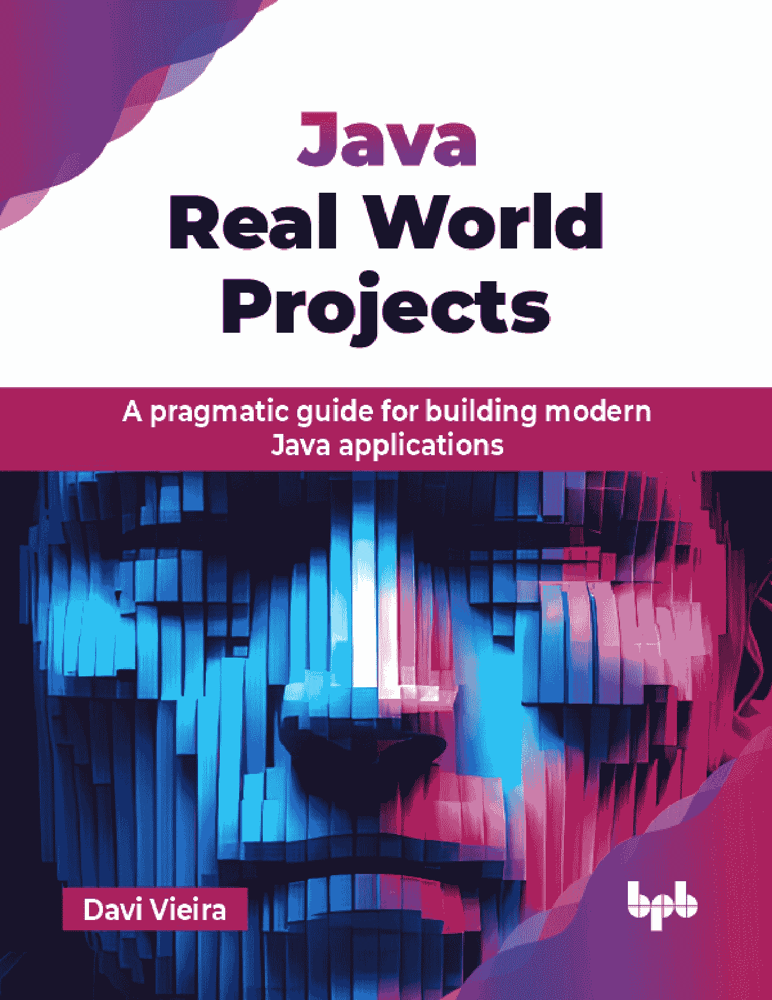


> 献给
>
> 熬夜并坚持目标的人。

# 关于作者

**Davi Vieira** 是一位软件工匠，对大型企业在软件设计、开发和架构方面面临的挑战有着深厚的兴趣。他拥有十多年使用面向对象的语言构建和维护复杂、长期且任务关键的系统的经验。Davi 非常看重前人留下的良好教训和软件开发传统。深受此类软件传统的启发，他不断开发和完善自己的想法。

Davi 的技术生涯始于在 Web 托管行业担任 Linux 系统管理员。在学习了许多使用 shell 脚本进行服务器任务自动化知识后，他转入银行业，在那里修复遗留 Java 系统的 Bug。与此类遗留系统的工作使 Davi 能够在电信机构中面对令人兴奋的挑战，他在帮助公司采用云原生开发实践方面发挥了至关重要的作用。Davi 渴望学习并产生深远的影响，目前在一家企业软件公司担任技术主管。

# 关于评审员

- **Ron Veen** 是一位资深软件工程师，在 Java 生态系统中拥有超过 20 年的经验。从大型机到微服务，他见证了一切。他对软件工程和架构的热情驱动着他的工作。作为一名认证的 Java 专家（OCP/OCPBCD），Ron 精通从 Apache 到 ZK 的各种框架和库。他还以探索 Kotlin 等替代性 JVM 语言而闻名。作为 Team Rockstars IT 的特工和高级开发人员，Ron 通过国际会议演讲者和其书面作品分享他的知识。他是《基于 Jakarta EE 的 Java 云原生迁移》和《虚拟线程、结构化并发和作用域值》书籍的作者。

- **Stan Komar (Stanisław Kazimierz Komar)** 是一位专注于工业自动化和系统集成的企业主，使用 Rockwell、施耐德、西门子或三菱工具。他从 1973 年起一直活跃在编程领域。尽管他本该退休了，但他非常喜欢他工作的项目，以至于“退休可以等待”。编程世界的变化实在太大，保持与时俱进非常有挑战性。年仅 69 岁的他是一位热爱的网球爱好者。

# 致谢

我清晰地记得小时候，我的哥哥 Bruno Pinheiro de Oliveira 探索电脑，在互联网上发现新事物，并直到深夜还在通过拨号连接下载 Linux。我对技术的激情就源于那里，感谢他向我灌输了这种热情。

我感谢我的父母 Davi 和 Rosimar，他们一直相信并支持我的梦想；也感谢我的妻子 Eloise 和儿子 Davi，在困难时期给了我坚持的理由。

我的 Java 之旅始于学习编程语言，与其说是学习，不如说是为了在职业重大变革期间保住我的工作。我仍在旅程中，我想感谢那些通过让我与他们相处而对我的学习做出贡献的人。

我在 HSBC Global Technology 首次接触企业软件，这为这本书的写作奠定基础至关重要。我永远感谢能与 Ana Moises de Souza、Renan Augusto da Silva、Caio Cesar Ferreira、Marco Aurélio Scheid、Ricardo André Pikussa、Carlos Bochnia、Emilio Fernandes、Adenir Rodrigues Filho、Alejandro Andrade、Jerson Rodrigues（纪念）以及 Luiz Hauth 等卓越人士合作，我永远不会忘记他的领导力课程。

我不能忘记提到 Filipe Negrello，他对我的职业产生了影响。我永远感谢能与 Wilson Bissi、Lucas Maldaner、Mauricio Orozimbo de Silva、Raoni Gabriel、Leonardo Henrique Pereira、Tiago Silvestrini、Wagner Costa、Adriano Wierzicki、Ricardo Ribeiro、Nelmar Alvarenga、Hamilton Santos、Jefferson Lira、Julio Truncasa、Fagner da Silva 以及 Paulo Jorge Lagranha 合作。

自首次发布多年以来，Java 依然如既往地非常重要，支撑着各种规模企业的各类关键应用程序。看到十、二十年前甚至更久以前运行的 Java 应用程序并不罕见，这证明了 Java 健壮且可靠的本质。硬币的另一面，Java 仍然是许多新项目的首选语言，它们可以选择如 Spring Boot、Quarkus 或 Jakarta EE 等高质量框架，这些框架促进了创新，并让 Java 语言保持活力，以应对云和人工智能时代现代软件开发的挑战。

基于这种机遇与创新的格局，本书的编写是为那些决定面对任何严肃 Java 项目可能产生的复杂性、模糊性和困难的人准备的。从探索 Java 基础知识开始，本书回顾了用于高效处理数据结构、文件、异常、日志以及大多数企业 Java 应用中常见的其他要素的核心 Java API 组件。它还探讨了现代 Java 特性（如密封类、模式匹配、记录模式和虚拟线程）如何被用于构建能够充分发挥 Java 优势的软件系统。书中介绍了如何利用 `Java-Database Connectivity (JDBC)` 和 `Jakarta Persistence APIs (JPA)` 高效处理关系型数据库的技术，从而为 Java 开发奠定坚实的基础。尽管如此，在 Java 基础的背景下，本书仍探索了如何通过单元测试和集成测试来提高整体代码质量。

在涵盖了 Java 基础之后，本书探讨了如何使用 Spring Boot、Quarkus 和 Jakarta EE 等可靠的软件开发框架，基于开发者友好和高生产力的原则来开发应用程序。这些框架通过让 Java 开发者使用尖端技术和行业标准赋予了他们能力，而这些标准正是大多数关键后端应用程序的基础。

针对在生产环境中可靠运行 Java 应用的日常挑战，本书描述了至关重要的监控和可观测性技术。这些技术帮助 Java 开发者更好地理解应用程序在不同且完全意料之外的情况下的运行表现，使开发者在处理瓶颈、可扩展性以及任何其他可能影响应用程序可用性的问题时，处于更加主动而非被动的地位。

最后，本书探讨了不同的软件架构思想（如 `领域驱动设计 (DDD)`、分层架构和六边形架构）如何在开发容错性且易于维护的应用中发挥至关重要的作用。这些应用不仅能满足客户需求，还能建立坚实的基础，使开发者能够更优雅地引入代码更改，并减少重构工作。

## 第 1 章：重新回顾 Java API

本章重新回顾了真实项目中常见的 Java 核心 API。首先探索了 Collections API 的数据结构，展示了在 Java 系统中将数据处理为对象的可能方式。考虑到文件处理的频繁性，本章展示了如何使用 NIO2 操作文件。通过对异常的深入检查以及后续日志 API，为有效的错误处理和增强的日志管理奠定了坚实基础。由于大多数 Java 应用程序都需要处理日期和时间，书中还探索了 Date-Time API。章节最后涵盖了流处理和 Lambda 等函数式编程特性，展示了如何编写更高效简洁的 Java 代码。

## 版权

如果您在互联网上发现任何任何形式的作品非法盗版，如果您能提供所在地址或网站名称，我们将不胜感激。请通过 `business@bpbonline.com` 联系我们并附上材料链接。

## 如果您有兴趣成为作者

如果您在某个领域拥有专长，并且对编写或贡献书籍感兴趣，请访问 `www.bpbonline.com`。我们已经与成千上万像您这样的开发者和技术专业人士合作，帮助他们向全球技术社区分享见解。您可以提交通用申请、申请我们正在招募的特定热门话题，或提交您自己的想法。

## 评论

请留下您的评论。在您阅读并使用此书后，为什么不在购买的网站上留个评价呢？潜在读者可以查看并利用您的中肯意见来做出购买决策。我们 BPB 可以了解您对我们产品的看法，其他作者也可以看到对他们书籍的反馈。感谢！

有关更多 BPB 的信息，请访问 `www.bpbonline.com`。

## 加入我们书籍的 Discord 空间

加入书籍的 Discord 工作空间，获取最新更新、优惠、全球科技动态、新发布以及与作者的交流：

- 序言
- 目标
    - 使用 lists 创建有序对象集合
    - 使用 maps 创建键值数据结构
    - 创建路径
- 使用异常进行错误处理
    - 未检查异常 (Unchecked exceptions)
    - 创建自定义异常
    - 日志处理程序、级别和格式
    - LocalDate
    - LocalDateTime
- 函数 (Functions)
- 消费者 (Consumers)
- 流的源化
- 终端操作 (Terminal operation)
- 结论
- 序言
- 结构
- 目标
- 使用密封类（sealed classes）获得对继承的更多控制
- 强制执行继承预期
- 使用模式匹配（pattern matching）提高代码可读性
    - 模式匹配简介
    - 针对模式匹配
    - 针对 switch 语句的模式匹配
    - 针对 record 的模式匹配
- 使用虚拟线程（virtual threads）提高应用吞吐量
    - 理解 Java 平台线程
    - 平台线程的局限性
    - 平台线程与阻塞 IO 操作
- 使用响应式编程处理阻塞 IO
- 使用虚拟线程编写简单的并发代码
- 编译并运行示例项目
- 结论

## 第 3 章：使用 Java 处理关系型数据库

- 序言
- 结构
- 目标
- JDBC 简介
- 使用 JDBC API 创建数据库连接
- 使用 `DriverManager` 获取数据库连接
- 使用 `DataSource` 接口获取数据库连接
- 使用 `Statement` 执行简单查询
- 使用 `PreparedStatement` 执行参数化查询
- 使用 `CallableStatement` 调用存储过程
- 使用 `ResultSet` 处理结果
- 使用 Jakarta Persistence 简化数据处理
- 定义实体
- 定义实体关系
    - 一对多 (OneToMany)
    - 多对一 (ManyToOne)
    - 一对一 (OneToOne)
    - 多对多 (ManyToMany)
- 使用 Hibernate 处理数据库实体
- 探索 JPQL 和 Criteria API
- 探索数据库时的本地开发方法
- 远程数据库的本地开发
- 内存数据库的本地开发
- 容器数据库的本地开发
- 运行项目

## 第 4 章：使用测试防止意外行为

- 序言
- 结构
- 目标
- 关注单元测试和集成测试
    - 单元测试
    - 集成测试
- 使用 JUnit 5 编写有效的单元测试
- 设置 JUnit 5
- 引入账户注册系统
- 测试账户注册系统
- 准备-执行-断言（Arrange-Act-Assert）模式
- 断言 (Assertions)
- 何时使用 Mockito
- 在 JUnit 5 中设置 Mockito
- 为账户注册系统添加外部调用
- 使用 Mockito 模拟外部调用
- 使用 Maven 执行测试
- 使用 Testcontainers 实现可靠的集成测试
- 设置 Testcontainers
- 将账户注册系统集成 MySQL
- 使用 Testcontainers 实现集成测试
- 使用 Maven 运行集成测试
- 编译并运行项目
- 结论

## 第 5 章：使用 Spring Boot 构建生产级系统

- 序言
- 结构
- 目标
- 学习 Spring 基础
    - 使用 Spring Context 管理 bean
    - 使用 `@Bean` 注解创建 bean
    - 使用 Spring 类型注解创建 bean
        - `@Component` 注解
        - `@Service` 注解
        - `@Repository` 注解
    - 使用类型注解
    - 使用 `@Autowired` 注入依赖
    - 使用切面（aspects）提供新的应用行为
        - 切面 (Aspect)
        - 连接点 (Joinpoint)
        - 建议 (Advice)
        - 切点 (Pointcut)
    - 使用 Spring AOP
- 引导启动新的 Spring Boot 项目
- 使用 Spring Initializr 创建 Spring Boot 项目
- 使用 Spring Boot 实现 CRUD 应用
    - 设置依赖
    - 配置 Spring Boot 应用
    - 定义数据库实体
    - 创建仓库
    - 实现服务
    - 使用控制器暴露 API 端点
    - 向 Spring Boot 应用程序发送 HTTP 请求
    - 编译并运行示例项目
- 结论

## 第 6 章：使用 Quarkus 提升开发者体验

- 引言
- 目录结构
- 目标
- 评估 Quarkus 的益处
- 启动一个新的 Quarkus 项目
- 使用 Quarkus 构建 CRUD 应用
- 使用 Quarkus DI 注入依赖
    - 托管 Bean (Managed beans)
    - 应用作用域 Bean (Application-scoped beans)
    - 单例 Bean (Singleton beans)
    - 请求范围 Bean (Request-scoped beans)
- 使用 Hibernate 持久化
- 配置 Quarkus 以配合数据库
- 使用 `EntityManager` 处理数据库实体
- 使用 Panache 简化数据库实体处理
    - 结合存储库模式的 Panache
    - 结合活动记录模式的 Panache
- 使用 Quarkus REST 实现 API
- 编写原生应用程序
    - 介绍原生镜像
    - 使用 Quarkus 创建原生可执行文件
- 编译并运行示例项目
- 结论

## 第 7 章：使用 Jakarta EE 和 MicroProfile 构建企业级应用

- 引言
- 目录结构
- 目标
- Jakarta EE 概述
- 设计多层架构应用
    - 客户端层 (Client tier)
    - Web 层 (Web tier)
    - 业务层 (Business tier)
    - 企业信息系统层 (Enterprise information system tier)
- 探索 Jakarta EE 规范
    - Jakarta EE Platform 规范
    - Jakarta EE Web Profile 规范
    - Jakarta EE Core Profile 规范
- 打包、部署和运行 Jakarta EE 应用
    - Java Archive (JAR)
    - Web Archive (WAR)
    - Enterprise Archive (EAR)
- 介绍 MicroProfile
- 探索 MicroProfile 规范
    - Jakarta EE Core Profile 规范
    - MicroProfile 规范
- 开始一个新的 Jakarta EE 项目
- 使用 Jakarta EE 构建企业应用
- 使用 MicroProfile 添加微服务和云原生支持
- 设置项目
    - 定义数据源
    - 实现 Jakarta Persistence 实体
    - 使用 `EntityManager` 实现存储库 (Repository)
    - 将服务类实现 Jakarta CDI 托管 Bean
    - 使用 Jakarta EE 和 MicroProfile 构建 API
    - 使用 MicroProfile Health 实现健康检查
- 编译并运行示例项目
- 结论

## 第 8 章：在云原生环境中运行您的应用程序

- 引言
- 目录结构
- 目标
- 理解容器技术
    - 介绍虚拟化
    - 全虚拟化 (Full virtualization)
    - 半虚拟化 (Paravirtualization)
    - 基于容器的虚拟化
- 探索 Docker
    - 学习 Docker 基础
    - 管理 Docker 镜像
    - 创建 Docker 容器
- 介绍 Kubernetes
    - Kubernetes 架构
        - kube-scheduler
        - kube-apiserver
        - kube-controller-manager
        - 容器运行时
        - kubelet
        - kube-proxy
- Kubernetes 对象
    - Pod
    - Deployment (部署)
    - Service (服务)
    - ConfigMap 和 Secret
- 将 Spring Boot、Quarkus 和 Jakarta EE 应用容器化
    - 创建 Spring Boot 应用的可启动 JAR 包
    - 创建 Quarkus 应用的可启动 JAR 包
    - 创建 Jakarta EE 应用的可启动 JAR 包
    - 创建 Docker 镜像
- 在 Kubernetes 上部署基于 Docker 的应用
- 外部化应用配置
    - 创建 Kubernetes 对象
    - 使用 ConfigMap 提供应用配置
    - 使用 Secret 定义数据库凭据
    - 使用 Deployment 部署应用
    - 使用 Service 允许应用程序
    - 使用 `kubectl` 安装 Kubernetes 对象
- 编译并运行示例项目
- 结论

## 第 9 章：学习监控与可观测性基础

- 引言
- 目录结构
- 目标
- 理解监控与可观测性
    - 监控 (Monitoring)
    - 可观测性 (Observability)
- 使用 Spring Boot 和 Telemetry 实现分布式追踪


# 重习 Java API

## 引言

软件开发是一种数据处理活动，我们通过这种活动创建接收和产生数据的系统。作为程序员，我们负责在开发的应用程序中识别出处理数据最高效且直观的方法。有时，这并非易事，因为高效并不意味着简单，反之亦然。开发者们一直在效率和简单性之间寻找平衡，考虑到如今计算资源已不再像过去那样昂贵了。

一个经过深度优化以实现极高效的复杂代码，其可维护性可能高于一个消耗更多计算资源但易于理解和修改的简单代码。

当然，这完全取决于上下文。某些业务要求软件压榨每一分可能的性能，例如交易和金融领域，在这些领域中，每一毫秒，甚至纳秒，都可能显著影响货币收益。除非在需要高性能的特殊情况下，否则始终存在一个权衡空间，构建更简单、非高效的代码可能对你的组织和客户是最佳选择。

由于大多数应用程序不需要极高效的性能，此类应用程序依赖标准的数据结构和算法来进行数据处理。这正是 Java API 的用场，它提供了一个名为 Java Collections Framework（Java 集合框架）的丰富库，该框架提供了一系列内置数据结构，涵盖了我们在典型后端应用程序中看到的大多数场景。

此外，Java Collections Framework 还拥有接口和类，可以帮助那些想要开发高性能代码的人，它通过 `java.util.List`、`java.util.Set` 和 `java.util.Map` 为频繁使用的数据结构提供支持而大放异彩。Map 接口不视为抽象集合，因为我们可以像处理集合一样处理基于 map 的类，并且是这样对待它们的。

让我们从 List 接口及其某些实现类开始探索。

## 使用列表创建对象集合

在 Java 中，存储对象的常用方法是通过列表（lists）。这种结构的基本思想是我们可以按有序的方式收集对象，从而允许我们保留在给定列表中存储对象的顺序。它允许重复元素，所以如果你尝试多次插入同一个对象，它不会报错。

`java.util.List` 接口继承自 `java.util.Collection` 接口，这意味着我们可以依赖基本操作来处理集合，并使用特定方法来操作列表。`java.util.Collection` 接口扩展了 `java.util.Iterator` 接口，允许我们遍历任何列表。

我们有实现 `java.util.List` 接口的 `ArrayList`。`ArrayList` 是 Java 项目中最常见的列表和数据结构。

基于 Java 数组，`ArrayList` 提供了一个大小可以动态增加的列表，这是我们在普通数组中无法做到的，因为普通数组的大小一旦定义就无法更改。以下是我们创建 `ArrayList` 的方式：

```
List<String> listOf = new ArrayList<>();
```

由于 `ArrayList` 是泛型的，我们可以通过指定 `List` 支持的对象类型来利用类型安全。在示例中，我们说 `List` 将仅接受 `String` 对象。我们通过声明变量类型为 `List<String>` 来建立这一点。在创建实例时，我们可以使用尖括号如 `ArrayList<String>` 显式定义类型，或者使用菱形操作符 `<>` 在上面的示例中使用 `ArrayList<>`。编译器通过检查我们示例中为变量 `String` 定义了哪种类型来推断出 `ArrayList` 实例类型。

请注意，我们使用 `List` 而不是 `ArrayList` 作为 `listOfStrings` 的变量类型。依赖接口是一种良好的编程实践。如果我们以后决定 `ArrayList` 不再满足我们的需求，我们可以在不更改变量类型的情况下更改实例：

```
List<String> listOfStrings = new ArrayList<>();
listOfStrings = new LinkedList<>();
```

你可能开始使用 `ArrayList` 进行实现，并在代码库的多个地方引用它。稍后，你可能决定 `LinkedList` 更适合你的情况。因此，依赖 `List` 作为引用类型可能会在更改代码以使用 `LinkedList` 代替 `ArrayList` 时，显著减少你的重构工作量。

我们可以使用 `List` 从文件或数据库收集数据。获取数据库记录并将它们表示为 `List` 中的对象是一项惯例。如果你工作过依赖它的 Hibernate 对象关系映射（ORM）框架，你可能见过某些辅助类，允许你查询数据库并以 `List` 返回结果。

泛泛操作列表时，我们要么获得一个已经填充好的列表，要么需要创建并填充新列表。无论上下文如何，你都可能想要遍历列表内容：

```
List<String> listOfElements = List.of("Element 1", "Element 2", "Element 3");

// 使用索引迭代
for(var i = 0; i<listOfElements.size(); i++) {
  System.out.println(listOfElements.get(i));
}

// 使用增强型 for 循环迭代
for(var element : listOfElements) {
  System.out.println(element);
}

// 使用带 lambda 表达式的 forEach 方法迭代
listOfElements.forEach(element -> System.out.println(element));
```

我们首先使用列表索引。除非我们需要处理索引的特殊迭代逻辑，否则我们通常会使用增强型 for 循环或带有消费者 lambda 的 `forEach` 方法。我们使用 `List.of` 来生成列表；它是 `List` 接口提供的辅助方法。如果你创建了该列表，没有办法更改其结构或内容：

```
List<String> listOfElements = List.of("Element 1", "Element 2", "Element 3");
listOfElements.set(0, "Element 4"); // 它抛出 java.lang.UnsupportedOperationException
listOfElements.add("Element 5"); // 它抛出 java.lang.UnsupportedOperationException
```

通过 `Arrays.asList`，只能更改内容而不能更改结构。任何添加或删除列表的操作都会导致 `UnsupportedOperationException`。

```
List<String> listOfElements = Arrays.asList("Element 1", "Element 2", "Element 3");
listOfElements.set(0, "Element 4"); // 正常
listOfElements.add("Element 5"); // 它抛出 java.lang.UnsupportedOperationException
listOfElements.remove("Element 3"); // 它抛出 java.lang.UnsupportedOperationException
```

如果你寻找一个完全可变的列表，`ArrayList` 是首选。它允许添加和删除元素：

```
List<String> listOfElements = new ArrayList<>();
listOfElements.add("Element 1");
listOfElements.add("Element 2");
listOfElements.remove("Element 1");
System.out.println(listOfElements.size()); // 1
```

在示例中，我们通过提供 String 类型的参数来移除列表项。也可以通过指定索引位置移除列表项：

```
List<String> listOfElements = new ArrayList<>();
listOfElements.add("Element 1");
listOfElements.remove(0);
System.out.println(listOfElements.size()); // 0
```

从性能考虑，使用索引比使用对象相等性总是更好。当我们通过传递对象来移除列表项时，必须从头到尾遍历所有列表对象，直到找到匹配的对象。这个过程消耗计算时间。当传递索引时，它只需移除指定位置的对象。

向列表添加重复元素时列表不会报错：

```
List<String> listOfElements = new ArrayList<>();
listOfElements.add("Element 1");
listOfElements.add("Element 1");
System.out.println(listOfElements); // [Element 1, Element 1]
```

向列表中添加重复项是可以的，因为没有机制可以确保列表内容的唯一性。现在，如果我们想要一个排除重复项的数据结构，`java.util.Set` 是正确的集合。

`java.util.Set` 接口的设计目的是为了提供一个排除重复元素的集合。然而，我们需要理解对象如何进行比较，以便知道 Java 中什么可以被视为重复对象。在 Java 中，比较对象有两种方式。第一种方式是基于对象在内存中的位置的相等性。如果两个对象指向 JVM 中的同一个内存地址，则它们是相等。这就是我们使用 `==` 运算符比较对象时发生的情况：

```java
class Person {
  String name;
  Person(String name) {
    this.name = name;
  }
}

public class CheckEquality {
  public static void main(String... args) {
    Person person = new Person("john");
    Person samePerson = person;
    System.out.println(person == samePerson); // true
    System.out.println(person.equals(samePerson)); // true
  }
}
```

我们创建了一个新的 `Person` 实例并赋值给 `person` 变量。我们创建了指向 `person` 变量的 `samePerson` 变量。使用 `==` 运算符或 `equals` 方法比较这些变量时，结果均为 `true`。`equals` 方法来自 `Object` 类。Java 中的所有类都继承了 `equals` 方法，因为每个 Java 类都扩展了 `Object` 类。以下是 `Object` 类中 `equals` 方法的形式：

```java
public boolean equals(Object obj) {
  return (this == obj);
}
```

我们可以看到 `equals` 方法使用 `==` 运算符进行比较。这意味着 Java 中创建的所有对象的默认行为都是基于对象在内存中的位置。

现在考虑以下场景：

```java
Person person = new Person("john");
Person samePerson = new Person("john");
System.out.println(person.equals(samePerson)); // false
```

比较 `person` 和 `samePerson` 返回 `false`，因为我们有两个不同内存位置的对象。为了解决这个问题，我们需要一种检查对象属性而不是内存位置的比较机制。我们可以通过在 `Person` 类中重写 `equals` 和 `hashCode` 方法来实现：

```java
@Override
public boolean equals(Object o) {
  if (this == o) return true;
  if (o == null || getClass() != o.getClass()) return false;
  Person person = (Person) o;
  return Objects.equals(name, person.name);
}
```

```java
@Override
public int hashCode() {
    return Objects.hash(name);
}
```

我们的 `equals` 实现首先检查两个对象是否引用完全相同的内存地址位置。我们使用 `==` 运算符执行此操作。接下来，检查传递的对象是否为 `null`，或者其类是否与 `Person` 类不同。如果之前的检查通过，我们将对象强制转换为 `Person` 类型，并比较所比较对象之间的 `name` 属性。

我们还重写了 `hashCode` 方法。这在处理 `Set` 集合时尤为重要，因为 `Set` 由哈希表支持，哈希表依赖于 `hashCode` 产生的哈希值将对象正确存储在基于键的数据结构中（其中哈希值是键，对象是值）。我们将在下一节中探索更多键值数据结构。

我们的 `hashCode` 实现根据 `Person` 类的属性产生哈希值。

当我们正确实现 `equals` 和 `hashCode` 时，我们可以利用基于对象属性的优势：

```java
Person person = new Person("john");
Person samePerson = new Person("john"); 
System.out.println(person == samePerson); // false
System.out.println(person.equals(samePerson)); // true
```


# 使用 `==` 运算符的相等性检查

使用 `==` 运算符的相等性检查返回 `false`，因为 `person` 和 `samePerson` 指向不同内存地址的对象。当我们使用 `equals` 进行比较时，得到了 `true`，我们现在依赖于检查 `Person` `name` 属性的实现。

关于 Java 中对象相等性的知识是理解 `Set` 接口如何排除重复的基础。所有关于对象相等性的讨论为解决任何我们需要处理的重复数据问题铺平了道路。

## 常用的 `Set` 实现：`HashSet`

常用的 `Set` 实现之一是 `HashSet` 类。以下是我们如何创建并向 `HashSet` 添加对象：

```java
Set<Person> setPersons = new HashSet<>();
setPersons.add(new Person("john"));
setPersons.add(new Person("john"));
System.out.println(setPersons.size()); // 1
```

当我们第二次添加时，`HashSet` 识别出名称属性为 "john" 的 `Person` 对象已存在，从而忽略了它的插入。我们可以通过检查 `HashSet` 的大小来确认重复的 `Person` 未被插入，大小为 1。

`Set` 与 `List` 不同，它不保证集合的顺序。因此，将对象插入 `Set` 的顺序不是键值的。你不能使用索引从 `Set` 集合中移除对象。集合是一个基于键的结构，因此你必须提供想要移除的对象。从给定对象派生的哈希码将作为 `Set` 中查找的键。如果找到了表示对象的键，则该对象将从 `Set` 中移除：

```java
Set<Person> setPersons = new HashSet<>();
Person person = new Person("john");
setPersons.add(person);
setPersons.remove(person);
System.out.println(setPersons.size()); // 0
```

尽管 `Set` 底层由键值 `Map` 接口支持，但我们不能使用 `Set` 来建立一个对象是键、另一个对象是值的双对象关系。因此，我们需要依靠 `Map` 接口及其实现来实现该目的。让我们在下一节中查看。

# 使用 Map 创建键值数据结构

在某些场景下，我们需要比列表或对象集合更复杂的结构来解决问题。

## 1. 定义 `Id` 类

让我们从定义 `Id` 类开始：

```java
class Id {
  String id;

  Id(String id) {
    this.id = id;
  }

  @Override
  public boolean equals(Object o) {
    if (this == o) return true;
    if (o == null || getClass() != o.getClass()) return false;
    Id id = (Id) o;
    return Objects.equals(id, id.id);
  }

  @Override
  public int hashCode() {
    return Objects.hash(id);
  }

  @Override
  public String toString() {
    return "Id{id='" + id + "'}";
  }
}
```

## 2. 创建 `Message` 类

然后我们创建 `Message` 类：

```java
class Message {
  String content;

  Message(String content) {
    this.content = content;
  }

  public String getContent() {
    return content;
  }

  public void setContent(String content) {
    this.content = content;
  }

  @Override
  public String toString() {
    return "Message{content='" + content + "'}";
  }
}
```

## 3. 创建 `HandleMessage`

最后，我们创建 `HandleMessage`：

```java
public class HandleMessage {
  public static void main(String[] args) {
    Map<Id, Message> mapPersons = new HashMap<>();
    mapPersons.put(new Id("MSG-1"), new Message("First message"));
    mapPersons.put(new Id("MSG-2"), new Message("Second message"));
    mapPersons.put(new Id("MSG-3"), new Message("Third message"));

    mapPersons.remove(new Id("MSG-3"));

    System.out.println("Map size: " + mapPersons.size());

    mapPersons.forEach((id, message) -> {
      appendToContent(message);
      notifyProcessing(id);
    });
  }

  public static void appendToContent(Message message) {
    var content = message.getContent();
    var processedContent = content + " - processed";
    message.setContent(processedContent);
  }

  public static void notifyProcessing(Id id) {
    System.out.println("Message " + id + " processed.");
  }
}
```

Java 集合框架是一个广泛的主题，内容远超本节涵盖的范围。探讨该主题的每一个方面超出了本书的范围。因此，本节重点关注 Java 项目中常见的集合方法。现在让我们看看如何使用 Java 高效处理文件。

# 使用 NIO 操作文件

在许多情况下，Java 应用程序需要与操作系统交互以处理文件和目录。作者回忆起一个项目，当时使用的系统会生成报告并通过文件提供下载。应用程序会运行逻辑来创建报告，并将其保存到 JVM 运行所在文件系统的某个位置。完成后，应用程序会提供一个下载报告的 URL。

根据你的用例，你可能使用 Java 处理文件和目录。好消息是，Java 有一个强大的名为 NIO（非阻塞 I/O，版本 2）的 API，它提供了直观且流畅的文件系统管理体验。我们可以在 `java.nio` 包中找到 NIO2 API。虽然 `java.io` 包中也有标准的 I/O 路径，但那是 Java 中处理文件的旧方式。新应用程序应该依赖 NIO2 API。

我们本节的重点将放在 NIO2 API，因为它提供了处理文件和目录的现代特性。

## 创建路径

文件系统代表了操作系统中文件和目录的组织方式。这种表示遵循基于树的结构，我们有一个根目录以及其下的其他目录和文件。我们有两种文件系统，一种源自 Windows，另一种源自 Unix（例如 Linux 或 macOS）。在 Windows 上，根目录通常是 `C:`，而在 Linux 上，它是 `/`。

我们如何分隔路径也会根据操作系统的不同。例如，在 Windows 上，我们使用反斜杠 `\`，而在 Linux 上，使用的是斜杠 `/`。

以下是如何识别 Java 应用程序可用的根目录：

```java
System.out.println(FileSystems.getDefault()); // sun.nio.fs.LinuxFileSystem
FileSystems.getDefault().getRootDirectories().forEach(System.out::println);
```

由于上述代码在 Linux 机器上执行，`FileSystems.getDefault()` 返回 `sun.nio.fs.LinuxFileSystem`。在检查可能的根目录时，它只获取 `/`，这是 Linux 系统中的根目录。

NIO2 API 提供了 `Path` 接口来表示文件系统中的路径。路径可以是文件，也可以是目录。还有符号链接的概念，它可以解析为文件或目录，因此 Java 允许使用符号链接创建 `Path` 对象。

以下是如何创建 `Path` 对象：

```java
Path path = Path.of("/path/example");
```

我们使用工厂方法 `Path.of` 并传入一个表示我们想要创建的路径的字符串。需要理解的一点是，传递给 `Path.of` 的 Path 字符串可能并不存在。因此，创建一个新的 `Path` 对象并不意味着路径在操作系统中存在。

路径可以是绝对的或相对的。我们将完整的路径称为绝对，意味着它包含了所有的路径组件：根目录。以下是绝对路径的示例：

```java
Path.of("/home/john/textFile.txt"); // Linux 绝对路径
Path.of("C:\\users\\john\\textFile.txt"); // Windows 绝对路径
```

上面的绝对路径创建了一个文件 `textFile.txt` 和三个目录（包括根目录）。注意，我们在 Windows 路径中使用了双反斜杠；这是因为单反斜杠被解释为转义字符。

相对路径也部分表示路径位置：

```java
Path.of("./john/textFile.txt"); // Linux 相对路径
Path.of(".\\john\\textFile.txt"); // Windows 相对路径
```

我们使用 `.` 或 `..` 来指示当前目录。在上面的示例中，我们没有提供 `textFile.txt` 所在的完整路径，使得该路径成为相对路径。

NIO API 提供了实用的方法以不同的方式操作 `Path` 对象。例如，我们可以将绝对路径与相对路径结合：

```java
Path absPath = Path.of("/home/");
Path relativePath = Path.of("./john/textFile.txt");
Path combinedPath = absPath.resolve(relativePath);
System.out.println(combinedPath); // /home/./john/textFile.txt
System.out.println(combinedPath.normalize()); // /home/john/textFile.txt
```

在 `Path` 中调用的 `resolve` 方法允许将其与另一个 `Path` 对象结合，就像我们对 `absPath` 和相对路径操作的那样。

当打印 `combinedPath` 时，它是冗余的，可以从路径表示中排除。当打印 `combinedPath` 调用 `normalize` 方法的结果时，我们看到了去除了 `./` 元素的规范后的 `combinedPath`。`normalize` 方法对于清理包含冗余元素（如 `./` 表示当前目录和 `../` 表示上一级目录）的路径非常有帮助。

现在我们知道了如何操作 `Path` 对象，让我们看看如何使用它们来处理文件和目录。

## 处理文件和目录

NIO.2 API 提供了 `Files` 类，包含处理文件和目录的工厂方法。以下是如何使用该类的示例：

```java
import java.io.IOException;
import java.nio.file.*;

public class HandlingFilesAndDirectories {
    public static void main(String[] args) throws IOException {
        Path textFile = Files.createFile(Path.of("/tmp/textFile.txt"));
        String content = """
First line
Second line
Third line
""";
        Files.writeString(textFile, content, StandardOpenOption.APPEND);
    }
}
```

我们通过 `Files.createFile(Path.of("/tmp/textFile.txt"))` 开始创建一个新文件。`StandardOpenOption.APPEND` 是允许向文件写入数据而不覆盖现有内容的选项。

以下显示了我们如何使用 NIO.2 API 实现目录和文件的检查与移动：

```java
Path dirA = Path.of("/tmp/dirA");
Path fileA = Path.of("/tmp/fileA");
System.out.println(Files.isDirectory(dirA)); // false
System.out.println(Files.isRegularFile(fileA)); // false

Files.createDirectory(dirA);
Files.createFile(fileA);
System.out.println(Files.isDirectory(dirA)); // true
System.out.println(Files.isRegularFile(fileA)); // true

Path destPath = Path.of(dirA + FileSystems.getDefault().getSeparator() + fileA.getFileName());
System.out.println(Files.move(fileA, destPath)); // /tmp/dirA/fileA
```

NIO API 提供了读取文件内容的有用方法，例如 `Files.lines` 方法：

```java
Path newFile = Path.of("/tmp/newFile.txt");
String content = """
First Line
Second Line
""";
Files.writeString(newFile, content, StandardOpenOption.CREATE);
```

`Files.lines(newFile)` 返回一个 `Stream<String>`，我们可以用它来读取文件的行。使用流读取文本在内存使用方面是高效的，因为流不会将整个文件内容保存在内存中。流允许我们逐行读取，而不会损害内存资源。

下一节将探讨如何使用异常来处理 Java 应用程序中的意外行为。

# 使用异常处理错误

开发一个健壮的 Java 应用程序意味着理解可能出现的问题以及应用程序如何优雅地处理意外行为。你的应用程序可能存在某种逻辑，当用户提供了应用程序未准备好处理的异常输入时，该逻辑就会崩溃。在将应用程序与数据库集成时，你假设数据总是以一种格式出现。你所调用的 API 可能会更改其契约，导致你的应用程序崩溃。应用程序保存文件的文件系统空间满了，导致保存新文件时失败。关于导致应用程序出现问题的情况，我们可以列出无穷。

Java 架构师已经意识到应用程序可能面临的失败条件，因此，他们设计了一种基于 `Throwable` 类的错误处理机制。该类处理 Java 应用程序运行期间所有的错误和异常。

在 Java 中，我们有受检异常和未检异常。受检异常表示 Java 应用程序必须处理或捕获的失败条件，而未检异常则相反，意味着它们本不应该被捕获，尽管程序员如果他们愿意，也可以捕获它们。我们可以直接使用 `Exception` 类或扩展它来创建异常。还有一个 `RuntimeException` 类，它被认为是未检异常，并继承自 `Exception` 类。所有其他直接继承自 `Throwable` 类的 `Error` 类都被视为未检异常。

捕获异常允许我们为应用程序提供某种优雅的恢复机制，同时通知我们发生了什么问题。在 Java 中恰当使用异常处理可以显著提高故障排除工作，让我们能够更快地识别应用程序中某些功能未按预期运行的原因。

接下来，让我们来看一些受检异常的案例。

## 受检异常

这里我们有一个示例展示了如何使用受检异常：

```java
public class ExceptionAnalysis {

    public static void main(String[] args) {

        try {
            checkParameter(-1);
        } catch (Exception e) {
            System.out.println("The following error occurred: " +
                e.getMessage());
            e.printStackTrace();
        }
    }

    public static void checkParameter(int parameter) {
        if (parameter < 0)
            throw new Exception("Negative numbers are not allowed");
    }
}
```


# Java 异常处理与日志 API

## try-catch 结构

在 Java 中，我们使用 `try-catch` 结构来处理异常。在 `try` 块内部，放置可能会抛出受检异常的代码。我们可以在 `catch` 块内部处理异常，通过打印友好的错误信息或执行某些操作来从失败条件中恢复。

上述代码将打印以下输出：

```
The following error occurred: Negative numbers not allowed
java.lang.Exception: some(ExceptionAnalysis.java:14)
at ExceptionAnalysis.main(ExceptionAnalysis.java:5)
```

`check` 方法检查提供的参数是否为负整数。如果是，它将使用 `throw` 关键字抛出一个异常。`Exception` 类提供了一个单参数构造函数，允许我们为消息提供一个字符串。

由于我们正在创建异常，我们必须在 `check` 内部处理它，或者在方法声明中加上 `throws` 关键字。`throws` 关键字指定了方法可能抛出的一个或多个异常。

我们使用 `throw` 关键字，这意味着任何调用我们方法的方法都必须处理该异常，或者在其声明中包含 `throws` 关键字。如果程序员没有显式处理异常，将由默认 JVM 异常处理器处理。

## 未检异常

与受检异常相反，未检异常不需要我们的代码在运行时进行处理。虽然不推荐，但处理未检异常是合法的。

以下示例展示了应用程序如何抛出未检异常：

```java
var listOfStrings = List.of("a", "b");
var first = listOfStrings.get(0);
var second = listOfStrings.get(2); // IndexOutOfBoundsException: Index: 2, Size: 2
```

`IndexOutOfBoundsException` 是一个未检异常，因为它继承自 `RuntimeException` 类。当我们尝试访问列表边界外的索引时，默认 JVM 异常处理器会直接处理它。

## Final 块与 try-with-resources

除了 `try-catch` 之外，还有 `try-finally` 和 `try-catch-finally` 结构。`finally` 块表示在处理异常后始终执行的代码。当我们想要确保应用程序关闭 `try` 块内部系统调用使用的资源时，经常使用 `finally` 块。下面的示例说明了这样的场景：

```java
public void writeToFile() throws IOException {
    FileOutputStream fileOutputStream = new FileOutputStream("file.data");
    DataOutputStream dataOutputStream = new DataOutputStream(fileOutputStream);
    try {
        dataOutputStream.writeChars("Some text data");
    } catch (IOException e) {
        e.printStackTrace();
    } finally {
        dataOutputStream.close();
        fileOutputStream.close();
    }
}
```

上述代码使用 `DataOutputStream` 将字符序列化为字节，它写入由 `FileOutputStream` 提供的数据。我们捕获 `IOException` 是因为这是 `DataOutputStream` 中 `writeChars` 方法的受检异常。然后，我们有 `finally` 块，我们在其中关闭方法开头 `try-catch-finally` 之外用 `FileOutputStream` 和 `DataOutputStream` 打开的资源。

始终建议关闭资源，特别是在打开数据库连接或使用输入/输出流读写数据时。

Java 提供了另一种方法让我们的代码更简洁，如下所示：

```java
public static void writeToFile() {
    try (FileOutputStream fileOutputStream = new FileOutputStream("file.data");
         DataOutputStream dataOutputStream = new DataOutputStream(fileOutputStream)) {
        dataOutputStream.writeChars("Some text");
    } catch (IOException e) {
        e.printStackTrace();
    }
}
```

上述代码使用了 `try-with-resources` 结构，在块初始化的括号之间声明资源。在 `try-with-resources` 块中，所有资源都会被自动关闭，但这只发生在类实现了 `Closeable` 接口的情况下。

在结束此讨论之前，让我们检查如何创建异常。

### 创建自定义异常

Java 语言自带了非常有用的受检和未检异常供我们在应用程序中使用。虽然我们可以到处使用 `Exception` 类来告知发生了错误，但这不是良好的实践，并且会产生歧义。

为了提供更高效准确的错误处理，我们可以扩展 `Exception` 类来创建受检异常，或扩展 `RuntimeException` 类来创建未检异常。

以下是如何创建受检异常：

```java
public class NegativeNumberException extends Exception {
    public NegativeNumberException(String message) {
        super(message);
    }
}
```

我们可以通过扩展 `Exception` 类且不提供额外的构造函数来创建受检异常。`NegativeNumberException` 允许我们在抛出异常时提供一个有意义的消息：

```java
throw new NegativeNumberException("Negative numbers are not allowed");
```

创建、抛出和处理异常有助于开发更直接的应用程序。另一个可以支持故障排除的是我们如何记录日志。让我们在下一节中调查。

# 使用日志 API 改进应用程序维护

在开发新应用程序时，主要关注的是解决问题。这通常意味着快速且粗糙的代码。这不是最终解决方案，但它可以胜任工作。在这一阶段，我们通过清理和尽可能提高性能来改进代码。我们另一个考虑的是如何记录不同的行为以确保解决方案。毕竟，提供相关的日志消息对于调查系统问题非常有帮助。

为了帮助我们的应用程序提供更好的日志功能，Java 提供了日志 API，允许我们使用不同的日志处理器、级别和格式记录应用程序行为。在本节中，我们将探索它们是如何运作的。

```properties
handlers = java.util.logging.FileHandler, java.util.logging.ConsoleHandler
java.util.logging.FileHandler.pattern=%t/java-severe-%u.log
java.util.logging.FileHandler.level=WARNING
java.util.logging.FileHandler.formatter=java.util.logging.SimpleFormatter
```

默认情况下仅启用 `ConsoleHandler`。上面的配置通过处理程序的属性也包含了 `FileHandler`。该属性指定了 Java 如何创建包含日志数据的文件。我们使用 `%t` 将日志文件存储在操作系统的临时目录中，在 Windows 中是 `C:\TEMP`，在 Linux 中是 `/tmp` 目录。然后我们将 `FileHandler` 的 `level` 属性设置为 `WARNING`。以下是我们可以设置的所有可用级别：

- `OFF`
- `SEVERE`
- `WARNING`
- `INFO`
- `CONFIG`
- `FINE`
- `FINER`
- `FINEST`
- `ALL`

`OFF` 表示没有任何级别，而 `ALL` 意味着所有日志级别。级别机制的工作方式是 `FINEST` 是最低的配置，而 `SEVERE` 是最高的。假设我们配置了一个具有 `FINEST` 级别的处理程序。在这种情况下，它将捕获 `FINEST` 日志消息以及级别高于它的其他消息（如 `FINER`、`FINE` 等），直到 `SEVERE` 级别。反之，如果我们配置了一个具有 `WARNING` 级别的处理程序，它将只捕获 `WARNING` 和 `SEVERE` 级别的消息，忽略所有定义为低于两个级别的消息。

最后，我们有 `formatter` 属性，它定义了我们如何显示日志消息。在上面的示例中，我们使用了内置格式 `java.util.logging.SimpleFormatter`，我们可以通过扩展 `java.util.logging.Formatter` 类来实现自定义格式。

接下来，我们有一个程序使用我们之前定义的 `logging.properties` 文件来记录消息：

```java
package org.corp;
import static java.util.logging.Level.INFO;
import static java.util.logging.Level.SEVERE;
import java.io.IOException;
import java.util.logging.Logger;
public class TestApp {
    private static final Logger logger =
    Logger.getLogger(org.corp.TestApp.class.getName());
    public static void main(String... args) throws IOException {
        logger.log(INFO, "Start operation");
        try {
            execute();
        } catch (Exception e) {
            logger.log(SEVERE, "Error while executing operation", e);
        }
        logger.log(INFO, "Finish operation");
    }

    public static void execute() throws Exception {
        logger.log(INFO, "Executing operation");
        throw new Exception("Application failure");
    }
}
```

我们通过执行以下代码获取一个 `Logger` 对象：

```java
Logger logger = Logger.getLogger(dev.daviveira.Main.class.getName());
```

使用它来记录消息。也可以通过执行类似下面的代码为整个类设置默认日志级别：

```java
logger.setLevel(Level.INFO);
```

设置配置意味着记录器将捕获所有使用 `SEVERE`、`WARNING` 和 `INFO` 级别记录的消息。`INFO` 以下的其他日志级别（如 `CONFIG` 和 `FINE`）将被忽略。

执行 `TestApp` 程序将导致创建 `/tmp/java-severe-0.log` 文件，内容如下：

```
Jan 28, 2024 12:24:44 PM org.corp.TestApp main
SEVERE: Error while executing operation
java.lang.Exception: Application failure
at org.corp.TestApp.execute(TestApp.java:26)
at org.corp.TestApp.main(TestApp.java:17)
```

`FileHandler` 提供了上述输出。注意，只有 `INFO` 消息被省略了，是因为 `FileHandler` 的日志级别被设置为 `WARNING`，这意味着我们只显示 `WARNING` 和 `SEVERE` 日志消息。

以下是 `Console` 产生的输出：

```
Jan 28, 2024 12:24:44 PM org.corp.TestApp main
INFO: Start operation
Jan 28, 2024 12:24:44 PM org.corp.TestApp execute
INFO: Executing operation
Jan 28, 2024 12:24:44 PM org.corp.TestApp main
SEVERE: Error while executing operation
java.lang.Exception: Application failure
at org.corp.TestApp.execute(TestApp.java:26)
at org.corp.TestApp.main(TestApp.java:17)

Jan 28, 2024 12:24:44 PM org.corp.TestApp
INFO: Finish operation
```

由于我们依赖默认的 `ConsoleHandler` 配置，默认日志级别是 `INFO`，因此在这里我们看到了 `SEVERE` 和 `INFO` 日志消息。

# 探索 Date-Time API

Date-Time API 在 JDK 8 中引入，通过 `java.time` 包提供，这是一组表示不同格式日期和时间值的类。在 Date-Time API 出现之前，我们依赖于 `java.util.Date` 类。引入新的 Date-Time API 是为了填补之前的 `java.util.Date` 实现的缺陷。

本节涵盖了 Date-Time API 的一些主要方面，包括日期、时间、带时间的日期以及带时区的日期时间。让我们先检查 `LocalDate` 类是如何工作的。

## LocalDate

当我们只对天、月、年的日期表示感兴趣时，我们使用 `LocalDate` 类。你可能正在处理一个提供范围过滤功能的应用程序，其粒度由天定义，排除了任何与小时或月相关的时间。这种情况可以从 `LocalDate` 的功能中受益。以下是创建表示当前日期的 `LocalDate` 方法：

```java
System.out.println(LocalDate.now()); // 2024-01-28
```

调用该方法时，它将根据 JVM 运行的默认时区返回当前日期。如果我们没有通过应用程序强制执行时区，Java 将依赖于操作系统定义的时区。例如，我的电脑配置为 `Europe/Berlin`。如果在我的电脑上执行，`now` 方法将返回 `Europe/Berlin`。

```java
System.out.println(LocalDate.now(ZoneId.of("Paris"))); // 2024-01-28
```

我们可以使用 `ZoneId` 类的工厂方法指定不同的时区：

```java
System.out.println(LocalDate.now(ZoneId.of("Japan"))); // 2024-01-29
```

我们可以通过提供年、月、日来获取 `LocalDate`：

```java
System.out.println(LocalDate.of(2024, 1, 28)); // 2024-01-28
```

`LocalDate` 组件由提供的日期（如年、月、日）组成。我们可以通过仅提供年和来实现相同的结果：

```java
System.out.println(LocalDate.of(2024, JANUARY, 28)); // 2024-01-28
```

2024 年 1 月的 28 日执行失败，导致产生具有该日期的 `LocalDate`。我们可以提供一个可以被解析并转换为 `LocalDate` 的字符串：上面的字符串遵循默认日期格式，该格式按照年、月、日的顺序期望。如果我们尝试传递 `2024-28-01`，将得到 `DateTimeParseException`。我们可以通过使用格式器来解决：

```java
String myFormat = "yyyy-MM-dd";
DateTimeFormatter myFormatter = DateTimeFormatter.ofPattern(myFormat);
System.out.println(LocalDate.parse("2024-01-28", myFormatter)); // 2024-01-28
```

有一个重载方法用于解析 `LocalDate`，它接受 `DateTimeFormatter` 以允许正确解析不同的日期字符串。我们可以增加或减少 `LocalDate`：

```java
System.out.println(LocalDate.of(2024, JANUARY, 28).plusDays(1)); // 2024-01-29
System.out.println(LocalDate.of(2024, JANUARY, 28).minusMonths(2)); // 2023-11-28
System.out.println(LocalDate.of(2024, JANUARY, 28).plusYears(1)); // 2025-01-28
```

需要注意的是，当我们使用像 `plusDays` 或 `minus` 等方法时，它们不会更改当前实例，而是返回一个带有更改日期的新实例。

如果我们只对给定日期的时间方面感兴趣怎么办？那就是 `LocalTime` 出现并帮助我们的时候。

## LocalTime


操作 `LocalTime` 对象的方法与操作 `LocalDate` 类似。`LocalTime` 类提供了许多工厂方法，允许以不同的方式创建 `LocalTime` 对象：

```java
System.out.println(LocalTime.now()); // 21:33:08.740527197
System.out.println(LocalTime.now(ZoneId.of("Japan"))); // 05:33:08.740560750
System.out.println(LocalTime.of(20, 10, 5)); // 20:10:05
System.out.println(LocalTime.of(20, 10, 5, 100000010)); // 20:10:05.000000010
System.out.println(LocalTime.parse("20:10:05")); // 20:10:05
```

和 `LocalDate` 一样，我们可以遵循以下原则创建 `LocalTime` 实例：通过 `now()` 方法获取当前时间，或通过提供小时、分、秒和纳秒获取特定时间。也可以提供表示时间的字符串。增加或减少 `LocalTime` 也是支持的：

```java
System.out.println(LocalTime.of(20, 10, 5).plusHours(5)); // 01:10:05
System.out.println(LocalTime.of(20, 10, 5).minusSeconds(30)); // 20:09:35
```

让我们检查如何拥有一个表示日期和时间的表达式。

### LocalDateTime

通过将日期和时间合并到一个对象中，`LocalDateTime` 提供了日期和时间的完整本地表示。本地一词意味着这些日期时间对象不包含任何对时区的引用，这在它支持时区的变体中是可能的，我们将在本节稍后看到。

以下是我们是如何创建 `LocalDateTime` 的：

```java
System.out.println(LocalDateTime.now()); // 2024-01-28T22:21:38.049971256
System.out.println(LocalDateTime.now(ZoneId.of("Japan"))); // 2024-01-29T06:21:38.050009330
var localDate = LocalDate.of(2024, Month.JANUARY, 28);
var localTime = LocalTime.of(20, 10, 5);
System.out.println(LocalDateTime.of(localDate, localTime)); // 2024-01-28T20:10:05
System.out.println(LocalDateTime.of(2024, Month.JANUARY, 28, 20, 10, 5)); // 2024-01-28T20:10:05
```

与其它日期时间类不同，`LocalDateTime` 有一个返回当前日期和时间的方法。在创建特定日期和时间的 `LocalDateTime` 时，我们可以向工厂方法提供 `LocalDate` 和 `LocalTime` 对象。我们接下来将看到支持时区的日期类型。

### ZonedDateTime

在目前为止的所有示例中，`LocalDate`、`LocalTime` 和 `LocalDateTime` 提供的日期和时间均未考虑时区。在某些情况下，将时区作为日期时间的一部分是有帮助的。我们可以使用 Java 应用程序运行地区的时区来保存日期时间，从而为不同时区的用户创建场景。使用**协调世界时 (UTC)** 这种表示时间的通用方式，无论 Java 应用程序运行在何种地区，都是可能的；为了实现它们，我们使用 `ZonedDateTime` 类，它的工作方式与 `LocalDateTime` 类似，但支持时区。以下是创建一个表示当前日期和时间的 `ZonedDateTime` 对象的方法。

```java
System.out.println(ZonedDateTime.now()); // 2024-01-28T23:43:26.709136750+01:00[Europe/Berlin]
System.out.println(ZonedDateTime.now(ZoneId.of("Japan"))); // 2024-01-29T07:47:47.33.20625569+09:00[Japan]
```

除了日期和时间组件外，当调用带有定义时区的参数的 `now()` 方法时，我们有 `+01:00[Europe/Berlin]` 时区组件；当调用带有 Java 默认时区的 `now()` 方法时，则是 `+09:00[Japan]` 时区组件。

可以将 `ZonedDateTime` 转换为 `LocalDateTime`：

```java
var localDateTime = LocalDateTime.now();
System.out.println(ZonedDateTime.of(localDateTime, ZoneId.of("UTC"))); // 2024-01-28T23:55:27.04617893[UTC]
```

记住，除非我们强制 **Java 虚拟机 (JVM)** 使用另一个时区，否则 `now()` 方法将根据操作系统的默认时区获取当前日期和时间。上面的示例在创建 `ZonedDateTime` 时获取本地日期，然后将其转换为 UTC。

### Instant

在上一节中，我们看到了如何使用 `ZonedDateTime` 创建一个带有 UTC 的时刻表示。UTC 代表协调世界时，对于我们希望忽略地理位置或不同时区来表示时间是有益的。数据库系统通常采用 UTC 作为存储日期时间的标准。

```java
System.out.println(Instant.now()); // 2024-01-28T22:34:36.0932868732
System.out.println(Instant.now().getNano()); // 933726487
```

在将 Java 数据对象持久化到数据库系统时，使用 `Instant.now()` 是常见的，因为它提供了 UTC 时刻表示，这种表示通常与大多数数据库技术的时间戳类型兼容。

## 使用流和 Lambda 进行函数式编程

面向对象编程 (OOP) 的基石是对象具有状态和数据的想法。例如，我们可能会触发对象的方法来改变其状态。我们还可以让一个对象变成另一种形式。转换对象的能力构成了 OOP 语言中常见的变异。使用这种变异受益于灵活性，使我们可以在不同的上下文中适配并复用同一个对象。另一方面，变异可能会带来问题，因为对象可能会以意想不到的方式改变，导致我们的系统产生副作用。

架构师向 Java 语言引入了函数式编程元素，以解决对象变异引起的可能副作用，并允许以更声明且更简洁的方式开发软件。从 Java 8 开始，我们有了 Stream API，它允许我们以函数式的方式处理对象集合。还有一种称为 Lambda 表达式的函数式语法，它可以将代码块作为参数传递给方法或赋值给变量。我们还有 Lambda 表达式所实现的函数式接口。Java API 提供了内置的函数式接口，但我们也可以实现自己的。让我们从 Lambda 表达式开始探索。

### 函数式接口和 Lambda 表达式

如果一个接口有一个且只有一个抽象方法，我们就认为它是一个函数式接口。我们通常使用具体类来实现普通接口，但可以使用 Lambda 表达式来实现函数式接口。Java API 提供了许多用于不同用途的内置函数式接口。除非你有特殊需求，否则你可能会使用已经可用的函数式接口。让我们来看看这些接口，从 `Predicate` 开始。

### 谓词

我们使用谓词来创建始终返回布尔值的表达式。以下是 `Predicate` 函数式接口在 Java API 中的定义：

```java
public interface Predicate<T> {
    // 代码省略
    boolean test(T t);
    // 代码省略
}
```

`@FunctionalInterface` 注解是推荐的但不是强制的。我们可以使用此注解来确保函数式接口只有一个抽象方法。`T` 是我们创建的表达式中使用的泛型参数类型，而 `boolean` 是我们在评估表达式时始终返回的结果。看看如何使用 Lambda 表达式实现 `Predicate`：

```java
Predicate<String> emptyPredicate = value -> value != null && value.isEmpty();
```

一个 Lambda 表达式由左侧的零、一个或多个参数组成，然后是一个箭头，最后是右侧的表达式。注意我们是将此表达式赋值给一个命名的 `emptyPredicate`。这里不需要指定参数类型，因为 Java 编译器会从我们在 `Predicate<String>` 中提供的类型推断出它。我们可以通过带有不同的值调用 `test()` 方法来评估我们的 Lambda 表达式，如下：

传递 `null` 或 `"abc"` 会在我们传递一个空字符串时使我们的返回值为 `false`。

### 函数

当我们通常想要传递一个值、对其进行操作并返回结果时，我们使用函数。这就是 `Function` 接口在 Java API 中的定义方式：

```java
@FunctionalInterface
public interface Function<T, R> {
    // 代码省略
    R apply(T t);
    // 代码省略
}
```

`R` 是我们期望得到的结果类型，`T` 是我们在表达式内部使用的参数类型。

你可能很好奇 `R` 和 `T` 代表什么。这些字母是我们通过泛型类或接口定义泛型类型参数的标识符。`Function` 是一个接收两个泛型类型 `R` 和 `T` 的泛型接口。其中 `R` 代表返回，`T` 代表类型。泛型通过提供一种设计能够处理不同类型的类和接口的方法，赋予了我们灵活性。

以下是声明和使用 `Function` 的方法：

```java
Function<Integer, String> putBetweenheses = (input) -> "(" + input + ")";
var java = putBetweenheses.apply(25);
System.out.println(java); // (25)
var function = putBetweenheses.apply(8);
System.out.println(function); // (8)
```

在上面的示例中，`Integer` 是传递的参数类型，`String` 是返回类型。

### 供应商

在某些场景下，我们需要在不提供任何输入的情况下获取对象。`Supplier` 可以帮助我们，因为这就是它们的行为：我们调用它们，它们返回某些东西。以下是 Java API 定义 `Supplier` 接口的方式：

```java
@FunctionalInterface
public interface Supplier<T> {
    T get();
}
```

`T` 是调用方法时收到的对象的返回类型。这里有一个如何使用 `Supplier` 的示例：

```java
Supplier<List<String>> optionsSupplier = () -> List.of("Option 1", "Option 2", "Option 3");
System.out.println(optionsSupplier.get()); // [Option 1, Option 2, Option 3]
```

注意 Lambda 表达式的参数大小 `()` 是空的。如果函数式接口不期望任何参数，我们在创建 Lambda 表达式时不提供它。

### 消费者

对于 `Supplier`，我们在不提供输入的情况下获取对象。消费者的方向相反，因为我们给它们输入，但它们不返回任何内容。我们使用它们对提供的输入执行某些操作。以下是 `Consumer` 函数式接口：

```java
@FunctionalInterface
public interface Consumer<T> {
    void accept(T t);
}
```

我们将一个泛型 `T` 传递给不返回任何内容的 `accept()` 方法。在这里，我们可以看到一个显示如何使用 `Consumer` 接口的 Lambda 表达式：

```java
Consumer<List<String>> print = list -> {
    for (String item : list) {
        System.out.println("item:" + item.length());
    }
};

print.accept(List.of("Item A", "Item AB", "Item ABC"));
```

实现 `Consumer` 接口时，我们的 Lambda 表达式接收一个 `List<String>` 作为参数。这个 Lambda 显示表达式在大括号内包含多个语句的整个代码块。在这里，我们正在遍历列表并打印它们的值和长度。注意，这个 Lambda 表达式不返回任何内容；它只是获取列表并对其执行某些操作。

以函数式的方式开发代码。

让我们探索如何使用流来处理对象集合。

## 流

`Stream` 接口随着 Java 8 中的函数式接口和 Lambda 表达式一起引入，它允许我们以函数的方式处理对象集合。流与 `Collection` 接口提供的数据结构之间的一个显著区别是，流是惰性加载的。例如，当我们创建一个对象列表时，整个列表都被分配在内存中。如果我们处理大量数据，我们的应用程序可能会在将所有对象加载到列表时遇到内存问题。另一方面，流允许我们在一个被称为中间操作和终端操作的步骤流水线中，一次处理一个对象。我们不再使用集合并将所有内容加载到内存中，而是依赖流来逐个地处理对象，并按需执行操作。

在需要来自大型数据库表的结果时，这种情况非常常见。与其将结果作为 `List` 返回，我们可以将其作为 `Stream` 返回，以防止应用程序出现内存瓶颈。

流可能有助于防止内存瓶颈，并帮助我们更灵活地处理对象集合。为了理解如何利用流提供的优势，我们首先需要理解流的结构。

流的设计类似于流水线，其中包含以下组件：

- 流源
- 中间操作
- 终端操作

流源是我们获取作为流进行处理的数据的地方。例如，我们可以使用 `List` 作为流源。中间操作允许我们以流水线的方式操纵数据，其中一个中间操作的结果可以作为另一个中间操作的输入。作为最后一个组件，终端操作决定了流的最终结果。终端操作可以返回一个对象，也可以在不返回任何内容的情况下处理流数据。

让我们从检查如何获取流源开始。

### 获取流

初始化流的最简单方法是通过 `Stream` 接口中的 `of()` 工厂方法：

更常见的用法是从现有的集合（如 `List`）创建流。例如：

```java
var listOfElements = List.of("Element 1", "Element 2", "Element 3");
Stream<String> streamOfStrings = listOfElements.stream();
```

一旦我们有了流，下一步就是使用中间操作和终端操作来处理其数据。让我们先检查中间操作是如何工作的。

### 中间操作

对于熟悉 Unix/Linux shell 的人，你可能知道使用命令的输出作为管道字符 `|` 另一个用法的输入有多大的帮助。Java 流的中间操作工作原理类似，允许我们将上一个中间操作的结果作为下一个中间操作的输入。由于这种持续性和复合的性质，这些操作被称为中间操作。它们不代表流处理的最终结果。

以下是一些常见的中间操作示例：

```java
Stream<String> ofStrings = Stream.of("Element 1", "Element 2", "Element 3");
Stream<String> intermediateStream1 = ofStrings.map(value -> value.toUpperCase());
Stream<String> intermediateStream2 = ofStrings.filter(value -> value.contains("1"));
Stream<String> intermediateStream3 = ofStrings.map(value -> value.toUpperCase()).filter(value -> value.contains("1"));
```

我们正在创建一个字符串流。第一个中间操作将所有字符转换为大写字母。请注意，中间操作总是返回一个 `Stream` 对象，因此我们可以使用它来执行另一个中间操作，或者通过终端操作终止流。接下来，第二个中间操作过滤流数据，只返回包含 `"1"` 字符串的对象。最后，我们在第三个中间操作中连接了 `map()` 和 `filter()` 中间操作。

`map()` 中间操作接收一个实现 `Function` 接口的 Lambda 表达式作为参数。记住，`Function` 是一个接受参数并返回对象的函数式接口。我们返回了另一个字符已转大写的字符串。

我们为 `filter()` 中间操作传递了一个实现 `Predicate` 函数式接口的 Lambda 表达式。

与其创建多个包含中间操作的流，我们可以创建一个包含多个中间流操作的单个流，如下所示：


```
streamOfStrings
.map(value -> value.toUpperCase())
.filter(value -> value.contains("1"))
.filter(value -> value.contains("3"));
```

重要的一点是理解，我们并不是通过创建中间操作来处理数据的。真正的处理只在调用终端操作时才会发生。让我们接下来检查它是否有效。

### 终端操作

在流数据上创建一个或多个中间操作并不意味着应用程序正在对流数据进行某些操作。我们只是在中间层规定了数据应该如何被处理。只有在我们调用终端操作后，流数据才会被处理。以下是一些终端操作的示例：

```
Stream<String> streamOfStrings = Stream.of("Element 1", "Element 2",
"Element 3");
```

```
streamOfStrings
.map(String::toUpperCase)
.filter(value -> value.contains("1"))
.forEach(System.out::println); // ELEMENT 1
```

```
//.collect(Collectors.toList()); // [ELEMENT 1]
//.count(); // 1
```

在连接 `map` 和 `filter` 中间操作后，我们应用了 `forEach` 终端操作。注意，我们使用了更简洁的语法而不是 Lambda 表达式。

我们称之为方法引用，并将其用于以下场景：Lambda 表达式右侧的参数与 Lambda 表达式体部分内部调用的方法的参数相同。在这里，我们有一个方法引用和一个 Lambda，它们产生相同的结果：

```
.forEach(System.out::println);
.forEach(value -> System.out.println(value));
```

## 编译并运行项目

本章提供了一个应用我们所学 Java API 的示例项目。该项目是一个名为报告生成的 Java 应用程序，它可以生成并保存报告到文本文件中。

你的机器上需要安装 JDK 21 或以上版本以及 Maven 3.8 或以上版本。要编译项目，请进入书籍的第一章目录。从那里，你需要执行以下命令：

```
$ mvn clean package
```

Maven 将创建一个 JAR 文件，你可以通过运行以下命令使用它：

```
$ java -jar target/chapter1-1.0-SNAPSHOT.jar
```

```
Jan 30, 2024 9:44:15 PM dev.davieviera.report.service.ReportService
generateReport
INFO: Starting to generate report

Jan 30, 2024 9:44:15 PM dev.davieviera.report.service.ReportService
generateReport
INFO: Report generated with success
```

本章让我们回想了 Java API 提供的一些酷功能。下一章将深入探讨 Java 的新特性，特别是 Java 17 和 21 版本之间引入的更改。

## 加入我们书籍的 Discord 空间

加入书籍的 Discord 工作空间，获取最新更新、优惠、全球科技动态、新发布以及与作者的互动会议：

https://discord.bpbonline.com


## 第二章 探索现代 Java 特性

## 引言

Java 的一个迷人之处在于，在首次发布二十五多年后，这门语言仍在通过新特性不断创新，并改进了我们开发软件的方式。我们许多人依赖 Java 是因为它的健壮性，以及在从新版本到旧版本的向后兼容性方面尽可能保持稳定的承诺。Java 令人惊叹的一点在于，它既能为关键任务应用提供稳如磐石的支持，同时又为探索新概念和新方法的应用提供前沿性的特性。

由于 Java 是一门快速变化和演变的语言，跟上每一个新特性可能具有挑战性。因此，在本章中，我们将探索 Java 17 和 21 版本之间引入的关键特性，这些特性帮助我们更高效地开发。

## 结构

本章涵盖了以下主题：

- 使用密封类获得对继承更多的控制
- 通过模式匹配提高代码可读性
- 通过虚拟线程提高应用程序吞吐量
- 编译并运行示例项目

## 目标

在本章结束，你可以利用 Java 的现代特性更高效地开发软件。例如，通过理解虚拟线程，你能够简化开发并增加并发系统的吞吐量。通过使用模式匹配和记录模式，你可以让代码更加简洁易于理解。通过密封类，你将获得细粒度的继承控制和增强的封装。

本章介绍的特性和技术可以提高你 Java 项目中代码的质量和效率。

## 使用密封类获得对继承更多的控制

作为一种面向对象的语言，Java 提供了继承能力，允许我们继承类和接口。在处理类时，扩展具体类或抽象类就会发生继承。对于接口，我们可以扩展或实现它们。无论我们处理的是类还是接口，在 Java 15 版本之前（作为预览特性），都没有方法可以限制谁可以继承某个类或接口。例如，允许任何人实现一个类可能会导致应用程序架构出现问题。

考虑这样一种场景：我们有一个名为 `Card` 的抽象类，代表人们用于访问建筑设施的物理卡片。`Card` 抽象类的可能实现可以是 `PermanentCard` 或 `TemporaryCard` 类，它们在进入建筑的授权方面有不同的规则。假设现在负责处理这些卡片的系统还将支持存储和信用卡信息，以便向想要使用建筑停车位的人员收费。为了实现这一点，开发者出于某种原因决定通过扩展 `Card` 抽象类来创建 `CreditCard` 类。问题在于，创建 `Card` 抽象类的开发者在设计时，其方法和属性仅在卡片作为访问控制手段的语境下才有意义，而不是用于支付。`CreditCard` 类最终可能会继承本不应在支付语境下使用、而是作为访问控制手段的属性。

在描述的场景中，开发者可以提供抽象方法的空实现，以满足抽象类的合约。代码和交付的功能将按预期工作，但我们的代码中会出现设计上的不一致。密封类可以帮助防止这种不一致，限制哪些类可以实现示例中的 `Card` 抽象类。

提供信用卡功能的开发者将看到密封抽象类 `Card`，并发现 `PermanentCard` 和 `TemporaryCard` 是唯一允许的实现。

让我们通过学习密封类如何帮助我们强制执行继承预期，来探索上述场景。

## 强制执行继承预期

如果你开发 Java 代码有一段时间，你可能听过代码复用的优点，这意味着避免重写代码库中某处已存在的逻辑。在 Java 中，`Has-A`（包含）和 `Is-A`（是）类关系定义了对象如何增加其能力。通过 `Has-A` 关系（也称为组合），我们可以通过引用另一个类让一个类获取另一个类的所有能力，如下例所示：

```java
class Printer {
    void print() {
        // Print something
    }
}

public class Report {

    private Printer printer;

    Report(Printer printer) {
        this.printer = printer;
    }
    public void printSomething() {
        printer.print();
    }
}
```

`Report` 类拥有 `Printer` 类作为属性，这意味着 `Printer` 类中所有可见的属性和方法都可以通过 `printer` 属性供 `Report` 类使用。

另一方面，通过 `Is-A`，依靠类之间的继承来扩展另一个类的行为和数据。代码如下：

```java
class Printer {
    protected void print() {
        // Print something
    }
}
public class Report extends Printer {
    public void printSomething() {
        print();
    }
}
```

我们可以通过将 `Printer` 扩展到 `Report` 类来访问继承的 `print` 方法。从面向对象设计的角度来看，一个 `Report` 也是一个 `Printer` 是反直觉的。尽管如此，上面的示例表明，如果我们想通过继承访问另一个类的方法，我们可以这样做。因此，为了帮助防止这种反直觉的继承，我们可以倾向于使用 `Has-A` 关系而非 `Is-A`，因为组合类能力更具活性，而不是通过 `Is-A` 关系将它们紧密耦合。

尽管如此，某些场景确实适合扩展类能力并更好地表示我们所处理的问题设计。一个常见的用例是我们创建一个抽象类，旨在提供跨类共享的数据和行为，如下例：

```java
abstract class Report {
  String name;
  abstract void print();
  abstract void generate();
  void printName() {
    System.out.println("Report "+name);
  }
}
```

基于通用抽象类 `Report`，我们可以提供具体的类，如 `PDFReport` 和 `WordReport`，它们包含生成和打印报告的逻辑：

```java
class PDFReport extends Report {
  @Override
  void print() {
    printName();
    System.out.println("Print PDF");
  }
  @Override
  void generate() {
    // Generate PDF
  }
}
```

```java
class WordReport extends Report {
  @Override
  void print() {
    printName();
    System.out.println("Print Word");
  }
  @Override
  void generate() {
    // Generate Word
  }
}
```

生成和打印报告是我们从 `Report` 类型子类对象中总是预期的行为。然而，如果有人扩展了 `Report` 类来创建一个（例如）`ExcelReport` 类，行为略有不同呢：

```java
class ExcelReport extends Report {
  @Override
  void print() { // Dummy implementation }

  @Override
  void generate() {
    // Generate Excel
  }
}
```

`ExcelReport` 类只关心生成报告；它不需要打印任何内容，因此它提供了 `print` 方法的空实现。这并不是我们预期的 `Report` 类的行为。我们的预期是基于 `PDFReport` 和 `WordReport` 类提供的行为。Java 允许我们使用密封类来强制执行此类预期。下面的代码块展示了一个密封类的示例：

```java
sealed abstract class Report permits PDFReport,
WordReport {
  String name;
  abstract void print();
  abstract void generate();
  void printReportName() {
    System.out.println("Report "+name);
  }
}
```

我们知道 `PDFReport` 和 `WordReport` 类通过提供 `print` 和 `generate` 方法的有意义实现实现了 `Report` 抽象类的合约，因此我们封存了 `Report` 抽象类，将其继承限制在我们信任的类中。

实现密封抽象类 `Report` 的类可以定义为 `final`、`sealed` 或 `non-sealed`。以下是将其定义为 `final` 的方式：

```java
final class WordReport extends Report {
  // Code omitted //
}
```

我们使用 `final` 关键字来确保层级结束于 `WordReport` 而不再扩展。也可以将子类定义为 `sealed` 类，如下例所示：

```java
sealed class WordReport extends Report permits Word97, Word2003 {
  // Code omitted //
}
final class Word97 extends WordReport {
// Code omitted //
}
final class Word2003 extends WordReport {
  // Code omitted //
}
```

`WordReport` 类仅可向 `Word97` 和 `Word2003` 类扩展。然而，如果你想让 `WordReport` 无限制地扩展到任何类怎么办？我们可以像下面例子一样使用 `non-sealed` 类来实现：

```java
public sealed abstract class Report permits WordReport {
  // Code omitted //
}
non-sealed class WordReport extends Report {
  // Code omitted //
}
```

`WordReport` 类没有 `permits` 声明，因为我们希望它可以被任何其他类扩展。

使用密封类的另一个好处是 `switch` 语句变得更加简单，因为编译器可以推断出密封层级所有可能的类型，从而消除了在 `switch` 语句中定义 `default` 情况的必要性。考虑以下示例：`sealed abstract class Report permits WordReport, PDFReport`：

```java
// Code omitted //
}
final class WordReport extends Report {
// Code omitted //
}
final class PDFReport extends Report {
  // Code omitted //
}
class TestSwitch {
  int result(Report report) {
    return switch (report) { // pattern matching switch
      case WordReport wordReport -> 1;
      case PDFReport pdfReport -> 2;
      // there is no need for default
    };
  }
}
```

模式匹配 `switch` 接收密封抽象类 `Report` 作为参数，该类仅允许 `WordReport` 和 `PDFReport` 类。由于 Java 编译器知道这两个类是派生自 `Report` 类的唯一可能类型，因此我们不需要在 `switch` 语句中定义 `default` 情况。

密封类帮助我们强调应该控制类层级，以避免由于不建议的继承导致代码不一致。

离开密封类，让我们看看如何通过应用模式匹配技术来编写更简洁、更易理解的代码。

## 使用模式匹配提高代码可读性

模式匹配在 Java 17 版本中引入（它最初在 Java 14 中作为预览功能出现），代表了减少 Java 语言样板代码的显著努力。这一特征识别了语言中适用模式匹配技术的区域，允许开发者编写更整洁、简单的代码。让我们从理解什么是模式匹配开始，然后了解 Java 在何处以及应用它来改进语言。

### 模式匹配简介

如果你遇到过搜索包含特定术语的日志消息的故障排除问题，你可能使用过模式匹配技术。在基于 Unix 的环境中，`sed` 或 `grep` 等工具允许我们匹配文本文件中的单词。例如，假设我们有一个名为 `lines.txt` 的文件，内容如下：

- Line 1 - Message A
- Line 2 - Message B
- Line 3 - Message C

然后我们执行命令：

```bash
$ grep "Line 2" lines.txt
```

```
Line 2 - Message B
```

只显示包含术语 `Line 2` 的行。

上面的示例演示了将值与模式进行检查的基本模式匹配机制。值是来自 `lines.txt` 文件的内容，模式是 `Line 2`，它匹配了 `Line 2—Message B`，代表模式匹配评估的结果。

模式匹配背后的核心思想基于以下组件：

- 匹配目标
- 模式表达式
- 结果

匹配目标是我们正在进行匹配的元素。在之前的示例中，我们使用了文本文件和多行字符串，但很快我们将看到也可以使用其他内容。模式表达式表示了我们在匹配目标中要寻找的内容，而结果是在将模式表达式应用于匹配目标时捕获的输出。Java 针对以下语言特性引入了模式匹配：

- 检查对象是否为给定类型 (`instanceof`)
- `switch` 语句
- Record 类

让我们开始检查使用模式匹配检查对象类型的优势。

### 类型的模式匹配


# 典型的 Java 结构与模式匹配

典型的 Java 结构是：我们需要检查一个对象是否为给定类型，如果类型检查匹配，我们就执行类型转换并对转换后的类型进行操作。下面的示例说明了这一点：

```java
Object object = "Java";
if(object instanceof String) {
  String name = (String) object;
  System.out.println(name+" length is "+name.length()); // Java length is 4
}
```

`if` 条件检查该对象是否为 `String` 类型。如果是，则将对象强制转换为 `String`，赋值给 `name` 并最终打印出来。下面的代码显示我们可以使用模式匹配实现相同的结果：

```java
Object object = "Java";
if(object instanceof String name) {
  System.out.println(name+" length is "+name.length()); // Java length is 4
}
```

之前的示例显示我们可以不用模式匹配来实现 `equals` 方法。考虑 `Person` 类的 `equals` 方法：

```java
public class Person {
  String name;
  public boolean equals(Object object) {
    if (!(object instanceof Person)) {
      return false;
    }
    Person person = (Person) object;
    return name.equals(person.name);
  }
}
```

模式匹配允许我们通过消除样板代码来内联 `equals` 实现。以下是模式匹配版本：

```java
public class Person {
  String name;
  public boolean equals(Object object) {
    return object instanceof Person person && name.equals(person.name);
  }
}
```

除了检查类型，模式匹配还可以用于 `switch` 表达式。

## switch 语句的模式匹配

`switch` 语句的模式匹配是 Java 19 版本的预览功能，并在 Java 21 中作为非预览功能发布。它允许我们在评估分支条件时利用模式匹配。为了理解它的工作原理，让我们考虑一个使用 `if-else` 的示例：

```java
public class SwitchPatternMatching {
  public static void main(String... args) {
    checkParamType(1); // The param 1 is an Integer
  }

  private static void checkParamType(Object param) {
    if (param instanceof String s) {
      System.out.println("The param " + s + " is a String");
    } else if (param instanceof Integer i) {
      System.out.println("The param " + i + " is an Integer");
    } else if (param instanceof Double d) {
      System.out.println("The param " + d + " is a Double");
    } else {
      throw new IllegalStateException("Unexpected value: " + param);
    }
  }
}
```

`checkParamType` 方法使用模式匹配检查传递的对象类型是否为 `String`、`Integer` 或 `Double`。在 `switch` 语句中使用模式匹配时，我们不再处理值，而是处理类型，如下例所示：

```java
private static void checkParamType(Object param) {
  switch(param) {
    case String s -> System.out.println("The param " + s + " is a String");
    case Integer i -> System.out.println("The param " + i + " is an Integer");
    case Double d -> System.out.println("The param "+d+" is a Double");
    default -> throw new IllegalStateException("Unexpected value: " + param);
  }
}
```

在 `->` 运算符的左侧，我们有 String、Integer 和 Double 类型，随后分别跟着它们的模式变量 s、i 和 d。在运算符的右侧，我们使用模式变量打印一条消息，说明是哪个 param 对象。在评估 `case` 时，我们还可以在正在进行的类型检查的同时包含一个布尔表达式：

```java
private static void checkParamType(Object param) {
  switch(param) {
    // Code omitted
    case Integer i when i>0 ->
      System.out.println("The param "+i+" is a positive Integer");
    // Code omitted
  }
}
```

在这里，我们检查 param 是否为 Integer 类型。接下来，我们使用 `when` 子句来检查 i 是否为正整数。只有在之前的两个检查都通过时，`case` `->` 运算符的右侧才会被执行。我们将在 case 标签上使用 `when` 子句的行为称为**守卫模式**（guarded patterns）。

## 用于 record 的模式匹配

Records 是 Java 中可以用作数据载体的不可变类。一个 record 类提供了默认的 `hashCode`、`equals` 以及属性访问器方法（例如 `title()`、`author()` 和 `year()`）。在 Java 19 发布中，模式匹配功能被扩展，允许从 record 类中提取数据。请考虑以下 record 类：

```java
record Book(String title, String author, int year) { }
```

record 类自动实现如 `title()` 或 `author()` 之类的访问器方法并返回它们的值。由于自动生成的访问器方法是 record 类始终提供的，record 的模式匹配利用了这一点，提供了一种更快速提取 record 属性数据的方法，如下例所示：

```java
record Book(String title, String author, int year) { }
public class RecordPatternMatching {
    public static void main(String... args) {
        var book = new Book("Book Title", "John Doe", 1996);
        printAuthor(book);
        var bookWithNullTitle = new Book(null, "John Doe", 1996);
        System.out.println(getTitle(bookWithNullTitle)); // Unknown
    }
    public static void printAuthor(Object object) {
        if (object instanceof Book(var title, var author, var year)) {
            System.out.println(author); // John Doe
        }
    }
    public static String getTitle(Object object) {
        return switch (object) {
            case Book(var title, var author, var year) when title!=null -> title;
            default -> "Unknown";
        }
    }
}
```

我们创建了一个新的 Book record 并将其传递给 `printAuthor` 方法。然后，我们使用以下结构提取书籍的作者属性值：

```java
if (object instanceof Book(var title, var author, var year)) {
    System.out.println(author); // Book Title
}
```

我们想要匹配的模式类型（即 `instanceof` 运算符之后的内容）是 Book record 类型。我们使用所有必需的 record 初始化参数来声明它，包括 title、author 和 year。注意，我们使用 `var` 关键字来引用 Book record 属性。在模式 record 匹配表达式中使用 `var` 是合法的。`if` 块内部后续使用的是我们之前通过 `var` 关键字定义的参数打印书籍的作者。在底层，Java 正在调用 Book record 类中的访问器方法 `author`。

通过 `getTitle(Object object)` 方法，我们在定义 `switch` 语句的 `case` 标签时遵循了相同的思路。在那里，我们再次使用其初始化参数声明了 Book record 类型。我们还使用了守卫模式来检查 title 值是否不空。

# 使用虚拟线程增加应用程序吞吐量

在操作系统中，线程始终与进程相关联。每个进程中的多个线程共享相同的资源，因为它们是同一个进程的一部分。某些程序可能只包含一个线程，因为它们的逻辑不需要并发处理。在这种情况下，你会在操作系统中看到一个进程和一个线程。其他程序可能会创建多个线程，因为它们必须触发必须并发执行的多个活动序列，这是单个线程无法完成的。

服务器应用程序可能会同时接收多个请求。操作系统中的单个进程代表一个运行的应用程序。为了同时处理各种请求，服务器可以分配单独线程来处理每个请求。然而，这种方法是以计算资源为代价的。创建线程是昂贵的，因为它们需要大量的内存和 CPU。如果你创建的线程超过了可用计算资源，可能会迅速出现瓶颈。谨慎使用线程是开发者在构建并发应用程序面临的挑战之一。

考虑到这些基础进程和线程概念，让我们看看 Java 是处理线程的。

## 理解 Java 平台线程

我们知道 Java 代码运行在 Java 虚拟机 (JVM) 中，并作为操作系统中的进程执行。每个 Java 程序至少有一个线程，称为主线程（main thread）。当我们在 Java 中创建平台线程时，JVM 会触发在操作系统中创建一个物理线程。它被称为平台线程，是因为 Java 中的线程对象与操作系统中的物理线程之间存在直接链接。下图显示了其工作原理：

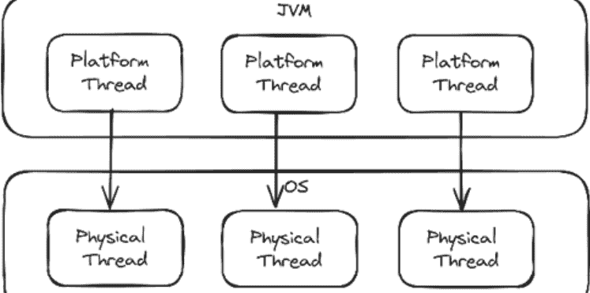

**图 2.1：** JVM 和操作系统线程

虚拟线程的引入了“平台线程”（platform thread）这一术语，以区分传统的（现称为平台线程）和虚拟线程。

自第一个 Java 版本发布以来，使用平台线程开发多线程应用程序一直是标准方法。这种方法运行了很长时间，但随着 Java 应用程序开始处理更密集的工作负载，这种方法开始显示出一些局限性。让我们评估这些局限性。

## 平台线程的局限性

使用平台线程的代码基于命令式编程范式（imperative programming paradigm）。命令式编程是通过顺序语句开发软件的方式，通过代码依赖条件表达式以及 `while` 和循环等控制流来更改应用程序状态。命令式编程是预测的、易于理解且于调试的。大多数 Java 程序都是使用命令式编程编写的。

命令式编程的一个严峻挑战是我们需要处理执行许多阻塞 IO 操作的应用程序时。我们将所有需要从外部源（如访问数据库或等待 API 响应）等待数据的系统调用称为阻塞（blocking）。在接下来的章节中，我们将评估阻塞 IO 操作如何导致问题并降低应用程序的吞吐量。

## 平台线程和阻塞 IO 操作

假设你有一个后端服务器应用程序（API），它负责使用来自数据库的数据进行复杂的计算。这些计算在传统的平台线程内部处理。现在考虑 API 接收到 100 个并发请求的情况。这意味着必须提供 100 个线程来服务每个请求。假设创建每个线程需要 20 MB 内存。因此，我们至少需要 2 GB 内存来处理所有这些请求。创建线程后，我们进行数据库调用执行计算并等待响应。当线程在等待响应时，我们称它是阻塞的。现在考虑每个线程通常需要 20 秒才能从数据库获取响应，而在此期间，更多额外的请求到达 API。如果运行我们应用程序的机器上可用内存不超过 2GB，我们将无法创建线程，因为没有更多可用内存了。因此，这些额外的请求将等待直到第一个请求完成并释放内存，以便创建新的平台线程。下图描述了这一场景：

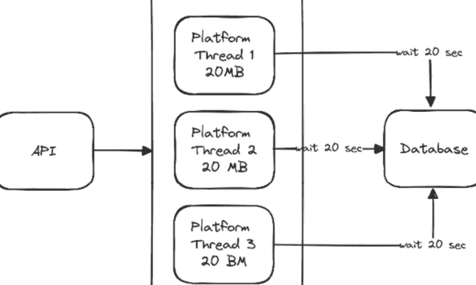

**图 2.2:** 平台线程内存占用

问题出在平台线程等待响应的地方。该线程消耗着内存资源但没有做任何事情；它只是在等待数据库响应。我们无法处理更多的请求，因为没有空闲内存来创建更多线程，这降低了我们程序的吞吐量能力。

除了构建成本高之外，平台线程的创建还需要时间。为每个请求创建一个新线程对象在时间上也是一项昂贵的活动。为了解决这个问题，我们可以创建带有可重用线程的线程池。线程池解决了创建新线程的开销问题，但我们仍然面临对可创建线程总数的硬件限制。

Java 中出现了一种涉及响应式编程的技术，用于解决由阻塞 IO 操作引起的吞吐量问题。让我们来看看它是如何工作的。

## 使用响应式编程处理阻塞 IO

在上一节中，我们讨论了为什么命令式编程由于其顺序性而对开发者更友好，使其更具可预测性和可维护性。虽然命令式程序更容易编写，当使用平台线程处理许多并发 IO 阻塞操作时，它们可能会遇到瓶颈。

作为命令式编程的替代方案，响应式编程被设计为对事件做出反应。我们不需要按顺序描述应用程序必须做什么，而是需要考虑可能会发生哪些事件，以及我们的应用程序如何响应这些事件。当应用程序需要克服阻塞 IO 问题时，通常使用响应式编程。应用程序可以通过运行异步任务来解决此类问题。

在响应式编程方法中，异步行为通常通过非阻塞 IO 线程实现。这些线程触发 IO 操作并立即释放，而不是阻塞等待响应。非阻塞线程上的延续机制（continuation mechanism）允许它们在 IO 操作完成后接收回调响应，从而允许 IO 线程继续执行任务。接下来的图说明了非阻塞 IO 线程如何处理 IO 操作：

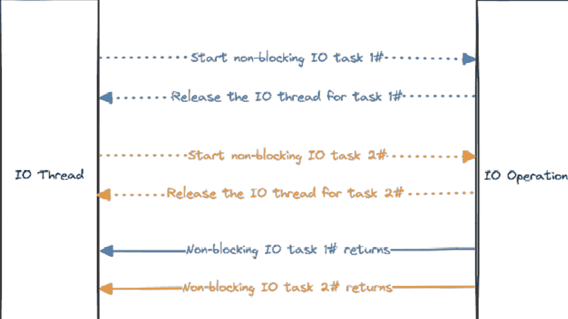

**图 2.3:** IO 线程触发 IO 操作

在上方图中，非阻塞 IO 任务 1# 和 2# 在非阻塞 IO 线程中并行运行，这意味着没有线程挂起等待响应。一旦 IO 操作完成，非阻塞 IO 任务就会恢复并继续执行。一旦 IO 操作完成，非阻塞 IO 任务可能会在与启动时不同的线程中继续执行。

非阻塞 IO 任务的执行分布在不同线程中的事实创建了调试挑战，因为任务堆栈跟踪将分散在不同的线程中。如果发生某些错误，我们可能需要调查多个线程的执行情况以了解发生了什么。例如，在命令式编程中，我们可以确定单个任务的堆栈跟踪限制在一个线程中，这大大减少了调试工作量。

响应式编程的挑战可能不仅在于调试方面。响应式代码也不同，它高度依赖于函数式编程构造（如流 streams 和 lambda 表达式）。并不是所有开发者都精通这种编程风格。

尽管响应式编程解决了 IO 阻塞问题，但它可能会产生维护性问题，因为调试和编写响应式代码更加困难。意识到这种情况的 Java 架构师提出的解决方案，允许我们利用非阻塞 IO 线程，并像在命令式编程风格中编写和调试代码。我们称这种解决方案为虚拟线程（virtual threads）。让我们看看它是如何工作的。

### 使用虚拟线程编写简单的并发代码

我们之前检查过，传统的平台线程直接链接到 OS 物理线程。而虚拟线程连接到平台线程。另一个关键点是，平台线程与 OS 物理线程之间不是 1:1 的关系，虚拟线程与平台线程之间是 n:1 的关系。换句话说，我们可以在单个平台线程上有很多虚拟线程。这是虚拟线程功能的一个基本特征，作为解决我们在传统平台线程模型中线程瓶颈的方案。以下是虚拟线程安排方式的说明：

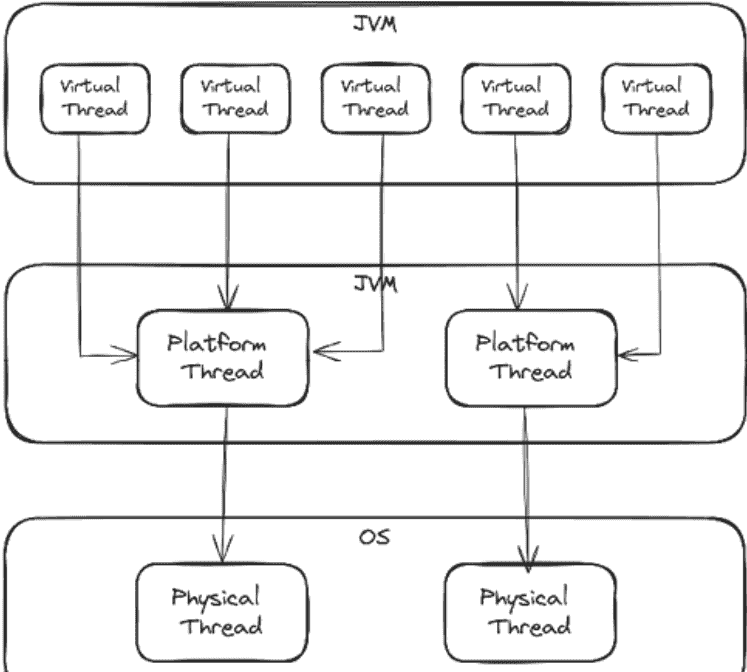

虚拟线程共享同一个平台线程，因此创建是非常廉价的，因为创建它们不会让 OS 分配更多内存。它们在底层是如何工作的？

每当虚拟线程内部执行 IO 任务时，该线程就会从平台线程挂起，直到 IO 任务完成。虚拟线程一直运行直到被阻塞（通常是由 IO 操作阻塞）。当发生时，虚拟线程从执行移除，可以选择一个新的虚拟线程在平台线程中运行。无法保证被移除的虚拟线程会在阻塞操作完成后立即运行，也无法保证它会在相同的平台线程上执行。

虚拟线程允许我们编写命令式的同步代码风格，同时从不阻塞平台线程处理其他虚拟线程的 IO 任务中获益。为了直观响应式异步代码与命令式同步代码之间的区别，请考虑以下使用异步编程风格从外部源获取数据的示例：


```java
public class AsyncApp {
    public static void main(String... args) throws ExecutionException, InterruptedException {
        CompletableFuture.supplyAsync(() -> fetchURL()).get().thenAccept(AsyncApp::print).join(); // OK
    }
    static void print(String result) {
        System.out.println(result);
    }
    static Supplier<String> fetchURL() {
        return () -> {
            try {
                var providedUrl = URI.create("https://daviera.dev").toURL();
                var con = (HttpURLConnection) providedUrl.openConnection();
                con.setRequestMethod("GET");
                return con.getResponseMessage();
            } catch (Exception e) {
                throw new RuntimeException(e);
            }
        };
    }
}
```

`CompletableFuture` 是允许我们编写异步代码的 Java 类。我们将想要执行的代码传递给 `supplyAsync`。在获取结果后，我们使用 `print` 方法显示它。如果我们不调用 `join` 方法，方法将不会打印，因为 `CompletableFuture` 触发了非阻塞操作，这意味着程序在我们获取消息之前就结束了。以下是使用传统的平台线程使用同步命令式编程表达相同逻辑：

```java
public class SynchronousApp {
    public static void main(String... args) {
        Thread.ofPlatform().start(() ->
            print(fetchURL())); // OK
    }
}
```

代码稍微直观一些，但依赖于阻塞的平台线程直到我们完成执行。现在考虑使用虚拟线程的代码：

```java
public class VirtualThreadApp {
    public static void main(String... args) throws Exception {
        Thread.ofVirtual().start(() ->
            print(fetchURL().get())); // 什么都不输出
    }
}
```

什么都不输出是因为当我们启动获取 URL 的 IO 网络阻塞调用时，JVM 识别并自动为我们挂起虚拟线程。由于虚拟线程未阻塞 IO 操作，程序在获取到响应之前就结束了。我们可以通过调用 `join` 方法来获取虚拟线程的结果：

```java
Thread.ofVirtual().start(() ->
    print(fetchURL().get())).join(); // OK
```

当我们创建一个虚拟线程时，JVM 将其挂载（mount）到载体线程（即平台线程）中。在虚拟线程执行期间，如果发现 IO 操作，JVM 会将虚拟线程卸载（unmount）。虚拟线程将保持卸载状态直到 IO 操作完成。完成后，虚拟线程将重新挂载到相同的载体线程或另一个继续执行执行的线程中。

通过卸载虚拟线程，JVM 释放载体线程，以便另一个虚拟线程挂载它。多个虚拟线程会在其 IO 操作开始和结束时在载体线程（carrier thread）中挂载和卸载。

我们不需要手动创建虚拟线程，而是依赖 `ExecutorService` 为我们创建虚拟线程。为了实现这一点，我们可以使用 `Executors` 类中的静态工厂方法 `newThreadPerTaskExecutor`，它返回一个 `Executor`：

```java
public class VirtualThreadApp {
    public static void main(String... args) throws Exception {
        runTwoVirtualThreadsAtTheSameTime();
    }
    static void runTwoVirtualThreadsAtTheSameTime() {
        var virtualThreadfactory = Thread.ofVirtual().factory();
        try (var executor = Executors.newThreadPerTaskExecutor(virtualThreadfactory)) {
            executor.submit(() -> print(fetchURL().get()));
            executor.submit(() -> print(fetchURL().get()));
        }
    }
    static void print(String result) {
        System.out.println("Thread: "+Thread.currentThread()+" - Result: "+result);
    }
}
```

```java
// Code omitted
```

```java
}
```

我们使用 `Thread.ofVirtual().factory` 构建一个虚拟线程工厂，该工厂用于 `Executors.newThreadPerTaskExecutor(virtualThreadfactory)` 以为每个任务创建一个新的虚拟线程。在示例中，我们提交了两个任务，它们在两个不同的虚拟线程中执行，产生了如下结果：

Thread: VirtualThread[#29]/runnable@ForkJoinPool-1-worker-3 - Result: OK

Thread: VirtualThread[#31]/runnable@ForkJoinPool-1-worker-2 - Result: OK

虚拟线程是并行执行，它们的 IO 操作不会阻塞它们使用的载体（平台）线程。但在特定场景下，虚拟线程不会从载体线程中卸载。当发生这种情况时，我们称虚拟线程被“钉住”（pinned）到了载体线程。这种情况发生在以下场景：

- 虚拟线程在 `synchronized` 块内部执行代码
- 虚拟线程运行原生方法（native method）或外部函数

当这些情况发生时，虚拟线程会防止平台线程被其他虚拟线程挂载。为了解决这个问题，需要创建新的平台线程为新的虚拟线程提供服务。因此，在上述任一场景中使用虚拟线程时需要谨慎。对于必须使用同步锁的场景，我们可以考虑将其替换为 `ReentrantLock`，它允许线程重新获取已持有的锁。

如果你正在从事一个 Java 项目，或者正在启动一个预计会频繁发生 IO 密集型操作的新项目，请考虑使用虚拟线程来增强应用程序性能。

## 编译并运行示例项目

作为一个示例项目，我们有一个名为 Remote File Converter 的 Java 应用程序。它是一个虚拟的转换器，用于从互联网下载文件并将其转换为不同的文件类型。该应用程序演示了密封类（sealed classes）、模式匹配（pattern matching）、字符串模板（string templates）和虚拟线程的使用。

你可以从 GitHub 仓库 `https://github.com/bpbpublications/Java-Real-World-Projects/tree/main/Chapter%2002` 克隆应用程序源代码。

你需要在机器上安装了 JDK 21 或更高版本，以及 Maven 3.8.5 或更高版本。

要编译项目，请进入书籍仓库中的 Chapter 2 目录。从那里，你需要执行以下命令：

```bash
$ mvn clean package
```

Maven 将创建一个 JAR 文件，我们可以通过运行以下命令来启动应用程序：

```bash
$ java -jar target/chapter02-1.0-SNAPSHOT.jar
```

```text
Feb 25, 2024 3:04:58 AM
dev.daviviera.file.service.FileConverterService.convertFile
INFO: Downloading file from
https://daviviera.dev/file.pdf
Feb 25, 2024 3:05:00 AM
dev.daviviera.file.service.FileConverterService.convertFile
INFO: The file.pdf has been successfully downloaded
Feb 25, 2024 3:05:00 AM
dev.daviviera.file.service.FileConverterService.convertFile
INFO: Converting file.pdf to WORD
Feb 25, 2024 3:05:00 AM
dev.daviviera.file.service.FileConverterService.convertFile
INFO: Conversion to WORD was successful!
```

转换后的文件名为 `converted-from-pdf-to-word.docx`。

## 结论

通过与现代 Java 特性保持同步，我们可以通过利用 Java 语言最新的特性来更高效地解决问题。在本章中，我们有机会探索密封类如何帮助我们强制执行继承预期。我们学习了模式匹配允许我们更好地处理需要使用 `instanceof` 进行类型转换的逻辑，包括 `switch` 语句和从记录类（record classes）中提取数据。最后，我们学习了虚拟线程如何显著提高 IO 密集型应用程序的吞吐量能力。

在下一章中，我们将探索在 Java 中处理关系型数据库可以使用的技术和方法，例如 Java 数据库连接（JDBC），它提供了一个简化与数据库交互的接口；以及 Jakarta Persistence，它允许我们将 Java 类映射到数据库表。

## 加入我们书籍的 Discord 空间

加入书籍的 Discord 工作空间以获取最新更新、优惠、全球技术动态、新版本发布以及与作者的座谈会议：

`https://discord.bpbonline.com`


# 第 3 章：使用 Java 处理关系型数据库

## 引言

在需要以结构化形式存储数据的 Java 项目中，关系型数据库继续被广泛使用。在关系型数据库强制执行的结构中，开发者可以将数据存储在表中，每列都有特定的数据值类型。Java 为那些想要与关系型数据库交互的人提供了很好的支持。Java 数据库连接（JDBC）规范作为数据库访问和数据处理的基础。在更高级别上，我们有 Jakarta Persistence（以前称为 Java Persistence API），它允许我们将 Java 类映射到数据库表。理解 JDBC 和 Jakarta Persistence 如何工作对于任何参与依赖关系型数据库的 Java 项目的人来说至关重要。

## 结构

本章涵盖以下主题：

- JDBC 简介
- 使用 Jakarta Persistence 简化数据处理
- 探索使用数据库时的本地开发方法
- 编译并运行示例项目

## 目标

在本章结束时，读者将具备开发 Java 应用程序的能力，能够正确使用 JDBC 和 Jakarta Persistence 处理数据库。读者还将学习在本地提供数据库的方法。

## JDBC 简介

Java 数据库连接（JDBC）规范定义了 Java 应用程序如何与关系型数据库交互。它也是一个由接口组成的 API，描述了如何连接和处理数据库的数据。基于 JDBC 的应用程序在某种程度上受益于 JDBC 规范的平台无关性，这使得应用程序可以在不进行重大重构的情况下更改数据库供应商。更改数据库供应商通常是一项非平凡活动，需要大量的重构，主要是由于结构化查询语言（SQL）语法和数据的差异。

### 使用 DriverManager 获取数据库连接

`DriverManager` 类有一个名为 `getConnection` 的方法，它接收数据库连接 URL、凭据和所需的额外连接属性。该方法返回一个 `Connection` 对象，用于开始与数据库交互。

```java
var user = "test";
var password = "test";
var dbName = "test";
var connection = getConnectionWithDriverManager(user, password, dbName);
System.out.println(connection.isClosed()); // false
```

假设本地运行着一个 MySQL 服务器，并且用户、密码和数据库名称定义为 test，我们使用以下结构构建数据库 URL 连接：

`protocol:provider:host:port:database`

协议（protocol）通常是 `jdbc`。提供者（provider）代表数据库厂商，在我们案例中是 `mysql`。由于数据库与 Java 运行在同一机器上，因此主机（host）为 `127.0.0.1`。示例中的 MySQL 服务器使用默认端口 `3306`。数据库名称为 `test`。

获取连接后，我们通过调用 `isClosed` 方法确认它是否已打开，该方法返回 `false`。

为了使此方法生效，我们必须确保 MySQL 的 JDBC 驱动程序加载到 Java 程序的类路径或模块路径中。JDBC 驱动程序通常以 JAR 文件的形式由数据库厂商提供。

可以通过 `DataSource` 接口获取相同的 `Connection` 对象，如接下来的章节所示。

### 使用 DataSource 接口获取数据库连接

应用程序服务器可能会定义连接细节，例如数据库名称、主机和凭据。运行在应用程序服务器内部的 Java 程序不需要像使用 `DriverManager` 那样指定连接细节。相反，Java 程序可以依赖于绑定到应用程序服务器中数据源连接细节的别名（alias name）。接下来，我们将看到使用 `DataSource` 接口连接数据库的步骤：

1. 配置并创建一个 `DataSource` 对象：

```java
private DataSource createDatasource(String user, String password, String dbName) {
    var dataSource = new MySqlDataSource();
    dataSource.setPort(3306);
    dataSource.setUser(user);
    dataSource.setPassword(password);
    dataSource.setDatabaseName(dbName);
    return dataSource;
}
```

a. 应用程序服务器通常负责创建 `DataSource` 对象，但我们在这里创建它是为了演示 `DataSource` 配置是如何工作的。请注意，我们正在使用 `MySqlDataSource` 类，它实现了 `DataSource` 接口。MySQL JDBC 驱动提供了 `MySqlDataSource` 类，该类必须存在于应用程序类或模块路径中。

2. 创建一个 `InitialContext` 并将 JNDI 名称绑定到 `DataSource` 对象上：

```java
private Context createAndBindContext(DataSource dataSource) throws NamingException {
    var env = new Hashtable<>(Map.of(Context.INITIAL_CONTEXT_FACTORY, "org.apache.naming.SimpleContextFactory"));
    Context context = new InitialContext(env);
    context.bind("jdbc/testDB", dataSource);
    return context;
}
```

a. 上述方法产生一个 `Context` 对象，可用于根据 JNDI 名称进行数据库连接查找。与 `DataSource` 类似，`Context` 对象通常由 Java 程序的应用程序服务器提供。这就是 `Context` 创建的工作原理。Java 命名和目录接口（JNDI）是一项 Java API，允许客户端查找或发现数据库等资源。通过 JNDI，客户端只需要知道 JNDI URI，该 URI 会由应用程序服务器解析，服务器拥有给定 JNDI 的资源详细信息。


- b. 注意到，我们为 `env` 变量分配了一个包含 `Map` 的 `Hashtable` 对象，并将其作为构造函数的参数。这个 `Map` 以 `Context.INITIAL_CONTEXT_FACTORY` 为键，`org.java.sj.SimpleContextFactory` 为值。由于我们没有在应用程序服务器（例如 JBoss 或 Weblogic）中运行示例代码，我们需要提供一个能为我们产生 `Context` 对象的工厂。可以使用产生 `Context` 对象的 `Simple-JNDI` 库来模拟应用程序服务器的职责。`Simple-JNDI` 注册了 `org.java.sj.SimpleContextFactory` 类。然后将 `Hashtable` 对象作为 `InitialContext` 对象的构造参数传递。最后，我们将名称 `jdbc/testDB` 包含数据库连接细节的 `DataSource` 对象。

## 3. 使用 DataSource 对象获取连接

```java
public static Connection getConnectionWithData(String user,
String password, String dbName) throws Exception {
    var dataSource = createDataSource(user, password, dbName);
    var context = createAndBindContext(dataSource);
    return
    ((DataSource)context.lookup("jdbc/testDB")).getConnection();
}
```

- a. 此方法结合了前两个步骤中的操作。首先，它通过调用 `createDataSource(user, password, dbName)` 创建一个 `DataSource`。其次，它创建一个 `Context` 并将其绑定到之前创建的 `DataSource`。最后一行显示了 Java 程序如何通过简单地将 JNDI "jdbc/testDB" 传递给 `Context` 对象的 `lookup` 方法来执行 DataSource 查找。调用 `lookup` 方法返回一个 `DataSource` 对象，我们使用它通过 `getConnection` 方法获取 `Connection` 对象。

## 4. 可以使用此 Connection 对象开始与 MySQL 数据库交互

```java
public static void main(String... args) throws Exception {
var user = "test";
var password = "test";
var dbName = "test";
var connection = getConnectionWithDataSource(user, password, dbName);
System.out.println(connection.isClosed()); // false
}
```

- a. 处理生产级 Java 项目时，你不需要手动创建 `DataSource` 和 `Context` 对象，因为它们将通过应用程序服务器或你的 Java 程序所属的框架提供。现在我们已经知道如何使用 JDBC 设置数据库连接，让我们探索如何向数据库发送语句。

### 使用 Statement 执行简单查询

在开始探索 `Statement` 接口提供的可能性之前，让我们根据以下 SQL 考虑表：

```sql
CREATE TABLE PERSON (
    ID int NOT NULL AUTO_INCREMENT,
    FIRST_NAME varchar(255),
    LAST_NAME varchar(255),
    AGE int,
    COUNTRY varchar(255),
    PRIMARY KEY (ID)
);
```

```sql
INSERT INTO PERSON (FIRST_NAME, LAST_NAME, AGE, COUNTRY) VALUES ('John', 'Doe', 23, 'Italy');
INSERT INTO PERSON (FIRST_NAME, LAST_NAME, AGE, COUNTRY) VALUES ('Mary', 'Jane', 35, 'France');
INSERT INTO PERSON (FIRST_NAME, LAST_NAME, AGE, COUNTRY) VALUES ('Samuel', 'Felix', 28, 'Germany');
INSERT INTO PERSON (FIRST_NAME, LAST_NAME, AGE, COUNTRY) VALUES ('James', 'Smith', 51, 'United States');
```

它创建了一个名为 `PERSON` 的表并插入了四行数据。我们将使用该表探索 `Statement` 接口及其派生类，如 `PreparedStatement` 和 `CallableStatement`。

`Statement` 接口提供了向关系型数据库发送查询的最直接方式。通过调用 `Connection` 类的 `createStatement` 方法，我们可以获得一个可以在连接的数据库中执行查询的 `Statement` 对象。

考虑以下示例：

```java
public class JdbcConnection {
    public static void main(String... args) throws Exception {
        // 代码省略
        var statement = connection.createStatement();

        printPerson(statement);
    }

    private static void printPerson(Statement statement) throws SQLException {
        var retrieveAllPersons = "SELECT * FROM PERSON";
        var result = statement.executeQuery(retrieveAllPersons);
        while (result.next()) {
            var firstName = result.getString("FIRST_NAME");
            var age = result.getLong("AGE");
            System.out.println("First Name: "+firstName+"|Age: "+age+"");
        }
    }
}
```

`printPerson` 方法接收从 `createStatement` 方法返回的 `Statement` 对象。`Statement` 接口拥有 `executeQuery` 方法，用于检索一个表示要在数据库中执行的 SQL 查询的字符串。在这个示例中，我们定义了一个查询 `PERSON` 表所有条目的查询。查询结果存储在 `result` 变量的 `ResultSet` 对象中。

在以前的示例中，我们使用列名获取数据库结果：

```java
var firstName = result.getString("FIRST_NAME");
var age = result.getLong("AGE");
```

也可以使用列索引检索数据：

```java
var firstName = result.getString(0);
var age = result.getLong(2);
```

当使用索引方法时，我们不传递列名，而是传递一个与要获取数据的列位置对应的索引数字。

考虑以下示例以查找匹配 `FIRST_NAME` 的 `PERSON` 记录：

```java
ResultSet result =
statement.executeQuery(retrievePersonByFirstName());
while (result.next()) {
    String resultFirstName = result.getString("FIRST_NAME");
    long resultAge = result.getLong("AGE");
    System.out.println("First Name: "+resultFirstName + " | Age: " + resultAge);
}
```

我们使用字符串拼接将 `firstName` 参数的值包含在 SQL 语句中。如果我们传递一个合法的名称，一切都是正常的：

```java
findAndPrintByFirstName(connection.createStatement(), "James");
// First Name: James | Age: 51
```

如预期所示，返回了 `FIRST_NAME` 为 James 的行。如果我们能完全控制传递给 `Statement` 的值，情况就是好的。然而，如果我们使用用户提供的数据来设置 `Statement` 的值，就会出现安全问题。这是因为 `Statement` 方法的方法容易受到 SQL 注入攻击，SQL 代码可以被操纵以产生非预期结果，如下：

```java
findAndPrintByFirstName(connection.createStatement(), "James' OR '1='1'");
// First Name: John | Age: 23
// First Name: Mary | Age: 35
// First Name: Samuel | Age: 28
// First Name: James | Age: 51
```

在示例中，我们传递了字符串 "James' OR '1='1'"。`Statement` 不对传递的值进行验证，因此字符串部分 `OR '1='1'` 被解释为 SQL 语句的一个组件，执行后返回了 `PERSON` 表中的所有行。

由于由 `Statement` 生成的 SQL 语句无法防止 SQL 注入，不建议在使用外部源数据构建 SQL 语句的场景中使用。对于此类场景，我们可以依赖 `PreparedStatement` 接口。

### 使用 PreparedStatement 执行参数化查询

`PreparedStatement` 接口继承自 `Statement` 接口。使用 `PreparedStatement` 构建的 SQL 语句提供了更高的灵活性和安全性。它的灵活在于允许我们定义带有参数化值的 SQL 语句。它的安全是因为它可以通过验证参数值来防止 SQL 注入攻击。考虑以下示例：

```java
private static void findAndPrintPersonByFirstName(String firstName) throws SQLException {

    String sql = "SELECT * FROM PERSON WHERE FIRST_NAME=?";

    PreparedStatement preparedStatement =
    connection.prepareStatement(sql);
    preparedStatement.setString(1, firstName);

    ResultSet result = preparedStatement.executeQuery();
    while (result.next()) {
        String resultFirstName = result.getString("FIRST_NAME");
        long resultAge = result.getLong("AGE");
        System.out.println("First Name: "+resultFirstName+" Age: " +resultAge);
    }
}
```

在 SQL 语句中我们需要使用参数值的地方用 `?` 字符表示。我们可以通过调用 `PreparedStatement` 接口的方法来设置每个参数必须使用哪个值。在我们的示例中，`setString` 接收数字 `1`（代表 `?` 的索引位置）以及一个作为该索引位置 `?` 字符值的 `String` 对象。`PreparedStatement` 确保了防止之前我们在 `Statement` 方法中看到的 SQL 注入攻击保护。考虑以下 `findAndPrintPersonByFirstName` 方法：

```java
findAndPrintPersonByFirstName('James' OR '1'='1'); // 什么都不打印
```

尝试使用任意的 SQL 查询等行为会被 `PreparedStatement` 妥善处理，而不会在数据库中执行。这就是为什么在使用外部源数据构建 SQL 语句时，始终建议使用 `PreparedStatement`。

对于参数化查询，JDBC API 还有一个 `CallableStatement` 接口，允许我们调用存储过程。让我们来看看它是如何工作的。

### 使用 CallableStatement 调用存储过程

JDBC API 提供了用于简单查询的 `Statement` 和用于参数化查询的 `PreparedStatement`。它还有一个允许调用存储过程的 `CallableStatement` 接口。让我们使用如下存储过程：

```sql
DELIMITER //

DROP PROCEDURE IF EXISTS findPersonOlderThanAge //
CREATE PROCEDURE findPersonOlderThanAge (IN AGE_PARAM INT)

BEGIN

SELECT FIRST_NAME, AGE FROM PERSON WHERE AGE > AGE_PARAM;

END //
DELIMITER ;
```

该存储过程接受 `AGE_PARAM` 整数作为唯一参数，并返回 `AGE` 列大于 `AGE_PARAM` 的所有 `PERSON` 。使用 `CallableStatement` 调用该存储过程的示例如下：

```java
private static void findAndPrintPersonOlderThanAge(int age) throws SQLException {
    String sql = "CALL findPersonOlderThanAge(?)";
    CallableStatement callableStatement = connection.prepareCall(sql);
    callableStatement.setInt(1, age);

    ResultSet result = callableStatement.executeQuery();
    while (result.next()) {
        String firstName = result.getString("FIRST_NAME");
        long age = result.getLong("AGE");
        System.out.println("Name: "+firstName+" | Age: " +age);
    }
}
```

`CallableStatement` 接口继承自 `PreparedStatement` 接口并支持语句参数化。在上面的示例中，`findPersonOlderThanAge` 存储过程期望一个代表年龄的整数。同样注意，我们在 `findPersonOlderThanAge(?)` 中使用了 `?` 字符来设置参数。因为 `CallableStatement` 继承自 `Statement` 接口，我们可以使用 `setInt` 方法设置参数。我们调用 `findAndPrintPersonOlderThanAge` 方法并将整数作为参数：

```java
findAndPrintPersonOlderThanAge(29);
// First Name: Mary | Age: 35
// First Name: James | Age: 51
```

如预期所示，存储过程返回了两个大于 29 岁的个人记录。你可能已经注意到在本节以及涵盖 `Statement` 和 `PreparedStatement` 接口的章节中，我们一直使用 `ResultSet` 对象处理结果。让我们进一步检查这一点。

### 使用 ResultSet 处理结果

`ResultSet` 是一个允许在数据库中检索和持久化数据的接口。每当我们执行 `Statement` 类型对象（包括 `PreparedStatement` 和 `CallableStatement`）的 `executeQuery` 方法时，结果都是 `ResultSet`，因为 `executeQuery` 方法用于用于是从数据库中检索数据的 `SELECT` 语句。在使用 `UPDATE` 或 `DELETE` 语句更改数据库时也会使用 `executeUpdate` 方法。`executeUpdate` 返回一个整数，表示受 `UPDATE` 或 `DELETE` 语句影响的行数。本节将关注 `executeQuery` 方法及其返回的 `ResultSet`。

从数据库查询时，我们对查询返回的行和列感兴趣`ResultSet` 接口允许我们检查 `SELECT` 在数据库中执行后返回的内容。以下命令将帮助我们获取一个 `ResultSet`：

```java
var fetchAllPersons = "SELECT * FROM PERSON";
ResultSet resultSet = statement.executeQuery(fetchAllPersons);
```


`ResultSet` 以类表结构存储查询，我们可以通过 `ResultSet` 提供的游标进行导航。该游标从查询返回的第一行之前开始。我们可以通过使用 `ResultSet` 的 `next` 方法移动游标位置：

```java
while (resultSet.next()) {
    String firstName = resultSet.getString("FIRST_NAME");
    long age = resultSet.getLong("AGE");
    System.out.println("First Name: "+firstName + " | Age: " +age);
}
```

在我们的示例中，`while` 迭代一直持续到 `resultSet.next()` 返回 `false`，这意味着没有更多行需要处理。默认情况下，`ResultSet` 游标从开始到结束。如果在遍历 `ResultSet` 时数据库发生了变化，这些更改不会反映在 `ResultSet` 对象中。我们可以通过创建 `Statement` 对象时传递特殊属性来更改这一点。以下示例展示了如何这样做：

```java
private static void person() throws SQLException {
  String sql = "SELECT * FROM PERSON";
  PreparedStatement preparedStatement = connection.prepareStatement(
    sql,
    ResultSet.TYPE_SCROLL_SENSITIVE,
    ResultSet.CONCUR_READ_ONLY);
  var resultSet = preparedStatement.executeQuery();
  resultSet.last();
  resultSet.previous();

  String firstName = resultSet.getString("FIRST_NAME");
  long age = resultSet.getLong("AGE");
  System.out.println("First Name: "+firstName+" | Age: "+age);
}
```

`printPerson()` // First Name: Samuel | Age: 28

我们可以在创建 `Statement` 对象时指定 `ResultSet` 选项。在这里，我们传递了 `ResultSet.TYPE_SCROLL_SENSITIVE` 选项，使 `ResultSet` 变为可滚动的——它的游标可以向前和向后移动。默认情况下，`ResultSet` 对象是用 `ResultSet.TYPE_SCROLL_INSENSITIVE` 选项创建的，这意味着数据库中的更改不会反映在 `ResultSet` 中。此外，我们还有 `ResultSet.CONCUR_READ_ONLY` 选项，它使此 `ResultSet` 为只读，意味着我们无法对数据库进行更改。要获得一个可修改的 `ResultSet`，我们需要传递 `ResultSet.CONCUR_UPDATEABLE` 选项，允许我们使用 `ResultSet` 对数据库进行更改。

以下是如何使用 `ResultSet` 更新数据行的一个示例：

```java
private static void updatePersonCountry(String firstName, String country) throws SQLException {
  String sql = "SELECT * FROM PERSON WHERE FIRST_NAME="+firstName+";";

  PreparedStatement preparedStatement = connection.prepareStatement(sql,
    ResultSet.TYPE_SCROLL_SENSITIVE,
    ResultSet.CONCUR_UPDATEABLE);
  var resultSet = preparedStatement.executeQuery();

  while (resultSet.next()) {
    String resultFirstName = resultSet.getString("FIRST_NAME");
    String resultCountry = resultSet.getString("COUNTRY");

    System.out.println("Before update -- First Name: "+resultFirstName+" | Country: "+resultCountry);
    resultSet.updateString("COUNTRY", country);
    resultSet.updateRow();
    resultCountry = resultSet.getString("COUNTRY");

    System.out.println("After update -- First Name: "+resultFirstName+" | Country: "+resultCountry);
  }
}
```

```java
updatePersonCountry("James", "Canada");
// Before update -- First Name: James | Country: United States
// After update -- First Name: James | Country: Canada
```

使用带有 `ResultSet.CONCUR_UPDATABLE` 选项创建语句是获取可以执行数据库更改的 `ResultSet` 对象的必要条件。在示例中，当我们想要更新人的国家时，我们遍历包含所有匹配 `SELECT` 语句的行的 `ResultSet`，该语句返回所有姓名为 james 的行。一旦我们处于想要更改的行的 `ResultSet` 游标位置，我们就会调用 `resultSet.updateString("COUNTRY", country)`，其中 "COUNTRY" 是列名，country 是我们想要用于更新的值。与 get 方法类似，`ResultSet` 的更新方法也作用于数据库列，提供了如 `updateInt`、`updateBoolean` 等方法。更新只有在调用 `resultSet.updateRow()` 之后才会持久化到数据库中。

`Statement`、`PreparedStatement`、`CallableStatement` 和 `ResultSet` 接口是 JDBC API 允许 Java 处理关系型数据库的构建模块。依赖 JDBC API 适用于创建 SQL 语句和直接操作数据库结果不会带来维护负担的情况。

当应用程序管理并执行数据库语句时，可能会受益于对象关系映射（ORM）技术，该技术将数据库实体映射到 Java 对象，这可以简化负责与数据库交互的代码的开发和维护性。一种名为 Jakarta Persistence API (JPA) 的规范建立了可以在 Java 应用程序中管理的数据库实体。让我们在下一节中探索这一点。

## 使用 Jakarta Persistence 简化数据处理

Jakarta Persistence（由 Eclipse Foundation 维护，以前称为 Java Persistence API/JPA）是一项规范，为 Java 应用程序如何处理数据库实体提供了标准。它是 Jakarta EE 的一部分，该项目以前由 Oracle 以 Java EE 的命名维护。作为一种规范，Jakarta Persistence 只描述了 Java 应用程序应该如何管理数据库实体。它为 Jakarta Persistence API 提供了一套接口和类，这些构成了该规范。不同的提供者实现了 Jakarta Persistence 规范。Hibernate 和 Eclipse 是知名的 Jakarta Persistence 实现。

使用 Jakarta Persistence 的决定通常出现在 Java 项目需要一种一致的数据库处理机制，该机制允许数据库实体映射到 Java 类时。将数据库表表示为 Java 类的能力允许开发者能够方便地作为 Java 对象处理数据库实体关系，而无需通过操作 SQL 代码来实现，因为这是由像 Hibernate 这样的 Jakarta Persistence 实现完成的。

采用 Jakarta Persistence 的另一个好理由是它带来的标准化优势。它允许应用程序在不同的数据库技术之间切换，而无需重构负责处理数据库实体的代码。这是因为数据库实体的 Java 表示被翻译为适应不同的数据库技术。

这意味着对于许多场景，你可以将 Java 应用程序的数据库从 Oracle 更改为 SQL Server，并保持基于 Jakarta Persistence 的代码不变。

为了理解我们如何利用 Jakarta Persistence 提供的优势，我们将学习如何实现 Jakarta Persistence 实体及其主要特征。我们还将学习如何配置和使用 Hibernate，这是实现 Jakarta Persistence 规范的最常用的 ORM 技术。

### 定义实体

Jakarta Persistence 背后的魔力在于将 Java 类映射到数据库表。我们在 Java 类顶端使用 `@Entity` 注解：

```java
@Entity
@Table(name = "USER")
public class User {

  @Id
  @Column(name = "id", updatable = false, nullable = false)
  private UUID id;

  @Column(name = "email", nullable = false)
  private String email;

  @Column(name = "password", nullable = false)
  private String password;

  @Column(name = "name", nullable = false)
  private String name;

  // 省略构造函数、getters 和 setters
}
```

`@Entity` 注解是将类映射到数据库表所需的强制性条件。我们还可以使用 `@Table` 注解来指定 Java 类映射的名称。如果我们不指定 `@Table` 注解，则映射中使用 Java 列名，如果 Java 类和表具有相同的名称，则可以工作。否则，映射将是不可能的，因为表名与 Java 类名不同。尽管如此，建议使用 `@Table` 注解以确保代码的清晰性。

类属性映射到表列。我们声明的第一个属性是 `@Id` 注解，它是每个实体类强制要求的。注意，我们使用了 `@Column` 注解来描述列，并声明该列不可更新且不支持 NULL 值。与 `@Table` 注解一样，`@Column` 注解是可选的，如果不指定，它将使用属性名称对应实际的列。

我们可以使用 `User` 实体类来检索和持久化 `USER` 表的数据。这个实体类使我们能够以处理其他 Java 类的方式处理数据库实体。

在处理关系型数据库时，我们通常与多个相互引用的表一起。接下来，让我们看看如何使用 Jakarta Persistence 定义实体之间的关系。

### 定义实体关系

在关系型数据库中，我们将数据安排在可能相互引用的表中。表之间的关系有助于我们更好地理解我们正在处理的问题领域的数据。Jakarta Persistence 允许我们使用实体类来表示表之间的关系。我们可以通过表示可能的实体关系的注解来做到这一点。让我们通过检查 `@OneToMany` 注解如何工作来开始探索。

#### 一对多

“一对多”关系意味着表中的某行可以映射到另一个表中的多行。为了说明这一点，考虑我们有 `AttributeDefinition` 和 `AttributeValue` 实体，它们用于映射存储属性定义及其值的表。`AttributeDefinition` 存储属性类型和名称。`AttributeValue` 存储属性值以及对属性定义的引用，以便我们知道该属性来自于哪个属性类型和名称。

以下是用于 MySQL 的 SQL 代码，我们可以用它创建表示属性定义及其值的表：

```sql
CREATE TABLE ATTRIBUTE_DEFINITION(
  id INT PRIMARY KEY NULL AUTO_INCREMENT,
  name VARCHAR(255) NOT NULL,
  type VARCHAR(255) NOT NULL
);

CREATE TABLE ATTRIBUTE_VALUE(
  id INT PRIMARY KEY NULL AUTO_INCREMENT,
  definition_id INT NOT NULL,
  value VARCHAR(255) NOT NULL,
  FOREIGN KEY (definition_id) REFERENCES ATTRIBUTE_DEFINITION
);
```

`ATTRIBUTE_VALUE` 表包含一个外键 `definition_id`，引用 `ATTRIBUTE_DEFINITION` 表中的 `id` 列。根据此表结构，我们这样定义 `AttributeDefinition` 实体：

```java
@Entity
@Table(name = "ATTRIBUTE_DEFINITION")
public class AttributeDefinition {

    @Id
    private Long id;
    private String name;
    private String type;
    @OneToMany(mappedBy="attributeDefinition")
    private List<AttributeValue> value;
    // Constructor, getters and setters omitted
}
```

使用 `@OneToMany` 注解来表示 `AttributeDefinition` 引用 `AttributeValue` 实体的关系；这就是为什么 `values` 属性的类型是 `List<AttributeValue>`。`mappedBy` 属性指定了 `AttributeValue` 类中用于引用 `AttributeDefinition` 实体的类名。如果 `AttributeDefinition` 实体与 `AttributeValue` 有一对多的关系，则意味着 `AttributeValue` 实体与 `AttributeDefinition` 实体有多对一的关系。让我们来看看如何实现。

#### 多对一

多对一关系发生在表中的多行可以映射到另一个表的某一行时。在属性和值的语境下，我们可以为一种属性类型拥有多个属性值。我们可以如下使用 `@ManyToOne` 注解来实现 `AttributeValue` 实体：

```java
@Entity
@Table(name = "ATTRIBUTE_VALUE")
public class AttributeValue {

  @Id
  private Long id;
  private Long definition_id;
  private String value;
  @ManyToOne
  @JoinColumn(name="definition_id", nullable=false)
  private AttributeDefinition attributedDefinition;
  // Constructor, getters and setters omitted
}
```

记住，我们在 `AttributeDefinition` 实体类的 `mappedBy` 属性中指定了 `attributeDefinition`。`attributeDefinition` 在这里作为 `AttributeValue` 实体类的类属性出现。注意，除了 `@ManyToOne` 注解外，我们还有一个 `@JoinColumn` 注解指定了 `AttributeValue` 实体中的列（在示例中为 `definition_id`），它用于将 `AttributeValue` 实体映射回 `AttributeDefinition` 实体。

在这里使用 `@ManyToOne` 注解是因为这是一个双向关系，`AttributeDefinition` 实体拥有与 `AttributeValue` 实体的关系。

接下来让我们检查如何使用 Jakarta Persistence 实现一对一关系。

#### 一对一

一对一关系发生在表中的某行映射到另一个表的某一行时。

考虑一种场景：我们需要映射用于互联网论坛的数据库中 `ACCOUNT` 和 `PROFILE` 表之间的关系。MySQL 创建 `ACCOUNT` 和 `PROFILE` 表的 SQL 代码如下：

```sql
CREATE TABLE PROFILE(
  id INT PRIMARY KEY NOT NULL AUTO_INCREMENT,
  name VARCHAR(255) NOT NULL,
  description VARCHAR(255) NOT NULL,
  website VARCHAR(255) NOT NULL
);

CREATE TABLE ACCOUNT(
  id INT PRIMARY KEY NOT NULL AUTO_INCREMENT,
  email VARCHAR(255) NOT NULL,
  password VARCHAR(255) NOT NULL,
  profile_id INT NOT NULL,
  FOREIGN KEY (profile_id) REFERENCES PROFILE(id)
);
```


必须先创建 `PROFILE` 表，因为它的 `id` 是 `ACCOUNT` 表中的外键。接下来，我们可以从定义 `Account` 实体类开始：

```java
@Entity
@Table(name = "ACCOUNT")
public class Account {

    @Id
    @GeneratedValue(strategy = GenerationType.IDENTITY)
    private Long id;
    private String email;
    private String password;
    @OneToOne(cascade = CascadeType.ALL)
    @JoinColumn(name = "profile_id", referencedColumnName = "id")
    private Profile profile;
    // Constructor, getters and setters omitted
}
```

我们在 `@Id` 注解正下方使用了 `@GeneratedValue` 注解。它信号数据库列具有用于生成 ID 值的自增机制。`GenerationType.IDENTITY` 策略用于在创建新实体时使用特殊的标识列，并需要 ID 值作为主键的情况。Jakarta Persistence 提供者不生成 ID；而是由底层数据库生成。还有其他策略，如 `GenerationType.AUTO`、`GenerationType.SEQUENCE` 和 `GenerationType.TABLE`，它们为 ID 生成提供了不同的行为。

当新用户在互联网论坛注册时，他会获得账户和一个个人资料。账户包含邮箱和密码等登录数据，而个人资料包含名称、描述和网站数据。每个账户必须关联一个个人资料。我们使用 `@OneToOne` 注解来表示这一点。注意 `cascade = CascadeType.ALL` 属性的使用。这意味着如果删除一个 `Account` 实体，删除操作将传播到它的子关系实体，这意味着 `Profile` 实体也应该被删除，因为它是 `Account` 父级实体的子实体。

在 `ACCOUNT` 表中，我们有一个 `profile_id` 列，它作为外键指向 `PROFILE` 表中的 `id` 列。这种关系使用 `@JoinColumn` 注解表示。注意 `Account` 实体类有一个名为 `profile` 的类。在定义 `Profile` 实体类时，我们引用了 `profile` 属性：

```java
@Entity
@Table(name = "PROFILE")
public class Profile {

    @GeneratedValue(strategy = GenerationType.IDENTITY)
    private Long id;
    private String name;
    private String description;
    private String website;
    @OneToOne(mappedBy = "profile")
    private Account account;
    // Constructor, getters and setters
}
```

再次，我们使用 `@OneToOne` 注解将 Account 实体映射回 Profile 实体。`mappedBy` 包含了 Account 类中定义的。

最后一个检查的关系是多对多关系。让我们看看如何使用 Jakarta Persistence 实现它。

# 多对多 (ManyToMany)

在多对多关系中，一个表的某行可以在另一个表中多次出现，反之亦然。这种关系通常发生在连接表连接两个表时。

考虑一个存储用户、组和组成关系的用户系统。以下是我们可以用于创建表的 MySQL SQL 代码：

```sql
CREATE TABLE USER(
    id UUID PRIMARY KEY NOT NULL,
    email VARCHAR(255) NOT NULL,
    password VARCHAR(255) NOT NULL,
    name VARCHAR(255) NOT NULL
);
```

```sql
CREATE TABLE GROUP(
    id UUID PRIMARY KEY NOT NULL,
    name VARCHAR(255) NOT NULL
);
```

```sql
CREATE TABLE MEMBERSHIP(
  id INT NOT NULL AUTO_INCREMENT,
  user_id UUID NOT NULL,
  group_id UUID NOT NULL,
  PRIMARY KEY (user_id, group_id),
  FOREIGN KEY (user_id) REFERENCES USER(id),
  FOREIGN KEY (group_id) REFERENCES GROUP(id)
);
```

`MEMBERSHIP` 表是用于连接 `USER` 和 `GROUP` 表的连接表。注意 `MEMBERSHIP` 表有一个名为 `user_id` 的外键指向 `USER` 表的 `id` 列，另一个名为 `group_id` 的外键指向 `GROUP` 表的 `id` 列。

让我们从实现 `User` 实体开始：

```java
@Entity
@Table(name = "USER")
public class User {

  @Id
  @GeneratedValue(generator = "UUID")
  @GenericGenerator(
    name = "UUID",
    strategy = "org.hibernate.id.UUIDGenerator"
  )
  @ColumnDefault("uuid")
  private UUID id;
  private String email;
  private String password;
  private String name;
  @ManyToMany
  @JoinTable(
    name="MEMBERSHIP",
    joinColumns = @JoinColumn(name="user_id"),
    inverseJoinColumns = @JoinColumn(name="group_id")
  )
  private List<Group> groups;
  // Constructor, getters and setters omitted
}
```

我们没有使用数字作为 ID，而是使用 UUID。UUID 不是数字，我们无法依赖像 `GenerationType.IDENTITY` 或 `GenerationType.AUTO` 这样的 ID 生成器。这就是为什么我们使用了使用 Hibernate提供的 `org.hibernate.UUIDGenerator` 类的 `GenericGenerator` 注解（我们本节中进一步探讨）。请注意 `ColumnDefault` 注解；它在未提供值时定义了默认列值。我们使用了 MySQL 数据库的 `uuid()` 函数来生成随机值。此类函数可能会根据你的数据库技术出现不同的名称。

我们有一个带有 `ManyToMany` 注解的组属性，随后是 `JoinTable` 注解，它指定了连接表名为 `MEMBERSHIP`。`JoinColumns` 指 `user_id` 列，`inverseJoinColumns` 指 `group_id` 列，这两个列都来自 `MEMBERSHIP` 表。

接下来，我们定义 `Group` 实体：

```java
@Entity
@Table(name = "GROUP")
public class Group {
    @Id
    @GeneratedValue(generator = "UUID")
    @GenericGenerator(
        name = "UUID",
        strategy = "org.hibernate.id.UUIDGenerator"
    )
    @ColumnDefault("uuid")
    private UUID id;
    private String name;
    @ManyToMany(mappedBy = "groups")
    private List<User> users;
    // Constructor, getters and setters omitted
}
```

再次使用了 `ManyToMany`，`Group` 实体通过 `mappedBy` 属性映射回 `User` 实体。

现在我们已经涵盖了定义实体及其关系的基础知识，让我们探索如何使用 Hibernate 来检索和持久化数据库实体。

## 使用 Hibernate 处理数据库实体

如前所述，Jakarta Persistence 仅仅是一个规范；它没有提供一个可以让我们与数据库交互的实现，因此，我们需要依赖于可用的 Jakarta Persistence 实现之一。Hibernate 是最著名的 Jakarta Persistence 实现，它允许 Java 应用程序使用 Jakarta Persistence 规范连接并处理数据库实体。

从开始，让我们看看如何配置 Hibernate。

如果你的 Java 应用程序被配置为 Maven 项目，你可以在项目的 `pom.xml` 中添加以下依赖：

```xml
<dependency>
  <groupId>org.hibernate.orm</groupId>
  <artifactId>hibernate-core</artifactId>
  <version>6.4.4.Final</version>
</dependency>
```

你也可以下载 Hibernate ORM 库并将其放入 Java 应用程序的类路径或模块路径中。

Java 应用程序与数据库之间的持久层由 Java 项目中 `resources/META-INF` 下的 `persistence.xml` 文件定义，如下：

```xml
<?xml version="1.0" encoding="UTF-8" ?>
<persistence xmlns="http://java.sun.com/xml/ns/persistence"
    ns:xsi="http://www.w3.org/2001/XMLSchema-instance"
    xsi:schemaSchemaLocation="http://java.sun.com/xml/ns/persistence/persistence_1.0.xsd"
    version="1.0">
```

```xml
<persistence-unit name="user">
  <provider>org.hibernate.jpa.HibernatePersistenceProvider</provider>
  <properties>
    <property name="jakarta.persistence.jdbc.url" value="jdbc:mysql://localhost:3306/user"/>
    <property name="jakarta.persistence.jdbc.user" value="test"/>
    <property name="jakarta.persistence.jdbc.password" value="test"/>
  </properties>
</persistence-unit>
```

该文件指定了一个名为 `user` 的持久化单元。在内部，我们可以定义想要使用哪个 Jakarta Persistence 提供者：在我们的案例中是 `org.hibernate.jpa.HibernatePersistenceProvider`。我们也在 `persistence.xml` 中定义数据库连接详情。`persistence.xml` 文件提供的配置启用了 `EntityManager` 的创建，该对象负责启动与数据库的交互：

```java
EntityManagerFactory entityManagerFactory = Persistence.createEntityManagerFactory("user");
var entityManager = entityManagerFactory.createEntityManager("user");
```

当我们调用 `Persistence.createEntityManagerFactory("user")` 时，Hibernate 会在 `persistence.xml` 文件中识别名为 `user` 的持久化单元。从 `EntityManagerFactory` 对象，我们可以通过 `createEntityManager` 获取一个可以进一步与数据库交互的 `EntityManager`。`EntityManager` 允许向数据库发送查询：

```java
List<Account> account = entityManager
            .createQuery("SELECT FROM Account a", Account.class)
            .getResultList();
```

`createQuery` 方法的 SQL 查询使用了 `Account` 实体类的名称。此外，我们传递了 `Account.class` 以确保 Hibernate 返回 `Account` 实体。当查询返回一个或多个存储在 `List` 集合中的结果时，使用了 `getResultList`。

也可以使用 `createNativeQuery` 创建引用真实表的 SQL 查询：

```java
List<Account> account = entityManager
            .createNativeQuery("SELECT * FROM ACCOUNT", Account.class)
            .getResultList();
```

我们使用 `persist` 方法在数据库中更新或创建行：

```java
private void persist(Account account) {
    entityManager.persist(account);
}
```

`persist` 方法接受 `account` 作为参数，它是一个映射到数据库表的实体类。

接下来，我们有 `remove` 方法，它可以使用以下命令删除数据库行：

```java
private void persist(Account account) {
    entityManager.remove(account);
}
```

`remove` 方法使用实体的主键来识别并删除表行。

除了来自 Jakarta Persistence 规范的 `EntityManager` 之外，我们还可以使用来自 Hibernate 的 `Session`：

```java
Session session = entityManager.unwrap(Session.class);
List<Account> account = session
            .createNativeQuery("SELECT * FROM ACCOUNT", Account.class)
            .getResultList();
```

## 探索 JPQL 和 Criteria API

在本节中，我们将探索如何使用 JPQL 和 Criteria API 与数据库进行交互。JPQL 是一种查询语言，允许我们查询实体而不是表。下面是使用 JPQL 的示例：

```java
public User findByEmail(String email) {
    Query query = entityManager.createQuery("SELECT u FROM User u WHERE u.email = :email", User.class);
    query.setParameter("email", email);
    return query.getSingleResult();
}
```

Criteria API 提供了一种构建查询类型安全的方法。下面是使用 Criteria API 的示例：

```java
public User findByEmail(String email) {
    CriteriaBuilder cb = entityManager.getCriteriaBuilder();
    CriteriaQuery<User> cq = cb.createQuery(User.class);
    Root<User> user = cq.from(User.class);
    cq.select(user).where(cb.equal(user.get("email"), email));
    return entityManager.createQuery(cq).getSingleResult();
}
```

数据库，反之亦然。因此，内存数据库被推荐原型设计或测试基础数据库功能。

## 使用容器数据库进行本地开发

这是首选的方法，因为它允许使用 Docker 等容器技术简单地部署不同的数据库服务器。本地应用程序可以立即使用通过 Docker 启动的数据库。

在这三种方法之间进行选择取决于计算资源和应用程序所使用的数据库技术等限制。

## 编译并运行示例项目


# 作为一个示例项目，我们有一个名为 User Management（用户管理）的 Java 应用程序

该程序由内存数据库提供支持，展示了我们如何使用 Jakarta Persistence 和 Hibernate 来创建一个系统，用于管理和分组来自关系型数据库的数据。

## 项目源代码

项目的源代码位于：

https://github.com/bpbpublications/Java-Real-World-Projects/tree/main/Chapter%2003.

## 环境要求

你需要在机器上安装 `JDK 21` 或更高版本，以及 `Maven 3.8` 或更高版本。

## 编译项目

要编译它，请进入仓库中的第 3 章目录。从那里，你需要执行以下命令：

```
$ mvn clean package
```

## 运行应用程序

Maven 将创建一个 JAR 文件，我们可以通过运行以下命令来启动该应用程序：

```
$ java -jar target/chapter03-1.0-SNAPSHOT-jar-with-dependencies.jar
```

## 运行结果示例

```
[User(email=admin@daviviera.dev, name='Admin', groups=[Group(name='Administrators')], User(email=user1@daviviera.dev, name='User 1', groups=[Group(name='Users')], User(email=user2@daviviera.dev, name='User 2', groups=[Group(name='Users')]), User(email=user3@daviviera.dev, name='User 3', groups=[Group(name='Users')])
```

## 结论

在本章中，我们学习了 Java 数据库连接 (`JDBC`) 如何为数据库交互提供构建模块。为了寻找一种一致且标准化的处理数据库的方法，我们还学习了 Jakarta Persistence 规范及其其中一个主要实现 Hibernate。我们通过评估运行 Java 应用程序时访问数据库的可能方法结束了本章的学习。

在下一章中，我们将涵盖用于测试 Java 代码的技术和技巧。我们将关注核心主题，如单元测试和集成测试、流行的测试框架 `JUnit 5`，以及使用 `Testcontainers` 测试真实系统的能力。

## 参考链接

1. https://github.com/h-thurow/Simple-JNDI
2. https://hibernate.org/

# 第 4 章：通过测试防止意外行为

## 引言

任何 Java 项目成功的根本因素之一在于开发者如何处理测试。他们可以使用不同的方法（如单元测试和集成测试）来处理测试。在测试上投入的时间将通过防止的 Bug 数量获得回报。因此，在本章中，我们将探索如何使用 `JUnit 5` 和 `Testcontainers` 等技术来实现实用的单元测试和集成测试，这些测试可以防止意外系统行为，帮助我们更好地理解应用程序行为，并设计简单且高效的代码。在探索测试技术的同时，我们还将学习编写易于理解和维护的有效测试的良好实践。

## 结构

本章涵盖了以下主题：

- 单元测试和集成测试概述
- 使用 `JUnit 5` 编写有效的单元测试
- 使用 `Testcontainers` 实现可靠的集成测试
- 编译并运行示例项目

## 目标

在章节结束时，你将掌握使用 `JUnit 5` 和 `Testcontainers` 为 Java 应用程序编写有效单元测试和集成测试的基础技能。这些技能将让你成为一个更优秀的开发者，通过确保你正在开发的功能受到自动化测试的保护，从而更有信心地应对任何编程挑战。让我们共同开启这段迷人的测试之旅吧。

## 单元测试和集成测试概述

开发新应用程序或为现有应用程序添加功能的常见步骤包括找到某种在本地运行应用程序的方法，以观察其行为。在本地运行应用程序允许我们手动测试应用程序的行为。在代码中引入一些更改后，我们重新编译它，启动应用程序并进行一些检查以确认更改是否按预期工作。然而，这种手动测试方法依赖于人类解释系统行为并判断结果是否正确或错误的能力。除了耗时之外，手动测试从长远来看可能是不可持续的。随着应用程序功能的增加，将需要更多的手动测试。

其思想是找到自动化执行我们将手动执行的一些测试的方法，以确保应用程序运行良好。为了实现测试自动化，我们可以依靠单元测试和集成测试等技术，这些技术在测试范围方面有不同的目的，但意图都是自动化测试。因此，在本节中，我们将检查在 Java 应用程序中使用单元测试或集成测试的意义。让我们从探索单元测试开始。

### 单元测试

在讨论测试时，考虑我们在验证系统功能时想要涵盖的范围总是重要的。这种考虑是本质的，因为范围越大，测试依赖就越广，这可能包括不同的系统，如数据库、前端应用程序、API 等。扩大范围时的另一个考虑的因素是测试系统更广泛方面的相关的成本和复杂性。

意识到涵盖大范围依赖的测试是复杂且昂贵的，我们可以反思哪些系统元素可以在较小的范围内进行测试。这引导我们关注应用程序通过包含一系列指令的方法可能暴露的行为。在任何 Java 应用程序的核心，我们有一组类和方法，它们协调一系列指令以产生有用的应用程序行为，旨在解决现实问题。

考虑到这一点，单元测试是一种在孤立的、自包含的层面上验证应用程序行为的技术。在这个层面上，我们通常有包含逻辑的方法，这些逻辑决定了应用程序处理用例的准确性和良好程度。单元测试不关注应用程序在与数据库等外部资源交互时的行为。相反，单元测试验证不需要外部资源即可检查的应用程序行为。这就是为什么，例如，在对依赖外部资源的应用程序功能进行单元测试时，我们可以使用所谓的 `mock`（模拟对象）来模拟此类外部资源。

然后我们可以说，单元测试不应该测试整个用例或应用程序功能，而是测试对该用例或功能的最小部分。理解单元测试无法替代其他测试（如验收测试，即从用户角度验证应用程序如何运行）也是重要的。

单元测试之所以如此有吸引力，是因为它们实现成本低且受益巨大。当实现得当时，它们可以保护应用程序的关键区域免受意外更改和副作用。随着代码复杂性的增加，单元测试还可以帮助我们通过针对所有所需行为以交付有用功能的测试用例，识别应用程序正在做什么。

尽管单元测试验证了代码单元的行为，但它们无法帮助我们回答应用程序在需要处理数据库或 API 等外部资源时的行为。为了这种目的，我们可以依靠集成测试，我们将在接下来检查它。

### 集成测试

在本章早些时候，我们讨论了这种手动测试的想法，它包括在本地运行应用程序并在更改时观察其行为。我们也可以在本地运行应用程序，并查看它如何与其外部依赖（如数据库或其他系统提供的 API）交互。这种验证增加了我们对应用程序正确处理外部资源提供的数据的信心。

除了检查应用程序在处理外部依赖时的行为外，我们还可以手动验证不同应用程序组件或模块之间的相互作用。

例如，想象一个基于 API、服务和持久化层并实现为应用模块的应用。我们可以验证请求如何到达 API 层、通过服务层和持久化层，并返回某些响应数据。同样，我们可以在本地运行应用程序，通过准备测试数据、请求有效负载（`payloads`）并确保所有外部依赖已就位，以确保我们的测试不会失败。

如果能够自动化验证跨不同模块和外部依赖的应用程序行为，就能实现真正的价值。我们不再关注应用程序在单元层面的行为；相反，我们想要验证跨应用程序模块及其依赖的端到端行为。我们使用集成测试在考虑所需依赖的情况下，自动化验证端到端的系统功能。

请注意，集成测试的范围比单元测试更广，单元测试侧重于支持应用程序用例的自包含代码单元。通过集成测试，我们可以验证不同的代码单元在组合时是如何协同工作的。

在本章的接下来的章节中，我们将探索可以用于创建单元测试和集成测试的技术和方法。让我们从探索 `JUnit 5` 在单元测试自动化方面可以提供什么开始。

## 使用 JUnit 5 编写有效的单元测试

`JUnit` 首次于 1997 年引入，仍然是 Java 应用中最广泛使用的单元测试框架。`JUnit 5` 的最新版本相比其之前的 `JUnit 4` 版本带来了增强和重大变化，但基本的单元测试原则保持不变。我们在本节中的重点是 `JUnit 5`，是因为它具有最新的测试功能，而且现代 Java 应用程序只能从 `JUnit 5` 提供的极测试能力中受益。让我们从学习在 Java 项目中设置 `JUnit 5` 开始。

### 设置 JUnit 5

`JUnit 5` 框架构建在模块化结构中，允许 Java 项目仅依赖于与项目相关的框架模块。我们可以在通过 `Maven` 或 `Gradle` 等依赖管理器定义 Java 项目依赖时选择这些模块。以下代码是一个示例，展示了在 Java 项目的 `Maven pom.xml` 文件中必须包含哪些依赖才能让 `JUnit 5` 正常工作：

```xml
<dependency>
  <groupId>org.junit.jupiter</groupId>
  <artifactId>junit-jupiter-api</artifactId>
  <version>5.10.2</version>
  <scope>test</scope>
</dependency>
<dependency>
  <groupId>org.junit.jupiter</groupId>
  <artifactId>junit-jupiter-engine</artifactId>
  <version>5.10.2</version>
  <scope>test</scope>
</dependency>
<dependency>
  <groupId>org.junit.platform</groupId>
  <artifactId>junit-platform-launcher</artifactId>
  <scope>test</scope>
  <version>1.8.2</version>
</dependency>
```

`artifactId` 为 `junit-jupiter-api` 和 `junit-jupiter-engine` 的依赖是强制性的，代表了使用 `JUnit 5` 的最低要求。例如，如果你在直接通过 `IntelliJ` 等 IDE 执行测试时遇到问题，可以包含最后一个 `artifactId` 为 `junit-platform-launcher` 的依赖。

除了在 `pom.xml` 文件包含 `JUnit 5` 依赖外，我们还需要在 `pom.xml` 的插件配置中添加 `maven-surefire-plugin`：

```xml
<plugin>
  <groupId>org.apache.maven.plugins</groupId>
  <artifactId>maven-surefire-plugin</artifactId>
  <version>3.2.5</version>
</plugin>
```

`maven-surefire-plugin` 允许我们使用 `Maven` 构建 Java 应用时执行测试。

所有依赖就绪后，我们准备好开始创建一个简单的账户注册应用，这将作为我们单元测试探索的基础。

## 介绍账户注册系统

为了进一步探索使用 `JUnit 5` 可以做的事情，让我们先创建一个简单的账户注册应用，稍后将对其进行测试。注册系统接收包含电子邮件、密码和出生日的新账户请求负载。然后它验证该负载，将其保存到数据库，并返回账户数据作为响应，包括创建时间戳和账户状态。从定义 `AccountPayload` 记录（`record`）类开始：

```java
public record AccountPayload(
  String email,
  String password,
  LocalDate birthDate) {}
```

`AccountPayload` 代表尝试创建新账户的客户端提供的数据。紧接着，我们有 `ValidatorService` 类：

```java
public class ValidatorService {
  public final static String INVALID_EMAIL_MESSAGE = "Email format is not valid";
  public final static String INVALID_PASSWORD_MESSAGE = "Password must have at least 6 characters";
  public final static String INVALID_BIRTHDATE_MESSAGE = "Age must be the 18 years old";

  public void validateAccount(AccountPayload accountPayload) throws Exception {
    var isEmailValid = validateEmail(accountPayload.email());
    if(!isEmailValid) {
      throw new Exception(INVALID_EMAIL_MESSAGE);
    }
    var isPasswordValid = validatePassword(accountPayload.password());
    if(!isPasswordValid) {
      throw new Exception(INVALID_PASSWORD_MESSAGE);
    }
    var isBirthDateValid = validateBirthDate(accountPayload.birthDate());
    if(!isBirthDateValid) {
      throw new Exception(INVALID_BIRTHDATE_MESSAGE);
    }
  } // Code omitted
```

`INVALID_EMAIL_MESSAGE`、`INVALID_PASSWORD_MESSAGE` 和 `INVALID_BIRTHDATE_MESSAGE` 是我们用于存储验证失败时返回消息的常量。在常量之后，`validateAccount` 方法接收 `AccountPayload` 对象作为参数。该方法依赖 `validateEmail`、`validatePassword` 和 `validateBirthDate` 来检查 `AccountPayload` 数据是否有效。如果数据无效，它将抛出异常，并带有描述为何无法执行验证的消息。我们对验证方法的实现如下：

```java
public class ValidatorService {
    /** Code omitted **/
    private boolean validateEmail(String email) {
        var regexPattern = "^(.+)@(\\S+)$";
        return Pattern.compile(regexPattern)
            .matcher(email)
            .matches();
    }

    private boolean validatePassword(String password) {
        return password.length() >= 6;
    }

    private boolean validateBirthDate(LocalDate birthDate) {
        return Period.between(birthDate, LocalDate.now()).getYears() >= 18;
    }
}
```

`validateEmail` 检查提供的电子邮件格式是否正确。`validatePassword` 确保密码包含至少六个字符。最后，`validateBirthDate` 确保只接受大于或等于十八岁的出生日期。

这两个类对于足够实现账户注册系统了。现在让我们开始测试它。

### 测试账户注册系统

为了测试 `ValidatorService` 类，我们在 Java 项目的 `src/test/java` 目录下的 `dev.daviveira.account.service` 包中创建 `ValidatorServiceTest` 类，如下：

```java
public class ValidatorServiceTest {
    private final ValidatorService validatorService = new ValidatorService();

    // Code omitted
}
```

我们首先通过 `ValidatorService` 的实例化来初始化 `validatorService` 实例属性，这将用于执行单元测试。

让我们使用以下代码实现第一个测试测试验证是否正常工作的测试：


```java
public class ValidatorServiceTest {

    private final ValidatorService validatorService = new ValidatorService();

    @Test
    public void givenInvalidEmailString_thenValidationException() {
        // 安排
        var email = "@daviveira.dev"; // 无效的电子邮件地址
        var password = "123456";
        var birthDate = LocalDate.of(1980, 1, 1);

        // 准备
        var accountPayload = getAccountPayload(email, password, birthDate);

        // 执行和前置断言
        Exception exception = assertThrows(Exception.class, () -> {
            validatorService.validateAccount(accountPayload);
        });
        // 后断言
        String expected = "Email format is not valid";
        String actual = exception.getMessage();
        assertEquals(actual, expected);
    }
    // Code omitted
}
```

我们在想要测试的方法上方放置了 `org.junit.jupiter.api.Test` 注解。上面的测试检查了当我们传递包含无效电子邮件地址的 `AccountPayload` 时是否会抛出异常。此外，它还检查了异常信息确实是提示电子邮件格式不正确的。注意，我们使用 Arrange（安排）、Prepare（准备）、Execute（执行）、Pre-assert（前断言）和 Post-assert（后断言）等术语来描述测试方法的不同阶段。这种方法源于 Arrange-Act-Assert（AAA）测试模式，该模式规定了组织测试的方法，使其更易阅读和维护。接下来，我们将进一步探索 AAA 模式。

## Arrange-Act-Assert 模式

原始的 AAA 模式基于以下步骤：

- **Arrange** 步骤安排执行测试所需的数据依赖。
- 在 **Act**（或 **Execute**）步骤中，我们通常通过调用对象的方法来触发想要测试的应用行为。该调用通常会返回一个结果，我们在 **Assert**（断言）步骤中使用该结果。
- 根据 Act 步骤返回的结果，我们检查应用程序的行为是否符合预期。

在 AAA 模式中，经常发现一些变体，包含额外的步骤以更清晰地说明测试正在做什么。我们的测试包含了额外的 Preparation（准备）、Pre-assert（前断言）和 Post-assert（后断言）步骤。组织测试没有通用的法则，但通过步骤来表达它将对所有维护测试的人员产生益处。

任何测试方法的关键部分都是执行断言。接下来，我们将检查 JUnit 5 如何帮助断言测试数据。

## 断言

作为 JUnit 5 框架的基石之一，`assert` 方法验证测试行为和数据。在 `givenInvalidEmailString_thenValidationException` 测试中，我们正在使用 `assertThrows` 来检查当传递带有无效电子邮件的 `AccountPayload` 时，`validatorService.validateAccount(accountPayload)` 是否会抛出异常：

```java
// Execute and Pre-assert
Exception exception =
assertThrows(Exception.class, () -> {

    validatorService.validateAccount(accountPayload);
});
```

接下来，还有 `assertEquals`，它接收两个参数：第一个参数表示感兴趣的方法测试结果返回的实际值，第二个参数 `expected` 表示我们期望实际值应有的值：

```java
// Post-assert
String expected = "Email format is not valid"
String actual = exception.getMessage();
assertEquals(actual, expected);
```

如果实际变量和预期变量匹配，则断言成功；否则测试失败。JUnit 5 提供了许多其他方法，如 `assertTrue`、`assertFalse` 等，允许你执行许多不同的断言。

某些情况下，我们需要对包含对数据库等外部资源调用的方法进行单元测试。我们可以通过 mock（模拟）这些调用并允许测试无问题地执行来解决这个问题。让我们使用名为 Mockito 的框架探索 mock 技术。

## 何时使用 Mockito

最好的单元测试场景是测试不依赖于数据库或 API 等外部依赖的方法。在这种情况下，我们想要测试的方法包含一个自包含的指令序列，我们可以直接从测试场景中调用它，而不必担心可能会因为测试运行时某些依赖不可用而失败。如果情况并非如此，并且我们要测试一个包含一个或多个外部依赖调用的方法，我们可以 mock 这些调用，允许应用程序继续执行并测试我们认为相关的代码部分。

Mockito 可以与 JUnit 5 集成。接下来，我们检查如何设置这种集成。

## 使用 JUnit 5 设置 Mockito

要开始使用 Mockito，我们需要在 `pom.xml` 文件中添加以下依赖项：

```xml
<dependency>
  <groupId>org.mockito</groupId>
  <artifactId>mockito-core</artifactId>
  <version>5.3.1</version>
  <scope>test</scope>
</dependency>
<dependency>
  <groupId>org.mockito</groupId>
  <artifactId>mockito-junit-jupiter</artifactId>
  <version>5.3.1</version>
  <scope>test</scope>
</dependency>
```

由 `artifactId` `mockito-core` 指定的依赖项为 Java 项目提供了 Mockito 引擎，另一个依赖项 `mockito-junit-jupiter` 则允许我们在 JUnit 5 中使用 Mockito。

在进一步探索 Mockito 之前，让我们通过添加一个稍后要 mock 的外部调用来扩展账户注册系统。

## 为账户注册系统添加外部调用

一种常见的外部调用是将数据持久化到数据库中。在账户注册系统中，此类调用是从存储库类（repository class）触发的：

```java
public class AccountRepository {

    public void persist(Account account) {
        throw new RuntimeException("Database integration is not implemented\n");
    }
}
```

由于我们没有集成数据库，因此当调用 `persist` 方法时，我们会抛出一个 `RuntimeException`。

接下来，我们实现 `RegistrationService`，它负责验证 `AccountPayload`、创建 `Account` 对象、将其持久化到数据库并返回 `Account` 对象。我们从定义如下类属性和构造函数开始实现：

```java
public class RegistrationService {

    private final ValidatorService validatorService;
    private final AccountRepository accountRepository;

    public RegistrationService(ValidatorService validatorService,
    AccountRepository accountRepository) {
        this.validatorService = validatorService;
        this.accountRepository = accountRepository;
    }
    // Code omitted
}
```

我们已经使用了之前实现的 `ValidatorService`，并且 `AccountRepository` 意在数据库中持久化数据。现在我们来实现注册账户的逻辑：

```java
public class RegistrationService {
    //Code omitted
    public Account register(AccountPayload accountPayload) throws Exception {
        validatorService.validateAccount(accountPayload);
        return createAccount(accountPayload);
    }
}

private Account createAccount(AccountPayload accountPayload) {
    var account = new Account(
        accountPayload.email(),
        accountPayload.password(),
        accountPayload.birthDate(),
        Instant.now(),
        Status.ACTIVE
    );
    accountRepository.persist(account); // Throws RuntimeException
    return account;
}
```

`RegistrationService` 类有一个名为 `register` 的方法，负责新账户的实际注册。然后让我们创建 `RegistrationServiceTest` 来测试 `register` 方法的执行。我们从定义实例变量并初始化 mock 开始：

```java
@ExtendWith(MockitoExtension.class)
public class RegistrationServiceTest {

    private RegistrationService registrationService;

    @BeforeEach
    private void init(@Mock AccountRepository accountRepository) {
        registrationService = new RegistrationService(
            new ValidatorService(), accountRepository);

        doNothing().when(accountRepository).persist(any());
    }
    // Code omitted
}
```

我们使用类注解 `@ExtendWith(MockitoExtension.class)` 在执行 JUnit 5 测试时可以使用 Mockito。接下来，我们在 `init` 方法上方添加了 `@BeforeEach` 注解。该注解的设计理念是 `init` 方法将在类中每个测试方法执行之前执行。其他变体如 `@BeforeAll`、`@AfterEach` 和 `@AfterAll` 允许我们在测试生命周期的不同阶段执行有帮助的逻辑。

请注意，`init` 方法接收 `@Mock AccountRepository accountRepository` 作为参数。`@Mock` 注解将 `accountRepository` 参数标记为 mock 对象，Mockito 在测试执行期间会注入它。在 `init` 方法内部，我们创建了 `RegistrationService` 的新实例，并传入 `ValidatorService` 的真实实例以及 `AccountRepository` 的 mock 对象。

仅仅创建 mock 是不够的，我们需要指定在什么条件下使用 mock。Mockito 允许我们定义当调用 mock 对象的方法时应用程序的行为。请记住 `AccountRepository` 中的 `persist` 方法会抛出异常：

```java
public void persist(Account account) {
    throw new RuntimeException("Database integration is not implemented\nyet");
}
```

为了避免此异常，我们指示 Mockito 在调用 `persist(Account account)` 方法时什么都不做：

```java
doNothing().when(accountRepository).persist(any());
```

上述构造背后的思路是：我们先声明期望的行为 `doNothing()`，然后是条件 `when(accountRepository).persist(any())`，其中我们传递了 mock 对象 `accountRepository` 并描述了我们正在 mock 的哪一个方法，即 `persist(any())` 方法。`any()` 是参数匹配器，它指示 Mockito 接受传递给给定方法的任何对象。

准备好 mock 后，我们可以使用以下代码继续创建测试：

```java
@ExtendWith(MockitoExtension.class)
public class RegistrationServiceTest {
    // Code omitted
    @Test
    public void givenValidAccountPayload_thenAccountObjectIsCreated()
        throws Exception {
            // Arrange
            var email = "user@daviveira.dev";
            var password = "123456";
            var birthDate = LocalDate.of(1980, 1, 1);

            // Prepare
            var accountPayload = getAccountPayload(email, password, birthDate);
            // Execute
            var account = registrationService.register(accountPayload);
            // Assert
            assertAll("Account is properly created",
                () -> assertEquals(account.email(), email),
                () -> assertEquals(account.password(), password),
                () -> assertEquals(account.birthDate(), birthDate),
                () -> assertEquals(account.status(), ACTIVE);
        }
// Code omitted
}
```

上面的测试旨在检查调用 `registrationService.register(accountPayload)` 返回的 `Account` 对象是否包含所有预期的数据。注意，我们在 `assertAll` 方法内部有多个 `assertEquals` 调用。即使其中一个 `assertEquals` 失败，`assertAll` 也会继续执行其他断言直到结束，并报告哪些断言失败了。

接下来，让我们检查如何使用 Maven 执行我们用 `RegistrationServiceTest` 和 `ValidatorServiceTest` 测试类创建的测试。

## 使用 Maven 执行测试

我们可以通过首选 IDE 或 Maven、Gradle 等构建工具直接执行测试。记住，要使用 Maven 运行 JUnit 5 测试，必须在 `pom.xml` 文件中配置 `maven-surefire-plugin`。

我们可以使用以下命令通过 Maven 执行测试：

```bash
$ mvn test
```

上述命令将产生与以下类似的输出：


[INFO] -------------------------------------------------------------
--------------------------------------------------------------------------------
[INFO] TESTS
[INFO] ----------------------------------------------------------------------
----------------------
[INFO] Running
dev.daviviera.account.service.ValidatorServiceTest
[INFO] Tests run: 3, Failures: 0, Errors: 0,
Skipped: 0, Time elapsed: 0.028 s -- in
dev.daviviera.account.service.ValidatorServiceTest
[INFO] Running
dev.daviviera.account.service.RegistrationServiceTest
[INFO] Tests run: 1, Failures: 0, Errors: 0,
Skipped: 0, Time elapsed: 0.480 s -- in
dev.daviviera.account.service.RegistrationServiceTest
[INFO]
[INFO] Results:
[INFO]
[INFO] Tests run: 4, Failures: 0, Errors: 0,
Skipped: 0
[INFO]
[INFO] ----------------------------------------------------------------------
----------------------
[INFO] BUILD SUCCESS
----------------------------------------------------------------------
[INFO]
[INFO] Total time: 1.191 s
[INFO] Finished at: 2024-03-24T19:06:45+01:00
[INFO] --------------------------------------------------------------------------------

JUnit 和 Mockito 提供了许多对我们的应用程序进行单元测试的方法。在本节中，我们涵盖了帮助我们利用单元测试优势的本质功能。在下一节中，我们将学习如何使用 Testcontainers 来创建集成测试。

## 使用 Testcontainers 实现可靠的集成测试

使用集成测试的决定源于我们验证不同应用程序组件之间的交互，以及应用程序如何与外部依赖（例如数据库）交互时。集成测试比单元测试更昂贵，因为它们实际上需要应用程序部署在某处时所需的所有依赖。设置成本的增加带来了好处是可以在真实的资源和数据上运行测试，而不是在资源不可用时使用 mock。

随着 Docker 等容器技术的普及（它使我们能够在几秒钟启动任何系统），Java 项目开始利用容器来简化集成测试的实现。Testcontainers 库作为提供测试用途容器的最知名库之一脱颖而出。它提供了一种先进的解决方案，让开发者能够轻松将容器集成到他们的集成测试中。

在本节中，我们将学习如何在我们的账户注册应用程序中配置 Testcontainers，并使用它们提供供端到端集成测试使用的 MySQL 数据库容器。

### 设置 Testcontainers

与 JUnit 5 一样，Testcontainer 构建在模块化结构中，以便我们只为 Java 项目引入相关的依赖项。让我们从在 Maven 的 `pom.xml` 文件中添加 Testcontainer 依赖开始，如下：

```xml
<dependency>
  <groupId>org.testcontainers</groupId>
  <artifactId>mysql</artifactId>
  <version>1.19.7</version>
  <scope>test</scope>
</dependency>
<dependency>
  <groupId>org.testcontainers</groupId>
  <artifactId>junit-jupiter</artifactId>
  <version>1.19.7</version>
  <scope>test</scope>
</dependency>
```

由 `artifactId: mysql` 标识的第一个依赖允许创建 MySQL 数据库容器。下一个依赖 `junit-jupiter` 允许我们将容器添加到 JUnit 5 测试的生命周期中。

在实现集成测试之前，让我们提供 Jakarta Persistence 配置，以确保账户注册系统能够连接到 MySQL 数据库。

### 将账户注册系统与 MySQL 集成

我们打算将账户注册系统连接到 MySQL 数据库。为了实现这一点，我们需要 `pom.xml` 中的对应的依赖：

```xml
<dependency>
  <groupId>org.hibernate.orm</groupId>
  <artifactId>hibernate-core</artifactId>
  <version>6.4.Final</version>
</dependency>
<dependency>
  <groupId>com.mysql</groupId>
  <artifactId>mysql-connector-j</artifactId>
  <version>8.3.0</version>
</dependency>
```

第一个依赖 `hibernate-core` 提供了我们与 MySQL 数据库交互所需的 Jakarta Persistence 实现。第二个依赖 `mysql-connector-j` 提供了 Jakarta Persistence 需要的 JDBC 驱动。接下来，我们配置 `persistence.xml` 文件：

```xml
<properties>
    <property name="hibernate.allow_update_outside_transaction" value="true"/>
</properties>
<persistence-unit>
```

请注意，我们将 `com.mysql.cj.Driver` 指定为 `jakarta.persistence.jdbc.driver`。接下来，我们设置 `jdbc:mysql://localhost:3306/account` 为我们想要连接到本地机器 3306 端口的数据库，并使用 `test` 作为用户名和密码。`jakarta.persistence.schema-generation.database.action` 属性被刻意设置为 `drop-and-create`，以确保每次启动应用程序时都会删除并创建 Jakarta Persistence 实体。这种配置不建议在生产场景中使用；我们在此仅用它来演示与 MySQL 数据库的集成测试。

最后，我们调整了 `AccountRepository` 类，使用 `EntityManager` 持久化账户并使用其电子邮件地址查找它们。以下是允许我们持久化和查找 `Account` 数据库实体的代码实现：

```java
public class AccountRepository {

    @PersistenceContext
    private EntityManager entityManager;
    // Code omitted
    public void persist(Account account) {
        AccountData accountData = convertEntityToData(account);
        entityManager.merge(accountData);
        entityManager.flush();
    }
    public Account findByEmail(String email) {
        Query query = EntityManager.createQuery("SELECT a FROM AccountData
        WHERE email = :email", AccountData.class);
        query.setParameter("email", email);
        var accountData = (AccountData) query.getSingleResult();
        return convertToEntity(accountData);
    }
    // Code omitted
}
```

`persist` 方法接收 `Account` 对象，我们将其转换为持久化数据到数据库所需的 `AccountData` Jakarta Persistence 对象。`findBy` 方法接收一个表示电子邮件地址的 `String`，用于查询并转换为 `Account` 类型的 `AccountData` 对象。我们进行这种转换是因为 `Account` 是领域实体对象，而 `AccountData` 是数据库实体对象。

我们已经准备好与 Testcontainers 进行集成了。

### 使用 Testcontainers 实现集成测试

我们首先创建 `EndToEndIT` 测试类，并进行配置使 MySQL 容器供我们的测试可用：

```java
@Testcontainers
public class EndToEndIT {

    @Container
    public MySQLContainer<?> mysqlContainer = new
    MySQLContainer<>("mysql:8.3.0")
        .withDatabaseName("account")
        .withUsername("test")
        .withPassword("test")
        .withExposedPorts(3306)
        .withCreateContainerCmdModifier(cmd ->
            cmd.withHostConfig(
                new
                HostConfig().withPortBindings(new
                PortBinding(Ports.Binding.bindPort(3306), new
                ExposedPort(3306)))
            ));
    private RegistrationService registrationService;

    @BeforeEach
    public void init() {
        registrationService = new
        RegistrationService(new
        ValidatorService(), new AccountRepository());
    }
  // Code omitted
}
```

`@Testcontainers` 注解允许在 JUnit 5 测试期间自动创建容器。它确保容器在测试开始前已在运行。接下来，我们在实例变量 `MySQLContainer` 上方使用了 `@Container` 注解，它接收一个从 Docker Hub 注册表拉取的带有 "mysql:latest" 标签的 `MySQLContainer` 实例。我们还使用了 `withX` 方法来设置数据库配置，如数据库名称、用户名和密码。`withExposedPorts` 和 `withCreateContainerCmdModifier` 确保应用程序可以通过 3306 端口连接到 MySQL 容器。记住这是我们在 `persistence.xml` 文件中定义的端口：

```xml
<property name="jakarta.persistence.jdbc.url" value="jdbc:mysql://localhost:3306/account" />
```

Testcontainers 允许我们每个测试创建一个容器，或者由类中的所有测试共享单个容器。我们使用带有 `@Container` 注解的静态或实例变量来控制这种行为。在我们的示例中，`MySQLContainer` 是一个实例变量，因此将为每个测试方法创建一个新容器。

一旦完成 Testcontainers 配置，我们就可以如下所示编写测试方法：

```java
@Testcontainers
public class EndToEndIT {
  // Code omitted
  @Test
  public void givenAnActiveAccountIsProvided_thenAccountIsSuspended() throws Exception {
    // Arrange
    var email = "suspended@daviveira.dev";
    var password = "123456";
    var birthDate = LocalDate.of(2000, 1, 1);

    // Prepare
    var accountPayload = getAccountPayload(email, password, birthDate);
    var activeAccount = registrationService.register(accountPayload);

    // Pre-assert
    assertEquals(activeAccount.status(), ACTIVE);

    // Execute
    var suspendAccount = registrationService.suspend(email);

    // Post-assert
    assertEquals(suspendAccount.status(), SUSPENDED);
  }
  // Code omitted
}
```

上述测试检查账户注册系统是否能够成功挂起账户。首先，它创建一个激活账户。我们通过运行一个确认 `ACTIVE` 状态的预断言来确认。然后，我们执行 `registrationService.suspend(email)` 并断言返回的账户为 `SUSPENDED`。该集成测试使用 Testcontainers 提供的真实 MySQL 数据库验证了账户挂起用例。

接下来，我们将学习如何使用 Maven 运行集成测试。

### 使用 Maven 运行集成测试

我们使用 failsafe-plugin 运行单元测试，对于集成测试，我们需要在 `pom.xml` 文件中配置 `failsafe-plugin`：

```xml
<plugin>
  <groupId>org.apache.maven.plugins</groupId>
  <artifactId>failsafe-plugin</artifactId>
  <version>3.2.5</version>
  <executions>
    <execution>
      <goals>
        <goal>integration-test</goal>
        <goal>verify</goal>
      </goals>
    </execution>
  </executions>
</plugin>
```

下面的命令显示了如何使用 Maven 运行集成测试：

```bash
mvn integration-test
```

该命令会产生类似下面的输出：


[INFO] Scanning for projects...
[INFO] ----------------------------------------------------------------
[INFO] Building chapter04 1.0-SNAPSHOT
[INFO] ----------------------------------------------------------------
[INFO] --- maven-failsafe-plugin:3.2.5:integration-test (default) @ chapter04 ---
[INFO] Using auto detected provider org.apache.maven.surefire.junitplatform.JUnitPlatformProvider
[INFO] ----------------------------------------------------------------
[INFO] TESTS
[INFO] ----------------------------------------------------------------
[INFO] Running dev.daviviera.account.service.EndToEndIT
[INFO] Tests run: 1, Failures: 0, Errors: 0, Skipped: 0, Time elapsed: 15.41 s -- in dev.daviviera.account.service.EndToEndIT
[INFO]
[INFO] Results:
[INFO]
[INFO] Tests run: 1, Failures: 0, Errors: 0, Skipped: 0
[INFO]
[INFO] ----------------------------------------------------------------
[INFO] BUILD SUCCESS
[INFO] ----------------------------------------------------------------
[INFO] Total time: 20.709 s

## 编译并运行示例项目

作为一个示例项目，我们有一个名为账户注册的 Java 应用程序。这是我们在整个章节中一直使用的应用程序。

你可以从 GitHub 仓库克隆应用程序源代码：https://github.com/bpbpublications/Java-Real-World-Projects/tree/main/Chapter%2004。

你的机器上需要安装 `JDK 21` 或更高版本以及 `Maven 3.8.5` 或更高版本。

还需要安装 `Docker` 和 `Docker Compose`，因为我们需要使用它们来启动 MySQL 数据库容器。

要运行应用程序的单元测试，请进入书籍仓库中的第 4 章目录。在该目录下，你需要执行以下命令：

```
$ mvn test
```

执行以下命令运行集成测试：

```
$ mvn integration-test
```

执行以下命令编译应用程序：

```
$ mvn clean package
```

在启动应用程序之前，执行以下命令来启动 MySQL Docker 容器：

```
$ docker-compose up -d
```

上述命令必须在第 4 章的根目录下执行。

最后，我们可以启动应用程序：

```
$ java -jar target/chapter04-1.0-SNAPSHOT-jar-with-dependencies.jar
```

```
Account[email=test@daviviera.dev, password=123456, birthDate=1980-01-01, CreationTimestamp=2024-03-25T01:17.256603061Z, status=ACTIVE]
```

# 结

当我们谈论 Java 应用程序测试时，我们主要指的是运行单元测试和集成测试。理解它们是什么、它们的优点以及如何使用它们，是任何 Java 开发者的基础技能。在本章中，我们学习了由 `JUnit 5` 支持的单元测试如何能够在方法级、自包含层面上验证应用程序的行为，这些方法包含一系列指令序列，也包括包含外部资源调用（如数据库访问）的方法。对于此类方法，我们学习了如何使用 `Mockito` 模拟外部调用。接下来，我们利用了 `Testcontainers` 的功能来为集成测试快速提供容器。

在下一章中，我们将研究 Java 软件开发框架，从 `Spring Boot` 开始我们的探索。我们将涵盖 `Spring Boot` 框架的基础知识，学习如何引导一个新项目，使用 `Spring Web` 实现 RESTful API，并使用 `Spring Data JPA` 持久化数据。

# 加入我们书籍的 Discord 空间

加入书籍的 Discord 工作区以获取最新更新、优惠、全球技术动态、新发布以及与作者的座谈会：

https://discord.bpbonline.com


# 第 5 章 使用 Spring Boot 构建生产级系统

## 引言

软件开发框架构成了大多数企业级应用程序的基石，为开发健壮系统提供了基础。依赖框架提供的功能还可以为我们节省宝贵的时间。在意识到开发框架可以提供的优势后，我们将探索 Essential Spring Boot 特性来构建 Java 应用程序。

多年来，`Spring Boot` 已成为最受欢迎的软件开发框架之一，广泛应用于各行各业。如果你是一个经验丰富的 Java 开发者，在你的职业生涯中至少遇到过一个 `Spring Boot` 应用程序。如果你是一个初级开发者，很有可能在你的开发之旅中遇到 `Spring Boot` 应用程序。无论你经验多么丰富，了解 `Spring Boot` 都是在 Java 开发市场中保持竞争力的基础技能。

本章从对 Spring 基础知识的简要介绍开始，然后通过实践方法从零开始开发一个支持 RESTful 的简单 CRUD `Spring Boot` 应用程序。

## 结构

本章涵盖了以下主题：

- 学习 Spring 基础知识
- 引导一个新的 Spring Boot 项目
- 使用 Spring Boot 实现 CRUD 应用程序
- 编译并运行示例项目

## 目标

在本章结束时，你将掌握构建 `Spring Boot` 应用程序的基础技能，通过 RESTful API 处理 HTTP 请求并使用 `Spring Data JPA` 将数据持久化到关系型数据库中。你还将掌握 `Spring Boot` 的“约定优于配置”的理念如何帮助你快速搭建新应用程序，而无需在配置细节上花费过多时间。通过本章的知识，你将具备应对挑战性 `Spring Boot` 项目的核心要素。

## 学习 Spring 基础知识

在我们构建 `Spring Boot` 应用程序之旅开启，让我们先了解 Spring 的力量及其核心概念。这些是使 `Spring Boot` 成为 Java 开发者热门选择的构建模块。

以前，如果你想构建支持事务、安全和数据持久化的应用程序，可以使用名为 Java Enterprise Edition (EE) 的框架。这是最初由 Sun Microsystems 提供的官方框架，后由 Oracle 收购。Oracle 继续维护 Java EE 直到它决定通过将项目交给 Eclipse Foundation 来开源该项目，后者将其更名为 Jakarta EE。

在早期发布中使用 Java EE 创建应用程序并没有提供最佳的开发者体验。尽管足以支持任务关键应用程序的开发，但 Java EE 规范难以使用，需要开发者付出大量努力才能让一切就绪。正是在 2002 年左右，Rod Johnson 决定创建 Spring 框架，以提供与 EE 类似的功能，但没有官方框架的复杂性。实际上，Spring 框架被创建作为 Java EE 的接口，为 servlet、JPA（Java 持久化 API）和基于 JMS（Java 消息服务）的消息传递等 EE 特性提供了更简单的抽象。从那时起，由于易用性、经过时间考验的稳定性、卓越的开发者体验以及活跃的社区，Spring 框架的采用率多年大幅增加。

Spring 现在是一个框架生态系统，服务于软件开发中最多样化的项目。在 Spring 项目的骨干之上，还有其他项目如 `Spring Data JPA`、`Spring Security`，当然还有 `Spring Boot`。

`Spring Core` 项目提供了大多数 Spring 应用中常见的上下文（`ApplicationContext`）、依赖注入和切面（`Aspect`）等功能。

`Spring Boot` 项目则采用了 Spring 维护者的观点（opinionated view），提供了一个让开发者能够快速引导新应用程序的框架，遵循约定优于配置的哲学。

让我们从学习什么是 Spring 上下文以及如何使用它来管理被称为 Bean 的对象开始探索。

# 使用 Spring 上下文管理 Bean

当我们决定使用 Spring 开发应用程序时，我们必须知道我们正在将执行权交给**反转控制**（Inversion of Control, IoC）理念，通过执行控制，应用程序不再是其所需实例的唯一责任。Java 对象管理的责任可以从 Java 应用程序转移到 Spring。

关于责任的讨论是关键的，因为它让我们能够理解 Spring 上下文的目的，它用于管理由 Spring 管理的对象。如果我们希望我们的应用程序从 Spring 功能中受益，我们需要考虑应用程序中的哪些对象必须由 Spring 处理。我们让 Spring 管理对象的方法是将它们放入上下文。这些由 Spring 管理的对象被称为 Bean。

文件配置。然而，由于 XML 方法现在已不再常见，因为它更加冗长且难以维护。使用 Spring 刻型注解（如 `@Component` 或 `@Service`）创建 bean 是可能的。接下来，让我们学习如何使用 `@Bean` 注解创建 bean。

### 使用 `@Bean` 注解创建 bean

为了理解 Spring 上下文和 bean 背后的原理，让我们考虑以下示例：

```java
class Person {
    private String name;
    // 省略 getters 和 setters
}
```

```java
public class PersonExample {
```

```java
public static void main(String... args) {
    var person = new Person();
    person.setName("John Doe");
    System.out.println(person.getName()); // John Doe
}
```

以下步骤描述了 `Person` 和 `PersonExample` 类是如何实现的：

在上一个示例中，我们使用类的构造函数创建了 `Person` 对象。然而，还有另一种方法，可以让 Spring 负责对象的创建。考虑以下示例，Spring 负责创建 `Person` 对象：

```java
@Configuration
class PersonConfiguration {
    @Bean
    public Person person() {
        var person = new Person();
        person.setName("John Doe");
        return person;
    }
}
```

// 省略代码

```java
public class PersonExample {
```

```java
public static void main(String... args) {
    var context = new AnnotationConfigApplicationContext(PersonConfiguration.class);
    var person = context.getBean(Person.class);
    System.out.println(person.getName()); // John Doe
}
```

以下步骤描述了 `PersonConfiguration` 和 `PersonExample` 类的实现：

1. 我们在 `PersonConfiguration` 类上放置了 `@Configuration` 注解。`@Configuration` 注解告诉我们使用 Java 类来配置 Spring 上下文。
2. 我们在 `person` 方法上方放置了 `@Bean` 注解。该注解告诉 Spring 根据被注解的方法创建一个新的对象实例。
3. 在 `person` 方法内部，我们创建了一个新的 `Person` 实例，设置了它的名称属性并返回它。Bean 有名称；按照惯例，bean 的名称与其产生 bean 的方法命名，在我们的示例中是 `person`。
4. 要使用 `Person` bean，我们需要通过传递配置类来初始化 Spring 上下文：
   ```java
   var context = new AnnotationConfigApplicationContext(PersonConfiguration.class);
   ```
5. `AnnotationConfigApplicationContext` 允许我们通过编程方式创建 Spring 上下文，我们可以通过调用 `getBean()` 方法并传入 bean 类型来检索 bean：
   ```java
   var person = context.getBean(Person.class);
   ```

当 Spring 上下文中仅有一个 `Person` 类型的 bean 时，上一个示例描述的方法工作得良好。然而，如果我们生成了多个 `Person` 类型的 bean，可能会遇到麻烦：

```java
@Configuration
class PersonConfiguration {
    @Bean
    public Person person() {
        var person = new Person();
        person.setName("John Doe");
        return person;
    }
    @Bean
    public Person anotherPerson() {
        var person = new Person();
        person.setName("Mary Doe");
        return person;
    }
}
```

第二个 bean 由 `anotherPerson` 方法定义，它也返回一个 `Person`。

如果我们尝试仅向 `getBean` 告知 bean 类型来检索 bean，将会得到异常：

```java
var person = context.getBean(Person.class);
// NoUniqueBeanDefinitionException: 没有找到类型匹配 bean
// dev.daviviera.Person 可用：预期单个匹配的 bean 但找到了
// : person, anotherPerson
```

我们可以通过在 `getBean` 中指定 bean 名称来解决这个问题：

```java
var person = context.getBean("anotherPerson", Person.class);
System.out.println(person.getName()); // Mary Doe
```

还可以覆盖默认行为（即使用方法作为 bean 名称），转而定义你的 bean 的名称：

```java
@Bean("mary")
public Person anotherPerson() {
    var person = new Person();
    person.setName("Mary Doe");
    return person;
}
...
```

```java
var person = context.getBean("mary", Person.class);
System.out.println(person.getName()); // Mary Doe
```

在示例中，我们没有依赖于 bean 成为 `anotherPerson` 的默认行为，而是将 bean 名称定义为 `mary`。当从 Spring 上下文调用 `getBean()` 方法时，我们引用了它。

之前的 bean 创建示例只考虑了我们的类，但我们也可以从我们不控制的类中创建 bean：

```java
@Bean
public LocalDate currentDate() {
    return LocalDate.now();
}
```

这特别是在我们想要 Spring 能够处理第三方类时有用。使用 `@Bean` 注解并不是唯一方法。我们可以使用刻型注解创建 bean。

## 使用刻型注解创建 bean

所有刻型注解的共同点是它们都将 Java 类转换为 bean。以下示例展示了如何使用 `@Component` 注解创建 bean：


```java
@Configuration
@ComponentScan(basePackages = "devieviera")
class PersonConfiguration {

    @Component
    class Person {
        private String name;
        // 省略代码
    }

    public class PersonExample {
        public static void main(String... args) {
            var context = new AnnotationConfigApplicationContext(PersonConfig.class);
            var person = context.getBean(Person.class);
            System.out.println(person.getName()); // null
        }
    }
}
```

在 `Person` 类上放置 `@Component` 注解不足以让 Spring 发现它。我们需要告诉 Spring 去哪里寻找带有注解的类。在 `PersonConfiguration` 类中使用 `@Configuration` 注解将其放入 Spring 上下文中。注意，在上一个示例中，当我们调用 `person.getName()` 打印属性时，它返回 `null`，因为 Spring 使用了默认构造函数而没有设置任何值。在使用 `@Component` 注解创建 bean 时，我们可以使用 `@PostConstruct` 注解设置属性值。以下是我们可以如何使用此类注解设置 `Person` 的名称值的示例：

```java
@Component
class Person {
    private String name;

    @PostConstruct
    private void postConstruct() {
        this.name = "John Doe";
    }
}
```

`postConstruct()` 方法在 `Person` bean 实例创建之后被调用。还有 `@PreDestroy` 注解允许我们在 bean 实例销毁之前执行代码。它通常用于关闭数据库连接等资源。

使用刻型注解 `@Component` 创建的 bean 与使用 `@Bean` 注解创建的 bean 之间的区别在于，刻型注解只能用于我们的类。相比之下，`@Bean` 方法允许我们从第三方类（如第三方库）创建 bean。

### 使用 @Autowired 注入依赖

面向对象的编程中，类可以通过依赖其他类提供的行为和数据来增强其能力。这被称为组合，是继承的一种良好替代方案。此类类代表了需要以某种方式提供的依赖项的类。如果没有依赖注入，类必须自己创建它所依赖的类的实例。考虑以下示例：

```java
class Skills {
    private static final Logger logger =
        Logger.getLogger(Skills.class.getName());

    void drive(String name) {
        // do something
        logger.log(Level.INFO, name + " knows how to drive");
    }
}

class Person {
    private Skills skills;

    public Person() {
        this.skills = new Skills();
    }
    // Code omitted
}
```

以下步骤强调了关于 `Skills` 和 `Person` 类实现的一些要点：

1. `Skills` 类包含 `drive()` 方法，该方法代表了一个人可以拥有的技能。
2. `Person` 类依赖于 `Skills` 类。为了满足这种依赖关系，`Person` 类通过其无参构造函数创建了 `Skills` 类的实例。
3. `Person` 负责创建它继续活动所需的 `Skills` 实例。

接下来，考虑如何通过依赖注入提供相同的 `Skills` 类依赖：

```java
class Person {
    private Skills skills;

    public Person(Skills skills) {
        this.skills = skills;
    }
    // Code omitted
}
```

`Person` 类不再自己创建 `Skills` 对象，而是期望通过构造函数接收该对象。然而，谁能为 `Person` 类提供 `Skills` 实例呢？Spring 依赖注入机制是填充这一空白的答案。让我们通过首先将 `Skills` 类转换为 Spring Bean 来观察 Spring 如何实现这一点：

```java
@Component
class Skills {
    private static final Logger logger =
        Logger.getLogger(Skills.class.getName());

    void drive(String name) {
        // do something
        logger.log(Level.INFO, name + " knows how to drive");
    }
}
```

`@Component` 注解让 Spring 创建并管理 `Skills` 实例。随后，我们需要将 `Skills` 依赖注入到 `Person` 类中：

```java
@Component
class Person {
    // Code omitted
    @Autowired
    public Person(Skills skills) {
        this.skills = skills;
    }

    public void drive() {
        skills.drive(name);
    }
}
// Code omitted
```

关键元素位于 `Person` 构造函数上的 `@Autowired` 注解。`Person` 类由 Spring 管理。因此，当 Spring 创建 `Person` 类的新实例时，它会检测到一个标记有 `@Autowired` 注解的构造函数，该构造函数声明对 `Skills` 对象的依赖。由于 `Skills` 也是一个 Bean，Spring 可以从上下文中获取 `Skills` 类的实例并使用它来初始化 `Person` 对象。

当我们从 Spring 上下文中获取 `Person` Bean 时，我们得到的是一个其 `Skills` Bean 正确初始化的对象：

```java
public class PersonExample {
    public static void main(String... args) {
        var context = new AnnotationConfigApplicationContext(PersonConfig.class);
        var person = context.getBean(Person.class);
        person.drive(); // John Doe knows how to drive
    }
}
```

通过从 `Person` Bean 中调用 `drive()` 方法，我们可以确认它是有效的，因为它依赖于 `Skills` Bean 提供的行为。

使用类构造函数配合 `@Autowired` 注解注入依赖并不是 Spring 唯一的依赖注入方法。我们也可以通过在实例属性上放置 `@Autowired` 注解来注入依赖：

```java
@Component
class Person {
    @Autowired
    private Skills skills;
}
```

虽然这种方法可行，但并不推荐，因为这可能会增加对直接注入到类属性的类进行单元测试的难度。

现在我们已经知道了 Spring 如何创建和注入 Bean，让我们来探索一个强大的特性，它允许我们拦截由 Spring Bean 执行的方法。

## 使用切面（Aspect）提供新的应用程序行为

每当我们想要添加新的应用程序行为时，标准方法是修改类以包含新行为。这是一种侵入式方法，意味着更改正在工作的代码。如果我们没有良好的单元测试，代码更改具有导致意想不到副作用的风险。

我们可以依靠面向切面编程（AOP）来降低通过修改现有代码添加新行为的风险。AOP 允许我们在不更改现有代码的情况下添加新行为。Spring 有它自己的 AOP 框架。让我们通过首先理解一些 AOP 原理来探索它是如何工作的。

### 切面 (Aspect)

任何可以在应用程序组件之间共享的行为都称为切面。切面也被视为横切元素，因为它们捕获了这些行为。一旦某个行为被实现为切面，就可以被应用程序的不同部分使用。切面代表包含你想添加的行为的代码，而无需更改现有代码。

### 连接点 (Joinpoint)

从 AOP 的角度来看，应用程序行为通常通过方法执行或连接点来表示。

### 通知 (Advice)

我们必须定义新行为何时通过切面执行。为了这个目的，我们可以依靠通知来确定某个元素是否必须在应用程序方法之前或之后执行。

### 切入点 (Pointcut)

Spring AOP 框架拦截执行的应用程序方法，并在它们之前或之后执行切面代码。切入点代表被 Spring 拦截的方法。

对 AOP 概念有了基本的理解后，我们准备好探索它们在 Spring 应用程序中如何工作。让我们从学习如何启用切面机制开始。

### 使用 Spring AOP

要开始 Spring AOP，我们需要在配置类中启用它。让我们使用其他示例过的 `PersonConfiguration` 类来操作：

```java
@Configuration
@ComponentScan(basePackages = "dev.davivieira")
@EnableAspectJAutoProxy
class PersonConfiguration { }
```

`@EnableAspectJAutoProxy` 注解启用了 Spring 的切面机制。

在实现切面之前，让我们先考虑记录应用程序方法执行的情况：

```java
@Component
class Person {
    // Code omitted
    private static final Logger logger =
        Logger.getLogger(Person.class.getName());

    public void drive() {
        logger.log(Level.INFO, "Executing drive method");
    }
}
```

`drive` 条目，它指向 `dev.davivieira.Skills` 类，`drive()` 方法在该类中执行。`drive()` 方法执行后，`LogSkillAspect` 类重新接管控制权并提供最后的“Skill执行成功”日志条目。

切面、Bean 和依赖注入构成了大多数 Spring Boot 应用的构建模块。现在我们已经理解了这些构建模块是如何工作的，让我们来探索如何启动一个新的 Spring Boot 项目。

## 启动一个新的 Spring Boot 项目

作为 Spring Framework 生态的一部分，Spring Boot 让开发者能够快速启动新的应用程序。Spring Boot 框架遵循“约定优于配置”的思想构建。这是基于对大多数 Spring 应用开发方式的观察。这些观察让 Spring 维护者识别出这些应用程序共享的特定标准；这些标准基于特定的 Spring 组件将如何被配置。架构师们发现，大多数情况下，许多不同 Spring 应用中这些组件的配置是相同的。那么，为什么不在使用 Spring Boot 时将这种配置作为默认约定呢？因此，这种约定优于配置的原则成为了 Spring Boot 的基石。

你获得的应用程序，其大部分配置已经根据大多数应用程序的配置约定由 Spring Boot 提供了。你不需要从零开始配置应用程序，只需要更改与你的项目相关的配置部分。

让我们通过学习初始化一个新的 Spring Boot 项目来开始探索。

### 使用 Spring Initializr 创建 Spring Boot 项目

要启动一个新的 Spring Boot 项目，你可以依赖 Initializr，它可以在在线网站 [https://start.spring.io/](https://start.spring.io/) 上可用，作为 IDE 插件（例如 IntelliJ Ultimate 提供了它）以及可以在机器上运行的命令行界面（CLI）应用程序。你也可以通过在 Maven 或 Gradle 项目中手动指定 Spring Boot 依赖来启动新的 Spring Boot 项目。

本书将探索 CLI，它兼容 Windows、Mac 和 Linux 操作系统。安装 Initializr CLI 不在本书的范围内，但你可以在 [https://docs.spring.io/spring-boot/current/reference/html/cli.html](https://docs.spring.io/spring-boot/current/reference/html/cli.html) 找到安装说明。

以下是使用 Initializr CLI 创建新的 Spring Boot 项目的方法：

```
$ spring init --build=maven --java-version=21 --dependencies=web sample-project
```

使用 start.spring.io 归档

项目提取到 `/home/nandr4ck/sample-project/`

我们使用 `spring init` 命令来设置新项目。以下步骤检查了用于自定义项目的参数：

1. `--build` 参数允许我们指定项目使用的构建工具。Maven 和 Gradle 是可用的构建工具选项。
2. 接下来，我们可以使用 `--java-version` 参数设置项目版本。
3. `--dependencies` 允许我们提供用逗号分隔的所需的依赖列表。在这里，我们只传递了 `web` 依赖，以便创建 RESTful 应用程序。

在 `sample-project` 目录下，你将发现一个包含以下依赖的 `pom.xml`：

```xml
<parent>
  <groupId>org.springframework.boot</groupId>
  <artifactId>spring-boot-starter-parent</artifactId>
  <version>3.2.4</version>
  <relativePath/> <!-- 从仓库查找父项目 -->
</parent>
<!-- 代码省略 -->
<dependencies>
  <dependency>
    <groupId>org.springframework.boot</groupId>
    <artifactId>spring-boot-starter-web</artifactId>
  </dependency>
  <dependency>
    <groupId>org.springframework.boot</groupId>
    <artifactId>spring-boot-starter-test</artifactId>
    <scope>test</scope>
  </dependency>
</dependencies>
```

`parent` 块定义了 Spring Boot 版本（3.2.4）以及由 `artifactId` `spring-boot-starter-parent` 标识的材料清单（BOM）依赖，其他 `spring-boot-starter-web` 和 `spring-boot-starter-test` 等 Spring 依赖都源于此。这些 starters 将与特定 Spring Boot 功能相关的所有依赖分组。例如，`spring-boot-starter-web` 依赖将获得确保我们的 Spring Boot 项目能够用于处理 RESTful HTTP 请求所需依赖，其中包含了嵌入式 Tomcat 的依赖，这使我们的 Spring Boot 项目作为一个能够接收 HTTP 请求的独立 Web 应用程序运行。

Spring Boot 项目可以部署在 WebLogic 等应用服务器中，这依赖于嵌入式 Tomcat 功能，它允许 Spring Boot 应用能够使用 Docker 等容器技术轻松地打包和执行。

在 `sample-project` 目录下，我们拥有 `sample-project/src/main/resources/application.properties` 文件，它允许我们配置 Spring Boot。也可以使用 `application.yml` 文件来利用 YAML 语法。

我们在演示中使用的 `spring init` 命令还在 `sample-project/src/main/java/com/sampleproject/DemoApplication.java` 处创建一个 Java 类。使用以下代码：

```java
@SpringBootApplication
public class DemoApplication {

    public static void main(String[] args) {
        SpringApplication.run(DemoApplication.class, args);
    }
}
```


`SpringApplication` 聚合了其他注解，如自动配置 Spring Boot 应用的 `@EnableAutoConfiguration` 和 `@ComponentScan`。主方法中的 `SpringApplication.run(DemoApplication.class, args)` 让 Spring Boot 运行。我们可以首先编译示例项目来检查：

```
$ mvn clean package
```

此命令将产生位于 `sample-project/target/sample-project-0.0.1-SNAPSHOT.jar` 的 JAR 文件，我们可以执行它来启动应用程序：

```
$ java -jar target/sample-project-0.0.1-SNAPSHOT.jar
```

```yaml
datasource:
  url: jdbc:h2:mem:mydb
  username: sa
  password: password
  driverClassName: org.h2.Driver
jpa:
  database-platform: org.hibernate.dialect.H2Dialect
```

利用 YAML 语法，我们通过数据源配置提供连接详情，指示 Spring Boot 使用 H2 内存数据库。

为了确保 Spring Boot 应用程序可以启动，我们实现了 `SpringSampleApplication` 类：

```java
@SpringBootApplication
public class SpringSampleApplication {

    public static void main(String... args) {
        SpringApplication.run(SpringSampleApplication.class, args);
    }
}
```

在此阶段，Spring Boot 项目已经可以启动并运行。我们准备好开始实现应用程序逻辑了。让我们从数据库实体开始。

## 定义数据库实体

我们想要使用 Spring Boot 应用程序操作 `Person` 数据库实体。为了实现这一点，我们首先需要实现一个数据库实体类：

```java
@Entity
public class Person {

    @Id
    String email;

    String name;
    // 省略 getters 和 setters
}
```

我们在 `Person` 类上方放置了 `@Entity` 注解，使其成为一个 Jakarta Persistence 数据库实体。Spring Data JPA 允许我们通过使用仓库接口轻松与数据库交互。让我们在下一节中进一步探索。

### 创建仓库

为了处理 `Person` 数据库实体，我们需要实现一个仓库接口：

```java
@Repository
public interface PersonRepository extends CrudRepository<Person, String> {
    Optional<Person> findByEmail(String email);
}
```

`CrudRepository` 是 Spring 提供的一个接口，包含了许多标准的数据库操作，包括 `delete`、`save` 和 `findAll`。通过扩展 `CrudRepository`，我们可以在 `PersonRepository` 接口上声明 `findByEmail` 来创建新的操作，如上面的示例。`CrudRepository` 是一个泛型，其中我们需要指定由仓库处理的实体类（在我们的示例中为 `Person`）以及实体 ID 使用的类型（因为实体 ID 是 `String` 类型，所以是 `String`）。

遵循“约定优于配置”（convention-over-configuration）的方法，Spring Data JPA 允许我们定义 `findByX` 方法，其中 `X` 可以是实体属性之一。

在实现了实体和仓库后，我们可以创建一个负责处理数据库对象的服务。

### 实现服务

让服务类包含与数据库实体相关的逻辑是一种常见做法。此外，引入服务类是为了形成一个服务层，作为数据层与仓库类之间通信的媒介。以下代码可实现 `PersonService` 类：

```java
@Service
public class PersonService {

    private final PersonRepository personRepository;

    @Autowired
    public PersonService(PersonRepository personRepository) {
        this.personRepository = personRepository;
    }

    public Optional<Person> getByEmail(String email) {
        return personRepository.findByEmail(email);
    }

    public void addPerson(Person person) {
        personRepository.save(person);
    }

    public void deletePerson(Person person) {
        personRepository.delete(person);
    }

    public List<Person> listPersons() {
        return (List<Person>) personRepository.findAll();
    }
}
```

Spring Boot 将 `PersonRepository` 类注入到 `PersonService` 的构造函数中。在这里 `@Autowired` 注解不是强制的，因为 Spring Boot 理解构造函数的参数是需要注入的依赖项。尽管如此，我们保留了它，以强调 `PersonService` 构造函数中发生的依赖注入活动。

此时，我们已经有了应用程序的实体、仓库和服务类。唯一缺失的是一个暴露 API 端点的控制器类。

### 使用控制器暴露 API 端点

我们必须实现一个控制器类来定义端点，让外部客户端与系统交互，允许 Spring Boot 应用程序接收 HTTP 请求。我们通过实现 `PersonController` 类来实现这一点：

```java
@RestController
public class PersonController {

    private final PersonService personService;

    @Autowired
    PersonController(PersonService personService) {
        this.personService = personService;
    }

    @GetMapping("/person")
    private List<Person> getAllPersons() {
        return personService.getAllPersons();
    }

    @PostMapping("/person")
    private void addPerson(@RequestBody Person person) {
        personService.addPerson(person);
    }

    @GetMapping("/person/{email}")
    private Person getPerson(@PathVariable String email) throws Exception {
        return personService.getPerson(email).orElseThrow(() -> new Exception(" not found"));
    }
}
```

我们在 `PersonController` 类上方放置了 `@RestController` 注解，从而提供了处理 HTTP 请求的方法。注意我们使用了如 `@GetMapping` 和 `@PostMapping` 等注解。我们使用它们来定义端点的相对 URL 以及其支持的 HTTP 方法（如 GET 或 POST）。

注意我们还对 `Person` 类使用了 `@RequestBody` 注解。该注解允许 Spring Boot 将 JSON 负载的请求属性映射到类中。如果我们发送一个带有 `email` 和 `name` 属性的 JSON 负载，Spring Boot 将把这些属性赋给 `Person` 类。

我们还可以传递 URL 参数，就像我们在 `@GetMapping("/person/{email}")` 中做的那样，其中 `email` 参数由 `@PathVariable` 注解捕获。

控制器是我们 CRUD 操作的最后一部分。让我们在接下来看看如何使用它。

## 向 Spring Boot 应用程序发送 HTTP 请求

向应用程序发送 HTTP 请求有许多方法。我们可以使用如 Insomnia、Postman 或 Curl 等工具。在本书中，由于 Curl 简单，我们使用它。启动你的 Spring Boot 应用程序后，可以使用以下命令：

1. 让我们开始创建：

```bash
curl -X POST localhost:8080/person -H 'Content-type:application/json' -d '{"email":"person1@daviviera.dev","name":"Person 1"}'
```

2. 我们通过以下操作确认 Person 已创建：

```bash
curl -s localhost:8080/person/person1@daviviera.dev | jq
{
  "email": "person1@daviviera.dev",
  "name": "Person 1"
}
```

3. 接下来是从数据库获取所有人员：

```bash
curl -s localhost:8080/person | jq
{
  "email": "person2@daviviera.dev",
  "name": "Person 2"
},
{
  "email": "person3@daviviera.dev",
  "name": "Person 3"
}
```

`/person` 端点返回了 Spring Boot 应用程序中的所有可用项。在本节中，我们学习了 Spring Boot 如何协调实体、仓库、服务等组件来快速处理数据库实体。接下来，我们将学习如何编译和运行示例项目。

## 编译并运行示例项目

本章节的示例项目与我们在上一节开发的 CRUD 应用程序相似。系统允许客户端通过 RESTful API 管理数据库中的个人记录。

从 GitHub 仓库 `https://github.com/bpppublications/Java-Real-World-Projects/tree/main/Chapter05` 克隆源代码。你的机器需要安装 JDK 21 或更高版本以及 Maven 3.8.5 或更高版本。此外，我们需要 Curl 来发送请求。

要编译项目，请进入第 5 章目录。从那里，你需要执行以下命令：

```bash
mvn clean package
```

Maven 将创建一个 JAR 文件，我们可以通过运行以下命令来启动应用程序：

```bash
java -jar target/chapter05-1.0-SNAPSHOT.jar
```

## 总结

本章我们学习了 Spring Boot 在开发企业级应用方面是多么强大。从 Spring 基础开始，我们掌握了核心概念，例如通过 Spring 上下文（`context`）管理 Java 对象的 beans。为了充分利用 Spring beans 带来的优势，我们探索了 Spring 依赖注入机制如何允许我们将 beans 注入到其他 beans 中。在基础主题中，我们学习了**面向切面编程 (AOP)** 以及 Spring AOP 如何允许我们在不修改现有代码的情况下添加新行为。我们还检查了使用 RESTful 支持启动一个新的 Spring Boot 应用是多么简单，并理解了 Spring Boot 项目中不同组件是如何排列的。

在下一章中，我们将通过探索 Quarkus 的云原生方法，继续我们的 Java 框架学习之旅。我们将学习 Quarkus 提供的优势，以及如何启动一个新的 Quarkus 项目，该项目将作为开发探索 Quarkus 特性（如 Quarkus DI、Quarkus REST 和 Panache）系统的基础。

# 第 6 章 使用 Quarkus 提升开发者体验

## 引言

Quarkus 被设计为一种云原生（cloud-first）的框架，为创建运行在云端的应用程序提供了一个极具吸引力的替代方案。Quarkus 基于 Jakarta EE 和 Microprofile 等项目提供的规范等行业标准，通过其支持依赖注入、数据持久化、RESTful API 等的框架库，帮助开发者构建云原生应用。Quarkus 能够优雅地调和云原生与企业级开发实践，结合了这两者的优势，并让开发者的生活变得更加简单。因此，本章将介绍 Quarkus 并涵盖其在云端运行的企业应用中频繁使用的一些特性。

## 结构

本章涵盖了以下主题：

- 评估 Quarkus 的优势
- 启动一个新的 Quarkus 项目
- 使用 Quarkus 构建 CRUD 应用
- 编写原生应用程序
- 编译并运行示例项目

## 目标

在本章结束时，你将了解为什么 Quarkus 可以成为你下一个 Java 项目的可行框架。一旦你体会到使用 Quarkus 时软件开发可以多么顺畅，你就会发现它能帮助提升开发者生产力。你还将通过学习 Quarkus 开发企业软件的方法，获得构建现代 Java 应用的技能。

## 评估 Quarkus 的优势

此前，Java 开发与能够赋能开发者构建优化以利用云环境优势的框架之间并没有联系。在云原生开发实践像今天这样变得普及之前，看到许多 Java 项目依赖于 WebSphere 或 WebLogic 等旧式的应用程序服务器是很常见的现象。任何工作过此类技术的人都理解，要用配置良好的应用程序服务器来搭建本地开发环境是非常不易的。

随着计算资源成本的降低，像容器这样的虚拟化技术变得流行，允许更快的开发。开发者拥抱了一种新方法，而不是将他们的 Java 系统封装在旧式的应用程序服务器中运行，而是开始将其封装在 Docker 容器中运行在 Kubernetes 集群中。然而，这不仅仅是将应用程序打包到不同的环境中运行。在云端拥有 Java 应用创造了机遇和挑战，迫使开发者思考新的方法来设计他们的应用程序，以最大限度地利用云环境提供的资源。

Quarkus 将自己定位为云计算出现之前的时代的替代框架，是从零开始构建的 Java 云原生框架。它是“云原生”的，因为整个框架的设计都是为了帮助开发者创建能够从云技术（尤其是容器化）优势中受益的应用程序。假设你正在启动一个新的 Java 项目并打算将其运行在 Kubernetes 集群中。在这种情况下，Quarkus 可以通过优化应用程序执行的特性提供帮助。

Quarkus 最关键的点之一是它依赖行业标准来提供大多数企业所需的功能。这些标准基于严谨的规范，决定了未来功能应该如何工作。例如，Quarkus 的依赖注入机制基于 Jakarta EE Contexts and Dependency Injection 规范，该规范多年来不断经过调整和改进。在 Quarkus 上构建你的应用程序意味着你正在遵循一致且稳定的行业标准，使你的应用程序更加健壮。

在计算资源利用方面，Quarkus 构建了由 GraalVM 支持的内置原生支持。这项技术允许 Java 被编译成原生代码而不是字节码。原生代码大大缩短了 Quarkus 应用的启动时间，使其适用于启动应用所需直接影响云资源成本的场景。

除了云原生和符合行业标准外，Quarkus 的设计旨在提高开发者的生产力和快乐。诸如热编码（live coding）等特性允许开发者无需重启应用程序即可看到代码更改的影响，节省了宝贵的开发者时间（这些时间本会被浪费在停止、重新编译和重启应用程序上）。

Quarkus 是一个拥有许多不同场景的巨大框架。因此，本章将只关注大多数 Quarkus 项目中使用的基础框架组件。我们将从学习如何引导启动一个新的 Quarkus 应用开始。在我们 Quarkus 应用运行起来后，我们将探索如何学习 Quarkus DI 以通过 CDI 管理应用程序的对象。然后，我们学习 Quarkus 如何使用 Hibernate ORM 和 Jakarta Persistence 与数据库交互。最后，我们将探索如何使用 Quarkus REST 创建 RESTful 端点。

我们将从学习如何启动一个新的 Quarkus 项目开始。

## 启动一个新的 Quarkus 项目

从零引导启动 Quarkus 应用涉及使用 Maven 或 Gradle 等构建工具进行设置，以获取正确的依赖并提供正确的配置来编译和运行 Quarkus 项目。幸运的是，我们不需要手动完成，因为我们使用 Quarkus CLI 来快速设置新项目。

Quarkus CLI 适用于 Windows、Mac 和 Linux 操作系统。你可以在 `https://quarkus.io/guides/cli-tooling` 找到如何在机器上安装 Quarkus CLI 的说明。

在接下来的步骤中，我们将引导启动一个 Quarkus 项目。

1. 一旦你安装了 Quarkus CLI，以下你可以使用 `quarkus create app my-project` 命令创建一个新的 Quarkus 项目：

```bash
$ quarkus create app my-project
```

在 registry.quarkus.io 中查找新发布的扩展


--------------------
applying codestarts...
java
maven
quarkus
config-properties
tooling-dockerfiles
tooling-maven-wrapper
rest-codestart

[SUCCESS] ✅ Quarkus 项目已成功生成在：

--> `/home/m4nd4ck/my-project`

**进入此目录并开始：`quarkus dev`**

上述命令在 `my-project` 目录下创建了一个新的 Quarkus 项目。默认情况下，它使用 Maven 作为构建工具，但也支持 Gradle 和 JBang。我们可以传递 `app` 选项来创建一个作为服务器应用程序运行的 Quarkus 项目。也可以使用 `cli` 选项创建 CLI 应用。java 是默认语言，但也支持 Kotlin 和 Scala。

## 2. 检查已启用的扩展

一旦创建了 Quarkus 项目，我们可以检查启用了哪些扩展。为此，我们需要进入项目目录并执行以下命令：

```bash
$ quarkus ext ls
```

在 registry.quarkus.io 中查找新发布的扩展

当前已安装的 Quarkus 扩展：

| ArtifactId | 扩展名称 |
|---|---|
| quarkus-rest | REST |

**要获取更多信息，请在命令行中附加 `--full`。**

默认情况下，新的 Quarkus 项目仅启用了 REST 扩展。通过以下命令，我们可以列出所有可以安装的扩展：

```bash
$ quarkus ext list --concise -i
```

当前可安装的 Quarkus 扩展：

+ ArtifactId
* blaze-persistence-integration-quarkus-3
* camel-quarkus-activemq
* camel-quarkus-amqp
* camel-quarkus-arangodb

| ArtifactId | Extension Name |
|---|---|
| blaze-persistence-integration-quarkus-3 | Blaze-Persistence |
| camel-quarkus-activemq | Camel ActiveMQ |
| camel-quarkus-amqp | Camel AMQP |
| camel-quarkus-arangodb | Camel ArangoDB |

...

扩展列表非常长，因此我们在上面的输出中仅显示了前几个条目。

## 3. 添加与移除扩展

我们可以通过在项目目录内运行以下命令，为现有的 Quarkus 项目添加新扩展：

```bash
$ quarkus ext add quarkus-jdbc-h2
```

[SUCCESS] Extension io.quarkus:quarkus-jdbc-h2 has been installed

上述命令更改了 Quarkus 项目的 `pom.xml` 文件，以包含 H2 依赖：

```xml
<dependency>
  <groupId>io.quarkus</groupId>
  <artifactId>quarkus-jdbc-h2</artifactId>
</dependency>
```

我们使用以下命令移除 H2 依赖：

```bash
$ quarkus rm quarkus-jdbc-h2
```

[SUCCESS] Extension io.quarkus:quarkus-jdbc-h2 has been uninstalled

如果我们重新检查 `pom.xml` 文件，H2 依赖将不再被列出。

## 4. 启动应用程序

一旦我们完成 Quarkus 项目扩展的添加，就可以通过执行以下命令启动应用程序：

```bash
$ quarkus dev
```

执行此命令将触发 Quarkus 应用在开发模式下进行编译和启动。在开发模式下，Quarkus 在 URL `http://localhost:8080/q/dev-ui/welcome` 处提供了一个用户界面，如下图所示：

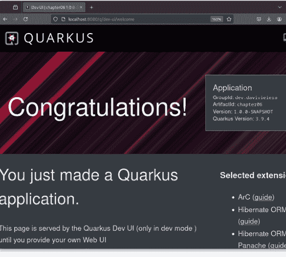

## 恭喜！

你刚刚创建了一个 Quarkus 应用。

在你提供自己的 Web UI 之前，此页面由 Quarkus Dev UI（仅在开发模式下）提供。

已选扩展

+ ARC (指南)
- Hibernate ORM (指南)
- Hibernate ORM with Panache (指南)

图 6: Quarkus Dev UI

在浏览器中加载此页面可确认 Quarkus 应用已启动并运行。

作为引导过程的一部分，Quarkus CLI 在 `src/main/java/org/acme/GreetingResource.java` 处创建了一个 Java 类，代码如下：

```java
@Path("/hello")
@GET
@Produces(MediaType.TEXT_PLAIN)
public String hello() {
    return "Hello from Quarkus REST";
}
```

`GreetingResource` 类暴露了一个 REST 端点，我们可以通过向应用程序发送 HTTP 请求来测试它：

```bash
$ curl localhost:8080/hello
Hello from Quarkus REST
```

这显示 Quarkus 应用正确地处理了 HTTP 请求。

如果你熟悉 Spring Boot，你会发现 Quarkus 消除了启动应用程序时对启动类的需求。虽然自定义启动过程仍然是一个选项，但 Quarkus 的设计初衷是在无需启动类的情况下启动应用程序。

现在我们已经运行了 Quarkus 应用，让我们使用基础 Quarkus 特性（如 Quarkus DI、Hibernate、Panache 和 Quarkus REST）来实现一个 CRUD 项目。

# 使用 Quarkus 构建 CRUD 应用

本节涵盖了用于开发能够持久化数据并暴露 REST API 的后端应用程序的一些基础 Quarkus 特性。在学习了 Quarkus DI、Hibernate 和 Panache 等核心 Quarkus 组件后，我们将使用 Quarkus REST 实现一个基于 CRUD 的账户系统，该系统允许我们管理账户凭据。让我们从 Quarkus DI 开始探索。

## 使用 Quarkus DI 注入依赖

注入依赖的能力是大多数开发框架的一项基本功能，Quarkus也不例外。在本章开头，我们了解到 Quarkus 依赖行业标准提供其大部分功能。它实现了 Jakarta Contexts and Dependency Injection (CDI) 4.0 规范，允许开发者在 Quarkus 应用中注入依赖。Quarkus DI（也称为 Arc）是实现该规范的框架组件。

与 Spring 相比，Quarkus 实现了相同的结果，允许开发者创建、注入和拦截托管 Bean。Spring 和 Quarkus 的区别在于注入行为发生的方式。为了了解 Quarkus 如何注入依赖，我们需要了解托管 Bean 以及它们如何在基于 Quarkus 的应用中被生产和注入。

让我们学习一下托管 Bean。

### 托管 Bean

托管 Bean 是由框架控制的 Java 对象。在 Spring 中，托管 Bean 存在于应用上下文。在 Quarkus 中，它们存在于所谓的容器（container）中，容器是应用程序运行的环境。托管 Bean 的生命周期由容器控制，容器决定 Bean 何时创建和销毁。在 Quarkus 中，我们可以在不同的级别创建 Bean，包括类、方法和字段级别。还可以定义 Bean 的范围以确定它对应用中其他 Bean 的可见性。我们在 Quarkus 项目中可以使用的一些范围包括应用作用域（application-scoped）、单例（singleton）和请求作用域（request-scoped）。接下来我们将探索如何使用这些范围创建并注入 Bean。

### 应用作用域 Bean

每当我们需要提供一个可访问的对象时，应用作用域 Bean 会创建一次并持续整个应用程序。以下是创建应用作用域 Bean 的方法：

```java
@ApplicationScoped
public class Account {

    private String name = "John Doe";

    public String getName() {
        return name;
    }

    public void setName(String name) {
        this.name = name;
    }
}
```

```java
private String email;
private int randomId;
```

```java
@PostConstruct
private void setAccountAttributes() {
    this.name = "John Doe";
    this.email = "john@davivieira.dev";
    this.randomId = new Random().nextInt(50);
}
```

```java
@Override
public String toString() {
    return "Account" +
        ",name='" + name + '\'' +
        ", email='" + email + '\'' +
        ", randomId='" + randomId +
        "'";
}
```

`@RequestScoped` 注解将 `Account` 类转换为请求作用域的 Bean（request-scoped bean）。请注意，我们在 `setAccountAttributes` 方法上使用了 `@PostConstruct` 注解，它会在创建 Bean 实例后初始化类属性。每当创建一个新的 `Account` 实例时，都会执行 `setAccountAttributes` 来初始化所有属性，并使用 `random` 属性接收一个随机数。以下是我们如何使用 `Account` Bean 的示例：

```java
@Path("/account")
public class SampleApplication {

    @Inject
    Account account;

    @GET
    @Produces(MediaType.TEXT_PLAIN)
    public Account account() {
        return account;
        //1 Account(name='John Doe', email='john@davivieira.dev', randomId=49)
        //2 Account(name='John Doe', email='john@davivieira.dev', randomId=23)
        //3 Account(name='John Doe', email='john@davivieira.dev', randomId=27)
    }
}
```

注释显示了我们每次向 `http://localhost:8080/account` 发送 GET 请求时得到的响应。请注意 `randomId` 在每次发送新请求时都会发生变化，这证实了每个请求都会创建新的 `Account` Bean。

除了应用作用域（application-scoped）、单例（singleton）和请求作用域（request-scoped）之外，还有依赖（dependent）、会话（session）和其他自定义作用域。这些作用域提供了特定情况下非常有用的不同行为；但在大多数情况下，你将使用在本节中涵盖的作用域。

Quarkus 对数据持久化提供了强大的支持。让我们接下来来探索它。

# 使用 Hibernate 持久化数据

Quarkus 对许多数据库技术都有内置的 JDBC 支持，因此你可以轻松地将你的 Quarkus 应用连接到数据库。它依赖 Hibernate ORM 作为 Jakarta Persistence。Quarkus 还拥有一个名为 Panache 的库，它显著增强了处理 Jakarta Persistence 实体的体验。在本节中，我们将探索与建立数据库连接和处理实体相关的所有方面。我们从学习如何让 Quarkus 准备好与数据库工作开始。

## 配置 Quarkus 使用数据库

要为现有的 Quarkus 项目启用数据库支持，我们需要添加所需的扩展：

```bash
$ quarkus add quarkus-hibernate-orm quarkus-hibernate-orm-panache quarkus-jdbc-h2
[SUCCESS] ✅ Extension io.quarkus:quarkus-hibernate-orm has been installed
[SUCCESS] ✅ Extension io.quarkus:quarkus-hibernate-orm-panache has been installed
[SUCCESS] ✅ Extension io.quarkus:quarkus-jdbc-h2 has been installed
```

`quarkus-hibernate-orm` 和 `quarkus-hibernate-orm-panache` 扩展添加了带有 Quarkus Panache 库的 Hibernate ORM 支持。`quarkus-jdbc-h2` 扩展将 H2 内存 JDBC 驱动程序添加到 Quarkus 应用中。一旦依赖就绪，我们可以通过 `application.properties` 文件配置数据库连接以及 Hibernate 在应用程序中的行为：

```properties
quarkus.datasource.url=jdbc:h2:mem:default
quarkus.datasource.password=password
quarkus.hibernate-orm.database.generation=drop-and-create
```

由于我们使用 H2 内存数据库，用户名和密码等设置是可选的，因为 Quarkus 为它们提供了默认配置。但是，我们需要指定 JDBC URL，在我们的情况下，它指的是仅在应用程序运行期间存在的 H2 数据库。通过设置 `quarkus.hibernate-orm.database.generation=drop-and-create`，我们指示 Quarkus 根据 Quarkus 应用中定义的 Jakarta Persistence 实体类来创建数据库表。当对 MySQL 或 PostgreSQL 等普通数据库使用 `drop-and-create` 选项时，它会在每次应用程序启动时重新创建表。Quarkus 在数据库配置方面非常灵活，提供了多种控制应用程序与数据库交互的方法。

在拥有了正确的数据库依赖并充分配置了数据库连接后，我们准备好探索 Quarkus 如何处理数据库了。让我们开始探索如何使用 Hibernate 来处理 Quarkus 应用中的数据库实体。

## 使用 EntityManager 处理数据库实体

让我们从实现实体类开始：

```java
@Entity
public class Account {

    @Id
    private String email;
    private String password;
    // 代码省略
}
```

我们可以实现一个 `AccountRepository` 类来处理 `Account` 实体：

```java
@ApplicationScoped
@Transactional
public class AccountRepository {

    @Inject
    EntityManager entityManager;

    public void createAccount(String email, String password) {
        entityManager.persist(new Account(email, password));
    }

    public Account getAccount(String email) {
        return entityManager.find(Account.class, email);
    }
}
```

我们将 `AccountRepository` 转换为应用作用域的 Bean，以便我们可以在其他应用程序区域中注入并使用它。该仓库依赖于 Quarkus 注入的 `EntityManager`。由于我们已经配置了 JDBC 数据库连接和 Hibernate ORM 依赖，Quarkus 会将一个有效的 `EntityManager` 注入到 `AccountRepository` 类中，使其准备好处理任何数据库实体。注意 `@Transactional` 注解的使用；每当数据库发生写入操作时，我们需要它。在上面的示例中，`createAccount` 方法负责数据库的写入操作。

以下是我们在 Quarkus CLI 应用中使用此 `AccountRepository` 类的方法：

```java
@Command(name = "SampleCLIQuarkusApp", mixinStandardHelpOptions = true)
public class SampleCLIQuarkusApp implements Runnable {

    @Inject
    AccountRepository accountRepository;
}
```


```java
@Override
public void run() {
    accountRepository.createAccount("user1@davidiera.dev", "pass");
    accountRepository.createAccount("user2@davidiera.dev", "pass");
    accountRepository.createAccount("user3@davidiera.dev", "pass");

    System.out.println(accountRepository.getAccount("user2@davidiera.dev"));
    // Account(email='user2@davidiera.dev', password='pass')
}
```

作为使用 `EntityManager` 的替代方案，Quarkus 提供了一个方便的 Panache 库，简化了数据库实体。让我们探索它。

## 简化数据库实体 ORM 和 Jakarta Persistence

构建在 Hibernate 之上的 Panache 库能让开发者能够更高效地处理数据库实体。它依赖于活动记录（active record）和仓库模式，为数据库操作提供了更大的灵活性。让我们先看看 Panache 如何应用仓库模式。

## 使用 Panache 的仓库模式

到目前为止，在本节中通过声明一个仓库类并使用它来处理数据库实体来实现仓库模式。我们已经通过 `EntityManager` 完成了这一点。让我们重构该仓库类以使用 Panache：

```java
@ApplicationScoped
@Transactional
public class AccountRepository implements PanacheRepository<Account> {
```

```java
public Account findByEmail(String email) {
    return find("email", email).firstResult();
}
```

我们不需要担心注入 `EntityManager`，因为 Panache 已经提供了。我们正在实现了 `PanacheRepository`。这是将类转换为 Panache 仓库的要求。该接口内置了 `persist`、`findById` 和 `delete` 等操作，我们可以直接开箱使用。也可以像我们在上面定义 `findByEmail` 方法那样定义操作。Panache 提供的 `find` 方法允许我们使用其属性查询数据库实体。由于 `persist` 方法是从 `PanacheRepository` 继承的，因此我们需要 `@Transactional` 注解。记住，每当 Quarkus 中发生写入操作时，都需要 `@Transactional` 注解。

以下是重构后的 `AccountRepository` 类后，我们的应用程序样式：

```java
@Command(name = "SampleCLIQuarkusApp", mixinStandardHelpOptions = true)
public class SampleCLIQuarkusApp implements Runnable {

    @Inject
    AccountRepository accountRepository;

    @Override
    public void run() {
        accountRepository.persist(new Account("user1@davidiera.dev", "pass1"));
        accountRepository.persist(new Account("user2@davidiera.dev", "pass2"));
        accountRepository.persist(new Account("user3@davidiera.dev", "pass3"));
    }
}

System.out.println(accountRepository.findByEmail("user2@davidiera.dev"));
```

注意我们正在从 `AccountRepository` 类中调用 `persist` 方法。`persist` 是 Panache 提供的内置操作，允许我们将记录保存到数据库中。

现在让我们如何使用活动记录模式（active record pattern）来实现使用仓库模式得到的结果。

## 使用活动记录模式的 Panache

活动记录模式背后的思想是，与其分离实体和仓库类，不如将这些类合并到一个类中，该类代表实体本身以及对该实体执行的数据库操作。为了查看它是如何工作的，让我们重构 `Account` 类：

```java
@Entity
public class Account extends PanacheEntityBase {

    @Id
    private String email;
    private String password;
}
```

```java
public static Account findByEmail(String email) {
    return find("email", email).firstResult();
}
// Code omitted
```

你必须继承 `PanacheEntity` 或 `PanacheEntityBase` 抽象类来应用活动记录模式（active record pattern）。我们继承 `PanacheEntityBase` 是因为 `PanacheEntity` 通过 `@Id` 注解处理实体的唯一标识。否则，Panache 将通过主键处理实体的标识。无论我们继承的是 `PanacheEntity` 还是 `PanacheEntityBase`，继承它的类都会继承一组数据库内部操作，如 `persist` 和 `delete`。与我们在使用 Panache 应用活动记录模式时采用仓库模式（repository pattern）的方法，我们可以在实体类内部定义自定义的数据库操作，就像我们在 `Account` 类中定义 `findByEmail` 方法时一样。

以下是我们如何使用活动记录模式处理 `Account` 条目的：

```java
@Command(name = "SampleCLIQuarkusApp", mixinStandardHelpOptions = true)
public class SampleCLIQuarkusApp implements Runnable
```

```java
@Override
public void run() {
    new Account("user1@davidiera.dev", "pass").persist();
    new Account("user2@davidiera.dev", "pass").persist();
    new Account("user3@davidiera.dev", "pass").persist();

    System.out.println(Account.findByEmail("user2@davidiera.dev"));
}
```

`@Transactional` 注解放置在 `run` 方法上方，是因为在我们创建 `Account` 对象并调用 `persist` 后，会触发数据库写入操作。通过活动记录模式，我们将所有内容集中在 `Account` 类中，这建立了数据库表映射并提供了如 `findEmail` 类的自定义数据库操作。

在仓库模式和活动记录模式之间做出决策，取决于你的项目需求。

在涵盖了 Quarkus 处理数据库的基础方面后，让我们探索如何使用 Quarkus 构建 API。

# 使用 Quarkus 实现 API

与 Quarkus 的其他功能一样，Quarkus 对 REST API 的支持基于 Jakarta REST 规范。`REST` 扩展完全实现了 Jakarta 规范，允许开发者实现响应式非响应式的端点。Quarkus REST 还通过 Jackson 或 JSON-B 库支持 JSON 负载。

在本节中，我们将引导你创建一个实用的 Quarkus REST API。该 API 能够从数据库中创建、检索和删除数据。我们将基于我们在之前的章节中处理过的 `Account` 数据库实体使用示例。

接下来，我们将查看实现 API 的步骤：

1. 在跳手 API 实现之前，让我们先通过以下代码复习 `Account` 实体类的结构：

```java
@Entity
public class Account {
    @Id
    private String email;
    private String password;
    // Code omitted
}
```

2. 为了允许处理 `Account` 实体，我们有以下 `AccountRepository` 类：

```java
@ApplicationScoped
public class AccountRepository implements PanacheRepository<Account> {
    public Account findByEmail(String email) {
        return find("email", email).firstResult();
    }
    public void deleteByEmail(String email) {
        delete("email", email);
    }
}
```

注意，我们有一个名为 `deleteByEmail` 的新方法，它根据电子邮件地址删除 `Account` 实体。

一旦充分实现了实体类和仓库类，我们就可以实现 REST 端点以允许更改数据库。

3. 以下是我们如何开始实现 `AccountEndpoint` 类的：

```java
@Path("/account")
public class AccountEndpoint {
    @Inject
    AccountRepository accountRepository;
}
```

我们通过在类名上方放置 `@Path("/account")` 注解开始。通过这样做，我们为 `AccountEndpoint` 类内部定义的所有端点建立了 URL 路径。

4. 我们首先实现允许创建新账户的端点：

```java
@Path("/account")
public class AccountEndpoint {

    @Inject
    AccountRepository accountRepository;

    @POST
    @Transactional
    @Consumes(MediaType.APPLICATION_JSON)
    @Produces(MediaType.APPLICATION_JSON)
    public void create(Account account) {
        account.persist();
    }
    // Code omitted
}
```

创建资源的 HTTP 请求应该作为 POST 请求处理，因此我们在 `create` 方法中有 `@POST` 注解。存在 `@Transactional` 注解是因为触发了必须在事务内完成的数据库写入操作。通过 `@Consumes` 和 `@Produces` 注解，我们可以确定该端点消耗和产生的类型：两者都是 `MediaType.APPLICATION_JSON`。

5. 接下来，我们实现允许检索账户的端点：

```java
@Path("/account")
public class AccountEndpoint {

    @Inject
    AccountRepository accountRepository;

    // Code omitted
    @Path("{email}")
    @GET
    public Account get(@PathParam("email") String email) {
        return accountRepository.findByEmail(email);
    }

    @Path("/all")
    @GET
    public List<Account> getAll() {
        return accountRepository.listAll();
    }
}
```

`get` 方法定义的端点接收来自 `/account/{email}` 的 GET 请求。`{email}` 是映射到端点参数 `@PathParam("email") String email`。我们还在 `/account/all` 定义了一个额外的 GET 端点来检索所有账户。

6. 最后，我们定义一个删除账户的端点：

```java
@Path("/account")
public class AccountEndpoint {
    @Inject
    AccountRepository accountRepository;

    // Code omitted
    @Path("/{email}")
    @Transactional
    @DELETE
    public void delete(@PathParam("email") String email) {
        accountRepository.deleteByEmail(email);
    }
}
```

`delete` 方法定义的端点接收来自 `/account/{email}` 的 DELETE 请求，使用电子邮件地址从数据库中删除 `Account` 实体。需要 `@Transactional` 注解是因为删除是一个写入操作。

由于我们的 Quarkus 应用程序已经运行，现在是时候上手 API 了。我们可以通过发送各种请求与其交互。我们发送 POST 请求来创建新账户：

```bash
curl -H "Content-Type: application/json" -X POST '{"email":"user1@davidiera.dev"}' localhost:8080/account
curl -H "Content-Type: application/json" -X POST '{"email":"user2@davidiera.dev"}' localhost:8080/account
curl -H "Content-Type: application/json" -X POST '{"email":"user3@davidiera.dev"}' localhost:8080/account
```

我们可以使用以下 GET 请求检索特定的账户：

```bash
curl -s localhost:8080/account/user1@davidiera.dev
{
  "email":"user1@davidiera.dev"
}
```

以下是我们如何检索所有账户的：

```bash
curl -s localhost:8080/account/all
[
  {"email":"user1@davidiera.dev"},
  {"email":"user2@davidiera.dev"},
  {"email":"user3@davidiera.dev"}
]
```

要删除账户，我们需要发送一个 DELETE 请求：

```bash
curl -X DELETE localhost:8080/account/user2@davidiera.dev
```

如果我们发送请求来获取所有账户，可以确认剩余账户于数据库中：

```bash
curl -s localhost:8080/account/all
[
  {"email":"user1@davidiera.dev"},
  {"email":"user3@davidiera.dev"}
]
```

在 Quarkus 应用程序中拥有良好的 REST 端点并不困难。框架允许我们通过直观的注解轻松表达应用程序端点的行为。

让我们探索如何使用 Quarkus 编写原生应用程序。

# 编写原生应用程序

典型的 Java 应用程序基于类编译成字节码，并在 `Java Virtual Machine (JVM)` 中运行。JVM 是我们要在想要运行 Java 应用程序的操作系统上安装的软件。一旦编译为字节码，Java 类就可以在 Windows、Mac 和 Linux 等不同的操作系统上执行，只要这些系统安装了 JVM。JVM 提供了如垃圾回收和优化等优势，让我们能够执行 Java 应用程序。然而，这些优势是需要代价的。运行 JVM 并执行执行 Java 应用程序所需的所有预热活动会消耗资源，特别是内存。

在 Java 应用程序准备好执行其任务之前，JVM 必须启动并处理应用程序的字节码。在大多数情况下，等待应用程序启动以及在 JVM 中运行它所需的大量内存是可以接受的。然而，在某些场景，加速应用程序启动和使用极少内存至关重要。将 Java 应用程序用于一次性执行（如 `Amazon Web Services (AWS)` Lambda 等函数即解决方案提供的服务），是内存占用较小的 Java 应用程序受益的案例之一，因为函数即服务的费用是根据系统使用的内存量和系统执行操作所需的时间来计算的。减少 Java 应用程序使用的内存量和启动时间是可能的。通过这样做，我们可以节省费用，特别是当许多 Java 应用程序转换为原生程序时。

让我们探索一种名为 native image 的技术，它允许创建内存优化的 Java 版本。

# Native Image


# GraalVM 与原生镜像编译

GraalVM 是一种提供了 native image 技术的 `Java Development Kit (JDK)`。该技术依赖提前编译（ahead-of-time compilation），将 Java 应用程序编译成独立的可执行文件，并在无需安装 `Java Virtual Machine (JVM)` 的情况下直接在操作系统中运行。普通的 Java 应用程序编译成字节码并在 JVM 中运行。相反，GraalVM 将 Java 应用程序编译成直接在目标系统中运行的原生代码。Quarkus 依赖 GraalVM 提供原生镜像编译支持。接下来，我们将学习如何将 Quarkus 应用程序编译为原生镜像。

```xml
<id>native</id>
<activation>
  <property>
    <name>native</name>
  </property>
</activation>
<properties>
  <skipITs>false</skipITs>
  <quarkus.native.enabled>true</quarkus.native.enabled>
</properties>
</profile>
</profiles>
<!-- Code omitted as native. -->
</project>
```

Profile ID 和 name 都被定义为 native。我们在执行 `mvn` 命令来编译原生可执行文件时，稍后会使用 profile name。原生编译通过设置为 `true` 的 `quarkus.native.enabled` 属性激活。在创建 Maven profile 后，我们可以执行以下命令来创建一个原生可执行文件：

```bash
$ mvn clean package -Pnative
```

产出的产物：

- `/project/chapter06-1.0.0-SNAPSHOT-runner-build-output-stats.json`
- `/project/chapter06-1.0.0-SNAPSHOT-runner-build-output.json` (build_info)

该命令不是生成 JAR 文件，而是创建一个名为 `chapter06-1.0.0-SNAPSHOT-runner` 的原生可执行文件，我们可以在项目根目录下通过以下命令来运行它：

```bash
$ ./target/chapter06-1.0.0-SNAPSHOT-runner
```

```
--/ /\_/ /\_/ /\_/ /\_/ /\_\
--/ /\_/ /\_/ /\_/ , /\_/ , < / ^\
\_/ /\_/ /\_/ /\_/
```

```text
2024-09-08 21:47:13,318 INFO [io.quarkus] (main) chapter06 1.0.0-SNAPSHOT native (powered by Quarkus 3.9.4) started in 0.016s. Listening on:
http://0.0.0.0:8080
2024-09-08 21:47:13,318 INFO [io.quarkus] (main) Profile prod activated.
2024-09-08 21:47:13,318 INFO [io.quarkus] (main) Installed features: [agro, cdi, hibernate-orm, hibernate-orm-panache, jdbc-h2, narayana-jta, rest, rest-jackson, smallrye-context-propagation, vertx]
```

注意第一行日志提到 Quarkus 正在以原生模式运行。

为了总结本章所学的内容，在下一节中，我们将运行 Account 应用并发送示例请求以确保它按预期工作。

## 编译并运行示例项目

本章的示例项目基于我们在之前章节中处理过的示例。它是一个 Quarkus CRUD 应用，用于管理数据库中的账户数据。

你可以从 GitHub 仓库 `https://github.com/bppublications/Java-Real-World-Projects/tree/main/Chapter%206` 克隆源代码。

你需要在你的机器上安装 `JDK 21` 或 `Maven 3.8.5`。要运行应用程序的端点，你必须拥有 `curl` 或任何你喜欢的 HTTP 客户端。`jq` 命令工具是可选的，但它有助于格式化 `curl` 生成的 JSON 输出。步骤如下：

1. 执行以下命令编译应用程序：

```bash
mvn clean package
```

2. 编译并生成 JAR 文件后，我们可以运行以下命令：

```bash
java -jar target/chapter06-1.0.0-SNAPSHOT-runner.jar
```

```
--/ / _ / / _ / _ / _ / _ / _ \
--/ / _ / _ / _ / _ / _ / _ / _ / _ / _ \
--/ / _ / _ / _ / _ / _ / _ / _
```

```text
2024-04-21 18:43:26,586 INFO [io.quarkus] (main) chapter06 1.0.0-SNAPSHOT
2024-04-21 18:43:26,587 INFO [io.quarkus] (main) Profile prod activated.
2024-04-21 18:43:26,587 INFO [io.quarkus] (main) Installed features: [ag
```

3. 一旦 Quarkus 应用程序开始运行，我们就可以通过发送 HTTP 请求来测试它。以下是创建一个新账户的方法：

```bash
curl -H "Content-Type: application/json" -d '{"email":"user1@daviviera.dev","password":"123"}'
```

4. 为了确认账户已创建，我们发送以下请求：

```bash
curl -s localhost:8080/account/user1@daviviera.dev | jq
```

```json
{
  "email": "user1@daviviera.dev",
  "password": "123"
}
```

JSON 响应确认了在我们发送第一个请求时账户已成功创建。

在之前的步骤中，我们通过发送 HTTP 请求来创建和检索账户，从而编译、启动并测试了示例项目。

## 结论

尽管 Quarkus 与 Spring 相比是一个新框架，但它正在快速发展，并拥有一个活跃的社区。Quarkus 构建并利用了如 Jakarta EE 等提供的坚实行业标准。

Jakarta EE 提出了一种用于开发企业级应用程序的多层架构。让我们进一步探索多层应用程序的深层含义。

# 设计多层应用程序

企业级系统通常由不同的组件组成，这些组件互为补充以提供价值功能。这些组件根据它们在企业级系统中的职责被分为不同的层级。在接下来的章节中，我们将检查 Jakarta EE 的各个层级。

## 客户端层 (Client tier)

客户端层是所有企业系统客户端所在的地方。客户端可以通过 Web 浏览器提供用户界面（UI），也可以是与企业系统交互的桌面应用程序。其他非界面的应用程序也可以作为企业系统的客户端。客户端层组件的主要特征是，它们通过向企业系统发送请求来触发系统中的行为。客户端是技术无关的；它可以使用 Java 或任何其他技术进行开发。

## Web 层 (Web tier)

企业级系统可以提供一种 Web 应用程序，渲染可以通过浏览器访问的 HTML 页面。虽然在今天这并不常见（因为大多数前端开发是在客户端进行的），但对服务器端前端应用的支持也是 Jakarta EE 规范的一部分。基于 `Jakarta Servlet` 规范之上的 `Jakarta Server Pages (JSP)` 和 `Jakarta Server Faces (JSF)` 规范，是我们在 Web 层找到的技术，它们使得企业系统组件能够提供 Web 资源。

## 业务层 (Business tier)

业务规则代表了企业级系统中关键的组件。无论企业级系统旨在解决什么业务问题，业务层都包含包含业务逻辑的组件，负责解决这些问题。这就是 Jakarta EE 组件（如 `Jakarta Persistence` 实体以及无状态、有状态和消息驱动的 Bean，也称为企业 Bean）被用来解决业务问题的地方。

## 企业信息系统层 (Enterprise information system tier)

Jakarta EE 企业级应用程序依赖于外部系统，如数据库、大型机、`企业资源计划 (ERP)` 以及任何提供数据以满足企业级应用需求的系统。这些外部系统构成了企业信息系统层。

下图展示了各层级之间的相互关系：

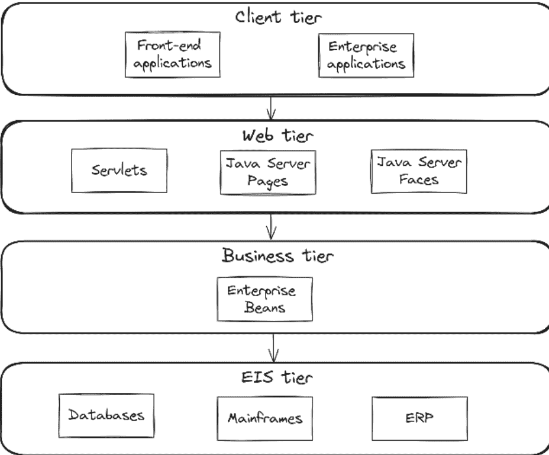

图 7.1：Jakarta EE 层级

注意，通信流从客户端开始，然后经过 Web 层、业务层和 EIS 层。在 Jakarta EE 项目中，并非强制使用所有层级。你可以拥有一个不包含任何 Web 组件的企业级系统，因此在该系统中 Web 层并不存在。

Jakarta EE 是一系列用于用 Java 开发企业级软件的规范集合。让我们进一步探索这些规范。

# 探索 Jakarta EE 规范

Jakarta EE 是一套用于用 Java 开发企业级应用程序的规范。Jakarta EE 项目并不提供这些规范的实现。实现工作由 Jakarta EE 供应商负责。开发者使用规范来构建自己的应用程序，并可以选择哪种 Jakarta EE 供应商符合其需求。Jakarta EE 的实现通过实现规范接口的 Java 库提供。这些库与 Jakarta EE 供应商提供的应用程序服务器一起分发，该供应商实现了这些规范，或者依赖于实现部分规范的第三方。`Oracle WebLogic`、`IBM WebSphere`、`Payara` 和 `Eclipse Glassfish` 是市场上的一些 Jakarta EE 供应商。

所有 Jakarta EE 独立规范都被分组在 Jakarta EE Platform（平台）规范和 Profile（配置/概况）规范中。让我们进一步检查每种规范的目的。

## Jakarta EE Platform 规范

我们之前已经看到，Jakarta EE 项目基于多层架构，不同的应用程序组件在客户端、Web 层、业务层和`企业信息系统 (EIS)`层之间进行交互。来自 Web 层和业务层的组件运行在容器中，容器是由 Jakarta EE 服务器提供的运行时环境。Web 容器负责执行 Web 资源，如 `Java Server Page (JSP)`；`Enterprise Java Bean (EJB)` 容器负责执行业务逻辑代码。来自客户端和 EIS 层的组件通常运行在 Jakarta EE 服务器之外，并与 Web 层和业务层的组件交互。由于在 Jakarta EE 服务器之外运行，我们可能会有客户端系统向企业级应用程序发起调用，以及数据库为此类应用程序提供数据。

Jakarta EE Platform 规范规定了在多层架构中运行的组件。运行在 Jakarta EE 服务器之外，我们可能会有客户端系统向企业级应用程序发起调用，以及数据库为此类应用程序提供数据。

为了符合规范，由于为了实现更快的启动速度和更小的内存占用，使用所有层是强制的。Jakarta EE Platform 规范定义了满足企业级应用需求的平台。

下图展示了 Platform 规范所涵盖的所有技术：

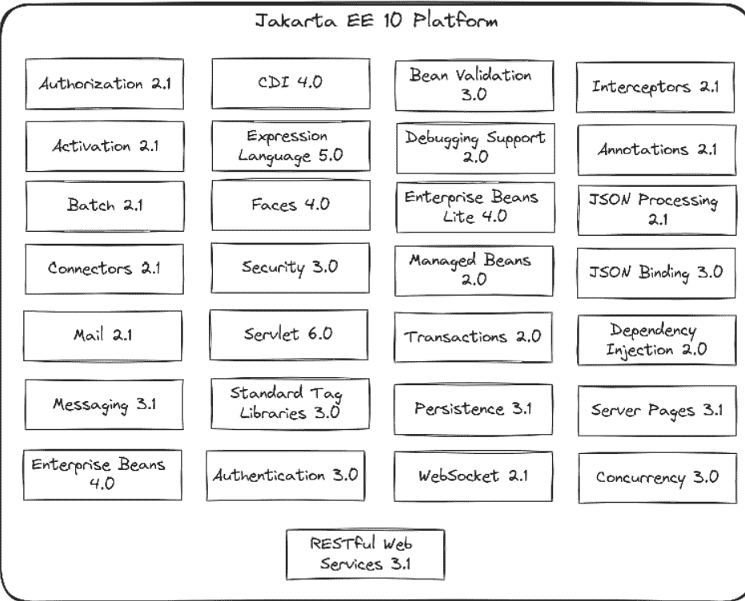

图 7.2：Jakarta EE Platform 规范

在范围方面，Jakarta EE Platform 规范涵盖了企业级应用程序的结构、运行方式以及如何与系统集成。

## Web Profile 规范

Jakarta EE Web Profile 规范是第一个创建的配置规范。其主要目标是仅分组 Web 应用程序。例如，`Jakarta Messaging` 是 Jakarta EE Platform 规范的一部分，但不是 Web Profile 规范的一部分。这意味着目标 Web Profile 的平台可以提供更小的企业级应用程序。下图展示了 Web Profile 规范所涵盖的所有技术：

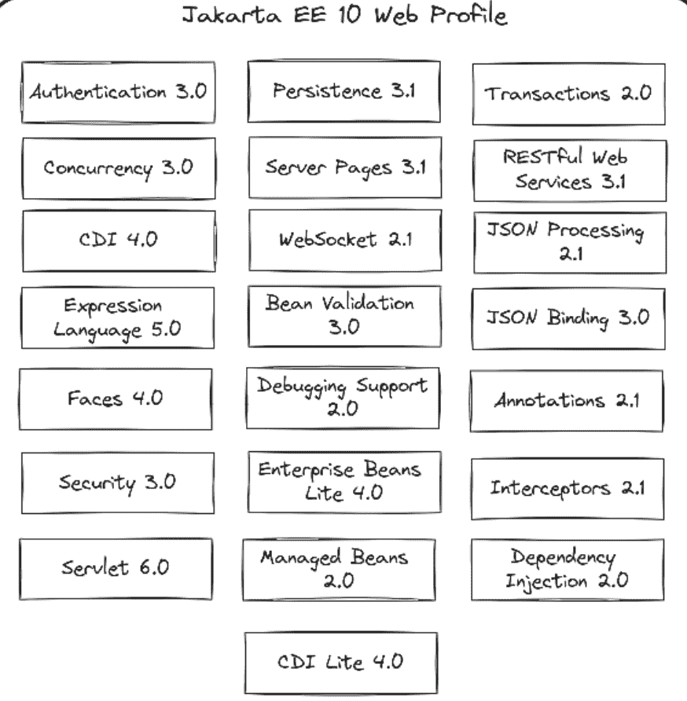

图 7.3：Jakarta EE Web Profile 规范

注意，这里没有显示 Platform 的某些组件。

## Core Profile 规范

在有了 Platform 和 Web Profile 规范之后，Jakarta EE Core Profile 规范的出现是为了支持云原生开发。由于没有引入许多规范，Core Profile 依赖于精简规范。需要快速启动速度和更小内存占用的项目可以从 Core Profile 中受益。以下展示了 Core Profile 的组成：

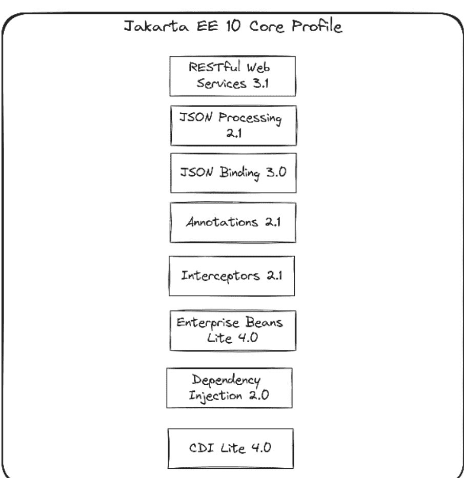

图 7.4：Jakarta EE Core Profile 规范

注意，这里只使用了部分规范。所有不认为是云应用开发严格必需的内容都被删除了。

像 `Tomcat` 这样的非认证服务器没有实现所有要求的 Jakarta EE 规范，但提供了足够托管企业级应用的能力。Jakarta EE 持续作为开发企业级应用的稳健平台而保持其重要性。在本节中，我们只涵盖了这一庞大项目的一个角，该项目通过其规范为创建 Java 应用程序提供了标准。现在，让我们探索 Jakarta EE 的另一个影响：MicroProfile，一个针对微服务的项目。

# 介绍 MicroProfile

多年来，我们看到了 Java 应用程序开发方法的重大变化。随着计算成本的降低和容器等云计算技术的普及，开发者开始以不同的方式思考。开发者现在不再开发运行在重量型应用服务器上的单体巨型应用程序，而是正在探索基于称为微服务的较小应用程序的分布式架构。主要的论点是，将单体系统拆分为较小的应用程序有助于解决单体系统变得过大时的可维护性和扩展性问题。对于利用基于微服务的云原生应用优势的 Java 开发者来说，新的挑战也出现了。监控和可观测性变成了关键的开发活动，以确保分布式系统的所有组件都能按预期运行。了解分布式系统的组件如何相互通信也是至关重要的。

## 探索 MicroProfile

要确保基于微服务的 Java 分布式系统应用技术来利用 Docker 和 Kubernetes 等云环境提供的所有优势并非易事。MicroProfile 与 Jakarta EE 的相似之处在于它们都规定了在 Java 中如何操作，但不同之处在于它提供了一组专门为设计企业级应用定制的规范。为了更好地理解 MicroProfile 是如何工作的，让我们进一步探索它的规范。

为了指导微服务的开发，MicroProfile 包含两套规范集：Jakarta Core Profile 和 MicroProfile。

## Jakarta EE Core Profile 规范

MicroProfile 依赖 Jakarta EE Core Profile 规范作为开发云原生应用的基础，列表如下：

- `Jakarta RESTful Web Services 3.1`
- `Jakarta JSON Processing 2.1`
- `Jakarta JSON Binding 3.0`
- `Jakarta Interceptors 2.1`
- `Jakarta Beans 4.0`
- `Jakarta Dependency Injection 2.0`
- `Jakarta CDI 4.0`

Core Profile 规范构成了运行在云端的任何企业级应用的骨干。我们可以使用 `Jakarta RESTful Web Services 3.1` 规范构建能够处理 JSON 负载的 API 端点。`Jakarta JSON Processing 2.1` 和 `Jakarta JSON Binding 3.0` 规范提供了 JSON 支持。`Jakarta Dependency Injection 2.0` 和 `Jakarta CDI 4.0` 规范为处理企业级应用中的依赖提供了稳健的机制。

## MicroProfile 规范

作为 Jakarta EE Profile 规范的补充，典型的 Java 微服务应用可能需要监控、可观测性、配置和其他基本能力。MicroProfile 通过一套用于云原生开发的规范涵盖了以下能力：

- `MicroProfile Telemetry 1.1`
- `MicroProfile OpenAPI 3.1`
- `MicroProfile Rest Client 3.0`
- `MicroProfile Config 3.1`
- `MicroProfile Fault Tolerance 4.0`
- `MicroProfile Metrics 5.1`
- `MicroProfile JWT Authentication 2.1`
- `MicroProfile Health 4.0`

排除错误是使用微服务架构时的挑战之一，因为为了理解请求为何失败，开发者可能需要检查参与该请求的多个微服务的日志。`MicroProfile Telemetry 1.1` 提供了带有 spans（跨）和 traces（追踪）的高级可观测能力，帮助我们理解跨越不同应用程序的请求流。通过 `MicroProfile Rest Client 3.0`，我们可以让微服务之间相互通信。通过 `MicroProfile Health 4.0`，我们探索了通知外部代理 Java 应用程序健康的方法。MicroProfile 规范规范了运行在云原生环境中企业级应用的开发方面。`Open Liberty`、`Quarkus` 和 `Payara` 等供应商实现了 MicroProfile 规范。


在涵盖 Jakarta EE 和 MicroProfile 规范之后，让我们学习如何使用它们来构建 Java 应用程序。

## 开始一个新的 Jakarta EE 项目

启动新 Jakarta EE 项目的一种简便方法是访问 `http://start.jakarta.ee` 网站。在那里，我们可以通过定义 Jakarta EE 版本、Jakarta EE 配置文件、Java SE 版本和其他选项来自定义项目设置。还可以使用 Maven 的最小 Jakarta EE 应用骨架来启动新项目，如下所示 Maven 命令示例所示：

```bash
mvn archetype:generate -DarchetypeGroupId=org.eclipse.starter -DarchetypeArtifactId=jakartaee10-minimal -DarchetypeVersion=1.1.0 -DgroupId=dev.developer -DartifactId=enterpriseapp -Dprofile=web-api -Dversion=1.0.0-SNAPSHOT -DinteractiveMode=false
```

参数 `archetypeGroupId`、`archetypeArtifactId` 和 `archetypeVersion` 指定了我们想要用于生成 Maven 项目的骨架。我们正在使用 Eclipse Foundation 为新 Jakarta EE 项目提供的骨架。其他参数指定了我们正在生成的 Jakarta EE 项目的配置。注意，我们正在使用 `web-api` 配置，这使得该项目支持 Jakarta EE 规范中的 Web 应用功能（如暴露 RESTful 端点）。

在执行了上一个示例提到的 Maven 命令后，我们将在 `enterpriseapp` 目录下获得骨架项目。该目录中的代码将作为使用 Jakarta EE 构建企业级应用的基础，我们将在此进行探索。

## 使用 Jakarta EE 构建企业级应用

作为准备好接收 HTTP 请求的 Jakarta EE 企业级应用的起点，我们可以扩展 Jakarta RESTful Web Services 规范提供的 `Application` 类。下面的示例展示了我们如何扩展 `Application` 类：

```java
@ApplicationPath("")
public class ApplicationConfig extends Application {
}
```

上述示例中的 `ApplicationConfig` 与创建初始 Jakarta EE 项目的 Maven 命令产生的是同一个。`@ApplicationPath` 注解允许我们配置位于我们应用程序提供的所有 RESTful 端点之前的根路径。我们可以通过实现 `SampleResource` 类来创建一个新的 RESTful 端点：

```java
@Path("sample")
public class SampleResource {
    @GET
    @Produces(MediaType.TEXT_PLAIN)
    public String sample() {
        return "Sample data for the Jakarta EE application";
    }
}
```

此处通过 `@Path` 注解定义的 "sample" 路径将附加到 `ApplicationConfig` 类中 `@ApplicationPath` 定义的之后。`@GET` 和 `@Produces` 注解来自 Jakarta RESTful Web Services 规范。我们使用这些注解来暴露一个接收 HTTP GET 请求并产生纯文本响应的端点。

```xml
<plugin>
    <groupId>org.wildfly.plugins</groupId>
    <artifactId>wildfly-maven-plugin</artifactId>
    <version>4.0.0.Final</version>
    <executions>
        <execution>
            <phase>install</phase>
            <goals>
                <goal>deploy</goal>
            </goals>
        </execution>
    </executions>
</plugin>
```

上述插件必须放置在 `pom.xml` 文件的 `plugins` 部分。一旦配置好 WildFly，我们就可以通过运行以下命令启动应用程序：

```bash
mvn clean package wildfly:run
```

我们可以通过在浏览器中访问 `http://localhost:8080/enterpriseapp/sample` 或者执行以下命令来确认应用程序正在运行：

```bash
curl -X GET http://localhost:8080/enterpriseapp/sample
```

## Jakarta EE 应用程序示例数据

通过向 `http://localhost:8080/enterpriseapp/sample` 发送 GET 请求，我们可以获得一个纯文本响应。

接下来，我们将探索如何结合 Jakarta EE 和 MicroProfile，以构建支持云原生和微服务能力的企业级应用。

# 使用 MicroProfile 添加微服务和云原生支持

在这一节中，我们将探索如何使用 Jakarta EE 和 MicroProfile 规范来构建一个支持 MicroProfile 提供的所有微服务和云原生能力的 Java 企业级应用程序。我们首先学习如何设置带有正确依赖的初始 Maven 项目，然后开始实现一个简单的许可管理应用程序，以演示 Jakarta EE 和 MicroProfile 的某些功能。

## 项目设置

要启动一个新的 MicroProfile 项目，我们可以使用 `https://start.microprofile.io/` 上的项目生成器生成骨架 Maven 或 Gradle 项目，或者手动指定项目所需的依赖项。让我们采用手动方法，因为这能让我们更好地理解所需的依赖。以下是使用 Maven 的 MicroProfile 项目的 `pom.xml` 文件应有的：

```xml
<?xml version="1.0" encoding="UTF-8"?>
<project>
  <!-- code omitted -->
  <dependencies>
    <dependency>
      <groupId>jakarta.platform</groupId>
      <artifactId>jakarta.jakartaee-api</artifactId>
      <version>10.0.0</version>
      <scope>provided</scope>
    </dependency>
    <dependency>
      <groupId>org.eclipse.microprofile</groupId>
      <artifactId>microprofile</artifactId>
      <version>6.1</version>
      <type>pom</type>
      <scope>provided</scope>
    </dependency>
  </dependencies>
  <!-- code omitted -->
</project>
```

第一个依赖 `jakarta.jakartaee-api` 实现了对 Jakarta EE 规范的支持，而 `microprofile` 依赖将所有 MicroProfile 规范引入项目。请注意，这些依赖项并不代表规范的实现。规范供应商提供实现类，以及在企业 Java 应用程序运行时提供的运行时服务器。我们使用 Payara 作为许可管理应用程序的 MicroProfile 供应商。

继续 Maven 项目的设置，我们配置了编译和打包插件：

```xml
<?xml version="1.0" encoding="UTF-8"?>
<project>
  <!-- code omitted -->
  <build>
    <finalName>license-management</finalName>
    <plugins>
      <plugin>
        <groupId>org.apache.maven.plugins</groupId>
        <artifactId>maven-compiler-plugin</artifactId>
        <version>3.11.0</version>
      </plugin>
      <plugin>
        <artifactId>maven-war-plugin</artifactId>
        <version>3.4.0</version>
        <configuration>
          <failOnMissingWebXml>false</failOnMissingWebXml>
        </configuration>
      </plugin>
      <!-- code omitted -->
    </plugins>
  </build>
</project>
```

我们使用 `maven-compiler-plugin` 来编译来自 MicroProfile 项目的 Java 源文件。`maven-war-plugin` 让我们将应用程序文件打包成可部署的 WAR 文件。

最后，我们配置 MicroProfile 项目使用 Payara 运行时运行：

```xml
<?xml version="1.0" encoding="UTF-8"?>
<project>
  <!-- code omitted -->
  <build>
    <finalName>license-management</finalName>
    <plugins>
      <!-- code omitted -->
      <plugin>
        <groupId>org.codehaus.cargo</groupId>
        <artifactId>cargo-maven-plugin</artifactId>
        <version>1.10</version>
        <configuration>
          <container>
            <containerId>payara</containerId>
            <installer>
              <groupId>fish.distributions</groupId>
              <artifactId>payara</artifactId>
              <version>6.2</version>
            </installer>
          </container>
        </configuration>
      </plugin>
    </plugins>
  </build>
</project>
```

`cargo-maven-plugin` 允许我们将应用程序部署到 Payara 服务器。

## 定义数据源

在使用正确的依赖项正确设置 Maven 项目后，我们就可以使用 Jakarta EE 开始开发了。让我们开始为许可管理应用程序定义一个数据源。我们首先创建一个 `web.xml` 文件：

```xml
<?xml version="1.0" encoding="UTF-8"?>
<web-app xmlns="https://jakarta.ee/xml/ns/jakartaee"
         xmlns:xsi="http://www.w3.org/2001/XMLSchema-instance"
         xsi:schemaLocation="https://jakarta.ee/xml/ns/jakartaee https://jakarta.ee/xml/ns/jakartaee/web-app_6_0.xsd">
  <data-source>
    <name>java:global/h2-db</name>
    <class-name>org.h2.jdbcx.JdbcDataSource</class-name>
    <url>jdbc:h2:mem:test;DB_CLOSE_DELAY=-1</url>
  </data-source>
</web-app>
```

`name` 组件定义了 MicroProfile 使用的数据源名称。`class-name` 组件指定了这是一个 H2 数据源。`url` 组件包含了 H2 内存 URL。由于在 `web.xml` 中有了数据源，我们需要配置 Jakarta Persistence 来使用它。我们通过 `src/main/resources/META-INF/persistence.xml` 文件来实现：

```xml
<?xml version="1.0" encoding="UTF-8"?>
<persistence xmlns="https://jakarta.ee/xml/ns/persistence"
             xmlns:xsi="http://www.w3.org/2001/XMLSchema-instance"
             xsi:schemaLocation="https://jakarta.ee/xml/ns/persistence https://jakarta.ee/xml/ns/persistence/persistence_3_0.xsd">
  <persistence-unit name="H2DB">
    <jta-data-source>java:global/h2-db</jta-data-source>
    <properties>
      <property name="jakarta.persistence.schema-generation.database.action"
                value="drop-and-create"/>
    </properties>
  </persistence-unit>
</persistence>
```

通过提供 `persistence.xml` 文件，我们可以允许我们的 MicroProfile 应用程序使用 Jakarta Persistence。注意，`jta-data-source` 配置组件使用的 `java:global/h2-db` 与 `web.xml` 中的数据源定义值相同。我们将 `jakarta.persistence.schema-generation.database.action` 设置为 `drop-and-create`，以确保我们的 MicroProfile 应用程序为实现的 Jakarta Persistence 实体创建表。

配置好数据源后，我们可以开始实现许可管理应用程序的业务逻辑。让我们从定义一个 Jakarta Persistence 实体开始我们的实现。

## 实现 Jakarta Persistence 实体

许可管理应用程序允许用户创建、删除或更新软件许可。为了在数据库中存储许可数据，让我们创建一个 Jakarta Persistence 实体类：

```java
@Entity
public class License {

    @Id
    @GeneratedValue(strategy = GenerationType.SEQUENCE)
    long id;

    String name;
    LocalDate startDate;
    LocalDate endDate;
    boolean isExpired;

    // Code omitted
}
```

我们放置 `@Entity` 注解以使该类成为有效的 Jakarta Persistence 实体。所有实体都需要一个 ID，这通过声明 `id` 属性并使用 `@Id` 和 `@GeneratedValue` 注解提供。`@GeneratedValue` 注解配置为 `GenerationType.SEQUENCE` 策略，以便在持久化新实体时自动生成 ID。让我们创建一个处理许可数据库实体的仓库类。

## 使用 EntityManager 实现存储库

我们仍然依赖 Jakarta Persistence 规范，使用 `EntityManager` 实现一个存储库类：

```java
@ApplicationScoped
@Transactional
public class LicenseRepository {

    @PersistenceContext
    private EntityManager entityManager;

    public void persist(License license) {
        entityManager.persist(license);
    }

    public List<License> findAllLicenses() {
        return (List<License>) entityManager
            .createQuery("SELECT license from License license")
            .getResultList();
    }
}
```


来自 Jakarta CDI 规范，我们拥有 `@ApplicationScoped` 注解来确保为 `LicenseRepository` 类创建一个 Bean 实例。放置在 `entityManager` 字段上的 `@PersistenceContext` 注解依赖于我们之前创建的 `persistence.xml` 提供的配置。该存储库类包含一个持久化 `License` 实体的方法以及另一个从数据库检索 `License` 实体的方法。

持久化上下文代表我们可以持久化到数据库的实体。当 Java 应用启动时，Jakarta 实体会被映射并放入持久化上下文。每个持久化上下文都与实体管理器关联，允许从该上下文中处理实体。

# 作为 Jakarta CDI 管理 Bean 实现服务类

服务类通常用于应用业务逻辑并处理可能依赖于外部数据源的应用行为。在处理依赖数据库的业务逻辑时，服务类可以直接依赖于处理数据库实体的存储库类：

```java
@ApplicationScoped
public class LicenseService {

  @Inject
  private LicenseRepository licenseRepository;

  public void createLicense(License license) {
    licenseRepository.persist(license);
  }

  public List<License> getAllLicenses() {
    return licenseRepository.findAllLicenses();
  }
}
```

我们通过使用 `@ApplicationScoped` 注解将 `LicenseService` 类转换为一个托管 Bean。在 `LicenseService` 类内部，我们注入了 `LicenseRepository`，用于创建和检索许可证。

在使用 Jakarta EE 规范实现了实体、存储库类和服务类之后，让我们使用 MicroProfile 和 Jakarta EE 规范定义一个端点类。

# 使用 Jakarta EE 和 MicroProfile 构建 API

我们可以结合 Jakarta EE 和 MicroProfile 规范来实现文档完备的 RESTful API。让我们从定义 API 的基础应用端点路径开始：

```java
@Path("api")
@OpenAPIDefinition(
    info = @Info(title = "License Management", version = "1.0.0")
)
public class LicenseApplication extends Application {
}
```

`@Path` 注解来自 Jakarta EE，而 `@OpenAPIDefinition` 来自 MicroProfile。通过 `@Path` 注解，我们定义了一个基础端点路径，该路径将作为为此应用创建的其他端点的路径组件。`@OpenAPIDefinition` 允许我们通过定义其标题和版本来记录 API。当应用启动时，`@OpenAPIDefinition` 等注解提供的信息将根据 OpenAPI 规范生成 API 文档。

接下来，我们开始实现 `LicenseEndpoint` 类：

```java
@Path("/license")
@Tag(name = "License API", description = "It allows managing licenses")
public class LicenseEndpoint {

    @Inject
    private LicenseService licenseService;

    // 代码省略
}
```

来自 Jakarta RESTful Web Services 规范的 `@Path` 注解至关重要，因为它允许我们定义端点路径。在 `LicenseApplication` 类中定义的 `/api` 将被置于此处 `LicenseEndpoint` 类中使用的 `/license` 路径之前，形成 `/api/license` 路径。来自 MicroProfile OpenAPI 规范的 `@Tag` 注解对于生成 API 文档至关重要。

继续实现 `LicenseEndpoint`，我们实现一个允许创建新许可证的端点：

```java
@Path("/license")
@Tag(name = "License API", description = "It allows managing licenses")
public class LicenseEndpoint {

    // 代码省略

    @POST
    @Consumes(MediaType.APPLICATION_JSON)
    @Produces(MediaType.APPLICATION_JSON)
    @Operation(summary = "It creates a license", description = "A new license is created and persisted into the database")
    @APIResponses(value = {
      @APIResponse(
        responseCode = "200",
        description = "A new license has been successfully created"
      )
    })
    public void createLicense(License license) {
      licenseService.createLicense(license);
    }

    // 代码省略
}
```

`@POST` 注解创建了一个可以通过 HTTP POST 请求在 `/api/license` 访问的端点路径。`@POST`、`@Consumes` 和 `@Produces` 来自 Jakarta RESTful Web Services 规范。注意，此端点消费并产生 JSON 数据。Jakarta JSON Processing 和 Jakarta JSON Binding 规范提供了 JSON 支持。剩余的注解来自 MicroProfile OpenAPI 规范，允许我们提供详细信息，用于在 API 文档中记录此端点。

最后，我们实现一个检索所有可用许可证的端点：

```java
@Path("/license")
@Tag(name = "License API", description = "It allows managing licenses")
public class LicenseEndpoint {

    // 代码省略

    @GET
    @Operation(summary = "It retrieves all licenses", description = "It returns all non-expired and expired licenses")
    @APIResponses(value = {
        @APIResponse(
            responseCode = "200",
            description = "List of licenses retrieved successfully",
            content = @Content(
                mediaType = "application/json",
                schema = @Schema(implementation = List.class, type = SchemaType.ARRAY)
            )
        )
    })
    public List<License> getAllLicenses() {
        return licenseService.getAllLicenses();
    }
}

// 代码省略
```

我们放置 `@GET` 注解以通过 HTTP GET 请求在 `/api/license` 创建一个新的端点路径。

我们需要在 `pom.xml` 文件中添加以下依赖，以启用 OpenAPI UI，以便我们可以在浏览器中查看项目的 API 文档：

```xml
<dependency>
  <groupId>microprofile-ext</groupId>
  <artifactId>openapi-ui</artifactId>
  <version>2.0.0</version>
  <scope>runtime</scope>
</dependency>
```

为了确保在实现 API 时放置的 OpenAPI 注解用于生成 API 文档，我们需要在 `src/main/resources/META-INF` 目录下创建 `microprofile-config.properties` 文件：

```properties
openapi.ui.title=License Management
mp.openapi.scan=true
```

`microprofile-config.properties` 允许我们配置 MicroProfile 项目的组件，例如 OpenAPI。`openapi.ui.title` 将 OpenAPI UI 标题设置为 License Management。我们将 `mp.openapi.scan` 设置为 `true`，以确保包含 OpenAPI 注解的类被用于生成 API 文档。

我们使用 OpenAPI 是因为我们希望提供一份标准的 API 文档，描述人们与许可证系统交互的可能方式。在后续章节中，我们将编译许可证系统并在浏览器中查看 OpenAPI 用户界面。

# 使用 MicroProfile Health 实现健康检查

我们可以使用健康检查机制来判断，例如应用程序的数据库连接是否正常，或者应用程序是否消耗了过多内存或 CPU。在以下示例中，我们实现了 `LicenseHealthCheck` 类，展示了我们如何在 MicroProfile 项目中使用健康检查：

```java
@ApplicationScoped
public class LicenseHealthCheck {

    @Produces
    @Liveness
    HealthCheck checkMemoryUsage() {
        return () -> HealthCheckResponse.named("memory-usage").status(true).build();
    }

    @Produces
    @Readiness
    HealthCheck checkCpuUsage() {
        return () -> HealthCheckResponse.named("cpu-usage").status(true).build();
    }
}
```

我们通过 `@ApplicationScoped` 类级注解将 `LicenseHealthCheck` 类实现为托管 Bean。`@Produces` 方法级注解用于 `checkMemoryUsage` 和 `checkCpuUsage` 方法，因为它们会产生类型为 `HealthCheck` 的托管 Bean，其中包含了我们从应用程序收集的健康信息。在 `checkMemoryUsage` 方法上，我们使用了 `@Liveness` 注解，让第三方服务知道 MicroProfile 应用是否运行正常。用于 `checkCpuUsage` 方法的 `@Readiness` 注解则让第三方服务知道 MicroProfile 应用是否准备好接收请求。

第三方服务通常通过 Kubernetes 集群组件表示，这些组件负责定期发送存活探测和就绪探测以检查应用程序的健康状况。如果 Kubernetes 在执行健康检查时检测到问题，它可以触发补救措施，例如重启 Kubernetes 集群中运行 MicroProfile 应用的 Pod。

在下一节中，我们将学习如何编译和运行许可证管理应用程序。

## 编译并运行示例项目

在上一节中，我们使用 Jakarta EE 和 MicroProfile 实现了一个简单的许可证管理应用程序。在本节中，我们将探索如何编译和运行此项目。

你可以从 GitHub 仓库克隆应用程序源代码：`https://github.com/bpbpublications/Java-Real-World-Projects/tree/main/Chapter%2007`。

你的机器需要安装 JDK 21 或以上版本以及 Maven 3.8.5 或以上版本。

执行以下命令来编译并运行应用程序：

```bash
$ mvn clean package cargo:run
```

编译并将应用程序部署到嵌入的 Payara 服务器需要时间。当命令执行完成时，你应该会看到如下输出：

```text
[INFO] Resolved container artifact org.codehaus.cargo:cargo-core-container-payara:jar:1.10.11 for container payara
[INFO] Parsed GlassFish version = [6.11.22]
[INFO] Payara 6.11.22 starting...
[INFO] Waiting for cargo-domain to start ....
[INFO] Successfully started the domain : cargo-domain
[INFO] domain Location: /home/m4nd4ck/IdeaProjects/Java-Real-World-Projects/Chapter 07/target/cargo/configurations/payara/cargo-domain
[INFO] Log File: /home/m4nd4ck/IdeaProjects/Java-Real-World-Projects/Chapter 07/target/cargo/configurations/payara/cargo-domain/server.log
[INFO] Admin Port: 4848
[INFO] Command start-domain executed successfully.
[INFO] Payara 6.11.22 started on port [8080]
[INFO] Press Ctrl-C to stop the container...
```

以下是你可以发送请求创建新许可证的方法：

```bash
$ curl -v -H "Content-Type: application/json" --data '{"name":"Premium License", "startDate":"2024-01-10", "endDate":"2025-01-18"}' localhost:8080/license-management/api/license
$ curl -v -H "Content-Type: application/json" --data '{"name":"Trial License", "startDate":"2024-01-10", "endDate":"2025-01-18"}' localhost:8080/license-management/api/license
```

你可以使用以下命令获取所有许可证：

```bash
$ curl -s localhost:8080/license-management/api/license | jq
[
  {
    "expired": false,
    "id": 1,
    "name": "Premium License",
    "startDate": "2025-01-18"
  },
  {
    "endDate": "2025-01-18",
    "expired": false,
    "id": 2,
    "name": "Trial License",
    "startDate": "2024-01-10"
  }
]
```

通过发送以下请求可以检查应用程序的健康状况：

```bash
$ curl -s http://localhost:8080/health | jq
{
  "status": "UP",
  "checks": [
    {
      "name": "cpu-usage",
      "status": "UP",
      "data": {}
    },
    {
      "name": "memory-usage",
      "status": "UP",
      "data": {}
    }
  ]
}
```

你可以在 `http://localhost:8080/license-management/api/openapi-ui/index.html` 访问 OpenAPI UI，页面如下：

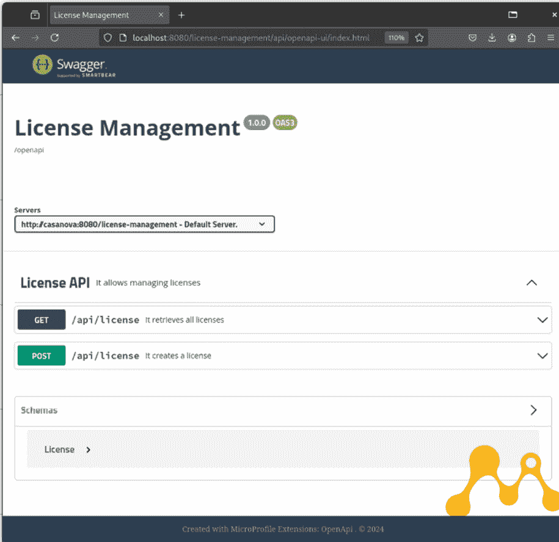

**图 7.5：** OpenAPI UI

OpenAPI UI 是根据实现 MicroProfile 项目的 API 端点时使用的 OpenAPI 文档注解生成的。

## 总结


# Jakarta EE 与云原生部署概述

本章探讨了 Jakarta EE 及其 Platform、Web Profile 和 Core Profile 规范如何被用于开发 Java 企业级应用程序。在比较不同规范的差异时，我们了解到 Platform 规范包含了所有的 Jakarta EE 规范：针对需要 Web 组件的企业级应用程序的 Web Profile 规范，以及适用于在云原生环境中运行的应用程序 Core Profile 规范。我们还学习了 Jakarta EE Core Profile 规范如何补充 MicroProfile 规范，从而提供了一套支持 Java 微服务开发的规范。在概述了 Jakarta EE 和 MicroProfile 规范后，我们通过开发许可证管理应用程序学习了如何使用它们。

下一章将涵盖在云原生环境中部署和运行 Java 应用程序的技术和方法。我们将学习 Kubernetes 及其架构，以及如何在 Kubernetes 集群中部署和运行容器化的 Java 应用程序。

## 加入我们书籍的 Discord 空间

加入书籍的 Discord 工作区以获取最新更新、优惠、全球技术动态、新书发布以及与作者的交流会议：

https://discord.bpbononline.com


# 虚拟化技术

## 全虚拟化

全虚拟化是在重现真实计算机行为和指令的环境中运行软件的技术。它允许对 CPU 和内存等计算机资源进行完全虚拟化。计算机硬件提供的所有内容都经过了虚拟化，使得软件可以在完全感知不到正运行在虚拟化环境中的情况下执行。

宿主机可以通过支持 Intel VT-x 或 AMD-V 等硬件辅助虚拟化技术提供全虚拟化。宿主机运行虚拟机管理程序（`hypervisor`），负责创建虚拟机实例，这些实例也被称为宿主机的虚拟机（guests）。KVM、VMware 和 VirtualBox 是提供全虚拟化的某些虚拟机管理程序。当一台机器被完全虚拟化时，它允许我们安装与宿主机运行的操作系统不同的操作系统。例如，Linux 宿主机可以拥有 Windows 虚拟机。

云服务提供者依赖全虚拟化技术作为**基础设施即服务（IaaS）**解决方案来提供虚拟服务器。这些虚拟服务器运行在物理服务器上，并由虚拟机管理程序软件管理。

当组织开始将其基础设施迁移到云端时，虚拟机服务器允许这些组织继续运行遗留和现代应用程序。虚拟机服务器的一个重要特性是可以根据用户需求灵活调整 CPU 和内存等计算资源。迁移到云端的组织将不再为通过物理硬件过度配置或配置不足计算资源而挣扎，因为这些资源现在可以通过虚拟化虚拟机管理程序轻松地管理。

全虚拟化非常适合运行任何应用程序。现代虚拟化技术使得运行在虚拟化服务器上的应用程序性能实际上与它们运行在裸机服务器上一样。然而，这是有代价的。全虚拟化是一种实现软件执行可视化的昂贵方式，因为它需要虚拟化所有的计算机组件。全虚拟化有一种更便宜的替代方案，称为半虚拟化。让我们接下来来探索它。

## 半虚拟化

部分虚拟化（也称为半虚拟化）在宿主机执行虚拟机的某些指令时是可能的。这意味着虚拟化操作系统需要感知自己正运行在虚拟环境中。半虚拟化技术依赖于宿主机和客户机的协作，以识别哪些指令由虚拟化硬件执行更好，而哪些指令由真实硬件执行更好。宿主机和虚拟机之间的这种协作增强了半虚拟化环境中的性能。

半虚拟化虚拟机管理程序要求虚拟机运行一个可以与管理程序通信的操作系统。因此，操作系统需要经过修改或提供特殊驱动程序以兼容半虚拟化环境。如果你想在不支持半虚拟化的操作系统中运行应用程序，这可能会是一个限制。

半虚拟化比全虚拟化便宜，但仍然意味着巨大的成本，因为它消耗了宝贵的计算资源来提供功能虚拟化环境。Xen 和 Hyper-V 是云服务提供者可能使用的某些半虚拟化技术，用于提供虚拟服务器和其他基于半虚拟化的云解决方案。

全虚拟化和半虚拟化技术被广泛用于运行 Java 应用程序。此类 Java 系统可以运行在虚拟化环境中的应用程序服务器中。Kubernetes 集群节点使用虚拟机服务器配置。因此，这些虚拟化技术对于运行 Java 应用程序非常棒。尽管它们可以使 Java 应用程序具有可移植性，但将这些应用程序捆绑在全或半虚拟机镜像中进行打包和分发可能会很繁琐。

让我们探索一种允许虚拟化操作系统结构的虚拟化技术，它提供了一种方便的方法将应用程序及其依赖项封装到单个、更轻量化的虚拟化环境中。

## 基于容器的虚拟化

也称为操作系统级虚拟化，基于容器的虚拟化由对操作系统组件的虚拟化组成。在这种方法中，客户虚拟机环境与宿主机使用相同的内核。这种容器虚拟化不像全虚拟化或半虚拟化那样深，后者通过虚拟化硬件指令来提供虚拟环境。我们称容器为基于容器的虚拟化技术提供的虚拟环境。

容器技术通过 OpenVZ、Linux Containers (LXC) 和 Docker 等解决方案已经存在相当长时间。它基于两个基本的 Linux 内核特性：`cgroups` 和命名空间（`namespaces`）。这些特性允许应用程序作为操作系统中的隔离进程运行。命名空间内核机制允许在宿主机操作系统中创建隔离环境。从应用程序的角度来看，Linux 命名空间提供的环境看起来像包含自己的文件系统和进程树的真实操作系统。

运行在一个命名空间中的进程看不到其他命名空间中的进程。CPU 和内存等计算资源由 `cgroups` 内核特性管理，该特性负责为宿主机操作系统控制的容器分配计算资源。

容器可以作为一个或多个隔离进程运行。运行在容器内部的进程行为就像它们运行在真实机器上一样。

在 Docker 出现之前，容器并没有被开发者广泛接受。早期的容器技术缺乏一种简单的方法将环境依赖项与应用程序二进制文件一起打包和分发。然而，Docker 通过提供基于容器的虚拟化解决方案改变了这一格局。这允许开发者轻松将应用程序封装到容器镜像中，并包含执行应用程序所需的库和自定义配置等依赖项。Docker 的影响不仅限于简化开发流程；它还提供了显著的成本效益，使其成为容器领域的游戏规则改变者。Docker 的成本效益可以带来巨大的节省，这一前景应该给任何组织带来乐观的情绪。

整个 IT 行业因为 Docker 而改变了。越来越多的组织开始以 Docker 容器的形式部署应用程序，这带来了关于如何在大规模高效运行容器的挑战。这时 Kubernetes 等技术作为管理容器的解决方案出现了。在深入研究 Kubernetes 之前，让我们发现 Docker 是如何工作的。

# 探索 Docker

在没有 Docker 本身其他工具辅助的情况下，操作一组 Docker 容器相对简单。容器像操作系统中的进程一样运行，因此，确保容器进程始终运行而不报错至关重要。系统管理员可以检查容器日志并在出现问题时重启容器。对于简单的用例，仅靠 Docker 可能就足够托管应用程序。可能需要手动管理任务来保持容器运行，这对于较小的非关键系统是可以接受的。

Docker 支持不同的操作系统，包括 Windows、MacOS 和 Linux。要开始使用它，你可以在你的计算机上安装 Docker Desktop 或 Docker Engine。Docker 的安装步骤不在本书的范围之内，但你可以在以下处找到安装说明：

https://docs.docker.com/manuals/

Docker Engine 提供了容器虚拟化引擎以及用于控制 Docker 资源（如镜像、卷和网络）的 CLI 命令工具。Docker Desktop 包含了 Docker Engine 和一个友好的图形用户界面，简化了 Docker 资源的管理。对于那些倾向于用户界面而非 CLI 命令工具的用户来说，它是一个替代方案。

要创建一个 Docker 容器，我们首先需要使用 Dockerfile 创建一个 Docker 镜像：

```
FROM busybox
CMD ["date"]
```

上述两行被放置在一个名为 `Dockerfile` 的文件中，这是 Docker 在构建镜像时使用的默认文件名。镜像有两种类型：父派衍生镜像（parent-derived images）始终构建在父级 Docker 镜像之上。上面的示例使用了 `FROM` 指令来引用 `busybox` 父级镜像。基础镜像（Base images）没有父镜像；它们在 Dockerfile 中使用 `FROM scratch` 指令来表示它们不引用任何父镜像。我们还使用 `CMD` 指令来执行命令。命令是作为隔离进程在 Docker 容器中执行的程序。Dockerfile 支持其他指令，允许我们通过添加文件、创建目录、创建环境变量、设置系统权限和其他操作来自定义 Docker 镜像。

## 管理 Docker 镜像

我们可以使用之前创建的 Dockerfile，通过以下命令构建 Docker 镜像：

```
$ docker build . -t busybox-date
```

上述命令应该在你的操作系统的终端中执行。`docker` 二进制文件是 Docker Engine 提供的 CLI 工具。它允许许多操作，例如使用 `build` 选项构建镜像。在构建命令之后，点符号 `.` 指定了 Dockerfile 的路径，在我们的案例中，点符号代表当前目录。`-t` 选项指的是 Docker 镜像名称，在命令示例中为 `busybox-date`。在标记 Docker 镜像时，我们可以指定它的标签和路径，这可以作为版本控制机制：

```
$ docker build -t s4intlurent/busybox-date:1.0
```

`-t` 选项提供的镜像名称基于 `命名空间/仓库:标签`（namespace/repository:tag）结构。`s4intlurent` 是 Docker Hub 的命名空间，`busybox-date` 是仓库，`1.0` 是镜像标签。Docker Hub (https://hub.docker.com/) 是一个公共镜像存储位置，称为注册表（registry），用户可以在其中存储他们的 Docker 镜像。组织可以使用带有自己命名空间的私有注册表。如果省略版本，Docker 镜像将自动标记为 `latest`。

你可以使用以下命令之一列出存储在你计算机上的所有 Docker 镜像：

```
$ docker images
$ docker image ls
```

或者指定你正在查找 Docker 镜像标签：

```
$ docker image ls s4intlaurent/busybox-date:1.0
```

| REPOSITORY | CREATED | TAG |
| :--- | :--- | :--- |
| s4intlaurent/busybox-date | 11 months ago | ca915675332d |
| 1.0 | 4.26MB | |

一旦本地创建了 Docker 镜像，我们可以将其推送到远程注册表：

```
$ docker push s4intlurent/busybox-date:1.0
```

我们可以通过以下命令从远程注册表拉取 Docker 镜像：

```
$ docker pull s4intlaurent/busybox-date:1.0
```

同一个 Docker 镜像仓库可以有多个标签，每个都有自己的值，例如 `1.0`、`tag-a` 和 `my-image-2.0`。

## 创建 Docker 容器

要创建容器，我们可以引用 Docker 仓库名称及其后的标签，或者 Docker 镜像 ID：

```
$ docker run s4intlaurent/busybox-date:1.0
```

```
Thu May 9 23:35:47 UTC 2024
```

通过执行 `docker run`，我们创建了一个新容器，并在容器内执行 `date` 命令。在执行 `date` 后，进程被终止，这意味着容器也停止了。记住，容器绑定在一个或多个进程上。如果没有进程执行，容器就结束了。为了保持容器运行，我们需要一个守护进程（daemon process）。这种进程用于进程无限存活并能够接收处理请求的场景。我们将在本章稍后创建 Spring Boot 应用程序 Docker 镜像时探索这种场景。

我们可以通过以下命令检查当前正在运行的容器：

```
$ docker ps
```

如果我们传递了 `-a` 选项，Docker 将显示所有容器，包括已终止的容器：

```
$ docker ps -a
```

| CONTAINER ID | IMAGE | COMMAND | CREATED | STATUS |
| :--- | :--- | :--- | :--- | :--- |
| 32ff796fac8 | s4intlaurent/busybox-date:1.0 | "date" | 15 minutes ago | Exited(0) |

`STATUS` 显示容器是否正在运行。`Exited` 表示容器已终止。

以下是杀死运行中容器的方法：

```
$ docker kill [CONTAINER ID]
```

发布 `docker kill` 命令会立即终止 Docker 容器内的进程。杀死容器后，我们可以将其从系统中彻底移除：

```
$ docker rm 32ff796fac8
```

# Kubernetes 架构与组件

当 Kubernetes 对象需要在其中一个工作节点上进行配置时，`kube-scheduler` 负责寻找最符合给定 Kubernetes 对象要求的工作节点。CPU、内存和存储使用率高的工作节点可能会被跳过，而选择具有更多可用容量的工作节点。Pod 是我们在下一节中将进一步探索的 Kubernetes 示例之一。

## kube-apiserver

`kube-apiserver` 连接了不同的 Kubernetes 组件，并提供外部 API，允许如 `kubectl` 等命令行工具与 Kubernetes 集群进行交互。实际上，Kubernetes 集群内部发生的一切事情都会通过 `kube-apiserver` 完成。

## kube-controller-manager

Kubernetes 对象具有当前状态和期望状态。期望状态通过另一种标记语言（YAML）表示，该表示描述了应该如何提供 Kubernetes 对象。如果由于某种原因，当前 Kubernetes 对象的状态与期望状态不一致，`kube-controller-manager` 可能会采取行动以实现期望状态。

控制平面组件通常运行在主节点上，这是 Kubernetes 集群中仅用于管理目的机器。

接下来，我们介绍 Kubernetes 节点组件。

## Container runtime

它是运行在 Kubernetes 节点上的容器引擎。它可以是 Docker 所基于的 `containerd`，也可以是其他兼容的容器技术。Kubernetes 提供了容器运行时接口 **（CRI）**，这是一项定义了如何实现容器技术以支持 Kubernetes 的规范，因此任何实现此类规范的容器运行时都与 Kubernetes 兼容。

## kubelet

Kubernetes 集群中的每个节点都需要一个名为 `kubelet` 的代理来管理运行在节点机器上的容器。在向现有的 Kubernetes 集群添加新的工作节点时，我们需要确保该节点正确安装了 `kubelet` 代理。

## kube-proxy

对 Kubernetes 管理的容器的网络访问可以通过 `kube-proxy` 网络代理来实现。我们可以使用此代理与 Kubernetes 集群中运行的容器暴露的端口建立直接连接。

节点组件运行在每个 Kubernetes 节点上，包括主节点和工作节点。

接下来，学习 Kubernetes 对象以及它们如何用于运行容器化应用程序。

## Kubernetes 对象

容器化应用程序是驱动所有 Kubernetes 机制的基本元素。在 Kubernetes 中托管应用程序时，我们可以使其对外部网络可用，提供应用程序所需的环境变量，并控制同时运行的实例数量。此类任务可以通过使用 Kubernetes 对象完成。我们将在接下来的章节中进一步探索它们。

## Pod

在 Kubernetes 环境中，我们并不直接处理容器。相反，我们使用由一个或多个容器组成的 Pod。Pod 像一个包装器，控制容器的整个生命周期。Pod 对象指定了 Pod 部署到 Kubernetes 集群时必须使用的容器镜像。我们有一个示例显示如何创建 Pod 的 YAML 表示，如下：

```
apiVersion: v1
kind: Pod
metadata:
  name: httpd
spec:
  containers:
    - name: httpd
      image: httpd:2.4
      ports:
        - containerPort: 80
```

在定义 Kubernetes 对象时，我们利用一个名为 `kind` 的关键组件来指定对象的类型，在上面的示例中类型是 Pod。`metadata` 块包含描述 Pod 的元素，包括它的名称。在 `containers` 块中，我们可以定义由此 Pod 管理的一个或多个容器。每个容器都由其名称和镜像指定。`ports` 块（特别是 `containerPort`）允许我们定义容器化应用程序运行的端口。

虽然可行，但直接创建 Pod 并不是常见做法。大多数时候，Pod 由 `Deployment` 等其他 Kubernetes 对象管理。让我们接下来检查它。

## Deployment

运行在 Kubernetes 上的应用程序可以进行水平扩展，这意味着可以配置相同应用程序的多个实例以更好地分布应用程序处理并提供高可用性。我们可以通过管理 Pod 对象的 `Deployment` 对象来实现。`Deployment` 允许我们定义（例如）同时运行多少个 Pod 副本。查看以下 Deployment 的 YAML 表示示例：


# Kubernetes 部署与 Java 应用 Docker 化指南

## Deployment

```yaml
apiVersion: apps/v1
kind: Deployment
metadata:
  name: httpd
  labels:
    app: httpd
spec:
  replicas: 3
  selector:
    matchLabels:
      app: httpd
  template:
    metadata:
      labels:
        app: httpd
    spec:
      containers:
      - name: httppd
        image: httppd:2.4
        ports:
        - containerPort: 80
```

Deployment 声明的一部分与 Pod 相似，因为我们需要定义由 Deployment 管理的 Pod 将如何被创建。注意 `replicas` 组件；我们使用它来告诉 Kubernetes 在此 Deployment 下运行多少个 Pod 实例。此 YAML 声明表达了 Deployment 对象的期望状态。假设 Kubernetes 检测到（例如）在预期数量为三个实例时，只运行了两个 Pod 实例。在这种情况下，Kubernetes 会自动尝试启动另一个实例以确保当前状态匹配期望状态。同样注意 `matchLabels` 块；我们使用它来定义其他 Kubernetes 对象可以引用 Deployment 对象的标签。`matchLabels` 组件的一个常见用例是当我们使用 Service 对象在网络中暴露 Deployment 时。我们接下来将探索 Service 对象。

## Service

Pod 之间可以通信，并允许 Kubernetes 集群外部的客户端访问。默认情况下，当 Pod 部署时，集群中的其他 Pod 无法访问。我们可以通过创建一个 Service 对象来解决这个问题。

```yaml
apiVersion: v1
kind: Service
metadata:
  name: httppd
  labels:
    app: httpd
spec:
  type: ClusterIP
  ports:
    - port: 80
      targetPort: 80
      protocol: TCP
  selector:
    app: httpd
```

`selector` 块可能包含对 Deployment 或 Pod 对象相同的引用。这就是 Service 向网络暴露其他 Kubernetes 对象的方式。注意我们在上面的示例中使用 `ClusterIP` 作为 Service 类型。我们使用此 Service 将 Pod 暴露到 Kubernetes 内部网络。我们可以使用 `NodePort` 或 `LoadBalance` Service 类型将 Pod 暴露到集群外部网络。Service 必须指定其端口和协议。`targetPort` 组件指向容器化应用程序在 Pod 中监听的端口。如果省略，targetPort 将与 Service 端口相同。

## ConfigMap and Secret

容器化应用程序可能依赖外部数据，例如环境变量和文件配置属性。Kubernetes 提供了 `ConfigMap` 和 `Secret` 对象作为为运行 Pod 的应用程序注入外部数据的机制。以下是如何创建一个 ConfigMap：

```yaml
apiVersion: v1
kind: ConfigMap
metadata:
  name: my-application
data:
  DATABASE_URL: "mysql://sample-database:3306/test"
```

上面的示例提供了一个名为 `DATABASE_URL` 的环境变量。ConfigMap 数据还可以用于在 Pod 内部挂载文件。

Secret 与 ConfigMap 类似，但它针对敏感数据。以下是 Secret 示例：

```yaml
apiVersion: v1
kind: Secret
metadata:
  name: my-application
type: Opaque
data:
  DATABASE_USERNAME: dGVzdAo=
  DATABASE_PASSWORD: cGFzcwo=
```

在 Secret 对象中将数据作为环境变量提供时，值必须使用 base64 编码。

## 将 Spring Boot、Quarkus 和 Jakarta EE 应用 Docker 化

大多数 Java 框架都提供了生成可启动 JAR 文件的机制，该文件包含了运行应用程序所需的所有依赖项。拥有一个可启动的 JAR 文件对于 Java 应用的 Docker 化至关重要。我们所说的 Docker 化是指使用可启动的 JAR 文件创建一个 Docker 镜像。

可启动的 JAR 文件也称为 uber JAR 或 fat JAR，它是一个包含编译后的应用程序类文件以及运行应用所需依赖项的文件。这些依赖项也可以以编译类文件的形式包含，从而生成一个包含应用程序编译类文件及其依赖项的 JAR 文件。

接下来，我们将探索如何基于 Spring Boot、Quarkus 和 Jakarta EE 准备应用程序，以便在 Docker 容器内部执行。

## 创建 Spring Boot 应用的可启动 JAR

Spring Boot 应用可以依赖 Maven 插件，该插件会创建一个打包了所有所需应用程序类和依赖项的 JAR 文件。以下是配置 Spring Boot 应用的 `pom.xml` 文件以构建可启动 JAR 文件的方法：

```xml
<build>
  <finalName>sample-spring-boot-app</finalName>
  <plugins>
    <plugin>
      <groupId>org.springframework.boot</groupId>
      <artifactId>spring-boot-maven-plugin</artifactId>
      <version>3.3.4</version>
    </plugin>
  </plugins>
</build>
```

通过 `finalName` 属性，我们定义了 JAR 文件的文件名。负责执行魔法操作的插件是 `spring-boot-maven-plugin`。使用此插件时，`mvn package` 命令将在 Spring Boot Maven 项目的 `target` 目录下创建 `sample-spring-boot-app.jar`。

接下来，我们将学习如何为 Quarkus 应用创建可启动 JAR。

## 创建 Quarkus 应用的可启动 JAR

为 Quarkus 创建可启动 JAR 方法与我们对 Spring Boot 应用的方法类似。以下示例展示了如何配置 `pom.xml` 文件：

```xml
<build>
  <finalName>sample-quarkus-app</finalName>
  <plugins>
    <plugin>
      <groupId>${quarkus.platform.group-id}</groupId>
      <artifactId>quarkus-maven-plugin</artifactId>
      <version>${quarkus.platform.version}</version>
      <extensions>true</extensions>
      <executions>
        <execution>
          <goals>
            <goal>build</goal>
            <goal>generate-code</goal>
            <goal>generate-code-tests</goal>
          </goals>
        </execution>
      </executions>
    </plugin>
  </plugins>
</build>
```

上述示例依赖于变量 `quarkus.platform.group-id` 和 `quarkus.platform.version`，你可以根据想要使用的 Quarkus 版本定义它们。Quarkus 提供了一个名为 `quarkus-maven-plugin` 的插件，它将所有应用程序依赖收集到一个单个 JAR 文件中。我们需要执行 `mvn package` 命令在 `target` 目录下创建一个名为 `sample-quarkus-app.jar` 的 JAR 文件。

我们使用 `build` 目标来打包 Quarkus 应用。`generate-code` 目标编译源文件，而 `generate-code-tests` 目标编译测试代码文件。一旦源码和测试代码文件都编译完成，build 目标就会将它们打包成一个可启动的 JAR 文件。

随后，我们将学习如何为 Jakarta EE 应用创建可启动 JAR。

## 创建 Jakarta EE 应用的可启动 JAR

我们需要一个认证的 Jakarta EE 应用服务器来运行 Jakarta EE 应用。在创建可启动 JAR 时，这种需求可以通过将应用服务器嵌入到包含 Jakarta EE 应用编译类文件的同一个 JAR 文件中来实现。在可用的认证的 Jakarta EE 应用服务器中，让我们使用 WildFly 来配置 `pom.xml`：

```xml
<build>
  <finalName>sample-jakartaee-app</finalName>
  <plugins>
    <plugin>
      <groupId>org.wildfly.plugins</groupId>
      <artifactId>wildfly-jar-maven-plugin</artifactId>
      <version>11.0.2.Final</version>
      <configuration>
        <feature-pack-location>wildfly-preview@org.jboss.universe:community-universe</feature-pack-location>
        <layers>
          <layer>jaxrs-server</layer>
        </layers>
      </configuration>
    </plugin>
    <plugin-options>
      <jboss-fork-embedded>true</jboss-fork-embedded>
    </plugin-options>
    </configuration>
    <executions>
      <execution>
        <goals>
          <goal>package</goal>
        </goals>
      </execution>
    </executions>
  </plugins>
</build>
```

我们依赖 `wildfly-jar-maven-plugin` 来创建一个可启动 JAR 文件，该文件包含通过 `jaxrs-server` 属性值配置的 WildFly 应用服务器，用于运行支持 Jakarta RESTful Web Services 规范的 Jakarta EE 应用。我们可以在 `layers` 块内部添加代表 Jakarta EE 应用所需的 WildFly 的 `layer`。执行 `mvn package` 命令将在 `target` 目录下创建 `sample-jakarta-app.jar` 文件。

## 创建 Docker 镜像

我们用于创建镜像的 Dockerfile 通常放在项目根目录下。以下是创建 Docker 镜像的方法：

```dockerfile
FROM openjdk:21-slim
ENV JAR_FILE=sample-spring-boot-app.jar
COPY target/${JAR_FILE} /app/${JAR_FILE}
WORKDIR /app
ENTRYPOINT ["java", "-jar", "/app/${JAR_FILE}"]
EXPOSE 8080
```

`FROM` 指令指定基础镜像。`ENV` 指令设置 JAR 文件的环境变量。`COPY` 指令将文件从本地机器拷贝到容器。`WORKDIR` 指令设置执行命令的默认目录。`ENTRYPOINT` 提供容器执行的命令，而 `CMD` 通过提供命令参数来补充它。`EXPOSE` 开放 8080 容器端口。

以下是构建镜像的方法：

```bash
docker build -t s4intlarent/sample-spring-boot-app:1.0 .
```

创建镜像后，我们可以通过创建一个容器来确认它是否工作正常：

```bash
docker run -d -p 8080:8080 s4intlarent/sample-spring-boot-app:1.0
```

`-d` 选项指示 Docker 在后台运行容器；`-p 8080:8080` 将主机端口 8080 映射到容器端口 8080。通过将端口映射到容器端口，我们让外部用户能够访问容器。我们可以通过执行以下命令检查容器状态：

```bash
docker ps
```

| CONTAINER ID | IMAGE | COMMAND | CREATED | STATUS | PORTS |
|---|---|---|---|---|---|
| 2dc5832882e1 | s4intlarent/sample-spring-boot-app:1.0 | "sh -c 'exec java -j..." | 2 minutes ago | Up 2 minutes | 0.0.0.0:8080->8080/tcp |

注意容器状态为 Up，这确认了 Spring Boot 应用正在容器内运行。我们必须将 Docker 镜像上传到容器镜像仓库，稍后在将应用程序部署到 Kubernetes 时可以使用它。这可以通过使用我们之前创建的镜像标签发布一个 `docker push` 命令来实现：

```bash
docker push s4intlaurent/sample-spring-boot-app:1.0
```

推送操作指向存储库 `docker.io/s4intlaurent/sample-spring-boot-app`：

```text
5f70bf18a086: Layer already exists
8c17cbc8b59: Pushed
659a8c4ba776: Pushed
0ac7ecf8a4c1: Pushed
d310e774110a: Pushed
1.0: digest: sha256:415a0b98a203b90548e2ef001fee9d96f29c07d2a8df1dc30c26f589eb11a size: 1371
```

上面的命令将 Docker 镜像推送到公共 Docker Hub 注册表，可以通过地址 https://hub.docker.com/r/s4intlaurent/sample-spring-boot-app 访问。

接下来，我们将学习如何将 Docker 镜像部署到 Kubernetes 集群中。

## 在 Kubernetes 上部署基于 Docker 的应用程序

为了理解 Docker 和 Kubernetes 如何协同工作，我们将涵盖在 Kubernetes 集群中运行 Spring Boot 程序的步骤。为了让 Java 系统正确地在 Kubernetes 集群中作为容器化应用程序运行，我们需要为它创建一个 Docker 镜像，将镜像推送到容器注册表，并提供 Kubernetes 对象来部署 Spring Boot 应用程序，使其对 Kubernetes 集群外的客户端可用。与其从头创建一个新的 Spring Boot 应用程序，不如使用第 5 章《使用 Spring Boot 构建生产级系统》中创建的那个。

由于我们在上一节中已经创建了应用程序的 Docker 镜像，让我们学习如何通过环境变量外部化应用程序配置。在容器化应用程序配置时，外部化配置是一种常见做法。

## 外部化应用程序配置

使用环境变量允许您在不重新编译的情况下更改应用程序配置。这在将应用程序部署到多个环境中也很有帮助，因为每个环境可能需要特定的设置，如数据库主机、用户和密码。在 Spring Boot 中，我们可以在定义 `application.yaml` 文件时使用占位符来应用外部配置：

```yaml
datasource:
  url: ${DATABASE_URL}:jdbc:h2:mem:mydb
  username: ${DATABASE_USERNAME:sa}
  password: ${DATABASE_PASSWORD:password}
  driverClassName: org.h2.Driver

jpa:
  database-platform: ${DATABASE_DIALECT:org.hibernate.dialect.H2Dialect}
```

例如，`${DATABASE_URL:jdbc:h2:mem:mydb}` 定义了数据源 URL 配置。`DATABASE_URL` 是预期由运行应用程序的环境提供的环境变量。它可以由本地机器或容器提供，例如。如果环境变量的值未定义，Spring Boot 将使用回退值 `jdbc:h2:mem:mydb`。在本章稍后的部分，我们将使用 ConfigMap 定义环境变量的值。

接下来，我们将学习如何创建在 Kubernetes 集群中运行 Java 应用程序所需的 Kubernetes 对象。

## 创建 Kubernetes 对象


我们可以使用 `minikube` 等本地集群解决方案在本地轻松设置 Kubernetes 集群。安装本地 Kubernetes 集群不在本书的讨论范围内，但你可以在此处找到安装说明：https://minikube.sigs.k8s.io/docs/start/。拥有本地 Kubernetes 集群对于确保 Kubernetes 对象按预期工作非常方便。

设置 `minikube` 集群后，我们可以创建运行我们的 Spring Boot 应用程序的 Kubernetes 对象。让我们从创建一个 ConfigMap 开始。

## 使用 ConfigMap 提供应用程序配置

记住，我们使用环境变量来外部化 Spring Boot 中 `application.yaml` 文件所使用的属性。我们需要创建一个名为 `configmap.yaml` 的文件，以为这些环境变量提供值：

```yaml
apiVersion: v1
kind: ConfigMap
metadata:
  name: sample-spring-boot-app
data:
  DATABASE_URL: "mysql://sample-spring-boot-app-mysql:3306/test"
  DATABASE_DRIVER: "com.mysql.cj.jdbc.Driver"
  DATABASE_DIALECT: "org.hibernate.dialect.MySQL8Dialect"
```

上面的环境变量用于与 MySQL 数据库建立连接。

以下是给定对象文件名为 `configmap.yaml` 的情况下，在 Kubernetes 集群中安装上述 ConfigMap 的方法：

```bash
$ kubectl apply -f configmap.yaml
```

注意，ConfigMap 中没有凭据数据；我们将这些数据放入 Secret 中。让我们接下来检查它。

## 使用 Secret 定义数据库凭据

与 ConfigMap 类似，我们可以使用 Secret 定义包含 base64 编码值的环境变量。编码字符串有许多方法；你可以使用在线 base64 编码网站进行编码。Windows、MacOS 和 Linux 等大多数操作系统也包含允许你编码字符串的工具。以下示例显示了如何在 Linux 上使用 `base64` 编码数据库凭据：

```bash
$ echo test | base64
dGVVzdAo=

$ echo pass | base64
cGFzcwo=
```

我们首先编码 `test` 字符串，即数据库用户。第二个命令编码我们用作密码的 `pass` 字符串。随后，我们在创建以下内容时使用 base64 值：

```yaml
apiVersion: v1
kind: Secret
metadata:
  name: sample-spring-boot-app
type: opaque
data:
  DATABASE_USERNAME: dGVVzdAo=
  DATABASE_PASSWORD: cGFzcwo=
```

上面的内容放在名为 `secret.yaml` 的文件中。通过以下命令安装它：

```bash
$ kubectl apply -f secret.yaml
```

定义了包含连接信息的 ConfigMap 和 Secret 后，我们可以为我们的 Spring Boot 应用程序创建 Deployment。

## 使用 Deployment 部署应用程序

我们希望使用 MySQL 作为 Spring Boot 应用程序的数据库。可以通过创建 `deployment.yaml` 实现：

```yaml
apiVersion: apps/v1
kind: Deployment
metadata:
  name: sample-spring-boot-app
  labels:
    app: sample-spring-boot-app
spec:
  replicas: 1
  selector:
    matchLabels:
      app: sample-spring-boot-app
  template:
    metadata:
      labels:
        app: sample-spring-boot-app
    spec:
      initContainers:
      - name: sample-spring-boot-app-init
        image: busybox
        command: ['sh', '-c', 'until nc -zv sample-spring-boot-app-mysql.default.svc.cluster.local 3306; do echo waiting for sample-spring-boot-app-mysql.default.svc.cluster.local; sleep 5; done;']
      containers:
      - name: sample-spring-boot-app
        image: s4intlaurent/sample-spring-boot-app:1.0
        envFrom:
        - configMapRef:
            name: sample-spring-boot-app
        - secretRef:
            name: sample-spring-boot-app
        ports:
          - containerPort: 8080
```

注意，此 Deployment 有一个使用 `busybox` 镜像的 `initContainers` 块，它执行 Netcat (`nc`) 命令来检查 `sample-spring-boot-app-mysql.default.svc.cluster.local:3306` 是否可用。我们在这里设置 `initContainers` 块是为了防止 Spring Boot 应用程序在数据库之前启动导致启动错误。这种技术确保了 Pod 在初始化容器任务成功执行后才进行初始化。主机 `sample-spring-boot-app-mysql.default.svc.cluster.local` 是 Spring Boot 应用程序连接数据库时使用的 Kubernetes 服务。

当创建应用程序 Pod 时，Kubernetes 将拉取此镜像。

一旦 Deployment 对象配置恰当，我们可以使用类似于下面的命令进行安装：

```bash
$ kubectl apply -f deployment.yaml
```

让我们通过为 Spring Boot 应用程序创建所需的 Service 对象来完成 Kubernetes 对象的配置。

## 通过 Service 访问应用程序

我们需要创建一个 Service 对象，允许 Spring Boot 应用连接到 MySQL 服务器 Pod，以及另一个 Service，允许 Spring Boot 应用暴露给 Kubernetes 集群外部的客户端。

我们通过创建一个包含以下内容的 `database-service.yaml` 文件为 MySQL 服务器 Pod 定义 Service：

```yaml
apiVersion: v1
kind: Service
metadata:
  name: sample-spring-boot-app-mysql
  labels:
    app: sample-spring-boot-app-mysql
spec:
  ports:
    - port: 3306
      protocol: TCP
  selector:
    app: sample-spring-boot-app-mysql
```

当我们省略 Service 类型时，它默认为 `ClusterIP`。在这里使用它是因为我们只想将 MySQL 服务器 Pod 暴露给 Kubernetes 内部集群网络。Service 的名称 `sample-spring-boot-app-mysql` 成为完全限定域名（FQDN）的一部分，定义为 `sample-spring-boot-app-mysql.default.svc.cluster.local`。默认项指的是 Kubernetes 创建对象的命名空间；`svc` 代表 Service；`cluster.local` 指 Kubernetes 集群。其他 Pod 可以使用主机名 `sample-spring-boot-app-mysql` 或 FQDN 访问该 Service。

接下来，我们创建一个 `service.yaml` 文件，定义一个将 Spring Boot 应用程序暴露给外部客户端的 Service 对象：

```yaml
apiVersion: v1
kind: Service
metadata:
  name: sample-spring-boot-app
  labels:
    app: sample-spring-boot-app
spec:
  type: NodePort
  ports:
    - port: 8080
      nodePort: 30008
      protocol: TCP
  selector:
    app: sample-spring-boot-app
```

这是一个我们用于在 Kubernetes 集群中打开端口的 `NodePort` Service，让外部客户端直接与 Spring Boot 应用程序 Pod 交互。我们显式地将 `30008` 设置为 `nodePort`。当未定义 `nodePort` 时，Kubernetes 会自动从 `30000-32767` 范围内分配一个端口。`8080` 端口值用于集群内部通信，并在省略 `targetPort` 时也用作默认值，上面的示例正是此类情况。请记住，`targetPort` 指 Spring Boot 应用程序监听的端口。

以下是一个展示我们如何在 Kubernetes 集群中安装我们的 Service 对象的示例：

```bash
$ kubectl apply -f service.yaml
```

让我们现在看看如何将我们创建的所有这些 Kubernetes 对象定义部署到 Kubernetes 集群中。

## 使用 kubectl 安装 Kubernetes 对象

与 Kubernetes 集群交互的常用方式是通过一个名为 `kubectl` 的命令行工具。你可以在 https://kubernetes.io/docs/tasks/tools/#kubectl 找到 `kubectl` 的安装和配置说明。

使用 `minikube` 时，它会自动配置 `kubectl` 连接到你的本地 Kubernetes 集群。

假设 Kubernetes 对象的 YAML 文件创建在名为 `k8s` 的目录中，以下是我们在本地 Kubernetes 集群中安装这些对象的方法：

```bash
$ kubectl apply -f k8s/
configmap/sample-spring-boot-app created
service/sample-spring-boot-app-mysql created
deployment.apps/sample-spring-boot-app-boot-app-mysql created
deployment.apps/sample-spring-boot-app created
secret/sample-spring-boot-app created
service/sample-spring-boot-app created
```

此类似的命令会在 Kubernetes 集群上创建 `k8s` 目录内 YAML 文件指定的所有对象。

你可以通过执行以下命令来检查 Kubernetes Pod 是否已创建：

```bash
$ kubectl get pods
```

| NAME | STATUS | RESTARTS | AGE |
| :--- | :--- | :--- | :--- |
| sample-spring-boot-app-68bbfd8596-q5g5w 1/1 | Running | 0 | 3m48s |
| sample-spring-boot-app-mysql-5bfdbfdf44-khtk9 1/1 | Running | 0 | 3m48s |

可以执行类似的命令来检查 Service 和其他对象：

```bash
$ kubectl get service
```

| NAME | CLUSTER-IP | EXTERNAL-IP | TYPE PORT(S) | AGE |
| :--- | :--- | :--- | :--- | :--- |
| kubernetes | 10.96.0.1 | <none> | ClusterIP 443/TCP | |
| sample-spring-boot-app | 10.106.96.230 | <none> | NodePort 8080:30008/TCP | 5m33s |
| sample-spring-boot-app-mysql | 10.110.167.11 | <none> | ClusterIP 3306/TCP | 5m33s |

`kubectl get {objectType}` 命令让我们检查 Kubernetes 对象的状态。

现在通过编译和运行示例项目来结束。

## 编译并运行示例项目

示例项目基于 https://github.com/Java-World-Projects/main 代码。你需要 JDK 21 或更高版本以及 Maven 3.8.5。执行以下命令编译应用程序：

```bash
$ mvn package
```

Maven 会创建一个名为 `sample-spring-boot-app.jar` 的文件，我们使用以下命令创建 Docker 镜像：

```bash
$ docker build -t your-docker-username/sample-spring-boot-app:latest .
```

构建 Docker 镜像后，将其推送 Docker Hub：

```bash
$ docker push your-docker-username/sample-spring-boot-app:latest
```

在安装 Deployment 对象之前必须推送镜像。

接下来，我们需要调整 `k8s/deployment.yaml` 文件，将 Docker 镜像替换为 `your-docker-username/sample-spring-boot-app:latest`。随后，我们在 Minikube 中安装 Kubernetes 对象。

```bash
$ kubectl apply -f k8s/
configmap/sample-spring-boot-app created
service/sample-spring-boot-app-mysql created
deployment.apps/sample-spring-boot-app-boot-app-mysql created
deployment.apps/sample-spring-boot-app created
secret/sample-spring-boot-app created
service/sample-spring-boot-app created
```

以下是向运行在 Kubernetes 上的 Spring Boot 应用程序发送请求的方法：

```bash
$ curl -X POST http://<minikube-ip>:30008/person -H 'Content-type:application/json' -d '{"email": "john.doe@davivira.dev", "name": "John Doe"}'
$ curl -s http://<minikube-ip>:30008/person/john.doe@davivira.dev
```

我们可以使用以下命令获取 Minikube IP 地址：

```bash
$ minikube ip
```

返回的 IP 允许访问 Minikube 集群内部运行的 Pod。

# 第 9 章

# 监控与可观测性基础

## 引言

负责在生产环境中支持 Java 应用程序的人员理解在各种情况下理解系统行为价值。这种理解建立在监控和可观测性技术的基础上，这些技术利用指标、日志、事件和其他数据来预测或解决应用程序故障。通过研究监控和可观测性的基础知识，我们可以对最有效的技术和方法做出决策，以快速响应意外的应用程序行为。

## 结构

本章涵盖了以下主题：

- 理解监控和可观测性
- 使用 Spring Boot 和 OpenTelemetry 实现分布式追踪
- 使用 Elasticsearch、Fluentd 和 Kibana 处理日志
- 编译并运行示例项目

## 目标

在本章结束时，你将学习监控和可观测性背的核心概念。以这些概念为坚实基础，你将学习如何应用分布式追踪技术，通过追踪（traces）理解跨越微服务的请求生命周期。最后，你将学会如何使用 Elasticsearch、Fluentd 和 Kibana 收集并查看 Java 应用程序的日志。

## 理解监控与可观测性

对于软件开发者来说，关键的时刻是应用程序上线时。对于后端开发人员来说，是软件部署到生产环境时。尽管开发者大多数时候部署的不是面向用户的功能，但他们确实部署了可能支持前端提供的此类功能的后端组件。需要记住的一点是，这些后端组件的良好运行直接影响面向用户的功能，强调了后端开发在确保无缝用户体验方面的重要性。

想象你是一名开发人员工作。在这种情况下，你很有可能会遇到与上述描述类似的场景，因为现在大多数后端开发都是基于服务器端应用程序，这些应用程序通常与前端应用程序集成。

根据组织结构，开发者将负责确保其应用程序在生产环境中运行良好。也可能这种责任落在应用程序支持分析师或系统管理员的肩上。无论如何，总有人需要能够理解应用程序行为、预测并防止问题，并在问题发生时识别并修复它们。


多年来，开发者、系统管理员、支持分析师以及任何感兴趣的人一直在使用监控工具来获取服务器端应用程序在处理请求和处理数据时的可见性和理解。然而，随着分布式架构应用程序的兴起，传统的监控方法具有明显的局限性。这导致了可观测性的出现，这是一种更全面的方法，提供了更深层次的洞察，特别是在微服务等分布式架构中。

在我们探索之前，让我们检查什么是监控。

# 监控

任何应用程序在施加于它的约束和负载下都会以其自己的方式运行。约束是应用程序执行活动时所需的计算资源，如 `CPU`、`内存`、`存储` 和 `网络带宽`。负载指的是应用程序使用可用资源来执行任务的程度。粗略检查应用程序在约束和负载面前的行为是监控的一种形式。监控的目标例如防止资源短缺（如缺少存储或内存）。这可以通过设置监控仪表板和告警来实现，当达到预定义的阈值时（例如磁盘使用率达到 80%），发送消息或电话。

另一种形式的监控关注应用程序逻辑。某些应用程序在企业环境中开发，用于解决业务问题。这些逻辑可能受到依赖项的影响，例如数据库可用性、通过应用程序请求提供的输入数据或从 `API` 获取的数据。检查应用程序解决业务问题优劣程度的能力是预测或快速修复问题的基础。监控应用程序逻辑可以通过使用指标和应用程序日志来实现。在指标和日志提供的数据之上，还可以使用仪表板和告警。

可观测性技术的初衷是为了增强标准的监控实践，通过考虑不仅是单个应用程序的行为，还有多个应用程序之间的关系（例如微服务等分布式架构的情况），从而对软件系统中发生的情况获得整体理解。让我们进一步探讨。

# 可观测性

在很长一段时间内，构建服务器端系统的方法是开发单一单体应用程序。所有活动的关注点将围绕该单一单体应用程序展开，导致了基于应用程序指标的监控仪表板的。这些仪表板是我们理解应用程序行为的基石，被开发者和其他相关方高度依赖。它们作为通往应用程序世界的窗口，提供了关键的洞察并支持故障排除活动。从监控仪表板获得的信息可以触发对应用程序日志的进一步调查，以识别问题的根源。

当服务器端系统开始基于分布式架构开发时，问题就出现了。分布式系统的逻辑分散在多个具有特定职责的应用程序中。现在不是有一个单一单体应用程序，而是几个较小的应用程序协同工作以提供系统功能。服务器端软件开发从单体到分布式的转变，也触发了理解分布式软件行为的技术演变，这种变化最终演变成了所谓的“可观测性”。

可观测性是指通过包含上下文数据的结构化事件来理解软件系统行为的能力。它旨在能够发现系统中发生了什么、在何时、何地以及正在发生什么。这种上下文数据由高基数和高维度性数据组成。

结构化事件是描述给定时间系统行为的数据单元。其属性可以被定义为对软件尝试执行某操作时发生的情况提供尽可能多的上下文。

高基数指的是唯一性。高基数数据是指具有类似 `Request ID` 属性的事件，这些属性在系统中存储的是唯一值。相反，低基数数据的示例是一个具有 `Country` 属性的事件，它可以包含非唯一的值。高基数数据是可观测性的基石之一，因为它允许我们准确地识别描述系统行为的事件。

高维度性指的是事件中使用的数据属性。包含完整属性 set 的事件有助于从不同维度理解系统行为。例如，当 `User ID` 是一个标识、`Organization ID` 是另一个、`Region`（地区）、`Status`（状态）、`Source`（源）或 `Destination`（目的）时，这些可以被用作衡量标准。链接关键属性的事件可能会损害对系统行为的理解；因此，确保基于相关属性的结构化事件至关重要。

具有高基数和高维度数据的结构化事件是可观测性工具和技术的基石。在分布式系统中，可观测性技术可以用于理解通过多个应用程序的请求流。接下来，我们将学习如何使用 `Spring Boot` 和 `OpenTelemetry` 实现分布式追踪。

# 使用 Spring Boot 和 OpenTelemetry 实现分布式追踪

在分布式架构系统中，理解系统行为是一项非易的挑战。在这种架构中，用户请求可能会触发不同应用程序上的其他请求，这些应用程序协作工作提供功能。例如，用户向 `Service A` 发送请求，`A` 向 `Service B` 发送请求，`B` 再向 `Service C` 发送另一个请求。如果涉及的三个服务中的一个出现问题，我们必须能够识别问题来自哪里。我们可以使用分布式追踪来实现。

分布式追踪是帮助我们根据应用程序发布的追踪来理解系统行为的技术。一个追踪代表请求执行系统行为所采取的路径。每个追踪包含一个或多个跨，代表一个工作单元。请求从一个应用程序到另一个应用程序，生成新的跨，并携带上下文数据，让我们知道上一个跨以及所有跨属于哪个追踪。通过追踪和跨，我们可以更好地看到由多个应用程序组成的系统中发生了什么。以下是追踪样子的插图：

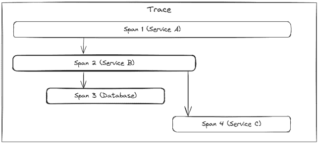

该示例从 `Span 1` 开始，代表一个到达 `Service A` 的请求。`Span 2` 显示 `Service A` 请求了 `Service B`，`Service B` 又向数据库发起了请求（通过 `Span 3` 表示）。最后，我们可以看到 `Service B` 在收到数据库响应后请求了 `Service C`。

`OpenTelemetry` 提供了一系列 `SDK`、`API` 和库，允许我们对应用程序进行插桩以生成遥测数据（如指标、日志和追踪），就像上一个示例中所示。一旦采用，`OpenTelemetry` 还允许我们收集并将追踪数据导出到可观测性应用程序（如 `Jaeger`），这让我们能够以系统为视角可视化追踪轨迹。拥有一种可视化轨迹的方法对于故障排除非常有帮助。

让我们尝试基于两个 `Spring Boot` 应用构建一个简单的分布式系统。这将为我们使用 `OpenTelemetry` 实现分布式追踪提供场景支持。

## 构建一个简单的分布式系统

我们创建的系统负责根据库存中存储的数据生成报告。遵循分布式架构方法，我们构建了一个负责生成报告的服务以及另一个负责提供库存数据的服务。

让我们通过定义 Maven 的 `pom.xml` 来引入两个服务所需的依赖项。

### 配置依赖

我们首先在 `pom.xml` 文件中定义 Maven 项目结构：

```xml
<?xml version="1.0" encoding="UTF-8"?>
<project xmlns="http://maven.apache.org/POM/4.0.0"
     xmlns:xsi="http://www.w3.org/2001/XMLSchema-instance"
     xsi:schemaLocation="http://maven.apache.org/POM/4.0.0 http://maven.apache.org/xsd/maven-4.0.0.xsd">
  <modelVersion>4.0.0</modelVersion>

<parent>
    <groupId>org.springframework.boot</groupId>
    <artifactId>spring-boot-starter-parent</artifactId>
    <version>2.7.18</version>
    <relativePath/>
</parent>

<groupId>dev.daviviera</groupId>
<artifactId>chapter09</artifactId>
<version>1.0-SNAPSHOT</version>
<packaging>pom</packaging>

<properties>
  <maven.compiler.source>21</maven.compiler.source>
  <maven.compiler.target>21</maven.compiler.target>
</properties>

<modules>
  <module>inventory-service</module>
  <module>report-service</module>
</modules>
<!-- Code omitted -->
</project>
```

注意，这是一个支持 `OpenTelemetry` 库的 Maven 多模块项目。这里有一个针对库存服务的，另一个针对报告服务的。在此 `pom.xml` 文件中定义的所有依赖和构建配置将与库存服务和报告服务模块共享，这些模块即将定义。

`Spring Boot` 通过提供对 `OpenTelemetry` 库的支持简化了我们的任务。这允许我们轻松地启用分布式追踪。以下是配置配置 `Spring Boot` 和 `OpenTelemetry` 的 Maven 第一部分依赖：

```xml
<dependencyManagement>
  <dependency>
    <groupId>org.springframework.cloud</groupId>
    <artifactId>spring-cloud-dependencies</artifactId>
    <version>2021.0.5</version>
    <type>pom</type>
    <scope>import</scope>
  </dependency>
  <dependency>
    <groupId>org.springframework.cloud</groupId>
    <artifactId>spring-cloud-sleuth-otel-dependencies</artifactId>
    <version>1.1.2</version>
    <scope>import</scope>
  </dependency>
</dependencyManagement>
```

```xml
  <type>pom</type>
</dependency>
</dependencies>
```

我们使用 `dependencyManagement` 块获取 `spring-cloud-dependencies` 和 `spring-cloud-sleuth-otel-dependencies` 的 `POM` 依赖。从 `POM` 依赖中，我们可以指定 `JAR` 依赖，我们将接下来要做：

```xml
<dependencies>
  <dependency>
    <groupId>org.springframework.boot</groupId>
    <artifactId>spring-boot-starter-web</artifactId>
  </dependency>
  <dependency>
    <groupId>org.springframework.cloud</groupId>
    <artifactId>spring-cloud-starter-sleuth</artifactId>
    <exclusions>
      <groupId>org.springframework.cloud</groupId>
      <artifactId>spring-cloud-sleuth-brave</artifactId>
    </exclusions>
  </dependency>
  <dependency>
    <groupId>org.springframework.cloud</groupId>
    <artifactId>spring-cloud-sleuth-otel-autoconfigure</artifactId>
  </dependency>
  <dependency>
    <groupId>io.opentelemetry</groupId>
    <artifactId>opentelemetry-exporter-otlp</artifactId>
    <version>1.23.1</version>
  </dependency>
</dependencies>
```

我们使用 `spring-boot-starter-web` 为我们的服务创建 `REST API` 端点。`spring-cloud-sleuth` 依赖提供了跨 `Spring Boot` 的分布式追踪自动配置。我们排除了 `spring-cloud-sleuth-brave`，因为它是一个追踪生成器库。相反，我们使用 `spring-cloud-sleuth-otel-autoconfigure` 依赖，它使用 `OpenTelemetry` 生成追踪。

### 实现库存服务

库存服务暴露了一个单一端点：

```java
@RestController
@RequestMapping("/inventory")
public class InventoryEndpoint {

    private static final Logger LOGGER = LoggerFactory.getLogger(InventoryEndpoint.class);

    @GetMapping
    public List<String> getAllInventory() {
        LOGGER.info("Getting inventory items");
        return List.of("Item 1", "Item 2", "Item 3");
    }
}
```

库存服务负责根据库存中存储的数据生成报告。现在让我们来实现报告服务。

### 实现报告服务

报告服务直接与库存服务通信。

```java
@RestController
@RequestMapping("/report")
public class ReportEndpoint {

    private static final Logger LOGGER = LoggerFactory.getLogger(ReportEndpoint.class);
    private final RestTemplate restTemplate;

    @Autowired
    public ReportEndpoint(RestTemplate restTemplate) {
        this.restTemplate = restTemplate;
    }

    @GetMapping("/generate")
    public List<String> generateReport() {
        LOGGER.info("Generating report");
        return getInventoryItems();
    }

    private List<String> getInventoryItems() {
        LOGGER.info("Getting inventory items");
        ResponseEntity<String> response = restTemplate.getForEntity(baseUrl + "/inventory", String.class);
        return List.of(Objects.requireNonNull(response.getBody()));
    }
}
```

```yaml
CMD ["exec java -jar $JAR_FILE"]
EXPOSE 9090
```

为了确保 `Spring Boot` 应用可以从外部访问，我们暴露了 `9090` 端口，这是 `Spring Boot` 应用中配置的端口。

在这一阶段，我们有两个 `Spring Boot` 应用：库存服务和报告服务。为了完成设置，我们需要配置 `Docker Compose`。该配置不仅启动了两个应用程序，还提供了一个 `Jaeger` 实例和一个 `OpenTelemetry Collector`。这些工具至关重要，因为它们使能够获取并可视化应用追踪。

### 设置 Docker Compose、Jaeger 和 Collector

使用 `Docker Compose`，我们可以将库存服务、报告服务以及分布式追踪工具 `Jaeger` 和 `OpenTelemetry Collector` 整合。`Jaeger` 向用户界面暴露追踪数据，显示应用追踪。`OpenTelemetry Collector` 提供来自库存和报告服务生成的追踪数据。以下代码是我们可以配置 `docker-compose.yml` 文件的方法：

```yaml
services:
  inventory-service:
    build: inventory-service/
    ports:
      - "8080"
  report-service:
    environment:
      INVENTORY_BASE_URL=http://inventory-service:8080
    build: report-service/
    ports:
      - "9090:9090"
  jaeger-service:
    image: jaegertracing/all-in-one:latest
    ports:
      - "16686:16686"
      - "14250"
  collector:
    image: otel/telemetry-collector:0.72.0
    command: [ "--config=/etc/otel-collector-config.yml" ]
    volumes:
      - ./otel-collector-config.yml:/etc/otel-collector-config.yml
  depends_on:
    jaeger-service
```

注意，在 `collector` 的配置中，我们将 `otel-collector-config.yml` 文件作为容器卷文件挂载到容器内部。以下是 `otel-collector-config.yml` 应该具备的内容：

# 代码省略


```yaml
exporters:
  logging:
    loglevel: debug
  jaeger:
    endpoint: jaeger-service:14250
  tls:
    insecure: true
```

```yaml
service:
  pipelines:
    traces:
      receivers: [ otlp ]
      processors: [ batch ]
      exporters: [ logging, jaeger ]
```

请注意，我们注意到在理想情况下（如发现哪里出了问题时），`jaeger-service` 和 `14250` 是之前定义的 Docker Compose 配置的一部分。主机 `jaeger-service` 在之前已经定义。

通过将 Jaeger 和 OpenTelemetry Collector 集成 Spring Boot 应用产生的追踪，我们可以看到分布式追踪在实践中是如何工作的。在开始之前，让我们为可观测性设置添加一个核心元素：集中日志管理。

## 使用 Elasticsearch、Fluentd 和 Kibana 处理日志

我们可以通过指标和追踪识别发生了什么以及哪里出了错，但我们可能需要更多信息来告诉我们为什么出错。有时问题的根源只有在检查应用日志后才能找到。任何具有应用程序故障排除经验的人都知道这一点。通常始于一个提示系统运行符合预期的告警。在糟糕的情况下，是从客户抱怨无法使用系统开始的。我们必须收集证据来理解问题发生的原因，并尽快修复。

日志是监控和可观测性的基础，因为它们包含了有关应用行为的信息。长期以来，开发者和系统管理员直接进入服务器查找应用日志。这种方法适用于运行在单个服务器上的单体系统。然而，当你拥有由运行在多个服务器上的许多应用程序组成的分布式系统以确保高可用时，直接挖掘服务器日志的简单方法不再可行。在这种情况下，来自此类来源的海量日志需要一种能够聚合日志并允许人们轻松导航的集中方法。

可以使用 Fluentd、Elasticsearch 和 Kibana 等技术将不同来源的日志集中存储在一个处。让我们检查每种技术的作用。

### Fluentd

Fluentd 被称为数据收集软件，经常用于捕获应用日志输出并发送到 Elasticsearch 等引擎。它在运行于 Kubernetes 集群的分布式架构系统中被广泛采用。

### Elasticsearch

Elasticsearch 基于 Lucene 搜索库，是一个分布式企业级搜索引擎，通常与 Logstash 和 Fluentd 等数据收集系统配合使用。Elasticsearch 将数据存储在索引中，允许对大量数据快速搜索。

### Kibana

Kibana 专为配合 Elasticsearch 构建，是一个提供用户界面来管理和搜索 Elasticsearch 数据的系统。用户可以使用自定义过滤器和标准搜索数据，使搜索具有高度灵活性。

这三种技术通常一起使用，形成可靠且广泛使用的 EFK 栈。在下一节中，我们将引导你设置 EFK 栈，以捕获之前开发的 Spring Boot 应用的日志。

## 使用 Docker Compose 设置 EFK 栈

不需要更改应用代码，因为 Fluentd 使用应用产生的日志输出来捕获数据。因此，确保生成日志的应用与 Fluentd 服务器之间进行良好的通信至关重要。我们还需要确保 Fluentd 将日志发送到 Elasticsearch 服务器，Kibana 通过用户界面显示日志。

1. 让我们从在 `docker-compose.yml` 文件中配置 EFK 栈开始。代码如下：

```yaml
version: '3.8'

fluentd:
  build: ./fluentd
  volumes:
    - ./fluentd/conf:/etc/fluent
  links:
    - elasticsearch
  ports:
    - "24224:24224"

elasticsearch:
  image: elasticsearch:8.3.4
  container_name: elasticsearch
  environment:
    - discovery.type=single-node
    - xpack.security.enabled=false
  expose:
    - "9200"

kibana:
  image: kibana:7.3.4
  environment:
    - xpack.security.enabled=false
    - ELASTSEARCH_HOSTS=http://elasticsearch:9200
  links:
    - elasticsearch
  ports:
    - "5601:5601"
```

Elasticsearch 和 Kibana 默认关闭安全功能。为了简单起见，我们通过环境变量 `xpack.security.enabled=false` 将其关闭。

2. 对于 Fluentd 的设置，我们需要提供一个配置了 Elasticsearch 插件的自定义 Fluentd 镜像。以下代码显示了此类镜像的 Dockerfile 应该是怎样的：

```dockerfile
FROM fluentd:v1.17
USER root
RUN ["gem", "install", "fluent-plugin-elasticsearch", "--no-document"]
USER user
```

注意 `docker-compose.yml` 引用了 `fluentd/conf/fluent.conf` 文件，该文件指定了 Fluentd 监听的 IP 地址和端口，以及日志数据将发送到的目标地（在本例中为 Elasticsearch）：

```conf
<source>
  @type forward
  port 24224
  bind 0.0.0.0
</source>
```

```conf
<match **>
  @type copy
  <store>
    @type elasticsearch
    host elasticsearch
    port 9200
    logstash_format true
    logstash_prefix fluentd
    logstash_datetime %Y%m%d
    include_tag_key true
    type_name access_log
    tag_key @log_name
    flush_interval 1s
  </store>
  <store>
    @type stdout
  </store>
</match>
```

3. 接下来，我们在 `docker-compose.yml` 中添加上一节中构建的库存服务和报告服务 Spring Boot 应用的配置：

```yaml
# 省略
inventory-service:
  build: inventory-service/
  ports:
    - "8080"
```

```yaml
  - fluentd
logging:
  driver: "fluentd"
  options:
    fluentd-address: localhost:24224
    tag: inventory.service

report-service:
  environment:
    - INVENTORY_BASE_URL=http://inventory-service:8080
  build: report-service/
  ports:
    - "9090:9090"
  links:
    - fluentd
  logging:
    driver: "fluentd"
    options:
      fluentd-address: localhost:24224
      tag: report.service
```

请注意，inventory 和 report 服务都有一个日志配置块，该块将 Fluentd 定义为连接 `localhost:24224` 的日志驱动程序。记住，我们之前配置了 Fluentd 作为日志驱动程序并在端口 24224 上。结果是，`inventory-service` 和 `report-service` 容器产生的日志将被转发到 Fluentd 服务器。

让我们把所有部分结合起来，玩玩我们的可观测性引擎，它支持分布式追踪和集中日志记录。

## 编译并运行示例项目

该项目基于本章中开发的两个 Spring Boot 应用，以及基于 OpenTelemetry、Jaeger 和 EFK 栈构建的可观测性设置。

你可以从 GitHub 仓库下载应用程序源代码：https://github.com/bppubplications/Java-Real-World-Projects/tree/main/Chapter%2009。

你需要在机器上安装 JDK 21 或更高版本，或者 Maven 3.8.5 或更高版本。你还需要 Docker 和 Docker Compose。

执行以下命令来编译两个 Spring Boot 应用：

`$ mvn clean package`

Maven 将为 `inventor-service` 和 `report-service` 应用创建一个 JAR 文件。接下来，你可以执行以下命令启动所有 Spring Boot 应用容器以及可观测性工具：

```bash
$ docker-compose up -d --build
```

在容器启动并运行后，你使用以下命令向 report 服务发送示例请求：

```bash
$ curl -s localhost:9090/report/generate | jq
```

```json
- "Inventory Item 1",
- "Inventory Item 2",
- "Inventory Item 3"
```

你可以通过访问 `http://localhost:16686` 的 Jaeger UI 来可视化追踪。界面如下：

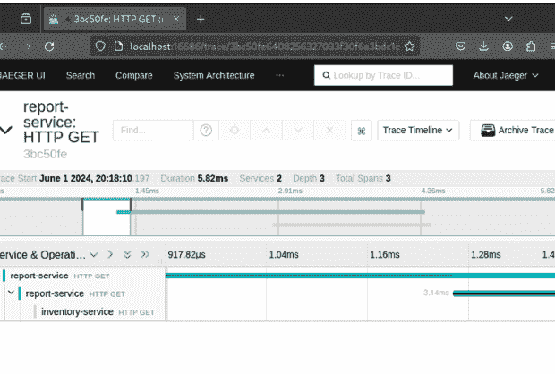

> 图 9.2: Jaeger UI

请注意，追踪包含了跨越 `report-service` 和 `inventory-service` 应用的 span。

我们可以在 `http://localhost:5601` 的 Kibana 中找到应用程序日志。界面如下：

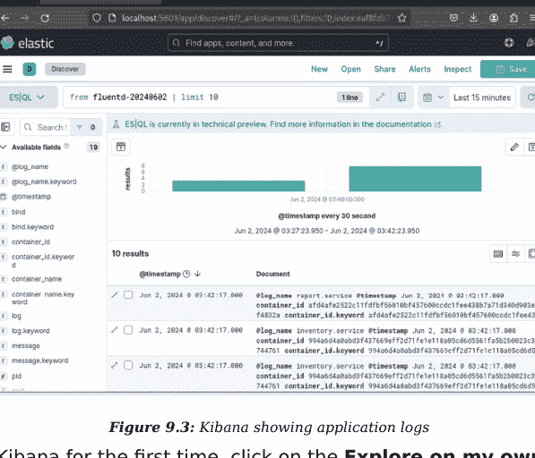

首次访问 Kibana 时，点击我的选项中的 **Explore**，然后点击 **Discover**，最后点击 **Try ESQL**，这让你可以在没有索引的情况下查询数据。

## 总结

在本章中，我们探索了监控和服务观测性。我们了解到监控是指通过指标、日志、仪表板和告警理解系统行为的传统方法。我们发现可观测性补充了传统的监控技术，对于理解基于分布式架构（如微服务）的系统行为特别有用。

我们实现了一个基于 Spring Boot 应用的简单分布式系统，它可以生成追踪。在这些追踪之上，我们配置了 OpenTelemetry Collector 来捕获追踪并将其发送到 Jaeger，这让我们能够可视化追踪及其 span。

最后，我们使用 **Elasticsearch**、**Fluentd** 和 **Kibana (EFK)** 栈配置了集中日志记录，它聚合了来自不同应用的日志。

在接下来的章节中，我们将展望 **Micrometer** 的精彩世界，这是一个具有显著增强 Java 应用可观测性能力的库。我们将学习提供特定指标以更好地监控应用行为的重要性，以及如何以及何时实现此类指标。

# 第 10 章

## 使用 Micrometer 实现应用指标

## 引言

通过指标理解应用程序如何运行可以帮助我们更快地解决问题或防止问题恶化。指标在监控中起着基础性作用，因为它们让我们能够捕获应用程序提供的功能状态。在对这些状态进行解释时，它们指示了功能是否正在按预期工作，还是存在需要进一步调查的偏差。

为了在 Java 应用中利用指标的威力，我们需要通过配置指标来跟踪应用行为并调整它们。我们可以使用 Micrometer 实现这一点，它是一个著名的 Java 库，允许我们对 Java 应用进行插桩化以生成指标。这就是为什么在本章中，我们将探索 Micrometer 如何工作、它提供的指标类型，以及我们应该如何和何时使用这些指标类型。

## 结构

本章涵盖了以下主题：

- 提供应用指标
- 介绍 Micrometer
- 使用 Micrometer 和 Spring Boot 实现指标
- 编译并运行示例项目

## 目标

在本章结束时，你将学习对 Java 应用进行插桩化以生成指标的优势，这些指标描述了系统执行活动的良好程度。在了解应用特定指标的优势后，你还将学习如何使用 Micrometer（一个强大的 Java 指标库）来实现它们。

### 提供应用指标

软件系统由一组旨在解决现实问题的指令组成。作为程序员，我们必须理解我们的应用程序想要解决什么种现实世界问题。

注册表通过 `MeterRegistry` 接口表示，它是 Micrometer 架构的核心组件。所有由这些产生的指标。

Micrometer 源于一个注册表，它允许创建不同的指标类型，例如计数器和仪表。

**MeterRegistry** 是一个接口，拥有支持多个监控系统的实现。例如，**SimpleMeterRegistry** 类可以用于测试目的，因为它只将指标数据存储在内存中。对于真实场景，如果你的监控系统是 Prometheus，你可能会使用 **PrometheusMeterRegistry**。你可以使用以下代码创建一个 **SimpleMeterRegistry**：

```java
MeterRegistry registry = new SimpleMeterRegistry();
```

默认情况下，注册表仅将指标发布到一个监控系统，但通过使用 **CompositeMeterRegistry** 可以将指标数据发布到多个监控系统：

```java
CompositeMeterRegistry composite = new CompositeMeterRegistry();
```

指标的生成活动始终从注册表开始，无论它是单一注册表还是复合注册表。接下来，让我们检查注册表如何使用计来采集指标数据。

## 计与标签

Micrometer 支持一组定义为计的独特指标。最常用的计包括计数器、计时器、仪表、分布摘要和计时器。每个计都有一个名称和一组维度，也称为标签。标签允许你向采集的指标数据中添加更多上下文。例如，我们可以有一个名为 `http.request` 的计数器，并带有如 HTTP 方法、浏览器和操作系统等标签。考虑以下示例：

```java
SimpleMeterRegistry meterRegistry = new SimpleMeterRegistry();
var httpMethod = "GET";
Counter.builder("http.request")
    .tag("HTTP Method", httpMethod)
    .register(meterRegistry)
    .increment();
```

这段代码创建了一个带有标签的计数器，该标签指定了请求的 HTTP 方法。在这里我们手动将其设置为 GET，在真实场景中，我们从处理 HTTP 请求的底层技术获取 HTTP 方法。添加的标签越多，指标的维度就越高，指标也就越有用，因为我们可以对指标标签进行切片和分析。

## 计数器

在某些场景下，我们对系统内部某事发生的频率感兴趣。想象一个在端点接收 HTTP 请求的 Web 应用。我们可以使用计数器来衡量应用程序处理 HTTP 请求的速率。计数器对应于正数，可以通过 1 或任何其他数字递增。以下是我们可以创建和使用计数器的方法：

```java
SimpleMeterRegistry meterRegistry = new SimpleMeterRegistry();
Counter httpRequestCounter = Counter
    .builder("http.request")
    .description("HTTP requests")
    .tags("Source IP Address", "Operating System")
    .register(meterRegistry);
httpRequestCounter.increment();
httpRequestCounter.increment();
httpRequestCounter.increment();
System.out.println(httpRequestCounter.count()); // 3
```

Meter 提供了一个构建器，让我们能够直观地构建 Counter 对象。注意，我们将计数器计的名称设置为 `http.request`，并带有其他数据，包括描述和计的标签。直观地说，我们需要传递用于创建计数器计的 `meterRegistry` 对象。当调用 Counter 对象的 `increment` 时，就会生成一个指标。每当调用一次 `increment` 方法，计数指标就会加 1。

## 仪表

当我们想要衡量系统中可以增加或减少的集合的大小时，我们就会使用仪表。例如，我们可以检查系统中有多少个线程处于激活状态。线程的数量在采集指标的那一刻可能会增加或减少。以下代码展示了我们如何创建一个仪表计：


```java
AtomicInteger totalThreads = meterRegistry.gauge(
    "Total threads",
    new AtomicInteger(ManagementFactory.getMXBean().getThreadCount())
);
totalThreads.set(ManagementFactory.getMXBean().getThreadCount());
```

我们没有像使用计数器那样使用构建器，而是通过提供仪表衡量的值直接在 `meterRegistry` 对象中创建仪表计。在示例中，我们提供了系统的线程总数。我们将其封装在 `AtomicInteger` 中，是因为我们不能使用原始类型数字或 `java.lang` 中的对象，因为它们是不可变的，这将导致我们在第一次定义之后无法更新仪表值。

## 计时器

在某些情况下，我们想要知道操作完成需要多长时间，而计时器就是我们在这些情况下使用的测量工具。计时器有助于识别某些行为是否比比预期的长时间，例如。以下代码让我们使用计时器指标：

```java
SimpleMeterRegistry meterRegistry = new SimpleMeterRegistry();
Timer durationTimer = meterRegistry.timer("task.duration");
durationTimer.record(() -> {
    try {
        TimeUnit.SECONDS.sleep(5);
    } catch (InterruptedException _ ) {
    }
});
System.out.println(durationTimer.totalTime(TimeUnit.SECONDS)); // 5
5.000323186
```

`Timer` 接口有一个名为 `record` 的方法。如我们在上面的示例所示，我们可以通过将对 `TimeUnit.SECONDS.sleep(5)` 的调用将想要量的系统操作放在 `record` 方法中。执行后，我们可以检查计时器指标记录执行任务花费了五秒。

## 分布摘要

分布摘要的一个常见用例是我们要衡量应用程序请求的文件大小。同样，我们可以使用分布摘要来跟踪应用程序处理的请求负载大小。以下是创建和使用分布摘要的方法：

```java
SimpleMeterRegistry registry = new SimpleMeterRegistry();
var fileSize = 243000.81;
DistributionSummary responseSizeSummary = DistributionSummary
  .builder("file.size")
  .baseUnit("bytes")
  .register(registry);
responseSizeSummary.record(fileSize);
System.out.println(responseSizeSummary.total()); // 243000.81
```

## 使用 Micrometer 和 Spring Boot

现在我们了解了 Micrometer 的工作原理，让我们学习如何将其与 Spring Boot 配合使用产生指标。Spring Boot 提供了对 Micrometer 的完整支持和无缝集成，允许我们将指标导出到各种监控工具。配合 Spring Boot 使用，指标由 Actuator 管理。

在本节中，我们将探索如何设置 Spring Boot 和 Micrometer 实现一个允许用户上传和下载存储在内存中的文件系统。让我们从设置 Maven 项目开始。

## 设置 Maven 项目

为了让 Micrometer 与 Spring Boot 工作，我们必须为项目提供特定的依赖。以下是我们在 Maven 的 `pom.xml` 中配置依赖的方法

```xml
<dependencies>
  <dependency>
    <groupId>org.springframework.boot</groupId>
    <artifactId>spring-boot-starter-web</artifactId>
  </dependency>
  <dependency>
    <groupId>org.springframework.boot</groupId>
    <artifactId>spring-boot-starter-data-jpa</artifactId>
  </dependency>
  <dependency>
    <groupId>io.micrometer</groupId>
    <artifactId>micrometer-registry-prometheus</artifactId>
  </dependency>
  <dependency>
    <groupId>org.springframework.boot</groupId>
    <artifactId>spring-boot-starter-actuator</artifactId>
  </dependency>
  <dependency>
    <groupId>com.h2database</groupId>
    <artifactId>h2</artifactId>
    <scope>runtime</scope>
  </dependency>
</dependencies>
```

```yaml
datasource:
  url: jdbc:h2:mem:mydb
  username: sa
  password: password
  driverClassName: org.h2.Driver
jpa:
  database-platform: org.hibernate.dialect.H2Dialect
```

```yaml
management:
  metrics:
    enable:
      all: false
      file: true
    endpoints:
      web:
        exposure:
          include: Prometheus
```

我们将 `max-size` 和 `max-request-size` 属性设置为 10MB，因为 Spring Boot 的默认配置是 1MB，这对于我们想要上传大于该限制的文件来说足够的。`datasource` 属性块包含了定义 H2 内存数据库模式的配置。

`management` 块是我们定义控制 actuator 和 Micrometer 行为属性的地方。默认情况下，Spring Boot 会从系统（主要是 JVM）收集技术指标。为了简单起见，我们对这些并不感兴趣，因此通过设置 `metrics` 禁用了这些指标。但我们不能保持这种配置；否则将无法采集任何指标。为了解决这个问题，我们将 `management.metrics.enable` 属性设置为 true，使得 Spring Boot 采集所有名称以 `file` 开头的指标。最后，我们通过设置 `endpoints.web.include` 为 `prometheus` 来定义指标应如何暴露。这并不意味着 Spring Boot 将连接到 Prometheus 实例来导出 Micrometer 指标。相反，Micrometer 将生成与 Prometheus 兼容的指标。

在正确定义依赖关系并使用 Micrometer 恰当配置 Spring Boot 应用程序后，我们已经准备好开始实现带有指标插值的文件存储系统。

## 在文件存储系统上启用指标

让我们创建启动 Spring Boot 应用程序的引导类：

```java
@SpringBootApplication
public class FileStorageApplication {

  public static void main(String... args) {
    SpringApplication.run(FileStorageApplication.class, args);
  }
}
```

我们在 `FileStorageApplication` 类上方添加了 `@SpringBootApplication` 注解，以便 Spring Boot 使用该类来初始化应用程序。

由于我们的文件系统通过将文件存储在数据库中运行，因此我们必须将其实现为 Jakarta 实体。该实体将是我们与数据库交互的核心组件。让我们继续执行任务。

## 实现 File 实体

我们设计 `File` 实体的意图是在数据库中存储文件名及其内容。

以下代码是我们可以实现此类实体的方式：

```java
@Entity
public class File {

  @Id
  private String id;

  private String name;

  @Lob
  @Column(length = 20971520)
  private byte[] content;

  // 省略构造函数、getters 和 setters
}
```

文件 ID 由应用程序管理，因此我们没有使用将 ID 生成工作委托给数据库的 ID 生成机制。`name` 属性存储文件名，`content` 属性以字节数组格式存储文件数据。请注意，我们使用了 `@Lob` 注解并指定列长度为 20 兆字节。

实现实体后，我们需要一个包含操作的仓库接口，允许我们从数据库中持久化和检索文件。让我们来实现它。

## 实现 File Repository

仓库通过从数据库中持久化和检索处理 `File` 实体对象。以下是 `FileRepository` 接口的实现：

```java
@Repository
public interface FileRepository extends CrudRepository<File, String> {

  Optional<File> findById(String id);
}
```

`findById(String id)` 方法声明允许我们通过各自的 ID 检索 `File` 实体。我们不需要为持久化 `File` 实体声明方法，因为父接口 `CrudRepository` 已经提供了此类方法。

我们仍然需要实现服务类和控制器类但在此之前，让我们创建一个包含 `File` 指标构建器的类。

## 实现 File Metrics

为了对我们的文件存储应用进行插值，我们需要提供可以用于测量系统不同方面的计数器。实现这一点的一种方法是创建一个带有公共方法的托管 bean，返回我们可以在其他应用程序类使用的计数器对象。让我们从定义初始类结构开始：

```java
@Component
public class FileMetric {

    private final MeterRegistry meterRegistry;

    @Autowired
    public FileMetric(MeterRegistry meterRegistry) {
        this.meterRegistry = meterRegistry;
    }
    // 省略代码
}
```

`FileMetric` 类被标记为 `@Component`，使其成为一个 Spring 管理的 bean，可以在其他 Spring bean 中使用。我们使用构造函数初始化 `meterRegistry` 属性。请记住 `MeterRegistry` 是一个接口，拥有针对不同监控系统的实现。由于我们定义了支持 Prometheus 的 Micrometer Maven 依赖，当启动此 Spring Boot 应用程序时，`meterRegistry` 属性将用 `PrometheusMeterRegistry` 实现初始化。接下来，我们实现返回程序程序所需的计数器的方法：

```java
@Component
public class FileMetric {

    // 省略代码
    public Counter requestCounter(String method, String path) {
        return Counter
            .builder("file.http.request")
            .description("HTTP request")
            .tags("method", method)
            .tags("path", path)
            .register(meterRegistry);
    }

    public Timer fileUploadTimer(String fileName) {
        return Timer
            .builder("file.upload.duration")
            .description("File Upload Duration")
            .tags("fileName", fileName)
            .register(meterRegistry);
    }

    public DistributionSummary fileDownloadSizeSummary(String fileName) {
        return DistributionSummary
            .builder("file.download.size")
            .baseUnit("bytes")
            .description("File Download Size")
            .tags("fileName", fileName)
            .register(meterRegistry);
    }
}
```

`requestCounter` 返回一个计数器，允许我们测量到达文件存储端点的 HTTP 请求，注意我们使用了方法和路径作为标签。然后，我们有 `fileUploadTimer` 返回一个计时器，用于测量文件上传所需的时间。最后，我们有 `fileDownloadSizeSummary` 返回一个分布摘要，用于测量下载的文件大小。这并不意味着 Spring Boot 将连接到 Prometheus 实例来导出 Micrometer 指标。相反，Micrometer 将生成与 Prometheus 兼容的指标。

在正确定义依赖关系并使用 Micrometer 充分配置 Spring Boot 应用程序后，我们已经准备好开始实现带有指标插值的文件存储系统。


```java
@Component
public class FileMetric {

    private final MeterRegistry meterRegistry;

    @Autowired
    public FileMetric(MeterRegistry meterRegistry) {
        this.meterRegistry = meterRegistry;
    }
    // 省略代码
}
```

`FileMetric` 类被标记为 `@Component`，使其成为一个 Spring 管理的 bean，可以在其他 Spring bean 中使用。我们使用构造函数初始化 `meterRegistry` 属性。请记住 `MeterRegistry` 是一个接口，拥有针对不同监控系统的实现。由于我们定义了支持 Prometheus 的 Micrometer Maven 依赖，当启动此 Spring Boot 应用程序时，`meterRegistry` 属性将用 `PrometheusMeterRegistry` 实现初始化。接下来，我们实现返回程序程序所需的计数器的方法：

```java
@Component
public class FileMetric {

    // 省略代码
    public Counter requestCounter(String method, String path) {
        return Counter
            .builder("file.http.request")
            .description("HTTP request")
            .tags("method", method)
            .tags("path", path)
            .register(meterRegistry);
    }

    public Timer fileUploadTimer(String fileName) {
        return Timer
            .builder("file.upload.duration")
            // ...
}
```

```java
.description("File Upload Duration")
.tags("fileName", fileName)
.register(meterRegistry);

public DistributionSummary fileDownloadSizeSummary(String fileName) {
    return builder
        .unit("file.download.size")
        .baseUnit("bytes")
        .description("File Download Size")
        .tags("fileName", fileName)
        .register(meterRegistry);
}
```

`requestCounter` 返回一个计数器，允许我们测量到达文件存储端点的 HTTP 请求，注意我们使用了方法和路径作为标签。然后，我们有 `fileUploadTimer` 返回一个计时器（Timer），用于测量文件上传所需的时间。最后，我们有 `fileDownloadSizeSummary` 返回一个分布摘要（DistributionSummary），用于测量下载的文件大小。这并不意味着 Spring Boot 将连接到 Prometheus 实例来导出 Micrometer 指标。相反，Micrometer 将生成与 Prometheus 兼容的指标。

在正确定义依赖关系并使用 Micrometer 充分配置 Spring Boot 应用程序后，我们已经准备好开始实现带有指标插值的文件存储系统。

使用 `@Counted` 和 `@Timed` 等注解来实现 Micrometer 指标是可能的。然而，作者建议使用构建器方法，因为在标记为 `@Controller` 的类上使用注解需要额外的 Spring 配置。

实现指标类后，让我们实现指标插值的服务类和控制器类。让我们继续执行服务类。

## 实现 File service

我们使用服务作为控制器和仓库之间的中间层。服务类包含了上传和下载文件的方法。以下代码是我们可以定义类结构的方式：

```java
@Service
public class FileService {

    private final FileRepository fileRepository;
    private final FileMetric fileMetric;

    @Autowired
    public FileService(FileRepository fileRepository, FileMetric fileMetric) {
        this.fileRepository = fileRepository;
        this.fileMetric = fileMetric;
    }
}
```

```java
// 省略代码
```

通过标记有 `@Autowired` 的类构造函数注入 `FileRepository` 和 `FileMetric` 依赖。使用以下代码，我们通过提供负责上传和下载的方法完成实现：

```xml
<dependency>
  <groupId>org.aspectj</groupId>
  <artifactId>aspectweaver</artifactId>
  <version>1.8.13</version>
</dependency>
```

```java
public class FileService {
  // 省略代码
  public void uploadFile(File file) {
    fileMetric.fileUploadTimer(file.getName()).record(
      () -> fileRepository.save(file)
    );
  }
}
```

```java
public Optional<File> downloadFile(String id) {
  return fileRepository.findById(id);
}
```

这里需要注意的关键点是使用 `fileUploadTimer` 来测量 `uploadFile` 方法在调用 lambda 表达式 `-> fileRepository.save(file)` 时保存文件到数据库所需的时间。

通过使用计数器和分布摘要指标创建控制器类完成文件文件系统的实现。

## 实现 Controller 类

我们实现控制器类以定义接收上传和下载文件 HTTP 请求的 RESTful API 端点。以下是初始类结构：

```java
@RestController
public class FileController {
  private final FileService fileService;
  private final FileMetric fileMetric;
```

```java
@Autowired
```

```java
FileController(FileService fileService, FileMetric fileMetric) {
    this.fileService = fileService;
    this.fileMetric = fileMetric;
}
// Code omitted
private void incrementRequestCounter(String method, String path) {
    fileMetric.requestCounter(method, path).increment();
}
private void recordDownloadSizeSummary(File file) {
    fileMetric.fileDownloadSizeSummary(
        file.getName()).record(file.getContent().length);
}
}
```

我们通过带有 `@Autowired` 注解的类构造函数注入了 `FileService` 和 `FileMetric` 依赖。接下来，我们使用 `FileMetric` 中的 `requestCounter` 方法定义了 `incrementRequestCounter` 来增加计数器指标。我们在 `recordDownloadSizeSummary` 中执行了类似的操作，用于记录文件内容的大小。

现在我们准备好实现代表上传和下载文件的 HTTP 端点的方法。让我们从上传端点开始：

```
@RestController
public class FileController {
    // Code omitted
    @PostMapping("/file")
    private String uploadFile(@RequestParam("file") MultipartFile file)
    throws IOException {
        incrementRequestCounter(HttpMethod.POST.name(), "/file");

        var fileToUpload = new File(UUID.randomUUID().toString());
        file.getOriginalFilename(), file.getBytes());
        fileService.upload(fileToUpload);
        return fileToUpload.getId();
    }
    // Code omitted
}
```

在方法体的正开始，我们调用了之前定义的 `incrementRequestCounter(HttpMethod.POST.name(), "/file")` 方法。我们将 `HttpMethod.POST.name()` 和 "file" 路径作为指标标签传递给它。每当有 POST 请求到达此端点时，计数器就会增加。

接下来，我们实现处理文件下载的端点：

```
@RestController
public class FileController {
    // Code omitted
    @GetMapping("/file/{id}")
    private ResponseEntity<Resource> downloadFile(@PathVariable String id) {
        incrementRequestCounter(HttpMethod.GET.name(), "/file/"+id);

        var file = fileService.downloadFile(id);

        if (file.isEmpty()) {
            return ResponseEntity.notFound().build();
        }

        recordDownloadSizeSummary(file.get());

        var resource = new ByteArrayResource(file.get().getContent());
        return ResponseEntity.ok()
            .contentType(MediaType.APPLICATION_OCTET_STREAM)
            .contentLength(resource.getLength())
            .header(HttpHeaders.CONTENT_DISPOSITION,
                ContentDisposition.attachment()
                    .filename(file.get().getName())
                    .build().toString())
            .body(resource);
    }
    // Code omitted
}
```

`downloadFile` 方法跟踪两个指标：首先通过调用 `incrementRequestCounter(HttpMethod.GET.name(), "/file/"+id)` 跟踪请求计数指标，其次通过 `recordDownloadSizeSummary(file.get)` 跟踪下载大小摘要指标。对 `/file/{id}` 端点的请求将在 浏览器中触发文件下载。

接下来，让我们检查如何发送请求来测试我们的应用程序并可视化 Micrometer 采集的指标。

## 编译并运行示例项目

在本节中，我们将编译并运行在上一章节中实现的文件存储系统。

你可以从 GitHub 仓库克隆应用程序源码：https://github.com/bpbpublications/Java-Real-World-Projects/tree/main/Chapter%2010。

你需要在机器上安装 JDK 21 或更高版本或 Maven 3.8.5 以上版本。

执行以下命令编译应用程序：

```bash
$ mvn clean package
```

Maven 将创建一个 JAR 文件，我们可以通过运行以下命令运行应用程序：

```bash
$ java -jar target/chapter10-1.0-SNAPSHOT.jar
```

接下来，我们回顾生成和可视化应用程序指标的步骤：

1. 运行应用程序，你可以使用以下命令上传文件：

```bash
$ curl --form file="@random.txt" localhost:8080/file
```

69d6cea-4022-4262-a217-a89b9f52e57

上一个命令返回一个文件，你可以在浏览器中通过 URL http://localhost:8080/file/{fileId} 下载该文件。你需要将 `{fileId}` 替换为服务器在你上传文件后提供的 ID，如图所示：

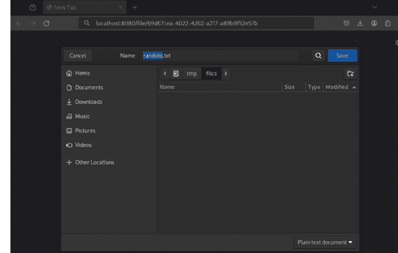

**图 10.1**: 从文件系统下载文件

注意，文件名 random.txt 与上传文件时提供的文件名相同。

2. 我们可以访问 URL http://localhost:8080/actuator/prometheus 来可视化应用程序指标，如图所示：

```
# HELP file_http_request_total HTTP metric
# TYPE file_http_request_total counter
# file_http_request_total{method="GET",path="/file"} 1.0
# file_http_request_total{method="POST",path="/file"} 1.0
# HELP file_upload_duration_seconds metric
# TYPE file_upload_duration_seconds gauge
# file_upload_duration_seconds{filename="random.txt"}
# HELP file_upload_duration_seconds metric
# TYPE file_upload_duration_seconds gauge
# file_upload_duration_seconds{filename="random.txt"}
# HELP file_download_duration_seconds metric
# TYPE file_download_duration_seconds gauge
# file_download_duration_seconds{filename="random.txt"}
# HELP file_download_size_summary metric
# TYPE file_download_size_summary summary
# file_download_size_summary{filename="random.txt"}
```

Prometheus 最初于 2012 年发布，是一种开源监控和告警软件，运行在系统生成的指标之上。我们可以使用 Prometheus 监控运行应用程序的基础设施，例如检查 CPU、内存和磁盘的使用情况。我们还可以通过对插桩（instrumented）的应用程序采集指标，来监控应用程序的行为。它已被全球许多组织使用，提供了一种健壮且可以轻松集成到云原生环境中的监控解决方案。

Prometheus 凭借其简单而强大的功能而流行。它允许我们在时序数据库中存储和查询指标数据。Prometheus 还依赖于一种名为 `Alertmanager` 的告警机制，它允许我们在各种地方（包括电子邮件、电话和聊天系统）触发告警。

Prometheus 是大多数企业项目中的常用组件，受到了 Spring Boot、Quarkus 和 MicroProfile 等知名框架的支持。了解 Prometheus 的工作原理以及如何将其集成到现有和新的应用程序中，对于任何想要提升监控机制水平的人来说都至关重要。在生产环境中没有任何监控的情况下运行应用程序，面临着错过关键系统信息的严重风险，而这些信息可以用于避免意外情况或防止事态恶化。这就是为什么对应用程序进行指标插桩并使用 Prometheus 捕获这些指标是降低系统故障风险的第一步。


# 学习 Prometheus 架构

Prometheus 架构的主要组件是服务器进程，它从监控目标抓取指标。值得注意的是，Prometheus 是一种拉取（pull-mode）监控工具，这意味着它通过配置从预定义的系统拉取监控数据。以指标形式存储的监控数据通过 HTTP API 端点提供，告警和仪表板系统可以使用。在图中，我们展示了 Prometheus 架构的高级表示：

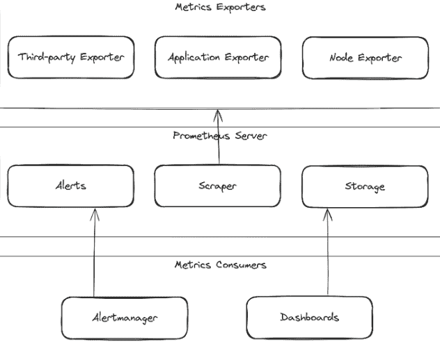

图 11.1：Prometheus 架构

从上图顶部开始，指标导出器提供 Prometheus 服务器抓取的指标数据。指标数据存储在 Prometheus 存储中，允许我们通过 Alertmanager 触发告警并创建仪表板。让我们评估架构的每个组件。

## 指标导出器

导出器是负责为 Prometheus 提供指标的架构组件。我们将涵盖三种类型的导出器，如下：

1. **第三方导出器**：当你想从一个无法控制源代码的系统获取指标时使用。假设你的应用程序数据存储在 MySQL 数据库中，你想从中获取指标。由于你无法控制 MySQL 源码，你必须依赖第三方提供的 MySQL 指标导出器。
2. **应用程序导出器**：提供由插桩应用程序生成的指标。与第三方导出器相反，我们对应用程序导出器生成的指标具有控制权，因为我们可以更改应用程序代码。
3. **节点导出器（`node exporter`）**：旨在仅基于机器的指标，如 CPU、内存和磁盘使用率。它作为操作系统的一个进程运行。

所有导出器都提供一个 HTTP 端点，Prometheus 服务器使用它来拉取指标数据。让我们探索 Prometheus 服务器内部的内容。

## Prometheus 服务器

Prometheus 服务器是一个基础架构组件。它的存储基于时序数据库，将数据直接持久化在操作系统磁盘上。然而，也支持远程存储。Prometheus 服务器通过拉取机制抓取指标数据，该机制连接指标导出器提供的 HTTP 端点。告警引擎指标数据允许我们定义触发告警的规则。最后，接下来我们将介绍指标消费者。

## 指标消费者

我们有两个主要的指标消费者：Alertmanager 和仪表板系统。Alertmanager 接收来自 Prometheus 服务器的告警事件，并通过电子邮件、电话和消息系统触发通知。Prometheus 提供了一个基础仪表板引擎，允许我们视觉化地表示指标。然而，推荐且广泛的做法是接入像 Grafana 这样的仪表板系统，将在本章中进一步探讨。

现在我们了解了 Prometheus 架构，将学习如何安装 Prometheus 服务器并探索使用 PromQL，这是一种强大的查询语言，允许我们对指标进行聚合操作。

# 启动并运行 Prometheus

Prometheus 兼容多个操作系统和 CPU 架构。你可以在 `https://prometheus.io/download/` 找到对应操作系统的二进制文件。接下来，我们将介绍如何在 Linux 环境下下载、配置和运行 Prometheus 服务器。

## 下载和安装 Prometheus

在本地环境中安装 Prometheus 非常简单，因为它涉及下载 Prometheus 二进制文件、解压、配置和启动。接下来，我们介绍 Prometheus 的安装步骤。

1. 你可以通过浏览器或在 Linux 终端运行以下命令下载 Prometheus 二进制文件：

```
$ wget https://github.com/prometheus/prometheus/releases/download/v2.53.0
```

上述命令下载的是 2.53.0 版本，但你可以调整以获取最新版本。

2. 接下来，我们在下载文件的相同目录下解压 Prometheus 二进制文件：

```
$ tar xvf prometheus-2.53.0.linux-amd64.tar.gz
```

3. 解压后，你可以执行以下命令检查解压后的文件：

```
$ ls prometheus-2.53.0.linux-amd64
console_libraries consoles LICENSE NOTICE prometheus prometheus.yml
```

这两个文件值得我们关注：启动 Prometheus 服务器的可执行文件 `prometheus` 以及包含配置的 `prometheus.yml`。

让我们探索如何通过 `prometheus.yml` 文件找到初始配置。

## 配置 Prometheus

Prometheus 配置通过 `prometheus.yml` 文件定义，允许我们设置（例如） Prometheus 服务器用于抓取的导出器端点。接下来，我们将介绍配置 Prometheus 的步骤。

1. 我们先考虑 `prometheus.yml` 的默认配置：

```yaml
# 全局配置
global:
  scrape_interval: 15s # 将抓取间隔设置为 15 秒。
  evaluation_interval: 15s # 每 15 秒评估一次规则。
  # scrape_timeout 设置为全局默认值 (10s)。

# Alertmanager 配置
alerting:
  alertmanagers:
    - static_configs:
        targets:
          - alertmanager:9093

# 加载规则并根据全局配置定期评估它们
rule_files:
  - "first_rules.yml"
  - "second_rules.yml"

# 一个包含一个待抓取端点的抓取配置：
# 这里是 Prometheus 本身。
scrape_configs:
  - job_name: "prometheus"
    # metrics_path 默认值为 '/metrics'
    # scheme 默认值为 'http'
    static_configs:
      - targets: ["localhost:9090"]
```

2. 无需更改默认的 `prometheus.yml` 文件即可启动它，因此我们可以继续执行 `prometheus` 可执行文件：

```bash
$ ./prometheus
...
ts=2024-06-23T13:41:34.322 caller=main.go:1354 level=info msg="Loading co"
ts=2024-06-23T13:41:37.382 caller=main.go:1391 level=info msg="updated G"
ts=2024-06-23T13:41:39.792 caller=main.go:1402 level=info msg="Completed"
ts=2024-06-23T13:41:39.792 caller=main.go:1133 level=info msg="Server is"
ts=2024-06-23T13:41:39.792 caller=manager.go:164 level=info component="ru"
```

上述输出显示 Prometheus 已经启动并运行。

3. 此时，你可以通过浏览器查看 Prometheus 用户界面，如下所示：

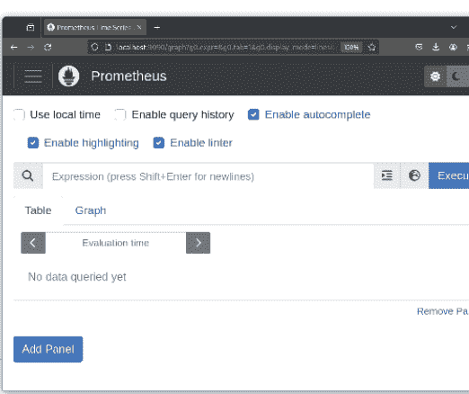

**图 11.2：** 浏览器中的 Prometheus 用户界面

该图显示了你在浏览器中访问 URL `http://localhost:9090/` 时的初始页面。

4. 当你点击 **Status**（状态），然后 **Target**（目标）时，你可以看到 Prometheus 连接的 exporter 端点（endpoints），如下所示：

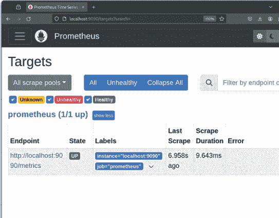

上图 exporter 端点定义在 `prometheus.yml` 文件中。exporter 端点 `http://localhost:9090/metrics` 让我们能够从 Prometheus 获取指标。

现在我们已经知道如何让 Prometheus 启动并运行，让我们探索 Prometheus 查询语言 (PromQL)，这是一种允许我们对指标数据进行查询和聚合的工具。

# 探索 PromQL

Prometheus 拥有强大的查询语言，让我们能够从原始指标数据中提取关于系统行为的有用信息。例如，考虑以下 PromQL 表达式的使用：

## `file_http_request_total`

执行查询的最基本方法是提供我们感兴趣的指标名称，如下所示：

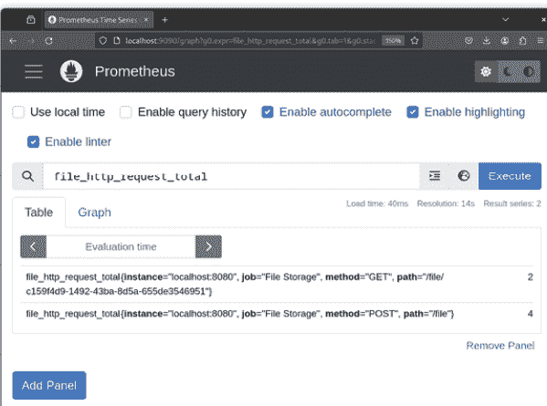

通过提供 `file_request_total` 作为查询表达式，Prometheus 返回原始状态的指标数据。示例显示我们有相同的指标，带有 `method` 标签，显示了有多少个到达 `/file` 端点的 GET 和 POST 请求。我们可以使用以下表达式过滤 GET 指标数据：

```
file_request_total(method="POST")
```

返回结果如下：

```
file_http_request_total(instance=localhost:8080, job="File Storage", method="POST", path="/file") 4
```

数字 4 显示了捕获了多少个 POST 请求作为指标数据。通过 PromQL，我们还可以检查每秒到达多少个请求：

```
rate(file_http_request_total(method="POST", path="/file"[5m]))
```

示例使用了 `rate` 函数，它允许我们进行计算并告诉我们过去五分钟内每秒到达多少个请求。表达式后的结果可以返回：

```
{instance=localhost:8080, job="File Storage", method="POST", path="/file"} 0.031571689762439
```

0.031571689762439 告诉我们系统处理 `/file` 端点 POST 请求的每秒速率。

PromQL 提供了让我们聚合指标数据的函数。除了 `rate` 函数外，我们还可以使用 `sum` 函数累加数据，或使用 `top` 获取顶部聚合结果，例如。

在涵盖了 Prometheus 的工作原理后，让我们学习如何与 Grafana 集成。

# 将 Prometheus 与 Grafana 集成

Grafana 是一种分析和监控解决方案，广泛与其他技术集成，以提供监控系统行为的全面视图。它的优势之一能够视觉化表示从 Prometheus 等系统中获取指标和其他监控数据。在本节中，我们将学习如何使用 Docker Compose 配置这两个系统之间的简单集成。

1. 通过 `docker-compose.yml` 文件，我们为 Prometheus 和 Grafana 定义了 Docker compose 配置：

```yaml
version: '3.8'

services:
  prometheus:
    image: prom/prometheus:v2.45.6
    network_mode: host
    volumes:
      - /monitoring/prometheus.yml:/etc/prometheus/prometheus.yml

  grafana:
    image: grafana/grafana:10.4.4
    network_mode: host
    depends_on:
      - prometheus
```

2. Prometheus 配置通过 `prometheus.yml` 文件完成。以下是配置此类文件的方法：

```yaml
global:
  scrape_interval: 15s
  evaluation_interval: 15s

scrape_configs:
  - job_name: "File Storage"
    static_configs:
      - targets: ['localhost:9090']
```

exporter 端点 `http://localhost:9090/metrics` 让我们能够从 Prometheus 获取指标。

3. 我们通过执行以下命令启动 Grafana 容器：

```bash
docker-compose up -d
```

图中 exporter 端点定义在 `prometheus.yml` 文件中。exporter 端点 `http://localhost:9090/metrics` 让我们能够从 Prometheus 获取指标。

我们想要检查给定时间间隔内下载的 5 个最大的文件。我们可以使用条形图可视化来实现这一目标，如图所示：

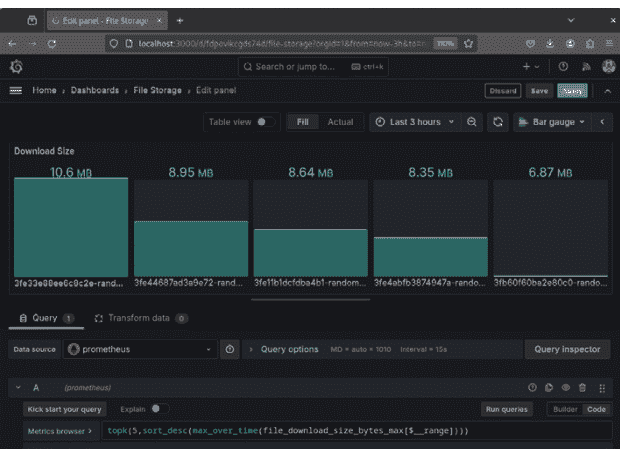

图 11.9：下载大小可视化

可视化是通过以下查询构建的：

`top(5, sort_desc(max_over_time(file_download_size_bytes[$__range])))`

我们在 `file_download_size_bytes` 指标上使用了 `max_over_time` 函数，该指标按降序排列。最后，我们使用 `top` 函数获取前 5 个最大的结果。

设置具有意义的可视化 Grafana 仪表板可以增强我们对系统的监控。我们可以使用仪表板来排查故障并预测瓶颈，我们不希望不断检查以查看是否达到了某些阈值。为此，我们可以依靠告警。让我们接下来探索如何使用 Prometheus 和 Alertmanager 来触发告警。

# 使用 Alertmanager 触发告警

Prometheus 拥有一个规则引擎，允许我们根据预定义规则使用指标来触发告警。Alertmanager 负责接收 Prometheus 触发的告警，并通过电子邮件等通知通道通知相关方（例如）。在本节中，我们将学习如何配置 Prometheus 和 Alertmanager，以便根据文件存储系统生成的指标来触发告警。让我们从提供一个 Docker compose 配置开始。

## 设置 Alertmanager 容器

为了提供 Alertmanager 容器，我们使用之前获取 Prometheus 和 Grafana 容器时所需的相同的 `docker-compose.yml` 文件：

```yaml
version: '3.8'

services:
  alertmanager:
    image: prom/alertmanager:v0.27.0
    network_mode: host
    volumes:
      - ./monitoring/alertmanager.yml:/etc/alertmanager/config.yml
  prometheus:
    image: prom/prometheus:v2.45.6
    network_mode: host
    volumes:
      - ./monitoring/prometheus.yml:/etc/prometheus/prometheus.yml
      - ./monitoring/alert-rules.yml:/etc/prometheus/alert-rules.yml
    depends_on:
      - alertmanager
```

## 我们需要调整 prometheus.yml 文件以启用告警机制

```yaml
alerting:
  alertmanagers:
    - static_configs:
        targets: ['localhost:9093']

rule_files:
  - "etc/prometheus/alert-rules.yml"
```

告警配置块允许我们指定用于触发告警的 Alertmanager URL `localhost:9093`。通过 `rule_files` 块，我们可以告诉 Prometheus 在哪里可以找到包含告警规则的文件。让我们探索一下我们如何定义 Prometheus 规则并配置 Alertmanager 发送电子邮件通知。

## 定义 Prometheus 告警规则

我们可以使用 `alerts-rules.yml` 设置一条规则，如果文件上传时长持续 1 分钟且超过 2 秒，则触发告警：

# 文件上传时长过高的告警


```yaml
groups:
  - name: File Upload
    rules:
      - alert: HighFileUploadDurationTime
        expr: sum(rate(file_upload_duration_seconds[1m])) / sum(rate(file_upload_duration_seconds_count[1m])) > 2
        for: 1m
        labels:
          severity: warning
        annotations:
          summary: "File upload duration time: {{ $value}}"
          description: "Time to upload a file: {{ $value}}"
```

以下表达式定义了告警规则：

`sum(rate(file_upload_duration_seconds[1m])) / (rate(file_upload_duration_seconds_count[1m])) > 2`

只有当上述表达式在超过 2 分钟的时间范围内进行评估时，才会触发告警。当告警触发时，Alertmanager 会收到通知并通知相关方 Prometheus 触发了告警。让我们接下来查看如何实现它。

# 定义 Alertmanager 通知通道

Alertmanager 配置通过 `alertmanager.yml` 文件完成：

```yaml
receiver: 'mail'
repeat_interval: 1h
group_by: [ alerts]
receivers:
  - name: 'mail'
    email_configs:
      - smarthost: 'smtp.gmail.com:465'
        auth_username: ''
        auth_password: ''
      from: ''
      to: ''
```

上述配置允许在任何 Prometheus 规则触发告警时发送电子邮件通知。

让我们通过运行文件存储系统、生成指标并使用 Alertmanager 测试告警触发机制来结束本章。

## 编译并运行示例项目

在本节中，我们编译并运行带有 Prometheus、Grafana 和 Alertmanager 的文件存储系统。

你可以从 GitHub 仓库克隆应用程序源代码：`https://github.com/bppublications/Java-Real-World-Projects/tree/main/Chapter%2011`。

你需要在机器上安装 JDK 21 或更高版本，以及 Maven 3.8.5 或更高版本。还需要 Docker 和 Docker Compose。

执行以下命令编译应用程序：

```bash
$ mvn clean package
```

Maven 将创建一个 JAR 文件，我们可以通过运行以下命令来运行应用程序：

```bash
$ java -jar target/chapter11-1.0-SNAPSHOT.jar
```

启动应用程序后，你可以通过以下命令启动 Prometheus、Grafana 和 Alertmanager 容器：

```bash
$ docker-compose up -d
```

现在，我们介绍如何使用：

1. 访问 `http://localhost:3000` 处的 Grafana 并设置数据源。
2. 然后，从仓库中导入 `dashboard.json`。
3. 向以下地址请求：
   - `http://localhost:9090/api/v1/metrics`
   - `http://localhost:9090/api/v1/rules`
4. 按照如下方式检查仪表板：


发送请求后，你应该看到所示的告警：


我们可以通过检查 `HighFileUploadDuration` 来确认告警已被捕获。

## 结论

存储和提供指标数据是 Prometheus 完成的基本职责。在本章中，我们学习了 Prometheus 架构、我们如何将其与 Grafana 集成以创建有意义的可视化，以及我们如何使用 Alertmanager 配置告警。

通过控制复杂性并避免所谓的“大泥球”系统（在这些系统中，任何代码更改都意味着极高的导致系统崩溃的风险），来开发出结构更优的应用。

# 介绍领域驱动设计

企业环境下的软件项目通常始于组织解决某个感知问题的愿望。组织会评估现有客户和潜在新客户面临的挑战。然后，它尝试制定解决方案以最佳方式应对这些挑战。在基于敏捷的组织中，我们经常发现产品所有者和设计师正试图与业务人员共同理解哪些挑战（如果有的话）为客户带来利益并为组织创造利润。

一旦明确了需要解决什么问题且高层需求已基本定义，软件开发人员就会被召集设计技术路径，以实现能够交付客户预期价值的运行软件。乍一看，这似乎是一条平坦的道路。但现实中，这段旅程充满了雄心、未知，以及开发者在试图精确理解满足客户预期的业务需求时所面临的意想不到的挑战。

对于开发者来说，理解业务需求可能非常有挑战性，因为他们应该是他们所用技术的专家，而不是他们想要创建软件解决方案的问题的专家。在理解特定业务运作方式方面的知识差距是一个关键问题，因为这种薄弱的理解将导致无效的软件产品。

意识到软件开发人员问题领域知识匮乏会对企业项目的成功构成重大风险，埃里克·埃文斯（Eric Evans）在他 2006 年出版的《领域驱动设计》一书中解释了如何弥合软件开发人员与所需问题领域之间的鸿沟，以最内聚且可维护的方式设计软件系统，从而捕捉复杂的业务细节。埃文斯的思想对软件开发行业产生了巨大影响。

埃文斯提出了一系列原则和技术，将问题领域作为软件系统开发的主要驱动力。问题领域是业务运营的特定领域，例如物流、银行和零售等。获取更好的问题领域知识的动力是满足这些需求所需的技术。正如经常发生的情况，开发者可能会倾向于优先考虑，例如他们将使用哪种编程语言、数据库和技术，而不是试图理解他们正在处理的问题领域。如果走过头，这种诱惑会导致软件代码更多地由技术驱动而非业务驱动。领域驱动设计提议对这种思维进行转变，即以业务为中心的视角来考虑如何开发软件。

诸如限界上下文（`bounded context`）、通用语言（`ubiquitous language`）、事件风暴（`event storm`）和领域模型（`domain model`）等概念是领域驱动设计的衍生。这些概念帮助我们把业务知识转化为运行代码。领域驱动设计的编码技术如实体（`entities`）、值对象（`value objects`）和规格（`specifications`）被建立用于实现领域模型——一种基于代码、文档和图表的实体化，帮助我们理解业务问题以及如何通过软件代码解决它们。

本节将探索核心领域驱动设计概念，这些概念将帮助我们在接下来的章节中实现领域模型。让我们从学习限界上下文的概念开始。

## 限界上下文

为了理解限界上下文以及为什么映射它们是领域驱动设计中的一项基础工作，让我们考虑一个个人财务解决方案的业务场景。个人通常期望个人财务解决方案能够跟踪他们的开支，通过记录他们收了多少钱、在何地、何时以及将钱花在了什么上面。通过月度报告查看资金活动也是此类个人财务解决方案的一项价值功能。

在想象一个能够交付上述个人财务功能的软件系统时，我们可以考虑以下三个系统职责：

- **资金处理：** 负责存储和提供资金交易的访问。它允许通过用户定义的类别（如健身房、租金、杂货、投资等）对交易进行组织。
- **报告生成：** 包含使用 Excel 表格生成月度资金活动的规则。
- **文件存储：** 提供文件存储能力，允许上传和下载 Excel 报告文件。

在传统的单体方法中，所有三个职责都将是同一个应用程序的一部分，封装在部署单元中。它们可能位于同一个源代码中。下图说明了基于上述职责的单体应用结构：


图 12.1：单体结构

作为一个单体系统，所有与交易、类别、报告规则、文件上传和下载相关的职责属于同一个上下文。

我们可以创建一个代表资金处理活动的 `Transaction` 类。我们将使用金额、日期、类型和货币等属性来捕捉交易细节。现在，想象我们需要在报告引擎中表示交易。我们可以依赖资金处理 `Transaction` 类的相同属性，但添加如总金额、名称金额等新属性。这些属性仅在报告生成的上下文中有用，而在资金处理的上下文中没有。为了避免这种情况，我们可以在不同的包中创建一个 `TransactionReport` 或一个新的 `Transaction` 类。然而，使用不同的名称只能掩盖设计中的潜在问题：缺乏上下文，导致交易根据不同的上下文具有不同的含义。

我们可以使用上下文来解决缺乏上下文的问题，并在资金处理和报告生成上下文之间定义清晰的边界。在实践中，这可以将资金处理和报告生成的职责拆分为单独的代码仓库或模块，每个模块包含基于其上下文的 `Transaction` 类。进一步，负责资金处理的团队可以与负责报告生成的团队不同，这将进一步促进仓库拆分或模块化。我们还可以为文件下载和上传定义专门的限界上下文，因为这些功能与资金处理或生成报告的问题并不直接相关，如下：

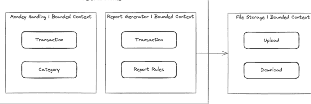

图 12.2：带有限界上下文的个人财务

## 通用语言

清晰的沟通对于任何软件项目的成功都至关重要。一方面，客户表达他们的需求。另一方面，业务分析师试图理解并告诉产品所有者和开发者。未能表达或解释某个想法可能会导致严重后果，因为应用程序可能会基于错误的思维进行开发。我们如何弥合软件项目中所有利益相关者之间的沟通鸿沟？我们可以采用领域驱动设计中的通用语言原则，它帮助我们定义一组准确描述问题领域的术语及其含义。

建立通用语言（`Ubiquitous Language`）的主要益处在于，当软件系统基于该语言定义的术语开发时，应用程序代码就成为了关于业务运营方式的知识源。通过与问题领域中的领域专家保持一致，开发者创建的应用程序代码主要由业务需求驱动，而非其他任何因素。虽然会有与数据库和其他资源的技术集成，但驱动代码结构的并非技术选型。

构思一种通用语言可能是具有挑战性的。有时，开发者对于他们需要开发软件解决方案的问题领域一无所知。问题领域的知识通常可以在业务分析师或理解业务运营的经验开发人员脑中找到。文档也可以作为领域知识的来源。然而，在某些情况下，拥有领域知识的人可能已经离开了公司，且没有解释问题领域的文档。通过采用领域驱动设计（DDD），我们可以使用知识萃取（`Knowledge-crunching`）技术来更深入地了解问题领域。

知识萃取的范围可以从阅读关于问题领域的书籍，到与能够提供业务运作有用信息的人进行交流。我们使用一种名为“事件风暴”（`Event Storming`）的技术作为知识萃取的方法。事件风暴技术源于领域驱动设计的实践，能够在理解问题领域和构建通用语言方面产生显著成果。接下来，我们将讨论什么是事件风暴以及它能为软件项目带来的益处。

## 事件风暴

大多数业务的运行基于代表人员与业务流程交互的事件。这些交互源于业务流程，业务流程预期代表一系列步骤，执行后会产生结果。映射这些业务流程及其运作方式构成了事件风暴的主要目标，这是一场不了解业务如何运作的人与了解业务的人之间的研讨会。寻求问题领域知识的软件开发者是需要学习业务如何运作的人。相反，那些了解业务流程的人就是领域专家。

利益相关方、开发者和领域专家坐在一起，定义领域事件以及这些事件与哪些业务流程相关。学习领域事件让人们知道为了实现业务结果必须做些什么。人们通常在离开这些会议后，对问题的解决方式有了更好的理解。利益相关方提供输入，以实现造福客户的应用程序。领域专家提供他们的专业知识，并通过梳理业务步骤来验证他们的知识。

意识到事件风暴对于帮助清晰定义边界上下文（`Bounded Contexts`）、通用语言和领域模型的益处后，我们将探索如何开展一次事件风暴会议。

### 识别事件风暴会议参与者

在一个遵循敏捷实践的组织中，你可能会发现产品主（`Product Owner`）、敏捷大师（`Scrum Master`）、技术负责人以及具有后端、前端、QA（测试）和 DevOps 背景的工程师。这些人被组织在一个产品导向的团队中，负责一个产品或产品的特定部分。产品导向团队通常对软件项目的整个生命周期负责。通过与业务部门协作，他们识别客户需求，通过用户故事（`User Stories`）将其转化为技术需求，并实现、部署和积极维护软件解决方案。参与软件项目生命周期的每个人都应该参加事件风暴会议。

业务部门与产品导向团队之间的协作对于项目的成功至关重要。业务部门通常由理解业务运营方式的非技术人员组成。这些人也被称为领域专家，他们必须参与事件风暴会议，帮助那些想要创建软件解决方案但需要学习业务如何运作的人。

开展事件风暴会议还需要一个引导者（`Facilitator`）。引导者是熟悉领域驱动和事件风暴技术的人。他们通过解释如何识别领域事件并将其映射到业务流程中，引导参与者朝着正确的方向发展。

在了解了谁应该参加事件风暴会议后，让我们看看如何准备它。

### 准备事件风暴会议

事件风暴会议以面对面会议的形式举行时效果最好，房间内应有白板、所有参与者的笔以及橙色、蓝色、绿色和多种颜色的便利贴。在以下，我们将看到每种颜色便利贴的用途：

- 橙色便利贴描述领域事件（`Domain Events`）。我们选择橙色是为了强调领域事件是事件风暴练习中的核心元素。
- 蓝色便利贴用于命令（`Commands`）。命令规范了一个触发领域事件的动作。
- 黄色便利贴是聚合根（`Aggregates`），描述由领域事件和命令处理的对象或数据。
- 绿色可以代表人类参与者（如用户）和非人类参与者（如系统）。

开展事件风暴会议的标准方法是完全依赖白板和物理便利贴。然而，也可以探索使用网络协作工具的混合方法。如果采用这种方法，参与者在会议期间需要笔记本电脑。

要求参与者携带笔记本电脑允许我们探索不同的协作形式。我们可以组织一次事件风暴，只在白板上贴上领域事件贴。一旦我们有了足够的便利贴来描述我们感兴趣的业务流程，我们可以在 Miro 或 Mural 等网络协作工具中复制便利贴的表示。我们可以通过指定命令、聚合根和参与者来继续事件风暴会议。这种方法的好处是，事件风暴的结果可以被引用，并在需要时轻松调整。

让我们进一步了解领域事件、命令和聚合根。

### 领域事件

事件风暴始于获取关于业务流程如何运作的知识。例如，考虑一个个人财务解决方案以及它如何运作以实现业务结果。此类解决方案的最关键方面之一是让人们通过添加交易记录来跟踪支出。基于此，我们可以定义一个名为 `TransactionAdded`（交易添加）的领域事件，如图所示：


领域事件始终被定义为过去时的名词，用于描述已经发生的事情。好了，我们有了 `TransactionAdded` 事件，但它是如何被触发的呢？为了做到这一点，我们需要定义一个命令。让我们接下来检查。

### 命令

在确定了我们的第一个领域事件 `TransactionAdded` 后，我们必须确定由哪个命令触发该事件。我们可以通过定义 `AddTransaction` 命令来解决这个问题，如图所示：


`AddTransaction` 命令以动词开头，表示执行了什么动作来触发事件。命令必须始终以现在形式的动词表示。

在这个阶段，我们知道了领域事件以及触发它的命令，但我们需要知道谁负责执行该命令。

### 参与者

参与者即使在事件风暴中也起着基础作用，因为通过他们我们才能追踪领域事件存在的来源。参与者可以被定义为人类或非人类，他们与领域事件的关系通过命令调解，如下：

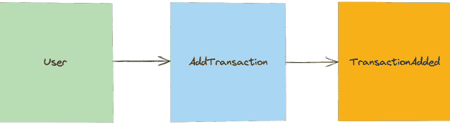

识别参与者有助于我们理解是谁在触发事件，并允许我们探索他们与命令交互背后的动机。

### 聚合根

我们已经确定了 `TransactionAdded` 领域事件和 `AddTransaction` 命令。前者代表一个已经发生的事件，而后者指的是生成该事件的动作。领域事件和命令代表了一种连接，即为了实现某些业务结果而进行的活动聚合。在我们的个人财务示例中，领域事件与命令之间的这种连接通过一个名为 `Transaction` 的聚合根来描述，如下所示：

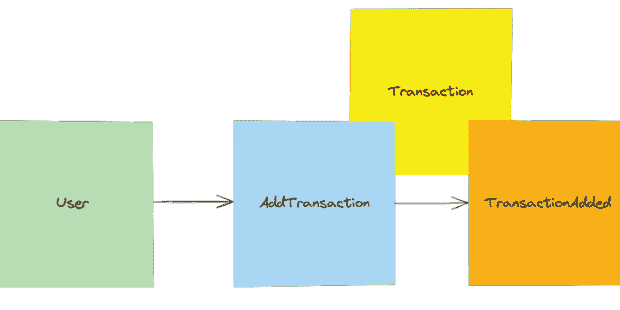

图 12.6: 聚合根便签

将聚合根看作一个实体或数据，它将负责实现业务流程的命令和领域事件紧密结合。在上面的示例中，聚合根位于命令和领域事件便签贴之间。

我们可以通过使用领域事件、命令、参与者（`actors`）和聚合根来映射我们感兴趣的所有业务流程。一旦完成映射，最终结果将作为领域模型实现的输入。在接下来的章节中，我们将探索什么是领域模型。

# 领域模型

到目前为止，所有围绕边界上下文（`bounded contexts`）、通用语言（`ubiquitous language`）和事件风暴（`event storming`）的讨论显著提升了我们获取领域知识的能力。我们使用这些知识来创建领域模型，它是我们想要解决的问题以及解决该问题的具化表示。我们称之为“具化”，是因为领域模型通常结合了基于编写文档、图表和代码的产物。它们共享相同的通用语言，因此应用程序代码中使用的术语与文档和图表具有相同的含义。这特别有用，因为它确保了所有项目的利益相关者对领域模型的表示方式有共同的理解。非技术利益相关者可以轻松理解模型，因为他们知道应用程序代码遵循相同的术语和含义。


# 领域模型实现

领域模型通常通过代码层的实体（`entities`）、值对象（`value objects`）和规范（`specifications`）等元素表示。在下一节中，我们将探索如何使用这些元素通过领域驱动设计来实现一个应用程序。

## 使用值对象传递语义

在本节中，我们开始开发个人财务应用程序，这是一个允许我们跟踪支出并将其分类的系统。一个基础的个人财务应用程序应该允许我们存储借方或贷方交易。交易本身就是我们稍后讨论实体时将处理的领域元素，但我们现在就可以通过考虑交易可能具有哪些属性来思考它。考虑到交易可以是正的也可以是负的，我们可以实现以下枚举：

```java
public enum Type {
  CREDIT,
  DEBIT;
}
```

值对象应该是不可变的，因为我们使用它们来为领域模型内部的事物赋予意义。除了拥有 `Type` 值对象来区分不同的交易外，我们还可以让值对象保持不可变。我们还可以有一个值对象来帮助我们提供一种表达身份的有意义的方式：

```java
@Getter
@ToString
@EqualsAndHashCode
public class Id {
  private final UUID uuid;

  private Id(UUID uuid) {
    this.uuid = uuid;
  }

  public static Id withId(String id) {
    return new Id(UUID.fromString(id));
  }
  public static Id withoutId() {
    return new Id(UUID.randomUUID());
  }
}
```

我们通过使用 Lombok 库的注解 `@Getter`、`@ToString` 和 `@EqualsAndHashCode` 来缩短代码。使用我们的 `Id` 类而不是使用 `String` 或 Java 标准库的任何其他类型，是为了能够准确地识别领域模型中的事物。请注意，静态方法 `withId` 可以根据现有数据创建 `Id` 对象，而 `withoutId` 可以用于完全全新的数据。

定义好值对象后，可以使用它们来设计个人财务应用程序的实体。

## 使用实体表达身份

实体被定义为具有身份的某种东西。它是我们可以唯一标识的东西。在个人财务系统的上下文中，账户实体可以代表管理财务的人。一个人有兴趣跟踪自己的交易，以便知道钱从哪里来，去哪里。每笔交易都是唯一的，因此拥有一个交易实体是有意义的。仅仅将交易记录在一个桶里可能够用；如果对交易进行分类，预算实践可能会产生更好的结果。为此，我们可以有一个分类实体。接下来，我们将介绍创建 `Transaction`、`Category` 和 `Account` 实体类的步骤。

### 1. Transaction 实体

我们从最基础的实体 `Transaction` 开始：

```java
@Builder
public record Transaction(Id id, String name, Double amount, Type type) {

  public static Transaction createTransaction(Account account, String name, Double amount, Type type) {
    // Code committed
  }

  private static Transaction getTransaction(String name, Type type) {
    return Transaction.builder()
        .id(Id.withoutId())
        .name(name)
        .amount(amount)
        .type(type)
        .timestamp(Instant.now())
        .build();
  }

  public boolean addTransactionToCategory(Category category) {
    return category.transactions().add(this);
  }

  public boolean removeTransactionFromCategory(Category category) {
    return category.transactions().remove(this);
  }
}
```

我们使用 `Id` 值对象来定义唯一标识交易的属性。个人财务系统中的每笔交易都是唯一的，因此它们有资格建模为实体。上面的示例依赖于 Java records 来定义一个 `Transaction` 实体，其属性让我们知道它的 ID、金额、类型和时间戳。

在领域驱动设计中，实体不仅仅是数据载体。上面的实体定义了行为，例如添加和删除分类。我们将在以后探索其创建。

### 2. Category 实体

交易和分类可以与代表管理财务的账户关联。账户实体也可以被唯一标识。以下是我们可以实现 `Category` 实体的方法：

```java
@Builder
public record Category(Id id, String name, List<Transaction> transactions) {

  public static Category createCategory(Account account, String name) {
    // Code omitted
  }

  private static Category getCategory(String name) {
    return Category.builder()
        .id(Id.withoutId())
        .name(name)
        .transactions(new ArrayList<>())
        .build();
  }
}
```

我们依赖 `Id` 值对象来唯一标识分类。我们将在下一节中探索 `Account` 实体的创建。

### 3. Account 实体

以下是我们可以实现 `Account` 实体的方法：

```java
@Builder
public record Account(Id id, String name, List<Transaction> transactions, List<Category> categories) {

  public Account(Id id, String name, List<Transaction> transactions, List<Category> categories) {
    this.id = id;
    this.name = name;

    if (transactions == null) {
      throw new RuntimeException("Transaction list cannot be null");
    } else {
      this.transactions = transactions;
    }
    if (categories == null) {
      throw new RuntimeException("Categories list cannot be null");
    } else {
      this.categories = categories;
    }
  }
}
```

## 使用规范定义业务规则

业务规则是履行某些动作的条件或前提。遵守这些规则至关重要，因为它们确保了系统的行为符合业务预期的结果。通常，我们看到规则以 `if-else` 语句散落在代码中，定义了应用程序继续执行的条件；对于不熟悉业务规则以及应用程序如何处理这些规则的人来说，很难一眼看出 `if-else` 语句的意思。

为了通过应用程序代码带来清晰度，可以使用领域驱动设计中的规范概念（`specification`），它使得业务规则更加明确且易于理解。接下来，我们将使用密封接口和抽象类定义一种规范机制，稍后用它来实现个人财务应用程序的规范。

### 1. Specification 密封接口

首先，让我们定义 `Specification` 密封接口：

```java
public sealed interface Specification<T> permits AbstractSpecification {

    boolean isSatisfiedBy(T t);

    Specification<T> and(Specification<T> specification);
}
```

我们利用 Java 的密封接口（`sealed interface`）特性来强制规定谁应该实现此接口。`Specification` 接口定义了带有泛型类型的 `isSatisfiedBy` 方法。我们使用泛型来使规格变得灵活并能够处理任何对象。

### 2. AbstractSpecification 抽象类

接下来，我们实现 `AbstractSpecification` 抽象类：

```java
public abstract class AbstractSpecification<T> implements Specification {

    public abstract boolean isSatisfiedBy(T t);

    public abstract void check(T t) throws GenericSpecificationException;

    public Specification<T> and(final Specification<T> specification) {
        return new AndSpecification(this, specification);
    }
}
```

注意在 `AndSpecification`、`DuplicateCategorySpec` 和 `TransactionAmountSpec` 抽象类中 `permits` 的用法。我们在为个人财务应用提供规格时，定义了这些类。在 `AbstractSpecification` 中，我们定义了一个名为 `check` 的新抽象方法，负责执行业务规则验证。该方法允许我们使用 `AndSpecification` 抽象类将多个规格的结果结合。

### 3. AndSpecification 类

以下是如何实现 `AndSpecification<T>` 类的：

```java
public final class AndSpecification<T> extends AbstractSpecification<T> {

    private final Specification<T> spec1;
    private final Specification<T> spec2;

    public AndSpecification(final Specification<T> spec1, final Specification<T> spec2) {
        this.spec1 = spec1;
        this.spec2 = spec2;
    }

    public boolean isSatisfiedBy(final T t) {
        return spec1.isSatisfiedBy(t) && spec2.isSatisfiedBy(t);
    }

    @Override
    public void check(T t) throws GenericSpecificationException {
    }
}
```

验证发生在 `isSatisfiedBy` 内部，它会评估 `spec1` 和 `spec2` 的结果。

在实现了规格抽象后，我们为个人财务应用实现了具体的规格。为此，例如，我们可以定义一个带有业务规则的规格，确保系统不会输入金额为零的交易：

```java
public final class TransactionAmountSpec extends AbstractSpecification<Double> {

    @Override
    public boolean isSatisfiedBy(Double amount) {
        return amount > 0;
    }

    @Override
    public void check(Double amount) throws GenericSpecificationException {
        if(!isSatisfiedBy(amount)) {
            throw new GenericSpecificationException("Transaction value 0 is invalid");
        }
    }
}
```

业务规则实现在 `isSatisfiedBy` 内部，我们在此处检查交易金额是否大于零。以下是我们在 `Transaction` 实体中使用 `TransactionAmountSpec` 的方式：

```java
@Builder
public record Transaction(Id id, String name, Double amount, Type type, Instant timestamp) {

    public static Transaction createTransaction(Account account, String name, Double amount, Type type) {
        var transaction = getTransaction(name, amount, type);
        var transactions = account.transactions();
        new TransactionAmountSpec().check(transaction.amount);
        transactions.add(transaction);
        return transaction;
    }
    // Code omitted
}
```

每当创建一个新交易时，我们将其添加到交易列表中。尽管如此，在此之前，我们通过 `TransactionAmountSpec` 检查交易金额是否大于零。如果不是，系统将抛出异常。我们可以按照相同的方法来实现一种规格，确保用户不会提供重复的类别：

```java
public final class DuplicateCategorySpec extends AbstractSpecification<Category> {

    private final List<Category> categories;

    public DuplicateCategorySpec(List<Category> categories) {
        this.categories = categories;
    }

    @Override
    public boolean isSatisfiedBy(Category category) {
        return categories.contains(category);
    }

    @Override
    public void check(Category category) throws GenericSpecificationException {
        if(isSatisfiedBy(category)) {
            throw new GenericSpecificationException("Category already exists");
        }
    }
}
```

`DuplicateCategorySpec` 拥有一个构造函数，接收账户的类别列表。该规格检查新类别是否存在于列表中。如果存在，则抛出异常。以下是我们在 `Category` 实体中使用 `DuplicateCategorySpec` 的方式：

```java
@Builder
public record Category(Id id, String name, List<Transaction> transactions) {

    public static Category createCategory(Account account, String name) {
        var category = getCategory(name);
        var categories = account.categories();
        new DuplicateCategorySpec(categories).check(category);

        categories.add(category);
        return category;
    }
}
// Code omitted
```

在 `Category` 实体中使用 `DuplicateCategorySpec` 的方式与我们之前在 `Transaction` 实体中所做的类似。如果验证通过，该类别将添加到账户的类别列表中。

## 测试领域模型

使用领域驱动设计（DDD）技术实现领域模型的主要优势在于我们可以轻松地对其进行测试。由于问题领域驱动实现，领域模型不应依赖于数据库等外部资源，这使得测试更加简单。

### 1. 测试 Account 实体

让我们从测试 `Account` 实体开始：


```java
public class AccountTest {
    @Test
    public void accountIsCreated() {
        var account = Account.createAccount("Test Account");
        assertEquals("Test Account", account.name());
    }

    private Account createAccount(String name) {
        return Account.builder()
            .id(Id.generate())
            .name(name)
            .build();
    }
}
```

上述测试执行了一个简单的测试以确保 `Account` 实体被创建。

### 2. 接下来，我们测试 `Category` 实体：

```java
public class CategoryTest {
    @Test
    public void account_exists_create_category() {
        var account = Account.createAccount("Test Account");
        var category = Category.createCategory(account, "Test Category");
        assertEquals("Test Category", category.name());
        assertEquals(1, account.categories().size());
    }

    @Test
    public void category_already_exists_throw_exception() {
        var account = Account.createAccount("Test Account");
        Category.createCategory(account, "Test Category");
        assertThrows(GenericSpecificationException.class, () ->
            Category.createCategory(account, "Test Category"));
    }

    private Account createAccount(String name) {
        return Account.builder()
            .id(Id.generate())
            .name(name)
            .build();
    }
}
```

通过 `account_exists_create_category` 测试，我们可以确认是否在现有账户中创建了新类别。我们还通过 `category_already_exists_throw_exception` 测试了规格是否有效，该测试检查了添加现有类别时是否捕获了异常。

### 3. 最后，我们测试 `Transaction` 实体。

```java
public class TransactionTest {
    @Test
    public void transactionTransactionIsInvalid() {
        var account = Account.createAccount("Test Account");
        assertThrows(GenericSpecificationException.class, () ->
            Transaction.createTransaction(account, "testTransaction", 0.0, Type.DEBIT));
    }

    @Test
    public void category_add_and_remove_a_credit_transaction() {
        var account = Account.createAccount("Test Account");
        var category = Category.createCategory(account, "Test Category");
        var transaction = Transaction.createTransaction(account, "testTransaction", 10.0, Type.CREDIT);
        assertEquals(0, category.transactions().size());
        transaction.addTransactionToCategory(category);
        assertEquals(1, category.transactions().size());
        transaction.removeTransactionFromCategory(category);
        assertEquals(0, category.transactions().size());
    }

    private Account createAccount(String name) {
        return Account.builder()
            .id(Id.generate())
            .name(name)
            .build();
    }
}
```

```
[INFO] 测试

[INFO] Running dev.daviviera.entity.CategoryTest

[INFO] Tests run: 2, Failures: 0, Errors: 0, Skipped: 0, Time elapsed: 0.038 s - in dev.daviviera.entity.CategoryTest

[INFO] Running dev.daviviera.entity.AccountTest

[INFO] Tests run: 1, Failures: 0, Errors: 0, Skipped: 0, Time elapsed: 0.001 s - in dev.daviviera.entity.AccountTest

[INFO] Running dev.daviviera.entity.TransactionTest

[INFO] Tests run: 3, Failures: 0, Errors: 0, Skipped: 0, Time elapsed: 0.020 s - in dev.daviviera.entity.TransactionTest

[INFO] 结果:

[INFO] Tests run: 6, Failures: 0, Errors: 0, Skipped: 0

[INFO] 构建成功
```

上述输出确认了来自 `AccountTest`、`CategoryTest` 和 `TransactionTest` 的测试已成功执行。

## 结论

领域驱动设计（DDD）是一种设计企业级应用的可靠方法。通过将业务关注点而非技术问题作为应用开发的主要驱动力，领域驱动设计方法通过通用语言、上下文和领域模型等概念，有助于理解业务问题以及如何解决问题。

受领域驱动设计优势的启发，我们研究了如通用语言等基本原则，它促进了开发人员、业务分析师、项目所有以及所有利益相关者之间的共同理解。我们探索了映射边界约束的重要性，以消除歧义并清晰地定义系统职责。此外，我们发现了事件风暴，这是一种强大的协作技术，将开发人员和领域专家聚集在一起，讨论并明确软件项目意图解决的业务问题。

最后，我们通过实现一个个人财务应用将这些概念付诸实践。这项实践练习让我们看到实体、值对象和规范这些领域驱动设计的关键要素如何通过 Java 代码表达。

在下一章，我们将探索如何使用分层架构实现 Java 应用。其中，数据层负责数据访问和操作，服务层提供业务规则，而 API 层暴露系统行为。

# 加入我们书籍的 Discord 空间

加入书籍的 Discord 工作空间以获取最新更新、优惠、全球科技动态、新发布以及与作者的互动：

https://discord.bpbonline.com


# 第 13 章

## 使用分层架构进行快速应用

### 引言

每当一个新软件项目启动时，开发人员都需要决定不同的软件组件将如何构建以及相互交互以满足需求。做出这些决策是为了以最好的方式提供在生产环境中运行的软件。多年来，开发人员一直在探索构建应用程序代码的技术，以产生可运行软件并让他们能够可持续地工作，这通过通过识别和分离软件系统中的关注点来实现。其中，一种被称为分层架构的技术，由于其合理的简单性和务实的方法，在企业软件行业被广泛采用。当采用分层架构时，实现它并向团队其他成员解释其原理并不费精力，这可能对于那些想要更快交付可运行软件，同时在某种程度上保持应用程序代码结构秩序的人来说，是一个可行的替代方案。在本章中，我们将探索分层架构以及我们如何使用它来开发结构更好的 Java 应用。

### 结构

本章涵盖了以下主题：

- 软件架构的重要性
- 理解分层架构
- 在数据层中处理和持久化数据
- 在服务层中定义业务规则
- 在表示层中暴露应用行为
- 编译并运行示例项目

### 目标

在本章结束时，你将通过将应用程序代码分为若干层（每层都有特定的职责）来理解分层架构。你将学习分层方法如何帮助在应用程序代码建立边界，这有助于识别和分离软件系统中的关注点，从而对整体软件架构产生积极影响。为了巩固本章探索的概念，我们将检查使用分层架构思想实现 Java 应用程序的开发步骤。

## 软件架构的重要性

在软件开发周期中，会有这样一个时刻，我们作为开发人员，对想要为特定问题提供的解决方案有了足够清晰的认识。在那些时刻，我们对用户需求有了理解，并认为足够开始编写代码来提供解决方案。在有了这样的理解之后，在任何应用开发的早期我们做的最重要的事情就是创建解决问题的代码。拥有一段虽然糟糕但可以运行的代码，比什么都没有展示要好得多。然而，一旦我们弄清楚了如何产生这些虽然糟糕但可以运行的代码，我们需要开始考虑对其进行润色，使其结构更好且更具维护性。

追求更好的结构和可维护代码的目标源于事实：我们预期软件会变化。新功能可能被引入，现有功能可能需要更改，并且会出现 Bug。我们预计经常在需要时重新访问代码并进行更改。因此，通过意识到软件未来会发生变化，我们不仅希望产生只解决我们现在问题的代码，还希望拥有能够让我们轻松应对未来问题的代码。那就是我们必须开始考虑软件架构的时候了。

我们决定的软件架构，决定了我们在任何需要时能够准确、安全且快速地引入代码的能力。糟糕的软件架构会导致所谓的“大泥球”——一种极其复杂、难以理解但却能运行的应用程序代码。而且，讽刺的是，由于它是运行的，我们产生了一个问题。这个问题产生是因为它对我们有用，但对维护者来说却是负担。

我们如何为开发的应用程序选择架构，根据作者的经验，这通常是有意识的努力或自发发生的。

## 理解分层架构

分层架构是一种软件开发技术，帮助我们根据软件系统的关注点或职责来组织应用程序代码。为了识别这些关注点，我们模拟用户发出系统请求以及完成这些请求所需的步骤。第一步可以是用户与图形用户界面或 API 交互。在第一步中，我们看到一种情况，即将某些东西展示给感兴趣的人。通过图形用户界面或 API 展示东西可以被看作表示关注点。在分层架构中，这样的表示关注点可以被捕获，例如在表示层中。

用户请求的第二步可能涉及数据处理，其中会执行某些约束，以确定软件能够做什么和不能做什么。这些约束通过业务规则表示，这些规则规定了软件应该如何运行，以及用户在第一步（表现层）中提供的数据将如何被处理。在这里，我们有一部分系统不关注内容的展示，而是关注通过业务规则应用约束来处理内容，这些规则可能会验证第一步中提供的数据。对于系统中处理数据的这部分，我们可以识别出另一个关注点，它可以作为业务层或服务层的一部分。

用户请求的第三步也是最后一步，可能涉及从数据库持久化或获取数据。数据层可以捕捉与处理数据库实体相关的所有方面。

到目前为止，我们识别了三个可能的层：表现层、服务层和数据层。这并不意味着所有应用程序都可以以这种方式分层。应用程序可以拥有的层数没有固定限制。层的数量取决于我们的评估，即识别哪些应用程序的职责将其捕获为一个层是合理的。这是很好的，因为它为定义我们认为必要的任意数量层提供了灵活性，但同时，如果我们定义的层数比需要的多，可能会导致麻烦。因此，在决定应用程序需要多少层时，建议采取谨慎态度。作者通常使用几层，只捕获显式的系统职责。

一旦定义了这些层，我们就必须建立它们之间如何相互通信。让我们接下来探索如何做到：

### 层只知道下一层

在这种方法中，表现层将知道并直接与服务层进行交互。与数据层的每次交互都通过服务层进行中介。

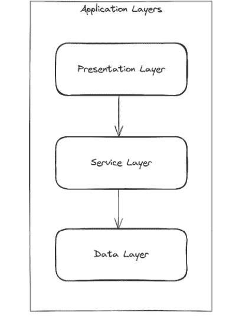

图 13.1：一个层只知道下一层

如图 13.1 所示，这种方法假设高层级只知道下一个低层级。

让我们接着检查另一种方案，即层可以与其他层进行交互。

### 层可以知道其他层

表现层将被允许访问数据层，如下所示：

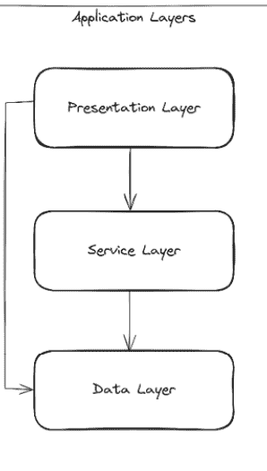

图 13.2：一个层可以与任何低层级交互

通过这种方法，我们可以避免层仅用作代理来访问另一个层的情况。

无论采用哪种层通信方法，层依赖方向必须始终向下，因为高层级始终依赖于低层级。例如，表现层可以依赖服务层或数据层，但服务层不能依赖表现层。

掌握了分层架构的基本思想后，让我们现在看看它们在基于 Spring Boot 框架开发个人财务系统的实际应用。从我们目前讨论的基于数据、服务和表现层的层结构开始，我们开始探索数据层在处理数据实体和持久化方面的作用。

### 在数据层中处理和持久化数据

个人财务系统通过将所有用户交易存储在数据库中来跟踪资金支出。为了实现这一点，让我们实现 `Transaction` 实体：

```java
@Entity
@Builder
@Getter
@AllArgsConstructor
@NoArgsConstructor
public class Transaction {

    @Id
    private String id;
    private String name;
    private Double amount;
    private String type;
    private Instant timestamp;
}
```

我们使用 Lombok 的 `@NoArgsConstructor`、`@AllArgsConstructor`、`@Getter` 和 `@Builder` 注解来使代码更加简洁。Lombok 是一个 Java 库，可以大幅减少由于反复使用常用语言结构（如构造函数声明以及 getter 和 setter 的定义）而产生的样板代码。我们使用 `@Entity` 注解使 `Transaction` 类成为一个 Jakarta Persistence 实体。在声明实体类属性时，我们必须指定哪个属性被用作实体 ID。我们通过在属性上放置 `@Id` 注解来完成这一点。

接下来，我们可以定义仓库接口：

```java
@Repository
public interface TransactionRepository extends CrudRepository<Transaction, String> { }
```

在这里，我们只是扩展了 `CrudRepository` 而没有定义任何额外方法，因为我们只依赖扩展 `CrudRepository` 时已经提供的基本数据库操作。

接下来，我们实现分类实体及其仓库。

### 实现分类实体和仓库

我们打算让用户创建分类来对相似交易分组。随后，我们定义 `Category` 实体类：

```java
@Entity
@Getter
@Builder
@AllArgsConstructor
@NoArgsConstructor
public class Category {

    @Id
    private String id;
    private String name;

    @OneToMany(cascade = CascadeType.ALL, fetch = FetchType.EAGER)
    private List<Transaction> transactions;
}

@Override
public boolean equals(Object o) {
    if (this == o) return true;
    if (o == null || getClass() != o.getClass()) return false;
    Category category = (Category) o;
    return Objects.equals(name, category.name);
}

@Override
public int hashCode() {
    return Objects.hash(name);
}
```

注意，我们在 `transactions` 分类属性上方放置了 `@OneToMany` 注解。该注解表示了分类与一个或多个交易之间的一对多关系。随后，我们重写了 `equals` 和 `hashCode` 方法。这种逻辑规定了相同名称的 `Category` 对象被认为是等等的。接下来，我们实现仓库接口：


正如我们之前对 `TransactionRepository` 所做的那样，我们在 `CategoryRepository` 中扩展 `CrudRepository`，继承了处理分类实体所需的全部数据库操作。

最后，我们实现处理账户的实体和仓库。

## 实现账户实体和仓库

每个交易和分类都属于一个账户。基于这种关系，下面的代码展示了我们如何实现 `Account` 类：

```java
@Entity
@Builder
@Getter
@AllArgsConstructor
@NoArgsConstructor
public class Account {

    @Id
    private String id;
    private String email;
    private String password;

    @OneToMany(cascade = CascadeType.ALL, fetch = FetchType.EAGER)
    private List<Transaction> transactions;

    @OneToMany(cascade = CascadeType.ALL, fetch = FetchType.EAGER)
    private List<Category> categories;
}
```

有两个一对多关联：一个是账户与交易，另一个是账户与分类。其思想是每当创建交易或分类时，它必须与账户关联。

以下是我们定义 `AccountRepository` 的方式：

```java
@Repository
public interface AccountRepository extends CrudRepository<Account, String> {
    Optional<Account> findByEmail(String email);
}
```

我们声明了 `findByEmail` 方法根据电子邮件检索账户实体。

通过实体，我们可以将 Java 类映射到数据库表；通过仓库，我们可以建立执行数据库操作的方法。实体和仓库构成了我们分层架构中的数据层。

让我们通过在服务层内部定义业务规则来继续实现。

## 在服务层中定义业务规则

服务层是对通过表现层提供的数据执行验证和业务规则的地方。某些项目实现服务层是为了将业务规则与数据层解耦。当业务规则与负责处理数据库的代码混合在一起时，我们就会失去灵活性。例如，假设我们基于底层或对象关系映射 (ORM) 技术实现了业务规则，稍后我们决定更改此类技术。这些业务规则可能不适用于新的数据库技术，因为它们是基于旧数据库的特定功能创建的。分层解耦有助于我们在发生重大应用程序变化时节省重构工作。

我们首先开始实现一个处理交易的服务。

## 实现交易服务

创建新交易、将交易添加到分类或从分类中移除交易的操作可以作为交易服务类的职责。我们将涵盖实现交易服务的后续步骤。

1. 以下代码定义了初始的类结构：

```java
@Service
public class TransactionService {

    private final CategoryRepository categoryRepository;
    private final AccountRepository accountRepository;

    @Autowired
    public TransactionService(CategoryRepository categoryRepository, AccountRepository accountRepository) {
        this.categoryRepository = categoryRepository;
        this.accountRepository = accountRepository;
    }
    // Code omitted
}
```

我们使用 Spring 的 `@Service` 注解将其变为一个托管豆（managed bean），因此我们不需要担心创建类实例或提供依赖。我们还定义了通过 `TransactionService` 构造函数注入的 `CategoryRepository` 和 `AccountRepository` 类属性。

2. 继续实现部分，我们实现了负责创建新交易的方法：

```java
@Service
public class TransactionService {
    // Code omitted
    public void createTransaction(Account account, TransactionPayload transactionPayload) throws Exception {
        validateAmount(transactionPayload);
        var transaction = Transaction.builder()
            .id(transactionPayload.getId())
            .name(transactionPayload.getName())
            .amount(transactionPayload.getAmount())
            .type(transactionPayload.getType())
            .timestamp(transactionPayload.getTimestamp())
            .build();
        account.getTransactions().add(transaction);
        accountRepository.save(account);
    }

    private void validateAmount(TransactionPayload transactionPayload) throws Exception {
        var amount = transactionPayload.getAmount();
        if(!(amount > 0)) {
            throw new Exception("Transaction value 0 is invalid");
        }
    }
    // Code omitted
}
```

`createTransaction` 对象接收 `Account` 和 `TransactionPayload` 对象作为参数。它使用负载对象通过 `validateAmount` 方法进行验证，如果交易值小于或等于零，则抛出异常。如果验证成功，将创建一个新的 `Transaction` 对象并将其添加到 `Account` 对象的现有交易列表中。

3. 我们使用 `TransactionPayload` 类来捕捉用户提供的数据：

```java
@Getter
public class TransactionPayload {
    private String id = UUID.randomUUID().toString();
    private String accountId;
    private String name;
    private Double amount;
    private String type;
    private Instant timestamp = Instant.now();
}
```

负载类在服务层中作为数据载体类起着至关重要的作用。正如我们在下一节中看到的，它也被用于表示层通过 API 请求捕捉用户数据。

4. 为了完成 `TransactionService` 的实现，我们定义了允许从分类中添加和删除交易的方法：

```java
@Service
public class TransactionService {
    // Code omitted
    public boolean addTransactionToCategory(Category category, Transaction transaction) {
        category.getTransactions().add(transaction);
        categoryRepository.save(category);
        return true;
    }

    public boolean removeTransactionFromCategory(Category category, Transaction transaction) {
        category.getTransactions().remove(transaction);
        categoryRepository.save(category);
        return true;
    }
}
```

`addTransactionToCategory` 和 `removeTransactionFromCategory` 方法都接收 `Category` 和 `Transaction` 对象，用于从分类中添加和删除交易。

现在让我们看看如何实现一个处理分类的服务类。

## 实现分类服务

除了简单允许创建新分类外，我们还可以使用服务类来强制执行在创建分类之前必须遵守的一些规则。

1. 让我们从定义初始类结构开始：

```java
@Service
public class CategoryService {
    private final AccountRepository accountRepository;

    @Autowired
    public CategoryService(AccountRepository accountRepository) {
        this.accountRepository = accountRepository;
    }
    // Code omitted
}
```

我们并不直接将分类持久化到数据库。相反，我们通过它们所属的 `Account` 实体来保存它们。这就是为什么 `AccountRepository` 应该被注入为依赖。

2. 接下来是让我们创建新分类的代码：

```java
@Service
public class CategoryService {

    public void createCategory(Account account, CategoryPayload categoryPayload) throws Exception {
        var category = getCategory(categoryPayload);
        validateCategory(account, category);
        account.getCategories().add(category);
        accountRepository.save(account);
    }

    private Category getCategory(CategoryPayload categoryPayload) {
        return Category.builder()
            .name(categoryPayload.getName())
            .id(categoryPayload.getId())
            .transactions(List.of())
            .build();
    }

    private void validateCategory(Account account, Category category) throws Exception {
        var categories = account.getCategories();
        if(categories.contains(category)) {
            throw new Exception("Category already exists in this account");
        }
    }
}
```

`createCategory` 接收一个 `Account` 和 `CategoryPayload` 对象。在将新分类保存到提供的 `Account` 对象之前，我们的服务类通过 `validateCategory` 方法检查分类是否已经存在。验证通过查看分类名称进行。同一个账户下不存在相同名称的分类。

3. 以下是 `CategoryPayload` 的样子：

```java
@Getter
public class CategoryPayload {
    private String id = UUID.randomUUID().toString();
    private String accountId;
    private String name;
}
```

我们使用在 `CategoryPayload` 中定义的 UUID 字符串将 `Category` 持久化到数据库。

接下来，通过实现一个处理账户的服务类来完成服务层。

## 实现账户服务

用户需要创建一个账户来开始使用个人财务系统。这种需求可以通过以下方式实现：

```java
@Service
public class AccountService {
    private final AccountRepository accountRepository;

    @Autowired
    public AccountService(AccountRepository accountRepository) {
        this.accountRepository = accountRepository;
    }

    public Account createAccount(AccountPayload accountPayload) throws Exception {
        validateEmail(accountPayload);
        var account = Account.builder()
            .id(accountPayload.getId())
            .email(accountPayload.getEmail())
            .password(accountPayload.getPassword())
            .categories(List.of())
            .transactions(List.of())
            .build();
        accountRepository.save(account);
        return account;
    }

    private void validateEmail(AccountPayload accountPayload) throws Exception {
        if (!Pattern.matches("^(.+)@(\\S+)$", accountPayload.getEmail())) {
            throw new Exception("Email format is invalid.");
        }
        if (accountRepository.findByEmail(accountPayload.getEmail()).isPresent()) {
            throw new Exception("Email already exists.");
        }
    }
}
```

`AccountService` 是一个仅依赖 `AccountRepository` 的简单服务实现。`createAccount` 方法接收一个 `AccountPayload` 对象作为参数，由 `validateEmail` 方法确保电子邮件有效。如果验证通过，新账户将被保存。以下是 `AccountPayload` 的实现方式：

```java
@Getter
public class AccountPayload {
    private String id = UUID.randomUUID().toString();
    private String email;
    private String password;
}
```

`AccountPayload` 是捕捉创建新账户请求数据的载体类。

在定义了 `TransactionService`、`CategoryService` 和 `AccountService` 后，我们现在可以检查这些类的行为如何暴露在表示层。

## 在表示层暴露应用程序行为

在分层架构中，表示层通常被认为是与图形用户界面相关的层，因为有“呈现”某些的概念。然而，你对应用程序中层的定义可能与常见含义不同。在纯后端系统的背景下，表示层可以意味着通过 API 展示系统行为，用户和其他应用程序通过此进行交互。

基于这一想法，系统行为可以通过 API 展示或暴露，我们将为个人财务系统定义表示层。

让我们从实现一个处理交易的 API 端点开始。

## 实现交易端点

所有可能的操作都通过 RESTful 端点暴露。通过这样的端点，用户可以请求创建交易并将其放入分类中。

1. 让我们通过定义基础类结构开始实现交易端点：


```java
@RestController
public class TransactionEndpoint {

    private final TransactionService transactionService;
    private final TransactionRepository transactionRepository;
    private final AccountRepository accountRepository;
    private final CategoryRepository categoryRepository;
}
```

@Autowired
```java
private TransactionEndpoint(TransactionService transactionService,
    TransactionRepository transactionRepository,
    AccountRepository accountRepository,
    CategoryRepository categoryRepository) {

    this.transactionService = transactionService;
    this.transactionRepository = transactionRepository;
    this.accountRepository = accountRepository;
    this.categoryRepository = categoryRepository;
}
```

```java
// Code omitted
}
```

我们在 `TransactionEndpoint` 类上使用了 Spring Boot 的 `@RestController` 注解来暴露 API 端点。我们注入了 `TransactionService`、`TransactionRepository`、`AccountRepository` 和 `CategoryRepository` 作为依赖，以便进行适当的事务管理。

## 定义事务端点

有了基础类结构后，让我们来定义创建和检索事务的端点：

```java
@RestController
public class TransactionEndpoint {
    // Code omitted

    @PostMapping("/transaction")
    public void createTransaction(
        @RequestBody TransactionPayload transactionPayload) throws Exception {
        var account = accountRepository.findById(transactionPayload.getAccountId()).get();
        transactionService.createTransaction(account, transactionPayload);
    }

    @GetMapping("/transactions")
    public List<Transaction> allTransactions() {
        return (List<Transaction>) transactionRepository.findAll();
    }
    // Code omitted
}
```

`createTransaction` 方法处理位于 `/transaction` 的 HTTP POST 请求，该请求包含映射到 `TransactionPayload` 类的 JSON 负载。根据用户提供的数据，用于在系统中保存新事务。我们使用从负载中获取的 Account ID 来获取 `Account` 对象。然后，我们将 `Account` 和 `TransactionPayload` 对象传递给 `transactionService.createTransaction(account, transactionPayload)` 来创建事务。

`allTransactions` 方法非常简单。它处理 GET 请求以检索系统中的所有事务。

## 事务与分类关联端点

除了允许创建和检索事务，`TransactionEndpoint` 还包含了允许我们从分类中添加或删除事务的端点：

```java
@RestController
public class TransactionEndpoint {
    // Code omitted
    @PutMapping("{categoryId}/{transactionId}")
    public void addTransactionToCategory(
        @PathVariable String categoryId,
        @PathVariable String transactionId
    ) {
        var category = categoryRepository.findById(categoryId).get();
        var transaction = transactionRepository.findById(transactionId).get();
        transactionService.removeTransactionFromCategory(category, transaction);
        transactionService.addTransactionToCategory(category, transaction);
    }

    @DeleteMapping("{categoryId}/{transactionId}")
    public void removeTransactionFromCategory(
        @PathVariable String categoryId,
        @PathVariable String transactionId
    ) {
        var category = categoryRepository.findById(categoryId).get();
        var transaction = transactionRepository.findById(transactionId).get();
        transactionService.removeTransactionFromCategory(category, transaction);
    }
    // Code omitted
}
```

要将事务添加到分类中，系统期望在 `/{categoryId}/{transactionId}` 端点接收一个 HTTP PUT 请求，通过 `addTransactionToCategory` 方法获取 `categoryId` 和 `transactionId` 参数，这些参数被用于获取 `Category` 和 `Transaction` 对象，并通过调用 `transactionService.addTransactionToCategory(category, transaction)` 对事务进行分类。删除端点也发生了类似的操作，它接收 HTTP DELETE 请求，并依赖调用 `transactionService.removeTransactionFromCategory(category, transaction)` 来从分类中删除事务。请注意，要更改事务的分类，我们必须先通过发送 HTTP DELETE 请求将其从分类中删除。

接下来，我们将学习如何实现分类端点。

## 实现分类端点

就像处理 `TransactionEndpoint` 一样，让我们先开始定义 `CategoryEndpoint` 的基本结构：

```java
@RestController
public class CategoryEndpoint {

    private final CategoryService categoryService;
    private final CategoryRepository categoryRepository;
    private final AccountRepository accountRepository;

    @Autowired
    private CategoryEndpoint(CategoryService categoryService, CategoryRepository categoryRepository, AccountRepository accountRepository) {
        this.categoryService = categoryService;
        this.categoryRepository = categoryRepository;
        this.accountRepository = accountRepository;
    }
    // Code omitted
}
```

我们注入了 `CategoryService`、`CategoryRepository` 和 `AccountRepository` 类作为依赖。需要 `AccountRepository` 是因为每个分类都与账户关联，所以我们使用 `AccountRepository` 来检索 `Account` 对象。`CategoryEndpoint` 允许用户创建和列出分类，如下：

```java
@RestController
public class CategoryEndpoint {

    @PostMapping("/category")
    public void createCategory(@RequestBody CategoryPayload categoryPayload) throws Exception {
        var account = accountRepository.findById(categoryPayload.getAccountId()).get();
        categoryService.createCategory(account, categoryPayload);
    }

    @GetMapping("/categories")
    public List<Category> allCategories() {
        return (List<Category>) categoryRepository.findAll();
    }
}
```

`createCategory` 方法处理位于 `/category` 端点的 POST 请求，根据用户提供的映射到 `CategoryPayload` 的 JSON 负载创建新分类。另一方面，`allCategories` 方法处理位于 `/categories` 端点的 HTTP GET 请求，检索所有可用分类。

在实现了处理事务和分类的端点类后，我们仍然需要创建一个处理账户的端点。

## 实现账户端点

个人财务系统中所有的事务和分类都与一个账户相关。因此，作为使用该系统的第一步，用户必须创建一个账户。以下是我们可以定义 `AccountEndpoint` 的方式：

```java
@RestController
public class AccountEndpoint {

    private final AccountService accountService;
    private final AccountRepository accountRepository;

    @Autowired
    private AccountEndpoint(AccountService accountService,
        AccountRepository accountRepository) {
        this.accountService = accountService;
        this.accountRepository = accountRepository;
    }

    @PostMapping("/account")
    public Account createAccount(@RequestBody AccountPayload accountPayload) throws Exception {
        return accountService.createAccount(accountPayload);
    }

    @GetMapping("/account/{email}")
    public Account getAccount(@PathVariable String email) throws Exception {
        return accountRepository.findByEmail(email).orElseThrow(() -> new Exception("Account not found"));
    }
}
```

`createAccount` 方法处理位于 `/account` 端点的 HTTP POST 请求，用户由此创建账户，而 `getAccount` 方法处理 HTTP GET 请求，允许用户通过传递邮箱地址获取账户详情。

在此阶段，个人财务应用程序已使用数据层、服务层和表示层实现。让我们接下来探索如何编译和运行该个人财务应用程序。

## 编译并运行示例

在本节中，我们将编译并运行之前的章节中一直在探索的个人财务项目。由于我们为个人财务应用暴露了 API，我们将在下一节中探索如何使用此类 API。

你可以从 GitHub 仓库下载应用程序源码：https://github.com/bpubublications/Java-Real-World-Projects/tree/main/Chapter%2013。

你的机器需要安装 JDK 21 或 Maven 3.8 以上版本。

执行以下命令来编译应用程序：

```bash
$ mvn clean package
```

Maven 将创建一个 JAR 文件，我们可以通过运行下面的命令来运行应用程序：

```bash
$ java -jar target/chapter13-1.0-SNAPSHOT.jar
```

接下来，我们可以使用以下命令创建一个新账户：

1. 
```bash
$ curl -XPOST localhost:8080/account -H 'Content-type:application/json' -d '...'
```

2. 拥有账户后，我们可以为它创建一些类别：
```bash
$ curl -XPOST localhost:8080/category -H 'Content-type:application/json' -d '...'
```

3. 以下是我们如何创建一个新交易的：
```bash
$ curl -XPOST localhost:8080/transaction -H 'Content-type:application/json' -d '...'
```

4. 要查找交易和类别的 ID，我们可以通过以下请求获取账户详情：
```bash
$ curl localhost:8080/account/john.doe@davivieira.dev
```

5. 以下是如何将交易添加到某个类别中的：
```bash
$ curl -XPUT localhost:8080/{CATEGORY_ID}/{TRANSACTION_ID}
```

您可以再次获取账户详情，以确认交易已插入到目标类别中。

## 结论

将系统职责划分分层的能力允许人们在系统内部定义边界。这些边界是基于我们对软件系统为了满足用户需求需要执行的步骤的理解而形成的。分层架构有助于将理解融入到实现系统行为的各个层中。由于其务实的方法，掌握分层架构的学习曲线并不高，这使得这种架构成为快速应用程序开发的理想选择。

在意识到分层架构可以提供的优势后，在本章中，我们通过实现一个个人财务系统探索了将软件系统设计分层的背后的思想。该系统首先采用了数据层（负责抽象和处理所有数据库交互），然后是负责通过业务规则执行约束（规定软件应该如何行为）的服务层，最后是负责通过 API 或图形用户界面展示个人财务应用支持的行为的表示层。

在下一章也是最后一章中，我们将探索被称为六边形架构的软件设计方法，它允许我们开发更具变化容性的应用程序。我们将学习如何在领域六边形中安排领域模型，在应用六边形中提供输入输出端口，并在框架六边形中暴露输入输出适配器。

# 第 14 章：使用六边形架构构建应用程序

## 引言

在不断变化的环境中软件开发具有挑战性。客户希望获得良好的服务，而组织努力通过高效的软件系统提供服务。然而，客户的需求在不断变化。不仅如此，满足客户需求的方式也可以发生变化。毕竟，企业在不断追求以最廉价的方式产生价值。这种格局为开发者构构了严峻的挑战，他们既需要解决当下的复杂性，又要确保他们创建的系统能够可持续地演进。我们所说的“可持续性”，是指能够优雅地处理软件变化的能力，特别是那些带有基础性技术依赖的变化，例如数据库或消息系统。

我们通过以一种变化容性的方式开发软件来应对不确定性。我们可以通过使用六边形架构来实现这一点，这种技术有助于开发软件，使技术方面与业务方面完全解耦。本章探索了六边形架构如何帮助创建能够在不进行大量重构工作的情况下接纳基础性技术变化的软件系统。

## 结构

本章涵盖了以下主题：

- 介绍六边形架构
- 安排领域模型
- 提供输入输出端口
- 暴露输入输出适配器
- 编译并运行示例项目

## 目标

在本章结束时，你将学习如何使用六边形架构开发 Java 应用程序。你将学习如何定义领域六边形提供的领域模型。你还将学习如何使用应用六边形的输入输出端口来编排启用领域六边形建立的行为所需的系统依赖。最后，你将学习如何使用框架六边形的适配器来使你的系统兼容不同的技术。

## 介绍六边形架构


后端应用程序通常设计为与其他系统协作工作。与其他系统及其底层技术的交互是软件开发的一个基本方面，因为它定义了应用程序依赖将如何被提供。我们可以如下所示描述应用程序的一些依赖项：

- 我们用于存储数据的数据库技术。
- 我们用于发布和消费消息的消息代理器系统。
- 我们用于调度任务的调度器系统。

这些依赖项会影响软件的设计。严重依赖于特定关系型数据库技术的应用程序，其业务逻辑代码可能与处理数据库技术细节的代码混合在一起。除非底层数据库技术发生变化，否则这不是问题；变化将强制进行代码重构以确保业务逻辑代码能够在新的数据库技术上运行。我们如何解决这个问题？采用六边形架构可能是答案。让我们来看看原因。

Alister Cockburn 构想出六边形架构作为一种开发解决方案，使得业务逻辑代码可以在不依赖外部技术细节的情况下演进。假设业务逻辑代码代表了软件系统中最重要的、往往是不可替代的资产，六边形架构应用程序的设计是为了确保业务逻辑代码受到任何处理任何技术依赖的代码更改的保护。使用六边形架构允许我们开发更具变化容性的应用程序，因为我们可以让这些应用程序与不同的技术高效地工作。这种与任何技术轻松工作的易性思想也可以通过六边形架构的替代名称来体现，也称为“端口和适配器架构（ports and adapters architecture）”，其中端口表示应用程序的行为，而适配器表示了触发此类行为的不同方式。

你可能会好奇为什么六边形架构被命名为这样。它的名字源于一种想法：六边形的边代表了应用程序与与之交互的其他系统之间的边界。使用六边形形状是为了区别于其他的架构图（后者通常用于表示用户和系统），并且因为六边形比五边形更容易画，每个六边形充当一个输入或输出适配器。

为了掌握六边形架构的思想，我们探索了一种方法，将六边形系统划分为领域、应用和框架六边形。领域六边形监督领域模型。应用六边形以一种技术无关的方式处理数据。最后，框架六边形为外部系统提供了交互的机制。下图提供了六边形应用程序的层级表示：


图 14.1：六边形应用程序

在驱动端（driver side），我们有可以触发六边形应用程序行为的系统。在被驱动端（driven side），我们有六边形应用程序依赖的系统。我们也可以使用主系统和次要系统代替驱动和被驱动。在接下来的几周内，我们将进一步探索驱动和被驱动端。

# 领域六边形

在启动新项目时，开发者可能想先从技术术语开始考虑。他们可能会考虑哪种软件开发框架最符合项目需求、哪种数据库技术更合适、哪种缓存系统提供更好的性能等。这些都是合理的关注点，必须仔细处理以确保开发出良好的应用程序。然而，当这些关注点在软件项目初期被处理时，它们可能会影响开发过程，导致开发的代码更多地驱动于解决业务问题的技术，而不是驱动于业务问题本身。这是一个针对特定技术栈定制的应用程序，在需要进行技术更改时灵活性很小。

我们会如何将这些技术选择推迟到软件开发的后期阶段？首先，我们处理想要开发的应用程序的问题领域。通过开始创建包含解决应用程序问题领域所呈现逻辑的代码。我们应该努力以最技术无关的方式这样做。作者称之为无关，是因为这种代码不能依赖于任何影响业务逻辑运行的框架或外部库。

负责解决业务问题的代码位于领域六边形中。这些代码可以用任何方式安排，包含了所有解决业务问题的逻辑，且不依赖外部依赖。

下图显示了领域六边形（domain hexagon）内部包含的元素：


图 14.2：领域六边形

基于领域驱动设计（DDD），领域六边形可以包含实体、值对象、规格以及其他领域驱动设计元素，这些元素通过代码表达系统的领域模型。接下来，我们将检查在六边形架构中可以使用的一些核心的领域驱动设计元素。

## 实体 (Entities)

在领域驱动设计中，我们使用实体来描述所有可以被唯一标识的对象。例如，在六边形应用中，一个人、一个用户或账户可以被唯一标识并建模为实体。这些领域实体不应与数据库实体混淆。相反，此类领域实体的设计应该源于我们对所处理的领域知识的认知。我们并不关心将使用什么技术来处理领域六边形上的实体。相反，我们的重点是以尽可能直接的方式关注实体，而不依赖于应用程序外部的数据或行为。从 Java 开发的角度考虑实体的定义时，实体被定义为简单的 Java 对象（POJO），即只依赖于标准 Java API 而不依赖其他任何内容的类。

实体携带数据和行为。例如，一个账户实体可以使用电子邮件和密码作为数据属性。它还可以有一个 `resetPassword()` 方法作为其行为之一。

## 值对象 (Value objects)

与实体不同，值对象不是唯一标识的。然而，我们可以将值对象作为属性来描述实体。在 Java 应用中，值对象被实现为 POJO，有助于领域六边形实现其目标：在不依赖第三方提供的数据和行为的情况下解决业务问题。由于其不可变性，值对象可以实现为 Java 中的 `record`。但是，如果值对象包含行为，作者建议使用普通类。值对象是领域六边形内部用于类组合的纯类。与其使用 `String` 或 `UUID` 类来定义标识（ID）属性，我们不如创建一个包含数据和行为的 ID 值对象，以准确捕获我们正在处理的问题名称的标识识别需求。

## 规格 (Specifications)

企业级应用的设计是针对真实业务的。规格（Specifications）是一种领域驱动设计技术，让我们能够捕获解决系统业务问题的规则。在六边形架构应用中，规格被视为“面包中的黄油”，因为它们承载了应用程序最关键的资产——解决现实问题的编码业务规则。规格是至关重要的，因为理解业务规则可能具有挑战性，需要对业务运作方式的知识和经验。与实体和值对象一样，规格也被建模为 POJO，不依赖于第三方提供的数据或行为。

其他的领域驱动设计元素还包括聚合（aggregate）和领域系统（domain systems）；然而，实体、值对象和规格足以开始实现领域六边形。

领域六边形是六边形系统的基础，因为它包含了所有其他系统部分所依赖的基础数据和行为。然而，单有的领域六边形不足以提供运行的系统。当领域六边形与其他六边形架构元素结合（如适配适配领域六边形以提供完整功能的端口和适配器）时，它会变得强大。但必须强调，领域六边形必须在不依赖任何技术细节的情况下进行演进。这种要求对于实现核心目标是必要的，即将负责解决业务问题的代码与负责提供解决问题技术的代码隔离开。

让我们探索应用六边形如何通过输入端口和输出端口，基于领域六边形提供的领域模型提供运行的数据和行为。

## 应用六边形 (The application hexagon)

后端系统可能需要接收并处理来自用户或其他应用程序的数据。同样，根据场景的不同，此类系统可能需要从不同的系统（如数据库或消息代理）发送和检索数据。一方面，有参与者（actors）通过发送请求负载和通过系统 API 触发行为来与系统交互。另一方面，后端系统与其他参与者交互，这些参与者负责提供使后端系统运行所需的依赖。我们可以将这两面识别为驱动侧（driver side）和被驱动侧（driven side）。

驱动侧包含与六边形应用交互的用户和系统，而被驱动侧对应于六边形应用所依赖的系统。意识到这种动态关系，我们可以确认：六边形应用提供的功能可以由驱动侧触发，而启用这些功能的依赖项来自被驱动侧。存在于驱动侧的内容由六边形应用本身控制和驱动。我们可以在应用六边形中实现输入端口和输出端口，以准备系统处理驱动和被驱动操作。此外，我们还可以采用用例（use cases）作为输入端口的抽象。将一切整合在一起，我们可以拥有输入端口、输出端口和用例作为构成应用六边形的元素，如图所示：

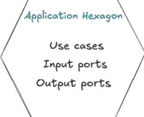

图 14.3：应用六边形

当我们开始开发应用六边形时，领域六边形应该已经实现。应用六边形依赖领域六边形来处理驱动和被驱动操作。因此，我们需要考虑领域六边形可能的约束，确定六边形应用预计从驱动侧接收什么的数据以及此类数据应如何被处理。六边形应用可能需要从其他地方检索数据以处理从驱动侧接收的数据。这些关于数据如何接收、处理或持久化的考虑可以通过输入端口、输出端口和用例以技术方式表达。让我们通过使用用例继续。

## 用例 (Use cases)

软件系统的优势之一能够自动化那些在没有软件时必须手动完成的事情。例如用信件而不是电子邮件给朋友发信息。为了寄信件，我们必须在纸上写下信息，放入信封，贴上邮票，并投进信箱。为了寄出实体信，我们必须执行所有手动任务。现在，想象发送电子邮件的场景。负责此工作的系统必须提供让用户数字化的捕获信息的手段。然后，它必须与 SMTP 服务器通信以将电子邮件发送到目的地。在系统内存中存储电子邮件并使用 SMTP 服务器发送它的能力，是软件提供的自动化任务，而“电子邮件投递”即是其用例之一。

用例代表了参与者使用系统的意图。这种参与者可以是人类，也可以是其他系统。在六边形架构中，用例可以定义为抽象（通过接口或抽象类实现），代表应用程序。用例可能包含实现目标的操作。在电子邮件投递系统中，我们可以有一个 Java 接口，包含两个抽象方法 `sendEmail(String message)` 和 `getSMTPServer()`，这两个方法结合在一起，让系统发送电子邮件。

如果用例是一个抽象，那么由什么来实现它呢？由输入端口负责实现。让我们检查输入端口。

## 输入端口 (Input ports)

输入端口描述了如何填充用例。输入端口负责处理由六边形应用驱动侧客户端提供的数据。此类数据可以根据领域六边形提供的约束进行处理。如有必要，输入端口可以使用输出端口从六边形应用被驱动侧的系统中持久化或检索数据。

应用六边形中的所有操作在定义时未指定来自六边形应用驱动侧和被驱动侧系统的技术细节，提供了更大的灵活性，因为我们可以定义系统功能，而无需指定将由哪些技术来实现这些功能。

我们之前学习过，输入端口可以依赖输出端口来从六边形应用的被驱动侧系统中持久化或检索数据。让我们探索输出端口。

## 输出端口

输出端口作为抽象，我们使用它们来定义六边形系统从外部需要什么。这里的思想是表达获取某些数据的需求，而不指定如何获取这些数据。我们这样做是为了避免对提供数据的底层技术的依赖。如果输出端口是抽象的，可能会疑惑是谁提供了它们的实现。那是输出适配器（output adapter）的责任，我们将在探索框架六边形（framework hexagon）时学习。

## 框架六边形

在开发软件系统过程中，有一个时刻我们必须决定哪些技术将启用系统功能。基于六边形架构创建新系统时，决策可以推迟到最后，此时领域模型已经在领域六边形（domain hexagon）中实现，用例和端口已经在应用六边形（application hexagon）中定义。现在剩下的是六边形系统与其外部依赖的集成，这些可能包括数据库、电子邮件服务、服务器、协议等。集成还涵盖了提供一个 API，允许用户和其他系统向六边形应用发送请求。在讨论六边形应用中的端口时讨论过的驱动侧（driver side）和被驱动侧（driven side）的思想，也可以应用于处理框架六边形中的适配器。

总结一下，在六边形应用的驱动侧，我们有如用户和其他系统之类的执行者，它们可以触发系统行为，正如此，它们处于驱动六边形应用的位置。在被驱动侧，我们有提供依赖的执行者来驱动这些者。输入适配器支持驱动侧，而被驱动侧则使用输出适配器处理。框架六边形由输入适配器和输出适配器组成，它们决定了六边形应用支持哪些技术，如图所示：

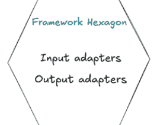

图 14.4：框架六边形

接下来，我们将探索输入适配器和输出适配器是什么，以及我们如何使用它们使六边形应用兼容任何技术。

## 输入适配器

一旦我们的六边形应用暴露了定义为用例并实现为输入端口的功能，我们可能希望将这些功能暴露给外部世界。我们通过输入适配器来实现，它们提供一个接口允许驱动者与六边形应用交互。输入适配器在某种程度上类似于物理适配器，其目的都是将某个东西的格式适配到另一个东西中。从软件系统的角度来看，格式可以被视为六边形系统支持的协议。对协议的支持取决于 API 的概念，它建立了用于与六边形应用通信的技术方案。我们可以使用基于 HTTP 的解决方案（如 RESTful、gRPC 或 SOAP）来定义 API。根据用例，我们可以探索用于文件传输的协议或用于电子邮件服务的 SMTP。

六边形架构允许我们以输入适配器的形式支持我们想要的任何技术。六边形应用最初可以定义为提供支持 RESTful 请求的输入适配器。随着应用程序的成熟，可以快速引入支持 gRPC 调用的新输入适配器。添加新的输入适配器只会影响框架六边形。应用和领域六边形中的代码完全不受框架六边形变化的影响。一个或多个输入适配器可以连接到同一个输入端口，这允许访问输入端口提供的相同系统功能，并通过输入适配器支持的不同技术暴露出来。

输入适配器是为对六边形应用提供的功能感兴趣的人打开门的六边形元素。然而，为了启用这些功能，六边形应用需要通过不同的技术获取数据并访问系统。对这些系统的访问通过使用输出适配器变为可能。让我们探索它们。

## 输出适配器

大多数后端应用程序依赖其他系统来控制其活动。这种依赖可以表现为访问的需求，例如，负责处理支付的外部 API、在预定时间执行任务的调度器系统、允许异步处理的消息代理器，或用于数据持久化的数据库。无数场景都可以作为依赖的示例。这里的关键概念是，六边形应用之外的所有依赖都通过输出适配器处理。

输出适配器支持六边形系统的被驱动侧。它们是应用六边形中定义的输出端口的直接实现。通过输出适配器，我们定义了处理提供数据或在六边形应用功能内所需的任何技术的代码。系统可以开始在 MySQL 数据库中持久化数据并在不进行重大重构的情况下进化支持 Oracle 数据库。每种新技术都由实现相同输出端口的新输出适配器支持，该端口表达了领域六边形所需的数据类型。

在涵盖了基础架构思想后，让我们看看接下来如何在开发六边形应用时应用所学的概念。我们从在领域六边形中安排领域模型开始。

## 安排领域模型

在本节中，我们将根据上一节中探索的六边形架构概念实现一个记笔记者系统。记笔记者系统是一个 Spring Boot 应用，可以通过两种方式访问：`命令行 (CLI)` 和 REST API。作为第一步，我们必须在领域六边形中安排领域模型以开发此类应用程序。让我们创建领域实体名称：

```
@Builder
@Getter
@ToString
public class Note {

  private Id id;
  private Title title;
  private String content;
  private Instant creationTime;

  private Note(Id id, Title title, String content, Instant creationTime) {
    this.id = id;
    this.title = title;
    this.content = content;
    this.creationTime = creationTime;
  }

  public static Note of(Title title, String content) {
    return new Note(Id.withoutId(), title, content, Instant.now());
  }

  public static Note of(Id id, Title title, String content, Instant creationTime) {
    return new Note(id, title, content, creationTime);
  }
}
```

我们使用 `@Builder`、`@Getter` 和 `@ToString` 注解使代码更简洁。在领域实体上使用辅助库是可以接受的，取决于我们希望实体呈现成什么样。在辅助库不可接受的情况下，我们可以仅依赖于 Java 标准。你可能注意到了 `Id` 和 `Title` 属性的使用；这些是用于更好地描述领域模型的值对象（value objects）。以下代码是 `Id` 值对象的实现方式：

```
public class Id {
  private final UUID uuid;
  private Id(UUID uuid) {
    this.uuid = uuid;
  }

  public static Id withId(String id) {
    return new Id(UUID.fromString(id));
  }

  public static Id withoutId() {
    return new Id(UUID.randomUUID());
  }

  @Override
  public String toString() {
    return uuid.toString();
  }
}
```

我们将 `Id` 类作为 Java `UUID` 类型的包装器。`Id` 对象只能通过 `withId` 和 `withoutId` 的任一个可用静态方法创建。

`Title` 是第二个可以如下所示实现的值对象：


@Getter
public class Title {

    private final String name;
    private static final int MAX_TITLE_CHARACTERS = 120;

    private Title(String name) {
        if (name.length() > MAX_TITLE_CHARACTERS) {
            throw new IllegalArgumentException("Title name exceeds maximum character limit " + MAX_TITLE_CHARACTERS);
        }
        this.name = name;
    }

    public static Title of(String name) {
        return new Title(name);
    }

    @Override
    public String toString() {
        return name;
    }
}

`Title` 值对象只能通过其静态 `of(String name)` 方法创建。使用 `Title` 值对象还允许我们通过类的构造函数强制执行约束，防止创建过长的标题。

> **Note** 实体、`Id` 和 `Title` 值对象构成了领域六边形提供的领域模型。正如我们将在接下来的章节中看到的，领域六边形在六边形架构中起着根本性的作用，因为其他六边形（即应用和框架）都依赖于它。

接下来，让我们看看应用六边形中是如何实现输入和输出端口的。

## 提供输入输出端口

在应用六边形内部，我们可以描述允许以技术无关的方式存储和检索笔记的操作。让我们从定义 `NoteOutputPort` 接口开始。

```java
public interface NoteOutputPort {

    Note persistNote(Note note);

    List<Note> getNotes();
}
```

`NoteOutputPort` 接口的定义显示应用六边形通过 `persistNote` 和 `getNotes` 方法使用 `Note` 实体依赖于领域六边形。我们不需要在应用层知道系统如何持久化和获取 `Note` 对象，因此我们通过 `NoteOutputPort` 接口来表达这一点。

下一步是定义 `NoteUseCase` 接口：

```java
public interface NoteUseCase {
    void createNote(Title title, String content);

    List<Note> getNotes();
}
```

用例用于定义应用支持的行为。笔记系统允许我们创建和查看现有的笔记。这些行为通过 `createNote` 和 `getNotes` 方法表达。基于 `NoteUseCase` 接口，我们可以这样实现 `NoteInputPort`：

```java
@Service
public class NoteInputPort implements NoteUseCase {

    private final NoteOutputPort noteOutputPort;

    public NoteInputPort(NoteOutputPort noteOutputPort) {
        this.noteOutputPort = noteOutputPort;
    }

    @Override
    public void createNote(Title title, String content) {
        var note = Note.of(title, content);
        persistNote(note);
    }

    private void persistNote(Note note) {
        noteOutputPort.persistNote(note);
    }

    @Override
    public List<Note> getNotes() {
        return noteOutputPort.getNotes();
    }
}
```

我们使用 `@Service` 注解将 `NoteInputPort` 标记为由 Spring Boot 控制的托管对象。注意，我们在 `NoteInputPort` 构造函数中将 `NoteOutputPort` 注入为依赖。这时事情变得有趣了，因为 `NoteOutputPort` 被定义为一个接口，这意味着可能存在不同的接口允许我们获取所需的数据来填充 `NoteInputPort` 的操作。继续向下查看代码，我们实现了 `createNote` 方法，该方法使用标题和内容属性创建一个 `Note` 对象。然后，我们使用 `persistNote` 方法持久化 `Note` 对象，该方法依赖于 `NoteOutputPort`。我们实现了 `getNotes` 方法，它使用 `NoteOutputPort` 获取所有的 `Notes`。`NoteInputPort` 基于它的 `UseCase` 接口，`NoteOutputPort` 抽象允许我们从外部以及领域六边形提供的领域模型中获取数据。我们如何使用 `NoteInputPort` 呢？让我们在接下来在框架六边形中暴露输入输出适配器时来发现。

## 暴露输入输出适配器

在框架六边形中，我们可以对系统如何访问以及数据如何存储做出决策。对于笔记系统，我们将数据存储在基于文件的 H2 数据库中。以下代码展示了我们在 Spring Boot 的 `application.yml` 文件中如何配置 H2 数据库：

```yaml
spring:
  datasource:
    url: jdbc:h2:file:note-h2-db
    username: sa
    password: password
    driverClassName: org.h2.Driver

  jpa:
    database-platform: org.hibernate.dialect.H2Dialect

  hibernate:
    ddl-auto: update
```

`note-h2-db` 文件在应用首次启动时创建。笔记系统的数据将持久化在该文件中。值得注意的是，使用 `jpa.hibernate.ddl-auto: update` 属性可以确保数据库架构根据应用程序的 ORM 实体定义保持更新。让我们通过实现笔记系统的输出适配器来探索这种实体定义。

## 创建输出适配器

我们不能依赖领域六边形定义的 `Note` 实体类将数据持久化到数据库中。为了这个目的，我们需要实现一个正确的 Jakarta 实体：

```java
@Builder
@Getter
@AllArgsConstructor
@NoArgsConstructor
@Entity
@Table(name = "notedata")
public class NoteData {

    @Id
    private String id;
    private String title;
    private String content;
    private Instant creationTime;
}
```

我们使用 Lombok 的 `@Builder`、`@Getter`、`@AllArgsConstructor` 和 `@NoArgsConstructor` 注解使代码更加简洁。`NoteData` 是一个代表领域六边形中定义的 `Note` 领域实体的 Jakarta 实体。由于我们有两种不同的实体类型，我们需要一个映射机制允许我们将一个实体转换为另一个：

```java
public class NoteMapper {

    public static Note noteDataToDomain(NoteData noteData) {
        return Note.of(
            Id.withId(noteData.getId()).toString(),
            Title.of(noteData.getTitle()),
            noteData.getContent(),
            noteData.getCreationTime()
        );
    }

    public static NoteData noteDomainToData(Note note) {
        return NoteData.builder()
            .id(note.getId().toString())
            .title(note.getTitle().getName())
            .content(note.getContent())
            .creationTime(note.getCreationTime())
            .build();
    }
}
```

`NoteMapper` 提供了 `noteDataToDomain` 和 `noteDomainToData` 辅助方法，分别产生 `Note` 和 `NoteData` 对象。在本节实现输出适配器类时，我们将使用 `NoteMapper`。在此之前，让我们先定义仓库接口，以便我们能够处理 `NoteData` Jakarta 实体：

```java
@Repository
public interface NoteRepository extends CrudRepository<NoteData, String> {
}
```

`NoteData`、`NoteMapper` 和 `NoteRepository` 是实现 `NoteH2Adapter` 需要的依赖：

```java
@Component
public class NoteH2Adapter implements NoteOutputPort {

    private final NoteRepository noteRepository;

    public NoteH2Adapter(NoteRepository noteRepository) {
        this.noteRepository = noteRepository;
    }

    @Override
    public void persistNote(Note note) {
        var noteData = NoteMapper.noteDomainToData(note);
        var persistedNoteData = noteRepository.save(noteData);
        return NoteMapper.noteDataToDomain(persistedNoteData);
    }

    @Override
    public List<Note> getNotes() {
        var allNoteData = noteRepository.findAll();
        var notes = new ArrayList<Note>();
        allNoteData.forEach(noteData -> {
            var note = NoteMapper.noteDataToDomain(noteData);
            notes.add(note);
        });
        return notes;
    }
}
```

我们使用 Spring 注解 `@Component` 使 `NoteH2Adapter` 类成为由 Spring Boot 控制的托管豆。`NoteH2Adapter` 通过实现 `persistNote` 和 `getNotes` 方法实现了 `NoteOutputPort`。`persistNote` 使用 `NoteMapper` 将 `Note` 领域实体转换为 `NoteData` Jakarta 实体，然后使用 `NoteRepository` 将其保存到数据库中。`getNotes` 也依赖 `NoteMapper` 来检索并将 `NoteData` Jakarta 实体转换为领域格式。

适配器上的此类转换代表了系统的基础可变能力。`NoteH2Adapter` 只是系统持久化数据的方式之一。使用端口和适配器允许我们在需要时带有适当转换的新适配器。

现在已经实现了笔记系统的输出适配器，让我们来实现输入适配器。

## 创建输入适配器

在笔记系统中，我们可以使用 CLI 接口或 REST API 处理笔记。我们需要实现两个输入适配器以允许不同的方式处理笔记。一个用于 CLI 接口，一个用于 REST API。让我们开始实现 `NoteCLIAdapter`：

```java
@Component
public class NoteCLIAdapter {
    private final NoteUseCase noteUseCase;

    public NoteCLIAdapter(NoteUseCase noteUseCase) {
        this.noteUseCase = noteUseCase;
    }

    public String createNote(Scanner requestParams) {
        var noteParams = stdinParams(requestParams);
        var title = noteParams.get("title");
        var content = noteParams.get("content");
        noteUseCase.createNote(Title.of(title), content);
        return "Note created with success";
    }

    private Map<String, String> stdinParams(Scanner requestParams) {
        Map<String, String> params = new HashMap<>();
        System.out.println("Provide the note title:");
        var title = requestParams.nextLine();
        params.put("title", title);
        System.out.println("Provide the note content:");
        var content = requestParams.nextLine();
        params.put("content", content);
        return params;
    }

    public void printNotes() {
        noteUseCase.getNotes().forEach(System.out::println);
    }
}
```

`NoteCLIAdapter` 依赖于 `NoteInputPort` 实现的 `NoteUseCase` 接口。输入端口提供了系统支持的行为，而适配器可以触发这些行为。`createNote` 方法使用 `Scanner` 对象从用户的键盘读取数据。用户提供的数据通过 `stdinParams` 方法进行捕获。最后，我们拥有 `printNotes` 方法，用于显示所有存储的笔记。

作为 `NoteCLIAdapter` 的替代方案，我们实现了 `NoteRestAdapter`：

```java
@RestController
public class NoteRestAdapter {

    private final NoteUseCase noteUseCase;

    @Autowired
    NoteRestAdapter(NoteUseCase noteUseCase) {
        this.noteUseCase = noteUseCase;
    }

    @PostMapping("/notes")
    private void addNote(@RequestBody NotePayload notePayload) {
        noteUseCase.createNote(Title.of(notePayload.title),
        notePayload.content());
    }

    @GetMapping("/notes")
    private List<Note> all() {
        return noteUseCase.getNotes();
    }
}
```

`NoteRestAdapter` 同样依赖 `NoteUseCase`，它提供了 HTTP POST `/note` 端点，允许我们在系统中创建新笔记。它还提供了 HTTP GET `/notes` 端点，用于带出所有存储的笔记。

`NoteCLIAdapter` 和 `NoteRestAdapter` 连接到派自 `NoteUseCase` 接口的 `NoteInputPort`，通过不同的手段提供相同的行为。为了让 `NoteCLIAdapter` 和 `NoteRestAdapter` 适配器工作，必须正确配置 Spring Boot。为了让系统能够在 CLI 模式下有效运行，我们需要实现 `NoteKeeperCLIApplication` 类：


```java
@Component
@ConditionalOnNotWebApplication
public class NoteKeeperCLIApplication implements CommandLineRunner {

    private final NoteCLIAdapter noteCLIAdapter;

    public NoteKeeperCLIApplication(NoteCLIAdapter noteCLIAdapter) {
        this.noteCLIAdapter = noteCLIAdapter;
    }

    @Override
    public void run(String... args) {
        var operation = args[0];
        Scanner scanner = new Scanner(System.in);
        switch (operation) {
            case "createNote" -> noteCLIAdapter.createNote();
            case "printNotes" -> noteCLIAdapter.printNotes();
            default -> throw new InvalidParameterException("The supported operations are: createNote and getNotes");
        }
    }
}
```

我们实现了 Spring 的 `CommandLineRunner` 接口，这使我们能够在 CLI 模式下执行应用程序。

`run` 方法利用 `String` 变长参数接收作为参数传递给 Java 程序的数据，使其能够创建新笔记或打印存储的笔记。

为了让系统在 Web 模式下运行，我们需要实现 `NoteKeeperWebApplication` 类。该类如下：

```java
@SpringBootApplication
public class NoteKeeperWebApplication {
    public static void main(String... args) {
        SpringApplication.run(NoteKeeperWebApplication.class, args);
    }
}
```

在 Web 模式下运行应用程序唯一要求是使用 `@SpringBootApplication` 注解。

最后，让我们来看看如何编译和运行这个笔记管理器系统。

## 编译并运行示例项目

在本节中，我们将编译并运行在之前的章节中探索过的笔记管理器项目。

你可以从 GitHub 仓库克隆源代码：

https://github.com/bppublications/Java-Real-World-Projects/tree/main/Chapter%2014

你的机器上需要安装 JDK 21 或更高版本以及 Maven 3.8.5。

执行以下命令编译应用程序：

```bash
$ mvn clean package
```

这将创建一个 JAR 文件。一旦有了这个文件，我们就可以按照以下步骤在不同模式下测试应用程序。

### 1. 在 CLI 模式下运行应用程序

```bash
$ java -jar -DSpring.main.web-application-type=NONE target/chapter14-1.0.jar
```

提供笔记标题：

```text
My goal for this week
```

提供笔记内容：

```text
I want to finish reading the Java Real World Projects book
```

上述提供的输入会在系统中创建一条新笔记。

### 2. 检查现有的笔记

```bash
$ java -jar -DSpring.main.web-application-type=NONE target/chapter14-1.0.jar printNotes
```

```text
Note(id=fec502a-afc6-46a2-a200-bc3a1aad05, title=My goal for this week,
```

### 3. 在 Web 模式下启动应用程序

```bash
$ java -jar target/chapter14-1.0.jar
```

应用程序启动，准备好接收 HTTP 请求。

### 4. 在 Web 模式下创建一个新笔记

```bash
$ curl -X POST localhost:8080/note -H 'Content-type:application/json' -d '{"title": "My goal for next week", "content": "I want to create a Java project to practice my Java skill"}'
```

### 5. 检查所有存储的笔记

```bash
$ curl -s localhost:8080/notes | jq
```

```json
{
  "id": {
    "uuid": "fec502a-afc6-46a2-a200-bc3a1aad05"
  },
  "title": {
    "name": "My goal for this week"
  },
  "content": "I want to finish reading the Java Real World Projects book",
  "creationTime": "2024-08-11T00:34:14.331012Z"
}
{
  "id": {
    "uuid": "f597f688-bd4c-4059-8d6b-997f81150943"
  },
  "title": {
    "name": "My goal for next week"
  },
  "content": "I want to create a Java project to practice my Java skill",
  "creationTime": "2024-08-11T00:35:09.966492Z"
}
```

上面的输出显示了使用 CLI 模式应用程序插入的第一条笔记，以及使用 Web 模式应用程序插入的笔记。

## 结论

我们在对六边形架构的探索中结束了本书的编写。这种软件设计技术允许我们通过将技术相关的代码与负责解决业务问题的代码解耦，创建出能够变化的应用程序。最后一章通过探索核心概念，如领域六边形及其在基于领域驱动设计的领域模型中的作用，涵盖了六边形架构的基础。我们学习了六边形应用如何帮助以技术无关的方式表达系统行为，通过不将六边形系统与第三方技术耦合提供了极佳的灵活性。我们还学习了框架六边形系统在使系统行为与不同技术兼容方面的基础性。

我们可以通过实现笔记管理器系统来应用本章分享的观点，这是一个使用六边形架构结构的 Spring Boot 应用程序。该应用程序展示了如何应用用例、输入和输出端口以及输入和输出适配器等概念，创建一个可以通过 CLI 接口和 REST API 访问的应用程序。

在本书结束之际，作者感谢你们在探索 Java 过程中所面临的挑战和所获得的知识。你们通过探索核心 Java API、最新的 Java 特性、测试技术、云原生开发、可观测性和软件架构坚持了下去。作者鼓励你们继续学习、实践，并克服 Java 开发人员生活中经常出现的复杂性问题。

# 加入我们书籍的 Discord 空间

加入书籍的 Discord 空间以获取最新更新、优惠、全球科技动态、新书发布以及与作者的交流：

https://discord.bpbonline.com


## 索引

### 符号

- `@Autowired` 119-122
- `@SpringBootApplication` 205, 206

### A

- `CallableStatement` 接口
  - 存储过程，调用 68, 69
- 检查异常 17, 18
- `Collections` API 1
- 命令行接口 (CLI) 应用 126
- 基于容器的虚拟化 194
- 容器运行时接口 (CRI) 200
- 容器技术 192
- `Criteria` API 84
- 使用 Spring Boot 的 CRUD 应用
  - API 端点，通过 controller 暴露 133, 134
  - 配置 130, 131
  - 数据库实体，定义 131
  - 依赖，设置 130
  - HTTP 请求，发送 134, 135
  - 实现 129
  - 仓库，创建 131, 132
  - 服务，实现 132, 133
- 使用 Quarkus 的 CRUD 应用
  - 构建 143
  - 使用 Panache 简化数据库实体 150
  - 数据持久化 148
  - 依赖注入，使用 Quarkus DI 143

### B

- `bean` 143

### C

- `CommandLineRunner` 接口 126
- `ConfigMap` 203, 204
- `Consumer` 31
- `Criteria` API 84

### D

- `DataSource` 接口 62-64
- `Deployment` 201, 202
- `DriverManager` 类 61
- `DDL` (数据定义语言) 60
- `DML` (数据操作语言) 60
- `Docker` 195
  - 基础 196
- 基于 Docker 的应用程序
  - 访问，通过 Service 214-216
  - 应用配置，外部化 210
  - 应用配置，使用 ConfigMap 提供 210, 211
  - 部署，使用 Deployment 212-214
  - `kubectl`，用于安装 Kubernetes 对象 216, 217
  - Kubernetes 对象，创建 210, 212
- Docker 容器
  - 创建 197, 198
- Docker 镜像
  - 创建 207-209
  - 管理 196, 197
- 领域驱动设计 (DDD) 277-279
  - 领域六边形 326, 327
  - 安排 332-335
    - 实体 327
    - 输入适配器，创建 340-342
    - 输入和输出适配器 337
    - 输入和输出端口，提供 335-337
    - 输出适配器，创建 337-340
  - 规格 328
  - 测试 295-298
  - 值对象 327

### E

- `EFK` 栈 233
  - 设置，使用 Docker Compose 233-236
- `Elasticsearch` 232
- 企业信息系统 (EIS) 层级 167
- 企业信息系统层 166
- 企业 Java Bean (EJB) 167
- 企业资源规划 (ERP) 166
- 实体 288
  - 身份，用 288-291 表示
- 实体关系
  - 定义 74
  - 多对多关系 78-81
  - 多对一关系 76
  - 一对一关系 74-76
  - 一对多关系 76-78
- 异常处理，使用异常 17, 18
  - 检查异常 17
  - 自定义异常，创建 20, 21
  - `finally` 块 19
  - `try-with-resources` 19, 20
  - 非检查异常 18, 19
- 事件风暴 282, 283
  - 事件风暴会议参与者
    - 参与者 285
    - 聚合根 286
    - 命令 285
    - 领域事件 284
    - 领域模型 286
  - 事件风暴会议，准备 283, 284
  - 识别 283

### F

- `Fluentd` 232
- `Function` 29, 30
- 框架六边形 330, 331
  - 输入适配器 331, 332
  - 输出适配器 332
- 函数式接口 28
  - `Consumer` 31
  - `Function` 29, 30
  - `Predicate` 29
  - `Stream` 31, 32
  - `Supplier` 30
- 函数式编程
  - 使用 streams 和 lambdas 28

### G

- `Google Cloud Platform` (GCP) 191
- `GraalVM` 159
- `Grafana` 仪表板 268, 269
  - 创建，使用应用程序生成的指标 268
  - 下载大小的可视化 271
  - 文件上传时长的可视化 270
  - 每个 HTTP 方法请求数量的可视化 269, 270

### H

- 六边形架构 324, 325
  - 应用六边形 328, 329
  - 领域六边形 326
  - 框架六边形 330
- `Hibernate` 81
  - 配置 21
  - 用于处理数据库 81-83

### I

- `Instant` 类 28
- 基础设施即服务 (IaaS) 193
- 继承 38
- 预期 39-43
- 集成测试 89
  - 实现，使用 Testcontainers 105-107
  - 运行，使用 Maven 107-109
- 中间操作 32
- 控制反转 (IoC) 113

### J

- `Jakarta EE` 164-167
  - 企业级应用，构建 174, 175
  - Jakarta EE Core 规格 169, 170
  - Jakarta EE Web Profile 规格 167, 168
  - 多层项目，设计 165
  - Jakarta EE 项目 173, 174
    - 企业层 165
    - 客户端层 165
    - Web 层 165
  - Jakarta Persistence
    - 数据处理，使用 72, 73
    - 实体，定义 73, 74
    - 实体关系，定义 74
- `Jakarta Server Faces` (JSF) 165
- `Jakarta Server Pages` (JSP) 165
- `Java` 1
- `Java API` 1
- `Java Archive` (JAR) 170
- `Java Collections Framework` 2, 3
- `Java Database Connectivity` (JDBC) 59, 60
- `Java Development Kit` (JDK) 159
- `Java Enterprise Edition` (EE) 112
- `Java` 平台线程 49, 50
  - 阻塞 IO 操作 50, 51
  - 局限性 50
- `java.util.Set` 接口 6
- `Java Virtual Machine` (JVM) 27, 49, 158, 159, 208
- `JP` 探索 83
- `JUnit 5`
  - 账户注册 91-93
  - 设置 90, 91

### K

- `Kibana` 232
- `Kubernetes` 198, 199
  - 架构 199
  - 容器运行时 200
  - `kube-apiserver` 200
  - `kube-controller-manager` 200
  - `kubelet` 200
  - `kube-proxy` 200
  - `kube-scheduler` 199
- Kubernetes 对象
  - `ConfigMap` 203, 204
  - `Deployment` 201, 202
  - `Pod` 201
  - `Secret` 203, 204
  - `Service` 203

### L

- `lambda` 表达式 29
- 分层架构 303, 304
- `Linux Containers` (LXC) 194
- `lists` 3
- `LocalDate` 24
- `LocalTime` 26
- 本地开发
  - 方法 85
  - 使用容器 86
  - 使用内存中数据库 85
  - 使用远程数据库 85
- 日志 API
  - 用于改进应用 21
  - 格式 24

### M

- `Maven`
  - 测试，执行 101
- `Micrometer` 241
  - 计数器 242
  - 测量值 243
  - 注册表 241
  - 标签 243
  - 计时器 244
- `MicroProfile` 171, 172
  - Jakarta EE Core 172
  - 规格 173
  - 使用 Jakarta EE 构建 API 183

### N

- `NoteCLIAdapter` 126
- `NoteKeeperCLIApplication` 126
- `NoteKeeperWebApplication` 205

### P

- `Panache` 150
- `Predicate` 29
- `Pod` 201

### Q

- `Quarkus` 143
  - DI 143

### R

- `REST API` 126
- `repository` 131

### S

- `Secret` 203, 204
- `Service` 203
- `SpringApplication` 205
- `Spring Boot` 112, 205
  - 应用 205, 206
- `Spring Boot` 应用 205
- `Stream` 31, 32
- `Supplier` 30
- `Testcontainers` 105

### T

- `try-with-resources` 19, 20

### V

- 值对象 327

### Z

- `ZoneDateTime` 27
- `ZoneId` 27


# 索引

## 数据源
- 定义 179, 180

## 健康检查
- 实现 186

## 实体
- 实现 Jakarta Persistence 180, 181

## 仓库
- 实现 `EntityManager` 181, 182

## 服务
- 实现 Jakarta CDI bean 182

## 设置
- 176, 178

## Mockito
- 96
  - 外部调用，mock 98, 100
  - 使用 JUnit 5 设置 96

## 原生应用
- 原生镜像 159
- 使用 Quarkus 构建原生执行文件 158, 159

## NIO.2 API
- 13
  - 文件和目录，处理 14
  - 路径，创建 12

## 监控
- 220, 221
  - 消费者 (`consumers`) 260
  - 导出器 (`exporters`) 260
  - 服务器 260
  - 安装 261
  - 与 Grafana 集成 266, 267
  - 设置为 Grafana 数据源 261

# O

- 面向对象编程 (OOP) 28
- 对象关系映射 (ORM) 4, 83
- 技术 72
- 可观测性 221, 222
- 一对多关系 74
- 一对一关系 76

# P

## Panache
- 使用 Panache 简化数据库实体 150
- 使用 active record 152, 153
- 使用仓库模式 151, 152

## 析虚拟化
- 193, 194

## 模式匹配
- 44
  - 用于 switch 语句 46, 47
  - 用于类型 45, 46

- 纯 Java 对象 (POJO) 327
- 切割点 (`pointcut`) 123

## PreparedStatement 接口
- 参数化查询，执行 67, 68

## 表示层
- 304, 305
  - 账户端点，实现 314, 315
  - 应用行为，暴露 315
  - 类别端点，实现 319, 320
  - 事务端点 258

## Prometheus
- 316-318
  - 告警规则，定义 273
  - 架构 259
  - 配置 261-264
  - 设置为 Grafana 数据源 267
  - 下载 261

## PromQL
- 探索 264-266

# Q

## Quarkus
- 优势 138, 139

### Quarkus 项目
- 引导 139-143
- 使用 `EntityManager` 处理数据库实体 149, 150
- 启用数据库支持 148, 149

## Quarkark REST
- API 实现 153-158

# R

- 远程文件转换器 57
- 请求作用域 bean (`request-scoped beans`) 146-148

## ResultSet 对象
- 结果，处理 69-72

# Spring AOP
- 使用 123-125

## Spring Boot Maven 项目，带有 Micrometer 配置
- 246, 247
  - 控制器类 (`controller`), 实现 252-254
  - 文件实体 (`entity`), 实现 247, 248
  - 文件指标 (`metrics`), 实现 248-250
  - 文件存储库 (`repository`), 实现 248
  - 文件服务 (`service`), 实现 250, 251
  - 指标指标，在存储系统上启用 247
  - 设置 245, 246

- Spring Boot 项目 113
- 引导 126
- 使用 Spring Initializr 创建 126-129
- 使用 Micrometer 的 Spring Boot 实现指标 244
- 用于管理 Bean 的 Spring 上下文 113
- Spring Core 项目 113

## Spring 体系注解 (stereotype annotations)
- `@Component` 注解 117
- `@Repository` 注解 117
- `@Service` 注解 117
- 使用 117-119

- `Statement` 接口：简单查询，执行 64-67

## Stream 接口
- 31, 32
  - 中间操作 33
  - 流源 32
  - 终端操作 34
  - 流源 32

- 结构化查询语言 (SQL) 语法 60

# T

- 终端操作 32
- Testcontainers：可靠的集成测试，使用 102 实现，设置 102
- 线程 49
- Title 值对象 335

# U

- 领域通用语言 (ubiquitous language) 281, 282
- 未检查的异常 (`unchecked exceptions`) 18, 19
- 单元测试 88, 89

# V

- 值对象 (`value objects`) 287, 288
- 虚拟化 192
- 基于容器的虚拟化 194, 195
- 全虚拟化 193
- 半虚拟化 (`paravirtualization`) 193, 194
- 虚拟线程 49
- 编写简单的并发代码 53-57

# W

- Web 归档 (WAR) 171

# Y

- 另一种标记语言 (YAML) 200

# Z

- `ZoneDateTime` 类 27
