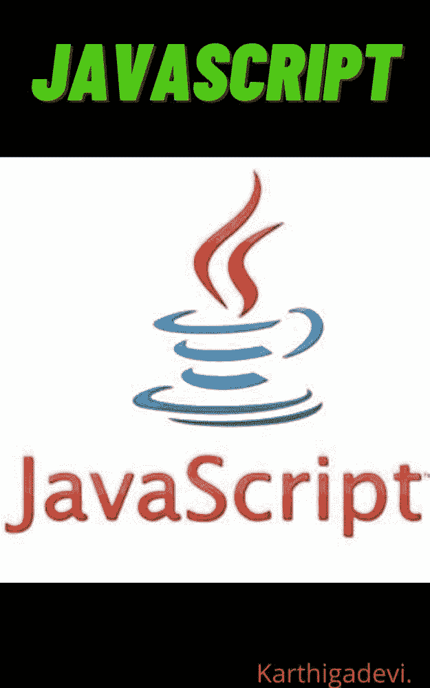
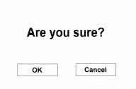
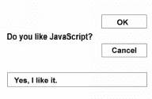

# JavaScript：初学者指南



## 关于作者

Karthigadevi 是安纳大学（Anna University）计算机科学与信息系统系的副教授。他在巴拉蒂亚尔大学（Bharathiyar University）获得计算机科学硕士学位，并在安纳大学获得计算机科学学士学位。他曾在行业内担任软件工程师和项目经理，精通 Java 以及各种网络技术——`HTML`、`CSS`、`JavaScript`、`JavaServer Pages` 和 `servlets`。他教授过全系列的计算机科学课程，包括客户端和服务端 Web 编程课程。

邮箱：ebookauthor011@gmail.com

## 法律声明

版权所有。未经以任何形式或通过任何手段复制或传输本书的任何部分。除非获得本书公司的书面许可，否则严禁复印、发布到网络和/或数字复制。允许为面向公众撰写的评论中限制度地使用本书的内容。

## JavaScript 基础

### 什么是 JavaScript?

JavaScript 是一种动态编程语言，用于使网页具有交互性。它的解释器嵌入在浏览器软件中，如 IE、Chrome 和 Firefox。它运行在访问者的计算机和浏览器上。

JavaScript 的语法如下：

```html
<script type="text/javascript">...</script>
```

示例：

```html
<script type="text/javascript">
alert("Hello World");
</script>
```

解释：`<script type="text/javascript">` 是 JavaScript 的标签。JavaScript 代码包含在其中。`alert` 会弹出一个显示消息的警告框。`alert("Hello World")` 显示 "Hello World" 消息。

### 注释

JavaScript 块可以位于 HTML 的任何位置。注释用于解释代码。

```javascript
// 这是一个单行注释
/*这是一段多行注释；JavaScript 解释器将忽略单行注释和多行注释*/
```

示例：

```html
<script type="text/javascript">
alert("Hello World"); // "alert" 弹出一个消息
/*"alert" 弹出一个显示消息 "Hello World" 的警告框。如果你想确保消息传达给用户，通常使用 alert() */
</script>
```

解释：`// "alert" 弹出一个消息` 是单行注释。`/* "alert" 弹出一个显示消息 "Hello World" 的警告框。... */` 是多行注释。

### 关键字

关键字属于 JavaScript 本身。在选择变量、函数、属性的标识符名称时不能使用这些。以下是 JavaScript 关键字：

`break`, `case`, `continue`, `default`, `delete`, `do`, `else`, `export`, `False`, `for`, `function`, `if`, `import`, `in`, `new`, `null`, `return`, `switch`, `this`, `true`, `typeof`, `var`, `void`, `while`, `With`, `Array`, `Date`, `Math`, `Object`, `window`, `location`, `history`, `navigator`, `document`, `images`, `links`, `forms`, `elements`, `getElementById`, `innerHTML`.

示例：`break` // 这是一个 JavaScript 关键字。

`return` // 这是一个 JavaScript 关键字。

### 解析

在为变量、函数、属性选择标识符名称时，不能使用 JavaScript 关键字。

### 变量

`Variable`（变量）是与值关联的符号名称。使用 `var` 来定义变量。

#### 示例

```html
<script type = “text/javascript">
var abcde;
var abc888;
var my_variable;
</script>
```

#### 解析

`abcde`、`abc888` 和 `my_variable` 都是变量。它们可以存储某些值。例如 `var abcde=100;`，`var abc888=”Hello World”;`，`var my_variable=true;`。

注意变量命名不能以数字开头，不能包含空格。例如，“23var”，“abc de”是无效的变量名。但“var23”，“abcde”是有效的变量名。

### 数据类型

- `string` – 字符或字符字符串
- `number` – 整数或浮点数
- `boolean` – 值为 true 或 false 的值
- `function` – 用户定义的方法
- `object` – 内置或用户定义的对象

#### 示例

```html
<script type = “text/javascript">
var mystring= “I am a string”;
var myinteger=168;
var myfloat=12.88;
var mybool=true;
</script>
```

#### 解析

`var mystring=”I am a string=”` // `mystring` 数据类型是 `string`。

`var myinteger=168;` // `myinteger` 数据类型是 `number`。

`var myfloat=12.88;` // `myfloat` 数据类型是 `number`。

`var mybool=true;` // `mybool` 数据类型是 `boolean`。

注意：字符串始终使用双引号。例如，“abcde”，“learning”。

### 转义序列

反斜杠 `\` 用于转义字符。

- `\n` 将内容输出到下一行。
- `\r` 产生回车。
- `\t` 产生制表符。
- `\'` 输出单引号。
- `\"` 输出双引号。

#### 示例

```html
<script type = “text/javascript">
alert (“JavaScript says \”Hello World! \” ”);
</script>
```

（输出: “Hello World”）

#### 解析

`\"` 输出双引号。注意 “Hello World” 带有一个双引号。另一个示例：`\t` 产生一个制表符

`alert (“Hello \t\t\t World”);` // 注意这里有三个制表符

（ 输出: Hello     World )

### 函数

函数是一个可以重复运行多次的代码块。要定义函数，使用 `function function-name ( ) { }`。

| 语法 | `function function-name ( ) {……}` |
| :--- | :--- |

要调用函数，使用 `function-name ( );`。

| 语法 | `function-name ( );` |
| :--- | :--- |

#### 示例

```html
<script type = “text/javascript">
function test( ){
   alert (“show a sample”);
}
test ( );
</script>
```

（输出: show a sample）

#### 解析

`“function test( ) { }` 是 `test( )` 函数的声明。`test( )` 是调用名为 `test(){` 函数的命令。运行函数 `test ( )` 时，它将输出 “show a sample”。

#### 带参数的函数

函数括号内可以有一个或多个参数。参数用于将数据传递给函数。

| 语法 | `function function-name ( var arg ) {……}` |
| :--- | :--- |

要调用函数，使用 `function-name (argument);`。

| 语法 | `function-name (argument );` |
| :--- | :--- |

#### 示例

```html
<script type = “text/javascript">
function test( var arg ){
  alert ( arg );
}
test(“display a sample”);
</script>
```

（输出: display a sample）

#### 解析

当 `test(“display a sample”)` 调用函数 `test(var arg){…}` 时，它会将 “display a sample” 传递给 `var arg`。在 `var arg` 接收数据后，它将传递函数内部的数据。`alert ( arg )` 将使用该数据，然后输出 “display a sample”。

#### 返回值

`return` 可以向调用者返回一个值。

| 语法 | `function function-name ( var arg ) { return value }` |
| :--- | :--- |

要调用函数，使用 `function-name (argument);`。

| 语法 | `function-name (argument );` |
| :--- | :--- |

#### 示例

```javascript
function cube(var num){return num*num*num}
alert ( cube(2) );
```

（ 输出: 8 ）

#### 解析

`“cube (2)”` 意味着 `cube(2)` 调用函数 `cube(var num){ }`，并将参数 “2” 传递给 `var num`。`“return num*num*num” 将结果返回给调用者 `cube(2)`，你可以将其视为 `cube(2) = return num*num*num`，将值赋值给 `cube(2)`。`alert ( cube(2) )` 将显示 `cube(2)` 的结果。

### 变量作用域

全局变量在函数外部声明，可以在任何地方可以使用；局部变量在函数内部声明，仅在函数内部使用。

#### 示例

```html
<script type = “text/javascript">
var num=200; // 全局变量
function test( ){
  var num=100; // 局部变量
}
alert (num);
</script>
```

（输出: 200）

#### 解析

`alert (num)` 输出 200，这是全局变量。局部变量仅在函数块内可见。

### 显示文本

`document.write( )` 将指定的文本显示到当前页面。

#### 示例

```html
<script type = “text/javascript">
document.write (“Hello World!”);
</script>
```

（输出: Hello World!）

#### 解析

`alert ( )` 弹出对话框显示消息。

### 运算符

| 运算符 | 说明 |
| :--- | :--- |
| `+` | 加法 |
| `-` | 减法 |
| `*` | 乘法 |
| `/` | 除法 |
| `%` | 取模：第一个操作数除以第二个操作数，返回余数。 |
| `++` | 递增 |
| `--` | 递减 |

#### 示例

```javascript
var add=100+200;
alert (add);
var div=800/2;
alert ( div );
var mod=100%3;
alert ( mod );
var inc=10++;
alert ( inc );
```

#### 解析

`var add=100+200; alert (add);` 输出 300。

`var div=800/2; alert ( div );` 输出 400。

`var mod=100%3; alert ( mod );` 输出 1。

`var inc=10++; alert ( inc );` 输出 10。

### 逻辑运算符

| 运算符 | 说明 |
| :--- | :--- |
| `&&` | 与 (AND) |
| `||` | 或 (OR) |
| `!` | 非 (NOT) |

#### 示例

```javascript
var x=true; var y=false;
var a=x && y; alert ( a ); // 输出: false
var b=x || y; alert ( b ); // 输出: true
var c=! x; alert ( c ); // 输出: false
```

#### 解析

`true && true` 返回 true；`true && false` 返回 false；`false && false` 返回 false；`true || false` 返回 true；`false || false` 返回 false；`! true` 返回 false；`! false` 返回 true。

### 赋值运算符

| 运算符 | 示例 |
| :--- | :--- |
| `+=` | `x+=y` |
| `-=` | `x-=y` |
| `*=` | `x*=y` |
| `/=` | `x/=y` |
| `%=` | `x%=y` |

#### 示例

```javascript
var x=200; var y=100;
x+=y; alert ( x );
x/=y; alert ( x );
x-=y; alert ( x );
var m=”abc”; var n=”de”;
m+=n; alert ( m );
```

#### 解析

`x+=y // x=x+y;` 输出 300。

`x/=y; // x=x/y;` 输出 200。

`x-=y; // x=x-y;` 输出 100。

`m+=n; // m=m+n;` 输出 abcde。

### 比较运算符

| 运算符 | 说明 |
| :--- | :--- |
| `>` | 大于 |
| `<` | 小于 |
| `>=` | 大于等于 |
| `<=` | 小于等于 |
| `==` | 等于 |
| `!=` | 不等于 |

#### 示例

```javascript
var a=100; var b=200;
var result = (a>b); alert ( result );
var result = (a==b); alert ( result );
var result = (a!=b); alert ( result );
```

#### 解析

`var result = (a>b); // 测试 100>200;` 输出 false。

`var result = (a==b); // 测试 100==200;` 输出 false。

`var result = (a!=b); // 测试 100!=200;` 输出 true。

### 条件运算符

条件运算符的语法如下所示：

`(test-expression) ? (if-true-do-this) : (if-false-do-this);`

`(test-expression)` 类似于 `a<b`、`x!=y`、`m==n` 等。

#### 示例

```html
<script type = “text/javascript">
var a=100; var b=200;
var result=(a<b) ? ”apple” : ”boy”;
alert ( result );
</script>
```

（ 输出: apple ）

#### 解析

输出是 “apple”。条件运算符使用 `(a<b)` 测试 “a” 和 “b”，因为 “a” 小于 “b”，它是 true。因此，输出是 “apple”。

### If 语句

```javascript
if ( test-expression ) { // 如果为真执行此操作 }
```

`if 语句` 在指定的条件为真时执行 `{ … }` 中的代码；如果条件为假，则不执行 `{…}` 中的任何代码。

#### 示例

```javascript
var a=200; var b=100;
if (a>b){
  alert ( ”a is greater than b.” );
}
```

（输出: a is greater than b。）

#### 解析

`( a>b )` 是测试表达式，即 `(200>100)`，如果返回 true，则执行 `{ }` 内部的代码；如果返回 false，则不执行 `{ }` 内部的代码。

### If-else 语句

```javascript
if ( test-expression) { // 如果为真执行此操作 } else { // 如果为假执行此操作 }
```

`if...else statement` 在条件为真时执行某些代码，在条件为假时执行另一段代码。

#### 示例

```javascript
var a=100; var b=200;
if (a>b){
  alert ( ”a is greater than b.”)}
else {
  alert ( “a is less than b” );
}
```

(输出: `a is less than b.`)

#### 解释

`(a>b)` 是一个测试表达式，即 `(100>200)`，如果 `if` 返回 true，它将输出 `"a is greater than b."`；如果 `if` 返回 false，它将输出 `a is less than b`。

### Switch 语句


```javascript
switch ( var variable ){
  case 1: 如果等于此 case，执行操作; break;
  case 2: 如果等于此 case，执行操作; break;
  case 3: 如果等于此 case，执行操作; break;
  default : 如果不等于任何 case，运行默认代码; break;
}
```

变量的值将首先与每个 `case` 进行比较，如果等于其中一个 `case` 值，它将执行该 `case` 代码。`break;` 终止代码运行。

示例：

```javascript
var number=20;
switch ( number ) {
  case 10 : alert ( “Running case 10” ); break;
  case 20 : alert ( “Running case 20” ); break;
  case 30 : alert ( “Running case 30” ); break;
  default : alert ( “Running default code” ); break;
}
```

(输出: `Running case 20`)

解释：`number` 的值为 `20`；它将匹配 `case 20`，因此将运行 `case 20` 中的代码。

## For 循环

```javascript
for( 初始化, 测试表达式, 增量) { // 某些代码; }
```

`for loop` 通过指定的次数运行代码块。

示例：

```html
<script type = “text/javascript”>
for (var x = 0; x <= 5; x++) {
  document.write ( "x " );
}
</script>
```

(输出: `012345`)

解释：`var x = 0` 是初始化器，`x <= 5` 是测试表达式，代码最多运行 5 次。`x++` 意味着 `x` 每次循环增加 1。在循环 5 次后，代码将输出 `012345`。

## While 循环

```javascript
while ( 测试表达式 ) {
  // 在此处编写某些 js 代码;
}
```

`while loop` 当指定的条件为真时循环执行一个代码块。

示例：

```javascript
var counter=0;
while (counter < 8){
  document.write ( “&” );
  counter++;
}
```

(输出: `&&&&&&`)

解释：`“counter< 8"` 是一个测试表达式，如果条件为真，代码将循环少于 8 次，直到 `counter` 等于 `8`，此时条件为假，代码将停止运行。

## Do-While 循环

```javascript
do{ // 在此处编写某些 js 代码 } while ( 测试表达式);
```

`do...while` 循环执行一次代码块，如果指定的条件为真，则重复循环。

示例：

```javascript
var counter=0;
do {
  document.write ( “@” );
  counter++;
} while (counter<8);
```

(输出: `@@@@@@@@`)

解释：`“counter< 8"` 是一个测试表达式，如果条件为真，代码将循环少于 8 次，直到 `counter` 等于 `8`，此时条件为假，代码将停止运行。

## 数组 (Array)

### 创建数组

数组是一种特殊的变量，可以包含一个或多个值。`new Array()` 创建数组。

创建数组的语法：

```javascript
var array-name = new Array (“value0”, “value1”, “value2”);
```

创建数组的另一种语法：

```javascript
var array-name = new Array ( );
array-name[index0] = “value1”;
array-name[index1] = “value1”;
array-name[index2] = “value2”;
```

示例：

```javascript
var color = new Array ( );
color [0] = “red”;
color [1] = “blue”;
color [2] = “green”;
```

解释：上述代码创建了一个数组，数组名为 `color`，它有三个元素：`color[0]`、`color[1]`、`color[2]`。它们的索引是 0, 1 和 2。它们的值是 `red`、`blue` 和 `green`。注意索引从零开始。

### 显示数组元素值

要显示数组元素值，使用以下语法：

```javascript
document.write ( array-name[index] );
```

示例：

```html
<script type = “text/javascript”>
color = new Array(“yellow”, “purple”, “orange”);
document.write ( color[1] );
</script>
```

(输出: `purple`)

解释：从上面你可以可以知道：

- `color[0]` 的值为 `yellow`。
- `color[1]` 的值为 `purple`。
- `color[2]` 的值为 `orange`。

### 获取数组长度

从上面可以知道：

```javascript
var len = color.length;
```

(输出: `3`)

### 修改数组元素

要修改数组元素，使用以下语法：

```javascript
array-name[index] = “new value”;
```

示例：

```javascript
color[1] = “black”;
```

### 删除数组元素

要删除数组元素，使用以下语法：

```javascript
array-name.splice(index, count);
```

示例：

```javascript
color.splice(1, 1);
```

### `tan()`

| `tan()` | 角度的三角正切 |

示例:

```javascript
var num = 10.2;
document.write ( Math.round(num) );
```

( 输出: 10)

Explanation: `Math.round(num)` 返回 `10.2` 的舍入整数。结果为 `10`。

### `Ceil()` & `Floor()`

| `Math.ceil()` | `Math.floor()` |
| :--- | :--- |

`Math.ceil()` 返回一个大于或等于其参数的整数。`Math.floor()` 返回一个小于或等于其参数的整数。

示例: 

```javascript
var num = 9.5;
document.write ( “Ceiling number is”+Math.ceil( num ) );
document.write ( “Flooring number is”+Math.floor( num ) );
```

( 输出: Ceiling number is 10.0 Flooring number is 9.0 )

Explanation: `Math.ceil( num )` 返回一个大于或等于 `9.5` 的整数，结果为 `10.0`。`Math.floor( num )` 返回一个小于或等于 `9.5` 的整数，结果为 `9.0`。

### `Max()` & `Min()`

| `Math.max()` | `Math.min()` |
| :--- | :--- |

`Math.max()` 返回两个数字中较大的一个。`Math.min()` 返回两个数字中较小的一个。

示例: 

```javascript
var x = 100;
var y = 200;
document.write (“Greater number is”+Math.max(x, y) );
document.write (“Less number is”+Math.min(x, y) );
```

( 输出: Greater number is 200 Less number is 100 )

Explanation: `Math.max(x, y)` 返回 `100` 和 `200` 之间较大的数字，结果为 `200`。`Math.min(x, y)` 返回 `100` 和 `200` 之间较小的数字，结果为 `100`。

### `Math.PI` & `random()`

| `Math.PI` | `Math.random()` |
| :--- | :--- |

`Math.PI` 是存储圆周率 值的常量。`Math.random()` 生成一个于 `0.0` 到 `1.0` 之间的数字。

示例: 

```javascript
var pi = Math.PI;
var ran = Math.random( );
document.write (“The PI value is” + pi);
document.write (“The random number is” + ran);
```

( 输出: The PI value is 3.141592653589793 The random number is 0.16869328 )

Explanation: `Math.PI` 的值为 `3.141592653589793`。`Math.random()` 生成一个于 `0.0` 到 `1.0` 之间的随机数，在这里的结果是 `0.16869328`。

### Date & Time

JavaScript 经常使用日期和时间来设计网页。在使用日期和时间时，必须先创建一个日期对象。

| `var DateObject = new Date()` |
| :--- |

`new Date()` 可以创建一个日期对象。

示例: 

```javascript
var DateObject = new Date( );
alert ( DateObject );
```

( 输出: Sun Apr 12 12:23 UTC 2015 )

Explanation: `var DateObject = new Date()` 创建了一个日期对象。`alert ( DateObject )` 显示当前的日期和时间。

注意：要创建一个日期对象，你可以使用其他变量名，例如：

```javascript
var now= new Date( );
var TimeObjcet = new Date( );
```

#### Date, Month, Year, Day

Date 对象拥有以下方法：

| `getDate()` | 获取日期 |
| :--- | :--- |
| `getMonth()` | 获取月份 |
| `getYear()` | 获取年份 |
| `getDay()` | 获取星期 |

注意 `getDay()` 返回值从 `0`（星期日）到 `6`（星期六）。`getMonth()` 返回值从 `0`（一月）到 `11`（十二二月）。

示例: 

```javascript
var now = new Date ( );
var y = now.getYear( );
var d = now.getDate( );
alert ( y+ “ ” + d );
```

( 输出: 2015 12 )

Explanation: `now.getYear()` 返回当前年份。`now.getDate()` 返回当前日期。

#### Hours, Minutes, Seconds

Date 对象拥有以下方法：

| `getHours()` | 获取小时 |
| :--- | :--- |
| `getMinutes()` | 获取分钟 |
| `getSeconds()` | 获取秒 |
| `getTime()` | 获取时间 |

注意 `getTime()` 返回一个从 `1970 年 1 月 1 日` 到当前时间的数字。

示例: 

```javascript
var now = new Date( );
var h = now.getHours( );
var m = now.getMinutes( );
var s = now.getSeconds( );
alert ( “Current time is” + h+ “:” + m + “:” + s );
```

( 输出: Current time is 19:30:28 )

Explanation: `getHours` 返回当前小时。`getMinutes` 返回当前分钟。`getSeconds` 返回当前秒。

#### Different Time

| `getUTCHours()` | `getTimezoneOffset()` |
| :--- | :--- |

`getUTCHours()` 返回格林尼治时间（UTC）。`getTimezoneOffset()` 返回 UTC 时间与本地时间的差异。例如，如果你的时区是 `GMT+2`，将返回 `-120`。

示例: 

```javascript
var now = new Date( );
var utc = now.getUTCHours();
var timezone = now.getTimezoneOffset();
alert ( utc + timezone );
```

( 输出: utc + timezone )

Explanation: `getUTCHours()` 返回格林尼治时间。`getTimezoneOffset()` 返回 UTC 时间与本地时间的差异。

### Set Date & Time

Date 对象拥有以下方法：

| `setDate()` | 设置日期 |
| :--- | :--- |
| `setMonth()` | 设置月份 |
| `setYear()` | 设置年份 |
| `setDate()` | 设置日期 |
| `setHours()` | 设置小时 |
| `setMinutes()` | 设置分钟 |
| `setSeconds()` | 设置秒 |
| `setTime()` | 设置时间 |

注意 `setDate()` 设置月份中的日期。

示例: 

```javascript
var now = new Date( );
now.setDate(15);
now.setMonth(5);
now.setYear(2023);
alert ( now );
```

( 输出: Date object )

Explanation: `setDate()` 设置月份中的日期。

## substr()

`substr( start, length )` 可以从字符串中提取子字符串。`start` 参数指定提取的起始位置。`length` 参数指定子字符串的长度。

示例：

```javascript
var mystring = “JavaScript is easy.";
var sub = mystring.substr( 4, 6 );
alert ( sub );( Output:  Script )
```

解释：`mystring.substr( 4, 6 )` 从 `mystring` 中提取子字符串。`( 4, 6 )` 指定子字符串的起始位置为 4，长度为 6。注意字符串索引从零开始。

## 将数字转换为字符串

| `number.toString()` |
| :--- |

为了满足 JS 编程的需求，有时需要将数字转换为字符串数据类型。`number.toString()` 可以将数字转换为字符串。

示例：

```javascript
var num1 = 12; 
var num2 = 68;
var str1 = num1.toString( );
var str2 = num2.toString( );
var sum = str1 + str2;
document.write( sum );(  Output:  1268 )
```

解释：`num1.toString()` 和 `num2.toString()` 将两个数字转换为字符串数据类型。因此，`str1` 相加 `str2` 的结果是 1268，而不是 80。

## 将字符串转换为数字

| `parseInt(string);` `parseFloat( string);` |
| :--- |

`parseInt(string)` 和 `parseFloat(string)` 可以将字符串转换为整数或浮点数。

示例：

```javascript
var str1 = “12”;  
var str2 = “68”;
var sum = str1 + str2;  
alert ( sum );(  Output: 1268  )
var num1 = parseInt( str1 );
var num2 = parseInt( str2 );
var addition = num1 + num2;
alert ( addition );(  Output: 80 )
```

解释：`parseInt( str1 )` 和 `parseInt( str2 )` 将两个字符串转换为数字数据类型。因此，`num1` 相加 `num2` 的结果是 80，而不是 1268。

## 搜索特定文本 (1)

| `indexOf()` |
| :--- |

`indexOf()` 可以在字符串中查找特定文本第一次出现的位置。

示例：


```javascript
var mystring = "Please find where find word occurs!";
var place = mystring.indexOf("find");
alert ( place );( Output: 7)
```

解释：`mystring.indexOf("find")` 返回“find”在 `mystring` 中第一次出现的位置。输出为 7。字符索引从零开始。如果在字符串中未找到该文本，`indexOf()` 返回 -1。

## 搜索特定文本 (2)

| `lastIndexOf()` |
| --- |

`lastIndexOf()` 可以在字符串中查找特定文本最后一次出现的位置。

示例：

```javascript
var mystring = "Please find where find word occurs!";
var place = mystring.lastIndexOf("find");
alert ( place );( Output: 18 )
```

解释：`mystring.lastIndexOf("find")` 返回“find”在 `mystring` 中最后一次出现的位置。输出为 18。字符索引从零开始。如果在字符串中未找到该文本，`indexOf()` 返回 -1。

## 对象声明

对象（Object）指的是某个具体的事物。例如：汽车、书、狗、房子等……

| `obj = new Object();` `obj.property;` |
| --- |

`obj = new Object()` 创建一个名为 `obj` 的新对象。`obj.property` 意味着对象的属性。

示例：

```javascript
house = new Object();
house.color = "white";
house.size = "big";
document.write("House color: " + house.color + "\n");
document.write("House size: " + house.size + "\n");( Output: House color: white House size: big )
```

解释：`house = new Object()` 创建了一个名为 `house` 的对象。`house.color` 意味着房屋的颜色。`house.size` 意味着房屋的大小。

## 网页间导航

| `window.history.back();` `window.history.forward();` |
| --- |

`back()` 用于导航到上一个网页。`forward()` 用于导航到下一个网页。

示例：

```javascript
window.history.back();( Returns: Previous web page. )
window.history.forward();( Returns: Next web page. )
```

解释：`back()` 回到上一个页面。`forward()` 前往下一个页面。`window.history.method()` 用于导航到指定的网页。该方法通常由网页上的按钮调用，将在后续章节中介绍。

## 跳转到指定页面

| `window.history.go(number);` |
| --- |

`window.history.go(number)` 跳转到指定的网页。

示例：

```javascript
window.history.go(1);( Returns: Next web page. )
window.history.go(-1);( Returns: Previous web page. )
window.history.go(0);( Returns: Reload current web page. )
```

解释：`window.history.method()` 用于导航到指定的网页。该方法通常由网页上的按钮调用，将在后续章节中介绍。

## 打开自定义窗口

| `window.open(name, width, height, status, menubar)` |
| --- |

`window.open` 可以打开一个新的自定义窗口。`name` 参数意味着新窗口名称。`width` 参数意味着新窗口宽度。`height` 参数意味着新窗口高度。`status` 和 `menubar`。

示例：

```javascript
window.open("MyWindow", "400", "300", "Status", "no");
```

解释：`MyWindow` 是窗口名称。`400`、`300` 是宽度和高度。`Status` 是状态。`no` 是菜单栏。

## 确认

| `window.confirm();` |
| --- |

`window.confirm()` 需要用户确认。对话框如下：

示例：

```javascript
var ask = window.confirm("Are you sure?");
if (ask == true) {
  alert("All Right!");
} else {
  alert("No Good!");
}
```

解释：用户点击“确定”或“取消”。

## 输入提示

| `window.prompt();` |
| --- |

`window.prompt()` 需要用户输入。对话框如下：

示例：

```javascript
var ask = window.prompt("Enter your name");
if (ask != null) {
  alert("Hello " + ask);
} else {
  alert("Cancelled");
}
```

解释：用户在提示框中输入句子。

```html
<html><head><title>…</title></head><body><form></form>…..</body></html>
```

解释：`<html>`...`</html>` 定义了网页文档。`<head>`...`</head>` 定义网页的头部。`<title>`...`</title>` 定义网页的标题。`<body>`...`</body>` 定义网页的正文。`<form>`...`</form>` 定义了一个表单，用于接收来自用户的请求或输入。

### 点击事件 (Click Event)

当用户点击网页上的某个元素时，会触发“click”事件。

```javascript
onClick = function();
```

`onClick = function();` 意味着当点击元素时，会执行一个函数。

示例：

```html
<form><input type="button" value="Previous" onClick="history.back()"></form>
```

（返回：上一个网页。）

解释：`<form>` 和 `</form>` 是 HTML 标签，位于网页中，`form` 用于接收来自用户的请求。`<input type="button" value="Previous"...>` 在表单中定义了一个按钮，按钮上有“Previous”文本。

`onClick="history.back()"` 意味着当点击按钮时，`history.back()` 会立即运行，然后返回上一个网页。

### 加载事件 (Onload Event)

当网页完全加载完成后，会触发“onload”事件。

```javascript
onload = function();
```

`onload = function();` 意味着当网页加载完成后，`function()` 会立即执行。

示例：

```html
<html><body onload = alert("Welcome to my page!")>……</body></html>
```

解释：`<html>` 和 `</html>` 是 html 标签，定义了一个网页。`<body>` 和 `</body>` 定义网页的正文。`onload = alert()` 意味着当网页加载时，`alert()` 会立即运行并显示消息“Welcome to my page!”。

### 卸载事件 (Unload Event)

当网页卸载时，会触发“unload”事件。

```javascript
unload = function();
```

`unload = function();` 意味着当网页卸载时，`function()` 会立即执行。

示例：

```html
<html><body unload = confirm("Are you sure?")>……</body></html>
```

解释：`<html>` 和 `</html>` 是 html 标签，定义了一个网页。`<body>` 和 `</body>` 定义网页的正文。`unload = confirm()` 意味着当网页卸载时，`confirm()` 会立即运行并显示消息“Are you sure?”。

### 鼠标悬入事件 (Mouseover Event)

当鼠标指针移动到元素上方时，会触发“mouseover”事件。

```javascript
mouseover = function();
```

`mouseover = function();` 意味着当鼠标指针移动到元素上方时，`function()` 会立即执行。

示例：

```html
<body></body>
```

解释：`` 是定义图片的标签。`src="myphoto.jpg"` 指定了网页中显示的图片 `myphoto.jpg`。`mouseover = alert();` 意味着当鼠标指针移动到图片上方时，`alert()` 会立即运行并显示消息“Please view the photo”。

### 鼠标移出事件 (Mouseout Event)

当鼠标指针移出元素时，会触发“mouseout”事件。

```javascript
mouseout = function();
```

`mouseout = function();` 意味着当鼠标指针移出元素时，`function()` 会立即执行。

示例：

```html
<body></body>
```

解释：`` 是定义图片的标签。`src="myphoto.jpg"` 指定了网页中显示的图片 `myphoto.jpg`。`mouseout = alert();` 意味着当鼠标指针移出图片时，`alert()` 会立即运行并显示消息“See you!”。

### 按键按下事件 (Onkeydown Event)

当按键被按下时，会触发“onkeydown”事件。

```javascript
onkeydown = function();
```

`onkeydown = function();` 意味着当按键按下时，`function()` 会立即执行。

示例：

```html
<body><input type="text" onkeydown="myfunction()"></body>
<script>function myfunction(){ alert("You pressed a key."); }</script>
```

解释：`<input type="text"...>` 意味着网页中有一个输入框供用户输入数据。输入框如下所示：

`onkeydown = "myfunction()"` 意味着当按键按下时，`myfunction()` 会立即运行。

### 按键释放事件 (Onkeyup Event)

当按键被释放时，会触发“onkeyup”事件。

```javascript
onkeyup = function();
```

`onkeyup = function();` 意味着当按键释放时，`function()` 会立即执行。

示例：

```html
<body><input type="text" onkeyup="myfunction()"></body>
<script>function myfunction(){ alert("You released a key."); }</script>
```

解释：`<input type="text"...>` 意味着网页中有一个输入框供用户输入数据。输入框如下所示：

`onkeyup = "myfunction()"` 意味着当按键释放时，`myfunction()` 会立即执行（立即运行）。

### 聚焦事件 (Focus Event)

当用户将光标移动到元素上时，会触发“focus”事件。

```javascript
focus = function();
```

`focus = function();` 意味着当光标移动到元素时，`function()` 会立即执行。

示例：

```html
<body><input type="text" onfocus="myfunction()"></body>
```

（网页中的输入。`focus = function();` 意味着当光标移动到元素时，`function()` 会立即执行。）

### 失去聚焦事件 (Blur Event)

当用户光标移出元素时，会触发“blur”事件。

```javascript
blur = function();
```

`blur = function();` 意味着当光标移出元素时，`function()` 会立即执行。

## reset()

`reset()` 用于清除表单数据。

示例：

```html
<form id="myform" method="get" action="f.php">
……
<input type="button" onclick="myfunction()" value="Clear">
</form>
<script>
function myfunction() {
  document.getElementById("myform").reset();
}
</script>
```

（结果：表单数据被完全清除。）

解释：`onclick = "myfunction()"` 意味着点击按钮时会立即执行 `myfunction()`。`document.getElementById("myform")` 通过其 id 访问 `myform`。`reset()` 清空 `myform` 数据。

## 提交方法 (Submit Method)

### submit()

`submit()` 用于将表单数据提交到。

示例：

```html
<form id="myform" method="get" action="f.php">
……
<input type="button" onclick="myfunction()" value="Submit">
</form>
<script>
function myfunction() {
  document.getElementById("myform").submit();
}
</script>
```

（结果：表单数据已提交到服务器。）

解释：`onclick = "myfunction()"` 意味着点击按钮时会立即执行 `myfunction()`。`document.getElementById("myform")` 通过其 id 访问 `myform`。`submit()` 将 `myform` 数据提交到服务器。

## 选择框选择 (Select Selection)

| `<select id="myid" onchange="function()">` |
| --- |

当表单中的 `select` 值发生变化时，会触发 `onChange` 事件并立即运行 `function()`。

| Red | v |
| --- | --- |

示例：

```html
<select id="mySelect" onchange="myfunction()">
  <option value="Red">Red</option>
  <option value="Blue">Blue</option>
  <option value="Pink">Pink</option>
</select>
<script type="text/javascript">
function myfunction() {
  var v = document.getElementById("mySelect").value;
  alert("You selected: " + v);
} // 例如：选择 Pink
</script>
```

（输出：You selected: Pink）

解释：`document.getElementById("mySelect")` 通过其 id 访问 `mySelect`。`document.getElementById("mySelect").value` 意味着获取值。

## 单选框选择 (Radio Selection)

| `<input type="radio" id="myid" value="myvalue">` |
| --- |

一组单选按钮允许随时勾选一个圆，并提交选中的值进行处理。

示例：


# 单选按钮选择 (Radio Button Selection)

```html
( 显示：○ red ○ blue ○ pink )
<input type="radio" id="color" value="Red">Red
<input type="radio" id="color" value="Blue">Blue
<input type="radio" id="color" value="Pink">Pink
<input type="submit" value="submit" onclick="myfunct()">
<script>
function myfunct() {
  var v=document.getElementById("color").value;
  alert(v);
} // 例如：选择 Blue
</script>
```

（输出：Blue）

解释：`document.getElementById("color")` 通过其 id 访问 `color`。`document.getElementById("color").value` 意味着获取值。

## 复选框选择 (CheckBox Selection)

| `<input type="checkbox" id="myid" value="myvalue">` |

一组复选按钮允许随时勾选多个框，并提交选中的值进行处理。

示例：

```html
( 显示：□ red □ blue □ pink )
<input type="checkbox" id="color" value="Red">Red
<input type="checkbox" id="color" value="Blue">Blue
<input type="checkbox" id="color" value="Pink">Pink
<input type="submit" value="submit" onclick="myfunct()">
<script>
function myfunct() {
  var v=document.getElementById("color").value;
  alert(v);
} // 例如：选择 Blue Pink
</script>
```

（输出：Blue Pink）

解释：`document.getElementById("color")` 通过其 id 访问 `color`。`document.getElementById("color").value` 意味着获取值。

## JavaScript: Function ( ) (1)

超链接中的 `href` 属性通常包含 `JavaScript: function( )` 代码。

| `<a href="javascript: function( )"> 文本</a>` |

`<a>` 定义了一个超链接。

示例：

```html
<p><a href="javascript:confirm('Are you sure?')"> Learn JavaScript!</a></p>
```

（输出：Learn JavaScript!）



解释：当你点击“Learn JavaScript!”超链接时，确认对话框立即显示“Are you sure?”，你可以点击“OK”或“Cancel”。

## JavaScript: Function ( ) (2)

超链接中的 `href` 属性通常包含 `JavaScript: function( )` 代码。

| `<a href="javascript: function( )"> 文本</a>` |

`<a>` 定义了一个超链接。

示例：

```html
<p><a href="javascript:prompt('Do you like JavaScript?')"> JavaScript in 8 Hours! </a></p>
```

（输出：JavaScript in 8 Hours!）



解释：当你点击超链接 “JavaScript Prompt”时，Prompt 对话框立即显示“Do you like JavaScript?”，你可以输入“Yes, I like it.”，然后点击“OK”！
