# 给急躁者的 Java SE 8 入门指南 (Fahad Batla 系列)

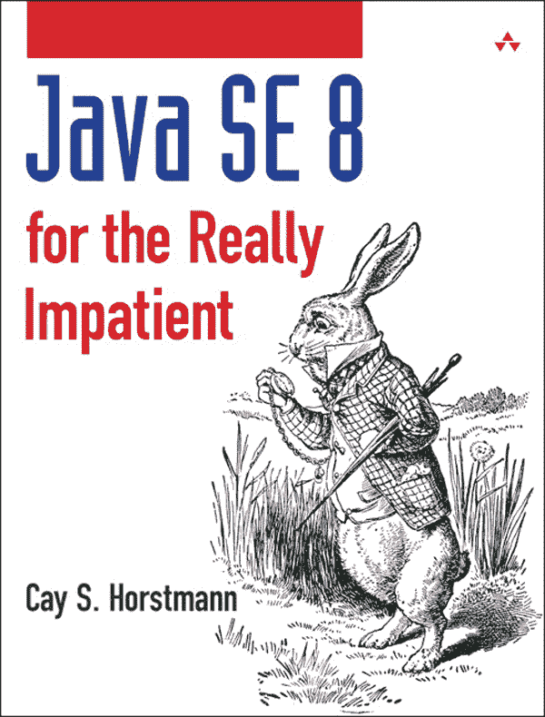


# 关于本电子书

ePUB 是一种开放的行业标准电子书格式。然而，阅读设备和应用程序对 ePUB 及其许多功能的支持各相同。请使用您的设备或应用设置来根据喜好自定义显示。您可以自定义的设置通常包括字体、字体大小、单栏或双栏、横屏或竖屏模式，以及可以点击或触摸放大的图像。有关您的阅读设备或应用设置和功能的更多信息，请访问设备制造商的网站。

许多书籍包含编程代码或配置示例。为了优化这些元素的显示效果，请在单栏横屏模式下查看电子书并将字体大小调整为最小。除了以流式文本格式显示代码和配置外，我们还包含了代码图像，以模仿印刷书籍中的显示效果；因此，当流式格式可能会影响代码列表的显示时，您将看到“点击此处查看代码图像”链接。点击该链接查看高保真代码图像。要返回上一页，请点击设备或应用上的返回按钮。


新泽西州上萨德河 • 波士顿 • 印安波利斯 旧金山

纽约 • 多伦多 • 蒙特利尔 伦敦 • 慕尼黑 • 巴黎 • 马里德

开敦 • 悉尼 • 东京 • 新加坡 墨西哥城

```java
-> message.setFont(new Font(newValue.doubleValue())));
```

***

## 4.5 绑定

JavaFX 属性存在的意义在于`绑定`（binding）：当一个属性发生变化时自动更新另一个属性。例如，考虑图 4–3 中的应用程序。当用户编辑顶部地址时，底部地址也会随之更新。

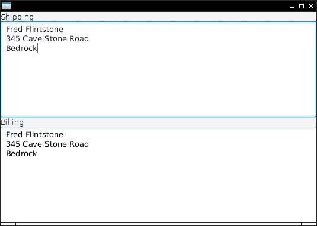

**图 4–3** 绑定的文本属性会自动更新。

这是通过将一个属性绑定到另一个属性来实现的：

点击此处查看代码图像

```java
billing.textProperty().bind(shipping.textProperty());
```

在底层，在 `shipping` 的文本属性上添加了一个监听器，该监听器会设置 `billing` 的文本属性。

你也可以调用：

点击此处查看代码图片

```java
billing.textProperty().bindBidirectional(shipping.textProperty());
```

如果其中一个属性发生变化，另一个也会随之更新。

要撤销绑定，请调用 `unbind` 或 `unbindBidirectional`。

绑定机制解决了用户界面编程中的一个常见问题。例如，考虑一个日期字段和一个日历选择器。当用户从日历中选择一个日期时，日期字段应该自动更新，模型中的日期属性也是如此。

当然，在许多情况下，一个属性依赖于另一个属性，但这种关系更为复杂。考虑图 4–4。我们总是希望圆在场景中居中。也就是说，它的 `centerX` 属性应该是场景 `width` 属性的一半。


**图 4–4** 此圆的中心绑定到场景宽度和高度一半。

为了实现这一点，我们需要产生一个计算属性。`Bindings` 类提供了为此目的设计的静态方法。例如，`Bindings.divide(scene.widthProperty(), 2)` 是一个属性，其值是场景宽度的一半。当场景宽度变化时，该属性也随之变化。剩下的就是将该计算属性绑定到圆的 `centerX` 属性：

点击此处查看代码图片

```java
circle.centerXProperty().bind(Bindings.divide(scene.widthProperty(), 2));
```

* * *

 备注

或者，你可以调用 `scene.widthProperty().divide(2)`。对于更复杂的表达式，静态的 `Bindings` 方法似乎更易读，特别是当你使用：

点击此处查看代码图片

```java
import static javafx.beans.binding.Bindings.*;
```

并编写 `divide(scene.widthProperty(), 2)` 时。

* * *

这里有一个更真实的示例。我们希望当仪表盘太小或太大时禁用 `Smaller` 和 `Larger` 按钮（图 4–5）。


**图 4–5** 当仪表盘到达任一端时，按钮会被禁用。

点击此处查看代码图片

```java
smaller.disableProperty().bind(Bindings.lessThanOrEqual(gauge.widthProperty(), 0));

larger.disableProperty().bind(Bindings.greaterThanOrEqual(gauge.widthProperty(), 100));
```

当宽度 ≤ 0 时，`Smaller` 按钮被禁用。当宽度 ≥ 100 时，`Larger` 按钮被禁用。

表 4–1 列出了 `Bindings` 类提供的所有操作符。一个或两个参数实现了 `Observable` 接口或其一个子接口。`Observable` 接口提供了添加和移除 `InvalidationListener` 的方法。`ObservableValue` 接口增加了 `ChangeListener` 管理和 `getValue` 方法。其子接口提供了获取相应类型值的方法。例如，`ObservableStringValue` 的 `get` 方法返回 `String`，而 `ObservableIntegerValue` 的 `get` 方法返回 `int`。`Bindings` 方法的返回类型是 `Binding` 接口的子接口，而 `Binding` 本身是 `Observable` 接口的子接口。`Binding` 知晓它依赖的所有属性。

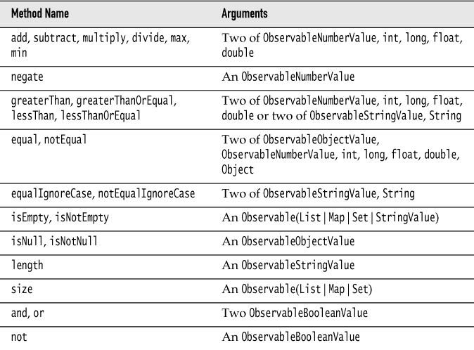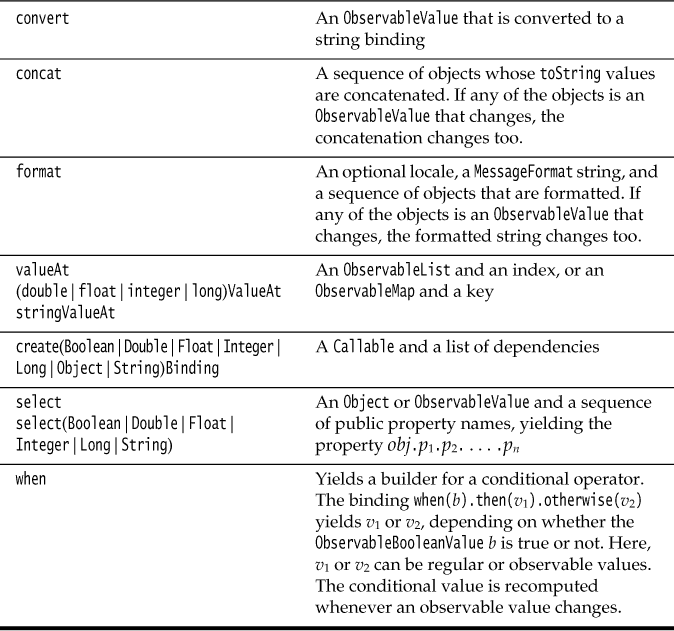

**表 4–1** `Bindings` 类提供的操作符

在实践中，你不需要担心所有这些接口。你组合属性，就可以得到一个可以绑定到另一个属性的东西。

使用 `Bindings` 类的方法构建计算属性可能会变得非常复杂。还有另一种产生计算绑定的方法，你可能会觉得更简单。简单来说，将想要计算的表达式放入 lambda 表达式中，并提供一个依赖属性列表。当任何属性发生变化时，lambda 就会重新计算。例如，

点击此处查看代码图片

```java
larger.disableProperty().bind(
    createBooleanBinding(
        () -> gauge.getWidth() >= 100, // 此表达式会被计算...
        gauge.widthProperty())); // ...当此属性变化时
```

练习 5 提供了一种稍微优雅一点的方法来使用 lambda 表达式惰性求值绑定。

* * *

 备注

在 JavaFX Script 语言中，编译器分析绑定表达式并自动识别出依赖属性。你只需要声明 `disable bind gauge.width >= 100`，编译器就会在 `gauge.width` 属性上附加一个监听器。当然，在 Java 中，程序员需要手动提供这些信息。

* * *

## 4.6 布局

当图形用户界面包含控件时，它们需要在屏幕上排列。获取布局的一种方法是使用设计工具。该工具让你将元素拖入其中、调整大小并配置。然而，这种方法在元素大小变化时会出现问题。

另一种方法是使用 HTML 和 CSS。同样，JavaFX 支持三种方法。SceneBuilder 是一个可视化构建器。你可以从 `www.oracle.com/technetwork/java` 下载它。图 4–6 显示了截图。

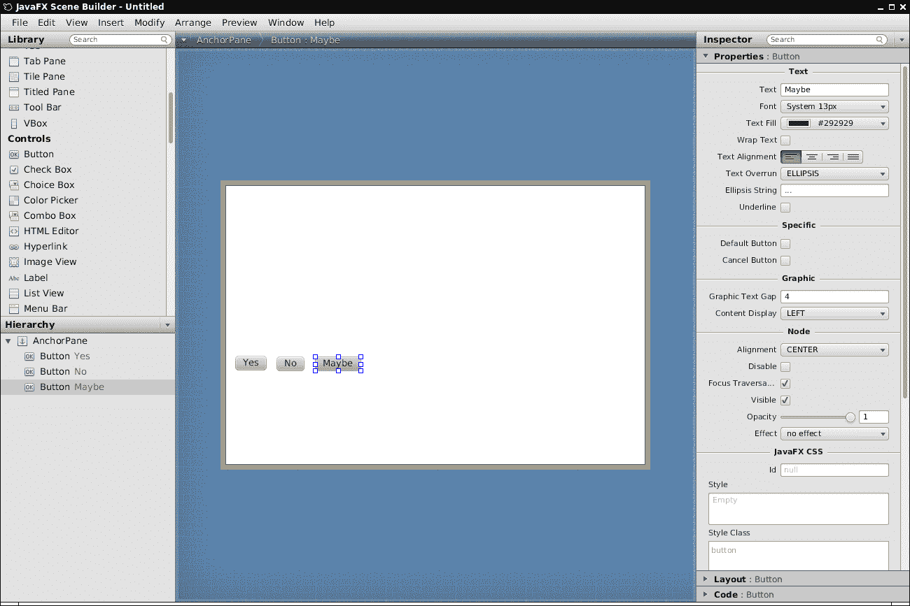

**图 4–6** JavaFX SceneBuilder

我们不会进一步讨论 SceneBuilder。当你理解了本节的概念后，会发现它非常好用。

程序化布局与 Swing 非常相似。然而，不是使用布局管理器，而是使用容器——具有布局策略的容器。例如，`BorderPane` 有五个区域：北、西、南、东和中心。在这里我们在每个区域都放置一个按钮：

点击此处查看代码图片

```java
BorderPane pane = new BorderPane();

pane.setTop(new Button("Top"));

pane.setLeft(new Button("Left"));

pane.setCenter(new Button("Center"));

pane.setRight(new Button("Right"));

pane.setBottom(new Button("Bottom"));

stage.setScene(new Scene(pane));
```

图 4–7 显示了结果。

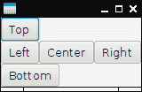

**图 4–7** `BorderPane` 布局

* * *

 备注

在 Swing 的 `BorderLayout` 中，按钮会填充布局的每个区域。在 JavaFX 中，按钮不会超过其自然尺寸。

* * *

现在假设你想在南部区域放置多个按钮。使用 `HBox`（见图 4–8）：

点击此处查看代码图片

```java
HBox box = new HBox(10); // 控件间 10 像素

box.getChildren().addAll(yesButton, noButton, maybeButton);
```


**图 4–8** 使用 `HBox` 布局按钮

当然，还有一个 `VBox` 用于垂直排列控件。图 4–8 中的布局是通过这种方式实现的：

```java
VBox pane = new VBox(10);

pane.getChildren().addAll(question, buttons);

pane.setPadding(new Insets(10));
```

注意 `padding` 属性。如果没有它，标签和按钮将触碰到窗口边界。

* * *


在 JavaFX 中，尺寸是以像素为单位的。在我们的示例中，我们使用十像素作为框间距和内边距。在如今像素密度差异巨大的情况下，这种做法并不十分合适。克服这一问题的方法之一是在 `rem` 中计算尺寸，就像你在 CSS3 中做的那样。（`rem` 或“根节点 em”是文档根节点默认字体的高度。）

点击此处查看代码

```java
final double rem = new Text("").getLayoutBounds().getHeight();

pane.setPadding(new Insets(0.8 * rem));
```

***

仅依靠水平和垂直布局框（boxes）所能实现的效果是有限的。就像 Swing 有 `GridBagLayout` 作为“布局管理器之母”一样，JavaFX 有 `GridPane`。可以将 `GridPane` 想象一个 HTML 表格。你可以设置所有单元格的水平和垂直对齐。如果需要，单元格可以跨越多行和多列。参考图 4–9 中的登录对话框。


**图 4–9** 一个 `GridPane` 可以排列此登录对话框的控件。

注意以下几点：

• 标签“User name:”和“Password:”是右对齐的。
• 按钮位于一个跨越两行的 `HBox` 中。

向 `GridPane` 添加子节点时，请指定它的列索引和行索引（按此顺序；将其想象为 *x-* 和 *y-* 坐标）。

```java
pane.add(usernameLabel, 0, 0);

pane.add(username, 1, 0);

pane.add(passwordLabel, 0, 1);

pane.add(password, 1, 1);
```

如果子节点跨越了多列或行，请在位置之后指定跨度。例如，按钮面板跨越了两列和一行：

```java
pane.add(buttons, 0, 2, 2, 1);
```

如果你想让子节点跨越所有剩余的行或列，可以使用 `GridPane.REMAINING`。

要设置子节点的水平对齐，请使用静态方法 `setHalignment`，并传递子节点引用以及来自 `HPos` 枚举的常量 `LEFT`、`CENTER` 或 `RIGHT`。

点击此处查看代码

```java
GridPane.setHalignment(usernameLabel, HPos.RIGHT);
```

同样，对于垂直对齐，调用 `setValignment` 并使用来自 `VPos` 枚举的 `TOP`、`CENTER` 或 `BOTTOM`。

***

 注意

这些静态调用在 Java 代码中看起来并不优雅，但在 FXML 标记语言中它们是有意义的——见下一节。

***

***

 注意

*不要*在网格中居中带有按钮的 `HBox`。该布局框已经扩展到了整个水平宽度，居中不会改变它的位置。相反，请让 `HBox` 将其内容居中：

```java
buttons.setAlignment(Pos.CENTER);
```

***

你可能还想在行和列周围提供一些间距并在表格周围提供一些内边距：

点击此处查看代码

```java
pane.setHgap(0.8 * em);

pane.setVgap(0.8 * em);

pane.setPadding(new Insets(0.8 * em));
```

***

 提示

为了调试，查看单元格边界可能会很有用（参考图 4–10）。调用

点击此处查看代码

```java
pane.setGridLinesVisible(true);
```

如果你想查看单个子节点的边界（例如，查看它是否已增长并填充整个单元格），请设置它的边界。通过 CSS 实现这一点最容易：

点击此处查看代码

```java
buttons.setStyle("-fx-border-color: red;");
```


**图 4–10** 在调试 `GridPane` 时使用可见的网格线。

***

这些布局面板应该足够大多数应用程序使用。表 4–2 显示了 JavaFX 自带的所有布局。

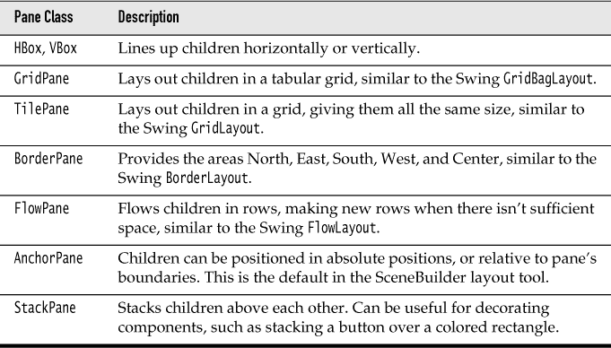

**表 4–2** JavaFX 布局

***

 注意

在本节中，我们通过手动嵌套布局框和控件构建了用户界面。JavaFX Script 有一种用于描述此类嵌套结构的“构建器”语法（称为“场景图”）。JavaFX 2 使用构建类来模仿该语法。以下是构建登录对话框的方法：

点击此处查看代码

```java
GridPane pane = GridPaneBuilder.create()
    .hgap(10)
    .vgap(10)
    .padding(new Insets(10))
    .children(
// ...
```

大多数属性都对应于属性的设置方法（setters）。例如，

```xml
<GridPane hgap="10" vgap="10">
```

意味着“构造一个 `GridPane`，然后设置 `hgap` 和 `vgap` 属性”。

当一个属性以类名和静态方法开头时，会调用该方法。例如，点击此处查看代码图像

```xml
<TextField GridPane.columnIndex="1" GridPane.rowIndex="0"/>
```

意味着将调用静态方法 `GridPane.setColumnIndex(thisTextField, 1)` 和 `GridPane.setRowIndex(thisTextField, 0)`。

* * *

 注意

通常情况下，FXML 元素是使用其默认构造函数构建的，然后通过调用属性设置方法或静态方法进行定制，这符合 JavaBeans 规范的精髓。我们将在稍后考虑一些少数例外情况。

* * *

当一个属性值太复杂而无法用字符串表示时，应使用嵌套元素而不是属性。例如，点击此处查看代码图像

```xml
<GridPane hgap="10" vgap="10">
    <padding>
        <Insets top="10" right="10" bottom="10" left="10"/>
    </padding>
    ...
```

`padding` 属性的类型为 `Insets`，而 `Insets` 对象是通过 `<Insets ...>` 子元素构建的，并指定了如何设置其属性。

最后，列表属性有一个特殊规则。例如，`children` 是一个列表属性，调用 点击此处查看代码图像

```xml
<HBox ...>
    <children>
        <Button text="Ok" />
        <Button text="Cancel" />
    </children>
</HBox>
```

将将按钮添加到 `getChildren` 返回的列表中。

你可以手动编写 FXML 文件，也可以使用我在前一节中提到的 SceneBuilder 程序。一旦你有了这样一个文件，可以像这样加载它：点击此处查看代码图像

```java
```


public void start(Stage stage) {

    try {

        Parent root = FXMLLoader.load(getClass().getResource("dialog.fxml"));

        stage.setScene(new Scene(root));

        stage.show();

    } catch (IOException ex) {

        ex.printStackTrace();

        System.exit(0);

    }

}

当然，这本身还没有用处。用户界面显示了，但程序无法访问用户提供的值。在控件和程序之间建立连接的一种方法是使用 `id` 属性，就像你在 JavaScript 中做的那样。在 FXML 文件中提供 `id` 属性：

```xml
<TextField id="username" GridPane.columnIndex="1" GridPane.rowIndex="0"/>
```

在程序中，查找控件：

```java
TextField username = (TextField) root.lookup("#username");
```

但有一个更好的方法。你可以使用 `@FXML` 注解将控件对象“注入”到*控制器*类中。该控制器类必须实现 `Initializable` 接口。在控制器的 `initialize` 方法中，你连接绑定器和事件处理器。任何类都可以作为控制器，甚至是 FX 应用程序本身。

例如，这里是我们登录对话框的控制器：

```java
public class LoginDialogController implements Initializable {

    @FXML private TextField username;

    @FXML private PasswordField password;

    @FXML private Button okButton;

    public void initialize(URL url, ResourceBundle rb) {

        okButton.disableProperty().bind(

            Bindings.createBooleanBinding(

                () -> username.getText().length() == 0

                    || password.getText().length() == 0,

                username.textProperty(),

                password.textProperty()));

        okButton.setOnAction(event ->

            System.out.println("Verifying " + username.getText()

                + ":" + password.getText()));

    }

}
```

在 FXML 文件中，使用 `fx:id`（而不是 `id`）属性将控制器的实例变量名提供给 FXML 文件中对应的控件元素：

```xml
<TextField fx:id="username" GridPane.columnIndex="1" GridPane.rowIndex="0"/>

<PasswordField fx:id="password" GridPane.columnIndex="1" GridPane.rowIndex="1" />

<Button fx:id="okButton" text="Ok" />
```

在根元素中，你还需要使用 `fx:controller` 属性声明控制器类：

```xml
<GridPane xmlns:fx="http://javafx.com/fxml" hgap="10" vgap="10" fx:controller="LoginDialogController">
```

## 4.8 CSS

JavaFX 允许你使用 CSS 更改用户界面的外观，这通常比提供 FXML 属性或调用 Java 方法更方便。你可以通过编程方式加载 CSS 样式表并将其应用到场景（scene）中：

```java
Scene scene = new Scene(pane);
scene.getStylesheets().add("scene.css");
```

在样式表中，你可以引用任何带有 ID 的控件。例如，这里是控制一个 `GridPane` 外观的方法。在代码中设置 ID：

```java
GridPane pane = new GridPane();
pane.setId("pane");
```

不要在代码中设置任何内边距或间距。相反，使用 CSS。

```css
#pane {
    -fx-padding: 0.5em;
    -fx-hgap: 0.5em;
    -fx-vgap: 0.5em;
    -fx-background-image: url("metal.jpg")
}
```

遗憾的是，你不能使用熟悉的 CSS 属性，而是需要知道以 `-fx-` 开头的 FX 特有属性。这些属性名称是通过将属性名转换为小写并用连字符代替驼峰命名法而成的。例如，`textAlignment` 属性变为 `-fx-text-alignment`。你可以在 JavaFX CSS 的参考文档中找到所有支持的属性：[`docs.oracle.com/javafx/2/api/javafx/scene/doc-files/cssref.html`](http://docs.oracle.com/javafx/2/api/javafx/scene/doc-files/cssref.html)。

使用 CSS 比在代码中充斥着布局细节要优雅得多。而且，你可以轻松地使用与分辨率无关的 `em` 单位。当然，CSS 既可以用于善意也可以用于作恶（参见图 4–11），我希望你能够抵制在登录对话框中添加无意义背景纹理的诱惑。


**图 4–11** 使用 CSS 样式化用户界面

与其通过单个 ID 进行样式化，你可以使用样式类。将该类添加到节点对象中：

```java
HBox buttons = new HBox();
buttons.getStyleClass().add("buttonrow");
```

然后使用 CSS 类符号对其进行样式化：

```css
.buttonrow {
    -fx-spacing: 0.5em;
}
```

每个 JavaFX 控件和形状类都属于一个 CSS 类，其名称是小写化后的 Java 类名。例如，所有的 `Label` 节点都拥有类 `label`。以下是你可以如何将所有标签的字体更改为 Comic Sans：

```css
.label {
    -fx-font-family: "Comic Sans MS";
}
```

但请不要这样做。

你还可以在 FXML 布局中使用 CSS。将样式表挂载到根面板上：

```xml
<GridPane id="pane" stylesheets="scene.css">
```

在 FXML 代码中提供 `id` 或 `styleClass` 属性。例如，

```xml
<HBox styleClass="buttonrow">
```

然后你可以在 CSS 中指定大部分样式，而仅将 FXML 用于布局。遗憾的是，你无法完全从 FXML 中移除所有样式。例如，目前还没有没有方法在 CSS 中指定网格单元对齐。

***

 注意

你还可以通过编程方式应用 CSS 样式，例如：

```java
buttons.setStyle("-fx-border-color: red;");
```

这对于调试可能很有用，但通常情况下，使用外部样式表似乎更好。

***

## 4.9. 动画与特效

当 JavaFX 出生时，特效非常流行，而 JavaFX 能够轻松地产生阴影、模糊和移动。你会在网上找到几十个精美的演示，上面气泡在无目的地旋转，文字在紧张地跳动等等。我想你可能会喜欢一些关于如何将这些动画带到业务应用世界的实用技巧。图 4–12 显示了一个应用程序，其中“是”按钮尺寸在增大，而“否”按钮淡入背景，而“可能”按钮则在旋转。


**图 4–12** 会增长、淡出和旋转的按钮

JavaFX 定义了许多过渡效果，它们可以在一段时间内改变节点的属性。以下是如何在三秒钟内沿 `x` 和 `y` 方向将一个节点放大 50% 的方法：

```java
ScaleTransition st = new ScaleTransition(Duration.millis(3000));
st.setByX(1.5);
st.setByY(1.5);
st.setNode(yesButton);
st.play();
```

该节点可以是场景图中的任何节点，例如肥皂泡动画中的圆圈，或者我们示例中愈具诱惑力的“是”按钮。

按照设置，过渡将在达到目标时结束。你可以像这样无限循环它：

```java
st.setCycleCount(Animation.INDEFINITE);
st.setAutoReverse(true);
```

现在，节点会变大，然后变小，紧接着又变大，以此类推。

`FadeTransition` 改变节点的透明度。以下是“否”按钮淡入背景的方式：

```java
FadeTransition ft = new FadeTransition(Duration.millis(3000));
ft.setFromValue(1.0);
ft.setToValue(0);
ft.setNode(noButton);
ft.play();
```

所有的 JavaFX 节点都可以围绕其中心进行旋转。`RotateTransition` 改变节点的 `rotate` 属性。以下代码使“可能”按钮进行旋转：

```java
RotateTransition rt = new RotateTransition(Duration.millis(3000));
rt.setByAngle(180);
rt.setCycleCount(Animation.INDEFINITE);
rt.setAutoReverse(true);
rt.setNode(maybeButton);
rt.play();
```

你可以使用 `ParallelTransition` 和 `SequentialTransition` 来组合过渡效果，让它们并行执行或顺序执行。如果你需要处理多个节点，可以将它们放入 `Group` 节点。如果你需要创建这种行为，[ch04.html_fig13] 显示了 `Text` 节点的结果。以下是代码：

```java
DropShadow dropShadow = new DropShadow();
dropShadow.setRadius(5.0);
dropShadow.setOffsetX(3.0);
dropShadow.setOffsetY(3.0);
dropShadow.setColor(Color.GRAY);
Text text = new Text("Drop shadow");
text.setFill(Color.RED);
text.setFont(Font.font("sans", FontWeight.BOLD, 40));
text.setEffect(dropShadow);
```


**图 4–13** JavaFX 特效

设置发光或模糊效果同样简单：

```java
text2.setEffect(new Glow(0.8));
text3.setEffect(new GaussianBlur());
```

承认，发光效果看起来有点廉价，模糊效果在业务领域并没有许多应用，但制作这些效果确实令人印象深刻。

## 4.10. 华丽控件

当然，JavaFX 拥有组合框、标签页面板、树形和表格，就像 Swing 一样，还有一些 Swing 没有的控件，例如日期选择器和手风琴。需要一整本书来详细描述这些内容。在本节中，我想通过向你展示三个超越 Swing 的控件来消除任何对 Swing 的怀旧之情。图 4–14 显示了你可以使用 JavaFX 开箱即用的许多图表之一，无需安装任何第三方库。


**图 4–14** 一个 JavaFX 图表

并且像饼一样简单：

```java
ObservableList<PieChart.Data> pieChartData = FXCollections.observableArrayList(
    new PieChart.Data("Asia", 4298723000.0),
    new PieChart.Data("North America", 355361000.0),
    new PieChart.Data("South America", 616644000.0),
    new PieChart.Data("Europe", 742452000.0),
    new PieChart.Data("Africa", 1110635000.0),
    new PieChart.Data("Oceania", 38304000.0)
);
final PieChart chart = new PieChart(pieChartData);
chart.setTitle("Population of the Continents");
```

总而言之，有六种你可以使用和自定义的图表类型。更多信息请参阅 [`docs.oracle.com/javafx/2/charts/chart-overview.htm`](http://docs.oracle.com/javafx/2/charts/chart-overview.htm)。

在 Swing 中，你可以在 `JEditorPane` 中显示 HTML，但对于大多数真实场景中的 HTML 来说，渲染效果很差。这可以理解——实现一个浏览器是一项艰巨的工作。事实上，这项工作困难，以至于大多数浏览器都是在开源 WebKit 引擎之上构建的。JavaFX 也采取了同样的做法。`WebView` 显示一个嵌入的原生 WebKit 窗口（参见图 4–15）。


**图 4–15** 浏览网页

以下是显示网页的代码：

```java
String location = "http://horstmann.com";
WebView browser = new WebView();
WebEngine engine = browser.getEngine();
engine.load(location);
```

该浏览器是活跃的——你可以像往常一样点击链接。JavaScript 同样有效。然而，如果你想从 JavaScript 显示状态栏或弹出消息，你需要安装通知处理程序并实现自己的状态栏和弹出窗口。

***

 注意

`WebView` 不支持任何插件，因此你无法用它显示 Flash 动画或 PDF 文档。它也不显示 applet。

***

在 JavaFX 之前，Java 的媒体播放功能非常糟糕。Java Media Framework 作为一个可选下载项提供，但它并没有受到开发者的青睐。当然，实现音频和视频播放比编写浏览器还要困难。因此，JavaFX 利用了现有的工具包——开源的 GStreamer 框架。

要播放视频，需要从 URL 字符串构造一个 `Media` 对象，构造一个 `MediaPlayer` 来播放它，以及一个 `MediaView` 显示播放器：

```java
Path path = Paths.get("moonlanding.mp4");
String location = path.toUri().toString();
Media media = new Media(location);
MediaPlayer player = new MediaPlayer(media);
player.setAutoPlay(true);
MediaView view = new MediaView(player);
view.setOnError(e -> System.out.println(e));
```


正如你在图 4–16 中看到的，视频正在播放——但遗憾的是，没有视频控制控件。你可以添加自己的（参见 [`docs.oracle.com/javafx/2/media/playercontrol.htm`](http://docs.oracle.com/javafx/2/media/playercontrol.htm)，但如果能提供一组默认控件就更好了）。


**图 4–16** 播放视频

***

 注意

经常，GStreamer 无法处理特定的视频文件。代码示例中的错误处理器会显示 GStreamer 消息，以便你诊断播放问题。

***

这标志着我们 JavaFX 快速之旅的结束。JavaFX 是桌面 Java 的未来。它有一些粗糙之处，主要是由于从原始脚本语言仓忙转换而来。但它用起来确实并不比 Swing 困难，而且它比 Swing 拥有的具有更多有用且吸引人的控件。

## 练习题

**1.** 编写一个带有文本字段和标签的程序。与 Hello, JavaFX 程序一样，标签应该具有 100 点字号的字符串 "Hello, FX"。初始化文本字段为相同的字符串。当用户编辑文本字段时，更新标签。

**2.** 考虑一个包含许多 JavaFX 属性的类，例如图表或表格。很有可能在特定的应用程序中，大多数属性从没有附加过监听器。因此，为每个属性都设置一个属性对象是浪费的。展示如何按需设置属性：首先使用一个普通字段来存储属性值，然后仅在第一次调用 `xxxProperty()` 方法时才使用属性对象。

**3.** 考虑一个包含许多 JavaFX 属性的类，其中大多数属性从未从默认值改变。展示如何按需设置属性，即当它被设置为非默认值时，或者在第一次调用 `xxxProperty()` 方法时。

**4.** 增强第 4.5 节 中的“绑定”程序，其位于第 75 页，使圆保持居中并始终至少接触场景的两个边。

**5.** 编写方法

点击此处查看代码图片

```java
public static <T, R> ObservableValue<R> observe(
    Function<T, R> f, ObservableValue<T> t)

public static <T, U, R> ObservableValue<R> observe(
    BiFunction<T, U, R> f, ObservableValue<T> t, ObservableValue<U> u)
```

这些方法返回可观测值，其 `getValue` 方法返回 lambda 表达式的值，并且当任何输入失效或更改时，其失效监听器和变化监听器会被触发。例如，

点击此处查看代码图片

```java
t.disableProperty().bind(observe(t -> t >= 10))
```

**6.** 如你在图 4–7 中所示，视频正在播放——但遗憾的是，没有视频控制控件。你可以添加自己的（参见 [`docs.oracle.com/javafx/2/media/playercontrol.htm`](http://docs.oracle.com/javafx/2/media/playercontrol.htm)，但如果能提供一组默认控件就更好了）。

**7.** 既然没有 JavaFX，如何处理时间。**8.** 一个行星。**9.** 动画化一个圆。**10.** 使用 `PathTransition`。

# 第 5 章 新日期和时间 API

## 本章主题

 5.1 时间线

 5.2 日期

 5.3 调整器

 5.4 本地时间

 5.5 时区时间

 5.6 格式化与解析

 5.7 与旧代码交互

 5.8 练习题

时间流如箭，我们可以轻松地设置一个起点并向前向后计数。那么为什么处理时间如此困难呢？问题在于人类。如果我们只需要告诉对方：“我们在 137140920 見，不要迟到！”但我们希望时间与日光照和季节有关。这时事情变得复杂了。1.0 有一个 `Date` 类，回想起来它是极其天真的，并且在 1.1 引入 `Calendar` 类后，大部分方法都被废弃了。它的 API 并不出色，实例是可变的，而且没有处理闰秒等问题。三次成拳，Java 8 引入的 `java.time` API 修复了过去的缺陷，并足够我们使用很一段时间。在本章中，你将学习为什么时间计算如此烦恼，以及新的日期和时间 API 如何解决这些问题。

本章的要点是：

• 所有 `java.time` 对象都是不可变的。
• `Instant` 是时间线上的点（类似于 `Date`）。
• 在 Java 时间中，每一天恰好有 86400 秒（即没有闰秒）。
• `Duration` 是两个瞬时之间的差异。
• `LocalDateTime` 不包含时区信息。
• `TemporalAdjuster` 方法处理常见的日历计算，例如找到第一个星期二。
• `ZonedDateTime` 是给定时区内的时间点（类似于 `GregorianCalendar`）。
• 在推进时区时间时使用 `Period` 而不是 `Duration`，以考虑夏令时间的变化。
• 使用 `DateTimeFormatter` 对日期和时间进行格式化和解析。

在历史上，基本时间单位“秒”源于地球绕其自轴的旋转。一个完整的自转有 24 小时，即 24 × 60 × 60 = 86400 秒，因此精确定义一秒似乎仅仅是一个天文测量的问题。遗憾的是，地球会轻微摇晃，因此需要更精确的定义。1967 年，一种与历史定义匹配的新型精确秒定义是根据 133 铯原子的内在属性推导出的。从那时起，一个原子钟网络维持着官方时间。

官方计时器会经常将绝对时间与地球自转进行同步。起初，官方秒时间会进行细微调整，但从 1972 年开始，偶尔会插入“闰秒”（理论上，偶尔可能需要删除一个秒，但这种情况尚未发生）。目前有关于再次更改该系统的讨论。显然，闰秒非常麻烦，许多计算机系统转而使用“平滑”处理，即在闰秒发生之前人为地减慢或加速时间，以保持每天 86,400 秒。这样做之所以有效，是因为计算机的本地时间并不十分精确，且计算机被用于与外部时间服务进行同步。

Java 日期时间 API 规范要求 Java 使用的时间尺度满足以下条件：

- 每天 86,400 秒
- 每天正午与官方时间完全匹配
- 在其他时间以精确定义的方式与官方时间紧密匹配

这使得 Java 具有灵活性来适应未来官方时间的变更。

在 Java 中，`Instant` 代表时间线上的一个点。一个称为 *epoch*（纪元）的原点被任意设置为 1970 年 1 月 1 日午夜通过伦敦格林威治皇家天文台的天子线。这与 Unix/POSIX 时间使用的约定相同。从该原点开始，时间以每天 86,400 秒为单位向前和向后测量，精度为纳秒。`Instant` 值可以追溯到十亿年前（`Instant.MIN`）。这不足以表达宇宙的年龄（约 135 亿年），但对于所有实际用途来说足够了。毕竟，十亿年前，地球被冰雪覆盖，居住着今天植物动物的微型祖先。最大值 `Instant.MAX` 是 1,000,000,000 年 12 月 31 日。静态方法调用 `Instant.now()` 获取当前瞬间。你可以像通常一样使用 `equals` 和 `compareTo` 方法比较两个 instant，因此你可以将 instant 作为时间戳。

要计算两个 instant 之间的差异，请使用静态方法 `Duration.between`。例如，这里是你可以如何测量算法的运行时间：

点击此处查看代码图像

```java
Instant start = Instant.now();
runAlgorithm();
Instant end = Instant.now();
Duration timeElapsed = Duration.between(start, end);
long millis = timeElapsed.toMillis();
```

`Duration` 是两个 instant 之间的时间量。你可以通过调用 `toNanos`、`toMillis`、`toSeconds`、`toMinutes`、`toHours` 或 `toDays` 以常规单位获取 `Duration` 的长度。

`Duration` 内部存储需要的比一个 `long` 值更多。秒数存储在 `long` 中，而纳秒数存储在额外的 `int` 中。如果你想以纳秒精度进行计算，并且实际上需要整个 `Duration` 的范围，那么可以使用 表 5–1 中的任意方法之一。否则，你只需调用 `toNanos` 并使用 `long` 值进行计算。

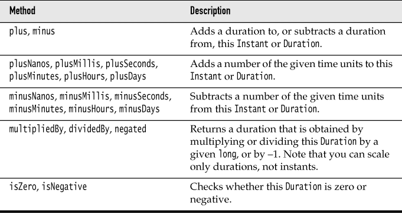

**表 5–1** 时间 Instant 和 Duration 的算术运算

***

 注意

`long` 溢出大约需要 300 年纳秒。

***

例如，如果你想检查一个算法是否比另一个快至少十倍，你可以计算：

点击此处查看代码图像

```java
Duration timeElapsed2 = Duration.between(start2, end2);
boolean overTenTimesFaster = timeElapsed.multipliedBy(10).minus(timeElapsed2).isNegative();
// 或者 timeElapsed.toNanos() * 10 < timeElapsed2.toNanos()
```

***

 注意

`Instant` 和 `Duration` 类是不可变的，且所有方法（如 `multipliedBy` 或 `minus`）都会返回新实例。

***

## 5.2 本地日期

现在让我们从绝对时间转向人类时间。在新的 Java API 中，有两种类人类时间：*本地日期/时间*（local date/time）和*时区时间*（zoned time）。本地日期/时间有日期和/或一天，但没有关联的时区信息。例如，本地日期可以是 1903 年 6 月 14 日（lambda 表达式发明者 Alonzo Church 的出生日）。由于该日期既没有时间也没有时区信息，因此它不对应于精确的时间瞬间。相比之下，1969 年 7 月 16 日 09:32 则对应一个精确的瞬间。

点击此处查看代码图片

```java
LocalDate.of(2016, 1, 31).plusMonths(1)
```

以及

点击此处查看代码图片

```java
LocalDate.of(2016, 3, 31).minusMonths(1)
```

结果为 2016 年 2 月 29 日。

***

`getDayOfWeek` 方法返回星期，其类型为 `DayOfWeek` 枚举值。`DayOfWeek.MONDAY` 的数值为 `1`，而 `DayOfWeek.SUNDAY` 的值为 `7`。例如，

点击此处查看代码图片

```java
LocalDate.of(1900, 1, 1).getDayOfWeek().getValue()
```

返回 `1`。`DayOfWeek` 枚举提供了方便方法 `plus` 和 `minus` 来计算模 7 的星期。例如，`DayOfWeek.SATURDAY.plus(3)` 返回 `DayOfWeek.TUESDAY`。

***

 注意

周末实际上位于周的末尾。这与 `java.util.Calendar` 不同，在后者周日的值为 `1`，周日的值为 `7`。

***

除了 `LocalDate` 外，还有 `MonthDay`、`YearMonth` 和 `Year` 类来描述部分日期。例如，12 月 25 日（不指定年份）可以用 `MonthDay` 表示。

## 5.3 日期调整器

对于调度应用程序，你通常需要计算诸如“每个月的第一个星期二”之类的日期。`TemporalAdjusters` 类提供了许多常用调整的静态方法。你将调整方法的结果传递给 `with` 方法。例如，一个月的第一个星期二可以这样计算：

点击此处查看代码图片

```java
LocalDate firstTuesday = LocalDate.of(year, month, 1).with(
    TemporalAdjusters.nextOrSame(DayOfWeek.TUESDAY));
```

像既往一样，`with` 方法返回一个新的 `LocalDate` 对象，而不修改原始对象。表 5–3 显示了可用的调整器。

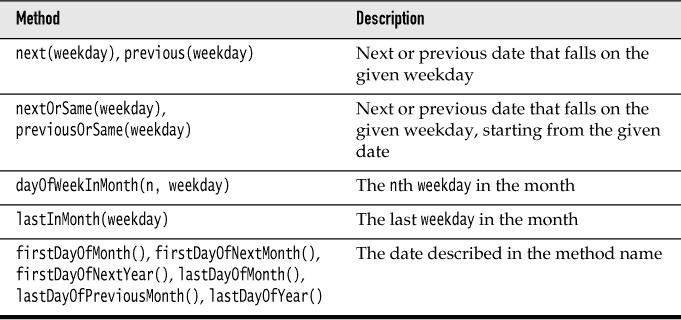

**表 5–3** `TemporalAdjusters` 类中的日期调整器

你也可以通过实现 `TemporalAdjuster` 接口来实现自己的调整器。这里是一个计算下一个工作日的调整器。

点击此处查看代码图片

```java
TemporalAdjuster NEXT_WORKDAY = w -> {
```


## 5.4. 本地时间 (Local Time)

`LocalTime` 表示一天中的某个时间，例如 15:30:00。你可以使用 `now` 或 `of` 方法创建实例：

```java
LocalTime rightNow = LocalTime.now();
LocalTime bedtime = LocalTime.of(22, 30); // 或 LocalTime.of(22, 30, 0)
```

表 5–4 显示了本地时间的常用操作。`plus` 和 `minus` 操作在 24 小时内循环。例如，

```java
LocalTime wakeup = bedtime.plusHours(8); // wakeup 为 6:30:00
```

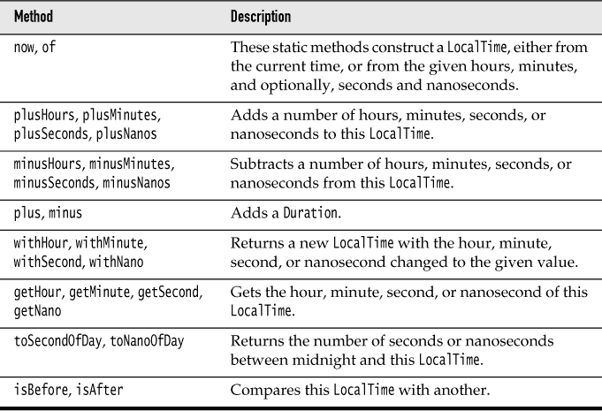

**表 5–4** `LocalTime` 方法

***

 注意

`LocalTime` 不考虑上午/下午。这种琐碎的事情留给格式化程序——参见第 5.6 节，“格式化与解析”。

***

有一个 `LocalDateTime` 类表示日期和时间。然而，如果你需要处理时区，应该使用 `ZonedDateTime`。

## 5.5. 时区时间 (Zoned Time)

时区可能比 `LocalDate` 更复杂，应使用 `ZonedDateTime`。`ZonedDateTime` 的许多方法与 `LocalDateTime` 相同（参见表 5–5）。UTC 代表“协调世界时”，这个缩写词源于法语的“temps universel coordiné”。UTC 是格林威天文台的时间，不考虑夏令时。

要创建 `ZonedDateTime` 实例，可以使用 `now` 或 `of` 方法，也可以通过 `atZone` 方法将 `LocalDateTime` 转换为 `ZonedDateTime`。例如：

```java
ZonedDateTime zdt = ZonedDateTime.of(2013, 3, 31, 2, 30, 0, 0, ZoneId.of("Europe/Berlin"));
```

`ZonedDateTime` 有相对于 UTC 的偏移量，东半球的值为正，西半球为负。偏移量是相对于 UTC 的。

你可以使用 `getOffset` 方法获取 `ZonedDateTime` 的偏移。你也可以使用 `withZoneSameOffset` 或 `withZone` 方法更改 `ZonedDateTime` 的偏移。`withZoneSameOffset` 返回具有相同本地时间但不同偏移的 `ZonedDateTime`，而 `withZone` 返回具有相同时区但不同时间的 `ZonedDateTime`。

`ZonedDateTime` 还有一个 `ZoneId`，它包含了时区的规则。你可以使用 `getZone` 方法获取 `ZoneId`。

`ZonedDateTime` 类还拥有 `ZoneRules` 对象，它包含了该时区的规则。你可以使用 `getRules` 方法获取 `ZoneRules`。`ZoneRules` 对象可以用于确定给定瞬间的偏移量，或查找夏令时的转换点。

你还可以使用 `toInstant` 方法将 `ZonedDateTime` 转换为 `Instant`，或使用 `toLocalDateTime` 方法转换为 `LocalDateTime`。例如：

```java
Instant instant = zdt.toInstant();
LocalDateTime ldt = zdt.toLocalDateTime();
```

`ZonedDateTime` 类通常用于表示特定时区的时间点。它适用于需要处理时区的应用程序，例如调度系统或全球化应用程序。

```java
ZonedDateTime ambiguous = ZonedDateTime.of(
    LocalDate.of(2013, 10, 27), // 夏令时结束时刻
    LocalTime.of(2, 30),
    ZoneId.of("Europe/Berlin"));
// 2013-10-27T02:30+02:00[Europe/Berlin]
ZonedDateTime anHourLater = ambiguous.plusHours(1);
// 2013-10-27T02:30+01:00[Europe/Berlin]
```

一小时后，时间的小时和分钟相同，但区域偏移量（offset）发生了变化。

在跨越夏令时边界调整日期时，你也需要注意。例如，如果你为下周安排了会议，不要直接添加七天的时长：

```java
ZonedDateTime nextMeeting = meeting.plus(Duration.ofDays(7));
// 注意！这在夏令时将不起作用
```

相反，请使用 `Period` 类。

```java
ZonedDateTime nextMeeting = meeting.plus(Period.ofDays(7)); // OK
```

***

 注意

还有一个 `OffsetDateTime` 类，它表示与 UTC 具有偏移量的时间，但不包含时区规则。该类旨在用于专门要求不需要这些规则的特化应用程序，例如某些网络协议。对于人类使用的时间，请使用 `ZonedDateTime`。

***

## 5.6. 格式化与解析

`DateTimeFormatter` 类提供了三类格式器来打印日期/时间值：

* 预定义的标准格式器（参见表 5–6）

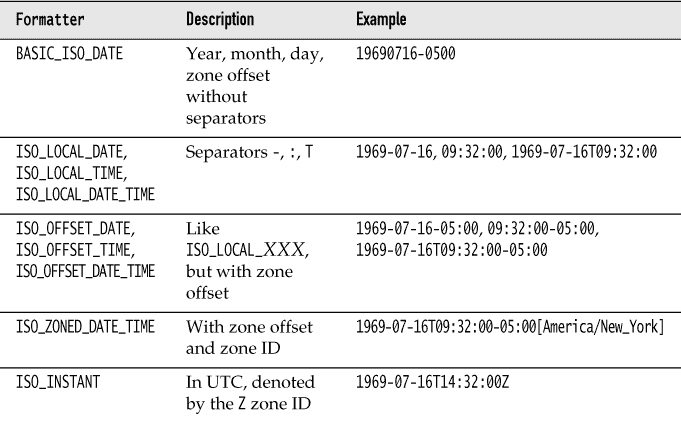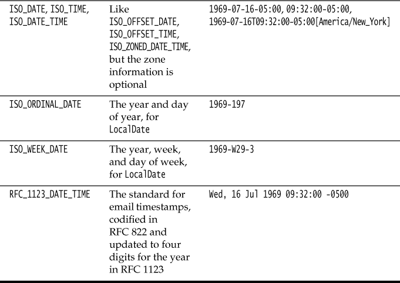

**表 5–6** 预定义格式器

* 特定区域语言的格式器
* 具有自定义模式的格式器

要使用其中一种标准格式器，只需调用其 `format` 方法：

```java
String formatted = DateTimeFormatter.ISO_DATE_TIME.format(apollo11launch);
// 1969-07-16T09:32:00-05:00[America/New_York]
```

标准格式器主要用于机器可读的时间戳。为了向人类读者展示日期和时间，请使用特定区域语言的格式器。日期和时间都有四种样式：`SHORT`、`MEDIUM`、`LONG` 和 `FULL`——参见表 5–7。


**表 5–7** 特定区域语言的格式化样式

静态方法 `ofLocalizedDate`、`ofLocalizedTime` 和 `ofLocalizedDateTime` 创建此类格式器。例如：

```java
DateTimeFormatter formatter = DateTimeFormatter.ofLocalizedDateTime(FormatStyle.LONG);
String formatted = formatter.format(apollo11launch);
// 1969 年 7 月 16 日 上午 9:32:00 EDT
```

这些方法使用默认区域语言（locale）。要切换到不同的区域语言，只需使用 `withLocale` 方法。

```java
formatted = formatter.withLocale(Locale.FRENCH).format(apollo11launch);
// 16 juillet 1969 09:32:00 EDT
```

***

 Note

`java.time.format.DateTimeFormatter` 类旨在替代 `java.util.DateFormat`。如果你为了向后兼容需要后者的实例，请调用 `formatter.toFormat()`。

***

最后，你可以通过指定模式来自己定义日期格式。例如，

```java
formatter = DateTimeFormatter.ofPattern("E yyyy-MM-dd HH:mm");
```

将日期格式化为 `Wed 1969-07-16 09:32` 形式。每个字母代表一个不同的时间字段，字母重复的次数根据规则选择特定的格式，这些规则非常晦奥，似乎是随着时间的推移有机形成的。表 5–8 显示了最常用的模式元素。

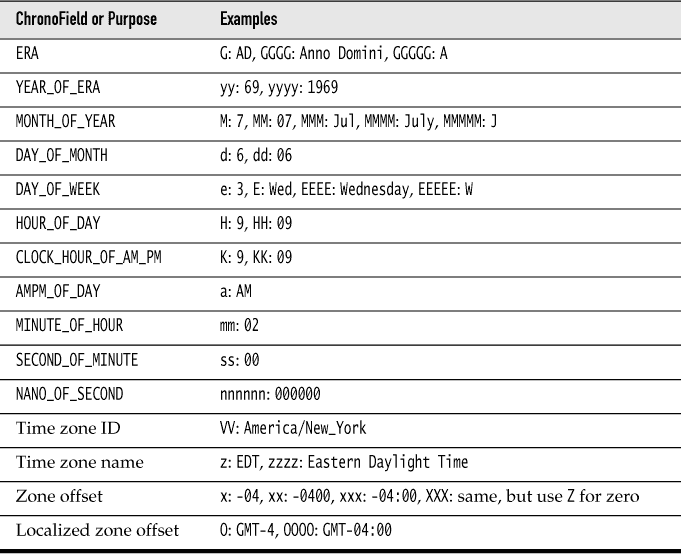

**表 5–8** 日期/时间格式中常用的格式化符号

要从字符串中解析日期/时间值，请使用其中一个静态 `parse` 方法。例如，

```java
LocalDate churchsBirthday = LocalDate.parse("1903-06-14");
ZonedDateTime apollo11launch = ZonedDateTime.parse("1969-07-16T09:32-05:00[America/New_York]");
```

### 5.7. 与旧留代码交互

新的 `java.time` 包将与现有的 `java.util.Date`、`java.util.Calendar` 以及 `java.util.sql` 类交互。`Instant` 是 `java.util.Date` 的类比类。在 Java 8 中，它增加了 `toInstant()` 和 `from()` 方法。同样，`ZonedDateTime` 是 `java.util.Calendar` 的类比类。在 Java 8 中，它增加了 `toLocalDateTime()` 和 `from()` 方法。

## 6. 并发编程

并发编程是非常困难的，如果没有合适的工具，难度会更大。早期的 Java 版本对并发的支持微乎其微，程序员们忙碌地编写着带有死锁和竞态条件的代码。健壮的 `java.util.concurrent` 包直等到 Java 5 才出现。该包为我们提供了线程安全的集合和线程池，允许许多应用程序程序员在不使用锁或启动线程的情况下编写并发程序。遗憾的是，`java.util.concurrent` 混合了适用于应用程序程序的实用工具和适用于库作者的力量工具，并没有费精力去区分两者。在本章中，我们将完全关注应用程序程序员的需求。

本章的要点是：

- 通过 `updateAndGet`/`accumulateAndGet` 方法，更新原子变量变得更加简单。
- 在高竞争下，`LongAccumulator`/`DoubleAccumulator` 比 `AtomicLong`/`AtomicDouble` 更高效。
- 通过 `compute` 和 `merge` 方法，更新 `ConcurrentHashMap` 中的元素变得更加简单。
- `ConcurrentHashMap` 现在有了批量操作 `search`、`reduce`、`forEach`，并有针对键、值、键值对和条目的变体。
- 集合视图（set view）允许你将 `ConcurrentHashMap` 作为 `Set` 使用。
- `Arrays` 类提供了用于并行排序、填充和前缀操作的方法。
- 可完成未来（Completable futures）允许你组合异步操作。

## 6.1. 原子值

自 Java 5 以来，`java.util.concurrent.atomic` 包提供了用于变量无锁变更的类。例如，你可以安全地生成如下的数字序列：

```java
public static AtomicLong nextNumber = new AtomicLong();

// 在某个线程中 ...
long id = nextNumber.incrementAndGet();
```

`incrementAndGet` 方法以原子方式增加 `AtomicLong` 并返回自增后的值。也就是说，获取值、加 1、设置值以及产生新值的操作是无法被中断的。保证即使多个线程并发访问同一个实例，也能计算并返回正确的值。

虽然有原子化设置、添加和减去值的方法，但如果你想进行更复杂的更新，则必须使用 `compareAndSet` 方法。例如，假设你想跟踪不同线程观察到的最大值。以下代码将不起作用：

```java
public static AtomicLong largest = new AtomicLong();

// 在某个线程中...
largest.set(Math.max(largest.get(), observed)); // 错误——竞态条件！
```

这种更新不是原子的。相反，应该计算新值并在循环中使用 `compareAndSet`：

```java
do {
    oldValue = largest.get();
    newValue = Math.max(oldValue, observed);
} while (!largest.compareAndSet(oldValue, newValue));
```

如果另一个线程也在更新 `largest`，它可能抢先于此线程完成了更新。在这种情况下，`compareAndSet` 将返回 `false` 而不设置新值。在这种情况下，循环会重新尝试，读取更新后的值并尝试修改它。最终，它将成功地将现有值替换为新值。这听起来很繁琐，但 `compareAndSet` 方法映射到了比使用锁更快的处理器操作。

在 Java 8 中，你不再需要编写循环的样板代码了。相反，你提供一个 lambda 表达式来更新变量，更新将为你完成。在我们的示例中，我们可以调用：

```java
largest.updateAndGet(x -> Math.max(x, observed));
```

或者

```java
largest.accumulateAndGet(observed, Math::max);
```

`accumulateAndGet` 方法接受一个二元运算符，用于结合原子值和提供的参数。

此外还有 `getAndUpdate` 和 `getAndAccumulate` 方法，它们返回旧值。

***

 注意

这些方法也为 `AtomicInteger`、`AtomicIntegerArray`、`AtomicIntegerFieldUpdater`、`AtomicLongArray`、`AtomicLongFieldUpdater`、`AtomicReference`、`AtomicReferenceArray` 和 `AtomicReferenceFieldUpdater` 提供。

***

当有大量线程访问同一个原子值时，性能会受到损害，因为乐观更新需要太多的重试。Java 8 提供了 `LongAdder` 和 `LongAccumulator` 类来解决这个问题。`LongAdder` 由多个变量组成，它们的总和即为当前值。多个线程可以更新不同的加数项，并且当线程数量增加时，会自动提供新的加数项。在所有工作完成之前不需要总和值的这种常见情况下，这种做法是非常高效有效率的。性能的提升可能是巨大的——参见练习题 3。

如果你预见到会有高竞争，你应该直接使用 `LongAdder` 而不是 `AtomicLong`。方法名称略有不同。调用 `increment` 增加计数器或调用 `add` 增加数量，并调用 `sum` 获取总和。

```java
final LongAdder adder = new LongAdder();
for (...)
    pool.submit(() -> {
        while (...)
            ...
            if (...) adder.increment();
        }
    });
...
long total = adder.sum();
```

***

 注意

当然，`increment` 方法*并没有*返回旧值。这样做会抵消将和拆分为多个加数项带来的效率收益。

***

`LongAccumulator` 将这种思想推广到任意的聚合操作。在构造函数中，你提供操作以及中性元素。要整合新值，调用 `accumulate`。调用 `get` 获取当前值。以下效果与 `LongAdder` 相同：


```java
LongAccumulator adder = new LongAccumulator(Long::sum, 0);

// 在某个线程中...
adder.accumulate(value);
```

内部，累加器拥有变量 `a[1]`、`a[2]` 到 `a[n]`。每个变量初始化为中性元素（在我们的示例中为 `0`）。

当调用 `accumulate(value)` 时，其中一个变量以原子方式更新为 `a[i] = a[i] op`，其中 `op` 是以中缀形式编写的聚合操作。在我们的示例中，`accumulate` 计算 `a[i] = a[i] + v`（对于某个 `i`）。

`get` 的结果是 `a[1] op a[2] op ... op a[n]`。在我们的示例中，那是累加器的和，`a[1] + a[2] + ... + a[n]`。

如果你选择不同的操作，可以计算最大值或最小值（参见练习题 4）。通常，操作必须满足结合律交换律。这意味着最终结果与中间值的组合顺序无关。

还有 `DoubleAdder` 和 `DoubleAccumulator`，它们的工作方式相同，只是适用于 `double` 值。

```java
if (!lock.validate(stamp)) { // 其他人持有了写锁
    stamp = lock.readLock(); // 获取悲观锁
    currentElements = elements;
    currentSize = size;
    lock.unlockRead(stamp);
}
return n < currentSize ? currentElements[n] : null;
...
```

## 6.2. ConcurrentHashMap 的改进

程序员有一句经典名言：“如果你只能有一种数据结构，那就让它成为哈希表。”自 Java 5 以来，`ConcurrentHashMap` 一直是并发编程的主骨干。`ConcurrentHashMap` 自然是线程安全的——多个线程可以添加和删除元素而不会破坏内部结构。此外，它非常高效，允许多个线程并发更新表格的不同部分，而不会互相阻塞。

 注意

某些应用程序使用了巨大的并发哈希表，其规模以至于 `size()` 方法不够用了，因为它返回的是 `int`。对于一个拥有超过 20 亿条目的映射，该怎么办？Java 8 引入了 `mappingCount()` 方法，它以 `long` 类型返回大小。

 注意

哈希表将具有相同哈希码的所有条目放在同一个“桶”中。某些应用程序使用了糟糕的哈希函数，导致所有条目落入少数几个桶中，严重降低了性能。即使是通常合理的哈希函数（例如 `String` 类的函数）也可能出现问题。例如，攻击者可以通过构造大量哈希值相同的字符串来减慢程序。从 Java 8 开始，当键类型实现 `Comparable` 时，并发哈希映射会将桶组织成树而不是列表，从而保证了 `O(log(n))` 的性能。

### 6.2.1. 更新值

`ConcurrentHashMap` 的原始版本只有几个用于原子更新的方法，这使得编程变得有些笨拙。假设我们想要统计某些特征被观察到的频率。作为一个简单的例子，假设多个线程遇到单词，我们想要统计它们的频率。

我们可以使用 `ConcurrentHashMap<String, Long>` 吗？考虑增加计数的代码。显然，以下代码不是线程安全的：

```java
Long oldValue = map.get(word);
Long newValue = oldValue == null ? 1 : oldValue + 1;
map.put(word, newValue); // 错误——可能没有替换 oldValue
```

另一个线程可能同时在更新同一个计数。

 注意

某些程序员对一个据说是线程安全的数据结构竟然允许非线程安全的操作感到惊讶。但这是两种完全不同的考量。如果多个线程修改一个普通的 `HashMap`，它们可能会破坏内部结构（链表数组）。某些链接可能会丢失，甚至形成环，导致数据结构无法使用。这在 `ConcurrentHashMap` 中是永远不会发生的。在上面的示例中，`get()` 和 `put()` 的代码永远不会损坏数据结构。但是，由于操作序列不是原子的，结果是不可预测的。

一种解决办法是使用 `replace` 操作，用新值替换已知的旧值，就像你在上一节中看到的那样：

```java
do {
    oldValue = map.get(word);
    newValue = oldValue == null ? 1 : oldValue + 1;
} while (!map.replace(word, oldValue, newValue));
```

或者，你可以使用 `ConcurrentHashMap<String, AtomicLong>`，或者在 Java 8 中使用 `ConcurrentHashMap<String, LongAdder>`。那么更新代码为：

```java
map.putIfAbsent(word, new LongAdder());
map.get(word).increment();
```

第一条语句确保存在一个 `LongAdder` 我们可以对其进行原子递增。由于 `putIfAbsent()` 返回映射的值（现有值或新放入的值），你可以将这两条语句合并：

```java
map.putIfAbsent(word, new LongAdder()).increment();
```

Java 8 提供了让原子更新更方便的方法。`compute()` 方法调用时传入一个键和一个用于计算新值的函数。该函数接收键和关联值（如果没有则为 `null`），并计算出新值。例如，这里是我们可以更新整数计数器映射的方法：

```java
map.compute(word, (k, v) -> v == null ? 1 : v + 1);
```

让我们先来看 `search` 方法。以下是各个版本：

点击此处查看代码图片

```java
U searchKeys(long threshold, BiFunction<? super K, ? extends U> f)
U searchValues(long threshold, BiFunction<? super V, ? extends U> f)
U search(long threshold, BiFunction<? super K, ? super V, ? extends U> f)
U searchEntries(long threshold, BiFunction<Map.Entry<K, V>, ? extends U> f)
```

例如，假设我们要找到第一个出现次数超过 1000 次的单词。我们需要搜索键和值：

点击此处查看代码图片

```java
String result = map.search(threshold, (k, v) -> v > 1000 ? k : null);
```

然后，`result` 被赋值为第一个匹配项；如果搜索函数对所有输入都返回 `null`，则将其赋值为 `null`。

`forEach` 方法有两种变体。第一种简单地为每个 map 条目应用一个 `consumer` 函数，例如：

点击此处查看代码图片

```java
map.forEach(threshold,
    (k, v) -> System.out.println(k + " -> " + v));
```

第二种变体接受一个额外的 `transformer` 函数，该函数首先应用，其结果传递给 consumer：

点击此处查看代码图片

```java
map.forEach(threshold,
    (k, v) -> k + " -> " + v, // Transformer
    System.out::println); // Consumer
```

transformer 可以用作过滤器。每当 transformer 返回 `null` 时，该值就会被静默跳过。例如，在这里我们只打印值较大的条目：

点击此处查看代码图片

```java
map.forEach(threshold,
    (k, v) -> v > 1000 ? k + " -> " + v : null, // Filter and transformer
    System.out::println); // null 值不会传递给 consumer
```

`reduce` 操作通过累加函数合并其输入。例如，这里展示了如何计算所有值的和。

点击此处查看代码图片

```java
Long sum = map.reduceValues(threshold, Long::sum);
```

与 `forEach` 一样，你也可以提供一个 transformer 函数。在这里，我们计算最长键的长度：

点击此处查看代码图片

```java
Integer maxlength = map.reduceKeys(threshold,
    String::length, // Transformer
    Integer::max); // Accumulator
```

transformer 可以充当过滤器，通过返回 `null` 来排除不需要的输入。在这里，我们统计值大于 1000 的条目有多少：

点击此处查看代码图片

```java
Long count = map.reduceValues(threshold,
    v -> v > 1000 ? 1L : null,
    Long::sum);
```

***

 注意

如果 map 是空的，或者所有条目都被过滤掉了，`reduce` 操作将返回 `null`。如果只有一个元素，则返回其转换后的结果，且不应用累加器。

***

针对 `int`、`long` 和 `double` 输出有特殊化，后缀分别为 `ToInt`、`ToLong` 和 `ToDouble`。你需要将输入转换为原始类型值，并指定一个默认值和一个累加函数。当 map 为空时，返回默认值。

点击此处查看代码图片

```java
long sum = map.reduceValuesToLong(threshold,
    Long::longValue, // 转换为原始类型的 transformer
    0, // 空 map 的默认值
    Long::sum); // 原始类型累加器
```

***

 注意

这些特化版本的行为与对象版本不同（对象版本中只有一个元素需要考虑）。特化版本不是返回转换后的元素，而是与默认值进行累加。因此，默认值必须是累加器的中元。

***

### 6.2.3. Set 视图

假设你需要一个大型、线程安全的 set 而不是 map。并没有 `ConcurrentHashSet` 类，而且你比尝试自己创建一个要明得多。当然，你可以使用带有伪造值的 `ConcurrentHashMap`，但你得到的是一个 map 而不是 set，无法应用 `Set` 接口的操作。

静态方法 `newKeySet` 返回一个 `Set<K>`，它实际上是 `ConcurrentHashMap<K, Boolean>` 的包装器。（所有的 map 值都是 `Boolean.TRUE`，但你并不关心，因为你只是把它当作 set 使用。）

点击此处查看代码图片

```java
Set<K> set = map.newKeySet();
```

## 6.3. 并行数组操作

`Arrays` 类现在有了并行操作。例如，`Arrays.parallelSort` 可以对原始值数组或对象数组进行排序。

点击此处查看代码图片

```java
int[] values = {5, 2, 9, 1, 5, 6};
Arrays.parallelSort(values);
```

`parallelSetAll` 方法通过函数计算值填充数组。该函数接收索引并计算值。点击此处查看代码图片

```java
Arrays.parallelSetAll(values, i -> i % 10);
```

最后，还有一个 `parallelPrefix` 方法，它将每个数组元素替换为给定结合操作的前缀累加。考虑数组 `[1, 2, 3, 4, ...]` 和 `×` 操作。在执行 `Arrays.parallelPrefix(values, (x, y) -> x * y)` 后，数组包含

点击此处查看代码图片

```java
[1, 2, 6, 24, ...]
```

`java.util.concurrent` 库提供了 `Future<T>` 接口，用于表示未来某个时刻会变得类型为 `T` 的值。然而，到为止，future 的功能相当有限。在接下来的章节中，你将看到可完成 future（completable futures）如何让组合异步操作成为可能。

### 6.4.1. Futures

这里是对 future 的快速回顾。考虑这样一个方法：

点击此处查看代码图片

```java
public void Future<String> readPage(URL url)
```

该方法在单独线程中读取网页，这将花费一些时间。当你调用：

点击此处查看代码图片

```java
Future<String> contents = readPage(url);
```

该方法会立即返回，你手中拿了一个 `Future<String>`。现在假设我们想从页面中提取所有的 URL 以构建一个网络爬虫。我们有一个 `Parser` 类，它包含一个方法：

点击此处查看代码图片

```java
public static List<URL> getLinks(String page)
```

我们如何将该方法应用到 future 对象？遗憾的是，只有一种方法。首先，调用 future 的 `get` 方法以便在结果可用时获取其值。然后处理结果：

点击此处查看代码图片

```java
String page = contents.get();
List<URL> links = Parser.getLinks(page);
```

但对 `get` 的调用是一个阻塞调用。我们并没有比使用一个 `public String readPage(URL url)` 方法（该方法会一直阻塞直到结果可用）好到哪里。

公平地说，`java.util.concurrent` 中已经对 future 有了某种支持，但缺少了一个关键部分。目前还没有一种简单的方法来表达：“当结果可用时，是这样处理它的。”这正是新的 `CompletableFuture<T>` 类提供的关键特性。

### 6.4.2. Composing Futures

让我们修改 `readPage` 方法，使其返回一个 `CompletableFuture<String>`。与普通的 `Future` 不同，`CompletableFuture` 有一个方法 `thenApply`，你可以向其传递后处理函数。

点击此处查看代码图片

```java
CompletableFuture<String> contents = readPage(url);
CompletableFuture<List<String>> links = contents.thenApply(Parser::getLinks);
```

`thenApply` 方法也不会阻塞。它返回另一个 future。当第一个 future 完成时，它的结果会被传递给 `getLinks` 方法，而该方法的返回值将成为最终的结果。

这种*组合性*（composability）是 `CompletableFuture` 类的关键方面。组合 future 操作解决了 异步应用程序编程中的一个严重问题。处理非阻塞调用的传统方法是使用事件处理器。程序员为完成后的下一个动作注册一个处理器。当然，如果下一个动作也是异步的，那么之后的下一个动作又会在另一个事件处理器中。尽管程序员在思考时用的是“首先执行步骤 1，然后是步骤 2，再然后是步骤 3”，但程序逻辑变得分散在不同的地方。当人们必须添加错误处理时，情况会变得更糟。假设步骤 2 是“用户登录”；那么由于用户可能输入错误的凭据，我们可能需要重复该步骤。要在一组事件处理器中实现这种控制流，或者在实现后理解它，都是具有挑战性的。

使用可完成 future，你只需要指定你想执行的操作以及执行顺序。

### 6.4.3. The Pipeline

在第 2 章 中，你已经看到流水线（pipeline）是如何从创建开始，然后经过一个或多个转换，最后以一个终端操作结束的。对于 futures 的情况也是如此。流水线通过 `CompletableFuture` 开始，通常使用静态方法 `supply`。在我们的例子中，流水线：

点击此处查看代码图片

```java
CompletableFuture<String> contents = readPage(url);
```

这里需要一个 `CompletableFuture`，即，一个返回 `T` 的函数。这里是是处理网页的流水线：

点击此处查看代码图片

```java
CompletableFuture<List<String>> links = contents.thenApply(Parser::getLinks);
```

`thenAccept` 方法接受一个 `Consumer`——即，一个返回 `void` 的函数。它可以打印结果：

点击此处查看代码图片

```java
```


`CompletableFuture<Void> links = CompletableFuture.supplyAsync(() -> readPage(url)).thenAccept(System.out::println);`

所有以 `Async` 结尾的方法都有变体。其中一个使用公共的 `ForkJoinPool`，另一个有一个 `Executor` 参数。在表格中，我使用了函数接口的简写表示，使用 `T -> U` 而不是 `Function<? super T, U>`。这些当然不是真正的 Java 类型。

### 6.4.4. Composing Asynchronous Operations

有很多处理可完成 future 的方法。我们先看处理单个 future 的（见表格 6-1）。对于所示的每个方法，都有两个 `Async` 变体。如前所述，其中一个使用公共的 `ForkJoinPool`，另一个有一个 `Executor` 参数。在表格中，我使用了函数接口的简写表示，使用 `T -> U` 而不是 `Function<? super T, U>`。这些当然不是真正的 Java 类型。

**表格 6-1 为 `CompletableFuture<T>` 添加操作**
（注：此处表格内容未在原文中提供，仅翻译标题）

这里我们有两个函数 `T -> CompletableFuture<U>` 和 `U -> CompletableFuture<V>`。显然，它们可以通过在第一个函数完成后调用第二个函数，从而组合成一个 `T -> CompletableFuture<V>` 的函数。这正是 `thenCompose` 所做的。

表 6–1 中的第三种方法关注的是我在此之前为止所忽略的另一个方面：失败。当 `CompletableFuture` 抛出异常时，如果调用 `get` 方法，异常会被捕获并封装在未检查的 `ExecutionException` 中。但也许 `get` 永远永远不会被调用。为了处理异常，请使用 `handle` 方法。提供的函数将带有结果（如果没有结果则为 `null`）和异常（如果没有异常则为 `null`）被调用，并由它对情况进行处理。

其余方法的结果类型为 `void`，通常用于处理流水线的末尾。

现在，让我们转向组合多个 future 的方法（参见表 6–2）。

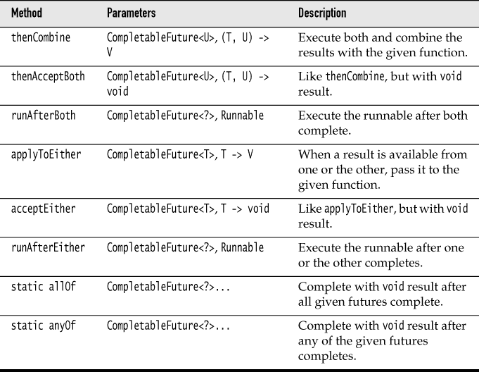

**表 6–2** 组合多个组合对象

前三种方法并行运行一个 `CompletableFuture<T>` 和 `CompletableFuture<U>` 操作并组合结果。

接下来的三种方法并行运行两个 `CompletableFuture<T>` 操作。一旦其中一个完成，它的结果就会被传递，另一个结果则被忽略。

最后，静态方法 `allOf` 和 `anyOf` 接受任意数量的可完成 future，并返回一个 `CompletableFuture<Void>`，该 future 在当所有 future 完成或其中任何一个 future 完成时变为完成。没有结果被传播。

***

 注意事项

从技术上说，本节中的方法接受 `CompletionStage` 类型的参数，而不是 `CompletableFuture`。这是一个带有近四十个抽象方法的接口类型，目前仅由 `CompletableFuture` 实现。大多数程序员不会随手实现该接口，因此我不再纠结于这种区别。

***

## 练习题

**1.** 编写一个程序，跟踪多个线程观察到的最长字符串。使用 `AtomicReference` 和合适的累加器。

**2.** `LongAdder` 有助于产生一系列递增的 ID 吗？为什么或者为什么不？

**3.** 生成 1,000 个线程，每个线程计数器加 100,000 次。比较使用 `AtomicLong` 与 `LongAdder` 的性能。

**4.** 使用 `LongAccumulator` 计算累加元素的最大值或最小值。

**5.** 编写一个应用程序，其中多个线程从文件集中读取所有单词。使用 `ConcurrentHashMap<String, Set<File>>` 来跟踪每个单词出现在哪些文件中。使用 `merge` 方法更新映射。

**6.** 重复前面的练习，但使用 `computeIfAbsent` 代替它。这种方法的优势是什么？

**7.** 在 `ConcurrentHashMap<String, Long>` 中，找到值最大的键（任意打破平局）。提示：`reduceEntries`。

**8.** 在你的计算机上，数组需要多大，`Arrays.parallelSort` 才会比 `Arrays.sort` 快？

**9.** 你可以使用 `parallelPrefix` 方法来并行计算斐波那契数。我们利用这样一个事实：第 *n* 个斐波那契数是 *F*^(*n*) 的左上角系数，其中 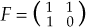。创建一个填充了 2 × 2 矩阵的数组。定义一个带有乘法方法的 `Matrix` 类，使用 `parallelSetAll` 创建一个矩阵数组，并使用 `parallelPrefix` 将它们相乘。

**10.** 编写一个程序，要求用户输入 URL，然后读取该 URL 的网页，最后显示所有链接。每个阶段都使用 `CompletableFuture`。不要调用 `get`。为了防止你的程序提前终止，请调用

```
ForkJoinPool.commonPool().awaitQuiescence(10, TimeUnit.SECONDS);
```

**11.** 编写一个方法

```java
public static <T> CompletableFuture<T> repeat(
    Supplier<T> action, Predicate<T> until)
```

异步重复该操作，直到它产生一个被 `until` 函数接受的值，该函数也应该异步运行。使用一个从控制台读取 `java.net.PasswordAuthentication` 的函数，以及一个通过睡眠一秒然后检查密码是否为 `"secret"` 来模拟有效性检查的函数进行测试。提示：使用递归。

# 第 7 章 Nashorn JavaScript 引擎

本书主题

 7.1 从命令行运行 Nashorn

 7.2 在 Java 中运行 Nashorn

 7.3 调用方法

 7.4 构建对象

 7.5 构建对象 (注：此处原文似乎重复，翻译按原文保留)

在 Lisp、Scala 等语言世界中你会获得一个所谓的“读取-评估-打印”循环（read-eval-print loop），简称 REPL。每当你输入一个表达式，它的值就会打印出来。

```
jjs> 'Hello, World!'.length
13
```

***

 注意

提醒一下，在 JavaScript 中，字符串可以使用 `'...'` 或 `"..."` 分隔。在本章，我将使用单引号表示 JavaScript 字符串，以便给你提供一个视觉提示，说明代码是 JavaScript 而不是 Java。

***

你可以定义函数并调用它们：

```javascript
jjs> function factorial(n) { return n <= 1 ? 1 : n * factorial(n - 1) }
function factorial(n) { return n <= 1 ? 1 : n * factorial(n - 1) }
jjs> factorial(10)
3628800
```

你可以调用 Java 方法：

```java
var input = new java.util.Scanner(
    new java.net.URL('http://horstmann.com').openStream())
input.useDelimiter('$')
var contents = input.next()
```

现在，当你输入 `contents` 时，你会看到网页的内容。

看看这种感觉是多清爽。你不需要担心异常。你可以动态地进行实验。我并不确定通过将分隔符设置为 `$` 是否可以读取全部内容，但我试了一下，它成功了。而且我不需要写 `public static void main`。我不需要编译任何东西。不需要在 IDE 中创建项目。REPL 是探索 API 最简单的方法。用 JavaScript 驱动 Java 显得有点奇怪，但也很方便。注意，我不需要为 `input` 和 `contents` 变量定义类型。

***

 提示

有两个遗憾让 JavaScript REPL 不如 Scala 的对应版本那样清爽。Scala REPL 具有命令补全功能。当你按下 `Tab` 键时，你会得到当前表达式可能的补全列表。诚承认，对于 JavaScript 这样的动态类型语言来说，这是一个很难实现的技巧。更基础的缺失是命令行回溯。按下 `↑` 键应该可以获取上一个命令。如果不用，尝试安装 `rlwrap` 并运行 `rlwrap jjs`。或者，你可以在 Emacs 内部运行 `jjs`。别担心——这没有害。启动 Emacs 并按下 M-x（即 Alt+x 或 Esc x），`shell` 回车，然后输入 `jjs`。照常输入表达式。使用 `M-p` 和 `M-n` 回溯上一行或下一行，并使用左右箭头键在行内移动。编辑命令，然后按回车执行它。

***

## 7.2. 从 Java 运行 Nashorn

在上一节中，你看到了 Nashorn 脚本的一个用例：在 `jjs` REPL 中实验 Java API。另一个用例是允许你的程序用户运行脚本。在桌面世界中，这非常常见。例如，所有的 Microsoft Office 都可以使用一种名为 VB Script 的语言进行脚本，它是 Basic 语言的后代。有许多人编写此类脚本，这种能力导致了某种形式的供应商锁定。很难采用另一个不能运行这些脚本的办公套件。如果你想锁定你的 Java 桌面或服务器应用的用户，你可以提供相同的能力。

从 Java 运行 Nashorn 脚本使用了 Java 6 中引入的脚本引擎机制。你可以使用该机制在任何带有脚本引擎的 JVM 语言中执行脚本，例如 Groovy、JRuby 或 Jython。还有运行在 JVM 之外的语言的脚本引擎，例如 PHP 或 Scheme。

要运行脚本，你需要获取一个 `ScriptEngine` 对象。如果引擎已注册，你可以直接通过名称获取它。Java 8 包含一个名为 `"nashorn"` 的引擎。以下是其使用方法：

```java
ScriptEngineManager manager = new ScriptEngineManager();
ScriptEngine engine = manager.getEngineByName("nashorn");
Object result = engine.eval("'Hello, World!'.length");
System.out.println(result);
```

你也可以从 `Reader` 读取脚本：

```java
Object result = engine.eval(Files.newBufferedReader(path));
```

要让 Java 对象对脚本可用，使用 `ScriptEngine` 接口的 `put` 方法。例如，你可以让 JavaFX stage 可见，以便你可以使用 JavaScript 代码填充它：

```java
public void start(Stage stage) {
    engine.put("stage", stage);
    engine.eval(script); // 脚本代码可以访问该对象
}
```

## 7.3. 调用方法

在上一节中，你看到了 `jjs` 是如何工作的。当你按下 `Tab` 键时，你会得到当前表达式可能的补全列表。诚承认，对于 JavaScript 这样的动态类型语言来说，这是一个很难实现的技巧。更基础的缺失是命令行回溯。按下 `↑` 键应该可以获取上一个命令。如果不用，尝试安装 `rlwrap` 并运行 `rlwrap jjs`。或者，你可以在 Emacs 内部运行 `jjs`。别担心——这没有害。启动 Emacs 并按下 M-x（即 Alt+x 或 Esc x），`shell` 回车，然后输入 `jjs`。照常输入表达式。使用 `M-p` 和 `M-n` 回溯上一行或下一行，并使用左右箭头键在行内移动。编辑命令，然后按回车执行它。

## 7.4. 构建对象

当你想要在 JavaScript 中构建对象时（而不是由脚本引擎交给你），你需要知道如何访问 Java 包。有两种机制。

有全局对象 `java`、`javax`、`javafx`、`com`、`org` 和 `edu`，通过点符号产生包和类对象。例如：

```javascript
var javaPackage = java.net // 一个 JavaPackage 对象
var URL = java.net.URL // 一个 JavaClass 对象
```

如果你需要访问一个不以上述标识符开头的包，你可以在 `Package` 对象中找到它，例如 `Package.ch.cern`。

或者，调用 `Java.type` 函数：

```javascript
var URL = Java.type('java.net.URL')
```

这比 `java.net.URL` 快一点点，并且你可以获得更好的错误检查。（如果你犯拼写错误，如 `java.net.Url`，Nashorn 会认为它是一个包。）但如果你想要速度和良好的错误处理，你可能不应该使用脚本语言。

***

 笔记

Nashorn 文档建议将类对象定义在脚本文件的顶部，就像你在 Java 文件中将 `import` 语句放在顶部一样：

```javascript
var URL = Java.type('java.net.URL')
var JMath = Java.type('java.lang.Math')
// 避免与 JavaScript Math 对象产生冲突
```

***

一旦你有了类对象，就可以调用静态方法：

```javascript
JMath.floorMod(-3, 10)
```

要构造一个对象，将类对象传递给 JavaScript 的 `new` 运算符。按照通常的方式传递任何构造函数参数：

```javascript
var URL = java.net.URL
var url = new URL('http://horstmann.com')
```

如果你不在乎效率，也可以调用

```javascript
var url = new java.net.URL('http://horstmann.com')
```

***

 注意

如果你在配合 `new` 使用 `Java.type`，你需要额外一组括号：

```javascript
var url = new (Java.type('java.net.URL'))('http://horstmann.com')
```

***

如果你需要指定一个内部类，可以使用点符号法：

```javascript
var entry = new java.util.AbstractMap.SimpleEntry('hello', 42)
```

或者，如果你使用 `Java.type`，请使用 `$`，就像 JVM 执行的那样：

```javascript
var Entry = Java.type('java.util.AbstractMap$SimpleEntry')
```

## 7.5. 字符串

Nashorn 中的字符串当然是 JavaScript 对象。例如，考虑以下调用

```javascript
'Hello'.slice(-2) // 产生 'lo'
```

在这里，我们调用了 JavaScript 方法 `slice`。Java 中没有这种方法。

但以下调用

```javascript
'Hello'.compareTo('World')
```

同样有效，尽管在 JavaScript 中没有 `compareTo` 方法。（你只需要使用 `<` 运算符即可。）

在这种情况下，JavaScript 字符串被转换为 Java 字符串。通常情况下，每当 JavaScript 字符串被传递给 Java 方法时，它就会转换为 Java 字符串。

还要注意，当*任何* JavaScript 对象被传递给带有 `String` 参数的 Java 方法时，它都会转换为字符串。考虑

```javascript
var path = java.nio.file.Paths.get(/home/)
```


 笔记

Nashorn 文档建议将类对象定义在脚本文件的顶部，就就像你在 Java 文件中将 `import` 语句放在顶部一样：

点击此处查看代码图片

```javascript
var URL = Java.type('java.net.URL')
var JMath = Java.type('java.lang.Math')
// 避免与 JavaScript Math 对象产生冲突
```

***

一旦你有了类对象，就可以调用静态方法：

```javascript
JMath.floorMod(-3, 10)
```

要构造一个对象，将类对象传递给 JavaScript 的 `new` 运算符。按照通常的方式传递任何构造函数参数：

点击此处查看代码图片

```javascript
var URL = java.net.URL
var url = new URL('http://horstmann.com')
```

如果你不在乎效率，也可以调用

点击此处查看代码图片

```javascript
var url = new java.net.URL('http://horstmann.com')
```

***

 注意

如果你在配合 `new` 使用 `Java.type`，你需要额外一组括号：

点击此处查看代码图片

```javascript
var url = new (Java.type('java.net.URL'))('http://horstmann.com')
```

***

如果你需要指定一个内部类，可以使用点符号法：

点击此处查看代码图片

```javascript
var entry = new java.util.AbstractMap.SimpleEntry('hello', 42)
```

或者，如果你使用 `Java.type`，请使用 `$`，就像 JVM 执行的那样：

点击此处查看代码图片

```javascript
var Entry = Java.type('java.util.AbstractMap$SimpleEntry')
```

## 7.5. 字符串

Nashorn 中的字符串当然是 JavaScript 对象。例如，考虑以下调用

点击此处查看代码图片

```javascript
'Hello'.slice(-2) // 产生 'lo'
```

在这里，我们调用了 JavaScript 方法 `slice`。Java 中没有这种方法。

但以下调用

```javascript
'Hello'.compareTo('World')
```

同样有效，尽管在 JavaScript 中没有 `compareTo` 方法。（你只需要使用 `<` 运算符即可。）

在这种情况下，JavaScript 字符串被转换为 Java 字符串。通常情况下，每当 JavaScript 字符串被传递给 Java 方法时，它就会转换为 Java 字符串。

还要注意，当*任何* JavaScript 对象被传递给带有 `String` 参数的 Java 方法时，它都会转换为字符串。考虑

点击此处查看代码图片

```javascript
var path = java.nio.file.Paths.get(/home/)
// 一个 JavaScript RegExp 被转换成了 Java String!
```

在这里，`/home/` 是一个正则表达式。`Paths.get` 方法需要一个 `String`，它确实得到了一个，尽管在在这种情况下这没有意义。不应该埋怪 Nashorn。它遵循了通用的 JavaScript 行为，即在期望字符串时将任何内容转换为字符串。数字和布尔值也会发生同样的转换。例如，`'Hello'.slice('-2')` 是完全有效的。字符串 `'-2'` 被静默转换为数字 `-2`。正是像这样的特性让在动态类型语言中编程变成了一场令人兴奋的冒险。

## 7.6. 数字

JavaScript 不对整数有显式支持。它的 `Number` 类型与 Java 的 `double` 类型相同。当数字被传递给期望 `int` 或 `long` 的 Java 代码时，任何小数部分都会被静默移除。例如，`'Hello'.slice(-2.99)` 等同于 `'Hello'.slice(-2)`。

为了效率，Nashorn 会尽可能将计算保持为整数，但这种差异通常是透明的。这里有一种它不透明的情况：

点击此处查看代码图片

```javascript
var price = 10
java.lang.String.format('Price: %.2f', price)
// Error: f format not valid for java.lang.Integer
```

`price` 的值恰好是一个整数，并且被赋值给 `Object`，因为 `format` 方法有一个 `Object...` 变长参数。因此，Nashorn 产生了一个 `java.lang.Integer`。这导致 `format` 方法失败，因为 `f` 格式是用于浮点数的。在这种情况下，你可以通过调用 `Number` 函数来强制转换为 `java.lang.Double`：

点击此处查看代码图片

```javascript
java.lang.String.format('Unit price: %.2f', Number(price))
```

## 7.7. 数组操作

要构造 Java 数组，首先创建一个类，然后

*(注：原文在 7.7 节后出现大量重复字符，此处翻译至原文可见逻辑结束)*

## 7.8. 列表与映射

Nashorn 为 Java 列表和映射提供了“语法糖”。你可以使用括号运算符对任何 Java `List` 来调用 `get` 和 `set` 方法：

```javascript
var names = java.util.Arrays.asList('Fred', 'Wilma', 'Barney')
var first = names[0]
names[0] = 'Duke'
```

括号运算符也适用于 Java 映射：

```javascript
var scores = new java.util.HashMap()
scores['Fred'] = 10 // 调用 scores.put('Fred', 10)
```

要访问映射中的所有元素，你可以使用 JavaScript 的 `for` 循环：

```javascript
for (var key in scores) { ... }
for (var value in scores) { ... }
```

如果你想同时处理键和值，只需遍历条集：

```javascript
for (var e in scores.entrySet()) {
    // 处理 e.key 和 e.value
}
```

## 7.9. Lambda 表达式

JavaScript 有匿名函数，例如

点击此处查看代码图像

```javascript
var square = function(x) { return x * x }
// 右侧是一个匿名函数

var result = square(2)
// `()` 运算符调用了该函数
```

在语法上，这种匿名函数与 Java 的 lambda 表达式非常相似。在参数列表后不是使用箭头，而是使用 `function` 关键字。

你可以将匿名函数作为 Java 方法的函数式接口参数，就像在 Java 中使用 lambda 表达式一样。例如：

点击此处查看代码图像

```javascript
java.util.Arrays.sort(words,
   function(a, b) { return java.lang.Integer.compare(a.length, b.length) })
// 按长度递序排序数组
```

Nashorn 支持对正体为单个表达式的函数进行简写。对于此类函数，你可以省略大括号和 `return` 关键字：

点击此处查看代码图像

```javascript
java.util.Arrays.sort(words,
   function(a, b) java.lang.Integer.compare(a.length, b.length))
```

再次注意它与 Java lambda 表达式 `(a, b) -> Integer.compare(a.length, b.length)` 的相似性。

***

 **注意** 这种简写符号（被称为“表达式闭包”）并不是 JavaScript 官方标准（ECMAScript 5.1）的一部分，但 Mozilla 的 JavaScript 实现支持它。

***

## 7.10. 扩展 Java 类和实现 Java 接口

要扩展 Java 类或实现 Java 接口，请使用 `Java.extend` 函数。提供父类或接口的类对象，以及一个包含你想覆盖或实现的 JavaScript 对象。

例如，这是一个产生无限随机数序列的迭代器。我们重写两个方法：`next` 和 `hasNext`。对于每个方法，我们都提供了一个匿名 JavaScript 函数作为实现：

点击此处查看代码图像

```javascript
var RandomIterator = Java.extend(java.util.Iterator, {
   next: function() Math.random(),
   hasNext: function() true
}) // RandomIterator 是一个类对象

var iter = new RandomIterator() // 使用它来构造实例
```

***

 **注意** 在调用 `Java.extend` 时，你可以指定任意数量的超接口以及父类。将所有类对象放置在实现方法的对象之前。

***

另一个 Nashorn 语法扩展允许你定义接口或抽象类的匿名子类。当 `new` `JavaClassObject` 后面跟着一个 JavaScript 对象时，将返回该扩展类的对象。例如：

点击此处查看代码图像

```javascript
var iter = new java.util.Iterator {
   next: function() Math.random(),
   hasNext: function() true
}
```

如果父类型是抽象的且只有一个抽象方法，你甚至不需要提供方法名。相反，像传递构造函数参数一样传递函数：

点击此处查看代码图像

```javascript
var task = new java.lang.Runnable(function() { print('Hello') })
// task 是实现 Runnable 的匿名类对象
```

***

 **注意** 在扩展具体类时，不能使用那种构造函数语法。例如，`new java.lang.Thread(function() { print('Hello') })` 调用的是 `Thread` 构造函数，在这种情况下是 `Thread(Runnable)` 构造函数。对 `new` 的调用返回的是 `Thread` 类的对象，而不是 `Thread` 子类的对象。

***

如果你想在子类中使用实例变量，请将它们添加到 JavaScript 对象中。例如，这是一个产生十个随机数的迭代器：

点击此处查看代码图像

```javascript
var iter = new java.util.Iterator {
   count: 10,
   next: function() { this.count--; return Math.random() },
   hasNext: function() this.count > 0
}
```

注意，JavaScript 方法 `next` 和 `hasNext` 通过 `this.count` 引用实例变量。

在重写方法时调用父类方法是可能的，但非常麻烦。`Java.super(obj)` 调用返回一个对象，可以通过该对象调用 `obj` 所属类的父类方法，但你必须拥有该对象。是一种实现该的方法：

点击此处查看代码图像

```javascript
var arr = new (Java.extend(java.util.ArrayList)) {
   add: function(x) {
      print('Adding ' + x);
      Java.super(obj).add(x)
   }
}
```

它并不像管道（pipe）那么漂亮，但如果你需要，可以轻松实现一个管道——参见练习 6。

## 7.12.2 字符串插值

`${...}` 内部的表达式会在双引号字符串和反引号字符串中被求值。这被称为“字符串插值”。例如，

点击此处查看代码图片


```
var cmd = "javac -classpath ${classpath} ${mainclass}.java"
$EXEC(cmd)
```

或者简单的：

点击此处查看代码图片

```
`javac -classpath ${classpath} ${mainclass}.java`
```

将变量 `classpath` 和 `mainclass` 的内容注入到命令中。

你可以在 `${...}` 中使用任意表达式：

点击此处查看代码图片

```javascript
var message = "The current time is ${java.time.Instant.now()}"
// 将 message 设置为类似 The current time is 2013-10-12T21:48:58.545Z 的字符串
```

与 bash shell 一样，字符串插值在单引号字符串内部不起作用。

点击此处查看代码图片

```javascript
var message = 'The current time is ${java.time.Instant.now()}'
// 将 message 设置为 The current time is ${java.time.Instant.now()}
```

字符串也会在“此处文档”（here documents）中进行插值——即脚本中的内联文档。当命令从标准输入读取多行，且脚本作者不想将输入放在单独的文件时，这些内联文档非常有用。例如，这里展示了如何向 GlassFish 管理工具传递命令：

```bash
name='myapp'
dir='/opt/apps/myapp'
$EXEC("asadmin", <<END)
start-domain
start-database
deploy ${name} ${dir}
exit
END
```

`<<END` 结构意味着：“插入从下一行开始并以 `END` 行结束的字符串。”（除了 `END`，你可以使用任何未出现在字符串内部的标识符。）

注意应用程序的名称和位置是被插值的。

字符串插值和此处文档仅在脚本模式下可用。

## 7.12.3 脚本输入

你可以为脚本提供命令行参数。由于在 `jjs` 命令行上可以包含多个脚本文件，你需要用 `--` 来分隔脚本文件和参数：

点击此处查看代码图片

```bash
jjs script1.js script2.js -- arg1 arg2 arg3
```

 注意

这看起来有点丑。如果你只有一个脚本文件，可以运行：

点击此处查看代码图片

```bash
jrunscript -f script.js arg1 arg2 arg3
```

 提示

脚本的第一行可以是“shebang”，即符号 `#!` 后面跟着脚本解释器的位置。例如，

```bash
#!/opt/java/bin/jjs
```

或者

```bash
#!/opt/java/bin/jrunscript -f
```

然后你就可以将脚本文件设置为可执行，并简单通过 `/script.js` 运行它。

当脚本以 shebang 开时，脚本模式会自动激活。

 注意

如果你的脚本有参数，并且你在 shebang 中使用了 `jjs`，脚本用户将需要提供 `--`：`/script.js -- arg1 arg2 arg3`。用户不会因为这样而喜欢你。请改用 `jrunscript`。

在脚本文件中，你通过 `arguments` 数组接收命令行参数：

点击此处查看代码图片

```javascript
var deployCommand = "deploy ${arguments[0]} ${arguments[1]}"
```

使用 `jjs`（但不用 `jrunscript`），你可以使用 `$ARG` 代替 `arguments`。如果你在字符串插值中使用该变量，需要两个美元符号：

点击此处查看代码图片

```javascript
var deployCommand = "deploy ${$ARG[0]} ${$ARG[1]}"
```

在你的脚本中，你可以通过 `ENV` 对象获取 shell 的环境变量：

点击此处查看代码图片

```javascript
var javaHome = $ENV.JAVA_HOME
```

在脚本模式下，你可以使用 `readLine` 函数提示用户输入：

点击此处查看代码图片

```javascript
var username = readLine('Username: ')
```

 注意

要提示密码，请调用

点击此处查看代码图片

```javascript
var password = java.lang.System.console().readPassword()
```

最后，退出脚本时使用 `exit` 函数。你可以提供可选的代码。

```javascript
if (username.length == 0) exit(1)
```

## 7.13 Nashorn 和 JavaFX

Nashorn 提供了一种启动 Java 应用程序的便捷方法。使用 `-fx` 选项，你甚至不需要子类 `Application`。例如，这里是：

```javascript
var message = new javafx.scene.control.Label("Hello!");
message.font = new javafx.scene.text.Font(100);
$STAGE.scene = new javafx.scene.Scene(message);
$STAGE.title = "Hello";
```

运行脚本：

```bash
jjs -fx myJavaApp.js
```

这些就是全部。显示一个 100 点字号的“Hello!”标签——参见图 7–1。

现在让我们看看事件处理。正如你在第 4 章所示，大多数 FX 事件都是通过属性的监听器处理的。记住，一个 FX 属性有两个监听接口：`InvalidationListener` 和 `ChangeListener`，都通过 `addListener` 方法添加。在 Java 中，你可以带 lambda 表达式调用 `addListener`编译器能够根据参数类型判断是哪一个。但在 JavaScript 中，函数参数没有类型。假设我们有一个滑块来控制字体大小。我们想添加一个在滑块值变化时更新大小的监听器：

点击此处查看代码图片

```javascript
slider.valueProperty().addListener(function(property)
    message.font = new Font(slider.value)) // 错误——Nashorn 无法确定添加哪种监听器类型
```

这不起作用。Nashorn 不知道你想添加 `InvalidationListener` 还是 `ChangeListener`，它也不知道你其实不在乎。

要修复这个问题，你需要做出选择：

```javascript
slider.valueProperty().addListener(
    new javafx.beans.InvalidationListener(function(property)
        message.font = new Font(slider.value)))
```

这比 Java 的等效实现要重得多——不是人们在轻量级脚本语言中希望看到的。对于这一点，没有人可以怪罪。JavaFX 设计者做出了重载 `addListener` 方法的决定，这在 Java 7 的背景下是完全合理的，并且与 Java 8 lambda 表达式大部分兼容。脚本语言的兼容性可能不是他们关注的问题，特别是他们刚刚放弃了另一种脚本语言。

但这应该是一个警示。当你设计 Java API 时，请记住阿特伍德法则（Atwood’s law）：“任何可以用 JavaScript 编写的应用最终都会用 JavaScript 编写。”设计你的 API，使其能够从 JavaScript 优雅地访问。

Nashorn 对 JavaFX 的支持还有另一个悲伤的方面。回想在 JavaFX Script 的年代，可以这样轻松地描述场景的布局：

点击此处查看代码图像

```java
Frame {
    title: "Hello"
    content: Label {
        text: "Hello, World!"
    }
}
```

这看起来难道不像像 JavaScript 吗？好吧，Nashorn/JavaFX 的开发者们，拆掉那道墙，把它变成 JavaScript 吧！这样我们就可以用 JavaScript 同时编写 UI 布局和事件处理，阿特伍德法则也就实现了。

## 练习

**1.** 选择一些你想要探索的 Java API 部分——例如，`ZonedDateTime` 类。在 `jjs` 中运行一些实验：构建对象、调用方法并观察返回值。你觉得这比在 Java 中编写测试程序容易吗？

**2.** 运行 `jjs` 并使用流库交互式地解决以下问题：按排序顺序打印文件中所有唯一的长单词（大于 12 个字符）。首先读取单词，然后过滤出长单词，以此此类推。这种交互式方法与你通常的工作流相比如何？

**3.** 运行 `jjs`。调用

点击此处查看代码图像

```javascript
var b = new java.math.BigInteger('1234567890987654321')
```

然后显示 `b`（只需输入 `b` 并按回车）。你得到了什么？`b.mod(java.math.BigInteger.TEN)` 的值是多少？为什么 `b` 的显示得如此奇怪？你该如何显示 `b` 的实际值？

**4.** 通过从另一个字符串中提取子字符串来构造非字面量的 JavaScript 字符串，并调用 `getClass()` 方法。你得到了什么类？然后将该对象传递给 `java.lang.String.class.cast`。发生了什么？为什么？

**5.** 在 第 7.10 节 位于第 [146] 页的“扩展 Java 类和实现 Java 接口”末尾，你看到了如何扩展 `ArrayList` 以使得每次调用 `add()` 都被记录。但这只对单个对象有效。编写一个 JavaScript 函数作为此类对象的工厂，这样就可以生成任意数量的日志列表。

**6.** 编写一个 JavaScript 函数 `pipe()`，它接收一组 shell 命令并将上一个命令的输出接到下一个命令的输入，返回最终输出。例如，`pipe('find .', 'grep -v class', 'sort')`。只需反复调用 `$EXEC` 即可。

**7.** 上一个练习的解决方案并没有 Unix 管道好，因为第二个命令只有在第一个命令完成后才会启动。使用 `ProcessBuilder` 类解决这个问题。

**8.** 编写一个打印所有环境变量值的脚本。

**9.** 编写一个 `nextYear.js` 脚本，获取用户的年龄，然后打印 `Next year, you will be ...`，在输入的基础上加 1。年龄可以在命令行或 `AGE` 环境变量中指定。如果两者都不存在，则提示用户。

**10.** 用 JavaScript 编写一个 JavaFX 程序，从你选择的源读取数据并渲染饼图。这比在 Java 中开发程序是更容易还是更难？为什么？

# 第 8 章 杂项技巧

## 本章主题

 8.1 字符串

 8.2 数字类

 8.3 新数学函数

 8.4 集合

 8.5 处理文件

 8.6 注解

 8.7 杂项微调

 练习

Java 8 是一个包含重要语言和库增强的大版本。但整个库中也有许多有用的微调。我查阅了所有的 `@since 1.8` 注释，并将更改分类以便方便参考。在本章中，你将找到字符串、数字、数学、集合、文件、注解、正则表达式和 JDBC 的新内容。

为了处理无符号数，你需要对二进制算术和负数的二进制表示有的的。在 `C` 和 `C++` 中，混合有符号和无符号类型是导致微妙错误的常见原因。Java 明智地避开了这一领域，并且多年来一直仅使用有符号数字。使用无符号数的主要原因是你需要处理需要这些类型的文件格式或网络协议。

`Float` 和 `Double` 类具有静态方法 `isFinite`。如果 `x` 不是无穷大、负无穷或 `NaN`（非数字），则 `Double.isFinite(x)` 返回 `true`。在过去，你必须调用实例方法 `isInfinite` 和 `isNaN` 来获得相同的结果。

最后，`BigInteger` 类拥有实例方法 (`long`|`int`|`short`|`byte`)ValueExact`，它们将值作为 `long`、`int`、`short` 或 `byte` 返回，如果值不在目标范围内，则抛出 `ArithmeticException`。

## 8.3 新数学函数

`Math` 类提供了若干用于“精确”算术的方法，这些方法在结果溢出时会抛出异常。例如，`100000 * 100000` 会静默地给出错误结果 `1410065408`，而 `multiplyExact(100000, 100000)` 则抛出异常。提供的方法有 (`add`|`subtract`|`multiply`|`increment`|`decrement`|`negate`)Exact，带有 `int` 和 `long` 参数。`toIntExact` 方法将 `long` 转换为相应的 `int`。

`floorMod` 和 `floorDiv` 方法旨在解决整数余数长期存在的问题。考虑表达式 `n % 2`。大家都知道如果 `n` 是偶数则为 0，如果 `n` 是奇数则为 1。当然，当 `n` 为负数除外，它是 –1。为什么？当第一批计算机制造时，有人必须为负操作数的整数除法和余数运算制定规则。数学家们早已知道最优的（或“欧几里得”）规则：始终保持余数 ≥ 0。但由于，那些先驱们并没有翻开数学书，而是制定了看似合理但实际上并不方便的规则。

考虑这个问题：你计算时钟时针的位置。应用一个调整，并将其归一化为 `0` 到 `11` 之间的数字。这很容易：`(position + adjustment) % 12`。但如果 `adjustment` 是负数呢？你可能会得到一个负数。所以你必须引入一个分支，或者使用 `((position + adjustment) % 12 + 12) % 12`。无论哪，这都很麻烦。

新的 `floorMod` 方法使其变得简单：`floorMod(position + adjustment, 12)` 始终产生 `0` 到 `11` 之间的值。

 注意

遗憾的是，`floorMod` 对负除数会给出负数结果，但这种情况在实践中并不经常发生。

`nextDown` 方法针对 `double` 和 `float` 参数定义，给出给定数字下一个更小的浮点数。例如，如果你承诺产生一个小于 `b` 的数字，但你恰好计算出了等于 `b`，那么你可以返回 `Math.nextDown(b)`。（相应的 `Math.nextUp` 方法自 Java 6 起已存在。）

 注意

本节描述的所有方法也存在于 `StrictMath` 类中。

## 8.4 集合

集合库的巨大变化当然是对流的支持，你在第 2 章 中见过。也有一些小的变化。

### 8.4.1 添加到集合类的方法

表 8–1 显示了 Java 8 为集合类和接口添加的各种方法，除了 `stream`、`parallelStream` 和 `spliterator` 方法之外。

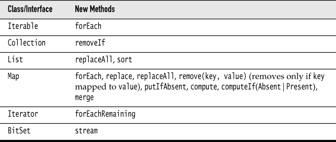

**表 8–1** Java 8 添加到集合类和接口的方法

你可能会奇怪为什么 `Stream` 接口有这么多接受 lambda 表达式的方法，但 `Collection` 接口只添加了这样一个方法——`removeIf`。如果你回顾 `Stream` 方法，你会发现大多数方法返回单个值或一个转换后的值的流，而这些值在原始流中并不存在。异常是 `filter` 和 `distinct` 方法。`removeIf` 方法可以被视为 `filter` 的相反，它是移除而不是产生所有匹配项，并在原地执行。`distinct` 方法在任意集合上提供将是昂贵的。

`List` 接口有一个 `replaceAll` 方法，它是 `map` 的原地等效实现，以及一个非常有用的 `sort` 方法。

`Map` 接口有很多对于并发访问的 map 特别重要的方法。关于这些方法的更多信息请参见第 6 章。

`Iterator` 接口有一个 `forEachRemaining` 方法，通过将剩余的迭代器元素传递给函数来耗尽迭代器。

最后，`BitSet` 类有一个产生所有成员的方法。

### 8.4.2 比较器

`Comparator` 接口有很多有用的方法，利用了接口现在可以拥有静态方法的事实。静态 `comparing` 方法接收一个“键提取器”函数，将 `T` 映射到可比较的对象。`Comparator.<String>naturalOrder()` 就是我们需要的。这里是按名称排序的完整调用。我使用了 `java.util.Comparator.*` 的静态导入，以使表达式更具可读性。注意 `naturalOrder` 的类型是推断的。

```
Arrays.sort(people, comparing(Person::getName));
```


# 8.4.3. Collections 类

Java 6 引入了 `NavigableSet` 和 `NavigableMap` 类，这些类利用元素或键的排序性，提供了高效的方法来定位任何给定的值 `v` 的大于或等于 `v` 的最小元素，或者小于或等于 `v` 的最大元素。现在，`Collections` 类也像支持其他集合一样支持这些类，提供了方法（`unmodifiable`|`synchronized`|`checked`|`empty`）`Navigable`(`Set`|`Map`)。

还添加了一个 `checkedQueue` 包装器，它显然在这些年来一直被忽视了。提醒一下，`checked` 包装器带有一个 `Class` 参数，并且当你插入错误类型的元素时会抛出 `ClassCastException`。这些类旨在用作调试辅助。假设你声明了一个 `Queue<Path>`，而在代码的某处有一个 `ClassCastException` 尝试将 `String` 强制转换为 `Path`。这可能是因为你将队列传递给了一个没有类型参数的方法 `void getMoreWork(Queue q)`。然后，某人在某处向 `q` 插入了一个 `String`。（因为泛型类型被抑制了，编译器无法检测到这一点。） 久以后，当你认为它是一个 `Path` 并取出那个 `String` 时，错误就显现出来。如果你临时将队列替换为 `CheckedQueue(new LinkedList<Path>, Path.class)`，那么每次插入在运行时都会经过检查，你可以定位到故障的插入代码。

最后，还有 `emptySorted`(`Set`|`Map`) 方法，它们提供了排序集合的轻量级实例，类似于自 Java 5 起就存在的 `empty`(`Set`|`Map`) 方法。

# 8.5. 处理文件

Java 8 带来了一些方便方法，它们使用流（streams）来读取文件行以及访问目录项。此外，终于有了官方的方法来执行 Base64 编码和解码。

## 8.5.1. 行的流

要懒性地读取文件的行，请使用 `Files.lines` 方法。它产生一个字符串流，每行对应输入的一行：

```
Stream<String> lines = Files.lines(path);
Optional<String> passwordEntry = lines.filter(s -> s.contains("password")).findFirst();
```

一旦找到包含 `password` 的第一行，就不会再从底层文件中读取后续行。

> **注意事项**
>
> 与 `FileReader` 类不同（它由于使用本地字符编码打开文件，曾是可移植性的噩梦），`Files.lines` 方法默认使用 UTF-8。你可以通过提供 `Charset` 参数来指定其他编码。

你可能需要关闭底层文件。幸运的是，`Stream` 接口继承了 `AutoCloseable`。你在第 2 章中看到的流不需要关闭任何资源。但 `Files.lines` 方法产生的流其 `close` 方法会关闭文件。确保文件确实关闭的最简单方法是使用 Java 7 的 try-with-resources 块：

```
try (Stream<String> lines = Files.lines(path)) {
    Optional<String> passwordEntry
      = lines.filter(s -> s.contains("password")).findFirst();
    ...
} // 流，因此文件，将在这里被关闭
```

当一个流产生另一个流时，`close` 方法是链式的。因此，你也可以写：

```
try (Stream<String> filteredLines
      = Files.lines(path).filter(s -> s.contains("password"))) {
    Optional<String> passwordEntry = filteredLines.findFirst();
    ...
}
```

当 `filteredLines` 被关闭时，它会关闭底层流，从而关闭底层文件。

> **注意事项**
>
> 如果你想在流关闭时收到通知，可以附加一个 `onClose` 处理器。以下是你可以验证关闭 `filteredLines` 确实关闭了底层流的方法：
>
> ```
> try (Stream<String> filteredLines
>     = Files.lines(path).onClose(() -> System.out.println("Closing"))
>       .filter(s -> s.contains("password"))) { ... }
> ```

如果流在获取行时发生 `IOException`，该异常将被封装成 `UncheckedIOException` 并从流操作中抛出。（这种欺骗手段是必要的，因为流操作没有声明抛出任何受检异常。）

如果你想从文件以外的源读取行，请使用 `BufferedReader.lines` 方法：

```
try (BufferedReader reader
      = new BufferedReader(new InputStreamReader(url.openStream()))) {
    Stream<String> lines = reader.lines();
    ...
}
```

使用这种方法，关闭流不会关闭读取器。由于这个原因，你必须将 `BufferedReader` 对象而不是流放入 `try` 语句中。

> **注意事项**
>
> 多年来，JDK 有一个非公有的（因此是不可用的）类 `java.util.prefs.Base64` 和一个未文档的类 `sun.misc.BASE64Encoder`。最后，Java 8 提供了标准的编码器和解码器。

## 8.5.2. 目录项的流

`Files.list` 方法返回一个读取目录项的 `Stream<Path>`。它是懒性的，使得能够高效处理数量巨大的目录。由于读取目录涉及需要关闭的系统资源，你应该使用 `try` 块：

```
try (Stream<Path> entries = Files.list(path)) {
    ...
}
```

> **注意事项**
>
> 底层，该流使用了 `DirectoryStream`，这是 Java 7 引入的用于高效遍历的构造。该接口继承了 `Iterable`，因此可以在增强 `for` 循环中使用：
>
> ```
> try (DirectoryStream stream = Files.newDirectoryStream(path)) {
>     for (Path entry : stream) {
>         ...
>     }
> }
> ```
>
> 在 Java 8 中，只需使用 `Files.list`。

`list` 方法不会进入子目录。要处理所有后代，请改用 `Files.walk` 方法。

```
try (Stream<Path> entries = Files.walk(root)) {
    ...
}
```

你可以通过调用 `Files.walk(root, depth)` 来限制想要访问的树的深度。两个 `walk` 方法都有 `FileVisitOption...` 变长参数，但目前你可以提供的选项只有一个：跟随符号链接的 `FOLLOW_LINKS`。

如果你对 `walk` 返回的路径进行过滤，并且过滤标准涉及与目录关联的文件属性（例如大小、创建时间或类型：文件、目录、符号链接），请使用 `find` 方法代替 `walk`。调用该方法并传入一个接受路径和 `BasicFileAttributes` 对象的谓词函数。唯一的优势是效率。因为已经在读取目录了，属性是可用的。

## 8.5.3. Base64 编码

Base64 编码将字节序列编码为（更长的）可打印 ASCII 字符序列。它用于电子邮件消息中的二进制数据和“基础” HTTP 身份验证。

- 2 个符号，`+` 和 `/`（基础）或 `-` 和 `_`（URL 和文件名安全的变体）

通常，编码后的字符串没有换行符，但用于电子邮件的 MIME 标准要求每 76 个字符包含一个 `"\r\n"` 换行符。

对于编码，请通过 `Base64` 类的静态方法 `getEncoder`、`getUrlEncoder` 或 `getMimeEncoder` 请求一个 `Base64.Encoder`。

该类拥有对字节数组或 NIO `ByteBuffer` 进行编码的方法。例如：

```java
Base64.Encoder encoder = Base64.getEncoder();
String original = username + ":" + password;
String encoded = encoder.encodeToString(original.getBytes(StandardCharsets.UTF_8));
```

或者，你可以“包装”输出流，这样所有发送到该流的数据都会被自动编码。

```java
Path originalPath = ..., encodedPath = ...;
Base64.Encoder encoder = Base64.getMimeEncoder();
try (OutputStream output = Files.newOutputStream(encodedPath)) {
    Files.copy(originalPath, encoder.wrap(output));
}
```

要解码，请反转这些操作：

```java
Path encodedPath = ..., decodedPath = ...;
Base64.Decoder decoder = Base64.getMimeDecoder();
try (InputStream input = Files.newInputStream(encodedPath)) {
    Files.copy(decoder.wrap(input), decodedPath);
}
```

# 8.6. 注解

注解是插入到源代码中的标签，某些工具可以对其进行处理。在 Java SE 中，注解用于简单的用途，例如标记已弃用的特性或抑制警告。在 Java EE 中，注解扮演着重要得多的角色，它们用于配置应用的几乎任何方面，取代了旧版 Java EE 版本中令人痛苦的样板代码和 XML 自定义。

Java 8 对注解处理进行了两项增强：重复注解（repeated annotations）和类型使用注解（type use annotations）。此外，反射也得到了增强，可以报告方法的参数名称。这具有简化方法参数上注解的潜力。

## 8.6.1. 重复注解

当注解最初被创建时，它们被设想为标记用于处理的方法和字段，例如：

```java
@PostConstruct public void fetchData() { ... } // 构造后调用
@Resource("jdbc:derby:sample") private Connection conn;
    // 在此处注入资源
```

在这种语境下，两次应用相同的注解是没有意义的。你不能以两种方式注入一个字段。当然，在同一个元素上使用不同的注解是允许的且非常常见的：

```java
@Stateless @Path("/service") public class Service { ... }
```

很快，注解的使用场景越来越多地出现，导致了人们希望重复使用同一个注解的情况。例如，为了表示数据库中的复合键，你需要指定：

```java
@Entity
@PrimaryKeyColumns({
    @PrimaryKeyColumn(name="ID"),
    @PrimaryKeyColumn(name="REGION")
})
public class Item { ... }
```

由于之前无法实现，注解被封装在一个容器中，如下：

```java
@Repeatable(PrimaryKeyColumns.class)
@interface PrimaryKeyColumn {
    String name();
}

@interface PrimaryKeyColumns {
    PrimaryKeyColumn[] value();
}
```

那样非常糟糕，而且在 Java 8 中不再需要。作为注解使用者，你可以直接使用它们。对于注解实现者来说，情况并不简单。如果 `AnnotatedElement` 有重复注解，你使用 `getAnnotationsByType(Class<? extends T>)`，它返回 `T` 的数组。如果存在多个相同类型的注解，该方法应该做什么？返回第一个？还是返回所有？

如果你处理的是源码级注解，使用 `getAnnotation(Class<? extends T>)`，它在注解存在时返回单个。如果你处理的是运行时注解，你将需要处理单个注解（如果只提供一次）和容器（如果提供了多次）。

## 8.6.2. 类型使用注解

在 Java 8 之前，注解被应用于声明。现在你可以注解任何类型。这在与检查编程错误的工具结合时非常有用。一种常见的错误是由于程序员没有预到某个引用可能为 `null` 而抛出 `NullPointerException`。现在假设你将永远不希望为 `null` 的变量标记为 `@NonNull`。工具可以检查以下内容是正确的：

```java
@Entity public class Person { ... }
@SuppressWarnings("unchecked") List<Person> people = query.getResultList();
```

当然，工具应该检测任何可能导致 `names` 变为 `null` 的语句：

```java
@NonNull List<String> names = new ArrayList<>();
...
names.add("Fred"); // 不可能发生 NullPointerException
```

到处处放置此类注解听起来很麻烦，但在实践中，可以通过简单的启发式方法避免一些繁琐工作。Checker Framework 中的空指针检查器（[`types.cs.washington.edu/checker-framework`](http://types.cs.washington.edu/checker-framework)）假设任何非局部变量都是隐式的 `@NonNull`，但局部变量可能为 `null`，除非代码另有说明。如果方法可能返回 `null`，则需要被标记为 `@Nullable`。这可能比记录空值行为更糟糕。


在上一个示例中，`names` 变量被声明为 `@NonNull`。这种注解在 Java 8 之前是可能的。但如何表达列表的*元素*应该是非空的呢？从逻辑上讲，它应该是：

```java
private List<@NonNull String> names;
```

正是这种注解在 Java 8 之前是不可能的，但现在已经变成合法的。

***

 注意

这些注解*不是*标准 Java 的组成部分。目前还没有对类型使用具有实际意义的标准注解。本节中的所有示例都来自 Checker Framework 或作者的想象。

***

类型使用的注解可以出现在以下位置：

- 带有泛型类型参数中：`List<@NonNull String>`、`Comparator.<@NonNull String> reverseOrder()`。
- 在数组的任何位置：`@NonNull String[][] words`（`words[i][j]` 不为 `null`）、`String @NonNull [][] words`（`words` 不为 `null`）、`String[] @NonNull [] words`（`words[i]` 不为 `null`）。
- 带有超类和实现的接口：`class Image implements @Rectangular Shape`。
- 带有构造函数调用：`new @Path String("/usr/bin")`。
- 带有类型转换和 `instanceof` 检查：`(@Path String) input`、`if (input instanceof @Path String)`。（这些注解仅供外部工具使用。它们对类型转换或 `instanceof` 检查的行为没有影响。）
- 带有异常规格说明：`public Person read() throws @Localized IOException`。
- 带有通配符和类型边界：`List<@ReadOnly ? extends Person>`、`List<? extends @ReadOnly> Person`。
- 带有方法和构造函数引用：`@Immutable Person::getName`。

有几个类型位置无法被注解：

```java
@NonNull String.class // 非法—不能注解类
import java.@NonNull String; // 非法—不能注解导入
```

注解注解本身是不可能的。例如，给定 `@NonNull String name`，你不能注解 `@NonNull`。（你可以提供一个单独的注解，但它将作用于 `name`。）

这些注解的实际用途取决于工具的可行性。如果你对探索类型检查的潜力感兴趣，一个很好的起点是 Checker Framework 教程，位于 [`types.cs.washington.edu/checker-framework/tutorial`](http://types.cs.washington.edu/checker-framework/tutorial)。

### 8.6.3 方法参数

参数名称现在可以通过反射获取。这很有前景，因为可以减少样板代码。考虑一个典型的 JAX-RS 方法：

```java
public getEmployee(@PathParam("dept") Long dept, @QueryParam("id") Long id)
```

在几乎所有情况下，参数名与注解参数是相同的，或者可以使它们变得相同。如果注解处理器可以读取参数名，那么就可以简单地写：

```java
public getEmployee(@PathParam Long dept, @QueryParam Long id)
```

这在 Java 8 中是可能的，使用了新的 `java.lang.reflect.Parameter` 类。遗憾的是，为了让必要的信息出现在类文件中，源代码必须使用 `javac -parameters` 进行编译。让我们希望注解编写者会热情地拥抱这种机制，这样将来就有动力弃用该标志。

## 8.7 杂项更改

我们以你可能觉得有用的杂项更改结束本章。本节涵盖了 `Objects`、`Logger` 和 `Locale` 类的的新功能，以及正则表达式和 JDBC 的更改。

### 8.7.1 空值检查

`Objects` 类具有静态谓词方法 `isNull` 和 `nonNull`，它们对流可能很有用。例如：

```java
stream.anyMatch(Object::isNull)
```

检查流是否包含 `null`，并且

```java
stream.filter(Object::nonNull)
```

移除所有空值。

### 8.7.2 懒性消息

`java.util.Logger` 类的 `log`、`severe`、`warning`、`info`、`config`、`fine` 和 `finest` 方法现在支持懒性构建的消息。例如，考虑调用：

```java
logger.finest("x: " + x + ", y:" + y);
```

即使日志级别不需要，消息字符串仍然会被格式化。相反，请使用：

```java
logger.finest(() -> "x: " + x + ", y:" + y);
```

现在，lambda 表达式在 `FINEST` 日志级别才会求值，此时额外调用 lambda 的成本可能是人们最最小的问题。

`Objects` 类的 `requireNonNull`（在[第 9 章]中描述）也有一个惰性计算消息字符串的版本：

```java
Objects.requireNonNull(directions, () -> "directions for " + " must not be null");
```

如果 `directions` 为 `null`，则会调用 lambda 并抛出 `NullPointerException`。

### 8.7.3 正则表达式

Java 7 引入了命名捕获组。例如，一个有效的正则表达式是：

```
(?<city>[\p{L} ]),\s*(?<state>[A-Z]{2})
```

在 Java 8 中，可以使用 `Matcher` 的 `start`、`end` 和 `group` 方法：

```java
Matcher matcher = pattern.matcher(input);
if (matcher.matches()) {
    String city = matcher.group("city");
}
```

`Pattern` 类有一个 `splitAsStream` 方法，可以根据正则表达式分割 `CharSequence`：

```java
String contents = new String(Files.readBytes(path), StandardCharsets.UTF_8);
Stream<String> words = Pattern.compile("\\P{L}+").splitAsStream(contents);
```

所有非字母序列都是分隔符。

`asPredicate` 方法可以过滤匹配正则表达式的字符串：

```java
Stream<String> acronyms = words.filter(Pattern.compile("[A-Z]{2,}").asPredicate());
```

### 8.7.4 语言区域

Locale 指定了向具有语言、日期格式等偏好的用户展示信息的所有信息。例如，美国用户喜欢将日期格式为 December 24, 2013 或 12/24/2013，而德国用户期望为 24. Dezember 2013 或 24.12.2013。

过去 Locale 非常简单，由位置、语言和（对于少数特殊情况，如挪威人的两种拼写系统）变体组成。但这些特殊情况激增，互联网工程任务组发布了 BCP 47 最佳实践备忘录 ([`tools.ietf.org/html/bcp47`](http://tools.ietf.org/html/bcp47)) 来为混乱带来秩序。现在，Locale 由最多五个部分组成。

1. 语言，由两个三个小写字母表示，例如 `en`（英语）或 `de`（德语或德语中的 Deutsch）。
2. 脚本，由首字母大写的四个字母表示，例如 `Latn`（拉丁）、`Cyrl`（西里尔）或 `Hant`（繁体中文）。这是因为某些语言（如塞尔维亚语）使用拉丁或西里尔字母，某些中文读者更倾向于繁体而非简体。
3. 国家，由两个大写字母或三个数字表示，例如 `US`（美国）或 `CH`（瑞士）。
4. 可选的，变体（variant）。变体已不再常见。例如，挪威语的尼诺语（Nynorsk）拼写现在用不同的语言代码 `nn` 来表示，而不是语言 `no` 的变体 `NY`。
5. 可选的，扩展（extension）。扩展描述了对日历（如日本历法）、数字（泰国数字）等的本地偏好。Unicode 标准规定了其中一些扩展。此类扩展以 `u-` 开头，并跟着一个两个字母的代码，指定该扩展处理的是日历（`ca`）、数字（`nu`）等。例如，扩展 `u-nu-thai` 表示使用泰国数字。其他扩展完全任意，并以 `x-` 开头，例如 `x-java`。

你仍然可以使用旧方法构建区域设置（locale），例如 `new Locale("en", "US")`，但从 Java 7 开始，你可以简单地调用 `Locale.forLanguageTag("en-US")`。Java 8 增加了用于查找用户需求的区域设置的方法。

*语言范围*（language range）是一个表示用户所需的区域设置特征的字符串，其中 `*` 用于通配符。例如，瑞士的德语使用者可能偏好任何德语的内容，随后是任何关于瑞士的内容。这通过两个指定为字符串 `"de"` 和 `"*-CH"` 的 `Locale.LanguageRange` 对象来表示。在构造 `Locale.LanguageRange` 时，可以可选指定一个 0 到 1 之间的权重。

给定一个加权语言范围列表和一个区域设置集合，`filter` 方法会产生一个匹配的区域设置列表，按匹配质量从降序排列：

```java
List<Locale.LanguageRange> ranges = Stream.of("de", "*-CH")
      .map(Locale.LanguageRange::new)
      .collect(Collectors.toList());

// 包含给定字符串对应的 Locale.LanguageRange 对象的列表
List<Locale> matches = Locale.filter(ranges,
    Arrays.asList(Locale.getAvailableLocales()));

// 匹配的区域设置：de, de-CH, de-AT, de-LU, de-DE, de-GR, fr-CH, it_CH
```

静态方法 `lookup` 仅查找最佳区域设置：

```java
Locale bestMatch = Locale.lookup(ranges, locales);
```

在这种情况下，最佳匹配是 `de`，这并不有趣。但如果 `locales` 包含一个更有限的区域设置集合（例如文档可用的区域），那么这种机制就会很有用。

### 8.7.5 JDBC

在 Java 8 中，JDBC 已更新到 4.2 版本。有一些细小的变化。

`java.sql` 包中的 `Date`、`Time` 和 `Timestamp` 类拥有了与它们的 `java.time` 对应类 `LocalDate`、`LocalTime` 和 `LocalDateTime` 进行转换的方法。

`Statement` 类有一个方法 `executeLargeUpdate`，用于执行行数超过 `Integer.MAX_VALUE` 的更新操作。

JDBC 4.1（Java 7 的一部分）为 `Statement` 和 `ResultSet` 指定了一个泛型方法 `getObject(column, type)`，其中 `type` 是一个 `Class` 实例。例如，`URL url = result.getObject("link", URL.class)` 将 `DATALINK` 获取为 `URL`。现在也提供了相应的 `setObject` 方法。

## 练习题

**1.** 编写一个程序，使用 `int` 值和无符号操作对 0 到 2³² – 1 之间的数字进行加、减、除和比较。说明为什么 `divideUnsigned` 和 `remainderUnsigned` 是必要的。

**2.** 对于 get 哪一个整数 `n`，`Math.negateExact(n)` 会抛出异常？（提示：只有一个。）

**3.** 欧几里得算法（已有两千多年历史）计算两个数的最大公约数：如果 `b` 为 0，则 `gcd(a, b) = a`；否则 `gcd(b, rem(a, b))`，其中 `rem` 是余数。显然，`gcd` 不应为负数，即使 `a` 或 `b` 是负数（因为它们的取反将是一个更大的约数）。使用 `%`、`floorMod` 和一个产生数学（非负）余数的 `rem` 函数来实现该算法。这三种方法中，哪种处理负值时的麻烦最少？

**4.** `Math.nextDown(x)` 方法返回比 `x` 小的浮点数，以防某些随机过程正好命中了 `x`，而我们承诺一个小于 `x` 的数。这真的会发生吗？考虑 `double r = 1 - generator.nextDouble()`，其中 `generator` 是 `java.util.Random` 的实例。它可能产生 1 吗？也就是说，`generator.nextDouble()` 可能产生 0 吗？文档说它可以产生 0（包含）到 1（不包含）之间的任何值。但考虑到有 2⁵³ 个这样的浮点数，你会得到 0 吗？事实上，你得到了。随机数生成器计算下一个种子为 `next(s) = s · m + a % N`。

 9.1 异常处理更改

 9.2 文件操作

 9.3 实现 `equals`、`hashCode` 和 `compareTo` 方法

 9.4 安全需求

 9.5 其他更改

 9.6 练习

当 Java 7 发布时，大多数评论者关注的是新的语言特性：switch 语句中的字符串、二进制字面量、字面量中的下划线、改进的类型推断等。在本章中，我将介绍一些没有被讨论过的库更改，我发现它们在日常工作中比切换字符串或二进制字面量要有用得多。我涵盖了一项在日常工作中非常有用的语言更改——资源管理器（try-with-resources）语句。

本章的要点是：

- 对任何实现了 `AutoCloseable` 接口的对象使用 try-with-resources 语句。
- 如果关闭资源抛出了另一个异常，try-with-resources 语句将重新抛出主异常。
- 你可以使用单个 `catch` 句捕获不相关的异常。
- 反射操作的异常现在有一个共同的父类 `ReflectiveOperationException`。
- 使用 `Path` 接口代替 `File` 类。
- 你可以使用单个命令读取和写入文本文件的所有字符或所有行。
- `Files` 类具有用于复制、移动、删除文件，以及创建文件和目录的静态方法。
- 使用 `Objects.equals` 进行空安全的等等性测试。
- `Objects.hash` 使得实现 `hashCode` 方法变得简单。
- 在比较器中比较数字时，使用静态的 `compare` 方法。
- Applets 和 Java Web Start 应用程序在企业环境中继续受支持，但它们对家庭用户可能不再可行。
- 每个人最喜欢的微小更改：`"+1"` 现在可以转换为整数而不会抛出异常。
- `ProcessBuilder` 的更改使得重定向标准输入、输出和错误流变得简单。

## 9.1 异常处理更改

我从 Java 7 的异常处理特性开始这一章，因为它们对编写可靠的程序有重大影响。在转向更微妙的更改之前，我简要回顾了 try-with-resources 语句。

### 9.1.1 try-with-resources 语句

Java 7 为以下代码模式提供了一个实用的快捷方法：

```java
open a resource
try {
    work with the resource
}
finally {
    close the resource
}
```

前提资源属于实现了 `AutoCloseable` 接口的类。该接口有一个方法：

`void close() throws Exception`

***

 注意释


还有一个 `Closeable` 接口。它是 `AutoCloseable` 的子接口，同样有一个 `close` 方法，但该方法被声明为抛出 `IOException`。

***

在最简单的变体中，try-with-resources 语句的形式如下：

```java
try (Resource res = ...) {
    work with res
}
```

当 `try` 块退出时，会自动调用 `res.close()`。这里有一个典型的示例——读取文件中的所有单词：

```java
try (Scanner in = new Scanner(Paths.get("/usr/share/dict/words"))) {
    while (in.hasNext()) {
        System.out.println(in.next().toLowerCase());
    }
}
```

当块正常退出或发生异常时，`in.close()` 方法都会被调用，正好像你使用了 `finally` 块一样。

你可以指定多个资源，例如：

```java
try (Scanner in = new Scanner(Paths.get("/usr/share/dict/words"));
      PrintWriter out = new PrintWriter("/tmp/out.txt")) {
    while (in.hasNext()) {
        out.println(in.next().toLowerCase());
    }
}
```

无论块如何退出，只要 `in` 和 `out` 被构造，它们就会被关闭。在 Java 7 之前，要正确实现这一点是异常地困难（见练习 1）。

***

 注意

try-with-resources 语句本身可以拥有 `catch` 句和 `finally` 句。这些会在关闭资源后执行。在实践中，将这么多内容堆叠在一个 `try` 语句中可能不是一个好主意。

***

### 9.1.2 抑制异常

每当你处理输入或输出时，在异常后关闭资源都会遇到一个尴尬的问题。假设发生了一个 `IOException`，然后在关闭资源时，资源抛出了另一个异常。

会捕获哪一个异常？在 Java 中，`finally` 句会丢弃之前的异常。try-with-resources 语句反转了这一点。当其中一个对象的 `close` 方法中抛出异常时，该异常会被重新抛出，而之前的异常会被“抑制”。

当你捕获主异常时，可以通过调用 `getSuppressed()` 获取这些抑制的异常：

```java
try {
    ...
} catch (IOException ex) {
    Throwable[] secondaryExceptions = ex.getSuppressed();
}
```

如果在无法使用 try-with-resources 的（罕见）情况下实现这种机制，请调用：

```java
ex.addSuppressed(secondaryException);
```

***

 注意

`Throwable`、`Exception`、`RuntimeException` 和 `Error` 类都有禁用抑制异常和堆栈跟踪的构造函数。禁用抑制异常时，调用 `addSuppressed` 无效，`getSuppressed` 返回空数组。禁用堆栈跟踪时，`fillInStackTrace` 无效，`getStackTrace` 返回空数组。这对于内存不足时的虚拟机错误或使用异常跳出方法调用的编程语言非常有用。

***

***

 警告

检测抑制异常只有在没有被主动破坏的情况下才有效。特别是，如果你使用 `Scanner`，如果输入失败且随后关闭失败，`Scanner` 类会捕获输入异常，关闭资源并捕获该异常，然后抛出一个完全不同的异常，而不关联抑制。

***

### 9.1.3 捕获多个异常

从 Java 7 开始，你可以在同一个 `catch` 句中捕获多个异常类型。例如，假设处理文件和未知主机的操作相同。那么你可以合并 `catch` 句：

```java
try {
    // 可能抛出异常的代码
} catch (FileNotFoundException | UnknownHostException ex) {
    // 处理缺失文件和未知主机的操作
} catch (IOException ex) {
    // 处理所有其他 I/O 问题
}
```

这种特性只需要在捕获互不为子类的异常类型时使用。捕获多个异常不仅让代码看起来更简单，而且效率更高。生成的字节码包含一个共享 `catch` 句的单一块。

***

 注意

当你捕获多个异常时，异常变量是隐式的 `final`。例如，你不能在 `catch (FileNotFoundException | UnknownHostException ex) { ... }` 句体中为 `ex` 赋值新值。

### 9.1.4 反射方法的更简便异常处理

在过去，当你调用反射方法时，必须捕获多个不相关的检查异常（checked exceptions）。例如，假设你构造了一个类并调用它的 `main` 方法：

```java
Class.forName(className).getMethod("main").invoke(null, new String[] {});
```

此语句可能会导致 `ClassNotFoundException`、`NoSuchMethodException`、`IllegalAccessException` 或 `InvocationTargetException`。

当然，你可以使用上一节描述的功能，将它们合并在单个子句中：

```java
catch (ClassNotFoundException | NoSuchMethodException
    | IllegalAccessException | InvocationTargetException ex) { ... }
```

然而，这仍然非常繁琐。简单来说，没有为相关异常提供一个通用的超类是一个糟糕的设计。这个设计缺陷在 Java 7 中得到了修复。引入了一个新的超类 `ReflectiveOperationException`，以便你可以在一个处理程序中捕获所有异常：

```java
catch (ReflectiveOperationException ex) { ... }
```

## 9.2 文件操作

`try-with-resources` 语句是我在 Java 7 中喜欢的功能，但文件处理的改进紧随其后。以前非常繁琐的操作，例如将文件读取到字符串或将文件复制到另一个地方，现在变得像一直以来那样简单。这些都是“NIO2”工作的一部分，它刷新了 2002 年随 Java 1.4 引入的 NIO（“新 I/O”）标准库。（在产品名称中包含“new”永远不是好主意——今天的新奇事物不可避免地变得过时，名字听起来会很蠢。）

在学习如何执行这些简单的文件操作之前，你必须先学习替代 `File` 类的 `Path` 接口。接下来，你将看到如何读写文件。最后，我们将转向文件和目录操作。

### 9.2.1 路径 (Paths)

`Path` 是目录名称的序列，可选地跟随一个文件名。路径的第一个组件可以是根组件，例如 `/` 或 `C:\`。允许的根组件取决于文件系统。以根组件开头的路径是*绝对路径*（absolute）。否则，它是*相对路径*（relative）。例如，在这里我们构造了一个绝对路径和一个相对相对路径。对于绝对路径，我们假设计算机运行的是类 Unix 文件系统。

```java
Path absolute = Paths.get("/", "home", "cay");
Path relative = Paths.get("myprog", "conf", "user.properties");
```

静态方法 `Paths.get` 接收一个或多个字符串，并使用默认文件系统的路径分隔符（类 Unix 文件系统为 `/`，Windows 为 `\`）将它们连接。然后它解析结果，如果结果在给定的文件系统中不是有效路径，则会抛出 `InvalidPathException`。结果是一个 `Path` 对象。

你也可以向 `Paths.get` 方法提供带有分隔符的字符串：

```java
Path homeDirectory = Paths.get("/home/cay");
```

***

 注意

就像 `File` 对象一样，`Path` 对象并不一定对应于实际存在的文件。它仅仅是一个抽象的名称序列。要创建文件，先创建一个路径，然后调用方法创建相应的文件。

***

组合或解析（resolve）路径是非常常见的。调用 `p.resolve(q)` 根据以下规则返回路径：

- 如果 `q` 是绝对路径，则结果为 `q`。
- 否则，根据文件系统的规则，结果为“`p` 紧接 `q`”。

例如，假设你的应用程序需要相对于主目录找到其配置文件。以下是你可以如何组合路径的：

```java
Path configPath = homeDirectory.resolve("myprog/conf/user.properties");
// 等于 homeDirectory.resolve(Paths.get("myprog/conf/user.properties"));
```

有一个便利方法 `resolveSibling`，它相对于路径的父路径进行解析，产生一个兄弟路径。例如，如果 `workPath` 是 `/home/cay/myprog/work`，调用

```java
Path tempPath = workPath.resolveSibling("temp");
```

产生 `/home/cay/myprog/temp`。

`resolve` 的反操作是 `relativize`。调用 `p.relativize(r)` 产生路径 `q`，该路径与 `p` 解析后会产生 `r`。例如，

```java
Paths.get("/home/cay").relativize(Paths.get("/home/fred/myprog"))
```

假设类 Unix 文件系统，产生 `../fred/myprog`。

`normalize` 方法移除路径中的 `.` 或 `..` 元素。例如，`normalize()` 可以移除冗余元素：

```java
Path p = Paths.get("/home/cay/../fred/./myprog").normalize();
// 结果为 /home/fred/myprog
```

`toAbsolutePath()` 方法返回路径的绝对路径。例如：

```java
Path p = Paths.get("fred/myprog").toAbsolutePath();
// 可能是 /home/user/fred/myprog
```

`getFileName()` 方法返回路径的文件名。例如：

```java
Path p = Paths.get("/home/cay/myprog").getFileName();
// 返回 myprog
```

`getParent()` 方法返回路径的父目录。例如：

```java
Path p = Paths.get("/home/cay/myprog").getParent();
// 返回 /home/cay
```

`getRoot()` 方法返回返回路径的根节点。例如：

```java
Path p = Paths.get("/home/cay/user.properties").getRoot();
// 返回 /
```

`getNameCount()` 方法返回路径中的组件数量。例如：

```java
int count = Paths.get("/home/cay/user.properties").getNameCount();
// 返回 3
```

`toString()` 方法返回路径的字符串表示。例如：

```java
Path p = Paths.get("/home/cay/user.properties").toString();
// 返回 /home/cay/user.properties
```

`toFile()` 方法返回一个 `File` 对象。例如：

```java
File f = Paths.get("/home/cay/user.properties").toFile();
```

***

### 9.2.2 文件的读取与写入

`Files` 类使得常见的文件操作变得简单。例如，你可以轻松地读取整个文件的内容：

```java
byte[] bytes = Files.readAllBytes(path);
```

如果你想将文件读取为字符串，调用 `readAllBytes` 后接

```java
String content = new String(bytes, StandardCharsets.UTF_8);
```

但如果你想要文件作为行序列，调用 `readAllLines`：

```java
List<String> lines = Files.readAllLines(path);
```

相反，如果你想写入一个字符串，调用：

```java
Files.write(path, content.getBytes(StandardCharsets.UTF_8));
```

你也可以写入一个行集合：

```java
Files.write(path, lines);
```

要追加到给定的文件，使用

```java
Files.write(path, lines, StandardOpenOption.APPEND);
```

***

 注意

默认情况下，`Files` 类所有读取或写入字符的方法都使用 UTF-8 编码。在（极少情况下）需要不同编码时，你可以提供 `Charset` 参数。这与 `String` 构造函数和 `getBytes` 方法形成对比，它们使用平台默认编码。常用的桌面操作系统仍使用与 UTF-8 不兼容的古老 8 位编码，因此在字符串和字节之间转换时，我们必须指定编码。

***

当你处理中等长度的文本文件时，简单的方法是将内容作为单个字符串或字符串列表进行处理。如果文件很大或者是二进制文件，你仍然可以使用熟悉的流或读取/写入器：

```java
InputStream in = Files.newInputStream(path);
```

```java
OutputStream out = Files.newOutputStream(path);
```

```java
Reader reader = Files.newBufferedReader(path);
```

```java
Writer writer = Files.newBufferedWriter(path);
```

这些便利方法让你无需亲自处理 `FileInputStream`、`FileOutputStream`、`BufferedReader` 或 `BufferedWriter`。

有时，你可能有一个 `InputStream`（例如来自某个 `URL`），并且你想将其内容保存到文件中。使用：

```java
Files.copy(in, path);
```

相反，

```java
Files.copy(path, out);
```

会将文件拷贝到输出流。

### 9.2.3 创建文件和目录

要创建一个新目录，调用：

```java
Files.createDirectory(path);
```

路径中除最后一个组件的所有部分必须已经存在。如果要创建中间目录，请使用

```java
Files.createDirectories(path);
```

你可以使用以下方法创建一个空文件：

```java
Files.createFile(path);
```

如果文件已存在，该调用将抛出异常。存在检查和创建过程是原子的。如果文件不存在，它将在其他人有机会执行相同操作之前创建。

`path.exists()` 方法检查给定的文件或目录是否存在，但当然，在方法返回时它可能已经不存在了。

有一些便利方法，可以在给定位置或系统特定位置创建临时文件或目录。

```java
Path newPath = Files.createTempFile(dir, prefix, suffix);
```

```java
Path newPath = Files.createTempFile(prefix, suffix);
```

```java
Path newPath = Files.createTempDirectory(dir, prefix);
```

```java
Path newPath = Files.createTempDirectory(prefix);
```

在这里，`dir` 是一个 `Path`，`prefix`/`suffix` 是可能为 `null` 的字符串。例如，调用 `Files.createTempFile(null, ".txt")` 可能会返回类似 `/tmp/1234405522364837194.txt` 的路径。

***

 注意


要从目录读取文件，请使用第 8 章中描述的 `Files.list` 和 `Files.walk` 方法。

### 9.2.4. 拷贝、移动和删除文件

要将文件从一个位置拷贝到另一个位置，只需调用：

```java
Files.copy(fromPath, toPath);
```

移动文件（即拷贝并删除原始），调用：

```java
Files.move(fromPath, toPath);
```

你也可以使用此命令移动空目录。

如果目标存在，拷贝或移动将失败。如果你想覆盖现有目标，请使用 `REPLACE_EXISTING` 选项。如果你想拷贝所有文件属性，请使用 `COPY_ATTRIBUTES` 选项。你可以这样提供两个选项：

```java
Files.copy(fromPath, toPath, StandardCopyOption.REPLACE_EXISTING,
    StandardCopyOption.COPY_ATTRIBUTES);
```

你可以指定移动应该是原子的。这样你就能确保要么移动成功完成，要么源文件继续存在。使用 `ATOMIC_MOVE` 选项：

```java
Files.move(fromPath, toPath, StandardCopyOption.ATOMIC_MOVE);
```

最后，要删除文件，只需调用：

```java
Files.delete(path);
```

如果文件不存在，该方法将抛出异常，因此你可能想使用：

```java
boolean deleted = Files.deleteIfExists(path);
```

删除方法也可以用于移除空目录。

>  注意
>
> 没有便利的方法可以移除或拷贝非空目录。请参考 `FileVisitor` 接口的 API 文档获取实现这些任务的代码概要。

## 9.3. 实现 equals、hashCode 和 compareTo 方法

Java 7 引入了几个方法，使得处理无处不在的 `equals` 和 `hashCode` 中的 `null` 值，以及 `compareTo` 中的数值比较变得更加方便。

### 9.3.1. 空安全等性测试

假设你必须为此类实现 `equals` 方法：

```java
public class Person {
   private String first;
   private String last;
   ...
}
```

首先，有将参数强制转换为 `Person` 的繁琐工作：

```java
public boolean equals(Object otherObject) {
    if (this == otherObject) return true;
    if (otherObject == null) return false;
    if (getClass() != otherObject.getClass()) return false;
    Person other = (Person) otherObject;
    ...
}
```

不幸的是，这种繁琐工作还没有简化。但现在变得更好了。不再需要担心 `first` 或 `last` 可能是 `null`，只需调用...

不久后，学术研究人员发现了一些实现上的缺陷，这些缺陷被迅速修复，而其他研究人员则普遍抱怨 Java 安全模型过于复杂，且几乎无法保证其“阴暗角落”能够免受攻击。在当时，我并没有非常重视这一点，因为绝大多数 Java applet 消费者使用的是 Microsoft Windows，而后者的安全性低得多，复杂性也高得多。

Applet（小程序）被局限于视觉效果和与源主机的网络连接，许多许多应用程序编写者认为这具有局限性。他们希望获得对存储、打印等本地设备的访问权限。2001 年，Java Web Start 提供了沙箱的扩展，其功能非常强大，足以与今天的 HTML 5 本地设备访问扩展相媲。遗憾的是，Java Web Start 并不为人所知，没有与 applet 集成，也没有得到任何有力的维护。

相反，许多应用程序开发者简单地对通过网络交付的程序进行签名，这赋予了他们可以在用户机器上执行任何操作的完全权限。商业实体的签名证书对于愿意愿意某些成本和痛苦的人来说都可以获得。也可以申请毫无意义的自签名证书，或者让用户同意在没有证书的情况下运行 applet。警告信息从一个版本到另一个版本被淡化，直到它们变成了背景噪音。这非常糟糕。

与此同时，微软投入了巨大的工程努力，变得越来越擅长修复 Windows 漏洞，使得黑客转而寻找晦涩的 Java 漏洞变得物有所值。当 Oracle 在 2010 年收购 Sun 时，他们继承了一个用于处理此类攻击的非常有限的基础设施，并且没有可靠的方法更新客户端虚拟机。黑客在利用 Java 实现漏洞方面变得越来越成功。在这方面，早期预警 Java 安全模型存在巨大攻击面的研究人员的观点是完全正确的。Oracle 直到 2013 年才对攻击做出了令人信服的响应。客户端虚拟机（VM）的管理仍在此进行中。

截至今日，Oracle 发出的信号表明，它不再关注保护家庭用户的 Java applet 和 Web Start 应用（统称为富 Internet 应用程序，或 RIAs）。Oracle 将继续修复 Java 漏洞，并开发适用于企业部署的工具，以便遗留的 RIAs 能够安全地部署。从商业角度来看，这是合理的。家庭用户预计将从 PC 迁移到平板电脑和智能手机。这些设备不支持在浏览器中运行 Java VM。而业务用户是维护遗留程序的合理营收目标。

随着 Java 7 的连续发布，Oracle 收紧了安全规则。截至 2014 年 1 月，运行在沙箱之外的 RIAs 需要由商业证书机构签名。另一个要求是为了阻止“重用攻击”。目前，可以从第三方处获取一个合法签名的 JAR 文件并从黑客网站提供它，从而利用该第三方应用程序中的某些漏洞。截至 2014 年 1 月，所有 JAR *必须* 包含一个 manifest（清单）条目

`Permissions:`-`sandbox`

或者

`Permissions:`-`all-permissions`

由于 manifest 条目位于 `JAR` 文件内部，它是经过签名的，之后无法被修改。Java 客户端将不允许 `all-permission` 客户端进行沙箱执行，这防止了 applet 在未经任何用户同意的情况下运行的“路过”（drive-by）攻击。当然，仍然可能攻击那些习惯于同意任何安全对话框的用户。为了增加难度，又添加了另一个目前可选的 manifest 条目：

```java
代码库：`https://www.mycompany.com` `www.mycompany.com:8080`
```

仅允许从给定的 URL 之一加载应用程序。

>  注意事项
>
> 从 JavaScript 调用 applet 一直是可能的——从注重安全的人的角度来看，这是另一个可疑的决定。如果你在应用程序中使用该功能，可以在签名之前向 manifest 中添加条目 `Caller-Allowable-Codebase: https://www.mycompany.com` 来最大限度地降低重用风险。

总的来说，这些发展非常悲哀。Java 作为一种远程代码的通用执行平台，曾有过巨大的前景。如果 Java 能提供一个更具吸引力的沙箱，如果非沙箱代码得到更激进的控制，如果对安全泄露有持续的响应，并且客户端虚拟机得到可靠的更新，Java 可能仍然是那个通用平台。但纠结于可能发生的事情没有用。在现在，Java 不再是一个在互联网上广泛发布客户端应用程序的可行平台。

如果你为家庭用户维护 applet 或 Java Web Start ，信息很明确：远离它吧。如果你的应用程序面向特定的受众（例如，软件开发、图像编辑或文档处理），让你的用户安装 Java 或在你的安装程序中包含一个 JVM。如果你针对的是普通受众——如游戏玩家——考虑使用其他技术，也许是 HTML5。

>  注意事项
>
> 如果你决定让用户安装 Java，你将面临另一个障碍。如果你引导 Windows 用户前往 [`http://java.com`](http://java.com) 下载安装程序，他们默认将收到备受敌恶的 Ask.com 工具栏（参见图 9–1）。你有两种选择。你可以让用户安装 `JDK`，引导他们访问 [www.oracle.com/technetwork/java/javase/downloads](http://www.oracle.com/technetwork/java/javase/downloads) 并为他们提供浏览该不断变化的页面说明。或者你可以包含一个 `JVM`，那么你就有义务更新它，因为 Oracle 没有提供有效的更新机制。
>
> 
>
> **图 9–1** 默认情况下，Windows JRE 安装程序安装 Ask.

在企业环境中，只要你控制了应用程序，就可以有效地保护 RIAs。你需要密切管理应用程序打包，并在安全更新时做好准备。

>  注意事项
>
> 为了更密切地管理 RIAs，你可以在用户机器上提供*部署规则*。对于胆弱的人来说，这个过程在 [`docs.oracle.com/javase/7/docs/technotes/jweb/deployment_rules.html`](http://docs.oracle.com) 处有解释。

## 9.5 杂项更改

与上一章一样，本节描述了一些你可能会感兴趣或实用的小功能。

### 9.5.1 将字符串转换为数字

在 JDK 1.7 之前，以下代码段的结果是什么？

```java
double x = Double.parseDouble("+1.0");
int n = Integer.parseInt("+1");
```

如果你知道答案，请夸奖自己：`+1.0` 一直是一个有效的浮点数，但在 Java 7 之前，`+1` 并不是一个有效的整数。

现在已经修复了所有从字符串构造 `int`、`long`、`short`、`byte` 和 `BigInteger` 值的各种方法。这些比你想象的要多。除了 `parse`(`Int`|`Long`|`Short`|`Byte`) 外，还有处理十六进制和八进制输入的 `decode` 方法，以及产生包装对象的 `valueOf` 方法。`BigInteger(String)` 构造函数也更新了。

遗憾的是，该实例变量必须在某处进行初始化，如果在静态初始化代码中发生了其他日志记录，可能会导致死锁。因此，`Logger.global` 在 Java 6 中被弃用了。相反，你本应该调用 `Logger.getLogger(Logger.GLOBAL_LOGGER_NAME)`，这并不是任何人认为的快速方便的日志记录方式。

在 Java 7 中，你可以改而调用 `Logger.getGlobal()`，这并不太糟糕。

### 9.5.3. 空值检查

`Objects` 类提供了 `requireNonNull` 方法，用于方便地对参数进行空检查。这里是最简单的一个：

```java
public void process(String directions) {
    this.directions = Objects.requireNonNull(directions);
    ...
}
```

如果 `directions` 为 `null`，则会抛出 `NullPointerException`，起初看起来并不是一个巨大的改进。但考虑从堆栈轨迹回溯的情况：当你看到 `requireNonNull` 的调用是罪魁祸首时，你立刻知道自己错在哪里了。

你也可以为异常提供一个消息字符串：

```java
this.directions = Objects.requireNonNull(directions,
    "directions must not be null");
```

### 9.5.4. ProcessBuilder

在 Java 5 之前，`Runtime.exec` 方法是从 Java 应用程序内部执行外部命令的唯一方法。Java 5 增加了 `ProcessBuilder` 类，它对生成的操作系统进程提供了了更强的控制。特别是，通过 `ProcessBuilder`，你可以更改工作目录。

Java 7 增加了便利方法，可以将进程的标准输入、输出和错误流挂钩到文件上。例如，

```java
ProcessBuilder builder = new ProcessBuilder(
    "grep", "-o", "[A-Za-z_][A-Za-z_0-9]*");
builder.redirectInput(Paths.get("Hello.java").toFile());
builder.redirectOutput(Paths.get("identifiers.txt").toFile());
Process process = builder.start();
process.waitFor();
```

>  注意
>
> 从 Java 8 开始，`Process` 类有了一个带超时的 `waitFor` 方法：
>
> ```java
> boolean completed = process.waitFor(1, TimeUnit.MINUTES);
> ```

Java 7 新增的还包括 `ProcessBuilder` 的 `inheritIO` 方法。它将进程的标准输入、输出和错误流设置为 Java 程序的流。例如，当你运行：

```java
ProcessBuilder builder = new ProcessBuilder("ls", "-al");
builder.inheritIO();
builder.start().waitFor();
```

那么 `ls` 命令的输出将发送到 `System.out`。

### 9.5.5. URLClassLoader

假设你想编写一个自动执行 JUnit 测试的 Java 程序。为了加载 `JUnitCore` 类，你需要一个读取 JUnit JAR 文件的类加载器：

```java
URL[] urls = {
    new URL("file:junit-4.11.jar"),
    new URL("file:hamcrest-core-1.3.jar")
};
URLClassLoader loader = new URLClassLoader(urls);
Class<?> klass = loader.loadClass("org.junit.runner.JUnitCore");
```

在 Java 7 之前，这样的代码可能会导致资源泄漏。Java 7 简单地增加了一个 `close` 方法来关闭类加载器。`URLClassLoader` 现在实现了 `AutoCloseable`，所以你可以使用 try-with-resources 语句：

```java
try (URLClassLoader loader = new URLClassLoader(urls)) {
    Class<?> klass = loader.loadClass("org.junit.runner.JUnitCore");
    ...
}
```

>  注意
>
> 不要在类加载器关闭后使用任何类。如果你这样做这样做，并且这些类需要加载其他类来完成工作，它们将会失败。

### 9.5.6. BitSet

`BitSet` 是一个整数集合，实现为一个位序列。如果集合包含整数 $i$，则第 $i^{th}$ 位被设置为 1。这使得集合操作非常高效。并集/交集/补集只是简单的位或/与/非操作。

Java 7 增加了构建位集的方法。

```java
byte[] bytes = { (byte) 0b10101100, (byte) 0b00101000 };
BitSet primes = BitSet.valueOf(bytes);
// {2, 3}
```

`::` 运算符，在方法引用中，8

`/` (斜杠)，在 Unix 路径中，184

`` `...` `` (反引号)，在 shell 脚本中，149

`^` (脱字符)，用于表示自由变量，4

`'...'` 和 `"..."` (单引号和双引号)

- 在 JavaScript 中，138
- 在 shell 脚本中，150

`[...]` (方括号)，在 JavaScript 中，141, 144–145

`{...}` (大括号),在 lambda 表达式中，5

`$` (美元符号)，在 JavaScript 中，142

`${...}`,在 shell 脚本中，150

`*` (星号)，在本地化 (locales) 中，173

`\` (反斜杠)，在 Windows 路径中，184

`#!`,在 shell 脚本中，151

`+` 运算符，用于数字，159

`<` 运算符，在 JavaScript 中，143

### A

抽象方法，在函数式接口中，6

`acceptEither` 方法 (`CompletableFuture`),134

`accumulate` 方法 (`LongAccumulator`),122

`accumulateAndGet` 方法 (`AtomicXXX`),121

动作，重复的，49

`add` 方法

- `Bindings` 的，78
- `LongAdder` 的，121

`addExact` 方法 (`Math`),159


`addListener` 方法 (JavaFX), 72, 153

`addSuppressed` 方法 (`Throwable`), 182

`allOf` 方法 (`CompletableFuture`), 134

`AnchorPane` 类 (JavaFX), 84

`and` 方法

- `Bindings` 的，78–79
- `Predicate` 的，50

Android, 80

`AnnotatedElement` 接口，`getAnnotation`, `getAnnotationsByType` 方法，168

注解，167–171

- 容器，167
- 在 lambda 表达式中，5
- 无注解的，170
- 重复的，167–169
- 类型使用，169–170

`anyMatch` 方法 (`Stream`), 28

`anyOf` 方法 (`CompletableFuture`), 134

阿波罗 11 号，发射，104, 109

applets，190–192

`Application` 类

- `init` 方法，153
- `start` 方法，71
- `stop` 方法，153

`applyToEither` 方法 (`CompletableFuture`), 134

`$ARG`, 在 shell 脚本中，151

`ArithmeticException`, 159

数组

和泛型类型，10, 61

- 计算值，129
- 来自流元素，33
- 在 Nashorn 中，144–145
- 排序，128
- 类型使用，170

`Arrays` 类

- `parallelXXX` 方法，128–129
- `sort` 方法，3, 6
- `stream` 方法，39

ASCII 字符，可打印的，166

Ask.com 工具栏，192

`asPredicate` 方法 (`Pattern`), 172

异步应用，131

原子值，120–123

和性能，124–126

`AtomicXXX` 类

- `accumulateAndGet` 方法，121
- `compareAndSet` 方法，120
- `getAndXXX` 方法，121
- `incrementAndGet` 方法，120
- `updateAndGet` 方法，121

Atwood 律，153

`atZone` 方法 (`LocalDateTime`), 109

自动装箱，减少的，52

`AutoCloseable` 接口，25, 163, 180–181, 195

`average` 方法 (`Stream`), 40

AWT (抽象窗口 Toolkit)，70

### B

`Base64`, `BASE64Encoder` 类，166

`BeanInfo` 类，73

`between` 方法 (`Duration`), 103

`BiConsumer` 接口，43, 51

`BiFunction` 接口，7, 43, 51

`BigInteger` 类，159

构造函数，193

`BinaryOperator` 接口，43, 51

`bind`, `bindBidirectional` 方法 (`XXXProperty`), 76

`Binding` 接口，78

绑定，75–80

用于 lambda，79

与 JavaScript JavaScript，140

`Bindings` 类，其方法，78–79

`BiPredicate` 接口，51

`BitSet` 类，195

构造函数，195

`stream` 方法，161, 195

`valueOf` 方法，193

`Boolean` 类，单词，22

`BooleanXXX` 方法，158

`BooleanProperty` 类，74

`BooleanSupplier` 接口，53

`Border` 布局 (Swing)，80–81

`BorderPane` 类 (JavaFX)，84

`boxed` 方法 (`Stream`), 40

`BufferedReader` 类，`lines` 方法，164

`BufferedXXX` 类，186

禁用，结尾的，77

`Byte` 类

- `BYTE` 静态字段，158
- `byteValueExact` 方法 (`BigInteger`), 159
- `compareXXX` 方法，190
- `decode` 方法，193
- `parseByte` 方法，193
- `toUnsignedXXX` 方法，158
- `valueOf` 方法，193

### C

C++ 语言

默认方法中，15

无符号类型，159

`Calendar` 类，101

`Callable` 接口

- `call` 方法，8
- 异常异常中，60

类型转换，类型使用注解，170

`catch` 语句，181

多个异常中，182–183

证书，签名，190

`ChangeListener` 接口，75, 77, 153

`charAt` 方法 (`String`), 25

`CharSequence` 接口

- `chars`, `codePoints` 方法，39, 158
- 按正则表达式分割，24, 172

检查的异常，8

`checkedNavigableXXX` 方法 (`Collections`), 162

`checkedQueue` 方法 (`Collections`), 162

Checker Framework，169–170

Church, Alonzo, 4, 104

“类胜出”规则, 16

`ClassCastException`, 162

类

- 和类加载器, 195
- 伴侣, 16
- JavaScript 中的扩展, 146–148
- 分类器函数, 36
- `clone` 方法 (`Object`), 6
- `close` 方法 (`AutoCloseable`), 163, 180–181
- `Closeable` 接口, 180
- 闭包, 11
- 代码单元, 39, 158
- `codePoints` 方法 (`CharSequence`), 39, 158
- `collect` 方法 (`Stream`), 33–34
- `Collection` 接口, 160–163
- `parallelStream` 方法, 23, 40
- `removeI` 方法, 160–161
- `stream` 方法, 22–24
- `toArray` 方法, 61

集合, 160–163

- 和 lambda 表达式, 160
- 处理, 22–23
- 排序, 27
- 线程安全的, 119
- 与流对比, 22

`Collections` 类, 17, 162–163

- `checkedQueue` 方法, 162
- `emptySorted`XXX 方法, 163
- `sort` 方法, 27
- `Navigable`XXX 方法, 162

给集合库添加 `forEach` 方法, 14

和函数表达式, 1

`Collector` 接口, 33

`Collectors` 类, 33

- `counting` 方法, 37
- `groupingBy` 方法, 36–39
- `groupingByConcurrent` 方法, 41
- `joining` 方法, 34
- `mapping` 方法, 38
- `maxBy`, `minBy` 方法, 37
- `partitioningBy` 方法, 36–37, 39
- `reducing` 方法, 38
- `summarizing`XXX 方法, 34
- `summing`XXX 方法, 37
- `toCollection` 方法, 33
- `toConcurrent` 方法, 36
- `toMap` 方法, 34–36
- `toSet` 方法, 33, 37

下游流收集器, 37–39

`com` 全局对象 (JavaScript), 141

`Comparator` 接口, 2, 161–162

- 和 lambdas, 6
- `compare` 方法, 17
- `comparing` 方法, 17, 161–162
- `naturalOrder` 方法, 162
- `null`XXX 方法, 162
- `reverseOrder`, `reversed` 方法, 162
- `thenComparing` 方法, 161–162

比较器, 49

链式, 161

比较整数, 189–190

自定义, 54

`compare` 方法 (整数类型), 3, 189–190

`compareAndSet` 方法 (`Atomic`XXX), 120

`compareUnsigned` 方法 (`Integer`, `Long`), 159

`CompletableFuture` 类, 130–131

- `acceptEither`, `applyToEither` 方法, 134
- `allOf`, `anyOf` 方法, 134
- 异常, 133
- `handle` 方法, 133
- `runAfter`XXX 方法, 134
- `runAsync` 方法, 131
- `supplyAsync` 方法, 131–132
- `thenAccept` 方法, 132–133
- `thenAcceptBoth` 方法, 134
- `thenApply` 方法, 63, 130–133
- `thenApplyAsync` 方法, 131–133
- `thenCombine` 方法, 134
- `thenCompose` 方法, 132–133
- `thenRun` 方法, 133
- `whenComplete` 方法, 133

`CompletionStage` 接口, 134

`compose` 方法 (`UnaryOperator`), 55–56

组合流水线, 131–132

`compute`, `computeIf`XXX 方法 (`Map`), 161

`concat` 方法 (`Bindings`), 79

`concat` 方法 (`Stream`), 26

并发编程, 1, 119–135

`ConcurrentHashMap` 类, 123–128

- 原子子更新, 124–126
- `compute`, `computeIf`XXX 方法, 125–126
- `forEach`, `forEach`XXX 方法, 126–128
- `get` 方法, 124
- `mappingCount` 方法, 123
- `merge` 方法, 125–126
- `newKeySet`, `keySet` 方法, 128
- 将桶组织为树的形式, 124
- `put` 方法, 124
- `putIfAbsent` 方法, 125
- `reduce`, `reduce`XXX 方法, 126–128
- `replace` 方法, 124
- `search`, `search`XXX 方法, 126–128

`config` 方法 (`Logger`), 171

构造方法引用, 9–10

- 针对数组, 10
- 在类型中使用注解, 170

`Consumer` 接口, 43, 51

`convert` 方法 (`Bindings`), 79

`copy` 方法 (`Files`), 186–187

`count` 方法 (`Stream`), 22–23, 28

`counting` 方法 (`Collectors`), 37

`createBindings` 方法 (`ScriptEngine`), 140

`create`XXX 方法 (`Files`), 186–187

`create`XXXBindings 方法 (`Bindings`), 79

CSS (层叠样式表), 80

使用 JavaFX, 90–91

### D

`Date` 类, 115, 174

日期时间 API, 101–117

- 和遗留代码, 115–116

dates

- 计算, 107–108
- 区别, 104–106
- 格式化, 112–115
- 本地, 104–106
- 本地偏好, 172
- 解析, 115

## DateTimeFormatter

`DateTimeFormatter` 类，112–115 以及旧类，116

- `format` 方法，112
- `ofLocalized`XXX 方法，112
- `ofPattern` 方法，114
- `parse` 方法，115
- `toFormat` 方法，114
- `withLocale` 方法，112

## DayOfWeek

`DayOfWeek` 类，106

- `dayOfWeekInMonth` 方法 (`TemporalAdjusters`)，107

## Debugging

- 日志中的死锁，119，193
- 布局，84, 91
- 流，27
- 配合 `checked` 包装器，162

`decrementExact` 方法 (`Math`)，159

## Default Methods

默认方法，14–16

- 添加到接口，16
- 解决其中的歧义，15
- 延迟执行，2–4, 48–49

## Directories

`delete`, `deleteIfExists` 方法 (`Files`)，187

部署规则集，193

- 检查是否存在，187
- 创建，186
- 删除，188
- 路径，184
- ...的流，165
- 临时，187
- 工作，更改，194

`DirectoryStream` 接口，165

## Other Methods

- `disableProperty` 方法 (JavaFX)，77
- `distinct` 方法 (`Stream`)，27, 41, 160
- `divide` 方法 (`Bindings`)，76, 78
- `dividedBy` 方法 (`Instant`, `Duration`)，103
- `divideUnsigned` 方法 (`Integer`, `Long`)，159

## Double

`Double` 类

- `compare` 方法，190
- `decode` 方法，193
- `is`XXX 方法，159
- `parseDouble` 方法，193
- `sum`, `max`, `min` 方法，158
- `valueOf` 方法，193

`DoubleAccumulator`, `DoubleAdder` 类，122

`DoubleProperty` 类，74–75

- `doubles` 方法 (`Random`)，40

`DoubleStream` 类，39–40

- `boxed` 方法，40
- `mapToDouble` 方法，39
- `range`, `rangeClosed` 方法，39
- `sum`, `average`, `min` 方法，40
- `summaryStatistics` 方法，40
- `toArray` 方法，40

`DoubleSummaryStatistics` 类，34, 40

`Double`XXX 接口，43, 53

下游收集器，37–39

`DropShadow` 类 (JavaFX)，93

`Duration` 类算术，103

- `between` 方法，103
- 不可变的，104
- `to`XXX 方法，103

动态类型语言，143

## E

ECMAScript 标准，137, 146

`edu` 全局对象 (JavaScript)，141

Emacs 文本编辑器，内部运行 `jjs`，139

邮件中的二进制数据，166

- `empty` 方法 (`Optional`)，30
- `emptyNavigable`XXX 方法 (`Collections`)，162
- `emptySorted`XXX 方法 (`Collections`)，163

shell 中的 `<<END`，150

shell 中的 `$ENV`，151

环境变量，151

纪元时间（epoch）的定义，102

- `equal`, `equalsIgnoreCase` 方法 (`Bindings`)，78
- `equals` 方法 (`Object`)，16, 188

shell 中的 `$ERR`，149

`Error`, `Exception` 类，其中禁用抑制的异常，182

- `eval` 方法 (`ScriptEngine`)，140

## Event handlers

- 其中的延迟执行，3
- 用于异步操作，131
- 向其传递方法，8

事件驱动编程，1

## Exception

异常规格，类型使用注解中的，170

异常，58–61

- 捕获多个，182–183
- 检查的，7–8
- 在函数式接口中，60–61
- 在反射方法中，183
- 抑制的，181–182

- `exec` 方法 (`Runtime`)，194
- `executeLargeUpdate` 方法 (`Statement`)，174

`ExecutionException`，133

- `exists` 方法 (`Files`)，187
- `exit` 函数 (shell 脚本)，152

shell 中的 `$EXIT`，149

表达式，146

## F

`extends` 关键字，用于类型，62

`DropShadow` 类 (JavaFX)，93

客户端，70

`File` 类，`toPath` 方法，185


# `FileReader` 类，163

- 检查是否存在，187
- 关闭，163
- 复制/删除，187
- 创建，184, 50
- 处理，185
- 读取，185
- 懒加载的，163
- 重定向到，194
- 存到流，186
- 指定编码，187
- 临时，187
- 工作，183–188
- 写入，185

# `Files` 类，185–188

- `copy` 方法，186–187
- `create`XXX 方法，186–187
- `delete`, `deleteIfExists` 方法，187
- 编码中的，186
- 存在，187
- `lines` 方法，25, 163
- `list` 方法，165
- `move` 方法，187
- `newBuffered`XXX, `new`XXXStream 方法，186
- `readAll`XXX 方法，185
- `walk` 方法，165
- `write` 方法，185

# `FileTime` 类，以及旧类，116

# `FileVisitor` 接口，188

# `File`XXXStream 类，186

# `fillInStackTrace` 方法 (`Throwable`)，182

# `filter` 方法

- of `Locale`，173
- of `Stream`，22–23, 25, 28, 42–43, 160

# `final` 修饰符，在 lambda 表达式中，5

# `finally` 语句，181

# `find`XXX 方法 (`Stream`)，28

# `fine`, `finer`, `finest` 方法 (`Logger`), 171

# `firstDayOfXXX` 方法 (`TemporalAdjusters`), 107

# Flash, 70

# `flatMap` 方法

- `Optional` 的, 30–31, 64
- `Stream` 的, 26

# `Float` 类

- `compare` 方法, 190
- `isXXX` 方法, 159
- `sum`, `max`, `min` 方法, 158

# `FloatProperty` 类, 74

# `floorXXX` 方法 (`Math`), 159–160

# `FlowPane` 类 (JavaFX), 84

# `for` 循环, 增强型, 165

# `forEach` 方法

- 添加到集合库, 14
- `ConcurrentHashMap` 的, 126–128
- `Iterable` 的, 14, 161
- `Map` 的, 161
- `Stream` 的, 34

# `forEachOrdered` 方法 (`Stream`), 34

# `forEachRemaining` 方法 (`Iterator`), 161

# `forEachXXX` 方法 (`ConcurrentHashMap`), 126–128

# `forLanguageTag` 方法 (`Locale`), 173

# `format` 方法

- `Bindings` 的, 79
- `DateTimeFormatter` 的, 112
- 针对日期/时间值的格式化器
    - 自定义, 114
    - 预定义的, 112–113

# `from` 方法 (`Instant`, `ZonedDateTime`), 115

# `Function` 接口, 43, 51

- `identity` 方法, 35

# `function` 关键字 (JavaScript), 146

## 类型

- 泛型, 50
- 使用通配符的, 62

## 函数式接口, 6–8, 42–43

- 注解, 7
- 作为返回类型, 53–54
- 选择, 48, 50–53
- 组合, 54, 63
- 转换为, 6
- 定义, 52
- 异常异常, 60–61
- 泛型, 7
- 抽象类中的方法, 6
- 非抽象类中的方法, 50
- 并行化, 57–58
- 惰性处理, 56–57
- 函数式编程, 1

# `@FunctionalInterface` 注解, 7, 52

# `Future` 接口, 130

- 组合多个 future, 133–134
- 可完成, 130–134
- 组合, 132–134

# `fx:id` 属性 (FXML), 89

## FXML, 86–90

- 构建元素中, 87
- 在初始化中, 89
- 在写入文件中, 87

# `@FXML` 注解, 88

## G

# `GaussianBlur` 类 (JavaFX), 94

# `generate` 方法 (`Stream`), 24, 39

- 泛型和数组, 10
- lambdas, 61–62
- 在注解中使用, 170
- 泛型包装, 60

# `get` 方法

- `ConcurrentHashMap` 的, 124
- `LongAccumulator` 的, 122
- `ObservableValue` 的, 78
- `Path` 的, 184–185
- 属性类, 75

# `getAndXXX` 方法 (`AtomicXXX`), 121

# `getAnnotation`, `getAnnotationsByType` 方法 (`AnnotatedElement`), 168

# `getAsXXX` 方法 (`Optional`), 40

# `getAverage` 方法 (`Summary`), 34

# `getBytes` 方法 (`String`), 185–186

# `getEncoder`, `getEncoder` 方法 (`Base64`), 166

# `getFileName` 方法 (`Path`), 185

# `getGlobal`, `getLogger` 方法 (`Logger`), 193

# `getMax` 方法 (`Summary`), 34

# `getObject` 方法 (`ResultSet`, `Statement`), 174

# `getParent`, `getRoot` (`Path`), 185

# `getStackTrace` 方法 (`Throwable`), 182

# `getSuppressed` 方法 (`Throwable`), 181–182

# JavaFX 中的 getters/setters, 73–75

# 在 Nashorn 中, 141

# `getValue` 方法 (属性类), 75, 78

# `getXXX` 方法 (Date and Time API), 105–106, 108, 111–112

# GlassFish 管理工具

# `Glow` 类 (JavaFX), 94

# `greaterThan`, `greaterThanOrEqual` 方法 (`Bindings`), 78

# `GregorianCalendar` 类, 115

- `toZonedDateTime` 方法, 115

# `GridBagLayout` 控件 (Swing), 82

# `GridPane` 类 (JavaFX), 82–84, 87

- 对齐中, 83
- 使用 CSS 与, 90–91

# Groovy 编程语言

- 执行脚本中, 140

# JavaFX 绑定中, 86

# `groupingBy` 方法 (`Collectors`), 36–39

# `groupingByConcurrent` 方法 (`Collectors`), 41

# GStreamer 框架, 95–97

## H

# `handle` 方法 (`CompletableFuture`), 133

# `hash` 方法 (`Arrays`, `Objects`), 189

# 哈希表, 123

# `hashCode` 方法

- `Objects` 的, 189
- 原始类型, 158

# `hasNext` 方法 (JavaScript), 146–147

# `HBox` 类 (JavaFX), 81–82, 84, 87

- 对齐中, 83
- 使用 CSS 与, 90–91

# 这里文档, 150

# HTML (超文本标记语言), 80

# HTML 5, 190, 192

# HTTP 认证, 166

## I

# IANA (互联网分配编号机构), 109

# `identity` 方法 (`Function`), 35

# 恒等值, 32

# `ifPresent` 方法 (`Optional`), 29

# `IllegalStateException`, 35

# 图像，变换, 49–57

- 并行, 57–58

# `implements` 规范，类型注解中使用, 170

# 车内显示，用户界面用于, 71

# `increment` 方法 (`LongAccumulator`), 121–122

# `incrementAndGet` 方法 (`AtomicXXX`), 120

# `incrementExact` 方法 (`Math`), 159

# `info` 方法 (`Logger`), 49, 171

# `inheritIO` 方法 (`ProcessBuilder`), 194

# `init` 方法 (`Application`), 153

# `Initializable` 接口, 88

## 内部类

- 捕获输入值, 9, 12
- 与 lambda 表达式对比, 6

# `InputStream` 类, 186

# `instanceof` 关键字以及类型使用注解, 170

# `Instant` 类, 102

- 以及旧留类, 116
- 算术运算, 103–104
- `from` 方法, 115
- 不可变的, 104
- `now` 方法, 102

# `Integer` 类

- `compare` 方法, 3–6, 189–190
- `decode` 方法, 193
- `parseInt` 方法, 193
- `sum`, `max`, `min` 方法, 158
- `toUnsignedLong` 方法, 158
- `valueOf` 方法, 193
- `Unsigned` 方法, 159
- 整数范围, 39
- 整数取余, 159–160

# `IntegerProperty` 类, 74–75

## 接口

- 函数式接口, 42–43, 48, 50–53
- 在 JavaScript 中实现, 146–148
- 其中的方法, 16–17
- 默认方法, 14–16
- 之间的名称冲突, 15
- 非抽象的, 6

# `Introspector` 类, 73

# `ints` 方法 (`Random`), 40

# `IntStream` 类, 39–40

- `boxed` 方法, 40
- `mapToInt` 方法, 39–40
- `of` 方法, 39
- `range`, `rangeClosed` 方法, 39
- `sum`, `average`, `max`, `min` 方法, 40
- `summaryStatistics` 方法, 40
- `toArray` 方法, 40

# `IntSummaryStatistics` 类, 34, 40

# `intValueExact` 方法 (`BigInteger`), 159

# `IntXXX` 接口, 43, 53

# `InvalidationListener` 接口, 75, 77, 153

# `InvalidPathException`, 184

# `IOException`, 164

# `isEmpty`, `isNotEmpty`, `isNotNull` 方法 (`Bindings`), 78

# `isEqual` 方法 (`Predicate`), 50

# `isFinite`, `isInfinite`, `isNaN` 方法 (`Double`, `Float`), 159

# `isLoggable` 方法 (`Logger`), 49

# `isNull` 方法 (`Objects`), 171

# `isPresent` 方法 (`Optional`), 28–29

# `is` 方法 (Date and Time), 105, 108

# `isZero`, `isNegative` 方法 (`Instant`, `Duration`), 103

# `Iterable` 接口, 165

- `forEach` 方法, 14, 161

# `iterate` 方法 (`Stream`), 24, 27, 39

# `Iterator` 接口, `forEachRemaining` 方法, 161

# 器, 33

# 随机数, 146–147

## J

# Java 媒体框架, 95

# Java 语言

- 执行外部命令, 194
- 其中的实现 Bug, 191
- 简单性和一致性, 4

# Java Web Start, 190–192

# `java`, `javax`, `javafx` 全局对象 (JavaScript), 141

# `Java.extend` 函数 (JavaScript), 146–147

# `Java.from` 函数 (JavaScript), 145

# `Java.super` 函数 (JavaScript), 148

# `Java.to` 函数 (JavaScript), 144–145

# `Java.type` 函数 (JavaScript), 141–142

# `java.util.concurrent` 包, 119, 130

# `java.util.concurrent.atomic` 包, 120

# `java.util.function` 包, 7

# JavaBeans, 73

- javadoc 注释，为重声明 `Object` 方法, 6

# JavaFX, 69–98

- 其中的控件, 94–97
- 调试, 84, 91
- 尺寸, 82
- 事件处理, 72–73
- get/setter 方法, 73–75
- 标签, 71
- 从 Nashorn 启动, 152–154
- 布局, 80–86
- 对齐, 91
- `padding` 属性, [82]（此处原文链接）
- 场景, 71
- 字体, 71
- 滑块, 72–73
- 特殊特效, 91–94
- 阶段, 71
- 过渡, 90–91

# JavaFX 语言

- 访问 Java 应用, 153
- 匿名函数, 146
- 匿名子类, 147
- 括号表示, 141, 145
- 调用 applet, 194
- 捕获 Java 异常, 148
- 构造对象, 141–142
- 分隔符, 138
- 扩展 Java 类, 146–148
- 实现 Java 接口, 146–148
- 内部类, 142
- 实例变量, 147
- 调用：Java 方法, 140–141
- 超类, 148
- 使 JavaFX 阶段可见, 140
- Mozilla 的实现, 146
- 无方法重载, 141
- 这里的, 143
- 对象与字符串, 143
- REPL, 138–139
- 分号, 141
- 静态方法, 142

# JDBC (Java Database Connectivity), 174

# JDK (Java Development Kit), 用户安装, 192

# `JEditorPane`  (Swing), 95

# `jjs` 工具, 138–139

- 命令行参数在, 151
- 在...执行命令, 149
- `-fx` 选项, 152

# `join` 方法 (`String`), 158

# `joining` 方法 (`Collectors`), 34

# JRuby 编程语言, 140

# `jrunscript` 脚本 shell, 149, 151

# JUnit 测试, 自动化执行, 195

# `JUnitCore` 类, 195

# JVM (Java Virtual Machine), 用户安装, 192

# Jython 编程语言, 140

## K

# `keySet` 方法 (`ConcurrentHashMap`), 128

# 亭机界面 (user interfaces), 71

## L

# `Label` 类, `setFont` 方法, 71

# lambda 表达式, 1–17, 48–49

- 在...中访问变量, 10–13
- 以及集合, 160
- 以及计算绑定 (computed bindings), 79
- 以及函数式接口, 6
- 以及泛型, 61–62
- 以及 JavaScript, 146
- 以及方法引用, 8
- 在注解中的, 5
- 通过捕获值, 11
- 使用进行事件处理, 72
- 修饰符中的, 5
- 不赋值给 `Object` 类型的变量, 7
- 无参的, 48
- 参数类型中的, 5


### 索引

- ...的参数, 49–50
- 结果类型, 6
- 作用域, 13
- 语法, 4–5
- `this` 关键字在, 13
- 在...中抛出异常, 58–61
- 使用更新计数器, 13
- 配合 `map` 方法, 25
- 相与内部类的对比, 6
- 语言范围, 173

- `last`XXX 方法 (`TemporalAdjusters`), 107
    - 闰秒, 102
    - 闰年, 105

- `length` 方法 (`Bindings`), 78

- `lessThan`, `lessThanOrEqual` 方法 (`Bindings`), 78

- `limit` 方法 (`Stream`), 26, 41

- `lines` 方法
    - `BufferedReader` 的, 164
    - `Files` 的, 25, 163
    - 读取的行, 25, 163–185

- Lisp 语言, 1

- `list` 方法 (`Files`), 165

- `List` 接口, 17
    - `replaceAll`, `sort` 方法, 160–161

- `ListProperty` 类, 74
    - 声明非空元素的列表, 169
    - 在 Nashorn 中, 145

- `LocalDate` 类, 174
    - 以及旧版类, 116
    - ...的方法, 105–106

- `LocalDateTime` 类, 109, 174
    - 以及旧版类, 116
    - `atZone` 方法, 109

- `Locale` 类
    - `filter` 方法, 173
    - `forLanguageTag` 方法, 173
    - `lookup` 方法, 173
    - 区域, 36, 172–174
    - 默认, 112
    - 查找, 173
    - ...的格式化样式, 114

- `LocalTime` 类, 108–109, 174
    - 以及旧版类, 116
    - ...的方法, 108

- `Logger` 类
    - `getGlobal`, `getLogger` 方法, 193
    - `isLoggable` 方法, 49
    - `log`, `logp`, `warning`, `info`, `config`, `fine`, `finer`, `finest` 方法, 171
    - `Logger.global` 实例, 193
    - 懒性日志, 48–49, 171–172

- `logical`XXX 方法 (`Boolean`), 158

- `Long` 类
    - `compare` 方法, 190
    - `decode` 方法, 193
    - `parseLong` 方法, 193
    - `sum`, `max`, `min` 方法, 158
    - `valueOf` 方法, 193

- `Unsigned` 方法, 159

- `LongAccumulator` 类, 121
    - `accumulate`, `get` 方法, 122

- `LongAdder` 类, 121
    - `add`, `sum` 方法, 125
    - `increment` 方法, 121–122

- `LongProperty` 类, 74
    - 声明非空元素的列表, 169
    - 在 Nashorn 中, 145

- `LongStream` 类, 39
    - `boxed` 方法, 40
    - `mapTo` 方法, 39
    - `mapToXXX` 方法 (`Stream`), 39–40
    - `range`, `rangeClosed` 方法, 39
    - `sum`, `max`, `min` 方法, 39, 40
    - `toArray` 方法, 40

- `LongSummary` 类, 34
    - `longValue` 方法 (`BigInteger`), 159

### M

- `map` 方法
    - `Optional` 的, 29
    - `Stream` 的, 25, 63

- `mapping` 方法
    - `Collectors` 的, 38
    - `ConcurrentHashMap` 的, 123

- `mappingCount` 方法 (`ConcurrentHashMap`), 123

- `merge` 方法 (`ConcurrentHashMap`), 125–126

- `max` 方法
    - `Bindings` 的, 78
    - 整数类型的, 158
    - 流的, 28, 40

- `maxBy` 方法 (`Collectors`), 37

- `Media`, `Media`XXX 类 (JavaFX), 95–96

- `messages`, 懒性构建, 171–172

- 方法引用, 8–9

- `this`, `super` 参数在, 9

- 类型使用注解中的, 170

- 方法
    - 抽象的, 在函数式接口中, 6
    - 传递给自定义函数的, 54
    - 默认的, 14–16
    - 添加到接口, 16
    - 参数, 通过反射获取, 170–171
    - 反式的, 异常中的, 183
    - 消除歧义, 15–16
    - 静态的, 向接口添加, 16–17

- Microsoft Office, 139

- `min` 方法
    - of `Bindings`, 78
    - of integer 类型, 158
    - of streams, 28, 40

- `minus`, `minus`XXX 方法（日期和时间 API）, 103, 105–106, 108, 111

- monad, 26, 63–64

- `MonthDay` 类, 106

- `move` 方法（`Files`）, 187

- Mozilla JavaScript 实现, 146

- `multipliedBy` 方法（`Instant`, `Duration`）, 103

- `multiply` 方法（`Bindings`）, 78

- `multiplyExact` 方法（`Math`）, 159

### N

- 命名捕获组, 172

- Nashorn 引擎, 137–155
    - 匿名子类在, 147
    - 数组中的, 144–145
    - 在 Java 中捕获异常, 148
    - 类对象中的, 142
    - 在扩展 Java 类中, 146–148
    - getters/setters 中的, 141
    - 在实现 Java 接口中, 146–148
    - 实例变量中的, 147
    - 调用：
        - Java 方法中的, 140–141
        - 超类中的, 148
        - 从 JavaFX 启动, 152–154
        - 列表和映射中的, 145
        - 数字中的, 143
    - 运行自：
        - 命令行, 138–139
        - Java, 139–140
        - shell 脚本中的, 148–152
        - 字符串中的, 142–143

- `naturalOrder` 方法（`Comparator`）, 162

- `Navigable` 类, 162

- `negate` 方法
    - of `Bindings`, 78
    - of `Predicate`, 50

- `negated` 方法（`Instant`, `Duration`）, 103

- `negateExact` 方法（`Math`）, 159

- `new` 关键字, 在构造器引用中, 9

- `new` 运算符（JavaScript）, 142, 144, 147

- `newBuffered`, `newStream` 方法（`Files`）, 186

- `newKey` 方法（`ConcurrentHashMap`）, 128

- `next` 方法（JavaScript）, 146–147

- `next`, `nextOrSame` 方法（`Adjusters`）, 107

- `next` 方法（`Math`）, 160

- `IO`（新 I/O 库）, 183

- 名义类型, 50

- `noneMatch` 方法（`Stream`）, 28

- 非干扰, 流操作, 42

- `@NonNull` 注解, 169

- `nonNull` 方法（`Objects`）, 171

- `normalize` 方法（`Path`）, 185

- `NoSuchElementException`, 29

- `not` 方法（`Bindings`）, 78

- `notEqual`, `notIgnoreCase` 方法（`Bindings`）, 78

- `now` 方法（日期和时间 API）, 102–103, 105, 108, 111

- `@Nullable` 注解, 169

- `NullPointerException`, 28, 169, 194

- 空安全的相等测试, 188

- `null` 方法（`Comparator`）, 162

- `Number` 类型（JavaScript）, 143

- 数字, 158–159
    - 算术运算, 158
    - 比较, 162, 189–190
    - 从字符串转换, 193
    - 无符号的, 158–159

### O

- `Object` 类
    - `clone` 方法, 6
    - `equals` 方法, 16
    - 这些方法没有重定义, 16
    - `toString` 方法, 6, 16, 189

- 面向对象编程, 1

- `ObjectProperty` 类, 74

- `Objects` 类
    - `equals` 方法, 188
    - `hash` 方法, 189
    - `hashCode` 方法, 189
    - `isNull`, `nonNull` 方法, 171
    - `requireNonNull` 方法, 172, 194

- `Obj`XXX`Consumer` 接口, 53

- `Observable`, `ObservableValue` 接口, 77

- `ObservableValue` 接口, 78

- `of` 方法
    - 日期和时间 API, 102–103, 105, 108, 111
    - `of` `Stream`, 28, 40
    - `of` `Optional`, 30
    - `of` `Adjuster`, 107
    - `of` `OffsetDateTime`, 112
    - `of` `ZonedDateTime`, 111
    - `of` `Pattern`, 114
    - `of` `Nullable` 类, 28
    - 创建值, 30
    - `empty` 方法, 30
    - `flatMap` 方法, 30, 64
    - `ifPresent` 方法, 28
    - `isPresent` 方法, 28–29
    - `map` 方法, 30, 64
    - `of`, `Nullable` 方法, 30

### P

- `toAbsolutePath`, `toFile` 方法, 185

- paths
    - 绝对路径, 185
    - 组合, 185
    - 目录目录, 184
    - 解析, 184

- `Paths` 类, 16–17

- `Pattern` 类
    - `asPredicate` 方法, 172
    - `splitAsStream` 方法, 24, 172

- `peek` 方法 (`Stream`), 27, 34

- 性能与原子值, 121

- `Period` 类, 106

- PHP 编程语言, 140

- `plus`, `plus` 方法（日期和时间 API）, 103, 105–106, 108, 110–111

- `Predicate` 接口, 42–43, 50–51
    - `and`, `or`, `negate`, `isEqual` 方法, 50

- `previous`, `previousOrSame` 方法 (`TemporalAdjusters`), 107

- 原始类型
    - 比较, 162
    - 特殊化, 52
    - 针对的流, 39–40, 161
    - 将哈希映射值转换为, 128
    - 包装类, 158

- `println` 方法 (`System.out`), 8

- `Process` 类, `waitFor` 方法, 194

- `ProcessBuilder` 类, 194–195
    - `inheritIO` 方法, 194
    - `redirect` 方法, 194

- 程序员节, 105

- 属性 (JavaFX), 72–80
    - 绑定, 73
    - 计算的, 76
    - 枚举, 73
    - 最终的, 74
    - 实现, 74
    - 监听器, 72, 74, 153
    - 数值的, 使用 `ChangeListener`, 75
    - 自动更新, 75–80

- `Property` 接口, 74

- `put` 方法 (`ConcurrentHashMap`), 124

- `ConcurrentHashMap` 的 `putIfAbsent` 方法, 125 的 `Map`, 161

### R

- 竞态条件, 41, 119–120

- `Random` 类的方法, 40

- 随机数, 40, 146–147

- `range`, `rangeClosed` 方法 (`Stream`), 39

- `readAll` 方法 (`Files`), 185

- `readLine` 函数 (脚本), 151

- `redirect` 方法 (`ProcessBuilder`), 194

- `reduce`, `reduce` 方法 (`ConcurrentHashMap`), 31–33, 126–128

- `reducing` 方法 (`Collectors`), 38

- 归约, 28, 31

- 反射, 170–171

- 反射方法, 183

- `ReflectiveOperationException`, 183

- 正则表达式, 172

- `relativize` 方法 (`Path`), 184

- 剩余单位, 82

- `remainderUnsigned` 方法 (`Integer`, `Long`), 159

- `remove` 方法 (`Map`), 161

- `removeIf` 方法 (`Collection`), 160–161

- `@Repeatable` 注解, 168

- REPL (“读取-求值-打印”), 138–139

- `ConcurrentHashMap` 的 `replace` 方法, 124 的 `Map`, 161

- `List` 的 `replaceAll` 方法, 160–161 的 `Map`, 161

- 重重用攻击, 191

- `requireNonNull` 方法 (`Objects`), 172, 194

- `resolve`, `resolveSibling` 方法 (`Path`), 184

- `ResultSet` 类, `get/setObject` 方法, 174

- Lambda 中的 `return` 语句, 5

- `reverseOrder`, `reversed` 方法 (`Comparator`), 162

- Rhino 引擎, 137

- `rlwrap` 工具, 139

- `RotateTransition` 类 (JavaFX), 92–93

- `runAfter` 方法 (`CompletableFuture`), 134

- `runAsync` 方法 (`CompletableFuture`), 131

- `Runnable` 接口, 51 和 Lambda, 6

- `run` 方法, 2

- `Runtime` 类, `exec` 方法, 194

- `RuntimeException` 类, 禁用被抑制的异常, 182

### S

- 沙箱, 190–191

- Scala 语言
    - 协变类型, 51
    - 默认方法, 15
    - JavaFX 绑定, 86
    - REPL, 139

- `Scale` 类 (JavaFX), 92

- `Scanner` 类, 164, 182

- `Scene` 程序, 80, 87

- 时区, 104, 109

- 方案, 5

- 执行脚本, 140

- `ScriptEngine` 接口, `createBindings`, 140

- `ConcurrentHashMap` 的 `search` 方法, 126–128

- 世纪, 102

- `select` 方法 (`Bindings`), 79

- `SequentialTransition` 类 (JavaFX), 93

- `set`, `setValue` (属性), 75

- `setFont` 方法 (`Label`), 71

- `setObject` 方法 (`ResultSet`, `Statement`), 174

- `SetProperty` 类, 74

- 集合化, 26, 63

- 整数操作, 195

- 线程安全的, 128

- `severe` 方法 (`Logger`), 171

- shebang, 151

- 脚本, 148–152
    - 命令行参数, 151
    - 环境变量, 151
    - 字符串插值, 150

- `Short` 类
    - `compare` 方法, 190
    - `decode` 方法, 193
    - `parseShort` 方法, 193
    - `sum`, `max`, `min` 方法, 158
    - `toUnsigned` 方法, 158
    - `valueOf` 方法, 193

- `shortValueExact` 方法 (`BigInteger`), 159

- `Simple``Property` 类, 74

- `size` 方法 (`Bindings`), 78

- `SIZE` 静态字段, 158

- sets

- `skip` 方法 (`Stream`), 26, 63

- `sleep` 方法 (`Thread`), 8

- `slice` 方法 (JavaScript), 142

- `sort` 方法
    - `Arrays` 的, 3, 6
    - `Collections` 的, 27
    - `List` 的, 160–161

- `sorted` 方法 (`Stream`), 27

- 排序


- 按名称排序人员，161–162
- 按长度排序字符串，2–5
- `split` 方法 (`String`)，158
- `splitAsStream` 方法 (`Pattern`)，24, 172
- `spliterator` 方法 (`Collection`)，160
- 计算平方根，31

## 堆栈轨迹溯

- 禁用，182
- 向后回溯，194

## `StackPane` 类 (JavaFX)，84

## Shell 脚本中的 `$STAGE`，152

## `StampedLock` 类，122–123

## `start` 方法

- `Application` 的，71
- `Thread` 的，2

## `Statement` 类，方法

- 174
- 静态方法，添加到接口中，16–17

## `stop` 方法 (`Application`)，153

## `stream` 方法

- `Arrays` 的，39
- `BitSet` 的，161, 196
- `Collection` 的，22–24, 160

## `Stream` 接口

- `collect` 方法，33
- `concat` 方法，26
- `count` 方法，22–23, 28
- `distinct` 方法，27, 41, 160
- `filter` 方法，22–23, 25, 28, 42–43, 160
- `findXXX` 方法，28
- `flatMap` 方法，26
- `generate` 方法，24, 39
- `iterate` 方法，24, 27, 39
- `limit` 方法，26, 41
- `map` 方法，25, 63
- `mapToInt` 方法，32
- `max`, `min` 方法，28
- `of` 方法，24
- `parallel` 方法，40
- `peek` 方法，27, 34
- `skip` 方法，26
- `sorted` 方法，27
- `toArray` 方法，10, 33
- `unordered` 方法，41
- `Match` 方法，28
- 流的，21–43
- 关闭，25, 164
- 组合，26
- 转换：对象与原始类型之间，39–40
- 数组，33
- 创建，24–25
- 调试，27
- 空的，32
- 从提取流，26
- 扁坦化，26
- 无限，23–24, 27
- 切割，26
- 中间操作的，23
- 非干扰的，42
- 空值检查，171
- 目录条目，165
- 原始类型值，39–40, 161
- 随机数，40
- 有序的，41
- 并行的，23, 28, 34, 40–42
- 管道的，27
- 惰性处理，23, 27, 42
- 归约的，28
- 排序，27
- 标准 I/O，重定向到文件，194
- 终端操作的，23
- 线程安全的操作，41
- 转换的，25–26
- 有状态的，27
- 无状态的，26–27
- 与集合对比，22
- 无元素的，24

## `StrictMath` 类，160

## `String` 类

- `charAt` 方法，25
- `getBytes` 方法，185–186
- `join`, `split` 方法，158
- `toLowerCase` 方法，25
- `valueOf` 方法，189
- 字符串插值，150

## `StringProperty` 类，74–75

## 字符串

- 组合，158
- 转换为数字，193
- 正则，172
- 按长度排序，2–5
- 拆分，24, 158
- 转小写，25
- `subtract` 方法，71, 159
- 整数类型，122
- `Long` 的，31
- `Match` 方法，28
- `Summary` 方法，34, 40
- `summing` 方法，37
- 捕获引用，9
- 用于函数，62
- 用于异常，182
- 用于，170
- `Supplier` 接口，23, 48, 51
- `supplyAsync` 方法 (`CompletableFuture`)，31–33
- 显示 HTML，70, 80
- 命名控制，75
- `synchronized` 方法，162
- `Temporal` 接口，107
- `TemporalAdjuster` 接口，107
- `TemporalAdjusters` 类，107
- `thenAccept` 方法 (`CompletableFuture`)，132–133
- `thenAcceptBoth` 方法 (`CompletableFuture`)，134
- `thenApply` 方法 (`CompletableFuture`)，63, 130–133
- `thenApplyAsync` 方法 (`CompletableFuture`)，131–133
- `thenCombine` 方法 (`CompletableFuture`)，134
- `thenComparing` 方法 (`Comparator`)，161–162
- `thenCompose` 方法 (`CompletableFuture`)，132–133
- `thenRun` 方法 (`CompletableFuture`)，133
- 并发递增，12–13
- 锁，120–123
- 发生竞态条件，41
- 读取网页，130
- 启动新的，2, 9
- 发生异常时终止，59
- 在哈希表中的更新，123–128

## `Throwable` 类

- `addSuppressed` 方法，182
- `getStackTrace`, `fillInStackTrace` 方法，182
- `getSuppressed` 方法，181–182

## `TilePane` 类 (JavaFX)，84

## 时间

- 两个时间点之间，103
- 当前，102
- 夏令时，109–112
- 格式化，112–115
- 本地，108–109
- 测量，103
- 解析，115
- 时区，109–112

## `Time` 类，115, 174

## `Timestamp` 类，115, 174

- 时间戳，112
- 使用时间点作为，103

## `TimeZone` 类及旧版类，116

## `toAbsolutePath` 方法 (`Path`)，185

## `toArray` 方法

- `Collection` 的，61
- `Stream` 的，10, 33
- `XXX`Stream 的，40

## `toCollection` 方法 (`Collectors`)，33

## `toConcurrentMap` 方法 (`Collectors`)，36

## `toFile` 方法 (`Path`)，185

## `toFormat` 方法 (`DateTimeFormatter`)，114

## `toInstant` 方法

- `Date` 的，115
- `ZonedDateTime` 的，109, 112

## `toIntExact` 方法 (`Math`)，159

## `toLocal`XXX` 方法 (`ZonedDateTime`)，112

## `toLowerCase` 方法 (`String`)，25

## `toMap` 方法 (`Collectors`)，34–36

## `toPath` 方法 (`File`)，185

## `toSet` 方法 (`Collectors`)，33, 37

## `toString` 方法 (`Object`)，16

- 空安全调用，189
- 重声明，6

## `toUnsigned`XXX` 方法（整数类型），158

## `to`XXX` 方法 (`Duration`)，103

## `to`XXX`Array` 方法 (`BitSet`)，196

## `to`XXX`BiFunction` 接口，53

## `to`XXX`Function` 接口，43, 53

## `to`XXX`OfDay` 方法 (`LocalTime`)，108

## `toZonedDateTime` 方法 (`GregorianCalendar`)，115

## `tryOptimisticRead` 方法 (`StampedLock`)，122–123

## `try-with-resources` 语句，180–181

- 关闭：
    - 带有文件，163–165
    - 带有流，25, 164
    - JUnit 测试，195
    - 其中的异常，181–182

- 类型参数，61
- 类型使用注解，169–170

## `UnaryOperator` 接口，43, 51–52

- `compose` 方法，55–56

## `unbind`, `unbindBidirectional` 方法 (`Property`)，76

## `UncheckedIOException`，164

## `unmodifiableNavigable`XXX` 方法 (`Collections`)，162

## `unordered` 方法 (`Stream`)，41

## `until` 方法 (`LocalDate`)，105–106

## `updateAndGet` 方法 (`Atomic`XXX`)，121

## `URLClassLoader` 类，195

- 使用点处变性。参见通配符
- UTC（协调世界时），110

## `V`

- `valueAt`, XXX`ValueAt` 方法 (`Bindings`)，79

## `valueOf` 方法

- `BitSet` 的，196
- 整数类型的，193
- `String` 的，189

## `valueProperty` 方法 (JavaFX)，72

## 值

- 捕获：
    - 通过内部类，12
    - 通过 lambda 表达式，11
- 分组，36–38
- 分区，36–37

## 变量

- 在 lambdas 中访问，10–13
- 原子级变异，120–123
- 事实最终的，12

- VB Script 语言，139
- `VBox` 类 (JavaFX)，82, 84
- 厂商锁，139
- 视频，播放，95

## `W`

- `waitFor` 方法 (`Process`)，194
- `walk` 方法 (`Files`)，165
- `warning` 方法 (`Logger`)，171

## 网页

- 布局，80
- 读取：
    - 从 URL，63, 132
    - 在独立线程中，130
- WebKit 引擎，95

## `WebView` 类 (JavaFX)，95

## `whenComplete` 方法 (`CompletableFuture`)，133

- 通配符，61
- 类型使用注解，170

## `with` 方法 (`Temporal`)，107

## `withLocale` 方法 (`DateTimeFormatter`)，112

## `with`XXX` 方法（日期时间 API），105, 108, 111

## `write` 方法 (`Files`)，185

## `Y`

- `Year`, `YearMonth` 类，106
- 年，闰年，105

## `Z`

## `ZonedDateTime` 类

- 及旧版类，115–116
- 的方法，109–112, 115


