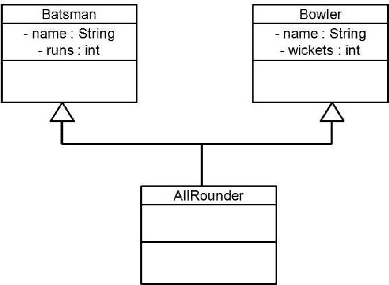

# Java SE 课程材料

## 关于作者

`Srikanth Pragada` 是 Srikanth Technologies（一家软件培训公司）的董事。他在 90 年代初开始编程，使用过超过 15 种不同的编程语言。`Srikanth Pragada` 拥有以下认证：

- Sun 认证 Java 程序员 (Sun Certified Java Programmer)
- Sun 认证 Web 组件开发者 (Sun Certified Web Component Developer)
- Sun 认证业务组件开发者 (Sun Certified Business Component Developer)
- Oracle 数据库 SQL 认证专家
- Oracle PL/SQL 开发者认证助理
- 微软认证 .NET 4.0 技术专家 (Web 应用程序)

他目前正就 C、Java、Oracle、Microsoft.NET 和 Android 技术进行在线、课堂和现场培训。

他的网站 [`http://www.srikanthtechnologies.com/`](http://www.srikanthtechnologies.com/) 提供了更多关于 C、Java 编程、Android 编程、Oracle 和 Microsoft.Net 的信息。该网站包含了在线考试、程序、项目、文章和他的博客。

在不教学或学习时，他喜欢访问新的地方、阅读书籍、参加运动和听音乐。

可以通过其邮箱地址 `srikanthpragada@yahoo.com` 与他联系。

Srikanth Technologies

## 如何使用本材料

只要本材料的内容仍在讨论范围内，每天都要随带到教室。

建议您在课前后阅读相关内容。

利用图片和文字来理解概念。程序用于说明如何实现这些概念。请在您的系统中尝试本材料中提供的程序。

本材料中给出的练习题答案可以在 [`http://www.srikanthtechnologies.com/books/javabook2016/answers.html`](http://www.srikanthtechnologies.com/books/javabook2016/answers.html) 找到。

## 反馈请求

我们付出了巨大的努力确保本材料内容的准确性。然而，如果您发现任何错误或有任何改进本材料质量的建议，请花几分钟宝贵时间发送邮件至 `srikanthpragada@yahoo.com`。

或者，您可以访问我的网站 `www.srikanthtechnologies.com/feedback.aspx` 在那里提供反馈。

Srikanth Technologies

## Java 入门

**千里之行，始于足下……**

**那么，让我们开始学习 Java 吧。**

### 你将学什么？

在本模块结束时，你将学习以下内容：

- 什么是 Java？
- Java 的历史
- Java 的版本
- C、C++ 与 Java 之间的关系
- Java 语言特性
- Java 与平台无关性
- 使用 Java SE
- 第一个 Java 程序 – `Hello.java`
- 标准或原始数据类型
- Java 中的运算符
- 控制语句
- 使用 `System.out.printf()` 打印值
- 使用 `Scanner` 读取输入
- 创建和使用数组
- 可变参数
- 命令行参数
- 练习题

Srikanth Technologies

### 什么是 Java？

- 一种通用编程语言。
- 由太阳公司（Sun Microsystems）的 `James Gosling`、Patrick Naughton、Chris Warth、Ed Frank 和 Mike Sheridan 发明。
- Java 于 `1995 年 5 月` 发布。
- 最广泛使用的编程语言。
- 主要用于开发 Web 和企业级应用。
- 提供“一次编写，随运行”的特性 – 平台无关性。
- 受 `C` 和 `C++` 影响。
- 语法源自 C 和 C++。然而，它消除了 C++ 中可能导致歧义的功能，如多重继承、运算符重载、友元函数等。

## Java 历史

以下是 Java 的各个版本、发布时间以及新增的功能。

- Java 1.0 于 `1995 年 5 月` 发布。Java 最初被称为“oak”，然后重命名为 Java。`JDK`（Java 开发工具包）1.0 于 `1996 年 1 月 23 日` 发布。
- Java 1.1 发布以添加如内部类、`JDBC`、`RMI`、JavaBeans 和新的事件处理模型。`JDK` 1.1 于 `1997 年 1 月 23 日` 发布（注：文中说是 1996 年，但上下文暗示了其顺序）。
- Java 1.2 于 `1998 年 2 月 19 日` 发布。增加了 `JIT`（即时编译）编译器、`Swing`。
- Java 1.3 增加了 `JavaSound`、`JNDI` 并于 `2000 年 5 月 8 日` 发布。
- Java 1.4 于 `2002 年 2 月 6 日` 发布，增加了正则表达式、`XML`、断言和非阻塞 `IO`。
- Java 1.5 也称为 Java 5.0，于 `2004 年 9 月 30 日` 发布，增加了泛型、注解、枚举和自动装箱。
- Java 1.6 也称为 Java 6.0，于 `2006 年 12 月 11 日` 发布，增加了 `JDBC 4.0`、GUI 改进。
- Java 7.0 于 `2011 年 7 月 7 日` 发布。
- Java 8.0 于 `2014 年 3 月 18 日` 发布，增加了 Lambda 表达式。

## Java 版本

Java 提供了三个版本，每个版本适用于不同类型的应用程序。

- 标准版 – `Java SE`
- 企业版 – `Java EE`
- 微型版 – `Java ME`

### Java SE (标准版)

用于开发控制台程序、Applets 和基于框架的应用程序（桌面应用）。

该版本提供了语言特性以及与 `IO` 流、网络以及使用集合的数据结构相关的 API（应用程序接口）。

该版本带有 Java 编译器、`JVM` 以及开发 applet 和桌面应用程序的工具。

### Java EE (企业版)

用于开发 Web 应用、Web 服务和企业应用。它使用 Java 语言和核心 API。

这是一系列由产品实现的规范。BEA 的 `Weblogic` 服务器、IBM 的 `Webphere`、开源产品 `JBoss`、`Glassfish` 等实现了 Java EE 规范。

Java EE 的主要主题是 `Servlets`、`JSPs`、企业 Java Bean (EJB)、Java Mail、Java Messaging Service (JMS) 等。

### Java ME (微型版)

用于开发嵌入到微设备中的软件。它使用 Java 语言及其核心 API。一些手机使用使用 Java ME 开发的软件。

这些特性会引起歧义。

Java 不支持 C++ 的默认函数参数、运算符重载、多继承、友元函数等。

C 和 C++ 更多侧重于提供灵活性和威力，而 Java 的重点是健壮性和互联网编程。

## JAVA 语言的特性

以下是 Java 语言的主要特性。

### 健壮性 (Robust)

使程序更加健壮（无潜在错误）。Java 在编译程序时会检测所有潜在问题。它在运行时还会检查数组越界等问题。

### 面向对象 (Object Oriented)

支持封装、继承和多态。Java 允许所有代码仅放在类中。它不允许任何代码放在类之外，包括 `main()` 方法。

### 动态 (Dynamic)

在运行时为数组和对象分配内存，并自动处理内存的分配和释放。垃圾回收器负责释放不再使用的内存块。

### 多线程 (Multithreaded)

支持创建和管理多个线程。

### 分布式 (Distributed)

支持程序在不同的系统上运行并相互通信。提供了从一个应用程序传输数据到另一个应用程序的机制。

### 平台无关性 (Platform Independent)

允许编译后的程序（字节码）运行在任何其他平台上。

## JAVA 是健壮的

- Java 作为一种健壮的语言，会在编译时和运行时都检查潜在错误。
- Java 是一种强类型语言，值的数据类型不能转换为另一种，并且对大小敏感。
- 以下代码段显示了 C 中允许但在 Java 中不允许的操作。

```c
int a[10];
int i , j; // 局部变量，未初始化
a[10]=100; // 访问范围外的元素
i = j; // 将 float 赋值给 int
j++; // 在未初始化的情况下使用
```

- Java 还会检查当条件为假时，本应返回值的函数。

```java
/* 此函数无法编译，因为它没有返回值 */
int fun(int v){
    if ( v > 10 )
        return 1;
    else
}
```

- Java 会检查代码段在程序执行期间是否可达。如果代码在所有执行路径中都是不可达的，它会报错。

```java
/* 不可达代码示例 */
int fun(int v) {
    if ( v > 10 )
        return 1;
    else
        return 0;
}
v++; // 无法到达
```

## 平台无关的语言

Java 语言的主要特性是其平台无关性。这允许在在一个平台上编译的 Java 程序运行在任何其他平台上。这被称为 WORA（一次编写，随运行）。

平台无关性不同于可移植性（Portability），后者允许将源代码迁移到不同的平台。虽然迁移了源程序，但我们需要在运行它之前在目标平台上编译源程序。

所有高级语言都具有可移植性。原生代码是微处理器和计算机操作系统能够理解的代码。

> **注意**：平台是应用程序运行的环境。它通常是操作系统和硬件的结合。平台通常同于操作系统。

## Java 程序的编译与运行

以下是与 Java 程序编译和运行相关的步骤。Java 程序**不是**编译成原生代码，而是编译成字节码（Byte code），字节码接近原生代码但不是任何平台的原生代码。

一旦 Java 程序编译成字节码（`.class` 文件），就可以在任何可用 `JVM`（Java 虚拟机）的平台上运行。

> **注意**：Java 编译器和 `JVM` 是特定于每个平台的。只有字节码是平台无关的。

## Java 与平台无关性

以下展示了在 Windows 系统上编译的 Java 程序如何在 Linux 系统上运行。一旦 Java 程序编译成字节码（`.class` 文件），就可以在任何可用 `JVM` 的机器上执行。大多数现代操作系统在提供操作系统同时也提供了 `JVM`，允许字节码直接运行。

## JVM - 使用 Java SE

- 从 [`http://www.oracle.com/technetwork/java/javase/downloads/jdk8-downloads-2133151.html`](http://www.oracle.com/technetwork/java/javase/downloads/jdk8-downloads-2133151.html) 下载 Java SE（即 `JDK` – Java 开发工具包）。
- 安装 Java SE 只需要双击下载的文件（`.exe` 文件）并按照步骤操作。
- 建议将 Java SE 安装在 `c:\jdk` 等目录中，而不是默认目录（程序文件目录）。
- 安装 `JDK` 后，安装程序将进行 `JRE`（Java 运行环境）安装。

> **注意**：你可以从 `netbeans.org` 下载集成开发环境 NetBeans IDE。Eclipse 是另一个可以从 `eclipse.org` 下载的 IDE。

## Java SE 的目录结构

当你将 Java SE 安装到目录（例如 `c:\jdk`）后，目录结构将如下：

- `c:\jdk`
- `bin` (`javac.exe`, `java.exe`)
- `db`
- `include`
- `jre`
- `lib`
- `.jar`
- `srikanth` (用户创建)

### 目录描述

- `bin`: 包含与 `JDK` 相关的可执行文件。包含 `JAVAC.EXE` 和 `JAVA.EXE`。
- `db`: 包含 derby 数据库。
- `include`: 包含 Java Native Interface（JNI）的文件。
- `jre`: Java 运行环境。
- `lib`: 包含 Java 库，以 `.jar`（Java 归档）文件的形式存在。
- `srikanth`: 用户自定义文件夹。

> **注意**：在 `jdk` 下创建一个用户目录并将程序放在该目录中。例如，名为 `srikanth` 的目录可以用于存储用户的 Java 程序。

## 基础工具

这些工具是 `JDK` 的基础。它们是你用于创建和构建应用程序的工具。

| 工具名称 | 简要描述 |
| :--- | :--- |
| `javac` | Java 语言的编译器。 |
| `java` | Java 程序的启动器。 |
| `javadoc` | API 文档生成器。 |
| `apt` | 注解处理工具。 |
| `appletviewer` | 无浏览器运行和调试 applet。 |
| `jar` | 创建和管理 Java 归档 (JAR) 文件。 |
| `jdb` | Java 调试器。 |
| `javah` | C 头文件和存根生成器。用于编写原生方法。 |
| `javap` | 类文件反汇编。 |
| `extcheck` | 检测 Jar 冲突的实用工具。 |

## 第一个 Java 程序 – HELLO.JAVA

使用 `Notepad` 等文本编辑器编写以下程序，并保存为 `Hello.java`。如果你使用 `Notepad`，请确保在保存时为文件名加上引号（`"Hello.java"`），否则 Notepad 会给出默认扩展名 `.txt`。

将此程序保存为 `c:\jdk\srikanth\Hello.java`。

```java
// 打印 Hello World 的程序
public class Hello{
    public static void main(String args[]){
        System.out.println("Hello World!");
    }
}
```

当你编译并运行上述 Java 程序时，它会打印 *Hello World!* 消息。

## 程序结构分析

以下是此程序的一些重要组成部分。

- Java 中的每个函数都必须在类内部，因此我们必须创建一个类 `Hello` 来将 `main()` 函数放在其中。
- 函数 `main()` 必须声明为 `static`。它不返回任何内容（`void`），并接受一个 `String` 类型的数组作为参数。这些都是强制性的。
- `System.out.println()` 用于打印指定的消息。

## 编译和运行 Java 程序

要编译 Java 程序，请按照以下步骤操作：

1. 使用 `programs` $\rightarrow$ `accessories` $\rightarrow$ `command prompt` 进入命令提示符。
2. 在命令行中将 Windows 的 `PATH` 命令设置为 `jdk` 的 `bin` 目录，如下：

```cmd
path c:\jdk\bin
```

`PATH` 是必须的，因为 `javac.exe` 和 `java.exe` 在 `bin` 目录中。

3. 进入保存 `Hello.java` 的目录（`c:\jdk\programs`）。
4. 使用 `JAVAC.EXE` 按照如下方式编译 Java 程序：

```cmd
javac Hello.java
```

5. 从命令行按照如下方式运行 Java 程序：

```cmd
java Hello
```

> **注意**：`PATH` 命令用于通知操作系统（Windows）它应该在文件系统的何处搜索可执行文件。默认情况下，操作系统仅在当前目录搜索可执行文件。要查看当前的 `PATH` 设置，只需在命令提示符中输入 `PATH`。

## JAVA 标准或原始数据类型

下表显示了 Java 中可用数据类型的列表，以及数据类型占据的字节数和该数据类型可以存储的值范围。

| 数据类型 | 大小（字节） | 范围 |
| :--- | :--- | :--- |
| `byte` | 1 | -128 到 127 |
| `short` | 2 | -32768 到 32767 |
| `int` | 4 | -2147483648 到 2147483647 |
| `long` | 8 | -9223372036854775808 到 9223372036854775807 |
| `float` | 4 | 1.7e-308 到 1.7e+308 |
| `double` | 8 | 3.4e-038 到 3.4e+038 |
| `boolean` | | true 或 false |
| `char` | 2 | 支持 Unicode 字符。 |

- Java 中的所有数值类型都是有符号的。
- `boolean` 的大小取决于 `JVM`。
- 数据类型 `char` 占据两个字节，因为它支持 Unicode，Unicode 需要 16 位来存储字符。
- Unicode 支持所有语言的字符，某些日语和中文语言有超过 256 个字符。
- 数据类型的大小在不同平台之间不会改变。

> **注意**：Java 不允许使用未初始化的变量。默认情况下，局部变量不会由 Java 初始化。

## 创建标识符的规则

程序中的名称称为标识符。创建标识符时必须遵循以下规则。


# Java 标识符规则

* 可以包含字母、数字、`_`（下划线）和 `$`。
* 不能以数字开头。可以以货币符号（`$`）或 `_`（下划线）开头。
* 不能使用 Java 关键字。

**有效标识符**：`first_number`、`name$`、`_first`、`$amount`

**无效标识符**：`2num`、`total-amount`

# Java 关键字

以下是 Java 关键字列表。这些关键字均为小写。

`abstract`, `continue`, `for`, `new`, `switch`, `assert`, `default`, `package`, `synchronized`, `boolean`, `do`, `if`, `private`, `this`, `break`, `double`, `implements`, `protected`, `throw`, `byte`, `else`, `import`, `public`, `throws`, `case`, `enum`, `instanceof`, `return`, `transient`, `catch`, `extends`, `int`, `short`, `try`, `char`, `final`, `interface`, `static`, `void`, `class`, `finally`, `long`, `strictfp`, `volatile`, `const`, `float`, `native`, `super`, `while`

# 字面量

字面量表示在程序过程中保持不变的值。

* Java 有三个保留字面量：`null`、`true`、`false`。
* 整数字面量被视为整数，除非带有后缀 `L`（字母）。
* 从 Java 7.0 开始，可以使用 `_`（下划线）作为分隔符。
* 整数字面量可以使用八进制（`0123`）或十六进制（`0xff`）。八进制以 `0` 开头，十六进制以 `0x` 开头。
* 浮点字面量默认被视为 `double`。使用后缀 `f` 表示 float。例如，`10.50f`。
* 从 Java 7.0 开始，可以有二进制字面量 `0b`。
* 转义序列和 Unicode 值可以出现在字面量中。例如，水平制表符（`\t`）和回车（`\r`）等于十进制 13。

| 类型 | 示例 |
| :--- | :--- |
| 整数 | 200, -7 |
| 浮点 | 2.55 |
| 布尔 | true, false |
| 字符 | 'a' |
| 字符串 | "one" |

# 转义序列

以下是 Java 支持的转义序列。

| 字符 | 含义 |
| :--- | :--- |
| `\"` | 双引号 |
| `\'` | 单引号 |
| `\\` | 反斜杠 |
| `\r` | 回车 |
| `\n` | 换行 |
| `\f` | 换页 |
| `\t` | 制表符 |
| `\b` | 退格 |

# Java 运算符

运算符对给定的值（操作数）执行特定操作。运算符分为不同的类别。

## 算术运算符

| 运算符 | 含义 |
| :--- | :--- |
| `++` | 递增 |
| `--` | 递减 |
| `*` | 乘法 |
| `/` | 除法 |
| `%` | 取模 |
| `+` | 加法 |
| `-` | 减法 |

## 结合性

结合性指定运算符是从左到右还是从右到左分组。`++` 和 `--` 运算符从右到左，其他运算符从左到右。

## 转换和类型转换

* Java 允许兼容类型之间的赋值。
* Java 将 `byte` 和 `short` 等整数类型提升为 `int`。
* 当我们将大数据类型转换为短数据类型时，需要显式的 `类型转换`。

```java
// 将失败，因为 10.50 被视为 double
float f = 10.50;
// 使用 f 作为后缀表示 float
float f = 10.50f;
// 将 double 转换为 float 然后赋值
float f = (float)10.50;
```

## 赋值运算符

赋值运算符 `=` 用于给变量赋值。该值可以是字面量或表达式。变量和表达式的结果必须是兼容的数据类型。Java 还支持多次赋值，你可以在单次赋值中为多个变量分配单个值。

```java
a = 0;
a = b = c = 0;
```

## 关系运算符

* 所有关系运算符都是二元运算符。
* 评估结果总是布尔值。
* 关系运算符具有从左到右的结合性。

| 运算符 | 含义 |
| :--- | :--- |
| `==` | 等 |
| `>` | 大于 |
| `<` | 小于 |
| `<=` | 小于等于 |
| `>=` | 大于等于 |
| `!=` | 不等于 |

## 逻辑运算符与短路

逻辑运算符结合两个条件并返回布尔值。下表显示了逻辑运算符。

| 运算符 | 含义 |
| :--- | :--- |
| `&` | 与 (AND) |
| `|` | 或 (OR) |
| `^` | 异或 (XOR) |
| `||` | 短路或 |
| `&&` | 短路与 |
| `!` | 一元非 (NOT) |

## 短路逻辑运算符 (&& 和 ||)

短路运算符只检查必要的条件，并不总是检查两个条件。一旦知道条件的结果，评估就会停止。

* `&&` 如果第一个条件为假，则不检查第二个条件。
* `||` 如果第一个条件为真，则不检查第二个条件。

```java
if (a > b && a > c)
```

如果条件 `a > b` 为假，则返回假且不检查第二个条件 (a > c)。

```java
if (a == b || a == c)
```

如果条件 `a == b` 为真，则返回 true，且不检查第二个条件。

## 位运算符

位运算符对整数中的位进行操作。它们只能用于诸如 `int` 和 `long` 等整型数据类型。

| 运算符 | 含义 |
| :--- | :--- |
| `~` | 取反码 (Ones complement) |
| `&` | 位与 (Bitwise Anding) |
| `|` | 位或 (Bitwise Oring) |
| `^` | 位异或 (Bitwise XOR - Exclusive OR) |
| `<<` | 将位向左移动 `n` 次，并在右侧填充 0。 |
| `>>` | 将所有位右移 `n` 次，在左侧用符号位填充。 |
| `>>>` | 将所有位右移 `n` 次，在左侧用 0 填充。 |

下面的代码段展示了如何使用位运算符。

```java
public class BitOperators {
    public static void main(String[] args) {
        byte a = 10, b = 15;
        // 0000 1010 & 0000 1111 = 0000 1010
        System.out.printf("%d & %d = %d\n",a,b,a & b);
        // 0000 1010 | 0000 1111 = 0000 1111
        System.out.printf("%d | %d = %d\n",a,b,a | b);
        // 0000 1010 >> 2 = 0000 0010
        System.out.printf("%d >> 2 = %d\n", a , a >> 2);
        // 0000 1010 << 2 = 0010 1000
        System.out.printf("%d << 2 = %d\n", a , a << 2);
    }
}
```

# 控制语句

以下是 Java 中提供的条件语句和循环结构。

## if 语句

`if` 语句用于决定是否执行某操作。如果 `condition` 为真，则执行 `statement-1`，否则执行 `statement-2`。`else` 部分是可选的。

```java
if (condition)
    statement-1;
else
    statement-2;
```

**注意**：如果需要执行多个语句，请将语句括在大括号 (`{}`) 中。

可以有嵌套的 if 语句（在一个 if 语句内部嵌套另一个 if 语句）。也可以有多个带有 `if ..else.. if .. else` 的 if 语句。

## switch 语句

`switch` 语句用于执行多个备选方案中的一种。

```java
switch(expression)
{
    case label-1 : statement; [break];
    case label-2 : statement; [break];…
    default : statement;
}
```

下面的示例对代码 1 和 2 执行相同的操作，对代码 3 执行不同的操作。`default` 用于执行处理剩余代码的操作。

```java
switch(code){
    case 1 : // 穿透到下一个 case
    case 2 : price = 1000; break;
    case 3 : price = 500; break;
    default: price = 100;
}
```

对于 `switch` 语句，表达式必须是 `char`、`byte`、`short`、`int` 或 `enum` 类型。从 Java 7.0 开始，`switch` 也支持 `string` 数据类型。

```java
String country;
// 获取值并存入 country
switch(country)
{
    case "India" : // 代码
    case "China" : // 代码
    case "Russia" : // 代码
    default : // 代码
}
```

case 常数的求值类型必须与 switch 表达式的类型相同。case 常数必须是编译时常量。

**注意**：`default` 情况不必非位于 `switch` 语句的末尾；它可以位于任何地方。

## while 循环

只要条件为真，就重复执行语句(语句)。

```java
while(condition)
    statements;
```

示例显示了 1 到 10 的所有数字。要执行多个语句，请将语句括在大括号 (`{}`) 中。

```java
int i = 1;

while ( i <= 10 ) {

    System.out.println(i);

    i ++;

}
```

## do .. while 循环

执行循环体然后检查条件，从而保证语句至少执行一次。

```java
do {

    statement;

}while (condition);
```

下面的程序显示了 1 到 10 的数字。

```java
int i = 1;

do {

    System.out.println(i);

    i ++;

} while (i <= 10);
```

## for 循环

`for` 循环只要条件为真就会执行语句。首先执行初始化，然后检查条件是否为真。如果条件为真，则执行语句然后执行递增部分。

```java
for( initialization; condition; increment)
    Statement;
```

变量可以在初始化中声明。

```java
for(int i=0; i<10; i++){
    // 语句
}
```

## break 语句

`break` 语句用于终止循环。Java 提供了标签 `break` 和无标签 `break`。

```java
label:

for(...) {

    if(condition)
        break;

}
```

## continue 语句

`continue` 用于跳过当前迭代并进入下次迭代。

```java
for(...) {

    if(condition)
        continue;

}
```

## 使用 System.printf 打印值

`printf()` 函数类似于 C 语言。可以使用的转换字符：`b`-布尔、`c`-字符、`d`-整数、`f`-浮点数、`s`-字符串。

如果转换字符不匹配，将发生运行时错误。

## 使用 Scanner 读取输入

可以使用 `Scanner` 类获取输入。下面的代码段展示了如何使用 `Scanner` 读取整数。

```java
import java.util.Scanner;

public class Factors {

    public static void main(String[] args) {

        Scanner s = new Scanner(System.in);

        System.out.print("Enter a number :");

        int num=s.nextInt();

        for (int i = 2; i <= num/2; i++) {

            if(num % i == 0)
                System.out.println(i);

        }

    }

}
```

| 方法 | 说明 |
| :--- | :--- |
| `nextInt()` | 读取下一个整数 |
| `nextDouble()` | 读取下一个双精度浮点数 |
| `nextLine()` | 读取下一行并返回字符串 |

# 数组

包含 5 个元素的新数组

由 `arr` 引用的包含 10 个元素的旧数组现在可以被 Java 垃圾回收了。

**注意**：Java 虚拟机具有垃圾回收器，负责释放未使用的内存块。

你可以像下面一样使用两个方括号来创建一个二维数组：

```java
int a[][] = new int[5][5];
```

你可以像下面一样创建一个包含 5 个元素的数组，其中每个元素可以引用不同大小的数组：

```java
int a[][] = new int[5][];

a[0] = new int[5];

a[1] = new int[10];
```

## 增强 for 循环

Java 提供的增强 for 循环专门处理数组和集合。它从数组中取一个值并将其赋值给循环变量。执行循环语句并重复该过程直到数组耗尽。

`for (datatype loopvariable : array)`
`Statement;`

下面的示例展示了如何使用增强 for 循环显示数组的所有元素。循环变量类型与数组的数据类型必须相同。

```java
int a [] = {10,20,30,40,50};

for ( int n : a )
    System.out.println (n);
```

## 初始化数组

Java 允许对数组进行初始化。以下示例展示了你如何在 Java 中初始化数组。

```java
// 初始化数组 a 为给定的三个值
int a[] = {10,20,30};

// 初始化数组 b 为给定的五个值
int b[] = new int[] {10,20,30,40,50};

// 初始化二维数组 – 2 X 3
int bb[][]= {{1,2,3},{4,5,6}};
```

**注意**：数组的元素会根据数组的数据类型自动初始化为默认值。

## 可变数量参数

- Java 允许方法接受变数量的参数。
- 参数在数据类型之后、名称之前用 `…`（省略号）声明。
- 必须是方法中的最后一个参数。
- 参数在方法内部被视为一个数组。

```java
01: public class VaryingArguments {
02: public static void main(String[] args) {
03: System.out.println(getSum(10, 20, 30));
04: System.out.println(getSum(100, 200) );
05: }
06: public static int getSum(int... nums) {
07: int total = 0;
08: for (int n: nums) {
09: total += n;
10: }
11: return total;
12: }
13: }
```


# Java 入门

## 命令行参数

- 在从命令行调用 java 程序时传递的参数称为命令行参数。
- 这些参数可以用于为程序提供输入。
- 这些参数可以通过 `main()` 方法中的 `args` 参数访问，它是一个字符串数组。
- `args` 的 `length` 属性返回在命令行传递的参数个数。

```java
01: // 显示命令行参数的程序
02: public class CLA {
03:     public static void main(String args[]){
04:         System.out.printf("Args Count: %d\n",args.length);
05:         // 显示参数
06:         for(String s : args)
07:             System.out.println(s);
08:     } // main 结束
09: }
```

如下所示从命令行调用之前的程序：

`c:\jdk\srikanth>java CLA One Two <Enter>`
Args Count : 2
One
Two

**注意**：方法 `main()` 必须有一个类型为 `String[]` 的参数。然而，该参数的名字可以是任意的。下面的代码与上方相同。

```java
01: public class CLA {
02:     public static void main(String a[]){
03:         for (String s : a)
04:             System.out.println(s);
05:     }
06: }
```

## 程序 - Prime.java

此程序检查命令行上给出的数字是否为质数。质数是指除了 1 和自身外没有因子的数。

```java
01: // 检查数字是否为质数的程序
02: public class Prime {
03:     public static void main(String[] args){
04:         // 检查是否传递了数字
05:         if (args.length == 0) {
06:             System.out.println("Number is missing!");
07:             return;
08:         }
09:         // 将 args[0] 转换为 int
10:         int n = Integer.parseInt( args[0] );
11:         boolean prime = true;
12:
13:         for ( int i = 2; i <= n/2; i ++) {
14:             if ( n % i == 0 ) {
15:                 prime = false;
16:                 break;
16:             }
17:         } // for 结束
18:         if (prime)
19:             System.out.println("Prime");
20:         } else
21:             System.out.println("Not a prime");
22:     } // main 结束
23: }
```

Prime 程序执行以下操作：
- 检查是否传递了数字。
- 如果 `args.length == 0`，打印 "Number is missing!" 并返回。
- 将 `args[0]` 转换为 `int`。
- 从 `2` 循环到 `n/2`。如果 `n % i == 0`，将 `prime` 设置为 `false` 并跳出。
- 根据 `prime` 变量打印 "Prime" 或 "Not a prime"。

通过命令行运行此程序：
`c:\jdk\srikanth>java Prime 23 <Enter>`

## 练习

尝试编写程序完成以下任务：
1. 显示前 10 个数字。
2. 显示 1000 到 2000 范围内所有的回文数。
3. 接收数字并显示其是否为完美数。
4. 接受十个数字并显示其中最大的。
5. 接受两个数字并显示它们的最大公约数 (GCD)。
6. 在命令行接受两个数字并将底（第一个数字）提升到幂（第二个数字）。
7. 接收一个数字并倒序显示其数字。
8. 创建一个接受变长度整数的函数，返回所有数字的平均值。
9. 创建一个 10 个元素的数组。从键盘读取值并填充数组。
10. 交换前 5 个元素和后 5 个元素并显示数组。

**注意**：这些练习的答案可以在 `http://www.srikanthtechnologies.com/books/javabook216/answers.html` 找到。

---

# Java 学生指南 - 面向对象编程

- 增加了控制性，因为每个对象都是独立的，拥有自己的私有数据以及一组可以从其他对象调用的函数。
- Java 中的类（`Class`）定义了要封装的数据和代码。

`Employee`
`外部调用`
`EmpName`
`Salary`
`数据`
`changeSalary()`
`Code`
`外部`
`netSalary()`

在上面的示例中，`Employee` 类有两个实例变量——`EmpName` 和 `Salary`，以及两个方法——`changeSalary()` 和 `netSalary()`。
实例变量只能通过类的一部分的方法——`changeSalary()` 和 `netSalary()` 来访问。

### 类 vs 对象 (Class vs. Object)

类是对相似对象的集合描述。类定义了要封装的实例变量和方法。类表示一类对象。它是创建对象的蓝图。例如：`Employee`、`Product`、`Student` 等。
`Instance variables`（实例变量）用于存储数据，`methods`（方法）对数据执行操作。
`Object`（对象）是类的实例。只有创建类的对象时才会分配内存。方法通过对象调用。例如：一个员工、一个学生等。

### 继承 (INHERITANCE)

- 允许从另一个类创建类，从而继承另一个类的所有成员。
- 允许现有类的可重用。
- 新类可以添加新成员并重写被继承类的现有成员。
- 被继承的类称为超类（`superclass`），从现有类创建的类称为子类（`subclass`）。
- 继承表示类之间的“是”（IS A）关系。例如，`Manager` 继承 `Employee`，因为 `Manager` 是一个 `Employee`。`SavingsAccount` 继承 `Account`，因为 `SavingsAccount` 是一个 `Account`。
- 可以使用继承构建层次结构。

`Employee`
`Name`
`Salary`
`changeSalary()`
`getSalary()`

`Manager`
`hra`
`changeHra()`
`getSalary()`

在上面的示例中，`Manager` 类继承了 `Employee` 类所有的数据成员和方法。它添加了 `hra` 和 `changeHra()` 成员并重写了 `getSalary()` 方法。
`Overriding`（重写）是子类（`Manager`）创建一个与超类（`Employee`）中方法签名相同的过程。
Java 允许一个类只扩展一个类——单继承（`single inheritance`）。
Java 不允许多继承（`Multiple inheritance`），即一个类从多个类创建。

### 多态 (POLYMORPHISM)

- 允许执行相同操作的多个方法具有相同的名称。
- 编译器根据上下文（传递给方法的参数）调用多个方法中的其中一个。
- 程序员不需要记住多个名称。

在下面的示例中，三个返回两个值最大值的函数都具有相同的名称。

```java
max(int ,int)
max(long, long)
max(String,String)
```

取决于作为参数传递给 `max` 函数的数据类型，编译器会调用这三个函数中的其中一个。
多态可以在编译时（方法重载）或在运行时（动态方法分发）实现。

### 创建类 (CREATING A CLASS)

类类似于用户定义的数据类型。类描述了要存储和处理的数据。以下是创建类的语法。

```java
access class classname
{
    [access] instance-variable-declaration;
    [[access instance-variable-declaration] ] . . .
    [access] returntype methodname ( [parameterlist])
    {
        // 方法体
    }
.
}
```

实例变量和方法的访问权限可以是 `private`、`public`、`protected` 或 `default`（默认访问）。
**注意**：通常类名使用 `Pascal case` 命名约定（帕斯卡命名法）——每个单词的首字母大写，其余小写。方法名使用 `Camel case` 命名约定（驼峰命名法）——第一个单词全小写，后续单词的首字母大写，其余字母小写。

以下是表示 `Employee` 类的 UML（统一建模语言）图。减号（`-`）表示 `private` 权限，加号（`+`）表示 `public` 权限。

```
Employee
- name : String
- salary : int
+ init(name:string, sal:int): void
+ setSalary (sal:int): void
+ getSalary(): int
+ print(): void
```

**注意**：`.java` 文件名与公共类名必须相同。一个 `.java` 文件可以包含多个类（但只能有一个类是公共的）。当你编译 `.java` 文件时，文件中的每个类都会有一个对应的 `.class` 文件。

**Employee.java**
此文件包含 `Employee` 类的定义。

```java
01: public class Employee {
02:     private String name;
03:     private int salary;
04:     public void init(String n, int sal) {
05:         name = n;
06:         salary = sal;
07:     }
08:     public void print() {
09:         System.out.println(name);
10:         System.out.println(salary);
11:     }
09:     public void setSalary(int sal) {
10:         salary = sal;
11:     }
12:     public int getSalary() {
13:         return salary;
14:     }
15: }
```

**TestEmployee.java**
此文件包含 `TestEmployee` 类的定义。

```java
01: public class TestEmployee {
02:     public static void main(String[] args) {
03:         Employee e; // 对象引用
04:         e = new Employee(); // 创建 Employee 对象
05:         e.init("Jonathan", 35000);
06:         e.print();
07:         e.setSalary(55000);
08:         if ( e.getSalary() > 50000 )
09:             System.out.println("Fat salary");
10:     }
11: }
```

如果你编译 `Employee.java`, `TestEmployee.java` 并运行 `TestEmployee`，将产生输出：

```
Jonathan
35000
Fat salary
```

### 构造方法 (CONSTRUCTOR)

- 类中与类名相同的方法。
- 在创建类的对象时自动调用。
- 用于初始化类的实例变量。
- 没有返回类型——即使是 `void` 也没有。

```java
01: public class Number {
02:     private int num;
03:     //构造方法
04:     public Number() {
05:         num = 1;
06:     }
07: }
```

在上面的示例中，`Number` 类有一个用于初始化实例变量 `num` 的构造方法。创建 `Number` 类的对象时，Java 会自动调用构造方法。
`n = new Number()` // 调用构造方法

构造方法可以接收参数并使用这些参数初始化实例变量。

```java
01: public class Number {
02:     private int num;
03:     //构造方法
04:     public Number(int n){
05:         num = n; }
06: }
```

每次创建对象都会调用上述构造方法。
`n = new Number(10)`

**注意**：如果没有显式创建构造方法，Java 会创建一个无参数的构造方法（默认构造方法）。但一旦在类中创建了用户定义的构造方法，Java 就不再提供该默认构造方法了。

以下是使用构造方法代替 `init()` 方法的 `Employee` 类：

```java
01: class Employee {
02:     private String name;
03:     private int salary;
04:     public Employee (String n, int sal) {
05:         name = n;
06:         salary = sal;
07:     }
08:     // 剩余代码
09: }
```

```java
01: class UseEmployee {
02:     public static void main(String[] args) {
03:         Employee e = new Employee ("Jonathan", 25000);
04:     }
05: }
```

### 方法重载 (METHOD OVERLOADING)

- 只要方法的参数不同，就可以在同一个类中定义两个或多个相同的方法。
- 方法重载是实现多态的一种方式。
- 方法可以根据参数的类型/数量进行重载。
- 方法不能根据返回值类型进行重载。

以下示例演示了在类中重载方法。

```java
01: class Test {
02:     void m1(int n) { }
03:     void m1(String s) { }
04:     void m1(String s, int n) { }
05:     void m1(int n, String s) { }
06:     // 不允许，因为方法仅根据返回值类型不同
07:     int m2(int n) {}
08:     long m2(int n) {}
09: }
```

## 重载构造函数

就像可以重载类的方法一样，也可以重载类的构造函数。

```java
01: public class Number {
02:     int num;
03:     public Number(){
04:         num = 1;
05:     }
06:     public Number(int n){
07:         num = n;
08:     }
09: }
```

当不传递任何参数创建对象时，调用第一个构造函数；当通过传递单个 `int` 作为参数创建对象时，调用第二个构造函数。

`Number n1 = new Number();` // 调用构造函数 `Number()`
`Number n2 = new Number(100);` // 调用 `Number(int)`

**注意：** 除非 Java 可以调用某个构造函数，否则无法创建对象。

```java
01: class A {
02:     int n;
03:     public A(int num){
04:         n = num;
05:     }
06:     public A(String s) {
07:         n = Integer.parseInt(s);
08:     }
09: }
```

第三行无法编译，因为 Java 无法调用任何构造函数。

`A obj1 = new A(10);`
`A obj2 = new A("99");`
`A obj2 = new A();` // 不可能

## 对象引用

对象引用是一个引用对象的变量。在 Java 中，使用对象引用访问对象。

```java
01: Employee e1; // 创建 Employee 类的对象引用
02: // 创建一个对象并让 e1 引用它
03: e1 = new Employee ("Larry",10000);
04: // 创建对象引用和对象
05: Employee e1 = new Employee("Larry",10000);
06: Employee e2 = new Employee("Steve",15000);
```


### 比较对象引用

如果比较同一个类的两个对象引用，则只比较引用，而不是对象的内容。

```java
Employee e1 = new Employee("Jason", 25000);
Employee e2 = new Employee("Jason", 25000);
if (e1 == e2) // 只比较引用，而不是对象
    System.out.println("Equal");
```

**注意：** 如果你比较两个对象引用，只比较引用，而不比较它们所指向对象的内容。
**注意：** 对象引用仅允许使用 `==` 和 `!=` 关系运算符。

### 两个对象引用之间的赋值

可以将一个对象引用赋值给另一个。但是，我们实际上复制的不是对象的内容到另一个，而是将一个对象引用给另一个。

以下示例和图片演示了当对象引用复制到另一个时会发生什么。

```java
Employee e1, e2;

e1 = new Employee("Larry", 10000);
e2 = new Employee("Steve", 15000);
e1 = e2; // e1 和 e2 指向同一个对象
```

## 对象数组

* Java 支持类的对象数组。
* 当创建对象数组时，只创建可以指向该类对象的对象引用。
* 每个元素的默认值为 `null`，在使用它之前，必须显式地让对象引用指向一个对象。

```java
Employee[] e;

// 创建一个包含 5 个 Employee 对象引用的数组
e = new Employee[5];

e[0] = new Employee("Gavin", 10000);
e[1] = new Employee("King", 15000);
```

| 索引 | 值 |
| :--- | :--- |
| 0 | Employee 对象 |
| 1 | Employee 对象 |
| 2 | `null` |
| 3 | `null` |
| 4 | `null` |

## `this` 引用

* 关键字 `this` 调用对象。
* 用于方法隐式地访问调用对象的成员。
* 当参数与实例变量同名时，用于访问实例变量。
* `this` 引用自动提供给每个非静态方法。
* 用于从一个构造函数调用另一个构造函数。

以下构造函数使用了 `this` 引用：

```java
01: class Employee {
02:     String name;
03:     int salary;
04:     Employee(String name, int salary) {
05:         this.name = name;
06:         this.salary = salary;
06:     }
07: }
```

## 静态变量

* 静态变量（称为类变量）是与类相关而不是对象的变量。
* 使用 `static` 关键字定义。
* 类中只存在一个。
* 声明为 `final` 的静态变量用作常量。

| 实例数据 | 静态变量 |
| :--- | :--- |
| 1001 ABC 40000 | `minbal` |
| 1002 XYZ 50000 | |
| 1003 PQR 43000 | |

## 静态方法

* 静态方法与普通方法的区别在于它们可以通过类名调用，而不需要对象。
* 使用 `static` 定义。
* 没有 `this` 引用。
* 静态方法无法调用非静态方法，无法访问实例变量，因为它们没有对象。
* 通常用于访问和操作静态变量。

```java
01: public class StaticTest {
02:     private int iv;
03:     private static int sv;
04:     public static void main(String[] args) {
05:         iv = 10; // 无效
06:         StaticTest obj = new StaticTest();
07:         obj.iv = 10; // 使用对象访问 iv 有效
08:     }
09: }
```

### 为什么 `main()` 是静态方法？

`main()` 函数必须声明为静态的，因为它由 JVM 通过类名调用。例如，当你运行 `Java Hello` 时，它会被转换为如下调用：`Hello.main(parameter)`。静态成员的其他示例还有 `Integer.parseInt()`、`Math.abs()` 和 `System.out`。

**注意：** Java 不允许在类外部定义任何函数。不需要创建对象的方法声明为静态，以便可以使用类名调用。这节省了创建和释放对象的时间。

## `final` 变量

* Java 允许使用 `final` 关键字将变量声明为 final。
* final 变量一旦赋值就无法更改值。
* final 变量通常是静态变量，因为对于类的每个对象来说，变量具有相同的值通常没有意义。
* final 变量必须在对象构造函数完成之前被赋值。

```java
class Account {
    public static final int MINBAL = 500;
}
```

变量 `MINBAL` 在类外部通过类名访问，因为它是静态公共变量。`MINBAL` 不能更改，因为它是 `final` 且初始化为 500。

```java
System.out.println(Account.MINBAL);
```

### Employee 类 UML 结构

| 成员 | 类型/签名 |
| :--- | :--- |
| name | `String` |
| salary | `double` |
| hraper | `float` (static) |
| Employee(name, salary) | 构造函数 |
| setSalary(salary) | `void` |
| getSalary() | `double` |
| setHraper(value) | `void` (static) |

在上面的 UML 图中，静态成员——`hraper` 变量和 `setHraper()` 方法带有下划线，表示它们是类的静态成员。

以下代码展示了如何使用静态变量 `hraper` 和静态方法 `setHraper()` 来实现 `Employee` 类。

```java
01: public class Employee {
02:     private String name;
03:     private double salary;
04:     private static double hraper = 20;
05:     public Employee(String name, double salary) {
06:         this.name = name;
07:         this.salary = salary;
08:     }
09:     public void setSalary(double salary) {
10:         this.salary = salary;
11:     }
12:     public double getSalary() {
13:         return salary + salary * hraper / 100;
14:     }
15:     public static void setHraper(double hra) {
16:         hraper = hra;
17:     }
18: }
```

```java
01: public class UseEmployee {
02:     public static void main(String[] args) {
03:         Employee e = new Employee("Jason", 30000);
04:         System.out.println(e.getSalary());
05:         Employee.setHraper(25);
06:         System.out.println(e.getSalary());
07:     }
08: }
```

# Java 学生指南 - 面向对象编程

## 继承

* 允许从现有类创建新类。
* 使用关键字 `extends` 来创建一个扩展现有类的新类。
* 现有类被称为超类，新类被称为子类。
* 继承代表“Is A”关系。例如，`Student` 是一个 `Person`，`Car` 是一个 `Vehicle` 等。

### 类结构示例

**Person**
* `name` : `String`
* `email` : `String`

**Student** / **Faculty**
* `course` : `String` (Student)
* `subjects` : `String` (Faculty)

以下代码演示了创建 `Person` 类和 `Faculty` 类。

```java
01: class Person {
02:     protected String name, email;
03:     public Person(String name, String email) {
04:         this.name = name;
05:         this.email = email;
06:     }
07:     public void print() {
08:         System.out.println(name);
09:         System.out.println(email);
10:     }
11:     public void setEmail(String email) {
12:         this.email = email;
13:     }
14: }
```

**注意**：访问修饰符 `protected` 允许成员也可以被子类访问。

```java
01: class Faculty extends Person {
02:     protected String subjects;
03:     public Faculty(String name, String email, String subjects) {
04:         super(name, email); // 必须是第一条语句
05:         this.subjects = subjects;
06:     }
07:     @Override
08:     public void print() { // 重写了 Person 的 print()
09:         super.print();
10:         System.out.println(subjects);
11:     }
11:     public void setSubjects(String subjects) {
12:         this.subjects = subjects;
13:     }
14: }
```

### UML 类图表示

| 类 | 成员 |
| :--- | :--- |
| **Person** | `# name : String`<br>`# email : String`<br>`+ Person(name, email)`<br>`+ print() : void`<br>`+ setEmail(email: String) : void` |
| **Faculty** | `# subjects : String`<br>`+ Faculty(name, email, subjects)`<br>`+ print() : void`<br>`+ setSubjects(subjects: String) : void` |

**注意**：UML 图中的符号 `#` 指定了 `protected` 访问权限。

```java
01: class TestPerson {
02:     public static void main(String args[]) {
03:         Faculty f = new Faculty("Srikanth",
04:             "srikanthpragada@yahoo.com", "Java,.Net");
05:         f.print();
06:         f.setEmail("srikanthpragada@gmail.com");
07:         f.setSubjects("Java,.Net,Oracle,Android");
08:     }
09: }
```

### 继承中的构造函数

当创建子类对象时，Java 会自动从子类的构造函数调用超类的默认构造函数。

但是，当超类没有默认构造函数时，我们必须使用 `super` 关键字和所需的参数显式调用超类的构造函数（正如我们在 `Faculty` 类中所做的那样）。

### `@Override` 注解

注解 `@Override` 表示子类方法声明旨在重写超类方法声明。

如果带有此注解的方法没有重写超类方法，编译器将生成错误信息。

### 方法重写

当子类中的方法与超类中的方法具有相同名称和签名时，子类中的方法被称为重写了超类中的方法。

`Person` 类的 `print()` 方法在子类 `Faculty` 中被重写。

#### 重写规则

* 参数列表必须完全匹配。
* 返回类型必须是原始类型或原始类型的子类（协变返回类型）。
* 访问级别不能比被重写方法更严格。
* `final` 方法不能重写。
* `static` 方法不能重写（只能隐藏）。
* 可继承的方法可以重写。
* `private` 方法不能被继承，因此不能重写。

### 重载 vs. 重写

当你在子类中创建一个与超类方法名称相同但参数不同的方法时，它被称为重载。

以下示例展示了重写与重载的区别。

```java
01: class C1 {
02:     public void m1(String msg) { }
03:     public void m2(int n) { }
04: }
05: class C2 extends C1 {
06:     // 重写 C1 的 m1() - 签名不同，实际为重载，若意图重写则签名需一致
07:     public void m1() { }
08:     // 重载 C1 的 m2()
09:     public void m2(String n) { }
10: }
```

### 使用 `super` 关键字访问超类

子类中的 `super` 关键字用于访问超类。`super` 可以用于：

* 访问被子类重写的超类方法。
* 从子类构造函数调用超类构造函数。
* 引用继承体系中的直接超类。

**注意**：在子类构造函数调用超类构造函数时，该调用必须是第一条语句。

### “拥有”关系

当一个类包含引用另一个类的变量时，该类被认为与该类存在“拥有”关系。

在示例中，`Customer` 类拥有 `Address`，因为它有一个 `Address` 类的变量。

```java
class Address {
    // 实例变量和方法
}

class Customer {
    private Address homeaddress;
    // 其他变量和方法
}
```

## 向下转型与向上转型

Java 允许超类对象引用子类对象。这是运行时多态的核心。

超类是子类的更通用形式。子类是超类的更具体形式。`Person` 是 `Student` 的更通用形式。换句话说，`Student` 始终是一个 `Person`。因此，任何 Java 需要 `Person` 的地方都可以使用 `Student`。

### 向上转型

**向上转型**是将对象转型为继承树中较高的类。当将 `Faculty` 对象赋值给 `Person` 时，被称为向上转型。向上转型在 Java 中是隐式的。

```java
Faculty f = new Faculty("Hunter", "hunter@servlets.com", "servlets,jsp");
Person p = f; // 向上转型隐式完成
Person p = (Person) f; // 显式转换但不需要
```

### 向下转型

向下转型是将对象转型为层次结构中较低的类。当将 `Person` 对象转换为 `Faculty` 时，被称为**向下转型**。向下转型必须使用类型转换语法显式进行：

```java
Person p = new Faculty("Hunter", "hunter@servlets.com", "Java");
Faculty f = p; // 无法编译
Faculty f = (Faculty) p; // 显式向下转型
```

**注意**：向下转型是显式的，而向上转型是隐式的。

向下转型只能在父类和子类之间进行。例如，无法将 `String` 对象转换为 `Person` 对象，因为 `String` 类和 `Person` 类之间没有继承关系。

### `instanceof` 运算符

`instanceof` 运算符用于检查对象引用是否指向指定类或其任一子类的类的对象。

语法：`对象引用 instanceof 类名`

```java
Person p = new Faculty("abc", "abc@gmail.com", "java");
System.out.println(p instanceof Faculty);  // true
System.out.println(p instanceof Person);   // true
System.out.println(p instanceof Student);  // false
```


## 多级继承

Java 支持多级继承。在这种情况下，一个类被另一个类扩展，而该类又被另一个类扩展。下面的图展示了多级继承。

`Employee` → `RegularEmployee` → `Consultant` → `OverseasEmployee`

Srikanth Technologies

Java 学生指南 - 面向对象编程 26

在上面的示例中，`Employee` 类被继承到 `RegularEmployee` 类，后者又被继承到 `OverseasEmployee`。

继承中类的构造函数必须按照继承顺序进行调用。

当你创建一个 `OverseasEmployee` 的对象时，首先调用 `Employee` 类的构造函数，然后是 `RegularEmployee` 的构造函数，最后是 `OverseasEmployee` 的构造函数。

Java 尝试通过 `super()` 语句从子类的构造函数调用父类的构造函数。然而，如果这样做不够，你必须使用 `super` 关键字传递所需的参数来显式调用父类的构造函数。

## 多继承

Java 不支持多继承，即一个类扩展两个或多个类。这意味着 Java 不允许将两个或多个类继承到同一个类中。

在下面的图中，`AllRounder` 扩展了 `Batsman` 和 `Bowler`，这是 Java 不支持的。

Srikanth Technologies
Java 学生指南 - 面向对象编程 27

Java 避免多继承的原因是多继承引起的歧义。例如，`AllRounder` 有两个 `name` 变量实例，一个来自 `Batsman`，另一个来自 `Bowler`。这导致了歧义。

## 运行时多态 - 动态方法分派

### 分派

- 指的是在运行时而非编译时解析对被重写方法的调用的过程。
- 它基于这样一个概念：父类的对象引用可以指向层次结构中任何子类的对象。
- 当使用父类的对象引用调用被重写的方法时，就会发生运行时多态。
- Java 根据父类对象引用所指向的对象来决定调用哪个方法（父类还是子类的方法）。
- 也称为后期绑定。

```java
class Person {
    public void print() {
        . . .
    }
}

class Faculty extends Person {
    @Override
    public void print() {
        . . .
    }
}
```

下面的代码显示了 Java 如何根据对象引用指向的对象调用相应的方法。

```java
Person objref;
objref = new Person(...);
objref.print();
// 父类的对象引用指向了子类的对象
objref = new Faculty(...);
/* 调用 print() 方法时，由于 objref 指向子类对象，
因此调用的是子类的 print() 方法。 */
objref.print(); // 调用子类的 print
```

> **注意**：动态方法分派仅适用于在父类中定义、子类中重写并使用父类对象引用调用的方法。

## 抽象方法

- 关键字 `abstract` 用于创建抽象方法。
- 抽象方法不包含方法体。
- 必须在子类中重写。否则，子类必须声明为抽象类。
- 如果类中有任何抽象方法，则该类必须声明为抽象类。
- 与 `final` 方法互斥——方法不能同时声明为 final 和 abstract。

## 抽象类

当一个类包含一个或多个抽象方法时，必须使用关键字 `abstract` 将定义为抽象类。

- 使用 `abstract` 关键字定义。
- 不能实例化（创建）抽象类的对象。
- 但是可以声明抽象类的对象引用。
- 通常包含一个或多个抽象方法。
- 类即使不包含任何抽象方法，也可以声明为抽象类。
- 可以包含其他非抽象成员，如方法和实例变量。

## final 变量、方法、类和参数

- 关键字 `final` 用于声明 final 变量、方法和类。
- final 变量是一个一旦赋值了值其值就不能改变的变量。
- final 方法是在子类中不能被重写的方法。
- final 类不能被扩展（继承）。final 类没有子类。
- 你可以将参数声明为 `final`，以确保参数的值在方法执行过程中发生改变。

```java
public void fun(int x, final int y) { }
```

下面的示例演示了如何使用抽象方法、抽象类、final 方法和运行时多态。

```java
01: abstract class Employee {
02:     protected String name, desg;
03:     public Employee(String name, String desg) {
04:         this.name = name;
05:         this.desg = desg;
06:     }
07:     final public String getDesg() {
08:         return desg;
09:     }
10:     final public void setDesg(String desg) {
11:         this.desg = desg;
12:     }
13:     final public String getName() {
14:         return name;
15:     }
16:     abstract int getPay();
17: }
18: class RegularEmployee extends Employee {
19:     protected int salary;
20:     public RegularEmployee(String name, String desg, int salary) {
21:         super(name, desg);
22:         this.salary = salary;
23:     }
24:     @Override
25:     public int getPay() {
26:         return salary;
27:     }
28: }
29: class Consultant extends Employee {
30:     protected int nohours, hourrate;
31:     public Consultant(String name, String desg, int nohours, int hourrate) {
32:         super(name, desg);
33:         this.nohours = nohours;
34:         this.hourrate = hourrate;
35:     }
36:     @Override
37:     public int getPay() {
38:         return nohours * hourrate;
39:     }
40: }
41: public class UseEmployee {
42:     public static void main(String[] args) {
43:         Employee employees[] = {
44:             new RegularEmployee("Steve", "Programmer", 25000),
45:             new Consultant("Kevin", "DBA", 10, 500),
46:             new RegularEmployee("Tom", "System Analyst", 45000)
47:         };
48:         for (Employee e : employees)
49:             System.out.printf("%s : %d\n", e.getName(), e.getPay());
50:     }
51: }
```

`Java UseEmployee` 的输出将是：
```
Steve : 25000
Kevin : 5000
Tom : 45000
```

## 初始化块

- 对象初始化块在创建对象时执行。
- 静态初始化块在类加载时执行。
- 初始化块在父类构造函数运行之后运行。
- 块按照它们在类中出现的顺序运行。
- 初始化块不能有参数且不能返回任何值。
- 对象初始化块无论执行哪个构造函数都会执行，因此它们可以包含所有构造函数需要共享的代码。

```java
class A {
    // 对象初始化块
    {
        System.out.println("Init Block In A");
    }

    public A() {
        System.out.println("Constructor of A");
    }

    // 静态初始化块
    static {
        System.out.println("Static Initialization Block Of A");
    }
}

class B extends A {
    public B() {
        System.out.println("Constructor of B");
    }

    public B(String message) {
        System.out.println("Constructor with message : " + message);
    }

    // 对象初始化块
    {
        System.out.println("First Init Block In B");
    }

    {
        System.out.println("Second Init Block In B");
    }

    static {
        System.out.println("Static Initialization Block Of B");
    }
}

public class InitBlockDemo {
    public static void main(String[] args) {
        B obj = new B();
        System.out.println("============================");
        B obj2 = new B("Second Object");
    }
}
```

当你运行上述程序时，你将得到以下输出：

```
静态初始化块 Of A
静态初始化块 Of B
A 中的初始化块
A 的构造函数
B 中的第一个初始化块
B 中的第二个初始化块
B 的构造函数
============================
A 中的初始化块
A 的构造函数
B 中的第一个初始化块
B 中的第二个初始化块
带消息的构造函数：Second Object
```

# 你在本模块中将学习什么？

在本模块结束，你将学习以下内容：

- `Object` 类
- `String` 类
- `StringBuffer` 类
- `StringJoiner` 类
- `Math` 类
- `Arrays` 类
- `Calendar` 类
- `Date` 类
- `DateFormat` 和 `NumberFormat` 类
- `SimpleDateFormat` 类
- `新 Date API`
- 标准数据类型 vs. 对象
- 包装类 (Wrapper classes)
- 自动装箱和自动拆箱

# Object 类

- `Object` 类 是 Java API 中的标准类之一。
- Java 中的所有其他类都是 `Object` 类的子类。
- 没有 `extends` 子句的类声明隐式地继承 `Object` 类。
- 因此，`Object` 类的引用可以指向 Java 中任何类的对象。

#### 方法

| 方法 | 含义 |
| :--- | :--- |
| `clone()` | 创建一个与被克隆对象相同的新对象。默认实现是浅拷贝——只复制原始类型值和引用。重写此方法以提供深拷贝。 |
| `boolean equals(Object)` | 比较两个对象的内容，如果内容相同则返回 true。默认实现只比较引用而不比较内容。重写此方法以提供基于值的比较。 |
| `void finalize()` | 在未使用的对象被垃圾回收器释放之前调用。默认实现什么都不做。 |
| `int hashCode()` | 返回与调用对象关联的哈希值。当对象用于哈希相关结构（如 `HashSet`）时会使用哈希值。当两个对象相等时，这两个对象的哈希值也必须相等。 |
| `String toString()` | 返回一个描述对象的字符串。默认实现返回 `classname@ hashcode-in-hex`。 |
| `final Class getClass()` | 返回与对象相关的 `Class` 类型的对象。 |

**注意**：如果两个对象根据 `equals(Object)` 方法是相等的，那么在每个两个对象上调用 `hashCode()` 方法必须产生相同的整数结果。

以下 `Object` 类的 `final` 方法与多线程相关。

- `final void notify()` 恢复等待被通知的线程的执行。
- `final void notifyAll()` 恢复所有等待被通知的线程的执行。
- `final void wait()` 导致当前线程等待，直到对象通知该线程。

以下程序显示了 `Object` 类方法的默认实现。

```java
01: class Time {
02:     private int hours, mins, secs;
03:     public Time(int hours, int mins, int secs) {
04:         this.hours = hours;
05:         this.mins = mins;
06:         this.secs = secs;
07:     }
08: }
09: public class TestTime {
10:     public static void main(String[] args) {
11:         Time t1 = new Time(10, 20, 30);
12:         Time t2 = new Time(10, 20, 30);
13:
14:         System.out.println(t1.toString());
15:         System.out.println(t2.equals(t1));
16:
17:     }
18: }
```

上述程序生成了以下输出：
```
Time@19821f
false
```

在下面的示例中，我们重写了 `equals()`、`hashCode()` 和 `toString()` 方法。

```java
01: // 重写 Object 类中方法的类
02: class Time {
03:     private int hours, mins, secs;
04:     public Time(int hours, int mins, int secs) {
05:         this.hours = hours;
06:         this.mins = mins;
07:         this.secs = secs;
08:     }
09:     public int getTotalSeconds() {
10:         return hours * 60 + mins;
11:     }
12:     @Override
13:     public int hashCode() {
14:         return hours;
15:     }
16:     @Override
17:     public boolean equals(Object obj) {
18:         if (obj instanceof Time) {
19:             Time t = (Time) obj;
20:             return this.hours == t.hours && this.mins == t.mins && this.secs == t.secs;
21:         }
22:         return false;
23:     }
24:     @Override
25:     public String toString() {
26:         return "Time@" + hours + ":" + mins + ":" + secs;
27:     }
28: }
29: public class TestTime {
30:     public static void main(String[] args) {
31:         Time t1 = new Time(10, 20, 30);
32:         Time t2 = new Time(10, 20, 30);
33:
34:         System.out.println(t1.toString());
35:         System.out.println(t2.equals(t1));
36:     }
37: }
```

上述程序生成的输出如下：
```
Time@10:20:30
true
```


# String 类

- `String` 类是 Java API 中的标准类之一。
- Java 中的所有其他类都是 `Object` 类的子类。
- 该类提供了操作字符串所需的方法。

**注意**：由 `String` 类表示的字符串是**不可变的**。这意味着一旦创建了字符串，它的值就不能被修改。

## 构造方法

- `String()`
- `String(char[])`
- `String(String)`

## 重要方法

| 方法 | 含义 |
| :--- | :--- |
| `charAt(int)` | 返回指定位置的字符。 |
| `boolean endsWith(String)` | 如果字符串以指定的字符串结尾则返回 true。 |
| `concat(String)` | 将字符串添加到调用字符串之后并返回拼接后的字符串。 |
| `boolean contains(String)` | 如果字符串包含指定的字符串则返回 true。 |
| `int indexOf(String)` | 返回子字符串在字符串中的位置，失败返回 -1。 |
| `int indexOf(String, int from)` | 与上相同，但从指定位置开始搜索。 |
| `int lastIndexOf(String)` | 从字符串末尾返回子字符串的位置。 |
| `int lastIndexOf(String, int from)` | 与上相同，但从指定位置开始搜索。 |
| `int length()` | 返回字符串的长度。 |
| `String join(String delimiter, String... elements)` | 通过分隔符连接指定的字符串元素并返回字符串。 |
| `boolean startsWith(String)` | 如果字符串以指定的字符串开头则返回 true。 |
| `String substring(int from, int to)` | 返回主字符串中从 `from` 开始到 `to` 结束的子字符串。 |
| `toLowerCase()` | 返回转换为小写的字符串。 |
| `toUpperCase()` | 返回转换为大写的字符串。 |
| `trim()` | 修剪字符串两边的空白字符。 |
| `replace(char old, char new)` | 用 `new` 字符替换字符串中的 `old` 字符。 |
| `static String valueOf(T v)` | 将给定的值转换为字符串。 |
| `String[] split(String delims)` | 根据指定的分隔符将字符串拆分为多个字符串。 |

## 示例程序

以下程序演示了 `String` 类的方法。

```java
public class StringDemo {
    public static void main(String args[]) {
        String s1 = new String("Java Language");
        String s2 = "Java EE";

        // 根据值比较两个字符串
        if (s1.equals(s2))
            System.out.println("Equal");
        System.out.println(s2.length()); // 7
        System.out.println(s1.charAt(0)); // J
        System.out.println(s1.startsWith("Java")); // true
        System.out.println(s1.endsWith("Java")); // false
        System.out.println(s1.indexOf("a")); // 1
        System.out.println(s1.indexOf("a", 4)); // 6
        System.out.println(s1.lastIndexOf("a")); // 10
        System.out.println(s1.substring(0, 4)); // Java
        System.out.println(s1.toUpperCase()); // JAVA LANGUAGE
        // 原始字符串不变
        System.out.println(s1); // Java Language
        // 根据空格分割字符串
        String words[] = s1.split(" ");
        System.out.println("\nWords\n");
        for (String w : words)
            System.out.println(w);

        // Java 8 的 join()
        String langs = String.join(",", "Java", "Scala", "Python", "Ruby", "C#");
        System.out.println(langs); // Java,Scala,Python,Ruby,C#
    }
}
```

# StringBuffer 类

`StringBuffer` 代表一个可变的字符字符串，因此允许对字符串进行修改。

## 构造方法

- `StringBuffer(String)`
- `StringBuffer(int capacity)`
- `StringBuffer()`

## 重要方法

| 方法 | 含义 |
| :--- | :--- |
| `void setCharAt(int index, char ch)` | 修改指定位置的字符。 |
| `StringBuffer append(String str)` | 在末尾追加字符串。 |
| `StringBuffer append(char c)` | 在末尾追加字符。 |
| `StringBuffer append(char[] str)` | 在缓冲区末尾追加字符数组。 |
| `StringBuffer insert(int offset, String data)` | 在缓冲区指定的偏移量处插入给定数据。 |
| `StringBuffer deleteCharAt(int index)` | 删除指定索引处的字符。 |
| `StringBuffer delete(int start, int end)` | 删除从 `start` 到 `end` 之间的字符。 |
| `StringBuffer reverse()` | 反转字符串缓冲区。 |

## 示例程序

以下程序演示了使用 `StringBuffer` 的可变字符串。

```java
public class SBDemo {
    public static void main(String args[]) {
        StringBuffer sb = new StringBuffer("Java ");
        sb.append("EE");
        System.out.println(sb); // Java EE
        sb.insert(0, "Oracle ");
        System.out.println(sb); // Oracle Java EE
        sb.delete(0, 6);
        System.out.println(sb); // Java EE
    }
}
```

**注意**：`StringBuilder` 类在 Java 5.0 中引入。它与 `StringBuffer` 相同，但它**不是**同步的。因此 `StringBuilder` 不是线程安全的，但可能比 `StringBuffer` 快。

# StringJoiner 类

`StringJoiner` 用于构建由分隔符分隔的字符串序列，以及可选的前缀和后缀。

## 构造方法

- `StringJoiner(String delimiter)`
- `StringJoiner(String delimiter, String prefix, String suffix)`

## 重要方法

| 方法 | 含义 |
| :--- | :--- |
| `StringJoiner add(CharSequence value)` | 将给定的 `CharSequence` (`value`) 的拷贝作为 `StringJoiner` 的下一个元素添加。 |
| `StringJoiner merge(StringJoiner other)` | 添加给定的 `StringJoiner` (`other`) 的内容，不带前缀。 |

---

# DateFormat 类

`Date` 类的对象主要与 `DateFormat` 类配合，因为它的 `format()` 方法期望一个 `Date` 类的对象。

`DateFormat` 是一个用于格式化日期的抽象类。你可以使用以下方法之一获取 `DateFormat` 类的实例来格式化日期或时间：

- `DateFormat getDateInstance()`
- `DateFormat getDateInstance(int style)`
- `DateFormat getTimeInstance()`
- `DateFormat getTimeInstance(int style)`

参数 `style` 可以是 `DEFAULT`、`SHORT`、`MEDIUM`、`LONG` 或 `FULL`。`format()` 方法用于格式化日期或时间。它接受一个 `Date` 类的对象作为参数。

# NumberFormat 类

- 它是所有数字格式的抽象基类。
- 提供格式化和解析数字的接口。
- 支持本地化（locale）。

## 重要方法

- `static NumberFormat getCurrencyInstance()`
- `static NumberFormat getCurrencyInstance(Locale inLocale)`
- `static NumberFormat getInstance()`
- `static NumberFormat getInstance(Locale inLocale)`

# SimpleDateFormat 类

它用于使用自定义格式格式化日期和时间。它是 `DateFormat` 类的一个具体子类。可以使用以下字符来格式化日期和时间。完整的格式字符列表请参阅 Java 文档。

| Format | 表示的内容 | 示例 |
| :--- | :--- | :--- |
| `y` | 年份 | 1996; 96 |
| `M` | 年中的月份 | July; Jul; 07 |
| `W` | 月中的周 | 2 |
| `d` | 月中的日 | 10 |
| `H` | 天中的小时 (0-23) | 0 |
| `h` | 上午/下午的小时 (1-12) | 12 |
| `m` | 小时中的分钟 | 30 |
| `s` | 分钟中的秒 | 55 |

## 示例程序

```java
import java.text.DateFormat;
import java.text.SimpleDateFormat;
import java.util.Date;

public class DateFormatExample {
    public static void main(String[] args) {
        Date d = new Date();
        DateFormat df = DateFormat.getTimeInstance(DateFormat.FULL);
        System.out.println(df.format(d));
        DateFormat tf = DateFormat.getDateInstance(DateFormat.FULL);
        System.out.println(tf.format(d));
        SimpleDateFormat sdf = new SimpleDateFormat("d-MMM-yy HH:mm:ss");
        System.out.println(sdf.format(d));
    }
}
```

# 新的日期时间 API

- 日期时间 API 使用 `ISO-8601` 定义的日历系统作为默认日历。
- 核心类包括 `LocalDate`、`LocalTime`、`LocalDateTime`、`ZonedDateTime` 和 `OffsetDateTime`。
- 日期时间 API 中的大多数类创建的对象都是不可变的。这使得对象是线程安全的。
- 包 `java.time`、`java.time.format`、`java.time.zone` 包含了新类。

## DayOfWeek 枚举

`DayOfWeek` 枚举由七个常量组成，描述星期：`MONDAY` 到 `SUNDAY`。`DayOfWeek` 常量的整数值范围从 1（周一）到 7（周日）。

## Month 枚举

`Month` 枚举包含十二个月的常量。每个 `Month` 常量的整数值对应月份（`January` 到 `December`）。

## LocalDate 类

`LocalDate` 表示一个不包含时间的日期。它用于跟踪重大事件，例如出生日期。

```java
LocalDate date = LocalDate.of(1998, Month.OCTOBER, 24);
LocalDate newdate = date.plusDays(10);
System.out.println(newdate);
LocalDate dob = LocalDate.parse("1998-09-28");
LocalDate dob2 = LocalDate.parse("28-09-1998", DateTimeFormatter.ofPattern("dd-MM-yyyy"));
System.out.println(dob2);
```


#### LocalDate 方法

- `int get(TemporalField field)`: 从此日期获取指定字段的值。
- `int getDayOfMonth()`: 获取月中的日。
- `DayOfWeek getDayOfWeek()`: 获取星期几，这是一个 `DayOfWeek` 枚举。
- `int getDayOfYear()`: 获取一年中的天数。
- `int getMonthValue()`: 获取一年中的月份字段（1 到 12）。
- `int getYear()`: 获取年份字段。
- `LocalDate minusDays(long days)`: 返回一个减去 `days` 天的 `LocalDate` 副本。
- `LocalDate minusMonths(long months)`: 返回一个减去 `months` 月的 `LocalDate` 副本。
- `LocalDate minusYears(long years)`: 返回一个减去 `years` 年的 `LocalDate` 副本。
- `LocalDate plusDays(long days)`: 返回一个增加 `days` 天的 `LocalDate` 副本。
- `LocalDate plusMonths(long months)`: 返回一个增加 `months` 月的 `LocalDate` 副本。
- `LocalDate plusYears(long years)`: 返回一个增加 `years` 年的 `LocalDate` 副本。

#### LocalDate 静态方法

- `LocalDate now()`: 从默认时区的系统时钟获取当前日期。
- `LocalDate of(int year, int month, int dayOfMonth)`: 根据年、月、日获取 `LocalDate` 实例。
- `LocalDate parse(CharSequence text)`: 从如 `2007-12-03` 的文本字符串获取 `LocalDate` 实例。
- `LocalDate parse(CharSequence text, DateTimeFormatter formatter)`: 使用特定的 `DateTimeFormatter` 从文本字符串获取 `LocalDate` 实例。

## LocalTime 类

`LocalTime` 表示不带时区的时间。

```java
LocalTime now = LocalTime.now();
LocalTime singtime = LocalTime.now(ZoneId.of("Asia/Singapore"));
```

#### LocalTime 方法

- `int getHour()`: 获取小时字段。
- `int getMinute()`: 获取分钟字段。
- `int getSecond()`: 获取秒字段。
- `boolean isAfter(LocalTime other)`: 检查此时间是否在指定的 `LocalTime` 之后。
- `boolean isBefore(LocalTime other)`: 检查此时间是否在指定的 `LocalTime` 之前。
- `LocalTime minusHours(long hours)`: 返回一个减去 `hours` 小时的 `LocalTime` 副本。
- `LocalTime minusMinutes(long minutes)`: 返回一个减去 `minutes` 分的 `LocalTime` 副本。
- `LocalTime minusSeconds(long seconds)`: 返回一个减去 `seconds` 秒的 `LocalTime` 副本。
- `LocalTime plusHours(long hours)`: 返回一个增加 `hours` 小时的 `LocalTime` 副本。
- `LocalTime plusMinutes(long minutes)`: 返回一个增加 `minutes` 分的 `LocalTime` 副本。
- `LocalTime plusSeconds(long seconds)`: 返回一个增加 `seconds` 秒的 `LocalTime` 副本。
- `int toSecondOfDay()`: 提取时间为当天的秒数，范围从 `0` 到 `24 * 60 * 60 - 1`。

#### LocalTime 静态方法

- `LocalTime now()`: 从默认时区的系统时钟获取当前时间。
- `LocalTime now(ZoneId zone)`: 从指定时区的系统时钟获取当前时间。
- `LocalTime of(int hour, int min, int sec)`: 根据小时、分钟和秒获取 `LocalTime` 实例。
- `LocalTime parse(CharSequence text)`: 根据 `text` 字符串（例如 `10:15`）获取 `LocalTime` 实例。
- `LocalTime parse(CharSequence text, DateTimeFormatter formatter)`: 使用特定的格式化器 `formatter` 根据 `text` 字符串获取 `LocalTime` 实例。

## LocalDateTime 类

该类处理日期和时间，但不包含时区。此类用于表示日期（月-日-年）结合时间（时-分-秒-纳秒），本质上是 `LocalDate` 与 `LocalTime` 的组合。

## YearMonth, MonthDay 和 Year 类

- `YearMonth` 代表特定年份的月份。
- `MonthDay` 代表特定月份某一天，例如 1 月 1 日元旦。
- `Year` 代表年份。

## 其他类

- `ZoneId` 指定时区标识，并提供在 `Instant` 和 `LocalDateTime` 之间转换的规则。
- `ZoneOffset` 指定相对于格林威治/UTC 时间的时区偏移量。
- `ZonedDateTime` 处理带有相应时区以及该相对于格林威治/UTC 偏移量的日期和时间。
- `OffsetDateTime` 处理带有相对于格林威治/UTC 偏移量但没有时区 ID 的日期和时间。
- `OffsetTime` 处理带有相对于格林威治/UTC 偏移量但没有时区 ID 的时间。

## ChronoUnit Enum

- [`ChronoUnit`](http://docs.oracle.com/javase/8/docs/api/java/time/temporal/ChronoUnit.html) 枚举提供了一组基于日期和时间的标准单位，从毫秒到千年。
- 可用的常量有 `DAYS`, `HOURS`, `MICROS`, `MILLENNIA`, `MILLIS`, `MINUTES`, `MONTHS`, `SECONDS`, `WEEKS`, `YEARS`。

## AgeCalculator.java

```java
import java.time.LocalDate;
import java.time.Period;
import java.time.temporal.ChronoUnit;
import java.util.Scanner;

public class AgeCalculator {
    public static void main(String[] args) {
        System.out.print("Enter DOB [yyyy-mm-dd]:");
        Scanner s = new Scanner(System.in);
        String dobstr = s.nextLine();
        LocalDate dob = LocalDate.parse(dobstr);
        LocalDate now = LocalDate.now();
        long years = ChronoUnit.YEARS.between(dob, now);
        System.out.println(years);
        Period p = Period.between(dob, now);
        System.out.printf("%d years,%d months and %d days old!\n", p.getYears(), p.getMonths(), p.getDays());
    }
}
```

**输出示例：**

```text
输入 DOB [yyyy-mm-dd]:1998-10-24
18
18 years,0 months and 25 days old!
```

## DateTimeFormatter 类

- 提供打印和解析日期时间对象的格式化支持。
- 使用以下方法获取 `DateTimeFormatter` 对象：
  - `ofLocalizedDate(format)`
  - `ofLocalizedTime(format)`
  - `ofLocalizedDateTime(format, format)`
  - `ofPattern(customFormat)`

```java
import java.time.LocalDate;
import java.time.LocalDateTime;
import java.time.format.DateTimeFormatter;
import java.time.format.FormatStyle;

public class DateTimeFormatterExample {
    public static void main(String[] args) {
        DateTimeFormatter df = DateTimeFormatter.ofLocalizedDate(FormatStyle.FULL);
        LocalDate today = LocalDate.now();
        System.out.println(today.format(df));

        DateTimeFormatter inputFormat = DateTimeFormatter.ofPattern("dd-MM-uuuu");
        LocalDate transDate = LocalDate.parse("24-10-1998", inputFormat);
        System.out.println(transDate);

        DateTimeFormatter format = DateTimeFormatter.ofPattern("dd-MMM-uuuu H:m:s");
        System.out.println(LocalDateTime.now().format(format));
    }
}
```

## 包装类与自动装箱

以下代码展示了如何使用包装类 `Integer` 将 `int` 转换为对象（装箱）并转换回 `int`（拆箱）。

```java
int x = 100;
// convert int to an object
Integer iobj = new Integer(x); // boxing
// get int from object
x = iobj.intValue(); // unboxing
```

### 自动装箱

当基本数据类型被用作对象使用时，需要将其**装箱**为相应**包装**类的对象。当需要从包装类对象中获取原始值时，则需要使用包装类的方法从对象中**拆箱**。

从 Java 5.0 开始，Java 会自动进行**装箱**和**拆箱**。下面的示例展示了装箱和拆箱是如何发生的。

```java
public static void main(String[] args) {
    int i = 100;
    Integer iobj = i; // autoboxing
    System.out.println(iobj.toString());
    i = iobj; // autounboxing
    System.out.println(i);
}
```

## 接口

### 你将在本模块中学到什么？

在本模块结束时，你将学习以下内容：

* 创建接口
* 实现接口
* 使用接口的对象引用
* 一个接口继承另一个接口
* 空接口
* 接口中的默认方法和静态方法
* 嵌套类 - 成员类、内部类
* 创建包并将类放入包中
* 访问包中的类
* `import` 语句
* `CLASSPATH` 变量
* 访问修饰符
* 静态导入
* 枚举
* 异常处理
* 处理多个异常
* 多异常捕获
* `finally` 块
* 异常的类型 – 检查异常和非检查异常
* 定义新异常
* 更精确的重新抛出
* 断言
* 如何通过扩展 `Thread` 类创建新线程？
* 如何通过实现 `Runnable` 接口创建新线程？
* 线程生命周期
* `Thread` 类
* 同步
* 线程池

### 接口定义

* 接口是方法的集合，实现类必须实现这些方法。
* 接口定义了关于类必须做什么的合同，而不说明类将如何执行。
* 接口可以包含方法和变量的声明。
* 实现类必须定义接口中声明的所有方法。
* 如果一个类实现了一个接口但没有实现所有方法，则该类本身必须声明为抽象类。
* 接口中的变量自动变为实现类的静态和常量变量。
* 接口的成员隐式为公共，因此不需要声明为 `public`。

```java
access interface name [extends interface [, interface]] {
    returntype method([parameters]);
    datatype finalvariable = value;
}
```

下面的示例展示了如何声明接口以及类如何实现该接口。

**UML 表示：**

```text
<<interface>>
Stack
+ push(String)
+ pop(): String
+ length(): int

MyStack
+ push(String)
+ pop(): String
+ length(): int
+ print(): void
```

**注意：** 在 UML 中，接口类似于类。区分接口与类的一种方法是使用如上所示的 `<<interface>>` 类型标记。

```java
interface Stack {
    void push(String value);
    String pop();
    int length();
}
```

`Stack` 是一种数据结构，其存储数据的方式使得最后入的值是第一个弹出的值（后进先出 LIFO）。

### 实现接口

以下类 `MyStack` 实现 `Stack` 接口并为接口中的方法提供了定义。它还添加了一个新方法 `print()`，用于打印栈中的所有值。

```java
class MyStack implements Stack {
    private String a[] = new String[10];
    private int top = 0;

    public void push(String value) {
        a[top] = value;
        top++;
    }

    public String pop() {
        top--;
        return a[top];
    }

    public int length() {
        return top;
    }

    public void print() {
        for (int i = 0; i < top; i++) {
            System.out.println(a[i]);
        }
    }
}
```

下面的 `main()` 创建了 `MyStack` 类的对象并调用其方法。

```java
class UseMyStack {
    public static void main(String[] args) {
        MyStack ms = new MyStack();
        ms.push("First");
        ms.push("Second");
        ms.print();
        System.out.println(ms.pop());
    }
}
```


**注意：** 类可以收窄接口方法的访问权限，也可以在方法的 `throws` 子句中指定新的异常。例如，接口中声明的方法不能比 `public` 更窄，因为它隐式声明为 `public`。

### 使用接口引用

接口引用可以指向实现类。例如，`Stack s = new MyStack()`。下面的代码片段展示了如何使用接口引用。

```java
Stack s;

s = new MyStack();

s.push("10");

System.out.println(s.pop());

s.print();
```

**注意：** 接口引用可以指向实现类。然而，只能调用接口中的方法。单个类可以实现多个接口。`多重继承`是通过接口实现的。

**<<interface>>**
**<<interface>>**
**Stack**
**Printable**
+ push(String)
+ pop():String
+ print()
+ length() : int
**MyStack**
+ push(String)
+ pop():String
+ length() : int
+ print():void

```java
interface Printable {

    void print();

}

class MyStack implements Stack, Printable {

    //

}

```

Srikanth Technologies
Java 学生指南 – 面向对象编程 II
6

## 一个接口继承另一个接口

* 接口可以继承**一个或多个**接口。
* 实现接口的类必须定义整个继承链中的所有方法。
* 被继承的接口称为超接口 (`superinterface`)，而继承其他的接口称为子接口 (`subinterface`)。

```java
interface A {

    void m1();

}

interface B extends A {

    void m2();

}

class c1 implements B {

    // 实现 m1 和 m2

}
```

## 接口中的默认方法

* 默认方法允许向接口添加新功能，并确保与旧版本的代码保持二进制兼容。
* 你可以使用 `default` 关键字指定接口中的方法定义为默认。
* 接口中的所有方法声明（包括默认方法）都隐式为 `public`，因此你可以省略 `public` 修饰符。
* 当扩展包含默认方法的接口时，你可以执行以下操作：
* 不提及默认方法，让你的扩展接口继承该默认方法。
* 重申默认方法，将其变为抽象方法。
* 重新定义默认方法，对其进行重写。

## 接口中的静态方法

* 你可以使用 `static` 关键字在接口中定义静态方法。
* 你可以将特定于接口的静态方法保留在接口中，而不是保留在单独的类中。
* 接口的静态方法可以通过接口名后跟方法名来调用。例如：`Counter.printAuthor()`。
* 调用静态方法不需要接口的任何实现或继承。

```java
public interface Counter {

    void increment();

    void decrement();

    int getValue();

    default int getIncrement() {

        return 1;

    }

    static void printAuthor() {

        System.out.println("Srikanth Pragada");

    }

}
```

```java
public class OneCounter implements Counter {

    private int value;

    @Override

    public void increment() {

        value += getIncrement();

    }

    @Override

    public void decrement() {

        value -= getIncrement();

    }

    @Override

    public int getValue() {

        return value;

    }

}
```

```java
public class TenCounter implements Counter {

    private int value;

    @Override

    public void increment() {

        value += getIncrement();

    }

    @Override

    public void decrement() {

        value -= getIncrement();

    }

    // 重写默认实现

    @Override

    public int getIncrement() {

        return 10;

    }

    @Override

    public int getValue() {

        return value;

    }

}
```

```java
public class TestCounter {

    public static void main(String[] args) {

        Counter.printAuthor();

        OneCounter c = new OneCounter();

        c.increment();

        System.out.println(c.getIncrement());

        System.out.println(c.getValue());

        TenCounter c2 = new TenCounter();

        c2.increment();

        System.out.println(c2.getValue());

    }

}
```

## 函数接口 (Functional Interface)

* 只包含一个抽象方法的接口被称为函数接口。
* 函数接口可以有默认方法，但必须只能只有一个抽象方法。
* 使用 `@FunctionalInterface` 注解可以显式地标记接口为函数接口。然而，无论接口声明是否存在 `FunctionalInterface` 注解，编译器都会将任何符合函数接口定义的接口视为函数接口。
* 函数接口的实例可以通过 lambda 表达式、方法引用或构造函数引用创建。
* 示例有 `Runnable`、`Comparable` 和 `Comparator`。

```java
@FunctionalInterface

public interface Printable {

    void print(String mgs);

    default String newline() {

        return "\n";

    }

}
```

```java
class Print implements Printable {

    public void print(String msg) {

        System.out.println(msg + newline());

    }

}
```

```java
public class FITest {

    public static void main(String args[]) {

        Printable p = new Print();

        p.print("Hello");

        Printable p2 = FITest::print;

        p2.print("Using Method Reference");

    }

    public static void print(String msg) {

        System.out.println(msg);

    }

}
```

## 抽象类 vs 接口 (Abstract class vs. Interface)

* 接口和抽象类都不能拥有对象，但拥有对象引用。
* 在接口的情况下，对象引用可以引用实现该类的对象。抽象类的对象引用可以引用子类的对象。
* 然而，抽象类可以拥有实例变量，但接口不能拥有实例变量。

### 空接口 (Null interface)

Java 允许接口是空的。一个空接口不包含任何变量和方法。它被用于标记或指示一个类具有某些属性或行为。
例如，`Serializable` 接口是一个空接口。实现 `Serializable` 接口的类通知 Java 它可以被序列化（转换为字节并写入存储器）。
空接口也称为标记接口 (`marker interface`)。

## 嵌套类 (NESTED CLASSES)

嵌套类是定义在另一个类内部的类。嵌套类可以是以下类型之一：
* 静态成员类
* 非静态成员类
* 方法局部内部类
* 匿名内部类

### 静态成员类 (Static member class)

在另一个类中用带有 `static` 修饰符创建的类被称为静态成员类。它可以像普通类一样被使用。然而，要从外部类外部访问它，必须使用外部类的名称。

```java
// 顶层类

class TLC {

    static class SMC {

        static void print() {

            System.out.println("SMC");

        }

    }

}

class TLCClient {

    public static void main(String[] args) {

        TLC.SMC srec = new TLC.SMC();

        srec.print();

    }

}
```

输出: SMC

### 非静态成员类（内部类）（Non-static member class (inner class)）

在另一个类中定义但不带 `static` 修饰符的类被称为非静态成员类。它也被称为内部类。内部类可以直接访问外部类的所有变量和方法。内部类是在 1.1 版本引入的，主要有助于处理 AWT 和 Swing 应用中的事件。

```java
class OuterClass {

    private int m1 = 10;

    class InnerClass {

        private int m2 = 20;

        public void print() {

            System.out.printf("m1=%d m2=%d", m1, m2);

        }

    }

}

public class InnerTest {

    public static void main(String args[]) {

        OuterClass outer = new OuterClass();

        OuterClass.InnerClass obj = outer.new InnerClass();

        obj.print();

    }

}
```

输出: m1=10 m2=20

### 方法局部内部类 (Method-local inner class)

在方法内部声明的类被称为局部类。只有定义该类的方法可以创建该类的实例。和其他任何内部类一样，局部内部类可以访问其外部类的成员。

```java
class TLC {

    private int v = 10;

    public void somemethod() {

        class LocalClass {

            public void print() {

                System.out.printf("Local class. Outer class value %d\n", v);

            }

        }

        LocalClass obj = new LocalClass();

        obj.print();

    }

}

public class LocalTest {

    public static void main(String[] args) {

        TLC obj = new TLC();

        obj.somemethod();

    }

}
```

输出: Local class. Outer class value 10

### 匿名内部类 (Anonymous Inner class)

匿名内部类将定义内部类和创建内部类对象的过程合并到一个步骤中。它是一个没有名称（匿名）的类。

```
new <父类或接口> (可选参数) {

    成员定义

}
```

可选参数被传递给父类的构造函数。匿名类可以扩展一个类或实现接口。不需要 `extends` 或 `implements` 关键字。`new` 关键字后面的名称被视为类或接口。

**注意**：匿名类不能有任何构造函数，因为它们没有名称。

```java
interface Stack {

    void push(String value);

    String pop();

}

class OuterClass {

    public Stack getStack() {

        // 匿名类实现接口

        return new Stack() {

            public void push(String v) { // code }

            public String pop() { // code }

        }; // end of anonymous class

    }

}
```

*(注：原文代码中使用了 `IStack` 但接口定义为 `Stack`，此处保留原文逻辑结构)*

```java
public class AnonyTest {

    public static void main(String ... args) {

        OuterClass obj = new OuterClass();

        Stack stack = obj.getStack();

        stack.push("First");

    }

}
```

Srikanth Technologies
Java 学生指南 – 面向对象编程 II

## 包 (PACKAGES)

* 包是类和接口的集合。
* 包允许你存储类和接口而不会产生名称冲突，因为两个包可以拥有相同名的类和接口。
* 包以分层级的方式存储。一个包可以嵌套在另一个包中。例如，`java.util`、`java.lang` 等。在 `java.util` 中，`util` 是位于另一个包 `java` 中的包。
* 包是底层操作系统中的一个 `folder`（文件夹）。

**注意**：所有没有显式存储在任何包中的类都存储在 `default` 包（默认包）或未命名包中，即当前目录。这些类可以在没有任何包前缀的情况下直接访问。

### 创建包并将类放入其中

* 使用 `package` 语句来指定类和接口所属的包。
* `package` 语句适用于源文件中的所有类和接口。
* 在操作系统的文件系统中，需要创建一个与包名同名的文件夹。
* `.class` 文件必须存储在包（目录）中。
* 一旦类被放入包中，就必须始终使用包名作为前缀进行访问 – `packagename.classname`。

`package <完全限定的包名>`

接下来的示例展示了如何在名为 `library` 的包中创建一个类。`library` 包必须通过创建一个同名的文件夹来创建。

```java
01: package library; // “Book”类属于 library 包

02: public class Book {

03: // 类代码

04: }
```

**注意**：如果使用了 `package` 语句，则它必须是源文件中的第一个语句。

类 `Book` 属于 `library` 包。除了在 `.java` 文件中使用包语句（如所示）外，`Book.class` 必须存放在 `library` 文件夹中，使 `Book` 类属于 library 包。

**注意**：具有 `public` 访问权限的类可以从包外部访问，而具有 `default` 访问权限（无访问权限）的类被限制在其定义的包。

如果你想让两个 `public` 类属于同一个包，则每个类必须放在不同的 `.java` 文件中，所示。

```java
01: // Book.java

02: package library;

03: public class Book {

04: // Book 类体

05: }

01: // Member.java

02: package library;

03: public class Member {

04: // 类体

05: }
```

### 访问包中的类

你可以通过包名后跟点（`.`）来访问包的成员。包的成员必须以包名作为前缀。以下代码展示了如何访问 `library` 包中的 `Book` 类。

```java
01: public class UseLibrary {

02: public static void main(String[] args) {

03: library.Book b = new library.Book();

04: }

05: }
```

文件夹的层级结构如下：


c:\jdk\srikanth

|

---- library

| |

| ----- Book.class

----- UseLibrary.class

```
包只能从其父目录访问（除非使用了 `CLASSPATH`）。在上面的示例中，包 `library` 只能从 `programs` 文件夹访问。

### 导入语句 (Import Statement)

使用 `import` 语句将指定的类或包导入到当前源文件中。

`import pkg1[.pkg2…].{classname|*}`

`***` 意味着导入包中的所有的类，但它不会导入该包的子包。

**注意**：如果源文件中同时存在这两者，则 `import` 语句必须放在 `package` 语句之后。

以下示例导入了 `st` 包的所有成员、`java.util` 包中的 `Date` 类以及 `java.text` 包的所有类。

```java
import st.*;
import java.util.Date;
import java.text.*;
```

**注意**：导入包只导入包中的类，而不会导入包中的嵌套包。因此，每个嵌套包中的类都必须显式导入。

**注意**：`java.lang` 包会被自动导入。因此它的类如 `String`、`System`、`Integer` 等可以在不导入的情况下使用。

### CLASSPATH 变量

- 包含了 Java 查找类和包的目录列表。
- Java 编译器和运行时使用 `CLASSPATH` 变量来获取用于搜索所需类和包的文件夹和 `.jar` 文件列表。
- 默认情况下，`java` 搜索目录。
- 但一旦设置了 `CLASSPATH`，Java 只会使用指定的目录和标准库。

```bash
set classpath=.;c:\jdk\srikanth
```

### JAR (Java 归档) 文件

JAR 文件包含包、类和接口。通过将 `.jar` 文件包含在 `CLASSPATH` 中，我们可以使其接口可用。`JAR` 工具随 JDK 提供，用于创建和解压 JAR 文件。该工具从命令行调用。

以下命令在 library 文件夹中创建一个包含所有 `.class` 文件的 JAR。`c` 代表创建，`f` 代表文件，`v` 代表详细输出。

```bash
C:\jdk\srikanth>jar cfv library.jar *.class
```

你可以使用 `t` 标志（列表）查看 JAR 文件的内容：

```bash
C:\jdk\srikanth>jar ft library.jar
```

使用其类不需要解压 JAR 文件。只需将其放入 `CLASSPATH` 中即可。为了使用放在 `c:\java` 文件夹中的 `library.jar`，我们需要如下设置路径：

```bash
set classpath=.;c:\jdk\srikanth;c:\java
```

### 访问修饰符

访问修饰符规定了从哪里可以访问成员。以下是类成员的可用修饰符及其含义。

| 访问修饰符 | 含义 |
| :--- | :--- |
| `private` | 允许在定义的类内部访问。 |
| `protected` | 允许从类及其所有子类以及同一包中的任何类访问。 |
| `default` | 允许在类所属的包内范围内访问。如果没有给出访问修饰符，Java 使用 *default* 作为访问修饰符。 |
| `public` | 允许从任何地方访问。 |

**注意**：对于顶层类，仅适用 `public` 和 `default` 访问修饰符。然而，内部类也可以拥有 `private` 和 `protected` 修饰符。下面的示例演示了访问修饰符如何影响子类、同一包中的其他类以及其他包的访问。

**A.java**
```java
package p1;

public class A {
    private int v1;
    protected int v2;
    public int v3;
    int v4; // 默认访问
}
```

**B.java**
```java
package p1;

public class B extends A {
    public void print() {
        // 可以访问 v2, v3, v4
    }
}
```

```java
class C {
    public void print() {
        A obj = new A();
        // 可以访问 obj 的 v2,v3,v4
    }
}
```

**D.java**
```java
package p2;

import p1.A;

public class D extends A {
    public void print() {
        // 可以访问 v2,v3
    }
}

class E {
    public void print() {
        A obj = new A();
        // 只能访问 obj 的 v3
    }
}
```

Srikanth Technologies
Java 学生指南 – 面向对象编程 II

下表总结了访问方法及其影响。

| 位置 | 私有 (Private) | 默认 (Default) | 保护 (Protected) | 公有 (Public) |
| :--- | :--- | :--- | :--- | :--- |
| 同一类 | 是 | 是 | 是 | 是 |
| 同包下的子类 | 否 | 是 | 是 | 是 |
| 同包下的非子类 | 否 | 是 | 是 | 是 |
| 不同包的子类 | 否 | 否 | 是 | 是 |
| 不同包的非子类 | 否 | 否 | 否 | 是 |

### 静态导入 (Static Import)

- 它允许导入类的静态成员。
- 一旦导入了静态成员，就可以在不加限定的情况下使用它们。
- 在 `import` 语句中必须使用成员的全限定名。
- 应该节制使用，否则会导致可读性下降。

```java
import static java.lang.Math.PI;
import static java.lang.Math.abs;
import static java.lang.System.out;

public class StaticImport {
    public static void main(String[] args) {
        out.println(PI);
        out.println(abs(-100));
    }
}
```

Srikanth Technologies
Java 学生指南 – 面向对象编程 II

## 枚举 (ENUMERATION)

- 枚举是常量的集合。Java 通过 `enum` 关键字对枚举提供了支持。
- `enum` 在内部会被转换为一个完整的类。
- 枚举中的值可以进行比较和赋值。
- 枚举可以与 `switch` 语句和增强 `for` 循环一起使用。

```java
enum Languages {
    C, CPP, JAVA, CSHARP
};

public class EnumDemo {
    public static void main(String[] args) {
        Languages lang;
        lang = Languages.JAVA;
        if (lang == Languages.JAVA) {
            System.out.println("Next is Java EE");
        }
        System.out.println("Value of lang = " + lang);
        switch (lang) {
            case C:
                System.out.println("Java or C++");
                break;
            case CPP:
                System.out.println("Java");
                break;
            case JAVA:
                System.out.println("Java EE");
                break;
            case CSHARP:
                System.out.println("ASP.NET");
                break;
        }
    } // main 方法结束
} // 类结束
```

**输出**
```
Next is Java EE
Value of lang = JAVA
Java EE
```

Srikanth Technologies
Java 学生指南 – 面向对象编程 II

## 异常处理 (EXCEPTION HANDLING)

- `Exception`（异常）是一种异常状态（运行时错误）。
- 当发生异常事件时，Java 会抛出异常。
- 异常是根据 `java.lang.Exception` 类创建的对象。
- 根据错误（异常事件），会创建并抛出一个异常类的对象。
- 如果异常没有被处理，程序将以异常的方式终止。
- 异常可以由 Java 运行时系统或代码本身抛出。

以下代码演示了当运行抛出异常的代码时会发生什么。

```java
public class Test {
    public static void main(String[] args) {
        int n;
        n = Integer.parseInt(args[0]);
        if (99 % n == 0) {
            System.out.printf("%d is a factor of 99", n);
        }
    }
}
```

如果运行上述程序时传入了无法转换为 int 的命令行参数（例如 `abc`），则会抛出 `NumberFormatException` 异常。

```text
java Test abc
Exception in thread "main" java.lang.NumberFormatException: For input string: "ABC"
at java.lang.NumberFormatException.forInputString(Unknown Source) …
```

当抛出异常时，程序会在导致异常的行处终止。

以下是与 Java 异常处理相关的关键字。

| 关键字 | 含义 |
| :--- | :--- |
| `try` | 指定你想要用于监控异常的代码块。 |
| `catch` | 捕获异常并采取必要的行动。 |
| `finally` | 包含在离开 `try` 块之前必须执行的代码。 |
| `throws` | 指定方法可能抛出的异常。 |
| `throw` | 抛出给定的异常。 |

以下是 `try`、`catch` 和 `finally` 块的一般通用语法。

```java
try {
    // try 块
}
catch(<exceptiontype> <parameter>) {
    // catch 块
}
finally {
    // finally 块
}
```

**注意**：在 `try` 块之后，可以提供 `catch` 或 `finally` 或两者都有。但你不能两者都省略。

Srikanth Technologies
Java 学生指南 – 面向对象编程 II

### 使用 try 和 catch 处理异常

如果你想处理可能抛出的异常，请将代码放在 `try` 块中，并在 `catch` 块中处理异常。

```java
public class Test {
    public static void main(String[] args) {
        int n;
        try {
            n = Integer.parseInt(args[0]);
            if (99 % n == 0) {
                System.out.printf("%d is a factor of 99", n);
            }
        } catch (NumberFormatException ex) {
            System.out.println("Invalid number!");
        }
    } // main 方法结束
} // 类结束
```

### 处理多个异常

也可以处理多个异常。但请注意 `try` 块一次只能抛出一个异常。

```java
public class Test {
    public static void main(String[] args) {
        int n;
        try {
            n = Integer.parseInt(args[0]);
            if (99 % n == 0) {
                System.out.printf("%d is a factor of 99", n);
            }
        } catch (NumberFormatException ex) {
            System.out.println("Invalid number!");
        } catch (ArrayIndexOutOfBoundsException ex) {
            System.out.println("Number is missing!");
        }
    } // main 方法结束
} // 类结束
```

在上述代码中，如果没有传递参数（`args[0]` 不可用），`try` 块将抛出 `ArrayIndexOutOfBoundsException`。如果 `args[0]` 中的字符串无法转换为整数，抛出的异常是 `NumberFormatException`。

### 多捕获 (Multi-Catch)

在 Java 7 之前，每个 `catch` 块只能捕获一种异常类型。因此，每当我们需要处理多个特定异常但对所有异常采取相同行动时，必须有多个包含相同代码的 `catch` 块。

在下面的代码中，我们需要处理两个不同的异常但对两者都采取相同的行动。因此在 Java 6.0 中我们需要两个不同的 `catch` 块。

```java
try {
    int v = Integer.parseInt(num);
    int result = 100 / v;
    System.out.println(result);
} catch (NumberFormatException ex) {
    // 采取行动
} catch (ArithmeticException ex) {
    // 采取行动
}
```

从 Java 7.0 开始，可以通过在 `catch` 块用 `|`（管道）符号分隔异常，允许单个 `catch` 块捕获多个异常。

```java
try {
    int v = Integer.parseInt(num);
    int result = 100 / v;
    System.out.println(result);
} // 多捕获
catch (NumberFormatException | ArithmeticException ex) {
    // 采取行动
}
```

处理多个异常类型的 `catch` 块在编译器生成的字节码中不会重复；字节码中没有异常处理器的复制。

### finally 块 (Finally Block)

- 用于执行在 `try/catch` 之后必须执行的代码。
- `finally` 块已完成，并且在执行 `try/catch` 之后的代码之前。
- 可用于执行任何在离开 `try/catch` 块之前必须完成的操作——清理工作。
- `finally` 子句是可选的。如果提供了它，它必须在 `catch` 块（如果存在）之后或在 `try` 块之后给出。

```java
try {
    // code
}
finally {
    // code
}
```

下面的代码段演示了如何使用 `finally` 块。

```java
public void m1() {
    try {
        // code
    }
    catch(NumberFormatException ex) {
        // 异常代码
    }
    finally {
        // 放置清理代码
    }
}
```


以下是上述代码段中 `finally` 块执行的情况：

- 当 `try` 块成功执行且没有任何异常时，控制权将在 `try` 块之后进入 `finally` 块。
- 当 `try` 块中抛出 `NumberFormatException` 时，该异常由 `catch` 块处理，然后控制权进入 `finally` 块。
- 当 `try` 块抛出未捕获的异常时，控制权也会进入 `finally` 块，然后程序终止。但在这种情况下，程序是在执行 `finally` 块后才终止。

运行下面的代码并查看输出（如下所示），以理解 `try`、`catch` 和 `finally` 块的控制流。

```java
01: public class FinallyTest {
02:     public static void main(String[] args) {
03:         method("5");
04:         method("abc");
05:         method("0");
06:     } // end of main()
07:
08:     public static void method(String value){
09:         try{
10:             int n = Integer.parseInt(value);
11:             System.out.println( 100 / n);
12:         }
13:         catch(NumberFormatException ex) {
14:             System.out.println("Invalid number!");
15:         }
16:         finally {
17:             System.out.println("Finally block.");
18:         }
19:
20:         System.out.println("Method Completed");
21:     } // end of method()
22: }
```

**输出：**

```
Finally block.
Method Completed
Invalid number!
Finally block.
Method Completed
Finally block.
Exception in thread "main" java.lang.ArithmeticException: / by zero
at FinallyTest.method(FinallyTest.java:13)
at FinallyTest.main(FinallyTest.java:8)
```

异常可能由 JVM 或类（API）中的方法抛出。在上面的程序中，`NumberFormatException` 是由 `Integer` 类的 `parseInt()` 抛出的，它是 Java API。`ArithmeticException` 和 `ArrayIndexOutOfBoundsException` 是由 JVM 抛出的。

## 异常类型 – 检查异常与非检查异常

异常有两种类型：非检查异常（运行时/隐式异常）和检查异常（编译/式异常）。

### 非检查异常
处理非检查异常不是强制的。这些异常某些由 JVM 抛出，另一些由 Java API 抛出。然而，你可能希望处理非检查异常以防止程序终止并处理异常事件。所有继承 `RuntimeException` 类的异常都是非检查异常。

### 检查异常
检查异常由方法抛出。这些异常必须由调用方法的代码使用 `try` 和 `catch` 块进行处理。在方法声明中，我们必须使用 `throws` 子句指定该方法可能抛出的检查异常。可能抛出检查异常的方法必须在 `try` 块中调用，并由 `catch` 块处理该检查异常。或者调用方法必须在它的 `throws` 子句中声明被调用方法可能抛出的检查异常。

**注意：** 检查异常总是从方法抛出，而绝不会由 JVM 抛出。

下面的代码段显示了如何处理或传播检查异常。

```java
01: public class TestChecked {
02:     public void m1() throws AmountException {
03:         // code
04:     }
05:     public void m2() throws AmountException {
06:         m1();
07:     }
08:     public void m3() {
09:         try {
10:             m1();
11:         }
12:         catch(AmountException ex){
13:         }
14:     }
15: }
```

以下是与上述程序相关的点：
- 方法 `m1()` 可能抛出一个检查异常——`AmountException`，并且它必须由调用 `m1()` 的方法处理。
- 方法 `m2()` 即使在调用 `m1()` 时没有处理 `AmountException` 也可以编译，因为它在它的 `throws` 子句中声明了 `AmountException`。
- 方法 `m3()` 使用 `try` 和 `catch` 块处理了 `m1()` 可能抛出的 `AmountException`。

### catch 块的无效与有效顺序
理解异常类的层次结构很重要。最具体的异常必须先处理，然后是不具体的。下面的代码段显示了异常处理的无效顺序，并将导致编译错误。

```java
try{
    …
}
catch(Exception ex) { }
catch(RuntimeException ex) { }
catch(NumberFormatException ex) { }
```
任何异常都匹配 `Exception` 类。因此，先给出 `Exception` catch 块将不允许其他 catch 块获得控制权。

以下是 catch 块的有效顺序。最具体的异常——`NumberFormatException` 首先被处理，最通用的 `Exception` 最后被处理。

```java
try{
    …
}
catch(NumberFormatException ex){ }
catch(RuntimeException ex){ }
catch(Exception ex) { }
```

### 定义异常
可以通过创建一个类来创建新异常。自定义异常可以像内置异常一样被抛出和捕获。然而，与 JVM 抛出的异常不同，自定义异常由方法显式抛出。

要创建自定义异常，请创建一个直接或间接继承 `Exception` 类。异常类不需要创建任何方法，因为它继承了 `Exception` 类的方法。下面的代码显示了如何创建自定义异常以及如何抛出和捕获。

```java
01: class StackFullException extends Exception {
02:     public StackFullException() {
03:         super("Stack is full"); // 异常消息
04:     }
05: }
06: class Stack {
07:     public void push(int v) throws StackFullException {
08:         if ( condition )
09:             throw new StackFullException();
10:     }
11: }
```

在发生错误时，自定义异常 `StackFullException` 将由 `push` 方法抛出。任何调用 `push` 方法的代码都必须确保捕获 `StackFullException`，因为它在 `push` 方法的 `throws` 子句中给出。下面的代码段演示了如何处理 `push` 方法。

```java
try {
    s.push(10);
    …
}
catch(StackFullException ex) {
    System.out.println (ex.getMessage());
}
```

### Exception 类
以下是 `Exception` 类可用的方法。事实上，所有这些方法实际上派自 `Throwable` 类，`Exception` 类没有自己的方法。

| 方法 | 含义 |
| :--- | :--- |
| `getMessage()` | 返回异常描述。消息由子类使用 `Exception` 类的构造函数传递给 `Exception` 类。 |
| `printStackTrace()` | 显示堆栈，提供从开始到错误点调用的所有方法。 |

Srikanth Technologies

Java 学生指南 – 面向对象编程 II

38

## 定义自定义异常 – 示例

这是一个完整的示例，用于演示如何使用 `Account` 类创建、抛出和处理自定义异常。

```java
01: public class InvalidAmountException extends Exception {
02:     public InvalidAmountException() {
03:         super("Invalid Transaction Amount!");
04:     }
05:     public InvalidAmountException(String msg) {
06:         super(msg);
07:     }
08: }
```

```java
01: public class InsufficientAmountException extends Exception {
02:     public InsufficientAmountException() {
03:         super("Insufficient Balance!");
04:     }
05:     public InsufficientAmountException(String msg) {
06:         super(msg);
07:     }
08: }
```

```java
01: public class Account {
02:     String acno;
03:     double balance;
04:     public Account(String acno, double balance) {
05:         this.acno = acno;
06:         this.balance = balance;
07:     }
08:     public void deposit(double amount) throws InvalidAmountException {
09:         if ( amount < 100 ) {
10:             throw new InvalidAmountException();
11:         }
12:         balance += amount;
13:     }
14:     public void withdraw(double amount) throws InvalidAmountException, InsufficientAmountException {
15:         if ( amount < 100 ) {
16:             throw new InvalidAmountException();
17:         }
18:         if ( balance < amount ) {
19:             throw new InsufficientAmountException();
20:         }
21:         balance -= amount;
22:     }
23: }
```

```java
01: public class UseAccount {
02:     public static void main(String[] args) {
03:         Account a = new Account("1002", 10000);
04:         try {
05:             a.deposit(1000);
06:             System.out.println("Deposited 1000");
07:             a.deposit(50);
08:         }
09:         catch(InvalidAmountException ex) {
10:             System.out.println(ex.getMessage());
11:         }
12:         try {
13:             a.withdraw(5000);
14:             System.out.println("Withdrew 5000");
15:             a.withdraw(8000);
16:             System.out.println("Withdrew 8000");
17:         }
18:         catch(Exception ex) {
19:             ex.printStackTrace();
20:         }
21:     }
22: }
```

```
Deposited 1000
Invalid Transaction Amount!
Withdrew 5000
InsufficientAmountException: Insufficient Balance!
at `Account.withdraw(Account.java:26)`
at `UseAccount.main(UseAccount.java:24)`
```

## Java 7.0 中更精确的重新抛出

如果异常参数没有被修改，并且在 catch 块内部被重新抛出，编译器将应用更精确的分析来确定可以抛出的类型。

在下面的代码中，`throw ex;` 在 Java 6.0 中会导致错误，因为 `ex` 的类型是 `Exception`，而方法在 `throws` 子句中仅有 `Ex1` 和 `Ex2`。异常类型比 `Ex1` 和 `Ex2` 通用得多，因此 Java 不允许我们抛出声明为 `Exception` 的 `ex`。

但 Java 7.0 应用了更精确的分析来确定正在抛出的异常类型。Java 7.0 识别到 try 块中只有两种可能的异常（`Ex1` 和 `Ex2`）可以被抛出，因此即使 `ex` 被声明为 `Exception`，也允许重新抛出 `ex`。

```java
01: class Ex1 extends Exception { }
02: class Ex2 extends Exception { }
03:
04: public class RethrowException {
05:     public void m1(int v) throws Ex1 , Ex2 {
06:         try {
07:             if (v < 0) {
08:                 throw new Ex1();
09:             }
10:             else if ( v > 100 ) {
11:                 throw new Ex2();
12:             }
13:             // process
14:         }
15:         catch (Exception ex) {
16:             throw ex; // 在 6.0 中无法编译，但在 7.0 中可以工作
17:         }
18:     }
19: }
```

## 断言

- 断言可以验证对程序状态的假设。
- 每个断言与一个布尔条件相关。如果条件失败，意味着假设失败，并发生断言错误。
- 断言默认是禁用的。因此，你必须在运行程序时启用断言。
- 断言是开发过程的一部分。它们不应该包含在代码的最终版本中。

`assert <boolean expression>`
`assert <boolean expression> : message`

当布尔表达式结果为 false 时，Java 抛出 `AssertionError`。如果结果为 true，执行继续进行。如果给出了 message，它将显示在堆栈跟踪中。

```java
01: public class AssertionTest {
02:     private void print(int count) {
03:         assert count > 0 : "Invalid count";
04:     }
05:     public static void main(String[] args) {
06:         AssertionTest t = new AssertionTest();
07:         t.print(1);
08:         t.print(0);
09:     }
10: }
```

如果你通过启用断言来运行之前的程序，结果如下：
`java -ea AssertionTest`
```
Exception in thread "main" java.lang.AssertionError: Invalid count
```

**注意：** 断言用于调试

## 多线程

- 程序中独立的顺序执行路径被称为线程。
- 当程序包含两个或多个运行部分时，被称为多线程。
- Java 库在设计时就考虑了多线程。
- 每个线程被称为轻量级进程，与进程相比开销较低。
- 线程在其生命周期内可能处于运行、就绪、阻塞等任何状态。
- 进程的所有线程运行在同一个地址空间内。
- 线程之间的上下文切换比进程之间的切换开销更小、更快。

- 进程具有自包含的执行环境。
- 进程通常拥有一套运行时资源；特别是每个进程都有自己的内存空间。
- 进程通常被视为程序或应用程序的同义词。
- 大多数 Java 虚拟机作为单进程运行。

## 主线程

- 主线程是 Java 程序启动的第一个线程。
- 这是创建和启动其他线程的线程。
- 它通常是最后一个终止的线程。当主线程终止时，除非主线程生成的线程仍在运行。
- 该线程由 JVM 创建以运行 `main()` 方法。

```java
01: public class MainThread {
02:     public static void main(String[] args) {
03:         Thread t = Thread.currentThread();
04:
05:         System.out.println( t.getName());
06:         System.out.println( t.getPriority());
07:     }
08: }
```


## 创建新线程的两种方式

- 扩展 `Thread` 类
- 实现 `Runnable` 接口

### 通过扩展 Thread 类创建新线程

可以通过创建 `Thread` 类的对象来创建一个新线程，步骤如下：

1. 创建一个扩展 `Thread` 的类
2. 重写 `Thread` 类的 `run()` 方法
3. 创建 `Thread` 子类的对象并调用 `start()` 方法来开始运行线程，从而调用 `run()` 方法

```java
// 使用 Thread 子类进行多线程
class ChildThread extends Thread {
    @Override
    public void run() {
        for (int i = 1; i <= 50; i++) {
            System.out.println("Child -> " + i);
        }
    }
}

public class MainThread {
    public static void main(String args[]) {
        System.out.println("In Main");
        ChildThread ct1 = new ChildThread();
        ct1.start(); // run thread
        System.out.println("In Main again");
        for (int i = 1; i <= 50; i++) {
            System.out.println("Main -->" + i);
        }
        System.out.println("End of main");
    }
}
```

### 使用 Runnable 接口创建新线程

可以使用 `Thread` 类的对象和实现 `Runnable` 接口的类来创建一个新线程，步骤如下：

1. 创建一个实现 `Runnable` 接口的类
2. 实现 `Runnable` 接口的 `run()` 方法
3. 创建一个 `Thread` 类的对象，并将实现 `Runnable` 接口的类对象作为参数传递给 `Thread` 类的构造函数
4. 调用 `Thread` 类的 `start()` 方法，它将调用作为 `Thread` 构造函数参数对象的 `run()` 方法

> **注意：** `Runnable` 接口只有一个 `run()` 方法。`Thread` 类也实现了 `Runnable` 接口。

```java
class ThreadCode implements Runnable {
    public void run() {
        for (int i = 1; i <= 50; i++) {
            System.out.println(i);
        }
    }
}

public class RunnableThread {
    public static void main(String args[]) {
        ThreadCode code = new ThreadCode();
        Thread t = new Thread(code);
        t.start(); // Calls run() method of code object
        for (int i = 1; i <= 50; i++)
            System.out.println("Main --> " + i);
    }
}
```

## 线程状态 – 线程的生命周期

线程在不同的时间点可以处于不同的状态。线程由于通过 `start()` 方法启动，会从一个状态变为另一个状态。下表讨论了线程生命周期中的不同状态和转换。

| 状态 | 含义 |
| :--- | :--- |
| 新 (New) | 创建了新的线程对象尚未启动。 |
| 就绪 (Ready to run) | 使用 `start()` 方法启动线程。在此状态下，线程准备好运行，但没有控制权。如果给了控制权，它就开始运行。除了初始处于此状态外，线程也会从其他状态进入此状态。 |
| 运行 (Running) | 线程正在运行。 |
| 睡眠 (Sleep) | 调用 `sleep()` 方法，线程进入指定的毫秒数睡眠。 |
| IO 阻塞 (Blocked for IO) | 线程发起了某些 IO 操作并正在等待操作完成。 |
| Join 阻塞 (Blocked for join) | 线程等待另一个线程完成。 |
| 等待 (Waiting for) | 线程等待另一个线程的通知。线程执行了某个对象的 `wait()` 方法。它将等待另一个线程对它调用 `wait()` 的该对象调用 `notify()` 或 `notifyAll()` 方法。这与线程间通信有关。 |
| 锁阻塞 (Blocked for lock) | 线程等待获取对象的锁。一旦线程被另一个线程通知，它将等待直到它可以获取该对象的锁。这与线程间通信有关。 |
| 死亡 (Dead) | 线程已终止。 |

## 线程优先级

- 每个线程都关联有一个优先级
- 线程调度器使用优先级来决定应该给哪些可用线程控制权
- 优先级是相对的，而不是绝对的。这意味着其他线程的优先级将决定当前线程是否获得控制权
- 使用 `setPriority(int)` 和 `getPriority()` 方法设置和获取线程的优先级
- `Thread` 类有三个静态成员（`MIN_PRIORITY`、`NORM_PRIORITY`、`MAX_PRIORITY`），可以用于设置线程的优先级
- 线程的默认优先级是普通优先级，表示为数字 5
- 线程继承其父线程的优先级

```java
ChildThread t = new ChildThread();
t.setPriority(Thread.MAX_PRIORITY);
if (t.getPriority() == Thread.MAX_PRIORITY)
    System.out.println("Thread with max priority");
```

## Thread 类

`Thread` 类用于创建新线程。Java 中的每个线程都是 `Thread` 类的对象。`Thread` 类提供了对线程执行操作的静态方法和非静态方法。

### 常量

- `MAX_PRIORITY`：线程可以拥有的最高优先级
- `MIN_PRIORITY`：线程可以拥有的最低优先级
- `NORM_PRIORITY`：分配给线程的默认优先级

### 常用方法

| 方法 | 含义 |
| :--- | :--- |
| `currentThread()` | 返回当前执行对象的引用。 |
| `destroy()` | 在不进行任何清理的情况下销毁此线程。 |
| `getName()` | 返回此线程的名字。 |
| `getPriority()` | 返回此线程的优先级。 |
| `interrupt()` | 中断此线程。 |
| `isAlive()` | 测试此线程是否存活。 |
| `isDaemon()` | 测试此线程是否为守护线程。 |
| `join()` | 等待此线程死亡。 |
| `join(long millis)` | 最等待 *millis* 毫秒直到此线程死亡。 |
| `run()` | 指定要执行的代码。它被 `Thread` 类的子类重写。 |
| `setName(String name)` | 将此线程的名字更改为参数名称。 |
| `setDaemon(boolean on)` | 将此线程标记为守护线程或用户线程。必须在线程启动之前完成。 |
| `setPriority(int priority)` | 修改此线程的优先级。 |
| `start()` | 导致此线程开始执行。虚拟机调用此线程的 `run` 方法。 |
| `yield()` | 使当前执行的线程临时暂停并允许其他线程执行。 |

```java
class DaemonThread extends Thread {
    public void run() {
        // code
    }
}

class ThreadMethods {
    public static void main(String args[]) {
        System.out.println("waiting...");
        try {
            Thread.sleep(1000); // 将等待 1000 毫秒
            // do something
        } catch (InterruptedException ex) {
        }
    }
}
```

```java
// 将线程设置为守护线程
DaemonThread dt = new DaemonThread();
dt.setDaemon(true);
dt.start(); // 启动守护线程

ChildThread ct = new ChildThread();
ct.start();

try {
    ct.join(); // 让当前线程等待直到 ct 结束
    System.out.println("Child completed");
} catch (InterruptedException ex) {
}
```

---

## 同步

- 这是 Java 确保共享资源同一时间只有一个线程访问的过程
- Java 通过 `synchronized` 方法和 `synchronized` 语句作为语言的一部分提供了同步机制
- 监视器是一个用作互斥锁（或 `mutex`）的对象。在给定时刻只有一个线程可以进入监视器。当一个线程获取锁时，可以说它已进入监视器
- 当一个线程调用 `synchronized` 方法时，它会锁定对象（进入监视器），阻止其他线程调用该对象的任何 `synchronized` 方法

```java
class Stack {
    private int data[] = new int[10];
    private int top = 0;

    // Thread1
    synchronized public void push(int v) {
        data[top] = v;
        top++;
        // Thread2 无法控制 push() 或 pop()，因为 Thread1 已经进入了监视器
    }

    synchronized public int pop() {
        // 代码
    }
}
```

### 监视器工作原理示例

上图所示的场景如下：

- `Thread1` 和 `Thread2` 都访问 `Stack` 类的同一个对象
- 在 `10:10:10`，`Thread1` 调用了栈对象的 `push()` 方法
- 通过调用 `synchronized` 的 `push()` 方法，`Thread1` 进入了栈对象的监视器。这意味着栈对象现在被锁定了
- 执行完 `push()` 方法的第一条语句后，在 `10:10:11`，`Thread1` 失去了控制权，控制权给了 `Thread2`
- 接收控制权后，`Thread2` 尝试在 `10:10:12` 进入 `push()` 方法，但无法进入，因为栈对象的监视器仍被 `Thread1` 持有

> **注意：** 进入对象的任何 `synchronized` 方法，线程必须先进入对象的监视器。具有至少一个 `synchronized` 方法的类对象关联有一个监视器。

以下示例展示了当两个或多个线程访问同一个对象时，同步方法的重要性。

```java
class Data {
    synchronized public void print() {
        for (int i = 1; i <= 5; i++) {
            System.out.println(i);
            try {
                Thread.sleep(100);
            } catch (Exception ex) {}
        }
    }
}

class CThread extends Thread {
    Data obj;

    public CThread(Data obj) {
        this.obj = obj;
    }

    public void run() {
        obj.print();
    }
}

public class SyncTest {
    public static void main(String args[]) {
        CThread thread1, thread2;
        Data obj = new Data();

        // 让两个线程访问同一个对象
        thread1 = new CThread(obj);
        thread2 = new CThread(obj);
        thread1.start();
        thread2.start();
    }
}
```

## 同步语句

同步语句允许你在无法将方法标记为同步的情况下实现同步。当你需要同步一个类源码不可用（只有 `.class` 文件可用）的类中的方法时，就需要这样做。

```java
synchronized (object) {
    // 调用需要同步的方法
}
```

与 `synchronized` 语句一起使用的 `object` 是需要同步方法的对象。同步块确保对使用 `synchronized` 语句的对象的方法调用，只有在当前线程成功进入对象监视器后才会发生。

如下修改 `CThread` 类的 `run()` 方法以使用同步：程序的其余部分与前一个示例所示。

```java
class CThread extends Thread {
    public void run() {
        synchronized (obj) {
            obj.print();
        }
    }
}
```

## 线程池

- 线程池是工作线程的集合
- 它最小化了由于创建线程和分配大量线程带来的开销
- 一种常见的线程池类型是固定线程池。任务通过内部队列提交到池中，当活动任务多于线程时，队列会持有这些任务
- 创建线程池的一种简单方法是调用 `java.util.concurrent.Executors` 中的 `newFixedThreadPool` 方法

```java
import java.util.concurrent.ExecutorService;
import java.util.concurrent.Executors;

public class ExecutorDemo {
    public static void main(String[] args) {
        ExecutorService executor = Executors.newFixedThreadPool(3);
        for (int i = 1; i <= 10; i++) {
            executor.execute(new PrintNumbers("Thread" + i));
        }
        System.out.println("Done with main()");
    }
}

class PrintNumbers implements Runnable {
    private String name;

    public PrintNumbers(String name) {
        this.name = name;
    }

    public void run() {
        for (int i = 1; i <= 5; i++) {
            System.out.printf("%s : %d\n", name, i);
        }
    }
}
```


所有的字节流都源自 `InputStream` 或 `OutputStream`。

## 字符流
- 将流视为字符集合。
- 它们使用 Unicode，因此可以进行国际化。
- 在层次结构的顶端有两个抽象类——`Reader` 和 `Writer`。

## 字节流
- `InputStream`
- `OutputStream`

## 字符流
- `Reader`
- `Writer`

# Java 学生指南 - 库-II

## 预定义流
- `java.lang` 包中的 `System` 类包含三个静态变量——`in`、`out` 和 `err`。
- `System.out` 指标准输出流，默认为控制台。
- `System.in` 指标准输入流，默认为键盘。
- `System.err` 指标准错误流，默认为控制台。
- `System.in` 的类型为 `InputStream`。`System.out` 和 `System.err` 是 `PrintStream` 类型的对象。

## Reader 类
`Reader` 是 `java.io` 包中的一个 `abstract`（抽象）类。该类提供了从文本流中读取数据最基础的方法。

### 方法
| 方法 | 含义 |
| :--- | :--- |
| `int read()` | 读取一个字符。文件结束（EOF）时返回 -1。它返回字符的 Unicode 编码。 |
| `int read(char buf[])` | 将字符读取到数组中。返回读取的字节数。如果在数组填充之前遇到文件结束，`buf` 可能未被完全填充。 |
| `long skip(long n)` | 跳过指定数量的字符。 |
| `void close()` | 关闭流。 |
| `boolean markSupported()` | 如果流支持标记（mark）操作返回 true。用于检查流是否支持标记。 |
| `void mark(int readAheadLimit)` | 标记流中的当前位置。参数 `readAheadLimit` 指定了在保留标记的同时可以读取的字符数。 |
| `void reset()` | 如果流已被标记，则尝试将其重置到标记位置。 |

## FileReader 类
- `FileReader` 类是 `InputStreamReader` 类的子类，而 `InputStreamReader` 是 `Reader` 类的子类。它的构造函数接收要打开的文件名。
- 它用于从文件中读取字符。文件可以作为 `string` 或或 `File` 类的对象给出。
- `FileReader(File file)`
- `FileReader(String fileName)`

以下程序从用户获取文件名并在屏幕上显示其内容。

```java
import java.io.FileReader;
import java.util.Scanner;

public class ReadFile {
    public static void main(String args[]) {
        try {
            Scanner s = new Scanner(System.in);
            System.out.println("Enter filename :");
            String filename = s.nextLine();
            FileReader fr = new FileReader(filename);
            int ch; // 必须是 int，因为 read() 返回 int
            ch = fr.read(); // 在 EOF 时返回 -1
            while (ch != -1) {
                System.out.print((char)ch);
                ch = fr.read();
            }
            fr.close();
        } catch(Exception ex) {
            System.out.println(ex.getMessage());
        }
    } // main 方法结束
} // 类定义结束
```

**练习**：统计给定文件的单词数。

## BufferedReader 类
- 它通过缓冲字符来提高性能，从而提供高效的字符读取。
- 它继承自 `Reader` 类。
- 可以使用构造函数的参数指定缓冲区大小，或使用默认大小。
- `BufferedReader(Reader reader)`
- `BufferedReader(Reader reader, int buffersize)`

### readLine() 方法
它从作为构造函数参数提供的 `Reader` 中读取一行文本。一行被认为由换行符（ASCII  10）或回车符（ASCII  13）或两者共同终止。在文件结束（EOF）时返回 `null`。

```java
import java.io.*;

public class LineRead {
    public static void main(String args[]) throws Exception {
        FileReader fr = new FileReader("c:\\names.txt");
        BufferedReader br = new BufferedReader(fr);
        String line;
        line = br.readLine();
        while( line !=null) {
            System.out.println(line);
            line = br.readLine();
        }
        br.close();
        fr.close();
    } // main 方法结束
} // 类定义结束
```

**练习**：接受一个文件名、一个字符串，并显示文件中所有包含给定字符串的行。

## InputStreamReader 类
- 该类用作字节流和字符流之间的桥梁。
- 它从作为构造函数参数的 `InputStream` 读取数据，并以字符的形式提供它们。
- `InputStreamReader(InputStream source)`

## LineNumberReader 类
该类扩展了 `BufferedReader` 并提供了获取和设置行号的方法。
- `LineNumberReader(Reader)`
- `int getLineNumber()`
- `void setLineNumber(int)`

**练习**：连同行号显示文件的非空行。

## Pushback 类
- 该类允许你在从流中读取一个字符后将其推回（push back）。
- 它是一个 `FilterReader`，为基础流提供了额外功能。
- `PushbackReader(Reader)`
- `void unread(int c)`

以下程序演示了如何使用 `PushbackReader` 推回一个字符。

```java
import java.io.*;

public class PushbackDemo {
    public static void main(String[] args) throws Exception {
        // 使用字符串构建流
        StringReader sr = new StringReader("ABC XYZ");
        // 使用 StringReader 创建 PushbackReader
        PushbackReader pbr = new PushbackReader(sr);
        // 读取一个字符 - A
        int ch = pbr.read();
        System.out.println(ch); // 输出 65
        // 推回字符 - A
        pbr.unread(ch);
        // 读取之前 unread 推回的字符-A
        System.out.println( pbr.read()); // 输出 65
    }
}
```

## 资源管理 (ARM)
- 从 Java 7 开始，资源在 try 块结束时通过调用 `close()` 方法自动关闭。
- 此功能也称为 `try-with-resources`。
- 在 Java 7 之前，资源的关闭是在 `finally` 块中显式完成的。
- 所有资源如数据库连接和文件流预期实现 `AutoCloseable` 接口并定义 `close()` 方法，这是接口中唯一的方法，因此 Java 会调用该方法。

```java
try (resources creation) {
    // 处理资源
} catch(..) {
    // 处理异常
}
```

## Writer 类
这是一个用于向流写入字符的抽象类。它允许写入单个字符或字符串。但在写入字符串时，你必须显式写入换行符（`\n`）字符。

### 方法
| 方法 | 含义 |
| :--- | :--- |
| `void close()` | 关闭流，先刷新缓冲区。 |
| `void flush()` | 将处理的数据写入流。 |
| `void write(int c)` | 写入单个字符。 |
| `void write(String str)` | 写入一个字符串。 |

为了提高写入性能，从程序写入流的数据首先被存储在 `buffer`（缓冲区）中，然后将缓冲区的内容写入流。

以下是缓冲区写入流的情况：
- 当缓冲区满时。
- 当流关闭时。
- 当调用 `flush()` 方法时。

## FileWriter 类
- 用于将字符写入连接到文件的流中。
- `FileWriter` 继承自 `OutputStreamWriter`，而 `OutputStreamWriter` 继承自 `Writer`。

`FileWriter(File file)`
`FileWriter(File file, boolean append)`
`FileWriter(String fileName)`
`FileWriter(String fileName, boolean append)`

如果 `append` 为 `true`，则输出将添加到文件的末尾。

Srikanth Technologies
Java Student’s Guide - Library-II
11

## Writer 类层级
`BufferedWriter` `PrintWriter` `FilterWriter` `OutputStreamWriter` `StringWriter`

## FileWriter
以下程序从源文件读取数据，并在将每行转换为大写后将其写入目标文件。

```java
01: import java.io.BufferedReader;
02: import java.io.FileReader;
03: import java.io.FileWriter;
04: import java.util.Scanner;
05:
06: public class ConvertToUpper {
07: public static void main(String[] args) {
08:
09: Scanner s = new Scanner(System.in);
10: System.out.println("Enter source filename :");
11: String srcfile = s.nextLine();
12: System.out.println("Enter target filename :");
13: String trgfile = s.nextLine();
14:
15: try (FileReader fr = new FileReader(srcfile);
16: FileWriter fw = new FileWriter(trgfile)) {
17: BufferedReader br=new BufferedReader(fr);
18: String line;
19: line = br.readLine();
20: while (line != null) {
21: fw.write(line.toUpperCase() + "\n");
22: line = br.readLine();
23: }
24: } catch (Exception ex) {
25: ex.printStackTrace();
26: }
27: }
28: }
```

## PrintWriter 类
- 将给定数据格式化后打印到文本输出流中。
- 此类实现了 `PrintStream` 中找到的所有打印方法。
- 此类中的方法永远抛出 I/O 异常。客户端可以通过调用 `checkError()` 方法来查询是否发生了错误。

`PrintWriter(OutputStream out)`
`PrintWriter(OutputStream out, boolean autoFlush)`
`PrintWriter(Writer out)`
`PrintWriter(Writer out, boolean autoFlush)`

`AutoFlush` 参数指定在写入换行符（`\n`）字符时是否自动刷新缓冲区。

| 方法 | 含义 |
| :--- | :--- |
| `void print(value)` | 将给定的值打印到流。 |
| `void println(value)` | 将给定的值连同换行打印。 |

## RandomAccessFile 类
- 代表随机访问文件，你可以在流的任何位置读取和写入数据。
- `RandomAccessFile` 以二进制格式写入数据。当你写入一个整数时，它会将整数的内存镜像原样地写入文件。因此，无论实际值如何，它都会为整数写入 4 个字节。
- 实现了 `DataInput` 和 `DataOutput` 接口，这些接口包含了从流读取和向流写入基本类型的方法。
- 允许使用从文件开始的偏移量（字节）将指针置在特定位置。

`RandomAccessFile(String name, String mode)`
`RandomAccessFile(File obj, String mode)`

`Mode` 可以是 `"r"`（读取）或 `"rw"`（读写）。

| 方法 | 含义 |
| :--- | :--- |
| `long length()` | 返回此文件的长度。 |
| `type read<type>()` | 读取指定的值。`<type>` 是 int、long 等基本类型之一。 |
| `void seek(long pos)` | 将指针设置为指定位置。`pos` 是从文件开始计算的字节数。 |
| `void write<type>(value)` | 写入指定的值。`<type>` 是基本类型之一。 |

以下示例展示了如何使用随机访问文件将整数数组写入文件，然后随机读取这些数字。

```java
01: import java.io.RandomAccessFile;
02: public class RandomAccessDemo {
03: public static void main(String[] args)
04: throws Exception {
05: int phonenumbers[]={1111111,2222222,3333333,444444};
06: RandomAccessFile raf = new RandomAccessFile
07: ("c:\\java\\numbers.dat","rw");
08: // 将数字写入文件
09: for(int n : phonenumbers)
10: raf.writeInt(n);
11: // 从文件中读取数字
12: raf.seek(0); // 从开始开始
13: int count =(int) raf.length() / 4 ;
14: for(int i = 0; i < count; i++) {
15: raf.seek(i * 4);
16: int num = raf.readInt();
17: System.out.println(num);
18: }
19: }
20: }
```


# File 类

- 代表一个文件或目录。
- 文件或目录在物理上可能不存在。
- 提供获取路径名称信息的方法。
- 包含创建、删除和重命名文件的方法。

构造函数：
- `File(String pathname)`
- `File(File parent, String child)`

构造函数通过将给定的父名称和子名称转换为抽象路径创建一个新的 `File` 实例。

| 方法 | 含义 |
| :--- | :--- |
| `boolean canRead()` | 测试应用程序是否可以读取该文件。 |
| `boolean canWrite()` | 测试应用程序是否可以修改该文件。 |
| `boolean createNewFile()` | 仅当不存在此名称的文件时，自动创建一个以此路径命名的空文件。 |
| `boolean delete()` | 删除由此抽象路径表示的文件或目录。 |
| `boolean exists()` | 测试由此抽象路径表示的文件是否存在。 |
| `String getPath()` | 返回绝对路径。 |
| `String getName()` | 返回文件或目录的名称。 |
| `String getParent()` | 返回此抽象路径的父路径字符串，如果此路径未命名父目录则返回 null。 |
| `boolean isAbsolute()` | 测试此抽象路径是否为绝对路径。 |
| `boolean isDirectory()` | 测试路径是否为目录。 |
| `boolean isFile()` | 测试路径是否为普通文件。 |
| `boolean isHidden()` | 测试文件是否为隐藏文件。 |
| `long lastModified()` | 返回文件最后修改的时间。 |
| `long length()` | 返回由路径名称表示的文件长度。 |
| `File[] listFiles()` | 返回表示目录中文件的路径名称数组。 |
| `boolean mkdir()` | 创建由路径名称命名的目录。 |
| `boolean renameTo(File dest)` | 重命名由此抽象路径表示的文件。 |
| `long getTotalSpace()` | 返回给定驱动器或分区的总空间（字节）。 |
| `long getUsableSpace()` | 返回给定分区或驱动器中的可用字节数。 |

# 练习：接受用户路径并显示给定路径下的文件列表

# Files 类

- 它仅包含对文件、目录或其他类型文件操作的静态方法。
- 它是 `java.nio.file` 包的一部分，该包在 Java 7.0 中引入。

### 方法描述

| 方法 | 描述 |
| :--- | :--- |
| `Path copy(Path source, Path target, CopyOption... options)` | 将文件复制到目标文件。 |
| `void delete(Path path)` | 删除文件。 |
| `boolean deleteIfExists(Path path)` | 如果文件存在则删除它。 |
| `boolean isDirectory(Path path, LinkOption... options)` | 测试文件是否为目录。 |
| `Path move(Path source, Path target, CopyOption... options)` | 将文件移动或重命名到目标文件。 |
| `DirectoryStream<Path> newDirectoryStream(Path dir)` | 打开目录，返回一个 `DirectoryStream` 以遍历目录中的所有条目。 |
| `String probeContentType(Path path)` | 探测文件的内容类型。 |
| `List<String> readAllLines(Path path, Charset cs)` | 从文件中读取所有行。 |
| `long size(Path path)` | 返回文件的大小（字节）。 |
| `Path walkFileTree(Path start, FileVisitor<? super Path> visitor)` | 遍历文件树。 |

# Path 接口

- `Path` 对象表示一个层次结构的路径，它由一系列目录和文件名元素组成，这些元素由特殊分隔符或分隔符分隔。
- `toPath()` 方法可用于从 `java.io.File` 对象表示的抽象路径名获取 `Path`。

### 方法描述

| 方法 | 描述 |
| :--- | :--- |
| `Path getFileName()` | 以 `Path` 对象的形式返回由此路径所指示的文件或目录的名称。 |
| `FileSystem getFileSystem()` | 返回创建此对象的文件系统。 |
| `Path getName(int index)` | 以 `Path` 对象的形式返回此路径的名称元素。 |
| `int getNameCount()` | 返回路径中名称元素的数量。 |
| `Path getParent()` | 返回父路径，如果此路径没有父路径则返回 null。 |
| `Iterator<Path> iterator()` | 返回一个用于此路径名称元素的迭代器。 |
| `WatchKey register(WatchService watcher, WatchEvent.Kind<?>... events)` | 将此路径所在的文件注册到等待服务。 |
| `Path toAbsolutePath()` | 返回一个表示此路径绝对路径的 `Path` 对象。 |
| `File toFile()` | 返回一个表示此路径的 `File` 对象。 |
| `URI toUri()` | 返回一个表示此路径的 `URI`。 |

# Paths 类

此类仅包含静态方法，通过转换路径字符串或 `Path` 或 `URI` 来返回 `Path`。

### 方法含义

| 方法 | 含义 |
| :--- | :--- |
| `Path get(String... strings)` | 将路径字符串，或一组连接后形成路径字符串的多个 `String` 序列转换为 `Path`。 |
| `Path get(URI uri)` | 将给定的 `URI` 转换为 `Path` 对象。 |

# 从文件中删除空行

以下程序用于删除文件中的空行。在过程结束时，指定的源文件不应包含任何空行。为了实现这一目标，我们采用了以下算法：

- 使用 `BufferedReader` 打开源文件。
- 使用 `FileWriter` 创建临时目标文件。
- 从源文件读取一行。如果该行不是空行，则将其写入目标文件。
- 最后，关闭源文件和目标文件。
- 将目标文件移动到源文件位置。

```java
01: import java.io.*;
02: import java.nio.file.*;
03: import java.util.Scanner;
04: public class RemoveBlankLines {
05:     public static void main(String args[]) throws Exception {
06:         Scanner s = new Scanner(System.in);
07:         System.out.println("Enter Source Filename : ");
08:         String srcfile = s.nextLine();
09:         Path src = Paths.get(srcfile);
10:         BufferedReader br = Files.newBufferedReader(src);
11:         Path trg = Paths.get("temp.txt");
12:         BufferedWriter bw = Files.newBufferedWriter(trg, StandardOpenOption.CREATE);
13:         String line;
14:         line = br.readLine();
15:         while (line != null) {
16:             if (line.trim().length() > 0)
17:                 bw.write(line + "\n");
18:             line = br.readLine();
19:         }
20:         bw.close();
21:         br.close();
22:         Files.move(trg, src, StandardCopyOption.REPLACE_EXISTING);
23:     }
}
```

# SimpleFileVisitor 类

`SimpleFileVisitor<T>` 提供了访问文件的默认行为并实现了 `FileVisitor` 接口。

### 方法描述

| 方法 | 描述 |
| :--- | :--- |
| `visitFile(Path file, BasicFileAttributes attrs)` | 为目录中的文件调用。 |
| `postVisitDirectory(Path dir, IOException exc)` | 在访问条目后为目录调用。 |
| `visitFileFailed(Path file, IOException exc)` | 为无法访问的文件调用。 |

# PrintJavaPrograms

以下程序显示从目录 `c:\jdk8` 开始的所有 .java 文件。

```java
01: import java.nio.file.*;
02: import java.nio.file.attribute.BasicFileAttributes;
03: import static java.nio.file.FileVisitResult.CONTINUE;
04: public class PrintJavaPrograms {
05:     public static void main(String[] args) throws Exception {
06:         Path p = Paths.get("c:\\jdk8");
07:         Files.walkFileTree(p, new ProcessFile());
08:     }
09: }
10:
11: class ProcessFile extends SimpleFileVisitor<Path> {
12:     @Override
13:     public FileVisitResult visitFile(Path file, BasicFileAttributes attr) {
14:         if (file.toString().endsWith(".java"))
15:             System.out.println(file);
16:         return CONTINUE;
17:     }
18: }
```

# 序列化

- 序列化是将对象的状态（实例变量的值）写入字节流的过程。
- 序列化允许将对象数据存储在磁盘上，并在以后通过反序列化过程进行检索。
- 序列化还用于分布式应用程序，以便在跨网络中从一个系统向另一个系统发送和接收对象数据——例如它被用于 `RMI`（远程方法调用）。

## Serializable 接口

为了序列化一个类的对象，该类必须实现 `Serializable` 接口。`Serializable` 是一个空接口——一个没有任何方法的接口。通过实现 `Serializable` 接口，类可以告知 Java 该类的对象是可以序列化的。

## ObjectOutput 和 ObjectInput 接口

- `ObjectOutput` 接口继承 `DataOutput` 接口，并通过提供 `writeObject()` 方法支持对象序列化。
- `ObjectInput` 接口继承 `DataInput` 接口，并使用 `readObject()` 方法支持对象反序列化。

## ObjectOutputStream 和 ObjectInputStream 类

- `ObjectOutputStream` 类实现了 `ObjectOutput` 接口并继承了 `OutputStream` 类。
- `ObjectInputStream` 类实现了 `ObjectInput` 接口并继承了 `InputStream` 类。

以下是这些类的构造函数：
- `ObjectOutputStream(OutputStream)`
- `ObjectInputStream(InputStream)`

`OutputStream` 是写入对象数据的流，`InputStream` 是从中读取对象数据的流。

```java
import java.io.Serializable;

class Person implements Serializable {
    private String name, email;

    public Person(String name, String email) {
        this.name = name;
        this.email = email;
    }

    public String toString() {
        return name + "," + email;
    }
}
```

```java
import java.io.*;

public class SerializeObject {
    public static void main(String... args) {
        Person p = new Person("Sri", "sri@gmail.com");
        try (FileOutputStream output = new FileOutputStream("srikanth.dat")) {
            ObjectOutputStream outstream = new ObjectOutputStream(output);
            outstream.writeObject(p);
        } catch (Exception ex) {
            System.out.println(ex);
        }
    }
}
```

```java
import java.io.FileInputStream;
import java.io.ObjectInputStream;

public class DeserializeObject {
    public static void main(String[] args) {
        // deserialize the object
        try (FileInputStream input = new FileInputStream("srikanth.dat")) {
            ObjectInputStream instream = new ObjectInputStream(input);
            // read object from stream and cast to Person
            Person p = (Person) instream.readObject();
            System.out.println(p.toString());
        } catch (Exception ex) {
            System.out.println(ex);
        }
    }
}
```


## 字符流对比字节流

下表显示了字符流及其对应的字节流。

| 字符流 | 字节流 |
| :--- | :--- |
| `Reader` | `InputStream` |
| `Writer` | `OutputStream` |
| `FileReader` | `FileInputStream` |
| `FileWriter` | `FileOutputStream` |
| `BufferedReader` | `BufferedInputStream` |
| `BufferedWriter` | `BufferedOutputStream` |
| `PrintWriter` | `PrintStream` |
| `FilterReader` | `FilterInputStream` |
| `LineNumberReader` | `LineNumberInputStream` |
| `PushbackReader` | `PushbackInputStream` |

## 网络

- Java 提供了允许你对互联网或 TCP/IP 网络进行编程的类。
- 所有类都通过 `java.net` 包提供。
- 运行在不同系统上的 Java 程序之间的数据传输是通过 IO 流完成的。
- 服务器可以使用多线程同时处理多个客户端。

## Socket 编程

- `Socket` 允许运行在同一个 JVM 或不同 JVM 中的两个程序进行通信。
- 服务器 socket 与一个称为 `port` 端口的数字关联。
- 为了访问服务器 socket，客户端 socket 必须提供运行服务器 socket 的机器名称以及服务器 socket 监听的端口号。
- 端口号是一个整数，用于唯一标识系统上的每个服务器 socket。系统名称和端口号唯一标识网络中的一个服务器 socket。
- 一旦通过 socket 建立了连接，你就可以使用 `InputStream` 从 socket 读取数据并使用 `OutputStream` 向 socket 写入数据。

`端口=100`，`Host="server"`

下表显示了一些常见的互联网应用程序及其端口号。

| 端口 | 应用程序/协议 |
| :--- | :--- |
| 21 | 文件传输协议(FTP) |
| 23 | Telnet 协议 |
| 25 | 简单邮件传输协议(SMTP) |
| 80 | 超文本传输协议(HTTP) |
| 110 | 邮局协议 (POP3) |

## Socket 类

- `Socket` 类表示客户端 socket。
- 客户端 socket 连接到服务器 socket，后者是使用 `ServerSocket` 类创建的。
- 服务器地址可以使用 IP 地址或计算机名称指定。

| 方法 | 含义 |
| :--- | :--- |
| `close()` | 关闭此 socket。 |
| `getInetAddress()` | 返回 socket 连接的地址。 |
| `getInputStream()` | 返回此 socket 的输入流。 |
| `getOutputStream()` | 返回此 socket 的输出流。 |
| `getPort()` | 返回 socket 连接的远程端口。 |

## ServerSocket 类

- 使用给定的端口号创建服务器 socket。
- 服务器 socket 等待客户端的请求并处理这些请求。

| 方法 | 含义 |
| :--- | :--- |
| `accept()` | 等待请求并返回客户端 socket。 |
| `close()` | 关闭此 socket。 |
| `getInetAddress()` | 返回服务器 socket 的本地地址。 |
| `getLocalPort()` | 返回 socket 监听的端口。 |

以下程序创建一个服务器 socket，等待来自客户端的请求并将系统日期时间返回给客户端。

```java
import java.io.PrintWriter;
import java.net.*;
import java.util.Date;

public class TimeServer {
    public static void main(String args[]) throws Exception {
        ServerSocket ss = new ServerSocket(2000);
        System.out.println("TimeServer is ready...");
        while (true) {
            Socket cs = ss.accept(); // wait for client
            PrintWriter pw = new PrintWriter(cs.getOutputStream(), true);
            pw.println(new Date().toString()); // to client
        } // end of while
    } // end of main
} // end of class
```

以下程序连接到服务器 socket `TimeServer`，然后读取服务器发送的数据。

```java
import java.io.InputStream;
import java.net.Socket;
import java.util.Scanner;

public class TimeClient {
    public static void main(String[] args) throws Exception {
        // connect to server at port number 2000
        Socket cs = new Socket("localhost", 2000);
        // get stream to read data from server
        InputStream is = cs.getInputStream();
        // Use Scanner to read a line
        Scanner scanner = new Scanner(is);
        String line = scanner.nextLine();
        System.out.println(line);
    }
}
```

## 使用多线程处理多个客户端

上面的服务器 socket 每次只能处理一个客户端。当服务器 socket 必须同时处理多个客户端时，它必须创建多个线程——为每个客户端创建一个线程。

下面的图片显示了单个 `Server socket` 如何创建多个线程来并发处理多个客户端。

以下程序创建了一个服务器 socket 来接收来自客户端的请求。当接收到客户端的连接请求时，服务器创建一个新线程并让该线程处理与客户端的通信。

**服务器 Socket 1: 连接 客户端 Socket-1 2: 创建线程 客户端 Thread-1 Socket-2 Thread-2 3: 待处理客户端的线程。**

```java
01: import java.io.PrintWriter;
02: import java.net.*;
03: import java.util.Scanner;
04: import java.util.concurrent.ExecutorService;
05: import java.util.concurrent.Executors;
06:
07: public class MultiThreadedBookServer {
08:     public static void main(String args[]) throws Exception {
09:         ServerSocket ssocket = new ServerSocket(3000, 10);
10:         System.out.println("Book server is ready!");
11:         // 创建一个线程池来处理客户端
12:         ExecutorService executor = Executors.newFixedThreadPool(10);
13:         while (true) {
14:             Socket clientsocket = ssocket.accept();
15:             System.out.println("Accepted Client Request...");
16:             ClientHandler client = new ClientHandler(clientsocket);
17:             executor.execute(client);
18:         } // while
19:     } // main
20: } // end of class
21:
22: class ClientHandler implements Runnable {
23:     Socket client;
24:     public ClientHandler(Socket client) {
25:         this.client = client;
26:     }
27:     public void run() {
28:         String books[] = {"Java Complete Reference", "Core Java Vol I & II", "Thinking in Java"};
29:         try {
30:             // 从客户端读取字符串
31:             Scanner scanner = new Scanner(client.getInputStream());
32:             PrintWriter pw = new PrintWriter(client.getOutputStream(), true);
33:             int bookno;
34:             String title;
35:             while (true) {
36:                 bookno = scanner.nextInt();
37:                 // 如果书籍编号为 0 则退出循环和线程
38:                 if (bookno == 0) {
39:                     break;
40:                 }
41:                 // 检查书籍编号是否有效
42:                 if (bookno - 1 < books.length) {
43:                     title = books[bookno - 1];
44:                 } else {
45:                     title = ""; // 未找到书籍
46:                 }
47:                 // 将标题传回客户端
48:                 pw.println(title);
49:             } // end of while
50:             System.out.println("Client Connection Closed");
51:         } catch (Exception ex) {
52:             System.out.println(ex.getMessage());
53:         }
54:     } // end of run
55: } // end of class
```

以下是该服务器的客户端程序。客户端程序从用户处获取书籍编号并发送到服务器 socket。客户端接收从服务器发送的书籍标题并显示出来。

当从客户端向服务器传递 `0` 时，服务器上对应的线程将终止。当用户输入 `0` 作为输入时，客户端将终止。

```java
01: import java.io.PrintWriter;
02: import java.net.Socket;
03: import java.util.Scanner;
04: public class BookClient {
05:     public static void main(String args[]) throws Exception {
06:         Socket s = new Socket("localhost", 3000);
07:         Scanner keyboard = new Scanner(System.in);
08:         Scanner sin = new Scanner(s.getInputStream());
09:         PrintWriter sout = new PrintWriter(s.getOutputStream(), true);
10:         String title;
11:         int bookno;
12:         while (true) {
13:             // 从用户处获取书籍编号
14:             System.out.print("Enter book no.[0 to stop]:");
15:             bookno = keyboard.nextInt();
16:             sout.println(bookno); // 将书籍编号发送到服务器
17:             if (bookno == 0) break;
18:             title = sin.nextLine();
19:             if (title.length() != 0) {
20:                 System.out.println("Book Title : " + title);
21:             } else {
22:                 System.out.println("Invalid Book No.");
23:             }
24:         } // while
25:     } // end of main
26: }
```

## InetAddress 类

- 此类表示一个 IP 地址和域名。
- `InetAddress` 具有工厂方法，可以返回带有所需的类对象。
- 提供获取名称和地址的方法。

| 方法 | 含义 |
| :--- | :--- |
| `getAllByName(String host)` | 确定给定主机的所有 IP 地址。 |
| `getHostAddress()` | 返回地址字符串。 |
| `getHostName()` | 返回主机名。 |
| `getLocalHost()` | 返回本地主机。 |

以下程序使用 `InetAddress` 类来获取给定名称的 IP 地址。

```java
01: import java.net.*;
02: import java.io.*;
03: import java.util.Scanner;
04: public class GetAddresses {
05:     public static void main(String args[]) throws Exception {
06:         Scanner s = new Scanner(System.in);
07:         String domainname;
08:         while (true) {
09:             // 读取域名
10:             System.out.println("Enter Domain Name:");
11:             domainname = s.nextLine();
12:             // 如果用户输入 end 则退出
13:             if (domainname.equals("end")) break;
14:             try {
15:                 // 获取 IP 地址
16:                 InetAddress ips[] = InetAddress.getAllByName(domainname);
17:                 // 显示 IP 地址
18:                 System.out.println("============");
19:                 for (InetAddress addr : ips) {
20:                     System.out.println(addr.getHostAddress());
21:                 }
22:             } catch (UnknownHostException ex) {
23:                 System.out.println("Sorry! Host Found");
24:             }
25:         } // end of while
26:         System.out.println("Thank you!");
27:     } // end of main
28: } // end of class
```

当你在连接互联网的系统上运行上述程序时，输出将如下：

```
Enter Domain Name:www.srikaant.com
============
64.62.254.51
Enter Domain Name:yahoo.com
============
66.94.234.13
Enter Domain Name:notfound.com
Sorry! Host Found
Enter Domain Name:end
Thank you!
```


## URL 类

- 此类表示统一资源定位符（URL）。
- `URL` 用于唯一标识互联网或网络中的资源。

一个 URL 包含以下组件：

- **协议 (Protocol)**：表示访问资源的协议。常见的协议有 HTTP、FTP、File 等。默认协议是 HTTP。
- **主机 (Host)**：系统名称。系统可以通过名称或 IP 地址进行引用。
- **端口号 (Port number)**：要访问的服务器 socket 端口号。如果没有提供，则取端口 80 (http)。
- **文件 (File)**：在服务器上访问的文件。该路径必须被处理 URL 的服务器理解。

- `URL(String spec)`
- `URL(String protocol, String host, String file)`
- `URL(String protocol, String host, int port, String file)`

| 方法 | 含义 |
| :--- | :--- |
| `equals(Object obj)` | 比较两个 URL。 |
| `getFile()` | 返回此 URL 的文件名。 |
| `getHost()` | 返回此 URL 的主机名（如果适用）。 |
| `getPort()` | 返回此 URL 的端口号。 |
| `getProtocol()` | 返回此 URL 的协议名称。 |
| `openConnection()` | 返回一个表示与 URL 所指远程对象连接的 `URLConnection` 对象。 |

`InputStream openStream()` 打开此 URL 的连接并返回一个 `InputStream`。

以下程序从用户处获取 URL 和文件名，并将 URL 的内容复制到指定文件中。它为给定的 URL 打开输入流，一次读取一个字节并将其写入目标文件。

```java
01: import java.net.*;
02: import java.io.*;
03: import java.util.Scanner;
04:
05: class Download {
06:     public static void main(String args[])
07:     throws Exception {
08:         // 通过键盘从用户获取输入
09:         Scanner s = new Scanner(System.in);
10:         System.out.print("Enter URL : ");
11:         String fromurl = s.nextLine();
12:         System.out.print("Enter filename : ");
13:         String filename = s.nextLine();
14:         URL urlobj = new URL(fromurl);
15:         InputStream is = urlobj.openStream();
16:         FileOutputStream fo = new FileOutputStream(filename);
17:         int ch = is.read();
18:         while (ch != -1) {
19:             fo.write(ch);
20:             ch = is.read();
21:         }
22:         fo.close();
23:         is.close();
24:     }
24: }
```

## 集合框架 (COLLECTIONS FRAMEWORK)

集合框架提供了实现有用数据结构（如链表）和算法（如排序）的类。以下是使用集合框架的优势：

- **减少编程工作量**：通过提供链表和哈希表等有用的数据结构，以及搜索和排序等算法，使你不需要自己编写它们。这节省了程序员的大量时间，使其能够将更多时间花在业务逻辑和规则上。
- **提高性能**：通过提供有用数据结构和算法的高性能实现。
- **减少学习 API 的工作量**：通过消除了学习多个临时时的集合 API 的需要。

以下是集合框架提供的核心接口及其实现类（具体类）：

| 接口 | 含义 | 实现类 |
| :--- | :--- | :--- |
| `Collection` | 提供对象集合所需的各种操作。 | |
| `Set` | 扩展 `Collection` 并提供唯一的值集。 | `HashSet` |
| `SortedSet` | 扩展 `Set` 并确保元素按排序顺序排列。 | `TreeSet` |
| `List` | 扩展 `Collection` 并允许通过位置访问元素。 | `ArrayList`, `Vector`, `LinkedList` |
| `Map` | 提供方法来维护键对集合，每个键对包含一个键和一个值。 | `HashMap`, `HashTable` |
| `SortedMap` | 扩展 `Map` 接口并确保键对按键进行排序。 | `TreeMap` |
| `Queue` | 扩展 `Collection` 并添加了插入、提取和检查的方法。 | `LinkedList`, `PriorityQueue` |

### Collection 接口

- 这是最基础的接口。包含用于添加、删除、搜索和遍历列表的方法。
- 提供了集合相关类应该提供的方法。

| 方法 | 含义 |
| :--- | :--- |
| `boolean add(Object)` | 向集合中添加一个对象。 |
| `boolean addAll(Collection col)` | 添加集合中的所有元素。 |
| `void clear()` | 清空集合中的所有元素。 |
| `boolean contains(Object obj)` | 如果在集合找到找到对象对象则返回 true。 |
| `boolean containsAll(Collection col)` | 如果参数集合中的所有元素存在于当前集合中，则返回 true。 |
| `boolean isEmpty()` | 如果集合为空，则返回 true。 |
| `Iterator iterator()` | 返回一个迭代器，用于遍历集合中的项。 |
| `boolean remove(Object obj)` | 指定的对象。 |
| `boolean removeAll(Collection col)` | 移除集合中所有出现在参数集合中的元素。 |
| `boolean retainAll(Collection col)` | 只保留列表中位于参数集合中的元素。 |
| `int size()` | 返回元素数量。 |
| `Object [] toArray()` | 返回一个包含集合所有元素的数组。 |
| `boolean removeIf(Predicate)` | 移除所有满足给定谓词的元素。 |
| `Stream<E> stream()` | 返回一个顺序流。 |
| `Stream<E> parallelStream()` | 返回一个并行流。 |

**注意：** 方法 `removeAll()`、`retainAll()` 和 `addAll()` 如果源列表由于操作的结果而更改，则返回 true，否则返回 false。

**注意：** 尽管默认情况下许多方法的参数类型为 `Object`，但从 Java 5.0 开始，你可以使用泛型（generics）特性指定对象参数必须支持的类型。

### List 接口

- 扩展了 `Collection` 接口。
- 一个有序的集合（也称为*序列*）。
- 允许通过位置（索引）访问元素。
- 类 `ArrayList`、`LinkedList` 和 `Vector` 实现了 `List` 接口。

| 方法 | 含义 |
| :--- | :--- |
| `void add(int index, Object value)` | 在指定位置插入指定对象。 |
| `Object get(int index)` | 返回此列表中指定位置的对象。 |
| `int indexOf(Object value)` | 指定对象在列表中第一次出现的索引。 |
| `ListIterator listIterator()` | 返回一个列表迭代器。 |
| `Object set(int index, Object value)` | 设置指定位置的元素并返回旧值。 |
| `Object remove(int index)` | 删除指定位置的元素。 |
| `boolean add(int index, Object value)` | 在指定位置添加指定对象并返回 true。 |
| `int lastIndexOf(Object value)` | 指定对象在列表中最后一次索引。 |
| `boolean contains(Object o)` | 如果列表中包含指定对象，则返回 true。 |
| `int size()` | 返回元素数量。 |
| `Object [] toArray()` | 返回一个包含列表中所有元素的数组（包含 null）。 |
| `void replaceAll(UnaryOperator<E>)` | 使用运算符替换列表中的元素。 |
| `void sort(Comparator)` | 根据比较器排序列表。 |
| `List<E> subList(int from, int to)` | 返回 `from`（包含）到 `to`（不包含）之间的列表。 |
| `void clear(int index)` | 删除指定位置的元素。 |

### ArrayList 类

- 实现了 `List` 接口。
- 一个可伸缩数组的实现。
- 当元素添加到 `ArrayList` 时，其容量会自动增长。
- 构造函数允许你指定初始容量。
- **注意：** 对于用于集合的类，重写 `equals()` 方法很重要。

```java
01: import java.util.*;
02: class ArrayListDemo {
03:     public static void main(String args[]) {
04:         ArrayList nl = new ArrayList();
05:         nl.add("Ronaldo");
06:         nl.add("Messi");
07:         nl.add("Gerrard");
08:         nl.add(1,"Rooney");
09:         // 显示列表
10:         for (Object obj : nl)
11:             System.out.println(obj);
12:
13:         nl.remove("Ronaldo");
14:         System.out.println(nl.indexOf("Messi"));
15:     }
16: }
```
（注：上述代码中未使用泛型）

```java
04: ArrayList nl = new ArrayList();
05: nl.add("Ronaldo");
06: nl.add("Messi");
07: nl.add("Gerrard");
08: nl.add(1,"Rooney");
09: // 显示列表
10: for (Object obj : nl)
11:     System.out.println(obj);
12:
13: nl.remove("Ronaldo");
14: System.out.println(nl.indexOf("Messi"));
```

### 泛型 (Generics)

- 允许为编译器指定你想存储在集合中的对象类型。
- 泛型通过确保集合仅支持一种类型使集合类类型安全。
- 在创建集合对象时，我们可以指定集合支持的对象类型。
- 消除了从集合获取对象后进行强制转换的需要——使其更方便、更快。

```java
01: // 无泛型的代码
02: ArrayList al = new ArrayList();
03: al.add("First");
04: al.add(new Integer(100));
05: String st;
06: st = (String) al.get(0); // 需要强制转换
07: System.out.println(st.toUpperCase());
08: st = (String) al.get(1); // 产生异常 (ClassCastException)
```

在上面的代码中，当你尝试将 `al.get(1)` 强制转换为 `String` 时，会导致 `ClassCastException`，因为 `al.get(1)` 实际上指向一个 `Integer` 类型的对象，无法转换为 `String`。

以下示例演示了泛型如何使集合类型安全且易用。

```java
01: // 使用泛型的代码
02: ArrayList<String> al = new ArrayList<String>();
03: al.add("First");
04: //al.add(new Integer(100)); // 编译错误
05: al.add("Second");
06: String st;
07: st = al.get(0); // 不需要强制转换
08: System.out.println(st.toUpperCase());
```

```java
07: st = al.get(0); // 不需要类型转换
08: System.out.println(st.toUpperCase());
09: // 可以与增强 for 循环使用
10: for (String s : al)
11:     System.out.println(s.toLowerCase());
```

泛型（Generics）允许你指定希望数据结构（如 `ArrayList`）支持的对象类型。编译器会检查与 `ArrayList` `al` 一起的对象是否为 `String` 类型。如果 `al` 使用了除 `String` 以外的任何类型对象，则会被视为编译时错误。

### Set 接口

- `Set` 接口表示一个不包含重复元素的集合。
- 它继承了 `Collection` 接口。
- 这没有为 `Collection` 接口添加任何新方法。实现 `Set` 接口的类必须确保元素是唯一的。
- `HashSet` 和 `LinkedHashSet` 类实现了 `Set` 接口。

### HashSet 类

- 实现了 `Set` 接口。
- 它不保证元素的顺序。
- `HashSet()`
- `HashSet()` 注意：`LinkedHashSet` 类与 `HashSet` 相同，但它根据插入顺序对元素排序。

**注意：** 对于用于 `HashSet`、`LinkedHashSet` 和 `TreeSet` 的对象，重写 `hashCode()` 方法是非常。

以下程序演示了 `LinkedHashSet` 的用法。它显示文件的唯一行（忽略重复）。

```java
01: import java.io.*;
02: import java.util.*;
03: public class UniqueLines {
04:     public static void main(String args[])
05:     throws Exception {
06:         BufferedReader br = new BufferedReader(new FileReader("c:\\names.txt"));
07:         LinkedHashSet<String> lhs = new LinkedHashSet();
08:         String line;
09:         while ((line = br.readLine()) != null)
10:             lhs.add(line);
11:         br.close();
12:         for (String s : lhs)
13:             System.out.println(s);
14:     }
16: }
```

### SortedSet 接口

- `SortedSet` 继承 `Set` 并确保元素始终按升序排列。
- 它提供了以下方法，从头部、尾部或中间获取元素和子集获取元素。
- `TreeSet` 类实现了 `SortedSet` 接口。

| 方法 | 含义 |
| :--- | :--- |
| `Object first()` | 返回列表中的第一个值。 |
| `Object last()` | 返回列表中的最后一个值。 |
| `SortedSet headSet(Object toElement)` | 返回一个包含小于 `toElement` 的值的列表。 |
| `SortedSet tailSet(Object fromElement)` | 返回一个包含大于或等于 `fromElement` 的值的列表。 |
| `SortedSet subset(Object fromElement, Object toElement)` | 返回一个从 `fromElement`（包含）到 `toElement`（不包含）的值的列表。 |

以下程序用于仅显示给定文件的重复行。

```java
01: import java.io.BufferedReader;
02: import java.io.FileReader;
03: import java.util.ArrayList;
04: import java.util.LinkedHashSet;
```


```java
05: import java.util.Scanner;

06: public class OnlyDuplicatedLines {

07: public static void main(String[] args) {

08: String filename;

09: System.out.print("Enter a filename : ");

10: Scanner s = new Scanner(System.in);

11: filename = s.nextLine();

12: ArrayList<String> lines = new ArrayList();

13: LinkedHashSet<String> duplines = new LinkedHashSet();

15: try (BufferedReader br = new BufferedReader (new FileReader(filename))) {

17: String line = br.readLine();

18: while (line != null) {

19: if(lines.contains(line)) // 重复行

20: duplines.add(line);

21: else

22: lines.add(line);

24: line = br.readLine();

25: } //while

26: } catch (Exception ex) {

27: System.out.println(ex);

28: }

29: // 显示重复行

30: for (String line : duplines) {

31: System.out.println(line);

32: }

33: }

34: }
```

### TreeSet 类

- 此类实现了 `SortedSet` 接口。
- 它基于平衡树数据结构。
- 使用的对象必须是可比较的（通过实现 `Comparable` 接口，该接口包含 `compareTo()` 方法）。
- `TreeSet()`
- `TreeSet(Comparator)`

它确保对象按照自然顺序排序。如果你指定了 `Comparator`（使用第二个构造函数），它将根据 `Comparator` 排序。

```java
01: class Person implements Comparable<Person>{

03: private String name;

04: private int age;

05: public Person(String name, int age) {

06: this.name = name;

07: this.age = age;

08: }

09: @Override

10: public boolean equals(Object obj) {

11: if (obj instanceof Person) {

12: Person other = (Person) obj;

13: return (this.name.equals(other.name) && this.age == other.age);

14: }

15: return false;

16: }

17: @Override

18: public int hashCode() {

19: return name.hashCode() + age.hashCode();

20: }

21: @Override

22: public int compareTo(Person other) {

23: if (this.name.equals(other.name)) {

24: return this.age - other.age;

25: } else

26: return this.name.compareTo(other.name);

27: }

28: @Override

29: public String toString() {

30: return name + ":" + age;

31: }

32: }
```

```java
01: import java.util.Scanner;

02: import java.util.TreeSet;

03: public class TreeSetDemo {

04: public static void main(String[] args) {

05: TreeSet<Person> persons = new TreeSet();

06: Scanner s = new Scanner(System.in);

07: // 从用户处获取输入

8: while (true) {

9: System.out.print("Enter name[end to stop]:");

10: name = s.nextLine();

11: if (name.equals("end")) {

12: break;

13: }

14: System.out.print("Enter age :");

15: age = s.nextInt();

16: Person p = new Person(name, age);

17: persons.add(p);

18: s.nextLine();

19: } // while

20: // 显示 persons

21: for(Person p : persons) {

22: System.out.println(p);

23: } // for

24: } // main

25: } // class
```

### Comparator 接口

`Comparator` 允许你实现 `compare` 方法，以便程序可以指定精确的排序。

`int compare(Object o1, Object o2)`

`compare()` 方法的返回值必须以下之一：

| 返回值 | 含义 |
| :--- | :--- |
| 零 (0) | 对象相等。 |
| 大于 0 (> 0) | 第一个对象大于第二个对象。 |
| 小于 0 (< 0) | 第一个对象小于第二个对象。 |

### Queue 接口

- 此接口继承 `Collection` 接口，并提供了从队列添加和检索值的方法。
- `LinkedList` 和 `PriorityQueue` 类实现了 `Queue` 接口。

| 方法 | 含义 |
| :--- | :--- |
| `Object element()` | 获取但不移除头部。队列为空时抛出 `NoSuchElementException`。 |
| `boolean offer(Object)` | 如果可能，将元素插入队列。 |
| `Object poll()` | 获取并移除头部，队列为空则返回 `null`。 |
| `Object remove()` | 获取并移除此队列的头部。队列为空时抛出异常。 |
| `Object peek()` | 获取但不移除此队列的头部，队列为空则返回 `null`。 |

### LinkedList 类

- `List` 接口的双向链表实现。
- 可用作栈、队列或双端队列 (deque)。
- 从 Java 5.0 开始，它也实现了 `Queue` 接口。
- 此实现不是同步的。
- `LinkedList()`
- `LinkedList(Collection c)`

除了 `List` 和 `Queue` 接口的方法外，它提供了以下额外方法。

```java
void addFirst(Object o) 将指定的元素插入到列表开头。

void addLast(Object o) 将指定的元素添加到此列表的末尾。

Object getFirst() 返回此列表的第一个元素。

Object getLast() 返回此列表的最后一个元素。

Object removeFirst() 并返回此列表的第一个元素。

Object removeLast() 删除并返回此列表的最后一个元素。
```

**注意：** `PriorityQueue` 类实现了 `Queue` 接口，并按照自然顺序对元素排序。`PriorityQueue` 的元素必须是可比较的——实现 `Comparable` 接口，该接口包含 `compareTo()` 方法。

## Vector 类

- `Vector` 是遗留类之一，但在 1.2 版本中被重建以实现 `List` 接口。
- 它保留了 `Vector` 类的旧方法，如 `addElement()` 等（见下列表），并提供了 `List` 接口的方法。
- 它是同步的（`synchronized`）。如果多个线程使用同一个 vector，应该考虑使用它而不是 `ArrayList`。

| 方法 | 含义 |
| :--- | :--- |
| `void addElement (Object obj)` | 将组件添加到 `vector` 的末尾。 |
| `Object elementAt (int index)` | 返回指定索引处的元素。 |
| `void removeElementAt (int index)` | 删除指定索引处的组件。 |
| `void insertElementAt (Object obj, int index)` | 将指定对象作为组件插入到此 vector 的指定索引处。 |
| `void setElementAt (Object obj, int index)` | 将指定处的组件设置为指定的对象。 |
| `Enumeration elements()` | 返回元素的枚举器（enumeration）。 |

## Enumeration 接口

- 允许你访问 `Vector` 的元素。
- 新的实现应该考虑使用 `Iterator` 代替 `Enumeration`。

| 方法 | 含义 |
| :--- | :--- |
| `boolean hasMoreElements()` | 如果包含更多元素则返回 true。 |
| `Object nextElement()` | 返回此枚举器的下一个元素。 |

## 类层次结构概览

```
<<interface>> Collection

<<interface>> Set

<<interface>> Queue

<<interface>> List

<<interface>> SortedSet

Vector

LinkedList

PriorityQueue

TreeSet

ArrayList

Stack (extends)

LinkedHashSet (implements)
```

## Stack 类

- 代表一个后进先出（LIFO）的对象栈。
- 继承自 `Vector` 类并提供了以下与栈相关的额外方法。

| 方法 | 含义 |
| :--- | :--- |
| `boolean empty()` | 测试此栈是否为空。 |
| `Object peek()` | 返回栈顶对象但不将其移除。 |
| `Object pop()` | 移除并返回此栈顶的对象。 |
| `Object push(Object item)` | 将一个项推入此栈的栈顶。 |
| `int search(Object o)` | 返回对象在栈中的位置（从 1 开始）。 |

**练习**：接受用户输入的文件名，并反序显示文件内容——第一行在最后。

## Map 接口

- 允许将键映射到值。
- map 不允许重复的键。每个键最多映射到一个值。
- `HashMap` 和 `HashTable` 实现了 `Map` 接口。

| 方法 | 含义 |
| :--- | :--- |
| `void clear()` | 清空 map。 |
| `boolean containsKey(Object key)` | 如果指定的键存在则返回 true。 |
| `Object get(Object key)` | 返回键的值。 |
| `boolean isEmpty()` | 如果此 map 为空则返回 true。 |
| `Set keySet()` | 返回此 map 中包含的键的集合视图。 |
| `Object put (Object key, Object value)` | 键和值。 |
| `Object remove (Object key)` | 如果存在，则从此 map 中移除该键的映射。 |
| `boolean remove (Object key, Object value)` | 如果键包含给定的值，则移除该键的值。 |
| `int size()` | 返回键的数量。 |
| `Collection values()` | 返回此 map 中包含的值的集合视图。 |
| `void forEach(BiConsumer<K,V>)` | 对每个元素执行指定的操作。 |
| `V getOrDefault(Object key, V defaultValue)` | 返回键的值，如果未找到键则返回 `defaultValue`。 |
| `V putIfAbsent(K key, V value)` | 如果键未与值关联，则放入值并返回 null，否则返回当前值。 |
| `V replace(K key, V value)` | 将给定 `key` 的值替换为 `value`。 |
| `boolean replace(K key, Object oldValue, V newValue)` | 如果键包含旧值，则将键的值替换为新值。 |

## HashMap 类

- 该类实现了 `Map` 接口。
- 不保证键的顺序。
- `HashMap()`
- `HashMap(Map)`

**注意：** `HashTable` 类与 `HashMap` 类相同，但它是同步的。`LinkedHashMap` 类继承自 `HashMap` 类并按照插入顺序排列键。

## SortedMap 接口

此接口扩展了 `Map` 接口以提供排序后的键。以下是 `SortedMap` 接口相比 `Map` 接口增加的方法。

| 方法 | 含义 |
| :--- | :--- |
| `Object first()` | 返回第一个元素。 |
| `Object last()` | 返回最后一个元素。 |
| `SortedSet headMap(Object toKey)` | 返回到 `toKey` 的部分。 |
| `SortedSet tailMap(Object fromKey)` | 返回从 `fromKey` 开始的部分。 |
| `SortedSet subMap(Object fromKey, Object toKey)` | 返回从 `fromKey` 到 `toKey` 的元素。 |

## TreeMap 类

- 该类实现了 `SortedMap` 接口。它按排序排列键。
- 键的顺序是自然顺序或由 `Comparator` 指定。
- `TreeMap()`
- `TreeMap(Comparator)`

```java
import java.util.HashMap;

import java.util.LinkedHashMap;

import java.util.TreeMap;

public class MapDemo {

    public static void main(String[] args) {

        HashMap<String, String> hm = new HashMap<>();

        hm.put("java", "Language");

        hm.put("dotnet", "Framework");

        hm.put("c#", "Language");

        System.out.println("HashMap Output");

        for (String key : hm.keySet()) {

            System.out.printf("%s:%s\n",key,hm.get(key));

        }

        // 按照插入顺序排列

        LinkedHashMap<String,String> lhm = new LinkedHashMap<>();

        lhm.put("java", "Language");

        lhm.put("dotnet", "Framework");

        lhm.put("c#", "Language");

        System.out.println("LinkedHashMap Output");

        for (String key : lhm.keySet()) {

            System.out.printf("%s:%s\n",key,lhm.get(key));

        }

        // 按照升序排列

        TreeMap<String, String> tm = new TreeMap<>();

        tm.put("java", "Language");

        tm.put("dotnet", "Framework");

        tm.put("c#", "Language");

        System.out.println("TreeMap Output");

        for (String key : tm.keySet()) {

            System.out.printf("%s:%s\n",key,tm.get(key));

        }

    }
```


## Properties 类

- 代表一个持久的属性 set。
- 属性可以保存到流中或从流加载。
- 属性列表中的每个键及其对应值都是字符串。
- `Properties` 类继承自 `HashTable` 类。

| 方法 | 含义 |
| :--- | :--- |
| `String getProperty(String key)` | 在此属性列表中查找指定 `key` 的属性。 |
| `void list(PrintWriter out)` | 将此属性列表输出到指定的输出流。 |
| `void load(Reader reader)` | 从输入字符流中以简单的行导向格式读取属性列表（键和元素值对）。 |
| `Object setProperty(String key, String value)` | 添加一个新属性。 |
| `void store(Writer writer, String comments)` | 将此属性列表（Properties 表格中的键和 `String` 注释元素值对）以一种特定的格式写入输出字符流中，该格式适用于使用 `load` 方法。 |

```java
01: import java.util.Properties;
02: import java.io.*;
03: public class PropertyDemo {
04:     public static void main(String[] args)
05:     throws Exception {
06:         Properties p = new Properties();
07:         p.setProperty("name","Srikanth");
08:         p.setProperty("email","srikanth@gmail.com");
09:         p.setProperty("phone","9059057000");
10:         for( Object k : p.keySet())
11:             System.out.printf("%s : %s\n", k, p.get(k) );
12:
13:         p.store(new FileWriter("c:\\sri.properties"),
14:             "Srikanth Details");
15:         Properties p2= new Properties();
16:         p2.load(new FileReader("c:\\sri.properties"));
17:         for( Object k : p2.keySet())
18:             System.out.printf("%s : %s\n", k, p2.get(k) );
19:     }
20: }
```

### Collections 类

- 它包含了一组静态方法，用于对参数提供的集合进行操作。
- 实现了各种集合相关的算法。

#### 方法

| 方法 | 含义 |
| :--- | :--- |
| `int binarySearch(List l, Object v)` | 实现二分查找算法进行搜索。 |
| `void copy(List dest, List src)` | 将一个列表的内容复制到另一个。 |
| `void fill(List list, Object obj)` | 用给定的值填充列表。 |
| `Object max(Collection c)` | 返回集合中的最大值。 |
| `Object min(Collection c)` | 返回集合中的最小值。 |
| `void reverse(List l)` | 反转列表。 |
| `void shuffle(List l)` | 随机打乱列表。 |
| `void sort(List l)` | 排序列表。 |
| `void sort(List l, Comparator c)` | 按照 `Comparator` 指定顺序排序列表。 |

```java
01: import java.util.*;
02: public class CollectionsDemo {
03:     public static void main(String args[]) {
04:         ArrayList<String> names = new ArrayList();
05:         names.add("James");
06:         names.add("Hunter");
06:         names.add("Roman");
08:         Collections.sort(names);
09:         printList(names);
10:         int pos=Collections.binarySearch(names,"Roman");
11:         System.out.printf("Roman is found at : %d\n",pos);
12:         System.out.printf("Maximum :%s\n",Collections.max(names));
13:         System.out.println("Reverse Order");
14:         Collections.reverse(names);
15:         printList(names);
16:     }
17:     public static void printList(List<String> list) {
18:         for (String s : list) {
19:             System.out.println(s);
20:         }
21:     }
22: }
```

## 泛型方法

- 所有泛型方法声明都有由角括号（`<`、`>`）分隔的类型参数部分，该部分位于返回类型之前。
- 注意，类型参数只能表示引用类型——不能表示 `int`、`double` 这样的基本类型。
- 类型参数只能在类型参数部分中声明一次，但在方法的参数列表中出现多次。

### 边界类型参数

- 要声明边界类型参数，列出类型参数的名称，后跟 `extends` 关键字，然后是上界。
- 注意，在此语境下，`extends` 广义地使用，表示“继承”（用于类）或“实现”（用于接口）。

```java
01: import java.util.*;
02: public class GenericMethods {
03:     public static <T> void print(T a[]) {
04:         for(T v : a) {
05:             System.out.println(v);
06:         }
07:     }
08:     public static <T extends Comparable<T>> boolean contains(T a[], T v){
09:         for (T value: a) {
10:             if (value.compareTo(v) == 0 ) {
11:                 return true;
12:             }
13:         }
14:         return false;
15:     }
16:     public static void main(String args[]) {
17:         String names[]={"Steve","Joe","Bob","James"};
18:         print(names);
19:         System.out.println( contains( names,"Joe"));
20:     }
21: }
```

## 正则表达式

正则表达式根据集合中每个字符串的共同特征来描述一组字符串。

- 它们用于搜索、编辑或处理文本和数据。
- 你必须学习一种特定的语法来创建正则表达式——这种语法超出了 Java 编程语言的标准语法。

### 字符类

左侧列指定正则表达式结构，右侧列描述每个结构匹配的条件。

- `[abc]`: a, b 或 c（简单字符类）
- `[^abc]`: 除 a, b 或 c 以外的任意字符（否定）
- `[a-zA-Z]`: 从 a 到 z，或 A 到 Z，包含边界（范围）
- `[a-z&&[^bc]]`: a 到 z，但排除 b 和 c：`[ad-z]`（减法）
- `[a-z&&[^m-p]]`: a 到 z，且不在 m 到 p：`[a-lq-z]`（减法）

### 预定义字符类

- `.`: 任意字符（可能匹配也可能匹配行终止符）
- `\d`: 数字：`[0-9]`
- `\D`: 非数字：`[^0-9]`
- `\s`: 空白字符：`[ \t\n\x0B\f\r]`
- `\S`: 非空白字符：`[^\s]`
- `\w`: 单词字符：`[a-zA-Z_0-9]`
- `\W`: 非单词字符：`[^\w]`

### 量词

- `X?`: X，出现一次或不出现
- `X*`: X，零次或多次
- `X+`: X，一次或多次
- `X{n}`: X，恰好 n 次
- `X{n,}`: X，至少 n 次
- `X{n,m}`: 在 n 到 m 次

### Pattern 类

- `Pattern` 对象是正则表达式的编译表示。
- `Pattern` 类没有提供公共构造函数。
- 要创建模式，必须首先调用它的一个公共静态方法，该方法将返回一个 `Pattern` 对象。
- 这些方法接受正则表达式作为第一个参数。

| 方法 | 含义 |
| :--- | :--- |
| `static Pattern compile(String regex)` | 将给定的正则表达式编译为模式。 |
| `Matcher matcher(CharSequence input)` | 创建一个匹配器，用此模式匹配给定的输入。 |
| `String pattern()` | 返回用于编译此模式的正则表达式。 |
| `String[] split(CharSequence input)` | 围绕此模式匹配的 `CharSequence` 输入项分割给定的输入序列。 |

```java
import java.util.Scanner;
import java.util.regex.Pattern;
public class MobileNumber {
    public static void main(String[] args) {
        Scanner s = new Scanner(System.in);
        System.out.print("Enter mobile number : ");
        String mobile = s.nextLine();
        // 其他方法是：mobile.matches("^\\d{10}$")
        if ( Pattern.matches("^\\d{10}$", mobile) )
            System.out.println("Valid mobile number!");
        else
            System.out.println("Invalid mobile number!");
    }
}
```

```java
import java.util.regex.Pattern;
public class SplitDemo {
    public static void main(String[] args) {
        Pattern p = Pattern.compile("\\d");
        String[] items=p.split("one9two4three7four1five");
        for(String s : items)
            System.out.println(s);
    }
}
```

### Matcher 类

- `Matcher` 对象是解释模式并对输入字符串执行匹配操作的引擎。
- 像 `Pattern` 类一样，`Matcher` 没有定义公共构造函数。
- 你通过在 `Pattern` 对象上调用 `matcher` 方法来获取 `Matcher` 对象。

#### 方法

| 方法 | 含义 |
| :--- | :--- |
| `int end()` | 返回匹配的最后一个字符的索引加一。 |
| `boolean find()` | 尝试找到输入序列中匹配模式的下一个子序列。 |
| `String group()` | 返回上一次匹配的输入子序列。 |
| `boolean matches()` | 尝试匹配整个输入序列与模式。 |
| `Pattern pattern()` | 返回由此匹配器解释的模式。 |
| `String replaceAll(String replacement)` | 将输入 `String` 中所有匹配模式的子序列替换为给定的替换字符串。 |
| `String replaceFirst(String replacement)` | 将输入 `String` 中第一个匹配模式的子序列替换为给定的替换字符串。 |
| `int start()` | 返回上一次匹配的起始索引。 |

```java
import java.util.regex.*;
public class MatcherDemo {
    public static void main(String[] args) {
        Pattern p = Pattern.compile("[a-z]+");
        Matcher m = p.matcher("123bbc434pqr343");
        while(m.find()) {
            System.out.println("start(): " + m.start());
            System.out.println("end(): "+ m.end());
            System.out.println("group(): " + m.group());
        }
        // 模式替换
        p = Pattern.compile("-+");
        m = p.matcher("----12345----");
        String output = m.replaceAll("");
        System.out.println(output);
    }
}
// 输出 start(): 3, end(): 6, group(): bbc, start(): 10, end(): 13, group(): pqr
```

## Lambda 表达式

- Lambda 表达式允许将功能作为参数传递给方法。
- 它是实现单个抽象方法（SAM）接口的匿名类的替代方案。

### Lambda 表达式的组成部分

- Lambda 表达式允许将功能作为参数传递给方法。
- 它是实现单个抽象方法（SAM）接口的匿名类的替代方案。


## Lambda 表达式

- Lambda 表达式允许将功能作为参数传递给方法。
- 它是实现单个抽象方法（SAM）接口的匿名类的替代方案。

## Lambda 表达式的组成部分

Components of Lambda Expression

- Lambda 表达式允许将功能作为参数传递给方法。
- 它是实现单个抽象方法（SAM）接口的匿名类的替代方案。

### 方法引用

- 我们使用 Lambda 表达式创建匿名方法。
- 然而，当 Lambda 表达式仅仅是调用一个现有方法时，我们可以使用方法引用。
- 方法引用是针对已有名称方法的更紧凑、更易读的 Lambda 表达式。
- 下面示例展示了如何使用方法引用创建一个新线程。

```java
interface Test {
    boolean eval(int n1, int n2);
}
class LambdaDemo {
    public static void main(String[] args) {
        // 使用 Lambda 表达式的新线程
        Thread t1 = new Thread(() -> {
            for (int i = 1; i <= 10; i++)
                System.out.println(i);
        });
        t1.start();

        // 方法引用
        Thread t2 = new Thread(ThreadWithJava8::print);
        t2.start();
    }
    static public void print() {
        for (int i = 1; i <= 10; i++) {
            System.out.println(i);
        }
    }
}
```

### 方法引用的种类

以下是四种方法引用类型：

1. 静态方法的引用：`ContainingClass::staticMethodName`
2. 特定对象的实例方法的引用：`ContainingObject::instanceMethodName`
3. 特定类型任意对象的实例方法的引用：`ContainingType::methodName`
4. 构造函数的引用：`ClassName::new`

```java
public class MyTime {
}
```

```java
class MyTime {
    private int hours, mins, secs;

    public MyTime(int hours, int mins, int secs) {
        this.hours = hours;
        this.mins = mins;
        this.secs = secs;
    }

    @Override
    public String toString() {
        return "MyTime{" + "hours=" + hours + ", mins=" + mins + ", secs=" + secs + '}';
    }

    public int totalSeconds() {
        return hours * 3600 + mins * 60 + secs;
    }

    public static int compare(MyTime t1, MyTime t2) {
        return t1.totalSeconds() - t2.totalSeconds();
    }
}
```

```java
import java.util.*;

public class SortWithLambda {
    public static void main(String[] args) {
        ArrayList<MyTime> times = new ArrayList();
        times.add(new MyTime(10, 10, 20));
        times.add(new MyTime(5, 30, 20));
        times.add(new MyTime(20, 5, 10));
        Collections.sort(times,
            (t1, t2) -> t1.totalSeconds() - t2.totalSeconds());
        for (MyTime t : times)
            System.out.println(t.toString());
        // 方法引用
        Collections.sort(times, MyTime::compare);
        for (MyTime t : times)
            System.out.println(t.toString());
    }
}
```

### 内置函数式接口

- Java 8 API 包含许多内置的函数式接口。
- 某些接口在旧版本的 Java 中已为人知，如 `Comparable`、`Comparator` 或 `Runnable`。
- `java.util.function` 包中添加了新的接口。
- 许多这些函数式接口除了函数式（抽象）方法外还有默认方法。

| 接口 | 描述 |
| :--- | :--- |
| `Consumer<T>` | 表示一个接受单个输入参数且无返回的操作。函数方法是 `accept(T)`。 |
| `Function<T, R>` | 表示一个接受一个参数并产生结果的函数。函数方法是 `apply(T)` 并返回 `R`。 |
| `Predicate<T>` | 表示一个参数的谓词（布尔值函数）。函数方法是 `test(T)` 并返回 `Boolean`。 |
| `Supplier<T>` | 表示结果的提供者。函数方法是返回 `T` 的 `get()`。 |
| `UnaryOperator<T>` | 对类型为 `T` 的对象应用一元操作并返回 `T`。方法是 `apply(T)`。 |
| `BinaryOperator<T>` | 对两个类型为 `T` 的对象应用操作并返回类型为 `T` 的结果。方法是 `apply(T, T)`。 |


```java
import java.util.function.*;
public class BuiltInFunctionalInterfaces {
    public static void main(String[] args) {
        Consumer<String> c = (s) ->
            System.out.println(s.toUpperCase());
        c.accept("Srikanth");
        Predicate<String> p = (s) -> s.length() > 5;
        System.out.println(p.test("Java"));
        Function<Integer, String> f = (n) -> n.toString();
        System.out.println(f.apply(100));
    }
}
```

# Srikanth Technologies

# Java 学生指南 - 库-II

# 67

## 流 (Streams)

* 流是元素的序列，支持顺序和并行聚合操作。
* 与集合（collection）不同，流不是存储元素的数据结构。相反，流从源通过操作流水线传输值。
* 流操作分为中间操作（`intermediate`）或终端操作（`terminal`）。
* 流的源可以是集合、数组、生成函数或 I/O 通道。
* 中间操作（例如 `filter`）会产生一个新的流。
* 终端操作（例如 `forEach`）产生一个非流的结果，例如原始值（如 double 值）、集合，或者在 `forEach` 的情况下什么值都不产生。它们也被称为归约操作（`reduction`）。
* 从 Java 8 开始，java 集合拥有了返回 `Stream` 的方法。
* 流支持聚合操作。
* 常见的聚合操作有 `filter`、`map`、`reduce`、`find`、`match` 和 `sort`。这些操作可以串行或并行执行。

| 方法 | 描述 |
| :--- | :--- |
| `boolean allMatch` | 返回所有元素是否匹配提供的谓词。 |
| `boolean anyMatch` | 返回是否有任一元素匹配提供的谓词。 |
| `boolean noneMatch` | 返回是否没有元素匹配提供的谓词。 |
| `long count()` | 返回流中元素的计数。 |
| `Stream<T> distinct()` | 返回一个去重元素的流。 |
| `Optional<T> findFirst()` | 返回一个描述流中第一个元素的 Optional。 |
| `Optional<T> findAny()` | 返回一个描述流中某个元素的 Optional。 |
| `void forEach` | 对流中的每个元素执行一个操作。 |
| `Stream<T> limit(long maxSize)` | 返回一个截断后长度不超过 maxSize 的流。 |
| `Stream<T> skip(long n)` | 返回跳过前 n 个元素的流。 |
| `Stream<T> sorted()` | 返回按自然排序的流。 |
| `Stream<T> sorted(Comparator<? super T>)` | 按比较器排序的流。 |
| `Object[] toArray()` | 返回包含流元素的数组。 |

# Srikanth Technologies

# Java 学生指南 - 库-II

# 68

```java
import java.util.*;
import java.util.stream.Stream;
public class StreamsDemo {
    public static void main(String[] args) {
        ArrayList<MyTime> times = new ArrayList<MyTime>();
        times.add(new MyTime(20, 45, 55));
        times.add(new MyTime(10, 34, 30));
        times.add(new MyTime(14, 15, 20));
        times.add(new MyTime(7, 10, 50));
        times.stream()
            .filter(t -> t.getHours() > 10).limit(2)
            .forEach(System.out::println);
        // 将对象转换为 int
        double average = times.stream()
            .mapToInt(MyTime::totalSeconds)
            .average().getAsDouble();
        System.out.println(average);
        System.out.println("是否有小时大于 12？ " +
            times.stream().anyMatch(t -> t.getHours() > 12));
        System.out.println("所有小时都大于 12？ " +
            times.stream().allMatch(t -> t.getHours() > 12));
        System.out.println("计数 = " +
            times.stream().count());
        Optional<MyTime> mintime = times.stream()
            .min((t1, t2) -> t1.totalSeconds() - t2.totalSeconds());
        System.out.println("最小 = " + mintime.get());
    }
}
```

## forEach() 的局限性

* 无法多次循环，因为它会消耗流的元素。
* 无法跳出循环。
* 无法更改周围的局部变量。

## Stream.of() 方法

通过向 `Stream` 接口中的 `of()` 方法提供值可以构建流。

```java
// Build a stream
Stream.of(10, 21, 22, 35, 55, 30)
  .filter(n -> n % 2 == 0).forEach(System.out::println);
```

## 来自数组的流

数组可以作为流源。可以使用 `Arrays.stream()` 方法从数组构建流。

```java
String[] names = {"Joe", "Andy", "Steve", "Bob", "Jason"};
Arrays.stream(names)
  .filter(n -> n.length() > 3)
  .forEach(System.out::println);
```

## 来自 IO 的流

以下示例展示了如何从文件行创建流，并在打印行之前对流进行排序。

```java
BufferedReader br = Files.newBufferedReader(Paths.get("c:\\jdk8\\names.txt"));
// lines() 返回一个 Stream<String>
// 使用方法引用 println() 来进行打印
br.lines().sorted().forEach(System.out::println);
```

## 流的并行性

* 并行计算涉及将问题划分为子问题，同时解决这些问题（并行处理，每个子问题在单独的线程中运行），然后合并子问题解决方案的解决方案。
* 可以通过 `parallelStream()` 方法从提供流的源获取并行流。
* 当流以并行方式执行时，Java 运行时会将流划分为多个子流。聚合操作会并行迭代并处理这些子流，然后合并结果。

```java
values.parallelStream().sorted()
  .forEach(System.out::println);
```

## 你将在本模块中学习到什么？

在本模块结束时，你将学习以下内容：

* 开发 Swing 应用
* 容器类 (Container class)
* FlowLayout 布局
* GridLayout 布局
* GridBagLayout 布局
* BorderLayout 布局
* 使用绝对布局 - 空 布局管理器
* 使用委托事件模型处理事件
* JComponent 类
* `JLabel`、`JTextField`、`JPasswordField` 组件
* `JButton`、`JCheckbox`、`JRadioButton` 组件
* `JComboBox`、`JList` 组件
* `JScrollPane`、`JOptionPane` 类
* `Timer` 类

## Swing 库

* Swing 组件作为 `JFC`（Java 基础类）的一部分构建。
* Swing 组件是轻量级组件，因为它们是用 Java 编写的。
* Swing 组件构建在 `AWT` 之上。
* Swing 组件在所有平台上都是一致的——它们在所有平台上的外观和功能都相同。
* 还可以使用 Swing 的可插件外观和感觉（PL&F）特性在运行时更改 Swing 应用的外观和感觉。
* Swing 组件位于 `javax.swing` 包中。

## 开发 Swing 应用

* 与 Applet 不同，基于框架的应用程序显示一个框架（frame），不需要任何容器即可运行。
* Swing 应用包含 `main()` 方法，应用程序在此处启动。
* 它继承自 `JFrame` 类。

以下程序显示了一个简单的 Swing 应用，该应用显示了一个带有系统日期和时间的框架。

```java
01: import javax.swing.*;
02: import java.awt.*;
03: import java.util.Date;
04:
05: public class SimpleFrame extends JFrame {
06:     public SimpleFrame() {
07:         super("Date & Time"); // title
08:         Container c = getContentPane();
09:         JLabel lbl = new JLabel();
10:         // 水平居中消息
11:         lbl.setHorizontalAlignment(JLabel.CENTER);
12:         lbl.setText(new Date().toString());
13:         c.add(lbl);
14:         this.setDefaultCloseOperation(JFrame.EXIT_ON_CLOSE);
15:     }
16:
17:     public static void main(String args[]) {
18:         SimpleFrame f = new SimpleFrame();
19:         f.setSize(300, 200);
20:         f.setVisible(true);
21:     }
22: }
```

**注意**：`setDefaultCloseOperation()` 方法指定了用户点击框架关闭按钮时要执行的操作。

## 容器类

容器是可以包含其他组件的组件。`Panel` 和 `Window` 等类继承自 `Container` 类。以下是 `Container` 类的重要方法。

| 方法 | 含义 |
| :--- | :--- |
| `Component add(Component c)` | 将组件添加到容器中（通常在末尾）。 |
| `Component add(Component c, int pos)` | 在指定位置添加组件。 |
| `void add(Component c, Object constraints)` | 根据给定的约束添加组件。 |
| `Component getComponentAt(Point p)` | 返回位于指定点的组件。 |
| `Component[] getComponents()` | 返回容器的所有组件。 |
| `LayoutManager getLayout()` | 返回当前的布局管理器。 |
| `void setLayout(LayoutManager)` | 更改布局管理器。 |

## JComponent 类

`component` 是一个具有图形表示的对象，它可以显示在屏幕上并与用户交互。组件的示例包括典型用户界面中的按钮、复选框和滚动条。

AWT 组件由 `Component` 类创建。Swing 组件由 `JComponent` 类创建，其层级结构所示：

```
java.lang.Object
|--java.awt.Component
|--java.awt.Container
|-- javax.swing.JComponent
```

以下是 `JComponent` 类不同类别中的重要方法。

### 组件外观

| 方法 | 含义 |
| :--- | :--- |
| `void setBorder(Border)` | 设置或获取组件的边界。 |
| `void setForeground(Color)` | 设置组件的前景或背景色。 |
| `Color getForeground()` | 获取组件的前景或背景色。 |
| `void setBackground(Color)` | 设置组件的背景色。 |
| `Color getBackground()` | 获取组件的背景色。 |
| `void setOpaque(boolean)` | 设置或获取组件是否不透明。不透明组件用其背景色填充背景。 |
| `void setFont(Font)` | 设置或获取组件的字体。 |
| `Font getFont()` | 如果没有为组件设置字体，则返回其父元素的字体。 |

### 设置和获取组件状态

| 方法 | 目的 |
| :--- | :--- |
| `void setToolTipText(String)` | 设置在工具提示中显示的文本。 |
| `void setEnabled(boolean)` | 设置或获取组件是否可用。启用的组件可以响应输入并产生事件。 |
| `void setVisible(boolean)` | 设置或获取组件是否可见。组件初始为可见，顶层组件如 `JFrame` 和 `JDialog` 除外。 |

### 布局组件

| 方法 | 目的 |
| :--- | :--- |
| `void setPreferredSize(Dimension)` | 设置组件的首选、最大或最小尺寸，以像素为单位。首选尺寸表示组件的最佳尺寸。 |
| `void setMaximumSize(Dimension)` | 最大尺寸表示组件不应大于其最大尺寸。 |
| `void setMinimumSize(Dimension)` | 最小尺寸表示组件不应小于其最小尺寸。注意这些只是提示，某些布局管理器可能会忽略它们。 |
| `Dimension getPreferredSize()` | 获取组件的首选、最大或最小尺寸，以像素为单位。 |
| `Dimension getMaximumSize()` | 获取最大尺寸。 |
| `Dimension getMinimumSize()` | 获取最小尺寸。 |
| `int getWidth()` | 获取组件的当前宽度或高度，以像素为单位。 |
| `int getHeight()` | 获取组件的当前宽度或高度，以像素为单位。 |
| `Dimension getSize()` | 获取组件的当前尺寸，以像素为单位。 |
| `Insets getInsets()` | 获取组件边界的大小。 |
| `void setBounds(int, int, int, int)` | 设置组件相对于父容器左上角的大小和位置（以像素为单位）。在不使用布局管理器时使用这些方法来定位和调整组件大小。 |

## 布局管理器

* 布局管理器用于使用算法排列组件。
* 每个容器都有一个关联的布局管理器，用于排列添加到容器中的组件。
* 它决定了组件在容器内的大小和位置。
* 虽然组件可以提供尺寸和对齐提示，但容器的布局管理器对容器内组件的大小和位置具有最终决定权。
* 布局管理器管理所有平台之间的差异，从而使程序免受不同平台底层细节的影响。
* 方法 `setLayout()` 用于更改容器的布局管理器。

下表显示了 Java 中可用的各种布局管理器及其工作原理。

### 布局管理器描述

| 布局管理器 | 描述 |
| :--- | :--- |
| `FlowLayout` | 组件从左上角开始从左到右、从上到下排列。如果一行空间不足以放置组件，则会开始新的一行。 |
| `GridLayout` | 在二维网格中布局组件。网格中的每个单元格大小完全相同。每个组件占据单元格中的所有可用空间。 |
| `GridBagLayout` | 将区域划分为单元格，可以以单元格为单位指定每个组件的宽度、高度和其他属性。 |
| `BorderLayout` | 整个区域分为 5 个区域——PAGE_START、PAGE_END、LINE_START、LINE_END 和 CENTER。我们必须指定放置组件的区域。默认是 CENTER。 |
| `CardLayout` | 允许放置一组卡片，使得同一时间只能显示一张卡片。 |
| `BoxLayout` | 该布局管理器以垂直或水平方式放置组件。 |
| `GroupLayout` | 允许分别处理水平和垂直维度。主要为 NetBeans 中的 Matisse 等 GUI 生成器设计。 |

## 使用 FlowLayout


- 此布局将组件置在一行中，尺寸按其首选尺寸。
- 如果容器的水平空间太小，无法将所有组件放在同一行，则它会使用多行。
- 如果容器比一行组件所需的宽度宽，则该行默认在容器内水平居中。

`FlowLayout()`
`FlowLayout(int alignment)`
`FlowLayout(int alignment, int horzGap, int vertGap)`

对齐方式可以是 `FlowLayout.LEADING`、`FlowLayout.CENTER` 或 `FlowLayout.TRAILING`。默认间隙值为 5 单位。

以下程序展示了如何使用 `FlowLayout` 来排列组件。

```java
01: import javax.swing.*;
02: import java.awt.*;
03: public class FlowLayoutDemo extends JFrame {
04: JLabel l1;
05: JTextField tfEmail;
06: JButton b1, b2;
07: public FlowLayoutDemo() {
08: super("FlowLayout Demo");
09: l1 = new JLabel("Email Address");
10: tfEmail = new JTextField(20);
11: b1= new JButton("Register");
12: b2 = new JButton("Cancel");
13:
14: Container c = getContentPane();
15: c.setLayout( new FlowLayout());
16: c.add(l1);
17: c.add(tfEmail);
18: c.add(b1);
19: c.add(b2);
20: setDefaultCloseOperation( JFrame.EXIT_ON_CLOSE);
21: setSize(350,200);
22: setVisible(true);
23: }
24: public static void main(String args[]) {
25: new FlowLayoutDemo();
26: }
27: }
```

### 使用 GridLayout

`GridLayout` 将组件放置在网格单元格中。总区域被分为 `GridLayout` 构造函数指定的行和列。所有单元格的大小完全相同。

`GridLayout(int rows, int columns)`
`GridLayout(int rows, int columns, int horizGap, int vertGap)`

如果 `rows` 为 0，则根据需要创建行。如果 `columns` 为 0，则根据需要创建列。

**注意**：`rows` 参数或 `columns` 参数至少必须不为零。

以下程序将三个按钮放置在一行中。它会创建所需的行来容纳按钮。

```java
01: import javax.swing.*;
02: import java.awt.*;
03: public class GridLayoutDemo extends JFrame {
04:
05: public GridLayoutDemo() {
06: super("GridLayout Demo");
07: Container c = getContentPane();
08: c.setLayout( new GridLayout(0,3));
09:
10: c.add ( new JButton("Button1"));
11: c.add ( new JButton("Button2"));
12: c.add ( new JButton("Big Button3"));
13: c.add ( new JButton("Button4"));
14: c.add ( new JButton("Button5"));
15:
16: setDefaultCloseOperation( JFrame.EXIT_ON_CLOSE);
17: setSize(350,200);
18: setVisible(true);
19: }
20: public static void main(String args[]) {
21: new GridLayoutDemo();
22: }
23: }
```

### 使用 BorderLayout

- 它将空间分为五个区域。每个区域占据一个组件。
- 除中心区域外，其他区域占据所需的空间。
- `LINE_START` 和 `LINE_END` 垂直扩展以占据空白区域。
- `PAGE_START` 和 `PAGE_END` 水平扩展以占据空白区域。
- 默认情况下，`BorderLayout` 在组件之间没有间隙。

`BorderLayout(int horizGap, int vertGap)`

这些区域由以下常量识别：

- `PAGE_START`
- `PAGE_END`
- `LINE_START`
- `LINE_END`
- `CENTER`

以下示例展示了如何在 `BorderLayout` 中放置组件。

```java
01: import javax.swing.*;
02: import java.awt.*;
03: public class BorderLayoutDemo extends JFrame {
04:
05: public BorderLayoutDemo() {
06: super("BorderLayout");
07: Container c = getContentPane();
08: c.add(new JButton("Top"), BorderLayout.PAGE_START);
09: c.add(new JButton("Bottom"), BorderLayout.PAGE_END);
10: c.add(new JButton("Left"), BorderLayout.LINE_START);
11: c.add(new JButton("Right"), BorderLayout.LINE_END);
12: c.add(new JButton("Center"), BorderLayout.CENTER);
13:
14: setDefaultCloseOperation( JFrame.EXIT_ON_CLOSE);
15: setSize(500,200);
16: setVisible(true);
17: }
18: public static void main(String args[]) {
19: new BorderLayoutDemo();
20: }
21: }
```

### 使用 GridBagLayout

`GridBagLayout` 是一种非常灵活但复杂的布局管理器。它允许以单元格为单位指定组件的位置，组件可以跨越多个行和列。与 `GridLayout` 不同，组件不需要相同。`GridBagConstraints` 用于指定与组件相关的属性（位置和尺寸）。

以下示例演示了如何使用 `GridBagLayout`。

```java
01: import java.awt.*;
02: import javax.swing.*;
03: class UserLoginFrame extends JFrame {
04: JTextField tfUname;
05: JPasswordField tfPwd;
06: JButton btnLogin;
07: public UserLoginFrame() {
08: super("Login");
09: GridBagConstraints gbc = new GridBagConstraints();
10:
11: tfUname = new JTextField(20);
12: tfPwd = new JPasswordField(20);
13: btnLogin = new JButton("Login");
14:
15: Container c = getContentPane();
16: c.setLayout(new GridBagLayout());
17: setDefaultCloseOperation(WindowConstants.EXIT_ON_CLOSE);
18:
19: // first label
20: c.add( new JLabel("UserName : "),gbc);
21:
22: // username
23: gbc.gridwidth = 2;
24: gbc.fill = GridBagConstraints.HORIZONTAL;
25: gbc.insets = new java.awt.Insets(2, 2, 2, 2);
26: c.add(tfUname,gbc);
27:
28: // second label
29: gbc.gridx = 0;
30: gbc.gridy = 1;
31: c.add(new JLabel("Password : "),gbc);
32:
33: // password
34: gbc.gridx = 1;
35: gbc.gridwidth = 1;
36: c.add(tfPwd,gbc);
37:
38: // login button
39: gbc.gridx = 0;
40: gbc.gridy = 2;
41: gbc.gridwidth = 2;
42: c.add(btnLogin,gbc);
43:
44: setSize(300,150);
45: setVisible(true);
46: }
47: public static void main(String args[]) {
48: new UserLoginFrame();
49: }
50: }
```

```java
37: gbc.insets = new java.awt.Insets(2, 2, 2, 2);
38: c.add(tfPwd,gbc);
39:
40: // button
41: gbc.gridx = 0;
42: gbc.gridy = 2;
43: gbc.gridwidth = 3;
44: gbc.fill = GridBagConstraints.NONE;
45: gbc.insets = new java.awt.Insets(2,2,2,2);
46: c.add(btnLogin, gbc);
47: }
49: public static void main(String args[]) {
50: UserLoginFrame f = new UserLoginFrame();
51: f.setSize(400,300);
52: f.setVisible(true);
53: }
54: }
```

## GridBagConstraints 的属性

`GridBagConstraints` 的属性用于指定在 `GridBagLayout` 中定位组件的位置和大小。放置在 `GridBagLayout` 中的每个组件都必须与 `GridBagConstraints` 对象指定的属性相关联。

下表列出了属性及其含义。

| 属性 | 含义 |
| :--- | :--- |
| `gridx`, `gridy` | 指定列和行位置。左上角为 0, 0。 |
| `gridwidth`, `gridheight` | 指定组件显示区域的列数和行数。默认值为 1。 |
| `fill` | 当组件的显示区域大于组件请求的大小时，用于确定是否以及如何调整组件的大小。有效值为 `NONE`（默认）、`HORIZONTAL`（水平）、`VERTICAL`（垂直）和 `BOTH`（两者）。 |
| `anchor` | 当组件小于其显示区域时，用于确定将组件放置在区域内的位置。有效值（由 `GridBagConstraints` 常量定义）为：`CENTER`（默认）、`PAGE_START`、`PAGE_END`、`LINE_START`、`LINE_END`、`FIRST_LINE_START`、`FIRST_LINE_END`、`LAST_LINE_END` 和 `LAST_LINE_START`。 |
| `weightx`, `weighty` | 权重用于确定如何在列之间和行之间分配空间。默认权重为 0.0。有效范围为 0.0 到 1.0。 |

## 使用绝对定位 - 空布局布局管理器

- 可以不使用布局管理器并在绝对位置放置组件。然而，必须谨慎使用绝对位置。
- 如果组件的大小不依赖于容器的大小，那么使用绝对位置是有意义的。
- 为了使用绝对定位，将容器的布局管理器设置为 `null`，并对每个组件使用 `setBounds()` 方法来指定左、右、宽和高。

```java
import javax.swing.*;
import java.awt.*;
public class NullLayoutDemo extends JFrame {
    public NullLayoutDemo() {
        super("NullLayout Demo");
        Container c= getContentPane();
        c.setLayout(null);
        JButton b1 = new JButton("First");
        JButton b2 = new JButton("Second");
        JButton b3 = new JButton("Thrid");
        b1.setBounds(10,20,100,20);
        c.add(b1);
        b2.setBounds(120,30,100,20);
        c.add(b2);
        b3.setBounds(230,40,100,20);
        c.add(b3);
        setSize(400,200);
    }
    public static void main(String args[]) {
        new NullLayoutDemo().setVisible(true);
    }
}
```

# 使用委托事件模型处理事件

- 事件在组件处产生，该组件被称为*源*（source）。
- 对源组件生成的事件感兴趣的对象必须实现适当的接口，并将自己注册为事件源（组件）的事件`监听器`（listener）。
- 每当源组件中发生事件时，Java 方法就会自动调用监听器中的某个方法来执行所需的操作。

您可以通过以下三种方式来处理事件：

- 使用`顶层类`（非内部类）实现适当的接口并定义接口的所有方法。
- 创建一个扩展自`适配器类`（adaptor class）的顶层类，该类实现了所需的接口，并且仅重写需要的方法。
- 使用`内部类`（可以是`匿名内部类`）来扩展适配器类或实现接口。

## 创建监听器以处理动作事件

处理用户选择（点击）命令按钮时发生的动作事件需要采取以下步骤：

- 监听器必须实现 `ActionListener` 接口。
- `ActionListener` 接口包含必须定义的 `actionPerformed(ActionEvent evt)` 方法。
- 监听器必须使用 `addActionListener` 方法将自己注册为该事件的监听器。

```java
import javax.swing.*;
import java.awt.*;
import java.awt.event.*;

public class ActionEventDemo extends JFrame implements ActionListener {
    public ActionEventDemo() {
        super("ActionEvent Demo");
        JButton b1 = new JButton("Click Me");
        b1.addActionListener(this);
        Container c = getContentPane();
        c.add(b1, BorderLayout.PAGE_START);
        setDefaultCloseOperation(EXIT_ON_CLOSE);
        setSize(300,200);
    }
    public void actionPerformed(ActionEvent evt) {
    }
    public static void main(String args[]) {
        new ActionEventDemo().setVisible(true);
    }
}
```

（注：此处原文代码中 actionPerformed 内部逻辑似乎有错位，已按原代码结构翻译）

## 使用内部类处理事件

可以通过创建一个实现所需接口的内部类来处理事件，这使得内部类可以直接访问外部类的变量。


```java
import javax.swing.*;
import java.awt.*;
import java.awt.event.*;
import java.util.Date;

public class EventWithInnerClass extends JFrame {
    JButton b1;
    JLabel lbl;
    public EventWithInnerClass() {
        super("Event Inner Class");
        b1 = new JButton("Click Me");
        b1.addActionListener(new ActionEventHandler());
        Container c = getContentPane();
        c.add(lbl, BorderLayout.PAGE_START);
        c.add(b1, BorderLayout.PAGE_END);
        setDefaultCloseOperation(EXIT_ON_CLOSE);
        setSize(300,200);
    }
    class ActionEventHandler implements ActionListener {
        public void actionPerformed(ActionEvent evt) {
            lbl.setText(new Date().toString());
        }
    }
    public static void main(String args[]) {
        new EventWithInnerClass().setVisible(true);
    }
}
```

## 使用匿名内部类作为事件监听器

由于用于处理事件的内部类只需要一个对象且不再需要更多，可以创建一个没有名称的类（匿名内部类），并在定义类时创建对象。可以使用实现 `ActionListener` 的匿名内部类创建相同的程序来处理动作事件。

```java
import javax.swing.*;
import java.awt.*;
import java.awt.event.*;
import java.util.Date;

public class EventWithAIC extends JFrame {
    JButton b1;
    JLabel lbl;
    public EventWithAIC() {
        super("Event With Anonymous Inner Class");
        b1 = new JButton("Click Me");
        b1.addActionListener(new ActionListener() {
            public void actionPerformed(ActionEvent evt) {
                lbl.setText(new Date().toString());
            }
        });
        Container c = getContentPane();
        c.add(lbl, BorderLayout.PAGE_START);
        c.add(b1, BorderLayout.PAGE_END);
        setDefaultCloseOperation(WindowConstants.EXIT_ON_CLOSE);
        setSize(300,200);
    }
    public static void main(String args[]) {
        new EventWithAIC().setVisible(true);
    }
}
```

# 使用 Lambda 表达式进行事件处理

从 Java 8 开始，我们可以使用 Lambda 表达式处理如 `ActionListener` 等函数接口中的事件。上一个程序中的事件处理可以用 Lambda 表达式替换。

```java
import java.awt.*;
import java.util.Date;
import javax.swing.*;

public class ActionEventWithLambda extends JFrame {
    JButton b1;
    JLabel lbl;

    public ActionEventWithLambda() {
        super("ActionEvent with Lambda Expression");
        lbl = new JLabel();
        lbl.setHorizontalAlignment(JLabel.CENTER);
        b1 = new JButton("Click Here");
        b1.addActionListener(e -> lbl.setText(new Date().toString()));
        Container c = getContentPane();
        c.add(lbl, BorderLayout.PAGE_START);
        c.add(b1, BorderLayout.PAGE_END);
        setDefaultCloseOperation(WindowConstants.EXIT_ON_CLOSE);
        setSize(300, 200);
    }
    public static void main(String args[]) {
        new ActionEventWithLambda().setVisible(true);
    }
}
```

## Color 类

它表示一种单一颜色。它根据给定的红、绿、蓝比例创建一个颜色。

以下是 `Color` 类中定义的 `Color` 类型的静态变量（常量）：

`black`, `blue`, `cyan`, `darkGray`, `gray`, `green`, `lightGray`, `magenta`, `orange`, `pink`, `red`, `white`, `yellow`。

可以使用以下构造函数通过给定的红、绿、蓝量创建新颜色。

`Color(int red, int green, int blue)`

以下是 `Color` 类的重要方法。

| 方法 | 含义 |
| :--- | :--- |
| `int getBlue()` | 返回蓝色组件。 |
| `int getGreen()` | 返回绿色组件。 |
| `int getRed()` | 返回红色组件。 |

## JLabel 类

这用于显示不可选择的文本或图像。

- `JLabel(Icon)`
- `JLabel(String)`
- `JLabel(String s, Icon I, int align)`

`align` 参数可以是 `JLabel.LEFT` 或 `JLabel.RIGHT` 或 `JLabel.CENTER` 常量。

| 方法 | 含义 |
| :--- | :--- |
| `String getText()` | 返回或设置标签的文本。 |
| `void setText(String)` | |
| `Icon getIcon()` | 获取或设置标签显示的图像。 |
| `void setIcon(Icon)` | |
| `void setHorizontalAlignment(int align)` | 设置或获取标签内内容的显示位置。 |
| `int getHorizontalAlignment()` | |

## JTextField - 文本字段

它提供了一个单行文本框，允许用户输入和编辑文本。

- `JTextField(int cols)`
- `JTextField(String s)`
- `JTextField(String s, int cols)`

参数 `cols` 用于指定文本字段中的列数。它用于计算文本字段的首选大小。以下是文本字段的重要方法。

| 方法 | 含义 |
| :--- | :--- |
| `String getText()` | 返回或设置文本。 |
| `void setText(String)` | |
| `boolean setEditable(boolean)` | 设置或获取用户是否可以编辑文本。 |
| `boolean isEditable()` | |
| `int getColumns()` | 设置或获取显示的列数。 |
| `void setColumns(int)` | |

`ActionEvent` 当用户在文本字段中按下“回车”键时发生。此事件可以使用 `addActionListener(ActionListener)` 方法处理。

## JPasswordField - 密码字段

该类用于为密码提供文本框。它隐藏用户输入的字符。它继承自 `JTextField`。

- `JPasswordField()`
- `JPasswordField(int cols)`
- `JPasswordField(String s, int cols)`

以下是密码字段的其他方法。

| 方法 | 含义 |
| :--- | :--- |
| `void setEchoChar(char)` | 设置或获取代替实际输入字符的显示字符。 |
| `char getEchoChar()` | |
| `char[] getPassword()` | 返回用户输入的密码。 |

## JTextArea – 多行文本字段

它显示多行文本并允许用户编辑文本。你可以自定义文本的换行方式。它继承自 `JComponent` 类。

- `JTextArea()`
- `JTextArea(String)`
- `JTextArea(int rows, int cols)`
- `JTextArea(String s, int rows, int cols)`

以下是文本区域的重要方法。

| 方法 | 含义 |
| :--- | :--- |
| `void append(String)` | 将指定的文本添加到文本区域末尾。 |
| `void insert(String, int)` | 在指定位置插入指定的文本。 |
| `void replaceRange(String, int, int)` | 用指定的字符串替换指定位置之间的文本。 |
| `int getLineCount()` | 返回行数。 |
| `void setLineWrap(boolean)` | 设置超出分配宽度是否换行。 |
| `boolean isLineWrap()` | |
| `void setWrapStyleWord(boolean)` | 设置是否在单词边界或任何字符处换行。 |
| `boolean getWrapStyleWord()` | |

默认值为 `false`。

## JButton - 按钮

它提供按钮的功能，并显示文本、图标或两者。它继承自 `AbstractButton` 类，该类又继承自 `JComponent`。

- `JButton(Icon)`
- `JButton(String)`
- `JButton(String, Icon)`

以下是按钮的其他方法。

| 方法 | 含义 |
| :--- | :--- |
| `String getText()` | 获取或设置按钮的文本。 |
| `void setText(String)` | |
| `Icon getIcon()` | 获取或设置按钮的图像。 |
| `void setIcon(Icon)` | |
| `void addActionListener(ActionListener)` | 添加或移除用于处理按钮动作事件的监听器。 |
| `void removeActionListener(ActionListener)` | |

```java
import java.awt.BorderLayout;
import java.awt.Container;
import java.io.IOException;
import java.nio.file.Files;
import java.nio.file.Path;
import java.nio.file.Paths;
import javax.swing.*;

public class FileViewer extends JFrame {
    JTextField tfFilename;
    JTextArea taContent;
    JButton btnOpen, btnBrowse;
    public FileViewer() {
        super("File Viewer 1.0");
    }
}
```


### 代码示例：文件查看器

```java
tfFilename = new JTextField(30);
taContent = new JTextArea();
taContent.setEditable(false);
btnOpen = new JButton("Open");
btnBrowse = new JButton("...");
btnBrowse.addActionListener(e -> {
    JFileChooser jfc = new JFileChooser();
    int result = jfc.showOpenDialog(this);
    if (result == JFileChooser.APPROVE_OPTION) {
        tfFilename.setText(jfc.getSelectedFile().getAbsolutePath());
        openFile(); // 显示文件内容
    }
});
JPanel tp = new JPanel();
tp.add(new JLabel("Filename:"));
tp.add(tfFilename);
tp.add(btnBrowse);
tp.add(btnOpen);
Container c = getContentPane();
c.add(tp, BorderLayout.PAGE_START);
JScrollPane sp = new JScrollPane(taContent,
        JScrollPane.VERTICAL_SCROLLBAR_AS_NEEDED,
        JScrollPane.HORIZONTAL_SCROLLBAR_AS_NEEDED);
c.add(sp);
btnOpen.addActionListener(e -> openFile());
setDefaultCloseOperation(JFrame.EXIT_ON_CLOSE);
```

```java
public void openFile() {
    try {
        Path p = Paths.get(tfFilename.getText());
        taContent.setText(""); // 清空内容
        Files.lines(p).forEach(line -> taContent.append(line + "\n"));
    } catch (IOException ex) {
        taContent.setText(ex.getMessage());
    }
}

public static void main(String args[]) {
    FileViewer fv = new FileViewer();
    fv.setSize(600, 400);
    fv.setVisible(true);
}
```

### JCheckBox - 复选框

它提供了一个复选框。它继承自 `JToggleButton`，而该类又继承自 `AbstractButton` 类。

构造方法：
- `JCheckBox(Icon icon)`
- `JCheckBox(String text)`
- `JCheckBox(String text, boolean selected)`
- `JCheckBox(Icon icon, boolean selected)`
- `JCheckBox(String text, Icon icon)`

以下是操作复选框状态的方法。

| 方法 | 含义 |
| :--- | :--- |
| `boolean isSelected()` | 如果复选框被选中，则返回 true。 |
| `void setSelected(boolean)` | 将复选框的状态设置为（布尔值）已选中或未选中。 |

当用户开启或关闭复选框时，会生成项事件。你可以使用 `addItemListener()` 方法添加一个项监听器。

`ItemListener` 接口包含 `itemStateChanged(ItemEvent)` 方法。

### JRadioButton – 单选按钮

它代表一个单选按钮。它继承自 `JToggleButton`。单选按钮通常使用 `ButtonGroup` 类进行分组，以形成互斥的单选按钮组。

构造方法：
- `JRadioButton(String text)`
- `JRadioButton(String text, boolean selected)`
- `JRadioButton(Icon image)`
- `JRadioButton(Icon image, boolean selected)`
- `JRadioButton(String text, Icon image)`

方法 `isSelected()` 和 `setSelected()` 可用于单选按钮，其用途与 `JCheckBox` 相同。

> **注意：** `ButtonGroup` 类用于对单选按钮进行分组，以便组内只能有一个按钮可以被选中。方法 `add()` 用于将 `JRadioButton` 对象添加到按钮组中。

### JComboBox 类

它提供了一个下拉列表框兼文本框。组合框结合了列表框和文本框的功能。

构造方法：
- `JComboBox()`
- `JComboBox(Object[])`
- `JComboBox(Vector v)`

以下是 `JComboBox` 类的重要方法。

| 方法 | 含义 |
| :--- | :--- |
| `void addItem(Object)` | 向组合框添加一个项。 |
| `void insertItemAt(Object, int)` | 在指定位置插入项。 |
| `Object getItemAt(int)` | 从组合框中获取一个项。 |
| `Object getSelectedItem()` | 获取选中的项。 |
| `int getSelectedIndex()` | 获取选中项的索引。 |
| `int getItemCount()` | 返回项的数量。 |
| `boolean isEditable()` | 确定组合框是否可编辑。 |
| `void setEditable(boolean)` | 设置组合框是否可编辑。 |
| `void removeItemAt(int)` | 从组合框中移除指定索引的项。 |
| `void removeAllItems()` | 移除所有项。 |
| `void removeItem(Object)` | 移除指定项。 |
| `void setSelectedIndex(int)` | 选择具有索引值的项。 |
| `void setSelectedItem(Object)` | 选择指定的项。 |

### 代码示例：价格计算器

```java
import java.awt.*;
import java.awt.event.*;
import javax.swing.*;

public class PriceCalculator extends JFrame {
    JComboBox cmbModels;
    JRadioButton rbCash, rbCredit;
    JCheckBox cbUps, cbPendrive;
    JLabel lblAmount;

    public PriceCalculator() {
        super("Price");
        Container c = getContentPane();
        c.setLayout(new GridLayout(4, 1));
        cmbModels = new JComboBox(new String[]{"Lenovo G", "HP Pavilion", "Dell"});
        rbCash = new JRadioButton("Cash", true);
        rbCredit = new JRadioButton("Credit");
        ButtonGroup bg = new ButtonGroup();
        bg.add(rbCash);
        bg.add(rbCredit);
        cbUps = new JCheckBox("UPS");
        cbPendrive = new JCheckBox("Pen Drive");
        lblAmount = new JLabel();
        lblAmount.setHorizontalAlignment(JLabel.CENTER);
        lblAmount.setOpaque(true);
        lblAmount.setBackground(Color.ORANGE);
        lblAmount.setFont(new Font("Verdana", Font.BOLD, 20));
        lblAmount.setPreferredSize(new Dimension(150, 30));
        lblAmount.setVisible(true);
        c.setBackground(Color.WHITE);
        JPanel p1 = new JPanel();
        p1.add(new JLabel("Select Model"));
        p1.add(cmbModels);
        JPanel p2 = new JPanel();
        p2.add(new JLabel("Payment Mode"));
        p2.add(rbCash);
        p2.add(rbCredit);
        JPanel p3 = new JPanel();
        p3.add(cbUps);
        p3.add(cbPendrive);
        JPanel p4 = new JPanel();
        p4.add(lblAmount);
        c.add(p1);
        c.add(p2);
        c.add(p3);
        c.add(p4);
        ItemListener itemListener = e -> displayPrice();
        cmbModels.addItemListener(itemListener);
        cbUps.addItemListener(itemListener);
        cbPendrive.addItemListener(itemListener);
        rbCredit.addItemListener(itemListener);
        rbCash.addItemListener(itemListener);
        displayPrice(); // 在启动时显示价格
        setSize(300, 200);
        setDefaultCloseOperation(JFrame.EXIT_ON_CLOSE);
    }

    private void displayPrice() {
        int prices[] = {37000, 38000, 40000};
        int amount;
        amount = prices[cmbModels.getSelectedIndex()];
        if (rbCredit.isSelected())
            amount *= 1.08; // 8% 利息
        if (cbUps.isSelected())
            amount += 2000;
        if (cbPendrive.isSelected())
            amount += 500;
        lblAmount.setText(String.valueOf(amount));
    }

    public static void main(String args[]) {
        new PriceCalculator().setVisible(true);
    }
}
```

### JScrollPane 类

它代表 Swing 中的滚动面板。它可选地提供水平和垂直滚动条。每个需要滚动的控件都必须放在 `JScrollPane` 中，然后将 `JScrollPane` 放置在容器中。

构造方法：
`JScrollPane(component, vspolicy, hspolicy)`

*Component* 是带有滚动条显示的组件。

**Vspolicy** 可以是以下任意之一：
- `JScrollPane.VERTICAL_SCROLLBAR_AS_NEEDED`
- `JScrollPane.VERTICAL_SCROLLBAR_NEVER`
- `JScrollPane.VERTICAL_SCROLLBAR_ALWAYS`

**Hspolicy** 可以是以下任意之一：
- `JScrollPane.HORIZONTAL_SCROLLBAR_AS_NEEDED`
- `JScrollPane.HORIZONTAL_SCROLLBAR_NEVER`
- `JScrollPane.HORIZONTAL_SCROLLBAR_ALWAYS`

### JList 类

- 它代表一个列表框。它从 `Vector` 或对象数组获取数据。
- 它允许单选或多选。
- 列表中的项由列表模型管理，选择由列表选择模型管理。

构造方法：
- `JList()`
- `JList(ListModel)`
- `JList(Vector)`
- `JList(Object[])`

**ListModel** 可以是 `DefaultListModel` 的实例，该类提供了旧 `Vector` 类的方法。

| 方法 | 含义 |
| :--- | :--- |
| `void clearSelection()` | 取消所有选中的项。 |
| `int getSelectedIndex()` | 返回被选中项的索引。 |
| `int getSelectedIndices()` | 返回所有选中项目的索引。 |
| `Object getSelectedValue()` | 返回选中的值。 |
| `Object[] getSelectedValues()` | 返回所有选中的值。 |
| `boolean isSelectedIndex(int index)` | 如果具有指定 `index` 的项目被选中，则返回 true。 |
| `void setSelectedIndex(int index)` | 选中具有指定 `index` 的项目。 |
| `void setSelectedIndices(int[] indices)` | 选中指定索引的项目。 |
| `void setSelectedValue(Object item, boolean shouldScroll)` | 选中指定的值。`shouldScroll` 指定列表是否应该滚动以显示选中的项目。 |
| `void setListData(Vector data)` | 设置列表框的数据。 |
| `void setListData(Object[])` | 设置列表框的数据。 |
| `void setModel(ListModel model)` | 设置当前的列表模型。 |
| `ListModel getModel()` | 获取当前的列表模型。 |
| `int getFirstVisibleIndex()` | 返回第一个可见项目的索引。 |
| `int getLastVisibleIndex()` | 返回最后一个可见项目的索引。 |
| `int getSelectionMode()` | 获取选择模式。 |
| `void setSelectionMode(int mode)` | 设置选择模式。它可以是 `SINGLE_SELECTION`、`SINGLE_INTERVAL_SELECTION`、`MULTIPLE_INTERVAL_SELECTION`（默认值）。 |

### JOptionPane 类

它包含一组标准对话框。它提供了用于调用标准对话框的静态方法。它还允许自定义对话框以指定标题和文本。

以下是 `JOptionPane` 提供的显示不同对话框的静态方法：

- `void showMessageDialog(Component parent, Object message, String title, int messageType)`
  - `messageType` 可以是 `JOptionPane` 类中的常量之一：`ERROR_MESSAGE`、`INFORMATION_MESSAGE`、`WARNING_MESSAGE`、`QUESTION_MESSAGE`、`PLAIN_MESSAGE`。
- `int showConfirmDialog(Component parent, Object message, String title, int optionType, int messageType)`
  - `optionType` 可以是 `YES_NO_OPTION` 或 `YES_NO_CANCEL_OPTION`。返回值等于 `YES_OPTION`、`NO_OPTION` 或 `CANCEL_OPTION`。
- `String showInputDialog(Component parent, String message, String title, int messageType)`
- `String showInputDialog(Component parent, Object message, String title, int messageType, Icon icon, Object[] options, Object defaultValue)`

下面的程序演示了如何使用 `JList` 和 `JOptionPane` 类。


# `ListDemo` 类示例

```java
01: import java.awt.*;
02: import java.awt.event.ActionListener;
03: import java.util.List;
04: import javax.swing.*;

05: public class ListDemo extends JFrame {
06:     DefaultListModel<String> data;
07:     JList lst;
08:     JButton btnAdd, btnRemove, btnList, btnUnselect;

09:     public ListDemo() {
10:         super("List Demo");
11:         data = new DefaultListModel(); // mutable list
12:         data.addElement("Bill Gates");
13:         data.addElement("Larry Ellison");
14:         data.addElement("Micheal Dell");
15:         data.addElement("Larry Page");
16:         data.addElement("Sergey Brin");
17:         lst = new JList(data);
18:         btnAdd = new JButton("Add");
19:         btnRemove = new JButton("Remove");
20:         btnList = new JButton("List");
21:         btnUnselect = new JButton("Unselect");

22:         btnAdd.addActionListener(action);
23:         btnRemove.addActionListener(action);
24:         btnList.addActionListener(action);
25:         btnUnselect.addActionListener(action);

26:         Container c = getContentPane();

27:         JScrollPane jsp = new JScrollPane(lst,
28:             JScrollPane.VERTICAL_SCROLLBAR_AS_NEEDED,
29:             JScrollPane.HORIZONTAL_SCROLLBAR_AS_NEEDED);
30:         c.add(jsp, "Center");

31:         JPanel p = new JPanel();
32:         p.add(btnAdd);
33:         p.add(btnRemove);
34:         p.add(btnList);
35:         p.add(btnUnselect);
36:         c.add(p, BorderLayout.PAGE_END);

37:         setDefaultCloseOperation(JFrame.EXIT_ON_CLOSE);
38:         setSize(400, 200);
39:     }

40:     ActionListener action = evt -> {
41:         if (evt.getSource() == btnUnselect)
42:             lst.clearSelection();
43:         else if (evt.getSource() == btnAdd) {
44:             String name = JOptionPane.showInputDialog(this,
45:                 "Enter a name:", "Add", JOptionPane.PLAIN_MESSAGE);
46:             if (name != null)
47:                 data.addElement(name);
48:         } else if (evt.getSource() == btnList) {
49:             List<String> names = lst.getSelectedValuesList();
50:             String output = String.join("\n", names);
51:             JOptionPane.showMessageDialog(this, output,
52:                 "Selected Names", JOptionPane.INFORMATION_MESSAGE);
53:         } else if (evt.getSource() == btnRemove) {
54:             int res = JOptionPane.showConfirmDialog(this,
55:                 "Do you want to delete selected items?", "Confirm",
56:                 JOptionPane.YES_NO_OPTION,
57:                 JOptionPane.QUESTION_MESSAGE);
58:             if (res == JOptionPane.YES_OPTION) {
59:                 lst.getSelectedValuesList().forEach(name -> data.removeElement(name));
60:             }
61:         }
62:     };

63:     public static void main(String args[]) {
64:         new ListDemo().setVisible(true);
65:     }
66: }
```

# `Timer` 类

用于按间隔生成事件。它在指定的间隔产生 action 事件。

## 构造方法

`Timer(int delay, ActionListener listener)`
- `delay`：事件发生的间隔，以毫秒为单位。

## 常用方法

| 方法 | 含义 |
| :--- | :--- |
| `start()` | 按指定的间隔开始触发事件。 |
| `stop()` | 停止触发事件。 |
| `restart()` | 重新开始触发事件。 |
| `setDelay(int)` | 更改间隔。 |

# `DigitalClock` 类示例

```java
01: import java.awt.Font;
02: import java.time.LocalTime;
03: import java.time.format.DateTimeFormatter;
04: import javax.swing.*;

05: public class DigitalClock extends JFrame {
06:     JLabel l1;
07:     Timer t;

08:     DigitalClock() {
09:         super("Clock");
10:         l1 = new JLabel(getTime());
11:         l1.setFont(new Font("Verdana", Font.BOLD, 30));
12:         l1.setHorizontalAlignment(JLabel.CENTER);
13:         t = new Timer(1000, e -> l1.setText(getTime()));
14:         t.start();
15:         getContentPane().add(l1);
16:         setDefaultCloseOperation(WindowConstants.EXIT_ON_CLOSE);
17:     }

18:     private String getTime() {
19:         LocalTime now = LocalTime.now();
20:         return now.format(DateTimeFormatter.ofPattern("HH:mm:ss"));
21:     }

22:     public static void main(String args[]) {
23:         DigitalClock clock = new DigitalClock();
24:         clock.setSize(300, 200);
25:         clock.setVisible(true);
26:     }
27: }
```
