# Java Sea 1942：日本征服荷属东印度群岛（战役系列 344）

## 战役起源

日本在太平洋战争初期对东南亚的征服（包括爪哇海海战及一系列相关的战斗）是上个世纪开始的一系列事件的顶点。20 世纪 30 年代见证了日本在亚洲的扩张浪潮。日本最初的焦点是中国，因为当时很软弱。1931 年 9 月，日本关东军占领了满洲。次年，日本首相被一群海军官和陆军学员刺杀，这引发了导致平民统领政府终结的一系列事件。这意味着日本的扩张野心没有受到内部约束。

1937 年 7 月，中国北方爆发战斗，导致日本入侵中国北方和沿海地区。尽管日本在 1938 获得了巨大收益并投入了 150 万士兵，但中国的战争陷入了僵局。1939 年，欧洲爆发战争，这为日本军领领带来了更多机会和诱惑。日本对欧洲冲突采取观望态度，但到 1940 年，盟国已处于下风地位。随着法国和荷兰被击败，英国的生存存疑，日本开始准备在远东发动扩张战争。

这场重启的扩张战争重点是东南亚及其资源。日本陆军（`IJA`）支持向南移动，以完成对中国的隔离。日本帝国海军（`IJN`）也支持向东南亚扩张，因为只有那里的资源提供了抵抗美国经济压力的手段。尽管美国不愿干预日本在华侵略，但为了应对日本在中国的持续扩张，加强了经济压力。

荷属东印度群岛（`NEI`）几乎毫无防御的状况，以及英国人在东南亚的危险处境，似乎为日本提供了一个摆脱与美国困局的方法。日本经济严重依赖美国的石油和废铁出口。试图通过谈判打破美国经济枷锁的努力注定失败，因为日本永远不会自愿放弃在中国的扩张。另一个驱动日本近期发动战争的因素是 1941 年和 1942 年与美国海军相比有利的海军平衡。由于美国 1940 年 6 月《两洋海军扩张法案》的成果将导致日本海军在 1943 年初处于永久的劣势地位，成功战争的机会窗口相当小。因此，日本海军承担了对大英及其帝国、荷兰和美国发动战争的主要倡导者角色。在日本人看来，如果日本进攻东南亚，美国绝不可能保持中立，因此任何侵略性战争也必须对美国发动。太平洋战争的基础已经奠定。

导致战争爆发的直接事件是众所周知的。1941 年 7 月，日本强迫维希法国宣布对东南亚实行法日共同保护国。作为报复，美国人、英国人和荷兰人对日本实施了全面的贸易禁运，并冻结了所有日本资产。由于由军队主导的日本政府没有可能接受美国从中国或印度支那撤军的要求，战争的倒计时加速了。日本必须在石油供应耗尽之前采取行动。因此，日本海军在 8 月要求于 10 月开始对西方列国的敌对行动。陆军在两周后才同意。9 月 3 日，陆陆海军之间的会议设定了战争时间表。战争的冲刺因天皇要求给外交发挥时间而暂时停止，但到 12 月 1 日，一次帝国会议确认了战争决定。

### 海军力量平衡

支撑日本快速胜利希望的是 1941 年 12 月存在的海军力量平衡。正如下表所示，这种平衡有利于日本。

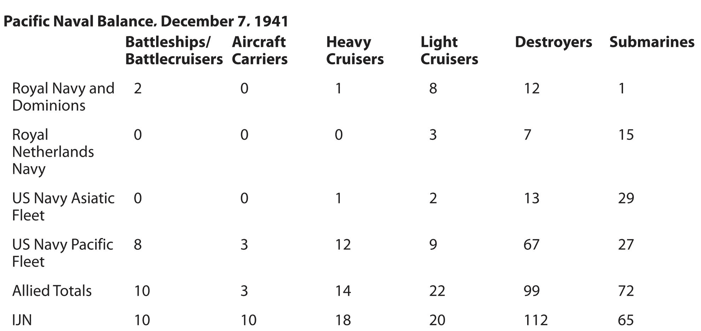

英国和荷兰的海军即使有美国海军亚洲舰队的协助，也显然无法防御其在东南亚的领地。部署在太平洋的美国海军力量相对于日本帝国海军的劣势也是显而易见的，这使得美国任何进入西太平洋营救菲律宾的尝试变得都不可能。

英国防御马来亚和新加坡的战略规划基石是假设在敌对爆发后不久将大量的海军援军调往远东。由于 1941 年底敌对似乎迫在眉睫，英国履行了派遣海军援军防御马来亚的承诺。然而，这种增援不过是用来震慑日本发动敌对行动的虚张声势。此举是首相温斯顿·丘吉尔的心血，他认为派遣一支规模虽小但强大的打击部队会让日本有所顾。最终于 12 月 2 日抵达新加坡的部队由现代战列`威尔士王子号`、旧战战巡洋舰`反击号`以及仅四艘驱逐舰组成。这支部队被命名为`Z 支队`，由临时海军将汤姆·菲利斯爵士指挥。

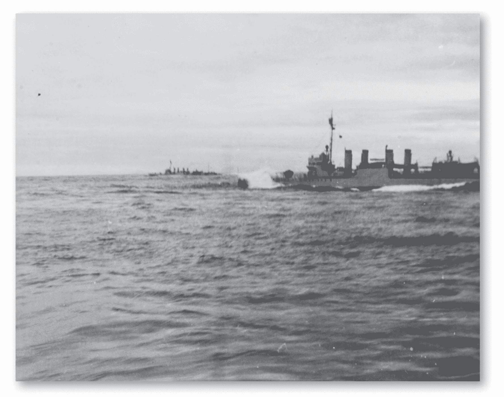

这一视角来自约翰·D·福特，另外两艘亚洲舰队驱逐舰在 1938 年执行了舰队少数海洋行动之一。亚洲舰队的战斗舰主要部署用于存在任务，对其潜在战争任务的训练并非首要任务。（美国海军史）由托马斯·哈特将领指挥的美国海军亚洲舰队在战争开始时处于暴露位置。其规模最大的单位巡洋舰`休斯顿号`位于巴丹，处于空袭范围之外，但五艘驱逐舰、除两艘外的所有潜艇以及舰队的大多数辅助舰在 12 月 8 日的马尼拉湾。哈特的四艘驱逐舰在战争爆发时实际上位于前往新加坡的途中，于 12 月 10 日早晨抵达那里。

### 日本最初进攻

日本在太平洋发起的最初进攻规模令人观止，远超盟国认为的可能范围。最大胆的是珍珠港行动，日本打击部队的六艘舰队母舰（`动大队`）攻击了美国海军太平洋舰队在夏威夷的主要基地。获得完全意外后，两波日本飞机对毫无准备的美国人造成了惨重损失。总共有 18 艘美国海军舰只被击沉或损坏，包括在场的所有 8 艘战列。太平洋舰队的三艘母舰均不在场，因此全部幸存。在西太平洋，`广岛`遭到入侵，并于 12 月 10 日迅速被日本占领。日本唯一的失误发生在 12 月 11 日，当时对中太平洋`韦克岛`的入侵尝试被美国驻守部队击回了。日本于 12 月 23 日带着更大的规模返回并成功占领了该岛。

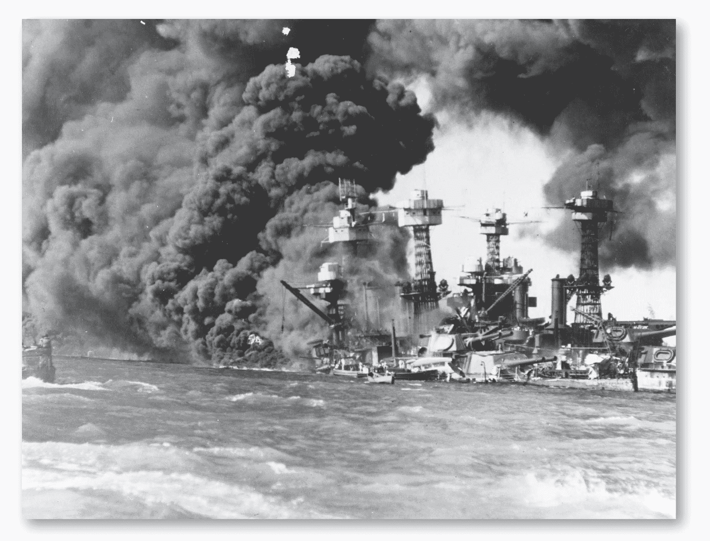

珍珠港袭击并非战争开始时日本最重要的海军行动。最重要的行动是夺取荷属东印度群岛的资源；珍珠港袭击的重要性在于，它导致了美国海军无法在东南亚对抗日本的侵略。（美国海军史）

在东南亚，日本人很快反驳了盟军关于他们一次只能进行单次入侵的评估。在`12 月 8 日`于菲律宾地面重创了美国空军后，日本人于`12 月 10 日`出动 51 架轰炸机，将目标转向位于马尼拉湾`Cavite`的亚洲舰队主基地。这些轰炸机随后对该海军基地造成了毁灭性破坏。炸弹摧毁了造船厂的大部分设施，包括修理厂、机库，以及维持舰队战斗状态所需的零件和其他储物间。正在进行大修的潜艇`Sealion` 号被摧毁，`Seadragon` 号受损。更重要的是，舰队大部分备用潜艇鱼雷丢失了。同样在进行大修的驱逐舰`Pillsbury` 号和`Peary` 号也受了损坏。尽管这两艘驱逐舰和所有主要辅助舰都能在接下来的几天内离开马尼拉向南出发，但这次袭击地表明，`Hart` 至少从马尼拉派遣潜艇的计划是不可能的。舰队向南移动，目标并非暴露无遗的新加坡，而是澳大利亚西北部。

在获得空中优势后，日本人在菲律宾进行了一系列登陆。这些行动于`12 月 8 日`开始，在吕民岛以北约 125 里的`Batan`岛进行小规模登陆。随后在`10 日`，在吕民岛和 Batan 岛之间的`Camiguin`岛以及吕民北部的`Aparri`进行了登陆。`12 月 12 日`，在吕民南部的`Legaspi`的登陆进展顺利。主登陆于`12 月 22 日`在林烟湾进行。这些行动完全牵制了防守者，迫使美国人退守`巴丹半岛`。在这里，美国人和菲律宾人坚守到了`4 月`，最后的防守者直到`5 月 6 日`菲律民岛陷落后才投降。尽管他们的行动最终是徒的，但菲律宾的美国防御者坚守的时间比新加坡的英国人或东印度群岛的荷兰人长得多。

在对菲律宾发动初期进攻的同时，日本人还入侵了马来亚北部和泰国南部。`12 月 8 日`，日本军队在泰国南部的`Singora`和`Patani`以及马来亚北部的`Kota Bharu`登陆。一旦在岸建立，日本第 25 军在`12 月 11 日`的`Jitra`战役中击败了英国人，决定了马来亚北部的命运。到 1 月初，随着日本人在`Slim River`战役中击溃了两个印度旅团，马来亚中部失守。到`1 月 25 日`，英国人已决定撤回新加坡岛。日本人于`2 月 8 日`跨越`柔佛海峡`进攻，并在一周后迫使守军投降。

#### Z 舰队的覆灭

`12 月 10 日`，盟军在东南亚的海军形势急剧恶化。针对日本最初对马来亚北部和泰国南部的入侵，进取的`Phillips` 决定投入他的小型突击部队来击败日本人的入侵。`Phillips`于`12 月 8 日`黄昏后带着全体部队从新加坡出击。他计算，通过利用季风天气提供掩护，他有很大机会袭击位于`Singora`的日本登陆部队。目标随后改为`Kota Bharu`，`Phillips`希望在`12 月 10 日`早晨在那里与日本入侵部队交战。遗憾英国人的是，任何奇袭的机会很快消失了。一艘日本潜艇于`9 月 9 日 13:45` 发现了这支部队，日本飞机又在`17:40` 发现了这支部队。

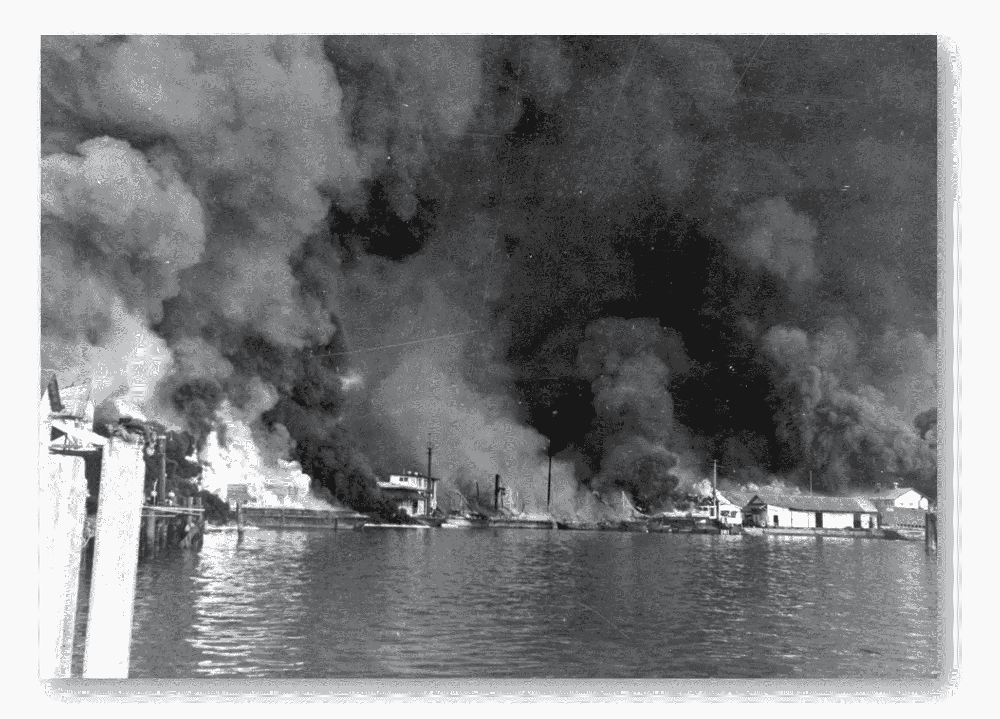

`12 月 10 日`日本对`Cavite 海军兵厂`的空袭使其失去了为亚洲舰队提供维修的能力。这张照片展示了袭击后的结果，火光冲天，浓烟滚滚。最右侧可见的潜艇头部可能是`Sealion` 号，它被炸弹命中并由尾部沉没。（美国海军历史与遗产司令部）

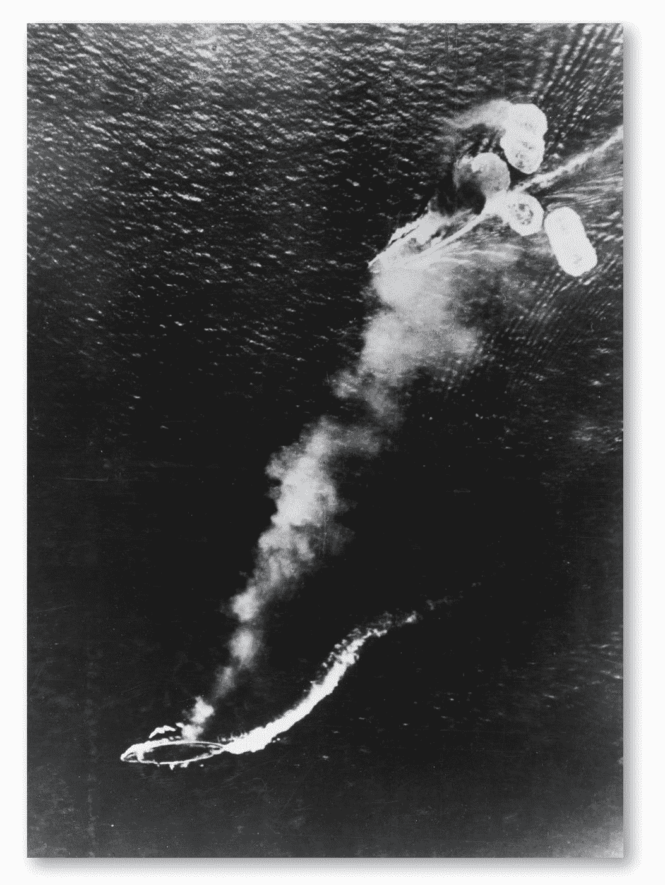

这张日本照片显示了`12 月 10 日`遭受攻击的`Z 舰队`。`威尔士王子号`正于照片底部高速移动，而图像顶部的`反击号`正被炸弹爆炸所包围。这两艘主力舰的覆灭改变了东南亚的海军平衡。（美国海军历史与遗产司令部）

约两小时后，`Z 舰队`距离日本海军部队约 22 英里，后者正在搜寻它，希望与英国人进行夜战。几乎在同一时间，`Phillips`决定放弃行动并返回新加坡。然而，在`23:55`，一份报告送到了海军将手中，日本人已登陆`关丹`，当时那里距离`Z 舰队`的位置约 120 英里。`Phillips`转向西南方向调查该报告。`08:00` 达时，`Phillips`从`威尔士王子号`派遣了一架飞机和一艘驱逐舰进行调查。他们一无所获，因为报告完全是虚假的。`Phillips`没有继续向相对安全的新加坡移动，而是决定调查另一个关于关丹附近某些驳的虚假报告。事实证明这是一个致命的延误。

英国人完全不知道陆基日本海军飞机对`Z 舰队`构成的威胁。他们认为，如果他们距离最近的日本机场保持 400 英里，他们就在有效攻击范围之外。即使日本人成功击中了`Z 舰队`，那也只是英国人在地中海习惯的俯冲轰炸机，而不是致命得多的鱼雷飞机。从这两个方面来看，英国的情报极其错误。从西贡机场起飞的 G3M“蜜蜂”和 G4M“贝蒂”飞机范围可以到达新加坡。这两种飞机都能携带“91 式”鱼雷，而且经过训练的机员还能在 10000 英尺高度攻击舰只。日本海军在印度支集结了大量的攻击机，任务是中和`Z 舰队`。`12 月 10 日`，总计 85 架 G3M 和 G4M 飞机在`06:25`到`08:00`之间出发，以寻找并攻击`Z 舰队`。

威尔士亲王号命运已成定局。最后一组进攻的 `G3Ms` 命中了一枚 1,100 磅的炸弹。炸弹穿透主甲板并爆炸，造成了惨重的伤亡。战舰继续下沉，在`1315hrs`，船员接到命令撤离坦克。五分钟后，军舰向左侧倾覆，导致 327 名船员丧生。作为对这次精彩攻击的回报，日本损失了三架飞机和 21 名机员。`Z 舰队`的覆灭消除了盟军在东南亚唯一的重大海军力量。随着英国海军力量遭到破坏，美国在菲律宾空军被中和，防止日本入侵东印度属群岛（`NEI`）的唯一力量是一支由美、澳、英、荷水面战斗组成的临时部队。其保卫东尼的能力很快将面临考验。

## 年表

### 1941 年

#### 12 月 8 日

日本人在马来亚的哥打巴西峇鲁（`Kota Bharu`）以及泰国的宋卡（`Singora`）和北大叻（`Patani`）登陆。

#### 12 月 10 日

`Z 舰队`被日本陆基飞机摧毁。

#### 12 月 16 日

日本人在英属波罗洲的美里（`Miri`）登陆。

### 1942 年

#### 1 月 10 日

建立`ABDA 司令部`。

#### 1 月 11 日

日本对东印度属群岛（`NEI`）宣战。

日本人在望加锡的曼瑙（`Menado`）、肯马（`Kema`）和邦加海峡（`Bangka Roads`）登陆。

#### 1 月 12 日

日本占领荷兰属波罗洲的打端（`Tarakan`）。

#### 1 月 23 日

日本人在荷兰属波罗洲的巴西立巴潘（`Balikpapan`）登陆。

#### 1 月 24 日

`美国海军`驱逐舰对巴西立巴潘的登陆部队进行袭击。

日本占领望加西岛的肯达里（`Kendari`）。

#### 1 月 30 日

日本占领安汶岛（`Ambon Island`）。

#### 2 月 2 日

建立`ABDA 出击队`。

#### 2 月 4 日

望加锡海峡海战。

#### 2 月 14 日–17 日

邦加海峡海战。

#### 2 月 15 日

新加坡投降。

日本占领邦加岛（`Bangka Island`）和苏门答腊的亚民登（`Palembang`）。

#### 2 月 16 日

日本占领荷兰属波罗洲的占井马辛（`Bandjermasin`）。

#### 2 月 18 日

日本占领巴厘济岛（`Bali`）。

#### 2 月 19 日

巴当县海峡海战（`Badoeng Strait`）。

日本航母舰队对澳大利亚的达文港（`Port Darwin`）进行袭击。

#### 2 月 20 日

日本人在帝汶岛（`Timor Island`）登陆。

#### 2 月 27 日–3 月 1 日

爪哇海海战。

#### 2 月 28 日–3 月 1 日

巽达海峡海战。

#### 3 月 8 日

东印度属群岛（`NEI`）投降。

#### 3 月 28 日

日本完成对苏门答腊岛的占领。

## 敌指挥官

### 日本指挥结构与指挥官

控制日本海军（`IJN`）所有重要元素的`联合舰队`由山本五十六中将（`Admiral Yamamoto Isoroku`）指挥。他可能是少数几个清楚预见到`美国`与`日本`战争结果的日本高级指挥官之一，但他完全支持在东南亚的侵略战争，并试图解决那个可能存疑的假设，即攻击英荷殖民地会导致`美国`参战。他的珍珠港袭击确保了`美国`的参战，并杜绝了谈判和平的可能性。山本在东尼属群岛战役后期干预，为虚弱的盟军海军提供了一个他们无法利用的机会。

山本将`联合舰队`的大部分力量投入东南亚战役。鉴于其名为“南方远征军”，它由近藤信竹中将（`Vice Admiral Kondo Nobutake`）指挥。在和平时期，他是第二舰队的指挥官。从所有记录来看，他是一位能干且进取的指挥官。他在领导东南亚战役中的成功使其获得了未来的重要任命，直到他在瓜达加纳尔遭遇失败。在瓜达加纳尔之后，他再也没有获得过任何海上指挥任务。

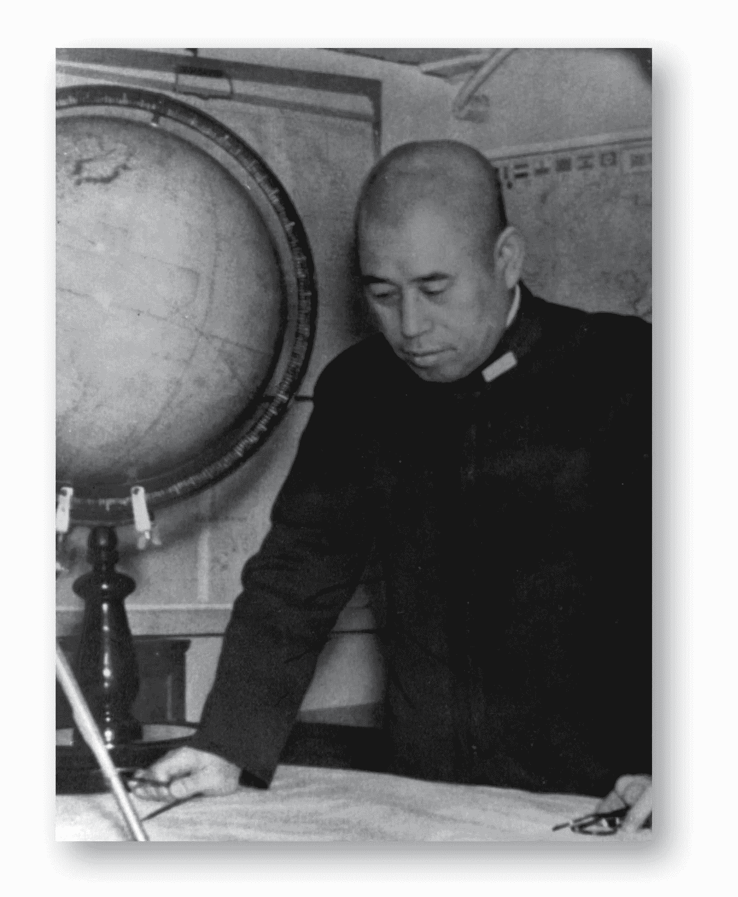

山本中将作为`联合舰队``总司令`监督了东尼属群岛战役。在日军绝对的力量优势下，几乎毫无疑问行动会成功。然而，他在战役后期的那些可疑决定，为盟军提供了让日军遭受局部失败的可能。（美国海军历史与遗产司令部）

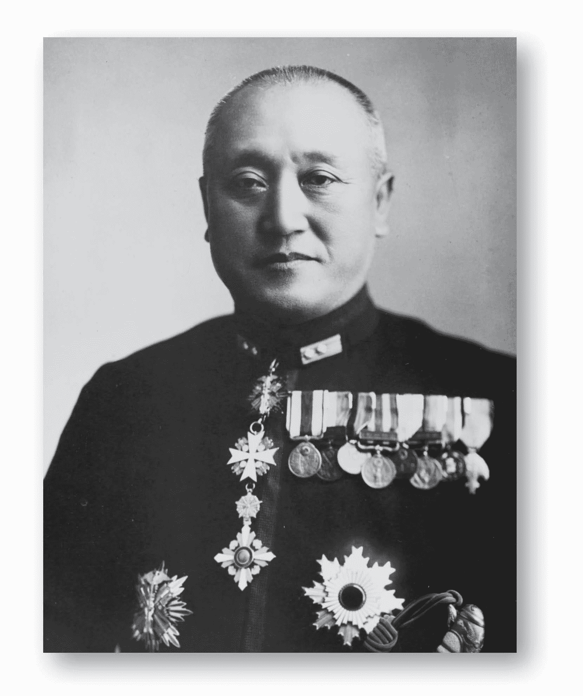

近藤中将是一位备受信赖且有能力的指挥官，被赋予了进攻马来亚和东尼属群岛的任。日本日本海军“大炮俱乐部”的成员，背景主要是巡洋舰和战舰。他在东南亚的成功使其在 1942 年后期获得了其他重要任命。（美国海军历史与遗产司令部）

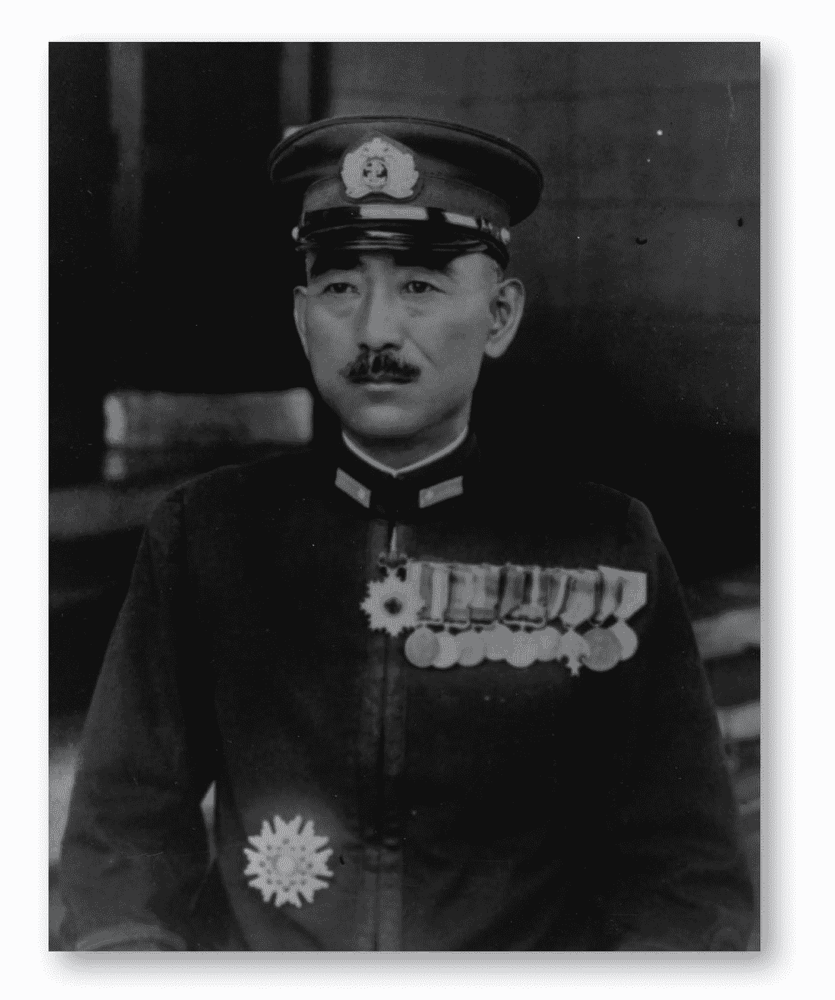

田中少将（`Rear Admiral Tanaka`）是日本海军最有成就的驱逐舰指挥官之一。他的战斗生涯始于东尼属群岛战役，随后在瓜达加纳尔战役中取得了更大的成功。（美国海军历史与遗产司令部）

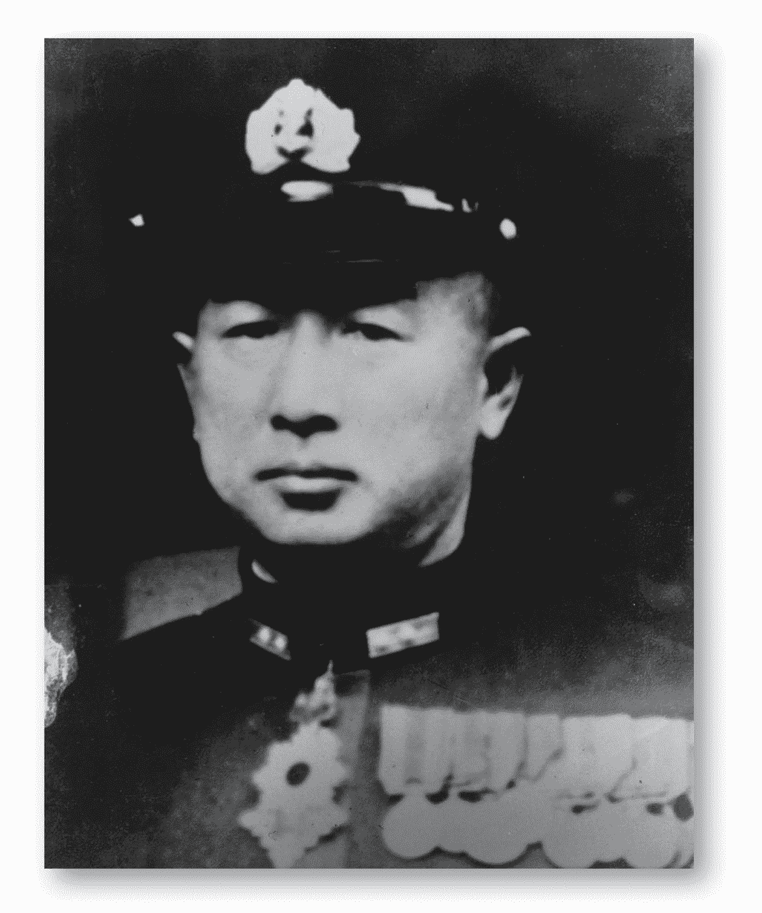

西村少将（`Rear Admiral Nishimura`）在东尼属群岛战役中指挥日本海军的一个驱逐舰中队。因此，他被赋予指挥望加锡地区的任务。

小泽治三郎少将被选执行进攻马来亚、苏门答腊和爪哇岛西部的重要任务。他的马来亚部队在战役中表现出色，他对海军航空力量的熟练运用了他作为航空力量倡导者的背景。他是一位极具能力的军官，后来担任了日本帝国海军航空母舰战斗队和联合舰队的司令。（美国海军历史与遗产司令部）

西侧由小泽治三郎少将指挥。他最广为人知的身份是航空力量倡导者，以及 1942 年 11 月至 1944 年 11 月日本帝国海军航空母舰战斗队的司令，在此期间他在菲律宾海海战中指挥日本军队。战争开始时，由于作为战术家和战斗领袖备受推崇，他被赋予了指挥这支重要部队的任务。小泽是 1945 年战争结束前联合舰队的最后一位司令。

在小泽指挥的主要战斗力单元是第 7 战队，由栗田健男少将指挥。他负责进攻爪哇岛的支持部队，在战役最后阶段，当盟军海军逃离该岛屿时，他的部队正处于位置不当的状态。随后他在瓜达尔卡纳尔岛和后来的菲律宾海表现良好，但他最广为人知的是他拒绝在 1944 年 10 月将日本帝国海军剩余的大型舰艇投入到一次进攻莱特湾美国滩头的徒劳行动中。原健三郎少将是第 5 驱逐舰中队司令。他在战役的最后阶段表现不佳，在 1942 年 3 月放弃中队指挥权后被降至二线位置。

日本帝国海军的陆基航空在战役中发挥了重要作用。冢原二四三少将指挥第 11 航空队，他于 1941 年 9 月接任该职位。

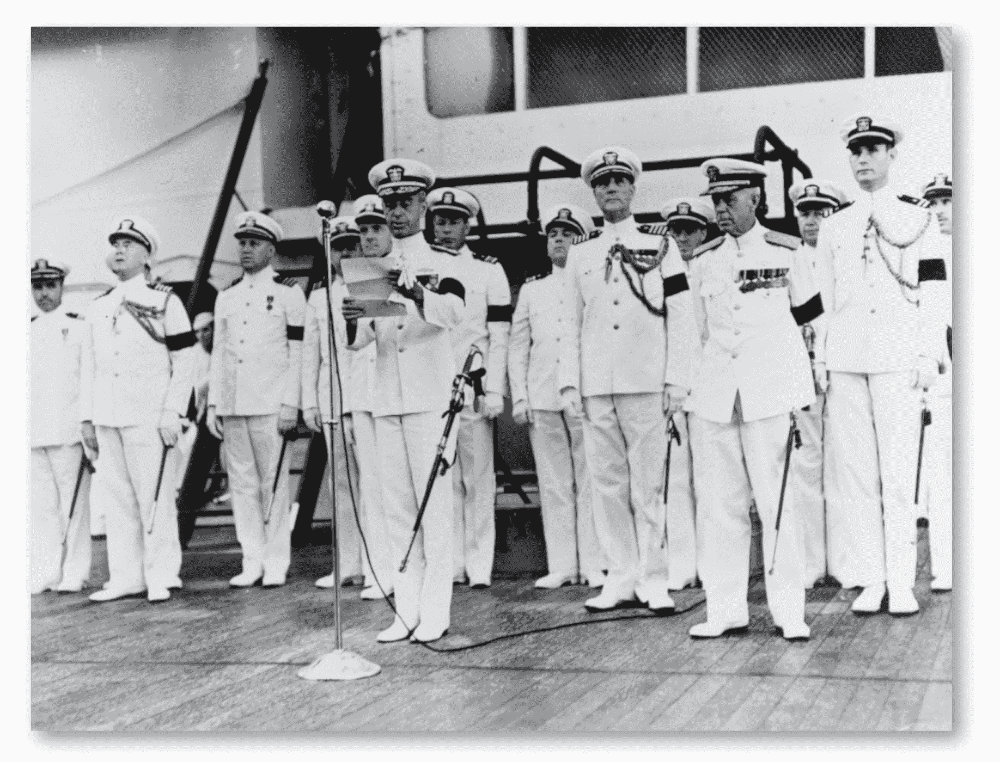

托马斯·哈特将于 1939 年 7 月 25 日在中国上海的“奥斯塔”号重巡洋舰上宣读了担任亚洲舰队司令的任命令。哈特是一位非常有干的指挥官，但他担任 `ABDA` 海军部队司令的生涯很短。考虑到他所掌握的部队，他永远无法完成任务。他因为未能成功保卫菲律宾而被麦阿瑟当作替罪羊，并遭到荷兰人的削弱，因为他们认为自己应该拥有 `ABDA` 海军部队的指挥权。（美国海军历史与遗产司令部）

## 盟军指挥结构与指挥官

尽管面临共同的威胁，美国人、英国人、荷兰人和澳大利亚人在战前未能建立有效的联合指挥部，即使在战争开始后仍在为此苦战。1941 年 4 月，美国、荷兰和英国人在新加坡举行了参谋会议（澳大利亚和新西兰代表也参加），但这些会谈未能建立有效的合作关系。直到 1941 年 12 月至 1942 年 1 月丘吉尔与罗斯福之间进行了一次高级会议，才敲定了关于东南亚联合指挥结构的协议。阿卡迪亚会议的协议内容之一是建立一个负责防御盟军在东南亚领土的联合指挥部。美国提出了一个完全指挥该地区所有海军、陆军和空军的结构，并提名英国将军阿奇伯德·韦弗尔担任首任司令。尽管对涵盖如此大区域的指挥的潜在效力以及美国施加的限制存在某些保留，但英国同意在韦弗尔的控制下建立 `ABDA`（美、英、荷、澳）司令部。它涵盖了整个东印度群岛（`NEI`）、菲律宾、马来亚和缅甸。荷兰人和澳大利亚对其创建未征求意见，而美国人和英国占据了几乎所有的指挥职位。

韦弗尔的副手是美国陆军空军乔治·布雷特中将，参谋长是英国军官亨利·R·鲍纳尔中将爵。美国海军将托马斯·哈特保留了他的国家指挥权，并任命为 `ABDA` 海军部队司令（也称为 `ABDAFLOAT`）。另一位美国人，美国陆军空军刘易斯·H·布雷顿少将被任命为 `ABDA` 司令，直到另一位英国将军到达。`ABDA` 陆军由荷兰中将海因·特·波尔滕指挥。`ABDA` 司令部从 1942 年 1 月 15 日正式运作起，直到 2 月 25 日韦弗尔辞职最终解散为止，在很大程度上是无效的。

盟军海军指挥结构看起来是精简的，因为它有一个单一的作战指挥官。实际上，哈特对主要贡献国的海军行使了有限的作战指挥。英国海军仍侧重于保护前往新加坡的护队，而亚洲舰队则侧重于保护东印度群岛部和保护来自澳大利亚的护队。这使得荷兰海军必须守护作战区域的中心，而这超出了他们的能力。

荷兰人受这种指挥安排的影响尤为严重，因为他们被排除在高级职位之外，经常发现自己的部队被用于护送进入新加坡的护队。在他们看来，他们的损失最大，并贡献了盟军海军的大部分力量，但对其部队如何部署几乎没有话语权。

哈特将是亚洲舰队司令。他在战争爆发前 30 个月就任此职，因此他确切知道自己部队能力的局限性。在太平洋战争开始时，他已有 40 多年的兵龄（1897 年毕业于海军学院），是美国海军资历最高的将领之一。他的性格用他的绰号“硬汉汤米”（Tough Tommy）来概括。他被认为是一个严格的纪律者，也被认为是公正的。他证明自己擅长处理其指挥范围内保护远远经济和军事利益的战前职责。

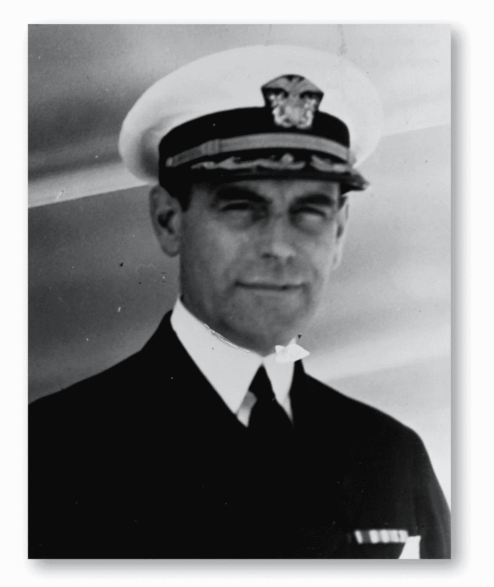

威廉·格拉斯福德少将（此处为 20 世纪 30 年代）在太平洋战争前接任第 5 任务队司令。哈特认为他没有足够的进攻性，他的许多士兵也是这么认为，但他监督了亚洲舰队在巴利卡潘海战中对日方的唯一胜利。（美国海军历史与遗产司令部）

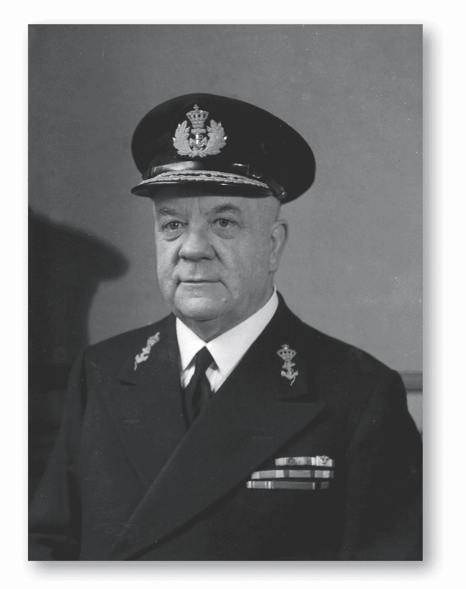

1945 年拍摄的赫尔费希少将。赫尔费希在困难的情况下保卫爪哇的进取决心使其成为战役中最重要且最具争议的盟军海军指挥人物。（荷兰军事历史）

当哈特接任 `ABDA` 海军部队司令时，亚洲舰队作战的日常职责交给了他的参谋长威廉·R·珀内尔少将。威廉·格拉斯福德少将被任命为第 5 任务队（亚洲舰队的水面打击部队）司令。由于他在战争早期表现出的犹豫领导，他被冠以“15 节格拉斯福”。他与哈特关系不和，哈特认为他没有足够的进攻性。当哈特担任 `ABDAFLOAT` 时，美国海军希望他将亚洲舰队的指挥权交给格拉斯福。哈特一直避而不这样做，直到 1 月 25 日格拉斯福得知该命令。

哈特担任 `ABDAFLOAT` 的时期非常短暂，并受到了道格拉斯·麦克阿瑟将军和荷兰当局的政治攻击。2 月 5 日，美国舰队司令官埃内斯特·金海军告知哈特，他应该以健康为由辞职，因为他已经失去了荷兰人、麦克阿瑟、韦威尔甚至罗斯福总统的支持。他的下台是由麦克阿瑟和荷兰人推动的，他们希望将他作为未能守卫 `NEI` 的替罪羊。截至 2 月 12 日，`ABDAFLOAT` 一职由一位荷兰海军将担任。随着哈特的离开，`ABDA` 指挥部中没有一名美国海军军官担任重要角色。

康拉德·E·L·赫尔夫里希中将是荷兰海军的指挥官。他出生于 `NEI`，因此对该地区的防御特别感兴趣。他的航海和指挥时间有限，但他于 1931 年回到 `NEI`，并在 1939 年被任命为东印度群军司令官，于次年升为中将。当哈特被任命为 `ABDAFLOAT` 而不是自己时，他感到非常愤恨，并拒绝与哈特合作，立即开始了削弱哈特的行动。哈特的总部与位于爪哇岛西部巴达维的荷兰海军基地并不在一起，哈特基本上忽视了希。赫尔夫里希只能通过哈特总部的联络官来跟踪 `ABDA` 的海军行动。赫尔夫里希以尽可能不与哈特合作作为回报，特别是在提供荷兰船只参加作战时。当哈特离开 `NEI` 并于 2 月 12 日将指挥权交给赫尔夫里希时，这种情况发生了变化。赫尔夫里希是 `NEI` 海战后期的关键人物。他是一个复杂的形象，性格从傲慢的霸凌者到盟军指挥团队中可靠的成员不等。他的首要本是在进攻入侵的日本人时尽可能具有侵略性。这种攻击性在战后期变得不理性，因为他在对爪哇进行的徒劳防御中，牺牲的不只有荷兰人的生命，还有美国、英国和澳大利亚人的生命。在指挥了许多徒劳的流血之后，他乘飞机逃离爪哇，在战争剩余时间里担任远东荷兰海军司令官这一名义职务。

荷兰海军的战术指挥权，以及后来 2 月 1 日成立的 `ABDA` 联合打击队的指挥权，交给了卡雷尔·W·F·M·多尔曼少将。他于 1910 年毕业于荷兰皇家海军学院，并在 1915 年成为一名海军航空兵。在海军军学院进修以及在驱逐舰和巡洋舰上过多次指挥任务后，他被任命为 `NEI` 海军航空部队司令官。随后他在 1940 年 5 月升任将官，并接管了东印度中队的指挥权。多尔曼是一个很难评价的人物，特别是考虑到他在战中的行动。他无疑是有才干的，深受荷兰皇家海军同僚和下属的尊重。他很有魅力，并对他指挥下的士兵们表现出明显的关心。

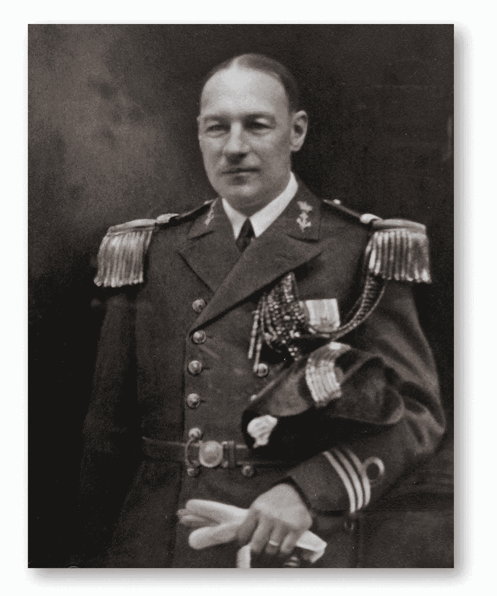

多尔曼少将是负责执行赫尔夫里希命令的人，要求以不懈的决心进攻冲锋而来的日本人。在他担任联合打击队司令官期间，他未能进行过任何有效的进攻。在最后一次行动中，他以赫尔夫里希要求的决心发动了进攻，但代价是他自己的生命和他指挥下的大部分部队。（荷兰军事史研究所）

在被任命联合打击队司令几天后，他带领了一次失败的行动，进攻马加锡的日本船。在与哈特商量后，他选择了一条直达目标的路线并遭受了猛烈的空袭。两艘美国巡洋舰受损，人员严重伤亡，多尔曼对此深受震扰。随后，多尔曼在遭受空袭后取消了另外次进攻运输队的行动。在爪哇海战爆发前夕，其他盟军海军指挥官对多尔曼已经厌透了。他在担任打击队司令期间一无所获，而且多次“逃跑”。战斗前夕甚至有人讨论要替换他，但最终认为在如此晚阶段更换指挥官是不智的，因此多尔曼留任了职务。在赫尔夫里希的压力下，或许是为了消除他自己不是战斗员的担心并保卫家园，在爪哇海战中，他表现出了贴近并击败日本人的真正韧性，无论付出多大代价。战争期间很少有将领表现出同程度的决心。这种决心是以他的指挥部队的毁灭为代价的，这导致他在战后被评价为勇敢但愚蠢。他现在和那时都值得更好的评价，因为他处于一种不可能的境地：指挥着一支劣势的部队，试图执行一位几乎不考虑下属的的上级官的命令。

英国海军部队最初由代理将领汤姆·菲利普斯指挥，直到他在 12 月 10 日在旗舰“威尔士亲王号”舰上去世。菲利普斯去世后，杰弗里·莱顿中将接回了东舰队司令官的旧职。`ABDA` 地区的英国海军部队在技术上受东舰队指挥。莱顿一直处于这一职位直到 3 月，当时詹姆斯·索姆维尔爵士中将带着东舰队的增援抵达。澳大利亚皇家海军约翰·A·柯林斯准将行使对 `NEI` 英国海军部队的实际控制权。

## 敌舰队

## 日本帝国海军

`IJN` 的主要作战实体是联合舰队。相应的，联合舰队被分为若干个舰队。这些舰队是分配作战任务的主要力量基础，但整个结构非常灵活，因为船只和分队可以从一个舰队转移到另一个舰队以满足作战需求。

对于 `NEI` 战役，日本海军力量从第二和第三舰队抽调。第二舰队被称为侦察舰队，基地位于海南岛，分配了 11 艘巡洋舰，包括第四战队的四艘爱宕级巡洋舰、第五战队的三艘妙贺级巡洋舰以及第七战队的所有四艘雾峰级巡洋舰。分配给第二舰队的第二、第四驱逐队分队。每个分队都分配了一艘 5500 吨巡洋舰作为旗舰，以及若干个驱逐舰分队，名义满额为 12 艘船。

基地位于台湾的第三舰队被称为封锁和运输部队，这很好地描述了他们的战时任务。其直接控制下有一艘巡洋舰、两艘旧巡洋舰，以及第五驱逐队分队（配备一艘巡洋舰作为旗舰和两个旧驱逐舰分队），共 8 艘船。此外，第一和第二基地部队被分配用于执行登陆作战。每个部队都由大量运输船和较小的战斗舰组成，包括巡逻艇、扫雷舰、布雷舰、反潜舰和炮舰。

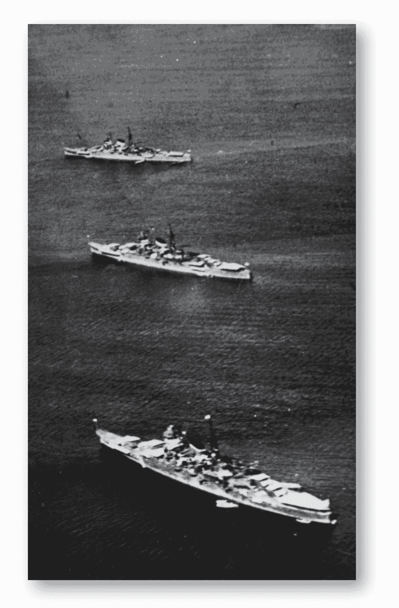

第七战队的四艘雾峰级重巡洋舰（其中三艘如图中 1938 年的照片所示）是小泽少将马来亚支队中最强大的舰只。其中，雾峰号和重庆号参加了 3 月 1 日的巽他海峡海战，结果导致两艘盟军巡洋舰被击沉。（美国海军历史与遗产司令）

需要注意的是，尽管进攻东南亚的行动分配了大部分`联合舰队`（Combined Fleet）战斗舰，但还有其他行动也需要`联合舰队`的大部分。其中最重要的是`机动部队`（Kido Butai），它被分配用于珍珠港行动，随后短暂支持了南太平洋行动，然后投入支持`荷属东印度群岛`（`NEI`）战役。日本海军（`IJN`）战舰被留在本土水域作为战略预备队，但第 3 战队（Sentai 3）中包含两艘`长龙`级战舰的部分被分配给了`南方远征军`。联合舰队的其他部分在南太平洋和中太平洋执行占据任务（主要是`第四舰队`——监视`第五舰队`）。联合舰队的大多数潜艇被分配在夏威夷行动中支持针对`美国海军`（US Navy）的行动，但旧型号被分配用于支持东南亚行动。

日本海军战争早期被遗忘的飞机之一是`G3M`远程轰炸机，后来被盟军代号为“内尔”（Nell）。在没有盟军战斗机拦截的情况下飞行，这种轰炸机非常有效，其在对`Z 舰队`、`卡维特`（Cavite）海军基地以及`ABDA`打击队的战斗中证明了这一点。（美国海军历史与司令部）总之，`南方军`被分配了两艘战舰、三艘重巡洋、四艘轻巡洋和一些驱逐舰。从表面上看，这是一支强大的力量，但行动节奏和作战区域的广度意味着它从未过集中。日本海军的海上单位不足以有力地保护所有入侵和援军船队。

近藤大将（Kondo）保留直接指挥了一支强大的力量，其中包括两艘战舰（`长龙`和`春云`）、三艘重巡洋（`爱宕`、`高雄`和`鸟耶`）以及八艘驱逐舰。这支力量发挥远距离支持作用。多次登陆的直接掩护由`南方远征军`的两个前卫小组提供。这两个小组是进入荷属东印度群岛进攻的两个钳形。这些钳形的具体称呼在战役过程中发生了变化，但最常被称为`东方军`和`西方军`

少数的`B5N1`攻击机（如这张战前照片中所示的那样，从航空航母`翔云`起飞）在荷属东印度群岛战役中发挥了重要作用。这些飞机可以同时使用鱼雷和炸弹，但在战役期间仅使用了炸弹。它们在 2 月 4 日帮助击退了盟军的打击队。（美国海军历史与司令部）

`东方军`由高桥大将（Takahashi）指挥。它分配了轻型航空航母`翔云`、四艘`妙贺`级重巡洋、拥有轻巡洋`神通`和八艘驱逐舰的第 2 驱逐队中队，以及拥有轻巡洋`中鹿`和十一艘驱逐舰的第 4 驱逐队中队。

`西方军`由泽泽大将（Ozawa）指挥，被分配了重巡洋`重庆`作为他的旗舰，以及四艘`级贺`级重巡洋，以及拥有旗舰`仙台`和七艘驱逐舰的第 5 驱逐队中队。

日本海军的陆基空军预计将在战役中发挥巨大作用。驻扎在法属印支的第 22 飞行队被分配负责负责马来西亚行动，而第 21 和第 23 飞行队最初被分配用于支持对菲律宾的进攻。所有这些力量最终都可用于支持针对荷属东印度群岛的行动。这些是非常强大的进攻力量，这一点在 12 月 10 日得到了证明，当时日本海军的陆基飞机在马来西亚近岸击沉了`威尔士王子号`和`反击号`。飞行机员对海上打击行动接受过高水平的训练，他们驾驶的飞机也非常出色。主力机型是`G3M`（后来被盟军代号为“内尔”）和`G4M`（后来被代号为“贝蒂”）。这两种飞机都具有长程能力，可以携带 1870 磅的`91 式`航空鱼雷或 2200 磅的炸弹。针对海军目标，它们能够进行水平轰炸（通常在 10,000 英尺高度以避开大部分防空火力）或鱼雷轰炸。高空攻击海军基地也是优先任务。`G3M`和`G4M`都容易受到盟军战斗机的拦截，但这在战役期间并不是主要担心。

### 舰船

日本海军重巡洋舰是日本海军进军荷属东印度群岛的先锋。日本重巡洋舰的设计是为了扮演几个重要角色，主要作为夜战战斗群的核心。日本重巡洋的设计强调火力，因为为了履行战时角色，它们必须比类似的`美国海军`舰船武装程度，并具备比美国巡洋舰更远距离打击的能力。它们能够利用其 8 英寸炮群进行远程射击攻击。

`妙贺`级的首舰舰于 1928 年服役，到战争开始时已配备了十门 8 英寸主炮。下一个服役的级别是四艘的`爱宕`级，同样配备了十门 8 英寸主炮。四艘规模的`高雄`级最初作为轻巡洋舰服役，配备 15 门 6 英寸炮，但在战争开始前升级为十门 8 英寸炮主电池。这三个级配备的 8 英寸炮的最大射程在 31,606 到 32,153 码之间。日本人认为配备在其巡洋舰上的火控设备使其 8 英寸炮的有效作战距离达到 21,873 码，但他们经常在更远的距离接触目标。然而，在远距离上，双联 8 英寸炮受到严重的散布问题，影响了准确性。

`妙贺`是海军条约巡洋舰的第一级。这些舰远超过 10,000 吨的条约限制，这有助于日本设计师建造出具有巨大火力、高速和相当程度防护的平衡舰船。`妙贺`级优于`美国海军`和英国海军的条约巡洋舰，并在战争期间表现良好。（大和博物馆）

`足贺`（图中 1942 年 12 月位于新加坡旧英国海军实里达海军基地的干坞中）在入侵菲律宾和荷属东印度群岛期间担任高桥大将的旗舰。由于处于预备役，直到 3 月 1 日她才有机会接触盟军军舰，当时她在摧毁英国海军重巡`埃克斯塞特号`和驱逐舰`遭遇号`中发挥了领导作用。她在职业生涯剩余的大部分时间里一直留在荷属东印度水域，并于 1945 年 6 月 7 日在望加海峡被英国海军潜艇`战壕号`击沉。（大和博物馆）

此外，日本帝国海军的巡洋舰配备了重型鱼雷武器。在太平洋战争初期，`凤月级`舰艇携带 16 具鱼雷发射管和 18 枚备用鱼雷。`高雄级`中的两艘船也拥有相同配置，但`模写级`仅配备了 12 具鱼雷发射管及备用。从 1938 年开始，日本巡洋舰配备了一种秘密的新型鱼雷——`93 式 1 号鱼改 2 型`。这是一种极其强大的武器，远优于盟军任何鱼雷。它携带 1082 磅的弹头，由于采用氧气驱动而不产生尾迹，在 36 节的速度下射程可达 43,746 码。携带此类强武器极大增强了日本帝国海军巡洋舰的火力，但也存在一个潜在的缺点。如果在战斗中未保护的弹头被命中，携带此类武器将带来致命危险。这种情况在战争期间在日本帝国海军巡洋舰上发生过几次，结果是毁灭性的。

日本帝国海军的巡洋舰战斗力相对较弱，因为它们的主要任务是作为驱逐舰队的旗舰。日本帝国海军在 1920 年至 1925 年间服役了 14 艘 5,500 吨轻巡洋舰。这些船在战争开始时配备了七门 5.5 英寸单装炮。所有舰船都带有鱼雷发射架，但只有那些被实际分配为驱逐舰旗舰的船才装备了`93 式`鱼雷。这些船包括全部三艘`仙台级`，其中`中号`和`神津号`参加了东印度群岛（`NEI`）战役。

正如日本重巡洋舰的设计比盟军对应舰规模更大、火力更猛一样，日本驱逐舰也是如此。日本驱逐舰的设计目标是最大化对水面舰的火力；它们是卓越的鱼雷艇，但在防空和反潜作战方面并非全才。在东印度群岛战役中，这些弱并不致命。从特型型驱逐舰（也称为`吹雪级`）开始，日本帝国海军驱逐舰以高速度和重火力的组合设定了节奏。`吹雪级`舰携带六门 5 英寸主炮和九枚鱼雷以及三枚备用鱼雷。下一级驱逐舰是六艘级的`若云级`，携带五门 5 英寸主炮和六具鱼雷发射管以及六枚备用鱼雷。`白露级`引入了四联鱼雷发射架；该级配备了五门 5 英寸主炮和八具鱼雷发射管以及另外八枚备用鱼雷。十艘级的`朝潮级`在东印度群岛战役中发挥了重要作用。这些船最高时速为 35 节，配备了三双装六门 5 英寸炮。每艘船携带八枚鱼雷和另外八枚备用。`朝潮级`之后是`岚风级`，其中几艘舰参加了东印度群岛战役。该级的能力与`朝潮级`相似。一个较旧的`神风级`分队也参加了东印度群岛战役。这些造于 1922 年的舰船携带四门 4.7 英寸炮和六具 21 英寸（相比已讨论的级别为 24 英寸管）鱼雷发射管，且没有备用鱼雷。

### 训练

日本帝国海军的训练极其激烈，旨在模拟实际战斗状态。这种严苛训练的严肃性在 1927 年得到了体现：在一次夜战鱼雷演习中，一艘驱逐舰因碰撞沉没导致 104 人丧生，另一艘驱逐舰严重损坏导致 29 人伤亡，两艘巡洋舰也受损。训练节奏是无情的，尤其是当训练年度在 10 月结束时。日本帝国海军军官形容训练比实际战斗还要艰难。结果是，到战争开始时，他们已成为精兵。

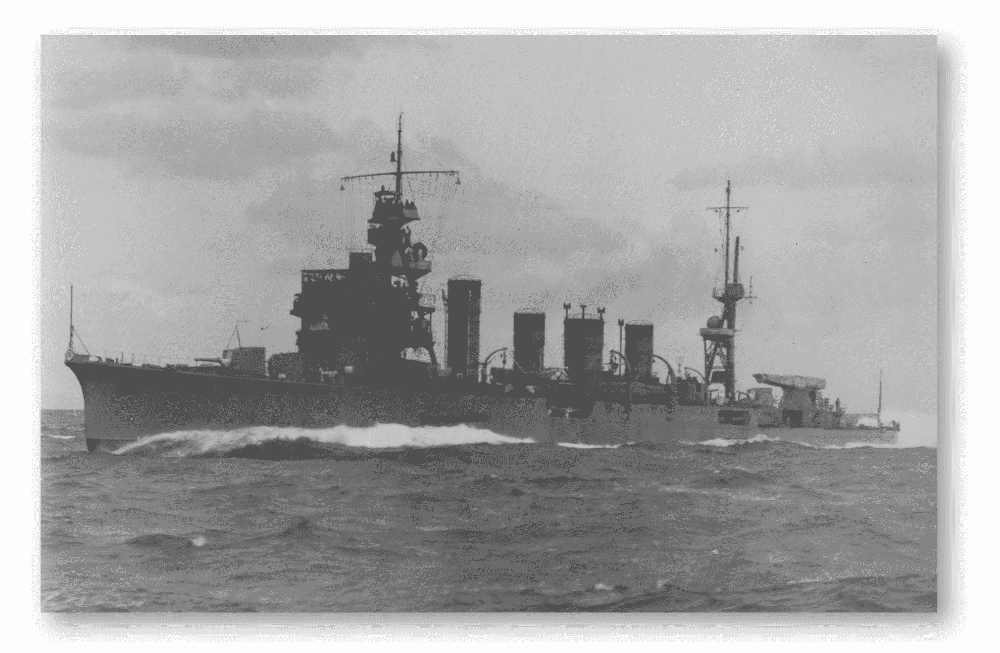

`神津号`是战争期间日本帝国海军最成功的巡洋舰之一。她在东印度群岛战役中承担了预期的驱逐舰队领导角色，随后在中途海战和整个瓜达加纳岛战役中战斗，直到 1943 年 7 月在在中部的科隆巴拉岛海战中被美国海军巡洋舰的炮击沉。（大和博物馆）

### 夜战能力与战术

夜战是日本帝国海军战前训练的特别重点。夜战是日本海军战术的核心原则，因为这是经过高度训练的日本海军舰只扭转比规模更大的美国海军局势的主要方法。从 1936 年`93 式`鱼雷服役开始，夜战战术经过了重新。为了利用这种武器的长射程，巡洋舰接受了在白天或夜间战斗中远程射击的训练。这种“远距离隐蔽射击”有望在敌人意识到处于危险之前就将其击溃。当日本帝国海军驱逐舰获得`93 式`鱼雷时（并非所有在战争开始前都获得了），它们的战术是类似的。日本人不断演习鱼雷战术，快速装填鱼雷发射管是一项关键技能。训练良好的船员可以在 15 分钟内完成任务。这使得日本巡洋舰和驱逐舰能够发射一轮鱼雷，撤离重装，然后发射第二轮。

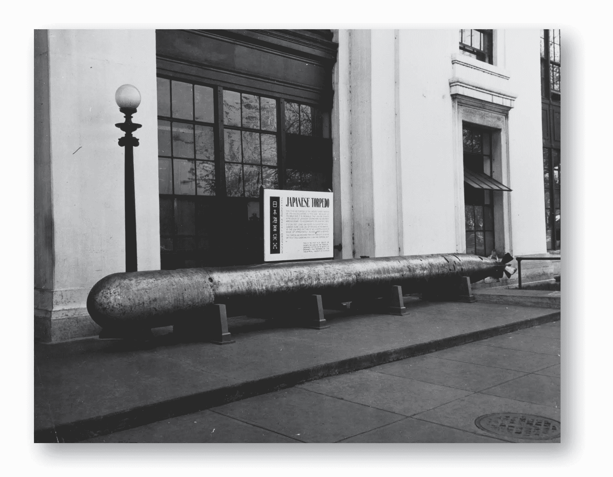

日本帝国海军在太平洋战争爆发初非常重视其秘密的远射鱼雷。他们设计了利用这些武器能力的战术，使日本人能够对盟军水面舰实施远程打击。在东印度群岛战役中，这种神奇武器的表现令人失望，因为在发射的大量鱼雷中仅有三个命中。（作者收藏）

夜战不仅仅是演习有素的鱼雷战术。日本人练习使用大型探照灯照射目标。巡洋舰舰上飞机投放的星光弹信号弹也被开发出来。日本另一个关键优势是优质的光学设备，这在雷达时代之前是关重要的。

### 盟军海军

负责防守东印度群岛的盟军海军力量不足以完成任务。简单来说，日本帝国海军拥有更强大的舰船、训练得更好的船员，并拥有与强大海军协同作战的巨大优势。盟军海军在整个战役中面临着巨大的障碍，包括指挥混乱、缺乏战斗机保护以及缺乏空中侦察。战役期间，盟军海军承受着日益增长的压力。后勤支持崩溃，限制了燃料和弹药的供应。通信是一个持续的问题，因为现场甚至没有互通的代码，这让多曼在设计巡逻部署和指挥部队时感到非常头疼。多曼用荷兰语发布命令，由其旗舰上的盟军联络和通信人员传输给部队中的其他舰船。部队之间没有共同的战术，迫使多曼不得不采用基础的战斗计划。

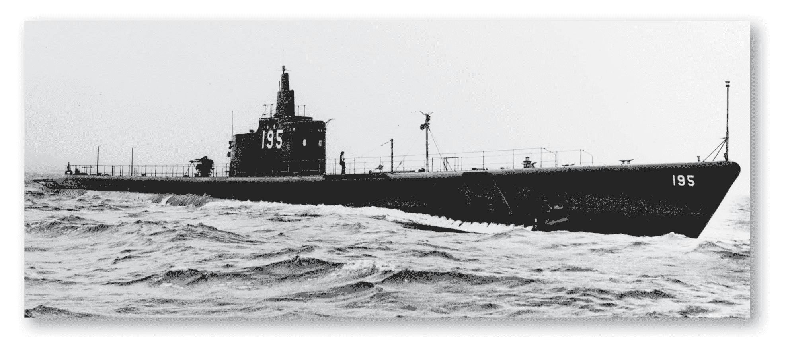

`海狮号`于 1939 年 10 月进行试验的照片。她是美国海军在战争期间损失的第一艘潜艇，于 1941 年 12 月 10 日在菲律宾的卡维海军基地遭到轰炸沉没。（美国海军历史与遗产司令）

#### 亚洲舰队

美国海军驻扎西太平洋的海军实力薄弱，在战役期间没有获得任何援军。除少数例外外，该舰队主要由易耗性舰只组成。其核心力量是三艘巡洋舰和 13 艘驱逐舰。唯一的潜在实力来源是该舰队的 29 艘潜艇。然而，它们的船员缺乏经验，在战争爆发前的几个月里一直进行极其保守的战术训练。这些战术要求潜艇在潜水至深度 100 英尺时，仅依靠声纳方位执行鱼雷攻击。指挥官被禁止在潜望镜深度进行攻击，或暴露其潜望镜。此外还有鱼雷缺陷的问题，这进一步削弱了它们的效能。最致命的因素是指挥官缺乏攻击性，结合强调隐蔽而非进攻的战术，使得潜艇在战役中形同虚设。

重巡`休斯顿号（Houston）`是舰队的旗舰。她于 1930 年服役，是美国海军第一代“条约型”巡洋舰之一，拥有强大的主武器（九门 8 英寸口径），但与日本海军的重巡洋舰相比，装甲防护不足。舰配备了由八门 5 英寸/25 口径炮组成的强大防空炮群，以及四座新安装的 1.1 英寸四联装炮座。美国海军的重巡洋舰不携带鱼雷。2 月初旬，`休斯顿号`受损，导致后方 8 英寸炮塔失效，被迫在战役的剩余时间内失去该炮塔进行战斗。舰队还分配了两艘轻巡洋舰。`波伊斯号（Boise）`是一艘布鲁克林级巡洋舰，是该舰队中最现代的资产。她满载排水量 12,207 吨，比大多数条约型重巡洋舰都要大。她的主武器由 15 门 6 英寸炮组成；每门每分钟可发射十枚。她装甲良好，配备了与`休斯顿号`相当的防空设备。`大理石头号（Marblehead）`是一艘奥马哈级轻巡洋舰。她于 1924 年服役，其薄弱的装甲和十门 6 英寸单装炮过时的主武器布局使其不适合前线任务，因此被分配到了亚洲舰队。

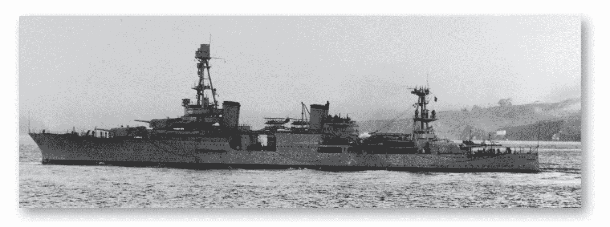

`休斯顿号`是一艘诺福克郡级重巡洋舰，于 1930 年服役。注意该舰的两个根大桅杆、三座 8 英寸三联炮塔（前两座后一座）以及两根烟囱之间的航空设施。与日本海军的重巡洋舰相比，她的武器和防护均不足。（美国海军历史与遗产司令部）

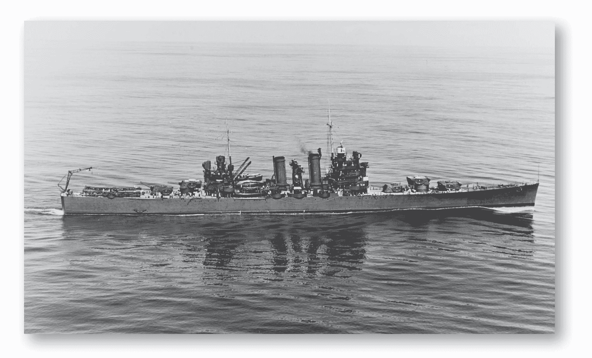

轻巡洋舰`波伊斯号`于 1941 年 11 月初在夏威夷海外拍摄，采用了“1 号措施”迷装方案。注意其由五座三联炮塔的 15 门 6 英寸炮组成的强力主武器。在 1942 年初，她是世界上最强大的轻巡洋舰之一，拥有与日本海军重巡洋舰相当的战斗力和防护能力。由于在未标记的礁石上搁浅而被迫退出东印度群岛战役，该舰及时返回参加参加瓜达加纳尔战役，并在 10 月的埃望角海战中受损。再次修理后，她参加了地中海的西西里和萨莱诺入侵行动。1943 年底回到太平洋后，她的最后一次主要行动是 1945 年入侵波尔尼岛。（美国海军历史与遗产司令部）

该舰队的驱逐舰均追溯到美国海军第一次世界大战建造计划。这些满载 1,200 吨的舰只服役时配备四门 4 英寸/50 口径炮和 12 根 21 英寸鱼雷管。美国海军驱逐舰的鱼雷是`Mark 8`。它们面临可靠性问题，在 26 节时的最大射程为 16,000 码。到太平洋战争开始时，这些舰只保留了同样的武器，仅增加了一门完全不够用的 3 英寸单炮和三到四门.50 口径机枪用于防空。服役时速度可达 33–34 节，但到 1941 年它们勉强达到 28–30 节。战役结束时，鱼雷供应日益短缺。在爪哇海，某些驱逐舰仅携带了六枚鱼雷。

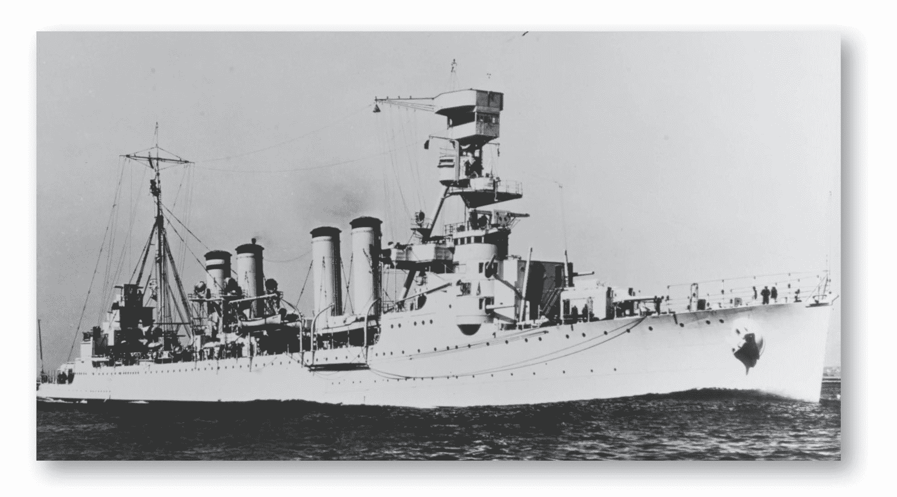

轻巡洋舰`大理石头号`在此战前照片中显示在战争爆发初被分配给亚洲舰队。注意其前方 6 英寸炮的过时布局：一座双联炮塔和四门布局笨拙的�舱炮。奥马哈级轻巡洋舰专为侦察设计，空间狭窄、防护差，在太平洋战争开始时被认为是二流水平。在 1942 年 2 月受损修理后，`大理石头号`在战争剩余时间内主要在南大西洋作业寻找轴心国的破冰者。（美国海军历史与遗产司令部）

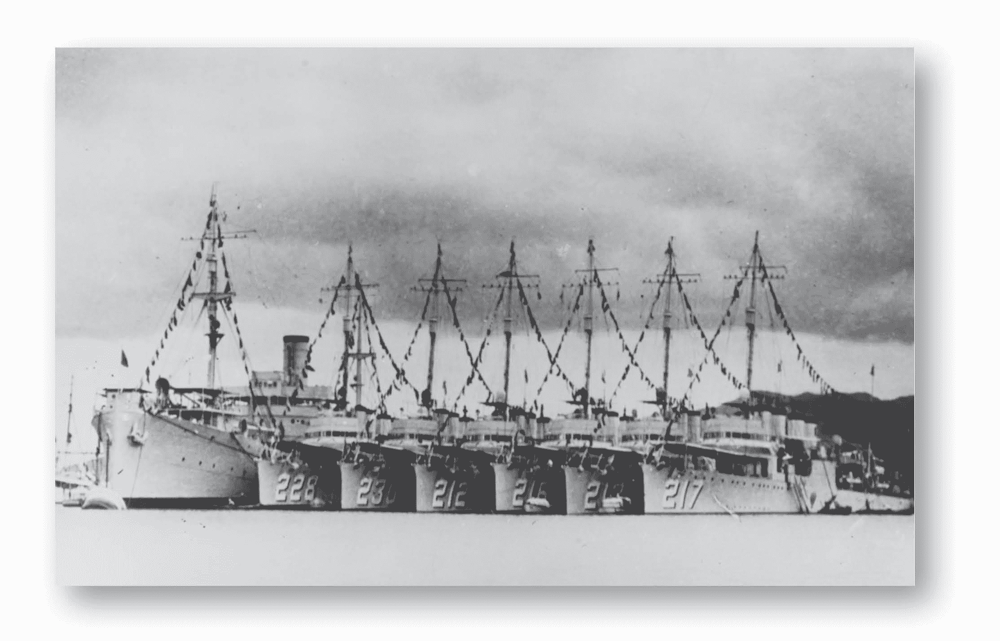

驱逐舰辅助舰`黑鹰号（Black Hawk）`约于 1936 年停泊在中国福，旁边有六艘驱逐舰。该辅助舰是一艘改装的商船，于 1922 年分配给亚洲舰队，并一直留在那里直到战争爆发。亚洲舰队的驱逐舰于 20 世纪 20 年代分配给舰队，并留在远东在菲律宾的卡维地海军造船厂进行维护。（美国海军历史与遗产司令部）

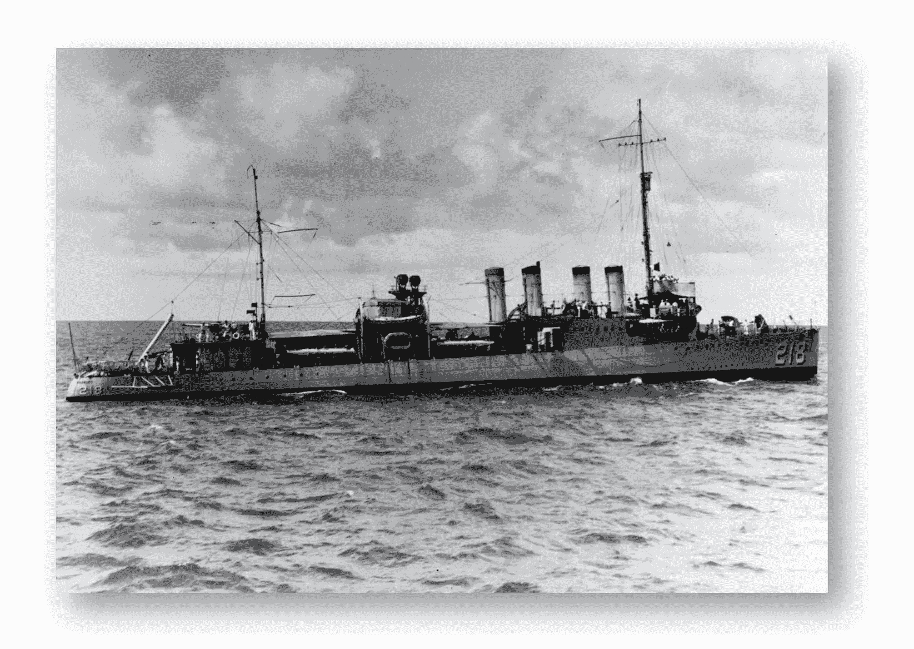

驱逐舰`帕罗特号（Parrott）`1928 年 11 月在关门附近航行。她于 1925 加入亚洲舰队。亚洲舰队的平甲板驱逐舰基本上是短程鱼雷艇，反潜和防空能力极小。（海军历史与遗产司令部）整个舰队在最可能执行的行动类型上训练不足。例如，驱逐舰没有进行过夜战斗训练。由于舰队中几乎所有舰只年龄过大且缺乏备件，维护也是一个现实问题。

英国海军派遣队包括几艘轻巡洋。其中最好的是两艘经过改装的利凡德级轻巡洋——`Hobart`和`Perth`号，它们分别于 1938 年和 1939 年移交给澳大利亚皇家海军。这两艘船都是经验丰富的军舰，特别是`Perth`，在 1940 年至 1941 年间的地中海战中取得了卓越的战绩。两艘船都配装了 8 门 6 英寸主炮和 8 根 21 英寸鱼雷管，但防护较差。当时还有两艘 D 级巡洋舰`Dragon`和`Danae`可用，但它们援建于 1918 年，不胜任前线任务。这两艘船都携带了 6 门单基座 6 英寸主炮和 12 根 21 英寸鱼雷管。

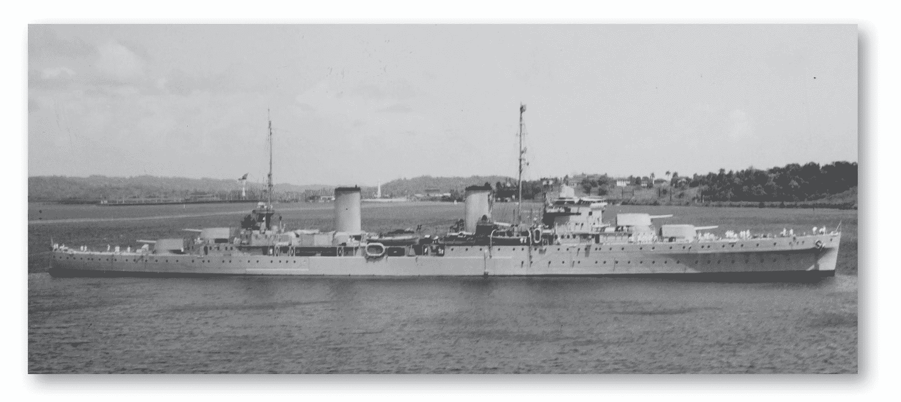

`Perth`最初于 1936 年作为`HMS Amphion`服役，并于 1939 年移交给澳大利亚皇家海军。`Perth`配备了 8 门 6 英寸炮、8 门 4 英寸炮和 8 根 21 英寸鱼雷管，是一艘平衡良好的巡洋舰设计，在战争早期的地中海地区拥有过活跃且辉煌的战绩。它的性能优于日本轻巡洋舰，但在巽达海峡海战中被日击没。2013 年，人们发现该船残骸已被拆卸了许多部件，拆解者曾使用炸药炸开了船体。（美国海军历史与遗产司令）

可用的英国驱逐舰数量较少，且参差不齐。三艘 E 级舰于 1934 年服役。`Electra`和`Express`来到东方作为`威尔士王子号`的护卫，而`Encounter`则从地中海舰队中抽调。这些船的排水量约为 1,500 吨，比当时所有的现代日本驱逐舰都要小。每艘船都配有 4 门单基座 4.7 英寸炮和 8 根 21 英寸鱼雷管，且都是经验丰富的军舰。`Electra`在战役中幸存下来，是因为它在 12 月 10 日救援`威尔士王子号`的幸存者时受损，被迫在 2 月上离开该地区前往锡里兰。同样从地中海舰队抽调的`Jupiter`号于 1939 年服役，武装更精良，拥有三座双联 4.7 英寸炮基座和十枚五管联装 21 英寸鱼雷。它早在 1942 年 1 月 17 日就通过击沉`I-60`号潜艇让日本人吃了苦头。此外，还有几艘满载 1,220 吨的 S 级驱逐舰被分配给东方舰队。它们于 1918 年至 1919 年间服役，配有 3 门 4 英寸炮和 4 根鱼雷管。战争这一时期英国主要的驱逐舰鱼雷是`Mark IX`型，在 35 节的航速下最大射程为 15,000 码。

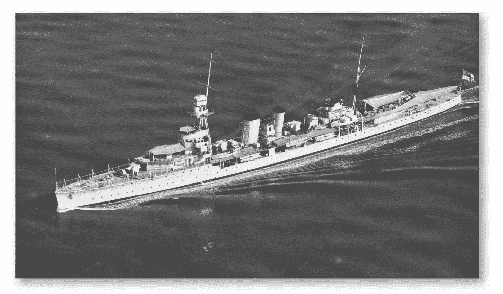

这是战前拍摄的 D 级轻巡洋舰`Danae`号。注意其单基座 6 英寸主炮座和左舷的两个三联装鱼雷架。`Danae`号于 1918 年服役，在太平洋战争爆发时已经过时。它被分配执行护护卫任务，随后进入西线打击部队，这两艘 D 级巡洋舰从未有机会与日军交战。（美国海军历史与遗产司令）

#### 荷兰皇家海军

荷属东群岛（NEI）的荷兰海军力量并未做好战争准备。当时有三艘巡洋舰在役，但其性能均逊于外国同类。最现代的船只`De Ruyter`号于 1935 年下水，配备了 7 门 5.9 英寸主炮。它没有携带鱼雷，防空火力不足，且装甲薄弱。`Java`号于 1921 年下水，基于第一次世界大战期间巡洋舰的设计，配有 10 门 5.9 英寸主炮的主力，全部为单基座，其中仅有 7 门可以侧舷齐射。`Tromp`号满载排水仅为 4,215 吨，表明它被设计为驱逐舰队队长；除了巡洋舰外，荷兰还有七艘驱逐舰在役。它们都属于同一级别，基于英国设计，并于 1925 年开始在荷兰建造。每艘船配有 4 门单基座 4.7 英寸炮和 6 根鱼雷管。荷兰标准的鱼雷是 21 英寸级的武器，在 28 节航速下最大射程为 10,936 码。荷兰在荷属东群岛还运行着 15 艘潜艇，大部分是 20 世纪 20 年代的产。所有荷兰单位都面临维修和人员问题，因为无法从荷兰获得零件，且荷属东群岛的维修设施不足以维持舰队战斗状态。一艘驱逐舰`Witte de With`号缺少船员。当`Van Ghent`号搁浅并自沉时，其全体船员转移到了`Witte de With`号，但这艘驱逐舰直到 2 月才可用。总的来说，荷兰的训练并不强健，但他们强调夜战。没有荷兰船只配备雷达。

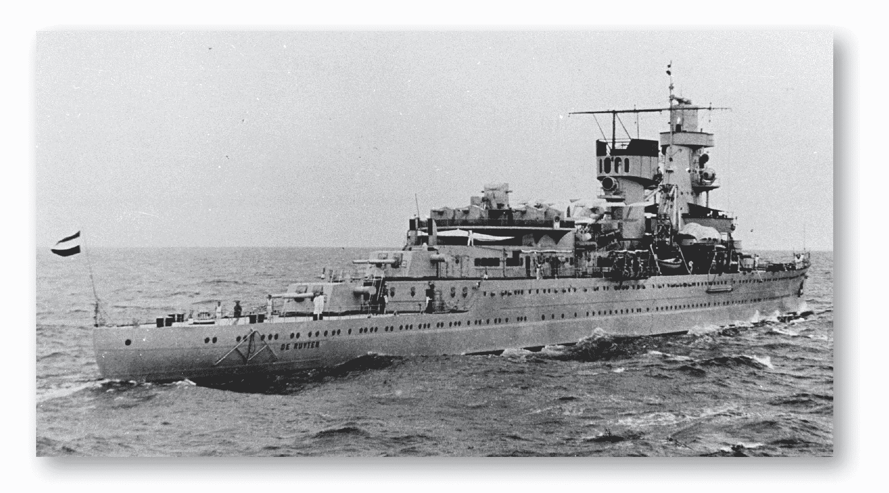

`De Ruyter`号是荷兰皇家海军东印度中队最强大的单位，但在火力、防护和速度方面，它是一个完全落落的巡洋舰设计。从图中可以看到该船的两座双联 5.9 英寸炮塔；总共有 7 门 5.9 英寸炮。图中显示了五联装 40 毫米炮座。该船没有重型防空炮。侧舷装甲仅为英寸。最大航速为 32 节。在面对日本巡洋舰时，结果在预料之中。（荷兰军事史）

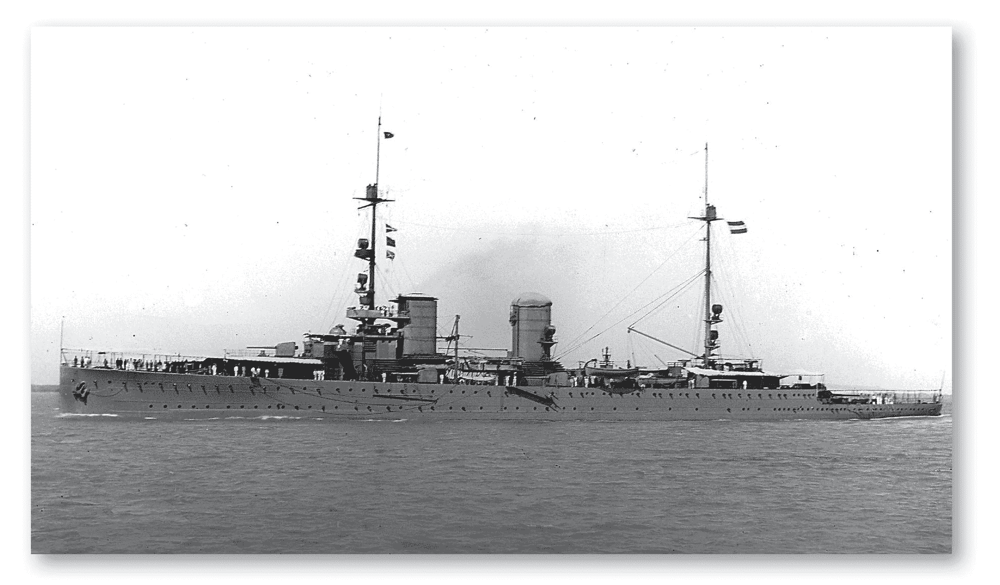

这是战前拍摄的荷兰轻巡洋舰`Java`号。其设计基于第一次世界大战期间的巡洋舰。`Danae`号于 1918 年服役，在太平洋战争爆发时已经过时。它被分配执行护队护卫任务，随后进入西线打击部队，这两艘 D 级巡洋舰从未有机会与日军交战。（荷兰军事史）

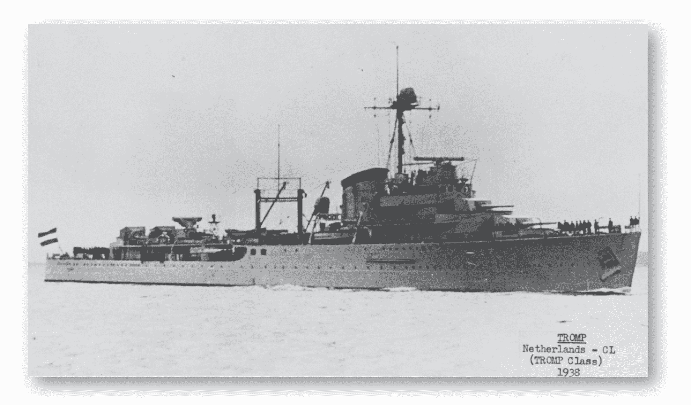

`Tromp`号于 1931 年授权作为驱逐舰队队长，满载排水仅为 3,450 吨。配备了 6 门 5.9 英寸炮和 6 根 21 英寸鱼雷管。可见。

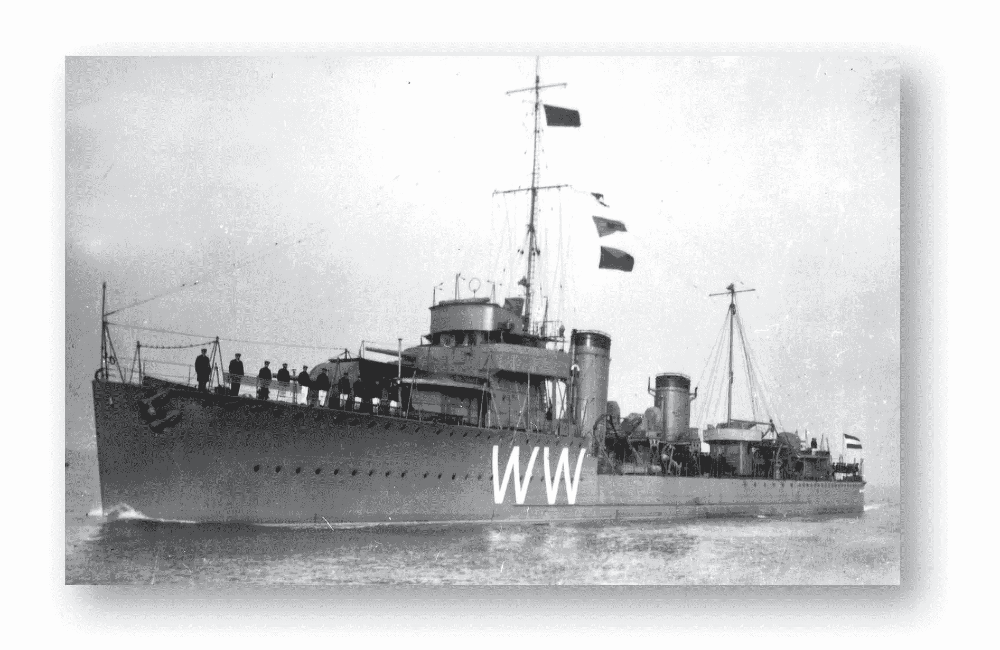

`Witte de With`号是`Galen`级四艘舰的一员，于 1929 年至 1931 年间服役。这些船在之前的`Galen`级基础上增加了四门 40 毫米防空炮，替换了前一型号的 75 毫米炮座。虽然这在当时是相当密集的防空配置，但对于荷属东群岛战役中面临的空威胁来说是完全不足的。（荷兰军事史）

### 战斗序列

# 巴里板板海战

## 美国海军 (US Navy)

- **第 5 驱逐舰队**（保罗·塔博特指挥）

  - 驱逐舰：`John D. Ford`（旗舰）、`Parrott`、`Paul Jones`、`Pope`

## 日本帝国海军

- **第 2 基地舰队**（西村翔次少将）

  - 巡逻艇：`P-36`、`P-37`、`P-38`

  - 扫雷舰：`W-15`、`W-16`、`W-17`、`W-18`

  - 反潜艇：`Ch-10`、`Ch-11`、`Ch-12`

# 八登海战

## ABDA 海军

**第一击群**（卡尔·多尔曼少将，荷兰皇家海军 (RNN)）

- 轻巡舰：`De Ruyter`（旗舰）、`Java`（RNN）

- 驱逐舰：`Piet Hein`（RNN）、`John D. Ford`、`Pope`（美国海军）

**第二击群**（J. B. ·梅斯特上尉，RNN）

- 轻巡舰：`Tromp`（RNN）

- 第 58 驱逐舰队（托马斯·宾福德指挥，美国海军）

  - 驱逐舰：`Stewart`（旗舰）、`John D. Edwards`、`Parrott`、`Pillsbury`

**第三击群**

- 鱼雷艇 – 8 艘（RNN）

## 日本帝国海军

- **第 8 驱逐舰队**（阿部俊雄上尉）

  - 驱逐舰：`Ooshio`（旗舰）、`Asashio`、`Arashio`、`Michishio`

# 爪哇海战

## ABDA 海军

**联合击群**（卡尔·多尔曼少将，RNN）

- 重巡舰：`Exeter`（英国皇家海军 (RN)）、`Houston`（美国海军）

- 轻巡舰：`De Ruyter`（旗舰）、`Java`（RNN）、`Perth`（澳大利亚皇家海军 (RAN)）

- 驱逐舰：`Witte de With`、`Kortenaer`（RNN）、`Electra`、`Encounter`、`Jupiter`（RN）

- **第 58 驱逐舰队**（宾福指挥，美国海军）

  - 驱逐舰：`John D. Edwards`（旗舰）、`Alden`、`John D. Ford`、`Paul Jones`

## 日本帝国海军

- **第 5 战队**（高业武少将）

  - 重巡舰：`Nachi`（旗舰）、`Haguro`

- **第 2 驱逐中队**（田中直次少将）

  - 轻巡舰：`Jintsu`（旗舰）

- **第 7 驱逐舰队**（小井叶名上尉）

  - 驱逐舰：`Sazanami`、`Ushio`

- **第 16 驱逐舰队**（司波四上尉）

  - 驱逐舰：`Amatsukaze`、`Hatsukaze`、`Tokitsukaze`、`Yukikaze`

- **第 24 驱逐舰队**

  - 驱逐舰：`Kawakaze`、`Yamakaze`

- **第 4 驱逐中队**（西村翔次少将）

  - 轻巡舰：`Naka`（旗舰）

- **第 2 驱逐舰队**（立花正雄上尉）

  - 驱逐舰：`Harusame`、`Murasame`、`Samidare`、`Yudachi`

- **第 9 驱逐舰队**（佐藤八雄上尉）

  - 驱逐舰：`Asagumo`、`Minegumo`

# 巽他海峡海战

## 盟军海军（H. 沃克上尉，RN）

- 重巡舰：`Houston`（美国海军）

- 轻巡舰：`Perth`（RAN）

- 驱逐舰：`Evertsen`（RNN）

## 日本帝国海军（原健三郎少将）

- **第 7 战队第 2 组**（山龟硕雄上尉）

  - 重巡舰：`Mogami`（旗舰）、`Mikuma`

- **第 2 驱逐中队**（原健三郎少将）

  - 轻巡舰：`Natori`（旗舰）

- **第 5 驱逐舰队**（野田口兼友上尉）

  - 驱逐舰：`Harukaze`（旗舰）、`Hatakaze`、`Asakaze`

- **第 11 驱逐舰队**（庄司喜一郎上尉）

  - 驱逐舰：`Shirayuki`（旗舰）、`Fubuki`、`Hatsuyuki`

- **第 12 驱逐舰队**（小川信之上尉）

  - 驱逐舰：`Shirakumo`（旗舰）、`Murakumo`

# 第二次爪哇海战

## 盟军海军（O. L. 戈登上尉，RN）

- 重巡舰：`Exeter`（RN）

- 驱逐舰：`Encounter`（美国海军）、`Pope`（美国海军）

## 日本帝国海军（高桥直保中将）

- **支援力量**（高桥直保中将）

  - 重巡舰：`Ashigara`（旗舰）、`Myoko`

  - 驱逐舰：`Akebono`、`Ikazuchi`

- **第 5 战队**（高业武少将）

  - 重巡舰：`Nachi`（旗舰）、`Haguro`

- **第 24 驱逐舰队**

  - 驱逐舰：`Kawakaze`、`Yamakaze`

# 敌方计划

## 日方计划

# 日本战争初期战争计划中最重要的方面是夺取东南亚的资源

日本必须快速夺取并恢复婆罗洲、爪哇和苏门答腊油田的运作。其中，苏门答腊的井最为重要。东南亚主要的盟军军事、航空和海军力量是驻守马来的英国驻守军。这些力量必须在向荷属印度群岛（NEI）推进的同时被中和。此外，日本面临着中和菲律宾美国军的战略紧迫任务，因为他们坚信如果日本攻击东南亚的英属和荷兰领地，美国将会干预。日本方面面临的额外困难在于，对英国、美国和荷兰军队的战役要求在荷兰有机会破坏经济设施之前，以及在英国和美国增援其领地之前，尽可能地行动。

日本可用的力量对于他们正开始的这项大规模行动来说仅勉强足够。缺乏运输入侵军的船只意味着行动必须分阶段进行。在五个月内，日本设想完成三个阶段的战役以控制东南亚。第一阶段的目标是占领盟军防御的前哨。这些包括香港、马来、英属婆罗洲、砂拉越和菲律宾。第二阶段要求占领整个马来半岛（包括新加坡）以及荷属印度群岛的岛屿。最后，第三阶段将占领苏门答腊和爪哇。

日本计划的关键是保持不懈的速度。日本的计划几乎是鲁莽的，但作为一个计划假设，他们认为盟军无法提供足够的防御。尽管盟军表现英勇，但日本的最初判断是正确的，他们能够按时且以极小的损失执行这一大胆计划。另一个关键是早期夺取空权，并要求必须在友军航空的保护下进行推进。日本计划夺取一个机场并在飞机的保护下南下。由于日本海军所有的舰载机母舰最初支持珍珠港作战，支持荷属印度群岛入侵的任务负担交给了陆基第 11 航空队及其飞行队。日本充分利用轻航母`龙凤`和若干山载机母舰提供局部航空覆盖，但整个计划取决于陆基航空在下一个目标上获得空权。

主要海军力量的机动方案非常简单。近藤信竹以两艘战舰为核心的主力舰为入侵军提供远程支援。由高桥直将率领的东舰队最初驻扎在巴留。在支持占领菲律宾棉兰岛后，将支持占领婆罗洲东部的爪禄、打端、巴里板板和三巴井；然后是望加、望加锡和井加里；接着是马古群岛的阿汶；然后是巽他岛的帝汶。最终目标是占领爪哇，届时东舰队和西舰队将汇合。

战争爆发前，盟军尚未对如何应对日本的侵略制定一致的计划。英国保卫其远东领地的防御计划集中在新加坡这一主要的海军基地上。尽管这座基地在建成时非常令人印象深刻，但它缺乏一支舰队。当欧洲战火正酣之时，英国皇家海军根本没有能力集结一支舰队派往远东执行任务。反映这一现实，伦敦于 1939 年 9 月向其驻守马来亚的军事司令部承认，集结并派遣一支舰队向东移动最可能需要长达六个月的时间。1941 年底，随着英国在欧洲的战争运势处于低谷，事实显而易见：皇家海军无法向远东转移一支兵力力量。缺乏保护或救援新加坡的海军力量，意味着它必须依靠陆军和空军来守卫，但在这两个领域，驻守马来亚的英军都极其匮乏。底线是，英国海军力量不足以保卫新加坡，更不用说向荷兰援助了。

荷兰的防御策略显然依赖于英国或美国（或两者）的干预来保卫荷属东群岛（NEI）。尽管情况显而易见，荷兰在战前拒绝与其潜在盟友进行联合防御规划。由于只有一支规模较小的海军、一支约 200 架战斗机的小型空军支持，以及仅三个师装备不精良且训练差的陆军，荷属东群岛几乎处于无防御状态。由于荷兰被德国占领，荷属东群岛失去了潜在的援军来源，且维持已部署在当地的船只和飞机运行变得日益困难。

唯一具有保卫荷属东群岛潜力能力的力量是美国。然而，美国在远东防御规划的重点是保卫当时作为美国殖民地的菲律宾。美国海军在该地区拥有常驻，那是一支被冠以响亮名称“亚洲舰队”的小规模部队。亚洲舰队在战前直接期间的使命并不明确。战前计划承认，菲律宾无法得到保卫，太平洋舰队不应尝试对那里的守军进行任何大规模救援。这使得亚洲舰队处于孤立无援。它的任务是在保卫菲律宾时争取时间，当这变得不可能时，则向南撤离，支持英国对马来亚或荷属东群岛的防御。

当战争迫在眉睫时，确认美国海军太平洋舰队将不会为东南亚提供海军援军。皇家海军能够以`Force Z`的形式向远东派遣了一支小规模威慑力量。这使得保卫新加坡成为盟军（不仅仅是英国）的紧迫任务。很快也清楚，由于菲律宾位置的暴露，无法对其建立任何海军防御。在战前的几天里，哈特（Hart）将部队从中国驻地和马尼拉湾的主要海军基地撤出，向南移动以保存实力。对于亚洲舰队来说，从日军的第一波猛攻中保存实力是关键。一旦从马尼拉湾的主基地撤离，亚洲舰队被命令向南移动，并在荷属东群岛基地和澳大利亚西北部的达尔文基地开展行动。联合荷兰人以及在`Force Z`惨败后剩余的任何英军部队，可以形成一支盟军打击力量，从而对荷属东群岛筑起防御。盟军的首要战略是保卫马来地，并将日本人隔在印度洋之外。日本的入侵显示了任何盟军计划是多么脆弱。

## 战役

随着英军在马来亚的溃败进行得如火如荼，美军退入巴丹半岛，荷属东群岛的战斗即将开始。哈特海军将乘坐潜艇前往爪哇，并于 1942 年 1 月 1 日安全抵达。抵达后，他得知自己已被任命为 ABDA 海军部队司令。他立即面临着爪哇荷兰当局的政治勾当以及迫近的日本风暴。

### 巴里巴帕潘战役

日本征服荷属东群岛的战役于 1941 年 12 月 25 日开始，登陆苏鲁群岛的朱洛岛。下一步行动由东方舰队于 1 月 11 日执行，当时海军陆战队（`SNLF`）在海军陆战队空兵的支持下登陆了苏里威斯岛北部的门纳多和肯马。重要的港口肯达里位于苏答望岛更靠南的地方。哈特判断这里是日本人的下一个目标，并制定了拦截该方向日军进攻的计划。到为止，美国海军尚未与日军交战，哈特认为是时候出手了。虽然英、荷兰海军主要忙于护送船队，但这场战役的第一场重大海军行动将由美国人发起。

当 1 月 12 日，西村（Nishimura）少将率领的入侵军攻占婆罗尼岛东北部的塔拉干时，日本人的推进速度加快。荷兰的防御非常薄弱，日本人完整地占了机场。该机场在几天内就投入运行，为下一次行动提供了空中掩护。这是在巴里巴潘登陆，那里是婆罗尼岛东南岸一个重要的港口和石油设施。西村于 1 月 21 日率领一支入侵军出击巴里巴潘。

为了应对日本人在婆罗尼岛和苏答威斯岛的推进，格拉斯福德（Glassford）少将接到命令让亚洲舰队的打击力量`5 号特遣队`做好战斗准备。在不同时期，这支力量包括`休斯顿`、`波伊塞`、`大理石`号巡洋舰以及最多八艘驱逐舰。1 月 17 日，格拉斯福德在六艘驱逐舰的护卫下带领巡洋舰进攻报告在肯马海域的一支日军。这一次，像很多时候一样，情报是错误的。三天后，响应荷兰关于望加锡海峡日军活动的报告，格拉斯福德在六艘驱逐舰的护卫下，带着`波伊塞`号和`大理石`号离开帝门岛的空邦。途中，灾难发生了。1 月 21 日，亚洲舰队最强大的`波伊塞`号在萨佩海峡撞击了未标记礁石。这艘巡洋舰的船体产生了一个长 120 英尺的口，导致部分机械进水。`波伊塞`号被迫离开现场进行修理，这对美国人来说是一个重大损失，但对该舰及其船员来说几乎肯定是一件幸事。关于日军活动的最新报告也是假的，但作为预防措施，格拉斯福德命令第 59 驱逐舰分队的四艘驱逐舰在望加锡海峡南部巡逻。

日本东方军的持续推进，以及哈特不断敦促拉斯福德与日军作战，使得海战变得不可避免。1 月 22 日，一架美国飞行艇发现了一支在重兵护卫下的大型日本运输队，正朝巴厘巴板进发。哈特再次命令`第 5 特遣队`交战。此时，`Houston`和两艘驱逐舰已恢复了护卫任务，受损的`Boise`正驶离该区域，而`Marblehead`正面临涡轮机故障，导致速度被限制在 15 节。并非`第 5 特遣队`最初由三艘巡洋舰和八艘驱逐舰组成的强大编制，最近的美国单位是位于保罗·H·塔尔博特指挥指挥下的`第 5 驱逐队`四艘驱逐舰。这些舰船于 1 月 23 日早晨开始向北移动。当天的天气和海况不佳，使得美国人能够在未被察觉的情况下接近目标。塔尔博特计划在黎明前两小时对锚泊的日本入侵军发动奇袭。他命令他的驱逐舰先发射鱼雷；在鱼雷耗尽后再进行射击。`Marblehead`和一艘驱逐舰被命令向北，掩护驱逐舰的撤退。

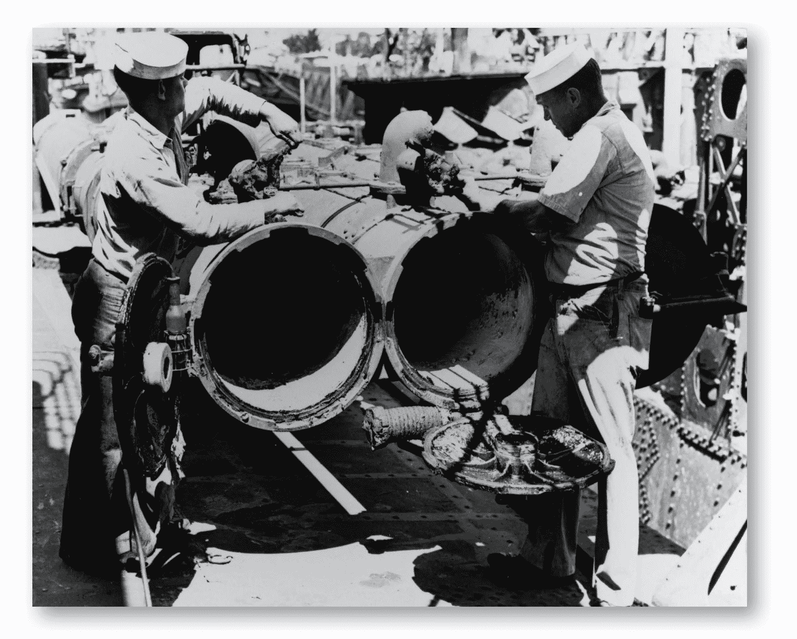

这张战前照片显示了水兵正在平直甲板驱逐舰上的联装鱼雷发射器工作。这些发射器发射的是`Mark 8`鱼雷，其起源于第一次大战，是战争初期平驱逐舰的标准配置。它充满了可靠性问题，例如潜深过大以及击中目标后不爆炸。这使得亚洲舰队驱逐舰的任何成功都是非同寻常的，比如巴厘巴板的袭击中，尽管使用了这种武器，仍击沉了五艘日本军舰。（美国海军历史与遗产司令）

等待这四艘美国驱逐舰的是由西村指挥的一支实力强大得多的力量。入侵军载于 15 艘运输船上，由`第 4 驱逐队`、轻型巡洋舰“中号”和十艘驱逐舰护卫。提供近程护卫的是三艘巡逻艇（原“见”级驱逐舰，拆除了鱼雷管但仍配备了两门`4.7 英寸`火炮）、四艘扫雷舰（每艘配备两门`4.7 英寸`火炮）和三艘反潜艇。1 月 24 日晚，一艘运输船被荷兰飞机击中后被遗弃。剩下的 14 艘运输船于`2015 时`到达巴厘巴板外并排排锚泊。午夜前，一艘荷兰潜艇向“中号”发射了四枚鱼雷；这些鱼雷落空但击中了另一艘运输船。当美国驱逐舰接近目标时，西村将“中号”和他的驱逐舰部署在运输队西侧，三艘巡逻艇部署在南方，四艘扫雷舰部署在北方。

美国驱逐舰以 27 节的速度扫入锚地。锚泊的运输船在岸上被荷兰人点燃的设施火光的映下形成了剪影。几艘日本舰发现了美国驱逐舰，但没有一艘发出正式的警报。在`0300 时`前的几分钟里，扫雷舰`W15`发现了接近的美国人。起初，他们将其误认为是“中号”，因为“中号”也有四个烟囱。在日本军船交战之前，这四艘驱逐舰已消失在夜色中。美国人识别出该扫雷舰是一艘驱逐舰，其中三艘驱逐舰向该舰发射了总共七枚鱼雷，但角度不利，无一枚命中。

塔尔博特命令他的四艘驱逐舰调头，对锚泊的运输队发动了另一轮猛攻。在这一动作进行期间，`Parrott`向队中最中最靠岸的一线北端运输船发射了三枚鱼雷。至少有一枚鱼雷击中了载有弹药的“寿丸丸”。随后的爆炸导致了该运输船以及除九名船员以外的所有人员的丧生。

当塔尔博特的部队向南航行时，`John D. Ford`和`Pope`均向巡逻艇`P38`发射了一枚鱼雷。几分钟后的`0306 时`，`Pope`发现了一组船只并发射了五枚鱼雷，随后`Parrott`和`Paul Jones`各发射了一枚。这些鱼雷击中了运输船“龙丸丸”。`0314 时`，美国纵列向右转以攻击锚地的南部。`John D. Ford`向左舷一处被确认为是驱逐舰的目标发射了一枚鱼雷；随后在`0319 时`，`Pope`向左舷的另一艘“驱逐舰”发射了五枚鱼雷，`Parrott`发射了三枚鱼雷。这八枚“鱼雷”中有三枚击中了 985 吨的`P37`号，其沉没并导致 35 人遇难。`Paul Jones`向附近的“仓竹丸丸”发射了二枚鱼雷，第二枚在`0325 时`击中目标。

塔尔博特继续在锚地内进行大肆冲杀，尽管他有两艘驱逐舰已经耗尽了鱼雷。现在`Pope`和`Parrott`开始使用它们的`4 英寸`火炮，并声称对运输船和“驱逐舰”造成多次命中。直到此时，美国纵列仍保持着凝聚力，在烟雾和混乱中更容易锁定目标。然而，在`0340 时`，塔尔博特的旗舰`John D. Ford`失去了与其他三艘驱逐舰的联系，后者已向南离开了战斗区域。`John D. Ford`仍有鱼雷，并于`0346 时`向“鹤丸丸”发射了最后两枚。这就是在四小时前被荷兰潜艇击中的那艘运输船；美国鱼雷完成了最后的击杀。随后，`John D. Ford`继续近距离用`4 英寸`火炮猛击另外两艘运输船。尽管受损，但两艘均未沉没。`0410 时`，`John D. Ford`也向南航行。

在 2 月 4 日受损后，“大理石头号”（Marblehead）直到两天后抵达地里特恰普（Tjilatjap）。据这一观察，伤员正被送离船只接受治疗。该船进港时船头有一个洞，有 30 个舱室进水。这艘巡洋舰的船头接受了临时补救，但在地里特恰普无法进行全面修理，因此被命令返回美国。（美国海军历史与遗产司令部）

日本空中力量的力量在 2 月 4 日显露无遗。在派遣三艘美国驱逐舰护护“佩科斯号”（Pecos）油轮并增加三艘荷兰驱逐舰后，联合打击队总计共有四艘巡洋舰和七艘驱逐舰（四艘美国的，三艘荷兰的）。这支力量离开泗水并向东航进，试图躲避日本的空中搜寻。当 09:49，“休斯顿号”上的望哨员发现第一架日本侦察机时，这种希望很快破灭了。在一个能见度无限的晴朗日子里，来自新甘丹里（Kendari）基地的、拥有 36 架 G4M 和 24 架 G3M 飞机的日本打击群毫不费力地发现了目标。日本飞行员直扑巡洋舰。轰炸机全部装载了 550 磅和 132 磅的炸弹，没有携带鱼雷。九架轰炸机盯住了“大理石头号”。在第三次进攻中，它们投掷了炸弹。这艘巡洋舰被弹贯中但未命中。另外九架轰炸机追击“休斯顿号”，但这些也没有命中。第三组七架飞机于 10:27 向“大理石头号”投掷了炸弹。尽管只是 132 磅的炸弹，但有两弹击中这艘轻装甲巡洋舰造成了严重破坏。第一弹命中头部并引发了火灾；第二弹击中后方甲板上。它使甲板弯曲，摧毁了舵室，导致舵卡在向左转的位置。左舷船头附近的近炸导致了进水。这艘巡洋舰状况糟糕。有 15 名船员死亡，34 人受伤；船只只能在紧密的圆圈内行驶，向右倾斜并正在冒火。损救努力救这艘船，但她已不再适用于战斗任务。

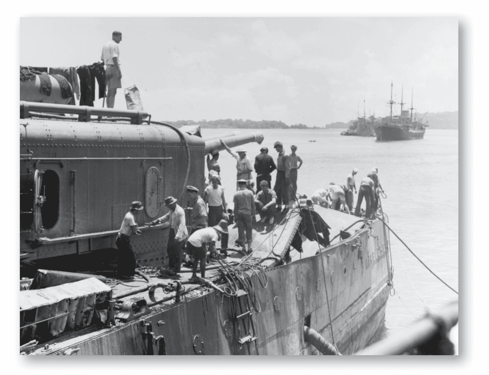

轻巡洋舰“大理石头号”在 1942 年 2 月 4 日于爪哇海遭受日本高空轰炸袭击受伤后，位于爪哇岛的地里特恰普。这一视角显示了一枚击中其尾部的敌方炸弹的效果。该船仅有 1.5 英寸的水平装甲，这使得日本使用的小型 132 磅炸弹能够穿透甲板进入下方并造成致命性破坏。（美国海军历史与遗产司令部）

11:17 的后续攻击再次针对“休斯顿号”，但其舰长巧妙地避开了了所有炸弹。11:26，轮到了“鲁义特号”（De Ruyter），但她也避开了所有射向她的炸弹。11:40 的最后一次攻击针对“休斯顿号”。除最后一枚炸弹外，其余全部落空，但最后一枚落下的炸弹造成了毁灭性的命中。它在弹开主桅杆后，在主桅杆和 3 号 8 英寸炮塔之间的主甲板上方爆炸。它在甲板上炸出一个 12 英尺的大洞，并将碎片射入轻装甲炮塔。这些碎片导致内部火药包起火，害了里面的船员。损救努力阻止了火势蔓延，但由于 48 人死亡、20 人受伤，且后方 8 英寸炮塔失效，“休斯顿号”遭受了严严重损坏。

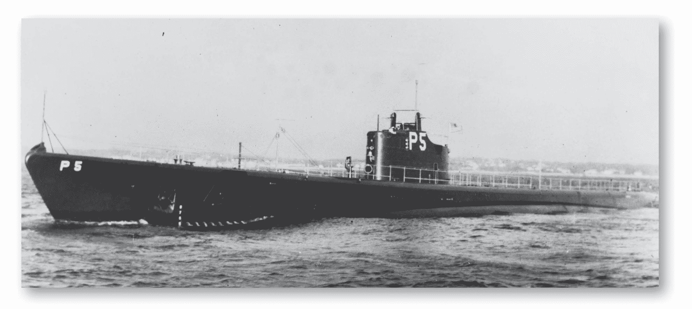

在战役期间，美国海军潜艇在防御日本两栖攻击方面并不奏效。这里显示的“鲈鱼号”（Perch）是赫尔里希（Helfrich）命令集中在爪哇岛东部以阻止日本入侵的潜艇之一。由于不知道日本人的确切登陆区域，潜艇部署不当，无法迅速移动到实际登陆区域。日本和德国海军后来在尝试部署潜艇击退两栖入侵时也吸取了同样的教训。“鲈鱼号”在 3 月 1 日晚在泗水以北 35 英处被发现。在遭受多多艘日本海军驱逐舰的猛烈攻击后，该潜艇于 3 月 3 日自沉，但全体船员被日本人救起。（美国海军历史与遗产司令部）

12:25，多尔曼（Doorman）取消了行动，联合打击队向西返回泗水。两艘美国巡洋舰被送往地里特恰普，哈特（Hart）在那里集结了所有亚洲舰队的支援舰。哈特认为多尔曼本应该用他完好无损的继续进攻，而多尔曼被这整件事搞得心神不定。联合打击队的首次行动以失败告终，主要是因为盟军力量在面对日本空中力量时选择了过于直接的路线。“大理石头号”被迫前往锡锡兰修理且没有回来。“休斯顿号”尽管其中一个主电池炮塔永久失效，但仍坚持战斗。

2 月 4 日的战斗行动暂时瘫痪了多尔曼的打击队。这意味着当日本入侵军于 2 月 6 日从斯塔林湾（Staring Bay）出发占领塞里伯锡岛南部望加锡时，没有受到盟军水面力量的阻拦。唯一在位的防御单位是美国潜艇“S-37 号”。她在 2 月 8 日在望加锡海域发射一枚鱼雷击中日本海军最先进的驱逐舰之一——“潮风级”“潮潮号”（Natsushio），为美国海军潜艇在战争早期取得了罕见的成功。次日，打捞工作被放弃，驱逐舰沉没。2 月 9 日，日本人登陆望加锡并迅速占领了该港。通往爪哇的路开启了。

### 侵略苏门答腊

到 2 月中旬，日本在东南亚的计划领先于进度。迄为止最大的成功发生在 2 月 15 日，当时新加坡的英国守军投降了。这为日本入侵苏门答腊开辟道路，它是从资源角度来看最重要的岛屿。关键目标是苏门答腊南部的巴里答林。那里不仅有两个主要的机场，对日本人来说最重要的是那里有两座炼油厂和大型油田。尽管位于内陆，但巴里答林位于易于大型船只航行的莫西河上，因此极易受到海上入侵。

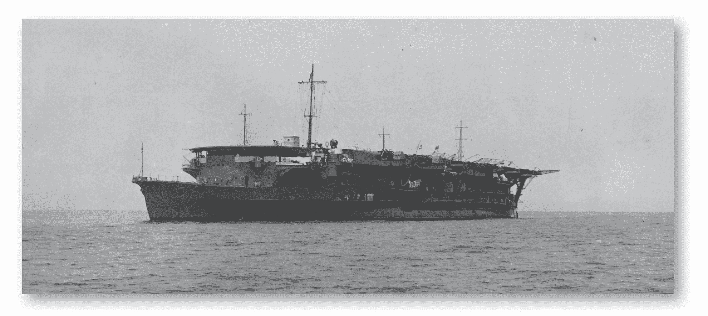

“龙雀号”（Ryujo）于 1931 年下水，早期职业充满波折。战争开始时，她已经经过改装以解决稳定性问题，但由于飞行板和小型升降机无法进行高效的飞机操作，仍被认为是二线航母。她被分配支持菲律宾和东印度群入侵，搭载了 16 架 A5M4“云雀”战斗机和 18 架 B5N1/2“天鱼”攻击机。尽管存在局限性，且每次只能发射一小小组飞机，“龙雀号”在战役期间是有效的。她的“天鱼”击沉了几艘盟军商船，但在 2 月 15 日有机会攻击 ABDA 打击队时，她的飞机在四次单独攻击中无一命中。2 月 17 日，她的“天鱼”弥补了之前的糟糕表现，用三枚炸弹击沉了荷兰驱逐舰“范斯号”（Van Nes）。3 月 1 日，她的飞机协助击沉了美国海军驱逐舰“波普号”（Pope）。“龙雀号”在 4 月继续对印度洋盟军船只造成更多破坏，随后在 8 月于瓜达加尔附近被美国海军航母飞机击沉。（联合博物馆）

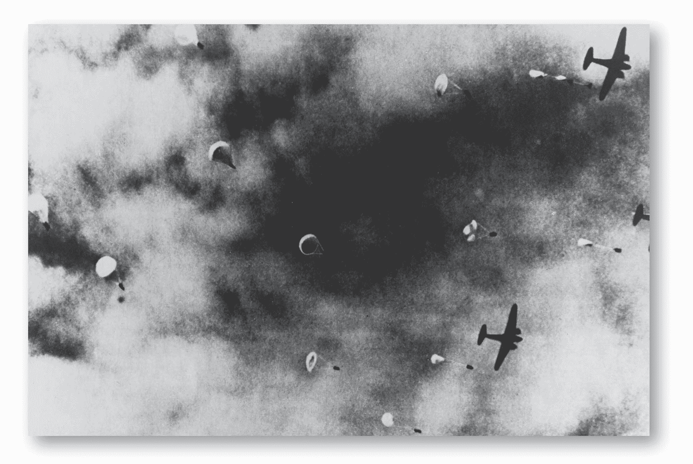

日本对巴里答林的进攻是由 360 名日本陆军伞兵先锋的。他们的命令是在荷兰人摧毁之前夺取油井、泵站和炼油厂。盟军部队最初的激烈反抗阻止了伞兵降落（如图所示）取得完全成功，但盟军的抵抗在两天内被粉碎了。（美国海军历史与遗产司令部）

在从护送前往马来亚的护队以支持进攻新加坡战役的任务中解脱后，日本海军西舰队准备了一场进攻巴淡丹的大规模行动。为了护送由 25 艘运输船组成的侵略军，泽泽少将集结了五艘巡洋舰、巡洋舰“井号”以及 11 艘驱逐舰。轻型航母“龙凤号”（载有 12 架战斗机和 15 架`B5N1`“鱼罐”攻击机）也从东方舰队调遣提供支援。这支侵略军于 2 月 10 日从印支那的占兰湾向南出发。

盟军一直在关注这一大规模的集结，并制定了阻止计划。2 月 11 日，美国海军潜艇的一次潜艇攻击未果，两次英国空袭也同样无果。多尔曼的“打击部队”也被命令移动到位于苏门答腊岛东南角的荷兰小型海军基地`Oosthaven`，准备进行拦截。赫尔里希中将于 2 月 12 日正式接任 ABDA（美墨荷）海军部队指挥，他被分配了一支表面上看起来强大的力量：荷兰巡洋舰“鲁伊特号”、“雅华号”和“特姆普号”、英国重巡洋舰“埃快递号”、澳洲巡洋舰“霍巴特号”、六艘美国海军驱逐舰和四艘荷兰驱逐舰。凭借这支得到显著增兵的力量，赫尔里希命令多尔曼进攻日本侵略护队。因此，“打击部队”于 2 月 14 日下午离开了`Oosthaven`。

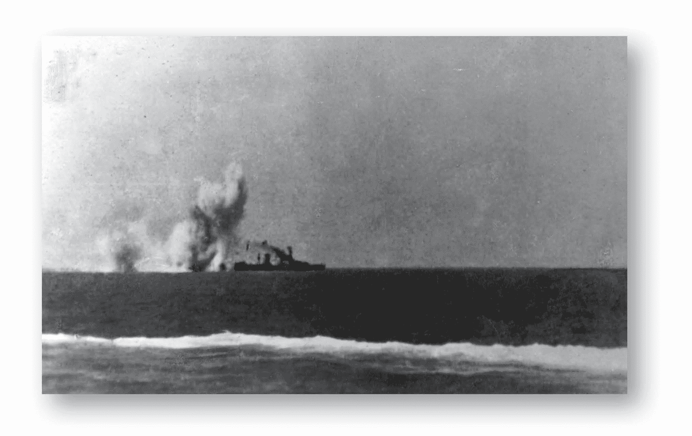

2 月 15 日，多尔曼率领打击部队在巴淡丹外海进攻日本侵略军。在场的所有五艘盟军巡洋舰全天都遭到轰炸，日本飞机共出动 93 个架次。图中显示了“雅华号”正遭受攻击。尽管她是几波轰炸机的攻击重点，但她仅遭受了轻微的碎片损坏。（荷兰军事史学会）

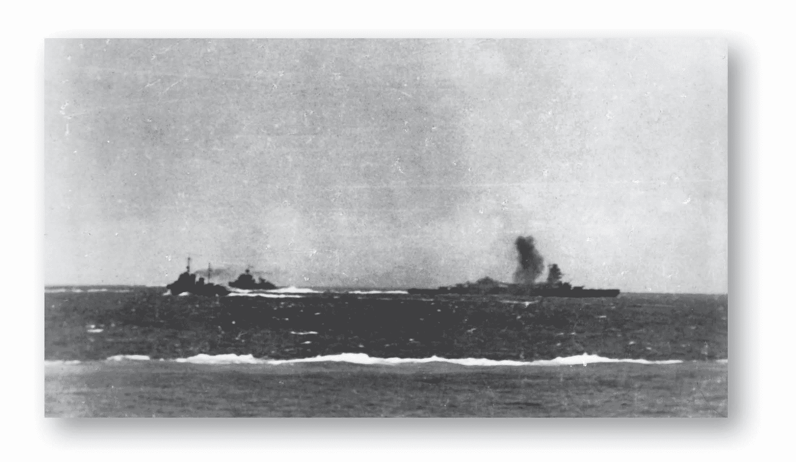

“鲁伊特号”在 2 月 15 日的空袭中也未受任何损坏。然而，由于失去了意外性且燃料不足，多尔曼取消了此次行动。（荷兰军事史学会）

不幸从行动伊初就如影随形。15 日凌晨，荷兰驱逐舰“范·亨格特号”在班登岛和比里顿岛之间的斯托尔泽海峡深深搁浅。该船全没，多尔曼指派了另一艘荷兰驱逐舰来撤离船员并击沉该船。几小时后，意外性消失了，在 09 时 23 分，一架日本巡洋舰水上飞机发现了“打击部队”。空袭随之而来。第一次攻击发生在 10 时 20 分，当时来自“龙凤号”的四架`B5N1`“鱼罐”机选定“埃快递号”作为目标。飞机从高空投下 550 磅炸弹，但未命中。紧随第一次攻击之后，来自婆罗洲的 23 架`G3Ms`发起了规模更大的进攻。它们从高空投弹，仅对两艘美国驱逐舰造成了轻微损坏。11 时 30 分，又有七架`B5N1`出现并攻击了“埃快递号”，再次仅造成了轻微损坏。此时，多尔曼取消了行动。然而，“打击部队”的磨炼并未此结束。另外两组共计 44 架陆基轰炸机到达并进行了高空攻击。同样，没有命中。来自“龙凤号”的 19 架`B5N1`分三组进行的攻击也未成功。“打击部队”与日本海军空军持续一整天的遭遇以平局结束。除近弹炸破外，没有船只被击中，也没有飞机被击落。但迄今为止集结规模最大的盟军海军力量被迫放弃了阻止日本入侵的尝试。结果是，巴淡丹的入侵顺利进行。它的成功迫使盟军撤离了苏门答腊。

日本空军力量继续主宰该地区。2 月 15 日，来自“肯达里”的日本轰炸机袭击了开往提汶岛的盟军援军护队。虽然没有命中（主要是因为轰炸机针对的是“休斯顿号”而非速度慢且机动性差的运输船），但这是对马来海峡以南的盟军船只的首次空袭。护队被命令返回澳大利亚达尔文，那是向荷属群岛（NEI）输送援军和飞机的主要基地。2 月 17 日，陆基轰炸机和“龙凤号”的`B5N1`击沉了一艘正在从比里顿岛撤离士兵的荷兰运输船和驱逐舰，伤亡惨。

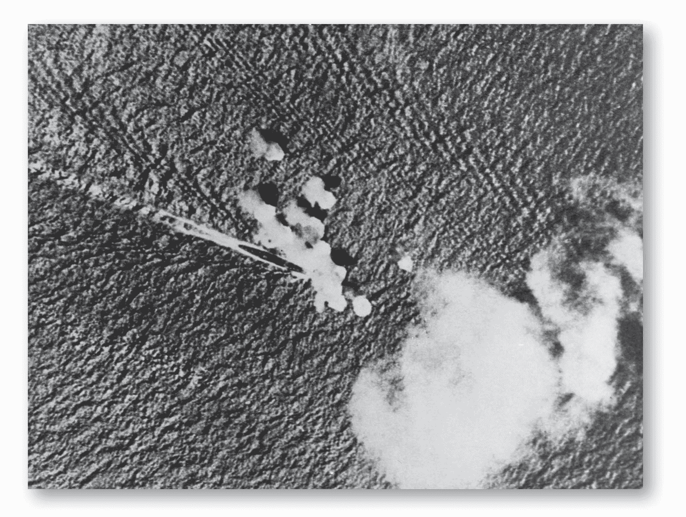

荷兰驱逐舰“范·内斯号”是日本海军航空力量受害者。2 月 17 日，这艘驱逐舰正在护送一艘从比里顿岛撤离守军的荷兰运输船。派遣士兵后，两船被一架日本巡洋舰水上飞机发现，随后遭到 15 架`G3M`和来自“龙凤号”的十架“鱼罐”机的密集空袭。驱逐舰被“龙凤号”飞机的三枚炸弹击中，迅速沉没，损失 68 名船员。（美国海军历史与遗产司令部）

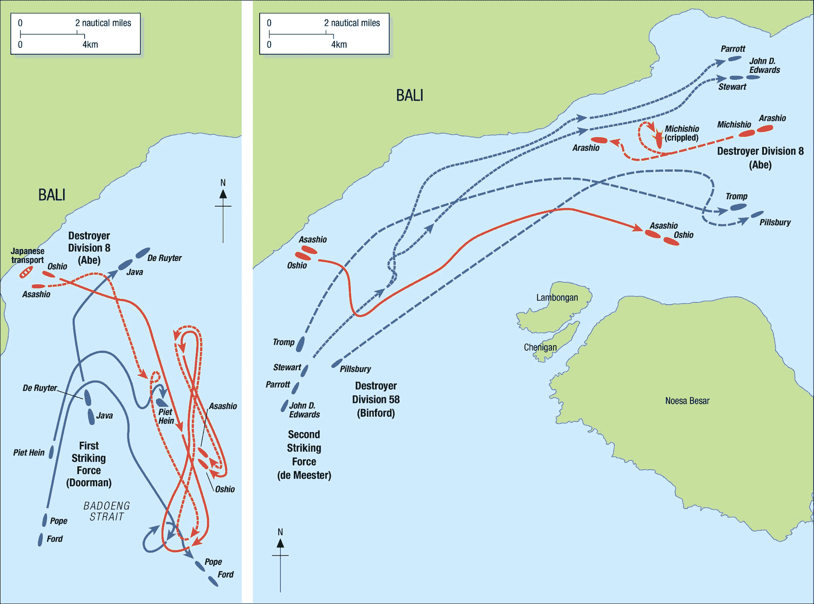

### 巴杜恩海峡战战，1942 年 2 月 19–20 日

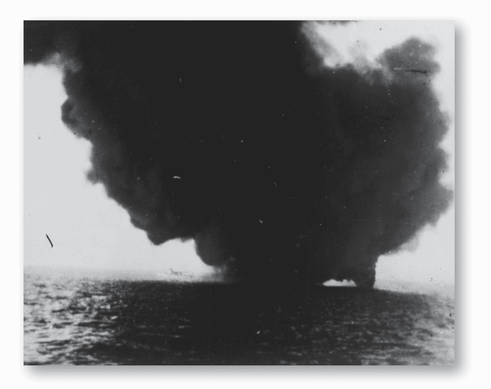

2 月 19 日上午，日本俯冲炸机展现了惊人的射术，在达尔文港击中了机动的驱逐舰“珍珠号”五。如图所示，该船被燃烧的燃油包围。其船员中仅 53 人幸存；另 80 人死亡。（美国海军历史与遗产司令部）

随着 2 月中旬“第一舰队”的抵达，来自日本空军的威胁显著增加。这支力量由四艘曾攻击过珍珠港的航母组成——“赤城”、“加贺”、“翔鹤”和“庄园”。在来自“肯达里”的陆基轰炸机的帮助下，日本决定利用其航母力量中和达尔文。2 月 19 日，港口布满了潜在目标——47 艘军舰和各类商船。这一重要基地的防空极其薄弱，面对从四艘日本航母派出的 188 架飞机无效。日本飞机击中了港内的船只（包括美国驱逐舰“珍珠号”），并破坏了岸上设施。54 架陆基轰炸机完成了破坏，攻击了附近的两个机场。与荷属群岛的主要联系已被暂时中和。

日本人逼近爪哇。2 月 20 日，他们在提汶岛登陆了一个团。防守军在三天内被击败。岛屿及其机场的损失意味着从澳大利亚飞往荷属群岛的飞机路线被切断。

对爪哇更直接的威胁是针对紧邻爪哇以东的巴厘岛的日本行动。如果日本人夺占登巴萨机场，他们就能增加对爪哇设施的压力，并主导该岛的南部通道，切断所有援军。

日本计划在巴杜恩海峡将登陆部队送往巴厘岛东南角的萨诺尔路，这是很有风险的，因为那里离主要的盟军空军基地太近。登陆部队被放在两艘运输船上，并由四艘朝潮级驱逐舰护送。根据日本作战条例，登陆将在晚上进行，以便运输船清晨离开。巡洋舰“浦号”和另外三艘驱逐舰部署在北方提供远程支援。这支部队于 2 月 17 日从望加锡出发。

如果 ABDA（美英荷澳盟）曾有过真正的机会击退日本入侵，或者至少获得局部胜利，那么日本入侵巴厘岛就是那个机会。然而，这次行动的时机让赫尔里希（Helfrich）措手不及，因为像通常一样，他的大部分海军部队被分配护护护队。他必须迅速重新集一支打击力量并将其派往 `Badoeng Strait`。由于快速完成这一行动非常困难，且不想浪费额外时间将所有可用力量集结成单一力量来压制日军，赫尔里希制定的计划仍然难以理解或辩护。可用的盟军舰船位于苏门答腊东南岸的 `Soerabaja`、`Tjilatjap` 和 `Rantai Bay`。赫尔里希知道入侵军正在 `Makassar` 集结，但其目标尚不明确。尽管意识到了这一点，当日本人的实际目标暴露为巴厘岛时，赫尔里希仍然感到措手不及。他与多尔曼（Doorman）在 2 月 17 日商量了处理方法，并制定了 2 月 19 日至 20 日夜间反击的计划。由于舰船来自不同的基地，计划中攻击将分三波进行。第一波由来自 `Tjilatjap` 的可用舰船组成，它们将从南方进入 `Badoeng Strait` 进行攻击，然后继续向北开往 `Soerabaja`。这支力量包括轻巡洋 `De Rutyer` 号和 `Java` 号、荷兰驱逐舰 `Kortenaer` 和 `Piet Hein`，以及美国驱逐舰 `Pope` 和 `John D. Ford`。第二波由来自 `Soerabaja` 和 `Rantai Bay` 的舰船组成。轻巡洋 `Tromp` 将率领来自 `Rantai Bay` 的四艘美军驱逐舰（`Stewart`、`Parrott`、`John D. Edwards` 和 `Pillsbury`）从南方向北进入 `Badoeng Strait` 攻击日军，然后经 `Lombok Strait` 回到 `Soerabaja`。第三波由九艘荷兰鱼雷艇组成，它们也将从南方发动进攻。

该计划在许多方面都存在缺陷。盟军飞机报告了一支规模大得多的力量——两艘巡洋舰、多达六艘驱逐舰和四艘运输船，使得赫尔里希集结兵力至关重要。登陆已经在 2 月 19 日凌晨发生，没有任何盟军海军单位能及时赶到改变这一事实。赫尔里希本应将可用舰船集结成一支可能具有压倒性优势的力量。但他认为时间不足让来自几个基地的舰船会合，而且任何此类会合都必须在晚上进行，这增加了难度。无论如何，由于速度和续航能力的考量，将鱼雷艇纳入统一的打击力量中是不可能的。赫尔里希似乎将他的攻击视为一系列突袭，而不是一场决战。如果属实，这也很难解释，因为突袭并不能阻止日军。

日军登陆于 2 月 19 日 `0200hrs` 顺利进行，没有出现任何问题。陆上战斗很快以日军有利利告终，他们俘获了完整的机场。然而，在天亮时分，一系列空袭开始扰乱了日军的计划。到 `0800hrs`，12 架重轰炸机攻击了那艘运输船。虽然没有命中，但攻击延迟了卸货。随后，两架 A-24 俯冲炸机（海军 `SBD Dauntless` 的美国陆军版本）发动攻击，击中了运输船 `Sagami Maru`。下午，负责该行动的日本海军将命令该船在驱逐舰 `Arashio` 和 `Michishio` 的护航下返回 `Makassar`。

这导致运输船 `Sasago Maru`仍在卸货，由驱逐舰 `Asashio` 和 `Oshio` 护航。最后，在天黑后，该小组离开了停锚地，但一小时后，运输船返回卸下八艘供陆上分遣队使用的登陆艇。`Asashio` 在运输船附近航行，`Oshio` 位于西北方约 3000 码处

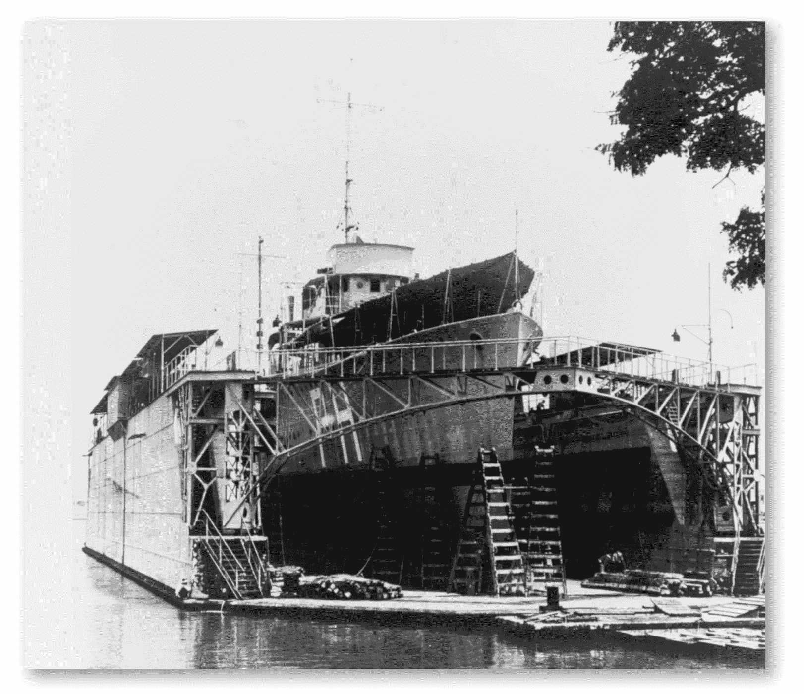

图中显示在 `Soerabaja` 干坞中的 `Piet Hein` 号是战争开始时可用的七艘荷兰皇家海军驱逐舰之一。1940 年 5 月荷兰沦落后，维持东印度群岛舰队舰船的运作变得越来越困难。（美国海军历史与遗产司令部）

第一波盟军攻击群在 `2230hrs` 之前抵达停锚地区域。该小组由多尔曼指挥。他将他的两艘巡洋舰部署在驱逐舰前方约 5500 码处。他们的命令是进行火射交战，而驱逐舰则用鱼雷攻击受扰乱的日军。这是一个糟糕的计划，因为突袭性的鱼雷攻击随后进行炮击攻击可能更有效，就像在巴厘望板（Balikpapan）一样。巡洋舰以 27 节的速度冲向日军。`Java` 号先发现 `Asashio` 号，但荷兰人开火缓慢。`2230hrs`，`Asashio` 发现了 `Java` 号并试图用探照灯照亮这艘巡洋舰。随后的战斗非常短暂且没有胜负；这证实了赫尔里希意图这仅仅是一次突袭的观点。`Java` 号在 2200 码处与驱逐舰交战，一发命中并毁了它的探照灯，导致四死一伤。`Java` 号与该驱逐舰交战，一发命中并毁了其探照灯。另一发击中了 `Sasago Maru`。作为回报，`Java` 号后部中了一发 5 英寸炮。此时荷兰巡洋舰向北逃离并断了联系。`De Ryter` 和 `Oshio` 都没有开火。几分钟后，盟军驱逐舰带着 `Piet Hein` 号抵达两艘船前方 5000 码处。`Oshio` 首先发现目标，在 `2235hrs` 于南方 6000 码处发现了这艘荷兰驱逐舰。日本人转向东南战斗。`Piet Hein` 号用三枚鱼雷和 4.7 英寸主炮攻击 `Sasago Maru`。一旦离开荷兰驱逐舰的烟雾，`John D. Ford` 号也发射了三枚鱼雷并向运输船射击了 4 英寸炮。队列中的最后一艘驱逐舰 `Pope` 号向运输船发射了两枚鱼雷。两艘美军船都声称命中，但均未命中 `2240hrs`，`Asashio` 在仅 1600 码的距离内与 `Piet Hein` 交战，随后将美军驱逐舰置于火力之下`Pope` 向 `Asashio` 发射了两枚鱼雷，但未命中。为了避免与荷兰船碰撞并避开东方的 `Asashio`，两艘美军驱逐舰转向西方。这让 `Piet Hein` 陷入孤立；在发射另外两枚鱼雷后，它的锅炉中了一发 5 英寸炮。在损救措施完全恢复动力之前，该船在 `2246hrs` 被 `Asashio` 的一枚鱼雷命中。后果是毁灭性的；这艘荷兰船迅速向右舷倾斜沉没，包括指挥官在内的 64 名人员牺牲。

在解决 `Piet Hein` 号后，`Asashio` 向北进入美军驱逐舰。美军驱逐舰的指挥官们已决定放弃通过海峡向北前进的命令，转而向东行驶。`Asashio` 和 `Oshio` 在 `2300hrs` 之前重新发现目标，并在探照灯的帮助下对美军舰进行了猛烈火力。美军延迟还击以确保这两个目标不是荷兰巡洋舰，然后用火炮和鱼雷与日本人交战。双方均未命中。日人在烟幕中丢失了美军驱逐舰，到 `2310hrs`，美军已向东南逃离。

当第二波援到达时，`Oshio` 和 `Asashio` 正在受损的 `Sasago Maru` 东东岸外巡逻。`Arashio` 和 `Michishio` 正在向南移动，由巡洋舰 `Nagara` 领导的掩护力量也向该区域驶来。盟军第二波部队由四艘美国驱逐舰领队，荷兰巡洋舰 `Tromp` 在其后五英里跟随。巡洋舰长负责战术指挥，他计划让 `Tromp` 解决那些因驱逐舰鱼雷攻击而残的船只。

美国驱逐舰以 `25` 节的速度进入锚港区。他们预料将面对一支规模大得多的日本力量；此前试图与第一波次中的两艘美国驱逐舰接触的努力没有获得任何信息。`0135hrs`，`Stewart` 在左舷发现了一个可能的接触目标。几分钟内，她和 `Parrot` 向锚港内发射了六枚鱼雷，`Pillsbury` 又发射了三枚。所有 `15` 枚鱼雷全部落空，而且它们可能根本没有针对真实目标发射。`Asashio` 和 `Oshio` 最终发现了美国人并转向战斗。`0143hrs`，`Stewart` 发现了日本军并使用其探照灯和 `4in.` 炮进行战斗。日本军还击了猛火，并于 `0145hrs` 在 `3,500` 码处向美国人发射了鱼雷。双方造成的首次损伤发生在 `0146hrs`，当时几枚日本的 `5in.` 弹击中了 `Stewart`。受损的 `Stewart` 向东北方向转向，扰乱了美国军队的纵队。

当 `Tromp` 使用探照灯向美国驱逐舰信号时，日本驱逐舰将注意力转移到了 `Tromp`。从约 `3,300` 英里的距离处，`Asashio` 用 `11` 枚 `5in.` 炮轰击 `Tromp`，导致其上层设备遭受严重损坏。`Oshio` 的齐射鱼雷错过了这艘巡洋舰。`0216hrs`，`Tromp` 一枚 `5.9in.` 炮弹命中 `Oshio` 的指挥楼，造成七人死亡。`Tromp` 和所有四艘美国驱逐舰继续向东北方向驶去。

战斗的下一阶段出现了 `Arashio` 和 `Michishio`，它们正沿着炮声向南。`0215hrs`，`Michishio` 发现了两个接触目标，并使用探照灯照亮它们。它们是 `Stewart` 和 `John D. Edwards`。两艘美国驱逐舰在 `Pillsbury` 的加入下，用其 `4in.` 炮和 `John D. Edwards` 的六枚鱼雷对 `Michishio` 实施攻击。`Pillsbury` 又释放了三枚鱼雷。措手不及的日本军陷入了致命的交叉火力中。所有鱼雷全部落空，但一枚 `4in.` 炮弹击中了驱逐舰的 `2` 号 `5in.` 炮座，将其摧毁并杀死了船员。另一枚炮弹击中指挥楼，伤了 `Michishio` 的舰长。

`Tromp` 随后向日本驱逐舰的机舱又发射了三枚弹，使其停止了动力。盟军船只没有留下来解决那艘残废的驱逐舰，而是继续向东北方向移动并脱离。

盟军的第三波攻击完全无效。在命令进攻的九艘鱼雷艇中，只有八艘到达了战斗区域。它们以四四一组的形式进入海峡。一组没有发现任何接触，另一组发现了正在高速移动的可能目标，但无法进入攻击位置。所有鱼雷艇在无所获的情况下返回了 `Soerabaja`。

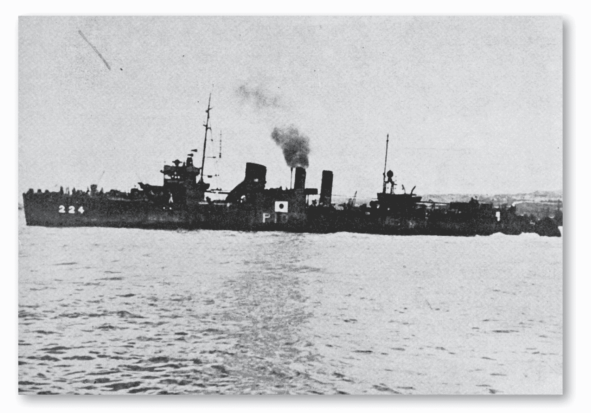

驱逐舰 `Stewart` 在巴多登海峡战战后被送到 `Soerabaja` 进行修理。`2 月 20 日` 当她所在的干船坞正在排水时，该船由于加固不当发生了倾覆。在日本人占领该市之前，干船坞于 `3 月 2 日` 被沉。`1943 年 2 月`，该船被日本海军（`IJN`）打捞并作为 `Patrol Boat 102` 服役。这里显示的是她战后的样子，已被归还给美国海军管辖并被授予此处原始船体编号。（美国海军历史与遗产司令部）

双方都认为自己给对方造成了严重损害。实际上，盟军错失了一个对日本人造成局部击败的绝佳机会。在第一波攻击中，`Doorman` 拙劣的战术计划浪费了盟军赢得胜利的最佳希望。那两艘日本驱逐舰的操作非常激进且出色。首先，他们击退了两个荷兰轻型巡洋舰的攻击，对方未能扩大优势；接着他们压制了单艘荷兰驱逐舰；最后赶走了两艘美国驱逐舰。第二波虽然获得了暂时的奇袭，但未能扩大优势。盟军付出的代价是巨大的。一艘驱逐舰（`Piet Hein`）沉没，轻巡洋舰 `Tromp` 迫被迫前往澳大利亚修理，这使她离开了战斗。美国驱逐舰 `Stewart` 被送到 `Soerabaja` 的干船坞修理。不幸的是，干船坞坍塌了，`Stewart` 的战斗生涯就此结束。她后来被日本人打捞，并在战争剩余时间里作为日本海军的巡逻艇服役。日本人认为他们造成的损害更大，声称第一波攻击中沉没的三艘驱逐舰中有两艘，第三艘受损严重。日本人的总声称是击沉了两艘巡洋舰和三艘驱逐舰，以及两艘驱逐舰受损严重。`Yamamoto` 接受了这些声称作为事实。

两支侵略船队均由高桥中将指挥。他在爪哇岛北方预留了一支由“芦形”（Ashigara）和“凤木”（Myoko）重巡洋以及两艘驱逐舰组成的预备队。爪哇岛南部是近的支持部队，拥有“龙”（Kongo）和“春云”（Haruna）战舰、三艘重巡洋和几艘驱逐舰。此外，被赋予拦截试图逃离或加强爪哇岛的盟军任务的是“联合机”（Kido Butai），它拥有四艘航空母舰、两艘战舰、两艘重巡洋以及一支由轻巡洋领头的驱逐舰中队。

盟军已知这两支侵略船队的集结，赫尔里希（Helfrich）准备好部队击退这两支日本侵略军。2 月 21 日，他创建了两个独立的打击力量来完成这一任务。他声称这么做是因为两个主要基地已没有足够的燃料来供应整个盟军。西方打击队由澳大利亚皇家海军科林斯（Collins）准将指挥，由一艘重巡洋（“埃克塞特号”Exeter）、三艘轻巡洋（“澳洲号”、“霍巴特号”、“龙号”和“丹娜号”Danae）、五艘英国和一艘荷兰驱逐舰组成。该部队基地位于巴达维亚（Batavia）附近的 Tandjong Priok。2 月 24 日，它得到了澳大利亚轻巡洋“珀斯号”（Perth）的增援。东方打击队由杜曼（Doorman）指挥，由一艘重巡洋（“休斯顿号”Houston）、两艘轻巡洋（“鲁伊特号”De Ruyter 和“爪哇号”Java）、三艘荷兰和四艘美国驱逐舰组成。

一架美国水机在 2 月 25 日接触到了东方舰队。它是两支侵略船队中靠近爪哇岛的一支，由于它正前往爪哇岛的经济政治中心，因此要求全力应对。赫尔里希命令“埃克塞特”和“珀斯”巡洋舰，以及“电光号”（`Electra`）、“遭遇号”（`Encounter`）和“木星号”（`Jupiter`）驱逐舰从西方打击队抽离，增援杜曼的东方打击队。由于下心阻止侵略，并深知如果日本侵略军登陆，荷兰属东印度陆军将迅速被击败，赫尔里希决定命令杜曼击败日本东方舰队，然后航向爪哇岛的另一端击败西方舰队。这是一个空幻的想法，但杜曼被要求尽尽所能地执行这一愿景。

杜曼决心积极与日本军交战，但对他们的位置没有足够的情报。2 月 26 日夜，他率领部队在马杜拉岛（`Madoera Island`）周围进行搜索。一无所获后，他在早晨返回泗水泗（`Soerabaja`），结果遭遇了每日空袭。盟军对爪哇岛的防御达到了高潮。赫尔里希在 1155 时收到一份关于日本侵略船队位置的报告。它正向西南方向泗水泗以西的登陆区移动。这份报告于 1250 时发送给杜曼，命令其出击、执行夜袭，然后前往 `Tandjong Priok`。随后在 2055 时，收到赫尔里希的命令：“你们必须继续进攻，直到敌人被消灭。”

杜曼那天下午召集了部队中所有船只的长官，商讨即将到来的战斗计划。打击舰队将绕过马杜拉岛北方，然后向西航行。英国和荷兰驱逐舰部署在先锋，然后是巡洋舰，最后是美国驱逐舰。与日军接触后，先锋驱逐舰将发动攻击，随后是巡洋舰远距离攻击目标，然后美国驱逐舰将执行鱼雷攻击。

杜曼的计划留给了美国、澳大利亚和英国参与者很大的想象空间。计划中没有使用他的巡洋舰水机的规定，这些飞机被留在岸上，以防在夜战中成为火灾危险。一个小时的会议没有涵盖通信计划的核心或详细的战术计划。正如一名美国驱逐舰舰长所说：“盟军力量只不过是一支由陌生任务小组组成的列队，带着模糊的总体指令在没有具体任务进入了战斗。”杜曼将在没有连贯战斗计划、几乎无法与部队通信、且对敌人的部署和意图一无所知的情况下，出海与日本军进行一场亡死之战。这并非成功的秘诀。

联合打击舰队于 1800 时从泗水出发，在马杜拉岛周围进行了搜索。2 月 27 日凌晨 0130 左右到达萨波埃迪海峡（`Sapoedi Strait`）后，杜曼按计划掉头返回泗水。在没有任何关于日本军的情报且已完成计划中的搜索后，杜曼在 1240 时决定返回泗水加燃料。1425 时，正当“鲁伊特号”航过保护泗水的荷兰水雷区时，杜曼收到了来自一架荷兰水机的一系列令人震惊的报告——日本侵略船队仅位于泗水西北约 50 英里处！杜曼立即调头向北，并命令其余部队跟随。如果运气好的话，盟军可以在日本侵略军将部队登陆之前将其拦截。

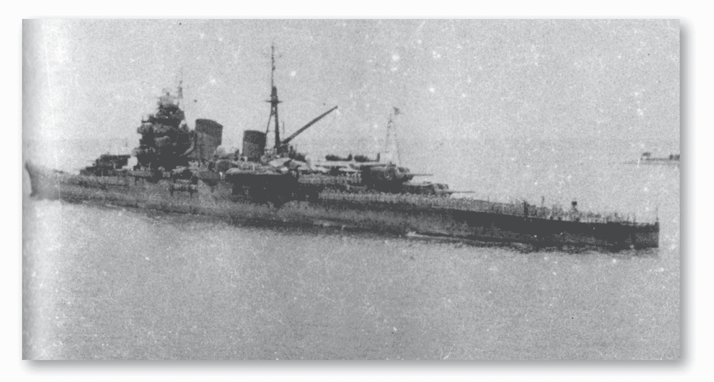

图中“名为号”（`Nachi`）显示于 1942 年 3 月，即东印度战役刚结束后，它是高木中将的旗舰，在此之前 1942 年 1 月 4 日，“凤木号”在达拉湾（`Davao`）附近被美国陆军的 B-17 轰炸机击损。

接触的过程对双方来说都不顺畅。日本侵略船队正前往泗水以西的甘甘岛（`Kagan`）。1000 时，侵略船队正经过巴威安岛（`Bawean Island`）。由于没有预料会有主要抵抗，高木未能集中兵力。最终意识到需要加强船队力量后，高木于 0930 时命令田中舰队的大部分加入船队。在从西村处得知侵略船队正遭受空袭后，高木命令他的两艘重巡洋和最后四艘驱逐舰向南增援船队。1100 时，高木收到情报，杜曼由五艘巡洋舰和六艘驱逐舰组成的力量位于侵略船队的路径上。高木发射了“名为号”的一架水机获取更多信息，并向南加速。这架飞机在 1235 时报告敌军力量向东移动，不久后又报告该力量转向南方。期间，西村命令侵略船队向西航行，直到危险被消除。

日本军一度陷入混乱，但他们不会让杜曼获得攻击船队的机会。一旦杜曼一向南航行，高木便命令继续登陆，并在 1340 时将船队带回西南方向。当杜曼调头向北时，“名为号”的水机迅速将此传给高木。侵略船队再次被命令向西北航行，高木采取了集中兵力的措施，命令巡洋舰向南加速以与田中和西村的驱逐舰中队会合。西村为船队留了两艘驱逐舰，自己带着旗舰和另外六艘驱逐舰与盟军交战。尽管没有完全集中，日军力量总共有两艘重巡洋、两艘轻巡洋和 14 艘驱逐舰。他们在 `8 英寸`炮上拥有优势，在 `6 英寸`炮上火力匮乏，但在鱼雷管上具有显著优势。

# 爪哇海海战：第一阶段，1555–1720 时

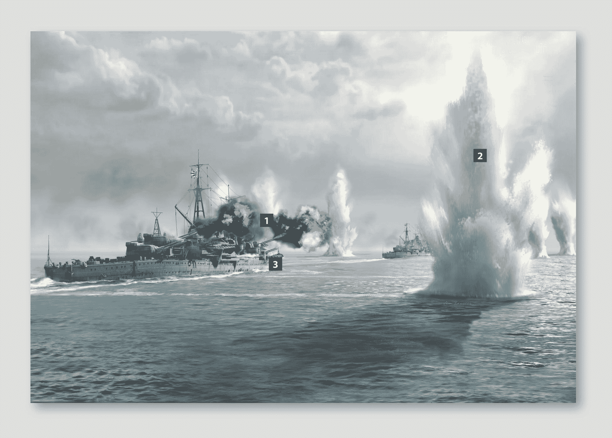

## “贺号”战斗

重巡舰“级”（`Nachi`）和“贺号”（`Haguro`）是日本海军在爪哇海的主力。凭借其强大的`8 英寸`炮和鱼雷群，它们是双方现场最强大的舰只。战斗的初始阶段是“级”、“贺号”与盟军巡洋舰之间的远程火力对决。在图中，“贺号”的`8 英寸`炮塔已抬高（1）并进行远距离射击，而盟军巡洋舰的水花在日本军舰附近爆炸（2）。为了弥补巡洋舰远程火不足，高木少将决定出动远程的`93 式`鱼雷。作为大规模鱼雷齐射的一部分，“贺号”准备发射其右舷侧的八枚鱼雷。该巡洋舰已经训练了其两个右舷四联发射器，并在`1652 时`发射了鱼雷，如图中所示（3）。图中未显示的是，几枚鱼雷在距离舰体几百码处即爆炸，形成了巨大的水柱。问题出在鱼雷的信管上，这在整个战斗中都是问题。领先队列的“级”巡洋舰未能再贡献八枚鱼雷，因为其鱼雷乘员离开了一个阀门，导致发射所需的空气压力泄露。在这一轮齐射的 39 枚`93 式`鱼雷中，仅有一枚命中。但这一击是致命的；`1713 时`，“贺号”的一枚鱼雷击中了荷兰驱逐舰“科尔塔纳号”（`Kortenaer`）的中部，使其在几分钟内沉没。

## 爪哇海海战

多曼在向西北进攻日军时，选择将部队布置成三列平行纵。中列由他的五艘巡洋舰组成，由旗舰“敌特特号”（`De Ruyter`）领头。主列两侧是两列驱逐舰，一列由三艘英国驱逐舰组成，另一列由六艘荷兰和美国驱逐舰组成。荷兰的“科尔塔纳号”有锅炉问题，导致最高速度降至`26 节`，并落了队。同样掉在后面的是四艘美国驱逐舰，它们收到多曼的命令不要超过荷兰驱逐舰。联合打击队速度无法超过`26 节`成为战斗的关键因素。多曼速度较慢意味着他不太可能在机动上超过日军，也使得对运输小组进行任何无阻碍的突击变得更加渺茫。

### 白天阶段

双方继续接近。`1610 时`，“埃莱特拉号”（`Electra`）发现了最西边的日本军群——轻巡舰“津号”（`Jintsu`）及其四艘驱逐舰。几分钟后，“埃莱特拉号”也报告了那两个日本重巡舰。与此同时，日本军群也发现了多曼的部队。`1615 时`，“津号”开始战斗，向“埃莱特拉号”发射其`5.5 英寸`主炮。距离为`18,000 码`，接近该武器的最大射程。尽管如此，日本炮手仍能让弹落落在目标两侧。首发齐射后，“级”和“贺号”在`28,000 码`处对盟军重巡洋舰开了`8 英寸`炮的火。他们的首发弹明显偏后了。根据日本海军的海战理论，高木乐于进行远程火力对决，因为他认为自己的火力在远距离更有效，并借此限制盟军利用三艘巡洋舰上的`6 英寸`炮反击的能力。“埃塞特号”（`Exeter`）舰长没有等命令就下令在`1617 时`还击，随后“休斯顿号”（`Houston`）的前方两座`8 英寸`炮塔也加入了战斗。日军和盟军的远程火力均无成效。“休斯顿号”声称命中；`1631 时`，一枚日本的`8 英寸`炮弹击中了“敌特特号”，但那是哑弹。日本巡洋舰的火力足够准确，偶尔能落弹目标，但在`26,000 码`或更远距离处，命中的概率很小。

两支巡洋舰力量继续保持大致平行航线。高木不愿缩短距离，继续执行远程火力攻击的战术。多曼需要缩短距离以便他的`6 英寸`巡洋舰投入战斗。由于三艘巡洋舰上有 25 门`6 英寸`炮，这是他唯一的优势领域。但再次，较慢的速度迫使多曼应对日军的机动。为了避免被日本重巡洋舰“过头”（一种战术，一方横穿过另一方，使得通过的一方可以动用全部侧射火力，而被横穿的一方只能动用前部火力），多曼在`1635 时`命令向正西转弯。这暂时缓解了日本重巡洋舰“过头”的可能性，但未能未能缩短足够的距离以让`6 英寸`巡洋舰加入火力对决。

当重巡洋舰交火时，高木计划出动日本帝国海军的秘密武器——远程`93 式`鱼雷。大规模鱼雷攻击将在盟军预计受攻击的距离之外进行，而日军预料结果将是毁灭性的。鱼雷齐射攻击在盟军预期攻击范围之外进行，西村操纵他的轻巡舰和六艘驱逐舰以执行高木的鱼雷攻击命令。`1634 时`，他的舰只率先在`15,000 码`处发射了鱼雷。在`1640`到`1645 时`之间，他的驱逐舰向联合打击队发起了。除了西村的舰只，轻巡舰“津号”在`1635 时`发射了四枚，“贺号”在`1652 时`在`22,000 码`处发射了八枚。“级”未能再贡献八枚，因为其鱼雷乘员离开了一个阀门，导致发射所需的空气压力泄露。这一轮齐射的 39 枚鱼雷为高木只换来了令人失望的回报。`1713 时`，一枚鱼雷击中“科尔塔纳号”中部。根据附近美国驱逐舰长的说法，那艘荷兰驱逐舰在不到两分钟内消失了。

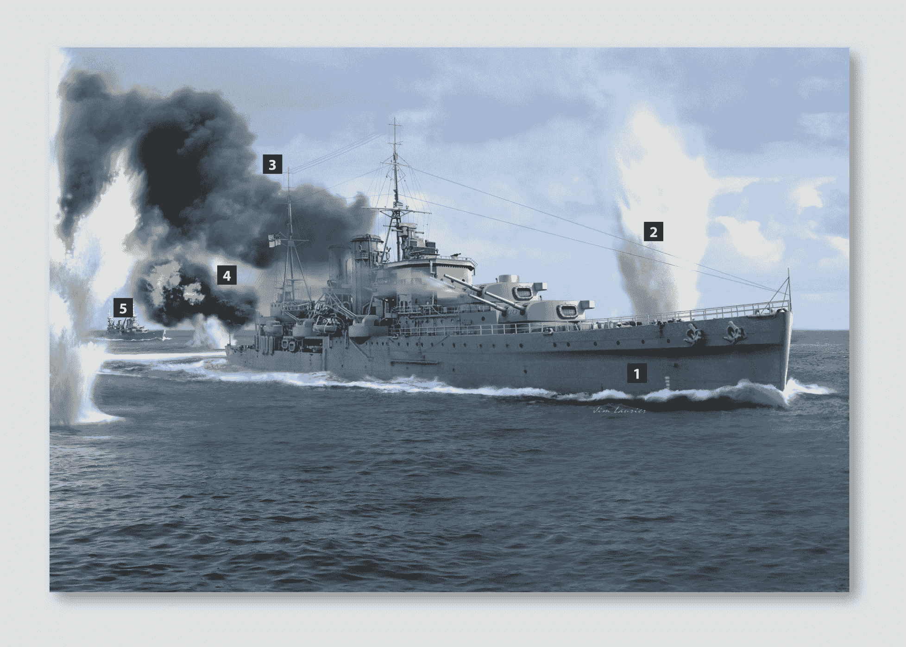

## 困中的埃塞特号

在一小时无果的远程炮战后，双方造成的伤害均小。`1700 时`左右，日军缩短距离以寻求决胜。与此同时，他们将火力集中在“埃塞特号”和“休斯顿号”这两艘最大的盟军舰上。`1708 时`，“埃塞特号”（1）被“贺号”的一枚`8 英寸`炮弹命中。日本海军的火力非常准确，正如那发齐射落在巡洋舰两侧所示，图中可见两次爆炸（2）以及击中舰体的第三枚弹。单枚`8 英寸`炮弹的后果是毁灭性的，并在很大程度上决定了战斗。炮弹击中了一个`4 英寸`双联炮座的盾罩，然后穿过装甲门进入锅炉室通风口。炮弹穿过“A 锅炉室”，碎片四处飞溅，然后穿入“B 锅炉室”造成了进一步损害。结果是导致两个右舷锅炉停止工作，由于过热器的损坏导致四台后部锅炉无法使用。过热蒸汽充满了后部锅炉室，导致机舱人员除一人外全部丧生。八个锅炉中损失了六个导致速度降至仅有`6 节`。功率下降也导致其主炮无法作用。在图中，“埃塞特号”正在进行紧急转弯以避免与后方的巡洋舰碰撞。浓烟已经从两个烟囱冒出，表明下方锅炉室的损坏（3）。“埃塞特号”在炮塔失去动力前发射了最后一发`8 英寸`齐射（4）。“休斯顿号”在“埃塞特号”后方`600 码`处，它正在向左紧急转弯（5）。

`Kortenaer` 的被毁以及日本巡洋舰炮火效能的不断提升，使 `Doorman`指挥的部队陷入了混乱。在战斗的第一小时内，两艘日本重型巡洋舰发射了 1,271 发 8 英寸炮弹。最终，这种密集的火力将将取得成效。除了最初对 `De Ruyter` 的命中（那是一发哑弹）外，另一枚炮弹在 1706 时刻命中了 `Houston`——那同样是一发哑弹。1708 时刻的下一次命中目标是 `Exeter`，这可能是整场战斗中最重要的一击。这枚炮弹可能来自 `Haguro`，穿透了锅炉室并爆炸。最终结果是导致该船八台锅炉中的六台停运，使航速降至 11 节，并暂时性切断了主火力的电力供应。为了避免与后方的巡洋舰发生碰撞，`Exeter` 舰长命令这艘正烟雾滚滚的巡洋舰立即左转。随后的三艘巡洋舰也效法这样做，因为他们认为自己错过了领队 `De Ruyter` 发出的信号。盟军纵队解体了；`De Ruyter` 继续向日本军推进，`Perth` 布下烟幕以掩护受伤的 `Exeter`。`Doorman` 被迫掉头旗舰以重组部队。为了争取他需要的时间，他命令三艘英国驱逐舰执行鱼雷攻击。

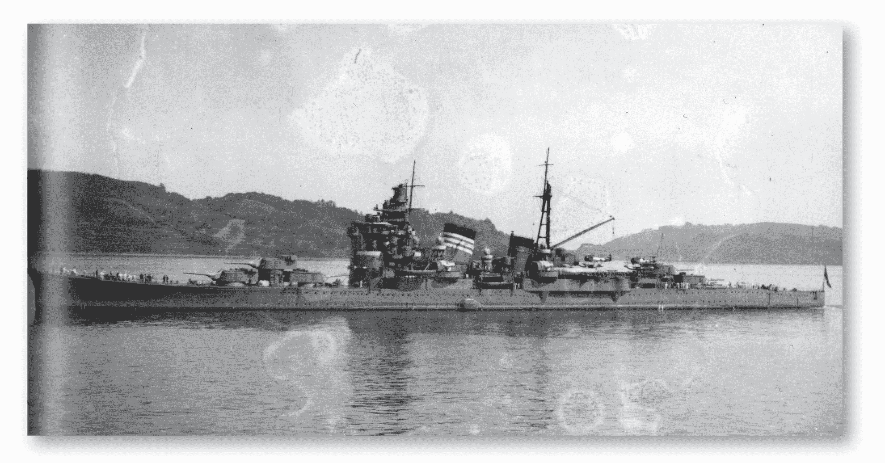

`Haguro` 是爪哇海战中无可争议的明星。她负责用一颗 8 英寸炮弹击中英国重型巡洋舰 `Exeter`，使其丧失战斗能力，随后鱼雷击中了荷兰驱逐舰 `Kortenaer`。在战斗的最后阶段，她用鱼雷击中了 `De Ruyter`，导致其沉没并结束了战斗战斗。`Haguro` 漫长的战争生涯于 1945 年 5 月 16 日在马六甲海峡结束于英国驱逐舰之手。（和和博物馆）

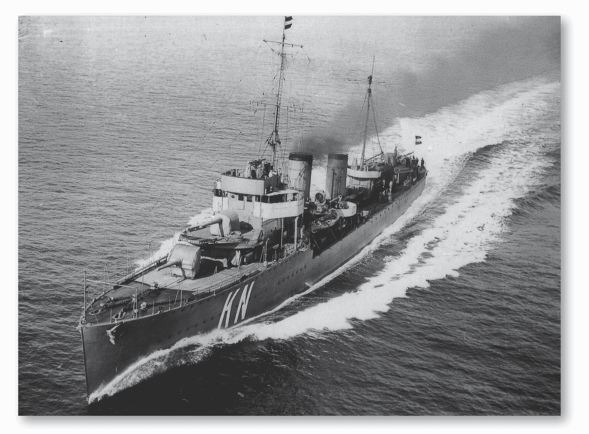

爪哇海战的首血战是击中驱逐舰 `Kortenaer`。`Type 93` 鱼雷命中中中部，将船体断为两段，两部分在 90 秒内均垂直落下。尾部立即沉没，但船头又过了五分钟才沉没，为船员提供了落水的时间。在 153 名船员中，有 115 人在鱼雷袭击中幸存。（荷兰军事史学会）

`Doorman` 直到 1725 时刻才重新建立控制。`De Ruyter` 带领其他巡洋舰（除去 `Exeter` 以及四艘美国驱逐舰向东北方向移动。二十分后，规模缩小的盟军部队向北方，从烟雾中出现，发现自己陷入了更大的麻烦。`Takagi` 通过他的水上飞机（这些飞机几乎在整个战斗期间都在飞行）得知 `Doorman` 部队的困境。`Takagi` 决定对看起来完全混乱的盟军部队发动最后的进攻。为了彻底消灭盟军，他命令了另外一次大规模鱼雷攻击。这一轮齐射共共有惊人的 98 枚鱼雷，主要目标是 `Exeter`。攻击从不同距离发起的——`Nachi` 和 `Haguro` 在 1754 时刻从 27,000 码外各贡献了 8 枚；`Naka` 在 1750 时刻从 18,500 码外发射了 4 枚；`Jintsu` 在 1754 时刻从 20,000 码外发射了 4 枚。`第 2 驱逐舰中队`的八艘驱逐舰在接近到 15,000 码后，每艘都发射了一个完整的齐次。来自`Nishimura` 第 4 驱逐舰中队`的四艘驱逐舰在 1804 时刻接近到 10,000 码后发射了全部弹药。`Nishimura` 的最后两艘驱逐舰 `Asagumo` 和 `Minegumo` 在接近到 6,500 码后，其中一艘发射了，另一艘则无法获得射击解。令人惊讶的是，这 98 枚武器没有一枚命中目标。日本的第二次大规模鱼雷攻击完全失败了。

当日本驱逐舰接近发动攻击时，三艘英国驱逐舰从烟雾中出现。`Electra` 在前面，很快与 `Tanaka` 第 2 驱逐舰中队交战。`Electra` 经验丰富的船员在巨大的劣势下表现英勇。英国驱逐舰用一颗 4.7 英寸炮弹击中了 `Tanaka` 的旗舰，导致一人死亡四人受伤。`Encounter` 紧随 `Electra` 走出烟雾，并立即对 `Jintsu` 开火。`Nishimura` 的领先驱逐舰 `Asagumo` 和 `Minegumo` 离英国船最近；`Encounter` 和 `Minegumo` 在 1800 至 1810 时刻之间进行近距离交火，日本船受了轻微损伤。与此同时，`Electra` 正忙于对付 `Asagumo`。英国船从 5,000 码外的一发炮弹命中 `Asagumo` 的锅炉室，导致 4 人死亡 19 人受伤，使这艘日本船暂时停滞。`Electra` 的运气没有持续下去。`Asagumo` 先命中了英国船的指挥塔，随后命中锅炉室，导致电力丢失。`Minegumo` 随后击了失去电力的 `Electra`，后者在 1816 时刻沉没。只有 54 名人员幸存，他们第二天被美国人救起。

爪哇海战：第二阶段

在爪哇海战的初期，`Doorman` 的部队在两次鱼雷攻击中损失较小，但日本军击伤了 `Exeter`。重要的是，由于 `Exeter` 的速度无法超过 15 节（尽管船员付出了巨大努力），`Doorman` 已命令其返回 `Soeraja`。由于日本军水上飞机向 `Takagi` 提供持续情报，`Doorman` 似乎找到突破口。在与 `De Ruyter`、`Perth` 以及 `Java` 重新组织巡洋舰部队后，他向东移动并将部队置于日本军与 `Exeter` 之间。尽管处于不利局面，`Doorman` 命令四艘驱逐舰在 1806 时刻进攻。这一命令很快被取消，但美国人随后被命令布置烟幕，最终掩护 `Doorman` 的撤退。`John D. Edwards` 上的官们决定发动鱼雷攻击。为了避免过于接近 `Nachi` 和 `Haguro`，这四艘驱逐舰以 28 节的速度向日本军推进，从右舷发射了 20 枚鱼雷，然后掉头从左舷发射了 21 枚。这些鱼雷的发射距离为 10,000 至 13,000 码，接近`Mark 8`的最大射。`Takagi` 谨慎决定让巡洋舰转向北方；所有鱼雷均未命中。

在剩下的日光时间中，高木评估了他的下一步行动。多尔曼的部队正向东进，显然是准备返回基地。多枚鱼雷的爆炸（实际上是 `Type 93` 提前爆炸）预示着盟军遭受了惨重损失。日本军已靠近爪哇岛岸，高木希望避开荷兰人的水雷区。战斗似乎已经结束，于是高木命令他的战斗舰向北重组，并让护航队向南前往其登陆区域。

多尔曼遭受了损失，但仍坚持要找到入侵护航队。`1831hrs`，他转向东北方向。他没有关于护航队位置的具体信息，但推测在自己北方的某个地方。他的部队已缩减为剩余的四艘巡洋舰、驱逐舰`Jupiter` 以及四艘美国驱逐舰，这些船只都没有剩余鱼雷，且燃料都已不足。

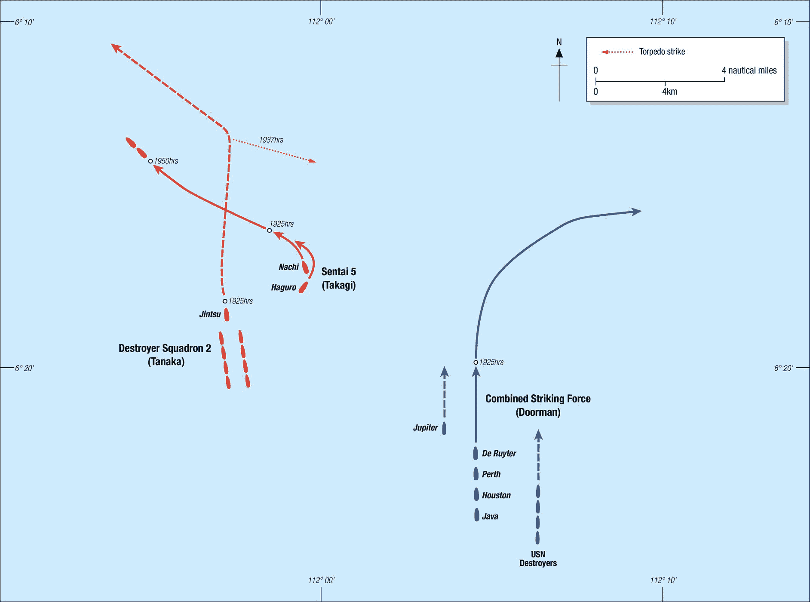

爪哇海海战：第四阶段，`1900–1950hrs`

### 夜战

联合打击队的转向在发生几分钟内便报告给了高木，这次是来自`Jintsu`的一架飞机。高木试图重新集合他的部队以应对多尔曼的猛攻。这花费了一段时间，因为在规模化鱼雷攻击之后，各个驱逐舰队分散在各地。田中三个分区中的最后一个直到 `1907hrs` 才集结完毕。西村的两艘驱逐舰`Asagumo` 和`Minegumo` 均受损，前往加入护卫队并离开了战斗。

多尔曼向北的移动暂时让高木措手不及。在`1904hrs`，他命令护卫队再次向北移动以躲避危险。更危险的是，`Nachi` 和`Haguro` 正在回收浮上飞机，这意味着它们处于停止状态，极易受到攻击。从 `1857` 到 `1922hrs` 期间，没有发现处于这种状态的日本巡洋舰，一旦再次航行，巡洋舰上的望哨兵发现了东南方向的盟军编制。田中中队短暂地进入了两支巡洋舰力量之间的一个位置，并在 `1933hrs` 遭到`Houston` 和 `Perth` 的炮击。`Jintsu` 以四枚鱼雷回击，但均未命中。

多尔曼仍坚持要突破运输舰，他转向东方，意图向南向海岸移动以绕过日本军。`2100hrs`，他再次向西行驶。此时，四艘美国驱逐舰的指挥官托马斯·H·宾福德指挥官决定带着他的船返回仅向东约 50 英里的`Soerabaja`。他给出的理由是鱼雷已耗尽，燃料也快用完了。此外，宾福德警惕跟随多尔曼进入一场无法获胜的战斗。在 2 月 27 日早晨在多尔曼指挥下出发的所有船只中，只有宾福德的四艘驱逐舰在 3 月 2 日傍晚仍浮在水面上。

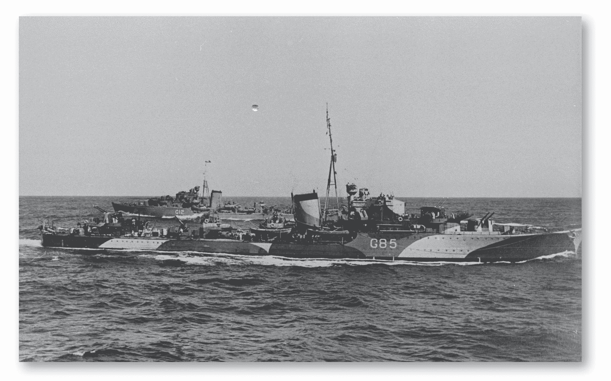

该战役中最强大的盟军驱逐舰——英国的`Jupiter` 被一枚漂浮的荷兰水雷击沉。爆炸发生在船的一个机舱内，导致该房间和锅炉被淹没并引起动力中断。缓慢进水导致船在四小时后沉没，损失了 70 名船员。（荷兰军事史学会）

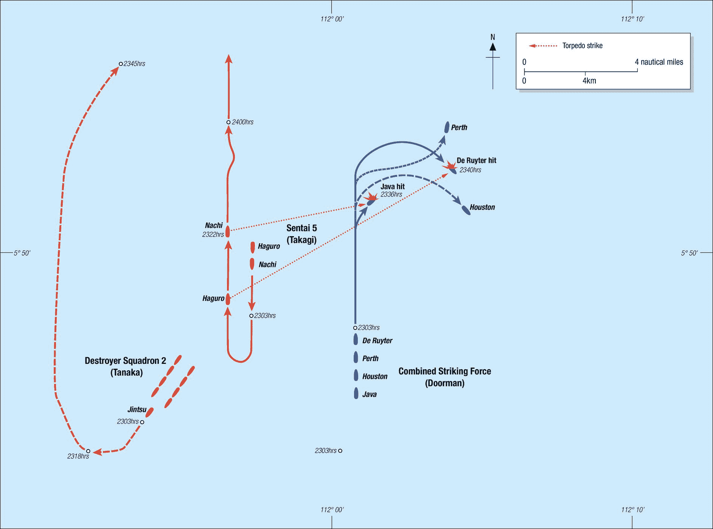

爪哇海海战：第五阶段，`2300–2400hrs`

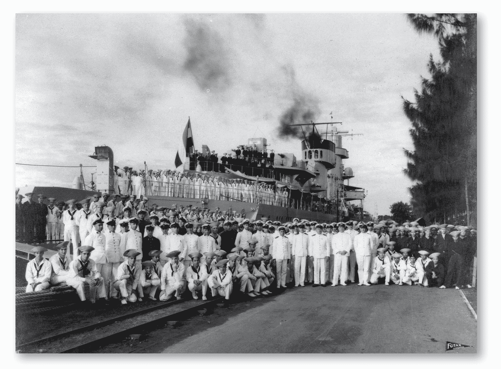

在`Soerabaja`海军基地码头拍摄照片的`De Ruyter`船员。在其 437 名船员中，当船只被一枚鱼雷命中时，有 235 人遇难。当船员被命令弃船时，过程非常混乱，尽管该船在被鱼雷命中后花了两个半小时才沉没，但仍有许多人牺牲。（荷兰军事史学会）

美国驱逐舰的离开使得多尔曼指挥下仅剩五艘船——四艘巡洋舰和`Jupiter`。驱逐舰`Encounter`掉在后面试图追赶。来自`Naka`的一架浮上飞机取代了`Jintsu`的飞机，并使用信号弹标记盟军部队的进展。更多的厄运困扰着盟军。在`2125hrs`，正当多尔曼带领部队向北最后一次尝试寻找运输舰时，`Jupiter`撞中了一枚荷兰水雷。该船失去动力，并在几小时后沉没。

盟军部队继续向北，徒劳地寻找入侵护卫队。此时双方都精疲力竭且弹药不足。`Perth`仅剩 160 枚 6 英寸炮弹，`Houston`只剩下约 300 枚 8 英寸炮弹。多尔曼拒绝考虑停止战斗，但无论他意愿如何，战斗很快就会结束。`2200hrs`，高木失去了与`Naka`的无线电联系。他紧张地命令向南航行，带着两艘巡洋舰并让驱逐舰队加入他。直到`2302hrs`，`Nachi`上的望哨兵发现了东南方向 16000 处的多尔曼纵队。日本巡洋舰向北转向采取平行航线，准备进行鱼雷攻击。盟军巡洋舰在`2310hrs`发现日本舰只并开火。日本在`2321hrs`回击。他们只剩下三分之一的 8 英寸弹，但日本人有足够的`Type 93`鱼雷进行最后的齐射。这一轮于`2322hrs`发射，其中`Nachi`提供了八枚鱼雷，`Haguro`提供了四枚。距离约为 14000 码。多尔曼试图机动以应对鱼雷攻击，但为太晚了。

12 枚鱼雷中有两枚命中。`2336hrs`，来自`Nachi`的一枚`Type 93`击中`Java`尾部。1078 磅战斗头的冲击导致后部药库爆炸，炸断了巡洋舰尾部约 100 英尺。考虑到巡洋舰隔水分区不完善，这是一个致命的一击。船员被命令弃船，在命中后 15 分钟内，`Java`便沉没，528 名船员中仅有 19 人幸存。可能认为鱼雷威胁已经过去，`De Ruyter`向右转，将侧弦暴露在`Haguro`的四枚鱼雷下。其中一枚击中尾部，产生的大火吞噬了船的整个后部。动力也丢失了，导致无法灭火。`De Ruyter`在深夜`0230hrs`沉没，损失了 344 人。伤亡中包括多尔曼，他拒绝离开船。

随着这些毁灭性的打击，战斗结束了。`Houston`和`Perth`改变方向向东南进发。根据多尔曼不尝试救援幸存者的命令，没有尝试救援荷兰巡洋舰的幸存者。日本驱逐舰试图攻击剩余的盟军舰，但在烟雾和混乱中无法实现。第二天中午，两艘幸存舰到达了`Tanjung Priok`。

## 盟军彻底溃败

当多门（Doorman）的东方打击队被击败时，盟军西方打击队又如何了？由于`Exeter`、`Perth`和三艘驱逐舰的离开，该舰队仅剩下三艘巡洋舰（两艘已过时）和三艘驱逐舰（两艘已过时）。2 月 26 日，英国空军的一架飞机在巴达维亚北约 100 英里发现了日本入侵军。`Helfrich`命令西方打击队出击并与之交战。该部队于傍晚在`Hobart`舰长的战术指挥下出发，在竭力拦截日本军无果后，于 2 月 27 日因燃料不足返回基地。此时，爪哇岛的命运已成定局，爪哇岛的英国高级海军军官亚瑟·帕利塞（Arthur Palliser）少将决定，不想在徒劳的防御中牺牲他的舰船。他说服`Helfrich`同意，如果找不到日本军就允许部队撤退。于是，柯林斯（Collins）为其下属制定了命令，要求其在 2 月 28 日 0430 分之前在无日军行动的区域巡逻，然后经巽宜海峡前往锡里兰。幸运的是，所涉舰只除荷兰驱逐舰外，均成功在日本入侵军抵达之前通过了巽宜海峡。

多门联合打击队的幸存者面临着非常不确定的未来。日本入侵军的两路火力现在位于爪哇岛的两端，将`Perth`、`Houston`和荷兰驱逐舰`Evertsen`困在丹绒普里奥（Tanjong Priok）。在泗水，美国驱逐舰`Pope`已与战斗中其他盟军幸存者加入，包括受损的`Exeter`、荷兰驱逐舰`Witte de With`、英国的`Encounter`以及宾福德（Binford）指挥的四艘驱逐舰。

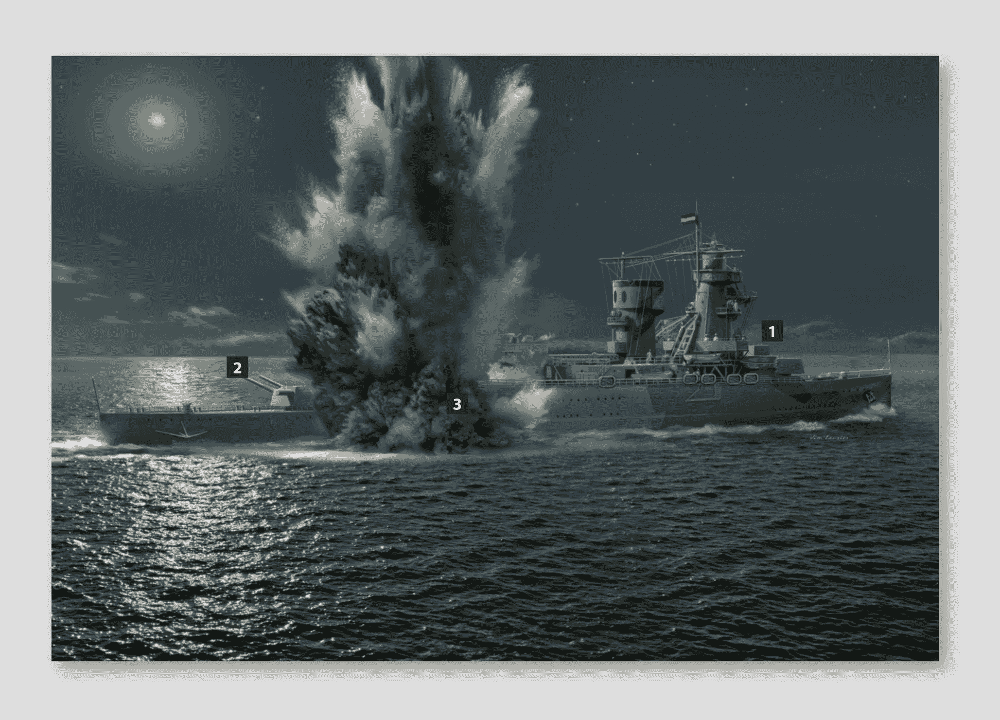

# 鲁伊特号之死

临午夜时，多门拒绝停止战斗。此时，盟军力量仅剩四艘巡洋舰，由多门的旗舰鲁伊特号（De Ruyter）领航。这一场景显示了鲁伊特号正在高速行驶（1）。该舰的四座 5.9 英寸炮塔指向左舷，并抬高以进行远射击（2）。战斗最终由长波号（Nachi）和比贺号（Haguro）发射的一齐`12 枚 93 型`鱼雷结束。日本鱼雷从 14,000 码外射向盟军巡洋舰纵列。多门对这一威胁的反应迟缓。`2336hrs`，一枚来自长波号的鱼雷击中了爪哇号（Java），炸掉了这艘巡洋舰的船尾，导致其在约 15 分钟后在人员损失严重的情况下沉没。约`2340hrs`，来自比贺号的一枚鱼雷击中了鲁伊特号的后部（3）。带有强力战斗部的`93 型`鱼雷如此视图所示击中了右舷后部机舱。该船失去动力并滑行停下。30 分钟内，船长命令船员弃船。船体右倾日益严重，直到在约两个半小时后沉没。鲁伊特号所中的鱼雷命中为太平洋战争中持续最长的水面战斗之一画上了句号。

盟军危险的处境意味着脆弱的 ABDA 指挥结构走向了终结。2 月 25 日是 ABDA 的最后一个官方一天。现在，盟军开始追求不同的目标。`Helfrich`保留了该地区所有盟军海军舰只的名义控制权，并固守爪哇岛仍可防御这一日益不现实的想法。他命令所有幸存者前往爪哇岛南岸的地直打（Tjilatjap）继续战斗。3 月 1 日，帕利塞明确表示，他打算在所有英国舰被摧毁之前命令它们离开该地区。由于没有撤离美国海军剩余舰只的命令，格拉斯福德（Glassford）向`Helfrich`暗示他将让舰只接受荷兰指挥。

# 巽宜海峡海战

盟军舰只寻求逃离爪哇海一系列绝望战斗中的第一战于 2 月 28 日在巽宜海峡爆发。`Houston`和`Perth`于 2 月 28 日`1900hrs`离开丹绒普里奥。同样在场的`Evertsen`直到`2045hrs`才出发。这三艘船向西穿过巽宜海峡。但盟军太慢了。规模巨大的日本入侵军已到达巽宜海峡北入口的万丹湾（Bantam Bay）。尽管意识到巴达维亚有盟军军舰存在，但护卫队指挥官原（Hara）少将并未准备好应对从东面来的两艘盟军巡洋舰。日本的最初部署仅将吹风号（Fubuki）置于登陆区东侧。轻巡洋舰胜利号（Natori）由吹风级驱逐舰雪号（Hatsuyuki）、白雪号（Shirayuki）以及三艘旧式的神风级驱逐舰提供近卫。重巡洋舰熊云号（Mikuma）、雾峰号（Mogami）以及另一艘吹风级驱逐舰潮波（Shikinami）位于万丹湾北方 20 英处。爪哇海更北方有重巡洋舰熊野（Kumano）、州守（Suzuya）、另外两艘吹风级驱逐舰以及轻型母战斗机龙号（Ryujo）。如果日本能集中力量，两艘盟军巡洋舰将面临无法逾越的局面。更糟糕的是，`Houston`仅剩一些 8 英寸炮弹，而`Perth`仅剩 6 英寸炮弹。

这张二战时期绘画展示了在巽宜海峡海战中遭受攻击的`Houston`。前景中的日本驱逐舰是神风级舰只之一，画面相对准确地反映了战斗是一场近距离混战。（美国海军历史与遗产）

## 2 月 28 日至 3 月 1 日巽宜海峡战

盟军寻求逃离爪哇海的一系列绝望战斗中的首战是 2 月 28 日在巽宜海峡进行的。`Houston`和`Perth`于 2 月 28 日`1900hrs`离开丹绒普里奥。同样在场的`Evertsen`直到`2045hrs`才出发。这三艘船向西穿过巽宜海峡。但盟军太慢了。规模巨大的日本入侵军已到达巽宜海峡北入口的万丹湾。尽管意识到巴达维亚有盟军军舰存在，但护卫队指挥官原（Hara）少将并未准备好应对从东面来的两艘盟军巡洋舰。日本的最初部署非常糟糕，仅将吹风号部署在东侧，尽管日本早早知道有两艘巡洋舰位于丹绒普里奥。最适合处理这种潜在威胁的部队——栗田（Kurita）第七队的四艘重巡洋舰——在登陆区北方巡逻。讽刺的结果是，精疲力竭且弹药不足的盟军巡洋舰发现自己处于进攻主要入侵队规模的理想位置。当报告发现两艘巡洋舰出现时，原被迫仓促应对，但如果盟军舰只能够抓住这个机会，结果对日本人来说可能是灾难性的。当日本人最终对这两艘巡洋舰做出反应时，他们的应对非常混乱，在此过程中击沉了自己的五艘船，并花费了大量时间才最终击沉了这两个入侵者。从表面上看，巽宜海峡海战的结果表明日本又获得了胜利，但事实上，日本海军的表现可能是其战争以来最糟糕的一次。

盟军巡洋舰船员希望无中通过巽宜海峡的希望破灭了，因为在`2239hrs`，吹风号在东方 11,000 码处发现了盟军舰只。原派遣胜利号、雪号和白雪号做出反应。`2248hrs`，胜利号在东南方向发现两艘船。原判断那两艘船是巡洋舰，因此召唤了熊云号、雾峰号以及驱逐舰春风（Harukaze）、波风（Hatakaze）和朝风号（Asakaze）作为增援。原进一步决定，他将利用胜利号作为目标，将两艘敌方巡洋舰从入侵队中引开。与此同时，吹风号已在`Houston`后方约 3,000 码处采取了随行位置。

随着各组日本舰汇聚到两艘巡洋舰周围，盟军舰只从未准确了解过他们所面对的敌军规模。然而，随后的战斗是一场在近距离进行且双方完全陷入混乱的混战。

战斗于 2314 爆发，`Fubuki` 向盟军巡洋舰发射了整发的九枚`Type 90` 鱼弹（并非所有日本驱逐舰都配备了`Type 93`）。由于目标角度不佳，一发未命中。该艘驱逐舰还发射了 16 发`5in.` 炮弹，也无于事。一分钟后，`Perth` 在西南方向发现驱逐舰 `Harukaze` 并开火。随着两艘巡洋舰机动，显然`Hara` 利用 `Natori` 作为诱饵的计划并未奏效，于是他命令他的驱逐舰发动进攻。率先出手的是约 2340 左右的 `Hatsuyuki` 和 `Shirayuki`。`Perth` 击中了冲锋中的 `Shirayuki` 的舰桥，但日本驱逐舰在接近 4,000 码处，每艘船各发射了九枚鱼弹。接下来是第 5 驱逐舰分队的老旧驱逐舰。`Harukaze` 被数发炮弹命中并被迫离队。`Asakaze` 于 2343 分发射了六枚鱼弹，但最后一艘驱逐舰 `Hatakaze` 未能找到目标。2344 分，`Natori` 发射了四枚鱼弹和 29 发`5.5in.` 炮弹后向北撤离。一旦日本驱逐舰离开该，`Mikuma` 和 `Mogami` 分别于 2346 分发射了六枚鱼弹。2352 分，两艘日本重巡洋舰开启搜索灯，开始用它们的`8in.` 主炮攻击目标。`Houston` 利用搜索灯作为瞄准点，于 2355 分命中 `Mikuma`。这一波日本鱼弹没有命中目标，在经历了 45 分钟的激烈火战后，两艘盟军巡洋舰的损伤较小。然而，它们越来越无法还击——`Perth` 沦为发射练习`6in.` 炮弹，而 `Houston` 的船员被迫手动从后部弹舱将 260 磅的`8in.` 炮弹移到两个前部炮塔。

随着两艘盟军巡洋舰射速的下降，日本军再次接近进行另一轮鱼弹攻击。2356 分，`Harukaze` 从距离仅 4,200 码的东侧发射了五枚鱼弹，`Hatakaze` 发射了六枚。一分钟后，`Mogami` 在北方 10,000 码处发射了六枚`Type 93`，同时用其`8in.` 电池开火。`Shirakumo` 和 `Murakumo` 从西部到达，各自在 5,000 码范围内发射了九枚`Type 90` 鱼弹。`Natori` 重新装填了鱼弹，并在约 9,000 码射向 `Houston`。这是一次致命的齐射，但并非完全按照日本人的意图。`Mogami` 的鱼弹错过了目标，向西南进入了 `Bantam Bay`。对锚泊中的入侵船队造成的后果是毁灭性的。四枚鱼弹击中运输船并全部沉没（但最终被打捞并恢复服役）。在运输船 `Ryujo Maru` 上，第 16 陆军司令 `Imamura Hitoshi`（今村寿）被抛入海中，被迫游泳逃生。第五枚鱼弹击中了 600 吨的扫雷艇 `W2`，后者断成两段迅速沉没。

这幅精美的侧面图是 1928 年建成不久的驱逐舰 `Evertsen`。注意四门单管`4.7in.` 炮和两排三联鱼雷管。`Evertsen` 在 12 月第一周带着经验丰富的船员重新投入使用。荷兰人并未认为其完全作战，该舰在战役的大部分时间内被分配护队护卫任务。在最后的战斗中，这艘驱逐舰试图逃离 `Soerabaja`。被两艘日本驱逐舰拦截后，舰长认为船员无法进行有效的战斗，因此选择操舰搁浅，以避免无谓的生命损失。（荷兰军事史研究所）

### 2 月 28 日巴厘海峡战斗

`Wakaba` 是 `Hatsuhara` 类六艘船之一。其中四艘被分配给第 21 驱逐舰分队，负责支持荷属东印度东北部的多次入侵。它们唯一与盟军作战的机会是在 2 月 28 日至 3 月 1 日深夜，当时发现了美国海军第 58 驱逐舰分队的四艘船通过巴厘海峡。尽管在速度和火力上拥有优势，日本军舰并未激进进攻，四艘美国驱逐舰全部逃脱。（美国海军历史与遗产司令）

随后发生了更多爆炸，而这些爆炸是以盟军为代价的。3 月 1 日 0005 左右，一枚可能来自 `Harukaze` 的鱼弹击中了 `Perth` 的前机舱。两分钟后，另一枚击中舰桥下。当 `Murakumo` 和 `Shirakumo` 的齐射到达时，又有两枚命中。无法承受这些打击，这艘巡洋舰向左倾斜并于 0012 分沉没。在其 686 名船员中，351 人随舰沉没，其中包括舰长。在幸存者中，又有 106 人在日本俘虏中死亡。

鱼弹均未命中 `Houston`，但她现在孤立无援。看到西方道路被堵，`Houston` 舰长向南航行。0010 分，她的运气耗尽了。`Mikuma` 和 `Mogami` 的炮弹开始命中，在几分钟内，该舰就变得支离破碎。船员记录了三枚鱼弹命中，但准确数字将永远无法得知，因为在最后时刻无法区分炮弹命中还是鱼弹命中。舰长于 0025 分下令弃舰，随后被碎片杀死。0029 分，最后一次命中，五分钟后这艘巡洋舰消失了。在其 1061 名船员中，仅 368 人幸存。在这些幸存者中，102 人在俘虏中死亡。

两艘巡洋舰被毁的后记是 `Evertsen` 的命运。舰长从远处看到巽他海峡的战斗，试图沿苏门答腊海岸线北行。0130 分，这艘荷兰驱逐舰被 `Murakumo` 和 `Shirakumo` 发现。在场不对等的炮击战中，日本驱逐舰点燃了这艘荷兰船。其舰长操舰搁浅以拯救船员。

`Exeter`、`Encounter` 和 `Pope` 在 `Binford` 出发两小时后，最初向北行驶，随后向西转向。获得奇袭至关重要，因为 `Exeter` 仅剩余 20% 的 `8in.` 弹，而 `Encounter` 则没有鱼雷。当一架日本飞机报告了他们的离开时，获得奇袭的希望很快破灭。到 `2300hrs`，`Exeter` 的指挥官已获悉 `巽他海峡` 正在战斗。这本应是一个危险信号，促使他忽略命令并尝试新路线，但他并没有这样做。第二天早晨，这支小部队在空旷的海域向西行进，并希望能够逃脱。但当 `0750hrs` 英国军在西南方向发现 `Nachi` 和 `Haguro` 时，任何乐观的理由也随之幻灭。`Exeter` 转向东方，希望自己未被发现，但日本军已经调集援军来合围圈圈。这是高桥中将的支持部队，由重巡巡洋 `Ashigara` 和 `Myoko` 组成，并由逐舰 `Akebono` 和 `Ikazuchi` 护航，这些舰此前一直守在婆罗洲岛南部。现在他们获得了交战的机会。大约 `0935hrs`，他们与 `Exeter` 取得了接触。

`Ikazuchi` 是一艘 `Group III 特型逐舰`，图中显示的是她在约 `1938` 年航行中的状态。她曾在占领`安汶`、`望加锡`和`提汶`期间活跃。3 月 `1` 日，她协助摧毁了 `Exeter`。（美国海军历史与遗产司令）

图中展示的是战前的 `Akebono`（`Group II 特型逐舰），她在 `NEI`（东印度群岛）战期间在`菲律宾`和`马来亚` 都非常活跃。她参与了 3 月 `1` 日对 `Exeter` 的最后一次鱼雷攻击。

四艘`IJN`（日本海军）重巡洋舰的出现让`Exeter`的舰长别无选择。他命令他的小部队向东行驶以逃生。`Exeter`机舱人员的努力将其速度提升到了`23 knots`，但由于这比追击的日本船慢`10 knots`，因此没有逃脱的希望。战斗于`1010hrs`开始，盟军逐舰与`Akebono`和`Ikazuchi`火。`1020hrs`，`Ashigara`和`Myoko`加入战斗，在水上上飞机的修正火力帮助下，从`25,000 yards`外攻击`Exeter`。`Encounter`和`Pope`制造烟幕以保护`Exeter`，在战斗的第一小时里，日本军未能命中。然而，日本军继续逼近，`Ashigara`和`Myoko`位于`Exeter`的左后方，`Nachi`和`Haguro`在其侧翼航行。另外两艘逐舰`Kawakaze`和`Yamakaze`加入了搜捕。

在由日本水上飞机拍摄的照片中，可以看到`Exeter`正向右舷倾斜并覆没。她的舰长在失去动力且无法继续战斗后下达了自沉命令。（美国海军历史与遗产司令）

盟军舰舰进行了勇敢的战斗。`Exeter`和`Pope`向`Ashigara`发射了鱼雷，但未命中。`Pope`进行了另一次鱼雷攻击，向`Ashigara`发射了四枚，向`Nachi`发射了五枚，但这些也落空。到`1115hrs`，`Nachi`和`Haguro`已接近到`17,000 yards`并用主炮开火。从`1119hrs`开始，`Nachi`、`Haguro`、`Kawakaze`和`Yamakaze`都发射了四枚鱼雷，但全部落空。随后在`1120hrs`遭到了致命打击，一枚`8in.`炮弹击中了`Exeter`的其中一个锅炉。这一击比在`爪哇海`遭受的还要严重；巡洋舰失去了动力，这意味着她既不能战斗也无法逃。四艘日本巡洋舰继续向无助的`Exeter`射击`8in.`并发射了额外的鱼雷。唯一命中的日本鱼雷来自`Ikazuchi`，而且仅是在英国人弃船时。该巡洋舰于`1200hrs`沉没。这一次，`IJN`算仁慈，救了`65`名人员。

老牌的荷兰逐舰`Witte de With`于3月`1`日在`泗水`自沉。她在前一天之所以没能与`Exeter`编队一同离开，是因为她无法及时确认命令，这是整个战役期间`RNN`（荷兰海军）指挥与控制薄弱的另一个例子。（荷兰军事历史学会）

`NEI`战役后期美国海军遭遇的另一场灾难是2月27日`Langley`号的损失。`Langley`是美国海军的第一艘航空母舰，1922年服役，后于`1936`年改装为水上飞机母舰。尽管航速仅`13 knots`且完全没有保护，她仍被征用作为飞机运输舰，将战斗机运往`NEI`。在`Tjilatjap`南方遭到远程轰炸机的攻击后，她在九架`IJN`轰炸机的袭击中遭受了五次命中和三次擦肩。她被遗弃了，随后被逐舰`Whipple`鱼雷击中，如图中所示。（美国海军历史与遗产司令）

两艘盟军逐舰并未幸存。`Encounter`在`1135hrs`遭遇了一次不幸的`8in.`炮弹擦肩，导致机舱疏散，船只失去动力。逐舰舰长命令船员弃船，船只自沉。日本军再次表现仁慈，救了`149`人。`Pope`通过进入雨暴又多生存了几个小时。这成功地摆脱了日本的水面舰艇，但在`1300hrs`，日本飞机发现了这艘向`婆罗洲`行进的逐舰。十架`F1M`“皮特”水上飞机投掷了132磅弹，随后是`龙翔`的六架`B5N1`投放了550磅弹。`Pope`避开了所有的炸弹，但一次擦肩导致一个螺旋轴损坏并引起持续进水。舰长命令船自沉，等`Myoko`和`Ashigara`赶到时，船已无法航行。该逐舰于`1420hrs`沉没。两天后，她的150名船员被一艘日本逐舰救起。

这张日本照片显示了3月`1`日在逐舰`Edsall`周围爆炸的重弹。在`Joshua Nix`上尉的指挥下，这艘操控良好的船只避开了重型巡洋舰`Tone`和`Chikuma`（发射了844枚8英制弹和62枚5英制弹）以及战`Hiei`和`Kirishima`（发射了297枚14英制弹和132枚6英制弹）的火力了一个多小时，直到“第一舰队”俯冲炸机的介入决定了这艘逐舰的命运。（美国海军历史与遗产司令）

# 爪哇海战

爪哇海战是太平洋战争规模最大的海战之一。共有32艘舰船参与了战斗，其中5艘沉没（全部为盟军舰），另有8艘受损（两艘盟军，六艘日本海军）。除了爪哇海，该战役期间还发生了四次主要水面行动。在只有巴利卡帕潘（Balikpapan）的战斗中，盟军被认为取得了胜利。双方的总体损失说明了一切。荷兰海军在战役开始时拥有三艘巡洋舰和七艘驱逐舰，最终只有轻巡洋舰`Tromp`留在水面上。亚洲舰队的损失相当严重，但并不极端。三艘巡洋舰开始了战争，其中两艘（`Boise`和`Marblehead`）幸存，尽管两者均已受损。舰队13艘驱逐舰中也有7艘幸存。两支海军都表现得异常顽，但收效甚微。尽管英国皇家海军并未像荷兰人和美国人那样全力投入对东印度群岛（NEI）的防御，但也遭受了惨重损失。英国损失总计一艘重巡洋舰和四艘驱逐舰。澳大利亚损失了一艘轻巡洋舰。

日本海军（IJN）完成了快速夺取东印度群岛及其关键资源设施这一至关重要的任务。在此，没有一次日本登陆被阻止甚至推迟。虽然曾出现过糟糕的战术部署为盟军提供了造成局部挫败的机会，但盟军运气太差或实力太弱，未能利用这些机会。战役期间，日本海军的损失较轻。盟军水面部队在战役期间没有击沉任何大型日本海军战斗舰，只有在巴利卡帕潘，盟军水面舰才击沉了目标。荷兰人占了战役期间损失的大多数日本运输船和战斗舰，但这些损失远低于日本人的计划。日本在东印度群岛损失的最主要战斗舰是一艘驱逐舰。共有三艘驱逐舰损失——一艘被美国潜艇击沉，一艘被荷兰潜艇击沉，第三艘被荷兰的飞机击沉。其他损失还包括一艘潜艇、四艘扫雷艇和一艘巡逻。此外，至少有14艘运输船被击沉。

## 潜艇行动与损失

战役开始时，`RNN`在东印度群岛有12艘运行中的潜艇，另有三艘处于维修或预备状态。这是1924年拍摄的`K-XIII`，它源于1918年的海军计划，仅携带六枚鱼雷。与数量更多的美国潜艇相比，荷兰潜艇在进攻东印度群岛的日本登陆部队时也毫无作为。战役期间损失了四艘荷兰潜艇。在战役的最后几天，`K-X`、`K-XIII`和`K-XVIII`被困在泗水（Soerabaja）并自沉。（美国海军历史与遗产司令）

这支喇号是从休斯顿号（`USS Houston`）上发现的。这艘船是一个战争坟墓，但近年来出现了一种令人不安的趋势，印度尼西亚的废金属商正在打捞旧东印度群岛的战骸。虽然`Houston`看起来依然完完好，但其他船只如珀斯号（`Perth`）以及美英驱逐舰几乎完全消失了。（美国海军历史与遗产司令）

## 战术失误

在作战层面，双方都犯了严重的错误。在巴多恩海峡（Badoeng Strait），`Helfrich`措手不及，且他的计划过于复杂。在日本入侵爪哇的前夕，`Helfrich`愚蠢地认为自己可以同时击退来自东、西两个方向对爪哇的进攻，他创建的两个打击力量进一步分散了他本就匮乏的资产。他取得成功的唯一希望是建立单一的强大打击力量，并尽全力为其提供充足的空中侦察和空中掩护。他未能确保爪哇岛上剩余的盟军航空集中在支持联合打击力量上。如果有充足的空中侦察支持加强后的打击力量，或许能够给日本海军带来沉重打击，甚至可能足以推迟或击败一支登陆部队。这并不是说盟军曾真正有机会保护爪哇岛免受海上入侵。无论从数量还是质量上，双方的力量对比都太不均衡。最终分析，盟军海军在战役中的记录（以爪哇海战为高潮）是一场失败的游行。唯一的例外是巴利卡帕潘的战斗战，当时大胆的行动创造了意外并为盟军带来了局部成功。尽管如此，必须指出，即使这种成功也没有推迟日本征服东印度群岛的时间表。

日本在战役期间的海军部署不当，从而为盟军创造了可能的漏洞。尽管东方部队距离泗水这一主要的盟军海军基地最近，但其实力明显弱于西方部队。日本在战役后期通过分散压倒性的资源加剧了这一错误。山本（`Yamamoto`）字面上接受了巴多恩海峡战斗的报告，认为ABDA联盟不再拥有有效的打击力量。因此，他没有用第一动员队（`Kido Butai`）以及近藤（`Kondo`）支援部队的舰和重巡来支援对爪哇最后的入侵并应对任何潜在的盟军海军干预，而是将这些力量部署到印度洋去拦截逃离爪哇的船只。这导致该地区四支主要的日本力量中最弱的一支要与盟军主要海军力量——多尔曼（`Doorman`）的联合打击力量作斗。在日军优势如此一边倒倾斜的情况下，山本这种分散力量的倾向并没有重大意义，但在几个月后，这成为大失败的主要因素之一。

在整个战役期间，盟军的战术表现在各方面都很薄弱。他们从未能解决多国部队的协同难题，通信一直是一个致命的弱点。战役期间，水面战斗中没有击沉任何大型日本单位。盟军的炮击极其糟糕，命中寥寥无几。鱼雷的可靠性和性能是一个致命的劣势，这种情况持续了整个1942年。

从战术上说，东印度群岛的海战展示了日本人的实力。日本舰只在单位水平上更优，这在几次场合证明了至关重要。在巴多恩海峡，仅两艘日本驱逐舰就对规模大得多的盟军取得了战术胜利。在爪哇海，双方实力大致相当，但参战的两艘日本巡洋舰提供了足够的支撑，击败了规模最大的盟军力量之一。

尽管日本在爪哇海取得了胜利，但也产生了一些令人担忧的原因。首要问题是日本海军所谓的赢得战争的秘密武器——`93式`鱼雷的性能。在发射的153枚鱼雷中，只有三枚命中，而数十枚过早爆炸。这是`93式`鱼雷一个糟糕的开始，但由训练良好的船员操作的长程鱼雷这一基础在战争后期带来了丰厚的回报。尽管如此，那三枚命中的武器确实导致了三艘盟军舰船（包括两艘巡洋舰），并负责了战斗的结束。

这是埃克塞号（`Exeter`）覆没的另一个视角。电风号（`Inazuma`）救了大部分幸存者，其中包括44名军官和607名士兵。（美国海军历史与遗产司令）

日本军的炮术水平同样令人失望。战前理论要求远距离射击，因为日本人认为他们可以在敌人攻击范围之外造成毁灭性打击。在战前的演习中，他们评估认为6%的`8in.`弹药可以在远距离命中。事实证明这是极度乐观的，因为在爪哇海海战中，1619枚`8in.`弹药中仅有5枚命中目标。正如`Type 93`鱼雷的情况一样，低命中率由于命中的弹药中有一枚对战斗结果起到了决定性作用而有所缓解。`中学`号和`级津`号轻巡洋的炮术表现同样糟糕，221发`5.5in.`弹药中仅有一发命中。驱逐舰的炮术稍好一些，因为它们是在较近距离进行的。在消耗的515发`5in.`弹药中，有若干发命中`Electra`号并导致其沉没。在对`Exeter`号的战斗中也有类似的表现。在发射的1171枚`8in.`弹药中，有两次命中。在发射的35枚鱼雷中，仅有一枚命中。

日本人利用这张巴厘巴板炼油厂的战照片，夸耀他们的工程师如何修复荷属东印度（NEI）炼油厂。事实上，荷兰人对这些关键设施的破坏并不彻底，日本人迅速恢复了生产。（美国海军历史与遗产司令部）

联合打击队未能阻止日本入侵军，意味着日本人能够在2月28日和3月1日在爪哇岛三个地点登陆。荷兰人试图围堵登陆的尝试是徒劳的。到3月8日，泗水被攻占，第二天位于爪哇岛的荷兰军队投降。随着3月28日苏门答腊荷兰军队的投降，整个荷属东印度全部落入日本人手中。日本人成功实现了他们战争初期最重要的目标。爪哇岛和苏门答腊的油田很快恢复了。这些油田足以日本日本战时需求，但随着战争持续，日本人越来越无法将石油或精炼产品运回本土。在整个战争期间，爪哇岛和荷属东印度的大部分地区一直处于日本人手中。

## 参考文献及延伸阅读

在英文出版物中，荷属东印度战役曾被人们遗忘。然而，近年来出版了许多新书，这些书在很大程度上弥补了这一缺陷。其中有几本书大量使用了荷兰语资料。最重要的是，全102卷的《战史丛》（`Senshi Sosho`——日本的“官方”战争史）中涉及入侵荷属东印度的两卷已翻译成英文。这是该系列首次有卷册被完整翻译成英文。

* Alford, Lodwick H., *Playing for Time*, Merriam Press, Bennington, Vermont (2012)
* Boer, P. C., *The Loss of Java*, NUS Press, Singapore (2011)
* Campbell, John, *Naval Weapons of World War Two*, Naval Institute Press, Annapolis, Maryland (1985)
* Cox, Jeffrey R., *Rising Sun, Falling Skies*, Osprey Publishing, Oxford (2014)
* Dull, Paul S., *A Battle History of the Imperial Japanese Navy (1941–1945)*, Naval Institute Press, Annapolis, Maryland (1978)
* Foreign Histories Division, General Headquarters Far East Command, *Japanese Monograph No. 101, Naval Operations in the Invasion of Netherlands East Indies December 1941–March 1942*, Tokyo (1950)
* Kehn, Donald M., *In the Highest Degree Tragic*, Potomac Books (2017)
* Lenton, H. T., *Royal Netherlands Navy*, MacDonald, London (1968)
* Leutze, James, *A Different Kind of Victory*, Naval Institute Press, Annapolis, Maryland (1981)
* Lohnstein, Marc, *Royal Netherlands East Indies Army 1936–42*, Osprey Publishing, Oxford (2018)
* Morison, Samuel E., *The Rising Sun in the Pacific, Volume Three, History of United States Naval Operations in World War II*, Little, Brown and Company, Boston (1975)
* O’Hara, Vincent P., *The U.S. Navy Against the Axis*, Naval Institute Press, Annapolis, Maryland (2007)
* Rohwer, Jurgen, *Chronology of the War at Sea 1939–1945 (Third Edition)*, Naval Institute Press, Annapolis, Maryland (2005)
* Stille, Mark, *Imperial Japanese Navy Destroyers 1919–45 (1)*, Osprey Publishing, Oxford (2013)
* Stille, Mark, *Imperial Japanese Navy Destroyers 1919–45 (2)*, Osprey Publishing, Oxford (2013)
* Stille, Mark, *Imperial Japanese Navy Light Cruisers 1941–45*, Osprey Publishing, Oxford (2011)
* Stille, Mark, *Imperial Japanese Navy Heavy Cruisers 1941–45*, Osprey Publishing, Oxford (2011)
* Thomas, David, *The Battle of the Java Sea*, Stein and Day, New York (1969)
* Van Oosten F. C., *The Battle of the Java Sea*, Naval Institute Press, Annapolis, Maryland (1976)
* War History Office, General Headquarters Far East Command, *Operations of the Navy in the Dutch East Indies December 1941–March 1942*, Tokyo (1950)
* Williams, Greg, *The Last Days of the Asiatic Fleet*, McFarland and Company, North Carolina (2015)
* Willmott, H. P., *Empires in the Balance*, Naval Institute Press, Annapolis, Maryland (1982)

# 3D BEVs 由 The Black Spot 提供

排版由 PDQ Digital Media Solutions, Bungay, UK

Osprey Publishing 支持信会（Woodland Trust），这是英国领先的森林慈善机构。2014 年至 2018 年期间，我们的捐款将用于他们在英国开展的“百年森林”项目。

欲了解更多关于我们的作者和书籍的信息，请访问 [www.ospreypublishing.com](http://www.ospreypublishing.com)。在这里，您可以找到我们的系列出版物、独家在线内容、即将举活动详情以及订阅我们新闻通讯的选项。您还可以注册 Osprey 会员，让您在通过 Osprey 网站购买时享受折扣，并访问我们庞大的在线图像库。
