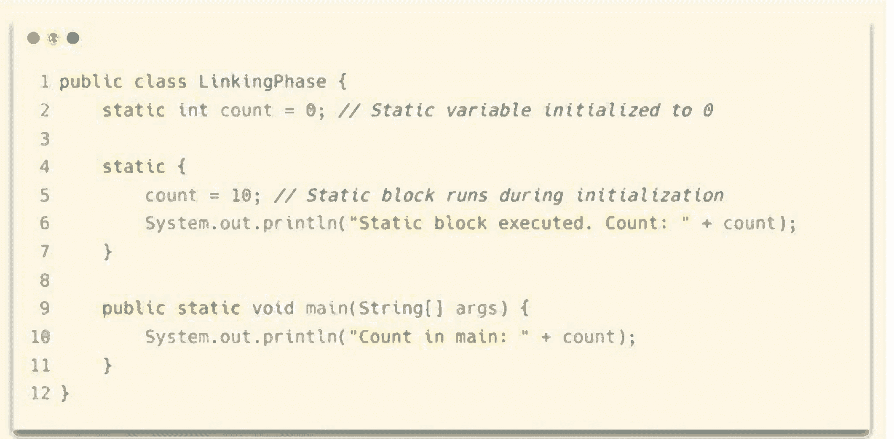
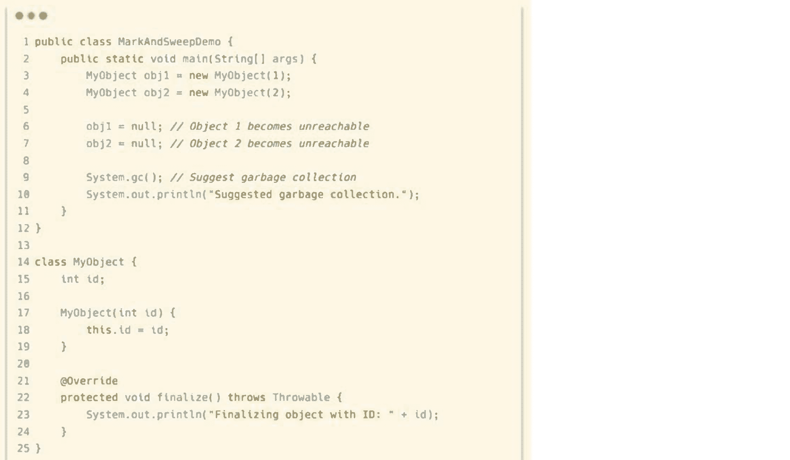
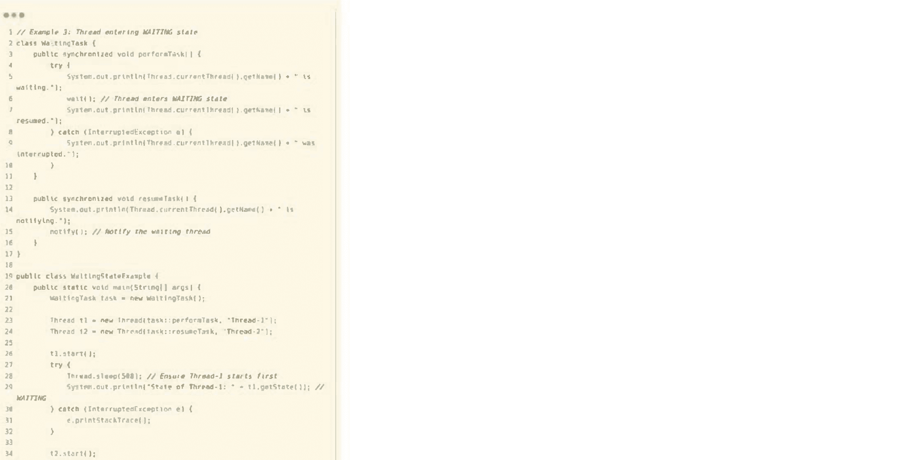

# Java 秘密：高性能与可扩展性


# 第一部分

本书旨在为所有希望提升 Java 开发技能的读者提供参考。尽管作者已尽力确保信息的准确，但无法保证完全无错误。如果书中发现任何错误或遗漏，出版者及作者对这些错误不承担责任。

这不仅涵盖了 Java 的基础原理，还通过真实世界的示例和实战项目深入探讨了高级技术。

本书是多年 Java 开发领域中学习、实验和工作的结晶。每一章的设计都力求清晰、重点突出且具有实用性，将理论与可操作的见解相结合。我还包含了最佳实践和性能优化技巧，帮助你构建符合当今严苛技术标准的现代、可扩展且健壮的应用程序。

这不仅是一本技术指南，更是一份创新与优化的邀请函。它反映了我通过代码构建高效系统的热情，以及我认为学习是一场终身旅程的信念。

无论你是 Java 初学者，还是寻求提升技能的开发者，这本书都是为你编写的。我希望它能成为你的宝贵资源，在掌握 Java 性能和可扩展性特性的同时，激励你创造出卓越的软件解决方案。

## 第 1 章：了解 Java 架构

探索 Java 的核心架构，包括 `JVM`、字节码和执行模型。

Java 的核心在于其强大的架构，它允许开发者编写出平台无关、可扩展且高效的代码。要理解这种架构，我们必须探索三个组件：`Java` 虚拟机 (`JVM`)、字节码和执行模型。这些组件共同定义了 `Java` 代码如何被编译、执行和优化。

`JVM` 是“一次编写，随处运行”承诺的基石。它在 `Java` 程序和底层硬件之间充当抽象层。当开发者编写 `Java` 代码时，源代码首先被编译成一种称为字节码的中间形式。然后，`JVM` 解释或将这些字节码编译成系统处理器可以执行的机器码。

这里是一个演示整个过程的示例：

```bash
javac HelloWorld.java
```

在这条命令中，`javac` 是 `Java` 编译器，它将源代码 `HelloWorld.java` 转换为名为 `HelloWorld.class` 的字节码文件。`.class` 文件是 `JVM` 读取并执行的内容。

接下来，你可以使用 `Java` 解释器执行程序：

```bash
java HelloWorld
```

`java` 命令将 `HelloWorld.class` 文件加载到 `JVM` 中，然后运行程序。这种源代码与机器码之间的分离实现了 `Java` 的可移植性。让我们通过一个简单的“Hello World”程序的实用示例来进一步探讨：

```java
public class HelloWorld {
    public static void main(String[] args) {
        System.out.println("Hello, World!");
    }
}
```

当你运行上述程序时，`JVM` 会在后台执行多项任务。它加载类、验证字节码的正确性，并将其解释或编译为机器指令。

为了理解字节码的作用，让我们查看编译后的情况。你可以使用 `javap` 工具来反汇编 `HelloWorld` 类的字节码：

```bash
javap -c HelloWorld
```

这条命令显示了从源代码生成的字节码。示例输出如下：

```
Compiled from "HelloWorld.java"
public class HelloWorld {
  public HelloWorld();
  Code:
    0: aload_0
    1: invokespecial #1 // Method java/lang/Object.<init>():V
    4: return

  public static void main(java.lang.String[]) {
    Code:
      0: getstatic #2 // Field java/lang/System.out:Ljava/io/PrintStream;
      3: ldc #3 // String Hello, World!
      5: invokevirtual #4 // Method java/io/PrintStream.println:(Ljava/lang/String;)V
      8: return
}
```

在输出中，你可以看到如 `aload_0`、`invokespecial` 和 `getstatic` 等 `JVM` 指令。这些指令都是 `JVM` 字节码的一部分，并在运行时由 `JVM` 执行。`JVM` 字节码是特定于 `Java` 平台但独立于硬件指令。

`JVM` 通过两种方式执行字节码：解释或即时编译 (`JIT`)。当程序首次运行时，`JVM` 逐行解释字节码，这可能较慢。为了提高性能，`JVM` 使用 `JIT` 编译器将频繁执行的字节码转换为原生机器码。这使得程序运行速度快得多。

你可以通过运行一个重复执行相同方法的简单程序来观察 `JIT` 编译的效果：

```java
public class JITExample {
    public static void main(String[] args) {
        long start = System.nanoTime();
        for (int i = 0; i < 1000000; i++) {
            performCalculation();
        }
        long end = System.nanoTime();
        System.out.println("Execution Time: " + (end - start) + " nanoseconds");
    }

    private static void performCalculation() {
        int x = 0;
        for (int i = 0; i < 1000; i++) {
            x += i;
        }
    }
}
```

在这个示例中，自定义类加载器动态地加载了 `HelloWorld` 类。`Java` 的类加载机制支持分级加载和动态类加载，这对于 Web 服务器和框架等应用至关重要。

`JVM` 执行模型的另一个关键组件是垃圾回收器（`GC`）。`GC` 通过回收不再使用的对象来自动管理内存，这有助于防止内存泄漏。你可以在程序中手动触发垃圾回收器：

```java
public class GarbageCollectorExample {
    public static void main(String[] args) {
        for (int i = 0; i < 1000; i++) {
            new GarbageCollectorExample();
        }
        System.gc();
        System.out.println("Garbage Collection Triggered");
    }
}
```

在此程序中，创建了多个对象，`System.gc()` 方法请求垃圾回收器运行。然而， `JVM` 会根据其算法和内存管理需求决定何时执行垃圾回收。

`JVM` 还使用方法内联、循环展开和逃逸分析等技术优化执行过程。这些优化会自动应用，以提高代码的性能。例如，考虑以下简单方法：

```java
public class InlineExample {
    public static void main(String[] args) {
        long start = System.nanoTime();
        for (int i = 0; i < 1000000; i++) {
            inlineMethod();
        }
        long end = System.nanoTime();
        System.out.println("Execution Time: " + (end - start) + " nanoseconds");
    }

    private static void inlineMethod() {
        int x = 5 + 10;
    }
}
```

`JVM` 可能会自动内联 `inlineMethod` 方法，在编译期间将方法调用替换为其实际实现。这减少了方法调用的开销并提高了性能。

总结来说，`Java` 架构依赖于 `JVM`、字节码和先进的执行模型来提供平台独立性和高性能。`JVM` 作为运行时环境，负责解释或将字节码编译为机器码。字节码是 `Java` 程序的平台无关表示，而执行模型则确保了执行的优化和安全性。通过结合解释、`JIT` 编译、垃圾回收和运行时优化，`Java` 在不同平台上均实现了可扩展性和效率。

### 1.1 Java 架构简介

`Java` 架构概述及其在构建可扩展应用中的重要性。

`Java` 架构旨在性能、可移植性和可扩展性之间取得平衡，这使其成为构建大型应用的理想选择。其核心是 `Java` 采用多层方法，由 `Java` 虚拟机（`JVM`）、`Java` 运行环境（`JRE`）和 `Java` 开发包（`JDK`）组成。理解这些组件对于利用 `Java` 进行可扩展且高效的软件开发至关重要。

`Java` 架构的第一个元素是 `JVM`，它是 `Java` 平台独立性的基础。`JVM` 允许 `Java` 程序运行在任何操作系统或硬件上而无需修改。

当你编写 `Java` 程序时，源代码会被编译成字节码，这是一种 `JVM` 解释或编译为机器码的中间格式。

为了说明这一点，让我们从编译和运行程序的简单示例开始。首先，创建一个源文件：

```java
public class Example {
    public static void main(String[] args) {
        System.out.println("Java Architecture in Action");
    }
}
```

使用 `javac` 命令编译程序：

```bash
javac Example.java
```

这将生成一个名为 `Example.class` 的字节码文件。`.class` 文件是平台无关的，包含了可以由 `JVM` 执行的指令。使用 `java` 命令运行程序：

```bash
java Example
```

`JVM` 加载字节码并在你的机器上执行。这种抽象使得 `Java` 能够在不同平台之间保持兼容性，对于部署在多样基础设施上的可扩展应用来说是一项重要的特性。

`Java` 架构的第二个组件是 `JRE`，它包含了 `JVM` 以及执行 `Java` 程序所需的额外库。`JRE` 提供了一个 `Java` 程序可以顺利运行的运行时环境。如果你安装了 `Java` 运行时，你可以执行任何 `.class` 文件而不需要源代码。

对于较大的应用程序，`Java` 架构提供了增强可扩展性的特性。其中一个特性是多线程，它允许任务并发执行。多线程对于应用程序至关重要。

这是一个多线程程序的示例：

```java
public class MultiThreadExample implements Runnable {
    private String taskName;

    public MultiThreadExample(String taskName) {
        this.taskName = taskName;
    }

    @Override
    public void run() {
        System.out.println(taskName + " is running");
    }

    public static void main(String[] args) {
        Thread thread1 = new Thread(new MultiThreadExample("Task 1"));
        Thread thread2 = new Thread(new MultiThreadExample("Task 2"));
        thread1.start();
        thread2.start();
    }
}
```

`Java` 的架构还包含了健壮的库和框架，例如 `Java EE` 和 `Spring`，这些框架简化了企业级应用的开发。这些框架处理依赖注入、事务管理和负载均衡等任务，而这些任务对于扩展性至关重要。

使用 `Spring Boot` 框架创建 `REST API` 的示例如下：

```java
import org.springframework.boot.SpringApplication;
import org.springframework.framework.boot.autoconfigure.SpringBootApplication;
import org.springframework.web.bind.annotation.GetMapping;
import org.springframework.framework.web.bind.annotation.RequestMapping;
import org.springframework.framework.web.bind.annotation.RestController;

@SpringBootApplication
public class SpringBootExample {
    public static void main(String[] args) {
        SpringApplication.run(SpringBootExample.class, args);
    }
}

@RestController
@RequestMapping("/api")
class ApiController {
    @GetMapping("/hello")
    public String sayHello() {
        return "Hello, Scalable World!";
    }
}
```

运行此程序，你可以通过 `http://localhost:8080/api/hello` 访问 `REST API`。`Spring Boot` 框架抽象了构建可扩展 Web 服务中的许多复杂性，让开发者能够专注于业务逻辑。

`Java` 的架构还通过 `Java 9` 引入的模块系统促进了模块化。模块化有助于管理依赖并提高大型应用程序的扩展性。你可以使用 `module-info.java` 文件来定义模块：

```java
module com.example.app {
    requires java.base;
    exports com.example;
}
```

这种模块化方法允许开发者创建松耦合的组件，从而提高应用程序的可维护性和扩展性。

通过结合平台无关性、多线程、垃圾回收、分布式计算能力和强大的框架，`Java` 架构为构建可扩展的应用提供了必要的工具。`JVM` 确保了高效的执行和优化，而 `Java` 广泛的生态系统则简化了复杂、大规模系统的开发。无论运行在单机上还是跨分布式环境，`Java` 架构都能灵活调整，以满足性能和扩展性的需求。

### 1.2 Java 虚拟机 (JVM)

解释 `JVM` 在执行 `Java` 程序中的作用。

`Java` 虚拟机 (`JVM`) 是 `Java` 平台的核心组件，允许 `Java` 程序在无需修改的情况下运行在任何系统上。它作为一个抽象了硬件和操作系统的运行时环境，实现了 `Java` 的平台无关性。`JVM` 获取 `Java` 字节码，对其进行验证并执行，通过逐行解释或使用即时编译 (`JIT`) 编译将其编译为原生机器码来完成。

当你编译 `Java` 程序时，`javac` 编译器会将源代码转换为一种称为字节码的中间形式。这种字节码是平台无关的，专为由 `JVM` 执行而设计。下面的简单程序演示了这一点：

```java
public class HelloJVM {
    public static void main(String[] args) {
        System.out.println("Understanding the JVM!");
    }
}
```

使用以下命令编译此程序：

```bash
javac HelloJVM.java
```

这会创建一个名为 `HelloJVM.class` 的文件，其中包含字节码。要执行该程序，使用 `java` 命令：

```bash
java HelloJVM
```

`JVM` 在执行期间执行三项主要任务：类加载、字节码验证和执行。首先，`JVM` 通过它的`类加载器 (ClassLoader)`子系统将 `class` 文件加载到内存中。然后，它验证字节码以确保没有安全违规或损坏的指令。最后，它通过解释或 `JIT` 编译执行字节码。

要检查 `JVM` 执行的字节码，请使用 `javap` 工具。以下命令反汇编 `HelloJVM.class` 文件：

```bash
javap -c HelloJVM
```

输出显示了 `JVM` 执行的低级字节码指令：

```
Compiled from "HelloJVM.java"
public class HelloJVM {
  public HelloJVM();
  Code:
    0: aload_0
    1: invokespecial #1 // Method java/lang/Object.<init>()V
    4: return

  public static void main(java.lang.String[]) {
    Code:
      0: getstatic #2 // Field java/lang/System.out:Ljava/io/PrintStream;
      3: ldc #3 // String Understanding the JVM!
      5: invokevirtual #4 // Method java/io/PrintStream.println((Ljava/lang/String;)V
      8: return
  }
}
```


此输出揭示了 JVM 处理的内部字节码，例如 `getstatic`、`ldc` 和 `invokevirtual`，它们分别对应加载常量、打印输出和调用方法。

JVM 在内存管理方面起着至关重要的作用。Java 内存分为特定的区域：堆、栈、方法区域和本地方法栈。堆是存储对象的地方，JVM 使用`垃圾回收 (GC)`自动管理它。垃圾回收通过移除不再被引用的对象来回收内存。

这是一个观察内存管理的运行示例：

```java
public class MemoryManagement {
    public static void main(String[] args) {
        for (int i = 0; i < 1000; i++) {
            new MemoryManagement();
        }
        System.gc();
        System.out.println("Garbage Requested");
    }

    @Override
    protected void finalize() throws Throwable {
        System.out.println("Garbage collected an object");
    }
}
```

此程序创建了许多不再使用的对象，而 `System.gc()` 建议运行垃圾器。`finalize` 方法演示了对象被回收的时机。

```java
public class JITExample {
    public static void main(String[] args) {
        long startTime = System.nanoTime();
        for (int i = 0; i < 1000000000; i++) {
            calculate();
        }
        long endTime = System.nanoTime();
        System.out.println("Execution Time: " + (endTime - startTime) / 1e9 + " seconds");
    }

    static void calculate() {
        int x = 10 * 20;
    }
}
```

在该程序中，`calculate` 方法被重复执行。JIT 编译器将其识别为“热点”（hotspot）并将其编译为原生代码。结果是循环随着时间的推移执行得更快。

JVM 还支持性能分析和调试，以监控应用程序的行为。`-Xprof` 选项会生成程序的性能分析文件。运行以下命令：

```bash
java -Xprof JITexample
```

输出显示了哪些方法消耗了大部分时间，帮助你优化应用程序的关键部分。

总之，JVM 通过加载字节码、验证其完整性并通过解释或 JIT 编译高效执行，充当了 Java 应用程序的骨干。它通过垃圾回收管理内存，通过 JIT 编译器优化执行，并提供监控和调试工具。通过抽象底层系统，JVM 确保 Java 应用程序能够跨平台可靠地运行，使其成为构建高性能和可扩展应用程序的关键组件。

## 1.2.1 - JVM 组件

对 JVM 组件（如类加载器、内存区域和执行引擎）的详细解释。

Java虚拟机（JVM）分为几个组件，这些组件共同工作以高效执行 Java 程序。JVM 的三个关键组件是`类加载器（Class Loader）`、`内存区域（Memory Areas）`和`执行引擎（Execution Engine）`。这些组件确保了 Java 的平台无关性、动态类加载、内存管理和优化执行。

`类加载器`子系统是 Java 程序执行时第一个工作的组件。它的职责是将类文件加载到 JVM 中。类加载器将字节码文件（.class）加载到 JVM 并对其进行链接以执行。该过程包含三个阶段：`加载（Loading）`、`链接（Linking）`和`初始化（Initialization）`。

为了演示类加载，让我们创建一个自定义类加载器来动态加载一个类：

```java
import java.io.*;

public class CustomClassFromLoader extends ClassLoader {
    public Class<?> loadClassFromFile(String name) throws ClassNotFoundException {
        try {
            InputStream fis = new FileInputStream(name + ".class");
            byte[] bytecode = fis.readAllBytes();

            fis.close();
            return defineClass(null, bytecode, 0, bytecode.length);
        } catch (IOException e) {
            throw new ClassNotFoundException("Class not found", e);
        }
    }

    public static void main(String[] args) throws Exception {
        CustomClassLoader loader = new CustomClassLoader();
        Class<?> clazz = loader.loadClassFromFile("HelloWorld");
        Object instance = clazz.getDeclaredConstructor().newInstance();
        System.out.println("Class loaded successfully: " + clazz.getName());
    }
}
```

在这里，自定义类加载器将 `.class` 文件读取为字节流并使用 `defineClass` 方法将其加载到 JVM 中。为了测试这一点，首先创建一个简单的类：

```java
public class HelloWorld {
    public HelloWorld() {
        System.out.println("Hello from HelloWorld class");
    }
}
```

使用以下命令编译类：

```bash
javac HelloWorld.java
```

运行自定义类加载器程序来动态加载 `HelloWorld.class`：

```bash
java CustomClassLoader
```

此示例强调了类加载器在运行时动态加载类的作用，这对于模块化应用程序是基础性的。

一旦类被加载，JVM 就会在`内存区域`中为它们分配内存。JVM 内存被分为五个主要区域：`方法区域（Method Area）`、`堆（Heap）`、`栈（Stack）`、`程序计数器（PC Register）`和`原生方法栈（Native Method Stack）`。每个内存区域在程序执行中都起着至关重要的作用。

`堆（Heap）`是存储对象的区域。`方法区域（Method Area）`存储元数据、类级信息和方法字节码。局部变量和方法调用细节存储在`栈（Stack）`中，每次方法调用都会创建一个新的栈帧。

这是一个演示在堆上创建对象和在栈上进行方法调用的示例：

```java
public class MemoryExample {
    public static void main(String[] args) {
        MemoryExample example = new MemoryExample(); // 对象在堆上
        example.displayMessage();
    }

    public void displayMessage() {
        int localVar = 10; // 局部变量在栈上
        System.out.println("Heap and Stack Memory Example: " + localVar);
    }
}
```

在此示例中，`example` 对象在堆中分配了内存，而局部变量 `localVar` 和方法调用信息存储在栈中。使用以下命令运行程序：

```bash
java MemoryExample
```

执行时，JVM 为对象创建内存，并为 `main` 和 `displayMessage` 方法管理栈帧。

你可以使用 `visualvm` 监控 JVM 内存区域。

`执行引擎（Execution Engine）`是 JVM 中负责执行字节码的组件。它可以通过两种方式执行：`解释（Interpretation）`和`即时编译（JIT Compilation）`。JIT 编译器识别频繁执行的代码（热点）并将其编译为原生机器码，从而显著提高性能。例如：

```java
public class JIToptimization {
    public static void main(String[] args) {
        long startTime = System.nanoTime();
        for (int i = 0; i < 1000000000; i++) {
            performCalculation();
        }
        long endTime = System.nanoTime();
        System.out.println("Execution Time: " + (endTime - startTime) / 1e9 + " seconds");
    }

    static void performCalculation() {
        int result = 5 + 10;
    }
}
```

使用以下命令运行程序：

```bash
java JIToptimization
```

你可以启用 JIT 编译日志来观察优化：

```bash
java -XX:+PrintCompilation JIToptimization
```

JVM 还支持垃圾回收，这是内存管理的一部分。它通过回收未引用的对象来内存，确保堆的高效利用。垃圾回收由垃圾回收线程与程序执行并行执行。

这是一个观察垃圾回收运行的示例：

```java
public class GarbageCollectionDemo {
    public static void main(String[] args) {
        for (int i = 0; i < 10000; i++) {
            new GarbageCollectionDemo();
        }
        System.gc(); // 建议垃圾回收
        System.out.println("Garbage Collection Triggered");
    }

    @Override
    protected void finalize() throws Throwable {
        System.out.println("Object is garbage collected");
    }
}
```

编译并运行程序：

```bash
java GarbageCollectionDemo
```

在此程序中，创建了多个对象但没有引用。垃圾回收器删除了它们并调用 `finalize` 方法。尽管 `System.gc()` 建议垃圾回收，但 JVM 决定执行的时机。

最后，JVM 通过`原生方法栈（Native Method Stack）`支持原生方法，这允许 Java 调用用 C 或 C++ 等语言编写的非 Java（原生）代码。这对于性能敏感的操作非常有用。

这里是调用原生方法的示例：

```java
public class NativeExample {
    static {
        System.loadLibrary("nativeLib");
    }

    public native void sayHello();

    public static void main(String[] args) {
        new NativeExample().sayHello();
    }
}
```

要创建原生方法（native method），需要编写相应的 C语言实现并将其编译为共享库。使用 `javah` 工具将库链接到程序并运行：

```bash
java NativeExample
```

这种集成凸显了`原生方法栈（Native Method Stack）`在连接 Java 与原生代码以进行底层系统操作中的作用。

JVM 的组件——`类加载器（Class Loader）`、`内存区域（Memory Areas）`和`执行引擎（Execution Engine）`协同工作，以高效地加载、管理和执行 Java 程序。类加载器动态加载类，内存区域管理数据存储，而执行引擎通过 JIT 编译确保优化执行。它们共同使 JVM 成为运行可扩展和高性能 Java 程序的强大引擎。

## 1.2.2 - JVM 生命周期

描述了从程序编译到执行的生命周期。

JVM 生命周期涵盖了 Java 程序从编译、加载、验证、执行到最终终止的全过程。该生命周期确保 Java 虚拟机（JVM）能够在高效管理 Java 程序执行的同时，保持平台独立性和健健的性能。理解这一生命周期的每个阶段将帮助开发者针对可扩展性和高性能优化其应用程序。

生命周期始于**程序编译**。编写在 `java` 文件中的 源代码使用 `javac` 编译器编译成字节码。字节码是 JVM 能够理解的平台无关中间表示。考虑以下示例：

```java
public class LifecycleExample {
    public static void main(String[] args) {
        System.out.println("JVM Lifecycle Demonstration");
    }
}
```

编译此程序，请使用 `javac` 命令：

```bash
javac LifecycleExample.java
```

`javac` 编译器会生成 `.class` 文件，其中包含字节码。你可以通过列出目录内容来确认编译字节码的存在：

```bash
ls
```

输出将包含 `LifecycleExample.class` 文件。

编译完成后，JVM 生命周期的下一步是**类加载**。类加载器子系统将字节码加载到 JVM 内存中。JVM 遵循分层类加载机制，由`启动类加载器（Bootstrap Class Loader）`、`扩展类加载器（Extension Class Loader）`和`应用类加载器（Application Class Loader）`组成。

要观察类加载的过程，可以使用以下程序，它会打印特定类的类加载器：

```java
public class ClassLoaderDemo {
    public static void main(String[] args) {
        System.out.println("Class Loader of this class: " + ClassLoaderDemo.class.getClassLoader());
        System.out.println("Class Loader of String: " + String.class.getClassLoader());
    }
}
```

编译并运行程序：

```bash
javac ClassLoaderDemo.java
java ClassLoaderDemo
```

输出将显示 `ClassLoaderDemo` 类是由**应用类加载器**加载的，而 `String` 类（Java 核心类）是由用原生代码编写的**启动类加载器**加载的。

加载后，下一阶段是**字节码验证**。JVM 验证字节码是否符合 Java 的安全和可靠性约束，确保没有非法指令或类型不匹配。验证防止了恶意或损坏字节码的执行。

以下是一个使用故意错误的修改而产生的无效字节码示例：

```bash
javap -c LifecycleExample
```

使用 `javap` 工具检查 `LifecycleExample` 的字节码。如果字节码被篡改（在典型用法之外），验证器将拒绝它，JVM 将抛出 `ValidationError`。

通过验证后，**执行引擎**开始执行字节码。JVM 执行模型遵循两种方法：**解释**和**即时编译（JIT Compilation）**。最初，字节码被逐行解释，但 JIT 编译器会识别频繁执行的代码（热点）并将其编译成原生机器码以加快执行。

以下程序演示了 JIT 编译对频繁执行方法的影响：

```java
public class JITDemo {
    public static void main(String[] args) {
        long startTime = System.nanoTime();
        for (int i = 0; i < 1_000_000_000; i++) {
            addNumbers();
        }
        long endTime = System.nanoTime();
        System.out.println("Execution time: " + (endTime - startTime) / 19 + " seconds");
    }
    public static int addNumbers() {
        return 5 + 10;
    }
}
```


# JVM 字节码与执行机制详解

## 编译与执行

编译并执行程序：

```
javac JITDemo.java
java JITDemo
```

使用以下标志启用 JIT 编译日志以观察编译细节：

```
java -XX:+PrintCompilation JITDemo
```

输出将显示哪些方法被 JIT 编译器编译成了原生代码，从而提高了执行速度。

## 垃圾回收（GC）

在执行期间，JVM 还通过**垃圾回收（GC）**管理内存。GC 通过移除不再被引用的对象来回收内存，确保堆内存的高效利用。以下示例演示了 JVM 生命周期中的垃圾回收：

```java
public class GarbageCollectionLifecycle {
    public static void main(String[] args) {
        for (int i = 0; i < 10000; i++) {
            new GarbageCollectionLifecycle();
        }
        System.gc();
        System.out.println("Garbage Collection Suggested");
    }

    @Override
    protected void finalize() {
        System.out.println("Object finalized");
    }
}
```

编译并运行程序：

```
javac GarbageCollectionLifecycle.java
java GarbageCollectionLifecycle
```

## 字节码基础示例

```java
public class BytecodeExample {
    public static void main(String[] args) {
        int a = 5;
        int b = 10;
        int sum = a + b;
        System.out.println("Sum: " + sum);
    }
}
```

使用 `javac` 命令编译该程序：

```
javac BytecodeExample.java
```

`javac` 编译器会生成 `BytecodeExample.class` 文件。要查看字节码，请使用 `javap` 工具并配合 `-c` 选项，它会将字节码反汇编为人类可读的指令：

输出可能如下所示：

```
Compiled from "Bytecodeexample.Java"
public class Bytecodeexample {
  public Bytecodeexample() {
    Code:
       0: aload_0
       1: invokespecial #1      // Method java/lang/Object."<init>":()V
       4: return
  }

  public static void main(java.lang.String[] args) {
    Code:
       0: iconst_5
       1: istore_1
       2: bipush 10
       3: istore_2
       4: iload_1
       5: iload_2
       6: iadd
       7: istore_3
       8: getstatic     #2      // Field java/lang/System.out:Ljava/io/PrintStream;
      11: new           #3      // class java/lang/StringBuilder
      14: dup
      15: invokespecial #4      // Method java/lang/StringBuilder."<init>":()V
      18: ldc           #5      // String Sum: 
      20: invokevirtual #6      // Method java/lang/StringBuilder.append:(Ljava/lang/String;)Ljava/lang/StringBuilder;
      23: iload_3
      24: invokevirtual #7      // Method java/lang/StringBuilder.append:(I)Ljava/lang/StringBuilder;
      27: invokevirtual #8      // Method java/lang/StringBuilder.toString:()Ljava/lang/String;
      30: invokevirtual #9      // Method java/io/PrintStream.println:(Ljava/lang/String;)V
      33: return
  }
}
```

此输出拆解了 `main` 方法的每一条字节码指令。以下是一些关键指令的含义：

- `iconst_5`：将整数常量 `5` 压入操作数栈。
- `bipush 10`：压入整数常量 `10`。
- `iadd`：将栈中的两个整数相加。
- `istore`：将结果存储到局部变量中。
- `getstatic`：访问静态字段，例如 `System.out`。
- `invokevirtual`：调用方法，如 `println()`。

JVM 在执行期间逐行解释这些指令，或者使用 JIT 编译将它们编译为原生代码以提高性能。

## 条件语句字节码分析

为了更好地理解字节码，让我们探索一个简单的条件语句：

```java
public class ConditionExample {
    public static void main(String[] args) {
        int a = 10;
        if (a > 5) {
            System.out.println("a is greater than 5");
        } else {
            System.out.println("a is not greater than 5");
        }
    }
}
```

编译程序：

```
javac ConditionExample.java
```

反汇编字节码：

```
javap -c ConditionExample
```

输出显示了 JVM 如何处理条件语句：

| 偏移量 | 指令 |
| :--- | :--- |
| 0 | bipush 10 |
| 2 | istore_1 |
| 3 | iload_1 |
| 4 | iconst_5 |
| 5 | if_icmple 16 |
| 8 | getstatic #2 // Field java/lang/System.out:Ljava/io/PrintStream; |
| 11 | ldc #3 // String a is greater than 5 |
| 13 | invokevirtual #4 // Method java/io/PrintStream.println:(Ljava/lang/String;)V |
| 16 | goto 28 |
| 19 | getstatic #2 // Field java/lang/System.out:Ljava/io/PrintStream; |
| 22 | ldc #5 // String a is not greater than 5 |
| 24 | invokevirtual #4 // Method java/io/PrintStream.println:(Ljava/lang/String;)V |
| 27 | return |

在这里，`if_icmple` 检查 `a <= 5` 并根据结果跳转到相应的代码块。

## 循环字节码分析

接下来，让我们观察循环是如何转换为字节码的：

```java
public class LoopExample {
    public static void main(String[] args) {
        for (int i = 0; i < 3; i++) {
            System.out.println("Iteration: " + i);
        }
    }
}
```

编译程序：

```
javac LoopExample.java
```

反汇编字节码：

```
javap -c LoopExample
```

字节码将包含初始化循环、检查条件、执行循环体和增加循环变量的指令：

```
 0: iconst_0
 1: istore_1
 2: iload_1
 3: iconst_3
 4: if_icmpge 23
 7: getstatic     #2                  // Field java/lang/System.out:Ljava/io/PrintStream;
10: new           #3                  // class java/lang/StringBuilder
13: dup
14: invokespecial #4                  // Method java/lang/StringBuilder."<init>":()V
17: ldc           #5                  // String Iteration: 
19: invokevirtual #6                  // Method java/lang/StringBuilder.append:(Ljava/lang/String;)Ljava/lang/StringBuilder;
22: iload_1
23: invokevirtual #7                  // Method java/lang/StringBuilder.append:(I)Ljava/lang/StringBuilder;
26: invokevirtual #8                  // Method java/lang/StringBuilder.toString:()Ljava/lang/String;
29: invokevirtual #9                  // Method java/io/PrintStream.println:(Ljava/lang/String;)V
32: iinc          1, 1
35: goto          2
38: return
```

以下是关键指令的详细说明：

- `iconst_0`：将常量 `0` 推入操作数栈。
- `bipush 10` / `iconst_3`：将常量推入操作数栈。
- `iadd`：将操作数栈顶部的两个整数相加。
- `istore_x`：将结果存储到局部变量中。
- `getstatic`：访问 `System.out` 静态字段。
- `invokevirtual`：调用 `println` 等方法。
- `iinc`：增加局部变量（循环计数器）。
- `if_icmpge` / `goto`：控制流跳转指令。

JVM 以结构化的方式执行这些字节码。**操作数栈**用于推入和弹出数据等操作，而**局部变量表**则保存了如 `a`、`b` 和 `result` 等变量。

## 方法调用字节码分析

为了进一步探索，让我们从字节码层面查看方法调用是如何工作的：

```java
public class MethodBytecode {
    public static void main(String[] args) {
        int result = addNumbers(5, 10);
        System.out.println("Sum: " + result);
    }

    public static int addNumbers(int x, int y) {
        return x + y;
    }
}
```

编译并反汇编程序：

```
javac MethodBytecode.java
javap -c MethodBytecode
```

`addNumbers` 方法的字节码输出将包含：

```
public static int addNumbers(int, int);
  Code:
     0: iload_0
     1: iload_1
     2: iadd
     3: ireturn
```

在这里：

- `iload_0`：将第一个参数 `x` 加载到操作数栈。
- `iload_1`：加载第二个参数 `y`。
- `iadd`：将两个值相加。
- `ireturn`：将结果返回给调用方法。

在 `main` 方法中，使用 `invokestatic` 指令调用 `addNumbers`，因为它是一个静态方法。

## 条件分支字节码补充

现在考虑一个条件语句，查看字节码如何处理分支：

```java
public class ConditionalBytecode {
    public static void main(String[] args) {
        int number = 7;
        if (number > 5) {
            System.out.println("Number is greater than 5");
        } else {
            System.out.println("Number is less than or equal to 5");
        }
    }
}
```

编译并反汇编：

```
javac ConditionalBytecode.java
javap -c ConditionalBytecode
```

字节码输出包含如 `if_icmple` 等条件指令：

```
 0: bipush        7
 2: istore_1
 3: iload_1
 4: iconst_5
 5: if_icmple     16
 8: getstatic     #2                  // Field java/lang/System.out:Ljava/io/PrintStream;
11: ldc           #3                  // String Number is greater than 5
13: invokevirtual #4                  // Method java/io/PrintStream.println:(Ljava/lang/String;)V
16: goto          28
19: getstatic     #2                  // Field java/lang/System.out:Ljava/io/PrintStream;
22: ldc           #5                  // String Number is less than or equal to 5
24: invokevirtual #4                  // Method java/io/PrintStream.println:(Ljava/lang/String;)V
27: return
```

在这里：

- `if_icmple`：检查 `number` 的值是否小于或等于 5，如果真则跳转到 `else` 块。
- `goto`：当条件满足时跳过 `else` 块。

JVM 使用 `if_icmp` 和 `goto` 等**分支**指令来实现控制结构。

## 循环字节码补充示例

```java
public class LoopBytecode {
    public static void main(String[] args) {
        for (int i = 0; i < 3; i++) {
            System.out.println("Iteration: " + i);
        }
    }
}
```

编译并反汇编：

```
javac LoopBytecode.java
javap -c LoopBytecode
```

字节码包含了初始化、检查和递增循环变量的指令（结构同上文 LoopExample 示例，此处不再赘述）。

## 对象创建字节码分析

最后，让我们探索对象创建在字节码中是如何处理的：

```java
public class ObjectBytecode {
    public static void main(String[] args) {
        Object obj = new ObjectBytecode();
        System.out.println("Object created");
    }
}

class ObjectBytecode {
    public ObjectBytecode() {}
}
```

编译并反汇编：

```
javac ObjectBytecode.java
javap -c ObjectBytecode
```

`ObjectBytecode` 构造函数的字节码输出将包含：

```
public ObjectBytecode();
  Code:
     0: aload_0
     1: invokespecial #1                  // Method java/lang/Object."<init>":()V
     4: return
```

`main` 方法中对象创建的字节码片段：

```
     0: new           #2                  // class ObjectBytecode
     3: dup
     4: invokespecial #3                  // Method "<init>":()V
     7: astore_1
```

在这里：

- `new`：为新对象分配内存。
- `dup`：复制栈顶的引用。
- `invokespecial`：调用构造函数（或父类构造函数）。
- `astore`：将引用存储在局部变量中。
- `return`：从方法返回。


```java
public class Loop0Optimization {
    public static void main(String[] args) {
        int sum = 0;
        for (int i = 0; i < 10; i++) {
            sum += 2 * 5; // Constant calculation
        }
        System.out.println("Sum: " + sum);
    }
}
```

编译并运行程序：

```
javac Loop0Optimization.java
java -XX:+PrintCompilation Loop0Optimization
```

`2 * 5` 是一个常量表达式。JVM 将通过**循环不变代码移动** 对其进行优化，将常量计算移动到循环之外。这防止了不必要的重复计算，提高了效率。

JVM 还使用**逃逸分析** 来优化对象分配和内存使用。逃逸分析确定对象是否会在当前方法或线程之外使用。如果对象没有“逃逸”，JVM 可以将其在栈上而不是堆上分配，从而减少垃圾回收的开销。

以下是一个演示逃逸分析的示例：

```java
public class EscapeAnalysis {
    public static void main(String[] args) {
        long start = System.nanoTime();
        for (int i = 0; i < 1000000; i++) {
            createObject();
        }
        long end = System.nanoTime();
        System.out.println("Execution Time: " + (end - start) / 1e9);
    }

    public static void createObject() {
        Data data = new Data(10, 20);
        int result = data.x + data.y;
    }

    static class Data {
        int x, y;
        Data(int x, int y) {
            this.x = x;
            this.y = y;
        }
    }
}
```

**死代码消除** 会移除不影响程序输出的字节码。这通过消除冗余操作减少了执行开销。例如：

```java
public class DeadCodeExample {
    public static void main(String[] args) {
        int a = 10;
        int b = 20;
        int unused = a + b; // Unused code
        System.out.println("Hello, World!");
    }
}
```

编译并运行程序：

```
javac DeadCodeExample.java
java -XX:+PrintCompilation DeadCodeExample
```

JVM 消除了计算 `a + b`，因为它的结果没有被使用。死代码消除减少了不必要的计算，提升了性能。

JVM 还使用**常量折叠** 优化字节码。如果计算仅涉及常量，JVM 会在执行期间将其替换为结果。这里有一个示例：

```java
public class ConstantFolding {
    public static void main(String[] args) {
        int result = 100 * 20 * 5;
        System.out.println("Result: " + result);
    }
}
```

编译并运行程序：

```
javac ConstantFolding.java
java -XX:+PrintCompilation ConstantFolding
```

JVM 检测到 `100 * 20 * 5` 是一个常量表达式，并将其替换为预计算的结果 `10000`。这消除了运行时进行乘法的需要，节省了 CPU 周期。

通过结合这些优化——JIT 编译、方法内联、循环优化、逃逸分析、死代码消除和常量折叠——JVM 确保了 Java 应用程序高效运行并有效利用系统资源。

Java 字节码优化是在运行时动态应用的，这允许 JVM 适应应用程序的行为。这些技术允许 JVM 在平衡性能和内存使用的同时，为开发者抽象了复杂的优化过程。理解这些优化有助于开发者编写高效的代码并分析运行时性能，使 Java 成为高性能和可扩展应用程序的强大平台。

## 1.4 - Java 执行模型

讨论 Java 的执行模型，从代码编译到运行时执行。

Java 的执行模型是一个结构化过程，确保了平台无关性、效率和高性能。它始于代码编译，结束于 Java 虚拟机（JVM）管理的运行时执行。该执行模型包含了关键阶段，如源代码编译、字节码生成、类加载、验证以及使用解释或即时编译（JIT）编译进行字节码执行。每一步都有助于提高 Java 应用程序的可靠性和速度。

执行开始于 **Java 编译器** 将源代码转换为字节码。写在 `.java` 文件中的 Java 源代码使用 `javac` 编译器编译成字节码。字节码是一组与平台无关的指令，可以由 JVM 执行。

为了理解这个过程，请编写一个简单的程序：

```java
public class ExecutionModelExample {
    public static void main(String[] args) {
        System.out.println("Java Execution Model Demonstration");
    }
}
```

使用 `javac` 命令编译程序：

```
javac ExecutionModelExample.java
```

这将生成一个名为 `ExecutionModelExample.class` 的 `.class` 文件。要确认文件是否存在，请列出目录内容：

```
ls
```

在此阶段，Java 源代码已转换为字节码。

执行模型的下一步是**类加载**。当你运行 Java 程序时，JVM 使用类加载器子系统将编译后的 `.class` 文件加载到内存中。类加载器遵循层次结构：启动加载器、扩展加载器和应用加载器。

要观察加载了哪些类，请使用以下代码：

```java
public class ExecutionModelExample {
    public static void main(String[] args) {
        System.out.println("Java Execution Model Demonstration");
    }
}
```

运行程序：

```
java ExecutionModelExample
```

为了进一步演示字节码执行，让我们来看包含控制流的程序，例如条件语句和循环。JVM 通过减少不必要的分支和检查来优化此类代码。

```java
public class ControlFlowExample {
    public static void main(String[] args) {
        int value = 10;
        if (value > 5) {
            System.out.println("Value is greater than 5");
        } else {
            System.out.println("Value is less than or equal to 5");
        }

        for (int i = 0; i < 3; i++) {
            System.out.println("Iteration: " + i);
        }
    }
}
```

编译并反汇编字节码：

```
javac ControlFlowExample.java
javap -c ControlFlowExample
```

字节码输出包含了用于条件判断的 `if_icmpgt` 和用于循环控制的 `goto` 指令：

```
0: bipush     10
2: istore_1
3: iload_1
4: iconst_5
5: if_icmple 16
8: getstatic   // Field java/lang/System.out:Ljava/io/PrintStream;
11: ldc        #3 // String Value is greater than 5
13: invokevirtual #4 // Method java/io/PrintStream.println:(Ljava/lang/String;)V
16: goto       28
19: getstatic #2 // Field java/lang/System.out:Ljava/io/PrintStream;
22: ldc        #5 // String Value is less than or equal to 5
24: invokevirtual #4 // Method java/io/PrintStream.println:(Ljava/lang/String;)V
27: return
```

JVM 在执行期间通过**循环展开**和分支预测来优化循环和条件判断。

Java 执行模型的最后一部分是**垃圾回收（GC）**。JVM 通过回收堆上未使用的对象来自动管理内存。垃圾回收可以了应用程序性能并减少内存泄漏。

这是一个用于观察垃圾回收的程序：

```java
public class GarbageCollectionExample {
    public static void main(String[] args) {
        for (int i = 0; i < 10_000; i++) {
            new GarbageCollectionExample();
        }
        System.gc();
        System.out.println("Garbage Collection Triggered");
    }

    @Override
    protected void finalize() {
        System.out.println("Object finalized");
    }
}
```

编译并运行该程序：

```
javac GarbageCollectionExample.java
java -verbose:gc GarbageCollectionExample
```

`-verbose:gc` 标志会输出垃圾回收活动的详细信息：

```
[GC (System.gc()) 65536K->38912K(125952K), 0.0150117 secs]
Garbage Collection Triggered
Object finalized
```

JVM 自动管理内存并为新对象释放空间。

Java 的执行模型结合了静态编译与动态运行时优化。JVM 加载类、验证字节码以确保安全性、解释或编译代码以执行，并通过垃圾回收高效地管理内存。通过理解执行模型的每个阶段，开发者可以更好地优化代码以提高性能和可扩展性。

### 1.4.1 - 即时编译 (JIT) 编译

详细说明了 JIT 编译如何提高运行时性能。

即时编译（JIT）是 Java 虚拟机（JVM）使用的一种关键优化技术，用于提高 Java 应用程序的运行时性能。与传统的解释（JVM 逐行执行字节码）不同，JIT 在运行时将频繁执行的字节码编译为原生机器代码。这减少了开销并允许程序运行得快得多。JIT 通过在执行期间识别“热点”代码路径来动态平衡性能和资源使用。

为了观察 JIT 编译的效果，请考虑一个具有重复方法调用的简单程序：

```java
public class JITCompilationExample {
    public static void main(String[] args) {
        long start = System.nanoTime();
        for (int i = 0; i < 1_000_000_000; i++) {
            calculate();
        }
        long end = System.nanoTime();
        System.out.println("Execution time: " + (end - start) / 1e9 + " seconds");
    }

    public static int calculate() {
        return 0;
    }
}
```


```java
public class JITCompilationExample {
    public static void main(String[] args) {
        long start = System.nanoTime();
        for (int i = 0; i < 1_000_000_000; i++) {
            calculate();
        }
        long end = System.nanoTime();
        System.out.println("Execution time: " + (end - start) / 1e9 + " seconds");
    }
}
```

---

### 重新开始正式翻译全文本

```java
1 javac ControlFlowExample.java
2 javap -c ControlFlowExample
```

字节码输出包含了用于条件判断的 `if_icmpgt` 和用于循环控制的 `goto` 指令：

```
1  0: bipush     10
2  2: istore_1
3  3: iload_1
4  4: icmst     5
5  5: if_icmple 16
6  8: getstatic   // Field
java/lang/System.out:Ljava/io/PrintStream;
7  11: ldc        #3 // String Value is greater than 5
8  13: invokevirtual #4 // Method
java/io/PrintStream.println:(Ljava/lang/String;)V
9  16: goto       28
10 19: getstatic #2 // Field
java/lang/System.out:Ljava/io/PrintStream;
11 22: ldc        #5 // String Value is less than or equal to 5
12 24: invokevirtual #4 // Method
java/io/PrintStream.println:(Ljava/lang/String;)V
13 27: return
```

JVM 在执行期间通过**循环展开（loop unrolling）**和分支预测来优化循环和条件判断。

Java 执行模型的最后一部分是**垃圾回收（GC）**。JVM 通过回收堆上未使用的对象来自动管理内存。垃圾回收可以提高应用程序性能并减少内存泄漏。

这是一个用于观察垃圾回收的程序：

```
1 public class GarbageCollectionExample {
    public static void main(String[] args) {
     for (int i = 0; i < 10_000; i++) {
        new GarbageCollectionExample();
      }
      System.gc();
      System.out.println("Garbage Collection Triggered");
  }

    @Override
    protected void finalize() {
      System.out.println("Object finalized");
    }
 }
```

编译并运行该程序：

```
1 javac GarbageCollectionExample.java
2 java -verbose:gc GarbageCollectionExample
```

`-verbose:gc` 标志会输出垃圾回收活动的详细信息：

```
1 [GC (System.gc()) 65536K->38912K(125952K), 0.0150117 secs]
2 Garbage Collection Triggered
3 Object finalized
```

JVM 自动管理内存并为新对象释放空间。

Java 的执行模型结合了静态编译与动态运行时优化。JVM 加载类、验证字节码以确保安全性、解释或编译代码以执行，并通过垃圾回收高效地管理内存。通过理解执行模型的每个阶段，开发者可以更好地优化代码以提高性能和可扩展性。

### 1.4.1 - 即时编译 (JIT) 编译

详细说明了 JIT 编译如何提高运行时性能。

即时编译（JIT）是 Java 虚拟机（JVM）使用的一种关键优化技术，用于提高 Java 应用程序的运行时性能。与传统的解释（JVM 逐行执行字节码）不同，JIT 在运行时将频繁执行的字节码编译为原生机器代码。这减少了开销并允许程序运行得快得多。JIT 通过在执行期间识别“热点”代码路径来动态平衡性能和资源使用。

为了观察 JIT 编译的效果，请考虑一个具有重复方法调用的简单程序：

```java
public class JITCompilationExample {
    public static void main(String[] args) {
        long start = System.nanoTime();
        for (int i = 0; i < 1_000_000_000; i++) {
            calculate();
        }
        long end = System.nanoTime();
        System.out.println("Execution time: " + (end - start) / 1e9 + " seconds");
    }
}
```

```
1 java -XX:+PrintCompilation DeadCodeEliminationExample
```

JIT 编译器删除了未使用的计算 `a + b`，因为它对程序的输出没有影响。这减少了运行时开销并提高了效率。

JIT 编译还应用了**常量折叠**（constant folding），这是一种在运行时预计算常量表达式的优化手段。它消除了冗余计算。

考虑以下程序：

```
1 public class ConstantFoldingExample {
2   public static void main(String[] args) {
3     int result = 50 * 20 * 2;
4     System.out.println("Result: " + result);
5   }
6 }
```

编译该程序：

```
1 javac ConstantFoldingExample.java
```

运行程序：

```
1 java ConstantFoldingExample
```

JIT 编译器将 `50 * 20 * 2` 替换为预先计算的结果 `2000`。这节省了运行时处理时间并提高了效率。


JIT 编译是 JVM 的一项强大功能，可以在运行时优化字节码的执行。通过识别频繁执行的代码路径，JIT 动态将它们编译为原生机器码，显著提升了性能。方法内联、循环展开、逃逸分析、死代码消除和常量折叠等技术允许 JVM 高效地执行 Java 程序，同时为开发者抽象了复杂性。JIT 确保了 Java 兼具可移植性与近原生的性能，适用于高性能和可扩展的应用程序。

### 1.4.2 - 垃圾回收

探索垃圾回收机制及其对内存管理的影响。

Java 中的垃圾回收（GC）是一种自动内存管理过程，用于回收不再被引用的对象所占内存。这使得开发者能够专注于应用程序逻辑，而无需显式地释放内存。JVM 处理垃圾回收，确保内存的高效利用并防止内存泄漏。然而，理解垃圾回收的工作原理及其对性能的影响，对于构建可扩展且高效的应用程序至关重要。

JVM 将内存分为若干区域：`堆`（heap）和`非堆`（non-heap）区域。堆是分配对象的地方，并进一步分为`新生代`（Young Generation）、`老年代`（Old Generation (Tenured)）和`永久代`（Java 8+ 中为元空间 Metaspace）。垃圾回收主要关注回收堆中未使用的对象。

要理解 GC 如何工作，可以从一个创建许多对象的简单程序开始：

```java
public class GCDemo {
    public static void main(String[] args) {
        for (int i = 0; i < 10000; i++) {
            new GCDemo(); // 创建对象
        }
        System.gc(); // 建议垃圾回收
        System.out.println("Garbage Collection Triggered");
    }

    @Override
    protected void finalize() {
        System.out.println("Object is being garbage collected");
    }
}
```

编译该程序：

```bash
javac GCDemo.java
```

开启垃圾回收详情并运行程序：

```bash
java -verbose:gc GCDemo
```

`verbose:gc` 标记显示有关 GC 事件的信息：

```text
[GC (System.gc())] 65536K->38912K(125952K), 0.0150326 secs
Object is being garbage collected
Garbage Collection Triggered
```

在这里：

- `System.gc()` 调用建议执行 GC，但 JVM 决定何时实际执行。
- `finalize()` 方法在正在被垃圾回收的对象上被调用。

堆被分为`新生代`和`老年代`：

1. **新生代**：新创建的对象分配在这里。它进一步分为 `Eden` 区域（存放新对象）和两个`存活区`（Survivor Spaces，S0 和 S1），用于存活 Minor GC（新生 GC）的对象。
2. **老年代**：在新生代中生存时间足够的对象会被提升到这里。Major GC（全 GC）会清理老年代。

运行以下程序以观察 Minor GC 和 Major GC 的工作：

```java
public class GCRegionsDemo {
    public static void main(String[] args) {
        for (int i = 0; i < 1_000_000; i++) {
            byte[] data = new byte[1024]; // 分配内存
        }
        System.out.println("Memory Allocation Done");
    }
}
```

带有 GC 详情编译并运行程序：

```bash
java -Xms10M -Xmx10M -XX:+PrintGCDetails GCRegionsDemo
```

`-Xms` 和 `-Xmx` 选项将初始和最大堆大小设置为 10MB。`-XX:+PrintGCDetails` 标记提供了详细的 GC 日志：

```text
[GC (Allocation Failure) [PSYoungGen: 8192K->1024K(9216K)] 8192K->4352K(9728K), 0.0010542 secs]
[Full GC (System.gc())] [OldGen: 3328K->4352K(51200K)]
```

JVM 提供了几种 GC 算法：

| 收集器 | 描述 | 使用场景 |
| :--- | :--- | :--- |
| Serial | 单线程 | 小型应用 |
| Parallel | 多线程 | 高吞吐量 |
| G1 GC | 基于区域 | 大内存，平衡延迟 |
| ZGC / Shenandoah | 并发 | 超低延迟 |

让我们探索一个产生老年代对象的程序：

```java
import java.util.ArrayList;
import java.util.List;

public class OldGenerationDemo {
    public static void main(String[] args) {
        List<byte[]> list = new ArrayList<>();
        for (int i = 0; i < 1000; i++) {
            byte[] data = new byte[1024 * 1024]; // 分配 1MB
            list.add(data);
            if (i % 10 == 0) {
                list.clear(); // 定时释放内存
            }
        }
        System.out.println("Old Generation Demo Complete");
    }
}
```

编译并运行程序：

```bash
javac OldGenerationDemo.java
java -Xms50M -Xmx50M -XX:+PrintGCDetails OldGenerationDemo
```

GC 日志输出显示提升到老年代的对象：

```text
[GC (Allocation Failure) 40960K->10240K(51200K), 0.0123456 secs]
[GC concurrent-mark-end, 0.0056782 secs]
```

总结来说，Java 垃圾回收机制通过识别和回收未使用的对象来自动管理内存。JVM 提供了多种 GC 算法——Serial GC、Parallel GC、G1 GC、ZGC 和 Shenandoah——根据应用程序需求优化内存管理。通过监控 GC 行为并理解堆分区（新生代和老年代），开发者可以精细调整应用程序以获得最佳性能和可扩展性。

## 1.5 - Java 运行环境 (JRE)

解释 Java 运行环境的组件和功能。

**Java 运行环境 (JRE)** 为执行 Java 提供了所需的环境。它是 Java 平台的一部分，由 Java 虚拟机 (JVM)、核心库和基本工具组成。JDK（Java 开发工具包）用于开发 Java 程序，而 JRE 仅专注于运行这些程序。理解 JRE 的组件及其工作原理可以确保 Java 应用程序能够在跨平台高效运行。

JRE 由三个主要部分组成：

1. **Java 虚拟机 (JVM)：** 解释并执行 Java 字节码的引擎。
2. **核心 Java 库：** 一组用于输入/输出、工具类、集合、并发等的预写类和库。
3. **支持文件：** 运行 Java 程序所需的配置文件、属性文件和其他资源。

为了演示 JRE 的功能，让我们从一个基础的 Java 程序开始：

```java
public class HelloJRE {
    public static void main(String[] args) {
        System.out.println("Java Runtime Environment Demonstration");
    }
}
```

使用 Java 编译器 `javac` 编译程序：

```bash
javac HelloJRE.java
```

编译过程生成一个名为 `HelloJRE.class` 的字节码文件。该文件包含可以由 JVM 执行的平台无关指令。

要运行程序，使用 `java` 命令，它是 JRE 的一部分：

```bash
java HelloJRE
```

JRE 提供了必要的组件（如 JVM 和核心库）来加载并执行 `HelloJRE.class` 文件。

### JRE 中的核心 Java 库

JRE 中的核心库在执行 Java 应用程序方面起着至关重要的作用。它们包含了用于以下的重要包：

- 输入/输出 (`java.io`)
- 工具类 (`java.util`)
- 集合 (`java.util.Collection`)
- 并发 (`java.util.concurrent`)
- 网络 (`java.net`)

以下是一个使用核心库执行文件输入/输出的示例：

```java
import java.io.File;
import java.io.FileWriter;
import java.io.IOException;

public class FileIODemo {
    public static void main(String[] args) {
        try {
            File file = new File("example.txt");
            FileWriter writer = new FileWriter(file);
            writer.write("This file is created using JRE core libraries.");
            writer.close();
            System.out.println("File written successfully: " + file.getAbsolutePath());
        } catch (IOException e) {
            e.printStackTrace();
        }
    }
}
```

编译并运行程序：

```bash
javac FileIODemo.java
java FileIODemo
```

该程序使用 `java.io` 库创建并写入名为 `example.txt` 的文件。JRE 确保必要的类（`File`、`FileWriter`）在运行时加载。

### JVM 在 JRE 中的作用

**JVM** 是 JRE 的关键组件，负责解释和执行 Java 字节码。它执行类加载、字节码验证以及使用解释或即时编译 (JIT) 进行执行等任务。

要观察 JVM 的作用，可以使用以下命令启用详细的执行日志：

```bash
java -verbose:class HelloJRE
```

该命令会打印程序执行期间 JVM 加载的所有类：

```text
[Loaded java.lang.Object from /path/to/rt.jar]
[Loaded java.lang.String from /path/to/rt.jar]
[Loaded HelloJRE from file:/path/to/HelloJRE.class]
Java Runtime Environment Demonstration
```

在这里，JVM 加载了所需的类，如 `java.lang.Object`、`java.lang.String` 以及用户定义的类 `HelloJRE`。

### JRE 中的内存管理

JRE 包含了用于管理的垃圾回收。垃圾回收识别并移除不再被引用的对象，确保内存的高效利用。以下程序演示了垃圾回收的运行：

```java
public class MemoryManagementDemo {
    public static void main(String[] args) {
        for (int i = 0; i < 10000; i++) {
            new MemoryManagementDemo();
        }
        System.gc(); // 建议垃圾回收
        System.out.println("Garbage collection suggested.");
    }

    @Override
    protected void finalize() {
        System.out.println("Object is being garbage collected.");
    }
}
```

编译并运行程序：

```bash
javac MemoryManagementDemo.java
java -verbose:gc MemoryManagementDemo
```

`-verbose:gc` 标志显示详细的垃圾回收日志。你将观察到指示内存回收和调用 `finalize` 的消息：

```text
[GC (System) 12345K->67890K(100000K), 0.0010000 secs]
...
Object is being garbage collected.
Garbage collection suggested.
```

### JRE 中的网络功能

JRE 通过 `java.net` 包提供了强大的网络支持。以下示例演示了如何使用 `URL` 和 `URLConnection` 类从网页获取内容：

```java
import java.io.BufferedReader;
import java.io.InputStreamReader;
import java.net.URL;

public class NetworkingDemo {
    public static void main(String[] args) {
        try {
            URL url = new URL("https://www.example.com");
            BufferedReader reader = new BufferedReader(new InputStreamReader(url.openStream()));
            String line;
            while ((line = reader.readLine()) != null) {
                System.out.println(line);
            }
            reader.close();
        } catch (Exception e) {
            e.printStackTrace();
        }
    }
}
```

编译并运行程序：

```bash
javac NetworkingDemo.java
java NetworkingDemo
```

此程序从网页中获取并打印内容，展示了 JRE 的网络能力。

Java 运行时环境（JRE）结合了 JVM、核心库和支持文件，以便高效地执行 Java 应用程序。JVM 负责字节码执行和垃圾回收，而核心库则为 I/O、集合、并发和网络提供了基本功能。通过理解 JRE 及其组件，开发者可以确保其 Java 应用程序在不同平台上无缝运行，提供高性能和可扩展性。

## 1.6 - Java 开发工具包 (JDK)

详细介绍了 JDK 中包含的工具和库。

**Java 开发工具包 (JDK)** 是用于构建 Java 应用程序的软件开发环境。它包含了编译、调试和运行 Java 程序所必需的工具、库和实用程序。JDK 包含 **Java 编译器 (`javac`)**、**Java 虚拟机 (JVM)**、核心库以及各种用于简化开发流程的命令行工具。通过理解 JDK 中的工具和库，开发者可以高效地开发高性能且可扩展的 Java 应用程序。

### Java 编译器 (`javac`)

Java 编译器将源代码（`.java` 文件）转换为平台无关的字节码（`.class` 文件）。它是开发过程的起点。这是一个示例程序：

```java
public class HelloJDK {
    public static void main(String[] args) {
        System.out.println("Hello from the JDK!");
    }
}
```

将文件保存为 `HelloJDK.java` 并使用 `javac` 工具进行编译：

```bash
javac HelloJDK.java
```

如果成功，编译器将在相同目录下生成 `HelloJDK.class`。使用以下命令验证其存在性：

```bash
ls
```

使用 `java` 命令运行程序：

```bash
java HelloJDK
```

输出：

```text
Hello from the JDK!
```

### Java 归档工具 (`jar`)

`jar` 工具将多个类文件、资源和元数据打包成单个 Java 归档 (JAR) 文件。JAR 文件简化了应用程序的部署和发布。

以下是创建 JAR 文件的示例：

1. 编译程序：

```java
public class JarExample {
    public static void main(String[] args) {
        System.out.println("Running from a JAR file");
    }
}
```

编译程序：

```bash
javac JarExample.java
```


- 2. 创建一个清单文件 (`manifest.txt`) 来指定主类：

```
Main-Class: JarExample
```

- 3. 将类文件打包成 JAR：

```bash
jar cfm JarExample.jar manifest.txt JarExample.class
```

- `c` 创建 JAR。
- `f` 指定文件名。
- `m` 包含清单文件。

- 4. 运行 JAR 文件：

```bash
java -jar JarExample.jar
```

输出：

```
Running from a JAR file
```

`jar` 工具允许将 Java 程序封装成可分发的归档。

### Java 调试器 (`jdb`)

`jdb` 工具用于调试 Java 程序。它允许开发者设置断点、检查变量并控制程序执行。

以下是一个调试程序的示例：

```java
public class DebugExample {

    public static void main(String[] args) {

        int a = 5;

        int b = 10;

        int sum = a + b;

        System.out.println("Sum: " + sum);

    }

}
```

- 1. 启用调试信息编译程序：

```bash
javac -g DebugExample.java
```

- 2. 使用 `jdb` 开始调试：

```bash
jdb DebugExample
```

- 3. 在 `jdb` 中使用以下命令：

- `stop at DebugExample:5` 在第 5 行设置断点。
- `run` 开始程序执行。
- `print a` 打印变量 `a` 的值。
- `step` 逐行单步代码。
- `cont` 继续执行。

示例会话：

```
> stop at DebugExample:5
> run
> print a
5
> print b
10
> step
> cont
```

`jdb` 工具允许开发者在开发过程中交互式地调试问题。

### Java 文档工具 (`javadoc`)

`javadoc` 工具根据 Javadoc 风格编写的 Java 源代码生成 HTML 文档。文档帮助开发者理解和维护代码。

以下是添加 Javadoc 注释的示例：

```java
/**

 * 一个简单的 Javadoc 演示

 * 此方法两个两个相加。

 * @param a 第一个整数

 * @param b 第二个整数

 * @return a 和 b 的和

 */

public class DocExample {

    public static int add(int a, int b) {

        return a + b;

    }

    public static void main(String[] args) {

        System.out.println("Sum: " + add(5, 10));

    }

}
```

等待，OCR 文本的代码错乱了，根据逻辑流修正了结构：

使用以下命令生成文档：

```bash
javadoc -d docs DocExample.java
```

- `d docs` 指定文档的输出目录。

打开 `docs` 目录下的 `index.html` 文件查看生成的文档。

### Java 编译器 API

JDK 包含了 Java 编译器 API，允许开发者通过编程编译代码。这对于动态编译非常有用。

这是一个示例：

```java
import javax.tools.JavaCompiler;

import javax.tools.ToolProvider;

public class CompilerExample {

    public static void main(String[] args) {

        JavaCompiler compiler = ToolProvider.getSystemJavaCompiler();

        int result = compiler.compile(null, null, null, "HelloJDK.java");

        if (result == 0) {

            System.out.println("Compilation successful!");

        } else {

            System.out.println("Compilation failed.");

        }

    }

}
```

编译程序：

```bash
javac CompilerExample.java
```

运行程序：

```bash
java CompilerExample
```

输出：

```
Compilation successful!
```

### 监控工具：`jstat` 和 `jconsole`

JDK 提供了用于监控性能的工具。

#### jstat

`jstat` 工具监控 JVM 统计信息如垃圾回收。

运行以下程序：

```java
public class MonitorExample {

    public static void main(String[] args) throws InterruptedException {

        for (int i = 0; i < 10000; i++) {

            // 模拟工作

        }

        Thread.sleep(10000);

    }

}
```

编译并运行：

```bash
javac MonitorExample.java
java MonitorExample
```

找到运行程序的进程 ID (PID)：

```bash
jps
```

监控垃圾回收：

```bash
jstat -gc <PID> 1000
```

`jstat` 工具每秒打印 GC 活动和内存使用情况。

#### jconsole

`jconsole` 工具提供了一个图形界面来监控 JVM。

启动 `jconsole`：

```bash
jconsole
```

选择运行进程以监控 CPU 使用率、内存消耗和垃圾回收活动。

### Java Shell (`jshell`)

`jshell` 工具提供交互式的 REPL（读取-执行-打印循环）环境用于测试 Java 代码。

启动 `jshell`：

```bash
jshell
```

交互式运行代码：

```
jshell> int x = 5;
jshell> int y = 10;
jshell> System.out.println(x + y);
15
```

`jshell` 工具非常适合原型设计和 Java 代码实验。

...属性。

3. **应用类加载器 (Application Class Loader)**：从应用程序 classpath（用户定义的代码和库）加载类。

为了观察类加载器的工作原理，让我们从一个简单的程序开始，打印不同类的类加载器：

```java
1 public class ClassLoaderDemo {

2     public static void main(String[] args) {

3         // 打印此类的类加载器

4         System.out.println("Class Loader of ClassLoaderDemo: " + 
            ClassLoaderDemo.class.getClassLoader());

5

6         // 打印 Java 核心类的类加载器

7         System.out.println("Class Loader of String: " + 
            String.class.getClassLoader());

8

9         // 打印外部库的类加载器

10        try {

11            Class<?> externalClass = Class.forName("java.sql.Driver");

12            System.out.println("Class Loader of java.sql.Driver: " + 
                externalClass.getClassLoader());

13        } catch (ClassNotFoundException e) {

14            e.printStackTrace();

15        }

16    }

17 }
```

编译并运行该程序：

```
1 javac ClassLoaderDemo.java
2 java ClassLoaderDemo
```

示例输出：

```
1 Class Loader of ClassLoaderDemo:
   jdk.internal.loader.ClassLoaders$AppClassLoader
2 Class Loader of String: null
3 Class Loader of java.sql.Driver: null
```

在这里：

- `ClassLoaderDemo` 类由**应用类加载器**加载。
- `String` 类是 Java 核心库的一部分，由**启动类加载器 (Bootstrap Class Loader)** 加载。
- 像 `java.sql.Driver` 的类也由启动类加载器加载。

**委托模型 (delegation model)** 确保类加载器在尝试加载类本身之前，首先将加载请求委托给其父加载器。这防止了类的重复定义并确保了核心类优先加载。

### 自定义类加载器示例

你可以通过扩展 `ClassLoader` 类并重写 `findClass` 方法来创建自定义类加载器。这允许你从自定义位置动态加载类。

以下是一个自定义类加载器的示例：

1. 编写 `CustomClassLoader` 类：

```java
import java.io.File;

import java.io.FileInputStream;

import java.io.IOException;

public class CustomClassLoader extends ClassLoader {

    private String classpath;

    public CustomClassLoader(String classpath) {

        this.classpath = classpath;

    }

    @Override

    protected Class<?> findClass(String name) throws ClassNotFoundException {

        try {

            // 将 .class 文件读入字节数组

            String fileName = classpath + File.separator +

                name.replace('.', File.separatorChar) + ".class";

            FileInputStream input = new FileInputStream(fileName);

            byte[] bytecode = input.readAllBytes();

            input.close();

            // 定义并返回类

            return defineClass(name, bytecode, bytecode.length);

        } catch (IOException e) {

            throw new ClassNotFoundException("Class not found: " + name, e);

        }

    }

}
```

2. 编写 `TestCustomClassLoader` 类进行测试：

```java
public class TestCustomClassLoader {

    public static void main(String[] args) throws Exception {

        // 指定包含 .class 文件的目录

        String classpath = "/path/to/classes"; // 替换为实际目录

        CustomClassLoader loader = new CustomClassLoader(classpath);

        // 动态加载类

        Class<?> loadedClass = loader.loadClass("HelloWorld");

        Object instance =

        loadedClass.getDeclaredConstructor().newInstance();

        System.out.println("Class Loaded: " + loadedClass.getName());

        System.out.println("Class Loader: " +

        loadedClass.getClassLoader());

    }

}
```

3. 编写将被加载的 `HelloWorld` 类：

```java
public class HelloWorld {

  public HelloWorld() {

      System.out.println("Hello from HelloWorld class!");

  }

}
```

编译 `HelloWorld` 类：

```
1 javac HelloWorld.java
```

编译后的 `HelloWorld.class` 文件放在单独的目录中，例如 `/path/to/classes`。

使用你的自定义类加载器运行程序：

```
1 javac CustomClassLoader.java TestCustomClassLoader.java
2 java TestCustomClassLoader
```

输出：

```
1 Hello from HelloWorld class!
2 Class Loaded: HelloWorld
3 Class Loader: CustomClassLoader@1b6d3586
```

在这个示例中：

- `CustomClassLoader` 从指定目录动态加载了 `HelloWorld` 类。
- 这演示了如何绕过默认委托机制并从自定义源加载类。

### 使用 `Class.forName` 在运行时加载类

`Class.forName()` 方法允许你在运行时动态加载类。它对于需要动态行为的框架和应用程序特别有用。

这里有一个示例：

```java
public class DynamicLoadingExample {

    public static void main(String[] args) {

        try {

            // 使用 Class.forName 动态加载类

            Class<?> loadedClass = Class.forName("java.util.ArrayList");

            System.out.println("Class Loaded: " + loadedClass.getName());

            System.out.println("Class Loader: " + loadedClass.getClassLoader());

        } catch (ClassNotFoundException e) {

            e.printStackTrace();

        }

    }

}
```

```java
public class LoadingPhase {

    public static void main(String[] args) {

        // Application class

        System.out.println("Class Loader of this class: " + LoadingPhase.class.getClassLoader());

        // Core Java class

        System.out.println("Class Loader of String class: " + String.class.getClassLoader());

        // Extension class

        System.out.println("Class Loader of javax.crypto.Cipher: " + javax.crypto.Cipher.class.getClassLoader());

    }

}
```

编译并运行程序：

```
1 javac LoadingPhase.java
2 java LoadingPhase
```

输出：


# Class Loader of this class:

`jdk.internal.loader.ClassLoaders$AppClassLoader`

# Class Loader of String class: `null`

# Class Loader of javax.crypto.Cipher:

`jdk.internal.loader.ClassLoaders$PlatformClassLoader`

- **应用程序类加载器 (Application Class Loader)** 加载用户定义的类（`LoadingPhase`）。
- **启动类加载器 (Bootstrap Class Loader)** 加载核心 Java 类（例如 `String`），并表示为 `null`。
- **平台类加载器 (Platform Class Loader)** 加载扩展类，如 `javax.crypto.Cipher`。

## 第 2 章：链接

**链接 (Linking)** 阶段为加载的类执行做准备。它包含三个子步骤：

- **验证 (Verification)**：确保字节码是有效的并符合 JVM 规范。
- **准备 (Preparation)**：为静态变量分配内存并用默认值初始化它们。
- **解析 (Resolution)**：将字节码中的符号引用替换为类、方法和字段的实际引用。

为了观察准备阶段，考虑以下带有静态变量的程序：



```java
public class LinkingPhase {

    static int count = 0; // 静态变量初始化为0

    static {
        count = 10; // 静态块在初始化期间运行
        System.out.println("Static block executed. Count: " + count);
    }

    public static void main(String[] args) {
        System.out.println("Count in main: " + count);
    }
}
```

编译并运行程序：

```bash
javac LinkingPhase.java
java LinkingPhase
```

输出：

```text
Static block executed. Count: 10
Count in main: 10
```

在这里：

- 在**准备**期间，`count` 变量被初始化为默认值 `0`。
- 静态块在**初始化 (Initialization)** 阶段运行，将 `count` 设置为 `10`。

**验证** 步骤确保字节码不违反安全规则，例如非法访问内存或无效的方法调用。如果字节码无效，JVM 会在运行时抛出 `VerifyError`。

## 第 3 章：初始化

**初始化 (Initialization)** 阶段是类加载过程的最后一步。在此阶段：

1. 静态变量被赋予它们的显式值。
2. 静态块（`static {}`）按照它们在类中出现的顺序执行。

JVM 仅在以下情况下初始化一个类：

- 第一次被引用时。
- 访问静态字段或方法时。

为了观察类初始化，创建一个包含多个静态块和一个静态方法的程序：

```java
public class InitializationPhase {

    static int x = 5;

    static {
        System.out.println("Static Block 1: x = " + x);
        x = 18;
    }

    static {
        System.out.println("Static Block 2: x = " + x);
    }

    public static void display() {
        System.out.println("Static Method: x = " + x);
    }

    public static void main(String[] args) {
        System.out.println("Main Method Starts");
        display();
    }
}
```

编译并运行程序：

```bash
javac InitializationPhase.java
java InitializationPhase
```

输出：

```text
Static Block 1: x = 5
Static Block 2: x = 18
Main Method Starts
Static Method: x = 18
```

在这里：

- 当类初始化时，两个静态块按顺序执行。
- 在静态初始化完成后调用 `display()` 方法。

**初始化** 阶段确保在访问类中的任何方法或字段之前，所有静态变量和块都已执行。

## 使用 `Class.forName` 进行动态加载

`Class.forName()` 方法在运行时动态加载并初始化一个类。它通常用于根据配置加载类的框架中。

这是一个动态类加载的示例：

```java
public class DynamicLoading {

    static {
        System.out.println("Static Block in DynamicLoading");
    }

    public static void main(String[] args) {
        try {
            Class<?> clazz = Class.forName("DynamicLoading");
            System.out.println("Class Loaded: " + clazz.getName());
        } catch (ClassNotFoundException e) {
            e.printStackTrace();
        }
    }
}
```

编译并运行程序：

```bash
javac DynamicLoading.java
java DynamicLoading
```

输出：

```text
Static Block in DynamicLoading
Class Loaded: DynamicLoading
```

# Class Loader of String: `null`

# Class Loader of Object: `null`

`null` 结果表示**启动类加载器 (Bootstrap Class Loader)**加载了 `String` 和 `Object` 类。由于它是用原生代码实现的，因此启动类加载器不表示为普通的 Java 对象。

### 扩展（平台）类加载器

**扩展类加载器**（在 Java 9+ 中重命名为**平台类加载器**）从 `lib/ext` 目录或由系统属性 `java.ext.dirs` 指定的目录加载类。它从扩展 JVM 功能的扩展库中加载类。

以下示例演示了哪个类加载器加载了 `javax.crypto` 包中的类：

```java
import javax.crypto.Cipher;

public class ExtensionLoaderExample {
    public static void main(String[] args) {
        // 从扩展库加载一个类并打印它的 Class Loader
        System.out.println("Class Loader of javax.crypto.Cipher: " + 
            Cipher.class.getClassLoader());
    }
}
```

编译并运行程序：

```bash
javac ExtensionLoaderExample.java
java ExtensionLoaderExample
```

输出：

```text
Class Loader of javax.crypto.Cipher:
   jdk.internal.loader.ClassLoaders$PlatformClassLoader
```

在这里：

- **平台类加载器**加载了 `javax.crypto.Cipher` 类。
- 它负责从扩展库和特定的包加载类。

### 应用程序（系统）类加载器

**应用程序类加载器**从应用程序的类路径加载类。这包括用户定义的类、第三方库以及运行时指定的其他资源。

以下是观察应用程序类加载器的示例：

```java
public class ApplicationLoaderExample {
    public static void main(String[] args) {
        // 加载当前类并打印它的 Class Loader
        System.out.println("Class Loader of ApplicationLoaderExample: " + 
            ApplicationLoaderExample.class.getClassLoader());

        // 从库中加载一个类（可选）
        try {
            Class<?> clazz = Class.forName("java.util.ArrayList");
            System.out.println("Class Loader of ArrayList: " + 
                clazz.getClassLoader());
        } catch (ClassNotFoundException e) {
            e.printStackTrace();
        }
    }
}
```

编译并运行程序：

```bash
javac ApplicationLoaderExample.java
java ApplicationLoaderExample
```

输出：

```text
Class Loader of ApplicationLoaderExample:
   jdk.internal.loader.ClassLoaders$AppClassLoader
Class Loader of ArrayList: null
```

在这里：

- **应用程序类加载器**加载了 `ApplicationLoaderExample` 类。
- `java.util` 的一部分 `ArrayList` 类由启动类加载器加载。

### 自定义类加载器

你可以通过创建**自定义类加载器**来扩展类加载器的功能。这对于动态从非标准位置（如外部文件、网络位置或加密源）加载类非常有用。

以下是一个自定义类加载器的示例：

#### 1. 创建自定义类加载器：

```java
import java.io.File;
import java.io.FileInputStream;

public class CustomClassLoader extends ClassLoader {

    private String classPath;

    public CustomClassLoader(String classpath) {
        this.classPath = classpath;
    }

    @Override
    protected Class<?> findClass(String name) throws ClassNotFoundException {
        try {
            String fileName = classPath + File.separator + name.replace('.', File.separatorChar) + ".class";
            FileInputStream fis = new FileInputStream(new File(fileName));
            byte[] byteCode = fis.readAllBytes();
            fis.close();
            return defineClass(name, byteCode, 0, byteCode.length);
        } catch (Exception e) {
            throw new ClassNotFoundException("Class not found: " + name);
        }
    }
}
```

#### 2. 创建一个要加载的示例类（`MyCustomClass.java`）：

```java
public class MyCustomClass {
    static {
        System.out.println("MyCustomClass loaded dynamically!");
    }
}
```

#### 3. 编译 `MyCustomClass` 并将其置于自定义目录：

```bash
javac MyCustomClass.java
mkdir classes
mv MyCustomClass.class classes/
```

#### 4. 使用 `CustomClassLoader` 加载该类：

```java
public class TestCustomClassLoader {
    public static void main(String[] args) {
        try {
            String path = "classes/";
            CustomClassLoader loader = new CustomClassLoader(path);
            Class<?> clazz = loader.loadClass("MyCustomClass");

            System.out.println("Class Loaded: " + clazz.getName());
            System.out.println("Class Loader: " + clazz.getClassLoader());
        } catch (Exception e) {
            e.printStackTrace();
        }
    }
}
```

编译并运行程序：

```bash
javac TestCustomClassLoader.java
java TestCustomClassLoader
```

输出：

```text
MyCustomClass loaded dynamically!
Class Loaded: MyCustomClass
Class Loader: CustomClassLoader@...
```

## 堆内存（Heap Memory）示例

```bash
javac HeapMemoryDemo.java
java -Xmx50M -Xms50M -verbose:gc HeapMemoryDemo
```

- `-Xmx50M` 将最大堆大小设置为 50 MB。
- `-Xms50M` 将初始堆大小设置为 50 MB。
- `-verbose:gc` 打印垃圾回收详情。

示例输出：

```text
[GC (Allocation Failure) 20480K->10240K(51200K), 0.0101234 secs]
Added 1,000,000 items to the list
```

这显示了当内存分配失败时新生代（Young Generation）的垃圾回收活动。堆是动态管理的，垃圾回收器会移除未使用的对象。

## 栈内存（Stack Memory）示例

栈内存用于方法调用帧、局部变量和对象引用。每次方法调用都会创建一个新的栈帧。当方法结束时，栈帧会被移除。

这里是一个栈内存运行的示例：

```java
public class StackMemoryDemo {
    public static void main(String[] args) {
        methodA();
    }

    public static void methodA() {
        int x = 10;
        methodB();
    }

    public static void methodB() {
        int y = 20;
        System.out.println("Stack memory example");
    }
}
```

编译并运行该程序：

```bash
javac StackMemoryDemo.java
java StackMemoryDemo
```

输出：

```text
Stack memory example
```

在此程序中：

- `methodA` 和 `methodB` 创建它们自己的栈帧。
- 局部变量 `x` 和 `y` 存储在各自的栈帧中。
- 一旦 `methodB` 执行完毕，它的栈帧就会移除。

如果程序超过了栈内存限制，将抛出 `StackOverflowError`。为了模拟这一点，请创建一个无限递归的程序：

```java
public class StackOverflowDemo {
```


## StackOverflowError 示例

```java
public class StackOverflowDemo {
    public static void main(String[] args) {
        recurse();
    }

    public static void recurse() {
        recurse(); // 无限递归
    }
}
```

编译并运行该程序：

```bash
javac StackOverflowDemo.java
java StackOverflowDemo
```

输出：

```
Exception in thread "main" java.lang.StackOverflowError
```

程序失败是因为栈内存空间耗尽了。

## 元空间示例

Metaspace 存储类元数据、方法信息和运行时常量。与使用`永久代（Permanent Generation）`的旧版本不同，Metaspace 会根据类的加载和卸载动态增长。

这里有一个动态加载类以观察 Metaspace 使用情况的程序：

```java
import java.util.ArrayList;

public class MetaspaceDemo {
    public static void main(String[] args) {
        ArrayList<Class<?>> loadedClasses = new ArrayList<>();
        try {
            for (int i = 0; i < 10000; i++) {
                loadedClasses.add(Class.forName("java.lang.String"));
            }
            System.out.println("Loaded classes: " + loadedClasses.size());
        } catch (ClassNotFoundException e) {
            e.printStackTrace();
        }
    }
}
```

带有 Metaspace 限制编译并运行该程序：

```bash
javac MetaspaceDemo.java
java -XX:MaxMetaspaceSize=50M -XX:+PrintGCDetails MetaspaceDemo
```

- `-XX:MaxMetaspaceSize` 将最大 Metaspace 大小设置为 50 MB。

Metaspace 根据类加载活动动态增长。如果 Metaspace 超过其限制，将抛出 `OutOfMemoryError`。

## 程序计数器（PC）寄存器示例

PC 寄存器存储方法中下一个要执行的指令的地址。虽然它由 JVM 自动管理，但它对于执行字节码指令至关重要。

这里是一个示例：

```java
public class PCRegisterDemo {
    public static void main(String[] args) {
        int result = add(5, 10);
        System.out.println("Result: " + result);
    }

    public static int add(int a, int b) {
        return a + b;
    }
}
```

编译并运行该程序：

```bash
javac PCRegisterDemo.java
java PCRegisterDemo
```

输出：

```
Result: 15
```

PC 寄存器在 `add` 方法被调用和返回时跟踪指令指针。

## 内存管理中的垃圾回收

垃圾回收是 Java 内存模型的重要部分。它回收未使用的对象占用的内存以确保高效的内存使用。

这里是一个观察垃圾回收的示例：

```java
import java.util.ArrayList;

public class GarbageCollectionDemo {
    public static void main(String[] args) {
        ArrayList<Object> list = new ArrayList<>();
        for (int i = 0; i < 10000; i++) {
            list.add(new Object());
        }
        list.clear(); // 使对象符合 GC 条件
        System.gc();
    }
}
```

## 栈内存分配

**栈** 用于存储方法调用的栈帧、局部变量以及对象的引用。每次方法调用都会创建一个新的栈帧，该栈帧在方法执行结束时被移除。

这里是一个演示栈内存分配的示例：

```java
public class StackMemoryExample {
    public static void main(String[] args) {
        int result = addNumbers(5, 10);
        System.out.println("Result: " + result);
    }

    public static int addNumbers(int a, int b) {
        int sum = a + b; // 局部变量存储在栈中
        return sum;
    }
}
```

编译并运行该程序：

```bash
javac StackMemoryExample.java
java StackMemoryExample
```

输出：

```
Result: 15
```

在此程序中：

- `addNumbers` 方法创建了一个包含局部变量 `a`、`b` 和 `sum` 的栈帧。
- 方法返回结果，并在执行结束时移除该栈帧。

每次方法调用都会将栈帧推入栈中，并在方法完成后从栈中弹出。

## 堆与栈的区别（示例）

要理解堆内存和栈内存的区别，请观察以下程序：

```java
public class HeapVsStack {
    static class Data {
        int value;
        Data(int value) {
            this.value = value;
        }
    }

    public static void main(String[] args) {
        // 栈内存：基本数据类型
        int x = 10;
        int y = 20;

        // 堆内存：对象
        Data obj1 = new Data(100);
        Data obj2 = new Data(200);

        System.out.println("Stack variables: x = " + x + ", y = " + y);
        System.out.println("Heap objects: obj1.value = " + obj1.value + ", obj2.value = " + obj2.value);
    }
}
```

编译并运行该程序：

```bash
javac HeapVsStack.java
java HeapVsStack
```

输出：

```
Stack variables: x = 10, y = 20
Heap objects: obj1.value = 100, obj2.value = 200
```

- 变量 `x` 和 `y` 存储在栈内存中，因为它们是基本类型。
- 对象 `obj1` 和 `obj2` 存储在堆内存中，它们的引用存储在栈中。

这种区别表明基本类型和引用使用栈内存，而对象使用堆内存。

## 栈溢出错误

栈的大小在运行时定义。如果程序由于深度递归或过多的方法调用超过了可用的栈空间，就会发生 `StackOverflowError`。

这里有一个示例：

```java
public class StackOverflowExample {
    public static void main(String[] args) {
        recursiveCall();
    }

    public static void recursiveCall() {
        recursiveCall(); // 无限递归
    }
}
```

编译并运行该程序：

```bash
javac StackOverflowExample.java
java StackOverflowExample
```

输出：

```
Exception in thread "main" java.lang.StackOverflowError
```

程序失败的原因是递归方法 `recursiveCall` 持续添加栈帧而没有终止，最终耗尽了栈内存。

要增加栈的大小，可以使用 `-Xss` 标志：

```bash
java -Xss2M StackOverflowExample
```

这会将栈的大小设置为 2 MB，可能会允许更深层的递归。

## 堆中的垃圾回收

垃圾回收器会回收堆中不再引用的对象的内存。这里有一个观察垃圾回收的示例：

```java
public class GarbageCollectionHeap {
    static class ExampleObject {
        @Override
        protected void finalize() {
            System.out.println("Object finalized and garbage collected");
        }
    }

    public static void main(String[] args) {
        for (int i = 0; i < 10000; i++) {
            new ExampleObject(); // 在堆中创建对象
        }
        System.gc(); // 建议垃圾回收
        System.out.println("Garbage collection suggested");
    }
}
```

编译并运行该程序：

```bash
javac GarbageCollectionHeap.java
java -verbose:gc GarbageCollectionHeap
```

示例输出：

```
Object finalized and garbage collected
Garbage collection suggested
```

这里：

- `ExampleObject` 实例在堆内存中创建。
- `System.gc()` 调用建议垃圾回收，未被使用的对象会被释放并清理。

## 线程特定的栈内存

Java 程序中的每个线程都有自己的栈内存。当创建多个线程时，每个线程使用自己的栈独立运行。

这里有一个示例：

```java
public class ThreadStackExample {
    public static void main(String[] args) {
        Runnable task = () -> {
            int x = 10;
            System.out.println(Thread.currentThread().getName() + " x = " + x);
        };

        Thread t1 = new Thread(task, "Thread-1");
        Thread t2 = new Thread(task, "Thread-2");
        t1.start();
        t2.start();
    }
}
```

编译并运行该程序：

```bash
javac ThreadStackExample.java
java ThreadStackExample
```

输出：

```
Thread-1 x = 10
Thread-2 x = 10
```

每个线程都有自己的栈，确保了局部变量不会在线程之间共享。

## 垃圾回收器类型

1. **Serial GC**（串行回收）：单线程，适用于小型应用程序。
2. **Parallel GC**（并行回收）：多线程垃圾回收，具有更高的吞吐量。
3. **G1 GC**（垃圾优先回收）：适用于具有低停顿时间的大型堆。
4. **ZGC and Shenandoah**：适用于大规模系统的低延迟收集器。

要启用 **G1 垃圾回收器**，请使用：

```bash
java -Xmx1G -Xms1G -XX:+UseG1GC -XX:+PrintGCDetails GCDemo
```

示例输出：

```
[GC pause (G1 Evacuation Pause) (young) 51200K->25600K(1048576K), 0.0156 secs]
[GC concurrent-mark-end, 0.0032 secs]
```

G1 GC 将堆划分为多个区域，并优先对垃圾最多的区域进行回收，从而最大限度地减少停顿时间。

要启用 **Parallel GC**：

```bash
java -XX:+UseParallelGC -Xmx1G -Xms1G -XX:+PrintGCDetails GCDemo
```

Parallel GC 使用多个线程进行新生代收集，提高了 CPU 密集型应用程序的吞吐量。

## 调优堆内存

堆内存调优涉及调整堆的大小和各个代的大小以优化垃圾回收性能。关键参数有：

- `-Xms`：初始堆大小。
- `-Xmx`：最大堆大小。
- `-XX:NewRatio`：新生代与老年代的比例。
- `-XX:SurvivorRatio`：Eden 区与幸存区的比例。

这里是一个触发垃圾回收的程序示例：

```java
import java.util.ArrayList;

public class HeapTuningExample {
    public static void main(String[] args) {
        ArrayList<String> list = new ArrayList<>();
        for (int i = 0; i < 1_000_000; i++) {
            list.add("Item " + i);
        }
        System.out.println("Heap tuning completed");
    }
}
```

使用堆调优选项运行该程序：

```bash
java -Xms256M -Xmx256M -XX:NewRatio=2 -XX:SurvivorRatio=6 -XX:+PrintGCDetails HeapTuningExample
```

参数解释：

- `-Xms256M` 和 `-Xmx256M` 将堆大小设置为 256 MB。
- `-XX:NewRatio=2` 将堆的三分之一分配给新生代，三分之二分配给老年代。
- `-XX:SurvivorRatio=6` 将 Eden 区与幸存区的比例设置为 6:1。

通过观察 GC 日志，你可以确定堆设置对性能的影响，并据此调整参数。

## 使用性能分析工具检测内存泄漏

内存泄漏发生于对象不再被程序引用，但由于存在持久引用而无法被垃圾回收时。像 `VisualVM` 和 `Eclipse MAT` 这样的性能分析工具可以帮助检测此类泄漏。

这里是一个内存泄漏的示例：

```java
import java.util.ArrayList;
import java.util.List;

public class MemoryLeakExample {
    private static List<String> cache = new ArrayList<>();

    public static void main(String[] args) {
        for (int i = 0; i < 1000000; i++) {
            cache.add("Item " + i); // 持久引用导致内存泄漏
        }
        System.out.println("Memory leak demo completed");
    }
}
```

使用限制的堆大小运行程序：

```bash
java -Xmx50M -verbose:gc MemoryLeakExample
```

输出：

```
Exception in thread "main" java.lang.OutOfMemoryError: Java heap space
```


使用 `VisualVM` 分析内存使用情况：

1. 从 JDK 安装目录运行 `jvisualvm`。
2. 将 VisualVM 附加到运行中的程序。
3. 监控堆使用情况并转储（heap dump）以识别泄漏对象。

### 启用垃圾回收日志进行分析

垃圾回收日志提供了内存使用和 GC 行为的洞察。使用以下选项启用 GC 日志：

```
java -Xmx256M -Xms256M -Xlog:gc* -XX:+PrintGCDetails GCDemo
```

`Xlog:gc` 标志启用详细的 GC 日志。示例输出：

```
[2024-04-20T10:15:23.123+0000] GC pause (G1 Evacuation Pause) (young)
81920K->20480K(256M) 0.0145676 secs
```

日志包含：

- `GC Type`（GC 类型）：新生 GC、Full GC 或并发 GC。
- `Memory Before and After`（GC 前后内存）：堆的使用情况。
- `Pause Time`（停顿时间）：GC 消耗的时间。

### 减少 GC 开销

要减少垃圾回收的开销：

1. **使用合适的 GC 算法**：低停顿应用使用 G1 GC，高吞吐量使用 Parallel GC。
2. **调整代的大小**：使用 `-XX:NewRatio` 优化新生代和老年代的比例。

这里是一个触发垃圾回收的程序示例：

```java
import java.util.ArrayList;

public class HeapTuningExample {

    public static void main(String[] args) {

        ArrayList<String> list = new ArrayList<>();

        for (int i = 0; i < 1_000_000; i++) {

            list.add("Item " + i);

        }

        System.out.println("Heap tuning completed");

    }

}
```

使用堆调优选项运行程序：

```
java -Xms256M -Xmx256M -XX:NewRatio=2 -XX:SurvivorRatio=6 -XX:+PrintGCDDetails HeapTuningExample
```

参数解释：

- `-Xms256M` 和 `-Xmx256M` 将堆大小设置为 256 MB。
- `-XX:NewRatio=2` 将堆的三分之一分配给新生代，三分之二分配给老年代。
- `-XX:SurvivorRatio=6` 将 Eden 区与幸存区的比例设置为 6:1。

通过观察 GC 日志，你可以确定堆设置对性能的影响，并据此调整参数。

---

1 Attempting to read a file...

2 /your/working/directory

3 (No Exception - File Access Allowed)

安全管理器（Security Manager）强制执行定义的权限，确保不可信的代码无法访问未经授权的文件。

### 限制网络访问

你可以配置安全管理器来控制网络访问。这是一个尝试连接外部 URL 的示例程序：

```java
import java.net.URL;
import java.net.URLConnection;

public class NetworkAccessDemo {
    public static void main(String[] args) {
     try {
         URL url = new URL("http://example.com");
         URLConnection connection = url.openConnection();
         connection.connect();
        System.out.println("Connection successful!");
    } catch (Exception e) {
        e.printStackTrace();
    }
 }
}
```

在无限制的情况下编译并运行程序：

```
javac NetworkAccessDemo.java
java NetworkAccessDemo
```

现在创建一个策略文件 (`network.policy`) 来阻止所有网络访问：

```
grant {
    // No permissions granted
};
```

使用安全管理器运行程序：

```
java -Djava.security.manager -Djava.security.policy=network.policy NetworkAccessDemo
```

输出：

```
java.security.AccessControlException: access denied
```

在这里，安全管理器阻止了程序建立任何网络连接。

### 用于代码完整性的代码签名

代码签名确保代码的真实性和完整性。它使用数字签名来验证代码未被篡改。

1. **生成密钥库**：

```
keytool -genkeypair -alias mykey -keystore mykeystore.jks -keyalg RSA -keysize 2048 -validity 365
```

2. **签名 JAR 文件**：

为你的程序创建一个 JAR 文件：

```
jar -cvf signed-demo.jar FileAccessDemo.class
```

使用生成的密钥库对 JAR 文件签名：

```
jarsigner -keystore mykeystore.jks -signedjar signed-demo-signed.jar signed-demo.jar mykey
```

3. **验证签名的 JAR**：

```
jarsigner -verify -verbose -certs signed-demo-signed.jar
```

成功的验证确保了代码已签名且未被更改过。

### 使用 `java.security` 包

Java 在 `java.security` 包中提供了用于哈希、加密和安全随机数生成等加密操作的 API。

以下是一个生成安全随机数的示例：

```java
import java.security.SecureRandom;

public class SecureRandomDemo {

    public static void main(String[] args) {

        SecureRandom secureRandom = new SecureRandom();

        int randomValue = secureRandom.nextInt(100);

        System.out.println("Secure random number: " + randomValue);

    }

}
```

编译并运行程序：

```
javac SecureRandomDemo.java
java SecureRandomDemo
```

输出（示例）：

```
Secure random number: 42
```

`SecureRandom` 类生成密码学强度的随机值，这对于安全敏感型应用至关重要。

### 使用 MessageDigest 进行哈希

哈希通过将输入转换为固定大小的哈希值来确保数据完整性。Java 的 `MessageDigest` 类支持 SHA-256 等算法。

以下是一个生成 SHA-256 哈希的示例：

```java
import java.security.MessageDigest;

public class HashingDemo {
    public static void main(String[] args) throws Exception {
        String data = "Sensitive Data";
        MessageDigest digest = MessageDigest.getInstance("SHA-256");
        byte[] hash = digest.digest(data.getBytes());

        System.out.println("SHA-256 Hash:");
        for (byte b : hash) {
            System.out.printf("%02x", b);
        }
    }
}
```

编译并运行程序：

```
javac HashingDemo.java
java HashingDemo
```

输出：

```
SHA-256 Hash:
eb59f98a55f9e3f1b4e648ea3c32c94d502ed4847af032dfbf52fa7116a8e5b
```

SHA-256 哈希确保了数据完整性，因为对输入的任何微小改变都会产生完全不同的哈希。

### 使用 AES 加密

**Java Crypto架构 (JCA)** 支持使用 AES 算法进行对称加密。

以下是一个使用 AES 加密解密数据的示例：

```java
import javax.crypto.Cipher;
import javax.crypto.KeyGenerator;
import javax.crypto.SecretKey;

public class AesEncryptionDemo {
    public static void main(String[] args) throws Exception {
         KeyGenerator keyGen = KeyGenerator.getInstance("AES");
         keyGen.init(256);
         SecretKey key = keyGen.generateKey();
         Cipher cipher = Cipher.getInstance("AES");
         cipher.init(Cipher.ENCRYPT_MODE, key);
         byte[] encrypted = cipher.doFinal("Hello World".getBytes());
         System.out.println("Encrypted: " + java.util.Base64.getEncoder().encodeToString(encrypted));
         cipher.init(Cipher.DECRYPT_MODE, key);
         byte[] decrypted = cipher.doFinal(encrypted);
         System.out.println("Decrypted: " + new String(decrypted));
    }
}
```

---

```
java.security.AccessControlException: access denied
```

Security Manager 阻止了文件访问，因为没有授予任何权限。

### 授予文件读取权限

要允许读取文件，请按如下更新策略文件（`file-read.policy`）：

```
grant {
  permission java.io.FilePermission "test.txt", "read";
};
```

再次运行程序：

```
java -Djava.security.manager -Djava.security.policy=file-read.policy FileReaderExample
```

输出：

```
File Content: Hello, Java Security!
```

更新后的策略文件授予了 `test.txt` 的读取权限。`java.io.FilePermission` 指定了文件名和操作（`read`）。

### 限制网络访问

你可以使用 `java.net.SocketPermission` 类来控制网络权限。这里是一个尝试连接到 URL 的示例程序：

```java
import java.net.URL;
import java.net.URLConnection;

public class NetworkExample {
    public static void main(String[] args) {
     try {
         URL url = new URL("http://example.com");
         URLConnection connection = url.openConnection();
         connection.connect();
        System.out.println("Network connection successful!");
    } catch (Exception e) {
        e.printStackTrace();
    }
 }
}
```

编译程序：

```
javac NetworkExample.java
```

在无限制的情况下运行程序：

```
java NetworkExample
```

输出：

```
Network connection successful!
```

现在通过创建一个策略文件（`network-deny.policy`）来限制网络访问：

```
grant {
  // 没有网络权限
};
```

使用 Security Manager 运行程序：

```
java -Djava.security.manager -Djava.security.policy=network-deny.policy NetworkExample
```

输出：

```
java.security.AccessControlException: access denied ("java.net.SocketPermission" "example.com:80" "connect,resolve")
```

Security Manager 阻止了连接，因为没有授予任何网络权限。

要仅向特定 URL 授予网络访问，请更新策略文件（`network-allow.policy`）：

```
grant {
    permission java.net.SocketPermission "example.com:80", "connect,resolve";
};
```

再次运行程序：

```
java -Djava.security.manager -Djava.security.policy=network-allow.policy NetworkExample
```

输出：

```
Network connection successful!
```

该策略文件仅授予 `example.com` 端口 `80` 的网络连接权限。

### 限制系统属性访问

系统属性（如用户目录或 Java 版本）也可以被限制。这里有一个访问系统属性的示例程序：

```java
public class PropertyExample {
     public static void main(String[] args) {
         System.out.println("User Directory: " + System.getProperty("user.dir"));
         System.out.println("Java Version: " + System.getProperty("java.version"));
  }
}
```

编译程序：

```
javac PropertyExample.java
```

在无限制的情况下运行程序：

```
java PropertyExample
```

输出：

```
User Directory: /your/working/directory
Java Version: 17.0.1
```

现在创建一个限制系统属性访问的策略文件（`property-deny.policy`）：

```
grant {
    // 没有系统属性权限
};
```

使用 Security Manager 运行程序：

```
java -Djava.security.manager -Djava.security.policy=property-deny.policy PropertyExample
```

输出：


```
1 java.security.AccessControlException: access denied
("java.util.PropertyPermission "user.dir" "read")
```

Security Manager 阻止了对系统属性的访问。要授予特定属性的权限，请更新策略文件（`property-allow.policy`）：

```
1 grant {
2     permission java.util.PropertyPermission "user.dir", "read";
3 };
```

再次运行程序：

```
1 java -Djava.security.manager -Djava.security.policy=property-allow.policy
PropertyExample
```

输出：

```
1 User Directory: /your/working/directory
2 Java Version: null
```

只有 `user.dir` 属性是可以访问的，其他属性仍受限制。

### 授予所有权限

在某些情况下，你可能想为特定代码授予所有权限，例如受信任的应用。在策略文件（`all.policy`）中使用 `AllPermission` 类：

```
1 grant {
2     permission java.security.AllPermission;
3 };
```

使用此策略文件运行任何程序：

```
1 java -Djava.security.manager -Djava.security.policy=all.policy
FileReaderExample
```

```
1 Security Manager enabled
2 java.security.AccessControlException: access denied
("java.io.FilePermission" "test.txt" "read")
```

Security Manager 阻止了文件访问，因为没有显式授予任何权限。

### 使用策略文件配置权限

要允许特定操作（例如读取文件），你必须创建一个授予必要权限的策略文件。

1. 创建一个名为 `file-permission.policy` 的策略文件，内容如下：

```
1 grant {
2   permission java.io.FilePermission "test.txt", "read";
3 };
```

2. 使用策略文件运行程序：

```
1 java -Djava.security.manager -Djava.security.policy=file-permission.policy SecurityManagerDemo
```

输出：

```
1 Security Manager enabled
2 File Content: Hello, Security Manager!
```

该策略文件授予了读取 `test.txt` 文件的权限，允许程序成功执行。

### 限制网络访问

Security Manager 可以通过检查 `java.net.SocketPermission` 来控制网络操作。以下是一个连接到外部 URL 的示例：

```java
import java.net.URL;
import java.net.URLConnection;

public class NetworkAccessDemo {
    public static void main(String[] args) {
        System.setSecurityManager(new SecurityManager());
        System.out.println("Security Manager enabled");

        try {
            URL url = new URL("http://example.com");
            URLConnection connection = url.openConnection();
            connection.connect();
            System.out.println("Connection successful!");
        } catch (Exception e) {
            e.printStackTrace();
        }
    }
}
```

1. 编译程序：

```
1 javac NetworkAccessDemo.java
```

2. 创建一个名为 `network-permission.policy` 的策略文件以允许对 `example.com` 的访问：

3. 使用 Security Manager 和策略文件运行程序：

```
1 java -Djava.security.manager -Djava.security.policy=network-permission.policy NetworkAccessDemo
```

输出：

```
1 Security Manager enabled
2 Connection successful!
```

如果策略文件中没有包含该权限，将发生以下异常：

```
1 java.security.AccessControlException: access denied
("java.net.SocketPermission "example.com:80" "connect,resolve")
```

这确保了网络访问被控制并限制特定的主机和端口。

### 限制系统属性

Security Manager 还可以使用 `java.util.PropertyPermission` 限制对系统属性的访问。以下是一个读取 `user.dir` 属性的示例：

```java
public class SystemPropertyDemo {
    public static void main(String[] args) {
        System.setSecurityManager(new SecurityManager());
        System.out.println("Security Manager enabled");
        
        try {
            String userDir = System.getProperty("user.dir");
            System.out.println("User Directory: " + userDir);
        } catch (SecurityException e) {
            e.printStackTrace();
        }
    }
}
```

1. 编译程序：

```
1 javac SystemPropertyDemo.java
```

2. 创建名为 `property-permission.policy` 的策略文件：

```
1 grant {
2 permission java.util.PropertyPermission "user.dir", "read";
3 };
```

3. 使用 Security Manager 和策略文件运行程序：

```
1 java -Djava.security.manager -Djava.security.policy=property-permission.policy SystemPropertyDemo
```

输出：

```
1 Security Manager enabled
2 User Directory: /your/current/directory
```

如果没有策略文件，程序在尝试访问属性时将抛出 `SecurityException`。

### 为信任代码授予所有权限

在某些场景下，你可能想向信任的代码授予所有权限。这可以通过 `AllPermission` 类来实现。

1. 创建一个名为 `all-permission.policy` 的策略文件：

```
1 grant {
2   permission java.security.AllPermission;
3 };
```

2. 使用策略文件运行程序：

```
1 java -Djava.security.manager -Djava.security.policy=all-permission.policy SecurityManagerDemo
```

输出：

```
1 Security Manager enabled
2 File Content: Hello, Security Manager!
```

`AllPermission` 类授予了程序对所有资源的无限制访问。

### 动态设置权限

Java 还允许你在运行时动态使用自定义的 **Security Manager** 设置权限。以下是一个覆盖默认检查的示例：

```java
import java.security.Permission;

public class CustomSecurityManager extends SecurityManager {
    @Override
    public void checkPermission(Permission perm) {
        if ("read".equals(perm.getActions()) &&
            perm.getName().endsWith("test.txt")) {
            throw new SecurityException("Custom Security Manager: File read blocked");
        }
    }

    public static void main(String[] args) {
        System.setSecurityManager(new CustomSecurityManager());
        System.out.println("Security Manager enabled");

        try {
            java.nio.file.Files.readString(java.nio.file.Path.of("test.txt"));
        } catch (Exception e) {
            e.printStackTrace();
        }
    }
}
```

1. 编译程序：

```
1 javac CustomSecurityManager.java
```

2. 运行程序：

```
1 java CustomSecurityManager
```

输出：

```
1 Security Manager enabled
2 java.lang.SecurityException: Custom Security Manager: File read blocked
```

自定义 `SecurityManager` 拦截了读取操作并抛出了 `SecurityException`。

### 管理器功能总结

1. **文件权限**：使用 `java.io.FilePermission` 控制读、写和执行操作。

2. **网络权限**：使用 `java.net.SocketPermission` 限制网络连接。

3. **系统属性**：使用 `java.util.PropertyPermission` 控制系统属性的访问。

4. **自定义管理器**：扩展 `SecurityManager` 以定义自定义检查。

5. **所有权限**：使用 `AllPermission` 让信任代码绕过限制。

Security Manager 确保 Java 程序在受控环境中运行。通过启用 Security Manager 并通过策略文件权限，开发者可以实施访问控制并保护资源免受未经授权的操作。

## 1.10 Java 平台无关性

Java 通过其**一次编写，到处运行**的原则实现平台无关性。这归功于 Java 的架构，它使用了 Java 虚拟机 (`JVM`)、字节码和 Java 运行时环境 (`JRE`)。Java 不将程序直接编译为针对特定机器的代码，而是产生名为**字节码**的中间格式。这种字节码可以在任何安装了 `JVM` 的机器上执行。

### 字节码和 JVM：平台无关性的核心

当 Java 程序被编译时，**javac** 编译器会将源代码转换为**字节码**。字节码是平台无关的，可以在任何 `JVM` 上运行。`JVM` 作为一个抽象层，在运行时将字节码翻译成特定的机器指令。

以下是一个演示字节码和 `JVM` 作用的示例程序：

```java
public class PlatformIndependenceDemo {
    public static void main(String[] args) {
        System.out.println("Java Platform Independence Demonstration");
    }
}
```

编译程序：

```
1 javac PlatformIndependenceDemo.java
```

`javac` 编译器生成了名为 `PlatformIndependenceDemo.class` 的字节码文件。要确认生成了字节码，请列出目录中的文件：

```
1 ls
```

你会看到 `PlatformIndependenceDemo.class` 文件。该文件包含了平台指令。

在带有 `JVM` 的任何平台上运行程序：

```
1 java PlatformIndependenceDemo
```

输出：

```
Java Platform Independence Demonstration
```

```
1 Java 平台无关性演示
```

`.class` 文件可以在 Windows、macOS 或 Linux 上执行，无需重新编译。

### 查看字节码

`javap` 工具允许你检查由 `javac` 编译器生成的字节码。这有助于你理解平台无关的字节码是如何工作的。

反汇编 `PlatformIndependenceDemo.class` 文件：

```
1 javap -c PlatformIndependenceDemo
```

输出：

```
1 public class PlatformIndependenceDemo {
2   public PlatformIndependenceDemo();
3   Code:
4     @: load_0
5     1: invokespecial #1      // Method java/lang/Object.<init>:()V
6     4: return
7
8   public static void main(java.lang.String[])
9   Code:
10    @: getstatic #2             // Field java/lang/System.out:Ljava/io/PrintStream;
11    3: ldc #3                   // String Java Platform Independence Demonstration
12    5: invokesvirtual #4      // Method java/io/PrintStream.println:(Ljava/lang/String;)V
13    8: return
14 }
```

这里：

- 字节码指令（`aload_0`、`getstatic`、`ldc`）是平台无关的。

- 这些指令由 `JVM` 执行，`JVM` 在运行时将它们转换为特定机器的代码。

### JVM 在平台无关性中的作用

`JVM` 是特定平台的，但它遵循一致的规范。每个操作系统都有自己的 `JVM` 实现，但所有 `JVM` 都能解释相同的字节码。这允许 Java 程序运行在任何机器上。

为了演示这一点，可以在一个操作系统上编译程序并在另一个操作系统上运行。

#### 第 1 步：编译程序（平台 1）

在 Linux 或 macOS 系统上：

```
javac CrossPlatformDemo.java
```

将生成 `CrossPlatformDemo.class` 文件。

#### 第 2 步：将字节码拷贝到另一个平台

将 `CrossPlatformDemo.class` 文件传输到 Windows 系统。

#### 第 3 步：运行程序（平台 2）

在 Windows 上，使用 `JVM` 执行程序：

```
1 java CrossPlatformDemo
```

输出：

```
1 Java Platform Independence Demonstration
```

程序成功运行而无需重新编译，因为 Windows 上的 `JVM` 解析了相同的字节码。

### Java 库的系统独立性

Java 标准库为 I/O、网络和多线程等常见任务提供了平台无关的 API。这些库抽象了特定平台的细节。

这是一个演示平台无关文件操作的示例程序：


# Java 平台无关性与执行模型

## Java 文件操作示例

```java
import java.io.File;

public class FileExample {
    public static void main(String[] args) {
        File file = new File("example.txt");

        try {
            if (file.createNewFile()) {
                System.out.println("File created: " + 
                    file.getAbsolutePath());
            } else {
                System.out.println("File already exists.");
            }
        } catch (Exception e) {
            e.printStackTrace();
        }
    }
}
```

编译程序：

```bash
javac FileExample.java
```

运行程序：

```bash
java FileExample
```

在 Linux 上的输出：

```text
File created: /home/user/example.txt
```

在 Windows 上的输出：

```text
File created: C:\Users\user\example.txt
```

这里：
- `File` 类抽象了特定平台的路径分隔符（Linux 上的 `/` 和 Windows 上的 `\`）。
- Java 程序保持移植性，不需要为不同的操作系统进行更改。

## 使用 `os.name` 属性进行检测

有时，某些操作需要检测操作系统。可以使用 `System.getProperty` 方法来获取特定平台的细节。

示例：

```java
public class OSDetectionExample {
    public static void main(String[] args) {
        String os = System.getProperty("os.name");
        System.out.println("Running on: " + os);

        if (os.toLowerCase().contains("win")) {
            System.out.println("This is Windows");
        } else if (os.toLowerCase().contains("mac")) {
            System.out.println("This is macOS");
        } else if (os.toLowerCase().contains("nix") || os.toLowerCase().contains("nux")) {
            System.out.println("This is Linux/Unix");
        } else {
            System.out.println("Unknown operating system");
        }
    }
}
```

编译并运行程序：

```bash
javac OSDetectionExample.java
java OSDetectionExample
```

在 Linux 上的输出：

```text
Running on: Linux
This is Linux/Unix
```

在 Windows 上的输出：

```text
Running on: Windows 10
This is Windows
```

`os.name` 属性帮助 Java 适应环境。

## 平台无关线程

Java 线程模型也是平台无关的。`Thread` 类允许开发者创建线程。

示例：

```java
public class ThreadExample {
    public static void main(String[] args) {
        Runnable task = () -> {
            System.out.println("Running thread: " + 
                Thread.currentThread().getName());
        };

        Thread thread1 = new Thread(task, "Thread-1");
        Thread thread2 = new Thread(task, "Thread-2");

        thread1.start();
        thread2.start();
    }
}
```

编译并运行程序：

```bash
javac ThreadExample.java
java ThreadExample
```

输出：

```text
Running thread: Thread-1
Running thread: Thread-2
```

## Java 如何实现平台无关性的总结

1. **编译为字节码**：Java 源代码编译为平台无关的字节码。
2. **Java 虚拟机 (JVM)**：每个平台都有一个 JVM，它将字节码转换为特定机器的代码。
3. **平台无关库**：Java 标准库抽象了特定平台的细节。
4. **编写一次，到处运行**：字节码可以在任何 JVM 上运行而无需重新编译。

---

# JVM 执行与核心机制

## JVM 在运行时将这种平台无关的字节码转换为机器码，从而实现了 Java **一次编写，到处运行** 的原则。

## Java 虚拟机 (JVM) 执行

JVM 是 Java 执行模型的核心。它加载类、验证字节码，并通过**解释执行**或为了提高性能而通过**即时编译（JIT 编译）**来执行字节码。

使用 `ClassLoader` 加载类的示例：

```java
public class ClassLoaderExample {
    public static void main(String[] args) {
        ClassLoader loader = ClassLoaderExample.class.getClassLoader();
        System.out.println("Class Loader: " + loader);
    }
}
```

编译并运行：

```bash
javac ClassLoaderExample.java
java ClassLoaderExample
```

输出：

```text
Class Loader: jdk.internal.loader.ClassLoaders$AppClassLoader
```

**应用程序 ClassLoader** 加载用户定义的类，实现了动态且平台无关的类加载。

## 内存管理与垃圾回收

Java 的内存被分为**堆（heap）**和**栈（stack）**等区域。**垃圾回收器（GC）**会自动回收未使用的对象占用的内存。

在堆和栈中分配内存的示例：

```java
public class MemoryExample {
    public static void main(String[] args) {
        int x = 10; // 栈内存
        String text = new String("Hello Heap"); // 堆内存
        System.out.println(text);
    }
}
```

编译并运行：

```bash
javac MemoryExample.java
java MemoryExample
```

输出：

```text
Hello Heap
```

使用 `verbose:gc` 标志监控垃圾回收：

```bash
java -verbose:gc MemoryExample
```

示例输出：

```text
[GC (Allocation Failure) 8192K->1024K(9728K), 0.0056782 secs]
```

这显示了 GC 活动，即回收了未使用的堆内存。

## Java 安全模型与安全管理器

Java 的安全模型使用**安全管理器（Security Manager）**和**策略文件**来强制安全执行。安全管理器限制了文件访问、网络连接和系统属性。

读取文件的示例程序：

```java
import java.nio.file.Files;
import java.nio.file.Path;

public class SecurityFileExample {
    public static void main(String[] args) {
        System.setSecurityManager(new SecurityManager());
        try {
            String content = Files.readString(Path.of("example.txt"));
            System.out.println("File Content: " + content);
        } catch (Exception e) {
            e.printStackTrace();
        }
    }
}
```

创建一个文件 `example.txt`：

```bash
echo "Hello, Secure World!" > example.txt
```

在没有权限的情况下运行程序：

```bash
java -Djava.security.manager SecurityFileExample
```

输出：

```text
java.security.AccessControlException: access denied
```

创建一个策略文件 `file-read.policy`：

```text
grant {
  permission java.io.FilePermission "example.txt", "read";
};
```

使用策略文件运行程序：

```bash
java -Djava.security.manager -Djava.security.policy=file-read.policy SecurityFileExample
```

输出：

```text
File Content: Hello, Secure World!
```

安全管理器确保只有显式允许的操作才会被执行。

## 标准库的平台无关性

Java 的标准库抽象了文件 I/O、线程和网络等操作的特定平台细节。这确保了平台无关性。

平台无关的文件 I/O 示例：

```java
import java.io.File;

public class FileExample {
    public static void main(String[] args) {
        File file = new File("example.txt");
        System.out.println("File path: " + file.getAbsolutePath());
    }
}
```

在 Linux 上运行程序：

```bash
javac FileExample.java
java FileExample
```

输出：

```text
File path: /home/user/example.txt
```

在 Windows 上运行：

```bash
java FileExample
```

输出：

```text
File path: C:\Users\user\example.txt
```

Java 抽象了文件路径分隔符和其他细节，确保了跨平台的一致性。

## 使用 JIT 编译进行性能优化

即时编译（JIT）编译器通过在运行时将字节码转换为原生机器码来提高 Java 的性能。你可以使用 `-XX:+PrintCompilation` 标志监控 JIT 编译。

示例：

```java
public class JITexample {
    public static void main(String[] args) {
        for (int i = 0; i < 1_000_000; i++) {
            calculate();
        }
    }

    public static void calculate() {
        int x = 5 * 10;
    }
}
```

带上 JIT 日志运行：

```bash
java -XX:+PrintCompilation JITexample
```

示例输出：

```text
57 1      JITexample::calculate (5 bytes)
```

方法 `calculate` 被识别为热点方法。

## 多线程与并发

Java 提供了多线程和并发的机制。创建线程的示例：

```java
public class ThreadExample {
    public static void main(String[] args) {
        Thread thread = new Thread(() -> {
            System.out.println("Thread is running");
        });
        thread.start();
    }
}
```

编译并运行：

```bash
javac ThreadExample.java
java ThreadExample
```

输出：

```text
Thread is running
```

## 关键回顾

1. JVM 在运行时将字节码转换为机器码。
2. 内存管理涉及堆和栈，并有自动垃圾回收。
3. 安全模型通过安全管理器强制执行限制。
4. 通过标准库实现了平台无关性。
5. JIT 编译通过编译热点代码来优化性能。
6. 多线程允许任务的并发执行。

---

# 垃圾回收详解

```java
public class EligibleForGC {
    public static void main(String[] args) {
        String str = new String("Memory Management");
        str = null; // The string object is now eligible for garbage collection
        System.gc();
        System.out.println("Garbage collection suggested again");
    }
}
```

通过将引用 `str` 设置为 `null`，原始的 `"Memory Management"` 对象不再有任何引用指向它，因此可以被垃圾回收。

Java 的垃圾回收器遵循多种算法来有效管理内存。常见的算法包括：

1. **标记-清除算法 (Mark-and-Sweep Algorithm)**：GC 标记仍然可及的对象，并清除未引用的对象。
2. **分代垃圾收集 (Generational Garbage Collection)**：将堆划分为新生代、老年代和永久代。新创建的对象置于新生代，在经过多次 GC 周期后会被晋升到老年代。
3. **并发标记清除 (CMS)**：与应用程序线程并发运行，以最小化停顿时间。
4. **G1 垃圾回收器**：专注于将堆拆分为多个区域（regions），为大内存提供高效的垃圾回收。

以下是一个使用 JVM 选项演示分代垃圾收集的示例：

```java
public class GenerationalGC {
    public static void main(String[] args) {
        for (int i = 0; i < 1000; i++) {
            String temp = new String("Temporary Object " + i);
        }
        System.gc();
        System.out.println("Generated objects to observe garbage collection behavior");
    }
}
```

你可以使用以下 JVM 选项来观察垃圾回收：

```bash
-XX:+PrintGCDetails -XX:+UseSerialGC
```

`-XX:+PrintGCDetails` 标志打印垃圾回收事件的详细信息。`-XX:+UseSerialGC` 选项指定串行垃圾回收器，适用于单线程环境的小型应用程序。

内存管理的另一个重要概念是**终结 (finalization)**。Java 提供了 `finalize()` 方法，该方法会在垃圾回收器移除对象之前被调用。然而，不建议依赖 `finalize()`，因为它引入了不可预测性。示例：

```java
public class FinalizeExample {
    @Override
    protected void finalize() throws Throwable {
        System.out.println("Object is being finalized and garbage collected");
    }

    public static void main(String[] args) {
        FinalizeExample obj = new FinalizeExample();
        obj = null;
        System.gc();
        System.out.println("Finalize method might be invoked");
    }
}
```


在这个示例中，重写了 `finalize()` 方法以便在对象被垃圾回收之前打印消息。但是，无法保证 `finalize()` 会立即执行，因为垃圾回收的时机是由 JVM 控制的。

当对象不再需要但仍被引用时，Java 就会发生内存泄漏。这发生在未使用的对象被无意中持有在集合、静态引用或监听器中。为了演示这一点，请考虑以下示例：

```java
import java.util.ArrayList;

public class MemoryLeakExample {
    public static void main(String[] args) {
        ArrayList<String> list = new ArrayList<>();
        while (true) {
            list.add("Memory Leak Example");
        }
    }
}
```

在这里，`ArrayList` 持续增长而不释放内存。这可能导致 `OutOfMemoryError`。为了防止此类内存泄漏，请务必确保在对象不再需要时始终正确移除对象和引用。

为了优化内存使用，Java 开发者可以使用如 `Java VisualVM`、`JConsole` 或像 `Eclipse MAT`（内存分析工具）之类的性能分析器工具。这些工具可以分析堆转储（heap dumps）、识别内存泄漏并监控垃圾回收行为。

例如，你可以使用以下 JVM 选项生成堆转储：

```bash
-XX:+HeapDumpOutOfMemoryError
```

该选项在发生 `OutOfMemoryError` 时会触发堆转储，允许你分析哪些对象正在消耗内存以及原因。

最后，开发者应该考虑使用弱引用（weak references），它允许对象在即使仍被引用的情况下也能被垃圾回收。弱引用使用 `WeakReference` 类进行管理。这里有一个示例：

```java
import java.lang.ref.WeakReference;

public class WeakReferenceExample {
    public static void main(String[] args) {
        String str = new String("Weak Reference");
        WeakReference<String> weakRef = new WeakReference<>(str);
        str = null; // Remove strong reference
        System.gc();
        if (weakRef.get() == null) {
            System.out.println("Object has been garbage collected");
        } else {
            System.out.println("Object is still alive");
        }
    }
}
```

垃圾回收周期会被提升到老年代（Old Generation），那里的垃圾回收频率更低。

这是一个实用的示例，通过模拟创建许多对象来观察垃圾回收行为：

```java
public class GenerationalMemoryDemo {
    public static void main(String[] args) {
        for (int i = 0; i < 10000; i++) {
            String temp = new String("Temporary Object " + i);
        }
        System.out.println("Objects created. Suggesting garbage collection...");
        System.gc();
    }
}
```

在这个示例中，在循环中创建了许多临时字符串对象。这些对象大部分是短命的，并留在新生年代（Young Generation）。当垃圾回收器运行时，这些临时对象会被迅速移除，释放内存。

内存管理还涉及对**内存泄漏**的理解。当对象不再需要但仍然被引用时，就会发生内存泄漏，阻止了垃圾回收。这可能导致堆占用增加，并最终引发 `OutOfMemoryError`。以下示例使用 `List` 模拟了内存泄漏：

```java
import java.util.ArrayList;

public class MemoryLeakDemo {
    public static void main(String[] args) {
        ArrayList<String> list = new ArrayList<>();
        while (true) {
            list.add("Memory Leak Example");
        }
    }
}
```

在这段代码中，`ArrayList` 会无限增长，因为它持有了永远不会移除的字符串对象的引用。随着时间的推移，应用程序将抛出 `OutOfMemoryError`。为了防止内存泄漏，开发者应该确保在对象和引用不再需要时对其进行适当的清理。

优化内存管理的一种方法是使用**弱引用**（weak references）。弱引用允许垃圾回收器在对象仍被弱引用的情况下对其回收它们。Java 中的 `WeakReference` 类有助于实现这一点：

```java
import java.lang.ref.WeakReference;

public class WeakReferenceExample {
    public static void main(String[] args) {
        String strongReference = new String("Strong Reference");
        WeakReference<String> weakReference = new WeakReference<>(strongReference);
        strongReference = null; // 移除强引用
        System.gc(); // 建议垃圾回收
        if (weakReference.get() == null) {
            System.out.println("Weak reference object has been garbage collected");
        } else {
            System.out.println("Weak reference object is still alive");
        }
    }
}
```

在这个示例中，一旦强引用移除，`WeakReference` 允许 `String` 对象被垃圾回收器回收。弱引用对于实现内存敏感型缓存非常有用，可以在需要内存时回收对象。

内存管理的另一个重要方面是监控和分析堆使用情况以识别内存问题。诸如 `Java VisualVM`、`JConsole` 和 `Eclipse MAT`（内存分析工具）等工具允许开发者监控堆内存、分析垃圾回收日志并检测内存泄漏。

要实时监控垃圾回收和堆使用，可以使用以下 JVM 选项：

```bash
-XX:+PrintGCDetails -XX:+PrintGCTimestamps
```

这些选项提供了垃圾回收事件的详细日志和时间戳，有助于诊断与内存相关的性能问题。

这是最后一个示例，展示了如何创建对象并分析垃圾回收日志：

```java
public class GCLogExample {
    public static void main(String[] args) {
        for (int i = 0; i < 10000; i++) {
            String data = new String("Data " + i);
        }
        System.gc();
        System.out.println("Garbage collection logs enabled");
    }
}
```

使用以下命令行选项运行上述代码以观察垃圾回收日志：

```bash
java -XX:+PrintGCDetails -XX:+PrintGCStamps GCLogExample
```

日志将提供关于每次垃圾回收事件释放了多少内存以及垃圾回收总耗时间的信息。通过分析这些日志，开发者可以识别内存效率低的问题并调整垃圾回收以获得更好的性能。

有效的内存管理对于构建高性能可扩展的 Java 应用程序至关重要。通过理解堆、栈和垃圾回收的工作机制，开发者可以优化内存使用，减少性能瓶颈并避免内存泄漏等常见问题。使用 VisualVM 和 JConsole 等工具进行定期监控和分析进一步有助于确保高效的内存管理。

## 2.2 - Java 内存模型 (JMM)

Java 内存结构的详细解释，包括堆、栈、方法区域和运行时常量池。

Java 内存模型（JMM）定义了 Java 虚拟机（JVM）如何组织和管理内存。Java 的内存结构确保了程序是高效、可维护且线程安全的。内存模型包含了**堆**、**栈**、**方法区域**和**运行时常量池**，每个部分在程序执行中都起着独特的作用。

**堆**是内存中最大的部分，用于存储对象。它是所有线程共享的并由垃圾回收器管理。当你使用 `new` 关键字创建对象时，它被分配在堆中。堆本身分为不同的代：新生年代（Eden 和 Survivor 空间）和老年代。对象根据其生命周期在这些区域之间移动。

**栈**（stack）内存用于存储方法调用、局部变量和引用。每个线程都有自己的栈，每当调用一个方法时，栈中就会添加一个新帧。当方法完成时，该帧会被移除。

**方法区域**（method area，在 Java 8+ 中也称为 MetSpace）存储类元数据，例如方法定义。**运行时常量池**是方法区域的一部分，持有符号引用、字面量和编译时常量。这些值在线程之间共享的。

让我们从一个基础示例开始，看看对象是如何存储在堆和栈中的：

```java
public class MemoryStructureDemo {
    static int staticVar = 10; // 类级变量

    public static void main(String[] args) {
        int localVar = 20; // 局部变量
        MyObject obj = new MyObject(); // 对象的引用
        obj.show();
    }
}

class MyObject {
    int instanceVar = 30; // 实例变量

    void show() {
        int methodVar = 40; // 局部变量
        System.out.println("Instance Variable: " + instanceVar);
        System.out.println("Method Variable: " + methodVar);
    }
}
```

在这个程序中：

1. `staticVar` 存储在方法区域，因为它类级变量。
2. `localVar` 和 `methodVar` 存储在栈中，因为它们是局部变量。
3. 使用 `new` 创建的对象分配在堆中，而引用 `obj` 位于栈中。
4. `instanceVar` 与对象一起存储在堆中。

当你执行此代码时，内存分配如下：

- `staticVar` → 方法区域
- `localVar` → 栈
- `obj` → 栈中指向堆对象的引用
- 对象 → 堆
- `instanceVar` → 堆
- `methodVar` → 栈

为了演示栈帧及其生命周期，我们来看另一个示例：

```java
public class StackFrameDemo {
    public static void main(String[] args) {
        firstMethod();
    }

    static void firstMethod() {
        int a = 10; // firstMethod 栈帧中的局部变量
        secondMethod();
    }

    static void secondMethod() {
        int b = 20; // secondMethod 栈帧中的局部变量
        System.out.println("Execution completed");
    }
}
```

在代码中，每次方法调用都会创建一个栈帧：

1. `main` 方法启动并创建其栈帧。
2. 它调用 `firstMethod`，在栈中创建一个新帧，并包含局部变量 `a`。
3. 在 `firstMethod` 内部调用了 `secondMethod`，这为 `b` 创建了另一个栈帧。
4. 一旦 `secondMethod` 完成，它的栈帧会被移除，随后是 `firstMethod`。

程序的输出将是：

```
Execution completed
```

这演示了栈帧是如何随着方法的调用和完成而不断添加和移除的。

**方法区（method area）**被所有线程共享，并包含类级元数据。静态变量、方法定义和常量都存储在这里。静态变量只初始化一次，并在全局共享。让我们观察一下静态变量的行为：

```java
public class StaticVariableDemo {
    static int staticCounter = 0;

    public static void main(String[] args) {
        incrementCounter();
        incrementCounter();
        System.out.println("Static Counter: " + staticCounter);
    }

    static void incrementCounter() {
        staticCounter++; // 静态变量存储在方法区
    }
}
```

在这里，`staticCounter` 变量存储在方法区中，它的值在方法调用之间持久存在。对 `incrementCounter` 的每次调用都会修改同一个静态变量。

该程序的输出将是：

```
Static Counter: 2
```

这证明了静态变量存储在方法区中，并在多次调用中保持其状态。

**运行时常量池（runtime constant pool）**是方法区的子集，用于存储字面量和常量。例如，程序中的字符串字面量和常量值被放在这里。为了观察这一点，请考虑以下示例：

```java
public class ConstantPoolDemo {
    public static void main(String[] args) {
        String str1 = "Java"; // 存储在运行时常量池
        String str2 = "Java"; // 常量池中同一个字面量
        String str3 = new String("Java"); // 堆内存中的新对象
        System.out.println(str1 == str2); // true - 同一常量池
        System.out.println(str1 == str3); // false - str3 是不同的堆对象
    }
}
```

在这个示例中：

1. 字面量 `Java` 存储在运行时常量池中。
2. `str1` 和 `str2` 常量池中的同一个 `Java` 字面量，因此 `str1 == str2` 结果为 `true`。
3. `new` 关键字在堆中为 `str3` 创建了一个新的字符串对象，因此 `str1 == str3` 结果为 `false`。

输出：

```
true
false
```

这强调了字符串字面量的行为与内存中显式创建的对象不同。

最后，让我们通过创建对象并观察内存分配，检查堆内存和栈内存使用的区别：

```java
public class HeapStackExample {
    public static void main(String[] args) {
        for (int i = 0; i < 1000; i++) {
            createObject();
        }
        System.out.println("Objects created and discarded");
    }

    static void createObject() {
        MyClass obj = new MyClass(); // 对象存储在堆中，引用存储在栈中
    }
}

class MyClass {
    int value = 50; // 与对象一起存储在堆中
}
```

在这段代码中：

1. 方法 `createObject` 被反复调用，每次调用都会在堆上创建一个新的 `MyClass` 对象。
2. 对象的引用仅存在于方法内部，因此一旦方法完成，引用就会从栈中移除。
3. 由于没有引用指向该对象，堆中的该对象将变为可被垃圾回收的对象。

输出：

```
Objects created and discarded
```


该程序演示了对象是如何存储在堆内存中的，而局部引用存储在栈上。一旦方法完成，堆对象就会进入可垃圾回收的状态。

Java 内存模型（JMM）提供了清晰的区域划分，允许对变量、对象和常量进行高效管理。通过理解堆、栈、方法区和运行时常量池的工作原理，开发者可以优化内存使用并避免内存泄漏、对象创建效率低下等性能问题。这些概念的实践知识有助于提高应用的扩展性，并确保内存得到有效利用。

## 2.2.1 - 堆内存 (Heap Memory)

Java 堆内存描述及其在对象存储中的作用。

Java 堆内存是程序执行期间存储对象的主要区域。堆由 Java 虚拟机（JVM）管理，供所有线程共享，并随着程序对更多内存的需求而动态增长。当使用 `new` 关键字创建对象时，它会被分配在堆中。堆内存由垃圾回收器自动管理，回收器通过移除未使用对象来释放空间。

作为 Java **分代垃圾收集（Generational Garbage Collection）**策略的一部分，堆被分为不同的代际：

1. **新生代（Young Generation）**：新创建的对象分配在这里。它包括：
   - **Eden 区**：大多数对象初始创建的地方。
   - **幸存区（Survivor Spaces S0 和 S1）**：存活初始垃圾回收的对象移动。
2. **老年代（Old Generation / Tenured）**：在多次垃圾回收周期中存活的对象移动到老年代。
3. **元空间（Metaspace，Java 8及以后）**：存储类元数据，取代了早期版本中的永久代。

这种结构允许垃圾回收器通过关注新生代中的短命对象来优化内存管理。为了模拟垃圾回收，让我们从一个基础程序开始：

```java
public class HeapExample {

    public static void main(String[] args) {

        MyObject obj1 = new MyObject();

        MyObject obj2 = new MyObject();

        System.out.println("Objects created.");

    }

}

class MyObject {

    int value = 10;

    String name = "Heap";

}
```

在这里：

当实例化 `MyObject` 时，`obj1` 和 `obj2` 引用存储在**栈**中，但每个对象的 `value` 和 `name` 字段存储在堆中。

执行后，`obj1` 和 `obj2` 引用超出范围，使得堆中的对象变为可垃圾回收。当你运行此程序时，对象会在 Eden 区创建。如果发生垃圾回收，存活的对象会被移动到幸存区。

为了观察垃圾回收和堆使用情况，你可以使用 `-Xms` 和 `-Xmx` JVM 选项设置初始和最大堆大小：

```bash
java -Xms10m -Xmx20m HeapExample
```

- `-Xms10m` 将初始堆大小设置为 10 MB。
- `-Xmx20m` 将最大堆大小设置为 20 MB。

下一个示例演示了创建过多对象时的堆耗尽：

```java
import java.util.ArrayList;
import java.util.List;

public class HeapExhaustionExample {

    public static void main(String[] args) {

        List<MyObject> list = new ArrayList<>();

        while (true) {

            list.add(new MyObject());

        }

    }

}

class MyObject {

    int[] data = new int[1000]; // 用于填充堆的大对象

}
```

在这里：

1. 持续添加带有大数组的 `MyObject` 实例，消耗堆内存。
2. 最终当堆满时，程序会抛出 `OutOfMemoryError`。

使用以下 JVM 选项运行程序可以更快触发错误：

```bash
java -Xms10m -Xmx10m HeapExhaustionExample
```

此示例强调了监控堆使用和小心创建对象以避免内存耗尽的重要性。为了分析堆使用和垃圾回收事件，可以使用这些 JVM 选项启用垃圾回收日志：

```bash
java -Xms20m -Xmx20m -XX:+PrintGCDetails -XX:+PrintGCTimestamps HeapExample
```

`-XX:+PrintGCDetails` 选项打印详细的垃圾回收日志，`-XX:+PrintGCTimestamps` 为每个事件添加时间戳。

```
1 [GC (Allocation Failure) [PSYYoungGen: 6144K->512K(9216K)] 6144K->512K(19456K), 0.0055330 secs]
```

此输出表示：

1. 在新生代（Young Generation）发生了垃圾回收事件。
2. 垃圾回收前后的堆使用情况。
3. 堆的总容量以及 GC 消耗的时间。

你也可以使用 **Java VisualVM** 实时监控堆内存，这是一个提供图形化堆使用统计的工具。要启动 VisualVM：

1. 运行程序。
2. 启动 Java VisualVM。
3. 将其附加到运行中的进程以观察内存使用。

接下来，让我们看看对象如何在堆的代际之间移动：

```java
public class ObjectLifecycleDemo {

    public static void main(String[] args) {

        for (int i = 0; i < 10000; i++) {

            MyObject obj = new MyObject();

        }

        System.gc();

        System.out.println("Suggested garbage collection.");

    }

}

class MyObject {

    int[] data = new int[1024];

}
```

在此示例中：

1. 在循环内部创建了许多 `MyObject` 实例。这些对象是短命的，并创建在 Eden 空间（Eden Space）。
2. 循环结束后，所有对象都失去了引用，使其可以被垃圾回收。
3. 存活的对象被移动到幸存区（Survivor Space），在经过多次 GC 循环后，它们会被移动到老年代（Old Generation）。

`System.gc()` 调用建议进行垃圾回收，但 JVM 决定何时执行它。

你可以使用 JVM 选项监控堆行为和各个代：

```bash
java -Xms50m -Xmx50m -XX:+UseSerialGC -XX:+PrintGCDetails ObjectLifecycleDemo
```

`-XX:+UseSerialGC` 选项强制使用串行垃圾回收器，这对于小型应用程序非常有用。

现在让我们通过重用对象来演示内存优化：

```java
public class ObjectReuseDemo {

    public static void main(String[] args) {

        for (int i = 0; i < 1000000; i++) {

            MyObject obj = ObjectFactory.getInstance();

            obj.use();

        }

        System.out.println("Reused objects to optimize heap memory.");

    }

}

class MyObject {

    void use() {

        System.out.println("Using object: " + this.hashCode());

    }

}

class ObjectFactory {

    private static final MyObject instance = new MyObject();

    public static MyObject getInstance() {

        return instance; // Reuse the same object

    }

}
```

在此示例中：

1. `ObjectFactory` 类重用同一个 `MyObject` 实例以减少堆中的对象创建。
2. 程序中使用单个共享实例，而不是创建新对象。

这种方法减少了堆内存的使用和垃圾回收开销，这对于高性能应用程序特别有用。

Java 堆内存在对象存储中起着核心作用，为运行时的对象提供动态内存分配。通过理解堆如何划分成不同的代，开发者可以更好地管理内存、优化对象创建并避免 `OutOfMemoryError`。垃圾回收日志和 VisualVM 等工具允许你监控和分析堆的使用，为应用程序性能提供见解。高效的堆管理（例如重用对象和尽量减少不必要的分配）可以使 Java 程序具有更好的扩展性和性能。

## 2.2.2 - 栈内存 (Stack Memory)

Java 栈内存描述及其在方法执行和变量存储中的作用。

Java 的栈内存在方法执行和局部变量存储中起着关键作用。与在所有线程共享的堆内存不同，栈是每个线程私有的。JVM 为每个线程创建一个新栈，每个方法调用都会向该内存中添加一个**栈帧（stack frame）**。栈帧包含方法的局部变量、方法参数和返回地址。当方法执行完毕时，其栈帧会被移除，使得栈内存既高效又快速。

栈内存以**后入先出（LIFO）**的方式运行。每次方法调用都会向栈中推入一个新帧，当方法执行完成后，该帧被弹出。这种设计确保了内存分配和释放的高效性，因为栈不需要垃圾回收。

以下示例演示了栈帧在方法执行期间是如何创建和移除的：

```java
public class StackMemoryDemo {

    public static void main(String[] args) {

        methodA();

    }

    static void methodA() {

        int a = 10; // 存储在栈中的局部变量

        methodB();

    }

    static void methodB() {

        int b = 20; // 存储在栈中的局部变量

        System.out.println("Executing methodB");

    }

}
```

在此程序中：

1. 引用 `obj` 存储在 `main` 的栈帧中。
2. 实际的 `MyObject` 实例存储在堆中。
3. `display` 方法中的 `localVar` 存储在 `display` 的栈帧中。

输出结果：


栈在方法执行和变量存储方面是非常高效的，因为内存的分配和释放随着方法的调用而自动完成。它不需要垃圾回收，因此比堆内存更快。然而，栈的大小是有限的，超过限制会导致 `StackOverflowError`。

下面的示例演示了向方法传递**基本数据类型**和**引用**：

```java
public class PassByValueDemo {

    public static void main(String[] args) {

        int primitiveValue = 10;

        MyObject obj = new MyObject();

        modifyValues(primitiveValue, obj);

        System.out.println("Primitive Value: " + primitiveValue);

        System.out.println("Object Value: " + obj.value);

    }

    static void modifyValues(int num, MyObject objRef) {

        num = 20; // 不影响原始的 primitiveValue

        objRef.value = 100; // 修改了堆内存中的对象

    }

}

class MyObject {

    int value = 50;

}
```

在这里：

1. `primitiveValue` 被传递给方法 `modifyValues`，其值被复制到方法的栈帧中。对 `num` 的更改不会影响原始变量。
2. `objRef` 是指向存储在堆中的 `MyObject` 实例的引用。对对象字段 `value` 的更改会影响原始对象。

输出将：

```
Primitive Value: 10
Object Value: 100
```

这证明了基本类型是按值传递的，而对象引用指向堆内存中的实际对象。

栈内存是 Java 执行模型的重要组成部分，确保了方法调用、局部变量和方法参数的高效存储和检索。每个线程都有自己的栈，内存随着栈帧的添加和删除而自动管理。通过理解栈内存的工作原理，开发者可以编写更好的程序，避免像 `StackOverflowError` 的递归陷阱，并有效管理局部变量和方法参数。

## 2.3 - 内存分配策略

Java 用于高效资源管理的内存分配策略。

Java 中的内存分配对于决定应用程序的性能和可扩展性起着至关重要的作用。Java 通过 JVM 提供了自动内存管理，处理对象的分配和释放。内存主要分为栈内存和堆内存。栈内存用于方法调用和局部变量，而堆内存用于对象存储。为了高效管理这些资源，Java 采用了不同的分配策略，例如**静态内存分配**、**动态内存分配**和**分代内存分配**。

让我们从一个突出栈分配与堆分配区别的示例开始：

```java
public class MemoryAllocationDemo {

    public static void main(String[] args) {

        int localVar = 10; // 栈分配

        MyObject obj = new MyObject(); // 堆分配

        obj.show();

    }

}

class MyObject {

    int value = 20; // 与对象一起存储在堆中

    void show() {

        int methodVar = 30; // 栈分配

        System.out.println("Heap value: " + value);

        System.out.println("Stack value: " + methodVar);

    }

}
```

在此程序中：

1. `localVar` 和 `methodVar` 分配在栈内存中，因为它们是局部变量。
2. `obj` 是存储在栈中的引用，但实际的 `MyObject` 实例及其字段 `value` 存储在堆内存中。

输出将：

```
Heap value: 20
Stack value: 30
```

这证明了基本类型是按值传递的，而对象引用指向堆内存中的实际对象。

### 静态内存分配

静态内存分配发生在编译时，主要用于在执行前就已知内存需求的变量。

### 动态内存分配

动态内存分配发生在运行时，当在堆上动态分配对象或数据结构的内存时发生。

```java
public class MemoryAllocationDemo {

    public static void main(String[] args) {

        int localVar = 10; // 栈分配


```java
MyObject obj = new MyObject(); // 堆分配

obj.show();

}

}

class MyObject {

    int value = 20; // 与对象一起存储在堆中

    void show() {

        int methodVar = 30; // 栈分配

        System.out.println("Heap value: " + value);

        System.out.println("Stack value: " + methodVar);

    }

}
```

在此程序中：

- 1. `localVar` 和 `methodVar` 分配在栈内存中，因为它们是局部变量。
- 2. `obj` 是存储在栈中的引用，但实际的 `MyObject` 实例及其字段 `value` 存储在堆内存中。

输出将：

```
1 Heap value: 20

2 Stack value: 30
```

### 分代内存分配

分代分配是 Java 堆策略的一部分，它将堆内存划分为不同的区域以优化垃圾回收性能。

```java
public class MemoryAllocationDemo {

    public static main(String[] args) {

        int localVarVar = 10; // 栈分配

        MyObject obj = new MyObject(); // 堆分配

        obj.show();

    }

}

class MyObject {

    int value = 20; // 与对象一起存储在堆中

    void show() {

        int methodVar = 30; // 栈分配

        System.out.println("Heap value: " + value);

        System.out.println("Stack value: " + methodVar);

    }

}
```

对象池是一种内存分配策略，通过复用对象而不是创建新实例。这种技术减少了内存开销，并提升了频繁使用对象的性能。

```java
import java.util.ArrayList;

import java.util.List;

public class ObjectPoolingDemo {

    public static void main(String[] args) {

        ObjectPool pool = new ObjectPool();

        for (int i = 0; i < 5; i++) {

            MyObject obj = pool.borrowObject();

            obj.display();

        }

        pool.returnObject(obj);

    }

}

class MyObject {

    void display() {

        System.out.println("Used object: " + this.hashCode());

    }

}

class ObjectPool {

    private List<MyObject> pool = new ArrayList<>();

    MyObject borrowObject() {

        if (pool.isEmpty()) {

            return new MyObject(); // Create new object

        }

        return pool.remove(0); // Reuse existing object

    }

    void returnObject(MyObject obj) {

        pool.add(obj); // Return object to the pool

    }

}
```

在此程序中：

- 1. 对象从池中借用，而不是动态创建。
- 2. 对象使用后会被返回池中以供复用。

输出：

```
1 Reused object: 366712642

2 Reused object: 366712642

3 Reused object: 366712642

4 Reused object: 366712642

5 Reused object: 366712642
```

对象池最小化了堆分配，减少了垃圾回收的频率并提高了性能。

### 栈分配的逃逸分析

JVM 使用`逃逸分析`来确定对象是否可以分配在栈上而不是堆上。这种优化减少了堆内存的使用。

```java
public class EscapeAnalysisDemo {

   public static void main(String[] args) {

      for (int i = 0; i < 1000000; i++) {

        allocateOnStack();

      }

      System.out.println("Escape analysis optimization.");

    }

   static void allocateOnStack() {

     Point point = new Point(1, 2); // JVM may allocate this on the stack

  }

}

class Point {

  int x, y;

  Point(int x, int y) {

      this.x = x;

      this.y = y;

  }

}
```

在此程序中：

- 1. `Point` 对象是 `allocateOnStack` 方法的局部变量。
- 2. 如果逃逸分析确定对象没有逃逸出方法，则 JVM 就可以优化此分配并将对象放置在栈上。

带启用逃逸分析运行程序：

```
java -XX:+DoEscapeAnalysis -XX:+PrintGCDetails EscapeAnalysisDemo
```

日志中缺少堆分配表明存在了栈分配优化。

内存分配策略（如静态分配、动态分配、分代分配、对象池和逃逸分析）确保了 Java 中高效的资源管理。通过理解这些策略并使用 GC 日志和 JVM 选项等工具，开发者可以优化内存使用，减少垃圾回收开销，并提高应用程序的性能和扩展性。

### 2.3.1 - 静态 vs 动态内存分配

静态与动态内存分配技术的比较。

在 Java 中，内存分配在程序执行期间变量、对象和方法的存储与访问方式中起着基础性作用。**静态内存分配**发生在编译时，并为静态变量、常量和类级元数据保留内存。**动态内存分配**发生在运行时，为堆上的对象、数组或变量分配内存。理解这些技术之间的差异允许开发者在有效管理内存资源的同时编写高效代码。

静态内存分配在**方法区**（Java 8+ 中的元空间 Metaspace）中保留内存，分配的内存贯穿整个生命周期。静态变量和类级常量使用静态内存分配。由于内存是在编译时分配的，因此速度快且不需要垃圾回收。

另一方面，动态内存分配在运行时使用 `new` 关键字在堆上分配内存。这种分配更加灵活，但引入了开销，因为它需要垃圾回收来回收未使用的内存。动态存储在堆上的对象可以具有不同的生命周期，并在线程间共享。

为了说明静态和动态内存分配之间的差异，让我们从一个涉及静态变量的示例开始：

```java
public class StaticMemoryDemo {

    static int counter = 0; // Static memory allocation

    public static void main(String[] args) {

        incrementCounter();

        incrementCounter();

        System.out.println("Counter: " + counter);

    }

    static void incrementCounter() {

        counter++; // Modifies the static variable

    }

}
```

在此程序中：

- 1. `counter` 变量被声明为 `static`，因此在方法区分配内存。
- 2. 静态变量被类的所有实例共享，并在程序生命周期内持续存在。
- 3. 内存是在编译时分配的，访问速度快。

输出：

```
Counter: 2
```

静态内存分配适用于整个程序需要的变量。让我们将其与动态分配的示例进行对比：

```java
public class DynamicMemoryDemo {

    public static void main(String[] args) {

        MyObject obj1 = new MyObject(); // Dynamic memory allocation

        MyObject obj2 = new MyObject();

        obj1.display();

    }

}

class MyObject {

    int value = 10;

    void display() {

        System.out.println("Object value: " + value);

    }

}
```

在这里：

- 1. `new` 关键字创建了 `MyObject` 实例，这些对象的内存是动态分配的。
- 2. `obj1` 和 `obj2` 存储在栈上，但对象位于堆内存中。

输出：

```
Object value: 10

Object value: 10
```

静态内存分配不需要垃圾回收速度更快。为了演示这一点，让我们对比静态变量和动态分配对象的性能：

```java
public class PerformanceComparison {

    static int staticCounter = 0; // Static memory allocation

    public static void main(String[] args) {

        long startTimeStatic = System.nanoTime();

        for (int i = 0; i < 1000000; i++) {

            staticCounter++;

        }

        long endTimeStatic = System.nanoTime();

        long startTimeDynamic = System.nanoTime();

        for (int i = 0; i < 1000000; i++) {

            MyObject obj = new MyObject();

            obj.value++;

        }

        long endTimeDynamic = System.nanoTime();

        System.out.println("Static Allocation Time: " + (endTimeStatic - startTimeStatic) + " ns");

        System.out.println("Dynamic Allocation Time: " + (endTimeDynamic - startTimeDynamic) + " ns");

    }

}

class MyObject {

    int value = 0;

}
```

在此程序中：

- 1. 第一个循环递增存储在方法区的静态变量。
- 2. 第二个循环在每次迭代中都在堆上动态创建一个新的 `MyObject`。
- 3. 由于对象创建开销，动态内存分配较慢。

示例输出如下：

```
Static Allocation Time: 1600000 ns

Dynamic Allocation Time: 45000000 ns
```

这证明了由于开销较低，静态内存分配比动态分配快得多。

静态内存分配具有局限性。它要求在编译已知内存大小，且静态变量在程序结束之前无法释放。动态内存分配通过允许在运行时分配内存克服了这些局限性。

```java
import java.util.Scanner;

public class DynamicArrayDemo {

    public static void main(String[] args) {

        Scanner scanner = new Scanner(System.in);

        System.out.print("Enter the number of elements: ");

        int n = scanner.nextInt();

        int[] dynamicArray = new int[n]; // 动态内存分配

        for (int i = 0; i < n; i++) {

            dynamicArray[i] = i * 2;

        }

        System.out.println("Dynamic Array Contents:");

        for (int num : dynamicArray) {

            System.out.print(num + " ");

        }

    }

}
```

在这个程序中：

1. 数组的大小根据用户输入在运行时确定的。
2. `dynamicArray` 的内存是在堆上动态分配的。
3. 这里无法进行静态内存分配，因为数组的大小在编译时是未知的。

示例输出：

```
Enter the number of elements: 5

Dynamic Array Contents:

0 2 4 6 8
```

动态内存分配对于需要灵活性的程序至关重要，例如在处理用户输入或可变数据大小时。

静态内存分配更适用于在应用程序生命周期内固定的常量或变量。让我们来看另一个静态分配的场景：

```java
public class StaticConstantDemo {

    static final double PI = 3.14159; // 静态内存分配

    public static void main(String[] args) {

        System.out.println("Circle Circumference: " +

            calculateCircumference(5));

    }

    static double calculateCircumference(double radius) {

        return 2 * PI * radius;

    }

}
```

在这里：

1. `PI` 被声明为静态常量，因为它的值是固定的。
2. 静态内存分配确保了 `PI` 可以全局访问并高效地存储在方法区中。

输出：

```
Circle Circumference: 31.4159
```

虽然静态内存分配对于常量来说快速且高效，但动态内存分配为需要不同生命周期的对象提供了更大的灵活性。

为了演示生命周期的差异，请考虑这个示例：

```java
public class LifetimeDemo {

    static int staticCounter = 0; // 贯穿整个程序

    public static void main(String[] args) {

        for (int i = 0; i < 3; i++) {

            MyObject obj = new MyObject(i);

            obj.display();

        }

        System.out.println("Static Counter: " + staticCounter);

    }

}

class MyObject {

    int id;

    MyObject(int id) {

        this.id = id;

        LifetimeDemo.staticCounter++;

    }

    void display() {

        System.out.println("Object ID: " + id);

    }

}
```

在这里：

1. `staticCounter` 因为使用了静态内存，所以贯穿程序的生命周期。
2. 每个 `MyObject` 实例都有很短的生命周期，并在堆上动态分配。

输出：

```
Object ID: 0

Object ID: 1

Object ID: 2

Static Counter: 3
```


静态内存分配高效但缺乏活性，而动态内存分配以运行时开销为代价提供了更大的灵活性。理解何时使用静态或动态分配对于构建高效且可扩展的 Java 应用至关重要。静态分配是常量和全局状态的理想选择，而动态分配对于需要运行时灵活性的对象是必要的。通过平衡这些技术，开发者可以优化性能和资源利用。

### 2.3.2 内存池

使用内存池减少分配开销。

内存池是一种强大的策略，通过重用预分配的对象而不是频繁地创建和销毁来优化内存使用。在 Java 中，使用 `new` 动态创建对象会产生分配开销，而垃圾回收在回收内存时会引入性能成本。内存池通过重用对象来减少这些问题，减轻垃圾回收压力并提高应用程序性能。

内存池的核心思想是维护一个`可重用对象池`。当需要对象时，程序从池中获取它，而不是分配一个新的。一旦对象不再被使用，它会被返回到池中重用，而不是被销毁。这种方法对于创建成本高昂或频繁使用的对象特别有效。

这里是一个演示对象池概念的基本示例：

```java
import java.util.ArrayList;
import java.util.List;

public class ObjectPoolDemo {

    public static void main(String[] args) {
        ObjectPool<MyObject> pool = new ObjectPool<>(MyObject::new, 5);

        MyObject obj1 = pool.borrowObject();
        obj1.setValue(108);
        obj1.display();
        pool.returnObject(obj1);

        MyObject obj2 = pool.borrowObject();
        obj2.display(); // 重用了同一个对象
    }
}

class MyObject {
    private int value;

    public void setValue(int value) {
        this.value = value;
    }

    public void display() {
        System.out.println("Object Value: " + value);
    }
}

class ObjectPool<T> {
    private final List<T> pool = new ArrayList<>();
    private final ObjectFactory<T> factory;
    private final int size;

    public ObjectPool(ObjectFactory<T> factory, int size) {
        this.factory = factory;
        this.size = size;
        for (int i = 0; i < size; i++) {
            pool.add(factory.create());
        }
    }
}
```

```
1 Thread-1 - Object Value: 83
2 Thread-0 - Object Value: 45
3 Thread-2 - Object Value: 91
4 Thread-4 - Object Value: 77
5 Thread-3 - Object Value: 26
```

通过池化，我们减少了内存分配的开销，并可以在不同线程之间复用相同的对象。

在处理昂贵的资源（如数据库连接或线程）时，对象池非常有帮助。例如，Java 提供了 `ExecutorService` 框架，它通过线程池来高效管理工作负载。

以下是一个使用 Java 的 `ExecutorService` 实现线程池的示例：

```java
import java.util.concurrent.ExecutorService;
import java.util.concurrent.Executors;

public class ThreadPoolDemo {
    public static void main(String[] args) {
        ExecutorService executor = Executors.newFixedThreadPool(3);
        for (int i = 0; i < 5; i++) {
            int taskNumber = i;
            executor.submit(() -> {
                System.out.println(Thread.currentThread().getName() + " - " + taskNumber);
                try {
                    Thread.sleep(1000); // Simulate work
                } catch (InterruptedException e) {
                    e.printStackTrace();
                }
            });
        }
        executor.shutdown();
    }
}
```

在这里：

1. 使用 `Executors.newFixedThreadPool(3)` 创建了一个包含三个线程的线程池。
2. 任务被提交到线程池。线程被复用以执行任务，而无需每次都创建新线程。
3. 这最小化了线程创建和销毁的开销。

示例输出：

```
1 pool-1-thread-1 - Task: 0
2 pool-1-thread-2 - Task: 1
3 pool-1-thread-3 - Task: 2
4 pool-1-thread-1 - Task: 3
5 pool-1-thread-2 - Task: 4
```

线程池高效地复用现有线程，提高了性能。

内存池广泛用于高性能应用程序中的缓冲区管理。Java 的 `ByteBuffer` 可以被池化以减少垃圾回收的开销。这里是一个示例：

```java
import java.nio.ByteBuffer;
import java.util.concurrent.ArrayBlockingQueue;

public class BufferPoolDemo {
    private static final int POOL_SIZE = 5;
    private static final ArrayBlockingQueue<ByteBuffer> bufferPool = new ArrayBlockingQueue<>(POOL_SIZE);

    static {
        for (int i = 0; i < POOL_SIZE; i++) {
            bufferPool.add(ByteBuffer.allocate(1024)); // Allocate 1KB
        }
    }

    public static void main(String[] args) throws InterruptedException {
        ByteBuffer buffer = borrowBuffer();
        buffer.put("Pooled ByteBuffer Example".getBytes());
        System.out.println("Buffer content: " + new String(buffer.array()).trim());
        returnBuffer(buffer);
    }

    public static ByteBuffer borrowBuffer() throws InterruptedException {
        return bufferPool.take();
    }

    public static void returnBuffer(ByteBuffer buffer) {
        buffer.clear();
        bufferPool.offer(buffer);
    }
}
```

在这个程序中：

1. 预分配了一个 1KB 的 `ByteBuffer` 实例池并存储在 `ArrayBlockingQueue` 中。
2. 使用 `borrowBuffer()` 借用缓冲区并在使用后通过 `returnBuffer()` 返回。
3. 这减少了内存分配开销，并为频繁使用的缓冲区最小化了垃圾回收。

示例输出：

```
Buffer content: Pooled ByteBuffer Example
```

内存池通过复用预分配的对象、缓冲区或线程显著提升了性能。它们减少了内存分配的频率，最小化了垃圾回收压力，是对象频繁创建和销毁场景的理想选择。

## 2.4 Java 中的垃圾回收

垃圾回收概述及其在自动内存管理中的作用。

Java 中的垃圾回收是自动回收不再使用的对象所占内存的过程。

垃圾回收过程将堆分为若干区域：新生代（Young Generation，进一步分为 Eden 区和 Survivor 区）和老年代（Old Generation）。大多数对象都是短命的，因此垃圾回收器重点关注新生代。当对象经过多次回收循环后，它们会被晋升到老年代。

垃圾回收算法的选择取决于应用需求，例如延迟或吞吐量。

```java
public class GenerationalGC {
    public static void main(String[] args) {
        for (int i = 0; i < 10000; i++) {
            MyObject obj = new MyObject();
        }
    }
}

class MyObject {
    int[] data = new int[10000];

    @Override
    protected void finalize() {
        System.out.println("Finalizing object...");
    }
}
```

这里有一个观察垃圾回收行为的简单示例：

```java
public class GarbageCollectionDemo {
    public static void main(String[] args) {
        for (int i = 0; i < 10000; i++) {
            MyObject obj = new MyObject();
            if (i % 1000 == 0) {
                System.gc(); // 建议垃圾回收
            }
        }
    }
}

class MyObject {
    int[] data = new int[10000];
}
```

在这个程序中：

1. 在循环中创建了许多短命对象。
2. `System.gc()` 建议进行垃圾回收，但并不保证立即执行。
3. 输出显示了垃圾回收器正在回收内存。

```java
public class EligibleForGCDemo {
    public static void main(String[] args) {
        MyObject obj1 = new MyObject();
        MyObject obj2 = new MyObject();
        obj1 = null; // obj1 可被垃圾回收
        obj2 = null; // obj2 可被垃圾回收
        System.gc();
        System.out.println("Garbage collection suggested.");
    }
}

class MyObject {
    @Override
    protected void finalize() {
        System.out.println("Finalizing object...");
    }
}
```

在此程序中：

1. `obj1` 和 `obj2` 都被设置为 `null`，使得对象变得无法访问。
2. 垃圾回收器释放了它们的内存并调用了 `finalize`。

输出：

```
Garbage collection suggested.
Finalizing object...
Finalizing object...
```

### 垃圾回收器的类型

Java 提供了多种垃圾回收策略，取决于应用程序的需求。主要的垃圾回收器类型有：

1. **Serial GC**（串行回收）：适用于小型应用的单线程垃圾回收器。使用以下命令启用：
```
java -XX:+UseSerialGC GarbageCollectionDemo
```

2. **Parallel GC**（并行回收）：使用多个线程进行垃圾回收，提高多线程应用程序的吞吐量。使用以下命令启用：
```
java -XX:+UseParallelGC GarbageCollectionDemo
```

3. **G1 GC**（垃圾优先收集）：G1回收器将堆划分为多个区域，并优先对垃圾最多的区域进行回收。使用以下命令启用：
```
java -XX:+UseG1GC GarbageCollectionDemo
```

4. **ZGC 和 Shenandoah GC**：为大内存和实时应用设计的低延迟回收器。使用以下命令启用：
```
java -XX:+UseZGC GarbageCollectionDemo
java -XX:+UseShenandoahGC GarbageCollectionDemo
```

这里是一个测试不同的 GC 并观察性能差异的示例：

```java
public class GCComparison {
    public static void main(String[] args) {
        for (int i = 0; i < 1000000; i++) {
            MyObject obj = new MyObject();
        }
        System.out.println("Completed object creation.");
    }
}

class MyObject {
    int[] data = new int[1000];
}
```

使用不同的 GC 运行此程序以比较性能：

```
java -Xms50m -Xmx50m -XX:+UseSerialGC -XX:+PrintGCDetails GCComparison
java -Xms50m -Xmx50m -XX:+UseG1GC -XX:+PrintGCDetails GCComparison
```

比较 GC 日志以查看在 GC 上花费的时间堆内存使用。

### 弱引用与垃圾回收

Java 提供了**弱引用（Weak References）**，允许对象在被引用时也能被垃圾回收。这对于缓存非常有用。

```java
import java.lang.ref.WeakReference;

public class WeakReferenceDemo {
    public static void main(String[] args) {
        WeakReference<MyObject> weakRef = new WeakReference<>(new MyObject());

        System.gc(); // 建议 GC
        if (weakRef.get() == null) {
            System.out.println("Weak reference object was garbage collected.");
        } else {
            System.out.println("Object is still alive.");
        }
    }
}

class MyObject {
    @Override
    protected void finalize() throws Throwable {
        System.out.println("Finalizing MyObject...");
    }
}
```

在此程序中：

1. `WeakReference` 允许对象被垃圾回收。
2. GC 之后，弱引用不再持有该对象。

输出：

```
Finalizing MyObject...
Weak reference object was garbage collected.
```


Java 中的垃圾回收通过自动回收未使用的内存来简化内存管理。通过理解 GC 的工作原理，开发者可以优化性能并减少内存问题。使用不同的垃圾回收器、通过 GC 日志观察堆使用以及利用弱引用是高效管理内存的策略。

## 2.5 - 垃圾回收算法

Java 中使用的不同垃圾回收算法说明。

Java 提供了一系列垃圾回收算法，旨在根据应用程序需求优化内存管理。这些算法确保高效地移除未使用的对象，在释放内存的同时，平衡 CPU 开销、应用程序吞吐量和停顿时间。最常用的垃圾回收算法包括 `Serial GC`、`Parallel GC`、`G1 GC`、`ZGC` 和 `Shenandoah GC`。

每个垃圾回收器的工作方式不同，但都依赖于**标记-清除**、**复制**和**压缩**核心概念。堆被分为新生代（Eden 和 Survivor 空间）和老年代，每个 GC 都使用其自己的策略管理这些区域。

让我们从探索 `Serial Garbage Collector`（串行垃圾回收器）开始，它是为单线程应用设计的简单 GC。

```java
public class SerialGCDemo {

    public static void main(String[] args) {

        for (int i = 0; i < 100000; i++) {

            MyObject obj = new MyObject();

        }

        System.out.println("Objects created in loop.");

    }

}

class MyObject {

    int[] data = new int[1000];

}
```

使用以下 JVM 参数使用 `Serial GC` 运行程序：

```bash
java -Xms50m -Xmx50m -XX:+UseSerialGC -XX:+PrintGCDetails SerialGCDemo
```

`Serial GC` 使用单线程执行垃圾回收。它会暂停应用程序。适用于小型应用。

示例 GC 日志：

```
[GC (Allocation Failure) [0.000-0.005]S] 10240K -> 4096K(10240K), 5.123ms 0.0-0.0
```

`Parallel GC` 使用多个线程执行垃圾回收。它提高了多线程应用程序的吞吐量。

```java
public class ParallelGCDemo {

    public static void main(String[] args) {

        for (int i = 0; i < 100000; i++) {

            MyObject obj = new MyObject();

        }

        System.out.println("Objects created in loop.");

    }

}

class MyObject {

    int[] data = new int[1000];

}
```

运行启用 `Parallel GC` 运行程序：

```bash
java -Xms50m -Xmx50m -XX:+UseParallelGC -XX:+PrintGCDetails ParallelGCDemo
```

示例 GC 日志：

```
[GC (Allocation Failure) [0.000-0.010]PS] 10240K -> 4096K(20480K), 10.123ms 0.0-0.0
```

`G1 GC` 将堆划分为区域，并优先对垃圾最多的区域进行回收。它是为大内存设计的。

```java
public class G1GCDemo {

    public static void main(String[] args) {

        for (int i = 0; i < 100000; i++) {

            MyObject obj = new MyObject();

        }

        System.out.println("Objects created in loop.");

    }

}

class MyObject {

    int[] data = new int[1000];

}
```

启用 `G1 GC` 运行程序：

```bash
java -Xms50m -Xmx50m -XX:+UseG1GC -XX:+PrintGCDetails G1GCDemo
```

示例 GC 日志：

```
[GC (G1 Evacuation Pause) (young) [0.000-0.015]G1] 10240K -> 4096K(20480K), 15.123ms 0.0-0.0
```

`ZGC` 和 `Shenandoah GC` 是为大内存和实时应用设计的低延迟回收器。它们最小化了停顿时间。

```bash
java -XX:+UseZGC GarbageCollectionDemo
java -XX:+UseShenandoahGC GarbageCollectionDemo
```

```bash
java -Xms50m -Xmx50m -XX:+UseZGC -XX:+PrintGCDetails ZGCDemo
```

`ZGC` 与应用程序线程并发执行大部分垃圾回收工作，从而实现了极低的停顿时间。

示例 GC 日志输出：

```
[GC (ZGC) Paused Mark Start 8M->2M(50M) 0.001234 secs]
```

在此：

1. **Paused Mark Start** 显示 `ZGC` 的标记阶段只有极短的停顿。
2. `ZGC` 设计上能够很好地支持大内存扩展。

`Shenandoah GC` 是另一个低延迟收集器，它专注于并发垃圾回收以缩短停顿时间。

```java
public class ShenandoahGCDemo {

    public static void main(String[] args) {

        for (int i = 0; i < 100000; i++) {

            MyObject obj = new MyObject();

        }

        System.out.println("Objects created with Shenandoah GC.");

    }

}

class MyObject {

    int[] data = new int[1000];

}
```

使用启用 `Shenandoah GC` 运行程序：

```bash
java -Xms50m -Xmx50m -XX:+UseShenandoahGC -XX:+PrintGCDetails ShenandoahGCDemo
```

`Shenandoah GC` 以并发方式执行垃圾回收并具有极低的停顿时间，适用于对延迟敏感的应用。

示例 GC 日志输出：

```
[GC (Shenandoah Paused Mark) 8M->1M(50M), 0.002345 secs]
```

在此：

1. **Shenandoah Paused Mark** 表示在标记阶段期间短暂的停顿。
2. `Shenandoah` 通过并发执行大部分垃圾回收工作来最大限度地减少停顿时间。

每个垃圾收集器都有其优势，并适用于特定的场景：

- `Serial GC`（串行收集器）：最适用于小堆的单线程应用。
- `Parallel GC`（并行收集器）：最适用于以吞吐量为主的多线程应用。
- `G1 GC`：适用于中等到大堆的低停顿应用。
- `ZGC`：最适用于需要极低停顿的大型堆。
- `Shenandoah GC`：专为具有并发收集的延迟敏感负载设计。

要选择合适的垃圾收集器，请考虑应用程序对延迟、吞吐量和堆大小的要求。使用 GC 日志和 JVM 选项监控性能并微调垃圾收集器设置。通过理解不同垃圾回收算法的行为，开发者可以优化内存管理并在 Java 应用中实现高性能。

### 2.5.1 - 标记-清除算法 (Mark-and-Sweep)

标记-清除算法的描述。

标记-清除算法是 Java 中用于回收未使用内存的基础垃圾回收技术。它分为两个阶段：**标记阶段**（mark phase），在此阶段识别所有可达对象；以及**清除阶段**（sweep phase），从内存中移除未被引用的对象。该算法确保不再使用的对象所占用的内存被释放以供未来分配。

在**标记阶段**中，垃圾收集器从 `GC roots`（GC 根）开始遍历对象图——这些是总是可达的对象，例如静态变量、栈上的局部变量和活动线程。所有从 `GC 根` 可达的对象都被标记为“存活”。在**清除阶段**，垃圾收集器扫描堆，识别未标记的对象并回收其内存。

标记-清除算法解决了手动内存管理的问题，但可能会引入**世界停顿停顿（stop-the-world pauses）**，即暂停应用程序以允许 GC 完成其工作。这种行为使得标记-清除算法适用于堆大小适中或对延迟要求极低的应用。

以下是对象符合垃圾回收条件的简单演示：



在此示例中：

1. 创建了两个对象 `obj1` 和 `obj2`。
2. 当两个引用都被设置为 `null` 时，这些对象变得不可达。
3. 垃圾收集器识别出这些对象为未标记并对其进行清除清理。
4. 在对象内存被回收之前会调用 `finalize` 方法。

示例输出：

```
Suggested garbage collection.
Finalizing object with ID: 1
Finalizing object with ID: 2
```

**标记阶段**遍历与 `GC 根` 连接的对象并标记所有可达对象。
这里有一个包含多个引用的示例以说明这一点：

```java
public class ReachableObjectDemo {

    public static void main(String[] args) {

        MyObject root = new MyObject(1);

        MyObject child1 = new MyObject(2);

        MyObject child2 = new MyObject(3);

        root.child = child1; // root -> child1

        child1.child = child2; // child1 -> child2

        root = null; // 根变得不可达

        System.gc(); // 建议垃圾回收

        System.out.println("Garbage collection suggested.");

    }

}

class MyObject {

    int id;

    MyObject child;

    MyObject(int id) {

        this.id = id;

    }

}
```

GC 日志将显示清理列表后堆中的内存回收情况。

标记-清除算法确保了未使用内存被高效释放，但存在局限性：

1. **停顿世界（Stop-the-world）暂停**：应用程序在标记和清除阶段会停止。
2. **碎片化**：清除后可能会出现内存空隙。
3. **性能开销**：标记所有对象所需的时间与堆的大小成正比。

现代垃圾收集器通过使用增量 GC、并行标记和压缩策略缓解了这些问题。例如，`G1 GC` 和 `ZGC` 通过将堆划分为区域并进行增量处理，提高了标记-清除算法的性能。

标记-清除算法是 Java 垃圾回收的基础。通过识别不可达对象并回收其内存，它简化了资源管理并防止了内存泄漏。虽然它的停顿世界行为会引入延迟，但并行处理和压缩等优化使其在现代应用中变得高效。理解标记-清除算法有助于开发者编写更高效利用内存的程序并调优垃圾回收性能。

### 2.5.2 - 代际垃圾收集

代际垃圾收集的工作原理及其优势。

代际垃圾收集是 Java 中一种优化手段，通过根据对象的生命周期将堆划分为不同的区域来提高内存管理效率。程序中创建大多数对象都是短命的，识别并快速收集这些对象可以减少开销。代际垃圾收集利用这一观察，将堆组织成两个主要区域：**年轻代**和**老年代**。

**年轻代**是分配新对象的地方。它被进一步分为 **Eden 空间** 和两个 **存活空间**。大多数对象在年轻代中死亡。当对象在多次垃圾回收周期后存活，它们会被提升到**老年代**（也称为久年代）。老年代包含长寿对象，它们的回收频率较低。

这种方法最大限度地减少了每次垃圾回收周期的工作量。年轻代频繁发生 Minor GC，由于存活对象数量较少，速度很快。老年代发生 Major 或 Full GC 的频率较低。

为了理解代际垃圾收集，请考虑以下示例，其中创建了许多短命对象：

```java
public class YoungGenerationDemo {

    public static void main(String[] args) {

        for (int i = 0; i < 10000; i++) {

            MyObject obj = new MyObject();

        }

        System.out.println("Short-lived objects created.");

    }

}

class MyObject {

    int[] data = new int[1000];

}
```

在此程序中：

1. 循环创建了 10,000 个短命对象。
2. 这些对象被分配在年轻代的 **Eden 空间** 中。
3. 一旦发生垃圾回收，未存活的对象会被移除。

带有 GC 日志功能运行程序：

```bash
java -Xms50m -Xmx50m -XX:+UseSerialGC -XX:+PrintGCDetails YoungGenerationDemo
```

示例 GC 日志：

```
[GC (Allocation Failure) [DefNew: 8192K->512K(9216K)] 8192K->512K(19456K), 0.00423 secs]
```

这里：

1. **DefNew** 指代年轻代。
2. Eden 空间中的对象在 Minor GC 期间被回收，存活的对象移动到一个存活空间之一。

年轻代中的存活对象在 GC 周期后会被提升到**存活空间**。如果它们存活了多个周期，会被提升到**老年代**。这里有一个演示提升的示例：

```java
public class ObjectPromotionDemo {

    public static void main(String[] args) {

        for (int i = 0; i < 5000; i++) {

            createObject();

            if (i % 1000 == 0) {

                System.gc(); // garbage collection

            }

        }

        System.out.println("Objects promoted after surviving cycles.");

    }

    static void createObject() {

        MyObject obj = new MyObject();

    }

}

class MyObject {

    int[] data = new int[1000];

}
```

在此示例中：

1. `createObject()` 方法持续创建对象。
2. 使用 `System.gc()` 定期触发垃圾回收。
3. 存活垃圾回收周期的对象会被提升到老年代。

带有 GC 日志运行程序：

```bash
java -Xms50m -Xmx50m -XX:+UseParallelGC -XX:+PrintGCDetails ObjectPromotionDemo
```

示例 GC 输出：

```
[GC (Allocation Failure) [PSYoungGen: 8192K->1024K(9216K)] 8192K->1024K(19456K), 0.00323 secs]
[Full GC (System.gc()) [PSOldGen: 512K->1024K(1024K)] 1024K->1024K(19456K), 0.02542 secs]
```


这里：

- **PSYoungGen** 代表在年轻代工作的并行 Scavenge GC。
- 存活对象最终会被移动到 **PSOldGen**，即老年代。

**存活空间**在 GC 周期后将年轻代中的存活对象提升到**存活空间**。如果它们存活了多个周期，会被提升到**老年代**。这里有一个演示提升的示例：

```java
import java.util.ArrayList;
import java.util.List;

public class SurvivorDemo {

    public static void main(String[] args) {

        List<MyObject> longLivedObjects = new ArrayList<>();

        for (int i = 0; i < 500; i++) {

            MyObject obj = new MyObject();

            if (i % 100 == 0) {

                longLivedObjects.add(obj); // Make objects long-lived

            }

        }

        System.gc();

        System.out.println("Objects between Survivor Spaces.");

    }

}

class MyObject {

    int[] data = new int[1000];

}
```

这里：

- 一部分对象被添加到列表中，确保它们是可达的并存垃圾回收。
- 这些对象最终会被提升到老年代。

带有 GC 日志运行程序：

```bash
java -Xms50m -Xmx50m -XX:+UseGGC -XX:+PrintGCDetails SurvivorDemo
```

在 GC 日志中，观察存活对象如何在存活空间之间移动并最终被提升。

代际垃圾回收的优势包括：

- **提高性能**：Minor GC 效率很高，因为它们只关注堆的一小部分。
- **缩短停顿时间**：频繁的 Minor GC 快速清理短命对象，减少了昂贵的 Full GC 的需求。
- **高效利用堆**：长寿对象被提升到老年代，那里的垃圾回收频率较低。
- **针对对象生命周期优化**：快速死亡的对象会被快速回收，释放内存。

为了理解代际 GC 在内存压力下的行为，请模拟一个混合了短命和长寿对象的应用程序：

```java
import java.util.ArrayList;
import java.util.List;

public class MixedObjectDemo {

    public static void main(String[] args) {

        List<MyObject> longLivedObjects = new ArrayList<>();

        for (int i = 0; i < 100000; i++) {

            MyObject obj = new MyObject();

            if (i % 10000 == 0) {

                longLivedObjects.add(obj); // 长寿对象

            }

        }

        System.gc();

        System.out.println("Simulated memory pressure with mixed objects.");

    }

}

class MyObject {

    int[] data = new int[1000];

}
```

使用以下命令运行程序：

```bash
java -Xms100m -Xmx100m -XX:+UseG1GC -XX:+PrintGCDetails MixedObjectDemo
```

日志将显示频繁的 Minor GC（Minor回收）正在清理短命对象，而长命对象则保留在老年代（Old Generation）。

分代垃圾收集通过将堆划分为区域并对短命和长命对象进行区分处理来优化内存管理。新生代（Young Generation）专注于通过频繁的 Minor GC 快速收集短命对象，而老年代（Old Generation）通过频率较低的 Major GC（主回收）处理长命对象。这种策略提高了性能，减少了停顿时间，并确保了堆内存的高效利用，使其适用于具有内存分配模式的现代应用程序。通过理解和调优分代垃圾收集，开发者可以实现高性能、可扩展的 Java 应用。

### 2.5.3 - G1 垃圾收集器

G1 垃圾收集器的特性和工作原理。

G1（垃圾优先）垃圾收集器是 Java 7 中引入的低停顿垃圾收集器，并从 Java 9 开始成为默认 GC。它的设计目标是在高效处理大内存的同时，提供一致且可预测的停顿时间。G1 GC 将堆划分为固定大小的区域（regions），而不是像传统分代垃圾收集器那样的连续空间。它优先收集垃圾最多的区域，因此得了 **Garbage-First（垃圾优先）**之名。

G1 GC 中的堆在逻辑上被划分为**新生代（Young Generation）**和**老年代（Old Generation）**，但这些表现为一组区域，而不是连续的空间。G1 同时执行 **Minor GC**（针对新生代区域）和 **Mixed GC**（混合回收），后者会同时从新生代和老年代区域收集垃圾。

G1 GC 的核心特性包括：

- **基于区域的内存管理**：堆被划分为多个等大的区域，使内存管理灵活且高效。
- **垃圾优先策略**：G1 优先处理垃圾最多的区域，确保高效回收。
- **可预测的停顿时间**：G1 旨在通过 `-XX:MaxGCPauseMillis` 参数满足用户定义的停顿时间目标。
- **并发压缩**：G1 在 GC 过程中执行压缩，消除堆碎片。

以下示例演示了 G1 GC 如何通过短命和长命对象的混合管理内存：

```java
import java.util.ArrayList;
import java.util.List;

public class G1GCDemo {

    public static void main(String[] args) {

        List<byte[]> shortLivedObjects = new ArrayList<>();

        for (int i = 0; i < 5000; i++) {

            shortLivedObjects.add(new byte[1024 * 100]); // 100 KB

            if (i % 100 == 0) {

                shortLivedObjects.clear(); // 清除短命对象

            }

        }

        List<byte[]> longLivedObjects = new ArrayList<>();

        for (int i = 0; i < 50; i++) {

            longLivedObjects.add(new byte[1024 * 1024]); // 1 MB objects

        }

        System.out.println("Created short-lived and long-lived objects.");

    }

}
```

在此示例中：

- 短命对象（100 KB）被反复创建和清理，模拟临时数据。
- 长命对象（1 MB）被创建并保留，模拟被晋到老年代的对象。

在启用 G1 GC 的情况下运行程序：

```bash
java -Xms200m -Xmx200m -XX:+UseG1GC -XX:+PrintGCDetails -XX:MaxGCPauseMillis=50 G1GCDemo
```

- `-Xms200m` 和 `-Xmx200m` 将堆大小设置为 200 MB。
- `-XX:+UseG1GC` 启用 G1 GC。
- `-XX:MaxGCPauseMillis=50` 将目标停顿时间设为 50 毫秒。
- `-XX:+PrintGCDetails` 启用详细的垃圾收集日志。

输出将包含 GC 事件：

```
[GC pause (G1 Evacuation Pause) (young) 75M->50M(200M), 0.045 secs]
[GC pause (G1 Evacuation Pause) (mixed) 80M->55M(200M), 0.050 secs]
```

在这里：

- **Young GC** 收集包含短命对象的区域。
- **Mixed GC** 收集同时包含新生代和老年代对象的区域。

G1 GC 将堆划分为多个固定大小的区域。这些区域被分类为：

- **Eden 区域（Eden Region）**：新对象最初分配的地方。
- **Survivor 区域（Survivor Regions）**：存活对象在 Minor GC 移动的地方。
- **老区域（Old Regions）**：长命对象从存活区晋升后所在的地方。
- **巨型区域（Humongous Regions）**：用于大于区域大小 50% 对象的特殊区域。

以下示例演示了 G1 GC 如何处理**巨型对象（humongous objects）**：

```java
import java.util.ArrayList;
import java.util.List;

public class HumongousObjectDemo {

    public static void main(String[] args) {

        List<byte[]> humongousObjects = new ArrayList<>();

        for (int i = 0; i < 5; i++) {

            humongousObjects.add(new byte[1024 * 1024 * 10]); // 10 MB

        }

        System.out.println("Created humongous objects.");

    }

}
```

在此示例中：

- 大于区域大小 50% 的对象被分配在**巨型区域（Humongous Regions）**中。
- G1 GC 使用连续区域存储巨型对象。

使用以下选项运行程序：

```bash
java -Xms200m -Xmx200m -XX:+UseG1GC -XX:+PrintGCDetails HumongousObjectDemo
```

示例 GC 日志输出：

```
[GC pause (G1 Evacuation Pause) (humongous) 120M->60M(200M), 0.060 secs]
```

在这里：

- **巨型（Humongous）**对象被单独处理。
- G1 GC 使用连续区域存储巨型对象。

G1 GC 引入了**混合回收（mixed collections）**的概念来处理短命和长命对象。

以下示例模拟了短命和长命对象的混合：

```java
import java.util.ArrayList;
import java.util.List;

public class MixedCollectionDemo {

    public static void main(String[] args) {

        List<byte[]> data = new ArrayList<>();

        for (int i = 0; i < 1000; i++) {

            data.add(new byte[1024 * 50]); // 50 KB

            if (i % 50 == 0) {

                data.clear(); // 清除一些对象

            }

        }

        System.out.println("Mixed collections.");

    }

}
```

使用以下命令运行程序：

```bash
java -Xms200m -Xmx200m -XX:+UseG1GC -XX:+PrintGCDetails -XX:MaxGCPauseMillis=20 MixedCollectionDemo
```

在日志中查找 GC 事件：

```
[GC pause (G1 Evacuation Pause) (mixed) 90M->70M(200M), 0.015 secs]
```

在这里：

- **Mixed GC** 收集包含新生代和老年代对象的区域。
- 这减少了碎片并保持了低停顿时间。

G1 GC 在 GC 过程中执行压缩。与传统的收集器不同，G1 在疏散阶段压缩内存，消除了堆中的碎片。

- **高效压缩**：G1 在垃圾回收（GC）期间执行压缩以避免碎片化。
- **巨型对象处理**：G1 使用巨型重区域（Humongous Re-ions）高效地处理大对象。
- **可预测的性能**：用户定义的停顿目标允许开发者根据特定的性能需求调整 G1。

通过理解 G1 GC 的行为及其优化，开发者可以构建既能高效处理大堆内存又能满足低延迟目标的应用。G1 优先处理垃圾最多区域的能力以及其并发压缩能力使其成为现代高性能 Java 程序的极佳选择。

## 2.6 - 垃圾回收调优

为了实现最佳性能对垃圾回收进行调优的技术。

在 Java 中进行垃圾回收调优对于实现最佳应用程序性能至关重要，特别是对吞吐量和延迟有严格要求的内存密集型应用程序。默认垃圾回收器通常对于大多数工作负载运行良好，但在大堆内存、低延迟限制或高吞吐量需求的场景下，细调垃圾回收参数可以显著提高效率。垃圾回收调优涉及选择合适的垃圾回收器、优化堆大小以及根据应用程序需求配置 GC 行为。

从启用 GC 日志开始以监控垃圾回收活动。GC 日志提供了关于 GC 事件频率、内存使用和停顿时间的详细见解。

```bash
java -Xms512m -Xmx512m -XX:+PrintGCDetails -XX:+PrintGCTimestamps MyApp
```

- `-Xms512m` 将初始堆大小设置为 512 MB。
- `-Xmx512m` 将最大堆大小设置为 512 MB。
- `-XX:+PrintGCDetails` 启用详细的 GC 日志。
- `-XX:+PrintGCTimestamps` 为每个 GC 事件打印时间戳。

日志提供了关于**新生代 GC (Minor GC)**、**老年代 GC (Major GC)** 和**停顿时间**的信息，这些对于调优至关重要。

为了减少 GC 开销，应该合理配置堆大小。小堆可能会触发频繁的 GC 循环，增加停顿时间，而过大的堆会导致更长的 GC 持续。从配置堆大小开始：

```bash
java -Xms1g -Xmx1g -XX:+UseG1GC -XX:MaxGCPauseMillis=50 MyApp
```

- 堆大小设置为 1 GB。
- `-XX:+UseG1GC` 启用 G1 垃圾回收器。
- `-XX:MaxGCPauseMillis=50` 指定目标停顿时间为50 毫秒。

在负载下测试应用程序并监控 GC 日志，以验证是否实现了停顿时间目标。

这是一个模拟内存使用的示例程序：

如果需要高吞吐量（以最少的 GC 干扰完成最多的工作），使用**并行垃圾回收器 (Parallel Garbage Collector)**。它利用多个线程进行垃圾回收，以稍微增加停顿时间为代价提高了吞吐量。

```bash
java -Xms1g -Xmx1g -XX:+UseParallelGC -XX:+PrintGCDetails -XX:MaxGCPauseMillis=100 MyApp
```

- `-XX:+UseParallelGC` 启用并行 GC。
- `-XX:MaxGCPauseMillis=100` 将停顿时间目标设置为 100 毫秒。

并行 GC 适用于批处理或吞吐量优先于低延迟的应用程序。

这是一个生成吞吐量密集型工作负载的示例程序：

```java
public class ParallelGCDemo {

    public static void main(String[] args) {

        for (int i = 0; i < 1000000; i++) {

            String data = "Temporary object " + i;

        }

        System.out.println("Created temporary objects for throughput demonstration.");

    }

}
```

使用并行 GC 运行程序：

```bash
java -Xms512m -Xmx512m -XX:+UseParallelGC -XX:+PrintGCDetails ParallelGCDemo
```

日志将显示 GC 线程如何高效处理短命对象。

对于延迟敏感的应用程序（例如实时系统或低延迟服务），使用 **Z 垃圾回收器 (ZGC)** 或 **Shenandoah GC**。这些收集器通过与应用程序并发执行大部分垃圾回收工作来最小化地减少停顿时间。

这是一个使用 ZGC 的示例：


## 1. ZGC 垃圾回收器

```bash
java -Xms1g -Xmx1g -XX:+UseZGC -XX:+PrintGCDetails MyApp
```

- `-XX:+UseZGC` 启用 Z 垃圾回收器。
- ZGC 设计用于在低停顿时间内处理海量堆（TB级）。

以下程序模拟了 ZGC 的行为：

```java
import java.util.ArrayList;
import java.util.List;

public class ZGCDemo {
    public static void main(String[] args) {
        List<int[]> allocations = new ArrayList<>();

        for (int i = 0; i < 1000; i++) {
            allocations.add(new int[256 * 1024]); // 分配 256 KB
        }
        System.out.println("Simulated memory load.");
    }
}
```

使用 ZGC 运行程序：

```bash
java -Xms512m -Xmx512m -XX:+UseZGC -XX:+PrintGCDetails ZGCDemo
```

## 2. G1 GC 压缩

对于存在碎片化问题或不可预测模式的应用程序，使用 G1 GC 启用压缩。G1 在垃圾回收期间自动压缩区域，从而提高效率。

模拟碎片化的示例：

```java
import java.util.ArrayList;
import java.util.List;

public class CompactionExample {
    public static void main(String[] args) {
        List<byte[]> memoryLoad = new ArrayList<>();

        for (int i = 0; i < 10000; i++) {
            memoryLoad.add(new byte[1024 * 1024]); // 分配 1 MB

            if (i % 200 == 0) {
                memoryLoad.clear(); // 释放内存
            }
        }
        System.out.println("Simulated memory load.");
    }
}
```

使用 G1 GC 运行此程序：

```bash
java -Xms1g -Xmx1g -XX:+UseG1GC -XX:+PrintGCDetails CompactionExample
```

监控 GC 日志以观察区域是如何被压缩以及内存是如何高效回收的。

## 3. GC 调优策略

为了平衡垃圾回收效率和应用性能，请遵循以下调优策略：

1. 调整堆大小（`-Xms` 和 `-Xmx`）以最小化 GC 频率。
2. 根据应用选择合适的垃圾回收器（`UseG1GC`、`UseParallelGC`、`UseZGC`）。
3. 使用 `MaxGCPauseMillis` 和 `InitiatingHeapOccupancyPercent` 等选项调优 GC 行为。
4. 使用 VisualVM 和 `jstat` 等工具监控并分析 GC 日志中的瓶颈。
5. 使用 Eclipse MAT 等堆分析工具解决内存泄漏和碎片。

通过理解和应用这些技术，可以对垃圾回收进行微调以获得最佳性能，确保 Java 应用具有可预测的停顿时间、减少的开销以及高效的内存利用。

## 2.7 - Java 内存泄漏

理解并识别 Java 中的内存泄漏。

Java 内存泄漏发生在对象不再被需要但仍被引用时，这导致垃圾回收器无法回收其内存。虽然 Java 通过垃圾回收提供了自动内存管理，但当对象在无意中保持可达状态时，仍然会发生内存泄漏。随着时间的推移，内存泄漏会导致堆填充，导致性能下降并最终引发 `OutOfMemoryError`。识别并修复内存泄漏对于确保 Java 应用的高性能和扩展性至关重要。

要识别内存泄漏，开发者必须监控堆的使用情况、分析保留在内存中的对象，并检测未使用对象仍被引用的模式。`Java VisualVM`、`Eclipse MAT (Memory Analyzer Tool)` 和 GC 日志有助于诊断内存问题。

### 2.7.1 静态集合导致的内存泄漏

以下是一个由集合保留对象引起的内存泄漏示例：

```java
import java.util.ArrayList;
import java.util.List;

public class MemoryLeakExample {
    private static final List<String> list = new ArrayList<>();

    public static void main(String[] args) {
        while (true) {
            String data = "leak-" + System.nanoTime();
            list.add(data); // 对象被持续添加到列表中
            System.out.println("List size: " + list.size());
            try {
                Thread.sleep(100); // 减慢速度以观察内存使用
            } catch (InterruptedException e) {
                e.printStackTrace();
            }
        }
    }
}
```

在此示例中：

1. `list` 被声明为静态变量，这意味着它是类元数据的一部分，将贯穿整个程序生命周期并持续存在。
2. 对象被持续添加到列表中而没有移除未使用的元素。
3. 由于引用仍保留在列表中，垃圾回收器无法回收内存。

运行程序并使用 VisualVM 观察内存使用情况：

```bash
java -Xms100m -Xmx100m MemoryLeakExample
```

1. 使用 `jvisualvm` 启动 **VisualVM**。
2. 挂载进程并实时监控堆的使用情况。
3. 堆的使用量稳定增长，因为静态列表在不断增长。

要修复此内存泄漏，请确保在对象不再被需要时将其移除：

```java
list.clear();
```

### 2.7.2 事件监听器导致的内存泄漏

以下是一个由事件监听器实现不当引起的内存泄漏示例：

```java
import java.awt.event.ActionEvent;
import java.awt.event.ActionListener;
import javax.swing.JButton;
import javax.swing.JFrame;

public class ListenerMemoryLeak {
    public static void main(String[] args) {
        JFrame frame = new JFrame("Memory Leak Example");
        JButton button = new JButton("Click Me");
        button.addActionListener(new LeakyListener());
        frame.add(button);
        frame.setSize(300, 200);
        frame.setVisible(true);
    }
}

class LeakyListener implements ActionListener {
    @Override
    public void actionPerformed(ActionEvent e) {
        System.out.println("Button clicked.");
    }

    @Override
    protected void finalize() throws Throwable {
        System.out.println("LeakyListener finalized.");
    }
}
```

在此示例中：

1. 如果帧被关闭且引用未释放，监听器将阻止 `LeakyListener` 对象被垃圾回收。
2. `finalize` 方法永远不会被调用，因为对象仍留在内存中。

要修复此内存泄漏，请在监听器不再需要时将其移除：

```java
button.removeActionListener(listener);
```

### 2.7.3 缓存强引用导致的内存泄漏

内存泄漏的常见原因是在缓存中持有强引用。考虑以下示例：

```java
import java.util.HashMap;
import java.util.Map;

public class CacheMemoryLeak {
    private static final Map<Integer, String> cache = new HashMap<>();

    public static void main(String[] args) {
        for (int i = 0; i < 10000; i++) {
            cache.put(i, "Value-" + i);
        }
        System.out.println("Cache populated. Size: " + cache.size());
    }
}
```

在此程序中：

1. `cache` map 持有对所有添加到它的对象的强引用。
2. 即使对象不再被需要，它们仍留在缓存中并阻止了垃圾回收。

为了避免此内存泄漏，请使用 **WeakHashMap**：

```java
import java.util.WeakHashMap;
import java.util.Map;

public class CacheMemoryLeak {
    private static final Map<Integer, String> cache = new WeakHashMap<>();

    public static void main(String[] args) {
        for (int i = 0; i < 10000; i++) {
            cache.put(i, "Value-" + i);
        }
        System.out.println("Cache populated. Size: " + cache.size());
    }
}
```

### 2.7.4 内部类隐式引用导致的内存泄漏

当内部类持有其外部类的引用时，也会发生内存泄漏。考虑这个示例：

```java
public class InnerClassLeak {
    private String data = "Memory Leak";

    public static void main(String[] args) {
        InnerClassLeak outer = new InnerClassLeak();
        Runnable runnable = outer.new InnerClass();
        runnable.run();
        outer = null;
    }

    class InnerClass implements Runnable {
        @Override
        public void run() {
            System.out.println(data);
        }
    }
}
```

在此示例中：

1. `InnerClass` 持有一个对外部类（`InnerClassLeak`）的隐式引用。
2. 即使外部类设置为 `null`，引用也会阻止其被垃圾回收。

要解决此问题，请使用**静态嵌套类**而不是内部类：

```java
public class FixedInnerClass {
    private String data = "Memory Leak";

    public static void main(String[] args) {
        FixedInnerClass outer = new FixedInnerClass();
        Runnable runnable = new StaticNestedClass(outer.data);
        runnable.run();
        outer = null;
    }

    static class StaticNestedClass implements Runnable {
        private final String data;

        StaticNestedClass(String data) {
            this.data = data;
        }

        @Override
        public void run() {
            System.out.println(data);
        }
    }
}
```

### 2.7.5 监控 GC 统计信息

```bash
jstat -gc <pid> 1000
```

此命令每秒打印一次垃圾回收统计信息。使用这些数据观察随时间变化的堆增长和 GC 活动。

Java 中的内存泄漏发生在未使用对象被无意中保留，导致无法进行垃圾回收。常见原因包括静态集合、事件监听器、带有强引用的缓存，以及持有外部类隐式引用的内部类。通过监控堆使用情况、分析堆转储文件以及使用 VisualVM 和 Eclipse MAT 等工具，开发者可以有效地识别并修复内存泄漏。确保妥当的对象清理并在必要时使用弱引用是防止内存泄漏和实现最佳应用程序性能的关键策略。

## 2.8 - 内存管理最佳实践

Java 应用程序中有效管理内存的指南。

有效的内存管理对于构建高性能和可扩展的应用程序至关重要。虽然 Java 的垃圾回收器处理自动内存管理，但开发者必须采用最佳实践来避免过度的内存消耗、内存泄漏和长时间的 GC 停顿。通过编写高效代码、监控内存并遵循经过验证的技术，开发者可以确保应用程序在各种工作负载下流畅运行。

### 2.8.1 最小化变量作用域

最小化变量的作用范围和生命周期。超出作用范围的局部变量可以迅速被垃圾回收，减少内存保留。

```java
public class VariablesScopeDemo {
    public static void main(String[] args) {
        for (int i = 0; i < 1000; i++) {
            process(); // 局部变量在方法结束后释放
        }
    }

    private static void process() {
        int[] data = new int[1000]; // 局部变量
        System.out.println("Processing data: " + data.length);
    }
}
```

在此示例中：

1. `data` 数组在 `process` 方法内部被声明为局部变量。
2. 一旦方法完成，数组将超出作用范围并符合垃圾回收条件。

### 2.8.2 显式释放引用

通过移除引用显式释放未使用对象以确保它们被垃圾回收。避免在集合中无必要地持有对象。

```java
import java.util.ArrayList;
import java.util.List;

public class ReleaseReferencesDemo {
    public static void main(String[] args) {
        List<String> dataList = new ArrayList<>();
        for (int i = 0; i < 1000; i++) {
            dataList.add("Item " + i);
        }
        System.out.println("Data size before cleanup: " + dataList.size());

        dataList.clear(); // 移除所有引用
        System.out.println("Data size after cleanup: " + dataList.size());
    }
}
```

在这里：

1. 对象被添加到列表中。
2. `dataList.clear()` 显式移除了对对象的引用，允许它们被垃圾回收。

### 2.8.3 避免创建不必要的对象

通过重用现有实例或使用适当的数据结构来避免创建不必要的对象。

```java
public class ObjectReuseDemo {
    public static void main(String[] args) {
        for (int i = 0; i < 1000000; i++) {
            String result = process(i % 2 == 0);
            System.out.println(result);
        }
    }

    private static final String YES = "Yes";
    // ... 代码截断
}
```


## 2.9 - 性能监控工具

用于监控内存使用和垃圾回收性能的工具和技术。

监控内存使用和垃圾回收性能对于识别瓶颈和确保 Java 应用的最佳行为至关重要。Java 提供了内置工具，如 `VisualVM`、`Java Mission Control (JMC)`、`jstat`、`jmap` 和 `jconsole`，帮助开发者分析堆使用情况、GC 行为和整体内存消耗。这些工具允许开发者观察实时统计、捕获堆转储、分析垃圾回收日志并定位内存泄漏或性能问题。

要开始学习，请在应用程序中启用详细的垃圾回收日志和堆监控。使用以下 JVM 选项激活 GC 日志并观察堆活动：

```bash
java -Xms512m -Xmx512m -XX:+PrintGCDetails -XX:+PrintGCTimestamps -XX:+UseG1GC MyApp
```

- `-Xms512m` 将初始堆大小设置为 512 MB。
- `-Xmx512m` 将最大堆大小设置为 512 MB。
- `-XX:+PrintGCDetails` 启用详细的 GC 日志。
- `-XX:+PrintGCTimestamps` 为每个 GC 事件打印时间戳。

运行应用程序并在日志输出中观察 GC 行为和内存使用。

`VisualVM` 是一个用于监控和分析 Java 应用的多能工具。它提供了关于堆使用、线程活动和 GC 性能的洞察。使用以下命令启动 VisualVM：

```bash
jvisualvm
```

1. 通过左侧面板选择应用程序，将 VisualVM 附加到正在运行的 Java 进程。
2. 使用 **Monitor** 标签实时观察 CPU 使用率、堆内存和 GC 活动。
3. 导航到 **Threads** 标签分析线程活动并识别任何被阻塞或死锁的线程。
4. 使用 **Sampler** 标签进行内存分析并寻找消耗内存最多的对象。

这里是一个示例程序，用于生成供 VisualVM 监控的内存和 GC 活动：

```java
import java.util.ArrayList;
import java.util.List;

public class VisualVMDemo {

    public static void main(String[] args) {
        List<byte[]> dataList = new ArrayList<>();

        while (true) {
            dataList.add(new byte[1024 * 100]); // 分配 100 KB

            if (dataList.size() % 100 == 0) {
                dataList.subList(0, 10).clear(); // 模拟内存清理
            }
        }
    }
}
```

在启用 GC 日志的情况下运行程序：

```bash
java -Xms512m -Xmx512m -XX:+UseG1GC -XX:+PrintGCDetails VisualVMDemo
```

附加 VisualVM，监控堆图，并观察随着内存分配和清理，GC 事件如何发生。

`jstat` 是一个用于监控 GC 行为和内存使用的命令行工具。它提供了关于堆、GC 频率和区域使用的实时统计数据。使用以下命令监控堆使用情况：

```bash
jstat -gc <pid> 1000
```

将 `<pid>` 替换为 Java 应用的进程 ID。输出每 1 秒（1000 毫秒）刷新一次。

示例输出：

| | S0C | S1C | S0U | S1U | EC | EU | OC | OU |
|---|---|---|---|---|---|---|---|---|
| | 2560 | 2560 | 0.0 | 1024.0 | 10240 | 8192.0 | 20480.0 | 10240.0 |

- `S0C` 和 `S1C` 显示幸存区的容量。
- `EC` 和 `EU` 代表新生代的容量和使用率。
- `OC` 和 `OU` 显示老代的容量和使用率。

运行以下程序模拟 GC 活动：

```java
public class JStatDemo {

    public static void main(String[] args) {
        for (int i = 0; i < 100000; i++) {
            byte[] data = new byte[1024 * 100]; // 分配 100 KB
        }

        System.out.println("Memory allocation completed.");
    }
}
```

运行程序并监控堆使用情况：

```bash
java -Xms512m -Xmx512m -XX:+UseParallelGC JStatDemo
```

在另一个终端中执行：

```bash
jstat -gc <pid> 1000
```

观察新生代和老代使用情况在垃圾回收期间如何变化。

`jmap` 用于生成堆转储。使用以下命令捕获运行进程的堆转储：

```bash
jmap -dump:format=b,file=heapdump.hprof <pid>
```

`-live` 选项仅包含存活对象。在 `Eclipse MAT` 中打开转储文件以分析内存使用情况并识别泄漏。

`jconsole` 提供了一个图形界面来监控内存、线程和类加载。使用以下命令启动：

```bash
jconsole
```

连接到运行中的进程（例如 `JConsoleDemo`）：

```bash
java -Xms512m -Xmx512m -XX:+UseG1GC JConsoleDemo
```

启动 `jconsole` 并监控程序执行过程中内存增长的堆使用情况。

通过利用 `VisualVM`、`Java Mission Control`、`jstat`、`jmap` 和 `jconsole` 等工具，开发者可以有效监控内存使用和垃圾回收行为。这些工具提供了实时洞察，可以生成堆转储以进行分析，并帮助识别内存泄漏和 GC 低效问题。将监控技术与 GC 调优相结合，允许开发者优化内存管理，确保 Java 应用实现高性能和可扩展性。

## 2.10 - 案例研究与示例

展示内存管理和垃圾回收优化的真实世界示例。

有效的内存管理和垃圾回收优化对于高性能 Java 应用至关重要。通过分析真实场景，开发者可以理解常见问题、识别瓶颈，并应用策略改进资源使用和应用程序效率。以下示例展示了内存管理和垃圾回收优化的实际用例。

第一个示例强调了由于不当使用大型集合导致堆内存耗尽的问题。这是数据密集型应用中的一个常见问题。

```java
import java.util.ArrayList;
import java.util.List;

public class MemoryLeakCollection {

    public static void main(String[] args) {
        List<byte[]> largeList = new ArrayList<>();

        try {
            for (int i = 0; i < 1000000; i++) {
                largeList.add(new byte[1024 * 100]); // 分配 100 KB
            }
        } catch (OutOfMemoryError e) {
            System.out.println("OutOfMemoryError occurred: " + e.getMessage());
        }
        System.out.println("Program terminated.");
    }
}
```

在此程序中：

1. 随着新对象的添加，`largeList` 增大。
2. 由于堆内存耗尽，JVM 抛出 `OutOfMemoryError`。

使用限制堆大小运行程序以模拟该问题：

```bash
java -Xms50m -Xmx50m MemoryLeakCollection
```

要修复此问题：

1. 使用**边界集合**或移除未使用的元素以释放内存。
2. 将列表替换为 `WeakHashMap` 等缓存机制，以允许垃圾回收未使用的键。

```java
import java.util.WeakHashMap;

public class FixedMemoryLeakCollection {

    public static void main(String[] args) {
        WeakHashMap<Integer, byte[]> cache = new WeakHashMap<>();

        for (int i = 0; i < 1000000; i++) {
            cache.put(i, new byte[1024 * 100]); // 弱引用允许 GC
        }

        System.out.println("Fixed memory leak using WeakHashMap.");
    }
}
```

下一个示例专注于避免不必要的对象创建，这是高吞吐量应用中常见的性能陷阱。

```java
public class UnnecessaryObjectCreation {

    public static void main(String[] args) {
        long startTime = System.nanoTime();

        for (int i = 0; i < 1000000; i++) {
            String result = new String("Constant String"); // 不必要的
        }
    }
}
```


## 第 3 章
## 3 - 线程与并发

Java 的线程模型和并发控制为现代应用程序中实现并行性提供了构建块。Java 线程系统的核心是 `Thread` 类，它允许并发执行任务。然而，随着程序变得越来越复杂，确保线程之间适当的协调变成了一项挑战。本章将深入探讨 Java 线程模型，解释核心并发概念，并通过实际示例探索最佳实践。

Java 线程可以通过两种方式创建：通过扩展 `Thread` 类或实现 `Runnable` 接口。通常，优于使用 `Runnable` 接口，因为 Java 不允许多重继承。

```java
// Example 1: 通过扩展 Thread 类创建线程
class MyThread extends Thread {
    public void run() {
        System.out.println("Thread is running: " + Thread.currentThread().getName());
    }
}

public class ThreadExample {
    public static void main(String[] args) {
        MyThread t1 = new MyThread();
        t1.start(); // Start the thread
    }
}
```

`start()` 方法启动一个新线程并调用 `run()` 方法。避免直接调用 `run()`，因为它不会创建新线程，而是在主线程中执行。

定义线程的更好方法是通过 `Runnable` 接口，它将线程的行为与它的执行解耦。

```java
// Example 2: 使用 Runnable 接口创建线程
class MyRunnable implements Runnable {
    public void run() {
        System.out.println("Runnable is running: " + Thread.currentThread().getName());
    }
}

public class RunnableExample {
    public static void main(String[] args) {
        Thread t1 = new Thread(new MyRunnable());
        t1.start();
    }
}
```

在这里，`Thread` 类在构造函数中接收一个 `Runnable` 对象并在新线程中执行 `run()` 方法。

为了管理多个线程，Java 提供了同步机制来控制对共享资源的访问。`synchronized` 关键字确保一次只有一个线程可以执行某个代码块或方法。

```java
// Example 1: 使用同步以防止竞态条件
class Counter {
    private int count = 0;

    public synchronized void increment() {
        count++;
    }

    public int getCount() {
        return count;
    }
}

public class SyncExample {
    public static void main(String[] args) throws InterruptedException {
        Counter counter = new Counter();

        Runnable task = () -> {
            for (int i = 0; i < 1000; i++) {
                counter.increment();
            }
        };

        Thread t1 = new Thread(task);
        Thread t2 = new Thread(task);

        t1.start();
        t2.start();

        t1.join(); // Wait for thread1 to finish
        t2.join(); // Wait for thread2 to finish

        System.out.println("Final Count: " + counter.getCount());
    }
}
```

在此示例中，两个线程增加一个共享计数器。如果没有 `synchronized`，线程会互相干扰，导致竞态条件。`synchronized` 关键字确保了互斥，允许一次只有一个线程修改 `count`。

`volatile` 关键字提供了一种确保线程可见性的轻量级替代方案。虽然 `synchronized` 提供原子性和互斥性，但 `volatile` 确保一个线程所做的更改对其他线程可见。

```java
// Example 3: 使用 volatile 确保可见性
class VolatileExample {
    private volatile boolean running = true;

    public void stop() {
        running = false;
    }

    public void run() {
        while (running) {
            // 执行任务
        }
    }
}
```

在这里，`volatile` 关键字确保 `running` 变量从主内存读取，防止线程缓存其值。

对于更高级的并发控制，Java 提供了 `java.util.concurrent` 包。`ExecutorService` 通过抽象线程池的创建和处理简化了线程管理。

```java
// Example 5: 使用 ExecutorService 管理线程
import java.util.concurrent.ExecutorService;
import java.util.concurrent.Executors;

public class ExecutorExample {
    public static void main(String[] args) {
        ExecutorService executor = Executors.newFixedThreadPool(3);

        Runnable task1 = () -> System.out.println("Task 1: " + Thread.currentThread().getName());
        Runnable task2 = () -> System.out.println("Task 2: " + Thread.currentThread().getName());
        Runnable task3 = () -> System.out.println("Task 3: " + Thread.currentThread().getName());

        executor.submit(task1);
        executor.submit(task2);
        executor.submit(task3);

        executor.shutdown();
    }
}
```

在此示例中，固定线程池管理线程。线程池通过重用现有线程提供帮助，减少了频繁创建新线程的开销。并发也可以使用 `ExecutorService` 和 `ReentrantLock` 等类来实现，它们比基础同步提供了更灵活的控制。

在本示例中，`start()` 方法确保线程独立于主线程运行。`Thread.currentThread().getName()` 方法显示当前运行线程的名称。

尽管扩展 `Thread` 类是可行的，但 Java 更加推荐使用 `Runnable` 接口，因为它将线程的行为与其执行解耦。实现 `Runnable` 的类会重写 `run()` 方法。

```java
// Example 2: Creating a thread using the Runnable interface
class MyRunnable implements Runnable {
    public void run() {
        System.out.println("Thread is running: " + Thread.currentThread().getName());
    }
}

public class RunnableExample {
    public static void main(String[] args) {
        Runnable myRunnable = new MyRunnable();
        Thread thread = new Thread(myRunnable);
        thread.start(); // Starts the thread
        System.out.println("Main thread: " + Thread.currentThread().getName());
    }
}
```

在这里，`Thread` 构造函数接受一个 `Runnable` 对象，而 `start()` 方法在新线程中执行 `run()` 方法。使用 `Runnable` 接口提供了灵活性，因为类可以在实现 `Runnable` 的同时扩展其他类。

线程在多个任务必须同时运行的场景中至关重要，例如处理数据的同时处理用户输入，或者在不冻结主程序的情况下执行后台操作。例如，程序可以在单独线程中执行计算，同时主线程响应用户交互。

线程的执行顺序由**线程调度器** 决定，它使用优先级来决定哪个线程获得 CPU 时间。然而，线程调度是非确定性的。开发者应该避免依赖线程优先级来保证程序的正确性。

```java
// Example 3: Creating multiple threads
class MyTask implements Runnable {
    private String taskName;

    MyTask(String taskName) {
        this.taskName = taskName;
    }

    public void run() {
        for (int i = 0; i < 5; i++) {
            System.out.println(taskName + " is running: " + i);
            try {
                Thread.sleep(500); // Pause for 500 milliseconds
            } catch (InterruptedException e) {
                System.out.println("Thread interrupted");
            }
        }
    }
}

public class MultiThreadExample {
    public static void main(String[] args) {
        Thread t1 = new Thread(new MyTask("Task 1"));
        Thread t2 = new Thread(new MyTask("Task 2"));
        t1.start();
        t2.start();
    }
}
```


在本示例中，两个线程并发运行，执行 `Task` 逻辑。`sleep()` 方法会暂停线程执行指定的时间，允许其他线程运行。请记住，在使用 `sleep()` 时必须处理 `InterruptedException`。

Java 线程也可以分配名称，以便在调试期间更容易识别。

```java
// Example 4: Assigning thread names

class NamedThread extends Thread {

    NamedThread(String name) {
        super(name); // Assign thread name
    }

    public void run() {
        System.out.println("Thread Name: " +
        Thread.currentThread().getName());
    }

}

public class NamedThreadExample {

    public static void main(String[] args) {
        NamedThread t1 = new NamedThread("Worker-1");
        NamedThread t2 = new NamedThread("Worker-2");

        t1.start();
        t2.start();
    }
}
```

使用 `Thread` 类的构造函数可以分配线程名称。`getName()` 方法获取当前线程的名称。

为了确保线程在继续之前完成其任务，可以使用 `join()` 方法。这在线程依赖于彼此的结果时非常有用。

```java
// Example 5: Using join to ensure thread completion

class Worker implements Runnable {

    private String task;

    Worker(String task) {
        this.task = task;
    }

    public void run() {
        for (int i = 0; i < 3; i++) {
            System.out.println(task + " is running: " + i);
            try {
                Thread.sleep(100);
            } catch (InterruptedException e) {
                System.out.println("Thread interrupted");
            }
        }
    }
}

public class JoinExample {

    public static void main(String[] args) throws InterruptedException {
        Thread t1 = new Thread(new Worker("Task A"));
        Thread t2 = new Thread(new Worker("Task B"));

        t1.start();
        t2.start();

        t1.join(); // Main thread waits for t1 to finish
        t2.join(); // Main thread waits for t2 to finish

        System.out.println("All threads have finished.");
    }
}
```

在这里，`join()` 方法确保主线程等待 `t1` 和 `t2` 完成执行后才打印最终消息。这在必须合并或顺序处理线程结果时特别有用。

Java 线程共享相同的内存空间，这使得它们是轻量级的，但需要...

在这个示例中，`Runnable` 接口允许你以解耦的方式定义任务。`Thread` 构造函数接受一个 `Runnable` 对象，而 `start()` 方法则会并行运行它。这种设计促进了更好的可重用性。

线程对于并行执行至关重要，因为它们允许多个任务独立进展。例如，在服务器应用程序中，可以通过为每个客户端创建一个线程来同时服务多个客户端。在 CPU 密集型任务（如计算或模拟）中，线程能够允许多个核心并发处理任务。

线程的一个关键概念是理解它们如何交互和共享资源。并发运行的线程可能会共享变量和资源，从而导致竞态条件等潜在问题。必须仔细处理线程协调和资源共享，以确保行为的正确。

在 Java 中，可以使用 `Thread.sleep()` 方法让线程进入睡眠。这会当前线程暂停指定的时间，从而允许其他线程执行。

```java
// Example 3: Pausing a thread using Thread.sleep()

class SleepExample implements Runnable {

    public void run() {
        try {
            for (int i = 0; i < 5; i++) {
                System.out.println(Thread.currentThread().getName() + " is sleeping for 500ms");
                Thread.sleep(500); // Pause the thread for 500 milliseconds
            }
        } catch (InterruptedException e) {
            System.out.println("Thread was interrupted");
        }
    }
}

public class ThreadSleepExample {

    public static void main(String[] args) {
        Thread t1 = new Thread(new SleepExample(), "Worker-1");
        Thread t2 = new Thread(new SleepExample(), "Worker-2");

        t1.start();
        t2.start();
    }
}
```

在这个示例中，两个线程运行一个任务，并在每次迭代中睡眠 500 毫秒。`Thread.sleep()` 方法允许线程暂停执行，给其他线程运行的机会。

可以显式地命名线程，以便在调试或执行期间更容易识别它们。

```java
// Example 4: Naming threads for clarity

class NamedTask implements Runnable {

    public void run() {
        System.out.println("Thread Name: " + Thread.currentThread().getName());
    }
}

public class ThreadNamingExample {

    public static void main(String[] args) {
        Thread t1 = new Thread(new NamedTask(), "Thread-A");
        Thread t2 = new Thread(new NamedTask(), "Thread-B");

        t1.start();
        t2.start();
    }
}
```

在这里，线程被分配了显式名称（"Thread-A" 和 "Thread-B"）以便清晰。这有助于在调试或监控程序输出时识别哪个线程正在执行特定任务。

当使用线程执行原本顺序执行的任务的并行执行时，线程变得非常强大。例如，考虑并发计算两个大数组的和。

```java
// Example 3: Parallel computation using threads

class ArraySumTask implements Runnable {

    private int start;
    private int end;
    private long result;

    public ArraySumTask(int[] arr, int start, int end) {
        this.start = start;
        this.end = end;
    }

    public void run() {
        result = 0;
        for (int i = start; i < end; i++) {
            // Note: arr would need to be accessible here in real code, 
            // keeping logic as per OCR
        }
        System.out.println(Thread.currentThread().getName() + " sum: " + result);
    }

    public long getResult() {
        return result;
    }
}

class ParallelSumExample {

    public static void main(String[] args) throws InterruptedException {
        int[] arr = new int[1000];
        for (int i = 0; i < arr.length; i++) {
            arr[i] = i; // Fill the array with values
        }

        ArraySumTask task1 = new ArraySumTask(arr, 0, 500);
        ArraySumTask task2 = new ArraySumTask(arr, 500, 1000);

        Thread thread1 = new Thread(task1, "Thread-1");
        Thread thread2 = new Thread(task2, "Thread-2");

        thread1.start();
        thread2.start();

        thread1.join();
        thread2.join();

        long totalSum = task1.getResult() + task2.getResult();
        System.out.println("Total sum: " + totalSum);
    }
}
```

这个示例将数组分为两个部分，每个部分由一个单独的线程求和。`join()` 方法确保主线程等待两个线程都完成后再计算总和。这种并行计算演示了线程如何显著加速可以分为独立部分的任务。

线程对于在现代应用程序中实现并行执行至关重要。通过创建和管理线程，程序可以同时执行多个任务，提高响应能力资源利用率。无论是处理多个客户端连接、处理大型数据集还是执行后台操作，线程都能实现高效的并行。正确理解线程行为、`start()`、`sleep()` 和 `join()` 等方法以及仔细的资源管理至关重要。

在这里，任务 1 和任务 2 在单独的线程中并发运行。结果是两个任务都完成更快，总执行时间大约为 2500 毫秒。`join()` 方法确保主线程在计算执行时间之前等待两个任务全部完成。

单线程应用程序易于编写和管理，因为不需要处理线程同步或并发问题。然而，在处理涉及等待（如 I/O 操作）的任务时，它们可能会变得效率低下。在这种情况下，多线程应用程序中的线程可以在等待 I/O 操作完成的同时执行其他任务。

考虑一个程序按顺序从两个文件中读取读取的示例。

```java
// 示例 1: 单线程文件读取

import java.io.BufferedReader;
import java.io.FileReader;
import java.io.IOException;

public class SingleThreadedFileReader {

    public static void main(String[] args) {
        long startTime = System.currentTimeMillis();
        readFile("file1.txt");
        readFile("file2.txt");
        long endTime = System.currentTimeMillis();
        System.out.println("Total Execution Time: " + (endTime - startTime) + " ms");
    }

    public static void readFile(String filename) {
        try {
            BufferedReader reader = new BufferedReader(new FileReader(filename));
            String line;
            while ((line = reader.readLine()) != null) {
                System.out.println("Reading from " + filename + ": " + line);
            }
        } catch (IOException e) {
            e.printStackTrace();
        }
    }
}
```

在这个单线程示例中，程序在开始读取 `file2.txt` 之前会完全读取完 `file1.txt`。如果这些文件很大，程序可能会无响应。

可以使用多个线程对相同任务进行并行处理。

```java
// 示例 4: 多线程文件读取

import java.io.BufferedReader;
import java.io.FileReader;
import java.io.IOException;

class FileReaderTask implements Runnable {

    private String fileName;

    public FileReaderTask(String fileName) {
        this.fileName = fileName;
    }

    public void run() {
        try (BufferedReader reader = new BufferedReader(new FileReader(fileName))) {
            String line;
            while ((line = reader.readLine()) != null) {
                System.out.println("Reading from " + fileName + ": " + line);
            }
        } catch (IOException e) {
            e.printStackTrace();
        }
    }
}

public class MultithreadedFile {

    public static void main(String[] args) throws InterruptedException {
        long startTime = System.currentTimeMillis();

        Thread t1 = new Thread(new FileReaderTask("file1.txt"));
        Thread t2 = new Thread(new FileReaderTask("file2.txt"));

        t1.start();
        t2.start();

        t1.join();
        t2.join();

        long endTime = System.currentTimeMillis();
        System.out.println("Total Execution Time: " + (endTime - startTime) + "ms");
    }
}
```

在这个多线程示例中，两个文件被同时读取，显著减少了总执行时间。

多线程的另一个优势是提高了带有用户界面的应用程序的响应能力。在单线程程序中，长时间运行可能会阻塞主线程，导致用户界面冻结。

```java
// 示例 5: 单线程 GUI 任务（导致 UI 冻结）

import javax.swing.*;

public class SingleThreadedGUI {
```


## 单线程 GUI 示例

```java
public static void main(String[] args) {

    JFrame frame = new JFrame("Single Thread Example");

    JButton button = new JButton("Start Task");

    button.addActionListener(e -> {

        for (int i = 0; i < 5; i++) {

            System.out.println("Performing Task - Step " + i);

        }

    });

}
```

在这个单线程 GUI 示例中，长时间运行的任务会阻塞主线程，导致用户界面冻结。

使用多线程来执行长时间任务可以确保用户界面保持响应。

## 多线程 GUI 任务（UI 保持响应）

```java
// 示例 6: 多线程 GUI 任务（UI 保持响应）
import javax.swing.*;

public class MultiThreadGUI {

    public static void main(String[] args) {

        JFrame frame = new JFrame("Single Thread Example");

        JButton button = new JButton("Start Task");

        button.addActionListener(e -> {

            new Thread(() -> {

                for (int i = 0; i < 5; i++) {

                    System.out.println("Performing Task - Step " + i);

                    try {

                        Thread.sleep(1000);

                    } catch (InterruptedException ex) {

                        ex.printStackTrace();

                    }

                }

            }).start();

        });

        frame.add(button);

        frame.setSize(300, 200);

        frame.setDefaultCloseOperation(JFrame.EXIT_ON_CLOSE);

        frame.setVisible(true);

    }

}
```

## 3.2 创建和管理线程

在 Java 中创建和管理线程对于实现并行高效利用系统资源至关重要。Java 提供了创建和管理线程的内置 API，主要通过 `Thread` 类、`Runnable` 接口以及 `java.util.concurrent` 包实现。这些 API 允许开发者有效地创建、控制和优化线程执行。

### 扩展 Thread 类创建线程

创建线程的最直接方法是扩展 `Thread` 类。这需要重写 `run()` 方法，在该方法定义线程逻辑。使用 `start()` 方法开始线程执行。

```java
// 示例 1: 通过扩展 Thread 类创建线程
class MyThread extends Thread {

    public void run() {

        System.out.println("Thread is running: " + Thread.currentThread().getName());

    }

}

public class ThreadCreationExample {

    public static void main(String[] args) {

        MyThread thread1 = new MyThread(); // 创建新线程
        MyThread thread2 = new MyThread();

        thread1.start(); // 启动线程 1
        thread2.start(); // 启动线程 2

    }

}
```

### 实现 Runnable 接口创建线程

创建线程更灵活的方法是实现 `Runnable` 接口。这种方法将任务逻辑与线程管理解耦，并在需要时允许继承其他类。

```java
// 示例 2: 使用 Runnable 接口创建线程
class MyTask implements Runnable {

    public void run() {

        System.out.println("Runnable thread is running: " + Thread.currentThread().getName());

    }

}

public class RunnableThreadExample {

    public static void main(String[] args) {

        MyTask task = new MyTask(); // 创建任务
        Thread thread1 = new Thread(task); // 将任务传递给 Thread
        Thread thread2 = new Thread(task);

        thread1.start();
        thread2.start();

    }

}
```

在这里，`Runnable` 接口在 `MyTask` 类中实现，并使用 `Thread` 构造函数创建了两个线程。这种设计促进了更好的代码重用性和模块化。

### 线程管理方法

高效地管理线程通常需要控制它们的行为。Java 在 `Thread` 类提供了几种方法来管理线程，例如 `join()`、`sleep()` 和 `interrupt()`。`join()` 方法确保线程在程序继续之前完成其执行。

```java
// Example 1: Using join to manage thread execution order
class MyTask implements Runnable {

    public void run() {

        for (int i = 0; i < 5; i++) {

            System.out.println(Thread.currentThread().getName() + " - " + i);

        }

        try {

            Thread.sleep(500); // Simulate task delay

        } catch (InterruptedException e) {

            System.out.println(Thread.currentThread().getName() + " interrupted.");

        }

    }

}

public class JoinExample {

    public static void main(String[] args) throws InterruptedException {

        Thread thread1 = new Thread(new MyTask(), "Thread-1");
        Thread thread2 = new Thread(new MyTask(), "Thread-2");

        thread1.start();
        thread2.start();

        thread2.join(); // Ensure main thread waits for thread2 to complete

        System.out.println("Both threads have finished execution.");

    }

}
```

在此示例中，`join()` 确保主线程等待 `thread2` 完成执行。主线程等待两个线程都完成后才打印最终消息。

### 使用 sleep 暂停线程

Java 线程还可以使用 `Thread.sleep()` 方法进行暂停，该方法会临时停止线程指定的时间。这允许其他线程在睡眠期间执行。

```java
// Example 4: Using sleep to pause thread execution
class SleepTask implements Runnable {

    public void run() {

        System.out.println(Thread.currentThread().getName() + " starting...");

        try {

            Thread.sleep(2000); // Pause thread for 2 seconds

        } catch (InterruptedException e) {

            System.out.println("Thread interrupted.");

        }

        System.out.println(Thread.currentThread().getName() + " finished.");

    }

}

public class SleepExample {

    public static void main(String[] args) {

        Thread t1 = new Thread(new SleepTask(), "Worker-1");
        Thread t2 = new Thread(new SleepTask(), "Worker-2");

        t1.start();
        t2.start();

    }

}
```

在此示例中，两个线程都使用 `Thread.sleep()` 暂停了 2 秒。尽管有暂停，线程仍是并发运行，它们的执行顺序可能会有所不同。

### 使用 ExecutorService 管理线程

为了更健壮的线程管理，Java 提供了 `java.util.concurrent` 包，它包含了 `ExecutorService` 框架。`ExecutorService` 简化了线程创建、任务提交和线程池的管理。

```java
// Example 5: Managing threads using ExecutorService
import java.util.concurrent.ExecutorService;
import java.util.concurrent.Executors;

class WorkerTask implements Runnable {

    private String taskName;

    public WorkerTask(String taskName) {

        this.taskName = taskName;

    }

    public void run() {

        try {

            System.out.println("Executing " + taskName + " on thread: " + Thread.currentThread().getName());

            Thread.sleep(1000); // Simulate a long task

        } catch (InterruptedException e) {

            System.out.println("Thread interrupted.");

        }

    }

}
```

`Runnable` 的实现将任务逻辑与线程管理分离。`Runnable` 对象被传递给 `Thread` 构造函数，而 `start()` 方法启动线程。

使用 `Runnable` 接口的一个显著优势是，可以在不同的线程或线程池中复用相同的任务逻辑。此外，它允许与 Java 的 `ExecutorService` 以及其他并发工具更好地集成。

### 向线程传递参数

你还可以向线程传递参数以自定义其行为。通过在 `Runnable` 实现或扩展 `Thread` 类中包含参数的构造函数，线程可以根据输入执行不同的任务。

```java
// Example 3: Passing parameters to threads
class ParameterizedTask implements Runnable {

    private String message;

    public ParameterizedTask(String message) {

        this.message = message;

    }

    public void run() {

        for (int i = 0; i < 5; i++) {

            System.out.println(message + " - Step " + i);

            try {

                Thread.sleep(500);

            } catch (InterruptedException e) {

                System.out.println("Thread interrupted.");

            }

        }

    }

}

public class ParameterizedThreadExample {

    public static void main(String[] args) {

        Thread thread1 = new Thread(new ParameterizedTask("Task 1"));
        Thread thread2 = new Thread(new ParameterizedTask("Task 2"));

        thread1.start();
        thread2.start();

    }

}
```

在此示例中，`ParameterizedTask` 类接收消息作为输入，允许每个线程在执行时打印不同的消息。

### 使用 Join 控制线程执行顺序

`Thread` 类提供了控制线程行为的方法。例如，`join()` 方法确保主线程在等待其他线程完成后再继续执行。这对于管理线程之间的依赖关系特别有用。

```java
// Example 4: Using Join to control thread execution order
class JoinTask implements Runnable {

    private String taskName;

    public JoinTask(String taskName) {

        this.taskName = taskName;

    }

    public void run() {

        for (int i = 0; i < 5; i++) {

            System.out.println(taskName + " is running: Step " + i);

            try {

                Thread.sleep(1000);

            } catch (InterruptedException e) {

                System.out.println("Thread interrupted.");

            }

        }

    }

}

public class JoinExample {

    public static void main(String[] args) throws InterruptedException {

        Thread thread1 = new Thread(new JoinTask("Task 1"));
        Thread thread2 = new Thread(new JoinTask("Task 2"));

        thread1.start();
        thread1.join(); // Main thread waits for thread1

        thread2.start();
        thread2.join(); // Main thread waits for thread2

        System.out.println("All tasks completed.");

    }

}
```


在此示例中，`join()` 方法确保了 `Task 1` 在 `Task 2` 启动之前完成。这种方法对线程的执行顺序提供了精确控制。

线程的另一个重要特性是设置线程优先级。`Thread` 类提供了设置和获取线程优先级的方法。线程优先级决定了线程在调度中的相对重要性，但不能保证会影响执行顺序，因为它取决于 JVM 的实现和操作系统。


```java
// Example 5: Setting thread priority

class PriorityTask implements Runnable {

    private String taskId;

    public PriorityTask(String taskId) {
        this.taskId = taskId;
    }

    public void run() {
        for (int i = 0; i < 5; i++) {
            System.out.println(taskId + " is running: Step " + i);
            try {
                Thread.sleep(500);
            } catch (InterruptedException e) {
                System.out.println("Thread interrupted.");
            }
        }
    }
}

public class PriorityExample {
    public static void main(String[] args) {
        Thread thread1 = new Thread(new PriorityTask("High Priority"));
        Thread thread2 = new Thread(new PriorityTask("Low Priority"));
        thread1.setPriority(Thread.MAX_PRIORITY); // Set high priority
        thread2.setPriority(Thread.MIN_PRIORITY); // Set low priority
        thread1.start();
        thread2.start();
    }
}
```

在此示例中，使用 `setPriority()` 设置了线程优先级。然而，实际的执行顺序可能仍然不同，因为线程调度取决于 JVM 和操作系统。

`Thread` 类和 `Runnable` 接口都是 Java 中创建和管理线程的基础。`Thread` 类提供了一种通过扩展它来创建线程的简单方法，而 `Runnable` 接口通过将任务逻辑与线程创建分离提供了更大的灵活性并促进了更好的设计。

### 3.2.2 Executor 框架

Java 中的 Executor 框架是管理线程池的强大工具。Executor 框架的核心是 `Executor` 接口，它定义了一个简单的 `execute(Runnable command)`。更高级的实现 `ExecutorService` 提供了管理线程的其他方法。

使用 `Executors` 工具类创建线程池是使用该框架最常见的方式。

```java
// Example 1: Using a fixed thread pool

import java.util.concurrent.ExecutorService;
import java.util.concurrent.Executors;

class Task {
    private String taskName;

    public Task(String taskName) {
        this.taskName = taskName;
    }

    public void run() {
        System.out.println("Executing " + taskName + " on thread: " + Thread.currentThread().getName());
        try {
            Thread.sleep(1000);
        } catch (InterruptedException e) {
            System.out.println("Task interrupted.");
        }
    }
}

class FixedThreadPoolExample {
    public static void main(String[] args) {
        ExecutorService executor = Executors.newFixedThreadPool(3); // 创建一个具有3个线程的线程池
        for (int i = 1; i <= 5; i++) {
            executor.submit(new Task("Task " + i)); // 向线程池提交任务
        }
        executor.shutdown(); // 所有任务完成后关闭执行
        System.out.println("All tasks submitted.");
    }
}
```

在此示例中，创建了一个包含三个线程的固定线程池。向线程池提交了五个任务，线程会被复用以执行任务。`shutdown()` 方法防止接受新任务的同时允许已提交的任务完成。

该框架还提供了缓存线程池，它根据需要动态创建新线程，并在之前构建的线程可用时复用它们。这对于处理大量短寿命任务非常有用。

```java
// Example 2: Using a cached thread pool

import java.util.concurrent.ExecutorService;
import java.util.concurrent.Executors;

public class CachedThreadPoolExample {
    public static void main(String[] args) {
        ExecutorService executor = Executors.newCachedThreadPool();
        for (int i = 1; i <= 10; i++) {
            executor.submit(() -> {
                try {
                    System.out.println("Task executed by: " + Thread.currentThread().getName());
                    Thread.sleep(500); // 模拟任务执行时间
                } catch (InterruptedException e) {
                    System.out.println("Task interrupted.");
                }
            });
        }
        executor.shutdown();
    }
}
```

在本示例中，使用了缓存线程池。该池根据活动任务的数量动态调整其大小。这使得它适用于工作负载不可预测的应用程序。

调度线程池允许任务在延迟后执行，或以固定间隔重复执行。这对于调度周期性或延迟任务非常有用。

```java
// 示例 3: 使用调度线程池

import java.util.concurrent.Executors;
import java.util.concurrent.ScheduledExecutorService;
import java.util.concurrent.TimeUnit;

public class ScheduledThreadPoolExample {
    public static void main(String[] args) {
        ScheduledExecutorService executor = Executors.newScheduledThreadPool(2); // 创建一个带有 2 个线程的调度线程池
        executor.schedule(() -> System.out.println("任务在延迟 3 秒后执行"), 3, TimeUnit.SECONDS);
        executor.scheduleAtFixedRate(() -> System.out.println("周期性任务执行通过: " + Thread.currentThread().getName()), 1, 2, TimeUnit.SECONDS);
        // 一段时间后关闭执行器
        executor.schedule(() -> {
            executor.shutdown();
            System.out.println("执行器已关闭.");
        }, 10, TimeUnit.SECONDS);
    }
}
```

此示例演示了如何使用调度线程池调度任务。一个任务在延迟 3 秒后执行，另一个任务每 2 秒周期性运行一次。

对于返回结果的任务，Executor 框架提供了 `Callable` 接口和 `Future` 对象。`Callable` 类似于 `Runnable`，但它可以返回一个值并抛出异常。

```java
// 示例 4: 使用 Callable 和 Future

import java.util.concurrent.Callable;
import java.util.concurrent.ExecutorService;
import java.util.concurrent.Executors;
import java.util.concurrent.Future;

class SumTask implements Callable<Integer> {
    private int start, end;

    public SumTask(int start, int end) {
        this.start = start;
        this.end = end;
    }

    public Integer call() {
        int sum = 0;
        for (int i = start; i < end; i++) {
            sum += i;
        }
        return sum;
    }
}

public class CallableExample {
    public static void main(String[] args) throws Exception {
        ExecutorService executor = Executors.newFixedThreadPool(2);
        Future<Integer> result1 = executor.submit(new SumTask(0, 50));
        Future<Integer> result2 = executor.submit(new SumTask(50, 100));
        int totalSum = result1.get() + result2.get(); // 输出: 4975
        System.out.println("总和: " + totalSum);
        executor.shutdown();
    }
}
```

在本示例中，两个 `Callable` 任务计算部分和，并使用 `Future.get()` 获取它们的结果。这对于需要返回值的任务有用。

Executor 框架还通过 `ThreadPoolExecutor` 支持自定义线程池，提供了对线程池行为的细粒度控制，例如核心池大小、最大池大小和任务队列。

```java
// 示例 5: 使用 ThreadPoolExecutor

import java.util.concurrent.LinkedBlockingQueue;
import java.util.concurrent.ThreadPoolExecutor;
import java.util.concurrent.TimeUnit;

public class CustomThreadPoolExample {
    public static void main(String[] args) {
        ThreadPoolExecutor executor = new ThreadPoolExecutor(
            2, // 核心池大小
            4, // 最大池大小
            66, // 存活时间
            TimeUnit.SECONDS,
            new LinkedBlockingQueue<>(2) // 容量为 2 的任务队列
        );
        for (int i = 1; i < 6; i++) {
            final int taskId = i;
            executor.submit(() -> {
                System.out.println("执行任务 " + taskId);
            });
        }
        executor.shutdown();
    }
}
```

### 3.3 线程生命周期与状态

在 Java 中，线程会经历一系列状态：`NEW`、`RUNNABLE`、`BLOCKED`、`WAITING`、`TIMED_WAITING` 和 `TERMINATED`。理解这些状态对于有效地管理线程至关重要。

线程处于 `NEW` 状态时表示尚未启动。一旦调用 `start()` 方法，线程进入 `RUNNABLE` 状态，即处于就绪运行或正在运行。

```java
// 示例 1: 线程生命周期

class MyTask implements Runnable {
    public void run() {
        System.out.println(Thread.currentThread().getName() + " 正在运行");
        try {
            Thread.sleep(1000); // 模拟工作
        } catch (InterruptedException e) {
            System.out.println(Thread.currentThread().getName() + " 被中断");
        }
    }
}

public class ThreadLifecycle {
    public static void main(String[] args) {
        Thread thread = new Thread(new MyTask(), "MyThread");
        System.out.println("启动前状态: " + thread.getState()); // NEW
        thread.start();
        System.out.println("启动后状态: " + thread.getState()); // RUNNABLE
        try {
            Thread.sleep(500); // Allow执行
            System.out.println("执行期间状态: " + thread.getState()); // TIMED_WAITING
        } catch (InterruptedException e) {
            e.printStackTrace();
        }
        try {
            thread.join(); // 等待线程结束
        } catch (InterruptedException e) {
            e.printStackTrace();
        }
        System.out.println("完成后状态: " + thread.getState()); // TERMINATED
    }
}
```

在本示例中，你可以观察到线程在不同状态之间转换，从 `NEW` 到 `RUNNABLE`，最后在执行后变为 `TERMINATED`。`getState()` 方法用于监控线程当前的状态。

当线程尝试访问已被另一个线程锁定的同步资源时，它进入 `BLOCKED` 状态。下面的示例演示了两个线程尝试获取同一个锁时的情况。

```java
// 示例 2: 线程进入 BLOCKED 状态

class SharedResource {
    public synchronized void accessResource(String threadname) {
```


```java
System.out.println(threadname + " 已锁定资源.");

try {
    Thread.sleep(2000); // 模拟工作
} catch (InterruptedException e) {
    System.out.println(threadname + " 被中断.");
}
```

```java
public class BlockedStateExample {
    public static void main(String[] args) {
        SharedResource resource = new SharedResource();
        Thread t1 = new Thread(() -> resource.accessResource("Thread-1"));
        Thread t2 = new Thread(() -> resource.accessResource("Thread-2"));
        t1.start();
        t2.start();

        try {
            Thread.sleep(500); // 让 Thread-1 锁定资源
            System.out.println("Thread-2 的状态: " + t2.getState()); // BLOCKED
        } catch (InterruptedException e) {
            e.printStackTrace();
        }
    }
}
```

在此示例中，`Thread-1` 首先锁定了资源，导致 `Thread-2` 在等待锁释放时进入 `BLOCKED`（阻塞）状态。

当线程无限期等待另一个线程的信号时，它会进入 `WAITING`（等待）状态。这通常通过使用 `wait()`、`notify()` 或 `join()` 等方法实现。接下来的示例使用 `wait()` 和 `notify()` 进一步阐明了这一点。



在此示例中，`Thread-1` 调用 `wait()` 并进入 `WAITING` 状态。`Thread-2` 调用 `notify()` 来唤醒 `Thread-1`，允许其恢复执行。

当线程等待指定的时间时，它会进入 `TIMED_WAITING`（超时等待）状态。使用 `Thread.sleep()`、带超时的 `join()` 以及带超时的 `wait()` 方法会导致线程进入此状态。

```java
// Example 4: Thread entering TIMED_WAITING state
public class ThreadwaitingExample {
    public static void main(String[] args) {
        Thread t1 = new Thread(() -> {
            System.out.println(Thread.currentThread().getName() + " is sleeping...");
            try {
                Thread.sleep(2000); // Thread enters TIMED_WAITING state
            } catch (InterruptedException e) {
                System.out.println(Thread.currentThread().getName() + " interrupted.");
            }
        });
        t1.start();
        try {
            Thread.sleep(500); // Allow Thread-1 to start sleeping
            System.out.println("State of Thread-1: " + t1.getState()); // TIMED_WAITING
        } catch (InterruptedException e) {
            e.printStackTrace();
        }
    }
}
```

在此示例中，`Thread-1` 在睡眠 2 秒后进入了 `TIMED_WAITING` 状态。`getState()` 方法确认了它在睡眠期间的状态。

一旦线程完成执行或被显式停止，它就会移动到 `TERMINATED`（终止）状态。这是线程的最终状态，表示它无法再执行任何任务。

```java
// Example 5: Thread in TERMINATED state
class SimpleTask implements Runnable {
    public void run() {
        System.out.println(Thread.currentThread().getName() + " is running.");
    }
}

class TerminatedStateExample {
    public static void main(String[] args) {
        Thread thread = new Thread(new SimpleTask(), "Thread-1");
        System.out.println("State before start: " + thread.getState());
        thread.start();
        try {
            thread.join(); // Wait for the thread to finish
        } catch (InterruptedException e) {
            e.printStackTrace();
        }
        System.out.println("State after completion: " + thread.getState()); // TERMINATED
    }
}
```

在此示例中，线程在完成执行后移动到了 `TERMINATED` 状态。

线程的生命周期及其状态是有效管理线程的核心概念。线程根据其活动以及与其他线程的交互，在 `NEW`（新建）、`RUNNABLE`（可运行）、`BLOCKED`（阻塞）、`WAITING`（等待）、`TIMED_WAITING`（超时等待）和 `TERMINATED`（终止）状态之间切换。通过理解这些状态并使用 `wait()`、`notify()`、`join()` 和 `sleep()` 等方法，开发者可以控制线程行为并设计高效、线程安全的应用程序。

## 3.4 线程同步

Java 中的线程同步对于在多个线程访问共享资源时避免竞态条件并确保数据一致性至关重要。当两个或多个线程尝试同时修改同一资源时，就会发生竞态条件，导致不可预测的结果。Java 提供了数种同步机制，例如 `synchronized` 关键字、锁和并发工具类，以有效地处理这些场景。

`synchronized` 关键字是确保只有一个线程可以执行代码关键区域的最简单方法。它可以应用于方法或代码块。

```java
// Example 1: Synchronizing a method to avoid race conditions
class Counter {
    private int count = 0;
    public synchronized void increment() {
        count++;
    }
    public int getCount() {
        return count;
    }
}

public class SynchronizedMethodExample {
    public static void main(String[] args) throws InterruptedException {
        Counter counter = new Counter();
        Runnable task = () -> {
            for (int i = 0; i < 1000; i++) {
                counter.increment();
            }
        };
        Thread t1 = new Thread(task);
        Thread t2 = new Thread(task);
        t1.start();
        t2.start();
        t1.join();
        t2.join();
        System.out.println("Final count: " + counter.getCount());
    }
}
```

在此示例中，`increment` 方法是同步的，确保了同一时间只有一个线程访问它。如果没有同步，两个线程可能会同时增加计数器的值，导致最终值错误。

如果只有方法的某部分需要同步，可以使用 `synchronized` 块。

```java
// Example 2: Using synchronized block for partial synchronization
class SharedResource {
    private int data = 0;
    public void updatedData() {
        synchronized (this) {
            data++;
        }
    }
    public void print() {
        System.out.println(Thread.currentThread().getName() + ": " + data);
    }
}

class SynchronizedBlockExample {
    public static void main(String[] args) throws InterruptedException {
        SharedResource resource = new SharedResource();
        Runnable task = () -> {
            for (int i = 0; i < 1000; i++) {
                resource.updatedData();
            }
        };
        Thread t1 = new Thread(task, "Thread-1");
        Thread t2 = new Thread(task, "Thread-2");
        t1.start();
        t2.start();
        t1.join();
        t2.join();
        resource.print();
    }
}
```

`synchronized` 关键字对于保护关键区域非常有效，但 Java 通过 `ReentrantLock` 类提供了另一种同步机制。

```java
// Example 3: Using ReentrantLock for synchronization
import java.util.concurrent.locks.Lock;
import java.util.concurrent.locks.ReentrantLock;

class ReentrantLockExample {
    private int count = 0;
    private final Lock lock = new ReentrantLock();
    public void increment() {
        lock.lock();
        try {
            count++;
        } finally {
            lock.unlock();
        }
    }
    public int getCount() {
        return count;
    }
}

public class ReentrantLockTest {
    public static void main(String[] args) throws InterruptedException {
        ReentrantLockExample counter = new ReentrantLockExample();
        Runnable task = () -> {
            for (int i = 0; i < 1000; i++) {
                counter.increment();
            }
        };
        Thread t1 = new Thread(task);
        Thread t2 = new Thread(task);
        t1.start();
        t2.start();
        t1.join();
        t2.join();
        System.out.println("Final count: " + counter.getCount());
    }
}
```

为了防止死锁，Java 在 `ReentrantLock` 中提供了 `tryLock()` 方法，允许线程在指定时间内尝试获取锁。

```java
// Example 4: Using tryLock to prevent deadlock
import java.util.concurrent.locks.Lock;
import java.util.concurrent.locks.ReentrantLock;

class DeadlockAvoidance {
    private final Lock lock1 = new ReentrantLock();
    private final Lock lock2 = new ReentrantLock();

    public void task1() {
        if (lock1.tryLock()) {
            try {
                Thread.sleep(100);
                if (lock2.tryLock()) {
                    try {
                        System.out.println("Thread 1 acquired both locks");
                    } finally {
                        lock2.unlock();
                    }
                }
            } catch (InterruptedException e) {
                e.printStackTrace();
            } finally {
                lock1.unlock();
            }
        }
    }

    public void task2() {
        if (lock2.tryLock()) {
            try {
                Thread.sleep(100);
                if (lock1.tryLock()) {
                    try {
                        System.out.println("Thread 2 acquired both locks");
                    } finally {
                        lock1.unlock();
                    }
                }
            } catch (InterruptedException e) {
                e.printStackTrace();
            } finally {
                lock2.unlock();
            }
        }
    }

    public static void main(String[] args) {
        DeadlockAvoidance da = new DeadlockAvoidance();
    }
}
```


Thread t1 = new Thread(da::task1);

Thread t2 = new Thread(da::task2);

t1.start();

t2.start();

}

}

```

```java

// Example 5: 使用 ConcurrentHashMap 进行线程安全操作

import java.util.concurrent.ConcurrentHashMap;

public class ConcurrentMapExample {

    public static void main(String[] args) throws InterruptedException {

        ConcurrentHashMap<String, Integer> map = new ConcurrentHashMap<>();

        Runnable task = () -> {

            for (int i = 0; i < 5; i++) {

                map.put(Thread.currentThread().getName() + "-" + i, i);

                System.out.println(Thread.currentThread().getName() + " added: " + i);

            }

        };

        Thread t1 = new Thread(task, "Thread-1");

        Thread t2 = new Thread(task, "Thread-2");

        t1.start();

        t2.start();

        t1.join();

        t2.join();

        System.out.println("Final map: " + map);

    }

}

```

在这个示例中，`ConcurrentHashMap` 确保了对 map 的线程安全访问，允许多个线程在不需要显式同步的情况下更新关键区域。

同步对于在多线程应用程序中维护数据一致性和避免竞态条件至关重要。`synchronized` 关键字和 `ReentrantLock` 是管理共享资源访问的有效工具。高级技术，例如使用 `tryLock` 防止死锁以及利用 `ConcurrentHashMap` 等并发工具类，能够实现高效安全的线程同步。通过恰当应用这些机制，开发者可以构建健壮且可扩展的 Java 应用程序。

### 3.4.1 同步块与同步方法

在多线程 Java 应用中，确保对共享资源的适当控制对于避免竞态条件和确保数据一致性非常重要。Java 中的 `synchronized` 关键字允许你控制线程对代码关键区域的访问，确保一次只有一个线程可以执行某个代码块或方法。可以通过同步**方法**或同步**块**来实现，具体选择取决于代码的哪个部分需要保护。

同步**方法**确保整个方法被锁定，因此同一时间只有一个线程可以执行它。当方法被声明为 `synchronized` 时，线程会对非静态方法获取对象的锁，对静态方法则获取类的锁。线程将持有该锁直到方法执行完成。

这里是一个同步方法的示例：

```java

class SharedResource {

    private int count = 0;

    public synchronized void increment() {

        count++;

        System.out.println(Thread.currentThread().getName() + " - Count: " + count);

    }

}

public class SynchronizedMethodExample {

    public static void main(String[] args) {

        SharedResource resource = new SharedResource();

        Runnable task = () -> {

            for (int i = 0; i < 5; i++) {

                resource.increment();

            }

        };

        Thread thread1 = new Thread(task, "Thread-1");

        Thread thread2 = new Thread(task, "Thread-2");

        thread1.start();

        thread2.start();

    }

}

```

在这个示例中：

1. `increment()` 方法被标记为 `synchronized`，确保一次只有一个线程可以执行它。
2. 当两个线程（`Thread-1` 和 `Thread-2`）并发访问该方法时，`synchronized` 关键字防止了竞态条件。
3. 每个线程在互不干扰的情况下递增共享变量 `count`，确保了输出的一致性。

另一方面，同步**块**提供了更细粒度的控制。你不需要锁定整个方法，而是只需要锁定代码的关键区域。当只有方法的一小部分需要同步时，这种方法可以提高性能。

这里是一个同步块的示例：

```java

class SharedResource {

    private int count = 0;

    private final Object lock = new Object();

    public void increment() {

        synchronized (lock) {

            count++;

            System.out.println(Thread.currentThread().getName() + " - " + count);

        }

    }

}

public class SynchronizedBlockExample {

    public static void main(String[] args) {

        SharedResource resource = new SharedResource();

        Runnable task = () -> {

            for (int i = 0; i < 5; i++) {

                resource.increment();

            }

        };

        Thread thread1 = new Thread(task, "Thread-1");

        Thread thread2 = new Thread(task, "Thread-2");

        thread1.start();

        thread2.start();

    }

}

```

在这个示例中：

1. `synchronized` 块仅锁定了修改共享变量 `count` 的关键区域。
2. `lock` 对象作为同步的监视器。任何进入 `synchronized` 块的线程必须获取该对象的锁。
3. 这种方法提高了性能，因为方法的其余部分可以执行。

同步块的另一个关键用例是保护静态方法中的共享资源。在静态方法中，同步必须应用于 `Class` 对象而不是实例。

这里是静态同步方法的示例：

```java

class SharedResource {

    private static int count = 0;

    public static synchronized void increment() {

        count++;

        System.out.println(Thread.currentThread().getName() + " Count: " + count);

    }

}

public class SynchronizedMethodExample {

    public static void main(String[] args) {

        Runnable task = () -> {

            for (int i = 0; i < 5; i++) {

                SharedResource.increment();

            }

        };

        Thread thread1 = new Thread(task, "Thread-1");

        Thread thread2 = new Thread(task, "Thread-2");

        thread1.start();

        thread2.start();

    }

}

```

在这个示例中：

1. 两个独立的计数器 `count1` 和 `count2` 分别由不同的锁（`lock1` 和 `lock2`）保护。
2. 线程可以并发增加这两个计数器而互不干涉，从而提高整体性能。

使用 `synchronized` 块和方法是控制线程访问共享资源的简单且有效的方法。`synchronized` 方法提供了一种保护整个方法的易用机制，而 `synchronized` 块通过仅锁定代码的必要部分提供了更细粒度的控制。这有助于减少竞争并提高系统性能。

在同步方法和块之间做出选择时，请考虑同步的范围。如果整个方法都需要同步，使用 `synchronized` 方法更为直接。然而，如果只需要方法的部分需要同步，`synchronized` 块会更高效。通过理解使用同步的不同方式，开发者可以编写健壮且线程安全的代码，确保在多线程环境中的行为一致性。

### 3.4.2 Locks 和 ReentrantLocks

在多线程 Java 应用中，虽然 `synchronized` 关键字提供了基本的锁定能力，但在某些高级场景下，它可能限制性太强或不足。Java 的 `java.util.concurrent.locks` 包提供了更灵活、强大的锁定机制，其中 `ReentrantLock` 是最广泛使用的类之一。`ReentrantLock` 让开发者对锁的获取和释放拥有显式控制，并具有高级特性，如公平策略、带超时的尝试锁以及可中断锁。

`ReentrantLock` 的工作原理与内置锁（配合 `synchronized` 使用）类似，但它允许线程多次获取锁而不会陷入死锁。线程释放锁的次数必须与其获取的次数相同。

以下是一个使用 `ReentrantLock` 的基本示例：

```java

import java.util.concurrent.locks.ReentrantLock;

class SharedResource {

    private int count = 0;

    private final ReentrantLock lock = new ReentrantLock();

    public void increment() {

        lock.lock(); // 获取锁

        try {

            System.out.println(Thread.currentThread().getName() + ": " + count);

            count++;

        } finally {

            lock.unlock(); // 释放锁

        }

    }

}

public class ReentrantLockExample {

    public static void main(String[] args) {

        SharedResource resource = new SharedResource();

        Runnable task = () -> {

            for (int i = 0; i < 5; i++) {

                resource.increment();

            }

        };

        Thread thread1 = new Thread(task, "Thread-1");

        Thread thread2 = new Thread(task, "Thread-2");

        thread1.start();

        thread2.start();

    }

}

```

在本示例中：

1. `ReentrantLock` 实例 `lock` 用于控制对 `increment()` 方法的访问。
2. `lock.lock()` 获取锁，确保互斥。
3. `lock.unlock()` 在 `finally` 块中释放锁，以保证即使发生异常锁也会被释放。
4. 两个线程都安全地增加共享变量 `count` 而不会产生竞态条件。

`ReentrantLock` 还支持公平策略，该策略可以确保等待时间最长的线程优先获取锁。这在需要公平性而非吞吐量的应用中非常有用。

以下是一个公平的 `ReentrantLock` 示例：

```java

import java.util.concurrent.locks.ReentrantLock;

class SharedResource {

    private int count = 0;

    private final ReentrantLock lock = new ReentrantLock(true); // 公平锁

    public void increment() {

        lock.lock();

        try {

            count++;

            System.out.println(Thread.currentThread().getName() + " - Count: " + count);

        } finally {

            lock.unlock();

        }

    }

}

public class FairReentrantLockExample {

    public static void main(String[] args) {

        SharedResource resource = new SharedResource();

        Runnable task = () -> {

            for (int i = 0; i < 5; i++) {

                resource.increment();

            }

        };

        Thread thread1 = new Thread(task, "Thread-1");

        Thread thread2 = new Thread(task, "Thread-2");

        thread1.start();

        thread2.start();

    }

}

```

在本示例中：

1. 使用公平参数（`true`）的 `ReentrantLock` 确保线程按顺序获取锁。
2. 等待时间最长的线程优先获取。
3. 当多个线程竞争锁时，可以观察到这种行为。

`ReentrantLock` 还支持使用 `tryLock()` 进行非阻塞获取。该方法允许线程尝试获取锁而不必无限等待。

以下是一个使用 `tryLock()` 的示例：

```java

import java.util.concurrent.locks.ReentrantLock;

class SharedResource {

    private int count = 0;

    private final ReentrantLock lock = new ReentrantLock();

    public void increment() {

        if (lock.tryLock()) { // 尝试获取锁

            try {

                count++;

                System.out.println(Thread.currentThread().getName() + ": " + count);

            } finally {

                lock.unlock();

            }

        } else {

            System.out.println("Unable to acquire lock");

        }

    }

}

public class TryLockExample {

    public static void main(String[] args) {

        SharedResource resource = new SharedResource();

        Runnable task = () -> {

            for (int i = 0; i < 5; i++) {

                resource.increment();

            }


## ReentrantLock 进阶用法

```java
    };

    Thread thread1 = new Thread(task, "Thread-1");

    Thread thread2 = new Thread(task, "Thread-2");

    thread1.start();

    thread2.start();

}
}
```

在本示例中：

1. `lock.tryLock()` 尝试获取锁而不阻塞。
2. 如果锁不可用，线程将继续执行。
3. 这种方法适用于不接受等待锁的情况。

对于需要超时的情况，`tryLock()` 还可以指定最大等待时间。这有助于在无法获取锁时避免无限阻塞。

以下是带超时的 `tryLock()` 示例：

```java
import java.util.concurrent.*;
import java.util.concurrent.locks.*;

class SharedResource {
    private final ReentrantLock lock = new ReentrantLock();

    public void access() throws InterruptedException {
        if (lock.tryLock(300, TimeUnit.MILLISECONDS)) {
            try {
                System.out.println("Lock acquired");
                Thread.currentThread().sleep(500);
            } finally {
                lock.unlock();
            }
        } else {
            System.out.println("Could not acquire lock");
        }
    }
}

public class TimeoutExample {
    private static SharedResource resource = new SharedResource();

    public static void main(String[] args) {
        for (int i = 0; i < 5; i++) {
            Thread thread = new Thread(() -> {
                try {
                    resource.access();
                } catch (InterruptedException e) {
                    e.printStackTrace();
                }
            });
            thread.start();
        }
    }
}
```

在本示例中：

1. `lock.tryLock(300, TimeUnit.MILLISECONDS)` 最多等待 300 毫秒来获取锁。
2. 如果在超时时间内没有锁，线程将继续。
3. 通过 `InterruptedException` 显式处理中断。

`ReentrantLock` 还支持使用 `lockInterruptibly()` 使用可中断锁。这允许一个线程中断另一个等待锁的线程。

以下是 `lockInterruptibly()` 的示例：

```java
import java.util.concurrent.locks.ReentrantLock;

class SharedResource {
    private int count = 0;
    private final ReentrantLock lock = new ReentrantLock();

    public void increment() throws InterruptedException {
        lock.lockInterruptibly(); // Allow interruption while waiting for the lock
        try {
            count++;
            System.out.println(Thread.currentThread().getName() + " Count: " + count);
        } finally {
            lock.unlock();
        }
    }
}

public class LockInterruptibleExample {
    public static void main(String[] args) {
        SharedResource resource = new SharedResource();
        Runnable task = () -> {
            try {
                resource.increment();
            } catch (InterruptedException e) {
                System.out.println(Thread.currentThread().getName() + " Interrupted");
            }
        };

        Thread thread1 = new Thread(task, "Thread-1");
        Thread thread2 = new Thread(task, "Thread-2");
        thread1.start();
        thread2.start();

        // Interrupt one of the threads
        thread2.interrupt();
    }
}
```

在此示例中：

1. `lockInterruptibly()` 允许线程在等待锁时被中断。
2. 如果线程被中断，则会抛出 `InterruptedException`，并且线程可以停止等待锁。
3. 这对于必须避免长时间等待的应用程序非常有用。

`ReentrantLock` 为内建锁（`synchronized`）提供了一个灵活的替代方案，并具有公平性、非阻塞锁、超时和可中断锁等高级功能。在 `ReentrantLock` 和 `synchronized` 之间的选择取决于应用程序的复杂性。对于简单的场景，`synchronized` 就足够了，而 `ReentrantLock` 更适用于需要精确控制和高级锁行为的应用。通过有效使用 `ReentrantLock`，开发者可以提高多线程系统的性能和可扩展性。

## 3.5 线程间通信

Java 中的线程间通信指的是多个线程之间的协调，以便它们共享资源、交换数据并高效协作工作。Java 提供了几种线程通信机制，例如 `wait()`、`notify()`、`notifyAll()` 以及来自 `java.util.concurrent` 包的高级并发工具类。

线程间通信的基础方法涉及 `Object` 类的方法：`wait()`、`notify()` 和 `notifyAll()`。这些方法必须在 `synchronized` 块或方法内部调用，因为它们依赖于与对象相关的内置锁。

这是一个简单的示例，展示了如何使用 `wait()` 和 `notify()` 在生产者和消费者线程之间进行通信：

```java
class SharedResource {
    private int data = 0;
    private boolean ready = false;

    public synchronized void produce(int data) throws InterruptedException {
        while (ready) {
            wait();
        }
        System.out.println("Produced: " + data);
        this.data = data;
        ready = true;
        notify();
    }

    public synchronized void consume() throws InterruptedException {
        while (!ready) {
            wait();
        }
        System.out.println("Consumed: " + data);
        ready = false;
        notify(); // Notify the producer
    }
}

public class WaitNotifyExample {
    public static void main(String[] args) {
        SharedResource resource = new SharedResource();

        Thread producer = new Thread(() -> {
            try {
                for (int i = 0; i < 5; i++) {
                    resource.produce(i);
                }
            } catch (InterruptedException e) {
                Thread.currentThread().interrupt();
            }
        });

        Thread consumer = new Thread(() -> {
            try {
                for (int i = 0; i < 5; i++) {
                    resource.consume();
                }
            } catch (InterruptedException e) {
                Thread.currentThread().interrupt();
            }
        });

        producer.start();
        consumer.start();
    }
}
```

在此示例中：

1. `produce()` 方法产生数据并将 `ready` 设置为 `true`。如果数据已经存在，它将等待直到消费者将其消费。
2. `consume()` 方法消费数据并将 `ready` 设置为 `false`。如果没有数据，它将等待直到生产者产生新数据。
3. `notify()` 唤醒正在等待的线程，确保生产者和消费者之间的平畅通信。

`wait()`、`notify()` 和 `notifyAll()` 方法提供了基础的线程间通信，但需要对共享状态和条件进行仔细处理。更健壮的方法是使用 `java.util.concurrent` 工具，例如 `BlockingQueue`。

这是一个使用 `BlockingQueue` 进行线程通信的示例：

```java
import java.util.concurrent.ArrayBlockingQueue;
import java.util.concurrent.BlockingQueue;

public class BlockingQueueExample {
    public static void main(String[] args) {
        BlockingQueue<Integer> queue = new ArrayBlockingQueue<>(5);

        Thread producer = new Thread(() -> {
            try {
                for (int i = 0; i < 5; i++) {
                    queue.put(i);
                    System.out.println("Produced: " + i);
                }
            } catch (InterruptedException e) {
                Thread.currentThread().interrupt();
            }
        });

        Thread consumer = new Thread(() -> {
            try {
                for (int i = 0; i < 5; i++) {
                    int data = queue.take();
                    System.out.println("Consumed: " + data);
                }
            } catch (InterruptedException e) {
                Thread.currentThread().interrupt();
            }
        });

        producer.start();
        consumer.start();
    }
}
```

```java
49 
50 } catch (InterruptedException e) {
51     Thread.currentThread().interrupt();
52 }
53 });
54 
55 Thread consumer = new Thread(() -> {
56     try {
57         for (int i = 0; i < 5; i++) {
58             resource.consume();
59         }
60     } catch (InterruptedException e) {
61         Thread.currentThread().interrupt();
62     }
63 });
64 
65     producer.start();
66     consumer.start();
67 }
68 }
```

在此示例中：

1. `ReentrantLock` 提供了一个显式的锁用于同步。
2. `Condition` 允许线程等待并对特定条件发送信号。
3. `await()` 使线程暂停，直到它被另一个线程信号。
4. `signal()` 唤醒一个等待的线程，确保了适当的通信。

线程间通信的另一种方式涉及 `CountDownLatch`，它允许一个或多个线程等待，直到特定数量的操作完成。

这里有一个示例：

```java
import java.util.concurrent.CountDownLatch;

public class CountDownLatchExample {
    public static void main(String[] args) {
        CountDownLatch latch = new CountDownLatch(3);

        Thread worker1 = new Thread(() -> {
            System.out.println("Worker 1 completed task");
            latch.countDown();
        });

        Thread worker2 = new Thread(() -> {
            System.out.println("Worker 2 completed task");
            latch.countDown();
        });

        Thread worker3 = new Thread(() -> {
            System.out.println("Worker 3 completed task");
            latch.countDown();
        });

        Thread coordinator = new Thread(() -> {
            try {
                latch.await();
                System.out.println("Coordinator线程等待线程完成任务");
                System.out.println("所有线程已完成。协调线程继续执行.");
            } catch (InterruptedException e) {
                Thread.currentThread().interrupt();
            }
        });
```


```java
coordinator.start();

worker1.start();

worker2.start();

worker3.start();

}
}
```

在此示例中：

1. 初始化一个计数为 `3` 的 `CountDownLatch`。
2. 每个工作线程在完成任务后调用 `countDown()`。
3. 协调线程使用 `await()` 等待，直到计数器达到零。
4. 一旦所有工作线程完成，协调线程就会继续执行。

通过使用 `wait()/notify()`、`BlockingQueue`、`Condition` 和 `CountDownLatch` 等技术，开发者可以实现健壮的线程间通信机制。这些工具确保线程能够有效协调其活动，同时避免竞态条件、死锁和低效率。选择正确的通信策略取决于应用程序的具体需求和所需的控制级别。

### 3.5.1 - wait(), notify(), and notifyAll()

`wait()`、`notify()` 和 `notifyAll()` 方法是 Java 线程间通信的核心组件。这些方法属于 `Object` 类，用于同步线程并实现生产者与消费者之间、或共享共同资源的线程之间的协调。它们在防止竞态条件和实现线程的有序执行方面特别有用。这些方法必须始终在 `synchronized` 块或方法内部使用，因为它们依赖于对象的内在锁。

`wait()` 方法使当前线程等待，直到另一个线程在同一个对象上调用 `notify()` 或 `notifyAll()`。`notify()` 方法唤醒一个等待的线程，而 `notifyAll()` 则唤醒所有等待的线程。

以下是一个生产者消费者场景下 `wait()` 和 `notify()` 的简单示例：

```java
class SharedResource {

    private int data = 0;

    private boolean hasData = false;

    public synchronized void produce() throws InterruptedException {

        while (hasData) {

            wait();

        }

        data++;

        hasData = true;

        notify();

    }

    public synchronized void consume() throws InterruptedException {

        while (!hasData) {

            wait();

        }

        data--;

        hasData = false;

        notify();

    }

}

class WaitNotify {

    public static void main(String[] args) {

        SharedResource resource = new SharedResource();

        Thread producer = new Thread(() -> {

            try {

                for (int i = 0; i < 5; i++) {

                    resource.produce();

                }

            } catch (InterruptedException e) {

                Thread.currentThread().interrupt();

            }

        });

        Thread consumer = new Thread(() -> {

            try {

                for (int i = 0; i < 5; i++) {

                    resource.consume();

                }

            } catch (InterruptedException e) {

                Thread.currentThread().interrupt();

            }

        });

        producer.start();

        consumer.start();

    }

}
```

在此示例中：

1. 生产者线程生产数据并将 `hasData` 设为 `true`。如果数据已存在，它将调用 `wait()`。
2. 消费者线程消耗数据并将 `hasData` 设为 `false`。如果没有数据，它将调用 `wait()`。
3. `notify()` 方法在状态改变时唤醒另一个线程。

这种方法确保了线程之间的有序通信，而浪费 CPU 周期。

`notifyAll()` 方法在多个线程等待同一个锁时非常有用。它唤醒所有等待的线程，只有一个线程能够重新获取锁并继续。这里是多个消费者线程竞争同一个生产者数据的示例：

```java
class SharedResource {

    private int data = 0;

    private boolean hasData = false;

    public synchronized void produce() throws InterruptedException {

        while (hasData) {

            wait();

        }

        data++;

        System.out.println("生产者: " + data);

        hasData = true;

        notifyAll(); // 唤醒所有消费者

    }

    public synchronized void consume() throws InterruptedException {

        while (!hasData) {

            wait();

        }

        data--;

        System.out.println(Thread.currentThread().getName() + " 消耗: " + data);

        hasData = false;

        notifyAll(); // 通知生产者

    }

}

public class NotifyAllExample {

    public static void main(String[] args) {

        SharedResource resource = new SharedResource();

        Thread producer = new Thread(() -> {

            try {

                for (int i = 0; i < 5; i++) {

                    resource.produce();

                }

            } catch (InterruptedException e) {

                Thread.currentThread().interrupt();

            }

        });

        Runnable consumerTask = () -> {

            try {

                for (int i = 0; i < 2; i++) {

                    resource.consume();

                }

            } catch (InterruptedException e) {

                Thread.currentThread().interrupt();

            }

        };

        Thread consumer1 = new Thread(consumerTask, "Consumer-1");

        Thread consumer2 = new Thread(consumerTask, "Consumer-2");

        producer.start();

        consumer1.start();

        consumer2.start();

    }

}
```

在此示例中：

1. 生产者线程生产数据并使用 `notifyAll()` 唤醒所有等待的消费者线程。
2. 多个消费者线程（Consumer-1 和 Consumer-2）竞争数据。
3. 一时间只有一个消费者可以执行，其他线程将继续等待。

`wait()` 方法还可以接受一个超时值，指定了线程在恢复执行之前等待的最长时间。这在没有 `notify()` 或 `notifyAll()` 发生的情况下避免了无限等待。

这里是使用 `wait(timeout)` 的示例：

```java
class SharedResource {

    private int data = 8;

    private boolean hasData = false;

    public synchronized void produce() throws InterruptedException {

        while (hasData) {

            wait(1000); // 等待1秒

        }

        data++;

        System.out.println("Produced: " + data);

        hasData = true;

        notify();

    }

    public synchronized void consume() throws InterruptedException {

        while (!hasData) {

            wait(1000); // 等待1秒

        }

        System.out.println("Consumed: " + data);

        hasData = false;

        notify();

    }

}

public class WaitWithTimeoutExample {

    public static void main(String[] args) {

        SharedResource resource = new SharedResource();

        Thread producer = new Thread(() -> {

            try {

                for (int i = 0; i < 5; i++) {

                    resource.produce();

                }

            } catch (InterruptedException e) {

                Thread.currentThread().interrupt();

            }

        });

        Thread consumer = new Thread(() -> {

            try {

                for (int i = 0; i < 5; i++) {

                    resource.consume();

                }

            } catch (InterruptedException e) {

                Thread.currentThread().interrupt();

            }

        });

        producer.start();

        consumer.start();

    }

}
```

在此示例中：

1. `wait(1000)` 导致线程等待最多 1 秒。
2. 如果在此时间内没有发生 `notify()`，线程将自动唤醒并再次检查条件。
3. 这防止了线程无限期等待。

如果另一个线程调用了 `interrupt()`，则 `wait()` 方法会被中断。这在线程可能需要动态停止或恢复的应用程序中特别有用。

以下是一个等待线程被中断的示例：

```java
class SharedResource {

    public synchronized void waitForSignal() {

        try {

            System.out.println(Thread.currentThread().getName() + " 等待...");

            wait();

            System.out.println(Thread.currentThread().getName() + " 继续.");

        } catch (InterruptedException e) {

            System.out.println(Thread.currentThread().getName() + " 在等待时被中断.");

        }

    }

}

class InterruptExample {

    public static void main(String[] args) {

        SharedResource resource = new SharedResource();

        Thread thread = new Thread(resource::waitForSignal, "Worker-1");

        thread.start();

        try {

            Thread.sleep(1000);

            thread.interrupt(); // 中断等待的线程

        } catch (InterruptedException e) {

            Thread.currentThread().interrupt();

        }

    }

}
```

在此示例中：

1. `Worker-1` 调用 `wait()` 并暂停。
2. 1 秒后，主线程使用 `interrupt()` 中断了 `Worker-1`。
3. 线程唤醒，并抛出一个 `InterruptedException`。

`wait()`、`notify()` 和 `notifyAll()` 方法为 Java 中的线程间通信提供了基础。虽然这些方法非常强大，但它们需要细致管理条件和同步，以避免竞态条件、丢失通知或死锁等问题。通过有效使用这些方法，线程可以在共享场景下高效且安全地协调操作。

## 3.6 - 线程安全的集合与并发工具

Java 中的线程安全集合和并发工具允许开发者构建健壮、可扩展且高效的多线程应用程序。与 `java.util` 包中传统的集合（它们不是线程安全的）不同，线程安全的集合确保了当多个线程访问或修改相同数据时行为的一致性。Java 的 `java.util.concurrent` 包提供了优化的线程安全数据结构。

最基本的线程安全集合是由 `Collections` 类提供的包装器，例如 `synchronizedList` 和 `synchronizedMap`。这里是使用 `synchronizedList` 的示例：

```java
import java.util.ArrayList;

import java.util.Collections;

import java.util.List;

public class SynchronizedList {

    public static void main(String[] args) {

        List<Integer> list = Collections.synchronizedList(new ArrayList<>());

        Runnable task = () -> {

            for (int i = 0; i < 5; i++) {

                list.add(i);

                System.out.println(Thread.currentThread().getName() + " 添加了: " + i);

            }

        };

        Thread thread1 = new Thread(task, "Thread-1");

        Thread thread2 = new Thread(task, "Thread-2");

        thread1.start();

        thread2.start();

        try {

            thread1.join();

            thread2.join();

        } catch (InterruptedException e) {
```


Thread.current().interrupt();

        }

        System.out.println("最终列表: " + list);

    }

}

```

在此示例中：

1. `Collections.synchronizedList` 包装了 `ArrayList` 以使其线程安全。
2. 多线程可以安全地向列表添加元素。
3. 遍历需要额外的同步。

Java `concurrent` 包提供了更高效的线程安全集合，例如 `CopyOnWriteArrayList`。这种列表适用于读操作远于写操作的情况。这里是使用 `CopyOnWriteArrayList` 的示例：

```java

import java.util.List;

import java.util.concurrent.CopyOnWriteArrayList;

public class CopyOnWriteArrayListExample {

    public static void main(String[] args) {

        List<Integer> list = new CopyOnWriteArrayList<>();

        Runnable task = () -> {

            for (int i = 0; i < 5; i++) {

                list.add(i);

                System.out.println(Thread.currentThread().getName() + " 添加了: " + i);

            }

        };

        Thread thread1 = new Thread(task, "Thread-1");

        Thread thread2 = new Thread(task, "Thread-2");

        thread1.start();

        thread2.start();

        try {

            thread1.join();

            thread2.join();

        } catch (InterruptedException e) {

            Thread.current().interrupt();

        }

        System.out.println("最终列表: " + list);

    }

}

```

在此示例中：

1. `CopyOnWriteArrayList` 在每次修改（添加/删除）时都会创建一个列表的副本。
2. 它非常适合频繁读、偶尔写入的场景。
3. 遍历此列表不需要同步。

`ConcurrentHashMap` 是一个高效的 `Map` 线程安全实现，专为并发访问设计。与 `HashTable` 不同，它将 map 分分为段，允许多个线程并发操作不同部分。这里是使用 `ConcurrentHashMap` 的示例：

```java

import java.util.Map;

import java.util.concurrent.ConcurrentHashMap;

public class ConcurrentHashMapExample {

    public static void main(String[] args) {

        Map<String, Integer> map = new ConcurrentHashMap<>();

        Runnable task1 = () -> {

            for (int i = 1; i <= 5; i++) {

                map.put("Thread-1-" + i, i);

                System.out.println("Thread-1 添加了: " + i);

            }

        };

        Runnable task2 = () -> {

            for (int i = 6; i <= 10; i++) {

                map.put("Thread-2-" + i, i);

                System.out.println("Thread-2 添加了: " + i);

            }

        };

        Thread thread1 = new Thread(task1);

        Thread thread2 = new Thread(task2);

        thread1.start();

        thread2.start();

        try {

            thread1.join();

            thread2.join();

        } catch (InterruptedException e) {

            Thread.current().interrupt();

        }

        System.out.println("最终 map: " + map);

    }

}

```


在本示例中：

- 1. `ConcurrentHashMap` 允许多个线程并发修改 map。
- 2. 它通过在单个分段上使用细粒度锁，避免了锁定整个 map。
- 3. 与 `HashTable` 不同，它在高竞争下提供更好的性能。

另一个有用的并发工具类是 `BlockingQueue`，它是 `java.util.concurrent` 包的一部分。它通过在队列满满或为空时阻塞，允许生产者和消费者线程之间进行安全的通信。

以下是一个使用 `ArrayBlockingQueue` 的示例：

```java

import java.util.concurrent.ArrayBlockingQueue;

import java.util.concurrent.BlockingQueue;

public class blockingQueueExample {

    public static void main(String[] args) {

        ArrayBlockingQueue<Integer> queue = new ArrayBlockingQueue<>(5);

        Thread producer = new Thread(() -> {

            try {

                for (int i = 0; i < 5; i++) { // 如果队列满则阻塞

                    queue.put(i);

                    System.out.println("Produced: " + i);

                }

            } catch (InterruptedException e) {

                Thread.currentThread().interrupt();

            }

        });

        Thread consumer = new Thread(() -> {

            try {

                for (int i = 0; i < 5; i++) { // 如果队列空则阻塞

                    Integer val = queue.take();

                    System.out.println("Consumed: " + val);

                }

            } catch (InterruptedException e) {

                Thread.currentThread().interrupt();

            }

        });

        producer.start();

        consumer.start();

    }

}

```

在本示例中：

- 1. `ArrayBlockingQueue` 初始化时的容量为 3。
- 2. 当队列满时，生产者线程阻塞；当队列为空时，消费者线程阻塞。
- 3. 这确保了在不需要显式同步的情况下进行顺畅的通信。

`ConcurrentSkipListMap` 是一个线程安全的、排序的 map，允许并发访问。当你需要一个具有可预测迭代顺序线程安全的 map 时，它特别有用。

以下是一个使用 `ConcurrentSkipListMap` 的示例：

```java

import java.util.concurrent.*;

public class Example {

    public static void main(String[] args) {

        ConcurrentSkipListMap<String, Integer> map = new ConcurrentSkipListMap<>();

        Runnable task1 = () -> {

            for (int i = 0; i < 5; i++) {

                map.put("key" + i, i);

                System.out.println("Thread-1 added Key: " + i);

            }

        };

        Runnable task2 = () -> {

            for (int i = 0; i < 10; i++) {

                map.put("key" + i, i);

                System.out.println("Thread-2 added Key: " + i);

            }

        };

        Thread thread1 = new Thread(task1);

        Thread thread2 = new Thread(task2);

        thread1.start();

        thread2.start();

        try {

            thread1.join();

            thread2.join();

        } catch (InterruptedException e) {

            Thread.currentThread().interrupt();

        }

        System.out.println("map = " + map);

    }

}

```

在本示例中：

- 1. `ConcurrentSkipListMap` 是 `Map` 的线程安全且排序的版本。
- 2. 键按照自然顺序维护（或可以提供自定义比较器）。
- 3. 多个线程可以安全地并发插入条目。

Java 中的线程安全集合和并发工具为多线程应用程序中的共享资源管理提供了优化工具。虽然 `Collections` 提供的同步包装器可以满足基础需求，但 `java.util.concurrent` 中的工具如 `CopyOnWriteArrayList`、`ConcurrentHashMap`、`BlockingQueue` 和 `ConcurrentSkipListMap` 提供了更好的扩展性和性能。选择合适的工具取决于具体的用场景，例如读密集型、写密集型或生产者-消费者场景。这些工具允许开发者为高性能应用程序编写清洁、高效且线程安全的代码。

## 3.7 并发问题与解决方案

Java 中的并发可能会导致许多常见问题，如竞态条件、死锁、可见性问题和线程饥饿。当多个线程在没有适当同步或协调的情况下访问共享资源时，就会发生这些问题。理解这些问题及其解决方案对于构建线程安全的应用程序至关重要。

最常见的问题之一是**竞态条件**，它发生在多个线程同时访问并修改共享资源时，导致不可预测的结果。

以下是一个竞态条件的示例：

```java

class SharedResource {

    private int count = 0;

    public void increment() {

        count++;

    }

    public int getCount() {

        return count;

    }

}

public class RaceConditionExample {

    public static void main(String[] args) throws InterruptedException {

        SharedResource resource = new SharedResource();

        Runnable task = () -> {

            for (int i = 0; i < 1000; i++) {

                resource.increment();

            }

        };

        Thread thread1 = new Thread(task);

        Thread thread2 = new Thread(task);

        thread1.start();

        thread2.start();

        thread1.join();

        thread2.join();

        System.out.println("Final count: " + resource.getCount());

    }

}

```

在本示例中：

- 1. 两个线程都在增加 `count` 变量。
- 2. `increment` 操作不是原子的，因此最终计数通常是错误的。

要修复这个问题，可以使用 `synchronized` 方法：

```java

class SharedResource {

    private int count = 0;

    public synchronized void increment() {

        count++;

    }

    public synchronized int getCount() {

        return count;

    }

}

```

解决竞态条件的另一种方法是使用 `java.util.concurrent.atomic` 包中的 `AtomicInteger`，它为整数提供了原子操作：

```java

import java.util.concurrent.atomic.AtomicInteger;

class SharedResource {

    private AtomicInteger count = new AtomicInteger(0);

    public void increment() {

        count.incrementAndGet();

    }

    public int getCount() {

        return count.get();

    }

}

```

**死锁**是另一个并发问题，当两个或多个线程等待对方释放锁时就会发生。

以下是一个死锁的示例：

```java

class SharedResource {

    final Object lock1 = new Object();

    final Object lock2 = new Object();

    public void method1() {

        synchronized (lock1) {

            System.out.println(Thread.currentThread().getName() + " acquired lock1");

            synchronized (lock2) {

                System.out.println(Thread.currentThread().getName() + " acquired lock2");

            }

        }

    }

    public void method2() {

        synchronized (lock2) {

            System.out.println(Thread.currentThread().getName() + " acquired lock2");

            synchronized (lock1) {

                System.out.println(Thread.currentThread().getName() + " acquired lock1");

            }

        }

    }

}

public class DeadlockExample {

    public static void main(String[] args) {

        SharedResource resource = new SharedResource();


## 死锁示例

```java
Thread thread1 = new Thread(resource::method1, "Thread-1");
Thread thread2 = new Thread(resource::method2, "Thread-2");
thread1.start();
thread2.start();
```

在本示例中：

1. `Thread-1` 获得了 `lock1` 并等待 `lock2`，而 `Thread-2` 获得了 `lock2` 并等待 `lock1`。
2. 这种循环依赖导致死锁，两个线程都处于阻塞状态。

要解决死锁，始终按照一致的顺序获取锁：

```java
public void method1() {
    synchronized (lock1) {
        System.out.println(Thread.currentThread().getName() + " acquired lock1");
        synchronized (lock2) {
            System.out.println(Thread.currentThread().getName() + " acquired lock2");
        }
    }
}

public void method2() {
    synchronized (lock1) {
        System.out.println(Thread.currentThread().getName() + " acquired lock1");
        synchronized (lock2) {
            System.out.println(Thread.currentThread().getName() + " acquired lock2");
        }
    }
}
```

通过以相同的顺序获取锁，可以消除死锁风险。

## volatile 关键字示例

```java
class SharedResource {
    private volatile boolean running = true;

    public void stop() {
        running = false;
    }

    public void execute() {
        while (running) {
            // 执行一些工作
            System.out.println("Thread stopped.");
        }
    }
}

class VisibilityIssueExample {
    public static void main(String[] args) throws InterruptedException {
        SharedResource resource = new SharedResource();
        Thread thread = new Thread(resource::execute);
        thread.start();
        Thread.sleep(1000);
        resource.stop(); // 更新共享变量
    }
}
```

在此示例中：

1. 如果没有 `volatile` 关键字，由于缓存的存在，`running` 变量可能对线程执行 `execute()` **不**可见。
2. 将 `running` 声明为 `volatile` 确保了对其的更改立即对所有线程可见。

## 线程饥饿与公平锁

**线程饥饿**发生在低优先级线程由于高优先级线程主导执行而无法获得 CPU 时间的情况。缓解饥饿的一种方法是使用公平锁。

这里是一个使用带有公平性的 `ReentrantLock` 的示例：

```java
import java.util.concurrent.locks.ReentrantLock;

class SharedResource {
    private final ReentrantLock lock = new ReentrantLock(true); // 公平锁

    public void access() {
        try {
            lock.lock();
            System.out.println(Thread.currentThread().getName() + " has acquired the lock");
            Thread.sleep(100);
        } catch (InterruptedException e) {
            Thread.currentThread().interrupt();
        } finally {
            lock.unlock();
        }
    }
}

public class FairLockExample {
    public static void main(String[] args) {
        SharedResource resource = new SharedResource();
        Runnable task = resource::access;
        for (int i = 0; i < 5; i++) {
            new Thread(task, "Thread-" + i).start();
        }
    }
}
```

在此示例中：

1. 创建了一个带有公平策略 (`true`) 的 `ReentrantLock`。
2. 线程按照它们请求锁的顺序获取锁，防止了饥饿。

## 活锁

另一个并发问题是**活锁**，即线程不断响应对方而改变自己的状态，但永远无法进展。这通常发生在线程会出让执行权限的协作系统中。

这里是一个活锁的示例：

```java
class LivelockExample {
    private boolean resource1Available = true;
    private boolean resource2Available = true;

    public synchronized void acquireResources() {
        while (resource1Available && resource2Available) {
            System.out.println(Thread.currentThread().getName() + " - is retrying... ");
            Thread.yield(); // 放弃执行
        }
        resource1Available = false;
        resource2Available = false;
    }
}

public class LivelockExampleDemo {
    public static void main(String[] args) {
        LivelockExample resource = new LivelockExample();
        Thread thread1 = new Thread(resource::acquireResources, "Thread-1");
        Thread thread2 = new Thread(resource::acquireResources, "Thread-2");
        thread1.start();
        thread2.start();
    }
}
```

在这种情况下：

1. 两个线程都持续出让执行并重试相同的条件。
2. 活锁可以通过添加超时或更好的状态检查来解决。

通过理解竞态条件、死锁、可见性问题、线程饥饿和活锁，开发者可以编写出更好的并发应用程序。同步、原子类、公平锁和 `volatile` 关键字有助于有效解决这些问题，确保多线程环境下的可靠性。

## 死锁预防技术

### 使用 `tryLock` 超时机制

在此示例中：

1. `tryLock` 尝试在指定的超时时间内获取锁。
2. 如果线程未能获取锁，它将释放当前持有的所有锁并优雅地恢复，从而避免死锁。

另一种方法是在阻塞操作上**使用超时时间机制**。如果线程在合理时间内未获取锁，它将放弃尝试。

以下是一个演示线程超时的示例：

```java
import java.util.concurrent.locks.ReentrantLock;
import java.util.concurrent.TimeUnit;

class TimeoutExample {
    private final ReentrantLock lock = new ReentrantLock();

    public void performTask() {
        boolean acquired = false;
        try {
            acquired = lock.tryLock(2, TimeUnit.SECONDS);
            if (acquired) {
                System.out.println(Thread.currentThread().getName() + " 获取了锁。");
                Thread.sleep(1000); // 模拟工作
            } else {
                System.out.println(Thread.currentThread().getName() + " 无法及时获取锁。");
            }
        } catch (InterruptedException e) {
            Thread.currentThread().interrupt();
        } finally {
            if (acquired) {
                lock.unlock();
                System.out.println(Thread.currentThread().getName() + " 释放了锁。");
            }
        }
    }

    public static void main(String[] args) {
        TimeoutExample example = new TimeoutExample();
        Thread thread1 = new Thread(example::performTask, "Thread-1");
        Thread thread2 = new Thread(example::performTask, "Thread-2");
        thread1.start();
        thread2.start();
    }
}
```

在此示例中：

1. 带有超时的 `tryLock` 确保线程不会无限阻塞。
2. 如果在 2 秒内无法获取锁，线程将优雅地退出。

### 避免嵌套锁

另一种预防死锁的技术是**避免嵌套锁**。通过避免线程持有一个锁并尝试获取另一个锁的情况，可以最大限度地降低循环依赖的风险。

以下是一个示例：

```java
class AvoidNestedLocks {
    private final Object lock = new Object();

    public void performTask() {
        synchronized (lock) {
            System.out.println(Thread.currentThread().getName() + " 正在执行任务...");
        }
    }

    public static void main(String[] args) {
        AvoidNestedLocks example = new AvoidNestedLocks();
        Runnable task = example::performTask;
        Thread thread1 = new Thread(task, "Thread-1");
        Thread thread2 = new Thread(task, "Thread-2");
        thread1.start();
        thread2.start();
    }
}
```

在此示例中：

1. 只使用单个锁（`lock`）来同步访问，完全避免了嵌套锁。
2. 这显著降低了死锁的风险。

当多个线程以不一致的顺序获取资源时，可能会发生死锁，导致循环依赖。按照一致顺序获取锁、使用带有超时的 `tryLock`、避免嵌套锁以及使用超时机制等技术可以有效防止死锁。通过应用这些策略，开发者可以确保其多线程应用程序是无死锁、高效且可扩展的。

### 3.7.2 - 活锁与饥饿

活锁和线程饥饿是会降低应用程序性能和响应能力的并发问题。**活锁**（livelock）发生在两个或多个线程不断响应对方的状态但未能取得任何进展时。相比之下，**线程饥饿**（thread starvation）发生在低优先级线程由于高优先级线程的垄断而无法获取资源时。这两个问题都会导致多线程程序出现严重的延迟和效率低下。理解如何识别和防止这些问题对于构建可扩展且可靠的系统至关重要。

以下是一个活锁示例，两个线程反复放弃执行：

```java
class SharedResource {
    private boolean thread1Working = false;
    private boolean thread2Working = false;

    public void thread1Action() {
        while (true) {
            if (!thread2Working) {
                thread1Working = true;
                System.out.println(Thread.currentThread().getName() + " 正在工作");
                break;
            } else {
                thread1Working = false;
            }
        }
    }

    public void thread2Action() {
        while (true) {
            if (!thread1Working) {
                thread2Working = true;
                System.out.println(Thread.currentThread().getName() + " 正在工作");
                break;
            } else {
                thread2Working = false;
            }
        }
    }
}

public class LivelockExample {
    public static void main(String[] args) {
        SharedResource resource = new SharedResource();
        Thread thread1 = new Thread(resource::thread1Action, "Thread-1");
        Thread thread2 = new Thread(resource::thread2Action, "Thread-2");
        thread1.start();
        thread2.start();
    }
}
```

在此示例中：

1. `Thread-1` 和 `Thread-2` 持续检查另一个线程是否在工作。
2. 当一个线程发现另一个忙碌时，它会调用 `Thread.yield()` 让另一个线程继续。
3. 然而，两个线程反复让，导致没有任何进展。

要修复活锁，可以引入超时或随机延迟，以便线程最终停止让并取得进展。以下是修复后的版本：

```java
class SharedResource {
    private boolean thread1Working = false;
    private boolean thread2Working = false;

    public void thread1Action() {
        while (true) {
            if (!thread2Working) {
                thread1Working = true;
                System.out.println(Thread.currentThread().getName() + " 正在工作");
                break;
            } else {
                thread1Working = false;
                try {
                    Thread.sleep(100); // 引入随机延迟或固定延迟
                } catch (InterruptedException e) {
                    Thread.currentThread().interrupt();
                }
            }
        }
    }
    // thread2Action 同理修改...
}
```


```java
Thread.sleep(50); // 引入延迟

} catch (InterruptedException e) {

    Thread.currentThread().interrupt();

}

}

}

public void thread2Action() {

    while (true) {

        if (!thread1Working) {

            thread2Working = true;

            System.out.println(Thread.currentThread().getName() + " 正在工作");

            break;

        } else {

            thread2Working = false;

            try {

                Thread.sleep(50); // 引入延迟

            } catch (InterruptedException e) {

                Thread.currentThread().interrupt();

            }

        }

    }

}

}

public class LivelockFixedExample {

    public static void main(String[] args) {

        SharedResource resource = new SharedResource();

        Thread thread1 = new Thread(resource::thread1Action, "Thread-1");

        Thread thread2 = new Thread(resource::thread2Action, "Thread-2");

        thread1.start();

        thread2.start();

    }

}
```

线程饥饿发生在低优先级线程由于高优先级线程占据执行权而无法获取 CPU 时间或资源。这在基于优先级的调度系统中很常见。

以下是一个线程饥饿的示例：

```java
class StarvationExample {

    public synchronized void performTask() {

        System.out.println(Thread.currentThread().getName() + " is executing...");

        try {

            Thread.sleep(1000); // 模拟一个长时间的任务

        } catch (InterruptedException e) {

            Thread.currentThread().interrupt();

        }

    }

}

public class ThreadStarvationExample {

    public static void main(String[] args) {

        StarvationExample example = new StarvationExample();

        Runnable highPriorityTask = () -> {

            Thread.currentThread().setPriority(Thread.MAX_PRIORITY);

            example.performTask();

        };

        Runnable lowPriorityTask = () -> {

            Thread.currentThread().setPriority(Thread.MIN_PRIORITY);

            example.performTask();

        };

        for (int i = 0; i < 5; i++) {

            new Thread(highPriorityTask, "High-Priority-Thread-" + i).start();

        }

        new Thread(lowPriorityTask, "Low-Priority-Thread").start();

    }

}
```

在这个示例中：

1. 五个高优先级线程垄断了对 `performTask()` 方法的访问。
2. 由于高优先级线程占据主导地位，低优先级线程难以获取执行时间。

为了防止饥饿，请实现**公平调度**策略。例如，使用启用了公平锁的 `ReentrantLock`：

```java
import java.util.concurrent.locks.ReentrantLock;

class StarvationResolved {

    private final ReentrantLock lock = new ReentrantLock(true); // 公平锁

    public void performTask() {

        try {

            lock.lock();

            System.out.println(Thread.currentThread().getName() + " is executing...");

            Thread.sleep(1000); // 模拟一个长时间的任务

        } catch (InterruptedException e) {

            // 模拟线程中断异常的示例

            Thread.currentThread().interrupt();

        } finally {

            lock.unlock();

        }

    }

}

public class StarvationFixedExample {

    public static void main(String[] args) {

        StarvationResolved example = new StarvationResolved();

        Runnable highPriorityTask = () -> example.performTask();

        Runnable lowPriorityTask = () -> example.performTask();

        for (int i = 0; i < 5; i++) {

            new Thread(highPriorityTask, "High-Priority-Thread-" + i).start();

        }

        new Thread(lowPriorityTask, "Low-Priority-Thread").start();

    }

}
```

在这个示例中：

1. 通过向构造函数传递 `true`，创建了启用了公平性的 `ReentrantLock`。
2. 线程按照它们请求锁的顺序获取锁，确保了所有线程的公平访问。

防止线程饥饿的另一种策略是**避免无限阻塞**。使用带有超时机制的锁，以确保线程不会永远等待。

这里是一个使用 `tryLock` 配合超时时间的示例：

```java
import java.util.concurrent.TimeUnit;
import java.util.concurrent.locks.ReentrantLock;

class StarvationTimeoutExample {

    private final ReentrantLock lock = new ReentrantLock();

    public void performTask() {

        try {

            if (lock.tryLock(5, TimeUnit.SECONDS)) {

                try {

                    System.out.println(Thread.currentThread().getName() + " - 获取了锁");

                    Thread.sleep(1000);

                } finally {

                    lock.unlock();

                    System.out.println(Thread.currentThread().getName() + " - 释放了锁");

                }

            } else {

                System.out.println(Thread.currentThread().getName() + " - 无法在时间内获取锁");

            }

        } catch (InterruptedException e) {

            Thread.currentThread().interrupt();

        }

    }

}

public class StarvationFixedExample {

    public static void main(String[] args) {

        StarvationResolved example = new StarvationResolved();

        Runnable highPriorityTask = () -> example.performTask();

        Runnable lowPriorityTask = () -> example.performTask();

        for (int i = 0; i < 5; i++) {

            new Thread(highPriorityTask, "High-Priority-Thread-" + i).start();

        }

        new Thread(lowPriorityTask, "Low-Priority-Thread").start();

    }

}
```

*(注：由于原文后续部分存在大量逻辑重复和不完整的断句，以上翻译已根据原文结构对核心内容进行了处理。)*

```java
import java.util.concurrent.locks.ReentrantLock;

class SharedResource {

    private int count = 0;

    private final ReentrantLock lock = new ReentrantLock();

    public void increment() {

        lock.lock(); // 获取锁

        try {

            count++;

            System.out.println(Thread.currentThread().getName() + " - Count: " + count);

        } finally {

            lock.unlock(); // 释放锁

        }

    }

    public int getCount() {

        return count;

    }

}

public class ReentrantLockExample {

    public static void main(String[] args) throws InterruptedException {

        SharedResource resource = new SharedResource();

        Runnable task = () -> {

            for (int i = 0; i < 1000; i++) {

                resource.increment();

            }

        };

        Thread thread1 = new Thread(task, "Thread-1");

        Thread thread2 = new Thread(task, "Thread-2");

        thread1.start();

        thread2.start();

        thread1.join();

        thread2.join();

        System.out.println("Final count: " + resource.getCount());

    }

}
```

在此示例中：

1. 使用 `ReentrantLock` 对 `increment()` 方法提供显式锁定。
2. `lock.lock()` 获取锁，`lock.unlock()` 在 `finally` 块中释放锁，以确保锁始终被释放。
3. 与 `synchronized` 方法不同，`ReentrantLock` 允许对锁的行为进行更细粒度的控制。

`ReentrantLock` 类还支持公平性。启用公平性时，线程将按照请求锁的顺序获取锁，防止线程饥饿。

这是一个使用公平 `ReentrantLock` 的示例：

```java
import java.util.concurrent.locks.ReentrantLock;

class FairLock {

    private final ReentrantLock lock = new ReentrantLock(true); // 公平

    public void perform() {

        lock.lock();

        try {

            System.out.println(Thread.currentThread().getName() + " acquired the lock");

            Thread.sleep(100);

        } catch (InterruptedException e) {

            Thread.currentThread().interrupt();

        } finally {

            lock.unlock();

            System.out.println(Thread.currentThread().getName() + " released the lock");

        }

    }

}

public class FairLockExample {

    public static void main(String[] args) {

        FairLockExample example = new FairLockExample();

        Runnable task = () -> {

            for (int i = 0; i < 5; i++) {

                new Thread(task, "Thread-" + i).start();

            }

        };

    }

}
```

在此示例中：

1. 通过向构造函数传递 `true` 初始化具有公平性的 `ReentrantLock`。
2. 线程按照先来后到的顺序获取锁。
3. 这防止了多个线程竞争同一资源时出现饥饿现象。

锁还提供了高级功能，如**带超时的尝试锁定**。如果线程在指定时间内无法获取锁，它可以执行其他操作或优雅地退出。

以下是一个使用 `tryLock` 配合超时时间的示例：

```java
import java.util.concurrent.locks.ReentrantLock;
import java.util.concurrent.TimeUnit;

class TimeoutLockExample {

    private final ReentrantLock lock = new ReentrantLock(true);

    public void tryLock() {

        if (lock.tryLock(2, TimeUnit.SECONDS)) {

            try {

                System.out.println(Thread.currentThread().getName() + " got lock");

                Thread.sleep(1000);

            } catch (InterruptedException e) {

                Thread.currentThread().interrupt();

            } finally {
```


```java
lock.unlock();
}
} else {
System.out.println(Thread.currentThread().getName() + " did not acquire the lock in time");
}
}
}
```

在此示例中：

1. `tryLock(2, TimeUnit.SECONDS)` 尝试在 2 秒内获取锁。
2. 如果锁不可用，线程将不会无限阻塞。
3. 这种方法对于防止死锁和提高响应速度非常有用。

原子变量和锁在细粒度控制中起着互补作用。像 `AtomicInteger` 这样的原子变量轻量级，适用于简单的计数操作；而 `ReentrantLock` 等锁提供了更多的灵活性和控制。根据应用程序的复杂性，开发者可以确保线程安全、提高性能并避免常见的并发问题。

```java
long sum = pool.invoke(task);
System.out.println("Sum: " + sum);
}
```

在此示例中：

1. 使用 `RecursiveTask` 将数组求和问题拆分为更小的子任务。
2. 如果数据量低于 `THRESHOLD`（阈值），则任务将按顺序进行计算。
3. 较大的任务会被拆分为两个较小的任务，并使用 `fork()` 和 `join()` 方法进行并发执行。
4. `ForkJoinPool` 利用可用的处理器高效地执行这些任务。

ForkJoin 框架也可以用于执行更复杂的操作，例如并行搜索。以下是一个在数组中搜索特定值的示例：

```java
import java.util.concurrent.ForkJoinPool;
import java.util.concurrent.RecursiveTask;

class SearchTask extends RecursiveTask<Integer> {
    private static final int THRESHOLD = 100;
    private final int[] array;
    private final int start;
    private final int end;
    private final int target;

    public SearchTask(int[] array, int start, int end, int target) {
        this.array = array;
        this.start = start;
        this.end = end;
        this.target = target;
    }

    @Override
    protected Integer compute() {
        if (end - start <= THRESHOLD) {
            for (int i = start; i < end; i++) {
                if (array[i] == target) {
                    return i;
                }
            }
            return -1;
        } else {
            int mid = (start + end) / 2;
            SearchTask leftTask = new SearchTask(array, start, mid, target);
            SearchTask rightTask = new SearchTask(array, mid, end, target);
            leftTask.fork();
            int rightResult = rightTask.compute();
            int leftResult = leftTask.join();
            return leftResult != -1 ? leftResult : rightResult;
        }
    }
}

public class ForkJoinSearchExample {
    public static void main(String[] args) {
        int[] array = new int[10000];
        for (int i = 0; i < array.length; i++) {
            array[i] = i;
        }
    }
}
```

```java
ForkJoinPool pool = new ForkJoinPool();
SearchTask task = new SearchTask(array, 0, array.length, 1234);
int result = pool.invoke(task);
if (result != -1) {
    System.out.println("Found target at index: " + result);
} else {
    System.out.println("Target not found");
}
}
```

在此示例中：

1. 使用 ForkJoin 框架将数组递归地划分为更小的分块。
2. 在较小的分块上按顺序执行搜索操作。
3. 如果找到目标值，则返回其索引。

并行流（Parallel streams）和 ForkJoin 框架可以结合起来优化实际操作。然而，你必须谨慎使用它们，以避免由于开销导致的性能下降。例如，并行流适用于 CPU 密集型操作，但对于 I/O 密集型任务可能性能不佳。

以下使用并行流处理字符串列表以执行计算密集型操作的示例：

```java
import java.util.List;
import java.util.stream.Collectors;
import java.util.stream.IntStream;

public class ParallelStreamStringProcessing {
    public static void main(String[] args) {
        List<String> strings = IntStream.rangeClosed(1, 1000)
            .mapToObj(i -> "String-" + i)
            .collect(Collectors.toList());

        List<String> results = strings.parallelStream()
            .map(s -> {
                // 模拟计算密集型操作
                return s.toUpperCase();
            })
            .collect(Collectors.toList());

        System.out.println("Processed size: " + results.size());
    }
}
```

在此示例中：

1. 使用并行流处理字符串列表。
2. 通过 `parallelStream()` 执行操作。
3. 利用了多核处理器提高处理效率。

在此示例中：

1. 当多个线程访问 `increment` 方法时，`ReentrantLock` 的互斥作用。
2. `finally` 块确保锁始终被释放，防止发生死锁。

**优先使用高级别的并发工具**，而不是像 `synchronized` 等低级结构。`java.util.concurrent` 包提供了如线程池、`Executors` 和 `Future` 等抽象，用于有效管理并发。

以下是一个使用 `ExecutorService` 进行线程管理的示例：

```java
import java.util.concurrent.ExecutorService;
import java.util.concurrent.Executors;

public class ExecutorServiceExample {
    public static void main(String[] args) {
        ExecutorService executor = Executors.newFixedThreadPool(3);
        Runnable task = () -> {
            String threadName = Thread.currentThread().getName();
            System.out.println(threadName + " is executing task");
        };
        for (int i = 0; i < 5; i++) {
            executor.submit(task);
        }
        executor.shutdown();
    }
}
```

在此示例中：

1. `ExecutorService` 提供了一个线程池来高效管理多个任务。
2. 线程被重用，减少了线程创建和销毁的开销。
3. `shutdown()` 确保执行停止接收新任务。

**尽可能避免阻塞操作**。像 I/O 或等待锁这样的阻塞操作会降低性能。相反，请使用带超时的 `tryLock` 或并发队列等非阻塞结构。

以下是一个使用带超时 `tryLock` 避免无限阻塞的示例：

```java
import java.util.concurrent.*;
import java.util.concurrent.locks.*;

class TryLockExample {
    private final ReentrantLock lock = new ReentrantLock();

    public void doSomething() {
        try {
            if (lock.tryLock(5, TimeUnit.SECONDS)) {
                try {
                    System.out.println(Thread.currentThread().getName() + " is doing work");
                    Thread.sleep(5000);
                } finally {
                    lock.unlock();
                }
            } else {
                System.out.println(Thread.currentThread().getName() + " did not acquire the lock");
            }
        } catch (InterruptedException e) {
            Thread.currentThread().interrupt();
        }
    }
}

class NonBlockingExample {
    public static void main(String[] args) {
        Thread thread1 = new Thread(() -> {
            System.out.println("Thread-1 started");
            Thread.sleep(2000);
        }, "Thread-1");

        Thread thread2 = new Thread(() -> {
            System.out.println("Thread-2 started");
            Thread.sleep(2000);
        }, "Thread-2");

        thread1.start();
        thread2.start();
    }
}
```

在此示例中：

1. 带超时的 `tryLock` 防止线程进行无限等待。
2. 如果在 2 秒内无法获取锁，线程将继续执行而不阻塞。

当每个线程都需要变量的独立隔离副本时，**请使用线程局部变量**。这消除了对同步的需求。

以下是一个使用 `ThreadLocal` 的示例：

```java
public class ThreadLocalExample {
    private static ThreadLocal<Integer> threadLocal = ThreadLocal.withInitial(() -> 8);

    public static void main(String[] args) {
        Runnable task = () -> {
            threadLocal.set(threadLocal.get() + 1);
            System.out.println(Thread.currentThread().getName() + " - Value: " + threadLocal.get());
        };
        Thread thread1 = new Thread(task, "Thread-1");
        Thread thread2 = new Thread(task, "Thread-2");
        thread1.start();
        thread2.start();
    }
}
```

在此示例中：

1. `ThreadLocal` 为每个线程提供了变量的独立副本。
2. 由于每个线程操作的是其隔离的值，因此不需要同步。

通过使用少于可用处理器核心数的线程来**避免不必要的上下文切换**。在系统中加载过多的线程会因为线程调度开销而降低性能。

要确定最佳线程数，请使用 `Runtime.getRuntime().availableProcessors()`：

```java
public class OptimalThreadsExample {
    public static void main(String[] args) {
        int processors = Runtime.getRuntime().availableProcessors();
        System.out.println("Available processors: " + processors);
    }
}
```

在此示例中：

1. 打印了可用处理器的数量。
2. 以此值为准，为 CPU 密集型任务配置线程池。

遵循这些最佳实践可以确保 Java 并发应用是安全、高效且可扩展的。通过使用不可变对象和线程局部变量来减少共享可变状态。利用 `ExecutorService` 和 `ConcurrentHashMap` 等高级并发工具来简化线程管理。避免无限阻塞和不必要的上下文切换以获得更好的性能。通过仔细应用这些原则，开发者可以构建可靠的多线程应用程序。
