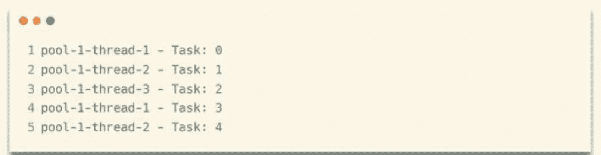
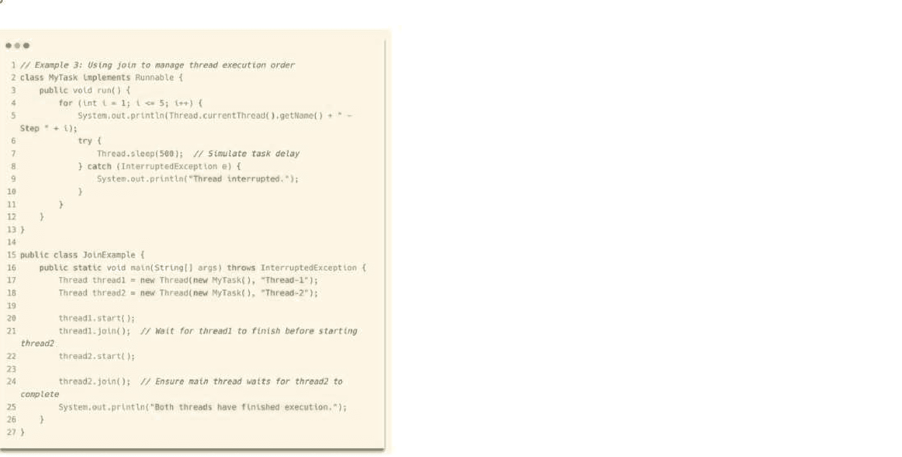
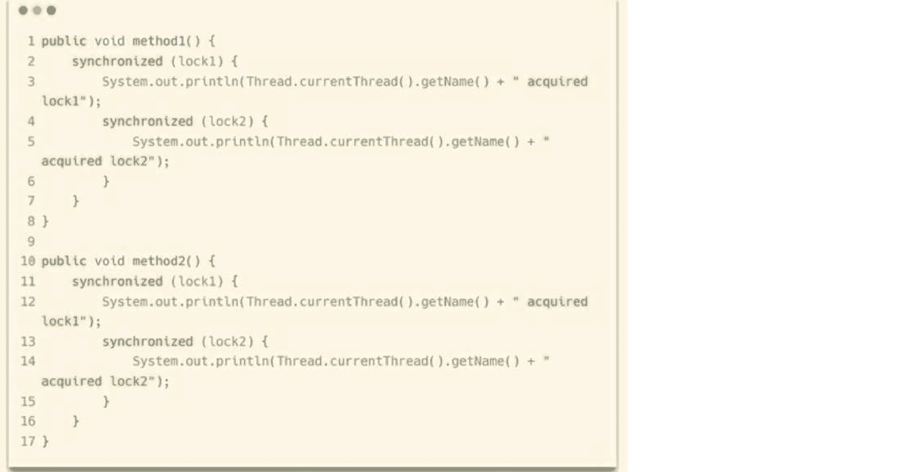

# Java 秘籍：高性能与可扩展性


# 献

致每一个将技术视为将想法变为现实并克服挑战的工具的人，本书献给你们。

致我的家人，他们一直守在我身边，在最艰难的时刻提供无条件的支持和动力。致我的父母，他们教会了我努力和坚持的价值；致我的妻子，她的耐心、爱和鼓励赋予了我不断前进的力量。这本书在很大程度上归功于你们为我提供的支持和信任的环境。

致我的朋友们，他们通过启发性的对话、思想交流和不断的鼓励，让这段旅程变得更加丰富和有意义。在每一次辩论、学习和见解分享中，我意识到人际关系对于成长（无论是个人还是职业）是多么基础。

致我的专业同事们，他们用创新的想法、创造性的解决方案以及对技术开发的热情启发了我。这本书反映了我多年来学习和分享的大部分内容，我希望它也能激励他人去探索和创新。

最重要的是，致你，读者，你选择这本书作为你在 Java 开发学习或进阶旅程中的伴侣。希望这些页面不仅仅是一份技术指南，更是创作那些不仅能运行而且能打动并连接人们的程序的灵感来源。

相信代码的力量，就是相信人类创造新颖、独特且有影响的事物的能力。希望这本书是迈向你无疑将实现的伟大想法的一小步。

Alex Harrison

# 致

这本书是一段旅程的成果，尽管有时有时是孤独的，但如果没有周围优秀人士的支持与合作，这一切是不可能实现的。

首先，我想对我的家人表示感谢，在密集的研究和写作期间，他们的耐心和理解至关重要。致我的父母，他们总是教我学习和努力的价值；致我的妻子，她的爱和不断的鼓励让我即使在困难时期也有了继续下去的力量。

致我的朋友们，他们丰富的对话和宝贵的建议帮助塑造了书中的许多想法。我们随时间推移分享的知识对于扩展我对 Java 开发的视角至关重要，并激励我将这些知识转化为这些文字。

我感谢我的专业同事和导师，他们用创新的想法、创造性的解决方案和对技术开发的热情启发了我。这本书反映了我多年来学习和分享的大部分内容，我希望它也能激励他人去探索和创新。他们的直接和间接贡献对本作产生了重大影响。致评审人员和编辑，他们投入了时间和专业知识以确保本书的清晰度和质量，我深表感谢。他们的工作改进了每一页的内容。

最后，我感谢你，读者，你决定开启这段学习旅程。这本书是为你编写的，衷心希望它能成为一个实用且具有启发性的工具。

致以感激，

Alex Harrison

> “在书中，学习变得生动并带我们走向更远。” —— Neil Gaiman

> “机器只能遵循规则；然而心灵可以解读它们。” —— Alan Turing

# 引言

软件开发世界不断演变，像 Java 这样的技术在这一转型中起着核心作用。《Java 秘密：高性能与可扩展性》经过精心设计，旨在满足初级开发者和希望扩展知识并精通现代 Java 开发的需求。

在这些页面中，你将找到一种理解 Java 基础和高级功能的清晰实用方法。从核心架构和内存管理到线程、性能调优、云原生开发和容错能力等高级技术，目标是提供结合理论、实践示例和最佳实践的全面内容。

每一章的结构旨在提供一种渐进式的学习体验。你将从探索 Java 执行模型和内存管理等基本概念开始，进入并发、响应式编程和微服务架构等主题。此外，还展示了真实示例，说明如何将这些概念应用于可扩展且弹性的企业级应用程序。

本书还强调了性能优化、安全和容错能力的重要性，反映了当今市场的需求——高效、安全且可靠的应用程序至关重要。

无论你是初级开发者还是寻求更新的资深专业人士，这本书都是对探索 Java 提供的无限可能性的邀请。欢迎来到这段学习与创造的旅程，每一行代码都是构建高性能、可扩展软件的一步！

# 前言

软件开发领域在不断演进，而 Java 始终处于构建高性能、可扩展应用程序的前沿。自其诞生以来，Java 已经成长为了一个多功能且强大的平台，使开发者能够创建稳健、高效且安全的企业级解决方案。这本书的诞生源于我分享这些知识的渴望，并帮助无论是初学者还是资深开发者充分发挥 Java 的潜力。

在我的职业生涯中，我注意到尽管可用信息非常丰富，但许多开发者在实践和有效应用 Java 核心概念方面仍然面临困难。这一发现启发我编写了本指南，它不仅涵盖了 Java 的基础原理，还通过真实世界的示例和实践项目深入探讨了高级技术。

本书是我多年在 Java 开发领域学习、实验和工作的结晶。每一章都设计得清晰、聚焦且实用，将理论与可操作的见解相结合。我还包含了最佳实践和性能提示，以帮助你构建符合当今严苛技术标准的现代、可扩展且具有韧性的应用程序。

这不仅是一本技术指南，更是一次创新和优化的邀请。它反映了我通过代码构建高效系统的热情，以及我相信学习是一场终身之旅。

无论你是 Java 新手还是寻求提升技能，这本书都是为你量身定的。我希望它能成为一份宝贵的资源，激励你在精通 Java 性能和可扩展特性的同时，创造出卓越的软件解决方案。

- 3.3 - 线程生命周期与状态
- 3.4 - 线程同步
- 3.4.1 - `synchronized` 块与方法
- 3.4.2 - 锁与 `ReentrantLock`
- 3.5 - 线程间通信
- 3.5.1 - `wait()`、`notify()` 和 `notifyAll()`
- 3.6 - 线程集合与并发工具类
- 3.7 - 并发问题与解决方案
- 3.7.1 - 死锁
- 3.7.2 - 活锁与饥饿
- 3.8 - 原子变量与锁
- 3.9 - 并行流与 `ForkJoin` 框架
- 3.10 - 并发编程最佳实践

# 第1章

# 1 - 了解 Java 架构

探讨 Java 的核心架构，包括 `JVM`、字节码和执行模型。

Java 的核心在于其强大的架构，这允许开发者编写出平台无关、可扩展且高效的代码。为了理解这一架构，我们必须探索三个关键组件：Java 虚拟机 (`JVM`)、字节码和 Java 执行模型。这些组件共同定义了 Java 代码如何被编译、执行和优化。

`JVM` 是 Java “一次编写，随运行”承诺的基石。它作为 Java 程序与底层硬件或操作系统之间的抽象层。当开发者编写 Java 代码时，源代码首先被编译成字节码，然后由 `JVM` 执行。

在此程序中，`performCalculation` 方法被重复执行。`JIT` 编译器识别出该方法为“热点”，并将其编译为原生代码以提高性能。结果，你会发现与逐行解释相比，执行速度更快。

`JVM` 的执行模型涉及几个阶段：类加载、字节码验证、执行和垃圾回收。类加载确保了必要的类文件在内存中是可用的。字节码验证确保代码符合 Java 的安全限制，例如防止非法的类型转换或未经授权的内存访问。

你可以通过编写一个使用自定义类加载器的程序来实验类加载：

```java
public class CustomClassLoader extends ClassLoader {
    public static void main(String[] args) throws Exception {
        CustomClassLoader loader = new CustomClassLoader();
        Class<?> cls = loader.loadClass("HelloWorld");
        System.out.println("Class Loaded: " + cls.getName());
    }
}
```

在这个示例中，自定义类加载器动态地加载了 `HelloWorld` 类。Java 的类加载机制支持层次结构和动态类加载，这对于 Web 服务器和框架等应用程序至关重要。

`JVM` 执行模型的另一个关键组件是垃圾回收器（`GC`）。`GC` 通过回收不再使用的对象来自动管理内存，有助于防止内存泄漏。你可以在程序中手动触发垃圾回收：

```java
public class GarbageCollectorExample {
    public static void main(String[] args) {
        for (int i = 0; i < 1000; i++) {
            new GarbageCollectorExample();
        }
        System.gc();
        System.out.println("Garbage Collection Triggered");
    }
}
```

在此程序中，创建了多个对象，`System.gc()` 方法请求垃圾回收器运行。然而，`JVM` 会根据其算法和内存管理需求决定何时执行垃圾回收。

`JVM` 还使用方法内联、循环展开和逃逸分析等技术优化执行。这些优化会自动应用，以提高你代码的性能。例如，考虑以下简单方法：

```java
public class InlineExample {
    public static void main(String[] args) {
        long start = System.nanoTime();
        for (int i = 0; i < 1000000; i++) {
            inlineMethod();
        }
        long end = System.nanoTime();
        System.out.println("Execution Time: " + (end - start) + " nanoseconds");
    }

    private static void inlineMethod() {
        int x = 5 + 10;
    }
}
```

`JVM` 可能会自动内联 `inlineMethod` 方法，在编译期间将方法调用替换为实际实现。这减少了方法调用的开销并提高了性能。

总结来说，Java 架构依赖于 `JVM`、字节码和先进的执行模型来提供平台无关性和高性能。`JVM` 作为运行时环境，负责解释或将字节码编译为机器码。字节码是你的 Java 程序的平台无关表示，而执行模型确保了执行的优化和安全。通过结合解释、`JIT` 编译、垃圾回收和运行时优化，Java 在不同平台上同时实现了可扩展性和效率。

## 1.1 - Java 架构简介

Java 架构概述及其在构建可扩展应用程序中的意义。

Java 架构的设计旨在于性能、可移植性和可扩展性之间取得平衡，这使其成为构建大型应用程序的理想选择。其核心是，Java 遵循多层方法，由 Java 虚拟机（`JVM`）、Java 运行环境（`JRE`）和 Java 开发包（`JDK`）组成。理解这些组件对于利用 Java 进行可扩展且高效的软件开发至关重要。

Java 架构的第一个元素是 `JVM`，它是 Java 平台无关性的基础。`JVM` 允许 Java 程序在任何操作系统或硬件上无需修改。编写 Java 程序时，源代码被编译为字节码，这是一种 `JVM` 解释或编译为机器码的中间格式。

为了说明这一点，让我们从一个编译和运行程序的简单示例开始。首先，创建一个源文件：

```java
public class Example {
    public static void main(String[] args) {
        System.out.println("Java Architecture in Action");
    }
}
```

使用 `javac` 命令编译程序：

```bash
javac Example.java
```

这将生成一个名为 `Example.class` 的字节码文件。`.class` 文件是平台无关的，包含了由 `JVM` 执行的指令。使用 `java` 命令运行程序：

```bash
java Example
```

`JVM` 加载字节码并在你的机器上执行它。这种抽象使得 Java 能够在不同平台之间保持兼容性，对于部署在多样化基础设施上的可扩展应用程序的关键特性。

Java 架构的第二个组件是 `JRE`，它包含了 `JVM` 和执行 Java 程序所需的额外库。`JRE` 提供了一个 Java 程序可以顺畅运行的运行时环境。例如，如果你安装了 Java 运行时，你可以执行任何 `.class` 文件而不需要源代码。

对于较大的应用程序，Java 架构提供了增强可扩展性的特性。其中一个特性是多线程，它允许任务并发执行。多线程对于需要同时处理多个用户或进程的应用程序至关重要。

这是一个基础多线程程序的示例：

```java
public class MultiThreadExample implements Runnable {
    private String taskName;

    public MultiThreadExample(String taskName) {
        this.taskName = taskName;
    }

    public void run() {
        for (int i = 0; i < 5; i++) {
            System.out.println(taskName + " - Iteration: " + i);
        }
    }

    public static void main(String[] args) {
        Thread thread1 = new Thread(new MultiThreadExample("Task 1"));
        Thread thread2 = new Thread(new MultiThreadExample("Task 2"));

        thread1.start();
        thread2.start();
    }
}
```

### 客户端代码：

```java
import java.rmi.*;

public class RMICclient {
    public static void main(String[] args) {
        try {
            RemoteInterface obj = (RemoteInterface)
            Naming.lookup("RMIServer");
            System.out.println(obj.sayHello());
        } catch (Exception e) {
            System.err.println("Client exception: " + e.toString());
        }
    }
}
```

要运行此程序，请编译服务器和客户端代码，启动 `RMI` 注册表，然后运行服务器和客户端。`RMI` 框架实现了跨分布式系统的的方法调用，这对于构建可扩展的应用程序至关重要。

Java 架构还包含了健壮的库和框架，例如 `Java EE` 和 `Spring`，它们简化了企业级应用程序的开发。这些框架处理依赖注入、事务管理和负载均衡等任务，这些任务对于可扩展性至关重要。

使用 `Spring Boot` 框架创建 `REST API` 的实际示例如下：

### Spring Boot 应用：

```java
import org.springframework.boot.SpringApplication;
import org.springframework.boot.autoconfigure.SpringBootApplication;
import org.springframework.web.bind.annotation.GetMapping;
import org.springframework.web.bind.annotation.RequestMapping;
import org.springframework.web.bind.annotation.RestController;

@SpringBootApplication
public class SpringBootExample {
    public static void main(String[] args) {
        SpringApplication.run(SpringBootExample.class, args);
    }
}

@RestController
@RequestMapping("/api")
class ApiController {
    @GetMapping("/hello")
    public String sayHello() {
        return "Hello, Scalable World!";
    }
}
```

运行此程序，你就可以通过 `http://localhost:8080/api/hello` 访问 `REST API`。`Spring Boot` 框架抽象了构建可扩展 Web 服务涉及的大部分复杂性，允许开发者专注于业务逻辑。

Java 架构还通过 Java 9 引入的模块系统促进了模块化。模块化有助于管理依赖并提高大型应用程序的可扩展性。你可以使用 `module-info.java` 文件定义模块：

```java
module com.example.app {
    requires java.base;
    exports com.example;
}
```

这种模块化方法允许开发者创建松耦合的组件，提高了应用程序的可维护性和可扩展性。

通过结合平台无关性、多线程、垃圾回收、分布式计算能力和强大的框架，Java 架构提供了构建可扩展应用程序所需的工具。`JVM` 确保了高效执行和优化，而 Java 广泛的生态系统简化了复杂、大型系统的开发。无论是在单机上还是在分布式环境中运行，Java 架构都能适应性能和可扩展性的需求。

## 1.2 - Java 虚拟机 (JVM)

解释 `JVM` 在执行 Java 应用程序中的作用。

Java 虚拟机 (`JVM`) 是 Java 平台的核心组件，允许 Java 应用程序在无需修改的情况下运行在任何系统上。它作为抽象硬件和操作系统的运行时环境，实现了 Java 的平台无关性。`JVM` 获取 Java 字节码，对其进行验证并执行，这可以通过逐行解释执行，也可以使用即时编译 (`JIT`) 编译将其编译为原生机器代码。


当你编译一个 Java 程序时，`javac` 编译器会将源代码转换为称为字节码的中间形式。这种字节码是平台无关的，设计用于由 JVM 执行。以下简单程序演示了这一点：

```java
public class HelloJVM {
    public static void main(String[] args) {
        System.out.println("Understanding the JVM!");
    }
}
```

使用以下命令编译此程序：

```bash
javac HelloJVM.java
```

这会创建一个名为 `HelloJVM.class` 的文件，其中包含字节码。要运行程序，请使用 `java` 命令：

```bash
java HelloJVM
```

JVM 在执行期间执行三项主要任务：类加载、字节码验证和执行。首先，JVM 通过它的`ClassLoader`子系统将`class`文件加载到内存中。然后，它验证字节码以确保没有安全违规或损坏的指令。最后，它通过解释或 JIT 编译执行字节码。

要检查 JVM 执行的字节码，请使用 `javap` 工具。以下命令反汇编 `HelloJVM.class` 文件：

```bash
javap -c HelloJVM
```

输出显示了 JVM 执行的低级字节码指令：

```java
Compiled from "HelloJVM.java"
public class HelloJVM {
  public HelloJVM();
  Code:
    0: aload_0
    1: invokespecial #1 // Method java/lang/Object."<init>":()V
    4: return

  public static void main(java.lang.String[])
  Code:
    0: getstatic #2 // Field java/lang/System.out:Ljava/io/PrintStream;
    3: ldc #3 // String Understanding the JVM!
    5: invokevirtual #4 // Method java/io/PrintStream.println(Ljava/lang/String;)V
    8: return
}
```

此输出揭示了 JVM 处理的内部字节码，例如 `getstatic`、`ldc` 和 `invokevirtual`，它们对应于加载常量、打印输出和调用方法。

JVM 在内存管理也起着至关重要的作用。Java 内存分为特定的区域：堆、栈、方法区、本地方法栈。堆是存储对象的地方，JVM 使用`GC`自动管理它。垃圾回收通过移除对象来回收内存。

以下是观察垃圾回收实际示例：

```java
public class MemoryManagement {
    public static void main(String[] args) {
        for (int i = 0; i < 10000; i++) {
            new MemoryManagement();
        }
        System.gc();
        System.out.println("Garbage Collection Requested");
    }

    @Override
    protected void finalize() throws Throwable {
        System.out.println("Garbage collected an object");
    }
}
```

```java
public class JITexample {
    public static void main(String[] args) {
        long startTime = System.nanoTime();
        for (int i = 0; i < 1000000000; i++) {
            calculate();
        }
        long endTime = System.nanoTime();
        System.out.println("Execution Time: " + (endTime - startTime) / 1e9 + " seconds");
    }
                                    
    static void calculate() {
        int x = 10 * 20;
    }
}
```

在这个程序中，`calculate` 方法被重复执行。JIT 编译器将其识别为“热点”并将其编译为原生代码。结果是循环随着时间的推移运行得越来越快。

JVM 还支持性能分析和调试以监控应用程序的行为。`-Xprof` 选项会生成程序的性能分析文件。运行以下命令：

```bash
java -Xprof JITexample
```

输出显示了哪些方法消耗了大部分时间，帮助你优化应用程序的关键部分。

总之，JVM 通过加载字节码、验证其完整性并通过解释执行或 JIT 编译高效执行，作为 Java 应用程序的骨干。它通过垃圾回收管理内存，通过 JIT 编译器优化执行，并提供监控和调试工具。通过抽象底层系统，JVM 确保 Java 应用程序可以在跨平台可靠地运行，使其成为构建高性能和可扩展应用程序的关键组件。

## 1.2.1 - JVM 组件

对 JVM 组件（如类加载器、内存区域和执行引擎）的详细说明。

Java 虚拟机（JVM）由几个组件组成，它们共同工作以高效执行 Java 程序。JVM 的三个关键组件是`ClassLoader`、`Memory Areas`和`Execution Engine`。这些组件确保了 Java 的平台无关性、动态类加载、内存管理和优化执行。

`ClassLoader`子系统是 Java 程序执行时第一个生效的组件。它的职责是将类文件加载到 JVM 中。类加载器将字节码文件（`.class`）加载到 JVM 并对其进行链接以执行。该过程包含三个阶段：**加载**、**链接**和**初始化**。

为了演示类加载，让我们创建一个自定义类加载器来动态加载类：

```java
import java.io.*;

public class CustomClassLoader extends ClassLoader {
    public Class<?> loadClassFromFile(String name) throws ClassNotFoundException {
        try {
            InputStream fis = new FileInputStream(name + ".class");
            byte[] bytecode = fis.readAllBytes();
            fis.close();
            return defineClass(null, bytecode, 0, bytecode.length);
        } catch (IOException e) {
            throw new ClassNotFoundException("Class not found", e);
        }
    }

    public static void main(String[] args) throws Exception {
        CustomClassLoader loader = new CustomClassLoader();
        Class<?> clazz = loader.loadClassFromFile("HelloWorld");
        Object instance = clazz.getDeclaredConstructor().newInstance();
        System.out.println("Class loaded successfully: " + clazz.getName());
    }
}
```

在这里，自定义类加载器将 `.class` 文件作为字节流读取，并使用 `defineClass` 方法将其加载到 JVM 中。要测试这一点，首先创建一个简单的类：

```java
public class HelloWorld {
    public HelloWorld() {
        System.out.println("Hello from HelloWorld class");
    }
}
```

使用以下命令编译类：

```bash
javac HelloWorld.java
```

运行自定义类加载器程序以动态加载 `HelloWorld.class`：

```bash
java CustomClassLoader
```

这个示例强调了类加载器在运行时动态加载类的作用，这对于模块化应用程序是基础性的。

一旦类被加载，JVM 就会在`Memory Areas`中为它们分配内存。JVM 内存分为五个主要区域：方法区、堆、栈、程序计数器（PC）寄存器和原生方法栈。每个内存区域在程序执行中都起着至关重要的作用。

**方法区**存储类级数据，例如常量池和方法代码。**堆**用于对象的动态分配。**栈**存储局部变量和部分结果。**程序计数器（PC）寄存器**用于跟踪当前正在执行的指令。**原生方法栈**用于原生方法调用。

`Execution Engine`负责执行字节码。它使用了三种主要技术：**解释器**、**即时编译（JIT 编译）**和**垃圾回收**。解释器读取字节码并逐条执行指令，这对于频繁执行的代码来说很慢。JIT 编译器识别“热”代码并将其编译为原生代码以实现快速执行。垃圾回收器通过收回不再使用的空间来管理内存。

```java
public class GarbageCollectionDemo {
    public static void main(String[] args) {
      for (int i = 0; i < 10000; i++) {
        new GarbageCollectionDemo();
      }
      System.gc(); // 建议垃圾回收
      System.out.println("Garbage Collection Triggered");
    }

    @Override
    protected void finalize() throws Throwable {
      System.out.println("Object is garbage collected");
    }
}
```

在这个程序中，创建了多个对象但没有被引用。垃圾回收器会移除它们并调用 `finalize` 方法。尽管 `System.gc()` 建议进行垃圾回收，但 JVM 会决定执行的合适时机。

要创建原生方法，请编写相应的 C 实现并将其编译为共享库。使用 `javah` 工具将该库链接到程序中并运行：

```bash
java NativeExample
```

这种集成凸显了原生方法栈在连接 Java 与原生代码以进行底层系统操作中的作用。

JVM 的组件部分——`ClassLoader`、`Memory Areas`和`Execution Engine`——协同工作，高效地加载、管理和执行 Java 程序。类加载器动态地加载类，内存区域管理数据存储，而执行引擎则通过 JIT 编译确保优化的执行。它们共同使 JVM 成为一个运行可扩展和高性能 Java 应用程序的强大引擎。

## 1.2.2 - JVM 生命周期

描述了从程序编译到执行的生命周期。

JVM 生命周期涵盖了 Java 程序从编译、加载、验证、执行到最终终止的整个过程。这一生命周期确保了 Java 虚拟机能够在保持平台独立性和健壮性能的同时，高效地管理 Java 程序的执行。理解此生命周期的每个阶段将有助于开发者针对可扩展性和高性能来优化其应用程序。

生命周期始于**程序编译**。编写在 `.java` 文件中的 Java 源代码使用 `javac` 编译器编译成字节码。字节码是 JVM 理解的平台无关的中间表示。考虑以下示例：

```java
public class LifecycleExample {
    public static void main(String[] args) {
        System.out.println("JVM Lifecycle Demonstration");
    }
}
```

要编译此程序，请使用 `javac` 命令：

```bash
javac LifecycleExample.java
```

`javac` 编译器会生成 `.class` 文件，其中包含字节码。你可以通过列出目录内容来确认编译后的字节码是否存在：

```bash
ls
```

输出将包含 `LifecycleExample.class` 文件。

编译完成后，JVM 生命周期的下一步是**类加载**。类加载子系统将字节码加载到 JVM 内存中。JVM 遵循分层的类加载机制，由`Bootstrap ClassLoader`、`Extension ClassLoader`和`Application ClassLoader`组成。

要观察类加载的过程，请使用以下程序，它会打印特定类的类加载器：

```java
public class ClassLoaderDemo {
    public static void main(String[] args) {
         System.out.println("Class Loader of this class: " + 
             ClassLoaderDemo.class.getClassLoader());
         System.out.println("Class Loader of String: " + 
             String.class.getClassLoader());
    }
}
```

编译并运行该程序：

```bash
javac ClassLoaderDemo.java
java ClassLoaderDemo
```

输出将显示 `ClassLoaderDemo` 类是由`Application ClassLoader`加载的，而 `String` 类（Java 核心类）是由用原生代码编写的`Bootstrap ClassLoader`加载的。

加载之后，下一阶段是**字节码验证**。JVM 验证字节码是否符合 Java 的安全和安全约束，确保没有非法指令或类型不匹配。验证防止恶意或损坏字节码的执行。

以下是一个使用故意错误修改的无效字节码示例：

```bash
javap -c LifecycleExample
```

使用 `javap` 工具检查 `LifecycleExample` 的字节码。如果字节码被篡改（在典型用法之外），验证器将拒绝它，JVM 将抛出 `VerifyError`。

验证通过后，`Execution Engine`开始执行字节码。JVM 执行模型遵循两种方法：**解释**和**即时编译（JIT Compilation）**。初始阶段，字节码逐行被解释，但 JIT 编译器会识别频繁执行的代码（热点）并将其编译为原生机器码以加快执行。

以下程序演示了 JIT 编译对频繁执行方法的影响：

```java
public class JITDemo {
    public static void main(String[] args) {
         long startTime = System.nanoTime();
         for (int i = 0; i < 1_000_000_000; i++) {
             addNumbers();
         }
         long endTime = System.nanoTime();
         System.out.println("Execution time: " + (endTime - startTime) / 1e9 + " seconds");
    }

    public static int addNumbers() {
        return 5 + 10;
    }
}
```

编译并执行该程序：

```bash
javac JITDemo.java
java JITDemo
```

使用以下标志启用 JIT 编译日志以观察编译细节：

```bash
java -XX:+PrintCompilation JITDemo
```

输出将显示哪些方法被 JIT 编译器编译成了原生代码，从而提高了执行速度。

在执行期间，JVM 还通过**垃圾回收（GC）**管理内存。GC 通过移除不再被引用的对象来回收内存，确保堆内存的高效使用。以下示例演示了 JVM 生命周期中的垃圾回收：

```java
public class GarbageCollectionLifecycle {
  public static void main(String[] args) {
    for (int i = 0; i < 10000; i++) {
      new GarbageCollectionLifecycle();
    }
    System.gc();
    System.out.println("Garbage Collection Suggested");
  }

  @Override
  protected void finalize() throws Throwable {
    System.out.println("Object finalized");
  }
}
```

编译并执行该程序：


```bash
javac GarbageCollectionLifecycle.java
java GarbageCollectionLifecycle
```

该程序创建了大量对象，JVM 的垃圾回收器回收了内存。`finalize` 方法在每个对象销毁之前被调用，显示了执行期间对象的生命周期。

执行完成后，JVM 将终止。**JVM 关闭钩子（Shutdown Hook）**允许开发者在 JVM 退出之前执行特定的清理任务，例如关闭资源。

以下是添加 JVM 关闭钩子的示例：

```java
public class ShutdownHookExample {
    public static void main(String[] args) {
        Runtime.getRuntime().addShutdownHook(new Thread(() -> {
            System.out.println("Shutdown Hook Executed: Cleanup complete.");
        })); 

        System.out.println("Application is running...");
        try {
            Thread.sleep(3000);
        } catch (InterruptedException e) {
            e.printStackTrace();
        }
    }
}
```

编译并运行程序：

```bash
javac ShutdownHookExample.java
java ShutdownHookExample
```

当应用程序执行完成或终止时，关闭钩子将执行，确保完成清理任务。关闭钩子对于资源管理至关重要的服务器应用程序非常有用。

当所有线程终止时，JVM 生命周期结束。然而，对于服务器等应用程序，其生命周期可以持续到被显式终止。

总结 JVM 生命周期：

1. 编译：Java 源代码使用 `javac` 编译成字节码。
2. 类加载：字节码由类加载器加载到内存中。
3. 字节码验证：JVM 验证字节码的正确性。
4. 执行：字节码被解释或通过 JIT 编译器编译为原生代码。
5. 垃圾回收：JVM 通过回收未使用对象管理内存。
6. 关闭：JVM 终止，执行任何关闭钩子。

通过理解 JVM 生命周期的每个阶段，开发者可以针对性能和可扩展性优化应用程序，确保高效执行和资源管理。生命周期展示了 JVM 如何抽象复杂任务，使 Java 能够成为一种健壮且平台无关的编程语言。

```java
public class BytecodeExample {
    public static void main(String[] args) {
        int a = 5;
        int b = 10;

        int sum = a + b;
        System.out.println("Sum: " + sum);
    }
}
```

使用 `javac` 命令编译该程序：

```bash
javac BytecodeExample.java
```

`javac` 编译器会生成 `BytecodeExample.class` 文件。要查看字节码，请使用 `javap` 工具配合 `-c` ，它会将字节码反汇编为人类可读的指令：

```bash
javap -c BytecodeExample
```

输出如下：

```
Compiled from "BytecodeExample.java"
public class BytecodeExample {
  public BytecodeExample();
  Code:
     0: aload_0
     1: invokespecial #1 // Method java/lang/Object.<init>V
     4: return
  public static void main(java/lang/String[]) {
    Code:
      0: iconst_5
      1: istore_1
      2: bipush 10
      3: istore_2
      4: iload_1
      5: iload_2
      6: iadd
      7: istore_3
      8: getstatic #2 // Field java/lang/System.out:Ljava/io/PrintStream;
     11: new #3 // class java/lang/StringBuilder
     14: dup
     15: invokespecial #4 // Method java/lang/StringBuilder.<init>()V
     18: ldc #5 // String Sum: 
     20: invokevirtual #6 // Method java/lang/StringBuilder.append(Ljava/lang/String;)Ljava/lang/StringBuilder;
     23: iload_3
     24: invokevirtual #7 // Method java/lang/StringBuilder.append(I)Ljava/lang/StringBuilder;
     27: invokevirtual #8 // Method java/lang/StringBuilder.toString()Ljava/lang/String;
     30: invokevirtual #9 // Method java/io/PrintStream.println(Ljava/lang/String;)V
     33: return
}
```

此输出拆解了 `main` 方法的每个字节码指令。以下是一些关键指令说明：

- `iconst_5`：将整数常量 `5` 推入操作数栈。
- `bipush 10`：推入整数常量 `10`。
- `iadd`：将栈上的两个整数相加。
- `istore`：将结果存储到局部变量。
- `getstatic`：访问静态字段，例如 `System.out`。
- `invokevirtual`：调用方法，例如 `println()`。

JVM 在执行期间逐行解释这些指令，或者使用 JIT 编译将它们编译为本地代码以提高性能。

为了更好地理解字节码，让我们探索一个简单的条件语句：

```java
public class ConditionExample {
    public static void main(String[] args) {
        int a = 10;
        if (a > 5) {
            System.out.println("a is greater than 5");
        } else {
            System.out.println("a is not greater than 5");
        }
    }
}
```

编译程序：

```bash
javac ConditionExample.java
```

反汇编字节码：

```bash
javap -c ConditionExample
```

输出显示了 JVM 如何处理条件语句：

```
0: bipush 10
1: istore_1
2: iload_1
3: iconst_5
4: if_icmple 16
7: getstatic #2 // Field java/lang/System.out:Ljava/io/PrintStream;
10: ldc #3 // String a is greater than 5
12: invokevirtual #4 // Method java/io/PrintStream.println(Ljava/lang/String;)V
15: goto 25
18: getstatic #2 // Field java/lang/System.out:Ljava/io/PrintStream;
21: ldc #5 // String a is not greater than 5
23: invokevirtual #4 // Method java/io/PrintStream.println(Ljava/lang/String;)V
26: return
```

在这里，`if_icmple` 检查 `a <= 5` 并根据结果跳转到相应的代码块。

接下来，让我们观察循环是如何翻译成字节码的：

```java
public class LoopExample {
  public static void main(String[] args) {
    for (int i = 0; i < 3; i++) {
        System.out.println("Iteration: " + i);
    }
  }
}
```

编译程序：

```bash
javac LoopExample.java
```

反汇编字节码：

```bash
javap -c LoopExample
```

字节码将包含初始化循环、检查条件、执行体和增加循环变量的指令：

| 行 | 指令 | 注释 |
|------|------|------|
| 1 | 0: iconst_0 | |
| 2 | 1: istore_1 | |
| 3 | 2: iload_1 | |
| 4 | 3: iconst_3 | |
| 5 | 4: if_icmpge 23 | |
| 6 | 7: getstatic #2 | Field java/lang/System.out:Ljava/io/PrintStream; |
| 7 | 10: new | class java/lang/StringBuilder |
| 8 | 13: dup | |
| 9 | 14: invokespecial #4 | Method java/lang/StringBuilder.<init>()V |
| 10 | 17: ldc #5 | String Iteration: |
| 11 | 19: invokevirtual #6 | Method java/lang/StringBuilder.append(Ljava/lang/String;)Ljava/lang/StringBuilder; |
| 12 | 22: iload_1 | |
| 13 | 23: invokevirtual #7 | Method java/lang/StringBuilder.append(I)Ljava/lang/StringBuilder; |
| 14 | 26: invokevirtual #8 | Method java/lang/StringBuilder.toString()Ljava/lang/String; |
| 15 | 29: invokevirtual #9 | Method java/io/PrintStream.println(Ljava/lang/String;)V |
| 16 | 32: iinc 1, 1 | |
| 17 | 35: goto 2 | |
| 18 | 38: return | |

此处的关键指令是：

- `if_icmpge`：比较循环变量与 `3`，如果条件不满足则退出循环。
- `iinc`：增加循环变量。

让我们继续方法调用，并理解方法调用在字节码层面是如何运作的：

```java
public class MethodExample {
    public static void main(String[] args) {
        greet();
    }

    public static void greet() {
        System.out.println("Hello from greet method");
    }
}
```

编译程序：

```bash
javac MethodExample.java
```

反汇编字节码：

```bash
javap -c MethodExample
```

输出包含一个用于调用 `greet` 方法的 `invokestatic` 指令：

- `invokestatic` 用于调用静态方法。
- `invokevirtual` 调用方法，例如 `println()`。

以下是关键指令的详细介绍：

- `iconst_5`：将常量 `5` 压入操作数栈。
- `bipush 10`：将常量 `10` 压入操作数栈。
- `iadd`：相加操作数栈顶部的两个整数。
- `istore_x`：将结果存储到局部变量中。
- `getstatic`：访问静态字段 `System.out`。
- `invokevirtual`：调用 `println` 等方法。

JVM 以结构化的方式执行这些字节码。**操作数栈**（operand stack）用于推入和弹出数据等操作，而**局部变量表**（local variable table）则存储 `a`、`b` 和 `result` 等变量。

为了进一步探索，让我们从字节码层面查看方法调用是如何工作的。更新程序以包含一个方法调用：

```java
public class MethodBytecode {
   public static void main(String[] args) {
     int result = addNumbers(5, 10);
     System.out.println("Sum: " + result);
   }

   public static int addNumbers(int x, int y) {
     return x + y;
   }
 }
```

编译并反汇编程序：

```bash
javac MethodBytecode.java
javap -c MethodBytecode
```

`addNumbers` 方法的字节码输出将包含：

```
public static int addNumbers(int, int);
  Code:
    0: iload_0
    1: iload_1
    2: iadd
    3: ireturn
```

在这里：

- `iload_0`：将第一个参数 `x` 加载到操作数栈。
- `iload_1`：加载第二个参数 `y`。
- `iadd`：将两个相加。
- `ireturn`：将结果返回给调用方法。

在 `main` 方法中，使用 `invokestatic` 指令调用 `addNumbers`，因为它是一个静态方法。

现在考虑一个条件语句，看看字节码如何处理分支：

```java
public class ConditionalBytecode {
public static void main(String[] args) {
int number = 7;
if (number > 5) {
System.out.println("Number is greater than 5");
} else {
System.out.println("Number is less than or equal to 5");
}
}
}
```

编译并反汇编：

```bash
javac ConditionalBytecode.java
javap -c ConditionalBytecode
```

字节码输出包含了类似 `if_icmple` 的条件指令：

```
0: bipush 7
1: istore_1
2: iload_1
3: iconst_5
4: if_icmple 16
7: getstatic #2 // Field java/lang/System.out:Ljava/io/PrintStream;
10: ldc #3 // String Number is greater than 5
12: invokevirtual #4 // Method java/io/PrintStream.println(Ljava/lang/String;)V
15: goto 25
18: getstatic #2 // Field java/lang/System.out:Ljava/io/PrintStream;
21: ldc #5 // String Number is less than or equal to 5
23: invokevirtual #4 // Method java/io/PrintStream.println(Ljava/lang/String;)V
24: return
```

在这里：

- `if_icmple`：检查 `number` 的值是否小于或等于 5，如果是则跳转到 `else` 块。
- `goto`：当条件满足时跳过 `else` 块。

JVM 使用 `if_icmple` 和 `goto` 等**分支**指令来实现控制流结构。

现在让我们探索循环在字节码中是如何表示的：


```java
public class LoopBytecode {
    public static void main(String[] args) {
        for (int i = 0; i < 3; i++) {
            System.out.println("Iteration: " + i);
        }
    }
}
```

编译并反汇编：

```bash
javac LoopBytecode.java
javap -c LoopBytecode
```

字节码包含了用于初始化、检查和递增循环变量的指令：

```
0: iconst_0
1: istore_1
2: iload_1
3: iconst_3
4: if_icmpge 23
7: getstatic #2
10: new #3
13: dup
14: invokespecial #4
17: ldc #5
19: iload_1
20: invokevirtual #6
23: invokevirtual #7
26: iinc 1, 1
29: goto 2
32: return
```

在这里：

- `if_icmpge`：将 `i` 与 `3` 比较，如果条件失败则退出循环。
- `iinc`：递增循环变量 `i`。
- `goto`：跳回循环条件检查。

最后，让我们演示字节码是如何处理对象创建的：

```java
public class ObjectBytecode {
    public static void main(String[] args) {
        ObjectBytecode obj = new ObjectBytecode();
        obj.printMessage();
    }

    public void printMessage() {
        System.out.println("Object creation in bytecode");
    }
}
```

编译并反汇编：

```bash
javac ObjectBytecode.java
javap -c ObjectBytecode
```

字节码包含了：

- `new`：为对象分配内存。
- `dup`：复制引用以初始化对象。
- `invokespecial`：调用构造函数。

```
0: new              #2               // class ObjectBytecode
3: dup
4: invokespecial #3      // Method "<init>":()
7: astore_1
8: aload_1
9: invokevirtual #4 // Method "printMessage":()V
12: return
```

```java
public class LoopOptimization {
    public static void main(String[] args) {
        int sum = 0;
        for (int i = 0; i < 10; i++) {
            sum += 2 * 5; // Constant calculation
        }
        System.out.println("Sum: " + sum);
    }
}
```

编译并运行程序：

```bash
javac LoopOptimization.java
java -XX:+PrintCompilation LoopOptimization
```

`2 * 5` 是一个常量表达式。JVM 将使用**循环不变代码移动（loop invariant code motion）**对其进行优化，将常量计算移动到循环之外。这防止了不必要的重复计算，提高了效率。

这里是一个逃逸分析的示例：

```java
public class EscapeAnalysis {
    public static void main(String[] args) {
        long start = System.nanoTime();
        for (int i = 0; i < 1_000_000; i++) {
            createObject();
        }
        long end = System.nanoTime();
        System.out.println("Execution Time: " + (end - start) / 1e9 + " seconds");
    }

    public static void createObject() {
        Data data = new Data(10, 20);
        int result = data.x + data.y;
    }

    static class Data {
        int x, y;
        Data(int x, int y) {
            this.x = x;
            this.y = y;
        }
    }
}
```

开启逃逸分析运行程序：

```bash
java -XX:+DoEscapeAnalysis -XX:+PrintGC EscapeAnalysis
```

JVM 确定 `Data` 对象没有逃逸出 `createObject` 方法，因此它在栈上分配对象而不是堆上。这减少了内存占用和垃圾回收频率。

**死代码消除（Dead code elimination）**移除了不影响程序输出的字节码，通过消除冗余操作减少执行开销。例如：

```java
public class DeadCodeExample {
    public static void main(String[] args) {
        int a = 10;
        int b = 20;
        int unused = a + b; // Unused code
        System.out.println("Hello, World!");
    }
}
```

编译并运行程序：

```bash
javac DeadCodeExample.java
java -XX:+PrintCompilation DeadCodeExample
```

JVM 还会使用**常量折叠（constant folding）**优化字节码。在执行期间，如果计算 `a + b` 仅涉及常量，JVM 将其替换为结果。示例：

```java
public class ConstantFolding {
    public static void main(String[] args) {
        int result = 100 * 5;
        System.out.println("Result: " + result);
    }
}
```

编译并运行程序：

```bash
javac ConstantFolding.java
java -XX:+PrintCompilation ConstantFolding
```

JVM 检测到 `100 * 5` 是常量表达式，并将其替换为预计算的结果 `500`，节省了 CPU 周期。

通过结合这些优化——JIT 编译、方法内联、循环优化、逃逸分析、死代码消除和常量折叠——JVM 确保 Java 程序高效运行并有效利用系统资源。Java 字节码优化在运行时动态应用，允许 JVM 适应高性能和可扩展的应用。

## 1.4 - Java 执行模型

讨论 Java 的执行模型，从代码编译到运行时执行。

Java 的执行模型是一个结构化过程，确保平台无关性、效率和高性能。它从代码编译开始，到由 Java 虚拟机（JVM）管理的运行时执行结束。执行模型包括源码编译、字节码生成、类加载、验证以及使用解释或即时（JIT）编译的字节码执行。每一步对 Java 应用的可靠性和速度都有贡献。

执行从 **Java 编译器**转换为字节码开始。写入 `.java` 文件的源码被编译为供 JVM 执行的平台无关指令集。为了理解这个过程，编写一个简单的程序：

```java
public class ExecutionModelExample {
    public static void main(String[] args) {
        System.out.println("Java Execution Model");
    }
}
```

使用 `javac` 命令编译程序：

```bash
javac ExecutionModelExample.java
```

这生成了一个名为 `ExecutionModelExample.class` 的 `.class` 文件。要确认文件存在，列出目录：

```bash
ls
```

在此阶段，Java 源码已转换为字节码。

执行模型的下一步是**类加载（Class Loading）**。当你运行 Java 程序时，JVM 使用类加载器子系统将编译后的 `.class` 文件加载到内存中。类加载器遵循分层过程：启动类加载器（`BootstrapClassLoader`）加载核心 Java 库，扩展类加载器（`ExtensionClassLoader`）从 `ext` 目录加载库，应用程序类加载器（`ApplicationClassLoader`）加载自定义类。

使用 `java` 命令运行程序：

```bash
java ExecutionModelExample
```

为了观察哪个类加载器正在加载特定类，使用以下程序：

```java
public class ClassLoaderExample {
    public static void main(String[] args) {
        System.out.println("ClassLoaderExample ClassLoader: " + ClassLoaderExample.class.getClassLoader());
        System.out.println("String ClassLoader: " + String.class.getClassLoader());
    }
}
```

编译并运行程序：

```bash
javac ClassLoaderExample.java
java ClassLoaderExample
```

输出将显示 `ClassLoaderExample` 类由应用程序加载器加载，而作为核心 Java 库的 `String` 类由启动类加载器加载（表示为 `null`）。

一旦类被加载，JVM 就会执行**代码验证**。验证器会检查非法访问、类型不匹配或损坏。例如，如果字节码被篡改，JVM 将抛出 `VerifyError`。

下一阶段是**字节码执行**。JVM 使用执行引擎来解释或编译字节码。最初，JVM 逐行解释字节码，速度较慢。为了提高性能，即时（JIT）编译器会识别频繁执行的代码（热点）并将其编译为原生代码。这种混合方法将可移植性与原生代码性能结合起来。

为了观察 JIT 编译的运行，创建一个运行循环的程序：

```java
public class JITExample {
    public static void main(String[] args) {
        long start = System.nanoTime();
        for (int i = 0; i < 1_000_000_000; i++) {
            calculate();
        }
        long end = System.nanoTime();
        System.out.println("Execution Time: " + (end - start) / 1e9 + " seconds");
    }

    public static int calculate() {
        return 5 + 10;
    }
}
```

编译程序：

```bash
javac JITExample.java
```

开启 JIT 编译日志运行程序：

```bash
java -XX:+PrintCompilation JITExample
```

你将看到显示方法被编译为原生代码的输出：

| 编译 ID | 时间戳 | 编译级别 | 方法 |
| :--- | :--- | :--- | :--- |
| 1 | 57 | 1 | JITExample::calculate (5 bytes) |
| 2 | 112 | 2 | java/lang/StringBuilder::append (15 bytes) |

JIT 编译器编译 `calculate` 是因为它被频繁执行，提高了性能。为了进一步演示字节码执行，让我们查看带有控制流的程序，如条件和循环。JVM 通过减少不必要的分支和检查来优化此类代码。

```java
public class ControlFlowExample {
    public static void main(String[] args) {
        int value = 10;
        if (value > 5) {
            System.out.println("Value is greater than 5");
        } else {
            System.out.println("Value is less than or equal to 5");
        }

        for (int i = 0; i < 3; i++) {
            System.out.println("Iteration: " + i);
        }
    }
}
```

编译并反汇编字节码：

```bash
javac ControlFlowExample.java
javap -c ControlFlowExample
```

字节码输出包含了用于条件判断的 `if_icmpgt` 和用于循环控制的 `goto`：

```
0: bipush     10
2: istore_1
3: iload_1
4: iconst_5
5: if_icmple   16
8: getstatic     #2 // Field java/lang/System.out:Ljava/io/PrintStream;
11: ldc           #3 // String Value is greater than 5
13: invokevirtual #4 // Method java/io/PrintStream.println:(Ljava/lang/String;)V
16: goto          28
19: getstatic     #2 // Field java/lang/System.out:Ljava/io/PrintStream;
22: ldc           #5 // String Value is less than or equal to 5
24: invokevirtual #4 // Method java/io/PrintStream.println:(Ljava/lang/String;)V
27: return
```

JVM 在执行期间会使用**循环展开**和分支预测来优化循环和条件语句。

Java 执行模型的最后一部分是**垃圾回收 (GC)**。JVM 通过回收堆上未使用的对象来自动管理内存。垃圾回收可以提高应用程序性能并减少内存泄漏。

这是一个用于观察垃圾回收的程序：

```java
public class GarbageCollectionExample {
    public static void main(String[] args) {
        for (int i = 0; i < 10_000; i++) {
            new GarbageCollectionExample();
        }
        System.gc();
        System.out.println("Garbage Collection Triggered");
    }

    @Override
    protected void finalize() {
        System.out.println("Object finalized");
    }
}
```

编译并运行该程序：

```bash
javac GarbageCollectionExample.java
java -verbose:gc GarbageCollectionExample
```

`-verbose:gc` 标志会输出垃圾回收活动的详细信息：

```
[GC (System.gc())] 65536K->38912K(125952K), 0.0150117 secs
Garbage Collection Triggered
Object finalized
```

JVM 自动管理内存并为新对象释放空间。

Java 的执行模型将静态编译与动态运行时优化相结合。JVM 加载类、验证字节码以确保安全、解释或编译代码以供执行，并通过垃圾回收高效地管理内存。通过理解执行模型的每个阶段，开发者可以更好地优化代码以提高性能和可扩展性。

### 1.4.1 - 即时编译 (JIT 编译)

详细说明了 JIT 编译如何提高运行时性能。

即时编译（JIT 编译）是 Java 虚拟机（JVM）使用的一种关键优化技术，用于提高 Java 应用程序的运行时性能。与传统的解释执行（即 JVM 逐行执行字节码）不同，JIT 在运行时将频繁执行的字节码编译为原生机器代码。这减少了开销，并允许程序运行得显快得多。JIT 通过在执行期间识别“热点”代码路径来动态地平衡性能和资源消耗。

为了观察 JIT 编译的效果，请考虑一个具有重复方法调用的简单程序：


# JIT 编译优化

## 示例：JIT 编译基础

```java
public class JITCompilationExample {
    public static void main(String[] args) {
        long start = System.nanoTime();
        for (int i = 0; i < 1_000_000_000; i++) {
            calculate();
        }
        long end = System.nanoTime();
        System.out.println("Execution time: " + (end - start) / 1e9 + " seconds");
    }
    public static int calculate() {
        return 5 + 10;
    }
}
```

编译该程序：

```bash
javac JITCompilationExample.java
```

使用 `-XX:+PrintCompilation` 选项运行程序以观察 JIT 编译日志：

```bash
java -XX:+PrintCompilation JITCompilationExample
```

输出显示方法在被频繁调用时正被 JIT 编译器编译：

```text
57 1 JITCompilationExample::calculate (5 bytes)
112 2 java/lang/StringBuilder::append (15 bytes)
```

在这里，`calculate` 方法被编译成了原生机器代码，因为它被重复调用。这减少了解释执行开销并加快了程序运行。

## 方法内联

JIT 编译使用了多种策略来优化性能。其中一个关键策略是**方法内联**，它用方法的实际实现替换方法调用。这消除了方法调用的开销。

为了演示方法内联，创建一个带有简单方法的小程序：

```java
public class MethodInliningExample {
    public static void main(String[] args) {
        long start = System.nanoTime();
        for (int i = 0; i < 1_000_000_000; i++) {
            inlineMethod();
        }
        long end = System.nanoTime();
        System.out.println("Execution time: " + (end - start) / 1e9 + "seconds");
    }

    public static void inlineMethod() {
        int x = 10 * 20;
    }
}
```

使用以下命令编译并运行以启用内联日志：

```bash
java -XX:+UnlockDiagnosticVMOptions -XX:+PrintInlining MethodInliningExample
```

输出将确认 JVM 已内联了 `inlineMethod` 方法：

```text
@ 57 MethodInliningExample::inlineMethod (5 bytes) inline (hot)
```

内联消除了重复调用方法的需求，减少了栈帧开销并提升了运行时性能。

## 循环展开

JIT 编译器执行的另一个优化是**循环展开**，其中 JVM 通过在一个周期内执行多次迭代来减少循环控制的开销。这对于迭代次数可预测的循环特别有用。

考虑以下程序：

```java
public class LoopUnrollingExample {
    public static void main(String[] args) {
        int sum = 0;
        for (int i = 0; i < 1000000; i++) {
            sum += i;
        }
        System.out.println("Sum: " + sum);
    }
}
```

编译该程序：

```bash
javac LoopUnrollingExample.java
```

带有 JIT 日志运行：

```bash
java -XX:+PrintCompilation LoopUnrollingExample
```

JIT 编译器识别出循环为热点，并通过减少迭代次数和执行多次操作来展开它。这种优化还利用了**逃逸分析**来确定对象是否逃逸到方法或线程。如果对象没有逃逸，JVM 将在栈上分配它而不是堆。

## 逃逸分析

这是一个示例：

```java
public class EscapeAnalysisExample {
    public static void main(String[] args) {
        long start = System.nanoTime();
        for (int i = 0; i < 10_000_000; i++) {
            createObject();
        }
        long end = System.nanoTime();
        System.out.println("Execution time: " + (end - start) / 1e9 + "seconds");
    }

    public static void createObject() {
        Data data = new Data(10, 20);
        int result = data.x + data.y;
    }

    static class Data {
        int x, y;
        Data(int x, int y) {
            this.x = x;
            this.y = y;
        }
    }
}
```

启用逃逸分析编译并运行该程序：

```bash
java -XX:+DoEscapeAnalysis -XX:+PrintGC EscapeAnalysisExample
```

## 死代码消除

JIT 编译还会执行**死代码消除**，即移除不影响程序结果的字节码。这种优化减少了不必要的操作。

这是一个示例：

```java
public class DeadCodeEliminationExample {
    public static void main(String[] args) {
        int a = 5;
        int b = 10;

        int unused = a + b; // 此计算从未被使用
        System.out.println("End of Program");
    }
}
```

编译程序：

```bash
javac DeadCodeEliminationExample.java
```

带有 JIT 日志运行：

```bash
java -XX:+PrintCompilation DeadCodeEliminationExample
```

JIT 编译器删除了未使用的计算 `a + b`，因为它不影响程序输出。这减少了运行时开销并提高了效率。

## 常量折叠

JIT 编译还应用了**常量折叠**，这是一种在运行时预计算常量表达式的优化方法。这消除了冗余计算。

考虑以下程序：

```java
public class ConstantFoldingExample {
    public static void main(String[] args) {
        int result = 50 * 20 * 2;
        System.out.println("Result: " + result);
    }
}
```

编译程序：

```bash
javac ConstantFoldingExample.java
```

运行程序：

```bash
java ConstantFoldingExample
```

JIT 编译器将 `50 * 20 * 2` 替换为预计算的结果 `2000`。这节省了运行时处理时间并提高了效率。

## 总结

JIT 编译是 JVM 的一项强大功能，可以在运行时优化字节码执行。通过识别频繁执行的代码路径，JIT 动态地将它们编译为原生机器码，显著提高了性能。方法内联、循环展开、逃逸分析、死代码消除和常量折叠等技术允许 JVM 能够高效地执行 Java 程序，同时为开发者抽象了复杂性。JIT 确保了 Java 兼顾可移植性和接近原生的性能，适用于高性能和可扩展的应用程序。

# 1.4.2 - 垃圾回收

探索垃圾回收机制及其对内存管理的影响。

Java 中的垃圾回收（GC）是一种自动内存管理过程，用于回收不再被引用的对象所占内存。这允许开发者专注于应用程序逻辑，而无需显式释放内存。JVM 处理垃圾回收，确保高效的内存利用并防止内存泄漏。然而，理解垃圾回收的工作原理及其对性能的影响对于构建可扩展且高效的应用程序至关重要。

JVM 将内存分为若干区域：**堆（heap）**和**非堆（non-heap）**区域。堆是分配对象的地方，进一步分为**新生代（Young Generation）**、**老年代（Old Generation/Tenured）**和**永久代（Permanent Generation，Java 8+ 中 Metaspace）**。垃圾回收主要关注回收堆中未使用的对象。

## GC 基础演示

要理解 GC 如何工作，可以从一个创建许多对象的简单程序开始：

```java
public class GCDemo {
    public static void main(String[] args) {
        for (int i = 0; i < 10000; i++) {
            new GCDemo(); // 创建对象
        }
        System.gc(); // 建议垃圾回收
        System.out.println("Garbage Collection Triggered");
    }

    @Override
    protected void finalize() {
        System.out.println("Object is being garbage collected");
    }
}
```

编译程序：

```bash
javac GCDemo.java
```

启用垃圾回收详细信息运行程序：

```bash
java -verbose:gc GCDemo
```

`-verbose:gc` 标志显示有关 GC 事件的信息：

```text
[GC (System.gc())) 65536K->38912K(125952K), 0.0150326 secs]
Object is being garbage collected
Garbage Collection Triggered
```

在此：

- `System.gc()` 调用建议执行 GC，尽管 JVM 决定何时执行它。
- `finalize()` 方法在正在被垃圾回收的对象上被调用。

## 堆内存区域

堆被分为**新生代（Young Generation）**和**老年代（Old Generation）**：

1. **新生代**：新创建的对象分配在这里。它进一步细分为 **Eden 区**（新对象）和两个**存活区（Survivor Spaces，S0 和 S1）**，用于存活 Minor GC 的对象。
2. **老年代**：在新生代中生存时间足够的对象会被提升到这里。Major GC 会清理老年代。

运行以下程序以观察 Minor GC 和 Major GC 的工作：

```java
public class GCRegionsDemo {
    public static void main(String[] args) {
        for (int i = 0; i < 1_000_000; i++) {
            byte[] data = new byte[1024]; // 分配内存
        }
        System.out.println("Memory Allocation Done");
    }
}
```

带有 GC 详细信息编译并运行程序：

```bash
java -Xms10M -Xmx10M -XX:+PrintGCDetails GCRegionsDemo
```

`Xms` 和 `-Xmx` 选项将初始和最大堆大小设置为 10MB。`-XX:+PrintGCDetails` 标志提供了详细的 GC 日志：

```text
[GC (Allocation Failure) [PSYoungGen: 8192K->1024K(9216K)] 8192K-4352K(9728K), 0.0010542 secs]
[Full GC (System.gc())] [PSOldGen: 3328K->4352K(4352K)] [PSYoungGen: 1024K->0K(9216K)] 4352K->4352K, 0.0100353 secs]
```

在此：

- Minor GC (`PSYoungGen`) 在新生代填满时发生。
- Full GC 清理新生代和老年代。

## 垃圾回收算法

**垃圾回收算法**定义了如何回收内存。Java 提供了几种算法，每种适用于不同的用例：

1. **Serial GC（串行回收）**：适用于小型应用程序的单线程收集器。
2. **Parallel GC（并行回收）**：用于高吞吐量的多线程收集器。
3. **G1 GC（垃圾优先）**：将堆划分为区域，并优先对垃圾最多的区域进行回收。
4. **ZGC 和 Shenandoah**：用于大堆的低延迟收集器。

G1 GC 将堆划分为区域，并优先对垃圾最多的区域进行回收。为了模拟 G1 行为，运行以下命令：

```bash
java -Xms10M -Xmx10M -XX:+PrintGCDetails GCRegionsDemo
```

`Xms` 和 `-Xmx` 选项将初始和最大堆大小设置为 10MB。`-XX:+PrintGCDetails` 标志提供了详细的 GC 日志：

```text
[GC (Allocation Failure) [PSYoungGen: 8192K->1024K(9216K)] 8192K-4352K(9728K), 0.0010542 secs]
[Full GC (System.gc())] [PSOldGen: 3328K->4352K(4352K)] [PSYoungGen: 1024K->0K(9216K)] 4352K->4352K, 0.0100353 secs]
```

在此：

- Minor GC (`PSYoungGen`) 在新生代填满时发生。
- Full GC 清理新生代和老年代。

# JRE 核心组件

## JRE 基础演示

为了演示 JRE 的功能，让我们从一个基础 Java 程序开始：

```java
public class HelloJRE {
    public static void main(String[] args) {
        System.out.println("Java Runtime Environment Demonstration");
    }
}
```

使用 Java 编译器 `javac` 编译该程序：

```bash
javac HelloJRE.java
```

编译过程会生成一个名为 `HelloJRE.class` 的字节码文件。该文件包含平台无关的指令，可以由 JVM 执行。

要运行该程序，请使用 `java` 命令，它是 JRE 的一部分：

```bash
java HelloJRE
```

JRE 提供了必要的组件（如 JVM 和核心库）来加载并执行 `HelloJRE.class` 文件。

## JRE 中的核心 Java 库

JRE 中的核心库在执行 Java 应用程序时起着至关重要的作用。它们包含了用于功能的重要包：

- 输入/输出 (`java.io`)
- 工具类 (`java.util`)
- 集合 (`java.util.Collection`)
- 并发 (`java.util.concurrent`)
- 网络 (`java.net`)

以下是一个演示如何使用核心库执行文件输入输出的示例：

```java
import java.io.File;
import java.io.FileWriter;
import java.io.IOException;

public class FileIODemo {
    public static void main(String[] args) {
        try {
            File file = new File("example.txt");
            FileWriter writer = new FileWriter(file);
            writer.write("This file is created using JRE core libraries.");
            writer.close();
            System.out.println("File written successfully: " + file.getAbsolutePath());
        } catch (IOException e) {
            e.printStackTrace();
        }
    }
}
```


编译并运行该程序：

```
1 javac FileIODemo.java
2 java FileIODemo
```

该程序使用 `java.io` 库创建并写入名为 `example.txt` 的文件。JRE 确保在运行时加载必要的类（`File`、`FileWriter`）。

### JVM 在 JRE 中的角色

**JVM** 是 JRE 的一个关键组件，负责解释和执行 Java 字节码。它执行诸如类加载、字节码验证以及使用解释或即时编译（JIT）执行等任务。

要观察 JVM 的角色，请使用以下命令启用详细的执行日志：

```
1 java -verbose:class HelloJRE
```

该命令会打印程序执行期间 JVM 加载的所有类：

```
1 [Loaded java.lang.Object from /path/to/rt.jar]
2 [Loaded java.lang.String from /path/to/rt.jar]
3 [Loaded HelloJRE from file:/path/to/HelloJRE.class]
4 Java Runtime Environment Demonstration
```

在这里，JVM 加载了所需的类，如 `java.lang.Object`、`java.lang.String` 以及用户定义的类 `HelloJRE`。

### JRE 中的内存管理

JRE 包含了垃圾回收机制管理内存。垃圾回收识别并移除不再引用的对象，确保内存的高效利用。以下程序演示了垃圾回收的运行：

```java
public class MemoryManagementDemo {
   public static void main(String[] args) {
     for (int i = 0; i < 10000; i++) {
       new MemoryManagementDemo();
     }
     System.gc(); // Suggest garbage collection
     System.out.println("Garbage collection suggested.");
   }

 @Override
 protected void finalize() {
   System.out.println("Object is being garbage collected.");
 }
}
```

编译并运行该程序：

```
1 javac MemoryManagementDemo.java
2 java -verbose:gc MemoryManagementDemo
```

`-verbose:gc` 标志会显示详细的垃圾回收日志。你将观察到内存回收和调用 `finalize` 方法的消息：

```
1 [GC (System.gc()()) 65536K->38912K(125952K), 0.0150326 secs]
2 Object is being garbage collected.
3 Garbage collection suggested.
```

JVM 作为 JRE 的一部分，会自动处理内存清理，这防止了内存泄漏并提高了性能。

### JRE 中的支持文件

JRE 包含了支持性配置文件，如 `java.policy`、`java.security` 和属性文件。这些文件管理安全设置、运行时参数和系统属性。

要访问系统属性，请使用 `System` 类：

```java
public class SystemPropertiesDemo {
    public static void main(String[] args) {
        System.out.println("Java Version: " + 
           System.getProperty("java.version"));
        System.out.println("JRE Vendor: " + 
           System.getProperty("java.vendor"));
        System.out.println("JRE Path: " + 
           System.getProperty("java.home"));
    }
}
```

编译并运行该程序：

```
1 javac SystemPropertiesDemo.java
2 java SystemPropertiesDemo
```

示例输出：

```
Java Version: 11.0.2
JRE Vendor: Oracle Corporation
JRE Path: /usr/lib/jvm/java-11-openjdk
```

### JRE 中的多线程与并发

JRE 通过 `java.util.concurrent` 包为多线程提供了强大的支持。以下是一个演示多线程的示例：

```java
public class MultiThreadingDemo {
    public static void main(String[] args) {
        Thread thread1 = new Thread(() -> {
            for (int i = 0; i < 5; i++) {
                System.out.println("Thread 1 executing: " + i);
            }
        });

        Thread thread2 = new Thread(() -> {
            for (int i = 0; i < 5; i++) {
                System.out.println("Thread 2 executing: " + i);
            }
        });

        thread1.start();
        thread2.start();
    }
}
```

编译并运行该程序：

```
1 javac MultiThreadingDemo.java
2 java MultiThreadingDemo
```

输出将由于并发线程调度而有所不同：

```
Thread 1 executing: 0
Thread 2 executing: 0
Thread 1 executing: 1
...
```

### JRE 中的网络支持

JRE 通过 `java.net` 包支持网络操作。以下是一个从 URL 获取数据的示例：

```java
import java.io.BufferedReader;
import java.io.InputStreamReader;
import java.net.URL;

public class NetworkingDemo {
    public static void main(String[] args) {
        try {
            URL url = new URL("https://www.example.com");
            BufferedReader reader = new BufferedReader(new InputStreamReader(url.getInputStream()));

            String line;
            while ((line = reader.readLine()) != null) {
                System.out.println(line);
            }
            reader.close();
        } catch (Exception e) {
            e.printStackTrace();
        }
    }
}
```

编译并运行该程序：

```
1 javac NetworkingDemo.java
2 java NetworkingDemo
```

该程序获取并打印网页的 HTML 内容，演示了 JRE 的网络能力。

### Java 编译器 (`javac`)

```bash
javac HelloJDK.java
```

如果成功，编译器将在同一目录下生成 `HelloJDK.class`。使用以下命令验证其存在性：

```bash
ls
```

使用 `java` 命令运行程序：

```bash
java HelloJDK
```

输出：

```
Hello from the JDK!
```

### Java 归档工具 (`jar`)

`jar` 工具将多个类文件、资源和元数据打包成单个 Java 归档 (JAR) 文件。JAR 文件简化了程序的部署和分发。

这是一个创建一个 JAR 文件的示例：

1. 编译程序：

```java
public class JarExample {
    public static void main(String[] args) {
        System.out.println("Running from a JAR file");
    }
}
```

编译程序：

```bash
javac JarExample.java
```

2. 创建一个清单文件 (`manifest.txt`) 来指定主类：

```text
Main-Class: JarExample
```

3. 将类文件打包成 JAR：

```bash
jar cfm JarExample.jar manifest.txt JarExample.class
```

- `c` 创建 JAR。
- `f` 指定文件名。
- `m` 包含清单文件。

4. 运行 JAR 文件：

```bash
java -jar JarExample.jar
```

输出：

```
Running from a JAR file
```

`jar` 工具允许将 Java 程序封装成可分发的归档文件。

### Java 调试器 (`jdb`)

`jdb` 工具用于调试 Java 程序。它允许开发者设置断点、检查变量并控制程序执行。

这是一个调试程序的示例：

```java
public class DebugExample {
  public static void main(String[] args) {
    int a = 5;
    int b = 10;
    int sum = a + b;
    System.out.println("Sum: " + sum);
  }
}
```

1. 启用调试信息并编译程序：

```bash
javac -g DebugExample.java
```

2. 使用 `jdb` 调试：

```bash
jdb DebugExample
```

3. 在 `jdb` 内部使用以下命令：

- `stop at DebugExample:5` 在第 5 行设置断点。
- `run` 开始执行程序。
- `print a` 打印变量 `a` 的值。
- `step` 逐行执行代码。
- `cont` 继续执行。

示例会话：

```text
> stop at DebugExample:5
> run
> print a
5
> print b
10
> step
> cont
```

`jdb` 工具允许开发者在开发过程中交互式地调试问题。

### Java 文档工具 (`javadoc`)

`javadoc` 工具根据 Javadoc 风格编写的 Java 源码注释生成 HTML 文档。文档有助于开发者理解和维护代码。

这是一个添加 Javadoc 注释的示例：

```java
/**
 * Javadoc 的简单演示
 */
public class DocExample {
  /**
   * 此方法将两个整数相加。
   *
   * @param a 第一个整数
   * @param b 第二个整数
   * @return a 和 b 的和
   */
  public static int add(int a, int b) {
    return a + b;
  }

  public static void main(String[] args) {
    System.out.println("Sum: " + add(5, 10));
  }
}
```

使用以下命令生成文档：

```bash
javadoc -d docs DocExample.java
```

- `-d docs` 指定文档的输出目录。

打开 `docs` 目录下的 `index.html` 文件查看生成的文档。

### Java 编译器 API

JDK 包含 Java 编译器 API，允许开发者以程序方式编译代码。这对于动态代码编译非常有用。

这是一个示例：

```java
import javax.tools.JavaCompiler;
import javax.tools.ToolProvider;

public class CompilerAPIExample {
    public static void main(String[] args) {
        JavaCompiler compiler = ToolProvider.getSystemJavaCompiler();
        int result = compiler.run(null, null, null, "HelloJDK.java");
        if (result == 0) {
            System.out.println("Compilation successful!");
        } else {
            System.out.println("Compilation failed.");
        }
    }
}
```

编译程序：

```bash
javac CompilerAPIExample.java
```

运行程序以动态编译 `HelloJDK.java`：

```bash
java CompilerAPIExample
```

输出：

```
Compilation successful!
```

编译器 API 允许动态编译 Java 源文件。

### 监控工具：`jstat` 和 `jconsole`

JDK 提供了工具来监控应用程序性能和 JVM 行为。

#### jstat

`jstat` 工具监控 JVM 统计信息，如堆使用、垃圾回收和类加载。

运行以下程序：

```java
public class MonitorExample {
    public static void main(String[] args) throws InterruptedException {
        for (int i = 0; i < 10; i++) {
            Thread.sleep(1000);
        }
    }
}
```

编译并运行：

```bash
javac MonitorExample.java
java MonitorExample
```

找到程序的进程 ID (PID)：

```bash
jps
```

监控垃圾回收：

```bash
jstat -gc <PID>
```

#### jconsole

`jconsole` 工具提供图形界面，用于监控 CPU 使用率、内存消耗和垃圾回收。

启动：

```bash
jconsole
```

### Java Shell (`jshell`)

`jshell` 工具提供了一个交互式 REPL（读取-求值-打印）环境来测试 Java 代码。

启动 `jshell`：

```bash
jshell
```

交互式运行代码：

```text
jshell> int x = 5;
jshell> int y = 10;
jshell> System.out.println(x + y);
```

### 类加载器层级

编译并运行程序：

```
javac ClassLoaderDemo.java
java ClassLoaderDemo
```

示例输出：

```
Class Loader of ClassLoaderDemo:
jdk.internal.loader.ClassLoaders$AppClassLoader
Class Loader of String: null
Class Loader of java.sql.Driver: null
```

在此：

- `ClassLoaderDemo` 类是由**应用程序类加载器 (Application Class Loader)**加载的。
- `String` 类是 Java 核心库的一部分，由**启动类加载器 (Bootstrap Class Loader)**加载。
- 像 `java.sql.Driver` 等类也由启动类加载器加载。

**委托模型**确保类加载器在尝试加载类本身之前，首先会将加载请求委托给它的父加载器。这防止了类的重复定义并确保核心类被优先加载。

### 自定义类加载器示例

你可以通过扩展 `ClassLoader` 类并重写 `findClass` 方法创建一个自定义类加载器。这允许你从自定义位置动态加载类。

这是一个自定义类加载器的示例：

1. 编写 `CustomClassLoader` 类：


```java
import java.io.File;
import java.io.FileInputStream;
import java.io.IOException;

public class CustomClassLoader extends ClassLoader {
    private String classPath;

    public CustomClassLoader(String classPath) {
        this.classPath = classPath;
    }

    @Override
    protected Class<?> findClass(String name) throws ClassNotFoundException {
        try {
            // 将 .class 文件读入字节数组
            String fileName = classPath + File.separator + name.replace('.', File.separatorChar) + ".class";
            FileInputStream input = new FileInputStream(fileName);
            byte[] byteCode = input.readAllBytes();
            input.close();

            // 定义并返回类
            return defineClass(name, byteCode, 0, byteCode.length);
        } catch (IOException e) {
            throw new ClassNotFoundException("Class not found: " + name, e);
        }
    }
}
```

编写 `TestCustomClassLoader` 类来进行测试：

```java
public class TestCustomClassLoader {
    public static void main(String[] args) throws Exception {
        // 指定包含 .class 文件的目录
        String classpath = "/path/to/classes"; // 替换为实际目录
        CustomClassLoader loader = new CustomClassLoader(classpath);
        
        // 动态加载类
        Class<?> loadedClass = loader.loadClass("HelloWorld");
        Object instance = loadedClass.getDeclaredConstructor().newInstance();
        System.out.println("Class Loaded: " + loadedClass.getName());
        System.out.println("Class Loader: " + loadedClass.getClassLoader());
    }
}
```

### 3. 编写将被加载的 `HelloWorld` 类

```java
public class HelloWorld {
    public HelloWorld() {
         System.out.println("Hello from HelloWorld class!");
    }
}
```

编译 `HelloWorld` 类：

```
javac HelloWorld.java
```

将编译后的 `HelloWorld.class` 文件放置在单独目录目录，例如 `/path/to/classes`。

使用你的自定义类加载器运行程序：

```
javac CustomClassLoader.java TestCustomClassLoader.java
java TestCustomClassLoader
```

输出：

```
Hello from HelloWorld class!
Class Loaded: HelloWorld
Class Loader: CustomClassLoader@1b6d3586
```

在此示例中：

- `CustomClassLoader` 从指定目录动态加载 `HelloWorld` 类。
- 它演示了如何跳过默认的委托机制并从自定义源加载类。

### 使用 `Class.forName` 在运行时加载类

`Class.forName()` 方法允许你在运行时动态加载类。它对于需要动态行为的框架和应用程序特别有用。

这里是一个示例：

```java
public class DynamicLoadingExample {
    public static void main(String[] args) {
        try {
            // 使用 Class.forName 动态加载类
            Class<?> dynamicClass = Class.forName("java.util.ArrayList");
            System.out.println("Class Loaded: " + dynamicClass.getName());
            System.out.println("Class Loader: " + dynamicClass.getClassLoader());
        } catch (ClassNotFoundException e) {
            e.printStackTrace();
        }
    }
}
```

编译并运行程序：

```
javac DynamicLoadingExample.java
java DynamicLoadingExample
```

输出：

```
Class Loaded: java.util.ArrayList
Class Loader: null
```

在此：

- `ArrayList` 类是由启动类加载器加载的。

### 类加载器中的父子委托

父子委托模型确保类按分层方式进行加载。除非显式重写，否则自定义类加载器遵循这一委托规则。

为了说明，请考虑此程序：

```java
public class DelegationExample {
    public static void main(String[] args) {
        ClassLoader systemClassLoader = ClassLoader.getSystemClassLoader();
        ClassLoader parentLoader = systemClassLoader.getParent();

        System.out.println("System Class Loader: " + systemClassLoader);
        System.out.println("Parent Class Loader: " + parentLoader);
        System.out.println("Bootstrap Class Loader: " + parentLoader.getParent());
    }
}
```

编译并运行程序：

```
javac DelegationExample.java
java DelegationExample
```

输出：

```
System Class Loader: jdk.internal.loader.ClassLoaders$AppClassLoader
Parent Class Loader: jdk.internal.loader.ClassLoaders$PlatformClassLoader
Bootstrap Class Loader: null
```

在此：

- 系统类加载器加载应用程序类。
- 父类加载器加载扩展类。
- 启动类加载器为 `null`。

### 结论

Java 类加载器是 JVM 的关键部分，负责将类加载到内存中。它遵循委托模型以确保效率和一致性。创建自定义加载器可以实现动态的行为，特别是在框架和模块系统中。通过理解类加载器的工作，开发者可以有效地管理类加载、排查问题并优化性能。

```
1 javac LoadingPhase.java
2 java LoadingPhase
```

Output:

```
1 Class Loader of this class:
jdk.internal.loader.ClassLoaders$AppClassLoader
2 Class Loader of String class: null
3 Class Loader of javax.crypto.Cipher:
jdk.internal.loader.ClassLoaders$PlatformClassLoader
```

- **应用类加载器 (Application Class Loader)** 加载用户定义的类 (`LoadingPhase`)。
- **启动类加载器 (Bootstrap Class Loader)** 加载核心 Java 类（例如 `String`），表示为 `null`。
- **平台类加载器 (Platform Class Loader)** 加载扩展类，如 `javax.crypto.Cipher`。

### 步骤 2：链接

**链接**阶段为加载的类执行做准备。它由三个子步骤组成：

1. **验证**：确保字节码有效并符合 JVM 规范。
2. **准备**：为静态变量分配内存并用默认值对其初始化。
3. **解析**：将字节码中的符号引用替换为类、方法、字段的实际引用。

为了观察准备阶段，请考虑以下带有静态变量的程序：

```java
public class LinkingPhase {
    static int count = 0; // 静态变量初始化为 0
    static {
        count = 10; // 静态块在初始化期间运行
        System.out.println("Static block executed. Count: " + count);
    }

    public static void main(String[] args) {
        System.out.println("Count in main: " + count);
    }
}
```

编译并运行程序：

```
1 javac LinkingPhase.java
2 java LinkingPhase
```

Output:

```
1 Static block executed. Count: 10
2 Count in main: 10
```

在这里：

- 在**准备**期间，`count` 变量被初始化为默认值 `0`。
- 静态块在**初始化**阶段运行，将 `count` 设置为 `10`。

**验证**步骤确保字节码没有违反安全规则，例如内存的非法访问或无效的方法调用。如果字节码无效，JVM 在运行时抛出 `VerifyError`。

### 步骤 3：初始化

**初始化**阶段是类加载过程的最后一步。在此阶段：

1. 静态变量被赋予它们的显式值。
2. 静态块 (`static { }`) 按照它们在类中出现的顺序执行。

JVM 仅在以下情况下初始化类：

- 类第一次被引用。
- 访问了静态字段或方法。

为了观察类初始化，请创建一个包含多个静态块和一个静态方法的程序：

```java
public class InitializationPhase {
    static int x = 5;

    static {
        System.out.println("Static Block 1: " + x);
        x = 10;
    }

    static {
        System.out.println("Static Block 2: " + x);
    }

    public static void display() {
        System.out.println("Static Method: " + x);
    }

    public static void main(String[] args) {
        System.out.println("Main Method Starts");
        display();
    }
}
```

编译并运行程序：

```
1 javac InitializationPhase.java
2 java InitializationPhase
```

Output:

```
1 Static Block 1: x = 5
2 Static Block 2: x = 10
3 Main Method Starts
4 Static Method: x = 10
```

在这里：

- 两个静态块在类初始化时按顺序执行。
- `display()` 方法在静态初始化完成后被调用。

**初始化**阶段确保在访问类中的任何方法或字段之前，所有静态变量和块都已执行。

### 使用 `Class.forName` 进行动态加载

`Class.forName()` 方法在运行时动态加载并初始化一个类。它通常用于根据配置加载类的框架中。

这是一个动态类加载的示例：

```java
public class DynamicLoading {
  static {
    System.out.println("Static Block in DynamicLoading");
  }
  
  public static void main(String[] args) {
    try {
      Class<?> clazz = Class.forName("DynamicLoading");
      System.out.println("Class Loaded: " + clazz.getName());
    } catch (ClassNotFoundException e) {
      e.printStackTrace();
    }
  }
}
```

编译并运行程序：

```
1 javac DynamicLoading.java
2 java DynamicLoading
```

Output:

```
1 Static Block in DynamicLoading
2 Class Loaded: DynamicLoading
```

`Class.forName()` 方法触发类加载过程并在初始化期间执行静态块。

### 自定义类加载器

为了更好地理解类加载过程，你可以创建一个自定义的类加载器。此示例从自定义位置动态加载类文件。

```java
import java.io.File;
import java.io.FileInputStream;
import java.io.InputStream;

public class CustomLoader extends ClassLoader {
    private String classpath;

    public CustomLoader(String classpath) {
        this.classpath = classpath;
    }

    @Override
    protected Class<?> findClass(String name) throws ClassNotFoundException {
        try {
            File file = new File(classpath + name.replace('.', '/') + ".class");
            InputStream inputStream = new FileInputStream(file);
            byte[] byteCode = inputStream.readAllBytes();
            inputStream.close();
            return defineClass(name, byteCode, 0, byteCode.length);
        } catch (Exception e) {
            throw new ClassNotFoundException("Class not found: " + e);
        }
    }

    public static void main(String[] args) throws Exception {
        CustomLoader loader = new CustomLoader("/path/to/classes/");
        Class<?> clazz = loader.loadClass("ExampleClass");
        System.out.println("Class Loaded: " + clazz.getName());
    }
}
```

```
1 Class Loader of String: null
2 Class Loader of Object: null
```

`null` 结果表示**启动类加载器（Bootstrap Class Loader）**加载了 `String` 和 `Object` 类。由于它是用原生代码实现的，启动类加载器不被表示为普通的 Java 对象。

### 扩展（平台）类加载器


# 扩展类加载器（Extension Class Loader，在 Java 9+ 中重命名为平台类加载器）

**扩展类加载器（Extension Class Loader，在 Java 9+ 中重命名为平台类加载器）**从 `lib/ext` 目录或系统属性 `java.ext.dirs` 指定的目录加载类。它从扩展 JVM 功能的扩展库中加载类。

这里是一个示例，用于确定哪个类加载器加载了 `javax.crypto` 包中的类：

```java
import javax.crypto.Cipher;

public class ExtensionLoaderExample {
    public static void main(String[] args) {
        // 从扩展库加载一个类并打印其类加载器
        System.out.println("Class Loader of javax.crypto.Cipher: " + Cipher.class.getClassLoader());
    }
}
```

编译并运行程序：

```
javac ExtensionLoaderExample.java
java ExtensionLoaderExample
```

输出：

```
Class Loader of javax.crypto.Cipher:
jdk.internal.loader.ClassLoaders$platformClassLoader
```

这里：

- **平台类加载器**加载了 `javax.crypto.Cipher` 类。
- 它负责从扩展库和平台特定包中加载类。

# 应用（系统）类加载器

**应用类加载器（Application Class Loader）**从应用程序的类路径加载类。这包括用户定义的类、第三方库以及运行时指定的其他资源。

这里有一个观察应用类加载器的示例：

```java
public class ApplicationLoaderExample {
    public static void main(String[] args) {
        // 加载当前类并打印其类加载器
        System.out.println("Class Loader of ApplicationLoaderExample: " +
                ApplicationLoaderExample.class.getClassLoader());

        // 从库中加载一个类（可选）
        try {
            Class<?> clazz = Class.forName("java.util.ArrayList");
            System.out.println("Class Loader of ArrayList: " +
                    clazz.getClassLoader());
        } catch (ClassNotFoundException e) {
            e.printStackTrace();
        }
    }
}
```

编译并运行程序：

```
javac ApplicationLoaderExample.java
java ApplicationLoaderExample
```

输出：

```
Class Loader of ApplicationLoaderExample:
jdk.internal.loader.ClassLoaders$AppClassLoader
Class Loader of ArrayList: null
```

这里：

- **应用类加载器**加载了 `ApplicationLoaderExample` 类。
- `ArrayList` 类属于 `java.util` 包，它是由启动类加载器加载的。

# 自定义类加载器

你可以通过创建**自定义类加载器**来扩展类加载器的功能。这对于从非标准位置（如外部文件、网络位置或加密源）动态加载类非常有用。

这里是一个自定义类加载器的示例：

## 1. 创建自定义类加载器

```java
import java.io.File;
import java.io.FileInputStream;

public class CustomClassLoader extends ClassLoader {
    private String classPath;

    public CustomClassLoader(String classPath) {
        this.classPath = classPath;
    }

    @Override
    protected Class<?> findClass(String name) throws ClassNotFoundException {
        try {
            String fileName = classPath + name.replace('.', '/') + ".class";
            FileInputStream fis = new FileInputStream(new File(fileName));
            byte[] byteCode = fis.readAllBytes();
            fis.close();

            return defineClass(name, byteCode, 0, byteCode.length);
        } catch (Exception e) {
            throw new ClassNotFoundException("Class not found: " + name);
        }
    }
}
```

## 2. 创建一个待加载的示例类（`MyCustomClass.java`）

```java
public class MyCustomClass {
    static {
        System.out.println("MyCustomClass loaded dynamically!");
    }
}
```

## 3. 编译 `MyCustomClass` 并将其放入自定义目录

```
javac MyCustomClass.java
mkdir classes
mv MyCustomClass.class classes/
```

## 4. 使用 `CustomClassLoader` 加载该类

```java
public class TestCustomClassLoader {
    public static void main(String[] args) {
        try {
            String path = "classes/";
            CustomClassLoader loader = new CustomClassLoader(path);
            Class<?> clazz = loader.loadClass("MyCustomClass");

            System.out.println("Class Loaded: " + clazz.getName());
            System.out.println("Class Loader: " + clazz.getClassLoader());
        } catch (Exception e) {
            e.printStackTrace();
        }
    }
}
```

编译并运行程序：

```
javac CustomClassLoader.java TestCustomClassLoader.java
java TestCustomClassLoader
```

输出：

```
MyCustomClass loaded dynamically!
Class Loaded: MyCustomClass
Class Loader: CustomClassLoader@...
```

这里：

- `CustomClassLoader` 从 `classes` 目录加载 `MyCustomClass`。
- 这演示了如何重写默认的类加载行为。

# 父委托模型

**父级委托模型**确保类加载请求按层级向上传递。如果父级无法加载该类，当前类加载器将尝试加载它。

这里有一个打印类加载器层级的示例：

```java
public class ParentDelegationExample {
    public static void main(String[] args) {
        ClassLoader appLoader = ParentDelegationExample.class.getClassLoader();
        ClassLoader platformLoader = appLoader.getParent();
        ClassLoader bootstrapLoader = platformLoader.getParent();

        System.out.println("Application Class Loader: " + appLoader);
        System.out.println("Platform Class Loader: " + platformLoader);
        System.out.println("Bootstrap Class Loader: " + bootstrapLoader);
    }
}
```

编译并运行：

```
javac ParentDelegationExample.java
java ParentDelegationExample
```

输出：

```
Application Class Loader: jdk.internal.loader.ClassLoaders$AppClassLoader
Platform Class Loader: jdk.internal.loader.ClassLoaders$platformClassLoader
Bootstrap Class Loader: null
```

父委托模型确保了一致性，防止重复加载并避免与 Java 类的冲突。

Java 类加载系统由启动、平台（扩展）和应用类加载器组成。每个加载器都有特定的用途，确保类被高效地加载。自定义类加载器允许开发者控制类加载过程，实现从外部源动态加载类。

# 1.8 - Java 内存模型

探索 Java 的内存结构和管理。

**Java 内存模型 (JMM)** 定义了 Java 虚拟机（JVM）在程序执行期间如何组织和管理内存。内存结构被分为特定的区域，以便高效地分配、管理和回收内存。JVM 确保对象的创建、管理、存储和访问的安全性和性能。Java 的自动垃圾回收系统管理未使用内存，提高了应用程序的可靠性。

Java 内存主要分为以下区域：

- **堆内存 (Heap Memory)**：存储对象和类实例。
- **栈内存 (Stack Memory)**：存储方法调用帧、局部变量和引用。
- **元空间 (Metaspace)**：存储类元数据、方法信息和常量。
- **程序计数寄存器 (PC Register)**：跟踪当前指令的地址。
- **原生方法栈 (Native Method Stack)**：管理用于 JNI（Java 原生接口）的原生方法调用。

## 堆内存示例

堆内存（Heap memory）是存储所有对象的地方。它分为**新生年代（Young Generation）**、**老年代（Old Generation）**和**幸存区（Survivor Spaces）**。垃圾回收器清理未使用的对象以释放堆空间。

这是一个演示堆内存使用的程序：

```java
import java.util.ArrayList;

public class HeapMemoryDemo {
    public static void main(String[] args) {
        ArrayList<String> list = new ArrayList<>();
        for (int i = 0; i < 1_000_000; i++) {
            list.add("Item " + i);
        }
        System.out.println("Added 1,000,000 items to the list");
    }
}
```

编译并运行该程序：

```
javac HeapMemoryDemo.java
java -Xmx50M -Xms50M -verbose:gc HeapMemoryDemo
```

- `Xmx50M` 将最大堆大小设置为 50 MB。
- `Xms50M` 将初始堆大小设置为 50 MB。
- `verbose:gc` 打印垃圾回收的细节。

示例输出：

```
[GC (Allocation Failure) 20480K->10240K(51200K), 0.0101234 secs]
Added 1,000,000 items to the list
```

这显示了当内存分配失败时新生年代中的垃圾回收活动。堆是动态管理的，由垃圾回收器移除未使用的对象。

## 栈内存示例

栈内存用于存储方法调用帧、局部变量和对象引用。每次方法调用都会创建一个新的栈帧。当方法结束时，栈帧会被移除。

这里是栈内存运行的示例：

```java
public class StackMemoryDemo {
    public static void main(String[] args) {
        methodA();
    }

    public static void methodA() {
        int x = 10;
        methodB();
    }

    public static void methodB() {
        int y = 20;
        System.out.println("Stack memory example");
    }
}
```

编译并运行该程序：

```
javac StackMemoryDemo.java
java StackMemoryDemo
```

输出：

```
Stack memory example
```

在此程序中：

- `methodA` 和 `methodB` 创建了它们各自的栈帧。
- 局部变量 `x` 和 `y` 存储在各自的栈帧中。
- 一旦 `methodB` 完成执行，它的栈帧就会被移除。

如果程序超过了栈内存限制，它将抛出 `StackOverflowError`。为了模拟这一点，请创建一个具有无限递归的程序：

```java
public class StackOverflowDemo {
    public static void main(String[] args) {
        recurse();
    }

    public static void recurse() {
        recurse(); // 无限递归
    }
}
```

编译并运行该程序：

```
javac StackOverflowDemo.java
java StackOverflowDemo
```

输出：

```
Exception in thread "main" java.lang.StackOverflowError
```

程序失败是因为栈内存空间耗尽了。

## 元空间（Metaspace）示例

元空间存储类元数据、方法信息和运行时常量。与旧版本使用**永久代（Permanent Generation）**不同，元空间根据类的加载和卸载情况动态增长。

这里有一个动态加载类以观察元空间使用的程序：

```java
import java.util.ArrayList;

public class MetaspaceDemo {
    public static void main(String[] args) {
        ArrayList<Class<?>> loadedClasses = new ArrayList<>();
        try {
            for (int i = 0; i < 10000; i++) {
                loadedClasses.add(Class.forName("java.lang.String"));
            }
            System.out.println("Loaded classes: " + loadedClasses.size());
        } catch (ClassNotFoundException e) {
            e.printStackTrace();
        }
    }
}
```

在带有元空间限制的情况下编译并运行该程序：

```
javac MetaspaceDemo.java
java -XX:MaxMetaspaceSize=50M -XX:+PrintGCDetails MetaspaceDemo
```

- `-XX:MaxMetaspaceSize` 将元空间大小设置为 50 MB。

元空间根据类加载活动动态增长。如果元空间超过其限制，它将抛出 `OutOfMemoryError`。

## 程序计数器（PC）寄存器示例

PC 寄存器存储方法中下一条执行指令的地址。虽然它由 JVM 自动管理，但对于执行字节码指令至关重要。


```java
1 public class PCRegisterDemo {
2    public static void main(String[] args) {
3      int result = add(5, 10);
4      System.out.println("Result: " + result);
5    }
6
7    public static int add(int a, int b) {
8      return a + b;
9    }
10 }
```

编译并运行该程序：

```
1 javac PCRegisterDemo.java
2 java PCRegisterDemo
```

输出：

```
1 Result: 15
```

当 `add` 方法被调用和返回时，PC 寄存器跟踪指令指针。

### 内存管理中的垃圾回收

垃圾回收是 Java 内存模型的关键部分。它回收未使用的对象占用的内存以确保高效内存管理。

这里有一个观察垃圾回收的示例：

```java
1 public class GarbageCollectionDemo {
2     public static void main(String[] args) {
3         for (int i = 0; i < 10000; i++) {
4             new GarbageCollectionDemo();
5         }
6         System.gc();
7         System.out.println("Garbage collection suggested.");
8     }
9 
10    @Override
11    protected void finalize() {
12        System.out.println("Object collected");
13    }
14 }
```

编译并运行该程序：

```
1 javac GarbageCollectionDemo.java
2 java -verbose:gc GarbageCollectionDemo
```

示例输出：

```
1 [GC (Allocation Failure) 20480K->10240K(51200K), 0.0101234 secs]
2 Garbage collection suggested.
3 Object collected
```

```java
public class HeapMemoryExample {
  static class Person {
     String name;

     Person(String name) {
       this.name = name;
     }
  }

  public static void main(String[] args) {
    // Objects are created in heap memory
    Person person1 = new Person("John");
    Person person2 = new Person("Doe");

    System.out.println("Person 1: " + person1.name);
    System.out.println("Person 2: " + person2.name);
  }
}
```

编译并运行程序：

```
javac HeapMemoryExample.java
java HeapMemoryExample
```

输出：

```
Person 1: John
Person 2: Doe
```

- `Person` 对象（`person1` 和 `person2`）分配在堆内存中。
- 指向这些对象的引用（`person1` 和 `person2`）存储在栈内存中。

要监控堆内存的使用情况，请使用以下命令：

```
java -Xmx50M -Xms50M -verbose:gc HeapMemoryExample
```

这里：

- `-Xmx50M` 将最大堆大小设置为 50 MB。
- `-Xms50M` 设置初始堆大小。
- `-verbose:gc` 标志显示垃圾回收活动，证实堆内存是动态管理的。

### 栈内存分配

**栈**用于存储方法调用栈帧、局部变量以及对象的引用。每次方法调用都会创建一个新的栈帧，该帧在方法执行完毕时被移除。

这里有一个演示栈内存分配的示例：

```java
public class StackMemoryExample {
   public static void main(String[] args) {
     int result = addNumbers(5, 10);
     System.out.println("Result: " + result);
   }

   public static int addNumbers(int a, int b) {
     int sum = a + b; // 局部变量存储在栈中
     return sum;
  }
}
```

编译并运行程序：

```
javac StackMemoryExample.java
java StackMemoryExample
```

输出：

```
Result: 15
```

在此程序中：

- `addNumbers` 方法创建了一个包含局部变量 `a`、`b` 和 `sum` 的栈帧。
- 结果被返回，在方法结束时栈帧被移除。

每次方法调用都会将一个栈帧推入栈中，并在方法完成后将栈帧从栈中弹出。

### 堆与栈的区别及示例

要理解堆内存和栈内存的区别，请观察以下程序：

```java
public class HeapVsStack {
  static class Data {
     int value;

     Data(int value) {
       this.value = value;
     }
  }

  public static void main(String[] args) {
   // 栈内存：基本数据类型
   int x = 10;
   int y = 20;

   // 堆内存：对象
   Data obj1 = new Data(100);
   Data obj2 = new Data(200);

   System.out.println(" Stack variables: x = " + x + ", y = " + y);
   System.out.println(" Heap objects: obj1.value = " + obj1.value + ", obj2.value = " + obj2.value);
  }
}
```

编译并运行程序：

```
javac HeapVsStack.java
java HeapVsStack
```

输出：

```
Stack variables: x = 10, y = 20
Heap objects: obj1.value = 100, obj2.value = 200
```

- 变量 `x` 和 `y` 存储在栈内存中，因为它们是基本类型。
- 对象 `obj1` 和 `obj2` 存储在堆内存中。这种区别显示了基本类型使用栈内存，而对象使用堆内存。

### 栈溢出错误

栈的大小在运行时定义。如果程序由于深度递归或过多的方法调用超过了可用栈空间，就会发生 `StackOverflowError`。

这里有一个示例：

```java
public class StackoverflowExample {
    public static void main(String[] args) {
        recursiveCall();
    }

    public static void recursiveCall() {
        recursiveCall(); // 无限递归
    }
}
```

编译并运行程序：

```
javac StackOverflowExample.java
java StackOverflowExample
```

输出：

```
Exception in thread "main" java.lang.StackOverflowError
```

要增加栈大小，可以使用 `-Xss` 标志：

```
java -Xss2M StackOverflowExample
```

### 堆垃圾回收

垃圾回收器回收程序中不再被引用的内存。这里有一个示例：

```java
import java.util.ArrayList;

public class GarbageCollection {
    static class ExampleObject {
        @Override
        protected void finalize() {
            System.out.println("Object finalized");
        }
    }

    public static void main(String[] args) {
        ArrayList<byte[]> list = new ArrayList<>();
        for (int i = 0; i < 10000; i++) {
            list.add(new byte[1024 * 1024]); // 分配 1 MB 对象
            if (i % 10 == 0) {
                list.clear(); // 清除部分引用
            }
        }
        System.gc(); // 建议垃圾回收
    }
}
```

编译并运行程序：

```
javac GarbageCollection.java
java -verbose:gc GarbageCollection
```

输出：

```
Object finalized
Garbage collection suggested
```

### 线程特定的栈内存

Java 中的每个线程都有它们自己的栈。这里有一个示例：

```java
public class ThreadStackExample {
    public static void main(String[] args) {
        Runnable task = () -> {
            int x = 10; // 线程的局部变量
            System.out.println(Thread.currentThread().getName() + " - " + x);
        };

        Thread t1 = new Thread(task, "Thread-1");
        Thread t2 = new Thread(task, "Thread-2");

        t1.start();
        t2.start();
    }
}
```

## 垃圾回收调优

你可以根据应用程序的需求选择并调优垃圾回收算法。Java 提供了几种垃圾回收算法：

- `Serial GC`：单线程，适用于内存较小的应用程序。
- `Parallel GC`：多线程，适用于对吞吐量要求的应用。
- `G1 GC`：适用于大内存且有较短停顿时间要求的应用。
- `ZGC 和 Shenandoah`：适用于低延迟的垃圾回收器。

启用 `G1 垃圾回收器`，使用：

```
java -Xmx1G -Xms1G -XX:+UseG1 -XX:+PrintGCDetails
```

示例输出：

```
[GC pause (Evacuation Pause) (young) 51200K->25600K(256M), 0.0156 secs]
[GC concurrent-mark 0.0032 secs]
```

G1 GC 将堆划分为多个区域，并优先对垃圾区域进行回收，以最小化停顿时间。启用 `Parallel GC`：

```
java -Xmx1G -Xms1G -XX:+UseParallelGC -XX:+PrintGCDetails
```

## 内存调优

内存调优涉及调整大小以优化性能。关键参数有：

- `-Xms`：初始堆大小。
- `-Xmx`：最大堆大小。
- `-XX:NewRatio`：新生代与老年代的比例。
- `-XX:SurvivorRatio`：Eden 区域与 Survivor 区的比例。

以下是一个触发垃圾回收的程序示例：

```java
import java.util.ArrayList;

public class HeapTuningExample {
    public static void main(String[] args) {
        ArrayList<String> list = new ArrayList<>();
        for (int i = 0; i < 1000000; i++) {
            list.add("Item " + i);
        }
        System.out.println("Heap tuning completed");
    }
}
```

使用堆调优选项运行：

```
java -Xms256M -Xmx256M -XX:NewRatio=2 -XX:SurvivorRatio=6 -XX:+PrintGCDetails HeapTuningExample
```

标志解释：

- `-Xms256M` 和 `-Xmx256M` 将堆大小设置为 256MB。
- `-XX:NewRatio=2` 将堆的三分之一分配给新生代，三分之二给老年代。
- `-XX:SurvivorRatio=6` 设置 Eden 到 Survivor 的比例为 6:1。

通过观察 GC 日志，你可以确定堆设置对性能的影响并进行调整。

## 使用分析器检测内存泄漏

当对象不再被程序引用但由于持久引用而未被垃圾回收时，就会发生内存泄漏。使用 `VisualVM` 和 `Eclipse MAT` 等分析工具可以检测此类泄漏。

这是一个内存泄漏的示例：

```java
import java.util.ArrayList;
import java.util.List;

public class MemoryLeakExample {
    private static List<String> cache = new ArrayList<>();
    public static void main(String[] args) {
        for (int i = 0; i < 1000000; i++) {
            cache.add("Item " + i); // 持久引用泄漏
        }
        System.out.println("Memory leak demo");
    }
}
```

限制堆大小运行程序：

```
java -Xmx50M -verbose:gc MemoryLeakExample
```

示例错误：

```
Exception in thread "main" java.lang.OutOfMemoryError: Java heap space
```

使用 `VisualVM` 分析内存使用：

1. 从安装目录运行 `visualvm`。
2. 将 VisualVM 附加到运行中的程序。
3. 监控堆使用情况并转储以识别泄漏对象。

## 启用垃圾回收日志进行分析

垃圾回收日志提供了内存使用的洞察。使用以下命令启用 GC 日志：

```
java -Xmx256M -Xms256M -log:gc* -XX:+PrintGCDetails GCDemo
```

`-log:gc*` 启用详细的 GC 日志。示例输出：

```
[2024-04-24T10:15:23.123] GC pause (G1 Evacuation Pause) (young) 81920K->20480K(256M), 0.01456 secs
```

日志包含：

- `GC Type`：Young GC、Full GC 或 Concurrent GC。
- `Memory Before and After`：GC 前后的堆使用情况。
- `Pause Time`：GC 花的时间。

## 减少 GC 开销

为了减少垃圾回收的开销：

1. **使用合适的算法**：低停顿应用使用 G1 GC，高吞吐量应用使用 Parallel GC。
2. **调整大小**：使用 `-XX:NewRatio` 和 `-XX:SurvivorRatio` 优化新生代和老年代的比例。
3. **最小化分配**：减少紧凑循环中短生命周期对象的创建。

这是一个通过对象复用减少垃圾回收的示例：


```java
public class ObjectReuseExample {
    public static void main(String[] args) {
        StringBuilder builder = new StringBuilder();
        for (int i = 0; i < 1000000; i++) {
            builder.append("Iteration: ").append(i);
        }
        System.out.println("Object reuse completed");
    }
}
```

编译并运行程序：

```bash
javac ObjectReuseExample.java
java -Xmx50M -Xms50M -verbose:gc ObjectReuseExample
```

复用对象减少了堆中的垃圾回收频率。

策略文件定义了授予特定代码的哪些权限。权限是细粒度的，允许对文件访问、网络访问和系统属性等操作进行精细控制。

这里是一个策略文件示例（`custom.policy`），它授予了读取特定文件的权限：

```java
grant {
    permission java.io.FilePermission "test.txt", "read";
};
```

要测试此策略，请创建一个 `test.txt` 文件并使用更新后的策略运行程序：

```bash
java -Djava.security.manager -Djava.security.policy=custom.policy FileAccessDemo
```

输出：

```
Attempting to read a file...
/your/working/directory
(No Exception - File Access Allowed)
```

安全管理器（Security Manager）强制执行定义的权限，确保不可信的代码无法访问未经授权的文件。

### 限制网络访问

你可以配置安全管理器来控制网络访问。这里是一个尝试连接到外部 URL 的示例程序：

```java
import java.net.URL;
import java.net.URLConnection;

public class NetworkAccessDemo {
    public static void main(String[] args) {
        try {
            URL url = new URL("http://example.com");
            URLConnection connection = url.openConnection();
            connection.connect();
            System.out.println("Connection successful!");
        } catch (Exception e) {
            e.printStackTrace();
        }
    }
}
```

在无限制的情况下编译并运行程序：

```bash
javac NetworkAccessDemo.java
java NetworkAccessDemo
```

现在创建一个策略文件（`network.policy`）来阻止所有网络访问：

```java
grant {
  // 没有授予任何权限
};
```

使用安全管理器运行程序：

```bash
java -Djava.security.manager -Djava.security.policy=network.policy NetworkAccessDemo
```

```
java.security.AccessControlException: access denied
```

在这里，安全管理器防止程序建立任何网络连接。

### 用于代码完整性的代码签名

代码签名确保代码的真实性和完整性。它使用数字签名来验证代码未被篡改过。

1. **生成密钥库 (Keystore)**：

```bash
keytool -genkeypair -alias mykey -keystore keystore.jks -keyalg RSA -keysize 2048 -validity 365
```

2. **对 JAR 文件签名**：

为你的程序创建一个 JAR 文件：

```bash
jar -cvf signed-demo.jar FileAccessDemo.class
```

使用生成的密钥库对 JAR 文件签名：

```bash
jarsigner -keystore keystore.jks -signedjar signed-demo-signed.jar signed-demo.jar mykey
```

3. **验证签名的 JAR**：

```bash
jarsigner -verify -verbose -certs signed-demo-signed.jar
```

成功的验证确保了代码已签名且未被更改过。

### 使用 `java.security` 包

Java 在 `java.security` 包中提供了 API，用于哈希、加密和安全随机数生成等密码学操作。

这里是一个生成安全随机数的示例：

```java
import java.security.SecureRandom;

public class SecureRandomDemo {
    public static void main(String[] args) {
        SecureRandom secureRandom = new SecureRandom();
        int randomValue = secureRandom.nextInt(100);
        System.out.println("Secure random number: " + randomValue);
    }
}
```

编译并运行程序：

```bash
javac SecureRandomDemo.java
java SecureRandomDemo
```

输出（示例）：

```
Secure random number: 42
```

`SecureRandom` 类生成密码学强度的随机值，这对于安全敏感型应用程序至关重要。

### 使用 MessageDigest 进行哈希

哈希通过将输入转换为固定大小的哈希值来确保数据完整性。Java 的 `MessageDigest` 类支持 SHA-256 等算法。

这里生成 SHA-256 哈希的示例：

```java
import java.security.MessageDigest;

public class HashingDemo {
    public static void main(String[] args) throws Exception {
        String data = "Sensitive Data";
        MessageDigest digest = MessageDigest.getInstance("SHA-256");
        byte[] hash = digest.digest(data.getBytes());

        System.out.println("SHA-256 Hash:");
        for (byte b : hash) {
            System.out.printf("%02x", b);
        }
    }
}
```

编译并运行程序：

```bash
javac HashingDemo.java
java HashingDemo
```

输出：

```
SHA-256 Hash:
eb59f98a55f9e3f1b4e648ea3c32c94d502ed4847af032dfbf52fa7116a8e5b
```

SHA-256 哈希确保了数据的完整性。

### 使用 AES 进行加密

Java 密码学体系 (JCA) 支持对称加密。这里是一个使用 AES 加密解密数据的示例：

```java
import javax.crypto.Cipher;
import javax.crypto.KeyGenerator;
import javax.crypto.SecretKey;

public class AesEncryptionDemo {
    public static void main(String[] args) throws Exception {
        // 生成密钥
        KeyGenerator keyGen = KeyGenerator.getInstance("AES");
        keyGen.init(128);
        SecretKey key = keyGen.generateKey();

        // 加密数据
        Cipher cipher = Cipher.getInstance("AES");
        cipher.init(Cipher.ENCRYPT_MODE, key);
        byte[] encrypted = cipher.doFinal("Hello, World!".getBytes());

        System.out.println("Encrypted Data:");
        for (byte b : encrypted) {
            System.out.printf("%02x", b);
        }

        // 解密数据
        cipher.init(Cipher.DECRYPT_MODE, key);
        byte[] decrypted = cipher.doFinal(encrypted);
        System.out.println("Decrypted Data: " + new String(decrypted));
    }
}
```

编译并运行程序：

```bash
javac AesEncryptionDemo.java
java AesEncryptionDemo
```

输出：

```
Encrypted Data:
[hex string]
Decrypted Data: Hello, World!
```

### 文件读取示例

创建一个包含某些内容的 `test.txt` 文件：

```bash
echo "Hello, Java Security!" > test.txt
```

在不使用 Security Manager 的情况下运行程序：

```bash
java FileReadExample
```

程序将打印文件内容：

```
File Content: Hello, Java Security!
```

现在启用无权限的 **Security Manager**（安全管理器）以限制文件访问。创建一个名为 `deny.policy` 的策略文件：

```java
grant {
    // 未授予任何权限
};
```

带有 Security Manager 运行程序：

```bash
java -Djava.security.manager -Djava.security.policy=deny.policy FileReaderExample
```

输出：

```
java.security.AccessControlException: access denied
```

Security Manager 阻止了文件访问，因为没有授予任何权限。

### 授予文件读取权限

为了允许读取文件，请如下所示更新策略文件（`file-read.policy`）：

```java
grant {
    permission java.io.FilePermission "test.txt", "read";
};
```

再次运行程序：

```bash
java -Djava.security.manager -Djava.security.policy=file-read.policy FileReadExample
```

输出：

```
File Content: Hello, Java Security!
```

更新后的策略文件授予了 `test.txt` 的读取权限。`java.io.FilePermission` 指定了文件名和操作类型（`read`）。

### 限制网络访问

你可以使用 `java.net.SocketPermission` 类来控制网络权限。这里是一个尝试连接到 URL 的示例程序：

```java
import java.net.URL;
import java.net.URLConnection;

public class NetworkExample {
    public static void main(String[] args) {
        try {
            URL url = new URL("http://example.com");
            URLConnection connection = url.openConnection();
            connection.connect();
            System.out.println("Network connection successful!");
        } catch (Exception e) {
            e.printStackTrace();
        }
    }
}
```

编译程序：

```bash
javac NetworkExample.java
```

在没有限制的情况下运行程序：

```bash
java NetworkExample
```

输出：

```
Network connection successful!
```

现在通过创建一个策略文件（`network-deny.policy`）来限制网络访问：

```java
grant {
  // 没有网络权限
};
```

带有 Security Manager 运行程序：

```bash
java -Djava.security.manager -Djava.security.policy=network-deny.policy NetworkExample
```

输出：

```
java.security.AccessControlException: access denied
("java.net.SocketPermission" "example.com:80" "connect,resolve")
```

Security Manager 阻止了连接，因为没有授予任何网络权限。

要仅向特定 URL 授予网络权限，请更新策略文件（`network-allow.policy`）：

```java
grant {
  permission java.net.SocketPermission "example.com:80", "connect,resolve";
}
```

再次运行程序：

```bash
java -Djava.security.manager -Djava.security.policy=network-allow.policy NetworkExample
```

输出：

该策略文件仅授予端口 `80` 上 `example.com` 的网络连接权限。

### 限制系统属性访问

系统属性（如用户目录或 Java 版本）也可以被限制。这里有一个访问系统属性的示例程序：

```java
public class PropertyExample {
    public static void main(String[] args) {
        System.out.println("User Directory: " + System.getProperty("user.dir"));
        System.out.println("Java Version: " + System.getProperty("java.version"));
    }
}
```

编译程序：

```bash
javac PropertyExample.java
```

在没有限制的情况下运行程序：

```bash
java PropertyExample
```

输出：

```
User Directory: /your/working/directory
Java Version: 17.0.1
```

现在创建一个限制系统属性访问的策略文件（`property-deny.policy`）：

```java
grant {
  // 没有系统属性权限
};
```

带有 Security Manager 运行程序：

```bash
java -Djava.security.manager -Djava.security.policy=property-deny.policy PropertyExample
```

输出：

```
java.security.AccessControlException: access denied
   (java.util.PropertyPermission "user.dir" "read")
```


Security Manager 阻止了对系统属性的访问。要授予特定属性的权限，请更新策略文件（`property-allow.policy`）：

```java
grant {
  permission java.util.PropertyPermission "user.dir", "read";
};
```

再次运行程序：

```bash
java -Djava.security.manager -Djava.security.policy=property-allow.policy PropertyExample
```

输出：

```
User Directory: /your/working/directory
Java Version: 17.0.1
```

### 使用策略文件配置权限

为了允许特定的操作（例如读取文件），你必须创建一个授予必要权限的**策略文件**（policy file）。

1. 创建名为 `file-permission.policy` 的策略文件，内容如下：

```java
grant {
    permission java.io.FilePermission "test.txt", "read";
};
```

2. 使用策略文件运行程序：

```bash
java -Djava.security.manager -Djava.security.policy=file-permission.policy SecurityManagerDemo
```

输出：

```
Security Manager enabled
File Content: Hello, Security Manager!
```

策略文件授予了读取 `test.txt` 文件的权限，允许程序成功执行。

### 限制网络访问

Security Manager 可以通过检查 `java.net.SocketPermission` 来控制网络操作。这是一个连接到外部 URL 的示例：

```java
import java.net.URL;
import java.net.URLConnection;

public class NetworkAccessDemo {
    public static void main(String[] args) {
        System.setSecurityManager(new SecurityManager());
        System.out.println("Security Manager enabled");
        try {
            URL url = new URL("http://example.com");
            URLConnection connection = url.openConnection();
            connection.connect();
            System.out.println("Connection successful!");
        } catch (Exception e) {
            e.printStackTrace();
        }
    }
}
```

1. 编译程序：

```bash
javac NetworkAccessDemo.java
```

2. 创建名为 `network-permission.policy` 的策略文件，以允许访问 `example.com`：

```java
grant {
    permission java.net.SocketPermission "example.com:80", "connect,resolve";
};
```

3. 使用 Security Manager 和策略文件运行程序：

```bash
java -Djava.security.manager -Djava.security.policy=network-permission.policy NetworkAccessDemo
```

输出：

```
Security Manager enabled
Connection successful!
```

如果策略文件中没有包含该权限，将会发生以下异常：

```
java.security.AccessControlException: access denied ("java.net.SocketPermission" "example.com:80" "connect,resolve")
```

这确保了网络访问受到控制，并限制在特定的主机和端口。

### 限制系统属性

Security Manager 还可以使用 `java.util.PropertyPermission` 限制对系统属性的访问。这是一个读取 `user.dir` 属性的示例：

```java
public class SystemPropertyDemo {
    public static void main(String[] args) {
        System.setSecurityManager(new SecurityManager());
        System.out.println("Security Manager enabled");
        try {
            String userDir = System.getProperty("user.dir");
            System.out.println("User Directory: " + userDir);
        } catch (SecurityException e) {
            e.printStackTrace();
        }
    }
}
```

1. 编译程序：

```bash
javac SystemPropertyDemo.java
```

2. 创建名为 `property-permission.policy` 的策略文件：

```java
grant {
    permission java.util.PropertyPermission "user.dir", "read";
};
```

3. 使用 Security Manager 和策略文件运行程序：

```bash
java -Djava.security.manager -Djava.security.policy=property-permission.policy SystemPropertyDemo
```

输出：

```
Security Manager enabled
User Directory: /your/current/directory
```

如果没有策略文件，程序在尝试访问属性时将抛出 `SecurityException`。

### 为信任代码授予所有权限

在某些情况下，你可能想向信任的代码授予所有权限。这可以使用 `AllPermission` 类来实现。

1. 创建名为 `all-permission.policy` 的策略文件：

```java
grant {
    permission java.security.AllPermission;
};
```

2. 使用策略文件运行程序：

```bash
java -Djava.security.manager -Djava.security.policy=all-permission.policy SecurityManagerDemo
```

输出：

```
Security Manager enabled
File Content: Hello, Security Manager!
```

`AllPermission` 类授予了程序对所有资源的无限制访问。

### 动态设置权限

Java 还允许你使用自定义的 `SecurityManager` 在运行时动态设置权限。这里是一个覆盖默认检查的示例：

```java
import java.security.Permission;

public class CustomSecurityManager extends SecurityManager {
    @Override
    public void checkPermission(Permission perm) {
        if ("read".equals(perm.getActions()) && perm.getName().endsWith("test.txt")) {
            throw new SecurityException("Custom Security Manager: File read blocked");
        }
    }

    public static void main(String[] args) {
        System.setSecurityManager(new CustomSecurityManager());
        System.out.println("Custom Security Manager enabled");
        try {
            java.nio.file.Files.readString(java.nio.file.Path.of("test.txt"));
        } catch (Exception e) {
            e.printStackTrace();
        }
    }
}
```

1. 编译程序：

```bash
javac CustomSecurityManager.java
```

2. 运行程序：

```bash
java CustomSecurityManager
```

输出：

```
Custom Security Manager enabled
java.lang.SecurityException: Custom Security Manager: File read blocked
```

自定义 `SecurityManager` 拦截了读取操作，如果文件是 `test.txt` 则抛出 `SecurityException`。

### Security Manager 功能总结

1. **文件权限**：使用 `java.io.FilePermission` 控制读取、写入和执行操作。
2. **网络权限**：使用 `java.net.SocketPermission` 限制网络连接。
3. **系统属性**：使用 `java.util.PropertyPermission` 控制对系统属性的访问。
4. **自定义 Security Manager**：扩展 `SecurityManager` 以定义自定义检查。
5. **所有权限**：为信任的代码允许绕过限制。

Security Manager 确保 Java 应用程序运行在控制环境中。通过启用 Security Manager 并使用策略文件配置权限，开发者可以实施访问控制并保护资源免受未经授权的操作。实际示例演示了如何限制文件访问、网络连接和系统属性，以实现安全执行。

## 1.10 - Java 平台独立

Java 通过其“一次编写，到处运行”的原则实现了平台独立。这归功于 Java 的架构，它使用了 **Java 虚拟机 (JVM)**、**字节码**和 **Java 运行环境 (JRE)**。Java 编译器并不将 Java 程序编译成特定机器的代码，而是产生一种中间格式，即字节码。这种字节码可以在任何安装了 JVM 的机器上执行，无论底层硬件或操作系统如何。

### 字节码和 JVM：平台独立的核心

当 Java 程序被编译时，`javac` 编译器会将源代码转换为**字节码**。字节码与平台无关，可以在任何 JVM 上运行。JVM 充当抽象层，在运行时将字节码翻译成特定于机器的指令。

这是一个演示字节码和 JVM 角色的示例程序：

```java
public class PlatformIndependenceDemo {
    public static void main(String[] args) {
        System.out.println("Java Platform Independence Demonstration");
    }
}
```

编译程序：

```bash
javac PlatformIndependenceDemo.java
```

`javac` 编译器会生成一个名为 `PlatformIndependenceDemo.class` 的字节码文件。要确认字节码已生成，请列出目录文件：

```bash
ls
```

你将看到 `PlatformIndependenceDemo.class` 文件。该文件包含了与平台无关的指令。

在带有 JVM 的任何平台上运行程序：

```bash
java PlatformIndependenceDemo
```

输出：

```
Java Platform Independence Demonstration
```

同一个 `.class` 文件可以在 Windows、macOS 或 Linux 上执行，无需重新编译。

### 查看字节码

`javap` 工具允许你检查由 `javac` 编译器生成的字节码。这有助于你理解平台无关的字节码是如何工作的。

反汇编 `PlatformIndependenceDemo.class` 文件：

```bash
javap -c PlatformIndependenceDemo
```

输出：

```
public class PlatformIndependenceDemo {
  public PlatformIndependenceDemo();
    Code:
      0: aload_0
      1: invokespecial #1      // Method java/lang/Object.<init>():V
      4: return
  public static void main(java.lang.String[]);
    Code:
      0: getstatic #2      // Field java/lang/System.out:Ljava/io/PrintStream;
      3: ldc #3            // String Java Platform Independence Demonstration
      5: invokevirtual #4  // Method java/io/PrintStream.println:(Ljava/lang/String;)V
      8: return
}
```

在这里：

- 字节码指令（`aload_0`、`getstatic`、`ldc`）是平台无关的。
- 这些指令由 JVM 执行，JVM 在运行时将其转换为特定机器的代码。

### JVM 在平台无关性中的作用

JVM 是特定平台的，但遵循一致的规范。每个操作系统都有自己的 JVM 实现，但所有 JVM 都能解释相同的字节码。这使得 Java 程序运行在任何机器上。

为了演示这一点，请在一个操作系统上编译程序并在另一个操作系统上运行它。

#### 步骤 1：编译程序（平台 1）

在 Linux 或 macOS 系统上：

```bash
javac CrossPlatformDemo.java
```

将生成 `CrossPlatformDemo.class` 文件。

#### 步骤 2：将字节码拷贝到另一个平台

将 `CrossPlatformDemo.class` 文件传输到 Windows 系统。

#### 步骤 3：运行程序（平台 2）

在 Windows 上，使用 JVM 执行程序：

```bash
java CrossPlatformDemo
```

输出：

```
Java Platform Independence Demonstration
```

程序无需重新编译即可成功运行，因为 Windows 上的 JVM 了解相同的字节码。

### Java 库的系统独立性

Java 标准库为 I/O、网络和多线程等常见任务提供了平台无关的 API。这些库抽象了特定平台的细节。

这里是一个演示平台无关的文件操作的示例程序：

```java
import java.io.File;

public class FileExample {
    public static void main(String[] args) {
        File file = new File("example.txt");
        try {
            if (file.createNewFile()) {
                System.out.println("File created: " + file.getAbsolutePath());
            }
        } catch (Exception e) {
            e.printStackTrace();
        }
    }
}
```


```java
            } else {
                System.out.println("File already exists.");
            }
        } catch (Exception e) {
            e.printStackTrace();
        }
    }
}
```

编译程序：

```bash
javac FileExample.java
```

运行程序：

```bash
java FileExample
```

Linux 上的输出：

```
File created: /home/user/example.txt
```

Windows 上的输出：

```
File created: C:\Users\user\example.txt
```

在这里：

- `File` 类抽象了特定平台的路径分隔符（Linux 上的 `/` 和 Windows 上的 `\`）。
- Java 程序保持可移植性，不需要为不同的操作系统进行更改。

### 使用 `os.name` 属性进行检测

有时，某些操作需要检测操作系统。可以使用 `System.getProperty` 方法来获取特定平台的细节。

以下是一个示例：

```java
public class OSDetectionExample {
    public static void main(String[] args) {
        String os = System.getProperty("os.name");
        System.out.println("Running on: " + os);
        if (os.toLowerCase().contains("win")) {
            System.out.println("This is Windows");
        } else if (os.toLowerCase().contains("mac")) {
            System.out.println("This is macOS");
        } else if (os.toLowerCase().contains("nix") || os.toLowerCase().contains("nux")) {
            System.out.println("This is Linux/Unix");
        } else {
            System.out.println("Unknown operating system");
        }
    }
}
```

编译并运行程序：

```bash
javac OSDetectionExample.java
java OSDetectionExample
```

Linux 上的输出：

```
Running on: Linux
This is Linux/Unix
```

Windows 上的输出：

```
Running on: Windows 10
This is Windows
```

`os.name` 属性帮助 Java 适应环境，而无需硬编码特定平台的逻辑。

### 使用平台无关的线程

Java 的线程模型也是平台无关的。`java.lang.Thread` 类允许开发者创建和管理线程，而不必担心底层。

这是一个示例：

```java
public class ThreadExample {
    public static void main(String[] args) {
        Runnable task = () -> {
            System.out.println("Running thread: " + Thread.currentThread().getName());
        };
        Thread thread1 = new Thread(task, "Thread-1");
        Thread thread2 = new Thread(task, "Thread-2");
        thread1.start();
        thread2.start();
    }
}
```

编译并运行程序：

```bash
javac ThreadExample.java
java ThreadExample
```

输出：

```
Running thread: Thread-1
Running thread: Thread-2
```

`Thread` 类确保了跨所有平台的一致多线程行为。

### Java 如何实现平台无关性的总结

1. **编译为字节码**：Java 源代码被编译成平台无关的字节码。
2. **Java 虚拟机**：每个平台都有一个 JVM，将字节码翻译成特定机器的指令。
3. **平台无关库**：Java 标准库抽象了 I/O、线程和网络等特定平台细节。
4. **一次编写，到处运行**：字节码可以在任何带有 JVM 的操作系统上运行，无需重新编译。

通过结合字节码、JVM 和平台无关库，Java 确保了应用程序在不同平台之间的可移植性和一致性。

JVM 在运行时将这些平台无关的字节码转换为机器码，从而实现了 Java **一次编写，到处运行** 的原则。

## Java 虚拟机 (JVM) 执行

JVM 是 Java 执行模型的核心。它加载类、验证字节码，并通过**解释执行**或为了提高性能使用**即时编译（JIT 编译）**来执行代码。

使用 `ClassLoader` 加载类的示例：

```java
public class ClassLoaderExample {
    public static void main(String[] args) {
        ClassLoader loader = ClassLoaderExample.class.getClassLoader();
        System.out.println("Class Loader: " + loader);
    }
}
```

编译并运行：

```bash
javac ClassLoaderExample.java
java ClassLoaderExample
```

输出：

```
Class Loader: jdk.internal.loader.ClassLoaders$AppClassLoader
```

**应用类加载器 (Application ClassLoader)** 加载用户定义的类，实现了动态且平台无关的类加载。

## 内存管理与垃圾回收

Java 的内存分为**堆（heap）**和**栈（stack）**等区域。**垃圾回收器（GC）**会自动回收未使用对象所占用的内存。

堆和栈中的内存分配示例：

```java
public class MemoryExample {
    public static void main(String[] args) {
        int x = 10; // 栈内存
        String text = new String("Hello Heap"); // 堆内存
        System.out.println(text);
    }
}
```

编译并运行：

```bash
javac MemoryExample.java
java MemoryExample
```

输出：

```
Hello Heap
```

使用 `verbose:gc` 标志来监控垃圾回收：

```bash
java -verbose:gc MemoryExample
```

示例输出：

```
[GC (Allocation Failure) 8192K->1024K(9728K), 0.0056782 secs]
```

这显示了 GC 活动，即回收了未使用的堆内存。

## Java 安全模型与安全管理器

Java 的安全模型通过**安全管理器（Security Manager）**和**策略文件**强制执行安全执行。安全管理器限制了文件访问、网络连接和系统属性。

读取文件的示例程序：

```java
import java.nio.file.Files;
import java.nio.file.Path;

public class SecurityFileExample {
    public static void main(String[] args) {
        System.setSecurityManager(new SecurityManager());
        try {
            String content = Files.readString(Path.of("example.txt"));
            System.out.println("File Content: " + content);
        } catch (Exception e) {
            e.printStackTrace();
        }
    }
}
```

创建一个文件 `example.txt`：

```bash
echo "Hello, Secure World!" > example.txt
```

在没有权限的情况下运行程序：

```bash
java -Djava.security.manager SecurityFileExample
```

输出：

```
java.security.AccessControlException: access denied
```

创建一个策略文件 `file-read.policy`：

```
grant {
    permission java.io.FilePermission "example.txt", "read";
};
```

使用策略文件运行程序：

```bash
java -Djava.security.manager -Djava.security.policy=file-read.policy SecurityFileExample
```

输出：

```
File Content: Hello, Secure World!
```

安全管理器确保了只有被显式允许的操作才能执行。

## 标准库实现的平台无关性

Java 标准库抽象了文件 I/O、线程和网络等操作的平台特定细节。这确保了平台无关性。

平台无关的文件 I/O 示例：

```java
import java.io.File;

public class FileExample {
    public static void main(String[] args) {
        File file = new File("example.txt");
        System.out.println("File path: " + file.getAbsolutePath());
    }
}
```

在 Linux 上运行程序：

```bash
javac FileExample.java
java FileExample
```

输出：

```
File path: /home/user/example.txt
```

在 Windows 上运行：

```bash
javac FileExample.java
java FileExample
```

输出：

```
File path: C:\Users\user\example.txt
```

Java 抽象了文件路径分隔符和其他细节，确保了跨平台的一致性。

## 使用 JIT 编译进行性能优化

即时编译（JIT）编译器通过在运行时将字节码转换为原生机器码来提高 Java 性能。你可以使用 `-XX:+PrintCompilation` 标志监控 JIT 编译。

示例：

```java
public class JITexample {
    public static void main(String[] args) {
        for (int i = 0; i < 1_000_000; i++) {
            calculate();
        }
    }

    public static void calculate() {
        int x = 5 * 10;
    }
}
```

带上 JIT 日志运行：

```bash
java -XX:+PrintCompilation JITexample
```

示例输出：

```
[GC (Allocation Failure) 8192K->1024K(9728K), 0.0056782 secs]
```

这显示了 GC 活动，即回收了未使用的堆内存。

## 多线程与并发

Java 提供了多线程和并发支持。通过 `Thread` 类和 `java.util.concurrent` 包提供了平台无关的支持。

创建线程的示例：

```java
public class ThreadExample {
    public static void main(String[] args) {
        Thread thread1 = new Thread(() -> {
            System.out.println("Thread 1 running");
        }, "Thread-1");
        Thread thread2 = new Thread(() -> {
            System.out.println("Thread 2 running");
        }, "Thread-2");
        thread1.start();
        thread2.start();
    }
}
```

输出：

```
Thread 1 running
Thread 2 running
```

## 总结

- Java 通过**字节码**和**JVM**实现了平台无关性。
- 内存管理是自动的，涉及**堆**和**栈**。
- **安全管理器**通过策略文件执行执行。
- **JIT 编译器**通过将代码转换为原生指令提高性能。
- 标准库抽象了平台细节，确保了一致性。

通过结合这些概念，Java 实现了安全、高性能且平台无关的开发。理解这些核心领域有助于开发者优化和扩展应用程序。

```java
public class GarbageCollectionExample {
    public static void main(String[] args) {
        Object obj1 = new Object();
        Object obj2 = obj1; // obj2 references obj1
        obj1 = null;      // obj1 is null, but obj2 still references the object
        System.gc();      // Suggest garbage collection
        System.out.println("Garbage collection suggested");
    }
}
```

在这个示例中，尽管 `obj1` 被设置为 `null`，但它引用的对象不会被垃圾回收，因为 `obj2` 仍然指向它。只有当一个对象不再被任何引用时，它才符合垃圾回收的条件。

`System.gc()` 方法用于建议垃圾回收器运行。然而，不能保证垃圾回收会立即执行。垃圾回收由 JVM 管理，无法直接强制。

这里是另一个对象符合垃圾回收条件的场景：

```java
public class EligibleForGC {
    public static void main(String[] args) {
        String str = new String("Memory Management");
        str = null; // The string object is now eligible for garbage collection
        System.gc();
        System.out.println("Garbage collection suggested again");
    }
}
```

通过将引用 `str` 设置为 `null`，原始的 `"Memory Management"` 对象不再有任何引用指向它，因此它符合垃圾回收条件。

Java 的垃圾回收器遵循多种算法来有效地管理内存。常见的算法包括：

1. **标记-清除算法 (Mark-and-Sweep Algorithm)**：GC 标记仍然可达的对象并清除未引用的对象。
2. **分代垃圾回收 (Generational Garbage Collection)**：堆被分为新生代、老年代和永久代。新创建的对象位于新生代，并在经过多次 GC 周期后晋升老年代。
3. **并发标记清除算法 (CMS)**：与应用程序线程并发运行，以最小化停顿时间。
4. **G1 垃圾回收器**：聚焦于将堆划分为区域，为大内存提供高效的垃圾回收。

以下是一个使用 JVM 选项分代垃圾回收的示例：

```java
public class GenerationalGC {
    public static void main(String[] args) {
        for (int i = 0; i < 1000; i++) {
```


```java
String temp = new String("Temporary Object " + i);
}
System.gc();
System.out.println("Generated objects to observe garbage collection behavior");
}
}
```

你可以使用以下 JVM 选项来观察垃圾回收：

```bash
-XX:+PrintGCDetails -XX:+UseSerialGC
```

`-XX:+PrintGCDetails` 标志打印垃圾回收事件的详细信息。`-XX:+UseSerialGC` 选项指定串行垃圾回收器，适用于带有单线程环境的小应用程序。

内存管理中的另一个重要概念是**终结化 (finalization)**。Java 提供了 `finalize()` 方法，该方法在垃圾回收器移除对象之前被调用。然而，不建议依赖 `finalize()`，因为它引入了不可预测性。这里有一个示例：

```java
public class FinalizeExample {
   @Override
   protected void finalize() throws Throwable {
     System.out.println("Object is being finalized and garbage collected");
   } 
   public static void main(String[] args) {
     FinalizeExample obj = new FinalizeExample();
     obj = null;
     System.gc();
     System.out.println("Finalize method might be invoked");
   }
}
```

在这个示例中，`finalize()` 方法被重写，以便在对象被垃圾回收之前打印消息。然而，无法保证 `finalize()` 会立即执行，因为垃圾回收的时机是由 JVM 控制的。

Java 中的内存泄漏可能发生在对象不再被需要但仍被引用的情况下。这通常发生在未使用的对象被无意中持有在集合、静态引用或监听器中时。为了演示这一点，请考虑以下示例：

```java
import java.util.ArrayList;
public class MemoryLeakExample {
    public static void main(String[] args) {
        ArrayList<String> list = new ArrayList<>();
        while (true) {
            list.add("Memory Leak Example");
        }
    }
}
```

在这里，`ArrayList` 持续增长而不释放内存。这可能导致 `OutOfMemoryError`。为了防止此类内存泄漏，请始终确保在对象和引用不再被需要时正确移除它们。

为了优化内存使用，Java 开发者可以使用工具如 **Java VisualVM**、**JConsole** 或像 **Eclipse MAT**（内存分析工具）这样的分析器。这些工具可以分析堆转储（heap dumps）、识别内存泄漏并监控垃圾回收行为。

例如，你可以使用以下 JVM 选项生成堆转储：

```bash
-XX:+HeapDumpOnOutOfMemoryError
```

此选项在发生 `OutOfMemoryError` 时触发堆转储，允许你分析哪些对象正在消耗内存以及原因是什么。

最后，开发者应该考虑使用弱引用 (weak references)，它允许对象在仍被引用的情况下也能被垃圾回收。弱引用使用 `WeakReference` 类进行管理。

```java
import java.lang.ref.WeakReference;
public class WeakReferenceExample {
    public static void main(String[] args) {
        String str = new String("Weak Reference");
        WeakReference<String> weakRef = new WeakReference<>(str);
        str = null; // Remove strong reference
        System.gc();
        if (weakRef.get() == null) {
            System.out.println("Object has been garbage collected");
        } else {
            System.out.println("Object is still alive");
        }
    }
}
```

以下示例演示了对象如何成为垃圾回收的候选：

```java
public class GarbageCollectionDemo {
    public static void main(String[] args) {
     Object obj = new Object();
     obj = null; // Remove reference to the object
     System.gc(); // Suggest garbage collection
     System.out.println("Garbage collection has been suggested");
  }
}
```

在这里，创建了一个 `Object` 并赋值给 `obj`。当 `obj` 被设置为 `null` 时，该对象不再有任何指向它的引用，从而成为可以被回收的候选。`System.gc()` 调用是对 JVM 运行垃圾回收器的建议。然而，是否立即执行垃圾回收取决于 JVM 的决定。

Java 将堆内存划分为不同的代，作为其**分代垃圾收集**（Generational Garbage Collection）策略的一部分。堆被分为**新生代**（Young Generation）、**老年代**（Old Generation），有时还有**永久代**（Permanent Generation，Java 8 之前）。新创建的对象被放在新生代，那里的垃圾回收频繁且快速。在多次垃圾回收周期中存活的对象会被提升到老年代，那里的垃圾回收频率较低。

这是一个实用的示例，模拟了创建许多对象以观察垃圾回收行为：

```java
public class GenerationalMemoryDemo {
    public static void main(String[] args) {
        for (int i = 0; i < 10000; i++) {
            String temp = new String("Temporary Object " + i);
        }
        System.out.println("Objects created. Suggesting garbage collection...");
        System.gc();
    }
}
```

在这个示例中，循环中创建了许多临时字符串对象。这些对象大部分是短命的，并留在新生代中。随着垃圾回收器的运行，这些临时对象会被快速移除，释放内存。

内存管理还涉及对**内存泄漏**（memory leaks）的理解。当对象不再需要但仍被引用时，就会发生垃圾回收。这会导致堆占用增加，并最终引发 `OutOfMemoryError`。以下示例使用 `List` 模拟了内存泄漏：

```java
import java.util.ArrayList;
public class MemoryLeakDemo {
public static void main(String[] args) {
ArrayList<String> list = new ArrayList<>();
while (true) {
list.add("Memory Leak Example");
}
}
}
```

在这段代码中，`ArrayList` 会无限增长，因为它持有着永远不会移除的字符串对象的引用。随着时间的推移，应用程序将抛出 `OutOfMemoryError`。为了防止内存泄漏，开发者应该确保在对象和引用不再需要时对其进行适当清理。

优化内存管理的一种方法是使用**弱引用**（weak references）。弱引用允许垃圾回收器在对象仍被弱引用的情况下也对其进行回收。Java 中的 `WeakReference` 类有助于实现这一点：

```java
import java.lang.ref.WeakReference;
public class WeakReferenceExample {
    public static void main(String[] args) {
    String strongReference = new String("Strong Reference");
    WeakReference<String> weakReference = new WeakReference<String>(strongReference);
    strongReference = null; // Remove strong reference
    System.gc(); // Suggest garbage collection
    if (weakReference.get() == null) {
        System.out.println("Weak reference object has been collected");
    } else {
        System.out.println("Weak reference object is still alive");
    }
}
}
```

在这个示例中，一旦强引用被移除，`WeakReference` 允许垃圾回收器回收 `String` 对象。弱引用对于实现内存敏感型缓存非常有用，在需要内存时对象可以被回收。

内存管理的另一个重要方面是监控和分析堆的使用以识别内存问题。诸如 **Java VisualVM**、**JConsole** 和 **Eclipse MAT**（内存分析工具）等工具允许开发者监控堆内存、分析垃圾回收日志并检测内存泄漏。

要实时监控垃圾回收和堆使用情况，可以使用以下 JVM 选项：

```bash
-XX:+PrintGCDetails -XX:+PrintGCTimestamps
```

这些选项提供了垃圾回收事件的详细日志和标记，有助于诊断与内存相关的性能问题。

这是最后一个示例，演示了创建对象并分析垃圾回收日志：

```java
public class GCLogExample {
    public static void main(String[] args) {
        for (int i = 0; i < 10000; i++) {
            String data = new String("Data " + i);
        }
        System.gc();
        System.out.println("Garbage collection logs enabled");
    }
}
```

使用以下命令行选项运行上述代码以观察垃圾回收日志：

```bash
java -XX:+PrintGCDetails -XX:+PrintGCTimeStamps GCLogExample
```

日志将提供有关每次垃圾回收事件释放了多少内存以及垃圾回收总耗时间的信息。通过分析这些日志，开发者可以识别内存低效问题并调整垃圾回收以提高性能。

有效的内存管理对于构建高性能的可扩展的 Java 应用程序至关重要。通过理解堆、栈和垃圾回收的工作原理，开发者可以优化内存使用，减少性能瓶颈并避免内存泄漏等常见问题。

在此程序中：

- `staticVar` 存储在方法区（method area），因为它是一个类级静态变量。
- `localVar` 和 `methodVar` 存储在栈内存（stack memory），因为它们是局部变量。
- 使用 `new` 创建的对象分配在堆（heap）中，而引用 `obj` 位于栈中。
- `instanceVar` 与对象一起存储在堆中。

当你执行这段代码时，内存分配如下：

- `staticVar` → 方法区
- `localVar` → 栈
- `obj` → 指向堆中对象的栈引用
- 对象 → 堆
- `instanceVar` → 堆
- `methodVar` → 栈

为了演示栈帧（stack frames）及其生命，让我们来看另一个例子：

```java
public class StackFrameDemo {
    public static void main(String[] args) {
        firstMethod();
    }
 
    static void firstMethod() {
        int a = 10; // firstMethod 栈帧中的局部变量
        secondMethod();
    }
 
   static void secondMethod() {
       int b = 20; // secondMethod 栈帧中的局部变量
       System.out.println("Execution completed");
   }
}
```

在这段代码中，每个方法调用都会创建一个新的栈帧：

1. `main` 方法启动并创建它的栈帧。
2. 它调用 `firstMethod`，在栈中创建一个新帧，其中包含局部变量 `a`。
3. 在 `firstMethod` 内部，调用了 `secondMethod`，为 `b` 创建了另一个栈帧。
4. 一旦 `secondMethod` 完成，它的栈帧会被移除，接着是 `firstMethod`。

程序的输出将是：

```
Execution completed
```

这演示了栈帧是如何随着方法的调用和完成而添加和移除的。

**方法区**被所有线程共享，并包含类级元数据。静态变量、方法定义和常量都存储在这里。静态变量被初始化一次并在全局共享。让我们观察一下静态变量的行为：

```java
public class StaticVariableDemo {
    static int staticCounter = 0;
 
    public static void main(String[] args) {
     incrementCounter();
     incrementCounter();
     System.out.println("Static Counter: " + staticCounter);
  }
 
    static void incrementCounter() {
    staticCounter++; // 存储在方法区的静态变量
  }
}
```

在这里，`staticCounter` 变量存储在方法区，其值在方法调用之间持久存在。每次对 `incrementCounter` 的调用都会修改同一个静态变量。

程序的输出将是：

```
Static Counter: 2
```

这证明了静态变量存在方法区并在多次调用中保持其状态。

**运行时常量池**（runtime constant pool）是方法区的子集，用于存储字面量（literals）和常量。例如，程序中的字符串字面量和常量值被放在这里。为了观察这一点，请考虑以下示例：

```java
public class ConstantPoolDemo {
    public static void main(String[] args) {
        String str1 = "Java"; // 存储在运行时常量池
        String str2 = "Java"; // 引用常量池中的同一个字面量
        String str3 = new String("Java"); // 堆内存中的新对象
        System.out.println(str1 == str2); // true - 相同的常量池
        System.out.println(str1 == str3); // false - str3 是不同的堆对象
    }
}
```

在此中：

1. 字面量 `Java` 存储在运行时常量池中。
2. `str1` 和 `str2` 引用常量池中的同一个 `Java` 字面量，因此 `str1 == str2` 求值为 `true`。
3. `new` 关键字在堆中为 `str3` 创建了一个新的字符串对象，因此 `str1 == str3` 求值为 `false`。

输出：

```
true
false
```


这强调了字符串字面量在内存中的行为与显式创建的对象不同。

最后，让我们通过创建对象并观察内存分配来检查堆和栈内存使用的区别：

```java
public class HeapStackExample {

    public static void main(String[] args) {

        for (int i = 0; i < 1000; i++) {

            createObject();

        }

        System.out.println("Objects created and discarded");

    }

    static void createObject() {

        MyClass obj = new MyClass(); // 对象存储在堆中，引用在栈中

    }

}

class MyClass {

    int value = 50; // 与对象一起存储在堆中

}
```

在这段代码中：

1. 重复调用 `createObject()` 方法，每次都在堆中创建一个新的 `MyClass` 对象。
2. 对象的引用仅存在于方法内部，因此一旦方法完成，引用就会从栈中移除。
3. 由于没有引用指向它，堆中的对象变得可以被垃圾回收。

```java
import java.util.ArrayList;
import java.util.List;

public class HeapExhaustionExample {

    public static void main(String[] args) {

        List<MyObject> list = new ArrayList<>();

        while (true) {

            list.add(new MyObject());

        }

    }

}

class MyObject {

    int[] data = new int[10000]; // 用于填充堆的大型对象

}
```

这里：

1. 列表不断添加带有大数组的 `MyObject` 实例，消耗堆内存。
2. 最终，当堆满时，程序会抛出 `OutOfMemoryError`。

使用以下 JVM 选项运行程序以便更快触发错误：

```bash
java -Xms10m -Xmx10m HeapExhaustionExample
```

此示例强调了监控堆使用和仔细管理对象创建的重要性，以避免内存耗尽。

要分析堆使用情况和垃圾回收事件，你可以使用这些 JVM 选项启用垃圾回收日志：

```bash
java -Xms20m -Xmx20m -XX:+PrintGCDetails -XX:+PrintGCTimestamps HeapExample
```

`-XX:+PrintGCDetails` 选项打印详细的垃圾回收日志，而 `-XX:+PrintGCTimestamps` 为每个事件添加时间戳。

示例日志输出如下：

```
1 [GC (Allocation Failure) [PSYYoungGen: 6144K->512K(9216K)] 6144K->512K(19456K), 0.0055330 secs]
```

此输出表示：

1. 在新生代（Young Generation）发生了一次垃圾回收事件。
2. 垃圾回收前后的堆使用情况。
3. 总堆容量和 GC 消耗的时间。

1. 运行程序。
2. 启动 Java VisualVM。
3. 将其附加到运行中的进程以观察内存使用情况。

接下来，让我们看看对象如何在堆的不同代之间移动：

```java
public class ObjectLifecycleDemo {

    public static void main(String[] args) {

        for (int i = 0; i < 10000; i++) {

            MyObject obj = new MyObject();

        }

        System.gc();

        System.out.println("Suggested garbage collection.");

    }

}

class MyObject {

    int[] data = new int[1024];

}
```

在此示例中：

1. 在循环内部创建了许多 `MyObject` 实例。这些对象是短命的，并创建在 Eden 区（Eden Space）。
2. 循环结束后，所有对象都失去了引用，使其可以被垃圾回收。
3. 存活的对象会被移动到幸存区（Survivor Space），在经过多次 GC Cycle后，它们会被移动到老年代（Old Generation）。

`System.gc()` 调用建议进行垃圾回收，但 JVM 决定何时执行。

你可以使用以下 JVM 选项观察堆行为和代：

```bash
java -Xms50m -Xmx50m -XX:+UseSerialGC -XX:+PrintGCDetails ObjectLifecycleDemo
```

`-XX:+UseSerialGC` 选项强制使用串行垃圾收集器，这适用于小型应用程序。

现在让我们通过重用对象来演示内存优化：

```java
public class ObjectReuseDemo {

    public static void main(String[] args) {

        for (int i = 0; i < 1000000; i++) {

            MyObject obj = ObjectFactory.getInstance();

            obj.use();

        }

        System.out.println("Reused objects to optimize heap memory.");

    }

}

class MyObject {

    void use() {

        System.out.println("Using object: " + this.hashCode());

    }

}

class ObjectFactory {

    private static final MyObject instance = new MyObject();

    public static MyObject getInstance() {

        return instance; // 重用同一个对象

    }

}
```

在此示例中：

1. `ObjectFactory` 类重用 `MyObject` 实例以减少堆中的对象创建。
2. 程序中没有创建新对象，而是整个程序中使用单一的共享实例。

这种方法减少了堆内存消耗和垃圾回收开销，这对于高性能应用程序特别有用。

Java 堆内存在对象存储中起着核心作用，为运行时对象提供动态内存分配。通过理解堆如何被分为不同的代，开发者可以更好地管理内存、优化对象创建并避免 `OutOfMemoryError`。垃圾回收日志和 VisualVM 等工具允许你监控和分析堆使用情况，提供应用程序性能的洞察。高效的堆管理（如重用对象和减少不必要的分配）可以提高 Java 程序的伸扩展性和性能。

## 2.2.2 - 栈内存 (Stack Memory)

Java 栈内存描述及其在方法执行和变量存储中的作用。

Java 栈内存在方法执行和局部变量存储中起着关键作用。与所有线程共享的堆内存不同，栈是每个线程私有的。每当调用一个方法时，栈上都会压入一个新的栈帧。该帧包含局部变量、参数和返回地址。当方法完成时，其栈帧会从栈上弹出。

栈按后进先出（LIFO）的方式运行。栈确保局部变量只能在各自的方法内访问。这种设计非常高效，因为内存的分配和释放由 JVM 自动处理。

以下示例演示了如何创建栈帧：

```java
public class StackDemo {

    public static void main(String[] args) {

        methodA();

    }

    static void methodA() {

        int a = 10;

        methodB();

    }

    static void methodB() {

        int b = 20;

        System.out.println("Executing methodB");

    }

}
```

这里：

1. 调用 `main()`，创建了一个栈帧。
2. 调用 `methodA()`，添加另一个栈帧。
3. 调用 `methodB()`，压入第三个帧。
4. 一旦 `methodB()` 完成，其帧被移除。然后 `methodA()` 完成，最后是 `main()` 完成。

```java
public class MethodArgumentsDemo {

    public static void main(String[] args) {

        int x = 5;
        int y = 10;

        sum(x, y);

    }

    static void sum(int a, int b) {

        int result = a + b; // Local variable in stack

        System.out.println("Sum: " + result);

    }

}
```

在这里：

1. 变量 `x` 和 `y` 作为参数传递给 `sum()` 方法。
2. 在 `sum()` 内部，方法参数 `a` 和 `b` 存储在栈帧中。
3. 结果 `a + b` 被计算并存储在局部变量 `result` 中。

输出将：

当 `sum()` 方法完成后，它的栈帧会被移除，局部变量 `a`、`b` 和 `result` 将不再可被访问。

栈内存还负责存储**对象的引用**，而实际的对象存储在堆中。这里有一个例子：

```java
public class StackHeapDemo {

    public static void main(String[] args) {

        MyObject obj = new MyObject();

        obj.display();

    }

}

class MyObject {

    void display() {

        int localVar = 50; // Local variable in stack

        System.out.println("Local variable: " + localVar);

    }

}
```

在此程序中：

1. 引用 `obj` 存储在 `main()` 方法的栈帧中。
2. 实际的 `MyObject` 实例存储在堆中。
3. `display()` 方法中的 `localVar` 存储在 `display()` 的栈帧中。

输出是：


栈对于方法执行和变量存储是非常的，因为内存的分配和释放会随着方法的调用自动发生。它不需要垃圾回收，因此比堆内存更快。然而，栈的大小有限，超出限制会导致 `StackOverflowError`。

接下来的示例演示了向方法传递**基本数据类型**和**引用**：

```java
public class PassByValueDemo {

    public static void main(String[] args) {

        int primitiveValue = 10;

        MyObject obj = new MyObject();

        modifyValues(primitiveValue, obj);

        System.out.println("Primitive Value: " + primitiveValue);

        System.out.println("Object Value: " + obj.value);

    }

    static void modifyValues(int num, MyObject objRef) {

        num = 20; // 不影响原始的 primitiveValue

        objRef.value = 100; // 修改堆内存中的对象

    }

}

class MyObject {

    int value = 50;

}
```

在这里：

1. `primitiveValue` 被传递给方法 `modifyValues()`，其值被复制到方法的栈帧中。对 `num` 的修改不会影响原始变量。
2. `objRef` 是指向存储在堆中的 `MyObject` 实例的引用。对对象字段 `value` 的修改会影响原始对象。

输出将：


这证明了基本类型是按值传递的，而对象引用指向堆内存中的实际对象。

栈内存是 Java 执行模型的关键部分，确保了方法调用、局部变量和方法参数的高效存储和检索。每个线程都有自己的栈，内存随着栈帧的添加和移除自动管理。通过理解栈内存的工作原理，开发者可以编写更好的程序，避免像 `StackOverflowError` 这样的递归陷阱，并有效地管理局部变量和方法参数。

# 2.3 - 内存分配策略

Java 用于高效资源管理的内存分配策略。

Java 中的内存分配在高效资源管理中起着作用……（此处省略重复段落）

- **老年代 (Old Generation)**：在多次垃圾回收周期中生存的对象会被提升到老年代。
3. **Metaspace**：存储类类元数据，取代了 Java 8 中的永久代（Permanent Generation）。

以下示例演示了对象从年轻年代到老年代的提升：

```java
public class GenerationalAllocationDemo {

    public static void main(String[] args) {

        for (int i = 0; i < 10000; i++) {

            MyObject obj = new MyObject();

        }

        System.out.println("Objects created dynamically");

    }

}

class MyObject {

    int[] largeArray = new int[1000]; // Large object

}
```

带有 GC 日志功能运行程序：

```bash
java -Xms20m -Xmx20m -XX:+PrintGCDetails GenerationalAllocationDemo
```

垃圾回收日志显示了对象如何在区域之间移动：

- **Eden 区 (Eden)**：对象分配的初始空间。
- **幸存区 (Survivor Spaces)**：对象在 Minor GC 中存活的地方。
- **老年代 (Old Generation)**：长存对象在经过多次 GC 周期后提升的地方。

示例 GC 日志片段：

```
1 [GC (Allocation Failure) [PSYYoungGen: 6144K->512K(9216K)] 6144K->512K(19456K), 0.005530 secs]
```

这表示年轻年代发生次垃圾回收事件，内存被回收，存活的对象被移动到幸存区。

### 对象池 (Object Pooling)

对象池是一种内存分配策略，重用对象而不是创建新实例。这种技术减少了内存开销，并提高了频繁使用对象的性能。

```java
import java.util.ArrayList;
import java.util.List;

public class ObjectPoolingDemo {

    public static void main(String[] args) {

        ObjectPool pool = new ObjectPool();

        for (int i = 0; i < 5; i++) {

            MyObject obj = pool.borrowObject();

            obj.display();

            pool.returnObject(obj);

        }

    }

}

class MyObject {

    void display() {

        System.out.println("Used object: " + this.hashCode());

    }

}

class ObjectPool {

    private List<MyObject> pool = new ArrayList<>();

    MyObject borrowObject() {

        if (pool.isEmpty()) {

            return new MyObject(); // Create new object

        }

        return pool.remove(0); // Reuse existing object

    }

    void returnObject(MyObject obj) {
```


## 对象池与逃逸分析

### 对象池

对象池通过重用对象来最小化堆分配，减少垃圾回收频率并提升性能。

```java
public class ObjectPoolDemo {
    public static void main(String[] args) {
        ObjectPool pool = new ObjectPool(5);
        for (int i = 0; i < 5; i++) {
            MyObject obj = pool.borrowObject();
            obj.use();
            pool.returnObject(obj);
        }
    }
}

class MyObject {
    void use() {
        System.out.println("Reused object: " + hashCode());
    }
}

class ObjectPool {
    private final MyObject[] pool;
    private int index = 0;

    ObjectPool(int size) {
        pool = new MyObject[size];
        for (int i = 0; i < size; i++) {
            pool[i] = new MyObject();
        }
    }

    MyObject borrowObject() {
        return pool[index++ % pool.length];
    }

    void returnObject(MyObject obj) {
        // Return object to the pool
    }
}
```

在此程序中：

1. 对象从池中借用，而不是动态创建。
2. 使用后，对象被返回池中以便重用。

输出：

```
1 Reused object: 366712642
2 Reused object: 366712642
3 Reused object: 366712642
4 Reused object: 366712642
5 Reused object: 366712642
```

对象池最小化了堆分配，减少了垃圾回收频率并提升了性能。

### 用于栈分配的逃逸分析

JVM 使用**逃逸分析**来确定对象是否可以分配在栈上而不是堆上。这种优化减少了堆内存的使用。

```java
public class EscapeAnalysisDemo {
    public static void main(String[] args) {
        for (int i = 0; i < 1000000; i++) {
            allocateOnStack();
        }
        System.out.println("Escape analysis optimization.");
    }

    static void allocateOnStack() {
        Point point = new Point(1, 2); // JVM may allocate this on the stack
    }
}

class Point {
    int x, y;

    Point(int x, int y) {
        this.x = x;
        this.y = y;
    }
}
```

在此程序中：

1. `Point` 对象是局部于 `allocateOnStack` 方法的。
2. 如果逃逸分析确定对象没有逃出该方法，JVM 就可以优化此分配并将对象放置在栈上。

开启逃逸分析运行程序：

```bash
java -XX:+DoEscapeAnalysis -XX:+PrintGCDetails EscapeAnalysisDemo
```

日志中缺失堆分配表示存在栈分配优化。

内存分配策略（如静态分配、动态分配、分代分配、对象池和逃逸分析）确保了 Java 中高效的资源管理。通过理解这些策略并使用 GC 日志和 JVM 参数等工具，开发者可以优化内存使用，减少垃圾回收开销，并提高应用程序的性能和可扩展性。

## 2.3.1 静态 vs 动态内存分配

静态与动态内存分配技术的比较。

在 Java 中，内存分配在变量、对象和方法在程序执行期间的存储和访问中起着 fundamental 作用。**静态内存分配**发生在编译时，并为静态变量、常量和类级元数据保留。**动态内存分配**发生在运行时，当为堆上的对象、数组或变量分配内存时。理解这些技术的差异允许开发者在有效管理内存资源的同时编写高效代码。

```java
public class MemoryAllocationComparison {
    public static void main(String[] args) {
        long startStatic = System.nanoTime();
        for (int i = 0; i < 1000000; i++) {
            StaticCounter.increment();
        }
        long endStatic = System.nanoTime();

        long startDynamic = System.nanoTime();
        for (int i = 0; i < 1000000; i++) {
            MyObject obj = new MyObject();
        }
        long endDynamic = System.nanoTime();

        System.out.println("Static Allocation Time: " + (endStatic - startStatic) + " ns");
        System.out.println("Dynamic Allocation Time: " + (endDynamic - startDynamic) + " ns");
    }
}

class StaticCounter {
    static int count = 0;
    static void increment() { count++; }
}

class MyObject {}
```

在此程序中：

1. 第一个循环增加了存储在方法区域的静态变量。
2. 第二个循环在每次迭代中都在堆上动态创建一个新的 `MyObject`。
3. 由于对象创建的开销，动态内存分配的速度较慢。

示例输出可能如下：

```
Static Allocation Time: 1600000 ns
Dynamic Allocation Time: 45000000 ns
```

这表明，由于开销减少，静态内存分配显著快于动态分配。

静态内存分配具有局限性。它要求在编译时知道内存大小，且静态变量在程序结束之前无法释放。动态内存分配通过允许在运行时分配内存克服了这些局限性。

考虑以下必须使用动态分配的示例：

```java
import java.util.Scanner;

public class DynamicArrayDemo {
    public static void main(String[] args) {
        Scanner scanner = new Scanner(System.in);
        System.out.print("Enter the number of elements: ");
        int n = scanner.nextInt();
        int[] dynamicArray = new int[n]; // 动态内存分配
        for (int i = 0; i < n; i++) {
            dynamicArray[i] = i * 2;
        }
        System.out.println("Dynamic Array Contents:");
        for (int num : dynamicArray) {
            System.out.print(num + " ");
        }
    }
}
```

在此程序中：

1. 数组的大小根据用户输入在运行时确定的。
2. `dynamicArray` 的内存动态分配在堆上。
3. 这里无法进行静态内存分配，因为数组大小在编译时是不可知的。

示例输出：

```
Enter the number of elements: 5
Dynamic Array Contents:
0 2 4 6 8
```

动态内存分配对于需要灵活性的程序至关重要，例如处理用户输入或可变数据大小时。

动态内存分配更适合在整个应用程序生命周期内固定的常量或变量。让我们来看另一个静态分配场景：

```java
public class StaticConstantDemo {
    static final double PI = 3.14159; // 静态内存分配

    public static void main(String[] args) {
        System.out.println("Circle Circumference: " + calculateCircumference(5));
    }

    static double calculateCircumference(double radius) {
        return 2 * PI * radius;
    }
}
```

在这里：

1. `PI` 被声明为静态常量，因为它的值是固定的。
2. 静态内存分配确保了 `PI` 全局可用，并高效地存储在方法区域中。

输出：

```
Circle Circumference: 31.4159
```

虽然静态内存分配对于常量来说快速且高效，但动态内存分配为需要不同生命周期的对象提供了更大的灵活性。

为了演示生命周期的差异，考虑此示例：

```java
public class LifetimeDemo {
    static int staticCounter = 0; // 贯穿整个程序

    public static void main(String[] args) {
        for (int i = 0; i < 3; i++) {
            MyObject obj = new MyObject(i);
            obj.display();
        }
        System.out.println("Static Counter: " + staticCounter);
    }
}

class MyObject {
    int id;

    MyObject(int id) {
        this.id = id;
        LifetimeDemo.staticCounter++;
    }

    void display() {
        System.out.println("Object ID: " + id);
    }
}
```

在这里：

1. `staticCounter` 使用了静态内存，因此在程序的生命周期内持续。
2. 每个 `MyObject` 实例都有很短的生命周期，并在堆上动态分配。

输出：

```
Object ID: 0
Object ID: 1
Object ID: 2
Static Counter: 3
```

静态内存分配高效但缺乏灵活性，而动态内存分配以运行时开销为代价提供了灵活性。理解何时使用静态或动态分配对于构建高效且可扩展的 Java 应用至关重要。静态分配是常量和全局状态的理想选择，而动态内存分配对于需要运行时灵活性的对象是必要的。通过平衡这些技术，开发者可以优化性能和资源利用。

## 2.3.2 内存池

使用内存池减少分配开销。

内存池是一种通过重用预分配对象而不是频繁创建和销毁对象来优化内存使用的强大策略。在 Java 中，使用 `new` 动态创建对象会产生分配开销，垃圾回收在回收内存时会引入性能成本。内存池通过重用对象来最小化这些问题，减少垃圾回收压力并提高应用程序性能。

内存池背后的基本思想是维护一个**可用对象池**。当需要对象时，程序从池中获取，而不是分配新一个。一旦对象不再使用，它会被返回池中重用，而不是被销毁。这种方法对于创建代价高或频繁使用的对象特别有效。

这是一个展示对象池概念的简单示例：

```java
import java.util.ArrayList;
import java.util.List;

public class ObjectPoolDemo {
    public static void main(String[] args) {
        ObjectPool<MyObject> pool = new ObjectPool<>(MyObject::new, 5);
        MyObject obj1 = pool.borrowObject();
        obj1.setValue(100);
        obj1.display();
        pool.returnObject(obj1);
        MyObject obj2 = pool.borrowObject();
        obj2.display(); // 重用同一个对象
    }
}

class MyObject {
    private int value;

    public void setValue(int value) {
        this.value = value;
    }

    public void display() {
        System.out.println("Object Value: " + value);
    }
}

class ObjectPool<T> {
    private final List<T> pool = new ArrayList<>();
    private final ObjectFactory<T> factory;
    private final int size;

    public ObjectPool(ObjectFactory<T> factory, int size) {
        this.factory = factory;
        this.size = size;
        for (int i = 0; i < size; i++) {
            pool.add(factory.create());
        }
    }

    public T borrowObject() {
        if (!pool.isEmpty()) {
            return pool.remove(pool.size() - 1);
        }
        return factory.create();
    }

    public void returnObject(T obj) {
        if (pool.size() < size) {
            pool.add(obj);
        }
    }
}

interface ObjectFactory<T> {
    T create();
}
```

`ObjectPool` 类维护了预分配的对象。

1. `ObjectPool` 类维护了预分配的对象。
2. 对象通过工厂方法创建并存储在列表中。
3. 使用 `borrowObject()` 请求对象时，它从池中获取。如果池为空，则创建一个新对象。
4. 当对象不再需要时，通过 `returnObject()` 将返回池中。

示例输出：

```
Object Value: 100
Object Value: 100
```

在这里，第二次获取时重用了同一个对象，减少了创建新对象的开销。

对象池对于频繁创建短生命周期对象的应用程序特别有用。让我们将其扩展为使用同步（`synchronized`）的线程安全池：

```java
import java.util.Stack;

public class ThreadSafeObject {
    public static void main(String[] args) {
        ObjectPool<MyObject> pool = new ObjectPool<>(MyObject::new, 3);
        Runnable task = () -> {
            MyObject obj = pool.borrowObject();
            obj.setValue((int)(Math.random() * 100));
            obj.display();
            pool.returnObject(obj);
        };
        for (int i = 0; i < 5; i++) {
            new Thread(task).start();
        }
    }
}

class ObjectPool<T> {
    private final Stack<T> pool = new Stack<>();
    private final ObjectFactory<T> factory;
    private final int size;

    public ObjectPool(ObjectFactory<T> factory, int size) {
        this.factory = factory;
        this.size = size;
        for (int i = 0; i < size; i++) {
            pool.push(factory.create());
        }
    }

    public synchronized T borrowObject() {
        if (!pool.isEmpty()) {
            return pool.pop();
        }
        return factory.create();
    }

    public synchronized void returnObject(T obj) {
        if (pool.size() < size) {
            pool.push(obj);
        }
    }
}

interface ObjectFactory<T> {
    T create();
}

class MyObject {
    private int value;

    public void setValue(int value) { this.value = value; }
    public void display() { System.out.println(Thread.currentThread().getName() + " - Object Value: " + value); }
}
```

这里：

1. `ObjectPool` 类使用 `synchronized` 关键字实现了线程安全，以确保在多线程环境下的正确访问。
2. 多个线程从池中获取对象、使用它们并将其返回以供复用。
3. 除非绝对必要，否则池避免创建新对象。

示例输出：

```
Thread-1 - Object Value: 83
Thread-0 - Object Value: 45
Thread-2 - Object Value: 91
Thread-4 - Object Value: 77
Thread-3 - Object Value: 26
```


通过对象池化，我们减少了内存分配开销，并且相同的对象可以在线程之间被复用。

对象池在处理昂贵资源（如数据库连接或线程）时也很有帮助。例如，Java 提供了 `ExecutorService` 框架，它通过线程池来高效地管理负载。

这是一个使用 Java 的 `ExecutorService` 实现线程池的示例：

```java
import java.util.concurrent.ExecutorService;
import java.util.concurrent.Executors;

public class ThreadPoolDemo {
    public static void main(String[] args) {
        ExecutorService executor = Executors.newFixedThreadPool(3);

        for (int i = 0; i < 5; i++) {
            int taskNumber = i;
            executor.submit(() -> {
                System.out.println(Thread.currentThread().getName() + " - Task: " + taskNumber);
                try {
                    Thread.sleep(1000); // Simulate工作
                } catch (InterruptedException e) {
                    e.printStackTrace();
                }
            });
        }

        executor.shutdown();
    }
}
```

这里：

1. 使用 `Executors.newFixedThreadPool(3)` 创建了一个拥有三个线程的线程池。
2. 任务被提交到线程池。线程被复用以执行任务，而无需每次创建新线程。
3. 这最小化了线程创建和销毁的开销。

示例输出：



线程池高效地复用现有线程，提高了性能。

内存池也广泛用于高性能应用程序中的缓冲区管理。Java 的 `ByteBuffer` 可以池化以减少垃圾回收开销。这是一个示例：

```java
import java.nio.ByteBuffer;
import java.util.concurrent.ArrayBlockingQueue;

public class BufferPoolDemo {
    private static final int POOL_SIZE = 5;
    private static final ArrayBlockingQueue<ByteBuffer> bufferPool = new ArrayBlockingQueue<>(POOL_SIZE);

    static {
        for (int i = 0; i < POOL_SIZE; i++) {
            bufferPool.add(ByteBuffer.allocate(1024)); // 分配1KB 缓冲区
        }
    }

    public static void main(String[] args) throws InterruptedException {
        ByteBuffer buffer = borrowBuffer();
        buffer.put("Pooled ByteBuffer Example".getBytes());
        System.out.println("Buffer content: " + new String(buffer.array()).trim());
        returnBuffer(buffer);
    }

    public static ByteBuffer borrowBuffer() throws InterruptedException {
        return bufferPool.take();
    }

    public static void returnBuffer(ByteBuffer buffer) {
        buffer.clear();
        bufferPool.offer(buffer);
    }
}
```

在此程序中：

1. 预分配了一个 1KB 的 `ByteBuffer` 实例池并将其存储在 `ArrayBlockingQueue` 中。
2. 使用 `borrowBuffer()` 借用缓冲区。
3. 使用 `returnBuffer()` 返回缓冲区。

示例输出：


线程池高效地复用现有线程，提高了性能。

内存池也广泛用于高性能应用程序中的缓冲区管理。Java 的 `ByteBuffer` 可以池化以减少垃圾回收开销。

在此程序中：

1. 预分配了一个 1KB 的 `ByteBuffer` 实例池并将其存储在 `ArrayBlockingQueue` 中。
2. 使用 `borrowBuffer()` 借用缓冲区。
3. 使用 `returnBuffer()` 返回缓冲区。

# 2. Java 中的垃圾回收

## 垃圾回收概述

Java 中的垃圾回收是指通过销毁程序不再使用的对象来自动回收内存的过程。

堆被划分为几个区域：新生代（Young Generation）和老年代（Old Generation）。Minor GC 发生在新生年代中，而 Major GC 或 Full GC 发生在老年代中。GC 算法的选择取决于延迟或吞吐量等需求。

这里是一个简单的示例：

```java
public class GarbageCollectionDemo {
    public static void main(String[] args) {
        for (int i = 0; i < 1000; i++) {
            Object obj = new Object();
            if (i % 100 == 0) {
                System.gc(); // 建议垃圾回收
            }
        }
    }
}

class MyObject {
    @Override
    protected void finalize() throws Throwable {
        System.out.println("Garbage collector is cleaning up.");
    }
}
```

这里：

1. 第一行表示年轻代（Young Generation）中的 Minor GC（少数垃圾回收）。
2. 第二行显示由 `System.gc()` 触发的 Full GC（全垃圾回收）。

当垃圾回收发生时，GC 会识别不可达的对象。不再有引用指向的对象被认为**符合垃圾回收条件**。这是一个示例：

```java
public class EligibleForGCDemo {
    public static void main(String[] args) {
        MyObject obj1 = new MyObject();
        MyObject obj2 = new MyObject();

        obj1 = null; // obj1 becomes eligible for GC
        obj2 = null; // obj2 becomes eligible for GC

        System.gc();
        System.out.println("Garbage collection suggested.");
    }

    class MyObject {
        @Override
        protected void finalize() throws Throwable {
            System.out.println("Finalizing object...");
        }
    }
}
```

在此程序中：

输出：

```
Garbage collection suggested.
Finalizing object...
Finalizing object...
```

## 垃圾回收器的类型

Java 提供了多种垃圾回收策略，取决于应用需求。主要的垃圾回收器类型有：

1. **Serial GC**（串行回收）：适用于小型应用的单线程 GC。使用以下命令启用：
   ```
   java -XX:+UseSerialGC GarbageCollectionDemo
   ```

2. **Parallel GC**（并行回收）：使用多个线程进行 GC，从而提高多线程应用程序的吞吐量。使用以下命令启用：
   ```
   java -XX:+UseParallelGC GarbageCollectionDemo
   ```

3. **G1 GC**：Garbage-First（垃圾优先）将堆划分为多个区域（regions），并优先回收垃圾最多的区域。使用以下命令启用：
   ```
   java -XX:+UseG1GC GarbageCollectionDemo
   ```

4. **ZGC and Shenandoah GC**：为大内存堆和实时应用设计的低延迟收集器。使用以下命令启用：
   ```
   java -XX:+UseZGC GarbageCollectionDemo
   java -XX:+UseShenandoahGC GarbageCollectionDemo
   ```

这是一个测试不同 GC 并观察性能差异的示例：

```java
public class GCComparison {
    public static void main(String[] args) {
        for (int i = 0; i < 1000000; i++) {
            MyObject obj = new MyObject();
        }
        System.out.println("Completed object creation.");
    }
}

class MyObject {
    int[] data = new int[1000];
}
```

使用不同的 GC 运行此程序以比较性能：

```
java -Xms50m -Xmx50m -XX:+UseSerialGC -XX:+PrintGCDetails GCComparison
java -Xms50m -Xmx50m -XX:+UseG1GC -XX:+PrintGCDetails GCComparison
```

比较 GC 日志以查看在花费的时间和堆的使用情况。

## 弱引用与垃圾回收

Java 提供了**Weak References**（弱引用），允许对象在被引用时也能被垃圾回收。这对于缓存非常有用。

```java
import java.lang.ref.WeakReference;

public class WeakReferenceDemo {
    public static void main(String[] args) {
        WeakReference<MyObject> weakRef = new WeakReference<>(new MyObject());

        System.gc(); // Suggest GC
        if (weakRef.get() == null) {
            System.out.println("Weak reference object was garbage collected.");
        } else {
            System.out.println("Object is still alive.");
        }
    }
}

class MyObject {
    @Override
    protected void finalize() throws Throwable {
        System.out.println("Finalizing MyObject...");
    }
}
```

在此程序中：

1. `WeakReference` 允许对象被垃圾回收。
2. GC 之后，弱引用不再持有该对象。

输出：

```
Finalizing MyObject...
Weak reference object was garbage collected.
```

Java 中的垃圾回收通过自动回收未使用的内存来简化内存管理。通过理解 GC 的工作原理，开发者可以优化性能并尽量减少内存问题。使用不同的垃圾回收器、通过 GC 日志观察堆的使用情况以及利用弱引用都是高效管理内存的策略。

## 2.5 - 垃圾回收算法

Java 中使用的不同垃圾回收算法的说明。

Java 提供了一系列垃圾回收算法，旨在根据应用需求优化内存管理。这些算法确保高效地移除未使用的对象，在释放内存的同时，平衡 CPU 开销、应用程序吞吐量和停顿时间。最常用的垃圾回收算法包括 `Serial GC`、`Parallel GC`、`G1 GC`、`ZGC` 和 `Shenandoah GC`。

每个垃圾回收器的工作方式不同，但都依赖于 `Mark and Sweep`（标记-清除）和 `Compacting`（压缩）的核心概念。堆被分为年轻代（Eden 和 Survivor 空间）和老年代（Old Generation），每个 GC 使用自己的策略来管理这些区域。

让我们从探索 **Serial Garbage Collector** 开始，这是为单线程应用设计的简单 GC。

```java
public class SerialGCDemo {
    public static void main(String[] args) {
        for (int i = 0; i < 100000; i++) {
            MyObject obj = new MyObject();
        }
        System.out.println("Objects created.");
    }
}

class MyObject {
    int[] data = new int[1000];
}
```

使用以下 GC 运行程序：

```
java -Xms50m -Xmx50m -XX:+UseSerialGC -XX:+PrintGCDetails SerialGCDemo
```

**Serial GC** 执行单回收，适用于年轻代。应用。

GC 日志：

```
[GC (Serial GC) 1024K -> 512K (1024K), 0.000s]
```

**Parallel GC**：使用多线程进行垃圾回收，提高多线程应用程序的吞吐量。

使用以下命令启用：

```
java -Xms50m -Xmx50m -XX:+UseParallelGC -XX:+PrintGCDetails ParallelGCDemo
```

示例 GC 日志：

```
[GC (Parallel GC) 1024K -> 512K (1024K), 0.000s]
```

**G1 GC**：Garbage-First（垃圾优先）将堆划分为多个区域，并优先回收垃圾最多的区域。

使用以下命令启用：

```
java -Xms50m -Xmx500m -XX:+UseG1GC -XX:+PrintGCDetails G1GCDemo
```

示例 GC 日志：

```
[GC pause (G1 Evacuation Pause) (young) 8M->1M(22M), 0.005432s]
```

**ZGC and Shenandoah GC**：为大内存堆和实时应用设计的低延迟收集器。

使用以下命令启用：

```
java -XX:+UseZGC GarbageCollectionDemo
java -XX:+UseShenandoahGC GarbageCollectionDemo
```

这是一个测试不同 GC 并观察性能差异的示例：

```java
public class GCComparison {
    public static void main(String[] args) {
        for (int i = 0; i < 1000000; i++) {
            MyObject obj = new MyObject();
        }
    }
}

class MyObject {
    int[] data = new int[1000];
}
```


## 2.5 - 垃圾回收算法

Java 中使用的不同垃圾回收算法的说明。

Java 提供了一系列垃圾回收算法，旨在根据应用需求优化内存管理。这些算法确保高效地移除未使用的对象，在释放内存的同时，平衡 CPU 开销、应用程序吞吐量和停顿时间。最常用的垃圾回收算法包括 `Serial GC`、`Parallel GC`、`G1 GC`、`ZGC` 和 `Shenandoah GC`。

每个垃圾回收器的工作方式不同，但都依赖于 `Mark and Sweep`（标记-清除）和 `Compacting`（压缩）的核心概念。堆被分为年轻代（Eden 和 Survivor 空间）和老年代（Old Generation），每个 GC 使用自己的策略来管理这些区域。

让我们从探索 `Serial Garbage Collector` 开始，这是为单线程应用设计的简单 GC。

```java
public class SerialGCDemo {
    public static void main(String[] args) {
        for (int i = 0; i < 100000; i++) {
            MyObject obj = new MyObject();
        }
        System.out.println("Objects created.");
    }
}

class MyObject {
    int[] data = new int[1000];
}
```

使用以下 GC 运行程序：

```bash
java -Xms50m -Xmx50m -XX:+UseSerialGC -XX:+PrintGCDetails SerialGCDemo
```

`Serial GC` 执行单线程回收，适用于年轻代。

GC 日志：

```text
[GC (Serial GC) 1024K -> 512K (1024K), 0.000s]
```

`Parallel GC`：使用多线程进行垃圾回收，提高多线程应用程序的吞吐量。

使用以下命令启用：

```bash
java -Xms50m -Xmx50m -XX:+UseParallelGC -XX:+PrintGCDetails ParallelGCDemo
```

示例 GC 日志：

```text
[GC (Parallel GC) 1024K -> 512K (1024K), 0.000s]
```

`G1 GC`：Garbage-First（垃圾优先）将堆划分为多个区域，并优先回收垃圾最多的区域。

使用以下命令启用：

```bash
java -Xms50m -Xmx500m -XX:+UseG1GC -XX:+PrintGCDetails G1GCDemo
```

示例 GC 日志：

```text
[GC pause (G1Evacuation Pause) (young) 8M->1M(20M), 0.005432s]
```

`ZGC and Shenandoah GC`：为大内存堆和实时应用设计的低延迟收集器。

使用以下命令启用：

```bash
java -XX:+UseZGC GarbageCollectionDemo
java -XX:+UseShenandoahGC GarbageCollectionDemo
```

这是一个测试不同 GC 并观察性能差异的示例：

```java
public class GCComparison {
    public static void main(String[] args) {
        for (int i = 0; i < 1000000; i++) {
            MyObject obj = new MyObject();
        }
        System.out.println("Completed object creation.");
    }
}

class MyObject {
    int[] data = new int[1000];
}
```

使用不同的 GC 运行此程序以比较性能：

```bash
java -Xms50m -Xmx50m -XX:+UseSerialGC -XX:+PrintGCDetails GCComparison
java -Xms50m -Xmx50m -XX:+UseG1GC -XX:+PrintGCDetails GCComparison
```

比较 GC 日志以查看在花费的时间和堆的使用情况。

### 弱引用与垃圾回收

Java 提供了 `Weak References`（弱引用），允许对象在被引用时也能被垃圾回收。这对于缓存非常有用。

```java
import java.lang.ref.WeakReference;

public class WeakReferenceDemo {
    public static void main(String[] args) {
        WeakReference<MyObject> weakRef = new WeakReference<>(new MyObject());

        System.gc(); // Suggest GC
        if (weakRef.get() == null) {
            System.out.println("Weak reference object was garbage collected.");
        } else {
            System.out.println("Object is still alive.");
        }
    }
}

class MyObject {
    @Override
    protected void finalize() throws Throwable {
        System.out.println("Finalizing MyObject...");
    }
}
```

在此程序中：

1. `WeakReference` 允许对象被垃圾回收。
2. GC 之后，弱引用不再持有该对象。

输出：

```text
Finalizing MyObject...
Weak reference object was garbage collected.
```

Java 中的垃圾回收通过自动回收未使用的内存来简化内存管理。通过理解 GC 的工作原理，开发者可以优化性能并尽量减少内存问题。使用不同的垃圾回收器、通过 GC 日志观察堆的使用情况以及利用弱引用都是高效管理内存的策略。

### Z Garbage Collector (ZGC)

`Z Garbage Collector (ZGC)` 是一种低延迟的垃圾回收器，能够处理海量堆内存（高达 TB 级）。即使对于大型应用程序，它也能最小化停顿时间。

```java
public class ZGCDemo {
    public static void main(String[] args) {
        for (int i = 0; i < 100000; i++) {
            MyObject obj = new MyObject();
        }
        System.out.println("Objects created with ZGC.");
    }
}

class MyObject {
    int[] data = new int[1000];
}
```

启用 ZGC 运行程序：

```bash
java -Xms50m -Xmx50m -XX:+UseZGC -XX:+PrintGCDetails ZGCDemo
```

`ZGC` 与应用程序线程并发执行大部分垃圾回收工作，实现了极低的停顿时间。

示例 GC 日志输出：

```text
[GC (ZGC) Paused Mark Start 8M->2M(50M) 0.001234 secs]
```

在这里：

1. `Paused Mark Start` 显示 ZGC 的标记阶段具有极短的停顿。
2. ZGC 设计为在大大堆内存上良好扩展。

### Shenandoah GC

`Shenandoah GC` 是另一种低延迟垃圾回收器，专注于通过并发垃圾回收来减少停顿时间。

```java
public class ShenandoahGCDemo {
    public static void main(String[] args) {
        for (int i = 0; i < 100000; i++) {
            MyObject obj = new MyObject();
        }
        System.out.println("Objects created with Shenandoah GC.");
    }
}

class MyObject {
    int[] data = new int[1000];
}
```

启用 Shenandoah GC 运行程序：

```bash
java -Xms50m -Xmx50m -XX:+UseShenandoahGC -XX:+PrintGCDetails ShenandoahGCDemo
```

`Shenandoah GC` 以极低的停顿时间执行并发垃圾回收，适用于对延迟敏感的应用程序。

示例 GC 日志输出：

```text
[GC (Shenandoah Paused Mark) 8M->1M(50M), 0.002345 secs]
```

在这里：

1. `Shenandoah Paused Mark` 表示在标记阶段期间有短暂的停顿。
2. Shenandoah 通过并发执行大部分垃圾回收工作来最小化停顿时间。

每个垃圾回收器都有其优势，并适用于特定的场景：

- `Serial GC`：最适用于具有小堆内存的单线程应用程序。
- `Parallel GC`：最适用于面向吞吐量的多线程应用程序。
- `G1 GC`：适用于具有中等到大堆内存的低停顿应用程序。
- `ZGC`：最适用于需要极低停顿的海量堆内存。
- `Shenandoah GC`：专为具有并发回收的延迟敏感负载设计。

选择合适的垃圾回收器时，考虑应用程序对延迟、吞吐量、堆大小的要求。使用 GC 日志和 JVM 选项监控性能并微调垃圾回收器设置。通过理解不同垃圾回收算法的行为，开发者可以优化内存管理，并在 Java 应用程序中实现高性能。

### 2.5.1 - 标记-清除 (Mark-and-Sweep)

标记-清除算法描述。

标记-清除算法是 Java 中用于回收未使用内存的一项基础垃圾回收技术。它分两个阶段工作：**标记阶段**（识别所有可达对象）和**清除阶段**（从内存中移除未引用的对象）。该算法确保不再使用的对象所占用的内存被释放供未来分配。

在**标记阶段**，垃圾回收器从 `GC roots` 开始遍历对象图——`GC roots` 是始终可达的对象，例如静态变量、栈上的局部变量和活动线程。所有从 `GC roots` 可达的对象都被标记为“存活”。在**清除阶段**，垃圾回收器扫描堆，识别未标记的对象并回收其内存。

标记-清除算法解决了手动内存管理的问题，但可能会引入**停顿世界（stop-the-world pauses）**，即应用程序被暂停以允许 GC 完成工作。这种行为使得标记-清除适用于堆内存大小可控或延迟要求的应用程序。

以下是一个对象变为垃圾回收候选对象的简单演示：

```java
public class MarkAndSweepDemo {
    public static void main(String[] args) {
        MyObject obj1 = new MyObject(1);
        MyObject obj2 = new MyObject(2);

        obj1 = null; // 对象 1 变为不可达
        obj2 = null; // 对象 2 变得不可达

        System.gc(); // 建议垃圾回收
        System.out.println("Suggested garbage collection.");
    }
}

class MyObject {
    int id;

    MyObject(int id) {
        this.id = id;
    }

    @Override
    protected void finalize() throws Throwable {
        System.out.println("Finalizing object with ID: " + id);
    }
}
```

```java
import java.util.ArrayList;

public class LifecycleDemo {
    public static void main(String[] args) {
        ArrayList<Object> list = new ArrayList<Object>();
        for (int i = 0; i < 10000; i++) {
            list.add(new MyObject(i));
        }

        list.clear(); // Remove all references
        System.gc(); // Suggest garbage collection
        System.out.println("Cleared list and suggested garbage collection.");
    }
}

class MyObject {
    int id;

    MyObject(int id) {
        this.id = id;
    }

    @Override
    protected void finalize() throws Throwable {
        System.out.println("Finalizing object with ID: " + id);
    }
}
```


在此程序中：

- 1. 创建了一个包含 10,000 个对象的列表。
- 2. `clear()` 方法移除了列表中所有的引用，使得对象变得不可达。
- 3. 垃圾回收器将所有对象标记为不可达并回收它们的内存。

示例输出：

```
1 Cleared list and suggested garbage collection.
2 Finalizing object with ID: 9999
3 Finalizing object with ID: 9998
4 ...
```

要监控标记-清除算法的过程，请启用 GC 日志：

```
java -Xms50m -Xmx50m -XX:+PrintGCDetails LifecycleDemo
```

GC 日志将显示清除列表后堆中的内存回收情况。

标记-清除算法确保了高效释放未使用的内存，但它也有局限性：

- 1. **停顿世界（Stop-the-world pauses）**：应用程序在标记和清除阶段会停止运行。
- 2. **碎片**：清除后可能会出现内存间隙。
- 3. **性能开销**：标记所有对象所需的时间与堆的大小成正比。

现代垃圾回收器通过使用增量 GC、并行标记和压缩策略缓解了这些问题。例如，`G1 GC` 和 `ZGC` 通过将堆划分为区域并增量地处理它们，提高了标记-清除的性能。

标记-清除算法是 Java 垃圾回收的基础。通过识别不可达对象并回收其内存，它简化了资源管理并防止了内存泄漏。虽然它的停顿世界行为会引入延迟，但并行处理和压缩等优化使其在现代应用程序中变得非常高效。理解标记-清除有助于开发者编写更具内存效率的程序并调优垃圾回收性能。

## 2.5.2 - 分代垃圾回收

分代垃圾回收的工作原理及其优势。

分代垃圾回收是 Java 中一种优化手段，通过根据对象的生命周期将堆划分为不同的区域来提高内存管理效率。程序中创建大多数对象都是短命的，快速识别并收集这些对象可以减少开销。分代垃圾回收利用这一观察结果，将堆分为两个主要区域：**新生代（Young Generation）**和**老年代（Old Generation）**。

**新生代**是分配新对象的地方。它进一步划分为**伊甸区（Eden Space）**和两个**幸存区（Survivor Spaces，S0 和 S1）**。大多数对象在新生代中死亡。当对象在多次垃圾回收周期后存活，它们会被提升到**老年代**（也称为久年代）。老年代包含不频繁收集的长寿对象。

这种方法最小化了每次垃圾回收周期执行的工作量。Minor GC 在新生代中频繁发生，且由于存活对象数量较少，速度很快。Major GC 或 Full GC 在老年代中发生的频率较低。

要理解分代垃圾回收，请考虑以下示例，其中创建了许多短命对象：

```java
public class YoungGenerationDemo {

    public static void main(String[] args) {

        for (int i = 0; i < 10000; i++) {

            MyObject obj = new MyObject();

        }

        System.out.println("Short-lived objects created.");

    }

}

class MyObject {

    int[] data = new int[1000];

}
```

在此程序中：

- 1. 循环创建了 10,000 个短命对象。
- 2. 这些对象分配在新生代的**伊甸区**中。
- 3. 一旦发生垃圾回收，这些对象被移动到新生代的**幸存区**。

带 GC 日志运行程序以观察行为：

```
java -Xms50m -Xmx50m -XX:+PrintGCDetails YoungGenerationDemo
```

示例 GC 输出：

```
1 [GC (Allocation Failure) 10240K->4096K(15360K), 0.005s]
2 [GC (System.gc()) 4096K->2048K(4096K), 0.002s]
```

**幸存区**（S0 和 S1）是对象在**伊甸区**中存活后去的地方。当对象在多次垃圾回收周期后存活，它们会被提升到**老年代**（也称为久年代）。

以下示例演示了混合对象场景：

```java
import java.util.ArrayList;
import java.util.List;

public class MixedObjectDemo {

    public static void main(String[] args) {

        List<MyObject> longLivedObjects = new ArrayList<>();

        for (int i = 0; i < 100000; i++) {

            MyObject obj = new MyObject();

            if (i % 10000 == 0) {

                longLivedObjects.add(obj); // 长存对象

            }

        }

        System.gc();

        System.out.println("模拟混合对象的内存压力.");

    }

}

class MyObject {

    int[] data = new int[1000];

}
```

使用以下命令运行程序：

```
java -Xms100m -Xmx100m -XX:+UseG1GC -XX:+PrintGCDetails MixedObjectDemo
```

日志将显示频繁的 Minor GC（新生代垃圾回收）用于清理短命对象，而长存对象则留在老年代。

分代垃圾回收通过将堆划分为多个区域，并对短命和长存对象进行区分对待，优化了内存管理。新生代侧重于通过频繁的 Minor GC 快速收集短命对象，而老年代则通过频率较低的 Major GC（老年代垃圾回收）处理长存对象。这种策略提升了性能，减少了停顿时间，并确保了堆内存的高效利用，使其成为具有多种内存分配模式的现代应用的理想选择。

## 2.5.3 - G1 垃圾收集器

G1 垃圾收集器的特性与工作原理。

G1（垃圾优先）垃圾收集器是在 Java 7 中引入的低停顿垃圾收集器，并从 Java 9 开始成为默认 GC。它的设计目的是在高效处理大内存的同时，提供一致且可预测的停顿时间。G1 GC 将堆划分为固定大小的区域，而不是像传统分代垃圾收集器那样连续空间。它优先收集垃圾最多的区域，因此得名**垃圾优先**。

G1 GC 中的堆在逻辑上被分为**新生代**和**老年代**，但它们表现为一组区域而非连续空间。G1 同时执行 **Minor GC**（针对新生代区域）和 **Mixed GC**（混合回收），后者会收集新生代和老年代区域的垃圾。

G1 GC 的核心特性包括：

- 1. **基于区域的内存管理**：堆被分为多个等大小的区域，使内存管理灵活且高效。
- 2. **垃圾优先策略**：G1 优先处理垃圾最多的区域，确保高效回收空间。
- 3. **可预测的停顿时间**：G1 目标是通过使用 `-XX:MaxGCPauseMillis` 参数满足用户定义的停顿时间目标。
- 4. **并发压缩**：G1 在 GC 过程中执行压缩，消除堆碎片。

以下示例展示了 G1 GC 如何管理短命和长存对象混合的内存：

```java
import java.util.ArrayList;
import java.util.List;

public class G1GCDemo {

    public static void main(String[] args) {

        List<byte[]> shortLivedObjects = new ArrayList<>();

        for (int i = 0; i < 5000; i++) {

            shortLivedObjects.add(new byte[1024 * 100]); // 100 KB

            if (i % 100 == 0) {

                shortLivedObjects.clear(); // 清理短命对象

            }

        }

        List<byte[]> longLivedObjects = new ArrayList<>();

        for (int i = 0; i < 50; i++) {

            longLivedObjects.add(new byte[1024 * 1024]);

        }

    }

}
```

在此示例中：
- 短命对象（100 KB）被频繁清理。
- 长存对象（1 MB）被保留并移动到老年代。

以下示例演示了 G1 GC 的压缩行为：

```java
import java.util.ArrayList;
import java.util.List;

public class CompactionDemo {

    public static void main(String[] args) {

        List<byte[]> objects = new ArrayList<>();

        for (int i = 0; i < 1000; i++) {

            objects.add(new byte[1024 * 1024]); // 1 MB 对象

            if (i % 100 == 0) {

                objects.clear(); // 触发 GC 和压缩

            }

        }

    }

}
```

使用 G1 GC 运行程序：

```
java -Xms200m -Xmx200m -XX:+UseG1GC -XX:+PrintGCDetails CompactionDemo
```

示例 GC 日志输出：

```
1 [GC pause (G1 Evacuation Pause) (mixed) 120M->50M(200M), 0.012 secs]
```

在这里：

- 1. G1 GC 作为复制过程的一部分对内存进行压缩。
- 2. 这减少了碎片并确保了高效的内存利用。

G1 垃圾回收器具有显著优势：

- 1. **低停顿时间**：G1 通过增量收集和混合 GC 最小化了停顿暂停。
- 2. **基于区域的管理**：将堆划分为区域提供了灵活性和可扩展性。
- 3. **高效压缩**：G1 在 GC 期间执行压缩以避免碎片。
- 4. **大对象处理**：G1 使用大对象区域高效地处理大对象。
- 5. **可预测的性能**：用户定义的停顿时间目标允许开发者针对特定的性能需求调整 G1。

通过理解 G1 GC 的行为及其优化，开发者可以构建出高效处理大堆并同时满足低延迟目标的应用程序。G1 优先处理垃圾对象最多的区域的能力以及其并发压缩使其成为现代高性能 Java 应用程序的极佳选择。

## 2.6 - 调优垃圾回收

为了获得最佳性能而调优垃圾回收的技术。

在 Java 中调优垃圾回收对于实现最优应用程序性能至关重要，特别是对于对吞吐量和延迟有严格要求的内存密集型应用程序。默认垃圾回收器通常适用于大多数工作负载，但在具有大堆、低延迟限制或高吞吐量需求的场景下，精调垃圾回收参数可以显著提高效率。垃圾回收调优涉及选择合适的垃圾回收器、优化堆大小以及根据应用程序的配置配置 GC 行为。

首先启用 GC 日志以监控垃圾回收活动。GC 日志提供了关于 GC 事件频率、内存使用情况和停顿时间的详细洞察。

```
java -Xms512m -Xmx512m -XX:+PrintGCDetails -XX:+PrintGCTimestamps MyApp
```

- 1. `-Xms512m` 将初始堆大小设置为 512 MB。
- 2. `-Xmx512m` 将最大堆大小设置为 512 MB。
- 3. `-XX:+PrintGCDetails` 启用详细的 GC 日志。
- 4. `-XX:+PrintGCTimestamps` 为每个 GC 事件打印时间戳。

日志提供了关于 **Minor GC**、**Major GC** 和**停顿时间**的信息，这些对于调优至关重要。

为了减少 GC 开销，应该合理配置堆大小。小堆可能会触发频繁的 GC 周期，增加停顿时间，而过大堆会导致更长的 GC 持续时间。从配置堆大小开始：

```
java -Xms1g -Xmx1g -XX:+UseG1GC -XX:MaxGCPauseMillis=50 MyApp
```

- 1. 堆大小设置为 1 GB。
- 2. `-XX:+UseG1GC` 启用 G1 垃圾回收器。
- 3. `-XX:MaxGCPauseMillis=50` 指定了 50 毫秒的目标停顿时间。

在负载下测试应用程序并监控 GC 日志以验证是否实现了停顿时间目标。

这是一个模拟内存使用的示例程序：

```java
import java.util.ArrayList;
import java.util.List;

public class GCTuningDemo {

    public static void main(String[] args) {

        List<byte[]> memoryLoad = new ArrayList<>();

        for (int i = 0; i < 10000; i++) {

            memoryLoad.add(new byte[1024 * 1024]); // 每个迭代分配 1 MB

            if (i % 100 == 0) {

                memoryLoad.clear(); // 定期清理引用

            }

            System.out.println("模拟带定期清理的内存负载。");

        }

    }

}
```

使用 G1 GC 运行程序：

```
java -Xms512m -Xmx512m -XX:+UseG1GC -XX:+PrintGCDetails -XX:MaxGCPauseMillis=20 GCTuningDemo
```

监控 GC 日志以观察停顿时间和内存效率。

如果应用程序需要高吞吐量（以最少的 GC 干扰完成最大的工作），请使用 **Parallel Garbage Collector**。它利用多个线程进行垃圾回收，以略增加停顿时间为代价来提高吞吐量。

```
java -Xms1g -Xmx1g -XX:+UseParallelGC -XX:+PrintGCDetails -XX:MaxGCPauseMillis=100 MyApp
```

- 1. `-XX:+UseParallelGC` 启用并行 GC。
- 2. `-XX:MaxGCPauseMillis=100` 将停顿时间目标设置为 100 毫秒。

并行 GC 适用于吞吐量优先于延迟的批处理应用程序。

这是一个生成吞吐量密集型工作负载的示例程序：

```java
public class ParallelGCDemo {

    public static void main(String[] args) {

        for (int i = 0; i < 1000000; i++) {

            // 逻辑处理

        }

    }

}
```

为了平衡垃圾回收效率和应用性能，请遵循以下调优策略：

- 1. 调整堆大小（`-Xms` 和 `-Xmx`）以减少 GC 频率。
- 2. 根据应用需求选择合适的垃圾回收器（`UseG1GC`、`UseParallelGC`、`UseZGC`）。
- 3. 使用 `MaxGCPauseMillis` 和 `InitiatingHeapOccupancyPercent` 等选项调整 GC 行为。
- 4. 使用 VisualVM 和 jstat 等工具监控并分析 GC 日志查找瓶颈。
- 5. 使用 Eclipse MAT 等堆分析工具解决内存泄漏和碎片问题。

通过理解和应用这些技术，开发者可以精调垃圾回收以获得最佳性能，确保 Java 应用具有可预测的停顿时间、减少的开销和高效的内存利用。

## 2.7 - Java 中的内存泄漏

理解并识别 Java 应用中的内存泄漏。

Java 中的内存泄漏发生在对象不再需要但仍被引用的情况下，导致垃圾回收器无法回收其内存。虽然 Java 通过垃圾回收提供了自动内存管理，但当对象无意中保持可达时仍然可能发生内存泄漏。随着时间的推移，内存泄漏会导致堆填满，导致性能下降并最终引发 `OutOfMemoryError`。识别并修复内存泄漏对于确保 Java 应用的高性能和可扩展性至关重要。

要识别内存泄漏，开发者必须监控堆的使用情况、分析保留在内存中的对象，并检测未使用对象仍被引用的模式。**Java VisualVM**、**Eclipse MAT (内存分析工具)** 和 GC 日志等常用工具有助于诊断内存问题。

以下是一个由集合中保留的对象引起的内存泄漏示例：

```java
import java.util.ArrayList;
import java.util.List;

public class MemoryLeakExample {

    private static final List<String> list = new ArrayList<>();

    public static void main(String[] args) {

        while (true) {

            String data = "leak-" + System.nanoTime();
```


list.add(data); // 对象被不断添加到列表中

System.out.println("List size: " + list.size());

try {

    Thread.sleep(100); // 减慢速度以观察内存使用

} catch (InterruptedException e) {

    e.printStackTrace();

}

}

}

}

```

在此示例中：

- 1. `list` 被声明为静态变量，这意味着它是类元数据的一部分，将在整个程序的生命周期内持续存在。
- 2. 对象被不断添加到列表中，而没有移除未使用的元素。
- 3. 由于引用保留在列表中，垃圾回收器无法回收这些内存。

运行程序并使用 VisualVM 观察内存使用情况：

```bash
java -Xms100m -Xmx100m MemoryLeakExample
```

- 1. 使用 `jvisualvm` 启动 **VisualVM**。
- 2. 挂载进程并实时监控堆的使用情况。
- 3. 堆的使用稳定增加，因为静态列表在不断增长。

要修复此内存泄漏，请确保在对象不再需要时将其移除：

以下是一个由事件监听器实现不当引起的内存泄漏示例：

```java
import java.awt.event.ActionEvent;
import java.awt.event.ActionListener;
import javax.swing.JButton;
import javax.swing.JFrame;

public class ListenerMemoryLeak {

    public static void main(String[] args) {

        JFrame frame = new JFrame("Memory Leak Example");
        JButton button = new JButton("Click Me");
        button.addActionListener(new LeakyListener());
        frame.add(button);
        frame.setSize(300, 200);
        frame.setVisible(true);

    }

}

class LeakyListener implements ActionListener {

    @Override
    public void actionPerformed(ActionEvent e) {
        System.out.println("Button clicked.");
    }

    @Override
    protected void finalize() throws Throwable {
        System.out.println("LeakyListener finalized.");
    }

}
```

```

jstat -gc <pid> 1000
```

此命令每秒打印一次垃圾收集统计。利用这些数据观察随时间变化的堆增长和 GC 活动。

Java 中的内存泄漏发生在未使用的对象被无意中保留，导致无法进行回收。常见原因包括静态集合、事件监听器、带有强引用的缓存以及持有对外部类隐式引用的内部类。通过监控堆使用情况、分析堆转储以及使用 VisualVM 和 Eclipse MAT 等工具，开发者可以有效地识别并修复内存泄漏。确保正确清理对象并在必要时使用弱引用，是防止内存泄漏和实现最优应用程序性能的关键策略。

## 2.8 - 内存管理最佳实践

Java 应用中有效管理内存的指南。

在 Java 中，有效的内存管理对于构建高性能且可扩展的应用至关重要。虽然 Java 的垃圾回收器处理自动内存管理，但开发者必须采用最佳实践来避免过度内存消耗、内存泄漏和长时间 GC 停顿。通过编写高效代码、监控内存并遵循经过验证的技术，开发者可以确保应用程序在各种负载下流畅运行。

- 最小化变量的作用范围和寿命。超出作用范围的局部变量可以迅速被垃圾回收，从而减少内存占用。

```java
public class VariableScopeDemo {

    public static void main(String[] args) {
        for (int i = 0; i < 1000; i++) {
            process(); // 局部变量在方法完成后被释放
        }
    }

    private static void process() {
        int[] data = new int[1000]; // 局部变量
        System.out.println("Processing data: " + data.length);
    }

}
```

在此示例中：

1. `data` 数组在 `process` 方法内部声明为局部变量。
2. 一旦方法完成，数组就会超出作用范围并符合垃圾回收条件。

- 通过显式移除引用来释放未使用的对象，确保它们被垃圾回收。
- 避免在集合中不必要地持有对象。

```java
import java.util.ArrayList;
import java.util.List;

public class ReleaseReferencesDemo {

    public static void main(String[] args) {
        List<String> dataList = new ArrayList<>();
        for (int i = 0; i < 1000; i++) {
            dataList.add("Item " + i);
        }
        System.out.println("Data size before cleanup: " + dataList.size());

        dataList.clear(); // 移除所有引用
        System.out.println("Data size after cleanup: " + dataList.size());
    }

}
```

这里：

1. 对象被添加到列表中。
2. `dataList.clear()` 显式移除了对对象的引用，允许它们被垃圾回收。

- 通过重用现有实例或使用适当的数据结构来避免创建不必要的对象。

```java
public class ObjectReuseDemo {

    public static void main(String[] args) {
        for (int i = 0; i < 1000000; i++) {
            String result = process(i % 2 == 0);
            System.out.println(result);
        }
    }

    private static final String YES = "Yes";
    private static final String NO = "No";

    private static String process(boolean condition) {
        return condition ? YES : NO; // 重用字符串常量
    }

}
```

在此示例中：

1. 重用了常量 `YES` 和 `NO`，而不是反复创建新的字符串对象。
2. 这种方法减少了堆内存消耗并避免了不必要的 GC 开销。

- 对缓存和监听器使用弱引用，以防止由强引用引起的内存泄漏。弱引用允许对象在不存在强引用时被垃圾回收。

```java
import java.lang.ref.WeakReference;
import java.util.WeakHashMap;

public class WeakReferenceDemo {

    public static void main(String[] args) {
        WeakHashMap<String, String> cache = new WeakHashMap<>();

        String key1 = new String("key1");
        String key2 = new String("key2");

        cache.put(key1, "Value 1");
        cache.put(key2, "Value 2");

        key1 = null; // 移除强引用
        System.gc(); // 建议垃圾回收

        System.out.println("Cache content: " + cache);
    }

}
```

这里：

1. 使用 `WeakHashMap` 存储缓存项。
2. 一旦移除了对 `key1` 的强引用，相关的条目就符合垃圾回收条件。

- 原始数据类型而非包装类以减少内存开销。与对应的原始类型相比，`Integer` 和 `Double` 等包装类消耗的内存更多。

```java
public class PrimitiveVsWrapperDemo {

    public static void main(String[] args) {
        long startTime = System.nanoTime();
        int sum = 0;
        for (int i = 0; i < 1000000; i++) {
            sum += i;
        }
        long endTime = System.nanoTime();
        System.out.println("Primitive time: " + (endTime - startTime) + "ns");

        long wrapperSum = 0;
        startTime = System.nanoTime();
        for (Integer i = 0; i < 1000000; i++) {
            wrapperSum += i;
        }
        endTime = System.nanoTime();
        System.out.println("Wrapper time: " + (endTime - startTime) + "ns");
    }

}
```

- 使用线程池而非为每个任务创建新线程，以限制线程开销并防止内存耗尽。`ExecutorService` 高效地管理线程生命周期。

```java
import java.util.concurrent.ExecutorService;
import java.util.concurrent.Executors;

public class ThreadPoolDemo {

    public static void main(String[] args) {
        ExecutorService executor = Executors.newFixedThreadPool(10);
        for (int i = 0; i < 100; i++) {
            executor.submit(() -> System.out.println("Task executed by " + Thread.currentThread().getName()));
        }
        executor.shutdown();
    }

}
```

在此示例中：

- 1. 线程池通过复用线程而不是为每个任务都创建新线程来工作。
- 2. 这减少了内存消耗并提高了性能。

Java 中有效的内存管理需要对变量、数据结构和引用进行谨慎使用。通过缩短对象生命周期、避免不必要的对象创建以及使用工具监控内存使用，开发者可以优化性能并防止内存相关问题。采用弱引用、对象池和高效数据结构等最佳实践，可以确保 Java 应用在各种工作负载下保持可扩展性、高效性和响应能力。

## 2.9 - 性能监控工具

用于监控内存使用和垃圾回收性能的工具和技术。

监控内存使用和垃圾回收性能对于识别瓶颈和确保 Java 程序的最佳运行至关重要。Java 提供了内置工具，如 **VisualVM**、**Java Mission Control (JMC)**、**jstat**、**jmap** 和 **jconsole**，帮助开发者分析堆使用、GC 行为和整体内存消耗。这些工具允许开发者观察实时统计、捕获堆转储、分析垃圾回收日志并准确定位内存泄漏或性能问题。

要开始使用，请在应用程序中启用详细的垃圾回收日志和堆监控。使用以下 JVM 选项激活 GC 日志并观察堆活动：

```bash
java -Xms512m -Xmx512m -XX:+PrintGCDetails -XX:+PrintGCTimeStamps -XX:+UseG1GC
```

- 1. `Xms512m` 将初始堆大小设置为 512 MB。
- 2. `Xmx512m` 将最大堆大小设置为 512 MB。
- 3. `XX:+PrintGCDetails` 启用详细的 GC 日志。
- 4. `XX:+PrintGCTimeStamps` 为每个 GC 事件打印时间戳。

运行应用程序并在日志输出中观察 GC 行为和内存使用。

**Java VisualVM** 是一个用于监控和分析 Java 应用的多功能工具。它提供了关于堆使用、线程活动和 GC 性能的洞察。使用以下命令启动 VisualVM：

```bash
jvisualvm
```

- 1. 通过从左侧面板选择应用程序，将 VisualVM 附加到运行中的 Java 进程。
- 2. 使用 **Monitor** 标签页实时观察 CPU 使用率、堆内存和 GC 活动。
- 3. 导航到 **Threads** 标签页分析线程活动并识别任何阻塞或死锁的线程。
- 4. 使用 **Sampler** 标签页进行内存分析并查找消耗内存最多的对象。

这是一个示例程序，用于生成可在 VisualVM 中监控的内存和 GC 活动：

```java
public class VisualVMDemo {

    public static void main(String[] args) {
        for (int i = 0; i < 100000; i++) {
            byte[] data = new byte[1024 * 100]; // 分配 100 KB
        }
        System.out.println("Memory allocation completed.");
    }

}
```

在启用 GC 日志的情况下运行程序：

```bash
java -Xms512m -Xmx512m -XX:+UseG1GC -XX:+PrintGCDetails VisualVMDemo
```

附加 VisualVM，监控堆图，并观察内存分配和清理时 GC 事件是如何发生的。

**jstat** 是一个用于监控 GC 行为和内存使用的命令行工具。它提供了关于堆、GC 频率和区域使用的实时统计。使用以下命令监控堆使用情况：

```bash
jstat -gc <pid> 1000
```

将 `<pid>` 替换为 Java 应用程序的进程 ID。输出每 1 秒（1000 毫秒）刷新一次。

示例输出：

| SOC | S1C | S0U | S1U | EC | EU | OC | OU |
|---|---|---|---|---|---|---|---|
| 22560 | 2560 | 0.0 | 1024.0 | 10240 | 8192.0 | 20480.0 | 10240.0 |

- `SOC` 和 `S1C` 显示幸存区的容量。
- `EC` 和 `EU` 代表 Eden 区的容量和利用率。
- `OC` 和 `OU` 显示年代的容量和利用率。

运行以下程序模拟 GC 活动：

```java
public class JStatDemo {

    public static void main(String[] args) {
        for (int i = 0; i < 100000; i++) {
            byte[] data = new byte[1024 * 100]; // 分配 100 KB
        }
        System.out.println("Memory allocation completed.");
    }

}
```

运行程序并监控堆使用：

```bash
java -Xms512m -Xmx512m -XX:+UseParallelGC JStatDemo
```

在另一个终端中，执行：

```bash
jstat -gc <pid> 1000
```

观察 Eden 区和年代的使用情况在垃圾回收期间发生变化。

**jmap** 用于生成堆转储并分析内存使用。使用以下命令捕获运行中进程的堆转储：

```bash
jmap -dump:live,format=b,file=heapdump.hprof <pid>
```

- 1. `-dump:live` 选项在转储中仅包含活跃对象。
- 2. 在 **Eclipse MAT**（内存分析工具）中打开生成的 `heapdump.hprof` 文件以分析内存使用并识别内存泄漏。

这是一个故意创建内存泄漏的程序：

```java
import java.util.ArrayList;
import java.util.List;

public class JLeakDemo {

    static List<byte[]> list = new ArrayList<>();

    public static void main(String[] args) {
        while (true) {
            list.add(new byte[1024 * 100]);
        }
    }

}
```

（注：内存泄漏程序的 OCR 文本是碎片化/不完整的；我已根据片段提供的上下文重构了逻辑。）

第一个示例突显了不当使用大型集合导致堆内存耗尽的问题。这是数据密集型应用中的常见问题。

```java
import java.util.ArrayList;
import java.util.List;

public class MemoryLeakCollection {

    public static void main(String[] args) {
        List<byte[]> largeList = new ArrayList<>();
        try {


## Java 内存管理与并发编程示例

### 内存泄漏示例：集合持有对象导致 OOM

```java
8 for (int i = 0; i < 1000000; i++) {
9     largeList.add(new byte[1024 * 100]); // Allocate 100 KB objects
10 }
11 catch (OutOfMemoryError e) {
12     System.out.println("OutOfMemoryError occurred: " + e.getMessage());
13 }
14 System.out.println("Program terminated.");
15 }
}
```

在此程序中：

1. 随着新对象的添加，`largeList` 一直增长。
2. 由于堆内存耗尽，JVM 会抛出 `OutOfMemoryError`。

使用限制的堆大小运行程序以模拟该问题：

```bash
java -Xms50m -Xmx50m MemoryLeakCollection
```

要解决此问题：

1. 使用**有界集合**或移除未使用的元素以释放内存。
2. 使用 `WeakHashMap` 等缓存机制替换列表，允许对未使用的键进行垃圾回收。

```java
1 import java.util.WeakHashMap;
2 
3 public class FixedMemoryLeakCollection {
4     public static void main(String[] args) {
5         WeakHashMap<Integer, byte[]> cache = new WeakHashMap<>();
6         for (int i = 0; i < 1000000; i++) {
7             cache.put(i, new byte[1024 * 100]); // Weak reference allows GC
8         }
9         System.out.println("Fixed memory leak using WeakHashMap.");
10     }
11 }
```

### 避免不必要的对象创建

下一个示例侧重于避免不必要的对象创建，这是高吞吐量应用中常见的性能陷阱。

```java
1 public class UnnecessaryObjectCreation {
2     public static void main(String[] args) {
3         long startTime = System.nanoTime();
4         for (int i = 0; i < 1000000; i++) {
5             String result = new String("Constant String"); // Unnecessary object
6         }
7         long endTime = System.nanoTime();
8         System.out.println("Execution time: " + (endTime - startTime) + " ns");
9     }
10 }
```

在此程序中：

1. `new String("Constant String")` 不必要地创建了新对象。
2. 使用字符串字面量可以避免创建重复对象。

要进行优化：

```java
1 public class OptimizedObjectCreation {
2     public static void main(String[] args) {
3         long startTime = System.nanoTime();
4         for (int i = 0; i < 1000000; i++) {
5             String result = "Constant String"; // Optimized literal usage
6         }
7         long endTime = System.nanoTime();
8         System.out.println("Execution time: " + (endTime - startTime) + " ns");
9     }
10 }
```

字符串字面量存储在字符串池中，防止了冗余对象的创建。

### 短命对象与 GC 优化

在第三个示例中，由于大量的短命对象导致了内存使用效率低下。通过 G1 GC 优化 GC 行为可以解决性能问题。

```java
import java.util.ArrayList;
import java.util.List;

public class ShortLivedObjects {
    public static void main(String[] args) {
        for (int i = 0; i < 10000; i++) {
            List<Integer> tempList = new ArrayList<>();
            for (int j = 0; j < 1000; j++) {
                tempList.add(j); // Short-lived objects
            }
        }
        System.out.println("Created many short-lived objects.");
    }
}
```

使用默认 GC 设置运行此程序：

```bash
java -Xms200m -Xmx200m ShortLivedObjects
```

启用 G1 GC 来优化内存收集：

```bash
java -Xms200m -Xmx200m -XX:+UseG1GC -XX:+PrintGCDetails ShortLivedObjects
```

### 内存碎片演示

下一个示例演示了通过启用堆压缩避免内存碎片的重要性。当内存被释放但由于堆中的间隙而无法有效重用时，就会产生碎片。

```java
import java.util.ArrayList;
import java.util.List;

public class MemoryFragmentationDemo {
    public static void main(String[] args) {
        List<byte[]> allocations = new ArrayList<>();
        for (int i = 0; i < 1000; i++) {
            allocations.add(new byte[1024 * 512]); // Allocate 512 KB chunks
            if (i % 100 == 0) {
                allocations.remove(0); // Remove some objects
            }
        }
        System.out.println("Simulated memory fragmentation.");
    }
}
```

---

## 线程基础

`start()` 方法启动一个新线程并调用 `run()` 方法。避免直接调用 `run()`，因为它不会创建新线程，而是在主线程中执行。

定义线程的更好方法是通过 `Runnable` 接口，它将线程的行为与它的执行解耦。

```java
// Example 2: 使用 Runnable 接口创建线程
1 class MyRunnable implements Runnable {
2     public void run() {
3         System.out.println("Runnable is running: " + Thread.currentThread().getName());
4     }
5 }
6 
7 public class RunnableExample {
8     public static void main(String[] args) {
9         Thread t1 = new Thread(new MyRunnable());
10         t1.start();
11     }
12 }
```

在这里，`Thread` 类在构造函数中接收一个 `Runnable` 对象，并在新线程中执行 `run()` 方法。

### 同步机制

为了管理多个线程，Java 提供了同步机制来控制对共享资源的访问。`synchronized` 关键字确保同一时间只有一个线程可以执行代码块或方法。

```java
// Example 1: 防止竞态条件的同步
class Counter {
    private int count = 0;

    public synchronized void increment() {
        count++;
    }

    public int getCount() {
        return count;
    }
}

public class SyncExample {
    public static void main(String[] args) throws InterruptedException {
        Counter counter = new Counter();

        Runnable task = () -> {
            for (int i = 0; i < 1000; i++) {
                counter.increment();
            }
        };

        Thread t1 = new Thread(task);
        Thread t2 = new Thread(task);

        t1.start();
        t2.start();

        t1.join(); // 等待线程 t1 完成
        t2.join(); // 等待线程 t2 完成

        System.out.println("Final Count: " + counter.getCount());
    }
}
```

在这个示例中，两个线程对一个共享计数器进行加。如果没有 `synchronized`，线程可能会相互干扰，导致竞态条件。`synchronized` 关键字确保了互斥，允许同一时间只有一个线程修改 `count`。

### volatile 关键字

`volatile` 关键字提供了一种确保线程可见性的轻量级方案。虽然 `synchronized` 提供了原子性和互斥性，但 `volatile` 确保一个线程所做的更改对其他线程可见。

```java
// Example 4: 使用 volatile 确保可见性
class VolatileExample {
    private volatile boolean running = true;

    public void stop() {
        running = false;
    }

    public void start() {
        while (running) {
            System.out.println("Thread is running...");
        }
        System.out.println("Thread stopped.");
    }
}

class VolatileTest {
    public static void main(String[] args) throws InterruptedException {
        VolatileExample example = new VolatileExample();
        Thread t1 = new Thread(VolatileExample::start);
        t1.start();
        Thread.sleep(1000); // 让线程运行 1 秒
        example.stop(); // 停止线程
    }
}
```

在这里，`volatile` 关键字确保 `running` 变量总是从主内存读取，防止线程缓存其值。

### ExecutorService 线程池

对于更高级的并发控制，Java 提供了 `java.util.concurrent` 包。`ExecutorService` 通过抽象线程池的创建和处理简化了线程管理。

```java
// Example 5: 使用 ExecutorService 管理线程
1 import java.util.concurrent.ExecutorService;
2 import java.util.concurrent.Executors;
3 
4 public class ExecutorExample {
5     public static void main(String[] args) {
6         ExecutorService executor = Executors.newFixedThreadPool(3);
7 
8         Runnable task1 = () -> System.out.println("Task 1: " + Thread.currentThread().getName());
9         Runnable task2 = () -> System.out.println("Task 2: " + Thread.currentThread().getName());
10         Runnable task3 = () -> System.out.println("Task 3: " + Thread.currentThread().getName());
11 
12         executor.submit(task1);
13         executor.submit(task2);
14         executor.submit(task3);
15 
16         executor.shutdown();
17     }
18 }
```

在这个示例中，大小为 3 的固定线程池并发执行三个任务。`ExecutorService` 管理线程的生命周期，包括创建、重用和关闭。

在处理大量任务时，线程池对性能至关重要。重复创建线程是非常昂贵的，线程池通过重用现有线程来帮助。

### ReentrantLock 显式锁

可以使用 `ReentrantLock` 等类来实现并发控制，它们提供了比 `synchronized` 更灵活的锁定机制。

```java
// Example 1: 使用 ReentrantLock
import java.util.concurrent.locks.Lock;
import java.util.concurrent.locks.ReentrantLock;

class LockExample {
    private final Lock lock = new ReentrantLock();
    private int count = 0;

    public void increment() {
        lock.lock();
        try {
            count++;
        } finally {
            lock.unlock();
        }
    }

    public int getCount() {
        return count;
    }
}

// Example 2: 在线程中使用 ReentrantLock
class ReentrantLockTest {
    public static void main(String[] args) throws InterruptedException {
        LockExample example = new LockExample();

        Runnable task = () -> {
            for (int i = 0; i < 1000; i++) {
                example.increment();
            }
        };

        Thread t1 = new Thread(task);
        Thread t2 = new Thread(task);

        t1.start();
        t2.start();

        t1.join();
        t2.join();

        System.out.println("Final Count: " + example.getCount());
    }
}
```

在此示例中，`start()` 方法确保线程独立于主线程运行。`Thread.currentThread().getName()` 方法显示当前正在运行的线程名称。

虽然扩展 `Thread` 类是可行的，但 Java 倾向于使用 `Runnable` 接口，因为它将线程的行为与它的执行解耦。实现 `Runnable` 的类需要重写 `run()` 方法。

```java
// Example 2: Creating a thread using the Runnable interface
class MyRunnable implements Runnable {
    public void run() {
        // 线程执行逻辑
    }
}
```


```java
System.out.println("Thread is running: " + 
        Thread.currentThread().getName());
    }
}

public class RunnableExample {
    public static void main(String[] args) {
        MyRunnable myRunnable = new MyRunnable();
        Thread thread = new Thread(myRunnable);
        thread.start(); // Starts the thread
        System.out.println("Main thread: " + 
        Thread.currentThread().getName());
    }
}
```

在这里，`Thread` 构造函数接受一个 `Runnable` 对象，`start()` 方法在新线程中执行 `run()` 方法。使用 `Runnable` 接口提供了灵活性，因为类可以在实现 `Runnable` 的同时扩展其他类。

线程在多个任务必须同时运行的场景中至关重要，例如在处理数据的同时处理用户输入，或者执行后台操作而不冻结主程序。例如，程序可以在单独线程中执行计算，而主线程则响应用户交互。

线程的执行顺序由**线程调度器（Thread Scheduler）**决定，它使用优先级来决定哪个线程获得 CPU 时间。然而，线程调度不是确定性的。开发者应该避免依赖线程优先级来确保程序的正确性。

```java
// Example 3: Creating multiple threads
class MyTask implements Runnable {
  private String taskName;
  MyTask(String taskName) {
    this.taskName = taskName;
  }
  public void run() {
    for (int i = 0; i < 5; i++) {
      System.out.println(taskName + " is running: " + i);
      try {
        Thread.sleep(500); // Pause for 500 milliseconds
      } catch (InterruptedException e) {
        System.out.println("Thread interrupted");
      }
    }
  }
}

public class MultiThreadExample {
  public static void main(String[] args) {
    Thread t1 = new Thread(new MyTask("Task 1"));
    Thread t2 = new Thread(new MyTask("Task 2"));
    t1.start();
    t2.start();
  }
}
```

在此示例中，两个线程并发运行，执行 `Task` 逻辑。`sleep()` 方法会暂停线程执行指定的时间，允许其他线程运行。请记住，在使用 `sleep()` 时必须处理 `InterruptedException`。

Java 线程也可以被分配名称，以便在调试期间更容易识别。

```java
// Example 4: Assigning thread names
class NamedThread extends Thread {
    NamedThread(String name) {
        super(name); // Assign thread name
    }
    public void run() {
        System.out.println("Thread Name: " +
            Thread.currentThread().getName());
    }
}

public class NamedThreadExample {
    public static void main(String[] args) {
        NamedThread t1 = new NamedThread("Worker-1");
        NamedThread t2 = new NamedThread("Worker-2");
        t1.start();
        t2.start();
    }
}
```

通过 `Thread` 类的构造函数可以分配线程名称。`getName()` 方法获取当前线程的名称。

为了确保线程在继续之前完成任务，可以使用 `join()` 方法。这在线程依赖于彼此的结果时非常有用。

```java
// Example 5: Using join to ensure thread completion
class Worker implements Runnable {
    private String task;
    Worker(String task) {
        this.task = task;
    }
    public void run() {
        for (int i = 0; i < 3; i++) {
            System.out.println(task + " is running: " + i);
        }
        try {
            Thread.sleep(300);
        } catch (InterruptedException e) {
            System.out.println("Thread interrupted");
        }
    }
}

public class JoinExample {
    public static void main(String[] args) throws InterruptedException {
        Thread t1 = new Thread(new Worker("Task A"));
        Thread t2 = new Thread(new Worker("Task B"));
        t1.start();
        t2.start();
        t1.join(); // Main thread waits for t1 to finish
        t2.join(); // Main thread waits for t2 to finish
        System.out.println("All threads have finished.");
    }
}
```

在这里，`join()` 方法确保主线程等待直到 `t1` 和 `t2` 完成执行后才打印最终消息。这在必须合并或按顺序处理线程结果时特别有用。

Java 线程共享相同的内存空间，这使得它们是轻量级的，但需要仔细处理共享资源。如果没有同步，多个线程修改共享变量可能会导致不一致的结果，即竞态条件（race conditions）。

`Thread` 类还提供了如 `isAlive()` 等方法来检查线程是否仍在运行，以及 `interrupt()` 方法来中断正在睡眠或等待的线程。然而，中断线程应该谨慎进行，以避免留下未完成的任务。

使用线程可以提高程序的性能和响应速度，特别是在 CPU 密集型和 I/O 密集型任务中。例如，在 GUI 中，后台线程可以在执行计算的同时保持界面的响应性。

线程对于需要并行和并发的现代应用程序是至关重要的。理解线程的创建、执行和管理是掌握 Java 并发模型的第一步。通过利用 `Runnable`、`Thread` 以及 `sleep()`、`join()` 和 `start()` 等工具和方法，开发者可以编写出高效且响应良好的程序。

使用 `Runnable` 接口创建线程更加灵活，因为它将任务逻辑与线程对象分离开。这种方法允许你将 `Runnable` 对象与线程池和其他并发工具配合使用。

```java
// Example 2: Creating a thread using the Runnable interface
class MyTask implements Runnable {
  public void run() {
    System.out.println("Task is running in thread: " + 
     Thread.currentThread().getName());
  }
}

public class RunnableThreadExample {
  public static void main(String[] args) {
    MyTask task = new MyTask(); // Create a task instance
    Thread t1 = new Thread(task); // Pass the task to a Thread
    t1.start(); // Start the thread
    System.out.println("Main thread: " + 
    Thread.currentThread().getName());
  }
}
```

在这个示例中，`Runnable` 接口允许你以解耦的方式定义任务。`Thread` 构造函数接受一个 `Runnable` 对象，而 `start()` 方法则会并行运行它。这种设计促进了更好的重用性。

线程对于并行执行至关重要，因为它们允许多个任务独立进展。例如，在服务器应用程序中，可以通过为每个客户端创建一个线程来同时为多个客户端服务。在 CPU 密集型任务（如计算或模拟）中，线程使多个核心并发处理任务。

线程的一个关键概念是理解它们如何相互作用和共享资源。并发运行的线程可能会共享变量和资源，导致竞态条件等潜在问题。必须小心处理的线程协调和资源共享，以确保行为的正确。

在 Java 中，可以使用 `Thread.sleep()` 方法让线程睡眠。这会当前线程暂停指定的时间，允许其他线程执行。

```java
// Example 3: Pausing a thread using Thread.sleep()
class SleepExample implements Runnable {
    public void run() {
        try {
            for (int i = 0; i < 5; i++) {
                System.out.println(Thread.currentThread().getName() + 
                    "is sleeping for 500ms");
                Thread.sleep(500); // Pause the thread for 500
                milliseconds
            }
        } catch (InterruptedException e) {
            System.out.println("Thread was interrupted");
        }
    }
}

public class ThreadSleepExample {
    public static void main(String[] args) {
        Thread t1 = new Thread(new SleepExample(), "Worker-1");
        Thread t2 = new Thread(new SleepExample(), "Worker-2");
        t1.start();
        t2.start();
    }
}
```

在这个示例中，两个线程运行一个任务，在每次迭代中睡眠 500 毫秒。`Thread.sleep()` 方法允许线程暂停执行，给其他线程运行的机会。

可以显式地命名线程，以便在调试或执行期间识别它们。

```java
// Example 4: Naming threads for clarity
class NamedTask implements Runnable {
    public void run() {
        System.out.println("Thread Name: " + 
        Thread.currentThread().getName());
    }
}

public class ThreadNamingExample {
    public static void main(String[] args) {
        Thread t1 = new Thread(new NamedTask(), "Thread-A");
        Thread t2 = new Thread(new NamedTask(), "Thread-B");
        t1.start();
        t2.start();
    }
}
```

在这里，为了清晰给线程分配了显式名称（"Thread-A" 和 "Thread-B"）。这有助于在调试或监控程序输出时识别哪个线程正在执行特定任务。

当使用线程对原本将顺序执行的任务进行并行执行时，线程变得特别强大。例如，考虑并发计算两个大数组的和。

```java
// Example: Parallel computation using threads
class ArraySumTask implements Runnable {
    private int[] array;
    private int start, end;
    private long result;

    public ArraySumTask(int[] arr, int start, int end) {
        this.array = arr;
        this.start = start;
        this.end = end;
    }

    public void run() {
        long result = 0;
        for (int i = start; i < end; i++) {
            result += array[i];
        }
        System.out.println(Thread.currentThread().getName() + ": " + result);
    }

    public long getResult() {
        return result;
    }
}

class ParallelSumExample {
    public static void main(String[] args) throws Exception {
        int[] array = new int[1000];
        for (int i = 0; i < array.length; i++) {
            array[i] = i + 1; // Fill the array with values
        }

        ArraySumTask task1 = new ArraySumTask(array, 0, 500);
        ArraySumTask task2 = new ArraySumTask(array, 500, 1000);

        Thread t1 = new Thread(task1, "Thread-1");
        Thread t2 = new Thread(task2, "Thread-2");

        t1.start();
        t2.start();

        t1.join();
        t2.join();

        System.out.println("Total Sum: " + (task1.getResult() + task2.getResult()));
    }
}
```

在这里，任务 1 和任务 2 在独立的线程中并发运行。结果是两个任务都完成得更快，总执行时间约为 2500 毫秒。`join()` 方法确保主线程在计算执行时间之前等待两个任务全部完成。

单线程应用程序编写和管理非常简单，因为不需要处理线程同步或并发问题。然而，在处理涉及等待的任务（如 I/O 操作）时，它们可能会变得效率低下。在这种情况下，多线程应用程序中的线程可以在等待 I/O 操作完成的同时执行其他任务。

考虑一个程序顺序从两个文件中读取数据的示例。


```java
// Example 2: Single-Threaded file reading
import java.io.BufferedReader;
import java.io.FileReader;
import java.io.IOException;

public class SingleThreadedFileReader {
    public static void main(String[] args) {
        long startTime = System.currentTimeMillis();

        readFile("file1.txt");
        readFile("file2.txt");

        long endTime = System.currentTimeMillis();
        System.out.println("Total Execution Time: " + (endTime - startTime) + " ms");
    }

    public static void readFile(String filename) {
        try (BufferedReader reader = new BufferedReader(new FileReader(filename))) {
            String line;
            while ((line = reader.readLine()) != null) {
                System.out.println("Reading from " + filename + ": " + line);
            }
        } catch (IOException e) {
            e.printStackTrace();
        }
    }
}
```

在这个单线程示例中，程序在开始读取 `file2.txt` 之前会完全读取完 `file1.txt`。如果这些文件很大，程序可能会变得无响应。

相同的任务可以使用多个线程进行并行化。

```java
// Example 4: Multi-threaded reading
import java.io.BufferedReader;
import java.io.FileReader;
import java.io.IOException;

class FileReadTask implements Runnable {
    private String fileName;

    public FileReadTask(String fileName) {
        this.fileName = fileName;
    }

    public void run() {
        try (BufferedReader reader = new BufferedReader(new FileReader(fileName))) {
            String line;
            while ((line = reader.readLine()) != null) {
                System.out.println("reading from " + fileName + ": " + line);
            }
        } catch (IOException e) {
            e.printStackTrace();
        }
    }
}

public class MultiThread {
    public static void main(String[] args) throws InterruptedException {
        long startTime = System.currentTimeMillis();

        Thread t1 = new Thread(new FileReadTask("file1.txt"));
        Thread t2 = new Thread(new FileReadTask("file2.txt"));

        t1.start();
        t2.start();

        t1.join();
        t2.join();

        long endTime = System.currentTimeMillis();
        System.out.println("Total Execution Time: " + (endTime - startTime) +"ms");
    }
}
```

在这个多线程示例中，两个文件被同时读取，显著缩短了执行时间。多线程的另一个优点是提高了用户界面的响应速度。在单线程程序中，长时间运行的任务可能会阻塞主线程，导致用户界面冻结。

```java
// Example 5: Single-threaded GUI task (causes freeze)
import javax.swing.*;

public class SingleThreadGUI {
    public static void main(String[] args) {
        JFrame frame = new JFrame("Single Thread Example");
        JButton button = new JButton("Start Task");

        button.addActionListener(e -> {
            for (int i = 0; i < 5; i++) {
                System.out.println("Performing Task - Step " + i);
                try {
                    Thread.sleep(1000); // Simulating a long task
                } catch (InterruptedException e) {
                    e.printStackTrace();
                }
            }
        });

        frame.add(button);
        frame.setSize(300, 200);
        frame.setDefaultCloseOperation(JFrame.EXIT_ON_CLOSE);
        frame.setVisible(true);
    }
}
```

在这个单线程 GUI 示例中，点击按钮会导致用户界面冻结，直到任务完成，因为该任务运行在主线程上。使用独立的线程来执行长时间运行可以确保用户界面保持响应。

```java
// Example 6: Multi-threaded GUI task (UI responsive)
import javax.swing.*;

public class MultiThreadGUI {
    public static void main(String[] args) {
        JFrame frame = new JFrame("Multi Thread Example");
        JButton button = new JButton("Start Task");

        button.addActionListener(e -> {
            new Thread(() -> {
                for (int i = 0; i < 5; i++) {
                    System.out.println("Performing Task - Step " + i);
                    try {
                        Thread.sleep(1000); // Simulating a long task
                    } catch (InterruptedException e) {
                        e.printStackTrace();
                    }
                }
            }).start();
        });

        frame.add(button);
        frame.setSize(300, 200);
        frame.setDefaultCloseOperation(JFrame.EXIT_ON_CLOSE);
        frame.setVisible(true);
    }
}
```

在这个多线程 GUI 示例中，任务在独立的线程中运行，允许用户界面保持响应。

单线程与多线程应用程序的对比强调了并行执行的优势。单线程程序更容易管理，但在涉及延迟、密集计算或 I/O 操作的任务时可能效率低下。多线程程序提高了效率，缩短了执行时间并增强了响应性，但需要仔细管理共享资源以避免并发问题。通过合理使用线程，应用程序可以实现高性能和扩展性。

## 3.2 创建和管理线程

在 Java 中创建和管理线程对于实现并行和高效利用系统资源至关重要。Java 提供了内置 API、`Thread` 类、`Runnable` 接口以及 `java.util.concurrent` 包。这些 API 允许开发者有效地创建、控制和优化线程执行。

创建线程的最直接方法是扩展 `Thread` 类。这需要重写 `run()` 方法来定义线程逻辑。使用 `start()` 方法来开始线程执行。

```java
// Example 1: Creating a thread by extending the Thread class

class MyThread extends Thread {

    public void run() {

        System.out.println("Thread is running: " + Thread.currentThread().getName());

    }

}

public class ThreadCreationExample {

    public static void main(String[] args) {

        MyThread thread1 = new MyThread(); // 创建一个实例

        MyThread thread2 = new MyThread();

        thread1.start(); // 启动线程1

        thread2.start(); // 启动线程2

    }

}
```

在这个示例中，创建并启动了两个线程。调用 `start()` 时，每个线程独立运行。`Thread.currentThread().getName()` 方法可以识别当前执行任务的线程。

创建线程另一种灵活的方法是实现 `Runnable` 接口。这种方法将任务逻辑与线程管理分离，并在需要时允许类继承其他类。

```java
// Example 2: Creating a thread using the Runnable interface

class MyTask implements Runnable {

    public void run() {

        System.out.println("Runnable thread is running: " + Thread.currentThread().getName());

    }

}

public class RunnableThreadExample {

    public static void main(String[] args) {

        MyTask task = new MyTask(); // 创建任务

        Thread thread1 = new Thread(task); // 将任务传递给线程

        Thread thread2 = new Thread(task);

        thread1.start();

        thread2.start();

    }

}
```

在这里，`Runnable` 接口在 `MyTask` 类中被实现，并使用 `Thread` 构造函数创建了线程。这种设计促进了更好的代码复用性和模块化。

高效地管理线程通常需要控制它们的行为。Java 在 `Thread` 类中提供了几种方法来管理线程，例如 `join()`、`sleep()` 和 `interrupt()`。`join()` 方法确保线程在程序继续之前完成其执行。



```java
// Example 3: Using join to manage thread execution order

class MyTask implements Runnable {

    public void run() {

        for (int i = 0; i <= 5; i++) {

            System.out.println(Thread.currentThread().getName() + " : " + i);

            // Note: Step += i; seems to be an OCR error for a variable operation

        }

        try {

            Thread.sleep(500); // Simulate task delay

        } catch (InterruptedException e) {

            System.out.println("Thread interrupted.");

        }

    }

}

public class JoinExample {

    public static void main(String[] args) throws InterruptedException {

        Thread thread1 = new Thread(new MyTask(), "Thread-1");

        Thread thread2 = new Thread(new MyTask(), "Thread-2");

        thread1.start();

        thread1.join(); // Wait for thread1 to finish before starting

        thread2.start();

        thread2.join(); // Ensure main thread waits for thread2 to complete

        System.out.println("Both threads have finished execution.");

    }

}
```

在此示例中，`join()` 确保了 `thread1` 在 `thread2` 开始之前完成执行。主线程等待两个线程都完成后才会打印最终消息。

Java 线程还可以使用 `Thread.sleep()` 方法进行暂停，该方法会临时停止线程一段时间。这允许其他线程在睡眠期间执行。

```java
// Example 4: Using sleep to pause thread execution

class SleepTask implements Runnable {

    public void run() {

        System.out.println(Thread.currentThread().getName() + "starting...");

        try {

            Thread.sleep(2000); // Pause thread for 2 seconds

        } catch (InterruptedException e) {

            System.out.println("Thread interrupted.");

        }

        System.out.println(Thread.currentThread().getName() + "finished.");

    }

}

public class SleepExample {

    public static void main(String[] args) {

        Thread t1 = new Thread(new SleepTask(), "Worker-1");

        Thread t2 = new Thread(new SleepTask(), "Worker-2");

        t1.start();

        t2.start();

    }

}
```

在此示例中，两个线程都使用 `Thread.sleep()` 暂停了 2 秒。尽管有暂停，线程仍然并发运行，它们的执行顺序可能会不同。

为了更健壮的线程管理，Java 提供了 `java.util.concurrent` 包，其中包含了 `ExecutorService` 框架。`ExecutorService` 简化了线程创建、任务提交和线程池的管理。


// Example 5: Managing threads using ExecutorService

import java.util.concurrent.ExecutorService;
import java.util.concurrent.Executors;

class WorkerTask implements Runnable {
    private String taskName;

    public WorkerTask(String taskName) {
        this.taskName = taskName;
    }

    public void run() {
        System.out.println("Executing " + taskName + " on thread: " + Thread.currentThread().getName());
        try {
            Thread.sleep(1000); // Simulate a long task
        } catch (InterruptedException e) {
            System.out.println("Task interrupted.");
        }
    }
}

class ExecutorServiceExample {
    public static void main(String[] args) {
        ExecutorService executor = Executors.newFixedThreadPool(3);
        for (int i = 0; i < 5; i++) {
            executor.submit(new WorkerTask("Task " + i + ""));
        }
        executor.shutdown(); // Shut down the executor after tasks are complete
        System.out.println("All tasks submitted.");
    }
}

```

在此示例中，使用一个大小为 3 的线程池的 `ExecutorService` 来管理五个任务。线程池重用了线程，与为每个任务创建一个新线程相比，减少了开销。`shutdown()` 方法确保在当前任务完成后不再接受新任务。

Java 还通过 `Future` 和 `Callable` 等工具支持高级的线程管理。与 `Runnable` 不同，`Callable` 任务可以返回结果或抛出异常。

```

// Example: using Callable and Future to get task results

import java.util.concurrent.Callable;
import java.util.concurrent.ExecutorService;
import java.util.concurrent.Executors;
import java.util.concurrent.Future;

class SumTask implements Callable<Integer> {
    private int start, end;

    public SumTask(int start, int end) {
        this.start = start;
        this.end = end;
    }

    public Integer call() throws Exception {
        int sum = 0;
        for (int i = start; i <= end; i++) {
            sum += i;
        }
        return sum;
    }
}

class CallableExample {
    public static void main(String[] args) throws Exception {
        ExecutorService executor = Executors.newFixedThreadPool(2);
        Future<Integer> result1 = executor.submit(new SumTask(0, 5));
        Future<Integer> result2 = executor.submit(new SumTask(5, 10));
        System.out.println("Sum 1: " + result1.get());
        System.out.println("Sum 2: " + result2.get());
        executor.shutdown();
    }
}

```

在此示例中，`join()` 确保了 `thread1` 在 `thread2` 开始之前完成执行。主线程等待两个线程都完成后才会打印最终消息。

Java 线程还可以使用 `Thread.sleep()` 方法进行暂停，该方法会临时停止线程一段时间。这允许其他线程在睡眠期间执行。

### 3.2 Thread 类和 Runnable 接口

要使用 `Thread` 类创建线程，你需要扩展该类并重写它的 `run()` 方法。

```java
// Example 1: Creating a thread using the Thread class
class MyThread extends Thread {
    public void run() {
        for (int i = 0; i < 5; i++) {
            System.out.println("Thread running: " + Thread.currentThread().getName());
            try {
                Thread.sleep(500); // Pause for 500 milliseconds
            } catch (InterruptedException e) {
                System.out.println("Thread interrupted.");
            }
        }
    }
}

public class ThreadExample {
    public static void main(String[] args) {
        MyThread thread1 = new MyThread();
        MyThread thread2 = new MyThread();
        thread1.start(); // Starts the thread
        thread2.start();
    }
}
```

在许多情况下，使用 `Runnable` 接口创建线程更为 de，因为 Java 不支持多重继承。使用 `Runnable`，类可以在定义线程任务的同时扩展另一个类。

```java
// Example 2: Creating a thread using the Runnable interface
class MyRunnable implements Runnable {
    public void run() {
        for (int i = 0; i < 5; i++) {
            System.out.println("Runnable thread running: " + i);
            try {
                Thread.sleep(500); // Pause for 500 milliseconds
            } catch (InterruptedException e) {
                System.out.println("Thread interrupted.");
            }
        }
    }
}

public class RunnableExample {
    public static void main(String[] args) {
        MyRunnable task = new MyRunnable();
        Thread thread1 = new Thread(task);
        Thread thread2 = new Thread(task);
        thread1.start(); // Starts thread1
        thread2.start(); // Starts thread2
    }
}
```

`Runnable` 实现将任务逻辑与线程管理分离。`Runnable` 对象被传递给 `Thread` 构造函数，并通过 `start()` 方法启动线程。

使用 `Runnable` 接口的一个显著优势是你可以使用不同的线程或线程池复用相同的任务逻辑。此外，它允许更好地与 Java 的 `ExecutorService` 以及其他并发工具集成。

你还可以向线程传递参数以自定义其行为。通过在 `Runnable` 实现或扩展的 `Thread` 类中包含参数构造函数，线程可以根据输入执行不同的任务。

```java
// Example 3: Passing parameters to threads
class ParameterizedTask implements Runnable {
    private String message;

    public ParameterizedTask(String message) {
        this.message = message;
    }

    public void run() {
        for (int i = 0; i < 5; i++) {
            System.out.println(message + " - Step " + i);
            try {
                Thread.sleep(500);
            } catch (InterruptedException e) {
                System.out.println("Thread interrupted.");
            }
        }
    }
}

public class ParameterizedThreadExample {
    public static void main(String[] args) {
        Thread thread1 = new Thread(new ParameterizedTask("Task 1"));
        Thread thread2 = new Thread(new ParameterizedTask("Task 2"));
        thread1.start();
        thread2.start();
    }
}
```

在这个示例中，`ParameterizedTask` 类接收消息作为输入，允许每个线程在执行时打印不同的消息。

`Thread` 类提供了控制线程行为的方法。例如，`join()` 方法确保主线程在继续执行之前等待其他线程完成。这对于管理线程之间的依赖关系特别有用。

```java
// Example 4: Using Join to control thread execution order
class JoinTask implements Runnable {
    private String taskname;

    public JoinTask(String taskname) {
        this.taskname = taskname;
    }

    public void run() {
        for (int i = 0; i < 5; i++) {
            System.out.println(taskname + " is running: Step " + i);
            try {
                Thread.sleep(500);
            } catch (InterruptedException e) {
                System.out.println("Thread interrupted.");
            }
        }
    }
}

public class JoinExample {
    public static void main(String[] args) throws InterruptedException {
        Thread thread1 = new Thread(new JoinTask("Task 1"));
        Thread thread2 = new Thread(new JoinTask("Task 2"));
        thread1.start();
        thread1.join(); // Main thread waits for thread1 to finish
        thread2.start();
        thread2.join(); // Main thread waits for thread2 to finish
        System.out.println("All tasks completed.");
    }
}
```

在这个示例中，`join()` 方法确保了 `Task 1` 在 `Task 2` 启动之前完成。这种方法对线程的执行顺序提供了精确控制。

线程的另一个重要特性是设置线程优先级。`Thread` 类提供了设置和获取线程优先级的方法。线程优先级决定了线程在调度中的相对重要性，但不能保证一定影响执行顺序，因为它取决于 JVM 的实现和操作系统。

```java
// Example 5: Setting thread priority
class PriorityTask implements Runnable {
    private String taskName;

    public PriorityTask(String taskName) {
        this.taskName = taskName;
    }

    public void run() {
        for (int i = 0; i < 5; i++) {
            System.out.println(taskName + " is running: " + i);
            try {
                Thread.sleep(500);
            } catch (InterruptedException e) {
                System.out.println("Thread interrupted.");
            }
        }
    }
}

public class PriorityExample {
    public static void main(String[] args) {
        Thread thread1 = new Thread(new PriorityTask("High Priority Task"));
        Thread thread2 = new Thread(new PriorityTask("Low Priority Task"));
        thread1.setPriority(Thread.MAX_PRIORITY); // Set high priority
        thread2.setPriority(Thread.MIN_PRIORITY); // Set low priority
        thread1.start();
        thread2.start();
    }
}
```

在这个示例中，线程优先级是通过 `setPriority()` 设置的。然而，实际的执行顺序可能仍然不同，因为线程调度取决于 JVM 和操作系统。

`Thread` 类和 `Runnable` 接口都是在 Java 中创建和管理线程的基础。`Thread` 类提供了一种通过扩展它来创建线程的简单方法，而 `Runnable` 接口提供了更大的灵活性，并通过分离任务逻辑与线程创建促进了更好的设计。通过理解这些机制，开发者可以编写高效且可扩展的多线程应用程序，利用并发执行的力量。

## 3.3 Executor Framework

Java 中的 Executor 框架是管理线程池和执行任务的强大工具。它是 `java.util.concurrent` 包的一部分，旨在简化和优化线程管理。Executor 框架的核心是 `ExecutorService` 接口，它提供了管理线程的方法。

使用 `Executors` 工具类创建线程池是使用 Executor 框架的最常见方式。

```


// Example 1: Using a fixed thread pool

```java
import java.util.concurrent.ExecutorService;
import java.util.concurrent.Executors;

class Task implements Runnable {
    private String taskname;

    public Task(String taskname) {
        this.taskname = taskname;
    }

    public void run() {
        System.out.println("Executing " + taskname + " on thread: " + Thread.currentThread().getName());
        try {
            Thread.sleep(1000); // Simulate task execution
        } catch (InterruptedException e) {
            System.out.println("Task interrupted.");
        }
    }
}

class FixedThreadPoolExample {
    public static void main(String[] args) {
        ExecutorService executor = Executors.newFixedThreadPool(3); // Create a thread pool with 3 threads
        for (int i = 0; i < 5; i++) {
            executor.submit(new Task("Task " + i)); // Submit tasks to the thread pool
        }
        executor.shutdown(); // Shut down the executor once all tasks are completed
        System.out.println("All tasks submitted.");
    }
}
```

在这个示例中，创建了一个包含三个线程的固定线程池。五个任务被提交到线程池中，线程被复用于任务执行。`shutdown()` 方法在防止接受新任务的同时允许之前提交的任务完成。

Executor 框架还提供了缓存线程池，它根据需要动态创建新线程，并在可用时复用以前构建的线程。这对于处理大量短寿命任务非常有用。

```java
// Example 2: Using a cached thread pool
import java.util.concurrent.ExecutorService;
import java.util.concurrent.Executors;

public class CachedThreadPoolExample {
    public static void main(String[] args) {
        ExecutorService executor = Executors.newCachedThreadPool();
        for (int i = 1; i <= 10; i++) {
            executor.submit(() -> {
                System.out.println("Task executed by: " + Thread.currentThread().getName());
                try {
                    Thread.sleep(500); // Simulate task execution time
                } catch (InterruptedException e) {
                    System.out.println("Task interrupted.");
                }
            });
        }
        executor.shutdown();
    }
}
```

在本示例中，使用了缓存线程池。该线程池根据活动任务的数量动态调整其大小。这使其适用于工作负载不可预测的应用。

定时线程池允许任务在延迟后执行或以固定间隔重复执行。这对于调度周期性或延迟任务非常有用。

```java
// 示例3: 使用定时线程池
import java.util.concurrent.Executors;
import java.util.concurrent.ScheduledExecutorService;
import java.util.concurrent.TimeUnit;

public class ScheduledThreadPoolExample {
    public static void main(String[] args) {
        ScheduledExecutorService executor = Executors.newScheduledThreadPool(2); // 创建一个带有2个线程的定时线程池
        executor.schedule(() -> System.out.println("任务在3秒延迟后执行"), 3, TimeUnit.SECONDS);
        executor.scheduleAtFixedRate(() -> System.out.println("周期性任务执行: " + Thread.currentThread().getName()), 1, 2, TimeUnit.SECONDS);
        // 一段时间后关闭执行器
        executor.schedule(() -> {
            executor.shutdown();
            System.out.println("执行器已关闭。");
        }, 10, TimeUnit.SECONDS);
    }
}
```

此示例演示了如何使用定时线程池调度任务。一个任务在3秒延迟后执行，另一个任务每2秒周期性地运行一次。

对于返回结果的任务，Executor 框架提供了 `Callable` 接口和 `Future` 对象。`Callable` 类似于 `Runnable`，但它可以返回值并抛出异常。

```java
// 示例4: 使用 Callable 和 Future
import java.util.concurrent.Callable;
import java.util.concurrent.ExecutorService;
import java.util.concurrent.Executors;
import java.util.concurrent.Future;

class SumTask implements Callable<Integer> {
    private int start, end;

    public SumTask(int start, int end) {
        this.start = start;
        this.end = end;
    }

    public Integer call() {
        int sum = 0;
        for (int i = start; i < end; i++) {
            sum += i;
        }
        System.out.println("计算总的和: " + Thread.currentThread().getName());
        return sum;
    }
}

class CallableExample {
    public static void main(String[] args) throws Exception {
        ExecutorService executor = Executors.newFixedThreadPool(2);
        Future<Integer> result1 = executor.submit(new SumTask(0, 50));
        Future<Integer> result2 = executor.submit(new SumTask(51, 100));
        int totalSum = result1.get() + result2.get(); // 等待并获取结果
        System.out.println("总和: " + totalSum);
        executor.shutdown();
    }
}
```

在本示例中，两个 `Callable` 任务计算部分和，并使用 `Future.get()` 获取它们的结果。这对于需要返回值的任务有用。

Executor 框架还支持通过 `ThreadPoolExecutor` 使用自定义线程池，提供了对线程池行为的细粒度控制，例如核心池大小、最大池大小和任务队列。

```java
// 示例5: 使用 ThreadPoolExecutor
import java.util.concurrent.LinkedBlockingQueue;
import java.util.concurrent.ThreadPoolExecutor;
import java.util.concurrent.TimeUnit;

public class CustomThreadPoolExample {
    public static void main(String[] args) {
        ThreadPoolExecutor executor = new ThreadPoolExecutor(
            2, // 核心池大小
            4, // 最大池大小
            66, // 空闲时间
            TimeUnit.SECONDS,
            new LinkedBlockingQueue<>(2) // 容量为2的任务队列
        );
        for (int i = 1; i <= 6; i++) {
            final int taskId = i;
            executor.submit(() -> {
                System.out.println("正在线程 " + Thread.currentThread().getName() + " 上执行任务 " + taskId);
                try {
                    Thread.sleep(1000);
                } catch (InterruptedException e) {
                    System.out.println("任务被中断。");
                }
            });
        }
        executor.shutdown();
    }
}
```


此示例展示了如何创建一个核心大小为2个线程、最大4个线程以及任务队列大小为2的自定义线程池。超过队列容量的任务将被拒绝，除非线程变得可用。

Executor 框架通过抽象线程的创建和生命周期管理，简化了线程管理。它为不同的工作负载提供了灵活的选项，例如用于可预测工作负载的固定线程池、用于动态工作负载的缓存线程池以及用于周期性任务的定时线程池。通过使用 `ExecutorService`、`Callable`、`Future` 和 `ThreadPoolExecutor`，开发者可以实现扩展、高效且健壮的线程管理。

## 3.3 线程生命周期和状态

在 Java 中，线程通过一个由多个状态定义的生命周期：`NEW`（新建）、`RUNNABLE`（可运行）、`BLOCKED`（阻塞）、`WAITING`（等待）、`TIMED_WAITING`（超时等待）和 `TERMINATED`（已终止）。理解这些状态对于有效管理线程行为至关重要。生命周期定义了线程如何被创建、启动、执行、暂停以及最终终止。每个状态代表了线程的当前活动或条件。

线程在创建时处于 `NEW` 状态。一旦调用 `start()` 方法，它进入 `RUNNABLE` 状态，此时它准备好执行但可能不会立即运行，取决于线程调度器。让我们来看线程生命周期的示例。

```java
// 示例1: 线程生命周期
class MyTask implements Runnable {
    public void run() {
        System.out.println(Thread.currentThread().getName() + " 正在运行...");
        try {
            Thread.sleep(10000); // 模拟工作
        } catch (InterruptedException e) {
            System.out.println(Thread.currentThread().getName() + " 被中断。");
        }
    }
}

public class BasicLifecycle {
    public static void main(String[] args) {
        Thread thread = new Thread(new MyTask(), "MyThread");
        System.out.println("启动前的状态: " + thread.getState()); // NEW
        thread.start();
        try {
            Thread.sleep(5000); // 部分运行
            System.out.println("执行期间的状态: " + thread.getState()); // RUNNABLE 或 TIMED_WAITING
        } catch (InterruptedException e) {
            e.printStackTrace();
        }
        try {
            thread.join(); // 等待线程完成
        } catch (InterruptedException e) {
            e.printStackTrace();
        }
        System.out.println("完成后的状态: " + thread.getState()); // TERMINATED
    }
}
```

在本示例中，你可以观察到线程通过不同的状态，从 `NEW` 到 `RUNNABLE`，最后在执行完成后变为 `TERMINATED`。`getState()` 方法用于监控线程的当前状态。

当线程尝试访问另一个线程已锁定的资源时，进入 `BLOCKED` 状态。以下示例演示了当两个线程尝试获取同一个锁时的情况。

```java
// 示例2: 进入 BLOCKED 状态
class SharedResource {
    public synchronized void accessResource(String threadName) {
        System.out.println(threadName + " 已锁定资源。");
        try {
            Thread.sleep(2000); // 使用资源的操作
        } catch (InterruptedException e) {
            System.out.println(threadName + " 被中断。");
        }
        System.out.println(threadName + " 已释放资源。");
    }
}

public class BlockedExample {
    public static void main(String[] args) {
        SharedResource resource = new SharedResource();
        Thread t1 = new Thread(() -> resource.accessResource("Thread-1"));
        Thread t2 = new Thread(() -> resource.accessResource("Thread-2"));
        t1.start();
        t2.start();
        try {
            Thread.sleep(500); // 让 Thread-1 锁定资源
            System.out.println("Thread-2 的状态: " + t2.getState()); // BLOCKED
        } catch (InterruptedException e) {
            e.printStackTrace();
        }
    }
}
```


在此示例中，**Thread-1** 首先锁定了资源，导致 **Thread-2** 进入 **BLOCKED**（阻塞）状态以等待锁的释放。

当线程无限期地等待另一个线程的信号时，它会进入 **WAITING**（等待）状态。这通常使用 `wait()`、`notify()` 或 `join()` 等方法来实现。接下来的示例使用 `wait()` 和 `notify()` 演示了这一点。

```java
// 示例 3: 进入 WAITING 状态的线程

class WaitingTask {

    public synchronized void waitTask() {

        try {

            System.out.println(Thread.currentThread().getName() + " is waiting...");

            wait(); // Thread 进入 WAITING 状态

            System.out.println(Thread.currentThread().getName() + " is resumed");

        } catch (InterruptedException e) {

            System.out.println(Thread.currentThread().getName() + " was interrupted");

        }

    }

    public synchronized void resumeTask() {

        System.out.println(Thread.currentThread().getName() + " notifying...");

        notify(); // 通知等待的线程

    }

}

public class WaitingExample {

    public static void main(String[] args) {

        WaitingTask task = new WaitingTask();

        Thread t1 = new Thread(() -> task.waitTask(), "Thread-1");

        Thread t2 = new Thread(() -> task.resumeTask(), "Thread-2");

        t1.start();

        try {

            Thread.sleep(500); // 确保 Thread-1 先启动

            System.out.println("State of Thread-1: " + t1.getState());

        } catch (InterruptedException e) {

            e.printStackTrace();

        }

        t2.start();

    }

}
```

在此示例中，**Thread-1** 调用 `wait()` 并进入 **WAITING** 状态。**Thread-2** 调用 `notify()` 来唤醒 **Thread-1**，允许它恢复执行。

当线程等待指定的时间时，它会进入 **TIMED_WAITING**（超时等待）状态。像 `Thread.sleep()`、带有超时时间的 `join()` 以及带有超时时间的 `wait()` 方法都可以导致线程进入此状态。

```java
// 示例 4: 进入 TIMED_WAITING 状态的线程

public class TimedWaitingExample {

    public static void main(String[] args) {

        Thread t1 = new Thread(() -> {

            System.out.println(Thread.currentThread().getName() + " is sleeping.");

            try {

                Thread.sleep(2000); // Thread 进入 TIMED_WAITING 状态

            } catch (InterruptedException e) {

                System.out.println(Thread.currentThread().getName() + " has interrupted. sleeping.");

            }

        }, "Thread-1");

        t1.start();

        try {

            Thread.sleep(500); // 允许 Thread-1 开始睡眠

            System.out.println("State of Thread-1: " + t1.getState()); // TIMED_WAITING

        } catch (InterruptedException e) {

            e.printStackTrace();

        }

    }

}
```

在此示例中，**Thread-1** 在睡眠 2 秒后进入了 **TIMED_WAITING** 状态。`getState()` 方法确认了它在睡眠期间的状态。

一旦线程完成执行或被显式停止，它就会移动到 **TERMINATED**（终止）状态。这是线程的最终状态，表示它无法再执行任何任务。

```java
// 示例 5: TERMINATED 状态下的线程

class SimpleTask implements Runnable {

    public void run() {

        System.out.println(Thread.currentThread().getName() + " is running.");

    }

}

public class TerminatedStateExample {

    public static void main(String[] args) {

        Thread thread = new Thread(new SimpleTask(), "Thread-1");

        System.out.println("State before start: " + thread.getState());

        thread.start();

        try {

            thread.join(); // 等待线程完成

        } catch (InterruptedException e) {

            e.printStackTrace();

        }

        System.out.println("State after completion: " + thread.getState()); // TERMINATED

    }

}
```

在此示例中，线程在完成执行后移动到了 **TERMINATED** 状态。

线程的生命周期及其状态是有效管理线程的核心概念。线程根据其活动以及与其他线程的交互，在 **NEW**（新建）、**RUNNABLE**（可运行）、**BLOCKED**（阻塞）、**WAITING**（等待）、**TIMED_WAITING**（超时等待）和 **TERMINATED**（终止）状态之间切换。通过理解这些状态并使用 `wait()`、`notify()`、`join()` 和 `sleep()` 等方法，开发者可以控制线程行为并设计高效、线程安全的应用程序。

## 3.4 - 线程同步

Java 中的线程同步对于避免竞态条件以及确保多个线程访问共享资源时的数据一致至关重要。当两个或更多线程尝试修改同一个资源时，就会发生竞态条件，导致不可预测的结果。Java 提供了多种同步机制，例如 `synchronized` 关键字、锁和并发工具类，以有效地处理这些场景。

`synchronized` 关键字是确保同一时刻只有一个线程执行代码关键部分的最简单方法。它可以应用于方法或代码块。

```java
// 示例 1: 同步方法以避免竞态条件

class Counter {

    private int count = 0;

    public synchronized void increment() {

        count++;

    }

    public int getCount() {

        return count;

    }

}

public class SynchronizedMethodExample {

    public static void main(String[] args) throws InterruptedException {

        Counter counter = new Counter();

        Runnable task = () -> {

            for (int i = 0; i < 1000; i++) {

                counter.increment();

            }

        };

        Thread t1 = new Thread(task);

        Thread t2 = new Thread(task);

        t1.start();

        t2.start();

        t1.join();

        t2.join();

        System.out.println("Final count: " + counter.getCount());

    }

}
```

在此示例中，`increment` 方法是同步的，确保了同一时刻只有一个线程可以访问它。如果没有同步，两个线程可能同时增加计数器，导致最终值错误。

```java
// 示例 2: 使用同步块

class SharedResource {

    private int data = 0;

    public void updatedData() {

        synchronized (this) {

            data++;

            System.out.println(Thread.currentThread().getName() + " " + data);

        }

    }

}

public class SynchronizedBlockExample {

    public static void main(String[] args) throws InterruptedException {

        SharedResource resource = new SharedResource();

        Runnable task = () -> resource.updatedData();

        Thread t1 = new Thread(task, "Thread-1");

        Thread t2 = new Thread(task, "Thread-2");

        t1.start();

        t2.start();

        t1.join();

        t2.join();

    }

}
```

Java 使用 `ReentrantLock` 类提供了另一种同步机制。与 `synchronized` 不同，`ReentrantLock` 提供了更大的灵活性，例如在不阻塞或中断等待锁的线程的情况下尝试获取锁。

```java
// 示例 3: 使用 ReentrantLock

import java.util.concurrent.locks.Lock;
import java.util.concurrent.locks.ReentrantLock;

class SafeCounter {

    private int count = 0;
    private final Lock lock = new ReentrantLock();

    public void increment() {
        lock.lock();
        try {
            count++;
        } finally {
            lock.unlock();
        }
    }

    public int getCount() {
        return count;
    }
}

public class ReentrantLockExample {

    public static void main(String[] args) throws InterruptedException {
        SafeCounter counter = new SafeCounter();

        Runnable task = () -> {
            for (int i = 0; i < 1000; i++) {
                counter.increment();
            }
        };

        Thread t1 = new Thread(task);
        Thread t2 = new Thread(task);

        t1.start();
        t2.start();

        t1.join();
        t2.join();

        System.out.println("Final count: " + counter.getCount());
    }
}
```

在此示例中，`ReentrantLock` 确保了对 `increment` 方法的线程安全访问。`finally` 块中的 `lock.unlock()` 调用保证了即使发生异常也会释放锁。

`synchronized` 关键字和锁在保护临界区域效果良好，但它们可能导致线程无限等待锁，从而引发潜在的死锁。为了防止死锁，Java 在 `ReentrantLock` 中提供了 `tryLock` 方法，它允许线程在指定时间内尝试获取锁。

```java
// 示例 4: 使用 tryLock 避免死锁

import java.util.concurrent.locks.Lock;
import java.util.concurrent.locks.ReentrantLock;

class DeadlockAvoidance {

    private final Lock lock1 = new ReentrantLock();
    private final Lock lock2 = new ReentrantLock();

    public void task1() {
        try {
            if (lock1.tryLock() && lock2.tryLock()) {
                try {
                    System.out.println("Task 1 获取获得了两个锁.");
                } finally {
                    lock2.unlock();
                    lock1.unlock();
                }
            } else {
                System.out.println("Task 1 无法获取锁.");
            }
        } catch (InterruptedException e) {
            e.printStackTrace();
        }
    }

    public void task2() {
        try {
            if (lock2.tryLock() && lock1.tryLock()) {
                try {
                    System.out.println("Task 2 获得了两个锁.");
                } finally {
                    lock1.unlock();
                    lock2.unlock();
                }
            } else {
                System.out.println("Task 2 无法获取锁.");
            }
        } catch (InterruptedException e) {
            e.printStackTrace();
        }
    }
}

public class DeadlockAvoidanceExample {

    public static void main(String[] args) {
        DeadlockAvoidance resource = new DeadlockAvoidance();

        Thread t1 = new Thread(() -> resource.task1());
        Thread t2 = new Thread(resource::task2);

        t1.start();
        t2.start();
    }
}
```

在此示例中，**tryLock** 确保线程只有在成功获取两个锁时才会继续执行，防止了潜在的死锁。

Java 还提供了 **java.util.concurrent** 包，其中包含了 **ConcurrentHashMap** 和 **CopyOnWriteArrayList** 等类，用于处理并发修改。这些类在内部管理同步机制，简化了对共享集合的线程安全访问。

```java
// 示例 5: 使用 ConcurrentHashMap 进行线程安全操作

import java.util.concurrent.ConcurrentHashMap;

public class ConcurrentMapExample {

    public static void main(String[] args) throws InterruptedException {

        ConcurrentHashMap<String, Integer> map = new ConcurrentHashMap<>();

        Runnable task = () -> {

            for (int i = 0; i < 5; i++) {

                map.put(Thread.currentThread().getName() + "-" + i, i);

                System.out.println(Thread.currentThread().getName() + " 添加了: " + i);

            }

        };

        Thread t1 = new Thread(task, "Thread-1");
```


Thread t2 = new Thread(task, "Thread-2");

t1.start();

t2.start();

t1.join();

t2.join();

System.out.println("最终 map: " + map);

}

}

```

在此示例中，`ConcurrentHashMap` 确保了对映射的线程安全访问，允许多个线程在没有显式数据同步的情况下更新它。

同步对于在多线程应用程序中维护数据一致性和避免竞态条件至关重要。`synchronized` 关键字和 `ReentrantLock` 是管理共享资源访问的有效工具。高级技术（如使用 `tryLock` 防止死锁以及利用 `ConcurrentHashMap` 等并发工具）能够高效且安全的线程同步。通过适当应用这些机制，开发者可以构建健壮且可扩展的 Java 应用程序。

## 3.4.1 同步块与方法

在多线程 Java 应用中，确保对共享资源的正确控制对于避免竞态条件和确保数据一致性至关重要。Java 中的 `synchronized` 关键字允许你控制代码临界区域的访问，确保一次只有一个线程可以执行某个块或方法。同步可以通过同步方法或同步块来实现，具体选择取决于代码的哪个部分需要保护。

同步方法确保整个方法被锁定，以便同一时间内只有一个线程可以执行它。当一个方法被声明为 `synchronized` 时，线程会获取对象（非静态方法）或类（静态方法）的锁。线程将持有该锁，直到方法执行完毕。

以下是一个同步方法的简单示例：

```java

class SharedResource {

    private int count = 0;

    public synchronized void increment() {

        count++;

        System.out.println(Thread.currentThread().getName() + " - " + count);

    }

}

public class SynchronizedExample {

    public static void main(String[] args) {

        SharedResource resource = new SharedResource();

        Runnable task = () -> {

            for (int i = 0; i < 5; i++) {

                resource.increment();

            }

        };

        Thread t1 = new Thread(task, "Thread-1");

        Thread t2 = new Thread(task, "Thread-2");

        t1.start();

        t2.start();

    }

}

```

同步块允许你只锁定代码的特定部分，提供了更细粒度的控制。

```java

class SharedResource {

    private int count = 0;

    private final Object lock = new Object();

    public void increment() {

        synchronized (lock) {

            count++;

            System.out.println(Thread.currentThread().getName() + " - " + count);

        }

    }

}

public class SynchronizedBlockExample {

    public static void main(String[] args) {

        SharedResource resource = new SharedResource();

        Runnable task = () -> {

            for (int i = 0; i < 5; i++) {

                resource.increment();

            }

        };

        Thread t1 = new Thread(task, "Thread-1");

        Thread t2 = new Thread(task, "Thread-2");

        t1.start();

        t2.start();

    }

}

```

对于静态方法，同步必须应用于类对象而不是实例对象。

```java

class SharedResource {

    private static int count = 0;

    public static synchronized void increment() {

        count++;

        System.out.println(Thread.currentThread().getName() + " - " + count);

    }

}

public class SynchronizedStaticExample {

    public static void main(String[] args) {

        Runnable task = () -> {

            for (int i = 0; i < 5; i++) {

                SharedResource.increment();

            }

        };

        Thread t1 = new Thread(task, "Thread-1");

        Thread t2 = new Thread(task, "Thread-2");

        t1.start();

        t2.start();

    }

}

```

要通过同步块实现相同的效果，可以使用类对象作为监视器：

```java

class SharedResource {

    private static int count = 0;

    public static void increment() {

        synchronized (SharedResource.class) {

            count++;

            System.out.println(Thread.currentThread().getName() + " - " + count);

        }

    }

}

```

在此版本中：

1. 同步块使用 `SharedResource.class` 作为监视器，以确保静态方法的线程安全。
2. 同步应用于整个类，防止对临界区域并发访问。

同步块还允许你使用多个锁来独立地保护代码的不同部分。这避免了两个线程处理不相关任务时产生不必要的竞争。

以下是多个锁的示例：

```java

class SharedResource {

    private int count1 = 0;
    private int count2 = 0;

    private final Object lock1 = new Object();

    private final Object lock2 = new Object();

    public void incrementCount1() {

        synchronized(lock1) {

            count1++;

            System.out.println(Thread.currentThread().getName() + " incremented: " + count1);

        }

    }

    public void incrementCount2() {

        synchronized(lock2) {

            count2++;

            System.out.println(Thread.currentThread().getName() + " incremented: " + count2);

        }

    }

    public void multiIncrement() {

        synchronized(lock1) {

            for (int i = 0; i < 5; i++) {

                incrementCount1();

            }

        }

        synchronized(lock2) {

            for (int i = 0; i < 5; i++) {

                incrementCount2();

            }

        }

    }

}

```

在此示例中：

1. 两个独立的计数器 `count1` 和 `count2` 被不同的锁（`lock1` 和 `lock2`）保护。
2. 线程可以并发地增加这两个计数器，而互不干扰，从而提高了整体性能。

使用同步块和同步方法是控制线程访问共享资源的一种简单且有效的方法。同步方法提供了一种保护整个方法的简易机制，而同步块则通过只锁定必要的代码段提供了更精细粒度的控制。这有助于减少竞争并提高系统性能。

在同步方法和同步块之间做选择时，请考虑同步的范围。如果整个方法都需要同步，则使用同步方法更为直接。然而，如果只需要方法的某部分需要同步，同步块会更高效。通过理解使用同步的不同方式，开发者可以编写出健壮且线程安全的代码，确保在多线程环境中的行为一致。

## 3.4.2 Locks 和 ReentrantLocks

在多线程 Java 应用中，虽然 `synchronized` 关键字提供了基本的锁定能力，但有时对于高级场景来说，它可能过于限制或不足。Java 的 `java.util.concurrent.locks` 包提供了更灵活、更强大的锁机制，其中 `ReentrantLock` 是最广泛使用的类之一。`ReentrantLock` 让开发者对锁的获取和释放进行显式控制，并具有诸如公平性策略、带超时锁和可中断锁等高级特性。

`ReentrantLock` 的工作原理类似于内置锁（与 `synchronized` 使用），但它允许线程多次获取锁而不会陷入死锁。线程释放锁的次数必须与获取的次数相同。

以下是使用 `ReentrantLock` 的基础示例：

```java

import java.util.concurrent.locks.ReentrantLock;

class SharedResource {

    private int count = 0;

    private final ReentrantLock lock = new ReentrantLock();

    public void increment() {

        lock.lock(); // 获取锁

        try {

            System.out.println(Thread.currentThread().getName() + " Count: " + count);

            count++;

        } finally {

            lock.unlock(); // 释放锁

        }

    }

}

public class BasicReentrantLockExample {

    public static void main(String[] args) {

        SharedResource resource = new SharedResource();

        Runnable task = () -> {

            for (int i = 0; i < 5; i++) {

                resource.increment();

            }

        };

        Thread thread1 = new Thread(task, "Thread-1");

        Thread thread2 = new Thread(task, "Thread-2");

        thread1.start();

        thread2.start();

    }

}

```

在此示例中：

1. `ReentrantLock` 实例 `lock` 用于控制对 `increment()` 方法的访问。
2. `lock.lock()` 获取锁，确保互斥。
3. `lock.unlock()` 在 `finally` 块中释放锁，以保证即使发生异常，锁也会被释放。
4. 两个线程都安全地增加共享变量 `count`，而不会产生竞态条件。

`ReentrantLock` 还支持公平策略，该策略可以确保等待最长的线程先获取锁。这在对公平性要求高于吞吐量的应用中非常有用。

以下是公平 `ReentrantLock` 的示例：

```java

import java.util.concurrent.locks.ReentrantLock;

class SharedResource {

    private int count = 0;

    private final ReentrantLock lock = new ReentrantLock(true); // 公平锁

    public void increment() {

        lock.lock();

        try {

            count++;

            System.out.println(Thread.currentThread().getName() + " Count: " + count);

        } finally {

            lock.unlock();

        }

    }

}

public class FairReentrantLockExample {

    public static void main(String[] args) {

        SharedResource resource = new SharedResource();

        Runnable task = () -> {

            for (int i = 0; i < 5; i++) {

                resource.increment();

            }

        };

        Thread thread1 = new Thread(task, "Thread-1");

        Thread thread2 = new Thread(task, "Thread-2");

        thread1.start();

        thread2.start();

    }

}

```

在此示例中：

1. 带有公平参数（`true`）的 `ReentrantLock` 确保线程按照公平的顺序获取锁。
2. 等待最长的线程将先获得锁，防止饥饿。
3. 当多个线程竞争锁时，可以观察到这种行为。

`ReentrantLock` 还支持使用 `tryLock()` 进行非阻塞锁。此方法允许线程尝试获取锁，如果失败则立即返回，而不会无限阻塞。

以下是使用 `tryLock()` 的示例：

```java

import java.util.concurrent.locks.ReentrantLock;

class SharedResource {

    private int count = 0;

    private final ReentrantLock lock = new ReentrantLock();

    public void increment() {

        if (lock.tryLock()) { // 尝试获取锁

            try {

                count++;

                System.out.println(Thread.currentThread().getName() + " Count: " + count);

            } finally {

                lock.unlock(); // 释放锁

            }

        } else {

            System.out.println(Thread.currentThread().getName() + " 无法获取锁");

        }

    }

}

public class TryLockExample {

    public static void main(String[] args) {

        SharedResource resource = new SharedResource();

        Runnable task = () -> {

            for (int i = 0; i < 5; i++) {


## ReentrantLock 高级特性示例

在此示例中：

1. `lock.tryLock()` 尝试获取锁而不阻塞。
2. 如果锁不可用，线程将继续执行而不等待。
3. 这种方法适用于不接受等待锁的情况。

对于需要超时的情况，`tryLock()` 还可以指定最大等待时间。如果无法获取锁，这可以避免无限阻塞。

以下是带超时的 `tryLock()` 示例：

```java
import java.util.concurrent.TimeUnit;
import java.util.concurrent.locks.ReentrantLock;

class SharedResource {
    private int count = 0;
    private final ReentrantLock lock = new ReentrantLock();

    public void increment() {
        if (lock.tryLock(500, TimeUnit.MILLISECONDS)) { // 带超时尝试获取锁
            try {
                count++;
                System.out.println(Thread.currentThread().getName() + " - Count: " + count);
            } finally {
                lock.unlock(); // 释放锁
            }
        } else {
            System.out.println(Thread.currentThread().getName() + " 超时后仍无法获取锁");
        }
    }
}
```

在此示例中：

1. `lock.tryLock(500, TimeUnit.MILLISECONDS)` 最多等待 500 毫秒来获取锁。
2. 如果在超时时间内未获取锁，线程将继续执行。
3. 使用 `InterruptedException` 显式地处理中断。

`ReentrantLock` 还支持使用 `lockInterruptibly()` 使用可中断的锁。这允许一个线程中断另一个正在等待锁的线程。

以下是 `lockInterruptibly()` 的示例：

```java
import java.util.concurrent.locks.ReentrantLock;

class SharedResource {
    private int count = 0;
    private final ReentrantLock lock = new ReentrantLock();

    public void increment() throws InterruptedException {
        lock.lockInterruptibly(); // 在等待锁时允许中断
        try {
            count++;
            System.out.println(Thread.currentThread().getName() + " Count: " + count);
        } finally {
            lock.unlock();
        }
    }
}

public class LockInterruptibleExample {
    public static void main(String[] args) {
        SharedResource resource = new SharedResource();

        Runnable task = () -> {
            try {
                resource.increment();
            } catch (InterruptedException e) {
                System.out.println(Thread.currentThread().getName() + " Interrupted: ");
            }
        };

        Thread thread1 = new Thread(task, "Thread-1");
        Thread thread2 = new Thread(task, "Thread-2");

        thread1.start();
        thread2.start();

        // 中断其中一个线程
        thread2.interrupt();
    }
}
```

在此示例中：

1. `lockInterruptibly()` 允许线程在等待锁时被中断。
2. 如果线程被中断，将抛出 `InterruptedException`，线程可以停止等待锁。
3. 这对于必须避免长时间等待的应用非常有用。

`ReentrantLock` 为内建锁（`synchronized`）提供了一个灵活的替代方案，具有公平性、非阻塞锁、超时和可中断锁等高级功能。在 `ReentrantLock` 和 `synchronized` 之间的选择取决于应用的复杂性。对于较简单的场景，`synchronized` 就足够了，而 `ReentrantLock` 更适用于需要精确控制和高级锁行为的应用。通过有效使用 `ReentrantLock`，开发者可以提高多线程系统的性能和扩展性。

## 3.5 - 线程间通信

Java 中的线程通信指的是多个线程之间的协调，以便它们能够共享资源、交换数据并高效协作工作。Java 提供了几种线程通信机制，例如 `wait()`、`notify()`、`notifyAll()` 以及来自 `java.util.concurrent` 包的高级并发工具类。

线程间通信的基本方法涉及 `Object` 类的方法：`wait()`、`notify()` 和 `notifyAll()`。这些方法必须在 `synchronized` 块或方法内部调用，因为它们依赖于与对象相关的内在锁。

以下是一个简单的示例，演示了如何使用 `wait()` 和 `notify()` 在生产者和消费者线程之间进行通信：

```java
class SharedResource {
    private int data = 0;
    private boolean hasData = false;

    public synchronized void produce() throws InterruptedException {
        while (hasData) { // 如果数据已经生产，则等待
            wait();
        }
        System.out.println("Produced: " + data);
        hasData = true;
        notify();
    }

    public synchronized void consume() throws InterruptedException {
        while (!hasData) { // 如果没有可用数据，则等待
            wait();
        }
        System.out.println("Consumed: " + data);
        hasData = false;
        notify();
    }
}

public class WaitNotify {
    public static void main(String[] args) {
        SharedResource resource = new SharedResource();

        Thread producer = new Thread(() -> {
            try {
                for (int i = 0; i < 5; i++) {
                    resource.produce();
                }
            } catch (InterruptedException e) {
                Thread.currentThread().interrupt();
            }
        });

        Thread consumer = new Thread(() -> {
            try {
                for (int i = 0; i < 5; i++) {
                    resource.consume();
                }
            } catch (InterruptedException e) {
                Thread.currentThread().interrupt();
            }
        });

        producer.start();
        consumer.start();
    }
}
```

在此示例中：

1. `produce()` 方法生产数据并将 `hasData` 设置为 `true`。如果数据已存在，它将等待直到消费者将其消费。
2. `consume()` 方法消费数据并将 `hasData` 设置为 `false`。如果没有数据，它将等待直到生产者生产新数据。
3. `notify()` 唤醒正在等待的线程，确保生产者和消费者之间的顺畅通信。

`wait()`、`notify()` 和 `notifyAll()` 方法提供了基本的线程间通信，但需要对共享状态和条件进行仔细处理。更健壮的方法是使用 `java.util.concurrent` 工具，例如 `BlockingQueue`。

以下是一个使用 `BlockingQueue` 进行线程通信的示例：

```java
import java.util.concurrent.ArrayBlockingQueue;
import java.util.concurrent.BlockingQueue;

public class BlockingQueueExample {
    public static void main(String[] args) {
        BlockingQueue<Integer> queue = new ArrayBlockingQueue<>(5);

        Thread producer = new Thread(() -> {
            try {
                for (int i = 0; i < 5; i++) {
                    queue.put(i);
                    System.out.println("Produced: " + i);
                }
            } catch (InterruptedException e) {
                Thread.currentThread().interrupt();
            }
        });

        Thread consumer = new Thread(() -> {
            try {
                for (int i = 0; i < 5; i++) {
                    int data = queue.take();
                    System.out.println("Consumed: " + data);
                }
            } catch (InterruptedException e) {
                Thread.currentThread().interrupt();
            }
        });

        producer.start();
        consumer.start();
    }
}
```

### 使用 Condition 进行线程通信

在此示例中：

1. `ReentrantLock` 提供了一个用于同步的显式锁。
2. `Condition` 允许线程等待并信号特定条件。
3. `await()` 暂停线程，直到被另一个线程信号通知。
4. `signal()` 唤醒一个等待的线程，确保了正确的通信。

### 使用 CountDownLatch 进行线程通信

另一种线程间通信的方法涉及 `CountDownLatch`，它允许一个或多个线程等待，直到指定数量的操作完成。

这里有一个示例：

```java
import java.util.concurrent.CountDownLatch;

public class CountDownLatchExample {
    public static void main(String[] args) {
        CountDownLatch latch = new CountDownLatch(3);

        Thread worker1 = new Thread(() -> {
            System.out.println("Worker 1 completed task");
            latch.countDown();
        });

        Thread worker2 = new Thread(() -> {
            System.out.println("Worker 2 completed task");
            latch.countDown();
        });

        Thread worker3 = new Thread(() -> {
            System.out.println("Worker 3 completed task");
            latch.countDown();
        });

        Thread coordinator = new Thread(() -> {
            try {
                System.out.println("Coordinator waiting for workers to complete tasks...");
                latch.await();
                System.out.println("All workers completed. Coordinator");
            } catch (InterruptedException e) {
                Thread.currentThread().interrupt();
            }
        });

        coordinator.start();
        worker1.start();
        worker2.start();
        worker3.start();
    }
}
```


在此示例中：

- 1. 初始化一个计数为 `3` 的 `CountDownLatch`。
- 2. 每个工作线程在完成任务后调用 `countDown()`。
- 3. 协调线程使用 `await()` 等待，直到计数器归零。
- 4. 一旦所有工作线程完成，协调线程就会继续执行。

通过使用 `wait()/notify()`、`BlockingQueue`、`Condition` 和 `CountDownLatch` 等技术，开发者可以实现健壮的线程间通信机制。这些工具确保线程可以有效协调其活动，同时避免竞态条件、死锁和效率低下。选择正确的通信策略取决于应用的特定需求以及所需的控制级别。

## 3.5.1 - wait(), notify(), and notifyAll()

`wait()`、`notify()` 和 `notifyAll()` 方法是 Java 线程间通信的核心组件。这些方法属于 `Object` 类，用于同步线程并实现生产者与消费者之间、或共享共同资源的线程之间的协调。它们在防止竞态条件和实现线程的有序执行方面特别有用。这些方法必须始终在 `synchronized` 块或方法内部使用，因为它们依赖于对象的内置锁。`wait()` 方法导致当前线程等待，直到另一个线程在同一对象上调用 `notify()` 或 `notifyAll()`。`notify()` 方法唤醒一个等待的线程，而 `notifyAll()` 则唤醒所有等待的线程。

以下是一个生产者-消费者场景下 `wait()` 和 `notify()` 的简单示例：

```java
class SharedResource {

    private int data = 0;

    private boolean hasData = false;

    public synchronized void produce(int data) throws InterruptedException {

        while (hasData) {

            wait();

        }

        this.data = data;

        hasData = true;

        System.out.println("Produced: " + this.data);

        notify();

    }

    public synchronized int consume() throws InterruptedException {

        while (!hasData) {

            wait();

        }

        int data = this.data;

        hasData = false;

        System.out.println("Consumed: " + data);

        return data;

    }

}

class WaitNotifyExample {

    public static void main(String[] args) {

        SharedResource resource = new SharedResource();

        Thread producer = new Thread(() -> {

            try {

                for (int i = 0; i < 5; i++) {

                    resource.produce(i);

                }

            } catch (InterruptedException e) {

                Thread.currentThread().interrupt();

            }

        });

        Thread consumer = new Thread(() -> {

            try {

                for (int i = 0; i < 5; i++) {

                    resource.consume();

                }

            } catch (InterruptedException e) {

                Thread.currentThread().interrupt();

            }

        });

        producer.start();

        consumer.start();

    }

}
```

在此示例中：

- 1. 生产者线程产生数据并设置 `hasData` 为 `true`。如果数据已经存在，它会调用 `wait()`。
- 2. 消费者线程消费数据并设置 `hasData` 为 `false`。如果没有数据，它会调用 `wait()`。
- 3. `notify()` 用于唤醒另一个线程，状态发生改变时。

这种方法确保了线程之间的有序通信，而不会浪费 CPU 周期。`notifyAll()` 方法在有多个线程等待同一个锁时非常有用。它唤醒所有等待的线程，只有一个线程会在重新获取锁后继续执行。这里是多个消费者线程竞争生产者数据的示例：

```java
class SharedResource {

    private int data = 0;

    private boolean hasData = false;

    public synchronized void produce() throws InterruptedException {

        while (hasData) {

            wait(); // 等待数据被消费

        }

        data++;

        System.out.println("Produced: " + data);

        hasData = true;

        notifyAll(); // 通知所有消费者

    }

    public synchronized void consume() throws InterruptedException {

        while (!hasData) {

            wait(); // 等待数据被产生

        }

        System.out.println(Thread.currentThread().getName() + " consumed: " + data);

        hasData = false;

        notifyAll(); // 通知生产者

    }

}

public class NotifyAllExample {

    public static void main(String[] args) {

        SharedResource resource = new SharedResource();

        Thread producer = new Thread(() -> {

            try {

                for (int i = 0; i < 5; i++) {

                    resource.produce();

                }

            } catch (InterruptedException e) {

                Thread.currentThread().interrupt();

            }

        });

        Runnable consumerTask = () -> {

            try {

                for (int i = 0; i < 2; i++) {

                    resource.consume();

                }

            } catch (InterruptedException e) {

                Thread.currentThread().interrupt();

            }

        };

        Thread consumer1 = new Thread(consumerTask, "Consumer-1");

        Thread consumer2 = new Thread(consumerTask, "Consumer-2");

        producer.start();

        consumer1.start();

        consumer2.start();

    }

}
```

在此示例中：

- 1. 生产者线程产生数据并使用 `notifyAll()` 通知所有等待的消费者。
- 2. 多个消费者线程（Consumer-1 和 Consumer-2）竞争数据。
- 3. 每次只有一个消费者线程会在重新获取锁后执行，而其他线程将继续等待。

`wait()` 方法还可以接受一个超时值，指定了线程在恢复执行之前等待的最长时间。这在没有 `notify()` 或 `notifyAll()` 发生的情况下避免了无限等待。

这里是使用 `wait(timeout)` 的示例：

```java
class SharedResource {

    private int data = 0;

    private boolean hasData = false;

    public synchronized void produce() throws InterruptedException {

        while (hasData) {

            wait(1000); // 等待1秒

        }

        data++;

        System.out.println("Produced: " + data);

        hasData = true;

        notify();

    }

    public synchronized void consume() throws InterruptedException {

        while (!hasData) {

            wait(1000); // 等待1秒

        }

        System.out.println("Consumed: " + data);

        hasData = false;

        notify();

    }

}

public class WaitWithTimeoutExample {

    public static void main(String[] args) {

        SharedResource resource = new SharedResource();

        Thread producer = new Thread(() -> {

            try {

                for (int i = 0; i < 5; i++) {

                    resource.produce();

                }

            } catch (InterruptedException e) {

                Thread.currentThread().interrupt();

            }

        });

        Thread consumer = new Thread(() -> {

            try {

                for (int i = 0; i < 5; i++) {

                    resource.consume();

                }

            } catch (InterruptedException e) {

                Thread.currentThread().interrupt();

            }

        });

        producer.start();

        consumer.start();

    }

}
```

在此示例中：

- 1. `wait(1000)` 导致线程等待最多 1 秒钟。
- 2. 如果在此时间内没有发生 `notify()`，线程将自动唤醒并再次检查条件。
- 3. 这防止了线程无限等待。

如果另一个线程调用 `interrupt()`，则 `wait()` 方法会被中断。这在线程可能需要动态停止或恢复的应用程序中特别有用。

这里是一个等待线程被中断的示例：

```java
class SharedResource {

    public synchronized void waitForSignal() {

        try {

            System.out.println(Thread.currentThread().getName() + " waiting...");

            wait();

            System.out.println(Thread.currentThread().getName() + " resumed.");

        } catch (InterruptedException e) {

            System.out.println(Thread.currentThread().getName() + " interrupted while waiting.");

        }

    }

}

public class InterruptExample {

    public static void main(String[] args) {

        SharedResource resource = new SharedResource();

        Thread thread = new Thread(resource::waitForSignal, "Worker-1");

        thread.start();

        try {

            Thread.sleep(1000);

            thread.interrupt(); // 中断等待线程

        } catch (InterruptedException e) {

            Thread.currentThread().interrupt();

        }

    }

}
```

在此示例中：

- 1. `Worker-1` 调用 `wait()` 并暂停。
- 2. 1 秒后，主线程使用 `interrupt()` 中断了 `Worker-1`。
- 3. 线程唤醒，并抛出一个 `InterruptedException`。

`wait()`、`notify()` 和 `notifyAll()` 方法为 Java 中的线程间通信提供了基础。虽然这些方法非常强大，但需要细细管理条件和同步，以避免竞态条件、错过通知或死锁等问题。通过有效使用这些方法，线程可以在共享资源场景中高效且安全地协调操作。

# 3.6 - 线程安全的集合与并发工具

Java 中的线程安全集合和并发工具类允许开发者构建健壮、可扩展且高效的多线程应用程序。与 `java.util` 包中不线程安全的传统集合不同，线程安全的集合确保了在多个线程访问或修改相同数据时其行为的一致性。Java 的 `java.util.concurrent` 包提供了优化的线程安全数据结构和工具，能够最大限度地减少竞争并提高并发环境下的性能。

最基础的线程安全集合通过 `Collections` 类使用包装器提供，例如 `synchronizedList` 和 `synchronizedMap`。这里是一个使用同步列表的示例：

```java
import java.util.ArrayList;

import java.util.Collections;

import java.util.List;

public class SynchronizedListExample {

    public static void main(String[] args) {

        List<Integer> list = Collections.synchronizedList(new ArrayList<>());

        Runnable task = () -> {

            for (int i = 0; i < 5; i++) {

                list.add(i);

                System.out.println(Thread.currentThread().getName() + " " + i);

            }

        };

        Thread thread1 = new Thread(task, "Thread-1");

        Thread thread2 = new Thread(task, "Thread-2");

        thread1.start();

        thread2.start();
```


```java
try {
    thread1.join();
    thread2.join();
} catch (InterruptedException e) {
    Thread.currentThread().interrupt();
}
System.out.println("Final list: " + list);
}
}
```

在此示例中：

1. `Collections.synchronizedList` 包装了 `ArrayList` 以使其线程安全。
2. 多线程可以安全地向列表添加元素而不会损坏。
3. 虽然列表是同步的，但复合操作（如迭代）需要额外的同步。

Java 在 `java.util.concurrent` 包中提供了更高效的线程安全集合，例如 `CopyOnWriteArrayList`。这对于读操作远大于写操作的场景非常有用。

这里是使用 `CopyOnWriteArrayList` 的示例：

```java
import java.util.List;
import java.util.concurrent.CopyOnWriteArrayList;

public class CopyOnWriteArrayListExample {
    public static void main(String[] args) {
        List<Integer> list = new CopyOnWriteArrayList<>();
        Runnable task = () -> {
            for (int i = 0; i < 5; i++) {
                list.add(i);
                System.out.println(Thread.currentThread().getName() + " added: " + i);
            }
        };
        Thread thread1 = new Thread(task, "Thread-1");
        Thread thread2 = new Thread(task, "Thread-2");
        thread1.start();
        thread2.start();
        try {
            thread1.join();
            thread2.join();
        } catch (InterruptedException e) {
            Thread.currentThread().interrupt();
        }
        System.out.println("Final list: " + list);
    }
}
```

在此示例中：

1. `CopyOnWriteArrayList` 在每次修改（添加/删除）时都会创建一个列表的新副本。
2. 它非常适合频繁读取、少量写入的场景。
3. 对此列表进行迭代不需要外部同步。

`ConcurrentHashMap` 是一种高效的 `Map` 线程安全实现，专为并发访问设计。与 `HashTable` 不同，它将 map 划分为段，允许多个线程并发操作不同部分。

这里是使用 `ConcurrentHashMap` 的示例：

```java
import java.util.Map;
import java.util.concurrent.ConcurrentHashMap;

public class ConcurrentHashMapExample {
    public static void main(String[] args) {
        Map<String, Integer> map = new ConcurrentHashMap<>();
        Runnable task1 = () -> {
            for (int i = 1; i <= 5; i++) {
                map.put("Thread-1-" + i, i);
                System.out.println("Thread-1 added: " + i);
            }
        };
        Runnable task2 = () -> {
            for (int i = 6; i <= 10; i++) {
                map.put("Thread-2-" + i, i);
                System.out.println("Thread-2 added: " + i);
            }
        };
        Thread thread1 = new Thread(task1);
        Thread thread2 = new Thread(task2);
        thread1.start();
        thread2.start();
        try {
            thread1.join();
            thread2.join();
        } catch (InterruptedException e) {
            Thread.currentThread().interrupt();
        }
        System.out.println("Final map: " + map);
    }
}
```

在此示例中：

1. `ConcurrentHashMap` 允许多个线程并发修改 map。
2. 它通过对单个分段使用细粒度锁，避免了锁定整个 map。
3. 与 `HashTable` 不同，它在高竞争下提供了更好的性能。

另一个有用的工具是 `BlockingQueue`，它是 `java.util.concurrent` 包的一部分。它通过在队列满或为空时阻塞，允许生产者和消费者线程之间的安全通信。

这里是一个使用 `ArrayBlockingQueue` 的示例：

```java
import java.util.concurrent.BlockingQueue;
import java.util.concurrent.ArrayBlockingQueue;

public class BlockingQueueExample {
    public static void main(String[] args) {
        BlockingQueue<Integer> queue = new ArrayBlockingQueue<>(3);
        Thread producer = new Thread(() -> {
            try {
                for (int i = 0; i < 5; i++) {
                    queue.put(i);
                    System.out.println("Produced: " + i);
                }
            } catch (InterruptedException e) {
                Thread.currentThread().interrupt();
            }
        });
        Thread consumer = new Thread(() -> {
            try {
                for (int i = 0; i < 5; i++) {
                    Integer value = queue.take();
                    System.out.println("Consumed: " + value);
                }
            } catch (InterruptedException e) {
                Thread.currentThread().interrupt();
            }
        });
        producer.start();
        consumer.start();
    }
}
```

在此示例中：

1. `ArrayBlockingQueue` 初始化时的容量为 3。
2. 生产者线程在队列满时阻塞，消费者线程在队列为空时阻塞。
3. 这确保了在不需要显式同步的情况下也能进行平滑通信。

`ConcurrentSkipListMap` 是一个线程安全的排序 map，允许并发访问。当你需要一个具有可预测迭代顺序的线程安全 map 时，它特别有用。

这里是一个使用 `ConcurrentSkipListMap` 的示例：

```java
import java.util.concurrent.ConcurrentSkipListMap;

public class ConcurrentSkipListMapExample {
    public static void main(String[] args) {
        ConcurrentSkipListMap<String, Integer> map = new ConcurrentSkipListMap<>();
        Runnable task1 = () -> {
            for (int i = 0; i < 5; i++) {
                map.put("Key" + i, i);
                System.out.println("Thread-1 added: Key " + i);
            }
        };
        Runnable task2 = () -> {
            for (int i = 5; i < 10; i++) {
                map.put("Key" + i, i);
                System.out.println("Thread-2 added: Key " + i);
            }
        };
        Thread thread1 = new Thread(task1);
        Thread thread2 = new Thread(task2);
        thread1.start();
        thread2.start();
        try {
            thread1.join();
            thread2.join();
        } catch (InterruptedException e) {
            Thread.currentThread().interrupt();
        }
        System.out.println("final map: " + map);
    }
}
```

在此示例中：

1. `ConcurrentSkipListMap` 是 `Map` 的线程安全且排序的版本。
2. Key 按照自然顺序维护（或可以提供自定义比较器）。
3. 多个线程可以安全地并发插入条目。

Java 中的线程安全集合和并发工具为管理多线程应用程序中的共享资源提供了优化工具。虽然来自 `Collections` 提供的同步包装器可以满足基本需求，但 `java.util.concurrent` 中的工具如 `CopyOnWriteArrayList`、`ConcurrentHashMap`、`BlockingQueue` 和 `ConcurrentSkipListMap` 提供了更好的可扩展性和性能。选择合适的工具取决于具体的用例，例如读密集型、写密集型或生产者-消费者场景。这些工具允许开发者为高性能应用程序编写清洁、高效且线程安全的代码。

## 3.7 并发问题与解决方案

Java 中的并发可能会导致许多常见问题，例如竞态条件、死锁、可见性问题和线程饥饿。当多个线程在没有适当同步或协调的情况下访问共享资源时，就会发生这些问题。理解这些问题及其解决方案对于构建可扩展且线程安全的应用程序至关重要。

最常见的并发问题之一是**竞态条件**（race condition），它发生在多个线程同时访问并修改共享资源时，导致产生不可预测的结果。

这里是一个竞态条件的示例：

```java
class SharedResource {
    private int count = 0;
    public void increment() {
        count++;
    }
    public int getCount() {
        return count;
    }
}

public class RaceConditionExample {
    public static void main(String[] args) throws InterruptedException {
        SharedResource resource = new SharedResource();
        Runnable task = () -> {
            for (int i = 0; i < 1000; i++) {
                resource.increment();
            }
        };
        Thread thread1 = new Thread(task);
        Thread thread2 = new Thread(task);
        thread1.start();
        thread2.start();
        thread1.join();
        thread2.join();
        System.out.println("Final count: " + resource.getCount());
    }
}
```

在此示例中：

1. 两个线程在没有同步的情况下同时增加 `count` 变量。
2. `count` 的值通常是错误的，因为增加操作不是原子的。两个线程可能同时读取并修改该值，导致更新丢失。

要修复这个问题，你可以使用同步机制：

```java
class SharedResource {
    private int count = 0;
    public synchronized void increment() {
        count++;
    }
    public int getCount() {
        return count;
    }
}
```

通过将 `increment` 方法标记为 `synchronized`，一次时间只有一个线程可以执行它，确保了结果的正确。

解决竞态条件的另一种方法是使用 `java.util.concurrent.atomic` 包中的 `AtomicInteger`，它为整数提供了原子操作：

```java
import java.util.concurrent.atomic.AtomicInteger;

class SharedResource {
    private AtomicInteger count = new AtomicInteger(0);
    public void increment() {
        count.incrementAndGet();
    }
    public int getCount() {
        return count.get();
    }
}
```

在这里，`incrementAndGet()` 确保增加操作是原子的，从而避免了竞态条件。

**死锁**（Deadlocks）是另一种并发问题，当两个或多个线程等待对方释放锁时，会导致线程处于永久等待状态。

这里是一个死锁的示例：

```java
class SharedResource {
    final Object lock1 = new Object();
    final Object lock2 = new Object();
    public void method1() {
        synchronized (lock1) {
            System.out.println(Thread.currentThread().getName() + " lock1");
            synchronized (lock2) {
                System.out.println(Thread.currentThread().getName() + " lock2");
            }
        }
    }
    public void method2() {
        synchronized (lock2) {
            System.out.println(Thread.currentThread().getName() + " lock2");
            synchronized (lock1) {
```


# 死锁、可见性问题、线程饥饿与活锁

## 死锁示例

```java
public class DeadlockExample {

    public static void main(String[] args) {
        SharedResource resource = new SharedResource();
        Thread thread1 = new Thread(resource::method1, "Thread-1");
        Thread thread2 = new Thread(resource::method2, "Thread-2");
        thread1.start();
        thread2.start();
    }
}

class SharedResource {
    private final Object lock1 = new Object();
    private final Object lock2 = new Object();

    public void method1() {
        synchronized (lock1) {
            System.out.println(Thread.currentThread().getName() + " lock1");
            try {
                Thread.sleep(100);
            } catch (InterruptedException e) {
                Thread.currentThread().interrupt();
            }
            synchronized (lock2) {
                System.out.println(Thread.currentThread().getName() + " lock2");
            }
        }
    }

    public void method2() {
        synchronized (lock2) {
            System.out.println(Thread.currentThread().getName() + " lock2");
            try {
                Thread.sleep(100);
            } catch (InterruptedException e) {
                Thread.currentThread().interrupt();
            }
            synchronized (lock1) {
                System.out.println(Thread.currentThread().getName() + " lock1");
            }
        }
    }
}
```

在此示例中：

1. `Thread-1` 获得了 `lock1` 并等待 `lock2`，而 `Thread-2` 获得了 `lock2` 并等待 `lock1`。
2. 这种循环依赖导致了死锁，两个线程都被阻塞。

要解决死锁，请始终按照一致的顺序获取锁：



通过相同的顺序获取锁，可以消除死锁风险。

## 可见性问题

**可见性问题** 由于缓存或编译器优化的影响，一个线程所做的更改无法立即对其他线程可见时就会发生。`volatile` 关键字通过确保共享变量的可见性来解决这个问题。

以下是一个示例：

```java
class SharedResource {
    private volatile boolean running = true;

    public void stop() {
        running = false;
    }

    public void execute() {
        while (running) {
            // Do some work
        }
        System.out.println("Thread stopped.");
    }
}

class VisibilityIssueExample {
    public static void main(String[] args) throws InterruptedException {
        SharedResource resource = new SharedResource();
        Thread thread = new Thread(resource::execute);
        thread.start();
        Thread.sleep(1000);
        resource.stop(); // Update the shared variable
    }
}
```

在这个示例中：

1. 如果没有 `volatile` 关键字，由于缓存的存在，执行 `execute()` 的线程可能无法看到 `running` 变量的变化。
2. 将 `running` 声明为 `volatile` 可以确保对它所做的更改立即对所有线程可见。

## 线程饥饿

**线程饥饿** 发生在低优先级线程由于高优先级线程主导执行，导致其无法获取 CPU 时间的情况。缓解饥饿的一种方法是使用公平锁。

以下是一个使用带有公平性的 `ReentrantLock` 的示例：

```java
import java.util.concurrent.locks.ReentrantLock;

class SharedResource {
    private final ReentrantLock lock = new ReentrantLock(true); // Fair lock

    public void access() {
        lock.lock();
        try {
            System.out.println(Thread.currentThread().getName() + " acquired the lock");
            Thread.sleep(100);
        } catch (InterruptedException e) {
            Thread.currentThread().interrupt();
        } finally {
            lock.unlock();
        }
    }
}

class FairLockExample {
    public static void main(String[] args) {
        SharedResource resource = new SharedResource();
        Runnable task = resource::access;
        for (int i = 0; i < 5; i++) {
            new Thread(task, "Thread-" + i).start();
        }
    }
}
```

在这个示例中：

1. 创建了一个带有公平策略（`true`）的 `ReentrantLock`。
2. 线程按照请求锁的顺序获取锁，防止了饥饿。

## 活锁

另一个并发问题是**活锁**，即线程为了响应对方不断改变状态，但永远无法进展。这通常发生在线程会出让执行权的协作系统中。

这里有一个活锁的示例：

```java
class LivelockExample {
    private boolean resource1Available = true;
    private boolean resource2Available = true;

    public synchronized void acquireResources() {
        while (resource1Available && resource2Available) {
            System.out.println(Thread.currentThread().getName() + " is retrying...");
            Thread.yield(); // Give up execution
        }
        resource1Available = false;
        resource2Available = false;
    }

    public static void main(String[] args) {
        LivelockExample resource = new LivelockExample();
        Thread thread1 = new Thread(resource::acquireResources, "Thread-1");
        Thread thread2 = new Thread(resource::acquireResources, "Thread-2");
        thread1.start();
        thread2.start();
    }
}
```

在这种情况下：

1. 两个线程都不断出让执行权并重试相同的条件。
2. 活锁可以通过添加超时或更好的状态检查来解决。

通过理解竞态条件、死锁、可见性问题、线程饥饿和活锁，开发者可以编写出更好的并发应用程序。同步机制、原子类、公平锁和 `volatile` 关键字有助于有效解决这些问题，确保多线程环境下的性能和可靠性。

# 3.7.1 - 死锁

在多线程程序中，当两个或多个线程无限期等待对方释放资源时，就会发生死锁。这种情况发生在以不一致的顺序获取多个锁时，导致线程之间产生循环依赖。死锁会降低应用程序性能，并且调试起来特别棘手。理解死锁并应用预防技术可以确保多线程应用程序保持响应和高效。

这里是一个简单的死锁示例：

```java
class DeadlockExample {
    private final Object lock1 = new Object();
    private final Object lock2 = new Object();

    public void method1() {
        synchronized (lock1) {
            System.out.println(Thread.currentThread().getName() + " acquired lock1, waiting for lock2...");
            try {
                Thread.sleep(100); // Simulate some work
            } catch (InterruptedException e) {
                Thread.currentThread().interrupt();
            }
        }
        synchronized (lock2) {
            System.out.println(Thread.currentThread().getName() + " acquired lock2, waiting for lock1...");
        }
    }

    public void method2() {
        synchronized (lock2) {
            System.out.println(Thread.currentThread().getName() + " acquired lock2, waiting for lock1...");
            try {
                Thread.sleep(100); // Simulate some work
            } catch (InterruptedException e) {
                Thread.currentThread().interrupt();
            }
        }
        synchronized (lock1) {
            System.out.println(Thread.currentThread().getName() + " acquired lock1, waiting for lock2...");
        }
    }

    public static void main(String[] args) {
        DeadlockExample example = new DeadlockExample();
        Thread thread1 = new Thread(example::method1, "Thread-1");
        Thread thread2 = new Thread(example::method2, "Thread-2");
        thread1.start();
        thread2.start();
    }
}
```

在这个示例中：

1. `Thread-1` 获取了 `lock1` 并等待 `lock2`。
2. 同时，`Thread-2` 获取了 `lock2` 并等待 `lock1`。

要解决死锁，最有效的技术是按照一致顺序获取锁。通过确保所有线程按相同的顺序获取锁，就可以避免循环依赖。

## 使用 `tryLock` 避免死锁

```java
import java.util.concurrent.locks.ReentrantLock;
import java.util.concurrent.TimeUnit;

class TryLockExample {
    private final ReentrantLock lock1 = new ReentrantLock();
    private final ReentrantLock lock2 = new ReentrantLock();

    public void performTask() {
        boolean acquiredLock1 = false;
        boolean acquiredLock2 = false;
        try {
            acquiredLock1 = lock1.tryLock(1, TimeUnit.SECONDS);
            if (acquiredLock1) {
                System.out.println(Thread.currentThread().getName() + " acquired lock1");
                acquiredLock2 = lock2.tryLock(1, TimeUnit.SECONDS);
                if (acquiredLock2) {
                    System.out.println(Thread.currentThread().getName() + " acquired lock2");
                } else {
                    System.out.println(Thread.currentThread().getName() + " could not acquire lock2");
                }
            } else {
                System.out.println(Thread.currentThread().getName() + " could not acquire lock1");
            }
        } catch (InterruptedException e) {
            Thread.currentThread().interrupt();
        } finally {
            if (acquiredLock2) lock2.unlock();
            if (acquiredLock1) lock1.unlock();
        }
    }

    public static void main(String[] args) {
        TryLockExample example = new TryLockExample();
        Thread thread1 = new Thread(example::performTask, "Thread-1");
        Thread thread2 = new Thread(example::performTask, "Thread-2");
        thread1.start();
        thread2.start();
    }
}
```

在此示例中：

1. `tryLock` 尝试在指定的超时时间内获取锁。
2. 如果线程未能获取锁，它将释放当前持有的任何锁并平稳地恢复，从而避免死锁。

## 使用超时机制

另一种方法是在阻塞操作上**使用超时机制**。如果线程在合理时间内未获取锁，它将放弃尝试。

这里是一个演示线程超时的示例：

```java
import java.util.concurrent.locks.ReentrantLock;
import java.util.concurrent.TimeUnit;

class TimeoutExample {
    private final ReentrantLock lock = new ReentrantLock();

    public void performTask() {
        boolean acquired = false;
        try {
            acquired = lock.tryLock(2, TimeUnit.SECONDS);
            if (acquired) {
                System.out.println(Thread.currentThread().getName() + " 获取了锁.");
                Thread.sleep(1000); // Simulate工作
            } else {
                System.out.println(Thread.currentThread().getName() + " 无法及时获取锁。");
            }
        } catch (InterruptedException e) {
            Thread.currentThread().interrupt();
        } finally {
            if (acquired) {
                lock.unlock();
                System.out.println(Thread.currentThread().getName() + "释放了锁。");
            }
        }
    }

    public static void main(String[] args) {
        TimeoutExample example = new TimeoutExample();
        Thread thread1 = new Thread(example::performTask, "Thread-1");
        Thread thread2 = new Thread(example::performTask, "Thread-2");
        thread1.start();
        thread2.start();
    }
}
```

在此示例中：

1. 带有超时的 `tryLock` 确保线程不会无限阻塞。
2. 如果在 2 秒内无法获取锁，线程将平稳地退出。

## 避免嵌套锁

另一种防止死锁的技术是**避免嵌套锁**。通过避免线程持有一个锁并尝试获取另一个锁的情况，可以最大限度地降低循环依赖的风险。

这里是一个示例：

```java
class AvoidNestedLocks {
    private final Object lock = new Object();

    public void performTask() {
        synchronized (lock) {
            System.out.println(Thread.currentThread().getName() + " 正在执行任务...");
        }
    }

    public static void main(String[] args) {
        AvoidNestedLocks example = new AvoidNestedLocks();
        Runnable task = example::performTask;
        Thread thread1 = new Thread(task, "Thread-1");
        Thread thread2 = new Thread(task, "Thread-2");
        thread1.start();
        thread2.start();
    }
}
```

在此示例中：

1. 仅单个锁 (`lock`) 来同步访问，完全避免了嵌套锁。
2. 这显著降低了死锁的风险。

当多个线程以不一致的顺序获取资源时，可能会发生死锁，从而导致循环依赖。诸如按一致顺序获取锁、使用带超时的 `tryLock`、避免嵌套锁以及使用超时机制等技术可以有效防止死锁。通过应用这些策略，开发者可以确保其多线程应用程序是无死锁、高效且可扩展的。

# 3.7.2 - 活锁与饥饿

活锁和线程饥饿是会降低应用程序性能和响应能力的并发问题。**活锁**发生在两个或多个线程不断响应对方的状态改变，但没有取得任何进展时。相比之下，**线程饥饿**发生在低优先级线程无法获取资源的情况下，因为高优先级线程垄占了资源。这两个问题都会导致多线程程序出现显著的延迟和效率低下。理解如何识别和防止这些问题对于构建可扩展且可靠的系统至关重要。

这里是一个活锁示例，其中两个线程反复放弃执行以允许另一个线程继续，但哪一个都没有取得进展：

```java
class SharedResource {
    private boolean thread1Working = false;
    // ... 后续代码省略
}
```


private boolean thread2Working = false;

public void thread1Action() {

    while (true) {

        if (!thread2Working) {

            thread2Working = true;

            System.out.println(Thread.currentThread().getName() + " 正在工作");

            break;

        } else {

            System.out.println(Thread.currentThread().getName() + " 正在出 CPU");

            Thread.yield();

        }

    }

}

public void thread2Action() {

    while (true) {

        if (!thread1Working) {

            thread1Working = true;

            System.out.println(Thread.currentThread().getName() + " 正在工作");

            break;

        } else {

            System.out.println(Thread.currentThread().getName() + " 正在出 CPU");

            Thread.yield();

        }

    }

}

}

class LivelockExample {

    public static void main(String[] args) {

        SharedResource resource = new SharedResource();

        Thread thread1 = new Thread(resource::thread1Action, "Thread-1");

        Thread thread2 = new Thread(resource::thread2Action, "Thread-2");

        thread1.start();

        thread2.start();

    }

}

```

在此示例中：

1. `Thread-1` 和 `Thread-2` 持续检查对方是否忙碌。
2. 当一个线程检测到对方忙碌时，它调用 `Thread.yield()` 让另一个线程继续。
3. 然而，两个线程都让出了执行权，导致了哪一个都没有进展的活锁。

要修复活锁，引入超时或随机延迟以便线程最终取得进展。这里是修复后的版本：

```java

class SharedResource {

    private boolean thread1Working = false;

    private boolean thread2Working = false;

    public void thread1Action() {

        while (true) {

            if (!thread2Working) {

                thread2Working = true;

                System.out.println(Thread.currentThread().getName() + " 正在工作");

                break;

            } else {

                System.out.println(Thread.currentThread().getName() + " 正在出 CPU");

                try {

                    Thread.sleep(50); // 引入延迟

                } catch (InterruptedException e) {

                    Thread.currentThread().interrupt();

                }

            }

        }

    }

    public void thread2Action() {

        while (true) {

            if (!thread1Working) {

                thread1Working = true;

                System.out.println(Thread.currentThread().getName() + " 正在工作");

                break;

            } else {

                System.out.println(Thread.currentThread().getName() + " 正在出 CPU");

                try {

                    Thread.sleep(50); // 引入延迟

                } catch (InterruptedException e) {

                    Thread.currentThread().interrupt();

                }

            }

        }

    }

}

class LivelockFixedExample {

    public static void main(String[] args) {

        SharedResource resource = new SharedResource();

        Thread thread1 = new Thread(resource::thread1Action, "Thread-1");

        Thread thread2 = new Thread(resource::thread2Action, "Thread-2");

        thread1.start();

        thread2.start();

    }

}

```

在此示例中：

1. 随机延迟或增加退避时间可以进一步降低活锁风险。

### 线程饥饿

线程饥饿发生在低优先级线程无法获取 时间或资源，因为高优先级线程主了执行。这在基于优先级的调度系统中是常见的。

这里是一个线程饥饿的示例：

```java

class StarvationExample {

    public synchronized void performTask() {

        System.out.println(Thread.currentThread().getName() + " 正在执行...");

        try {

            Thread.sleep(1000); // 模拟长时间任务

        } catch (InterruptedException e) {

            Thread.currentThread().interrupt();

        }

    }

}

class ThreadStarvationExample {
    public static void main(String[] args) {
        StarvationExample example = new StarvationExample();

        Runnable highPriorityTask = () -> {
            Thread.currentThread().setPriority(Thread.MAX_PRIORITY);
            example.performTask();
        };

        Runnable lowPriorityTask = () -> {
            Thread.currentThread().setPriority(Thread.MIN_PRIORITY);
            example.performTask();
        };

        for (int i = 0; i < 5; i++) {
            new Thread(highPriorityTask, "High-Priority-Thread-").start();
        }

        new Thread(lowPriorityTask, "Low-Priority-Thread").start();
    }
}
```

在示例中：

1. 五个高优先级线程垄用了 `performTask()` 高优先级线程的访问权限
2. 低优先级线程因为高优先级线程的主导地位而难以获取执行时间。

为了防止饥饿，请实现**公平调度**策略。例如，使用启用了公平性的 `ReentrantLock`：

```java
import java.util.concurrent.locks.ReentrantLock;

class StarvationResolved {
    private final ReentrantLock lock = new ReentrantLock(true); // 公平锁

    public void performTask() {
        try {
            lock.lock();
            System.out.println(Thread.currentThread().getName() + " is executing...");
            Thread.sleep(10000); // 模拟一个耗时任务
        } catch (InterruptedException e) {
            Thread.currentThread().interrupt();
        } finally {
            lock.unlock();
        }
    }
}

public class StarvationFixedExample {
    public static void main(String[] args) {
        StarvationResolved example = new StarvationResolved();

        Runnable highPriorityTask = () -> example.performTask();
        Runnable lowPriorityTask = () -> example.performTask();

        for (int i = 0; i < 5; i++) {
            new Thread(highPriorityTask, "High-Priority-Thread-" + i).start();
        }
        new Thread(lowPriorityTask, "Low-Priority-Thread").start();
    }
}
```

在此示例中：

1. 通过向构造函数传递 `true`，创建了启用了公平性的 `ReentrantLock`。
2. 线程按照它们请求锁的顺序获取锁，确保了所有线程的公平访问。

防止线程饥饿的另一种策略是**避免无限阻塞**。使用带有超时时间的锁来确保线程不会永远等待。

以下是一个使用 `tryLock` 配合超时时间的示例：

```java
import java.util.concurrent.TimeUnit;
import java.util.concurrent.locks.ReentrantLock;

class StarvationtimeoutExample {
    private final ReentrantLock lock = new ReentrantLock();

    public void performTask() {
        try {
            if (lock.tryLock(1, TimeUnit.SECONDS)) {
                System.out.println(Thread.currentThread().getName() + " - acquired the lock");
                Thread.sleep(1000);
                lock.unlock();
                System.out.println(Thread.currentThread().getName() + " - released the lock");
            } else {
                System.out.println(Thread.currentThread().getName() + " - could not acquire the lock in time");
            }
        } catch (InterruptedException e) {
            Thread.currentThread().interrupt();
        }
    }

    public static void main(String[] args) {
        StarvationtimeoutExample example = new StarvationtimeoutExample();

        Runnable task = () -> example.performTask();

        for (int i = 0; i < 5; i++) {
            new Thread(task, "Thread-" + i).start();
        }
    }
}
```

在此示例中：

1. `tryLock(2, TimeUnit.SECONDS)` 确保线程不会对锁无限等待。
2. 如果在 2 秒内未获取锁，线程将继续执行而不会阻塞。

活锁（Livelocks）和饥饿是微妙的并发问题，可能会阻碍多线程程序的进展。为了防止活锁，请避免重复让出（yielding），并引入延迟或退避策略（backoff strategies）。可以通过公平锁、超时机制以及避免基于优先级的资源垄断来防止线程饥饿。通过应用这些技术，应用程序可以保持响应性并确保所有线程的公平执行。

## 3.8 原子变量与锁

原子变量和锁是 Java 中进行细粒度线程控制的基础，确保了多线程程序中对共享资源的安全且高效访问。原子变量提供了一种底层机制，用于执行线程安全的操作，而不需要显式的同步。相反，锁允许对关键区域的访问进行更多控制，并提供了公平性、尝试锁（try-locks）和可中断等高级功能。

`java.util.concurrent.atomic` 包提供了 `AtomicInteger`、`AtomicLong`、`AtomicBoolean` 和 `AtomicReference` 等类。这些类提供了递增、递减、比较交换（CAS）和赋值等原子操作，这些操作是线程安全的，并且比使用 `synchronized` 方法更高效。

这是一个使用 `AtomicInteger` 安全地增共享计数器的示例：


```java
import java.util.concurrent.atomic.AtomicInteger;

class SharedResource {
    private AtomicInteger count = new AtomicInteger(0);

    public void increment() {
        count.incrementAndGet(); // 原子性地增加值
    }

    public int getCount() {
        return count.get();
    }
}

public class AtomicIntegerExample {
    public static void main(String[] args) throws InterruptedException {
        SharedResource resource = new SharedResource();

        Runnable task = () -> {
            for (int i = 0; i < 1000; i++) {
                resource.increment();
            }
        };

        Thread thread1 = new Thread(task);
        Thread thread2 = new Thread(task);

        thread1.start();
        thread2.start();

        thread1.join();
        thread2.join();

        System.out.println("Final count: " + resource.getCount());
    }
}
```

在此示例中：使用 `AtomicInteger` 类来原子性地增加计数器。

- 1. `incrementAndGet()` 方法确保递增操作是线程安全的。
- 2. 与使用同步不同，原子变量是轻量级的，且避免了阻塞其他线程。

原子变量的另一个常见操作是**比较交换**（CAS）。CAS 允许您仅在值匹配预期值时才更新它，从而避免了对锁的需求。

这是一个使用 `AtomicInteger` 配合 `compareAndSet` 的示例：

```java
import java.util.concurrent.atomic.AtomicInteger;

class CompareAndSwapExample {
    private AtomicInteger value = new AtomicInteger(0);

    public void oldValue(int expected, int newValue) {
        if (value.compareAndSet(expected, newValue)) {
            System.out.println("Value updated to: " + newValue);
        } else {
            System.out.println("Update failed. Current value: " + value.get());
        }
    }

    public static void main(String[] args) {
        CompareAndSwapExample example = new CompareAndSwapExample();

        Runnable task1 = () -> example.oldValue(0, 1);
        Runnable task2 = () -> example.oldValue(0, 2);

        Thread thread1 = new Thread(task1);
        Thread thread2 = new Thread(task2);

        thread1.start();
        thread2.start();
    }
}
```

在此示例中：

- 1. `compareAndSet(expected, newValue)` 方法检查当前值是否匹配预期值。
- 2. 如果匹配，则更新值；否则更新失败。
- 3. 这种方法避免了显式锁定，并允许线程非阻塞地运行。

在本示例中：

- 1. 使用 `ReentrantLock` 为 `increment()` 方法提供显式锁。
- 2. `lock.lock()` 获取锁，并在 `finally` 块中 `lock.unlock()` 锁，以确保锁始终释放。
- 3. 与 `synchronized` 方法不同，`ReentrantLock` 允许对锁的行为进行更细粒度的控制。

`ReentrantLock` 类支持公平性。当启用公平性时，线程按照请求锁的顺序获取锁，防止线程饥饿。

以下是一个使用公平 `ReentrantLock` 的示例：

```java
import java.util.concurrent.locks.ReentrantLock;

class FairLockExample {
    private final ReentrantLock lock = new ReentrantLock(true); // 公平锁

    public void performTask() {
        lock.lock();
        try {
            System.out.println(Thread.currentThread().getName() + " acquired the lock");
            Thread.sleep(100);
        } catch (InterruptedException e) {
            Thread.currentThread().interrupt();
        } finally {
            lock.unlock();
            System.out.println(Thread.currentThread().getName() + " released the lock");
        }
    }
}

public class FairLockExample {
    public static void main(String[] args) {
        FairLockExample example = new FairLockExample();

        Runnable task = () -> { example.performTask(); };

        for (int i = 0; i < 5; i++) {
            new Thread(task, "Thread-" + i).start();
        }
    }
}
```

在示例中：

- 1. 通过向构造函数传递 `true` 来初始化具有公平特性的 `ReentrantLock`。
- 2. 线程按照先来后到的顺序获取锁。
- 3. 这防止了多个线程竞争同一资源时发生饥饿。

锁还提供了高级功能，如**带超时的尝试加锁**。如果线程无法在指定时间内获取锁，它可以执行执行其他操作或优雅地退出。

以下是一个使用带超时 `tryLock` 的示例：

```java
import java.util.concurrent.*;
import java.util.concurrent.locks.ReentrantLock;

class TimeoutLockExample {
    private final ReentrantLock lock = new ReentrantLock();
    public void performTask() {
        try {
            if (lock.tryLock(2, TimeUnit.SECONDS)) {
                try {
                    System.out.println(Thread.currentThread().getName() + " is working...");
                    Thread.sleep(3000);
                } finally {
                    lock.unlock();
                }
            } else {
                System.out.println(Thread.currentThread().getName() + " did not acquire the lock in time");
            }
        } catch (InterruptedException e) {
            Thread.currentThread().interrupt();
        }
    }
}

public class TimeoutTest {
    public static void main(String[] args) {
        TimeoutLockExample example = new TimeoutLockExample();
        Runnable task = () -> example.performTask();
        Thread thread1 = new Thread(task, "Thread-1");
        Thread thread2 = new Thread(task, "Thread-2");
        thread1.start();
        thread2.start();
    }
}
```

在本示例中：

- 1. `tryLock(2, TimeUnit.SECONDS)` 尝试在 2 秒内获取锁。
- 2. 如果锁不可用，线程可以处理超时而不会无限阻塞。
- 3. 这种方法对于防止死锁和提高响应能力非常有用。

原子变量和锁在细粒度线程控制中起着互补的作用。原子变量（如 `AtomicInteger`）是轻量级的，非常适合简单的原子操作（如计数器增加）。锁（如 `ReentrantLock`）对临界区域提供了更大的灵活性和控制，并具有公平性、尝试锁和超时等功能。通过根据应用的复杂性选择合适的机制，开发者可以确保线程安全、提高性能并避免常见的并发问题。

## 3.9 并行流与 ForkJoin 框架

Java 通过**并行流**（parallel streams）和 **ForkJoin 框架**为并行处理提供了强有力的支持。这些工具允许开发者有效利用多核心处理器来构建高性能且可扩展的应用程序。并行流简化了并行数据处理，而 ForkJoin 框架允许对任务的拆分和执行进行细粒度的控制。

并行流是 Java 8 引入的 Java Stream API 的一部分。流可以以顺序模式或并行模式运行。并行流将数据分为多个块，并使用公共的 `ForkJoinPool` 并处理它们。

以下是一个使用并行流计算整数列表和的示例：

```java
import java.util.List;
import java.util.stream.IntStream;

public class ParallelStreamExample {
    public static void main(String[] args) {
        List<Integer> numbers = IntStream.rangeClosed(1, 1000).boxed().toList();

        int sum = numbers.parallelStream()
            .mapToInt(Integer::intValue)
            .sum();
        System.out.println("Sum: " + sum);
    }
}
```

在本示例中：

- 1. `parallelStream()` 方法将列表转换为并行流。
- 2. 流将列表分为多个块，并使用 ForkJoin 框架并发处理它们。
- 3. 结果被合并，并高效计算出和。

并行流对于大型数据集和计算密集型操作效果良好。然而，由于拆分和合并任务的开销，它们对于较小的数据可能不是理想的。这里是另一个使用并行流进行过滤和排序数据的示例：

```java
import java.util.List;
import java.util.stream.Collectors;
import java.util.stream.IntStream;

public class ParallelFiltering {
    public static void main(String[] args) {
        List<Integer> numbers = IntStream.rangeClosed(1, 1000).boxed().toList();

        List<Integer> evenNumbers = numbers.parallelStream()
            .filter(n -> n % 2 == 0)
            .sorted()
            .collect(Collectors.toList());

        System.out.println("Even numbers: " + evenNumbers);
    }
}
```

在本示例中：

- 1. `parallelStream()` 处理整数列表。
- 2. `filter` 操作提取偶数，`sorted()` 确保最终列表排序。
- 3. 结果通过 `collect(toList())` 收集到列表中。

ForkJoin 框架引入于 Java 7，通过递归拆分任务提供了一种强大的并行实现。`ForkJoinPool` 是并行流和 ForkJoin 任务的引擎。

以下是使用 ForkJoin 框架计算数组和的示例：

```java
import java.util.concurrent.ForkJoinPool;
import java.util.concurrent.RecursiveTask;

class SumTask extends RecursiveTask<Long> {
    private final int[] array;
    private final int start, end;

    public SumTask(int[] array, int start, int end) {
        this.array = array;
        this.start = start;
        this.end = end;
    }

    protected Long compute() {
        if (end - start <= THRESHOLD) {
            long sum = 0;
            for (int i = start; i < end; i++) {
                sum += array[i];
            }
            return sum;
        } else {
            int mid = (start + end) / 2;
            SumTask left = new SumTask(array, start, mid);
            SumTask right = new SumTask(array, mid, end);
            left.fork();
            return right.compute() + left.join();
        }
    }
    private static final int THRESHOLD = 100;
}

public class ForkJoinExample {
    public static void main(String[] args) {
        int[] numbers = new int[1000];
        for (int i = 0; i < numbers.length; i++) {
            numbers[i] = i;
        }
        ForkJoinPool pool = new ForkJoinPool();
        SumTask task = new SumTask(numbers, 0, numbers.length);
        System.out.println("Sum: " + pool.invoke(task));
    }
}
```

在此示例中：

- 1. 使用 `RecursiveTask` 将数组求和的问题拆分为更小的子任务。
- 2. 如果数据规模低于 `THRESHOLD`，则按顺序计算任务。
- 3. 较大的任务会被拆分为两个较小的任务，并使用 `fork()` 和 `join()` 方法并发执行。
- 4. `ForkJoinPool` 利用可用的处理器高效地执行这些任务。

ForkJoin 框架也可以用于更复杂的操作，例如并行搜索。以下是在数组中搜索特定值的示例：


```java
import java.util.concurrent.ForkJoinPool;
import java.util.concurrent.RecursiveTask;

class SearchTask extends RecursiveTask<Integer> {
    private static final int THRESHOLD = 100;
    private final int[] array;
    private final int start;
    private final int end;
    private final int target;

    public SearchTask(int[] array, int start, int end, int target) {
        this.array = array;
        this.start = start;
        this.end = end;
        this.target = target;
    }

    @Override
    protected Integer compute() {
        if (end - start <= THRESHOLD) {
            for (int i = start; i < end; i++) {
                if (array[i] == target) {
                    return 1;
                }
            }
            return -1;
        } else {
            int mid = (start + end) / 2;
            SearchTask leftTask = new SearchTask(array, start, mid, target);
            SearchTask rightTask = new SearchTask(array, mid, end, target);
            leftTask.fork();
            int leftResult = leftTask.join();
            int rightResult = rightTask.join();
            return leftResult != -1 ? leftResult : rightResult;
        }
    }
}

public class ForkJoinSearchExample {
    public static void main(String[] args) {
        int[] array = new int[10000];
        for (int i = 0; i < array.length; i++) {
            array[i] = i;
        }

        ForkJoinPool pool = new ForkJoinPool();
        SearchTask task = new SearchTask(array, 0, array.length, 1234);
        int result = pool.invoke(task);
        if (result != -1) {
            System.out.println("Found target at index: " + result);
        } else {
            System.out.println("Target not found");
        }
    }
}
```

在此示例中：

1. 使用 `ForkJoin` 框架将数组递归地划分为更小的块。
2. 在较小的块上按顺序执行搜索操作。
3. 如果找到了目标值，则返回其索引。

并行流（`Parallel streams`）和 `ForkJoin` 框架可以结合起来优化现实中的操作。然而，你必须谨慎使用它们，以避免因开销导致性能下降。例如，并行流适用于 CPU 密集型操作，但对于 I/O 密集型任务可能性能不佳。

以下使用并行流处理字符串列表以执行计算密集型操作的示例：

```java
import java.util.concurrent.ForkJoinPool;
import java.util.concurrent.RecursiveTask;
import java.util.List;
import java.util.stream.Collectors;
import java.util.stream.IntStream;

public class ParallelStreamProcessing {
    public static void main(String[] args) {
        List<String> strings = IntStream.rangeClosed(1, 100)
                .mapToObj(i -> "Item " + i)
                .collect(Collectors.toList());

        List<String> processed = strings.parallelStream()
                .map(s -> s + " processed.")
                .collect(Collectors.toList());

        processed.forEach(System.out::println);
    }
}
```

在此示例中：

1. 并行流并发处理字符串列表。
2. 每个字符串都通过追加 "processed." 进行转换。
3. 通过结合这些工具，开发者可以构建在多线程环境中良好扩展的高性能应用程序。

## 3.10 并发编程的最佳实践

在 Java 中设计和实现并发应用需要仔细的规划，并采用最佳实践以避免竞态条件、死锁、活锁和资源竞争等问题。**最小化可变状态**是首要且重要的最佳实践。可变状态是大多数并发问题的根源。尽可能设计应用使用不可变对象或线程局部变量。

以下是使用不可变对象确保线程安全的示例：

```java
final class ImmutableData {
    private final int value;

    public ImmutableData(int value) {
        this.value = value;
    }

    public int getValue() {
        return value;
    }
}

public class ImmutableExample {
    public static void main(String[] args) {
        ImmutableData data = new ImmutableData(42);

        Runnable task = () -> {
            System.out.println(Thread.currentThread().getName() + " read value: " + data.getValue());
        };

        Thread thread1 = new Thread(task, "Thread-1");
        Thread thread2 = new Thread(task, "Thread-2");

        thread1.start();
        thread2.start();
    }
}
```

在此示例中：

1. `ImmutableData` 类是不可变的，因为它在创建后无法更改状态。
2. 由于没有共享的可变状态，该类是线程安全的。

使用 `java.util.concurrent` 包中的**线程安全集合**而不是手动同步集合。`ConcurrentHashMap`、`CopyOnWriteArrayList` 和 `BlockingQueue` 等类提供了具有良好的内置线程安全性。

这是一个使用 `ConcurrentHashMap` 的示例：

```java
import java.util.Map;
import java.util.concurrent.ConcurrentHashMap;

public class ConcurrentHashMapExample {
    public static void main(String[] args) {
        Map<String, Integer> map = new ConcurrentHashMap<>();

        Runnable writerTask = () -> {
            for (int i = 0; i < 5; i++) {
                map.put("Key-" + i, i);
            }
        };

        Runnable readerTask = () -> {
            map.forEach((key, value) -> System.out.println("Read: " + key + " = " + value));
        };

        Thread writer1 = new Thread(writerTask, "Writer-1");
        Thread writer2 = new Thread(writerTask, "Writer-2");
        Thread reader = new Thread(readerTask, "Reader");

        writer1.start();
        writer2.start();
        reader.start();
    }
}
```

在此示例中：

1. `ConcurrentHashMap` 允许多个线程在无需显式同步的情况下并发读写。
2. 即使其他线程正在更新 map，读取线程也能安全地遍历。

使用适当的同步机制来保护共享资源。当需要对锁进行细粒度控制时，可以使用如 `ReentrantLock` 等显式锁。

这是一个使用 `ReentrantLock` 保护共享计数器的示例：

```java
import java.util.concurrent.locks.ReentrantLock;

class SharedCounter {
    private int count = 0;
    private final ReentrantLock lock = new ReentrantLock();

    public void increment() {
        lock.lock();
        try {
            count++;
            System.out.println(Thread.currentThread().getName() + " count: " + count);
        } finally {
            lock.unlock();
        }
    }

    public int getCount() {
        return count;
    }
}

public class ReentrantLockPractice {
    public static void main(String[] args) throws InterruptedException {
        SharedCounter counter = new SharedCounter();

        Thread thread1 = new Thread(() -> {
            for (int i = 0; i < 1000; i++) {
                counter.increment();
            }
        });

        Thread thread2 = new Thread(() -> {
            for (int i = 0; i < 1000; i++) {
                counter.increment();
            }
        });

        thread1.start();
        thread2.start();

        thread1.join();
        thread2.join();

        System.out.println("Final count: " + counter.getCount());
    }
}
```

在本示例中：

1. `ReentrantLock` 确保了多个线程访问 `increment` 方法时的互斥性。
2. `finally` 块确保锁始终能被释放，从而防止死锁。

**优先使用高层并发工具类**，而不是 `synchronized` 等低级构建结构。`java.util.concurrent` 包提供了线程池、`Executors` 和 `Future` 等抽象，用于高效地管理并发。

以下是一个使用 `ExecutorService` 进行线程管理的示例：

```java
import java.util.concurrent.ExecutorService;
import java.util.concurrent.Executors;

public class ExecutorServiceExample {
    public static void main(String[] args) {
        ExecutorService executor = Executors.newFixedThreadPool(3);

        Runnable task = () -> {
            String threadName = Thread.currentThread().getName();
            System.out.println(threadName + " is executing task");
        };

        for (int i = 0; i < 5; i++) {
            executor.submit(task);
        }

        executor.shutdown();
    }
}
```

在示例中：

1. `ExecutorService` 提供了一个线程池来高效地管理多个任务。
2. 线程被重用，减少了线程创建和销毁的开销。
3. `shutdown()` 确保执行器停止接收新任务。

**尽可能避免阻塞操作**。I/O 或等待锁等阻塞操作会降低性能。相反，请使用带有超时的 `tryLock` 或并发队列等非阻塞结构。

以下是一个使用带超时的 `tryLock` 来避免无限阻塞的示例：

```java
import java.util.concurrent.Lock;
import java.util.concurrent.TimeUnit;
import java.util.concurrent.locks.ReentrantLock;

class tryLockExample {
    private final ReentrantLock lock = new ReentrantLock();

    public void tryLock() {
        if (lock.tryLock(5000, TimeUnit.MILLISECONDS)) {
            try {
                System.out.println(Thread.currentThread().getName() + " doing work");
                Thread.sleep(1000); // simulate work
            } catch (InterruptedException e) {
                Thread.currentThread().interrupt();
            } finally {
                lock.unlock();
            }
        } else {
            System.out.println(Thread.currentThread().getName() + " could not acquire lock");
        }
    }
}

public class NonBlockingExample {
    public static void main(String[] args) {
        Runnable task = () -> {
            tryLockExample example = new tryLockExample();
            example.tryLock();
        };
        Thread thread1 = new Thread(task, "Thread-1");
        Thread thread2 = new Thread(task, "Thread-2");
        thread1.start();
        thread2.start();
    }
}
```

在本示例中：


## 带有超时的 `tryLock` 防止了线程无限等待

如果在 2 秒内无法获取锁，线程将继续执行而不阻塞。

**当每个线程都需要变量的独立隔离副本时，请使用线程本地变量**。这消除了对同步的需要。

以下是使用 `ThreadLocal` 的示例：

```java
public class ThreadLocalExample {
    private static ThreadLocal<Integer> threadLocal =
         ThreadLocal.withInitial(() -> 0);

    public static void main(String[] args) {
        Runnable task = () -> {
            threadLocal.set(threadLocal.get() + 1);
            System.out.println(Thread.currentThread().getName() + " - Value: " + threadLocal.get());
        };

        Thread thread1 = new Thread(task, "Thread-1");
        Thread thread2 = new Thread(task, "Thread-2");

        thread1.start();
        thread2.start();
    }
}
```

在本示例中：

1. `ThreadLocal` 为每个线程提供了变量的独立副本。
2. 不需要同步，因为每个线程都在操作其隔离的值。

**通过使用少于可用处理器数量的线程来避免不必要的上下文切换**。用过多的线程使系统过载会导致由于线程开销引起的性能下降。

要确定最佳线程数，请使用 `Runtime.getRuntime().availableProcessors()`：

```java
public class OptimalThreadsExample {
    public static void main(String[] args) {
        int processors = Runtime.getRuntime().availableProcessors();
        System.out.println("Available processors: " + processors);
    }
}
```

在本示例中：

1. 打印了可用处理器的数量。
2. 使用此值作为指南，为 CPU 密集型任务配置线程池。

遵循这些实践可以确保 Java 并发应用是安全、高效且可扩展的。通过使用不可变对象和线程本地变量来尽可能地减少共享的可变状态。利用 `ExecutorService` 和 `ConcurrentHashMap` 等高层并发工具类来简化线程管理。避免无限阻塞和不必要的上下文切换以获得更好的性能。通过仔细应用这些原则，开发者可以构建出可靠的多线程应用。
