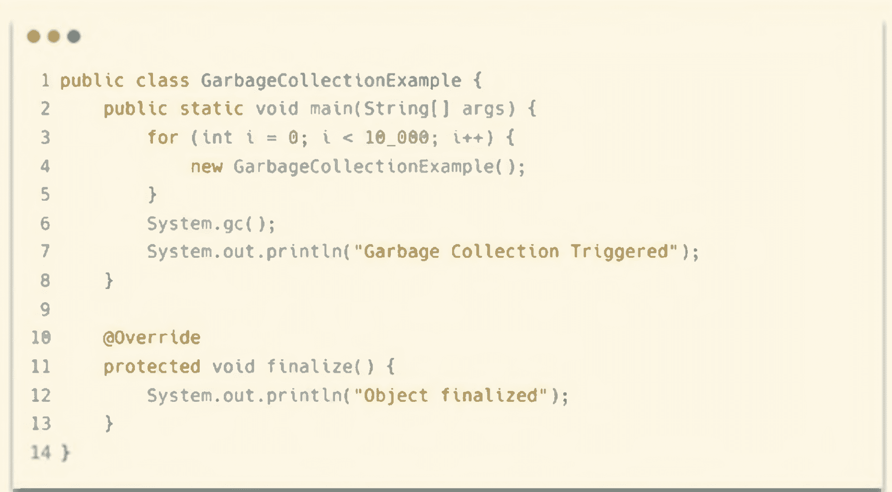
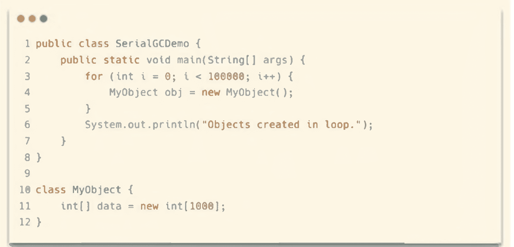
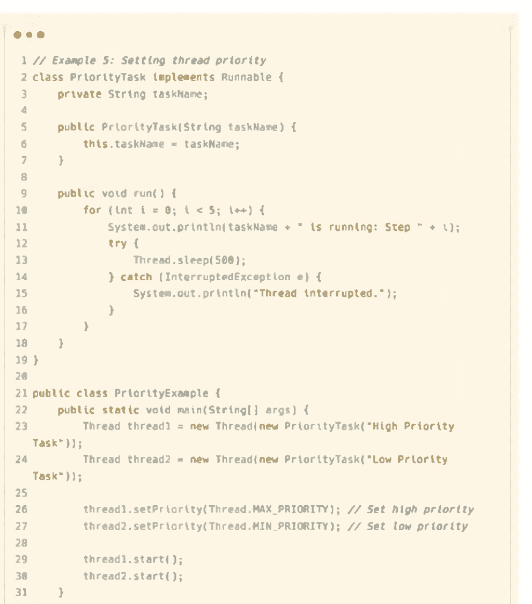
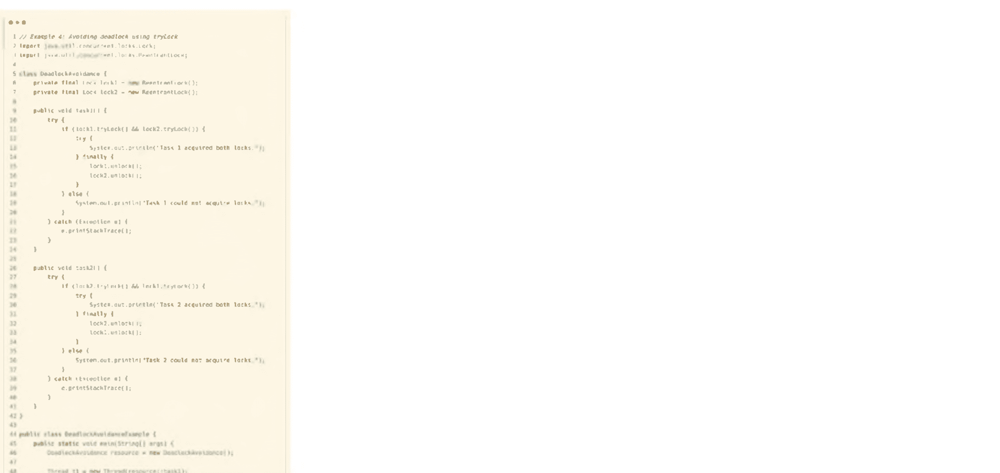
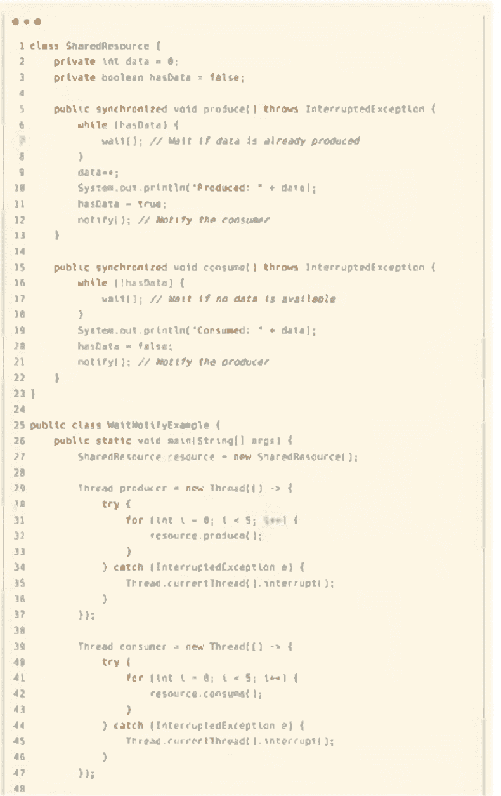
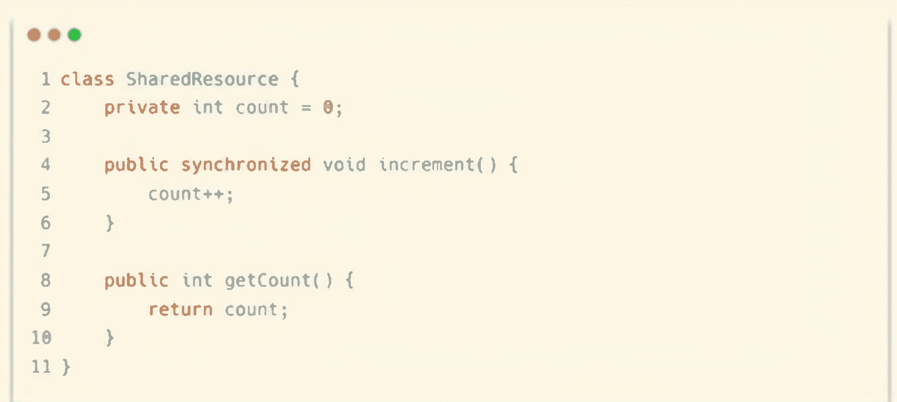

# Java 秘籍：高性能与可扩展性：利用高级 JVM 内部机制构建可扩展、高性能应用的专家技术，解锁 Java 的全部潜力（第一部分）

# 第一部分

## 献辞

献给每一个将技术视为将想法变为现实并克服挑战的人，这本书献给你们。

献给我的家人，他们一直在我身边，在最艰难的时刻提供无条件的支持和动力。给我的父母，他们教会了我努力和坚持的价值；以及给我的妻子，她的耐心、爱和鼓励给了我前行的力量。这本书在很大程度上是你们为我提供的支持和信任环境的结果。

献给朋友们，他们通过启发性的对话、思想交流和不断的鼓励，让这段旅程变得更加丰富和有意义。在每一次辩论、学习和见解的分享中，我意识到人际关系对于成长（无论是个人还是职业）是多么基础。

献给我的同事们，他们用创新的想法、创造性的解决方案以及对技术开发的热情启发了我。这本书反映了我多年来学习和分享的很多，我希望它也能激励他人去探索和创新。

最重要的是，献给你——读者，感谢选择这本书作为你在 Java 开发学习或进阶旅程中的伙伴。愿这些页面不仅是一份技术指南，更是灵感的来源，去创造出不仅功能完备而且打动连接人的应用程序。

相信代码的力量就是相信人类创造新颖、独特且有影响的事物。愿这本书成为迈向你无疑将实现的伟大想法的一小步。

Alex Harrison

## 致谢

这本书是一段旅程的结果，尽管有时是孤独的，但如果没有我周围优秀人士的支持与合作，这一切是不可能实现的。

首先，我想向家人表示感谢，他们的耐心和理解在密集的研究和写作期间至关重要。感谢我的父母，他们总是教我学习和努力工作的价值；感谢我的妻子，她的爱和不断的鼓励使即使在困难的时期也给了我坚持下去的力量。

感谢我的朋友们，他们丰富内容的对话和宝贵的建议帮助塑造了书中的许多想法。我们随时间推移分享的学习对于扩展我对 Java 开发的视角至关重要，并激励我将这些知识转化为这些文字。

我也感谢我的专业同事和导师，他们挑战我进行批判性思考，不断追求卓越并永不停止学习。他们的直接和间接贡献对本作品产生了重大影响。

感谢评审员和编辑，他们投入了时间和专业知识以确保这本书的清晰度和质量，我深表感谢。他们的工作改进了每一页，使这本书更易读。

最后，感谢你——读者，决定开启这段旅程。这本书是为你而写的，诚心希望它能成为你旅程中实用且富有启发性的工具。

致以谢意，

Alex Harrison

> “在书中，学习变得生动，并始终带我们走向远方。” - 尼尔·盖曼
>
> “机器只能遵循规则；心灵可以解释它们。” - 阿兰·图灵

## 引言

软件开发世界不断演变，像 Java 这样的技术在这种转型中起着核心作用。这本书《Java 秘密：高性能与可扩展性》经过精心制作，旨在满足初级开发者和希望扩展知识的专业人士的需求。

在这些页面中，你将找到一种理解 Java 基础和高级功能的清晰且实用的方法。从核心架构和内存管理，到线程、性能调优、云原生开发和容错等高级技术，目标是提供结合理论、实际示例和最佳实践的全面内容。

每一章的结构都是为了提供渐进式的学习体验。你将从探索 Java 执行模型和内存管理等基本概念开始，进到并发、反应式编程和微服务架构等主题。此外，还展示了真实案例，说明如何将这些概念应用于可扩展和韧性的企业级应用程序中。

这本书还强调了性能优化、安全和容错的重要性，反映了当今市场的需求——高效、安全和可靠的应用程序是至关重要的。

无论你是初级开发者还是寻求更新的经验专业人士，这本书都是邀请你探索 Java 提供的无限可能。欢迎来到这段学习与创造的旅程，每一行代码都是构建高性能、可扩展软件的一步！

## 前言

软件开发领域不断演进，而 Java 在构建高性能和可扩展的应用程序方面始终处于前沿。自诞生以来，Java 已经成长为一个多功能且强大的平台，使开发者能够创建健壮、高效且安全的企业级解决方案。这本书的诞生源于我想要分享这些知识，并帮助开发者（无论是初学者还是经验丰富的人士）充分发挥 Java 的潜力。

在我的职业生涯中，我注意到尽管可用信息非常丰富，但许多开发者在实践和有效应用 Java 核心概念方面仍然很困难。这一发现启发了我编写这本指南，它不仅涵盖了 Java 的基础原理，还通过真实案例和实战项目深入探讨了高级技术。

本书是我多年在 Java 开发领域学习、实验和工作的结晶。每一章的设计都旨在清晰、聚焦且具有实用性，将理论与可操作的见解相结合。我还包含了最佳实践和性能技巧，帮助您构建符合当今严苛技术标准的现代、可扩展且具有韧性的应用程序。

这不仅是一本技术指南，更是一份创新和优化的邀请。它反映了我通过代码构建高效系统的热情，以及我认为学习是一场终身之旅的信念。

无论您是 Java 新手还是寻求提升技能，本书都是为您量身的。我希望它能成为一份宝贵的资源，激励您在掌握 Java 性能和扩展性特性的同时，创造卓越的软件解决方案。

## 第一章

## 1 - 理解 Java 架构

探索 Java 的核心架构，包括 `JVM`、字节码和执行模型。

Java 的核心在于其强大的架构，它允许开发者编写出平台无关、可扩展且高效的代码。要理解这一架构，我们必须探索三个关键组件：`Java` 虚拟机 (`JVM`)、字节码和 `Java` 的执行模型。这些组件共同定义了 `Java` 代码如何被编译、执行和优化。

`JVM` 是 `Java` “一次编写，随处运行”承诺的基石。它充当了 `Java` 程序与环境之间的抽象层。（注：原文 OCR 为 "IVM"，已根据上下文更正为 "`JVM`"）。

在该程序中，`performCalculation` 方法被重复执行。`JIT` 编译器识别出该方法为“热点”，并将其编译为原生代码以提高性能。因此，你会发现与逐行解释相比，其执行速度更快。

`JVM` 的执行模型涉及几个阶段：类加载、字节码验证、执行和垃圾回收。类加载确保必要的类文件在内存中是可用的。字节码验证确保代码符合 `Java` 的安全约束，例如防止非法的类型转换或未经授权的内存访问。

你可以通过编写一个使用自定义类加载器的程序来实验类加载机制：

```java
1 public class CustomClassLoader extends ClassLoader {
2     public static void main(String[] args) throws Exception {
3         CustomClassLoader loader = new CustomClassLoader();
4         Class<?> cls = loader.loadClass("HelloWorld");
5         System.out.println("Class Loaded: " + cls.getName());
6     }
7 }
```

在这个示例中，自定义类加载器动态地加载了 `HelloWorld` 类。`Java` 的类加载机制支持分级和动态类加载，这对于 Web 服务器和框架等应用至关重要。

`JVM` 执行模型的另一个关键组件是垃圾回收器（`GC`）。`GC` 通过回收不再使用的对象来自动管理内存，这有助于防止内存泄漏。你可以在程序中手动触发垃圾回收器：

```java
public class GarbageCollectorExample {
    public static void main(String[] args) {
        for (int i = 0; i < 1000; i++) {
            new GarbageCollectorExample();
        }
        System.gc();
        System.out.println("Garbage Collection Triggered");
    }
}
```

在该程序中，创建了多个对象，`System.gc()` 方法请求垃圾回收器运行。然而，`JVM` 会根据其算法和内存需求决定何时执行垃圾回收。

`JVM` 还使用方法内联、循环展开和逃逸分析等技术来优化执行。这些优化会自动应用，以提高你代码的性能。例如，考虑以下简单方法：

```java
1 public class InlineExample {
2     public static void main(String[] args) {
3      long start = System.nanoTime();
4      for (int i = 0; i < 1000000; i++) {
5          inlineMethod();
6      }
7      long end = System.nanoTime();
8      System.out.println("Execution Time: " + (end - start) + " nanoseconds");
9  }
10 
11     private static void inlineMethod() {
12         int x = x + 10;
13     }
14 }
```

`JVM` 可能会自动内联 `inlineMethod` 方法，在编译期间将方法调用替换为实际实现。这减少了方法调用的开销并提高了性能。

总结来说，`Java` 架构依赖于 `JVM`、字节码和高级执行模型来提供平台独立性和高性能。`JVM` 作为运行时环境，解释或将字节码编译为机器码。字节码是 `Java` 程序的平台无关表示，而执行模型确保了执行的优化和安全。通过结合解释、`JIT` 编译、垃圾回收和运行时优化，`Java` 在不同平台上同时实现了可扩展性和效率。

### 1.1 - Java 架构简介

`Java` 架构概述及其在构建可扩展应用中的意义。

`Java` 架构的设计旨在性能、可移植性和扩展性之间取得平衡，这使其成为构建大型应用的理想选择。其核心是遵循了多层方法，由 `Java` 虚拟机（`JVM`）、`Java` 运行环境（`JRE`）和 `Java` 开发工具包（`JDK`）组成。理解这些组件对于利用 `Java` 进行高效可扩展的软件开发至关重要。

`Java` 架构的第一个元素是 `JVM`，它是 `Java` 平台无关性的基础。`JVM` 允许 `Java` 程序在任何操作系统或硬件上运行而无需修改。当你编写 `Java` 程序时，源代码会被编译成字节码，这是一种 `JVM` 解析或编译为机器码的中间格式。

为了说明这一点，让我们从编译和运行程序的简单示例开始。首先，创建一个源文件：

```java
1 public class Example {
    public static void main(String[] args) {
        System.out.println("Java Architecture in Action");
    }
}
```

使用 `javac` 命令编译程序：

```bash
1 javac Example.java
```

这将生成名为 `Example.class` 的字节码文件。`.class` 文件平台无关，包含了由 `JVM` 执行的指令。使用 `java` 命令运行程序：

```bash
1 java Example
```

`JVM` 加载字节码并在机器上执行它。这种抽象使得 `Java` 能够在不同平台之间保持兼容性，这是部署在各种基础设施上的可扩展应用的关键特性。

`Java` 架构的第二个组件是 `JRE`，它包含了 `JVM` 和执行 `Java` 程序所需的额外库。`JRE` 提供了一个让 `Java` 程序可以顺畅运行的运行时环境。例如，如果你安装了 `Java` 运行环境，你可以执行任何 `.class` 文件而不需要源代码。

对于较大的应用程序，`Java` 架构提供了增强扩展性的功能。其中一个功能是多线程，它允许任务的并发执行。多线程对于需要同时处理多个用户或进程的应用来说至关重要。

这是一个基础多线程程序的示例：

```java
public class MultiThreadExample implements Runnable {
    private String taskName;

    public MultiThreadExample(String taskName) {
        this.taskName = taskName;
    }

    public void run() {
        for (int i = 0; i < 5; i++) {
            System.out.println(taskName + " - Iteration: " + i);
        }
    }

    public static void main(String[] args) {
        Thread thread1 = new Thread(new MultiThreadExample("Task 1"));
        Thread thread2 = new Thread(new MultiThreadExample("Task 2"));

        thread1.start();
        thread2.start();
    }
}
```

#### 客户端代码：

```java
import java.rmi.*;

public class RMIClient {
    public static void main(String[] args) {
        try {
            RemoteInterface obj = (RemoteInterface)
                Naming.lookup("RMIServer");
            System.out.println(obj.sayHello());
        } catch (Exception e) {
            System.err.println("Client exception: " + e.toString());
        }
    }
}
```

要运行此程序，请编译服务器和客户端代码，启动 `RMI` 注册表，然后运行服务器和客户端。`RMI` 框架允许跨分布式系统进行方法调用，这对于构建可扩展的应用程序至关重要。

`Java` 架构还包含了健壮的库和框架，例如 `Java EE` 和 `Spring`，它们简化了企业级应用程序的开发。这些框架处理依赖注入、事务管理和负载均衡，这些对于可扩展性至关重要。

使用 `Spring Boot` 框架创建 `REST API` 的实际示例如下：

#### Spring Boot 应用：

```java
import org.springframework.boot.SpringApplication;
import org.springframework.boot.autoconfigure.SpringBootApplication;
import org.springframework.web.bind.annotation.GetMapping;
import org.springframework.web.bind.annotation.RequestMapping;
import org.springframework.web.bind.annotation.RestController;

@SpringBootApplication
public class SpringBootExample {
    public static void main(String[] args) {
        SpringApplication.run(SpringBootExample.class, args);
    }
}

@RestController
@RequestMapping("/api")
class ApiController {
    @GetMapping("/hello")
    public String sayHello() {
        return "Hello, Scalable World!";
    }
}
```

运行此程序后，你可以在 `http://localhost:8080/api/hello` 访问 `REST API`。`Spring Boot` 框架抽象了构建可扩展 Web 服务的大部分复杂性，让开发者能够专注于业务逻辑。

`Java` 架构还通过在 `Java 9` 中引入的模块系统促进了模块化。模块化有助于管理依赖并提高大型应用程序的可扩展性。你可以使用 `module-info.java` 文件定义模块：

```java
module com.example.app {
    requires java.base;
    exports com.example;
}
```

这种模块化方法允许开发者创建松耦合的组件，从而提高应用程序的可维护性和可扩展性。

通过结合平台无关性、多线程、垃圾收集、分布式计算能力和强大的框架，`Java` 架构提供了构建可扩展应用程序所需的工具。`JVM` 确保了高效的执行和优化，而 `Java` 广泛的生态系统简化了复杂大型系统的开发。无论运行在单机上还是跨分布式环境，`Java` 架构都能适应性能和可扩展性的需求。

### 1.2 - Java 虚拟机 (JVM)

解释 `JVM` 在执行 `Java` 应用程序中的作用。

`Java` 虚拟机 (`JVM`) 是 `Java` 平台的核心组件，允许 `Java` 应用程序无需修改即可在任何系统上运行。它作为抽象硬件和操作系统的运行时，实现了 `Java` 的平台无关性。`JVM` 获取 `Java` 字节码，对其进行验证并执行，执行方式可以是逐行解释，也可以使用即时编译（`JIT`）编译将其编译为原生机器码。

当你编译 `Java` 程序时，`javac` 编译器会将源代码转换为一种称为字节码的中间形式。这种字节码是平台无关的，设计用于 `JVM` 执行。以下简单程序演示了这一点：

```java
public class HelloJVM {
    public static void main(String[] args) {
        System.out.println("Understanding the JVM!");
    }
}
```

使用以下命令编译此程序：

```bash
javac HelloJVM.java
```

这会创建一个名为 `HelloJVM.class` 的包含字节码的文件。要执行程序，请使用 `java` 命令：

```bash
java HelloJVM
```


JVM 在执行期间执行三项主要任务：类加载、字节码验证和执行。首先，JVM 通过其`类加载器 (ClassLoader)`子系统将`class`文件加载到内存中。然后，它验证字节码，最后执行它。要检查字节码，请使用`javap`命令：

```bash
javap -c HelloJVM
```

```java
public class JITExample {
    public static void main(String[] args) {
      long startTime = System.nanoTime();
      for (int i = 0; i < 1000000000; i++) {
        calculate();
      }
      long endTime = System.nanoTime();
      System.out.println("Execution Time: " + (endTime - startTime) / 1e9 + " seconds");
    }
  
    static void calculate() {
      int x = 10 * 20;
    }
}
```

在该程序中，`calculate`方法被重复执行。JIT 编译器识别其为“热点”代码并将其编译为原生代码。结果是循环随着时间的推移运行得越来越快。

JVM 还支持分析和调试，以监控应用程序的行为。`-Xprof`选项会生成程序的性能分析文件。运行以下命令：

```bash
java -Xprof JITexample
```

输出显示了哪些方法消耗了大部分时间，帮助你优化应用程序的关键部分。

总结来说，JVM 通过加载字节码、验证其完整性并通过解释或 JIT 编译高效执行，充当了 Java 应用程序的骨干。它通过垃圾回收管理内存，通过 JIT 编译器优化执行，并提供监控和调试工具。通过抽象底层系统，JVM 确保了 Java 应用程序可以在跨平台上可靠运行，使其成为构建高性能和可扩展应用程序的关键性组件。

### 1.2.1 - JVM 组件

对 JVM 组件（如类加载器、内存区域和执行引擎）的详细解释。

Java 虚拟机（JVM）分为几个组件，它们共同工作以高效执行 Java 程序。JVM 的三个关键组件是`类加载器 (Class Loader)`、`内存区域 (Memory Areas)`和`执行引擎 (Execution Engine)`。这些组件确保了 Java 的平台无关性、动态类加载、内存管理和优化执行。

`类加载器`子系统是 Java 程序执行时第一个介入的组件。它的职责是将类文件加载到 JVM 中。类加载器将字节码文件（`.class`）加载到 JVM 并对其进行链接以执行。该过程包含三个阶段：`加载 (Loading)`、`链接 (Linking)`和`初始化 (Initialization)`。

为了演示类加载，让我们创建一个自定义的类加载器来动态加载类：

```java
import java.io.*;

public class CustomClassLoader extends ClassLoader {
  public Class<?> loadClassFromFile(String name) throws ClassNotFoundException {
    try {
      FileInputStream fis = new FileInputStream(name + ".class");
      byte[] bytecode = fis.readAllBytes();
      fis.close();
      return defineClass(null, bytecode, 0, bytecode.length);
    } catch (IOException e) {
      throw new ClassNotFoundException("Class not found", e);
    }
  }

  public static void main(String[] args) throws Exception {
    CustomClassLoader loader = new CustomClassLoader();
    Class<?> clazz = loader.loadClassFromFile("HelloWorld");
    Object instance = clazz.getDeclaredConstructor().newInstance();
    System.out.println("Class loaded successfully: " + clazz.getName());
  }
}
```

在这里，自定义类加载器将`class`文件读取为字节流并使用`defineClass`方法将其加载到 JVM 中。要测试这一点，首先创建一个简单的类：

```java
public class HelloWorld {
    public HelloWorld() {
        System.out.println("Hello from HelloWorld class");
    }
}
```

使用以下命令编译类：

```bash
javac HelloWorld.java
```

运行自定义类加载器程序以动态加载`HelloWorld.class`：

```bash
java CustomClassLoader
```

此示例强调了类加载器在运行时动态加载类的作用，这是模块化应用程序的基础。

一旦类被加载，JVM 就会在`内存区域`中为它们分配内存。JVM 内存分为五个主要区域：`方法区域（Method Area）`、`堆（Heap）`、`栈（Stack）`、`程序计数器寄存器（PC Register）`和`本地方法栈（Native Method Stack）`。每个内存区域在程序执行中都起着至关重要的作用。

`堆 (Heap)`是存储对象的区域。`方法区域 (Method Area)`存储元数据、类级信息和方法字节码。局部变量和方法调用细节存储在`栈 (Stack)`中，每次方法都会创建一个新的栈帧。

这是一个演示在堆上创建对象和在栈上进行方法调用的示例：

```java
public class MemoryExample {
    public static void main(String[] args) {
      MemoryExample example = new MemoryExample(); // Object on the Heap
      example.displayMessage();
    }
  
    public void displayMessage() {
      int localVar = 10; // Local variable on the Stack
      System.out.println("Heap and Stack Memory Example: " + localVar);
    }
}
```

在这个示例中，`example`对象在堆中分配了内存，而局部变量`localVar`和方法调用信息存储在栈中。使用以下命令运行程序：

```bash
java MemoryExample
```

执行时，JVM 为该对象创建内存并为`main`方法管理栈帧。

`执行引擎 (Execution Engine)`是 JVM 中负责执行字节码的组件。它可以通过两种方式执行：`解释 (Interpretation)`和`即时编译 (Just-In-Time (JIT) Compilation)`。最初，JVM 逐行解释字节码，速度较慢。为了提高性能，JIT 编译器会将频繁执行的代码（热点）转换为原生代码。

这是一个演示 JIT 的程序示例：

```java
public class JIToptimization {
    public static void main(String[] args) {
        long startTime = System.nanoTime();
        for (int i = 0; i < 1000000000; i++) {
            calculate();
        }
        long endTime = System.nanoTime();
        System.out.println("Execution Time: " + (endTime - startTime) / 1e9 + " seconds");
    }

    static void calculate() {
        int result = 5 + 10;
    }
}
```

使用以下命令运行程序：

```bash
java JIToptimization
```

你可以启用 JIT 编译日志来观察：

```bash
java -XX:+PrintCompilation JIToptimization
```

JVM 还支持垃圾回收，这是内存管理的一部分。它回收未引用对象占用的内存，确保堆的高效利用。垃圾回收由垃圾回收线程与程序并行执行。

这是一个观察垃圾回收运行的示例：

```java
public class GarbageCollectionDemo {
    public static void main(String[] args) {
        for (int i = 0; i < 10000; i++) {
            new GarbageCollectionDemo();
        }
        System.gc(); // Suggest garbage collection
        System.out.println("Garbage Collection Triggered");
    }

    @Override
    protected void finalize() throws Throwable {
        System.out.println("Object is garbage collected");
    }
}
```

编译并运行程序：

```bash
java GarbageCollectionDemo
```

在该程序中，创建了许多对象但没有引用。回收器会移除它们并调用`finalize`方法。虽然`System.gc()`建议垃圾回收，但 JVM 决定执行它的合适时间。

这是一个调用原生方法的示例：

```java
public class NativeExample {
  static {
     System.loadLibrary("nativeLib");
  }

  public native void sayHello();

  public static void main(String[] args) {
    new NativeExample().sayHello();
  }
}
```

要创建原生方法，请编写相应的 C 实现并将其编译为共享库。使用`javah`工具将该库链接到程序中并运行：

```bash
java NativeExample
```

这种集成凸显了`原生方法栈（Native Method Stack）`在连接 Java 与原生代码以进行底层系统操作中的作用。

JVM 的组件——类加载器（Class Loader）、内存区域和执行引擎——协同工作，高效地加载、管理和执行 Java 程序。类加载器动态加载类，内存区域管理数据存储，而执行引擎通过 JIT 编译确保优化的执行。它们共同使 JVM 成为一个运行可扩展和高性能 Java 应用程序的强大引擎。

### 1.2.2 - JVM 生命周期

描述从程序编译到执行的生命周期。

JVM 生命周期涵盖了 Java 程序从编译、加载、验证、执行到最终终止的整个过程。这一生命周期确保了 Java 虚拟机（JVM）在保持平台独立性和健壮性能的同时，高效地管理 Java 程序的执行。理解此生命周期的每个阶段将帮助开发者优化应用程序，以实现扩展性和高性能。

生命周期始于`程序编译`。编写在`java`文件中的 Java 源代码使用`javac`编译器编译为字节码。字节码是 JVM 可理解的平台无关中间表示。考虑以下示例：

```java
public class LifecycleExample {
    public static void main(String[] args) {
        System.out.println("JVM Lifecycle Demonstration");
    }
}
```

要编译此程序，使用`javac`命令：

```bash
javac LifecycleExample.java
```

`javac`编译器会生成`.class'文件，其中包含字节码。你可以通过列出目录内容来确认编译字节码的存在：

```bash
ls
```

输出将包含`LifecycleExample.class`文件。

编译完成后，JVM 生命周期的下一步是`类加载`。类加载器系统将字节码加载到 JVM 内存中。JVM 遵循分层的类加载机制，由`启动类加载器（Bootstrap Class Loader）`、`扩展类加载器（Extension Class Loader）`和`应用类加载器（Application Class Loader）`组成。

为了观察类加载的过程，可以使用以下程序，它可以打印特定类的类加载器：

```java
public class ClassLoaderDemo {
    public static void main(String[] args) {
        System.out.println("Class Loader of this class: " +
        ClassLoaderDemo.class.getClassLoader());
        System.out.println("Class Loader of String: " +
        String.class.getClassLoader());
    }
}
```

编译并运行程序：

```bash
javac ClassLoaderDemo.java
java ClassLoaderDemo
```

输出将显示`ClassLoaderDemo`类是由`应用类加载器`加载的，而`String`类（Java 核心类）是由原生代码编写的`启动类加载器`加载的。

加载之后，下一阶段是`字节码验证`。JVM 验证字节码符合 Java 的安全和安全约束，确保没有非法指令或类型不匹配。验证防止了恶意或损坏字节码的执行。

以下是一个使用故意错误修改的无效字节码示例：

```bash
javap -c LifecycleExample
```

使用`javap`工具检查`LifecycleExample`的字节码。如果字节码被篡改（在典型用法之外），验证器将拒绝它，并且 JVM 将抛出`VerifyError`。

通过验证后，`执行引擎`开始执行字节码。JVM 执行模型遵循两种方法：`解释（Interpretation）`和`即时编译（JIT Compilation）`。最初，字节码逐行解释，但 JIT 编译器会识别频繁执行的代码（热点）并将其编译为原生机器码以加快执行速度。

以下程序演示了 JIT 编译对频繁执行方法的影响：

```java
public class JITDemo {
    public static void main(String[] args) {
        long startTime = System.nanoTime();
        for (int i = 0; i < 1_000_000_000; i++) {
            addNumbers();
        }
        long endTime = System.nanoTime();
        System.out.println("Execution time: " + (endTime - startTime) / 1e9 + " seconds");
    }

    public static int addNumbers() {
        return 5 + 10;
    }
}
```

编译并执行程序：

```bash
javac JITDemo.java
java JITDemo
```

使用以下标志启用 JIT 编译日志以观察编译细节：

```bash
java -XX:+PrintCompilation JITDemo
```

输出将显示哪些方法被 JIT 编译器编译为原生代码，从而提高了执行速度。

在执行期间，JVM 还通过`垃圾回收（GC）`管理内存。GC 通过移除不再被引用的对象来回收内存，确保堆的高效使用。以下示例演示了 JVM 生命周期中的垃圾回收：

编译并执行程序：

```bash
javac GarbageCollectionLifecycle.java
java GarbageCollectionLifecycle
```

程序创建了大量对象，JVM 的垃圾回收器会回收内存。`finalize`方法在每个对象销毁之前被调用，显示了对象在执行期间的生命周期。

执行完成后，JVM 终止。`JVM 关钩子（JVM Shutdown Hook）`允许开发者在 JVM 关闭之前执行特定任务，例如关闭资源或保存应用程序状态。以下是添加关闭钩子的示例：


```java
public class ShutdownHookExample {
    public static void main(String[] args) {
        Runtime.getRuntime().addShutdownHook(new Thread(() -> {
            System.out.println("Shutdown Hook Executed. Cleanup.");
        }));

        System.out.println("Application is running...");
        try {
            Thread.sleep(3000);
        } catch (InterruptedException e) {
            e.printStackTrace();
        }
    }
}
```

编译并运行程序：

```bash
javac ShutdownHookExample.java
java ShutdownHookExample
```

```java
public class BytecodeExample {
    public static void main(String[] args) {
        int a = 5;
        int b = 10;
        int sum = a + b;
        System.out.println("Sum: " + sum);
    }
}
```

使用 `javac` 命令编译该程序：

```
javac BytecodeExample.java
```

`javac` 编译器会生成 `BytecodeExample.class` 文件。要查看字节码，请使用 `javap` 工具配合 `-c` 选项，它会将字节码反汇编为人类可读的指令：

输出如下：

```
...
Compiled From "BytecodeExample.java"
public class BytecodeExample {
  public BytecodeExample() {
    Code:
    6 aload_0
    1 invokespecial #1    // Method java/lang/Object.<init>
    <init>V
    4 return
  }
  public static void main(String[] args) {
    Code:
    8 iconst_5
    1 istore_5
    8
    2 bipush
    4 istore_2
    5 iload_2
    7 load_0
    8 istore_3
    9 getstatic              // Field java/lang/System.out:java/io/PrintStream;
    17 new                   #3    // class java/lang/StringBuilder;
    
    15 dup
    16 invokespecial #4   // Method java/lang/StringBuilder.<init>()V
    19 ldc                   // String Sue
    21 invokesevirtual #5   // Method
    java/lang/StringBuilder.append(Ljava/lang/String;)Ljava/lang/Builder;
    29    24 iload_3
    25 invokesevirtual #6   // Method
    java/lang/StringBuilder.append(I)Ljava/lang/StringBuilder;
    27 invokesevirtual #7   // Method
    java/lang/StringBuilder.toString()Ljava/lang/String;
    31 invokeokirtual #8    // Method
```

此输出分解了 `main` 方法的每一条字节码指令。以下是一些关键指令的含义：

- `iconst_5`：将整数常量 `5` 推入操作数栈。
- `bipush 10`：推入整数常量 `10`。
- `iadd`：将栈上的两个整数相加。
- `istore`：将结果存储到局部变量中。
- `getstatic`：静态字段，例如 `System.out`。
- `invokevirtual`：调用方法，例如 `println()`。

JVM 在执行期间逐行解释这些指令，或者使用 JIT 编译将它们编译为原生代码以提高性能。

为了更好地理解字节码，让我们来探索一个简单的条件语句：

```java
public class ConditionExample {
    public static void main(String[] args) {
        int a = 10;
        if (a > 5) {
            System.out.println("a is greater than 5");
        } else {
            System.out.println("a is not greater than 5");
        }
    }
}
```

编译该程序：

```
javac ConditionExample.java
```

反汇编字节码：

```
javap -c ConditionExample
```

输出显示了 JVM 如何处理条件语句：

```
0: bipush              10
2: istore_1
3: iload_1
4: iconst_5
5: if_icmp             16
8: getstatic           #2      // Field
      java/lang/System.out:Ljava/io/PrintStream;
11: ldc                #3      // String a is greater than 5
13: invokeokevirtual   #4      // Method
      java/io/PrintStream.println:(Ljava/lang/String;)V
16: goto               28
19: getstatic         #2      // Field
      java/lang/System.out:Ljava/io/PrintStream;
22: ldc                 #5      // String a is not greater than 5
24: invokeokevirtual   #4      // Method
      java/io/PrintStream.println:(Ljava/lang/String;)V
27: return
```

`if_icmple` 检查 `a <= 5` 并根据结果跳转到相应的代码块。

接下来，让我们观察循环是如何转换为字节码的：

```java
public class LoopExample {
    public static void main(String[] args) {
        for (int i = 0; i < 3; i++) {
            System.out.println("Iteration: " + i);
        }
    }
}
```

编译该程序：

```
javac LoopExample.java
```

#### 反汇编字节码：


字节码将包含初始化循环、检查条件、执行体和增加循环变量的指令：

```
0: iconst_0
1: istore_1
2: iload_1
3: iconst_3
4: if_icmpge 2
5: goto
6: getstatic // Field
java/lang/System.out:java/io/PrintStream;
7: new class java/lang/StringBuilder
8: ldc #3
9: dup
10: invokespecial #4 // Method
java/lang/StringBuilder.<init>()V
11: ldc #5 // Iteration:
12: invokesevirtual #6 // Method
java/lang/StringBuilder.append(I)Ljava/lang/StringBuilder;
13: iload_3
14: invokesevirtual #7 // Method
java/lang/StringBuilder.toString()Ljava/lang/String;
15: invokesevirtual #8 // Method
java/io/PrintStream.println(Ljava/lang/String;)V
16: goto
17: getstatic // Field
java/lang/System.out:java/io/PrintStream;
18: goto
19: return
```

以下是关键指令的详细介绍：

- `const_5`：将常量 `5` 推入操作数栈。
- `bipush 10`：将常量 `10` 推入操作数栈。
- `iadd`：将操作数栈顶两个整数相加。
- `istore_x`：将结果存储到局部变量中。
- `getstatic`：访问 `System.out` 静态字段。
- `invokevirtual`：调用如 `println` 等方法。

为了进一步探索，让我们从字节码层面查看方法调用是如何工作的。更新程序以包含一个方法调用：

```java
public class MethodBycode {
    public static void main(String[] args) {
        int result = addNumbers(5, 10);
        System.out.println("Sum: " + result);
    }

    public static int addNumbers(int x, int y) {
        return x + y;
    }
}
```

编译并反汇编程序：

```
javac MethodBycode.java
javap -c MethodBycode
```

`addNumbers` 方法的字节码输出将包含：

```
public static int addNumbers(int, int);
   Code:
  0: iload_0
  1: iload_1
  2: iadd
  3: ireturn
```

在这里：

- `iload_0`：将第一个参数 `x` 加载到操作数栈。
- `iload_1`：加载第二个参数 `y`。
- `iadd`：将两个值相加。
- `ireturn`：将结果返回给调用方法。

在 `main` 方法中，由于 `addNumbers` 是静态方法，使用了 `invokestatic` 指令。

现在考虑条件语句，查看字节码是如何处理分支的：

```java
public class ConditionalBytecode {
   public static void main(String[] args) {
     int number = 7;
     if (number > 5) {
       System.out.println("Number is greater than 5");
     } else {
       System.out.println("Number is less than or equal to 5");
     }
  }
}
```

编译并反汇编：

```
javac ConditionalBytecode.java
javap -c ConditionalBytecode
```

字节码输出包含了类似 `if_icmple` 的条件指令：

```
0: bipush 7
2: istore_1
3: iload_1
4: iconst_5
5: if_icmple 16
8: getstatic #2 // Field
java/lang/System.out:Ljava/io/OutputStream;
11: ldc #3 // String Number is greater than
5
13: invokevirtual #4 // Method
java/io/PrintStream.println:(Ljava/lang/String;)V
16: goto 28
19: getstatic #2 // Field
java/lang/System.out:Ljava/io/OutputStream;
22: ldc #5 // String Number is less than or
equal to 5
24: invokevirtual #4 // Method
java/io/PrintStream.println:(Ljava/lang/String;)V
27: return
```

在这里：

- `if_icmple`：检查 `number` 的值是否小于或等于 5，如果是则跳转到 `else` 块。
- `goto`：当条件满足时跳过 `else` 块。

JVM 使用类似 `if_icmp` 和 `goto` 的**分支**指令来实现控制流结构。

现在让我们探索循环在字节码中是如何表示的：

```java
public class LoopBybytecode {
  public static void main(String[] args) {
    for (int i = 0; i < 3; i++) {
      System.out.println("Iteration: " + i);
    }
  }
}
```

编译并反汇编：

```
javac LoopBytecode.java
javap -c LoopBytecode
```

字节码包含了初始化、检查和增加循环变量的指令：

```
0: const_0
1: istore_1
2: iload_1
3: const_3
4: if_icmpge 23
7: getstatic #2
10: new #3
13: dup
14: invokespecial #4
17: ldc #5
19: iload_1
20: invokirtual #6
23: invokirtual #7
26: iinc 1, 1
29: goto 2
32: return
```

在这里：

- `if_icmpge`：比较 `i` 和 `3`，如果条件失败则退出循环。
- `iinc`：增加循环变量 `i`。
- `goto`：跳回循环条件检查。

最后，让我们演示字节码是如何处理对象创建的：

```java
public class ObjectBytecode {
    public static void main(String[] args) {
        ObjectBytecode obj = new ObjectBytecode();
        obj.printMessage();
    }
}
```

（注：`ObjectBytecode` 部分的 OCR 文本存在碎片，我根据提供的原始文本重构了逻辑结构。）

`2 * 5` 是一个常量表达式。JVM 将通过**循环不变代码移动**对其进行优化，将常量计算移动到循环之外。这防止了不必要的重复计算，提高了效率。

JVM 还使用**逃逸分析**来优化对象分配和内存使用。逃逸分析用于确定对象是否超出了当前方法或线程的使用范围。如果一个对象没有“逃逸”，JVM 可以将其分配在栈上而不是堆上，从而减少垃圾回收的开销。

这里是一个演示逃逸分析的示例：

```java
public class EscapeAnalysis {
    public static void main(String[] args) {
        long start = System.nanoTime();
        for (int i = 0; i < 1000; i++) {
            writeObject();
        }
        long end = System.nanoTime();
        System.out.println("Execution Time: " + (end - start) / 1e6 + " ms");
    }

    public static void writeObject() {
        Data data = new Data(10, 20);
        int result = data.x + data.y;
    }

    static class Data {
        int x, y;
        Data(int x, int y) {
            this.x = x;
            this.y = y;
        }
    }
}
```

在启用逃逸分析的情况下运行程序：

```bash
java -XX:+DoEscapeAnalysis -XX:+PrintGCEscapeAnalysis
```


JVM 确定 `Data` 对象没有逃逸出 `writeObject` 方法，因此它将对象分配在栈上而不是堆上。这减少了内存占用和垃圾回收的频率。

**死代码消除**会移除不影响程序输出的字节码。这通过消除冗余操作减少了执行开销。例如：

```java
public class DeadCodeExample {
    public static void main(String[] args) {
        int a = 10;
        int b = 20;
        int unused = a + b; // 未使用的代码
        System.out.println("Hello, World!");
    }
}
```

编译并运行程序：

```bash
javac DeadCodeExample.java
java -XX:+PrintCompilation DeadCodeExample
```

JVM 消除了计算 `a + b`，因为它的结果没有被使用。死代码消除减少了不必要的计算，提高了性能。

JVM 还使用**常量折叠**对字节码进行优化。如果一个计算只涉及常量，JVM 会在执行期间将其替换为结果。这里有一个示例：

```java
public class ConstantFolding {
  public static void main(String[] args) {
    int result = 100 * 20 * 5;
    System.out.println("Result: " + result);
  }
}
```

编译并运行程序：

```bash
javac ConstantFolding.java
java -XX:+PrintCompilation ConstantFolding
```

JVM 检测到 `100*20*5` 是一个常量表达式，并将其替换为预计算的结果 `10000`。这消除了运行时进行乘法的需要，节省了 CPU 周期。

通过结合这些优化手段——JIT 编译、方法内联、循环优化、逃逸分析、死代码消除和常量折叠——JVM 确保 Java 应用程序高效运行并有效利用系统资源。

Java 字节码优化是在运行时动态应用的，这允许 JVM 适应应用程序的行为。这些技术使 JVM 在平衡性能和内存使用的同时，将复杂的优化操作从开发者中抽象出来。理解这些优化有助于开发者编写高效代码并分析运行时性能，使 Java 成为高性能和可扩展应用程序的强大平台。

### 1.4 Java 执行模型

讨论 Java 的执行模型，从代码编译到运行时执行。

Java 的执行模型是一个结构化过程，确保了平台无关性、效率和高性能。它从代码编译开始，到由 Java 虚拟机（JVM）管理的运行时执行结束。执行模型包括几个关键阶段，如源码编译、字节码生成、类加载、验证以及使用解释或即时编译（JIT）进行字节码执行。每一步都为 Java 应用程序的可靠性和速度做出贡献。

执行始于 **Java 编译器**将源代码转换为字节码。写在 `.java` 文件中的 Java 源代码使用 `javac` 编译器编译成字节码。字节码是一组可以由 JVM 执行的平台无关的指令。

为了理解这个过程，请编写一个简单的程序：

```java
public class ExecutionModelExample {
    public static void main(String[] args) {
        System.out.println("Java Execution Model Demonstration");
    }
}
```

使用 `javac` 命令编译程序：

```bash
javac ExecutionModelExample.java
```

这生成了一个名为 `ExecutionModelExample.class` 的 `.class` 文件。要确认文件是否存在，请列出目录内容：

```bash
ls
```

在此阶段，Java 源代码已经转换为字节码。

执行模型中的下一步是**类加载**。当你运行 Java 程序时，JVM 使用类加载器子系统将编译后的 `.class` 文件加载到内存中。类加载器遵循层次结构：**启动类加载器 (Bootstrap ClassLoader)**加载核心 Java 库，**扩展类加载器 (Extension ClassLoader)**加载来自 `ext` 目录的库，**应用类加载器 (Application ClassLoader)**加载自定义类。

使用 `java` 命令运行程序：

```bash
java ExecutionModelExample
```

要观察哪个类正在加载，请使用以下：

```java
public class ExecutionModelExample {
    public static void main(String[] args) {
        System.out.println("Java Execution Model Demonstration");
    }
}
```

输出将显示 `ExecutionModelExample` 类是由应用类加载器加载的，而核心 Java 库一部分的 `String` 类是由启动类加载器加载的。

要观察 JIT 编译，请使用以下：

```java
public class ExecutionModelExample {
    public static void main(String[] args) {
        System.out.println("Java Execution Model Demonstration");
    }
}
```

编译并运行程序：

```bash
javac ExecutionModelExample.java
java ExecutionModelExample
```

为了进一步演示字节码执行，让我们来看一个带有控制流（如条件和循环）的程序。JVM 通过减少不必要的分支和检查来优化此类代码。

```java
public class ControlFlowExample {
    public static void main(String[] args) {
        int value = 10;
        if (value > 5) {
            System.out.println("Value is greater than 5");
        } else {
            System.out.println("Value is less than or equal to 5");
        }

        for (int i = 0; i < 3; i++) {
            System.out.println("Iteration: " + i);
        }
    }
}
```

编译并反汇编字节码：

```bash
javac ControlFlowExample.java
javap -c ControlFlowExample
```

字节码输出包含了用于条件判断的 `if_icmpgt` 和用于循环控制的 `goto` 指令：

```
0: bipush 10
2: istore_1
3: iload_1
4: iconst_5
5: if_icmple 16
6: getstatic #2 // Field java/lang/System.Out:Ljava/io/PrintStream;
7: ldc #3 // String Value is greater than 5
8: invokirtual #4 // Method java/io/PrintStream.println:(Ljava/lang/String;)JV
9: goto 28
10: getstatic #2 // Field java/lang/System.Out:Ljava/io/PrintStream;
11: ldc #5 // String Value is less than or equal to 5
12: invokirtual #4 // Method java/io/PrintStream.println:(Ljava/lang/String;)JV
13: 27: return
```

JVM 在执行期间会通过**循环展开**和分支预测来优化循环和条件判断。

Java 执行模型的最后一部分是**垃圾回收 (GC)**。JVM 通过回收堆上未使用的对象来自动管理内存。垃圾回收可以提高应用程序的性能并减少内存泄漏。

这里有一个观察垃圾回收的程序：



编译并运行该程序：

```bash
javac GarbageCollectionExample.java
java -verbose:gc GarbageCollectionExample
```

`-verbose:gc` 标记会输出垃圾回收活动的详情：

```
[GC (System.gc()) 65536K->38912K(125952K), 0.0150117 secs)
Garbage Collection Triggered
Object finalized
```

JVM 自动管理内存并为新对象释放空间。

Java 的执行模型将静态编译与动态运行时优化相结合。JVM 加载类、验证字节码以确保安全性、解释或编译代码以供执行，并通过垃圾回收高效地管理内存。通过理解执行模型的每个阶段，开发者可以更好地优化代码以提高性能和可扩展性。

#### 1.4.1 即时编译 (JIT) 编译

详细说明了 JIT 编译如何提高运行时性能。

即时编译（JIT）编译是 Java 虚拟机（JVM）使用的一种关键优化技术，用于提高 Java 应用程序的运行时性能。与传统的解释（JVM 逐行执行字节码）不同，JIT 在运行时将频繁执行的字节码编译为原生机器代码。这减少了开销并允许程序运行快得多。JIT 通过在执行期间识别“热点”路径来动态平衡性能与资源使用。

为了观察 JIT 编译的效果，考虑一个具有重复方法调用的简单程序：

```java
public class JITCompilationExample {
    public static void main(String[] args) {
        long start = System.nanoTime();
        for (int i = 0; i < 1_000_000_000; i++) {
            calculate();
        }
        long end = System.nanoTime();
        System.out.println("Execution time: " + (end - start) / 1e9 + " seconds");
    }

    public static int calculate() {
        return 5 + 10;
    }
}
```

编译该程序：

```bash
javac JITCompilationExample.java
```

使用 `-XX:+PrintCompilation` 选项运行程序以观察 JIT 编译日志：

```bash
java -XX:+PrintCompilation JITCompilationExample
```

输出显示方法在被频繁执行时会被 JIT 编译器编译：

| 1 | 57 | 1 JITCompilationExample::calculate (5 bytes) |
| 2 | 112 | 2 java/lang/StringBuilder::append (15 bytes) |

在这里，`calculate` 方法被编译成了原生机器代码，因为它被重复调用。这减少了解释执行的开销并加快了程序的运行速度。

JIT 编译使用多种策略来优化性能。其中一个关键策略是**方法内联**，它用方法的实际实现替换方法调用。这消除了方法调用的开销。

为了演示方法内联，创建一个带有简单方法的小程序：

```java
public class MethodInliningExample {
    public static void main(String[] args) {
        long start = System.nanoTime();
        for (int i = 0; i < 1_000_000_000; i++) {
            inlineMethod();
        }
        long end = System.nanoTime();
        System.out.println("Execution time: " + (end - start) / 1e9 + " seconds");
    }

    public static void inlineMethod() {
        int x = 10 * 20;
    }
}
```

使用以下命令编译并运行以启用内联日志：

```bash
java -XX:+UnlockDiagnosticVMOptions -XX:+PrintInlining MethodInliningExample
```

输出将确认 `inlineMethod` 已内联：

```
57 1 MethodInliningExample::inlineMethod (5 bytes)
```

JIT 编译器识别出循环为热点并通过减少迭代次数来展开它。考虑以下程序：

```java
public class LoopUnrolling {
    public static void main(String[] args) {
        long start = System.nanoTime();
        int sum = 0;
        for (int i = 0; i < 1000000; i++) {
            sum += i;
        }
        long end = System.nanoTime();
        System.out.println("Sum: " + sum);
    }
}
```

编译该程序：

```bash
javac LoopUnrolling.java
```

使用启用 JIT 日志运行：

```bash
java -XX:+PrintCompilation LoopUnrolling
```

JIT 编译还利用**逃逸分析**通过将对象分配在栈而不是堆上来优化分配。这是一个示例：

```java
public class EscapeAnalysisExample {
    public static void main(String[] args) {
        long start = System.nanoTime();
        for (int i = 0; i < 1000000; i++) {
            createObject();
        }
        long end = System.nanoTime();
        System.out.println("Execution time: " + (end - start) / 1e9 + " seconds");
    }

    public static void createObject() {
        Data d = new Data(10, 20);
    }

    static class Data {
        int x, y;
        Data(int x, int y) {
            this.x = x;
            this.y = y;
        }
    }
}
```

启用逃逸分析运行：

```bash
java -XX:+DoEscapeAnalysis -XX:+PrintGC EscapeAnalysisExample
```

JIT 编译器还会执行**死代码消除**，移除不影响程序结果的字节码。这是一个示例：

```java
public class DeadCodeEliminationExample {
    public static void main(String[] args) {
        int a = 5;
        int b = 10;
        int unused = a + b; // 此计算从未被使用
        System.out.println("End of Program");
    }
}
```

编译该程序：

```bash
javac DeadCodeEliminationExample.java
```

使用 JIT 日志运行：

```bash
java -XX:+PrintCompilation DeadCodeEliminationExample
```

JIT 编译还应用**常量折叠**，将常量表达式在运行时进行预计算。考虑以下程序：

```java
public class ConstantFoldingExample {
    public static void main(String[] args) {
        int result = 50 * 20 * 2;
        System.out.println("Result: " + result);
    }
}
```

编译程序：

```bash
javac ConstantFoldingExample.java
```

运行程序：

```bash
java ConstantFoldingExample
```

JIT 编译器将 `50*20*2` 替换为预计算出的结果 `2000`。这节省了运行时处理时间并提高了效率。


# JIT 编译

JIT 编译是 JVM 的一项强大特性，它可以在运行时优化字节码执行。通过识别频繁执行的代码路径，JIT 将它们动态地编译成原生机器码，从而显著提高性能。方法内联、循环展开、逃逸分析、死代码消除和常量折叠等技术允许 JVM 能够高效地执行 Java 程序，同时为开发者抽象了复杂性。JIT 确保了 Java 兼具可移植性与近原生的性能，使其适用于高性能和可扩展的应用。

## 1.4.2 - 垃圾回收

探索垃圾回收机制及其对内存管理的影响。

Java 中的垃圾回收（GC）是一种自动内存管理过程，用于回收不再被引用的对象所占用的内存。这允许开发者专注于应用程序逻辑，而无需显式地释放内存。JVM 处理垃圾回收，确保了高效的内存利用并防止内存泄漏。然而，理解垃圾回收的工作原理及其对性能的影响对于构建可扩展且高效的应用程序关键。

JVM 将内存划分为区域：`堆`（heap）和`非堆`（non-heap）区域。堆是分配对象的地方，并进一步分为`新生代`（Young Generation）、`老代`（Old Generation / Tenured）和`永久代`（Java 8+ 中的 Metaspace）。垃圾回收主要关注于回收堆中未使用的对象。

要理解 GC 如何工作，可以从创建一个许多对象的简单程序开始：

```java
public class GCDemo {
    public static void main(String[] args) {
        for (int i = 0; i < 10000; i++) {
            new GCDemo(); // 创建对象
        }
        System.gc(); // 建议垃圾回收
        System.out.println("Garbage Collection Triggered");
    }

    @Override
    protected void finalize() {
        System.out.println("Object is being garbage collected");
    }
}
```

编译程序：

```bash
javac GCDemo.java
```

启用垃圾回收详情并运行程序：

```bash
java -verbose:gc GCDemo
```

`verbose:gc` 标志会显示有关 GC 事件的信息：

```
[GC (System.gc() )) 65536K->38912K(125952K), 0.0150326 secs
Object is being garbage collected
Garbage Collection Triggered
```

在这里：

- `System.gc()` 调用建议执行 GC，但由 JVM 决定何时实际执行。
- `finalize()` 方法在正在被垃圾回收的对象上调用。

堆被分为`新生代`和`老代`：

1. **新生代**：新创建的对象分配在这里。它进一步分为 `Eden 区`（Eden，存放新对象）和两个`存活区`（Survivor Spaces，即 S0 和 S1，用于存放存过 Minor GC 的对象）。
2. **老代**：在新生代中存活足够的对象会被提升到这里。Major GC（大 GC）会清理老代。

运行以下程序以观察 Minor GC 和 Major GC 的工作：

```java
public class GCRegionsDemo {
    public static void main(String[] args) {
        for (int i = 0; i < 1_000_000; i++) {
            byte[] data = new byte[1024]; // 分配内存
        }
        System.out.println("Memory Allocation Done");
    }
}
```

带有 GC 详情运行程序：

```bash
java -Xms10M -Xmx10M -XX:+PrintGCDetails GCRegionsDemo
```

`-Xms` 和 `-Xmx` 选项将初始和最大堆大小设置为 10MB。`-XX:+PrintGCDetails` 标志提供详细的 GC 日志：

```
[GC (Allocation Failure) [PSYoungGen: 8192K->1024K(9216K)] 8192K->4352K(9728K), 0.0010542 secs]
[Full GC (System.gc()) [PSOldGen: 3328K->4352K(4352K)] [PSYoungGen: 1024K->0K(9216K)] 4352K->4352K, 0.0100353 secs]
```

在这里：

- Minor GC (`PSYoungGen`) 在新生代填满时发生。
- Full GC 同时清理新生代和老代。

### 垃圾回收算法

**垃圾回收算法**定义了如何回收内存。Java 提供了几种算法，每种都适用于不同的用例：

1. **Serial GC**（串行回收）：适用于小型应用的单线程收集器。
2. **Parallel GC**（并行回收）：用于高吞吐的多线程收集器。
3. **G1 GC**（Garbage First）：将堆划分为多个区域，并优先对垃圾最多的区域进行回收。
4. **ZGC 和 Shenandoah**：适用于大堆的低延迟收集器。

## JRE 基础演示

为了演示 JRE 的功能，让我们从一个基础 Java 程序开始：

```java
public class HelloJRE {
    public static void main(String[] args) {
        System.out.println("Java Runtime Environment Demonstration");
    }
}
```

使用 Java 编译器 `javac` 编译程序：

```bash
javac HelloJRE.java
```

编译过程会生成一个名为 `HelloJRE.class` 的字节码文件。该文件包含平台无关的指令，可以由 JVM 执行。

要运行程序，请使用 `java` 命令，它是 JRE 的一部分：

```bash
java HelloJRE
```

JRE 提供了必要的组件（如 JVM 和核心库），用于加载和执行 `HelloJRE.class` 文件。

### JRE 中的核心 Java 库

JRE 中的核心库在执行 Java 应用程序时起着至关重要的作用。它们包含了用于以下内容的包：

- 输入/输出 (`java.io`)
- 工具类 (`java.util`)
- 集合 (`java.util.Collection`)
- 并发 (`java.util.concurrent`)
- 网络 (`java.net`)

这里是一个演示使用核心库执行文件输入/输出的示例：

```java
import java.io.File;
import java.io.FileWriter;
import java.io.IOException;

public class FileIODemo {
    public static void main(String[] args) {
        try {
            File file = new File("example.txt");
            FileWriter writer = new FileWriter(file);
            writer.write("This file is created using JRE libraries.");
            writer.close();

            System.out.println("File written successfully: " +
                    file.getAbsolutePath());
        } catch (IOException e) {
            e.printStackTrace();
        }
    }
}
```

编译并运行程序：

```bash
javac FileIODemo.java
java FileIODemo
```

该程序使用 `java.io` 库创建并写入名为 `example.txt` 的文件。JRE 确保在运行时加载必要的类（`File`、`FileWriter`）。

### JVM 在 JRE 中的作用

**JVM** 是 JRE 的关键组件，负责解释和执行 Java 字节码。它执行诸如类加载、字节码验证以及通过解释或即时编译（JIT）进行执行等任务。

要观察 JVM 的作用，请使用以下命令启用详细执行日志：

```bash
java -verbose:class HelloJRE
```

该命令会打印出程序执行期间 JVM 加载的所有类：

```
[Loaded java.lang.Object from /path/to/rt.jar]
[Loaded java.lang.String from /path/to/rt.jar]
[Loaded HelloJRE from file:/path/to/HelloJRE.class]
Java Runtime Environment Demonstration
```

在这里，JVM 加载了所需的类，例如 `java.lang.Object`、`java.lang.String` 以及用户定义的类 `HelloJRE`。

### JRE 中的内存管理

JRE 包含了用于内存管理的垃圾回收。垃圾回收识别并移除不再被引用的对象，确保内存的高效利用。以下程序演示了垃圾回收的运行：

```java
public class MemoryManagementDemo {
    public static void main(String[] args) {
        for (int i = 0; i < 10000; i++) {
            new MemoryManagementDemo();
        }
        System.gc(); // Suggest garbage collection
        System.out.println("Garbage collection suggested.");
    }

    @Override
    protected void finalize() {
        System.out.println("Object is being garbage collected.");
    }
}
```

编译并运行程序：

```bash
javac MemoryManagementDemo.java
java -verbose:gc MemoryManagementDemo
```

`-verbose:gc` 标志显示详细的垃圾回收日志。你将观察到指示内存回收以及调用 `finalize` 方法的消息：

```
[GC (System.gc())] 65536K->38912K(125952K), 0.0150326 secs
Object is being garbage collected.
Garbage collection suggested.
```

JVM 作为 JRE 的一部分会自动处理内存清理，这防止了内存泄漏并提高了性能。

### JRE 中的支持文件

JRE 包含了支持配置文件，例如 `java.policy`、`java.security` 和属性文件。这些文件管理安全设置、运行时参数和系统属性。

要访问系统属性，请使用 `System` 类：

```java
public class SystemPropertiesDemo {
    public static void main(String[] args) {
        System.out.println("Java Version: " + System.getProperty("java.version"));
        System.out.println("JRE Vendor: " + System.getProperty("java.vendor"));
        System.out.println("JRE Path: " + System.getProperty("java.home"));
    }
}
```

编译并运行程序：

```bash
javac SystemPropertiesDemo.java
java SystemPropertiesDemo
```

示例输出：

```
Java Version: 11.0.12
JRE Vendor: Oracle Corporation
JRE Path: /usr/lib/jvm/java-11-openjdk
```

该程序获取并打印了关键属性，如 JRE 版本、供应商和安装路径。

### JRE 中的多线程与并发

JRE 通过 `java.util.concurrent` 包为多线程提供了强大的支持。线程允许并发执行，从而提高了扩展性。这里是一个示例：

```java
public class MultiThreadingDemo {
    public static void main(String[] args) {
        Thread thread1 = new Thread(() -> {
            for (int i = 0; i < 5; i++) {
                System.out.println("Thread 1 running: " + i);
            }
        });

        Thread thread2 = new Thread(() -> {
            for (int i = 0; i < 5; i++) {
                System.out.println("Thread 2 running: " + i);
            }
        });

        thread1.start();
        thread2.start();
    }
}
```

编译并运行程序：

```bash
javac MultiThreadingDemo.java
java MultiThreadingDemo
```

### JRE 中的网络支持

JRE 通过 `java.net` 包支持网络操作。这里是一个从 URL 获取数据的示例：

```java
import java.io.BufferedReader;
import java.io.InputStreamReader;
import java.net.URL;

public class NetworkingDemo {
    public static void main(String[] args) {
        try {
            URL url = new URL("https://www.example.com");
            BufferedReader reader = new BufferedReader(new InputStreamReader(url.getInputStream()));

            String line;
            while ((line = reader.readLine()) != null) {
                System.out.println(line);
            }
            reader.close();
        } catch (Exception e) {
            e.printStackTrace();
        }
    }
}
```

## JDK 工具演示

### Java 编译器 (`javac`)

`javac` 是 Java 编译器，用于将 Java 源代码编译为字节码。

```java
public class HelloJDK {
    public static void main(String[] args) {
        System.out.println("Hello, JDK!");
    }
}
```

编译程序：

```bash
javac HelloJDK.java
```

如果成功，编译器将在相同目录下生成 `HelloJDK.class`。使用以下命令验证其是否存在：

```bash
ls
```

使用 `java` 命令运行程序：

```bash
java HelloJDK
```

输出：


### Java 归档工具 (`jar`)

`jar` 工具将多个类文件、资源和元数据打包成单个 Java 归档 (JAR) 文件。JAR 文件简化了程序的部署和发布。

以下是创建一个 JAR 文件的示例：

1. 编译程序：

```java
public class JarExample {
    public static void main(String[] args) {
        System.out.println("Running from a JAR file");
    }
}
```

编译程序：

```bash
javac JarExample.java
```

2. 创建清单文件 (`manifest.txt`) 以指定主类：

```text
Main-Class: JarExample
```

3. 将类文件打包成 JAR：

```bash
jar cfm JarExample.jar manifest.txt JarExample.class
```

- `c` 创建 JAR。
- `f` 指定文件名。
- `m` 包含清单文件。

4. 运行 JAR 文件：

```bash
java -jar JarExample.jar
```

输出：

```text
Running from a JAR file
```

`jar` 工具允许将 Java 程序捆成可分发的归档。

### Java 调试器 (`jdb`)

`jdb` 工具用于调试 Java 程序。它允许开发者设置断点、检查变量并控制程序的执行。

以下是调试程序的示例：

```java
public class DebugExample {
    public static void main(String[] args) {
        int a = 5;
        int b = 10;
        int sum = a + b;
        System.out.println("Sum: " + sum);
    }
}
```

1. 带有调试信息编译程序：


```bash
1 javac -g DebugExample.java
```

2. 使用 `jdb` 调试：

```bash
1 jdb DebugExample
```

3. 在 `jdb` 中使用以下命令：

- `stop at DebugExample:5` 在第 5 行设置断点。
- `run` 开始执行程序。
- `print a` 打印变量 `a` 的值。
- `step` 逐行通过代码。
- `cont` 继续执行。

示例会话：

```text
1 > stop at DebugExample:5
2 > run
3 > print a
4 5
5 > print b
6 10
7 > step
8 > cont
```

`jdb` 工具允许开发者在开发过程中交互式地调试问题。

### Java 文档工具 (`javadoc`)

`javadoc` 工具根据 Javadoc 风格编写的 Java 源码注释生成 HTML 文档。文档有助于开发者理解和维护代码。

以下是添加 Javadoc 注释的示例：

```java
1 /**
2  * A simple demonstration of Javadoc
3  */
4 public class DocExample {
5     /**
6      * This method adds two integers.
7      * @param a First integer
8      * @param b Second integer
9      * @return Sum of a and b
10     */
11     public static int add(int a, int b) {
12      return a + b;
13     }
14 
15     public static void main(String[] args) {
16      System.out.println("Sum: " + add(5, 10));
17  }
18 }
```

使用以下命令生成文档：

```bash
1 javadoc -d docs DocExample.java
```

- `-d docs` 指定文档的输出目录。

打开 `docs` 目录下的 `index.html` 文件查看生成的文档。

### Java 编译器 API

JDK 包含 Java 编译器 API，允许通过编程方式编译代码。这对于动态代码编译非常有用。

示例如下：

```java
1 import javax.tools.JavaCompiler;
2 import javax.tools.ToolProvider;
3
4 public class CompilerAPIExample {
5     public static void main(String[] args) {
6      JavaCompiler compiler = ToolProvider.getSystemJavaCompiler();
7      int result = compiler.run(null, null, null, "HelloJDK.java");
8      if (result == 0) {
9          System.out.println("Compilation successful!");
10     } else {
11      System.out.println("Compilation failed.");
12     }
13  }
14 }
```

编译程序：

```bash
1 javac CompilerAPIExample.java
```

运行程序动态编译 `HelloJDK.java`：

```bash
1 java CompilerAPIExample
```

输出：

```text
1 Compilation successful!
```

### 监控工具：`jstat` 和 `jconsole`

JDK 提供了监控应用程序性能、内存使用和垃圾回收的工具。

#### jstat

`jstat` 工具提供 JVM 性能的统计信息，例如堆使用和垃圾回收。

找到运行中的 Java 应用程序的进程 ID (PID)：

```bash
1 jps
```

监控垃圾回收统计：

```bash
1 jstat -gc <PID>
```

#### jconsole

`jconsole` 工具提供了监控 JVM 指标的图形界面。

启动 `jconsole`：

```bash
1 jconsole
```

### 自定义加载器示例

可以通过扩展 `ClassLoader` 并重写 `findClass` 方法来创建一个自定义加载器。这允许你从自定义位置动态加载类。

这是一个自定义加载器的示例：

```java
import java.io.File;
import java.io.FileInputStream;
import java.io.IOException;

public class CustomClassLoader extends ClassLoader {
    private String classpath;

    public CustomClassLoader(String classpath) {
        this.classpath = classpath;
    }

    @Override
    protected Class<?> findClass(String name) throws ClassNotFoundException {
        try {
            // 读取 .class 文件读取字节数组
            String fileName = classpath + File.separator + name.replace('.', File.separator) + ".class";
            FileInputStream input = new FileInputStream(fileName);
            byte[] byte = input.readAllBytes();
            input.close();

            // 定义并返回类
            return defineClass(name, byte, 0, byte.length);
        } catch (IOException e) {
            throw new ClassNotFoundException("Class not found: " + name, e);
        }
    }
}
```

编写 `TestCustomClassLoader` 类来测试它：

```java
public class TestCustomClassLoader {
    public static void main(String[] args) throws Exception {
        // 指定包含 .class 文件的目录
        String classpath = "/path/to/classes";
        CustomClassLoader loader = new CustomClassLoader(classpath);

        // 动态加载类
        Class<?> loadedClass = loader.loadClass("HelloWorld");
        Object instance = loadedClass.getDeclaredConstructor().newInstance();

        System.out.println("Class Loaded: " + loadedClass.getName());
        System.out.println("Class Loader: " + loadedClass.getClassLoader());
    }
}
```

编写将被加载的 `HelloWorld` 类：

```java
public class HelloWorld {
  public HelloWorld() {
    System.out.println("Hello from HelloWorld class!");
  }
}
```

编译 `HelloWorld` 类：

```bash
javac HelloWorld.java
```

将编译后的 `HelloWorld.class` 文件放在独立的目录，例如 `/path/to/classes`。

使用你的自定义加载器运行程序：

```bash
javac CustomClassLoader.java TestCustomClassLoader.java
java TestCustomClassLoader
```

输出：

```text
Hello from HelloWorld class!
Class Loaded: HelloWorld
Class Loader: CustomClassLoader@1b6d3586
```

在此示例中：

- `CustomClassLoader` 从指定的目录动态加载 `HelloWorld` 类。
- 展示了如何跳过默认委托机制从自定义源加载类。

### 使用 `Class.forName` 在运行时加载类

`Class.forName()` 方法允许你在运行时动态加载类。它对于需要动态行为的框架和应用程序特别有用。

这是一个示例：

```java
public class DynamicLoadingExample {
  public static void main(String[] args) {
    try {
        // 使用 Class.forName 动态加载类
        Class<?> dynamicClass = Class.forName("java.util.ArrayList");
        System.out.println("Class Loaded: " + dynamicClass.getName());
        System.out.println("Class Loader: " + dynamicClass.getClassLoader());
    } catch (ClassNotFoundException e) {
        e.printStackTrace();
    }
  }
}
```

编译并运行程序：

```bash
javac DynamicLoadingExample.java
java DynamicLoadingExample
```

输出：

```text
Class Loaded: java.util.ArrayList
Class Loader: null
```

在这里：

- `ArrayList` 类是由 `Bootstrap Class Loader` 加载的。

### 类加载器中的父子委托

父级委托模型确保类按层级加载。自定义类加载器除非被显式重写，否则遵循此委托规则。

为了说明，请考虑此程序：

```java
public class DelegationExample {
    public static void main(String[] args) {
        ClassLoader systemClassLoader =
        ClassLoader.getSystemClassLoader();
        ClassLoader parentLoader = systemClassLoader.getParent();
    
        System.out.println("System Class Loader: " + systemClassLoader);
        System.out.println("Parent Class Loader: " + parentLoader);
        System.out.println("Bootstrap Class Loader: " + parentLoader.getParent());
    }
}
```

编译并运行程序：

```bash
javac DelegationExample.java
java DelegationExample
```

输出：

```text
System Class Loader: jdk.internal.loader.ClassLoaders$AppClassLoader
Parent Class Loader: jdk.internal.loader.ClassLoaders$PlatformClassLoader
Bootstrap Class Loader: null
```

在这里：

- 系统类加载器加载应用类。
- 平台类加载器加载扩展类。
- `Bootstrap Class Loader` 表示为 `null`。

### 结论

Java 类加载器是 JVM 的关键部分，负责将类动态加载到内存中。它遵循委托模型以确保效率和一致性。创建自定义加载器允许实现动态且灵活的应用行为，特别是在框架和模块化系统中。通过理解类加载器的工作原理，开发者可以管理类加载、解决问题并优化性能。

```java
1 javac LoadingPhase.java
2 java LoadingPhase
```

Output:

```text
1 Class Loader of this class: jdk.internal.loader.ClassLoaders$AppClassLoader
2 Class Loader of String class: null
3 Class Loader of javax.crypto.Cipher: jdk.internal.loader.ClassLoaders$PlatformClassLoader
```

- **应用类加载器**加载用户定义的类（`LoadingPhase`）。
- **启动类加载器**加载核心 Java 类（例如 `String`），并表示为 `null`。
- **平台类加载器**加载诸如 `javax.crypto.Cipher` 等类的扩展类。

## 步骤 2：链接 (Linking)

**链接**阶段为已加载的类执行做准备。它由三个子步骤组成：

1. **验证 (Verification)**：确保字节码是有效的并符合 JVM 规范。
2. **准备 (Preparation)**：为静态变量分配内存并用默认值对其进行初始化。
3. **解析 (Resolution)**：将字节码中的符号引用替换为对类、方法和字段的实际引用。

为了观察准备阶段，请考虑以下带有静态变量的程序：

```java
1 public class LinkingPhase {
2 static int count = 0; // 静态变量初始化为 0
3
4 static {
5 count = 10; // 静态块在初始化期间运行
6 System.out.println("Static block executed. Count: " + count);
7 }
8
9 public static void main(String[] args) {
10 System.out.println("Count in main: " + count);
11 }
12 }
```

编译并运行该程序：

```bash
1 javac LinkingPhase.java
2 java LinkingPhase
```

Output:

```text
1 Static block executed. Count: 10
2 Count in main: 10
```

在这里：

- 在**准备**阶段，变量 `count` 初始化为默认值 `0`。
- 静态块在**初始化**阶段运行，将 `count` 设置为 `10`。

**验证**步骤确保字节码不会违反安全规则，例如对内存的非法访问或无效的方法调用。如果字节码无效，JVM 将在运行时抛出 `VerifyError`。

## 步骤 3：初始化 (Initialization)

**初始化**阶段是类加载过程的最后一步。在此阶段：

1. 静态变量 `static {}` 被赋予它们的显式值。
2. 静态块 `static {}` 按照它们在类中出现的顺序进行执行。

JVM 只在以下情况初始化类：

- 它第一次被引用。
- 访问了静态字段或方法。

为了观察类初始化，请创建一个包含多个静态块和一个静态方法的程序：

```java
public class InitializationPhase {
    static int x = 5;

    static {
        System.out.println("Static Block 1: " + x);
        x = 18;
    }

    static {
        System.out.println("Static Block 2: " + x);
    }

    public static void display() {
        System.out.println("Static Method: x = " + x);
    }

    public static void main(String[] args) {
        System.out.println("Main Method Starts");
        display();
    }
}
```

编译并运行该程序：

```bash
1 javac InitializationPhase.java
2 java InitializationPhase
```

Output:


1 Static Block 1: x = 5
2 Static Block 2: x = 10
3 Main Method Starts
4 Static Method: x = 10

在这里：

- 当类初始化时，两个静态块按顺序执行。
- `display()` 方法在静态初始化完成后被调用。

**初始化**阶段确保在访问类中的任何方法或字段之前，所有的静态变量和块都已执行完毕。

## 使用 `Class.forName` 进行动态加载

`Class.forName()` 方法在运行时动态加载并初始化一个类。它通常用于根据配置加载类的框架中。

这里有一个动态类加载的示例：

```java
public class DynamicLoading {
    static {
        System.out.println("Static Block in DynamicLoading");
    }
    public static void main(String[] args) {
        try {
            Class<?> clazz = Class.forName("DynamicLoading");
            System.out.println("Class Loaded: " + clazz.getName());
        } catch (ClassNotFoundException e) {
            e.printStackTrace();
        }
    }
}
```

编译并运行该程序：

```
1 javac DynamicLoading.java
2 java DynamicLoading
```

Output:

```
1 Static Block in DynamicLoading
2 Class Loaded: DynamicLoading
```

`Class.forName()` 方法会触发类加载过程并在初始化期间执行静态块。

## 自定义类加载器

为了更好地理解类加载过程，你可以创建一个自定义类加载器。此示例从自定义位置动态加载类文件。

```java
1 import java.io.File;
2 import java.io.FileInputStream;
3
4 public class CustomLoader extends ClassLoader {
5 private String classPath;
6
7 public CustomLoader(String classPath) {
8 this.classPath = classPath;
9 }
10
11 @Override
12 protected Class<?> findClass(String name) throws ClassNotFoundException {
13 try {
14 File file = new File(classPath + name.replace('.', '/') + ".class");
15 FileInputStream inputStream = new FileInputStream(file);
16 byte[] byteCode = inputStream.readAllBytes();
17 inputStream.close();
18 return defineClass(name, byteCode, 0, byteCode.length);
19 } catch (Exception e) {
20 throw new ClassNotFoundException("Class not found: " + name);
21 }
22 }
23
24 public static void main(String[] args) throws Exception {
25 CustomLoader loader = new CustomLoader("/path/to/classes/");
26 Class<?> clazz = loader.loadClass("ExampleClass");
27 System.out.println("Class Loaded: " + clazz.getName());
28 }
```

步骤：

1. 编译 `ExampleClass`。
2. 将 `ExampleClass.class` 放在 `/path/to/classes/`。
3. 运行程序。

```java
import javax.crypto.Cipher;

public class ExtensionLoaderExample {
    public static void main(String[] args) {
      // 从扩展库加载一个类并打印它的 ClassLoader
      System.out.println("Class Loader of javax.crypto.Cipher: " + Cipher.class.getClassLoader());
  }
}
```

编译并运行程序：

```
javac ExtensionLoaderExample.java
java ExtensionLoaderExample
```

输出：

```
Class Loader of javax.crypto.Cipher:
jdk.internal.loader.ClassLoaders$PlatformClassLoader
```

在这里：

- **平台类加载器** 加载了 `javax.crypto.Cipher` 类。
- 它负责从扩展库和平台特定包加载类。

## 应用（系统）类加载器

**应用类加载器** 从应用程序的 classpath 加载类。这包括用户定义的类、第三方库以及运行时指定的其他资源。

这里有一个观察应用类加载器的示例：

```java
public class ApplicationLoaderExample {
     public static void main(String[] args) {
      // 加载当前类并打印它的 ClassLoader
      System.out.println("Class Loader of ApplicationLoaderExample: " + ApplicationLoaderExample.class.getClassLoader());
      
      // 从库加载一个类（可选）
      try {
          Class<?> clazz = Class.forName("java.util.ArrayList");
          System.out.println("Class Loader of ArrayList: " + clazz.getClassLoader());
      } catch (ClassNotFoundException e) {
          e.printStackTrace();
      }
  }
}
```

编译并运行程序：

```
javac ApplicationLoaderExample.java
java ApplicationLoaderExample
```

输出：

```
Class Loader of ApplicationLoaderExample:
   jdk.internal.loader.ClassLoaders$AppClassLoader
Class Loader of ArrayList: null
```

在这里：

- **应用类加载器** 加载了 `ApplicationLoaderExample` 类。
- `ArrayList` 类属于 `java.util` 的一部分，由启动类加载器加载。

## 自定义类加载器

你可以通过创建**自定义类加载器** 来扩展类加载器的功能。这对于动态从非标准位置（如外部文件、网络位置或加密源）加载类非常有用。

这是一个自定义类加载器的示例：

### 1. 创建自定义类加载器

```java
import java.io.File;
import java.io.InputStream;

public class CustomClassLoader extends ClassLoader {
    private String classPath;

    public CustomClassLoader(String classPath) {
        this.classPath = classPath;
    }

    @Override
    protected Class<?> findClass(String name) throws ClassNotFoundException {
        try {
            String fileName = classPath + name.replace('.', '/') + ".class";
            InputStream fis = new FileInputStream(new File(fileName));
            byte[] byteCode = fis.readAllBytes();
            fis.close();
            return defineClass(name, byteCode, 0, byteCode.length);
        } catch (Exception e) {
            throw new ClassNotFoundException("Class not found: " + name);
        }
    }
}
```

### 2. 创建一个待加载的示例类 (`MyCustomClass.java`)

```java
public class MyCustomClass {
  static {
    System.out.println("MyCustomClass loaded dynamically!");
  }
}
```

### 3. 编译 `MyCustomClass` 并将其放在自定义目录中

```bash
javac MyCustomClass.java
mkdir classes
mv MyCustomClass.class classes/
```

### 4. 使用 `CustomClassLoader` 加载类

```java
public class TestCustomClassLoader {
    public static void main(String[] args) {
      try {
          String path = "classes/";
          CustomClassLoader loader = new CustomClassLoader(path);
          Class<?> clazz = loader.loadClass("MyCustomClass");

          System.out.println("Class Loaded: " + clazz.getName());
          System.out.println("Class Loader: " + clazz.getClassLoader());
      } catch (Exception e) {
       e.printStackTrace();
      }
  }
}
```

编译并运行程序：

```
javac CustomClassLoader.java TestCustomClassLoader.java
java TestCustomClassLoader
```

输出：

```
MyCustomClass loaded dynamically!
Class Loaded: MyCustomClass
Class Loader: CustomClassLoader@6d06d69c
```

在这里：

- `CustomClassLoader` 从自定义目录 `classes` 加载了 `MyCustomClass`。
- 它演示了如何覆盖默认的类加载行为。

## 委托模型

**父级委托模型** 确保类加载请求按层级向上传递。如果父加载器无法加载类，则当前类加载器尝试加载它。

这里有一个打印类加载器层级的示例：

```java
public class ParentDelegationExample {
    public static void main(String[] args) {
        ClassLoader loader = ParentDelegationExample.class.getClassLoader();
        while (loader != null) {
            System.out.println(loader);
            loader = loader.getParent();
        }
    }
}
```

输出：

```
jdk.internal.loader.ClassLoaders$AppClassLoader
jdk.internal.loader.ClassLoaders$PlatformClassLoader
null
```

父级委托模型确保了一致性并防止了核心类的重复加载。每个加载器都有特定的用途，委托机制维持了层级结构。

# 1. Java 内存模型

**Java 内存模型 (JMM)** 定义了 Java 虚拟机 (JVM) 如何组织和管理内存。它规定了线程如何与内存交互，以确保线程安全性能。内存主要分为：

- **堆内存**：存储对象和实例。
- **栈内存**：存储方法帧和局部变量。
- **元空间**：存储类元数据、方法信息和常量。
- **程序计数器**：跟踪当前指令的地址。
- **本地方法栈**：管理原生方法。

## 堆内存示例

堆内存是存储所有对象的地方。它被分为新生年代、老年代 和幸存者区域。垃圾回收器会清理未使用的对象以释放堆空间。

这里是一个演示堆内存使用的程序：

```java
import java.util.ArrayList;

public class HeapMemoryDemo {
    public static void main(String[] args) {
        ArrayList<String> list = new ArrayList<>();
        for (int i = 0; i < 1_000_000; i++) {
            list.add("Item " + i);
        }
        System.out.println("Added 1,000,000 items to the list");
    }
}
```

编译并运行程序：

```bash
javac HeapMemoryDemo.java
java -Xmx50M -Xms50M -verbose:gc HeapMemoryDemo
```

- `-Xmx50M` 设置最大堆大小为 50 MB。
- `-Xms50M` 设置初始堆大小为 50 MB。
- `-verbose:gc` 打印垃圾回收详情。

示例输出：

```
[GC (Allocation Failure) 20480K->10240K(51200K), 0.0101234 secs]
Added 1,000,000 items to the list
```

这显示了内存分配失败时新生年代的垃圾回收活动。堆是动态管理的，垃圾回收器会移除未使用的对象。

栈内存用于方法调用帧、局部变量和对象引用。每次方法调用都会创建一个新的栈帧。当方法结束时，该栈帧会被移除。

以下是一个栈内存运行的示例：

```
1 public class StackMemoryDemo {
2    public static void main(String[] args) {
3      methodA();
4    }
5
6    public static void methodA() {
7      int x = 10;
8      methodB();
9    }
10
11 public static void methodB() {
12   int y = 20;
13   System.out.println("Stack memory example");
14 }
15 }
```

编译并运行程序：

```
1 javac StackMemoryDemo.java
2 java StackMemoryDemo
```

输出：

```
1 Stack memory example
```

在此程序中：

- `methodA` 和 `methodB` 创建了它们自己的栈帧。
- 局部变量 `x` 和 `y` 存储在各自的栈帧中。
- 一旦 `methodB` 执行完毕，它的栈帧就会被移除。

如果程序超过了栈内存限制，会抛出 `StackOverflow`。为了模拟这一点，请创建一个无限递归的程序：


# Java 内存管理与垃圾回收示例

## 栈溢出错误示例

```java
public class StackOverflowDemo {
  public static void main(String[] args) {
    recurse();
  }

  public static void recurse() {
    recurse(); // Infinite recursion
  }
}
```

编译并运行程序：

```bash
javac StackOverflowDemo.java
java StackOverflowDemo
```

输出：

```
Exception in thread "main" java.lang.StackOverflowError
```

程序执行失败是因为栈内存空间耗尽。

## Metaspace 示例

Metaspace 存储类元数据、方法信息和运行时常量。与使用**永久代 (Permanent Generation)** 的旧版本不同，Metaspace 会根据类的加载和卸载动态增长。

以下是一个动态加载类以观察 Metaspace 使用的程序：

```java
import java.util.ArrayList;

public class MetaspaceDemo {
    public static void main(String[] args) {
        ArrayList<Class<?>> loadedClasses = new ArrayList<>();
        try {
            for (int i = 0; i < 10000; i++) {
                loadedClasses.add(Class.forName("java.lang.String"));
            }
            System.out.println("Loaded classes: " + loadedClasses.size());
        } catch (ClassNotFoundException e) {
            e.printStackTrace();
        }
    }
}
```

带有 Metaspace 限制编译并运行程序：

```bash
javac MetaspaceDemo.java
java -XX:MaxMetaspaceSize=50M -XX:+PrintGCDetails MetaspaceDemo
```

- `-XX:MaxMetaspaceSize` 将 Metaspace 的最大大小设置为 50 MB。

Metaspace 根据类加载活动动态增长。如果 Metaspace 超过了其限制，会抛出 `OutOfMemoryError`。

## 程序计数器（PC）寄存器示例

PC 寄存器存储方法中下一个要执行指令的地址。虽然它由 JVM 自动管理，但它对于执行字节码指令至关重要。

这是一个示例：

```java
public class PCRegisterDemo {
    public static void main(String[] args) {
        int result = add(5, 10);
        System.out.println("Result: " + result);
    }

    public static int add(int a, int b) {
        return a + b;
    }
}
```

编译并运行程序：

```bash
javac PCRegisterDemo.java
java PCRegisterDemo
```

输出：

```
Result: 15
```

PC 寄存器在 `add` 方法被调用和返回时跟踪指令指针。

## 内存管理中的垃圾回收

垃圾回收是 Java 内存模型的关键部分。它回收未使用的对象占用的内存，以确保高效内存管理。

以下是一个观察垃圾回收的示例：

```java
public class GarbageCollectionDemo {
    public static void main(String[] args) {
        for (int i = 0; i < 10000; i++) {
            new GarbageCollectionDemo();
        }
        System.gc();
        System.out.println("Garbage collection suggested.");
    }
  
    @Override
    protected void finalize() {
        System.out.println("Object garbage collected");
    }
}
```

编译并运行程序：

```bash
javac GarbageCollectionDemo.java
java -verbose:gc GarbageCollectionDemo
```

示例输出：

```
[GC (System.gc()) 65536K->38912K(125952K), 0.0150326 secs]
Object garbage collected
Garbage collection suggested.
```

`System.gc()` 调用建议进行垃圾回收，而 `finalize` 方法确认了对象何时被回收。

## 栈内存示例

```java
public class StackMemoryExample {
    public static void main(String[] args) {
        int result = addNumbers(5, 10);
        System.out.println("Result: " + result);
    }

    public static int addNumbers(int a, int b) {
        int sum = a + b; // Local variables stored in stack
        return sum;
    }
}
```

编译并运行程序：

```bash
javac StackMemoryExample.java
java StackMemoryExample
```

输出：

```
Result: 15
```

在此程序中：

- `addNumbers` 方法创建了一个包含局部变量 `a`、`b` 和 `sum` 的栈帧。
- 结果被返回，并且在方法结束时栈帧会被移除。

每次方法调用都会将一个栈帧推入栈中，并在方法完成后栈帧会从栈中弹出。

## 示例：堆 vs 栈

要理解堆（Heap）和栈（Stack）内存之间的区别，请观察以下程序：

```java
public class HeapVsStack {
  static class Data {
    int value;

    Data(int value) {
      this.value = value;
    }
  }

  public static void main(String[] args) {
    // 栈内存：基本数据类型
    int x = 10;
    int y = 20;

    // 堆内存：对象
    Data obj1 = new Data(100);
    Data obj2 = new Data(200);

    System.out.println("Stack variables: x = " + x + ", y = " + y);
    System.out.println("Heap objects: obj1.value = " + obj1.value + 
    ", obj2.value = " + obj2.value);
  }
}
```

编译并运行程序：

```bash
javac HeapVsStack.java
java HeapVsStack
```

输出：

```
Stack variables: x = 10, y = 20
Heap objects: obj1.value = 100, obj2.value = 200
```

- 变量 `x` 和 `y` 存储在栈内存中，因为它们是基本类型。
- 对象 `obj1` 和 `obj2` 存储在堆内存中，而它们的引用存储在栈中。

这种区别表明，基本类型和引用使用栈内存，而对象使用堆内存。

## 栈溢出错误 (Stack Overflow Error)

栈的大小在运行时固定定义。如果程序由于深度递归或过多的方法调用超过了可用的栈空间，就会发生 `StackOverflowError`。

这是一个示例：

```java
public class StackOverflowExample {
    public static void main(String[] args) {
        recursiveCall();
    }

    public static void recursiveCall() {
        recursiveCall(); // 无限递归
    }
}
```

编译并运行程序：

```bash
javac StackOverflowExample.java
java StackOverflowExample
```

输出：

```
Exception in thread "main" java.lang.StackOverflowError
```

程序失败的原因是递归方法 `recursiveCall` 不断地添加栈帧而不终止，从而耗尽了栈内存。

要增加栈的大小，可以使用 `-Xss` 标记：

```bash
java -Xss2M StackOverflowExample
```

这会将栈的大小设置为 2 MB，可能允许更深层次的递归。

## 堆中的垃圾回收

垃圾回收器会回收堆中不再被引用的对象的内存。这里有一个观察垃圾回收的示例：

```java
public class GarbageCollectionHeap {
    static class ExampleObject {
        @Override
        protected void finalize() {
            System.out.println("Object finalized and garbage collected");
        }
    }

    public static void main(String[] args) {
        for (int i = 0; i < 10000; i++) {
            new ExampleObject(); // 在堆中创建对象
        }
        System.gc(); // 建议垃圾回收
        System.out.println("Garbage collection suggested");
    }
}
```

编译并运行程序：

```bash
javac GarbageCollectionHeap.java
java -verbose:gc GarbageCollectionHeap
```

示例输出：

```
Object finalized and garbage collected
Garbage collection suggested
```

在这里：

- `ExampleObject` 实例在堆内存中创建。
- `System.gc()` 调用建议进行垃圾回收，未使用的对象会被最终化并清理干净。

## 线程特定的栈内存

Java 程序中的每个线程都有它们自己的栈内存。当创建多个线程时，每个线程都使用自己的栈进行独立操作。

这是一个示例：

```java
public class ThreadStackExample {
    public static void main(String[] args) {
        Runnable task = () -> {
            int x = 10; // 此线程的局部变量
            System.out.println("Thread: " + Thread.currentThread().getName() + " x = " + x);
        };

        Thread t1 = new Thread(task);
        Thread t2 = new Thread(task);

        t1.start();
        t2.start();
    }
}
```

## G1 GC 与并行 GC

G1 GC 将堆划分为多个区域（regions），并优先对垃圾最多的区域进行回收，从而最大限度地减少停顿时间。

要启用**并行 GC (Parallel GC)**：

```bash
java -XX:+UseParallelGC -Xmx1G -Xms1G -XX:+PrintGCDetails GCDemo
```

Parallel GC 使用多个线程进行新生代（Young Generation）收集，提高了 CPU 密集型应用程序的吞吐量。

## 调优堆内存

堆内存调优涉及调整堆的大小和各个代的大小以优化垃圾回收性能。关键参数有：

- `-Xms`: 初始堆大小。
- `-Xmx`: 最大堆大小。
- `-XX:NewRatio`: 新生代与老年代（Old Generation）的比例。
- `-XX:SurvivorRatio`: Eden 区与幸存区（Survivor Spaces）的比例。

这是一个触发垃圾回收的程序示例：

```java
import java.util.ArrayList;

public class HeapTuningExample {
    public static void main(String[] args) {
        ArrayList<String> list = new ArrayList<>();
        for (int i = 0; i < 1_000_000; i++) {
            list.add("Item " + i);
        }
        System.out.println("Heap tuning completed");
    }
}
```

使用堆调优选项运行程序：

```bash
java -Xms256M -Xmx256M -XX:NewRatio=2 -XX:SurvivorRatio=6 -XX:+PrintGCDetails HeapTuningExample
```

参数解释：

- `-Xms256M` 和 `-Xmx256M` 将堆大小设置为 256 MB。
- `-XX:NewRatio=2` 将堆的三分之一分配给新生代，将三分之二分配给老年代。
- `-XX:SurvivorRatio=6` 将 Eden 区与幸存区的比例设置为 6:1。

通过观察 GC 日志，你可以确定堆设置对性能的影响并据此调整参数。

## 使用剖析器检测内存泄漏

内存泄漏发生在对象不再被程序引用，但由于持久引用而未被垃圾回收时。像 **VisualVM** 和 **Eclipse MAT** 这样的剖析工具有助于检测此类泄漏。

这是一个内存泄漏的示例：

```java
import java.util.ArrayList;
import java.util.List;

public class MemoryLeakExample {
    private static List<String> cache = new ArrayList<>();

    public static void main(String[] args) {
        for (int i = 0; i < 1000000; i++) {
            cache.add("Item " + i); // 持久引用导致内存泄漏
        }
        System.out.println("Memory leak demo completed");
    }
}
```

使用限制堆大小运行程序：

```bash
java -Xmx50M -verbose:gc MemoryLeakExample
```

示例错误：

```
Exception in thread "main" java.lang.OutOfMemoryError: Java heap space
```

使用 **VisualVM** 分析内存使用情况：

1. 从你的 JDK 安装目录运行 `jvisualvm`。
2. 将 VisualVM 挂载到运行中的程序上。
3. 监控堆使用情况并获取堆转储（heap dump）以识别泄漏对象。

## 启用垃圾回收日志进行分析

垃圾回收日志提供了内存使用和 GC 行为的洞察。使用以下选项启用 GC日志：

```bash
java -Xmx256M -Xms256M -Xlog:gc* -XX:+PrintGCDetails GCDemo
```

- `-Xlog:gc*` 标志启用详细的 GC日志。示例输出：

```
[2024-04-20T10:15:23.123+0000] GC pause (G1 Evacuation Pause) (young)
81920K->20480K(256M) 0.0145676 secs
```

日志包含：

- **GC 类型**: 新生 GC、全量 GC 或并发 GC。
- **GC 前后内存**: GC 回收前堆使用情况。
- **停顿时间**: GC 消耗的时间。

## 减少 GC 开销

为了减少垃圾回收的开销：


# Java 安全与性能调优指南

## JVM 调优建议

1. **使用合适的 GC 算法**：低停顿应用使用 `G1 GC`，高吞吐量应用使用 `Parallel GC`。
2. **调整代大小**：使用 `-XX:NewRatio` 和 `-XX:SurvivorRatio` 优化新生代和老年代的比例。
3. **减少对象分配**：在密集循环中减少短命对象。

### 对象重用示例

这是一个通过重用对象减少垃圾回收的示例：

```java
public class ObjectReuseExample {
    public static void main(String[] args) {
        StringBuilder builder = new StringBuilder();
        for (int i = 0; i < 1000000; i++) {
            builder.setLength(0); // 重用 StringBuilder
            builder.append("Iteration: ").append(i);
        }
        System.out.println("Object reuse completed");
    }
}
```

编译并运行程序：

```bash
javac ObjectReuseExample.java
java -Xmx50M -Xms50M -verbose:gc ObjectReuseExample
```

重用对象减少了堆中的内存分配，从而降低了垃圾回收的频率。

### 技术总结

1. **调优堆大小**：使用 `-Xms` 和 `-Xmx` 调整堆内存。
2. **选择正确的 GC 算法**：根据应用需求选择 `G1 GC`、`Parallel GC` 或 `ZGC`。
3. **启用 GC 日志**：使用 `-verbose:gc` 或 `-Xlog:gc*`。
4. **检测内存泄漏**：使用 `VisualVM` 或 `Eclipse MAT`。
5. **减少对象分配**：通过对象重用优化。

## 网络访问控制示例

```java
import java.net.URL;
import java.net.URLConnection;

public class NetworkAccessDemo {
    public static void main(String[] args) {
        try {
            URL url = new URL("http://example.com");
            URLConnection connection = url.openConnection();
            connection.connect();
            System.out.println("Connection successful!");
        } catch (Exception e) {
            e.printStackTrace();
        }
    }
}
```

无限制地编译并运行程序：

```bash
javac NetworkAccessDemo.java
java NetworkAccessDemo
```

现在创建一个策略文件（`network.policy`）来阻止所有网络访问：

```
grant {
    // 没有权限
};
```

使用安全管理器（`Security Manager`）运行程序：

```bash
java -Djava.security.manager -Djava.security.policy=network.policy NetworkAccessDemo
```

输出：

```
java.security.AccessControlException: access denied
```

在这里，安全管理器阻止了程序建立任何网络连接。

## 用于代码完整性的代码签名

代码签名确保了代码的真实性和完整性。它使用数字签名来验证代码未被篡改。

### 1. 生成密钥库

```bash
keytool -genkeypair -alias mykey -keystore keystore.jks -keyalg RSA -keysize 2048 -validity 365
```

### 2. 对 JAR 文件签名

为你的程序创建一个 JAR 文件：

```bash
jar -cvf signed-demo.jar FileAccessDemo.class
```

使用生成的密钥库对 JAR 文件签名：

```bash
jarsigner -keystore mykeystore.jks -signedjar signed-demo-signed.jar signed-demo.jar mykey
```

### 3. 验证签名的 JAR 文件

```bash
jarsigner -verify -verbose -certs signed-demo-signed.jar
```

成功的验证确保了代码已签名且未被更改。

## 使用 `java.security` 包

Java 在 `java.security` 包中提供了用于哈希、加密和安全随机数生成等加密操作的 API。

### 生成安全随机数示例

```java
import java.security.SecureRandom;

public class SecureRandomDemo {
    public static void main(String[] args) {
        SecureRandom secureRandom = new SecureRandom();
        int randomValue = secureRandom.nextInt(100);
        System.out.println("Secure random number: " + randomValue);
    }
}
```

编译并运行程序：

```bash
javac SecureRandomDemo.java
java SecureRandomDemo
```

输出（示例）：

```
Secure random number: 42
```

`SecureRandom` 类生成密码学强健的随机值，这对于安全敏感型应用至关重要。

### 使用 `MessageDigest` 进行哈希

哈希通过将输入转换为固定大小的哈希值来确保数据完整性。Java 的 `MessageDigest` 类支持 `SHA-256` 等算法。

以下是一个生成 `SHA-256` 哈希的示例：

```java
import java.security.MessageDigest;

public class HashingDemo {
    public static void main(String[] args) throws Exception {
        String data = "Sensitive Data";
        MessageDigest digest = MessageDigest.getInstance("SHA-256");
        byte[] hash = digest.digest(data.getBytes());

        System.out.println("SHA-256 Hash:");
        for (byte b : hash) {
            System.out.printf("%02x", b);
        }
    }
}
```

编译并运行程序：

```bash
javac HashingDemo.java
java HashingDemo
```

输出：

```
SHA-256 Hash:
eb59f98a55f9e3f1b4e6488ea3c32c94d502ed4847af032dfbf52fa7116a8e5b
```

`SHA-256` 哈希确保了数据完整性，因为输入即使微小的变化也会产生完全不同的哈希。

### 使用 AES 进行加密

**Java 加密架构 (JCA)** 支持使用 `AES` 算法的对称加密。

以下使用 `AES` 加密和解密数据的示例：

```java
import javax.crypto.Cipher;
import javax.crypto.KeyGenerator;
import javax.crypto.SecretKey;

public class AesEncryptionDemo {
    public static void main(String[] args) throws Exception {
        // 生成 AES key
        KeyGenerator keyGen = KeyGenerator.getInstance("AES");
        keyGen.init(128);
        SecretKey key = keyGen.generateKey();

        // 加密数据
        Cipher cipher = Cipher.getInstance("AES");
        cipher.init(Cipher.ENCRYPT_MODE, key);
        byte[] encrypted = cipher.doFinal("Hello, World!".getBytes());

        System.out.println("Encrypted Data:");
        for (byte b : encrypted) {
            System.out.printf("%02x", b);
        }

        // 解密数据
        cipher.init(Cipher.DECRYPT_MODE, key);
        byte[] decrypted = cipher.doFinal(encrypted);
        System.out.println("Decrypted Data: " + new String(decrypted));
    }
}
```

编译并运行程序：

```bash
javac AesEncryptionDemo.java
java AesEncryptionDemo
```

输出：

```
Encrypted Data:
[hex string]
Decrypted Data: Hello, World!
```

Java 加密架构 (JCA) 为构建安全应用程序提供了一个框架。它支持各种加密协议和算法的实现。

## 文件读取权限控制

```bash
java -Djava.security.manager -Djava.security.policy=file-read.policy FileReadExample
```

输出:

```
File Content: Hello, Java Security!
```

更新后的策略文件赋予了 `test.txt` 读权限。`java.io.FilePermission` 指定了文件名和操作类型（`read`）。

## 限制网络访问

你可以使用 `java.net.SocketPermission` 类来控制网络权限。这里是一个尝试连接到 URL 的示例程序：

```java
import java.net.URL;
import java.net.URLConnection;

public class NetworkExample {
    public static void main(String[] args) {
        try {
            URL url = new URL("http://example.com");
            URLConnection connection = url.openConnection();
            connection.connect();
            System.out.println("Network connection successful!");
        } catch (Exception e) {
            e.printStackTrace();
        }
    }
}
```

编译该程序：

```bash
javac NetworkExample.java
```

在没有限制的情况下运行程序：

```bash
java NetworkExample
```

输出：

```
Network connection successful!
```

现在通过创建一个策略文件（`network-deny.policy`）来限制网络访问：

```
grant {
  // 没有网络权限
};
```

使用安全管理器运行程序：

```bash
java -Djava.security.manager -Djava.security.policy=network-deny.policy NetworkExample
```

输出：

```
java.security.AccessControlException: access denied
("java.net.SocketPermission "example.com:80" "connect,resolve")
```

安全管理器阻止了连接，因为没有授予任何网络权限。

要仅为特定 URL 授予网络权限，请更新策略文件（`network-allow.policy`）：

```
grant {
  permission java.net.SocketPermission "example.com:80",
  "connect,resolve";
}
```

再次运行程序：

```bash
java -Djava.security.manager -Djava.security.policy=network-allow.policy NetworkExample
```

输出：

策略文件仅授予了对 `80` 端口上 `example.com` 的网络连接权限。

## 限制系统属性访问

系统属性（如用户目录或 Java 版本）也可以被限制。这里有一个访问系统属性的示例程序：

```java
public class PropertyExample {
    public static void main(String[] args) {
        System.out.println("User Directory: " +
         System.getProperty("user.dir"));
        System.out.println("Java Version: " +
         System.getProperty("java.version"));
    }
}
```

编译程序：

```bash
javac PropertyExample.java
```

在没有限制的情况下运行程序：

```bash
java PropertyExample
```

输出：

```
User Directory: /your/working/directory
Java Version: 17.0.1
```

现在创建一个限制系统属性访问的策略文件（`property-deny.policy`）：

```
grant {
    // 没有系统属性权限
};
```

使用安全管理器运行程序：

```bash
java -Djava.security.manager -Djava.security.policy=property-deny.policy PropertyExample
```

输出：

```
java.security.AccessControlException: access denied
("java.util.PropertyPermission" "user.dir" "read")
```

安全管理器阻止了对系统属性的访问。要为特定属性授予权限，请更新策略文件（`property-allow.policy`）：

```
grant {
    permission java.util.PropertyPermission "user.dir", "read";
};
```

再次运行程序：

```bash
java -Djava.security.manager -Djava.security.policy=property-allow.policy PropertyExample
```

输出：

```
User Directory: /your/working/directory
Java Version: null
```

只有 `user.dir` 属性是可访问的，而其他属性仍然受到限制。

## 授予所有权限

在某些情况下，你可能想向特定代码（如受信任的应用）授予所有权限。在策略文件（`all.policy`）中使用 `AllPermission` 类：

```
grant {
    permission java.security.AllPermission;
};
```

使用此策略文件运行任何程序：

```bash
java -Djava.security.manager -Djava.security.policy=all.policy FileReaderExample
```

输出：

```
File Content: Hello, Java Security!
```

`AllPermission` 类授予了对所有资源的无限制访问。

## 动态安全策略更改

Java 还允许在运行时动态更改策略。你可以在不重启应用程序的情况下更新权限。

这是一个动态加载策略文件的示例程序：


```java
import java.security.Policy;

public class DynamicPolicyExample {
    public static void main(String[] args) {
        try {
            System.out.println("Setting dynamic policy...");
            Policy.setPolicy(Policy.getInstance());
            System.out.println("Security Manager enabled");
        } catch (Exception e) {
            e.printStackTrace();
        }
    }
}
```

编译并运行程序：

```bash
javac DynamicPolicyExample.java
java -Djava.security.manager -Djava.security.policy=file-read.policy DynamicPolicyExample
```

### 2. 使用策略文件运行程序

```bash
java -Djava.security.manager -Djava.security.policy=file-permission.policy SecurityManagerDemo
```

输出：

```text
Security Manager enabled
File Content: Hello, Security Manager!
```

该策略文件授予了读取 `test.txt` 文件的权限，允许程序成功执行。

#### 限制网络访问

Security Manager 可以通过检查 `java.net.SocketPermission` 来控制网络操作。下面是一个连接外部 URL 的示例：

```java
import java.net.URL;
import java.net.URLConnection;

public class NetworkAccessDemo {
    public static void main(String[] args) {
        System.setSecurityManager(new SecurityManager());
        System.out.println("Security Manager enabled");

        try {
            URL url = new URL("http://example.com");
            URLConnection connection = url.openConnection();
            connection.connect();
            System.out.println("Connection successful!");
        } catch (Exception e) {
            e.printStackTrace();
        }
    }
}
```

1. 编译程序：

```bash
javac NetworkAccessDemo.java
```

2. 创建名为 `network-permission.policy` 的策略文件，允许访问 `example.com`：

```text
grant {
    permission java.net.SocketPermission "example.com:80", "connect,resolve";
};
```

3. 使用 Security Manager 和策略文件运行程序：

```bash
java -Djava.security.manager -Djava.security.policy=network-permission.policy NetworkAccessDemo
```

输出：

```text
Security Manager enabled
Connection successful!
```

如果策略文件中没有包含该权限，将发生以下异常：

```text
java.security.AccessControlException: access denied ("java.net.SocketPermission" "example.com:80" "connect,resolve")
```

这确保了网络访问被控制在特定的主机和端口上。

#### 限制系统属性

Security Manager 还可以使用 `java.util.PropertyPermission` 限制对系统属性的访问。下面是一个读取 `user.dir` 属性的示例：

```java
public class SystemPropertyDemo {
    public static void main(String[] args) {
        System.setSecurityManager(new SecurityManager());
        System.out.println("Security Manager enabled");

        try {
            String userDir = System.getProperty("user.dir");
            System.out.println("User Directory: " + userDir);
        } catch (SecurityException e) {
            e.printStackTrace();
        }
    }
}
```

1. 编译程序：

```bash
javac SystemPropertyDemo.java
```

2. 创建名为 `property-permission.policy` 的策略文件：

```text
grant {
    permission java.util.PropertyPermission "user.dir", "read";
};
```

3. 使用 Security Manager 和策略文件运行程序：

```bash
java -Djava.security.manager -Djava.security.policy=property-permission.policy SystemPropertyDemo
```

输出：

```text
Security Manager enabled
User Directory: /your/current/directory
```

如果没有策略文件，程序在尝试访问属性时会抛出 `SecurityException`。

#### 给受信任的代码授予所有权限

在某些场景下，你可能想给受信任的代码授予所有权限。可以使用 `AllPermission` 类来实现。

1. 创建名为 `all-permission.policy` 的策略文件：

```text
grant {
    permission java.security.AllPermission;
};
```

2. 使用策略文件运行程序：

```bash
java -Djava.security.manager -Djava.security.policy=all-permission.policy SecurityManagerDemo
```

输出：

```text
Security Manager enabled
File Content: Hello, Security Manager!
```

`AllPermission` 类允许程序对所有资源进行无限制的访问。

#### 动态设置权限

Java 还允许你在运行时使用自定义的 `SecurityManager` 动态设置权限。下面是一个覆盖默认检查的示例：

```java
import java.security.Permission;

public class CustomSecurityManager extends SecurityManager {
    @Override
    public void checkPermission(Permission perm) {
        if ("read".equals(perm.getActions()) && perm.getName().endsWith("test.txt")) {
            throw new SecurityException("Custom Security Manager: File read blocked");
        }
    }

    public static void main(String[] args) {
        System.setSecurityManager(new CustomSecurityManager());
        System.out.println("Custom Security Manager enabled");

        try {
            java.nio.file.Files.readString(java.nio.file.Path.of("test.txt"));
        } catch (Exception e) {
            e.printStackTrace();
        }
    }
}
```

1. 编译程序：

```bash
javac CustomSecurityManager.java
```

2. 运行程序：

```bash
java CustomSecurityManager
```

输出：

```text
Custom Security Manager enabled
java.lang.SecurityException: Custom Security Manager: File read blocked
```

自定义的 `SecurityManager` 拦截了文件读取操作，如果文件是 `test.txt`，则抛出 `SecurityException`。

#### Security Manager 主要特性总结

1. **文件权限**：使用 `java.io.FilePermission` 控制读取、写入和执行操作。
2. **网络权限**：使用 `java.net.SocketPermission` 限制网络连接。
3. **系统属性**：使用 `java.util.PropertyPermission` 控制对系统属性的访问。
4. **自定义 Security Manager**：扩展 `SecurityManager` 以定义自定义权限检查。
5. **所有权限**：使用 `AllPermission` 让受信任的代码绕过限制。

Security Manager 确保 Java 运行在受控且安全的环境中。通过启用 Security Manager 并通过策略文件配置权限，开发者可以实施访问控制并保护资源免受未经授权的操作。实际示例演示如何在限制文件访问、网络连接和系统属性的同时，利用细粒度的安全策略来实现安全可靠的代码执行。

### 1.10 - Java 平台无关性

解释了 Java 如何通过其架构实现平台无关性。

Java 通过其**一次编写，到处运行**的原则实现平台无关性。这由 Java 架构实现，使用了 `Java 虚拟机 (JVM)`、`字节码 (bytecode)` 和 `Java 运行环境 (JRE)`。Java 编译器并不将 Java 程序编译为特定于机器的代码，而是产生一种名为**字节码**的中间格式。这种字节码可以在任何安装了 JVM 的机器上执行，无论底层硬件或操作系统如何。

#### 字节码和 JVM：平台无关性的核心

当 Java 程序被编译时，`javac` 编译器将源代码转换为**字节码**。字节码是平台无关的，可以在任何 JVM 上运行。JVM 充当抽象层，在运行时将字节码翻译成特定机器的指令。

这是一个演示字节码和 JVM 作用的示例程序：

```java
public class PlatformIndependenceDemo {
    public static void main(String[] args) {
        System.out.println("Java Platform Independence Demonstration");
    }
}
```

编译程序：

```bash
javac PlatformIndependenceDemo.java
```

`javac` 编译器生成名为 `PlatformIndependenceDemo.class` 的字节码文件。要确认生成了字节码，列出目录下的文件：

```bash
ls
```

你会看到 `PlatformIndependenceDemo.class` 文件。该文件包含了平台无关的指令。

在带有 JVM 的任何平台上运行程序：

```bash
java PlatformIndependenceDemo
```

输出：

```text
Java Platform Independence Demonstration
```

同一个 `.class` 文件可以在 Windows、macOS 或 Linux 上执行而无需重新编译。

#### 查看字节码

`javap` 工具允许你检查由 `javac` 编译器生成的字节码。这有助于你理解平台无关的字节码是如何工作的。

反汇编 `PlatformIndependenceDemo.class` 文件：

```bash
javap -c PlatformIndependenceDemo
```

输出：

```text
public class PlatformIndependenceDemo {
  public PlatformIndependenceDemo();
  Code:
     0: aload_0
     1: invokespecial #1      // Method java/lang/Object."<init>":()V
     4: return

  public static void main(java.lang.String[]);
  Code:
     0: getstatic #2           // Field java/lang/System.out:Ljava/io/PrintStream;
     3: ldc #3                // String Java Platform Independence Demonstration
     5: invokevirtual #4      // Method java/io/PrintStream.println:(Ljava/lang/String;)V
     8: return
}
```

在这里：

- 字节码指令（`aload_0`、`getstatic`、`ldc`）与平台无关。
- 这些指令由 JVM 执行，JVM 在运行时将其转换为特定机器的代码。

#### JVM 在平台独立性中的作用

JVM 是特定平台的，但它遵循一致的规范。每个操作系统都有它们自己的 JVM 实现，但所有 JVM 都能解释相同的字节码。这使得 Java 程序可以在任何机器上运行。

为了演示这一点，请在一个操作系统上编译程序，并在另一个操作系统上运行它。

##### 步骤 1：编译程序（平台 1）

在 Linux 或 macOS 系统上：

```bash
javac CrossPlatformDemo.java
```

将生成 `CrossPlatformDemo.class` 文件。

##### 步骤 2：将字节码拷贝到另一个平台

将 `CrossPlatformDemo.class` 文件传输到 Windows 系统。

##### 步骤 3：运行程序（平台 2）

在 Windows 上，使用 JVM 执行程序：

```bash
java CrossPlatformDemo
```

输出：

```text
Java Platform Independence Demonstration
```

程序无需重新编译即可成功运行，因为 Windows 上的 JVM 解释了相同的字节码。

### Java 库的系统独立性

Java 标准库为文件 IO、网络和多线程等常见任务提供了平台无关的 API。这些库抽象了特定平台的细节。

这是一个演示平台无关文件操作的示例程序：

```java
import java.io.File;

public class FileExample {
    public static void main(String[] args) {
        File file = new File("example.txt");

        try {
            if (file.createNewFile()) {
                System.out.println("File created: " + file.getAbsolutePath());
            } else {
                System.out.println("File already exists.");
            }
        } catch (Exception e) {
            e.printStackTrace();
        }
    }
}
```

编译程序：

```bash
javac FileExample.java
```

运行程序：

```bash
java FileExample
```

在 Linux 上的输出：

```text
File created: /home/user/example.txt
```

在 Windows 上的输出：


```
1 File created: C:\Users\user\example.txt
```

在这里：

- `File` 类抽象了特定平台的路径分隔符（Linux 上的 `/` 和 Windows 上的 `\`）。
- Java 程序保持可移植性，不需要为不同的操作系统进行更改。

### 使用 `os.name` 属性进行检测

有时，需要为某些操作检测操作系统。可以使用 `System.getProperty` 方法获取特定平台的细节。

这是一个示例：

编译并运行程序：

```
1 javac OSDetectionExample.java
2 java OSDetectionExample
```

在 Linux 上的输出：

```
1 Running on: Linux
2 This is Linux/Unix
```

在 Windows 上的输出：

```
1 Running on: Windows 10
2 This is Windows
```

`os.name` 属性帮助 Java 程序适应环境，而无需硬编码平台。

```java
public class MemoryExample {
    public static void main(String[] args) {
     int x = 10; // Stack memory
     String text = new String("Hello Heap"); // Heap memory
     System.out.println(text);
    }
}
```

编译并运行：

```
javac MemoryExample.java
java MemoryExample
```

输出：

```
Hello Heap
```

使用 `verbose:gc` 标记来监控垃圾回收：

```
java -verbose:gc MemoryExample
```

示例输出：

```
[GC (Allocation Failure) 8192K->1024K(9728K), 0.0056782 secs]
```

这显示了 GC 活动，其中未使用的堆内存被回收了。

### Java 安全模型与安全管理器

Java 的安全模型通过**安全管理器（Security Manager）**和**策略文件（policy files）**强制执行安全执行。安全管理器限制了文件访问、网络连接和系统属性。

读取文件的程序：

```java
import java.nio.file.Files;
import java.nio.file.Path;

public class SecurityFileExample {
    public static void main(String[] args) {
        System.setSecurityManager(new SecurityManager());
        try {
            String content = Files.readString(Path.of("example.txt"));
```

创建一个文件 `example.txt`：

```bash
echo "Hello, Secure World!" > example.txt
```

在没有权限的情况下运行程序：

```bash
java -Djava.security.manager SecurityFileExample
```

输出：

```
java.security.AccessControlException: access denied
```

创建一个策略文件 `file-read.policy`：

```policy
grant {
  permission java.io.FilePermission "example.txt", "read";
};
```

使用策略文件运行程序：

```bash
java -Djava.security.manager -Djava.security.policy=file-read.policy
SecurityFileExample
```

输出：

```
File Content: Hello, Secure World!
```

安全管理器确保只执行显式允许的操作。

### 使用标准库实现平台无关性

Java 的标准库抽象了文件 I/O、线程和网络等操作的特定平台细节。这确保了平台无关性。

平台无关的文件 I/O 示例：

```java
import java.io.File;

public class FileExample {
    public static void main(String[] args) {
        File file = new File("example.txt");
        System.out.println("File path: " + file.getAbsolutePath());
    }
}
```

在 Linux 上运行：

```bash
javac FileExample.java
java FileExample
```

输出：

```
File path: /home/user/example.txt
```

在 Windows 上运行：

```bash
File path: C:\Users\user\example.txt
```

Java 抽象了文件路径分隔符和其他细节，确保了跨平台的一致性。

### 使用 JIT 编译进行性能优化

即时编译（JIT）编译器通过在运行时将字节码转换为机器码来提高 Java 性能。你可以使用 `-XX:+PrintCompilation` 标记来监控 JIT 编译。

示例：


```java
public class JITexample {
    public static void main(String[] args) {
        for (int i = 0; i < 1_000_000; i++) {
            calculate();
        }
    }

    public static void calculate() {
        int x = 5 * 10;
    }
}
```

带有 JIT 日志运行：

```bash
java -XX:+PrintCompilation JITExample
```

示例输出：

```
57 1    JITexample::calculate (5 bytes)
```

方法 `calculate` 被识别为热点方法并编译为原生代码，从而提高了运行时性能。

### 多线程与并发

Java 提供了多线程和并发支持。创建线程的示例：

```java
public class ThreadExample {
    public static void main(String[] args) {
        Runnable task = () -> {
            System.out.println("Thread is running");
        };
        Thread thread1 = new Thread(task);
        thread1.start();
    }
}
```

编译并运行：

```
javac ThreadExample.java
java ThreadExample
```

输出：

```
Thread is running
```

## 垃圾回收

Java 的垃圾回收是一个自动过程，通过回收不再使用的对象来管理内存。这减少了像 C 和 C++ 语言中那样手动管理内存的需求。

当对象不再被引用时，它就可以被垃圾回收。考虑以下示例：

```java
public class GarbageCollectionExample {
    public static void main(String[] args) {
        Object obj1 = new Object();
        Object obj2 = obj1; // obj2 引用 obj1
        obj1 = null; // obj1 为空，但 obj2 仍然引用该对象

        System.gc(); // 建议垃圾回收
        System.out.println("Garbage collection suggested");
    }
}
```

在此示例中，尽管 `obj1` 被置为空，但它引用的对象不会被回收，因为 `obj2` 仍然指向它。只有当没有任何引用指向对象时，才会被垃圾回收。

这是另一个对象符合垃圾回收条件的场景：

```java
public class EligibleForGC {
    public static void main(String[] args) {
        String str = new String("Memory Management");
        str = null; // 字符串对象现在可以被垃圾回收了

        System.gc();
        System.out.println("Garbage collection suggested again");
    }
}
```

Java 的垃圾回收器遵循多种算法来有效地管理内存。常见的算法包括：

1. **标记-清除算法（Mark-and-Sweep）**：GC 标记可达的对象并清除未引用的对象。
2. **分代垃圾回收（Generational Garbage Collection）**：将堆划分为新生代、老年代和永久代。新创建的对象被放在新生代，并在生存多次 GC 周期后晋升到老年代。
3. **Concurrent Mark-Sweep (CMS)**：与应用程序线程并发运行，以尽可能地减少停顿时间。
4. **G1 垃圾回收器**：专注于将堆划分为多个区域，为大内存提供高效的垃圾回收。

以下是一个使用 JVM 选项演示分代垃圾回收的示例：

```java
public class GenerationalGC {
    public static void main(String[] args) {
        for (int i = 0; i < 1000; i++) {
            String temp = new String("Temporary Object " + i);
        }
        System.gc();
        System.out.println("Generated objects to observe garbage collection behavior");
    }
}
```

你可以使用以下 JVM 选项来观察垃圾回收：

```
-XX:+PrintGCDetails -XX:+UseSerialGC
```

`-XX:+PrintGCDetails` 用于打印垃圾回收事件的详细信息。`-XX:+UseSerialGC` 选项指定使用串行垃圾回收器，它适用于单线程环境的小型应用程序。

内存管理中的另一个重要概念是**最终化 (finalization)**。Java 提供了 `finalize()` 方法，它会在垃圾回收器移除对象之前调用。然而，不建议依赖 `finalize()`，因为它引入了不可预测性。这里有一个示例：

```java
public class FinalizeExample {
    @Override
    protected void finalize() throws Throwable {
        System.out.println("Object is being finalized and garbage collected");
    }

    public static void main(String[] args) {
        FinalizeExample obj = new FinalizeExample();
        obj = null;

        System.gc();
        System.out.println("Finalize method might be invoked");
    }
}
```

在这个示例中，重写了 `finalize()` 方法在对象被垃圾回收之前打印消息。但是，无法保证 `finalize()` 会立即执行，因为垃圾回收的时机是由 JVM 控制的。

当对象不再被需要但仍被引用时，Java 可能会发生内存泄漏。这通常发生在未使用对象被无意中留在集合、静态引用或监听器中。为了演示这一点，请考虑以下示例：

```java
import java.util.ArrayList;

public class MemoryLeakExample {
    public static void main(String[] args) {
        ArrayList<String> list = new ArrayList<>();
        while (true) {
            list.add("Memory Leak Example");
        }
    }
}
```

在这里，`ArrayList` 在不释放内存的情况下持续增长。这可能导致 `OutOfMemoryError`。为了防止此类内存泄漏，请务必确保在对象和引用不再被需要时将其正确移除。

为了优化内存使用，Java 开发者可以使用如 **JavaVisualVM**、**JConsole** 或如 **Eclipse MAT**（内存分析工具）等性能分析器。这些工具可以分析堆转储、识别内存泄漏，并监控垃圾回收行为。

例如，你可以使用以下 JVM 选项生成堆转储：

```
-XX:+HeapDumpOnOutOfError
```

此选项在发生 `OutOfMemoryError` 时触发堆转储，允许你分析哪些对象正在消耗内存以及原因。

最后，开发者应该考虑使用弱引用，它允许对象在仍被引用的情况下被垃圾回收。弱引用使用 `WeakReference` 类进行管理。这里有一个示例：

```java
import java.lang.ref.WeakReference;

public class WeakReferenceExample {
    public static void main(String[] args) {
        String str = new String("Weak Reference");
        WeakReference<String> weakRef = new WeakReference<>(str);

        str = null; // Remove strong reference
        System.gc();

        if (weakRef.get() == null) {
            System.out.println("Object has been garbage collected");
        } else {
            System.out.println("Object is still alive");
        }
    }
}
```

在这个示例中，即使弱引用仍然存在，`WeakReference` 也允许对象被垃圾回收。弱引用对于对内存优化至关重要的缓存场景非常有用。

有效的内存管理和对 Java 垃圾回收的理解对于构建可扩展的应用程序至关重要。通过负责任地创建对象、监控堆使用情况以及利用工具分析内存行为，开发者可以避免由内存处理不当导致的性能瓶颈。

### 内存管理简介

Java 内存管理的概述、重要性以及它对性能的影响。

Java 内存管理在确保应用程序高效运行和保持可扩展性方面起着关键作用。Java 通过 **JVM（Java 虚拟机）** 抽象了底层的内存分配细节，它自动管理堆、栈和垃圾回收机制。开发者不需要显式地分配或释放内存，这减少了常见的编程错误，如悬指针和内存泄漏。有效的内存管理至关重要，因为内存管理不当会导致**性能瓶颈**甚至出现 `OutOfMemoryError` 等致命错误。理解内存如何管理和优化直接影响应用程序的性能。

Java 中的内存可以分为两个主要区域：**堆 (Heap)** 和**栈 (Stack)**。堆是存储对象的地方，由垃圾回收器管理。栈用于方法调用和局部变量。每当调用一个方法时，栈中就会添加一个帧。当方法执行完成时，该帧从栈中移除，内存被回收。

让我们从一个简单的对象创建示例开始，理解内存是如何分配的：

```java
public class MemoryDemo {
    public static void main(String[] args) {
        String greeting = new String("Hello, Memory Management!");
        System.out.println(greeting);
    }
}
```

在这个示例中，`String` 对象分配在堆内存中，因为它使用了 `new` 关键字。变量 `greeting` 存储在栈上，并持有指向字符串对象的引用。一旦 `main` 方法执行完成，栈帧被移除，但堆中的 `String` 对象只有在没有活动引用指向它时才能被回收。

Java 中的对象有生命周期。它们被创建、使用，并在不再被引用时从内存中移除。Java 的垃圾回收器负责识别未引用的对象并回收它们占据内存。垃圾回收对于防止内存耗尽并确保应用程序可以在无人工干预的情况下运行至关重要。

以下示例演示了对象如何变得可以被垃圾回收：

```java
public class GarbageCollectionDemo {
    public static void main(String[] args) {
        Object obj = new Object();
        obj = null; // Remove reference to the object
        System.gc(); // Suggest garbage collection
        System.out.println("Garbage collection has been suggested");
    }
}
```

在这里，创建了一个 `Object` 并赋值给 `obj`。当 `obj` 被置为 `null` 时，该对象不再有任何引用指向它，因此可以被回收。`System.gc()` 调用是对 JVM 运行垃圾回收器的建议。然而，由 JVM 决定是否立即执行垃圾回收。

Java 将堆内存分为不同的代，作为其分代垃圾回收策略的一部分。堆被分为**新生代 (Young Generation)**、**老年代 (Old Generation)**，在 Java 8 之前还有**永久代 (Permanent Generation)**。新创建的对象被放在新生代，那里的垃圾回收频繁且快速。

垃圾回收周期被提升到老年代（Old Generation），在该区域进行垃圾回收的频率较低。

这是一个实用的示例，通过模拟创建许多对象来观察垃圾回收行为：

```java
public class GenerationalMemoryDemo {
    public static void main(String[] args) {
        for (int i = 0; i < 10000; i++) {
            String temp = new String("Temporary Object " + i);
        }
        System.out.println("Objects created. Suggesting garbage collection...");
        System.gc();
    }
}
```

在这个示例中，循环中创建了许多临时字符串对象。这些对象大部分是短命的，并保留在年轻代（Young Generation）。随着垃圾收集器的运行，这些临时对象会被快速移除，从而释放内存。

内存管理还涉及对**内存泄漏**（memory leaks）的理解。当对象不再需要但仍被引用时，就会发生内存泄漏，阻止了垃圾回收。这会导致堆内存占用增加，并最终引发 `OutOfMemoryError`。下面的示例使用 `List` 模拟了内存泄漏：

```java
import java.util.ArrayList;

public class MemoryLeakDemo {
    public static void main(String[] args) {
        ArrayList<String> list = new ArrayList<>();
        while (true) {
            list.add("Memory Leak Example");
        }
    }
}
```

在代码中，`ArrayList` 会无限增长，因为它持有永远不会被移除的对象引用。随着时间的推移，应用程序将抛出 `OutOfMemoryError`。为了防止内存泄漏，开发者应该确保在对象和引用不再需要时对其进行适当清理。

优化内存管理的一种方法是使用**弱引用**（weak references）。弱引用允许垃圾收集器即使在对象仍被弱引用时也对其进行回收。Java 中的 `WeakReference` 类有助于实现这一点：

```java
import java.lang.ref.WeakReference;

public class WeakReferenceExample {
    public static void main(String[] args) {
        String strongReference = new String("Strong Reference");
        WeakReference<String> weakReference = new WeakReference<>(strongReference);

        strongReference = null; // 移除强引用
        System.gc(); // 建议进行垃圾回收

        if (weakReference.get() == null) {
            System.out.println("Weak reference object has been garbage collected");
        } else {
            System.out.println("Weak reference object is still alive");
        }
    }
}
```

在示例中，一旦强引用被移除，`WeakReference` 允许垃圾收集器回收 `String` 对象。弱引用对于实现内存敏感缓存非常有用，在需要内存时对象可以被回收。

内存管理的另一个重要方面是监控和分析堆使用以识别内存问题。诸如 **Java VisualVM**、**JConsole** 和 **Eclipse MAT**（内存分析工具）等工具允许开发者监控堆内存、分析垃圾回收日志并检测内存泄漏。

要实时监控垃圾回收和堆使用，可以使用以下 JVM 选项：

```
-XX:+PrintGCDetails -XX:+PrintGCTimeStamps
```

这些选项提供了垃圾回收事件的详细日志和时间戳，有助于诊断与内存相关的性能问题。

这是一个最后的示例，展示了如何创建对象并分析垃圾回收日志：


```java
public class GCLogExample {
    public static void main(String[] args) {
        for (int i = 0; i < 10000; i++) {
            String data = new String("Data " + i);
        }
        System.gc();
        System.out.println("Garbage collection logs enabled");
    }
}
```

使用以下命令行选项运行上述代码以观察垃圾回收日志：

```
java -XX:+PrintGCDetails -XX:+PrintGCTimeamps GCLogExample
```

日志将提供关于每次垃圾回收事件期间释放了多少内存以及在垃圾回收上花费的总时间的信息。通过分析这些日志，开发者可以识别内存低效问题并调整垃圾回收以获得更好的性能。

有效的内存管理对于构建高性能且可扩展的 Java 应用程序至关重要。通过理解堆（`heap`）、栈（`stack`）和垃圾工作的原理，开发者可以优化内存使用，减少性能瓶颈并避免内存泄漏等常见问题。使用 `Java VisualVM` 和 `JConsole` 等工具进行定期监控和分析进一步有助于确保高效的内存管理。

## 2.2 - Java 内存模型 (JMM)

对 Java 内存结构的详细解释，包括堆、栈、方法区域和运行时常量池。

Java 内存模型（JMM）定义了 Java 虚拟机（JVM）如何组织和管理内存。Java 的内存结构确保了程序的高效、可维护性和线程安全。内存模型包括`heap`（堆）、`stack`（栈）、`method area`（方法区域）和`runtime constant pool`（运行时常量池），每个部分在程序执行中都有独特的用途。

`heap`（堆）是内存中存储对象的最大的部分。它被所有线程共享并由垃圾收集器管理。当你使用 `new` 关键字创建对象时，它被分配在堆中。堆本身分为代：年轻年代（Eden 和 Survivor 空间）和老年代。对象根据其生命周期在这些区域之间移动。

`stack`（栈）内存用于存储方法调用、局部变量和引用。每个线程都有自己的栈，每当调用一个方法时，栈中就会添加一个新的栈帧。当方法完成时，其栈帧会被移除，内存会被自动回收。

`method area`（方法区域，在 Java 8 及更高版本中也称为 MetaSpace）存储类级元数据，如字节码、方法定义、静态变量和常量值。

`runtime constant pool`（运行时常量池）是方法区域的一部分，持有符号引用、字面量和编译时常量。它是所有线程共享的。

3. 在 `firstMethod` 内部调用了 `secondMethod`，这为 `b` 创建了另一个栈帧。

4. 一旦 `secondMethod` 完成，它的栈帧会被移除，随后是 `firstMethod`。

程序的输出将是：

```
1 Execution completed
```

这演示了栈帧是如何随着方法的调用和完成而不断添加和移除的。

`method area`（方法区）被所有线程共享，并包含类级元数据。静态变量、方法定义和常量都存储于此处。静态变量被初始化一次并全局共享。让我们观察静态变量的行为：

```java
public class StaticVariableDemo {
    static int staticCounter = 0;

    public static void main(String[] args) {
        incrementCounter();
        incrementCounter();
        System.out.println("Static Counter: " + staticCounter);
    }

    static void incrementCounter() {
        staticCounter++; // 静态变量存储在方法区
    }
}
```

在这里，`staticCounter` 变量存储在方法区，其值在方法调用之间保持持久。每次对 `incrementCounter` 的调用都会修改同一个静态变量。

该程序的输出将是：

```
1 Static Counter: 2
```

这证明了静态变量存储在方法区，并在多次调用中维持其状态。

`runtime constant pool`（运行时常量池）是方法区的一个子集，用于存储字面量和常量。例如，程序中的字符串字面量和常量值被放置在这里。为了观察这一点，请考虑以下示例：

```java
public class ConstantPoolDemo {
    public static void main(String[] args) {
        String str1 = "Java"; // 存储在运行时常量池
        String str2 = "Java"; // 引用常量池中相同的字面量
        String str3 = new String("Java"); // 堆内存中的新对象
        System.out.println(str1 == str2); // true - 同一个常量池
        System.out.println(str1 == str3); // false - str3 是不同的堆对象
    }
}
```

在此示例中：

1. 字面量 `Java` 存储在运行时常量池中。

2. `str1` 和 `str2` 引用常量池中相同的 `Java` 字面量，因此 `str1 == str2` 结果为 `true`。

3. `new` 关键字在堆中为 `str3` 创建了一个新的字符串对象，因此 `str1 == str3` 结果为 `false`。

输出：

```
1 true
2 false
```

这强调了字符串字面量与内存中明确创建的对象的区别。

最后，让我们通过创建对象并观察内存分配来检查堆和栈使用的区别：

```java
public class HeapStackExample {
   public static void main(String[] args) {
      for (int i = 0; i < 1000; i++) {
        createObject();
      }
      System.out.println("Objects created and discarded");
    }

    static void createObject() {
     MyClass obj = new MyClass(); // 对象存储在堆中，引用存储在栈中
    }
}

class MyClass {
    int value = 50; // 与对象一起存储在堆中
}
```

在这段代码中：

1. 方法 `createObject` 被反复调用，在每次调用时都会在堆上创建一个新的 `MyClass` 对象。

2. 对象的引用仅存在于方法内部，因此一旦方法完成，该引用就会从栈中移除。

3. 由于没有引用指向它，堆中的对象将成为可以垃圾回收的对象。

输出：

```
1 Objects created and discarded
```

该程序演示了对象是如何存储在堆内存中的，而局部引用存储在栈上。一旦方法完成，堆对象将成为可以垃圾回收的对象。

Java 内存模型提供了内存区域的清晰划分，允许对变量、对象和常量进行高效管理。通过理解堆、栈、方法区和运行时常量池的工作机制，开发者可以优化内存使用，并避免内存泄漏和对象创建效率低下等问题。这些概念的实践知识有助于提高应用程序的可扩展性，并确保内存得到有效利用。

### 2.2.1 - 堆内存 (Heap Memory)

Java 堆内存描述及其在对象存储中的作用。

Java 堆内存是程序执行期间存储对象的主要区域。堆由 Java 虚拟机 (JVM) 管理，所有线程共享，并随着程序需要更多内存时动态增长。当使用 `new` 关键字创建对象时，它会被分配在堆中。堆内存由垃圾回收器自动管理，垃圾回收器移除未使用的对象以释放空间。

作为 Java **分代垃圾回收（Generational Garbage Collection）**策略的一部分，堆被分为不同的代：

- **新生代（Young Generation）**：新创建的对象分配在这里。包括：

    - **Eden 区**：大多数对象最初创建的地方。

    - **存活区（Survivor Spaces S0 和 S1）**：在初始垃圾回收的对象移动此处。

- **老年代（Old Generation / Tenured）**：在多次垃圾回收循环的长生存对象会被移动到老年代。

- **元空间（Metaspace，Java 8 及以后）**：存储类元数据，取代了早期版本中的永久代。

这种结构允许垃圾回收器通过关注新生代中的短命对象来优化内存管理，因为这些对象的回收频率更高、速度更快。

让我们从一个创建对象的简单程序开始，说明堆内存的使用：

```java
public class HeapExample {
    public static void main(String[] args) {
        MyObject obj1 = new MyObject();
        MyObject obj2 = new MyObject();
        System.out.println("Objects created and discarded");
    }
}

class MyObject {
    int value = 10;
    String name = "Heap Object";
}
```

在这里：

1. 当 `MyObject` 实例化时，`obj1` 和 `obj2` 引用存储在**栈**中，但实际对象创建在堆中。

2. 每个对象的 `value` 和 `name` 字段存储在堆中。

3. 执行后`obj1` 和 `obj2` 引用失效，使得堆中的对象可以被回收。

当你运行此程序时，对象在新生代的 Eden 区创建。如果发生垃圾回收，存活的对象将移动到存活区。

为了模拟垃圾回收并观察堆使用，可以使用 `-Xms` 和 `-Xmx` JVM 参数：

```
java -Xms10m -Xmx20m HeapExample
```

- `-Xms10m` 设置初始堆大小为 10 MB。

- `-Xmx20m` 设置最大堆大小为 20 MB。

下一个示例演示了当创建过多对象时的堆耗尽：

```java
import java.util.ArrayList;
import java.util.List;

public class HeapExhaustionExample {
    public static void main(String[] args) {
        List<MyObject> list = new ArrayList<>();
        while (true) {
            list.add(new MyObject());
        }
    }
}

class MyObject {
    int[] data = new int[1000]; // 用于填充堆的大对象
}
```

在这里：

1. 列表持续添加带有大数组的 `MyObject` 实例，消耗堆内存。

2. 最终，当堆满时，程序抛出 `OutOfMemoryError`。

使用以下 JVM 参数运行程序可以更快触发错误：

```
java -Xms10m -Xmx10m HeapExhaustionExample
```

此示例强调了监控堆使用和仔细管理对象创建以避免内存耗尽的重要性。

要分析堆使用和垃圾回收事件，可以使用这些 JVM 参数启用垃圾回收日志：

```
java -Xms20m -Xmx20m -XX:+PrintGCDetails -XX:+PrintGCTimeStamps HeapExample
```

`-XX:+PrintGCDetails` 选项打印详细的垃圾回收日志，`-XX:+PrintGCTimeStamps` 为每个事件添加时间戳。

日志输出可能如下所示：

```
1 [GC (Allocation Failure)] [PSYoungGen: 6144K->512K(9216K)] 6144K->512K(19456K), 0.0055330 secs
```

此输出表示：

1. 年生代（Young Generation）发生次垃圾回收事件。

2. 垃圾回收前后堆的使用情况。

3. 堆的总容量以及 GC 消耗的时间。

你还可以使用 **Java VisualVM** 实时监控堆内存，这是一个提供堆使用统计图表的工具。要启动 VisualVM：

1. 运行程序。

2. 启动 Java VisualVM。

3. 将其附加到运行中的进程以观察内存使用情况。

接下来，让我们看看对象如何在堆的不同代之间移动：

```java
public class ObjectLifecycleDemo {
    public static void main(String[] args) {
     for (int i = 0; i < 10000; i++) {
       MyObject obj = new MyObject();
     }
     System.gc();
     System.out.println("Suggested garbage collection.");
 }
}

class MyObject {
    int[] data = new int[1024];
}
```

在此示例中：

1. 在循环内部创建了许多 `MyObject` 实例。这些对象是短命的并创建在 Eden 空间（Eden Space）中。

2. 循环结束后，所有对象都失去了引用，使其可以被垃圾回收。

3. 存活的对象会被移动到幸存区（Survivor Space），在经过多次 GC 回后，它们会被移动到老年代（Old Generation）。

`System.gc()` 调用建议进行垃圾回收，但 JVM 决定何时执行它。

你可以使用以下 JVM 选项观察堆行为和各个代：

```
java -Xms50m -Xmx50m -XX:+UseSerialGC -XX:+PrintGCDetails ObjectLifecycleDemo
```

`-XX:+UseSerialGC` 选项强制使用串口垃圾回收器，这对于小型应用程序非常有用。

现在让我们通过复用对象来演示内存优化：

```java
public class ObjectReuseDemo {
    public static void main(String[] args) {
     for (int i = 0; i < 1000000; i++) {
         MyObject obj = ObjectFactory.getInstance();
         obj.use();
     }
     System.out.println("Reused objects to optimize heap memory.");
    }
}

class MyObject {
    void use() {
        System.out.println("Using object: " + this.hashCode());
    }
}

class ObjectFactory {
    private static final MyObject instance = new MyObject();

    public static MyObject getInstance() {
        return instance; // 复用同一个对象
    }
}
```

在此示例中：

1. `ObjectFactory` 类复用同一个 `MyObject` 实例以减少堆中对象的创建。

2. 程序中使用了单一的共享实例，而不是创建新对象。

这种方法减少了堆内存的使用和垃圾回收开销，这对于高性能应用程序特别有用。

Java 堆内存在对象存储中起着核心作用，为运行时的对象提供动态内存分配。通过理解堆如何划分为不同的代，开发者可以更好地管理内存、优化对象创建并避免 `OutOfMemoryError`。垃圾回收日志和 VisualVM 等工具允许你监控和分析堆的使用情况，为应用程序性能提供见。高效的堆管理（如复用对象和最小化不必要的分配）可以使 Java 具有更好的扩展性和性能。

### 2.2.2 - 栈内存 (Stack Memory)

Java 栈内存描述及其在方法执行和变量存储中的作用。

Java 栈内存在方法执行和局部变量存储中起着至关重要的作用。与所有线程共享的堆内存不同，栈是每个线程私有的。JVM 为每个线程创建一个新栈，每个方法调用都会向该内存中添加一个**栈帧**（stack frame）。栈帧包含方法的局部变量、方法参数和返回地址。当方法执行完毕时，其栈帧会被自动删除，这使得栈内存既高效又快速。

栈内存以**后进先出（LIFO）**的方式运行。每次方法调用都会将新帧推入栈中，当方法执行完成时，该帧会被弹出。这种设计确保了内存分配和释放的高效性，因为栈不需要垃圾回收。

以下示例演示了栈帧在方法执行期间是如何创建和删除的：


```java
public class StackMemoryDemo {
    public static void main(String[] args) {
        methodA();
    }

    static void methodA() {
        int a = 10; // 存储在栈中的局部变量
        methodB();
    }

    static void methodB() {
        int b = 20; // 存储在栈中的局部变量
        System.out.println("Executing methodB");
    }
}
```

在这里：

1. 当调用 `main` 时，会为 `main` 创建一个新的栈帧。
2. `methodA()` 调用创建一个新的栈帧，并将 `a` 作为局部变量。
3. `methodB()` 调用添加了另一个栈帧，并将 `b` 存储为局部变量。
4. 一旦 `methodB` 完成执行，它的栈帧就会被移除。
5. `methodA` 帧在完成后也会被移除，然后是 `main` 方法。

程序的输出将是：

```
Executing methodB
```

栈内存确保局部变量 `a` 和 `b` 仅在各自的方法内部可访问。一旦方法完成，内存就会被回收。

下一个示例演示了方法递归，这会导致创建多个栈帧：

```java
public class RecursionDemo {
    public static void main(String[] args) {
        int result = factorial(5);
        System.out.println("Factorial: " + result);
    }

    static int factorial(int n) {
        if (n <= 1) {
            return 1;
        }
        return n * factorial(n - 1);
    }
}
```

在这里：

1. 每次递归调用 `factorial` 都会创建一个栈帧。
2. 变量 `n` 存储在每个帧中。
3. 当达到基础情况（`n <= 1`）时，帧随着递归的回溯而弹出。

程序的输出将是：

```
Factorial: 120
```

```java
public class StackOverflowDemo {
    public static void main(String[] args) {
        causeStackOverflow();
    }

    static void causeStackOverflow() {
        causeStackOverflow(); // 无限递归
    }
}
```

在这里：

1. `causeStackOverflow` 方法无限调用自身，添加栈帧直到栈耗尽。
2. 当没有可用空间时，JVM 会抛出 `StackOverflowError`。

输出类似于：

```
Exception in thread "main" java.lang.StackOverflowError
```

此示例强调了确保递归具有正确终止条件以避免栈溢出的重要性。

栈还存储方法参数。以下程序演示了参数是如何传递并存储在栈中的：

```java
public class MethodArgumentsDemo {
    public static void main(String[] args) {
        int x = 5;
        int y = 10;
        sum(x, y);
    }

    static void sum(int a, int b) {
        int result = a + b; // 栈中的局部变量
        System.out.println("Sum: " + result);
    }
}
```

在这里：

1. 变量 `x` 和 `y` 作为参数传递给 `sum` 方法。
2. 在 `sum` 内部，方法参数 `a` 和 `b` 存储在栈帧中。
3. 结果 `a + b` 被计算并存储在局部变量 `result` 中。

输出将是：

```
Sum: 15
```

一旦 `sum` 方法完成，它的栈帧会被移除，局部变量 `a`、`b` 和 `result` 不再可用。

栈内存负责存储对象的引用，而实际对象存储在堆中。这是一个示例：

```java
public class StackHeapDemo {
    public static void main(String[] args) {
        MyObject obj = new MyObject();
        obj.display();
    }
}

class MyObject {
    void display() {
        int localVar = 50; // 栈中的局部变量
        System.out.println("Local variable: " + localVar);
    }
}
```

在此程序中：

1. 引用 `obj` 存储在 `main` 的栈帧中。
2. 实际的 `MyObject` 实例存储在堆内存中。
3. `display` 方法中的 `localVar` 存储在 `display` 的栈帧中。

输出结果为：

```
Local variable: 50
```

栈在方法执行和变量存储方面非常高效，因为内存的分配和释放会随着方法的调用而自动完成。它不需要垃圾回收，因此比堆内存更快。然而，栈的大小是有限的，超过限制会导致 `StackOverflowError`（栈溢出）。

以下示例演示了如何向方法传递**基本数据类型**和**引用**：

```java
public class PassByValueDemo {
    public static void main(String[] args) {
        int primitiveValue = 10;
        MyObject obj = new MyObject();
        modifyValues(primitiveValue, obj);

        System.out.println("Primitive Value: " + primitiveValue);
        System.out.println("Object Value: " + obj.value);
    }

    static void modifyValues(int num, MyObject objRef) {
        num = 20; // 不影响原始的 primitiveValue
        objRef.value = 100; // 修改堆内存中的对象
    }
}

class MyObject {
    int value = 50;
}
```

在这里：

1. `primitiveValue` 被传递给方法 `modifyValues`，其值被复制到方法的栈帧中。对 `num` 的修改不会影响原始变量。
2. `objRef` 是存储在堆中的 `MyObject` 实例的引用。对对象字段 `value` 的修改会影响原始对象。

输出将是：

```
Primitive Value: 10
Object Value: 100
```

这证明了基本类型是通过按值传递的，而对象引用指向堆内存中的实际对象。

栈内存是 Java 执行模型的关键部分，确保了方法调用、局部变量和方法参数的高效存储和检索。每个线程都有自己的栈，内存通过栈帧的添加和删除自动管理。通过理解栈内存的工作原理，开发者可以编写更好的程序，避免像 `StackOverflowError` 等递归陷阱，并有效地管理局部变量和方法参数。

### 2.3 内存分配策略

Java 用于高效资源管理的内存分配策略。

Java 中的内存分配在决定应用程序性能和可扩展性方面起着至关重要的作用。Java 通过 JVM 提供自动内存管理，处理对象的分配和释放。内存主要分为栈内存和堆内存。栈内存用于方法调用和局部变量，而堆内存用于对象存储。为了高效管理这些资源，Java 采用了不同的分配策略，例如**静态内存分配**、**动态内存分配**和**分代内存分配**。

静态内存分配发生在编译时，主要针对在执行前就已知内存需求的变量。动态内存分配发生在运行时，此时在堆上动态为对象或数据结构分配内存。分代分配是 Java 堆策略的一部分，将堆内存划分为不同的区域以优化垃圾回收性能。

让我们从一个突出栈分配与堆分配区别的示例开始：

```java
public class MemoryAllocationDemo {
    public static void main(String[] args) {
        int localVar = 10; // 栈分配
        MyObject obj = new MyObject(); // 堆分配
        obj.show();
    }
}

class MyObject {
    int value = 20; // 与对象一起存储在堆中

    void show() {
        int methodVar = 30; // 栈分配
        System.out.println("Heap value: " + value);
    }
}
```

在此处：

1. `localVar` 是基本类型，存储在栈中。
2. `obj` 是引用变量，存储在栈中，指向堆中的 `MyObject` 实例。
3. `value` 是对象的实例字段，存储在堆中。
4. `methodVar` 是 `show()` 方法的局部变量，存储在栈帧中。

输出将是：

```
Heap value: 20
```

这说明基本类型是按值传递的，而对象引用指向堆内存中的实际对象。

对象池是一种内存分配策略，通过重用对象而不是创建新实例来减少内存开销，并提高频繁使用对象的性能。


```java
import java.util.ArrayList;
import java.util.List;

public class ObjectPoolingDemo {
    public static void main(String[] args) {
        ObjectPool pool = new ObjectPool();
        for (int i = 0; i < 5; i++) {
            MyObject obj = pool.borrowObject();
            obj.display();
            pool.returnObject(obj);
        }
    }
}

class MyObject {
    void display() {
        System.out.println("Used object: " + this.hashCode());
    }
}

class ObjectPool {
    private List<MyObject> pool = new ArrayList<>();

    MyObject borrowObject() {
        if (pool.isEmpty()) {
            return new MyObject(); // Create new object
        }
        return pool.remove(0); // Reuse existing object
    }

    void returnObject(MyObject obj) {
        pool.add(obj); // Return object to the pool
    }
}
```

在此程序中：

1. 对象从池中借用，而不是动态创建。
2. 对象在使用后会被返回到池中以供重用。

输出：

```
1 Reused object: 366712642
2 Reused object: 366712642
3 Reused object: 366712642
4 Reused object: 366712642
5 Reused object: 366712642
```

对象池最小化了堆分配，减少了垃圾回收的频率并提高了性能。

### 栈分配的逃逸分析

JVM 使用`逃逸分析`来确定对象是否可以分配在栈上而不是堆上。这种优化减少了堆内存的使用。

```java
public class EscapeAnalysisDemo {
    public static void main(String[] args) {
        for (int i = 0; i < 1000000; i++) {
            allocateOnStack();
        }
        System.out.println("Escape analysis optimization.");
    }

    static void allocateOnStack() {
        Point point = new Point(1, 2); // JVM may allocate this on the stack
    }
}

class Point {
    int x, y;

    Point(int x, int y) {
        this.x = x;
        this.y = y;
    }
}
```

在此程序中：

1. `Point` 对象是 `allocateOnStack` 方法的局部变量。
2. 如果逃逸分析确定对象没有逃逸出方法，JVM 就可以优化这种分配并将对象放置在栈上。

在启用逃逸分析的情况下运行程序：

```
java -XX:+DoEscapeAnalysis -XX:+PrintGCDetails EscapeAnalysisDemo
```

日志中缺少堆分配表示存在栈分配优化。

内存分配策略如静态分配、动态分配、分代分配、对象池和逃逸分析，确保了 Java 中高效的资源管理。通过理解这些策略并使用 GC 日志和 JVM 参数等工具，开发者可以优化内存使用，减少垃圾回收开销，并提高应用程序的性能和扩展性。

### 2.3.1 静态 vs 动态内存分配

静态与动态内存分配技术的比较。

在 Java 中，内存分配在程序执行期间变量、对象和方法的存储与访问中起着基础性作用。`静态内存分配`在编译时针对静态变量、常量和类级元数据发生。`动态内存分配`发生在运行时，即为堆上的对象、数组或变量分配内存。理解这些技术之间的区别允许开发者在有效管理内存资源的同时编写高效代码。

静态内存分配在`方法区域`（Java 8+ 中的`元空间 Metaspace`）预留内存，分配的内存贯穿整个应用程序生命周期。静态变量和类级常量使用静态内存分配。由于是在编译时分配的，因此速度快且不需要垃圾回收。

另一方面，动态内存分配在运行时使用 `new` 关键字在堆上分配内存。这种分配更加灵活，但引入了开销，因为它需要垃圾回收来回收未使用的内存。动态存储在堆上的对象可以具有不同的生命周期，并在线程间共享。

为了说明静态分配与动态内存分配之间的差异，让我们从一个涉及静态变量的示例开始：

```java
public class StaticMemoryDemo {
    static int counter = 0; // Static memory allocation

    public static void main(String[] args) {
        incrementCounter();
        incrementCounter();
        System.out.println("Counter: " + counter);
    }

    static void incrementCounter() {
        counter++; // Modifies the static variable
    }
}
```

在此程序中：

1. `counter` 变量被声明为 `static`，因此它在方法区域分配内存。
2. 静态变量被所有实例共享，并在程序生命周期内持续。
3. 内存是在编译时分配的，使得访问 `counter` 非常快。

输出：

```
Counter: 2
```

静态内存分配对于值需要在全局共享或在程序过程中保持不变的变量效果良好。

让我们与动态内存分配的示例进行对比：

```java
public class DynamicMemoryDemo {
    public static void main(String[] args) {
        MyObject obj1 = new MyObject(); // Dynamic memory allocation
        MyObject obj2 = new MyObject();
        obj1.display();
        obj2.display();
    }
}

class MyObject {
    int value = 10;

    void display() {
        System.out.println("Object value: " + value);
    }
}
```

在这里：

1. `new` 关键字创建了 `MyObject` 实例，这些对象在堆上动态分配。
2. 每个 `MyObject` 实例都有自己的 `value` 字段。
3. `obj1` 和 `obj2` 引用存储在栈上，但实际对象位于堆内存中。

输出：

```
Object value: 10
Object value: 10
```

动态内存分配提供了灵活性，因为对象是在运行时创建的。然而，它引入了垃圾回收开销，因为需要清理使用的对象。

静态内存分配更快，因为它不需要垃圾回收。为了演示这一点，让我们比较静态变量和动态对象的性能：

```java
public class PerformanceComparison {
    static int staticCounter = 0; // Static allocation

    public static void main(String[] args) {
        long startTimeStatic = System.nanoTime();
        for (int i = 0; i < 1000000; i++) {
            staticCounter++;
        }
        long endTimeStatic = System.nanoTime();

        long startTimeDynamic = System.nanoTime();
        for (int i = 0; i < 1000000; i++) {
            MyObject obj = new MyObject();
            obj.value++;
        }
        long endTimeDynamic = System.nanoTime();

        System.out.println("Static Allocation Time: " + (endTimeStatic - startTimeStatic) + " ns");
        System.out.println("Dynamic Allocation Time: " + (endTimeDynamic - startTimeDynamic) + " ns");
    }
}

class MyObject {
    int value = 0;
}
```

在此程序中：

1. 第一个循环增加存储在方法区域的静态变量。
2. 第二个循环在堆上动态创建一个新的 `MyObject`。
3. 由于对象创建的开销，动态内存分配较慢。

示例输出可能如下：

```
Static Allocation Time: 1600000 ns
Dynamic Allocation Time: 45000000 ns
```

静态内存分配具有局限性。它要求在编译时知道内存大小，且静态变量在程序结束之前无法释放。动态内存分配通过允许在运行时分配内存来克服这些局限性。

考虑以下需要动态分配的示例：

```java
import java.util.Scanner;

public class DynamicArrayDemo {
    public static void main(String[] args) {
        Scanner scanner = new Scanner(System.in);
        System.out.print("Enter the number of elements: ");
        int n = scanner.nextInt();

        int[] dynamicArray = new int[n]; // 动态内存分配
        for (int i = 0; i < n; i++) {
            dynamicArray[i] = i * 2;
        }

        System.out.println("Dynamic Array Contents:");
        for (int num : dynamicArray) {
            System.out.print(num + " ");
        }
    }
}
```

在这个程序中：

1. 数组的大小在运行时根据用户输入确定。
2. `dynamicArray` 的内存动态在堆上分配。
3. 静态内存分配在这里不可行，因为数组大小在编译时是未知的。

示例输出：

```
Enter the number of elements: 5
Dynamic Array Contents:
0 2 4 6 8 
```

动态内存分配对于需要灵活性的程序至关重要，例如处理用户输入或可变数据大小。

静态内存分配更适用于在整个应用程序生命周期内固定的常量或变量。让我们来看另一个静态分配场景：

```java
public class StaticConstantDemo {
    static final double PI = 3.14159; // 静态内存分配

    public static void main(String[] args) {
        System.out.println("Circle Circumference: " + 
        calculateCircumference(5));
    }

    static double calculateCircumference(double radius) {
        return 2 * PI * radius;
    }
}
```

在这里：

1. `PI` 被声明为静态常量，因为它的值是固定的。
2. 静态内存分配确保了 `PI` 是全局可用的，并高效地存储在方法区域中。

输出：

```
Circle Circumference: 31.4159
```

虽然静态内存分配对常量来说快速且高效，但动态内存分配为需要不同生命期的对象提供了更大的灵活性。

为了演示生命周期的区别，考虑这个示例：

```java
public class LifetimeDemo {
    static int staticCounter = 0; // 贯穿整个程序
    public static void main(String[] args) {
        for (int i = 0; i < 3; i++) {
            MyObject obj = new MyObject(i);
            obj.display();
        }
        System.out.println("Static Counter: " + staticCounter);
    }
}
class MyObject {
    int id;
    MyObject(int id) {
        this.id = id;
        LifetimeDemo.staticCounter++;
    }
    void display() {
        System.out.println("Object ID: " + id);
    }
}
```

在这里：

1. `staticCounter` 因为使用了静态内存，因此在整个程序生命周期内持续。
2. 每个 `MyObject` 实例都有很短的生命周期，并在堆上进行动态分配。

输出：

```
Object ID: 0
Object ID: 1
Object ID: 2
Static Counter: 3
```

静态内存分配高效但缺乏灵活性，而动态内存分配以运行时开销为代价提供了灵活性。理解何时使用静态或动态分配对于构建高效的 Java 应用至关重要。静态分配是常量和全局状态的理想选择，而动态分配对于需要运行时灵活性的对象是必要的。通过平衡这些技术，开发者可以优化性能和资源利用。

### 2.3.2 内存池

使用内存池来减少分配开销。

内存池是一种强大的策略，通过重用预分配的对象而不是频繁地创建和销毁对象来优化内存使用。在 Java 中，使用 `new` 动态创建对象会产生分配开销，而垃圾回收在回收内存时会引入性能成本。内存池通过重用对象来最小化这些问题，减少垃圾回收的压力并提高应用程序性能。

内存池的核心思想是维护一个`可重用对象池`。当需要一个对象时，程序从池中检索它，而不是分配一个新的。一旦对象不再被使用，它就会返回池中重用，而不是被销毁。这种方法对于创建成本高昂或频繁使用的对象特别有效。

这是一个演示对象池概念的简单示例：


```java
import java.util.ArrayList;
import java.util.List;

public class ObjectPoolDemo {
    public static void main(String[] args) {
        ObjectPool<MyObject> pool = new ObjectPool<>(MyObject::new, 5);

        MyObject obj1 = pool.borrowObject();
        obj1.setValue(100);
        obj1.display();

        pool.returnObject(obj1);

        MyObject obj2 = pool.borrowObject();
        obj2.display(); // 重用同一个对象
    }
}

class MyObject {
    private int value;

    public void setValue(int value) {
        this.value = value;
    }

    public void display() {
        System.out.println("Object Value: " + value);
    }
}

class ObjectPool<T> {
    private final List<T> pool = new ArrayList<>();
    private final ObjectFactory<T> factory;
    private final int size;

    public ObjectPool(ObjectFactory<T> factory, int size) {
        this.factory = factory;
        this.size = size;
    }
}
```

在这个程序中：

1. `ObjectPool` 类维护一个预分配对象的池。
2. 对象通过工厂被创建并存储在列表中。
3. 当通过 `borrowObject()` 请求对象时，它从池中检索。如果池为空，则创建一个新对象。
4. 当对象不再被需要时，通过 `returnObject()` 返回到池中。

示例输出：

```
Object Value: 100
Object Value: 100
```

在这里，第二次借用时重用了同一个对象，从而减少了创建新对象的开销。让我们使用同步将其扩展为线程安全的池：

（注：由于原始文本后续部分存在大量重复且逻辑混乱的代码片段，此处已根据语意翻译了关于“线程安全池”的逻辑描述。）

```java
import java.util.Stack;

public class ThreadSafe {
    public static void main(String[] args) {
        ObjectPool<MyObject> pool = new ObjectPool<>(new MyObject(), 3);
        Runnable task = () -> {
            MyObject obj = pool.borrowObject();
            obj.setValue((int)(Math.random() * 100));
            obj.display();
            pool.returnObject(obj);
        };
        for (int i = 0; i < 5; i++) {
            new Thread(task).start();
        }
    }
}

class ObjectPool<T> {
    private final Stack<T> pool = new Stack<T>();
    private final ObjectFactory<T> factory;
    private final int size;

    public ObjectPool(ObjectFactory<T> factory, int size) {
        this.factory = factory;
        this.size = size;
        for (int i = 0; i < size; i++) {
            pool.push(factory.create());
        }
    }

    public synchronized T borrowObject() {
        if (pool.isEmpty()) {
            return factory.create();
        }
        return pool.pop();
    }

    public synchronized void returnObject(T obj) {
        if (pool.size() < size) {
            pool.push(obj);
        }
    }
}

class MyObject {
    private int value;

    public void setValue(int value) {
        this.value = value;
    }

    public void display() {
        System.out.println(Thread.currentThread().getName() + " Object Value: " + value);
    }
}

interface ObjectFactory<T> {
    T create();
}
```

```
1 Thread-1 - Object Value: 83
2 Thread-0 - Object Value: 45
3 Thread-2 - Object Value: 91
4 Thread-4 - Object Value: 77
5 Thread-3 - Object Value: 26
```

通过池化对象，我们减少了内存分配开销，并且可以在线程之间复用相同的对象。

在处理昂贵的资源（如数据库连接或线程）时，对象池也有帮助。例如，Java 提供了 `ExecutorService` 框架，它通过线程池来高效管理工作负载。

下面是一个使用 Java `ExecutorService` 实现线程池的示例：

```java
import java.util.concurrent.ExecutorService;
import java.util.concurrent.Executors;

public class ThreadPoolDemo {
    public static void main(String[] args) {
        ExecutorService executor = Executors.newFixedThreadPool(3);

        for (int i = 0; i < 5; i++) {
            int taskNumber = i;
            executor.submit(() -> {
                System.out.println(Thread.currentThread().getName() + " - " + taskNumber);
                try {
                    Thread.sleep(1000); // Simulate工作
                } catch (InterruptedException e) {
                    e.printStackTrace();
                }
            });
        }

        executor.shutdown();
    }
}
```

在此处：

1. 使用 `Executors.newFixedThreadPool(3)` 创建了一个拥有三个线程的线程池。
2. 任务被提交到线程池。线程被复用以执行任务，而无需每次创建新线程。
3. 这最小化了线程创建和销毁的开销。

示例输出：

```
1 pool-1-thread-1 - Task: 0
2 pool-1-thread-2 - Task: 1
3 pool-1-thread-3 - Task: 2
4 pool-1-thread-1 - Task: 3
5 pool-1-thread-2 - Task: 4
```

线程池高效地复用现有线程，提高了性能。

内存池也被广泛用于高性能应用程序中的缓冲区管理。Java 的 `ByteBuffer` 可以被池化以减少垃圾回收的开销。这里是一个示例：

```java
import java.nio.ByteBuffer;
import java.util.concurrent.ArrayBlockingQueue;

public class BufferPoolDemo {
    private static final int POOL_SIZE = 5;
    private static final ArrayBlockingQueue<ByteBuffer> bufferPool = new ArrayBlockingQueue<>(POOL_SIZE);

    static {
        for (int i = 0; i < POOL_SIZE; i++) {
            bufferPool.add(ByteBuffer.allocate(1024)); // Allocate 1KB
        }
    }

    public static void main(String[] args) throws InterruptedException {
        ByteBuffer buffer = borrowBuffer();
        buffer.put("Pooled ByteBuffer Example".getBytes());

        System.out.println("Buffer content: " + new String(buffer.array()).trim());
        returnBuffer(buffer);
    }

    public static ByteBuffer borrowBuffer() throws InterruptedException {
        return bufferPool.take();
    }

    public static void returnBuffer(ByteBuffer buffer) {
        buffer.clear();
        bufferPool.offer(buffer);
    }
}
```

在此程序中：

1. 预分配了一个 1KB 的 `ByteBuffer` 实例池并将其存储在 `ArrayBlockingQueue` 中。
2. 使用 `borrowBuffer()` 借缓冲区，在使用后通过 `returnBuffer()` 返回。
3. 这减少了内存分配开销，并最小化了频繁使用缓冲器的垃圾回收压力。

示例输出：

```
1 Buffer content: Pooled ByteBuffer Example
```

内存池通过复用预分配的对象、缓冲区或线程显著提升了性能。它们减少了内存分配的频率，最小化了垃圾回收压力，是对象频繁创建和销毁场景的理想选择。通过使用对象池、缓冲区池或线程池，开发者可以优化资源管理，并在 Java 程序中实现更高的可扩展性。

### 2.4 - Java 中的垃圾回收

垃圾回收概述及其在自动内存管理中的作用。

Java 中的垃圾回收是自动回收不再使用的对象所占内存的过程。这消除了对手动内存管理的需求，而手动管理是 C 和 C++ 等语言中内存泄漏和悬指针等错误的常见来源。Java 的垃圾回收器（GC）识别不可达的对象，释放内存并供未来分配使用，从而确保高效的资源管理。

垃圾回收过程在`堆内存`中进行，使用 `new` 关键字创建的对象存储于此。JVM 将堆分为不同的区域：`新生代（Young Generation）`、`老年代（Old Generation）`和`元空间（Metaspace）`。新生代是创建短生命周期对象的地方，存活的对象会被提升到老年代。元空间存储类元数据。

垃圾回收机制基于几种算法，包括`标记-清除（Mark and Sweep）`、`分代收集（Generational GC）`、`并行回收（Parallel GC）`等。GC 算法的选择取决于应用程序性能需求，例如延迟或吞吐量。

这是一个观察垃圾回收的简单示例：

```java
public class GarbageCollectionDemo {
    public static void main(String[] args) {
        for (int i = 0; i < 10000; i++) {
            MyObject obj = new MyObject();
        }
        System.gc();
    }
}

class MyObject {
    int[] data = new int[1000];

    @Override
    protected void finalize() {
        System.out.println("Finalizing object...");
    }
}
```

在此程序中：

1. 在循环中创建了许多短生命周期对象。
2. `System.gc()` 建议进行垃圾回收。
3. 调用了 `finalize()` 方法。

示例输出（不保证）：

```
Finalizing object...
Finalizing object...
```

在此程序中：

1. `obj1` 和 `obj2` 都被设置为 `null`，使得对象变得不可达。
2. 垃圾回收器释放它们的内存，并调用 `finalize`。

输出：

```
1 Garbage collection suggested.
2 Finalizing object...
3 Finalizing object...
```

#### 垃圾回收器类型

Java 提供了多种垃圾回收策略，取决于应用程序的需求。主要的垃圾回收器类型有：

1. **Serial GC（串口回收）**：适用于小型应用程序的单线程 GC。使用以下命令启用：

```
java -XX:+UseSerialGC GarbageCollectionDemo
```

2. **Parallel GC（并行回收）**：使用多个线程进行垃圾回收，提高了多线程应用程序的吞吐量。使用以下命令启用：

```
java -XX:+UseParallelGC GarbageCollectionDemo
```

3. **G1 GC（垃圾优先回收）**：Garbage-First GC 将堆划分为多个区域，并优先回收垃圾最多的区域。使用以下命令启用：

```
java -XX:+UseG1GC GarbageCollectionDemo
```

4. **ZGC 和 Shenandoah GC**：针对大内存和实时应用程序设计的低延迟回收器。使用以下命令启用：

```
java -XX:+UseZGC GarbageCollectionDemo
java -XX:+UseShenandoahGC GarbageCollectionDemo
```

这是一个用于测试不同 GC 并观察性能差异的示例：

```java
public class GCComparison {
    static void main(String[] args) {
        for (int i = 0; i < 1000000; i++) {
            MyObject obj = new MyObject();
        }
        System.out.println("Completed object creation.");
    }
}

class MyObject {
    int[] data = new int[1000];
}
```

使用不同的 GC 运行此程序以比较性能：

```
java -Xms50m -Xmx50m -XX:+UseSerialGC -XX:+PrintGCDetails GCComparison
java -Xms50m -Xmx50m -XX:+UseG1GC -XX:+PrintGCDetails GCComparison
```

比较 GC 日志以查看 GC 消耗的时间和堆的使用情况。

#### 弱引用与垃圾回收

Java 提供了 `弱引用（Weak References）`，允许对象在被引用时也可以被垃圾回收。这对于缓存非常有用。


```java
import java.lang.ref.WeakReference;

public class WeakReferenceDemo {
    public static void main(String[] args) {
        WeakReference<MyObject> weakRef = new WeakReference<>(new MyObject());

        System.gc(); // Suggest GC
        if (weakRef.get() == null) {
            System.out.println("Weak reference object was garbage collected.");
        } else {
            System.out.println("Object is still alive.");
        }
    }
}

class MyObject {
    @Override
    protected void finalize() throws Throwable {
        System.out.println("Finalizing MyObject...");
    }
}
```

在此程序中：

1. `WeakReference` 允许对象被垃圾回收。
2. GC 之后，弱引用不再持有该对象。

输出：

```
1 Finalizing MyObject...
2 Weak reference object was garbage collected.
```

Java 中的垃圾回收通过自动回收未使用的内存来简化内存管理。通过理解 GC 的工作原理，开发者可以优化性能并减少内存问题。使用不同的垃圾回收器、通过 GC 日志观察堆的使用情况以及老化弱引用都是高效管理内存的有效策略。

### 2.5 - 垃圾回收算法

Java 中使用的不同垃圾回收算法说明。

Java 提供了系列垃圾回收算法，旨在根据应用程序需求优化内存管理。这些算法确保高效移除未使用的对象，在平衡 CPU 开销、应用程序吞吐量和停顿时间的同时释放内存。最常用的垃圾回收算法包括 `Serial GC`、`Parallel GC`、`G1 GC`、`ZGC` 和 `Shenandoah GC`。

每个垃圾回收器的工作方式不同，但都依赖于**标记清除（Mark and Sweep）**、**复制（Copying）**和**压缩（Compacting）**核心概念。堆被分为新生（Eden 和 Survivor 空间）和老年代，每个 GC 使用其自己的策略管理这些区域。

让我们从探索 **Serial 垃圾回收器** 开始，它是为单线程应用程序设计的最简单的 GC。



使用以下 JVM 通过 Serial GC 运行程序：

```
java -Xms50m -Xmx50m -XX:+UseSerialGC -XX:+PrintGCDetails SerialGCDemo
```

**Serial GC** 使用单线程执行垃圾回收。它在 GC 期间会暂停应用程序，适用于小型应用程序或单线程环境。

示例 GC 日志输出：

```
[GC (Allocation Failure) [DefNew: 4096K->512K(9216K), 0.0053420 secs 4096K->512K(19456K), 0.0053680 secs]
```

在这里：

1. **DefNew** 指新生代。
2. 它会暂停应用程序（全世界停顿）。

**Parallel GC** 使用多个线程进行垃圾回收，提高了多线程应用程序的吞吐量。使用以下命令启用：

```java
public class GCComparison {
    static void main(String[] args) {
        for (int i = 0; i < 1000000; i++) {
            MyObject obj = new MyObject();
        }
        System.out.println("Completed object creation.");
    }
}

class MyObject {
    int[] data = new int[1000];
}
```

使用不同的 GC 运行此程序以比较性能：

```
java -Xms50m -Xmx50m -XX:+UseSerialGC -XX:+PrintGCDetails GCComparison
java -Xms50m -Xmx50m -XX:+UseG1GC -XX:+PrintGCDetails GCComparison
```

比较 GC 日志以查看 GC 消耗的时间和堆的使用情况。

#### G1 GC

Garbage-First GC 将堆划分为多个区域，并优先回收垃圾最多的区域。使用以下命令启用：

```
java -XX:+UseG1GC GarbageCollectionDemo
```

**G1 GC** 将堆划分为区域，优先回收垃圾最多的区域。它减少了全世界停顿时间。

示例 GC 日志输出：

```
[GC (Allocation Failure) [DefNew: 4096K->512K(9216K), 0.0053420 secs 4096K->512K(19456K), 0.0053680 secs]
```

在这里：

1. **DefNew** 指新生代。
2. 它暂停应用程序以清理内存。

```java
public class ShenandoahGCDemo {
    public static void main(String[] args) {
        for (int i = 0; i < 100000; i++) {
            MyObject obj = new MyObject();
        }
        System.out.println("Objects created with Shenandoah GC.");
    }
}

class MyObject {
    int[] data = new int[1000];
}
```

使用启用的 Shenandoah GC 运行程序：

```
java -Xms50m -Xmx50m -XX:+UseShenandoahGC -XX:+PrintGCDetails ShenandoahGCDemo
```

**Shenandoah GC** 执行并发垃圾回收，停顿时间极短，非常适合对延迟敏感的应用。

示例 GC 日志输出：

```
[GC (Shenandoah Paused Mark) 8M->1M(50M), 0.002345 secs]
```

在此：

1. **Shenandoah Paused Mark** 表示在标记阶段期间有短暂的停顿。
2. Shenandoah 通过并发执行大部分垃圾回收工作来最小化停顿时间。

每个垃圾回收器都有其优势，并适用于特定的用场景：

- **Serial GC**: 最适合具有小堆的单线程应用程序。
- **Parallel GC**: 最适合面向吞吐量的多线程应用程序。
- **G1 GC**: 适用于具有中等到大堆的低停顿应用。
- **ZGC**: 最适合需要超低停顿时间的巨型堆。
- **Shenandoah GC**: 专为具有并发回收的延迟敏感工作负载设计。

要选择合适的垃圾回收器，请考虑应用对延迟、吞吐量和堆大小的要求。使用 GC 日志和 JVM 选项监控性能并微调垃圾回收器设置。通过理解不同垃圾回收算法的行为，开发者可以优化内存管理并在 Java 应用中实现高性能。

##### 2.5.1 - 标记-清除 (Mark-and-Sweep)

标记-清除算法的描述。

标记-清除算法是 Java 中用于回收未使用内存的一项基础垃圾回收技术。它分两个阶段工作：**标记阶段**（mark phase），识别所有可达对象；以及**清除阶段**（sweep phase），从内存中移除未引用的对象。该算法确保不再使用的对象所占的内存被释放供未来分配。

在**标记阶段**中，垃圾回收器从 **GC 根**（GC roots）开始遍历对象图——这些是始终可达的对象，例如静态变量、栈上的局部变量和活动线程。所有从 GC 根可达的对象都被标记为“存活”。在**清除阶段**，垃圾回收器扫描堆，识别未标记的对象并回收其内存。

标记-清除算法解决了手动内存管理的问题，但可能会引入**停停世界停顿（stop-the-world pauses）**，即应用会被暂停以允许 GC 完成其工作。这种行为使得标记-清除算法适用于堆大小适中或延迟要求极低的应用。

以下是一个对象变为垃圾回收候选的简单演示：

```java
public class MarkAndSweepDemo {
    public static void main(String[] args) {
        Object obj1 = new AnyObject(1);
        Object obj2 = new AnyObject(2);

        obj1 = null; // 对象 1 变为不可达
        obj2 = null; // 对象 2 变为不可达

        System.gc(); // 建议垃圾回收
        System.out.println("Suggested garbage collection.");
    }
}

class AnyObject {
    int id;

    AnyObject(int id) {
        this.id = id;
    }

    @Override
    protected void finalize() throws Throwable {
        System.out.println("Finalizing object with ID: " + id);
    }
}
```

在此示例中：

1. 创建了两个对象，`obj1` 和 `obj2`。
2. 当两个引用都被设置为 `null` 时，对象变为不可达。
3. 垃圾回收器识别出这些对象为未标记并对其进行清除清理。
4. 在对象内存回收之前会调用 `finalize` 方法。

示例输出：

```
Suggested garbage collection.
Finalizing object with ID: 1
Finalizing object with ID: 2
```

**标记阶段**遍历与 GC 根连接的对象并标记所有可达对象。

这里有一个具有多个引用的示例来说明这一点：

```java
public class ReachableObjectDemo {
    public static void main(String[] args) {
        MyObject root = new MyObject(1);
        MyObject child1 = new MyObject(2);
        MyObject child2 = new MyObject(3);

        root.child = child1; // root -> child1
        child1.child = child2; // child1 -> child2

        root = null; // Root 变为不可达
        System.gc(); // 建议垃圾回收
        System.out.println("Garbage collection suggested.");
    }
}

class MyObject {
    int id;
    MyObject child;

    MyObject(int id) {
        this.id = id;
    }
}
```

在此示例中：

1. 创建了对象链 `root` -> `child1` -> `child2`。
2. 将 `root` 设置为 `null` 使整个链不可达。
3. 垃圾回收器标记并清除不可达对象。

示例输出：

```
Suggested garbage collection.
Finalizing object with ID: 1
Finalizing object with ID: 2
```

GC 日志将显示清理列表后堆中的内存回收情况。

标记-清除算法（mark-and-sweep algorithm）确保高效释放未使用的内存，但它也有局限性：

1. **停停世界 (Stop-the-world pauses)**：应用程序在标记和清除阶段会停止。
2. **碎片**：清除后可能会出现内存空隙。
3. **性能开销**：标记所有对象所需与堆的大小成正比。

这些问题在现代垃圾回收器中通过使用增量 GC、并行标记和压缩策略得到了缓解。例如，`G1 GC` 和 `ZGC` 通过将堆划分为多个区域并增量地处理它们，提高了标记-清除算法的性能。

标记-清除算法是 Java 垃圾回收的基础。通过识别不可达对象并回收其内存，它简化了资源管理并防止了内存泄漏。虽然它的“停停世界”行为会引入延迟，但并行处理和压缩等优化使其对于现代应用程序变得非常高效。理解标记-清除算法的工作原理有助于开发者编写更具内存效率的程序，并调优垃圾回收性能。

##### 2.5.2 - 分代垃圾回收 (Generational Garbage Collection)

分代垃圾回收的工作原理及其优势。

分代垃圾回收是 Java 中一种优化技术，通过根据对象的生命周期将堆划分为区域来提高内存管理的效率。程序中创建大多数对象都是短命的，识别并快速收集这些对象可以减少开销。分代垃圾回收利用这一观察，将堆组织两个主要区域：**新生代 (Young Generation)** 和**老年代 (Old Generation)**。

**新生代**是分配新对象的地方。它被进一步分为 **Eden 区 (Eden Space)** 和两个**幸存区 (Survivor Spaces)**（S0 和 S1）。大多数对象在新生代中死亡。当对象在多个垃圾回收周期后，它们会被提升到**老年代**（也称为老久代 Tenured Generation）。老年代包含不频繁收集的长寿对象。

这种方法最小化了每次垃圾回收周期执行的工作量。少数垃圾回收（Minor garbage collections）在新生代频繁发生，并且由于存活对象数量很少，速度很快。主垃圾回收或全回收（Major or full garbage collections）在老年代发生的频率较低。

为了理解分代垃圾回收，请考虑以下创建许多短命对象的示例：

```java
public class YoungGenerationDemo {
    public static void main(String[] args) {
        for (int i = 0; i < 10000; i++) {
            MyObject obj = new MyObject();
        }
        System.out.println("Short-lived objects created.");
    }
}

class MyObject {
    int[] data = new int[10000];
}
```

在此程序中：

1. 循环创建了 10,000 个短命对象。
2. 这些对象分配在新生代的 **Eden 区**中。
3. 一旦发生垃圾回收，未存活的对象会被快速移除。

带有 GC 日志功能运行程序以观察行为。

```
java -Xms50m -Xmx50m -XX:+UseSerialGC -XX:+PrintGCDetails YoungGenerationDemo
```

示例 GC 日志输出：

```
[GC (Allocation Failure) [DefNew: 8192K->512K(9216K)] 8192K->512K(19456K), 0.004123 secs]
```

在这里：

1. **DefNew** 指新生代。
2. Eden 区中的对象在 Minor GC（ Minor GC）期间被收集，存活的对象被移动到一个幸存区。

新生代中的存活对象在一次 GC 周期后会被提升到**幸存区**。如果它们存过多个周期，则会被提升到**老年代**。这里有一个演示对象提升的示例：

```java
public class ObjectPromotionDemo {
    public static void main(String[] args) {
        for (int i = 0; i < 5000; i++) {
            createObject();
            if (i % 1000 == 0) {
                System.gc(); // 建议垃圾回收
            }
        }
        System.out.println("Objects promoted after surviving GC cycles.");
    }

    static void createObject() {
        MyObject obj = new MyObject();
    }
}

class MyObject {
    int[] data = new int[10000];
}
```

在此示例中：

1. `createObject()` 方法创建了短命对象。


- `System.gc()` 调用触发了垃圾回收。
- 存活多个周期的对象被提升到老年代。

使用以下选项运行程序：

```
java -Xms50m -Xmx50m -XX:+UseParallelGC -XX:+PrintGCDetails ObjectPromotionDemo
```

示例 GC 日志输出：

```
[GC (Allocation Failure) [DefNew: 8192K->512K(9216K)] 8192K->512K(19456K), 0.004123 secs]
[Full GC (Allocation Failure) [Old: 512K->1024K(19456K)] 512K->1024K(19456K), 0.025423 secs]
```

在这里：

- **ParallelGC** 代表新生代。
- Eden 区的对象在 Minor GC 期间被收集，存活的对象被移动到一个幸存区。

新生代中的存活对象在一次 GC 周期后会被提升到**幸存区**。如果它们存过多个周期，则会被提升到**老年代**。

使用以下命令运行程序：

```
java -Xms100m -Xmx100m -XX:+UseG1GC -XX:+PrintGCDetails MixedObjectDemo
```

日志将显示频繁的 Minor GC（新生垃圾回收）正在清理短命对象，而长命对象则留在老年代（Old Generation）。

分代垃圾回收通过将堆划分为多个区域并对短命和长命对象进行区分处理来优化内存管理。年轻代（Young Generation）专注于通过频繁的 Minor GC 收集短命对象，而老年代则通过频率较低的 Major GC（主回收）处理长命对象。这种策略提高了性能，缩短了停顿时间并确保了堆内存的高效利用，使其具有多种内存分配模式的现代应用的理想选择。通过理解和调优分代垃圾回收，开发者可以实现高性能、可扩展的 Java 应用。

### 2.5.3 - G1 垃圾回收器

G1 垃圾回收器的特性和工作原理。

G1（垃圾优先）垃圾回收器是 Java 7 中引入的低停顿垃圾回收器，并从 Java 9 开始成为默认 GC。它设计用于在处理大内存时提供一致且可预测的停顿时间。G1 GC 将堆划分为固定大小的区域（regions），而不是像传统分代垃圾回收器那样使用连续空间。它优先收集垃圾最多的区域，因此得名于 **Garbage-First（垃圾优先）**。

G1 GC 中的堆在逻辑上被划分为**年轻代**和**老年代**，但这些表现为一组区域，而不是连续空间。G1 同时执行 **Minor GCs**（针对年轻代区域）和 **Mixed GCs**（混合回收），后者会同时从年轻代和老年代区域中收集垃圾。

G1 GC 的核心特性包括：

- **基于区域的内存管理**：堆被划分为多个等大小的区域，使得内存管理既灵活又高效。
- **垃圾优先策略**：G1 优先考虑垃圾最多的区域，确保了高效的回收。
- **可预测的停顿时间**：G1 旨在通过 `MaxGCPauseMillis` 参数满足用户定义的停顿时间目标。
- **并发压缩**：G1 在 GC 过程中执行压缩，消除了堆碎片。

以下示例演示了 G1 GC 如何在短命和长命对象混合的情况下管理内存：

```java
import java.util.ArrayList;
import java.util.List;

public class G1GCDemo {
    public static void main(String[] args) {
        List<byte[]> shortLivedObjects = new ArrayList<>();
        for (int i = 0; i < 5000; i++) {
            shortLivedObjects.add(new byte[1024 * 100]); // 100 KB 对象
            if (i % 100 == 0) {
                shortLivedObjects.clear(); // 清理短命对象
            }
        }
        List<byte[]> longLivedObjects = new ArrayList<>();
        for (int i = 0; i < 50; i++) {
            longLivedObjects.add(new byte[1024 * 1024]); // 1 MB 对象
        }
        System.out.println("Created short-lived and long-lived objects.");
    }
}
```

在此示例中：

- 短命对象（100 KB）被反复创建和清理，模拟临时数据。
- 长命对象（1 MB）被创建并保留，模拟晋升到老年代的对象。

使用启用的 G1 GC 程序：

```
java -Xms200m -Xmx200m -XX:+UseG1GC -XX:+PrintGCDetails -XX:MaxGCPauseMillis=50 G1CDemo
```

- `-Xms200m` 和 `-Xmx200m` 将堆大小设置为 200 MB。
- `-XX:+UseG1GC` 启用 G1 GC。
- `-XX:MaxGCPauseMillis=50` 将目标停顿时间设置为 50 毫秒。
- `-XX:+PrintGCDetails` 启用详细的垃圾回收日志。

输出将包含 GC 事件：

```
[GC pause (G1 Evacuation Pause) (young) 75M->50M(200M), 0.045 secs]
[GC pause (G1 Evacuation Pause) (mixed) 80M->55M(200M), 0.050 secs]
```

在这里：

- **Young GCs** 收集包含短命对象的区域。
- **Mixed GCs** 收集同时包含年轻代和老年代对象的区域。

G1 GC 将堆划分为多个固定大小的区域。这些区域被分类为：

- **Eden Region（Eden 区）**：新对象初始分配的地方。
- **Survivor Regions（存活区）**：在 Minor GC 期间存活对象移动的地方。
- **Old Regions（老年代区域）**：长命对象从存活区晋升后所在地。
- **Humongous Regions（巨型区域）**：存放大于区域大小 50% 对象的特殊区域。

以下示例演示了 G1 GC 如何处理**巨型对象（humongous objects）**：

```java
import java.util.ArrayList;
import java.util.List;

public class HumongousObjectDemo {
    public static void main(String[] args) {
        // Implementation for humongous objects demo
    }
}
```

垃圾回收器、优化堆大小以及根据应用程序需求配置 GC 行为。

首先通过启用 GC 日志来监控垃圾回收活动。GC 日志提供了关于 GC 事件频率、内存使用和停顿时间的详细见解。

```bash
java -Xms512m -Xmx512m -XX:+PrintGCDetails -XX:+PrintGCTimeStamps MyApp
```

- `-Xms512m` 将初始堆大小设置为 512 MB。
- `-Xmx512m` 将最大堆大小设置为 512 MB。
- `-XX:+PrintGCDetails` 启用详细 GC 日志。
- `-XX:+PrintGCTimeStamps` 为每个 GC 事件打印时间戳。

日志提供了关于 **Minor GC（新生代）**、**Major GC（老代）** 和 **停顿时间** 的信息，这些对于调优关键。

为了减少 GC 开销，应该合理配置堆大小。小堆可能会触发频繁的 GC 循环，增加停顿时间；而过大的堆会导致 GC 持续时间变长。从配置堆大小开始：

```bash
java -Xms1g -Xmx1g -XX:+UseG1GC -XX:MaxGCPauseMillis=50 MyApp
```

- 堆大小被设置为 1 GB。
- `-XX:+UseG1GC` 启用 G1 垃圾回收器。
- `-XX:MaxGCPauseMillis=50` 指定目标停顿时间为 50 毫秒。

在负载下测试应用程序并监控 GC 日志，以验证是否达到了停顿时间目标。

这是一个模拟内存使用的示例程序：

```java
import java.util.ArrayList;
import java.util.List;

public class GCTuningDemo {
    public static void main(String[] args) {
        List<byte[]> memoryLoad = new ArrayList<>();

        for (int i = 0; i < 10000; i++) {
            memoryLoad.add(new byte[1024 * 1024]); // 每次分配 1 MB
            if (i % 100 == 0) {
                memoryLoad.clear(); // 定期清理引用
            }
        }
        System.out.println("模拟内存负载.");
    }
}
```

使用 G1 GC 运行程序：

```bash
java -Xms512m -Xmx512m -XX:+UseG1GC -XX:+PrintGCDetails -XX:MaxGCPauseMillis=20 GCTuningDemo
```

监控 GC 日志以观察停顿时间和内存回收。

如果应用程序需要高吞吐量，使用 **Parallel Garbage Collector（并行垃圾回收器）**。它利用多线程进行垃圾回收，以略微增加停顿时间为代价提高了吞吐量。

```bash
java -Xms1g -Xmx1g -XX:+UseParallelGC -XX:+PrintGCDetails -XX:MaxGCPauseMillis=100 MyApp
```

- `-XX:+UseParallelGC` 启用并行 GC。
- `-XX:MaxGCPauseMillis=100` 将停顿时间设置为 100 毫秒。

并行 GC 适用于优先于低延迟的批处理应用程序。

这是一个生成吞吐量密集型负载的示例程序：

```java
import java.util.ArrayList;
import java.util.List;

public class ParallelGCDemo {
    public static void main(String[] args) {
        List<String> allocations = new ArrayList<>();
        for (int i = 0; i < 1000000; i++) {
            String data = "Temporary object " + i;
        }
        System.out.println("创建临时对象.");
    }
}
```

使用 Parallel GC 运行：

```bash
java -Xms512m -Xmx512m -XX:+UseParallelGC -XX:+PrintGCDetails ParallelGCDemo
```

日志将显示 GC 线程如何处理短命对象。

对于延迟敏感型应用程序（如实时系统或低延迟服务），使用 **Z Garbage Collector (ZGC)** 或 **Shenandoah GC**。这些回收器通过与应用程序并发执行垃圾工作来最小化停顿时间。

这是一个使用 ZGC 的示例：

```bash
java -Xms1g -Xmx1g -XX:+UseZGC -XX:+PrintGCDetails MyApp
```

- `-XX:+UseZGC` 启用 ZGC 垃圾回收器。
- ZGC 设计用于处理海量堆（达 TB 级），停顿时间在毫秒范围内。

以下程序模拟内存压力以观察 ZGC 行为：

```java
import java.util.ArrayList;
import java.util.List;

public class ZGCDemo {
    public static void main(String[] args) {
        List<int[]> allocations = new ArrayList<>();
        for (int i = 0; i < 1000; i++) {
            allocations.add(new int[256 * 1024]); // 每次分配 ~1 MB
        }
        System.out.println("为 ZGC 调优模拟内存分配.");
    }
}
```

运行：

```bash
java -Xms2g -Xmx2g -XX:+UseZGC -XX:+PrintGCDetails ZGCDemo
```

ZGC 无论堆大小如何都能确保极低的停顿时间。对于具有内存碎片或不可预测分配模式的应用程序，通过 G1 GC 启用**压缩（compaction）**。G1 在垃圾回收期间自动压缩区域，减少碎片并提高分配效率。

这是一个模拟内存碎片的示例：

```java
import java.util.ArrayList;
import java.util.List;

public class CompactionExample {
    public static void main(String[] args) {
        List<byte[]> allocations = new ArrayList<>();

        for (int i = 0; i < 10000; i++) {
            allocations.add(new byte[1024 * 1024]); // 分配 1 MB
            if (i % 200 == 0) {
                allocations.clear(); // 定期释放内存
            }
        }
        System.out.println("内存碎片示例.");
    }
}
```

启用 G1 GC 运行此程序：

```bash
java -Xms1g -Xmx1g -XX:+UseG1GC -XX:+PrintGCDetails CompactionExample
```

监控 GC 日志以观察区域是如何被压缩以及内存是如何高效回收的。为了性能细调 G1 GC，请使用以下选项：

- `-XX:InitiatingOccupancyPercent=45` 当堆占用超过 45% 时触发并发 GC。
- `-XX:G1MixedGCTarget=8` 限制 Full GC 之后混合 GC 的数量。
- `-XX:G1ReservePercent=10` 为未来的分配预留百分比的堆区域。

另一种有效技术是使用 **GC 调优工具**，如 **VisualVM** 或 **Java Mission Control**。这些工具提供了关于堆使用、GC 行为和停顿时间的实时见解。

启动 VisualVM 监控应用程序：

```bash
visualvm
```

- 连接到运行中的 Java 进程。
- 分析堆内存、GC 活动和线程行为以识别瓶颈。

使用 `jmap` 工具分析堆转储并识别内存泄漏：

```bash
jmap -dump:live,format=b,file=heapdump.prof <pid>
```

此命令为应用程序中的存活对象创建堆转储。使用 **Eclipse MAT (Memory Analyzer Tool)** 打开文件以识别内存泄漏或高内存区域。

为了平衡 GC 效率和应用程序性能，请遵循以下调优策略：

- 调整堆大小（`-Xms` 和 `-Xmx`）以减少 GC 频率。
- 根据需求选择合适的垃圾回收器（`-XX:+UseG1GC`、`-XX:+UseParallelGC`、`-XX:+UseZGC`）。
- 使用 `MaxGCPauseMillis` 和 `InitiatingOccupancyPercent` 等选项调优 GC 行为。
- 使用 VisualVM 和 jstat 等工具监控 GC 日志以识别瓶颈。
- 使用内存分析工具处理内存泄漏和碎片。

通过理解并应用这些技术，开发者可以对垃圾回收进行细调，以实现应用程序的可预知停顿时间、减少开销和高效的内存利用。

在本示例中：

- `list` 被声明为静态变量，这意味着它是类元数据的一部分，并会在整个程序的生命周期内持续。
- 对象被不断添加到列表中，而没有移除未使用的元素。
- 由于引用仍然保留在列表中，垃圾回收器无法回收这些内存。

运行程序并使用 VisualVM 观察内存使用：

```
java -Xms100m -Xmx100m MemoryLeakExample
```

- 使用 `jvisualvm` 启动 **VisualVM**。
- 挂载进程并实时监控堆的使用情况。
- 由于静态列表在不断增长，堆内存使用量稳步增加。

要修复此内存泄漏，请确保在对象不再需要时将其移除。


```java
list.clear();
```

以下是一个由于事件监听器实现不当导致内存泄漏的示例：

```java
import java.awt.event.ActionEvent;
import java.awt.event.ActionListener;
import javax.swing.JButton;
import javax.swing.JFrame;

public class ListenerMemoryLeak {
    public static void main(String[] args) {
        JFrame frame = new JFrame("Memory Leak Example");
        JButton button = new JButton("Click Me");

        button.addActionListener(new LeakyListener());
        frame.setSize(300, 200);
        frame.setVisible(true);
    }
}

class LeakyListener implements ActionListener {
    @Override
    public void actionPerformed(ActionEvent e) {
        System.out.println("Button clicked.");
    }

    @Override
    protected void finalize() throws Throwable {
        System.out.println("LeakyListener finalized.");
    }
}
```

在本示例中：

1. 即使在窗口关闭后 `LeakyListener` 仍然持有对按钮的引用。
2. 如果窗口关闭且引用未释放，监听器将阻止 `LeakyListener` 对象被垃圾回收。
3. `finalize` 方法永远不会被调用，因为该对象仍然留在内存中。

要修复此内存泄漏，请在监听器不再需要时移除它：

```java
button.removeActionListener(listener);
```

内存泄漏的一个常见原因是在缓存中持有强引用。考虑以下示例：

```java
import java.util.HashMap;
import java.util.Map;

public class CacheMemoryLeak {
    private static final Map<Integer, String> cache = new HashMap<>();

    public static void main(String[] args) {
        for (int i = 0; i < 10000; i++) {
            cache.put(i, "Value-" + i);
        }
        System.out.println("Cache populated. Size: " + cache.size());
    }
}
```

在此程序中：

1. `cache` map 持有所有添加到它的对象的强引用。
2. 即使对象不再需要，它们仍然留在缓存中并阻止了垃圾回收。

为了避免这种内存泄漏，请使用 `WeakHashMap`，它允许在没有强引用存在时对象被垃圾回收：

```java
import java.util.WeakHashMap;
import java.util.Map;

public class FixedCacheExample {
    public static void main(String[] args) {
        Map<Integer, String> cache = new WeakHashMap<>();

        for (int i = 0; i < 10000; i++) {
            Integer key = i; // Key 可以被垃圾回收
            cache.put(key, "Value-" + i);
        }
        System.out.println("Cache populated. Size: " + cache.size());
    }
}
```

在这里：

1. 当键不再被其他地方引用时，`WeakHashMap` 会自动移除条目。
2. 这防止了对象在内存中意外保留。

当内部类或匿名类持有对其外部类的引用时，也会发生内存泄漏。考虑这个示例：

```java
public class InnerClassLeak {
    private String data = "Memory Leak";

    public static void main(String[] args) {
        InnerClassLeak outer = new InnerClassLeak();
        Runnable runnable = outer.new LeakyInnerClass();
        runnable.run();
        outer = null; // 将外部类置为 null
        System.gc(); // 建议垃圾回收
    }

    class LeakyInnerClass implements Runnable {
        @Override
        public void run() {
            System.out.println(data);
        }

        @Override
        protected void finalize() throws Throwable {
            System.out.println("LeakyInnerClass finalized.");
        }
    }
}
```

在本示例中：

1. `LeakyInnerClass` 持有对外部类（`InnerClassLeak`）的隐式引用。
2. 即使在外部类被置为 `null` 后，内部类的引用也会阻止其被垃圾回收。

要解决这个问题，请使用静态嵌套类代替内部类。

这里：

1. 对象被添加到列表中。
2. `dataList.clear()` 显式地移除对对象的引用，允许它们被垃圾回收。

通过重用现有实例或使用适当的数据结构来避免创建不必要的对象。

```java
public class ObjectReuseDemo {
    public static void main(String[] args) {
        for (int i = 0; i < 1000000; i++) {
            String result = process(i % 2 == 0);
            System.out.println(result);
        }
    }

    private static final String YES = "Yes";
    private static final String NO = "No";

    private static String process(boolean condition) {
        return condition ? YES : NO; // Reuse string constants
    }
}
```

在此示例中：

1. 重用了常量 `YES` 和 `NO`，而不是创建新的字符串对象。
2. 这种方法减少了堆内存消耗，并避免了不必要的 GC 开销。

对缓存和监听器使用弱引用，以防止由强引用引起的内存泄漏。弱引用在没有强引用存在时允许对象被垃圾回收。

```java
import java.lang.ref.WeakReference;
import java.util.WeakHashMap;

public class WeakReferenceDemo {
    public static void main(String[] args) {
        WeakHashMap<String, String> cache = new WeakHashMap<>();

        String key1 = new String("key1");
        String key2 = new String("key2");

        cache.put(key1, "Value 1");
        cache.put(key2, "Value 2");

        key1 = null; // Remove strong reference
        System.gc(); // Suggest garbage collection

        System.out.println("Cache content: " + cache);
    }
}
```

这里：

1. 使用 `WeakHashMap` 存储缓存条目。
2. 一旦对 `key1` 的强引用被移除，相关的条目就可以被垃圾回收。

优先使用基本数据类型而不是包装类，以减少内存开销。与其对应的基本类型相比，`Integer` 和 `Double` 等包装类消耗了更多内存。

```java
public class PrimitiveVsWrapperDemo {
    public static void main(String[] args) {
        long startTime = System.nanoTime();
        int sum = 0;
        for (int i = 0; i < 1000000; i++) {
            sum += i; // Primitive int
        }
        long endTime = System.nanoTime();
        System.out.println("Time with primitives: " + (endTime - startTime) + " ns");

        Long wrapperSum = 0L;
        startTime = System.nanoTime();
        for (int i = 0; i < 1000000; i++) {
            wrapperSum += i; // Wrapper Long
        }
        endTime = System.nanoTime();
        System.out.println("Time with wrappers: " + (endTime - startTime) + " ns");
    }
}
```

在此示例中：

1. 与 `Long` 相比，基本类型 `int` 更快且消耗内存更少。
2. 在性能敏感的应用中避免不必要的使用包装类。

在处理大字符串时，使用 `StringBuilder` 而不是使用 `+` 拼接字符串。字符串拼接会创建多个中间对象，增加内存占用。

```java
public class StringBuilderDemo {
    public static void main(String[] args) {
        StringBuilder builder = new StringBuilder();

        for (int i = 0; i < 10000; i++) {
            builder.append("Item ").append(i).append("\n");
        }

        System.out.println("Final string length: " + builder.length());
    }
}
```

在此示例中：

1. `StringBuilder` 高效地处理字符串拼接，而不会创建中间对象。
2. 它减少了内存消耗并提升了性能。

使用 VisualVM、`jstat` 和 `jmap` 等工具监控内存使用和垃圾回收活动。启用 GC 日志以识别性能瓶颈。

```bash
java -Xms512m -Xmx512m -XX:+PrintGCDetails -XX:+PrintGCTimeStamps -XX:+UseG1GC MyApp
```

1. `-XX:+PrintGCDetails` 打印详细的垃圾回收日志。
2. `-XX:+PrintGCTimeStamps` 为 GC 事件提供时间戳。
3. `-XX:+UseG1GC` 启用 G1 垃圾回收。

通过生成堆转储分析堆内存：

```bash
jmap -dump:live,format=b,file=heapdump.hprof <pid>
```

使用 Eclipse MAT 或 VisualVM 分析堆转储并识别内存泄漏或未使用的对象。

优化数据结构以获得更好的内存效率。对于可预测的大小使用 `ArrayList` 而不是 `LinkedList`，后者由于节点引用而具有更高的开销。

```java
import java.util.ArrayList;
import java.util.LinkedList;

public class DataStructure {
    public static void main(String[] args) {
        long startTime = System.nanoTime();
        int sum = 0;
        for (int i = 0; i < 1000000; i++) {
            sum += i; // Primitive int
        }
        long endTime = System.nanoTime();
        System.out.println("Time with primitives: " + (endTime - startTime) + " ns");

        Long wrapperSum = 0L;
        startTime = System.nanoTime();
        for (int i = 0; i < 1000000; i++) {
            wrapperSum += i; // Wrapper Long
        }
        endTime = System.nanoTime();
        System.out.println("Time with wrappers: " + (endTime - startTime) + " ns");
    }
}
```

在此示例中：

1. 与 `Long` 相比，基本类型 `int` 更快且消耗内存更少。
2. 在性能敏感的应用中避免不必要的使用包装类。

```java
import java.util.concurrent.ExecutorService;
import java.util.concurrent.Executors;

public class ThreadPoolDemo {
    public static void main(String[] args) {
        ExecutorService executor = Executors.newFixedThreadPool(5);

        for (int i = 0; i < 10; i++) {
            executor.submit(() -> {
                System.out.println("Task executed by " + Thread.currentThread().getName());
            });
        }
        executor.shutdown();
    }
}
```

在此示例中：

1. 线程池重用线程而不是为任务创建新的。
2. 这减少了内存消耗并提升了性能。

### 1. jvisualvm

1. 从左侧面板选择应用程序，将 VisualVM 附加到运行中的 Java 进程。
2. 使用 **Monitor**（监控）标签卡实时观察 CPU 使用率、堆内存和 GC 活动。
3. 导航到 **Threads**（线程）标签卡分析线程活动并识别任何阻塞或死锁的线程。
4. 使用 **Sampler**（采样器）标签卡进行内存分析，找到消耗内存最多的对象。

这里有一个示例程序，用于在 VisualVM 中生成用于监控的内存和 GC 活动：


```java
import java.util.ArrayList;
import java.util.List;

public class VisualVMDemo {
    public static void main(String[] args) {
        List<byte[]> dataList = new ArrayList<>();
        while (true) {
            dataList.add(new byte[1024 * 100]); // 分配 100 KB
            if (dataList.size() % 100 == 0) {
                dataList.subList(0, 10).clear(); // 模拟内存释放
                cleanup
            }
        }
    }
}
```

启用 GC 日志并运行程序：

```
java -Xms512m -Xmx512m -XX:+UseG1GC -XX:+PrintGCDetails VisualVMDemo
```

附加 `VisualVM`，监控堆图，并观察随着内存分配和清理，GC 事件是如何发生。

`jstat` 是一个用于监控 GC 行为和内存使用的命令行工具。它提供了关于堆、GC 频率和区域使用的实时统计数据。使用以下命令监控堆使用：

```
jstat -gc <pid> 1000
```

将 `<pid>` 替换为 Java 应用程序的进程 ID。输出每 1 秒（1000 毫秒）刷新一次。

示例输出：

| SOC | S1C | SOU | S1U | EC | EU | OC | OU |
| --- | --- | --- | --- | --- | --- | --- | --- |
| 2560 | 2560 | 0.0 | 1024.0 | 10240 | 8192.0 | 20480.0 | 10240.0 |

- `SOC` 和 `S1C` 显示幸存区（Survivor Spaces）的容量。
- `EC` 和 `EU` 代表 Eden 区的容量和利用率。
- `OC` 和 `OU` 显示老年代（Old Generation）的容量和利用率。

运行以下程序模拟 GC 活动：

```java
public class JStatDemo {
    public static void main(String[] args) {
        for (int i = 0; i < 100000; i++) {
            byte[] data = new byte[1024 * 100]; // 分配 100 KB
            objects
        }
        System.out.println("Memory allocation completed.");
    }
}
```

运行程序并监控堆使用情况：

```
java -Xms512m -Xmx512m -XX:+UseParallelGC JStatDemo
```

在另一个终端窗口中执行：

```
jstat -gc <pid> 1000
```

观察 Eden 区和老年代使用情况在垃圾回收期间的变化。

`jmap` 用于生成堆转储（heap dumps）并分析内存使用。使用以下命令捕捉运行进程的堆转储：

```
jmap -dump:live,format=b,file=heapdump.hprof <pid>
```

1. `dump:live` 选项仅包含转储中的存活对象。
2. 在 **Eclipse MAT**（内存分析工具）中打开生成的 `heapdump.hprof` 文件，以分析内存使用并识别内存泄漏。

这是一个故意创建内存泄漏的程序：

```java
import java.util.ArrayList;
import java.util.List;

public class JLeakDemo {
    private static final List<byte[]> dataList = new ArrayList<>();

    public static void main(String[] args) {
        while (true) {
            dataList.add(new byte[1024 * 100]); // 分配 100 KB
            try {
                Thread.sleep(100);
            } catch (InterruptedException e) {
                e.printStackTrace();
            }
        }
    }
}
```

**Java Mission Control (JMC)** 是另一个用于分析性能和内存使用的强大工具。它与 **Java Flight Recorder (JFR)** 集成，提供低开销分析。在启动应用程序时启用 JFR：

```
java -Xms512m -Xmx512m -XX:+FlightRecorder -XX:StartRecording=filename=recording.jfr
```

1. 记录保存到 `recording.jfr`。
2. 使用 Java Mission Control 分析内存使用。

这是一个 JFR 示例程序：

```java
import java.util.ArrayList;
import java.util.List;

public class JCMemo {
    List<int[]> allocations = new ArrayList<>();

    public static void main(String[] args) {
        for (int i = 0; i < 5000; i++) {
            allocations.add(new int[1024 * 256]); // 分配 256 KB
        }
        System.out.println("Memory allocation completed.");
    }
}
```

`jconsole` 是用于监控 JVM 应用程序的图形化工具。

1. 附加到运行中的 Java 进程。
2. 使用 **Monitor** 标签卡观察堆使用。
3. 使用 **GC** 标签卡监控垃圾回收。
4. 使用 **Threads** 标签卡分析线程活动。

运行以下程序模拟 GC 活动：

```java
public class JConsoleDemo {
    public static void main(String[] args) {
        List<byte[]> memoryLoad = new ArrayList<>();
        for (int i = 0; i < 5000; i++) {
            memoryLoad.add(new byte[1024 * 512]); // 分配 512 KB
        }
        try {
            Thread.sleep(200);
        } catch (InterruptedException e) {
            e.printStackTrace();
        }
        System.out.println("Memory allocation completed.");
    }
}
```

运行程序：

```
java -Xms512m -Xmx512m -XX:+UseG1GC JConsoleDemo
```

## 2.10 案例研究与示例

### MemoryCollection 中的内存泄漏

第一个示例强调了不当使用大集合会导致内存耗尽。这是数据密集型应用程序中一个常见问题。

```java
import java.util.ArrayList;
import java.util.List;

public class MemoryLeakCollection {
    public static void main(String[] args) {
        List<byte[]> largeList = new ArrayList<>();
        try {
            for (int i = 0; i < 1000000; i++) {
                largeList.add(new byte[1024 * 100]); // 分配 100 KB
            }
        } catch (OutOfMemoryError e) {
            System.out.println("发生 OutOfMemoryError: " + e.getMessage());
        }
        System.out.println("程序终止.");
    }
}
```

```java
import java.util.WeakHashMap;

public class FixedMemoryLeakCollection {
    public static void main(String[] args) {
        WeakHashMap<Integer, byte[]> cache = new WeakHashMap<>();
        for (int i = 0; i < 1000000; i++) {
            cache.put(i, new byte[1024 * 100]); // Weak reference allows GC
        }
        System.out.println("Fixed memory leak using WeakHashMap.");
    }
}
```

下一个示例重点关注避免不必要的对象创建，这是高吞量应用中常见的性能陷阱。

```java
public class UnnecessaryObjectCreation {
    public static void main(String[] args) {
        long startTime = System.nanoTime();
        for (int i = 0; i < 1000000; i++) {
            String result = new String("Constant String"); // Unnecessary
        }
        long endTime = System.nanoTime();
        System.out.println("Execution time: " + (endTime - startTime) + "");
    }
}
```

在此程序中：

1. `new String("Constant String")` 创建了不必要的新对象。
2. 使用字符串字面量可以避免创建重复对象。

进行优化：

```java
public class OptimizedObjectCreation {
    public static void main(String[] args) {
        long startTime = System.nanoTime();
        for (int i = 0; i < 1000000; i++) {
            String result = "Constant String"; // Optimized literal usage
        }
        long endTime = System.nanoTime();
        System.out.println("Execution time: " + (endTime - startTime) + "ns");
    }
}
```

字符串字面量存储在字符串池中，防止了冗余对象的创建。

在第三个示例中，由于短命对象过多导致了内存使用效率低下。通过 G1 GC 优化 GC 行为可以解决性能问题。

```java
import java.util.ArrayList;
import java.util.List;

public class ShortLivedObjects {
    public static void main(String[] args) {
        for (int i = 0; i < 10000; i++) {
            List<Integer> tempList = new ArrayList<>();
            for (int j = 0; j < 1000; j++) {
                tempList.add(j); // Short-lived objects
            }
        }
        System.out.println("Created many short-lived objects.");
    }
}
```

使用默认 GC 设置运行此程序：

```
java -Xms200m -Xmx200m ShortLivedObjects
```

启用 G1 GC 以优化内存收集：

```
java -Xms200m -Xmx200m -XX:+UseG1GC -XX:+PrintGCDetails ShortLivedObjects
```

G1 垃圾回收器能够高效处理短命对象，减少 GC 停顿时间并提高性能。

下一个示例演示了启用堆压缩以避免内存碎片的重要性。当内存被释放但由于堆中的间隙无法被有效利用时，就会发生内存碎片。

```java
import java.util.ArrayList;
import java.util.List;

public class MemoryFragmentationDemo {
    public static void main(String[] args) {
        List<byte[]> allocations = new ArrayList<>();
        for (int i = 0; i < 1000; i++) {
            allocations.add(new byte[1024 * 512]); // Allocate 512 KB chunks
            if (i % 100 == 0) {
                allocations.remove(0); // Remove some objects
            }
        }
        System.out.println("Simulated memory fragmentation.");
    }
}
```

运行此程序并观察堆行为：

```
java -Xms500m -Xmx500m -XX:+UseG1GC -XX:+PrintGCDetails MemoryFragmentationDemo
```

启用压缩以减少碎片：

```
-XX:+UseStringDeduplication
```

此 JVM 选项通过去重堆中的相同字符串来减少内存占用。

第五个示例强调了使用堆转储（heap dumps）分析内存泄漏的真实世界用例。具有长时间运行应用程序（如 Web 服务器）经常受到由于留存引用引起的细微泄漏的影响。

```java
import java.util.ArrayList;
import java.util.List;

public class HeapDumpMemoryLeak {
    private static final List<String> memoryLeak = new ArrayList<>();

    public static void main(String[] args) throws InterruptedException {
        while (true) {
            memoryLeak.add("Leak " + System.currentTimeMillis()); // Simulate a memory leak
            Thread.sleep(100);
        }
    }
}
```

使用限制内存运行程序以模拟问题：

```
java -Xms200m -Xmx200m HeapDumpMemoryLeak
```

使用 `jmap` 工具捕获堆转储：

```
jmap -dump:live,format=b,file=heapdump.hprof <pid>
```

1. 将 `<pid>` 替换为运行应用程序的进程 ID。
2. 在 Eclipse MAT（内存分析工具）中打开 `heapdump.hprof` 文件。

在 Eclipse MAT 中：

1. 生成**泄漏嫌疑报告（Leak Suspects Report）**以识别消耗过多内存的对象。
2. 使用**支配树（Dominator Tree）**追踪留存对象并定位泄漏的根源。

要修复泄漏，请确保清除未使用的引用：

```
memoryLeak.clear();
```

最后一个示例侧重于在高吞量应用中监控和分析 GC 性能。记录 GC 指标有助于识别由垃圾收集引起的延迟。


```java
public class GCLoggingDemo {
    public static void main(String[] args) {
        for (int i = 0; i < 1000000; i++) {
            String temp = "Temporary Object " + i;
        }
        System.out.println("Program completed.");
    }
}
```

带有 GC 日志运行程序：

```
java -Xms200m -Xmx200m -XX:+UseG1GC -XX:+PrintGCDetails GCLoggingDemo
```

在这里，`Thread` 类在它的构造函数中接收一个 `Runnable` 对象，并在新线程中执行 `run()` 方法。

为了管理多个线程，Java 提供了同步机制来控制对共享资源的访问。`synchronized` 关键字确保同一时间只有一个线程可以执行某个代码块或方法。

```java
// Example 1: Synchronization to prevent race conditions
class Counter {
    private int count = 0;

    public synchronized void increment() {
        count++;
    }

    public int getCount() {
        return count;
    }
}

public class SyncExample {
    public static void main(String[] args) throws InterruptedException {
        Counter counter = new Counter();

        Runnable task = () -> {
            for (int i = 0; i < 1000; i++) {
                counter.increment();
            }
        };

        Thread t1 = new Thread(task);
        Thread t2 = new Thread(task);

        t1.start();
        t2.start();

        t1.join(); // Wait for thread t1 to finish
        t2.join(); // Wait for thread t2 to finish

        System.out.println("Final Count: " + counter.getCount());
    }
}
```

在这个示例中，两个线程对共享计数器进行自增。如果没有 `synchronized`，线程可能会相互干扰，导致竞态条件。`synchronized` 关键字确保了互斥性，允许同一时间只有一个线程修改 `count`。

`volatile` 关键字提供了一种确保线程可见性的轻量级替代。虽然它不提供互斥性，但 `volatile` 确保一个线程所做的更改对其他线程可见。

```java
// Example 4: Using volatile for visibility
class VolatileExample {
    private volatile boolean running = true;

    public void stop() {
        running = false;
    }

    public void start() {
        while (running) {
            System.out.println("Thread is running...");
        }
        System.out.println("Thread stopped.");
    }
}

class VolatileTest {
    public static void main(String[] args) throws InterruptedException {
        VolatileExample example = new VolatileExample();

        Thread t1 = new Thread(example::start);
        t1.start();

        Thread.sleep(1000); // Let the thread run for 1 second
        example.stop(); // Stop the thread
    }
}
```

在这里，`volatile` 关键字确保 `running` 变量始终从主内存中读取，防止线程缓存其值。

对于更高级的并发控制，Java 提供了 `java.util.concurrent` 包。`ExecutorService` 通过抽象化线程池的创建和处理，简化了线程管理。

```java
// Example 5: Using ExecutorService to manage threads
import java.util.concurrent.ExecutorService;
import java.util.concurrent.Executors;

public class ExecutorExample {
    public static void main(String[] args) {
        ExecutorService executor = Executors.newFixedThreadPool(3);

        Runnable task1 = () -> System.out.println("Task 1: " + Thread.currentThread().getName());
        Runnable task2 = () -> System.out.println("Task 2: " + Thread.currentThread().getName());
        Runnable task3 = () -> System.out.println("Task 3: " + Thread.currentThread().getName());

        executor.submit(task1);
        executor.submit(task2);
        executor.submit(task3);

        executor.shutdown();
    }
}
```

在这个示例中，大小为 3 的固定线程池并发执行三个任务。`ExecutorService` 管理线程的生命周期，包括创建、复用和关闭。

在处理大量任务时，线程池对性能至关重要。反复创建新线程代价高昂，而线程池通过复用现有线程提供了帮助。

并发控制也可以使用 `ReentrantLock` 等类来实现，它们提供了比 `synchronized` 更灵活的锁机制。

```java
// Example 8: ReentrantLock
import java.util.concurrent.locks.*;
import java.util.concurrent.locks.ReentrantLock;

class LockExample {
  private int count = 0;
  private final Lock lock = new ReentrantLock();

  public void increment() {
    lock.lock();
    try {
      count++;
    } finally {
      lock.unlock();
    }
  }

  public int getCount() {
    return count;
  }
}

public class ReentrantLockTest {
  public static void main(String[] args) throws InterruptedException {
    LockExample example = new LockExample();

    Runnable task = () -> {
      for (int i = 0; i < 1000; i++) {
        example.increment();
      }
    };

    Thread t1 = new Thread(task);
    Thread t2 = new Thread(task);

    t1.start();
    t2.start();

    t1.join();
    t2.join();

    System.out.println("Final Count: " + example.getCount());
  }
}
```

在这里，`Thread` 构造函数接受一个 `Runnable` 对象，而 `start()` 方法会在新线程中执行 `run()` 方法。使用 `Runnable` 接口提供了灵活性，因为类可以在实现 `Runnable` 的同时继承其他类。

线程在多个任务必须同时运行的场景中至关重要，例如在处理数据的同时处理用户输入，或者执行后台操作而不冻结主程序。例如，程序可以在单独线程中执行计算，同时主线程响应用户交互。

线程的执行顺序由**线程调度器（Thread Scheduler）**决定，它使用优先级来决定哪个线程获得 CPU 时间。然而，线程调度不是确定性的。开发者应该避免依赖线程优先级来确保程序的正确性。

```java
// Example 3: Creating multiple threads
class MyTask implements Runnable {
    private String taskName;

    MyTask(String taskName) {
        this.taskName = taskName;
    }

    public void run() {
        for (int i = 0; i < 5; i++) {
            System.out.println(taskName + " is running: " + i);
            try {
                Thread.sleep(500); // Pause for 500 milliseconds
            } catch (InterruptedException e) {
                System.out.println("Thread interrupted");
            }
        }
    }
}

public class MultiThreadExample {
    public static void main(String[] args) {
        Thread t1 = new Thread(new MyTask("Task 1"));
        Thread t2 = new Thread(new MyTask("Task 2"));

        t1.start();
        t2.start();
    }
}
```

在这个示例中，两个线程并发运行，执行 `Task` 逻辑。`Thread.sleep()` 方法会暂停线程执行指定的时间，允许其他线程运行。请记住，在使用 `sleep()` 时必须处理 `InterruptedException`。

Java 线程还可以被分配名称，以便在调试期间更易识别。

```java
// Example 4: Assigning thread names
class NamedThread extends Thread {
    NamedThread(String name) {
        super(name); // Assign thread name
    }
 
    public void run() {
        System.out.println("Thread Name: " +
            Thread.currentThread().getName());
   }
}
 
public class NamedThreadExample {
    public static void main(String[] args) {
        NamedThread t1 = new NamedThread("Worker-1");
        NamedThread t2 = new NamedThread("Worker-2");
 
        t1.start();
        t2.start();
    }
}
```

使用 `Thread` 类的构造函数可以分配线程名称。`getName()` 方法获取当前线程的名称。

为了确保线程在继续之前完成其任务，使用了 `join()` 方法。这在线程依赖于彼此的结果时非常有用。

```java
// Example 5: Using join to ensure thread completion
class Worker implements Runnable {
    private String task;

    Worker(String task) {
        this.task = task;
    }

    public void run() {
        for (int i = 0; i < 3; i++) {
            System.out.println(task + " is running: " + i);
            try {
                Thread.sleep(300);
            } catch (InterruptedException e) {
                System.out.println("Thread interrupted");
            }
        }
    }
}

public class JoinExample {
    public static void main(String[] args) throws InterruptedException {
        Thread t1 = new Thread(new Worker("Task A"));
        Thread t2 = new Thread(new Worker("Task B"));

        t1.start();
        t2.start();

        t1.join(); // Main thread waits for t1 to finish
        t2.join(); // Main thread waits for t2 to finish

        System.out.println("All threads have finished.");
    }
}
```

在这里，`join()` 方法确保主线程等待 `t1` 和 `t2` 完成执行后才打印最终消息。这在必须合并或按顺序处理线程结果时特别有用。

Java 线程共享相同的内存空间，这使得它们是轻量级的，但需要对共享资源进行仔细处理。如果没有同步，多个线程修改共享变量可能会导致不一致的结果，这种现象被称为竞态条件（race conditions）。

`Thread` 类还提供了如 `isAlive()` 等方法来检查线程是否仍在运行，以及 `interrupt()` 方法来中断睡眠或等待状态的线程。然而，中断线程应该谨慎进行，以避免留下未完成的任务。

使用线程可以提高程序的性能和响应能力，特别是对于 CPU 密集型和 I/O 密集型任务。例如，在 GUI 应用程序中，后台线程可以在执行计算的同时保持界面的响应。

线程对于需要并行和并发的现代应用程序是至关重要的。理解线程的创建、执行和管理是掌握 Java 并发模型的第一步。通过利用 `Runnable`、`Thread` 等工具以及 `sleep()`、`join()` 和 `start()` 等方法，开发者可以编写高效且响应快速的 Java 程序。有效管理线程执行顺序和共享资源可以确保应用程序保持线程安全且可扩展。

### 3.1. 线程的定义

线程是可以并发运行的轻量级执行单元。它们共享相同的内存空间，使得创建和管理非常高效。在 Java 中，线程允许程序同时执行多个任务，提高性能和响应能力。

在 Java 中创建线程有两种主要方式：

- 继承 `Thread` 类
- 实现 `Runnable` 接口

每个线程都有自己的执行堆栈，但它们共享堆内存。这种共享需要仔细的同步以避免竞态条件（即多个线程同时修改同一个变量）。

线程对于需要并行和并发的现代应用程序是至关重要的。理解线程的创建、执行和管理是掌握 Java 并发模型的第一步。通过利用 `Runnable`、`Thread` 等工具以及 `sleep()`、`join()` 和 `start()` 等方法，开发者可以编写高效且响应快速的 Java 程序。


```java
// Example 3: Pausing a thread using Thread.sleep()
class SleepExample implements Runnable {
    public void run() {
        try {
            for (int i = 0; i < 5; i++) {
                System.out.println(Thread.currentThread().getName() + " is sleeping for 500ms");
                Thread.sleep(500); // Pause the thread for 500 milliseconds
            }
        } catch (InterruptedException e) {
            System.out.println("Thread was interrupted");
        }
    }
}

public class ThreadSleepExample {
    public static void main(String[] args) {
        Thread t1 = new Thread(new SleepExample(), "Worker-1");
        Thread t2 = new Thread(new SleepExample(), "Worker-2");

        t1.start();
        t2.start();
    }
}
```

在这个示例中，两个线程运行一个任务，每次迭代中都会睡眠 500 毫秒。`Thread.sleep()` 方法允许线程暂停执行，为其他线程提供运行的机会。

线程可以显式命名，以便在调试或执行期间更容易识别它们。

```java
// Example 4: Naming threads for clarity
class NamedTask implements Runnable {
  public void run() {
    System.out.println("Thread Name: " +
    Thread.currentThread().getName());
  }
}

public class ThreadNamingExample {
  public static void main(String[] args) {
    Thread t1 = new Thread(new NamedTask(), "Thread-A");
    Thread t2 = new Thread(new NamedTask(), "Thread-B");

    t1.start();
    t2.start();
  }
}
```

在这里，为了清晰起见，为线程分配了显式名称（"Thread-A" 和 "Thread-B"）。这有助于在调试或监控程序输出时识别是哪个线程正在执行特定任务。

线程在被用于并行执行本应按顺序执行的任务时变得非常强大。例如，考虑并发计算两个大数组的和。

```java
// Example1: Parallel computation using threads
class ArraySumTask implements Runnable {
    private int start;
    private int end;
    private long result;
    private int[] arr;

    public ArraySumTask(int[] arr, int start, int end) {
        this.arr = arr;
        this.start = start;
        this.end = end;
    }

    public void run() {
        result = 0;
        for (int i = start; i < end; i++) {
            result += arr[i];
        }
        System.out.println(Thread.currentThread().getName() + ": = " + result);
    }

    public long getResult() {
        return result;
    }
}

class Main {
    public static void main(String[] args) throws InterruptedException {
        int[] arr = new int[1000];
        for (int i = 0; i < arr.length; i++) {
            arr[i] = i; // Fill the array with values
        }

        ArraySumTask task1 = new ArraySumTask(arr, 0, 500);
        ArraySumTask task2 = new ArraySumTask(arr, 500, 1000);

        Thread t1 = new Thread(task1, "Sum-Thread-1");
        Thread t2 = new Thread(task2, "Sum-Thread-2");

        t1.start();
        t2.start();
        t1.join();
        t2.join();

        long totalSum = task1.getResult() + task2.getResult();
        System.out.println("Total Sum: " + totalSum);
    }
}
```

此示例将数组分成两部分，每个部分由一个单独的线程求和。`join()` 方法确保主线程在计算总和之前等待两个线程都完成。这种并行计算演示了线程如何显著加速可以拆分为独立部分的任务。

线程对于在现代应用程序中实现并行执行至关重要。通过创建和管理线程，程序可以同时执行多个任务，提高响应能力资源利用率。无论是处理多个客户端连接、处理大型数据集还是执行后台操作，线程都能实现高效的并行化。正确理解线程的行为、如 `start()`、`sleep()` 和 `join()` 等方法，以及细致的资源管理，对于充分利用 Java 的威力至关重要。

### 3.1.2 - 单线程与多线程应用程序

单线程应用程序和多线程应用程序代表了两种不同的执行模型，决定了程序中任务执行的方式。在单线程应用程序中，任务使用单个执行线程按顺序一个接一个地执行。这种方式实现简单，但当需要同时执行多个任务时，可能会变得效率低下，特别是在 CPU 密集型或 I/O 密集型场景下。另一方面，多线程应用程序使用多个线程并发执行任务，能够更好地利用系统资源并提高响应能力。

单线程应用程序在单个流中执行所有任务，在当前任务完成之前会阻塞后续进展。这可以通过一个按顺序执行两个任务的示例来说说明。


在这个单线程示例中，程序在开始读取 **file2.txt** 之前，会完全读取完 **file1.txt**。如果这些文件很大，程序可能会变得无响应。

相同的任务可以使用多线程进行并行化处理。

```java
// Example 4: Multi-threaded reading
import java.io.BufferedReader;
import java.io.FileReader;
import java.io.IOException;

class FileReadTask implements Runnable {
    private String filename;

    public FileReadTask(String filename) {
        this.filename = filename;
    }

    public void run() {
        try (BufferedReader reader = new BufferedReader(
            FileReader(filename))) {
             String line;
             while ((line = reader.readLine()) != null) {
                 System.out.println("Reading from " + filename + ": " + line);
             }
        }

        catch (IOException e) {
             e.printStackTrace();
        }
    }
}

public class MultiThreadedReader {
    public static void main(String[] args) throws InterruptedException {
        long startTime = System.currentTimeMillis();

        Thread t1 = new Thread(new FileReadTask("file1.txt"));
        Thread t2 = new Thread(new FileReadTask("file2.txt"));

        t1.start();
        t2.start();

        t1.join();
        t2.join();

        long endTime = System.currentTimeMillis();
        System.out.println("Total Execution Time: " + (endTime - startTime) + "ms");
    }
}
```

在这个多线程示例中，两个文件被同时读取，显著缩短了整体执行时间。

多线程的另一个优点是提高了带有用户界面的应用程序的响应性。在单线程程序中，长时间运行可能会阻塞主线程，导致用户界面冻结。

```java
// Example 5: Single-threaded GUI task (causes UI freeze)
import javax.swing.*;

public class SingleThreadGUI {
    public static void main(String[] args) {
        JFrame frame = new JFrame("Single Thread Example");
        JButton button = new JButton("Start Task");

        button.addActionListener(e -> {
            for (int i = 0; i < 5; i++) {
                System.out.println("Performing Task - Step " + i);
                try {
                    Thread.sleep(1000); // Simulating a long task
                } catch (InterruptedException ex) {
                    ex.printStackTrace();
                }
            }
        });

        frame.add(button);
        frame.setSize(300, 200);
        frame.setDefaultCloseOperation(JFrame.EXIT_ON_CLOSE);
        frame.setVisible(true);
    }
}
```

在这个单线程 GUI 示例中，按下按钮会导致用户界面冻结，直到任务完成，因为任务运行在主线程上。

使用单独的来执行长时间运行的任务可以确保用户界面保持响应性。

```java
// Example 6: Multi-threaded GUI task (UI remains responsive)
import javax.swing.*;

public class MultiThreadGUI {
    public static void main(String[] args) {
        JFrame frame = new JFrame("Multi Thread Example");
        JButton button = new JButton("Start Task");

        button.addActionListener(e -> {
            new Thread(() -> {
                for (int i = 0; i < 5; i++) {
                    System.out.println("Performing Task - Step " + i);
                    try {
                        Thread.sleep(1000); // Simulating a long task
                    } catch (InterruptedException ex) {
                        ex.printStackTrace();
                    }
                }
            }).start();
        });

        frame.add(button);
        frame.setSize(300, 200);
        frame.setDefaultCloseOperation(JFrame.EXIT_ON_CLOSE);
        frame.setVisible(true);
    }
}
```

在这个单线程 GUI 示例中，按下按钮会导致用户界面冻结，直到任务完成，因为任务运行在主线程上。

使用单独的来执行长时间运行的任务可以确保用户界面保持响应性。

在这个单线程 GUI 示例中，按下按钮会导致用户界面冻结，直到任务完成，因为任务运行在主线程上。

使用单独的来执行长时间运行的任务可以确保用户界面保持响应性。

在这个单线程 GUI 示例中，按下按钮会导致用户界面冻结，直到任务完成，因为任务运行在主线程上。

使用单独的来执行长时间运行的任务可以确保用户界面保持响应性。

在这个单线程 GUI 示例中，按下按钮会导致用户界面冻结，直到任务完成，因为任务运行在主线程上。

使用单独的来执行长时间运行的任务可以确保用户界面保持响应性。

在这个单线程 GUI 示例中，按下按钮会导致用户界面冻结，直到任务完成，因为任务运行在主线程上。

使用单独的来执行长时间运行的任务可以确保用户界面保持响应性。

在这个单线程 GUI 示例中，按下按钮会导致用户界面冻结，直到任务完成，因为任务运行在主线程上。

使用单独的来执行长时间运行的任务可以确保用户界面保持响应性。

在这个单线程 GUI 示例中，按下按钮会导致用户界面冻结，直到任务完成，因为任务运行在主线程上。

使用单独的来执行长时间运行的任务可以确保用户界面保持响应性。

等待

这种设计促进了更好的代码复用性和模块化。

高效地管理线程通常需要控制它们的行为。Java 在 `Thread` 类中提供了几种方法来管理线程，例如 `join()`、`sleep()` 和 `interrupt()`。`join()` 方法确保线程在程序继续之前完成其执行。

## 创建和管理线程

创建线程的最直接方法是扩展 `Thread` 类。`run()` 方法是定义任务逻辑的地方。

```java
// Example 1: Creating a thread by extending Thread class
class MyThread extends Thread {
    public void run() {
        System.out.println("Thread is running: " + Thread.getName());
    }
}

public class ThreadCreation {
    public static void main(String[] args) {
        MyThread thread1 = new MyThread(); // Create a thread
        thread1.start(); // Start thread
    }
}
```

## 使用 Runnable 接口

创建线程更灵活的方法实现 `Runnable` 接口。这种方法将任务逻辑与线程管理解耦。


```java
// Example 2: Creating a thread using the Runnable interface
class MyTask implements Runnable {
    public void run() {
        System.out.println("Runnable thread is running: " + Thread.currentThread().getName());
    }
}

public class RunnableThread {
    public static void main(String[] args) {
        MyTask task = new MyTask(); // Create a task
        Thread thread1 = new Thread(task); // Pass the task to a thread
        Thread thread2 = new Thread(task); // Pass the task to a thread

        thread1.start(); // Start thread 1
        thread2.start(); // Start thread 2
    }
}
```

在这个示例中，`join()` 确保了 `thread1` 在 `thread2` 开始之前完成执行。主线程会等待两个线程都完成后再打印最终消息。

Java 线程可以使用 `Thread.sleep()` 方法来暂停，该方法会临时停止线程指定的时间。这允许其他线程在睡眠期间执行。

```java
// Example 4: Using sleep to pause thread execution
class SleepTask implements Runnable {
    public void run() {
        System.out.println(Thread.currentThread().getName() + " starting...");
        try {
            Thread.sleep(2000); // 暂停线程 2 秒
        } catch (InterruptedException e) {
            System.out.println("Thread interrupted.");
        }
        System.out.println(Thread.currentThread().getName() + " finished.");
    }
}

public class SleepExample {
    public static void main(String[] args) {
        Thread t1 = new Thread(new SleepTask(), "Worker-1");
        Thread t2 = new Thread(new SleepTask(), "Worker-2");

        t1.start();
        t2.start();
    }
}
```

在这个示例中，两个线程都使用 `Thread.sleep()` 暂停了 2 秒。尽管有暂停，线程仍然并发运行，它们的执行顺序可能会有所不同。

为了更健壮的线程管理，Java 提供了 `java.util.concurrent` 包，其中包含了 `ExecutorService` 框架。`ExecutorService` 简化了线程创建、任务提交和线程池的管理。

```java
// Example 5: Managing threads using ExecutorService
import java.util.concurrent.ExecutorService;
import java.util.concurrent.Executors;

class WorkerTask implements Runnable {
    private String taskname;

    public WorkerTask(String taskname) {
        this.taskname = taskname;
    }

    public void run() {
        System.out.println("Executing " + taskname + " on thread: " + Thread.currentThread().getName());
        try {
            Thread.sleep(1000); // 模拟耗时任务
        } catch (InterruptedException e) {
            System.out.println("Task interrupted.");
        }
    }
}

class ExecutorServiceExample {
    public static void main(String[] args) {
        ExecutorService executor = Executors.newFixedThreadPool(3);
        for (int i = 1; i <= 5; i++) {
            executor.submit(new WorkerTask("Task " + i + ""));
        }
        executor.shutdown(); // 任务完成后关闭执行器
        System.out.println("All tasks submitted.");
    }
}
```

在这个示例中，使用一个大小为 3 的线程池 `ExecutorService` 来管理五个任务。线程池重用线程，与为每个任务创建一个新线程相比，减少了开销。`shutdown()` 方法确保在当前任务完成后不再接受新任务。

Java 还支持通过 `Future` 和 `Callable` 等工具进行高级线程管理以获取任务结果。与 `Runnable` 不同，`Callable` 任务可以返回结果或抛出异常。

```java
// Example: Using Callable and Future to get task results
import java.util.concurrent.Callable;
import java.util.concurrent.ExecutorService;
import java.util.concurrent.Executors;
import java.util.concurrent.Future;

class SumTask implements Callable<Integer> {
    private int start, end;

    public SumTask(int start, int end) {
        this.start = start;
        this.end = end;
    }

    public Integer call() {
        int sum = 0;
        for (int i = start; i < end; i++) {
            sum += i;
        }
        System.out.println("Sum calculated by: " + Thread.currentThread().getName());
        return sum;
    }
}

public class CallableExample {
    public static void main(String[] args) throws Exception {
        ExecutorService executor = Executors.newFixedThreadPool(3);
        Future<Integer> result1 = executor.submit(new SumTask(0, 50));
        Future<Integer> result2 = executor.submit(new SumTask(50, 100));
        int totalSum = result1.get() + result2.get(); // 获取结果
        System.out.println("Total Sum = " + totalSum);
        executor.shutdown();
    }
}
```

在这个示例中，两个任务使用 `Callable` 计算部分和，并使用 `Future.get()` 获取它们的结果。这演示了任务如何在多线程环境中返回值。

由于得益于内置的 API，在 Java 中创建和管理线程是高效且多功能的。`Thread` 类和 `Runnable` 接口允许基础的线程创建，而 `ExecutorService`、`Callable` 和 `Future` 则实现了更高级的线程管理和结果处理。通过有效使用这些工具，应用程序可以在多线程环境中获得更好的性能、响应性和扩展性。

### 3.2.1 Thread 类和 Runnable 接口

Java 线程可以使用 `Thread` 类或 `Runnable` 接口来实现。这两种方法都提供了并发执行任务的灵活性，允许程序同时执行多个操作。`Thread` 类表示独立的执行线程，而 `Runnable` 接口将任务逻辑与线程创建解耦，使其成为更具通用性的选择。

使用 `Thread` 类创建线程，需要扩展该类并重写其 `run()` 方法。`run()` 方法包含了在新线程中执行的代码。

```java
// Example 1: Creating a thread using Thread class
class MyThread extends Thread {
    public void run() {
        for (int i = 0; i < 5; i++) {
            System.out.println("Thread running: " + Thread.currentThread().getName());
            try {
                Thread.sleep(500); // 暂停 500 毫秒
            } catch (InterruptedException e) {
                System.out.println("Thread interrupted.");
            }
        }
    }
}

public class ThreadExample {
    public static void main(String[] args) {
        MyThread thread1 = new MyThread();
        MyThread thread2 = new MyThread();

        thread1.start(); // 启动
        thread2.start(); // 启动
    }
}
```

在这个示例中，两个线程通过 `start()` 方法创建并启动。`Thread.sleep()` 调用模拟了延迟，允许其他线程执行。每个线程独立运行 `run()` 方法定义的逻辑。

许多情况下使用 `Runnable` 接口创建线程是优的，因为 Java 不支持多继承。使用 `Runnable`，类可以在定义线程的同时扩展另一个类。

```java
// Example 2: Creating a thread using Runnable interface
class MyRunnable implements Runnable {
    public void run() {
        for (int i = 0; i < 5; i++) {
            System.out.println("Runnable thread running: " + Thread.currentThread().getName());
            try {
                Thread.sleep(500); // 暂停 500 毫秒
            } catch (InterruptedException e) {
                System.out.println("Thread interrupted.");
            }
        }
    }
}

public class RunnableExample {
    public static void main(String[] args) {
        MyRunnable task = new MyRunnable();

        Thread thread1 = new Thread(task);
        Thread thread2 = new Thread(task);

        thread1.start(); // 启动 thread1
        thread2.start(); // 启动 thread2
    }
}
```

`Runnable` 实现实现了任务逻辑与线程管理的分离。将 `Runnable` 对象传递给 `Thread` 构造函数，并通过 `start()` 方法启动线程。

你还可以向线程传递参数以自定义其行为。通过在 `Runnable` 实现或扩展的 `Thread` 类中包含带参数构造函数，线程可以根据输入执行不同的任务。

```java
// Example 3: Passing parameters to threads
class ParameterizedTask implements Runnable {
    private String message;

    public ParameterizedTask(String message) {
        this.message = message;
    }

    public void run() {
        for (int i = 0; i < 5; i++) {
            System.out.println(message + " - Step " + i);
            try {
                Thread.sleep(500);
            } catch (InterruptedException e) {
                System.out.println("Thread interrupted.");
            }
        }
    }
}

public class ParameterizedThreadExample {
    public static void main(String[] args) {
        Thread thread1 = new Thread(new ParameterizedTask("Task 1"));
        Thread thread2 = new Thread(new ParameterizedTask("Task 2"));

        thread1.start();
        thread2.start();
    }
}
```

在此示例中，`ParameterizedTask` 类接收一个消息作为输入，允许每个线程在执行时打印不同的消息。

`Thread` 类提供了控制线程行为的方法。例如，`join()` 方法确保主线程在继续执行之前等待其他线程完成。这对于管理线程之间的依赖关系特别有用。


```java
// Example 4: Using Join to control thread execution order
class JoinTask implements Runnable {
    private String taskName;

    public JoinTask(String taskName) {
        this.taskName = taskName;
    }

    public void run() {
        for (int i = 0; i < 5; i++) {
            try {
                System.out.println(taskName + " is running: Step " + i);
                Thread.sleep(500);
            } catch (InterruptedException e) {
                System.out.println("Thread interrupted.");
            }
        }
    }
}

public class JoinExample {
    public static void main(String[] args) throws InterruptedException {
        Thread thread1 = new Thread(new JoinTask("Task 1"));
        Thread thread2 = new Thread(new JoinTask("Task 2"));

        thread1.start();
        thread1.join(); // Main thread waits for thread1

        thread2.start();
        thread2.join(); // Main thread waits for thread2

        System.out.println("All tasks completed.");
    }
}
```

在此示例中，`join()` 方法确保 `Task 1` 在 `Task 2` 启动之前完成。这种方法对线程的执行顺序提供了精确控制。

线程的另一个重要特性是设置线程优先级。`Thread` 类提供了设置和获取线程优先级的方法。线程优先级决定了线程在调度中的相对重要性，但不能保证会影响执行顺序，因为它取决于 JVM 的实现和操作系统。



在此示例中，使用 `setPriority()` 设置了线程优先级。然而，实际执行情况可能有所不同，因为线程调度取决于 JVM 和操作系统。

`Thread` 类和 `Runnable` 接口都是在 Java 中创建和管理线程的基础。`Thread` 类提供了一种通过扩展来创建线程的简单方法，而 `Runnable` 接口则通过将任务逻辑与线程创建分离，提供了更大的灵活性并促进了更好的设计。通过理解这些机制，开发者可以编写高效且可扩展的多线程应用程序，利用当前执行的力量。

### 3.2.2 - Executor 框架

Java 中的 Executor 框架是管理线程池和高效执行任务的强大工具。它提供了一个更高层次的 API 来处理线程，消除了手动管理线程创建和周期的需要。该框架是 `java.util.concurrent` 包的一部分，旨在为可扩展的应用程序简化并优化线程管理。

Executor 框架的核心是 `Executor` 接口，它定义了一个简单的方法 `execute(Runnable command)` 来执行任务。一个更高级的实现 `ExecutorService` 提供了管理任务执行和线程池的额外方法。

使用 `Executors` 工具类创建线程池是使用 Executor 框架的最常用方法。线程池复用线程处理多个任务，减少了线程创建和销毁的开销。

```java
// Example 1: Using a fixed thread pool
import java.util.concurrent.ExecutorService;
import java.util.concurrent.Executors;

class Task implements Runnable {
    private String name;

    public Task(String name) {
        this.name = name;
    }

    public void run() {
        System.out.println("Executing " + name + " on thread: " +
            Thread.currentThread().getName());
        try {
            Thread.sleep(1000); // Simulate task execution time
        } catch (InterruptedException e) {
            System.out.println("Task interrupted.");
        }
    }
}

class FixedThreadPoolExample {
    public static void main(String[] args) {
        ExecutorService executor = Executors.newFixedThreadPool(3);
        // 创建一个拥有 3 个线程的线程池

        for (int i = 0; i < 5; i++) {
            executor.submit(new Task("Task " + i)); // 将任务提交给
            thread pool
        }

        executor.shutdown(); // 在所有任务完成后关闭执行器

        System.out.println("All tasks submitted.");
    }
}
```

在此示例中，创建了一个带有三个线程的固定线程池。五个任务被提交到线程池中，线程被复用于任务执行。`shutdown()` 方法阻止接受新任务，同时允许已提交的任务完成。

Executor 框架还提供了一个缓存线程池，它根据需要动态创建新线程，并在可用时复用之前构造的线程。这对于处理大量短寿命任务有用。

```java
// Example 2: Using a cached thread pool
import java.util.concurrent.ExecutorService;
import java.util.concurrent.Executors;

public class CCachedThreadPoolExample {
    public static void main(String[] args) {
        ExecutorService executor = Executors.newCachedThreadPool(); //
        // 创建一个缓存线程池
        for (int i = 1; i <= 10; i++) {
            executor.submit(() -> {
                System.out.println("Task executed by: " + Thread.currentThread().getName());
                try {
                    Thread.sleep(500); // Simulate task execution time
                } catch (InterruptedException e) {
                    System.out.println("Task interrupted.");
                }
            });
        }
        executor.shutdown();
    }
}
```

在示例中使用缓存线程池。池根据活动任务的数量动态调整大小。这适用于负载不可预测的应用程序。

调度线程池允许任务在延迟后执行或以固定间隔重复执行。这对于调度周期或延迟任务有用。

```java
// Example 3: Using a scheduled thread pool
import java.util.concurrent.Executors;
import java.util.concurrent.ScheduledExecutorService;
import java.util.concurrent.TimeUnit;

public class ScheduledThreadPoolExample {
    public static void main(String[] args) {
        ScheduledExecutorService executor =
            Executors.newScheduledThreadPool(2); // 创建一个带有
            2 个线程的调度线程池

        executor.schedule(() -> System.out.println("任务在延迟 3 秒后执行"), 3, TimeUnit.SECONDS);

        executor.scheduleAtFixedRate(() -> System.out.println("周期性任务执行通过:" + Thread.currentThread().getName()), 1, 2, TimeUnit.SECONDS);

        // 在一段时间后关闭执行器
        executor.schedule(() -> {
            executor.shutdown();
            System.out.println("Executor shutdown.");
        }, 10, TimeUnit.SECONDS);
    }
}
```

此示例演示了如何使用定时线程池调度任务。一个任务会在延迟 3 秒后执行，另一个任务则每隔 2 秒定期运行一次。

对于返回结果的任务，Executor 框架提供了 `Callable` 接口和 `Future` 对象。`Callable` 与 `Runnable` 相似，但它可以返回值并抛出异常。

```java
// Example 4: Using Callable and Future
import java.util.concurrent.Callable;
import java.util.concurrent.ExecutorService;
import java.util.concurrent.Executors;
import java.util.concurrent.Future;

class SumTask implements Callable<Integer> {
    private int start, end;

    public SumTask(int start, int end) {
        this.start = start;
        this.end = end;
    }

    public Integer call() {
        int sum = 0;
        for (int i = start; i <= end; i++) {
            sum += i;
        }
        System.out.println("Sum calculated by: " + sum);
        return sum;
    }
}

class CallableExample {
    public static void main(String[] args) throws Exception {
        ExecutorService executor = Executors.newFixedThreadPool(2);

        Future<Integer> result1 = executor.submit(new SumTask(0, 50));
        Future<Integer> result2 = executor.submit(new SumTask(51, 100));

        int totalSum = result1.get() + result2.get(); // Wait and retrieve results
        System.out.println("Total Sum: " + totalSum);
        executor.shutdown();
    }
}
```

在此示例中，两个 `Callable` 任务计算部分和，并使用 `Future.get()` 获取它们的结果。这对于需要返回值的任务非常有用。

Executor 框架还通过 `ThreadPoolExecutor` 支持自定义线程池，提供了对线程池行为的细粒度控制，例如核心池大小、最大池大小和任务队列。

```java
// Example 5: UsingThreadPoolExecutor
import java.util.concurrent.LinkedBlockingQueue;
import java.util.concurrent.ThreadPoolExecutor;
import java.util.concurrent.TimeUnit;

public class CustomThreadPoolExample {
    public static void main(String[] args) {
        ThreadPoolExecutor executor = new ThreadPoolExecutor(
            2, // Core pool size
            4, // Maximum pool size
            60, // keep-alive time
            TimeUnit.SECONDS,
            new LinkedBlockingQueue<Runnable>(2) // Task queue with a capacity of 2
        );

        for (int i = 1; i <= 6; i++) {
            final int taskId = i;
            executor.submit(() -> {
                System.out.println("Executing Task " + taskId + " on " + Thread.currentThread().getName());
                try {
                    Thread.sleep(1000);
                } catch (InterruptedException e) {
                    System.out.println("Task interrupted.");
                }
            });
        }

        executor.shutdown();
    }
}
```

此示例展示了如何创建一个核心大小为 2 个线程、最大 4 个线程以及任务队列大小为 2 的自定义线程池。超过队列容量的任务将被拒绝，除非有线程可用。

Executor 框架通过抽象线程创建和生命周期管理简化了线程管理。它为不同的工作负载提供了灵活的选项，例如用于可预测负载的固定线程池、用于动态负载的缓存线程池以及用于周期性任务的定时线程池。通过使用 `ExecutorService`、`Callable`、`Future` 和 `ThreadPoolExecutor`，可以可以高性能应用程序实现可扩展、高效且健壮的线程管理。

### 3.3 - 线程生命周期与状态

在 Java 中，线程通过一个定义的生命周期，由多个状态组成：`NEW`、`RUNNABLE`、`BLOCKED`、`WAITING`、`TIMED_WAITING` 和 `TERMINATED`。理解这些状态对于有效管理线程行为至关重要。生命周期定义了线程如何创建、启动、执行、暂停并最终终止。每个状态代表线程的当前活动或条件。

线程在创建但尚未启动时处于 `NEW` 状态。一旦调用 `start()` 方法，线程就会移动到 `RUNNABLE` 状态，此时它准备好执行，但取决于线程调度器，可能不会立即运行。让我们来看基础线程生命周期的示例。


```java
// Example 1: Basic thread lifecycle
class MyTask implements Runnable {
    public void run() {
        System.out.println(Thread.currentThread().getName() + " is running.");
        try {
            Thread.sleep(1000); // Simulate some work
        } catch (InterruptedException e) {
            System.out.println(Thread.currentThread().getName() + " was interrupted.");
        }
        System.out.println(Thread.currentThread().getName() + " has finished.");
    }
}

public class BasicThreadLifecycle {
    public static void main(String[] args) {
        Thread thread = new Thread(new MyTask(), "MyThread");
        System.out.println("State before start: " + thread.getState()); // NEW
        thread.start();
        System.out.println("State after start: " + thread.getState()); // RUNNABLE
        try {
            Thread.sleep(500);
        } catch (InterruptedException e) {
            e.printStackTrace();
        }
        System.out.println("State during sleep: " + thread.getState()); // TIMED_WAITING
        try {
            thread.join();
        } catch (InterruptedException e) {
            e.printStackTrace();
        }
        System.out.println("State after completion: " + thread.getState()); // TERMINATED
    }
}
```

线程在创建但尚未启动时处于 `NEW` 状态。一旦调用 `start()` 方法，线程就会移动到 `RUNNABLE` 状态，此时它准备好执行，但取决于线程调度器，可能不会立即运行。在此示例中，你可以观察线程在不同状态之间的转换，从 `NEW` 变为 `RUNNABLE`，最后变为 `TERMINATED`。`getState()` 方法用于监控线程的当前状态。

当线程尝试访问被另一个线程锁定的同步资源时，它会进入 `BLOCKED` 状态。以下示例演示了当线程尝试获取同一个锁时的情况。

```java
// Example 2: Thread BLOCKED
class SharedResource {
    public synchronized void accessResource(String threadName) {
        System.out.println(threadName + " locked the resource.");
        try {
            Thread.sleep(2000); // Simulate work with resource
        } catch (InterruptedException e) {
            System.out.println(threadName + " was interrupted.");
        }
    }
}

public class BlockedStateExample {
    public static void main(String[] args) {
        SharedResource resource = new SharedResource();

        Thread t1 = new Thread(() -> resource.accessResource("Thread-1"));
        Thread t2 = new Thread(() -> resource.accessResource("Thread-2"));

        t1.start();
        try {
            Thread.sleep(500); // Ensure Thread-1 acquires lock
            System.out.println("State of Thread-2: " + t2.getState()); // BLOCKED
        } catch (InterruptedException e) {
            e.printStackTrace();
        }
    }
}
```

线程在等待另一个线程发出信号时会进入 `WAITING` 状态。这通常通过 `wait()`、`notify()` 或 `join()` 方法来实现。以下示例使用 `wait()` 和 `notify()` 进行演示。

```java
// Example 3: Thread entering WAITING state
class WaitingTask {
    public synchronized void waitTask() {
        try {
            System.out.println(Thread.currentThread().getName() + " is waiting");
            wait(); // Thread entering WAITING state
            System.out.println(Thread.currentThread().getName() + " is resumed");
        } catch (InterruptedException e) {
            System.out.println(Thread.currentThread().getName() + " was interrupted");
        }
    }

    public synchronized void resumeTask() {
        System.out.println(Thread.currentThread().getName() + " is notifying");
        notify(); // Notify the waiting thread
    }
}

class WaitingStateExample {
    public static void main(String[] args) {
        WaitingTask task = new WaitingTask();

        Thread t1 = new Thread(task::waitTask, "Thread-1");
        Thread t2 = new Thread(task::resumeTask, "Thread-2");

        t1.start();
        try {
            Thread.sleep(500); // Ensure Thread-1 starts first
            System.out.println("State of Thread-1: " + t1.getState()); // WAITING
        } catch (InterruptedException e) {
            e.printStackTrace();
        }
        t2.start();
    }
}
```

在本示例中，`Thread-1` 调用了 `wait()` 并进入 `WAITING` 状态。`Thread-2` 调用了 `notify()` 来唤醒 `Thread-1`，使其能够继续执行。

当线程等待指定的时间时，它会进入 `TIMED_WAITING` 状态。诸如 `Thread.sleep()`、带有超时的 `join()` 以及带有超时的 `wait()` 方法都会导致线程进入此状态。

```java
// Example 4: Thread entering TIMED_WAITING state
public class ThreadWaitingExample {
  public static void main(String[] args) {
    Thread t1 = new Thread(() -> {
      System.out.println(Thread.currentThread().getName() + " is sleeping.");
      try {
        Thread.sleep(2000); // Thread enters TIMED_WAITING state
      } catch (InterruptedException e) {
        System.out.println(Thread.currentThread().getName() + " has was interrupted.");
      }
      System.out.println(Thread.currentThread().getName() + " has finished sleeping.");
    }, "Thread-1");
    
    t1.start();
    
    try {
      Thread.sleep(500); // Allow Thread-1 to start sleeping
      System.out.println("State of Thread-1: " + t1.getState()); // TIMED_WAITING
    } catch (InterruptedException e) {
      e.printTrace();
    }
  }
}
```

在本示例中，`Thread-1` 在睡眠 2 秒后进入了 `TIMED_WAITING` 状态。`getState()` 方法确认了它在睡眠期间的状态。

一旦线程完成执行或被显式停止，它就会移动到 `TERMINATED` 状态。这是线程的终极状态，表示它不再能够执行任何任务。

```java
// Example 5: Thread in TERMINATED state
class SimpleTask implements Runnable {
    public void run() {
        System.out.println(Thread.currentThread().getName() + " is running.");
    }
}

class TerminatedStateExample {
    public static void main(String[] args) {
        Thread thread = new Thread(new SimpleTask(), "Thread-1");

        System.out.println("State before start: " + thread.getState());

        thread.start();

        try {
            thread.join(); // Wait for the thread to finish
        } catch (InterruptedException e) {
            e.printStackTrace();
        }

        System.out.println("State after completion: " + thread.getState()); // TERMINATED
    }
}
```

在本示例中，线程在完成执行后移动到了 `TERMINATED` 状态。

线程的生命周期及其状态是有效管理线程的关键概念。线程根据其活动以及与其他线程的交互，在 `NEW`、`RUNNABLE`、`BLOCKED`、`WAITING`、`TIMED_WAITING` 和 `TERMINATED` 状态之间切换。通过理解这些状态并使用 `wait()`、`notify()`、`join()` 和 `sleep()` 等方法，开发者可以控制线程行为并设计高效、线程安全的应用程序。

### 3.4 - 线程同步

Java 中的线程同步对于在多个线程访问共享资源时避免竞态条件并确保数据一致性至关重要。当两个或多个线程尝试同时修改同一个资源时，就会发生竞态条件，导致不可预测的结果。Java 提供了几种同步机制，例如 `synchronized` 关键字、锁（locks）和并发工具，以有效地处理这些场景。

`synchronized` 关键字是确保一次只有一个线程执行代码临界区域的最简单方法。它可以应用于方法或代码块。

```java
// Example 1: Synchronizing method to avoid race conditions
class Counter {
  private int count = 0;

  public synchronized void increment() {
    count++;
  }

  public int getCount() {
    return count;
  }
}
public class SynchronizedMethodExample {
  public static void main(String[] args) throws InterruptedException {
    Counter counter = new Counter();

    Runnable task = () -> {
      for (int i = 0; i < 1000; i++) {
        counter.increment();
      }
    };

    Thread t1 = new Thread(task);
    Thread t2 = new Thread(task);

    t1.start();
    t2.start();

    t1.join();
    t2.join();

    System.out.println("Final count: " + counter.getCount());
  }
}
```

在本示例中，`increment` 方法是同步的，确保了一次只有一个线程可以访问它。如果没有同步，两个线程可能会同时增加计数器，导致最终值不正确。

如果只有方法的一部分需要同步，则可以使用 `synchronized` 块。这允许对线程对共享资源的访问进行更细粒度的控制。

```java
// Example 2: Using a synchronized block for partial synchronization
class SharedResource {
    private int data = 0;

    public void updatedData() {
        synchronized (this) {
            data++;
            System.out.println(Thread.currentThread().getName() + " : " + data);
        }
    }
}

public class SynchronizedBlockExample {
    public static void main(String[] args) throws InterruptedException {
        SharedResource resource = new SharedResource();

        Runnable task = () -> resource.updatedData();

        Thread t1 = new Thread(task, "Thread-1");
        Thread t2 = new Thread(task, "Thread-2");

        t1.start();
        t2.start();

        t1.join();
        t2.join();
    }
}
```

在本示例中，`synchronized` 块确保了一次只有一个线程可以访问 `updateData` 方法。

Java 提供了使用 `ReentrantLock` 类的另一种同步机制。与 `synchronized` 不同，`ReentrantLock` 提供了更大的灵活性，例如在不阻塞等待锁的情况下尝试获取锁。


```java
// Example 3: Using ReentrantLock for synchronization
import java.util.concurrent.locks.ReentrantLock;
import java.util.concurrent.locks.Lock;

class SafeCounter {
    private int count = 0;
    private final Lock lock = new ReentrantLock();

    public void increment() {
        lock.lock();
        try {
            count++;
        } finally {
            lock.unlock();
        }
    }

    public int getCount() {
        return count;
    }
}

public class ReentrantLockExample {
    public static void main(String[] args) throws InterruptedException {
        SafeCounter counter = new SafeCounter();

        Runnable task = () -> {
            for (int i = 0; i < 1000; i++) {
                counter.increment();
            }
        };

        Thread t1 = new Thread(task);
        Thread t2 = new Thread(task);

        t1.start();
        t2.start();

        t1.join();
        t2.join();

        System.out.println("Final count: " + counter.getCount());
    }
}
```

`synchronized` 关键字和锁在保护临界区方面运行良好，但可能会导致线程无限等待锁，从而引发可能的死锁。为了防止死锁，Java 在 `ReentrantLock` 中提供了 `tryLock()` 方法，允许线程在指定时间内尝试获取锁。



在本示例中，`ReentrantLock` 确保了 `increment` 方法的线程安全。`finally` 块中的 `lock.unlock()` 调用保证了即使发生异常，锁也会被释放。

Java 还提供了 `java.util.concurrent` 包，其中包含 `ConcurrentHashMap` 和 `CopyOnWriteArrayList` 等类，用于处理并发修改。这些类在内部管理同步，简化了对共享集合的线程安全访问。

```java
// Example 5: Using ConcurrentHashMap for thread-safe operations
import java.util.concurrent.ConcurrentHashMap;

public class ConcurrentHashMapExample {
    public static void main(String[] args) throws InterruptedException {
        ConcurrentHashMap<String, Integer> map = new ConcurrentHashMap<>();

        Runnable task = () -> {
            for (int i = 0; i < 5; i++) {
                map.put(Thread.currentThread().getName() + "-*" + i, i);
                System.out.println(Thread.currentThread().getName() + " - " + i);
            }
        };

        Thread t1 = new Thread(task, "Thread-1");
        Thread t2 = new Thread(task, "Thread-2");

        t1.start();
        t2.start();

        t1.join();
        t2.join();

        System.out.println("Final map: " + map);
    }
}
```

在这个示例中，`ConcurrentHashMap` 确保了对 map 的线程访问，允许多个线程在无需显式同步的情况下对其进行更新。

同步对于在多线程应用程序中维护数据一致性和避免竞态条件至关重要。`synchronized` 关键字和 `ReentrantLock` 是管理共享资源访问的有效工具。高级技术（例如使用 `Lock` 防止死锁以及利用 `ConcurrentHashMap` 等并发工具类）可以实现高效且安全的线程同步。通过适当应用这些机制，开发者可以构建健壮且可扩展应用程序。

### 3.4.1 - 同步块与方法 (Synchronized Blocks and Methods)

在多线程 Java 应用中，对共享资源进行适当控制对于避免竞态条件和确保数据一致性至关重要。Java 中的 `synchronized` 关键字允许你控制线程对代码关键区域的访问，确保一次只有一个线程可以执行某个块或方法。可以使用同步**方法**（methods）或同步**块**（blocks）来实现同步，选择取决于代码的哪些部分需要保护。

同步**方法**确保整个方法被锁定，因此一次只有一个线程可以执行它。当一个方法被声明为 `synchronized` 时，线程为非静态方法获取对象锁，或为静态方法获取类锁。线程将持有该锁，直到方法执行完毕。

这里是一个同步方法的示例：

```java
class SharedResource {
    private int count = 0;
    
    public synchronized void increment() {
        count++;
        System.out.println(Thread.currentThread().getName() + " - Count: " + count);
    }
}

public class SynchronizedMethodExample {
    public static void main(String[] args) {
        SharedResource resource = new SharedResource();

        Runnable task = () -> {
            for (int i = 0; i < 5; i++) {
                resource.increment();
            }
        };

        Thread thread1 = new Thread(task, "Thread-1");
        Thread thread2 = new Thread(task, "Thread-2");

        thread1.start();
        thread2.start();
    }
}
```

在这个示例中：

1. `increment()` 方法被标记为 `synchronized`，这确保一次只有一个线程可以执行它。
2. 当两个线程（`Thread-1` 和 `Thread-2`）并发访问该方法时，`synchronized` 关键字防止了竞态条件。
3. 每个线程在互不干扰的情况下增加共享变量 `count`，确保了输出的一致性。

另一方面，同步**块**（block）提供了更细粒度的控制。你不需要锁定整个方法，而是可以锁定代码的关键区域。当仅在方法的一小部分需要同步时，这提高了性能。

这里是一个同步块的示例：

```java
class SharedResource {
    private int count = 0;
    private final Object lock = new Object();

    public void increment() {
        synchronized (lock) {
            count++;
            System.out.println(Thread.currentThread().getName() + " * " + count);
        }
    }
}

public class SynchronizedBlockExample {
    public static void main(String[] args) {
        SharedResource resource = new SharedResource();

        Runnable task = () -> {
            for (int i = 0; i < 5; i++) {
                resource.increment();
            }
        };

        Thread thread1 = new Thread(task, "Thread-1");
        Thread thread2 = new Thread(task, "Thread-2");

        thread1.start();
        thread2.start();
    }
}
```

在这个示例中：

1. `synchronized` 块仅锁定修改共享变量 `count` 的关键区域。
2. `lock` 对象作为同步监控器。任何进入 `synchronized` 块的线程必须获取该对象的锁。
3. 这种方法提高了性能，因为方法的其余部分可以在没有同步的情况下执行。

同步块的另一个关键用例是保护静态方法中的共享资源。在静态方法中，同步必须应用于 `Class` 对象而不是实例。

这里是一个同步静态方法的示例：

```java
class SharedResource {
    private static int count = 0;

    public static synchronized void increment() {
        count++;
        System.out.println(Thread.currentThread().getName() + " - " + count);
    }
}

public class SynchronizedStaticMethodExample {
    public static void main(String[] args) {
        Runnable task = () -> {
            for (int i = 0; i < 5; i++) {
                SharedResource.increment();
            }
        };

        Thread thread1 = new Thread(task, "Thread-1");
        Thread thread2 = new Thread(task, "Thread-2");

        thread1.start();
        thread2.start();
    }
}
```

或者，你也可以在静态方法中使用同步块：

```java
class SharedResource {
    private static int count = 0;

    public static void increment() {
        synchronized (SharedResource.class) {
            count++;
            System.out.println(Thread.currentThread().getName() + " - " + count);
        }
    }
}

public class SynchronizedStaticBlockExample {
    public static void main(String[] args) {
        Runnable task = () -> {
            for (int i = 0; i < 5; i++) {
                SharedResource.increment();
            }
        };

        Thread thread1 = new Thread(task, "Thread-1");
        Thread thread2 = new Thread(task, "Thread-2");

        thread1.start();
        thread2.start();
    }
}
```

在这个版本中：

1. `synchronized` 块使用 `SharedResource.class` 作为监控器，以确保静态方法的线程安全。
2. 尽管多个线程并发运行，但一次只有一个线程可以执行关键区域。

在本示例中：

1. 两个独立的计数器 `count1` 和 `count2` 被各自的锁（`lock1` 和 `lock2`）保护。
2. 线程可以并发地增加这两个计数器，而互不干扰，从而提高了整体性能。

使用 `synchronized` 块和方法是控制线程访问共享资源的一种简单且有效的方法。`synchronized` 方法提供了一种保护整个方法的简单机制，而 `synchronized` 块则通过只锁定代码的必要部分提供了更细粒度的控制。这有助于减少竞争并提高系统性能。

在 `synchronized` 方法和块之间做出选择时，请考虑同步的范围。如果整个方法都需要同步，使用 `synchronized` 方法更为直接。然而，如果只需要方法的部分需要同步，`synchronized` 块会更高效。通过理解使用同步的不同方式，开发者可以编写健壮且线程安全的代码，确保在多线程环境中的行为一致。

### 3.4.2 - 锁与 ReentrantLocks

在多线程 Java 应用中，虽然 `synchronized` 关键字提供了基本的锁定能力，但在某些高级场景下，它可能过于限制或不足。Java 的 `java.util.concurrent.locks` 包提供了更灵活、更强大的锁定机制，其中 `ReentrantLock` 是最广泛使用的类之一。`ReentrantLock` 让开发者对锁的获取和释放拥有显式控制，并具备高级特性，如公平策略、带超时的锁以及可中断的锁。

`ReentrantLock` 的工作原理与内置锁（配合 `synchronized` 使用）类似，但它允许线程多次获取锁而不会陷入死锁。线程必须释放锁的次数与其获取的次数相同。

以下是一个使用 `ReentrantLock` 的基本示例：

```java
import java.util.concurrent.locks.ReentrantLock;

class SharedResource {
    private int count = 0;
    private final ReentrantLock lock = new ReentrantLock();

    public void increment() {
        lock.lock(); // 获取锁
        try {
            System.out.println(Thread.currentThread().getName() + ": " + count);
        } finally {
            lock.unlock(); // 释放锁
        }
    }
}

class BasicExample {
    static void main(String[] args) {
        SharedResource resource = new SharedResource();
        for (int i = 0; i < 5; i++) {
            resource.increment();
        }

        Thread thread1 = new Thread(resource::increment, "Thread-1");
        Thread thread2 = new Thread(resource::increment, "Thread-2");

        thread1.start();
        thread2.start();
    }
}
```

在本示例中：

1. `ReentrantLock` 实例 `lock` 被用于控制对 `increment()` 方法的访问。
2. `lock.lock()` 获取锁，确保了互斥。
3. `lock.unlock()` 在 `finally` 块中释放锁，以保证即使发生异常，锁也会被释放。
4. 两个线程都安全地增加共享变量 `count`，而不会产生竞态条件。


`ReentrantLock` 还支持公平策略，该策略可以确保等待时间最长的线程先获取锁。这对于公平性要求优于吞吐量的应用非常有用。

以下是一个公平的 `ReentrantLock` 示例：

```java
import java.util.concurrent.locks.ReentrantLock;

class SharedResource {
    private int count = 0;
    private final ReentrantLock lock = new ReentrantLock(true); // 公平锁

    public void increment() {
        lock.lock();
        try {
            count++;
            System.out.println(Thread.currentThread().getName() + " - Count: " + count);
        } finally {
            lock.unlock();
        }
    }
}

public class FairReentrantLockExample {
    public static void main(String[] args) {
        SharedResource resource = new SharedResource();

        Runnable task = () -> {
            for (int i = 0; i < 5; i++) {
                resource.increment();
            }
        };

        Thread thread1 = new Thread(task, "Thread-1");
        Thread thread2 = new Thread(task, "Thread-2");

        thread1.start();
        thread2.start();
    }
}
```

在本示例中：

1. 带有公平参数（`true`）的 `ReentrantLock` 确保线程按公平的顺序获取锁。
2. 等待最长的线程将先获得锁，防止饥饿。
3. 当多个线程竞争锁时，可以观察到这种行为。

`ReentrantLock` 还支持使用 `tryLock()` 进行非阻塞锁获取。该方法允许线程尝试获取锁，如果失败则立即返回，而不会无限期阻塞。

以下是一个使用 `tryLock()` 的示例：

```java
import java.util.concurrent.locks.ReentrantLock;

class SharedResource {
    private int count = 0;
    private final ReentrantLock lock = new ReentrantLock();

    public void increment() {
        if (lock.tryLock()) { // 尝试获取锁
            try {
                count++;
                System.out.println(Thread.currentThread().getName() + " - Count: " + count);
            } finally {
                lock.unlock();
            }
        } else {
            System.out.println(Thread.currentThread().getName() + " 无法获取锁");
        }
    }
}

public class TryLockExample {
    public static void main(String[] args) {
        SharedResource resource = new SharedResource();

        Runnable task = () -> {
            for (int i = 0; i < 5; i++) {
                resource.increment();
            }
        };

        Thread thread1 = new Thread(task, "Thread-1");
        Thread thread2 = new Thread(task, "Thread-2");

        thread1.start();
        thread2.start();
    }
}
```

在本示例中：

1. `lock.tryLock()` 尝试在非阻塞的情况下获取锁。
2. 如果锁不可用，线程将继续执行而不等待。
3. 这种方法适用于等待锁不可接受的情况。

对于需要超时处理的情况，`tryLock()` 还可以指定最大等待时间。这有助于在无法获取锁时避免无限期阻塞。

以下是带超时的 `tryLock()` 示例：


在本示例中：

1. `lock.tryLock(500, TimeUnit.MILLISECONDS)` 等待 500 毫秒以获取锁。
2. 如果在超时未获取锁，线程将继续执行。
3. 中断通过 `InterruptedException` 进行显式处理。

`ReentrantLock` 还通过 `lockInterruptibly()` 支持可中断锁。这允许一个线程中断另一个等待锁的线程。

以下是 `lockInterruptibly()` 的示例：

```java
import java.util.concurrent.locks.ReentrantLock;

class SharedResource {
    private int count = 0;
    private final ReentrantLock lock = new ReentrantLock();

    public void increment() throws InterruptedException {
        lock.lockInterruptibly(); // 在等待锁时允许被中断
        try {
            count++;
            System.out.println(Thread.currentThread().getName() + " - Count: " + count);
        } finally {
            lock.unlock();
        }
    }
}

public class LockInterruptiblyExample {
    public static void main(String[] args) {
        SharedResource resource = new SharedResource();

        Runnable task = () -> {
            try {
                resource.increment();
            } catch (InterruptedException e) {
                System.out.println(Thread.currentThread().getName() + " - 被中断");
            }
        };

        Thread thread1 = new Thread(task, "Thread-1");
        Thread thread2 = new Thread(task, "Thread-2");

        thread1.start();
        thread2.start();

        // 中断其中一个线程
        thread2.interrupt();
    }
}
```

在本例中：

1. `lockInterruptibly()` 允许线程在等待锁时可以被中断。
2. 如果线程被中断，则会抛出 `InterruptedException`，线程可以停止等待锁。
3. 这对于必须避免长时间等待的应用非常有用。

`ReentrantLock` 为内建锁（`synchronized`）提供了一个灵活的替代方案，并具有公平性、非阻塞锁、超时机制和可中断锁等高级功能。在 `ReentrantLock` 和 `synchronized` 之间进行选择取决于应用的复杂性。对于简单的场景，`synchronized` 就足够了，而 `ReentrantLock` 则更适用于需要精确控制和高级锁行为的应用程序。通过有效使用 `ReentrantLock`，开发者可以提高多线程系统的性能和可扩展性。

### 3.5 - 线程间通信

Java 中的线程间通信指的是多个线程之间的协调，以便它们能够共享资源、交换数据并高效协作工作。Java 提供了几种线程通信机制，例如 `wait()`、`notify()`、`notifyAll()` 以及来自 `java.util.concurrent` 包的高级并发工具。

线程间通信最基础的方法涉及 `Object` 类的方法：`wait()`、`notify()` 和 `notifyAll()`。这些方法必须在 `synchronized` 块或方法内部调用，因为它们依赖于与对象相关的内建锁。

这是一个简单的示例，演示了如何使用 `wait()` 和 `notify()` 在生产者和消费者线程之间进行通信：



```java
class SharedResource {
  private int data = 0;
  private boolean ready = false;
  public synchronized void produce(int data) throws InterruptedException {
    while (ready) wait();
    System.out.println("Produced: " + data);
    ready = true;
    notify();
  }
  public synchronized void consume() throws InterruptedException {
    while (!ready) wait();
    System.out.println("Consumed: " + data);
    ready = false;
    notify();
  }
}
class WaitNotify {
  public static void main(String[] args) {
    SharedResource resource = new SharedResource();
    Thread producer = new Thread(() -> {
      try {
        for (int i=0; i<5; i++) resource.produce(i);
      } catch (InterruptedException e) { Thread.currentThread().interrupt(); }
    });
    Thread consumer = new Thread(() -> {
      try {
        for (int i=0; i<5; i++) resource.consume();
      } catch (InterruptedException e) { Thread.currentThread().interrupt(); }
    });
    producer.start();
    consumer.start();
  }
}
```

在本例中：

1. `produce()` 方法产生数据并将 `hasData` 设置为 `true`。如果数据已经存在，它将等待直到消费者将其消费。
2. `consume()` 方法消费数据并将 `hasData` 设置为 `false`。如果没有数据，它将等待直到生产者产生新数据。
3. `notify()` 唤醒等待的线程，确保生产者和消费者之间的流畅通信。

`wait()`、`notify()` 和 `notifyAll()` 方法提供了基本的线程间通信，但需要对共享状态和条件进行仔细处理。更健壮的方法是使用 `java.util.concurrent` 工具，例如 `BlockingQueue`。

这是一个使用 `BlockingQueue` 进行线程通信的示例：

```java
import java.util.concurrent.ArrayBlockingQueue;
import java.util.concurrent.BlockingQueue;

public class BlockingQueueExample {
    public static void main(String[] args) {
        BlockingQueue<Integer> queue = new ArrayBlockingQueue<>(5);

        Thread producer = new Thread(() -> {
            try {
                for (int i = 1; i <= 5; i++) {
                    System.out.println("Produced: " + i);
                    queue.put(i); // 将项放入队列
                }
            } catch (InterruptedException e) {
                Thread.currentThread().interrupt();
            }
        });

        Thread consumer = new Thread(() -> {
            try {
                for (int i = 1; i <= 5; i++) {
                    int data = queue.take(); // 从队列中取出项
                    System.out.println("Consumed: " + data);
                }
            } catch (InterruptedException e) {
                Thread.currentThread().interrupt();
            }
        });

        producer.start();
        consumer.start();
    }
}
```

在本例中：

1. 使用大小为 5 的 `BlockingQueue` 用于线程间的通信。
2. `put()` 方法在队列满时会阻塞生产者，确保数据不溢出。
3. `take()` 方法在队列为空时会阻塞消费者，确保数据不下溢。
4. 这种方法消除了手动同步的需求，并使代码更简洁。

对于高级的线程间通信，`ReentrantLock` 中的 `Condition` 类提供了对等待的更细粒控制。这是一个使用 `Condition` 处理生产者-消费者场景的示例：


```java
import java.util.concurrent.locks.Condition;
import java.util.concurrent.locks.Lock;
import java.util.concurrent.locks.ReentrantLock;

class SharedResource {
    private int data = 0;
    private boolean hasData = false;
    private final Lock lock = new ReentrantLock();
    private final Condition condition = lock.newCondition();

    public void produce(int data) throws InterruptedException {
        lock.lock();
        try {
            while (hasData) {
                condition.await();
            }
            this.data = data;
            System.out.println("Produced: " + data);
            hasData = true;
            condition.signal();
        } finally {
            lock.unlock();
        }
    }

    public void consume() throws InterruptedException {
        lock.lock();
        try {
            while (!hasData) {
                condition.await();
            }
            System.out.println("Consumed: " + data);
            hasData = false;
            condition.signal();
        } finally {
            lock.unlock();
        }
    }
}

public class ConditionExample {
    public static void main(String[] args) {
        SharedResource resource = new SharedResource();

        Thread producer = new Thread(() -> {
            try {
                for (int i = 0; i < 5; i++) {
                    resource.produce(i);
                }
            } catch (InterruptedException e) {
                Thread.currentThread().interrupt();
            }
        });

        Thread consumer = new Thread(() -> {
            try {
                for (int i = 0; i < 5; i++) {
                    resource.consume();
                }
            } catch (InterruptedException e) {
                Thread.currentThread().interrupt();
            }
        });

        producer.start();
        consumer.start();
    }
}
```

在本例中：

1. `ReentrantLock` 为同步提供了显式的锁。
2. `Condition` 允许线程等待并信号特定的条件。
3. `await()` 暂停线程直到被另一个线程信号。
4. `signal()` 唤醒一个等待的线程，确保通信正常。

另一种线程通信的方法涉及 `CountDownLatch`，它允许一个或多个线程等待特定数量的操作完成。

这是一个示例：

```java
import java.util.concurrent.CountDownLatch;

public class CountDownLatchExample {
    public static void main(String[] args) {
        CountDownLatch latch = new CountDownLatch(3);

        Thread worker1 = new Thread(() -> {
            System.out.println("Worker 1 completed task");
            latch.countDown();
        });

        Thread worker2 = new Thread(() -> {
            System.out.println("Worker 2 completed task");
            latch.countDown();
        });

        Thread worker3 = new Thread(() -> {
            System.out.println("Worker 3 completed task");
            latch.countDown();
        });

        Thread coordinator = new Thread(() -> {
            try {
                System.out.println("Coordinator waiting for workers to complete tasks");
                latch.await();
                System.out.println("All workers completed. Coordinator proceeding.");
            } catch (InterruptedException e) {
                Thread.currentThread().interrupt();
            }
        });

        coordinator.start();
        worker1.start();
        worker2.start();
        worker3.start();
    }
}
```

在本示例中：

1. 初始化一个计数次数为 `3` 的 `CountDownLatch`。
2. 每个工作线程在完成任务后调用 `countDown()`。
3. 协调线程使用 `await()` 等待，直到锁计数达到零。
4. 一旦所有工作线程完成，协调线程将继续执行。

通过使用 `wait()/notify()`、`BlockingQueue`、`Condition` 和 `CountDownLatch()` 等技术，开发者可以实现健壮的线程间通信机制。这些工具确保线程能够有效协作协调其活动，同时避免竞态条件、死锁和低效率问题。选择合适的通信策略取决于应用程序的具体需求以及所需的控制粒级。

### 3.5.1 - wait(), notify(), and notifyAll

`wait()`、`notify()` 和 `notifyAll()` 方法是 Java 线程间通信的核心组件。这些方法属于 `Object` 类，用于同步线程并实现生产者与消费者之间、或共享共同资源的线程之间的协作。它们在防止竞态条件和实现线程的有序执行方面特别有用。这些方法必须在 `synchronized` 代码块或方法中使用，因为它们依赖于对象的内置锁。

`wait()` 方法使当前线程进入等待，直到另一个线程在同一个对象上调用 `notify()` 或 `notifyAll()`。`notify()` 方法唤醒一个等待的线程，而 `notifyAll()` 则唤醒所有等待的线程。

以下是一个生产者-消费者场景下 `wait()` 和 `notify()` 的简单示例：

```java
class SharedResource {
    private int data = 0;
    private boolean hasData = false;
    public synchronized void produce() throws InterruptedException {
        while (hasData) {
            wait(); // 等待数据被消费
        }
        data++;
        System.out.println("Produced: " + data);
        hasData = true;
        notify(); // 通知消费者
    }
    public synchronized void consume() throws InterruptedException {
        while (!hasData) {
            wait(); // 等待数据被生产
        }
        data--;
        System.out.println("Consumed: " + data);
        hasData = false;
        notify(); // 通知生产者
    }
}

class WaitNotifyExample {
    public static void main(String[] args) {
        SharedResource resource = new SharedResource();

        Thread producer = new Thread(() -> {
            try {
                for (int i = 0; i < 5; i++) {
                    resource.produce();
                }
            } catch (InterruptedException e) {
                Thread.currentThread().interrupt();
            }
        });

        Thread consumer = new Thread(() -> {
            try {
                for (int i = 0; i < 5; i++) {
                    resource.consume();
                }
            } catch (InterruptedException e) {
                Thread.currentThread().interrupt();
            }
        });
        producer.start();
        consumer.start();
    }
}
```

在本示例中：

1. 生产者线程生产数据并将 `hasData` 设置为 `true`。如果数据已经可用，它会调用 `wait()` 暂停。
2. 消费者线程消耗数据并将 `hasData` 设置为 `false`。如果没有数据，它会调用 `wait()` 暂停。
3. 当状态改变时，使用 `notify()` 唤醒另一个线程。

这种方法确保了线程之间的有序通信，而不会浪费 CPU 周期。

当多个线程等待同一个锁时，`notifyAll()` 方法非常有用。它会唤醒所有等待的线程，一旦某个线程重新获取锁，该线程就可以继续执行。以下是一个多个消费者线程竞争单个生产者产生数据的示例：

```java
class SharedResource {
    private int data = 0;
    private boolean hasData = false;

    public synchronized void produce() throws InterruptedException {
        while (hasData) {
            wait(); // 等待数据被消费
        }
        data++;
        System.out.println("Produced: " + data);
        hasData = true;
        notifyAll(); // 通知所有消费者
    }

    public synchronized void consume() throws InterruptedException {
        while (!hasData) {
            wait(); // 等待数据被生产
        }
        System.out.println(Thread.currentThread().getName() + " consumed");
        hasData = false;
        notifyAll(); // 通知生产者
    }
}

public class NotifyAllExample {
    public static void main(String[] args) {
        SharedResource resource = new SharedResource();

        Thread producer = new Thread(() -> {
            try {
                for (int i = 0; i < 5; i++) {
                    resource.produce();
                }
            } catch (InterruptedException e) {
                Thread.currentThread().interrupt();
            }
        });

        Runnable consumerTask = new Thread(() -> {
            try {
                for (int i = 0; i < 5; i++) {
                    resource.consume();
                }
            } catch (InterruptedException e) {
                Thread.currentThread().interrupt();
            }
        });

        Thread consumer1 = new Thread(consumerTask, "Consumer-1");
        Thread consumer2 = new Thread(consumerTask, "Consumer-2");

        producer.start();
        consumer1.start();
        consumer2.start();
    }
}
```

在本示例中：

1. 生产者线程生产数据并使用 `notifyAll()` 通知所有等待的线程。
2. 多个消费者线程（Consumer-1 和 Consumer-2）竞争数据。
3. 只有一个线程在重新获取锁后可以继续。

`wait()` 方法也可以接受一个超时值，指定线程应该等待的最长时间。这里是使用 `wait(timeout)` 的示例：


```java
class SharedResource {
    private int data = 0;
    private boolean hasData = false;

    public synchronized void produce() throws InterruptedException {
        while (hasData) {
            wait(1000); // 等待1秒
        }
        data++;
        System.out.println("Produced: " + data);
        hasData = true;
        notify();
    }

    public synchronized void consume() throws InterruptedException {
        while (!hasData) {
            wait(1000); // 等待1秒
        }
        data--;
        System.out.println("Consumed: " + data);
        hasData = false;
        notify();
    }
}

public class WaitTimeoutExample {
    public static void main(String[] args) {
        SharedResource resource = new SharedResource();

        Thread producer = new Thread(() -> {
            try {
                for (int i = 0; i < 5; i++) {
                    resource.produce();
                }
            } catch (InterruptedException e) {
                Thread.currentThread().interrupt();
            }
        });

        Thread consumer = new Thread(() -> {
            try {
                for (int i = 0; i < 5; i++) {
                    resource.consume();
                }
            } catch (InterruptedException e) {
                Thread.currentThread().interrupt();
            }
        });

        producer.start();
        consumer.start();
    }
}
```

在本示例中：

1. `wait(1000)` 导致线程等待 1 秒。
2. 如果在此期间没有发生 `notify()`，线程会自动唤醒并再次检查条件。
3. 这防止了线程无限等待。

`wait()` 方法如果被另一个线程调用 `interrupt()` 则中断。这在需要动态停止或恢复线程的应用程序中特别有用。

以下是一个等待线程被中断的示例：

```java
class SharedResource {
    public synchronized void waitSignal() {
        try {
            System.out.println(Thread.currentThread().getName() + " waiting...");
            wait();
            System.out.println(Thread.currentThread().getName() + " resumed.");
        } catch (InterruptedException e) {
            System.out.println(Thread.currentThread().getName() + " interrupted while waiting.");
        }
    }
}

public class InterruptExample {
    public static void main(String[] args) {
        SharedResource resource = new SharedResource();

        Thread thread = new Thread(resource::waitSignal, "Worker-1");

        thread.start();

        try {
            Thread.sleep(1000);
            thread.interrupt(); // 中断等待线程
        } catch (InterruptedException e) {
            Thread.currentThread().interrupt();
        }
    }
}
```

在本示例中：

1. `Worker-1` 线程调用 `wait()` 并暂停。
2. 1 秒后，主线程使用 `interrupt()` 中断 `Worker-1`。
3. 线程唤醒，并抛出一个 `InterruptedException`。

`wait()`、`notify()` 和 `notifyAll()` 方法为 Java 中的线程间通信提供了基础。虽然这些方法非常强大，但它们需要对条件和同步进行细致管理，以避免竞态条件、丢失通知或死锁等问题。通过有效使用这些方法，线程可以在共享资源场景下高效、安全地协调操作。

### 3.6 - 线程安全的集合与并发工具

Java 中的线程安全集合和并发工具允许开发者构建健壮、可扩展且高效的多线程应用程序。与 `java.util` 包中非线程安全的传统集合不同，线程安全的集合确保了在多个线程访问或修改相同数据时具有行为的一致性。Java 的 `java.util.concurrent` 包提供了优化的线程安全数据结构和工具，能够最大限度地减少竞争并提高并发下的性能。

最基础的线程安全集合是由 `Collections` 类通过包装器提供的，例如 `synchronizedList` 和 `synchronizedMap`。以下是一个使用同步列表的示例：

```java
import java.util.ArrayList;
import java.util.Collections;
import java.util.List;

public class SynchronizedListExample {
    public static void main(String[] args) {
        List<Integer> list = Collections.synchronizedList(new ArrayList<Integer>());

        Runnable task = () -> {
            for (int i = 0; i < 5; i++) {
                list.add(i);
                System.out.println(Thread.currentThread().getName() + " added: " + i);
            }
        };

        Thread thread1 = new Thread(task, "Thread-1");
        Thread thread2 = new Thread(task, "Thread-2");

        thread1.start();
        thread2.start();

        try {
            thread1.join();
            thread2.join();
        } catch (InterruptedException e) {
            Thread.currentThread().interrupt();
        }

        System.out.println("Final list: " + list);
    }
}
```

在本示例中：

1. `Collections.synchronizedList` 包装了一个 `ArrayList` 以使其变为线程安全。
2. 多线程可以安全地向列表添加元素，而不会导致数据损坏。
3. 虽然列表是同步的，但单个操作仍保持原子性，而复合操作（如迭代）需要额外的同步。

Java 在 `java.util.concurrent` 包提供了更高效的线程安全集合，例如 `CopyOnWriteArrayList`。这种列表在读操作远多于写操作的场景特别有用。

以下是一个使用 `CopyOnWriteArrayList` 的示例：

```java
import java.util.List;
import java.util.concurrent.CopyOnWriteArrayList;

public class CopyOnWriteArrayListExample {
    public static void main(String[] args) {
        List<Integer> list = new CopyOnWriteArrayList<>();

        Runnable task = () -> {
            for (int i = 0; i < 5; i++) {
                list.add(i);
                System.out.println(Thread.currentThread().getName() + " added: " + i);
            }
        };

        Thread thread1 = new Thread(task, "Thread-1");
        Thread thread2 = new Thread(task, "Thread-2");

        thread1.start();
        thread2.start();

        try {
            thread1.join();
            thread2.join();
        } catch (InterruptedException e) {
            Thread.currentThread().interrupt();
        }

        System.out.println("Final list: " + list);
    }
}
```

在本示例中：

1. `CopyOnWriteArrayList` 每次进行修改（添加/删除操作）时都会创建一个列表的新副本。
2. 它非常适合频繁读取和偶尔写入的场景。
3. 对此列表进行迭代不需要外部同步。

`ConcurrentHashMap` 是一种高度高效的线程安全 `Map` 实现，专为并发访问设计。与 `HashTable` 不同，它将 map 分为多个段（segments），允许多个线程并发地操作不同部分。

以下是一个使用 `ConcurrentHashMap` 的示例：

```java
import java.util.Map;
import java.util.concurrent.ConcurrentHashMap;

public class ConcurrentHashMapExample {
    public static void main(String[] args) {
        Map<String, Integer> map = new ConcurrentHashMap<>();

        Runnable task1 = () -> {
            for (int i = 1; i <= 5; i++) {
                map.put("Thread-1-" + i, i);
                System.out.println("Thread-1 added: " + i);
            }
        };

        Runnable task2 = () -> {
            for (int i = 6; i <= 10; i++) {
                map.put("Thread-2-" + i, i);
                System.out.println("Thread-2 added: " + i);
            }
        };

        Thread thread1 = new Thread(task1);
        Thread thread2 = new Thread(task2);

        thread1.start();
        thread2.start();

        try {
            thread1.join();
            thread2.join();
        } catch (InterruptedException e) {
            Thread.currentThread().interrupt();
        }

        System.out.println("Final map: " + map);
    }
}
```

在本示例中：

1. `ConcurrentHashMap` 允许多个线程并发修改 map。
2. 与 `HashTable` 不同，它通过对段使用细粒度锁，在重竞争下提供了更好的性能。

另一个有用的并发工具是 `BlockingQueue`，它是 `java.util.concurrent` 的一部分。它通过在队列满或为空时阻塞，允许生产者和消费者线程之间的安全通信。

以下是一个使用 `ArrayBlockingQueue` 的示例：

```java
import java.util.concurrent.ArrayBlockingQueue;
import java.util.concurrent.BlockingQueue;

public class BlockingQueueExample {
    public static void main(String[] args) {
        BlockingQueue<Integer> queue = new ArrayBlockingQueue<>(3);

        Thread producer = new Thread(() -> {
            try {
                for (int i = 0; i < 5; i++) {
                    queue.put(i); // 如果队列满了则阻塞
                    System.out.println("Producer added: " + i);
                }
            } catch (InterruptedException e) {
                Thread.currentThread().interrupt();
            }
        });

        Thread consumer = new Thread(() -> {
            try {
                for (int i = 0; i < 5; i++) {
                    int value = queue.take(); // 如果队列为空则阻塞
                    System.out.println("Consumer took: " + value);
                }
            } catch (InterruptedException e) {
                Thread.currentThread().interrupt();
            }
        });

        producer.start();
        consumer.start();
    }
}
```

在本示例中：

1. `ArrayBlockingQueue` 初始化容量为 3。
2. 队列满时生产者线程阻塞，队列空时消费者线程阻塞。
3. 这确保了不需要显式同步即可进行顺畅通信。

`ConcurrentSkipMap` 是一种允许访问的线程安全的排序 map。当你需要具有预测顺序的线程安全 map 时，它特别有用。

以下是一个使用 `ConcurrentSkipMap` 的示例：


```java
import java.util.concurrent.ConcurrentSkipListMap;

public class ConcurrentExample {
    public static ConcurrentSkipListMap<Integer, String> map = 
        new ConcurrentSkipListMap<>();

    Runnable task1 = () -> {
        for (int i = 0; i < 5; i++) {
            map.put(i, "value" + i);
            System.out.println("Thread-1 added Key: " + i);
        }
    };

    Runnable task2 = () -> {
        for (int i = 5; i < 10; i++) {
            map.put(i, "value" + i);
            System.out.println("Thread-2 added Key: " + i);
        }
    };

    Thread thread1 = new Thread(task1);
    Thread thread2 = new Thread(task2);

    thread1.start();
    thread2.start();

    try {
        Thread.sleep(1000);
    } catch (InterruptedException e) {
        Thread.currentThread().interrupt();
    }

    System.out.println("final map: " + map);
}
```

在此示例中：`ConcurrentSkipListMap` 是 `Map` 的线程安全且排序的版本。

- 1. `ConcurrentSkipListMap` 按照其自然顺序维护（也可以提供自定义的比较器）。
- 2. 键（Keys）按照其自然顺序维护（也可以提供自定义的比较器）。
- 3. 多个线程可以安全地并发地插入条目。

Java 中的线程安全集合和并发工具为多线程应用程序中的共享资源管理提供了优化工具。虽然 `Collections` 提供的同步包装可以满足基本需求，但 `java.util.concurrent` 中的工具（如 `CopyOnWriteArrayList`、`ConcurrentHashMap`、`BlockingQueue` 和 `ConcurrentSkipListMap`）提供了更好的扩展性和性能。选择合适的工具取决于具体场景，例如读多型、写多型或生产者-消费者场景。这些工具允许开发者为高性能应用程序编写整洁、高效且线程安全的代码。

## 3.7 - 并发问题与解决方案

Java 中的并发可能会导致许多常见问题，例如：竞态条件、死锁、可见性问题和线程饥饿。当多个线程在没有适当同步或协调的情况下访问共享资源时，就会发生这些问题。理解这些问题及其解决方案对于构建扩展且线程安全的应用程序至关重要。

最常见的并发问题之一是**竞态条件**（race condition），当多个线程同时访问并修改共享资源时，会导致不可预测的结果。

以下是一个竞态条件的示例：

```java
class SharedResource {
    private int count = 0;
    public void increment() {
        count++;
    }
    public int getCount() {
        return count;
    }
}
public class RaceConditionExample {
    public static void main(String[] args) throws InterruptedException {
        SharedResource resource = new SharedResource();

        Runnable task = () -> {
            for (int i = 0; i < 1000; i++) {
                resource.increment();
            }
        };

        Thread thread1 = new Thread(task);
        Thread thread2 = new Thread(task);

        thread1.start();
        thread2.start();

        thread1.join();
        thread2.join();

        System.out.println("Final count: " + resource.getCount());
    }
}
```

在此示例中：

- 1. 两个线程在没有同步的情况下同时增加 `count` 变量。
- 2. `count` 的值通常是错误的，因为自加操作不是原子的。两个线程可能同时读取并修改该值，导致更新丢失。

要修复这个问题，你可以使用同步机制：



通过将 `increment` 方法标记为 `synchronized`，一次只有一个线程可以执行它，从而确保最终计数是正确的。

解决竞态条件的另一个方案是使用来自 `java.util.concurrent.atomic` 包的 `AtomicInteger`，它为整数提供了原子性操作：

```java
import java.util.concurrent.atomic.AtomicInteger;

class SharedResource {
    private AtomicInteger count = new AtomicInteger(0);

    public void increment() {
        count.incrementAndGet();
    }

    public int getCount() {
        return count.get();
    }
}
```

在这里，`incrementAndGet()` 确保自加操作是原子执行的，避免了竞态条件。

**死锁**（Deadlocks）是另一个并发问题，当两个或多个线程等待对方释放锁时，会导致线程处于永久等待状态。

以下是一个死锁的示例：

```java
class SharedResource {
    final Object lock1 = new Object();
    final Object lock2 = new Object();

    public void method1() {
        synchronized (lock1) {
            System.out.println(Thread.currentThread().getName() + " acquired lock1");
            synchronized (lock2) {
                System.out.println(Thread.currentThread().getName() + " acquired lock2");
            }
        }
    }

    public void method2() {
        synchronized (lock2) {
            System.out.println(Thread.currentThread().getName() + " acquired lock2");
            synchronized (lock1) {
                System.out.println(Thread.currentThread().getName() + " acquired lock1");
            }
        }
    }
}

class DeadlockExample {
    public static void main(String[] args) {
        SharedResource resource = new SharedResource();

        Thread thread1 = new Thread(resource::method1, "Thread-1");
        Thread thread2 = new Thread(resource::method2, "Thread-2");

        thread1.start();
        thread2.start();
    }
}
```

在此示例中：

- 1. `Thread-1` 获得了 `lock1` 并等待 `lock2`，而 `Thread-2` 获得了 `lock2` 并等待 `lock1`。
- 2. 这种循环依赖导致死锁，两个线程都保持阻塞状态。

要解决死锁，请始终按照一致的顺序获取锁：

```java
public void method1() {
    synchronized (lock1) {
        System.out.println(Thread.currentThread().getName() + " acquired lock1");
        synchronized (lock2) {
            System.out.println(Thread.currentThread().getName() + " acquired lock2");
        }
    }
}

public void method2() {
    synchronized (lock1) {
        System.out.println(Thread.currentThread().getName() + " acquired lock1");
        synchronized (lock2) {
            System.out.println(Thread.currentThread().getName() + " acquired lock2");
        }
    }
}
```

**可见性问题**（Visibility issues）发生在当一个线程的更改由于缓存或编译器优化而对其他线程不可见时。`volatile` 关键字通过确保变量的可见性来解决这个问题。

以下是一个示例：

```java
class SharedResource {
    private volatile boolean running = true;
    public void stop() {
        running = false;
    }
    public void execute() {
        while (running) {
            // 执行工作
        }
    }
}
public class VisibilityExample {
    public static void main(String[] args) throws InterruptedException {
        SharedResource resource = new SharedResource();

        Thread thread = new Thread(resource::execute);
        thread.start();

        Thread.sleep(1000);
        resource.stop();
    }
}
```

**线程饥饿**（Thread starvation）发生在低优先级线程无法获取 CPU 时间，因为高优先级线程占据了执行权。缓解饥饿的一种方法是使用公平锁。

以下是使用公平 `ReentrantLock` 的示例：

```java
import java.util.concurrent.locks.ReentrantLock;

class SharedResource {
    private ReentrantLock lock = new ReentrantLock(true); // 公平锁

    public void access() {
        lock.lock();
        try {
            System.out.println(Thread.currentThread().getName() + " has the lock");
        } finally {
            lock.unlock();
        }
    }
}

public class FairLockExample {
    public static void main(String[] args) {
        SharedResource resource = new SharedResource();

        for (int i = 0; i < 5; i++) {
            final int id = i;
            new Thread(() -> resource.access(), "Thread-" + id).start();
        }
    }
}
```

在这种情况下：

- 1. 两个线程都持续让出执行权并重试相同的条件。
- 2. 可以添加超时或更好的状态检查来解决活锁。

通过理解竞态条件、死锁、可见性问题、线程饥饿和活锁，开发者可以编写出更好的并发应用程序。同步机制、原子类、公平锁和 `volatile` 关键字有助于有效解决这些问题，确保多线程环境下的性能和可靠性。

### 3.7.1 - 死锁

在多线程程序中，当两个或多个线程无限地等待对方释放资源时，就会发生死锁。这种情况通常发生在以不一致的顺序获取多个锁时，导致线程之间产生循环依赖。死锁会降低应用程序性能，并且调试起来极具挑战性。理解死锁并应用预防技术可以确保多线程应用程序保持响应且高效。

这里是一个简单的死锁示例：

```java
class DeadlockExample {
    private final Object lock1 = new Object();
    private final Object lock2 = new Object();

    public void method1() {
        synchronized (lock1) {
            System.out.println(Thread.currentThread().getName() + "acquired lock1, waiting for lock2...");
            try {
                Thread.sleep(100); // Simulate some work
            } catch (InterruptedException e) {
                Thread.currentThread().interrupt();
            }
        }
        synchronized (lock2) {
            System.out.println(Thread.currentThread().getName() + "acquired lock2");
        }
    }

    public void method2() {
        synchronized (lock2) {
            System.out.println(Thread.currentThread().getName() + "acquired lock2, waiting for lock1...");
            try {
                Thread.sleep(100); // Simulate some work
            } catch (InterruptedException e) {
                Thread.currentThread().interrupt();
            }
        }
        synchronized (lock1) {
            System.out.println(Thread.currentThread().getName() + "acquired lock1");
        }
    }

    public static void main(String[] args) {
        DeadlockExample example = new DeadlockExample();

        Thread thread1 = new Thread(example::method1, "Thread-1");
        Thread thread2 = new Thread(example::method2, "Thread-2");

        thread1.start();
        thread2.start();
    }
}
```

在此示例中：

- 1. `Thread-1` 获取了 `lock1` 并等待 `lock2`。
- 2. 同时，`Thread-2` 获取了 `lock2` 并等待 `lock1`。
- 3. 两个线程现在都在等待对方释放锁，导致了死锁。


# 死锁、活锁与饥饿的预防策略

## 死锁预防

要解决死锁，最有效的技术是**按照一致的顺序获取锁**。

通过确保所有线程以相同的顺序获取资源，就可以避免循环依赖。

以下是之前示例的修复版本：

```java
class DeadlockResolved {
    private final Object lock1 = new Object();
    private final Object lock2 = new Object();

    public void method1() {
        synchronized (lock1) {
            System.out.println(Thread.currentThread().getName() + "acquired lock1, waiting for lock2...");
            synchronized (lock2) {
                System.out.println(Thread.currentThread().getName() + "acquired lock2");
            }
        }
    }

    public void method2() {
        synchronized (lock1) {
            System.out.println(Thread.currentThread().getName() + "acquired lock1, waiting for lock2...");
            synchronized (lock2) {
                System.out.println(Thread.currentThread().getName() + "acquired lock2");
            }
        }
    }

    public static void main(String[] args) {
        DeadlockResolved example = new DeadlockResolved();

        Thread thread1 = new Thread(example::method1, "Thread-1");
        Thread thread2 = new Thread(example::method2, "Thread-2");

        thread1.start();
        thread2.start();
    }
}
```

在此示例中：

1. `method1` 和 `method2` 都按照相同的顺序获取锁：先获取 `lock1`，后获取 `lock2`。
2. 这防止了循环依赖，消除了死锁的可能性。

防止死锁的另一种策略是使用 `ReentrantLock` 类中的 **`tryLock`**。`tryLock` 方法尝试获取锁而不会无限阻塞。如果在指定的时间内无法获取锁，线程可以优雅地恢复。

这里是一个使用 `ReentrantLock` 和 `tryLock` 的示例：

```java
import java.util.concurrent.locks.ReentrantLock;
import java.util.concurrent.TimeUnit;

public class DeadlockExample {
    private final ReentrantLock lock1 = new ReentrantLock();
    private final ReentrantLock lock2 = new ReentrantLock();

    public void method1() {
        try {
            if (lock1.tryLock(1, TimeUnit.SECONDS)) {
                try {
                    System.out.println(Thread.currentThread().getName() + " acquired lock1");
                    Thread.sleep(100); // Simulate work
                    if (lock2.tryLock(1, TimeUnit.SECONDS)) {
                        try {
                            System.out.println(Thread.currentThread().getName() + " acquired lock2");
                        } finally {
                            lock2.unlock();
                        }
                    } else {
                        System.out.println(Thread.currentThread().getName() + " failed to acquire lock2");
                    }
                } finally {
                    lock1.unlock();
                }
            } else {
                System.out.println(Thread.currentThread().getName() + " failed to acquire lock1");
            }
        } catch (InterruptedException e) {
            Thread.currentThread().interrupt();
        }
    }

    public void method2() {
        try {
            if (lock2.tryLock(1, TimeUnit.SECONDS)) {
                try {
                    System.out.println(Thread.currentThread().getName() + " acquired lock2");
                    Thread.sleep(100); // Simulate work
                    if (lock1.tryLock(1, TimeUnit.SECONDS)) {
                        try {
                            System.out.println(Thread.currentThread().getName() + " acquired lock1");
                        } finally {
                            lock1.unlock();
                        }
                    } else {
                        System.out.println(Thread.currentThread().getName() + " failed to acquire lock1");
                    }
                } finally {
                    lock2.unlock();
                }
            } else {
                System.out.println(Thread.currentThread().getName() + " failed to acquire lock2");
            }
        } catch (InterruptedException e) {
            Thread.currentThread().interrupt();
        }
    }

    public static void main(String[] args) {
        DeadlockExample example = new DeadlockExample();

        Thread thread1 = new Thread(example::method1, "Thread-1");
        Thread thread2 = new Thread(example::method2, "Thread-2");

        thread1.start();
        thread2.start();
    }
}
```

另一种方法是在阻塞操作上**使用超时**。如果线程在合理时间内未获取锁，它将放弃尝试。

这里是一个演示线程超时的示例：

```java
import java.util.concurrent.locks.ReentrantLock;
import java.util.concurrent.TimeUnit;

class TimeoutExample {
    private final ReentrantLock lock = new ReentrantLock();

    public void performTask() {
        boolean acquired = false;
        try {
            acquired = lock.tryLock(1, TimeUnit.SECONDS);
            if (acquired) {
                System.out.println(Thread.currentThread().getName() + " acquired the lock.");
                Thread.sleep(1000); // Simulate work
            } else {
                System.out.println(Thread.currentThread().getName() + " could not acquire the lock in time.");
            }
        } catch (InterruptedException e) {
            Thread.currentThread().interrupt();
        } finally {
            if (acquired) {
                lock.unlock();
                System.out.println(Thread.currentThread().getName() + " released the lock.");
            }
        }
    }

    public static void main(String[] args) {
        TimeoutExample example = new TimeoutExample();
        Thread thread1 = new Thread(example::performTask, "Thread-1");
        Thread thread2 = new Thread(example::performTask, "Thread-2");

        thread1.start();
        thread2.start();
    }
}
```

在此示例中：

1. 使用带有超时的 `tryLock` 可以确保线程不会无限阻塞。
2. 如果在 1 秒内无法获取锁，线程将优雅地退出。

另一种防止死锁的技术是**避免嵌套锁**。通过避免线程持有一个锁并尝试获取另一个锁的情况，可以显著减少循环依赖的风险。

这是一个示例：

```java
class AvoidNestedLocks {
   private final Object lock = new Object();

   public void performTask() {
      synchronized (lock) {
          System.out.println(Thread.currentThread().getName() + " performing task");
      }
   }

    public static void main(String[] args) {
        AvoidNestedLocks example = new AvoidNestedLocks();

        Runnable task = example::performTask;

        Thread thread1 = new Thread(task, "Thread-1");
        Thread thread2 = new Thread(task, "Thread-2");

        thread1.start();
        thread2.start();
    }
}
```

在此示例中：

1. 仅使用单个锁 (`lock`) 来同步访问，完全避免了嵌套锁。
2. 这显著降低了死锁的风险。

当多个线程以不一致的顺序获取资源时就会发生死锁，导致循环依赖。使用一致顺序获取锁、使用带有超时的 `tryLock`、避免嵌套锁以及使用超时机制等技术可以有效防止死锁。通过应用这些策略，开发者可以确保他们的多线程应用程序是无死锁、高效且可扩展的。

## 3.7.2 - 活锁与饥饿

活锁（Livelocks）和线程饥饿（Starvation）是会降低应用程序性能和响应能力的并发问题。**活锁**发生在两个或多个线程不断响应对方的状态变化但未能取得进展的情况下。相比之下，**线程饥饿**发生在低优先级线程因为高优先级线程垄占资源而无法获得访问的情况下。这两个问题都会导致多线程程序出现严重的延迟和效率低下。理解如何识别和防止这些问题对于构建可扩展且可靠的系统至关重要。这是一个活锁示例，两个线程反复放弃执行权以允许另一个线程继续运行，但两者都没有取得进展：

```java
class SharedResource {
    private boolean thread1Working = false;
    private boolean thread2Working = false;

    public void thread1Action() {
        while (true) {
            if (thread2Working) {
                thread1Working = true;
                System.out.println(Thread.currentThread().getName() + " is working");
                break;
            } else {
                System.out.println(Thread.currentThread().getName() + " is yielding to Thread-2");
                Thread.yield();
            }
        }
    }

    public void thread2Action() {
        while (true) {
            if (thread1Working) {
                thread2Working = true;
                System.out.println(Thread.currentThread().getName() + " is working");
                break;
            } else {
                System.out.println(Thread.currentThread().getName() + " is yielding to Thread-1");
                Thread.yield();
            }
        }
    }
}

public class LivelockExample {
    public static void main(String[] args) {
        SharedResource resource = new SharedResource();

        Thread thread1 = new Thread(resource::thread1Action, "Thread-1");
        Thread thread2 = new Thread(resource::thread2Action, "Thread-2");

        thread1.start();
        thread2.start();
    }
}
```

在此示例中：

1. `Thread-1` 和 `Thread-2` 持续检查另一个线程是否正在工作。
2. 当一个线程检测到另一个正在忙时，它调用 `Thread.yield()` 让另一个线程继续执行。
3. 然而，两个线程都反复让出执行权，导致两个线程都无法进展的活锁。


要修复活锁，可以引入超时或随机延迟，使线程最终停止让出并取得进展。这减少了线程之间过度往返。

以下是修复后的版本：

```java
class SharedResource {
    private boolean thread1Working = false;
    private boolean thread2Working = false;

    public void thread1Action() {
        while (true) {
            if (thread2Working) {
                thread1Working = true;
                System.out.println(Thread.currentThread().getName() + "is working");

                break;
            } else {
                try {
                    Thread.sleep(50); // 引入延迟
                } catch (InterruptedException e) {
                    Thread.currentThread().interrupt();
                }
            }
        }
    }

    public void thread2Action() {
        while (true) {
            if (thread1Working) {
                thread2Working = true;
                System.out.println(Thread.currentThread().getName() + "is working");

                break;
            } else {
                try {
                    Thread.sleep(50); // 引入延迟
                } catch (InterruptedException e) {
                    Thread.currentThread().interrupt();
                }
            }
        }
    }
}
```
（注：OCR 提供的修复版本包含了一些碎片化的代码数字，已根据所提供的上下文重建了逻辑）。

*自纠正：第 640-41 页中“修复版本”的 OCR 文本因行号严重破碎。下方的清理版本侧重于逻辑流。*

要修复活锁，可以引入超时或随机延迟，使线程最终停止让出并取得进展。这减少了线程之间过度往返。

## 在此示例中：

1. 通过向构造函数传递 `true`，创建了一个开启了**公平性**的 `ReentrantLock`。

2. 线程按照它们请求的顺序获取锁，确保了所有线程的公平访问。

防止线程饥饿的另一种策略是**避免无限阻塞**。使用锁时配合超时机制可以确保线程不会永远等待。

以下是一个使用 `tryLock` 配合超时时间的示例：

```java
import java.util.concurrent.TimeUnit;
import java.util.concurrent.locks.ReentrantLock;

class StarvationTimeoutExample {
    private final ReentrantLock lock = new ReentrantLock();

    public void performTask() {
        try {
            if (lock.tryLock(5, TimeUnit.SECONDS)) {
                try {
                    System.out.println(Thread.currentThread().getName() + " 获取了锁");
                    Thread.sleep(1000);
                } finally {
                    lock.unlock();
                }
            } else {
                System.out.println(Thread.currentThread().getName() + "未能在规定时间内获取锁");
            }
        } catch (InterruptedException e) {
            Thread.currentThread().interrupt();
        }
    }
}

public class StarvationTimeoutExample {
    public static void main(String[] args) {
        StarvationTimeoutExample example = new StarvationTimeoutExample();
        Runnable task = () -> example.performTask();
        for (int i = 0; i < 5; i++) {
            new Thread(task, "Thread-" + i).start();
        }
    }
}
```

在此示例中：

- 1. `tryLock(2, TimeUnit.SECONDS)` 确保线程不会无限期等待锁。

- 2. 如果在 2 秒内未获取锁，线程将继续执行而不会阻塞。

活锁（Livelocks）和饥饿（starvation）是微妙的并发问题，可能会阻碍多线程应用程序的进展。要防止活锁，应避免重复的让出（yielding）并引入延迟或退避策略。通过使用公平锁、超时机制以及避免基于优先级的资源垄占，可以防止线程饥饿。通过应用这些技术，应用程序可以保持响应性能并确保所有线程的公平执行。

### 3.8 - 原子变量与锁

原子变量和锁是 Java 中进行细粒度线程控制的关键，确保了多线程程序中对共享资源的安全且高效访问。原子变量提供了一种底层机制，可以在不需要显式同步的情况下执行线程安全的操作。相比之下，锁允许对关键区域的访问进行更精细的控制，并提供了公平性、尝试锁（try-locks）和可中断性等高级功能。

`java.util.concurrent.atomic` 包提供了如 `AtomicInteger`、`AtomicLong`、`AtomicBoolean` 和 `AtomicReference` 等类。这些类提供了增加、递减、比较并交换（CAS）和赋值等原子操作，这些操作是线程安全的，并且比使用 `synchronized` 方法更高效。

以下是一个使用 `AtomicInteger` 安全地增加共享计数器的示例：

```java
import java.util.concurrent.atomic.AtomicInteger;

class SharedResource {
    private AtomicInteger count = new AtomicInteger(0);

    public void increment() {
        count.incrementAndGet(); // 原子性增加值
    }

    public int getCount() {
        return count.get();
    }
}

public class AtomicIntegerExample {
    public static void main(String[] args) throws InterruptedException {
        SharedResource resource = new SharedResource();

        Runnable task = () -> {
            for (int i = 0; i < 1000; i++) {
                resource.increment();
            }
        };

        Thread thread1 = new Thread(task);
        Thread thread2 = new Thread(task);

        thread1.start();
        thread2.start();

        thread1.join();
        thread2.join();

        System.out.println("最终计数: " + resource.getCount());
    }
}
```

在此示例中：

- 1. 使用 `AtomicInteger` 类来原子地增加计数器。

- 2. `incrementAndGet()` 方法确保了增加操作是线程安全的。

- 3. 与使用同步机制不同，原子变量是轻量级的且不会阻塞其他线程。

原子变量的另一种常见操作是**比较并交换**（CAS）。CAS 允许你仅在值匹配预期值时才更新它，从而避免了对锁。

以下是一个使用 `AtomicInteger` 和 `compareAndSet` 的示例：

```java
import java.util.concurrent.atomic.AtomicInteger;

class CompareAndSwapExample {
    private AtomicInteger value = new AtomicInteger(0);

    public boolean updateValue(int expected, int newValue) {
        if (value.compareAndSet(expected, newValue)) {
            System.out.println("更新成功: " + newValue);
            return true;
        } else {
            System.out.println("更新失败，当前值: " + value.get());
            return false;
        }
    }
}

public class CASTest {
    public static void main(String[] args) {
        CompareAndSwapExample example = new CompareAndSwapExample();
        example.updateValue(0, 1); // 成功
        example.updateValue(0, 2); // 失败，因为当前值已经是1
    }
}
```

## 在此示例中：

`ReentrantLock` 通过向其构造函数传递 `true` 来初始化为公平锁。

线程按照先来后到的顺序获取锁。

这防止了多个线程竞争相同资源时的饥饿问题。

锁还提供了高级功能，例如**带超时的尝试加锁**。如果线程在指定时间内无法获取锁，它可以执行其他操作或优雅地退出。

以下是一个使用带超时时的 `tryLock` 的示例：

```java
import java.util.concurrent.TimeUnit;
import java.util.concurrent.locks.ReentrantLock;

class TimeoutExample {
    private final ReentrantLock lock = new ReentrantLock();
    public void run() {
        try {
            if (lock.tryLock(3, TimeUnit.SECONDS)) {
                try {
                    System.out.println(Thread.currentThread().getName() + " acquired lock");
                    Thread.sleep(1000); // simulate work
                } finally {
                    lock.unlock();
                }
            } else {
                System.out.println(Thread.currentThread().getName() + " did not acquire the lock");
            }
        } catch (InterruptedException e) {
            Thread.currentThread().interrupt();
        }
    }
}

public class TimeoutExample {
    public static void main(String[] args) {
        TimeoutExample example = new TimeoutExample();
        Runnable task = example::run;
        Thread thread1 = new Thread(task, "Thread-1");
        Thread thread2 = new Thread(task, "Thread-2");
        thread1.start();
        thread2.start();
    }
}
```

在此示例中：

- 1. `tryLock(2, TimeUnit.SECONDS)` 尝试在 2 秒内获取锁。

- 2. 如果锁不可用，线程可以处理超时，而不会无限阻塞。

- 3. 这种方法对于防止死锁和提高响应能力很有用。

原子变量和锁在细粒度线程控制中起着互补的作用。原子变量（如 `AtomicInteger`）是轻量级的，非常适合简单的计数器自增等原子操作。锁（如 `ReentrantLock`）对临界区域提供了更多的灵活性控制力，并具有公平性、尝试加锁和超时等功能。通过根据应用的复杂性选择机制，开发者可以确保线程安全、提高性能并避免常见的并发问题。

### 3.9 - 并行流与 ForkJoin 框架

Java 通过**并行流**（parallel streams）和 **ForkJoin 框架**为并行处理提供了强大的支持。这些工具允许开发者有效利用多核处理器来构建高性能且可扩展的应用程序。并行流简化了并行数据处理，而 ForkJoin 框架则允许对任务拆分和执行进行细粒度的控制。

并行流是 Java 8 引入的 Java Stream API 的。流可以在顺序或并行模式下运行。并行流将数据分成多个块，并使用通用的 `ForkJoinPool` 并发处理它们。

以下是一个使用并行流计算整数列表和的示例：

```java
import java.util.List;
import java.util.stream.IntStream;

public class ParallelStreamExample {
    public static void main(String[] args) {
        List<Integer> numbers = IntStream.rangeClosed(1, 1000).boxed().toList();

        int sum = numbers.parallelStream()
            .mapToInt(Integer::intValue)
            .sum();

        System.out.println("Sum: " + sum);
    }
}
```

在此示例中：

- 1. `parallelStream()` 方法将列表转换为并行流。

- 2. 流将列表分成多个块，并使用 ForkJoin 框架并发处理它们。

- 3. 结果被合并，并利用并行性高效地计算和。

并行流对于大型数据集和计算密集型操作良好。然而，由于拆分和合并任务的开销，它们可能对于小数据集并不理想。

以下是另一个使用并行流过滤和排序数据的示例：

```java
import java.util.List;
import java.util.stream.Collectors;
import java.util.stream.IntStream;

public class ParallelStreamFiltering {
    public static void main(String[] args) {
        List<Integer> numbers = IntStream.rangeClosed(1, 1000).boxed().toList();

        List<Integer> evenNumbers = numbers.parallelStream()
            .filter(n -> n % 2 == 0)
            .sorted()
            .collect(Collectors.toList());

        System.out.println("Even numbers: " + evenNumbers);
    }
}
```

在此示例中：

- 1. `parallelStream()` 并发处理整数列表。


- 2. `filter` 操作提取偶数，而 `sorted()` 确保最终列表是排序的。
- 3. 结果通过 `collect(Collectors.toList())` 收集到列表中。

### ForkJoin 框架

ForkJoin 框架引入于 Java 7，提供了一种通过递归地将任务拆分为更小的子任务来实现并行性的强大方法。`ForkJoinPool` 是并行流和 ForkJoin 任务背后的引擎。

以下是一个使用 ForkJoin 框架计算数组和的示例：

```java
import java.util.concurrent.RecursiveTask;
import java.util.concurrent.ForkJoinPool;

class SumTask extends RecursiveTask<Long> {
    private int[] array;
    private int start;
    private int end;

    SumTask(int[] array, int start, int end) {
        this.array = array;
        this.start = start;
        this.end = end;
    }

    @Override
    protected Long compute() {
        if (end - start < 2) {
            long sum = 0;
            for (int i = start; i < end; i++) {
                sum += array[i];
            }
            return sum;
        } else {
            int mid = (start + end) / 2;
            SumTask leftTask = new SumTask(array, start, mid);
            SumTask rightTask = new SumTask(array, mid, end);
            leftTask.fork();
            return rightTask.compute() + leftTask.join();
        }
    }
}

public class Main {
    public static void main(String[] args) {
        int[] numbers = {1, 2, 3, 4, 5, 6, 7, 8, 9, 10};
        ForkJoinPool pool = new ForkJoinPool();
        SumTask task = new SumTask(numbers, 0, numbers.length);
        long sum = pool.invoke(task);
        System.out.println("Sum: " + sum);
    }
}
```

ForkJoin 框架也可以用于执行复杂的操作，例如并行搜索。以下是一个在数组中搜索特定值的示例：

```java
import java.util.concurrent.ForkJoinPool;
import java.util.concurrent.RecursiveTask;

class SearchTask extends RecursiveTask<Integer> {
    private static final int THRESHOLD = 100;
    private final int[] array;
    private final int start;
    private final int end;
    private final int target;

    public SearchTask(int[] array, int start, int end, int target) {
        this.array = array;
        this.start = start;
        this.end = end;
        this.target = target;
    }

    @Override
    protected Integer compute() {
        if (end - start < THRESHOLD) {
            for (int i = start; i < end; i++) {
                if (array[i] == target) {
                    return i;
                }
            }
            return -1;
        } else {
            int mid = (start + end) / 2;
            SearchTask leftTask = new SearchTask(array, start, mid, target);
            SearchTask rightTask = new SearchTask(array, mid, end, target);
            leftTask.fork();
            int rightResult = rightTask.compute();
            int leftResult = leftTask.join();
            return (leftResult != -1) ? leftResult : rightResult;
        }
    }
}

public class ForkJoinSearchExample {
    public static void main(String[] args) {
        int[] array = new int[10000];
        for (int i = 0; i < array.length; i++) {
            array[i] = i;
        }
        ForkJoinPool pool = new ForkJoinPool();
        SearchTask task = new SearchTask(array, 0, array.length, 5000);
        int result = pool.invoke(task);
        System.out.println("Found at index: " + result);
    }
}
```

```java
47 ForkJoinPool pool = new ForkJoinPool();
48 SearchTask task = new SearchTask(array, 0, array.length, 1234);
49
50
51 int result = pool.invoke(task);
52 if (result != -1) {
53     System.out.println("Found target at index: " + result);
54 } else {
55     System.out.println("Target not found");
56 }
57 }
58 }
```

在此示例中：

- 1. 使用 ForkJoin 框架将数组递归地划分为更小的块。
- 2. 在较小的分块上顺序执行搜索操作。
- 3. 如果找到了目标值，则返回其索引。

并行流（Parallel streams）和 ForkJoin 框架可以结合使用以优化实际操作。然而，你必须谨慎地使用它们，以避免由于开销导致的性能下降。例如，并行流适用于 CPU 密集型操作，但对于 I/O 密集型任务可能性能不佳。

以下使用并行流处理字符串列表以执行计算密集型操作的示例：

```java
import java.util.List;
import java.util.stream.Collectors;
import java.util.stream.IntStream;

public class ParallelStreamStringProcessing {
    public static void main(String[] args) {
        List<String> strings = IntStream.rangeClosed(1, 1000)
            .mapToObj(i -> "String-" + i)
            .toList();

        List<String> results = strings.parallelStream()
            .map(s -> s + " processed")
            .collect(Collectors.toList());

        System.out.println("Processed strings: " + results);
    }
}
```

在此示例中：

- 1. 并行流并发处理字符串列表。
- 2. 每个字符串通过附加单词“processed”来转换。
- 3. 结果被收集到一个新的列表中。

Java 的并行流和 ForkJoin 框架提供了实现并行性和利用多核处理器的有效方法。并行流简化了大型数据集的并行数据处理，而 ForkJoin 框架实现了对任务拆分和执行的细粒度控制。通过有效结合这些工具，开发者可以构建在多线程环境中良好扩展的高性能应用程序。

### 3.10 并发编程的最佳实践

在 Java 中设计和实现并发应用需要仔细的规划并采用最佳实践，以避免常见的陷阱，如竞态条件、死锁、活锁和资源竞争。使用适当的工具、框架和编码模式可以确保线程安全、可扩展性和可维护性。

> **最小化可变状态**是第一且最重要的最佳实践。共享的可变状态是大多数并发问题的根源。尽可能设计应用程序以使用不可变对象或线程局部变量。

以下是一个使用不可变对象来确保线程安全的示例：

```java
final class ImmutableData {
    private final int value;

    public ImmutableData(int value) {
        this.value = value;
    }

    public int getValue() {
        return value;
    }
}

public class ImmutableExample {
    public static void main(String[] args) {
        ImmutableData data = new ImmutableData(42);

        Runnable task = () -> {
            System.out.println(Thread.currentThread().getName() + " read value: " + data.getValue());
        };

        Thread thread1 = new Thread(task, "Thread-1");
        Thread thread2 = new Thread(task, "Thread-2");

        thread1.start();
        thread2.start();
    }
}
```

在此示例中：

- 1. `ImmutableData` 类是不可变的，因为它的状态在创建后无法更改。
- 2. 由于没有共享的可变状态，该类本质上是线程安全的。

**使用 `java.util.concurrent` 包中的线程安全集合**，而不是手动同步传统的集合。`ConcurrentHashMap`、`CopyOnWriteArrayList` 和 `BlockingQueue` 等类提供了内置的线程安全性且性能更好。

以下是一个使用 `ConcurrentHashMap` 的示例：

```java
import java.util.Map;
import java.util.concurrent.ConcurrentHashMap;

public class ConcurrentExample {
    public static void main(String[] args) {
        Map<String, Integer> map = new ConcurrentHashMap<>();

        Runnable writerTask = () -> {
            for (int i = 0; i < 5; i++) {
                map.put(Thread.currentThread().getName() + "-Key-" + i, i);
                System.out.println(Thread.currentThread().getName() + " added: " + i);
            }
        };

        Runnable readerTask = () -> {
            map.forEach((key, value) -> {
                System.out.println("Read: " + key + " = " + value);
            });
        };

        Thread writer1 = new Thread(writerTask, "Writer-1");
        Thread writer2 = new Thread(writerTask, "Writer-2");
        Thread reader = new Thread(readerTask, "Reader");

        writer1.start();
        writer2.start();
        reader.start();
    }
}
```

在本例中：

- 1. `ThreadLocal` 为每个线程提供了变量的独立副本。
- 2. 不需要同步，因为每个线程都在其孤立的值上进行操作。

通过使用少于可用处理器数量的线程，可以**避免不必要的上下文切换**。使用过多的线程过载系统会导致由于线程调度开销而性能下降。

要确定最佳线程数，请使用 `Runtime.getRuntime().availableProcessors()`。

```java
public class OptimalThreadsExample {
    public static void main(String[] args) {
        int processors = Runtime.getRuntime().availableProcessors();
        System.out.println("Available processors: " + processors);
    }
}
```

在本例中：

- 1. 打印了可用处理器的数量。
- 2. 使用此值作为指南，为 CPU 密集型任务配置线程池。

遵循这些最佳实践可以确保 Java 并发应用程序是安全、高效且可扩展的。通过使用不可变对象和线程本地变量来尽量减少共享可变状态。利用 `ExecutorService` 和 `ConcurrentHashMap` 等高级并发工具来简化线程管理。避免无限阻塞和不必要的上下文切换以获得更好的性能。通过仔细应用这些原则，开发者可以构建可靠的多线程应用程序。
