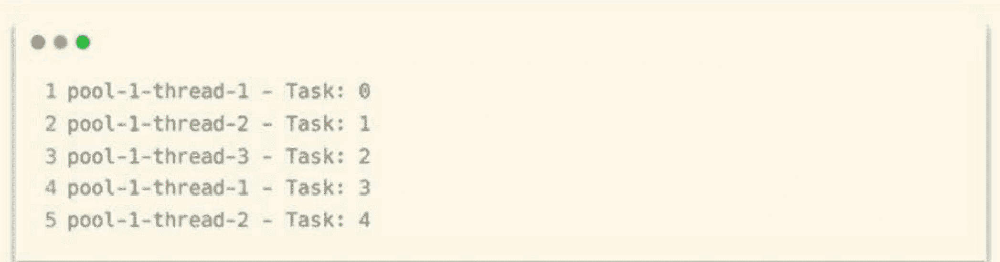

# Java 秘：高性能与可扩展性


# 献辞

献给每一个将技术视为将想法变为现实并克服挑战工具的人，本书献给你们。

献给我的家人，他们一直守在我身边，在最艰难的时刻提供无条件的支持和动力。献给我的父母，他们教会了我努力与坚持的价值；献给我的妻子，她的耐心、爱和鼓励给了我前行的力量。这本书在很大程度上是你们为我提供的支持和信任环境的结果。

献给我的朋友们，他们通过启发性的对话、思想交流和不断的鼓励，让这段旅程变得更加丰富和意义。在每一次辩论、学习和见解分享中，我意识到人际联系对于成长（无论是个人还是职业）是多么基础。

献给我的专业同事们，他们用创新的想法、创造性的解决方案以及对技术开发的热情启发了我。这本书反映了我多年来学习和分享的许多内容，希望它也能激励他人去探索和创新。

最后，最重要的是献给读者，你们选择本书作为学习和 Java 开发旅程的伴侣。这些页面不仅是一本技术指南，更是激发创作的灵感来源。

我相信代码的力量，实现可扩展。

Alex Harrison

# 致谢

如果没有我身边这些优秀的人，这本书将是不可能的。首先，我要感谢我的家人，他们一直守在我身边，在最艰难的时刻提供无条件的支持和动力。感谢我的父母，他们教会了我努力与坚持的价值；感谢我的妻子，她的耐心、爱和鼓励给了我前行的力量。

感谢我的朋友们，他们通过启发性的对话、思想交流和不断的鼓励，让这段旅程变得更加丰富和意义。在每一次辩论、学习和见解分享中，我意识到人际联系对于成长（无论是个人还是职业）是多么基础。

感谢我的专业同事们，他们用创新的想法、创造性的解决方案以及对技术开发的热情启发了我。这本书反映了我多年来学习和分享的许多内容，希望它也能激励他人去探索和创新。

我也感谢审稿人员和编辑，他们投入时间和专业知识确保了本书的清晰度。他们的工作改进了每一页。

最后，感谢读者，你们选择本书作为学习和 Java 开发旅程的伴侣。这些页面不仅是一本技术指南，更是激发创作的灵感来源。

诚挚地，

Alex Harrison

> “在书中，学习变得栩栩如生并带我们走向更远方。” —— Neil Gaiman
>
> “机器只能遵循规则；但大脑可以解读规则。” —— Alan Turing

# 引言

软件开发领域不断演进，而 Java 等技术在这一转型中起着核心作用。《Java 秘密：高性能与可扩展性》这本书经过精心设计，旨在满足初级开发者和希望扩展知识并掌握现代 Java 实践专业人士的需求。

在这些页面中，你将发现一种清晰且实用的方法来理解 Java 的基础和高级功能。从核心架构、内存管理到线程、性能调优、云原生开发和容错处理等高级技术，目标是提供结合理论、实践示例和最佳实践的全面内容。

每一章的结构旨在提供渐进式的学习体验。你将从探索 Java 执行模型和内存管理等基本概念开始，进到并发、响应式编程和微服务架构等主题。此外，还展示了真实示例，说明如何将这些概念应用于可扩展且健壮的企业级应用程序中。

本书还强调了性能优化、安全和容错处理的重要性，反映了当今市场的需求——在这里，高效、安全且可靠的应用程序是必不可少的。

无论你是初级开发者还是寻求更新的专业人士，这本书都是邀请你探索 Java 提供的无限可能。欢迎来到这段学习与创造的旅程，在这里，每一行代码都是通向构建高性能可扩展软件的一步！

# 前言

软件开发领域在不断演进，而 Java 始终处于构建高性能、可扩展应用程序的最前沿。自诞生以来，Java 已经成为一个多功能且强大的平台，使开发者能够创建稳健、高效且安全的企业级解决方案。这本书的诞生源于我分享这些知识，并帮助开发者（无论初学者还是资深人士）充分发挥 Java 潜力的愿望。

在我的职业生涯中，我注意到尽管信息非常丰富，但许多开发者在实践和有效地应用 Java 核心概念方面仍然感到困难。这一发现启发我编写这本指南，它不仅涵盖了 Java 的基础原理，还通过真实世界的示例和实战项目深入探讨了高级技术。

本书是我在 Java 开发领域学习、实验和工作的结晶。每一章都设计得清晰、聚焦且实用性强，将理论与可操作的见解相结合。我还包含了最佳实践和性能提示，以帮助你构建现代、可扩展且具有韧性的应用程序，满足今天严苛的技术标准。

这不仅是一本技术指南，更是一份创新和优化的邀请。它反映了我通过代码构建高效系统的热情，以及我认为学习是一场终身旅程的信念。

无论你是 Java 新手还是寻求提升技能，这本书都是为你而编写的。我希望它能成为你一份宝贵的资源，激励你在掌握 Java 性能和可扩展性特性的同时，创造出卓越的软件解决方案。

# 第1章

## 1.1 - 理解 Java 架构

探索 Java 的核心架构，包括 JVM、字节码和执行模型。

Java 的核心在于其强大的架构，它允许开发者编写出平台无关、可扩展且高效的代码。为了理解这一架构，我们必须探索三个关键组件：Java 虚拟机 (JVM)、字节码和 Java 的执行模型。这些组件共同定义了 Java 代码如何被编译、执行和优化。

在此程序中，`performCalculation` 方法被重复执行。JIT 编译器识别出该方法为“热点”，并将其编译为原生代码以提高性能。结果是，你会发现执行速度比逐行解释要快。

JVM 的执行模型涉及几个阶段：类加载、字节码验证、执行和垃圾回收。类加载确保了必要的类文件在内存中是可用的。字节码验证确保代码符合 Java 的安全约束，例如防止非法的类型转换或未经授权的内存访问。

你可以通过编写一个使用自定义类加载器的程序来实验类加载：

```java
public class CustomClassLoader extends ClassLoader {
    public static void main(String[] args) throws Exception {
        CustomClassLoader loader = new CustomClassLoader();
        Class<?> cls = loader.loadClass("HelloWorld");
        System.out.println("Class Loaded: " + cls.getName());
    }
}
```

在这个示例中，自定义类加载器动态地加载了 `HelloWorld` 类。Java 的类加载机制支持分级和动态类加载，这对于 Web 服务器和框架等应用程序至关重要。

JVM 执行模型的另一个关键组件是垃圾回收器（GC）。GC 通过回收不再使用的对象来自动管理内存，这有助于防止内存泄漏。你可以在程序中手动触发垃圾回收器：

```java
public class GarbageCollectorExample {
    public static void main(String[] args) {
        for (int i = 0; i < 1000; i++) {
            new GarbageCollectorExample();
        }
        System.gc();
        System.out.println("Garbage Collection Triggered");
    }
}
```

在此程序中，创建了多个对象，`System.gc()` 方法请求垃圾回收器运行。然而，JVM 会根据其算法和内存管理需求决定何时执行垃圾回收。

JVM 还使用方法内联、循环展开和逃逸分析等技术来优化执行。这些优化会被自动应用以提高你代码的性能。例如，考虑以下简单方法：

```java
public class InlineExample {
    public static void main(String[] args) {
        long start = System.nanoTime();
        for (int i = 0; i < 1000000; i++) {
            inlineMethod();
        }
        long end = System.nanoTime();
        System.out.println("Execution Time: " + (end - start) + " nanoseconds");
    }

    private static void inlineMethod() {
        int x = 5 + 10;
    }
}
```

JVM 可能会自动内联 `inlineMethod` 方法，在编译期间将方法调用替换为其实际实现。这减少了方法调用的开销并提高了性能。

总结来说，Java 架构依赖于 JVM、字节码和高级执行模型来提供平台独立性和高性能。JVM 作为运行时环境，负责解释或将字节码编译为机器码。字节码是你的 Java 程序的平台无关的表示，而执行模型确保了优化且安全的执行。通过结合解释、JIT 编译、垃圾回收和优化，Java 在不同平台上均实现了可扩展性和高效率。

## 1.2 - Java 架构简介

Java 架构概览及其在构建可扩展应用程序中的意义。

Java 架构的设计旨在性能、可移植性和可扩展性之间取得平衡，这使其成为构建大型应用程序的理想选择。其核心是 Java 遵循了多层方法，由 Java 虚拟机（JVM）、Java 运行时（JRE） 和 Java 开发包（JDK）组成。理解这些组件对于利用 Java 进行可扩展且高效的软件开发关重要。

Java 架构的第一个元素是 JVM，它是 Java 平台独立性的基础。JVM 允许 Java 应用程序无需修改即可运行在任何操作系统或硬件上。当你编写 Java 程序时，源代码会被编译为字节码。为了说明这一点，让我们从一个简单的示例开始，首先创建一个类：

```java
public class Example {
    public static void main(String[] args) {
        System.out.println("Java Architecture in Action");
    }
}
```

使用 `javac` 命令编译程序：

```bash
javac Example.java
```

这生成了一个 `Example.class` 文件。使用 `java` 命令运行程序：

```bash
java Example
```

JVM 加载并执行字节码。架构的第二个组件是 JRE，它包含了 JVM 和额外的库。JRE 提供了一个运行时环境，Java 程序可以在其中运行。对于需要处理多个任务的应用程序，Java 架构的一个关键功能是多线程，它允许并发执行任务。这里是一个基础的多线程程序示例：

```java
public class MultiThreadExample implements Runnable {
    private String task;

    public MultiThreadExample(String task) {
        this.task = task;
    }

    public void run() {
        for (int i = 0; i < 5; i++) {
            System.out.println(task + " - Iteration: " + i);
        }
    }

    public static void main(String[] args) {
        Thread thread1 = new Thread(new MultiThreadExample("Task 1"));
        Thread thread2 = new Thread(new MultiThreadExample("Task 2"));

        thread1.start();
        thread2.start();
    }
}
```

Java 架构的另一个关键方面是内存管理，它通过垃圾回收自动处理。JVM 识别内存中不再使用的对象并回收它们占用的空间，这对于维护长时间运行系统的性能至关重要。这里是观察垃圾回收的示例：

```java
public class GarbageCollectorExample {
    public static void main(String[] args) {
        for (int i = 0; i < 1000; i++) {
            new GarbageCollectorExample();
        }
        System.gc();
        System.out.println("Garbage Collection Triggered");
    }

    @Override
    protected void finalize() {
        System.out.println("Object is garbage collected");
    }
}
```

在此程序中，创建了多个对象，并且垃圾回收器会自动回收它们的内存。`System.gc()` 方法建议 JVM 触发垃圾回收，但实际执行取决于 JVM 的实现。

Java 还通过远程方法调用（RMI）和 Java RESTful Web 服务 API（JAX-RS）等技术支持分布式系统。这些功能允许应用程序跨越多个服务器进行横向扩展，并处理大量的分布式请求。

### 客户端代码

```java
import java.rmi.*;

public class RMIClient {
    public static void main(String[] args) {
        try {
            RemoteInterface obj = (RemoteInterface)
            Naming.lookup("RMIServer");
            System.out.println(obj.sayHello());
        } catch (Exception e) {
            System.err.println("Client exception: " + e.toString());
        }
    }
}
```

要运行此程序，请编译服务器和客户端代码，启动 RMI 注册表，然后运行服务器和客户端。RMI 框架允许跨分布式系统的方法调用，这对于构建可扩展的应用程序至关重要。

Java 架构还包含了健壮的库和框架，例如 Java EE 和 Spring，它们简化了企业级应用的开发。这些框架处理依赖注入、事务管理和负载均衡等任务，这些对于可扩展性至关重要。

使用 Spring Boot 框架创建 REST API 的实际示例如下：

### Spring Boot 应用

```java
import org.springframework.boot.SpringApplication;
import org.springframework.boot.autoconfigure.SpringBootApplication;
import org.springframework.web.bind.annotation.GetMapping;
import org.springframework.web.bind.annotation.RequestMapping;
import org.springframework.web.bind.annotation.RestController;

@SpringBootApplication
public class SpringBootExample {
    public static void main(String[] args) {
        SpringApplication.run(SpringBootExample.class, args);
    }
}

@RestController
@RequestMapping("/api")
class ApiController {
    @GetMapping("/hello")
    public String sayHello() {
        return "Hello, Scalable World!";
    }
}
```

运行此程序后，你可以通过 `http://localhost:8080/api/hello` 访问 REST API。Spring Boot 框架抽象了构建可扩展 Web 服务的大部分复杂性，允许开发者专注于业务逻辑。

Java 架构还通过在 Java 9 中引入的模块系统促进了模块化。模块化有助于管理依赖关系并提高大型应用程序的可扩展性。你可以使用 `module-info.java` 文件定义模块：

```java
module com.example.app {
    requires java.base;
    exports com.example;
}
```

这种模块化方法允许开发者创建松耦合的组件，提高了应用程序的可维护性和可扩展性。

通过结合平台无关性、多线程、垃圾回收、分布式计算能力和强大的框架，Java 架构提供了构建可扩展应用程序所需的工具。JVM 确保了高效的执行和优化，而 Java 广泛的生态系统简化了复杂、大型系统的开发。无论是在单机上运行还是在分布式环境中运行，Java 架构都能适应性能和可扩展性的需求。

## 1.3 - Java 虚拟机 (JVM)

解释 JVM 在执行 Java 应用程序的作用。

Java 虚拟机（JVM）是 Java 平台的核心组件，允许 Java 应用程序在不修改的情况下运行在任何系统上。它作为抽象硬件和操作系统的运行时环境，实现了 Java 的平台无关性。JVM 获取 Java 字节码，对其进行验证并执行它，通过逐行解释或使用即时编译（JIT）编译将其编译为原生机器码来完成。

当你编译一个 Java 程序时，`javac` 编译器会将源代码转换为一种称为字节码的中间形式。这种字节码是平台无关的，设计用于由 JVM 执行。以下简单程序演示了这一点：


```java
public class HelloJVM {
    public static void main(String[] args) {
        System.out.println("Understanding the JVM!");
    }
}
```

使用以下命令编译此程序：

```bash
javac HelloJVM.java
```

这会创建一个名为 `HelloJVM.class` 的文件，其中包含字节码。要执行程序，使用 `java` 命令：

```bash
java HelloJVM
```

JVM 在执行期间执行三个主要任务：类加载、字节码验证和执行。首先，JVM 通过它的**类加载器（ClassLoader）**子系统将 `class` 文件加载到内存中。然后，验证字节码以确保没有安全违规或损坏的指令。最后，它通过解释或 JIT 编译执行字节码。

要检查 JVM 执行的字节码，可以使用 `javap` 工具。以下命令反汇编 `HelloJVM.class` 文件：

```bash
javap -c HelloJVM
```

输出显示了 JVM 执行的低级字节码指令：

```java
Compiled from "HelloJVM.java"
public class HelloJVM {
  public HelloJVM();
  Code:
    0: aload_0
    1: invokespecial #1 // Method java/lang/Object."<init>()V
    4: return

  public static void main(java.lang.String[])
    Code:
      0: getstatic #2 // Field java/lang/System.out:Ljava/io/PrintStream;
      3: ldc #3 // String Understanding the JVM!
      5: invokevirtual #4 // Method java/io/PrintStream.println((Ljava/lang/String;))V
      8: return
}
```

此输出揭示了 JVM 处理的内部字节码，例如 `getstatic`、`ldc` 和 `invokevirtual`。

JVM 在内存管理方面也起着至关重要的作用。Java 内存分为几个区域：堆、栈、方法区。堆是存储对象的地方。**垃圾回收（GC）**会自动回收内存。

这是一个观察内存管理的示例：

```java
public class MemoryManagement {
    public static void main(String[] args) {
        for (int i = 0; i < 10000; i++) {
            new MemoryManagement();
        }
        System.gc();
        System.out.println("Garbage Requested");
    }

    @Override
    protected void finalize() throws Throwable {
        System.out.println("Garbage collected an object");
    }
}
```

要监控 JVM 使用情况，可以使用 `jconsole` 等工具，它是 Java 开发包（JDK）的一部分。启动你的程序并运行以下命令以打开控制台：

```bash
jconsole
```

```java
public class JITExample {
    public static void main(String[] args) {
        long startTime = System.nanoTime();
        for (int i = 0; i < 1000000000; i++) {
            calculate();
        }
        long endTime = System.nanoTime();
        System.out.println("Execution Time: " + (endTime - startTime) / 1e9 + " seconds");
    }

    static void calculate() {
        int x = 10 * 20;
    }
}
```

在此程序中，`calculate` 方法被重复执行。JIT 编译器识别其为“热点”并将其编译为原生代码。结果是循环随着时间的推移执行得越来越快。

JVM 还支持性能分析（profiling）和调试以监控应用程序行为。`-Xprof` 选项会生成程序的性能分析文件。运行以下命令：

```bash
java -Xprof JITExample
```

输出显示了哪些方法消耗了大部分时间，帮助你优化应用程序的关键部分。

总之，JVM 通过加载字节码、验证其完整性并通过解释或 JIT 编译高效执行字节码，充当 Java 应用程序的核心。它通过垃圾回收管理内存，通过 JIT 编译器优化执行，并提供监控和调试工具。通过抽象底层系统，JVM 确保 Java 应用程序可以在跨平台可靠地运行，使其成为构建高性能和可扩展应用程序的关键组件。

## 1.2.1 - JVM 组件

对 JVM 组件（如类加载器、内存区域和执行引擎）的详细说明。

Java 虚拟机（JVM）分为几个协同工作以高效执行 Java 程序的组件。JVM 的三个关键组件是**类加载器（Class Loader）、内存区域（Memory Areas）**和**执行引擎（Execution Engine）**。这些组件确保了 Java 的平台无关性、动态类加载、内存管理和优化执行。

**类加载器**子系统是 Java 程序执行时第一个投入的组件。它的职责是将类文件加载到 JVM 中。类加载器将字节码文件（`.class`）加载到 JVM 并对其进行链接以执行。该过程包含三个阶段：**加载（Loading）**、**链接（Linking）**和**初始化（Initialization）**。

为了演示类加载，让我们创建一个自定义类加载器来动态加载一个类：

```java
import java.io.*;

public class CustomClassLoader extends ClassLoader {
    public Class<?> loadClassFromFile(String name) throws ClassNotFoundException {
        try {
            InputStream fis = new FileInputStream(name + ".class");
            byte[] bytecode = fis.readAllBytes();
            fis.close();
            return defineClass(null, bytecode, 0, bytecode.length);
        } catch (IOException e) {
            throw new ClassNotFoundException("Class not found", e);
        }
    }

    public static void main(String[] args) throws Exception {
        CustomClassLoader loader = new CustomClassLoader();
        Class<?> clazz = loader.loadClassFromFile("HelloWorld");
        Object instance = clazz.getDeclaredConstructor().newInstance();
        System.out.println("Class loaded successfully: " + clazz.getName());
    }
}
```

在这里，自定义类加载器将 `.class` 文件作为字节流读取，并使用 `defineClass` 方法将其加载到 JVM 中。为了测试，首先创建一个简单的类：

```java
public class HelloWorld {
    public HelloWorld() {
        System.out.println("Hello from HelloWorld class");
    }
}
```

使用以下命令编译该类：

```bash
javac HelloWorld.java
```

运行自定义类加载器程序以动态加载 `HelloWorld.class`：

```bash
java CustomClassLoader
```

此示例强调了类加载器在运行时动态加载类的作用，这对于模块化应用程序是基础性的。

一旦类被加载，JVM 会在**内存区域**中为它们分配内存。JVM 内存分为五个主要区域：方法区（Method Area）、堆（Heap）、栈（Stack）、程序计数器寄存（PC Register）和原生方法栈（Native Method Stack）。每个内存区域在程序执行中都起着关键作用。

**堆（Heap）**是存储对象的区域。**方法区（Method Area）**存储元数据、类级信息和方法字节码。局部变量和方法调用细节存储在**栈（Stack）**中，每次方法调用都会创建一个新的栈帧。

这是一个演示在堆上创建对象和在栈上进行调用的示例：

```java
public class MemoryExample {
    public static void main(String[] args) {
        MemoryExample example = new MemoryExample(); // 堆上的对象
        example.displayMessage();
    }

    public void displayMessage() {
        int localVar = 10; // 栈上的局部变量
        System.out.println("Heap and Stack Memory Example: " + localVar);
    }
}
```

在此示例中，`example` 对象在堆中分配了内存，而局部变量 `localVar` 和方法调用信息存储在栈中。使用以下命令运行程序：

```bash
java MemoryExample
```

执行时，JVM 为对象创建内存并管理 `main` 和 `displayMessage` 方法的栈帧。

你可以使用 `jvisualvm` 工具监控 JVM 内存区域。启动程序并使用以下命令启动 VisualVM：

```bash
jvisualvm
```

将 VisualVM 附加到运行的 Java 进程，实时观察堆内存使用、栈调用和方法区域。该工具提供了 JVM 内存消耗的详细概述。

**执行引擎（Execution Engine）**是 JVM 中负责执行字节码的组件。它可以以两种方式执行字节码：**解释（Interpretation）**和**即时编译（Just-In-Time JIT Compilation）**。最初，JVM 逐行解释字节码，速度较慢。为了提高性能，JIT 编译器会将频繁执行的代码（热点）转换为原生机器码。

这是一个演示 JIT 编译器在优化执行方面作用的程序示例：

```java
public class JIToptimization {
    public static void main(String[] args) {
        long startTime = System.nanoTime();
        for (int i = 0; i < 1000000000; i++) {
            calculate();
        }
        long endTime = System.nanoTime();
        System.out.println("Execution Time: " + (endTime - startTime) / 1e9 + " seconds");
    }

    static void calculate() {
        int x = 10 * 20;
    }
}
```

`calculate` 方法被重复执行，使其成为热点。JIT 编译器将其识别并编译为原生机器码，从而提高了执行速度。运行程序：

```bash
java JIToptimization
```

你可以启用 JIT 编译日志来观察其过程：

```bash
java -XX:+PrintCompilation JIToptimization
```

输出显示了由 JIT 编译器编译的方法。这证明了执行引擎如何提升性能。

JVM 还支持垃圾回收，这是内存管理的一部分。它回收未引用对象的内存，确保堆的有效利用。垃圾回收由垃圾回收线程与程序并行执行。

这是一个观察垃圾回收执行的示例：

```java
public class GarbageCollectionDemo {
    public static void main(String[] args) {
        for (int i = 0; i < 10000; i++) {
            new GarbageCollectionDemo();
        }
        System.gc(); // 建议垃圾回收
        System.out.println("Garbage Collection Triggered");
    }

    @Override
    protected void finalize() throws Throwable {
        System.out.println("Object is garbage collected");
    }
}
```

编译并运行程序：

```bash
java GarbageCollectionDemo
```

在此程序中，创建了多个对象但没有引用。垃圾回收器删除了它们并调用了 `finalize` 方法。虽然 `System.gc()` 建议进行垃圾回收，但 JVM 决定何时何时执行。

最后，JVM 通过**原生方法栈（Native Method Stack）**支持原生方法，这允许 Java 调用用 C 或 C++ 等语言编写的非 Java（原生）代码。这对于性能敏感的操作非常有用。

这是一个调用原生方法的示例：

```java
public class NativeExample {
    static {
        System.loadLibrary("nativeLib");
    }

    public native void sayHello();

    public static void main(String[] args) {
        new NativeExample().sayHello();
    }
}
```

要创建原生方法，请编写相应的 C 实现并将其编译为共享库。使用 `javah` 工具将库链接到程序中，并运行：

```bash
java NativeExample
```

这种集成凸显了原生方法栈（Native Method Stack）在连接 Java 与原生代码以进行底层系统操作中的作用。

JVM 的组件——类加载器（Class Loader）、内存区域（Memory Areas）和执行引擎（Execution Engine）协同工作，高效地加载、管理和执行 Java 程序。类加载器动态加载类，内存区域管理数据存储，执行引擎通过 JIT 编译确保优化的执行。它们共同使 JVM 成为运行可扩展和高性能 Java 程序的强大引擎。

## 1.2.2 - JVM 生命周期

描述从程序编译到执行的生命周期。

JVM 生命周期涵盖了 Java 程序从编译、加载、验证、执行到最终终止的全过程。这一生命周期确保了 Java 虚拟机（JVM）在保持平台独立性和健壮性能的同时，高效地管理 Java 程序的执行。理解此生命周期的每个阶段将帮助开发者优化应用程序以实现扩展性和高性能。

生命周期从**程序编译**开始。编写在 `java` 文件中的 Java 源代码使用 `javac` 编译器编译成字节码。字节码是 JVM 识别的平台无关的中间表示。考虑以下示例：

```java
public class LifecycleExample {
    public static void main(String[] args) {
        System.out.println("JVM Lifecycle Demonstration");
    }
}
```

要编译此程序，请使用 `javac` 命令：

```bash
javac LifecycleExample.java
```

`javac` 编译器生成一个 `.class` 文件，其中包含字节码。你可以通过列出目录内容来确认编译后的字节码是否存在：

```bash
ls
```

输出将包含 `LifecycleExample.class` 文件。

编译完成后，JVM 生命周期的下一步是**类加载**。类加载器子系统将字节码加载到 JVM 内存中。JVM 遵循分级类加载机制，由**启动类加载器（Bootstrap Class Loader）**、**扩展类加载器（Extension Class Loader）**和**应用程序类加载器（Application Class Loader）**组成。

为了观察类加载的过程，请使用以下程序，它会打印特定类的类加载器：


```java
public class ClassLoaderDemo {
    public static void main(String[] args) {
        System.out.println("Class Loader of this class: " +
            ClassLoaderDemo.class.getClassLoader());
        System.out.println("Class Loader of String: " + 
            String.class.getClassLoader());
    }
}
```

编译并运行该程序：

```
javac ClassLoaderDemo.java
java ClassLoaderDemo
```

输出将显示 `ClassLoaderDemo` 类是由**应用程序类加载器**加载的，而 `String` 类（Java 核心类）是由用原生代码编写的**启动类加载器**加载的。

加载之后，下一阶段是**字节码验证**。JVM 验证字节码是否符合 Java 的安全和安全约束，确保没有非法指令或类型不匹配。验证可以防止恶意或损坏的字节码的执行。

这里是一个使用故意错误修改的无效字节码示例：

```
javap -c LifecycleExample
```

使用 `javap` 工具检查 `LifecycleExample` 的字节码。如果字节码被篡改（在典型用法之外），验证器将拒绝它，JVM 将抛出 `VerifyError`。

验证通过后，**执行引擎**开始执行字节码。JVM 执行模型遵循两种方法：**解释（Interpretation）**和**即时编译（JIT Compilation）**。最初，字节码是逐行解释的，但 JIT 编译器会识别频繁执行的代码（热点）并将其编译成原生机器码以实现更快执行。

以下程序演示了 JIT 编译对频繁执行方法的影响：

```java
public class JITDemo {
    public static void main(String[] args) {
        long startTime = System.nanoTime();
        for (int i = 0; i < 1_000_000_000; i++) {
            addNumbers();
        }
        long endTime = System.nanoTime();
        System.out.println("Execution time: " + (endTime - startTime) /
            1e9 + " seconds");
    }

    public static int addNumbers() {
        return 5 + 10;
    }
}
```

（注：此处修正了原文中残缺的循环逻辑以确保符合 JIT 演示语境）

使用以下标志启用 JIT 编译日志：

```
java -XX:+PrintCompilation JITDemo
```

输出将显示哪些方法被 JIT 编译器编译成了原生代码，提高了执行速度。

在执行期间，JVM 通过**垃圾回收（GC）**管理内存。GC 通过移除不再引用的对象来回收内存，确保堆的高效使用。以下示例演示了 JVM 生命周期中的垃圾回收：

```java
public class GarbageCollectionLifecycle {
    public static void main(String[] args) {
        for (int i = 0; i < 10000; i++) {
            new GarbageCollectionLifecycle();
        }
        System.gc();
        System.out.println("Garbage collection suggested.");
    }
}
```

编译并运行程序：

```
javac GarbageCollectionLifecycle.java
java GarbageCollectionLifecycle
```

这是一个添加停机钩子（shutdown hook）的示例：

```java
public class ShutdownHookExample {
    public static void main(String[] args) {
        Runtime.getRuntime().addShutdownHook(new Thread(() -> {
            System.out.println("Shutdown Hook Executed: Cleanup complete.");
        }));

        System.out.println("Application is running...");
        try {
            Thread.sleep(3000);
        } catch (InterruptedException e) {
            e.printStackTrace();
        }
    }
}
```

编译并运行程序：

```
javac ShutdownHookExample.java
java ShutdownHookExample
```

```java
public class BytecodeExample {
    public static void main(String[] args) {
        int a = 5;
        int b = 10;
        int sum = a + b;
        System.out.println("Sum: " + sum);
    }
}
```

使用 `javac` 命令编译该程序：

```
javac BytecodeExample.java
```

`javac` 编译器会生成 `BytecodeExample.class` 文件。要查看字节码，请使用带有 `-c` 的 `javap` 工具，它会将字节码反汇为人类可读的指令：

```bash
javap -c BytecodeExample
```

输出可能如下：

```
Compiled from "BytecodeExample.java"
public class BytecodeExample {
  public BytecodeExample();
    Code:
      0: aload_0
      1: invokespecial #1   // Method java/lang/Object.<init>()V
      4: return

  public static void main(String[] args) {
    Code:
      0: iconst_5
      1: bipush 10
      2: istore_2
      3: aload_0
      5: iload_2
      6: iload_3
      7: iadd
      8: istore_3
      9: getstatic #2   // Field java/lang/System.out:Ljava/lang/PrintStream;
      12: new #3   // class java/lang/StringBuilder
      15: adup_1
      16: invokevirtual #4   // Method java/lang/StringBuilder.<init>(Ljava/lang/String;)V
      19: load_1
      20: invokevirtual #5   // Method java/lang/StringBuilder.append(int)B
      24: invokevirtual #6   // Method java/lang/StringBuilder.append(Ljava/lang/String;)L
      28: invokevirtual #7   // Method java/lang/StringBuilder.append(Ljava/lang/String;)L
      28: invokevirtual #8   // Method java/lang/StringBuilder.toString()Ljava/lang/String;
      31: invokevirtual #9   // Method java/lang/PrintStream.println(Ljava/lang/String;)V
      34: return
}
```

此输出拆解了 `main` 方法的每个字节码指令。以下是一些关键指令说明：

- `iconst_5`: 将整数常量 `5` 推入操作数栈。
- `bipush 10`: 推入整数常量 `10`。
- `iadd`: 将栈中的两个整数相加。
- `istore`: 将结果存储到局部变量中。
- `getstatic`: 访问静态字段，例如 `System.out`。
- `invokevirtual`: 调用方法，例如 `println()`。

JVM 在执行期间逐行解释这些指令，或者使用 JIT 编译将它们编译为本地代码以提高性能。

为了更好地理解字节码，让我们来看一个简单的条件语句：

```java
public class ConditionExample {
    public static void main(String[] args) {
        int a = 10;
        if (a > 5) {
            System.out.println("a is greater than 5");
        } else {
            System.out.println("a is not greater than 5");
        }
    }
}
```

编译该程序：

```
javac ConditionExample.java
```

反汇编字节码：

```bash
javap -c ConditionExample
```

输出显示了 JVM 如何处理条件语句：

```
0: bipush 10
2: istore_1
3: iload_1
4: iconst_5
5: if_icmple 16 // Field
8: getstatic #2
java/lang/System.out:Ljava/io/PrintStream; // String a is greater than 5 ldc
11: ldc #3 // Method
13: invokevirtual #4
java/io/PrintStream.println:(Ljava/lang/String;)V
16: goto 28
19: getstatic #2 // Field
java/lang/System.out:Ljava/io/PrintStream;
22: ldc #5 // String a is not greater than 5
24: invokevirtual #4 // Method
java/io/PrintStream.println:(Ljava/lang/String;)V
27: return
```

在这里，`if_icmple` 检查 `a <= 5` 并根据结果跳转到相应的代码块。

接下来，让我们观察循环是如何转换为字节码的：

```java
public class LoopExample {
    public static void main(String[] args) {
        for (int i = 0; i < 3; i++) {
            System.out.println("Iteration: " + i);
        }
    }
}
```

编译该程序：

```
javac LoopExample.java
```

反汇编字节码：

```bash
javap -c LoopExample
```

字节码将包含初始化循环、检查条件、执行循环体和增加循环变量的指令：

```
0: iconst_0
1: istore_1
2: iload_1
3: iconst_1
4: if_icmpge 23
6: getstatic #2 // Field
java/System/out:Ljava/io/PrintStream;
10: new #3 // class java/lang/StringBuilder
13: aload_0
14: invokespecial #4 // Method java/lang/StringBuilder.<init>(()V
17: istore_2
19: ldc #5 // String Iteration:
21: invokevirtual #6 // Method java/lang/StringBuilder.append(Ljava/String;)L
24: iload_1
25: invokevirtual #7 // Method java/lang/StringBuilder.append(int)B
28: invokevirtual #8 // Method java/lang/StringBuilder.toString()Ljava/String;
31: invokevirtual #9 // Method java/io/PrintStream.println(Ljava/String;)V
34: inc 1
35: goto 0
38: return
```

这里的关键指令是：

- `if_icmpge`: 比较循环变量，如果失败则退出循环。
- `inc`: 增加循环变量。

让我们继续查看方法调用并从字节码层面理解其工作原理：

```java
public class MethodExample {
    public static void main(String[] args) {
        greet();
    }
    public static void greet() {
        System.out.println("Hello from method");
    }
}
```

编译程序：

```
javac MethodExample.java
```

反汇编字节码：

```bash
javap -c MethodExample
```

输出包含调用 `greet` 方法的 `invokestatic` 指令：

```
0: invokestatic #2 // Method greet()V
3: return

public static void greet();
  Code:
    0: getstatic #3 // Field java/lang/System.out:Ljava/io/PrintStream;
    3: ldc #4 // String from method
    5: invokevirtual #5 // Method java/io/PrintStream.println(Ljava/String;)V
    8: return
```

在这里：

- `invokestatic` 用于调用静态方法 `greet`。
- `getstatic` 和 `invokevirtual` 处理打印。

最后，理解字节码对于性能分析至关重要。你可以使用 `-XX:+PrintCompilation` 和 `-XX:+UnlockDiagnosticOptions` 等工具监控字节码执行。例如：

```
java -XX:+PrintCompilation MethodExample
```

这显示了方法被 JIT 编译器编译为本地代码。通过理解字节码的结构、生成和执行，开发者可以了解程序是如何执行的并在保持平台无关性的同时提供高性能。

### 1.3.1 字节码的工作原理

解释 Java 字节码的生成和执行。

Java 字节码作为源代码和机器码之间的中间表示。当你编写 Java 程序并编译它时，`javac` 编译器会将源代码转换为存储 .class 文件中的平台无关指令集。JVM 读取、验证字节码，并通过逐行解释或使用即时（JIT）编译器将其编译为机器码以获得更高的性能。

要观察字节码的生成，从一个简单的 Java 程序开始：

```java
public class SimpleBytecode {
    public static void main(String[] args) {
        int a = 5;
        int b = 10;
        int result = a + b;
        System.out.println("Result: " + result);
    }
}
```

将此文件保存为 `SimpleBytecode.java` 并使用 `javac` 命令编译它：

```
javac SimpleBytecode.java
```

编译器生成一个名为 `SimpleBytecode.class` 的文件，其中包含字节码。要查看字节码，使用带有 `-c` 标志的 `javap` 命令将其反汇为可读的 JVM 指令：

```bash
javap -c SimpleBytecode
```

输出如下：


# JVM 字节码详解

## 简单字节码示例

```
Compiled from 'SimpleBytecode.java'
public class SimpleBytecode {
  public SimpleBytecode();
    Code:
      0: aload_0
      1: invokespecial #1 // Method java/lang/Object.<init>V
      4: return
  public static void main(String[] args);
    Code:
      0: iconst_5
      1: istore_2
      2: bipush 10
      4: istore_3
      5: iload_2
      6: iload_3
      7: iadd
      8: istore_1
      9: getstatic #:Field java/lang/System.out:LPrintStream;
      12: new // class java/lang/StringBuilder
      15: aload_0
      16: invokespecial #6 // Method java/lang/StringBuilder.<init>()V
      19: istore_2
      21: invokevirtual #7 // Method java/lang/StringBuilder.append(Ljava/String;)StringBuilderV
      24: iload_3
      25: invokevirtual #8 // Method java/lang/StringBuilder.append(Ljava/String;)V
      28: invokevirtual #9 // Method java/lang/StringBuilder.append(Ljava/String;)V
      31: invokevirtual #10 // Method java/lang/StringBuilder.toString()Ljava/String;V
      34: return
}
```

## 关键指令详细说明

- `iconst_5`：将常量 `5` 推入操作数栈
- `bipush 10`：将常量 `10` 推入操作数栈
- `iadd`：相加操作数栈顶部的两个整数
- `istore_x`：将结果存储到局部变量中
- `getstatic`：访问静态字段 `System.out`
- `invokevirtual`：调用如 `println` 等方法

JVM 以结构化的方式执行这些字节码。**操作数栈**用于推入和弹出数据等操作，而**局部变量表**则存储如 `a`、`b` 和 `result` 等变量。

## 方法调用字节码分析

为了进一步探索，让我们看看方法调用在字节码层级是如何工作的。更新程序以包含一个方法调用：

```java
1 public class MethodBytecode {
2     public static void main(String[] args) {
3         int result = addNumbers(5, 10);
4         System.out.println("Sum: " + result);
5     }
6
7     public static int addNumbers(int x, int y) {
8         return x + y;
9     }
10 }
```

编译并反汇编程序：

```
1 javac MethodBytecode.java
2 javap -c MethodBytecode
```

`addNumbers` 方法的字节码输出包含以下内容：

```bytecode
1 public static int addNumbers(int, int);
2   Code:
3     0: iload_0
4     1: iload_1
5     2: iadd
6     3: ireturn
```

在这里：

- `iload_0`：将第一个参数 `x` 加载到操作数栈
- `iload_1`：加载第二个参数 `y`
- `iadd`：加两个值
- `ireturn`：将结果返回给调用方法

在 `main` 方法中，使用 `invokestatic` 指令调用 `addNumbers`，因为它是一个静态方法。

## 条件语句字节码分析

现在考虑一个条件语句，查看字节码如何处理分支：

```java
1 public class ConditionalBytecode {
2     public static void main(String[] args) {
3         int number = 7;
4         if (number > 5) {
5             System.out.println("Number is greater than 5");
6         } else {
7             System.out.println("Number is less than or equal to 5");
8         }
9     }
10 }
```

编译并反汇编：

```
1 javac ConditionalBytecode.java
2 javap -c ConditionalBytecode
```

字节码输出包含类似 `if_icmple` 的条件指令：

```bytecode
0: bipush 7
2: istore_1
3: iload_1
4: iconst_5
5: if_icmple 16
8: getstatic #2 // Field java/lang/System.out:Ljava/io/PrintStream;
11: ldc #3 // String Number is greater than 5
13: invokevirtual #4 // Method java/io/PrintStream.println:(Ljava/lang/String;)V
16: goto 28
19: getstatic #2 // Field java/lang/System.out:Ljava/io/PrintStream;
22: ldc #5 // String Number is less than or equal to 5
24: invokevirtual #4 // Method java/io/PrintStream.println:(Ljava/lang/String;)V
27: return
```

在这里：

- `if_icmp`：检查 `number` 的值是否小于或等于 5，如果是则跳转到 `else` 块
- `goto`：当条件满足时跳过 `else` 块

JVM 使用 `if_icmp` 和 `goto` 等**分支**指令来实现控制流结构。

## 循环字节码分析

现在让我们探索循环在字节码中如何表示：

```java
1 public class LoopBytecode {
2     public static void main(String[] args) {
3         for (int i = 0; i < 3; i++) {
4             System.out.println("Iteration: " + i);
5         }
6     }
7 }
```

编译并反汇编：

```
1 javac LoopBytecode.java
2 javap -c LoopBytecode
```

字节码包含了初始化、检查和增加循环变量的指令：

```bytecode
0: iconst_0
1: istore_1
2: iload_1
3: iconst_3
4: if_icmpge 23
6: getstatic #2
7: new #3
13: dup
14: invokespecial #4
17: ldc #5
19: iload_1
20: invokevirtual #6
23: invokevirtual #7
26: iinc 1, 1
29: goto 2
32: return
```

在这里：

- `if_icmp`：比较 `i` 和 `3`，如果条件失败则退出循环
- `iinc`：增加循环变量 `i`
- `goto`：跳回 2

## 对象创建字节码分析

最后，让我们演示字节码如何处理对象创建：

```java
1 public class Objectcode {
2     public static void main(String[] args) {
3         Objectcode obj = new Objectcode();
4         obj.printMessage();
5     }
6
7     public void printMessage() {
8         System.out.println("Object creation");
9     }
10 }
```

编译并反汇编：

```
1 javac Objectcode.java
2 javap -c Objectcode
```

字节码输出包含：

- `new`：为对象分配内存
- `dup`：复制引用
- `invokespecial`：调用构造函数
- `getstatic`：访问静态字段 `System.out`
- `invokevirtual`：调用如 `println` 等方法

JVM 以结构化的方式执行此字节码。**操作数栈**用于推入和弹出数据，而**局部变量表**存储如 `a`、`b` 和 `result` 等变量。


# JVM 字节码基础

## 条件语句

```java
public class ConditionalBytecode {
    public static void main(String[] args) {
        int number = 7;
        if (number > 5) {
            System.out.println("Number is greater than 5");
        } else {
            System.out.println("Number is less than or equal to 5");
        }
    }
}
```

编译并反汇编：

```
javac ConditionalBytecode.java
javap -c ConditionalBytecode
```

字节码输出包含类似 `if_icmple` 的条件指令：

```bytecode
0: bipush 7
2: istore_1
3: iload_1
4: iconst_5
5: if_icmple 16
8: getstatic #2 // Field java/lang/System.out:Ljava/io/PrintStream;
11: ldc #3 // String Number is greater than 5
13: invokevirtual #4 // Method java/io/PrintStream.println:(Ljava/lang/String;)V
16: goto 28
19: getstatic #2 // Field java/lang/System.out:Ljava/io/PrintStream;
22: ldc #5 // String Number is less than or equal to 5
24: invokevirtual #4 // Method java/io/PrintStream.println:(Ljava/lang/String;)V
27: return
```

说明：

- `if_icmple`：检查 `number` 的值是否小于或等于 5，如果是则跳转到 `else` 块（偏移量 16）。
- `goto`：当条件满足时跳过 `else` 块（跳转至偏移量 28）。

JVM 使用 `if_icmp` 和 `goto` 等**分支**指令来实现控制流结构。

## 循环结构

```java
public class LoopBytecode {
    public static void main(String[] args) {
        for (int i = 0; i < 3; i++) {
            System.out.println("Iteration: " + i);
        }
    }
}
```

编译并反汇编：

```
javac LoopBytecode.java
javap -c LoopBytecode
```

字节码包含了初始化、检查和增加循环变量的指令：

```bytecode
0: iconst_0
1: istore_1
2: iload_1
3: iconst_3
4: if_icmpge 23
6: getstatic #2
7: new #3
13: dup
14: invokespecial #4
17: ldc #5
19: iload_1
20: invokevirtual #6
23: invokevirtual #7
26: iinc 1, 1
29: goto 2
32: return
```

说明：

- `if_icmpge`：比较 `i` 和 `3`，如果条件失败（`i >= 3`）则退出循环（跳转至偏移量 23）。
- `iinc`：增加循环变量 `i`（局部变量表索引 1，步长 1）。
- `goto`：跳回循环条件检查处（偏移量 2）。

## 对象创建

```java
public class Objectcode {
    public static void main(String[] args) {
        Objectcode obj = new Objectcode();
        obj.printMessage();
    }

    public void printMessage() {
        System.out.println("Object creation");
    }
}
```

编译并反汇编：

```
javac Objectcode.java
javap -c Objectcode
```

字节码输出包含关键指令：

- `new`：为对象分配内存。
- `dup`：复制引用（栈顶引用复制一份，一份用于构造函数调用，一份用于后续存储/使用）。
- `invokespecial`：调用构造函数（`<init>` 方法）。
- `getstatic`：访问静态字段 `System.out`。
- `invokevirtual`：调用实例方法 `println`。

## 方法调用

```java
public class MethodBytecode {
    public static void main(String[] args) {
        int result = addNumbers(5, 10);
        System.out.println("Sum: " + result);
    }

    public static int addNumbers(int x, int y) {
        return x + y;
    }
}
```

编译并反汇编：

```
javac MethodBytecode.java
javap -c MethodBytecode
```

`addNumbers` 方法的字节码输出：

```bytecode
public static int addNumbers(int, int);
  Code:
    0: iload_0
    1: iload_1
    2: iadd
    3: ireturn
```

说明：

- `iload_0`：将第一个参数 `x` 加载到操作数栈。
- `iload_1`：加载第二个参数 `y`。
- `iadd`：相加栈顶两个 `int` 值。
- `ireturn`：将结果返回给调用方法。

在 `main` 方法中，使用 `invokestatic` 指令调用 `addNumbers`，因为它是一个静态方法。

## 运行时数据区

JVM 以结构化的方式执行此字节码。**操作数栈**用于推入和弹出数据，而**局部变量表**存储如 `x`、`y` 和 `result` 等变量。


# JVM 字节码执行详解

## 基础指令

- `invokespecial`: 调用构造函数。
- `getstatic`: 访问静态字段 `System.out`。
- `invokevirtual`: 调用如 `println` 等方法。

JVM 以结构化的方式执行此字节码。**操作数栈**用于推入和弹出数据，而**局部变量表**存储如 `a`、`b` 和 `result` 等变量。

## 方法调用

为了进一步探索，让我们看看方法调用在字节码层级是如何工作的。更新程序以包含一个方法调用：

```java
1 public class MethodBytecode {
2     public static void main(String[] args) {
3         int result = addNumbers(5, 10);
4         System.out.println("Sum: " + result);
5     }
6
7     public static int addNumbers(int x, int y) {
8         return x + y;
9     }
10 }
```

编译并反汇编程序：

```
javac MethodBytecode.java
javap -c MethodBytecode
```

`addNumbers` 方法的字节码输出将包含：

```bytecode
1 public static int addNumbers(int, int);
2   Code:
3     0: iload_0
4     1: iload_1
5     2: iadd
6     3: ireturn
```

指令解析：

- `iload_0`: 将第一个参数 `x` 加载到操作数栈。
- `iload_1`: 加载第二个参数 `y`。
- `iadd`: 相加两个值。
- `ireturn`: 将结果返回给调用方法。

在 `main` 方法中，使用 `invokestatic` 指令调用 `addNumbers`，因为它是一个静态方法。

## 条件分支

现在考虑一个条件语句，查看字节码如何处理分支：

```java
1 public class ConditionalBytecode {
2     public static void main(String[] args) {
3         int number = 7;
4         if (number > 5) {
5             System.out.println("Number is greater than 5");
6         } else {
7             System.out.println("Number is less than or equal to 5");
8         }
9     }
10 }
```

编译并反汇编：

```
javac ConditionalBytecode.java
javap -c ConditionalBytecode
```

字节码输出包含类似 `if_icmple` 的条件指令：

```bytecode
0: bipush 7
2: istore_1
3: iload_1
4: iconst_5
5: if_icmple 16
8: getstatic #2 // Field java/lang/System.out:Ljava/io/PrintStream;
11: ldc #3 // String Number is greater than 5
13: invokevirtual #4 // Method java/io/PrintStream.println:(Ljava/lang/String;)V
16: goto 28
19: getstatic #2 // Field java/lang/System.out:Ljava/io/PrintStream;
22: ldc #5 // String Number is less than or equal to 5
24: invokevirtual #4 // Method java/io/PrintStream.println:(Ljava/lang/String;)V
27: return
```

指令解析：

- `if_icmple`: 检查 `number` 的值是否小于或等于 5，如果是则跳转到 `else` 块（偏移量 16）。
- `goto`: 当条件满足时跳过 `else` 块（跳转至偏移量 28）。

JVM 使用 `if_icmp` 和 `goto` 等**分支**指令来实现控制流结构。

## 循环结构

现在让我们探索循环在字节码中如何表示：

```java
1 public class LoopBytecode {
2     public static void main(String[] args) {
3         for (int i = 0; i < 3; i++) {
4             System.out.println("Iteration: " + i);
5         }
6     }
7 }
```

编译并反汇编：

```
javac LoopBytecode.java
javap -c LoopBytecode
```

字节码包含了初始化、检查和增加循环变量的指令：

```bytecode
0: iconst_0
1: istore_1
2: iload_1
3: iconst_3
4: if_icmpge 23
6: getstatic #2
7: new #3
13: dup
14: invokespecial #4
17: ldc #5
19: iload_1
20: invokevirtual #6
23: invokevirtual #7
26: iinc 1, 1
29: goto 2
32: return
```

指令解析：

- `if_icmpge`: 比较 `i` 和 `3`，如果条件失败（`i >= 3`）则退出循环（跳转至偏移量 23）。
- `iinc`: 增加局部变量表索引为 1 的循环变量 `i`。
- `goto`: 跳回偏移量 2 继续下一次循环判断。

## 对象创建

最后，让我们演示字节码如何处理对象创建：

```java
1 public class Objectcode {
2     public static void main(String[] args) {
3         Objectcode obj = new Objectcode();
4         obj.printMessage();
5     }
6
7     public void printMessage() {
8         System.out.println("Object creation");
9     }
10 }
```

编译并反汇编：

```
javac Objectcode.java
javap -c Objectcode
```

字节码输出包含关键指令：

- `new`: 为对象分配内存。
- `dup`: 复制引用。
- `invokespecial`: 调用构造函数。
- `getstatic`: 访问静态字段 `System.out`。
- `invokevirtual`: 调用如 `println` 等方法。

JVM 以结构化的方式执行此字节码。**操作数栈**用于推入和弹出数据，而**局部变量表**存储如 `a`、`b` 和 `result` 等变量。


```java
public class LoopOptimization {
    public static void main(String[] args) {
        int sum = 0;
        for (int i = 0; i < 10; i++) {
            sum += 2 * 5; // Constant calculation
        }
        System.out.println("Sum: " + sum);
    }
}
```

编译并运行该程序：

```
javac LoopOptimization.java
java -XX:+PrintCompilation LoopOptimization
```

在这里，`2 * 5` 是一个常量表达式。JVM 将使用**循环不变代码移动 (loop invariant code motion)**对其进行优化，将常量计算移动到循环之外。这防止了不必要的重复计算，提高了效率。

JVM 还使用**逃逸分析 (escape analysis)** 来优化对象分配和内存使用。逃逸分析确定对象是否在当前方法或线程之外被使用。如果一个对象没有“逃逸”，JVM 可以将其分配在栈上而不是堆上，从而减少垃圾回收的开销。

这里有一个逃逸分析的示例：

```java
public class EscapeAnalysis {
  public static void main(String[] args) {
    long start = System.nanoTime();
    for (int i = 0; i < 1_000_000; i++) {
      createObject();
    }
    long end = System.nanoTime();
    System.out.println("Execution Time: " + (end - start) / 1e6 + "ms");
  }

  public static void createObject() {
    Data data = new Data(10, 20);
    int result = data.x + data.y;
  }

  static class Data {
    int x, y;
    Data(int x, int y) {
      this.x = x;
      this.y = y;
    }
  }
}
```

启用逃逸分析并运行程序：

```
java -XX:+DoEscapeAnalysis -XX:+PrintGC EscapeAnalysis
```

JVM 确定 `Data` 对象没有逃出 `createObject` 方法，因此它将其分配在栈上而不是堆上。这减少了内存占用和垃圾回收的频率。

**死代码消除 (Dead code elimination)** 会移除不影响程序输出的字节码。这通过消除冗余操作来减少执行开销。例如：

```java
public class DeadCodeExample {
    public static void main(String[] args) {
     int a = 10;
     int b = 20;
     int unused = a + b; // Unused code
     System.out.println("Hello, World!");
    }
}
```

编译并运行该程序：

```
javac DeadCodeExample.java
java -XX:+PrintCompilation DeadCodeExample
```

JVM 消除了计算 `a + b`，因为它的结果没有被使用。死代码消除减少了不必要的计算，提升了性能。

JVM 还使用**常量折叠 (constant folding)** 优化字节码。如果一个计算只涉及常量，JVM 会在执行期间将其替换为结果。这里有一个示例：

```java
public class ConstantFolding {
    public static void main(String[] args) {
     int result = 100 * 20 * 5;
     System.out.println("Result: " + result);
  }
}
```

编译并运行该程序：

```
javac ConstantFolding.java
java -XX:+PrintCompilation ConstantFolding
```

JVM 识别到 `100*20*5` 是一个常量表达式，并将其替换为预计算的结果 `10000`。这消除了运行时进行乘法的需要，节省了 CPU 周期。

通过结合这些优化——JIT 编译、方法内联、循环优化、逃逸分析——Java 能够更高效地运行。

为了进一步演示字节码执行，让我们来看一个包含控制流（如条件判断和循环）的程序。JVM 通过减少不必要的分支和检查来优化此类代码。

```java
public class ControlFlowExample {
   public static void main(String[] args) {
      int value = 10;
      if (value > 5) {
          System.out.println("Value is greater than 5");
      } else {
          System.out.println("Value is less than or equal to 5");
      }

      for (int i = 0; i < 3; i++) {
          System.out.println("Iteration: " + i);
      }
  }
}
```

编译并反汇编字节码：

```bash
javac ControlFlowExample.java
javap -c ControlFlowExample
```

字节码输出包含了用于条件的 `if_icmpgt` 和用于循环控制的 `goto` 指令：

```
0: bipush 10
2: istore_1
3: iload_1
4: iconst_5
5: if_icmple 16
8: getstatic        // Field
java/lang/System.out:Ljava/io/PrintStream;
11: ldc               #3 // String Value is greater than 5
13: invokevirtual  #4 // Method
java/io/PrintStream.println:(Ljava/lang/String;)JV
16: goto             28
19: getstatic      #2 // Field
java/lang/System.out:Ljava/io/PrintStream;
22: ldc               #5 // String Value is less than or equal to 5
24: invokevirtual #4 // Method
java/io/PrintStream.println:(Ljava/lang/String;)JV
27: return
```

JVM 在执行期间使用**循环展开**和分支预测来优化循环和条件判断。

Java 执行模型的最后一部分是**垃圾回收 (GC)**。JVM 通过回收堆上未使用的对象来自动管理内存。垃圾回收可以了应用程序的性能并减少内存泄漏。

这里有一个用于观察垃圾回收的程序：

```java
public class GarbageCollectionExample {
    public static void main(String[] args) {
      for (int i = 0; i < 10_000; i++) {
         new GarbageCollectionExample();
      }
      System.gc();
      System.out.println("Garbage Collection Triggered");
  }

  @Override
  protected void finalize() {
      System.out.println("Object finalized");
  }
}
```


编译并运行程序：

```bash
javac GarbageCollectionExample.java
java -verbose:gc GarbageCollectionExample
```

`-verbose:gc` 标志会输出垃圾回收活动的详情：

```
[GC (System.gc())] 65536K->38912K(125952K),0.015 secs
Garbage Collection Triggered
Object finalized
```

JVM 自动管理内存并为新对象释放空间。Java 的执行模型将静态编译与运行时优化相结合。JVM 加载类、验证字节码以确保安全性、解释或编译代码以执行，并通过垃圾回收高效地管理内存。通过理解执行模型的每个阶段，开发者可以更好地优化代码以提高性能和可扩展性。

## 1.4.1 即时编译 (JIT) 编译

详细介绍了 JIT 编译如何提高运行时性能。

即时编译（JIT compilation）是 Java 虚拟机（JVM）用于提高应用程序性能的一种关键优化。与传统的解释执行（JVM 逐行执行字节码）不同，JIT 在运行时将频繁执行的字节码编译为原生机器代码。这减少了开销并允许程序运行得更快。JIT 通过在执行期间识别“热点”代码来平衡性能和资源消耗。

为了观察 JIT 编译的效果，考虑一个具有重复方法调用的简单程序：

```java
public class JITCompilationExample {
   public static void main(String[] args) {
      long start = System.nanoTime();
      for (int i = 0; i < 1_000_000; i++) {
        calculate();
      }
      long end = System.nanoTime();
      System.out.println("Execution time: " + (end - start) / 1e9 + "seconds");
   }

   public static int calculate() {
      return 10;
   }
}
```

编译程序：

```bash
javac JITCompilationExample.java
```

使用 `-XX:+PrintCompilation` 运行程序以观察 JIT 日志：

```bash
java -XX:+PrintCompilation JITCompilationExample
```

输出显示了方法在频繁执行时被 JIT 编译器编译的情况：

| | | |
|---|---|---|
| 1 | JITCompilationExample::calculate | 5 bytes |
| 2 | java/lang/StringBuilder::append | 15 bytes |

在这里，`calculate` 方法被编译为原生代码，因为它被反复调用。这减少了解释执行开销并加快了程序的运行。

JIT 编译使用多种策略来优化性能。其中一个关键策略是**方法内联**（method inlining），它将方法调用替换为其实际实现。这消除了方法调用的开销。

为了演示方法内联，创建一个带有简单方法的小程序：

```java
public class MethodInliningExample {
    public static void main(String[] args) {
        long start = System.nanoTime();
        for (int i = 0; i < 1_000_000; i++) {
            inlineMethod();
        }
        long end = System.nanoTime();
        System.out.println("Execution time: " + (end - start) / 1e9 + "seconds");
    }

    public static void inlineMethod() {
        int x = 10 * 20;
    }
}
```

使用以下命令编译并运行以启用内联日志：

```bash
java -XX:+UnlockDiagnosticVMOptions -XX:+PrintInlining MethodInliningExample
```

输出将确认 JVM 已内联 `inlineMethod` 方法：

```
MethodInliningExample::inlineMethod (5 bytes) (hot)
```

内联消除了重复方法调用的需求，提高了运行时性能。

JIT 编译器执行的另一项优化是**循环展开**（loop unrolling），JVM 通过在一个周期内执行多次迭代来减少循环控制的开销。这对于迭代次数可数的循环特别有用。

考虑以下程序：

```java
public class LoopUnrollingExample {
    public static void main(String[] args) {
        int sum = 0;
        for (int i = 0; i < 1000000; i++) {
            sum += i;
        }
        System.out.println("Sum: " + sum);
    }
}
```

编译程序：

```bash
javac LoopUnrollingExample.java
```

开启 JIT 编译器日志运行：

```bash
java -XX:+PrintCompilation LoopUnrollingExample
```

JIT 编译器识别循环为性能热点，并通过减少迭代次数并同时执行多次操作将其展开。这种优化减少了循环检查的开销并增加了吞吐量。

JIT 编译还利用**逃逸分析**（escape analysis）来优化对象分配。逃逸分析确定对象是否逃出了方法或线程的范围。如果对象没有逃逸，JVM 将将其分配在栈上而不是堆上，从而避免垃圾回收的开销。

这是一个示例：

```java
public class EscapeAnalysisExample {
    public static void main(String[] args) {
      long start = System.nanoTime();
      for (int i = 0; i < 10_000_000; i++) {
          createObject();
      }
      long end = System.nanoTime();
      System.out.println("Execution time: " + (end - start) / 1e9 + "seconds");
    }

    public static void createObject() {
      Data data = new Data(10, 20);
      int result = data.x + data.y;
    }

    static class Data {
        int x, y;
        Data(int x, int y) {
            this.x = x;
            this.y = y;
        }
    }
}
```

```java
public class DeadCodeEliminationExample {
    public static void main(String[] args) {
        int a = 5;
        int b = 10;
        int unused = a + b; // 此计算从未被使用
        System.out.println("End of Program");
    }
}
```

编译程序：

```
javac DeadCodeEliminationExample.java
```

带有 JIT 日志运行：

```
java -XX:+PrintCompilation DeadCodeEliminationExample
```

JIT 编译器删除了未使用的计算 `a + b`，因为它不影响程序的输出。这减少了运行时的开销并提高了效率。

JIT 编译还应用了**常量折叠**（constant folding），这是一种在运行时预计算常量表达式的优化手段。它消除了冗余的计算。

考虑以下程序：

```java
public class ConstantFoldingExample {
    public static void main(String[] args) {
        int result = 50 * 20 * 2;
        System.out.println("Result: " + result);
    }
}
```

编译程序：

```
javac ConstantFoldingExample.java
```

运行程序：


```bash
java ConstantFoldingExample
```

JIT 编译器用预计算的结果 `2000` 替换了 `50 * 20 * 2`。这节省了运行时处理时间并提高了效率。

JIT 编译是 JVM 的一项强大功能，可以在运行时优化字节码执行。通过识别频繁执行的代码路径，JIT 将它们动态编译成原生机器码，显著提升了性能。诸如方法内联、循环展开、逃逸分析、死代码消除和常量折叠等技术，允许 JVM 在为开发者抽象复杂性的同时，高效地执行 Java 程序。

### 1.4.2 垃圾回收

探索垃圾回收机制及其对内存管理的影响。

Java 中的垃圾回收（GC）是一种自动内存管理过程，用于回收不再被引用的对象所占用的内存。这允许开发者专注于应用程序逻辑，而无需显式地释放内存。JVM 处理垃圾回收，确保高效的内存利用并防止内存泄漏。然而，理解垃圾回收的工作原理及其对性能的影响，对于构建可扩展且高效的应用至关重要。

JVM 将内存划分为不同的区域：**堆**（heap）和**非堆**（non-heap）区域。堆是分配对象的地方，并进一步分为**新生代**（Young Generation）、**老年代**（Old Generation (Tenured)）以及**永久代**（Java 8 及之后为 Metaspace）。垃圾回收主要关注回收堆中未使用的对象。

要理解 GC 如何工作，可以从创建一个许多对象的简单程序开始：

```java
public class GCDemo {
    public static void main(String[] args) {
        for (int i = 0; i < 10000; i++) {
            new GCDemo(); // 创建对象
        }
        System.gc(); // 建议垃圾回收
        System.out.println("Garbage Collection Triggered");
    }

    @Override
    protected void finalize() {
        System.out.println("Object is being garbage collected");
    }
}
```

编译程序：

```bash
javac GCDemo.java
```

开启垃圾回收详情并运行程序：

```bash
java -verbose:gc GCDemo
```

`-verbose:gc` 标志显示有关 GC 事件的信息：

```text
[GC (System.gc()) 65536K->38912K(125952K), 0.0150326 secs]
Object is being garbage collected
Garbage Collection Triggered
```

在这里：

- `System.gc()` 调用建议执行 GC，尽管 JVM 决定何时执行它。
- `finalize()` 方法在正在被垃圾回收的对象上被调用。

堆被分为**新生代**和**老年代**：

1. **新生代**：新创建的对象分配在这里。它被进一步分为 **Eden** 区（新对象）和两个**存活区**（Survivor Spaces，S0 和 S1），用于存放存活过 Minor GC 的对象。
2. **老年代**：在新生代中生存时间足够的对象会被提升到这里。大 GC（Major GC）会清理老年代。

运行以下程序以观察 Minor GC 和 Major GC 如何工作：

```java
public class GCRegionsDemo {
    public static void main(String[] args) {
        for (int i = 0; i < 1_000_000; i++) {
            byte[] data = new byte[1024]; // 分配内存
        }
        System.out.println("Memory Allocation Done");
    }
}
```

带有 GC 详情编译并运行程序：

```bash
java -Xms10M -Xmx10M -XX:+PrintGCDetails GCRegionsDemo
```

`-Xms` 和 `-Xmx` 将初始和最大堆大小设置为 10MB。`-XX:+PrintGCDetails` 标志提供详细的 GC 日志：


在这里：

- 当新生代填满时会发生 Minor GC。
- Java 为不同的用例提供了几种算法：

1. **Serial GC**（串行回收）：适用于小型应用程序的单线程收集器。
2. **Parallel GC**（并行回收）：用于高吞吐量的多线程收集器。
3. **G1 GC (Garbage First)**：将堆划分为多个区域，并优先收集垃圾最多的区域。
4. **ZGC / Shenandoah**：针对大堆的低延迟收集器。

GC 日志显示了 G1 活动，包括基于区域的垃圾回收：

```text
[GC pause (G1 Evacuation Pause) (young) 81920K->10240K(1048576K), 0.0123456 secs]
[GC concurrent-mark-end, 0.0056782 secs]
```

总而言之，Java 垃圾回收机制通过识别和回收未使用的对象来自动管理内存。JVM 提供了多种 GC 算法——Serial GC、Parallel GC、G1 GC、ZGC 和 Shenandoah——以根据应用程序的需求优化内存管理。通过监控 GC 行为并理解堆划分（新生年代和老年代），开发者可以微调其应用程序以获得最佳的性能和可扩展性。

## 1.5 Java 运行环境 (JRE)

解释 Java 运行环境的组件和功能。

**Java 运行环境 (JRE)** 为执行 Java 应用程序提供了必要的环境。它是 Java 平台的一部分，由 Java 虚拟机 (JVM)、核心库和基本工具组成。JDK（Java 开发工具包）用于开发 Java 程序，而 JRE 仅专注于运行这些程序。了解 JRE 的组件及其工作原理，可以确保 Java 应用程序能够在跨平台高效运行。

JRE 由三个主要组成部分组成：

1. **Java 虚拟机 (JVM)：** 解释并执行 Java 字节码的引擎。
2. **核心 Java 库：** 一组用于输入/输出、工具、集合、并发等的预写类和库。
3. **支持文件：** 运行 Java 应用程序所需的配置文件、属性文件和其他资源。

为了演示 JRE 的功能，让我们从一个基础 Java 程序开始：

```java
public class HelloJRE {
    public static void main(String[] args) {
        System.out.println("Java Runtime Environment Demonstration");
    }
}
```

使用 Java 编译器 (`javac`) 编译程序：

```bash
javac HelloJRE.java
```

编译过程生成一个名为 `HelloJRE.class` 的字节码文件。该文件包含由 JVM 执行的与平台无关的指令。

要运行程序，请使用 `java` 命令，它是 JRE 的一部分：

```bash
java HelloJRE
```

JRE 提供了必要的组件（如 JVM 和核心库）来加载并执行 `HelloJRE.class` 文件。

### JRE 中的核心 Java 库

JRE 中的核心库在执行 Java 应用程序时起着至关重要的作用。它们包含了以下必要的包：

- 输入/输出 (`java.io`)
- 工具类 (`java.util`)
- 集合 (`java.util.Collection`)
- 并发 (`java.util.concurrent`)
- 网络 (`java.net`)

以下是一个演示使用核心库执行文件输入/输出的示例：

```java
import java.io.File;
import java.io.FileWriter;
import java.io.IOException;

public class FileIODemo {
    public static void main(String[] args) {
        try {
            File file = new File("example.txt");
            FileWriter writer = new FileWriter(file);
            writer.write("This file is created using JRE libraries.");
            writer.close();
            System.out.println("File written successfully: " + file.getAbsolutePath());
        } catch (IOException e) {
            e.printStackTrace();
        }
    }
}
```

编译并运行程序：

```bash
javac FileIODemo.java
java FileIODemo
```

该程序使用 `java.io` 库创建并写入名为 `example.txt` 的文件。JRE 确保在运行时加载必要的类（`File`、`FileWriter`）。

### JVM 在 JRE 中的作用

**JVM** 是 JRE 的一个关键组件，负责解释和执行 Java 字节码。它执行类加载、字节码验证以及使用解释执行或即时 (JIT) 编译等任务。

要观察 JVM 的作用，请使用以下命令启用详细的执行日志：

```bash
java -verbose:class HelloJRE
```

该命令会打印程序执行期间由 JVM 加载的所有类：

```text
[Loaded java.lang.Object from /path/to/rt.jar]
[Loaded java.lang.String from /path/to/rt.jar]
[Loaded HelloJRE from file:/path/to/HelloJRE.class]
Java Runtime Environment Demonstration
```

在这里，JVM 加载了所需的类，例如 `java.lang.Object`、`java.lang.String` 以及用户定义的类 `HelloJRE`。

### JRE 中的内存管理

JRE 包含了用于内存的垃圾回收。垃圾回收识别并移除不再引用的对象，确保内存的高效利用。以下程序演示了垃圾回收的运行：

```java
public class MemoryManagementDemo {
    public static void main(String[] args) {
        for (int i = 0; i < 10000; i++) {
            new MemoryManagementDemo();
        }
        System.gc(); // 建议垃圾回收
        System.out.println("Garbage collection suggested.");
    }

    @Override
    protected void finalize() {
        System.out.println("Object is being garbage collected.");
    }
}
```

编译并运行程序：

```bash
javac MemoryManagementDemo.java
java -verbose:gc MemoryManagementDemo
```

`-verbose:gc` 标志显示详细的垃圾回收日志。你将看到指示内存回收以及调用 `finalize` 方法的消息：

```text
GC (System.currentTime) 12345K -> 6789K(metadata)
Object is being garbage collected.
Garbage collection suggested.
```

## 1.6 Java 开发工具包 (JDK)

运行 Java 程序。JDK 包含了 **Java 编译器 (`javac`)**、**Java 虚拟机 (JVM)**、核心库以及各种命令行工具，用于简化开发流程。通过理解 JDK 中的工具和库，开发者可以高效地开发高性能且可扩展的 Java 应用程序。

### Java 编译器 (`javac`)

Java 编译器将源代码（`.java` 文件）转换为与平台无关字节码（`.class` 文件）。它是开发过程的起点。这是一个示例程序：

```java
public class HelloJDK {
    public static void main(String[] args) {
        System.out.println("Hello from the JDK!");
    }
}
```

将文件保存为 `HelloJDK.java` 并使用 `javac` 工具进行编译。

```bash
javac HelloJDK.java
```

如果成功，编译器将在相同目录下生成 `HelloJDK.class`。使用以下命令验证其是否存在：

```bash
ls
```

使用 `java` 命令运行程序：

```bash
java HelloJDK
```

输出：

```text
Hello from the JDK!
```

### Java 归档工具 (`jar`)

`jar` 工具将多个类文件、资源和元数据打包成单个 Java 归档（JAR）文件。JAR 文件简化了程序的部署和分发。

这是一个创建一个 JAR 文件的示例：

1. 编写程序：

```java
public class JarExample {
    public static void main(String[] args) {
        System.out.println("Running from a JAR file");
    }
}
```

2. 编译程序：

```bash
javac JarExample.java
```

3. 创建清单文件（`manifest.txt`）以指定主类：

```text
Main-Class: JarExample
```

4. 将类文件打包成 JAR：

```bash
jar cfm JarExample.jar manifest.txt JarExample.class
```

- `c` 创建 JAR。
- `f` 指定文件名。
- `m` 包含清单文件。

5. 运行 JAR 文件：

```bash
java -jar JarExample.jar
```

输出：

```text
Running from a JAR file
```

`jar` 工具允许将 Java 程序封装成可分发的归档。

### Java 调试器 (`jdb`)

`jdb` 工具用于调试 Java 程序。它允许开发者设置断点、检查变量并控制程序执行。

这是一个调试程序的示例：

```java
public class DebugExample {
    public static void main(String[] args) {
        int a = 5;
        int b = 10;
        int sum = a + b;
        System.out.println("Sum: " + sum);
    }
}
```

1. 带有调试信息编译程序：

```bash
javac -g DebugExample.java
```

2. 使用 `jdb` 调试：

```bash
jdb DebugExample
```

3. 在 `jdb` 中使用以下命令：

- `stop at DebugExample:5` 在第 5 行设置断点。
- `run` 启动程序执行。
- `print a` 打印变量 `a` 的值。
- `step` 逐行单步执行。
- `cont` 继续执行。

示例会话：

```text
> stop at DebugExample:5
> run
> print a
5
> print b
10
> step
> cont
```

`jdb` 工具允许开发者在开发过程中交互式地调试问题。

### Java 文档工具 (`javadoc`)

`javadoc` 工具根据 Javadoc 风格编写的 Java 源代码注释生成 HTML 文档。文档有助于开发者理解和维护代码。

这是一个添加 Javadoc 注释的示例：

```java
/**
 * A simple demonstration of Javadoc
 */
public class DocExample {
    /**
     * This method adds two integers
     *
     * @param a First integer
     * @param b Second integer
     * @return Sum of a and b
     */
    public static int add(int a, int b) {
        return a + b;
    }

    public static void main(String[] args) {
        System.out.println("Sum: " + add(5, 10));
    }
}
```

使用以下命令生成文档：

```bash
javadoc -d docs DocExample.java
```

- `-d docs` 指定文档的输出目录。


打开`docs`目录下的`index.html`文件查看生成的文档。

## Java 编译器 API

JDK 包含了 Java 编译器 API，允许开发者以编程方式编译代码。这对于动态代码编译非常有用。

这是一个示例：

```java
import javax.tools.JavaCompiler;
import javax.tools.ToolProvider;

public class CompilerAPIExample {
    public static void main(String[] args) {
        JavaCompiler compiler = ToolProvider.getSystemJavaCompiler();
        int result = compiler.run(null, null, null, "HelloWorld.java");
        if (result == 0) {
            System.out.println("Compilation success!");
        } else {
            System.out.println("Compilation failed.");
        }
    }
}
```

编译程序：

```bash
javac CompilerAPIExample.java
```

运行程序：

```bash
java CompilerAPIExample
```

输出：

```
Compilation success!
```

## Java 运行时环境 (JRE)

JRE 提供运行 Java 应用程序所需的最低环境，包括 Java 虚拟机 (JVM) 和核心库。

## Java 虚拟机 (JVM)

JVM 是提供 Java 程序运行环境的引擎。它将 Java 字节码转换为机器码。

## Java 开发包 (JDK)

JDK 是用于开发 Java 应用程序的开发环境。它包含了 JRE 和开发工具，如编译器（`javac`）、调试器（`jdb`）和文档工具（`javadoc`）。理解这些工具可以让能够构建稳健、高效且可扩展的 Java 应用程序。

编译并运行程序：

```bash
javac ClassLoaderDemo.java
java ClassLoaderDemo
```

示例输出：

```
Class Loader of ClassLoaderDemo:
   jdk.internal.loader.ClassLoaders$AppClassLoader
Class Loader of String: null
Class Loader of java.sql.Driver: null
```

在这里：

- `ClassLoaderDemo` 类由**应用程序类加载器（Application Class Loader）**加载。
- `String` 类是 Java 核心库的一部分，由**启动类加载器（Bootstrap Class Loader）**加载。
- 像 `java.sql.Driver` 等类也由启动类加载器加载。

**委托模型**确保了类加载器在尝试加载类本身之前，首先将加载请求委托给其父加载器。这防止了类的重复定义，并确保了核心类的优先加载。

## 自定义类加载器示例

你可以通过扩展 `ClassLoader` 类并重写 `findClass` 方法来创建自定义类加载器。这允许你从自定义位置动态加载类。

这是一个自定义类加载器的示例：

1. 编写 `CustomClassLoader` 类：

```java
import java.io.File;
import java.io.FileInputStream;
import java.io.IOException;

public class CustomClassLoader extends ClassLoader {
    private String classpath;

    public CustomClassLoader(String classpath) {
        this.classpath = classpath;
    }

    @Override
    protected Class<?> findClass(String name) throws ClassNotFoundException {
        try {
            // 将 .class 文件读到字节数组
            String fileName = classpath + File.separator +
                    name.replace('.', File.separatorChar) + ".class";
            FileInputStream input = new FileInputStream(fileName);
            byte[] bytecode = input.readAllBytes();
            input.close();

            // 定义并返回类
            return defineClass(name, bytecode, 0, bytecode.length);
        } catch (IOException e) {
            throw new ClassNotFoundException("Class not found: " + name);
        }
    }
}
```

2. 编写 `TestCustomClassLoader` 类来对其测试：

```java
public class TestCustomClassLoader {
    public static void main(String[] args) throws Exception {
        // 指定包含 .class 文件的目录
        String classpath = "/path/to/classes"; // 替换为实际的 directory
        CustomClassLoader loader = new CustomClassLoader(classpath);

        // 动态加载类
        Class<?> loadedClass = loader.loadClass("HelloWorld");
        Object instance = loadedClass.getDeclaredConstructor().newInstance();

        System.out.println("Class Loaded: " + loadedClass.getName());
        System.out.println("Class Loader: " + loadedClass.getClassLoader());
    }
}
```

3. 编写将被加载的 `HelloWorld` 类：

```java
public class HelloWorld {
    public HelloWorld() {
        System.out.println("Hello from HelloWorld class!");
    }
}
```

编译 `HelloWorld` 类：

```bash
javac HelloWorld.java
```

将编译后的 `HelloWorld.class` 文件放在单独的目录中，例如 `/path/to/classes`。

使用你的自定义类加载器运行程序：

```bash
javac CustomClassLoader.java TestCustomClassLoader.java
java TestCustomClassLoader
```

输出：

```
Hello from HelloWorld class!
Class Loaded: HelloWorld
Class Loader: CustomClassLoader@1b6d3586
```

在这个示例中：

- `CustomClassLoader` 从指定的目录动态加载 `HelloWorld` 类。
- 这演示了如何跳过默认委托机制并从自定义源加载类。

## 使用 `Class.forName` 在运行时加载类

`Class.forName()` 方法允许你在运行时动态加载类。它对于需要动态行为的框架和应用程序特别有用。

这是一个示例：

```java
public class DynamicLoadingExample {
    public static void main(String[] args) {
        try {
            // 使用 Class.forName 动态加载类
            Class<?> dynamicClass = Class.forName("java.util.ArrayList");
            System.out.println("Class Loaded: " + dynamicClass.getName());
            System.out.println("Class Loader: " + dynamicClass.getClassLoader());
        } catch (ClassNotFoundException e) {
            e.printStackTrace();
        }
    }
}
```

编译并运行程序：

```bash
javac DynamicLoadingExample.java
java DynamicLoadingExample
```

输出：

```
Class Loaded: java.util.ArrayList
Class Loader: null
```

在这里：

- `ArrayList` 类由启动类加载器加载。

## 类加载器中的父子委托

父子委托模型确保类按层次级进行加载。除非显式重写，否则自定义类加载器遵循这一委托规则。

为了说明，请考虑此程序：

```java
public class DelegationExample {
    public static void main(String[] args) {
        ClassLoader systemClassLoader = ClassLoader.getSystemClassLoader();
        ClassLoader parentLoader = systemClassLoader.getParent();

        System.out.println("System Class Loader: " + systemClassLoader);
        System.out.println("Parent Class Loader: " + parentLoader);
        System.out.println("Bootstrap Class Loader: " + parentLoader.getParent());
    }
}
```

编译并运行程序：

```bash
javac DelegationExample.java
java DelegationExample
```

输出：

```
System Class Loader: jdk.internal.loader.ClassLoaders$AppClassLoader
Parent Class Loader: jdk.internal.loader.ClassLoaders$PlatformClassLoader
Bootstrap Class Loader: null
```

在这里：

- 系统类加载器加载应用程序类。
- 父类加载器加载扩展类。
- 启动类加载器显示为 null。

## 结论

Java 类加载器是 JVM 的关键部分，负责将类动态加载到内存中。它遵循委托模型以确保效率和一致性。创建自定义加载器允许实现动态且灵活的应用程序行为，特别是在框架和模块系统中。通过理解类加载器的工作原理，开发者可以有效地管理类加载、解决问题并优化性能。

```bash
javac LoadingPhase.java
java LoadingPhase
```

Output:

```
Class Loader of this class:
djk.internal.loader.ClassLoaders$AppClassLoader
Class Loader of String class: null
Class Loader of javax.crypto.Cipher:
dk.internal.loader.ClassLoaders$PlatformClassLoader
```

- **应用类加载器 (Application Class Loader)** 加载定义的类（`LoadingPhase`）。
- **启动类加载器 (Bootstrap Class Loader)** 加载核心 Java 类（例如 `String`），并表示为 `null`。
- **平台类加载器 (Platform Class Loader)** 加载如 `javax.crypto.Cipher` 等扩展类。

## 第 2 步：链接 (Linking)

**链接**阶段为已加载的类执行做准备。它包含三个子步骤：

1. **验证 (Verification)**：确保字节码有效并符合 JVM 规范。
2. **准备 (Preparation)**：为静态变量分配内存并用默认值对其进行初始化。
3. **解析 (Resolution)**：将字节码中的符号引用替换为对类、方法和字段的实际引用。

为了观察准备阶段，请考虑以下带有静态变量的程序：

```java
public class LinkingPhase {
    static int count = 0; // 静态变量初始化为 0
    static {
        count = 10; // 静态块在初始化期间运行
        System.out.println("Static block executed. Count: " + count);
    }
    public static void main(String[] args) {
        System.out.println("Count in main: " + count);
    }
}
```

编译并运行该程序：

```bash
javac LinkingPhase.java
java LinkingPhase
```

Output:

```
Static block executed. Count: 10
Count in main: 10
```

在这里：

- 在**准备**阶段，`count` 变量被初始化为默认值 `0`。
- 静态块在**初始化 (Initialization)** 阶段运行，将 `count` 设置为 `10`。

**验证**步骤确保字节码不违反安全规则，例如非法访问内存或无效的方法调用。如果字节码无效，JVM 将在运行时抛出 `VerifyError`。

## 第 3 步：初始化 (Initialization)

**初始化**阶段是类加载过程的最后一步。在此阶段：

1. 静态变量被赋予它们的显式值。
2. 静态块（`static { }`）按照它们在类中出现的顺序执行。

JVM 仅在以下情况下初始化一个类：

- 第一次被引用。
- 访问了静态字段或方法。

为了观察类初始化，请创建一个包含多个静态块和一个静态方法的程序：

```java
public class InitializationPhase {
    static int x = 5;

    static {
        System.out.println("Static Block 1: x = " + x);
        x = 10;
    }

    static {
        System.out.println("Static Block 2: x = " + x);
    }

    public static void display() {
        System.out.println("Static Method: x = " + x);
    }

    public static void main(String[] args) {
        System.out.println("Main Method Starts");
        display();
    }
}
```

编译并运行该程序：

```bash
javac InitializationPhase.java
java InitializationPhase
```

Output:

```
Static Block 1: x = 5
Static Block 2: x = 10
Main Method Starts
Static Method: x = 10
```

在这里：

- 两个静态块在类初始化时按顺序执行。
- `display()` 方法在静态初始化完成后被调用。

**初始化**阶段确保在访问类中的任何方法或字段之前，所有的静态变量和块都已执行。

## 使用 `Class.forName` 进行动态加载

`Class.forName()` 方法在运行时动态加载并初始化一个类。它通常用于用于根据配置加载类的框架中。

以下是一个动态类加载的示例：


```java
public class DynamicLoading {
    static {
        System.out.println("Static Block in DynamicLoading");
    }
    
    public static void main(String[] args) {
        try {
            Class<?> clazz = Class.forName("DynamicLoading");
            System.out.println("Class Loaded: " + clazz.getName());
        } catch (ClassNotFoundException e) {
            e.printStackTrace();
        }
    }
}
```

编译并运行该程序：

```
1 javac DynamicLoading.java
2 java DynamicLoading
```

Output:

```
1 Static Block in DynamicLoading
2 Class Loaded: DynamicLoading
```

`Class.forName()` 方法会触发类加载过程并在初始化期间执行静态块。

### 自定义类加载器 (Custom Class Loader)

为了更好地理解类加载过程，你可以创建一个自定义类加载器。此示例从自定义位置动态加载类文件。

```java
import java.io.File;
import java.io.FileInputStream;

public class CustomLoader extends ClassLoader {
    private String classpath;

    public CustomLoader(String classpath) {
        this.classpath = classpath;
    }

    @Override
    protected Class<?> findClass(String name) throws ClassNotFoundException {
        try {
            File file = new File(classpath + name.replace('.', '/') + ".class");
            FileInputStream inputStream = new FileInputStream(file);
            byte[] byteCode = inputStream.readAllBytes();
            inputStream.close();
            return defineClass(name, byteCode, 0, byteCode.length);
        } catch (Exception e) {
            throw new ClassNotFoundException("Class not found: " + name, e);
        }
    }

    public static void main(String[] args) throws Exception {
        CustomLoader loader = new CustomLoader("/path/to/classes/");
        Class<?> clazz = loader.loadClass("ExampleClass");
        System.out.println("Class Loaded: " + clazz.getName());
    }
}
```

步骤：

- 编译 `ExampleClass`（一个示例类）。
- 将 `ExampleClass.class` 放在 `/path/to/classes/` 目录下。
- 运行程序以动态加载类。

```
1 Class Loader of String: null
2 Class Loader of Object: null
```

`null` 结果表示**启动类加载器（Bootstrap Class Loader）**加载了 `String` 和 `Object` 类。由于它是用原生代码实现的，因此启动类加载器不被表示为普通的 Java 对象。

### 扩展（平台）类加载器

**扩展类加载器（Extension Class Loader）**（在 Java 9+ 中重命名为**平台类加载器**）从 `lib/ext` 目录或由 `java.ext.dirs` 系统属性指定的目录加载类。它从扩展 JVM 功能的扩展库中加载类。

以下是一个示例，用于确定哪个类加载器加载了 `javax.crypto` 包中的类：

```java
import javax.crypto.Cipher;
public class ExtensionLoaderExample {
    public static void main(String[] args) {
        // 从扩展库加载一个类并打印它的类加载器
        System.out.println("Class Loader of javax.crypto.Cipher: " + Cipher.class.getClassLoader());
    }
}
```

编译并运行程序：

```
javac ExtensionLoaderExample.java
java ExtensionLoaderExample
```

输出：

```
1 Class Loader of javax.crypto.Cipher:
jdk.internal.loader.ClassLoaders$platformClassLoader
```

在这里：

- **平台类加载器**加载了 `javax.crypto.Cipher` 类。
- 它负责从扩展库和特定平台的包中加载类。

### 应用（系统）类加载器

**应用类加载器（Application Class Loader）**从应用程序的类路径（classpath）加载类。这包括用户定义的类、第三方库以及运行时指定的其他资源。

以下是一个观察应用类加载器的示例：

```java
public class ApplicationLoaderExample {
    public static void main(String[] args) {
        // 加载当前类并打印它的类加载器
        System.out.println("Class Loader of ApplicationLoaderExample: " +
        ApplicationLoaderExample.class.getClassLoader());

        // 从库加载一个类（可选）
        try {
            Class<?> clazz = Class.forName("java.util.ArrayList");
            System.out.println("Class Loader of ArrayList: " +
            clazz.getClassLoader());
        } catch (ClassNotFoundException e) {
            e.printStackTrace();
        }
    }
}
```

编译并运行程序：

```
javac ApplicationLoaderExample.java
java ApplicationLoaderExample
```

输出：

```
1 Class Loader of ApplicationLoaderExample:
   jdk.internal.loader.ClassLoaders$AppClassLoader
2 Class Loader of ArrayList: null
```

在这里：

- **应用类加载器**加载了 `ApplicationLoaderExample` 类。
- `ArrayList` 类属于 `java.util`，它是由启动类加载器加载的。

### 自定义类加载器

你可以通过创建**自定义类加载器（Custom Class Loader）**来扩展类加载器的功能。这对于从非标准位置（如外部文件、网络位置或加密源）动态加载类非常有用。

以下是一个自定义类加载器的示例：

#### 1. 创建自定义类加载器：

```java
import java.io.File;
import java.io.InputStream;

public class CustomClassLoader extends ClassLoader {
    private String classpath;

    public CustomClassLoader(String classpath) {
        this.classpath = classpath;
    }

    @Override
    protected Class<?> findClass(String name) throws ClassNotFoundException {
        try {
            String fileName = classpath + name.replace('.', '/') + ".class";
            InputStream fis = new FileInputStream(new File(fileName));
            byte[] byte = fis.readAllBytes();
            fis.close();

            return defineClass(name, byte, byte.length);
        } catch (Exception e) {
            throw new ClassNotFoundException("Class not found: " + name);
        }
    }
}
```

#### 2. 创建一个待加载的示例类 (`MyCustomClass.java`)：

```java
public class MyCustomClass {
    static {
        System.out.println("MyCustomClass loaded dynamically!");
    }
}
```

#### 3. 编译 `MyCustomClass` 并将其放入自定义目录中：

```
javac MyCustomClass.java
mkdir classes
mv MyCustomClass.class classes/
```

#### 4. 使用 `CustomClassLoader` 加载该类：

```java
public class TestCustomClassLoader {
    public static void main(String[] args) {
        try {
            String path = "classes/";
            CustomClassLoader loader = new CustomClassLoader(path);
            Class<?> clazz = loader.loadClass("MyCustomClass");

            System.out.println("Class Loaded: " + clazz.getName());
            System.out.println("Class Loader: " + 
            clazz.getClassLoader());
        } catch (Exception e) {
            e.printStackTrace();
        }
    }
}
```

编译并运行程序：

```
javac CustomClassLoader.java TestCustomClassLoader.java
java TestCustomClassLoader
```

输出：

```
1 MyCustomClass loaded dynamically!
2 Class Loaded: MyCustomClass
3 Class Loader: CustomClassLoader@...
```

堆内存是存储所有对象的地方。它分为**新生代（Young Generation）**、**老代（Old Generation）**和**幸存区（Survivor Spaces）**。垃圾回收器清理未使用的对象以释放堆空间。

以下是一个演示堆内存使用的程序：

```java
import java.util.ArrayList;

public class HeapMemoryDemo {
    public static void main(String[] args) {
        ArrayList<String> list = new ArrayList<>();
        for (int i = 0; i < 1_000_000; i++) {
            list.add("Item " + i);
        }
        System.out.println("Added 1,000,000 items to the list");
    }
}
```

编译并运行程序：

```
javac HeapMemoryDemo.java
java -Xmx50M -Xms50M -verbose:gc HeapMemoryDemo
```

- `-Xmx50M` 将最大堆大小设置为 50 MB。
- `-Xms50M` 将初始堆大小设置为 50 MB。
- `-verbose:gc` 打印垃圾回收详情。

示例输出：

```
[GC (Allocation Failure) 20480K->10240K(51200K), 0.0101234 secs]
Added 1,000,000 items to the list
```

这显示了当内存分配失败时新生代中的垃圾回收活动。堆是动态管理的，垃圾回收器会移除未使用的对象。

### 栈内存示例

栈内存用于方法帧、局部变量和对象引用。每次方法调用都会创建一个新的栈帧。当方法结束时，栈帧会被移除。

以下是栈内存运行的示例：

```java
public class StackMemoryDemo {
    public static void main(String[] args) {
        methodA();
    }

    public static void methodA() {
        int x = 10;
        methodB();
    }

    public static void methodB() {
        int y = 20;
        System.out.println("Stack example");
    }
}
```

编译并运行程序：

```
javac StackMemoryDemo.java
java StackMemoryDemo
```

输出：

```
Stack example
```

在此程序中：

- `methodA` 和 `methodB` 创建了自己的栈帧。
- 局部变量 `x` 和 `y` 存储在各自的帧中。
- 一旦 `methodB` 完成，它的栈帧就会被移除。

如果程序超过栈限制，它将抛出 `StackOverflowError`。为了模拟这一点，请创建一个无限递归的程序：

```java
public class StackOverflowDemo {
    public static void main(String[] args) {
        recurse();
    }
    public static void recurse() {
        recurse();
    }
}
```

编译并运行程序：

```
javac StackOverflowDemo.java
java StackOverflowDemo
```

输出：

```
Exception in thread "main" java.lang.StackOverflowError
```

程序失败是因为栈内存空间耗尽。

### 元空间（Metaspace）示例

Metaspace 存储类元数据、方法信息和运行时常量。与使用**永久代（Permanent Generation）**的老版本不同，Metaspace 会根据类的加载和卸载动态增长。

以下是一个动态加载类以观察 Metaspace 的程序：


```java
import java.util.ArrayList;

public class MetaspaceDemo {
    public static void main(String[] args) {
        ArrayList<Class<?>> loadedClasses = new ArrayList<>();
        try {
            for (int i = 0; i < 10000; i++) {
                loadedClasses.add(Class.forName("java.lang.String"));
            }
            System.out.println("Loaded classes: " + loadedClasses.size());
        } catch (ClassNotFoundException e) {
            e.printStackTrace();
        }
    }
}
```

带有 Metaspace 限制编译并运行程序：

```
javac MetaspaceDemo.java
java -XX:MaxMetpaceSize=50M -XX:+PrintGCDetails MetaspaceDemo
```

- `-XX:MaxMetpaceSize` 将最大元空间大小设置为 50 MB。

元空间根据类加载活动动态增长。如果元空间超过其限制，它将抛出 `OutOfMemoryError`。

### 程序计数器（PC）寄存器示例

PC 寄存器存储方法中要执行的下一个指令的地址。虽然它由 JVM 管理，但它对执行字节码指令至关重要。

这是一个示例：

```java
public class PCRegisterDemo {
    public static void main(String[] args) {
        int result = add(5, 10);
        System.out.println("Result: " + result);
    }

    public static int add(int a, int b) {
        return a + b;
    }
}
```

编译并运行程序：

```
javac PCRegisterDemo.java
java PCRegisterDemo
```

输出：

```
Result: 15
```

当 `add` 方法被调用和返回时，PC 寄存器跟踪指令指针。

### 内存管理中的垃圾回收

垃圾回收是 Java 内存模型的关键部分。它回收未使用对象占用的内存，以确保高效的内存使用。

这是一个观察垃圾回收的示例：

```java
public class GarbageCollectionDemo {
    public static void main(String[] args) {
        for (int i = 0; i < 10000; i++) {
            new GarbageCollectionDemo();
        }
        System.gc();
        System.out.println("Garbage collection suggested.");
    }

    @Override
    protected void finalize() {
        System.out.println("Object garbage collected");
    }
}
```

编译并运行程序：

```
javac GarbageCollectionDemo.java
java -verbose:gc GarbageCollectionDemo
```

示例输出：

```
[GC (System.gc()) 65536K->38912K(125952K), 0.0150326 secs]
Object garbage collected
Garbage collection suggested.
```

`System.gc()` 调用建议垃圾回收，而 `finalize` 方法确认了对象何时被清理。

### 本生方法栈示例

当 Java 程序使用 Java Native Interface（JNI）调用原生方法时，使用原生方法栈。这些方法是用 C 或 C++ 等语言编写的。

以下是调用原生方法的示例：

```java
public class NativeStackDemo {
    static {
        System.loadLibrary("nativeLib");
    }

    public native void sayHello();

    public static void main(String[] args) {
        new NativeStackDemo().sayHello();
    }
}
```

1. 在 C 中实现原生方法：

```c
#include <jni.h>
#include <stdio.h>
#include "NativeStackDemo.h"

JNIEXPORT void JNICALL Java_NativeStackDemo_sayHello(JNIEnv *env, jobject obj) {
    printf("Hello from native code!\n");
}
```

2. 编译并生成库：

```
javac NativeStackDemo.java
javah -jni NativeStackDemo
gcc -shared -o libnativeLib.so -I${JAVA_HOME}/include -I${JAVA_HOME}/include/linux NativeStackDemo.c
```

3. 运行程序：

```
java -Djava.library.path=. NativeStackDemo
```

输出：

```
Hello from native code!
```

原生方法栈允许与系统级代码进行交互。

### 堆内存分配

```java
public class HeapMemoryExample {
    static class Person {
        String name;

        Person(String name) {
            this.name = name;
        }
    }

    public static void main(String[] args) {
        // Objects are created in heap memory
        Person person1 = new Person("John");
        Person person2 = new Person("Doe");

        System.out.println("Person 1: " + person1.name);
        System.out.println("Person 2: " + person2.name);
    }
}
```

编译并运行程序：

```
javac HeapMemoryExample.java
java HeapMemoryExample
```

输出：

```
Person 1: John
Person 2: Doe
```

- `Person` 对象（`person1` 和 `person2`）分配在堆内存中。
- 这些对象的引用（`person1` 和 `person2`）存储在栈中。

要监控堆内存使用情况，请使用以下命令：

```
java -Xmx50M -Xms50M -verbose:gc HeapMemoryExample
```

这里：

- `-Xmx50M` 将最大堆大小设置为 50 MB。
- `-Xms50M` 设置初始堆大小。
- `-verbose:gc` 标志显示垃圾回收活动，证实了堆内存是动态管理的。

### 栈内存分配

**栈**用于存储方法调用帧、局部变量和对象的引用。每个方法调用都会创建一个新的栈帧，该栈帧在方法执行完毕时会被移除。

这里是一个演示栈内存分配的示例：

```java
public class StackMemoryExample {
    public static void main(String[] args) {
        int result = addNumbers(5, 10);
        System.out.println("Result: " + result);
    }

    public static int addNumbers(int a, int b) {
        int sum = a + b; // 局部变量存储在栈中
        return sum;
    }
}
```

编译并运行程序：

```
javac StackMemoryExample.java
java StackMemoryExample
```

输出：

```
Result: 15
```

在此程序中：

- `addNumbers` 方法创建包含局部变量 `a`、`b` 和 `sum` 的栈帧。
- 结果被返回，栈帧在方法结束时被移除。

每个方法调用会将栈帧推入栈中，并在方法完成后从栈中弹出。

### 堆与栈（带示例）

要理解堆内存和栈内存之间的区别，请观察以下程序：

```java
public class HeapVsStack {
  static class Data {
    int value;

    Data(int value) {
      this.value = value;
    }
  }

  public static void main(String[] args) {
    // 栈内存：基本数据类型
    int x = 10;
    int y = 20;

    // 堆内存：对象
    Data obj1 = new Data(100);
    Data obj2 = new Data(200);

    System.out.println("Stack variables: x = " + x + ", y = " + y);
    System.out.println("Heap objects: obj1.value = " + obj1.value + ", obj2.value = " + obj2.value);
  }
}
```

编译并运行程序：

```
javac HeapVsStack.java
java HeapVsStack
```

输出：

```
Stack variables: x = 10, y = 20
Heap objects: obj1.value = 100, obj2.value = 200
```

- 变量 `x` 和 `y` 存储在栈内存中，因为它们是基本类型。
- 对象 `obj1` 和 `obj2` 存储在堆内存中，它们的引用存储在栈中。

这种区别表明基本类型和引用使用栈内存，而对象使用堆内存。

### 栈溢出错误

栈的大小在运行时定义。如果程序由于深度递归或过多的方法调用超过了可用栈空间，就会发生 `StackOverflowError`。

这里有一个示例：

```java
public class StackOverflowExample {
    public static void main(String[] args) {
        recursiveCall();
    }

    public static void recursiveCall() {
        recursiveCall(); // 无限递归
    }
}
```

编译并运行程序：

```
javac StackOverflowExample.java
java StackOverflowExample
```

输出：

```
Exception in thread "main" java.lang.StackOverflowError
```

程序失败是因为递归方法 `recursiveCall` 不断添加栈帧而没有终止，耗尽了栈内存。

要增加栈大小，请使用以下标志：

```
java -Xss1M StackOverflowExample
```

### 堆中的垃圾回收

垃圾回收器回收不再被引用的对象所占的内存。这里有一个可以观察的示例：

```java
public class GarbageCollection {
  static class ExampleObject {
    protected void finalize() {
      System.out.println("Object garbage collected");
    }
  }

  public static void main(String[] args) {
    for (int i = 0; i < 10000; i++) {
      ExampleObject obj = new ExampleObject();
      if (i % 100 == 0) {
        System.gc(); // 建议垃圾回收
      }
    }
    System.out.println("Garbage collection demo completed");
  }
}
```

编译并运行程序：

```
javac GarbageCollection.java
java GarbageCollection
```

输出（示例）：

```
Object garbage collected
Garbage collection demo completed
```

### 线程特定栈

```java
public class ThreadStackExample {
    public static void main(String[] args) {
        Runnable task = () -> {
            int x = 10;
            System.out.println(Thread.currentThread().getName() + " - " + x);
        };

        Thread t1 = new Thread(task, "Thread-1");
        Thread t2 = new Thread(task, "Thread-2");

        t1.start();
        t2.start();
    }
}
```

编译并运行程序：

```
javac ThreadStackExample.java
java ThreadStackExample
```

输出（顺序可能不同）：

```
Thread-1 - 10
Thread-2 - 10
```

### 结论

在 Java 中，内存分为**堆**和**栈**，用于管理对象和方法执行。

- **堆内存**用于存储对象并由垃圾回收器管理。
- **栈内存**用于存储方法调用帧、局部变量和引用，并以后进先出（LIFO）的方式进行管理。

### 调整垃圾回收

你可以根据应用程序的需求选择并调整垃圾回收算法。Java 提供了几种 GC 算法，例如：

- **Serial GC**：单线程，适用于小型应用程序。
- **Parallel GC**：多线程 GC，具有更高的吞吐量。
- **G1 GC**：适用于大堆且要求低停顿时间的垃圾优先回收器。
- **ZGC 和 Shenandoah**：适用于大规模系统的低延迟收集器。

要启用 **G1 垃圾回收器**，请使用：

```
java -Xmx1G -Xms1G -XX:+UseG1GC -XX:+PrintGCDetails GCDemo
```

示例输出：

```
[GC pause (G1 Evacuation Pause) (young) 51200K->25600K(1048576K), 0.016 secs]
[GC concurrent-mark-end, 0.0032 secs]
```

G1 GC 将堆划分为多个区域，并优先回收垃圾区域，从而最大限度地减少停顿时间。

要启用 **Parallel GC**：

```
java -XX:+UseParallelGC -Xmx1G -Xms1G -XX:+PrintGCDetails GCDemo
```


Parallel GC 使用多个线程进行新生代（Young Generation）收集，提高了 CPU 密集型应用程序的吞吐量。

### 调整堆内存

堆内存调整涉及调整堆大小和各个代的大小，以优化垃圾回收性能。关键参数有：

- `-Xms`：初始堆大小。
- `-Xmx`：最大堆大小。
- `-XX:NewRatio`：新生代与老代（Old Generation）的比例。
- `-XX:SurvivorRatio`：Eden 区与幸存区（Survivor Spaces）的比例。

这是一个触发垃圾回收的程序示例：

```java
import java.util.ArrayList;

public class HeapTuningExample {

    public static void main(String[] args) {

        ArrayList<String> list = new ArrayList<>();

        for (int i = 0; i < 1_000_000; i++) {

            list.add("Item " + i);

        }

        System.out.println("Heap tuning completed");

    }

}
```

使用堆调整选项运行程序：

```bash
java -Xms256M -Xmx256M -XX:NewRatio=2 -XX:SurvivorRatio=6 -XX:+PrintGCDetails HeapTuningExample
```

标志解释：

- `-Xms256M` 和 `-Xmx256M` 将堆大小设置为 256 MB。
- `-XX:NewRatio=2` 将堆的三分之一分配给新生代，三分之二分配给老代。
- `-XX:SurvivorRatio=6` 将 Eden 区与幸存区的比例设置为 6:1。

通过观察 GC 日志，你可以确定堆设置对性能的影响并相应调整参数。

### 使用分析器工具检测内存泄漏

当对象不再被程序引用，但由于持久引用的存在而未被垃圾回收时，就会发生内存泄漏。`VisualVM` 和 `Eclipse MAT` 等分析工具可以帮助检测此类泄漏。

这里是一个内存泄漏的示例：

```java
import java.util.ArrayList;
import java.util.List;

public class MemoryLeakExample {

    private static List<String> cache = new ArrayList<>();

    public static void main(String[] args) {

        for (int i = 0; i < 1000000; i++) {

            cache.add("Item " + i); // 持久引用导致内存泄漏

        }

        System.out.println("Memory leak demo completed");

    }

}
```

使用限制堆大小运行程序：

```bash
java -Xmx50M -verbose:gc MemoryLeakExample
```

示例错误：

```
Exception in thread "main" java.lang.OutOfMemoryError: Java heap space
```

使用 `VisualVM` 分析内存使用情况：

1. 从 JDK 安装目录运行 `jvisualvm`。
2. 将 VisualVM 附加到运行中的程序。
3. 监控堆使用情况并转储堆转储以识别泄漏对象。

### 启用垃圾回收日志进行分析

垃圾回收日志提供了内存使用和 GC 行为的洞察。使用以下选项启用 GC 日志：

```bash
java -Xmx256M -Xms256M -XX:+PrintGCDetails GCDemo
```

---

### Java 安全管理器与策略文件

```bash
java -Djava.security.manager -Djava.security.policy=security.policy FileAccessDemo
```

输出：

```
Attempting to read a file...
/your/working/directory
Exception in thread "main" java.security.AccessControlException: access denied
```

在这里：

- 安全管理器（Security Manager）阻止了文件读取操作，因为没有授予文件访问的权限。
- 按照策略文件的指定，仅允许 `user.dir` 属性。

### 创建和配置策略文件

策略文件定义了授予特定代码的权限。权限是细粒度的，允许对文件访问、网络访问和系统属性等操作进行精细控制。

这是一个授予读取特定文件的策略文件示例（`custom.policy`）：

```
grant {
    permission java.io.FilePermission "test.txt", "read";
};
```

要测试此策略，创建一个 `test.txt` 文件并使用更新后的策略运行程序：

```bash
java -Djava.security.manager -Djava.security.policy=custom.policy FileAccessDemo
```

输出：

```
File Content: Hello, Java Security!
```

### 控制网络访问

你可以配置安全管理器来控制网络访问。这里有一个尝试连接外部 URL 的示例程序：

```java
import java.net.URL;
import java.net.URLConnection;

public class NetworkAccessDemo {

    public static void main(String[] args) {

        try {

            URL url = new URL("http://example.com");
            URLConnection connection = url.openConnection();
            connection.connect();
            System.out.println("Connection successful!");

        } catch (Exception e) {

            e.printStackTrace();

        }

    }

}
```

在没有限制的情况下编译并运行程序：

```bash
javac NetworkAccessDemo.java
java NetworkAccessDemo
```

现在创建一个策略文件（`network.policy`）来阻止所有网络访问：

```
grant {
    // 未授予任何权限
};
```

使用安全管理器运行程序：

```bash
java -Djava.security.manager -Djava.security.policy=network.policy NetworkAccessDemo
```

输出：

```
java.security.AccessControlException: access denied
```

在这里，安全管理器防止程序建立任何网络连接。

### 代码完整性的代码签名

代码签名确保代码的真实性和完整性。它使用数字签名来验证代码未被篡改。

1. **生成密钥库（Keystore）：**

```bash
keytool -genkeypair -alias mykey -keystore keystore.jks -keyalg RSA -keysize 2048 -validity 365
```

2. **对 JAR 文件签名：**

为你的程序创建一个 JAR 文件：

```bash
jar -cvf signed-demo.jar FileAccessDemo.class
```

```bash
jarsigner -keystore mykeystore.jks -signedjar signed-demo-signed.jar signed-demo.jar mykey
```

3. **验证已签名的 JAR：**

```bash
jarsigner -verify -verbose -certs signed-demo-signed.jar
```

成功的验证确保了代码已签名且未被更改过。

### 使用 `java.security` 包

Java 在 `java.security` 包中提供了用于哈希、加密和安全随机数生成等加密操作的 API。

这里是生成安全随机数的示例：

```java
import java.security.SecureRandom;

public class SecureRandomDemo {

    public static void main(String[] args) {

        SecureRandom secureRandom = new SecureRandom();
        int randomValue = secureRandom.nextInt(100);
        System.out.println("Secure random number: " + randomValue);

    }

}
```

编译并运行程序：

```bash
javac SecureRandomDemo.java
java SecureRandomDemo
```

输出（示例）：

```
Secure random number: 42
```

`SecureRandom` 类生成密码学强强度的随机值，这对于安全敏感型应用程序至关重要。

### 使用 MessageDigest 进行哈希

哈希通过将输入转换为固定大小的哈希值确保数据完整性。Java 的 `MessageDigest` 类支持 SHA-256 等算法。

这里是生成 SHA-256 哈希的示例：

```java
import java.security.MessageDigest;

public class HashingDemo {

    public static void main(String[] args) throws Exception {

        String data = "Sensitive Data";
        MessageDigest digest = MessageDigest.getInstance("SHA-256");
        byte[] hash = digest.digest(data.getBytes());

        System.out.println("SHA-256 Hash:");

        for (byte b : hash) {

            System.out.printf("%02x", b);

        }

    }

}
```

编译并运行程序：

```bash
javac HashingDemo.java
java HashingDemo
```

输出：

```
SHA-256 Hash:
eb59f98a55f9e3f1b4e688ea3c32c94d502ed4847af032dfbf52fa7116a8e5b
```

SHA-256 哈希确保了数据完整性，因为输入即使微小的变化也会产生完全不同的哈希。

### 使用 AES 进行加密

**Java 加密架构 (JCA)** 支持使用 AES 算法的对称加密。

这里是使用 AES 加密数据的示例：

```java
import javax.crypto.Cipher;
import javax.crypto.KeyGenerator;
import javax.crypto.SecretKey;

public class AesEncryptionDemo {

    public static void main(String[] args) throws Exception {

        // 生成 AES 密钥
        KeyGenerator keyGen = KeyGenerator.getInstance("AES");
        keyGen.init(128);
        SecretKey key = keyGen.generateKey();

        // 加密数据
        Cipher cipher = Cipher.getInstance("AES");
        cipher.init(Cipher.ENCRYPT_MODE, key);
        byte[] encrypted = cipher.doFinal("Hello, World!".getBytes());

        System.out.println("Encrypted Data:");

        for (byte b : encrypted) {

            System.out.printf("%02x", b);

        }

        // 解密数据
        cipher.init(Cipher.DECRYPT_MODE, key);
        byte[] decrypted = cipher.doFinal(encrypted);
        System.out.println("\nDecrypted Data: " + new String(decrypted));

    }

}
```

编译并运行程序：

```bash
javac AesEncryptionDemo.java
java AesEncryptionDemo
```

输出：

```
Encrypted Data:
a3b1f2d4e5...
Decrypted Data: Hello, World!
```

AES 算法确保了敏感数据的安全加密和解密。

Java 安全模型为安全代码执行提供了一个全面的框架。安全管理器、策略文件和代码签名确保了操作的可控性和安全性。加密 API 如 `SecureRandom`、`MessageDigest` 和 `Cipher` 提供强加密、哈希和随机数生成。通过理解并实现这些功能，开发者可以创建安全的应用程序，并防止未经授权的访问、篡改和数据泄露。

---

### 文件读取示例

```bash
javac FileReadExample.java
```

创建一个包含某些内容的 `test.txt` 测试文件：

```bash
echo "Hello, Java Security!" > test.txt
```

在不使用 Security Manager 的情况下运行程序：

```bash
java FileReadExample
```

文件内容将被打印出来：

```
File Content: Hello, Java Security!
```

现在启用没有任何权限的 **Security Manager**（安全管理器）以限制文件访问。创建一个名为 `deny.policy` 的策略文件：

```
grant {
    // 未授予任何权限
};
```

带有 Security Manager 运行程序：

```bash
java -Djava.security.manager -Djava.security.policy=deny.policy FileReadExample
```

输出：

```
java.security.AccessControlException: access denied
```

Security Manager 阻止了文件访问，因为没有授予任何权限。

### 授予文件读取权限

要允许读取文件，请如下所示更新策略文件（`file-read.policy`）：

```
grant {
    permission java.io.FilePermission "test.txt", "read";
};
```

再次运行程序：

```bash
java -Djava.security.manager -Djava.security.policy=file-read.policy FileReaderExample
```

输出：

```
File Content: Hello, Java Security!
```

更新后的策略文件授予了 `test.txt` 的读取权限。`java.io.FilePermission` 指定了文件名和操作类型（`read`）。

### 限制网络访问

你可以使用 `java.net.SocketPermission` 类控制网络权限。这是一个尝试连接到 URL 的示例程序：

```java
import java.net.URL;
import java.net.URLConnection;

public class NetworkExample {

    public static void main(String[] args) {

        try {

            URL url = new URL("http://example.com");
            URLConnection connection = url.openConnection();
            connection.connect();


## Java Security Manager 示例

### 网络访问控制

```java
10        System.out.println("Network connection successful!");

11    } catch (Exception e) {

12        e.printStackTrace();

13    }

14  }

15 }
```

编译程序：

```bash
javac NetworkExample.java
```

在无限制的情况下运行程序：

```bash
java NetworkExample
```

输出：

```text
Network connection successful!
```

现在通过创建一个策略文件（`network-deny.policy`）来限制网络访问：

```java
grant {
  // 没有网络权限
};
```

带有 Security Manager 运行程序：

```bash
java -Djava.security.manager -Djava.security.policy=network-deny.policy NetworkExample
```

输出：

```text
java.security.AccessControlException: access denied
("java.net.SocketPermission" "example.com:80" "connect,resolve")
```

Security Manager 阻止了连接，因为没有授予网络权限。

要仅向特定 URL 授予网络访问，请更新策略文件（`network-allow.policy`）：

```java
grant {
    permission java.net.SocketPermission "example.com:80", "connect,resolve";
};
```

再次运行程序：

```bash
java -Djava.security.manager -Djava.security.policy=network-allow.policy NetworkExample
```

输出：

```text
Network connection successful!
```

### 限制系统属性访问

```java
public class PropertyExample {
    public static void main(String[] args) {
        System.out.println("User Directory: " + System.getProperty("user.dir"));
        System.out.println("Java Version: " + System.getProperty("java.version"));
    }
}
```

编译程序：

```bash
javac PropertyExample.java
```

在无限制的情况下运行程序：

```bash
java PropertyExample
```

输出：

```text
User Directory: /your/working/directory
Java Version: 17.0.1
```

现在创建一个限制系统属性访问的策略文件（`property-deny.policy`）：

```java
grant {
    // 没有系统属性权限
};
```

带有 Security Manager 运行程序：

```bash
java -Djava.security.manager -Djava.security.policy=property-deny.policy PropertyExample
```

输出：

```text
java.security.AccessControlException: access denied
("java.util.PropertyPermission "user.dir" "read")
```

Security Manager 阻止了对系统属性的访问。要授予特定属性的权限，请更新策略文件（`property-allow.policy`）：

```java
grant {
    permission java.util.PropertyPermission "user.dir", "read";
};
```

再次运行程序：

```bash
java -Djava.security.manager -Djava.security.policy=property-allow.policy PropertyExample
```

输出：

```text
User Directory: /your/working/directory
Java Version: null
```

### 文件权限控制

1. 编译程序：

```bash
javac SecurityManagerDemo.java
```

2. 创建测试文件：

```bash
echo "Hello, Security Manager!" > test.txt
```

3. 启用 Security Manager 运行程序：

```bash
java -Djava.security.manager SecurityManagerDemo
```

输出：

```text
Security Manager enabled
java.security.AccessControlException: access denied
   ("java.io.FilePermission "test.txt" "read")
```

Security Manager 阻止了文件访问，因为没有显式授予任何权限。

#### 使用策略文件配置权限

为了允许特定操作（例如读取文件），你必须创建一个授予必要的权限的**策略文件**（policy file）。

1. 创建名为 `file-permission.policy` 的策略文件，内容如下：

```java
grant {
    permission java.io.FilePermission "test.txt", "read";
};
```

2. 使用策略文件运行程序：

```bash
java -Djava.security.manager -Djava.security.policy=file-permission.policy SecurityManagerDemo
```

输出：

```text
Security Manager enabled
File Content: Hello, Security Manager!
```

该策略文件授予了读取 `test.txt` 文件的权限，允许程序成功执行。

### 限制网络访问

Security Manager 可以通过检查 `java.net.SocketPermission` 控制网络操作。这是一个连接到外部 URL 的示例：

```java
import java.net.URL;
import java.net.URLConnection;

public class NetworkAccessDemo {
    public static void main(String[] args) {
        System.setSecurityManager(new SecurityManager());
        System.out.println("Security Manager enabled");
        try {
            URL url = new URL("http://example.com");
            URLConnection connection = url.openConnection();
            connection.connect();
            System.out.println("Connection successful!");
        } catch (Exception e) {
            e.printStackTrace();
        }
    }
}
```

1. 编译程序：

```bash
javac NetworkAccessDemo.java
```

2. 创建名为 `network-permission.policy` 的策略文件，允许对 `example.com` 的访问：

```java
grant {
    permission java.net.SocketPermission "example.com:80", "connect,resolve";
};
```

3. 使用 Security Manager 和策略文件运行程序：

```bash
java -Djava.security.manager -Djava.security.policy=network-permission.policy NetworkAccessDemo
```

输出：

```text
Security Manager enabled
Connection successful!
```

如果策略文件中没有包含该权限，将会发生以下异常：

```text
java.security.AccessControlException: access denied
("java.net.SocketPermission" "example.com:80" "connect,resolve")
```

这确保了网络访问受到控制，并限制在特定的主机和端口。

### 限制系统属性

Security Manager 还可以使用 `java.util.PropertyPermission` 限制对系统属性的访问。这是一个读取 `user.dir` 属性的示例：

```java
public class SystemPropertyDemo {
    public static void main(String[] args) {
        System.setSecurityManager(new SecurityManager());
        System.out.println("Security Manager enabled");
        try {
            String userDir = System.getProperty("user.dir");
            System.out.println("User Directory: " + userDir);
        } catch (SecurityException e) {
            e.printStackTrace();
        }
    }
}
```

1. 编译程序：

```bash
javac SystemPropertyDemo.java
```

2. 创建名为 `property-permission.policy` 的策略文件：

```java
grant {
  permission java.util.PropertyPermission "user.dir", "read";
};
```

3. 使用 Security Manager 和策略文件运行程序：

```bash
java -Djava.security.manager -Djava.security.policy=property-permission.policy SystemPropertyDemo
```

输出：

```text
Security Manager enabled
User Directory: /你的路径
```

如果没有策略文件，访问属性时将抛出 `SecurityException`。

### 为信任代码授予所有权限

在某些情况下，你可能希望为信任代码授予所有权限。可以通过 `AllPermission` 类来实现。

1. 创建名为 `all-permission.policy` 的策略文件：

```java
grant {
    permission java.security.AllPermission;
};
```

2. 使用策略文件运行程序：

```bash
java -Djava.security.manager -Djava.security.policy=all-permission.policy SecurityManagerDemo
```

输出：

```text
Security Manager enabled
File Content: Hello, Security Manager!
```

`AllPermission` 类授予了程序无限制的访问权限。

### 动态设置权限

Java 还允许你在运行时使用自定义的**安全管理器**（Security Manager）动态设置权限。这是一个覆盖默认检查的示例：

```java
import java.security.Permission;

public class CustomSecurityManager extends SecurityManager {
    @Override
    public void checkPermission(Permission perm) {
        if ("read".equals(perm.getAction()) && perm.getName().endsWith("test.txt")) {
            throw new SecurityException("Access blocked");
        }
    }
}
```

1. 编译程序：

```bash
javac CustomSecurityManager.java
```

2. 运行程序：

```bash
java CustomSecurityManager
```

输出：

```text
Security Manager enabled
java.lang.SecurityException: Access blocked
```

### Security Manager 关键功能总结

1. **文件权限**：使用 `java.io.FilePermission` 控制读取、写入和执行操作。
2. **网络权限**：使用 `java.net.SocketPermission` 限制网络连接。
3. **系统属性**：使用 `java.util.PropertyPermission` 控制对系统属性的访问。
4. **自定义安全管理器**：扩展 `SecurityManager` 以定义自定义权限检查。
5. **所有权限**：使用 `AllPermission` 让信任代码绕过限制。

## Java 平台无关性演示

```bash
java PlatformIndependenceDemo
```

输出：

```text
Java Platform Independence Demonstration
```

同一个 `.class` 文件可以在无需重新编译在 Windows、macOS 或 Linux 上执行。

### 查看字节码

`javap` 工具允许你检查由 `javac` 编译器生成的字节码。这有助于你理解平台无关字节码是如何运作的。

反汇编 `PlatformIndependenceDemo.class` 文件：

```bash
javap -c PlatformIndependenceDemo
```

输出：

```text
public class PlatformIndependenceDemo {
  public PlatformIndependenceDemo();
  Code:
    0: aload_0
    1: invokespecial #1      // Method java/lang/Object.<init>():V
    4: return

  public static void main(java.lang.String[]);
  Code:
    0: getstatic #2          // Field java/lang/System.out:Ljava/io/PrintStream;
    3: ldc #3               // String Java Platform Independence Demonstration
    5: invokevirtual #4    // Method java/io/PrintStream.println((Ljava/lang/String;)V
    8: return
}
```

在这里：

- 字节码指令（`aload_0`、`getstatic`、`ldc`）是平台无关的。
- 这些指令由 JVM 执行，JVM 在运行时将它们转换为特定于机器的代码。

### JVM 在平台无关性中的作用

JVM 是特定平台的，但遵循一致的规范。每个操作系统都有自己的 JVM 实现，但所有 JVM 都可以解释相同的字节码。这使得 Java 程序运行在任何机器上。

为了演示这一点，在一个操作系统上编译程序并在另一个操作系统上运行它。

### 步骤 1：编译程序（平台 1）

在 Linux 或 macOS 系统上：

```bash
javac CrossPlatformDemo.java
```


## Java 平台无关性演示

### 步骤 1：编译 Java 源代码

编译 `CrossPlatformDemo.java`：

```bash
javac CrossPlatformDemo.java
```

将生成 `CrossPlatformDemo.class` 文件。

### 步骤 2：将字节码拷贝到另一个平台

将 `CrossPlatformDemo.class` 文件传输到 Windows 系统。

### 步骤 3：运行程序（平台 2）

在 Windows 上，使用 JVM 执行程序：

```bash
java CrossPlatformDemo
```

输出：

```text
Java Platform Independence Demonstration
```

程序无需重新编译即可成功运行，因为 Windows 上的 JVM 解释相同的字节码。

## Java 库的系统独立性

Java 标准库为 I/O、网络和多线程等常见任务提供了平台无关的 API。这些库抽象了特定平台的细节。

这是一个演示平台无关文件操作的示例程序：

```java
import java.io.File;

public class FileExample {
    public static void main(String[] args) {
        File file = new File("example.txt");

        try {
            if (file.createNewFile()) {
                System.out.println("File created: " +
                file.getAbsolutePath());
        } else {
            System.out.println("File already exists.");
        }
    } catch (Exception e) {
        e.printStackTrace();
    }
    }
}
```

编译程序：

```bash
javac FileExample.java
```

运行程序：

```bash
java FileExample
```

Linux 上的输出：

```text
File created: /home/user/example.txt
```

Windows 上的输出：

```text
File created: C:\Users\user\example.txt
```

在这里：

- `File` 类抽象了特定平台的路径分隔符（Linux 上的 `/` 和 Windows 上的 `\`）。
- Java 程序保持移植性，不需要为不同的操作系统进行更改。

## 使用 `os.name` 属性进行检测

有时，为了为某些操作检测操作系统。可以使用 `System.getProperty` 方法来获取特定平台的细节。

这是一个示例：

```java
public class OSDetectionExample {
    public static void main(String[] args) {
        String os = System.getProperty("os.name");
        System.out.println("Running on: " + os);

        if (os.toLowerCase().contains("win")) {
            System.out.println("This is Windows");
        } else if (os.toLowerCase().contains("mac")) {
            System.out.println("This is macOS");
        } else if (os.toLowerCase().contains("nix")) ||
        os.toLowerCase().contains("nux")) {
            System.out.println("This is Linux/Unix");
        } else {
            System.out.println("Unknown operating system");
        }
    }
}
```

编译并运行程序：

```bash
javac OSDetectionExample.java
java OSDetectionExample
```

Linux 上的输出：

```text
Running on: Linux
This is Linux/Unix
```

Windows 上的输出：

```text
Running on: Windows 10
This is Windows
```

`os.name` 属性帮助 Java 程序适应环境。

## 使用平台无关线程

Java 的线程模型也是平台无关的。`java.lang.Thread` 类允许开发者创建和管理线程，无需考虑底层操作系统。

这是一个示例：

```java
public class ThreadExample {
    public static void main(String[] args) {
        Runnable task = () -> {
            System.out.println("Running thread: " +
            Thread.currentThread().getName());
        };

        Thread thread1 = new Thread(task, "Thread-1");
        Thread thread2 = new Thread(task, "Thread-2");

        thread1.start();
        thread2.start();
    }
}
```

编译并运行程序：

```bash
javac ThreadExample.java
java ThreadExample
```

输出：

```text
Running on: Thread-1
Running on: Thread-2
```

`Thread` 类确保了跨平台的多线程一致性。

## Java 如何实现平台无关性的总结

- **编译为字节码**：Java 代码被编译为平台无关的字节码。
- **Java虚拟机 (JVM)**：每个平台都有自己的 JVM 将字节码转换为特定机器的指令。
- **平台无关库**：Java 标准库抽象了 I/O、线程和网络的特定平台细节。
- **一次编写，到处运行**：字节码可以在任何 JVM 上运行无需重新编译。

通过结合字节码、JVM 和平台无关库，Java 确保了应用程序的移植性和一致性。

## JVM 在运行时将这种平台无关的字节码转换为机器码，从而实现了 Java **一次编写，到处运行** 的原则。

## Java 虚拟机 (JVM) 执行机制

JVM 是 Java 执行模型的核心。它加载类、验证字节码，并通过**解释执行**或**即时编译（JIT 编译）**来执行字节码，以提高性能。

使用 `ClassLoader` 加载类的示例：

```java
public class ClassLoaderExample {
    public static void main(String[] args) {
        ClassLoader loader = ClassLoaderExample.class.getClassLoader();
        System.out.println("Class Loader: " + loader);
    }
}
```

编译并运行：

```bash
javac ClassLoaderExample.java
java ClassLoaderExample
```

输出：

```text
Class Loader: jdk.internal.loader.ClassLoaders$AppClassLoader
```

**应用类加载器（Application ClassLoader）**加载用户定义的类，实现了动态且平台无关的类加载。

## 内存管理与垃圾回收

Java 内存被分为**堆（heap）**和**栈（stack）**等区域。**垃圾回收器（GC）**会自动回收未使用对象占用的内存。

在堆和栈中分配内存的示例：

```java
public class MemoryExample {
    public static void main(String[] args) {
    int x = 10; // 栈内存
    String text = new String("Hello Heap"); // 堆内存
    System.out.println(text);
}
}
```

编译并运行：

```bash
javac MemoryExample.java
java MemoryExample
```

输出：

```text
Hello Heap
```

使用 `-verbose:gc` 标志来监控垃圾回收：

```bash
java -verbose:gc MemoryExample
```

示例输出：

```text
[GC (Allocation Failure) 8192K->1024K(9728K), 0.0056782 secs]
```

这显示了 GC 活动，即回收了未使用的堆内存。

## Java 安全模型与安全管理器

Java 的安全模型通过**安全管理器（Security Manager）**和**策略文件（policy files）**强制安全执行。安全管理器限制文件访问、网络连接和系统属性。

读取文件的示例程序：

```java
import java.nio.file.Files;
import java.nio.file.Path;

public class SecurityFileExample {
    public static void main(String[] args) {
        System.setSecurityManager(new SecurityManager());
        try {
            String content = Files.readString(Path.of("example.txt"));
            System.out.println("File Content: " + content);
    } catch (Exception e) {
        e.printStackTrace();
    }
}
}
```

创建一个文件 `example.txt`：

```bash
echo "Hello, Secure World!" > example.txt
```

在没有权限的情况下运行程序：

```bash
java -Djava.security.manager SecurityFileExample
```

输出：

```text
java.security.AccessControlException: access denied
```

创建一个策略文件 `file-read.policy`：

```text
grant {
    permission java.io.FilePermission "example.txt", "read";
};
```

使用策略文件运行程序：

```bash
java -java.security.manager -java.security.policy=file-read.policy SecurityFileExample
```

输出：

```text
File Content: Hello, Secure World!
```

安全管理器确保只有显式允许的操作才会被执行。

## 标准库的平台无关性

Java 标准库为文件 I/O、线程和网络等操作抽象了特定平台的细节。这确保了平台无关性。

平台无关的文件 I/O 示例：

```java
import java.io.File;

public class FileExample {
    public static void main(String[] args) {
     File file = new File("example.txt");
     System.out.println("File path: " + file.getAbsolutePath());
    }
}
```

在 Linux 上运行该程序：

```bash
javac FileExample.java
java FileExample
```

输出：

```text
File path: /home/user/example.txt
```

在 Windows 上运行：

```text
File path: C:\Users\user\example.txt
```

Java 抽象了文件路径分隔符和其他细节，确保了跨平台的一致性。

## JIT 编译的性能优化

即时编译（JIT）编译器通过在运行时将字节码转换为原生机器码来提高 Java 性能。你可以使用 `-XX:+PrintCompilation` 标志监控 JIT 编译。

示例：

```java
public class JITexample {
    public static void main(String[] args) {
        for (int i = 0; i < 1_000_000; i++) {
            calculate();
        }
    }

    public static void calculate() {
        int x = 5 * 10;
    }
}
```

带 JIT 日志运行：

```bash
java -XX:+PrintCompilation JITexample
```

示例输出：

```text
57 1    JITexample::calculate (5 bytes)
```

方法 `calculate` 被识别为热点方法并编译成原生代码，从而提高了运行时性能。

## 多线程与并发

Java 提供了平台无关的多线程支持。

创建线程的示例：

```java
public class ThreadExample {
    public static void main(String[] args) {
        Runnable task = () -> System.out.println("Running on: " + Thread.currentThread().getName());
 
        Thread thread1 = new Thread(task, "Thread-1");
        Thread thread2 = new Thread(task, "Thread-2");
 
        thread1.start();
        thread2.start();
   }
}
```

编译并运行：

```bash
javac ThreadExample.java
java ThreadExample
```

输出：

```text
Running on: Thread-1
Running on: Thread-2
```

Java 线程由 JVM 管理，确保了跨平台的一致性。

## 要点回顾

1. Java 通过**字节码**和**JVM** 实现平台无关性。
2. 内存管理是自动的，堆用于对象，栈用于局部变量。
3. **安全管理器**通过策略文件执行访问控制。
4. **JIT 编译**通过将频繁使用的代码编译成原生指令来提高性能。
5. 标准库抽象了平台细节，确保一致性。

通过结合这些概念，Java 实现了安全、高性能且平台无关的应用开发。理解这些核心领域允许开发者有效地优化他们的 Java 程序。

## 2 - 内存管理与垃圾回收

涵盖 Java 中的内存管理技术和垃圾回收机制。

Java 的内存管理是确保应用程序高效运行的关键部分。它涉及根据需要分配和释放内存。Java 使用自动内存管理，这是与 C 和 C++ 等需要手动内存管理的语言相比的一个巨大优势。Java 的垃圾回收机制确保不再使用的对象从内存中移除，从而释放空间并提高性能。

Java 内存模型分为两个主要区域：**堆（heap）**和**栈（stack）**。堆是存储对象的地方，并由垃圾回收器（GC）管理。栈用于方法调用和局部变量。理解堆如何工作以及垃圾回收如何运作对于开发高性能的可扩展应用程序至关重要。

为了实际演示内存分配和垃圾回收，让我们从一个示例开始。在 Java 中，每当使用 `new` 关键字创建对象时，它都会存储在堆中。

```java
public class GarbageCollectionExample {
    public static void main(String[] args) {
        Object obj1 = new Object();
        Object obj2 = obj1; // obj2 references obj1
```


obj1 = null;      // obj1 is null, but obj2 still references the object

System.gc();      // Suggest garbage collection

System.out.println("Garbage collection suggested");

}

}

```

在这个示例中，尽管 `obj1` 被设置为 null，但它引用的对象不会被垃圾回收，因为 `obj2` 仍然指向它。只有当一个对象没有任何引用存在时，它才符合垃圾回收的条件。

`System.gc()` 方法用于建议垃圾回收器运行。然而，不能保证垃圾回收会立即执行。垃圾回收由 JVM 管理，无法直接强制执行。

这里是另一个对象符合垃圾回收条件的场景：

```java

public class EligibleForGC {

    public static void main(String[] args) {

        String str = new String("Memory Management");

        str = null; // 字符串对象现在符合垃圾回收条件

        System.gc();

        System.out.println("Garbage collection suggested again");

    }

}

```

通过将引用 `str` 设置为 `null`，原始的 `Memory Management` 对象不再有任何引用指向它，因此它符合垃圾回收条件。

Java 的垃圾回收器遵循多种算法来有效管理内存。常见的算法包括：

1. **标记-清除算法 (Mark-and-Sweep Algorithm)**：GC 标记仍然可达的对象并清除未引用的对象。
2. **分代垃圾回收 (Generational Garbage Collection)**：堆被分为新生代、老年代和永久代。新创建的对象被放在新生代，并在生存多个 GC 周期后被提升到老年代。
3. **并发标记-清除 (CMS)**：与应用程序线程并发运行，以最小化暂停停顿时间。
4. **G1 垃圾回收器**：侧重于将堆划分为区域，为大内存堆提供高效的垃圾回收。

这是一个使用 JVM 选项演示分代垃圾回收的示例：

```java

public class GenerationalGC {

    public static void main(String[] args) {

        for (int i = 0; i < 1000; i++) {

            String temp = new String("Temporary Object " + i);

        }

        System.gc();

        System.out.println("Generated objects to observe garbage collection behavior");

    }

}

```

你可以使用以下 JVM 选项观察垃圾回收：

```
-XX:+PrintGCDetails -XX:+UseSerialGC
```

`-XX:+PrintGCDetails` 标志打印有关垃圾回收事件的详细信息。`-XX:+UseSerialGC` 选项指定串口垃圾回收器，适用于单线程环境的小型应用程序。

内存管理的另一个重要概念是**终化 (finalization)**。Java 提供了 `finalize()` 方法，它在垃圾回收器移除对象之前被调用。然而，不建议依赖 `finalize()`，因为它引入了不可预测性。这里有一个示例：

```java

public class FinalizeExample {

    @Override

    protected void finalize() throws Throwable {

        System.out.println("Object is being finalized and garbage collected");

    } 

    public static void main(String[] args) {

        FinalizeExample obj = new FinalizeExample();

        obj = null;

        System.gc();

        System.out.println("Finalize method might be invoked");

    }

}

```

在这个示例中，重写了 `finalize()` 方法以便在对象被垃圾回收之前打印消息。然而，无法保证 `finalize()` 会立即执行，因为垃圾回收的时机是由 JVM 控制的。

Java 中的内存泄漏发生在对象即使不再需要但仍然保持引用的情况下。这通常当未使用的对象被无意中保留在集合、静态引用或监听器中时发生。为了演示这一点，请考虑以下示例：

```java

import java.util.ArrayList;

public class MemoryLeakExample {

    public static void main(String[] args) {

        ArrayList<String> list = new ArrayList<>();

        while (true) {

            list.add("Memory Leak Example");

        }

    }

}

```

在这里，`ArrayList` 持续增长而不释放内存。这可能导致 `OutOfMemoryError`。为了防止此类内存泄漏，请务必在对象不再需要时始终正确移除对象和引用。

为了优化内存使用，Java 开发者可以使用工具如 **Java VisualVM**、**jConsole** 或分析器如 **Eclipse MAT** (Memory Analyzer Tool)。这些工具可以分析堆转储（heap dumps），识别内存泄漏并监控垃圾回收行为。

例如，你可以使用以下 JVM 选项生成堆转储：

```
-XX:+HeapDumpOnOutOfError
```

此选项在发生 `OutOfMemoryError` 时触发堆转储，允许你分析哪些对象正在消耗内存以及为什么。

最后，开发者应该考虑使用**弱引用 (weak references)**，它允许对象在仍被引用时被垃圾回收。弱引用使用 `WeakReference` 类进行管理。这里有一个示例：

```java

import java.lang.ref.WeakReference;

public class WeakReferenceExample {

    public static void main(String[] args) {

        String str = new String("Weak Reference");

        WeakReference<String> weakRef = new WeakReference<>(str);

        str = null; // 移除强引用

        System.gc();

        if (weakRef.get() == null) {

            System.out.println("Object has been garbage collected");

        } else {

            System.out.println("Object is still alive");

        }

    }

}

```

以下示例演示了对象如何变得可以垃圾回收：

```java

public class GarbageCollectionDemo {

    public static void main(String[] args) {

        Object obj = new Object();

        obj = null; // 对对象的引用

        System.gc(); // 建议垃圾回收

        System.out.println("Garbage collection has been suggested");

    }

}

```

在这里，创建了 `Object` 并将其赋值给 `obj`。当 `obj` 被设置为 `null` 时，该对象不再有任何指向它的引用，因此变得可以回收。`System.gc()` 调用是对 JVM 运行垃圾回收器的建议。然而，是否立即执行垃圾回收取决于 JVM 的决定。

Java 作为其**分代垃圾收集**策略的一部分，将堆内存划分为不同的代。堆被分为**新生代**（Young Generation）、**老年代**（Old Generation），有时还会有**永久代**（Permanent Generation，Java 8 之前）。新创建的对象被放置在新生代，那里的垃圾回收频繁且快速。存活多次垃圾回收循环的对象会被提升到老年代，那里的垃圾回收频率较低。

这是一个实用示例，通过模拟创建许多对象来观察垃圾回收行为：

```java

public class GenerationalMemoryDemo {

    public static void main(String[] args) {

        for (int i = 0; i < 10000; i++) {

            String temp = new String("Temporary Object " + i);

        }

        System.out.println("Objects created. Suggesting garbage collection...");

        System.gc();

    }

}

```

在这个示例中，循环中创建了许多临时字符串对象。这些对象大部分是短命的并留在新生代。随着垃圾回收器的运行，这些临时对象会被快速移除，释放内存。

内存管理还涉及理解**内存泄漏**。当对象不再需要但仍被引用时，就会发生内存泄漏，阻止垃圾回收。这会导致堆使用量增加，并最终导致 `OutOfMemoryError`。以下示例使用 `List` 模拟了内存泄漏：

```java

import java.util.ArrayList;

public class MemoryLeakDemo {

    public static void main(String[] args) {

        ArrayList<String> list = new ArrayList<>();

        while (true) {

            list.add("Memory Leak Example");

        }

    }

}

```

在此代码中，`ArrayList` 会无限增长，因为它持有了永远不会移除的字符串对象的引用。随着时间的推移，应用程序将抛出 `OutOfMemoryError`。为了防止内存泄漏，开发者应该确保在对象和引用不再需要时对其进行适当清理。

优化内存管理的方法之一是使用**弱引用**。弱引用允许垃圾回收器收集对象，即使它们仍被弱引用。Java 中的 `WeakReference` 类有助于这一点：

```java

import java.lang.ref.WeakReference;

public class WeakReferenceExample {

    public static void main(String[] args) {

        String strongReference = new String("Strong Reference");

        WeakReference<String> weakReference = new WeakReference<>(strongReference);

        strongReference = null; // 移除强引用

        System.gc(); // 建议垃圾回收

        if (weakReference.get() == null) {

            System.out.println("Weak reference object has been garbage collected");

        } else {

            System.out.println("Weak reference object is still alive");

        }

    }

}

```

在这个示例中，一旦强引用被移除，`WeakReference` 允许 `String` 对象被垃圾回收器收集。弱引用适用于实现内存敏感型缓存，在需要内存时可以收集这些对象。

内存管理的另一个重要方面是监控和分析堆使用情况以识别内存问题。工具如 **Java VisualVM**、**JConsole** 和 **Eclipse MAT**（内存分析工具）允许开发者监控堆内存、分析垃圾回收日志并检测内存泄漏。

要实时监控垃圾回收和堆使用情况，可以使用以下 JVM 选项：

```
-XX:+PrintGCDetails -XX:+PrintGCTimeStamps
```

这些选项提供了垃圾回收事件的详细日志和时间戳，有助于诊断与内存相关的性能问题。

最后一个示例演示了如何创建对象并分析垃圾回收日志：

```java

public class GCLogExample {

    public static void main(String[] args) {

        for (int i = 0; i < 10000; i++) {

            String data = new String("Data " + i);

        }

        System.gc();

        System.out.println("Garbage collection logs enabled");

    }

}

```

使用以下命令行选项运行上述代码以观察垃圾回收日志：

```
java -XX:+PrintGCDetails -XX:+PrintGCTimeStamp GCLogExample
```

日志将提供关于每次垃圾回收事件释放了多少内存以及在垃圾回收上花费的总时间的信息。通过分析这些日志，开发者可以识别内存低效之处并调整垃圾回收以获得更好的性能。

有效的内存管理对于构建高性能和可扩展的 Java 应用程序至关重要。通过理解堆、栈和垃圾回收的工作原理，开发者可以优化内存使用，减少性能瓶颈并避免内存泄漏等常见问题。

在此程序中：

1. `staticVar` 存储在方法区中，因为它是一个类级静态变量。
2. `localVar` 和 `methodVar` 存储在栈内存中，因为它们是局部变量。
3. 使用 `new` 创建的对象被分配在堆中，而引用 `obj` 储存在栈中。
4. `instanceVar` 随对象一起存储在堆中。

当执行此代码时，内存分配情况如下：

- `staticVar` → 方法区
- `localVar` → 栈
- `obj` → 指向堆中对象的栈引用
- 对象 → 堆
- `instanceVar` → 堆
- `methodVar` → 栈

为了演示栈帧及其生命周期，我们来看另一个例子：

```java

public class StackFrameDemo {

    public static void main(String[] args) {

        firstMethod();

    }

    static void firstMethod() {

        int a = 10; // firstMethod 栈帧中的局部变量

        secondMethod();

    }

    static void secondMethod() {

        int b = 20; // secondMethod 栈帧中的局部变量

        System.out.println("Execution completed");

    }

}

```

在此代码中，每个方法调用都会创建一个新的栈帧：

1. `main` 方法开始并创建它的栈帧。
2. 它调用 `firstMethod`，在栈中创建一个新帧，并包含局部变量 `a`。
3. 在 `firstMethod` 内部，调用了 `secondMethod`，为 `b` 创建了另一个栈帧。
4. 一旦 `secondMethod` 完成，它的栈帧将被移除，随后是 `firstMethod`。

程序的输出将是：

```
Execution completed
```

这演示了栈帧是如何随着方法的调用和完成而添加和移除的。

**方法区**由所有线程共享，包含类级元数据。静态变量、方法定义和常量存储在此处。静态变量被初始化一次并在全局共享。让我们观察静态变量的行为：

```java

public class StaticVariableDemo {

    static int staticCounter = 0;

    public static void main(String[] args) {

        incrementCounter();

        incrementCounter();

        System.out.println("Static Counter: " + staticCounter);

    }


## Java 内存模型详解

### 静态变量与方法区

```java
static void incrementCounter() {
    staticCounter++; // 存储在方法区的静态变量
}
```

在这里，`staticCounter` 变量存储在方法区中，其值跨方法调用持续。每次调用 `incrementCounter` 都会修改同一个静态变量。

程序的输出将是：

```
1 Static Counter: 2
```

这证明静态变量存储在方法区中，并在多次调用之间保持其状态。

### 运行时常量池

**运行时常量池**是方法区的子集，存储字面量和常量。例如，程序中的字面量和常量值被放置于此。要观察这一点，请考虑代码：

```java
public class ConstantPoolDemo {
    public static void main(String[] args) {
        String str1 = "Java"; // 字面量
        String str2 = "Java"; 
        String str3 = new String("Java"); // 堆中的新对象
        System.out.println(str1 == str2); // true
        System.out.println(str1 == str3); // false
    }
}
```

在此示例中：
1. 字面量 `Java` 存储在运行时常量池中。
2. `str1` 和 `str2` 引用同一个 "Java"，所以 `str1 == str2` 结果为 `true`。
3. `new` 关键字在堆中为 `str3` 创建了一个新对象，因此 `str1 == str3` 结果为 `false`。

这强调了字面量不同的行为。

### 堆栈内存对比

最后，让我们通过观察内存分配来检查堆栈内存使用的区别：

```java
public class HeapStackExample {
    public static void main(String[] args) {
        for (int i = 0; i < 1000; i++) {
            createObject();
        }
        System.out.println("Objects created and discarded");
    }

    static void createObject() {
        MyClass obj = new MyClass(); // 存储在堆中的对象
    }
}

class MyClass {
    int value = 50;
}
```

在此代码中：
1. 方法 `createObject` 被重复调用，每次调用都会在堆上创建一个 `MyClass` 对象。
2. 对象的引用仅存在于方法内部，一旦方法完成，该引用就会从栈中移除。
3. 由于没有引用指向它，堆中的对象将成为可垃圾回收的候选对象。

输出：
```
Objects created and discarded
```

此程序演示了对象如何存储在堆内存中，而局部引用存储在栈上。一旦方法完成，堆中的对象将变为可垃圾回收的对象。

Java 内存模型提供了内存区域的清晰划分，允许对变量、对象和常量进行高效管理。通过理解堆、栈、方法区和运行时常量池的工作原理，开发者可以优化内存使用并避免内存泄漏和对象创建效率低下等性能问题。对这些概念的实践知识有助于应用程序的可扩展性，并确保内存得到有效利用。

### 2.2.1 - 堆内存

Java 堆内存是程序执行期间存储对象的主要区域。堆内存由 Java 虚拟机 (JVM) 管理，供所有线程共享，并随着程序对更多内存的需求动态增长。当使用 `new` 关键字创建对象时，它会被分配在堆中。堆内存由垃圾回收器自动管理，垃圾回收器移除未使用的对象以释放空间。

作为 Java **分代垃圾回收**策略的一部分，堆分为不同的代：

- **新生代 (Young Generation)**：新创建的对象分配在这里。
    - **Eden 空间**：大多数对象最初创建的地方。
    - **幸存区 (Survivor Spaces, S0 和 S1)**：在初始垃圾回收中存活的对象移动到这里。
- **老年代 (Old Generation / Tenured)**：经过多次收集循环的长寿对象移动到老年代。
- **元空间 (Metaspace，从 Java 8 开始)**：存储类元数据，取代了早期版本中的永久代 (Permanent Generation)。

这种结构允许垃圾回收器通过关注新生代中的短命对象来优化内存管理，这些对象的回收频率更高、速度更快。

#### 基础示例

让我们从一个创建对象的基础程序开始，演示堆内存的使用：

```java
public class HeapExample {
    public static void main(String[] args) {
        MyObject obj1 = new MyObject();
        MyObject obj2 = new MyObject();
        System.out.println("Objects created and stored in heap memory.");
    }
}

class MyObject {
    int value = 10;
    String name = "Heap Object";
}
```

在这里：
1. 当 `MyObject` 被实例化时，`obj1` 和 `obj2` 引用存储在**栈**中，但实际对象是在堆中创建的。
2. 每个对象的 `value` 和 `name` 字段随对象本身存储在堆中。
3. 执行后，`obj1` 和 `obj2` 引用超出作用范围，使得堆中的对象可以垃圾回收。

当你运行此程序时，对象会在新生代的 Eden 空间中创建。如果发生垃圾回收，存活的对象将移动到幸存区。

#### JVM 参数配置

为了模拟垃圾回收并观察堆的使用，可以使用 `-Xms` 和 `-Xmx` JVM 选项设置初始和最大堆大小：

```
java -Xms10m -Xmx20m HeapExample
```

- `-Xms10m` 将初始堆大小设置为 10 MB。
- `-Xmx20m` 将最大堆大小设置为 20 MB。

#### 堆耗尽示例

下一个示例演示了当创建过多对象时导致堆耗尽的情况：

```java
import java.util.ArrayList;
import java.util.List;

public class HeapExhaustionExample {
    public static void main(String[] args) {
        List<MyObject> list = new ArrayList<>();
        while (true) {
            list.add(new MyObject());
        }
    }
}

class MyObject {
    int[] data = new int[1000]; // 用于填充堆的大对象
}
```

在此处：
1. 列表持续添加带有大数组的 `MyObject` 实例，从而消耗堆内存。
2. 最终，当堆满时，程序会抛出 `OutOfMemoryError`。

使用以下 JVM 运行程序以更快地触发错误：

```
java -Xms10m -Xmx10m HeapExhaustionExample
```

此示例强调了监控堆使用情况和仔细管理对象创建的重要性，以避免内存耗尽。

#### GC 日志分析

要分析堆使用情况和垃圾回收事件，您可以使用以下 JVM 选项启用垃圾回收日志：

```
java -Xms20m -Xmx20m -XX:+PrintGCDetails -XX:+PrintGCTimeStamps HeapExample
```

`-XX:+PrintGCDetails` 选项打印详细的垃圾回收日志，`-XX:+PrintGCTimeStamps` 为每个事件添加时间戳。

示例日志输出可能如下：

```
[GC (Allocation Failure) [PSYoungGen: 6144K->512K(9216K)] 6144K->512K(19456K), 0.0055330 secs]
```

此输出表示：
1. 在新生代发生了一次垃圾回收事件。
2. 垃圾回收前后的堆使用情况。
3. 堆的总容量和 GC 消耗的时间。

#### VisualVM 监控

您还可以使用 **Java VisualVM** 实时监控堆内存，这是一个提供图形化堆使用统计的工具。启动 VisualVM：
1. 运行程序。
2. 启动 Java VisualVM。
3. 将其附加到运行进程以观察内存使用情况。

#### 对象生命周期演示

接下来，让我们看看对象如何在堆的不同代之间移动：

```java
public class ObjectLifecycleDemo {
    public static void main(String[] args) {
        for (int i = 0; i < 10000; i++) {
            MyObject obj = new MyObject();
        }
        System.gc();
        System.out.println("Suggested garbage collection.");
    }
}

class MyObject {
    int[] data = new int[1024];
}
```

在此示例中：
1. 在循环内部创建了许多 `MyObject` 实例。这些对象是短命的，并在 Eden 空间中创建。
2. 循环结束后，所有对象都失去了引用，使其符合垃圾回收条件。
3. 存活的对象会被移动到幸存区，在经过多次 GC Cycle 后，它们会被移动到老年代。

`System.gc()` 调用建议进行垃圾回收，但 JVM 决定何时执行它。

您可以使用以下 JVM 选项观察堆行为和代际情况：

```
java -Xms50m -Xmx50m -XX:+UseSerialGC -XX:+PrintGCDetails ObjectLifecycleDemo
```

`-XX:+UseSerialGC` 选项强制使用串行垃圾回收器，这对小型应用程序有用。

#### 对象复用优化

现在通过复用对象来演示内存优化：

```java
public class ObjectReuseDemo {
    public static void main(String[] args) {
        for (int i = 0; i < 1000000; i++) {
            MyObject obj = ObjectFactory.getInstance();
            obj.use();
        }
        System.out.println("Used objects to optimize heap memory.");
    }
}

class MyObject {
    void use() {
        System.out.println("Using object: " + this.hashCode());
    }
}

class ObjectFactory {
    private static final MyObject instance = new MyObject();
    public static MyObject getInstance() {
        return instance; // 复用同一个对象
    }
}
```

在此示例中：
1. `ObjectFactory` 类复用了 `MyObject` 实例以减少堆中的对象创建。
2. 程序中没有创建新对象，而是跨程序使用单一的共享实例。

这种方法减少了堆内存的使用和垃圾回收开销，这对于高性能应用程序特别有用。

Java 堆内存在对象存储中起着核心作用，为运行时对象提供动态内存分配。通过理解堆如何结构分为不同的代，开发者可以更好地管理内存、优化对象创建并避免 `OutOfMemoryError`。垃圾回收日志和 VisualVM 等工具允许您监控和分析堆使用情况，从而为应用程序性能提供洞察。高效的堆管理（例如复用对象和减少不必要的分配）可以使 Java 程序具有更好的扩展性和性能。

### 2.2.2 - 栈内存

Java 栈内存在方法执行和局部变量存储起着至关重要的作用。与所有线程共享的堆内存不同，栈是每个线程私有的。栈按照后进先出（LIFO）的方式运行。每次方法调用都会在栈上创建一个新的帧，包含局部变量、参数和返回地址。当方法完成时，其帧会从栈上弹出。

#### 方法调用栈演示

```java
public class StackMemoryDemo {
    public static void main(String[] args) {
        methodA();
    }

    static void methodA() {
        int a = 10;
        methodB();
    }

    static void methodB() {
        int b = 20;
        System.out.println("a: " + a + ", b: " + b);
    }
}
```

在此处：
1. `main` 调用 `methodA`，推入新帧。
2. `methodA` 调用 `methodB`，推入另一个帧。
3. 当 `methodB` 完成后，其帧被移除。
4. 然后 `methodA` 完成，其帧被移除。
5. 最后 `main` 完成，其帧被移除。

#### 方法参数存储

栈还存储**方法参数**。以下程序演示了参数是如何传递并存储在栈中的：

```java
public class ParameterDemo {
    public static void main(String[] args) {
        calculate(10);
    }

    static void calculate(int x) {
        System.out.println("Value: " + x);
    }
}
```

```java
public class MethodArgumentsDemo {
    public static void main(String[] args) {
        int x = 5;
        int y = 10;
        sum(x, y);
    }

    static void sum(int a, int b) {
        int result = a + b; // Local variable in stack
        System.out.println("Sum: " + result);
    }
}
```

这里：
1. 变量 `x` 和 `y` 作为参数传递给 `sum` 方法。
2. 在 `sum` 内部，方法参数 `a` 和 `b` 存储在栈帧中。
3. 结果 `a + b` 计算并存储在局部变量 `result` 中。

输出将是：
```
Sum: 15
```

一旦 `sum` 方法完成，它的栈帧将被移除，局部变量 `a`、`b` 和 `result` 将不再可被访问。

#### 栈与堆交互

栈内存还负责存储**对对象的引用**，而实际对象存储在堆中。这里有一个示例：

```java
public class StackHeapDemo {
    public static void main(String[] args) {
        MyObject obj = new MyObject();
        obj.display();
    }
}

class MyObject {
    void display() {
        int localVar = 50; // Local variable in stack
        System.out.println("Local variable: " + localVar);
    }
}
```

在这个程序中：
1. 引用 `obj` 存储在 `main` 的栈帧中。
2. 实际的 `MyObject` 实例存储在堆中。
3. `display` 方法中的 `localVar` 存储在 `display` 的栈帧中。

输出是：
```
Local variable: 50
```

栈对于方法执行和变量存储来说是高效的，因为内存的分配和释放会随着方法的调用自动完成。它不需要垃圾回收，因此比堆内存更快。然而，栈的大小是有限的，超过栈限制会导致 `StackOverflowError`。

#### 值传递演示

接下来的示例演示了向方法传递**基本类型**和**引用**：

```java
public class PassByValueDemo {
    public static void main(String[] args) {
        int primitiveValue = 10;
        MyObject obj = new MyObject();
        modifyValues(primitiveValue, obj);
    }
}
```


```java
System.out.println("Primitive Value: " + primitiveValue);

System.out.println("Object Value: " + obj.value);

}

static void modifyValues(int num, MyObject objRef) {

    num = 20; // Does not affect the original primitiveValue

    objRef.value = 100; // Modifies the object in heap memory

}

}

class MyObject {

    int value = 50;

}
```

这里：

`primitiveValue` 被传递给方法 `modifyValues`，它的值被复制到方法的栈帧中。对 `num` 的修改不会影响原始变量。

- `objRef` 是存储在堆中的 `MyObject` 实例的引用。对对象字段 `value` 的修改会影响原始对象。

输出将是：

```
Primitive Value: 10
Object Value: 100
```

这说明基本类型按值传递的，而对象引用指向堆内存中的实际对象。

栈内存是 Java 执行模型中至关重要的部分，确保了方法调用、局部变量和方法参数的高效存储和检索。每个线程都有自己的栈，内存随着栈帧的添加和移除自动管理。通过理解栈内存的工作原理，开发者可以编写更好的程序，避免递归导致的栈溢出，并有效管理局部变量和方法参数。

## 2.3 - 内存分配策略

Java 中用于高效资源管理的内存分配策略。

Java 中的内存分配对于决定应用程序的性能和扩展性至关重要。Java 通过 JVM 提供自动内存管理，负责处理对象的分配和释放。内存主要分为栈内存和堆内存。栈内存用于方法调用和局部变量，而堆内存用于对象存储。为了高效管理这些资源，Java 采用了不同的分配策略，例如`静态内存分配`、`动态内存分配`和`分代内存分配`。

静态内存分配发生在编译时，主要针对在执行之前已知内存需求的变量。动态内存分配发生在运行时，当在堆上动态为对象或数据结构分配内存时。分代分配是 Java 堆策略的一部分，将堆内存分为不同的区域以优化垃圾回收性能。

让我们从一个突出栈分配和堆分配区别的示例开始：

```java
public class MemoryAllocationDemo {

    public static void main(String[] args) {

        int localVar = 10; // Stack allocation

        MyObject obj = new MyObject(); // Heap allocation

        obj.show();

    }

}

class MyObject {

    int value = 20;

    show() {

        System.out.println("Value: " + value);

    }

}
```

在这个程序中：

`localVar` 分配在栈上。
`obj` 分配在堆上。
`value` 是堆上对象的一个字段。

输出将是：

```
Value: 20
```

### 静态内存分配

静态内存分配发生在编译时，主要针对在执行之前已知内存需求的变量。这些变量存在于方法区。

```java
public class StaticAllocationDemo {

    static int counter = 0; // Static variable allocated in method area

    public static void main(String[] args) {

        incrementCounter();

        incrementCounter();

        System.out.println("Counter: " + counter);

    }

    static void incrementCounter() {

        counter++;

    }

}
```

这里：

1. `counter` 变量被分配在方法区，并贯穿整个程序。
2. 每次调用 `incrementCounter` 都会修改同一个静态内存。

```
Counter: 2
```

### 动态内存分配

动态内存分配发生在运行时，当在堆上动态为对象或数据结构分配内存时。这为对象创建提供了灵活性并由垃圾回收器管理。

```java
public class DynamicAllocationDemo {

    public static void main(String[] args) {

        for (int i = 0; i < 5; i++) {

            MyObject obj = new MyObject(i); // Dynamic allocation in heap

            obj.display();

        }

    }

}

class MyObject {

    int id;

    MyObject(int id) {

        this.id = id;

    }

    void display() {

        System.out.println("Object ID: " + id);

    }

}
```

在这个程序中：

`MyObject` 实例使用 `new` 关键字动态创建。
每个对象都在堆中分配内存，其引用存储在栈中。

```
Object ID: 0
Object ID: 1
Object ID: 2
Object ID: 3
Object ID: 4
```

### 分代内存分配

分代分配是 Java 堆策略的一部分，将堆内存分为不同的区域以优化垃圾回收性能。这种策略旨在通过关注短命对象来优化垃圾回收。

1. **新生代**：新创建的对象分配在 **Eden 区**中。存活的对象会被移动到**幸存区 (S0 和 S1)**。
2. **老代**：存活多次垃圾回收周期的对象会被提升到老代。
3. **元空间**：存储类元数据，并在 Java 8 中取代了永久代。

以下示例演示了对象从年轻代到老代的提升过程：

```java
public class GenerationalAllocationDemo {

    public static void main(String[] args) {

        for (int i = 0; i < 10000; i++) {

            MyObject obj = new MyObject();

        }

        System.out.println("Objects created dynamically");

    }

}

class MyObject {

    int[] largeArray = new int[10000]; // Large object

}
```

启用 GC 日志运行该程序：

```
java -Xms20m -Xmx20m -XX:+PrintGCDetails GenerationalAllocationDemo
```

垃圾回收日志显示了对象如何在区域之间移动：

- **Eden（伊甸区）**：分配对象的初始空间。
- **Survivor 区（生存区）**：对象在 Minor GC 中存活的地方。
- **老代**：长寿对象在经过多次 GC 后提升的地方。

示例 GC 日志片段：

```
[GC (Allocation Failure) [PSYoungGen: 6144K->512K(9216K)] 6144K->512K(19456K), 0.0055330 secs]
```

这表示年轻代发生了一次垃圾回收事件，内存被回收，存活的对象移动到了 Survivor 区。

### 对象池

对象池是一种内存分配策略，通过重用对象而不是创建新实例。这种技术减少了内存开销，并提高了频繁使用对象的性能。

```java
import java.util.ArrayList;
import java.util.List;

public class ObjectPoolingDemo {

    public static void main(String[] args) {

        ObjectPool pool = new ObjectPool();

        for (int i = 0; i < 5; i++) {

            MyObject obj = pool.borrowObject();

            obj.display();

            pool.returnObject(obj);

        }

    }

}

class MyObject {

    void display() {

        System.out.println("Used object: " + this.hashCode());

    }

}

class ObjectPool {

    private List<MyObject> pool = new ArrayList<>();

    MyObject borrowObject() {

        if (pool.isEmpty()) {

            return new MyObject(); // Create new object

        }

        return pool.remove(0); // Reuse existing object

    }

    void returnObject(MyObject obj) {

        pool.add(obj); // Return object to the pool

    }

}
```

在此程序中：

1. 对象从池中借用，而不是动态创建。
2. 使用后，对象被返回池中以便重用。

输出：

```
Used object: 366712642
Used object: 366712642
Used object: 366712642
Used object: 366712642
Used object: 366712642
```

对象池最小化了堆分配，减少了垃圾回收频率并提高了性能。

### 用于栈分配的逃逸分析

JVM 使用**逃逸分析**来确定对象是否可以分配在栈上而不是堆上。这种优化减少了堆内存的使用。

```java
public class EscapeAnalysisDemo {

    public static void main(String[] args) {

        for (int i = 0; i < 1000000; i++) {

            allocateOnStack();

        }

        System.out.println("Escape analysis optimization.");

    }

    static void allocateOnStack() {

        Point point = new Point(1, 2); // JVM may allocate this on the stack

    }

}

class Point {

    int x, y;

    Point(int x, int y) {

        this.x = x;
        this.y = y;

    }

}
```

在此程序中：

1. `Point` 对象是局部于 `allocateOnStack` 方法的。
2. 如果逃逸分析确定对象没有逃逸出方法，JVM 就可以优化此分配并将对象放置在栈上。

启用逃逸分析运行程序：

```
java -XX:+DoEscapeAnalysis -XX:+PrintGCDetails EscapeAnalysisDemo
```

日志中缺失堆分配表示存在栈分配优化。

内存分配策略（如静态分配、动态分配、分代分配、对象池化和逃逸分析）确保了 Java 中高效的资源管理。通过理解这些策略并使用 GC 日志和 JVM 选项等工具，开发者可以优化内存使用，减少垃圾回收开销，并提高应用程序的性能和扩展性。

### 2.3.1 - 静态与动态内存分配

静态与动态内存分配技术的比较。

在 Java 中，内存分配在程序执行期间变量、对象和方法的存储与访问中起着基础性作用。**静态内存分配**发生在编译时，为静态变量、常量和类级元数据预留。**动态内存分配**发生在运行时，当为堆上的对象、数组或变量分配内存时。理解这些技术的区别允许开发者在有效管理内存资源的同时编写出高效的代码。

静态内存分配在**方法区域**（或 Java 8+ 中的元空间）中预留内存，分配的内存在整个应用程序生命周期内持续存在。静态变量和类级常量使用静态内存分配。由于内存是在编译时分配的，因此速度快且不需要垃圾回收。

另一方面，动态内存分配在运行时使用 `new` 关键字在堆上分配内存。这种分配更具灵活性，但引入了开销，因为需要垃圾回收来释放未使用的内存。动态存储在堆上的对象可以有不同的生命周期，并在线程间共享。

为了说明静态与动态分配的区别，让我们从包含静态变量的示例开始：

```java
public class StaticMemoryDemo {

    static int counter = 0; // Static allocation

    public static void main(String[] args) {

        incrementCounter();

        incrementCounter();

        System.out.println("Counter: " + counter);

    }

    static void incrementCounter() {

        counter++;

    }

}
```

在此程序中：

1. `counter` 变量被声明为 `static`，因此它分配在方法区域。
2. 静态变量在类实例间共享。
3. 内存是在编译时分配的，访问 `counter` 非常快。

输出：

```
Counter: 2
```

对比动态内存分配的示例：

```java
public class DynamicMemoryDemo {

    public static void main(String[] args) {

        MyObject obj1 = new MyObject();

        MyObject obj2 = new MyObject();

        obj1.display();

        obj2.display();

    }

}

class MyObject {

    int value = 10;

    void display() {

        System.out.println("Object value: " + value);

    }

}
```

在这里：

1. `new` 关键字创建了两个 `MyObject` 实例，这些对象的内存是在堆上动态分配的。
2. 每个 `MyObject` 实例都有自己的 `value` 字段内存。
3. 引用 `obj1` 和 `obj2` 存储在栈上，但实际对象位于堆内存。

输出：

```
Object value: 10
Object value: 10
```

动态内存分配提供了灵活性，因为对象是在运行时创建的。然而，它引入了垃圾回收开销，因为 JVM 必须清理未使用的对象。

静态内存分配更快，因为它不需要垃圾回收。为了证明这一点，让我们比较静态变量和动态分配对象的性能：

```java
public class PerformanceComparison {

    static int staticCounter = 0; // Static memory allocation

    public static void main(String[] args) {

        long startTimeStatic = System.nanoTime();

        for (int i = 0; i < 1000000; i++) {

            staticCounter++;

        }

        long endTimeStatic = System.nanoTime();

        long startTimeDynamic = System.nanoTime();

        for (int i = 0; i < 1000000; i++) {

            MyObject obj = new MyObject();
```


```java
14             obj.value++;
15     }
16     long endTimeDynamic = System.nanoTime();
17 
18     System.out.println("Static Allocation Time: " + (endTimeStatic - startTimeStatic) + " ns");
19     System.out.println("Dynamic Allocation Time: " + (endTimeDynamic - startTimeDynamic) + " ns");
20 }
21 
22 
23 class MyObject {
24     int value = 0;
25 }
```

在此程序中：

1. 第一个循环增加了存储在方法区域的静态变量。
2. 第二个循环在每次迭代中都在堆上动态创建一个新的 `MyObject`。
3. 由于对象创建的开销，动态内存分配的速度较慢。

示例输出如下：


这证明了由于开销更小，静态内存分配明显快于动态分配。

静态内存分配具有局限性。它要求在编译时知道内存大小，且静态变量在程序结束之前无法释放。动态内存分配通过允许在运行时分配内存克服了这些局限性。

考虑以下这个必须使用动态分配的示例：

```java
import java.util.Scanner;

public class DynamicArrayDemo {

    public static void main(String[] args) {

        Scanner scanner = new Scanner(System.in);

        System.out.print("Enter the number of elements: ");

        int n = scanner.nextInt();

        int[] dynamicArray = new int[n]; // 动态内存分配

        for (int i = 0; i < n; i++) {

            dynamicArray[i] = i * 2;

        }

        System.out.println("Dynamic Array Contents: ");

        for (int num : dynamicArray) {

            System.out.print(num + " ");

        }

    }

}
```

在此程序中：

1. 数组的大小根据用户输入在运行时确定。
2. `dynamicArray` 的内存动态分配在堆上。
3. 此处无法使用静态内存分配，因为数组大小在编译时是未知的。

示例输出：

```
Enter the number of elements: 5
Dynamic Array Contents:
0 2 4 6 8
```

动态内存分配对于需要灵活性的程序至关重要，例如处理用户输入或可变数据大小时。

静态内存分配更适用于整个应用程序生命周期内固定的常量或变量。让我们来看另一个静态分配场景：

```java
public class StaticConstantDemo {

    static final double PI = 3.14159; // 静态内存分配

    public static void main(String[] args) {

        System.out.println("Circle Circumference: " +
        calculateCircumference(5));
    }

    static double calculateCircumference(double radius) {

        return 2 * PI * radius;
    }
}
```

在这里：

1. `PI` 被声明为静态常量，因为它的值是固定的。
2. 静态内存分配确保了 `PI` 可以全局访问并高效地存储在方法区域。

输出：

```
Circle Circumference: 31.4159
```

虽然静态内存分配对于常量来说快速且高效，但动态内存分配为需要不同生命期的对象提供了更大的灵活性。

为了演示生命周期的差异，请考虑这个示例：

```java
public class LifetimeDemo {

    static int staticCounter = 0; // 贯穿整个程序

    public static void main(String[] args) {

        for (int i = 0; i < 3; i++) {

            MyObject obj = new MyObject(i);
            obj.display();
        }

        System.out.println("Static Counter: " + staticCounter);
    }
}

class MyObject {

    int id;

    MyObject(int id) {
        this.id = id;
        LifetimeDemo.staticCounter++;
    }

    void display() {
        System.out.println("Object ID: " + id);
    }
}
```

在这里：

1. `staticCounter` 使用静态内存，因此在整个程序生命周期内持续。
2. `MyObject` 实例的生命周期短，并且在堆上动态分配。

输出：

```
Object ID: 0
Object ID: 1
Object ID: 2
Static Counter: 3
```

静态内存分配高效但缺乏灵活性，而动态内存分配以运行时开销为代价提供了灵活性。理解何时使用静态或动态分配对于构建高效且可扩展的 Java 应用至关重要。静态分配适用于常量和全局状态，而动态分配对于需要运行时灵活性的对象是必须的。通过平衡这些技术，开发者可以优化性能和资源利用。

### 2.3.2 内存池

使用内存池来减少分配开销。

内存池是一种优化内存使用的强大策略，通过重用预分配的对象而不是频繁地创建和销毁它们。在 Java 中，使用 `new` 动态创建对象会产生分配开销，而垃圾回收在回收内存时会引入性能成本。内存池通过重用对象来减少这些问题，减轻垃圾回收压力并提高应用程序性能。

内存池的核心思想维护一个**可重用对象池**。当需要对象时，程序从池中获取，而不是分配一个新的。一旦对象不再使用，它就会返回到池中重用，而不是被销毁。这种方法对于创建代价高或频繁使用的对象特别有效。

这里是一个演示对象池概念的基本示例：

```java
import java.util.ArrayList;
import java.util.List;

interface ObjectFactory<T> {
    T create();
}

class ObjectPool<T> {
    private final List<T> pool = new ArrayList<>();
    private final ObjectFactory<T> factory;
    private final int size;

    public ObjectPool(ObjectFactory<T> factory, int size) {
        this.factory = factory;
        this.size = size;
        for (int i = 0; i < size; i++) {
            pool.add(factory.create());
        }
    }

    public T borrowObject() {
        if (pool.isEmpty()) {
            return factory.create();
        }
        return pool.remove(pool.size() - 1);
    }

    public void returnObject(T obj) {
        if (pool.size() < size) {
            pool.add(obj);
        }
    }
}

class MyObject {
    private int value;

    public void setValue(int value) {
        this.value = value;
    }

    public void display() {
        System.out.println("Object Value: " + value);
    }
}

class ObjectPoolDemo {
    public static void main(String[] args) {
        ObjectPool<MyObject> pool = new ObjectPool<>(MyObject::new, 5);
        MyObject obj1 = pool.borrowObject();
        obj1.setValue(100);
        obj1.display();
        pool.returnObject(obj1);
        MyObject obj2 = pool.borrowObject();
        obj2.setValue(100);
        obj2.display();
    }
}
```

在此程序中：

1. `ObjectPool` 类维护了一个预分配对象的池。
2. 对象使用工厂进行创建并存储在列表中。
3. 当使用 `borrowObject()` 请求对象时，它从池中检索。如果池为空，则会创建一个新对象。
4. 一旦对象不再需要，就会使用 `returnObject()` 将其返回池中。

示例输出：

```
Object Value: 100
Object Value: 100
```

在这里，第二次借用时重用了同一个对象，这减少了创建新对象的开销。

对象池在频繁创建短生命周期对象的应用程序中特别有用。让我们扩展此代码以使用同步机制模拟一个线程安全的池：

```java
public void setValue(int value) {
    this.value = value;
}

public void display() {
    System.out.println(Thread.currentThread().getName() + " - Object Value: " + value);
}

interface ObjectFactory<T> {
    T create();
}
```

在这里：

1. `ObjectPool` 类使用 `synchronized` 关键字实现了线程安全，以确保多线程环境下的正确访问。
2. 多个线程从池中获取对象、使用它们并将其返回以供复用。
3. 除非绝对必要，否则池避免创建新对象。

示例输出：

```
1 Thread-1 - Object Value: 83
2 Thread-0 - Object Value: 45
3 Thread-2 - Object Value: 91
4 Thread-4 - Object Value: 77
5 Thread-3 - Object Value: 26
```

通过对象池化，我们减少了内存分配开销，并且相同的对象可以在不同线程之间被复用。

在处理昂贵的资源（如数据库连接或线程）时，对象池也很有帮助。例如，Java 提供了 `ExecutorService` 框架，它通过线程池来高效地管理工作负载。

这是一个使用 Java `ExecutorService` 使用线程池的示例：

```java
import java.util.concurrent.ExecutorService;
import java.util.concurrent.Executors;

public class ThreadPoolDemo {
    public static void main(String[] args) {
        ExecutorService executor = Executors.newFixedThreadPool(3);
        for (int i = 0; i < 5; i++) {
            int taskNumber = i;
            executor.submit(() -> {
                System.out.println(Thread.currentThread().getName() + " - " + taskNumber);
                try {
                    Thread.sleep(1000); // 模拟工作
                } catch (InterruptedException e) {
                    e.printStackTrace();
                }
            });
        }
        executor.shutdown();
    }
}
```

在这里：

1. 使用 `Executors.newFixedThreadPool(3)` 创建了一个包含三个线程的线程池。
2. 任务被提交到线程池中。线程被复用以执行任务，而无需每次创建新线程。
3. 这最小化了线程创建和销毁的开销。

示例输出：



线程池高效地复用了现有线程，从而提高了性能。

内存池也广泛用于高性能应用程序中的缓冲区管理。Java 的 `ByteBuffer` 可以被池化以最小化垃圾回收的开销。这里是一个示例：

```java
import java.nio.ByteBuffer;
import java.util.concurrent.ArrayBlockingQueue;

public class BufferPoolDemo {
    private static final int POOL_SIZE = 5;
    private static final ArrayBlockingQueue<ByteBuffer> bufferPool = new ArrayBlockingQueue<>(POOL_SIZE);

    static {
        for (int i = 0; i < POOL_SIZE; i++) {
            bufferPool.add(ByteBuffer.allocate(1024)); // 分配 1KB
        }
    }

    public static void main(String[] args) throws InterruptedException {
        ByteBuffer buffer = borrowBuffer();
        buffer.put("Pooled ByteBuffer Example".getBytes());
        System.out.println("Buffer content: " + new String(buffer.array()).trim());
        return returnBuffer(buffer);
    }

    public static ByteBuffer borrowBuffer() throws InterruptedException {
        return bufferPool.take();
    }

    public static void returnBuffer(ByteBuffer buffer) {
        buffer.clear();
        bufferPool.offer(buffer);
    }
}
```


在此程序中：

1. 预分配了一个 1KB 的 `ByteBuffer` 实例池并将其存储在 `ArrayBlockingQueue` 中。
2. 使用 `borrowBuffer()` 借缓冲区，使用后通过 `returnBuffer()` 返回。
3. 这减少了内存分配开销，并为频繁使用的缓冲区最小化了垃圾回收压力。

示例输出：


内存池通过复用预分配的对象、缓冲区或线程显著提升了性能。它们减少了内存分配的频率，最小化了垃圾回收压力，非常适合对象频繁创建和销毁的场景。通过使用对象池、缓冲区池或线程池，开发者可以优化资源管理并在 Java 应用中实现更高的可扩展性。

## 2.4 Java 中的垃圾回收

垃圾回收概述及其在自动内存管理中的作用。

Java 中的垃圾回收是自动回收不再使用的对象所占内存的过程。这消除了对手动内存管理的需求，而手动管理在 C 和 C++ 等语言中是内存泄漏和悬空指针等错误的常见根源。Java 的垃圾回收器（GC）会识别不可达的对象，释放内存并使其可供后续使用。

Java 的堆被分为不同的区域：新生代（Young Generation）、老年代（Old Generation）和元空间（Metaspace）。GC 的选择取决于应用，例如延迟或吞吐量。

这是一个观察垃圾回收的简单示例：

```java
public class CollectionDemo {

    public static void main(String[] args) {

        for (int i = 0; i < 1000; i++) {

            MyObject obj = new MyObject();

        }

        System.gc(); // 建议垃圾回收

    }

}

class MyObject {

    @Override
    protected void finalize() {

        System.out.println("Object being garbage collected");

    }

}
```

这里：

1. 第一行表示年轻代中的 **Minor GC**（用户垃圾回收）。
2. 第二行显示由 `System.gc()` 触发的 **Full GC**（全垃圾回收）。

当垃圾回收发生时，GC 会识别不可达的对象。不再有任何引用指向的对象被认为**符合垃圾回收条件**。这是一个示例：

```java
public class EligibleForGCDeemo {

    public static void main(String[] args) {

        MyObject obj1 = new MyObject();

        MyObject obj2 = new MyObject();

        obj1 = null; // obj1 符合 GC 回收

        obj2 = null; // obj2 符合 GC 回收

        System.gc();

        System.out.println("Garbage collection suggested.");

    }

}

class MyObject {

    @Override
    protected void finalize() throws Throwable {

        System.out.println("Finalizing object...");

    }

}
```

在此程序中：

1. `obj1` 和 `obj2` 都被设置为 `null`，使得对象变得不可达。
2. 垃圾回收器释放了它们的内存并调用了 `finalize`。

输出：

```
1 Garbage collection suggested.
2 Finalizing object...
3 Finalizing object...
```

### 垃圾回收器的类型

Java 提供了多种垃圾回收策略，具体取决于应用程序的需求。垃圾回收器的主要类型有：

1. **Serial GC**（串行垃圾回收）：适用于小型应用的单线程 GC。使用以下命令启用：

```bash
java -XX:+UseSerialGC GarbageCollectionDemo
```

2. **Parallel GC**（并行垃圾回收）：使用多个线程进行 GC，提高多线程应用程序的吞吐量。使用以下命令启用：

```bash
java -XX:+UseParallelGC GarbageCollectionDemo
```

3. **G1 GC**：垃圾优先收集（Garbage-First）将堆划分为多个区域（regions），并优先回收垃圾最多的区域。使用以下命令启用：

```bash
java -XX:+UseG1GC GarbageCollectionDemo
```

4. **ZGC 和 Shenandoah GC**：为大内存和实时应用设计的低延迟收集器。使用以下命令启用：

```bash
java -XX:+UseZGC GarbageCollectionDemo

java -XX:+UseShenandoahGC GarbageCollectionDemo
```

这是一个测试不同 GC 并观察性能差异的示例：

```java
public class GCComparison {

    public static void main(String[] args) {

        for (int i = 0; i < 100000; i++) {

            MyObject obj = new MyObject();

        }

        System.out.println("Completed object creation.");

    }

}

class MyObject {

    int[] data = new int[1000];

}
```

使用不同的 GC 此程序以比较性能：

```bash
1 java -Xms50m -Xmx50m -XX:+UseSerialGC -XX:+PrintGCDetails GCComparison

2 java -Xms50m -Xmx50m -XX:+UseG1GC -XX:+PrintGCDetails GCComparison
```

比较 GC 日志以查看在 GC 上的时间和堆的使用情况。

### 弱引用与垃圾回收

Java 提供了**弱引用**（Weak References），允许对象在被引用时也能被垃圾回收。这对于缓存非常有用。

```java
import java.lang.ref.WeakReference;

public class WeakReferenceDemo {

    public static void main(String[] args) {

        WeakReference<MyObject> weakRef = new WeakReference<>(new MyObject());

        System.gc(); // 建议 GC

        if (weakRef.get() == null) {

            System.out.println("Weak reference object was garbage collected.");

        } else {

            System.out.println("Object is still alive.");

        }

    }

}

class MyObject {

    @Override
    protected void finalize() throws Throwable {

        System.out.println("Finalizing MyObject...");

    }

}
```

在此程序中：

1. `WeakReference` 允许对象被垃圾回收。
2. GC 之后，弱引用不再持有该对象。

输出：

```
1 Finalizing MyObject...
2 Weak reference object was garbage collected.
```

Java 中的垃圾回收通过自动回收未使用的内存来简化内存管理。通过理解 GC 的工作原理，开发者可以优化性能并减少内存问题。使用不同的垃圾回收器、通过 GC 日志观察堆的使用以及利用弱引用，都是高效管理内存的有效策略。

## 2.5 垃圾回收算法

Java 中使用的不同垃圾回收算法说明。

Java 提供了一系列垃圾回收算法，旨在根据应用程序需求优化内存管理。这些算法确保高效地移除未使用的对象，在释放内存的同时平衡 CPU 开销、应用程序吞吐量和停顿时间（pause times）。最常用的垃圾回收算法包括 **Serial GC**、**Parallel GC**、**G1 GC**、**ZGC** 和 **Shenandoah GC**。

每个垃圾回收器的工作方式不同，但都依赖于**标记-清除（Mark and Sweep）**、**复制（Copying）**和**压缩（Compacting）**的核心概念。堆分为年轻代（Eden 和幸存者空间）和老年代，每个 GC 使用其自己的策略来管理这些区域。

让我们从探索 **Serial 垃圾回收器** 开始，这是为单线程应用设计的简单 GC。

```java
1 public class SerialGCDemo {

2     public static void main(String[] args) {

3        for (int i = 0; i < 100000; i++) {

4            MyObject obj = new MyObject();

5        }

6        System.out.println("Completed object creation.");

7     }

8 }

9

10 class MyObject {

11     int[] data = new int[1000];

12 }

}
```

使用以下选项运行此程序：

```bash
java -Xms50m -Xmx50m -XX:+UseSerialGC -XX:+PrintGCDetails GCComparison
```

Serial GC 使用单线程执行垃圾回收。它适用于小型应用或单线程环境。输出：

```
1 [GC (Allocation Failure) [DefNew:4096->512], 0.005342 secs]
```

这里：

1. **DefNew** 指年轻代。
2. 它停顿应用以清理内存。

**Parallel GC** 通过使用多线程进行垃圾回收来提高性能，减少了停顿时间。

```java
public class GCComparison {

    public static void main(String[] args) {

        for (int i = 0; i < 100000; i++) {

            MyObject obj = new MyObject();

        }

        System.out.println("Completed object creation.");

    }

}

class MyObject {

    int[] data = new int[1000];

}
```

启用 Parallel GC 运行此程序：

```bash
java -Xms50m -Xmx50m -XX:+UseParallelGC -XX:+PrintGCDetails GCComparison
```

Parallel GC 在年轻代和老年代都使用多线程。因为它关注最大化吞吐量，因此被称为“吞吐量收集器”。日志：

```
1 [GC (Allocation Failure) [PSYoungGen:8192->1024(19456)], 0.005235 secs]
```

这里：

1. **PSYoungGen** 表示正在年轻代执行 Parallel Scavenge GC。
2. 多线程清理内存。

```java
public class G1GCDemo {

    public static void main(String[] args) {

        for (int i = 0; i < 100000; i++) {

            MyObject obj = new MyObject();

        }

        System.out.println("Completed object creation.");

    }

}

class MyObject {

    int[] data = new int[1000];

}
```

使用 G1 GC 运行此程序：

```bash
java -Xms50m -Xmx50m -XX:+UseG1GC -XX:+PrintGCDetails GCComparison
```

G1 GC 将堆划分为较小的区域，并优先回收垃圾最多的区域。它减少了世界性停顿。日志：

```
1 [GC pause (G1 Evacuation Pause) (young) 8M->1M(20M), 0.005432 secs]
```

这里：

1. **G1 Evacuation Pause** 表示在年轻代的某个区域发生了垃圾回收。
2. **G1 GC** 将对象从一个区域移动到另一个区域，压缩内存并释放空间。

**Z Garbage Collector (ZGC)** 是一种低延迟收集器，能够处理海量堆（高达数 TB 级）。即使对于大型应用程序，它也能最小化停顿时间。

```java
public class ZGCDemo {

    public static void main(String[] args) {

        for (int i = 0; i < 100000; i++) {

            MyObject obj = new MyObject();

        }

        System.out.println("Objects created with ZGC.");

    }

}

class MyObject {

    int[] data = new int[10000];

}
```

启用 ZGC 运行程序：

```bash
java -Xms50m -Xmx50m -XX:+UseZGC -XX:+PrintGCDetails ZGCDemo
```

**ZGC** 与应用程序线程并发执行大部分垃圾回收工作，实现了极低的停顿时间。

示例 GC 日志输出：

```
[GC (ZGC) Paused Mark Start 8M->2M(50M) 0.001234 secs]
```

在此：

1. **Paused Mark Start** 显示 ZGC 的标记阶段有极短的停顿。
2. ZGC 设计为在大大堆中具有良好的扩展性。

**Shenandoah GC** 是另一种低延迟收集器，专注于并发垃圾回收以减少停顿时间。

```java
public class ShenandoahGCDDemo {

    public static void main(String[] args) {

        for (int i = 0; i < 100000; i++) {

            MyObject obj = new MyObject();

        }

        System.out.println("Objects created with Shenandoah GC.");

    }

}

class MyObject {

    int[] data = new int[1000];

}
```

启用 Shenandoah GC 运行程序：

```bash
java -Xms50m -Xmx50m -XX:+UseShenandoahGC -XX:+PrintGCDetails ShenandoahGCDemo
```

**Shenandoah GC** 以极低的停顿时间执行并发垃圾回收，使其适用于对延迟敏感的应用程序。

示例 GC 日志输出：

```
[GC (Shenandoah Paused Mark) 8M->1M(50M), 0.002345 secs]
```


在此：

- **Shenandoah Paused Mark** 表示在标记期间有短暂的停顿。
- Shenandoah 通过并发执行大部分垃圾回收工作来最小化停顿时间。

每个垃圾回收器都有其优势，并适用于特定的用例：

- **Serial GC**：最适用于小堆的单线程应用程序。
- **Parallel GC**：最适用于具有吞吐量导向的多线程应用程序。
- **G1 GC**：适用于中大内存堆的低停顿应用程序。
- **ZGC**：最适用于需要极低停顿的海量堆。
- **Shenandoah GC**：专为具有并发收集的延迟敏感负载设计。

选择正确的垃圾回收器时，请考虑应用程序对延迟、吞吐量和堆大小的要求。使用 GC 日志和 JVM 选项监控性能并微调垃圾回收器设置。通过理解不同垃圾回收算法的行为，开发者可以优化内存管理并在 Java 应用中实现高性能。

### 2.5.1 标记-清除算法 (Mark-and-Sweep)

标记-清除算法的描述。

标记-清除算法是 Java 中用于回收空闲内存的基本垃圾回收技术。它分两个阶段工作：**标记阶段**（识别所有可达对象）和**清除阶段**（从内存中移除未被引用的对象）。该算法确保不再使用的对象所占用的内存被释放以供未来分配。

在**标记阶段**，垃圾回收器从 **GC根** 开始遍历对象图——GC根是指始终可达的对象，例如静态变量、栈上的局部变量和活动线程。所有从GC根可达的对象都被标记为“存活”。在**清除阶段**，垃圾回收器扫描堆，识别未标记的对象并回收其内存。

标记-清除算法解决了手动内存管理的问题，但可能会引入**全世界停顿（stop-the-world pauses）**，即应用程序会被暂停以允许 GC 完成其工作。这种行为使得标记-清除算法适用于堆大小适中或延迟要求不高的应用程序。

以下是对象符合垃圾回收条件的简单演示：

```java
public class MarkAndSweepDemo {

    public static void main(String[] args) {

        Object obj1 = new AnyObject(1);

        Object obj2 = new AnyObject(2);

        obj1 = null; // Object 1 不可达

        obj2 = null; // Object 2 不可达

        System.gc(); // 建议垃圾回收

        System.out.println("Suggested garbage collection.");

    }

}

class AnyObject {

    int id;

    AnyObject(int id) {

        this.id = id;

    }

    @Override

    protected void finalize() throws Throwable {

        System.out.println("Finalizing object with ID: " + id);

    }

}
```

在此示例中：

- 创建了 `obj1` 和 `obj2`。
- 当 `obj1` 设置为 `null` 时，它变得不可达。
- 垃圾回收器在清除阶段识别出所有不可达的对象。

示例输出：

```
Suggested garbage collection.
Finalizing object with ID: 1
Finalizing object with ID: 2
```

```java
import java.util.ArrayList;

class LifecycleDemo {

    public static void main(String[] args) {

        ArrayList<Object> list = new ArrayList<>();

        for (int i = 0; i < 10000; i++) {

            list.add(new MyObject(i));

        }

        list.clear(); // Remove all references

        System.gc(); // Suggest garbage collection

        System.out.println("Cleared list and suggested garbage collection.");

    }

}

class MyObject {

    int id;

    MyObject(int id) {

        this.id = id;

    }

    @Override

    protected void finalize() throws Throwable {

        System.out.println("Finalizing object with ID: " + id);

    }

}
```

在此程序中：

- 创建了一个包含 10,000 个对象的列表。
- `clear()` 方法移除了列表中的所有引用，使这些对象变得不可达。
- 垃圾回收器将所有对象标记为不可达并回收其内存。

示例输出：

```
Cleared list and suggested garbage collection.
Finalizing object with ID: 9999
Finalizing object with ID: 9998
...
```

为了监控运行中的标记-清除过程，请启用 GC 日志：

```
java -Xms50m -Xmx50m -XX:+PrintGCDetails LifecycleDemo
```

GC 日志将显示清除列表后堆中的内存回收情况。

标记-清除算法确保了高效释放未使用的内存，但它也有局限性：

- **停顿世界暂停（Stop-the-world pauses）**：应用程序在标记和清除阶段会停止运行。
- **碎片**：清除后可能会出现内存空隙。
- **性能开销**：标记所有对象所需的时间与堆的大小成正比。

这些问题在现代垃圾回收器中通过使用增量 GC、并行标记和压缩策略得到了缓解。例如，`G1 GC` 和 `ZGC` 通过将堆划分为区域并进行增量处理来提高标记-清除的性能。

标记-清除算法是 Java 垃圾回收的基础。通过识别不可达对象并回收其内存，它简化了资源管理并防止了内存泄漏。虽然它的停顿世界行为会引入延迟，但并行处理和压缩等优化使其在现代应用中变得高效。理解标记-清除的工作原理有助于开发者编写更高效内存的程序并调优垃圾回收性能。

### 2.5.2 分代垃圾回收

分代垃圾回收的工作原理及其优势。

分代垃圾回收是 Java 中用的一种优化技术，通过根据对象的生命周期将堆划分为不同的区域来提高内存管理的效率。程序中创建的大多数对象都是短命的，快速识别并收集这些对象可以减少开销。分代垃圾回收利用这一观察结果，将堆组织成两个主要区域：**新生代（Young Generation）**和**老年代（Old Generation）**。

**新生代**是分配新对象的地方。它被进一步分为**Eden 区（Eden Space）**和两个**存活区（Survivor Spaces）**（S0 和 S1）。大多数对象在新生代中死亡。当对象经过多次垃圾回收循环后，它们会被提升到**老年代**（也称为尊老代 Tenured Generation）。老年代包含不被频繁回收的长寿对象。

这种方法最小化了每次垃圾回收循环期间执行的工作量。新生代中频繁发生 Minor垃圾回收（Minor GC），由于存活对象数量较少，速度很快。老年代中发生主垃圾回收或全堆（Full GC）的频率较低。

要理解分代垃圾回收，请考虑以下示例，其中创建了许多短命对象：

```java
public class YoungGenerationDemo {

    public static void main(String[] args) {

        for (int i = 0; i < 10000; i++) {

            MyObject obj = new MyObject();

        }

        System.out.println("Short-lived objects created.");

    }

}

class MyObject {

    int[] data = new int[1000];

}
```

在此程序中：

- 循环创建了 10,000 个短命对象。
- 这些对象分配在新生代的 **Eden 区**中。
- 一旦发生垃圾回收，未存活的对象就会被快速移除。

在启用 GC 日志的情况下运行程序以观察其行为：

```
java -Xms50m -Xmx50m -XX:+UseSerialGC -XX:+PrintGCDetails YoungGenerationDemo
```

示例 GC日志输出：

```
[GC (Allocation Failure) [DefNew: 8192K->512K(9216K)] 8192K->512K(19456K), 0.004123 secs]
```

在这里：

- **DefNew** 指新生代。
- Eden 区的对象在 Minor GC 期间被回收，存活对象被移动到存活区之一。

新生代中的存活对象在 GC 循环后会被提升到**存活区**。以下是对象提升的示例：

```java
public class ObjectPromotionDemo {

    public static void main(String[] args) {

        for (int i = 0; i < 10000; i++) {

            createObject();

        }

        System.gc();

        System.out.println("Objects promoted.");

    }

    static void createObject() {

        MyObject obj = new MyObject();

    }

}

class MyObject {

    int[] data = new int[1000];

}
```

在此示例中：

- `createObject()` 方法创建了对象。
- 周期性触发 `System.gc()`。
- 经过多次垃圾回收的对象会被提升。

带有 GC 日志运行程序：

```
java -Xms50m -Xmx50m -XX:+ParallelGC -XX:+PrintGCDetails ObjectPromotionDemo
```

示例 GC日志输出：

```
[GC (Allocation Failure) [PSYoungGen: 8192K->512K(9216K)] 8192K->512K(19456K), 0.003234 secs
[Full GC (System.gc()) [PSOldGen: 512K->1024K(10240K)] 1024K->1024K(19456K), 0.025423 secs]
```

在这里：

- **PSYoungGen** 代表在新生代并行并行 GC。
- 存活对象最终移动到 **OldGen**。

**存活区**在提升过程中起着至关重要的作用。对象在存活区（S0 和 S1）之间移动，直到达到阈值。为了模拟这一点，创建长寿对象：

```java
import java.util.ArrayList;
import java.util.List;

public class SurvivorSpacesDemo {

    public static void main(String[] args) {

        List<MyObject> longLivedObjects = new ArrayList<>();

        for (int i = 0; i < 5000; i++) {

            MyObject obj = new MyObject();

            if (i % 100 == 0) {

                longLivedObjects.add(obj); // 使对象长寿

            }

        }

        System.gc();

        System.out.println("Objects moved between Survivor Spaces.");

    }

}

class MyObject {

    int[] data = new int[1000];

}
```

在这里：

- 一部分对象被添加到列表中，确保它们保持可达并存过垃圾回收。
- 这些对象最终会被提升到老年代。

使用以下 JVM 选项运行程序：

```
java -Xms50m -Xmx50m -XX:+UseG1GC -XX:+PrintGCDetails SurvivorSpaceDemo
```

在 GC 日志中，观察存活对象如何在存活区之间移动并最终被提升。

分代垃圾回收的**优势**包括：

- **性能提升**：Minor GC（新生代回收）是高效的，因为它们专注于堆的一小部分。
- **缩短停顿时间**：频繁的 Minor GC 可以快速清理短命对象，减少对昂贵的 Full GC（全年代回收）的需求。
- **高效利用堆**：长寿对象会被提升到老年代（Old Generation），那里的垃圾回收发生频率较低。
- **针对对象生命周期优化**：短命对象会被快速回收，释放内存。

要理解分代垃圾回收在内存压力下的行为，可以模拟一个混合了短命和长命对象的应用程序：

```java
import java.util.ArrayList;
import java.util.List;

public class MixedObjectDemo {

    public static void main(String[] args) {

        List<MyObject> longLivedObjects = new ArrayList<>();

        for (int i = 0; i < 100000; i++) {

            MyObject obj = new MyObject();

            if (i % 10000 == 0) {

                longLivedObjects.add(obj); // Long-lived objects

            }

        }

        System.gc();

        System.out.println("Simulated memory pressure with mixed objects.");

    }

}

class MyObject {

    int[] data = new int[1000];

}
```

运行该程序：

```bash
java -Xms100m -Xmx100m -XX:+UseG1GC -XX:+PrintGCDetails MixedObjectDemo
```

日志将显示频繁的 Minor GC 在清理短命对象，而长寿对象则留在老年代中。

分代垃圾回收通过将堆划分为区域并对短命和长寿对象进行区别对待来优化内存管理。新生代（Young Generation）专注于通过频繁的 Minor GC 快速收集短命对象，而老年代（Old Generation）通过频率较低的 Major GC 处理长寿对象。这种策略提高了性能，缩短了停顿时间并确保了堆内存的高效利用，使其成为具有多种内存分配模式的现代应用程序的理想选择。通过理解和调优分代垃圾回收，开发者可以实现高性能的可扩展 Java 应用。

### G1 垃圾回收器的特征与工作原理

G1（Garbage-First）垃圾回收器是一种低停顿的垃圾回收器，于 Java 7 中引入，并从 Java 9 开始成为默认 GC。它的设计旨在高效处理大堆内存的同时提供一致且可预测的停顿时间。G1 将堆划分为固定大小的区域（regions），而不是传统分代垃圾回收器那样的连续空间。它优先收集垃圾最多的区域，因此得名 **Garbage-First（垃圾优先）**。

G1 GC 中的堆在逻辑上被分为**新生代（Young Generation）**和**老年代（Old Generation）**，但它们表示为一组区域而不是连续空间。G1 执行 **Minor GC**（针对新生代区域）和 **Mixed GC**（混合回收），后者会从新生代和老年代区域收集垃圾。

G1 GC 的主要特征包括：

- **基于区域的内存管理**：堆被分为多个等大的区域，使得内存管理灵活且高效。
- **垃圾优先策略**：G1 优先考虑垃圾最多的区域，以确保高效回收。
- **可预测的停顿时间**：G1 目标是通过使用 `-MaxGCPauseMillis` 参数满足用户定义的停顿时间目标。
- **并发压缩**：G1 在 GC 过程中执行压缩，消除堆碎片。

以下示例示例展示了 G1 GC 如何管理混合了短命和长命对象的内存：

```java
import java.util.ArrayList;
import java.util.List;

public class G1GCDemo {

    public static void main(String[] args) {
```


### G1 GC 示例

```java
List<byte[]> shortLivedObjects = new ArrayList<>();

for (int i = 0; i < 5000; i++) {
    shortLivedObjects.add(new byte[1024 * 100]); // 100 KB
    if (i % 100 == 0) {
        shortLivedObjects.clear(); // Clear short-lived objects
    }
}

List<byte[]> longLivedObjects = new ArrayList<>();

for (int i = 0; i < 50; i++) {
    longLivedObjects.add(new byte[1024 * 1024]); // 1 MB objects
}

System.out.println("Created short-lived and long-lived objects.");
```

在此示例中：

1. 短命对象（100 KB）被反复创建和清理，模拟临时数据。
2. 长寿对象（1 MB）被创建并保留，模拟被提升到老年代的对象。

使用 G1 GC 运行程序：

```bash
java -Xms20m -Xmx20m -XX:+UseG1GC -XX:+PrintGCDetails -XX:MaxGCPauseMillis=50 G1Demo
```

- `-Xms20m` 和 `-Xmx20m` 将堆的大小设置为 20 MB。
- `-XX:+UseG1GC` 启用 G1 GC。
- `-XX:MaxGCPauseMillis=50` 将目标停顿时间设为 50 毫秒。
- `-XX:+PrintGCDetails` 启用详细的垃圾回收日志。

输出将包含 GC 事件：

```
[GC pause (G1 Evacuation Pause) (young) 75M->50M(200M), 0.045 secs]
[GC pause (G1 Evacuation Pause) (mixed) 80M->55M(200M), 0.050 secs]
```

在这里：

1. **Young GC** 回收短命对象区域。
2. **Mixed GC** 回收包含新生代和老年代对象的区域。

G1 GC 将堆分为多个固定大小的区域。这些区域分类为：

1. **Eden Region (Eden 区)**：初始分配对象的地方。
2. **Survivor Region (生存区)**：存活对象移动的地方。
3. **Old Region (老年代区域)**：长寿对象所在地。
4. **Humongous Region (巨型区域)**：用于大于区域大小 50% 的特殊区域。

以下示例演示了 G1 如何处理巨型对象：

```java
import java.util.ArrayList;
import java.util.List;

public class HumongousDemo {
    public static void main(String[] args) {
        List<byte[]> longLivedObjects = new ArrayList<>();
        for (int i = 0; i < 5; i++) {
            longLivedObjects.add(new byte[1024 * 1024 * 60]); // 60 MB objects
        }
        System.out.println("Created humongous objects.");
    }
}
```

运行该程序：

```bash
java -Xms200m -Xmx200m -XX:+UseG1GC -XX:+PrintGCDetails HumongousDemo
```

示例 GC 输出：

```
[GC pause (G1 Evacuation Pause) (humongous) 120M->60M(200M), 0.060 secs]
```

在这里：

1. **Humongous（巨型）**对象被单独处理，其区域在 GC 期间会被回收。

```java
import java.util.ArrayList;
import java.util.List;

public class CompactionDemo {
    public static void main(String[] args) {
        List<byte[]> data = new ArrayList<>();
        for (int i = 0; i < 500; i++) {
            data.add(new byte[1024 * 1024]); // 1 MB objects
            if (i % 100 == 0) {
                data.clear(); // Clear references to allow compaction
            }
        }
        System.out.println("Memory compaction triggered.");
    }
}
```

使用以下命令运行程序：

```bash
java -Xms200m -Xmx200m -XX:+UseG1GC -XX:+PrintGCDetails CompactionDemo
```

示例 GC 日志输出：

```
[GC pause (G1 Evacuation Pause) (mixed) 120M->50M(200M), 0.012 secs]
```

在此：

1. G1 GC 作为迁移过程的一部分对内存进行压缩。
2. 这减少了碎片化并确保了高效的内存利用。

G1 垃圾回收器具有显著优势：

1. **低停顿时间**：G1 通过增量收集和混合 GC 最小化了停顿世界（stop-the-world）停顿。
2. **基于区域的管理**：将堆划分为区域提供了灵活性和扩展性。
3. **高效压缩**：G1 在 GC 期间执行压缩以避免碎片化。
4. **巨型对象处理**：G1 使用巨型区域（Humongous Regions）高效地处理大对象。
5. **可预测的性能**：用户定义的停顿目标允许开发者根据特定的性能需求调整 G1。

通过理解 G1 GC 的行为及其优化，开发者可以构建出高效处理大堆内存同时满足低延迟目标的应用程序。G1 优先处理垃圾最多的区域的能力及其并发压缩能力使其成为现代高性能 Java 应用的卓越选择。

### 2.6 - 垃圾回收调优

为了实现最佳性能而对垃圾回收进行调优的技术。

在 Java 中对垃圾回收进行调优对于实现最优应用程序性能至关重要，特别是对于对吞吐量和延迟有严格要求的内存密集型应用程序。默认垃圾回收器通常适用于大多数工作负载，但在具有大堆、低延迟限制或高吞吐量需求的场景下，微调垃圾回收参数可以显著提高效率。垃圾回收调优涉及选择合适的垃圾回收器、优化堆大小以及根据应用程序需求配置 GC 行为。

首先启用 GC 日志以监控垃圾回收活动。GC 日志提供了关于 GC 事件频率、内存使用情况和停顿时间的详细见解。

```bash
java -Xms512m -Xmx512m -XX:+PrintGCDetails -XX:+PrintGCTimestamps MyApp
```

- `-Xms512m` 将初始堆大小设置为 512 MB。
- `-Xmx512m` 将最大堆大小设置为 512 MB。
- `-XX:+PrintGCDetails` 启用详细的 GC 日志。
- `-XX:+PrintGCTimestamps` 打印每个 GC 事件的时间戳。

日志提供了关于 **新生代 GC (Minor GC)**、**老代 GC (Major GC)** 和 **停顿时间** 信息，这些对于调优至关重要。

为了减少 GC 开销，应该合理配置堆大小。小堆可能会触发频繁的 GC 周期，增加停顿时间，而过大的堆可能会导致更长的 GC 持续时间。从设置堆大小开始：

```bash
java -Xms1g -Xmx1g -XX:+UseG1GC -XX:MaxGCPauseMillis=50 MyApp
```

- 堆大小设置为 1 GB。
- `-XX:+UseG1GC` 启用 G1 垃圾回收器。
- `-XX:MaxGCPauseMillis=50` 指定了 50 毫秒的目标停顿时间。

在负载下测试应用程序并监控 GC 日志以验证是否实现了停顿时间目标。

这是一个模拟内存使用的示例程序：

```java
import java.util.ArrayList;
import java.util.List;

public class GCTuningDemo {
    public static void main(String[] args) {
        List<byte[]> memoryLoad = new ArrayList<>();
        for (int i = 0; i < 10000; i++) {
            memoryLoad.add(new byte[1024 * 1024]); // 每次迭代分配 1 MB
            if (i % 100 == 0) {
                memoryLoad.clear(); // 定期清理引用
            }
            System.out.println("Simulated memory load with periodic cleanup.");
        }
    }
}
```

使用 G1 GC 运行程序：

```bash
java -Xms512m -Xmx512m -XX:+UseG1GC -XX:+PrintGCDetails -XX:MaxGCPauseMillis=20 GCTuningDemo
```

监控 GC 日志以观察停顿时间和内存回收效率。

如果应用程序需要高吞吐量（以最小的 GC 干扰完成最大的工作），请使用**并行垃圾回收器 (Parallel Garbage Collector)**。它利用多个线程进行垃圾回收，以略微增加停顿时间为代价提高了吞吐量。

```bash
java -Xms1g -Xmx1g -XX:+UseParallelGC -XX:+PrintGCDetails -XX:MaxGCPauseMillis=100 MyApp
```

- `-XX:+UseParallelGC` 启用并行 GC。
- `-XX:MaxGCPauseMillis=100` 将停顿时间目标设置为 100 毫秒。

并行 GC 适用于批处理或吞吐量优先于低延迟的应用。

这是一个生成吞吐量密集型负载的示例程序：

```java
public class ParallelGCDemo {
    public static void main(String[] args) {
        for (int i = 0; i < 1000000; i++) {
            String data = "Temporary object " + i;
        }
        System.out.println("Created temporary objects for throughput demonstration.");
    }
}
```

使用并行 GC 运行程序：

```bash
java -Xms512m -Xmx512m -XX:+UseParallelGC -XX:+PrintGCDetails ParallelGCDemo
```

日志将显示 GC 线程如何高效地处理短生命周期。

对于延迟敏感型应用程序（例如实时系统或低延迟服务），请使用 **Z 垃圾回收器 (ZGC)** 或 **Shenandoah GC**。这些回收器通过与应用程序并发执行大部分垃圾回收工作来最小化停顿时间。

以下是使用 ZGC 的示例：

```bash
java -Xms1g -Xmx1g -XX:+UseZGC -XX:+PrintGCDetails MyApp
```

- `-XX:+UseZGC` 启用 Z 垃圾回收器。
- 设计用于处理海量内存，停顿时间在毫秒级。

以下程序模拟了内存压力：

```java
import java.util.ArrayList;
import java.util.List;

public class ZGCDemo {
    public static void main(String[] args) {
        List<int[]> allocations = new ArrayList<>();
        for (int i = 0; i < 1000; i++) {
            allocations.add(new int[256 * 1024]); // 每次分配 ~1 MB
        }
        System.out.println("Simulated memory allocation for ZGC.");
    }
}
```

使用以下命令运行程序：

```bash
java -Xms2g -Xmx2g -XX:+UseZGC -XX:+PrintGCDetails ZGCDemo
```

ZGC 无论堆大小如何都能确保极低的停顿时间。

对于存在碎片问题的应用程序，启用 G1 压缩。G1 在垃圾回收期间自动压缩区域，减少碎片化并提高分配效率。

这是一个模拟碎片化的示例：

```java
import java.util.ArrayList;
import java.util.List;

public class CompactionExample {
    public static void main(String[] args) {
        List<byte[]> allocations = new ArrayList<>();
        for (int i = 0; i < 10000; i++) {
            allocations.add(new byte[1024 * 1024]); // 分配 1 MB
            if (i % 200 == 0) {
                allocations.clear(); // 定期释放内存
            }
            System.out.println("Memory fragmentation example.");
        }
    }
}
```

启用 G1 GC 运行此程序：

```bash
java -Xms1g -Xmx1g -XX:+UseG1GC -XX:+PrintGCDetails CompactionExample
```

监控 GC 日志以观察区域如何被压缩以及内存如何被高效回收。

为了更好地调优 G1 GC，可以使用以下选项：

```bash
-XX:InitiatingHeapOccupancyPercent=45
-XX:G1MixedGCCountTarget=8
-XX:G1ReservePercent=10
```

另一种有效的技术是使用 **GC 调优工具**，如 **VisualVM** 或 **Java Mission Control**。这些工具提供了对堆使用、GC 行为和暂停时间的实时洞察。

启动 VisualVM 来监控应用程序：


1. 附加到运行中的 Java 进程。
2. 分析堆内存、GC 活动和线程行为，以识别瓶颈。

要分析堆转储并识别内存泄漏，请使用 `jmap` 工具：

```bash
jmap -dump:live,format=b,file=heapdump.hprof <pid>
```


该命令会创建应用程序中存活对象的堆转储。在 **Eclipse MAT (内存分析工具)** 中打开转储文件以识别内存泄漏或高内存占用区域。

为了平衡垃圾回收效率和应用程序性能，请遵循以下调优策略：

1. 调整堆大小（`-Xms` 和 `-Xmx`）以最小化 GC 频率。
2. 根据应用程序需求选择合适的垃圾回收器（`UseG1GC`、`UseParallelGC`、`UseZGC`）。
3. 使用 `MaxGCPauseMillis` 和 `InitiatingHeapOccupancyPercent` 等选项调优 GC 行为。
4. 使用 `VisualVM` 和 `jstat` 等工具监控并分析 GC 日志瓶颈。
5. 使用 `Eclipse MAT` 等堆分析工具解决内存泄漏和碎片。

通过理解和应用这些技术，开发者可以对垃圾回收进行微调以获得最佳性能，确保 Java 应用程序具有可预测的暂停时间、减少的开销和高效的内存利用。

### 2.7 - Java 中的内存泄漏

理解并识别 Java 应用程序中的内存泄漏。

当 Java 对象不再需要但仍被引用时，会导致垃圾回收器无法回收其内存。虽然 Java 通过垃圾回收提供了自动内存管理，但当对象无意中保持可达时，仍然会发生内存泄漏。随着时间的推移，内存泄漏会导致堆填充，导致性能下降并最终引发 `OutOfMemoryError`。识别和修复内存泄漏对于确保 Java 应用程序的高性能和可扩展性至关重要。

要识别内存泄漏，开发者必须监控堆使用情况、分析保留在内存中的对象，并检测未使用对象仍被引用的模式。**Java VisualVM**、**Eclipse MAT (内存分析工具)** 和 GC 日志等常用工具有助于诊断内存问题。

这是一个由集合中保留的对象引起的内存泄漏示例：

```java
import java.util.ArrayList;
import java.util.List;

public class MemoryLeakExample {
    private static final List<String> list = new ArrayList<>();

    public static void main(String[] args) {
        while (true) {
            String data = "leak-" + System.nanoTime();
            list.add(data); // 对象不断添加到列表中
            System.out.println("List size: " + list.size());
            try {
                Thread.sleep(100); // 减慢以观察内存使用
            } catch (InterruptedException e) {
                e.printStackTrace();
            }
        }
    }
}
```

在此示例中：

1. `list` 被声明为静态变量，这意味着它是类元数据的一部分，并在整个程序生命周期内持续存在。
2. 对象不断添加到列表中，而不移除未使用的元素。
3. 由于引用保留在列表中，垃圾回收器无法回收内存。

运行程序并使用 VisualVM 观察内存使用情况：

```
java -Xms100m -Xmx100m MemoryLeakExample
```

1. 使用 `jvisualvm` 启动 **VisualVM**。
2. 附加进程并实时监控堆使用情况。
3. 堆使用量稳定增长，因为静态列表在不断增长。

要修复此内存泄漏，请确保在对象不再需要时将其移除：

```java
list.clear();
```

这是一个由实现不当事件监听器引起的内存泄漏示例：

```java
import java.awt.event.ActionEvent;
import java.awt.event.ActionListener;
import javax.swing.JButton;
import javax.swing.JFrame;

public class ListenerMemoryLeak {
    public static void main(String[] args) {
        JFrame frame = new JFrame("Memory Leak Example");
        JButton button = new JButton("Click Me");
        button.addActionListener(new LeakyListener());
        frame.add(button);
        frame.setSize(300, 300);
    }
}
```

在此示例中：

1. `LeakyListener` 在窗口关闭后仍持有对按钮的引用。
2. 如果窗口关闭且引用未释放，监听器将阻止 `LeakyListener` 对象被垃圾回收。
3. `finalize` 方法永远不会被调用，因为对象仍留在内存中。

要修复此内存泄漏，请在监听器不再需要时移除它：

```java
button.removeActionListener(listener);
```

内存泄漏的常见原因是在缓存中持有强引用。考虑以下示例：

```java
import java.util.HashMap;
import java.util.Map;

public class CacheMemoryLeak {
    private static final Map<Integer, String> cache = new HashMap<>();

    public static void main(String[] args) {
        // 实现细节
    }
}
```

在程序中：

1. `cache` 对所有添加到缓存的对象持有强引用。
2. 即使在对象不再需要，它们也会阻止垃圾回收。

要避免此内存泄漏，请使用 **WeakHashMap**，它允许键被垃圾回收：

```java
import java.util.WeakHashMap;
import java.util.Map;

public class FixedCacheExample {
    private static final Map<Integer, String> cache = new WeakHashMap<>();

    public static void main(String[] args) {
        for (int i = 0; i < 10000; i++) {
            cache.put(i, "Value-" + i);
        }
        System.out.println("Cache size: " + cache.size());
    }
}
```

当内部类持有对其外部类的引用时，也会发生内存泄漏。考虑这个示例：

```java
public class InnerClassLeak {
    private String data = "Memory Leak";

    public static void main(String[] args) {
        InnerClassLeak outer = new InnerClassLeak();
        Runnable runnable = outer.new LeakyInnerClass();
        runnable.run();
        outer = null; // 将外部类置为 null
        System.gc(); // 建议垃圾回收
    }

    class LeakyInnerClass implements Runnable {
        @Override
        public void run() {
            System.out.println(data);
        }

        @Override
        protected void finalize() throws Throwable {
            System.out.println("LeakyInnerClass finalized.");
        }
    }
}
```

在此示例中：

1. `LeakyInnerClass` 持有对外部类（`InnerClassLeak`）的隐式引用。
2. 即使外部类被置为 `null`，内部类的引用也会阻止其被垃圾回收。

要修复此问题，请使用**静态嵌套类**代替内部类：

```java
public class FixedInnerClassLeak {
    private String data = "No Memory Leak";

    public static void main(String[] args) {
        FixedInnerClassLeak outer = new FixedInnerClassLeak();
        Runnable runnable = new StaticNestedClass(outer.data);
        runnable.run();
        outer = null;
        System.gc();
    }

    static class StaticNestedClass implements Runnable {
        private final String data;

        StaticNestedClass(String data) {
            this.data = data;
        }

        @Override
        public void run() {
            System.out.println(data);
        }

        @Override
        protected void finalize() throws Throwable {
            System.out.println("StaticNestedClass finalized.");
        }
    }
}
```

这里是相关内容：

1. `StaticNestedClass` 不持有对外部类的隐式引用。
2. 避免了内存泄漏。

要识别运行中应用程序的内存泄漏，请使用 **Eclipse MAT** 或 **VisualVM** 等工具。首先，生成堆转储：

```
jmap -dump:live,format=b,file=heapdump.hprof <pid>
```

1. 将 `<pid>` 替换为 Java 程序的进程 ID。
2. 在 **Eclipse MAT** 中打开堆转储。

在 Eclipse MAT 中：

1. 使用**泄漏嫌疑报告（Leak Suspects Report）**来识别消耗过多内存的对象。
2. 分析**支配树（Dominator Tree）**以查看哪些对象阻止了垃圾回收。
3. 检查强引用和保留对象，以识别内存泄漏的根源。

要实时监控堆的使用情况，请使用 `jstat` 工具：

```
jstat -gc <pid> 1000
```

该命令每秒打印一次垃圾回收统计数据。利用这些数据观察时间的堆增长和 GC 活动。

Java 中的内存泄漏发生在未使用的对象被无意保留导致无法进行垃圾回收。常见原因包括静态集合、事件监听器、带有强引用的缓存以及持有对外部类隐式引用的内部类。通过监控堆使用、分析堆转储以及使用 VisualVM 和 Eclipse MAT 等工具，开发者可以有效地识别并修复内存泄漏。确保正确清理对象并在必要时使用弱引用是防止内存泄漏和实现优化应用程序性能的关键策略。

### 2.8 - 内存管理最佳实践

在 Java 应用中有效管理内存的指南。

有效的 Java 内存管理对于构建高性能且可扩展的应用程序至关重要。虽然 Java 的垃圾回收器处理自动内存管理，但开发者必须采用最佳实践以避免过度内存消耗、内存泄漏和长时间的 GC 顿。通过编写高效代码、监控内存并遵循经过验证的技术，开发者可以确保应用程序在各种工作负载下流畅运行。

最小化变量的作用范围和生命周期。超出作用范围的局部变量可以迅速被垃圾回收，减少内存留存。

```java
public class VariableScopeDemo {
    public static void main(String[] args) {
        for (int i = 0; i < 1000; i++) {
            process(); // 局部变量在方法完成后会被释放
        }
    }

    private static void process() {
        int[] data = new int[1000]; // 局部变量
        System.out.println("Processing data: " + data.length);
    }
}
```

在此示例中：

1. `data` 数组被声明为 `process` 方法内部的局部变量。
2. 一旦方法完成，数组超出作用范围并变得可以垃圾回收。

通过移除引用显式释放未使用的对象，确保它们被垃圾回收。
避免在集合中不必要地持有对象。

```java
import java.util.ArrayList;
import java.util.List;

public class ReleaseReferencesDemo {
    public static void main(String[] args) {
        List<String> dataList = new ArrayList<>();
        for (int i = 0; i < 1000; i++) {
            dataList.add("Item " + i);
        }
        System.out.println("Data size before cleanup: " + dataList.size());
        dataList.clear(); // 移除所有引用
        System.out.println("Data size after cleanup: " + dataList.size());
    }
}
```

这里：

1. 对象被添加到列表中。
2. `dataList.clear()` 显式移除对对象的引用，允许它们被垃圾回收。

通过复用现有实例或使用适当的数据结构来避免创建不必要的对象。

```java
public class ObjectReuseDemo {
    public static void main(String[] args) {
        for (int i = 0; i < 1000000; i++) {
            String result = process(i % 2 == 0);
            System.out.println(result);
        }
    }

    private static final String YES = "Yes";
    private static final String NO = "No";

    private static String process(boolean condition) {
        return condition ? YES : NO; // 复用字符串常量
    }
}
```

在此示例中：

1. 常量 `YES` 和 `NO` 被复用，而不是反复创建新的字符串对象。
2. 这种方法减少了堆内存消耗并避免了不必要的 GC 开销。

对缓存和监听器使用弱引用，防止强引用引起的内存泄漏。
弱引用允许对象在不存在强引用时被垃圾回收。

```java
import java.lang.ref.WeakReference;
import java.util.HashMap;

public class WeakReferenceDemo {
    public static void main(String[] args) {
        HashMap<String, String> cache = new HashMap<>();
        String key1 = new String("key1");
        String key2 = new String("key2");
        cache.put(key1, "Value 1");
        cache.put(key2, "Value 2");
        key1 = null; // 移除强引用
        System.gc(); // 暗示垃圾回收
        System.out.println("Cache content: " + cache);
    }
}
```


### 2.9 - 性能监控工具

用于监控内存使用和垃圾回收性能的工具和技术。

监控内存使用和垃圾回收性能对于识别瓶颈以及确保 Java 应用的最佳行为至关重要。Java 提供了内置工具，如 **VisualVM**、**Java Mission Control (JMC)**、**jstat**、**jmap** 和 **jconsole**，帮助开发者分析堆使用、GC 行为和整体内存消耗。这些工具允许开发者观察实时统计、捕获堆转储、分析垃圾回收日志并定位内存泄漏或性能问题。

要开始使用，请在应用程序中启用详细的垃圾回收日志和堆监控。使用以下 JVM 参数来激活 GC 日志并观察堆活动：

```
java -Xms512m -Xmx512m -XX:+PrintGCDetails -XX:+PrintGCTimestamps -XX:+UseG1GC MyApp
```

- 1. `-Xms512m` 将初始堆大小设置为 512 MB。
- 2. `-Xmx512m` 将最大堆大小设置为 512 MB。
- 3. `-XX:+PrintGCDetails` 启用详细的 GC 日志。
- 4. `-XX:+PrintGCTimestamps` 为每个 GC 事件打印时间戳。

运行应用程序并在日志输出中观察 GC 行为和内存使用。

**Java VisualVM** 是一个用于监控和剖析 Java 应用的多功能工具。它提供了有关堆使用、线程活动和 GC 性能的洞察。使用以下命令启动 VisualVM：

```
jvisualvm
```

- 1. 通过左侧窗格选择运行中的 Java 进程，将 VisualVM 附加到其上。
- 2. 使用 **Monitor**（监控）标签实时观察 CPU 使用、堆内存和 GC 活动。
- 3. 导航到 **Threads**（线程）标签分析线程活动并识别任何阻塞或死锁线程。
- 4. 使用 **Sampler**（采样）标签进行内存剖析并找到消耗内存最多的对象。

这里是一个示例程序，用于生成供 VisualVM 监控的内存和 GC 活动：

```java
import java.util.ArrayList;
import java.util.List;

public class VisualVMDemo {
    public static void main(String[] args) {
        List<byte[]> dataList = new ArrayList<>();
        while (true) {
            dataList.add(new byte[1024 * 100]); // 分配 100 KB
            if (dataList.size() % 100 == 0) {
                dataList.subList(0, 10).clear(); // 模拟内存释放
            }
        }
    }
}
```

使用启用 GC 日志运行程序：

```
java -Xms512m -Xmx512m -XX:+UseG1GC -XX:+PrintGCDetails VisualVMDemo
```

附加 VisualVM，监控堆图，并观察随着内存分配和清理 GC 事件是何时发生的。

**jstat** 是一个用于监控 GC 行为和内存使用的命令行工具。它提供了有关堆、GC 频率和区域使用的实时统计数据。使用以下命令监控堆使用：

```
jstat -gc <pid> 1000
```

将 `<pid>` 替换为 Java 应用的进程 ID。输出每 1 秒（1000 ms）刷新一次。

示例输出：

| SOC | S1C | SOU | S1U | EC | EU | OC | OU |
|---|---|---|---|---|---|---|---|
| 2560 | 2560 | 0.0 | 1024.0 | 10240 | 8192.0 | 20480.0 | 10240.0 |

- `SOC` 和 `S1C` 显示幸存区（Survivor Spaces）的容量。
- `EC` 和 `EU` 代表 Eden 空间（Eden Space）的容量和利用率。

**jmap** 用于生成堆转储以进行离线分析。它有助于识别内存泄漏和分析对象保留路径。使用以下命令生成堆转储：

```
jmap -dump:live,format=b,file=heapdump.hprof <pid>
```

- 1. `-dump:live` 仅转储存活对象。
- 2. `format=b` 指定二进制格式（HPROF）。
- 3. `file=heapdump.hprof` 指定输出文件名。

使用 **Eclipse Memory Analyzer (MAT)** 或 **VisualVM** 等工具分析生成的堆转储。

**JConsole** 是一个基于 GUI 的监控工具，符合 JMX 规范。它提供内存使用、线程和类加载的可视化表示。使用以下命令启动 JConsole：

```
jconsole
```

- 1. 从列表中选择目标 Java 进程进行连接。
- 2. 使用 **Memory**（内存）标签监控堆和非堆内存使用。
- 3. 观察 **GC** 时间和次数以识别频繁的收集周期。
- 4. 使用 **Threads**（线程）标签检测死锁或长时间运行的线程。

这里是一个示例程序，用于生成供 JConsole 监控的堆活动：

```java
import java.util.ArrayList;
import java.util.List;

public class JConsoleDemo {
    public static void main(String[] args) {
        List<byte[]> memoryLoad = new ArrayList<>();
        for (int i = 0; i < 5000; i++) {
            memoryLoad.add(new byte[1024 * 512]); // Allocate 512 KB objects
        }
        try {
            Thread.sleep(200);
        } catch (InterruptedException e) {
            e.printStackTrace();
        }
        System.out.println("Heap activity simulated.");
    }
}
```

运行该程序：

```
java -Xms512m -Xmx512m -XX:+UseG1GC JConsoleDemo
```

启动 **JConsole** 并在程序执行期间内存增长时监控堆使用情况。

通过利用 VisualVM、Java Mission Control、jstat、jmap 和 jconsole 等工具，开发者可以有效地监控内存使用和垃圾回收行为。这些工具提供了实时洞察，生成堆转储以供分析，并帮助识别内存泄漏和 GC 效率低的问题。将监控技术与 GC 调优相结合，允许开发者优化内存管理，确保其 Java 应用实现高性能和可扩展性。

### 2.10 - 案例研究与示例

展示内存管理和垃圾回收优化的真实示例。

有效的内存管理和垃圾回收优化对于高性能 Java 应用至关重要。通过分析真实场景，开发者可以理解常见问题、识别瓶颈，并应用策略来提高资源利用和应用效率。以下示例展示了内存管理和垃圾回收优化的实际用例。

#### 案例 1：大型集合导致的内存泄漏

第一个示例强调了大型集合使用不当会导致堆内存耗尽。这是数据密集型应用中的常见问题。

```java
import java.util.ArrayList;
import java.util.List;

public class MemoryLeakCollection {
    public static void main(String[] args) {
        List<byte[]> largeList = new ArrayList<>();
        try {
            for (int i = 0; i < 1000000; i++) {
                largeList.add(new byte[1024 * 100]); // Allocate 100 KB
            }
        } catch (OutOfMemoryError e) {
            System.out.println("OutOfMemoryError occurred: " + e.getMessage());
        }
        System.out.println("Program terminated.");
    }
}
```

在此程序中：

- 1. 随着新对象的添加，`largeList` 持续增长。
- 2. 由于堆内存耗尽，JVM 抛出 `OutOfMemoryError`。

使用限制的堆大小运行程序以模拟该问题：

```
java -Xms50m -Xmx50m MemoryLeakCollection
```

要修复这个问题：

- 1. 使用**有界集合**或移除未使用的元素以释放内存。
- 2. 将列表替换为类似 `WeakHashMap` 的缓存机制，允许对未使用的键进行垃圾回收。

```java
import java.util.WeakHashMap;

public class FixedMemoryLeakCollection {
    public static void main(String[] args) {
        WeakHashMap<Integer, byte[]> cache = new WeakHashMap<>();
        for (int i = 0; i < 10000000; i++) {
            cache.put(i, new byte[1024 * 100]); // Weak reference allows GC
        }
        System.out.println("Fixed memory leak using WeakHashMap.");
    }
}
```

#### 案例 2：避免不必要的对象创建

下一个示例重点关注避免不必要的对象创建，这是高吞吐量应用中常见的性能陷阱。

```java
public class UnnecessaryObjectCreation {
    public static void main(String[] args) {
        long startTime = System.nanoTime();
        for (int i = 0; i < 1000000; i++) {
            String result = new String("Constant String"); // Unnecessary
        }
        long endTime = System.nanoTime();
        System.out.println("Execution time: " + (endTime - startTime) + "");
    }
}
```

在此程序中：

- 1. `new String("Constant String")` 不必要地创建了新对象。
- 2. 使用字符串字面量可以避免创建重复对象。

要进行优化：

```java
public class OptimizedObjectCreation {
    public static void main(String[] args) {
        long startTime = System.nanoTime();
        for (int i = 0; i < 1000000; i++) {
            String result = "Constant String"; // Optimized literal usage
        }
        long endTime = System.nanoTime();
        System.out.println("Execution time: " + (endTime - startTime) + "ns");
    }
}
```

字符串字面量存储在字符串池中，防止了冗余对象的创建。

#### 案例 3：优化短命对象的 GC 行为

在第三个示例中，由于短命对象过多导致了内存使用效率低下。使用 G1 GC 优化 GC 行为可以解决性能问题。

```java
import java.util.ArrayList;
import java.util.List;

public class ShortLivedObjects {
    public static void main(String[] args) {
        List<byte[]> tempList = new ArrayList<>();
        for (int i = 0; i < 1000; i++) {
            tempList.add(new byte[1024 * 512]);
            if (i % 100 == 0) {
                tempList.remove(0);
            }
        }
    }
}
```

使用 G1 GC 运行程序以高效处理短命对象：

```
java -Xms512m -Xmx512m -XX:+UseG1GC ShortLivedObjects
```

G1 GC 将堆划分为区域，并优先回收垃圾最多的区域，从而减少暂停时间并提高吞吐量。

#### 案例 4：使用对象池减少分配开销

对象池重用昂贵的对象（如数据库连接或线程），而不是重复创建它们。

```java
import java.util.concurrent.ArrayBlockingQueue;
import java.util.concurrent.BlockingQueue;

class ExpensiveResource {
    private int id;
    public ExpensiveResource(int id) { this.id = id; }
    public void use() { System.out.println("Using resource " + id); }
}

public class ObjectPoolDemo {
    private final BlockingQueue<ExpensiveResource> pool;
    public ObjectPoolDemo(int size) {
        pool = new ArrayBlockingQueue<>(size);
        for (int i = 0; i < size; i++) pool.offer(new ExpensiveResource(i));
    }
    public ExpensiveResource acquire() throws InterruptedException { return pool.take(); }
    public void release(ExpensiveResource resource) { pool.offer(resource); }
    public static void main(String[] args) throws InterruptedException {
        ObjectPoolDemo poolDemo = new ObjectPoolDemo(5);
        ExpensiveResource res = poolDemo.acquire();
        res.use();
        poolDemo.release(res);
    }
}
```

在此示例中：

- 1. `ObjectPoolDemo` 维护一个可重用的 `ExpensiveResource` 对象池。
- 2. `acquire()` 和 `release()` 管理对象生命周期，避免重复分配。

#### 案例 5：使用弱引用实现缓存

弱引用允许在内存紧张时回收缓存条目，防止 `OutOfMemoryError`。

```java
import java.util.WeakHashMap;
import java.util.Map;

public class WeakReferenceCache {
    public static void main(String[] args) {
        Map<Object, Object> cache = new WeakHashMap<>();
        Object key = new Object();
        cache.put(key, "Cached Value");
        System.out.println("Before GC: " + cache.get(key));
        key = null; // 移除强引用
        System.gc(); // 请求垃圾回收
        System.out.println("After GC: " + cache.get(key)); // 可能为 null
    }
}
```

在此示例中：

- 1. `WeakHashMap` 存储弱引用键，允许 GC 回收未使用的条目。
- 2. 当 `key` 置为 `null` 且发生 GC 时，条目被移除。

#### 总结

这些案例研究演示了内存管理和垃圾回收优化的实用策略：

- 避免集合无限增长；使用有界结构或弱引用。
- 尽量减少不必要的对象创建（例如字符串字面量 vs `new String()`）。
- 根据工作负载特性选择合适的 GC 算法（例如短命对象用 G1）。
- 对昂贵资源使用对象池以减少分配开销。
- 利用弱引用实现内存敏感型缓存。

应用这些技术可确保 Java 应用在高负载下保持高效、可扩展且稳健。


## 示例：内存管理与垃圾收集

### 短命对象与 G1 GC

```java
public class ShortLivedObjects {
    public static void main(String[] args) {
        for (int i = 0; i < 100000; i++) {
            String temp = "Temporary Object " + i;
        }
        System.out.println("Simulated memory usage.");
    }
}
```

使用限制的堆大小运行程序：

```bash
java -Xms50m -Xmx50m ShortLivedObjects
```

G1 Collector 高效地处理短命对象。下一个示例通过启用 GC 展示了内存碎片。

### 内存碎片演示

```java
import java.util.ArrayList;
import java.util.List;

public class FragmentationDemo {
    public static void main(String[] args) {
        List<byte[]> allocations = new ArrayList<>();
        for (int i = 0; i < 1000; i++) {
            allocations.add(new byte[1024 * 512]);
            if (i % 100 == 0) {
                allocations.remove(0);
            }
        }
        System.out.println("Simulated memory.");
    }
}
```

使用限制的堆大小运行：

```bash
java -Xms500m -Xmx500m -XX:+StringDeduplication FragmentationDemo
```

启用压缩以减少碎片。

### 堆转储分析内存泄漏

第五个示例强调了使用堆转储分析内存泄漏的真实用例。长时间运行的服务（如 Web 服务器）经常遭受由于留存引用引起的泄漏。

```java
import java.util.ArrayList;
import java.util.List;

public class HeapDumpLeak {
    private static final List<String> memoryLeak = new ArrayList<>();

    public static void main(String[] args) throws InterruptedException {
        while (true) {
            memoryLeak.add("Leak " + System.currentTimeMillis());
            Thread.sleep(100);
        }
    }
}
```

使用 `jmap` 工具捕捉堆转储：

```bash
jmap -dump:live,format=b,file=heapdump.hprof <pid>
```

- 将 `<pid>` 替换为运行应用程序的进程 ID。
- 在 Eclipse MAT 中打开 `heapdump.hprof` 文件。

在 Eclipse MAT 中：

- 生成**泄漏疑点报告**以识别占用过多内存的对象。
- 使用**支配树**追踪留存对象并定位泄漏的根源。

要修复泄漏，请确保清除未使用的引用：

```java
memoryLeak.clear();
```

### GC 日志监控与分析

最后一个示例重点关注在吞吐量应用中监控和分析 GC 性能。记录 GC 指标有助于识别垃圾回收引起的延迟。

```java
public class GCLloggingDemo {
    public static void main(String[] args) {
        for (int i = 0; i < 1000000; i++) {
            String temp = "Temporary Object " + i;
        }
        System.out.println("Program completed.");
    }
}
```

启用 GC 日志后运行程序：

```bash
java -Xms200m -Xmx200m -XX:+UseG1GC -XX:+PrintGCDetails -XX:+PrintGCTimeStamps GCLloggingDemo
```

GC 日志将包含堆使用情况、GC 停顿时间和收集频率的指标：

```text
[GC pause (G1 Evacuation Pause) 75M->50M(200M), 0.015 secs]
```

分析日志以确定 GC 停顿时间是否超过可接受的阈值。使用以下设置调整 GC：

```text
-XX:MaxGCPauseMillis=50
```

此选项设置垃圾收集的最大停顿时间目标。

通过分析真实场景，开发者可以优化内存管理和垃圾收集以提高应用程序性能。示例包括修复内存泄漏、避免不必要的对象创建、使用 G1 GC 优化短命对象的收集、减少内存碎片以及利用堆转储来识别内存问题。将监控工具与有效的编码实践相结合，可以确保 Java 应用程序在高负载下保持响应性、可扩展性和高效性。

## 3 - 线程与并发

Java 的线程模型和并发控制为现代应用程序实现并行性提供了构建组件。Java 线程系统的核心是 `Thread` 类，它允许并发执行任务。然而，随着程序变得复杂，确保线程之间的适当协调变得具有挑战性。本章将深入探讨 Java 线程模型，解释核心并发概念，并通过实际示例探索最佳实践。

Java 线程可以通过两种方式创建：通过继承 `Thread` 类或实现 `Runnable` 接口。通常，优于使用 `Runnable` 接口，因为 Java 不允许多继承。

### 示例 1：通过扩展 Thread 类创建线程

```java
// 示例1：通过扩展 Thread 类创建线程
class MyThread extends Thread {
    public void run() {
        System.out.println("Thread is running: " + Thread.currentThread().getName());
    }
}

public class ThreadExample {
    public static void main(String[] args) {
        MyThread t1 = new MyThread();
        t1.start(); // 启动线程
    }
}
```

`start()` 方法启动新线程并调用 `run()` 方法。避免直接调用 `run()`，因为它不会创建新线程而会在主线程中执行。

### 示例 2：使用 Runnable 接口创建线程

定义线程的更好方法是通过 `Runnable` 接口，它将线程的行为与其执行解耦。

```java
// 示例2：使用 Runnable 接口创建线程
class MyRunnable implements Runnable {
    public void run() {
        System.out.println("Runnable is running: " + Thread.currentThread().getName());
    }
}

public class RunnableExample {
    public static void main(String[] args) {
        Thread t1 = new Thread(new MyRunnable());
        t1.start();
    }
}
```

在这里，`Thread` 类在构造函数中接收一个 `Runnable` 对象并在新线程中执行 `run()` 方法。

### 同步机制

为了管理多个线程，Java 提供了同步机制来控制对共享资源的访问。`synchronized` 关键字确保同一时间只有一个线程可以执行代码块或方法。

#### 示例：使用同步防止竞态条件

```java
// 示例1：使用同步防止竞态条件
class Counter {
    private int count = 0;

    public synchronized void increment() {
        count++;
    }

    public int getCount() {
        return count;
    }
}

public class SyncExample {
    public static void main(String[] args) throws InterruptedException {
        Counter counter = new Counter();

        Runnable task = () -> {
            for (int i = 0; i < 1000; i++) {
                counter.increment();
            }
        };

        Thread t1 = new Thread(task);
        Thread t2 = new Thread(task);

        t1.start();
        t2.start();

        t1.join(); // 等待线程 t1 完成
        t2.join(); // 等待线程 t2 完成

        System.out.println("Final Count: " + counter.getCount());
    }
}
```

在这个示例中，两个线程都在增加一个共享计数器。如果没有 `synchronized`，线程可能会相互干扰，导致竞态条件。`synchronized` 关键字确保了互斥，允许一次只有一个线程修改 `count`。

### volatile 关键字

`volatile` 关键字提供了一种确保线程可见性的轻量级替代方案。虽然 `synchronized` 提供了原子性和互斥性，但 `volatile` 确保一个线程所做的更改对其他线程可见。

```java
volatile boolean running = true;
```

在这里，`volatile` 关键字确保 `running` 变量始终从主内存中读取，防止线程缓存其值。

### ExecutorService 线程池管理

对于更高级的并发控制，Java 提供了 `java.util.concurrent` 包。`ExecutorService` 通过抽象线程池的创建和处理简化了线程管理。

#### 示例：使用 ExecutorService 管理线程

```java
// 示例5：使用 ExecutorService 管理线程
import java.util.concurrent.ExecutorService;
import java.util.concurrent.Executors;

public class ExecutorExample {
    public static void main(String[] args) {
        ExecutorService executor = Executors.newFixedThreadPool(3);

        Runnable task1 = () -> System.out.println("Task 1: " + Thread.currentThread().getName());
        Runnable task2 = () -> System.out.println("Task 2: " + Thread.currentThread().getName());
        Runnable task3 = () -> System.out.println("Task 3: " + Thread.currentThread().getName());

        executor.submit(task1);
        executor.submit(task2);
        executor.submit(task3);

        executor.shutdown();
    }
}
```

---

## 线程基础补充

Java 提供了一套基于 `Thread` 类和 `Runnable` 接口的内置线程模型。线程从 `run()` 方法开始执行。`start()` 方法用于启动线程，确保它独立运行。

创建线程最简单的方法是扩展 `Thread` 类并重写 `run()` 方法。

### 示例 1：通过扩展 Thread 类创建一个线程

```java
// Example 1: 通过扩展 Thread 类创建一个线程
class MyThread extends Thread {
    public void run() {
        System.out.println("Thread is running: " + Thread.currentThread().getName());
    }
}

public class ThreadExample {
    public static void main(String[] args) {
        MyThread thread = new MyThread();
        thread.start(); // Starts the thread
        System.out.println("Main thread: " + Thread.currentThread().getName());
    }
}
```

在这个示例中，`start()` 方法确保线程独立于主线程运行。`Thread.currentThread().getName()` 方法显示当前运行线程的名称。

虽然扩展 `Thread` 类是可行的，但 Java 更推荐使用 `Runnable` 接口，因为它将线程的行为与其执行解耦。实现 `Runnable` 的类需要重写 `run()` 方法。

### 示例 2：使用 Runnable 接口创建一个线程

```java
// Example 2: 使用 Runnable 接口创建一个线程
class MyRunnable implements Runnable {
    public void run() {
        System.out.println("Thread is running: " + Thread.currentThread().getName());
    }
}

public class RunnableExample {
    public static void main(String[] args) {
        Runnable myRunnable = new MyRunnable();
        Thread thread = new Thread(myRunnable);
        thread.start(); // Starts the thread
        System.out.println("Main thread: " + Thread.currentThread().getName());
    }
}
```

在这里，`Thread` 构造函数接受一个 `Runnable` 对象，而 `start()` 方法在新线程中执行 `run()` 方法。使用 `Runnable` 接口提供了灵活性，因为类可以在实现 `Runnable` 的同时扩展其他类。

线程在必须同时运行多个任务的场景中至关重要，例如在处理数据的同时处理用户输入，或者在不冻结主程序的情况下执行后台操作。例如，程序可以在单独线程中执行计算，同时主线程响应用户交互。

线程的执行顺序由**线程调度器**决定，它使用优先级来决定哪个线程获得 CPU 时间。然而，线程调度不是确定性的。开发者应该避免依赖线程优先级来保证程序的正确性。

### 示例 3：创建多个线程

```java
// Example 3: 创建多个线程
class MyTask implements Runnable {
    private String taskName;

    MyTask(String taskName) {
        this.taskName = taskName;
    }

    public void run() {
        for (int i = 0; i < 5; i++) {
            System.out.println(taskName + " is running: " + i);
            try {
                Thread.sleep(500); // Pause for 500 milliseconds
            } catch (InterruptedException e) {
                System.out.println("Thread interrupted");
            }
        }
    }
}

public class MultiThreadExample {
    public static void main(String[] args) {
        Thread t1 = new Thread(new MyTask("Task 1"));
        Thread t2 = new Thread(new MyTask("Task 2"));
        t1.start();
        t2.start();
    }
}
```


在这个示例中，两个线程并发运行，执行 `MyTask` 逻辑。`sleep()` 方法使线程执行暂停指定时间，允许其他线程运行。请记住，在使用 `sleep()` 时必须处理 `InterruptedException`。Java 线程也可以被分配名称以便于调试。

### 示例 4：分配名称

```java
// Example 4: 分配名称
class NamedThread extends Thread {
    NamedThread(String name) {
        super(name); // Assign thread name
    }

    public void run() {
        System.out.println("Thread Name: " +
                Thread.currentThread().getName());
    }
}

public class NamedThreadExample {
    public static void main(String[] args) {
        NamedThread t1 = new NamedThread("Worker-1");
        NamedThread t2 = new NamedThread("Worker-2");
        t1.start();
        t2.start();
    }
}
```

可以使用 `Thread` 类的构造函数来分配线程名称。`getName()` 方法获取当前线程的名称。为了确保线程在继续之前完成其任务，可以使用 `join()` 方法。当线程依赖于彼此的结果时，这种方法非常有用。

### 示例 5：使用 join 确保线程完成

```java
// Example 5: 使用 join 确保线程完成
class Worker implements Runnable {
    private String task;

    Worker(String task) {
        this.task = task;
    }

    public void run() {
        for (int i = 0; i < 5; i++) {
            System.out.println(task + " is running: " + i);
            try {
                Thread.sleep(300);
            } catch (InterruptedException e) {
                System.out.println("Thread interrupted");
            }
        }
    }
}

public class JoinExample {
    public static void main(String[] args) throws InterruptedException {
        Thread t1 = new Thread(new Worker("Task A"));
        Thread t2 = new Thread(new Worker("Task B"));
        t1.start();
        t2.start();
        t1.join(); // Main thread waits for t1 to finish
        t2.join(); // Main thread waits for t2 to finish
        System.out.println("All threads have finished.");
    }
}
```

使用 `Runnable` 接口创建线程更加灵活，因为它将任务逻辑与线程对象分离。这种方法允许你将 `Runnable` 对象用于线程池和其他并发工具。

### 示例 2：使用 Runnable 接口创建线程

```java
// Example 2: Creating a thread using the Runnable interface
class MyTask implements Runnable {
    public void run() {
        System.out.println("Task is running in thread: " +
                Thread.currentThread().getName());
    }
}

public class RunnableThreadExample {
    public static void main(String[] args) {
        MyTask task = new MyTask(); // Create a task instance
        Thread t1 = new Thread(task); // Pass the task to a Thread
        t1.start(); // Start the thread
        System.out.println("Main thread: " +
                Thread.currentThread().getName());
    }
}
```

在这个示例中，`Runnable` 接口允许你以解耦的方式定义任务。`Thread` 构造函数接受一个 `Runnable` 对象，而 `start()` 方法并行运行它。这种设计促进了更好的重用性。

线程对于并行执行至关重要，因为它们允许多个任务独立进展。例如，在服务器应用程序中，可以通过为每个客户端创建一个线程来同时服务多个客户端。在 CPU 密集型任务（如计算或模拟）中，线程允许多个核心并发处理任务。

线程中的一个关键概念是理解它们如何相互作用和共享资源。并发运行的线程可能会共享变量和资源，导致竞态等潜在问题。必须小心处理线程协调和资源共享以确保行为正确。

在 Java 中，可以使用 `Thread.sleep()` 方法让线程睡眠。这会让当前线程暂停指定的时间，允许其他线程执行。

### 示例 3：使用 Thread.sleep() 暂停线程

```java
// Example 3: Pausing a thread using Thread.sleep()
class SleepExample implements Runnable {
    public void run() {
        try {
            for (int i = 0; i < 5; i++) {
                System.out.println(Thread.currentThread().getName() + " is sleeping for 500ms");
                Thread.sleep(500); // Pause the thread for 500 milliseconds
            }
        } catch (InterruptedException e) {
            System.out.println("Thread was interrupted");
        }
    }
}

public class ThreadSleepExample {
    public static void main(String[] args) {
        Thread t1 = new Thread(new SleepExample(), "Worker-1");
        Thread t2 = new Thread(new SleepExample(), "Worker-2");
        t1.start();
        t2.start();
    }
}
```

在这个示例中，两个线程运行一个任务，并在每次迭代中睡眠 500 毫秒。`Thread.sleep()` 方法允许线程暂停执行，给其他线程运行的机会。

可以显式地命名线程，以便在调试或执行期间更容易识别它们。

### 示例 4：为清晰起见命名线程

```java
// Example 4: Naming threads for clarity
class NamedTask implements Runnable {
    public void run() {
        System.out.println("Thread Name: " +
                Thread.currentThread().getName());
    }
}

public class ThreadNamingExample {
    public static void main(String[] args) {
        Thread t1 = new Thread(new NamedTask(), "Thread-A");
        Thread t2 = new Thread(new NamedTask(), "Thread-B");
        t1.start();
        t2.start();
    }
}
```

在这里，线程被分配了显式名称（"Thread-A" 和 "Thread-B"）以保持清晰。这有助于在调试或监控程序输出时识别哪个线程正在执行特定任务。

当使用线程对原本会串行执行的任务并行执行时，线程变得特别强大。例如，考虑并发计算两个大数组的和。

### 并行数组求和示例

```java
class ArraySumTask implements Runnable {
    private int[] array;
    private int start, end;
    private long result;

    public ArraySumTask(int[] arr, int start, int end) {
        this.array = arr;
        this.start = start;
        this.end = end;
    }

    public void run() {
        result = 0;
        for (int i = start; i < end; i++) {
            result += array[i];
        }
    }

    public long getResult() {
        return result;
    }
}

class ParallelSum {
    public static void main(String[] args) throws InterruptedException {
        int[] array = {1, 2, 3, 4, 5, 6, 7, 8, 9, 10};
        int mid = array.length / 2;
        ArraySumTask task1 = new ArraySumTask(array, 0, mid);
        ArraySumTask task2 = new ArraySumTask(array, mid, array.length);
        Thread t1 = new Thread(task1);
        Thread t2 = new Thread(task2);
        t1.start();
        t2.start();
        t1.join();
        t2.join();
        System.out.println("Total Sum: " + (task1.getResult() + task2.getResult()));
    }
}
```

在这里，任务 1 和任务 2 在独立的线程中并发运行。结果是两个任务都完成得更快，总执行时间约为 2500 毫秒。`join()` 方法确保主线程在等待两个任务完成后再计算执行时间。

单线程应用程序编写和管理非常简单，因为不需要处理线程同步或并发问题。然而，在处理涉及等待（如 I/O 操作）的任务时，它们可能会变得效率低下。在这种情况下，多线程应用程序中的线程可以在等待 I/O 操作完成的同时执行其他任务。

考虑一个程序顺序从两个文件中读取数据的示例。


### 示例 2：单线程文件读取

```java
// 2：单线程文件读取
import java.io.BufferedReader;
import java.io.FileReader;
import java.io.IOException;

public class SingleThreadFileReader {
    public static void main(String[] args) {
        long startTime = System.currentTimeMillis();
        BufferedReader file1 = new BufferedReader(new FileReader("file1.txt"));
        // ... 读取 file1.txt 逻辑
    }
}
```

在这个单线程示例中，程序在开始读取 `file2.txt` 之前会完全读取完 `file1.txt`。如果这些文件很大，程序可能会变得无响应。

可以使用多个线程对相同任务进行并行处理。

### 示例 4：多线程读取

```java
// 4：多线程读取
import java.io.BufferedReader;
import java.io.FileReader;
import java.io.IOException;

class FileReadTask implements Runnable {
    private String fileName;

    public FileReadTask(String fileName) {
        this.fileName = fileName;
    }

    public void run() {
        try (BufferedReader reader = new BufferedReader(new FileReader(fileName))) {
            String line;
            while ((line = reader.readLine()) != null) {
                System.out.println("reading from " + fileName + ": " + line);
            }
        } catch (IOException e) {
            e.printStackTrace();
        }
    }
}

public class MultiThreadReader {
    public static void main(String[] args) throws InterruptedException {
        long startTime = System.currentTimeMillis();
        Thread t1 = new Thread(new FileReadTask("file1.txt"));
        Thread t2 = new Thread(new FileReadTask("file2.txt"));
        t1.start();
        t2.start();
        t1.join();
        t2.join();
        long endTime = System.currentTimeMillis();
        System.out.println("Total Execution Time: " + (endTime - startTime) + "ms");
    }
}
```

在这个多线程示例中，两个文件被同时读取，显著缩短了总执行时间。

多线程的另一个优点是提高了具有用户界面的应用程序的响应能力。在单线程程序中，长时间运行的任务可能会阻塞主线程，导致用户界面冻结。

### 示例 5：单线程 GUI 任务（导致 UI 冻结）

```java
// 5：单线程 GUI 任务（导致 UI 冻结）
import javax.swing.*;

public class SingleThreadGUI {
    public static void main(String[] args) {
        JFrame frame = new JFrame("Single Thread Example");
        JButton button = new JButton("Start Task");
        button.addActionListener(e -> {
            for (int i = 0; i < 5; i++) {
                System.out.println("Performing Task - Step " + i);
                try {
                    Thread.sleep(1000); // 模拟长时间任务
                } catch (InterruptedException ex) {
                    ex.printStackTrace();
                }
            }
        });
        frame.add(button);
        frame.setSize(300, 200);
        frame.setDefaultCloseOperation(JFrame.EXIT_ON_CLOSE);
        frame.setVisible(true);
    }
}
```


在这个单线程 GUI 示例中，按下按钮会导致用户界面冻结，直到任务完成，因为任务在主线程上运行。

使用单独线程来执行长时间任务可以确保用户界面保持响应状态。

### 6：多线程 GUI 任务（UI 保持响应）

```java
import javax.swing.*;

public class MultiThreadGUI {

    public static void main(String[] args) {

        JFrame frame = new JFrame("Multi Thread Example");

        JButton button = new JButton("Start Task");

        button.addActionListener(e -> {

            new Thread(() -> {

                for (int i = 0; i < 5; i++) {

                    System.out.println("Performing Task - Step " + i);

                    try {

                        Thread.sleep(1000); // 模拟长时间任务

                    } catch (InterruptedException ex) {

                        ex.printStackTrace();

                    }

                }

            }).start();

        });

        frame.add(button);

        frame.setSize(300, 200);

        frame.setDefaultCloseOperation(JFrame.EXIT_ON_CLOSE);

        frame.setVisible(true);

    }

}
```

在这个多线程 GUI 示例中，任务在单独线程中运行，允许用户界面保持响应。

单线程与多线程应用程序的对比凸显了并行执行的优势。单线程程序更容易管理，但在处理涉及延迟、密集计算或 I/O 操作的任务时可能会变得效率低下。多线程程序提高了效率、缩短了执行时间并增强了响应能力，但需要仔细管理共享资源，以避免竞态条件等并发问题。通过适当使用线程，可以实现这些目标。

在此示例中，`join()` 确保了 `thread1` 在 `thread2` 开始之前完成执行。主线程等待两个线程都完成后才会打印最终消息。

Java 线程也可以使用 `Thread.sleep()` 方法来暂停，该方法会让线程临时停止一段时间。这允许其他线程在睡眠期间执行。

```java
// Example 4: Using sleep to pause thread execution

class SleepTask implements Runnable {

    public void run() {

        System.out.println(Thread.currentThread().getName() + " starting...");

        try {

            Thread.sleep(2000); // Pause thread for 2 seconds

        } catch (InterruptedException e) {

            System.out.println("Thread interrupted.");

        }

        System.out.println(Thread.currentThread().getName() + " finished.");

    }

}

public class SleepExample {

    public static void main(String[] args) {

        Thread t1 = new Thread(new SleepTask(), "Worker-1");

        Thread t2 = new Thread(new SleepTask(), "Worker-2");

        t1.start();

        t2.start();

    }

}
```

在此示例中，两个线程都使用 `Thread.sleep()` 暂停了 2 秒。尽管有暂停，线程仍然并发运行，且它们的执行顺序可能会有所。

为了更健壮的线程管理，Java 提供了 `java.util.concurrent` 包，其中包含了 `ExecutorService` 框架。`ExecutorService` 简化了线程创建、任务提交以及线程池的管理。

```java
// Example 1: Managing threads using ExecutorService

import java.util.concurrent.ExecutorService;
import java.util.concurrent.Executors;

class WorkerTask implements Runnable {

    private String taskName;

    public WorkerTask(String taskName) {

        this.taskName = taskName;

    }

    public void run() {

        System.out.println("Executing " + taskName + " on thread: " + Thread.currentThread().getName());

        try {

            Thread.sleep(3000); // Simulate a long task

        } catch (InterruptedException e) {

            System.out.println("Task interrupted.");

        }

    }

}

class ExecutorServiceExample {

    public static void main(String[] args) {

        ExecutorService executor = Executors.newFixedThreadPool(3);

        for (int i = 1; i <= 5; i++) {

            executor.submit(new WorkerTask("Task " + i + ""));

        }

        executor.shutdown(); // Shut down the executor after tasks are complete

        System.out.println("All tasks submitted.");

    }

}
```

在此示例中，使用了大小为 3 的线程池 `ExecutorService` 来管理五个任务。线程池复用线程，这与为每个任务创建一个新线程相比，减少了开销。`shutdown()` 方法确保在当前任务完成后不再接受新任务。

Java 还通过 `Future` 和 `Callable` 等工具支持高级线程管理用于任务结果。与 `Runnable` 不同，`Callable` 任务可以返回结果或抛出异常。

```java
// Example: Using Callable and Future to get task results

import java.util.concurrent.Callable;
import java.util.concurrent.ExecutorService;
import java.util.concurrent.Executors;
import java.util.concurrent.Future;

class TaskImpl implements Callable<Integer> {

    private int start, end;

    public TaskImpl(int start, int end) {

        this.start = start;
        this.end = end;

    }

    public Integer call() {

        int sum = 0;

        for (int i = start; i < end; i++) {

            sum += i;

        }

        System.out.println("Sum calculated by thread: " + Thread.currentThread().getName());

        return sum;

    }

}

public class CallableExample {

    public static void main(String[] args) throws Exception {

        ExecutorService executor = Executors.newFixedThreadPool(2);

        Future<Integer> future1 = executor.submit(new TaskImpl(1, 50));

        Future<Integer> future2 = executor.submit(new TaskImpl(51, 100));

        int totalSum = future1.get() + future2.get(); // Retrieve

        System.out.println("Total Sum: " + totalSum);

        executor.shutdown();

    }

}
```

在此示例中，两个任务使用 `Callable` 计算部分和，并使用 `Future.get()` 获取它们的结果。这演示了任务在多线程环境中如何返回值。

得益于内置的 API，在 Java 中创建和管理线程是高效且多功能的。`Thread` 类和 `Runnable` 接口允许基础的线程创建，而 `ExecutorService`、`Callable` 和 `Future` 则能够实现更高级的线程管理和结果处理。通过有效使用这些工具，应用程序可以在多线程环境中实现更好的性能、响应能力和可扩展性。

### 3.2.1 Thread 类和 Runnable 接口

Java 中的线程可以使用 `Thread` 类或 `Runnable` 接口来实现。这两种方法都提供了执行任务的灵活性，允许程序执行各种操作。要使用 `Thread` 类创建线程，你需要扩展该类并重写它的 `run()` 方法。

```java
// Example 1: Creating a thread using the Thread class

class MyThread extends Thread {

    public void run() {

        for (int i = 0; i < 5; i++) {

            System.out.println("Thread running: " + Thread.currentThread().getName());

        }

        try {

            Thread.sleep(500); // Pause for 500 milliseconds

        } catch (InterruptedException e) {

            System.out.println("Thread interrupted.");

        }

    }

}

public class ThreadExample {

    public static void main(String[] args) {

        MyThread thread1 = new MyThread();

        MyThread thread2 = new MyThread();

        thread1.start(); // Starts the thread

        thread2.start();

    }

}
```

在此示例中，两个线程通过 `start()` 方法创建并启动。`Thread.sleep()` 调用模拟了延迟，允许其他线程执行。在许多情况下，使用 `Runnable` 接口创建线程是优的，因为 Java 不支持多重继承，类可以在定义线程任务的同时扩展另一个类。

```java
// Example 2: Creating a thread using the Runnable interface

class MyRunnable implements Runnable {

    public void run() {

        for (int i = 0; i < 5; i++) {

            System.out.println("Runnable thread running: " + Thread.currentThread().getName());

            try {

                Thread.sleep(500); // Pause for 500 milliseconds

            } catch (InterruptedException e) {

                System.out.println("Thread interrupted.");

            }

        }

    }

}

public class RunnableExample {

    public static void main(String[] args) {

        MyRunnable task = new MyRunnable();

        Thread thread1 = new Thread(task);

        Thread thread2 = new Thread(task);

        thread1.start(); // Starts thread1

        thread2.start(); // Starts thread2

    }

}
```

`Runnable` 实现将任务逻辑与线程管理分离。`Runnable` 对象被传递给 `Thread` 构造函数，并通过 `start()` 方法启动线程。

使用 `Runnable` 接口的一个显著优势是你可以在不同的线程或线程池中复用任务逻辑。此外，它允许与 Java 的 `ExecutorService` 以及其他并发工具更好地集成。

你还可以向线程传递参数以自定义其行为。通过在 `Runnable` 实现或扩展的 `Thread` 类中包含带参数构造函数，线程可以根据输入执行不同的任务。

```java
// Example 3: Passing parameters to threads

class ParameterizedTask implements Runnable {

    private String message;

    public ParameterizedTask(String message) {

        this.message = message;

    }

    public void run() {

        for (int i = 0; i < 5; i++) {

            System.out.println(message + " Step " + i);

            try {

                Thread.sleep(500);

            } catch (InterruptedException e) {

                System.out.println("Thread interrupted.");

            }

        }

    }

}

public class ParameterizedThreadExample {

    public static void main(String[] args) {

        Thread thread1 = new Thread(new ParameterizedTask("Task 1"));

        Thread thread2 = new Thread(new ParameterizedTask("Task 2"));

        thread1.start();

        thread2.start();

    }

}
```

在这个示例中，`ParameterizedTask` 类接收消息作为输入，允许每个线程在执行时打印不同的消息。

`Thread` 类提供了控制线程行为的方法。例如，`join()` 方法确保主线程等待其他线程完成后再继续。这对于管理线程之间的依赖关系特别有用。

```java
// Example 4: Using Join to control thread execution order

class JoinTask implements Runnable {
```


### Java 线程管理示例

#### 线程连接与优先级

```java
private String taskName;

public JoinTask(String taskName) {
    this.taskName = taskName;
}

public void run() {
    for (int i = 0; i < 5; i++) {
        System.out.println(taskName + " is running: Step " + i);
        try {
            Thread.sleep(500);
        } catch (InterruptedException e) {
            System.out.println("Thread interrupted.");
        }
    }
}
}

public class JoinExample {
    public static void main(String[] args) throws InterruptedException {
        Thread thread1 = new Thread(new JoinTask("Task 1"));
        Thread thread2 = new Thread(new JoinTask("Task 2"));
        thread1.start();
        thread1.join(); // Main thread waits for thread1 to finish
        thread2.start();
        thread2.join(); // Main thread waits for thread2 to finish
        System.out.println("All tasks completed.");
    }
}
```

在这个示例中，`join()` 方法确保 `Task 1` 在 `Task 2` 启动之前完成。这种方法对线程的执行顺序提供了精确控制。

线程的另一个重要特性是设置线程优先级。`Thread` 类提供了设置和获取线程优先级的方法。线程优先级决定了线程在调度中的相对重要性，但不能保证影响执行顺序，因为它取决于 JVM 的实现和操作系统。

```java
// Example 5: Setting thread priority
class PriorityTask implements Runnable {
    private String name;

    public PriorityTask(String name) {
        this.name = name;
    }

    public void run() {
        for (int i = 0; i < 5; i++) {
            System.out.println(name + " is running: Step " + i);
            try {
                Thread.sleep(50);
            } catch (InterruptedException e) {
                System.out.println("Thread interrupted.");
            }
        }
    }
}

public class PriorityExample {
    public static void main(String[] args) {
        Thread thread1 = new Thread(new PriorityTask("High Priority"));
        Thread thread2 = new Thread(new PriorityTask("Low Priority"));
        thread1.setPriority(Thread.MAX_PRIORITY); // Set high priority
        thread2.setPriority(Thread.MIN_PRIORITY); // Set low priority
        thread1.start();
        thread2.start();
    }
}
```

在这个示例中，使用 `setPriority()` 设置了线程优先级。然而，实际的执行顺序可能仍然不同，因为线程调度取决于 JVM 和操作系统。

`Thread` 类和 `Runnable` 接口都是 Java 中创建和管理线程的基础。`Thread` 类提供了一种通过扩展它来创建线程的简单方法，而 `Runnable` 接口提供了更大的灵活性，并通过将任务逻辑与线程创建分离来促进更好的设计。通过理解这些机制，开发者可以编写出高效且可扩展的多线程应用程序，以利用当前执行的力量。

#### 3.2.2 - Executor 框架

Java 中的 Executor 框架是管理线程池和高效执行任务的强大工具。它为处理线程提供了一个更高级别的 API，消除了手动管理线程创建和生命期的需求。该框架是 `java.util.concurrent` 包的一部分，旨在为可扩展应用程序简化并优化线程管理。

Executor 框架的核心是 `Executor` 接口，它定义了一个简单的方法 `execute(Runnable command)` 用于执行任务。一个更高级的实现 `ExecutorService` 提供了额外的方法来管理任务执行和线程池。

使用 `Executors` 工具类创建线程池是使用该框架的最常用方法。池重用线程，减少了创建和销毁的开销。

```java
// Example 1: Using a fixed thread pool
import java.util.concurrent.ExecutorService;
import java.util.concurrent.Executors;

class Task implements Runnable {
    private String name;

    public Task(String name) {
        this.name = name;
    }

    public void run() {
        System.out.println(name + " executed");
    }
}

public class FixedThreadPoolExample {
    public static void main(String[] args) {
        ExecutorService executor = Executors.newFixedThreadPool(3); // Create a thread pool with 3 threads
        for (int i = 1; i <= 5; i++) {
            executor.submit(new Task("Task " + i)); // Submit tasks to the thread pool
        }
        executor.shutdown(); // Shut down the executor once all tasks are completed
    }
}
```

在这个示例中，创建了一个具有三个线程的固定线程池。提交了五个任务到线程池，并且线程会被重用。这对于限制并发线程的数量有用。`shutdown()` 方法防止接受新任务，同时允许已提交的任务完成。

Executor 框架还提供了缓存线程池，它根据需要动态创建新线程，并在可用时重用它们。这适用于处理大量的短寿命任务。

```java
// Example 2: Using a cached thread pool
import java.util.concurrent.ExecutorService;
import java.util.concurrent.Executors;

public class CachedThreadPoolExample {
    public static void main(String[] args) {
        ExecutorService executor = Executors.newCachedThreadPool();
        for (int i = 1; i <= 10; i++) {
            executor.submit(() -> {
                System.out.println("Task " + i + " executed by: " + Thread.currentThread().getName());
                try {
                    Thread.sleep(500); // Simulate task execution
                } catch (InterruptedException e) {
                    System.out.println("Task interrupted.");
                }
            });
        }
        executor.shutdown();
    }
}
```

定时线程池允许任务在延迟后执行或以固定间隔重复执行。这对于调度周期或延迟任务有用。

```java
// Example 3: Using a scheduled thread pool
import java.util.concurrent.Executors;
import java.util.concurrent.ScheduledExecutorService;
import java.util.concurrent.TimeUnit;

public class ScheduledThreadPoolExample {
    public static void main(String[] args) {
        ScheduledExecutorService executor = Executors.newScheduledThreadPool(2); // Create a scheduled thread pool with 2 threads
        executor.schedule(() -> System.out.println("Task executed after 3 seconds delay"), 3, TimeUnit.SECONDS);
        executor.scheduleAtFixedRate(() -> System.out.println("Periodic task executed by: " + Thread.currentThread().getName()), 1, 2, TimeUnit.SECONDS);
        // Shutdown the executor after some time
        executor.schedule(() -> {
            executor.shutdown();
            System.out.println("Executor shutdown.");
        }, 10, TimeUnit.SECONDS);
    }
}
```

此示例演示了如何使用定时线程池调度任务。一个任务将在 3 秒后执行，另一个任务将每隔 2 秒定期运行一次。

对于返回结果的任务，Executor 框架提供了 `Callable` 接口和 `Future` 对象。`Callable` 类似于 `Runnable`，但它可以返回一个值并抛出异常。

```java
// Example 4: Using Callable and Future
import java.util.concurrent.Callable;
import java.util.concurrent.ExecutorService;
import java.util.concurrent.Executors;
import java.util.concurrent.Future;

class SumTask implements Callable<Integer> {
    private int start, end;

    public SumTask(int start, int end) {
        this.start = start;
        this.end = end;
    }

    public Integer call() {
        int sum = 0;
        for (int i = start; i < end; i++) {
            sum += i;
        }
        System.out.println("Sum calculated by: " + Thread.currentThread().getName());
        return sum;
    }
}

class FutureCallableExample {
    public static void main(String[] args) throws Exception {
        ExecutorService executor = Executors.newFixedThreadPool(2);
        Future<Integer> result1 = executor.submit(new SumTask(1, 50));
        Future<Integer> result2 = executor.submit(new SumTask(51, 100));
        int totalSum = result1.get() + result2.get(); // Wait for results
        System.out.println("Total Sum: " + totalSum);
        executor.shutdown();
    }
}
```

在此示例中，两个 `Callable` 任务计算了部分和，其结果通过 `Future.get()` 获取。这对于需要返回值的的任务非常有用。

Executor 框架还支持通过 `ThreadPoolExecutor` 自定义线程池，提供了对线程池行为的细粒度控制，例如核心池大小、最大池大小和任务队列。

```java
// Example 5: Using ThreadPoolExecutor
import java.util.concurrent.LinkedBlockingQueue;
import java.util.concurrent.ThreadPoolExecutor;
import java.util.concurrent.TimeUnit;

public class CustomThreadPoolExample {
    public static void main(String[] args) {
        ThreadPoolExecutor executor = new ThreadPoolExecutor(
            2, // Core pool size
            4, // Maximum pool size
            60, // Keep-alive time
            TimeUnit.SECONDS,
            new LinkedBlockingQueue<>(2) // Task queue with a capacity of 2
        );
        for (int i = 1; i <= 6; i++) {
            final int taskId = i;
            executor.submit(() -> {
                try {
                    System.out.println("Executing task " + taskId + " on thread: " + Thread.currentThread().getName());
                    Thread.sleep(1000);
                } catch (InterruptedException e) {
                    System.out.println("Task interrupted.");
                }
            });
        }
        executor.shutdown();
    }
}
```


此示例展示了如何创建一个核心线程大小为 2、最大线程数为 4 且任务队列大小为 2 的自定义线程池。超过容量的任务将被拒绝，除非线程变得可用。

Executor 框架通过抽象线程的创建和生命周期管理，简化了线程管理。它为不同的工作负载提供了灵活的选项，例如固定线程池、缓存线程池以及用于周期任务的定时线程池。通过使用 `Executor`、`Callable`、`Future` 和 `ThreadPoolExecutor`，开发者可以实现可扩展、高效且健壮的线程管理。

## 3.3 线程生命周期与状态

在 Java 中，线程通过一个定义的生命周期，包含多个状态：**NEW**、**RUNNABLE**、**BLOCKED**、**WAITING**、**TIMED_WAITING** 和 **TERMINATED**。理解这些状态对于管理线程行为至关重要。生命周期定义了线程如何被创建、启动、暂停以及最终终止。线程在创建但尚未启动时处于 **NEW** 状态。一旦调用 `start()` 方法，线程将移动到 **RUNNABLE** 状态，此时它准备好执行但可能被暂停。

### 示例 1：基础线程生命周期

```java
// Example 1: Basic thread lifecycle

class MyTask implements Runnable {

    public void run() {

        try {

            System.out.println(Thread.currentThread().getName() + " is running...");

            Thread.sleep(1000); // 模拟一些工作

        } catch (InterruptedException e) {

            System.out.println(Thread.currentThread().getName() + " was interrupted.");

        }

        System.out.println(Thread.currentThread().getName() + " has finished.");

    }

}

public class BasicThreadLifecycle {

    public static void main(String[] args) {

        Thread thread = new Thread(new MyTask(), "MyThread");

        System.out.println("State before start: " + thread.getState()); // NEW

        thread.start();

        System.out.println("State after start: " + thread.getState()); // RUNNABLE

        try {

            Thread.sleep(500); // 允许运行

            System.out.println("State during execution: " + thread.getState()); // RUNNABLE or TIMED_WAITING

        } catch (InterruptedException e) {

        }

    }

}
```

在此示例中，**Thread-1** 调用了 `wait()` 并进入 **WAITING** 状态。**Thread-2** 调用了 `notify()` 来唤醒 **Thread-1**，使其能够恢复执行。

当线程等待指定的时间时，它会进入 **TIMED_WAITING** 状态。诸如 `Thread.sleep()`、带有超时的 `join()` 以及带有超时的 `wait()` 方法都会导致线程进入此状态。

```java
// Example 4: Thread entering TIMED_WAITING state

public class TimedWaitingExample {

    public static void main(String[] args) {

        Thread t1 = new Thread(() -> {

            System.out.println(Thread.currentThread().getName() + " is sleeping.");

            try {

                Thread.sleep(2000); // Thread enters TIMED_WAITING state

            } catch (InterruptedException e) {

                System.out.println(Thread.currentThread().getName() + " was interrupted.");

            }

            System.out.println(Thread.currentThread().getName() + " has finished sleeping.");

        }, "Thread-1");

        t1.start();

        try {

            Thread.sleep(500); // Allow Thread-1 to start sleeping

            System.out.println("State of Thread-1: " + t1.getState()); // TIMED_WAITING

        } catch (InterruptedException e) {

            e.printStackTrace();

        }

    }

}
```

在此示例中，**Thread-1** 在睡眠 2 秒后进入了 **TIMED_WAITING** 状态。`getState()` 方法确认了它在睡眠期间的状态。

一旦线程完成执行或被显式停止，它就会移动到 **TERMINATED** 状态。这是线程的最终状态，表示它不再能执行任何任务。

```java
// Example 5: Thread in TERMINATED state

class SimpleTask implements Runnable {

    public void run() {

        System.out.println(Thread.currentThread().getName() + " is running.");

    }

}

class TerminatedStateExample {

    public static void main(String[] args) {

        Thread thread = new Thread(new SimpleTask(), "Thread-1");

        System.out.println("State before start: " + thread.getState());

        thread.start();

        try {

            thread.join(); // Wait for the thread to finish

        } catch (InterruptedException e) {

            e.printStackTrace();

        }

        System.out.println("State after completion: " + thread.getState()); // TERMINATED

    }

}
```

在此示例中，线程在完成执行后移动到了 **TERMINATED** 状态。

线程的生命周期及其状态是有效管理线程的核心概念。线程根据其活动以及与其他线程的交互，在 **NEW**、**RUNNABLE**、**BLOCKED**、**WAITING**、**TIMED_WAITING** 和 **TERMINATED** 状态之间转换。通过理解这些状态并使用 `wait()`、`notify()`、`join()` 和 `sleep()` 等方法，开发者可以控制线程行为并设计高效、线程安全的应用程序。

## 3.4 线程同步

Java 中的线程同步对于在多个线程访问共享资源时避免竞态条件并确保数据一致性至关重要。当两个或多个线程尝试并发修改同一资源时，就会发生竞态条件，导致不可预测的结果。Java 提供了几种同步机制，例如 `synchronized` 关键字、锁和并发工具类，以有效处理这些场景。

`synchronized` 关键字是确保一次只有一个线程可以执行代码临界区域的最简单方法。它可以应用于方法或代码块。

```java
// Example 1: Synchronizing a method to avoid race conditions

class Counter {

    private int count = 0;

    public synchronized void increment() {

        count++;

    }

    public int getCount() {

        return count;

    }

}

public class SynchronizedMethodExample {

    public static void main(String[] args) throws InterruptedException {

        Counter counter = new Counter();

        Runnable task = () -> {

            for (int i = 0; i < 1000; i++) {

                counter.increment();

            }

        };

        Thread t1 = new Thread(task);

        Thread t2 = new Thread(task);

        t1.start();

        t2.start();

        t1.join();

        t2.join();

        System.out.println("Final count: " + counter.getCount());

    }

}
```

在此示例中，`increment` 方法是同步的，确保了一次只有一个线程可以访问它。如果没有同步，两个线程可能会同时增加计数器，导致最终值不正确。

如果方法的一部分需要同步，可以使用 `synchronized` 块。这允许对线程对共享资源的访问进行更细粒度的控制。

```java
// Example 2: Using a synchronized block for partial synchronization

class SharedResource {

    private int data = 0;

    public void updatedData() {

        synchronized (this) {

            data++;

            System.out.println(Thread.currentThread().getName() + " : " + data);

        }

    }

}

public class SynchronizedBlockExample {

    public static void main(String[] args) throws InterruptedException {

        SharedResource resource = new SharedResource();

        Runnable task = () -> resource.updatedData();

        Thread t1 = new Thread(task, "Thread-1");

        Thread t2 = new Thread(task, "Thread-2");

        t1.start();

        t2.start();

        t1.join();

        t2.join();

    }

}
```

Java 提供了使用 `ReentrantLock` 的替代同步机制。与 `synchronized` 不同，`ReentrantLock` 提供了更大的灵活性，例如在不阻塞的情况下尝试获取锁。

```java
// Example 3: Using ReentrantLock with tryLock to avoid deadlock

import java.util.concurrent.locks.ReentrantLock;

public class DeadlockAvoidanceExample {

    private final ReentrantLock lock1 = new ReentrantLock();
    private final ReentrantLock lock2 = new ReentrantLock();

    public void task1() {
        boolean gotLock1 = false, gotLock2 = false;
        try {
            gotLock1 = lock1.tryLock();
            gotLock2 = lock2.tryLock();
            if (gotLock1 && gotLock2) {
                System.out.println(Thread.currentThread().getName() + " acquired both locks");
            }
        } finally {
            if (gotLock2) lock2.unlock();
            if (gotLock1) lock1.unlock();
        }
    }

    public void task2() {
        boolean gotLock1 = false, gotLock2 = false;
        try {
            gotLock2 = lock2.tryLock();
            gotLock1 = lock1.tryLock();
            if (gotLock1 && gotLock2) {
                System.out.println(Thread.currentThread().getName() + " acquired both locks");
            }
        } finally {
            if (gotLock1) lock1.unlock();
            if (gotLock2) lock2.unlock();
        }
    }

    public static void main(String[] args) {
        DeadlockAvoidanceExample resource = new DeadlockAvoidanceExample();
        Thread t1 = new Thread(resource::task1);
        Thread t2 = new Thread(resource::task2);
        t1.start();
        t2.start();
    }
}
```

在这个示例中，`tryLock` 确保线程只有在成功获取两个锁的情况下才会继续执行，防止潜在的死锁。

Java 还提供了 `java.util.concurrent` 包，其中包含了 `ConcurrentHashMap` 和 `CopyOnWriteArrayList` 等类，用于处理并发修改。这些类在内部管理同步，简化了对共享集合的线程安全访问。

```java
// Example 5: 使用 ConcurrentHashMap 进行线程安全操作

import java.util.concurrent.ConcurrentHashMap;

public class ConcurrentMapExample {

    public static void main(String[] args) throws InterruptedException {

        ConcurrentHashMap<String, Integer> map = new ConcurrentHashMap<>();

        Runnable task = () -> {

            for (int i = 0; i < 5; i++) {

                map.put(Thread.currentThread().getName() + "-" + i, i);

                System.out.println(Thread.currentThread().getName() + ": " + i);

            }

        };

        Thread t1 = new Thread(task, "Thread-1");

        Thread t2 = new Thread(task, "Thread-2");

        t1.start();

        t2.start();

        t1.join();

        t2.join();

        System.out.println("Final map: " + map);

    }

}
```

在这个示例中，`ConcurrentHashMap` 确保了对 map 的线程安全访问，允许多个线程在无需显式同步的情况下对其进行更新。

同步对于在多线程应用程序中维护数据一致性和避免竞态条件至关重要。`synchronized` 关键字和 `ReentrantLock` 是管理共享资源访问的有效工具。高级技术（如使用 `tryLock` 防止死锁以及利用 `ConcurrentHashMap` 等并发工具）能够实现高效且安全的线程同步。通过恰当地应用这些机制，开发者可以构建健壮且可扩展的 Java 应用程序。

### 3.4.1 同步块与方法

在多线程 Java 应用中，确保对共享资源的妥当控制对于避免竞态条件和确保数据一致性至关重要。Java 中的 `synchronized` 关键字允许你控制线程对代码临界区域的访问，确保一次只有一个线程可以执行某个代码块或方法。同步可以通过同步**方法**或同步**块**来实现，选择取决于代码哪些部分需要保护。

同步**方法**确保整个方法被锁定，以便同一时间只有一个线程可以执行它。当一个方法被声明为 `synchronized` 时，线程会为非静态方法获取对象的锁，或为静态方法获取类的锁。线程将持有该锁，直到方法执行完成。

这里是同步方法的一个基础示例：

```java
class SharedResource {

    private int count = 0;

    public synchronized void increment() {

        count++;
    }
}
```


### 3.4.1 - 同步方法与同步块

```java
class SharedResource {
    private int count = 0;

    public synchronized void increment() {
        count++;
        System.out.println(Thread.currentThread().getName() + " - Count: " + count);
    }
}

public class SynchronizedMethodExample {
    public static void main(String[] args) {
        SharedResource resource = new SharedResource();

        Runnable task = () -> {
            for (int i = 0; i < 5; i++) {
                resource.increment();
            }
        };

        Thread thread1 = new Thread(task, "Thread-1");
        Thread thread2 = new Thread(task, "Thread-2");

        thread1.start();
        thread2.start();
    }
}
```

在这个示例中：

1. `increment()` 方法被标记为 `synchronized`，这确保了一次只有一个线程可以执行它。
2. 当两个线程（`Thread-1` 和 `Thread-2`）并发访问该方法时，`synchronized` 关键字防止了竞态条件。
3. 每个线程在互不干扰的情况下增加共享变量 `count`，确保了输出结果的一致性。

另一方面，同步**块**提供了更细粒度的控制。你不需要锁定整个方法，而是可以锁定代码的临界区域。当同步只需要用于方法的一小部分时，这可以提高性能。

这里是同步块的一个示例：

```java
class SharedResource {
    private int count = 0;
    private final Object lock = new Object();

    public void increment() {
        synchronized (lock) {
            count++;
            System.out.println(Thread.currentThread().getName() + " * " + count);
        }
    }
}

public class SynchronizedBlockExample {
    public static void main(String[] args) {
        SharedResource resource = new SharedResource();

        Runnable task = () -> {
            for (int i = 0; i < 5; i++) {
                resource.increment();
            }
        };

        Thread thread1 = new Thread(task, "Thread-1");
        Thread thread2 = new Thread(task, "Thread-2");

        thread1.start();
        thread2.start();
    }
}
```

在这个示例中：

1. `increment()` 方法使用 `synchronized(lock)` 块（注：原文描述为 `synchronized` 方法，实际代码为同步块），这确保了一次只有一个线程可以执行临界区代码。
2. 当两个线程（`Thread-1` 和 `Thread-2`）并发访问该方法时，`synchronized` 关键字防止了竞态条件。
3. 每个线程在互不干扰的情况下增加共享变量 `count`，确保了输出结果的一致性。

*(注：原文在同步块示例的描述中误将 `increment()` 方法标记为 `synchronized` 方法，实际代码中是使用 `synchronized(lock)` 块，翻译遵循了原文的文本内容)*

在本示例中：

1. 两个独立的计数器 `count1` 和 `count2` 被不同的锁（`lock1` 和 `lock2`）保护。
2. 线程可以并发地增加这两个计数器而互不干扰，从而提高了整体性能。

使用 `synchronized` 块和方法是控制线程访问共享资源的一种简单且有效的方法。`synchronized` 方法提供了一种保护整个方法的简单机制，而 `synchronized` 块通过只锁定代码的必要部分来提供更细粒度的控制。这有助于减少竞争并提高系统性能。

在同步方法和块之间做出选择时，请考虑同步的范围。如果整个方法都需要同步，`synchronized` 方法更为直接。然而，如果只需要方法的一部分需要同步，`synchronized` 块会更高效。通过理解使用同步的不同方式，开发者可以编写健壮且线程安全的代码，确保在多线程环境中的行为一致。

### 3.4.2 - 锁与 ReentrantLocks

在多线程 Java 应用中，虽然 `synchronized` 关键字提供了基本的锁定功能，但对于高级场景，它有时可能过于限制或不足。Java 的 `java.util.concurrent.locks` 包提供了更灵活、更强大的锁定机制，其中 `ReentrantLock` 是最广泛使用的类之一。`ReentrantLock` 让开发者对锁的获取和释放拥有显式控制，并具有公平性策略、带超时锁和可中断锁等高级特性。

`ReentrantLock` 的工作原理与内置锁（与 `synchronized` 使用）类似，但它允许线程多次获取锁而不会陷入死锁。线程必须释放与其获取次数相同次数的锁。

以下是一个使用 `ReentrantLock` 的基本示例：

```java
import java.util.concurrent.locks.ReentrantLock;

class SharedResource {
    private int count = 0;
    private final ReentrantLock lock = new ReentrantLock();

    public void increment() {
        lock.lock(); // 获取锁
        try {
            System.out.println(Thread.currentThread().getName() + " Count: " + count);
            count++;
        } finally {
            lock.unlock(); // 释放锁
        }
    }
}

public class ReentrantLockExample {
    public static void main(String[] args) {
        SharedResource resource = new SharedResource();

        Runnable task = () -> {
            for (int i = 0; i < 5; i++) {
                resource.increment();
            }
        };

        Thread thread1 = new Thread(task, "Thread-1");
        Thread thread2 = new Thread(task, "Thread-2");

        thread1.start();
        thread2.start();
    }
}
```

在本示例中：

1. `ReentrantLock` 实例 `lock` 被用于控制对 `increment()` 方法的访问。
2. `lock.lock()` 获取锁，确保互斥。
3. `lock.unlock()` 在 `finally` 块中释放锁，以保证即使发生异常也能释放锁。
4. 两个线程都安全地增加共享变量 `count`，而不会产生竞态条件。

`ReentrantLock` 还支持公平策略，该策略可以确保等待最长的线程先获取锁。这在公平性优于吞吐量的应用中非常有用。

这是一个公平的 `ReentrantLock` 示例：

```java
import java.util.concurrent.locks.ReentrantLock;

class SharedResource {
    private int count = 0;
    private final ReentrantLock lock = new ReentrantLock(true); // 公平锁

    public void increment() {
        lock.lock();
        try {
            count++;
            System.out.println(Thread.currentThread().getName() + " - Count: " + count);
        } finally {
            lock.unlock();
        }
    }
}

public class FairReentrantLockExample {
    public static void main(String[] args) {
        SharedResource resource = new SharedResource();

        Runnable task = () -> {
            for (int i = 0; i < 5; i++) {
                resource.increment();
            }
        };

        Thread thread1 = new Thread(task, "Thread-1");
        Thread thread2 = new Thread(task, "Thread-2");

        thread1.start();
        thread2.start();
    }
}
```

在本示例中：

1. 带有公平参数 (`true`) 的 `ReentrantLock` 确保线程按照公平的顺序获取锁。
2. 等待最长的线程将首先获取锁，防止饥饿。
3. 当多个线程竞争锁时，可以观察到这种行为。

`ReentrantLock` 还支持使用 `tryLock()` 进行非阻塞锁获取。该方法允许线程尝试获取锁，如果失败则立即返回，而不会无限阻塞。

这是一个使用 `tryLock()` 的示例：

```java
import java.util.concurrent.locks.ReentrantLock;

class SharedResource {
    private int count = 0;
    private final ReentrantLock lock = new ReentrantLock();

    public void increment() {
        if (lock.tryLock()) { // 尝试获取锁
            try {
                count++;
                System.out.println(Thread.currentThread().getName() + " - Count: " + count);
            } finally {
                lock.unlock(); // 释放锁
            }
        } else {
            System.out.println(Thread.currentThread().getName() + " - 无法获取锁");
        }
    }
}

public class TryLockExample {
    public static void main(String[] args) {
        SharedResource resource = new SharedResource();

        Runnable task = () -> {
            for (int i = 0; i < 5; i++) {
                resource.increment();
            }
        };

        Thread thread1 = new Thread(task, "Thread-1");
        Thread thread2 = new Thread(task, "Thread-2");

        thread1.start();
        thread2.start();
    }
}
```

在本示例中：

1. `lock.tryLock()` 尝试在不阻塞的情况下获取锁。
2. 如果锁不可用，线程将继续执行无需等待。
3. 这种方法适用于等待锁是不可接受的情况。

对于需要超时的情况，`tryLock()` 还可以指定最大等待时间。这有助于在无法获取锁时避免阻塞。

这是一个带超时的 `tryLock()` 示例：

```java
import java.util.concurrent.TimeUnit;
import java.util.concurrent.locks.ReentrantLock;

class SharedResource {
    private final ReentrantLock lock = new ReentrantLock();

    public void increment() {
        try {
            if (lock.tryLock(300, TimeUnit.MILLISECONDS)) {
                try {
                    System.out.println(Thread.currentThread().getName() + " 正在工作");
                } finally {
                    lock.unlock();
                }
            } else {
                System.out.println(Thread.currentThread().getName() + " 未获取锁");
            }
        } catch (InterruptedException e) {
            Thread.currentThread().interrupt();
        }
    }
}

public class TryLockExample {
    private static SharedResource resource = new SharedResource();

    public static void main(String[] args) {
        for (int i = 0; i < 5; i++) {
            new Thread(() -> {
                resource.increment();
            });
        }

        Thread t1 = new Thread(() -> {}, "Thread-1");
        t1.start();

        Thread t2 = new Thread(() -> {}, "Thread-2");
        t2.start();
    }
}
```

在本示例中：

1. `lock.tryLock(300, TimeUnit.MILLISECONDS)` 等待最多 300 毫秒以获取锁（注：原文描述为 500 毫秒，代码实为 300 毫秒）。
2. 如果在超时未获取锁，线程将继续执行。
3. 中断通过 `InterruptedException` 显式处理。

`ReentrantLock` 还支持使用 `lockInterruptibly()` 使用可中断锁。这允许一个线程中断正在等待锁的线程。

这是一个 `lockInterruptibly()` 的示例：

```java
import java.util.concurrent.locks.ReentrantLock;

class SharedResource {
    private int count = 0;
    private final ReentrantLock lock = new ReentrantLock();

    public void increment() throws InterruptedException {
        lock.lockInterruptibly(); // 允许在等待锁时被中断
        try {
            count++;


```java
System.out.println(Thread.current().getName() + " - Count: " + count);

        } finally {

            lock.unlock();

        }

    }

}

public class LockInterruptibleExample {

    public static void main(String[] args) {

        SharedResource resource = new SharedResource();

        Runnable task = () -> {

            try {

                resource.increment();

            } catch (InterruptedException e) {

                System.out.println(Thread.current().getName() + " - Interrupted");

            }

        };

        Thread thread1 = new Thread(task, "Thread-1");

        Thread thread2 = new Thread(task, "Thread-2");

        thread1.start();

        thread2.start();

        // 中断其中一个线程

        thread2.interrupt();

    }

}
```

在此示例中：

1. `lockInterruptibly()` 允许线程在等待锁时被中断。
2. 如果线程被中断，则会抛出 `InterruptedException`，线程可以停止等待锁。
3. 这对于必须避免长时间等待的锁应用非常有用。

`ReentrantLock` 为内建锁（`synchronized`）提供了一个灵活的替代方案，并具有公平性、非阻塞锁、超时和可中断锁等高级功能。在 `ReentrantLock` 和 `synchronized` 之间进行选择取决于应用的复杂性。对于简单的场景，`synchronized` 就足够了，而 `ReentrantLock` 则更适用于需要精确控制和高级锁行为的应用。通过使用 `ReentrantLock`，开发者可以提高多线程系统的性能和可扩展性。

## 3.5 - 线程间通信

Java 中的线程间通信指的是多个线程之间的协调，以便它们能够共享资源、交换数据并高效协作工作。Java 提供了几种线程通信机制，例如 `wait()`、`notify()`、`notifyAll()` 以及来自 `java.util.concurrent` 包的更高级的并发工具。

线程间通信最基础的方法涉及 `Object` 类的方法：`wait()`、`notify()` 和 `notifyAll()`。这些方法必须在 `synchronized` 块或方法内部调用，因为它们依赖于与对象相关的内建锁。

这里是一个简单的示例，展示了如何使用 `wait()` 和 `notify()` 在生产者线程和消费者线程之间进行通信：

```java
class SharedResource {

    private int data = 0;

    private boolean hasData = false;

    public synchronized void produce() throws InterruptedException {

        while (hasData) {

            wait(); // 如果数据已经产生，则等待

        }

        System.out.println("Produced " + data);

        hasData = true;

        notify(); // 通知消费者

    }

    public synchronized void consume() throws InterruptedException {

        while (!hasData) {

            wait(); // 如果没有可用数据，则等待

        }

        System.out.println("Consumed " + data);

        hasData = false;

        notify(); // 通知生产者

    }

}

public class WaitExample {

    public static void main(String[] args) {

        SharedResource resource = new SharedResource();

        Thread producer = new Thread(() -> {

            try {

                for (int i = 0; i < 5; i++) {

                    resource.produce();

                }

            } catch (InterruptedException e) {

                Thread.currentThread().interrupt();

            }

        });

        Thread consumer = new Thread(() -> {

            try {

                for (int i = 0; i < 5; i++) {

                    resource.consume();

                }

            } catch (InterruptedException e) {

                Thread.currentThread().interrupt();

            }

        });

        producer.start();

        consumer.start();

    }

}
```

在此示例中：

1. `produce()` 方法产生数据并将 `hasData` 设置为 `true`。如果数据已存在，它将等待直到消费者将其消费。
2. `consume()` 方法消耗数据并将 `hasData` 设置为 `false`。如果没有数据，它将等待直到生产者产生新数据。
3. `notify()` 唤醒等待的线程，确保生产者和消费者之间的顺畅通信。

`wait()`、`notify()` 和 `notifyAll()` 方法提供了基础的线程间通信，但需要对共享状态和条件进行细致的处理。更健壮的方法是使用 `java.util.concurrent` 工具，例如 `BlockingQueue`。

这里是一个使用 `BlockingQueue` 进行线程通信的示例：

```java
import java.util.concurrent.ArrayBlockingQueue;

import java.util.concurrent.BlockingQueue;

public class BlockingQueueExample {

    public static void main(String[] args) {

        BlockingQueue<Integer> queue = new ArrayBlockingQueue<>(5);

        Thread producer = new Thread(() -> {

            try {

                for (int i = 1; i <= 5; i++) {

                    System.out.println("Produced: " + i);

                    queue.put(i); // 将项放入队列

                }

            } catch (InterruptedException e) {

                Thread.currentThread().interrupt();

            }

        });

        Thread consumer = new Thread(() -> {

            try {

                for (int i = 1; i <= 5; i++) {

                    int data = queue.take(); // 从队列中取出项

                    System.out.println("Consumed: " + data);

                }

            } catch (InterruptedException e) {

                Thread.currentThread().interrupt();

            }

        });

        producer.start();

        consumer.start();

    }

}
```

在此示例中：

1. 使用大小为 5 的 `BlockingQueue` 在线程间通信。
2. `put()` 方法在队列满时阻塞生产者，确保数据不溢出。
3. `take()` 方法在队列为空时阻塞消费者，确保数据不欠费。
4. 这种方法消除了对手动同步的需求并使代码更加简洁。

对于高级的线程间通信，`ReentrantLock` 中的 `Condition` 类提供了更细粒的等待和通知控制。这允许存在多个条件并提供更好的灵活性。

这里是一个使用 `Condition` 用于生产者-消费者场景的示例：

```java
import java.util.concurrent.locks.Condition;

import java.util.concurrent.locks.Lock;

import java.util.concurrent.locks.ReentrantLock;

class SharedResource {

    private int data = 0;

    private boolean hasData = false;

    private final Lock lock = new ReentrantLock();

    private final Condition condition = lock.newCondition();

    public void produce() throws InterruptedException {

        lock.lock();

        try {

            while (hasData) {

                condition.await(); // 如果数据已经产生，则等待

            }

            data++;

            System.out.println("Produced: " + data);

            hasData = true;

            condition.signal(); // 通知消费者

        } finally {

            lock.unlock();

        }

    }

    public void consume() throws InterruptedException {

        lock.lock();

        try {

            while (!hasData) {

                condition.await(); // 如果没有可用数据，则等待

            }

            System.out.println("Consumed: " + data);

            hasData = false;

            condition.signal(); // 通知生产者

        } finally {

            lock.unlock();

        }

    }

}

public class ConditionExample {

    public static void main(String[] args) {

        SharedResource resource = new SharedResource();

        Thread producer = new Thread(() -> {

            try {

                for (int i = 0; i < 5; i++) {

                    resource.produce();

                }

            } catch (InterruptedException e) {

                Thread.currentThread().interrupt();

            }

        });

        Thread consumer = new Thread(() -> {

            try {

                for (int i = 0; i < 5; i++) {

                    resource.consume();

                }

            } catch (InterruptedException e) {

                Thread.currentThread().interrupt();

            }

        });

        producer.start();

        consumer.start();

    }

}
```

在此示例中：

1. `ReentrantLock` 为同步提供了一个显式锁。
2. `Condition` 允许线程等待并信号特定的条件。
3. `await()` 使线程挂起，直到被另一个线程信号。
4. `signal()` 唤醒一个等待的线程，确保了通信的通信。

另一种线程间通信的方法涉及 `CountDownLatch`，它允许一个或多个线程等待，直到特定数量的操作完成。

这里是一个示例：

```java
import java.util.concurrent.CountDownLatch;

public class CountDownLatchExample {

    public static void main(String[] args) {

        CountDownLatch latch = new CountDownLatch(3);

        Thread worker1 = new Thread(() -> {

            System.out.println("Worker 1 completed task");

            latch.countDown();

        });

        Thread worker2 = new Thread(() -> {

            System.out.println("Worker 2 completed task");

            latch.countDown();

        });

        Thread worker3 = new Thread(() -> {

            System.out.println("Worker 3 completed task");

            latch.countDown();

        });

        Thread coordinator = new Thread(() -> {

            try {

                System.out.println("Coordinator waiting for workers to complete tasks...");

                latch.await();

                System.out.println("All workers completed. Coordinator proceeding.");

            } catch (InterruptedException e) {

                Thread.currentThread().interrupt();

            }

        });

        coordinator.start();

        worker1.start();

        worker2.start();

        worker3.start();

    }

}
```


在此示例中：

- 1. 一个 `CountDownLatch` 被初始化计数计数为 `3`。
- 2. 每个工作线程在完成任务后调用 `countDown()`。
- 3. 协调线程使用 `await()` 等待，直到计数器达到零。
- 4. 一旦所有工作线程完成，协调线程就会继续执行。

通过使用 `wait()/notify()`、`BlockingQueue`、`Condition` 和 `CountDownLatch` 等技术，开发者可以实现健壮的线程间通信机制。这些工具确保线程可以有效协调它们的活动，同时避免竞态条件、死锁和低效率。选择正确的通信策略取决于应用程序的具体需求和所需的控制级别。

### 3.5.1 wait(), notify(), and notifyAll()

`wait()`、`notify()` 和 `notifyAll()` 方法是 Java 线程间通信的核心组件。这些方法属于 `Object` 类，用于同步线程并实现生产者与消费者之间、或共享共同资源的线程之间的协调。它们在防止竞态条件和实现线程的有序执行方面特别有用。这些方法必须始终在 `synchronized` 块或方法内部使用，因为它们依赖于对象的内置锁。

`wait()` 方法使当前线程等待，直到另一个线程在同一个对象上调用了 `notify()` 或 `notifyAll()`。`notify()` 方法唤醒单个等待的线程，而 `notifyAll()` 则唤醒所有等待的线程。

这是一个生产者-消费者场景下 `wait()` 和 `notify()` 的简单示例：

```java
class SharedResource {
    private int data = 0;
    private boolean hasData = false;

    public synchronized void produce() throws InterruptedException {
        while (hasData) {
            wait();
        }
        data++;
        System.out.println("Produced: " + data);
        hasData = true;
        notify();
    }

    public synchronized void consume() throws InterruptedException {
        while (!hasData) {
            wait();
        }
        data--;
        System.out.println("Consumed: " + data);
        hasData = false;
        notify();
    }
}

class WaitNotifyExample {
    public static void main(String[] args) {
        SharedResource resource = new SharedResource();

        Thread producer = new Thread(() -> {
            try {
                for (int i = 0; i < 5; i++) {
                    resource.produce();
                }
            } catch (InterruptedException e) {
                Thread.currentThread().interrupt();
            }
        });

        Thread consumer = new Thread(() -> {
            try {
                for (int i = 0; i < 5; i++) {
                    resource.consume();
                }
            } catch (InterruptedException e) {
                Thread.currentThread().interrupt();
            }
        });

        producer.start();
        consumer.start();
    }
}
```

在此示例中：

- 1. 生产者线程产生数据并将 `hasData` 设置为 `true`。如果数据已经可用，它会调用 `wait()` 暂停。
- 2. 消费者线程消耗数据并将 `hasData` 设置为 `false`。如果数据不存在，它会调用 `wait()` 暂停。
- 3. `notify()` 用于在状态改变时唤醒另一个线程。

这种方法确保了线程之间的有序通信，而不会浪费 CPU 周期。

`notifyAll()` 方法当多个线程在同一个锁上等待时非常有用。它唤醒所有等待的线程，只有一个线程在重新获取锁后继续执行。这里有一个多个消费者线程竞争生产者数据的示例：

```java
class SharedResource {
    private int data = 0;
    private boolean hasData = false;

    public synchronized void produce() throws InterruptedException {
        while (hasData) {
            wait(); // 等待数据被消费
        }
        data++;
        System.out.println("Produced: " + data);
        hasData = true;
        notifyAll(); // 通知所有消费者
    }

    public synchronized void consume() throws InterruptedException {
        while (!hasData) {
            wait(); // 等待数据被生产
        }
        System.out.println(Thread.currentThread().getName() + " consumed: " + data);
        hasData = false;
        notifyAll(); // 通知生产者
    }
}

public class NotifyAllExample {
    public static void main(String[] args) {
        SharedResource resource = new SharedResource();

        Thread producer = new Thread(() -> {
            try {
                for (int i = 0; i < 5; i++) {
                    resource.produce();
                }
            } catch (InterruptedException e) {
                Thread.currentThread().interrupt();
            }
        });

        Runnable consumerTask = () -> {
            try {
                for (int i = 0; i < 2; i++) {
                    resource.consume();
                }
            } catch (InterruptedException e) {
                Thread.currentThread().interrupt();
            }
        };

        Thread consumer1 = new Thread(consumerTask, "Consumer-1");
        Thread consumer2 = new Thread(consumerTask, "Consumer-2");

        producer.start();
        consumer1.start();
        consumer2.start();
    }
}
```

在此示例中：

- 1. 生产者线程产生数据并使用 `notifyAll()` 通知所有等待的消费者线程。
- 2. 多个消费者线程（Consumer-1 和 Consumer-2）竞争数据。
- 3. 只有一个消费者可以继续执行，其他线程将继续等待。

```java
class SharedResource {
    private int data = 0;
    private boolean hasData = false;

    public synchronized void produce() throws InterruptedException {
        while (hasData) {
            wait(1000); // Wait for 1 second
        }
        data++;
        System.out.println("Produced: " + data);
        hasData = true;
        notify();
    }

    public synchronized void consume() throws InterruptedException {
        while (!hasData) {
            wait(1000); // Wait for 1 second
        }
        System.out.println("Consumed: " + data);
        hasData = false;
        notify();
    }
}

public class WaitWithTimeoutExample {
    public static void main(String[] args) {
        SharedResource resource = new SharedResource();

        Thread producer = new Thread(() -> {
            try {
                for (int i = 0; i < 5; i++) {
                    resource.produce();
                }
            } catch (InterruptedException e) {
                Thread.currentThread().interrupt();
            }
        });

        Thread consumer = new Thread(() -> {
            try {
                for (int i = 0; i < 5; i++) {
                    resource.consume();
                }
            } catch (InterruptedException e) {
                Thread.currentThread().interrupt();
            }
        });

        producer.start();
        consumer.start();
    }
}
```

在此示例中：

1. `wait(1000)` 导致线程等待长达 1 秒。
2. 如果在此时间内没有发生 `notify()`，线程将自动唤醒并再次检查条件。
3. 这防止了线程无限期等待。

如果另一个线程调用 `interrupt()`，则 `wait()` 方法会被中断。这在线程可能需要动态停止或恢复的应用程序中特别有用。

以下是一个等待线程被中断的示例：

```java
class SharedResource {
    public synchronized void waitForSignal() {
        try {
            System.out.println(Thread.currentThread().getName() + " waiting...");
            wait();
            System.out.println(Thread.currentThread().getName() + " resumed.");
        } catch (InterruptedException e) {
            System.out.println(Thread.currentThread().getName() + " interrupted while waiting.");
        }
    }
}

public class InterruptExample {
    public static void main(String[] args) {
        SharedResource resource = new SharedResource();

        Thread thread = new Thread(resource::waitForSignal, "Worker-1");
        thread.start();

        try {
            Thread.sleep(1000);
            thread.interrupt(); // Interrupt the waiting thread
        } catch (InterruptedException e) {
            Thread.currentThread().interrupt();
        }
    }
}
```

在此示例中：

1. `Worker-1` 线程调用 `wait()` 并暂停。
2. 1 秒后，主线程使用 `interrupt()` 中断了 `Worker-1`。
3. 线程唤醒，并抛出一个 `InterruptedException`。

`wait()`、`notify()` 和 `notifyAll()` 方法为 Java 中的线程间通信提供了基础。虽然这些方法非常强大，但它们需要仔细地管理条件和同步，以避免竞态条件、丢失通知或死锁等问题。通过有效使用这些方法，线程可以在共享资源场景中高效且安全地协调操作。

## 3.6 线程安全的集合与并发工具

Java 中的线程安全集合和并发工具允许开发者构建健壮、可扩展且高效的多线程应用程序。与 `java.util` 包中非线程安全的传统集合不同，线程安全集合确保了在多个线程访问或修改相同数据时行为的一致性。Java 的 `java.util.concurrent` 包提供了优化的线程安全数据结构和工具，可以最大限度地减少竞争并提高并发环境下的性能。

最基本的线程安全集合通过 `Collections` 类提供的包装器，例如 `synchronizedList` 和 `synchronizedMap`。以下是一个使用同步列表的示例：

```java
import java.util.ArrayList;
import java.util.Collections;
import java.util.List;

public class SynchronizedListExample {
    public static void main(String[] args) {
        List<Integer> list = Collections.synchronizedList(new ArrayList<Integer>());

        Runnable task = () -> {
            for (int i = 0; i < 5; i++) {
                list.add(i);
                System.out.println(Thread.currentThread().getName());
            }
        };

        Thread thread1 = new Thread(task, "Thread-1");
        Thread thread2 = new Thread(task, "Thread-2");

        thread1.start();
        thread2.start();

        try {
            thread1.join();
            thread2.join();
        } catch (InterruptedException e) {
            Thread.currentThread().interrupt();
        }

        System.out.println("Final list: " + list);
    }
}
```


在此示例中：

1. `Collections.synchronizedList` 包装了 `ArrayList` 以使其线程安全。
2. 多个线程可以安全地向列表中添加元素而不会导致损坏。
3. 虽然列表是同步的，但迭代可能需要额外的同步。

Java 在 `java.util.concurrent` 包中提供了更高效的线程安全集合，例如 `CopyOnWriteArrayList`。这对于读操作远大于写操作的场景特别有用。

以下是使用 `CopyOnWriteArrayList` 的示例：

```java
import java.util.List;
import java.util.concurrent.CopyOnWriteArrayList;

public class CopyOnWriteArrayListExample {

    public static void main(String[] args) {
        List<Integer> list = new CopyOnWriteArrayList<>();

        Runnable task = () -> {
            for (int i = 0; i < 5; i++) {
                list.add(i);
                System.out.println(Thread.currentThread().getName());
            }
        };

        Thread thread1 = new Thread(task, "Thread-1");
        Thread thread2 = new Thread(task, "Thread-2");

        thread1.start();
        thread2.start();

        try {
            thread1.join();
            thread2.join();
        } catch (InterruptedException e) {
            Thread.currentThread().interrupt();
        }

        System.out.println("Final list: " + list);
    }
}
```

在此示例中：

1. `CopyOnWriteArrayList` 为每次修改（添加/删除）创建列表的新副本。
2. 它非常适合频繁读取和偶尔写入的场景。
3. 对此列表进行迭代不需要外部同步。

`ConcurrentHashMap` 是一种为并发访问设计的高效线程安全 `Map` 实现。与 `HashTable` 不同，它将 map 分为多个段，允许多个线程并发操作不同部分。

以下是使用 `ConcurrentHashMap` 的示例：

```java
import java.util.Map;
import java.util.concurrent.ConcurrentHashMap;

public class ConcurrentHashMapExample {

    public static void main(String[] args) {
        Map<String, Integer> map = new ConcurrentHashMap<>();

        Runnable task1 = () -> {
            for (int i = 1; i <= 5; i++) {
                map.put("Thread-1-" + i, i);
                System.out.println("Thread-1 added: " + i);
            }
        };

        Runnable task2 = () -> {
            for (int i = 6; i <= 10; i++) {
                map.put("Thread-2-" + i, i);
                System.out.println("Thread-2 added: " + i);
            }
        };

        Thread thread1 = new Thread(task1);
        Thread thread2 = new Thread(task2);

        thread1.start();
        thread2.start();

        try {
            thread1.join();
            thread2.join();
        } catch (InterruptedException e) {
            Thread.currentThread().interrupt();
        }

        System.out.println("Final map: " + map);
    }
}
```

在本示例中：

- `ConcurrentHashMap` 允许多个线程并发地修改 map。
- 它通过在单个分段上使用细粒度锁，避免了锁定整个 map。
- 与 `HashTable` 不同，它在高竞争下提供更好的性能。

另一个实用的工具类是 `BlockingQueue`，它是 `java.util.concurrent` 包的一部分。它允许通过在队列满或为空时进行阻塞，从而实现生产者和消费者线程之间的安全通信。

以下是一个使用 `ArrayBlockingQueue` 的示例：

```java
import java.util.concurrent.ArrayBlockingQueue;
import java.util.concurrent.BlockingQueue;

public class BlockingQueueExample {

    public static void main(String[] args) {
        BlockingQueue<Integer> queue = new ArrayBlockingQueue<>(3);

        Thread producer = new Thread(() -> {
            try {
                for (int i = 0; i < 5; i++) {
                    queue.put(i);
                    System.out.println("Produced: " + i);
                }
            } catch (InterruptedException e) {
                Thread.currentThread().interrupt();
            }
        });

        Thread consumer = new Thread(() -> {
            try {
                for (int i = 0; i < 5; i++) {
                    Integer value = queue.take();
                    System.out.println("Consumed: " + value);
                }
            } catch (InterruptedException e) {
                Thread.currentThread().interrupt();
            }
        });

        producer.start();
        consumer.start();
    }
}
```

在本示例中：

- `ArrayBlockingQueue` 初始化时的容量为 3。
- 生产者线程在队列满时阻塞，消费者线程在队列空时阻塞。
- 这确保了平滑的通信，而不需要显式的同步。

`ConcurrentSkipListMap` 是一个线程安全的、排序的 map，允许并发访问。当你需要一个具有预测迭代顺序的线程安全 map 时，它特别有用。

以下是一个使用 `ConcurrentSkipListMap` 的示例：

```java
import java.util.concurrent.ConcurrentSkipListMap;

public class ConcurrentSkipListMapExample {

    public static void main(String[] args) {
        ConcurrentSkipListMap<String, Integer> map = new ConcurrentSkipListMap<>();

        Runnable task1 = () -> {
            for (int i = 0; i < 5; i++) {
                map.put("key" + i, i);
                System.out.println("Thread-1 added: " + i);
            }
        };

        Runnable task2 = () -> {
            for (int i = 0; i < 5; i++) {
                map.put("key" + i, i);
                System.out.println("Thread-2 added: " + i);
            }
        };

        Thread thread1 = new Thread(task1);
        Thread thread2 = new Thread(task2);

        thread1.start();
        thread2.start();

        try {
            thread1.join();
            thread2.join();
        } catch (InterruptedException e) {
            Thread.currentThread().interrupt();
        }

        System.out.println("final map: " + map);
    }
}
```

在本示例中：

- `ConcurrentSkipListMap` 是 `Map` 的线程安全且排序的版本。
- Key 按自然顺序维护（或者可以提供自定义比较器）。
- 多个线程可以安全地并发插入条目。

Java 中的线程安全集合和并发工具为多线程应用程序中的共享资源管理提供了优化工具。虽然 `Collections` 的同步包装器对于基本需求已经足够，但 `java.util.concurrent` 中的工具（如 `CopyOnWriteArrayList`、`ConcurrentHashMap`、`BlockingQueue` 和 `ConcurrentSkipListMap`）提供了更好的性能。选择合适的工具取决于具体的用例，例如是读密集型还是写密集型场景。

## 3. 并发问题与解决方案

Java 中的并发会导致一些常见问题，如竞态条件、死锁、可见性问题和线程饥饿。理解这些问题对于构建可靠应用程序至关重要。最常见的问题之一是**竞态条件**，它发生在多个线程同时访问并修改共享资源时，导致不可预测的结果。

这里有一个竞态条件的示例：

```java
class SharedResource {

    private int count = 0;

    public void increment() {
        count++;
    }

    public int getCount() {
        return count;
    }
}

class RaceConditionExample {

    public static void main(String[] args) throws InterruptedException {
        SharedResource resource = new SharedResource();

        Runnable task = () -> {
            for (int i = 0; i < 1000; i++) {
                resource.increment();
            }
        };

        Thread thread1 = new Thread(task);
        Thread thread2 = new Thread(task);

        thread1.start();
        thread2.start();

        thread1.join();
        thread2.join();

        System.out.println("Final count: " + resource.getCount());
    }
}
```

在本示例中：

- 两个线程在没有同步的情况下增加了 `count` 变量。
- `count` 的操作不是原子的。

为了修复这个问题，你可以使用 `synchronized`：

```java
class SharedResource {

    private int count = 0;

    public synchronized void increment() {
        count++;
    }

    public synchronized int getCount() {
        return count;
    }
}
```

解决竞态条件的另一种方法是使用 `java.util.concurrent.atomic` 中的 `AtomicInteger`，它提供了原子操作：

```java
import java.util.concurrent.atomic.AtomicInteger;

class SharedResource {

    private AtomicInteger count = new AtomicInteger(0);

    public void increment() {
        count.incrementAndGet();
    }

    public int getCount() {
        return count.get();
    }
}
```

**死锁**是另一个并发问题，当两个或多个线程等待对方释放锁时发生。

有一个死锁的示例：

```java
class SharedResource {

    final Object lock1 = new Object();
    final Object lock2 = new Object();

    public void method1() {
        synchronized (lock1) {
            System.out.println(Thread.currentThread().getName() + " acquired lock1");
            synchronized (lock2) {
                System.out.println(Thread.currentThread().getName() + " acquired lock2");
            }
        }
    }

    public void method2() {
        synchronized (lock2) {
            System.out.println(Thread.currentThread().getName() + " acquired lock2");
            synchronized (lock1) {
                System.out.println(Thread.currentThread().getName() + " acquired lock1");
            }
        }
    }
}

public class DeadlockExample {

    public static void main(String[] args) {
        SharedResource resource = new SharedResource();

        Thread thread1 = new Thread(resource::method1, "Thread-1");
        Thread thread2 = new Thread(resource::method2, "Thread-2");

        thread1.start();
        thread2.start();
    }
}
```


在本示例中：

- `Thread-1` 获得了 `lock1` 并等待 `lock2`，而 `Thread-2` 获得了 `lock2` 并等待 `lock1`。
- 这种循环依赖会导致死锁，两个线程都处于阻塞状态。

要解决死锁，始终按照一致的顺序获取锁：

```java
public void method1() {
  synchronized (lock1) {
    System.out.println(Thread.currentThread().getName() + " acquired lock1");
    synchronized (lock2) {
      System.out.println(Thread.currentThread().getName() + " acquired lock2");
    }
  }
}

public void method2() {
  synchronized (lock1) {
    System.out.println(Thread.currentThread().getName() + " acquired lock1");
    synchronized (lock2) {
      System.out.println(Thread.currentThread().getName() + " acquired lock2");
    }
  }
}
```

通过以相同的顺序获取锁，可以消除死锁风险。

### 可见性问题

当由于缓存或编译器优化，导致一个线程所做的更改无法立即被其他线程可见时，就会发生这种情况。`volatile` 关键字通过确保共享变量的可见性来解决这个问题。

这是一个示例：

```java
class SharedResource {
  private volatile boolean running = true;

  public void stop() {
    running = false;
  }

  public void execute() {
    while (running) {
      // 执行一些工作
      System.out.println("Thread stopped.");
    }
  }
}

public class VisibilityIssueExample {
  public static void main(String[] args) throws InterruptedException {
    SharedResource resource = new SharedResource();
    Thread thread = new Thread(resource::execute);
    thread.start();
    Thread.sleep(1000);
    resource.stop(); // 更新共享变量
  }
}
```

在此示例中：

- 如果没有 `volatile` 关键字，由于缓存的存在，`running` 变量可能对执行 `execute()` 的线程不可见。
- 将 `running` 声明为 `volatile` 可以确保对它的更改立即对所有线程可见。

### 线程饥饿

发生在由于高优先级线程主导执行，导致低优先级线程无法获得 CPU 时间的情况。缓解线程饥饿的一种方法是使用公平锁。

这是一个使用带有公平性的 `ReentrantLock` 的示例：

```java
import java.util.concurrent.locks.ReentrantLock;

class SharedResource {
    private final ReentrantLock lock = new ReentrantLock(true); // 公平锁

    public void access() {
        try {
            lock.lock();
            System.out.println(Thread.currentThread().getName() + " 获取了锁");
            Thread.sleep(100);
        } catch (InterruptedException e) {
            Thread.currentThread().interrupt();
        } finally {
            lock.unlock();
        }
    }
}

public class fairlock {
    public static void main(String[] args) {
        SharedResource resource = new SharedResource();
        Runnable task = () -> {
            for (int i = 0; i < 5; i++) {
                new Thread(task, "Thread-" + i).start();
            }
        };
    }
}
```

在此示例中：

- 创建了一个具有公平策略 (`true`) 的 `ReentrantLock`。
- 线程按照它们请求锁的顺序获取锁，防止了饥饿。

### 活锁

另一个并发问题是**活锁**，即线程为了响应对方而不断改变状态，但永远无法进展。这通常发生在线程会出让执行权的协作系统中。

这里有一个活锁的示例：

```java
class LivelockExample {
    private boolean resource1Available = true;
    private boolean resource2Available = true;

    public synchronized void acquireResources() {
        while (resource1Available && resource2Available) {
            System.out.println(Thread.currentThread().getName() + " 正在 ");
            Thread.yield(); // 出让执行权
        }
        resource1Available = false;
        resource2Available = false;
    }
}

public class LivelockExampleDemo {
    public static void main(String[] args) {
        LivelockExample resource = new LivelockExample();
        Thread thread1 = new Thread(resource::acquireResources, "Thread-1");
        Thread thread2 = new Thread(resource::acquireResources, "Thread-2");
        thread1.start();
        thread2.start();
    }
}
```

在这种情况下：

- 两个线程都持续出让执行权并尝试相同的条件。
- 可以通过添加超时或更好的状态检查解决活锁。

通过理解竞态条件、死锁、可见性问题、线程饥饿和活锁，开发者可以编写出更好的并发应用程序。同步、原子类、公平锁和 `volatile` 关键字有助于有效解决这些问题，确保多线程环境下的性能和可靠性。

### 3.7.1 死锁

在多线程程序中，当两个或多个线程无限地等待对方释放资源时，就会发生死锁。这种情况发生在使用不一致的顺序获取多个锁时，导致线程之间产生循环依赖。死锁会降低应用程序性能，并且调试起来特别困难。理解死锁并应用预防技术可以确保多线程应用程序保持响应和高效。

这是一个死锁的简单示例：

```java
class DeadlockExample {
    private final Object lock1 = new Object();
    private final Object lock2 = new Object();

    public void method1() {
        synchronized (lock1) {
            System.out.println(Thread.currentThread().getName() + "\n获取了 lock1，等待 lock2...");
            try {
                Thread.sleep(100); // 模拟一些工作
            } catch (InterruptedException e) {
                Thread.currentThread().interrupt();
            }
            synchronized (lock2) {
                System.out.println(Thread.currentThread().getName() + "\n获取了 lock2");
            }
        }
    }

    public void method2() {
        synchronized (lock2) {
            System.out.println(Thread.currentThread().getName() + "\n获取了 lock2，等待 lock1...");
            try {
                Thread.sleep(100); // 模拟一些工作
            } catch (InterruptedException e) {
                Thread.currentThread().interrupt();
            }
            synchronized (lock1) {
                System.out.println(Thread.currentThread().getName() + "\n获取了 lock1");
            }
        }
    }

    public static void main(String[] args) {
        DeadlockExample example = new DeadlockExample();
        Thread thread1 = new Thread(example::method1, "Thread-1");
        Thread thread2 = new Thread(example::method2, "Thread-2");
        thread1.start();
        thread2.start();
    }
}
```

在此示例中：

- `Thread-1` 获取了 `lock1` 并等待 `lock2`。
- `Thread-2` 获取了 `lock2` 并等待 `lock1`。
- 两个线程都在互相等待，从而导致了死锁。

解决死锁最有效的技术是以相同的顺序获取锁。通过确保所有线程以相同的顺序获取资源，可以消除循环依赖。

以下是修复后的死锁示例：

```java
class DeadlockResolved {
    private final Object lock1 = new Object();
    private final Object lock2 = new Object();

    public void method1() {
        synchronized (lock1) {
            System.out.println(Thread.currentThread().getName() + "\n获取了 lock1，等待 lock2...");
            try {
                Thread.sleep(100); // 模拟一些工作
            } catch (InterruptedException e) {
                Thread.currentThread().interrupt();
            }
            synchronized (lock2) {
                System.out.println(Thread.currentThread().getName() + "\n获取了 lock2");
            }
        }
    }

    public void method2() {
        // 先获取 lock1，而不是 lock2
        synchronized (lock1) {
            System.out.println(Thread.currentThread().getName() + "\n获取了 lock1，等待 lock2...");
            try {
                Thread.sleep(100); // 模拟一些工作
            } catch (InterruptedException e) {
                Thread.currentThread().interrupt();
            }
            synchronized (lock2) {
                System.out.println(Thread.currentThread().getName() + "\n获取了 lock2");
            }
        }
    }

    public static void main(String[] args) {
        DeadlockResolved example = new DeadlockResolved();
        Thread thread1 = new Thread(example::method1, "Thread-1");
        Thread thread2 = new Thread(example::method2, "Thread-2");
        thread1.start();
        thread2.start();
    }
}
```

另一种防止死锁的策略是使用 `ReentrantLock` 类中的 `tryLock` 方法。`tryLock` 尝试获取锁而不是无限阻塞。如果在指定的时间内无法获取锁，线程可以优雅地恢复。

以下是使用 `ReentrantLock` 和 `tryLock` 的示例：

```java
import java.util.concurrent.locks.*;
import java.util.concurrent.*;

public class TryLockExample {
    private final ReentrantLock lock1 = new ReentrantLock();
    private final ReentrantLock lock2 = new ReentrantLock();

    public void method1() {
        try {
            if (lock1.tryLock(50, TimeUnit.MILLISECONDS)) {
                try {
                    if (lock2.tryLock(50, TimeUnit.MILLISECONDS)) {
                        System.out.println("Thread 1 获取了所有锁");
                    } finally {
                        lock2.unlock();
                    }
                } else {
                    System.out.println("Thread 1 无法获取 lock 2");
                }
            } finally {
                lock1.unlock();
            }
        } catch (InterruptedException e) {
            Thread.currentThread().interrupt();
        }
    }

    public void method2() {
        try {
            if (lock2.tryLock(50, TimeUnit.MILLISECONDS)) {
                try {
                    if (lock1.tryLock(50, TimeUnit.MILLISECONDS)) {
                        System.out.println("Thread 2 获取了所有锁");
                    } finally {
                        lock1.unlock();
                    }
                } else {
                    System.out.println("Thread 2 无法获取 lock 1");
                }
            } finally {
                lock2.unlock();
            }
        } catch (InterruptedException e) {
            Thread.currentThread().interrupt();
        }
    }

    public static void main(String[] args) {
        TryLockExample example = new TryLockExample();
        Thread thread1 = new Thread(example::method1, "Thread-1");
        Thread thread2 = new Thread(example::method2, "Thread-2");
        thread1.start();
        thread2.start();
    }
}
```


```java
System.out.println("Thread 2 获取了所有锁");

} finally {

    lock1.unlock();

}

} else {

    System.out.println("Thread 2 无法获取 lock 1");

}

} finally {

    lock2.unlock();

}

} catch (InterruptedException e) {

    Thread.currentThread().interrupt();

}

}

public static void main(String[] args) {

    TryLockExample example = new TryLockExample();

    Thread t1 = new Thread(() -> example.method1());

    Thread t2 = new Thread(() -> example.method2());

    t1.start();

    t2.start();

}

}
```

43 }

在此示例中：

1. `tryLock` 尝试在指定的超时时间内获取锁。
2. 如果线程未能获取锁，它将释放其当前持有的任何锁并优雅地恢复，从而避免死锁。

另一种方法是在阻塞操作上**使用超时时间**。如果线程在合理时间内未获取锁，它将放弃尝试。

这里是一个演示线程超时的示例：

```java
import java.util.concurrent.locks.ReentrantLock;

class TimeoutExample {

    private final ReentrantLock lock = new ReentrantLock();

    public void performTask() {

        boolean acquired = false;

        try {

            acquired = lock.tryLock(2, java.util.concurrent.TimeUnit.SECONDS);

            if (acquired) {

                System.out.println(Thread.currentThread().getName() + " 获取了锁.");

                Thread.sleep(1000); // 模拟工作

            } else {

                System.out.println(Thread.currentThread().getName() + " 无法及时获取锁。");

            }

        } catch (InterruptedException e) {

            Thread.currentThread().interrupt();

        } finally {

            if (acquired) {

                lock.unlock();

                System.out.println(Thread.currentThread().getName() + " 释放了锁.");

            }

        }

    }

    public static void main(String[] args) {

        TimeoutExample example = new TimeoutExample();

        Thread thread1 = new Thread(example::performTask, "Thread-1");

        Thread thread2 = new Thread(example::performTask, "Thread-2");

        thread1.start();

        thread2.start();

    }

}
```

在此示例中：

1. 带有超时时间的 `tryLock` 确保线程不会无限阻塞。
2. 如果在 2 秒内无法获取锁，线程将优雅地退出。

另一种防止死锁的技术是**避免嵌套锁**。通过避免线程持有一个锁并尝试获取另一个锁的情况，可以最大限度地减少循环依赖的风险。

这里有一个示例：

```java
class AvoidNestedLocks {

    private final Object lock = new Object();

    public void performTask() {

        synchronized (lock) {

            System.out.println(Thread.currentThread().getName() + " 执行任务...");

        }

    }

    public static void main(String[] args) {

        AvoidNestedLocks example = new AvoidNestedLocks();

        Thread thread1 = new Thread(example::performTask, "Thread-1");

        Thread thread2 = new Thread(example::performTask, "Thread-2");

        thread1.start();

        thread2.start();

    }

}
```

在此示例中：

1. 仅使用一个锁 `lock`。
2. 避免了多个线程之间由于锁顺序不同导致的冲突。

死锁发生在多个线程以不一致顺序获取资源时。防止这种死锁的方法包括：

在此示例中：

1. 使用单一锁 `lock`。
2. 以一致的顺序使用 `tryLock` 并配合超时机制，可以有效防止死锁。

### 活锁（Livelock）与饥饿（Starvation）

活锁是指多个线程不断地对对方的状态做出响应，但无法实质性的进展。而饥饿则是指某个线程由于始终无法获得所需的资源而无法执行。

这里是活锁的示例：

```java
class LivelockExample {

    private boolean flag1 = false;

    private boolean flag2 = false;

    public void task1() {

        while (flag2) {

            flag1 = true;

            while (flag2) {

                // 忙碌等待

            }

        }

    }

    public void task2() {

        while (flag1) {

            flag2 = true;

            while (flag1) {

                // 忙碌等待

            }

        }

    }

    public static void main(String[] args) {

        LivelockExample example = new LivelockExample();

        Thread thread1 = new Thread(example::task1, "Thread-1");

        Thread thread2 = new Thread(example::task2, "Thread-2");

        thread1.start();

        thread2.start();

    }

}
```

在此示例中：

1. `Thread-1` 和 `Thread-2` 不断检查对方的状态。
2. 当一个线程检测到对方正忙时，它会调用 `Thread.yield()` 让对方执行。
3. 然而，两个线程不断互相让，导致没有线程可以进展。

要修复活锁，可以引入超时或随机延迟以便线程最终停止让让。

是修复后的版本：

```java
class LivelockExample {

    private boolean flag1 = false;

    private boolean flag2 = false;

    public void task1() {

        while (flag2) {

            flag1 = true;

            while (flag2) {

                // 忙碌等待

                try {

                    Thread.sleep(50); // 引入延迟

                } catch (InterruptedException e) {

                    Thread.currentThread().interrupt();

                }

            }

        }

    }

    public void task2() {

        while (flag1) {

            flag2 = true;

            while (flag1) {

                // 忙碌等待

                try {

                    Thread.sleep(50); // 引入延迟

                } catch (InterruptedException e) {

                    Thread.currentThread().interrupt();

                }

            }

        }

    }

    public static void main(String[] args) {

        LivelockExample example = new LivelockExample();

        Thread thread1 = new Thread(example::task1, "Thread-1");

        Thread thread2 = new Thread(example::task2, "Thread-2");

        thread1.start();

        thread2.start();

    }

}
```

```java
class StarvationExample {

  public synchronized void performTask() {

    System.out.println(Thread.currentThread().getName() + " is executing...");

    try {

      Thread.sleep(1000); // Simulate a long-running task

    } catch (InterruptedException e) {

      Thread.currentThread().interrupt();

    }

  }

}
```

```java
public class ThreadStarvationExample {

  public static void main(String[] args) {

    StarvationExample example = new StarvationExample();

    Runnable highPriorityTask = () -> {

      Thread.currentThread().setPriority(Thread.MAX_PRIORITY);

      example.performTask();

    };

    Runnable lowPriorityTask = () -> {

      Thread.currentThread().setPriority(Thread.MIN_PRIORITY);

      example.performTask();

    };

    for (int i = 0; i < 5; i++) {

      new Thread(highPriorityTask, "High-Priority-Thread-" + i).start();

    }

    new Thread(lowPriorityTask, "Low-Priority-Thread").start();

  }

}
```

在此示例中：

1. 五个高优先级线程垄断了对 `performTask()` 方法的访问权限。
2. 因为高优先级线程占据主导地位，低优先级线程难以获取执行时间。

为了防止饥饿，请实现**公平调度**策略。例如，使用启用了公平性的 `ReentrantLock`：

```java
import java.util.concurrent.locks.ReentrantLock;

class StarvationResolved {

    private final ReentrantLock lock = new ReentrantLock(true); // Fair

    public void performTask() {

        try {

            lock.lock();

            System.out.println(Thread.currentThread().getName() + " is executing...");

            Thread.sleep(1000); // Simulate a long-running task

        } catch (InterruptedException e) {

            Thread.currentThread().interrupt();

        } finally {

            lock.unlock();

        }

    }

}

public class StarvationFixedExample {

    public static void main(String[] args) {

        StarvationResolved example = new StarvationResolved();

        Runnable highPriorityTask = () -> example.performTask();

        Runnable lowPriorityTask = () -> example.performTask();

        for (int i = 0; i < 5; i++) {

            new Thread(highPriorityTask, "High-Priority-Thread-" + i).start();

        }

        new Thread(lowPriorityTask, "Low-Priority-Thread").start();

    }

}
```

在此示例中：

1. 通过向构造函数传递 `true` 创建了启用公平性的 `ReentrantLock`。
2. 线程按照它们请求的顺序获取锁，确保了所有线程的公平访问。

防止线程饥饿的另一种策略是**避免无限阻塞**。使用带有超时时间的锁来确保线程不会永远等待。

以下是一个使用带超时时间的 `tryLock` 示例：

```java
import java.util.concurrent.TimeUnit;

import java.util.concurrent.locks.ReentrantLock;

class StarvationTimeoutExample {

    private final ReentrantLock lock = new ReentrantLock(true);

    public void performTask() {

        if (lock.tryLock(1, TimeUnit.SECONDS)) {

            try {

                System.out.println(Thread.currentThread().getName() + " acquired the lock");

                Thread.sleep(1000);

            } finally {

                lock.unlock();
```


System.out.println(Thread.currentThread().getName() + " released the lock");

        }

    } else {

        System.out.println(Thread.currentThread().getName() + " could not acquire the lock in time");

    }

} catch (InterruptedException e) {

    Thread.currentThread().interrupt();

}

}

public class Main {

    public static void main(String[] args) {

        StarvationTimeoutExample example = new StarvationTimeoutExample();

        Runnable task = example::performTask;

        for (int i = 0; i < 5; i++) {

            new Thread(task, "Thread-" + i).start();

        }

    }

}

```

在此示例中：

- 1. `tryLock(2, TimeUnit.SECONDS)` 确保线程不会对锁进行无限等待。
- 2. 如果在 2 秒内未获取锁，线程将继续执行而不会阻塞。

活锁和饥饿是微妙的并发问题，可能会阻碍多线程程序的进展。为了防止活锁，请避免重复的让出（yielding）并引入延迟或退避策略。可以通过使用公平锁、超时机制以及避免基于优先级的资源垄断来防止线程饥饿。通过应用这些技术，应用程序可以保持响应性并确保所有线程的公平执行。

## 3.8 - 原子变量与锁

原子变量和锁是 Java 中进行细粒度线程控制至关重要，它们确保了多线程程序中安全且高效地访问共享资源。原子变量提供了一种底层机制，可以执行线程安全的操作而不需要显式的同步。另一方面，锁允许对临界区域的访问进行更多控制，并提供了公平性、尝试锁（try-locks）和可中断等高级功能。

`java.util.concurrent.atomic` 包提供了如 `AtomicInteger`、`AtomicLong`、`AtomicBoolean` 和 `AtomicReference` 等类。这些类提供了递增、减少、比较交换（CAS）和赋值等原子操作，这些操作是线程安全的，并且比使用 `synchronized` 方法更高效。

以下是一个使用 `AtomicInteger` 安全地增加共享计数器的示例：

```java
import java.util.concurrent.atomic.AtomicInteger;

class SharedResource {

    private AtomicInteger count = new AtomicInteger(0);

    public void increment() {

        count.incrementAndGet(); // Atomically increments the value

    }

    public int getCount() {

        return count.get();

    }

}

public class AtomicIntegerExample {

    public static void main(String[] args) throws InterruptedException {

        SharedResource resource = new SharedResource();

        Runnable task = () -> {

            for (int i = 0; i < 1000; i++) {

                resource.increment();

            }

        };

        Thread thread1 = new Thread(task);

        Thread thread2 = new Thread(task);

        thread1.start();

        thread2.start();

        thread1.join();

        thread2.join();

        System.out.println("Final count: " + resource.getCount());

    }

}

```

在此示例中：使用了 `AtomicInteger` 类来原子地增加计数器。

- 1. `incrementAndGet()` 方法确保了递增操作是线程安全的。
- 2. 与同步不同，原子变量是轻量级的且避免了线程阻塞。

原子变量的另一个常用操作是**比较交换**（CAS）。CAS 允许仅在值匹配预期值时更新值，从而避免了对锁的需求。

以下是一个使用 `AtomicInteger` 的 `compareAndSet` 的示例：

```java
import java.util.concurrent.atomic.AtomicInteger;

class CompareAndSwapExample {

    private AtomicInteger value = new AtomicInteger(0);

    public void updateValue(int expected, int newValue) {

        if (value.compareAndSet(expected, newValue)) {

            System.out.println("Value updated to: " + newValue);

        } else {

            System.out.println("Update failed. Current value: " + value.get());

        }

    }

    public static void main(String[] args) {

        CompareAndSwapExample example = new CompareAndSwapExample();

        Runnable task1 = () -> example.updateValue(0, 1);

        Runnable task2 = () -> example.updateValue(0, 2);

        Thread thread1 = new Thread(task1);

        Thread thread2 = new Thread(task2);

        thread1.start();

        thread2.start();

    }

}

```

```java
import java.util.concurrent.locks.ReentrantLock;

class SharedResource {

    private int count = 0;

    private final ReentrantLock lock = new ReentrantLock();

    public void increment() {

        lock.lock(); // Acquire the lock

        try {

            count++;

            System.out.println(Thread.currentThread().getName() + " - " + count);

        } finally {

            lock.unlock(); // Release the lock

        }

    }

    public int getCount() {

        return count;

    }

}

public class ReentrantLockExample {

    public static void main(String[] args) throws InterruptedException {

        SharedResource resource = new SharedResource();

        Runnable task = () -> {

            for (int i = 0; i < 1000; i++) {

                resource.increment();

            }

        };

        Thread thread1 = new Thread(task, "Thread-1");

        Thread thread2 = new Thread(task, "Thread-2");

        thread1.start();

        thread2.start();

        thread1.join();

        thread2.join();

        System.out.println("Final count: " + resource.getCount());

    }

}

```

在此示例中：

- 1. 使用 `ReentrantLock` 用于对 `increment()` 方法提供显式锁。
- 2. `lock.lock()` 获取锁，`lock.unlock()` 在 `finally` 块中释放锁，以确保锁始终被释放。
- 3. 与 `synchronized` 方法不同，`ReentrantLock` 允许对锁的行为进行更细粒度的控制。

`ReentrantLock` 类还支持公平性。当启用公平性时，线程按照请求的顺序获取锁，防止线程饥饿。

以下是一个使用公平 `ReentrantLock` 的示例：

```java
import java.util.concurrent.locks.ReentrantLock;

class FairLockExample {

    private final ReentrantLock lock = new ReentrantLock(true); // Fair lock

    public void performTask() {

        lock.lock();

        try {

            System.out.println(Thread.currentThread().getName() + " acquired the lock");

            Thread.sleep(100);

        } catch (InterruptedException e) {

            Thread.currentThread().interrupt();

        } finally {

            lock.unlock();

            System.out.println(Thread.currentThread().getName() + " released the lock");

        }

    }

}

public class FairFairLockExample {

    public static void main(String[] args) {

        FairLockExample example = new FairLockExample();

        Runnable task = () -> { example.performTask(); };

        for (int i = 0; i < 5; i++) {

            new Thread(task, "Thread-" + i).start();

        }

    }

}

```

### 在此示例中：

1. 通过向其构造函数传递 `true` 来初始化具有公平性的 `ReentrantLock`。
2. 线程按照先来后服务的顺序获取锁。
3. 这防止了多个线程竞争相同资源时的饥饿问题。

锁还提供了一些高级功能，例如**带超时的尝试锁**。如果线程在指定时间内无法获取锁，它可以执行其他操作或优雅地退出。

以下是一个使用带超时时的 `tryLock` 的示例：

```java
import java.util.concurrent.*;

import java.util.concurrent.locks.ReentrantLock;

class TimeoutLockExample {

    private ReentrantLock lock = new ReentrantLock(true);

    public void run() {

        try {

            if (lock.tryLock(2, TimeUnit.SECONDS)) {

                try {

                    System.out.println(Thread.currentThread().getName() + " acquired the lock");

                    Thread.sleep(1000); // simulate work

                } finally {

                    lock.unlock();

                }

            } else {

                System.out.println(Thread.currentThread().getName() + " did not acquire the lock in time");

            }

        } catch (InterruptedException e) {

            Thread.currentThread().interrupt();

        }

    }

}

public class TimeoutLockExample {

    public static void main(String[] args) {

        TimeoutLockExample example = new TimeoutLockExample();

        // Note: 原始 OCR 有重复的类名， 

        // 但逻辑暗示有两个线程。

        Runnable task = example::run; // 根据上下文调整了逻辑

        Thread thread1 = new Thread(task, "Thread-1");

        Thread thread2 = new Thread(task, "Thread-2");

        thread1.start();

        thread2.start();

    }

}

```

在此示例中：

- 1. `tryLock(2, TimeUnit.SECONDS)` 尝试在 2 秒内获取锁。
- 2. 如果锁不可用，线程可以处理超时，而不会无限阻塞。
- 3. 这种方法有助于防止死锁并提高响应能力。

原子变量和锁在细粒度线程控制中起着互补的作用。原子变量（如 `AtomicInteger`）是轻量级的，非常适用于自增等简单的原子操作。

### 并行流与 ForkJoin

Java 7 引入的 ForkJoin 框架通过递归将任务拆分为更小的子任务，提供了一种强大的并行方式。`ForkJoinPool` 是并行流和 ForkJoin 任务背后的引擎。并行流对于大型数据集效果良好；但由于开销，它们对于较小数据集可能并不理想。

以下是一个并行流计算整数和的示例：

```java
import java.util.List;

import java.util.stream.IntStream;

public class ParallelStreamExample {

    public static void main(String[] args) {

        List<Integer> numbers = IntStream.rangeClosed(1, 1000).boxed().toList();

        int sum = numbers.parallelStream()

                        .mapToInt(Integer::intValue)

                        .sum();

        System.out.println("Sum: " + sum);

    }

}

```

这是另一个使用并行流过滤数据的示例：

```java
import java.util.List;

import java.util.stream.Collectors;

import java.util.stream.IntStream;

public class ParallelStreamFiltering {

    public static void main(String[] args) {


### 并行流与 ForkJoin 框架示例

```java
List<Integer> numbers = IntStream.rangeClosed(1, 1000).boxed().toList();

List<Integer> evenNumbers = numbers.parallelStream()
                                   .filter(n -> n % 2 == 0)
                                   .sorted()
                                   .collect(Collectors.toList());

System.out.println("Even numbers: " + evenNumbers);
```

在示例中：

1. 使用 `RecursiveTask` 将数组求和问题拆分为更小的子任务。
2. 如果数据量低于 `THRESHOLD`，则按顺序计算。
3. 较大的任务被拆分为两个较小的任务，并使用 `fork()` 和 `join()` 方法并发执行。
4. `ForkJoinPool` 使用可用的处理器高效地执行这些任务。

ForkJoin 框架也可以用于执行更复杂的操作，例如并行搜索。以下是在数组中搜索特定值的示例：

```java
import java.util.concurrent.ForkJoinPool;
import java.util.concurrent.RecursiveTask;

class SearchTask extends RecursiveTask<Integer> {

    private static final int THRESHOLD = 100;
    private final int[] array;
    private final int start;
    private final int end;
    private final int target;

    public SearchTask(int[] array, int start, int end, int target) {
        this.array = array;
        this.start = start;
        this.end = end;
        this.target = target;
    }

    @Override
    protected Integer compute() {
        if (end - start <= THRESHOLD) {
            for (int i = start; i < end; i++) {
                if (array[i] == target) {
                    return i;
                }
            }
            return -1;
        }

        int mid = (start + end) / 2;
        SearchTask leftTask = new SearchTask(array, start, mid, target);
        SearchTask rightTask = new SearchTask(array, mid, end, target);

        leftTask.fork();
        int rightResult = rightTask.compute();
        int leftResult = leftTask.join();

        return (leftResult != -1) ? leftResult : rightResult;
    }
}

public class ForkJoinSearchExample {
    public static void main(String[] args) {
        int[] array = new int[10000];
        for (int i = 0; i < array.length; i++) {
            array[i] = i;
        }

        ForkJoinPool pool = new ForkJoinPool();
        SearchTask task = new SearchTask(array, 0, array.length, 1234);
        int result = pool.invoke(task);

        if (result != -1) {
            System.out.println("Found target at index: " + result);
        } else {
            System.out.println("Target not found");
        }
    }
}
```

在此例中：

1. 使用 ForkJoin 框架将数组递归地划分为更小的块。
2. 在较小的块上按顺序执行搜索操作。
3. 如果找到了目标值，则返回其索引。

并行流（Parallel streams）和 ForkJoin 框架可以结合使用来优化真实世界的操作。然而，你必须谨慎使用它们，以避免开销导致的性能下降。例如，并行流是 CPU 密集型操作的理想选择，但对于 I/O 密集型任务可能性能不佳。

这是一个使用并行流处理字符串列表以执行计算密集操作的示例：

```java
import java.util.List;
import java.util.stream.Collectors;
import java.util.stream.IntStream;

public class ParallelStreamStringProcessing {
    public static void main(String[] args) {
        List<String> strings = IntStream.rangeClosed(1, 100)
                .mapToObj(i -> "String " + i)
                .parallel()
                .map(s -> s + " processed")
                .collect(Collectors.toList());

        System.out.println(strings);
    }
}
```

在此例中：

1. 并行流并发处理字符串列表。
2. 每个字符串都通过附加单词 "processed" 来进行转换。
3. 结果被收集到一个新的列表中。

Java 的并行流和 ForkJoin 框架提供了实现并行化并利用多核处理器的有效方法。并行流简化了大型数据集的并行数据处理，而 ForkJoin 框架允许对任务拆分和执行进行细粒度的控制。通过有效结合这些工具，开发者可以构建在多线程环境中良好扩展的高性能应用程序。

### 3.10 并发编程的最佳实践

在 Java 中设计和实现并发应用程序需要仔细的规划并采用最佳实践，以避免常见的陷阱，如竞态条件、死锁、活锁和资源竞争。使用适当的工具、框架和编码模式可以确保线程安全、可扩展性和可维护性。

**最小化共享可变状态**是第一个也是最重要的最佳实践。共享可变状态是大多数并发问题的根源。只要可能，请设计应用程序以使用不可变对象或线程局部变量。

以下是一个使用不可变对象来确保线程安全的示例：

```java
final class ImmutableData {
    private final int value;

    public ImmutableData(int value) {
        this.value = value;
    }

    public int getValue() {
        return value;
    }
}

public class ImmutableExample {
    public static void main(String[] args) {
        ImmutableData data = new ImmutableData(42);
        Runnable task = () -> {
            System.out.println(Thread.currentThread().getName() + " read value: " + data.getValue());
        };

        Thread thread1 = new Thread(task, "Thread-1");
        Thread thread2 = new Thread(task, "Thread-2");
        thread1.start();
        thread2.start();
    }
}
```

在此例中：

1. `ImmutableData` 类在创建后状态无法更改。
2. 由于没有共享可变状态，该类是线程安全的。

**使用线程安全的集合**来自 `java.util.concurrent` 包，而不是手动同步传统集合。像 `ConcurrentHashMap`、`CopyOnWriteArrayList` 和 `BlockingQueue` 提供了内置的线程安全性。

以下是使用 `ConcurrentHashMap` 的示例：

```java
import java.util.Map;
import java.util.concurrent.ConcurrentHashMap;

public class ConcurrentHashMapExample {
    public static void main(String[] args) {
        Map<String, Integer> map = new ConcurrentHashMap<>();

        Runnable task1 = () -> {
            for (int i = 0; i < 5; i++) {
                map.put("Key" + i, i);
                System.out.println(Thread.currentThread().getName() + " added: " + i);
            }
        };

        Runnable task2 = () -> {
            map.forEach((key, value) -> System.out.println("Read: " + key + " = " + value));
        };

        Thread writer1 = new Thread(task1, "Writer-1");
        Thread writer2 = new Thread(task1, "Writer-2");
        Thread reader = new Thread(task2, "Reader");
        writer1.start();
        writer2.start();
        reader.start();
    }
}
```

在此例中：

1. `ConcurrentHashMap` 允许多个线程并发写入和读取。
2. 即使其他线程在更新映射，读取线程也能安全地遍历。

**使用适当的同步机制**来保护共享资源。显式锁（如 `ReentrantLock`）可以在需要细粒度锁控制时使用。

以下是一个使用 `ReentrantLock` 保护共享计数器的示例：

```java
import java.util.concurrent.locks.ReentrantLock;

class SharedCounter {
    private int count = 0;
    private final ReentrantLock lock = new ReentrantLock();

    public void increment() {
        lock.lock();
        try {
            count++;
            System.out.println(Thread.currentThread().getName() + " count: " + count);
        } finally {
            lock.unlock();
        }
    }

    public int getCount() {
        return count;
    }
}

class ReentrantLockBestPractice {
    public static void main(String[] args) throws InterruptedException {
        SharedCounter counter = new SharedCounter();
        Runnable task = () -> {
            for (int i = 0; i < 1000; i++) {
                counter.increment();
            }
        };

        Thread thread1 = new Thread(task, "Thread-1");
        Thread thread2 = new Thread(task, "Thread-2");
        thread1.start();
        thread2.start();
        thread1.join();
        thread2.join();
        System.out.println("Final count: " + counter.getCount());
    }
}
```

在此示例中：

1. 当多个线程访问 `increment` 方法时，`ReentrantLock` 保证互斥。
2. `finally` 块确保锁始终被释放，防止死锁。

**优先使用更高级的并发工具**，而不是 `synchronized` 等低级构建结构。`java.util.concurrent` 包提供了线程池、`Executors` 和 `Future` 等抽象，用于有效管理并发。

以下是一个使用 `ExecutorService` 进行线程管理的示例：

```java
import java.util.concurrent.ExecutorService;
import java.util.concurrent.Executors;

public class ExecutorServiceExample {
    public static void main(String[] args) {
        ExecutorService executor = Executors.newFixedThreadPool(3);
        Runnable task = () -> {
            String threadname = Thread.currentThread().getName();
            System.out.println(threadname + " is executing task");
        };

        for (int i = 0; i < 5; i++) {
            executor.submit(task);
        }
        executor.shutdown();
    }
}
```

在此示例中：

1. `ExecutorService` 提供了一个线程池来高效管理多个任务。
2. 线程被重用，减少了线程创建和销毁的开销。
3. `shutdown()` 确保执行器停止接收新任务。

**尽可能避免阻塞操作**。I/O 或等待锁等阻塞操作会降低性能。相反，请使用带有超时的 `tryLock` 或并发队列等非阻塞结构。

以下是一个使用带超时的 `tryLock` 避免无限阻塞的示例：

```java
import java.util.concurrent.*;
import java.util.concurrent.locks.ReentrantLock;

class TryLockExample {
    private final ReentrantLock lock = new ReentrantLock();

    public void performTask() {
        if (lock.tryLock(5, TimeUnit.SECONDS)) {
            try {
                // 执行任务
            } finally {
                lock.unlock();
            }
        }
    }
}
```


```java
System.out.println(Thread.currentThread().getName() + " is performing work");

Thread.sleep(3000);

} catch (InterruptedException e) {

Thread.currentThread().interrupt();

} finally {

lock.unlock();

}

} else {

System.out.println("Could not acquire lock");

}

}

}

class NonBlockingLockExample {

public static void main(String[] args) {

Runnable task = new tryLockExample();

Thread thread1 = new Thread(task, "Thread-1");

Thread thread2 = new Thread(task, "Thread-2");

thread1.start();

thread2.start();

}

}
```

在此示例中：

1. 带有超时的 `tryLock` 防止线程无限等待。
2. 如果无法在 2 秒内获取锁，线程将继续执行而不阻塞。

当每个线程都需要变量的独立隔离副本时，**请使用线程本地变量**。这消除了对同步的需求。

以下是一个使用 `ThreadLocal` 的示例：

```java
public class ThreadLocalExample {

private static ThreadLocal<Integer> threadLocal =

ThreadLocal.withInitial(() -> 0);

public static void main(String[] args) {

Runnable task = () -> {

threadLocal.set(threadLocal.get() + 1);

System.out.println(Thread.currentThread().getName() + " - Value: " + threadLocal.get());

}

Thread thread1 = new Thread(task, "Thread-1");

Thread thread2 = new Thread(task, "Thread-2");

thread1.start();

thread2.start();

}

}
```

在此示例中：

1. `ThreadLocal` 为每个线程提供了变量的独立副本。
2. 不需要同步，因为每个线程都在其隔离的值上进行操作。

通过使用少于可用处理器数量的线程来**避免不上下文切换**。用过多的线程使系统会导致由于调度开销而降低性能。

要确定最佳线程数，请使用 `Runtime.getRuntime().availableProcessors()`：

```java
public class OptimalThreadsExample {

public static void main(String[] args) {

int processors = Runtime.getRuntime().availableProcessors();

System.out.println("Available processors: " + processors);

}

}
```

在此示例中：

1. 打印了可用处理器的数量。
2. 使用此值作为指南，为 CPU 密集型任务配置线程池。

遵循这些最佳实践可以确保 Java 并发应用程序是安全、高效且可扩展的。通过使用不可变对象和线程本地变量来减少共享的可变状态。利用 `ExecutorService` 和 `ConcurrentHashMap` 等更高级的并发工具来简化线程管理。避免无限阻塞和不上下文切换以获得更好的性能。通过仔细应用这些原则，开发者可以构建可靠的多线程应用程序。
