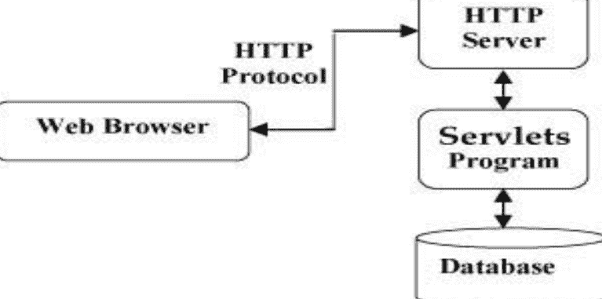
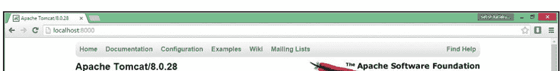
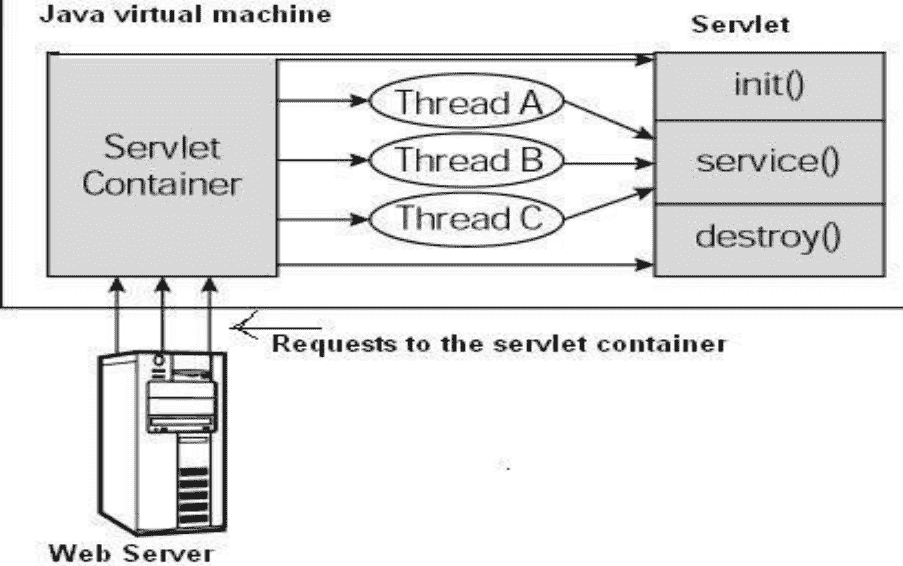
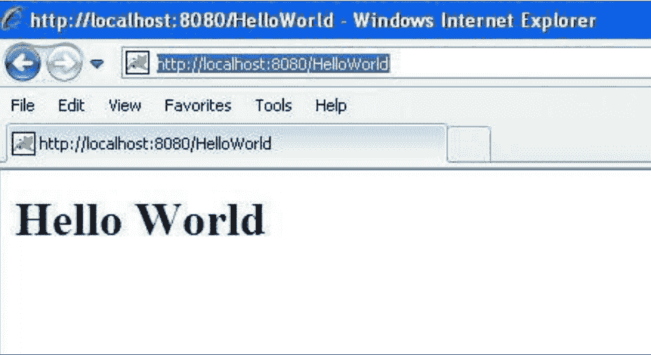

# Java Servlets：Web 应用框架

## 关于教程

Servlets 提供了一种基于组件的、平台无关的方法，用于构建 Web 应用程序，且不受限于 CGI 程序的性能限制。Servlets 可以访问整个 Java API 家族，包括用于访问企业级数据库的 `JDBC API`。

本教程将教你如何通过简单易懂的步骤使用 Java Servlets 开发你的 Web 应用程序。

## 目标读者

本教程专为需要理解 Java Servlets 框架及其 API 的 Java 程序员设计。完成本教程后，你将发现自己在使用 Java Servlets 方面达到了中等水平，并可以在此基础上更高水平迈进。

## 前提条件

我们假设你对 Java 编程语言有良好的理解。如果你对 Web 应用以及互联网的工作原理有了解，将更好。


- 15. SERVLET – 处理日期 ................................................................................ 80
- 获取当前日期与时间 ....................................................................... 81
- 日期比较 ..................................................................................... 82
- 使用 SimpleDateFormat 进行日期格式化 ........................................................ 82
- SimpleDateFormat 格式代码 ................................................................ 83
- 16. SERVLETS – 页面重定向.................................................................. 85
- 17. SERVLETS – 访问计数器 ................................................................. 87
- 网页访问计数器 ...................................................................... 87
- 18. SERVLETS – 页面自动刷新 ....................................................... 92
- 页面自动刷新示例....................................................................................... 92
- 19. SERVLETS – 发送邮件 ................................................................ 95
- 发送简单邮件 ................................................................................ 95
- 发送 HTML 邮件 ............................................................................... 98
- 在邮件中发送附件 ............................................................ 100
- 用户身份验证部分................................................................................ 103
- 20. SERVLETS – 打包........................................................ 104
- 在包中创建 Servlet ................................................... 104
- 在包中编译 Servlet ................................................... 105
- 打包 Servlet 部署 ................................................... 106
- 21. SERVLETS – 调试...................................................... 107
- `System.out.println()` ............................................................ 107
- 消息日志 .................................................................. 107
- 使用 JDB 调试器................................................................. 108
- 使用注释 .................................................................. 109
- 客户端和服务器头部...................................................... 109


- 重要的调试技巧 ................................................................................................................. 109
- 22. SERVLETS – 国际化...............................................................................111
- 检测本地区域..................................................................................................................................... 111
- 语言设置...................................................................................................................................... 113
- 本地特定日期......................................................................................................................... 114
- 本地特定货币....................................................................................................... 115
- 本地特定百分比..................................................................................................... 116
- 23. SERVLET – 注解............................................................................................... 119
- `@WebServlet`............................................................................................................................... 120
- `@WebInitParam`...................................................................................................................... 121
- `@WebFilter`................................................................................................................. 123


# 1. Servlets – 概述

## 什么是 Servlet？

Java Servlets 是运行在 Web 或应用程序服务器上的程序，它们作为来自 Web 浏览器或其他 HTTP 客户端的请求与 HTTP 服务器上的数据库或应用程序之间的中间层。

使用 Servlets，你可以通过网页收集用户的输入，展示来自数据库或其他源的记录，并动态创建网页。

Java Servlets 的作用通常与使用通用网关接口（CGI）实现的程序相同。但与 CGI 相比，Servlets 具有多个优势。

- 性能显著更好。
- Servlets 在 Web 服务器的地址空间内执行。无需为处理每个客户端请求创建一个单独进程。
- Servlets 是用 Java 编写的，因此它们是与平台无关。
- 服务器上的 Java 安全管理器强制执行一组限制以保护资源。Java 类库可以通过 socket 与服务器或其他软件进行通信。

## Servlet 架构

下图显示了 Servlet 在 Web 应用程序中的位置。



## Servlet 任务

- 从客户端读取请求。
- 处理请求数据。
- 生成响应并发送给客户端。
- 使用线程处理并发。
- 管理会话信息。

## Servlet 包

Servlet 可以在包内创建和编译。这有助于组织代码并提高重用性。常用的包包括 `javax.servlet` 和 `javax.servlet.http`。这些包提供了处理网络通信所需的类和接口。

## 接下来是什么？

我将带你逐步设置环境以开始学习。我相信你会喜欢这个教程的。


# 2. Servlets – 环境设置

开发环境是你开发、测试并最终运行它们的地方。任何 Java 程序一样，环境设置涉及以下步骤：

## 设置 Java 开发包

此步骤涉及下载 Java 开发包（SDK）并适当设置环境变量。

你可以从 Oracle Site 下载 SDK。

下载 Java 实现后，按照说明进行安装和配置。最后将 `PATH` 和 `JAVA_HOME` 环境变量指向 Java 和 javac 所在的目录（通常是 bin 目录）。如果你在 Windows 上运行并安装在 `C:\jdk1.8.0_65`，可以在批文件中写入以下内容：

```batch
set PATH=C:\jdk1.8.0_65\bin;%PATH%
set JAVA_HOME=C:\jdk1.8.0_65
```

或者，在 Windows NT/2000/XP 上，你也可以右键点击“我的电脑”，选择“属性”、“环境变量”，然后更新 `PATH` 值。

在 Unix（Solaris、Linux 等）上，如果 SDK 安装在 `/usr/local/jdk1.8.0_65` 且你使用 C shell，你可以在文件中写入：

```bash
setenv PATH /usr/local/jdk1.8.0_65:$PATH
setenv JAVA_HOME /usr/local/jdk1.8.0_65
```

或者，如果你使用 Borland JBuilder、Eclipse、IntelliJ IDEA 或 Sun One Studio 等集成开发环境（IDE），编译并运行一个简单的程序来确认 IDE 知道 Java 安装在哪里。

## 设置 Web 服务器：Tomcat

市场上有很多支持 servlet 的 Web 服务器。某些 Web 服务器是可以免费下载的，Tomcat 就是其中之一。

Apache Tomcat 是 Java Servlet 和 Java Server Pages（JSP）技术的开源软件实现，它可以作为一个测试 servlets 的独立服务器，也可以与 Apache Web Server 集成。以下是在您的机器上设置 Tomcat 的步骤：

- 从 http://tomcat.apache.org/ 下载最新版本的 Tomcat。
- 下载安装包后，将二进制分发包解压到方便的位置。例如在 Windows 上的 `C:\apache-tomcat-8.0.28`，或者在 Linux/Unix 上的 `/usr/local/apache-tomcat-8.0.28`，并创建一个指向这些位置的 `CATALINA_HOME` 环境变量。

在 Windows 机器上执行以下命令可以启动 Tomcat：

```batch
%CATALINA_HOME%\bin\startup.bat
```
或
```batch
C:\apache-tomcat-8.0.28\bin\startup.bat
```

在 Unix（Solaris, Linux,等）机器上执行以下命令可以启动 Tomcat：

```bash
$CATALINA_HOME/bin/startup.sh
```
或
```bash
/usr/local/apache-tomcat-8.0.28/bin/startup.sh
```

启动后，访问 http://localhost:8080/ 即可使用 Tomcat 自带的默认 Web 应用。如果一切正常，它将显示以下结果：



首页 文档 配置示例 Wiki 邮件列表 查找帮助

### Apache Tomcat/8.0.28

如果你确定这一点，说明你已成功安装了 Tomcat。恭喜你！


开发者快速上手

- Tomcat 第一个 Web 
- 入门 Java EE & Jakarta
- JDBC 数据源
- 示例
- Servlet 规范
- Tomcat 版本
- 推荐配置 HOW-TO
- 管理应用 HOW-TO
- 集群/会话复制 HOW-TO

管理 Tomcat

文档

获取帮助

FAQ 和邮件列表

要快速访问管理 Web 应用程序，请使用 `CATALINA_HOME/manager/html`。该应用程序在不同用户之间共享。参见文档。

Tomcat 8.0 文档

Tomcat 8.0 配置

可用列表如下：

- 发布说明
- 变更日志
- 迁移指南

有关安全的更多重要信息，请查看 cat 8.0 Release Notes

用户支持与讨论

关于 Apache Tomcat 的问题和讨论，请加入邮件列表。

关于配置和运行 Tomcat 的更多信息可以在此处文档找到，也可以在 Tomcat 网站上：http://tomcat.apache.org

在 Windows 机器上执行以下命令可以停止 Tomcat：

```batch
apache-tomcat-8.0.28\bin\shutdown
```

在 Unix（Solaris, Linux,等）机器上执行以下命令可以停止 Tomcat：

```bash
/usr/local/apache-tomcat-8.0.28/bin/shutdown
```

### 设置 CLASSPATH

由于 servlet 不属于 Java 平台标准版（Standard Edition），你必须识别要编译的 servlet 类。

如果你正在运行 Windows，你需要在 `C:\autocec.bat` 中放入以下行：

```batch
CATALINA=C:\apache-tomcat-8.0.28
CLASSPATH=%CATALINA%\common\lib\servlet-api.jar;%CLASSPATH%
```

或者，在 NT/2000/XP 上，你可以转到“我的电脑 -> 属性 -> 高级 -> 环境变量”。然后，你输入 `CLASSPATH` 值并点击确定 按钮。

在 Unix（Solaris, Linux,等）上，如果你使用 C shell，你将把以下行放入你的 `.cshrc` 中：

```bash
set CATALINA=/usr/local/apache-tomcat-8.0.28
setenv CLASSPATH $CATALINA/common/lib/servlet-api.jar:$CLASSPATH
```


**注意**：假设你的开发目录是 `C:\ServletDevel` (Windows) 或 `/usr/ServletDevel` (Unix)，那么你还需要以与上述添加类似的方式在 CLSPATH 中添加这些目录。


# 3. Servlets – 生命周期

Servlet 的生命周期可以定义为从创建到销毁的全过程。以下是 servlet 遵循的路径：

- 通过调用 `init()` 方法初始化 servlet。
- servlet 调用 `service()` 方法来处理客户端请求。
- 通过调用 `destroy()` 方法终止 servlet。
- 最后，servlet 被 JVM 的垃圾回收器回收。

现在我们详细讨论生命周期方法。

## init() 方法

`init` 方法只被调用一次。它只在 servlet 创建时被调用，之后不再对任何用户请求进行调用。因此，它用于一次性初始化，就像 applet 的 `init` 方法一样。

servlet 通常在用户首次调用与 servlet 对应的 URL 时创建，你也可以看到 servlet 在服务器启动时被创建。

当用户调用 servlet 时，会创建一个 servlet 的单个实例，每个用户请求的新线程被交给 `doGet` 等。`init()` 方法创建在 servlet 整个生命周期内使用的某些数据。`init` 方法如下：

```java
public void init() throws ServletException {
    // 初始化代码
}
```

## service() 方法

`service()` 是执行实际任务的方法。servlet 容器（即 Web 服务器）调用 `service()` 来处理来自客户端（浏览器）的请求并返回格式化的响应。

每当服务器接收到 servlet 请求，都会创建一个新线程并调用 `service()`。`service()` 方法检查 HTTP 类型（GET, POST, DELETE,等）并根据情况调用 `doGet`、`doPost`、`doDelete` 等方法。


## doGet() 方法

GET 请求源于未指定方法的 HTML，它应该由 `doGet()` 处理。

```java
public void doGet(HttpServletRequest request, HttpServletResponse response)
throws ServletException, IOException {
```

## doPost() 方法

POST 请求源于显式列出 POST 为 METHOD 的 HTML 表单，它应该由 `doPost()` 处理。

```java
public void doPost(HttpServletRequest request, HttpServletResponse response)
throws ServletException, IOException {
```

## destroy() 方法

`destroy()` 方法在 servlet 生命周期结束时只被调用一次。此方法让你的 servlet 有关闭数据库连接、停止后台线程、写入要丢弃的 cookie 列表并执行一些清理工作。

在调用 `destroy()` 方法后，servlet 被标记为垃圾回收。`destroy` 方法定义如下：

```java
public void destroy() {
  // 清理化代码
}
```

## 架构图

下图描述了一个典型的生命周期场景。

- 首先，到达服务器的 HTTP 请求委托给 servlet 容器。
- servlet 容器在调用 `service()` 方法之前加载 servlet。
- 然后，servlet 容器通过产生多个线程处理多个请求，每个线程执行 servlet 单个实例的 `service()` 方法。



# 4. Servlets – 示例

Servlet 是处理 HTTP 请求并实现 `javax.servlet.Servlet` 接口的 Java 类。Web开发者通常编写扩展 `javax.servlet.http.HttpServlet` 的 servlet，该类是一个专门为处理 HTTP 请求设计的抽象类。

## 示例代码

以下是显示 Hello World 的 servlet 示例源码结构：

```java
// 导入所需的 Java 库
import java.io.*;
import javax.servlet.*;
import javax.servlet.http.*;

// 扩展 HttpServlet
public class HelloWorld extends HttpServlet {

    private String message;

    public void init() throws ServletException
    {
        // 执行必要的初始化
        message = "Hello World";
    }

    public void doGet(HttpServletRequest request, HttpServletResponse response)
    throws ServletException, IOException
    {
        // 设置响应内容类型
        response.setContentType("text/html");

        // 实际逻辑在此处。
        PrintWriter out = response.getWriter();
        System.out.println("<h1>" + message + "</h1>");
    }

    public void destroy() {
        // do nothing.
    }
}
```

## 编译 Servlet

让我们创建一个如上方代码所示的 `HelloWorld.java` 文件。将此文件放置于 `C:\ServletDevel` (Windows) 或 `/usr/ServletDevel` (Unix)。在继续操作之前，必须将此路径添加到 `CLASSPATH` 中。

假设你的环境已配置妥，进入 ServletDevel 目录并按照以下方式编译 `HelloWorld.java`：

```bash
$ javac HelloWorld.java
```

如果 servlet 依赖于任何其他库，你必须将那些 JAR 文件包含在 `CLASSPATH` 中。我只包含了 `servlet-api.jar` 文件，因为我在 Hello 程序中没有使用任何其他库。

此命令行使用了随 Sun Microsystems Java 软件开发工具包 (JDK) 带的内置 Java 编译器。为了让此命令正常工作，你必须在 `PATH` 环境变量中包含你正在使用的 Java SDK 路径。

如果一切顺利，上述编译将在同一目录下生成 `HelloWorld.class` 文件。下一节将解释如何在生产环境中部署已编译的 servlet。

## Servlet 部署

默认情况下，servlet 应用位于路径 `<Tomcat-installation-directory>/webapps/ROOT`，类文件将位于 `<Tomcat-installation-directory>/ROOT/WEB-INF/classes`。

如果你有 `com.myorg.MyServlet` 的全限定名，则该 servlet 类必须位于 `WEB-INF/classes/com/myorg/MyServlet.class`。

现在，让我们将 `HelloWorld.class` 拷贝到 `<Tomcat-installation-directory>/ROOT/WEB-INF/classes`，并在 `<Tomcat-installation-directory>/webapps/WEB-INF/` 下的 `web.xml` 文件中创建条目：

```xml
<servlet>
    <servlet-name>HelloWorld</servlet-name>
    <servlet-class>HelloWorld</servlet-class>
</servlet>

<servlet-mapping>
    <servlet-name>HelloWorld</servlet-name>
    <url-pattern>/HelloWorld</url-pattern>
</servlet-mapping>
```


上述条目应创建在 `web.xml` 文件中的 `<web-app>...</web-app>` 标签内部。此表中可能已经存在各种条目，但无需担心。

你几乎已经完成了，现在让我们使用 `<Tomcat-installation-directory>bin/startup.bat` (Windows) 或 `<Tomcat-installation-directory>bin/startup.sh` (Linux/Solaris 等) 启动 Tomcat 服务器，最后在浏览器地址栏中输入 `http://localhost:8080/HelloWorld`。如果一切顺利，你将得到以下结果：



# 5. Servlets – 表单数据

你一定遇到过很多情况，需要从浏览器将某些信息传递到 Web 服务器，最终传递到你的后端程序。浏览器使用两种方法将这些信息传递给 Web 服务器。这些方法是 **GET 方法** 和 **POST 方法**。

## GET 方法

GET 方法将编码后的用户信息附加到页面请求之后。页面和编码后的信息通过 `?`（问号）符号隔开如下：

```
http://www.test.com/hello?key1=value1&key2=value2
```

GET 方法是从浏览器向 Web 服务器传递信息的默认方法，它会在你浏览器的 `Location:` 框中生成一个长字符串。如果你有密码或其他敏感信息要传递给服务器，请不要使用 GET 方法。GET 方法有大小限制：只能使用 1024 个字符。

此信息通过 `QUERY_STRING` 头部传递，Servlet 通过 `doGet()` 处理此类请求。

## POST 方法

向后端程序传递信息的一种更可靠的方法是 POST 方法。它以与 GET 方法相同封装信息，但不是作为 URL 中 `?`（问号）之后的文本字符串发送，而是以标准输入的形式发送到后端程序，你可以对其解析。Servlet 通过 `doPost()` 方法处理此类请求。

## 使用 Servlet 读取表单数据

Servlet 根据情况使用以下方法自动处理表单数据：

- **getParameter():** 调用 `request.getParameter()` 方法获取表单参数的值。
- **getParameterValues():** 如果参数出现多次并返回多个值（例如复选框），则调用此方法。


- `getParameterNames()`: 如果你需要当前请求中所有参数的完整列表，则调用此方法。


## 使用 URL 的 GET 方法示例

这是一个使用 GET 方法向 HelloForm 程序传递两个值的简单 URL：

```
http://localhost:8080/HelloForm?first_name=ZARA&last_name=ALI
```

给的是处理浏览器输入的 `HelloForm.java` servlet 程序。我们将使用非常方便访问传递的信息：

```java
// 导入 java 库
import java.io.*;
import javax.servlet.*;
import javax.servlet.http.*;

// HttpServlet 类
public class HelloForm extends HttpServlet {

    public void doGet(HttpServletRequest request, HttpServletResponse response)
            throws ServletException, IOException {
        // 设置响应内容类型
        response.setContentType("text/html");

        PrintWriter out = response.getWriter();
        String title = "Using GET Method to Read Form Data";
        String doctype = "<!DOCTYPE html //w3c//DTD HTML 4.0 //" +
                "//transitional/en>\n";
        out.println(doctype +
                "<head><title>" + title + "</title></head>\n" +
                "<body bgcolor='#f0f0f0'>\n" +
                "<h1 align='center'>" + title + "</h1>\n" +
                "<ul>\n" +
                "<li>First Name: " + request.getParameter("first_name") + "</li>\n" +
                "<li>Last Name: " + request.getParameter("last_name") + "</li>\n" +
                "</ul>\n" +
                "</body>");
    }
}
```

```java
public void doGet(HttpServletRequest request,
        HttpServletResponse response)
        throws ServletException, IOException {
    // 设置响应内容类型
    response.setContentType("text/html");

    PrintWriter out = response.getWriter();
    String title = "使用 GET 方法读取表单数据";
    String doctype =
            "<!doctype html public \"-//www.w3.org//DTD HTML 4.0//" +
                    "//transitional/en\">\n";
    out.println("<html>\n" +
            "<head><title>" + title + "</title></head>\n" +
            "<body bgcolor=\"f0f0f0\">\n" +
            "<h1 align=\"center\">" + title + "</h1>\n" +
            "<ul>\n" +
            "  <li><b>名：</b> " +
            "" + request.getParameter("first_name") + ""\n" +
            "  <li><b>姓：</b> " +
            "" + request.getParameter("last_name") + ""\n" +
            "</ul>\n" +
            "</</body></html>\n", out);
}

// 处理 POST 方法请求的方法。
public void doPost(HttpServletRequest request,
        HttpServletResponse response)
        throws ServletException, IOException {
    doGet(request, response);
}
```

现在编译并部署上述 Servlet，并使用 `Hello.htm` 通过 POST 方法进行测试，如下：

```html
<html>
<body>
<form action="HelloForm" method="POST">
名: <input type="text" name="first_name" />
<br />
姓: <input type="text" name="last_name" />
<input type="submit" value="Submit" />
</form>
</body>
</html>
```

这里是上述表单的实际输出，尝试输入名和姓，然后点击提交按钮，以便在运行 tomcat 的本地机器上查看结果。


根据提供的输入，将生成与上述示例中类似的结果。

# 将复选框数据传递到 Servlet 程序

当需要选择多个选项时使用复选框。

以下是一个带有两个复选框的表单示例 HTML 代码，`Checkbox.htm`：

```html
<html>
<body>
<form action="checkbox" method="POST" target="_blank">
<input type="checkbox" name="maths" checked="checked" /> 数学
<input type="checkbox" name="physics" /> 物理
<input type="checkbox" name="chemistry" checked="checked" /> 化学
<input type="submit" value="选择科目" />
</form>
</body>
</html>
```

此代码的结果的结果是下面的表单：


下面是 `CheckBox.java` Servlet 程序，用于处理 Web 浏览器为复选框按钮提供的输入。

```java
// 导入所需的 java 库
import java.io.*;
import javax.servlet.*;
import javax.servlet.http.*;

// 继承 HttpServlet 类
public class CheckBox extends HttpServlet {

    // 处理 GET 方法请求的方法。
    public void doGet(HttpServletRequest request,
            HttpServletResponse response)
            throws ServletException, IOException {
        // 设置响应内容类型
        response.setContentType("text/html");

        PrintWriter out = response.getWriter();
        String title = "读取复选框数据";
        String docType =
                "<!DOCTYPE html PUBLIC-//W3C//DTD HTML 4.0//" +
                        "//transitional//en\">\n";
        out.println(docType +
                "<head><title>" + title + "</title></head>\n" +
                "<body bgcolor=\"f0f0f0\">\n" +
                "<h1 align=\"center\">" + title + "</h1>\n" +
                "<ul>\n" +
                "<li><b>数学标记： </b>" +
                request.getParameter("maths") + "\n" +
                "<li><b>物理标记：</b>" +
                request.getParameter("physics") + "\n" +
                "<li><b>化学标记：</b>" +
                request.getParameter("chemistry") + "\n" +
                "</ul>\n" +
                "
```


## 读取所有表单参数

下面的通用示例使用 `HttpServletRequest` 的 `getParameterNames()` 方法来读取所有可用参数。该方法返回一个包含参数名的 `Enumeration`，其顺序是不指定的。

一旦我们有了 `Enumeration`，就可以按照标准方式遍历它，使用 `hasMoreElements()` 方法确定何时停止，并使用 `nextElement()` 方法获取参数名。

```java
// 导入所需的 java 库
import java.io.*;
import javax.servlet.*;
import javax.servlet.http.*;
import java.util.*;
```


```java
import javax.servlet.*;
import javax.servlet.http.*;
import java.util.*;

// 继承 HttpServlet 类
public class ReadParams extends HttpServlet {

    // 处理 GET 方法请求的方法
    public void doGet(HttpServletRequest request,
            HttpServletResponse response)
            throws ServletException, IOException {

        // 设置响应内容类型
        response.setContentType("text/html");

        PrintWriter out = response.getWriter();
        String title = "读取所有表单参数";
        String docType =
                "<!DOCTYPE html PUBLIC-//W3C//DTD HTML 4.0//" +
                        "//transitional//en\">\n";
        out.println(docType +
                "<head><title>" + title + "</title></head>\n" +
                "<body bgcolor=\"f0f0f0\">\n" +
                "<h1 align=\"center\">" + title + "</h1>\n" +
                "<table>\n" +
                "<tr><th>参数名</th><th>值(s)</th></tr>\n");

        // 获取所有参数名的枚举
        Enumeration paramNames = request.getParameterNames();

        while (paramNames.hasMoreElements()) {
            String paramName = (String) paramNames.nextElement();
            String[] paramValues = request.getParameterValues(paramName);
            out.print("<tr><td>" + paramName + "</td>");

            if (paramValues != null && paramValues.length == 1) {
                out.print("<td>" + paramValues[0] + "</td>");
            } else {
                out.print("<td><ul>");
                for (int i = 0; i < paramValues.length; i++) {
                    out.print("<li>" + paramValues[i] + "</li>");
                }
                out.print("</ul></td>");
            }
            out.print("</tr>\n");
        }
        out.println("</table></body></html>");
    }

    // 处理 POST 方法请求的方法。
    public void doPost(HttpServletRequest request,
            HttpServletResponse response)
            throws ServletException, IOException {
        doGet(request, response);
    }
}
```

现在，尝试使用以下表单通过 `Hello.htm` 通过 POST 方法来测试上述 Servlet：

```html
<html>
<body>
<form action="ReadParams" method="POST" target="_blank">
<input type="checkbox" name="maths" checked="checked" /> 数学
<input type="checkbox" name="physics" /> 物理
<input type="checkbox" name="chemistry" checked="checked" /> 化学
<input type="submit" value="选择科目" />
</form>
</body>
</html>
```


# 6. Servlets – 客户端 HTTP 请求

当浏览器请求网页时，它会向服务器发送大量信息，这些信息无法直接读取，因为它们是请求头的一部分。你可以检查 HTTP 协议获取更多信息。

以下是来自浏览器并在 Web 开发中经常使用的重要头部信息：

| 头部 | 描述 |
| --- | --- |
| Accept | 此头部指定浏览器或其他客户端可以处理的 MIME 类型。`image/jpeg` 或 `png` 是常见的值。 |
| Accept-Charset | 此头部指定浏览器用于显示信息的字符集。例如 `ISO-8859-1`。 |
| Accept-Encoding | 此头部指定浏览器知道如何处理的类型。`gzip` 或 `compress` 是常见的值。 |
| Accept-Language | 此头部指定客户端偏好的语言，Servlet 可以产生多种语言的结果。例如 `en-us`, `ru` 等。 |
| Authorization | 此头部用于客户端在访问受密码保护的网页时识别自己的身份。 |
| Connection | 此头部指示客户端是否可以处理持久 HTTP 连接。持久连接允许客户端或其他浏览器通过单个请求检索多个文件。`Keep-Alive` 值意味着应该使用持久连接。 |
| Content-Length | 此头部仅适用于 POST 请求，并给出 POST 数据的大小（字节）。 |
| Cookie | 此头部将 Cookie 返回给之前发送给浏览器的服务器。 |
| Host | 此头部指定原始 URL 中的主机名和端口。 |
| If-Modified-Since | 此头部指示客户端仅在网页在指定日期之后发生更改时请求页面。如果没有更新结果，服务器将返回 304 状态码，表示**未修改** 头部。 |
| If-Unmodified-Since | 此头部是 `If-Modified-Since` 的反向；它指定如果仅文档旧于指定的日期，则操作应该成功。 |
| Referrer | 此头部指示引用的 Web 页的 URL。例如，如果你在网页 1 上并点击链到网页 2 的链接，那么当浏览器请求网页 2 时，网页 1 的 URL 将包含在 `Referrer` 头部中。 |
| User-Agent | 此头部识别发送请求的浏览器或其他客户端，并用于向不同类型的浏览器返回不同的内容。 |


## 读取 HTTP 头部的方法

以下是可以在你的 servlet 程序中用于读取 HTTP 头部的方法。这些方法可以通过 `HttpServletRequest` 对象使用。

| S.N. | 方法及描述 |
|---|---|
| 1 | `Cookie[] getCookies()` 返回一个包含客户端通过此请求发送的所有 `Cookie` 对象的数组。 |
| 2 | `Enumeration getAttributeNames()` 返回一个包含此请求可用的属性名称的枚举。 |
| 3 | `Enumeration getHeaderNames()` 返回此请求包含的所有头部名称的枚举。 |
| 4 | `Enumeration getParameterNames()` 返回一个 `String` 对象的枚举，这些对象包含此请求包含的参数名称。 |
| 5 | `HttpSession getSession()` 返回与此请求关联当前 session；如果请求没有 session，则创建一个。 |
| 6 | `HttpSession getSession(boolean create)` 返回与此请求关联的当前 `HttpSession`；如果没有当前 session 且 `create` 值为 true，则返回一个新的 session。 |
| 7 | `Locale getLocale()` 根据 `Accept-Language` 头部返回客户端将接受内容的语言偏好 `Locale`。 |
| 8 | `Object getAttribute(String name)`<br>以 `Object` 形式返回指定属性的值，如果不存在该名称的属性，则返回 null。 |
| 9 | `ServletInputStream getInput()`<br>使用 `ServletInputStream` 以二进制数据检索请求体。 |
| 10 | `String getAuth()`<br>返回用于保护 servlet 的身份验证方案名称，例如 "BASIC" 或 "SSL"，如果 JSP 未受保护则返回 null。 |
| 11 | `String getCharacterEncoding()`<br>返回此请求体中使用的字符编码名称。 |
| 12 | `String getContentType()`<br>返回请求体的 MIME 类型，如果类型未知则返回 null。 |
| 13 | `String getContextPath()`<br>返回 URI 中指示请求上下文的部分。 |
| 14 | `String getHeader(String name)`<br>以 `String` 形式返回指定头部的值。 |
| 15 | `String getMethod()`<br>返回执行此请求的 HTTP 方法名称，例如 GET、POST 或 PUT。 |
| 16 | `String getParameter(String name)`<br>以 `String` 形式返回请求参数的值，如果参数不存在则返回 null。 |
| 17 | `String getPathInfo()`<br>返回与客户端发送此请求时发送的 URL 相关的任何额外路径信息。 |
| 18 | `String getProtocol()`<br>返回请求协议的名称和版本。 |
| 19 | `String getQueryString()`<br>返回请求 URL 路径之后的查询字符串。 |
| 20 | `String getRemoteAddr()`<br>返回发送请求的客户端的互联网协议 (IP) 地址。 |
| 21 | `String getRemoteHost()`<br>返回发送请求的客户端的完全限定名称。 |
| 22 | `String getRemoteUser()`<br>如果用户已身份验证，则返回执行此请求的用户日志；否则返回 null。 |
| 23 | `String getURI()`<br>返回 HTTP 请求第一行中从协议名称到查询字符串的 URL 部分。 |
| 24 | `String getRequestedId()`<br>返回客户端指定的 session ID。 |
| 25 | `String getServletPath()`<br>返回调用 JSP 的请求 URL 部分。 |
| 26 | `String[] getParameterValues(String name)`<br>返回包含给定参数所有值的 `String` 对象数组；如果参数不存在则返回 null。 |
| 27 | `boolean isSecure()`<br>返回指示此请求是否使用了安全通道（如 HTTPS）。 |
| 28 | `int getContentLength()`<br>返回由输入流提供的请求体长度（字节）；如果长度未知则返回 -1。 |
| 29 | `int getHeader(String name)`<br>返回指定请求头部的 int 值。 |
| 30 | `int getServerPort()`<br>返回接收此请求的端口号。 |

## Header 请求示例

以下是使用 `HttpServlet` 的 `getHeaderNames()` 方法读取 HTTP 头部示例。该方法返回一个包含当前 HTTP 请求关联头部信息的枚举。

一旦有了枚举，我们就可以标准方式遍历枚举：使用 `hasMoreElements()` 方法确定停止，使用 `nextElement()` 获取每个参数名称。

```java
// 导入所需的库
```

```java
String paramValue = request.getHeader(paramName);
out.println("<td> " + paramValue + "</td><tr\n");

{
out.println("</table\n</body></html>>");
}

// 处理 POST 请求的方法
public void doPost(HttpServletRequest request,
    HttpServletResponse response)
throws ServletException, IOException {
    doGet(request, response);
}
```

调用上述 servlet 将生成以下内容：

## HTTP 请求

| Header 名称 | 值 |
|---|---|
| accept | */* |
| accept-language | en-us |
| user-agent | Mozilla/4.0 (compatible; Windows NT 5.1; MSI; 7.0) |
| accept-encoding | gzip, deflate |
| host | localhost:8080 |
| connection | Keep-Alive |

## HTTP 响应

如章所示，当服务器响应请求时，响应通常由状态行、一些头部、一个空行和文档组成。示例：

```http
HTTP/1.1 200 OK
Content-Type: text/html
...
<!doctype html>
<html>
<head>
...
</head>
<body>
...
</body>
</html>
```

状态行包含 HTTP 版本 (1.1)、状态码 (200) 和消息。以下是返回浏览器的常用响应头部摘要：

| Header | 描述 |
|---|---|
| Connection | 此头部指示浏览器是否使用持久连接。`close` 值指示浏览器不使用持久连接，`keep-alive` 表示持久连接。 |
| Content-Disposition | 此头部允许你请求将响应保存到磁盘上的指定文件中。 |
| Content-Encoding | 此头部指定页面在传输期间编码的方式。 |
| Content-Language | 此头部表示文档编写的语言。例如，en-us 等。 |
| Content-Length | 此头部指示响应中的字节数。只有当浏览器使用持久（keep-alive）连接时才需要此信息。 |
| Content-Type | 此头部给出响应文档的 MIME（多用途扩展）类型。 |
| Expires | 此头部指定内容应被视为过期并不再缓存的时间。 |
| Last-Modified | 此头部指示文档最后更改的时间。客户端可以缓存文档并在后续请求中通过 `If-Modified-Since` 请求提供日期。 |
| Location | 此头部应包含在所有状态码为 30x 的响应中。此头部通知浏览器文档地址。浏览器会自动连接到此位置并检索新文档。 |
| Refresh | 此头部指定浏览器应多快请求更新后的页面。你可以指定页面刷新所需的所需的秒数。 |
| Retry-After | 此头部可以与 503（服务不可用）响应结合使用，告知客户端何时可以重复请求。 |
| Set-Cookie | 此头部指定与页面关联的 cookie。 |

## 设置 HTTP 响应头的方法

以下是可以在你的 Servlet 程序中用于设置 HTTP 响应头的方法。这些方法由 `HttpServletResponse` 对象提供。

| 序号 | 方法及描述 |
|---|---|
| 1 | `String encodeRedirectURL(String url)` 对返回的 URL 进行编码，以供 `sendRedirect` 方法使用；或者如果不需要编码，则返回原封未变的 URL。 |
| 2 | `String encodeURL(String url)` 使用 session ID 对指定的 URL 进行编码；如果不需要编码，则返回原封未变的 URL。 |
| 3 | `boolean containsHeader(String name)` 返回一个布尔值，表示命名的响应头是否已经设置。 |
| 4 | `boolean isCommitted()` 返回一个布尔值，表示响应是否提交。 |
| 5 | `void addCookie(Cookie cookie)` 将指定的 cookie 添加到响应中。 |
| 6 | `void addDate(String name, long date)` 添加带有给定名称和日期值的响应。 |
| 7 | `void addHeader(String name, String value)` 添加带有给定名称和值的响应。 |
| 8 | `void addIntHeader(String name, int value)` 添加带有给定名称和整数值的响应。 |
| 9 | `void flushBuffer()` 强制将缓冲区中的任何内容写入客户端。 |
| 10 | `void reset()` 清除缓冲区中存在的任何数据，以及状态码和响应头。 |
| 11 | `void resetBuffer()` 清除响应中底层缓冲区的内容，但不清除响应头或状态码。 |
| 12 | `void sendError(int sc)` 使用指定的状态码向客户端发送错误响应并清空缓冲区。 |
| 13 | `void sendError(int sc, String msg)` 使用指定的状态向客户端发送错误响应。 |
| 14 | `void sendRedirect(String location)` 使用指定的重定向 URL 向客户端发送临时重定向。 |
| 15 | `void setBufferSize(int size)` 为响应体设置首选缓冲区大小。 |
| 16 | `void setCharacterEncoding(String charset)` 设置发送到客户端的响应的字符编码（MIME 字符集），例如 UTF-8。 |
| 17 | `void setContentLength(int len)` 设置响应中内容体的长度，在 HTTP servlet 方法中设置 HTTP Content-Length 头部。 |
| 18 | `void setContentType(String type)` 如果响应尚未提交，则设置发送到客户端的响应类型。 |
| 19 | `void setHeader(String name, long date)` 设置带有给定名称和日期值的响应头。 |
| 20 | `void setHeader(String name, String value)` 设置带有给定名称和值的响应头。 |
| 21 | `void setIntHeader(String name, int value)` 设置带有给定名称和整数值的响应头。 |
| 22 | `void setLocale(Locale locale)` 如果响应尚未提交，则设置响应的语言区域。 |
| 23 | `void setStatus(int sc)` 设置此响应的状态码。 |

## HTTP 头部 – 示例

你已经在之前的示例中看到了 `setContentType()` 方法的作用，接下来的示例也将使用相同的方法，此外我们还将使用 `setHeader()` 方法来设置 Refresh 响应头。

```java
//导入所需的 java 库
import java.io.*;
import javax.servlet.*;
import java.util.*;

// 扩展 HttpServlet 类
public class Refresh extends HttpServlet {

    // 处理 GET 请求的方法。
    public void doGet(HttpServletRequest request,
        HttpServletResponse response)
        throws ServletException, IOException
{
        // 设置刷新、自动读取时间为 5 秒
        response.setHeader("Refresh", 5);

        // 设置响应内容类型
        response.setContentType("text/html");
}
}
```

```java
// 获取当前时间
Calendar calendar = new GregorianCalendar();
String am_pm;
int hour = calendar.get(Calendar.HOUR);
int minute = calendar.get(Calendar.MINUTE);
int second = calendar.get(Calendar.SECOND);
if(calendar.get(Calendar.AM_PM) == 0) {
    am_pm = "AM";
} else {
    am_pm = "PM";
}
```

```java
String CT = hour+":"+ minute+":"+ second+":"+ am_pm;

PrintWriter out = response.getWriter();
String title = "Auto Refresh Header Setting";
String docType = "<!doctype html public "-//W3C//DTD HTML 4.0 //" + "//transitional/EN//\n";
out.println(docType + "\n<html>\n" + "<head><title>" + title + "</title></head>\n" + "<body bgcolor='#f0f0f0'>\n" + "<h1 align='center'>" + title + "</h1>\n" + "<p>Current time is: " + CT + "</p>\n" + "</html>\n");
```

```java
// 处理 POST 请求的方法。
public void doPost(HttpServletRequest request,
    HttpServletResponse response)
    throws ServletException, IOException {

    doGet(request, response);
}
```

现在调用上面的 servlet 将在 5 秒后显示当前系统时间。只需运行该 servlet 并等待结果：

## 自动刷新设置

当前时间为：9:44

# 8. Servlet – 状态码

Servlet 的请求和响应格式如下：

请求包含状态行、CRLF（回车换行）

响应包含状态行、CRLF、头部、CRLF、一个可选的主体

请求格式如下：

```
HTTP/1.1 状态码
```

响应格式如下：

```
HTTP/1.1 状态码
Content-Type: ...
<!doctype html><head><body>
```

服务器可能返回以下状态码：

| 状态码 | 描述 |
|---|---|
| 100 | 持续 - 服务器已收到请求头部 |
| 101 | 切换协议 - 服务器正在切换协议 |
| 200 | OK - 请求已成功处理 |
| 201 | 创建 - 请求已成功创建 |
| 202 | 接受 - 请求已接受，但尚未处理完成 |
| 203 | 非授权信息 - 服务器返回的响应格式特殊 |
| 204 | 无内容 - 请求成功但无内容 |
| 300 | 多重重定向 - 请求可以访问后续请求的地址 |
| 301 | 永久重定向 - 页面已移动 |
| 302 | 临时重定向 - 页面临时移动 |


# HTTP 状态码参考表

| 状态码 | 说明 |
|---|---|
| 303 | 其他 - 响应应重定向到另一个 URL |
| 304 | 未修改 - 资源未更改 |
| 305 | 不使用 - 不使用此版本 |
| 307 | 临时重定向 - 请求的页面已临时移动 |
| 400 | 错误请求 - 服务器无法理解请求 |
| 401 | 未授权 - 需要用户名和密码 |
| 402 | 需要付款 - 预留 |
| 403 | 禁止 - 拒绝访问请求的页面 |
| 404 | 未找到 - 服务器找不到请求的页面 |
| 405 | 方法不允许 - 请求的方法不被允许 |
| 406 | 不接受 - 服务器无法生成客户端接受的响应 |
| 407 | 代理身份验证 - 在处理请求前需要向代理服务器身份验证 |
| 408 | 请求超时 - 请求时间超过了服务器的等待时间 |
| 409 | 冲突 - 请求由于冲突无法完成 |
| 410 | 消失 - 请求的页面不再可用 |
| 411 | 长度要求 - 未定义 `Content-Length`。服务器不会接受该请求 |
| 412 | 前提条件失败 - 请求中的前提条件被服务器评估为假 |
| 413 | 请求实体过大 - 服务器不会接受请求，因为实体过大 |
| 414 | 请求 URL 过长 - 服务器不会接受请求，因为 URL 过长。发生在将带有长查询信息的 "post" 请求转换为 "get" 请求时 |
| 415 | 不支持媒体类型 - 服务器不会接受请求，因为媒体类型不支持 |
| 417 | 期望失败 |
| 500 | 内部服务器错误 - 请求未完成，服务器遇到了意外状况 |
| 501 | 未实现 - 服务器未实现所需的功能 |
| 502 | 坏网关 - 服务器从上游服务器收到了无效响应 |
| 503 | 服务不可用 - 服务器临时过载或停机 |
| 504 | 网关超时 - 网关超时 |
| 505 | HTTP 版本不支持 - 服务器不支持的 "http 协议" 版本 |

## 设置 HTTP 状态码的方法

以下方法可用于在 Servlet 程序中设置 HTTP 状态码。这些方法可以通过 `HttpServletResponse` 对象使用。

| 序号 | 方法与描述 |
|---|---|
| 1 | `public void setStatus(int statusCode)`<br>此方法设置一个任意状态码。如果你的响应包含状态码和文档，请务必在使用 `PrintWriter` 实际返回任何内容之前调用 `setStatus`。 |
| 2 | `public void sendRedirect(String url)`<br>此方法会生成一个 302 响应，并带有一个 `Location` 头部，其中包含新文档的 URL。 |
| 3 | `public void sendError(int code, String message)`<br>此方法会发送状态码 (404) 以及一条短消息，该消息会在 HTML 文档中被自动格式化并发送给客户端。 |

## HTTP 状态码示例

以下示例将向客户端浏览器发送 407 错误码，浏览器将向你显示“Need authentication!”消息。

```java
// Import required java libraries
import java.io.*;
import javax.servlet.*;
import javax.servlet.http.*;
import java.util.*;

// Extend HttpServlet class
public class showError extends HttpServlet {

    // Method to handle GET request
    public void doGet(HttpServletRequest request,
                      HttpServletResponse response)
            throws ServletException, IOException {
        response.sendError(407, "Need authentication!");
    }

    public void doPost(HttpServletRequest request,
                       HttpServletResponse response)
            throws ServletException, IOException {
        doGet(request, response);
    }
}
```

现在调用上述 Servlet 将显示以下结果：

| HTTP Status 407 - Need authentication!!! |
|---|---|
| Type | Status report |
| message | Need authentication!!! |
| description | The client must first authenticate itself with the proxy (Need authentication!!!). |
| | Apache Tomcat/5.5.29 |

# 9. Servlet 过滤器 – 编写过滤器

Servlet 过滤器是 Java 类，在 Servlet 编程中可用于以下目的：

- 在客户端访问后端资源之前拦截其请求。
- 在从服务器向客户端发送响应之前，对其进行处理。

规范建议了多种类型的过滤器：

- 身份验证过滤器
- 数据压缩过滤器
- 加密过滤器
- 触发资源访问事件的过滤器
- 图像转换过滤器
- 日志与审计过滤器
- MIME-TYPE 链过滤器
- 分词过滤器
- 转换 XML 内容 XSL/T 过滤器

过滤器部署在部署描述符文件 `web.xml` 中，然后映射到应用程序部署描述符中的 Servlet 名称或 URL 模式。

当 Web 容器启动你的 Web 应用时，它会为你部署描述符中声明的每个过滤器创建一个实例。过滤器按照在部署描述符中的声明顺序执行。

## Servlet 过滤器方法

过滤器是实现 `javax.servlet.Filter` 接口的 Java 类。`javax.servlet.Filter` 接口定义了三个方法：

| 序号 | 方法与描述 |
|---|---|
| 1 | `public void doFilter(ServletRequest request, ServletResponse response, FilterChain chain)`<br>每当由于客户端请求链末端的资源导致请求/响应对通过链时，链就会调用此方法。 |
| 2 | `public void init(FilterConfig filterConfig)`<br>此方法由 Web 容器调用，指示过滤器它正被投入使用。 |
| 3 | `public void destroy()`<br>此方法由 Web 容器调用，指示过滤器它正被移除服务。 |


## Servlet 过滤器 – 示例

以下是 Servlet 过滤器示例，它将打印客户端的 IP 地址和当前日期。此示例将让你对 Servlet 过滤器有一个基本的了解，但你可以使用相同的概念编写更复杂的过滤器应用：

```java
// Import required java libraries
import java.io.*;
import javax.servlet.*;
import javax.servlet.http.*;
import java.util.*;

// Implements Filter class
public class LogFilter implements Filter {

    public void init(FilterConfig config)
            throws ServletException {
        // Get init parameter
        String testParam = config.getInitParameter("test-param");
        // Print the init parameter
        System.out.println("Test Param: " + testParam);
    }

    public void doFilter(ServletRequest request,
                         ServletResponse response,
                         FilterChain chain)
            throws java.io.IOException, ServletException {
        // Get the IP address of client machine.
        String ipAddress = request.getRemoteAddr();
        // Log the IP address and current timestamp.
        System.out.println("IP " + ipAddress + ", Time " + new Date().toString());
        // Pass request back down the filter chain
        chain.doFilter(request, response);
    }

    public void destroy() {
        /* Called before the Filter instance is removed
           from service by the web container */
    }
}
```

通常方式编译 `LogFilter.java`，并将你的类文件放在 `<Tomcat-installation-directory>/webapp/ROOT/WEB-INF/classes` 中。

## Web.xml 中的过滤器映射

过滤器的定义和映射到 URL 或 Servlet 的方式与 Servlet 定义并映射到 URL 模式的方式相似。在部署描述符 `web.xml` 中为 filter 标签创建以下条目：

```xml
<filter>
  <filter-name>LogFilter</filter-name>
  <filter-class>LogFilter</filter-class>
  <init-param>
    <param-name>test-param</param-name>
    <param-value>Initialization Parameter</param-value>
  </init-param>
</filter>

<filter-mapping>
  <filter-name>LogFilter</filter-name>
  <url-pattern>/*</url-pattern>
</filter-mapping>
```

上述过滤器将适用于所有 Servlet，因为我们在配置中指定了 `/*`。如果你只想在少数 Servlet 上应用过滤器，可以指定特定的 Servlet 路径。

现在尝试以通常方式调用任何 Servlet，你将在你的 Web 服务器日志中看到生成的日志。使用 Log4J 日志器将上述日志记录到单独的文件。

## 使用多个过滤器

你的 Web 应用可以定义多个具有特定目的的不同过滤器。假设你定义了两个过滤器 `AuthenFilter` 和 `LogFilter`。其余过程将如上文所示，但你需要按照文所述创建不同的映射：

```xml
<filter>
  <filter-name>LogFilter</filter-name>
  <filter-class>LogFilter</filter-class>
  <init-param>
    <param-name>test-param</param-name>
    <param-value>Initialization Parameter</param-value>
  </init-param>
</filter>

<filter>
  <filter-name>AuthenFilter</filter-name>
  <filter-class>AuthenFilter</filter-class>
  <init-param>
    <param-name>test-param</param-name>
    <param-value>Initialization Parameter</param-value>
  </init-param>
</filter>

<filter-mapping>
  <filter-name>LogFilter</filter-name>
  <url-pattern>/*</url-pattern>
</filter-mapping>

<filter-mapping>
  <filter-name>AuthenFilter</filter-name>
  <url-pattern>/*</url-pattern>
</filter-mapping>
```

## 过滤器的顺序

`web.xml` 中 `filter-mapping` 元素的顺序决定了 Web 容器应用过滤器到 Servlet 的顺序。例如，上述示例首先应用 `LogFilter`，然后对 Servlet 应用 `AuthenFilter`，但以下示例将反转顺序：

```xml
<filter-mapping>
  <filter-name>AuthenFilter</filter-name>
  <url-pattern>/*</url-pattern>
</filter-mapping>

<filter-mapping>
  <filter-name>LogFilter</filter-name>
  <url-pattern>/*</url-pattern>
</filter-mapping>
```


# 10. Servlet – 异常处理

当 Servlet 抛出异常时，Web 容器会搜索 `web.xml` 中使用 `exception-type` 元素匹配抛出异常类型的配置。

你必须在 `web.xml` 中使用 `error-page` 元素来指定响应特定**异常**或 HTTP **状态码** 的 Servlet。

## web.xml 配置

假设有一个 `ErrorHandler` Servlet，当发生任何定义的异常或错误时都会被调用。以下是在 `web.xml` 中创建的条目：

```xml
<!-- servlet definition -->
<servlet>
  <servlet-name>ErrorHandler</servlet-name>
  <servlet-class>ErrorHandler</servlet-class>
</servlet>

<!-- servlet mappings -->
<servlet-mapping>
  <servlet-name>ErrorHandler</servlet-name>
  <url-pattern>/ErrorHandler</url-pattern>
</servlet-mapping>

<!-- error-code related error pages -->
<error-page>
  <error-code>404</error-code>
  <location>ErrorHandler</location>
</error-page>

<error-page>
  <error-code>403</error-code>
  <location>ErrorHandler</location>
</error-page>

<!-- exception-type related error pages -->
<error-page>
  <exception-type>java.lang.Throwable</exception-type>
  <location>ErrorHandler</location>
</error-page>

<error-page>
  <exception-type>javax.servlet.ServletException</exception-type>
  <location>ErrorHandler</location>
</error-page>

<error-page>
  <exception-type>java.io.IOException</exception-type>
  <location>ErrorHandler</location>
</error-page>
```

如果你想为所有异常设置一个通用的错误处理程序，那么你应该定义下面的 `error-page`，而不是为每个异常单独定义单独的 `error-page` 元素：

```xml
<error-page>
  <exception-type>java.lang.Throwable</exception-type>
  <location>ErrorHandler</location>
</error-page>
```


## 异常处理中 web.xml 需要注意的几点

- servlet `ErrorHandler` 的定义方式与 `web.xml` 中配置的任何其他 servlet 相同。
- 如果状态码为 404（未找到）或 403（禁止访问）出现任何错误，将调用 `ErrorHandler` servlet。
- 如果 Web 应用程序抛出 `ServletException` 或 `IOException`，Web 容器将调用 `/ErrorHandler` servlet。
- 你可以定义不同的 Error Handler 来处理不同类型的错误或异常。上面的示例非常通用，其目的是向你解释基本概念。

## 请求属性 – 错误/异常

以下是错误处理 servlet 可以访问的请求属性列表，用于分析错误/异常的性质。

| 序号 | 属性 & 描述 |
|---|---|
| 1 | `javax.servlet.error.status_code`: 此属性提供状态码，可以在存储为 `java.lang.Integer` 数据类型后对其进行存储和分析。<br>`javax.servlet.error.exception_type`: 这提供了异常类型的信息，可以在存储为 `java.lang.Class` 数据类型后对其进行存储和分析。 |
| 3 | `javax.servlet.error.message`: 此属性提供精确的错误消息信息，可以在存储为 `java.lang.String` 数据类型后对其进行存储和分析。 |
| 4 | `javax.servlet.error.request_uri`: 此属性提供调用 servlet 的 URL 信息，可以在存储为 `java.lang.String` 数据类型后对其进行存储和分析。 |
| 5 | `javax.servlet.error.exception`: 此属性提供有关抛出的异常的信息，可以进行存储和分析。 |
| 6 | `javax.servlet.error.servlet_name`: 此属性提供 servlet 名称，可以在存储为 `java.lang.String` 数据类型后对其进行存储和分析。 |

## 错误处理程序 Servlet – 示例

此示例将让你对 Servlet 中的异常处理有基本的理解，但你可以使用相同的概念编写更复杂的过滤器（filter）应用程序：

```java
// 导入所需的 java 库
import java.io.*;
import javax.servlet.*;
import javax.servlet.http.*;
import java.util.*;

// 扩展 HttpServlet 类
public class ErrorHandler extends HttpServlet {

    // 处理 GET 方法请求的方法。
    public void doGet(HttpServletRequest request,
                      HttpServletResponse response)
            throws ServletException, IOException {

        // 分析 servlet 异常
        Throwable throwable = (Throwable)
                request.getAttribute("javax.servlet.error.exception");

        Integer statusCode = (Integer)
                request.getAttribute("javax.servlet.error.status_code");

        String servletName = (String)
                request.getAttribute("javax.servlet.error.servlet_name");

        if (servletName == null) {
            servletName = "Unknown";
        }

        String requestUri = (String)
                request.getAttribute("javax.servlet.error.request_uri");

        if (requestUri == null) {
            requestUri = "Unknown";
        }

        // 设置响应内容类型
        response.setContentType("text/html");

        PrintWriter out = response.getWriter();
        String title = "Error/Exception Information";
        String docType =
                "<!DOCTYPE html //W3C//DTD HTML 4.0" +
                "//transitional/EN>\n";

        out.println(docType +
                "<html>" +
                "<head><title>" + title + "</head>\n" +
                "<body bgcolor=\"f0f0f0\">");

        if (throwable == null && statusCode == null) {
            out.println("<h2>Error information is missing</h2>" + "\n");
            out.println("Please return to the <a href=\"");
        }

        out.println("The exception message: " +
                throwable.getMessage());

        out.println("</body>");
        out.println("</html>");

        // 处理 POST 请求的方法。
        public void doPost(HttpServletRequest request,
                           HttpServletResponse response)
                throws ServletException, IOException {
            doGet(request, response);
        }
    }
}
```

编译 `ErrorHandler.java` 并在 `web.xml` 中添加以下内容以处理异常：

```xml
<servlet>
  <servlet-name>ErrorHandler</servlet-name>
  <servlet-class>ErrorHandler</servlet-class>
</servlet>

<servlet-mapping>
  <servlet-name>ErrorHandler</servlet-name>
  <url-pattern>/ErrorHandler</url-pattern>
</servlet-mapping>

<error-page>
  <error-code>404</error-code>
  <location>/ErrorHandler</location>
</error-page>

<error-page>
  <error-code>403</error-code>
  <location>/ErrorHandler</location>
</error-page>

<error-page>
  <exception-type>java.lang.Throwable</exception-type>
  <location>/ErrorHandler</location>
</error-page>
```

## 使用 Servlet 设置 Cookies

使用 servlet 设置 cookies 涉及三个步骤：

1.  **创建 Cookie 对象**：你调用 `Cookie` 构造函数，并传入 cookie 名称和 cookie 值，这两者都是字符串。

    ```java
    Cookie cookie = new Cookie("key", "value");
    ```

    请记住，由于名称或值都不应包含空格或以下任何字符：
    ```
    [ ] ( ) = " / ? @ ;
    ```

2.  **设置最大生存时间**：使用 `setMaxAge()` 指定 cookie 的有效时间（以秒为单位）。以下代码将设置一个有效期为 24 小时的 cookie。

    ```java
    cookie.setMaxAge(60*60*24);
    ```

3.  **将 Cookie 发送到 HTTP 响应头中**：你使用 `response.addCookie()` 如下所示将 cookies 添加到 HTTP 响应头中：

    ```java
    response.addCookie(cookie);
    ```

### 示例

让我们修改表单示例（Form Example），为姓和名设置 cookies。

```java
// 导入所需的 java 库
import java.io.*;
import javax.servlet.*;
import javax.servlet.http.*;

// 扩展 HttpServlet 类
public class HelloForm extends HttpServlet {

    public void doGet(HttpServletRequest request, HttpServletResponse response)
            throws ServletException, IOException {

        // 创建用于名字和姓的 cookies。
        Cookie firstName = new Cookie("first_name", request.getParameter("first_name"));
        Cookie lastName = new Cookie("last_name", request.getParameter("last_name"));

        // 为两个 cookies 设置 24 小时后的过期日期。
        firstName.setMaxAge(60*60*24);
        lastName.setMaxAge(60*60*24);

        // 将两个 cookies 添加到响应头中。
        response.addCookie(firstName);
        response.addCookie(lastName);

        // 设置响应内容类型
        response.setContentType("text/html");
        PrintWriter out = response.getWriter();
    }
}
```

编译上面的 servlet `HelloForm`，在 `web.xml` 文件中创建相应的条目，最后通过以下 HTML 页面调用 servlet。

```html
<html>
<body>
<form action="HelloForm" method="GET">
First Name: <input type="text" name="first_name">
<br />
Last Name: <input type="text" name="last_name" />
<input type="submit" value="Submit" />
</form>
</body>
</html>
```

将上述 HTML 内容保存在名为 `Hello.htm` 的文件中，并将其放入 `<Tomcat-installation-directory>/ROOT` 目录下。当你访问 `http://localhost:8080/Hello.htm` 时，这里是表单的实际输出。

尝试输入 First Name 和 Last Name 并点击提交按钮。这将在你的屏幕上显示名字和姓氏，同时它会设置两个 cookies `firstName` 和 `lastName`，当你下次按下提交按钮时，它们将会被传回服务器。

下一节将解释你如何在你的 Web 中重新访问这些 cookies。

## 使用 Servlet 读取 Cookies

要读取 cookies，你需要通过调用 `HttpServletRequest` 的 `getCookies()` 方法来创建一个 `javax.servlet.Cookie` 对象的数组。然后遍历数组，并使用 `getName()` 和 `getValue()` 方法访问每个 cookie 及其值。

### 示例

让我们读取我们在上一个示例中设置的 cookies：

```java
// 导入所需的 java 库
import java.io.*;
import javax.servlet.*;
import javax.servlet.http.*;

// 扩展 HttpServlet 类
public class ReadCookies extends HttpServlet {

    public void doGet(HttpServletRequest request,
                      HttpServletResponse response)
            throws ServletException, IOException {

        Cookie cookie = null;
        Cookie[] cookies = null;

        // 获取与此域关联的 Cookies 数组
        cookies = request.getCookies();

        // 设置响应内容类型
        response.setContentType("text/html");

        PrintWriter out = response.getWriter();

        String title = "Reading Cookies Example";
        String docType =
                "<!doctype html //-//www.w3.org/HTML/4.0 " +
                "//transitional/en//";

        out.println(docType +
                "<html>\n" +
                "<head><title>" + title + "</title></head>\n" +
                "<body bgcolor=\"#f0f0f0\"\n");

        if (cookies != null) {
            out.println("<h2> Found Cookies Name and Value</h2>");
            for (int i = 0; i < cookies.length; i++) {
                cookie = cookies[i];
                out.print("Name : " + cookie.getName() + " , ");
                out.print("Value: " + cookie.getValue() + "<br/>");
            }
        } else {
            out.println("<h2>No cookies found</h2>");
        }

        out.println("</body>\n");
        out.println("</html>\n");
    }
}
```

编译上面的 servlet `ReadCookies` 并在 `web.xml` 文件中创建相应的条目。如果 `first_name` 为 "John" 且 `last_name` 为 "Doe"，则输出如下：

**Found Cookies Name and Value**
Name : first_name , Value: John

## 使用 Servlet 删除 Cookies

删除 cookies 非常简单。如果你想删除 cookie，只需遵循以下步骤：

- 读取 cookie 并将其存储在 `Cookie` 对象中。
- 使用 `setMaxAge()` 设置 cookie 为零。
- 将此 cookie 添加回响应头。

### 示例

以下将删除 `first_name`：

```java
// 导入所需的 java 库
import java.io.*;
import javax.servlet.*;
import javax.servlet.http.*;

// 扩展 HttpServlet 类
public class DeleteCookies extends HttpServlet {

    public void doGet(HttpServletRequest request, HttpServletResponse response)
            throws ServletException, IOException {

        Cookie cookie = null;
    }
}
```


# 12. Servlets – 会话跟踪

HTTP 是一种无状态协议，这意味着每次客户端检索 Web 页面时，客户端都会打开一个新的连接，服务器不会自动保留之前的请求记录。

仍然有以下三种方法可以在 web 客户端和服务器之间维护会话：

## Cookies

服务器为每个 web 客户端分配一个唯一的 Session ID 作为 cookie，后续的请求可以通过收到的 cookie 进行识别。

这可能不是一种有效的方法，因为浏览器不支持 cookies，因此我不建议使用此过程来维护会话。

## 隐藏表单字段

Web 服务器可以同唯一的 Session ID 一起发送“隐藏”HTML 表单字段，如下：

```html
<input type="hidden" name="sessionid" value="12345">
```

此条目在表单提交时，指定的名称和值会自动包含在 GET 或 POST 数据中。每当 web 浏览器返回时，可以使用 `session_id` 值跟踪不同的浏览器。

## URL 重写

你可以在每个 URL 的末尾附加标识会话的额外数据，并将会话标识符与其存储的关于该会话的数据关联。

例如，通过 `http://tutorialspoint.com/file.htm;session=12345`，会话标识符被附加为 `sessionid=12345`，可以在 Web 服务器访问以识别客户端。

URL 重写是维护会话更好的方法，并且在浏览器不支持 cookies 的情况下有效。URL 重写的缺点是，你需要动态生成每个 URL 以分配 Session ID，即使对于简单的静态 HTML 页面也是如此。

# HttpSession 对象

除了上述三种方法外，servlet 提供了 `HttpSession` 接口，它提供了一种跨越多个页面请求或访问网站时来识别用户并存储有关该用户信息的方法。

servlet 容器使用此接口在 HTTP 客户端和 HTTP 服务器之间创建一个会话（session）。该会话在指定的时间内持续有效，并跨越用户的多次连接或页面请求。

你可以通过调用 `HttpServletRequest` 的公共方法 `getSession()` 来获取 `HttpSession` 对象，如下所示：

```java
HttpSession session = request.getSession();
```

在向客户端发送任何文档内容之前，你需要调用 `request.getSession()`。以下是通过 `HttpSession` 对象提供的重要方法摘要：

| S.N. | 方法与描述 |
|---|---|
| 1 | `public Object getAttribute(String name)`<br>此方法返回与此会话中指定名称绑定的对象，如果该名称下没有绑定对象，则返回 null。 |
| 2 | `public Enumeration getAttributeNames()`<br>此方法返回一个 String 对象的枚举（Enumeration），包含绑定到此会话的所有对象的名称。 |
| 3 | `public long getCreationTime()`<br>此方法返回此会话创建的时间，以自 GMT 1970 年 1 月 1 日午夜以来的毫秒数。 |
| 4 | `public String getId()`<br>此方法返回一个包含分配给此会话的唯一标识符的字符串。 |
| 5 | `public long getLastAccessedTime()`<br>此方法返回会话的最后访问时间，格式为自 GMT 1970 年 1 月 1 日午夜以来的毫秒数。 |
| 6 | `public int getMaxInactiveInterval()`<br>此方法返回 servlet 容器在客户端访问之间保持会话开启的最大时间间隔（秒）。 |
| 7 | `public void invalidate()`<br>此方法使会话失效并解绑绑定到其上的任何对象。 |
| 8 | `public boolean isNew()`<br>如果客户端不知道该会话，或者客户端选择不加入会话，则此方法返回 true。 |
| 9 | `public void removeAttribute(String name)`<br>此方法从此会话中移除与指定名称绑定的对象。 |
| 10 | `public void setAttribute(String name, Object value)`<br>此方法使用指定的名称将对象绑定到此会话。 |
| 11 | `public void setMaxInactiveInterval(int interval)`<br>此方法指定了客户端请求之间的间隔时间（秒），在此时间之后，服务器容器将使此会话失效。 |

## 会话跟踪示例

此示例描述了如何使用 `HttpSession` 对象来查找会话的创建时间和最后访问时间。如果不存在现有会话，我们将为请求关联一个新会话。

```java
String userIDKey = new String("userID");
userID = new String("ABCD");

// 检查这是否是你网页上的新用户。
if (session.isNew()) {
    title = "Welcome to my website";
    session.setAttribute(userIDKey, userID);
} else {
    visitCount = (Integer) session.getAttribute(visitCount);
    visitCount = visitCount + 1;
    userID = (String) session.getAttribute(userID);
}

session.setAttribute(visitCount, visitCount);

// 设置响应内容类型
response.setContentType("text/html");
PrintWriter out = response.getWriter();
```

```java
" </td></tr>\n" + 
"<tr>\n" + 
" <td>Time of Last Access</td>\n" + 
" <td>" + lastAccessTime + " </td></tr>\n" + 
"<tr>\n" + 
" <td>User ID</td>\n" + 
" <td>" + userID + " </td></tr>\n" + 
"<tr>\n" + 
" <td>Number of visits</td>\n" + 
" <td>" + visitCount + " </td></tr>\n" + 
"</table>\n" + 
"</body></html>\n";
```

编译上面的 servlet `SessionTrack` 并在 `web.xml` 文件中创建适当的条目。现在运行 `http://localhost:8080/SessionTrack`，当你第一次运行时将显示以下结果：

# 欢迎回到我的网站

| info类型 | 值 |
|--- |--- |
| id | 0AE3EC93FF4AE3C525B4351B77ABB2D5 |
| Creation Time | Tue Jun 08 17:26:40 GMT+04:00 2010 |
| Time of Last Access | Tue Jun 08 17:26:40 GMT+04:00 2010 |
| User ID | ABCD |
| Number of visits | 1 |

再次运行 servlet 将显示相同的结果。

# 删除会话

当完成会话时，`HttpSession` 提供了以下选项：

- 移除特定属性：`removeAttribute(String name)` 方法可以移除特定的值。
- 整个会话：`invalidate()` 方法可以移除整个会话。
- 设置超时：`setMaxInactiveInterval(int interval)` 方法可以设置会话的超时时间。
- 获取属性：`getAttribute(String name)` 方法可以获取值。
- 设置属性：`setAttribute(String name, Object value)` 方法可以设置值。
- 检查是否为新会话：`isNew()` 方法可以检查会话是否是新创建的。
- 获取最后访问时间：`getLastAccessedTime()` 方法可以获取最后访问时间。
- 获取创建时间：`getCreationTime()` 方法可以获取创建时间。
- 获取会话ID：`getId()` 方法可以获取会话的。
- 获取所有属性名称：`getAttributeNames()` 方法可以获取所有属性名称。
- 获取最大空闲间隔：`getMaxInactiveInterval()` 方法。
- 会话失效：`invalidate()` 方法可以使会话失效。

# 14. Servlets – 文件上传

Servlet 可以配合 HTML 表单标签使用，允许用户将文件上传到服务器。上传的文件可以是文本文件、图像文件或任何文档。

## 创建文件上传表单

下面的 HTML 代码创建了一个上传表单。以下是需要注意的重要点：

- `method` 属性应设置为 POST 方法，不能使用 GET 方法。
- `enctype` 属性应设置为 `multipart/form-data`。
- `form action` 属性应设置为 servlet 文件，该文件将在后端服务器处理文件上传。接下来的示例是用于上传文件的 `UploadServlet`。
- 要上传单个文件，应使用带有 `type="file"` 属性的单个 `<input .../>` 标签。要允许上传多个文件，应使用多个具有不同 `name` 属性值的 input 标签。浏览器会为每个标签关联一个浏览（Browse）按钮。

```html
<html>
<head>
<title>文件上传表单</title>
</head>
<body>
<h3>文件上传: <br /></h3>
选择要上传的文件: <br />
<form action="UploadServlet" method="post" enctype="multipart/form-data">
<input type="file" name="file" size="50" />
<br />
<input type="submit" value="Upload File" />
</form>
</body>
</html>
```

这将显示一个结果，允许你从本地 PC 选择文件，当用户点击“Upload File”（上传文件）时，表单将同所选的文件提交。

## 编写后端 Servlet

接下来的 servlet `UploadServlet`，它将负责接收上传的文件并存储在目录 `~Tomcat-installation-directory>/webapps/data` 中。该目录名称也可以通过外部配置添加，例如 `web.xml` 中的 `context-param` 元素，如下所示：

```xml
<web-app>
  ...
  <context-param>
    <description>存储上传文件的位置</description>
    <param-name>file-upload</param-name>
    <param-value>
      c:\apache-tomcat-8.0.28\webapps\
    </param-value>
  </context-param>
  ...
</web-app>
```


# UploadServlet 源代码

以下是 `UploadServlet` 的源代码，它可以同时处理多个文件的上传。在继续之前，请确保你拥有以下内容：

- 下面的示例依赖于 FileUpload，请确保你的类路径中有最新版本的 `commons-fileupload.x.x.jar` 文件。你可以从 http://commons.apache.org/fileupload/ 下载它。
- FileUpload 依赖于 Commons IO，请确保你的类路径中有最新版本的 `commons-io-x.x.jar` 文件。你可以从 http://commons.apache.org/io/ 下载它。


## 测试注意事项

- 在测试以下示例时，你应该上传一个大小小于 `maxFileSize` 的文件，否则不会上传。
- 确保你提前创建了 `c:\temp` 和 `c:\apache-tomcat-8.0.28\webapps\data` 目录。

## 完整代码

```java
// 导入所需的库
import java.io.*;
import java.util.*;
import javax.servlet.ServletConfig;
import javax.servlet.ServletException;
import javax.servlet.http.HttpServlet;
import javax.servlet.http.HttpServletRequest;
import javax.servlet.http.HttpServletResponse;
import org.apache.commons.fileupload.FileUploadItem;
import org.apache.commons.fileupload.FileUploadException;
import org.apache.commons.fileupload.disk.DiskFileFactory;
import org.apache.commons.fileupload.servlet.ServletFileUpload;
import org.apache.commons.io.output.*;

public class UploadServlet extends HttpServlet {

    private boolean isMultipart;
    private String filePath;
    private int maxFileSize = 50 * 1024;
    private int maxMaxSize = 4 * 1024;
    private File file;

    public void init() {
        // 获取存储的位置
        filePath = getServletContext().getInitParameter("file-upload");
    }

    public void doPost(HttpServletRequest request, HttpServletResponse response) throws ServletException, java.io.IOException {
        // 检查是否有文件上传
        isMultipart = ServletFileUpload.isMultipartContent(request);
        response.setContentType("text/html");
        java.io.PrintWriter out = response.getWriter();

        if (!isMultipart) {
            out.println("<html>");
            out.println("<head>");
            out.println("<title>Servlet upload</title>");
            out.println("</head>");
            out.println("<body>");
            out.println("<p>没有上传的文件</p>");
            out.println("</body>");
            out.println("</html>");
            return;
        }

        DiskFileFactory factory = new DiskFileFactory();
        // 存储在内存中的最大尺寸
        factory.setSizeThreshold(maxMaxSize);
        // 存储大于 maxMaxSize 数据的位置
        factory.setRepository(new File("c:\\temp"));

        // 创建一个新的文件上传处理器
        ServletFileUpload upload = new ServletFileUpload(factory);
        // 允许上传的最大文件大小
        upload.setSizeMax(maxFileSize);

        try {
            // 解析请求以获取文件项
            List<FileUploadItem> fileItems = upload.parseRequest(request);
            // 处理上传的文件项
            Iterator i = fileItems.iterator();
            out.println("<html>");
            out.println("<head>");
            out.println("<title>Servlet upload</title>");
            // 后续处理代码省略...
        } catch (FileUploadException e) {
            e.printStackTrace();
        }
    }
}
```


## 编译并运行 Servlet

编译上面的 `UploadServlet` 并在 `web.xml` 中创建所需的条目：

```xml
<servlet>
  <servlet-name>UploadServlet</servlet-name>
  <servlet-class>UploadServlet</servlet-class>
</servlet>
<servlet-mapping>
  <servlet-name>UploadServlet</servlet-name>
  <url-pattern>/UploadServlet</url-pattern>
</servlet-mapping>
```

现在使用你创建的 HTML 表单尝试上传文件。当你尝试 `http://localhost:8080/UploadFile.htm` 时，将显示以下结果，帮助从本地机器上传任何文件。

文件上传:
选择要上传的文件:


如果你的 servlet 脚本运行良好，你的文件将上传到 `c:\apache-tomcat-8.0.28\webapps\data\` 目录。

# 15. Servlet – 处理日期

使用 Servlet 的最重要的优点之一是你可以使用核心 Java 中的大部分方法。本教程将带你了解 `java.util` 包中提供的 `Date` 类，该类封装了当前的日期和时间。

该类支持两个构造函数。第一个构造函数用当前日期时间初始化对象。

```java
Date()
```

下一个构造函数接受一个参数，等值于自 1970 年 1 月 1 日午夜以来毫秒数。

```java
Date(long millisec)
```

一旦有了 `Date` 对象，就可以调用以下支持方法来处理日期：

| SN | 方法及描述 |
| :--- | :--- |
| 1 | `boolean after(Date date)` 如果调用的 `Date` 对象包含比指定的 `date` 晚的日期，则返回 `true`，否则返回 `false`。 |
| 2 | `boolean before(Date date)` 如果调用的 `Date` 对象包含比指定的 `date` 更早的日期，则返回 `true`，否则返回 `false`。 |
| 3 | `Object clone()` 复制调用的 `Date` 对象。 |
| 4 | `int compareTo(Date date)` 比较调用的对象与 `date` 的值。如果值相等则返回 0。如果调用的对象比 `date` 更早，则返回负值。 |
| 5 | `boolean equals(Object date)` 如果调用的 `Date` 对象与指定的 `date` 相等则返回 `true`，否则返回 `false`。 |
| 6 | `long getTime()` 返回自 1970 年 1 月 1 日以来的毫秒数。 |
| 7 | `int hashCode()` 返回调用的对象的哈希值。 |
| 8 | `void setTime(long time)` 根据指定的时间设置日期时间，该时间代表自 1970 年 1 月 1 日午夜以来的毫秒时间。 |
| 9 | `String toString()` 将调用的 `Date` 对象转换为字符串并返回结果。 |


## 获取当前日期与时间

在 Java Servlet 中获取当前日期和时间非常简单。你可以使用简单的 `Date` 对象配合 `toString()` 方法按照如下所示打印当前日期和时间：

```java
// Import required java libraries
import java.io.*;
import java.util.Date;
import javax.servlet.*;
import javax.servlet.http.*;

// Extend HttpServlet class
public class CurrentDate extends HttpServlet {

    public void doGet(HttpServletRequest request, HttpServletResponse response)
            throws ServletException, IOException {

        // Set response content type
        response.setContentType("text/html");
        PrintWriter out = response.getWriter();
        String title = "Display Current Date & Time";
        Date date = new Date();
        String docType = "<!DOCTYPE html PUBLIC \"-//W3C//DTD HTML 4.0 Transitional//EN\">";

        out.println(docType +
            "<html>" +
            "<head><title>" + title + "</title></head>" +
            "<body bgcolor=\"f0f0f0\">" +
            "<h1 align=\"center\">" + title + "</h1>" +
            "<h2 align=\"center\">" + date.toString() + "</h2>" +
            "</body></html>");
    }
}
```

## 运行结果

现在让我们编译上面的 servlet 并在 `web.xml` 中创建相应的条目，然后使用 URL `http://localhost:8080/CurrentDate` 调用此 servlet。这将产生如下结果：

### 显示当前日期与时间

Mon Jun 21 21:46:49 GMT+04:00 2010

尝试刷新 URL `http://localhost:8080/CurrentDate`，你会发现每次刷新时秒数都有变化。

## 日期比较

如上所述，你可以在 Servlet 中使用所有可用的 Java 方法。你需要比较两个日期，以下是相关方法：

- 你可以使用 `getTime()` 来获取两个对象自 1970 年 1 月 1 日午夜以来经过的毫秒数，然后比较这些值。
- 你可以使用 `before()`、`after()` 和 `equals()`。例如，因为某月的 12 号在 18 号之前，所以 `new Date(99, 2, 12).before(new Date(99, 2, 18))` 返回 `true`。
- 你可以使用 `compareTo()` 方法，该方法由 `Comparable` 接口定义并由 `Date` 实现。

## 使用 SimpleDateFormat 日期格式

`SimpleDateFormat` 是一个具体的类，用于以敏感区域的方式格式化和解析日期。`SimpleDateFormat` 允许你从选择任何用户定义的日期-时间格式模式开始。

让我们看如下面的示例：

```java
// Import required java libraries
import java.io.*;
import java.text.*;
import java.util.Date;
import javax.servlet.*;

// Extend HttpServlet class
public class CurrentDate extends HttpServlet {

    public void doGet(HttpServletRequest request,
        HttpServletResponse response) throws ServletException, IOException {

        // Set response content type
        response.setContentType("text/html");
        PrintWriter out = response.getWriter();
        String title = "Display Current Date & Time";
        Date dNow = new Date();
        SimpleDateFormat dateFormat = new SimpleDateFormat(" yyyy.MM.dd 'at' hh:mm:ss a zzz");
        String doctype = "<!DOCTYPE html PUBLIC \"-//W3C//DTD HTML 4.0 Transitional//EN\">";

        out.println(doctype +
            "<html>\n" +
            "<head><title>" + title + "</title></head>\n" +
            "<body bgcolor=\"f0f0f0\">\n" +
            "<h1 align=\"center\">" + title + "</h1>\n" +
            "<h2 align=\"center\">" + dateFormat.format(dNow) + "</h2>\n" +
            "</body></html>");
    }
}
```


再次编译上面的 servlet，然后使用 URL `http://localhost:8080/CurrentDate` 调用此 servlet。这将产生如下结果：

### 显示当前日期与时间

Mon 2010.06.21 at 10:06:44 PM GMT+04:00

# SimpleDateFormat 格式代码

使用模式字符串来指定时间。在这些模式中，所有 ASCII 字母都被留作模式字母，其定义如下：


| 字符 | 说明 | 示例 |
| :--- | :--- | :--- |
| G | 时代标识符 | AD |
| y | 四位年份 | 2010 |
| M | 年中的月份 | July |
| d | 月中的日期 | 10 |
| h | A.M./P.M. 内的小时 (1-12) | 12 |
| H | 天中的小时 (0-23) | 22 |
| m | 小时内的分钟 | 30 |
| s | 分钟内的秒 | 55 |
| S | 毫秒 | 234 |
| E | 周中的几天 | Tuesday |
| D | 年中的第几天 | 360 |
| F | 月中的周几 | 2 (7 月的第二个星期) |
| w | 年中的几周 | 40 |
| W | 月中的几周 | 1 |
| a | A.M./P.M. 标记 | PM |
| k | 天中的小时 (1-24) | 24 |
| K | A.M./P.M. 内的小时 (0-11) | 10 |
| z | 时区 | Eastern Standard Time |
| ' | 文本转义 | ' |
| " | 单引号 | " |

有关可用于操作日期的完整常量列表，请参考标准的 Java 文档。

# 16. Servlets – 重定向

页面重定向是一种技术，将客户端发送到比请求的新的位置。页面重定向通常用于文档移动到新位置或由于负载均衡。

将请求重定向到另一个页面的最简单方法是使用 `response` 对象的 `sendRedirect()`。以下是该方法的签名：

```java
public void HttpServletResponse.sendRedirect(String location) throws IOException
```


此方法将响应发回浏览器。你可以结合 `setStatus()` 和 `setHeader()` 方法来实现带有状态码和新页面位置的响应：

```java
response.setStatus(HttpServletResponse.SC_MOVED_PERMANENTLY);
response.setHeader("Location", site);
```

## 示例

此示例显示 servlet 重定向到另一个位置：

```java
import java.io.*;
import java.text.*;
import java.util.*;
import javax.servlet.*;
import javax.servlet.http.*;

public class PageRedirect extends HttpServlet {
    public void doGet(HttpServletRequest request,
                      HttpServletResponse response)
            throws ServletException, IOException {
        // Set response content type
        response.setContentType("text/html");
    }
}
```


# Java Servlets

```java
// 重定向
String site = "http://www.google.com";
```

在 web.xml 中创建以下条目：

```xml
...
<servlet>
  <servlet-name>PageRedirect</servlet-name>
  <servlet-class>PageRedirect</servlet-class>
</servlet>

<servlet-mapping>
  <servlet-name>PageRedirect</servlet-name>
  <url-pattern>PageRedirect</url-pattern>
</servlet-mapping>
...
```

```java
response.setStatus(SC_MOVED_PERMANENTLY);
response.setHeader("Location", site);
```

现在使用 URL `http://localhost:8080/PageRedirect` 调用此 servlet。这将你重定向到 URL `http://www.google.com`。


# 17. Servlets – 访问计数

## 网页访问计数

许多你可能想知道网站特定页面的总访问量。使用 servlet 统计这些访问非常简单，因为 servlet 的生命周期是由运行它的容器控制的。

基于 servlet 生命周期实现简单页面访问计数器的步骤如下：

- 在 `init()` 方法中初始化全局变量。
- 每当调用 `doGet()` 或 `doPost()` 方法时增加全局变量。
- 如果需要，你可以在 `destroy()` 方法中使用数据库表存储全局变量的值。当下次初始化 servlet 时，可以在 `init()` 中读取该值。此是可选的。
- 如果你想统计会话中的唯一页面访问，可以使用 `isNew()` 方法检查该页面是否在会话内已被访问过。此是可选的。
- 你可以显示全局计数器的值显示网站的总访问量。这这也是可选的。

在这里我假设容器不会重启。如果重启或 servlet 被销毁，访问计数器将重置。

## 示例

示例显示了如何实现简单的页面访问计数器：

```java
import java.io.*;
import java.sql.Date;
import java.util.*;
import javax.servlet.*;
import javax.servlet.http.*;

public class PageHitCounter extends HttpServlet {
    private int hitCount;

    public void init() {
        // 重置命中计数器。
        hitCount = 0;
    }

    public void doGet(HttpServletRequest request,
                      HttpServletResponse response)
            throws ServletException, IOException {
        // 设置内容类型
        response.setContentType("text/html");
        // 每当 servlet 被访问时，都会执行此方法
        hitCount++;
        PrintWriter out = response.getWriter();
        String title = "Total Number of Hits";
        String doctype =
                "<!doctype html \-//www.w3.org//DTD HTML 4.0 " + 
                "//transitional/EN//\n";
        out.println(doctype +
                "<html>\n" +
                "<title>" + title + "</title><head>\n" +
                "<body bgcolor=\"#f0f0f0\">\n" +
                "<h1 align=\"center\">" + title + "</h1>\n" +
                "<h2 align=\"center\">" + hitCount + "</h2>\n" +
                "</body></html>\n");
    }

    public void destroy() {
        // 这是一个可选步骤，但如果你愿意的话，
        // 可以将 hitCount 值写入你的数据库中。
    }
}
```

现在让我们编译上面的 servlet 并在 web.xml 中创建以下条目：

```xml
<servlet>
  <servlet-name>PageHitCounter</servlet-name>
  <servlet-class>PageHitCounter</servlet-class>
</servlet>

<servlet-mapping>
  <servlet-name>PageHitCounter</servlet-name>
  <url-pattern>PageHitCounter</url-pattern>
</servlet-mapping>
```

现在使用 URL `http://localhost:8080/PageHitCounter` 调用此 servlet。每当此页面刷新一次时，计数器就会增加 1，并显示如下结果：

## Total Number of Hits

6

网站命中计数器：

很多时候，你可能想知道整个网站的命中总数。这在 Servlet 中也非常简单，我们可以使用过滤器（filters）来实现。

以下是实现一个基于 Filter 生命周期的简单网站命中计数器需要采取的步骤：

- 在过滤器的 `init()` 方法中初始化一个全局变量。
- 每当调用 `doFilter` 方法时，增加全局变量的值。
- 如果需要，可以在过滤器的 `destroy()` 方法中使用数据库存储全局变量的值。该值可以在下次过滤器初始化时在 `init()` 方法内部读取。这是可选的。

我假设 Web 容器不会重启。如果重启或 servlet 被销毁，命中计数器将重置。

## Example

此示例展示了如何实现一个简单的网站命中计数器：

```java
// 导入所需的 java 库
import java.io.*;
import javax.servlet.*;
import javax.servlet.http.*;
import java.util.*;

public class SiteHitCounter implements Filter {
    private int hitCount;

    public void init(FilterConfig config)
            throws ServletException {
        // 重置命中计数器。
        hitCount = 0;
    }

    public void doFilter(ServletRequest request,
                         ServletResponse response,
                         FilterChain chain)
            throws java.io.IOException, ServletException {
        // 计数器加 1
        hitCount++;
        // 打印计数器。
        System.out.println("Site visits count :" + hitCount);
        // 将请求向下传回过滤器链
        chain.doFilter(request, response);
    }

    public void destroy() {
        // 这是一个可选步骤，但如果你愿意的话，
        // 可以将 hitCount 值写入你的数据库。
    }
}
```

让我们编译上面的 servlet 并在 web.xml 中创建以下条目：


# Java Servlets

```xml
...
<filter>
  <filter-name>SiteHitCounter</filter-name>
  <filter-class>SiteHitCounter</filter-class>
</filter>

<filter-mapping>
  <filter-name>SiteHitCounter</filter-name>
  <url-pattern>/*</url-pattern>
</filter-mapping>
...
```

现在调用任何类似 URL `http://localhost:8080/`。每当任何页面被命中时，计数器就会增加 1，并在日志中显示以下消息：

| Site visits count : 1 |
| Site visits count : 2 |
| Site visits count : 3 |
| Site visits count : 4 |
| Site visits count : 5 |


# 18. Servlets – 页面自动刷新

考虑一个显示实时游戏比分、股市状况或货币汇率的网页。对于所有此类页面，你可能需要使用浏览器的刷新或重新加载按钮定期刷新你的网页。

Java Servlet 通过提供一种机制让这项工作变得简单，你可以这种方式让网页在给定的间隔后自动刷新。

刷新网页最简单的方法是使用 response 对象的 `setIntHeader()`。以下是该方法的签名：

```java
public void setIntHeader(String header, int headerValue)
```

该方法会向浏览器发送头部 "Refresh" 以及一个表示以秒为单位的间隔的整数值。

## 页面自动刷新示例

此示例展示了如何使用 `setIntHeader()` 实现自动刷新。

```java
// 导入所需的 java 库
import java.io.*;
import javax.servlet.*;
import javax.servlet.http.*;
import java.util.*;

public class Refresh extends HttpServlet {
    // 处理 GET 请求
    public void doGet(HttpServletRequest request,
                      HttpServletResponse response)
            throws ServletException, IOException {
        // 获取当前时间
        Calendar calendar = new GregorianCalendar();
        int hour = calendar.get(Calendar.HOUR);
        int minute = calendar.get(Calendar.MINUTE);
        int second = calendar.get(Calendar.SECOND);
        String am_pm;
        if (calendar.get(Calendar.AM_PM) == 0)
            am_pm = "AM";
        else
            am_pm = "PM";
        String CT = hour + ":" + minute + ":" + second + " " + am_pm;

        // 设置内容类型
        response.setContentType("text/html");
        response.setIntHeader("Refresh", 5);

        PrintWriter out = response.getWriter();
        String title = "Auto Refresh";
        String doctype = "<!doctype html \-//www.w3.org//DTD HTML 4.0 " +
                "//transitional/EN//\n";
        out.println(doctype +
                "<html>\n" +
                "<title>" + title + "</title><head>\n" +
                "<body bgcolor=\"#f0f0f0\">\n" +
                "<h1 align=\"center\">" + title + "</h1>\n" +
                "<p>Current Time is: " + CT + "</p>\n" +
                "</body></html>\n");
    }

    // 处理 POST 请求
    public void doPost(HttpServletRequest request,
                       HttpServletResponse response)
            throws ServletException, IOException {
        doGet(request, response);
    }
}
```

现在编译上面的 servlet 并在 web.xml 中创建以下条目：

```xml
<servlet>
  <servlet-name>Refresh</servlet-name>
  <servlet-class>Refresh</servlet-class>
</servlet>

<servlet-mapping>
  <servlet-name>Refresh</servlet-name>
  <url-pattern>/Refresh</url-pattern>
</servlet-mapping>
```

现在使用 URL `http://localhost:8080/Refresh` 调用此 servlet，它每 5 秒显示一次当前时间，如下所示。只需运行 servlet 并等待结果：

## Auto Refresh

Current Time is: 9:44:50 PM

# 19. Servlets – 发送邮件

使用 Servlet 发送邮件非常简单，但在开始之前你需要在机器上安装 JavaMail API 和 Java Activation Framework (JAF)。

- 你可以从 Java 官网下载最新的 JavaMail (版本 1.2)。
- 你可以从 Java 官网下载最新的 JAF (版本 1.1.1)。

下载并解压这些文件，在新建的目录中你会发现许多 jar 文件。你需要将 `mail.jar` 和 `activation.jar` 文件添加到你的 CLASSPATH 中。

## 发送简单邮件

这是一个从你的机器发送简单邮件的示例。这里假设你的本地主机已连接互联网并具备发送邮件的能力。确保所有 Java Email 包和 JAF 包的 jar 文件都在 CLASSPATH 中。

```java
// 文件名 SendEmail.java
import java.io.*;
import java.util.*;
import javax.servlet.*;
import javax.servlet.http.*;
import javax.mail.*;
import javax.mail.internet.*;
import javax.activation.*;

public class SendEmail extends HttpServlet {
    public void doGet(HttpServletRequest request,
                      HttpServletResponse response)
            throws ServletException, IOException {
```


// 收件者的邮件 ID 需要注明。

`String to = "abcd@gmail.com";`

```java
// 需要注明发件者的邮件 ID
String from = "web@gmail.com";
```

```java
// 假设你正在从 localhost 发送邮件
String host = "localhost";
```

```java
// 获取系统属性
Properties properties = System.getProperties();
```

```java
// 设置邮件服务器
properties.setProperty("mail.smtp.host", host);
```

```java
// 获取默认的 Session 对象。
Session session = Session.getDefaultInstance(properties);
```

```java
// 设置响应类型
response.setContentType("text/html");
PrintWriter out = response.getWriter();
```

```java
try {
    // 创建默认的 MimeMessage 对象。
    MimeMessage message = new MimeMessage(session);
    // 设置 From: 头部中的字段。
    message.setFrom(new InternetAddress(from));
    // 设置 To: 头部中的字段。
    message.addRecipient(Message.RecipientType.TO, new InternetAddress(to));
    // 设置 Subject: 头部字段
    message.setSubject("This is the Subject Line!");
    // 现在设置实际消息内容
    message.setText("This is actual message");
    // 发送消息
    transport.send(message);

    String title = "Send Email";
    String res = "Sent message successfully...";
    String doctype = "<!doctype html \"-//W3C//DTD HTML 4.0 " + 
    "//transitional//EN\">\n";
    out.println(doctype + 
    "<html>\n" + 
    "<head><title>" + title + "</title></head>\n" + 
    "<body bgcolor=\"#f0f0f0\">" + 
    "<h1 align=\"center\">" + title + "</h1>\n" + 
    "<p align=\"center\">" + res + "</p>\n" + 
    "</body></html>");
} catch (MessagingException mex) {
    mex.printStackTrace();
}
```

现在让我们编译上面的 servlet 并在 `web.xml` 中创建以下项：

```xml
...
<servlet>
    <servlet-name>SendEmail</servlet-name>
    <servlet-class>SendEmail</servlet-class>
</servlet>
<servlet-mapping>
    <servlet-name>SendEmail</servlet-name>
    <url-pattern>/SendEmail</url-pattern>
</servlet-mapping>
...
```

现在使用 URL `http://localhost:8080/SendEmail` 调用此 servlet，它将向给定的邮件 ID `abcd@gmail.com` 发送邮件 mail，并显示以下响应：

## 发送邮件

邮件发送成功....

如果你想向多个收件者发送邮件，将使用以下方法来指定多个邮件 ID：

```java
void addRecipients(Message.RecipientType type, Address[] addresses) throws MessagingException
```

以下是参数的描述：

- `type`: 此项将被设置为 TO、CC 或 BCC。这里 CC 代表抄送（Carbon Copy），BCC 代表密送（Black Carbon Copy）。例如 `Message.RecipientType.TO`。
- `addresses`: 这是邮件 ID 数组。在指定邮件 ID 时，你需要使用 `InternetAddress()` 方法。

## 发送 HTML 邮件

这里有一个从你的机器发送 HTML 邮件的示例。这里假设你的 localhost 已连接到互联网并具备发送邮件的能力。同时，确保 Java API 包和 JAF 包中的所有文件都已可用 `CLASSPATH`。

此示例与上一个非常相似，在这里我们使用 `getContent()` 方法设置内容，第二个参数为 `"text/html"`，用于指定消息中包含 HTML 内容。

使用此方法，你可以按照你喜欢的 HTML 内容发送邮件。

```java
// 文件名 SendEmail.java
... (后续代码部分保持不变)
```

```java
<p align="\center\">" + res + "</p>\n" + 
"</body></html>";

catch (MessagingException mex) {
    mex.printStackTrace();
}
```

编译并运行上述 Servlet，以向指定的电子邮件 ID 发送带有附件的文件信息。

## 用户身份验证部分

如果需要向邮件服务器提供用户 ID 和密码进行身份验证，你可以按照以下方式设置这些属性：

```
props.setProperty("mail.user", "myuser");
props.setProperty("mail.password", "mypwd");
```

邮件发送机制其余部分将如上所示。

包含 `WEB-INF` 子目录的 Web 应用结构是所有 Java Web 应用程序的标准，并由 Servlet API 规范指定。假设顶层目录名为 `myapp`。该目录结构如下：

```
/myapp
/images
/WEB-INF
/classes
/lib
```

`WEB-INF` 子目录包含应用程序的部署描述符，命名为 `web.xml`。HTML 文件应放在顶层目录 `myapp` 中。对于管理员用户，你会发现 `ROOT` 目录是父目录。

## 在包中创建 Servlet

`WEB-INF/classes` 包含了所有 Servlet 类和其他类文件，其结构与它们的包名匹配。例如，如果你有一个全限定类名 `com.myorg.MyServlet`，那么该 Servlet 类必须位于以下目录：

```
/myapp/WEB-INF/classes/com/myorg/MyServlet.class
```

以下是创建包名为 `com.myorg` 的 `MyServlet` 类的示例：

```java
// 定义你的包
package com.myorg;

// 导入所需的 java 库
import java.io.*;
import javax.servlet.*;
import javax.servlet.http.*;

public class MyServlet extends HttpServlet {
    private String message;

    public void init() throws ServletException {
        // 执行必要的初始化
        message = "Hello World";
    }

    public void doGet(HttpServletRequest request, HttpServletResponse response) throws ServletException, IOException {
        // 设置响应内容类型
        response.setContentType("text/html");
        // 实际逻辑在此处
        PrintWriter out = response.getWriter();
        out.println("<h1>" + message + "</h1>");
    }

    public void destroy() {
        // 什么都不做
    }
}
```

## 在包中编译 Servlet

编译位于包中的类并没有太大区别。最简单的方法是将你的 java 文件放在全限定路径中，如上所述，类将保存在 `my.org` 中。你还需要将此目录添加到 `CLASSPATH` 中。

假设你的环境已正确配置，进入 `<Tomcat-installation-directory>/ROOT/webapps/WEB-INF/classes` 目录并按照如下方式编译 `MyServlet.java`：

```bash
$ javac MyServlet.java
```

如果 Servlet 依赖于任何其他库，你将必须在 `CLASSPATH` 中包含 JAR 文件，包括 `servlet-api.jar` 文件，因为我在 Hello World 程序中没有使用任何其他库。

此命令使用了 Sun Microsystems Java 软件开发包 (JDK) 自带的 `javac` 编译器。为了使此命令正常工作，你必须在 `PATH` 环境变量中包含你正在使用的 Java SDK 的位置。

如果一切顺利，上述编译将在相同目录下产生 `Servlet.class` 文件。下一节将解释如何将编译后的 Servlet 部署到生产环境中。

## 包 Servlet 部署

默认情况下，Servlet 应用程序位于路径 `<Tomcat-installation-directory>/webapps/ROOT`，类文件将位于 `<Tomcat-installation-directory>/webapps/ROOT/WEB-INF/classes`。

如果你有一个全限定类名 `com.myorg.MyServlet`，那么该 Servlet 类必须位于 `WEB-INF/classes/com/myorg/MyServlet.class`，你需要在位于 `<Tomcat-installation-directory>/webapps/ROOT/WEB-INF/` 下的 `web.xml` 文件中创建以下目：

```xml
<servlet>
  <servlet-name>MyServlet</servlet-name>
  <servlet-class>com.myorg.MyServlet</servlet-class>
</servlet>
<servlet-mapping>
  <servlet-name>MyServlet</servlet-name>
  <url-pattern>/MyServlet</url-pattern>
</servlet-mapping>
```

上述条目应在 `web.xml` 文件中的 `<web-app>...</web-app>` 标签内部。该表中可能已经存在各种条目，但没关系。

你几乎已经完成了，现在使用 `<Tomcat-installation-directory>/bin/startup.bat`（Windows 上）或 `<Tomcat-installation-directory>/bin/startup.sh`（Linux/Solaris 等）启动 Tomcat 服务器，最后在浏览器的地址栏中输入 `http://localhost:8080/MyServlet`。如果一切顺利，你将得到以下结果：

| Hello World |

# 21. Servlets – 调试

调试 Servlet 总是很困难。使用 `System.out.println()` 的语法如下：

```java
System.out.println("Debugging");
```

`ServletContext` 将其消息记录到容器的日志文件中。在 Tomcat 中，这些日志位于 `[Tomcat-installation-directory]/logs`。

日志文件可以告诉你新的 Bug 或问题的出现频率。因此，在通常发生异常的 `catch` 子句中使用 `log()` 函数是好的。

## 日志

Servlet API 还提供了如下使用 `log()` 输出信息的方法：

```java
// 导入所需的 java 库
import java.io.*;
import javax.servlet.*;
import javax.servlet.http.*;

public class ContextLog extends HttpServlet {
    public void doGet(HttpServletRequest request, HttpServletResponse response) throws ServletException, java.io.IOException {
        String par = request.getParameter("par");
        // 调用两个 ServletContext 方法
        ServletContext context = getServletContext();
        if (par == null || par.equals("")) {
            // 带有 Throwable 参数的版本
            context.log("No message received:", new IllegalStateException("Missing parameter"));
        } else {
            context.log("Here is the visitor's message: " + par);
            response.setContentType("text/html");
            java.io.PrintWriter out = response.getWriter();
            String title = "Context Log";
            String doctype = "<!doctype html \-//W3C//DTD HTML 4.0//EN>\n";
            out.println(doctype + "<html>" + "<title>" + title + "</title></head>" + "<body bgcolor=\"#f0f0f0\">" + "<h1 align=\"center\">" + title + "</h1>" + "<h2 align=\"center\">Messages sent</h2>" + "" + "</body></html>");
        }
    }
}
```


## 使用 JDB 调试器

你可以使用与你调试 applet 或应用程序相同的 `jdb` 命令来调试 servlet。为了调试 servlet，我们调试 `sun.servlet.http.HttpServer`，并仔细观察 `HttpServer` 如何响应来自浏览器的 HTTP 请求执行 servlet。


## Java Servlets

这与调试 applet 的方式非常相似。区别在于，对于 applet，实际调试的程序是 `sun.applet.AppletViewer`。

大多数调试器通过自动知道如何调试 applet 来隐藏这一细节。在它们对 servlet 执行相同操作之前，你必须通过以下操作帮助你的调试器：

- 设置调试器的类路径（`classpath`），使其能够找到 `sun.servlet.Http-Server` 和相关类。
- 设置调试器的类路径，使其也能找到你的 servlet 和支持类，通常位于 `server_root/servlets` 和 `server_root/classes`。

你通常不希望将 `server_root/servlets` 包含在构建路径中，因为这会禁用重载。然而，这种包含对于调试是有用的。它允许你在 `HttpServlet` 中的自定义 servlet 加载器加载 servlet 之前，调试 servlet 中的断点。

一旦你设置了正确的类路径，就开始调试 `sun.servlet.http.Server`。你可以在任何感兴趣调试的 servlet 中设置断点，然后使用网络浏览器向给定 servlet 的 `HttpServlet` 发送请求（`http://localhost:8080/servlet/WebServletDebug`）。你应该能看到执行在你的断点停止。

## 使用注释

代码中的注释可以以各种方式改变调试过程。注释在调试过程中还可以用于其他方式。

Servlet 使用 Java 注释，单行（`// ...`）和多行（`/* ... */`）可以临时移除你的 Java 代码部分。如果 bug 消失了，仔细查看你刚刚注释的代码并找到问题。

## 客户端和服务器标头

有时 servlet 的行为不符合预期，查看原始的 HTTP 请求和响应是有用的。如果你熟悉 HTTP 的结构，你可以读取请求并确切看到这些标头中发生了什么。

## 重要调试提示

这里是关于 servlet 调试的一些调试提示列表：

- 记住 `server_root/classes` 不重载，而 `server_root/servlets` 可能会重载。
- 请求浏览器显示其正在显示的页面的原始内容。这有助于识别格式问题。它通常是“视图”（View）菜单下的一个选项。
- 确保你的浏览器没有通过强制重新刷新页面来缓存请求输出。对于 Netscape Navigator，使用 `Shift-Reload`；对于 Internet Explorer，使用 `Shift-Refresh`。


- 验证你的 servlet 的 `init()` 方法接收一个 `ServletConfig` 参数并立即调用了 `super.init(config)`。

# 22. Servlets – 国际化

在我们继续之前，让我解释一下三个重要的术语：

- **国际化 (i18n)**：这意味着允许网站提供翻译成访问者语言或国籍的多个版本的内容。
- **本地化 (l10n)**：这意味着为网站添加资源以适应特定的地理或文化区域。
- **区域 (Locale)**：这是一个特定的文化或地理区域。它通常表示为一种语言，后跟一个国家符号，两者之间用下划线分隔。例如，“en_US”代表美国的英语区域。

在构建全球网站时，有许多项目需要处理。本教程不会提供这方面的完整细节，但将为你提供一个很好的示例，说明你如何向互联网社区提供不同语言（即区域）的网页。

Servlet 可以根据请求者的区域选择网站的适当版本，并根据当地语言、文化和要求提供适当的站点版本。以下是返回 `Locale` 对象的请求方法。

```java
java.util.Locale request.getLocale()
```

## 检测区域

以下是你可以用于检测请求者位置、语言，当然还有区域的重要区域方法。下述所有方法都会显示请求者浏览器中设置的国家名称和语言。

| S.N. | 方法 & 描述 |
|---|---|
| 1 | `String getCountry()`<br>此方法返回该区域在 ISO 3166 2 位字母格式下的国家/区域代码。 |
| 2 | `String getDisplayName()`<br>此方法返回一个适用于显示给用户的、该区域所属国家的名称。 |
| 3 | `String getLanguage()`<br>此方法返回该区域在 ISO 639 格式下的小写语言代码。 |
| 4 | `String getDisplayNameLanguage()`<br>此方法返回一个适用于显示给用户的、该区域语言的名称。 |
| 5 | `String getISO3Country()`<br>此方法返回该区域国家的三字母缩写。 |
| 6 | `String getISO3Language()`<br>此方法返回该区域语言的三字母缩写。 |


## 示例

此示例展示了如何为请求显示语言和相关的国家：

```java
import java.io.*;
import javax.servlet.*;
import javax.servlet.http.*;
import java.util.Locale;

public class GLC extends HttpServlet {

    public void doGet(HttpServletRequest request,
        HttpServletResponse response) throws ServletException, IOException {

        // 获取客户端的 Locale
        Locale locale = request.getLocale();

        String language = locale.getLanguage();
        String country = locale.getCountry();

        // 设置响应内容
        response.setContentType("text/html");
        PrintWriter out = response.getWriter();

        String title = "Detecting Locale";
        String docType = "<!doctype html \"-//W3//DTD HTML 4.0\">";

        out.println(docType +
            "<head><title>" + title + "</title></head>" +
            "<body bgcolor=\"f0f0f0\">" +
            "<h1 align=\"center\">" + language + "</h1>" +
            "<h2 align=\"center\">" + country + "</h2>" +
            "</body></html>");
    }
}
```


Servlet 可以输出用西欧语言（如英语、西班牙语、德语、法语、意大利语、荷兰语）编写的页面。在这里，设置 `Content-Language` 标头以正确显示所有字符非常重要。第二点是使用 HTML 实体显示所有特殊字符。例如，`&#241;` 如下：

```java
import java.io.*;
import javax.servlet.*;
import javax.servlet.http.*;
import java.util.Locale;

public class DisplaySpanish extends HttpServlet {

    public void doGet(HttpServletRequest request,
        HttpServletResponse response) throws ServletException, IOException {

        // 设置响应内容
        response.setContentType("text/html");
        PrintWriter out = response.getWriter();
        // ...
    }
}
```

## Locale Dates

你可以使用 `java.text.DateFormat` 类及其静态 `getTimeInstance()` 方法来格式化特定区域的日期和时间。以下是针对给定区域的示例：

```java
import java.io.*;
import javax.servlet.*;
import javax.servlet.http.*;
import java.util.Locale;
import java.text.DateFormat;
import java.util.Date;

public class LocaleDates extends HttpServlet {

    public void doGet(HttpServletRequest request,
        HttpServletResponse response) throws ServletException, IOException {

        // 设置响应内容
        response.setContentType("text/html");
        PrintWriter out = response.getWriter();

        // 获取客户端的 Locale
        Locale locale = request.getLocale();

        DateFormat df = DateFormat.getTimeInstance(locale);
        String date = df.format(new Date());

        String title = "Locale Dates";
        String docType = "<!doctype html \"-//W3//DTD HTML 4.0\">";

        out.println(docType +
            "<head><title>" + title + "</title></head>" +
            "<body bgcolor=\"f0f0f0\">" +
            "<h1 align=\"center\">" + date + "</h1>" +
            "</body></html>");
    }
}
```

## Locale Currency

你可以使用 `java.text.NumberFormat` 类及其静态 `getCurrencyInstance()` 方法来格式化特定区域的货币（例如 `long` 或 `double` 类型）。以下是针对给定区域的货币的示例：

```java
import java.io.*;
import javax.servlet.*;
import javax.servlet.http.*;
import java.util.Locale;
import java.text.NumberFormat;

public class LocaleCurrency extends HttpServlet {

    public void doGet(HttpServletRequest request,
        HttpServletResponse response) throws ServletException, IOException {

        // 设置响应内容
        response.setContentType("text/html");
        PrintWriter out = response.getWriter();

        // 获取客户端的 Locale
        Locale locale = request.getLocale();

        NumberFormat nft = NumberFormat.getCurrencyInstance(locale);
        String formattedCurr = nft.format(1000000);

        String title = "Locale Currency";
        String docType = "<!doctype html \"-//W3//DTD HTML 4.0\">";

        out.println(docType +
            "<head><title>" + title + "</title></head>" +
            "<body bgcolor=\"f0f0f0\">" +
            "<h1 align=\"center\">" + formattedCurr + "</h1>" +
            "</body></html>");
    }
}
```

## 区域特定的百分比

你可以使用 `java.text.NumberFormat` 类及其静态方法 `getPercentInstance()` 来获取特定区域的百分比。以下示例展示了如何格式化特定区域的百分比：

```java
import java.io.*;
import javax.servlet.*;
import javax.servlet.http.*;
import java.util.Locale;
import java.text.NumberFormat;
import java.util.Date;

public class PercentageLocale extends HttpServlet {

    public void doGet(HttpServletRequest request,
        HttpServletResponse response) throws ServletException, IOException {

        // 设置响应内容类型
        response.setContentType("text/html");
        PrintWriter out = response.getWriter();

        // 获取客户端的区域
        Locale locale = request.getLocale();
        NumberFormat nft = NumberFormat.getPercentInstance(locale);
        String formattedPerc = nft.format(0.51);

        String title = "区域特定的百分比";
        String docType =
            "<!doctype html public \"//W3C//DTD HTML 4.0 " +
            "transitional/EN//\">\n";

        out.println(docType +
            "<html>\n" +
            "<head><title>" + title + "</title></head>\n" +
            "<body bgcolor=#fef0f0>\n" +
            "<h1 align=\"center\">" + formattedPerc + "</h1>\n" +
            "</body></html>");
    }
}
```


# 23. Servlet – 注解

到目前为止，你已经学习了 Servlet 如何使用部署描述符（`web.xml` 文件）将应用程序部署到 Web 服务器中。Servlet API 3.0 引入了一个名为 `javax.servlet.annotation` 的新包。它提供了可用于标记 Servlet 类的注解类型。如果你使用注解，则不需要部署描述符（`web.xml`）。但你应该使用 Tomcat 7 或更高版本的 Tomcat。

注解可以替换部署文件（`web.xml`）中的等效 XML 配置，例如 Servlet 声明和 Servlet 映射。Servlet 容器会在部署时处理带注解的类。

Servlet 3.0 引入的注解类型有：

| 注解 | 说明 |
| --- | --- |
| `@WebServlet` | 声明一个 Servlet。 |
| `@InitParam` | 指定一个初始化参数。 |
| `@WebFilter` | 声明一个 Servlet Filter。 |
| `@EventListener` | 声明一个 WebListener。 |
| `@HandlesTypes` | 声明 `ServletContainerInitializer` 可以处理的类类型。 |
| `@HttpMethodConstraint` | 此注解用于 `@ServletSecurity` 注解内，表示对特定 HTTP 协议消息的安全约束。 |
| `@MultipartConfig` | 可能被用在 Servlet 类上的注解，表示 Servlet 实例期望请求符合 `multipart/form-data` MIME 类型。 |
| `@ServletSecurity` | 此注解用于 Servlet 实现类，以指定 Servlet 容器对 HTTP 协议消息强制执行的安全约束。 |

在这里我们详细讨论了其中一些注解。

## @WebServlet

`@WebServlet` 用于与容器声明 Servlet 的配置。下表包含了用于 `WebServlet` 注解的属性列表。

| 属性名称 | 说明 |
| --- | --- |
| `String name` | Servlet 的名称 |
| `String[] value` | URL 模式数组 |
| `String[] urlPatterns` | 此 Filter 适用的的 URL 模式数组 |
| `Int onLoad` | 整数值提供启动顺序提示 |
| `WebInitParam[] initParams` | 此 Servlet 的初始化参数数组 |
| `Boolean asyncSupported` | 此 Servlet 是否支持异步操作 |
| `String smallIcon` | 此 Servlet 的小图标（如果存在） |
| `String largeIcon` | 此 Servlet 的大图标（如果存在） |
| `String description` | 此 Servlet 的描述（如果存在） |
| `String displayName` | 此 Servlet 的显示名称（如果存在） |

在注解的 `value` 或 `urlPattern` 属性中必须声明一个 URL 模式，但不能两者都声明。

当 URL 模式是唯一设置的属性时，建议使用 `value` 属性，否则应使用 `urlPattern` 属性。

## 示例

以下示例描述如何使用 `@WebServlet` 注解。这是一个显示“Hello Servlet”文本的简单 Servlet。

```java
import java.io.IOException;
import java.io.PrintWriter;
import javax.servlet.ServletException;
import javax.servlet.annotation.WebInitParam;
import javax.servlet.annotation.WebServlet;
import javax.servlet.http.HttpServlet;
import javax.servlet.http.HttpServletRequest;
import javax.servlet.http.HttpServletResponse;
```


```java
@WebServlet(value = "/Simple")
public class Simple extends HttpServlet {

    private static final long serialVersionUID = 1L;

    protected void doGet(HttpServletRequest request,
                         HttpServletResponse response) {
        // 实现输出 Hello Servlet 的代码
    }
}
```

由于提供的原文文本不完整且包含代码片段的逻辑重复，我已根据您的格式要求翻译了可读文本部分，并保持了代码块的完整性。

```java
@Filter(urlPatterns = {"*"}, initParams = {
    @InitParam(name = "test-param", value = "Initialization Parameter")
})
public class LogFilter implements Filter {

    public void init(FilterConfig config)
        throws ServletException {

        // Get init parameter
        String testParam = config.getParameter("test-param");

        // Print the init parameter
        System.out.println("Test Param: " + testParam);
    }

    public void doFilter(ServletRequest request,
                         ServletResponse response,
                         FilterChain chain)
        throws IOException, ServletException {

        // Log the current timestamp.
        System.out.println("Time " + new Date().toString());

        // Pass request back down the filter chain
        chain.doFilter(request, response);
    }

    public void destroy() {
        /* Called before the Filter instance is removed
           from service by the web container*/
    }
}
```

按照通常方式编译 `Simple.java`，并将你的类文件放入 `<Tomcat-installation-directory>/webapps/ROOT/WEB-INF/classes` 中。

现在尝试仅通过运行 `http://localhost:8080/Simple` 来调用任何 servlet。你将在网页上看到输出。

Hello Servlet
Hello World!


现在，打开 servlet 控制台。在那里，你将找到初始化参数 `test-param` 的值、当前时间戳以及 servlet 通知消息。
