# Event B Java 软件开发

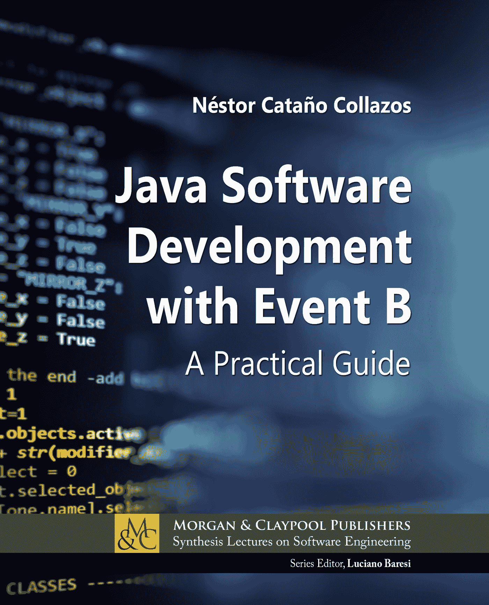

**编辑**

《软件工程合成系列讲座》出版短本（75-125 页），涵盖复杂软件系统的构思、规范、架构设计、设计、实现、管理、测量、分析、验证和校验。该系列的目标是针对软件过程的不同阶段提供重点突出的专著，并对前沿课题进行详细阐述。顶尖软件工程会议（如 `ICSE`、`ESEC/FSE` 和 `ASE`）将帮助塑造该系列的范围并使其不断演进。

## 使用 Event B 进行 Java 开发：实用指南

Néstor Cataño Collazos

# 使用 Event B 进行 Java 开发

*实用指南*

Néstor Cataño Collazos

Google, Inc.

*软件工程合成系列讲座 #5*


## 摘要

在软件产品完成后修复软件设计缺陷的成本极高，因此在软件开发的早期阶段检测软件设计缺陷至关重要，例如在软件需求阶段、分析活动期间或编码开始之前的软件设计阶段。软件需求存在歧义或相互矛盾的情况并不罕见。由于软件需求通常用自然语言编写，而自然语言与任何形式化语义挂钩，这加剧了歧义性。缓解软件需求歧义的一种方法是将其语法限制在样板（即带有占位符的文本模板）中。然而，由于非正式需求不具备任何特定的语义，因此无法证明关于它们（或关于它们试图描述的系统）的任何本质属性。形式化方法是解决这一问题的替代方案。它们提供了一系列数学技术和数学工具，用于在软件开发的早期验证软件需求。本书是使用形式化方法开发软件的现场证明。我们使用的特定形式化方法是 `EVENT B` 和细化演算。简而言之：(i) 以用户故事（User Stories）的形式编写软件需求；(ii) 将它们迁移到形式化规范中；(iii) 根据需要对其进行细化；(iv) 以原型的形式实现；最后 (v) 对它们进行一致性测试。如果某些单元测试失败，则重新审并演进软件系统的非正式和形式化规范。

本书介绍了一个使用 `EVENT B` 开发聊天系统的案例研究，以及一个社交网络属性的形式化证明的案例研究。

## 关键词

构造性正确性、离散数学、`EVENT B`、形式化方法、`Java`、编程、细化、软件工程、验证

## 前言

本书通过通过数学手段解释软件工程任务的论述。我们使用的特定形式化方法是谓词演算。本书从介绍关系和函数等谓词演算对象，以及操作这些对象的所有底层操作开始，并示例了如何组合它们来建模软件。使用数学（特别是谓词演算）建模软件的根本原因是它允许我们对想要构建的软件进行推理；我们感兴趣的是验证构建的软件是否符合某些属性，这些属性通常集中在软件需求文档中。

过去的几十年里，软件测试对软件开发产生了重大影响。它塑造了人们对软件构建任务的思考方式。人们对于实现充满漏洞的软件并不感到意外。他们预想在软件实现阶段结束后，漏洞会被剔除。本书采用了一种不同的方法；我们的出发点是，我们可以也应该在软件开发的极早期就编写出正确的软件。尽管如此，我们仍然使用测试来赋予软件活力，并检查其运行行为是否符合预期行为。

我们的软件构建回归数学是基于赋予软件意义的理念。这种理念是按照进行数学证明的方式来构建软件，确保软件产品符合某些预期的含义。我们选择的特定数学形式化语言被称为 `EVENT B`，它源于 `Z` 形式化。虽然 `EVENT B` 与 `Z` 在描述状态属性的建模语言上本质上相同，但 `EVENT B` 和 `Z` 提供了不同的建模机制，专门用于处理不同的数学方面。`EVENT B` 和 `Z` 都是状态转换系统的模型。`EVENT B` 用于表达状态机动态行为语言基于事件。另一方面，`Z` 使用丰富的模式演算（schema calculus）机制来表达模型的动态行为。`Z` 模式演算与 `EVENT B` 事件结合模型精化是不同的机制。`Z` 也提供精化，但在实践中，`Z` 更侧重于形式化规范，而 `EVENT B` 更侧重于模型精化和编码（它是手动编写或由工具生成的）。`EVENT B` 和 `Z` 之间的另一个主要区别在于不变式的承担和使用。在 `EVENT B` 中，每个事件定义都会产生证明义务，以证明机器不变式的正确性。这些不变式可能编码安全属性。另一方面，在 `Z` 中，不变式被纳入模型定义，改变了它们的含义。它们不会产生证明义务。

在软件开发中使用数学形式化的主要动机是经济考虑。在完成软件产品后修复软件设计缺陷的成本极高，因此在软件开发的早期检测软件设计缺陷的方法至关重要，例如在软件需求阶段、分析活动期间或编码开始之前的软件设计阶段。本书介绍的软件构建方法基于程序精化和“构造即正确”（correctness-by-construction）的理念。

本书展示了一个使用 `EVENT B` 开发聊天系统的案例研究，以及一个社交网络属性形式化证明的案例研究。我们希望你们喜欢这本书，就像我们喜欢写下它一样。

# 第 1 章

## 引言

本书是使用 `EVENT B` 和 `EVENTB2JAVA` 工具开发 `JAVA` 程序的实用指南。`EVENT B` 是一种利用离散数学进行系统设计的形式化语言。`EVENT B` 语言基于集合论和谓词逻辑。它包含了一系列针对集合和关系的操作，用于软件系统进行建模。它是 `状态机` 的简单模型，捕捉了系统通过响应一组事件或动作在了一组状态之间演进的思想。此外，`EVENT B` 数学语言允许定义不变式，然后可以使用支持该语言的工具来检查系统是否符合该属性。

本书介绍了两个使用 `EVENT B` 的软件示例：一个类似于 `WHATSAPP` (`https://www.whatsapp.com/`) 的聊天应用程序以及 `Poporo` 社交网络。对于聊天系统，我们包含了聊天、转发消息、删除消息以及检查用户是否正在聊天的基本功能。Poporo 是一个典型社交网络的逻辑形式化，包含了类似于 `Facebook` 的功能。它还包含了与社交网络内容隐私和所有权相关的功能。

第 2 章 介绍了 `EVENT B` 的语法，包括用于集合、关系和事件的符号。更复杂的符号将在本书后续章节中根据需要即时引入。第 3 章 演示了使用 `EVENT B` 对聊天系统进行分析和设计。这是一个完整的 `JAVA` 软件开发示例，从软件需求一直到接近近于实现的 `EVENT B` 模型。我们使用 `EVENTB2JAVA` `JAVA` 代码生成器（Cataño and Rivera, 2016）为聊天系统的 `EVENT B` 模型生成 `JAVA` 代码。生成的 `JAVA` 代码主要用于验证聊天系统软件需求的正确性。该 `JAVA` 实现可以作为聊天系统的最终实现，然而，人们可能会尝试产生一种比 `EVENTB2JAVA` `JAVA` 代码生成器所产生的代码更快的手动实现。

第 3 章 还展示了如何在软件开发过程早期验证软件需求。为了验证软件需求，该章遵循了第 2.4 节 中描述的方法。该方法（以及通用的 `EVENT B`）主倡构建“构造即正确”的软件。第 3 章并没有强调确保生成的软件是“构造即正确”的过程。这一努力更多留给了第 4 章。第 4 章专注于数学证明，因此它重点关注使用特定的分析和技术来消除证明 `EVENT B` 模型正确性的证明义务（POs）。证明 `POs` 使用 `Rodin` 工具集进行（Abrial et al., 2010）。

本书面向多样化的读者群体，从具有编程经验但离散数学知识匮乏的软件工程专业人士，到寻找真实形式化软件开发示例的形式化方法专家。示例是自给自足的。本书还针对想要向本科计算机科学或软件工程专业的学生介绍离散数学的学术教师，或者正在寻找补充课程材料的学生。本书假设读者在 `JAVA` 或类似的面向对象语言方面具有基础编程技能。

# 第 2 章

## EVENT B 概述

在本章中，我们给出 `EVENT B` `形式化方法` 的广义视图。“形式化方法”一词指的是构建 `可靠`（dependable）系统的直接技术。可靠性是系统在特定时间内防御性地提供特定服务的能力。形式化方法提供了将属性集成到系统设计中并从数学上证明系统符合这些属性的方法。`EVENT B` 基于动作系统（Action Systems，Back and Sere, 1991），一种通过系统执行的（原子）动作描述系统行为的形式化方法。动作系统描述了系统的状态空间以及可以在其中执行的可能动作。

`EVENT B` 软件系统模型是离散转换系统模型。`EVENT B` 将系统组件表示为一系列通过称为 `events`（事件）的系列转换（动作）连接的连续状态。状态由常量和变量组成。`EVENT B` 模型由 `contexts`（上下文）和 `machines`（机器）组成。上下文定义了常量、未解释集以及它们以 `axioms`（公理）表示的属性，而机器定义了变量及其属性，以及表示为事件的状态转换。初始化事件计算机器的初始状态。一个事件由一个 `guard`（守卫条件）和一个 `action`（动作）组成。守卫条件（写在关键字 `where` 和 `then` 之间）代表了为了触发该事件，在某一状态下必须满足的条件。动作（写在关键字 `then` 和 `end` 之间）为状态变量计算新值，从而执行可观测的状态转换。如果系统进入了一个一个没有事件守卫条件被满足的状态，它将停止并被认为发生了 `deadlocked`（死锁）。`EVENT B` 系统并不要求必须停止，事实上，大多数 `EVENT B` 模型代表的是无限运行的系统。如果需要停止，可以使用 `convergent` 事件进行建模，这种事件会单调地减少称为机器 `variant`（变体）的自然数表达式的值。此类事件只能在 `variant` 值为负的状态下被触发。此外，系统可能会进入一个多个事件的守卫条件同时满足的状态。在这种情况下，系统被认为是 `non-deterministic`（非确定性的）。`EVENT B` 语义允许任何守卫条件被满足的事件被触发。

在 `EVENT B` 中，系统通常通过一系列细化（refinements）进行建模。首先，编写一个抽象机器（模型）并检查其是否满足各种不变性属性。细化机器用于向抽象机器添加更多细节，直到该模型足够具体，可以进行人工或自动的到代码翻译。细化证明义务（POs）需要被消除（证明），以确保每个细化机器都是前一个机器的忠实模型，使得所有机器都满足原始的正确性属性。

### 表 2.1：聊天系统抽象机器的简化版本

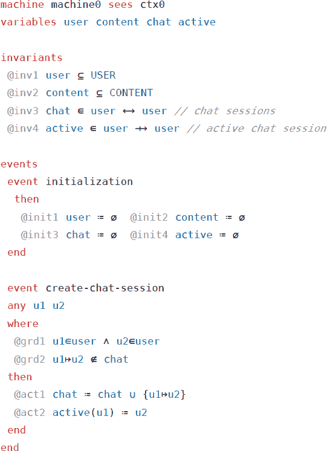

表 2.1 展示了聊天系统 `EVENT B` 模型的简化版本。四个不变式定义了四个机器变量。机器变量分别存储用户和当前网络中的内容、聊天会话，以及一个跟踪哪些聊天会话处于激活状态的变量。对于用户 `u1`，如果 `active(u1)` 存在，则该聊天会话是激活的。由于 `active` 是一个函数（`@inv4` 中的符号 `⇸` 用于部分函数），因此如果该元素存在，它就是唯一的。另一方面，`chat` 只是一个关系（符号 `↔︎`），因此它应该应用于（作用于）一个集合并产生一个元素集。我们使用方括号而不是圆括号来作用于关系，因此 `chat[{u1}]` 返回元素集合，即与单元素集 `{u1}` 中的任何成员正在聊天的元素集合。

`initialization`（初始化）事件为状态变量（也称为机器变量）赋予初始值。`create-chat-session` 事件在任何用户想要在两个用户 `u1` 和 `u2` 之间创建聊天会话时被触发。守卫条件 `@grd2` 禁止 `create-chat-session` 添加已存在的聊天会话。动作 `@act1` 修改 `chat` 以包含元素对 `u1↦u2`^(1)，我们本可以使用更标准的表示法 `(u1, u2)`。

动作 `@act1` 使 `u1 ↦ u2` 对 `u1` 激活。

构造结构“`any` x `where` G(s,c,v,x) `then` v `≔` A(s,c,v,x) `end`”指定了一个非确定性事件，该事件可以在事件守卫条件 G(s, c, v, x) 对于某些有界值 x、集合 s、常量 c 和机器变量 v 满足的状态下被触发。当事件被触发时，会非确定地选择一个满足守卫条件 G(s, c, v, x) 的 x 值，并执行事件动作 v `≔` A(s, c, v, x)，此时 x 绑定到该值上。对于所选的任何 x，由事件动作计算的状态变量的新值保持了机器的不变性属性。因此，事件的语义模拟了一个受环境交互（即用户动作）控制的系统，这些交互可能发生在任何时候。

表 2.1 中的示例使用了 `Rodin` 工具（Abrial et al., 2010）表示法，其中不同行的谓词隐式取与，不同行的动作同时执行。`EVENT B` 包含了逻辑与（∧）、逻辑或（∨）、否定（¬）和蕴含（⇒）的逻辑表示法。它还包含了全称（∀）和存在（∃）量词的表示法。

### 2.1 关系与函数

函数和关系是 `EVENT B` 语言的核心。`EVENT B` 提供了一些预定义集，例如空集 `∅`、自然数集 `ℕ`、正数集 `ℕ1` 和整数集 `ℤ`。它还提供了集合的常用操作，如分别表示交集、并集和集的 `∩`、`∪` 和 `∖`。符号 `ℙ` 用于集合的幂集（power-set），符号 `×` 用于两个集合之间的笛卡尔积（cross product）。

任何 `EVENT B` 关系都编码为一个集合。配对的第一个元素是源（source）或域（domain），配对的第二个元素是目标（target）或范围（range）。函数是一种满足没有两个不同的对包含相同元素的关系。换句话，源的任何元素最多映射到一个目标元素。

假设 `f` 是定义在域 A 和范围 B 上的关系，表示为 `f: A ↔︎ B`。如果 `f` 对于 `A` 的*所有*值定义，我们称 `f` 是全函数（total function），写作 `f: A → B`。如果 `f` 对于 `A` 的某些值定义，我们称 `f` 是部分函数（partial function），写作 `f: A ⇸ B`。如果 `f` 是一个函数，使得范围中的没有元素对应于域中的多个元素，那么我们称 `f` 是单射函数（one-to-one/injective function），写作 `f: A ↣ B`。如果 `f` 是一个范围恰为 `B` 的函数，我们称 `f` 是满射（onto/surjective function），写作 `f: A ↠ B`。如果 `f` 既是单射又是满射，我们称 `f` 是双射函数（bijection），写作 `f: A ⤖ B`。

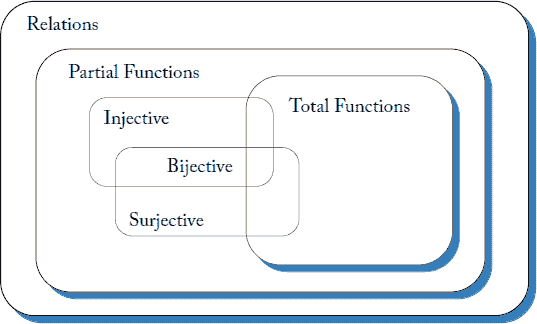

图 2.1：数学函数的类型。

图 2.1 显示了关系和函数的层次结构。任何函数都是关系。函数可以是全的或部分的。每个全函数都是部分函数。函数可以是单射或满射。某些满射是部分的而非全的。某些单射是部分的而非全的。双射是满射单射。某些双射是部分的而非全的。

**示例 1. Facebook**

假设我们想要识别 Facebook 模型中最基本的逻辑结构（集合、关系、函数）。我们对建模用户、社交网络内容、用户页面、内容所有权以及内容的权限感兴趣。我们想要建模两种类型的权限，即*查看*和*编辑*权限。页面可以建模为从人到内容的关系：`page ∈ person ↔︎ content`。

关系仅仅是对的集合，因此一个用户页面可以定义为 `page ≙ {(John, Photo1), (John, Video1), (Mary, Photo1), (Mary, Video2)}`，其中 `John` 拥有两个内容项 `Photo1` 和 `Video1`，`Mary` 与 `John` 相同的照片，但在她的页面上有不同的视频。`page` 的域（domain）是 `dom(page) ≙ {John, Mary}`，其值域（range）是 `ran(page) ≙ {Photo1, Video1, Video2}`。注意这里符号“`≙`”表示“定义为”或“写为”，不应与表示“等于”的布尔运算符符号“`=`”混淆。

我们可以通过强制每个用户拥有（至少）一个内容来对用户页面执行更严格的定义。这可以通过断言不变性 `person = dom(page)` 或者等价地将 `page` 设为全关系 `page ∈ person → content` 来。同样，可以通过断言不变性 `content = ran(page)` 或者等价地将 `page` 声明为单射关系 `page ↣ content` 来执行任何内容都在某人的页面上的属性。最后，我们可以通过将 `page` 声明为全关系 `page ⊆ content` 来执行这两个属性。

在社交网络中，某些用户拥有某些内容，例如，如果一个用户将内容上传到他们的页面，则该用户成为该内容的所有者。我们可以通过引入从内容到用户的全函数 `owner ∈ content → person` 来建模所有权。`owner` 是全确保了每个内容都有所有者，而函数确保了所有者是唯一的。如果我们进一步让 `owner` 满射，则强制每个人拥有（至少）一个内容：`owner ∈ content ↠ person`。我们可以定义内容的权限层级，`view` 权限表示用户可以查看某些内容，`edit` 权限表示她可以修改。


### 示例 2. 查看与编辑权限

如何建模“可以编辑数据（内容）的用户也必须查看它”这一属性？我们可以说明如下不变性：


注意我们可以安全地使用 `⊆` 运算符，因为关系仅仅是元素对的集合。

### 示例 3. 内容所有者

建模以下属性：“某些内容的所有者拥有所有权限”。


### 示例 4. 集合与关系的操作

`EVENT B` 配有一系列针对关系的运算符，用于限制关系（元素）包含特定集合。`◁`、`⩤`、`▷` 和 `⩥` 分别用于域限制、域减、值限制和值减。它们接收两个操作数，一个关系和一个集合，根据集合的元素过滤关系的元素。例如，表达式 `r⩥s` 在移除关系 `r` 中第二个分量在集合 `s` 中的元素后返回一个关系。表达式 `r⩥s` 本身并不修改 `r`，而是构建一个新的关系。


基于之前的 Facebook 示例，表达式 `page▷ {c}` 通过考虑第二个元素为 `c` 的元素对，从 `page` 构建一个关系。`dom (page▷{c})` 返回页面中有内容 `c` 的人员集合。`page⩥{c}` 返回从 `page` 构建的关系，忽略了任何第二个元素为 `c` 的元素对。这些运算符在表 2.2 中形式化定义。

### 示例 5. 在社交网络上发布内容

如何在人员 `p` 的页面上发布新图片 `newc`？发布内容通常发生在人员 `p` 发布或上传内容到她的页面时的操作。你必须修改 `page`、`content`、`owner`、`view` 和 `edit`。


### 2.2 EVENT B 数符号

EVENT B 提供了完整的集合和关系符号体系。表 2.2 显示了书中将用到的一些 EVENT B 数符号。如上所述，我们使用方括号将关系应用于（评估）元素集合上。例如，`r[s]` 将关系 `r` 应用于集合 `s` 中的所有元素。`r[s]` 的结果是关系 `r` 值域中的元素集合。EVENT B 提供了集合并、交、差等的标准符号。符号 `` 表示两个集合之间的笛卡尔积。`dom` 运算符返回关系的域，`ran` 返回其值域。`id` 运算符表示元素集合 `s` 上的恒等关系。将复合关系 `q;r` 应用于关系 `q` 域中的元素 `a` 返回一个元素集合，其计算结果为将 `r` 应用 `q[{a}]`。当关系 `q` 是一个函数时，`q[{a}]` 应用作 `q(a)`。域限制关系表达式 `s▷r` 将关系 `r` 的域限制为仅考虑子集 `s` 中的元素。值限制关系表达式 `r⩤s` 将关系 `r` 的值域限制为仅考虑子集 `s` 中的元素。域（值域）减的定义与域（值域）限制类似，但集合 `s` 中的元素是被忽略而不是考虑。EVENT B 还提供了关系 `r` 逆符号 `r∼`。

表 2.2：EVENT B 基础符号


### 示例 6. 赋值

EVENT B 配有两种赋值：确定性赋值和非确定性赋值。确定性赋值使用 `≔` 符号，例如，表达式 `content ≔ cts` 将 `cts` 赋值给 `content`。赋值的左侧只允许机器变量。EVENT B 提供了两个相关的非确定性赋值运算符，即 `:|`（变为）和 `:∈`（属于）。`:∈` 的右侧是一个集合表达式，而 `:|` 的右侧是一个谓词。`:∈` 表达式总是转化为 `:|` 表达式。非确定性赋值 `content :| ⊇ content` 将 `content` 的某些超集赋值给 `content`。表达式 `content :∈ {content ∪ cts1, content ∪ cts2}` 非确定地为 `content` 赋值 `content ∪ cts1` 或 `content ∪ cts2`。该表达式也可以写为 `content :| content’ = {content ∪ cts1} ∨ content’ = {content ∪ cts2}`。基于社交示例，为了删除 Facebook 每个页面中出现的内容 `c`，可以使用表达式 `page ≔ page⩥{c}`。如果我们还想将 `c` 替换为新内容 `newc`，则可以使用表达式 `page ≔ page⩥{c} ∪ (dom(page▷{c}) × {newc})`。或者，为了替换 `c` 为 `newc`，我们可以使用表达式 `page ≔ page⩥{c} ∪ (page∼[{c}] × {newc})`，其中 `page∼` 是 `page` 的逆关系，`page∼[{c}]` 返回所有页面中有 `c` 的人员。符号 × 用于表示两个集合之间的笛卡尔积。EVENT B 提供了两种量词：存在量词和全称量词，分别用  和 ∀ 表示。例如，表达式 ∀`c,p • c↦p ∈ owner` 对于 `owner` 中的所有元素对 `c↦p` 成立，而 `c,p • c↦p ∈ owner` 对于 `owner` 中的至少一个元素成立。

### 示例 7. 量词

`bool`、`true` 和 `false` 是布尔谓词，而 `BOOL` 是一个包含两个常量 `TRUE` 和 `FALSE` 的枚举类型。我们可以引入一个变量 `friend ∈ (person ↔︎ person) ↔︎ BOOL`，并通过 `friend ≔ friend ∪ {(John ↦ Mary) ↦ TRUE}` 将 `Mary` 添加为 `John` 的朋友。也可以通过赋值 `friend(John ↦ Mary) ≔ bool(friend(Peter ↦ Sara) = TRUE)`，在 `Sara` 是 `Peter` 的朋友的情况下让 `Mary` 成为 `John` 的朋友。友谊并不一定是自反关系。也就是说，`John ↦ Mary ∈ friend` 事实并不意味着 `Mary ↦ John ∈ friend`。

### 示例 9. 关系与函数的覆盖

关系 `q` 对关系 `r` 的覆盖 `r⊕q` 返回一个新关系，该关系的形成方式是取 `q` 的所有元素对，并添加所有第一个元素不在 `q` 域中的 `r` 的元素对。当 `r` 和 `q` 都是函数时，覆盖操作尤为重要，因为它返回另一个更新了 `q` 域中所有元素的函数。可以通过赋值 `owner(c) ≔ ow` 或使用函数表达式 `owner⊕{c↦ow}` 来更新内容项 `c` 的所有者 `ow`。

### 示例 10. 编辑权限

移除某些内容项 `c` 上所有的 `edit` 权限。


### 示例 11. 事件

我们在下文中展示了用于事件的标准语法；此外，表 2.3 解释了每个事件构造的含义。事件守卫 `G(c,v)` 分别依赖于机器常量 `c`、机器变量 `v` 和事件参数 `x`。如果事件守卫成立，则该事件被启用，并与其他许多事件竞争执行权。事件的主体由可能的许多个事件赋值组成，形式为 `v ≔ E(c,v)`，其中 `c` 是机器常量集合，`v` 是机器变量的子集，`E` 是一个表达式。我们在此使用 `≔` 语法进行确定性赋值，但也可以是一系列非确定性赋值。符号 `skip` 代表空动作集。它不影响机器状态。在执行 `skip` 后，状态保持不变。

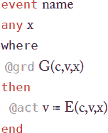

| 表 2.3: 事件语法 |
| :--- |
| 元素 | 定义 |
| :--- | :--- |
| name | 事件名称 |
| x | 事件参数，变量集合 |
| G(c,v) | 逻辑谓词 |
| v | 互不交的机器变量（子）集 |
| E(c,v) | 表达式集合 |

### 示例 12. 聊天系统：add-user

我们在下文中展示了事件 `add-user` 的定义，它向聊天系统添加一个新用户。事件守卫 `@grd1` 保证用户 `u` 是一个新用户。动作 `@act1` 将 `u` 添加到用户集中。动作 `@act2` 将 `u` 的聊天内容初始化为 `∅`（空集）。

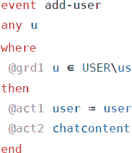

### 示例 13. 抽象状态（集合）

我们想在 EVENT B 中对字典进行建模。为了简单起见，假设一个单词恰有一个含义，并且我们只感兴趣向字典中添加单词。变量 `word` 是单词集合，`meaning` 是单词含义的集合。`dictionary` 是从 `word` 到 `meaning` 的部分函数。因此，一个单词有一个含义，但可能存在单词没有含义的情况。

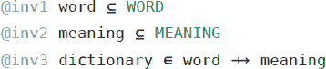

我们在下文中展示了如何向字典添加一个新单词及其含义。EVENT B 守卫 `@grd1` 检查单词 `w` 是否在集合差集 `WORD ∖ word` 中；由于 `w` 不可能在 `word` 中，因此需要从 `WORD` 中取一个新单词。同样，守卫 `@grd2` 检查 `m` 是否是一个不在含义集合中的新含义。事件动作 `@act1` 将 `w` 添加到单词列表，`@act2` 将 `m` 添加到含义列表，`@act3` 向字典添加将 `w` 映射到 `m` 的条目。

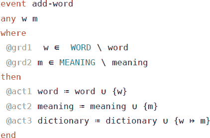

### 示例 14. 数据细化

假设我们有一个抽象状态变量 `a`，表示一个自然数集合。


假设我们决定在我们的具体状态空间中使用整数序列（可能通过链表实现）来表示这个集合。


那么，`{3,5}` 的抽象值可以用序列 `<3,5>` 或序列 `<5,3>` 表示。

### 示例 15. 自然数段

EVENT B 有一个基于集合扩展概念的自然数段内置概念。下文中的 `a‥b` 等于 `a` 和 `b` 之间的自然数集合。该集合可以是空的。

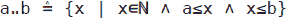

### 示例 16. 具体状态（序列）

我们将示例 13 中的变量 `word` 和 `meaning` 具象化。我们分别将它们实现为序列 `words` 和 `meanings`。`words` 被编码为从集合 `1‥size` 到 `word` 的全函数。同样，`meanings` 被编码为从同一集合到 `meaning` 的全函数。我们安全地假设 `words` 和 `meanings` 具有相同的 `size`，因为同一个含义不能两次添加到字典。

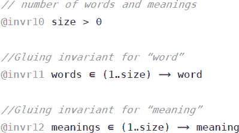

### 示例 17. word 的粘合不变式

我们想添加一个关联示例 13 中的抽象状态变量 `word` 与示例 16 中的具体状态变量 `words` 的不变式。这种不变式在文献中被称为*粘合不变式*（gluing invariant），并在 3.6 节 中有更详细的解释。下面的不变式是一个粘合不变式。它表示抽象变量 `word` 等于索引在 `1` 到 `size` 之间的所有元素 `words(i)`。

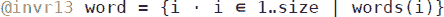

### 示例 18. dictionary 的粘合不变式

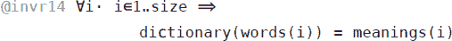

### 示例 19. 向字典添加单词（具体状态）

下文事件 `add-word` 是示例 13 中定义事件的*细化*版本。它使用 `words` 代替 `word`，使用 `meanings` 代替 `meaning`。

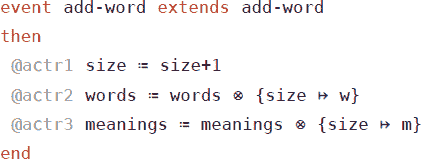

### 2.3 使用 EVENT B 进行软件开发

使用 EVENT B 进行软件开发遵循软件开发的*伞兵策略*（parachute strategy），该策略首先从非常抽象和简单的角度考虑系统，进行广泛的基础性观察，然后添加细节，直到完成系统的全部功能。使用 EVENT B 进行软件开发（Abrial, 2010）从定义我们想要建模的系统的初始*蓝图*开始。蓝图代表了未来的系统实现。蓝图提供了对未来系统某些方面的洞察，但并非全部。

`EVENT B` 实现了两种类型的蓝图细化：`水平细化`（上述）和`垂直细化`（Abrial, 2009）。水平细化在文献中也被称为叠加（superposition）。水平细化为系统添加状态迁移或丰富现有的迁移。当模型中考虑了所有软件需求时，水平细化阶段即完成。通过水平细化，蓝图可以：

*   强化事件守卫，
*   添加新的事件守卫，
*   为某些事件添加更多动作，或
*   添加更多事件。

垂直细化是`数据细化`。它没有向系统增加细节，而是将模型转换为可以容易实现的形式。例如，垂直细化可以将有限集转换为`Boolean arrays`。我们将在第 3.6 节中展示一个垂直细化的具体示例，其中集合转换为序列。

垂直细化的一个关键方面是定义`粘接不变性`（gluing invariant）^(2)，它通过陈述两个状态模型组合行为的属性，将系统的抽象状态与系统的具体状态连接起来。虽然水平和垂直细化可以在单个细化步骤中结合使用，但最后的单一垂直细化步骤通常通过代码生成工具的帮助来实现（Cataño and Rivera, 2016; Cataño et al., 2017）。

我们在下面列出了基于 `EVENT B` 的软件开发方法论步骤。在 `EVENT B` 中，软件开发最终产生一个“构造正确”（correct-by-construction）的程序，这取决于在定义最后一个模型细化后可能使用的代码生成器的完备性，即一个满足最抽象 `EVENT B` 蓝图所有不变性属性的程序。

1.  使用 `EVENT B` 编写系统的初始蓝图（机器）。初始蓝图充当我们想要建模的系统的最抽象视图。
2.  进行完备性证明，证明初始蓝图中的每个事件都符合不变性属性，例如使用`Rodin platform`。
3.  编写针对蓝图的模型细化。该细化可以是水平细化、垂直细化，也可以是两者的结合。
4.  进行一致性证明，证明蓝图细化是对蓝图的正确细化。
5.  根据需要重复上述两个步骤。
6.  针对最终的模型细化实现代码或通过工具生成代码。

上述最抽象机器的定义及其所有细化都是基于现有的软件需求文档。`Rodin tool` 为 `EVENT B` 和 `EVENT B` 模型细化定义提供支持（Abrial et al., 2010）。`Rodin` 在每个细化阶段生成 `POs`。`Rodin` 带有各种半自动定理证明器，协助证明卸载过程。

### 2.4 一种软件需求早期验证方法论

软件需求的早期验证在软件工程中至关重要，因为它能最大限度地减少软件设计错误的数量，从而防止实现过程中重复相同的错误。形式化规范是软件需求验证的关键。形式化规范在软件开发中至少可以以两种方式使用（Almeida et al., 2011）。它们可以用于模型验证，即检查规范是否具有特定的行为。或者，它们可以用于验证目的，即检查或强制程序实现与其规范之间的形式关系。在模型验证过程中，例如，可以将规范转换为可执行规范或稍后可以执行的程序。这通常被称为（规范）`动画`（animation）；它是通过将规范转换为可执行格式、执行它，然后根据某些预期行为检查其行为来实现的。规范到程序的转换可以手动完成，也可以通过工具完成，例如使用代码生成器。或者，可以结合两种方法，例如，将形式化规范连续细化（Abrial and Hallerstede, 2007）为更详细的规范，最终移植到代码中，例如使用代码生成器（Cataño and Rivera, 2016; Cataño et al., 2017）。对于软件需求验证目的，生成的代码并不是最终的软件实现，而仅仅是一个用于单元测试以发现缺陷的原型。因此，如果某些单元测试失败，则需要重新检查并演进系统的非正式和形式化规范。

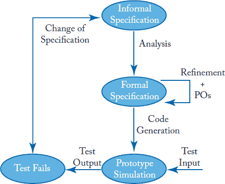

图 2.2：软件需求的验证方法。

上述方法遵循了图 2.2 所示的模型验证方法。简而言之：(a) 我们编写软件需求文档；(b) 我们手动将其转换为形式化规范；(c) 我们按需细化形式化规范；(d) 我们自动为形式化规范生成原型实现；(e) 我们最后对原型进行缺陷单元测试。如果某些单元测试失败，则重新检查并演进非正式和形式化规范。

更具体地说，我们用自然语言编写一份软件需求文档（非正式规范），其中包含以用户故事（US）形式编写的功能需求，用户故事是格式为“作为一个 `<Role>`，我想实现 `<Goal/Desire>` 以便 `<Why>`”的文本模板。虽然用户故事是敏捷方法的典型特征，但我们在这里使用它们是因为它们的语法与我们要转换过去的形式化语言（`EVENT B`）的语法非常相似。一个用户故事包含一些应据此进行验证的验收标准。一个验收标准包含三个部分：一个 `Given` 部分，描述功能何时可能被触发/执行（取决于系统的内部状态）；一个 `When` 部分，告诉我们何时执行该功能（取决于用户的决策）；以及一个 `Then` 部分，说明功能执行时系统状态如何变化。

在写完所有用户故事后，我们手动将其转换为用 `EVENT B` 编写的形式化规范。因此，`Given` 部分被形式化为事件守卫，`When` 部分是执行的事件本身，而 `Then` 部分被形式化为一组事件动作。

第 3.9 节 展示了一个关于如何实现这种需求早期验证方法的完整示例。

### 2.5 构造正确

图 2.2 重点关注使用形式化方法进行模型验证（与使用形式化方法进行程序验证相对）。形式化方法为模型验证问题提供了两种解决方案。形式化规范本身就是程序并可以直接执行；或者从规范产生实现，通常通过各种细化步骤，在这种情况下需要证明每一步的正确性。这种方法通常被称为“构造正确”（Correctness-by-Construction）（Hall, 2002; Hall and Chapman, 2002）。我们的模型验证方法属于后一种解决方案，因此我们需要验证我们方法中的每个细化步骤。

我们手动将用户用例（USs）翻译为 EVENT B 中的形式化规范。我们的第一次验证是通过 Rodin 的类型检查器进行的，它会检查每个 EVENT B 模型中的所有变量、常量、事件以及其他构造是否都类型正确。如果 Rodin 无法推断出任何构造的类型，它将抛出错误。第二次验证通过生成证明义务项（POs）来实现，以证明 EVENT B 模型的正确性。Rodin 会生成几种类型的 PO（Cataño and Rivera, 2012）。它为每个事件的每个动作生成一个可行性 PO，说明该赋值存在一个解（程序）。它还会生成与蓝图及其细化版本相关的 PO。例如，模拟 PO 确保抽象事件动作被具体动作正确地模拟。Rodin 证明器是半自动的，它们仅协助用户完成 PO 的证明。

最后一次验证依赖于代码生成器的完备性。从 EVENT B 到 JAVA（或任何其他实现语言）的翻译必须是完备的，以便 JAVA 程序能够证明其在 EVENT B 中编写的形式化规范。针对 `EVENTB2JAVA` 执行的代码生成，已经进行了形式化的完备性证明（Cataño and Nishi, n.d.）。

### 2.6 RODIN


Rodin 是一个基于 Eclipse 的平台，为 EVENT B 提供支持，例如编写 EVENT B 模型、定义安全不变性属性以及使用后端证明器完成 PO。（3）。Rodin 可以在 [`sourceforge.net/projects/rodin-b-sharp/`](https://sourceforge.net/projects/rodin-b-sharp/) 获取。在 Rodin 中安装插件的标准方法是通过菜单 Help（帮助）、`Install New Software`……、`Add`……，然后添加一个更新站点（Update Site）。要在 Rodin 中进行证明，必须安装 Atelier B 证明器（更新站点为 [`methode-b.com/update_site/atelierb_provers`](http://methode-b.com/update_site/atelierb_provers)）。强烈建议使用 Camille 来编写和编辑 EVENT B 机器（更新站点为 [`www.stups.hhu.de/camille_updates`](http://www.stups.hhu.de/camille_updates)）。

### 2.7 JML

JML 是一种 JAVA 接口规范语言。它旨在指定 JAVA 类的行为，并使用特殊的注释标记 `//@` 和 `/*@ */` 直接包含在 JAVA 源代码文件中。JML 表达式是 Java 表达式的超集，增加了诸如用于逻辑蕴含的 `==>`、用于存在性量化的 `\exists` 以及用于全称量化的 `\forall` 等符号法。

JML 类规范可以包含不变性子句（在类的每个可见状态下必须满足的断言）、`initially` 子句（指定每个类构造函数的后置状态必须满足的条件）以及历史约束（使用关键字 `constraint` 指定，与不变性相似，但额外具有了关联方法的前置状态和后置状态的能力）。具体的 JML 规范可以直接写在 JAVA 类的字段上。

JML 为 JAVA 方法提供了前置-后置风格的规范来描述软件契约。JML 使用关键字 `requires` 表示方法的的前置条件，`ensures` 表示方法的正常后置条件，`assignable` 和 `modifies` 表示帧条件（从方法的前置状态到后置状态值可能发生变化的位置列表）。前置状态是方法进入时的状态，后置状态是方法退出时的状态。`normal behavior` 方法规范规定，如果方法的前置条件在方法的前置状态下成立，则它将始终在正常状态下终止，并且后置条件下成立。在 JML `ensures` 子句中，关键字 `\old` 用于指示必须在方法的前置状态下求值的表达式——所有其他表达式都在后置状态下求值。`\old` 关键字也可以用于历史约束，提供了一种方便的方法来指定（例如）字段的后置值始终等于前置值，从而使字段变为常量。

### 2.8 EVENTB2JAVA

EVENT B 规范编写在 Rodin 工具集中，Rodin 是一个开源 Eclipse IDE，提供了一套用于处理 EVENT B 的工具：一个编辑器、一个证明生成器和多个证明器（Abrial et al., 2010）。目前存在多种用于 EVENT B 的代码生成器，它们可以接收 EVENT B 蓝图并生成如 C 或 JAVA 等主流编程语言的代码。

我们使用 `EVENTB2JAVA` 为我们展示的 EVENT B 规范生成代码。在本书中，`EVENTB2JAVA` 是一个 Rodin 插件，因此 EVENT B 建模和代码生成是在 Rodin 中完成的。`EVENTB2JAVA` 依赖于两个建模 JAVA 类和关系的主要类，即 `BSet` 和 `BRelation`。`BSet` 类依赖于 JML 的 `JMLEqualsSet` 类提供的功能来实现其自身的功能。`JMLEqualsSet` 使用 `equals` 方法比较集合中的元素，并且不对添加到集合中的元素进行克隆。`BSet` 使用类型为 `JMLEqualsSet` 的字段 `elems` 来查询和更改集合的状态。常量 `EMPTY` 用于表示 EVENT B 的 `∅`。方法 `insert` 向集合中添加元素，`method` 检查元素是否已存在于集合中。

```
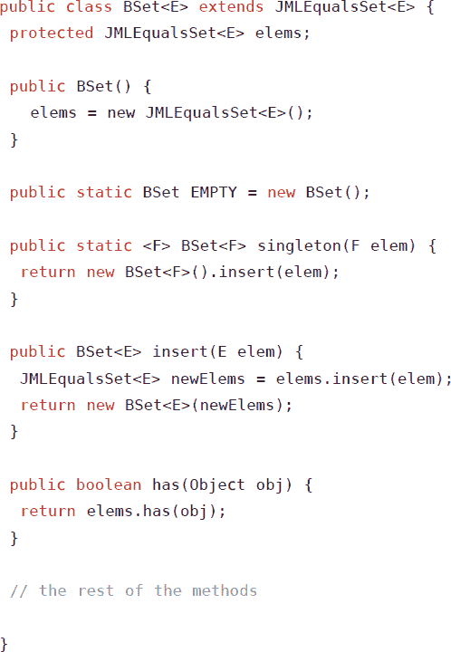
```

`BRelation` 类实现为 `BSet<Pair<K, V>>`。这遵循 EVENT B 的语义，即关系是元素对的集合。`BRelation` 包含一个编码空关系的常量 `EMPTY`。

```
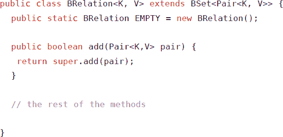
```

### 2.9 一个聊天应用程序

我们在这里展示了我们在第 3 章中完整开发的示例部分。该示例关于一个聊天应用程序。我们在这里使用它来展示我们的思路。用户用例 US-01 提出了一个非正式需求，描述了创建聊天会话的功能。该聊天可能尚不存在。

| US-01 | create-chat-session |
| :--- | :--- |
| **create-chat-session** | 作为用户，我想创建一个聊天会话，以便与你通信 |
| **Acceptance criterion** | `Given`: 我和你之间不存在聊天会话；`When`: 我决定与你创建一个聊天会话；`Then`: 我和你之间创建了聊天会话，但你和我之间没有 |

US-01 在 EVENT B 中被形式化编码为下文的 `create-chat-session` 事件。该事件为用户 `Me` 与用户 `You` 创建聊天会话。符号 `∈` 是集合成员操作（属于），`user` 是注册了聊天应用程序的用户集合。符号 `∧` 是逻辑与运算符。`▷` 是范围限制操作。表达式 `{Me} ▷ active` 返回一个由 `active` 中第一个分量属于单集 `{Me}` 的元素对组成的关系。`Me ↦ You` 是一个元素对，`chat` 是一个跟踪可用聊天会话的数学关系。事件守 `@grd2` 形式化了 US-01 中所示的 `Given` 条件。`@act1` 编码了 `Then` 表达式；将元素对 `Me ↦ You` 添加到现有集合中。Guard `@grd1` 是类型条件，它帮助 Rodin 的类型检查器推断 `Me` 和 `You` 的类型。

```
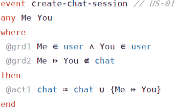
```

`create-chat-session` 可以根据需要进行多次细化。我们在下方对其进行了水平细化（通过 `EVENT B` 中的 `extends` 子句），添加了更多关于创建聊天会话的观测或细节。我们下方的细化规范观测了活跃和非活跃的会话。`active` 是一个跟踪活跃会话的函数。之所以是一个函数是因为每个用户只能有一个活跃的会话，换句话说，一个用户正在聊天的用户不超过一个。`inactive` 跟踪非活跃的会话。动作 `@actr12` 使由 `@act1` 在细化事件中添加的会话变为活跃状态。活跃或非活跃等概念并不属于聊天应用的最抽象形式规范的一部分，而是其第一次细化的部分。

```
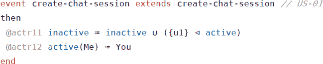
```

我们在下方展示了一个用于部分验证 `US-01` 的单元测试示例。`Class Pair` 是一个工具类。它编码了任何类型元素的成对。`Me` 和 `You` 是作为类属性全局定义的整数变量，分别初始化为值 `1` 和 `2`。因此，`a` 是元对 `Me ↦ You`，`b` 是元对 `You ↦ Me`。第一个 `assertTrue` 指令检查 `add-user` 是否正确地将 `Me` 添加到 `user` 中。第二个检查 `You` 是否被添加到 `user` 中。第三个检查元对 `a` 是否正确地添加到 `chat` 中。遵循 `US-01` 的 `Then` 部分，最后一个断言指令检查 `b` 是否没有添加到变量 `chat` 中。

```
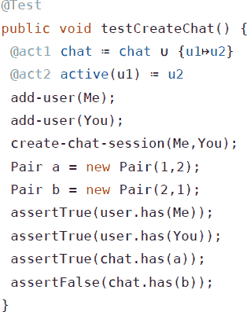
```

符号 `↦` 被称为映射符号（maplet），读作“映射到”，因此 `u1` 映射到 `u2`。

**粘接不变性在[第 3.6 节]中讨论。**

“证明器”（prover）是一种类似于“证明助手”的工具；通常，证明助手会对证明过程提供反馈并可以回溯到证明的先前状态，而证明器只是尝试应用一种最终会成功或失败的策略。

# 第 3 章

## 使用 EVENT B 开发聊天系统的软件

我们为一个聊天应用程序编写了软件需求，其中包含了一些 WhatsApp 中常见的功能（[`www.whatsapp.com/android/`](https://www.whatsapp.com/android/)）。在用 EVENT B 编写软件系统模型时，应当先编写一个抽象机器，然后依次编写细化机器。对于每个细化机器，需要在 Rodin 平台上消除证明责任项（POs），以确保每台机器都是对最抽象机器的恰当细化。只有当所有机器都编写完成且所有 POs 都已消除后，才能认为底层系统已完全建模。[第 4 章] 讨论了消除 POs 的技术。

我们根据自己使用（手机版）WhatsApp 的经验提取了聊天应用程序的需求。用户故事（User Stories）与 EVENT B 模型结构及其机器的层级结构相关。[表 3.1] 展示了这种层级结构。抽象机器（MachineZero）观测了聊天会话的基本功能。第一个机器细化包含了检查聊天内容（文本、视频、图片）是否可以被读取的功能。第二个机器细化增加了实现细节。例如，它将内容表示为内容项的序列（而不是集合）。这对我们来说很重要，因为聊天会话的图形界面可以实现为从头到尾读取的内容项有序序列。此外，它可以帮助我们陈述一个属性，即对于任何聊天会话，聊天内容对于两个聊天成员来说是一致的。这是一个不变性属性，我们在这里对其进行了建模，但它并不是 WhatsApp 手机版本的属性。

| 表 3.1: 聊天应用程序的机器层级结构 |
| :--- |
| 机器 | 观测 |
| :--- | :--- |
| MachineZero | 抽象机器，聊天会话的基本功能 |
| MachineOne | 第一次细化，引入了已读和未读状态 |
| MachineTwo | 第二次细化，它编码了一个垂直细化 |

[表 3.1] 展示了聊天系统机器的层级结构。抽象机器观测了聊天会话的基本功能，包括创建聊天会话、选择或取消选择聊天、聊天、删除内容（文本、视频、照片）、移除内容、删除聊天会话、静音和取消取消以及广播和转发网络内容。第一个机器细化包含了检查聊天内容是否已被读取的功能。第二个机器细化增加了实现细节，例如，它将内容表示为内容项的序列（而不是集合）。这对我们来说很重要，因为聊天会话的图形界面应该实现为从头到尾读取的内容项有序序列。此外，它可以帮助我们陈述一个属性，即对于任何聊天会话，两个聊天成员之一看到的聊天内容与另一名成员看到的内容相同。这是一个不变性属性。这种不变性属性，特别不是 WhatsApp 手机版本的属性。

[第 3.1 节] 分别展示了 [表 3.1] 中 MachineZero 的软件需求、[3.2] MachineOne 的软件需求以及 [3.3] MachineTwo 的软件需求。[第 3.4 节]、[第 3.5 节] 和 [第 3.6 节] 展示了这些软件需求在 EVENT B 中的形式化。

### 3.1 MACHINEZERO

抽象机器 MachineZero 包含 10 个用户故事，从 US-01 到 US-10。

US-01 描述了在“我”和“你”之间创建聊天会话的功能。聊天可能不存在。

| US-01 | create-chat-session |
| :--- | :--- |
| create-chat-session | 作为用户，我想选择一个聊天会话，以便与你开始聊天 |
| 验收准则 | `Given`: 我和你之间不存在聊天会话 `When`: 我决定与你创建一个聊天会话 `Then`: 我和你之间创建了聊天会话，但你和我之间没有创建 |

US-02 描述了选择聊天会话的功能。具有两个 `Given` 条件的效果是这两个条件的交集所得到的条件。

| US-02 | select-chat |
| :--- | :--- |
| select-chat | 作为用户，我想创建一个聊天会话，以便与你通信 |
| 验收准则 | `Given`: 我和你之间存在聊天会话 `Given`: 我和你之间的聊天会话未活跃 `When`: 我选择与你的聊天 `Then`: 我和你之间的聊天会话变为活跃 |

US-03 描述了“我”与“你”聊的功能。发送的内容对“我”和“你”两个用户可用。

| US-03 | chatting |
| :--- | :--- |
| chatting | 作为用户，我想在与你的聊天会话期间向你发送内容以表达我的想法 |
| 验收准则 | `Given`: 我和你之间的聊天会话是活跃的 `When`: 我与你聊天 `Then`: 聊天内容对我以及对你可用 |

该聊天应用程序实现了删除交换内容的两种不同行为：“为我删除内容”和“为所有人删除内容”。如果内容发送者想要删除某些交换内容，她可以从自己的聊天记录中删除或从内容接收者的聊天记录中删除。相反，内容接收者只能从自己的聊天记录中删除内容。这两种行为分别由 `US-04a` 和 `US-04b` 描述。

删除内容是一种在逻辑上难以编码的细微功能，因为很容易破坏不变性。例如，如果一个人从聊天的一侧删除了内容而另一侧没有删除，就会破坏任何强制双方读取相同内容的不变性约束。

| `US-04a` | `delete-content` |
| :--- | :--- |
| `delete-content` | 作为用户，我想删除在聊天会话期间与你交换的一些内容，以便让我的聊天界面保持整洁 |
| **验收准则** | `Given`: 内容存在 `When`: 我决定删除我收到的内容 `Then`: 我的内容被删除 |

| `US-04b` | `remove-content` |
| :--- | :--- |
| `remove-content` | 作为用户，我想移除在聊天会话期间与你交换的一些内容，以便让我的聊天界面保持整洁 |
| **验收准则** | `Given`: 内容存在 `When`: 我决定移除我发送的内容 `Then`: 该内容从我以及任何接收过该内容的用户处被移除 |

聊天会话及相关内容也可以被删除。`US-05` 未说明的是，如果我和你之间的会话被删除，你看到的内容会发生什么？内容也会从你那里被删除吗？无论谁将内容发送给谁，删除我和你之间的聊天会话都不会删除你看到的内容，然而，存在一个 `remove-content` 用户用例，可以同时删除双方的内容。

| `US-05` | `delete-chat-session` |
| :--- | :--- |
| `delete-chat-session` | 作为用户，我想删除我和你之间的聊天会话 |
| **验收准则** | `Given`: 我和你之间存在聊天会话 `When`: 我选择删除唯一的活动聊天会话 `Then`: 聊天会话及其相关内容均被删除 |

当聊天会话被静音时，两个聊天用户之间的通信均被禁用。尽管如此，之后可以启用通信。这由 `US-06` 描述。

| `US-06` | `mute-chat` |
| :--- | :--- |
| `mute-chat` | 作为用户，我想静音一个聊天会话，以便防止我和你之间的通信 |
| **验收准则** | `Given`: 我和你之间存在聊天会话 `When`: 我决定静音我和你之间的聊天会话 `Then`: 该聊天会话被静音，且不允许我向静音用户发送信息或反之亦然 |

`US-07` 有关重新建立静音会话中两个用户之间的通信。只有静音会话的用户才能取消静音。

| `US-07` | `unmute-chat` |
| :--- | :--- |
| `unmute-chat` | 作为用户，我想取消我和你之间聊天会话的静音，以便重新与你建立通信 |
| **验收准则** | `Given`: 我和其他之间的聊天会话已静音 `Given`: 我静音了我和你之间的聊天会话 `When`: 我选择取消静音某个聊天会话 `Then`: 我和你之间的通信被重新建立，即我和你之间的聊天恢复静音状态 |

`US-08` 和 `US-09` 描述了某些内容被发送给一组用户的情况；转发内容需要我与该组用户之间对应的聊天会话存在，如果这些会话尚不存在，广播将创建新的聊天会话。

| `US-08` | `broadcast` |
| :--- | :--- |
| `broadcast` | 作为用户，我想向一组用户广播某些内容，以便我快速与他们所有人通信 |
| **验收准则** | `When`: 我决定向一组用户广播某些内容 `Then`: 该内容被发送给组中的所有用户 |

| `US-09` | `forward` |
| :--- | :--- |
| `forward` | 作为用户，我想向一组用户转发某些内容，以便我快速与他们所有人通信 |
| **验收准则** | `Given`: 我和其他用户之间存在对应的聊天会话 `When`: 我决定向一组用户转发某些内容 `Then`: 该内容被发送给组中的所有用户 |

`US-10` 是 `US-02` 的对应项；取消选择聊天需要该会话处于活动状态。

| `US-10` | `unselect-chat` |
| :--- | :--- |
| `unselect-chat` | 作为用户，我想取消选择我和你之间的聊天会话，以便与另一个用户聊天 |
| **验收准则** | `Given`: 我和你之间存在聊天会话 `Given`: 我和你之间的聊天会话处于活动状态 `When`: 我决定取消选择与你的聊天 `Then`: 我和你之间的聊天会话变为非活动状态 |

注意，`select-chat` 和 `unselect-chat` 可以在不要求聊天分别处于非活动状态或活动状态的情况下编写。考虑到最终的编码，这两个事件最终可以通过添加一个相应的检查 `if` 条件来编码，该条件在不满足时不执行任何操作。与相反，我们在用户用例中施加了这些 `Given` 条件，并最终体现在各自的 `EVENT B` 中。

在 EVENT B 中建模系统时，除了机器的核心功能外，还应该编写一系列限制并决定系统行为的不变性。


### 表 3.2: MachineZero 的不变性

| # | 不变性 |
| :--- | :--- |
| 1 | 用户在整个系统中被唯一标识 |
| 2 | 内容在整个系统中被唯一标识 |
| 3 | 聊天会话在整个系统中被唯一标识 |
| 4 | 一个聊天会话恰好关联两个用户 |
| 5 | 两个用户之间最多建立一个聊天会话 |
| 6 | 两个用户之间的聊天会话可能有一组关联内容，供其中一个或双方均可用 |
| 7 | 只有当会话的用户之一向对方发送了内容或反之时，内容才会与聊天会话关联 |
| 8 | 活跃和静音是互斥的概念。即系统绝不会进入用户 A 静音用户 B 且正与其进行活动聊天的状态 |
| 9 | 聊天会话并不一定是对称的。即 A 创建与 B 聊天的会话这一事实并不意味着 B 创建与 A 聊天的会话 |
| 10 | 活动聊天会话并不一定是对称的。即 A 正在与 B 聊天这一事实并不意味着 B 正在与 A 聊天 |
| 11 | 绝不存在与没有聊天会话的用户对而关联的聊天内容 |
| 12 | 可以创建多个聊天会话，但每个用户最多只能有一个（或没有）活动状态的聊天会话 |
| 13 | 与静音用户的通信是不可行的：无法从或向静音聊天会话进行内容交换 |

### 3.2 MACHINEONE

我们的聊天系统类似于 WhatsApp，它实现了一种图形界面，其中一个灰勾表示消息已成功发送到接收者设备，两个灰勾表示接收者已读该消息。`EX-01` 描述了后者的功能。

| `EX-01` | `Read Stamp` |
| :--- | :--- |
| `Read Stamp` | 作为用户，我想知道我已经读了与你的消息，以便跟踪我的待处理消息 |
| **验收标准** | `Given`: 我和你之间存在聊天会话 `When`: 任何时候 `Then`: 生成了我和你之间聊天会话的已读/未读标记 |

### 表 3.3: MachineOne 的不变性

| **#** | **不变性** |
| :--- | :--- |
| 1 | 每个聊天会话都有一个关联的“已读”或“未读”状态。 |
| 2 | 如果聊天会话包含的每个内容都具有“已读”状态，则该聊天会话具有“已读”状态。如果某些聊天内容关联了“未读”状态，则整个聊天会话都关联了“未读”状态 |

## 3.3 MACHINETWO

`EX-02` 对读取聊天会话的功能提供了通用描述。读取聊天需要对聊天内容按某种方式排序。

| **EX-02** | **reading-chat** |
| :--- | :--- |
| **reading-chat** | 作为一名用户，我想阅读我和你之间会话的内容 |
| **验收标准** | `Given`: 我和你之间存在聊天会话 `When`: 我决定阅读我和你之间的聊天会话 `Then`: 我和你之间会话的内容对我变为可用 |

## 3.4 EVENT B 中的 MACHINEZERO

我们在此展示 MachineZero 的形式化。一个核心概念是机器不变性（machine invariant）。EVENT B 中的不变性有多种类型，即：(i) 类型不变性，例如 `user ∈ USER`，表示用户是 `USER` 的子集；(ii) 粘合不变性（gluing invariants），将蓝图的抽象状态与其具体状态联系起来；以及 (iii) 限制变量状态的不变性。上述第三类可能包含在软件需求文档中。第一类和第二类不变性未包含在内，因为它们是 EVENT B 特有的。

我们首先查看抽象机器的上下文，它引入了两个载体，即 `USER` 和 `CONTENT`，用于对聊天系统中注册的所有用户以及它处理的所有内容。

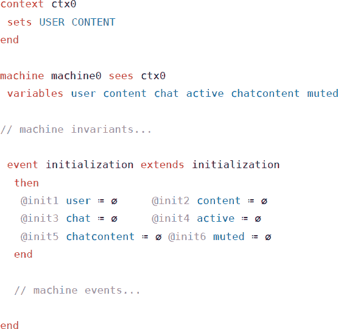

表 3.2 中的前两个不变性是通过在模型中引入两个集合变量来实现的；第一个变量持有已注册到聊天系统的用户，第二个变量持有所有交换的内容。

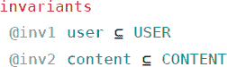

表 3.2 中的不变性 3 是通过一个声明 `chat` 为用户之间关系的不变性来实现的。不变性 4 是通过 `chat` 是一个二元关系这一事实实现的。将 `chat` 建模为集合强制了表 3.2 中的第五个不变性，因此，聊天会话中的元素对不会重复。


实现表 3.2 中的第六个不变性需要更细致的分析，因为它涉及到内容、内容的发送者和接收者。下方的变量 `chatcontent` 引入了聊天内容。该变量被定义为域为 `user`（发送消息的人）、值域为 `content ⇸ ℙ(user)` 的部分函数，其中 `content` 是发送的内容，而 `ℙ(user)` 是接收该内容的用户集合。由于 `chatcontent` 是部分函数，因此可能存在一个未与任何人聊过的用户。`chatcontent` 的值域也是部分函数，因此可能存在某个用户没有与某个特定用户聊天。由于 `chatcontent` 及其值域都是函数，在 `u1` 存在于 `chatcontent` 的域且 `c` 存在于 `chatcontent(u1)` 的域的情况下，用户 `u1` 发送内容 `c` 的用户集合被唯一地表示为 `chatcontent(u1)(c)`。

事件 `chatting` 实现了 US-03，即用户 `u1` 与用户 `u2` 聊天。它实现了 `u1` 向 `u2` 发送某些内容 `c` 的场景。`@grd2` 编码了 `Given` 条件。守卫 `@grd4` 的第一部分类型化了变量 `c`，第二部分要求它是某些新内容。由于 `c` 是新内容，`@act1` 将其添加到内容集中。`@act2` 为 `u2↦u1` 创建一个聊天实例（如果它尚未存在）。如果已存在，则 `chat` 保持不变，因为它是一个集合。这与 WhatsApp 的实际行为一致，当用户 `u1` 第一次向 `u2` 发送内容时，会为 `u2` 创建一个聊天窗口。`@act3` 的第二行将 `c` 添加到 `u1` 和 `u2` 现有的聊天内容。注意，在 `@act3` 赋值后，`chatcontent(u1)` 仍然是一个函数，因为 `c` 不在它的定义域内。

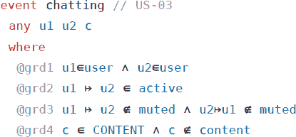

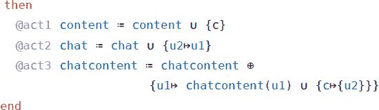

我们在下方展示了 US-04a 和 US-04b 的编码；因此，`delete-content` 从聊天 `u1↦u2` 中移除内容 `c`，而 `remove-content` 从所有地方移除。注意，`delete-content` 不会从 `chat u2↦u1` 中移除 `c`。守卫 `@grd2` 验证删除或移除内容的用户 `u1` 正在与 `u2` 聊天。`delete-content` 使用函数覆盖运算符 `⊗` 来覆盖 `u1` 的聊天内容。它从 `chatcontent(u1)(c)` 中移除 `u2`，使得 `u2` 不再显示为从 `u1` 接收了内容 `c`。

`remove-content` 使用域减运算符 `⩤` 从所有接收过 `u1` 发送所述内容的用户移除内容 `c`。

注意，如果 `u1` 正在与 `u2` 聊天，`u2` 正在与 `u3` 聊天，且 `u1` 向 `u2` 发送了 `c`，`u2` 向 `u3` 发送了 `c`，那么调用参数为 `u1`、`u2` 和 `c` 的 `remove-content` 不会从 `u2` 与 `u3` 之间的聊天中移除 `c`，只从 `u1` 与 `u2` 以及 `u2` 与 `u1` 之间的聊天中移除。正因为如此，`remove-content` 没有实现第二个动作 `@act2 content ≔ content ∖ {c}`。

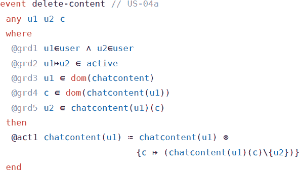

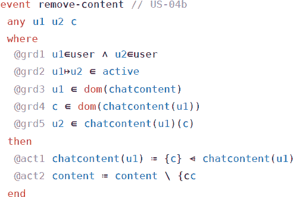

事件 `mute-chat` 实现了 US-06。它静音 `u1` 和 `u2` 之间的聊天；具体来说，`@act1` 将对 `u1` 添加到静音列表中。`@act2` 禁止静音处于处于状态。或者，我们可以添加守卫 `@grd4 u1 ↦ u2 ∉ active`，但这样无法反映 WhatsApp 图形界面的实际行为，在 WhatsApp 中，用户 `u1` 确实可以在与 `u2` 活跃聊天时将其静音。

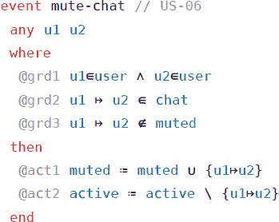

事件 `unmute-chat` 实现了 US-07。它取消 `u1` 和 `u2` 之间聊天的静音。`@grd3` 验证 `u1` 曾静音 `u2`。如果存在，静音 `u2` 的用户是唯一的，因为 `muted` 是一个函数。`@grd2` 是冗余的：它可以从 `@grd3` 和 `muted ⊆ chat` 的事实推导出来。尽管是冗余，但 `@grd2` 有助于 Rodin 对事件守卫进行类型化，并帮助我们读者更好地理解模型。

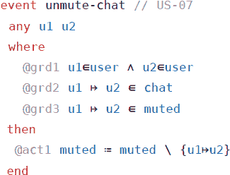

下方的事件 `forward` 实现了 US-09，用户 `u` 将内容 `c` 转发给用户集合 `us`。守卫 `@grd1`、`@grd2` 和 `@grd5` 类型化了 `u` 和 `us`。`@grd4` 类型化了 `c`。`@grd6` 检查 `u` 确实与 `us` 中的每个用户拥有聊天会话。表达式 `muted[{u}] ∩ us = ∅` 检查集合 `us` 的成员是否属于 `u` 已静音的用户集。表达式 `muted[us] ∩ {u} = ∅` 验证 `u` 未被 `us` 的任何成员静音。主体动作 `@act2` 为集合 `us` 中的每个成员创建相应的聊天会话与 `u` 聊天。动作 `@act1` 覆盖 `chatcontent`，将内容 `c` 纳入 `u` 与 `us` 中每个元素之间的聊天会话。事件 `forward` 本身没有实现聊天会话内容项之间的顺序概念，因此在抽象机器实现的抽象层上，无法确定哪个聊天内容先读或后读。

用于 US-08 的事件 `broadcast` 的实现方式与 `forward` 类似。两者之间的主要区别是 `forward` 事件的守卫 `@grd6` 未被 `broadcast` 事件包含。

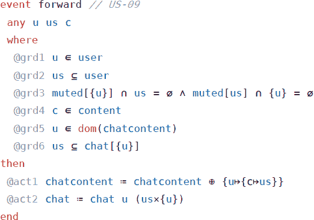

事件 `unselect-chat` 实现了 US-10。它通过从 `active` 中删除 `u1↦u2` 来取消 `u1` 和 `u2` 之间聊天的选取。

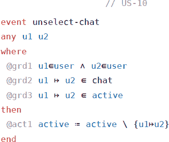

## 3.5 EVENT B 中的 MACHINEONE

*机器细化*（Machine refinement）是 EVENT B 提供的扩展或详细机器行为和功能的机制。在 EVENT B 中，*细化机器*的所有组件都包含在*细化机器*中，要么是显式的（机器变量、机器变量初始化、使用 `refines` 定义的细化事件的守卫和动作），要么是隐式的（使用 `extends` 定义的内变式、守卫和动作）。下方的机器 `machine1` 查看 `machine0`，因此它细化了其所有功能。它还引入了变量 `toread` 以编码 US EX-01。该变量存储了所有待读的聊天内容。

下方的变量 `user`、`content`、`chat`、`active`、`chatcontent` 和 `muted` 由 `machine1` 显式细化。该机器包含了两个初始为空的变量 `toread` 和 `inactive`。注意，`initialization` 事件没有初始化任何抽象变量 `user`、`content`、`chat`、`active`、`chatcontent` 或 `muted`，因为它们在 `machine0` 中已经初始化。`machine1` 查看 `machine0` 相同的上下文 `ctx0`。

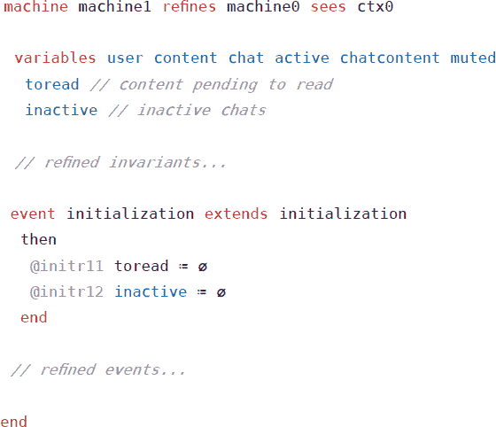

不变式 `@invr11` 和 `@invr12` 将 `toread` 和 `inactive` 声明为 `user ↔ user` 类型关系并包含在 `chat` 中。不变式 `@invr13` 约束 `chat` 为 `active`、`toread` 和 `inactive` 的并；`active` 和 `toread` 是不交集，`active` 和 `inactive` 也是如此，然而聊天会话可能同时是 `inactive` 和 `toread`。

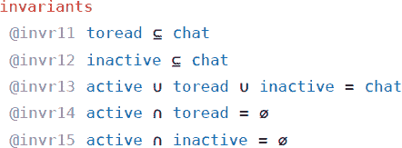

US EX-01 *静态地*通过所有操作 `toread` 或 `active` 变量的不变式实现，并*动态地*通过 `machine1` 中引用这些变量的事件编码来实现。

机器事件通过使用 `extends` 子句在细化机器中隐式细化。下方细化事件 `unmute-chat` 的参数是 `u1` 和 `u2`，加上 `machine1` 中声明的新参数（空集）。下方细化事件 `unmute-chat` 的守卫是来自抽象事件的 `@grd1`、`@grd2` 和 `@grd3`，加上 `machine1` 中声明的新守卫（无）。事件 `unmute-chat` 的抽象动作也是如此，即 `@act1 muted ≔ muted ∖ {u1↦u2}`，它隐式地出现在下方的具体 mute-chat 事件中。

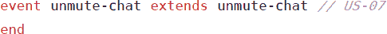

接下来，我们描述了表 3.3 中的局部不变式如何在 EVENT B 中实现。关于不变式 1，“未读”状态通过变量 `toread` 编码，“已读”状态编码为 `chat ∖ toread`。注意，我们的 EVENT B 编码比 US 和局部不变式描述的更细粒，因为拥有“已读”状态的变量可以是 `active` 或 `inactive`。

不变式 2 无法直接通过不变式进行静态编码，而是需要通过机器事件进行编码，因此每当内容项发送到 `inactive` 聊天时，都需要被添加到 `toread` 中。

我们在下方展示了事件 `create-chat-session`，其中表达式 `{u1} ◁ active` 等价于单元素集合 `{active(u1)}`，只要 `u1` 在 `active` 的定义域内。更具体地说，`active(u1)` 要求 `u1` 存在于 `active` 的定义域，而 `{u1} ◁ active` 并不要求，因此它有时会返回 `∅`。因此，每当某个用户 `u1` 创建一个会话时，她与正在聊的用户（如果有）之间的会话就会被设为非活跃（inactive）。由于 `active` 是一个函数，每当 `active(u1)` 存在时，表达式 `({u1} ◁ active)` 就会变为单元素集合 `{u1 ↦ active(u1)}`。

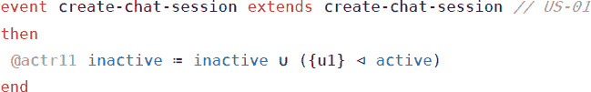

所选会话的所有内容项会被一次性全部读取。这在 `select-chat` 中通过 `@actr11` 进行建模。`active` 和 `inactive` 是不变性 `@invr15` 给出的两个不相交集。由于抽象事件 `select-chat` 向 `active` 添加了 `u1↦u2`，我们需要将其从 `inactive` 中删除以保持不变性 `@invr13`。这通过 `@actr12` 的左析言进行建模。如果 `u1` 正在与某个用户聊天，那么前者与后者之间的聊天也会被设为非活跃。这通过 `@actr12` 的右析言建模。

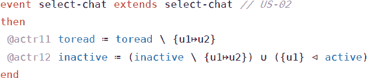

下方展示了细化事件 `chatting`。当 `u1` 正在与 `u2` 聊天时，哪些会话应该被添加到 `toread`？应该添加 `u2↦u1`，因为内容 `c` 已从 `u1` 发送到了 `u2`，除非 `u2↦u1` 已在 `active` 中。这通过表达式 `({u2↦u1} ∖ active)` 建模。当该对处于 `inactive` 状态时，我们也应该将对 `u2↦u1` 添加到 `toread`。这通过表达式 `({u2↦u1} ∩ inactive)` 建模。但如果是如果是的话，我们需要从 `inactive` 中删掉 `u2↦u1`。后者通过 `@actr12` 实现。

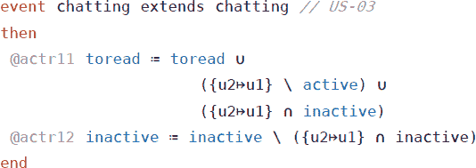

事件 `delete-content` 保持不变。此细化事件没有引入任何行为。

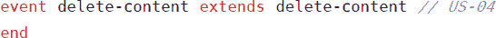

当删除会话 `u1↦u2` 时，应将其从非活跃列表或待读会话列表中删除。已删除会话的所有待处理操作都将终止。

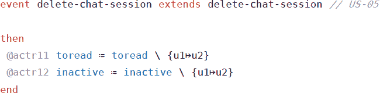

下方展示了细化事件 `mute-chat`。由于抽象事件从 `active` 中删除了对 `u1↦u2`，因此下方的具体事件将其添加到 `inactive`，以保持 `machine1` 的不变性 `@invr13`。

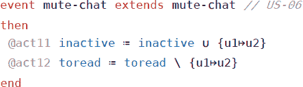

`forward` 的实现与 `chatting` 的实现类似，它取 `{u2↦u1}` 等于 `(us×{u})∪({u}×us)`。

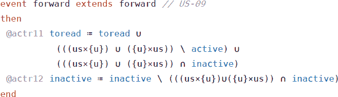

`broadcast` 的实现与 `forward` 的实现完全相同。

未选中的会话被设为非活跃。

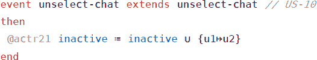

### 3.6 EVENT B 中的 MACHINETWO

机器 `machine2` 为我们的 WhatsApp2 EVENT B 模型添加了实现细节。该机器的目标是让 EVENT B 模型保持接近实现的状态，以便使用 `EVENTB2JAVA` 工具翻译为 JAVA (Cataño and Rivera, 2016)。细化机器的变量可能会出现在细化机器的不变性中。当发生这种情况时，不变性被称为*粘合不变性*（gluing invariant），因为它关联了抽象（细化）机器与细化机器的状态空间。到目前为止，内容、用户和聊天内容被建模为集合。我们希望通过粘合不变性将它们建模为序列。

在 EVENT B 中，自然数的一个段可以使用 `a..b` 表示法表示，它定义了从 `a` 到 `b`（包含边界）的自然数集。

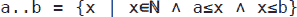

因此，我们可以使用 `1..n` 表示法将类型为 `T` 且大小为 `n` 的序列建模为从 `1..n` 到 `T` 的全函数。通过要求序列为*全函数*，我们强制其定义域没有空洞。


变量`contents`将`content`编码为序列。`csize`代表`contents`中内容项的数量。`content`是`contents`的类型。`contents`的定义域是`1..csize`，因此当`csize`为`0`时，`contents`为空。

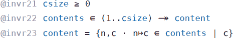

接下来，我们选择将`chatcontent`实现为变量`screen`。这个细化变量使得发送的内容有序，但内容的发送者或接收者不是。这是因为我们主要使用`screen`来按顺序显示交换的内容，这使得用户对不需要排序，只需要内容项排序。


下方展示了细化版本`chatting`。当`u1`正在与`u2`聊天时，哪些会话应该被添加到`toread`？应该添加`u2↦u1`，因为内容`c`已从`u1`发送到了`u2`，除非`u2↦u1`已在`active`中。这通过表达式`({u2↦u1} ∖ active)`建模。当该对处于`inactive`状态时，我们也应该将对`u2↦u1`添加到`toread`。这通过表达式`({u2↦u1} ∩ inactive)`建模。但如果是如果是的话，我们需要从`inactive`中删掉`u2↦u1`。后者通过`@actr12`实现。为了让内容按顺序显示，用户对不需要排序，只需要内容项排序。`k`是`screen`中的位置。`@grdr21`和`@grdr22`确保了`machine1`存在。`@actr23`增加了内容。

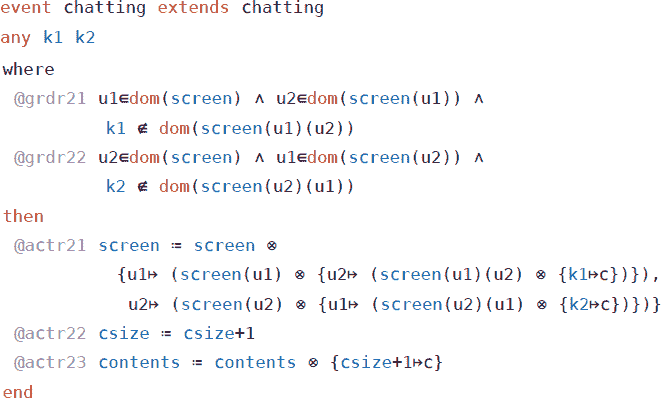

事件`delete-content`声明了两个参数`i`和`k`，分别代表`screen`中的位置。`@grdr21`检查`contents(i) = c`。`@grdr22`检查`c`是否存在。`@actr21`从`screen`中删除`k`。

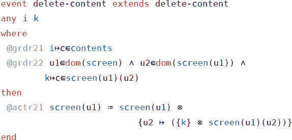

`machine2`的剩余事件定义类似。例如，`forward`和`broadcast`定义类似于`chatting`，而`delete-session`的定义类似于`delete-content`。

我们在下方展示了在`machine2`中定义的具体事件`add-user`。`screen(u)`对每个`user`都是空的。

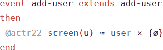

### 3.7 聊天系统的实现

EVENT2JAVA将EVENT B机器翻译为JAVA类。在翻译机器时，EVENT2JAVA不仅考虑机器提供的信息，还考虑机器“看到”的上下文。细化机器的翻译与抽象机器相同，因为Rodin正确将抽象机器组件添加到细化机器的内部表示中。EVENT2JAVA除了生成JAVA代码外还生成JML规范。JML是一种JAVA接口规范语言。它旨在表示JAVA类的行为，并使用特殊注释标记包含在JAVA源文件中。我们这里对WhatsApp实现的介绍主要关注JAVA。

EVENT2JAVA只将不变性翻译为JML规范。常量的翻译包含JAVA部分和JML部分。EVENT B逻辑谓词被翻译为通过`BSet`和`BRelation`类编写的JAVA谓词，分别在JAVA中实现集合和关系。细化和扩展事件的翻译方式与抽象事件相同。每个事件都被翻译为一个独立的JAVA类。每个事件的翻译包含指向机器类的对象引用。标准（非初始化）事件的翻译包含一个`guard-event`方法用于测试`event`的守卫是否成立，以及一个`run-event`方法模拟`event`的执行。

我们在下方展示了EVENT2JAVA为事件`add-user`生成的代码。下方的`guard-add-user`方法实现了事件`add-user`的守卫，`run-add-user`方法实现了其动作。

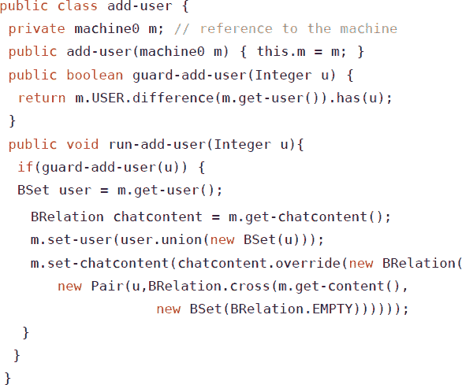

事件`create-chat-session`的实现如下所示。变量`u1`和`u2`是`guard`和`run`类方法的参数。`guard-create-chat-session`是一个布尔方法，当事件守卫（event guard）成立时它返回`true`。`run-create-chat-session`(5)实现了两个事件动作，其中一个修改`chat`，另一个修改`active`。变量`m`是类`machine2`的对象实例。该类密集地使用`get`和`set`方法来访问和修改机器变量。

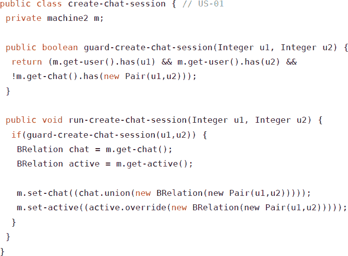

我们在下方展示了`machine2`的实现。常量`CONTENT`和`USER`定义在机器上下文`ctx`中。我们使用它们来对某些机器变量`content`和`user`进行排版。它们具有`Enumerated`类型，并被声明为包含从`min-int`到`max-int`之间的所有元素。类`machine2`不仅包括在机器`machine2`中声明的变量，还包括`machine0`。

生成的代码大量使用了由`BSet`和`BRelation`类提供的功能；这些类在第2.8节中进行了要讨论。

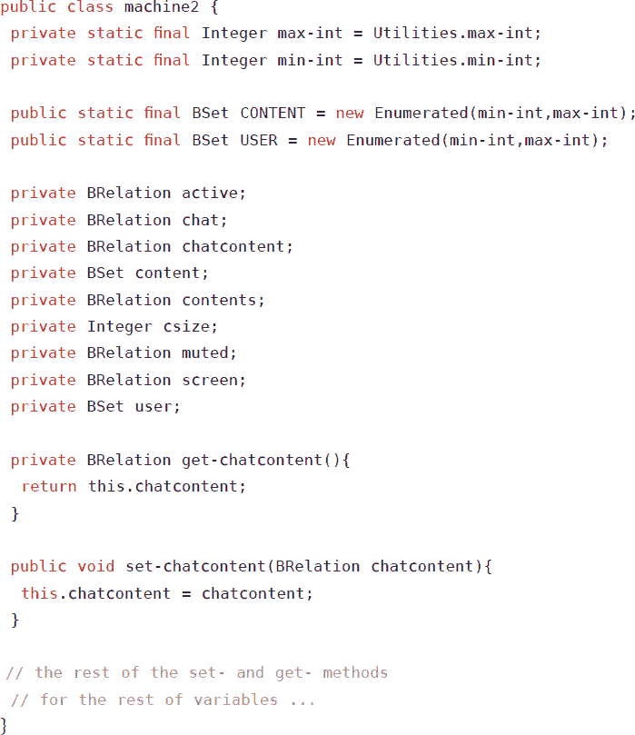

### 3.8 聊天系统的测试与代码动画

由`EVENTB2JAVA`工具生成的代码可以使用JUnit（JAVA单元）测试进行动画演示和测试（Appel, 2015）。测试允许人们验证JAVA中实现的代码的行为是否符合预期。

类`add-contentTest`为功能`add-content`实现了一个简单的JUnit测试。

JUnit类主要由三个方法组成：

*   一个`@Before setUp()`方法，它在测试类对象被创建时且在任何`@Test test()`方法运行之前执行；
*   一个`@After tearDown()`方法，在测试类对象被销毁时且在任何`@Test test()`方法运行之后执行；
*   一个或多个`@Test test()`方法，用于测试类的功能；它们通常使用`assertTrue`和`assertFalse`方法来检查类对象的预期行为。`assertTrue`和`assertFalse`接收一个布尔表达式作为参数。

方法`testAddContent()`测试了其实现的不同方面：

*   `assertTrue(contents.size() == 1)`；检查第一次添加内容项时，contents的大小是否为`1`；
*   `assertTrue(contents.has(c1))`；检查添加的内容项确实已添加；以及
*   `assertFalse(contents.has(c2))`；这是一个冗余测试，可以从之前的两个测试中推断出来。

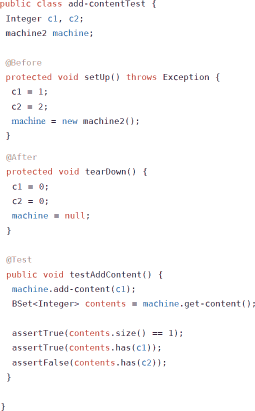

JUnit测试`add-user`与测试`add-content`类似：

*   `assertTrue(users.size() == 1)`；测试在添加`u1`后用户数量是否为`1`；
*   `assertTrue(users.has(u1))`；测试在`u1`添加到users后，users是否包含`u1`；
*   `assertFalse(users.has(u2))`；这是一个冗余测试，可以从之前的两个测试中推断出来。

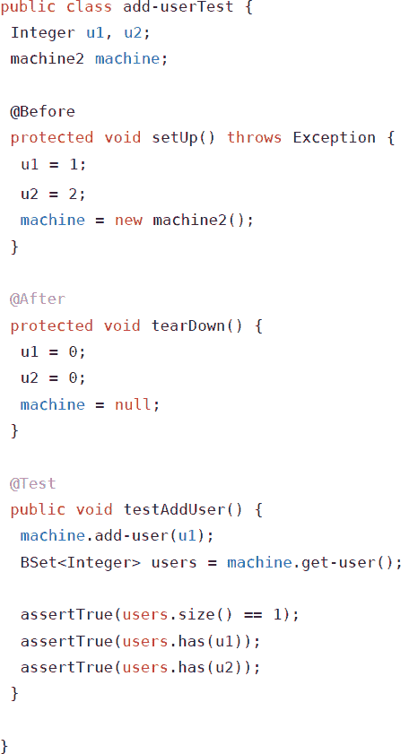

类`create-chat-sessionTest`中的方法`testCreateChat()`展示了我们为方法`create-chat-session`编写的测试用例。首先，将两个用户`u1`和`u2`添加到用户集合。然后，`run-create-chat-session(u1, u2)`为他们创建一个聊天会话。类`Pair`实现一对元素。

*   `assertTrue(users.has(u1) && users.has(u2))`；验证两个用户都已实际添加到`users`中。
*   `assertTrue(chatsessions.has(p12))`；验证`u1`和`u2`之间的聊天会话已创建。
*   `assertFalse(chatsessions.has(p21))`；验证`create-chat-session(u1, u2)`并没有实际上在`u2`和`u1`之间创建会话。

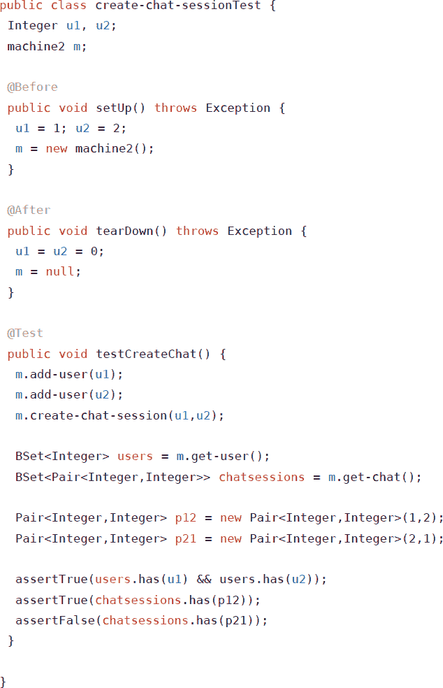

### 3.9 修复软件需求

在第2.4节中，我们引入了一种软件需求早期验证的方法论。因此，将US（用户需求）移植到EVENT B的形式模型中，然后使用`EVENTB2JAVA`代码生成器生成EVENT B模型的原型JAVA实现，并通过单元测试以验证US和形式模型。

我们此处的主要目标是检查US-03（聊天事件功能）是否存在缺陷。因此，我们对`EVENTB2JAVA`为事件`chatting`生成JAVA代码进行单元测试，检查代码是否可以正确执行（运行）以及在什么情况下执行，并在必要时演进US和EVENT B模型。到目前，我们本质上已经将每一个US都编码为了一个事件。我们在下方提供了US-03，它已在第3.1节中介绍过。

| US-03 | chatting |
| :--- | :--- |
| 作为用户 | 我希望在聊天会话期间发送一些内容，以表达我的想法。 |
| 给定 | 我和你之间的聊天会话处于激活状态。 |
| 当 | 我聊天时。 |
| 那么 | |

我们在下方提供了`chatting`的结构，它是为方法`create-chat-session`编写的。到目前我们本质上已经将每一个US都编码为了一个事件。US-03已在第3.1节中介绍。

| US-03 | chatting |
| :--- | :--- |
| 作为用户 | 我希望在聊天会话期间发送一些内容，以表达我的想法。 |
| 给定 | 我和你之间的聊天会话处于激活状态。 |
| 当 | 我聊天时。 |
| 那么 | 聊天内容将提供给我和你。 |


目标是检查US-03（聊天事件功能）是否存在缺陷。因此，我们对`EVENTB2JAVA`为事件`chatting`生成的JAVA代码进行单元测试，检查代码是否可以正确执行（运行）以及在什么情况下，并在必要时演进US和EVENT B模型。


问题在于`m.get-session(Me)`是空的，因此`m.get-session(Me).apply(You)`会抛出空指针异常。为了解决这个问题，我们编辑了US-03，将其拆分为US-03a和US-03b，分别对应我们第一次聊天或不是的情况。

| US-03a | chatting |
| :--- | :--- |
| 作为用户 | 我希望在聊天会话期间发送一些内容，以表达我的想法。 |
| 给定 | 我和你之间的聊天会话处于激活状态。我们之间的聊天会话以及你之间的会话内容都存在。 |
| 当 | 我聊天时。 |
| 那么 | |

等等，US-03a和US-03b被翻译为EVENT B，使用Rodin进行检查，并且所有的生成的PO（证明责任）都得到了消除。事件与`chatting`类似，不同在于它检查两个用户是第一次聊天。

| US-03b | chatting-first-time |
| :--- | :--- |
| 作为用户 | 我希望在聊天会话期间发送一些内容，以表达我的想法。 |
| 给定 | 我和你之间的聊天会话处于激活状态。 |
| 当 | 我聊天时。 |
| 那么 | 聊天内容将提供给我和你。 |

`chatting-first-time`应在`Me`第一次向`You`发送内容时使用，否则应使用`chatting`。然而，如果在`Me`开始与`You`聊天或反之发生了以下任何情况，这两个事件都无法使用：

*   `Me`删除了与你的聊天会话，导致尽管`Me∈dom(You)`但`You∉dom(screen(Me))`。
*   `You`删除了与我的聊天会话，导致尽管`You∈dom(Me)`但`Me∉dom(screen(You))`。

事件`chatting`与下方的`chatting-first-time`类似，不同在于`@grdr21`和`@grdr22`的第二个合取没有取否定。

我们随后为`chatting-first-time`和`chatting`的新版本生成代码，并修改了`testChatting()`测试以使用`chatting-first-time`代替`chatting`。第一个`assertTrue`指令检查内容`c1`对`Me`可见，第二个指令检查它对`You`可见。这次这两个测试都成功了，因此`US-03a`和`US-03b`是正确的。


## 3.10 经验教训

### 3.10.1 事件：CREATE-CHAT-SESSION

如果在事件`create-chat-session`中（如见文第2.9节）添加守卫`Me↦You ∈ active`会怎样？在添加上述守卫后，Rodin会自动释放所有相关的PO（后置证明）。是否使`Me↦You ∈ active`的结果实际上与`create-chat-session`与机器事件（如`chatting`和`select-chat`）的交互有关。如果`create-chat-session`不使`Me↦You ∈ active`，则`select-chat`应该在开始聊天之前执行。EVENT B模型的事件交互分析通常可以使用PROB模型检查器（Leuchel and Butler, 2003）进行。PROB用于检查死锁：它会检查在执行任何机器事件后，系统是否能够继续进展。

### 3.10.2 事件：CHATTING

下方是事件`chatting`的抽象版本（在`MachineZero`中定义的版本）。关于这个抽象版本，我们需要做的第一个决定是：是否想在`You`和`Me`之间的聊天中添加内容项`c`（除了`Me`和`You`之间的聊天之外）。如果我们想这样做，应该像我们之前做的那样，将下方的`@act3`的第二行扩展为`You ↦ (chatcontent(You) ∪ {c ↦ {Me}})`。直观上，添加这一行意味着`Me`发送给`You`的内容`c`不仅被`Me`看到，也被`You`看到。然而，如果我们这样扩展`@act3`，Rodin证明器将生成一个PO，要求`You`必须在`dom(chatcontent)`中，以便子表达式`chatcontent(You)`是类型正确的。这一要求可以通过向`chatting`事件添加事件守卫`@grd6 You ∈ dom(chatcontent)`轻松地解决。该方案的缺点是，当`You`尚未向任何人（而不是向`Me`）发送任何内容时，`@grd6`并不成立。


上述缺点表明，可以在`You`首次被系统时添加默认的`chat-content`关联。下方的事件`add-user`将用户`u`添加到现有用户集合中。集合表达式`USER\user`返回所有尚未添加到系统的用户集合。动作`@act2`对于所有现有内容的集合为用户`u`添加默认的`chat-content`关联。在这种情况下，`∅`是用户的空集。下方的`@act2`的正确性由Rodin证明器通过自动释放所有相关PO确立；特别是，`@act2`遵循第3.4节中的`@inv4`，该定义要求确保`users`和`content`之间的偏函数关系。


当我们下次创建一个新的内容项时，由`@act2`编码的关联会发生什么？下方显示了事件`add-content`。对于每一个现有用户，下方的`@act2`将新内容`c`关联到用户空集，换句话说，内容项`c`显示为由整个用户集合（变量`user`）发送给任何人。

总结聊天事件，如果我们想在`Me ↦ You`聊天之外，还想在`You ↦ Me`聊天中添加内容项`c`，那么我们将面临一项计算开销的任务：每当我们向系统添加一个用户时，我们都需要为每个现有内容项关联`∅`，而且每当我们需要添加一个新内容项`c`时，我们都需要将每一个用户关联到`{c ↦ ∅}`。这种关于将聊天内容关联到`You ↦ Me`的复杂性的分析通常并不复杂；这种分析可以通过仔细的代码检查或测试来完成。但在EVENT B中编写聊天系统的形式化规范迫使我们进行代码检查，并且使用Rodin定理证明器可以确保在用Rodin自动检查EVENT B规范时无需花费精力编写适当的测试场景。

注意，在聊天中如下表示`@act3`是不可通的，因为最后一个覆盖表达式忘记了`chatcontent(You)`，这等同于删除了它。Rodin无法发现这个问题，特别是是关于第3.4节中的不变性`@inv4`，因为下方为`You`的新关联无论如何都是偏函数。只有领域专家才能发现这一点，他们知道每当内容项发送给某人时，就会删除该人的聊天。

### 3.10.3 事件：DELETE-CONTENT和REMOVE-CONTENT


`delete-content` 和 `remove-content` 是我们系统中两个微妙的功能。`delete-content` 不从 `You ↦ Me` 聊天中移除 `c`。在什么情况下应该向 `delete-content` 添加 `@act2 content := content\{c}`？Rodin 将生成一个不可证明的 PO。该 PO 涉及第 3.3 节中的 `@inv4`。需要证明对于 `Me` 之外的任何用户，`chatcontent(Someone)` 都是从 `content` 的偏函数，这是可能的，因为 Someone 之前发送（转发或广播）过 c。


解决此问题的方法是将内容表示如下。然而，这样计算 `chatcontent` 的值需要遍历两次用户和一次内容，取决于 `chatcontent` 使用的类型结构，可能会耗时。


注意，如果 `Me` 与 `You` 聊天，`You` 与 `Another` 聊天，且 `Me` 向 `You` 发送 `c`，`You` 向 `Another` 发送 `c`，则用参数 `Me`、`You` 和 `c` 调用 `remove-content` 不会从 `You` 和 `Another` 之间的聊天中移除 `c`，而仅从 `Me` 和 `You` 之间的聊天中移除。因此，`remove-content` 没有实现第二个动作 `@act2 content := content\{c}`。为了表示内容的新值，我们可以采用上述方法，并在 `remove-content` 事件中添加以下行。

# 4 Poporo 社交网络

本章介绍了一个名为 *Poporo* 的社交网络的完整 EVENT B 形式化模型。Poporo 是一种黄金制成的容器，供前哥伦布时期（哥伦布之前）的美洲居民用于社交以及与古代神灵交流。Poporo 被认为具有神秘的社交交流能力。这些神秘交流能力可能归于石灰和碎可卡叶的混合物，这些物质被倒入 Poporo 中。Poporo 属于 Chibcha、Muisca、Quimbaya 和 Calima 前哥伦布文化。


图 4.1：Muisca Poporo。

图 4.1 展示了一个典型的 Muisca Poporo。此处展示的社交网络命名为 Poporo，以纪念这些聚在一起并进行社交的早期美洲印住民文化。

第 2.3 节 介绍了基于 `EVENT B` 的软件开发方法论的一系列步骤。这些步骤为第 2.4 节介绍的早期验证方法论提供了补充视角。我们在下方再次展示了这些步骤。

1. 在 `EVENT B` 中编写系统的初始蓝图（`machine`）。初始蓝图充当了我们想要建模的系统最抽象视图的角色。
2. 进行完备证明，以证明初始蓝图中的每个事件都符合不变性属性，例如通过使用 `Rodin` 平台来实现。
3. 编写蓝图的模型细化。你可以从水平、垂直方向或结合这两个者对模型进行精细化。
4. 进行一致性证明，以证明蓝图的细化是对蓝图的正确细化。
5. 根据需要重复上述两个步骤。
6. 为最终的模型细化实现代码或通过工具生成代码。

虽然第 3 章 专注于第 1 和第 3 步，而本章则侧重于第 2 和第 4 步。本章展示了如何在 `Rodin` 中半自动地完成（证明）Poporo 的一些典型 PO。`Rodin` 包含一个名为 `EVENTB2JAVA` 的插件（Cataño et al., 2015），该插件可以自动为 `EVENT B` 模型生成 `JAVA` 代码。

表 4.1 显示了 `EVENT B` 中社交网络的简化模型。我们对社交网络的完整形式化称为 `Poporo`。它与 Facebook 等其他现有的知名社交网络网站共享许多特征，此外，它的所有组件都通过谓词逻辑进行了形式化。`Poporo` 机器包含了变量、不变变量和事件的定义。`Poporo` 机器可以看到上下文 `ctx`。该上下文包含了常量、载体集、公理和定理的定义。常量和变量代表 `EVENT B` 模型的静态部分，而事件构成了其动态部分，因此它们可能会修改（机器）状态变量。因此，`Poporo` 机器可以访问 `ctx` 中定义的所有常量定义、公理的定理，就像它们在本地声明的一样。该机器声明了四个变量，即 `person`、`content`、`owner` 和 `page`。变量 `person` 代表社交网络中的所有人。变量 `content` 代表社交网络中的所有内容项，例如图片、文本消息和视频。变量 `owner` 模型化了谁拥有哪些内容，而 `page` 存储了每个人主页的内容。`Poporo` 声明了四个不变变量。前两个不变变量类型为变量 `person` 和 `content`。这些变量的元素分别取自载体集 `PERSON` 和 `CONTENT`。

表 4.1 中的第三个不变变量规定 `owner` 是从 `content` 到 `person` 的全满射函数。全函数条件确保某些人拥有每一个内容项，而满射条件确保每个人都至少拥有一个内容项。第四个不变变量声明 `page` 是 `content` 和 `person` 之间的全满射关系。

`initialization` 事件为机器变量赋予初始值。Poporo 将所有变量初始化为空集，记为 `∅`。社交网络的 `upload` 事件将某些内容 `c` 上传到人员 `p` 的页面。变量 `c` 和 `p` 是事件 `upload` 的参数。保护器（Guards）是由常量、机器变量、集合和事件参数组成的逻辑谓词。

表 4.1：Poporo 抽象机的简化版本


`upload` 的保护器标记为 `@grd1` 和 `@grd2`。第一个标记标记参数 `c`，第二个标记变量 `p`。第一个标记检查 `c` 是否为新内容，第二个标记检查 `p` 是否为已存在的人。`upload` 的动作（actions）标记为 `@act1`、`@act2` 和 `@act3`。每个事件动作必须赋值给不同的机器变量。第一个动作将内容项 `c` 添加到 `content` 中。第二个动作将配对 `c↦p` 添加到 `owner` 中。因此，人员 `p` 成为新内容项 `c` 的所有者。第三个动作将内容项 `c` 添加到人员 `p` 的页面。事件保护器充当事件的前置条件。事件没有变量后置条件的显式表示，虽然在 `EVENT B` 中，在赋值右侧使用变量表示该变量在事件前状态的值，而在赋值左侧使用变量则表示其在事件执行后状态的值。

## 4.1 POPORO 的通用结构

Poporo 最抽象的功能描述在表 4.2 中。其第三列列出了哪些需求与哪个 `EVENT B` 机器或细化相关。这个基础模型考虑了一个抽象机和一个单一机器细化。单一细化机在抽象机已经看到的基础上，额外看到了内容项的权限。表 4.3 显示了基础模型的扩展。扩展模型看到了朋友关系、墙板和聊天室。

| 表 4.2：Poporo 的初始模型 |
| :--- | :--- | :--- |
| 模型 | 模型看到了什么？ | 需求 |
| Poporo 抽象机 | 用户、内容、所有者 | FUN-1, FUN-2, FUN-3 |
| 细化 1 | 权限 | SEC-1, SEC-2, FUN-4, INV-1, INV-2 |

| 表 4.3：Poporo 的扩展模型 |
| :--- | :--- |
| 模型 | 模型看到了什么？ |
| 细化 2 | 主要和次内容 |
| 细化 3 | 朋友关系（好友、社交朋友、熟人） |
| 细化 4 | 墙板 |
| 细化 5 | 聊天室 |

下面的表 4.4 总结了在本章编写需求使用的符号。这种符号与第 3 章使用的符号不同，在第三章我们使用 US 来编写需求。`FUN` 是功能需求的集合。`SEC` 是 Poporo 社交网络中安全和隐私方面的非功能需求集合。`INV` 是 Poporo 的安全性属性。每个需求由两部分组成：需求本身以及传达设计决策的说明文。

| 表 4.4：需求符号 |
| :--- | :--- |
| **FUN** | 关于系统功能的需求 |
| **SEC** | 关于隐私和安全的需求 |
| **INV** | 不变属性 |

说明文与需求之间的分离有两个目的。说明文帮助新读者熟悉系统；它也帮助频繁阅读的人快速阅读需求。需求使用了适合专家读者的数学符号。我们用灰色编写说明文。

在下文中，我们展示了 Poporo 的抽象机软件需求。表 4.5 显示了 Poporo 的功能需求。`FUN-1` 规定系统应该建模用户和数据。第二个需求告诉我们所有权应该由系统状态建模，这个需求和第三个需求规定系统必须动态地上传数据。第四个功能需求描述了社交网络中的常见功能，即内容流对某人的页面可见或不可见。该需求模拟了想要开启或关闭他人更新的情况。

| 表 4.5：Poporo 的功能需求 |
| :--- | :--- |
| **FUN-1** | 社交网络应具有用户和数据（内容） 系统状态的形式化 |
| **FUN-2** | 上传数据的用户应被归类为数据的所有者 所有权的定义 |
| **FUN-3** | 社交网络的用户应能上传数据 在网络上发布内容 |
| **FUN-4** | 用户可能可以选择哪些可用数据被其查看 隐藏并使内容可见 |

表 4.6 显示了 Poporo 的隐私和安全需求。第一个需求告诉我们，Poporo 的隐私和安全机制是基于 `access permissions`（访问权限）的。第二个需求引入了 Poporo 包含的类型，即 `view`（查看）和 `edit`（编辑）权限。

| 表 4.6：Poporo 的非功能性需求 |
| :--- | :--- |
| **SEC-1** | 用户应根据权限对网络上的数据进行受控访问 内容权限 |
| **SEC-2** | 可以向用户授予以下关于数据的权限：查看数据的权限，编辑数据的权限 查看和编辑权限 |

表 4.7 显示了 Poporo 的某些安全属性。在 `EVENT B` 中，安全属性被规范为机器不变性（machine invariants）。第一个安全需求在两个考虑的访问权限之间建立了层次关系。第二个安全属性说明，上传内容项的人（因此拥有该内容）拥有对该内容的所有权限。

| 表 4.7：Poporo 的安全属性 |
| :--- | :--- |
| **INV-1** | 可以编辑数据的用户也必须能够它 编辑权限涵盖了查看权限 |
| **INV-2** | 某些数据的所有者拥有该数据的所有权限 所有权的定义 |

## 4.2 EVENT B 中 POPORO 的形式化

下方的上下文 `ctx` 定义了社交网络中人员（persons）和内容项的载集（carrier sets）。`PERSON` 和 `CONTENT` 是未解释集，因此它们不受限于包含任何特定类型的元素。


FUN-1 关于社交网络的一个静态方面，与用户和内容有关。我们使用 `person` 来建模用户，使用 `content` 来表示社交网络内容。`person` 和 `content` 是 `ctx` 中定义的两个载集的子集。下方每个不变性中使用的标签有助于 PO 生成器将不变性映射到特定的 PO（后置条件）。


FUN-2 与社交网络内容的所有权有关。人们可以对内容所有权有几种可能的定义；我们在这里选择的定义涉及网络内容和人员。可以将 `owner` 定义为 `content` 和 `person` 之间的关系，但这将允许多个人拥有相同的网络内容，这并不是我们在这里想要建模的。因此，应该将 `owner` 建模为一个函数。如果我们将 `owner` 建模为从 `content` 到 `person` 的 `partial function`（部分函数），那么我们将允许某些内容存在且不被社交网络中的任何人拥有，这不符合社交网络的典型行为。因此，我们选择将 `owner` 建模为 `total function`（全函数）。我们还选择 `owner` 是 `surjective`（满射的）。这确保了每个人至少有一个拥有的内容项。我们在下方展示了 `owner` 的定义。


我们为第三个机器不变性使用了一个新标签。如前所述，标签使自动化工具能够生成独特的 PO。Section 4.4 给出一个如何使用 Rodin 证明不变性 PO 的示例。


## 4.1 Poporo 的需求

表 4.5 显示了 Poporo 的功能性需求。

| 编号 | 需求描述 | 关联概念 |
| :--- | :--- | :--- |
| **FUN-1** | 社交网络应具有用户和数据（内容）系统状态的形式化 | 系统状态形式化 |
| **FUN-2** | 上传数据的用户应被归类为数据的所有者 | 所有权的定义 |
| **FUN-3** | 社交网络的用户应能上传数据 | 在网络上发布内容 |
| **FUN-4** | 用户可能可以选择哪些可用数据被其查看 | 隐藏并使内容可见 |

表 4.6 显示了 Poporo 的隐私和安全需求。第一个需求告诉我们，Poporo 的隐私和安全机制是基于 `access permissions`（访问权限）的。第二个需求引入了 Poporo 包含的权限类型，即 `view`（查看）和 `edit`（编辑）权限。

| 编号 | 需求描述 | 关联概念 |
| :--- | :--- | :--- |
| **SEC-1** | 用户应根据权限对网络上的数据进行受控访问 | 内容权限 |
| **SEC-2** | 可以向用户授予以下关于数据的权限：查看数据的权限，编辑数据的权限 | 查看和编辑权限 |

表 4.7 显示了 Poporo 的某些安全属性。在 `EVENT B` 中，安全属性被规范为机器不变性（machine invariants）。第一个安全需求在两个考虑的访问权限之间建立了层次关系。第二个安全属性说明，上传内容项的人（因此拥有该内容）拥有对该内容的所有权限。

| 编号 | 属性描述 | 关联概念 |
| :--- | :--- | :--- |
| **INV-1** | 可以编辑数据的用户也必须能够查看它 | 编辑权限涵盖了查看权限 |
| **INV-2** | 某些数据的所有者拥有该数据的所有权限 | 所有权的定义 |

## 4.2 EVENT B 中 POPORO 的形式化

下方的上下文 `ctx` 定义了社交网络中人员和内容项的载集。`PERSON` 和 `CONTENT` 是未解释集，因此它们不受限于包含任何特定类型的元素。


FUN-1 涉及社交网络的一个静态方面，与用户和内容有关。我们使用 `person` 来建模用户，使用 `content` 来表示社交网络内容。`person` 和 `content` 是 `ctx` 中定义的两个载集的子集。下方每个不变性中使用的标签有助于 PO 生成器将不变性映射到特定的 PO。


FUN-2 与社交网络内容的所有权有关。人们可以对内容所有权有几种可能的定义；我们在这里选择的定义涉及网络内容和人员。可以将 `owner` 定义为 `content` 和 `person` 之间的关系，但这将允许多个人拥有相同的网络内容，这并不是我们在这里想要建模的。因此，应该将 `owner` 建模为一个函数。如果我们将 `owner` 建模为从 `content` 到 `person` 的 `partial function`，那么我们将允许某些内容存在且不被社交网络中的任何人拥有，这不符合社交网络的典型行为。因此，我们选择将 `owner` 建模为 `total function`。我们还选择 `owner` 是 `surjective`（满射的）。这确保了每个人至少有一个拥有的内容项。我们在下方展示了 `owner` 的定义。


我们为第三个机器不变性使用了一个新标签。如前所述，标签使自动化工具能够生成独特的 PO。第 4.4 节给出一个如何使用 Rodin 证明不变性 PO 的示例。

## 4.3 不变性证明目标

FUN-1 的静态部分涉及与用户和内容相关的社交网络方面。我们使用 `person` 建模用户，使用 `content` 表示社交网络内容。`person` 和 `content` 是 `ctx` 中定义的两个载集的子集。下方每个不变性中使用的标签有助于 PO 生成器将不变性映射到特定的 PO。


## 4.4 在 RODIN 中消解 PO

图 4.4 显示了在 Rodin 的 `Poporo` 抽象机中定义的 `delete` 事件。一个现有的内容项 `c`、一组内容项 `cts` 及其所有者参数 `ow` 参数化了该 `delete` 事件。该事件删除了 `c`（*主内容*）和 `cts`（*关联次要内容*）。图中右下部分显示了编写标准 Event B 数学符号的符号工具箱。已消解（已证明）的 PO 以绿色显示（左侧工具箱），未消解的以红色显示，未尝试的 PO 以棕色显示。Rodin 使用了不同的*视角（Perspectives）*。图的右上部分显示当前视角是*Event B 视角*。

人们可以手动切换到特定视角（*Window, Open Perspective*），也可以通过执行某项操作，让 Rodin IDE 为所执行的操作切换到默认视角。如果我们双击一个 PO（显示在左侧面板上），它将在 Rodin 的*证明视角（Proving Perspective）*中打开。Rodin 自带了一份预定义的证明器列表。特定的证明器可能成功也可能无法消解特定的 PO，因此人们被迫使用不同的证明器或尝试手动消解该 PO。

图 4.4 的底部显示了随 Rodin 附带各种证明器^(6)。`PP` 证明器来自 AtelierB 工具的第三方证明器。`nPP` 是 Rodin 的原生证明器。*套索（lasso）*操作向当前证明添加了更多假设，这些假设在目标与所选假设之间共享共同变量。证明器可以使用不同的力度。`p0`（力度为 0 的 `PP`）将选定的假设和当前目标提供给 `PP` 证明器。`p1`（力度为 1 的 `PP`）在将假设和目标传递给 `PP` 之前执行套索操作。`nPP` 也可以使用不同的力度。Rodin 手册建议在尝试使用 `PP` 进行任何证明之前先使用 `nPP`。`ML` 证明器对于消解涉及算术的证明有用。


接下来，我们展示如何在 Rodin 中消解一个 PO。示例是针对 `delete` 事件的不变性 PO。生成该 PO 是为了证明 `delete` 事件符合第 4.2 节中的机器不变性 `@inv4`。该证明使用 Rodin 3.2 版本进行。


`nPP` 和 `PP` 均未能自动消解该 PO。我们采用以下方法来消解此 PO：我们加强假设，然后采取分部证明。加强假设等同于证明一个中间结果。采取分部证明等同于应用分治法原则。如果我们想证明某个关系是*全满射（total surjective）*，我们首先证明它是*全的（total）*，然后证明它是*满射（surjective）*的，最后在这两个独立证明的基础上进行构建。

Rodin 的 `ah` 命令向证明的假设列表添加一个新假设。该假设是一个辅助结果，必须首先证明它是正确的。我们在下方添加了该辅助结果，它是上方主目标的较弱版本。`nPP` 自动消解了该辅助结果。因此，该结果作为第六个假设被添加到主目标。


在证明了之前的辅助结果后，我们将主证明分为两部分；我们首先证明目标的*全（total）*部分，然后证明*满射（surjective）*部分。我们在下方添加了解释主目标全部分的假设。


`nPP` 和 `PP` 均未能自动消解此假设，因此我们决定通过在上一个假设之上添加一个更简单的假设来帮助证明器工作，`nPP` 可以直率地消解该假设。下方的结果作为上方假设证明的第七个假设添加。从此以后，通过选定的第六和第七个假设调用 `nPP` 即可消解上述结果。


我们在下方添加解释主目标满射部分的假设，`nPP` 和 `PP` 均未能消解它。


因此我们添加了以下假设，该假设通过 `PP` 证明。上方假设通过选择第六个假设和下方的假设，使用 `nPP` 消解。


令人惊讶的是，在证明了全部分和满射部分后，Rodin 证明器仍然未能消解主证明。问题是由表达式 `{c} ∪ cts` 引起的，Rodin 尝试对其简化。我们借助 `ae` 命令（添加表达式）的帮助消除该表达式引起的噪声。我们告诉 Rodin 将 `{c} ∪ cts` 视为一个不可分割的整体。之后，`nPP` 使用选定的假设消解了主目标。

## 4.5 量化表达式的 PO

消解涉及全称或存在量化属性的 PO 通常很复杂，因为通常证明器无法自动实例化量化词。我们展示了一个如何证明全称量化不变性的的小示例。

我们建模了一个不变性属性，即人们只能拥有其页面中的内容项，并展示了该不变性的两个等价版本：不变 `@inv51` 使用集合操作；而不变 `@inv52` 使用全称量化表达式。


我们感兴趣的是消解针对下方 `hide` 事件生成的 `@inv52` PO，该事件从用户 `p` 的页面中隐藏内容项 `c`。


遵循第 4.3 节图 4.2 中的不变性 PO 规则，形成了一个包含 `@inv52` 和 `hide` 事件守卫的序题（sequent），且序列的目标是 `@inv52` 的修改版本，解释了事件动作引入的状态变化。图 4.6 显示了该序题。假设 1 是 `@inv52`，假设 2 到 5 是事件守卫。Rodin 自动实例化目标（一个全称量化不变性）并应用肯定前件，因此产生了第 6 个假设。后者假设类型为 `c1` 和 `p1`。


要消解此 PO，应对第一个假设进行实例化。需要两个 `content` 和 `person` 类型的值，使得后者到前者的映射是 `owner` 的元素。在使用 `c1` 和 `p1` 实例化该假设后，`nPP` 自动消解了 PO。然而，如果我们把 `@inv52` 定义为 `@inv51`，证明器将在无需人工干预的情况下消解底层 PO。

## 4.6 强化规范

本节部分展示了表 4.2 中第一个细化机的开发。细化涉及 SEC-1、SEC-2、FUN-4、INV-1 和 INV-2。SEC-1 和 SEC-2 指向细化机的静态部分；它们扩展了 `Poporo` 抽象机以建模访问权限。我们使用下方的两个关系 `viewp` 和 `editp` 来表示*查看*和*编辑*权限。注意细化机中的标签与被细化机中的标签不同。这允许 Rodin 等工具为不变性生成 PO。

我们本可以定义从 `person` 到 `content` 的 `viewp` 和 `editp`，但我们希望 `viewp` 和 `editp` 的定义与抽象机器中 `page` 的定义保持一致，从而能够使用 `⊂` 或 `⊆` 等操作符直接比较页面内容和内容权限。


`INV-1` 在两个访问权限之间引入了静态层级关系，而 `INV-2` 描述了系统的一个安全属性，即内容项的所有者可以用任何可能的方式访问它。


细化机必须与其抽象模型（抽象机器）保持明显的行为关系。这种关系通过一个**粘合不变性**（gluing invariant）属性进行建模，该属性将细化机的变量与被细化机的变量关联起来。简单来说，一个细化模型应该能够替换被细化的（抽象）模型，而让用户察觉到任何变化。接下来，我们描述关于粘合不变性的一些属性。

*   粘合不变性定义在细化机中。
*   粘合不变性将细化机的状态与被细化机的状态关联起来。
*   粘合不变性必须被细化机的事件保持，因此，粘合不变性产生了细化机必须验证的证明目标（POs）。
*   当细化事件 `refines` 或 `extends` 一个抽象（被细化）事件时，具体事件必须符合通过粘合不变性到达被细化机不变性。

我们引入了一个粘合不变性，将细化机中的查看权限与被细化机中的页面内容关联起来：对个人内容的查看权限都定义在其页面现有的内容之上。注意，不需要添加类似的将编辑权限与页面内容关联的不变性；该不变性可以从不变性 `@invr13` 和 `@invr16` 推导出。


`FUN-4` 指的是细化机的动态部分，我们编写了一个 `grant-view-permission` 事件。`@grd1` 和 `@grd2` 类型化将授予权限的内容 `c` 和人员 `p`。`@grd3` 表达了一种防御性的规范编写风格：我们想要授予那些尚未拥有这些权限的内容项权限。`@grd4` 的作用是保持 `@invr16`。由于我们正在向 `viewp` 添加元素，我们要么向 `page` 添加相同的元素，要么要求该元素存在于 `page` 中，正如我们所做的那样。


Poporo 实现了一些删除网络内容的功能。`delete` 事件从网络中的所有页面删除内容项 `c` 和 `cts` 中的所有内容项。当我们细化对系统的观察时，`cts` 的含义将变得清晰（参见第 4.7 节）。`@grdr11` 类型化 `c`。`@grdr12` 防止事件导致 `owner(c)` 的页面为空。`@grdr13` 类型化 `cts`。

第 4.7 节显示了主要内容和次要内容的观察。第 4.8 节显示了为了确保进一步观察（细化）正确而生成的证明目标。


## 4.7 进一步强化

我们增加了对页面字段的观察。每个内容项都属于某个字段。内容字段模拟了社交网络中的典型情况，即人们对某些内容项进行评论。评论是一个字段或次要内容项，而被评论的内容项是主内容项。字段属于一个唯一的主内容，就像照片属于唯一的照片专辑一样。删除一个主内容项意味着删除它的所有字段，就像删除照片专辑会删除其所有照片，或者删除一个内容项将迫使人们移除所有内容项评论。其所有者只能删除主内容项。表达式 `field∼[{c}]` 返回所有主内容为 `c` 的次要内容项。接下来将给出主内容和次要内容的定义。


可以使用 `refines` 或 `extends` 关键字对事件进行细化。这两种机制是相似的。扩展事件隐含地包含了被扩展事件的参数、守卫和动作；细化事件则不包含。细化事件还可以为抽象事件的每个消失的参数声明一个见证（使用 `with` 子句）。被细化（抽象）事件中参数 `x` 的见证是在细化（具体）事件中声明的属性 `P(x)`，通常写作：`with @x P(x).`。


`delete-principal` 事件细化 `delete` 事件。参数 `cts` 是一个消失的抽象参数，我们在具体事件中使用带有 `with` 子句将其建模为 `field∼[{c}]`。因此，参数 `c` 是主内容，`cts` 是它的所有字段。抽象事件的三个动作在具体事件中重复出现，但没有显式显示。具体事件中的第四和第五个动作编写是为了不破坏不变性 `@invr13` 和 `@invr16`。

可以使用 `extends` 关键字以更简洁的方式对相同事件进行建模。然而，`refines` 关键字为（数据）细化提供了更多可能性。如果我们定义了一个具体的机器不变性，将 `content` 或 `page` 与状态关联起来，我们就不需要重复前三个动作，而是可以通过粘合不变性来表达它们。细化事件的定义产生了关于事件充分性和正确性的证明目标。第 4.8 节解释了为 `delete-principal` 生成的证明目标。

## 4.8 细化证明目标

细化 PO 是为了证明细化事件的正确性而生成的。图 4.7 中的细化不变性 PO 规则与图 4.2 所示的 `INV` 规则相似，但图 4.7 包含了抽象和具体机器不变性。具体机器不变性 `J` 分别依赖于抽象和具体机器变量 `v` 和 `w`。`H` 是具体事件守卫，`y` 是事件参数集。


不变 PO 根据可能破坏不变性的特定事件动作生成。例如，Rodin 为 `delete-principal` 事件生成了下面的 `delete-principal/invr18/INV`，对应不变性 `@invr18` 和动作 `@actr27`。下方的第一个假设是具体机器不变性。第二个和第三个假设是具体事件守卫。目标是修改后的机器不变性。关于 `cts` 的见证谓词在目标中被展开。抽象机器不变性没有显式包含在假设，但在目标工具中被展开。

Rodin 的 *lasso* 功能允许用户像第 4.4 节 所示那样查看生成的所有假设。我们也没有显示其他具体机器不变性，因为它们不需要来通过 PO。


下面的 `GRD` PO 规则证明了每当具体事件被启用时，抽象事件必须被启用的义务。具体事件守卫必须比抽象事件守卫强。


对于具体事件 `delete-principal`，以及抽象事件 `delete` 和抽象事件守卫 `@grdr12`，Rodin 生成了以下 `GRD` PO，即 `delete-principal/grdr12/GRD`。下方的两个假设是具体事件守卫，而目标是抽象事件守卫。我们在此故意省略了其他假设。第二个假设说明 `owner(c)` 拥有除 `c` 以外的内容的内容。该假设直接推导出目标。请注意，`@grdr11` 由 `@grdr21` 和 `@invr17` 蕴得出，`@grdr13` 由 `@invr18` 蕴得出，而 `@grdr14` 由 `@invr18` 和 `@grdr11` 蕴得出。


图 4.10：事件 `delete-principal` 的守卫 PO。

PO 规则 `SIM` 确保抽象事件的动作被具体事件的动作正确模拟。具体动作不能与抽象动作冲突，它们必须更强。


图 4.11：模拟 PO。

事件 `delete` 的动作由事件 `delete-principal` 中的动作所蕴得出，因为我们选择在后者中重复前者的动作。Rodin 生成了我们在此未提到的其他类型的 PO，例如可行性 PO（feasibility POs），确保存在适当的值使具体事件守卫为真。

- 要安装最基础的 Rodin 证明器，需要添加更新站点 [`methode-b.com/update_site/atelierb_provers`](http://methode-b.com/update_site/atelierb_provers)。

- 关于 `refines` 和 `extends` 的细节请见第 4.8 节。

- “具体事件”指的是具体（细化）机中的事件，而“抽象事件”指的是抽象（被细化）机中的事件。

# 第 5 章

## 结论

软件产品完成后修复软件设计缺陷的成本极高，因此在系统编码开始之前的软件开发早期，找到检测软件设计缺陷的方法至关重要。这是本书的动机，因为软件需求往往是模糊的，从而导致它们相互矛盾。这种模糊性由于软件需求通常用自然语言编写（不关联任何形式化语义）而加剧。本书使用了一种缓解思路来处理软件需求的模糊性：它将软件需求的语法限制为用户故事（User Stories），即带有占位符的文本模板。然而，由于非形式化需求（用户故事）不具备任何特定的语义，因此关于它们（或它们试图描述的系统）的任何本质属性都无法被证明。因此，需求被迁移到 `EVENT B`，我们在 Rodin 中进行数学证明以检查其完备性。

本书面向希望增加形式化方法背景、以基于数学工具开发软件的软件开发者。全书分为三个主要部分。第一部分关于 `Event B`——一种基于离散数学和谓词演算的形式化方法语言。书的第二部分介绍了在 `EVENT B` 中开发聊天系统的案例研究。聊天系统由三个主要模型组成，从抽象功能到代码相关功能。我们对为聊天系统生成的代码进行了单元测试，发现了原始模型中的几处不一致之处，并在 Rodin 平台及其底层证明器的帮助下进行了了正。书的第三部分介绍了 Poporo 社交网络。这部分的重点不在于软件开发，而是不变性属性的形式化证明。

我们使用了一种系统的方法对软件需求进行早期验证，该方法基于对形式方法技术的广泛使用。这种验证方法建立在 `EVENT B` 的细化演算机制之上，并利用 `RODIN` 平台的构造正确（correctness-by-construction）和演绎证明技术。简而言之，软件需求被建模为 `USs`，然后迁移到 `EVENT B` 规范，在 Rodin 平台上按需细化规范并消除生成的 `POs`。从 `EVENT B` 形式化规范生成代码、模拟并验证缺陷。执行了两种验证：首先，对形式化规范进行健全检查，以验证生成的代码是否可以在标准场景中使用。这一过程可能导致定义新事件，也可能重新定义事件守卫或引入额外的不变量。其次，从形式化规范生成代码。人们可以编写单元测试来模拟生成的代码，并根据非形式化需求（`USs`）对其进行验证。

从研究和实验的角度来看，仍有重大挑战和问题需要解决，以使书中介绍的工作类型更具成本效益。

- 我们如何能（半）自动地将 `USs` 迁移到 `EVENT B` 语法？

- 我们如何改进 Rodin 证明器，以提高 `POs` 的自动消除率？

- 我们如何自动生成单元测试（从 `EVENT B` 规范或代码）？

形式方法的成功在很大程度上取决于工具的实现，这些工具辅助用户使用数学技术，从而增加他们对想要开发的软件的信任。书中使用的 `EVENTB2JAVA` 代码生成器帮助我们增加了对聊天系统软件需求的信任，检查了软件需求规范中的不一致之处，而这些不一致性通过代码检查是不可能发现的。`EVENTB2JAVA` 工具生成的不是最优代码，而是正确的代码。改进该工具的实现以生成可作为最终系统实现的代码是未来工作的方向。特别是 `EVENT B` 中定义中重复出现的逻辑表达式在 `JAVA` 中被反复翻译和评估。

我们在工作中一个主要的困扰是对于 `EVENTB2JAVA` 生成的 `JML` 规范支持不足。现有的验证工具（如 `KeY` 和 `Krakatoa`）无法处理 `JAVA` 的完整语法，特别是泛型。我们希望对 `EVENTB2JAVA` 生成的部分代码进行自定义实现，并根据 `JML` 对这些实现进行验证。然而，在缺乏工具支持的情况下进行这种验证是非常耗时且容易出错的。

`EVENTBJAVA` 将 `EVENT B` 公理翻译为 `JML` 不变量。这些公理决定了常量可能的取值。`EVENTBJAVA` 目前尚未自动生成满足公理的值。我们计划将 `EVENT B` 的常量和公理定义翻译为 `Z3` SMT 求解器的输入语言，然后使用 `Z3` 寻找值。

## 参考文献

- Abrial, J.-R. (2009). Faultless systems: Yes we can! *IEEE Computer*, 9(42), 30–36. DOI: 10.1109/MC.2009.283.

- Abrial, J.-R. (2010). *Modeling in Event B: System and Software Design*. New York: Cambridge University Press. DOI: 10.1017/CBO9781139195881.

- Abrial, J.-R. and Hallerstede, S. (2007). Refinement, decomposition, and instatiation of discrete models: Application to Event B. *Fundamenta Informaticae*, 77, 1–28.

- Abrial, J.-R., Butler, M., Hallerstede, S., Son Hoang, T., Mehta, F., and Voisin, L. (2010). Rodin: An open toolset for modeling and reasoning in Event B. *Software Tools for Technology Transfer*, 12, 447–466. DOI: 10.1007/s10009-010-0145-y.

- Almeida, J. B., Frade, M. J., Pinto, S. P., and Melo de Sousa, S. (2011). *严谨软件开发：程序验证导论*. Porto: Springer Publishing Company, Incorporated. DOI: 10.1007/978-0-85729-018-2. 16

- Appel, F. (2015). *使用 JUnit 进行测试*. New York: Packt Publishing. 49

- Back, R.-J. and Sere, K. (1991). 动作系统的逐步细化. *结构化编程*, 12, 17–30. 3

- Breunesse, C.-B., Catano, N., Huisman, M., and Jacobs, B. (2005). 空卡的形式化方法：一次经验报告. *计算机编程科学*, 55, 53–80. DOI: 10.1016/j.scico.2004.05.011.

- Cataño, N. and Nishi, S. (n.d.). EventB2Java 的可靠性证明. *第七届拉丁美洲可靠计算会议 (LADC)* (pp. 25–34). Cali, Colombia: IEEE Digital Library. 18

- Cataño, N. and Rivera, V. (2012). EventB2Dafny Rodin 插件. *作为插件开发的开发会议 (TOPI)* (pp. 49–54). Zurich: IEEE Xplore. DOI: 10.1109/TOPI.2012.6229810. 18

- Cataño, N. and Rivera, V. (2016). Event2Java: 用于 Event-B 的代码生成器. *NASA 形式化方法 (NFM)*. 9690, pp. 166–171. Minneapolis: LNCS. DOI: 10.1007/978-3-319-40648-0_13. 1, 15, 16, 43

- Cataño, N., Rivera, V., Wahls, T., and Rueda, C. (2015). Event-B 的代码生成. *软件工具与技术转移国际期刊*, 1–22. DOI: 10.1007/s10009-015-0381-2. 62

- Cataño, N., Rivera, V., Wahls, T., and Rueda, C. (2017). Event B 的代码生成. *软件工具与技术转移国际期刊*, 31–52. DOI: 10.1007/s10009-015-0381-2. 15, 16

- Hall, A. (2002). 构造正确性：将形式化方法集成到商业开发过程中. *欧洲形式化方法* (pp. 224–233). Berlin: Springer Berlin Heidelberg. DOI: 10.1007/3-540-45614-7_13. 15, 18

- Hall, A. and Chapman, R. (2002). 构造正确性：开发商业级安全系统. *IEEE 软件*, 19, 18–25. DOI: 10.1109/52.976937. 15, 18

- Leuchel, M. and Butler, M. (2003). ProB: 适用于 B 模型检查器. *FME: 形式化方法* (pp. 855–874). Pisa: Springer-Verlag. DOI: 10.1007/978-3-540-45236-2_46. 56

## 索引

打印版中出现的索引已从电子书中故意删除。请使用您电子阅读设备的搜索功能查找感兴趣的术语。供您参考，打印索引中出现的术语列如下。

## 符号

‥

→

↔︎

↠

↣

↦

⇒

⇸

∀

∃

∅

×

¬

∖

∧

∨

∩

∪

≙

⊆

⊗

▷

◁

⤖

⩤

⩥

ℙ

### A

动作系统

敏捷方法

`assertFalse`

`assertTrue`

### B

蓝图

布尔值

### C

聊天

上下文

构造正确性

构造性正确性

### D

数据细化

死锁

已死锁的

死锁 s

防御性风格

可靠系统

字典

离散转换系统

### E

事件

动作

添加用户

添加单词

赋值

聊天

首次聊天

收敛

创建聊天会话

删除内容

扩展

前向

守卫

初始化

静音聊天

细化

移除内容

选择聊天

跳过

那么

取消静音聊天

取消选择聊天

变体

其中

`EVENT B`

`EVENTB2JAVA`

`EX-01`

`EX-02`

### F

形式化方法

函数 5, 6 函数

双双射

单射

部分函数

满射

全函数

### I

不变性

粘合不变性

粘合不变性

机器不变性

类型不变性

### M

机器

机器细化

### N

非确定性

### P

降伞策略

部分函数

权限

编辑

证明责任

可行性

模拟

### R

细化

数据细化

水平

水平细化

垂直细化

关系

关系 s

域

域限制

域差

前向复合

像

逆

覆盖

范围

范围限制

范围差

源

### S

序列

集合

载集

笛卡积

空集

幂集

集合差

状态机

### T

测试

`testContent()`

`testUser()`

`testChatting()`

`test()`

类型条件

### U

`US-01`

`US-02`

`US-03`

`US-03a`

`US-03b`

`US-04a`

`US-04b`

`US-05`

`US-06`

`US-07`

`US-08`

`US-09`

`US-10`

# 作者简介

**Néstor Cataño Collazos** 是一位软件工程师、计算机科学家和热衷的形式化方法开发者。他的主要研究领域是形式化方法在软件工程中的应用。Néstor 擅长使用 `JML` 和设计设计进行程序规范与验证，并精通名为 `EVENT B` 的形式化方法。他的主要目标是构建形式化方法工具，以增强人们对系统正确行为的信任。他的主要工具贡献包括 `EVENTB2JAVA` 和 `EVENTB2JML` 代码生成器、`EVENTB2DANY` 证明责任生成器，以及 `JML` `assign` 子句的语法检查器。Néstor 关于 `EVENTB2DANY`的研究得到了微软研究院 2011 年 `SEIF` 项目的资助。他自 2004 年以来一直从事学术工作，定期向研究生和本科生教授软件工程、形式化方法和编程课程。

Collazos 博士在巴黎七大学获得计算机科学硕士和博士学位。他目前正在加州大学伯克利分校攻读信息与网络安全硕士。
