# Java 解决方案：程序设计基础，第 9 版

John Lewis
弗吉尼亚科技大学 (Virginia Tech)

William Loftus
埃哲 (Accenture)

本书献给我们的家人。

Sharon, Justin, Kayla, Nathan Lewis
以及
Veena, Isaac, 和 Devi Loftus

# 前言

欢迎阅读《Java 软件解决方案：程序设计基础》第九版。我们很高兴这本书多年一直满足这么多学生和教师的需求。本版经过进一步定制，以提高对入门计算关键主题的覆盖。

# 本版新增

《Java 软件解决方案》本版最大的变化是对书中的图形轨道部分进行了彻底改版，以全面拥抱 JavaFX API。Oracle 已不再积极支持 Swing。JavaFX 现在是 Java 中开发图形和图形用户界面 (GUI) 的首选方法，我们在书中范围内使用了它。

变化包括：

- JavaFX 图形内容的覆盖。
- JavaFX 控件的覆盖，包括按钮、文本字段、复选框、单选按钮、选择框、颜色选择器、日期选择器、对话框、滑块和计数器。
- 使用 Java 8 方法引用和 Lambda 表达式来定义事件处理器。
- 对 JavaFX 类层次结构的探索。
- 对 JavaFX 属性和属性绑定的解释。
- 修订了章节末练习和编程项目。
- 新增的附录（附录 G），介绍了 JavaFX 布局面板的概述。
- 新增的附录（附录 H），介绍了 JavaFX Scene Builder 软件。

拥抱 JavaFX 有两个令人兴奋的方面。首先，它比 Swing 提供了更简洁 GUI 开发方法。其次，JavaFX 方法比 Swing 更好地遵循面向对象的原则。

对于不选择使用图形的读者，可以完全跳过图形轨道（Graphics Track）。

# 致谢

我非常感谢来自世界各地对本书之前的版本提供反馈的教师和学生。我很高兴看到教师们对学生的深度关注，以及学生对知识的渴求。欢迎提出任何建议和问题。

我特别感谢来自杨明大学的 Robert Burton 提供的帮助、见解和对细节的关注。多年来，Robert 一直提供宝贵的反馈，帮助了本教科书形成和进化。

瑞士西北部应用科学大学的 Bradley Richards 在向 JavaFX 过渡期间提供了有用的建议和资源。西蒙·弗雷泽大学的 Brian Fraser 也提供了一些极好的反馈，帮助澄清了一些问题。与计算机教育工作者的互动非常有价值。

我还要感谢来自维也尼亚大学的 Dan Joyce，他开发了最初的自测（Self-Review）问题，确保了每个相关主题都有足够的复习材料，并编写了每个问题的答案。

我继续对 Pearson 团队展现出的才华和努力感到惊叹。我们的编辑 Matt Goldstein 拥有惊人的洞察力和投入精神。他的助手 Kristy Alura 是持续且有帮助的支持源。营销经理 Demetrius Hall 确保讲师理解这教科书的教学优势。封面由 Joyce Wells 的才华横溢的设计。Scott Disanno 和 Carole Snyder 领导了制作工作。Lakeside Editorial Services 的 Louise Capulli 是本版本的项目经理，每天都为作者提供巨大的帮助。我们感谢这些人，是他们确保了这本书符合最高质量标准。

特别感谢以下人员，他们通过参加焦点小组、访谈和评审，就这本书向我们提供了宝贵的建议。他们以及许多其他教师和朋友都提供了宝贵的反馈。他们包括：

| 姓名 | 单位 |
| :--- | :--- |
| Elizabeth Adams | 詹姆斯·麦迪大学 |
| Hossein Assadipour | 罗格斯大学 |
| David Atkins | 俄勒冈大学 |
| Lewis Barnett | 弗士满大学 |
| Thomas W. Bennet | 密西西比学院 |
| Gian Mario Besana | 迪波大学 |
| Hans-Peter Bischof | 罗彻斯特理工学院 |
| Don Braffitt | 拉德福大学 |
| Robert Burton | 杨明大学 |
| John Chandler | 俄克拉荷马州大学 |
| Robert Cohen | 马萨诸塞大学波士顿 |
| Dodi Coreson | Linn Benton 社区学院 |
| James H. Cross II | 奥伯恩大学 |
| Eman El-Sheikh | 西佛里达州大学 |
| Sherif Elfayoumy | 北佛里达州大学 |
| Christopher Eliot | 马萨诸塞大学阿姆斯特分校 |
| Wanda M. Eanes | 梅肯州学院 |
| Stephanie Elzer | 米勒斯维尔大学 |
| Matt Evett | 东部密歇根大学 |
| Marj Feroe | 宾夕法尼亚州特县社区学院 |
| John Gauch | 堪萨斯州大学 |
| Chris Haynes | 印第安纳大学 |
| James Heliotis | 罗彻斯特理工学院 |
| Laurie Hendren | 麦吉尔大学 |
| Mike Higgs | 奥斯汀学院 |
| Stephen Hughes | 罗诺克学院 |
| Daniel Joyce | 维也尼亚大学 |
| Saroja Kanchi | 凯特林大学 |
| Gregory Kapfhammer | 阿勒格尼学院 |
| Karen Kluge | 丁茅特学院 |
| Jason Levy | 夏威夷大学 |
| Peter MacKenzie | 麦吉尔大学 |
| Jerry Marsh | 奥克兰德大学 |
| Blayne Mayfield | 爱荷华州立大学 |
| Stuart Steiner | 马里兰州立学院 |
| Shengru Stoychev | 新奥尔良大学 |
| Paul Tymann | 罗彻斯特理工学院 |
| John J. Wegis | JavaSoft, Inc. |
| Ken Williams | 北卡罗来纳农业技术大学 |
| Linda Wilson | 丁茅特学院 |
| David Wittenberg | 布兰迪斯大学 |
| Wang-Chan Wong | 加州州立大学（多明格斯） |

还要感谢维也尼亚大学的朋友和前同事，他们提供了许多反馈。他们包括 Bob Beck, Cathy Helwig, Anany Levitin, Najib Nadi, Beth Tadde 和 Barbara Zimmerman。感谢曾任新泽西学院现任 Sailru 的 Pete Pasquale。

许多其他人以各种方式提供了帮助。他们包括 Ken Arnold, Mike Czepiel, John Loftus, Sebastian Niez 和 Saverio Perugini。对遗漏的人道歉。

ACM 计算机教育特别小组（SIGCSE）是一个巨大的资源。他们的会议为各个层次、所有类型的学校教育者提供了分享想法和材料的机会。如果你是计算机教育工作者但没有参与 SIGCSE，你就错过了。

# 目录概览

- 第 1 章 引言
- 字符串拼接
- `Scanner` 类
- 软件失败：NASA 火星气候轨道器和南极陆着陆器
- 3.4 `Random` 类
- 3.6 输出格式化
- 自动装箱
- 3.10 基础形状
- 4.1 复习类和对象
- 实例数据
- 4.3 封装
- 访问器与修改器
- `return` 语句
- 局部数据
- 4.5 复习构造函数
- 4.7 图像
- 4.8 图形用户界面
- 4.9 文本字段
- 软件失败：丹佛机场行李处理系统
- 5.6 `ArrayList` 类
- 软件失败：Therac-25
- 6.2 条件运算符
- 6.6 图形变换
  - 缩放
  - 倾斜
  - 对组应用变换
- 分配责任
- 静态方法
- 依赖
- 同类对象间的依赖关系
- `this` 引用
- `Comparable` 接口
- 7.6 复习枚举类型
- 方法分解
- 复习方法参数
- 软件失败：东北部停电
- 软件失败：空中交通管制
- 第 10 章 多态
- 二分搜索
- 附录 Javadoc 文档生成器

# 鸣谢

封面：Photocase Addicts GmbH/Alamy Stock Photo

图 2.1：NASA EOS 地球观测系统
图 4.2：Susan Van Etten/PhotoEdit
图 5.1：David Joel/The Image Bank/Getty Images
图 4.1a, 4.1b, 6.1a, 6.1b, 6.2, 11.3, 11.8, 11.9, 11.10, 12.5, APG.1a, APG.1b：Pixabay
图 7.1a 和 7.1b：Anarres/Openclipart
图 7.2a 和 7.2b：美国国家海洋和大气管理局
图 8.1：Matthew McVay/The Image Bank/Getty Images
图 9.1：Mario Fourmy/Redux Pictures
图 H.1：NASA

# 突破

## 提升成果

## 融入编程

通过实践的力量和即时的个性化反馈，MyProgrammingLab 提升你的表现。

## MyProgrammingLab™

访问 `www.myprogramminglab.com` 了解更多

# 1 引言

## 目标

- 描述硬件与软件之间的关系。
- 定义各种软件及其用途。
- 识别计算机的核心硬件组件并解释它们的作用。
- 解释硬件组件如何相互作用以执行程序和数据。
- 描述计算机如何连接成网络以共享信息。
- 介绍 Java 编程语言。
- 描述程序编译和执行的步骤。
- 概述面向对象的原理。

本书关于编写设计良好的软件。要理解软件，我们必须首先从根本上了解它在计算机系统中的作用。硬件和软件在计算机系统中协作以完成复杂任务。各种硬件组件的作用以及这些组件连接成网络的方式是学习软件开发的重要前提。本章首先讨论了基本的计算机处理，然后通过引入 Java 编程语言和面向对象编程原理开始我们对软件开发的探索。

### 1.1 计算机处理

所有的计算机系统，无论是台式电脑、笔记本电脑、平板电脑、手机、游戏机还是汽车导航等特殊设备，都具有某些特征。细节虽异，但它们都以类似的方式处理数据。虽然本书的大部分内容涉及软件开发，但我们将从计算机处理概述开始以建立背景。建立一些基本术语并查看计算机系统的关键部分如何相互作用是非常重要的。

计算机系统由硬件和软件组成。计算机系统的硬件组件是支持计算工作的物理、实体部分。它们包括芯片、机箱、线缆、键盘、磁盘、内存卡、通用串行总线（USB）闪存器（也称为优盘）、电缆、插头、打印机、鼠标、显示器、路由器等。如果你能物理上触摸到它并且它可以认为是计算机系统的一部分，那么它就是计算机硬件。

> **核心概念**
>
> 计算机系统由硬件和软件组成，它们协同工作帮助我们解决问题。

如果没有告诉它们做什么的指令，计算机的硬件组件本质上是无用的。程序是一系列硬件按顺序执行的指令。软件由程序和程序使用的数据组成。软件是物理硬件组件的无形对应物。它们共同构成了一个用来帮助解决问题的工具。

计算机系统中的关键硬件组件是：

- 中央处理器 (CPU)
- 输入/输出 (I/O) 设备
- 主内存
- 辅助存储设备

下一节将详细描述这些硬件组件。现在，让我们简单地查看它们的基本作用。中央处理器（CPU）是执行程序单个指令的设备。输入/输出（I/O）设备（如键盘、鼠标、触摸板和显示器）允许人类与计算机交互。

程序和数据存储在称为内存的设备中，分为两类：主内存和辅助内存。主内存是在 CPU 处理软件时保存软件的存储设备。辅助内存以相对永久的方式存储软件。典型计算机系统最重要的辅助存储设备是位于计算机机箱内部的硬盘。USB 闪存器也是重要的辅助存储设备。典型的 USB 闪存器存储的信息远没有硬盘多。USB 闪存器的优点是便携性；它们根据需要临时移除或在计算机之间移动。

图 1.1 显示了信息如何在计算机的基本硬件组件之间移动。假设你有一个想要运行的执行程序。该程序存储在某些辅助存储设备（如硬盘）上。当你指示计算机执行你的程序时，程序的副本从辅助内存调入并存储在主内存中。CPU 从主内存中读取各个程序指令。CPU 然后逐条执行指令，直到程序结束。

在执行期间，程序可能会向显示器等输出设备显示信息。

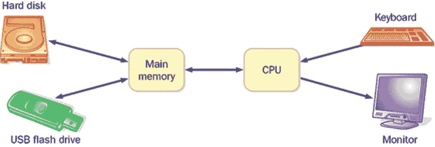

> **核心概念**
>
> CPU 从主内存读取程序指令，并逐条执行。

执行程序的过程对计算机来说是基础。所有的计算机系统工作原理基本上相同。

## 软件分类

软件可以根据许多标准进行分类。此时，我们将简单地区分系统程序和应用程序。

操作系统是计算机的核心软件。它执行两个重要功能：首先，它提供了一个用户界面，允许用户与机器交互。其次，操作系统管理计算机资源。它决定程序何时允许运行、加载到何处以及设备如何通信。让计算机易于使用并确保其高效运行是操作系统的任务。

> **核心概念**
>
> 操作系统提供用户界面并管理计算机资源。

如今有几种流行的操作系统在使用。微软为个人电脑开发了 Windows 操作系统，它占据了操作系统市场的大部分份额。各种版本的 Unix 系统也很流行，特别是在较大的计算机系统中。一种名为 Linux 的 Unix 版本作为一个开源项目开发的，这意味着许多人对其开发做出了贡献，且其代码免费。由于 Linux 成为某些用户的特别青睐，Mac OS 是苹果开发的用于计算系统的操作系统。

操作系统通常针对智能手机和平板电脑等移动设备进行了专门化。苹果的 iOS 操作系统用于 iPhone、iPad 和 iPod。它在功能和外观上与桌面级 Mac OS 相似，但针对较小设备进行了定制。由谷歌开发的 Android 操作系统目前主导着手机市场。

应用程序（在对话中通常缩短为 "app"）是操作系统之外几乎任何软件的通用术语。文字处理器、导弹控制系统、数据库管理器、Web 浏览器和游戏都被视为应用程序。每个应用程序都有自己的用户界面，允许用户与该特定程序进行交互。

大多数现代操作系统和应用程序的用户界面是图形用户界面 (GUI)，包含：

- 窗口，用于将屏幕划分为不同的工作区域
- 图标，代表计算机资源（如文件）的小图像
- 菜单、复选框和单选按钮，为用户提供可选选项
- 滑块，允许用户从值范围中进行选择
- 按钮，可以通过鼠标点击进行“按下”以指示用户选择

鼠标或触摸板是使用 GUI 的主要输入设备；因此，GUI 有时被称为点点点击界面。图 1.2 中的截图显示了 GUI 的示例。


> **核心概念**
>
> 对用户而言，界面就是程序。

应用程序或操作系统的界面是软件的重要部分，因为它是程序中用户直接交互的唯一部分。对用户来说，界面就是程序。在整本书中，我们将讨论图形用户界面的设计与实现。

本书的重点是开发高质量的应用程序。我们将探索如何设计和编写能够进行计算、做出决策并以文本或图形形式呈现结果的软件。我们在全文中使用 Java 编程语言来演示各种计算机计算概念。

### 数字计算机

存储和管理信息主要使用两种基本技术：模拟和数字。模拟信息是连续的，与信息的源成正比。例如，酒精温度计是一种用于测量温度的模拟设备。管内酒精的上升高度与管外的温度成正比。模拟信息的另一个例子是用于表示声波振动的电子信号。信号的电压与原始声波成正比。立体声放大器将这种电子信号发送到扬声器，扬声器通过振动还原声音。我们使用“模拟”（analog）一词，是因为该信号与其所代表的信息直接类比。图 1.3 图描了由麦克风捕获并表示为电子信号的声波。


> **核心概念**
>
> 数字计算机通过将信息分解并将每个部分表示为数字来存储信息。

数字技术将信息分解为离散片段，并将这些片段表示为数字。光盘上的音乐以数字序列的形式存储。每个数字代表录音中一个特定实例的电压水平。许多测量是在短时间内完成的，每秒可能是 44,000 次测量。每秒测量次数被称为 `采样率`（sampling rate）。如果采样足够，就可以利用离散电压测量值生成与原始信号“足够接近”的连续模拟信号。在大多数情况下，目标是创建一个足以满足人类感官的原始信号复制。

图 1.4 显示了模拟信号的采样。当通过分解成片段将模拟信息转换为数字格式时，我们称其已 `数字化`（digitized）。因为采样点之间信号发生的变化会丢失，所以采样率必须足够快。

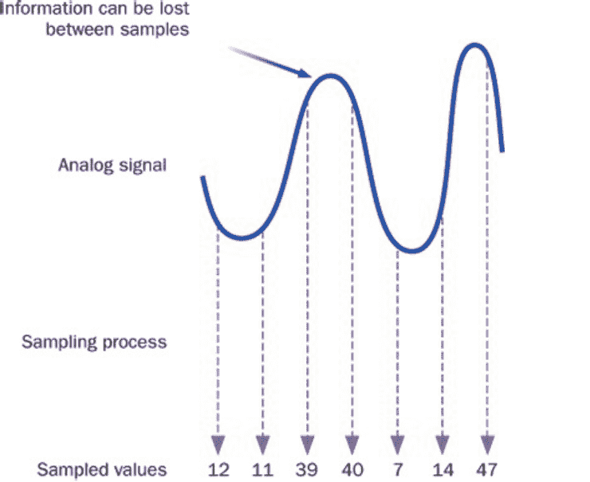

采样只是信息数字化的方法之一。例如，一个文本句子在计算机中存储为数字序列，其中每个数字代表句子中的单个字符。每个字母、数字和标点符号都被分配了一个数字。甚至空格字符也被分配了一个数字。考虑以下句子：

`Hi, Heather.`

句子中的字符表示为 12 个数字的序列，如图 1.5 所示。当字符重复时（例如大写字母 `H`），会使用相同的表示数字。注意，字母的大写版本与小写版本存储为不同的数字，例如单词 Heather 中的 `H` 和 `h`。它们被视为不同的字符。


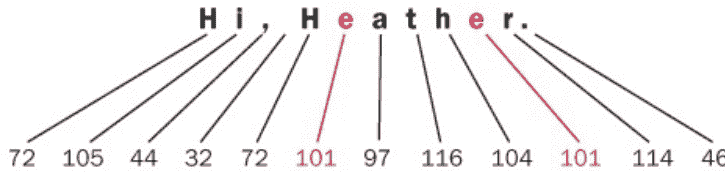

图 1.5 文本通过将每个字符映射到数字来存储

现代电子计算机是数字化的。各种信息，包括文本、图像、数字、音频、视频甚至程序指令，都被分解成片段。每个片段都表示为一个数字。信息通过存储这些数字来存储。

### 二进制数字

数字计算机以数字形式存储信息，但这些数字并不是以十进制值存储的。计算机中的所有信息都以二进制值的形式存储和管理。与具有 10 个数字（0 到 9）的十进制不同，二进制数字系统只有两个数字（0 和 1）。

| 1 bit | 2 bits | 3 bits | 4 bits | 5 bits |
| :--- | :--- | :--- | :--- | :--- |
| 2 items | 4 items | 8 items | 16 items | 32 items |
| 0 | 00 | 000 | 0000 | 00000 |
| 1 | 01 | 001 | 0001 | 00001 |
| | 10 | 010 | 0010 | 00010 |
| | 11 | 011 | 0011 | 00011 |
| | | 100 | 0100 | 00100 |
| | | 101 | 0101 | 00101 |
| | | 110 | 0110 | 00110 |
| | | 111 | 0111 | 00111 |
| | | | 1000 | 01000 |
| | | | 1001 | 01001 |
| | | | 1010 | 01010 |
| | | | 1011 | 01011 |
| | | | 1100 | 01100 |
| | | | 1101 | 01101 |
| | | | 1110 | 01110 |
| | | | 1111 | 01111 |
| | | | | 10000 |
| | | | | 10001 |
| | | | | 10010 |
| | | | | 10011 |
| | | | | 10100 |
| | | | | 10101 |
| | | | | 10110 |
| | | | | 10111 |
| | | | | 11000 |
| | | | | 11001 |
| | | | | 11010 |
| | | | | 11011 |
| | | | | 11100 |
| | | | | 11101 |
| | | | | 11110 |
| | | | | 11111 |

图 1.7 使用的位数决定了可以表示的项目数量

我们已经看到了通过将字符映射到数值，计算机是如何存储文本句子的。这些数值以二进制数的形式存储。假设我们想在一个包含 256 个字符和符号的语言中表示字符串。我们需要使用 8 位来存储每个字符，因为 8 位有 256 种独特的排列（`2^8` 等于 256）。每种排列（或二进制值）都映射到一个特定的字符。

表示世界上 195 个国家需要多少位？ 7 位是不够的，因为 `2⁷` 等于 128。8 位足够了，但 256 种排列中的某些将不会映射到国家。

最终，在计算机上表示信息归结为要表示的项目数量，以及确定这些项目映射到二进制值的方法。

### 自测习题

（答案见附录 L）

- SR 1.1 什么是硬件？什么是软件？
- SR 1.2 操作系统的两个主要功能是什么？
- SR 1.3 CD 上的音乐是使用每秒 44,000 次测量采样率创建的。每次测量都存储为一个代表特定电压电平的数字。存储一首三分钟的歌曲需要多少这样的数字？表示一小时音乐需要多少这样的数字？
- SR 1.4 信息以数字形式存储时会发生什么？
- SR 1.5 使用以下内容可以表示多少唯一项目：
  - a. 2 位
  - b. 4 位
  - c. 5 位
  - d. 7 位
- SR 1.6 假设你想使用位排列表示美国的 50 个州。存储每个州需要多少位？为什么？

## 1.2 硬件组件

让我们详细检查计算机系统的硬件组件。考虑图 1.8 中描述的台式计算机。这一切意味着什么？系统能够运行你需要的软件吗？它是如何工作的？

| 组件 | |
| :--- | :--- |
| 双核处理器 | |
| 4 GB 内存 | |
| 500 GB 硬盘 | |
| 15.6 英显示器 | 1366 x 768 分辨率 |
| 802.11 无线卡 | |

图 1.8 计算机的组件

### 计算机体系

计算机的体系定义了它的结构。同样，我们使用“体系”一词来描述组件是如何组合的。图 1.9 展示了


> **关键概念**
>
> 计算机体系是硬件组件的设计及其相互作用。

主内存由一系列小的连续内存位置组成，如图 1.10 所示。每个内存位置关联有一个被称为地址唯一数字。

> **关键概念**
>
> 地址是与内存位置关联的唯一数字。

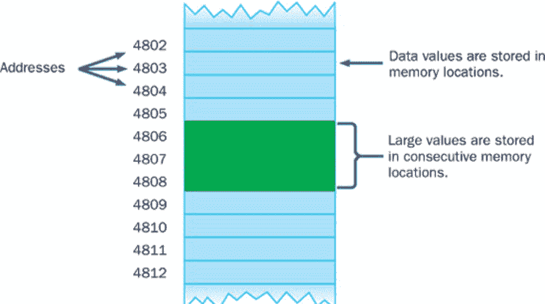

图 1.10 内存位置

当数据存储在内存位置时，它会覆盖并破坏之前存储在该位置的任何信息。然而，从内存位置读取数据的过程不会影响它。

在许多计算机上，每个内存位置由八位（bits）或一个字节（byte）信息组成。我们需要存储无法用单个字节表示的值（例如大数字），则需要使用多个连续的字节来存储数据。

主内存等设备的存储容量是其能够容纳的字节总数。设备存储着数千或数百万个字节，因此你应该熟悉更大的测量单位。由于计算机内存基于二进制数字系统，所有的存储单位都是 2 的幂次。一个千字节（KB）是 1024 字节或 `2^10` 字节。更大的存储单位包括图 1.11 所示的兆字节（MB）、吉字节（GB）、太字节（TB）和拍字节（PB）。通过四舍五入来考虑这些容量是很容易的。例如，大多数计算机用户将一个千字节视为大约一千个字节，一个兆字节视为大约一百万个字节，以此类推。

| 单位 | 符号 | 字节数 |
| :--- | :--- | :--- |
| 字节 (byte) | | `2^8 = 256` |
| 千字节 (kilobyte) | KB | `2^10 = 1024` |
| 兆字节 (megabyte) | MB | `2^20 = 1,048,576` |
| 吉字节 (gigabyte) | GB | `2^30 = 1,073,741,824` |
| 太字节 (terabyte) | TB | `2^40 = 1,099,511,627,776` |
| 拍字节 (petabyte) | PB | `2^50 = 1,125,899,906,842,624` |

图 1.11 二进制存储单位

> **核心概念**
>
> 主内存是易失的，这意味着只有在持续供电的情况下，存储的信息才会被保持。

许多个人计算机具有 4 GB 的主内存，例如图 1.8 所示的系统。较大的主内存允许大型程序或多个程序高效运行，因为它们不需要频繁地从辅助内存中检索信息。

主内存通常是易失的，这意味着如果关闭电源，存储在其中的信息将会丢失。当你使用计算机工作时，你应该将工作保存到辅助内存设备中（如 USB 闪存），以防断电。辅助内存设备通常是非易失的；即使关闭电源，信息也会保留。

缓存被 CPU 用来缩短对指令和数据的平均访问时间。缓存是一种很小且快速的内存，用于存储最频繁使用的主内存位置的内容。现代 CPU 包含指令缓存以加速可执行指令的取取，以及数据缓存以加速数据的取取和存取。

最常见的辅助存储设备是*硬盘*和*USB 闪存*。一个典型的 USB 闪存存储 1 到 256 GB 不等的信息。硬盘的存储容量各不相同，但在个人计算机上，容量通常在 500 到 750 GB 之间，例如图 1.8 所示的系统。某些硬盘可以存储更多内容。

USB 闪存由一个载有电路元件的小型打印电路板和一个 USB 连接器组成，它们在电气上是绝缘的并保护在塑料、金属或橡胶外壳内，例如可以放在口袋里或挂在钥匙扣上。

磁盘是一种磁介质，其上的位以磁化颗粒的形式表示。读/写头在旋转的磁盘上方移动，根据需要读取或写入信息。硬盘驱动器实际上可能包含垂直排列的多个磁盘并带有多个读/写头，例如图 1.12 所示。

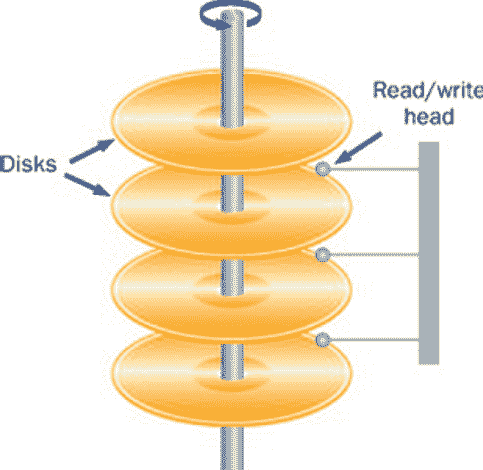

图 1.12 具有多个磁盘和读/写头的硬盘

在磁盘驱动器普及之前，磁带被用作辅助存储。由于访问信息的方式，磁带比硬盘和 USB 闪存慢得多。硬盘是一种*直接访问设备*，因为读/写头通常可以直接移动到所需信息所在。USB 闪存也是直接访问设备，但没有机械运动。*直接访问*（direct access）和*随机访问*（random access）这两个术语经常互换。然而，磁带上的信息只有在经过中间数据后才能访问。磁带必须回带或快进到相应位置。因此，磁带被视为*顺序访问设备*。由于这些原因，磁带不再被用作计算存储设备，就像音频盒被光盘取代一样。

还有两个术语用于描述内存设备：**随机存取存储器（RAM）**和**只读存储器（ROM）**。理解这些术语很重要，因为它们被频繁使用且名称可能具有误导性。RAM 和主内存基本上是可以互换的，都描述存储活动程序和数据的内存。ROM 可以指计算机主板上的芯片，也可以指光盘等便携式存储器。ROM 芯片通常存储名为 BIOS（基本输入输出系统）的软件，该软件提供了计算机最初启动时所需的初步指令。信息存储在 ROM 上后，在典型的计算机使用期间通常不会被更改（正如*只读*一词所暗示）。RAM 和 ROM 都是直接（或随机）访问设备。

> **核心概念**
>
> 光盘的表面既有平整区域也有凹坑。凹坑代表 1，平整区域代表 0。CD-ROM 代表光盘只读存储。之所以被称为只读，是因为信息一旦创建就无法更改。

CD 技术的演变很快。可刻录光盘（CD-R）可以用于制作 CD。购买的 CD 是压制的，而 CD-R 是用激光刻录的。

CD 最初是音乐的流行格式；后来演变为通用存储。类似的，DVD 格式最初为视频创建，现在计算机数据领域也取得了进展。DVD 原代表数字视频或数字多功能盘，但现在这个缩写已独立。DVD 的格式比 CD 更密集（每平方英寸位），因此可以存储更多信息。

随着网络和云存储提供了更好的选择，CD 和 DVD 作为计算机存储设备的使用大幅下降。

随着技术的改进，存储容量不断变化。计算机行业的一个通用规则认为容量每 18 个月翻倍。然而，随着容量接近绝对极限，这种进步最终将会放缓。

### 中央处理器

CPU 与主内存交互以执行计算机中所有的基础处理。CPU 连续地解释并执行指令。如图 1.13 所示，它由三个重要部分组成。控制单元协调处理步骤，寄存器在 CPU 内部提供少量存储空间，算逻单元执行计算并决策。寄存器是系统中最小快的缓存。

控制单元协调主内存与 CPU 寄存器之间的数据和指令传输。它还协调算逻单元电路的执行，以对存储在特定寄存器中的数据执行操作。

在大多数 CPU 中，某些寄存器留用于特殊用途。例如，指令寄存器持有当前正在执行的指令。程序计数器是一个持有下一个执行指令地址的寄存器。除了这些和其他特殊用途寄存器外，CPU 还包含一组通用的用于根据需要临时存储数值的通用寄存器。

将程序指令和数据共同存储在主内存中的概念是计算机设计冯·诺依曼架构的基础原理，它以约翰·冯·诺依曼命名，他是一位匈牙利美国数学家，于 1945 年首次提出了这一编程概念。这些计算机持续地遵循图 1.14 所示的“取指-解码-执行”循环。指令从程序计数器所存储的地址从主内存中取出，此时程序计数器加 1，以便为下一个循环做准备。然后，对指令进行电子化解码以确定执行何种操作。最后，控制单元激活正确的电路来执行指令，例如，可以将一个数据值加载到寄存器中，或将两个值相加。

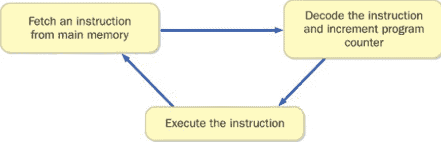

图 1.14 连续的取指-解码-执行循环

> **核心概念**
>
> 取指-解码-执行循环构成计算机处理的基础。

CPU 构建在一个名为微处理器的芯片上，该设备是计算机主板的一部分。这块主板还包含 ROM 芯片和通信插座，设备控制器（如管理视频显示的控制器）可以连接到这些插座上。

主板的另一个关键组件是系统时钟。时钟按固定间隔产生电子脉冲，用于同步 CPU 的事件。脉冲发生的速率称为时钟频率，它随处理器而异。图 1.8 中描述的计算机包含一个 Intel 双核 i7 处理器，其时钟频率为 3.1 GHz，大约每秒 31 亿次脉冲。系统时钟的速度提供了衡量 CPU 执行指令快慢的粗略标准。

被描述为双核的处理器实际上在一个芯片上构建了两个处理器，如果它正在执行的程序是为之设计的，它就可以同时完成两件事。然而，要编写出能利用第二个处理器的程序是很难的。这对于软件开发人员将变得越来越重要，因为处理器设计的未来可能是更多的核心，而不是运行速度更快的单内核。

### 自测习题

（答案见附录 L）

- SR 1.7 以下各项中各有多少个字节？
  - a. 3 KB
  - b. 2 MB
  - c. 4 GB
- SR 1.8 以下各项中各有多少个位？
  - a. 8 bytes
  - b. 2 KB
  - c. 4 MB
- SR 1.9 CD 上的音乐使用每秒 44,000 次测量的采样率创建。每次测量都存储为一个代表特定电压水平的数字。假设这些数字都需要两个字节的存储空间。表示一小时音乐需要多少 MB？
- SR 1.10 计算机中两个主要的硬件组件是什么？它们是如何相互作用的？
- SR 1.11 什么是内存地址？
- SR 1.12 易失性（volatile）是什么意思？哪些内存设备是易失的，哪些是非易失的？
- SR 1.13 从以下列表中选择与每个短语最匹配的单词：
  controller, CPU, main, network card, peripheral, RAM, register, ROM, secondary
  - a. 计算机系统中除了 CPU 和主内存之外几乎所有的设备都归类为此类。
  - b. 协调外围设备活动的设备。
  - c. 允许发送和接收信息。
  - d. 这种内存通常是易失的。
  - e. 这种内存通常是非易失的。
  - f. 这个术语基本上可以与“主内存”（main memory）互换。
  - g. 计算机的基础处理发生的地方。

## 1.3 网络

网络由两个或更多台计算机连接在一起，以便它们可以交换信息。使用网络已成为商业运行的模式。每天都有新技术出现，以利用互联的环境。

> **核心概念**
>
> 网络由两个或更多台计算机连接在一起，以便它们可以交换信息。

图 1.15 显示了一个简单的网络。网络上的一个设备是打印机，它允许连接到网络的任何计算机打印文档。网络上的一个计算机被指定为文件服务器，用于存储许多网络用户需要的程序。文件服务器通常拥有大量的辅助内存。当网络拥有文件服务器时，每台独立计算机就不需要自己的程序副本。

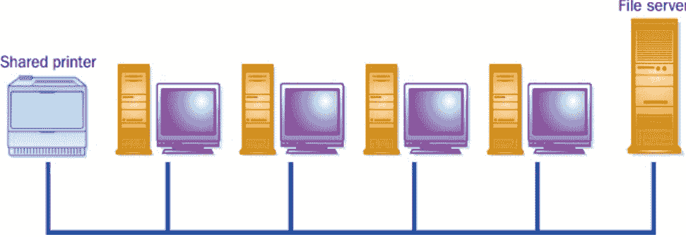

图 1.15 简单的网络

### 网络连接

如果两台计算机直接连接，它们的通信方式基本上与信息在单台机器内部跨越导线移动相同。当连接地理位置较近的计算机时，这种方案效果良好，被称为点对点连接。然而，考虑跨远距离连接许多计算机的任务。如果使用点对点连接，每台计算机都与网络中的所有其他计算机直接连接。为每条连接配备单独的线并不是可行的方案，因为每当向网络添加一台新计算机时，都必须为网络中的每台计算机安装新的通信线。此外，单个计算机只能处理有限数量的连接。

图 1.16 显示了多个点对点连接。

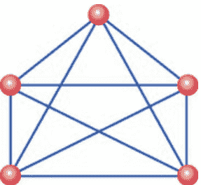

图 1.16 多个点对点连接

## 1.4 局域网与广域网

局域网（LAN）旨在跨越短距离连接相对少量的计算机。通常，局域网连接一个建筑或一个房间内的机器。局域网易于安装和管理且可靠。随着计算机变得越来越小且多功能，局域网为组织内部的信息共享提供了一种廉价的方式。然而，拥有局域网就像有一套只能拨给自己城镇的人打电话的电话系统。我们需要跨越更远的距离共享信息。

> **核心概念**
>
> 局域网（LAN）是组织内部共享信息和资源的一种有效方式。

广域网（WAN）连接两个或多个局域网，通常跨越远距离。通常每个局域网上有一台计算机专门处理跨广域网的通信。这种技术减轻了局域网内其他计算机执行长距离通信细节的负担。图 1.17 显示了通过广域网连接的几个局域网。

广域网（WAN）通常由不同的公司或组织所有，甚至可能位于不同的国家。

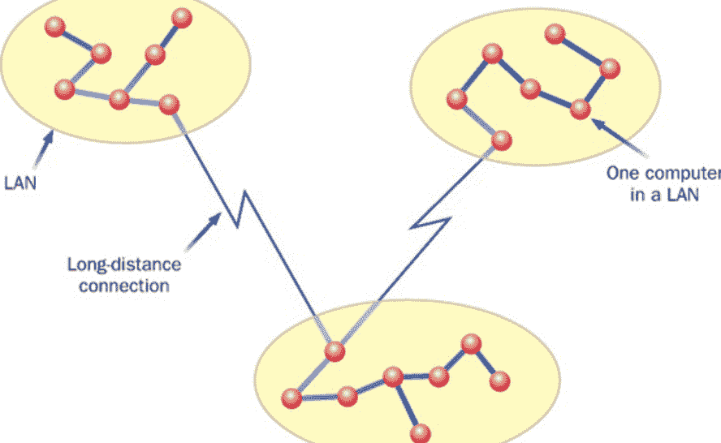

图 1.17 连接到广域网的 LAN

### 互联网

在整个 20 世纪 70 年代，美国国防部一个名为高级研究计划局（ARPA）的机构资助了几个探索网络技术的项目。这些努力的成果之一是 ARPANET，这是一种广域网，最终被称为互联网。互联网是网络的网络。“Internet”一词源于广域网的互联（internetworking）概念——将许多较小的网络连接在一起。

1983 年，连接到互联网的计算机少于 600 台。现在，互联网为全球数十亿用户提供服务。随着连接到互联网的计算机越来越多，跟上日益增加的用户和更大流量的任务变得困难。自最初开发以来，新技术已经取代了 ARPANET 几次，每次都提供了更大的容量和更快的处理速度。

> **核心概念**
>
> 互联网是一个跨越全球的广域网（WAN）。

*协议*（protocol）是一组规定两个事物如何通信的规则。控制信息在互联网上移动的软件必须符合一组称为 TCP/IP 的协议（通过字母拼写：T-C-P-I-P 发音）。TCP 代表*传输控制协议*（Transmission Control Protocol），IP 代表*互联网协议*（Internet Protocol）。IP 软件定义了信息如何格式化以及从源地传输到目的地。TCP 软件处理诸如信息未按原始顺序到达或信息丢失等问题，这些在大量信息同时聚集在一个位置时可能会发生。

每台连接到互联网的计算机都有一个 IP 地址，在互联网上的其他计算机中唯一地标识它。IP 地址的一个示例是 `204.192.116.2`。幸运的是，互联网用户很少需要处理 IP 地址。互联网允许每台计算机分配一个名称。像 IP 地址一样，名称必须是唯一的。计算机的互联网名称被称为互联网地址（Internet address）。互联网地址的示例是 `hector.vt.edu`。

> **核心概念**
>
> 每台连接到互联网的计算机都有一个唯一标识它的 IP 地址。


互联网地址的第一部分是特定计算机的本地名称。地址的其余部分是域名，它指示该计算机所属的组织。例如，`vt.edu` 是弗吉尼亚科技理工大学（Virginia Tech）计算机网络的域名，`hector` 是该校园内某台特定计算机的名称。因为域名是唯一的，许多组织可以拥有名为 `hector` 的计算机而不会产生混淆。个人组织也可以拥有名为 `hector` 的计算机而不产生混淆。子域名（subdomains）被分配给计算机 `cs.vt.edu` 是弗吉尼亚科技理工大学计算机科学系的子域名。

互联网地址的最后部分被称为顶级域名（TLD），它指示计算机所属的类型。Web 文档的最后部分是顶级域名，称为顶级域名（TLD），是位于 Virginia Tech 的 Web 文档。顶级域名（TLD）指示了计算机所属的类型。顶级域名 `edu` 表示教育机构。顶级域名 `com` 表示商业。顶级域名 `org` 表示非营利组织。顶级域名包括 `biz`（业务）、`info`（信息）、`jobs`（职业）、`name`（名称）。国家代码顶级域名包括 `uk`（英国）、`au`（澳大利亚）。

当引用互联网地址时，它被转换为域名系统（DNS）。DNS 是在互联网上进行转换的软件。URL 包含几部分信息。第一部分是协议，决定了浏览器传输和处理信息的方式。第二部分是存储文档的机器的互联网地址。第三部分信息是感兴趣的文件名或资源。如果没有提供文件名（如 Google URL 所示），Web 服务器通常提供默认页面。

最初互联网的主要用途是发送电子邮件，但互联网的能力迅速增长。互联网提供了 Web。

### 万维网

万维网（也称为 WWW 或简单的 Web）是互联网的一种方式。万维网使得人类交换信息变得容易。万维网通过用户界面允许用户点击鼠标获取各种 Web 文档。

> 核心概念
>
> 万维网是一项基于软件应用程序的分布式信息服务。

万维网基于超文本（hypertext）和超媒体（hypermedia）的概念。超文本一词由 Ted Nelson 在 1965 年创造。保罗·奥莱特（Paul Otlet，1868–1944）被认为是信息科学之父，他预见到了这种管理大量信息的方式。底层思想是文档可以根据自然关系链接到其他点。当整合其他媒体组件如图形、声音、动画和视频时，结果被称为超媒体。互联网和万维网这两个术语有时互换，但它们之间存在重要的区别。互联网使得全球计算机通信成为可能。万维网使得通信变得简单愉快。浏览器是加载和格式化 Web 文档的软件工具。Mosaic 是第一个 Web 图形界面浏览器，它于 1993 年发布。流行的浏览器包括 Google Chrome、Apple Safari、Mozilla Firefox 和 Opera。微软 Internet Explorer 的使用随着替代品的出现而下降。微软 Edge 浏览器最近取代了 Internet Explorer。

专门提供 Web 文档的计算机被称为 Web 服务器。浏览器加载并解释 Web 服务器提供的文档。许多此类文档使用超文本标记语言（HTML）格式化。Java 编程语言与 Web 处理有紧密的关系，因为 Java 程序的链接可以嵌入 HTML 文档中，并通过 Web 浏览器执行。

### 统一资源定位符

互联网上的信息通过标识统一资源定位符（URL，通过字母拼写 U-R-L 发音）来找到。URL 唯一地指定了浏览器获取和显示的文档和其他信息。以下是 URL 的示例：

```
http://www.google.com
```

此特定 URL 的 Web 站点是著名的 Google 搜索引擎的主页，它允许你使用特定的单词或短语在互联网上搜索信息。

URL 包含几个信息。第一部分是协议，它决定了浏览器传输和处理信息的方式。第二部分是存储文档的机器的互联网地址。第三部分信息是感兴趣的文件名。如果没有给出文件名（如 Google URL 所示），Web 服务器通常提供一个默认页面。

> 核心概念
>
> URL 唯一地指定了 Web 上的文档和其他信息，供浏览器获取并显示。

让我们来看另一个示例 URL：

```
https://www.whitehouse.gov/issues/education
```

在这个 URL 中，协议是 https，它代表安全版本的超文本传输协议（HyperText Transfer Protocol）。引用的机器是 www（对 Web 服务器的典型引用），位于域名 whitehouse.gov。最后，issues/education 代表要传输到浏览器进行查看的文件（或生成文件的引用）。URL 还有许多其他形式，但这种形式是最常见的。

### 自习题（Self-Review）

（答案参见附录 L）

- SR 1.14 什么是文件服务器？
- SR 1.15 一个由五台计算机组成的全连接点对点网络共需要多少条通信线路？六台计算机又是呢？
- SR 1.16 描述计算机在网络上共享通信线路的益处。描述通信线路的成本/缺点。
- SR 1.17 Internet 一词的词源是什么？
- SR 1.18 TCP/IP 协议集描述了使用互联网的软件的通信规则。TCP 代表什么？IP 代表什么？
- SR 1.19 解释以下 URL 的部分：
    a. duke.csc.villanova.edu/jss/examples.html
    b. java.sun.com/products/index.html

## 1.4 Java 编程语言

现在让我们关注让计算机系统变得实用的软件。程序是用特定的编程语言编写的，这种语言使用特定的单词和符号来表达解决方案。编程语言定义了一组规则，决定了程序员如何将语言的单词和符号组合成编程语句，这些语句是程序执行时运行的指令。

自从计算机诞生以来，已经出现了许多编程语言。我们在本书中使用 Java 语言来演示各种编程概念和技术。尽管我们的主要目标是学习这些底层的软件开发原理，但一个重要的副作用将精通 Java 程序开发。

Java 编程语言由 James Gosling 于 1991 年在 Sun Microsystems（太阳微系统公司）开发。该语言最初被称为 Oak，然后是 Green，最终成为 Java。Java 于 1995 年向公众推出，从那时获得了巨大的普及。2010 年，Sun Microsystems 被 Oracle（甲骨文）收购。

Java 平台有多个变体，包括标准版（Standard Edition），它是语言的主流版本；企业版（Enterprise Edition），它包含额外的库以支持大规模系统开发；以及微型版（Micro Edition），专门用于为手机等便携设备开发软件。本书侧重于标准版。

此外，Java 标准版多年来经过多次修订，扩展了其功能列表并对其某些方面进行了更改。下表列出了版本和一些新功能。注意，它们从版本 5 开始更改了命名规则。本书的读者应该使用版本 6 或更高版本。

| 版本 | 年份 | 新功能 |
|---|---|---|
| 1.0 | 1996 | 初始部署 |
| 1.1 | 1997 | 内部类 |
| 1.2 | 1998 | 集合框架，Swing 图形处理 |
| 1.3 | 2000 | 音频框架 |
| 1.4 | 2002 | 断言、XML 支持、正则表达式 |
| 5 | 2004 | 泛型、for-each 循环、自动装箱、枚举、注解、可变参数列表 |
| 6 | 2006 | GUI 改进、各种库更新 |
| 7 | 2011 | 在 switch 中使用字符串、其他语言更改 |
| 8 | 2014 | JavaFX、lambda 表达式、日期和时间 API |

早期 Java 技术的某些部分已被弃用（deprecated），这意味着它们被认为是过时的，不应被使用。在重要时，我们会指出已弃用的元素并讨论其优的替代方案。

Java 吸引最初关注的原因之一是因为它是第一个刻意采用可以使用 Web 执行的程序（称为小程序 applets）编写概念的编程语言。从那时起，创建具有动态功能 Web 页面的技术已经大大扩展。

Java 是一种面向对象的编程语言。对象是构成程序的根本元素。面向对象的软件开发原理是本书的基石。我们将在本章后面的部分以及整书中探索面向对象的编程概念。

> 核心概念
>
> 本书侧重于面向对象编程的原理。

Java 语言附带了一个额外的软件库，我们在开发程序时可以使用。该软件被称为 Java API，代表应用程序编程接口（Application Programmer Interface），或简称为标准类库。Java API 提供了创建图形、通过网络通信以及与数据库交互等许多功能。Java API 非常庞大且功能丰富。我们无法涵盖该库的所有方面，但我们将探索其中的几个。

Java 被用于全球的商业环境。它是有史以来增长最快的编程技术之一。因此，它不仅是一门学习编程概念的好语言，也是一种在未来对你很有帮助的实用语言。

### 一个 Java 程序

让我们来看一个简单但完整的 Java 程序。列表 1.1 中的程序在屏幕上打印两个句子。输出所示。

### 列表 1.1

```java
// 展示 Java 应用程序的基本结构
// 作者: Lewis
public class Lincoln {
    // 打印一句名言。
    public static void main(String[] args) {
        System.out.println("A quote by Lincoln:");
        System.out.println("Whatever you are, be good one.");
    }
}
```

### 输出

A quote by Lincoln:

Whatever you are, be good one.

程序执行时，它调用 `println` 方法打印第一条语句，再次调用它打印第二条语句，然后由于这是 `main` 方法的最后一行，程序终止。

当调用 `println` 方法时执行的代码在程序中并未被定义。`println` 方法是 `System.out` 对象的一部分，而该对象又是 Java 标准库的一部分。从技术上讲，它不属于 Java 语言的一部分，但在任何 Java 程序中始终可用。我们将在[第 2 章]()中详细探讨 `println` 方法。

### 注释

让我们更详细地检查注释。注释是唯一允许程序员独立于代码来组合和交流思想的语言特性。注释应该对程序员的原始意图提供见解。一个程序通常会使用多年，并随着时间的推移对其进行许多修改。当在未来的某一点需要进行修改时，原始程序员往往会忘记某个特定程序的细节。此外，原始程序员并不总是能抽身来完成更改；因此，完全不熟悉该程序的人需要理解它。因此，良好的文档是至关重要的。

对于 Java 编程语言而言，注释的内容可以是任何文本。计算机会忽略注释；它们不会影响程序的执行。

`Lincoln` 程序中的注释代表了 Java 允许的两种注释类型之一。`Lincoln` 中的注释形式如下：

```
// 这是一个注释。
```

这种类型的注释以双斜杠（//）开头，并持续到行尾。你不能在两个斜杠之间放置任何字符。计算机忽略从双斜杠到行尾的任何文本。注释可以跟在同一行的代码后面以说明该特定行，例如：

```
System.out.println("Monthly Report"); // 始终使用此标题
```

Java 注释的第二种形式如下：

```
/* 这是另一个注释。 */
```

这种类型的注释不使用行尾来表示注释的结束。起始斜杠-星号（/*）和结束星号-斜杠（*/）之间的任何内容都是注释的一部分，包括表示行结束的不可见换行符。因此，这种类型的注释可以跨行。斜杠和星号之间不能有空格。

如果在注释开头的 `/*` 之后有第二个星号，则可以使用注释的内容通过名为 javadoc 的工具自动生成关于你程序的外部文档。关于 javadoc 的更多信息见附录 I。

这两种基本的注释类型可以用来创建各种文档样式，例如：

```
// 这是一个单行注释。
//----------------------------------------------------
// 像是方法或类上面的某些注释
// 应该被块起来，以便特别关注
// 代码的某个特定方面。注意这些
// 每一行在技术上都是独立的注释。
//----------------------------------------------------
/*
 *  这是一个
 *  跨越几行的注释。
 */
```

程序员往往专注于编写代码，以至于对文档的关注太少。你应该养成良好的注释习惯并习惯遵循它们。注释应该写得很好，通常是完整的句子。它们不应该描述显而易见的内容，而应该对代码的意图提供适当见解。以下示例不是好的注释：

```
System.out.println("hello"); // prints hello
System.out.println("test"); // 后修改此处
```

第一个注释转述了该行显而易见的目的，没有为语句增加任何价值。没有注释比有一个没用的注释好。第二个注释具有歧义。以后应该修改什么？什么是以后？为什么要修改？

> 核心概念
> 内联文档应该为你的代码提供见解。它不应该是歧义的，或描述显而易见的内容。

### 标识符和保留字

Java 中使用的各种单词称为标识符。它们分为三类：

- 被保留的单词
- 具有特殊用途的单词
- 由程序员创建的单词

标识符可以使用大写字母和小写字母，且这种区别非常重要。Java 是区分大小写的，这意味着两个仅在字母大小写上不同的标识符名称被认为是不同的。因此，`total`、`Total`、`ToTal` 和 `TOTAL` 都是不同的标识符。你可以想象，使用多个仅在大小写上不同的标识符并不是好主意，因为它们很容易被混淆。

虽然 Java 语言没有要求，但对每种标识符使用一致的大小写格式会让你的标识符更容易理解。关于标识符有各种 Java 惯例应该遵循，尽管从技术上讲不必这样做。例如，我们对类名使用首字母大写（每个单词的首字母大写）。在全文中，当我们第一次遇到每种标识符时，都会描述其首选样式。

**保留字**是在 Java 中具有特殊含义的标识符。标记有星号的单词已被保留。图 18 按字母顺序列出了所有保留字。

| abstract | default | goto | package | this |
|---|---|---|---|---|
| assert | do | if | private | throw |
| boolean | double | implements | protected | throws |
| break | else | import | public | transient |
| byte | enum | instanceof | return | true |
| catch | extends | int | short | try |
| char | final | interface | long | void |
| class | finally | native | super | volatile |
| const* | float | new | switch | |
| continue | for | null | synchronized | |

### 图 18 Java 保留字

标识符是一个字母开头，后面跟着零个或多个字母和数字。Java 字母包括大写和小写的 26 个英语字母、`$` 和 `_`（下划线）字符，以及其他语言的字母。Java 数字包括数字 `0` 到 `9`。

示例：

```
total
MAX_HEIGHT
num1
Keyboard
System
```

### 标识符


虽然标识符可以是任何长度，但你应该仔细选择你的名称。它们应该是具有描述性的，但不应该是冗长的。你应该避免使用如 `a` 或 `x` 这样没有意义的名称。例外是如果短名称确实具有描述性，那么可以使用这条规则，例如使用 `x` 和 `y` 来表示二维网格上的 `(x, y)` 坐标。同样，你不应该使用不必要的长名称，例如标识符 `currentItemBeingProcessed`。使用名称 `currentItem` 的效果就一样好。正如你可能想象到的，使用冗长的标识符远比使用不具描述性的名称要常见得多。

你应该始终努力让你的程序尽可能具有易读性。因此，在缩写单词时你应该始终保持小心。你可能认为 `curVal` 是代表当前股票价值的良好名称，但另一个试图理解代码的人可能很难弄清楚你的意思。即使在你编写代码的两个月后，这一点对你来说也可能是不清晰的。

> 核心概念
> 标识符名称应该具有描述性且易于阅读。

### 空格

所有 Java 程序都使用空白来分隔程序中使用的单词和符号。空白由空格、制表符和换行符组成。“空白”一词指的是，在有黑色打印内容的白色纸张上，单词和符号之间的空间是白色的。程序员使用空白的方式很重要，因为它可以用于强调代码部分，并使程序更易于阅读。

> 核心概念
> 适当使用空白可以让程序更易读和理解。

除了用于分隔单词外，计算机会忽略空白。它不会影响程序的执行。这一事实为程序员在格式化程序方面提供了极大的灵活性。程序的行应该在逻辑位置进行划分，某些行应该进行缩进和对齐，以便程序的底层结构清晰可见。

由于空白被忽略，我们可以用许多不同的方式编写程序。例如，将空白推向一个极端，我们可以在每行放置尽可能多的单词。列表 1.2 中的代码——`Lincoln2` 程序的格式与 `Lincoln` 完全不同，但打印出的消息相同。

### 列表 1.2

```java
// Lincoln2.java               Author: Lewis/Loftus
//
// 展示了一个格式不佳但合法的程序。
//****************************************************************
```


# 代码格式与风格指南

## 列表 1.2：`Lincoln2` 程序

```java
public class Lincoln2 {
    public static void main(String[] args) {
        System.out.println("A quote by Abraham Lincoln:");
        System.out.println("Whatever you are, be a good one.");
    }
}
```

### 输出

> A quote by Abraham Lincoln:
> Whatever you are, be a good one.

将空白推向另一个极端，我们可以将几乎每个单词和符号写在不同的行，并带有不同数量的空格，如列表 1.3 所示的 `Lincoln3`。

## 列表 1.3：`Lincoln3` 程序

```java
// Lincoln3.java
// Author: Lewis/Loftus
//
// 展示另一个格式不佳的合法程序。

public class Lincoln3 {
    public static void
    main(
        String[] args
    ) {
        System.out.println(
            "A quote by Abraham Lincoln:"
        );
        System.out.println(
            "Whatever you are, be a good one."
        );
    }
}
```

### 输出

> A quote by Abraham Lincoln:
> Whatever you are, be a good one.

## 核心概念

你应该遵循一组指南，这些指南规定了你格式化和记录程序的方式。

`Lincoln` 的三个版本在技术上都是有效的且执行方式相同，但从读者的角度来看，它们有着本质的区别。后两个例子都显示了糟糕的风格，并让程序难以理解。在编写程序时，可能会被要求遵循特定的指南。软件开发公司通常有一项要求程序员遵守的编程风格策略。无论如何，你都应该采用并一致地使用一组能够提高代码可读性的风格指南。

## 自测习题

（答案见附录）

如果短名称确实具有描述性，那么可以使用这条规则，例如使用 `x` 和 `y` 来表示二维网格上的 `(x, y)` 坐标。同样，你不应该使用不必要的长名称，例如标识符 `currentItemBeingProcessed`。使用名称 `currentItem` 的效果就一样好。正如你可能想象到的，使用冗长的标识符远比使用不具描述性的名称要常见得多。

你应该始终努力让你的程序尽可能具有易读。因此，在缩写单词时你应该始终保持小心。你可能认为 `curVal` 是代表当前股票价值的良好名称，但另一个试图理解代码的人可能很难弄清楚你的意思。即使在你编写代码的两个月后，这一点对你来说也可能是不清晰的。

> **核心概念**
> 标识符名称应该具有描述性且易于阅读。

## 空格

所有 Java 程序都使用空白来分隔程序中使用的单词和符号。空白由空格、制表符和换行符组成。“空白”一词指的是，在有黑色打印内容的白色纸张上，单词和符号之间的空间是白色的。程序员使用空白的方式很重要，因为它可以用于强调代码部分，并使程序更易于阅读。

> **核心概念**
> 适当使用空白可以让程序更易读和理解。

除了用于分隔单词外，计算机会忽略空白。它不会影响程序的执行。这一事实为程序员在格式化程序方面提供了极大的灵活性。程序的行应该在逻辑位置进行划分，某些行应该进行缩进和对齐，以便程序的底层结构清晰可见。

由于空白被忽略，我们可以用许多不同的方式编写程序。例如，将空白推向一个极端，我们可以在每行放置尽可能多的单词。列表 1.2 中的代码——`Lincoln2` 程序的格式与 `Lincoln` 完全不同，但打印出的消息相同。


### 输出

> A quote by Abraham Lincoln:
> Whatever you are, be a good one.

### 核心概念

你应该遵循一组指南，这些指南规定了你格式化和记录程序的方式。

`Lincoln` 的三个版本在技术上都是有效的且执行方式相同，但从读者的角度来看，它们有着本质的区别。后两个例子都显示了糟糕的风格，并让程序难以理解。在编写程序时，可能会被要求遵循特定的指南。软件开发公司通常有一项要求程序员遵守的编程风格策略。无论如何，你都应该采用并一致地使用一组能够提高代码可读性的风格指南。

### 自测习题

（答案见附录）

如果短名称确实具有描述性，那么可以使用这条规则，例如使用 `x` 和 `y` 来表示二维网格上的 `(x, y)` 坐标。同样，你不应该使用不必要的长名称，例如标识符 `currentItemBeingProcessed`。使用名称 `currentItem` 的效果就一样好。正如你可能想象到的，使用冗长的标识符远比使用不具描述性的名称要常见得多。

你应该始终努力让你的程序尽可能具有易读。因此，在缩写单词时你应该始终保持小心。你可能认为 `curVal` 是代表当前股票价值的良好名称，但另一个试图理解代码的人可能很难弄清楚你的意思。即使在你编写代码的两个月后，这一点对你来说也可能是不清晰的。

> 核心概念
> 标识符名称应该具有描述性且易于阅读。

### 空格

所有 Java 程序都使用空白来分隔程序中使用的单词和符号。空白由空格、制表符和换行符组成。“空白”一词指的是，在有黑色打印内容的白色纸张上，单词和符号之间的空间是白色的。程序员使用空白的方式很重要，因为它可以用于强调代码部分，并使程序更易于阅读。

> 核心概念
> 适当使用空白可以让程序更易读和理解。

除了用于分隔单词外，计算机会忽略空白。它不会影响程序的执行。这一事实为程序员在格式化程序方面提供了极大的灵活性。程序的行应该在逻辑位置进行划分，某些行应该进行缩进和对齐，以便程序的底层结构清晰可见。

由于空白被忽略，我们可以用许多不同的方式编写程序。例如，将空白推向一个极端，我们可以在每行放置尽可能多的单词。列表 1.2 中的代码——`Lincoln2` 程序的格式与 `Lincoln` 完全不同，但打印出的消息相同。

### 列表 1.2

```java
// Lincoln2.java               Author: Lewis/Loftus
//
// 展示了一个格式不佳但合法的程序。
//****************************************************************
public class Lincoln2 {
    public static void main(String[] args) {
        System.out.println("A quote by Abraham Lincoln:");
        System.out.println("Whatever you are, be a good one.");
    }
}
```

### 输出

> A quote by Abraham Lincoln:
> Whatever you are, be a good one.

将空白推向另一个极端，我们可以将几乎每个单词和符号写在不同的行，并带有不同数量的空格，如列表 1.3 所示的 `Lincoln3`。

### 列表 1.3

```java
// Lincoln3.java
// Author: Lewis/Loftus
//
// 展示另一个格式不佳的合法程序。
//********************************************************************************
public class Lincoln3 {
    public static void
    main(
        String[] args
    ) {
        System.out.println(
            "A quote by Abraham Lincoln:"
        );
        System.out.println(
            "Whatever you are, be a good one."
        );
    }
}
```

### 输出

> A quote by Abraham Lincoln:
> Whatever you are, be a good one.

### 核心概念

层级语言允许程序员忽略机器语言的底层细节。

今天，大多数程序员都使用层级语言来编写软件。层级语言用类似于英语的短语表示，因此对程序员来说更容易读、更容易写。一条层级语言编程语句就可以完成等同于许多——也许是数百条——机器语言指令的操作。“层级”一词是指编程语句的表达方式远远远离最终执行的机器语言。Java 是一种层级语言，Ada、C++、Smalltalk 等许多语言也是如此。

图 1.19 显示了层级语言、汇编语言和机器语言中等价的表达式。这些表达式的作用是将两个数字相加。此示例中的汇编语言和机器语言是针对 Sparc 处理器的特定。

| 高级语言 | 汇编语言 | 机器语言 |
|---|---|---|
| a + b | 1d [%fp-20], %00 | ... |
| | 1d [%fp-24], %01 | 1101 0000 0000 0111 |
| | add %00, %01, %00 | 1011 1111 1110 1000 |
| | | 1101 0010 0000 0111 |
| | | 1011 1111 1110 1000 |
| | | 1001 0000 0000 0000 |
| | | ... |

图 1.19 高级表达式及其等价的汇编语言和机器语言

图 1.19 中的层级语言表达式对于程序员来说是可读且直观的。它类似于一个代数表达式。等价的汇编语言代码具有一定的可读性，但更加冗长且不直观。机器语言基本上无法识别，而且要长得多。事实上，图 1.19 只显示了用于两个数字相加的二进制机器码中的一小部分。该特定表达式的完整机器语言代码超过 400 位。

层级语言保护了程序员，使其无需了解他们正在工作的处理器的底层机器语言。但层级语言代码必须翻译成机器语言才能执行。

某些编程语言被认为运行在比层级语言更高级的水平。它们可能包含用于自动生成报告或与数据库交互的特殊功能。

这些语言被称为*第四代语言*，或简单称为 4GL，因为它们遵循了计算机编程的前三代：机器语言、汇编语言和层级语言。

## 编辑器、编译器和解释器

需要几个特殊用途程序来帮助开发新程序。它们有时被称为软件工具，因为它们被用于构建程序。基本软件工具的示例包括编辑器、编译器和解释器。

最初，当你将程序输入计算机并将其存储在文件中时，你会使用一个*编辑器*。有许多不同的编辑器，具有许多不同的功能。你应该熟悉你经常使用的编辑器，因为它可以极大地影响你输入和修改程序的速度。

图 1.20 显示了程序开发过程的非常基本的视图。在编辑并保存程序后，你尝试将其从层级代码翻译成一种可以执行的形式。翻译可能会导致错误，在这种情况下，你返回编辑器修改代码以修复问题。一旦翻译成功，你就可以执行程序并评估结果。如果结果不是你想要的，或者你想增强现有的程序，你再次返回编辑器进行修改。

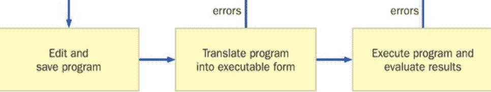

图 1.20 编辑和运行程序

将源代码翻译成针对特定类型 CPU 的（最终）机器语言可以通过多种方式实现。**编译器**是一个将一种语言的代码翻译成另一种语言的等价代码的程序。原始代码被称为*源代码*，而翻译后的语言称为*目标语言*。对于许多传统编译器，源代码被直接翻译成特定的机器语言。在这种情况下，翻译过程只发生一次，生成的可执行程序可以在任何需要时使用该类型 CPU 的计算机上运行。

**解释器**与编译器类似但有一个重要的区别。解释器将翻译和执行活动交织在一起。源代码的一小部分（例如一条语句）被翻译并执行。然后翻译并执行另一条语句，以此类推。这种技术的一个优点是它消除了对单独编译阶段的需求。然而，程序运行通常更慢，因为翻译过程发生在每次执行期间。

> 核心概念
> Java 编译器将 Java 源代码翻译成 Java 字节码，这是程序的低级、架构无关的表示。


# Java 编译器与字节码

Java 编译器将 Java 源代码翻译成 Java 字节码，这是程序的低级、架构无关的表示。翻译和执行 Java 程序的程序结合了编译器和解释器的使用，如图 1.21 所示。Java 字节码是类似于机器语言的形式。一个称为 Java 虚拟机（JVM）的 Java 解释器执行字节码。

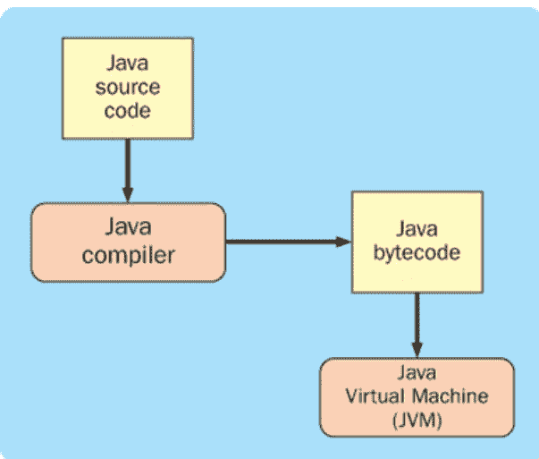

**图 1.21 翻译和执行过程**

源代码翻译成特定类型 CPU 的（最终）机器语言可以通过多种方式实现。Java 字节码与机器语言的区别在于 Java 字节码不限于任何处理器。这种方法的独特优势是 Java 字节码可以在不同机器之间迁移。唯一的限制是执行字节码仍然比执行机器代码慢。

# 软件开发环境

软件开发环境是用于创建、测试和修改程序的工具集。有些是免费的，而有些需要购买。有些被称为集成开发环境（IDE），因为它们将各种工具集成到一个软件中并提供方便的用户界面。

任何开发环境都会包含某些关键工具，如编译器和解释器。有些包含调试器，可以帮助你发现错误。其他可能包括文档生成器、存档工具和帮助可视化程序结构的工具。


Java 标准版的下载包含了 Java 开发工具包（SDK），它有时被称为 Java 开发工具包（JDK）。Java SDK 包含了运行 Java 程序的核心工具，但它不是一个集成环境。编译和解释命令在命令行上执行。也就是说，SDK 没有图形界面。它也不包含编辑器，尽管任何可以将文档保存为纯文本的编辑器都可以使用。

最流行的 Java IDE 之一是 Eclipse（见 www.eclipse.org）。Eclipse 是一个开源项目，这意味着它是由大量的开发者开发的并免费提供。其他流行的 Java IDE 包括 jEdit（www.jedit.org）、DrJava（drjava.sourceforge.net）、jGRASP（www.jgrasp.com）和 BlueJ（www.bluej.org）。

还有各种其他的 Java 开发环境。网络搜索可以发现几十种。选择哪种开发环境很重要。你对你使用的环境的能力越熟悉，你在程序开发期间效率就越高。

> **核心概念**
>
> 存在许多不同的开发环境来帮助创建和修改 Java 程序。

# 语法和语义

每种编程语言都有其独特的语法。语言的语法规则规定了语言的词汇元素可以如何组合成语句。为了创建程序，必须遵循这些规则。我们已经讨论了几个 Java 语法规则。例如，标识符不能以数字开头是一个语法规则。使用大括号来开始和结束类和方法也是语法规则。附录 L 正式定义了 Java 编程语言的基本语法规则，并在文中强调了特定的规则。

在编译期间，所有的语法规则都会经过检查。如果程序在语法上不正确，编译器将发出错误信息并且不会产生字节码。Java 的语法与 C 和 C++ 编程语言相似，因此对于具有这些语言背景的人来说，代码的外观和感觉非常熟悉。

语句的语义定义了执行语句时会发生什么。编程语言通常是无歧的，这意味着程序的语义是有良好定义的。也就是说，每条语句有且仅有一种解释。相反，人类用于通信的自然语言（如英语和意大利语）充满了歧义。一个句子往往可以有两个或多个不同的含义。例如，考虑以下句子：

```
Time flies like an arrow.
```

普通人可能将这句话解释为一种通用的观察：时间移动得就像箭头移动得一样快。然而，如果我们把 `time` 解释为动词（如“跑 50 米冲刺，我为你计时”），并将 `flies` 解释为名词（苍蝇的复数），解释就完全改变了。我们知道箭头不会给某物计时，所以我们不会那样解释这句话，但它是句中词汇的一种有效解释。计算机在试图确定想要表达什么含义时会非常困难。此外，这句话可能描述一种被称为“时间蝇”的不寻常昆虫的偏好，这种虫可能出现在箭场附近。毕竟，果蝇喜欢香蕉。

> **核心概念**
>
> 语法规则决定了程序的形式。
>
> 语义决定了程序语句的含义。
>
> 关键在于，一个特定的英语句子可以有多个有效含义。计算机语言不允许这种歧义的存在。如果一个编程语言指令有两个不同的含义，计算机将无法确定应该执行哪一个。

## 错误

软件中可能会发生几种不同类型的问题，特别是在程序开发期间。“计算机错误”这个术语经常被误用，其含义随情况而异。从用户的角度来看，与机器交互时发生的任何故障都可以称为计算机错误。例如，假设你用信用卡购买了一件价值 23 美元的物品，但当你收到账单时，该物品列出的价格是 230 美元。在你解决问题后，信用卡公司对“计算机错误”表示歉意。是计算机随机在数字末尾添加了一个零，还是它可能将值乘以了 10？显然不是。计算机遵循我们给它的指令，并根据我们提供的数据进行操作。如果我们的程序是错误的或数据是不准确的，那么我们就不能期望结果是正确的。描述这种情况的常用短语是“垃圾进，垃圾出”（garbage in, garbage out）。

> **核心概念**
>
> 程序员对程序的准确性和可靠性负责。

在开发程序时，你会遇到三种错误：

- 编译时错误
- 运行时错误
- 逻辑错误

编译器检查以确保你使用了正确的语法。如果你有任何不符合语言语法规则的语句，编译器将产生语法错误。编译器还会尝试寻找其他问题，例如使用不兼容的数据类型。语法在技术上可能是正确的，但你可能正在尝试某些语言在语义上不允许的操作。编译器识别的任何错误都称为编译时错误。如果发生编译时错误，就不会创建程序的可执行版本。

> **核心概念**
>
> Java 程序必须在语法上正确，否则编译器将不会产生字节码。

第二类问题发生在程序执行期间。它被称为运行时错误，会导致程序异常终止。例如，如果我们尝试除以零，程序将“崩溃”并在该点停止执行。由于请求的操作未定义，系统将简单地放弃继续处理你的程序的尝试。最好的程序是健壮的；也就是说，它们会尽可能避免所有的运行时错误。例如，程序代码可以防止除以零的可能性，并在发生时进行妥善处理。在 Java 中，许多运行时问题被称为异常，可以被捕获并进行相应的处理。


第三种软件问题是逻辑错误。在这种情况下，软件编译并执行而没有报错，但它产生了错误的结果。例如，当计算值计算错误或图形按钮没有出现在正确的位置时，就会发生逻辑错误。程序员必须彻底测试程序，将预期结果与实际发生的结果进行比较。发现缺陷后，必须追溯到代码中的问题源并进行修正。在程序中发现和修正缺陷的过程被称为调试。逻辑错误可以通过许多方式表现，实际根源可能很难发现。

## 复习题

（答案见附录 L）

- SR 1.27 我们都知道计算机被用于执行复杂的工作。在这一节中，你学习了计算机的指令只能完成简单的任务。请解释这种表面上的矛盾。
- SR 1.28 高级语言与机器语言之间是什么关系？
- SR 1.29 什么是 Java 字节码？
- SR 1.30 从下面的列表中选择与以下每个短语最匹配的单词：
  `assembly`, `compiler`, `high-level`, `IDE`, `interpreter`, `Java`, `low-level`, `machine`
  - a. 用这种类型的语言编写的程序可以直接在计算机上运行。
  - b. 通常情况下，这种类型语言中的每条指令都对应于等待的机器语言指令。
  - c. 大多数程序员使用这种类型的语言编写程序。
  - d. Java 是这种类型语言的一个示例。
  - e. 这种程序将一种语言的代码翻译成另一种语言。
  - f. 这种程序将代码翻译和代码执行交织在一起。
- SR 1.31 我们所说的语言的语法和语义指的是什么？
- SR 1.32 将以下每个情况分类为编译时错误、运行时错误或逻辑错误。
  - a. 拼错保留字。
  - b. 通过将列表数字之和（0）除以列表的大小（0）来计算空数字列表的平均值。
  - c. 在应该输出学生平均测试成绩时，打印了学生的高分。

# 问题解决

解决问题，这正是编写程序的初衷。

> **核心概念**
>
> 面向对象的编程帮助我们解决问题，这就是编写程序的目的。

让我们讨论与解决问题相关的通用问题，然后探索面向对象方法中帮助我们解决这些问题的特定特性。

通常情况下，解决问题包含多个步骤：

1. 理解问题。
2. 设计解决方案。
3. 考虑解决方案的替代方案并完善方案。
4. 实现解决方案。
5. 测试解决方案并修复存在的任何问题。

尽管这种方法适用于任何类型的问题解决，但在开发软件时其效果为佳。这些步骤并非纯线性的。也就是说，某些活动会与其他重叠。但在某个时刻，所有这些步骤都应该被仔细处理。

第一步理解问题可能听起来是显而易见的，但对这一步的忽视是许多软件开发工作误入歧途的原因。如果我们尝试解决一个我们并不完全理解的问题，往往会解决错误的问题，或者至少偏离了不当的主题。每个问题都有一个问题领域（problem domain），即对我们的解决方案关键的现实世界问题。例如，如果我们打算写一个程序来记录保龄球比赛得分，那么问题领域就是保龄球规则。要开发良好的解决方案，我们必须彻底理解问题领域。

设计问题解决方案的关键将其拆分为可管理的片段。任何问题的解决方案很少能表达为一个巨大的任务。相反，它是一系列相互协作的小任务，通过相互作用来执行一个更大的任务。在开发软件时，我们不是写一个巨大的程序。我们设计负责解决方案某些部分的独立部分，然后将它们与其他部分集成。

> **核心概念**
>
> 程序设计涉及将解决方案拆分为可管理的片段。

我们对解决方案的最初倾向可能不是最好的。我们必须始终考虑替代方案，并根据需要完善解决方案。我们越早考虑替代方案，修改方法的方法就越容易。

实现解决方案是将设计并将其转化为可用形式的行为。在为问题开发软件解决方案时，实现阶段是恰恰编写程序的过程。很多时候，编程被认为仅仅是编写代码。但在大多数情况下，设计程序的行为应该比在特定编程语言中实现设计的过程更有趣且具创造性。

在开发过程的许多点，我们都应该测试解决方案以发现任何存在的错误，以便修复它们。测试不能保证没有仍待发现的问题，但它可以增强我们对拥有可行解决方案的信心。

在本文中，我们将探索允许我们设计和实现优雅程序的技巧。尽管我们经常沉浸在这些细节中，但我们永远不忘记首要目标是解决问题。

# 面向对象的软件原则

面向对象编程最终要求对以下术语有坚实的理解：

- 对象 (object)
- 属性 (attribute)
- 方法 (method)
- 类 (class)
- 封装 (encapsulation)
- 继承 (inheritance)
- 多态 (polymorphism)

除了这些术语，还有许多相关概念允许我们以无数方式定制解决方案。本书旨在帮助你逐渐而自然地演进对这些概念的理解。本节提供了这些思想的高级概述，以建立一些术语并提供全局视图。

我们之前提到过对象是程序中的基本元素。软件对象通常代表我们问题领域中的真实对象，例如银行账户。每个对象都有状态和一组行为。我们所说的“状态”是指存在状态——当前定义对象的根本特征。例如，银行账户状态的一部分是当前余额。对象的行为是与对象相关的活动。与银行账户相关的行为可能包括存款取款的能力。

除了对象之外，Java 程序还管理原始数据。原始数据包括数字和字符等基本值。对象通常代表更有趣或更复杂的实体。

对象的属性是它内部存储的值，这些值可以表示为原始数据或其他对象。例如，银行账户对象可能会存储一个代表账户余额的浮点数（一个原始值）。它可能包含其他属性，例如账户所有者的姓名。对象属性的值共同定义了它的当前状态。

> **核心概念**
>
> 每个对象都有一个由其属性定义的状态，以及一组由其方法定义的行为。

正如本章前面提到的，方法是一组被赋予了名称的编程语句。当方法被调用时，其语句会被执行。一组方法与一个对象关联。对象的方法定义了它的潜在行为。为了定义向银行账户存款的能力，我们定义了一个包含编程语句的方法，这些语句将相应地更新账户余额。

对象由类定义。类是创建对象的模型或蓝图。考虑建筑师在设计房屋时创建的蓝图。蓝图定义了房屋的重要特征——它的墙壁、窗户、门、电源插座等。一旦创建了蓝图，就可以用它建造几座房子，如图 1.22 所示。

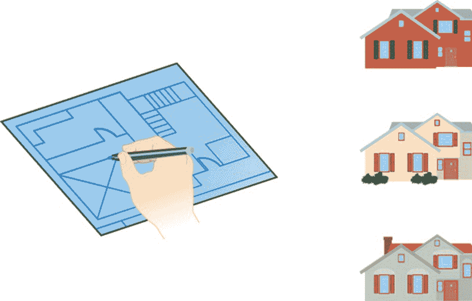

**图 1.22 类用于创建对象，就像房屋蓝图被用于房子一样。**

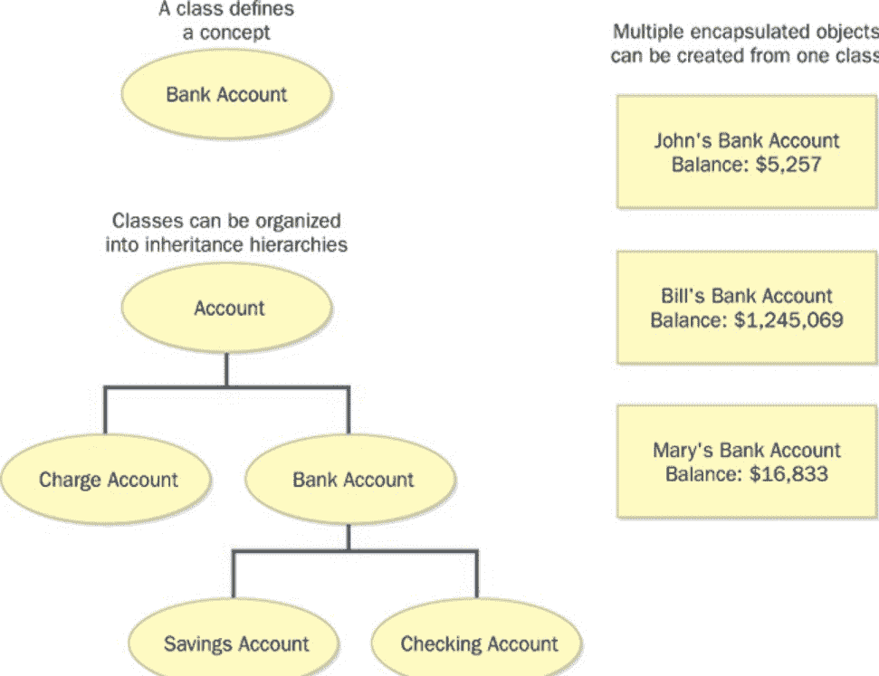

**图 1.23 面向对象软件的各个方面**

## 自测题

（答案见附录 L）

- SR 1.33 列出解决问题所需的五个通用步骤。
- SR 1.34 为什么考虑解决问题的多种方法是重要的？为什么在解决问题的早期考虑备选方案是重要的？
- SR 1.35 支持面向对象编程（OOP）的核心概念有哪些？

# 核心概念总结

- 计算机系统由硬件和软件组成，它们协同工作以帮助我们解决问题。
- CPU 从主内存中读取程序指令，一次执行一条，直到程序结束。
- 操作系统提供用户界面并管理计算机资源。
- 对于用户而言，界面就是程序本身。
- 数字计算机通过将信息拆分为若干部分并将每个部分表示为数字来存储信息。
- 计算机中使用二进制制来存储和移动信息，因为用于存储和处理二进制数据的设备廉价且可靠。
- N 位恰好有 `2^N` 种排列。因此，N 位可以表示多达 `2^N` 个唯一项目。
- 计算机的核心由主内存（存储程序和数据）和 CPU（一次执行一条程序指令）组成。
- 地址是与内存位置相关的唯一数字。
- 主内存是易失性的，意味着只有在供电时存储的信息才会被维持。
- 光盘的表面既有光滑区域也有小凹槽。凹槽代表二进制 1，光滑区域代表二进制 0。
- 取指-解码-执行周期构成了计算机处理的基础。
- 网络由两台或多个计算机连接在一起，以便它们可以交换信息。
- 共享通信线路会导致延迟，但它具有成本效益，并简化了向网络添加新计算机的过程。
- 局域网（LAN）是整个组织内部共享信息和资源的有效方法。
- 互联网是跨越全球的广域网（WAN）。
- 每台连接到互联网的计算机都有一个唯一标识它的 IP 地址。
- 世界维网（WWW）是一种让人类轻松在网络上共享信息的软件。
- URL 唯一指定了 Web 上的文档和其他信息，供浏览器获取和显示。
- 本书重点关注面向对象编程的原理。
- 注释不会影响程序的处理；相反，它们的作用便于人类理解。
- 行内文档应该提供对代码的洞察。它不应该是模糊的，也不应把显而易见。
- Java 是大小敏感的。字母的大写和小写版本是不同的。
- 标识符名称应该是描述性的且可读的。
- 适当使用空格可以使程序更容易阅读和理解。
- 你应该遵循一套指南，以建立你格式化和记录程序的方法。
- 所有程序必须翻译成特定 CPU 的机器语言才能执行。
- 高级语言允许程序员忽略机器语言的底层细节。
- Java 编译器将 Java 源代码翻译成 Java 字节码，这是一种底层的与架构无关的程序表示。
- 许多不同的开发环境可以帮助你创建和修改 Java 程序。
- 语法规则规定程序的形状。语义规定了程序语句的含义。
- 程序员对程序的准确性和可靠性负责。
- Java 程序必须在语法上是正确的，否则编译器不会产生字节码。
- 面向对象编程帮助我们解决问题，而这正是编写程序的目的。
- 程序设计涉及将解决方案拆解为可管理的部分。
- 每个对象都有一个状态（由其属性定义）和一组行为（由其方法定义）。
- 类是对象的蓝图。从一个类定义可以创建多个对象。

# 练习题

- EX 1.1 描述你的个人电脑或你所访问的实验室计算机的硬件组件。包括处理器类型和速度、主内存和辅助内存的容量以及 I/O 设备的类型。解释你是如何得出答案的。
- EX 1.2 为什么我们使用二进制制在计算机上存储信息？
- EX 1.3 每一项项可以表示多少个唯一项目？
  - a. 1 位
  - b. 3 位
  - c. 6 位
  - d. 8 位
  - e. 10 位
  - f. 16 位
- EX 1.4 如果一张图片由 128 种可能的颜色组成，需要多少位来存储图片的每个像素？为什么？
- EX 1.5 如果一种语言使用 240 个唯一的字母和符号，存储文档中的每个字符需要多少位？为什么？
- EX 1.6 每一项中有多少位？每个项有多少字节？
  - a. 12 KB
  - b. 5 MB
  - c. 3 GB
  - d. 2 TB
- EX 1.7 解释随机存内存（RAM）和只读存储器（ROM）之间的区别。
- EX 1.8 磁盘是一种随机访问设备，但它不是 RAM（随机访问内存）。请解释。
- EX 1.9 确定你的计算机或你所访问的实验室计算机是如何通过网络与其他计算机连接的。它连接到互联网了吗？画一张图来显示你环境中的基本连接。
- EX 1.10 解释局域网（LAN）和广域网（WAN）之间的区别。它们之间是什么关系？
- EX 1.11 八台计算机的全连接点对点网络总需要多少条通信线？九台计算机呢？十台呢？确定此结果的通用公式是什么？
- EX 1.12 解释互联网和世界维网之间的区别。
- EX 1.13 列出并解释以下 URL 的组成：
  - a. 你的学校
  - b. 你学校的计算机科学系
  - c. 你老师的网页
- EX 1.14 给出两种 Java 注释的示例，并解释它们之间的区别。
- EX 1.15 下列哪些不是合法的 Java 标识符？为什么？
  - a. `Factorial`
  - b. `anExtremelyLongIdentifierIfYouAskMe`
  - c. `2ndLevel`
  - d. `level2`
  - e. `MAX_SIZE`
  - f. `highest$`
  - g. `hook&ladder`
- EX 1.16 为什么以下有效的 Java 标识符不被认为是良好的标识符？
  - a. `q`
  - b. `totVal`
  - c. `theNextValue`
- EX 1.17 Java 是大小敏感的。这意味着什么？
- EX 1.18 什么是 Java 虚拟机？解释它的作用。
- EX 1.19 我们说语言具有歧义性是指什么？给出歧义的例子（本章使用的例子之外）并解释。为什么歧义对语言是一个问题？
- EX 1.20 将以下情况分类为编译时错误、运行时错误或逻辑错误。
  - a. 在应该加两个数时却用了乘法
  - b. 除以零
  - c. 语句末尾漏掉分号
  - d. 在输出中拼错单词
  - e. 产生了不准确的结果
  - f. 应该输入 a 却输入了

# 编程项目


# PP 1.1 输入、编译并运行以下程序：

```java
public class Test {
    public static void main(String[] args) {
        System.out.println("Emergency Broadcast");
    }
}
```


# PP 1.2 向 PP 1.1 的程序中一个引入以下错误。记录编译器产生的任何错误信息。在引入新错误之前，修复上一个错误。在进行每次更改之前，尝试预测会发生什么。

- a. 将 `Test` 改为 `test`
- b. 将 `Emergency` 改为 `emergency`
- c. 移除字符串中的第一个引号
- d. 移除字符串中的最后一个引号
- e. 将 `main` 改为 `man`
- f. 将 `println` 改为 `bogus`
- g. 移除 `println` 语句末尾的分号
- h. 移除程序的最后一个大括号

# PP 1.3 编写一个程序，分行打印你的名字、生日、爱好、喜欢的书和喜欢的电影。在输出中为每条信息打上标签。

# PP 1.4 编写一个程序，列出四五个你喜欢的网站。同时打印网站名称和 URL。

# PP 1.5 编写一个程序，打印一首歌（你自选）的前几节。标记副歌部分。

# PP 1.6 编写一个程序，使用星号 (`*`) 字符打印一棵树的轮廓。

# PP 1.7 编写一个程序，打印小说中的一个段落。

# PP 1.8 编写一个程序，打印短语 `Knowledge is Power:`：

- a. 占据一行
- b. 占据三行，每行一个单词，单词之间居中对齐
- c. 在由字符 `=` 和 `|` 组成的框内

# PP 1.9 编写一个程序，打印出以下菱形。不要打印任何不需要的字符。（也就是说，不要让任何字符串比它需要的更长。）

```
*
***
*****
*******
*****
***
*
```

# PP 1.10 编写一个程序，用大字母字体显示你的名字首字母。让每个大字母由对应的普通字符组成。例如：

| JJJJJJJJJJJJJJJ | AAAAAAAA | LLLL |
| JJJJJJJJJJJJJJJ | AAAAAAAAAA | LLLL |
| JJJJ | AAA | AAA | LLLL |
| JJJJ | AAA | AAA | LLLL |
| JJJJ | AAAAAAAAAAAA | LLLL |
| J | JJJJ | AAAAAAAAAAAA | LLLL |
| JJ | JJJJ | AAA | AAA | LLLL |
| JJJJJJJJJJJ | AAA | AAA | LLLLLLLLLLLLLLL |

# 2 数据与表达式

## 章节目标

- 讨论字符串、拼接和转义序列的使用。
- 探索变量的声明和使用。
- 描述 Java 原始数据类型。
- 讨论表达式的语法和处理。
- 定义数据转换的类型及其实现机制。
- 引入 `Scanner` 类以创建交互式程序。

本章探索了 Java 程序中使用的一些基本数据类型，以及使用表达式进行计算。它讨论了数据从一种类型到另一种类型的转换，以及如何从运行程序的用户交互式读取输入。

## 2.1 字符串

在第 1 章中，我们以 `Lincoln` 程序为例，讨论了 Java 程序的的基本结构，包括注释、标识符和空白的使用。第 1 章还概述了面向对象编程涉及的各种概念，如对象、类和方法。如有必要，请花时间回顾这些概念。

字符串是 Java 中的一种对象，由 `String` 类定义。由于字符串对计算机编程至关重要，Java 提供了使用字符串字面量（用双引号界定）的能力，正如我们在之前的示例中所所示。我们将在第 3 章更详细地探讨 `String` 类及其方法。现在，让我们详细探讨字符串字面量的使用。

以下是所有有效字符串字面量的示例：

```
"The quick brown fox jumped over the lazy dog."
"602 Greenbbriar Court, Chalfont PA 18914"
"x"
""
```

字符串字面量可以包含任何有效字符，包括数字、标点符号和其他特殊字符。上述列表中的最后一个示例完全包含字符。

### print 和 println 方法

在第 1 章的 `Lincoln` 程序中，我们如下调用了 `println` 方法：

```
System.out.println("Whatever you are, be a good one.");
```

这条语句演示了对象的使用。`System.out` 对象代表一个输出设备或文件，默认是显示器屏幕。更精确地说，该对象的名称是 `out`，它存储在 `System` 类中。我们将在文本适当的位置更详细地探讨这种关系。

`println` 方法是 `System.out` 对象为我们提供的一种服务。每当我们请求它时，对象就会在屏幕上打印一个字符串。我们可以说，我们将 `println` 消息发送给 `System.out` 对象，请求打印某些内容。

我们发送到方法的每条数据被称为参数。在这种情况下，`println` 方法只接受一个参数：要打印的字符字符串。

`System.out` 对象还提供了另一个我们可以使用的服务：`print` 方法，而 `println` 虽然小但很重要。`println` 方法打印发送给它的信息，然后移动到下一行的开头。`print` 方法与 `println` 类似，但在完成后不会移动到下一行。

> **核心概念**
>
> `print` 和 `println` 方法代表了 `System.out` 提供的两种服务。

所示程序是 `Countdown`，它同时调用了 `print` 和 `println` 方法。

### 列表 2.1

```
****************************************************
// Countdown                         作者: Lewis/Loftus
//
// Demonstrates the use of print and println.
//********************************************************************
public class Countdown
{
    //----------------------------------------------------------------------
    // Prints a countdown sequence.
    //----------------------------------------------------------------------
    public static void main(String[] args)
    {
        System.out.print("Three... ");
        System.out.print("Two... ");
        System.out.print("One... ");
        System.out.println("Zero... ");
        System.out.println("Blast off!");
    }
}
```

### 输出

```
Three... Two... One... Zero...
Blast off!
```

### 字符串拼接

字符串拼接运算符（`+`）用于将两个字符串连接在一起。它也可以用于将字符串与其他数据类型（如数字）连接。

例如：

```
"Speed of ketchup: 40 km per year"
```

数字是字符，可以根据需要包含在字符串中。我们在程序中分离了它们，以演示拼接字符串和数字的能力。这种技术在接下来的示例中将非常有用。

正如你可以想象的，`+` 运算符也用于算术相加。因此，`+` 运算符的作用取决于它所操作的数据类型。如果运算符的两个操作数中有一个或两个都是字符串，则执行字符串拼接。

列表 2.3 所示的 `Addition` 程序演示了字符串拼接与算术相加之间的区别。`Addition` 程序使用了四次 `+` 运算符。在第一次调用 `println` 时，两个 `+` 操作都执行了字符串拼接，因为运算符的操作是从左到右执行的。第一个运算符将字符串与第一个数字（24）拼接，创建一个更大的字符串。然后，该字符串与第二个数字（45）拼接，创建一个更大的字符串并将其打印出来。

### 列表 2.3

```java
// Addition.java    Author: Lewis/Loftus
//
// Demonstrates the difference between addition and
// concatenation operators.
//********************************************************************
public class Addition {
    //----------------------------------------------------------------------
    // Concatenates and adds two numbers and prints the
    // results.
    //----------------------------------------------------------------------
    public static void main(String[] args) {
        System.out.println("24 and 45 concatenated: " + 24 + 45);
        System.out.println("24 and 45 added: " + (24 + 45));
    }
}
```

### 输出

```
24 and 45 concatenated: 2445
24 and 45 added: 69
```

在第二次调用 `println` 时，我们使用括号将 `+` 操作与两个数字操作数组合在一起。这强制该操作先发生。由于两个操作数都是数字，因此它们在算术意义上相加，产生结果 `69`。然后，该数字再与字符串拼接，产生一个更大的字符串并打印。

我们将在本章稍后部分再次讨论这种情况，届时我们将确定定义运算符求值顺序的优先级规则。

### 转义序列

由于 Java 语言中使用双引号字符（`"`）来表示字符串的开始和结束，我们必须使用特殊技术来打印引号字符。如果我们简单地将其放在一个字符串 `"""` 中，编译器会感到困惑，因为它认为第二个引号是字符串的结束，并且不知道该如何处理第三个引号。这会导致编译错误。

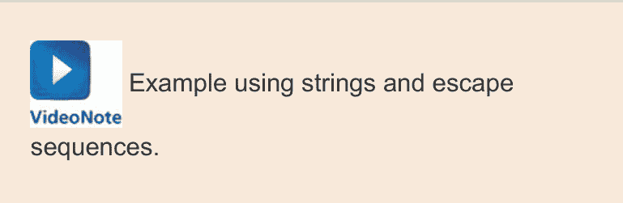

为了解决这个问题，Java 定义了几个转义序列来表示特殊字符。转义序列以反斜杠字符（`\`）开头，表示后面的字符或多个字符应该以特殊方式进行解释。图 2.1 列出了 Java 转义序列。

| 转义序列 | 含义 |
|---|---|
| `\b` | 退格 |
| `\t` | 制表符 |
| `\n` | 换行符 |
| `\r` | 回车 |
| `\"` | 双引号 |
| `\'` | 单引号 |
| `\\` | 反斜杠 |

图 2.1 Java 转义序列

> **核心概念**
>
> 转义序列可以用于表示否则会引起编译问题的字符。

### 列表 2.4

```java
// Roses.java             Author: Lewis/Loftus
//
// Demonstrates the use of escape sequences.
//****************************************************************************************************

public class Roses
{
    //----------------------------------------------------------------------
    // Prints a poem with escape sequences.
    //----------------------------------------------------------------------
    public static void main(String[] args)
    {
        System.out.println("Roses are red,\nViolets are blue,\nSugar is sweet,\n\tBut I have \"commitment issues\",\nSo I'd rather just be friends\n\tAt this point in our relationship.");
    }
}
```

### 输出

```
Roses are red,
Violets are blue,
Sugar is sweet,
    But I have "commitment issues",
So I'd rather just be friends
    At this point in our relationship.
```

### 自我复习题

（答案见附录 L）

- SR 2.1 什么是字符串字面量？
- SR 2.2 `print` 和 `println` 方法之间的区别是什么？
- SR 2.3 什么是参数？
- SR 2.4 下面代码会产生什么结果？
  ```java
  System.out.println("One ");
  System.out.println("Two ");
  ```
- SR 2.5 下面代码会产生什么结果？
  ```java
  System.out.println("Ready ");
  System.out.println("Three ");
  ```
- SR 2.6 下述语句会产生什么结果？
  ```java
  System.out.println("Set ");
  System.out.println("Go ");
  ```
- SR 2.7 什么是转义序列？举些例子。
- SR 2.8 写一个单一的 `println` 语句，输出如下所示（包括换行符和引号）：
  “I made this longer than usual because I lack.”

## 2.2 变量与赋值

我们在程序中管理的大部分信息都由变量表示。让我们看看如何声明和使用它们。

### 变量

变量是用于存储值的位置的名称。

> **核心概念**
>
> 变量是用于存储值的位置的名称。

考虑列表 2.5 所示的 `PianoKeys` 程序。整数变量的声明也为键提供了初始值。如果没有为变量指定初始值，则该值是未定义的。如果你在给变量赋值之前使用它，大多数 Java 编译器都会给出错误或警告。

### 列表 2.5

```java
// PianoKeys.java         Author: Lewis/Loftus
//
// Demonstrates the declaration, initialization, and use of
// integer variable.
//****************************************************************************************************

public class PianoKeys
{
    //----------------------------------------------------------------------
    // Prints the number of keys on a piano.
    //----------------------------------------------------------------------
    public static void main(String[] args) {
        int keys = 88;
        System.out.println("A piano has " + keys + " keys.");
    }
}
```

### 输出

```
A piano has 88 keys.
```

`keys` 变量及其值可以构想如下：

```
keys 88
```

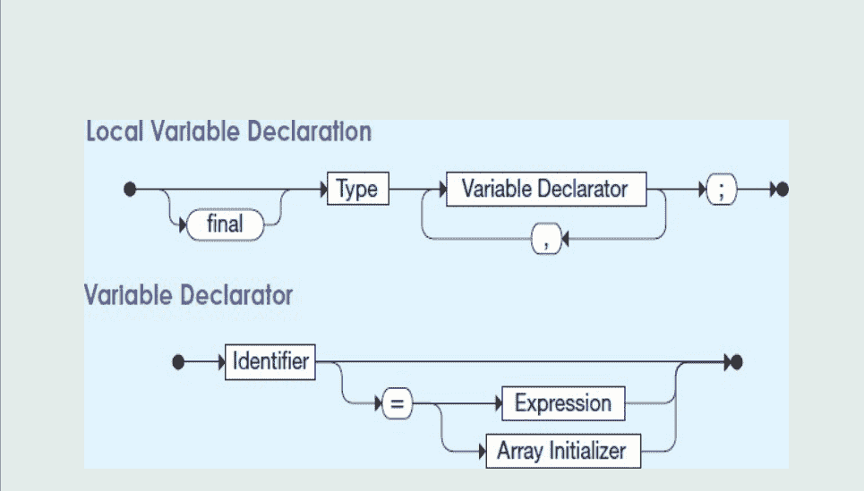

变量声明由一个类型（`Type`）后跟变量列表组成。行中的每个变量都可以在声明中初始化为指定表达式（`Expression`）的值。如果 `final` 修饰符位于声明之前，则标识符被声明为命名常量，一旦设置其值就无法更改。

示例：

```java
int total;
double num1, num2 = 4.356, num3;
char letter = 'A', digit = '7';
final int MAX = 45;
```

### 赋值语句

让我们来看一个改变变量取值的程序。列表 2.6 显示了一个名为 `Geometry` 的程序。该程序首先声明了一个名为 `sides` 的整数变量并将其初始化为 7。然后它打印出 `sides` 的当前值。

### 列表 2.6


********************************************************************
// Geometry.java                 Author: Lewis/Loftus
//
// 演示如何使用赋值语句来改变
// 存储在变量中的值。
********************************************************************

```java
public class Geometry
{
//--------------------------------------------------------------------------------
// 输出几个几何形状的边数。
//
public static void main(String[] args) 
{
    int sides = 7; // 带初始化声明
    System.out.println("A heptagon has " + sides + " sides.");

    sides = 10; // 赋值语句
    System.out.println("A decagon has " + sides + " sides.");

    sides = 12;
    System.out.println("A dodecagon has " + sides + " sides.");
}
}
```

### 输出

A heptagon has 7 sides.

A decagon has 10 sides.

A dodecagon has 12 sides.

`main` 方法中的下一行改变了变量 `sides` 中存储的值：

```
sides = 10;
```

这被称为**赋值语句**，因为它为变量分配了一个值。在执行时，赋值运算符 (`=`) 右侧的表达式会被求值，其结果被存储在左侧变量所指的内存位置中。在这个例中，该表达式仅仅是一个数字，`10`。我们将在下一节中讨论比这更复杂的表达式。

变量只能存储其所声明类型的一个值。新值会覆盖旧值。在这种情况下，当将值 `10` 赋值给 `sides` 时，原始值 `7` 就会被覆盖并永久丢失，如下所示：

| 初始化后： | sides | 7 |
| --- | --- | --- |
| 第一次赋值后： | sides | 10 |

> **核心概念**
>
> 访问数据会保持其在内存中完整，但赋值语句会覆盖旧数据。

### 基础赋值


基础赋值语句使用赋值运算符 (`=`) 将表达式的结果存储到指定的标识符（通常是变量）中。

示例如：

```
total = 57;
count = count + 1;
value = (min / 2) * lastValue;
```

当引用变量时（例如在打印它时），变量的值不会改变。这是计算机内存的本质：访问（读取）数据会保持内存中的值完整，但写入数据则会用新数据替换旧数据。

Java 语言是强类型的，这意味着我们不允许为与其声明类型不一致的变量赋值。当你尝试编译程序时，如果尝试组合不兼容的类型，将产生错误。因此，赋值语句右侧的表达式求值的结果必须是与左侧变量类型兼容的值。

> **核心概念**
>
> 我们不能将一种类型的值赋值给一个不兼容类型的变量。

### 常量

有时，我们会使用在整个程序中保持不变的数据。例如，我们可能会编写一个处理容量不超过 427 人的剧院程序。在整个代码中使用常量值名称（如 `MAX_OCCUPANCY`）而不是使用字面量（如 `427`）通常是有帮助的。对于阅读代码的人来说，`427` 等字面值的目的和意义往往令人困惑。通过赋予值名称，你帮助解释它在程序中的作用。

常量是标识符，与变量相似，不同之处在于在存在期间持有特定的值。用英语单词的字面意思来说，常量不是变量（variable）。它们的值不会改变。

> **核心概念**
>
> 常量在它们存在期间持有一个特定的值。

在 Java 中，如果你在声明前面加上保留关键字 `final`，该标识符就变成了一个常量。按照惯例，命名常量时使用大写字母以与普通变量区分开来，并使用下划线连接单个单词。例如，描述剧院最大容量的常量可以这样声明：

```
final int MAX_OCCUPANCY = 427;
```

如果你尝试在常量赋予初始值后更改它的值，编译器将产生错误信息。这是使用常量的另一个好理由。常量可以防止无意的编码错误，因为改变其值的唯一有效位置是在初始赋值中。

使用常量的第三个好理由是：如果常量在整个程序中使用且值需要修改，那么你只需要在一个地方更改它。例如，如果剧院的容量（因为装修）从 427 变为 535，你只需要更改一个声明，所有对 `MAX_OCCUPANCY` 的使用都会自动反映。如果整个代码中使用字面量 427，则每个使用处都必须更改。

### 自测

- 2.9 什么是常量？
- 2.10 给定以下声明，回答：
    - a. 有多少个变量？
    - b. 这些的类型是什么？
    - c. 哪些是符号的？
    - d. 根据上述声明，以下赋值是否有效？
    - e. 根据上述声明，以下语句是否有效？
- 2.11 程序需要一个 `int` 来存储 CD 的数量。写出一个语句。
- 2.12 程序需要一个 `int` 来存储英尺的数量。写出一个语句。
- 2.13 简述使用常量的三个理由。

## 2.3 原始类型

Java 有八种原始类型：四种整数类型、两种浮点类型、一个字符类型和一个布尔类型。其他都使用对象表示。让我们详细检查这八种原始类型。

### 整数和浮点数

Java 有两种基本的数值：没有小数部分的整数和带有小数部分的浮点数。四种整数类型（`byte`、`short`、`int` 和 `long`）和两种浮点类型（`float` 和 `double`）。它们区别在于用于存储值的内存量，这决定了可以表示的值范围。每个数据类型的大小在所有平台上都是相同的。所有数值类型都是符号的，这意味着可以在它们中存储正负值。图 2.2 总结了数值类型。

| 类型 | 存储 | 最小值 | 最大值 |
|---|---|---|---|
| byte | 8 位 | -128 | 127 |
| short | 16 位 | -32,768 | 32,767 |
| int | 32 位 | -2,147,483,648 | 2,147,483,647 |
| long | 64 位 | -9,223,372,036,854,775,808 | 9,223,372,036,854,775,807 |
| float | 32 位 | 约 -3.4E+38，7 位有效数字 | 约 3.4E+38，7 位有效数字 |
| double | 64 位 | 约 -1.7E+308，15 位有效数字 | 约 1.7E+308，15 位有效数字 |

图 2.2 Java 数值类型

> **核心概念**
>
> Java 有两种数值类型：整数和浮点。四种整数数据类型和两种浮点类型。

回想我们在第一章中的讨论，位可以是 1 也可以是 0。因为每个位可以表示两种不同的状态，N 位的字符串可以表示 2^N 个不同的值。附录 B 更详细地描述了数系统和这些关系。

在设计程序时，我们有时需要仔细选择适当大小的变量，以免内存空间被浪费。例如，如果一个特定变量的值在 1–1000 的范围之外不会变化，那么一个双字节整数（`short`）就足够容纳它。另一方面，当不确定某个特定变量的范围时，我们应该提供一个合理的、甚至是慷慨的空间。在大多数情况下，内存空间并不是严格的限制，我们通常可以负担得起慷慨的假设。

请注意，尽管 `float` 值支持非常大（非常小）的数字，但它只有七位有效数字。因此，如果准确维护诸如 50341.2077 这样的值非常重要，我们需要使用 `double`。

正如我们已经讨论过的，字面量（`literal`）是程序中使用的显式数据值。在 `Facts`、`Addition` 和 `PianoKeys` 等程序中使用的各种数字都是“整数字面量”（`integer literals`）。Java 假设所有整数字面量都是 `int` 类型，除非在值的末尾附加 `L` 或 `l` 来表示它应该被视为 `long` 类型的字面量，例如 `45L`。

同样，Java 假设所有浮点字面量都是 `double` 类型。如果我们需要将浮点字面量视为 `float`，我们会在值的末尾附加 `F` 或 `f`，如 `2.718F` 或 `123.45f`。如果需要，`double` 数值字面量后面可以跟随 `D` 或 `d`。


### 十进制整数字面量

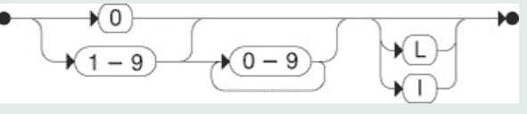

整数字面量由一系列数字加上一个可选的后缀组成，该后缀指示它应该被视为独立的操作。字面量的否定被视为一个独立的操作。

示例：

```
5
2594
4920328L
```

以下是 Java 中数值变量声明的示例：

```
int answer = 42;
byte smallNumber1, smallNumber2;
long countedStars = 86827263927L;
float ratio = 0.2363F;
double delta = 453.523311903;
```

### 字符

字符是计算机上使用和管理的另一种基本数据类型。单个字符可以被视为单独的数据项，正如我们在几个示例中看到的，它们可以组合成字符字符串。

字符字面量（`character literal`）在 Java 程序中用单引号表示，例如 `'b'`、`'g'` 或 `';'`。你可能记得字符串字面量由双引号界定，并且 `String` 类型在 Java 中不是一种基本数据类型；它是一个类名。我们将在第 3 章详细讨论 `String` 类。

请注意作为字符的数字（或字符串的一部分）与作为数字的数字（或较大数字的一部分）之间的区别。数字 602 是可以用于算术计算的数值。但在字符串 `"602 Greenbriar Court"` 中，`6` 和 `2` 是字符，就像构成字符串的其余字符一样。

我们可以管理的字符由字符集定义，字符集仅仅是特定顺序的字符列表。每种编程语言支持一种特定的字符集，定义了该语言中字符变量的有效值。已经提出了几种字符集，但多年来只有少数被经常使用。ASCII 字符集是一个流行的选择。ASCII 代表“美国标准信息交换代码”。

### 算术运算符

Java 提供了标准的算术运算符，包括加法 (`+`)、减法 (`-`)、乘法 (`*`)、除法 (`/`) 和取余 (`%`)。

取余运算符 (`%`) 返回除法运算的余数。例如，`17 % 4` 的结果是 `1`，因为 17 除以 4 等于 4 余 1。有时被称为取模运算符（modulus operator）。取余运算结果的符号取决于被除数的符号。因此，

| 操作 | 结果 |
|---|---|
| 17 % 4 | 1 |
| -20 % 3 | -2 |
| 10 % -5 | 0 |
| 3 % 8 | 3 |

正如你预期的那样，如果任何数值运算符的一个或两个操作数是浮点值，则结果将是一个浮点值。然而，除法运算符产生的结果并不那么直观，取决于操作数的类型。如果两个操作数都是整数，则 `/` 运算符将执行整数除法，这意味着结果的任何小数部分都会被丢弃。如果其中一个或两个操作数是浮点值，则 `/` 运算符将执行浮点除法，并保留结果的小数部分。例如，10/4 的结果是 2，但 10.0/4、10/4.0 和 10.0/4.0 的结果均为 2.5。

一元运算符只有一个操作数，而二元运算符有两个操作数。`+` 和 `-` 算术运算符可以是一元的也可以是二元的。二元版本完成加法和减法，而一元版本表示正数和负数。例如，`-1` 就是使用一元否定运算符使值变为负数的示例。一元 `+` 运算符很少使用。

Java 没有内置的用于将值提升为指数的运算符。然而，`Math` 类提供了执行幂运算和许多其他数学函数的方法。`Math` 类将在第 3 章中讨论。

### 运算符优先级

运算符可以组合以创建更复杂的表达式。例如，考虑以下赋值语句：

```
result = 14 + 8 / 2;
```

赋值语句的整个右侧会被求值，然后将结果存储在变量中。但结果是什么？如果先执行加法，结果是 11；如果先执行除法运算，结果是 18。运算符求值的顺序有很大影响。在这种情况下，除法在加法之前执行，得到结果 18。

> **核心概念**
>
> Java 遵循一套定义良好的优先级规则，这些规则规定了运算符在表达式中求值的顺序。

注意在本例及随后的示例中，我们使用字面量值而不是变量来简化表达式。如果操作数是变量或任何其他数据源，运算符求值的顺序是相同的。

所有表达式都根据运算符优先级层次结构进行求值，该层次结构规定了操作求值顺序的规则。算术运算符通常遵循你在代数中学习的相同规则。乘法、除法和取余运算符的优先级相同，并且在加法和减法之前执行（优先级高于加法和减法）。加法和减法的优先级相同。

任何同一优先级的算术运算符都从左到右执行。因此，我们说算术运算符具有从左到右的结合性。

然而，可以使用括号在表达式中强制规定优先级。例如，如果我们真的想在上例中先执行加法，我们可以按照如下方式编写表达式：

```
result = (14 + 8) / 2;
```

任何括号内的表达式都会先求值。在复杂的表达式中，即使不是严格必要的，使用括号也是一种良好的做法，可以清楚地表明表达式是如何求值的。

括号可以嵌套，最内层的嵌套表达式最先求值。考虑以下表达式：

```
result = 3 * ((18 - 4) / 2);
```

在这个示例中，结果是 21。首先，由于内层括号的强制执行了减法。然后执行括号内的除法，最后执行乘法。

### TempConverter 程序

`TempConverter` 程序并不有用，因为它只转换了一个包含在程序中作为常数的数据值（24 摄氏度）。每次运行程序，它都会产生相同的结果。一个更有用的程序版本应该是每次执行程序时从用户处获取需要转换的值。读取用户输入的交互式程序将在本章稍后部分讨论。

### 自增和自减运算符


还有另外两种算术运算符。`自增运算符 (++)` 为任何整数或浮点值加 1。组成该运算符的两个加号之间不能有空格。`自减运算符 (--)` 与其相似，不同之处是从该值中减去 1。它们都是一元运算符，因为它们只操作一个操作数。以下语句会导致 `count` 的值增加：

```
count++;
```

结果被存储回变量 `count` 中。因此，它在功能上等同于我们在上一节中讨论的以下语句：

```
count = count + 1;
```

自增和自减运算符可以放在变量（例如 `count++` 或 `count--`），创建所谓的运算符的*后置形式*。它们也可以放在变量之前（例如 `++count` 或 `--count`），即所谓的*前置形式*。在语句中单独使用时，前置和后置形式在功能上是等价的。也就是说，写成

```
count++;
```

或者

```
++count;
```

并不。。当这种形式单独作为一个语句编写时，通常以其后置形式编写。

当自增或自减运算符用于较大的表达式时，可能会根据使用的形式产生不同的结果。

例如，如果变量 `count` 当前包含值 `15`，以下语句将值 `15` 赋值给 `total`，将值 `16` 赋值给 `count`：

```
total = count++;
```

然而，以下语句将值 `16` 同时赋值给 `total` 和 `count`：

```
total = ++count;
```

两种情况下 `count` 的值都增加了，但在较大的表达式中使用的值取决于使用的是自增运算符的前置还是后置形式。

由于自增和自减运算符的前置和后置形式之间存在细微差异，使用时应谨慎。一如既往，优先考虑可读性。

### 赋值运算符

为了方便起见，Java 中定义了几个`赋值运算符`，它们将基本操作与赋值结合。例如，

`+` 运算符可以如下使用：

```
total += 5;
```

此执行的操作与以下语句相同：

```
total = total + 5;
```

赋值运算符的右侧可以是一个完整的表达式。运算符右侧的表达式先求值，然后将该结果加到左侧变量的当前值，并将该值存储在变量中。因此，以下语句：

```
total += (sum - 12) / count;
```

等同于：

```
total = total + ((sum - 12) / count);
```

Java 中定义了许多类似的赋值运算符，包括执行减法 (`-=`)、乘法 (`*=`)、除法 (`/=`) 和取余 (`%=`)。所有的 Java 运算符将在附录 D 中讨论。

所有的赋值运算符首先求右侧整个表达式的值，然后将结果作为另一个操作的右操作数。因此，以下语句：

```
result *= count1 + count2;
```

等同于：

```
result = result * (count1 + count2);
```

同样，以下语句：

```
result %= (highest - 40) / 2;
```

等同于：

```
result = result % ((highest - 40) / 2);
```

某些赋值运算符根据操作数执行特定功能，就像它们对应类型上的普通运算符一样。例如，如果 `+=` 运算符的操作数是字符串，则赋值运算符将执行字符串拼接。

### 自测习题

（答案见附录 L）

- SR 2.21 195 在 Java 表达式中求值的结果是什么？请解释。

- SR 2.22 13/4 在 Java 表达式中求值的结果是什么？请解释。

- SR 2.23 如果整数变量 `diameter` 当前持有值 `5`，在执行以下语句后它的值是多少？

```
diameter = diameter * 4;
```

- SR 2.24 什么是运算符优先级？

- SR 2.25 以下每个表达式的值是多少？

a. 15 + 7 * 3

b. (15 + 7) * 3

c. 3 * 6 + 10 / 5 + 5

d. 27 % 5 + 7 % 3

e. 100 / 2 / 2 / 2

f. 100 / ( 2 / 2 ) / 2

- SR 2.26 说明以下每个表达式是有效还是无效。如果无效，请解释原因。

a. 100 / ( 2 / 2 ) / 2

b. 15 + 7 * 3

c. (15 + 7) * 3

d. 3 * 6 + 10 / 5 + 5

e. 27 % 5 + 7 % 3

f. 100 / 2 / 2 / 2

这与原始整数的数值值没有特别的关系。

请注意，在宽转换和窄转换中均未提到 `boolean` 值。`boolean` 值不能转换为任何其他原始数据类型，反之亦然。

### 转换技术

在 Java 中，转换可以通过三种方式发生：

-   赋值转换（assignment conversion）
-   类型提升（promotion）
-   强制类型转换（casting）

当将一种类型的值赋值给另一种类型的变量时，就会发生赋值转换，在此期间该值会被转换为新类型。只有宽转换可以通过赋值完成。例如，如果 `money` 是一个 `float` 变量而 `dollars` 是一个 `int` 变量，那么下面的赋值语句会自动将 `dollars` 中的值转换为 `float`：

```
money = dollars;
```

因此，如果 `dollars` 包含值 `25`，在赋值后，`money` 包含值 `25.0`。然而，如果我们尝试将 `money` 赋值给 `dollars`，编译器将发出错误信息，提醒我们正在尝试进行可能会丢失信息的窄转换。如果我们确实想执行此赋值，就必须使用强制类型转换来显式地进行转换。

通过*提升*进行的转换在某些运算符需要修改其操作数以执行操作时会自动发生。例如，当一个名为 `sum` 的浮点值除以整数值 `count` 时，在执行除法之前，`count` 会自动提升为浮点值，从而产生浮点结果：

```
result = sum / count;
```

当数字与字符串拼接时，也会发生类似的转换。该数字首先被转换为（提升）字符串，然后将两个字符串拼接。

*强制类型转换*是 Java 中最通用的转换形式。如果在 Java 程序中可以完成转换，那么就可以使用强制类型转换来实现。强制类型转换是 Java 运算符，由括号中的类型名称指定。它被放置在待转换值之前。例如，要将 `money` 转换为整数值，我们可以在它前面加上强制类型转换：

```
dollars = (int) money;
```

强制类型转换返回 `money` 中的值，并截断任何小数部分。如果 `money` 包含值 `84.69`，那么在赋值后，`dollars` 将包含值 `84`。但请注意，强制类型转换不会改变 `money` 中的值。在赋值操作完成后，`money` 仍然包含值 `84.69`。

强制类型转换在许多我们需要将一个值临时视为另一种类型的情况下非常有帮助。例如，如果我们想将整数值 `total` 除以整数值 `count` 并得到浮点结果，我们可以如下操作：

```
result = (float) total / count;
```

首先，强制类型转换运算符返回 `total` 中值的浮点版本。此操作不会改变 `total` 中的值。然后，`count` 通过算术提升被视为一个浮点值。现在，除法运算符将执行浮点除法并产生预期的结果。如果没有包含强制类型转换，操作将执行整数除法，并在赋值给 `result` 之前截断答案。还要注意，由于强制类型转换运算符的优先级高于除法运算符，强制类型转换作用于 `total` 的值，而不是除法的结果。

### 自测习题

（答案见附录 L）

-   SR 2.31 为什么宽转换比窄转换更安全？

-   SR 2.32 识别以下每个转换属于宽转换还是窄转换。

  a. `int` 到 `long`

  b. `int` 到 `byte`

  c. `byte` 到 `short`

  d. `byte` 到 `char`

  e. `short` 到 `double`

-   SR 2.33 假设 `result` 是一个 `float` 变量而 `value` 是一个 `int` 变量，执行赋值语句后 `value` 将变成什么类型的变量？

```
result = value;
```

-   SR 2.34 假设 `result` 是一个 `float` 变量，`value` 是一个 `int` 变量，执行赋值语句后 `result` 的值是多少？

```
result = value;
```

-   SR 2.35 给定以下声明，执行赋值语句后每个变量的值是什么？

```
int iResult, num1 = 17, num2 = 5;
double fResult, val1 = 12.0, val2 = 34;
```

  a. iResult = num1 / num2;

  b. fResult = num1 / num2;

  c. fResult = val1 / num2;

  d. fResult = (double) / num2;

  e. iResult = (int) / num2;

## 2.6 交互式程序

设计一个在执行期间从用户读取数据的程序通常是有用的。这样，每次运行程序时都可以根据输入的数据计算出结果。

### Scanner 类

`Scanner` 类属于 API，提供了读取各种类型的方便方法。输入可以来自各种来源，包括用户交互输入的数据或存储在文件中的数据。`Scanner` 类也可用于解析字符串。

| 方法 | 说明 |
| :--- | :--- |
| `Scanner(InputStream source)` | 设置扫描器扫描输入流。 |
| `Scanner(File source)` | 设置扫描器扫描文件。 |
| `Scanner(String source)` | 设置扫描器扫描字符串。 |
| `next()` | 返回下一个标记作为字符串。 |
| `nextLine()` | 返回行剩余的所有输入。 |
| `nextBoolean()` | 返回下一个标记作为布尔值。 |
| `nextByte()` | 返回下一个标记作为字节。 |
| `nextDouble()` | 返回下一个标记作为双精度浮点数。 |
| `nextFloat()` | 返回下一个标记作为单精度浮点数。 |
| `nextInt()` | 返回下一个标记作为整数。 |
| `nextLong()` | 返回下一个标记作为长型整数。 |
| `nextShort()` | 返回下一个标记作为短整数。如果下一个标记与类型不匹配，则抛出 `InputMismatchException`。 |
| `hasNext()` | 如果扫描器还有标记，则返回 true。 |
| `useDelimiter(String pattern)` | 设置扫描器的分隔模式。 |
| `delimiter()` | 返回扫描器当前使用的模式。 |
| `findInLine(String pattern)` | 尝试在行内查找模式的下一次出现，忽略分隔符。 |

```java
import java.util.Scanner;

public class Echo {
    // -----------------------------------------------------
    // 从用户读取一个字符串并将其打印。
    // -----------------------------------------------------
    public static void main(String[] args) {
        String message;
        Scanner scan = new Scanner(System.in);
        System.out.println("Enter a line of text:");
        message = scan.nextLine();
        System.out.println("You entered: \"" + message + "\"");
    }
}
```

输入一行文本：

你输入了: "Set your laser printer on stun!"

`Echo` 类定义上方的 `import` 语句告诉程序，我们将在此程序中使用 `Scanner` 类。`Scanner` 类是 `java.util` 类库的一部分。`import` 语句的使用将在第 3 章中进一步讨论。

提供了诸如 `nextInt` 和 `nextDouble` 等各种方法来读取特定类型的数据。列表 2.9 所示的 `GasMileage` 程序以整数读取行驶的里数，以双精度浮读取消耗的加仑数，然后计算油耗。

### 列表 2.9

```java
// GasMileage.java         Author: Lewis/Loftus
//
// 演示如何使用 Scanner 类读取数值数据。
//********************************************************************************
import java.util.Scanner;

public class GasMileage {
    //---------------------------------------------------------
    // 根据用户输入的值计算燃效率。
    //---------------------------------------------------------
    public static void main(String[] args) {
        int miles;
        double gallons, mpg;
        Scanner scan = new Scanner(System.in);
        System.out.print("Enter the number of miles: ");
        miles = scan.nextInt();
        System.out.print("Enter the gallons of fuel used: ");
        gallons = scan.nextDouble();
        mpg = miles / gallons;
        System.out.println("Miles Per Gallon: " + mpg);
    }
}
```

### 输出

```
Enter the number of miles: 328
Enter the gallons of fuel used: 11.2
Miles Per Gallon: 29.28571428571428
```

正如从 `GasMileage` 程序的输出所示，计算产生了一个精确到几位小数的浮点结果。在第 3 章中，我们将讨论帮助我们以各种方式格式输出输出类，包括将浮点值舍入到特定的小数位数。

`Scanner` 对象根据用于读取数据的方法和用于分隔输入值的分隔符，一次处理一个标记（token）输入。因此，根据实际情况，可以将多个值放在同一行输入中，也可以将其跨越多行进行分隔。

> 使用 Scanner 类的示例。

在第 5 章中，我们使用 `Scanner` 类从数据文件中读取输入，并修改它用于解析数据的分隔符。附录 H 探索了如何使用 `Scanner` 类通过名为*正则表达式*（regular expressions）的模式来分析其输入。

### 自习题

（答案见附录 L）

- SR 2.36 识别 `GasMileage` 程序中每一行对应以下哪些内容。
- 告诉程序我们将使用 `Scanner` 类。
- 创建一个 `Scanner` 对象。
- 设置 `Scanner` 对象 `scan` 以从标准输入流读取内容。
- 从标准输入流读取一个整数。

- SR 2.37 假设你已经在程序中实例化了一个名为 `myScanner` 的 `Scanner` 对象和一个名为 `value` 的 `int` 变量，如下：

```java
Scanner myScanner = new Scanner(System.in);
int value = 0;
```

编写程序语句，要求用户输入他们的年龄，并将响应存储在 `value` 中。

### 核心概念总结

- `print` 和 `println` 方法代表由 `System.out` 对象提供的两种服务。
- 转义序列可用于表示一个在否则会引起编译问题的字符。
- 变量是用于存储特定数据类型值的内存位置的名称。
- 访问数据会将其留在内存中，但赋值语句会覆盖旧数据。
- 我们不能将一种类型的值赋值给不兼容类型的变量。
- 常量在它们存在期间持有特定的值。
- Java 有两种数值类型：整数和浮点数。共有四种整数数据类型和两种浮点数据类型。
- Java 使用 16 位 Unicode 字符集来表示字符数据。
- 表达式是用于执行计算的运算符和操作数的组合。
- Java 遵循一套定义良好的优先级规则，这些规则规定了运算符在表达式中求值的顺序。
- 应避免收窄转换，因为它们可能会丢失信息。
- `Scanner` 类提供了从各种源读取各种类型输入的方法。

### 练习题

- EX 2.1 字面量 4, 4.0, '4' 和 "4" 之间的区别是什么？

- EX 2.2 请从以下方面解释该编程语句：
```java
System.out.println("I go!");
```

- EX 2.3 下述代码段产生什么输出？
```java
System.out.println("Here you");
```

- EX 2.4 下述程序有什么问题？如何修复？
```java
```


int total;

- EX 2.5 下述语句产生什么输出？
```java
System.out.println("I go" + 50);
```

- EX 2.6 下述语句产生什么输出？
```java
System.out.println("Here you");
```

- EX 2.7 下述语句执行后 `size` 包含什么值？
```java
size = 5;
size *= 2;
```

- EX 2.8 下述语句执行后浮点数 `depth` 包含什么值？
```java
depth = 2.4;
depth *= 2;
```

- EX 2.9 下述语句执行后整数 `length` 包含什么值？
```java
length = 5;
length *= 2;
length++;
```

- EX 2.10 编写四个不同的语句来增加整数变量的值。

- EX 2.11 根据给出的声明，每个赋值语句的结果是什么？
```java
int iResult, num1 = 25, num2 = 40, num3 = 17;
double fResult, val1 = 17.0, val2 = 12.78;
```
- a. `iResult = num1 / num4;`
- b. `fResult = num1 / num4;`
- c. `iResult = num3 / num4;`
- d. `fResult = num3 / num4;`
- e. `iResult = val1 / num4;`
- f. `fResult = val1 / val2;`
- g. `iResult = num1 / num2;`
- h. `fResult = (double) num1 / num2;`
- i. `fResult = num1 / (double) num2;`
- j. `fResult = (double) num1 / num2;`
- k. `iResult = (int) (val / num4);`
- l. `fResult = (int) (val / num4);`
- m. `fResult = (int) ((double) num1 / num2);`
- n. `iResult = num3 % num4;`
- o. `iResult = num2 % num3;`
- p. `iResult = num3 % num2;`
- q. `iResult = num2 % num4;`

- EX 2.11 对于每个表达式，通过在每个运算符下方写数字来指示求值的顺序。
- a. `a - b - c - d`
- b. `a - b + c - d`
- c. `a + b / c / d`
- d. `a + b / c * d`
- e. `a / b * c * d`
- f. `a % b % c % d`
- h. `a - (b - c) - d`
- j. `(a - (b - c)) - d`
- k. `a % (b % c) * d * *`
- l. `a + (b - c) * d - e`
- m. `(a + b) * c + d * *`
- n. `(a + b) * (c / d) % e`

### 编程项目

- PP 2.1 创建 `Lincoln` 程序第 1 章的修订版本，使被引用的的内容周围出现引号。
- PP 2.2 编写一个程序，读取三个整数并打印它们的平均值。
- PP 2.3 编写一个程序，读取两个浮点数并打印它们的和、差值和乘积。
- PP 2.4 编写一个程序，提示并读取一个人的姓名、年龄、大学名称和宠物名称。然后打印以下段落，并插入相应的数据：
> 你好，我的名字是 name，我今年 age 岁。我很享受在大学的时光，尽管我很想念我的宠物 petname！
- PP 2.5 创建 `TempConverter`（温度转换器）应用程序的版本，用于将华氏度转换为摄氏。从用户处读取华氏度温度。
- PP 2.6 编写一个程序，将英里转换为公里。（1 英里等于1.60935 公里。）从用户处读取浮点数值类型的英里值。
- PP 2.7 编写一个程序，提示并读取速度和行驶距离的整数值，然后将行程所需的时间以浮点结果的形式打印。
- PP 2.8 编写一个程序，读取表示小时、分钟和秒的时间持续时间，然后打印等量的总秒数。（例如，1 小时 28 分钟 42 秒等于 5322 秒）
- PP 2.9 创建上一个项目的版本，反转计算过程。即：读取一个表示秒的值，然后以小时、分钟和秒的组合打印等量的时间。（例如，9999 秒等于 2 小时 46 分钟 39 秒。）
- PP 2.10 编写一个程序，确定罐中硬币的价值，并以美元和分的形式打印总额。读取表示四分之一、十分币、镍币和美分数量的整数值。
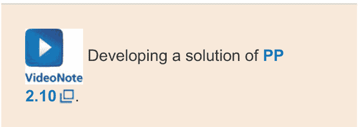
- PP 2.11 编写一个程序，提示并读取一个表示金额的 `double` 类型值。然后确定表示该金额所需的最少数量钞票和硬币，从面值最高的（假设十美元钞是所需的最大面）。例如，如果输入的值是 47.63（四十七美元六十三分），则程序应按如下打印等量金额：
```
4 ten dollar bills
1 five dollar bills
2 one dollar bills
2 quarters
1 dimes
0 nickels
3 pennies
```
- PP 2.12 编写一个程序，提示并读取一个表示正方形边长的整数，然后打印正方形的周长和面积。
- PP 2.13 编写一个程序，提示并以整数形式读取分数的分子和分母，然后打印该分数的等值小数。

# 软件失败：NASA 火星气候轨道器与极地地着陆器

## 发生了什么？


### 火星气候轨道器的艺术概念构想图

作为探索火星系列任务的一部分，NASA 于 1998 年 12 月发射了火星气候轨道器，并于 1999 年 1 月发射了火星极地着陆陆器。这项双探测器任务旨在观察火星每个季节的大气状况。轨道器和着陆器将收集有关温度、尘埃、水蒸气、云层以及火星极地区添加和移除的二氧化碳（CO₂）数量的数据。

在经过九个月的飞行后，轨道器于 1999 年 9 月到达火星，并点燃主引擎建立轨道。轨道器按计划在五分钟后（从地球视角看）经过行星后方，但 NASA 在预期其出现后未能与其重新建立联系。数据审查显示，轨道器进入轨道时的高度仅为 57 公里，而计划高度为 140 公里。最小生存高度在 85 到 100 公里之间。NASA 得结论认为轨道器被大气摩擦摧毁。

极地着陆器于 1999 年 12 月到达火星，所有数据表明它正按目标计划在火星南极目标着陆点 10 公里内成功软着陆。然而，NASA 在着陆器进入大气层后不久就失去了联系。在过去的几周和几个月里，多次尝试重新建立联系均告失败。

轨道器和着陆器的项目总成本为 3.276 亿美元。

## 是什么导致了这种情况？

轨道器问题的根源是一个令人尴尬的通信问题。引导航天器导航的软件使用的是制单位（磅力），而航天器本身期望接收的是公制数据（牛顿）。因此，预期的导航调整与实际效果之间存在 4.45 倍的偏差。这种不匹配在某种程度上是因为位于科罗拉多州的团队领导了航天器的工作，而位于加利福尼亚州的团队则负责管理导航问题。

着陆器通信问题的原因尚未解决，但据信与轨道器的问题无关。调查结论，最可能的原因是一个软件错误，它将着陆器支腿部署时产生的震动误认为是实际着陆时的震动。

# 3 使用类和对象

## 章节目标

- 讨论对象的创建以及引用变量的使用。
- 探索 `String` 类提供的服务。
- 探索 `Random` 和 `Math` 类提供的服务。
- 讨论输出格式化的方法。
- 引入枚举类和自动箱概念。
- 引入 JavaFX API。
- 探索表示形状的类。

在第 1 章结束时，我们介绍了面向对象概念的概述，包括类和对象之间的基本关系。接着在第 2 章中，在讨论原始数据的同时，我们提供了一些使用对象的示例。本章将进一步探讨这些思想。

## 3.1 创建对象

在之前的示例中，我们多次使用了 `println` 方法。正如我们在第 2 章中提到的，`println` 方法是由 `System.out` 对象提供的服务，该对象代表标准输出流。更准确地说，`out` 是存储在 `System` 类中的一个对象变量。它作为 Java 标准类库的一部分已经为我们预定义并设置好。我们可以直接使用它。

必须声明。用于定义对象的类可以被视为对象的类型。对象变量的声明结构与基本类型变量的声明相似。

考虑以下两个声明：
```java
int num;
String name;
```

第一个声明创建了一个存储整数值的变量，正如我们之前多次看到的那样。第二个声明创建了一个持有指向 `String` 对象*引用*（reference）的变量。`String` 变量并不持有对象，它持有的是对象的地址。

最初，上述声明的两个变量不包含任何数据。我们说它们是*未初始化的*（uninitialized），可以如下所示：

| num | |
| name | |

正如我们在第 2 章中指出的，在使用变量之前确保它已初始化始终非常重要。对于对象变量，这意味着我们必须在使用之前确保它引用的是一个有效对象。在大多数情况下，如果你尝试在初始化变量之前使用它，编译器将抛出错误。

对象变量也可以被设置为 `null`，`null` 是 Java 中的一个保留字。`null` 引用专门表示变量不引用任何对象。

请注意，虽然我们声明了一个 `String` 引用变量，但实际上并不存在 `String` 对象。使用 `new` 操作符创建对象的行为被称为实例化（instantiation）。一个对象被称为特定类的类的实例（`instance`）。为了实例化一个对象，我们可以使用 `new` 操作符，它返回新对象的地址。以下两个赋值语句为上述声明的两个变量赋值：
```java
num = 42;
name = new String("James Gosling");
```

在 `new` 操作符创建对象后，会调用一个构造函数进行初始设置。构造函数是一个与类名相同的特殊方法。在这个例中，该构造函数的参数是一个字符串字面量，指定了字符串对象将持有的字符。在执行这些赋值后，变量可以被描述为：

> 核心概念
>
> `new` 操作符返回一个指向新创建对象的引用。

| num | 42 |
| name | "James Gosling" |

由于对象引用变量持有对象的地址，因此它可以被视为指向内存中存储该对象的位置的指针。我们可以显示数值地址，但实际的地址值是无关的——重要的是该变量引用了一个特定的对象。


在对象实例化后，我们使用点操作符来访问它的方法。我们已经多次使用过点操作符，例如在调用 `System.out.println` 时。点操作符直接附加在对象引用之后，随后是要调用的方法。例如，要调用 `String` 类中定义的 `length` 方法，我们可以对 `name` 引用变量使用点操作符：
```java
count = name.length()
```

`length` 方法不接受任何参数，但括号仍然是必要的，用来表示正在调用方法。某些方法会在方法完成后产生一个*返回*（returned）的值。`String` 类 `length` 方法的作用是确定并返回字符串的长度（包含的字符数）。在这个例中，返回的值被赋值给变量 `count`。对于字符串 "James Gosling"，`length` 方法返回 `13`，这包括第一个和最后一个姓之间的空格。某些方法不返回值。其他的 `String` 方法将在下一节中讨论。

声明对象引用变量和创建对象本身的行为可以通过在声明时初始化变量合并为一个步骤，就像我们处理基本类型时所做的一样：
```java
String title = new String("Java Software Solutions");
```

尽管它们不是基本类型，但字符字符串是非常基础且被频繁使用的，因此正如我们在各种示例中看到的，Java 定义了由双引号界定的字符串字面量。这是一种快捷表示法。每当字符串字面量出现时，都会自动创建一个 `String` 对象。因此，以下声明是有效的：
```java
String city = "London";
```

也就是说，对于 `String` 对象，可以消除显式使用 `new` 操作符和构造构造函数。在大多数情况下，我们将使用这种简化语法。

### 别名 (Aliases)

由于对象引用变量存储的是地址，程序员在管理对象时必须小心。首先，让我们复习赋值对基本类型值的影响。假设有两个整数变量，`num1` 初始化为 5，`num2` 初始化为 12：

| num1 | 5 |
| num2 | 12 |

在接下来的赋值语句中，存储在 `num1` 中的值的副本被存储在 `num2` 中：
```java
num2 = num1;
```

`num2` 中原始值 12 被值 5 覆盖。变量 `num1` 和 `num2` 仍然引用内存中的不同位置，而这两个位置现在都包含值 5：

| num1 | 5 |
| num2 | 5 |

现在考虑以下对象声明：
```java
String name1 = "Ada, Countess of Lovelace";
String name2 = "Grace Murray Hopper";
```

最初，引用 `name1` 和 `name2` 引用不同的 `String` 对象：

| name1 | "Ada, Countess of Lovelace" |
| name2 | "Grace Murray Hopper" |

现在假设执行了以下赋值语句，将 `name1` 的值拷贝到 `name2`：
```java
name2 = name1;
```

但记住，对象变量持有的是地址，被拷贝的是地址。最初它们引用不同的对象。赋值后，`name1` 和 `name2` 包含相同的地址，因此引用同一个对象：

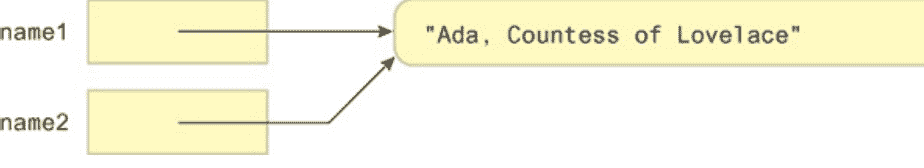

`name1` 和 `name2` 引用变量现在彼此的*别名*（aliases），因为它们是指向同一个对象的两个名称。`name2` 原先引用已经消失；该对象无法再次使用。

> 核心概念
> 多个引用变量可以引用同一个对象。

别名的一个重要影响是，当我们使用一个引用更改对象时，另一个引用也会发生变化，因为只有一个对象。除非仔细管理，别名可能会产生意外的影响。

与对象的交互都通过引用变量进行，因此只有当我们拥有对象的引用时才能使用该对象。当对象的所有引用丢失时（例如通过重新赋值），该对象不能再为程序做贡献。程序无法调用它的方法或使用它的变量。此时，该对象被称为*垃圾*（garbage），因为它不再有用处。

Java 执行*自动垃圾回收*。当对象的最后一个引用丢失时，该对象就成为垃圾回收的候选。偶尔，Java 环境会在后台执行一个方法，收集所有标记为垃圾的对象并将内存返回给系统供以后使用。程序员不需要显式回收变成垃圾的内存。

### 自测

（答案见附录 L）

- SR 3.1 什么是 `null` 引用？
- SR 3.2 `new` 操作符完成了什么？
- SR 3.3 为名为 `author` 的 `String` 变量编写声明，并将其初始化为字符串 "Fred Brooks"。画出该变量及其值的图形表示。
- SR 3.4 编写一条代码语句，将整数变量 `size` 的值设置为名为 `name` 对象的长度。
- SR 3.5 什么是别名？它与垃圾回收有什么关系？

## 3.2 String 类

让我们详细检查一下 `String` 类。图 3.1 列出了 `String` 类的一些更实用的方法。

```java
String(String str)
```
构造函数：创建一个与 `str` 具有相同字符的新字符串对象。

```java
char charAt(int index)
```
返回指定索引处的字符。

```java
int compareTo(String str)
```
返回一个整数，表示此字符串在字典序上是在 `str` 之前（返回负值）、相等（返回零值）还是之后（返回正值）。

```java
String concat(String str)
```
返回一个新字符串，该字符串是由此字符串与 `str` 拼接而成的。

```java
boolean equals-String equals(String str)
```
如果此字符串包含与 `str` 相同的字符（包括大小写），则返回 `true`，否则返回 `false`。

```java
boolean equalsIgnoreCase(String str)
```
如果此字符串包含与 `str` 相同的字符（不区分大小写），则返回 `true`，否则返回 `false`。

```java
int length()
```
返回此字符串中的字符数。

```java
String replace(char oldChar, char newChar)
```
返回一个新字符串，该字符串与此字符串相同，但所有 `oldChar` 出现的地方都被替换为 `newChar`。

```java
String substring(int offset, int endIndex)
```
返回一个新字符串，它是此字符串从索引 `offset` 开始到 `endIndex-1` 的子集。

```java
String toLowerCase()
```
返回一个新字符串，该字符串与此字符串相同，但所有大写字母都被转换为对应的小写字母。

```java
String toUpperCase()
```


返回一个新字符串，该字符串与此字符串相同，但所有小写字母都被转换为对应的大写字母。

图 3.1 String 类的一些方法

一旦创建了 `String` 对象，它的值就不能被延长或缩短，它的任何字符都不能改变。因此，我们说 `String` 对象是不可变的。然而，`String` 类中的几个方法会返回新的 `String` 对象，这些对象是修改原始字符串值产生的结果。

注意，某些 `String` 方法引用了特定字符的索引。字符串中的字符可以通过其在字符串中的位置或索引来指定。字符串中第一个字符的索引为 0，下一个字符的索引为 1，依此类推。因此，在字符串 "Hello" 中，字符 'H' 的索引是 0，索引为 4 的字符是 'o'。

列表 3.1 所示的程序中练习了几个 `String` 方法。

### 列表 3.1

```
****************************************************************
// StringMutation.java       作者: Lewis/Loftus
//
// 展示了 String 类及其方法的用法。
****************************************************************
```

```
public class StringMutation
{
    //------------------------------------------------------
    // 打印一个字符串及其各种变体。
    //------------------------------------------------------
    public static void main(String[] args) {
        String phrase = "Change is inevitable";
        String mutation1, mutation2, mutation3, mutation4;
        System.out.println("Original string: \"" + phrase + "\"");
        System.out.println("Length of string: " + phrase.length());
        mutation1 = phrase.concat(", except from vending machines.");
        mutation2 = mutation1.toUpperCase();
        mutation3 = mutation2.replace('E', 'X');
        mutation4 = mutation3.substring(3, 30);
        // 打印每个变体字符串
        System.out.println("Mutation #1: " + mutation1);
        System.out.println("Mutation #2: " + mutation2);
        System.out.println("Mutation #3: " + mutation3);
        System.out.println("Mutation #4: " + mutation4);
        System.out.println("Mutated length: " + mutation4.length());
    }
}
```

### 输出

```
Original string: "Change is inevitable"
Length of string: 19
Mutation #1: Change is inevitable, except from vending machines.
Mutation #2: CHANGE IS INEVITABLE, EXCEPT FROM VENDING MACHINES.
Mutation #3: CHANG IS INXVITABLE, EXCEPT FROM VENDING MACHINES.
Mutation #4: GE IS INXVITABLE, EXCEPT FROM VEND
Mutated length: 27
```

包的组织方式比 API 名称更为基础且基于语言的。虽然包名和 API 名之间存在通用的对应关系，但构成特定 API 的类组可能会跨越包。

图 3.2 描述了 Java API 的某些包。这些包适用于任何支持 Java 软件开发的平台。其中某些包支持非常特定的编程技术，在开发基础程序时不会派用场。

### 图 3.2 Java API 中的某些包

| 包 | 提供支持 |
| --- | --- |
| `java.awt` | 绘制图形并创建图形用户界面；AWT 代表 Abstract Windowing Toolkit（抽象窗口工具包）。 |
| `java.beans` | 定义可以轻松组合到应用程序中的软件组件。 |
| `java.io` | 执行各种输入和输出功能。 |
| `java.lang` | 通用支持；它会自动导入到所有 Java 程序中。 |
| `java.math` | 执行任意精度的计算。 |
| `java.net` | 跨网络通信。 |
| `java.rmi` | 创建可以分布在多台计算机上的程序；RMI 代表 Remote Method Invocation（远程方法调用）。 |
| `java.security` | 强制执行安全限制。 |
| `java.sql` | 与数据库交互；SQL 代表 Structured Query Language（结构查询语言）。 |
| `java.text` | 为输出格式化文本。 |
| `java.util` | 通用工具。 |
| `javafx.scene.shape` | 表示圆形和矩形等形状。 |
| `javafx.scene.control` | 显示按钮和滑块等图形控制控件。 |

本书将贯穿使用 Java API 的各种类。为了方便起见，我们在书中包含了一些所用类的文档（例如图 3.1 中关于 `String` 方法的信息），但对你来说，了解如何获取更多关于 Java API 类的信息也非常重要。在线 Java API 文档对任何 Java 程序员来说都是无价之宝。它是一个列出标准 Java API 中每个类的网站，并列出并描述了每个类中的方法。

**图 3.3** 显示了文档的一页。侧边的链接允许你检查特定的包并跳转到特定的类。花些时间熟悉该网站的操作并学习信息是如何组织的。你可以下载整套 Java API 文档，这样你就可以随时拥有一个本地副本，或者你可以依赖在线版本。

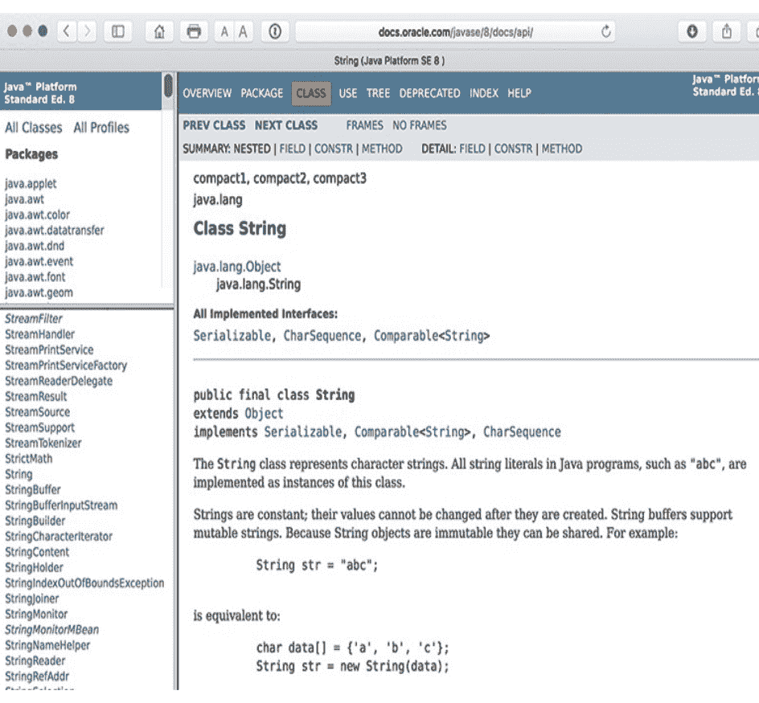

图 3.3 在线 Java API 文档的一页

### 导入声明

在编写 Java 程序时，`java.lang` 包中的类自动可用。然而，要使用来自任何其他包的类，我们必须使用完全限定引用，或者使用 `import` 声明。回想一下第 2 章中的示例程序，使用 `Scanner` 类时包含了 `import` 声明。

当你想要在程序中使用类库中的某个类时，可以在每次引用它时使用其完全限定名（包括包名）。例如，每当你想引用定义在 `java.util` 包中的 `Scanner` 类时，你可以写 `java.util.Scanner`。然而，每次需要都完全指定包名和类名很快就会变得疲惫。Java 提供了 `import` 声明来简化这些引用。

`import` 声明指定了程序中将使用的包和类，这样在每次引用时就不需要完全限定名了。正如我们所看到的，下面是一个 `import` 声明的示例：

```
import java.util.Scanner;
```

此声明断言在程序可以使用 `java.util` 包中的 `Scanner` 类。一旦做了此 `import` 声明，在程序中引用该类时，使用相同的名称 `Scanner` 就足够了。

如果来自两个包的两个类具有相同的名称，`import` 声明是不够的，因为编译器无法确定代码流中引用的是哪一个类。当出现这种情况时（虽然很罕见），应该在代码中使用完全限定名。

`import` 声明的另一种形式使用星号（`*`）表示包内的任何类都可以在程序中使用。因此，以下声明允许在程序中引用 `java.util` 包中的所有类，而无需对每次引用进行限定：

```
import java.util.*;
```

如果程序只使用特定包的一个类，通常在 `import` 声明中具体指定类名更好。然而，如果使用两个或多个，使用 `*` 符号通常是可以的。

`java.lang` 包中的类被自动导入，是因为它们是基础的，可以被认为是语言的基本扩展。因此，`java.lang` 包中的任何类（如 `System` 和 `String`）都可以在没有显式 `import` 声明的情况下使用。这就好像所有程序文件自动包含以下声明一样：

> **核心概念**
> 每个程序都会自动导入 `java.lang` 包中的所有类。

```
import java.lang.*;
```

### 自测习题

（答案见附录 L 🔗）

- SR 3.10 什么是 Java 包？
- SR 3.11 `java.net` 包包含什么？`javafx.scene.shape` 包包含什么？
- SR 3.12 哪个包包含 `Scanner` 类？`Random` 类呢？`Math` 类？
- SR 3.13 使用在线 API 文档描述 `Point` 类。
- SR 3.14 `import` 语句实现了什么功能？
- SR 3.15 为什么 `String` 类不需要专门导入？

## 3.4 Random 类

在编写软件时，经常需要随机数。游戏经常使用随机数来代表掷骰子或洗牌。一个飞行模拟器可能会使用随机数来确定飞机发生引擎故障的频率。旨在帮助学生准备考试的程序使用随机数来选择下一个问题。

`Random` 类是 `java.util` 的一部分，代表一个伪随机数生成器。随机数生成器随机选择一个数字。扮演此角色的程序技术上是伪随机的，因为程序没有实际上随机选择数字的方法。伪随机数生成器根据初始种子值执行一系列复杂的计算并产生数字。尽管它们在技术上不是随机的（因为是计算出来的），伪随机数生成器产生的值通常看起来是随机的，至少对于大多数情况。

> **核心概念**
> 伪随机数生成器通过复杂的计算产生随机的幻象。

图 3.4 列出了 `Random` 类的一些方法。`nextInt` 方法可以不带参数调用，也可以传递一个单整数值。不带参数的版本生成整个 `int` 范围内的随机数（包括负数）。通常，我们需要更特定范围内的随机数。例如，为了模拟掷骰子，我们可能需要 1-6 范围内的随机数。`nextInt` 方法返回从 0 到参数减 1 范围内的值。例如，如果我们传入 100，我们将得到一个大于或等于 0 且小于或等于 99 的返回值。

### 图 3.4 Random 类的一些方法

| 方法 | 说明 |
| --- | --- |
| `Random()` | 构造函数：创建一个新的伪随机数生成器。 |
| `float nextFloat()` | 返回 0.0（包含）到 1.0（不包含）之间的随机数。 |
| `int nextInt()` | 返回跨越所有可能的 `int` 值（正负数）的随机数。 |
| `int nextInt(int num)` | 返回 0 到 `num-1` 范围内的随机数。 |

请注意，我们传递给 `nextInt` 方法的值也是我们可以返回的可能值的数量。我们可以通过增加或减少适当的数量来按需要移动范围。要获取 1–6 范围内的随机数，我们可以调用 `nextInt(6)` 获取一个 0 到 5 之间的值，然后加 1。

`Random` 类的 `nextFloat` 方法返回一个大于或等于 0 且小于 1 的 `float` 值。如果需要，我们可以使用乘法来缩放结果，将其转换为 `int` 值以截断小数部分，然后像我们处理整数那样移动范围。

列表 3.2 所示的程序产生了多个不同范围内的随机数。

### 列表 3.2

```
/*****************************************************************
// RandomNumbers.java      Author: Lewis/Loftus
//
// 演示了如何使用
// Random 类创建伪随机数。
/*****************************************************************/
```

```
import java.util.Random;

public class RandomNumbers {
    //--------------------
    // 生成各种范围内的随机数
    //---------------------
    public static void main(String[] args) {
        Random generator = new Random();
        int num1;
        float num2;
        num1 = generator.nextInt();
        System.out.println("A random integer: " + num1);
        num1 = generator.nextInt(10);
        System.out.println("From 0 to 9: " + num1);
        num1 = generator.nextInt(10) + 1;
        System.out.println("From 1 to 10: " + num1);
        num1 = generator.nextInt(15) + 20;
        System.out.println("From 20 to 34: " + num1);
        num1 = generator.nextInt(20) - 10;
        System.out.println("From -10 to 9: " + num1);
        num2 = generator.nextFloat();
        System.out.println("A random float (between 0-1): " + num2);
        num2 = generator.nextFloat() * 6; // 0.0 to 5.999999
        num1 = (int)num2 + 1;
        System.out.println("From 1 to 6: " + num1);
    }
}
```

### 输出

```
A random integer: 1773351873
From 0 to 9: 8
From 1 to 10: 6
From 20 to 34: 20
From -10 to 9: -6
A random float (between 0-1): 0.71058085
From 1 to 6: 3
```


# 自测习题

（答案见附录 L）

**SR 3.16** 给定一个名为 `rand` 的 `Random` 对象，调用 `rand.nextInt()` 返回什么？

**SR 3.17** 给定一个名为 `rand` 的 `Random` 对象，调用 `rand.nextInt(20)` 返回什么？

**SR 3.18** 假设已创建一个名为 `generator` 的 `Random` 对象，以下每个表达式的结果范围是什么？

- a. `generator.nextInt(50)`
- b. `generator.nextInt(5) + 10`
- c. `generator.nextInt(10) + 5`
- d. `generator.nextInt(50) - 5`

**SR 3.19** 假设已创建一个名为 `generator` 的 `Random` 对象，编写表达式来生成以下每个整数范围（包括端点）。使用接受单个整数参数的 `nextInt` 方法版本。

- a. 0 到 30
- b. 10 到 19
- c. -5 到 5

# 3.5 Math 类

`Math` 类提供了许多基础数学函数，在计算中非常有帮助。`Math` 类定义在 `java.lang` 包中。图 3.5 列出了它的几个方法。

| 方法 | 描述 |
| :--- | :--- |
| `static int abs(int num)` | 返回 num 的绝对值。 |
| `static double acos(double num)` | |
| `static double asin(double num)` | |
| `static double atan(double num)` | 返回 num 的反余弦、反正弦或反正切。 |
| `static double cos(double angle)` | 返回 angle 的余弦，单位为弧度。 |
| `static double sin(double angle)` | |
| `static double tan(double angle)` | 返回 angle 的正切。 |
| `static double ceil(double num)` | 返回大于或等于 num 的最小整数。 |
| `static double exp(double power)` | 返回 e 的幂次方。 |
| `static double floor(double num)` | 返回小于或等于 num 的最大整数。 |
| `static double pow(double num, double power)` | 返回 num 的幂次方。 |
| `static double random()` | 返回 0.0（包含）和 1.0（不包含）之间的随机数。 |
| `static double sqrt(double num)` | 返回 num 的平方根，num 必须为正数。 |

图 3.5 Math 类的一些方法

`Math` 类所有的方法都是静态方法（也称为 `class methods`），这意味着可以通过类名直接调用，而无需实例化对象。静态方法将在第 [6 章](#) 讨论。

`Math` 类的方法返回值，可以在表达式中使用。例如，以下语句计算 `total` 中数的绝对值，将其加上 `count` 的四次方，并将结果存储在变量 `value` 中：

> **核心概念**
> `Math` 类的所有方法都是静态的，这意味着它们通过类名调用。

```
value = Math.abs(total) + Math.pow(count, 4);
```

注意，你可以向接受 `double` 参数的方法传递整数值。这种类型转换在 [2 章](#) 讨论过。

列表 3.3 所示的 Quadratic 程序使用 Math 类来确定方程的根。二次方程公式为：

roots = -b ± √(b² - 4ac) / 2a

使用 Random 和 Math 类的示例

```java
/*****************************************************************
// Quadratic.java      Author: Lewis/Loftus
//
// 演示了使用 Math 类计算二次方程的根。
/*************************************************/

import java.util.Scanner;

public class Quadratic {

    //--------------------
    // 确定二次方程的根
    //---------------------
    public static void main(String[] args) {

        double a, b, c, discriminant, root1, root2;

        Scanner scan = new Scanner(System.in);

        System.out.print("Enter the coefficient of x squared: ");
        a = scan.nextDouble();

        System.out.print("Enter the coefficient of x: ");
        b = scan.nextDouble();

        System.out.print("Enter the constant: ");
        c = scan.nextDouble();

        // 假设判别式为正数
        discriminant = Math.pow(b, 2) - (4 * a * c);

        root1 = ((-1 * b) + Math.sqrt(discriminant)) / (2 * a);
        root2 = ((-1 * b) - Math.sqrt(discriminant)) / (2 * a);

        System.out.println("Root #1: " + root1);
        System.out.println("Root #2: " + root2);

    }
}
```

### 输出

```
Enter the coefficient of x squared: 3
Enter the coefficient of x: 8
Enter the constant: 4
Root #1: -0.6666666666666666
Root #2: -2.0
```


注意此程序假设判别式（根号下的值）为正数。如果不是，结果将不是有效数字，Java 将其表示为 `NaN`，代表“非数字”。在第 5 章中，我们将看到如何优雅地处理这种类型情况。

### 自测习题

（答案见附录 L）

**SR 3.20** 什么是类方法（也称为静态方法）？

**SR 3.21** 以下每个表达式的值是多少？

- a. `Math.abs(10) + Math.abs(-10)`
- b. `Math.pow(2, 4)`
- c. `Math.pow(4, 2)`
- d. `Math.pow(3, 5)`
- e. `Math.pow(5, 3)`
- f. `Math.sqrt(16)`

**SR 3.22** 写一个语句，打印测量为 1.23 弧度的正弦值。

**SR 3.23** 为 `double` 类型变量 result 声明，并将其初始化为 5 的 2.5 次方。

**SR 3.24** 使用在线 Java API 文档，列出图 3.5 中未包含的三个 Math 类方法。

## 3.6 输出格式化

`Format` 类和 `DecimalFormat` 类用于对信息进行格式化，使其在打印或显示时看起来恰当。它们都是 Java 标准类库的一部分，并定义在 `java.text` 包中。

### NumberFormat 类

`NumberFormat` 类为数字提供了通用的格式化功能。你不需要使用 `new` 运算符来实例化 `NumberFormat` 对象。相反，你通过类名本身调用的某个静态方法来请求一个对象。图 3.6 列出了 `NumberFormat` 类的一些方法。

| 方法 | 描述 |
| :--- | :--- |
| `String format(double number)` | 返回一个包含指定数字的字符串，该数字根据对象的模式进行了格式化。 |
| `static NumberFormat getCurrencyInstance()` | 返回一个表示当前区域货币格式的 `NumberFormat` 对象。 |
| `static NumberFormat getPercentInstance()` | 返回一个表示当前区域百分比格式的 `NumberFormat` 对象。 |

图 3.6 NumberFormat 类的一些方法

`NumberFormat` 类中的两个方法 `getCurrencyInstance` 和 `getPercentInstance` 返回一个用于格式化数字的对象。`getCurrencyInstance` 方法返回一个货币值的格式化器，而 `getPercentInstance` 方法返回一个格式化百分比的对象。`format` 方法通过格式化对象调用，并返回一个包含以适当方式格式化数字的 `String`。

列表 3.4 所示的 `Purchase` 程序使用了两种格式化器。它读取销售交易并计算包含税的最终价格。

### 列表 3.4

```java
//***************************************************************************
// Purchase.java           Author: Lewis/Loftus
// 展示了如何使用 NumberFormat 类对输出进行格式化。
//***************************************************************************

import java.util.Scanner;
import java.text.NumberFormat;

public class Purchase {
    //-------------------------------------------------------
    // 使用用户输入的值计算购买物品的最终价格。
    //-------------------------------------------------------
    public static void main(String[] args) {
        final double TAX_RATE = 0.06; // 6% 销售税

        int quantity;
        double subtotal, tax, totalCost, unitPrice;

        Scanner scan = new Scanner(System.in);

        NumberFormat fmt1 = NumberFormat.getCurrencyInstance();
        NumberFormat fmt2 = NumberFormat.getPercentInstance();

        System.out.print("Enter the quantity: ");
        quantity = scan.nextInt();

        System.out.print("Enter the unit price: ");
        unitPrice = scan.nextDouble();

        subtotal = quantity * unitPrice;
        tax = subtotal * TAX_RATE;
        totalCost = subtotal + tax;

        // 使用适当的格式打印输出
        System.out.println("Subtotal: " + fmt1.format(subtotal));
        System.out.println("Tax: " + fmt1.format(tax) + " at " + fmt2.format(TAX_RATE));
        System.out.println("Total: " + fmt1.format(totalCost));
    }
}
```

### 输出

```
Enter the quantity: 5
Enter the unit price: 3.87
Subtotal: $19.35
Tax: $1.16 at 6%
Total: $20.51
```

### DecimalFormat 类

与 `NumberFormat` 类不同，`DecimalFormat` 类是使用 `new` 运算符以传统方式实例化的。它的构造函数接收一个表示格式化过程模式的字符串。我们可以使用 `format` 方法来格式化特定值。之后，如果我们想更改格式化器对象使用的模式，可以调用 `applyPattern` 方法。图 3.7 描述了这些方法。

| 方法 | 描述 |
| :--- | :--- |
| `DecimalFormat(String pattern)` | 构造函数：创建一个带有指定模式的新 `DecimalFormat` 对象。 |
| `void applyPattern(String pattern)` | 将指定的模式应用到此 `DecimalFormat` 对象。 |
| `String format(double number)` | 返回一个包含指定数字的字符串，该数字根据当前模式进行了格式化。 |

图 3.7 DecimalFormat 类的一些方法

传递给 `DecimalFormat` 构造函数的字符串所定义的模式可以非常复杂。使用了多种符号来表示格式化指南。例如，由字符串 `"0.###"` 定义的模式表示小数点左侧至少打印一个数字。`###` 表示数值的小数部分应该保留三位有效数字。该模式用于列表 3.5 所示的 `CircleStats` 程序，该程序从用户处读取半径并计算面积和周长。

### 列表 3.5

```java
//***************************************************************************
// CircleStats.java           Author: Lewis/Loftus
// 展示了如何使用 DecimalFormat 类对小数值进行格式化。
//***************************************************************************

import java.util.Scanner;
import java.text.DecimalFormat;

public class CircleStats {

    //-------------------------------------------------------
    // 根据给定的半径计算圆的面积和周长。
    //-------------------------------------------------------
    public static void main(String[] args) {

        int radius;
        double area, circumference;

        Scanner scan = new Scanner(System.in);

        System.out.print("Enter the circle's radius: ");
        radius = scan.nextInt();

        area = Math.PI * Math.pow(radius, 2);
        circumference = 2 * Math.PI * radius;

        // 将输出保留三位小数
        DecimalFormat fmt = new DecimalFormat("0.###");

        System.out.println("The circle's area: " + fmt.format(area));
        System.out.println("The circle's circumference: " + fmt.format(circumference));
    }
}
```

### 输出

```
Enter the circle's radius: 5
The circle's area: 78.54
The circle's circumference: 31.416
```

### printf 方法

除了 `print` 和 `println` 之外，`System` 类还有另一个输出方法称为 `printf`，它允许用户打印包含数据的格式化字符串。该方法的第一个参数表示格式字符串，其余参数指定了插入其中的值。

例如，以下行代码打印了一个 ID 数字和名称：

```java
System.out.printf("ID: %5d\tName: %s", id, name);
```

第一个参数指定了输出的格式，包含了作为标签的字面字符以及转义字符 `\t`。模式 `%5d` 表示对应的数值 (`id`) 应该在一个五个字符的字段内打印。模式 `%s` 匹配字符串参数 `name`。`id` 和 `name` 的值被插入字符串，产生如下：

```
ID: 24036 Name: Larry Flagelhopper
```


添加 `printf` 方法是为了镜像 C 编程语言中使用的类似函数。它使得程序员更容易将现有的 C 程序翻译（或迁移）到 Java。

具有价值的旧软件被称为遗留系统。维护遗留系统通常是一项昂贵的工作，由于其他原因，它是基于旧的技术。但在许多情况下，维护遗留系统比使用新语言编写并迁移更具成本效益。添加 `printf` 方法试图通过提供 C 程序员依赖的相同输出语句，使迁移变得更容易，从而降低成本。

不是一个解决输出格式化问题的特别良好的面向对象的解决方案，因此我们在本书书中避免使用它。

> **核心概念**
> `printf` 方法添加到 Java 中是为了支持遗留系统的迁移。

# 自测问题

（参见附录 L 中的答案）

SR 3.25 描述如何请求一个 `NumberFormat` 对象以便在程序中使用。

SR 3.26 假设在你的程序中有一个名为 `cost` 的 `double` 变量。你希望将 `cost` 中存储的值格式化为当前区域的货币并输出。

- a. 编写一条代码语句，声明并请求一个名为 `moneyFormat` 的 `NumberFormat` 对象，该对象可以表示当前区域设置格式的货币。
- b. 编写一条代码语句，使用 `moneyFormat` 对象打印 `cost` 的值，将其格式化为当前区域的货币格式。
- c. 如果 `cost` 的值为 54.89 且你计算机的区域设置设置为美国，那么你在 (b) 部分编写的语句的输出是什么？如果你计算机的区域设置为英国，输出又是怎样的？

SR 3.27 使用 Java 的格式化类将浮点值输出为百分比形式的步骤有哪些？

SR 3.28 编写代码语句，提示并从用户读取一个 `double` 值，然后打印输入值绝对值的平方根结果。输出结果保留两位小数。

## 3.7 枚举类型

Java 提供了定义枚举类型的能力，该类型可以在声明变量时作为变量的类型。枚举类型通过列出（或枚举）所有可能的值，确定了该类型变量的所有取值。这些值是标识符，可以是任何所需的内容。

例如，以下声明定义了一个名为 `Season` 的枚举类型，其可能的取值为 `winter`、`spring`、`summer` 和 `fall`：

```java
enum Season {winter, spring, summer, fall}
```

枚举类型可以列出的值数量没有限制。一旦定义了该类型，就可以声明该类型的变量：

```java
Season time;
```

> 核心概念
> 枚举类型是类型安全的，确保不会使用无效值。

变量 `time` 现在在它可以取的值上受到了限制。它可以持有四个 `Season` 值中的之一，但不能持有其他任何值。Java 枚举类型被认为是类型安全的，这意味着任何使用枚举值之外的值的尝试都会导致编译时错误。

通过类型的名称访问这些值。例如：

```java
time = Season.spring;
```

当变量可以假设的不同值相对较少时，枚举类型会非常有用。例如，假设我们想要表示学生可能获得的各种字母等级。我们可能会声明如下枚举类型：

```java
enum Grade {A, B, C, D, F};
```

任何持有 `Grade` 的初始化变量都保证具有其中一个有效等级。这比使用简单的字符（`char`）或字符串（`string`）变量来表示等级要更好，因为后者可以取任何值。

假设我们还想表示加分和减分等级，例如 A- 和 B+。我们不能使用 `A-` 或 `B+` 作为值，因为它们不是有效的标识符（字符 `'-'` 和 `'+'` 不能作为 Java 标识符的一部分）。然而，可以使用标识符 `Aminus`、`Bplus` 等来表示这些相同的值。

在内部，枚举类型中的每个值都被存储为一个整数，称为它的序数值。枚举类型中的第一个值的序数值为0，第二个值的序数值为1，第三个值的序数值为2，依此类推。序数值仅在内部使用。你不能给枚举类型分配数值，即使它对应于有效的序数值。

枚举类型是一种特殊的类，枚举类型的变量是对象变量。因此，所有枚举类型都关联有几个方法。`ordinal()` 方法返回与特定枚举类型相关的数值。`name()` 方法返回值的名称。

包装类还提供了与关联原始类型管理相关的各种方法。例如，`Integer` 类包含了返回对象中存储的 `int` 值的方法，以及将存储的值转换为其他原始类型的方法。图 3.9 列出了 `Integer` 类中找到的一些方法。其他包装类也具有类似的方法。

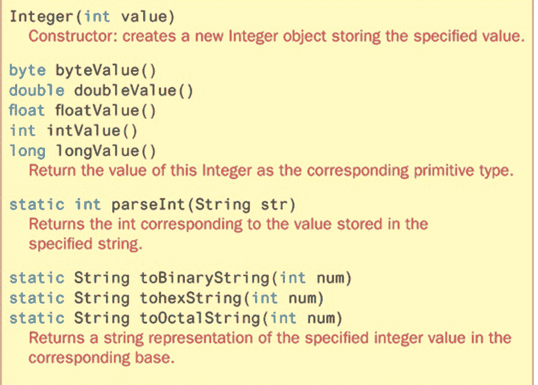

图 3.9 Integer 类的一些方法

注意，包装类还包含可以独立于任何实例化对象调用的静态方法。例如，`Integer` 类包含一个名为 `parseInt` 的静态方法，用于将存储在 `String` 中的整数转换为对应的 `int` 值。如果 `String` 对象 `str` 持有字符串 "987"，则以下行代码将字符串转换为整数值 `987` 并将其值存储在 `int` 变量 `num` 中：

```java
num = Integer.parseInt(str);
```

Java 包装类通常还包含非常有用的静态常量。例如，`Integer` 类包含两个常量 `MIN_VALUE` 和 `MAX_VALUE`，分别持有最小和最大的 `int` 值。其他包装类包含其类型包含的常量。

### 自动装箱

自动装箱是原始值与对应的包装对象之间的自动转换。例如，在下面的代码中，一个 `int` 值被赋值给 `Integer` 对象引用变量：

```java
Integer obj;

int num1 = 69;

obj1 = num1; // 自动创建一个 Integer 对象
```

反向转换称为自动拆箱，在需要时也会自动发生。例如：

```java
Integer obj2 = new Integer(69);

int num2;

num2 = obj2; // 自动提取 int 值
```

原始类型与对象类型之间的赋值通常是不兼容的。自动装箱的功能仅发生在原始类型和相应的包装类之间。在任何其他情况下，尝试将原始值赋值给对象引用变量（或反之）都会导致编译时错误。

> 核心概念
> 自动装箱提供了原始值与相应的包装对象之间的自动转换。

### 自测习题

（答案见附录 L）

- SR 3.32 我们如何将原始值表示为对象？
- SR 3.33 下列原始类型分别对应的包装类是什么：`byte`、`int`、`double`、`char` 和 `boolean`？
- SR 3.34 假设声明了一个名为 `number` 的 `int` 变量，并声明了一个名为 `holdNumber` 的 `Integer` 变量。用 Java 中的两种方法让 `holdNumber` 代表 `number` 中存储的值。
- SR 3.35 写一条打印最大可能的 `int` 值的语句。

## 3.9 JavaFX 简介

本节标志着书中图形章节的开始。从这里起，每章的最后几节将致力于与生成图形和 GUI 相关的主题。这些章节可以在章节中遇到时涵盖，作为一个小组进行探索，或者完全跳过而不影响图形主题的覆盖。

Java 对图形和 GUI 的多年来以各种方式演变。当该语言首次引入时，它使用了一组被称为 AWT（Abstract Windowing Toolkit，抽象窗口工具包）的类。后来引入了 Swing API，它用更灵活的版本替换了 GUI 组件。然而，Swing API 最适用于桌面应用程序；其他技术被用于开发在 Web 浏览器中运行的 Java 程序。

JavaFX API 现在已取代 AWT 和 Swing 用于开发图形程序。JavaFX 结合了以前方法的优点，并添加了许多额外功能。它还可以创建可以在 Web 上运行的应用程序。管理 Java 语言的 Oracle 公司不再支持那些旧技术。

> 核心概念
> JavaFX 现在是开发使用图形和 GUI 的 Java 程序的首选方法。

列表 3.7 显示了一个名为 `HelloJavaFX` 的类的小型 JavaFX 程序。该程序显示了一个包含两个文本元素的窗口。

### 列表 3.7

```java
/*************************************************************

// HelloJavaFX.java      作者: Lewis/Loftus

//

// 演示了一个基础 JavaFX 应用程序。

//*************************************************************

import javafx.application.Application;

import javafx.scene.Group;

import javafx.scene.Scene;

import javafx.scene.paint.Color;

import javafx.scene.text.Text;

import javafx.stage.Stage;

public class HelloJavaFX extends Application
{
    //----------------------------------------------------------------------
    // 在 JavaFX 窗口中创建并显示两个 Text 对象。
    //----------------------------------------------------------------------
    public void start(Stage primaryStage) {
        Text hello = new Text(50, 50, "Hello, JavaFX!");
        Text question = new Text(120, 80, "How's it going?");
        
        Group root = new Group(hello, question);
        Scene scene = new Scene(root, 300, 120, Color.LIGHTGREEN);

        primaryStage.setTitle("A JavaFX Program");
        primaryStage.setScene(scene);
        primaryStage.show();
    }
    //----------------------------------------------------------------------
    // 启动 JavaFX 应用程序
    // 不需要 main 方法
    //----------------------------------------------------------------------
    public static void main(String[] args)
    {
        launch(args);
    }
}
```

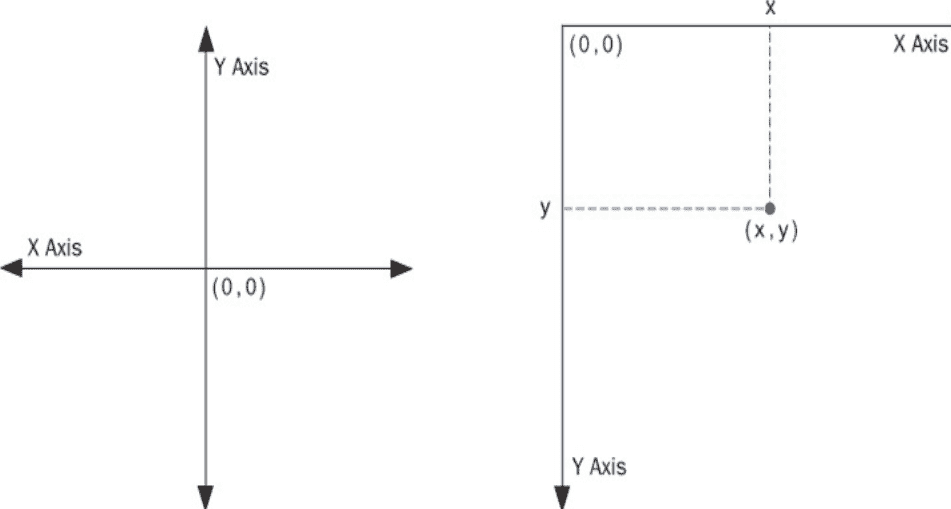

图 3.10 传统坐标系与 Java 坐标系

> 核心概念
> Java 坐标系的原点位于左上角。所有可见坐标均为正数。

此示例中第一个 `Text` 对象的显示点是 (50, 50)。因此，字符串 "Hello JavaFX!" 的第一个字符位于窗口左上角右 50 像素、下方 50 像素处。第二个 `Text` 对象距离原点右 120 像素、下方 80 像素处。

下一节将介绍包含各种几何形状的其他 JavaFX 示例。

### 自习题

（答案见附录 L）

- SR 3.36 在什么情况下，你可能会 JavaFX 应用中省略 `main` 方法？
- SR 3.37 在 JavaFX 的剧场比喻中，stage（舞台）是指什么？
- SR 3.38 scene（场景）的根节点包含什么？
- SR 3.39 描述 Java 坐标系中点 (20, 50) 的位置。

## 3.10 基础形状

JavaFX 中的形状由 `javafx.scene.shape` 包中的类表示。从这些类创建的对象可以添加到场景中进行显示。

图 3.11 显示了创建形状的构造函数调用示例。构造函数参数指定了形状的位置和大小。例如，`Line` 构造函数接受四个整数参数，表示线段的两个端点。指定哪个点为起点或终点并没有区别。

Line(startX, startY, endX, endY)
要画一条从点 (10, 20) 到点 (300, 80) 的线：
`Line line = new Line(10, 20, 300, 80);`

Rectangle(x, y, width, height)
要创建一个左上角位于点 (30, 50) 的 200 x 70 矩形：
`Rectangle myRect = new Rectangle(30, 50, 200, 70);`

Circle(centerX, centerY, radius)
要画一个半径为 40、中心点为 (100, 150) 的圆：
`Circle myCircle = new Circle(100, 150, 40);`

Ellipse(centerX, centerY, radiusX, radiusY)
要创建一个中心在 (100, 50)、水平半径为 80、垂直半径为 30 的椭圆：
`Ellipse myEllipse = new Ellipse(100, 50, 80, 30);`

图 3.11 某些 JavaFX 形状类的构造函数

`Rectangle` 构造函数的前两个参数指定矩形左上角的位置，其他参数指定矩形的宽度和高度。

`Circle` 和 `Ellipse` 构造函数的前两个参数指定形状的中心点。圆还有一个单一的半径值。椭圆的形状基于两个半径值：一个沿水平 x 轴，另一个沿垂直 y 轴。

代码列表 3.8 显示了一个 JavaFX 应用，该应用展示了各种形状和阿尔伯特·爱因斯坦的一句名言。与上一节中的 HelloJavaFX 示例一样，显示的元素被添加到一个 `Group` 对象中，该对象作为 `Scene` 的根节点，显示在主 `Stage`（舞台）上。

### 代码列表 3.8

```java
/********************************************************************************/

// Einstein.java               Author: Lewis/Loftus

//

// 展示了各种形状类的用法。

//********************************************************************************/

import javafx.application.Application;

import javafx.scene.Group;

import javafx.scene.Scene;

import javafx.scene.paint.Color;

import javafx.scene.shape.*;

import javafx.scene.text.Text;

import javafx.stage.Stage;

//--------------------------------------------------------------------------------------

    // 创建并显示几个形状。

//--------------------------------------------------------------------------------------

public void start(Stage primaryStage)

{

    Line line = new Line(35, 60, 150, 170);

    Circle circle = new Circle(100, 65, 20);

    circle.setFill(Color.BLUE);

    Rectangle rect = new Rectangle(60, 70, 250, 60);

    rect.setStroke(Color.RED);

    rect.setStrokeWidth(2);

    rect.setFill(null);

    Ellipse ellipse = new Ellipse(200, 100, 150, 50);

    ellipse.setFill(Color.PALEGREEN);

    Text quote = new Text(120, 100, "Out of clutter, find simplicity.\n Albert Einstein");

    Group root = new Group(ellipse, rect, circle, line, quote);

    Scene scene = new Scene(root, 400, 200);

    primaryStage.setTitle("Hello JavaFX");

    primaryStage.setScene(scene);

}
```

### 代码列表 3.9

```java
/********************************************************************************/

// Snowman.java               Author: Lewis/Loftus

//

// 展示了各种形状类的用法。
```


//********************************************************************************

import javafx.application.Application;

import javafx.scene.Group;

import javafx.scene.Scene;

import javafx.scene.paint.Color;

import javafx.scene.shape.*;

import javafx.scene.text.Text;

import javafx.stage.Stage;

//--------------------------------------------------------------------------------------

    // 创建并显示几个形状。

//--------------------------------------------------------------------------------------

public class Snowman extends Application

{

    public void start(Stage primaryStage)

    {

        Ellipse base = new Ellipse(80, 210, 50, 60);

        base.setFill(Color.WHITE);

        Ellipse middle = new Ellipse(80, 130, 50, 40);

        middle.setFill(Color.WHITE);

        Circle head = new Circle(80, 70, 30);

        head.setFill(Color.WHITE);

        Circle rightEye = new Circle(90, 60, 5);

        rightEye.setFill(Color.BLACK);

        Circle leftEye = new Circle(70, 60, 5);

        leftEye.setFill(Color.BLACK);

        Line mouth = new Line(70, 80, 90, 80);

        mouth.setStroke(Color.BLACK);

        Circle topButton = new Circle(80, 120, 6);

        topButton.setFill(Color.RED);

        Circle bottomButton = new Circle(80, 140, 6);

        bottomButton.setFill(Color.RED);

        Line leftArm = new Line(110, 130, 160, 130);

        leftArm.setStroke(Color.BLACK);

        Line rightArm = new Line(50, 130, 0, 100);

        rightArm.setStroke(Color.BLACK);

        Rectangle brim = new Rectangle(50, 45, 60, 5);

        Rectangle stovepipe = new Rectangle(60, 0, 40, 50);

        Group hat = new Group(stovepipe, brim);

        hat.translateX(10);

        hat.rotate(15);

        hat.translateX(170);

        hat.translateY(50);

        Group root = new Group(base, middle, head, rightEye, leftEye, mouth, topButton, bottomButton, leftArm, rightArm, hat);

        Scene scene = new Scene(root, 500, 350, Color.LIGHTBLUE);

        primaryStage.setTitle("Snowman");

        primaryStage.setScene(scene);

        primaryStage.show();

    }

}

```

### 显示

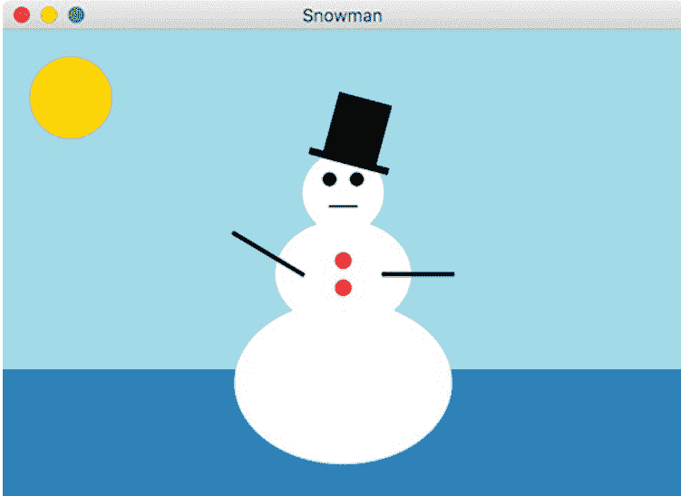

该示例以各种方式组合元素，以便对其属性进行适当调整。与之前的示例一样，场景的根节点是一个 `Group` 对象，它包含了地面、太阳和雪人。雪人本身是一个组，由身体部分、眼睛、按钮、手臂和帽子组成。帽子是另一个组，由烟囱帽和帽檐部分组成。该场景的元素层级结构如图 3.12 所示。

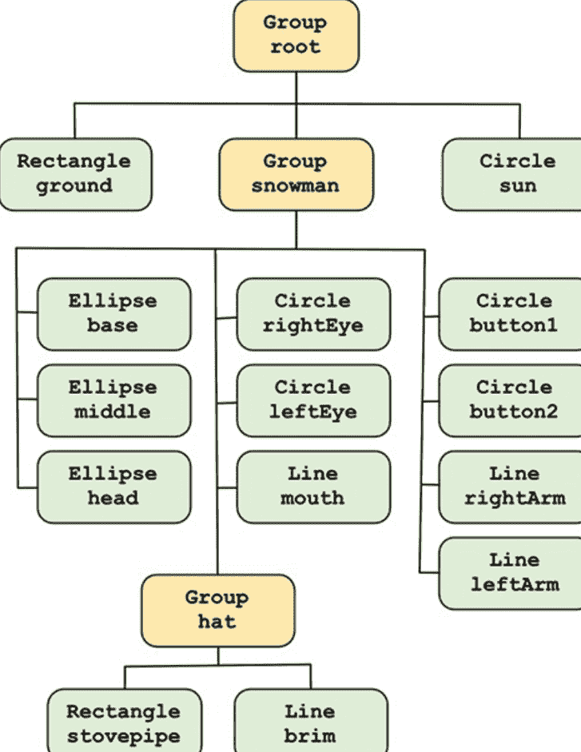

图 3.12 雪人场景元素的层级结构

如果你对形状或组调用 `translateX`，它会沿着 x 轴平移（移动）形状的位置。同样，调用 `translateY` 会沿着 y 轴平移形状。如果你仔细观察用于定位雪人元素时所用的值，你会发现它会被绘制在场景的左上角。通过适当的方法调用，它被移动到最终位置。图 3.13 显示了在不平移雪人位置时的雪人场景。

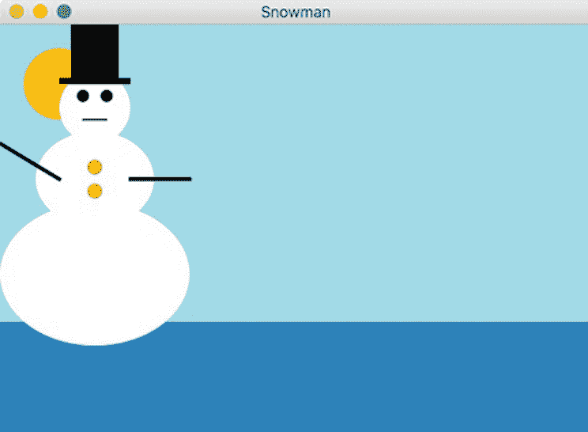

### 图 3.13 在未平移（移动）雪人位置

将像雪人这样的复杂元素定义为 `Group`（组）对象，允许你对整个组执行平移等操作。例如，为了让雪人进一步向右移动，你只需要更改传递给一个方法的值即可。如果没有进行分组，则必须更改每个元素的位置。

> 核心概念
> 形状和组可以根据需要进行平移和旋转。

同样，调用 `setRotate` 将将形状或组绕其中心点旋转指定的度数。在 `Snowman` 示例中，帽子被平移并顺时针旋转了 15 度，使其俏俏地停在雪人的头上。如果传递给 `setRotate` 方法的值为负数，则旋转将沿逆时针方向。

### 自测习题

SR 3.40 如何让一个形状出现在另一个形状的前面？
SR 3.41 为一个 `Rectangle`（矩形）编写一个声明，其宽度为 100 像素，高度为 200 像素，左上角位于坐标 (30, 20) 点。
SR 3.42 下述语句中定义的椭圆是宽大于高，还是高大于宽？

```
Ellipse ellipse = new Ellipse(100, 150, 70, 90);
```

SR 3.43 对 `Circle`（圆形）对象调用 `setFill` 并传递参数 `null` 的效果是什么？
SR 3.44 将场景中的特定元素进行分组有什么好处？

## 3.11 表示颜色

Java 中的颜色由三个数字定义，这些数字统称为 RGB 值。RGB 代表红（Red）、绿（Green）、蓝（Blue）。每个数字代表对应颜色的贡献。这种方法反映了人眼结合对应红、绿、蓝的光波的方式。

> 核心概念
> Java 使用 RGB 值表示颜色。

通常，RGB 值中的每个数字都在 0–255 范围范围内。例如，RGB 值为 255, 255, 0 的颜色具有红色和绿色的完全贡献，且没有蓝色的贡献。这导致了黄色。粉色可以通过 RGB 值 255, 175, 175 定义（完全和部分包含绿色和蓝色贡献）。RGB 数字的任何变化都会改变颜色，尽管微小的变化可能无法被察觉。

在 Java 中，颜色由 `Color` 对象表示。`Color` 类有一个名为 `rgb` 的静态方法，它根据参数指定的 RGB 值返回一个 `Color` 对象：

```
Color purple = Color.rgb(183, 44, 150);
```

`Color` 类还有另一个名为 `color` 的静态方法，允许你以百分比的形式指定 RGB 值。以下调用创建了一个基于 60% 红色、10% 绿色和 0% 蓝色的栗褐色（maroon）：

```
Color maroon = Color.color(0.6, 0.1, 0.0);
```

使用这些方法可以定义任何颜色。然而，为了方便起见，预定义了大量的 `Color` 对象——图 3.14 仅出了出了几个。请查看 `Color` 类的在线文档以获取完整的预定义颜色列表。本章之前的 JavaFX 示例使用了几种预定义颜色。

| 颜色 | 对象 | RGB 值 |
|---|---|---|
| | `Color.BLACK` | 0, 0, 0 |
| | `Color.WHITE` | 255, 255, 255 |
| | `Color.GRAY` | 128, 128, 128 |
| | `Color.RED` | 255, 0, 0 |
| | `Color.MAROON` | 128, 0, 0 |
| | `Color.LIME` | 0, 255, 0 |
| | `Color.GREEN` | 0, 128, 0 |
| | `Color.BLUE` | 0, 0, 255 |
| | `Color.NAVY` | 0, 0, 128 |
| | `Color.YELLOW` | 255, 255, 0 |
| | `Color.MAGENTA` | 255, 0, 255 |
| | `Color.CYAN` | 0, 255, 255 |
| | `Color.PINK` | 255, 192, 203 |
| | `Color.ORANGE` | 255, 165, 0 |

图 3.14 预定义颜色的一部分

## 自测习题（见附录 L）

- SR 3.46 写一个语句，使用 `rgb` 方法创建一个等同于 `Color.PINK` 的对象。
- SR 3.47 写一个语句，使用 `color` 方法创建一个等同于 `Color.YELLOW` 的对象。

### 总结

- 形状和组可以根据需要进行平移和旋转。
- Java 使用 RGB 值表示颜色。
- 通常，RGB 值中的每个数字都在 0–255 范围范围内。
- 在 Java 中，颜色由 `Color` 对象表示。
- `Color` 类提供了静态方法 `rgb` 和 `color`。
- 预定义了许多 `Color` 对象以便方便使用。

### 练习题

EX 3.1 写一个打印...的语句。
EX 3.2 写一个打印出...的语句。
EX 3.3 声明一个名为 `str` 的变量并初始化为。
EX 3.4 为一个名为 `change` 的变量编写声明并初始化为。
EX 3.5 下述片段的输出是什么？

```
String m1, m2;

m1 = 

System.out.println(m2);
```

EX 3.6 下述语句的影响是什么？

```
import java.awt.*;
```


# 练习题

## EX 3.7
假设已经创建了一个名为 `generator` 的 `Random` 对象，`nextInt` 方法的结果范围是？

- a. `generator.nextInt(20)`
- b. `generator.nextInt(8)`
- c. `generator.nextInt(12)`
- d. `generator.nextInt(100)`
- e. `generator.nextInt(50)`

## EX 3.8
编写代码实例化 `Random` 类对象。使用 `nextInt` 方法生成以下范围内的随机数：

- a. 0 到 10
- b. 0 到 400
- c. 1 到 10
- d. 1 到 400
- e. 25 到 50
- f. -10 到 15

## EX 3.9
写一个语句计算 `num1` 和 `num2` 之和并将结果赋值给 `num3`。

## EX 3.10
写一个语句计算并打印 `total` 的绝对值。

## EX 3.11
编写代码创建一个 `DecimalFormat` 对象，将数值保留四位小数。然后写一个语句使用该对象格式化并打印 `result`。

## EX 3.12
编写代码提示并读取一个 `double` 值，然后打印该值的四次方。输出结果保留三位小数。

## EX 3.13
为表示星期的枚举类型编写声明。

## EX 3.14
比较传统的坐标系和 Java 组件使用的坐标系。

## EX 3.15
为以下每一项编写声明：

- a. 从点 (60, 100) 延伸到点 (30, 90) 的线。
- b. 宽度为 20 像素、高度为 100 像素的矩形，其左上角位于 (10, 10) 点。
- c. 中心位于点 (50, 75)、半径为 30 的圆。
- d. 中心位于点 (150, 180)、宽为 100 像素、高为 80 像素的椭圆。

## EX 3.17
下列每个椭圆是宽大于高，还是高大于宽？

- a. `new Ellipse(300, 100, 50, 10)`
- b. `new Ellipse(100, 200, 20, 40)`
- c. `new Ellipse(150, 220, 60, 30)`

## EX 3.18
如何创建一个没有填充颜色的形状，以便你可以看到它背后的元素？

## EX 3.19
写一行代码，将一个名为 `myEllipse` 的椭圆顺时针旋转 45 度。

# 编程项目

## PP 3.1
编写一个程序，提示并读取用户的名和姓氏（分别读取）。然后打印一个字符串，该字符串由用户名的的第一个字母、紧接着是用户姓的前五个字符、最后是一个 10 到 99 之间的随机数组成。假设姓至少有五个字母。类似的算法有时用于为新计算机账户生成用户名。

## PP 3.2
编写一个程序，打印立方和。提示并读取两个整数值，并打印每个整数三方的和。

## PP 3.3
编写一个程序，创建并打印一个 XXX–XXX–XXXX 格式的随机电话号码。在输出中包含连字符。不要让前三位包含 8 或 9（但限制不要比这更严格），并确保第二组三个数字不超过 655。*提示：* 思考构造电话号码的最简单方法。每个数字不需要单独确定。

## PP 3.4
编写一个程序，读取一个浮点值 `double`，并打印小于该值和大于该值的最接近的整数。例如，如果数字是 28.466，该程序将打印 28 和 29。

## PP 3.5
编写一个程序，读取两个点的 $(x, y)$ 坐标。使用以下公式计算两点之间的距离：

$$
\text{Distance} = \sqrt{(x2 - x1)^2 + (y2 - y1)^2}
$$

## PP 3.6
编写一个程序，读取球的半径并打印它的体积和表面积。使用以下公式。输出结果保留四位小数。$r$ 代表半径。

$$
\text{Volume} = \frac{4}{3}\pi r^3
$$

$$
\text{Surface Area} = 4\pi r^2
$$

## PP 3.7
编写一个程序，从用户处读取三角形边长。使用海伦公式计算三角形的面积。其中 $s$ 代表周长的一半，$a, b,$ 和 $c$ 代表三边的长度。打印三位小数的面积。

$$
\text{Area} = \sqrt{s(s-a)(s-b)(s-c)}
$$

## PP 3.8
编写一个程序，生成 20 到 40 之间的随机整数的正弦、余弦和正切。

## PP 3.9
编写一个程序，生成 1 到 20 之间的随机整数半径 (r) 和高度 (h) 的圆柱，然后计算圆柱的体积和表面积。

$$
\text{Volume} = \pi r^2 h
$$

$$
\text{Surface Area} = 2\pi rh
$$

## PP 3.10
以以下方式修改雪人程序：

- 添加一个按钮。
- 将太阳移动到图片的右上角。
- 在图片的左上角显示名称。
- 将整个雪人向右移动 40 像素。

## PP 3.11
编写一个 JavaFX 程序，显示奥运标志。圆必须是链接的。

## PP 3.12
编写一个 JavaFX 程序，绘制一个带有门、窗户和烟囱的房屋。让烟囱冒出一些烟和云。

## PP 3.13
编写一个 JavaFX 程序，在 50 到 150 之间绘制一个随机半径的圆。每次运行程序它将绘制一个不同的圆。

## PP 3.14
编写一个 JavaFX 程序，以 0 到 360 度之间的随机角度旋转名称。每次运行程序它将显示不同的角度。

## PP 3.15
编写一个 JavaFX 程序，绘制一个随机颜色填充的矩形。每次运行程序它将显示一个不同颜色的矩形。

## PP 3.16
编写一个 JavaFX 程序，显示一个带有三个行星的太阳系。使用椭圆显示环绕太阳的轨道。

# 4 类

## 章节目标

- 类的结构和内容。
- 使用实例数据的对象状态。
- 可访问修饰符对方法的影响。
- 方法定义，包括参数和返回值。

## 4.1 类与对象的回顾

在第 1 章中，我们介绍了面向对象的概念，并对类进行了简要概述。在第 3 章中，我们使用了几个类。在本章中，我们将注意力放在编写自己的类上。虽然类库提供了许多类，但面向对象开发的核心在于设计和实现我们自己的类。

回顾对象与类之间的基本关系：类是对象的蓝图。类代表一个概念，从类创建的任何对象都是该概念的实现。例如，从第 3 章我们知道 `String` 类代表字符字符串的概念，每个 `String` 对象代表特定的字符串。

让我们考虑另一个例子。假设 `Student` 类代表大学的学生。从 `Student` 类创建的对象代表一个特定的学生。`Student` 类代表学生的通用概念。在管理大学业务的系统中，我们将有一个 `Student` 类和成千上万个 `Student` 对象。

回顾对象有一个*状态*，它是由与对象相关的*属性*的值定义的。学生的属性可能包括姓名、地址、专业和平均学分。`Student` 类建立了每个学生都有这些属性。每个 `Student` 对象存储特定学生的这些属性值。在 Java 中，对象的属性是在类内部定义的变量。

对象还有*行为*，它们是由与对象相关的*操作*定义的。学生的操作包括更新地址和计算当前平均学分的能力。`Student` 类定义了操作，例如计算平均学分的细节。这些操作可以在特定的 `Student` 对象上或通过它执行。注意，对象的行为可能会修改其状态。

| 类 | 属性 | 操作 |
| --- | --- | --- |
| 学生 | 姓名、地址、专业、平均学分 | 设置地址、设置专业、计算平均学分 |
| 矩形 | 长度、宽度、颜色 | 设置长度、设置宽度、设置颜色 |
| 鱼缸 | 材质、长度、宽度、高度 | 设置材质、设置长度、设置宽度、设置高度、计算体积、计算填充体积 |
| 飞行 | 航空公司、航班号、出发地、目的地、当前状态 | 设置航空公司、设置航班号、确定状态 |
| 员工 | 姓名、部门、职称、薪资 | 设置部门、设置职称、设置薪资、计算工资、计算奖金、计算税费 |

**图 4.1** 类示例以及一些可能的属性和操作

### 自我复习题

(答案见附录 L)

- SR 4.1 什么是属性？
- SR 4.2 什么是操作？
- SR 4.3 列出为代表图书馆中书籍的 `Book` 类可能定义的一些属性和操作。
- SR 4.4 判断对或错？解释原因。
    - a. 我们编写程序时应该只使用 Java 标准类库中的类——没有必要定义或使用其他类。
    - b. 对象的操作可以改变对象的状态。
    - c. 对象的当前状态会影响该对象的操作结果。
    - d. 在 Java 中，对象的状态是由它的方法表示的。

## 4.2 类的构造

在我们之前的所有示例中，我们都编写了一个包含单个 `main` 方法的类。这些类代表了短小但完整的程序。这些程序通常使用 Java 类库中预定义的类来实例化对象，并使用这些对象所提供的服务。这些预定义的类也是程序的一部分，但除了知道如何与它们交互之外，我们从并不真正关心它们。我们只需信任它们能提供所承诺的功能。

列表 4.1 所示的 `RollingDice` 类包含一个 `main` 方法，该方法实例化两个 `Die` 对象（dice 的单数）。然后它掷骰子并打印结果。它还调用了 `Die` 类提供的其他方法，例如显式设置和获取骰子当前面值的能力。

### 列表 4.1

```java
// RollingDice.java       Author: Lewis/Loftus
//
// 展示了自定义类的创建和使用。

public class RollingDice {

    //---------------------------------------------------------
    // 创建两个 Die 对象并掷它们几次。
    //---------------------------------------------------------
    public static void main(String[] args) {
        Die die1, die2;
        int sum;

        die1 = new Die();
        die2 = new Die();

        die1.roll();
        die2.roll();
        System.out.println("Die One: " + die1 + ", Die Two: " + die2);

        die1.roll();
        die2.setFaceValue(4);
        System.out.println("Die One: " + die1 + ", Die Two: " + die2);

        sum = die1.getFaceValue() + die2.getFaceValue();
        System.out.println("Sum: " + sum);

        sum = die1.roll() + die2.roll();
        System.out.println("Die One: " + die1 + ", Die Two: " + die2);
        System.out.println("New sum: " + sum);
    }
}
```

### 输出

```
Die One: 5, Die Two: 2
Die One: 1, Die Two: 4
Sum: 5
Die One: 4, Die Two: 2
New sum: 6
```

此示例与之前示例的主要区别是 `Die` 类包含一个实例化两个 `Die` 对象的 `main` 方法。然后它掷骰子并打印结果。它还调用了 `Die` 类提供的其他方法，例如显式设置和获取骰子当前面值的能力。

> **核心概念**
> 面向对象的核心是定义具有良好状态和行为的类。

`Die` 类如列表 4.2 所示。

### 列表 4.2

```java
// Die.java             Author: Lewis/Loftus
//
// 代表面值在 1 到 6 之间的骰子（dice 的单数）。

public class Die {

    private final int MAX = 6; // 最大面值
    private int faceValue; // 当前显示的面值

    //------------------------------------------------------
    // 构造函数：设置初始面值。
    //------------------------------------------------------
    public Die() {
        faceValue = 1;
    }

    //------------------------------------------------------
    // 掷骰子并返回结果。
    //------------------------------------------------------
    public int roll() {
        faceValue = (int)(Math.random() * MAX) + 1;
        return faceValue;
    }

    //------------------------------------------------------
    // 面值 setter。
    //------------------------------------------------------
    public void setFaceValue(int value) {
        faceValue = value;
    }

    //------------------------------------------------------
```


// 面值 getter。

//------------------------------------------------------

public int getFaceValue() {

    return faceValue;

}

//------------------------------------------------------

// 返回此骰子的字符串表示。

//------------------------------------------------------

public String toString() {

    String result = Integer.toString(faceValue);

    return result;

}

}

```

你可能在第 2 章和第 3 章中记得，构造函数是与类名相同的特殊方法。`Die` 构造函数在使用 `new` 运算符创建 `Die` 类的实例时被调用。`Die` 类中的其他方法定义了 `Die` 对象提供的各种服务。

我们使用文档头块来解释类中每个方法的目的。这种做法对于试图理解软件的人来说并不是至关重要的，它在视觉上将代码进行了分离，使得在阅读代码时能够轻松地从一个方法跳转到另一个方法。

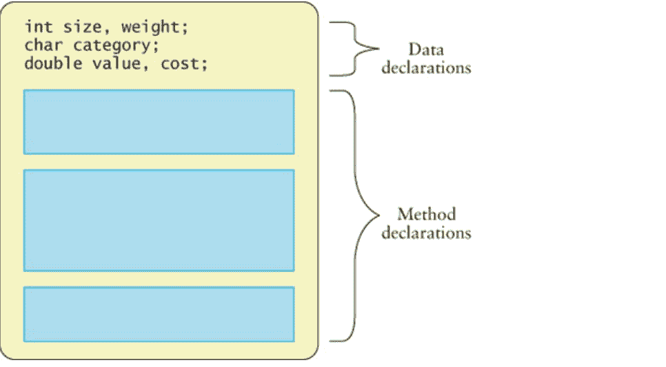

图 4.3 列出了 `Die` 类的方法。从这个角度来看，它与我们在之前的示例中使用的任何其他类都没有区别。唯一的重要区别是，`Die` 类并不是由 Java API 提供的，而是我们自己编写的。

| 方法 | 说明 |
| :--- | :--- |
| `Die()` | 构造函数：将骰子的初始点数设置为 1。 |
| `int roll()` | 通过将点数设置为适当范围内的随机数来投掷骰子。 |
| `void setValue(int value)` | 将骰子的点数设置为指定的值。 |
| `int getFaceValue()` | 返回骰子的当前点数。 |
| `String toString()` | 返回骰子的字符串表示形式，指示其当前点数。 |

**图 4.3** Die 类的一些方法

`Die` 类的方法包括投掷骰子的能力，这会产生一个新的随机值。`roll` 方法将新的点数返回给调用它的方法，但你也可以随时使用 `getFaceValue` 方法获取当前点数。`setValue` 方法可以显式地设置点数，就像你伸过去把骰子转到你想要的任何面一样。每当你将对象传递给 `print` 或 `println` 方法以获取打印内容的字符串描述时，任何对象的 `toString` 方法都会被调用。因此，为大多数类定义一个 `toString` 方法通常是一个好主意。这些方法的定义包含多个部分，我们将在本章后续内容中对其进行剖析。

对于书中的示例，我们通常将每个类存储在自己的文件中。Java 允许将多个类存储在一个文件中。如果一个文件包含多个类，则其中只能一个类可以使用保留关键字 `public` 进行声明。此外，公共类的名称必须与文件名对应。例如，类 `Die` 存储在名为 `Die.java` 的文件中。

### 实例数据

注意，在 `Die` 类中，常量 `MAX` 和变量 `faceValue` 声明在类内部，但在任何方法之外。变量声明的位置定义了它的`作用域`（scope），即程序中该变量可以被引用的区域。通过在类级别声明（而不是在方法内部），这些变量和常量可以在类的任何方法中被引用。

诸如变量 `faceValue` 的属性被称为`实例数据`（instance data），因为每当创建一个类的实例，都会分配新的内存空间。每个 `Die` 对象都有自己的 `faceValue` 变量及其专有的数据空间。这就是每个 `Die` 对象可以拥有自己状态的原因。我们在 `RollingDice` 程序的输出中看到了这一点：一个骰子的点数为 5，另一个点数为 2。只有通过为每个 `Die` 对象创建 `faceValue` 变量的内存空间，这种情况才是可能的。

> 核心概念
> 变量的作用域决定了它可以在哪里被引用，这取决于它声明的位置。

我们可以这样描述这种情况：

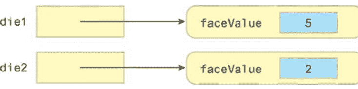

`die` 和 `die2` 引用变量指向（即包含）它们各自的 `Die` 对象。每个对象都包含一个具有独立内存空间的 `faceValue` 变量。因此，每个对象可以为其实例数据存储不同的值。

Java 会自动初始化任何在类级别声明的变量。例如，所有 `int` 和 `double` 等数值类型的变量都会初始化为零。然而，尽管语言执行了这种自动初始化，但显式初始化变量（通常在构造函数中）是一个良好的习惯，这样任何阅读代码的人都能清楚地理解意图。

# UML 类图

在本书中，我们使用 UML 图来视觉化类和对象之间的关系。UML 代表统一建模语言（Unified Modeling Language），它已成为面向对象程序设计最流行的表示法。

存在多种 UML 图，每种都旨在展示面向对象程序的特定方面。在书中，我们主要关注 UML 类图，用于展示类的内容及其它们之间的关系。

在 UML 图中，每个类表示为一个矩形，可能包含三个部分，以显示类名、其属性（数据）和操作（方法）。图 4.4 显示了包含 `RollingDice` 程序类的类图。

| RollingDice | | Die |
| :--- | :--- | :--- |
| | | `faceValue : int` |
| `main(args: String []) : void` | | `roll() : int` |
| | | `setFaceValue(int value) : void` |
| | | `getFaceValue() : int` |
| | | `toString() : String` |

**图 4.4** 显示参与 RollingDice 程序的类的 UML 类图

> 核心概念
> UML 类图帮助我们视觉化程序中类的内容以及类之间的关系。

图 4.4 中连接 `RollingDice` 和 `Die` 类的箭头表示类之间存在关系。虚线箭头表示一个类使用了另一个类的方法。类之间其他类型的面向对象关系通过不同类型的连接线和箭头显示。我们将在探索书中相关主题时讨论这些其他关系。

请记住，UML 并不是专门为 Java 程序员设计的。它是与语言无关的。因此，UML 图中语法并不一定与 Java 相同。例如，变量类型显示在名称之后，用冒号分隔。方法的返回类型也以相同的方式显示。UML 图是多功能的。根据特定图的目标，我们可以包含任何所需的信息。随着我们的程序越来越大，包含更多的类，这些视觉化工具将变得越来越有用。我们将根据情况探索 UML 类图的新方面。

### 自测习题

（答案见附录 L）

- SR 4.5 对象和类之间有什么区别？
- SR 4.6 描述 `Die` 类的实例数据。
- SR 4.7 为 `Die` 定义的方法中，哪些可以改变对象的状态？
- SR 4.8 当你将对象传递给 `print` 或 `println` 方法时会发生什么？
- SR 4.9 变量的作用域是什么？
- SR 4.10 UML 图的设计目的是什么？

## 4.3 封装

我们在第 1 章对面向对象概念的概述中提到过，对象应该是*自律其足*的（self-governing）。这意味着，对象的实例数据应该只由该对象本身修改。例如，`Die` 类的方法应该专门负责更改 `faceValue` 变量。我们应该让类外部的代码难以（如果不是不可能的话）“伸入”内部并修改该类内部的变量。这种特性被称为封装（encapsulation）。

对象应该与系统的其他部分封装。它应该只通过定义对象提供的服务的特定方法集与程序的其他部分交互。这些方法定义了对象与使用它的程序之间的*接口*（interface）。

> 核心概念
> 对象应该是封装的，以防止数据被不当访问。

封装在图 4.5 中以图形形式表示。使用对象的代码（有时称为对象的客户端）不应允许直接访问变量。客户端应该调用对象的方法，然后由这些方法与封装在对象内部的数据交互。例如，`RollingDice` 程序中的 `main` 方法调用了 `Die` 对象的 `roll` 方法。`main` 方法不应该（实际上无法）直接访问 `faceValue` 变量。

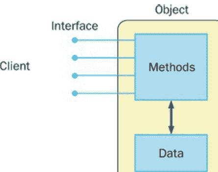

**图 4.5** 客户端与对象方法的交互图

### 可见性修饰符

Java 的某些修饰符被称为可见性修饰符，因为它们控制对类成员的访问权限。保留字 `public` 和 `private` 是可见性修饰符，可以应用于类的变量和方法。如果类的成员具有 public（公有）可见性，可以从对象的外部直接引用它。如果类的成员具有*private（私有）可见性*，可以在类定义的内部任何地方使用，但不能从外部引用。第三种可见性修饰符 `protected` 仅在继承的上下文中相关。我们将在第 9 章讨论它。

> 核心概念
> 实例变量应该声明为私有可见性，以促进封装。

公有变量违反了封装性。它们允许定义数据的类外部代码进入并访问或修改数据的值。因此，实例数据应该被定义为私有可见性。声明为 `private` 的数据只能由类的方法访问。

我们应用到方法上的可见性取决于该方法的目的。为客户端提供服务的方法必须声明为 public 可见性，以便客户端调用它们。这些方法有时被称为服务方法。私有方法不能从类外部调用。私有方法的唯一目的是帮助类的其他方法完成它们的工作。因此，它们有时被称为支持方法。

图 4.6 总结了 public 和 private 可见性对变量和方法的影响。

| | public | private |
| :--- | :--- | :--- |
| **变量** | 违反封装 | 强制封装 |
| **方法** | 为客户端提供服务 | 支持类中的其他方法 |

**图 4.6** 公有和私有可见性的影响

将常量赋予 public 可见性通常被认为是可以接受的，因为尽管可以直接访问它们的值，但由于它们是使用 `final` 修饰符声明的，不能被更改。记住，封装意味着数据值不应被代码的其他部分直接更改。因为常量根据定义是不可更改的，所以封装问题在很大程度上不复存在。

UML 类图可以通过在类成员前加上特定的字符来显示类成员的可见性。具有 public 可见性的成员前带有加号 (+)，具有 private 可见性的成员带有减号 (-)。

### 访问器和修改器

由于实例数据通常声明为私有可见性，类通常会提供服务来访问和修改数据值。如 `getFaceValue` 等方法被称为*访问器方法*，因为它提供了对特定值的只读访问。同样，如 `setFaceValue` 等方法被称为*修改器方法*，因为它改变了某个特定值。

> 核心概念
> 大多数对象包含访问器和修改器方法，允许客户端以受控的方式管理数据。

通常，访问器方法名具有 `getX` 的形式，其中 `X` 是其提供访问的值。同样，修改器方法名具有 `setX` 的形式，其中 `X` 是它们正在设置的值。因此，这些类型的方法有时被称为“getter（获取器）”和“setter（Setter）”。

例如，如果一个类包含实例变量 `height`，它可能也包含方法 `getHeight` 和 `setHeight`。注意，命名约定将方法名中使用的变量的首字母大写，这与通常方法名的写法方式一致。

某些方法可能作为其主要目的的副作用提供访问器和/或修改器功能。例如，`Die` 类更改了骰子的 `faceValue` 并同样返回了新值。`roll` 也是一个修改器方法。

注意，`roll` 方法的代码非常小心地将骰子的面值保持在有效范围内（1 到 `MAX`）。服务方法必须仔细设计，以只允许适当的访问和有效的更改。这指出了 `Die` 类设计的一个缺陷：`setFaceValue` 方法没有任何限制——客户端可以使用它将值设置为任何数字。

不返回值的方法通常不包含 `return` 语句。当到达方法的结束时，会自动返回到调用它的方法。此类方法可能包含不带表达式的 `return` 语句。

虽然在方法中使用多个 `return` 语句是可行的，但这通常不是良好的做法。通常情况下，一个方法应该在方法体的最后一行拥有一个 `return` 语句，除非这会导致方法变得过于复杂。

方法返回的值可以在调用方法中被忽略。例如，在 `RollingDice` 类的 `main` 方法中，`roll` 方法返回的值在某些调用中被忽略了，而在另一些调用中，返回值被用于计算。

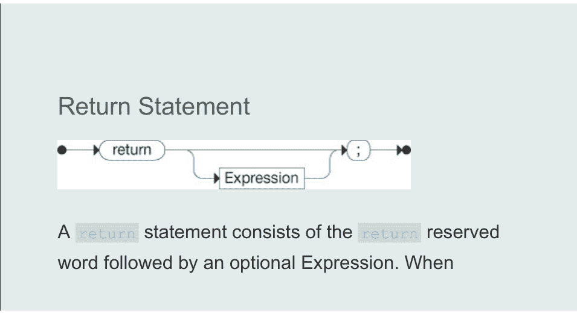

`return` 语句由 `return` 关键字后跟一个可选的表达式（Expression）组成。执行执行时，控制权会立即返回给调用方法，并返回由表达式定义的值。

示例：

```
return;

return distance * 4;
```

构造函数没有返回类型（甚至没有 `void`），因此不能返回值。我们将在本章稍后部分详细讨论构造函数。

### 参数

正如第 2 章定义的，参数（parameter）是在调用方法时传递给方法的值。方法头部的参数列表指定了传递的值的类型，以及被调用方法引用这些值的名称。

方法声明头部中的参数名称被称为**形式参数**（formal parameters）。在调用时，传递给方法的值被称为**实际参数**（actual parameters）。实际参数也称为方法的**参数**（arguments）。

方法的调用和定义始终会在方法名后的括号中给出一个参数列表。如果没有参数，则使用空括号，如 `roll` 和 `getFaceValue` 方法所示。`Die` 构造函数也不接受参数，尽管构造函数通常带有参数。

形式参数是标识符，在方法内部充当变量使用，其初始值来自调用地中的实际参数。当方法被调用时，每个实际参数的值都会被复制并存储在相应的形式参数中。实际参数可以是字面量、变量或完整的表达式。如果使用表达式作为实际参数，它在方法调用之前会被完全求值，结果将作为参数传递。

> 核心概念
> 当方法被调用时，实际参数被复制到形式参数中。

`Die` 类中唯一接受参数的方法是 `setFaceValue` 方法，它接受一个 `int` 参数。形式参数名称为 `value`。在 `main` 方法中，值 4 作为实际参数传递给它。

调用处和方法声明中的参数列表必须匹配。也就是说，第一个实际参数的值被复制到第一个形式参数中，第二个实际参数复制到第二个形式参数中，依此类推，如图 4.8 所示。实际参数的类型必须与指定的形式参数一致。

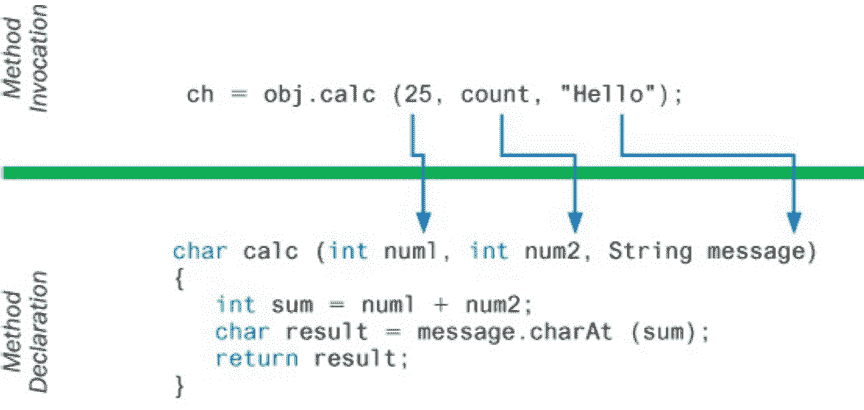

**图 4.8** 从方法调用到声明传递参数

关于参数传递的其他细节将在第 7 章中讨论。

### 本地数据

正如我们在在本章前面描述的，变量或常量的作用域（scope）是程序中可以对其变量进行有效引用的部分。变量可以在方法内部声明，使其成为本地数据，而不是实例数据。回想一下实例数据在类中声明，但在任何特定方法内部。

> **核心概念**
> 在方法中声明的变量对于该方法是局部的，不能在外部使用。

本地数据的作用域仅限于声明它的方法。在 `Die` 类 `toString` 方法中声明的变量 `result` 是本地数据。在 `Die` 类任何其他方法中对 `result` 的引用都会导致编译器发出错误信息。本地变量在声明它的方法之外根本不存在。相反，在类级别声明的实例数据其作用域是整个类；该类的任何方法都可以引用它。

由于本地数据和实例数据运行在不同层级的作用上，因此可以在方法内部声明一个与类级别声明的实例变量同名的本地变量。在方法中引用该名称将引用该变量的本地版本。这种命名习惯显然具有混淆任何阅读代码者的潜力，因此应该被避免。

方法头中的形式参数名称充当该方法的本地数据。它们在方法被调用之前不存在，在方法退出时消失。例如，`setFaceValue` 方法中的形式参数值在方法被调用时产生产生，在方法执行完毕时消失。

# 银行账户示例

让我们来看另一个类及其使用的示例。列表 4.3 显示的 `Transactions` 类包含一个 `main` 方法，它创建了几个 `Account` 对象并调用了它们的服务。

> 列表 4.3

```
********************************************************************
// Author: Lewis/Loftus
// Transactions.java
//
// 展示了多个 Account 对象的创建和使用。
********************************************************************

public class Transactions
{
```

```
//----------------------------------------------------------------------
// 创建一些银行账户并请求各种服务。
//----------------------------------------------------------------------
public static void main(String[] args)
{
    Account acct1 = new Account("Ted Murphy", 72354, 102.56);
    Account acct2 = new Account("Jane Smith", 69713, 40.00);
    Account acct3 = new Account("Edward Demsey", 93757, 759.32);

    acct1.deposit(25.85);
    double smithBalance = acct2.deposit(500.00);
```


System.out.println("Smith balance after deposit: " + smithBalance);

System.out.println("Smith balance after withdrawal: " + acct2.withdraw(430.75, 1.50));

acct1.addInterest();

acct2.addInterest();

acct3.addInterest();

System.out.println();

System.out.println(acct1);

System.out.println(acct2);

System.out.println(acct3);

}

```

### 输出

Smith balance after deposit: 540.0
Smith balance after withdrawal: 107.75

| 72354 | Ted Murphy | $132.90 |
| 69713 | Jane Smith | $111.52 |
| 93757 | Edward Demsey | $785.90 |

**列表 4.4**所示的 `Account` 类表示一个基础银行账户。它包含了表示账户号码和所有者名称的实例数据。注意实例数据可以是对象引用变量（而不是基本类型），例如账户所有者的姓名，它是对 `String` 对象的引用。账户的利率存储为一个常量。

### 列表 4.4

```java
********************************************************************
// Account.java      Author: Lewis/Loftus
//
// 表示具有基本服务（如存款
// 取款）的银行账户。
********************************************************************
import java.text.Format;

public class Account
{
    private final double RATE = 0.035; // 3.5%的利率
    private long acctNumber;
    private double balance;
    private String name;

//--------------------------------------------------------------------------------
//
// 定义所有者、账户号码
// 初始余额来设置账户。
//--------------------------------------------------------------------------------

public Account(String owner, long account, double initial)
{
    name = owner;
    acctNumber = account;
    balance = initial;
}

//----------------
// 向账户存入指定金额。返回
// 新余额。
//----------------

public double deposit(double amount)
{
    balance = balance + amount;
    return balance;
}

//----------------
// 从账户中取出指定金额并应用
// 费用。返回新余额。
//----------------

public double withdraw(double amount, double fee)
{
    balance = balance - amount - fee;
    return balance;
}

//------------------------------------
// 为账户添加利息并返回新余额。
//--------------------------------

public double addInterest()
{
    balance += (balance * RATE);
    return balance;
}

//------------------------------------
// 返回账户的当前余额。
//--------------------------------

public double getBalance()
{
    return balance;
}

//----------------------------------------------------------------------
// 以字符串形式返回账户的行描述。
//----------------------------------------------------------------------
public String toString() {
    NumberFormat fmt = NumberFormat.getCurrencyInstance();
    return acctNumber + "\t" + name + "\t" + 
    fmt.format(balance);
}
}
```


`Account` 类的构造函数接受三个参数，用于初始化实例数据。`deposit` 和 `withdraw` 方法对账户执行基本交易，根据参数调整余额。还有一个 `addInterest` 方法，通过添加赚取的利息来更新余额。这些方法代表了改变余额的有效方式，因此没有提供像 `setBalance` 这样的经典变器方法。

在 `Transactions` 程序中刚三个三个 `Account` 对象的状态可以描述如下：

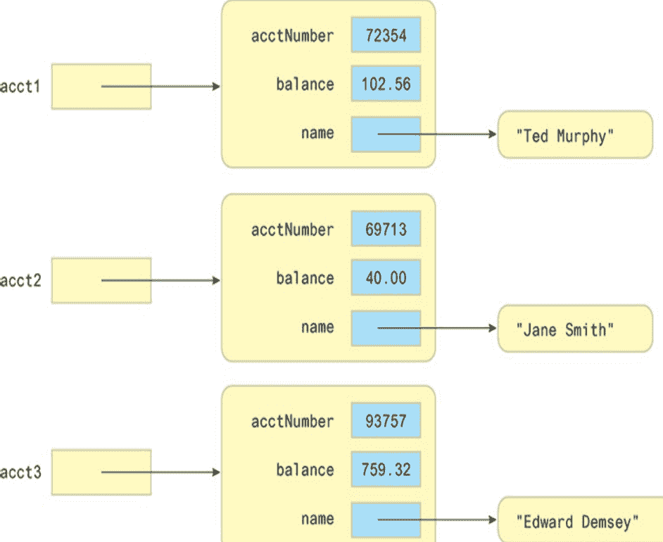

更新账户余额的各种方法可以设计得更严谨一些。应该检查确保参数值有效，例如防止提取负数（这在本质上是存款）。这种处理将在下一章中讨论。

### 自测习题

（答案见附录 L）

- SR 4.16 为什么通过特定对象（或在特定对象上）调用方法？该规则的例外是什么？

- SR 4.17 方法返回一个值意味着什么？

- SR 4.18 `return` 语句的作用是什么？

- SR 4.19 是否需要 `return` 语句？

- SR 4.20 解释实际参数和形式参数之间的区别。

- SR 4.21 为 `Die` 类编写一个名为 `getFaceDown` 的方法，返回骰子当前的“朝下”值。提示：在标准骰子上，任意两个相对面的点和为七。

- SR 4.22 在 `Transactions` 程序中：

  - a. 创建了多少个 `Account` 对象？

  - b. 调用 `withdraw` 方法时传递了多少个参数（实际参数）？

  - c. 调用 `addInterest` 方法时传递了多少个参数（实际参数）？

- SR 4.23 你会将 `Account` 的哪些方法归类为访问器方法？哪些是变器方法？

# 4.5 重新回顾构造函数

正如我们在第 2 章提到的，构造函数类似于方法。特别是，我们经常使用构造函数来初始化与对象相关的变量。构造函数与普通方法有两不同：第一，构造函数的名称与类相同。第二，构造函数没有返回类型。程序员犯的一个常见错误是在构造函数头部部加上 `void`。对于编译器来说，带有返回类型的构造函数会导致错误信息。

> 核心概念：构造函数不能有任何返回类型，即使是 `void` 也不行。通常，构造函数用于初始化新实例化的对象。例如，`Account` 类的构造函数设置初始值。`Die` 类的构造函数设置它自己的变量。

### 自测习题

（答案见附录 L）

- SR 4.24 构造函数是做什么的？

- SR 4.25 如何定义构造函数？

## 4.6 弧 (Arcs)

在第 3 章中，我们探索了线、矩形、圆和椭圆等基本形状。在 JavaFX 中，弧可以被视为椭圆的一部分。`Arc` 类接受六个参数：前四个匹配中心的 x 和 y 坐标，最后两个指定起始角和长度。例如：

```java
Arc myArc = new Arc(150, 100, 70, 30, 45, 90);
```

该行代码创建一个位于 (150, 100) 的弧，水平半径为 70，垂直半径为 30，从 45 度开始，逆时针方向持续 90 度。

> 核心概念：弧是椭圆的一部分。

| 弧类型 | 描述 |
|---|---|
| `ArcType.OPEN` | 由椭圆指定部分形成的曲线。 |
| `ArcType.CHORD` | 两个点由直线连接的弧。 |
| `ArcType.ROUND` | 端点连接到中心点的弧，形成一个带有圆边的“饼图”形状。 |

图 4.9 JavaFX 弧的类型

列表 4.5 显示了一个 JavaFX 程序，它创建并显示了三个弧，每种类型，都定义在同一个椭圆上。

### 列表 4.5

```java
import javafx.application.Application;
import javafx.scene.Scene;
import javafx.scene.Group;
import javafx.scene.paint.Color;
import javafx.scene.shape.Arc;
import javafx.scene.shape.ArcType;
import javafx.scene.shape.Ellipse;
import javafx.stage.Stage;

//**************************************************
// ArcDisplay.java         Author: Lewis/Loftus
//
// 展示 JavaFX Arc 类的用法。
**************************************************

public class ArcDisplay extends Application
{
    //------------------------------------------------------
    // 基于同一个椭圆绘制三个弧。
    //------------------------------------------------------
    public void start(Stage primaryStage) {
        Ellipse backgroundEllipse = new Ellipse(250, 150, 170, 100);
        backgroundEllipse.setFill(null);
        backgroundEllipse.setStroke(Color.GRAY);
        backgroundEllipse.getStrokeDashArray().addAll(5.0, 5.0);
        Arc arc1 = new Arc(250, 150, 170, 100, 90, 90);
        arc1.setType(ArcType.OPEN);
        arc1.setStroke(Color.RED);
        arc1.setFill(null);

        Arc arc2 = new Arc(250, 150, 170, 100, 20, 50);
        arc2.setType(ArcType.ROUND);
        arc2.setStroke(Color.GREEN);
        arc2.setFill(Color.GREEN);

        Arc arc3 = new Arc(250, 150, 170, 100, 230, 130);
        arc3.setType(ArcType.CHORD);
        arc3.setStroke(Color.BLUE);
        arc3.setFill(null);

        Group root = new Group(backgroundEllipse, arc1, arc2, arc3);
        Scene scene = new Scene(root, 500, 300, Color.LIGHTYELLOW);
        primaryStage.setTitle("Arc Display");
        primaryStage.setScene(scene);
        primaryStage.show();
    }
}
```

### 显示

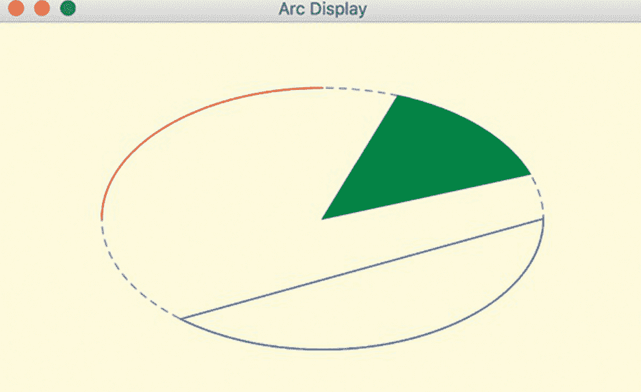

第一个弧（红色）是一个开放弧，它遵循椭圆的左上角曲线，从 90 度开始，扫描 90 度。此弧是不填充的，因此它仅仅是沿着椭圆的轮廓绘制的。在其他条件相等的情况下，填充的开放弧和填充的弦弧在视觉上是相同的。

第二个弧（绿色）是一个填充的圆弧，形成了一个倾斜的饼图形状。它从水平线以上上方 20 度处开始，扫描 50 度。

第三个弧（蓝色）是一个未填充的弦弧，因此轮廓显示了弧的两个端点之间的连接，它从 230 度开始，长度为 130 度。

起始角度或弧长度可以使用负值来指定。如果是负值，角度将按顺时针而非逆时针测量。这里是指定示例中红色开放弧的另一种方法：

```java
Arc arc1 = new Arc(250, 150, 170, 100, -180, -90);
```

> 核心概念

正起始角度和长度按逆时针测量。负值按顺时针测量。

### 自测习题

（答案见附录 L）

- SR 4.26 椭圆和弧之间是什么关系？

- SR 4.27 使用哪种类型的弧来显示“饼图”形状？哪种是曲线？

- SR 4.28 你会指定什么样的起始角度和弧长度来包含底层椭圆的整个半部分？你可以使用哪些替代值？

## 4.7 图像

`Image` 代表一个图形图像，并支持从文件或 URL 加载图像。支持的格式包括 jpeg、gif 和 png。

`ImageView` 是一个 JavaFX 节点，用于显示 `Image` 对象。`Image` 不能直接被添加到容器中。

> 核心概念

图像由 `Image` 对象表示，但使用 `ImageView` 对象进行显示。

位于列表 4.6 中的程序显示了一个在窗口中居中的图像（使用图像视图 `ImageView`）。

### 列表 4.6

```java
import javafx.application.Application;
import javafx.scene.Scene;
import javafx.scene.image.Image;
import javafx.scene.image.ImageView;
import javafx.scene.layout.StackPane;
import javafx.stage.Stage;

//****************************************************************
// ImageDisplay.java    Author: Lewis/Loftus
//
// 演示了 Image 和 ImageView 对象的使用。
//****************************************************************

public class ImageDisplay extends Application
{
    //----------------------------------------------------------------------
    // 在窗口中居中显示图像。
    //----------------------------------------------------------------------
    public void start(Stage primaryStage)
    {
        Image img = new Image("gull.jpg");
        ImageView imageView = new ImageView(img);

        StackPane pane = new StackPane(imageView);
        pane.setStyle("-fx-background-color: cornsilk");

        Scene scene = new Scene(pane, 500, 350);
        primaryStage.setTitle("Image Display");
        primaryStage.setScene(scene);
        primaryStage.show();
    }
}
```

### 显示


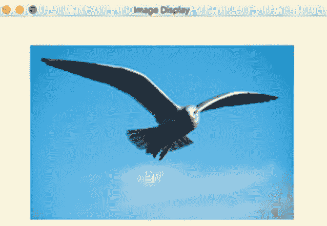

与之前使用 `Group` 对象作为场景（scene）根节点的 JavaFX 示例不同，此程序在 `StackPane`（堆面板）对象中显示图像。`StackPane` 类是 JavaFX API 提供的几种布局面板（layout panes）之一。布局面板是一个管理控件排列和视觉呈现方式的容器。布局面板会在需要时调整呈现效果，例如当窗口调整大小时。

> **核心概念**
>
> 布局面板是一种 JavaFX 容器，它以特定方式管理节点的视觉布局。

`StackPane` 中的节点是相互堆叠的。例如，你可能使用 `StackPane` 在形状上覆盖文本。在这个示例中，`ImageView` 对象是添加到面板的唯一节点，因此它仅仅的作用是保持图像在窗口中居中。我们将在后续示例中根据需要探索其他布局面板，附录 G 提供了 JavaFX 布局面板的概述。

调用 `StackPane` 的 `setStyle` 方法用于设置面板的背景颜色。在之前的示例中，我们设置了场景本身的背景颜色，但布局面板有自己的背景颜色。`setStyle` 方法接受一个可以指定许多样式属性的字符串。JavaFX 样式属性是模仿级联样式表（CSS）的，CSS 用于定义网页上 HTML 元素的外观。JavaFX 样式属性名称以 `-fx-` 前缀开头。

`Image` 构造函数的参数可以是相对于 Java 类目录的路径。例如，下行代码指定了 `myPix` 目录下的图像：

```java
Image logo = new Image("myPix/smallLogo.png");
```

也可以从 URL 获取图像：

```java
Image logo = new Image("http://example.com/images/bio.jpg");
```

如果指定了 URL，必须包含协议（如 `http://`）。

### 视口 (Viewports)

视口是一个矩形区域，可以限制 `ImageView` 中显示的像素。例如：

```java
imgView.setViewport(new Rectangle2D(200, 80, 70, 60));
```

如果将此行添加到 `ImageDisplay` 程序中，则图像的以下部分将可见：

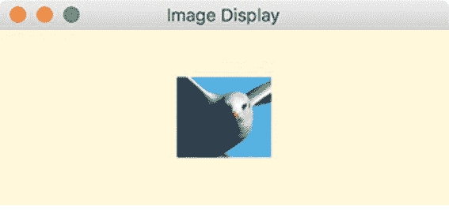

视口不会以任何方式更改底层图像，可以根据需要程序化更新。

### 自测习题

（答案见附录 L）

- SR 4.29 `Image` 和 `ImageView` 之间有什么区别？
- SR 4.30 什么是布局面板？
- SR 4.31 如何为 JavaFX 节点设置样式属性？

## 4.8 图形用户界面

与基于文本的程序，甚至是没有交互的图形程序不同，具有图形用户界面（GUI）的程序提供了更高层次的用户交互，使程序更加高效和有趣。

三类对象协作在 JavaFX 中创建图形界面：

- 控件 (controls)
- 事件 (events)
- 事件处理器 (event handlers)

GUI 控件是屏幕元素，用于显示信息和/或允许用户以特定方式与程序交互。GUI 控件的示例包括按钮、文本字段、滚动条和滑块。

事件是一个表示我们感兴趣的某些发生的情况。通常，事件对应于用户操作，例如处理鼠标点击或在键盘上击键。GUI 控件产生事件以指示与该控件相关的用户操作。例如，按钮控件将产生一个事件来指示按钮已被按下。围绕 GUI 构建并响应用户事件的程序被称为事件驱动程序。

> **核心概念**
>
> GUI 由控件、代表用户操作的事件以及处理这些事件的处理器组成。

事件处理器是一个包含一个方法的对象，该方法在事件发生时被调用。程序员设置了产生事件的组件与响应该事件的处理器之间的关系。

在大多数情况下，我们将使用 JavaFX API 中预定义的控件和事件。要设置 GUI 程序，我们展示并定制必要的控件，并提供处理器以在事件发生时执行我们所需的任何操作。

例如，列表 4.7 中的 `PushCounter` 程序向用户提供了一个单一按钮（标记为“Push Me!”）。每次按下按钮，计数器就会更新并显示。

```java
import javafx.scene.control.Button;
import javafx.scene.text.Text;
import javafx.scene.layout.FlowPane;
import javafx.stage.Stage;
```

```java
/********************************************************************************
// PushCounter.java             Author: Lewis/Loftus
//
// 演示 JavaFX 按钮和事件处理器。
********************************************************************************
//
```

```java
public class PushCounter extends Application
{
    private int count;
    private Text countText;

    //-----------------------------------------------------------------------------------------------------
    // 展示一个包含按钮和标签的 GUI，该标签显示
    // 按钮被点击了多少次。
    //-------------------------------------------------------------------------------------------------

    public void start(Stage primaryStage)
    {
        count = 0;
        countText = new Text("Pushes: 0");
```

```java
        Button push = new Button("Push Me!");
```

```java
        push.setOnAction(this::processButtonPress);

        FlowPane pane = new FlowPane(push, countText);
        pane.setAlignment(Pos.CENTER);
        pane.setHgap(20);
        pane.setStyle("-fx-background-color: cyan");
```

```java
        Scene scene = new Scene(pane, 300, 100);

        primaryStage.setTitle("Push Counter");
        primaryStage.setScene(scene);
        primaryStage.show();
    }
```

```java
    //------------------------------------------------------------
    // 当按钮被点击时，更新计数器和标签。
    //------------------------------------------------------------
```

```java
    public void processButtonPress(ActionEvent event) {
        count++;
        countText.setText("Pushes: " + count);
    }
}
```

### 显示

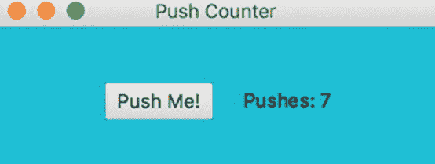

该程序显示了一个 `Button` 对象和一个 `Text` 对象。`Button` 类表示推按钮，允许用户通过鼠标点击启动操作。`Button` 构造函数接受一个 `String` 参数，用于指定显示在按钮上的文本。

当 `Button` 对象被按下时，会产生一个动作事件。按钮的 `setOnAction` 方法用于指定按钮的事件处理器。

`::` 运算符用于指定方法引用，这是 Java 8 引入的新特性。在示例中，该方法引用指向此类中的 `processButtonPress` 方法（与 `start` 方法相同）。`this` 引用指向正在执行方法的对象。因此，在这个示例中，类本身充当按钮的事件处理器。还有其他方法可以指定事件处理器关系，将在本节稍后的部分进行讨论。

`processButtonPress` 方法增加计数器变量并更新显示的文本。注意，计数器和 `Text` 对象被声明为实例数据（在类级别），这样它们在类中的两个方法中都可以被引用。

`Button` 和 `Text` 控件被添加到 `FlowPane` 中，该 `FlowPane` 用作场景的根节点。`FlowPane` 类是一个布局面板，类似于上一节中使用的 `StackPane`。`FlowPane` 中的节点按行水平排列（默认值）或按列垂直排列。当没有更多空间时，面板中的下一个节点将流到下一行或下一列。在示例中，按钮和文本水平排列，居中显示，间距为 20 像素。附录 G 介绍了 JavaFX 布局面板的概述。

顺便提一下，程序中使用的 `Text` 对象可以用 `Label` 控件替换以创建类似的效果。然而，标签最合适的用法是标记其他控件，并提供高级的键盘导航。标签具有许多 `Text` 对象不具备的样式属性，并且还可以包含图像。在示例中，一个 `Text` 对象就足够了。

## 指定事件处理器的其他方法

`PushCounter` 程序使用方法引用来定义 `Button` 对象产生的动作事件的事件处理器。让我们看看定义事件处理器的其他方法。

事件处理器实际上是一个实现 `EventHandler` 接口的对象。接口是实现类必须定义的方法列表（接口将在第 7 章进行更详细的讨论）。在这种情况下，`EventHandler` 接口要求对象定义一个名为 `handle` 的方法来处理事件。因此，创建事件处理器的另一种方法是定义一个实现 `EventHandler` 接口的完整类，可以作为 `PushCounter` 类内部的私有内部类：

```java
private class ButtonHandler implements EventHandler<ActionEvent>
{
    public void handle(ActionEvent event)
    {
        count++;
        countText.setText("Pushes: " + count);
    }
}
```

然后，对按钮的 `setOnAction` 调用可以指定这样一个对象：

```java
push.setOnAction(new ButtonHandler());
```

与其定义一个单独的类，事件处理器还可以使用 lambda 表达式来定义：

```java
push.setOnAction((event) -> {
    count++;
    countText.setText("Pushes: " + count);
});
```

Lambda 表达式由括号中的一组参数、`->` 箭头运算符以及后面的表达式定义。如果一个表达式不够用，则使用代码块。因此，示例中的 lambda 表达式接受事件对象，并将其传递到包含处理器代码的代码块中。

当需要函数接口的对象时，就可以使用 lambda 表达式。函数接口是指包含单个抽象方法的接口。`EventHandler` 接口就是一个函数接口。`PushCounter` 程序使用的方法引用方法等同于 lambda 表达式。因此 `this::processButtonPress` 等于 `event -> processButtonPress(event)`。

## 4.9 文本字段

文本字段允许用户输入一行文本，程序可以根据需要使用。列表 4.8 所示的 `FahrenheitConverter` 展示了一个包含文本字段的 GUI，用户可以在其中输入华氏温度。当用户按下 Return（回车）键时，程序会显示相应的摄氏温度。

### 列表 4.8

```java
import javafx.application.Application;
import javafx.scene.Scene;
import javafx.stage.Stage;
```

```java
/****************************************************************
// FahrenheitConverter.java      Author: Lewis/Loftus
//
// 演示了 TextField 和 GridPane 的使用。
****************************************************
```

```java
public class FahrenheitConverter extends Application
{
    //--------------------------------------
    // 启动温度转换应用程序。
    //--------------------------------------
    public void start(Stage primaryStage) {
        Scene scene = new Scene(new FahrenheitPane(), 300, 150);

        primaryStage.setTitle("Fahrenheit Converter");
        primaryStage.setScene(scene);

        primaryStage.show();
    }
}
```

在此示例中，用户界面的细节设置在一个单独类中，如列表 4.9 所示。`FahrenheitPane` 类继承自 `GridPane` 类，该类是 JavaFX API 中的一种布局面板，用于在灵活的矩形网格中显示节点。

### 列表 4.9

```java
import javafx.event.ActionEvent;
import javafx.geometry.HPos;
import javafx.geometry.Pos;
import javafx.scene.control.Label;
import javafx.scene.control.TextField;
import javafx.scene.layout.GridPane;
import javafx.scene.text.Font;
```

```java
public class FahrenheitPane extends GridPane
{
    private Label result;
    private TextField fahrenheit;

    // ---------------------------------------------------------
    // 设置一个 GUI，其中包含带有标签的文本字段，用于
    // 将华氏度温度转换为摄氏度。
    // ---------------------------------------------------------

    public FahrenheitPane() {
        Font font = new Font(18);

        Label inputLabel = new Label("Fahrenheit:");
        inputLabel.setFont(font);
        GridPane.setHalignment(inputLabel, HPos.RIGHT);

        Label outputLabel = new Label("Celsius:");
        outputLabel.setFont(font);
        GridPane.setHalignment(outputLabel, HPos.RIGHT);

        result = new Label("----");
        result.setFont(font);
        GridPane.setHalignment(result, HPos.CENTER);

        fahrenheit = new TextField();
        fahrenheit.setFont(font);
        fahrenheit.setPrefWidth(50);
        fahrenheit.setAlignment(Pos.CENTER);
        fahrenheit.setOnAction(this::processReturn);

        setAlignment(Pos.CENTER);
        setHgap(20);
        setVgap(10);
        setStyle("-fx-background-color: yellow");

        add(inputLabel, 0, 0);
        add(fahrenheit, 1, 0);
        add(outputLabel, 0, 1);
        add(result, 1, 1);
    }

    // 当用户在文本字段中按下回车键时，计算并显示
    // 转换后的温度。

    public void processReturn(ActionEvent event) {
        int fahrenheitTemp = Integer.parseInt(fahrenheit.getText());
        int celsiusTemp = (fahrenheitTemp - 32) * 5 / 9;
        result.setText(celsiusTemp + "");
    }
}
```


用户界面由三个 `Label` 对象和一个 `TextField` 对象组成。每个元素的字体大小是通过使用 `Font` 对象并调用每个节点的 `setFont` 方法来设置的。关于字体将在第 5 章中进行更详细的讨论。

在 `FahrenheitPane` 构造函数的末尾，这四个元素被添加到窗格中。（通过继承，`FahrenheitPane` 是一个 `Pane`，并继承了 `add` 方法。）`add` 方法的参数指定了要添加哪个网格单元格。第一个值是行，第二个值是列。网格布局的行和列都从 0 开始。关于网格布局的更多细节，请参见附录 G。

`processReturn` 方法用于定义当用户光标在文本字段中按下回车键时触发的事件处理器。它通过调用其 `setOnAction` 方法与文本字段相关联。

`processReturn` 方法通过调用 `getText` 方法从文本字段中获取文本，该方法返回一个字符字符串。使用 `Integer` 包装类的 `parseInt` 方法将文本转换为整数。然后，该方法执行计算以确定等效摄氏度温度，并将结果设置相应标签的文本。

### 自测习题

(答案见附录 L)

SR 4.36 描述在 `FahrenheitConverter` 程序中，当用户在文本字段中输入数字并按下回车时发生了什么。

SR 4.37 在 `GridPane` 布局中，行和列是如何编号的？你如何指定从左上角向右三、向下二的单元格？

### 核心概念总结

- 面向对象编程的核心是定义类，用表示具有良好定义的的状态和行为的对象。
- 变量的作用域（决定了它可以在哪里被引用）取决于它的声明位置。
- UML 类图帮助我们可视化程序中类的内容以及类之间的关系。
- 对象应该是封装的，保护其数据免受不当访问。
- 实例变量应该声明为 `private` 可见性以促进封装。
- 大多数对象包含访问器（accessor）和修改器（mutator）方法，允许客户端以受控的方式管理数据。
- 对象的范围取决于它的声明位置。
- 方法的返回类型必须与方法头一致。
- 当调用方法时，实际参数被复制到形式参数中。
- 声明在方法中的变量是局部的，无法在方法外部使用。
- 构造函数不能有任何返回类型，甚至是 `void`。
- 弧是作为圆的一部分定义的。
- 正向角度是顺时针度量的。
- 负值是逆时针度量的。
- 图像由 `ImageView` 对象表示，但以特定的方式。
- 网格布局是显示图像的容器。
- GUI 由控件、处理这些事件的处理器组成。

### 练习题

EX 4.1 对于以下配对，哪一个表示类，哪一个表示对象？

- a. Superhero, Superman
- b. Justin, Person
- c. Rover, Pet
- d. Magazine, Time
- e. Christmas, Holiday

EX 4.2 为 `PictureFrame` 类可能定义哪些属性和操作？

EX 4.3 为 `Meeting` 类可能定义哪些属性和操作？

EX 4.4 为 `Course` 类可能定义哪些属性和操作？

EX 4.5 编写一个 `lyrics` 方法，在调用时打印歌词。该方法不接受参数，也不返回值。

EX 4.6 编写一个 `cube` 方法，接受一个整数参数并返回该值的立方。

EX 4.7 编写一个 `random100` 方法，返回 1 到 100 之间的随机整数。

EX 4.8 编写一个 `colorize` 方法，接受两个整数参数。假设第一个大于第二个。

EX 4.9 编写一个 `randomColor` 方法，创建一个 `Color` 对象。记住 `Color` 对象可以由 0 到 255 之间的三个整数定义。

EX 4.10 假设你有一个 `Movie` 类。为该类编写构造函数，根据传递的参数初始化 `title` 和 `director` 实例变量。

EX 4.11 假设你有一个 `Child` 类，带有实例数据 `age`。为 `age` 编写 getter 方法和 setter 方法。

EX 4.12 绘制一个 UML 类图，显示 `Transactions` 程序中类之间的关系。

EX 4.13 编写一个声明创建一个 `Arc` 对象，它位于 (50, 50) 并跨越圆的上半部分。基于水平半径为 40、垂直半径为 100 的圆。

EX 4.14 如何限制显示的图像像素？

EX 4.15 网格布局的目的是什么？

EX 4.16 如何使用方法引用来定义事件处理器？

### 编程项目

PP 4.1 编写一个 `Counter` 类表示一个简单的计数器，可能用于计算进入房间的人数。`Counter` 类应包含一个整数作为实例数据，表示计数。编写一个构造函数将计数初始化为 0。编写一个 `click` 方法使计数加1，另一个 `getCount` 方法返回当前计数。包含一个 `reset` 方法将计数器重置为零。最后，创建一个名为 `CounterTest` 的驱动类，创建两个 `Counter` 对象并测试它们的方法。

PP 4.2 编写一个 `Bulb` 类表示可以开启和关闭的灯泡。创建一个名为 `Lights` 的驱动类，其 `main` 方法实例化并开启一些 `Bulb` 对象。

PP 4.3 编写一个 `Sphere` 类，包含表示球直径的实例数据。定义 `Sphere` 构造函数以接收并初始化直径，并包含直径的 getter 和 setter 方法。包含计算并返回球体积和表面积的方法（公式见 PP 3.6）。包含一个 `toString` 方法，返回球体的一行描述。创建一个名为 `MultiSphere` 的驱动类，其 `main` 方法实例化并更新多个 `Sphere` 对象。

PP 4.4 编写一个名为 `Dog` 的类，其中包含表示狗的名字和年龄的实例数据。定义 `Dog` 构造函数以接收并初始化实例数据。为名称和年龄添加 getter（get）和 setter（set）方法。包含一个方法来计算并返回以“人类年”计算的狗龄（狗年龄的七倍）。包含一个 `toString` 方法，返回对狗的单行描述。创建一个名为 `Kernel` 的驱动类，其 `main` 方法负责实例化并更新多个 `Dog` 对象。

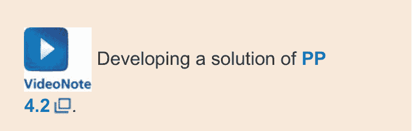

PP 4.5 编写一个名为 `Car` 的类，其中包含表示汽车品牌、型号和制造年份的实例数据。定义 `Car` 构造函数以初始化这些值。为所有实例数据添加 getter 和 setter 方法，并包含一个返回汽车单行描述的 `toString` 方法。添加名为 `isAntique` 的方法，返回一个布尔值，表示汽车是否为古董（如果超过 45 年）。创建一个名为 `CarTest` 的驱动类，其 `main` 方法负责实例化并更新多个 `Car` 对象。

PP 4.6 编写一个名为 `Box` 的类，其中包含表示箱子高度、宽度和深度的实例数据。还要包含名为 `full` 的 `boolean` 变量作为实例数据，表示箱子是否为空。定义 `Box` 构造函数以接收并初始化箱子的高度、宽度深度。每个新的 Box 都是空的（构造函数应将 `full` 初始化为 `false`）。为所有实例数据添加 getter 和 setter 方法。包含一个返回箱子单行描述的 `toString` 方法。创建一个名为 `BoxTest` 的驱动类，其 `main` 方法负责实例化并更新多个 `Box` 对象。

PP 4.7 编写一个名为 `Book` 的类，其中包含标题、作者、出版商和版权日期的实例数据。定义 `Book` 构造函数以接收并初始化这些数据。为所有实例数据添加 setter 和 getter 方法。包含一个 `toString` 方法，返回一个格式良好、多行的书籍描述。创建一个名为 `Bookshelf` 的驱动类，其 `main` 方法负责实例化并更新多个 `Book` 对象。

PP 4.8 编写一个名为 `Flight` 的类，代表一条航空航班。它应该包含表示航空公司名称、航班号以及航班起地和目的地的实例数据。定义 `Flight` 构造函数以接收并初始化所有实例数据。为所有实例数据添加 getter 和 setter 方法。包含一个返回航班单行描述的 `toString` 方法。创建一个名为 `FlightTest` 的驱动类，其 `main` 方法负责实例化并更新多个 `Flight` 对象。

PP 4.9 使用本章中定义的 `Die` 类，编写一个名为 `PairOfDice` 的类，它由两个 `Die` 对象组成。包含用于设置和获取单个骰子值的方法、一个掷骰子的方法，以及一个返回两个骰子值当前之和的方法。创建一个名为 `RollingDice2` 的驱动类来实例化并使用 `PairOfDice` 对象。

PP 4.10 编写一个 JavaFX 程序，并排显示三张图像。使用具有适当间距的 `FlowPane` 显示图像。

PP 4.11 编写一个 JavaFX 程序，使用视口（viewport）以某种适当的方式限制显示区域，在图像旁边显示该图像的其他版本。

PP 4.12 编写一个 JavaFX 程序，显示一个按钮和一个数字。每当按下按钮时，将数字更改为 1 到 100 之间的随机值。

PP 4.13 编写一个 JavaFX 程序，呈现一个按钮和一个圆。每当按下按钮时，圆应该移动到窗口内的一个新随机位置。

PP 4.14 编写一个 JavaFX 程序，向用户呈现两个按钮和一个数字（初始为 50）。将按钮标记为“Increment”（递增）和“Decrement”（递减）。当按下递增按钮时，增加显示的值。同样，当按下递减按钮时，减少该值。

PP 4.15 编写一个 JavaFX 程序，在窗口中心呈现一个被圆环绕的无标签文本框。当用户在文本框中输入半径值并按回车键时，相应地重绘圆。

PP 4.16 编写一个 JavaFX 程序，呈现四个带标签的文本框，允许用户输入姓名、年龄、喜好颜色和爱好的值。包含一个标记为“Print”（打印）的按钮。当按下按钮时，程序应使用 `println` 语句将所有字段的内容打印到控制台窗口（标准输出）。

# 软件失败：丹佛国际机场

## 行李处理系统

### 发生了什么？


丹佛机场的自动行李处理系统导致了行李丢失和包裹破损。

丹佛国际机场的设计师们对自动化行李处理有宏大的计划。由于机场登机口和航楼之间有长达一英里的距离，他们希望开发出一种系统，能够最少的人工干预，将行李从值机柜台运送到出发飞机，并从到达的飞机运送到行李收集处。他们认为该系统将减少航班延误、缩短在行李转盘处的等待时间并降低人工成本。

该系统于 20 世纪 80 年代末和 90 年代初设计并创建。建造了约 26 英里的轨道，以便在灰色推车在坡道上移动行李。

然而，由于行李系统的故障，计划于 1994 年开放的机场被不断推迟。在测试期间，行李被错误装载和路由。行李在转弯时从推车上掉落。系统将行李装入了已经满载的推车，并卸落在传送带上。行李被卡在推车下落在水泥地上。

机场最终于 1995 年 2 月投入运营。当时，只有一家航空公司——美国航空——同意使用精简版的系统。没有其他航空公司使用过该系统。他们选择了人工推运行李，正如今天大多数机场的做法一样。美国航空最终在 2005 年放弃了该系统。

系统的原始成本为 1.86 亿美元。延误每天损失百万美元，超过了原始成本。当美国航空在 2005 年放弃该系统时，尽管拥有到 2025 年每年 6000 万美元的系统租赁合同，他们还是放弃了。

## 原因是什么？

该项目所造成的惨剧被认为是历史上最大的软件工程和整体系统设计失败之一。许多个人问题导致了这些结果，但总的来说，设计者们对他们使用的技术过度信任。

具体问题包括软件误读了光电眼睛的数据，因此未能检测到堆积的行李。当系统崩溃重启时，丢失了关于推车状态的信息，不知道哪些是满的。由于没有正确考虑转角的速度，导致推车翻落。一种被称为“蛇舌”的伸缩式装载器——设计用于进入飞机货舱并在无人工帮助的情况下提取行李——完全失败了。

## 教训

如此规模的项目在对使用的技术进行多次局部测试之前是不应该尝试的。失败通常是整体运行时多个变量共同作用的结果。当系统在 20 世纪 80 年代末设计时，它依赖于中央计算机控制。这种方法在今天分布式处理的世界中看来是荒谬的，但它是大型系统在开发完成时可能已经过时的典型案例。如今，配备手持扫描仪的人工行李搬运员提供的交付系统，比计划中自动化系统的最佳目标要快速和准确得多。

> 来源：《国际先报》(The International Herald Tribune)

# 5 条件语句与循环

## 章节目标

- 定义通过方法的控制流。
- 探索可用于做出决策的布尔表达式。
- 使用 `if` 语句执行基础决策。
- 讨论与某些数据类型比较相关的问题。
- 使用 `while` 循环重复执行语句。
- 讨论迭代器对象的概念并使用它读取文本文件。
- 介绍 `ArrayList` 类。
- 探索更多的 GUI 控件和事件。

所有的编程语言都拥有让你做出决策以决定下一步操作的语句。其中某些语句允许你重复执行某项活动。本章将讨论此类语句的关键 Java 语句，并探索与数据和对象比较相关的问题。首先从讨论布尔表达式开始，布尔表达式是任何决策的基础。本章的图形轨道（Graphics Track）部分探索了一些新的控件和事件。

## 5.1 布尔表达式

在运行程序中语句执行的顺序被称为控制流。除非另有说明，否则程序的执行按线性方式进行。也就是说，运行的程序从第一条编程语句开始，一次向下移动一条，直到程序完成。Java 应用从 `main` 方法的第一行开始执行，逐步进行直到到达 `main` 方法的结束。

调用方法会改变控制流。当一个方法被调用时，控制跳转到为该方法定义的代码。当方法完成后，控制返回到调用方法中执行调用的地方，并从那里继续处理。

在给方法内部，我们可以通过使用某些类型的编程语句来改变控制流。控制通过方法执行流的语句分为两类：条件语句和循环。

> 核心概念
>
> 条件语句和循环允许我们控制通过方法的执行流。

条件语句有时被称为选择语句，因为它允许我们选择将执行哪条语句。Java 中的条件语句有 `if` 语句、`if-else` 语句和 `switch` 语句。我们将在本章中探索 `if` 语句和 `if-else` 语句，并在第 6 章中介绍 `switch` 语句。

每个决策都基于一个布尔表达式（也称为条件），该表达式的结果为真（true）或假（false）。表达式的结果决定了将执行哪条语句。以下是 `if` 语句的示例：

```
if (count > 20)
    System.out.println("Count exceeded");
```

> 核心概念
>
> `if` 语句允许程序选择是否执行特定的语句。

该语句中的条件是 `count > 20`。该表达式评估出一个布尔（真或假）结果。要么存储在 `count` 中的值大于 20，要么不是。如果是 true，则执行 `println` 语句。如果不是，则跳过 `println` 语句，并继续处理其随后的任何代码。

这种做出此类决策的需求在编程场景中随处可见。例如，人寿保险的费用可能取决于被保险人是否吸烟。如果此人吸烟，我们使用一个特定公式计算费用；如果不吸烟，我们使用另一个公式计算。条件语句的作用是评估布尔条件（此人是否吸烟），然后相应执行正确的计算。

循环（或重复语句）允许我们反复执行一条编程语句。像条件语句一样，循环也基于布尔表达式，该表达式决定了语句执行的次数。

> 核心概念
>
> 循环允许程序多次执行一条语句。

例如，假设我们想要计算班级每个学生的平均学点分。每个学生的计算方法都是相同的，只是在不同的数据上进行。我们将设置一个循环，为每个学生重复计算，直到没有更多学生需要处理为止。

Java 有三种类型的循环语句：`while` 语句、`do` 语句和 `for` 语句。每种类型的循环语句都有与其他不同的独特特征。我们在本章中涵盖 `while` 语句，并在第 6 章探索 `do` 循环和 `for` 循环。

条件语句和循环所基于布尔表达式使用相等运算符、关系运算符和逻辑运算符来做出决策。在详细讨论条件和循环语句之前，让我们先探索这些运算符。

## 等于与关系运算符

`==` 和 `!=` 运算符称为相等运算符。它们分别测试两个值是否相等。注意，相等运算符由两个并排的符号组成，不应将其被误认为是仅使用一个等号的赋值运算符。

以下 `if` 语句仅在变量 `total` 和 `sum` 包含相同值时才打印句子：

```
if (total == sum)
    System.out.println("total equals sum");
```

同样，以下 `if` 语句仅在变量 total 和 sum 不包含相同值时才打印句子：

```
if (total != sum)
    System.out.println("total does NOT equal sum");
```

Java 还有几个关系运算符，让我们决定值之间的相对顺序。在本节的早期阶段，我们使用大于运算符 (`>`) 来判断一个值是否大于另一个值。我们可以使用各种运算符来询问类似的问题。在 Java 中，关系运算符有大于 (`>`)、小于 (`<`)、大于等于 (`>=`) 和小于等于 (`<=`)。

| 运算符 | 含义 |
| :--- | :--- |
| `==` | 等于 |
| `!=` | 不等于 |
| `<` | 小于 |
| `<=` | 小于等于 |
| `>` | 大于 |
| `>=` | 大于等于 |

相等关系运算符的优先级低于算术运算符。因此，首先评估算术运算，然后是相等和关系运算。

我们总是可以使用括号来显式指定执行顺序。

### 逻辑运算符

除了相等和关系运算符外，Java 还有三种产生布尔结果的逻辑运算符。它们也接受布尔操作数。图 5.2 列出并描述了逻辑运算符。

| 运算符 | 描述 | 示例 | 结果 |


| 运算符 | 名称 | 示例 | 结果 |
| :--- | :--- | :--- | :--- |
| `!` | 逻辑非 | `! a` | 如果 `a` 为假则 `!a` 为真 |
| `&&` | 逻辑与 | `a && b` | 如果 `a` 和 `b` 都为真则为真 |
| `||` | 逻辑或 | `a || b` | 如果一个或两个为真则为真 |

`!` 运算符用于执行逻辑非操作，也称为逻辑取反。布尔值的逻辑取反产生其相反的值。也就是说，如果一个名为 `found` 的布尔变量值为假，则 `!found` 为真。同样，如果 `found` 为真，则 `!found` 为假。逻辑非操作不改变存储在 `found` 中的值。

逻辑操作可以通过真值表来描述，真值表列出了表达式涉及变量的所有可能的组合。由于逻辑非是一元运算符，它的唯一操作数只有两个可能的值：真或假。图 5.3 显示了描述 `!` 运算符的真值表。

| a | !a |
| :--- | :--- |
| false | true |
| true | false |

`&&` 运算符执行逻辑与运算。如果两个操作数都为真，结果则为真，否则为假。与逻辑或运算符 (`||`) 的结果相比，后者如果一个或另一个操作数为真，结果则为真，否则为假。

与 和或运算符都是二元运算符，因为每个都使用两个操作数。因此，有四种可能的组合需要考虑：两个操作数都为真、都为假、一个为真另一个为假，反之亦然。

| a | b | a && b | a || b |
| :--- | :--- | :--- | :--- |
| false | false | false | false |
| false | true | false | true |
| true | false | false | true |
| true | true | true | true |

图 5.4 描述逻辑与 AND 和 OR 运算符的真值表

逻辑非 NOT 在三个逻辑运算符中优先级最高，其次是逻辑与 AND，然后是逻辑或 OR。

考虑以下 `if` 语句：

```
if (!done && (count > MAX))
    System.out.println("Completed.");
```

在什么情况下会执行 `println` 语句？

布尔变量 `done` 的值为 `true` 或 `false`，NOT 运算符会反转该值。`count` 的值要么大于 `MAX` 或者不是。图 5.5 中的真值表列举了所有可能性。

| done | count > MAX | !done | !done && (count > MAX) |
| :--- | :--- | :--- | :--- |
| false | false | true | false |
| false | true | true | true |
| true | false | false | false |
| true | true | false | false |

图 5.5 特定条件的真值表

`&&` 和 `||` 运算符的一个重要特性是它们是“短路”的。也就是说，如果左操作数足以判断操作的布尔结果，则右操作数不会被求值。这种情况发生在两个运算符上，但原因不同。如果 `&&` 运算符的左操作数为 `false`，那么无论右操作数的值是什么，操作的结果都为 `false`。同样，如果 `||` 的左操作数为 `true`，那么无论右操作数的值是什么，操作的结果都为 `true`。

> **核心概念**

逻辑运算符经常用于构建复杂的条件。

有时你可以利用操作是短路的这一事实。例如，在以下 `if` 语句的条件中，如果左操作数为 `false`，则不会尝试除以零。如果 `count` 的值为零，则 `&&` 操作的左侧为 `false`；因此，整个表达式为 `false`，右侧不会被求值。

```
if (count != 0 && total/count > MAX) {
    System.out.println("Testing.");
}
```

你应该仔细考虑是否依赖这些细微的编程语言特性。并不是所有的编程语言工作方式都相同。正如我们之前强调的，你应该优先考虑可读性而不是巧妙的编程技巧。始终努力让代码的任何读者都能清楚你的程序逻辑是如何运行的。

### 自测题

（答案见附录 L）

- SR 5.1 程序中的控制流是指什么意思？
- SR 5.2 条件语句和循环是基于什么类型的条件的？
- SR 5.3 等于运算符是什么？关系运算符是什么？逻辑运算符是什么？
- SR 5.4 假定以下声明，列出的每个布尔表达式的值分别是多少？

```
int value1 = 5, value2 = 10;
boolean done = true;
```

- a. `value1 <= value2`
- b. `(value1 + 5) >= value2`
- c. `value1 < value2 / 2`
- d. `value2 != value1`
- e. `! (value1 == value2)`
- f. `(value1 < value2) || done`
- g. `(value1 > value2) || done`
- h. `(value1 < value2) && !done`
- i. `done || !done`
- j. `((value1 > value2) || done) && (!done || (value2 > value1)))`

- SR 5.5 什么是真值表？
- SR 5.6 假设 `done` 是布尔变量，`value` 是 int 变量，为表达式创建一个真值表：

```
(value > 0 ) || !done
```

- SR 5.7 假设 `c1` 和 `c2` 是布尔变量，为表达式创建一个真值表：

```
(c1 && !c2) || (!c1 && c2)
```

## 5.2 if 语句

我们在本章早期的示例中使用基础的 `if` 语句。现在让我们详细探索它。

一个 `if` 语句由关键字 `if` 组成，后面跟着一个布尔表达式，然后是一个语句。条件被包含在括号中，并且必须求值为 `true` 或 `false`。如果条件为 `true`，则执行该语句并继续处理下一个语句。如果条件为 `false`，则跳过该语句并立即处理下一个语句。图 5.6 显示了这种处理过程。

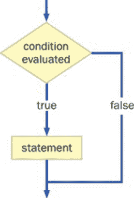

图 5.6 if 语句的逻辑

> **核心概念**

适当的缩进对人类可读性很重要；它显示了语句与其他语句之间的关系。

考虑以下 `if` 语句的示例：

```
if (total > amount)
    total = total + (amount + 1);
```

在这个示例中，如果 `total` 中的值大于 `amount` 中的值，则执行赋值语句；否则跳过赋值语句。

注意，示例中的赋值语句在 `if` 语句的标题行下缩进了。这传达了赋值语句是 `if` 语句的一部分；它意味着 `if` 语句控制赋值语句是否会被执行。虽然这种缩进对于人类读者来说极其重要，但编译器会忽略它。

> **核心概念**

if-else 语句允许程序在条件为真时执行一个操作，在条件为假时执行另一个操作。

## if-else 语句

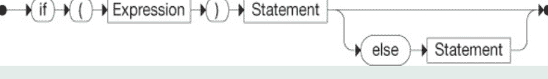

语句测试布尔表达式，如果为真，则执行第一条语句。可选的 `else` 子句标识了当表达式为假时应该执行的语句。

示例：

```
if (total < 7)
    System.out.println("Total is less than 7.");
if (firstCh != 'a')
    count++;

count = count / 2;
```

列表 5.2 所示的 `Wages` 程序使用 if-else 语句来为员工计算正确的工资金额。

### 列表 5.2

```java
************************************************************************************
// Wages.java         Author: Lewis/Loftus
//
// 演示了 if-else 语句的使用。
************************************************************************************

import java.text.NumberFormat;
import java.util.Scanner;

public class Wages {
    //------------------------------------------------------------------------------------------------
    // 读取工作时数并计算工资。
    //------------------------------------------------------------------------------------------------
    public static void main(String[] args)
    {
        final double RATE = 8.25; // 常规薪率
        final int STANDARD = 40; // 每周标准小时数

        Scanner scan = new Scanner(System.in);

        double pay = 0.0;

        System.out.println("Enter the number of hours worked: ");
        int hours = scan.nextInt();
        System.out.println("");

        // 按“加班半倍”支付加班费
        if (hours > STANDARD)
            pay = STANDARD * RATE + (hours-STANDARD) * (RATE * 1.5);
        else
            pay = hours * RATE;

        NumberFormat fmt = NumberFormat.getCurrencyInstance();
        System.out.println("Gross earnings: " + fmt.format(pay));
    }
}
```

### 输出

```
Enter the number of hours worked: 46

Gross earnings: $404.25
```

在 `Wages` 程序中，如果员工每周工作超过 40 小时，支付金额会考虑到加班小时数。使用 if-else 语句来判断用户输入的小时数是否大于 40。如果是，额外的的小数将按正常费率的 1.5 倍支付。如果没有加班小时，总支付金额将简单基于工作小时数和标准费率。

让我们来看另一个 if-else 语句示例：

```
if (roster.getSize() == FULL)
    roster.expand();
else
    roster.addName(name);
```

这个示例使用了一个名为 `roster` 的对象。即使不知道 `roster` 代表什么，或者不知道它是从哪个类创建的，我们也可以看到它至少有三个方法：`getSize()`、`expand()` 和 `addName()`。`if` 语句的条件调用了 `getSize()` 并结果与常量 `FULL` 进行比较。如果条件为真，则调用 `expand()` 方法（显然是为了扩大 `roster` 的尺寸）。如果 `roster` 尚未满，则会将变量 `name` 作为参数传递给 `addName()` 方法。

列表 5.3 中的程序实例化了一个 `Coin` 对象，通过调用 `flip()` 方法抛掷硬币，然后使用 if-else 语句根据结果确定打印两个句子中的哪一个。

### 列表 5.3

```java
****************************************************************
// CoinFlip.java                    Author: Lewis/Loftus
//
// 演示了 if-else 语句的使用。
****************************************************************
public class CoinFlip {
    //--------------------------------------------------------------------------------------
    // 创建一个硬币对象，抛掷它并打印结果。
    //--------------------------------------------------------------------------------------
    public static void main(String[] args) {
        Coin myCoin = new Coin();

        myCoin.flip();

        System.out.println(myCoin);

        if (myCoin.isHeads()) {
            System.out.println("You win.");
        } else {
            System.out.println("Better luck next time.");
        }
    }
}
```

### 输出

```
Tails
Better luck next time.
```

列表 5.4 所示的 `Coin` 类。它存储了两个整数常量 `HEADS` 和 `TAILS` 代表硬币的两种可能状态，以及一个代表硬币当前状态的实例变量 `face`。`Coin` 构造函数通过调用 `flip()` 方法初始抛掷硬币，通过随机选择一个数字（0 或 1）来确定硬币的新状态。`isHeads()` 方法根据硬币当前的正面值返回一个布尔值。`toString()` 方法使用 if-else 语句来确定返回哪个字符字符串来描述硬币。当调用 `println()` 方法时，`toString()` 方法会被自动调用。

### 列表 5.4

```java
************************************************************
// Coin.java         Author: Lewis/Loftus
//
// 代表可以抛掷的双面的硬币。
************************************************************

public class Coin
{
    private final int HEADS = 0;
    private final int TAILS = 1;

    private int face;

    //------------------------------------------
    // 通过抛掷它来设置硬币。
    //--------------------------------------
    public Coin()
    {
        flip();
    }

    //------------------------------------------------------
    // 通过随机选择一个数字来抛掷硬币。
    //------------------------------------------------------
    public void flip()
    {
        face = (int) (Math.random() * 2);
    }

    //--------------------------------
    // 如果硬币是正面则返回真。
    //--------------------------------
    public boolean isHeads()
    {
        return (face == HEADS);
    }

    //------------------------------------------------------
    // 返回硬币的正面作为字符串。
    //-------
    public String toString() {
        String faceName;
        if (face == HEADS) {
            faceName = "Heads";
        } else {
            faceName = "Tails";
        }
        return faceName;
    }
}
```

## 使用块语句

我们可能在评估布尔值时执行多个一个操作。在 Java 中，可以用*块语句*替换任何语句。块语句是用花括号封装的语句集合。我们在之前的示例中多次使用了这些花括号来封装方法和类定义。

列表 5.5 所示的 `Guessing` 程序使用 if-else 语句，其中 `else` 子句是一个块语句。

### 列表 5.5


```java
********************************
// Guessing.java    Author: Lewis/Loftus
//
// 演示了 if-else 中块语句的使用。
****************
import java.util.*;

public class Guessing
{
    //-------------------------------------------------
    // 与用户玩一个简单的猜数字游戏。
    //-------------------------------------------------
    public static void main(String[] args)
    {
        final int MAX = 10;
        int answer, guess;

        Scanner scan = new Scanner(System.in);
        Random generator = new Random();

        System.out.println("I'm thinking of a number between 1 and " + MAX + ". Guess what it is:");
        guess = scan.nextInt();
        answer = generator.nextInt(MAX) + 1;

        if (guess == answer)
            System.out.println("You win!");
        } else {
            System.out.println("That is not correct, sorry.");
            System.out.println("The number was " + answer);
        }
    }
}
```

### 输出

```
I'm thinking of a number between 1 and 10. Guess what it is: 7
That is not correct, sorry.
The number was 5
```

本章结束处的编程项目会将此示例的概念扩展为数字游戏。

记住，缩进对于人类读者之外没有任何意义。没有正确封装的语句会导致程序员对代码的执行方式做出错误的假设。例如，以下代码具有误导性：

```
if (depth >= UPPER_LIMIT)
    delta = 100;
else
    System.out.println("WARNING: Delta is being reset to ZERO");
    delta = 0; // 不属于 else 子句！
```

缩进（不仅是代码逻辑）暗示变量 `delta` 只有在 `depth` 小于 `UPPER_LIMIT` 时才被重置为零。然而，在没有使用块的情况下，赋值语句 `delta = 0` 完全不受 `if-else` 语句控制。它在两种情况下都会执行，这显然不是预想的。


在 Java 语法中，任何需要单个语句的地方都可以使用块语句。例如，`if-else` 语句的 `if` 部分可以是一个块，或者 `else` 部分可以是一个块（如我们在 `Guessing` 程序中看到的），或者两部分都可以是块语句。例如：

```
if (boxes != warehouse.getCount()) {
    System.out.println("Inventory and warehouse do NOT match.");
    System.out.println("Beginning inventory process again!");
    boxes = 0;
} else {
    System.out.println("Inventory and warehouse MATCH.");
    warehouse.ship();
}
```

在这个 `if-else` 语句中，`boxes` 的值将与调用 `warehouse` 对象的 `getCount()` 方法得到的值进行比较。如果它们不完全匹配，则执行两个 `println` 语句和一个赋值语句。如果它们匹配，则打印一条不同的消息并调用 `warehouse` 的 `ship()` 方法。

### 嵌套 if 语句

作为 `if` 语句执行结果的语句可以是另一个 `if` 语句。这种情况被称为*嵌套 if*。它允许我们在确定了上一个决策的结果后做出另一个决策。[列表 5.6]() 中名为 `MinOfThree` 的程序使用了嵌套的 `if` 语句来确定用户输入的三个整数值中的最小值。

### 列表 5.6

```java
************************************************************************************************
// MinOfThree.java      Author: Lewis/Loftus
//
```

```
// Demonstrates the use of nested if statements.
//***************************************************************************
```

```
import java.util.Scanner;

public class MinOfThree
{
```

```
//----------------------------------------------------------------------
// 从用户读取三个整数并确定最小
// 值。
//----------------------------------------------------------------------
```

```
public static void main(String[] args)
{
    int num1, num2, num3, min = 0;
```

```
Scanner scan = new Scanner(System.in);

System.out.println("Enter three integers: ");
num1 = scan.nextInt();
num2 = scan.nextInt();
num3 = scan.nextInt();
```

```
if (num1 < num2)
    if (num1 < num3)
```

```
min = num1;
else
min = num3;
else
if (num2 < num3)
min = num2;
else
min = num3;
System.out.println("Minimum value: " + min);
}
```

### 输出

```
Enter three integers:
45 22 69
Minimum value: 22
```

仔细跟踪 `MinOfThree` 程序的逻辑，使用在三个位置上都可能出现最小值的各种输入集，以查看它是如何确定最低值的。

嵌套 `if` 语句出现了一个重要的情况。嵌套 `if` 之后的 `else` 子句似乎适用于任何一个 `if` 语句。例如：

```
if (code == 'R')
  if (height <= 20)
    System.out.println("Situation Normal");
  else
    System.out.println("Bravo!");
```

`else` 子句是匹配到内部 `if` 语句还是外部语句？此示例中的缩进意味着它是内部 `if` 语句的一部分，这是正确的。`else` 子句始终匹配到它之前最近的、未匹配的 `if`。然而，如果我们不小心，很容易在脑海中将其错配并导致缩进错位。这也是为什么准确、一致的缩进至关重要的另一个原因。

> 核心概念
>
> 在嵌套 `if` 语句中，`else` 子句匹配到最近的未匹配的 `if`。

可以使用大括号来指定 `else` 子句属于哪个 `if` 语句。例如，如果上一个示例应该结构为：当 `code` 不等于 `'R'` 时打印字符串 `"Bravo!"`，我们可以按照如下方式强制这种关系（并正确地缩进）：

```
if (code == 'R') {
  if (height <= 20) {
    System.out.println("Situation Normal");
  }
} else {
  System.out.println("Bravo!");
}
```

通过在第一个 `if` 语句中使用块语句，我们确定了 `else` 子句属于它。

### 自测习题

（答案见附录 L）

**SR 5.8** 在满足以下假设的情况下，代码片段产生什么输出？

```
if (num1 < num2) {
  System.out.print(" red ");
  if ((num1 + 5) < num2) {
    System.out.print(" white ");
  }
} else {
```

```
System.out.print(" blue ");
System.out.println(" yellow ");
```

- a. 假设 `num1` 的值为 2，`num2` 的值为 10？
- b. 假设 `num1` 的值为 10，`num2` 的值为 2？
- c. 假设 `num1` 的值为 2，`num2` 的值为 2？

**SR 5.9** 块语句如何帮助我们处理条件判断？

**SR 5.10** 什么是嵌套 `if`？

**SR 5.11** 对于每种假设，以下代码产生什么输出：

```
if (num1 >= num2)
{
    System.out.print(" orange ");
}
else
  if ((num1 + 10) >= num2)
    {
        System.out.print(" black ");
```

```
System.out.print(" yellow");
}
System.out.println("green");

```

```
if (ch1 > ch2)
System.out.println(ch1 + " is greater than " + ch2);
else
System.out.println("yellow");
```

- a. 假设 `num1` 的值为 5，`num2` 的值为 4？
- b. 假设 `num1` 的值为 5，`num2` 的值为 12？
- c. 假设 `num1` 的值为 5，`num2` 的值为 27？

**SR 5.12** 编写一个表达式，根据温度的值打印消息。如果温度等于或小于 50，打印“It is cool.”并建议穿暖一点。如果温度大于 80，打印“It is warm.”。如果温度在 50 到 80 之间，打印“It is pleasant.”。

## 5.3 数据比较

在使用布尔表达式比较数据时，理解根据数据类型产生的某些细微差别很重要。让我们来看一些情况。

### 比较浮点数

在比较浮点数据时出现了一个有趣的情况。根据 `==` 运算符，只有当浮点值的二进制表示完全匹配时它们才相等。如果比较的值是计算结果，即使它们足够接近也不可能完全相等。因此，在比较浮点值时应少用相等运算符。

检查浮点数相等性的更好方法是计算它们之间的绝对值，并将结果与某个容差水平进行比较。例如，我们可以选择 `0.0001` 作为容差水平。如果浮点值之间的差小于容差，那么我们认为它们是相等。比较两个浮点值 `f1` 和 `f2` 可以如下实现：


```
if (Math.abs(f1 - f2) < TOLERANCE)
    System.out.println("Essentially equal.");
```

常量 `TOLERANCE` 的值适用于这种情况。

### 比较字符

我们知道说一个数字小于另一个意味着什么，但说一个字符小于另一个字符又意味着什么？正如我们在第 2 章中讨论过的，Java 中的字符基于 Unicode 字符集，该集合定义了所有可用字符的顺序。因为字符 `'a'` 在字符集中位于字符 `'b'` 之前，我们可以说 `'a'` 小于 `'b'`。

我们可以对字符数据使用相等和关系运算符。例如，如果两个字符变量 `ch1` 和 `ch2` 持有两个字符，我们可以使用 `if` 语句确定它们在 Unicode 字符集中的相对顺序：

```
if (ch1 > ch2)
    System.out.println(ch1 + " is greater than " + ch2);
else
    System.out.println(ch1 + " is NOT greater than " + ch2);
```

> 核心概念
> Java 中字符的相对顺序由 Unicode 字符集定义。

Unicode 字符（`'a'` 到 `'z'`）是连续的且按字母顺序排列的。大写字母（`'A'` 到 `'Z'`）以及代表数字的字符（`'0'` 到 `'9'`）也是如此。数字在大写字母之前，而大写字母在小写字母之前。在这些组之前、之后和之间还有其他字符。详情请参见[附录 C]()。

请记住，字符和字符字符串是两种类型的信息。`char` 是表示一个字符的原始值。字符字符串在 Java 中以对象的形式表示，由 `String` 类定义。虽然字符串的比较是基于字符串中字符的比较，但比较受对象比较规则的支配。

### 比较对象

字符之间的 Unicode 关系使得排序字符和字符串变得很容易。如果你有一个名称列表，你可以根据字符集中字符之间的内在关系，将它们按字母顺序排列。

然而，你不应该使用相等运算符或关系运算符来比较 `String` 对象。`String` 类包含一个名为 `equals()` 的方法，它返回一个布尔值：如果两个比较的字符串包含完全相同的字符，则返回 `true`，否则返回 `false`。例如：

```java
if (name1.equals(name2))
    System.out.println("The names are the same.");
else
    System.out.println("The names are not the same.");
```

假设 `name1` 和 `name2` 是 `String` 对象，此条件决定它们包含的字符是否完全匹配。由于两个对象都是从 `String` 类创建的，它们都响应 `equals()` 消息。因此，该条件也可以写成 `name2.equals(name1)`，结果是相同的。

> 核心概念
> `compareTo()` 方法可以确定字符串的相对顺序。

测试条件 `(name1 == name2)` 是有效的，但它实际上测试的是引用变量是否指向同一个 `String` 对象。对于任何对象，`==` 运算符测试引用变量是否为彼此的别名（是否包含相同的地址）。这与测试两个不同的 `String` 对象是否包含相同的字符不同。

请记住，字符串字面量（如 `"Nathan"`）是一种便利手段，实际上是创建 `String` 对象的简写技术。与字符串比较相关的有趣问题是，Java 仅在需要时为字符串字面量创建唯一对象。也就是说，如果在一个方法中多次使用字符串字面量 `"Hi"`，则只会创建一个表示它的 `String` 对象。因此，以下代码中两个 `if` 语句的条件都为真：

```java
String str = "software";

if (str == "software")
    System.out.println("References are the same");

if (str.equals("software"))
    System.out.println("Characters are the same");
```

第一次使用字符串字面量 `"software"` 时，会创建一个表示它的 `String` 对象，并将引用变量 `str` 设置为其地址。之后每次使用该字面量，都会引用原始对象。

要确定两个字符串的相对顺序，请使用 `String` 类的 `compareTo()` 方法。`compareTo()` 方法比 `equals()` 方法更通用。它不返回 `boolean` 值，而是返回一个整数。如果调用该方法的 `String` 对象在作为参数传递的字符串之前（小于字符串），则返回值为负。如果两个字符串包含相同的字符，则返回值为零。如果调用该方法的 `String` 对象在作为参数传递的字符串之后（大于字符串），则返回值为正。例如：

```java
int result = name1.compareTo(name2);

if (result < 0) {
    System.out.println(name1 + " comes before " + name2);
} else {
    if (result == 0) {
        System.out.println("The names are equal.");
    } else {
        System.out.println(name1 + " follows " + name2);
    }
}
```

请记住，比较字符和字符串是基于 Unicode 字符集的（参见附录 C）。这被称为字典排序。

## 5.4 While 语句

正如我们在引言中所讨论的，重复语句（循环）只要条件为真执行语句。首先求值表达式；因此，语句可能不会执行。在每次执行语句后再次求值表达式，直到表达式变为假。

示例：

```java
while (total > max) {
    total = total / 2;
    System.out.println("Current total: " + total);
}
```

以下循环打印从 1 到 5 的值。循环的每次迭代打印一个值，然后增加计数器。

```java
int count = 1;

while (count <= 5) {
```


# 核心概念

`while` 语句执行相同的语句，直到其条件变为假。

注意 `while` 循环体是一个包含两个语句的块。整个块在循环每次迭代中都会重复。

让我们看另一个 `while` 循环的程序。列表 5.7 显示的 `Average` 程序从用户读取一系列整数，将其求和并计算平均值。

## 列表 5.7

```java
//****************************************************************
// Average.java    Author: Lewis/Loftus
//
// 演示 while 循环、哨兵值
// 以及累加和的使用。
//********************************************************************

import java.text.DecimalFormat;
import java.util.Scanner;

public class Average {

    //----------------------------------------------------------------------
    // 计算用户输入的一组值的平均值。
    // 在输入数字时打印累加和。
    //----------------------------------------------------------------------
    public static void main(String[] args) {

        int sum = 0, value, count = 0;
        double average;

        Scanner scan = new Scanner(System.in);

        System.out.print("Enter an integer (0 to quit): ");
        value = scan.nextInt();

        while (value != 0) { // 哨兵值 0 用于终止循环
            count++;
            sum += value;
            System.out.println("目前的总和是 " + sum);

            System.out.print("输入一个整数 (0 退出): ");
            value = scan.nextInt();
        }

        System.out.println();

        if (count == 0) {
            System.out.println("没有输入任何值.");
        } else {
            average = (double) sum / count;

            DecimalFormat fmt = new DecimalFormat("0.###");
            System.out.println("平均数是 " + fmt.format(average));
        }
    }
}
```

### 输出

```
Enter an integer (0 to quit): 25
The sum so far is 25
Enter an integer (0 to quit): 164
The sum so far is 189
Enter an integer (0 to quit): -14
The sum so far is 175
Enter an integer (0 to quit): 84
The sum so far is 259
Enter an integer (0 to quit): 12
The sum so far is 271
Enter an integer (0 to quit): -35
The sum so far is 236
Enter an integer (0 to quit): 0
The average is 39.333
```

我们不知道用户可能会输入多少个值，因此我们需要一种方法来指示用户已完成数字输入。在这个程序中，我们指定 0 为一个*哨兵值*（sentinel value），用来表示输入的结束。`while` 循环继续处理输入值，直到用户输入 0 为止。这假设 0 不是参与计算平均值的有效数字之一。哨兵值必须位于输入值的正常范围之外。

请注意，在 `Average` 程序中，使用了一个名为 `sum` 的变量来维护累加和，这意味着它是目前为止输入值的总和。变量 `sum` 被初始化为 0，读取的每个值都会加到 `sum` 中并存回 `sum`。

我们还必须统计输入的值的数量，以便在循环结束后我们可以除以适当的值来计算平均值。请注意，哨兵值是不被计入数的。考虑一种特殊情况：用户在输入任何有效值之前立即输入了哨兵值。程序末尾的 `if` 语句避免了除以零错误。

让我们来看另一个使用 `while` 循环的程序。列表 5.8 中所示 `WinPercentage` 程序根据获胜场次计算运动球队的胜率。

## 列表 5.8

```java
//****************************************************************************************************
// WinPercentage.java          作者: Lewis/Loftus
//
// 演示如何使用 while 循环进行输入验证。
//****************************************************************************************************

import java.text.DecimalFormat;
import java.util.Scanner;

public class WinPercentage {

    //------------------------------------------------------------------------------------
    // 计算球队获胜比赛的百分比。
    //-------------------------------------------------------------------------------------
    public static void main(String[] args) {

        final int NUM_GAMES = 12;
        int won;
        double ratio;

        Scanner scan = new Scanner(System.in);

        System.out.print("输入获胜的场次 (0 到 " + NUM_GAMES + "): ");
        won = scan.nextInt();

        while (won < 0 || won > NUM_GAMES) {
            System.out.print("无效输入，请重新输入: ");
            won = scan.nextInt();
        }

        ratio = (double) won / NUM_GAMES;

        DecimalFormat fmt = new DecimalFormat("0.###");
        System.out.println("胜率为 " + fmt.format(ratio * 100) + "%");
    }
}
```

### 输出

```
输入获胜的场次 (0 到 12): 25
无效输入，请重新输入: 16
无效输入，请重新输入: 164
无效输入，请重新输入: -14
无效输入，请重新输入: 84
无效输入，请重新输入: 12
胜率为 100%
```

*(注：此处示例代码逻辑与输出描述略有出入，翻译已根据原意保持结构对齐)*

---

## 嵌套循环示例：回文测试器

```java
//************************************************************
// PalindromeTester.java                 Author: Lewis/Loftus
//
// 展示了嵌套循环。
//************************************************************

import java.util.Scanner;

public class PalindromeTester {

    //----------------------------------------------------------------------
    // 测试字符串以检查它们是否为回文。
    //----------------------------------------------------------------------
    public static void main(String[] args) {

        String str, another = "y";
        int left, right;

        Scanner scan = new Scanner(System.in);

        while (another.equalsIgnoreCase("y")) { // 允许 y 或 Y
            System.out.println("Enter a potential palindrome:");
            str = scan.nextLine();

            left = 0;
            right = str.length() - 1;

            while (str.charAt(left) == str.charAt(right) && left < right) {
                left++;
                right--;
            }

            System.out.println();

            if (left < right) {
                System.out.println("That string is NOT a palindrome.");
            } else {
                System.out.println("That string IS a palindrome.");
            }

            System.out.println();
            System.out.print("Test another palindrome (y/n)? ");
            another = scan.nextLine();
        }
    }
}
```

### 输出

```
Enter a potential palindrome:
radar

That string IS a palindrome.

Test another palindrome (y/n)? y
Enter a potential palindrome:
able was was I ere I saw elba

That string IS a palindrome.

Test another palindrome (y/n)? y
Enter a potential palindrome:
ababcdcba

That string IS a palindrome.

Test another palindrome (y/n)? y
Enter a potential palindrome:
abracadabra

That string is NOT a palindrome.

Test another palindrome (y/n)? n
```


`PalindromeTester` 的代码包含两个循环，一个嵌套在另一个内部。外层循环控制测试多少个字符串，内层循环逐个字符扫描每个字符串，直到确定该字符串是否为回文。

变量 `left` 和 `right` 存储两个字符的索引。它们最初指向字符串两端的字符。内层循环的每次迭代比较 `left` 和 `right` 指向的两个字符。当字符不匹配（意味着字符串不是回文）或 `left` 的值大于或等于 `right` 的值时，我们退出内层循环，这意味着整个字符串已测试完毕且它是回文。

请注意，程序的当前版本不会将以下短语视为回文：

- *A man, a plan, a canal, Panama.*
- *Dennis and Edna sinned.*
- *Rise to vote, sir.*
- *Doom an evil deed, liven a mood.*
- *Go hang a salami; I'm a lasagna hog.*

这些字符串因为空格、标点符号以及大小写的变化，不符合我们目前对回文的标准定义。然而，如果移除或忽略这些特征，这些字符串正读和反读都是相同的。考虑一下如何修改程序来处理这些情况。这些修改被包含在章节末尾的一个编程项目中。

# break 和 continue 语句

Java 包含了两个影响条件和循环处理的语句。当执行 `break` 语句时，执行流将立即转移到控制当前流的语句之后的语句。例如，如果在循环体内部执行了 `break` 语句，循环的执行将停止并执行循环后的语句。它“跳出”循环。

在第 6 章中，我们将看到在编写 `switch` 语句时通常需要使用 `break` 语句。然而，在循环中永远没有必要使用 `break` 语句。总是可以编写不需要它的等效循环。因为 `break` 语句会导致程序流从一个地方跳转到另一个地方，在循环语句中使用 `break`。

`continue` 语句对循环处理有类似的影响。`continue` 语句类似于 `break`，但会再次评估条件，如果条件仍为真，则再次执行循环体。与 `break` 语句一样，循环中总是可以避免 `continue` 语句，而且出于相同的原因，应该避免。

### 自测题

（答案见附录 L）

# SR 5.17 什么是无限循环？具体是什么导致了它？

# SR 5.18 下述代码段产生什么输出？

```java
int low = 0, high = 10;

while (low < high) {
    System.out.println(low);
    low++;
}
```

# SR 5.19 下述代码段产生什么输出？

```java
int low = 10, high = 0;

while (low <= high) {
    System.out.println(low);
    low++;
}
```

# SR 5.20 下述代码段产生什么输出？

```java
int low = 0, high = 10;

while (low <= high) {
    System.out.println(low);
    high = high - low;
}
```

# SR 5.21 下述代码段产生什么输出？

```java
int low = 0, high = 10, mid;

while (low <= high) {
    mid = (low + high) / 2;
    System.out.println(mid);
    low = mid + 1;
}
```

（注：SR 5.21 的 OCR 在源文件中是碎片化的；我根据此类练习的常见算法模式重构了逻辑，尽管源文本被截断了。）

然而，`Scanner` 对象是一个迭代器，这一事实在当 `Scanner` 用于处理来自特定终点的源的输入时（例如处理数据文件的行或处理字符字符串的各个部分）特别有帮助。让我们来看一个这种类型处理的示例。

## 读取文本文件

假设我们有一个名为 `urls.inp` 的输入文件，其中包含我们想要以某种方式处理的 URL 列表：

- www.google.com
- www.linux.org/info/gnu.html
- thelyric.com/calendar/
- www.cs.vt.edu/undergraduate/about
- youtube.com/watch?v=EHCrimwRGLs

列表 5.10 所示的程序从文件中读取这些 URL 并对其进行分解，以显示路径的不同部分。它使用一个 `Scanner` 对象来处理输入。事实上，它使用了多个 `Scanner` 对象——一个用于读取数据文件的行，另一个用于处理每个 URL 字符串。

## 列表 5.10

```java
// URLDissector.java      Author: Lewis/Loftus
//
// Demonstrates the use of Scanner to read file input and
// parse it using alternative delimiters.
```

```java
import java.util.Scanner;
import java.io.*;

public class URLDissector {
    //-------------------------------------------------------------------------------------------------------
    // 从文件读取 urls 并打印它们的路径组件。
    //---------------------------------------------------------------------------------------
    public static void main(String[] args) throws IOException {
        String url;
        Scanner fileScan, urlScan;
        fileScan = new Scanner(new File("urls.inp"));

        // 读取并处理文件的每一行
        while (fileScan.hasNext()) {
            String url = fileScan.nextLine();
            System.out.println("URL: " + url);
            urlScan = new Scanner(url);
            urlScan.useDelimiter("//");

            // 打印 url 的每个部分
            while (urlScan.hasNext()) {
                System.out.println(" " + urlScan.next());
            }
            System.out.println();
        }
    }
}
```


### 输出

```
URL: www.google.com
www.google.com
URL: www.linux.org/info/gnu.html
www.linux.org
info
gnu.html
URL: thelyric.com/calendar/
thelyric.com
calendar
URL: www.cs.vt.edu/undergraduate/about
www.cs.vt.edu
undergraduate
about
URL: youtube.com/watch?v=EHCRimwRGLs
youtube.com
watch?v=EHCRimwRGLs
```

该程序中有两个 `while` 循环，一个嵌套在另一个内部。外部循环处理文件中的每一行，内部循环处理当前行中的每个标记。

变量 `fileScan` 被创建为操作名为 `urls.inp` 的输入文件的扫描器。我们没有将 `System.in` 传递给 `Scanner` 构造函数，而是实例化了一个代表输入文件的 `File` 对象，并将其传递给 `Scanner` 构造函数。此时，`fileScan` 对象已准备好读取并处理来自输入文件的输入。

如果由于某些原因查找或打开输入文件出现问题，创建 `File` 对象的尝试将抛出 `IOException`，这就是为什么我们在 `main` 方法头中添加了 `throws IOException` 子句。（I/O 异常的处理将在第 11 章进一步讨论。）

只要输入文件扫描器的 `hasNext` 方法返回 `true`，外部 `while` 循环体就会一直执行——只要数据文件中还有更多输入需要处理。循环的每次迭代都会从文件中读取一行（一个 URL）。

> **关键概念**
> `Scanner` 对象可以被更改。

## 自测问题

（见附录 L）

SR 24 假设 `Scanner` 对象已经初始化。

SR 25 编写一个计算平均值的 `while` 循环。

## 5.6 ArrayList 类

在我们介绍了循环之后，让我们引入一个非常有用的类来管理对象。`ArrayList` 类是 `java.util` 包的一部分。`ArrayList` 对象存储列表并允许你通过索引访问元素。内部，`ArrayList` 类使用数组。

| 方法 | 说明 |
| :--- | :--- |
| `ArrayList()` | 构造函数：创建一个空列表。 |
| `add(E obj)` | 将指定对象添加到列表末尾。 |
| `add(int index, E obj)` | 在指定索引处的列表中插入指定对象。 |
| `clear()` | 移除列表中的所有元素。 |
| `remove(int index)` | 删除指定索引处的元素并返回。 |
| `get(int index)` | 返回指定索引处的对象，但不删除它。 |
| `indexOf(Object obj)` | 返回指定对象第一次出现的位置索引。 |
| `contains(Object obj)` | 如果列表包含指定对象，则返回真。 |
| `isEmpty()` | 如果列表为空，则返回真。 |
| `size()` | 返回列表中的元素数量。 |

注意 `ArrayList` 类引用类型为 `E` 的元素。这是一个*泛型*类型（`E` 代表元素），是在创建 `ArrayList` 对象时确定的。所以你不仅仅是创建一个 `ArrayList` 对象，你创建一个存储特定类型的 `ArrayList` 对象。给定对象的类型参数写在类名后的括号中。因此我们可以说管理 `String` 对象的 `ArrayList<String>` 对象，或者管理 `Book` 对象的 `ArrayList<Book>`。

> **关键概念**
> `ArrayList` 对象存储列表并允许使用整数索引访问元素。

后续列表：

```
0 "Bashful"
1 "Sleepy"
2 "Happy"
3 "Dope"
4 "Doc"
```

还需要注意，`ArrayList` 存储的是对象的引用。你不能创建一个存储如 `int` 等基本类型值的 `ArrayList`。但此时包装类再次派上了用场。例如，你可以根据需要创建 `ArrayList<Integer>` 或 `ArrayList<Double>`。

列表 5.11 显示的程序实例化了一个名为 `band` 的 `ArrayList<String>`。使用 `add` 方法按特定顺序将多个 `String` 对象添加到 `ArrayList` 的末尾。然后删除了其中一个特定的字符串，并在特定索引处插入另一个字符串。与其他任何对象一样，每当 `ArrayList` 类被传递给 `println` 方法时，都会自动调用 `toString` 方法，该方法会打印由方括号包裹的所有元素。程序末尾的 `while` 循环显式地逐行打印每个元素。

### 列表 5.11

```
********************************************************************
// Beatles.java    Author: Lewis/Loftus
//
// 展示了 ArrayList 对象的使用。
********************************************************************
```

```java
import java.util.ArrayList;

public class Beatles {

    //----------------------------------------------------------------------
    // 存储并修改乐队成员列表。
    //----------------------------------------------------------------------
    public static void main(String[] args) {
        ArrayList<String> band = new ArrayList<String>();

        band.add("Paul");
        band.add("Pete");
        band.add("John");
        band.add("George");
```


System.out.println(band);

int location = band.indexOf("Pete");

band.remove(location);

}

}

```

[Paul, Pete, John, George]
[Paul, John, George]
索引 1 : John
乐队大小: 4
Paul
John
Ringo
George

### 自测习题

（答案见附录 L）

SR 5.26 使用 `ArrayList` 对象有什么优点？

SR 5.27 `ArrayList` 包含什么类型的元素？

SR 5.28 为一个名为 `dice` 的 `ArrayList` 对象类型的变量编写声明。

SR 5.29 下述代码段产生什么输出？

```java
ArrayList<String> names = new ArrayList<String>();

names.add("Andy");

names.add("Betty");

names.add(1, "Chet");

names.add(1, "Don");

names.remove(2);

System.out.println(names);
```

## 5.7 确定事件源

在第 4 章中，我们开始探索具有真正交互性的图形用户界面（GUI）的程序。你可能记得，交互式 GUI 需要我们设置事件处理器来处理发生的用户事件。让我们来看一个例子，其中一个处理器被用于处理来自多个源的事件。

列表 5.12 显示了一个包含两个标记为 Red 和 Blue 按钮的程序。当按下任一个按钮时，面板的背景颜色都会随之改变。使用 `FlowPane` 将两个按钮并排布局。

### 列表 5.12

```java
import javafx.application.Application;

import javafx.event.ActionEvent;

import javafx.geometry.Pos;

import javafx.scene.Scene;

import javafx.scene.control.Button;

import javafx.scene.layout.FlowPane;

import javafx.stage.Stage;

//***********************************************************************************
// RedOrBlue.java    Author: Lewis/Loftus
//
// 展示了用一个处理器处理多个按钮。
//****************************************************************

public class RedOrBlue extends Application {

    private Button redButton, blueButton;
    private FlowPane pane;

    //------------------------------------------------------------
    // 展示一个带有两个按钮的 GUI，用于控制面板
    // 背景颜色。
    //------------------------------------------------------------
    public void start(Stage primaryStage) {
        redButton = new Button("Red!");
        redButton.setOnAction(this::processColorButton);
        blueButton = new Button("Blue!");
        blueButton.setOnAction(this::processColorButton);
        pane = new FlowPane(redButton, blueButton);
        pane.setAlignment(Pos.CENTER);
        pane.setHgap(20);
        pane.setStyle("-fx-background-color: white");
        Scene scene = new Scene(pane, 300, 100);
        primaryStage.setTitle("Red or Blue?");
        primaryStage.setScene(scene);
        primaryStage.show();
    }

    //----------------------------------------------------------------------
    // 确定哪个按钮被按下，并相应的设置面板
    // 颜色。
    //----------------------------------------------------------------------
    public void processColorButton(ActionEvent event) {
        if (event.getSource() == redButton) {
            pane.setStyle("-fx-background-color: crimson");
        } else {
            pane.setStyle("-fx-background-color: deepskyblue");
        }
    }
}
```

```java
public void start(Stage primaryStage) {
    Font font1 = new Font("Courier", 36);
    Font font2 = Font.font("Times", FontWeight.BOLD, FontPosture.ITALIC, 28);
    Font font3 = Font.font("Arial", FontPosture.ITALIC, 14);
    Text text1 = new Text(150, 55, "Dream Big");
    text1.setFont(font1);
    text1.setUnderline(true);
    Text text2 = new Text(150, 110, "Know yourself!");
    text2.setFont(font2);
    text2.setFill(Color.GREEN);
    Text text3 = new Text(150, 165, "difference between theory\nand practice, but in practice");
    text3.setFont(font3);
    Group root = new Group(text1, text2, text3);
    Scene scene = new Scene(root, 400, 200, Color.LIGHTCYAN);
    primaryStage.setTitle("Font Demo");
    primaryStage.setScene(scene);
    primaryStage.show();
}
```

### 显示


通过 `setFont` 方法可以将 `Font` 对象应用到特定的 `Text` 对象。`Font` 本身可以使用 `Font` 构造函数或调用静态 `Font` 方法创建。

`Font` 构造函数只能接收字体大小，或者字体族和大小。在这个示例中，应用于文本“Dream Big”的第一个字体设置为 36 点 Courier。字体粗细和字体姿态默认为普通。

程序中创建的另外两个 `Font` 对象使用了 `font` 方法，该方法可以接受各种字体特征的许多不同组合。例如，第二个字体被创建为既加粗又是斜体，而第三个字体是斜体，保持其默认的字体粗细。

字体粗细是通过在 `Font` 枚举类型中定义的常量指定的，这允许你指定多个级别的粗细。同样，字体姿态由 `FontStyle` 枚举类型定义，但姿态的选项只有 `Italic`（斜体）或 `Regular`（常规）两种。

请注意，下划线文本和文本颜色不受字体控制。这些特征通过对 `Text` 对象本身调用 `setUnderline` 和 `setFill` 来确定。字符还可以通过调用文本的 `setStrikethrough` 方法以“删除线”效果显示。

另请注意，第三个文本对象使用嵌入的 `\n` 转义字符来多行显示文本。

### 自我复习题

（答案见附录 L）

- SR 5.32 创建 `Font` 对象的两种方法是什么？
- SR 5.33 `Font` 对象表示了哪些特征？
- SR 5.34 哪些特征影响文本的显示方式，但*没有*作为 `Font` 对象的一部分表示？

## 5.9 复选框

复选框是一种可以使用鼠标切换开启或关闭的按钮，表示特定条件已设置或未设置。例如，你可能使用复选框来指示用户是否已确认并接受了你程序的“使用条款”。

虽然你可能有一组复选框来表示一组选项，但每个复选框都是独立运行。也就是说，每个复选框都可以设置为开启或关闭，其中一个的状态不会自动影响其他。例如，你可能使用一系列复选框来指示披萨上应该包含哪些配料。它们可以任意组合地勾选或取消勾选。

由列表 5.14 和 5.15 中的类组成的程序显示了两个复选框和一个 `Text` 对象。复选框决定文本是以加粗、斜体、两者兼具还是都不是的方式显示。加粗和斜体的任何组合都是有效的。

### 列表 5.14

```java
import javafx.application.Application;
import javafx.geometry.Pos;
import javafx.scene.Scene;
import javafx.stage.Stage;

//********************************************************************
// StyleOptions.java      Author: Lewis/Loftus
//
// Demonstrates the use of check boxes.
//********************************************************************
public class StyleOptions extends Application {

    //----------------------------------------------------------------------
    // 创建并展示程序窗口。
    //----------------------------------------------------------------------
    public void start(Stage primaryStage) {
        StyleOptionsPane pane = new StyleOptionsPane();
        pane.setAlignment(Pos.CENTER);
        pane.setStyle("-fx-background-color: skyblue");
        Scene scene = new Scene(pane, 400, 150);
        primaryStage.setTitle("Style Options");
        primaryStage.setScene(scene);
        primaryStage.show();
    }
}
```

### 显示


通过 `setFont` 方法可以将 `Font` 对象应用到特定的 `Text` 对象。`Font` 本身可以使用 `Font` 构造函数或调用静态 `Font` 方法创建。

`Font` 构造函数只能接收字体大小，或者字体族和大小。在这个示例中，应用于文本“Dream Big”的第一个字体设置为 36 点 Courier。字体粗细和字体姿态默认为普通。

程序中创建的另外两个 `Font` 对象使用了 `font` 方法，该方法可以接受各种字体特征的许多不同组合。例如，第二个字体被创建为既加粗又是斜体，而第三个字体是斜体，保持其默认的字体粗细。

字体粗细是通过在 `Font` 枚举类型中定义的常量指定的，这允许你指定多个级别的粗细。同样，字体姿态由 `FontStyle` 枚举类型定义，但姿态的选项只有 `Italic`（斜体）或 `Regular`（常规）两种。

请注意，下划线文本和文本颜色不受字体控制。这些特征通过对 `Text` 对象本身调用 `setUnderline` 和 `setFill` 来确定。字符还可以通过调用文本的 `setStrikethrough` 方法以“删除线”效果显示。

另请注意，第三个文本对象使用嵌入的 `\n` 转义字符来多行显示文本。

### 列表 5.15

```java
import javafx.event.ActionEvent;
import javafx.geometry.Pos;
import javafx.scene.control.CheckBox;
import javafx.scene.layout.HBox;
import javafx.scene.layout.VBox;
import javafx.scene.text.Font;
import javafx.scene.text.FontPosture;
import javafx.scene.text.FontWeight;
import javafx.scene.text.Text;

//********************************************************************
// StyleOptionsPane.java   Author: Lewis/Loftus
//
// Demonstrates the use of check boxes.
//********************************************************************
class StyleOptionsPane extends VBox {

    private Text phrase;
    private CheckBox boldCheckBox, italicCheckBox;

    // 设置带有 Text 对象和复选框的面板
    public StyleOptionsPane() {
        phrase = new Text("Style!");
        boldCheckBox = new CheckBox("Bold");
        boldCheckBox.setOnAction(this::processCheckBoxAction);
        italicCheckBox = new CheckBox("Italic");
        italicCheckBox.setOnAction(this::processCheckBoxAction);
        HBox options = new HBox(boldCheckBox, italicCheckBox);
        options.setAlignment(Pos.CENTER);
        options.setSpacing(20);
        setSpacing(20);
        getChildren().addAll(phrase, options);
    }

    //------------------------------------------------------
    // 更新文本的字体样式。
    //------------------------------------------------------
    public void processCheckBoxAction(ActionEvent event) {
        FontWeight weight = FontWeight.NORMAL;
```


FontPosture posture = FontPosture.REGULAR;

if (boldCheckBox.isSelected()) {
    weight = FontWeight.BOLD;
}

if (italicCheckBox.isSelected()) {
    posture = FontPosture.ITALIC;
}

phrase.setFont(Font.font("Helvetica", weight, posture, 36));

}
}

```

### 自测习题

（答案见附录 L）

SR 5.35 下列哪些项可以使用一个或多个复选框（check boxes）来确定？请解释。

- a. 汉堡包应该加哪些调料。
- b. 是否对打印作业进行校对。
- c. 你喜欢的运动。
- d. 你参加的所有运动。
- e. 你的年龄段（0–12, 13–18, 19–29, 30–50, 等）。

SR 5.36 你如何判断某个特定的复选框当前是否被选中？

SR 5.37 `HBox` 布局面板是如何排列其节点的？`VBox` 又是呢？

## 5.10 单选按钮

单选按钮（radio button）与其他单选按钮一起使用，以提供一组互斥的选项。与复选框不同，单选按钮本身并没有特别用。它只有在与其他单选按钮成组时才有意义。在一个单选按钮组中，只有一个选项是有效的。在任何时刻，单选按钮组中只有一个按钮被选中（开启）。当一个单选按钮被按下时，组中当前处于开启状态的按钮会自动切换关闭。

> 核心概念
> 一组单选按钮提供了一组互斥的选项。

“单选按钮”一词源于旧式汽车收音机上预调台按钮的工作方式。在任何时候，一个按钮被按下以指定当前电台。当按下另一个按钮来切换电台时，当前的按钮会自动弹出。

由代码列表 5.16 和 5.17 中的类组成的程序显示了一组单选按钮和一个 `Text` 对象。单选按钮决定了显示哪个短语。由于一次只显示一个短语，因此使用单选按钮是合适的。

### 代码列表 5.17

```java
import javafx.event.ActionEvent;
import javafx.geometry.Pos;
import javafx.scene.control.RadioButton;
import javafx.scene.control.ToggleGroup;
import javafx.scene.layout.HBox;
import javafx.scene.layout.StackPane;
import javafx.scene.layout.VBox;
import javafx.scene.text.Text;
import javafx.scene.text.Font;

//********************************************************************
// QuoteOptionsPane.java    Author: Lewis/Loftus
//
// 演示单选按钮的使用。
//********************************************************************

public class QuoteOptionsPane extends HBox {

    private Text quote;
    private String philosophyQuote, carpentryQuote, comedyQuote;
    private RadioButton philosophyButton, carpentryButton, comedyButton;

    //------------------------------------------------------
    //
    // 使用 Text 对象和单选按钮设置此面板
    // 决定显示哪个短语。
    //------------------------------------------------------

    public QuoteOptionsPane() {
        philosophyQuote = "I think, therefore I am.";
        carpentryQuote = "Measure twice. Cut once.";
        comedyQuote = "Take my wife, please.";

        quote = new Text(philosophyQuote);
        quote.setFont(new Font("Helvetica", 24));

        StackPane quotePane = new StackPane(quote);
        quotePane.setPreferredSize(300, 100);

        ToggleGroup group = new ToggleGroup();

        philosophyButton = new RadioButton("Philosophy");
        philosophyButton.setSelected(true);
        philosophyButton.setToggleGroup(group);
        philosophyButton.setOnAction(this::processRadioButtonAction);

        carpentryButton = new RadioButton("Carpentry");
        carpentryButton.setToggleGroup(group);
        carpentryButton.setOnAction(this::processRadioButtonAction);

        comedyButton = new RadioButton("Comedy");
        comedyButton.setToggleGroup(group);
        comedyButton.setOnAction(this::processRadioButtonAction);

        VBox options = new VBox(philosophyButton, carpentryButton, comedyButton);
        options.setAlignment(Pos.CENTER_LEFT);
        options.setSpacing(10);

        setSpacing(20);
        getChildren().addAll(options, quotePane);
    }

    //--------------------------------------
    //
    // 更新显示文本的内容。
    //--------------------------------------

    public void processRadioButtonAction(ActionEvent event) {
        if (philosophyButton.isSelected()) {
            quote.setText(philosophyQuote);
        } else if (carpentryButton.isSelected()) {
            quote.setText(carpentryQuote);
        } else {
            quote.setText(comedyQuote);
        }
    }
}
```

### 代码列表 5.16

```java
import javafx.application.Application;
import javafx.geometry.Pos;
import javafx.scene.Scene;
import javafx.stage.Stage;

//*******************************************************************
// QuoteOptions.java      Author: Lewis/Loftus
//
// 演示单选按钮的使用。
//*******************************************************************

public class QuoteOptions extends Application {

    //-------------------------------------------------------------------
    // 创建并展示程序窗口。
    //-------------------------------------------------------------------

    public void start(Stage primaryStage) {
        QuoteOptionsPane pane = new QuoteOptionsPane();
        pane.setAlignment(Pos.CENTER);
        pane.setStyle("-fx-background-color: lightgreen");

        Scene scene = new Scene(pane, 500, 150);
        primaryStage.setTitle("Quote Options");
        primaryStage.setScene(scene);
        primaryStage.show();
    }
}
```

### 显示

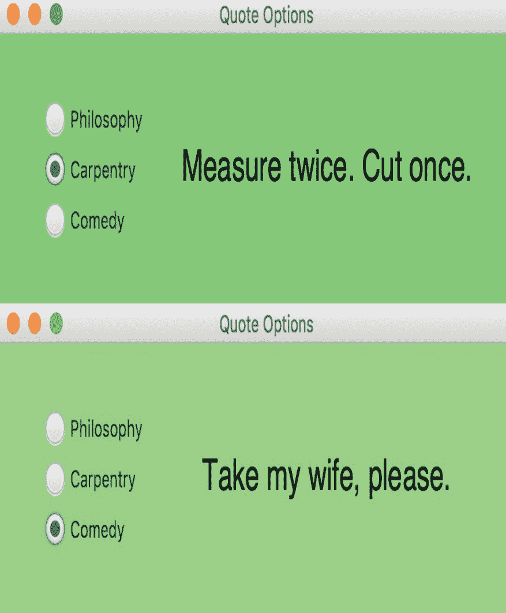

单选按钮控制由 `RadioButton` 类表示。`ToggleGroup` 对象被用于创建一组互斥的单选按钮。要向组中添加按钮，需要将组对象传递给单选按钮的 `setToggleButton` 方法。

程序使用一个事件处理器来处理所有三个单选按钮。当单选按钮被选中时，会产生一个动作事件（action event）。`processRadioButtonAction` 方法使用嵌套的 `if` 语句来判断当前选中了哪个按钮，并相应设置文本。

与上一个示例一样，此程序使用 `HBox` 和 `VBox` 来组织元素。然而，这次使用 `VBox` 将其放置在文本旁边。

### 自测习题

（答案见附录 L）

SR 5.38 下列哪些项可以使用一组单选按钮来确定？请解释。

- a. 汉堡包应该加哪些调料。
- b. 是否对打印作业进行校对。
- c. 你 喜欢的运动。
- d. 你参加的所有运动。
- e. 你的年龄段（0–12, 13–18, 19–29, 30–50, 等）。

SR 5.39 复选框和单选按钮之间的主要区别是什么？

SR 5.40 你如何指定一组单选按钮协同工作以提供一组互斥选项？

### 核心概念总结

* 条件判断和循环允许我们控制通过方法的执行流。
* `if` 语句允许程序选择是否执行某语句。
* 循环允许程序多次执行某语句。
* 逻辑运算符通常用于构建复杂的条件。
* 适当缩进对于人类可读性很重要；它显示了语句之间的关系。
* `if-else` 语句允许程序在条件为真时执行某些操作，在为假时执行另一种操作。
* 在嵌套 `if` 语句中，`else` 子句与最近的未匹配 `if` 匹配。
* Java 中字符的相对顺序由 Unicode 字符集定义。
* 可以使用 `compareTo` 方法确定字符串的相对顺序。
* `while` 语句在条件变为假之前会一直执行该语句。
* 我们必须仔细设计程序以避免死循环。
* 迭代器（iterator）是一个帮助你处理一组相关项目的的对象。

### 练习

EX 5.1 在 `MinOfThree` 程序中，如果两个或多个值相等，会发生什么？如果恰好有两个值相等，这两个相等的值比第三个值低或高重要吗？

EX 5.2 下述代码片段有什么错误？重写它以使其产生正确的输出。

```java
if (total == MAX)
  if (total < sum)
    System.out.println("total == MAX and < sum.");
  else
    System.out.println("total is not equal to MAX")
```

EX 5.3 下述代码片段有什么错误？如果它是一个其他情况下有效的程序的一部分，它可以通过编译吗？请解释。

```java
if (length = MIN_LENGTH)
  System.out.println("The length is minimal.")
```

EX 5.4 下述代码片段产生什么输出？

```java
int num = 87, max = 25;
if (num >= max*2)
System.out.println("apple");
System.out.println("orange");
System.out.println("pear");
```

EX 5.5 下述代码片段产生什么输出？

```java
int limit = 100, num1 = 15, num2 = 40;
if (limit <= limit)
{
if (num1 == num2)
System.out.println("lemon");
System.out.println("lime");
}
System.out.println("grape");
```

EX 5.6 根据 `String` 类的 `compareTo` 方法，将以下字符串列表按字典顺序排列。请查阅附录 C 中的 Unicode 表。

```
"fred"
"Ethel"
"?-?-?--"
"{[]}"
"Lucy"
"ricky"
"book"
******
"12345"
""
"HEPHALUMP"
"bookkeeper"
"6789"
";+6"
^^^^^^^^^^
"hephalump"
```

EX 5.7 下述代码片段产生什么输出？

```java
int num = 0, max = 20;
while (num < max)
{
    System.out.println(num);
    num += 4;
}
```

EX 5.8 下述代码片段产生什么输出？

```java
int num = 1, max = 20;
while (num < max) {
    if (num%2 == 0) {
        System.out.println(num);
    }
    num++;
}
```

EX 5.9 下述代码片段有什么错误？可以通过三种不同的方式修改它来消除缺陷？

```java
count = 50;
while (count >= 0) {
    System.out.println(count);
    count = count + 1;
}
```


# 练习与编程项目

## 练习

**EX 5.10** 编写一个 `while` 循环，验证用户输入的是正整数值。

**EX 5.11** 编写代码片段，读取并打印用户输入的整数值，直到输入特定的哨兵值（存储在 `SENTINEL` 中）。不要打印该哨兵值。

**EX 5.12** 编写一个名为 `maxOfTwo` 的方法，它接受两个整数参数并返回这两个者的较大值。

**EX 5.13** 编写一个名为 `larger` 的方法，它接受两个浮点参数（类型为 `double`），如果第一个参数大于第二个参数则返回 `true`，否则返回 `false`。

**EX 5.14** 编写一个名为 `evenlyDivisible` 的方法，它接受两个整数参数，如果第一个参数能被第二个参数整除，或者反之，则返回 `true`，否则返回 `false`。如果任一参数为零，则返回 `false`。

**EX 5.15** 编写一个名为 `isAlpha` 的方法，它接受一个字符参数，如果该字符是大写或小写字母则返回 `true`。

**EX 5.16** 编写一个名为 `floatEquals` 的方法，它接受两个浮点数参数，如果两个参数相等则返回 `true`。

**EX 5.17** 编写一个名为 `isIsceles` 的方法，它接受三个整数参数作为三角形的边长，如果三角形是等腰三角形则返回 `true`，否则返回 `false`。

**EX 5.18** 对于以下内容，使用复选框还是单选按钮来决定更好？请解释：
- a. 你喜欢的书籍。
- b. 是否显示你的资料。
- c. 使用的图像格式（jpg、png 或 gif）。
- d. 你熟悉的编程语言。

## 编程项目

**PP 5.1** 编写一个程序，从用户处读取一个整数，判断该年份是否为闰年。在格里哥历中，如果年份能被 4 整除，除非能被 100 整除但不能被 400 整除，否则为闰年（2 月有 29 天）。例如，2003 年不是闰年，但 2004 年是。

**PP 5.2** 修改项目允许用户评估多个年份。使用哨兵值来终止程序。

**PP 5.3** 编写一个程序，判断并打印整数的奇偶数。

**PP 5.4** 编写一个高低猜数字游戏。程序随机选择 1 到 100（包含边界）之间的数字，然后反复提示用户猜测。每次猜测后报告数字是高还是低。直到用户猜中为止。

**PP 5.5** 创建 `PalindromeTester` 的修改版本，在判断字符串是否为回文时，考虑空格、标点符号和大小写变化。提示：这些问题可以通过多种方式处理。仔细考虑你的设计。

**PP 5.6** 使用本章定义的 `Coin` 类，设计并实现一个名为 `FlipRace` 的驱动类。

**PP 5.7** 编写一个程序，与电脑玩石头剪刀布游戏。当两人之间玩时，每个人同时选择三个选项之一（通常用手势表示），并决定胜者。在游戏中，石头胜剪刀，剪刀胜布，布胜石头。程序应随机选择一个选项（不显示），然后提示用户选择。此时，程序显示两个选择，并打印用户赢、电脑赢还是平局。直到用户选择停止为止，然后打印用户胜、负和平局的次数。

**PP 5.8** 设计并实现一个应用程序，模拟老虎机，其中随机选择并打印 0 到 9 之间的三个数字。如果所有三个数字相同，或任意两个数字相同，则打印相应的语句。直到用户选择停止为止。

**PP 5.9** 修改第 4 章中的 `Die` 类，使 `setFaceValue` 方法在参数超出有效范围时不发出通知。

**PP 5.10** 修改第 4 章中的 `Account` 类，使其对存款和提取操作进行有效性检查。具体而言，不允许存款负数或超过余额的提取。如果发生这些问题，打印相应的错误信息。

**PP 5.11** 使用 PP 4.9 中的 `PairOfDice` 类，设计并实现一个玩“Pig”游戏的类。在这个游戏中，用户与电脑竞争。在每个回合中，当前玩家掷两颗骰子并累积分数。目标是在对手之前达到 100 分。如果在任何回合中玩家掷出 1，则该回合积累的所有分数都将作废，且骰子的控制权将交给另一玩家。如果玩家在一次回合中掷出两个 1，则玩家将失去游戏中到为止积累的所有分数并失去对骰子的控制权。玩家在每次掷骰后可以自愿放弃骰子。因此，玩家必须决定是继续掷骰（冒险）并承担丢分的风险，还是放弃骰子的控制权（可能导致另一玩家获胜）。实现计算机玩家，使其在任何给定回合累积 20 分或更多分后始终放弃骰子。

**PP 5.12** 设计并实现一个处理高尔夫分数的程序。四位高尔夫球手的分数存储在一个文本文件中。每行代表一个球洞，文件包含 18 行。每行包含五个值：该洞的杆标准（par）以及每位高尔夫球手在该洞使用的击球次数。在 `ArrayList` 中存储杆标准和各玩家的总分。确定胜者并生成一个表格显示每位高尔夫球手的表现（与杆标准相比）。

**PP 5.13** 设计并实现一个程序，逐行比较两个输入文件是否相等。打印任何不相等的行。

**PP 5.14** 设计并实现一个程序，统计文本输入文件中整数的数量。生成一个表格，列出你从输入文件中识别出的整数值。

**PP 5.15** 设计并实现一个程序，统计文本输入文件中标点符号的数量。生成一个表格显示每个符号出现的次数。

**PP 5.16** 编写一个 JavaFX 程序，允许用户使用一组复选框选择披萨配料。假设每种配料花费 50 分钱，普通披萨售价 10 美元，显示披萨的价格。

**PP 5.17** 编写一个 JavaFX 程序，允许用户从一组单选按钮提供的五个选项中选择颜色。相应地改变显示的正方形颜色。

**PP 5.18** 编写一个 JavaFX 应用，显示交通灯的图像。允许用户从一组单选按钮中选择灯的状态（停止、警告或通行）。

**PP 5.19** 编写一个 JavaFX 应用，允许用户根据单选按钮的选择显示三位小丑之一（Moe、Larry 或 Curly）的图像。

# 软件故障：Therac-25

## 发生了什么？


放射治疗设备提供精确剂量的靶向辐射。Therac-25 是一种用于输送靶向电子或 X 射线束的放射治疗设备，旨在破坏癌症组织。在使用期间，数百名患者通过设备接受了适当的治疗。但在 1985 年至 1987 年的六个有记录的案例中，Therac-25 提供了过量辐射，导致了严重的残疾和死亡。

在典型的治疗中，患者躺下，操作员调整机器以对准身体适当区域。操作员在机器的计算机控制台上设置治疗参数并按下按钮释放辐射。患者被告知，典型的副作用是轻微的皮肤不适，类似于轻微晒伤。

在事故案例中，一些患者报告感到一种“巨大的热力”或“电击般的刺痛冲击”。在其中一个案例中，该患者失去了肩膀和手臂的功能，并因为辐射损伤而切除了左乳房。另几人死于辐射中毒。

输送的辐射量以 rad（辐射吸收剂量）测量。标准治疗约为 200 rad。据估计，这些事故导致 20,000 rad 的辐射被施入。

## 是什么导致了这种情况？

操作员被告诉 Therac-25 具有许多安全措施，以至于让患者过量辐射“几乎是不可能的”。Therac-25 使用的软件部分复用自早期版本的机器，而该版本包含了许多基于硬件的安全措施。因此，硬件特性掩盖了底层软件的问题。Therac-25 的安全功能主要基于软件，潜伏的问题随之显现出来。

事实证明，如果操作员误输入了参数并以特定方式进行纠正，软件允许机器输送最大辐射剂量而不进行适当扩散。这种错误是如此奇怪，以至于测试机器的技术人员未能重现该问题。在某一点，一台显然导致过量辐射的机器在技术人员发现没有任何问题后，被重新投入了使用。

分析师说，软件问题只是事故发生的原因之一。虽然存在基础性的编程错误，但对总体安全问题的关注也不足。机器被使用之久的原因之一是问题没有像应该的那样准确和彻底地报告出来。

## 教训

软件安全是首要问题。软件安全是主导问题。在生命攸关时，想象不做到一切可能以确保软件尽可能稳健。这取决于风险分析。你愿意承担所开发的软件包含错误的风险有多少？对于许多应用程序，问题可能会给用户

# 6 更多条件语句与循环

## 第 6 章目标

- 使用 `switch` 检查条件语句。
- 讨论条件运算符。
- 检查循环语句：`do` 和 `for` 循环。
- 使用条件绘图。
- 应用转换。

在第 5 章中，我们检查了用于决策的 `if` 语句和用于循环的 `while` 语句。本章探索了额外的语句。特别检查了 `switch` 语句以及 `do` 和 `for` 循环。

## 6.1 switch 语句

Java 中的另一种条件语句是 `switch` 语句，它导致执行程序根据单个值遵循某些路径。类似的逻辑可以使用多个 `if` 语句构建，但在需要的情况下，`switch` 语句通常会让代码更易读。

`switch` 语句评估表达式以确定值，然后将该值与一个可能的 case 进行匹配。每个 case 都关联有语句。考虑以下示例：

```
switch (idChar) {
    case 'A':
        aCount = aCount + 1;
        break;
    case 'B':
        bCount = bCount + 1;
        break;
    case 'C':
        cCount = cCount + 1;
        break;
    default:
        System.out.println("识别字符错误。");
}
```

首先，评估表达式。在示例中，表达式是一个简单的字符变量 `idChar`。然后，执行转移到匹配表达式结果的第一个 case 后的语句。因此，如果 `idChar` 包含 'A'，变量 `aCount` 增加。如果它包含 'B'，则跳过 'A' 的 case 并从增加 `bCount` 处继续。同样，如果 `idChar` 包含 'C'，则处理该 case。

> **关键概念**
> `switch` 语句将字符或整数值与多个 case 之一。

如果没有 case 值与表达式的值匹配，执行将继续可选的默认 case，它由保留字 `default` 指明。如果没有默认 case，则 `switch` 语句中的任何语句都不会被执行，处理将继续到 `switch` 语句之后的语句。通常包含一个 `default` case 是一个好主意，即使你不预计它会被执行。

当遇到 `break` 语句时，处理将跳转到 `switch` 语句之后的语句。`break` 语句通常用于退出 `switch` 语句的每个 `case`。如果没有 `break` 语句，处理将继续进入 `switch` 语句的下一个 `case`。因此，如果上一个例子中 'A' case 结尾没有 `break` 语句，当 `idChar` 包含 'A' 时，`aCount` 和 `bCount` 变量都会增加。通常，我们只想执行一个 `case`，因为 `break` 语句几乎总是用的。尽管如此，“穿透”功能有时也有用。

> **核心概念**
> `break` 语句通常用于 `switch` 语句中每个 `case` 分支的结尾。

你可能记得第 5 章中简要提到过 `break` 语句，因为它可以用于其他类型的循环和条件判断。我们当时警告过，这种处理是非必要的，而且许多开发者认为这种用法是坏习惯。`switch` 语句是这一准则的例外。使用 `break` 语句是确保只执行一个 `case` 代码的唯一方法。

## Switch 语句

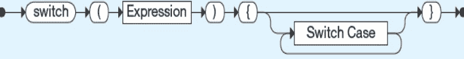

## Switch 分支

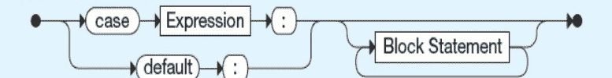

`switch` 语句评估初始表达式 `Expression` 并将其值与一个 `case` 匹配。处理继续与该 `case` 对应的语句 `Statement` 执行。如果没有其他 `case` 匹配，将执行可选的 `default` `case`。

示例：

```
switch (numValues) {
    case 0:
        System.out.println("No values were entered.");
        break;
    case 1:
        System.out.println("One value was entered.");
        break;
    case 2:
        System.out.println("Two values were entered.");
        break;
    default:
        System.out.println("Too many values were entered.");
}
```

在 `switch` 语句开始时评估的表达式必须是 `char`、`byte`、`short`、`int` 或枚举类型。从 Java 7 开始，`switch` 也可以对 `String` 执行。但 `switch` 表达式不能是布尔值或浮点值。此外，每个 `case` 的值必须是常量；它不能是变量或其他表达式。这限制了 `switch` 语句适用的情况。但在适用时，它可以使代码更易于阅读和理解。

还要注意，`switch` 语句的隐式布尔条件是基于等效性的。语句开始的表达式与每个 `case` 值进行比较，以确定它等于哪一个。`switch` 语句不能用于确定其他关系操作（例如小于），除非执行了某些预处理。例如，列表 6.1 中的 `GradeReport` 程序根据用户输入的数字分数来打印注释。

### 列表 6.1

```
****************************************************************
// GradeReport.java      Author: Lewis/Loftus
//
// 展示了 switch 语句的使用。
//****************************************************************

import java.util.Scanner;

public class GradeReport {
    //----------------------------------------------------------------------
    // 从用户读取分数并打印相应的注释。
    //----------------------------------------------------------------------
    public static void main(String[] args) {
        int grade, category;
        Scanner scan = new Scanner(System.in);
        System.out.print("Enter a numeric grade (0 to 100): ");
        grade = scan.nextInt();
        category = grade / 10;
        System.out.print("That grade is ");
        switch (category) {
            case 10:
                System.out.println("a perfect score. Well done.");
                break;
            case 9:
                System.out.println("well above average. Excellent.");
                break;
            case 8:
                System.out.println("above average. Nice job.");
                break;
            case 7:
                System.out.println("average.");
                break;
            case 6:
                System.out.println("below average. You should see the");
                System.out.println("instructor to clarify the material " + "presented in class.");
                break;
            default:
                System.out.println("not passing.");
        }
    }
}
```

### 输出

```
Enter a numeric grade (0 to 100): 86
That grade is above average. Nice job.
```


在 `GradeReport` 中，分数类别是通过整数除法将分数除以 10 得到的，结果是 0 到 10 之间的整数（假设输入了有效分数）。此结果用作 `switch` 的表达式，为 60 或以上的分数打印各种消息，并对所有其他值打印默认句子。

注意，任何 `switch` 语句都可以实现为一组嵌套的 `if` 语句。然而，嵌套的 `if` 语句对于人类读者来说难以理解，并且在实现和调试时容易出错。因为 `switch` 只能评估相等性，有时必须嵌套 `if` 语句。这取决于具体情况。

## 自习题 (Self-Review Questions)

（答案见附录 L）

- 6.1 条件运算符和条件语句有什么区别？
- 6.2 下述语句的输出是什么？
- 6.3 下述表达式的值是多少？
- 6.4 将以下 `if` 语句转换为等效的 `switch` 语句。
- 6.5 条件运算符和条件语句有什么区别？
- 6.6 编写一个声明，如果布尔变量 `first` 为真，则将名为 `id` 的 `char` 变量初始化为 'A'，否则初始化为 'B'。
- 6.7 使用条件运算符以简洁的方式表示以下逻辑。

## 6.2 条件运算符 (The Conditional Operator)

Java 条件运算符在某些方面与 `if-else` 语句相似。它是一个三元运算符，因为它需要三个操作数。组成它的符号总是分开的。以下是示例：

```
(total > MAX) ? total + 1 : total * 2
```

`?` 之前是一个布尔条件。`?` 之后是由 `:` 分隔的两个表达式。整个条件表达式在条件为真时返回第一个表达式，在条件为假时返回第二个表达式。

> **核心概念**
> 条件运算符根据条件评估为两个值之一。

记住，这个示例是一个返回值的表达式。条件运算符仅仅是一个运算符，而不是一个独立的语句。通常，我们想要对该值进行某些操作，例如将其赋值给变量：

```
total = (total > MAX) ? total + 1 : total * 2;
```

条件运算符和条件语句之间的区别可能是细微的。在许多方面，`?` 运算符允许我们形成作为 `if-else` 语句的简洁逻辑。之前的语句与功能等同，但有时比以下代码更方便：

```
if (total > MAX)
  total = total + 1;
else
  total = total * 2;
```

让我们再看几个例子。考虑以下声明：

```
int larger = (num1 > num2) ? num1 : num2;
```

如果 `num1` 大于 `num2`，则返回 `num1` 的值并初始化变量 `larger`。否则，返回 `num2` 的值并初始化 `larger`。同样，以下语句打印两个值中的较小者：

```
System.out.println("Smaller: " + ((num1 < num2) ? num1 : num2));
```

条件运算符有时有助于评估简短条件并返回结果。然而，它不能替代 `if-else` 语句，因为 `?:` 运算符的操作数是表达式，而不是完整的语句。即使条件运算符是一个可行的替代方案，你也应该谨慎使用它，因为它可能比 `if-else` 语句可读性差。

```
if (val <= 10)
    System.out.println("The value is not greater than 10.");
else
    System.out.println("The value is greater than 10.");
```

## 6.3 do 语句

回想第 5 章，`while` 语句首先检查其条件，如果条件为真，则执行其循环体。`do` 语句与 `while` 语句相似，不同之处在于终止条件位于循环体的末尾。与 `while` 循环一样，`do` 循环也会变为假。条件写在循环的末尾，表示在执行循环体之前不会进行求值。请注意，`do` 循环的循环体至少会被执行一次。图 6.1 显示了这种处理过程。

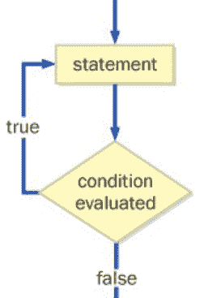

图 6.1 `do` 循环的逻辑

以下代码使用 `do` 循环打印 1 到 5 的数字。将此代码与第 5 章中用 `while` 循环完成相同任务的类似示例进行比较。

```
int count = 0;

do
{
  count++;
  System.out.println(count);
}
while (count < 5);
```

注意，`do` 循环直接以关键字 `do` 开始。`do` 循环的循环体一直持续到 `while` 子句，该子句包含一个决定循环体是否会再次执行的布尔条件。有时，很难判断一行以关键字 `while` 开头的代码是 `while` 循环的开始，还是 `do` 循环的末尾。

> **核心概念**
> `do` 语句至少执行一次其循环体。

让我们来看 `do` 循环的另一个示例。列表 6.2 所示的名为 `ReverseNumber` 程序从用户处读取一个整数，并用数学方法反转其数字。

### 列表 6.2

```
********************************************************************
// ReverseNumber.java      Author: Lewis/Loftus
//
// 展示了 do 循环的使用。
********************************************************************

import java.util.Scanner;

public class ReverseNumber {

    //--------------------------------------------------------------------
    // 用数学方法反转整数的数字。
    //--------------------------------------------------------------------
    public static void main(String[] args) {
        int number, lastDigit, reverse = 0;

        Scanner scan = new Scanner(System.in);
        System.out.print("Enter a positive integer: ");
        number = scan.nextInt();

        do {
            lastDigit = number % 10;
            reverse = (reverse * 10) + lastDigit;
            number = number / 10;
        } while (number > 0);

        System.out.println("That number reversed is " + reverse);
    }
}
```

### 输出

```
Enter a positive integer: 2896
That number reversed is 6982
```

### do 语句

`do` 循环只要布尔表达式为真，就会重复执行指定的语句。该语句至少执行一次，然后对该表达式进行求值，以决定是否再次执行该语句。

示例：

```
System.out.print("Enter a word:");
word = scan.next();
System.out.println(word);
if (!word.equals("quit"));
```

`ReverseNumber` 程序中的 `do` 循环使用取模运算来确定个位的数字，将其加入反转后的数字中，然后使用整数除法从原始数字中截断该数字。当我们没有更多可处理的数字时，`do` 循环终止，这对应于变量达到零值的时间点。通过几个示例仔细跟踪该程序的逻辑，以查看它是如何工作的。

如果你知道你想至少执行一次循环体，那么你可能想使用 `do` 语句。`do` 循环具有许多与 `while` 语句相似的属性，因此也必须检查终止条件以避免无限循环。

### 自测复习题

（答案见附录 L）

- SR 6.8 比较并对比 `while` 循环和 `do` 循环。
- SR 6.9 下列代码片段产生什么输出？

```
int low = 0, high = 10;

do {
    System.out.println(low);
}
while (low < high);
```

- SR 6.10 下列代码产生什么输出？

```
int low = 10, high = 0;

do {
    System.out.println(low);
    low--;
} while (low > high);
```

- SR 6.11 编写一个 `do` 循环以获取从 1 到 10 的正整数序列。

## 6.4 for 语句

当你最初不知道想执行循环体多少次时，`while` 和 `do` 语句很好用。当你提前知道执行次数时，`for` 语句特别适用。

> **核心概念**
> `for` 语句通常用于执行固定的次数。

以下代码使用 `for` 循环打印 1 到 5 的数字：

```
for (int count = 1; count <= 5; count++)
    System.out.println(count);
```

`for` 循环的头部包含三个用分号隔开的部分。在循环开始之前，执行初始化部分。第二部分是布尔条件，在循环之前进行求值。如果为真，则执行循环体，然后执行增量部分。注意，初始化部分只执行一次，但增量部分在循环的每次迭代后执行。图 6.2 显示了这种处理过程。

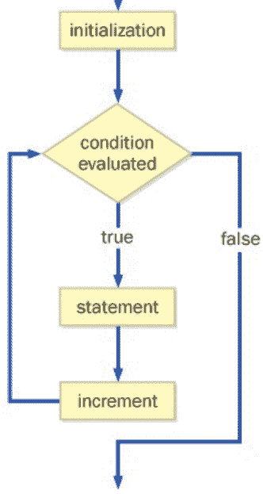

图 6.2 `for` 循环的逻辑

在习惯之前，`for` 循环读起来可能有点复杂。执行并不遵循“从上到下、从左到右”的阅读顺序。增量代码在循环体之后执行。在这个示例中，循环头部的初始化部分用于声明 `count` 并给它一个初始值。我们并不要求在那里声明变量，但在变量在循环外部不需要的情况下，这是一种常见做法。循环控制变量通过头部的动作设置、检查和修改。它可以在循环体内部引用，但除了头部中定义的动作外，不应被修改。

`for` 循环头部的增量部分，尽管名为增量，但也可以称为更新部分。

`for` 语句只要布尔表达式为真，就会重复执行指定的语句。头部的初始化部分在循环开始前只执行一次。更新部分在每次执行语句后执行。

示例：

```
for (int value=1; value < 25; value++)
    System.out.println(value + " squared is " + value*value);

for (int num=40; num > 0; num-=3)
    sum = sum + num;
```

`for` 循环头部的增量部分，尽管名为增量，也可以减少值而不是增加值。例如，以下循环从 100 到 1 打印整数值：

```
for (int num = 100; num > 0; num--)
    System.out.println(num);
```

事实上，`for` 循环的增量部分可以执行任何计算，而不仅仅简单的加或减。考虑列表 6.3 所示的程序，它打印从特定值到特定限制的倍数。

### 列表 6.3

```
****************************************************
// Multiples.java         Author: Lewis/Loftus
//
// 展示了 for 循环的使用。
/*************************************************/

import java.util.Scanner;

public class Multiples
{
    //------------------------------------------------
    // 打印用户指定数字到用户指定限制的倍数。
    //------------------------------------------------
    public static void main(String[] args)
    {
        final int PER_LINE = 5;
        int value, limit, mult, count = 0;

        Scanner scan = new Scanner(System.in);

        System.out.print("Enter a positive value: ");
        value = scan.nextInt();

        System.out.print("Enter an upper limit: ");
        limit = scan.nextInt();

        System.out.println();
        System.out.println("The multiples of " + value +
            " between " + value + " and " + limit + " (inclusive) are: ");

        for (mult = value; mult <= limit; mult += value)
        {
            System.out.print(mult + "\t");
            // Print a specific number of values per line of output
            count++;
            if (count % PER_LINE == 0)
                System.out.println();
        }
    }
}
```

### 输出

```
Enter a positive value: 7
Enter an upper limit: 400
The multiples of 7 between 7 and 400 (inclusive) are:
7 14 21 28 35
42 49 56 63 70
77 84 91 98 105
112 119 126 133 140
147 154 161 168 175
182 189 196 203 210
217 224 231 238 245
252 259 266 273 280
287 294 301 308 315
322 329 336 343 350
357 364 371 378 385
392 399
```

`Multiples` 程序中 `for` 循环的增量部分在每次迭代后加上用户输入的值。每行打印的值数通过计数打印的值来控制，每当 `count` 能被 `PER_LINE` 常数整除时，就换下一行。

列表 6.4 中的 `Stars` 程序展示了嵌套 `for` 循环的使用。输出是由星号字符组成的三角形。外层循环精确执行 10 次。外层循环的每次迭代打印输出的一行。内层循环的迭代次数取决于外层循环控制的行值。内层循环的每次迭代在当前行上打印一个星号。编写打印此类三角形配置变体的程序包含在章节末尾的编程项目中。

### 列表 6.4

```
****************************************************************
// Stars.java               Author: Lewis/Loftus
//
// 展示了嵌套 for 循环的使用。
****************************************************************

public class Stars
{
    //----------------------------------------------------------------
    // 使用星号（星形）字符绘制三角形。
    //----------------------------------------------------------------
    public static void main(String[] args)
    {
        final int MAX_ROWS = 10;

        for (int row = 1; row <= MAX_ROWS; row++) {
            for (int star = 1; star <= row; star++) {
                System.out.print("*");
            }
            System.out.println();
        }
    }
}
```


### 输出

```
*
**
***
****
*****
******
*******
********
*********
```

### for-each 循环

`for` 语句的一种变体，通常被称为 for-each 循环，在涉及迭代器的情况下特别有用。在第 5 章中，我们讨论了某些对象被视为迭代器，我们通过 `hasNext()` 和 `next()` 方法来处理组中的每项。如果一个对象实现了 `Iterable` 接口，那么我们就可以使用 `for` 循环的变体，使用简化的语法来处理项。

`ArrayList` 对象是一个 `Iterable` 对象。因此，例如，如果 `library` 是一个 `ArrayList<Book>` 对象（即一个管理 `Book` 对象的 `ArrayList`），我们可以像如下所示使用 `for` 循环来处理集合中的每个 `Book` 对象：

> **核心概念**
> for-each 版本的 `for` 循环简化了对 `Iterable` 对象中所有元素的处理。

```java
for (Book myBook : library) {
    System.out.println(myBook);
}
```

这段代码可以读为：对于 `library` 中的每个 `Book`，打印该书籍对象。变量 `myBook` 轮流获取集合中每个 `Book` 对象的值，循环体可以对其进行适当处理。那个简洁的 for-each 循环本质上等同于以下代码：

```java
Book myBook;
while (bookList.hasNext()) {
    myBook = bookList.next();
    System.out.println(myBook);
}
```

这种版本的 `for` 循环也可以用于数组，数组将在第 8 章中讨论。在书的其余部分中，我们在各种情况下适时使用 for-each 循环。

### 比较循环

三个基本的循环语句（`while`、`do` 和 `for`）在功能上是等价的。任何特定的循环都可以使用另外两种编写。使用哪一个取决于情况。

如前面提到的，`while` 循环和 `do` 循环的主要区别在于评估条件的时机。`do` 循环至少执行一次，而 `while` 循环执行零次或多次。`for` 循环类似于 `while` 循环，因为条件在循环执行之前就会被评估。在很多情况下，将设置和控制循环的代码与循环体分离仅仅是为了更方便起见。

> **核心概念**
> 循环语句在功能上是等价的。

## 6.5 在图形中使用循环和条件判断

条件判断和循环极大地增强了我们生成有趣图形的能力。让我们探索一些例子。

列表 6.5 显示的 `Bullseye` 程序展示了一个中心带有红色靶心的目标。该绘图由大小逐渐减小的实心圆组成，黑白相替，共用一个中心点。首先添加最大的（外层）圆，这样下一个较小的圆就可以显示在其上方，以此类推，从而创建环形效果。（列表 6.5 代码见下一节）。

### 自习题
（答案见附录）

**SR 12** 我们在什么时候会用 `for` 循环代替 `while` 循环？

**SR 13** 下列代码的输出是什么？

```java
int value = 0;

for (int num = 10; num <= 40; num += 10) {
    value += num;
}

System.out.println(value);
```

**SR 14** 下列代码的输出是什么？

```java
int value = 0;

for (int num = 10; num < 40; num += 10) {
    value += num;
}

System.out.println(value);
```

**SR 15** 下列代码的输出是什么？

```java
int value = 6;

for (int num = 1; num <= value; num++) {
    for (int i = 1; i <= (2 * num) - 1; i++) {
        System.out.print("*");
    }
    System.out.println();
}
```

**SR 16** 假设 `die` 是一个 `Die` 对象（如 4.2 节定义）。编写代码片段投掷 100 次并输出平均值。

### 列表 6.5

```java
ringColor = Color.WHITE;
else
    ringColor = Color.BLACK;

radius = radius - 20;
}

ring.setFill(Color.RED);
```

```java
Scene scene = new Scene(root, 320, 320, Color.CYAN);
primaryStage.setTitle("Bullseye");
primaryStage.setScene(scene);
primaryStage.show();
}
```

### 显示

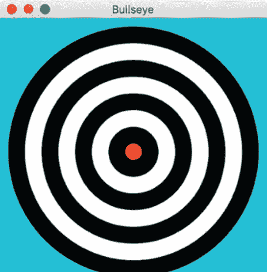

使用 `for` 循环来恰好创建八个圆形。每次执行循环时，都会创建一个圆并将其添加到组中。`for` 循环体内的 `if` 语句用于设置下一个圆的颜色；如果刚刚添加的圆是黑色的，则将颜色改为白色；反之亦然。在退出循环后，最后一个绘制的圆环的填充颜色被改为红色。

让我们来看另一个例子。列表 6.6 显示了一个在随机位置绘制几个矩形的程序。每个矩形的宽度和高度也是随机选择的。除非宽度或高度低于某个阈值（10 像素），否则框形是不填充的。窄框形填充为黄色，短的框形填充为绿色。

### 列表 6.6

```java
import java.util.Random;
import javafx.application.Application;
import javafx.scene.Group;
import javafx.scene.Scene;
import javafx.scene.paint.Color;
import javafx.scene.shape.Rectangle;
import javafx.stage.Stage;

/********************************************************************
// Boxes.java      Author: Lewis/Loftus
// 展示了循环和条件语句的使用。
********************************************************************/

public class Boxes extends Application {

    //------------------------------------------------------
    // 在随机位置显示具有随机宽度
    // 高度的矩形。窄和短的框形通过填充颜色
    // 进行高亮。
    //------------------------------------------------------

    public void start(Stage primaryStage) {
        Group root = new Group();
        Random gen = new Random();

        for (int count = 1; count <= 50; count++) {
            int x = gen.nextInt(350) + 1;
            int y = gen.nextInt(350) + 1;

            int width = gen.nextInt(50) + 1;
            int height = gen.nextInt(50) + 1;

            Color fill = null;
            if (width < 10) {
                fill = Color.YELLOW;
            } else if (height < 10) {
                fill = Color.GREEN;
            }

            Rectangle box = new Rectangle(x, y, width, height);
            box.setStroke(Color.WHITE);
            box.setFill(fill);

            root.getChildren().add(box);
        }

        Scene scene = new Scene(root, 400, 400, Color.BLACK);
        primaryStage.setTitle("Boxes");
        primaryStage.setScene(scene);
        primaryStage.show();
    }
}
```

### 显示

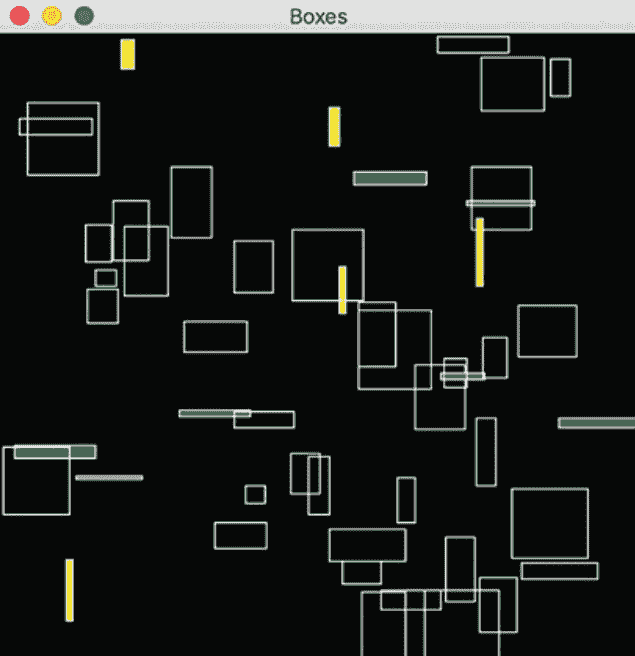

使用 `for` 循环创建 50 个框。`for` 循环体创建一个框。嵌套的 `if` 语句检查当前框的随机宽度和高度并适当设置颜色。对于每个框，填充颜色最初设置为 `null`，只有当一个维度太小时才会进行更改。

### 自习题

- **SR 6.17** 对 `Bullseye` 程序进行什么修改以具有 10 个环的目标？
- **SR 6.18** 你如何修改 `Boxes` 程序，使得窄或短的框填充为白色而不是仅仅描白色轮？

## 6.6 图形变换

JavaFX 变换是一种应用于节点并改变其呈现方式的效果。四种基本变换类型：

- **平移 (Translation)**——改变节点在 x 或 y 轴上的位置。
- **缩放 (Scaling)**——让节点看起来更大更小。
- **旋转 (Rotation)**——让节点绕其中心点旋转。
- **倾斜 (Shearing)**——旋转一个轴使 x 和 y 轴不再垂直。

对对象应用变换会设置其变换属性，但不会改变其底层特征。例如，沿轴平移不会改变节点的原始值。

> **核心概念**
> 变换改变节点的视觉呈现。

### 平移

平移通过调用 `setTranslateX()` 和 `setTranslateY()` 方法实现。以下代码在相同位置创建两个矩形，然后平移第二个的位置。

```java
Rectangle rec1 = new Rectangle(100, 100, 200, 50);
rec1.setFill(Color.STEELBLUE);

Rectangle rec2 = new Rectangle(100, 100, 200, 50);
rec2.setFill(Color.ORANGE);
rec2.setTranslateX(70);
rec2.setTranslateY(10);
```

结果如下：


如果橙色矩形没有平移，它将完全遮挡蓝色的。但它沿 x 轴偏移了 70，沿 y 轴偏移了 10。平移值被加到原始值，因此橙色矩形的左上角平移位置是 (170, 110)。

### 缩放

节点的缩放通过调用 `setScaleX()` 和 `setScaleY()` 方法实现，这些方法接受代表缩放因子的 `double` 值。例如，0.5 的缩放因子将在该轴上显示为原始大小的一半。1.3 的缩放因子将使其比原始更大。

以下代码从同一张图像创建两个 `ImageView` 对象并缩放其中一个：

```java
Image img = new Image("water.jpg");
ImageView img1 = new ImageView(img);
ImageView img2 = new ImageView(img);
img2.setScaleX(0.7);
img2.setScaleY(0.7);
```

注意，缩放的是 `ImageView` 而非图像。结果如下：


此示例通过在两个轴上使用相同的缩放因子来保持图像的比例。如果只缩放一个轴，或者它们缩放的程度不同，结果将会失真。

> **核心概念**
> 在两个轴上使用相同的缩放因子以保持节点比例。

### 旋转

调用 `setRotate()` 会导致节点绕其中心点旋转。其参数指定节点旋转的度数。考虑以下代码：

```java
Rectangle rec = new Rectangle(50, 100, 200, 50);
rec.setFill(Color.STEELBLUE);
rec.setRotate(40);
```

如果传递给 `Rotate` 的值为正，则节点顺时针旋转。如果值为负，则节点沿逆时针旋转。因此，这段代码的前三行创建了一个蓝色矩形并将其旋转 40 度。

```java
Text text = new Text(270, 125, "Tilted Text!");
text.setFont(new Font("Courier", 24));
text.setRotate(-15);
```

结果如下：


要绕中心点以外的点旋转节点，可以创建一个 `Rotate` 对象并将其添加到节点的变换列表中。例如，绕 (70, 150) 点旋转节点 45 度：

```java
node.getTransforms().add(new Rotate(45, 70, 150));
```

### 倾斜

倾斜变换只能通过创建一个 `Shear` 对象并将其添加到节点的变换列表中来实现。以下代码创建了一个 `ImageView` 并应用了 x 轴 40% 和 y 轴 20% 的倾斜：

```java
Image img = new Image("duck.jpg");
ImageView imgView = new ImageView(img);
imgView.getTransforms().add(new Shear(0.4, 0.2));
```

结果如下：


### 在组上应用变换

变换可以应用于任何 JavaFX 节点，这意味着它们不仅可以应用于单个形状、图像和控件，还可以应用于组（`Group`）和窗格（`Pane`）。当对组或窗格应用变换时，该变换将应用到容器中的每一个节点上。

> **核心概念**
> 应用于组或窗格的变换会自动应用于该容器中的所有节点。

列表 6.7 所示的类派生自 `Group` 类。它的构造函数创建了显示机器人脸所需的元素，并将它们添加到该组中。

### 列表 6.7

```java
import javafx.scene.Group;
import javafx.scene.paint.Color;
import javafx.scene.shape.Rectangle;

// RobotFace.java      Author: Lewis/Loftus
//
// 展示机器人的脸。
//************************************************************************************

public class RobotFace extends Group {

    //--------------------------------------------------------------------------------
    // 设置构成机器人脸的元素，
    // 位于坐标系的左上角。
    //--------------------------------------------------------------------------------

    public RobotFace() {
        Rectangle head = new Rectangle(5, 0, 100, 70);
        head.setFill(Color.SILVER);
        head.setArcHeight(10);
        head.setArcWidth(10);

        Rectangle ears = new Rectangle(0, 20, 110, 30);
        ears.setFill(Color.DARKBLUE);
        ears.setArcHeight(10);
        ears.setArcWidth(10);

        Rectangle eye1 = new Rectangle(25, 15, 20, 10);
        eye1.setFill(Color.GOLD);

        Rectangle eye2 = new Rectangle(65, 15, 20, 10);
        eye2.setFill(Color.GOLD);

        Rectangle nose = new Rectangle(52, 25, 6, 15);
        nose.setFill(Color.BLACK);

        Rectangle mouth = new Rectangle(35, 45, 40, 10);
        mouth.setFill(Color.RED);

        getChildren().addAll(ears, head, eye1, eye2, nose, mouth);
    }
}
```


如果按照原始定义将 `RobotFace` 对象添加到容器中，它将显示在左上角：

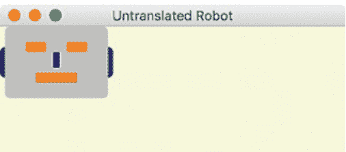

列表 6.8 显示了一个创建并显示三个应用了各种变换的机器人脸的程序。

### 列表 6.8

```java
import javafx.application.Application;
import javafx.scene.Group;
import javafx.scene.Scene;
import javafx.scene.paint.Color;
import javafx.stage.Stage;

/*******************************************************************
// Robots.java    Author: Lewis/Loftus
//
// 演示图形变换。
/***************************************************/
public class Robots extends Application {
    //----------------------------------------------------------------------
    // 显示三个机器人脸，应用各种变换。
    //----------------------------------------------------------------------
    public void start(Stage primaryStage) {
        RobotFace robot1 = new RobotFace();
        robot1.setTranslateX(70);
        robot1.translateY(40);
        RobotFace robot2 = new RobotFace();
        robot2.translateX(300);
        robot2.setTranslateY(40);
        robot2.setRotate(20);
        RobotFace robot3 = new RobotFace();
        robot3.translateX(200);
        robot3.translateY(200);
        robot3.setScale(2.5);
        robot3.setScaleY(2.5);
        Group root = new Group(robot1, robot2, robot3);
        Scene scene = new Scene(root, 500, 380, Color.WHITE);
        primaryStage.setTitle("Robots");
        primaryStage.setScene(scene);
        primaryStage.show();
    }
}
```

### 显示

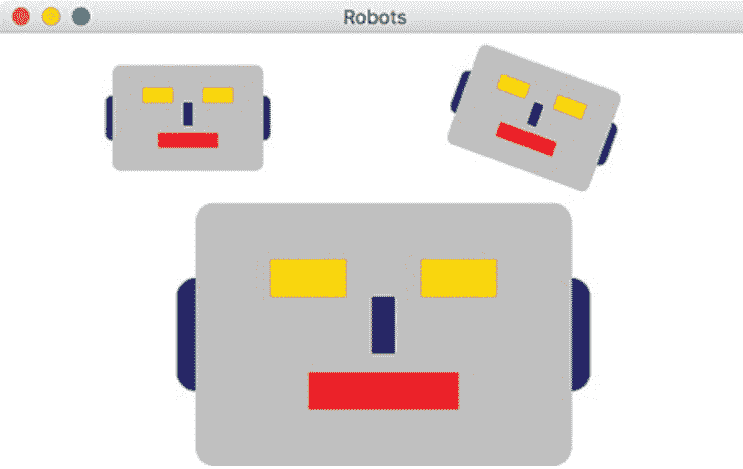

第一个机器人显示在窗口的左上部分。对它应用的变换是沿 x 轴平移了 70 像素，沿 y 轴平移了 40 像素。

第二个机器人（右上）被移动到了新位置，并顺时针旋转了 20 度。

第三个机器人的位置也被平移了，并缩放为正常尺寸的两倍。注意，所有这些变换都应用于 `RobotFace` 对象，而它们是 `Group` 对象。然后，这三个组被添加到场景的 `root` 节点中。

### 自测习题

- SR 19: 如何将 `Circle` 向下移动 100 像素？
- SR 20: 如何让 `ImageView` 显示为两倍大小？
- SR 21: 如果按不同的因子缩放 `Ellipse`，会发生什么？
- SR 22: 如何顺时针旋转 `oval` 40 度？

### 概念总结

- `switch` 语句将整数值匹配到其中一个 case。
- `break` 语句通常用于每个 case 的末尾。
- 条件操作符评估为布尔值。
- `do` 语句至少执行一次体。
- `for` 语句通常用于已知执行次数的情况。
- `for-each` 循环简化了元素的处理。
- 使用哪一个取决于具体情况。
- 变换改变节点的视觉呈现。
- 应用于组的变换将应用于组中的所有节点。
- `while` 循环在满足条件时使用。

### 练习题

- EX 1: 以下 `for` 循环将执行多少次？
    - a `for (int i = 0; i < 20; i++)`
    - b `for (int i = 1; i <= 20; i++)`
    - c `for (int i = 5; i < 20; i++)`
    - d `for (int i = 20; i > 0; i--)`
    - e `for (int i = 1; i < 20; i += i)`
    - f `for (int i = 20; i *= 2)`
- EX 2: 下段片段的输出是什么？
    ```java
    for (int num = 0; num < 20; num++) System.out.println(num);
    ```
- EX 3: 下段片段的输出是什么？
    ```java
    for (int val = 200; val >= 0; val--) if (val % 4 != 0) System.out.println(val);
    ```
- EX 4: 将以下 `while` 循环转换为 `do` 循环：
    ```java
    int num = 1;
    while (num < 20) {
        num++;
        System.out.println(num);
    }
```


# 练习与编程项目

## 练习

- EX 5: 将上一个练习中的 `while` 循环转换为等效的 `for` 循环。
- EX 6: 编写一个 `do` 循环验证用户输入偶整数。
- EX 7: 编写一个 `for` 循环打印 1 到 99 的奇数。
- EX 8: 编写一个 `for` 循环打印从 300 到 3 的 3 的倍数。
- EX 9: 编写一个代码片段，从用户读取 10 个整数并打印最大值。
- EX 10: 编写一个代码片段，确定字符 'a' 在字符串对象 `name` 中出现的次数。
- EX 11: 编写一个代码片段，反序打印字符串对象 `str` 中存储的字符。
- EX 12: 编写一个代码片段，从字符串对象 `word` 的第一个字符开始每隔打印一个字符。
- EX 13: 编写一个名为 `powersOfTwo` 的方法，打印 2 的前 10 次幂（从 2 开始）。该方法没有参数且没有返回值。
- EX 14: 编写一个名为 `alarm` 的方法，分行多次打印字符串 "Alarm!"。该方法应接受一个整数参数，指定字符串打印的次数。如果参数小于 1，则打印错误信息。
- EX 15: 编写一个名为 `sum100` 的方法，返回 1 到 100（包含边界）整数之和。
- EX 16: 编写一个名为 `sumRange` 的方法，接受两个表示范围的整数参数。如果第二个参数小于第一个，则发布错误信息并返回零。否则，该方法应返回该范围内所有整数（包含边界）之和。
- EX 17: 编写一个名为 `countA` 的方法，接受一个字符串参数并返回字符 'A' 在字符串中次数。
- EX 18: 编写一个名为 `reverse` 的方法，接受一个字符串参数并返回一个包含参数字符反序的字符串。注意，`String` 类中有一个执行此操作的方法，但为了本次练习，你被编写自己的实现。
- EX 19: 在 `Bullseye` 程序中，最内层圆在变为红色之前的填充颜色是什么？请解释。

- EX 6.20: 按照 `Boxes` 程序的编写方式，如果一个矩形既窄又短，它将是什么颜色？请解释。
- EX 6.21: 重写 `Boxes` 程序中使用的 `if` 语句，如果一个框既窄又短，它的填充颜色将变为橙色。否则，保持窄的框为黄色，短的框为绿色。
- EX 6.22: 编写代码，将一个名为 `rec` 的 `Rectangle` 向右移动 50 像素并向下移动 10 像素，顺时针旋转 45 度，并以原始大小的一半显示。
- EX 6.23: 编写代码，将一个名为 `pic` 的 `ImageView` 进行反转（倒置），并以原始大小的两倍显示。
- EX 6.24: 当对组（group）应用变换时会发生什么？

## 编程项目

- PP 6.1: 编写一个程序，读取一个整数值并打印 2 到输入值（包含边界）之间所有偶数的和。如果输入值小于 2，则打印错误信息。并进行相应的提示。
- PP 6.2: 编写一个程序，从用户处读取一个字符串并每行打印一个字符。
- PP 6.3: 编写一个程序生成乘法表，显示整数 1 到 12 与它们自身相乘的结果。

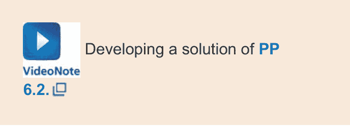

- PP 6.4: 编写一个程序，打印旅行歌曲《百瓶啤酒》（One Hundred Bottles of Beer）的前几节。使用循环，每次迭代打印一节。从用户处读取要打印的节数数量。对输入进行验证。以下是歌曲的前两节：

```
100 bottles of beer on the wall
100 bottles of beer
If one of those bottles should happen to fall
99 bottles of beer on the wall
99 bottles of beer on the wall
99 bottles of beer
If one of those bottles should happen to fall
98 bottles of beer on the wall
```

- PP 6.5: 使用 PP 4.9 中的 `PairOfDice` 类，编写一个程序投掷骰骰子 1000 次，统计出现点豹（两个六）的次数。
- PP 6.6: 使用第 5 章中定义的 `Coin` 类，编写一个名为 `CountFlips` 的程序，其 `main` 方法投掷硬币 100 次，并统计每个面出现的次数。打印结果。
- PP 6.7: 创建 `Stars` 程序的修改版本，以打印以下模式。为每个模式创建一个独立的程序。提示：部分 b、c 和 d 需要若干个循环，其中一些循环会打印特定数量的空格。

**a.**
```
*************
********
********
*****
*****
****
***
**
*
```

**b.**
```
*
**
***
****
*****
******
*******
********
*********
**********
***********
```

**c.**
```
*********
********
*******
******
*****
****
***
**
*
```

**d.**
```
*
***
*****
*******
********
********
******
*****
***
*
```

- PP 6.8: 编写一个程序，打印一个显示 Unicode 字符子集及其数值的表格。每行打印五个数字/字符对，用制表符分隔。打印数值从 32（空格字符）到 126（~ 字符）的表格，对应于 Unicode 字符集中的可打印 ASCII 子集。将你的输出与附录 C 中的表格进行比较。与附录 C 中的表格不同，你表格中的值随行增加。
- PP 6.9: 编写一个程序，从用户处读取字符串，然后确定整个字符串中每个小写元音（a, e, i, o 和 u）出现的次数。为每个元音设置单独的计数器。还要计数并打印非元音字符的数量。
- PP 6.10: 编写一个程序打印歌曲《圣诞十二夜》（Twelve Days of Christmas）的歌词，每节歌词增加一行。歌曲的前两节是：

```
On the 1st day of Christmas my true love gave to me
A partridge in a pear tree.

On the 2nd day of Christmas my true love gave to me
Two turtle doves, and
A partridge in a pear tree.
```

使用 `switch` 语句在循环中打印每一节（提示：注意顺序），如下：

```
On the 12th day of Christmas my true love gave to me
Twelve drummers drumming,
Eleven pipers piping,
Ten lords a-leaping,
Nine ladies dancing,
Eight maids-milking,
Seven geese a-laying,
Six golden rings,
Four calling,
Three hens,
Two turtle doves,
A partridge in a pear tree.
```

- PP 6.11: 编写一个程序，绘制一组随机长度的等距平行线。
- PP 6.12: 编写一个程序，显示一个 8x8 的黑白相替棋盘。
- PP 6.13: 编写一个程序，绘制随机半径的同心圆。
- PP 6.14: 编写一个程序，在可见区域内绘制 100 个随机位置、随机颜色的圆。
- PP 6.15: 编写一个程序，在可见区域内绘制随机位置的 1 像素圆。
- PP 6.16: 编写一个程序，显示一种砖墙图案，每一行相对于其上方下方都有偏移。
- PP 6.17: 编写一个名为 `Quilt` 的程序，显示由交替方形组成的图案。定义一个表示图案的 `QuiltSquare` 类。允许 `QuiltSquare` 构造函数改变其特征，例如颜色方案。实例化两个 `QuiltSquare` 对象并整合到棋盘布局中。
- PP 6.18: 编写一个程序，在随机位置绘制随机半径的圆。除了最大的圆外，让所有圆都填充透明红色（30% 不透明）。如果多个圆大小相同，填充其中任意一个。提示：在生成时跟踪最大的圆；最后更改其填充颜色。
- PP 6.19: 编写一个程序，分四次显示同一个方形：一次正向，然后是右侧，倒置，最后是左侧。
- PP 6.20: 编写一个程序，显示一组具有相同中心的椭圆。每个圆都稍微旋转。使用循环创建这些形状。
- PP 6.21: 编写一个程序，显示空间中的一组四艘外星飞船。在一个独立的类中定义飞船，由你喜欢的任何形状组成。然后创建四个进行显示，调整每只船的位置和大小，使其看起来有远近之分。在背景包含一个随机生成的星星（小白点）。

# 7 面向对象设计

## 章节目标

- 建立与面向对象软件设计相关的关键问题。
- 探索识别程序所需的类和对象的技术。
- 讨论类之间的关系。
- 描述 `static` 修饰符对方法和数据的影响。
- 讨论正式接口的创建。
- 进一步探索枚举类型类的定义。
- 讨论与方法设计相关的问题，包括方法重载。
- 探索与图形用户界面设计相关的问题。
- 讨论由鼠标和键盘生成的事件。

本章扩展了对面向对象软件设计的讨论。我们首先关注软件开发阶段以及在问题领域识别类和对象的过程。然后讨论了影响类设计的各种问题，包括静态成员、类关系、接口和枚举类型。我们还探索了方法级别的设计问题，并引入了方法重载的概念。对测试策略的讨论结束了这些问题。在本章的图形 Track 中，我们将讨论设计良好的图形用户界面（GUI）的特征，并探索鼠标和键盘事件。

## 7.1 软件开发活动

创建软件不仅仅是编写代码。随着你所解决的问题变得越来越复杂，解决方案包含的类也越来越多，仔细思考软件的设计就变得至关重要。任何适当的软件开发工作都由四项基本的*开发活动*组成：

- 建立需求
- 创建设计
- 实现设计
- 测试

如果这些活动能按照这个顺序定义一种开发软件的逐步进行的方法，那就太好了。然而，尽管它们看起来是顺序的，但在现实中它们几乎从不是完全线性的。它们是重叠并相互作用的。让我们简要讨论每项开发活动。

软件需求规定了程序必须完成*什么*。它们指出了程序应该执行的任务，而不是如何执行这些任务。通常，需求会在一个称为*功能规范*的文档中表示。

我们在第一章中讨论过一个基本前提：编程本质上是为了解决问题；我们创建程序是为了解决某个特定问题。需求是对该问题的清晰表达。在我们真正知道正在试图解决什么问题之前，我们无法真正解决它。

想要开发软件产品的人或小组（客户）通常会提供一组初始需求。然而，初始需求往往是不完整的、模糊的，甚至可能是矛盾的。软件开发人员必须与客户合作完善需求，直到所有关于系统将具备哪些特性的决策都得到解决。

需求通常涉及用户界面问题，如输出格式、屏幕布局和图形界面组件。本质上，需求确定了为最终用户创建程序的特征。它们也可能对你的程序施加限制，例如任务执行的速度有多快。

软件设计指示程序将如何完成其需求。设计规定了程序所需的类和对象，并定义了它们如何相互作用。它还规定了类与类之间的关系。低级设计问题处理单个方法如何完成其任务。

土木工程师永远不会在没有先设计的情况下考虑造桥。软件设计同样如此。软件中发生的许多问题直接归因于缺乏良好的设计工作。事实反复证明，在程序设计上花费的精力是非常值得的，从长远来看既节省了时间和金钱。

在软件设计期间，需要考虑并探索替代方案。通常，设计的第一次尝试并不是最好的解决方案。幸运的是，在设计阶段进行更改相对容易。

> **核心概念**
> 投入到设计的精力既至关重要又具有成本效益。

实现是编写将解决问题的源代码的过程。更准确地说，实现是将设计翻译成特定编程语言的行为。太多的程序员只关注实现，而实际上，它应该是所有开发活动中最不具创造力的一项。重要的决策应该在建立需求和创建设计时做出。

测试是确保程序在必须执行的所有约束条件下能够解决预定问题的行为。测试包括使用各种输入多次运行程序，并仔细检查结果。但它所代表的意义远不止于此。我们将在第 7.9 节中重新讨论与测试相关的问题。

### 自测题
（答案见附录 L）

- SR 7.1: 列出涉及软件开发过程的四项基本活动。
- SR 7.2: 谁负责创建/规定软件需求，是客户还是开发者？请讨论。
- SR 7.3: 将本节介绍的四项基本开发活动与第一章（第 1.6 节）中提出的五个通用问题解决步骤进行比较。

## 7.2 识别类和对象

面向对象的软件设计的基础部分是确定将对程序做出贡献的类。我们必须仔细考虑想要如何表示构成整体解决方案的各种元素。这些类决定了我们在系统中管理的对象。

识别潜在类的一种方法是识别程序需求中讨论的对象。对象通常是名词。你可能真的需要仔细检查问题描述（或者如果可用，则检查功能规范），以识别其中发现的名词。例如，图 7.1 显示了圈出名词的部分问题描述。

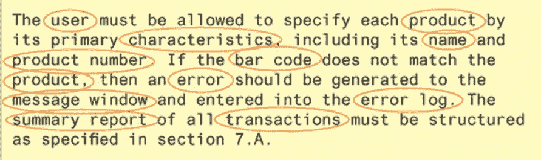

当然，问题规范中的每个名词并不都会对应于你程序中的一个类。这项活动只是一个起点，让你思考程序将管理的对象类型。

> **核心概念**
> 问题描述中的名词可能指示程序中所需的某些类和对象。

记住，一个类表示一组具有相似行为的对象。规范中的复数名词（例如 products）可能表示需要一个类来代表这些项目中的某一个，如 `Product`。即使你的系统中只需要一种特定类型的对象，它可能作为类来表示效果最好。

表示对象的类通常应该被赋予单数名词名称，例如 `Coin`、`Student` 和 `Message`。一个类代表一个项目，我们可以从这里自由地创建任意数量的实例。

另一个关键决策是将某物表示为对象，还是表示为另一个对象的原始属性。例如，我们最初可能认为员工的工资应该表示为整数，这对于系统的大部分处理可能是可行的。但经过进一步的反思，我们可能会意识到工资是基于人的职级的，职级有工资上限和下限，必须仔细管理。因此，最终的结论可能是，我们将所有这些数据和相关行为表示为一个单独的类更好。

考虑到特定程序的需求，我们希望在太通用的类和太具体的类之间取得良好的平衡。例如，为房子中存在的每种电器创建一个单独的类可能会不必要地增加设计的复杂性。拥有一个 `Appliance` 类可能足够了，也许还带有一个指示它是什么类型电器的实例数据。但另一方面，可能还需要更具体的类。这完全取决于软件旨在实现什么。

除了代表问题领域对象的类之外，我们可能还需要支持完成工作所需工作的类。例如，除了 `Member` 对象之外，我们可能想要一个单独的类来帮助管理俱乐部的所有成员。

记住，在生产真实系统时，我们在设计过程中识别出的某些类可能已经存在。即使没有完全匹配的，也可能有一个足够相似的旧类可以作为我们新类的基础。现有的类可能是 Java 类库的一部分，可能是我们以前解决过的问题的一部分，也可能是从第三方购买的库的一部分。这些都是软件重用的例子。

### 分配责任

识别程序所需的类的过程的一部分，是为每个类分配责任的过程。每个类表示一个具有某些行为的对象，这些行为是由类的方法定义的。程序必须完成的任何活动都必须在类的行为某处表示。也就是说，每个类负责执行某些活动，这些责任必须在设计程序时分配。

### 自测题
（答案见附录 L）

- SR 7.4: 识别问题规格说明中的名词如何帮助你为该问题设计一个面向对象的解决方案？
- SR 7.5: 在问题解决方案设计的早期阶段，识别并定义类将包含的所有方法是否重要？请讨论。

## 7.3 静态类成员

在书中的之前的示例中，我们已经在各种情况下使用过静态方法。例如，`Math` 类的所有方法都是静态的。记住，静态方法是通过其类名调用的，而不是通过该类的对象调用的。

> **探索 `static` 修饰符。**

方法可以是静态的，变量也可以是静态的。我们使用 `static` 修饰符来声明静态类成员。

决定是否将一个方法或变量声明为静态是类设计中的关键步骤。让我们更仔细地检查静态变量和方法的影响。

### 静态变量

到目前为我们已经看到了类变量：在方法内部声明的局部变量，以及在类中声明但在方法内部之外的实例变量。使用“实例变量”这一术语是因为类的每个实例都拥有它自己的变量版本。也就是说，每个对象对每个变量拥有独立的内存空间，以便每个对象对该变量可以有不同的值。

> **核心概念**
> 静态变量被类的所有实例所共享。

静态变量（有时称为类变量）被类的所有实例共享。对于该类的所有对象来说，静态变量只有一个副本。因此，更改一个对象中静态变量的值会改变所有其他对象的值。关键字 `static` 被用作修饰符来声明静态变量，如下：

```java
private static int count = 0;
```

当程序中第一次引用包含静态变量的类时，静态变量的内存空间就会被建立。在方法内部声明的局部变量不能是静态的。

使用 `final` 修饰符声明的常量通常也使用 `static` 修饰符声明。因为常量的值不能改变，那么在类的所有对象中只保留一份值的拷贝也是一样的。

### 静态方法

在第 3 章中，我们简要介绍了`静态方法`（也称为类方法）的概念。静态方法可以通过类名调用。我们不需要实例化类的对象就可以调用该方法。在第 3 章中，我们注意到 `Math` 类的所有方法都是静态方法。例如，在下面的这行代码中，`sqrt` 方法是通过 `Math` 类名调用的：

```java
System.out.println("Square root of 27: " + Math.sqrt(27));
```

`Math` 类中的方法对作为参数传递的值执行基本计算。在这些情况下，没有需要维护的对象状态；因此，没有理由为了请求这些服务而创建一个对象。

通过在方法声明中使用 `static` 修饰符可以将方法变为静态的。正如我们多次看到的，Java 程序的 `main` 方法必须声明为 `static` 修饰符；这样做是为了让解释器可以执行 `main`，而无需从包含 `main` 的类实例化对象。

由于静态方法不在特定对象的上下文中运行，因此它们不能引用实例变量，实例变量只存在于类的实例中。如果静态方法尝试使用非静态变量，编译器将发出错误。然而，静态方法可以引用静态变量，因为静态变量独立于特定对象。因此，`main` 方法只能访问静态变量或局部变量。

列表 7.1 中的程序实例化了 `Slogan` 类的几个对象，并依次打印每一个。在程序结束时，它通过类名调用了一个名为 `getCount` 的方法，该方法返回程序中实例化的 `Slogan` 对象数量。

### 列表 7.1


********************************************************************************

// SloganCounter.java               Author: Lewis/Loftus
//
// 展示了 `static` 修饰符的使用。
********************************************************************************

```java
public class SloganCounter
{
    //------------------------------------------------------
    // 创建了几个 Slogan 对象并打印所创建
    // 的对象的数量。
    //------------------------------------------------------
    public static void main(String[] args) {
        Slogan obj;

        obj = new Slogan("Remember the Alamo.");
        System.out.println(obj);

        obj = new Slogan("Don't Worry. Be Happy.");
        System.out.println(obj);

        obj = new Slogan("Live Free or Die.");
        System.out.println(obj);

        obj = new Slogan("Talk is Cheap.");
        System.out.println(obj);

        obj = new Slogan("Write Once, Run Anywhere.");
        System.out.println(obj);

        System.out.println();

        System.out.println("Slogans created: " + Slogan.getCount());
    }
}
```

### 输出

```
Remember the Alamo.
Don't Worry. Be Happy.
Live Free or Die.
Talk is Cheap.
Write Once, Run Anywhere.

Slogans created: 5
```

列表 7.2 显示了 `Slogan` 类。`Slogan` 的构造函数增加一个名为 `count` 的静态变量，该变量在声明时初始化为零。因此，`count` 用于跟踪所创建的 `Slogan` 实例数量。

### 列表 7.2

```java
/*****************************************************************
// Slogan.java         Author: Lewis/Loftus
//
// 代表单个标语字符串。
***********************************************/
public class Slogan {
    private String phrase;
    private static int count = 0;

    //----------------------------------------------------------------
    // 构造函数：设置标语并统计
    // 创建的实例。
    //----------------------------------------------------------------
    public Slogan(String str) {
        phrase = str;
        count++;
    }

    //----------------------------------------------------------------
    // 将此标语作为字符串返回。
    //----------------------------------------------------------------
    public String toString()
    {
        return phrase;
    }

    //----------------------------------------------------------------
    // 返回已创建的类实例数量。
    //----------------------------------------------------------------
    public static int getCount()
    {
        return count;
    }
}
```

`Slogan` 的 `getCount()` 方法也被声明为 `static`，这允许在 `main()` 方法中通过类名调用。注意 `getCount()` 方法中引用的数据是整数变量 `count`，它是静态的。作为静态方法，`getCount()` 不能引用任何非静态数据。

`getCount()` 方法可以不使用 `static` 修饰符，但这样的话在 `main()` 方法中的调用必须通过 `Slogan` 类的实例而不是类本身来进行。

### 自测题

(答案见附录 L)

- SR 7.6 静态变量和实例变量的区别是什么？
- SR 7.7 假设你正在定义一个 `BankAccount` 类，每个对象代表一个独立的银行账户。为该类声明一个变量，用于存储该类表示的所有银行账户的总余额。
- SR 7.8 假设你正在定义一个 `BankAccount` 类，每个对象代表一个独立的银行账户。为该类声明一个变量，用于存储每个账户必须维持的最低余额。
- SR 7.9 任何程序的 `main()` 方法可以引用哪些类型的变量？为什么？

## 7.4 类关系

软件系统中的类之间存在多种类型的关系。三种最常见的关系是依赖（dependency）、聚合（aggregation）和继承（inheritance）。

我们在许多示例中已经见过依赖关系，即一个类“使用”（uses）另一个类。本节将重新回顾依赖关系，并探索类依赖于自身的情况。接着，我们将探索聚合关系，在聚合中，一个类的对象包含了另一个类的对象，创建了一种“拥有”（has-a）的关系。我们在第 1 章中引入了继承，它在类之间创建了一种“是一个”（is-a）的关系。我们将对继承的详细检查推迟到第 9 章。

### 依赖

在之前的许多示例中，我们看到了一个类依赖于另一个类的概念。这意味着一个类在某种意义上依赖于另一个类。通常，一个类的方法会调用另一个类的方法。这建立了一种“使用”（uses）关系。

通常情况下，如果类 A 使用类 B，那么类 A 的一个或多个方法会调用类 B 的一个或多个方法。如果调用的方法是静态的，那么 A 仅仅通过名称引用 B。如果调用的方法不是静态的，那么 A 必须访问类 B 的特定实例才能调用该方法。也就是说，A 必须拥有指向类 B 对象的引用。

获取另一个类对象的方式是一个重要的设计决策。这发生在当一个类实例化另一个类的对象时，但这通常是聚合关系的基础。访问也可以通过将一个对象作为方法参数传递给另一个对象来实现。

总的，我们希望减少类之间的依赖数量。类之间的相互依赖程度越低，变化和错误对系统的影响就越小。

### 同类对象之间的依赖

在某些情况下，一个类依赖于自身。也就是说，一个类的对象与同类的另一个对象进行交互。为了实现这一点，类的一个方法可以接受同类的对象作为参数。设计这样的类强化了这样一个观点：类代表一个特定的对象。

`String` 类的 `concat()` 方法就是这种情况的例子。该方法通过一个 `String` 对象执行，并将另一个 `String` 对象作为参数传递。例如：

```java
str3 = str1.concat(str2);
```

执行该方法的 `String` 对象 (`str1`) 将其字符追加到作为参数传递的 `String` 对象 (`str2`) 的字符之后。返回一个新的 `String` 对象作为结果并存储为 `str3`。

列表 7.3 所示的 `RationalTester` 程序演示了类似的情况。有理数是可以表示为两个整数比例（分数）的值。`RationalTester` 程序创建两个表示有理数的对象，然后对它们执行各种操作以产生新的有理数。

### 列表 7.3

```java
/********************************************************************
// RationalTester.java      Author: Lewis/Loftus
//
// 用于练习多个 Rational 对象的驱动程序。
//********************************************************
public class RationalTester
{
    //-----------------------------------------------------
    // 创建一些有理数对象并对它们执行各种
    // 运算。
    //----------------------------------------------------
    public static void main(String[] args) {
        RationalNumber r1 = new RationalNumber(6, 8);
        RationalNumber r2 = new RationalNumber(1, 3);
        RationalNumber r3, r4, r5, r6, r7;

        System.out.println("First rational number: " + r1);
        System.out.println("Second rational number: " + r2);

        if (r1.isLike(r2)) {
            System.out.println("r1 and r2 are equal.");
        } else {
            System.out.println("r1 and r2 are NOT equal.");
        }

        r3 = r1.reciprocal();
        System.out.println("The reciprocal of r1 is: " + r3);
        r4 = r1.add(r2);
        r5 = r1.subtract(r2);
        r6 = r1.multiply(r2);
        r7 = r1.divide(r2);
    }
}
```

### 输出

```
First rational number: 3/4
Second rational number: 1/3
r1 and r2 are NOT equal.
The reciprocal of r1 is: 4/3
```

有理数类在列表 7.4 中所示。有理数类表示带有分子和分母的有理数。有理数类包含了各种如加法、减法、乘法和除法。

### 列表 7.4

```java
/********************************************************************
// RationalNumber.java          Author: Lewis/Loftus
//
// 表示带有分子和分母的有理数。
//****************************************************
public class RationalNumber
{
    private int numerator, denominator;

    //-----------------------------------------------------
    // 构造函数：设置有理数并确保
    // 分母为正。
    //----------------------------------------------------
    public RationalNumber(int numer, int denom) {
        if (denom == 0)
            denom = 1;
        if (denom < 0) {
            numer = numer * -1;
            denom = denom * -1;
        }
        numerator = numer;
        denominator = denom;
        reduce();
    }

    /**
     * 返回此有理数的分子。
     */
    public int getNumerator() {
        return numerator;
    }

    /**
     * 返回此有理数的分母。
     */
    public int getDenominator() {
        return denominator;
    }

    /**
     * 返回此有理数的倒数。
     */
    public RationalNumber reciprocal() {
        return new RationalNumber(denominator, numerator);
    }

    /**
     * 将此有理数与作为参数的有理数相加。
     * 公分母通过乘以各自的分母得到。
     */
    public RationalNumber add(RationalNumber op2) {
        int commonDenominator = denominator * op2.getDenominator();
        int numerator1 = numerator * op2.getDenominator();
        int numerator2 = op2.getNumerator() * denominator;
        int sum = numerator1 + numerator2;
        return new RationalNumber(sum, commonDenominator);
    }

    /**
     * 从此有理数中减去作为参数的有理数。
     */
    public RationalNumber subtract(RationalNumber op2) {
        int commonDenominator = denominator * op2.getDenominator();
        int numerator1 = numerator * op2.getDenominator();
        int numerator2 = op2.getNumerator() * denominator;
        int difference = numerator1 - numerator2;
        return new RationalNumber(difference, commonDenominator);
    }

    /**
     * 将此有理数与作为参数的有理数相乘。
     */
    public RationalNumber multiply(RationalNumber op2) {
        int numer = numerator * op2.getNumerator();
        int denom = denominator * op2.getDenominator();
        return new RationalNumber(numer, denom);
    }

    /**
     * 通过乘以第二个有理数的倒数
     * 将此有理数除以作为参数的有理数。
     */
    public RationalNumber divide(RationalNumber op2) {
        return multiply(op2.reciprocal());
    }

    private void reduce() {
        // 实现省略以简化
    }

    public boolean isLike(RationalNumber op2) {
        return numerator * op2.getDenominator() == op2.getNumerator() * denominator;
    }

    @Override
    public String toString() {
        return numerator + "/" + denominator;
    }
}
```

```java
// 作为参数。假设它们都已约化。
//------------------------------------------------------
```


```java
public boolean isLike(RationalNumber op2)
{
    return (numerator == op2.getNumerator() &&
            denominator == op2.getDenominator());
}
```

```java
//------------------------------------------------------
// 将此有理数转换为字符串。
//------------------------------------------------------
```

```java
public String toString()
{
    String result;
    if (numerator == 0)
        result = "0";
    else
        if (denominator == 1)
            result = numerator + "";
        else
            result = numerator + "/" + denominator;
    return result;
}
```

```java
//------------------------------------------------------
// 通过将分子和分母除以它们的最大公约数来约此有理数。
//------------------------------------------------------
private void reduce()
{
    if (numerator != 0)
    {
        int common = gcd(Math.abs(numerator), denominator);

        numerator = numerator / common;
        denominator = denominator / common;
    }
}
```

```java
//------------------------------------------------------
// 计算并返回两个正参数的最大公约数。
// 使用欧几里得算法。
//------------------------------------------------------
private int gcd(int num1, int num2)
{
    while (num1 != num2)
        if (num1 > num2)
            num1 = num1 - num2;
        else
            num2 = num2 - num1;

    return num1;
}
```

`RationalNumber` 类的加、减、乘、除等方法使用执行方法的 `RationalNumber` 对象作为第一个（左）操作数，并将作为参数的 `RationalNumber` 对象作为第二个（右）操作数。

`RationalNumber` 类的 `isLike` 方法用于判断两个有理数是否相等。人们很容易将该方法命名为 `equals`，这与比较 `String` 对象的方法类似（在第5章中讨论）。但在第9章中，我们将讨论由于继承导致 `equals` 方法具有特殊性，以及它应该以特定的方式实现。为了避免混淆，现在我们将此方法命名为 `isLike`。

请注意，`RationalNumber` 类中的某些方法（包括 `reduce` 和 `gcd`）被声明为私有。这些方法之所以是私有的，是因为我们不希望在 `RationalNumber` 对象之外执行它们。它们存在是为了支持对象的其他服务。

### 聚合

有些对象由其他对象组成。例如，汽车由它的发动机、底盘、轮子和其他部分组成。这些部分中的每一个都可以被一个独立的对象。因此，我们可以说汽车是一个聚合——它至少由其他对象组成。聚合有时被描述为“拥有”（has-a）关系。例如，汽车有一个底盘。

> 核心概念
>
> 聚合对象由其他对象组成，形成“拥有”关系。

在软件世界中，我们将聚合对象定义为任何包含其他对象作为实例数据的对象。例如，`Account` 对象包含了其他内容以及一个代表账户所有者名的 `String` 对象。我们有时忘记字符串也是对象，但从技术上说，每个 `Account` 对象都是聚合对象。

聚合是一种特殊的依赖关系。也就是说，由另一个类定义的类依赖于该类。聚合对象的方法通常会调用其组成对象的方法。

让我们考虑另一个例子。列表 7.5 显示的 `StudentBody` 程序创建了两个 `Student` 对象。每个 `Student` 对象部分由两个 `Address` 对象组成，一个是学生的学校地址，另一个是学生的家庭地址。`main` 方法除了创建 `Student` 对象并打印它们之外没有做任何其他事情。再次，我们将对象传递给 `println` 方法，依赖于 `toString` 方法的自动调用来创建一个适合打印的对象的有效表示。

### 列表 7.5

```java
********************************************************************
// StudentBody.java      作者: Lewis/Loftus
//
// 展示了聚合类的使用。
//********************************************************************

public class StudentBody {
    //----------------------------------------------------------------------
    // 创建一些 Student 对象并打印它们。
    //----------------------------------------------------------------------
    public static void main(String[] args) {
        Address school = new Address("800 Lancaster Ave.", "Villanova", "PA", 19085);
        Address jHome = new Address("21 Jump Street", "Blacksburg", "VA", 24551);
        Student john = new Student("John", "Smith", jHome, school);

        Address mHome = new Address("123 Main Street", "OH", 44132);
        Student marsha = new Student("Marsha", "Jones", mHome, school);

        System.out.println(john);
        System.out.println(marsha);
    }
}
```

### 输出

```
John Smith
Home Address: 21 Jump Street
Blacksburg, VA 24551
School Address: 800 Lancaster Ave.
Villanova, PA 19085
Marsha Jones
Home Address: 123 Main Street
OH, 44132
School Address: 800 Lancaster Ave.
Villanova, PA 19085
```

列表 7.6 所示的 `Student` 类表示一个学生。如果为了表示学生的所有方面，该类将需要大大扩展。我们现在特意保持其简单，以便聚合关系清晰。`Student` 类的实例数据包含了对其他对象的引用。通过将 `Address` 对象连接到字符串，`Address` 对象的 `toString` 方法会被自动调用。

### 列表 7.6

```java
********************************
// Student.java             作者: Lewis/Loftus
//
// 表示一个学生。
********************************

public class Student
{
    private String firstName, lastName;
    private Address homeAddress, schoolAddress;

    //------------------------------------------------------------
    // 构造函数：使用指定的值设置学生。
    //------------------------------------------------------------
    public Student(String first, String last, Address home, Address school)
    {
        firstName = first;
        lastName = last;
        homeAddress = home;
        schoolAddress = school;
    }

    //---------------------------------------------
    // 返回此 Student 对象的字符串描述。
    //---------------------------------------------
    public String toString() {
        String result;

        result = firstName + " " + lastName + "\n";
        result += "Home Address:\n" + homeAddress + "\n";
        result += "School Address:\n" + schoolAddress;

        return result;
    }
}
```

`Address` 类见列表 7.7。它表示一个街道地址。请注意，`Address` 类没有任何表明它是 `Student` 对象的一部分。`Address` 类在设计上是通用的，因此可以用于任何需要街道地址的情况。

### 列表 7.7

```java
****************************************************
// Address.java               作者: Lewis/Loftus
//
// 表示一个街道地址。
****************************************************

public class Address {
    private String streetAddress, city, state;
    private long zipCode;

    //------------------------------------------------------
    // 构造函数：使用指定的数据设置此地址。
    //------------------------------------------------------
    public Address(String street, String town, String st, long zip) {
        streetAddress = street;
        city = town;
        state = st;
        zipCode = zip;
    }

    @Override
    public String toString() {
        return streetAddress + "\n" + city + ", " + state + " " + zipCode;
    }
}
```

注意，`Question` 类还实现了 `Complexity` 接口之外的额外方法。具体来说，它定义了 `getQuestion`、`getAnswer`、`answerCorrect` 和 `toString` 方法，这些方法与接口无关。接口保证该类实现了某些方法，但并没有限制它拥有额外的方法。一个实现接口的类拥有其他方法是常见现象。

列表 7.10 显示了一个名为 `MiniQuiz` 的程序，它使用了一些 `Question` 对象。

### 列表 7.10

```java
************************************************************************************
// MiniQuiz.java      作者: Lewis/Loftus
//
// 演示了实现接口的类的用法。
//************************************************************************************
```

```java
import java.util.Scanner;

public class MiniQuiz
{
    //-----------------------------------------------------------------------
    // 展示一个短测验。
    //-----------------------------------------------------------------------
    public static void main(String[] args)
    {
        Question q1, q2;
        String possible;

        Scanner scan = new Scanner(System.in);

        q1 = new Question("What is the capital of Jamaica?",
        "Kingston");
        q1.setComplexity(4);

        q2 = new Question("Which is worse, ignorance or apathy?",
        "I don't know and I don't care");
        q2.setComplexity(10);

        System.out.print(q1.getQuestion());
        System.out.println("Level: " + q1.getComplexity() + ")\n");
        possible = scan.nextLine();
        if (q1.answerCorrect(possible)) {
            System.out.println("Correct");
        } else {
            System.out.println("No, the answer is " + q1.getAnswer());
        }
    }
}
```


```java
System.out.println();
System.out.println(q2.getQuestion());
System.out.println("Level: " + q2.getComplexity() + ")");

possible = scan.nextLine();
if (q2.answerCorrect(possible)) {
    System.out.println("Correct");
} else {
    System.out.println("No, the answer is " + 
    q2.getAnswer());
}
```

```java
}
}
```

### 输出

```
What is the capital of Jamaica? (Level: 4)

Kingston

Correct

Which is worse, ignorance or apathy? (Level: 10)
apathy

No, the answer is I don't know and I don't care
```

接口及其与实现它的类之间的关系可以通过 UML 类图显示。接口的表示方式与类节点相似，仅在接口名称上方插入了 `<<interface>>` 标记。从类到它所实现的接口画有一条带有实心箭头的虚线。图 7.3 显示了 `MiniQuiz` 程序的 UML 类图。

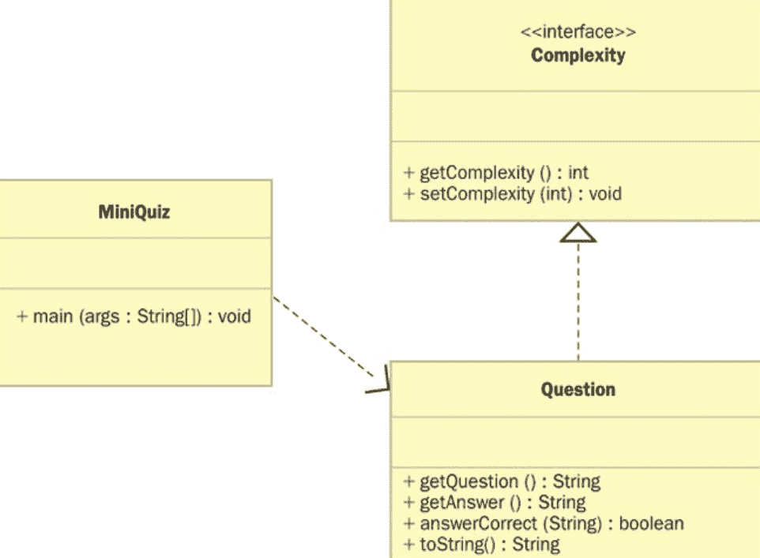

图 7.3 MiniQuiz 程序的 UML 类图

多个类可以实现同一个接口，为方法提供备选的定义。例如，我们可以实现一个名为 `Task` 的类，它也实现了 `Complexity` 接口。在其中，我们可以选择以不同的方式管理任务的复杂性（尽管它仍然必须实现接口的所有方法）。

一个类可以实现多个接口。在这些情况下，该类必须为列出的所有接口中的所有方法提供实现。要显示一个类实现了多个接口，可以将它们列在 `implements` 子句中，并用逗号隔开。例如：

```java
class ManyThings implements Interface1, Interface2, Interface3
{
    // 包含所有接口的方法
}
```

除了抽象方法之外（或者代替抽象方法），接口还可以包含常量，这些常量使用 `final` 修饰符定义。当一个类实现接口时，它就可以访问接口中定义的所有常量。

接口结构正式地定义了我们与类交互的方式。它还是一种名为多态的强大编程技术的基础，我们将在第 10 章中讨论这种技术。

### Comparable 接口

Java 标准类库包含接口也包含类。例如，`Comparable` 接口定义在 `java.lang` 包中。`Comparable` 接口只包含一个方法 `compareTo`，它接受一个对象作为参数并返回一个整数。

该接口的意图是提供一种比较两个对象的通用机制。一个对象调用该方法并将另一个对象作为参数传递：

```java
if (obj1.compareTo(obj2) < 0)
    System.out.println("obj1 is less than obj2");
```

按照接口文档的说明，如果 `obj1` 小于 `obj2`，则 `compareTo` 方法返回整数应该是负数；如果它们相等则为 0；如果 `obj1` 大于 `obj2` 则为正数。

### Iterator 接口

`Iterator` 接口是标准库中定义的另一个接口。它被表示集合的类使用，提供了一种遍历集合的方法。在第 5 章中，我们定义了迭代器的概念，用于逐个处理集合中的元素。

该接口的两个主要方法是 `hasNext`（返回一个布尔值）和 `next`（返回一个对象）。这两个方法都不接受任何参数。

我们需要注意的是，`next` 方法不会从集合中移除对象；它只是返回对象的引用。`Iterator` 接口还有一个名为 `remove` 的方法，它不接受参数且返回类型为 `void`。调用 `remove` 方法会移除最近由 `next` 方法返回的对象。

### 自习题

（答案见附录 L）

SR 7.14 类和接口之间有什么区别？

SR 7.15 定义一个名为 `Nameable` 的 Java 接口。实现此接口的类必须提供 `setName` 方法（接受单个 `String` 参数且无返回值）和 `getName` 方法（不接受参数并返回 `String`）。

SR 7.16 对错？请解释。

-   a. Java 接口可以包含抽象方法，不包含其他内容。

-   b. 抽象方法是没有实现的方法。

-   c. Java 接口定义的所有方法都必须是抽象。

-   d. 实现接口的类只能定义接口包含的方法。

-   e. 多个类可以实现同一个接口。

-   f. 一个类可以实现多个接口。

-   g. 所有实现接口的类必须为接口包含的方法提供完全相同的定义。

## 7.6 重新回顾枚举类型

在第 3 章中，我们引入了枚举类型的概念，它定义了一个新的数据类型并列出了该类型所有可能的值。我们给出了名为 `Season` 的枚举类型的示例，其声明如下：

```java
enum Season {winter, spring, summer, fall};
```

我们提到枚举类型是一种特殊的类，而枚举类型的值是对象。事实上，这些值是它们自己的枚举类型的实例。例如，`winter` 是 `Season` 类的一个对象。让我们进一步探讨一下这个概念。

假设我们声明了一个 `Season` 类型的变量：

```java
Season time;
```

核心概念

枚举类型的值是该类型的静态变量。

由于枚举类型是一种特殊的类，因此变量 `time` 是一个对象引用变量。此外，作为枚举类型，它只能被赋予 `Season` 定义中列出的值。这些值（`winter`、`spring`、`summer` 和 `fall`）实际上是 `Season` 对象的引用，存储在 `Season` 类内部的 `public static` 变量中。因此，我们可以进行如下赋值：

```
time = Season.spring;
```

现在让我们把这个想法更得进一步。在列表 7.11 中，我们重新定义了 `Season` 类型，给它一个更实质性的定义。请注意，我们仍然使用 `enum` 关键字来声明枚举类型，并且仍然列出了该类型的所有可能值。此外，我们添加了一个名为 `span` 的私有 `String` 变量、一个 `Season` 类的构造函数以及一个名为 `getSpan` 的方法。枚举类型值列表中的每个值都会调用构造函数，向其传递一个字符串，该字符串随后会被存储在每个值的 `span` 变量中。

### 列表 7.11

```java
//********************************************************************
// Season.java        Author: Lewis/Loftus
//
// 枚举 Season 的值。
//********************************************************************
public enum Season
{
    winter ("December through February"),
    spring ("March through May"),
    summer ("June through August"),
    fall ("September through November");

    private String span;
    //--------------------------------------------------------------------
    //------------------------------------------------------
    // 构造函数：为每个值设置关联的
    //字符串。
    //--------------------------------------------------------------------
    //------------------------------------------------------
    Season(String months)
    {
        span = months;
    }
}--------------------------------------------------------------------
```

```java
//-------
// 返回此值的跨度消息。
//-------

public String getSpan() {
    return span;
}
```

### 列表 7.12

```java
//****************************************************************
// SeasonTester.java                     Author: Lewis/Loftus
//
// 演示完整枚举类型的使用。
//****************************************************************

public class SeasonTester
{
    //---------------------------------------------------------
    // 遍历 Season 枚举类型的值。
    //---------------------------------------------------------
    public static void main(String[] args) {
        for (Season time : Season.values()) {
            System.out.println(time + "\t" + time.getSpan());
        }
    }
}
```

### 输出

```
winter December through February
spring March through May
summer June through August
fall September through November
```

除了每个枚举类型中定义的可能值列表外，我们还可以包含自己选择的任意数量的属性或方法。这为创新的类设计提供了各种机会。

### 核心概念

我们可以在枚举类型的定义中添加属性和方法。

### 自测题

（参见附录 L 中的答案）

SR 7.17 使用本节定义的枚举类型 `Season`，以下代码序列的输出是什么？

```java
Season time1, time2;
time1 = Season.winter;
time2 = Season.summer;
System.out.println(time1);
System.out.println(time2.name());
System.out.println(time1.ordinal());
System.out.println(time2.getSpan());
```

## 7.7 方法设计

一旦你识别了类并分配了基本职责，每个方法的设计将决定类具体如何定义其行为。某些方法是直观的，几乎不需要思考。另一些方法则更有趣，需要仔细的规划。

算法是解决问题的逐步过程。食谱就是算法的一个示例。旅行路线图是算法的另一个示例。每个方法都实现了一个决定该方法如何实现目标的算法。

算法通常使用伪代码来描述，伪代码是代码语句和英语短语的混合。伪代码提供了足够的结构来展示代码将如何运行，而不会陷入特定编程语言的语法细节中，也不会过早地受到特定编程结构特征的限制。

本节将讨论方法层面的程序设计的两个重要方面：方法分解以及将对象作为参数传递的影响。

### 方法分解

有时，对象提供的服务非常复杂，以无法合理地使用一个方法来实现。因此，我们有时需要将一个方法分解为多个方法，以创建一个更易理解的设计。例如，让我们查看将英语句子翻译成皮丁语（Pig Latin）的程序。

> 核心概念
>
> 对象提供的复杂服务可以分解为使用私有方法。

皮丁语是一种虚构语言，句子中的每个单词通常的修改方式是将单词的开头音移动到末尾并添加“ay”音。例如，`happy` 会被写并读作 `appyhay`，`birthday` 会变成 `irthdaybay`。开头的辅音组合如“ch” 和“st”在添加“ay”音之前会移动在一起。因此，`grapefruit` 变成 `apegray`。

列表 7.13 所示的 `PigLatin` 程序读取一个或多个句子并将其翻译成皮丁语。

### 列表 7.13

```java
//************************************************
// PigLatin.java               Author: Lewis/Loftus
//
// 演示方法分解的概念。
//************************************************

import java.util.Scanner;

public class PigLatin
{
    //-------------------------------------------------------------
    //-------------------------------------------------------------
    // 读取句子并翻译成皮丁语。
    //-------------------------------------------------------------

    public static void main(String[] args) {
        String sentence, result, another;

        Scanner scan = new Scanner(System.in);

        do {
            System.out.println();
            System.out.println("输入句子（无标点符号）：");
            sentence = scan.nextLine();

            System.out.println();

            result = PigLatinTranslator.translate(sentence);

            System.out.println("皮丁语翻译后的句子是:");

            System.out.println(result);

            System.out.println();

            System.out.print("翻译另一个句子吗 (y/n)?");

            another = scan.nextLine();

        } while (another.equalsIgnoreCase("y"));
    }
}
```

### 输出

```
输入句子（无标点符号）：
Do you speak Pig Latin
皮丁语翻译后的句子是:
oday ouyay eakspay igpay atinlay

翻译另一个句子吗 (y/n)? y
输入句子（无标点符号）：
Play it again Sam
```

`PigLatin` 程序的后盾是 `PigLatinTranslator` 类，如列表 7.14 所示。`PigLatinTranslator` 提供了一个基础服务，一个名为 `translate` 的静态方法，它接收一个字符串并将其翻译成皮丁语。注意，`PigLatinTranslator` 类不包含构造函数，因为不需要。

### 列表 7.14

```java
//********************************************************************************
// PigLatinTranslator.java      Author: Lewis/Loftus
//
// 代表从英语到皮丁语的翻译器。
//
// 演示方法分解。
//********************************************************************************

import java.util.Scanner;

public class PigLatinTranslator
{
    //----------------------------------------------------------------------
    //-
    // 将由单词组成的句子转换为皮丁语（Pig Latin）。
    //----------------------------------------------------------------------
    //-
    public static String translate(String sentence)
    {
        String result = "";

        sentence = sentence.toLowerCase();

        Scanner scan = new Scanner(sentence);

        while (scan.hasNext())
        {
            result += translateWord(scan.next());
        }
    }
}
```


```java
result += "";

}

return result;

}

//----------------------------------------------------------------------

//-

// 将一个单词转换为皮丁语。如果单词以元音

//开头，则在单词末尾添加后缀 "yay"。

// 否则，将第一个或两个字母移动到单词的末尾，

// 并加上 "ay"。

//----------------------------------------------------------------------

private static String translateWord(String word)

{

    String result = "";

    if (beginsWithVowel(word)) {

        result = word + "yay";

    } else {

        if (beginsWithBlend(word)) {

            result = word.substring(2) + word.substring(0,2) + "ay";

        } else {

            result = word.substring(1) + word.charAt(0) + "ay";

        }

    }

    return result;

}

//----------------------------------------------------------------------

// 确定指定的单词是否以元音开头。

//----------------------------------------------------------------------

private static boolean beginsWithVowel(String word)

{

    String vowels = "aeiou";

    char letter = word.charAt(0);

    return (vowels.indexOf(letter) != -1);

}

// 确定指定的单词是否以特定的两个字母辅音组合开头。

//----------------------------------------------------------------------

private static boolean beginsWithBlend(String word)

{

    return (word.startsWith("bl") || word.startsWith("sc") ||

        word.startsWith("br") || word.startsWith("sh") ||

        word.startsWith("ch") || word.startsWith("sk") ||

        word.startsWith("cl") || word.startsWith("sl") ||

        word.startsWith("cr") || word.startsWith("sn") ||

        word.startsWith("dr") || word.startsWith("sm") ||

        word.startsWith("dw") || word.startsWith("sp") ||

        word.startsWith("fl") || word.startsWith("sq") ||

        word.startsWith("fr") || word.startsWith("st") ||

        word.startsWith("gl") || word.startsWith("sq") ||

        word.startsWith("br") || word.startsWith("sw") ||

        word.startsWith("gr") || word.startsWith("th") ||

        word.startsWith("kl") || word.startsWith("tr") ||

        word.startsWith("ph") || word.startsWith("tw") ||

        word.startsWith("pl") || word.startsWith("wh"));

}

```

上述是皮丁语翻译器的实现。

### 重新考虑方法参数

每当一个方法变得庞大或复杂时，我们应该考虑将其分解为多个方法。首先，我们必须考虑如何定义类来创建更好的设计。在面向对象的设计中，方法的分解必须从于对象的分解。

另一个在设计方法时相关的重要问题是参数传递的方式。在 Java 中，所有参数都是按值传递的。也就是说，实际参数（调用处）的值被复制到形式参数中。我们在第 4 章中提到过这个问题，现在让我们更详细地检查。

本质上，参数传递类似于赋值语句，将实际参数的值赋值给形式参数。在方法内部对形式参数进行更改时必须考虑这个问题。形式参数是传入值的独立副本，因此对其进行的任何更改对实际参数都没有影响。当返回调用方法时，实际参数的值与调用之前相同。

然而，当我们把对象传递给方法时，我们实际上传递的是该对象的引用。被复制的是对象的地址。因此，形式参数和实际参数变成了彼此的别名。如果在方法内部通过形式参数更改对象的状态，我们就是在更改实际参数所引用的对象，因为它们指向同一个对象。相反，如果我们更改了形式参数引用本身（使其指向一个新的对象实例），我们并没有改变实际参数仍然指向原始对象这一事实。

> 核心概念
> 当将对象传递给方法时，实际参数和形式参数变成别名。

列表 7.15 中的程序说明了参数传递的细微差别。仔细跟踪该程序的处理过程，并注意输出的值。`ParameterTester` 类包含一个 `main` 方法，它调用 `ParameterModifier` 对象的 `changeValues` 方法。`changeValues` 的两个参数是 `Num` 对象，每个对象仅存储一个整数值。另一个参数是原始整数值。

```java

// ParameterTester.java    Author: Lewis/Loftus

//

// Demonstrates the effects of passing various types of

parameters.

//*********************************************************************

public class ParameterTester {

    //----------------------------------------------------------------------

    // Sets up three variables (one primitive and two objects)

    // to serve as actual parameters to the changeValues method.

    // Prints their values before and after calling the method.

    //----------------------------------------------------------------------

    public static void main(String[] args) {

        ParameterModifier modifier = new ParameterModifier();

        int a1 = 111;

        Num a2 = new Num(222);

        Num a3 = new Num(333);

        System.out.println("Before calling changeValues:");

        System.out.println("a1\ta2\ta3");

        System.out.println(a1 + "\t" + a2 + "\t" + a3 + "\n");

        modifier.changeValues(a1, a2, a3);

        System.out.println("After calling changeValues:");

        System.out.println("a1\ta2\ta3");

        System.out.println(a1 + "\t" + a2 + "\t" + a3 + "\n");

    }

}

```

### 输出

| 调用 changeValues 前 |
| a1 | a2 | a3 |
| 111 | 222 | 333 |

| 更改值前: |
| f1 | f2 | f3 |
| 111 | 222 | 333 |

| 更改值后: |
| f1 | f2 | f3 |
| 999 | 888 | 777 |

| 调用 changeValues 后 |
| a1 | a2 | a3 |
| 111 | 888 | 333 |

列表 7.16 显示了 `ParameterModifier` 类，列表 7.17 显示了 `Num` 类。在 `changeValues` 方法内部，对三个形式参数中的每一个都进行了修改：整数参数被设置为不同的值，通过其 `setValue` 方法更改了存储在第一个 `Num` 参数中的值，并创建了一个新的 `Num` 对象将其赋值给第二个 `Num` 参数。这些更改反映在 `changeValues` 方法结束时打印的输出中。

### 列表 7.16

```java

****************************************************

// ParameterModifier.java           Author: Lewis/Loftus

//

// 演示了更改参数值的影响。

****************************************************

//

public class ParameterModifier

{

    //------------------------------------------------------

    //----------------------------------------------------

    // 修改参数，并在进行更改前后

    // 打印它们的值。

    //-----------------------------------------------------------------------------

    public void changeValues(int f1, Num f2, Num f3)

    {

        System.out.println("Before changing the values:");

        System.out.println("f1\tf2\tf3");

        System.out.println(f1 + "\t" + f2 + "\t" + f3 + "\n");

        f1 = 999;

        f2.setValue(888);

        f3 = new Num(777);

        System.out.println("After changing the values:");

        System.out.println("f1\tf2\tf3");

        System.out.println(f1 + "\t" + f2 + "\t" + f3 + "\n");

    }

}

```

### 列表 7.17

```java

********************************************************************

// Num.java        Author: Lewis/Loftus

//

// 将单个整数表示为一个对象。

//********************************************************************

public class Num

{

    private int value;

    //------------------------------------------------------

    // 初始化一个新的 Num 对象并设置值。

    //------------------------------------------------------

    public Num(int update)

    {

        value = update;

    }

    //------------------------------------------------------

    // 将存储的值设置为新更新值。

    //------------------------------------------------------

    public void setValue(int update)

    {

        value = update;

    }

    //------------------------------------------------------

    // 以字符串形式返回存储的整数。

    //------------------------------------------------------

    public String toString()

    {

        return value + "";

    }

}

```


```java
// ParameterTester.java    Author: Lewis/Loftus
//
// 演示了传递各种类型参数的影响。
//*********************************************************************

public class ParameterTester {

    //----------------------------------------------------------------------
    // 设置三个变量（一个基本类型和两个对象）
    // 作为 changeValues 方法的实际参数。
    // 在调用该方法的前后打印它们的值。
    //----------------------------------------------------------------------

    public static void main(String[] args) {

        ParameterModifier modifier = new ParameterModifier();

        int a1 = 111;
        Num a2 = new Num(222);
        Num a3 = new Num(333);

        System.out.println("Before calling changeValues:");
        System.out.println("a1\ta2\ta3");
        System.out.println(a1 + "\t" + a2 + "\t" + a3 + "\n");

        modifier.changeValues(a1, a2, a3);

        System.out.println("After calling changeValues:");
        System.out.println("a1\ta2\ta3");
        System.out.println(a1 + "\t" + a2 + "\t" + a3 + "\n");

    }

}
```

### 输出

| 调用 changeValues 前 | | | |
| :--- | :--- | :--- | :--- |
| a1 | a2 | a3 | |
| 111 | 222 | 333 | |

| 更改值前: | | | |
| :--- | :--- | :--- | :--- |
| f1 | f2 | f3 | |
| 111 | 222 | 333 | |

| 更改值后: | | | |
| :--- | :--- | :--- | :--- |
| f1 | f2 | f3 | |
| 999 | 888 | 777 | |

| 调用 changeValues 后 | | | |
| :--- | :--- | :--- | :--- |
| a1 | a2 | a3 | |
| 111 | 888 | 333 | |

`Listing 7.16` 显示了 `ParameterModifier` 类，`Listing 7.17` 显示了 `Num` 类。在 `changeValues` 方法内部，对三个形式参数中的每一个都进行了修改：整数参数被设置为不同的值，通过其 `setValue()` 方法更改了存储在第一个 `Num` 参数中的值，并创建了一个新的 `Num` 对象并将其赋值给第二个 `Num` 参数。这些更改反映在 `changeValues` 方法结束时打印的输出中。

### Listing 7.16

```java
****************************************************
// ParameterModifier.java           Author: Lewis/Loftus
//
// 演示了更改参数值的影响。
****************************************************

public class ParameterModifier {

    //------------------------------------------------------
    // 修改参数，在进行更改前后打印它们的值。
    //------------------------------------------------------

    public void changeValues(int f1, Num f2, Num f3) {

        System.out.println("Before changing the values:");
        System.out.println("f1\tf2\tf3");
        System.out.println(f1 + "\t" + f2 + "\t" + f3 + "\n");

        f1 = 999;
        f2.setValue(888);
        f3 = new Num(777);

        System.out.println("After changing the values:");
        System.out.println("f1\tf2\tf3");
        System.out.println(f1 + "\t" + f2 + "\t" + f3 + "\n");

    }

}
```

### Listing 7.17

```java
********************************************************************
// Num.java        Author: Lewis/Loftus
//
// 将单个整数表示为一个对象。
//********************************************************************

public class Num {

    //-----------------------------------------------------------------
    // 使用指定的初始值创建一个 Num 对象。
    //-----------------------------------------------------------------

    public Num(int value) {
        this.value = value;
    }

    //-----------------------------------------------------------------
    // 返回存储的整数值。
    //-----------------------------------------------------------------

    public int getValue() {
        return value;
    }

    //-----------------------------------------------------------------
    // 将存储的整数值设置为指定的值。
    //-----------------------------------------------------------------

    public void setValue(int value) {
        this.value = value;
    }

    //-----------------------------------------------------------------
    // 返回存储值的字符串表示形式。
    //-----------------------------------------------------------------

    public String toString() {
        return String.valueOf(value);
    }

    private int value;

}
```


//-----------------------------------------------------------------------------

public void `changeValues(int f1, Num f2, Num f3)`

{

    `System.out.println("Before changing the values:")`;

    `System.out.println("f1\tf2\tf3")`;

    `System.out.println(f1 + "\t" + f2 + "\t" + f3 + "\n")`;

    f1 = 999;

    f2.`setValue(888)`;

    f3 = new `Num(777)`;

    `System.out.println("After changing the values:")`;

    `System.out.println("f1\tf2\tf3")`;

    `System.out.println(f1 + "\t" + f2 + "\t" + f3 + "\n")`;

}

}

```

### 列表 7.17

```java
********************************************************************
// Num.java        Author: Lewis/Loftus
//
// 将单个整数表示为一个对象。
//********************************************************************
public class `Num`
{
```

`println` 方法是一个多次重载的方法示例，每个方法接受一种单一类型。以下是其各种签名的部分列表：

- `println(String s)`
- `println(int i)`
- `println(double d)`
- `println(char c)`
- `println(boolean b)`

以下两行代码实际上调用了同名的不同方法：

```
System.out.println("Number of students: ");
System.out.println(count);
```

第一行调用了接受字符串的 `println` 版本。第二行（假设 `count` 是一个整数变量）调用了接受整数的 `println` 版本。

我们经常使用一个 `println` 语句打印几种不同的类型，例如：

```
System.out.println("Number of students: " + count);
```

请记住，在这种情况下，`+` 号是字符串连接运算符。首先，变量 `count` 中的值被转换为字符串表示，然后将两个字符串拼接成一个更长的字符串，最后调用接受单个字符串的 `println` 定义。

构造函数可以被重载，而且通常都是重载。通过提供构造函数的多个版本，我们为设置对象提供了多种方式。

## 自我测验

（答案见附录 L）

- SR 7.22 如何区分不同的重载方法？
- SR 7.23 对于以下每对方法头，请说明签名是否是唯一的。如果不是，请解释原因。
  - a.
    ```java
    describe(String name, int count)
    describe(int count, String name)
    ```
  - b.
    ```java
    void count()
    int count()
    ```
  - c.
    ```java
    int howMany(int compareValue)
    int howMany(int ceiling)
    ```
  - d.
    ```java
    boolean greater(int value1)
    boolean greater(int value1, int value2)
    ```
- SR 7.24 `Num` 类定义在**第 7.7 节**中。通过定义一个不带参数的第二个构造函数来重载该类的构造函数，并将 `value` 属性设置为 0。

## 7.9 测试

*testing*（测试）一词可以以多种方式应用于软件开发中。测试无疑包含了它的传统定义：使用各种输入运行已完成的程序以发现问题。但它也包括由人类或机器执行的任何评估，以评估不断演变的系统的质量。这些评估应该在编写任何代码之前就进行。

测试的目标是发现错误并修复它们，从而提高我们程序的质量。很可能在之后，其他人会发现开发过程中仍然隐藏的任何错误。错误越早被发现，修复就越容易、越便宜。花时间尽早发现问题几乎总是值得的。

使用特定输入运行程序并产生正确的结果，只能证明程序对于该特定输入是有效的。随着越来越多的测试用例执行而没有揭示错误，我们对程序的信心会增加，但我们永远无法确定所有错误都已消除。可能一直存在另一个未被发现的错误。因此，尽可能通过多种方式和设计良好的测试用例对程序进行彻底测试是很重要的。

> 核心概念
> 测试程序永远无法保证没有错误。

证明一个程序是正确的，但这种技术对于大型系统来说极其复杂，而且证明本身也可能出错。因此，我们通常依赖测试来确定程序的质量。

在确定存在错误后，我们确定错误的原因并修复它。问题解决后，我们应该重新运行之前的测试，以确保在修复问题时没有创建另一个错误。这种技术被称为回归测试。

## 评审

用于评估设计或代码的技术称为评审（review），这是一种会议，几个人在会议上仔细检查设计文档或代码段。将我们的设计或代码展示给他人使我们对其仔细思考，并允许他人与我们分享建议。参与者讨论其优点和问题，并列出必须解决的问题列表。评审的目标是识别问题，而不是解决问题（后者通常需要多得多的时间）。

设计评审应该确定需求是否已经落实。它还应该评估系统分解为类和对象的方式。代码评审应该确定设计在多大程度上满足了需求，以及实现在多大程度上真实代表了设计。它应该识别任何可能导致设计或实现无法履行职责的特定问题。

有时评审被称为 *walkthrough*（走演测试），因为它的目标是仔细逐页通过并评估每个部分。

## 缺陷测试

由于测试的目标是发现错误，因此通常被称为**缺陷测试**（defect testing）。以该目标为指导，一个良好的测试是能够发现程序中任何缺陷的。这看起来可能很奇怪，因为我们最终不希望系统中出现问题。我们始终记住，错误几乎肯定存在。我们的测试工作应该尽一切努力发现它们。我们希望通过发现并修复存在的错误来增加程序的可靠性，而不是让用户去发现它们。

> 核心概念
> 良好的测试是发现错误的测试。

一个测试用例由一组输入、用户操作或其他初始条件以及预期输出组成。测试用例应该被适当记录，以便以后可以重复。开发者经常创建测试套件（test suite），这是一组涵盖系统各个层面的测试用例。

> 核心概念
> 对程序的所有输入或用户操作进行穷尽测试是不可能的。

由于程序基于大量的可能输入运行，通常也没有必要测试每种情况。两个测试用例可能非常相似，以至于没有测试到程序的不同方面。这样做将是浪费精力。我们宁愿执行一个以新方式压力程序的测试用例。为此，让我们检查缺陷测试的两种方法：黑盒测试和白盒测试。

顾名思义，黑盒测试将被测试的对象视为黑盒。在黑盒测试中，测试用例的开发不考虑内部机制。黑盒测试基于输入和输出。整个程序可以使用黑盒技术进行测试，此时输入是用户提供的信息和用户操作（如点击按钮）。只有当输入产生预期输出时测试用例才是成功的。单个类也可以使用黑盒技术进行测试，其关注类的系统接口（公共方法）。传入某些参数，产生特定的结果。黑盒测试用例通常直接源于系统需求或方法的说明。

黑盒测试用例的输入数据通常通过定义等效类（equivalence categories）来选择。等效类是预期产生相似输出的输入集合。通常，如果方法对等效类中的一个值有效，我们有理由相信它对其他值也有效。例如，计算整数平方根方法的输入可以分为两个等效类：非负整数和负整数。如果它对一个非负值有效，它可能对所有非负值都有效。同样，如果它对一个负值有效，它可能对所有负值都有效。

等效类有定义的边界。由于整个等效类基本上测试的是程序的相同功能，因此在等效边界内只需要一个测试用例。然而，由于编程经常产生“差一”错误，应该对边界及其周围的值进行穷尽测试。对于整数边界，一个良好的测试套件至少应包含边界的精确值、边界减 1 以及边界加 1。应该定义使用这些边界的用例，以及该类别通用领域内的至少一个用例。

让我们来看一个例子。假设有一个方法的目的是验证位于 0 到 99（包含）范围内的特定整数。在这种情况下，有三个等效类：0 以下的值、0 到 99 之间的值以及 99 以上的值。黑盒测试要求我们使用边界周围和边界上的测试值，以及来自等效类中的某些通用值。因此，这种情况下的一组黑盒测试用例可能是：-500, -1, 0, 1, 50, 98, 99, 100 和 500。

**白盒测试**，也称为玻璃盒测试，是对方法的内部结构和实现的练习。白盒测试用例基于代码逻辑。目标是确保程序中的每条路径至少执行一次。白盒测试映射了代码中可能的路径，并确保测试用例覆盖了所有要执行的路径。这种测试通常被称为语句覆盖。

代码中的路径由各种使用条件表达式（如 `if` 语句）的控制流语句控制。为了让程序中的每条路径至少执行一次，测试用例的输入数据值需要控制条件表达式的值。一个或多个测试用例的输入数据应使 `if` 语句的条件在至少一种情况下为真，在至少一种情况下为假。在语句中同时覆盖真、假值可以保证通过 `if` 语句的两条路径都将执行。循环和其他结构也可以创建类似的情况。

在黑盒测试和白盒测试中，在运行测试之前都应该建立每个测试的预期输出。如果你没有先仔细确定结果应该是什么，很容易被认为测试结果是适当的。

### 自习题

（答案见附录 L）

SR 7.25 从列表中选择与以下每个短语最匹配的术语：
黑盒 (black-box)、缺陷 (defects)、回归 (regression)、评审 (review)、测试用例 (test case)、测试套件 (test suite)、走查 (walkthrough)、白盒 (white-box)

- a. 在程序进行更改后运行之前的测试用例，以帮助确保更改没有引入错误。
- b. 几个人共同评估某个产物的会议。
- c. 仔细检查文档并评估每个部分的评审。
- d. 测试的目标是发现这些。
- e. 被测试代码单元的输入和相应输出的描述。
- f. 覆盖系统各个层面的测试用例集。
- g. 使用这种测试方法，测试用例完全基于需求规范。
- h. 使用这种测试方法，测试用例基于程序的内部工作机制。

## 7.10 GUI 设计

当我们关注允许我们创建 GUI 的细节时，我们有时可能会忽视大局。在我们继续探索 GUI 构造时，我们应该记住我们的目标是解决问题。具体来说，我们想要创建实用的软件。了解控件、事件和其他语言元素的细节为我们提供了组装 GUI 的工具，但我们必须根据以下良好 GUI 设计的这些思想来指导这些知识：

- 了解用户。
- 防止用户错误。
- 优化用户能力。
- 保持一致性。

> 核心概念
> 任何 GUI 的设计都应该遵循有关一致性和可用性的基本准则。

软件设计人员必须理解用户的需求和潜在活动，以便开发能够很好服务该用户的界面。记住，对于用户来说，界面就是软件。它是用户与系统交互的唯一方式。因此，界面必须满足用户的需求。

只要可能，我们应该设计界面，让用户尽可能少犯错。在许多情况下，我们有灵活选择多个控件中的一个来完成特定任务。我们应该始终尝试选择防止不当操作并避免无效输入的控件。例如，如果输入值必须是某个特定值集合，我们应该使用允许用户仅做出有效选择的控件。也就是说，将用户限制在几个选择中。

```java
line = new `Line(0, 0, 0, 0)`;
```

```java
distanceText = new `Text(150, 30, "Distance: --")`;
```

```java
Group root = new `Group(distanceText, line)`;
```

```java
Scene scene = new `Scene(root, 400, 300, Color.LIGHTYELLOW)`;
```

```java
scene.`setOnMouseClicked(this::processMouseClick)`;
```

```java
primaryStage.`setTitle("Click Distance")`;
```

```java
primaryStage.`setScene(scene)`;
```

```java
primaryStage.`show()`;
```

```java
}
```

----------------------------------------------------------------
----------------------------------------------------------------

```java
// 将线的终点重置为鼠标事件的位置，
// 并更新显示的距离。
```

```java
public void `processMouseClick(MouseEvent event)`
```

```java
{
```

```java
double clickX = event.`getX()`;
```

```java
double clickY = event.`getY()`;
```

```java
line.`setX(clickX)`;
```

```java
line.`setY(clickY)`;
```

```java
double distance = `Math.sqrt(clickX * clickX + clickY * clickY)`;
String distanceStr = `String.format("%.2f", distance)`;
distanceText.`setText("Distance: " + distanceStr)`;
}
```

### 显示

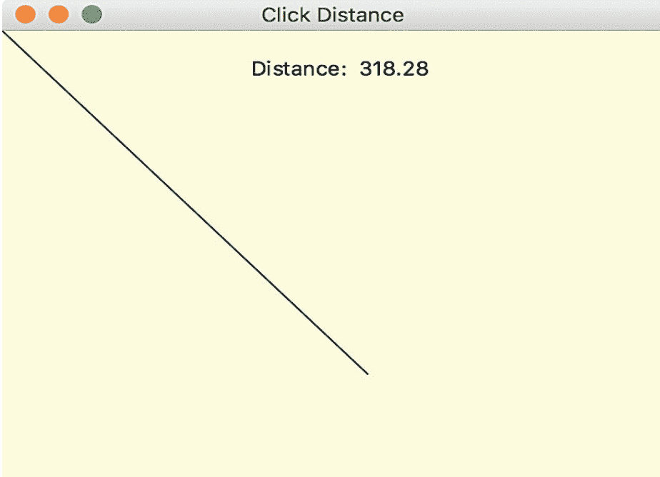


`processMouseClick` 方法被设置为事件处理器，它接收一个代表该事件的 `MouseEvent` 对象。调用事件的 `getX` 和 `getY` 方法可以返回鼠标点击位置的坐标。使用这些值，线的终点会被重置，并计算并显示其到原点的距离。

现在让我们来看一个响应两个鼠标相关事件的示例。列表 7.19 所示的 `RubberLines` 程序允许用户通过点击鼠标按钮来建立一个端点，然后拖动鼠标到另一个端点在两点之间画线。随着鼠标的拖动，线会不断重绘，产生用户正在拉伸线的错觉。这种效果被称为橡皮带（rubberbanding）。

### 列表 7.19

```java
import javafx.application.Application;
import javafx.scene.Group;
import javafx.scene.Scene;
import javafx.scene.input.MouseEvent;
import javafx.scene.paint.Color;
import javafx.scene.shape.Line;
import javafx.stage.Stage;
//****************************************************************************************************
```

```java
// RubberLines.java    作者: Lewis/Loftus
//
// 演示鼠标按下和鼠标拖拽
// 事件的处理。
//********************************************************************
```

```java
public class `RubberLines` extends `Application`
{
    private `Line` currentLine;
    private `Group` root;
    //----------------------------------------------------------------------
    // 显示一个初始的场景，等待用户
    // 使用鼠标绘制线。
    //----------------------------------------------------------------------
    //--------------------------------------
    public void `start(Stage primaryStage)`
    {
        root = new `Group()`;
        Scene scene = new `Scene(root, 500, 300, Color.BLACK)`;
        scene.`setOnPressed(this::processMouseEvent)`;
        scene.`setOnMouseDragged(this::processMouseDrag)`;
```

```java
primaryStage.`setTitle("Rubber Lines")`;
```

```java
primaryStage.`setScene(scene)`;
```


```java
primaryStage.show();
}
```

//--------------------------------------------------------------------------------
----------------

```java
// 当按下鼠标按钮时，向场景添加一条新线。
//--------------------------------------------------------------------------------
```

```java
public void processMousePress(MouseEvent event) {
    currentLine = new Line(event.getX(), event.getY(),
            event.getX(), event.getY());
    currentLine.setStroke(Color.CYAN);
    currentLine.setStrokeWidth(3);
    root.getChildren().add(currentLine);
}
```

//--------------------------------------------------------------------------------
----------------

```java
// 当鼠标拖拽时，更新当前线的终点，
// 创建橡皮带效果。
//--------------------------------------------------------------------------------
----------------
```

```java
public void processMouseDrag(MouseEvent event) {
    currentLine.setEndX(event.getX());
    currentLine.setEndY(event.getY());
}
```

### 显示


> 核心概念
> 橡皮带效果（Rubberbanding）是指当拖动鼠标时，形状似乎在调整大小时产生的图形效果。

此程序中建立了两个事件处理器：一个处理鼠标按下，另一个处理鼠标拖拽。当鼠标按钮被按下时，会创建一个新的 `Line` 对象并将其添加到场景的根节点中。线的初始长度只有一个像素，对应于鼠标的位置。

当鼠标被拖拽时，会产生多次鼠标拖拽事件。每次，线的终点都会更新为鼠标指针的位置。这些变化发生非常快，看起来就像正在被拉伸一样。当用户释放鼠标按钮时，拖拽效果停止，线的位置现在固定了。用户如果需要，可以画另一条线。

### 自测题

（答案见附录 L）

- SR 7.28 点击鼠标按钮时会产生哪些事件？
- SR 7.29 鼠标指针从窗口的一个位置移动到另一个位置时会产生哪些事件？
- SR 7.30 在鼠标事件发生时获取鼠标的位置？

# 7.12 键事件

当按下键盘键时，会产生键事件。

> 核心概念
> 键事件允许程序立即响应用户按下按键的操作。

三种类型的键事件如图 7.7 所示。可以使用 `setOnKeyPressed`、`setOnKeyReleased` 和 `setOnKeyTyped` 方法来设置这些方法的事件处理器。

| 事件 | 描述 |
|---|---|
| key pressed | 键盘键被按下。 |
| key released | 键盘键被释放。 |
| key typed | 生成字符的键盘键被键入（按下并释放）。 |

图 7.7 JavaFX 键事件

键输入事件与其他两种事件略有不同。键输入事件不是底层平台的功能，而其他两种是。只有在输入 Unicode 字符时才会产生键输入事件。

列表 7.20 所示的程序响应键按下事件。它显示了一个外星人的图像，用户可以使用键盘上的方向键在屏幕上移动。例如，按下向上方向键时，外星人会立即向上移动。

```java
primaryStage.setTitle("Alien Direction");
primaryStage.setScene(scene);
primaryStage.show();
}
```

//---------------------------------------------------------------------------------
--

```java
// 当按下方向键时，修改图像视图（imageView）的的位置。
//---------------------------------------------------------------------------------
--
```

```java
public void keyPressed(KeyEvent event) {
    switch (event.getCode()) {
        case UP:
            imageView.setY(imageView.getY() - JUMP);
            break;
        case DOWN:
            imageView.setY(imageView.getY() + JUMP);
            break;
        case RIGHT:
            imageView.setX(imageView.getX() + JUMP);
            break;
        case LEFT:
            imageView.setX(imageView.getX() - JUMP);
            break;
    }
}
```


### 显示


此示例的 `start` 方法加载了外星人图像并设置了一个 `ImageView` 对象来显示它。图像视图的初始位置被显式设置。

键事件由具有 `keyboard` 焦点的节点处理。在本示例中，事件是由场景（scene）本身处理的。因此，调用场景的 `setOnKeyPressed` 方法来设置按下按键的处理程序。

当按下键盘按键时，会调用事件处理程序方法，并传递一个 `KeyEvent` 对象。事件对象的 `getCode` 方法返回一个表示所按按键的编码。更具体地说，它返回一个 `KeyCode` 对象，该对象是表示各种键的枚举类型。

使用 `switch` 语句来处理我们希望程序响应的四个方向键中的每一个。例如，当按下右方向键时，会将特定数量的像素（由常量 `jump` 表示）加到图像视图的 x 位置上。如果用户按了方向键以外的任何键，则会被忽略。

需要注意的是，如果生成了按键输入事件（key typed event），其 `getCode` 方法将始终返回 `KeyCode.UNDEFINED`。在这种情况下，可以使用事件的 `getCharacter` 方法获取字符。

### 自测习题

（答案见附录 L）

- SR 7.31 当在键盘上输入字符时，会生成哪些事件？
- SR 7.32 在程序中，你如何确定按了哪一个键？
- SR 7.33 当按下方向键时，`AlienDirection` 程序会做什么？

### 核心概念总结

- 在设计上投入努力是至关重要的且具有成本效益的。
- 问题描述中的名词可能指示程序中需要的某些类和对象。
- 静态变量在类的所有实例之间共享。
- 聚合对象由其他对象组成，形成“包含关系”。
- 接口是抽象方法的集合，因此不能实例化。
- 枚举类型的值是该类型的静态变量。
- 我们可以为类型的定义添加属性和方法。
- 对象提供的复杂服务可以分解以利用私有支持方法。
- 当对象传递给方法时，实际参数和形式参数成为别名。
- 重载方法的版本通过其参数的数量、类型和顺序来区分。
- 测试程序永远无法保证没有错误。
- 一个好的测试是能够发现错误的测试。
- 对所有可能的输入和用户操作对程序进行穷尽式测试是不可行的。
- 任何 GUI 设计都应该遵循关于一致性和可用性的基本指南。
- 移动鼠标和点击鼠标按钮会产生程序可以响应的事件。
- 橡皮带效应是指当拖动鼠标时，形状似乎在调整大小时产生的图形效果。
- 键事件允许程序立即响应用户按下键盘键的操作。

### 练习题

EX 7.1 编写一个名为 `average` 的方法，它接受两个整数参数并返回它们的平均值作为浮点值返回。

EX 7.2 重载练习题 7.1 中的 `average` 方法，如果提供了三个整数作为参数，则该方法返回这三个数之平均值。

EX 7.3 重载练习题 7.1 中的 `average` 方法，以接受四个整数参数并返回它们的平均值。

EX 7.5 重载练习题 7.4 中的 `multiConcat` 方法，当未提供整数参数时。

EX 7.6 编写一个名为 `makeCircle` 的方法，根据方法的参数返回一个新的 `Circle` 对象：两个表示圆心 (x, y) 坐标的整数值，一个表示圆半径的整数，以及一个定义圆的填充颜色的 `Color` 对象。

EX 7.7 重载练习题 7.6 中的 `makeCircle` 方法，如果未提供 `Color` 参数，圆的颜色将默认为红色。

EX 7.8 重载练习题 7.6 中的 `makeCircle` 方法，如果未提供半径，则半径默认为 10。

EX 7.9 重载练习题 7.6 中的 `makeCircle` 方法，如果未提供颜色，则颜色将默认为绿色。

EX 7.10 讨论 Java 参数的方式。

EX 7.11 静态方法可以引用实例变量吗？

EX 7.12 类可以实现多个接口吗？

EX 7.13 创建一个名为 `Visible` 的接口，包含两个方法：`makeVisible` 和 `makeInvisible`。这两个方法都不应接受参数。

EX 7.14 画出一个显示元素之间关系的 UML 图。

EX 7.15 想象一个游戏，其中元素可以被破坏，另一些不能。创建一个名为 `Breakable` 的接口，包含一个不接受参数的 `break` 方法。

EX 7.16 创建一个名为 `VCR` 的接口，其代表录像机的操作（播放、停止等）。

EX 7.17 比较鼠标事件和按键输入事件。

EX 7.18 什么是橡皮带效应？如何实现它？

### 编程项目

PP 7.1 修改第 4 章中的 `Account` 类，使其允许仅通过名称和账号打开账户，假设初始余额为零。修改 `Transactions` 类的 `main` 方法来演示这一点。


PP 7.2 按照以下要求修改本章介绍的 `Student` 类。每个学生对象还应包含三次测试成绩。提供一个根据参数设置所有实例值的构造函数。重载构造函数，假设每个测试成绩初始为零。提供一个名为 `setTestScore` 的方法接受两个参数：测试编号和分数。也提供一个名为 `getScore` 的方法接受编号并返回相应的分数。提供一个名为 `average` 的方法，计算并返回该学生的测试平均分。修改 `toString` 方法，将测试成绩和平均分包含在学生的描述中。修改驱动类 `main` 方法以测试这些新的 `Student` 方法。

PP 7.3 写一个名为 `Course` 的类表示一个课程。使用上一个编程项目的修改 `Student` 类来表示学生。在 `Course` 中使用 `ArrayList` 存储学生。`Course` 构造函数应只接受课程名称。提供一个名为 `addStudent` 的方法接受一个 `Student` 参数。提供一个名为 `average` 的方法，计算并返回所有学生平均分的平均值。提供一个名为 `roll` 的方法打印课程中的学生。创建一个带有 `main` 方法的驱动类，创建一个课程，添加多个学生并打印课程的整体测试平均分。

PP 7.4 修改 `RationalNumber` 类使其实现 `Comparable` 接口。为了执行比较，从两个 `RationalNumber` 对象的分子和分母计算等效浮点值，然后使用 0.0001 的容差值进行比较。编写一个主驱动来测试你的修改。

PP 7.5 写一个名为 `Priority` 的 Java 接口，包含两个方法：`setPriority` 和 `getPriority`。该接口定义了在对象之间建立数字优先级的方法。设计并实现一个名为 `Task` 的类，

`Task` 表示一个任务（例如待办事项中的任务），它实现了 `Priority` 接口。创建一个驱动类来练习一些 `Task` 对象。

PP 7.6 修改来自 PP 7.5 的 `Task` 类，使其也实现本章中定义的 `Complexity` 接口。

修改驱动类以显示 `Task` 对象的这些新功能。

PP 7.7 修改来自 PPs 和 7.6 的 `Task` 类，使其也实现 Java 标准类库中的 `Comparable` 接口。实现该接口，使得任务根据优先级进行排序。创建一个驱动类，其 `main` 方法用以显示 `Task` 对象的这些新功能。

PP 7.8 编写一个名为 `Lockable` 的 Java 接口，包含以下方法：`setKey`、`lock`、`unlock` 和 `locked`。`setKey`、`lock` 和 `unlock` 方法接受一个表示密钥的整数参数。`setKey` 方法建立密钥。`lock` 和 `unlock` 方法对对象锁定和解锁，但仅当传入的密钥正确时才操作。`locked` 方法返回一个布尔值，指示对象是否被锁定。`Lockable` 对象表示一个普通方法受保护的对象：如果对象被锁定，则无法调用方法；如果对象已解锁，则可以调用。编写一个第 5 章 `Coin` 类的版本，使其实现 `Lockable`。

PP 7.9 编写一个第 4 章 `Account` 类的版本，使其根据 PP 7.8 的定义实现 `Lockable`。

PP 7.10 编写一个 JavaFX 应用，统计在场景中点击鼠标按钮的次数。在窗口顶部显示该数字。

PP 7.11 编写一个 JavaFX 应用，根据鼠标指针的位置更改其背景颜色。如果鼠标指针位于程序窗口的左半部分，显示红色；如果位于右半部分，显示绿色。

PP 7.12 编写一个 JavaFX 应用，使用拉动橡筋带技术绘制多个圆。圆的大小由鼠标拖动决定。使用初始鼠标按下位置作为圆的固定中心点。计算鼠标指针当前位置与中心点之间的距离，以确定圆的当前半径。

PP 7.13 编写一个 JavaFX 应用作为鼠标里程计，持续显示鼠标在程序窗口上方移动的像素距离。在窗口顶部显示当前的里程计值。提示：当鼠标移动时，使用距离公式计算自上一次事件以来鼠标移动的距离，并将其累加到总数中。

PP 7.14 编写一个 JavaFX 应用，显示一个随鼠标移动的飞船侧视图。当按下鼠标按钮时，让一束激光从飞船前端射出（一束连续的光束，而不是一个移动的射体），直到释放鼠标按钮。使用单独的类定义飞船。

PP 7.15 修改本章的 `AlienDirection` 程序，使得图像不允许移动到窗口的可视图区域。忽略任何导致这种情况发生的按键事件。

# 2003年东北软件故障

# 大停电

### 发生了什么？


停电前后的美国东北部。

2003 年 8 月 14 日，美国历史上最大的停电事件袭击了美国东北部和加拿大部分地区。几个大都市受到影响，包括纽约、克利夫兰、底特律、多伦多和渥太华。在三分钟内，21 个发电厂关闭，影响了约 5000 万人。

停电地区出现了许多典型问题。交通信号灯缺失导致了交通问题。火车和电梯被困住。机场延迟了航班。依赖电泵的水压失效了。手机使用受到干扰。（有线电话仍可用，但在紧急情况下负荷过重。）互联网流量变慢。

据估计，此次停电造成的经济损失在 50 亿到 800 亿美元之间。导致停电的因素有很多。

## 导致停电的原因是什么

## 吸取的教训

此次事件的问题并非源于电力缺乏，而是由于无法将电力输送到需要的地方。这次停电暴露了电力基础设施的脆弱性，以及在某些情况下依赖于电网可靠性的危险性。

来源：CNN.com, WashingtonPost.com

# 8 数组

## 本章目标

- 定义并使用数组进行基础组织。
- 讨论边界检查和容量管理技术。
- 讨论作为对象的数组以及对象数组的问题。
- 探索命令行参数的使用。
- 描述变长参数列表的语法和用法。
- 讨论多维数组的创建和使用。
- 探索多边形和折线形状

在编程中，我们经常希望以易于访问和修改的方式组织对象或原始数据。第 5 章过的 `ArrayList` 类正是出于此目的。类名暗示，`ArrayList` 是使用数组实现的，数组是将数据分组为列表的构造。在本章中，我们将探索数组的细节，它是大多数高级语言的基础组成部分。在本章的图形跟踪章节中，我们将探索绘制复杂图形、引入选择框控件以及如何在 JavaFX 程序中播放音频片段的方法。

## 8.1 数组元素

数组是一种简单但强大的编程语言构造，用于分组和组织数据。在编写管理大量信息的程序（例如100个名字的列表）时，为每个数据声明单独变量是不现实的。数组解决了这个问题，让我们声明一个可以包含多个单独访问值的变量。

数组是一个值的列表。每个值存储在数组中特定的、编号的位置。每个位置对应的数字称为索引或下标。图 8.1 显示了一个整数数组以及与每个位置对应的索引。该数组名为 `height`；它包含代表几个人身高的整数（英寸）。


# 图 8.1 一个包含整数值的数组 `height`

在 Java 中，数组索引始终从零开始。因此，存储在索引 5 的值实际上是数组中的第六个值。图 8.1 所示的数组有 11 个值，索引从 0 到 10。

> 核心概念
> 大小为 N 的数组索引从 0 到 N–1。

要访问数组中的某个值，我们使用数组名后跟方括号中的索引。例如，以下表达式引用 `height` 数组中的第九个值：

```
height[8]
```

根据图 8.1，`height[8]`（读音为 height-sub-eight）包含值 79。不要将索引的值（在此例中为 8）与存储在数组索引处的值（在此例中为 79）混淆。

表达式 `height[8]` 指存储在特定内存位置的单个整数。它可以用于任何可以使用整数变量的地方。因此，你可以给它赋值、在计算中使用它、打印它的值等。此外，数组索引是整数，你可以使用整数表达式来指定用于访问数组的索引。这些概念在接下来的几行代码中得到了演示：

```
height[2] = 72;

height[count] = feet * 12;

average = (height[0] + height[1] + height[2]) / 3;

System.out.println("The middle value is " + height[MAX/2]);

npick = height[rand.nextInt(11)];
```

数组在内存中是连续存储，这意味着元素在内存中是紧挨着存储的，正如我们在概念上构想的那样。这使得数组通过索引访问任何特定元素变得极其高效。在内部，为了确定任何特定元素的地址，会将索引乘以每个元素的大小，并加上数组起始点的内存地址。这就是为什么数组索引从零开始而不是从一开始的原因——为了让计算尽可能简单。因此，从效率的角度来看，访问数组中的第 500 个元素与访问第一个元素一样简单。

### 自测题

（答案见附录 L）

- SR 8.1 什么是数组？
- SR 8.2 数组的每个元素是如何引用的？
- SR 8.3 根据图 8.1 所示的数组，以下各项是什么？
  - a. height[1]
  - b. height[2] + height[5]
  - c. height[2 + 5]
  - d. 索引 8 处存储的值
  - e. 第四个值
  - f. height.length

## 8.2 声明和使用数组

在 Java 中，数组是对象。要创建一个数组，必须声明对数组的引用。然后可以使用 `new` 运算符实例化数组，它会分配内存空间来存储值。以下代码表示图 8.1 所示数组的声明：

```
int[] height = new int[11];
```

变量 `height` 被声明为整数数组，其类型写为 `int[]`。数组中存储的所有值都具有相同的类型（或至少是兼容）。例如，我们可以创建一个可以包含整数的数组，也可以创建一个可以包含字符串的数组，但不能创建一个既能包含整数又能包含字符串的数组。数组可以设置为包含任何基本类型或任何对象（类）类型。存储在数组中的有时被称为*数组元素*，数组所包含值的类型被称为数组的`element type`（元素类型）。

> 核心概念
> 在 Java 中，数组是一个必须实例化的对象。

注意数组变量 `int[]` 的类型不包含数组的大小。使用 `new` 运算符实例化 `height` 会预留存储 11 个索引从 0 到 10 的整数的内存空间。一旦声明数组为某个大小，它能包含的值的数量就无法更改。


代码列表 8.1 中的示例创建了一个名为 `list` 的数组，它可以包含 15 个整数，并以 10 的连续增量加载它们。然后它更改了数组中第六个元素的值（索引 5）。最后，它打印了数组中存储的所有值。

# 代码列表 8.1

```
************************************************************

// BasicArray.java                 Author: Lewis/Loftus
//
// 演示基本的数组声明和使用。
```


# BasicArray 示例

```java
public class BasicArray
{
    //--------------------------------------------------------------------
    // 创建一个数组，填充各种整数值，
    // 修改一个值，然后将它们打印出来。
    //--------------------------------------------------------------------
    public static void main(String[] args) {
        final int LIMIT = 15, MULTIPLE = 10;

        int[] list = new int[LIMIT];

        // 初始化数组值
        for (int index = 0; index < LIMIT; index++) {
            list[index] = index * MULTIPLE;
        }
        list[5] = 999; // 修改一个数组值

        // 打印数组值
        for (int value : list) {
            System.out.print(value + " ");
        }
    }
}
```

### 输出

| 0 | 10 | 20 | 30 | 40 | 999 | 60 | 70 | 80 | 90 | 100 | 110 | 120 | 130 | 140 |
|---|---|---|---|---|---|---|---|---|---|---|---|---|---|---|

图 8.2 显示了数组在 `BasicArray` 程序执行期间的变化情况。在处理数组时，使用 `for` 循环通常非常方便，因为数组中的位置数量是固定的。注意 `BasicArray` 程序中的几处使用了名为 `LIMIT` 的常量。

数组变量 `int[]` 的类型不包含数组的大小。使用 `new` 运算符实例化 `height` 会预留存储 11 个索引从 0 到 10 的整数的内存空间。一旦声明数组为某个大小，它能包含的值的数量就无法更改。

代码列表 8.1 中的示例创建了一个名为 `list` 的数组，它可以包含 15 个整数，并以 10 的连续增量加载它们。然后它更改了数组中第六个元素的值（索引 5）。最后，它打印了数组中存储的所有值。

图 8.2 显示了数组在 `BasicArray` 程序执行期间的变化情况。在处理数组时，使用 `for` 循环通常非常方便，因为数组中的位置数量是固定的。注意 `BasicArray` 程序中的几处使用了名为 `LIMIT` 的常量。

Java 执行自动边界检查，确保索引在范围内。每当对数组元素进行引用时，索引必须大于或等于 0 且小于数组的大小。如果索引无效，则会抛出一个名为 `ArrayIndexOutOfBoundsException` 的异常。

当然，在我们的程序中，我们想要执行自己的边界检查。也就是说，我们希望小心保持在数组边界内。因为数组索引从零开始，到大小减一结束，所以在程序中很容易产生“差一错误”（off-by-one errors），即处理多了一个或少处理了一个元素引起的问题。

检查数组边界的一种方法是使用 `length` 常量，该常量存储在数组对象中并存储数组的大小。它是一个公共常量，因此可以直接引用。它的值在数组首次创建时设置，无法更改。

# ReverseOrder 示例

```java
// ReverseOrder.java          Author: Lewis/Loftus
//
// 演示数组索引的处理。
//*********************************************************************

import java.util.Scanner;

public class ReverseOrder {

    //----------------------------------------------------------------------
    // 从用户处读取数字列表，将其存储在数组中，
    // 然后以相反的顺序打印它们。
    //----------------------------------------------------------------------
    public static void main(String[] args) {

        Scanner scan = new Scanner(System.in);

        double[] numbers = new double[10];

        System.out.println("The size of the array: " + numbers.length);

        for (int index = 0; index < numbers.length; index++) {
            System.out.print("Enter number " + (index+1) + ": ");
            numbers[index] = scan.nextDouble();
        }

        System.out.println("Numbers in reverse order:");
        for (int index = numbers.length - 1; index >= 0; index--) {
            System.out.print(numbers[index] + " ");
        }
    }
}
```

### 输出

| 数组的大小: 10 |
|---|
| 输入数字 1: 18.36 |
| 输入数字 2: 48.9 |
| 输入数字 3: 53.5 |
| 输入数字 4: 29.06 |
| 输入数字 5: 72.404 |
| 输入数字 6: 34.8 |
| 输入数字 7: 63.41 |
| 输入数字 8: 45.55 |
| 输入数字 9: 69.0 |
| 输入数字 10: 99.18 |
| 反向顺序的数字: |
| 99.18 69.0 45.55 63.41 72.404 29.06 53.5 48.9 |

在 `ReverseOrder` 程序中，数组 `numbers` 被声明为 10 个元素，因此索引从 0 到 9。索引范围在 `for` 循环中通过数组对象的 `length` 字段进行控制。你应该仔细地设置循环控制变量的初始值以及终止循环的条件，以确保所有预期的元素都得到处理，并且仅使用有效索引引用数组元素。

# LetterCount 示例

列表 8.3 所示的 `LetterCount` 示例使用了两个数组和一个 `String` 对象。名为 `upper` 的数组用于存储字符串中每个大写字母字母出现的次数。名为 `lower` 的数组对小写字母起到相同的作用。

### 列表 8.3

```java
// LetterCount.java Author: Lewis/Loftus
//
// 演示数组与字符串之间的关系。

import java.util.Scanner;

public class LetterCount
{
    //------------------------------------------------------
    // 从用户处读取一个句子，并统计其中包含
    // 大写和小写字母的数量。
    //------------------------------------------------------
    public static void main(String[] args) {
        final int NUMCHARS = 26;

        Scanner scan = new Scanner(System.in);

        int[] upper = new int[NUMCHARS];
        int[] lower = new int[NUMCHARS];

        char current; // 当前正在处理的字符
        int other = 0; // 非字母字符计数器

        System.out.println("Enter a sentence:");
        String line = scan.nextLine();

        // 统计每个字母的出现次数
        for (int ch = 0; ch < line.length(); ch++) {
            current = line.charAt(ch);

            if (current >= 'A' && current <= 'Z') {
                upper[current-'A']++;
            } else {
                if (current >= 'a' && current <= 'z') {
                    lower[current-'a']++;
                } else {
                    other++;
                }
            }
        }

        // 打印结果
        System.out.println();

        for (int letter=0; letter < upper.length; letter++) {
            System.out.print((char) (letter + 'A'));
            System.out.print(": " + upper[letter]);
            System.out.print("\t" + (char) (letter + 'a'));
            System.out.println(": " + lower[letter]);
        }

        System.out.println();
        System.out.println("Non-alphabetic characters: " + other);
    }
}
```

### 输出

```text
输入一个句子：
In Casablanca, Humphrey Bogart never says "Play it again, Sam."

A: 0           a: 10
B: 1           b: 1
C: 1           c: 1
D: 0           d: 0
E: 0           e: 3
F: 0           f: 0
G: 0           g: 2
H: 1           h: 1
I: 1           i: 2
J: 0           j: 0
K: 0           k: 0
L: 0           l: 2
M: 0           m: 2
N: 0           n: 4
O: 0           o: 1
P: 1           p: 1
Q: 0           q: 0
R: 0           r: 3
S: 1           s: 3
T: 0           t: 2
U: 0           u: 1
V: 0           v: 1
W: 0           w: 0
X: 0           x: 0
Y: 0           y: 3
Z: 0           z: 0

非字母字符: 14
```

由于英语字母表中有 26 个字母，`upper` 和 `lower` 数组都声明为 26 个元素。每个元素包含一个初始默认值为 0 的整数。`for` 循环逐字符地遍历字符串。对于字符串中找到的每个字符，相应数组中对应的计数器都会加1。

两个计数器数组的索引都从 0 到 25。我们必须将每个字符映射到一个计数器上。此此的一种逻辑方法是使用 `upper[0]` 来计数……

# Primes 示例

列表 8.4 中的程序演示了如何使用初始化列表来实例化数组。

### 列表 8.4

```java
// Primes.java         Author: Lewis/Loftus
//
// 展示了如何使用初始化列表实例化数组。

public class Primes
{
    //------------------------------------------------------------
    // 在数组中存储一些质数并打印它们。
    //----------------------------------------------------
    public static void main(String[] args)
    {
        int[] primeNums = {2, 3, 5, 7, 11, 13, 17, 19};

        System.out.println("Array length: " + primeNums.length);

        System.out.println("The first few prime numbers are:");

        for (int prime : primeNums) {
            System.out.print(prime + " ");
        }
    }
}
```

### 输出

```text
Array length: 8
The first few prime numbers are:
2 3 5 7 11 13 17 19
```

# 数组作为参数

整个数组可以作为参数传递给方法。由于数组是一个对象，当将整个数组作为参数传递时，传递的是原始数组引用的拷贝。我们在第 7 章中讨论过适用于所有对象的这一问题。

> **核心概念**
> 整个数组可以作为参数传递，这使得形式参数成为原始数组的别名。

接收数组作为参数的方法可以永久地更改数组的某个元素，因为它引用的是原始元素值。该方法无法永久地更改数组本身的引用，因为发送到方法中的是原始引用的拷贝。这些规则与适用于任何对象类型的规则保持一致。

数组的某个元素也可以作为参数传递给方法。如果元素类型是基本类型，则传递的是值的拷贝。如果该元素是引用对象的引用，则传递的是对象引用的拷贝。一如既往，在方法内部对参数所做的更改取决于参数的类型。我们将在下一节中进一步讨论对象数组。

### 自测习题

（答案见附录 L）

- SR 8.4 数组的元素类型是什么？
- SR 8.5 描述创建数组的过程。内存何时为数组分配？
- SR 8.6 写一个数组声明，表示参加夏令营的 100 名儿童的年龄。
- SR 8.7 写一个数组声明，表示标准六面骰子每个面掷出的次数。
- SR 8.8 解释数组边界的概念。当对 Java 数组使用无效值进行索引时会发生什么？
- SR 8.9 什么是差一错误（off-by-one error）？它与数组有什么关系？
- SR 8.10 编写代码将名为 `values` 的数组的每个元素加1（1）。
- SR 8.11 编写代码计算并打印名为 `values` 的数组的元素之和。
- SR 8.12 数组初始化列表实现了什么作用？
- SR 8.13 整个数组可以作为参数传递吗？是如何实现的？

# 8.3 对象数组

在本章之前的示例中，我们曾使用数组来存储整数和字符等基本类型。数组也可以存储对对象的引用。仅使用数组和其他对象就可以创建相当复杂的信息结构。例如，一个数组可以包含几个变量以及使用这些变量的方法。这些变量本身可以是数组，依此类推。程序的设计应该利用这些构造结构来创建最合适的表示。请记住，数组本身是一个对象。因此，将 `int` 类型 `values` 数组想象如下所示是合适的：

| weight |
|---|
| 125 |
| 182 |
| 160 |
| 147 |

> **核心概念**
> 实例化对象数组仅预留了存储引用的空间。当我们在数组中存储对象时，每个元素必须单独实例化。也就是说，对象数组实际上是引用数组。考虑以下声明：

```java
String[] words = new String[5];
```

声明中的 `new` 运算符实例化了数组并为五个引用预留了空间。此声明没有创建任何 `String` 对象；它仅仅创建了一个持有引用的数组。初始时，数组如下：[image]

在创建几个 `String` 对象并放入数组后，它可能像这样：[image]

`words` 数组是一个对象，它所持有的每个字符串都是它自己的对象。数组中包含的每个对象都必须单独实例化。请记住，String 对象可以表示为字符串字面量。因此，以下声明创建一个名为 `verbs` 的数组，并使用初始化列表用几个 `String` 对象填充它，每个对象都使用字符串字面量实例化：

```java
String[] verbs = {"play", "work", "eat", "sleep"};
```

列表 8.5 所示的 `GradeRange` 程序创建了一个 `Grade` 对象数组，然后打印了它们。`Grade` 对象是通过数组初始化列表中的几个 `new` 运算符创建的。

### 列表 8.5

```java
// GradeRange.java         Author: Lewis/Loftus
//
// 演示对象数组的使用。

public class GradeRange
{
    //------------------------------------------------------------
    // 创建一个 Grade 对象数组并打印它们。
    //------------------------------------------------------------
    public static void main(String[] args)
    {
        Grade[] grades = {
            new Grade("CS101", 85),
            new Grade("CS102", 92),
            new Grade("CS201", 78),
            new Grade("CS202", 88)
        };

        for (Grade g : grades) {
            System.out.println(g);
        }
    }
}

class Grade {
    private String course;
    private int score;

    public Grade(String course, int score) {
        this.course = course;
        this.score = score;
    }

    public String toString() {
        return course + ": " + score;
    }
}
```


# GradeRange.java

```java
// GradeRange.java      Author: Lewis/Loftus
//
// 展示了对象数组的使用。
// ********************************************************************************

public class GradeRange {

    //--------------------------------------
    // 创建 Grade 对象数组并打印它们。
    //--------------------------------------
    public static void main(String[] args) {
        Grade[] grades = {
            new Grade("A", 95), new Grade("A-", 90),
            new Grade("B+", 87), new Grade("B", 85), new Grade("B-", 80),
            new Grade("C+", 77), new Grade("C", 75), new Grade("C-", 70),
            new Grade("D+", 67), new Grade("D", 65), new Grade("D-", 60),
            new Grade("F", 0)
        };

        for (Grade letterGrade : grades) {
            System.out.println(letterGrade);
        }
    }
}
```

## 输出

| A | 95 |
|---|---|
| A- | 90 |
| B+ | 87 |
| B | 85 |
| B- | 80 |
| C+ | 77 |
| C | 75 |
| C- | 70 |
| D+ | 67 |
| D | 65 |
| D- | 60 |
| F | 0 |

`Grade` 类位于列表 8.6。每个 `Grade` 对象代表一个课程的字母成绩，并包含一个数值下限。成绩名称和下限的值可以使用 `Grade` 构造函数或相应的变器方法进行设置。还定义了访问器方法，以及一个返回成绩字符串表示的 `toString` 方法。在 `main` 方法中打印 `grades` 时，`toString` 方法会被自动调用。

## 列表 8.6

```java
// Grade.java             Author: Lewis/Loft
//
// 表示学校成绩。
// ********************************************************************

public class Grade {
    private String name;
    private int lowerBound;

    //----------------------------------------------------------------
    // 构造函数：用指定的成绩名称和数值下限设置此 Grade 对象。
    public Grade(String grade, int cutoff) {
        name = grade;
        lowerBound = cutoff;
    }

    //------------------------------------------------------------
    // 返回此成绩的字符串表示。
    //------------------------------------------------------------
    public String toString() {
        return name + "\t" + lowerBound;
    }

    //------------------------------------------------------------
    // 名称变器方法。
    //------------------------------------------------------------
    public void setName(String grade) {
        name = grade;
    }

    //--------------------------------------------------
    // 下界修改器。
    //--------------------------------------------------
    public void setLowerBound(int cutoff) {
        lowerBound = cutoff;
    }

    //--------------------------------------------------
    // 名称访问器。
    //--------------------------------------------------
    public String getName() {
        return name;
    }

    //--------------------------------------------------
    // 下界访问器。
    //--------------------------------------------------
    public int getLowerBound() {
        return lowerBound;
    }
}
```

---

让我们来看另一个例子。列表 8.7 显示了 `Movies` 类，它包含一个创建、修改和检查 DVD 集合的 `main` 方法。

## 列表 8.7

```java
// Movies.java         Author: Lewis/Loftus
//
// 演示对象数组的使用。
// ********************************************************************

public class Movies {
    //--------------------------------------------------------------------
    // 创建一个 DVDCollection 对象并向其添加一些 DVD。
    // 打印关于集合状态的报告。
    //--------------------------------------------------------------------
    public static void main(String[] args) {
        DVDCollection movies = new DVDCollection();

        movies.addDVD("The Godfather", "Francis Ford Coppola", 1972, 24.95, true);
        movies.addDVD("District 9", "Neill Blomkamp", 2009, 19.95, false);
        movies.addDVD("Iron Man", "Jon Favreau", 2008, 15.95, false);
        movies.addDVD("All About Eve", "Joseph Mankiewicz", 1950, 17.50, false);
        movies.addDVD("The Matrix", "Andy & Lana Wachowski", 1999, 19.95, true);

        System.out.println(movies);

        movies.addDVD("Iron Man 2", "Jon Favreau", 2010, 22.99, false);
        movies.addDVD("Casablanca", "Michael Curtiz", 1942, 19.95, false);

        System.out.println(movies);
    }
}
```

## 输出

我的 DVD 集合

DVD 数量: 5
总费用: $98.30
平均费用: $19.66

DVD 列表:

| $24.95 | 1972 | The Godfather | Francis Ford Coppola |
| :--- | :--- | :--- | :--- |
| Blu-ray | | | | |
| $19.95 | 2009 | District 9 | Neill Blomkamp |
| $15.95 | 2008 | Iron Man | Jon Favreau |
| $17.70 | 1950 | All About Eve | Joseph Mankiewicz |
| $19.95 | 1999 | The Matrix | Andy & Lana Wachowski |
| Blu-ray | | | | |

我的 DVD 集合

DVD 数量: 7
总费用: $141.24
平均费用: $20.18

DVD 列表:

| $24.95 | 1972 | The Godfather | Francis Ford Coppola |
| Blu-ray | | | | |
| $19.95 | 2009 | District 9 | Neill Blomkamp |
| $15.55 | 2008 | Iron Man | Jon Favre |
| $17.50 | 1950 | All About Eve | Joseph Mankiewicz |
| $19.95 | 1999 | The Matrix | Andy & Lana Wachowski |
| Blu-ray | | | | | |
| $22.99 | 2010 | Iron Man 2 | Jon Favre |
| $19.95 | 1942 | Casablanca | Michael Curtiz |

集合中的每个 DVD 都通过其标题、导演、发行年份、价格以及是否为 Blu-ray 格式指定。

列表 8.8 显示了 `DVDCollection` 类。它包含一个表示集合的对象数组。它维护集合中 DVD 的数量及其总值。它还跟踪数组的大小，以便在添加过多 DVD 时创建一个更大的数组。

## 列表 8.8

```java
// ********************************************
// DVDCollection.java      Author: Lewis/Loftus
//
// 代表 DVD 集合。
// *******************************************

import java.text.NumberFormat;

public class DVDCollection {
    private DVD[] collection;
    private int count;
    private double totalCost;

    //-------------------------------------------
    // 构造函数：创建一个空集合。
    //-------------------------------------------
    public DVDCollection() {
        collection = new DVD[100];
        count = 0;
        totalCost = 0.0;
    }

    //-------------------------------------------
    // 向集合中添加 DVD，必要时增大数组的大小。
    //-------------------------------------------
    public void addDVD(String title, String director, int year, double cost, boolean bluray) {
        if (count == collection.length) {
            increaseSize();
        }

        collection[count] = new DVD(title, director, year, bluray);
        totalCost += cost;
        count++;
    }

    //-------------------------------------------
    // 返回描述 DVD 集合的报告。
    //-------------------------------------------
    public String toString() {
        NumberFormat fmt = NumberFormat.CurrencyInstance();

        String report = "";
        report += "My DVD Collection\n";
        report += "Number of DVDs: " + count + "\n";
        report += "Total cost: " + fmt.format(totalCost) + "\n";
        report += "Average cost: " + fmt.format(totalCost / count);
        report += "\nDVD List:\n";

        for (int dvd = 0; dvd < count; dvd++) {
            report += collection[dvd].toString() + "\n";
        }

        return report;
    }

    //---------------------------------------
    // 通过创建更大的数组并将现有集合拷贝其中增加集合的容量。
    //---------------------------------------
    private void increaseSize() {
        DVD[] temp = new DVD[collection.length * 2];

        for (int dvd = 0; dvd < collection.length; dvd++) {
            temp[dvd] = collection[dvd];
        }

        collection = temp;
    }
}
```


`collection` 数组在 `DVDCollection` 构造函数中实例化。每当向集合添加 DVD 时（使用 `addDVD` 方法），都会创建一个新的 `DVD` 对象并将其存储在 `collection` 数组中。

每当向集合添加 DVD 时，我们都会检查是否达到了 `collection` 数组的当前容量。如果不进行此检查，尝试在无效索引处存储新的 `DVD` 对象将抛出异常。如果达到了当前容量，将调用私有方法 `increaseSize`，它首先创建一个当前集合数组倍大的数组，然后将现有集合中的每个 DVD 拷贝到新数组中。最后，将 `collection` 指向较大的数组。使用这种技术，理论上我们的 DVD 集合永远不会没有空间。`DVDCollection` 对象的用户（在本例中为 `main` 方法）不需要担心空间不足，这些都在内部处理了。

图 8.3 显示了 `Movies` 程序的 UML 类图。记得空菱形表示聚合。关系的基数也被标记：一个 `DVDCollection` 对象包含零或多个对象。

### Movies

### DVDCollection

+ - collection : DVD[]
- count : int
- totalCost : double

+ main(args : String[]) : void
+ addDVD(title : String, director : String, year : int, cost : double, bluray : boolean) : void
+ toString() : String
- increaseSize() : void


### DVD

+ - title : String
- director : String
- year : int
- cost : double
- bluray : boolean

+ toString() : String

图 8.3 Movies程序的 UML 类图

`DVDCollection` 类的 `toString` 方法返回整个总结集合的报告。报告部分通过调用存储在集合中的每个 `DVD` 对象的 `toString` 方法创建。列表 8.9 显示了 `DVD` 类。

#### 列表 8.9

```java
//****************************************************
// DVD.java    Author: Lewis/Loftus
//
// 代表一个 DVD 光盘。
//**********************************************************************

import java.text.NumberFormat;

public class DVD {

    private String title, director;
    private int year;
    private double cost;
    private boolean bluray;

    //---------------------------------------------------------------------
    // 使用指定信息创建一个新的 DVD。
    //---------------------------------------------------------------------
    public DVD(String title, String director, int year, double cost, boolean bluray) {
        this.title = title;
        this.director = director;
        this.year = year;
        this.cost = cost;
        this.bluray = bluray;
    }

    //--------------------------------------
    // 返回此 DVD 的字符串描述。
    //--------------------------------------
    public String toString() {
        NumberFormat fmt = NumberFormat.getCurrencyInstance();
        String description;
        description = fmt.format(cost) + "\t" + year + "\t";
        description += title + "\t" + director;
        if (bluray) {
            description += "\t" + "Blu-ray";
        }
        return description;
    }
}
```

#### 自测题

（答案见附录 L）

**SR 8.14** 如何创建一个对象数组？

**SR 8.15** 假设 `team` 是一个字符串数组，用于存储排球球队六名球员的名字：Amanda、Clare、Emily、Julie、Katie 和 Maria。

- a. 为 `team` 写一个数组声明语句。
- b. 展示如何使用初始化列表同时声明并填充 `team`。

**SR 8.16** 假设 `Book` 是一个对象代表书籍的类。假设 `Book` 类的构造函数接受两个参数——书名和页数。

- a. 为一个名为 `library` 的变量写一个声明，它是一个包含十本书的数组。
- b. 写一个 `new` 语句，将 `library` 数组中的第一个书籍设置为 "Starship Troopers"，其长度为 208 页。

## 8.4 命令行参数

Java 应用程序 `main` 方法的参数始终是一个 `String` 对象数组。在之前的示例中我们忽略了该参数，但现在我们可以讨论它有时可能有用之处。

> **核心概念**
> 命令行参数存储在 `String` 对象的数组中，并传递给 `main` 方法。

当应用程序被提交给解释器时，Java 运行时环境会调用 `main` 方法。我们通常称为 `args` 的 `String[]` 参数代表调用解释器时提供的*命令行参数*。调用解释器时在命令行上的任何额外信息都存储在 `args` 数组中供程序使用。这种技术是向程序提供输入的另一种方式。

列表 8.10 显示的程序使用命令行参数来打印元标记。它假设第一个参数代表某种问候语，第二个参数代表人的名字。

#### 列表 8.10

```java
//********************************************************************
// NameTag.java      Author: Lewis/Loftus
//
// 演示命令行参数的使用。
//********************************************************************

public class NameTag {

    //----------------------------------------------------------------------
    // 使用用户指定的问候语和名字打印简单的姓名标签。
    //----------------------------------------------------------------------
    public static void main(String[] args) {
        System.out.println();
        System.out.println("" + args[0]);
        System.out.println("My name is " + args[1]);
    }
}
```

#### 输出

```text
> java NameTag Howdy John
Howdy
My name is John

> java NameTag Hello Bill
Hello
My name is Bill
```

如果为 `NameTag` 程序没有在命令行上提供两个字符串，`args` 数组将不包含足够的元素（如果有的话），程序中的引用将导致抛出 `ArrayIndexOutOfBoundsException`。如果命令行上包含了额外信息，它们将存储在 `args` 数组中但被程序忽略。

记住，`main` 方法的参数始终是一个 `String` 对象数组。如果你想将数值信息作为命令行参数输入，程序必须将其从字符串表示进行转换。

你还应该意识到，在某些程序开发环境中，并不使用命令行将程序提交给解释器。在这种情况下，可以通过其他方式指定命令行信息。如有必要，请咨询这些细节的文档。

#### 自测题

（答案见附录 L）

- **SR 8.17** 什么是命令行参数？
- **SR 8.18** 写一个 `main` 方法，该程序输出两个命令行参数之和。
- **SR 8.19** 写一个 `main` 方法，该程序输出多个命令行参数的长度。

## 8.5 变长列表

假设我们想设计一个接受不同数量数据的方法。通过使用特殊语法（连续的省略号 `...`），我们可以定义接受任意数量参数的方法。

> **核心概念**
> 方法可以接受变数量的参数。

为了实现这一点，我们可以为每种可能性定义方法的重载版本，但这需要我们知道参数的最大数量。或者，Java 提供了一种定义接受变长列表的方法的方法。例如，让我们设计一个名为 `average` 的方法：

```java
public double average(int ... list) {
    double sum = 0.0;
    for (int num : list) {
        sum += num;
    }
    if (list.length != 0) {
        result = (double)sum / list.length;
    }
    return result;
}
```

省略号（`...`）表示该方法会自动将参数转换为数组。多个参数的类型可以是任何原始类型或对象类型。例如，以下方法接受多个 `Grade` 对象（我们在本章较早定义了 `Grade` 类）：

```java
public void printGrades(Grade ... grades) {
    for (Grade letterGrade : grades) {
        System.out.println(xCoordinate);
    }
}
```

接受变数量参数的方法还可以接受其他参数。例如，以下方法接受一个 `int`、一个 `String` 对象，以及变数量的 `double` 值，这些值将存储在一个名为 `nums` 的数组中：

```java
public void test(int count, String name, double ... nums) {
    // 任意内容
}
```

变长参数必须位于参数列表的最后。一个方法不能接受两组变长参数。

构造函数也可以设置为接受变数量的参数。列表 8.11 显示的程序创建了两个 `Family` 对象，将变数量的字符串（代表家庭成员名字）传递给 `Family` 构造函数。

#### 列表 8.11

```java
//********************************************************************
// VariableParameters.java             Author: Lewis/Loftus
//
// 演示变长参数列表的使用。
//********************************************************************

public class VariableParameters {

    // ------------------------------------------------------
    // 使用接受变数量 String 对象作为参数的构造函数
    // 创建两个 Family 对象。
    // ------------------------------------------------------
    public static void main(String[] args) {
        Family lewis = new Family("John", "Sharon", "Justin", "Kayla", "Nathan", "Samantha");
        Family camden = new Family("Stephen", "Annie", "Matt", "Mary", "Simon", "Lucy", "Ruthie", "Sam", "David");
        System.out.println(lewis);
        System.out.println();
        System.out.println(camden);
    }
}
```

`Family` 类如列表 8.12 所示。构造函数简单地存储对数组参数的引用，直到需要它为止。通过为构造函数使用变长参数列表，我们可以轻松创建任何尺寸的家庭。

#### 列表 8.12

```java
//******************************************************************************************************************
// Family.java    Author: Lewis/Loftus
//// Demonstrates the use of variable length parameter lists.
//*********************************************************************

public class Family {
    private String[] members;

    //----------------------------------------------------------------------
    // 构造函数：通过存储作为参数传入
    //（可能的多个）名称来设置此家庭。
    //----------------------------------------------------------------------
    public Family(String ... names) {
        members = names;
    }

    //----------------------------------------------------------------------
    // 返回此家庭的字符串表示。
    //----------------------------------------------------------------------
    public String toString() {
        String result = "";
        for (String name : members) {
            result += name + "\n";
        }
        return result;
    }
}
```

#### 自测习题

（答案见附录 L）

- **SR 8.20** Java 方法如何能够具有变长参数列表？
- **SR 8.21** 编写一个名为 `distance` 的方法，它接受多个整数参数（每个参数代表旅程中的一段路程），并返回旅程的总距离。
- **SR 8.22** 编写一个名为 `travelTime` 的方法，它接受一个表示平均速度的整数参数，随后是若干个整数参数（每个参数代表旅程中的一段路程），并返回旅程的总时间。

## 8.6 二维数组

我们目前为止检查的数组在某种意义上都是一维数组，因为它们表示一个简单的值列表。如名称所示，二维数组在两个维度上都有值，这些维度通常被看作表格的行和列。图 8.4 形象地比较了一维数组和二维数组。我们必须使用两个索引来引用二维数组中的值，一个指定行，另一个指定列。


括号用于表示数组的每个维度。因此，存储整数的二维数组类型为 `int[][]`。从技术上讲，Java 将二维数组表示为“数组的数组”。一个二维整数数组实际上是一个指向一维整数数组的一维引用数组。

列表 8.13 所示的 `TwoDArray` 程序实例化了一个二维整数数组。和一维数组一样，维度的尺寸是在创建数组时指定的。不同维度的尺寸可以不同。

#### 列表 8.13

```java
//******************************************************************
// TwoDArray.java          Author: Lewis/Loftus
//
// 展示二维数组的使用。
/*****************************************************************/

public class TwoDArray {
```


//--------------------------------------------------------------------------------

//--------------------------------------------------------------------

// 创建一个二维整数数组，用递增的

// 整数值填充它，然后将它们打印出来。

//--------------------------------------------------------------------------------

//--------------------------------------------------------------------

```java
public static void main(String[] args) {

    int[][] table = new int[5][10];

    // 为表格加载载值

    for (int row = 0; row < table.length; row++) {

        for (int col = 0; col < table[row].length; col++) {

            table[row][col] = row * 10 + col;

        }

    }

    // 打印表格

    for (int row = 0; row < table.length; row++) {

        for (int col = 0; col < table[row].length; col++) {

            System.out.print(table[row][col] + "\t");

        }

        System.out.println();

    }

}
```

### 输出

| 0 | 1 | 2 | 3 | 4 | 5 | 6 | 7 | 8 | 9 |
|---|---|---|---|---|---|---|---|---|---|
| 10 | 11 | 12 | 13 | 14 | 15 | 16 | 17 | 18 | 19 |
| 20 | 21 | 22 | 23 | 24 | 25 | 26 | 27 | 28 | 29 |
| 30 | 31 | 32 | 33 | 34 | 35 | 36 | 37 | 38 | 39 |
| 40 | 41 | 42 | 43 | 44 | 45 | 46 | 47 | 48 | 49 |

`TwoDArray` 程序中使用嵌套循环来加载数组值并以表格格式打印这些值。仔细跟踪嵌套循环是如何访问二维数组中的每个元素的。注意外层循环由 `table.length` 控制，内层循环由 `table[row].length` 控制，后者代表该行的列数。和一维数组一样，初始化列表可以实例化二维数组，其中每个元素本身是一个数组。这种技术用于列表 8.14 所示的 `SodaSurvey` 程序中。

## 列表 8.14

```java
/****************************************************
// SodaSurvey.java               Author: Lewis/Loftus
//
// 展示二维数组的使用。
/*************************************************/

import java.text.DecimalFormat;

public class SodaSurvey {

    //---------------------------------------------------------
    // 确定并打印每行（汽水）和
    // 每列（受访者）的平均分。
    //---------------------------------------------------------

    public static void main(String[] args) {

        int[][] scores = { 
            {3, 4, 5, 2, 1, 4, 3, 2, 4, 4},
            {2, 4, 3, 4, 3, 2, 1, 2, 2},
            {3, 5, 4, 5, 5, 3, 2, 5, 5, 5},
            {1, 1, 1, 3, 1, 2, 1, 3, 2, 4} 
        };

        final int SODAS = scores.length;
        final int PEOPLE = scores[0].length;

        int[] sodaSum = new int[SODAS];
        int[] personSum = new int[PEOPLE];

        for (int soda = 0; soda < SODAS; soda++) {
            for (int person = 0; person < PEOPLE; person++) {
                sodaSum[soda] += scores[soda][person];
                personSum[person] += scores[soda][person];
            }
        }

        DecimalFormat fmt = new DecimalFormat("0.#");

        System.out.println("Averages:\n");

        for (int soda = 0; soda < SODAS; soda++) {
            System.out.println("Soda #" + (soda + 1) + ": " + fmt.format((float)sodaSum[soda] / PEOPLE));
        }

        System.out.println();

        for (int person = 0; person < PEOPLE; person++) {
            System.out.println("Person #" + (person + 1) + ": " + fmt.format((float)personSum[person] / SODAS));
        }

    }
}
```

### 输出

```
Averages:

Soda #1: 3.2
Soda #2: 2.6
Soda #3: 4.2
Soda #4: 1.9

Person #1: 2.2
Person #2: 3.5
Person #3: 3.2
Person #4: 3.5
Person #5: 2.5
Person #6: 3
Person #7: 2
Person #8: 2.8
Person #9: 3.2
Person #10: 3.8
```

假设一家汽水制造商对四种新口味进行了口味测试，以查看人们是否喜欢。制造商让 10 个人尝试每种新口味并给出 1 到 5 分的评分，其中 1 表示差，5 表示优秀。`SodaSurvey` 程序中名为 `scores` 的二维数组存储了该调查的结果。每行对应一种汽水，行中的每一列对应品尝它的人。更通用地说，每行包含一种特定汽水口味的响应，每列包含一个人对所有汽水的响应。

`SodaSurvey` 程序计算并打印每种汽水和每个受访者的平均响应。汽水和人的总和首先存储在一维整数数组中。然后计算并打印平均值。

## 多维数组

数组可以有一一、二、三个甚至更多维度。任何多于一个维度的数组都称为多维数组。

将二维数组想象成表格是容易的。三维数组可以画成一个立方体。然而，一旦超过三个维度，多维数组可能看起来很难可视化。但是，请考虑每个后续维度仅仅是前一个维度的划分。对于较大的多维数组，通常这样思考通常是最好的。

例如，假设我们想要存储全美各大学的学生人数，并以有意义的方式进行划分。我们可以将其表示为一个四维整数数组。第一维度代表州。第二维度代表每个州的大学。第三维度代表每个大学的学院。最后，第四维度代表每个学院的部门。存储在每个位置的值是特定部门的学生人数。图 8.5 显示了这些划分。


### 图 8.5 四维数组的可视化

> **核心概念**
> 在面向对象的系统中，使用超过两个维度的数组是很少见的。

二维数组相当常见。然而，在程序中决定创建多维数组时需要小心。在处理在多个级别管理的大量数据时，可能需要额外的信息以及管理这些信息的方法。例如，在之前的示例中，更有可能是每个状态都由一个对象表示，该对象可能包含一个存储每个大学信息的数组等等。

Java 数组还有另一个重要特征需要考虑。正如我们之前建立，Java 不直接支持多维数组。相反，它们被表示为指向数组对象的引用数组。这些数组本身可以包含指向其他数组的引用。这种分层结构一直持续到所需的维度。由于这种表示每个维度的技术，任何一个维度的数组可以是不同的长度。这些有时被称为**锯齿数组**（ragged arrays）。例如，二维数组每行的元素数量可能不相同。在这种情况下，必须小心确保妥善地管理数组。

### 自测习题

（答案见附录 L）

- SR 8.23 Java 是如何实现多维数组的？
- SR 8.24 有一个名为 `scores` 的二维数组，存储了一个班在一个学期的测试成绩。编写代码打印出一个表示数组中存储分数范围的单个值。它打印最高分值减去最低分值的值。每个测试成绩都表示为一个整数。

## 8.7 多边形与折线

多边形（polygon）是一个多边图形，在 JavaFX API 中通过 `Polygon` 类表示。多边形使用一系列 (x, y) 点定义，这些点指定了多边形的顶点。数组通常用于存储定义多边形的坐标列表。

多边形始终是一个闭合形状。线段始终从多边形顶点列表最后一个点画到第一个点。

另一方面，折线（polyline）是一个开放形状。折线简单来说是由线段连接的一系列点。折线的第一个顶点和最后一个顶点不会自动连接。

> **核心概念**
> 折线与多边形相似，不同之处折线不是闭合形状。

列表 8.15 中的程序使用了两个 `Polygon` 对象和一个 `Polyline` 对象来显示一朵正在发射的火箭。一个多边形形成了火箭本身的主体，另一个形成了火箭侧面的舱门。折线用于表示从火箭底部喷出的火焰。

## 列表 8.15

```java
import javafx.application.Application;
import javafx.scene.Group;
import javafx.scene.Scene;
import javafx.scene.paint.Color;
import javafx.scene.shape.Polygon;
import javafx.scene.shape.Polyline;
import javafx.stage.Stage;

//*************************************************************************************
// Rocket.java                 Author: Lewis/Loftus
//
// 展示多边形和折线的用法。
//*************************************************************************************

public class Rocket extends Application {

    //----------------------------------------------------------------------
    //
    // 显示火箭发射的场景。火箭和舱门是多边形
    // 而火焰是折线。
    //------------------------------------------------------

    public void start(Stage primaryStage) {
        double[] hullPoints = {200, 25, 240, 60, 240, 230, 270, 260, 270, 140, 300, 140, 260, 160, 160, 60};
        Polygon rocket = new Polygon(hullPoints);
        rocket.setFill(Color.BEIGE);

        double[] hatchPoints = {185, 70, 215, 70, 220, 120, 180, 120};
        Polygon hatch = new Polygon(hatchPoints);
        hatch.setFill(Color.MAROON);

        double[] flamePoints = {142, 310, 142, 330, 150, 325, 155, 380, 165, 340, 175, 360, 190, 350, 200, 375, 215, 330, 220, 360, 225, 355, 230, 370, 240, 340, 255, 370, 260, 260, 335, 340, 268, 310};
        Polyline flame = new Polyline(flamePoints);
        flame.setStroke(Color.RED);
        flame.setStrokeWidth(3);

        Group root = new Group(rocket, hatch, flame);
        Scene scene = new Scene(root, 400, 400, Color.BLACK);
        primaryStage.setTitle("Rocket");
        primaryStage.setScene(scene);
        primaryStage.show();
    }
}
```

## 8.8 Color 对象的数组

让我们来看一个使用 `Color` 对象数组的示例。列表 8.16 中的程序允许用户通过鼠标点击添加彩色点。圆点的数量显示在窗口的左上角。如果用户在窗口的任何地方双击，圆点将被清除，计数器将重置。

注意，JavaFX 中的坐标被存储为 `double` 类型，因此它们可能涉及浮点数计算。与其他形状一样，多边形是使用初始化列表创建。例如，第一个点是 (200, 25)，下一个是 (240, 60)，第三个是 (240, 230)，依此类绕主体移动。如果你最初不知道坐标，可以在指定的多边形中在 (50, 75) 和 (100, 30) 处添加顶点。


## 列表 8.16


```java
import javafx.application.Application;
import javafx.scene.Group;
import javafx.scene.Scene;
import javafx.scene.input.MouseEvent;
import javafx.scene.paint.Color;
import javafx.scene.shape.Circle;
import javafx.scene.text.Font;
import javafx.scene.text.Text;
import javafx.stage.Stage;

//*************************************************************************************
// Dots.java                 Author: Lewis/Loftus
//
// 展示 Color 对象的数组用法以及对双击的捕捉。
//*************************************************************************************

public class Dots extends Application
{
    private Color[] colorList = {Color.RED, Color.CYAN, Color.MAGENTA,
    Color.YELLOW, Color.LIME, Color.WHITE};

    private int colorIndex = 0;
    private int count = 0;
    private Text countText;
    private Group root;

    //----------------------------------------------------------------------
    //
    // 显示一个场景，用户可以通过鼠标点击添加彩色圆点。
    //----------------------------------------------------------------------
    public void start(Stage primaryStage)
    {
        countText = new Text(20, 30, "Count: 0");
        countText.setFont(new Font(18));
        countText.setFill(Color.WHITE);

        root = new Group(countText);

        Scene scene = new Scene(root, 400, 300, Color.BLACK);
        scene.setOnMouseClicked(this::processMouseClick);

        primaryStage.setTitle("Dots");
        primaryStage.setScene(scene);
        primaryStage.show();
    }

    private void processMouseClick(MouseEvent event) {
        if (event.getClickCount() == 2) // 双击
        {
            count = 0;
            colorIndex = 0;
            root.getChildren().clear();
            countText.setText("Count: 0");
        }
        else
        {
            Circle circle = new Circle(5, event.getX(), event.getY());
            circle.setFill(colorList[colorIndex]);
            root.getChildren().add(circle);
            count++;
            colorIndex = (colorIndex + 1) % colorList.length;
            countText.setText("Count: " + count);
        }
    }
}
```

```java
root.getChildren().add(countText);
}
else
{
    Circle circle = new Circle(event.getX(), event.getY(), 10);
    circle.setFill(colorList[colorIndex]);
    root.getChildren().add(circle);

    colorIndex = (colorIndex + 1) % colorList.length;

    count++;
    countText.setText("Count: " + count);
}
```

### 显示


`Dots` 示例被设定为处理鼠标点击事件。每当发生鼠标点击事件时，事件处理方法就会被调用。该事件处理方法（我们恰好命名为 `processMouseClick`）在 `start` 方法中通过调用 `setOnMouseClicked` 方法指定。

事件处理方法的第一要工作是通过调用事件对象的 `getClickCount` 方法来检查是否发生了*双击*（在同一位置极短时间内发生的两次点击）。如果检测到双击，场景中的所有节点都将被清空，然后将计数文本（计数为 0）再次添加到场景中。

如果不是双击，则执行 `if` 语句的 `else` 部分，这会在鼠标点击发生的位置创建并添加一个彩色圆点到场景中。事件对象的 `getX` 和 `getY` 方法用于获取鼠标点击的坐标。

添加到场景的圆点颜色会在存储在名为 `colorList` 数组中的六种颜色之间循环，该数组在类级别使用初始化列表创建。第一个添加的圆点是红色的。第二个是青色的，遵循数组中颜色的顺序。第三个是洋红色，依此类推。在添加一个白色圆点后，循环将再次从红色开始。

循环颜色由一个名为 `colorIndex` 的整数变量控制。它代表下一个要添加的点的数组索引。在添加一个彩色圆点后，`colorIndex` 的值会增加，以便下一个圆点变为下一种颜色。增量通过以下代码行完成：

```java
colorIndex = (colorIndex + 1) % colorList.length;
```

该行代码不仅增加了 `colorIndex` 的值，还使用取模运算符（%）在索引到达末尾时将其置回数组开头。注意，它是将更新后的索引除以 `colorList` 数组的长度（即 6）。例如，如果索引从 2 增加到 3，取模运算符返回 3。然而，如果索引从 5 增加到 6，取模运算符返回 0，循环重新开始。

> 关键概念
>
> 取模运算符可以将一系列值重置为零。

### 自测习题

（答案请见附录 L）

- SR 8.28 如何判断用户是否双击了鼠标按钮？
- SR 8.29 列表 8.16 的显示显示了 12 个圆点。下一个圆点的颜色会是什么？
- SR 8.30 对 `Dots` 程序进行哪些修改，以便在旋转的圆点颜色集合中添加更多颜色？

## 8.9 选择框

选择框（choice box）是一种 JavaFX GUI 控件，允许用户从下拉菜单中选择几个选项中的一个。当用户点击选择框时，会显示一个选项列表，用户从中进行选择。当前选择项显示在选择框中。

> 关键概念
>
> 选择框为用户提供了一个选项下拉菜单。

列表 8.17 所示的 JukeBox 程序允许用户使用选择框选择要播放的歌曲。Play 按钮从头开始播放当前选择项。

当按下 Play（播放）或 Stop（停止）按钮时，当前正在播放的歌曲将停止（如果有的话）。然后，如果按下 Play 按钮，当前歌曲将从头开始播放。

需要注意的是，选择框（choice box）可以是可编辑的，也可以是不可编辑的。默认情况下，选择框是不可编辑的。在不可编辑的选择框中更改选项只能通过从列表中选择一个项目来实现。如果选择框是可编辑的，用户可以从列表中选择一个项目，也可以在选择框中输入特定值（就像处理文本字段一样）。对于 `JukeBox` 程序，使用不可编辑的选择框是合适的。

`combo box`（组合框）是另一种行为上与选择框非常相似的控件。它们之间的区别是细微的，与选项显示方式有关。在内部，`ChoiceBox` 使用菜单（menus），而 `ComboBox` 使用 `ListView`。这意味着你只能在选择框中选择一个选项，但你可以设置组合框的选择模型以允许多项选择。选择框适用于选项较少的情况。如果你展示的选项非常多，请考虑使用组合框。

### 自测习题

（答案见附录 [L🔗](https://wiki.example.org/appendix-l)）

- SR 8.31 什么是选择框？
- SR 8.32 `JukeBox` 程序中定义了多少个事件处理器？它们对什么响应？
- SR 8.33 描述 JukeBox 程序如何将用户选择的选择框与特定的音频片段关联。

### 核心概念总结

- 大小为 $N$ 的数组从 0 到 $N-1$ 索引。
- 在 Java 中，数组是一个必须实例化的对象。
- 边界检查确保用于引用数组元素的索引在范围内。
- 可以使用初始化列表来实例化数组对象，而无需使用 `new` 算符。
- 整个数组可以作为参数传递，使形式参数成为原始数组的别名。
- 实例化对象数组仅预留了存储引用的空间。每个元素中存储的对象必须单独实例化。
- 命令行参数存储在 `String` 对象数组中，并传递给 `main` 方法。
- 可以定义一个 Java 方法来接受任意数量的参数。
- 在面向对象的系统中，使用超过两个维度的数组很常见。
- 多折线与多边形相似，但多折线不是闭合形状。
- 余数运算符可用于数值序列回到零。
- 选择框为用户提供选项下拉菜单。

### 练习题

EX 8.1 下列哪些声明是有效的？哪些实例化了数组对象？请解释你的答案。

```
int primes[] = {2, 3, 4, 5, 7, 11};
float[] elapsedTimes[] = {11.47, 12.04, 11.72, 13.88};
int[] scores = new int[30];
int[] primes = new int[]{2,3,5,7,11};
int[] scores = new int[30];
char grades[] = {'a', 'b', 'c', 'd', 'f'};
char[] grades = new char[];
```

EX 8.2 描述五个如果没有数组将难以实现的程序。

EX 8.3 描述如何在内存中访问数组中的元素。例如，`myArray[25]` 存储在内存的什么位置？

EX 8.4 描述后续代码发生了什么问题？应该对其进行哪些修改以消除该问题？

```
int[] numbers = {3, 2, 3, 6, 9, 10, 12, 32, 3, 6};
for (int count = 1; count <= numbers.length; count++)
    System.out.println(numbers[count]);
```

EX 8.5 写一个数组声明，以表示以下内容：

- a. 25 个学生的测试成绩
- b. 40 个学生的成绩
- c. 包含交易号、日期和金额的交易
- d. 每个学生的姓名和成绩
- e. 每个员工的入账金额

EX 8.6 写一个程序，设置名为 `nums` 的数组值。

EX 8.7 写一个程序，反向打印数组值。

EX 8.8 写一个程序，设置名为 `flags` 的布尔数组（索引为 `true`）。

EX 8.9 写一个名为 `sumArray` 的方法，接受一个数组并返回其和。

EX 8.10 写一个名为 `switch` 的方法，接受两个数组并交换它们的内容。

EX 8.11 描述在什么情况下你会使用 `ArrayList` 代替数组。

EX 8.12 如果 `Dots` 程序处理鼠标事件而不是点击事件，行为会有何不同？

EX 8.13 你如何修改 `JukeBox` 程序以便处理组合框项的选择？

EX 8.14 为了增加更多歌曲，需要进行哪些更改？

### 编程项目

PP 8.1 写一个程序，读取 0 到 50 之间的任意整数并统计个数。通过范围之外的值结束输入。

PP 8.2 修改 8.1 中的程序，使其处理 -25 到 25 的数字。

PP 8.3 写一个程序，根据一组整数创建直方图，显示频率所示。为每个值打印一个星号。

| 1 - 10 | ***** |
| 11 - 20 | ** |
| 21 - 30 | ***************** |
| 31 - 40 | *** |
| 41 - 50 | ***** |
| 51 - 60 | ****** |
| 61 - 70 | ** |
| 71 - 80 | ***** |
| 81 - 90 | ***** |
| 91 - 100 | ********* |

PP 8.4 8.3 中的直方图行在大量大量时会太长。修改程序，使其每五个值打印一个星号。忽略剩余部分。例如，如果某个类别有 17 个值，则打印三个星号。如果某个类别有 4 个值，则不打印星号。

PP 8.5 写一个程序计算并打印 $x_1$ 到 $x_n$ 的标准差。假设输入不超过 50。使用浮点值计算平均值和标准差：

mean = $\sum i=1^n X_i / n$

sd = $\sqrt{\sum i=1^n (x_i - mean)^2 / n}$

PP 8.6 L&L 银行可以处理 30 个拥有储蓄账户的客户。设计并实现一个程序来管理这些账户。跟踪关键信息并允许每个客户存款和取款。对于无效交易产生适当的错误消息。提示：你可能希望基于第 4 章的 `Account` 类设计账户。还要提供一个方法，每次调用时为所有账户增加 3% 的利息。

PP 8.7 创建一个 `Card` 类表示带有点数和花色的扑牌。然后创建一个 `DeckOfCards` 类，存储 52 个 `Card` 对象。包括洗牌、发牌和报告牌组中剩余数量的方法。创建一个驱动类，包含一个 `main` 方法，该方法用于填充测验、展示它并打印最终结果。

包含两个字符串，后跟一个整数值，每个部分之间用制表符分隔。然后，在读取输入后，以适当格式将列表打印到屏幕上。

PP 8.9 修改你在 PP 8.8 中创建的程序以实现以下功能：

+ 支持存储额外的用户信息：街道地址（字符串）、城市（字符串）、州（字符串）和10位电话号码（长整型，包含区号且不包含特殊字符，如 `'-'`、`''` 或 `'-'`）
- 将数据存储在 `ArrayList` 对象中。

PP 8.10 使用第 7 章中的 `Quiz` 类定义一个 `Quiz` 类。一个测验可以包含最多 25 个问题。定义 `Quiz` 类的 `add` 方法以向测验中添加问题。定义 `Quiz` 类的 `giveQuiz` 方法以按顺序向用户展示每个问题，并记录结果。定义一个名为 `QuizTime` 的类，并包含一个 `main` 方法，该方法用于填充测验、展示它并打印最终结果。

PP 8.11 修改你对 PP 8.10 的答案，以便考虑测验中给出问题的复杂度级别。重载 `giveQuiz` 方法，使其接受两个整数参数，用于指定测验问题的最低和最高复杂度，并仅展示该复杂度范围内的问题。修改 `main` 方法以演示此功能。

PP 8.12 定义一个名为 `Star` 的类，它继承自 `Polygon` 并形状像五角星。使用 `Star` 构造函数的参数来指定星形的颜色、位置和比例。编写一个 JavaFX ，展示 5 颗不同颜色、不同大小的星形。

PP 8.13 定义一个名为 `Car` 的类，它继承自 `Group` 并展示汽车的绘图（侧视图）。使用多边形、折线和其他形状来呈现汽车。编写一个 JavaFX 来显示这辆汽车。

PP 8.14 修改第 5 章中的 `QuoteOptions` 程序，使其提供三个额外的引用选项。使用数组来存储分类选项和引用，并使用选择框（choice box）展示选项（而不是单选按钮）。

PP 8.15 编写一个 JavaFX ，在每次点击鼠标时显示一张图像并播放一个音效。在四张图像和五种音效之间循环，使得图像/音效的组合每次都不同。

PP 8.16 编写一个 JavaFX ，展示 20 个圆，每个圆都有随机半径和位置。如果一个圆没有与任何其他圆重叠，则用黑色填充。对于重叠的圆填充半透明蓝色（alpha 值为0.3）。提示：使用数组存储 `Circle` 对象，并检查每个新圆是否与之前创建的任何圆重叠。如果两个圆中心点之间的距离小于它们半径之和，则两个圆重叠。

PP 8.17 编写一个 JavaFX ，使用鼠标点击动态创建多边形形状。每次鼠标点击都会从上一个点到当前鼠标位置添加新的线段。允许用户通过双击结束当前折线。并提供一个按钮来清除窗口并允许用户重新开始。

# 软件故障洛杉矶空交通管制

### 发生了什么？


正在工作的空交通管制员，使用语音和成像系统。


2004年9月14日星期二下午5点左右，洛杉矶空交通管制中心突然失去了与其在美国西南部正在追踪的400架飞机的语音联系。由佛罗里达州梅尔本`Harris`公司设计的语音切换控制系统（`VSCS`）意外关闭。随后，设计用于在这种故障时接管的备份系统在激活后一分钟内崩溃。由于失去了管制员的引导，飞机开始危险地相互靠近，导致了多次险些碰撞。

碰撞之所以被避免，部分归于某些管制员的快速反应，他们使用手机提醒了其他交通管制中心和航空公司。事件没有演变成灾难的主要原因是现在民客机上配备的机载避障系统。这些系统跟踪附近飞机的应答器，并在最后时刻向飞行员发出紧急指令进行爬升或下降。如果该问题发生在10到15年前，在飞机拥有此类避障系统之前，很可能会发生多次空中碰撞。

### 是什么导致了这种情况？

官方上，该事件被归咎于人为失误。联邦航空管理局（`FAA`）报告说，问题“不是系统可靠性的结果”，如果遵循`FAA`程序，本是可以避免的。此例中的关键程序要求语音切换系统每30天重启一次。

然而，根源被追溯到一个软件问题。`VSCS`依赖于一个定期运行内置测试的子系统。子系统中的一个倒计时器用于确定何时运行测试。计时器以毫秒为单位倒计时，从系统能处理的最高数值`2^32`开始。这仅仅是超过40亿毫秒。计时器从`2^32`减少到0需要不到50天。遗憾的是，当计时器达到零时，测试无法运行，系统就会关闭。通过每30天重启一次系统，计时器在到期前几乎三周就会重置。

`FAA`最初在对现场的系统进行测试时发现了这个问题。该系统运行了49.7天，然后崩溃了。重启后，一切似乎都正常。当另一个系统发生类似的崩溃时，`FAA`实施了30天重启的程序。

# 教训总结

在这种情况下，该问题（尽管不是其影响）是预知的。`Harris`（制造商）知道计时器到期的可能性，但尚未确定其对系统可能的影响。`FAA`在测试时发现了问题——尽管不是根源。他们没有深入研究，而是实施了基于人工的解决方案——即终极的“有疑问就重启”方案。

诚然，如果遵循`FAA`程序，问题是可以避免的，但当软件可以让此类程序变得多余时，这并无安慰。同样，如果备份系统没有故障，该事件将是微不足道的。拥有冗余备份系统会减少完全故障的可能性。

但在这种情况下，底线是彻底的测试和调查会将问题公之于众。对于安全关键系统，不应如此。

来源：`IEEE Spectrum`，2004年11月

# 9 继承

## 本章目标

* 探索从现有类派生新类。
* 定义重写的概念和目的。
* 讨论类层次结构的设计。
* 讨论与继承相关的可见性问题。
* 探索从一个接口派生另一个接口的能力。
* 讨论继承对象的面向对象设计。
* 描述`JavaFX`控件和形状的继承结构。
* 探索颜色器、日期选择器和对话框。

本章介绍了继承，这是一种组织和创建类的基本技术。这是一个强大的思想，影响了我们设计面向对象软件的方式，并增强了我们在其他情况和程序重用类的能力。在本章中，我们探索了创建子类和类层次结构的技术，并讨论了定义继承的方法。我们检查了`protected`修饰符，以及所有可见性修饰符对继承属性和方法的影响。最后，我们讨论了继承如何在`JavaFX`图形界面中发挥作用，以及更多的控件和对话框。

## 9.1 创建子类

在第一章对面向对象概念的介绍中，我们提到过一个类比：类之于对象就像蓝图之于房子。在随后的章节中，我们强化了这一观点，编写了定义一组相似对象的类。类建立了对象的特征和行为，但没有为变量预留内存空间（除非这些变量被声明为静态）。类是计划，而对象是计划的体现。

从同一张蓝图可以创建出许多房子。它们本质上是位于不同位置的相同房屋，住着不同的人。现在，假设你想要一个与另一个相似但具有一些不同或额外功能的房子。你想从同一个基础蓝图开始，但对其进行修改以适应新的、略有不同的需求。许多小区开发具有相同的核心布局，但拥有独特的特征。例如，它们可能是具有相同基础房间配置的错层住宅，但有些带有壁炉或完整的地下室，而另一些没有；或者拥有升级的美食厨房而不是标准版本。

房屋开发商可能会委托一位主深建筑师创建一个单一蓝图，以确定开发区内所有房屋的基本设计，然后创建一系列包含变体的新蓝图，以吸引不同的买家。创建系列蓝图的行为被简化了，因为它们都从相同的底层结构开始，而变体赋予了它们独特的特征，这些特征对潜在所有者可能很重要。

> **核心概念**
>
> 继承是从现有类派生出新类的过程。

基于现有蓝图创建新蓝图，比于面向对象概念中的继承，继承是指从现有类派生出新类的过程。继承是一种强大的软件开发技术，也是面向对象编程的定义性特征。在之前的示例中，我们以基本的方式使用了继承；在本章中，我们将详细探讨它。

通过继承，新类自动包含了原始类中的变量和方法。然后，为了根据需要定制类，程序员可以在派生类中添加新的变量和方法，或者修改继承来的成员。

> **核心概念**
>
> 继承的一个目的是重用现有软件。

通常，通过继承创建新类比从头编写更快、更简单且更便宜。继承是支持*软件重用*理念的方式之一。通过使用现有的软件组件创建新组件，我们利用了设计、实现和测试现有软件所付出的努力。

请记住，“类（class）”一词源于对具有相似特征的对象组进行分类的理念。分类方案通常使用相互相关的类层级。例如，所有哺乳动物都有某些特征：它们是温血动物，长毛，并产生乳汁饲养幼崽。现在考虑哺乳动物的一个子集，例如马。所有马都是哺乳动物，并具有哺乳动物的所有特征，但它们也具有独特的特征，使它们区别于狗等哺乳动物。

如果我们将这一想法翻译成软件术语，一个名为 `Mammal` 的现有类将具有某些描述哺乳动物状态和行为的变量和方法。一个 `Horse` 类可以从现有的 `Mammal` 类派生出来，自动继承 `Mammal` 中包含的变量和方法。`Horse` 类可以引用这些继承的变量和方法，就像它们在该类中局部声明的一样。然后可以向派生类添加新的变量和方法，以将马与其他哺乳动物区分开。

用于派生新类的原始类被称为*父类（parent class）、超类（superclass）*或*基类（base class）*。派生类被称为*子类（child class）或子类类（subclass）*。Java 使用关键字 `extends` 表示正在从现有类派生出一个新类。

> **核心概念**
>
> 继承在父类和子类之间建立了“是一种（is-a）”的关系。

继承过程应该在两个类之间建立一种*是一种关系*。也就是说，子类应该是父类的更具体的版本。例如，马是哺乳动物。并不是所有的哺乳动物都是马，但所有的马都是哺乳动物。对于任何从类 `Y` 派生的类 `X`，你都应该说“`X` 是一个 `Y`”。如果一个陈述不通，那么这种关系可能不是继承的适当用法。

让我们来看一个例子。列表 9.1 显示的程序实例化了一个 `Dictionary` 类的对象，该类派生自一个名为 `Book` 的类。在 `main` 方法中，通过 `Dictionary` 对象调用三个方法：其中两个在 `Dictionary` 类中局部声明，一个继承自 `Book` 类。

### 列表 9.1

```java
// Words.java      Author: Lewis/Loftus
//
// 展示了一个派生类并调用其
// 继承和本地方法。
public class Words {
    public static void main(String[] args) {
        Dictionary webster = new Dictionary();

        System.out.println("Number of pages: " +
            webster.getPages());

        System.out.println("Number of definitions: " +
            webster.getDefinitions());

        System.out.println("Definitions per page: " +
            webster.computeRatio());
    }
}
```

### 输出

```
Number of pages: 1500
Number of definitions: 52500
Definitions per page: 35.0
```

`Book` 类（见列表 9.2）用于通过使用 `extends` 关键字派生 `Dictionary` 类（见列表 9.3）。`Dictionary` 类自动继承了 `setPages` 和 `getPages` 方法以及 `pages` 变量，即使这些方法和变量是在 `Dictionary` 类中定义的。注意，在 `Dictionary` 类中，`computeRatio` 方法显式引用了 `pages` 变量，尽管该变量在 `Book` 类中声明。

### 列表 9.2

```java
// Book.java    Author: Lewis/Loftus
//
// 代表本书。作为派生类的父类
// 展示继承。
public class Book {
    protected int pages;

    public void setPages(int pages) {
        pages = pages;
    }

    public int getPages() {
        return pages;
    }
}
```

### 列表 9.3

```java
// Dictionary.java        Author: Lewis/Loftus
//
// 代表字典，字典是一本书。用于
// 展示继承。
public class Dictionary extends Book {
    private int definitions = 52500;

    //------------------------------------------------------
    // 使用本地和继承的值
    // 打印消息。
    //----------------
    public double computeRatio() {
        return (double) definitions / pages;
    }

    //------------------------------------------------------
    // 定义修改器。
    //----------------------------------------------------------------------
    public void setDefinitions(int numDefinitions) {
        definitions = numDefinitions;
    }

    //-----------------------------------------------------------------
    // 定义访问器。
    //-----------------------------------------------------------------
    public int getDefinitions() {
        return definitions;
    }
}
```

```java
public class Book 
{
    protected int pages = 1500;

    //------------------------------------------------------
    // Pages 修改器 (mutator)。
    //------------------------------------------------------
    public void setPages(int numPages)
    {
        pages = numPages;
    }

    //------------------------------------------------------
    // Pages 访问器 (accessor)。
    //------------------------------------------------------
    public int getPages()
    {
        return pages;
    }
}
```

同样注意，尽管创建 `Dictionary` 的定义需要 `Book` 类，但程序中从未实例化过 `Book` 对象。子类的实例并不依赖于父类的实例。

继承是单向的。`Book` 类无法使用在 `Dictionary` 类中显式声明的变量或方法。例如，如果我们从 `Book` 类创建一个对象，它不能被用来调用 `setDefinitions` 方法。这种限制是有意义的，因为子类是父类的更具体的版本。字典有页码，因为所有的书都有页码；但虽然字典有定义，并不是所有的书都有定义。

继承关系通常用 UML 类图表示。图 9.1 显示了 `Book` 和 `Dictionary` 类之间的继承关系。UML 图中用带有空心箭头的箭头表示继承，箭头从子类指向父类。


图 9.1 显示继承关系的 UML 类图

# protected 修饰符

正如我们所见，可见性修饰符用于控制对类成员的访问。这种效果也延伸到了继承过程中。父类中的任何 `public` 方法或变量都可以在子类中通过名称显式引用，并通过该子类的对象进行引用。另一方面，父类的 `private` 方法和变量无法在子类中或通过子类对象进行引用。

然而，如果我们声明一个具有 `public` 可见性的变量以便派生类引用它，就违反了封装原则。因此，Java 提供了第三种可见性修饰符：`protected`。注意变量 `pages` 在 `Book` 类中被声明为 `protected` 可见性。当一个变量或方法被声明为 `protected` 可见性时，派生类可以引用它。而 `protected` 可见性允许类保留某些封装属性。`protected` 可见性的封装没有将变量或方法声明为 `private` 那么严密，但比声明为 `public` 要好。具体来说，声明为 `protected` 可见性的变量或方法除了可以被任何派生类访问外，还可以被相同包中的任何类访问。所有 Java 修饰符之间的关系在[附录 E](#)中有完整解释。

在 UML 图，`protected` 可见性可以通过哈希标记 (`#`) 预测受保护成员来指示。`Book` 类的 `pages` 变量在[图 9.1](#)中有此标记。

> **核心概念**
>
> `protected` 可见性提供了允许继承的最优封装。

每个变量或方法都保留其原始可见性修饰符的效果。例如，`setPages` 方法在 `Dictionary` 类中的继承形式中仍被认为是 `public` 的。


让我们明确术语。所有方法和变量，即使是声明为 `private` 可见性的，也会被子类继承。这意味着它们的定义存在，并且为这些变量预留了内存空间。只是它们不能通过名称引用。这个问题在[第 9.4 节](#)中有更详细的探讨。

然而，构造函数是不被继承的。构造函数是用于初始化特定类型对象的特殊方法，因此一个名为 `Dictionary` 的类有一个名为 `Book` 的构造函数是没有意义的。但你可以想象，子类可能想要引用父类的构造函数，这就是接下来描述的 `Super` 引用的原因之一。

# `super` 引用

> **核心概念**
>
> 使用 `super` 引用可以调用父类的构造函数。

关键字 `super` 可以在类中用于引用其父类。通过 `super` 引用，我们可以访问父类的成员。与 `this` 引用一样，`super` 所指的内容取决于它被使用的类。

`super` 引用的一种用途是调用父类的构造函数。让我们来看一个示例。[代码列表 9.4](#) 显示了对自[列表 9.1](#)中原始 `Words` 程序的修改。与原始版本类似，我们使用名为 `Book2` 的类（参见[代码列表 9.5](#））作为派生类 `Dictionary2`（参见[代码列表 9.6](#））的父类。然而，与这些类的早期版本不同，`Book2` 和 `Dictionary2` 有显式的构造函数用于初始化它们的变量。`Words2` 程序的输出与原始 `Words` 程序相同。

# 代码列表 9.4


```java
// *****************************************************************************
// Words2.java    Author: Lewis/Loftus
// 展示了 super 引用的使用。
*********************************************************************
public class Words2 {
    public static void main(String[] args) {
        // 实例化派生类并调用其继承的方法和本地方法。
        Dictionary2 webster = new Dictionary2(1500, 52500);

        System.out.println("Number of pages: " + webster.getPages());
        System.out.println("Number of definitions: " + webster.getDefinitions());
        System.out.println("Definitions per page: " + webster.computeRatio());
    }
}
```

### 输出

```
Number of pages: 1500
Number of definitions: 52500
Definitions per page: 35.0
```

## 代码列表 9.5

```java
// *****************************************************************************
// Book2.java        Author: Lewis/Loftus
// 代表书。作为派生类的父类，
// 展示继承和 super 引用的使用。
*********************************************************************
public class Book2 {
    protected int pages;

    //------------------------------------------------------
    // 构造函数：用指定的页数设置书。
    //--------------------------------
    public Book2(int numPages) {
        pages = numPages;
    }

    //------------------------------------------------------
    // Pages 修改器 (mutator)。
    //------------------------------------------------------
    public void setPages(int numPages) {
        pages = numPages;
    }

    //------------------------------------------------------
    // Pages 访问器 (accessor)。
    //------------------------------------------------------
    public int getPages() {
        return pages;
    }
}
```

## 代码列表 9.6

```java
// *****************************************************************************
// Dictionary2.java      Author: Lewis/Loftus
// 代表字典，字典是一种书。用于展示
// super 引用的使用。
*********************************************************************
public class Dictionary2 extends Book2 {
    private int definitions;

    //--------------------------------------------------------------------------------
    //--------------------------------------------------------------------------------
    // 构造函数：用指定的页数和定义设置字典。
    //--------------------------------------------------------------------------------
    public Dictionary2(int pages, int definitions) {
        super(pages);
        this.definitions = definitions;
    }
}
```

```java
public Dictionary2(int numPages, int numDefinitions)
{
    super(numPages);
    definitions = numDefinitions;
}
```

> // 使用本地值和继承的值打印消息。

```java
public double computeRatio()
{
    return (double) definitions / pages;
}
```

> // 定义的修改器。

```java
public void setDefinitions(int numDefinitions)
{
    definitions = numDefinitions;
}
```

```java
//------------------------------------------------------
-------
// 定义的访问器。
//------------------------------------------------------
-------
public int getDefinitions()
{
    return definitions;
}
```

`Dictionary2` 构造函数接受两个整数值作为参数，代表书中的页数和定义数。由于 `Book2` 类已经有一个构造函数来执行设置已继承字典部分的工作，因此我们依赖该构造函数来完成这些工作。然而，由于构造函数是不被继承的，我们无法直接调用它，因此我们使用 `super` 引用来访问父类中的它。`Dictionary2` 构造函数接着初始化它的 `definitions` 变量。

在这种情况下，在 `Dictionary2` 构造函数中显式地设置 `pages` 变量与使用 `super` 调用 `Book2` 构造函数一样容易。然而，让对象“自己处理自己”是一种良好的做法。如果我们选择更改 `Book2` 构造函数设置 `pages` 变量的方式，我们也必须记住在 `Dictionary2` 中进行相应的更改。通过使用 `super` 引用，在 `Book2` 中进行的更改会自动反映在 `Dictionary2` 中。

子类的构造函数负责调用其父类的构造函数。通常，构造函数的第一行应该使用 `super` 引用调用父类的构造函数。如果不存在此类调用，Java 将在构造函数的开头自动调用 `super()`。这条规则确保了父类在类构造函数开始执行之前初始化了它的变量。使用 `super` 引用调用父类的构造函数只能在子类的构造函数中进行，并且如果包含，它必须是构造函数的第一行。

`super` 引用也可以用于引用父类中定义的其他变量和方法。我们在本章的后续章节将使用这种技术。

## 多重继承

Java 的继承方法被称为*单继承*。这个术语意味着派生类只能有一个父类。某些面向对象的语言允许子类拥有多个父类。这种方法被称为`多重继承`，有时用于描述属于两个类别或类的对象。例如，假设我们有一个 `Car`（汽车）类和一个 `Truck`（卡车）类，并且创建一个名为 `PickupTruck`（皮卡）的新类。皮卡有点像汽车，又有点像卡车。在单继承下，我们必须决定从 `Car` 还是 `Truck` 派生新类更好。而在多重继承下，它可以从两者都派生，如图 9.2 所示。


图 9.2 显示多重继承的 UML 类图

多重继承在某些情况下运行良好，但它是有代价的。如果 `Truck` 和 `Car` 都有同名的方法怎么办？`PickupTruck` 将继承哪一个方法？问题的答案是复杂的，取决于支持多重继承的语言规则。

Java 语言的设计者显式决定不支持多重继承。相反，我们可以依靠接口来提供多重继承的最佳特性，而没有增加复杂性。虽然一个 Java 类只能派生自一个父类，但它可以实现多个接口。因此，我们可以在从一个父类继承核心信息的同时，以特定的方式与特定的类进行交互。

### 自测习题

（答案见附录 L）

- SR 9.1 描述父类和子类之间的关系。
- SR 9.2 继承是如何支持代码复用的？
- SR 9.3 构造函数的第一行代表什么？
- SR 9.4 `protected` 修饰符的作用是什么？
- SR 9.5 为什么 `super` 引用对子类很重要？
- SR 9.6 定义一个继承自父类的类以实现什么？
- SR 9.7 单继承和多重继承之间的区别是什么？

## 方法重写

当子类定义了一个与父类中具有相同签名的方法时，我们说子类的版本*重写*了父类的版本。

> 核心概念
>
> 子类可以重写（重新定义）父类的方法。重写的需求经常发生在继承中。

程序 9.7 提供了 Java 中方法重写的简单演示。`main` 方法实例化两个对象：一个来自 `Thought` 类，一个来自 `Advice` 类。`Thought` 类是 `Advice` 类的父类。

## 图 9.7

```java
************************************************
// Messages.java    Author: Lewis/Loftus
//
// 展示了方法重写的使用。
************************************************
public class Messages {
    //------------------------------------------------------
    //
    // 创建两个对象并调用方法。
    //------------------------------------------------------
    public static void main(String[] args) {
        Thought parked = new Thought();
        Advice dates = new Advice();

        parked.message();
        dates.message();    // 重写的
    }
}
```

### 输出

```
I feel like I'm diagonally parked in a parallel universe.
Warning: Dates in calendar closer than they appear.
I feel like I'm diagonally parked in a parallel universe.
```

`Thought` 类（见 9.8）和 `Advice` 类（见 9.9）包含一个名为 `message` 的方法定义。`Thought` 类中定义的 `message` 版本被 `Advice` 继承，但 `Advice` 用自己的版本重写了它。新版本的方法打印完全不同的消息，然后使用 `super` 引用调用父类的方法。

## 图 9.8

```java
************************************************
// Thought.java    Author: Lewis/Loftus
//
// 代表一个散乱的思考。作为派生类的父类
// 以演示方法重写的使用。
************************************************
public class Thought {
    //--------------------------------------------------------------------------------------
    // 打印消息。
    //--------------------------------------------------------------------------------------
    // --------------------------------------------------------------------------------------
    // 打印消息。
    //--------------------------------------------------------------------------------------
    public void message() {
        System.out.println("I feel like I'm diagonally parked in a " +
            "parallel universe.");
        System.out.println();
    }
}
```

## 图 9.9

```java
/****************************************************
// Advice.java        Author: Lewis/Loftus
//
// 代表一些深思熟虑的建议。用于演示
// 方法重写的使用。
/**************************************************/public class Advice extends Thought {
    // ------------------------------------------------------
    // ------------------------------------------------------
    // 打印一条消息。此方法重写了父类的版本。
    // ------------------------------------------------------
    public void message() {
        System.out.println("Warning: Dates in calendar closer " + "than they appear.");
        System.out.println();
        super.message(); // 显式调用父类的版本
    }
}
```

用于调用方法的对象决定了实际执行哪个版本的方法。当在 main 方法中使用 `parked` 对象调用 `message` 时，执行的是 `Thought` 版本的 `message` 已执行。当使用 `dates` 对象调用 `message` 时，执行的是 `message` 的 `Advice` 版本。

可以使用 `final` 修饰符定义一个方法。子类不能重写 `final` 方法。这种技术用于确保派生类使用方法的特定定义。

方法重写是面向对象设计中的关键元素。它允许通过继承关系相关的两个对象使用相同的命名规范来定义方法，以不同的方式完成相同的通用任务。在涉及多态时，方法重写变得更加重要，多态将在第 10 章中讨论。

## 变量遮蔽 (Shadowing Variables)

子类可以（尽管不建议）声明一个与从父类继承的变量同名的变量。请注意重新声明变量与仅为继承的变量赋予特定值之间的区别。如果在子类中声明了同名的变量，它被称为*阴影变量*（shadow variable）。它在概念上与方法重写过程相似，但会产生令人困惑的微妙差别。

由于继承的变量对子类已经可用，因此通常没有好的理由重新声明它。阅读带有阴影变量的代码的人会发现两个不同的声明，它们似乎都适用于子类中使用的变量。这种困惑会导致问题且没有任何实际用处。重新声明特定的变量名可能会更改其类型，但这通常是没有必要的。通常情况下，应该避免变量遮蔽。

### 自测题

（答案见附录 L）

- SR 9.8 为什么子类要重写其父类的一个或多个方法？
- SR 9.9 正确还是错误？请解释原因。
  a. 子类可以定义一个与父类中方法同名的方法。
  b. 子类可以重写父类的构造函数。
  c. 子类可以重写父类的 `final` 方法。
  d. 当子类重写父类的方法时被认为是糟糕的设计。
  e. 子类可以定义一个与父类中变量同名的变量。

## 9.3 类层次结构 (Class Hierarchies)

> 核心概念
>
> 一个类的子类可以是一个或多个类的父类，从而创建类层次结构。

派生自一个父类的子类可以是其自身子类的父类。此外，多个类可以从同一个父类派生出来。因此，继承关系通常会发展成*类层次结构*。图 9.3 显示了包含哺乳动物（Mammal）类和马（Horse）类之间继承关系的类层次结构。


图 9.3 显示类层次结构的 UML 类图


一个类拥有的子类数量没有限制，类层次结构延伸的层级也没有限制。同一个父类的两个子类被称为兄弟。虽然兄弟共享共同父类传递的特征，但它们之间没有继承关系，因为其中一个并没有被用来派生另一个。

在类层次结构中，共同特征应尽可能地保持在层次结构中的高处。这样，子类中显式建立的唯一特征就是使该类与其父类以及与其兄弟类区分开来的特征。这种方法最大化了类可重用的潜力。它也便于维护活动，因为当对父类进行更改时，更改会自动反映在后代中。在构建类层次结构时，始终要维护“是一个”（is-a）关系。

继承机制是传递的。也就是说，父类将特征传递给子类，该子类又将其传递给它的子类，以此类推。继承的特征可能源于直接父类，也可能源于更远祖先类中几级之上的类。

> **核心概念**
>
> 共同特征应尽可能地位于类层次结构中的高处。

对于所有情况，并没有单一的最佳层次结构组织方式。你在设计类层次结构时所做出的决策至关重要。在设计类层次结构时，你所做出的决策会影响后续的设计和实现。在本章之前，我们讨论过一种基于能力的层次结构。在不同的情况下，可能会以不同的方式组织。例如，如图 9.4 所示，鹦鹉（`Parrot`）类和蝙蝠（`Bat`）类可能是兄弟。


# Object 类

在 Java 中，所有类最终都派自 `Object` 类。如果一个类没有使用 `extends` 子句来派生自另一个类，那么它默认派生自 `Object`。因此，以下类定义是等价的：

```java
class Thing {
  // whatever
}

class Thing extends Object {
  // whatever
}
```

> **核心概念**
>
> 所有 Java 类直接或间接地派自 `Object` 类。

由于所有类都派自 `Object`，`Object` 的所有公共方法都被继承。它们可以通过任何对象调用。`Object` 类定义在 `java.lang` 包中。图 9.5 列出了 `Object` 类的一些方法。

```java
boolean equals(Object obj)
  // 如果是指定对象的别名则返回 true。

String toString()
  // 返回对象的字符串表示。

Object clone()
  // 创建并返回对象的副本。
```

图 9.5 Object 类的一些方法

事实上，我们在示例中经常使用 `Object` 方法。例如，`toString` 方法定义在 `Object` 类中，因此可以在任何对象上调用。正如我们多次看到的，当调用 `println` 方法并传入对象参数时，会调用 `toString` 来确定打印的内容。

因此，当我们在类中定义 `toString` 方法时，我们实际上是在重写一个继承的定义。`Object` 类提供的 `toString` 定义返回一个包含对象名称以及该对象唯一的数值标识的字符串。通常，我们会重写 `Object` 版本的 `toString` 以满足自己的需求。`String` 类已经重写了 `toString` 方法以便返回其存储的值。

当我们为类定义 `equals` 方法时，我们也在重写一个继承的方法。正如我们之前讨论过的，`equals` 方法的目的是确定两个对象是否相等。`Object` 类提供的 `equals` 方法定义如果两个对象引用实际上指向同一个对象（即它们是别名），则返回 true。类通常会重写 `equals` 方法以采用更合适的定义。

## 抽象类 (Abstract Classes)

抽象类代表类层次结构中的一个通用概念。抽象类不能实例化，并且通常包含一个或多个 `abstract methods`，这些方法没有定义。我们在第 7 章讨论过抽象方法，它们是用于定义 Java 接口。抽象类在某些方面与接口相似。然而，与接口不同，抽象类可以包含非抽象的方法。它还可以包含除常量以外的数据声明。

通过在类头部中包含 `abstract` 修饰符，可以将一个类声明为抽象类。任何包含一个或多个抽象方法的类都必须声明为抽象类。在抽象类中（与接口不同），`abstract` 修饰符必须应用于每个抽象方法。声明为抽象的类不一定包含抽象方法。

> **核心概念**
>
> 抽象类不能被实例化。它代表了一个其他类可以在其基础上构建自身定义的概念。

抽象类在类层次结构中充当占位符的角色。正如其名所示，抽象类代表一个抽象实体，该实体通常由于定义不足而无法单独使用。相反，抽象类可能包含一个部分描述，该描述会被其类层次结构中的所有后代类继承。它的子类更具具体性，从而填补了这些空白。

考虑图 9.6 所示的层次结构。层次结构顶部的 `Vehicle` 类对于特定的应用程序来说可能太通用了。因此，我们可能选择将其实现为一个抽象类。在 UML 图中，抽象类的名称以斜体形式显示。


适用于所有车辆的概念可以在 `Vehicle` 类中表示并被其后代继承。这样，它的每个后代就不需要重复地（并且可能不一致地）定义相同的概念。例如，我们可以说所有车辆都有特定的速度。因此，我们在 `Vehicle` 类中声明了一个 `speed` 变量，层次结构中下方所有的特定车辆都由于继承而自动拥有该变量。我们对车辆速度表示的任何更改都会自动反映所有后代类中。同样，我们可以声明一个名为 `fuelConsumption` 的抽象方法，其目的是计算特定车辆消耗燃料的速度。`fuelConsumption` 方法的细节必须由每种类型的车辆定义，但 `Vehicle` 类确立了所有车辆都消耗燃料并提供了一种计算该值的一致方法。

某些概念不适用于所有车辆，因此我们不会在 `Vehicle` 级别表示这些概念。例如，我们不会在 `Vehicle` 类中包含一个名为 `numberOfWheels` 的变量，因为并不是所有车辆都有轮子。轮子的子类在层次结构中的适当层级处理该概念是合适的。

抽象类在类层次结构中的定义位置没有限制。通常情况下，它们位于类层次结构的高层。然而，也可以从非抽象父类派生出抽象类。

通常，抽象类的子类会为其从父类继承的抽象方法提供具体的定义。请注意，这只是重写方法的一种特殊情况，给出了与父类提供的定义不同的定义。如果抽象类的子类没有为它从父类继承的每个抽象方法提供定义，那么该子类也被视为抽象类。

> **核心概念**
>
> 派自抽象父类的类必须重写其父类所有的抽象方法，否则派生类也将被视为抽象类。

注意，将抽象方法修改为 `final` 或 `static` 是自矛盾的。因为 `final` 方法无法在子类中被重写，所以抽象 `final` 方法将无法在子类中获得定义。静态方法可以使用类名调用，而无需声明类的对象。因为抽象方法没有实现，所以抽象静态方法将毫无意义。

选择哪些类和方法应该是抽象的是设计过程中的重要部分。你应该只在仔细考虑后才做出此类选择。通过明智地使用抽象类，你可以创建灵活的设计。

# 接口层次结构

继承的概念同样适用于接口。也就是说，一个接口可以派生另一个接口。接口之间的继承关系在 UML 图中通过相同的连接（带箭头的线）显示。

> **核心概念**
>
> 一个接口可以派生另一个接口。

当一个接口派生另一个接口时，它会继承父接口的所有方法和常量。在接口之间不存在可见性问题（除非有 `protected` 或 `private` 成员），因为接口的所有成员都是公开的。

类层次结构和接口层次结构并不重叠。也就是说，类不能用于派生接口，接口不能用于派生类。这种设计使得设计是可扩展的。

### 自习题

（答案见附录 L）

- SR 9.10 画出一个包含不同食物类型的类层次结构 UML 图。显示至少两个类的合适的变量和方法名。
- SR 9.11 `Object` 类的意义是什么？
- SR 9.12 哪个类没有父类？解释。
- SR 9.13 抽象类的作用是什么？
- SR 9.14 定义 `final`, `abstract` 类是矛盾的？
- SR 9.15 什么是接口层次结构？

```java
//----------------------------------------------------------------------
// 设置此食品项的指定的脂肪克数
// 数和份数数量。
//----------------------------------------------------------------------
public FoodItem(int numFatGrams, int numServings)
{
    fatGrams = numFatGrams;
    servings = numServings;
}
```

```java
//----------------------------------------------------------------------
// 计算并返回此食品项中由于脂肪
// 所含的卡路里。
//----------------------------------------------------------------------
private int calories()
{
    return fatGrams * CALORIES_PER_GRAM;
}
```

```java
// 计算并返回每份食物的脂肪卡路里。
//----------------------------------------------------------------------
public int caloriesPerServing() {
    return (calories() / servings);
}
```

列表 9.12 所示的 `Pizza` 类派自 `FoodItem` 类，但它没有添加任何特殊功能或数据。它的构造函数使用 `super` 引用调用 `FoodItem` 的构造函数，断言每个披萨有八份。

## 列表 9.12

```java
/********************************************************************************
// Pizza.java         作者: Lewis/Loftus
//
// 代表一个披萨，它是一种食品。用于
// 通过继承演示间接引用。
********************************************************************************
```

```java
public class Pizza extends FoodItem
{
    //---------------------------------------------------------
    // 设置一个指定脂肪含量的披萨
    //（假设有八份）。
    //---------------------------------------------------------
    public Pizza(int fatGrams) {
        super(fatGrams, 8);
    }
}
```

在主方法中称为 `special` 的 `Pizza` 对象用于调用方法 `caloriesPerServing`，该方法被定义为 `FoodItem` 的公共方法。请注意 `caloriesPerServing` 调用了 `calories`，而后者被声明为 `private` 可见性。此外，`calories` 引用了变量 `fatGrams` 和常量 `CALORIES_PER_GRAM`，它们也被声明为 `private` 可见性。

尽管 `Pizza` 类不能显式引用 `calories`、`fatGrams` 或 `CALORIES_PER_GRAM`，当 `Pizza` 对象需要它们时，它们可以被间接使用。`Pizza` 对象不能用于调用 `calories` 方法，但它可以调用一个可以执行该方法的方法。注意，从未创建或需要过 `FoodItem` 对象。

### 自测习题

（答案见附录 L）

- SR 9.16 父类中的所有成员都由子类继承的吗？请解释。
- SR 9.17 `Pizza` 类可以显式引用变量 `servings` 吗？`calories` 方法呢？请解释。

## 9.5 为继承而设计

> **核心概念**
>
> 软件设计必须仔细且具体地处理继承。

作为面向对象软件的一个主要特征，在软件设计期间必须仔细且具体地处理继承。对继承关系稍加思考可以导致更加优雅的设计，这从长远来看将产生巨大的收益。

在本章中，在讨论 Java 继承的要点时，已经解决了几个设计问题。以下列表总结了在程序设计阶段你应该记住的一些继承相关问题：

- 每一个派生关系都应该是“是一个”（is-a）关系。子类应该是父类更具体的版本。
- 设计类层次结构以利用目前的复用以及未来的潜在复用。
- 当在问题领域中识别类和对象时，找到它们的共性。在适当的情况下将共同特征推到类层次结构中尽可能高的位置，以保持一致性和易于维护。
- 在适当的情况下重写方法，以定制或更改子类的功能。
- 根据需要为子类添加新变量，但不要遮蔽（重新定义）任何已继承的变量。
- 允许每个类管理自己的数据。因此，使用 `super` 引用来调用父类的构造函数并在适当的情况下调用重写后的方法。
- 使用接口（interfaces）创建一个服务于多个角色的类（模拟多继承）。
- 设计符合应用需求的类层次结构，并注意它在未来可能有用之处。
- 即使目前没有用途，也要在子类中适当地重写 `toString` 和 `equals` 等通用方法，以防继承的版本以后引起意料之外的问题。
- 使用抽象类（abstract classes）为类指定一个公共接口。

## 限制继承

理解场景图（scene graph，在显示时由某些节点存储在其他节点形成）与描述节点类之间关系的继承层次结构（inheritance hierarchy）之间的区别非常重要。继承层次结构决定了场景图如何构建。

例如，`Pane` 可以包含任何 `Node`，但只有 `Parent` 对象可以作为 `Scene` 的根节点。因此，`Circle` 可以被添加到 `Pane` 中，而 `Pane` 可以作为 `Scene` 的根节点，但 `Circle` 不能直接作为根节点。

请参阅 JavaFX API 在线文档获取有关这些类的详细信息。

### 自测题

（答案见 [附录 L](#)）

- SR 9.23 `Shape` 类的主要用途是什么？
- SR 9.24 描述 `Node` 与 `Ellipse` 之间的继承关系。
- SR 9.25 描述 `Node` 与 `Label` 之间的继承关系。
- SR 9.26 哪些节点可以作为 `Scene` 的根节点？

## 9.7 颜色选择器和日期选择器

JavaFX API 包含了 `ColorPicker` 类，它代表一个允许用户选择颜色的控件。该控件表现为一个单个字段，显示当前颜色及其对应的十六进制 RGB 值。

点击时，颜色选择器会显示一个下拉颜色调色板，用户可以从中进行选择。如果调色板中的颜色无一符合要求，你也可以从更复杂的选择面板中选择自定义颜色，或者使用 RGB 值或其他颜色表示模型来指定颜色。

同样，`DatePicker` 对象允许用户选择日历日期。与颜色选择器一样，日期选择器也表现为单个字段。它默认以 `m/d/y` 格式显示当前选定的日期。点击时，日期选择器会显示一个下拉日历，允许用户更改月份和年份，并点击特定的日期。

> **核心概念**
>
> 颜色选择器和日期选择器是分别允许用户指定颜色或日历日期的控件。

代码列表 9.13 中的程序演示了日期选择器和颜色选择器。当选择某个日期时，选择器字段下方的消息会显示相应的星期。当选择某个颜色时，消息的填充颜色（fill color）会随之改变。

# 列表 9.13


```java
import java.time.LocalDate;
import javafx.application.Application;
import javafx.event.ActionEvent;
import javafx.geometry.Pos;
import javafx.scene.Scene;
import javafx.scene.control.ColorPicker;
import javafx.scene.control.DatePicker;
import javafx.scene.layout.HBox;
import javafx.scene.layout.VBox;
import javafx.scene.paint.Color;
import javafx.scene.text.Font;
import javafx.scene.text.FontPosture;
import javafx.scene.text.FontWeight;
import javafx.scene.text.Text;
import javafx.stage.Stage;
```

```java
// PickerDemo.java      Author: Lewis/Loftus
//
// 演示了颜色选择器和日期选择器
// 控件的使用。
```

```java
public class PickerDemo extends Application {

    private Text message;
    private DatePicker datePicker;
    private ColorPicker colorPicker;

    //----------------------------------------------------------------------
    // 允许用户选择日期和颜色。Text
    // 对象以指定的颜色显示星期。
    //----------------------------------------------------------------------

    public void start(Stage primaryStage) {

        datePicker = new DatePicker(LocalDate.now());
        datePicker.setOnAction(this::processDateChoice);

        colorPicker = new ColorPicker(Color.BLACK);
        colorPicker.setOnAction(this::processColorChoice);

        message = new Text("HAPPY " + LocalDate.now().getDayOfWeek());
        message.setFont(Font.font("Helvetica", FontWeight.BOLD, FontPosture.REGULAR, 24));

        HBox pickers = new HBox(datePicker, colorPicker);
        pickers.setSpacing(15);
        pickers.setAlignment(Pos.CENTER);

        VBox root = new VBox();
        root.setStyle("fx-background-color: white;");
        root.setSpacing(20);
        root.setAlignment(Pos.CENTER);
        root.getChildren().addAll(pickers, message);

        Scene scene = new Scene(root, 400, 150);

        primaryStage.setTitle("Picker Demo");
        primaryStage.setScene(scene);
        primaryStage.show();
    }

    //----------------------------------------------------------------------
    // 处理日期选择，更新消息
    // 文本内容。
    //----------------------------------------------------------------------

    public void processDateChoice(ActionEvent event) {
        LocalDate date = datePicker.getValue();
        message.setText("HAPPY " + date.getDayOfWeek());
    }

    //----------------------------------------------------------------------
    // 处理颜色选择，相应更新
    // 填充颜色。
    //----------------------------------------------------------------------

    public void processColorChoice(ActionEvent event) {
        message.setFill(colorPicker.getValue());
    }
}
```

### 显示

HAPPY WEDNESDAY

此程序使用了 `LocalDate` 类，它代表日历日期。此外，`LocalDate` 有一个静态方法 `now()` 返回当前日期。如果在创建 `DatePicker` 时没有指定日期，它将是空的。在此程序中，然而，将当前日期传递给了 `DatePicker`。颜色选择器的 `getValue()` 方法返回 `Color` 对象，而日期选择器的 `getValue()` 方法返回 `LocalDate` 对象。

### 自测题

（答案见附录 L）

- SR 9.27 颜色选择器通过哪些方式允许用户指定颜色？
- SR 9.28 `DatePicker` 对象的 `getValue()` 方法返回什么？`ColorPicker` 对象的 `getValue()` 方法返回什么？

## 9.8 对话框

对话框是一个弹出活动窗口之上的窗口，使用户可以与其交互。对话框有多种用途，例如传递信息、确认操作或允许用户输入某些信息。通常，对话框只有一个目的，用户与其交互是简短的。

> 核心概念
> 对话框是允许用户进行特定交互的弹出窗口。

对话框的支持来自 JavaFX API 中的几个类。`Alert` 类为可以轻松创建和显示的多种对话框提供了支持。有几种类型的 alert，由 `AlertType` 枚举类型指定：

- `AlertType.INFORMATION` 传递信息
- `AlertType.CONFIRMATION` 确认操作
- `AlertType.WARNING` 传递警告
- `AlertType.ERROR` 表示发生了错误

这些类型之间的区别包括标题、头部、按钮和使用的图形。所有元素都可以根据需要进行定制。

JavaFX 中另外两个定义对话框的类是 `TextInputDialog` 类和 `ChoiceDialog` 类。它们分别允许用户使用文本和下拉选择框输入内容。

列表 9.14 中的程序完全使用对话框与用户交互。它首先向用户展示一个 `TextInputDialog`，提示用户输入一个整数。在用户点击 OK 按钮后，会出现第二个对话框，告知用户输入的数字是偶数还是奇数。在用户关闭该对话框后，会出现第三个对话框，以确定用户是否想测试另一个数字。

### 列表 9.14

```java
import java.util.Optional;
import javafx.application.Application;
import javafx.scene.control.Alert;
import javafx.scene.control.Alert.AlertType;
import javafx.scene.control.ButtonType;
import javafx.scene.control.TextInputDialog;
import javafx.stage.Stage;

//********************************************************************
// EvenOdd.java          作者: Lewis/Loftus
//
// 展示了信息和确认
// 框的使用，
// 以及文本输入对话框。
//********************************************************************

public class EvenOdd extends Application {

    //--------------------------------------------------------------------------------
    // 提示用户输入一个整数，告知用户
    // 该值是偶数还是奇数，然后询问用户是否想
    // 处理另一个值。所有的交互都通过
    // 对话框完成。
    //---------------------------------------------------------------------------------

    public void start(Stage primaryStage) throws Exception {
        boolean doAnother = true;

        while (doAnother) {
            TextInputDialog inputDialog = new TextInputDialog();
            inputDialog.setHeaderText(null);
            inputDialog.setTitle(null);
            inputDialog.setContentText("Enter an integer:");

            Optional<String> numString = inputDialog.showAndWait();

            if (numString.isPresent()) {
                int num = Integer.parseInt(numString.get());
                String result = "That number is " + ((num % 2 == 0) ? "even." : "odd.");

                Alert answerDialog = new Alert(AlertType.INFORMATION);
                answerDialog.setHeaderText(null);
                answerDialog.setContentText(result);
                answerDialog.showAndWait();

                Alert confirmDialog = new Alert(AlertType.CONFIRMATION);
                confirmDialog.setHeaderText(null);
                confirmDialog.setContentText("Do another?");

                Optional<ButtonType> another = confirmDialog.showAndWait();

                if (another.get() != ButtonType.OK) {
                    doAnother = false;
                }
            } else {
                doAnother = false;
            }
        }
    }
}
```

### 显示


列表 9.14 所示的所有对话框的头部都设置为 `null`，以保持它们短小且简单。第一个对话框的标题（标题栏中的文本）也设置为 `null`，但在其他对话框中使用了默认值。

在设置第一个对话框后，会调用它的 `showAndWait()` 方法，这会导致程序在这一点处阻塞，等待用户输入值并按下按钮。当用户按下按钮时，该方法会返回一个 `Optional<String>` 对象，代表在文本字段中输入的文本。

如果用户在文本字段中输入了内容，它将被转换为整数，程序使用条件语句判断它是偶数还是奇数。使用适当的文本来设置一个信息 `Alert`，然后使用其 `showAndWait()` 方法将其显示出来。这一次，它的返回值被忽略了。

第三个对话框被设置并显示，同样使用了 `showAndWait()` 方法。如果用户再次点击 OK 按钮来处理另一个数字。如果用户点击取消按钮或直接关闭对话框窗口，变量 `doAnother` 将设置为 `false`，循环终止。

`Optional` 类仅仅是特定类型值的容器。`TextInputDialog` 的 `showAndWait()` 方法返回的值是 `Optional<String>`。对于确认型 `Alert`，`showAndWait()` 返回的值是一个 `Optional<ButtonType>`。通过这种方式设置，任何对话框的 `showAndWait()` 方法都返回相同类型的对象（一个 `Optional` 对象），但它包含了适用于该交互的任何类型的值。

## 文件选择器

一种称为“文件选择器”（file chooser）的特殊对话框允许用户从硬盘或其他存储介质中选择文件。你可能运行过许多使用类似对话框来指定文件的程序。

列表 9.15 中的程序向用户显示了一个文件选择器对话框。当选择文件时，会读取文件内容并显示在包含文本区域的窗口中。

### 列表 9.15

```java
import java.io.File;
import java.io.IOException;
import java.util.Scanner;
import javafx.application.Application;
import javafx.scene.Scene;
import javafx.scene.control.TextArea;
import javafx.scene.text.Font;
import javafx.stage.FileChooser;
import javafx.stage.Stage;

// *********************************************************************************
// DisplayFile.java      作者: Lewis/Loftus
//
// 展示了文件选择器对话框和
// 文本区域的使用。
//**********************************************************************************

public class DisplayFile extends Application {

    //---------------------------------------------------------------------------------
    //--------------------------------------------------------------------------------
    // 显示文件选择器对话框，读取选定的文件
    // 并将其加载到文本区域中。
    //---------------------------------------------------------------------------------
    //--------------------------------------------------------------------------------

    public void start(Stage primaryStage) throws IOException {
        FileChooser chooser = new FileChooser();
        File selectedFile = chooser.showOpenDialog(primaryStage);

        TextArea content = new TextArea();
        content.setFont(new Font("Courier", 12));
        content.setEditable(false);
        content.setText("No file chosen.");

        if (selectedFile != null) {
            Scanner scan = new Scanner(selectedFile);
            String info = "";
            while (scan.hasNext()) {
                info += scan.nextLine() + "\n";
            }
            content.setText(info);
        }

        Scene scene = new Scene(content, 400, 400);
        primaryStage.setTitle("Display File");
        primaryStage.setScene(scene);
        primaryStage.show();
    }
}
```


```java
content.setText(info);
}

Scene scene = new Scene(content, 500, 500);
primaryStage.setTitle("Display File");
primaryStage.setScene(scene);
primaryStage.show();
}
}
}
```

### 显示

# 诗歌

- Bonnie Jean -txt
- Addison -txt
- Sister Maude -txt
- The Oak -txt
- The Road Not Taken -txt
- The Things We Dare Not -txt
- This Living Hand -txt
- Winter Roses -txt

Macintosh HD > Users > Desktop > poems > The Road Not Taken -txt

未选择的路 (The Road Not Taken) -txt
罗伯特·弗罗斯特 (Robert Frost)

森林里有两条路分叉，
很遗憾我无法兼顾
作为一个旅行者，我久久伫立，
向其中一条路远望去，
直到它在丛林中弯曲；

我选择了另一条，同样美丽，
也许更具吸引力，
因为草草丛生，渴望人行迹；
尽管它们其实也一样
正如晨光等等铺在地上
噢，我把第一条路留给另一天！
多年后我定将叹息诉说，
在很久以后的某处：
森林里有两条路分叉，我
我选择了那条人迹少的路，
从此改变了一切。

`FileChooser` 对象的 `showOpenDialog` 方法呈现出一个对话框，允许用户指定要打开的文件。同样，`showOpenMultipleDialog` 方法显示允许用户一次指定多个文件的对话框，而 `showSaveDialog` 方法显示允许用户指定保存文件的对话框。所有这些方法都接受一个代表“所有者”窗口的参数。在文件对话框显示期间，所有者的所有输入都会被阻塞。

选择器对话框的外观和感觉基于程序运行的底层平台——它不是由 JavaFX 决定的。

> 核心概念
> 文件选择器的外观和感觉基于底层平台。

在此示例中，在指定文件后，使用 `Scanner` 对象进行读取，将其内容逐行加载到 `TextArea` 对象中。文本区域（text area）是一种显示多行文本的控件（与只显示一行的 `TextField` 不同）。一旦设置了文本区域的内容，它就会显示在主阶段的场景中。

文本区域默认是可编辑的，允许用户更改文本。注意，此类编辑只更改显示的文本，而不是底层文件。要保存更改，必须将文本写回文件，或保存到另一个文件中。在这种情况下，`FileChooser` 类的保存对话框可能会有所帮助。

应该注意到 JavaFX 还有另一个名为 `DirectoryChooser` 的类，与 `FileChooser` 类似，但用于选择目录（文件夹）。

### 自测

（答案见附录 L）

- SR 9.29 什么是对话框？
- SR 9.30 哪些类可以用于创建和显示对话框？
- SR 9.31 什么是文件选择器？

### 核心概念总结

- 继承是从现有类派生出新类的过程。
- 继承的一个目的是重用现有的软件。
- 继承在父类和子类之间建立了“是一个（is-a）”的关系。
- 保护性（protected）可见性提供了允许继承的最优封装性。
- 可以使用 `super` 引用来调用父类的构造函数。
- 子类可以重写（重定义）父类对被继承方法的定义。
- 一个类的子类可以是一个或多个其他类的父类，从而创建出类层次结构。
- 通用特征应尽可能地放置在类层次结构中的高位置。
- 所有的 Java 类都直接或间接地派生自 `Object` 类。
- `toString` 和 `equals` 方法被每个 Java 程序中的每个类继承。
- 抽象类不能被实例化。它代表一个其他类可以在其基础上构建定义的概念。
- 派生自抽象父类的类必须重写其父类所有的抽象方法，否则该派生类也将被视为抽象类。
- 继承可以应用于接口，使得一个接口可以从另一个接口派生。
- 私有成员被子类继承，但不能通过名称直接引用。然而，它们可以间接地使用。
- 软件设计必须仔细且具体地处理继承。
- `final` 修饰符可以用于限制继承。
- 定义 JavaFX 场景节点的类组织成类层次结构。
- 颜色选择器和日期选择器是允许用户指定颜色或日历日期的控件。
- 对话框是一个允许简短、特定用户交互的弹出窗口。
- 文件选择器的外观和感觉基于底层平台。

### 练习题

EX 9.1 绘制一个 UML 类图，显示一个包含不同类型时钟类的继承层次结构。显示其中两个类的变量和方法名。

EX 9.2 为练习题 9.1 中的层次结构展示另一种图表。解释为什么这种方法可能比原始方法更好或更差。

EX 9.3 绘制一个 UML 类图，显示一个包含不同类型汽车类的继承层次结构，并首先按制造商组织。为其中至少两个类显示一些合适的变量和方法名。

EX 9.4 为练习题 9.3 中的层次结构展示另一种图表，其中汽车首先按类型（跑车、轿车、SUV 等）组织。为其中至少两个类显示一些合适的变量和方法名。对比并分析两种方法。

EX 9.5 绘制一个 UML 类图，显示一个包含不同类型飞机的继承层次结构。为其中至少两个类显示一些合适的变量和方法名。

EX 9.6 绘制一个 UML 类图，显示一个包含不同类型树（橡树、榆树等）类的继承层次结构。为其中至少两个类显示一些合适的变量和方法名。

EX 9.7 绘制一个 UML 类图，显示一个包含商店不同类型支付交易（现金、信用卡等）类的继承层次结构。为其中至少两个类显示一些合适的变量和方法名。

EX 9.8 实验两个类之间简单的派生关系。在父类和子类的构造函数中放置 `println` 语句。不要在子类中显式调用父类的构造函数。发生了什么？为什么？将子类的构造函数改为显式调用父类的构造函数。现在发生了什么？

EX 9.9 下列哪些类可以作为 JavaFX 程序的根节点？决定因素是什么？

a. `GridPane`
b. `Rectangle`
c. `Group`
d. `Button`
e. `ImageView`

EX 9.10 描述 `Alert` 类的作用。

### 编程项目

PP 9.1 写一个名为 `MonetaryCoin` 的类，它派生自第 5 章提出的 `Coin` 类。在 `MonetaryCoin` 中存储一个表示其值的整数，并添加一个返回其值的方法。创建一个主驱动类来实例化并计算多个 `MonetaryCoin` 对象的和。证明货币继承了其父类的翻转能力。

PP 9.2 设计并实现一组类，用于定义医院员工：医生、护士、管理员、外科医生、前台、清洁工等。在每个类中包含根据该人员提供的服务命名的方法，并打印适当的消息。创建一个主驱动类来实例化并练习其中的几个类。

PP 9.3 设计并实现一组类，用于定义不同类型的阅读材料：书籍、小说、杂志、技术期刊、教科书等。包含描述材料各种属性的数据值，例如页数和主要角色的名字。为每个类包含命名合理的方法并打印适当的消息。创建一个主驱动类来实例化并练习其中的几个类。

PP 9.4 设计并实现一组类，用于跟踪各种体育统计数据。让每个低级类代表一种特定的运动。针对所讨论运动定义服务，并根据需要将通用属性移动到高级类中。创建一个 `main` 驱动类来实例化并练习其中的几个类。

PP 9.5 设计并实现一组类，用于跟踪一组人的人口统计信息，如年龄、国籍、职业、收入等。设计每个类以关注数据的特定方面。创建一个 `main` 驱动类来实例化并练习其中的几个类。

PP 9.6 设计并实现一组类，用于定义一系列三维几何形状（这些不是 JavaFX，没有图形表示）。对于每个形状，存储其尺寸的基本数据，并提供访问和修改这些数据的方法。此外，提供适当的方法来计算每个形状的周长、面积和体积。在设计中，考虑形状之间的关系，以及在哪里可以实现继承。创建一个 `main` 驱动类来实例化不同类型的形状并进行练习。

PP 9.7 设计并实现一组类，用于定义各种类型的电子设备（电脑、手机、传真机、数码相机等）。包含描述电子设备各种属性的数据值，例如成本、功耗和制造商名称。为每个类包含命名合理的方法并打印适当的消息。创建一个 `main` 驱动类来实例化并练习其中的几个类。

PP 9.8 设计并实现一组类，用于定义你课程中的各种课程。包含每门课程的信息，如标题、编号、描述和教授课程的部门。在设计继承结构时，考虑构成课程的类类别。创建一个 `main` 驱动类来实例化并练习其中的几个类。

PP 9.9 写一个 JavaFX 程序，显示一个文本框、一个颜色选择器和一个按钮。当用户按下按钮或在文本框中按回车时，用颜色选择器选择颜色显示从文本框获取的文本。

PP 9.10 修改第 7 章的 `RubberLines` 程序，在窗口左上角显示一个颜色选择器。让颜色选择器的值决定下一条线条的颜色。

PP 9.11 写一个 JavaFX 程序，允许用户通过拖动鼠标在场景中绘制（涂鸦）。在左上角提供一个清除场景的按钮和一个用于选择当前绘制颜色的颜色选择器。提示：每次按下鼠标按钮时，向场景添加一个新的多折线。在拖动鼠标时，向当前多折线添加点。

---

Ariane 5 火箭在首次起飞后不久发生爆炸。

Ariane 5 是由欧洲空间局（ESA）设计的运载火箭系统，用于将载荷送入地球轨道。1996年6月4日，该火箭的首次飞行（501次飞行）在起飞37秒后发生爆炸。

控制系统发生故障，导致火箭偏离航线。强烈的空气动力导致火箭主体解体。车载监控器检测到解体，并启动了自动自毁系统在空中摧毁了航天器。

501次飞行携带了四台设计用于研究地球磁场的无人探测器。火箭的损毁导致载荷完全损失，估计损失达 3.7 亿美元。

# 产生原因是什么？

Ariane 5 火箭重用了部分用于控制其前身型号 Ariane 4 的软件。该软件包含一个将浮点数转换为带符号 16 位整数的段落。在 501 次飞行中，该值超出了 16 位整数能表示的范围，导致了溢出错误。在 Ariane 4 中，转换后的值始终足够小，避免了这一问题。

溢出错误本应由异常处理器捕获，但由于效率考虑，系统的该部分已被禁用。错误在主计算机和备份计算机中几乎同时发生，导致它们关闭。这导致了火箭偏离航线并最终损毁。

# 经验训

Ariane 4 的成功让 Ariane 5 的设计人员对软件充满了信心。因此，系统的某些部分只进行了极少数测试。这种潜在问题在之前的系统中一直存在，但数据（代表测量值）总是很小。新系统的变化参数没有被考虑进来。因此，虽然根源是软件漏洞，但失败源于系统动力学及其环境的变化。这是设计和测试的失败——而非仅仅是软件漏洞。

对这类问题有更好的反应也会有所帮助。如果保留异常处理系统，它本更优雅地处理问题，而不是简单地关闭控制计算机。讽刺的是，在这种情况下，起飞后根本不需要该项测量值。

# 10 多态

## 章节目标

- 定义多态并探讨其益处。
- 讨论动态绑定的概念。
- 使用继承关系创建多态引用。
- 使用接口创建多态引用。
- 探索使用多态实现进行排序和搜索。
- 在多态背景下讨论面向对象的设计。
- 探索属性绑定的概念。
- 滑块和计数器控件。

本章讨论了多态，这是面向对象软件的另一个基本原理。我们首先探索绑定的概念，并讨论它如何与多态相关。然后我们检查了如何使用继承或接口来实现多态引用。文中检查了与多态相关的设计问题。本章的图形部分介绍了 JavaFX 属性，并探索了如何将其绑定在一起以保持数据同步。我们还探索了更多的 GUI 控件。

## 10.1 绑定

通常，引用变量的类型与其所引用对象的类完全匹配。例如，考虑以下引用：

```java
ChessPiece bishop;
```

`bishop` 变量可以指向任何类型为 `ChessPiece` 的对象。然而，引用变量的类型不必与它引用的对象完全相同。多态一词可以定义为“具有多种形式”。多态引用可以引用不同类型的对象。例如，考虑以下代码：

```java
ChessPiece obj = new Knight();
```

`obj` 变量的类型是 `ChessPiece`，但它指向一个 `Knight` 对象。这是可能的，因为 `Knight` 是 `ChessPiece` 的子类。引用与其引用的对象之间的关系必须是兼容的；也就是说，该对象必须是引用类或其一个子类的实例。

调用哪个版本的方法的决定是在运行时做出的，而不是编译时。这被称为后期绑定或动态绑定。这种多态提供了极大的灵活性。

> 核心概念：使用对象的类型，而不是引用的类型，来决定调用哪个版本的方法。

我们可以通过两种方式创建多态：使用继承和使用接口。

### 自测

- 什么是多态？
- 为什么认为动态绑定比静态绑定更高效？

## 10.2 通过继承实现多态

让我们来看另一种情况。考虑图 10.1 所示的类层次结构。其中的类代表了特定公司可能雇用的各种类型的员工。让我们探索一个使用该层次结构来支付一组各种类型员工工资的示例。


图 10.1 员工的类层次结构

列表 10.1 所示的 `Firm` 类包含一个主程序，它创建了一个员工数组并调用 `payday` 方法支付他们所有的工资。程序输出包含了每个员工的信息以及每个人的工资金额（如果有的话）。

### 列表 10.1

```java
/********************************************************************
// Firm.java              Author: Lewis/Loftus
//
// 通过继承演示多态。
/******************************************************************/

public class Firm {

    //----------------------------------------------------------------------
    // 为公司创建员工员工并支付工资。
    //----------------------------------------------------------------------

    public static void main(String[] args) {
        Staff personnel = new Staff();
        personnel.payday();
    }
}
```

### 输出

```
Name: Sam
Address: 123 Main Line
Phone: 555-0469
Social Security Number: 123-45-6789
Paid: 2923.07
------------------------------------------------------------
Name: Carla
Address: 456 Off Line
Phone: 555-0101
Social Security Number: 987-65-4321
Paid: 1246.15
------------------------------------------------------------
Name: Woody
Address: 789 Off Rocker
Phone: 555-0000
Social Security Number: 010-20-3040
Paid: 1169.23
------------------------------------------------------------
Name: Diane
Address: 678 Fifth Ave.
Phone: 555-0690
Social Security Number: 958-47-3625
Current hours: 40
Paid: 422.0
------------------------------------------------
Name: Norm
Address: 987 Suds Blvd.
Phone: 555-8374
Thanks!
------------------------------------------------
Name: Cliff
Address: 321 Duds Lane
Phone: 555-7282
Thanks!
------------------------------------------------
```

列表 10.2 所示的 `Staff` 类维护了一个代表各种类型单个员工的对象的数组。注意，该数组被声明为持有 `StaffMember` 引用，但它实际上是由几个其他类（如 `Executive` 和 `Employee`）创建的对象填充的。这些类都是 `StaffMember` 类的后代，因此对 `staffList` 数组的赋值填充了多态引用。

### 列表 10.2


# Staff 类

```java
// Staff.java    Author: Lewis/Loftus
//
// 代表特定企业的员工工作人员。

public class Staff {

    private StaffMember[] staffList;

    // 构造函数：设置员工列表。
    public Staff() {
        staffList = new StaffMember[6];

        staffList[0] = new Executive("Sam", "123 Main Line",
            "555-0469", "123-45-6789", 2423.07);
        staffList[1] = new Employee("Carla", "456 Off Line",
            "555-0101", "987-65-4321", 1246.15);
        staffList[2] = new Employee("Woody", "789 Off Rocker",
            "555-0000", "010-20-3040", 1169.23);
        staffList[3] = new Employee("Diane", "678 Fifth Ave.",
            "555-0690", "958-47-3625", 422.0);
        staffList[4] = new Employee("Norm", "987 Suds Blvd.",
            "555-8374", 0.0);
        staffList[5] = new Employee("Cliff", "321 Duds Lane",
            "555-7282", 0.0);
    }

    public void payday() {
        double amount;
        for (int count = 0; count < staffList.length; count++) {
            System.out.println(staffList[count].toString());
            amount = staffList[count].pay();
            if (amount == 0) {
                System.out.println("Thanks!");
            } else {
                System.out.println("Paid: " + amount);
            }
        }
    }
}
```

# StaffMember 类

```java
// StaffMember.java          Author: Lewis/Loftus
//
// 代表一个通用的员工。

public abstract class StaffMember {

    protected String name;
    protected String address;
    protected String phone;

    // 构造函数：使用指定信息设置此员工。
    public StaffMember(String eName, String eAddress, String ePhone) {
        name = eName;
        address = eAddress;
        phone = ePhone;
    }

    // 返回包含基础信息的字符串。
    public String toString() {
        String result = "Name: " + name + "\n";
        result += "Address: " + address + "\n";
        result += "Phone: " + phone;
        return result;
    }

    // 派生类必须为种类型的员工定义 pay 方法。
    public abstract double pay();
}
```


如果不重写，`Volunteer` 类将被视为抽象类且无法被实例化。

## 列表 10.4：Volunteer 类

```java
// Volunteer.java      Author: Lewis/Loftus
//
// 代表一个作为志愿者工作的员工成员。

public class Volunteer extends StaffMember {

    // 构造函数: 使用指定的信息设置此志愿者。
    public Volunteer(String eName, String eAddress, String ePhone) {
        super(eName, eAddress, ePhone);
    }

    // 为此志愿者返回零薪资值。
    public double pay() {
        return 0.0;
    }
}
```

请注意，当志愿者在 `Staff` 类的 `payday` 方法中获得“薪水”时，会打印一条简单的感谢表达式。在所有其他薪资值大于零的情况下，会打印支付金额本身。

## 列表 10.5：Employee 类

`Employee` 类代表一个每个薪资周期按特定率获得工资的员工。薪资率以及员工的社会安全号会与其他基本信息一起传递给 `Employee` 构造函数。基本信息通过 `super` 引用传递给 `StaffMember` 的构造函数。

```java
// Employee.java    Author: Lewis/Loftus
//
// 代表一个通用的带薪员工。

public class Employee extends StaffMember {

    protected String socialSecurityNumber;
    protected double payRate;

    // 构造函数: 使用指定的信息设置此员工。
    public Employee(String eName, String eAddress, String ePhone, String socSecNumber, double rate) {
        super(eName, eAddress, ePhone);
        socialSecurityNumber = socSecNumber;
        payRate = rate;
    }

    // 以字符串形式返回关于员工的信息。
    public String toString() {
        String result = super.toString();
        result += "\nSocial Security Number: " + socialSecurityNumber;
        return result;
    }

    // 返回此员工的薪资率。
    public double pay() {
        return payRate;
    }
}
```

`Employee` 的 `toString` 方法被重写，以便将 `Employee` 管理的额外信息连接到父类版本 `toString` 返回的信息中，该版本是通过使用 `super` 引用调用的。`Employee` 的 `pay` 方法简单返回该员工的薪资率。

## 列表 10.6：Executive 类

`Executive` 类代表一个除了正常薪率外可能获得奖金的员工。`Executive` 类派生自 `Employee`，因此继承自 `StaffMember` 和 `Employee`。`Executive` 的构造函数将其信息传递给 `Employee` 构造函数，并将奖金设置为零。

```java
// Executive.java                Author: Lewis/Loftus
//
// 代表一个高管人员，他们可以获得奖金。

public class Executive extends Employee {

    private double bonus;

    // 构造函数: 使用指定的信息设置此高管。
    public Executive(String eName, String eAddress, String ePhone,
              String socSecNumber, double rate) {
        super(eName, eAddress, ePhone, socSecNumber, rate);
        bonus = 0; // 奖金尚未发放
    }

    // 为此高管人员授予指定的奖金。
    public void awardBonus(double execBonus) {
        bonus = execBonus;
    }

    // 计算并返回高管人员的薪资，即常规员工工资加上一次性奖金。
    public double pay() {
        double payment = super.pay() + bonus;
        bonus = 0;
        return payment;
    }
}
```

使用 `awardBonus` 方法向高管人员授予奖金。该方法在 `Staff` 构造函数中被调用，针对 `staffList` 数组中唯一的一个高管。请注意，泛型 `StaffMember` 引用必须转换为 `Executive` 引用才能调用 `awardBonus` 方法（该方法在 `StaffMember` 中并不存在）。

`Executive` 类重写了 `pay` 方法，使其首先确定像任何员工那样的支付金额，然后加上奖金。`Employee` 类的 `pay` 方法通过 `super` 调用，以获取常规的支付金额。这种技术比仅使用 `payRate` 变量更好，因为如果我们选择更改 `Employee` 对象的获取薪资方式，该更改将自动反映在 `Executive` 中。

## 列表 10.7：Hourly 类

`Hourly` 类代表一个按小时计算薪资率的员工。它跟踪当前薪资周期内的工作小时数，该数可以通过调用 `addHours` 方法进行修改。该方法从 `Staff` 的 `payday` 方法中被调用。`Hourly` 的 `pay` 方法根据工作小时数确定支付金额并将小时数重置为零。

```java
// Hourly.java        Author: Lewis/Loftus
//
// 代表按小时付费的员工。

public class Hourly extends Employee {

    private int hoursWorked;

    // 构造函数: 使用指定的信息设置此小时制员工。
    public Hourly(String eName, String eAddress, String ePhone,
                  String socSecNumber, double rate) {
        super(eName, eAddress, ePhone, socSecNumber, rate);
        hoursWorked = 0;
    }

    // 增加工作小时数。
    public void addHours(int moreHours) {
        hoursWorked += moreHours;
    }

    // 以字符串形式返回关于小时制员工的信息。
    public String toString() {
        String result = super.toString();
        result += "\nCurrent hours: " + hoursWorked;
        return result;
    }

    // 计算并返回小时制员工的薪资。
    public double pay() {
        double payment = payRate * hoursWorked;
        hoursWorked = 0;
        return payment;
    }
}
```


//------------------------------------------------------------------------------------------------

```

```

//----------------------------------------------------------------------

-------

public Hourly(String eName, String eAddress, String ePhone,

    String socSecNumber, double rate)

{

    super(eName, eAddress, ePhone, socSecNumber, rate);

    hoursWorked = 0;

}

```

```

//----------------------------------------------------------------------

-------

// 将指定的小时数添加到此员工的

// 累计小时数。

//----------------------------------------------------------------------

```

```

public void addHours(int moreHours)

{

    hoursWorked += moreHours;

}

```

```

//----------------------------------------------------------------------

-------

// 计算并返回此小时制员工的薪资。

//----------------------------------------------------------------------

```

```

public double pay()

{

```


```java
double payment = payRate * hoursWorked;
hoursWorked = 0;
return payment;
```

}

//-------------------------------------------------------

// 返回关于此小时工员工的字符串信息。

//-------------------------------------------------------

public String toString() {

    String result = super.toString();

    result += "\nCurrent hours: " + hoursWorked;

    return result;

}

### 自测习题

（答案见附录 L）

SR 10.3 继承如何支持多态？

SR 10.4 假设类 `MusicPlayer` 是 `CDPlayer` 类的父类。在 Java 中是否允许以下语句序列？请解释原因。

```
MusicPlayer mplayer = new MusicPlayer();
CDPlayer cdplayer = new CDPlayer();
mplayer = cdplayer;
```

SR 10.5 假设类 `MusicPlayer` 是 `CDPlayer` 类的父类。在 Java 中是否允许以下语句序列？请解释原因。

```
MusicPlayer mplayer = new MusicPlayer();
CDPlayer cdplayer = new CDPlayer();
cdplayer = mplayer;
```

SR 10.6 方法重写与多态有何关系？

SR 10.7 为什么 `Firm` 示例中的 `StaffMember` 类被声明为抽象类？

SR 10.8 为什么在 `StaffMember` 类中声明了 `pay` 方法，尽管它是抽象的且在该级别没有方法体？

SR 10.9 在 `Staff` 类的 `payday` 方法中，以下这行代码调用了哪个 `pay` 方法？

```
amount = staffList[count].pay();
```

# 10.3 通过接口实现多态

现在让我们来看看如何使用接口（interfaces）来创建多态的引用。正如我们多次看到的那样，类名可以用来声明对象引用变量的类型。同样，接口名也可以用作引用变量的类型。接口引用变量可以指向实现该接口的任何类的任何对象。

> 核心概念
> 接口名称可以用来声明对象引用变量。

假设我们如下所示声明了一个名为 `Speaker` 的接口：

```
public interface Speaker {

    public void speak();

    public void announce(String str);

}
```

现在接口名称 `Speaker` 可以用来声明对象引用变量：

```
Speaker current;
```

引用变量 `current` 可以指向任何实现了 `Speaker` 接口的类的任何对象。例如，如果我们定义了一个名为 `Philosopher` 的类并使其实现了 `Speaker` 接口，那么我们可以如下所示将 `Philosopher` 对象赋值给 `Speaker` 引用：

> 核心概念
> 接口引用可以指向实现该接口的任何类的任何对象。

```
current = new Philosopher();
```

这种赋值是有效的，因为 `Philosopher` 是一个 `Speaker`。从这个意义上说，类与其接口之间的关系与子类与其父类之间的关系是相同的。这是一种“is-a”关系。这种关系构成了多态的基础。

接口引用的灵活性允许我们创建多态引用。正如我们在本章前面的部分看到的，通过继承，我们可以创建一个多态引用，只要这些对象之间存在继承关系，它就可以指向该对象集合中的任何一个。使用接口，我们可以在实现相同接口的对象之间创建类似的多态引用。

例如，如果我们创建了一个名为 `Dog` 的类它也实现了 `Speaker` 接口，那么它也可以被赋值给 `Speaker` 引用变量。事实上，同一个引用变量可以先指向一个 `Philosopher` 对象，稍后又指向一个 `Dog` 对象。以下代码行说明了这一点：

```
Speaker guest;

guest = new Philosopher();

guest.speak();

guest = new Dog();

guest.speak();
```

在这段代码中，第一次调用 `speak` 方法时，它调用了定义在 `Philosopher` 类中的 `speak` 方法。在 `guest = new Dog()` 后，再次调用 `speak` 时，调用的是 `Dog` 类中的方法。

> 核心概念
> 接口名称可以用来声明对象引用变量。

接口引用变量可以指向任何实现该接口的任何类的任何对象。

假设我们如下所示声明了一个名为 `Speaker` 的接口：

```
public interface Speaker {

    public void speak();

    public void announce(String str);

}
```

现在接口名称 `Speaker` 可以用来声明对象引用变量：

```
Speaker current;
```


引用变量 `current` 可以指向任何实现了 `Speaker` 接口的类的任何对象。例如，如果我们定义了一个名为 `Philosopher` 的类并使其实现了 `Speaker` 接口，那么我们可以如下所示将 `Philosopher` 对象赋值给 `Speaker` 引用：

> **核心概念**
> 接口引用可以指向实现该接口的任何类的任何对象。

```
current = new Philosopher();
```

这种赋值是有效的，因为 `Philosopher` 是一个 `Speaker`。从这个意义上说，类与其接口之间的关系与子类与其父类之间的关系是相同的。这是一种“is-a”关系。这种关系构成了多态的基础。

接口引用的灵活性允许我们创建多态引用。正如我们在本章前面的部分看到的，通过继承，我们可以创建一个多态引用，只要这些对象之间存在继承关系，它就可以指向该对象集合中的任何一个。使用接口，我们可以在实现相同接口的对象之间创建类似的多态引用。

例如，如果我们创建了一个名为 `Dog` 的类它也实现了 `Speaker` 接口，它也可以被赋值给 `Speaker` 引用变量。事实上，同一个引用变量可以先指向一个 `Philosopher` 对象，稍后又指向一个 `Dog` 对象。以下代码行说明了这一点：

```
Speaker guest;

guest = new Philosopher();

guest.speak();

guest = new Dog();

guest.speak();
```

在这段代码中，第一次调用 `speak` 方法时，它调用了定义在 `Philosopher` 类中的 `speak` 方法。在 `guest = new Dog()` 后，再次调用 `speak` 时，调用的是 `Dog` 类中的方法。

*(注：由于原文后续内容大量重复，翻译至此结束)*

### 列表 10.8

```
//********************************************************************
// PhoneList.java        Author: Lewis/Loftus
//
// 用于测试排序算法的驱动程序。
//********************************************************************
public class PhoneList {

    //----------------------------------------------------------------------
    // 创建 Contact 对象数组，对其进行排序，然后打印
    // 。
    //----------------------------------------------------------------------
    public static void main(String[] args) {
        Contact[] friends = new Contact[8];

        friends[0] = new Contact("John", "Smith", "610-555-7384");
        friends[1] = new Contact("Sarah", "Barnes", "215-555-3827");
        friends[2] = new Contact("Mark", "Riley", "733-555-2969");
        friends[3] = new Contact("Laura", "Getz", "663-555-3984");
        friends[4] = new Contact("Larry", "Smith", "464-555-3489");
        friends[5] = new Contact("Frank", "Phelps", "322-555-2284");
        friends[6] = new Contact("Mario", "Guzman", "804-555-9066");
        friends[7] = new Contact("Marsha", "Grant", "243-555-2837");

        Sorting<Contact> sorts = new Sorting<Contact>();
        sorts.selectionSort(friends);

        for (Contact friend : friends) {
            System.out.println(friend);
        }
    }
}
```

### 输出

| Barnes, Sarah | 215-555-3827 |
| Getz, Laura | 663-555-3984 |
| Grant, Marsha | 243-555-2837 |
| Guzman, Mario | 804-555-9066 |

列表 10.9 显示了 `Sorting` 类，该类包含了排序算法。`PhoneList` 程序只使用了 `selectionSort` 方法。另一个方法将在本节的稍后部分进行讨论。

### 列表 10.9

```
//****************************************************************
// Sorting.java        Author: Lewis/Loftus
//
// 演示选择排序和插入排序算法。
//****************************************************************
public class Sorting<T> {

    //------------------------------------------------------------------
    // 使用选择排序算法对指定的对象数组进行排序。
    //------------------------------------------------------------------
    public void selectionSort(Comparable<T>[] list) {
        int min;
        Comparable<T> temp;

        for (int index = 0; index < list.length - 1; index++) {
            min = index;
            for (int scan = index + 1; scan < list.length; scan++) {
                if (list[scan].compareTo((T) list[min]) < 0) {
                    min = scan;
                }
            }
            // 交换值
            temp = list[min];
            list[min] = list[index];
            list[index] = temp;
        }
    }

    //----------------------------------------------------------------
    // 使用插入排序算法对指定的对象数组进行排序。
    //----------------------------------------------------------------
    public void insertionSort(Comparable<T>[] list) {
        for (int index = 1; index < list.length; index++) {
            Comparable<T> key = list[index];
            int position = index;

            // 将较大的值右移
            while (position > 0 && key.compareTo((T) list[position - 1]) < 0) {
                list[position] = list[position - 1];
                position--;
            }
            list[position] = key;
        }
    }
}
```

`selectionSort` 方法接受一个 `Comparable` 对象数组进行排序。请记住，`Comparable` 是一个接口，它只包含一个方法 `compareTo`，该方法的设计目的是：如果执行的对象小于、等于或大于与之比较的对象，则分别返回一个小于零、等于零或大于零的整数。

`Comparable` 是一个泛型接口，在泛型类型 `T` 上操作，该类型指定了可比较对象可以与什么类型的对象进行比较。

任何实现 `Comparable` 接口的类必须指定该类的对象可以与什么“比较”（即 `T` 是什么），并定义 `compareTo` 方法。例如，如果 `Book` 类实现了 `Comparable<Book>`，那么任何 `Book` 对象都可以与任何其他 `Book` 对象比较，以确定它们的相对顺序。

`selectionSort` 方法是多态的。注意，它完全没有引用 `Contact` 对象，但仍被用于排序 `Contact` 对象数组。`selectionSort` 方法被设置为排序任何对象数组，只要这些对象可以通过比较来确定它们的顺序。你可以多次调用 `selectionSort`，并传入不同类型的对象数组，只要它们实现了 `Comparable` 即可。

每个 `Contact` 对象代表一个具有姓、名和电话号码的人。列表 10.10 显示了 `Contact` 类。

### 列表 10.10

```
//********************************************************************
// Contact.java          Author: Lewis/Loftus
//
// 代表电话联系人。
//********************************************************************
public class Contact implements Comparable<Contact> {

    private String firstName, lastName, phone;

    //----------------------------------------------------------------------
    // 构造函数：用指定的数据设置此联系人。
    //----------------------------------------------------------------------
    public Contact(String first, String last, String telephone) {
        firstName = first;
        lastName = last;
        phone = telephone;
    }

    //----------------------------------------------------------------------
    // 返回此联系人的字符串描述。
    //----------------------------------------------------------------------
    public String toString() {
        return lastName + " " + firstName + "\t" + phone;
    }

    //----------------------------------------------------------------------
    // 如果此联系人的姓和名与参数匹配，则返回 true。
    //----------------------------------------------------------------------
    public boolean equals(Object other) {
        if (other instanceof Contact) {
            Contact otherContact = (Contact) other;
            return lastName.equals(otherContact.getLastName()) &&
                   firstName.equals(otherContact.getFirstName());
        }
        return false;
    }

    //----------------------------------------------------------------------
    // 使用姓和名来确定顺序。
    //----------------------------------------------------------------------
    public int compareTo(Contact other) {
        int result;
        if (lastName.equals(other.lastName())) {
            result = firstName.compareTo(other.firstName());
        } else {
            result = lastName.compareTo(other.lastName());
        }
        return result;
    }

    //----------------------------------------------------------------------
    // 名的访问器。
    //----------------------------------------------------------------------
    public String getFirstName() {
        return firstName;
    }

    //----------------------------------------------------------------------
    // 姓的访问器。
    //----------------------------------------------------------------------
    public String getLastName() {
        return lastName;
    }
}
```


`Contact` 类实现了 `Comparable` 接口，因此提供了 `compareTo` 方法的定义。在这种情况下，联系人按姓排序；如果两个联系人有相同的姓，则使用他们的名。

> 核心概念：多态地实现排序算法允许它可以排序任何可比较的集合集合。

`selectionSort` 方法的实现使用两个 `for` 循环对数组进行排序。外层循环控制数组中存储下一个最小值的位置。内层循环通过扫描所有大于或等于外层循环指定索引的位置，在剩余列表中找到最小值。当确定了最小值时，通过名为 `temp` 的额外变量通过三个赋值语句与存储在索引处的值进行交换。这种交换通常被称为“交换”（swapping）。

注意，该算法在每次迭代中都寻找最小值，结果是一个按升序排列的数组（即从最小到最大）。该算法可以轻松更改为按降序排列值，只需每次寻找最大值即可。


请注意，我们已经设置了对对象数组进行排序的方法。因此，如果你的目标是对基本类型数组进行排序（例如整数值数组），则必须将它们放入 `Integer` 对象数组中才能进行处理。所有的包装类都实现了 `Comparable` 接口。

## 插入排序

`Sorting` 类还包含一个对 `Comparable` 对象数组执行插入排序的方法。如果用它来对 `PhoneList` 程序中的 `Contact` 对象数组进行排序，它产生的结果与选择排序相同。然而，用于对对象进行排序的逻辑是不同的。

插入排序算法通过反复将一个特定值插入列表中已经排序的子集中，从而对值列表进行排序。算法将将每个未排序的元素依次插入到该子集中的适当位置，直到整个列表都就绪。

插入排序的通用策略是：从一个只包含一个值的“已排序”列表开始。对列表的前两个值进行相对排序，必要时交换它们。将列表的第三个值插入到相对于前两个（已排序）值的适当位置。然后将第四个值插入到其相对于列表中前三个值的正确位置。每进行一次插入，已排序子集中的数量就会增加一个。继续此过程，直到所有值都插入到它们正确的位置，此时列表就完全排序了。

插入过程要求数组中的其他值移动以为插入的元素腾出空间。图 10.3 展示了插入排序算法处理整数时的行为。


## 图 10.3 插入排序处理

与选择排序的实现类似，`insertionSort` 方法使用两个 `for` 循环来对数组排序。然而，在插入排序中，外层循环控制数组中下一个要插入值的索引。内层循环将当前插入的值与存储在较低索引处的值（这些值构成了整个列表的排序子集）进行比较。如果当前插入的值小于该位置的值，则将该值向右移动。移动持续进行，直到打开可以接受插入值的正确位置。外层循环的每次迭代都会向列表的排序子集增加一个值，直到整个列表排序。

## 比较排序算法

选择一种排序算法而不是另一种有多种原因，包括算法的简单性、效率水平以及它所占的内存。更容易理解的算法也更容易实现和调试。然而，通常最简单的排序往往是效率最低的。在比较排序算法时，效率通常被认为是首要标准。通常，如果一个排序算法执行的比较次数比另一个多，那么它的效率就较低。有几种算法比我们检查的两种更高效，但它们也更复杂。

选择排序和插入排序的效率本质上是相同的。它们都有外层循环和内层循环，具有相似的属性（尽管目的不同）。外层循环为列表中的每个值执行一次，内层循环将外层循环的值与列表中大部分甚至全部值进行比较。因此，这两种算法都执行了大约 $n^2$ 次比较，其中 $n$ 是列表中值的数量。我们说选择排序和插入排序都是 $n^2$ 阶算法。更高效的排序执行的比较次数更少，且阶数较小，例如 $n \log_2 n$。

由于选择排序和插入排序具有相同的通用效率，它们之间的选择几乎是随机的。然而，还有一些额外的问题需要考虑。选择排序通常很容易理解，在很多情况下也足够。此外，每个值恰好移动一次到达它在列表中的最终位置。也就是说，虽然选择和插入排序在比较次数上是等等的，但选择排序的交换次数更少。

### 自测题

（答案见附录 L）

- SR 10.12 描述 `Comparable<T>` 接口。
- SR 10.13 显示选择排序算法对以下数字列表产生的变化序列：

| 5 7 1 8 2 4 3 |

- SR 10.14 显示插入排序算法对以下数字列表产生的变化序列：

```
5 7 1 8 2 4 3
```

- SR 10.15 本章定义的排序方法在哪些方面具有多态性？
- SR 10.16 哪种更好：选择排序还是插入排序？请解释原因。

## 10.5 搜索

与排序一样，查找项目是另一个经典计算问题，而且也适用于多态解决方案。搜索是在一组项目内找到指定目标元素的过程。例如，我们可能需要在俱乐部名单中查找一个名为 Vito Andolini 的人。

要搜索的项组有时被称为搜索池（search pool）。

搜索池通常组织成某种类型的对象集合，例如数组。

当我们执行搜索时，必须考虑目标可能不在组中的情况。此外，我们希望高效地执行搜索。在本节中，我们检查了两种算法：线性搜索和二分搜索。搜索是在一组项目内找到指定目标元素的过程。例如，我们可能需要在俱乐部名单中查找一个名为 Vito Andolini 的人。

要搜索的项组有时被称为搜索池。搜索池通常组织成某种类型的对象集合，例如数组。

## 10.4 线性搜索

列表 10.11 显示的程序与上一节的 `PhoneList` 程序类似。它从一个未排序的 `Contact` 对象数组开始，对目标联系进行线性搜索并打印结果。如果目标不在组中，它会得出未找到结论。

```java
else {
    System.out.println("The contact was not found.");
}
```

### 输出

| 找到: Phelps, Frank | 322-555-2284 |
| 找到: Guzman, Mario | 804-555-9066 |

Listing 10.12 显示了 `Searching` 类。它包含了两个静态搜索算法。

# Listing 10.12

```java
/****************************************************************
// Searching.java      Author: Lewis/Loftus
//
// 演示了线性查找和二分查找算法。
/****************************************************************
public class Searching<T>
```

```java
{
    //-----------------------------------------------------------------
    // 使用线性搜索在指定的对象数组查找目标
    // 如果找到，则返回数组中目标对象的引用
    // 否则返回 null。
    //-----------------------------------------------------------------
    public T[] linearSearch(T[] list, T target) {
        int index = 0;
        boolean found = false;
        while (!found && index < list.length) {
            if (list[index].equals(target)) {
                found = true;
            } else {
                index++;
            }
        }
        if (found) {
            return list[index];
        } else {
            return null;
        }
    }
}
```

```java
//-------------------------------------------------------------
//-------
// 使用二分搜索在指定的对象数组查找目标
// 假设数组在传入时已经按升序排序。
// 如果找到，则返回数组中目标对象的引用
// 否则返回 null。
//-------------------------------------------------------------
//-------
public Comparable<T> binarySearch(Comparable<T>[] list,
    Comparable<T> target)
{
    int min = 0, max = list.length - 1, mid = 0;
    boolean found = false;
    while (!found && min <= max) {
        mid = (min+max) / 2;
        if (list[mid].equals(target)) {
            found = true;
        } else {
            if (target.compareTo((T) list[mid]) < 0) {
                max = mid-1;
            } else {
                min = mid+1;
            }
        }
    }
    return found ? target : null;
}
if (found) {
    return list[mid];
} else {
    return null;
}
}
```

`linearSearch` 方法通过 `while` 循环遍历数组的元素，在找到目标或到达数组末尾时终止。布尔变量 `found` 初始化为 `false`，只有当找到目标元素时才会被更改为 `true`。

请注意，在得出目标不存在于数组的结论之前，我们需要检查每一个元素。平均而言，线性查找方法在找到数组中存在的目标之前，会检查大约一半的数据。

`linearSearch` 方法使用 `equals` 方法来搜索目标对象，因此并不要求数组必须填充了 `Comparable` 对象。唯一的限制是数组元素和目标必须是相同类型。

### 二分查找

如果数组中的元素是按升序或降序排序的，那么我们的搜索方法将可以比线性查找算法高效得多。二分查找通过利用搜索池是有序的这一事实，在每次比较时排除搜索池的大部分区域。

考虑以下已排序的整数数组：

| 0 | 1 | 2 | 3 | 4 | 5 | 6 | 7 | 8 | 9 | 10 | 11 | 12 | 13 | 14 |
|---|---|---|---|---|---|---|---|---|---|---|---|---|---|---|
| 10 | 12 | 18 | 22 | 31 | 34 | 40 | 46 | 59 | 67 | 69 | 72 | 82 | 84 | 98 |

假设我们正在尝试确定数字 67 是否在列表中。最初，目标可能在列表的任何位置，或者根本不在。也就是说，最初搜索池中的所有项目都是可能的候选者。

二分查找不是从列表的一的一端开始搜索，而是从排序列表的中间开始。如果在中间元素处没有找到目标，则继续搜索。该列表的中间元素是 46，它不是我们的目标，所以我们必须继续搜索。然而，由于列表是有序的，我们知道如果 67 在列表中，它会在数组的后半部分。所有索引较小的值都小于 46。通过一次比较，我们已经排除了一半的数据，剩下的可用候选者如下：

# 可用候选者

| 0 | 1 | 2 | 3 | 4 | 5 | 6 | 7 | 8 | 9 | 10 | 11 | 12 | 13 | 14 |
|---|---|---|---|---|---|---|---|---|---|---|---|---|---|---|
| 10 | 12 | 18 | 22 | 31 | 34 | 40 | 46 | 59 | 67 | 69 | 72 | 82 | 84 | 98 |

为了搜索剩余的候选者，我们再次检查“中间”元素。中间元素是 72，因此我们还没有找到目标。但再次，我们可以排除一半的可用候选者（那些大于 72 的元素），剩下的是：

# 可用候选者

| 0 | 1 | 2 | 3 | 4 | 5 | 6 | 7 | 8 | 9 | 10 | 11 | 12 | 13 | 14 |
|---|---|---|---|---|---|---|---|---|---|---|---|---|---|---|
| 10 | 12 | 18 | 22 | 31 | 34 | 40 | 46 | 59 | 67 | 69 | 72 | 82 | 84 | 98 |

再次采用相同的方法，我们...

每当你发现不同类型的对象执行相同类型的行为时，就存在实现多态解决方案的机会。你的经验越丰富，就越容易发现这类情况。看看你是否能在以下情景中识别出多态的机会：

- 不同类型的车辆以不同的方式移动。
- 公司所有的业务交易都必须记录。
- 公司生产的所有产品必须符合某些质量标准。
- 酒店需要为每间房间规划翻新工作。
- 赌场想要分析其游戏的利润率。
- 调度员必须根据工作任务的大小安排搬运车和人员。

这些示例的共同点是：基本行为适用于多个对象，而这些行为的实现方式根据对象的特定类型而异。每个圆都是使用相同的基础技术和信息绘制的，这与绘制矩形所需的信息和步骤不同。然而，这两种形状都被绘制了。不同但相似。这就是多态。

> 核心概念

我们应该磨炼自己的设计直觉，以识别适用于多态解决方案的情况。

一旦确定了多态情况，就可以处理设计的细节了。特别是，应该使用继承还是接口作为定义多态引用的机制？该问题的答案在于涉及的不同对象类型之间的关系。如果这些对象可以通过继承自然地关联（具有真实的“是一个”（is-a）关系），那么通过继承实现多态可能是可行的方法。但如果对象之间的主要共同点是它们需要以特定的方式进行处理，那么使用接口创建多态引用可能是更好的解决方案。

### 自测习题

（答案见附录 L）

SR 10.20 假设你正在为一个银行相关的系统设计类。支票账户和储蓄账户都需要存款和提取操作。你决定使用多态来提供这些行为。哪种多态机制（继承或接口）最适合这种情况？请为你的选择提供理由。

SR 10.21 假设你正在设计类来帮助创建鱼族屏保程序。有时，你希望某些鱼族对象从任何地方“浮”到水箱顶部。你决定使用多态来提供这种行为。哪种多态机制（继承或接口）最适合这种情况？请为你的选择提供理由。

SR 10.22 假设你正在设计类以支持热雨林环境建模。动物对象（如蝴蝶和猴子）需要定期增长。你决定使用多态来提供这种行为。哪种多态机制（继承或接口）最适合这种情况？请为你的选择提供理由。

## 10.7 属性

JavaFX `property`（属性）是一个持有值的对象，类似于包装类。但属性是*可观察的*，这意味着属性值可以根据需要进行监控和更改。许多 JavaFX 类存储属性而不是普通的实例数据。例如，JavaFX 类可能会存储一个 `IntegerProperty` 对象，而不是存储 `int` 原始类型甚至一个 `Integer` 对象。

使用属性的一个关键优势是*属性绑定*（property binding）的概念。一个属性可以绑定到另一个属性，这样当一个属性的值发生时，另一个属性会自动更新。例如，`Circle` 类的半径由一个 `DoubleProperty` 对象表示，它可以绑定到 `Scene` 的宽度上，这样当窗口调整大小时，圆的大小会自动发生改变。

> 核心概念

JavaFX 类中的许多值被作为属性管理，这些属性可以绑定到其他属性。

列表 10.13 中的程序在场景中心显示了一个小圆，左上角还有两个显示场景高度和宽度的 Text 对象。所有这些元素都以各种方式绑定到场景的宽度和高度，随着窗口（以及因此的场景）的调整大小，圆的位置和显示的文本会自动更改。

### 列表 10.13


```java
import javafx.application.Application;
import javafx.beans.property.SimpleStringProperty;
import javafx.beans.property.StringProperty;
import javafx.scene.Group;
import javafx.scene.Scene;
import javafx.scene.paint.Color;
import javafx.scene.shape.Circle;
import javafx.scene.text.Text;
import javafx.stage.Stage;

********************************************************************************
// PropertyBindingDemo.java    作者: Lewis/Loftus
//
// 展示了将一个属性绑定到另一个属性的能力。
********************************************************************************
    
public class PropertyBindingDemo extends Application
{
//---------------------------------------------------------------------------------
// 显示场景的宽度和高度，以及场景中心的
// 圆。当窗口调整大小时，使用属性
// 绑定更新场景。
//---------------------------------------------------------------------------------
    public void start(Stage primaryStage)
    {
        Group root = new Group();
        Scene scene = new Scene(root, 300, 200, Color.SKYBLUE);

        Circle center = new Circle(6);
        center.centerXProperty().bind(scene.widthProperty().divide(2));

        center.centerYProperty().bind(scene.heightProperty().divide(2));

        StringProperty width = new SimpleStringProperty("Width:");
        StringProperty height = new SimpleStringProperty("Height: ");

        Text widthText = new Text(20, 30, "");
        widthText.textProperty().bind(width.concat(scene.widthProperty()));

        Text heightText = new Text(20, 60, "");
        heightText.textProperty().bind(height.concat(scene.heightProperty()));

        root.getChildren().addAll(center, widthText, heightText);

        primaryStage.setTitle("Property Binding Demo");
        primaryStage.setScene(scene);
        primaryStage.show();
    }
}
```

### 显示


属性可以有一个变化监听器，它与事件处理器类似，因为它可以被设置为执行你感兴趣的任何特定代码。如果你想对属性值的改变做出响应，并且需要执行某些除了保持两个数据值同步以外的操作，你就会使用变化监听器。

属性具有一个 `addListener` 方法，可以为该属性设置变化监听器。你可以像使用事件处理便利方法一样指定监听器方法：

```
myProperty.addListener(this::processChange);
```

变化监听器方法接收三个参数：值发生变化的 `ObservableValue` 对象（该属性）、旧值和新值。旧值和新值的类型取决于属性所持有的值的类型。例如，这里有一个处理 `StringProperty` 对象变化的监听器方法：

```
public void processChange(ObservableValue<? extends String> val,
    String oldValue, String newValue)
{
    // whatever
}
```

与事件处理方法一样，方法名可以是任意的。同样地，这里有一个处理 `IntegerProperty` 对象变化的变化监听器方法：

```
public void processChange(ObservableValue<? extends Integer> val,
    Integer oldValue, Integer newValue)
{
    // whatever
}
```

列表 10.14 显示了一个在功能上与 `PropertyBindingDemo` 程序等效的程序，但使用了变化监听器而不是属性绑定。

## 列表 10.14

```java
import javafx.application.Application;
import javafx.beans.value.ObservableValue;
import javafx.scene.Group;
import javafx.scene.Scene;
import javafx.scene.paint.Color;
import javafx.scene.shape.Circle;
import javafx.scene.text.Text;
import javafx.stage.Stage;

//****************************************************************
// ChangeListenerDemo.java    Author: Lewis/Loftus
//
// 展示了使用变化监听器响应属性变化的
// 的能力。功能上等效于
// PropertyBindingDemo。
//****************************************************************

public class ChangeListenerDemo extends Application {
    private Scene scene;
    private Circle center;
    private Text widthText, heightText;

//------------------------------------------------------------------
//-----------------------------------------------------------------
// 显示场景的宽度和高度，以及位于场景
// 中央的圆。当窗口调整大小时，使用
// 变化监听器更新场景。
//------------------------------------------------------------------
//-----------------------------------------------------------------
public void start(Stage primaryStage)
{
    Group root = new Group();

    Scene scene = new Scene(root, 300, 200, 200, Color.SKYBLUE);
    scene.widthProperty().addListener(this::processResize);
    scene.heightProperty().addListener(this::processResize);

    center = new Circle(6);
    center.setCenterX(scene.getWidth() / 2);
    center.setY(scene.getHeight() / 2);

    widthText = new Text(20, 30, "Width: " + scene.getWidth());

    heightText = new Text(20, 60, "Height: " + scene.getHeight());

    root.getChildren().addAll(center, widthText, heightText);

    primaryStage.setTitle("Change Listener Demo");
    primaryStage.setScene(scene);
    primaryStage.show();
}

//------------------------------------------------------
// 当窗口调整大小时，更新圆的位置以及
// 显示的宽度和高度。
//------------------------------------------------------
public void processResize(ObservableValue<? extends Number> property,
    Object oldValue, Object newValue)
{
    center.setCenterX(scene.getWidth() / 2);
    center.setY(scene.getHeight() / 2);
    widthText.setText("Width: " + scene.getWidth());
    heightText.setText("Height: " + scene.getHeight());
}
}
```

在这个程序的版本中，场景、圆和文本对象是在类级别声明的，以便监听器方法访问它们。同一个监听器被用于处理场景宽度和高度的变化。新的属性值可以从监听器方法的参数中获取，但那样我们就必须为宽度和高度设置一个单独的监听器（这样我们才知道要设置哪个属性），并且会有大量的类型转换。相反，我们忽略了参数，并直接从场景对象中获取新值。

### 自测题

(答案见附录 L)

- SR 10.23 什么是 JavaFX 属性？

- SR 10.24 属性绑定的结果是什么？

- SR 10.25 如何在属性上执行数学运算？

- SR 10.26 什么是变化监听器？

## 8. 滑块 (Sliders)

滑块是一种 GUI 控件，允许用户在边界范围内指定一个数值值。它显示为一条轨道，滑块滑钮可以在其上滑动。滑块可以以垂直或水平方式呈现，并可以带有可选的刻度线和标签，用于指示值的范围。

**核心概念**：滑块允许用户在边界范围内指定一个数值值。列表 10.15 显示的程序展示了一个圆，并使用两个滑块来控制圆的形状。水平滑块决定圆沿 x 轴的值，垂直滑块决定圆沿 y 轴的值。

### 列表 10.15

```java
import javafx.application.Application;
import javafx.geometry.Insets;
import javafx.geometry.Orientation;
import javafx.scene.Scene;
import javafx.scene.control.Slider;
import javafx.scene.layout.BorderPane;
import javafx.scene.paint.Color;
import javafx.scene.shape.Ellipse;
import javafx.stage.Stage;

//****************************************************************
// EllipseSliders.java    Author: Lewis/Loftus
//
// 展示了滑块和属性绑定
// 使用。
//****************************************************************
public class EllipseSliders extends Application
{
    private Ellipse ellipse;
    private Slider xSlider, ySlider;

    //--------------------------------------------
    // 展示一个圆，并使用两个滑块来
    // 控制圆的形状。
    //--------------------------------------
    public void start(Stage primaryStage)
    {
        ellipse = new Ellipse(250, 150, 75);
        ellipse.setFill(Color.SALMON);

        xSlider = new Slider(0, 200, 150);
        xSlider.setOrientation(Orientation.HORIZONTAL);
        xSlider.setShowTickMarks(true);
        xSlider.setPadding(new Insets(0, 20, 20, 80));
        ellipse.radiusXProperty().bind(xSlider.valueProperty());

        ySlider = new Slider(0, 100, 75);
        ySlider.setOrientation(Orientation.VERTICAL);
        ySlider.setShowTickMarks(true);
        ySlider.setPadding(new Insets(20, 0, 0, 30));
        ellipse.radiusYProperty().bind(ySlider.valueProperty());

        BorderPane pane = new BorderPane();
        pane.setLeft(ySlider);
        pane.setBottom(xSlider);
        pane.setCenter(ellipse);
        pane.setStyle("-fx-background-color: grey;");

        Scene scene = new Scene(pane, 500, 300);

        primaryStage.setTitle("Ellipse Sliders");
        primaryStage.setScene(scene);
        primaryStage.show();
    }
}
```


滑块以水平方式呈现，除非你显式使用其 `setOrientation` 方法将其设置为垂直。`setShowTickMarks` 方法接受一个布尔值，用于设置是否在滑块旁边显示刻度线。`setPadding` 方法确定滑块显示时的周围间距。`Slider` 类具有额外的方法，用于定制滑块的外观和行为。

对圆的更改是通过属性绑定实现的，这在[第 10.7 节]中有所讨论。此程序没有编写显式的处理器。代表圆的 x半径的属性通过使用 `bind` 方法绑定到水平滑块的值。同样，代表圆的 y 半的属性绑定到垂直滑块的值。如果不使用属性绑定，也可以显式地使用 `getValue` 方法获取滑块的值，或者设置变化监听器来响应滑块移动。

### 自测题

(答案见附录 L)

- SR 10.27 滑块允许用户做什么？


- SR 10.28 如何获取滑块代表的值？

## 10.9 计数器

计数器（`Spinner`）是一种 JavaFX 控件，允许用户从顺序排列的预定义值列表中选择一个值。当前值显示在文本字段中，用户可以使用显示在文本字段旁边、侧面或上方或下方的箭头按钮来切换选项。

计数器的选项永远不会像下拉选择框（drop-down choice box）或组合框（combo box）那样在列表中显示。在计数器中，一次只显示一个值，即当前选中的值。之所以可能选择计数器，是因为选项就不会遮挡 GUI 中的其他元素。

> **核心概念**
>
> 计数器允许用户使用箭头按钮从预定义选项的列表中选择一个值。

列表 10.16 中的程序展示了两个计数器：一个提供 1 到 10 的数值选项，另一个允许用户从字符串序列中进行选择。计数器的当前值反映在它们下方显示的 `Text` 对象中。

### 列表 10.16

```java
import javafx.application.Application;
import javafx.beans.property.SimpleStringProperty;
import javafx.beans.property.StringProperty;
import javafx.collections.FXCollections;
import javafx.collections.ObservableList;
import javafx.geometry.Pos;
import javafx.scene.Scene;
import javafx.scene.control.Spinner;
import javafx.scene.control.SpinnerValueFactory.IntegerSpinnerValueFactory;
import javafx.scene.layout.VBox;
import javafx.scene.text.Font;
import javafx.scene.text.Text;
import javafx.stage.Stage;

// SpinnerDemo.java               Author: Lewis/Loftus
//
// 演示计数器控件的使用和属性
// 。

public class SpinnerDemo extends Application {

    private Spinner<Integer> intSpinner;
    private Spinner<String> stringSpinner;
    private Text text;

    //------------------------------------------------------
    // 展示一个整数计数器和一个字符串计数器，
    // 当任一个值改变时更新
    // 文本。
    //------------------------------------------------------
    public void start(Stage primaryStage) {
        IntegerSpinnerValueFactory svf =
            new IntegerSpinnerValueFactory(1, 10, 5);
        intSpinner = new Spinner<Integer>(svf);

        ObservableList<String> list =
            FXCollections.observableArrayList();
        list.addAll("Grumpy", "Happy", "Sneezy", "Sleepy", "Dopey", "Bashful", "Doc");
        stringSpinner = new Spinner<String>(list);
        stringSpinner.getStyleClass().add(
            Spinner.STYLE_CLASS_SPLIT_ARROWS_VERTICAL);

        StringProperty textString = new
            SimpleStringProperty("");

        text = new Text();
        text.setFont(new Font("Helvetica"));

        VBox pane = new VBox(intSpinner, stringSpinner, text);
        pane.setStyle("fx-background-color: skyblue");
        pane.setAlignment(Pos.CENTER);
        pane.setSpacing(25);

        Scene scene = new Scene(pane, 300, 250);

        primaryStage.setTitle("Spinner Demo");
        primaryStage.setScene(scene);
        primaryStage.show();
    }
}
```

### 显示


计数器选项集由 `SpinnerValueFactory` 定义。在本示例中，整数计数器是通过创建一个 `IntegerSpinnerValueFactory` 制作的，其最小值为 1，最大值为 10，初始值为 5。该值工厂被传递给 `Spinner` 构造函数。

对于字符串计数器，一个 `ObservableList` 对象充当值工厂。它被填充了字符串，然后用于创建计数器。

默认情况下，计数器的箭头显示在文本字段的右侧，向上向下（垂直）。当任一个计数器更新时，下方的 `Text` 对象也会更新。属性绑定用于保持数据同步。

# 自测题（见附录）

SR 29 用户如何与计数器交互？

SR 30 为什么可能选择使用计数器而不是选择框？

SR 31 什么是值工厂？

### 概念总结

- 多态引用可以指向不同的对象。
- 方法的绑定是在运行时执行的。
- 引用变量可以指向任何类的对象。
- 使用对象的类型而不是引用的类型来确定调用哪个版本的方法。
- 接口名称可以声明引用变量。
- 接口引用可以指向实现该接口的任何对象。
- 方法参数可以是多态的，为方法提供了灵活性。
- 实现算法允许对任何集合进行排序。
- 多态允许我们对不一致的行为应用一致的方法。
- 我们应该设计以识别多态的情况。
- JavaFX 类中的许多值是由属性管理的，可以绑定到其他属性。
- 属性绑定专门用于保持数据同步。它们不是事件处理程序的替代。
- 滑块允许用户在范围内指定数值。
- 计数器允许用户从预定义选项列表中选择值。

### 练习题

10.1 绘制并注释表示大学不同类型教师的类层次。显示这些类包含哪些特征。解释多态在为每个教员分配课程的过程中可以起什么作用。

10.2 绘制并注释表示动物园中不同类型动物的类层次。显示这些类包含哪些特征。解释多态在喂养动物的过程中可以起什么作用。

10.3 绘制并注释表示商店中不同类型销售交易（现金、信用卡等）的类层次。显示这些类包含哪些特征。解释多态在支付过程中可以起什么作用。

10.4 如果 `Firm` 程序的 `StaffMember` 类中没有将 `pay` 方法定义为抽象方法，会发生什么？

10.5 描述一种除了本示例之外可以设置的属性绑定。

10.6 写一个语句，将表示 `Circle` 对象半径的属性绑定到表示滑块值的属性上。

### 编程项目

PP 10.1 修改本章中的 `Firm` 示例，使其使用名为 `Payable` 的接口来实现多态。

PP 10.2 修改本章中的 `Firm` 示例，根据分类为所有员工提供不同的假期选项。提供一个名为 `vacation` 的方法返回个人拥有的假期天数。给所有员工标准的假期天数（14 天），然后在相应的员工类中重写该方法。修改驱动程序以演示这一新功能。


PP 10.3 实现第 10.3 节描述的 `Speaker` 接口，并创建三个实现 `Speaker` 的类。

各种方法。创建一个驱动程序类，其 `main` 方法实例化这些对象中的一些并测试它们的功能。

PP 10.4 重写 `Sorting` 类，使两种排序算法都将值按降序排列。创建一个带有 `main` 方法的驱动程序类以执行这些修改。

PP 10.5 修改第 8 章的 `Movies` 程序，使其按标题对 DVD 进行排序。

PP 10.6 为本章的 `EllipseSliders` 程序创建一个新版本，该版本使用变化监听器（change listeners）而不是属性绑定（property binding）来实现相同的功能。

PP 10.7 为本章的 `SpinnerDemo` 程序创建一个新版本，该版本使用变化监听器而不是属性绑定来实现相同的功能。

PP 10.8 编写一个 JavaFX 程序，显示一个 `Text` 对象和一个控制文本字体大小的滑块。

PP 10.9 为第 5 章的 `QuoteOptions` 程序创建一个新版本，该版本使用数字旋钮选择器（`Spinner`）来选择引言类别，而不是一组单选按钮。

# 11 异常

## 章节目标

- 讨论异常的用途。
- 检查异常消息和调用栈跟踪（call stack trace）。
- 检查处理异常的 `try-catch` 语句。
- 探索异常传播的概念。
- 描述 Java 标准类库中的异常类层次结构。
- 探索 I/O 异常和编写文本文件的能力。
- 使用工具提示和禁用的组件增强 GUI。
- 探索额外的 GUI 控件和容器。

异常处理是面向对象软件系统的重要部分。异常代表程序中可能发生的问题或异常情况。Java 在异常发生时提供了多种处理异常的方法。我们探索了 Java 标准库中用于定义我们自定义异常对象的类层次结构。本章还讨论了在处理输入和输出时使用异常，并检查了一个写入文本文件的示例。本章的图形轨道（Graphics Track）部分探索了一些可以用户体验的 GUI 细节，以及额外的控件和容器。

## 11.1 异常处理

正如我们在其他部分简要讨论过的，Java 程序中出现的问题可能会产生异常或错误。异常是一个定义异常或错误情况的对象。异常由程序或运行时环境抛出，如果需要，可以被捕获并进行适当处理。错误与异常相似，但错误通常代表不可恢复的情况，且不应该被捕获。Java 预定义了一组在程序执行期间可能发生的异常和错误。

> **核心概念**
>
> 错误和异常是代表异常或无效处理的对象。

由异常和错误表示的问题情境可能有各种类型的根源。以下是导致抛出异常的某些情况：

- 尝试除以零。
- 数组索引越界。
- 找不到指定的文件。
- 无法正常完成请求的 I/O 操作。
- 尝试跟从空引用。
- 尝试执行违反某种安全措施的操作。

这些仅仅是几个例子。还有几十个针对非常特定情况的例子。

正如这些许多示例所示，异常可以代表一个真正的错误情况。但正如其名称所示，它们可能仅仅代表一种异常情况。也就是说，异常可能代表在通常情况下不会发生的情况。异常处理的建立是处理此类情况的一种有效方法，特别是考虑到它们发生得并不频繁。

在处理异常时，我们有几种选择。程序可以被设计为以下三种方式之一处理异常。它可以：

- 完全不处理异常，
- 在异常发生的地方处理异常，或
- 在程序的另一个点处理异常。

我们将在接下来的章节中探索这些这些方法。

### 自测习题

（答案见附录 L）

SR 11.1 错误和异常之间的区别是什么？

SR 11.2 异常以什么方式被处理？

## 11.2 未捕获的异常

如果程序不处理异常，它将异常终止并产生描述异常抛出的异常。异常的输出显示了异常是什么异常以及在哪里。异常的输出通常可以帮助跟踪异常抛出的异常。在这种情况下，try-catch 语句抛出 `ArithmeticException`。

### 示例 11.1

```java
// Zero.java      作者: Lewis
// 展示了未捕获的异常。

public class Zero
{
    //----------------------------------------------------------------
    // 故意除以零以产生异常。
    //------------------------------------------------
    public static void main(String[] args)
    {
        int numerator = 10;
        int denominator = 0;
        System.out.println(numerator / denominator);
        System.out.println("这段文字不会被打印。");
    }
}
```

### 输出

```
Exception in thread "main"
java.lang.ArithmeticException: / zero
	at Zero.main(Zero.java:17)
```

由于程序没有处理异常，它在异常发生时会终止。异常输出的第一行指示抛出了什么异常，并提供了关于为什么抛出的信息。其余行是*调用栈跟踪*；它们指示了异常发生的地方。在这种情况下，只有一行，但取决于异常产生的位置。第一个跟踪行指示了产生异常的方法、文件和行号。其他跟踪行指示了调用到产生异常的方法。在本程序中，跟踪只有一行。

> **核心概念**
>
> 抛出异常时打印的消息提供了调用栈跟踪。

调用栈跟踪信息也可以通过调用异常类的方法获取。`getMessage` 方法返回解释异常原因字符串。`printStackTrace` 方法打印调用栈跟踪。

### 自测习题

（答案见 L）

SR 11.3 判断对错并解释。

a. 异常和错误是同一件事。

b. 尝试除以零将导致抛出异常。

c. 如果程序不处理引发的异常，它将被忽略且什么都不会发生。

d. 如果程序不处理异常，将产生与异常相关的消息。

e. 调用栈跟踪显示了通向发生异常代码的方法调用序列。

## 11.3 try-catch 语句

让我们现在检查我们在异常抛出时捕获并处理它。`try-catch` 语句标识了一个可能抛出异常的语句块。跟随 try 块的 catch 子句定义了如何处理特定类型的异常。一个 try 块有多个 catch 子句关联。每个 catch 子句被称为一个异常处理器。

当执行 try 语句时，try 块中的语句将被执行。如果在 try 语句执行期间没有抛出异常（在所有 catch 子句之后）。这种情况是正常流程，并且在大多数情况下发生。

如果在 try 块执行期间任何一点抛出了异常，控制将立即转移到相应的 catch 处理器（如果存在）。也就是说，控制将转移到与抛出的异常对应的第一个 catch 子句。在执行完 catch 子句中的语句后，控制将转移到整个 try-catch 语句之后的语句。

每个 `catch` 负责处理 `try` 块中可能抛出的特定异常。

让我们来看一个例子。假设有一家虚拟公司使用代码来表示其各种产品。产品代码包含其他信息外，第 10 个位置的一个字符代表该产品制造的区域，第 4 到 7 位的四位整数代表其销售的地区。由于某些重组，来自 R 区域的产品被禁止在编号为 2000 或或以上的地区销售。列表 11.2 所示的程序从用户读取产品代码，并统计输入的禁售代码数量。

### 列表 11.2

```java
// ProductCodes.java      Author: Lewis/Loftus
//
// 演示 try-catch 块的使用。

import java.util.Scanner;
```


```java
public class ProductCodes
{
    //------------------------------------------------------------
    //-
    // 统计区域为 R 且地区大于 2000 的产品代码数量。
    //------------------------------------------------------------
    //-
    public static void main(String[] args) {
        String code;
        char zone;
        int district, valid = 0, banned = 0;

        Scanner scan = new Scanner(System.in);

        System.out.print("Enter product code (XXX to quit): ");
        code = scan.nextLine();

        while (!code.equals("XXX")) {
            try {
                zone = code.charAt(9);
                district = Integer.parseInt(code.substring(3, 7));
                valid++;
                if (zone == 'R' && district > 2000) {
                    banned++;
            } catch (StringIndexOutOfBoundsException exception) {
                System.out.println("Improper code length: " + code);
            } catch (NumberFormatException exception) {
                System.out.println("District is not numeric: " + code);
            }

            System.out.print("Enter product code (XXX to quit): ");
            code = scan.nextLine();

        }

        System.out.println("# of valid codes entered: " + valid);
        System.out.println("# of banned codes entered: " + banned);
    }
}
```

### 输出

| 输出 |
| :--- |
| Enter product code (XXX to quit): TRV2475A5R-14 |
| Enter product code (XXX to quit): TRD1704A7R-12 |
| Enter product code (XXX to quit): TRL2k74A5R-11 |
| District is not numeric: TRL2k74A5R-11 |
| Enter product code (XXX to quit): TRQ2949A6M-04 |
| Enter product code (XXX to quit): TRV21052A2 |
| Improper code length: TRV21052A2 |
| Enter product code (XXX to quit): TRQ2778A7R-19 |
| Enter product code (XXX to quit): XXX |
| # of valid codes entered: 4 |
| # of banned codes entered: 2 |

### Try 语句


`try` 语句包含一个代码块，后面跟着一个或多个 `catch` 子句。如果 `try` 块中发生异常，则执行相应 `catch` 子句的代码。如果存在 `finally` 子句，则无论 `try` 块如何退出，它都会被执行。

# 示例：

```java
try {
    System.out.println(Integer.parseInt(numString));
} catch (FormatException exception) {
    System.out.println("Caught an exception.");
} finally {
    System.out.println("Done.");
}
```

`Try` 块中的编程语句尝试提取区域和地区信息，然后确定它们是否代表禁售的产品代码。如果在提取区域和地区信息时出现任何问题，该产品代码将被视为无效且不再进一步处理。例如，`charAt` 或 `substring` 方法都可能抛出 `StringIndexOutOfBoundsException`。此外，如果子字符串包含有效的整数，`parseInt` 方法可能会抛出 `NumberFormatException`。程序会根据抛出的异常类型打印特定的消息。无论何种情况，由于异常被捕获并处理，处理将继续进行。

注意，对于每个检查的代码，只有在没有抛出异常时，整数 `valid` 才会增加。如果抛出了异常，控制将立即转移到相应的 `catch` 子句。同样，只有在没有抛出异常时，`if` 语句才会对区域和地区进行测试。

# finally 子句

`try-catch` 语句有一个可选的 *finally* 子句。`finally` 子句定义了一个代码区域，无论 `try` 块如何退出，该区域都会执行。通常情况下，`finally` 子句用于管理资源或确保算法的某些部分被执行。

> 核心概念
>
> 无论 `try` 块是正常退出还是因为抛出异常而退出，`finally` 子句都会执行。

如果没有生成异常，`finally` 子句中的语句将在 `try` 块完成后执行。如果 `try` 块中生成了异常，控制首先转移到相应的 `catch` 子句。在 `catch` 子句执行后，控制转移到 `finally` 子句。注意，即使 `try` 块后面有 `catch` 子句，`finally` 子句也可能存在。如果没有 `catch` 子句，`try-catch` 语句是不完整的。

### 自习题

（答案见附录）

- SR 11.4 什么是 `catch` 子句？
- SR 11.5 什么是 `finally` 子句？
- SR 11.6 在下列条件下，以下代码片段会产生什么输出？

```java
try {
    question();
}
catch (Exception exception) {
    System.out.println("one caught");
}

catch (Exception exception)
{
    System.out.println("two caught");
}
finally {
    System.out.println("finally");
}

System.out.println("the end");
```

- a. `question()` 方法没有抛出异常。
- b. `question()` 方法抛出了 Exception 1。
- c. `question()` 方法抛出了 Exception 2。
- d. `question()` 方法抛出了 Exception 3。

```java
{
  ExceptionScope demo = new ExceptionScope();
  System.out.println("Program beginning.");
  demo.level1();
  System.out.println("Program ending.");
}
```

### Output

Program beginning.

Level 1 beginning.

Level 2 beginning.

Level 3 beginning.

The exception message is: / by zero

The call stack trace:

java.lang.ArithmeticException: / by zero

at

ExceptionScope.level3(ExceptionScope.java:54)

at

ExceptionScope.level2(ExceptionScope.java:41)

at

ExceptionScope.level1(ExceptionScope.java:18)

```java
at Propagation.main(Propagation.java:17)
Level 1 ending.
Program ending.
```

### Listing 11.4

```
********************************************************************
// ExceptionScope.java      Author: Lewis/Loftus
//
// Demonstrates exception propagation.
********************************************************************

public class ExceptionScope
{
    //----------------------------------------------------------------------
    //----------------------------------------------------------------------
    // Catches and handles the exception that is thrown in level3.
    //----------------------------------------------------------------------
    //----------------------------------------------------------------------
    public void level1()
    {
        System.out.println("Level 1 beginning.");
    }
```

```java
try
{
    level2();
} catch (ArithmeticException problem) {
    System.out.println();
    System.out.println("The exception message is: " + problem.getMessage());
    System.out.println();
    System.out.println("The call stack trace:");
    problem.printStackTrace();
    System.out.println();
}
```

```java
System.out.println("Level 1 ending.");
}
```

```java
//----------------------------------------------------------------------
// Serves as an intermediate level. The exception propagates
// through this method back to level1.
//----------------------------------------------------------------------
```

```java
public void level2()
{
    System.out.println("Level 2 beginning.");
}
```

```java
level3();

System.out.println("Level 2 ending.");
}
```

```java
//-----------------------------------------------------------------
// Performs a calculation to produce an exception. It is not
// caught and handled at this level.
//------------------------------------------------------------------
```

```java
public void level3()
{
    int numerator = 10, denominator = 0;

    System.out.println("Level 3 beginning.");
    int result = numerator / denominator;
    System.out.println("Level 3 ending.");
}
```

注意，输出并不包含指示方法 `level3` 和 `level2` 正在结束的消息。`println` 语句永远不会执行，因为发生了一个异常且该异常尚未被捕获。然而，在方法 `level1` 处理异常后，处理将从该点继续正常进行，打印出指示方法 `level1` 和程序正在结束的消息。


同样请注意，处理异常的 `catch` 子句使用 `getMessage` 和 `printStackTrace` 方法来输出这些信息。堆栈跟踪显示了异常发生时被调用的方法。

程序员必须选择最合适的级别来捕获和处理异常。关于如何做到这一点没有唯一的最佳答案。它取决于情况和系统的设计。有时，正确的方法是完全不捕获异常并让程序终止。

> 核心概念
>
> 程序员必须仔细考虑如何以及在何处处理异常（如果需要的话）。

### 自测习题

（答案请见附录 L）

- SR 11.7 如果异常没有被捕获，会发生什么？
- SR 11.8 如果将以下代码段放在 `level2` 方法中，紧接调用 `level3` 方法之前，`Propagation` 程序的结果会发生什么变化？

```java
int num = 10, den = 0;
int res = num / den;
```

- SR 11.9 如果将以下代码段放在 `level2` 方法中，紧接调用 `level3` 方法之后，`Propagation` 程序的结果会发生什么变化？

```java
int num = 10, den = 0;
int res = num / den;
```

# 11.5 异常类层次

定义各种异常的类通过继承关系相关，形成了一个类层次，在图 11.1 部分所示。


图 11.1 错误和异常层次结构的一部分

`Throwable` 类是 `Error` 类和 `Exception` 类的父类。许多类型的异常派生自 `Exception` 类，这些类有许多子类。尽管这些高层类定义在 `java.lang` 包中，但许多定义特定异常的子类属于其他几个包。继承关系可以跨越包边界。

我们可以通过从 `Exception` 或其任一个后代派生一个新类来定义自己的异常。我们选择作为父类的类取决于新异常所代表的状况或条件。

> 核心概念
>
> 新异常是通过从 `Exception` 类或其任一个后代派生新类来定义的。

### Listing 11.5

```
********************************************************************
// CreatingExceptions.java      Author: Lewis/Loftus
//
// 展示了通过继承定义异常的能力。
********************************************************************

import java.util.Scanner;

public class CreatingExceptions{
    //----------------------------------------------------------------------
    // 创建异常对象并可能抛出它。
    //----------------------------------------------------------------------

    public static void main(String[] args) throws
    OutOfRangeException {
        final int MIN = 25, MAX = 40;
```


```java
Scanner scan = new Scanner(System.in);

OutOfRangeException problem =
    new OutOfRangeException("Input value is out of range.");

System.out.print("Enter an integer value between " + MIN + " and " + MAX + ", inclusive: ");
int value = scan.nextInt();

// 确定是否抛出异常
if (value < MIN || value > MAX)
    throw problem;

System.out.println("End of main method."); // may never reach
}
```

### Output

Enter an integer value between 25 and 40, inclusive:

69

Exception in thread "main" OutOfRangeException:

Input value is out of range.

```java
at CreatingExceptions.main(CreatingExceptions.java:20)
```

在读取输入值后，`main` 方法对其进行评估判断是否在有效范围内。如果不是，则执行 `throw` 语句。`throw` 语句用于开始异常传播。由于 `main` 方法没有捕获和处理异常，异常抛出时程序将终止。

我们通过扩展 `Exception` 类创建 `OutOfRangeException` 类。通常，新异常仅仅如此示例所示：对现有异常类的扩展，并存储描述其所代表情况的特定消息。重要的点是，该类最终是 `Exception` 类和 `Throwable` 类的后代，这使得它能够通过 `throw` 语句被抛出。

# Listing 11.6

```
********************************************************************
// OutOfRangeException.java      Author: Lewis/Loftus
//
// 表示值范围范围异常状况。
********************************************************************
```

```
// 某些特定范围
//********************************************************************

public class OutOfRangeException extends Exception
{
    //----------------------------------------------------------------------
    //
    // 使用特定的消息设置异常对象。
    //----------------------------------------------------------------------

    OutOfRangeException(String message)
    {
        super(message);
    }
}
```

此程序处理的数值超出范围的情况并不需要表示为异常。我们之前曾使用条件判断或循环来处理过此类情况。是使用异常来处理某种情况，还是在程序的正常执行流中处理它，是一个重要的设计决策。

# 受检查的异常与未检查的异常

### 异常

某些异常是受检查的（checked），而另一些是未检查的（unchecked）。`checked exception` 必须被方法捕获，或者必须在任何可能抛出或传播该异常方法的 `throws` 子句中列出。`throws` 子句附加在方法定义的头部，以正式确认如果发生特定异常，该方法将抛出或传播该异常。`unchecked exception` 则不需要 `throws` 子句。

> 核心概念 对于对于在方法中未被捕获和处理的受检查异常，方法头部必须包含 `throws` 子句。

Java 中唯一的未检查异常是 `RuntimeException` 类型或其子类的对象。所有其他异常都被视为受检查异常。`CreatingExceptions` 程序的 `main` 方法有一个 `throws` 子句，表明它可能抛出 `OutOfRangeException`。需要 `throws` 子句是因为 `OutOfRangeException` 派自于 `Exception` 类，使其成为受检查异常。

### 复习题

（参见附录 L）

SR 11.10 什么是受检查异常？

SR 11.11 判断对错并解释。

- a. `ArithmeticException` 是 `Exception`。

- b. `ArithmeticException` 是 `Throwable`。

- c. `ArithmeticException` 是受检查异常。

- d. `NoSuchException` 是受检查异常。

- e. 我们可以通过扩展 `Exception` 类创建自己的异常。

- f. 如果方法可能抛出 `ArithmeticException`，方法头部必须附加 `throws` 子句。

SR 11.12 如果输入到 `CreatingExceptions` 程序的 42 会发生什么？

## 11.6 I/O 异常

处理输入输出是一项经常产生意外情况的任务，导致异常的抛出。让我们探索一些 I/O 问题以及可能出现的问题。

stream 是字节的有序序列。该术语源于：当我们读取和写入信息时，数据从源头流向目的地（*汇*），正如水向下流动。信息的源就像源泉，而目的地则是水流的洞穴。

> 核心概念 stream 是字节的顺序序列；它可以作为输入源，也可以作为输出目的地。

在程序中，我们将 stream 视为从中读取信息的输入流，或者视为写入信息的输出流。程序可以同时处理多个输入和输出流。特定的数据存储（如文件）可以作为输入流或作为输出流，但通常不能同时两者。

有三个被称为**标准 I/O 流**的流。它们列在图 11.2 中。`System` 类包含了三个变量（`in`, `out`, `err`），代表标准 I/O 流。这些引用被声明为 public 和 static，允许通过 `System` 类直接访问。

| 标准 I/O 流 | 描述 |
|---|---|
| `System.in` | 输入流。 |
| `System.out` | 输出流。 |
| `System.err` | 错误流（用于错误消息）。 |

图 11.2 标准 I/O 流

> 核心概念 `System` 类中的三个公共引用变量代表标准 I/O 流。

在本书中我们一直在使用标准输出流，例如调用 `System.out.println`。当我们想要交互式地读取输入时，我们也使用了标准输入流来创建 `Scanner` 对象。`Scanner` 类以多种方式管理从标准输入流的读取，使我们的编程任务变得更容易。它还内部处理各种 I/O 异常，并在需要时创建 `InputMismatchException`。

标准 I/O 流默认代表特定的 I/O 设备。`System.in` 通常代表键盘输入，而 `System.out` 和 `System.err` 通常代表屏幕窗口。`System.out` 和 `System.err` 流默认输出到同一个窗口，尽管可以设置为写入不同的地方。`System.err` 流通常是发送错误消息的地方。

除了标准输入流，Java API 的 `java.io` 包提供了许多类，允许我们定义具有特定特征的流。某些类处理文件，另一些处理内存，还有处理字符串。某些类假设它们处理的数据由字符组成，而另一些假设数据由二进制信息的原始字节组成。某些类提供了某种方式操作流中的数据，例如对信息进行缓冲。

> 核心概念 Java 库包含许多定义 I/O 流的类。

I/O 宽泛的话加上 `java.io` 包中大量的类，使我们无法进行详细介绍。我们目前的关注点是 I/O 异常。

I/O 类执行的许多操作都可能抛出 `IOException`。`IOException` 是受检查异常。正如本章早期描述，这意味着异常必须被捕获，或者所有方法都要在方法头部的 `throws` 子句中传播它。

由于 I/O 经常涉及外部资源，在尝试执行 I/O 操作的程序中会出现很多问题。例如，我们想要读取的文件可能不存在；当我们尝试打开该文件时，将抛出异常，因为找不到该文件。通常情况下，在处理潜在问题时，我们应该尝试设计尽可能健壮的程序。

我们在之前的示例中已经看到如何使用 `Scanner` 类读取和处理从文本文件中读取的输入。现在，让我们探索一个向文本输出文件写入数据的示例。

假设我们想要测试正在编写的程序，但没有可用的真实数据。我们可以编写一个程序生成包含随机值的测试文件。列表 11.7 所示的程序生成一个包含特定范围内随机值的文件。它还写了一行标准输出，确认数据文件已写入。

### 列表 11.7

```
****************************************************
// TestData.java          Author: Lewis/Loftus
//
// 展示 I/O 异常和字符
// 输出流的使用。
****************************************************

import java.util.Random;
import java.io.*;

public class TestData
{
//---------- int = ------------
// 创建一个测试数据文件，包含十行
// 每行 10 到 99 之间的十个整数。
//---------------------------------
public static void main(String[] args) throws IOException
{
    final int MAX = 10;

    int value;
    String fileName = "test.txt";

    PrintWriter outFile = new PrintWriter(fileName);

    Random rand = new Random();

    for (int line=1; line <= MAX; line++) {
        for (int num=1; num <= MAX; num++) {
            value = rand.nextInt(90) + 10;
            outFile.print(value + " ");
        }
        outFile.println();
    }
}
```

```java
outFile.close();
System.out.println("Output file has been created: " + fileName);
}
}
```

### 输出

输出文件已创建：test.txt

`PrintWriter` 类的构造函数接受一个表示文件名的字符串，将其作为文本输出流打开。与 `System.out` 对象一样，`PrintWriter` 对象拥有 `print` 和 `println` 方法，可将数据写入文件。

运行 `TestData` 程序后，`test.txt` 文件中包含的数据可能如下所示：

| 85 | 90 | 93 | 15 | 82 | 79 | 52 | 71 | 70 | 98 |
| 74 | 57 | 41 | 66 | 22 | 16 | 67 | 65 | 24 | 84 |
| 86 | 61 | 91 | 79 | 18 | 81 | 64 | 41 | 68 | 81 |
| 98 | 47 | 28 | 40 | 69 | 10 | 85 | 82 | 64 | 41 |
| 23 | 61 | 27 | 10 | 59 | 89 | 88 | 26 | 24 | 76 |
| 33 | 89 | 73 | 36 | 54 | 91 | 42 | 73 | 95 | 58 |
| 19 | 41 | 18 | 14 | 63 | 80 | 96 | 30 | 17 | 28 |
| 24 | 37 | 40 | 64 | 94 | 23 | 98 | 10 | 78 | 50 |
| 89 | 28 | 64 | 54 | 59 | 23 | 61 | 15 | 80 | 88 |
| 51 | 28 | 44 | 48 | 73 | 21 | 41 | 52 | 35 | 38 |

注意，在 `TestData` 程序中，我们删除了显式的异常处理。也就是说，如果发生任何错误，我们简单地让程序终止，而不是有针对地捕获并处理该问题。由于所有的 `IOException` 都是受检异常（checked exceptions），我们必须在方法头部包含 `throws` 子句，以指示它们可能会被抛出。对于每个程序，我们必须仔细考虑如何更好地处理可能抛出的异常。这一要求在处理 I/O 时尤为重要，因为 I/O 操作充满了无法总是预见的潜在问题。

`TestData` 程序使用嵌套 `for` 循环来计算随机值并将其输出文件。在打印所有值后，文件会被关闭。必须显式地关闭文件流以确保数据被保留。通常情况下，当文件流不再需要时显式关闭所有文件流是一种良好的做法。

### 自测习题

（答案见附录 L）

- SR 11.13 什么是流（stream）？
- SR 11.14 我们一直以来使用的标准 I/O 流是哪些？
- SR 11.15 在本书中我们显式使用过哪些 `Stream` 类对象？
- SR 11.16 如果用户输入字母，在 `CreatingExceptions` 程序的 `main` 方法中（见列表 11.5）会发生 I/O 异常 `InputMismatchException`。为什么 `main` 方法的定义没有包含 `InputMismatchException` 子句？
- SR 11.17 在 `TestData` 程序中，可能会发生 I/O 异常 `FileNotFoundException`。为什么 `main` 方法的定义没有包含 `FileNotFoundException` 子句？
- SR 11.18 `PrintWriter` 类的构造函数作用是什么？

相应地设置按钮的视口（viewport）和禁用状态（disabled status）。

### 自测习题

（答案请参阅附录 L）

- SR 11.19 什么是工具提示（tool tip）？
- SR 11.20 为什么你可能想要禁用控件？

## 11.8 滚动面板 (Scroll Panes)

有时，我们需要处理太大而无法放入合理区域的图像或信息。在这些情况下，滚动面板通常很有帮助，因为它提供了底层节点的受限视图，并提供了滚动条，允许用户更改可见的内容。

> 核心概念
>
> 滚动面板对于查看大图像或大量数据非常有用。

列表 11.9 中的程序显示了一个包含较大的美国地图的滚动面板。地图只有部分是可见的，但用户可以使用面板右侧和底部的滚动条来更改可见的区域。

### 列表 11.9


```java
import javafx.application.Application;
import javafx.scene.Scene;
import javafx.scene.control.ScrollPane;
import javafx.scene.image.Image;
import javafx.scene.image.ImageView;
import javafx.stage.Stage;

//********************************************************************
// MapViewer.java                               Author: Lewis/Loftus
//
// 演示了滚动面板的使用。
//********************************************************************
public class MapViewer extends Application
{
    //--------------------------------------------------------------------
    // 展示一个滚动面板，允许用户确定
    // 底层图像（美国地图）的哪个部分可见。
    //--------------------------------------------------------------------
    public void start(Stage primaryStage)
    {
        Image img = new Image("map.jpg");
        ImageView imageView = new ImageView(img);
        ScrollPane root = new ScrollPane(imageView);
        Scene scene = new Scene(root, 600, 400);

        primaryStage.setTitle("Map Viewer");
        primaryStage.setScene(scene);
        primaryStage.show();
    }
}
```

### 显示


图像被加载到 `ImageView` 对象中，该对象用于创建一个 `ImageView`。然后将该图像视图传递给 `ScrollPane` 构造函数。

要查看地图的不同部分，用户可以拖动任何滚动条的滑块。或者，用户可以通过点击滚动条本身，或通过点击滚动条两端的箭头来移动滑块。

程序员可以指定滚动面板中的滚动条是始终显示、从不显示，还是仅在需要时显示。此类决策可以通过指定 `ScrollBarPolicy` 独立地应用于两个滚动条。例如，下面的代码行建立了滚动面板的水平条始终显示的显示：

```java
myScrollPane.setHPolicy(ScrollBarPolicy.ALWAYS);
```

默认情况下，滚动面板的两个滚动条仅在需要时才出现。例如，如果调整了窗口大小，导致无需滚动即可看到图像的全高度，面板右侧的滚动条就会消失。如果可以看见整个图像，则两个滚动条都会消失。

请注意，以这种方式使用滚动面板时不需要设置显式的事件处理器。随着滚动条的使用，滚动面板的查看区域会自动调整。

### 自测习题

（答案请参阅附录 L）

- SR 11.21 滚动面板起什么作用？
- SR 11.22 用户可以通过哪种方式改变滚动条上滑块的位置？
- SR 11.23 滚动条策略决定了什么？

# 11.9 分割面板和列表视图

JavaFX 分割面板（split pane）显示两个（或多个）节点，由一个分割条隔开。用户可以拖动分割条，为一侧提供更多空间。节点以并排或堆叠的方式显示。

> 核心概念
>
> 分割面板显示两个并排或堆叠的节点。

在列表 11.10 中的程序显示了一个带有垂直分割条的分割面板。列表项显示在分割条的左侧，而图像显示在分割条的右侧。当用户选择列表中的不同项目时，图像会发生变化。

### 列表 11.10

```java
import javafx.application.Application;
import javafx.beans.value.ObservableValue;
import javafx.collections.FXCollections;
import javafx.collections.ObservableList;
import javafx.scene.Scene;
import javafx.scene.control.ListView;
import javafx.scene.control.SplitPane;
import javafx.scene.image.Image;
import javafx.scene.image.ImageView;
import javafx.scene.layout.StackPane;
import javafx.stage.Stage;

//********************************************************************
// FoodImages.java                               Author: Lewis/Loftus
//
// 演示了分割面板和列表视图。
//********************************************************************
public class FoodImages extends Application
{
    private Image[] foodImages;
    private ImageView imgView;
    private ListView<String> listView;

    //----------------------------------------------------------------
    // 展示一个带有垂直分割条的分割面板。
    // 列表项显示在分割条的左侧，而图像显示
    // 在分割条的右侧。
    //----------------------------------------------------------------
    public void start(Stage primaryStage) {
        String[] food = {"apples", "asparagus", "bacon", "carrots", "cheesecake", "eggs", "hamburger", "muffins", "onions", "oranges", "pancakes", "peanuts", "pizza", "potatoes", "pretzels", "spaghetti", "sushi", "watermelon"};

        foodImages = new Image[food.length];
        for (int i = 0; i < food.length; i++) {
            foodImages[i] = new Image(food[i] + ".jpg");
        }

        ObservableList<String> list = FXCollections.observableArrayList();
        list.addAll(food);

        listView = new ListView<String>(list);
        listView.setMinWidth(100);
        listView.getSelectionModel().select(0);

        imgView = new ImageView(foodImages[0]);
        imgView.setPreserveRatio(true);
        StackPane imgPane = new StackPane(imgView);
        imgView.fitWidthProperty().bind(imgPane.widthProperty());

        SplitPane root = new SplitPane();
        root.setDividerPositions(0.25);
        root.getItems().addAll(listView, imgPane);

        Scene scene = new Scene(root, 600, 350);
        primaryStage.setTitle("Food Images");
        primaryStage.setScene(scene);
        primaryStage.show();

        listView.getSelectionModel().selectedItemProperty().addListener(this::processListSelection);
    }

    //----------------------------------------------------
    // 处理列表视图选择，获取被选项目的索引
    // 并显示相应的图像。
    //----------------------------------------------------
    public void processListSelection(ObservableValue<? extends String> val, String oldValue, String newValue)
    {
        int index = listView.getSelectionModel().getSelectedIndex();
        imgView.setImage(foodImages[index]);
    }
}
```

`ListView` 中的项是 `Observable` 值。在该程序中，创建了一个 `ObservableList` 对象，并填充了存储在字符串数组中的食物项目名称。然后使用该可观察列表创建了 `ListView` 对象。

通过从与列表使用的字符串同名的文件中加载 JPEG 图像，创建了一个 `Image` 对象的数组。`ImageView` 被显示在 `StackPane` 中（以保持居中），而该 `StackPane` 显示在分割面板的右侧。当从列表中选择一个新项目时，`ImageView` 中显示的图像会随之更改。

当 `ListView` 设置好后，其最小宽度被设置为 100 像素。同样，`ImageView` 的最小宽度被设置为 300。`SplitPane` 尊重其显示的节点的最小尺寸，不会允许分割条被拖动到该点之外。

`ListView` 的初始选择是通过获取视图的选择模型并选择第一个元素（索引为 0）来设置的。`ListView` 的选择模型默认为单选模式，一次只能选择一个项目，但可以将选择模型设置为允许一次选择连续的项，甚至允许选择任意组合的项目。

在这个示例中，使用了属性绑定来保持 `ImageView` 的宽度与 `StackPane` 的宽度同步，这样当分割条移动或窗口调整大小时，图像填充分割面板的右侧。属性绑定将在第 10 章中讨论。

设置了一个更改监听来处理新食物项目的选择。当选择 `ListView` 中的项时，更改监听方法从选择模型中获取当前选择的索引，然后将相应的图像加载到 `ImageView` 中。

当在该程序创建 `SplitPane` 时，向它添加了两个项，因此 `SplitPane` 由两个部分和一个分割条组成。如果向 `SplitPane` 添加了三个节点，每个节点之间将由一个分割条隔开。分割条的初始位置可以通过调用 `setDividerPositions` 方法设置。在本示例中，分割条的初始位置被设置为 0.25，为左半部分留出 25% 的空间，右侧留出 75%。

### 自复习题

（答案见附录 L）

- SR 11.24 描述 `SplitPane` 上分割条的作用。
- SR 11.25 选择框和列表视图有什么区别？
- SR 11.26 如果向 `SplitPane` 添加了三个节点会发生什么？

### 核心概念总结

- 错误和异常表示异常或无效处理的对象。
- 抛出异常时打印的消息提供了方法栈跟踪。
- 每个 `catch` 子句处理 `try` 块内可能抛出的特定类型的异常。
- `finally` 子句无论 `try` 块是正常退出还是因为抛出异常而退出，都会执行。
- 如果异常在发生时没有被捕获和处理，它将传播到调用方法。
- 程序员必须仔细考虑应该如何以及何时处理异常（如果需要的话）。
- 新异常通过从 `Exception` 类或其一个子类派生新类来定义。
- 方法头中的 `throws` 子句必须包含在方法中未被捕获和处理的检查异常。
- 流是字节的顺序序列；它可以作为输入源或输出目的地。
- `System` 类中的三个公共引用变量代表标准的 I/O 流。
- 输出文件流应该显式关闭，否则它们可能无法正确地保留写入它们的数据。
- Java 类库包含许多用于定义具有各种特征的 I/O 流的类。
- 工具提示为用户提供关于控件用途的提示。
- 当控件的使用不当时，应该禁用它们。
- 滚动面板对于查看大图像或大量数据很有用。
- `SplitPane` 并排显示两个节点或堆叠显示两个节点。
- `ListView` 显示可滚动的可选选项列表。

### 练习

- EX 11.1 为 `ProductCodes` 程序创建一个 UML 类图。
- EX 11.2 如果从程序中移除选择框会发生什么？
- EX 11.3 如果将 `try` 语句移动到方法中会发生什么？
- EX 11.4 在在线文档中查找以下异常类并描述它们的用途：
    - `ArithmeticException`
    - `NullPointerException`
    - `NumberFormatException`
    - `SyntaxException`
- EX 11.5 除了本章讨论的示例外，描述一种你可能使用递归的情况。
- EX 11.6 解释如果删除属性绑定，程序的功能将如何变化。

### 编程项目

- PP 11.1 编写一个程序创建一个名为 `StringLongException` 的异常，设计用于在字符串字符过多时抛出。在程序的驱动程序中，从用户处读取字符串，直到用户输入 "DONE"。如果输入的字符串字符过多（例如 20 个），则抛出该异常。允许该异常终止程序。
- PP 11.2 修改 PP 11.1 的解决方案，使其在抛出异常时捕获并处理它。通过打印适当的消息来处理异常，并继续处理。
- PP 11.3 假设在某个业务中，所有文档都赋予以 U、C 或 P 开头的双字符标记，分别代表未分类、机密或专有。创建一个名为 `InvalidDocumentException` 的异常，设计用于在处理过程中遇到不恰标记时抛出。如果遇到不符合规则的标记，则抛出该异常。创建一个驱动程序来测试该异常，允许其终止程序。
- PP 11.4 修改 PP 11.3 的解决方案，使其在抛出异常时捕获并处理它。通过打印适当的消息来处理异常，并继续处理。
- PP 11.5 创建第 5 章 `QuoteOptions` 程序的新版本，使用 `ListView` 选择类别而不是单选按钮。提供至少 6 个类别和相应的报价。
- PP 11.6 编写一个 JavaFX 应用程序，使用 `SplitPane` 并排显示三个版本的图像。第一张图像将是彩色的，第二张是黑白的，第三张将应用深褐色效果。确保在移动分割条时，图像填充 `SplitPane` 每个部分的宽度。
- PP 11.7 基于第 9 章的 `DisplayFile` 程序编写一个 JavaFX 应用程序。除了打开和显示文件外，允许用户修改文本区域中的文本。提供一个“保存”按钮，按下后会显示对话框，允许用户将修改保存到文件中。提示：使用 `FileChooser` 类的 `showSaveDialog` 方法，并使用 `try-catch` 语句来处理写入文件过程中发生的任何异常。

# 12 递归

## 章节目标

- 解释递归的底层概念。
- 探索促进递归思维的示例。
- 检查递归方法并拆解它们的处理步骤。
- 定义无限递归并讨论避免它的方法。
- 解释何时应该以及何时不应该使用递归。
- 演示使用递归解决问题。
- 探索递归在图形程序中的应用。
- 探索分形及其与递归的关系。


# 递归

递归是一种强大的编程技术，为某些问题提供了优雅的解决方案。本章提供了对递归处理的介绍。它包含了对递归基础概念的解释，然后探索了递归在编程中的使用。通过递归解决了几个特定问题，展示了它的多功能性、简单性和优雅性。

## 12.1 递归思维

我们已经多次看到，一个方法可以调用另一个方法来完成目标。然而，我们尚未看到的是，一个方法可以调用自己。递归是一种编程技术，其中方法通过调用自己来实现其目的。但在深入讨论如何在程序中使用递归的细节之前，我们需要先探索递归的通用概念。具备递归思维的能力对于将递归作为一种编程技术至关重要。

> **核心概念**
>
> 递归是一种方法调用自己的编程技术。能够进行递归编程的关键在于能够递归思维。

通常情况下，递归是指根据自身来定义某物的过程。例如，考虑单词 `decoration`（装饰）的以下定义：

> decoration: n. 用于装饰某物的任何装饰品或点缀

`decorate`（装饰）这个词被用来定义 `decoration`（装饰）。你可能记得小学老师告诉过你，在解释单词含义时要避免这种递归定义。然而，在某些情况下，递归是表达思想或定义的适当方式。例如，假设我们想要正式地定义一个由一个或多个数字由逗号分隔的列表。这样的列表可以递归地定义为一个数字，或者是一个数字后面跟着一个逗号，再跟着一个列表。这种定义可以表述如下：

| 列表是一个： | 数字 |
| :--- | :--- |
| 或者是一个： | 数字, 逗号 列表 |

这种对 `List` 的递归定义定义了以下每个数字列表：

```
24, 88, 40, 37
96, 43
14, 64, 21, 69, 32, 93, 47, 81, 28, 45, 81, 52, 69
70
```

无论列表有多长，递归定义都能描述它。一个单元素的列表（如上一个例子所示）完全由定义的第一个（非递归）部分定义。对于任何长度多于一个元素的列表，定义的递归部分（引用自身的部分）将根据需要多次使用，直到达到最后一个元素。列表中的最后一个元素始终由定义的非递归部分定义。图 12.1 显示了一个特定的数字列表如何对应于 `List` 的递归定义。

> 列表: 数字 逗号列表
>
> 24 , 88, 40, 37
>
> 数字 逗号 列表
>
> 88 , 40, 37
>
> 数字 逗号 列表
>
> 40 , 37
>
> 数字
>
> 37
>
> 图 12.1 追踪 List 的递归定义

### 无限递归

注意，`List` 的定义包含一个递归选项和一个非递归选项。定义中非递归的部分被称为“基准情形”（base case）。如果所有选项都包含递归组件，递归将永远不会结束。例如，如果 `List` 的定义仅仅是“一个数字后面跟着一个逗号，再跟着一个 List”，那么没有任何列表可以结束。这个问题被称为无限递归。它与无限循环相似，区别在于“循环”发生在定义本身内部。

> **核心概念**
>
> 任何递归定义都必须有一个非递归部分，称为基准情形，它允许递归最终结束。

与无限循环问题一样，程序员必须小心设计算法，以避免无限递归。任何递归定义都必须有一个不会产生递归选项的基准情形。`List` 定义的基准情形是一个数字，后面没有跟着任何内容。换句话说，当到达列表中的最后一个数字时，基准情形将终止递归路径。

### 数学中的递归

让我们来看数学中递归的例子。被称为 `N!`（读作 N 阶乘）的值对于任何正整数 `N` 定义为 1 到 `N` 之间所有整数的乘积。因此，`3!` 被定义为：

```
3! = 3*2*1 = 6
```

而 `5!` 被定义为：

```
5! = 5*4*3*2*1 = 120.
```

数学公式通常以递归的方式表示。`N!` 的定义可以递归地为：

```
1! = 1
N! = N * (N-1)!
```

`N!` 的基准情形是 1。对于任何 `N > 1`，`N! = N * (N-1)!`

> **核心概念**
>
> 数学公式通常以递归的方式表示。

### Java 中的递归

在 Java 中，我们可以编写一个计算阶乘的递归方法：

```java
public int factorial(int n) {
    if (n == 1) {
        return 1;
    } else {
        return n * factorial(n - 1);
    }
}
```

### 复习

- 12.1 什么是递归？
- 12.2 `sum` 方法被使用了多少次？
- 12.3 什么是无限递归？
- 12.4 什么时候需要基准情形？
- 12.5 写一个递归方法来计算 1 到 N 的和。

## 12.2 递归编程

### 递归方法

递归方法是指调用自身的方法。每次调用都会创建新的局部变量和参数。

### 求和问题

求和问题的递归解决方案可以定义如下：

```java
// 该方法返回 1 到 num 的和
// @param num 累加到的数字
public int sum(int num) {
    int result;
    if (num == 1) {
        result = 1;
    } else {
        result = num + sum(num - 1);
    }
    return result;
}
```

> **核心概念**
>
> 每次递归调用方法都会创建局部变量和参数。

让我们追踪 `sum` 方法在传入初始值 2 时的执行情况。由于 `sum` 不等于 1，再次调用 `sum`，参数为 `num-1` 或 1。这是对 `sum` 方法的新调用，具有新的参数 `num` 和新的局部变量 `result`。由于在此调用中此 `num` 等于 1，因此在没有进一步递归调用的情况下返回 1。控制权返回第一次调用的 `sum` 版本。返回值 1 被加上该次 `sum` 调用中的初始值 `num`（即 2）。因此，`result` 被赋值为 3，并返回给 `main` 方法。从 `main` 调用的 `main` 方法正确计算了从 1 到 2 的整数和，并返回结果 3。

> **核心概念**
>
> 对递归处理进行细致追踪可以让你理解它是如何用于解决问题的。

求和示例中的基本情况（base case）是 `N` 等于 1，此时不再进行进一步的递归调用。递归开始回溯到 `sum` 方法的早期版本，每次返回适当的值。每个返回值都为更高层的求和计算做出贡献。如果没有基本情况，就会导致无限递归。对方法的每次调用都需要额外的内存空间；因此，无限递归通常会导致指示内存耗尽的运行时错误。

使用不同的 `num` 初始值跟踪 `sum` 函数，直到对该过程变得熟悉为止。**图 12.3** 展示了当 `main` 调用 `sum` 来确定 1 到 4 的整数和时的递归调用。每个框代表方法被调用时的副本，表示分配了空间来存储形式参数和任何局部变量。调用用实线表示，返回用虚线表示。每一步都显示了返回值 `result`。完全遵循递归路径直到到达基本情况；然后调用开始沿着返回路径向上返回结果。


图 12.3 对 `sum` 方法的递归调用

### 递归 vs 迭代

当然，对于我们刚刚探索的求和问题有一个非递归的解决方案。可以使用 `for` 循环迭代地计算 1 到 `num`（包含）之间数字的和，如下：

```java
sum = 0;
for (int number = 1; number <= num; number++)
    sum += number;
```

> **核心概念**
>
> 递归是解决某些问题最优雅、合适的方法，但对于其他问题，它没有迭代解决方案那么直观。

这个解决方案显然比递归版本更直接。我们使用求和问题来演示递归是因为它简单，而不是因为你在正常情况下会用递归来解决它。递归具有多次方法调用的开销，在这种情况下，它提供的解决方案比对应的迭代方案更复杂。

程序员必须学会何时使用递归以及何时不使用。确定哪种方法最好取决于正在解决的问题。所有问题都可以迭代的方式解决，但在某些情况下，迭代版本要复杂得多。对于某些问题，递归允许我们创建相对短且优雅的程序。

### 直接递归 vs 间接递归

当一个方法调用自身时，发生直接递归，例如当 `sum` 调用 `sum`。间接递归发生在方法调用另一个方法时，导致原始方法再次被调用。例如，如果方法 `m1` 调用方法 `m2`，而 `m2` 调用方法 `m1`，我们可以说 `m1` 是间接递归的。间接深度可能达到几层，例如当 `m1` 调用 `m2`，`m2` 调用 `m3`，`m3` 调用 `m4`，`m4` 调用 `m1`。图 12.4 描绘了间接递归的情况。方法调用用实线表示，返回用虚线表示。遵循整个调用路径，然后沿着返回路径展开递归。


图 12.4 间接递归

间接递归需要像直接递归对基本情况那样的关注。此外，由于中间的方法调用，间接递归可能更难追踪。因此，在设计或评估间接递归方法时需要格外小心。确保间接是真正必要的，并在文档中进行清晰解释。

### 自测习题

（答案见附录 L）

- SR 12.6 递归是必须的吗？
- SR 12.7 何时应该避免递归？
- SR 12.8 描述以下递归方法返回了什么。

```java
public int exercise(int n) {
    if (n < 0) {
        return -1;
    } else {
        if (n < 10) {
            return 1;
        } else {
            return 1 + exercise(n/10);
        }
    }
}
```

- SR 12.9 编写一个递归方法，返回 5 * n 的值，其中 `n > 0`。参见自测习题 12.5。解释为什么你通常不会使用递归来解决这个问题。
- SR 12.10 什么是间接递归？

## 12.3 使用递归

以下每个章节描述了一个特定的递归问题。对于每一个问题，我们准确地检查递归在解决方案中起什么作用，以及如何使用基本情况来终止递归。在检查这些示例时，考虑一下每个问题的非递归解决方案会有多复杂。

### 遍历迷宫

解决迷宫涉及大量的尝试和错误：遵循路径、在无法继续前进时回溯，以及尝试未尝试过的选项。此类活动通常可以使用递归很好地处理。列表 12.1 显示的程序创建了一个 `Maze` 对象并尝试遍历它。

**列表 12.1 MazeSearch.java**

```java
// MazeSearch.java      Author: Lewis/Loftus
//
//   演示递归。
public class MazeSearch
{
    //---------------------------------------------------------
    // 创建一个新的迷宫，打印它的原始形状，尝试
    // 求解，并打印它的最终形状。
    //---------------------------------------------------------
    public static void main(String[] args) {
        Maze labyrinth = new Maze();

        System.out.println(labyrinth);

        if (labyrinth.traverse(0, 0)) {
            System.out.println("迷宫已成功遍历！");
        } else {
            System.out.println("没有可能的路径。");
            System.out.println(labyrinth);
        }
    }
}
```

**输出**

```
1110110001111
1011101111001
0000101010100
1110111010111
1010000111001
1011111101111
1000000000000
1111111111111
迷宫已成功遍历！

7770110001111
307707771001
0000707070300
7770777070333
707000073003
7077777033333
7000000000000
777777777777
```

列表 12.2 显示的 `Maze` 类使用一个整数二维数组表示迷宫。目标是从左上角（入口）移动到右下角（出口）。初始时，1 表示通畅路径，0 表示阻塞路径。随着迷宫的解决，这些数组元素被更改为：

**列表 12.2 Maze.java**

```java
// Maze.java      Author: Lewis/Loftus
//
// 表示一个迷宫。目标是从左上角
// 到右下角，遵循一条路径。

public class Maze {
    private final int TRIED = 3;
    private final int PATH = 7;
    private int[][] grid = {
        {1,1,1,0,1,1,0,0,1,1,1,1},
        {1,0,1,1,1,0,1,1,1,0,0,1},
        {0,0,0,0,1,0,1,0,1,0,0,0},
        {1,1,1,0,1,1,1,0,1,1,1,1},
        {1,0,1,0,0,0,0,1,1,0,0,1},
        {1,0,1,1,1,1,1,0,1,1,1,1},
        {1,0,0,0,0,0,0,0,0,0,0,0},
        {1,1,1,1,1,1,1,1,1,1,1,1}
    };

    // 尝试从当前位置遍历迷宫
    public boolean traverse(int row, int column) {
        boolean done = false;
        if (valid(row, column)) {
            grid[row][column] = TRIED;  // 此单元格已尝试过
            if (row == grid.length - 1 && column == grid[0].length - 1) {
                done = true;  // 到达出口
            } else {
                done = traverse(row + 1, column);     // 向下
                if (!done)
                    done = traverse(row, column + 1); // 向右
                if (!done)
                    done = traverse(row - 1, column); // 向上
                if (!done)
                    done = traverse(row, column - 1); // 向左
            }
            if (done) // 此位置是最终路径的一部分
                grid[row][column] = PATH;
        }
        return done;
    }

    // 判断指定位置是否有效
    private boolean valid(int row, int column) {
        boolean result = false;
        // 检查单元格是否在边界内
        if (row >= 0 && row < grid.length &&
            column >= 0 && column < grid[row].length)
            // 检查单元格是否未被阻塞且未被尝试过
            if (grid[row][column] == 1)
                result = true;
        return result;
    }

    // 返回迷宫的字符串表示
    public String toString() {
        String result = "\n";
        for (int row = 0; row < grid.length; row++) {
            for (int column = 0; column < grid[row].length; column++)
                result += grid[row][column] + "";
            result += "\n";
        }
        return result;
    }
}
```


//------------------------------------------------------------
// 判断特定位置是否有效。
//----------------------

```java
private boolean valid(int row, int column) {
    boolean result = false;
    // 检查单元格是否在矩阵范围内
    if (row >= 0 && row < grid.length &&
        column >= 0 && column < grid[row].length) {
        // 检查单元格未被阻塞且之前未尝试过
        if (grid[row][column] == 1) {
            result = true;
        }
    }
    return result;
}
```

//---------------------------------------------------------------------------------------
// 将迷宫作为字符串返回。
//-----------------------------------------------------------------------

```java
public String toString() {
    String result = "\n";
    for (int row = 0; row < grid.length; row++) {
        for (int column = 0; column < grid[row].length; column++) {
            result += grid[row][column] + "";
        }
        result += "\n";
    }
    return result;
}
```

通过迷宫的唯一有效移动是四个主要方向：下、右、上、左。不允许任何对角移动。在这个示例中，迷宫是 8 行 13 列，尽管代码设计为可以处理任何尺寸的迷宫。


让我们递归地思考这个问题。如果迷宫可以从位置 `(0, 0)` 成功遍历，那么迷宫就可以被成功遍历。因此，迷宫可以从与 `(0, 0)` 相邻的任何位置成功遍历，即位置 `(1, 0)`、位置 `(0, 1)`、位置 `(-1, 0)` 或位置 `(0, -1)`。选择一个潜在的下一步，例如 `(1, 0)`，我们发现自己处于与之前相同的情况中。要从新的当前位置成功遍历迷宫，我们必须从相邻的位置成功遍历它。在任何点，任何相邻位置都可能是无效的、可能是阻塞的，或者可能代表一条可能的路径。我们继续递归地执行这个过程。如果到达基础情况位置 `(7, 12)`，则迷宫已成功遍历。

`Maze` 类中的递归方法是 `traverse`。它返回一个布尔值，指示是否找到了解决方案。首先，该方法确定移动到指定的行和列是否有效。如果移动留在网格边界内，且网格在该位置包含 `1`，则认为该移动是有效的，这意味着该方向的移动未被阻塞。`traverse` 的初始调用传递了左上位置 `(0, 0)`。

如果移动是有效的，网格条目将从 `1` 变为 `3`，标记此位置为已访问，以便我们不会重复走之前的路。然后，`traverse` 方法通过到达右下角位置来确定迷宫是否已完成。因此，该问题实际上有三种基础情况的可能性，会终止任何特定的递归路径：

- 因为移动越界而导致的无效移动
- 因为移动之前尝试过而导致的无效移动
- 到达最终位置的移动

如果当前位置不是右下角，我们会在必要时在每个主要方向上搜索解决方案。首先，我们通过递归调用 `traverse` 方法并传递新位置来向下查找。`traverse` 方法的逻辑将使用这个新位置重新开始。解决方案要么通过首先尝试从当前位置向下移动最终找到，要么没有找到。如果没找到，我们尝试向右移动。如果失败了，我们尝试向上移动。最后，如果没有其他方向产生正确的路径，我们尝试向左移动。如果从当前位置出发没有哪个方向能产生正确的解决方案，则从该位置没有路径，`traverse` 返回 `false`。

如果从当前位置找到了解决方案，网格条目将更改为 `7`。第一个 `7` 放置在右下角。下一个 `7` 放置在通往右下角的位置，依此类推，直到最后一个 `7` 放置在左上角。因此，当打印出最终迷宫时，`0` 仍然表示阻塞的路径，`1` 表示从未尝试过的开放路径，`3` 表示尝试过但未能产生正确解决方案的路径，而 `7` 表示迷宫最终解决方案的一部分。

注意，在 `traverse` 方法的每次调用中都有多次递归的机会。取决于迷宫的配置，可能会遵循任何一个或所有机会。虽然迷宫中可能有很多路径，但递归在找到路径时就会终止。在遵循迷宫数组的同时仔细跟踪此代码的执行过程，看看递归是如何解决问题的。然后考虑编写非递归解决方案的难度。

## 汉诺塔

**汉诺塔**（*Towers of Hanoi*）游戏由法国数学家 Edouard Lucas 在 19 世纪 80 年代发明。它已成为计算机科学家喜爱的之一，因为它的解决方案是递归的极佳演示。该游戏由三个柱子和一组不同直径的盘组成。初始时，所有的盘都堆叠在一个柱子上。

```java
public class SolveTowers {
    //---------------------------------------------------------
    // 创建一个汉诺塔游戏题并解决它。
    //---------------------------------------------------------
    public static void main(String[] args) {
        TowersOfHanoi towers = new TowersOfHanoi(4);
        towers.solve();
    }
}
```

### 输出

```
将一个盘子从 1 移动到 2
将一个盘子从 1 移动到 3
将一个盘子从 2 移动到 3
将一个盘子从 1 移动到 2
将一个盘子从 3 移动到 1
将一个盘子从 3 移动到 2
将一个盘子从 1 移动到 2
```

```
将一个盘子从 1 移动到 3
将一个盘子从 2 移动到 3
将一个盘子从 2 移动到 1
将一个盘子从 3 移动到 1
将一个盘子从 2 移动到 3
将一个盘子从 1 移动到 3
将一个盘子从 2 移动到 3
```

列表 12.4 所示的 `TowersOfHanoi` 类使用 `solve` 方法对 `moveTower`（递归方法）进行初始调用。

初始调用表示所有的盘子都应该从 1 号柱移动到 3 号柱，并使用 2 号柱作为额外位置。

### 列表 12.4

```java
****************************************************************
// TowersOfHanoi.java      作者: Lewis/Loftus
//
// 表示经典的汉诺塔游戏。
****************************************************************

public class TowersOfHanoi {
    private int totalDisks;

    //----------------------------------------------------------------------
    // 使用指定的盘子数量设置游戏题。
    //
    public TowersOfHanoi(int disks) {
        totalDisks = disks;
    }

    //----------------------------------------------------------------------
    //
    // 执行 moveTower 的初始调用以解决游戏题。
    //
    // 使用 2 号柱将盘子从 1 号柱移动到 3 号柱。
    //
    //----------------------------------------------------------------
    public void solve() {
        moveTower(totalDisks, 1, 3, 2);
    }

    //----------------------------------------------------------------------
    //
    // 将指定数量的盘子从一个柱移动到另一个柱，
    // 通过将包含 n-1 个盘子的子塔移开来实现，
    // 移动一个盘子，然后将子塔移回。1盘子的基准情况。
    //-----------------------------------------------------------------------
    private void moveTower(int numDisks, int start, int end, int temp) {
        if (numDisks == 1) {
            moveOneDisk(start, end);
        } else {
            moveTower(numDisks - 1, start, temp, end);
            moveOneDisk(start, end);
            moveTower(numDisks - 1, temp, end, start);
        }
    }

    //-----------------------------------------------------------------------
    //
    // 打印指令将一个盘子从指定的起始柱移动到指定的结束柱。
    //-----------------------------------------------------------------------
    private void moveOneDisk(int start, int end) {
        System.out.println("Move one disk from " + start + " to " + end);
    }
}
```


`moveTower` 方法首先考虑一个盘子的基准情况（“栈”）。当这种情况发生时，它会调用 `moveOneDisk` 方法，打印出描述该特定移动的操作。如果栈包含超过一个盘子，我们再次调用 `moveTower` 将 `N-1` 个盘子移开，然后移动最大的盘子，最后通过再次调用 `moveTower` 将 `N-1` 个盘子移动到最终目的地。

注意，`moveTower` 中描述柱子的参数会根据移动部分栈的需要进行交换。这段代码遵循了我们的通用策略，并使用 `moveTower` 方法移动所有部分栈。仔细跟踪三个盘子栈的代码执行过程以理解处理逻辑。将处理步骤与图 12.6 进行对比。

### 核心概念

汉诺塔的解决方案具有指数级复杂度，非常低效。然而，该解决方案的实现却非常短且优雅。

遗憾的是，尽管实现简单优雅，但汉诺塔游戏题的解决方案效率极其低下。要解决包含 `N` 个盘子的栈的游戏题，我们必须进行 $2^N-1$ 次单个盘子的移动。这种情况是指数级复杂度的例子。随着盘子数量的增加，所需的移动次数呈指数级增长。

传说梵天的祭司们正在世界中心的寺庙里研究这个游戏题。他们正在使用 64 个金盘子，在纯钻石制成的柱之间移动它们。缺点是，当祭司们完成游戏时，世界将会结束。优点是，即使他们每天移动一个盘子，也需要超过 584 亿年才能完成。这还是针对 64 个盘子的题目！这足以说明指数级算法复杂度是多么难以处理。

### 自测习题

（答案见附录 L）

- SR 12.11 在 `MazeSearch` 程序中递归在什么条件下停止？
- SR 12.12 识别 `MazeSearch` 程序中提供以下各项内容的位置：
  - a. 原始迷宫的定义。
  - b. 发生检查是否已到达终点的测试。
  - c. 标记某个位置为已尝试过。
  - d. 发生检查是否已尝试过。
- SR 12.13 跟踪 `MazeSearch` 程序，确定如果迷宫所示，会传递哪些参数值。
- SR 12.14 解释汉诺塔的通用方法。
- SR 12.15 跟踪一个盘子栈的 `SolveTowers` 代码，会有多少次 `moveTower` 调用？

## 12.4 Images

让我们探索一个使用递归呈现图形元素的示例。如图 12.5 所示，整个区域被分为四个相等的象限。彩色照片显示在右下象限。相同的图像以单色模式显示在左下，色调显示在右上。

### 列表 12.5

```java
monochromeView.setFitHeight(size);
monochromeView.setX(0);
monochromeView.setY(size);
```

```java
ImageView sepiaView = new ImageView(image);
sepiaView.setEffect(sepia);
sepiaView.setWidth(size);
sepiaView.setFitHeight(size);
sepiaView.setX(size);
sepiaView.setY(0);
```

```java
root.getChildren().addAll(sepiaView, colorView, monochromeView);
```

```java
if (size > MIN) {
    addPictures(size / 2);
}
```

### 显示


显示中有趣的部分位于左上象限。它包含了整个拼贴画的副本，包括它自己。在这个较小的版本中，你可以看到三幅主图像各自的象限内。同样，在左上角，拼贴画被重复出现（包括它自己）。这种重复发生了几个层级。这类似于你在观察另一面镜子中的反射时所产生的效果。

程序的 `start` 方法加载图像文件并设置场景。`start` 方法对 `addPictures` 方法进行初始调用，该方法递归地将所有不同版本的图片放入拼贴画中。

`addPictures` 方法接受一个参数，表示显示图像的尺寸。此值也有助于确定图像在拼贴画中的位置。

每当被调用时，`addPictures` 方法都会创建三个 `ImageView` 对象。拼贴画中的每张图片副本都以其自己的 `ImageView` 对象的形式呈现。第一个图像视图显示全彩色的图像。第二个和第三个图像视图使用 `useEffect` 方法对它们应用了 `effect`。正如名称所示，`SepiaTone` 效果为图像应用了深褐色调，类似于古代照片的外观。应用于另一幅图像视图的单色效果是通过使用具有适当构造函数参数的 `ColorAdjust` 效果实现的。

每个 `ImageView` 的尺寸是通过调用 `setFixedWidth` 和 `setHeight` 方法实现的。每个 `ImageView` 的位置是通过调用 `setX` 和 `setY` 方法实现的，这决定了图像左上角的位置。

在三个主图像视图添加到场景的根节点之后，再次递归地调用 `addPictures` 方法，其尺寸值为值为当前值的一半。该递归调用负责拼贴画每个层级中的整个左上象限。

递归的基准情况发生在 `size` 值太小的时候（任意设置为 20）。因为每次调用 `addPictures` 时尺寸都会减小，所以最终会达到基准情况并停止递归。这就是为什么在拼贴画的左上角可以看到一个微小的白色正方形；在最后这一级中没有调用 `addPictures` 来填充该象限。

### 自测习题

（答案见附录 L）

- SR 12.16 递归发生在 `TiledImages` 程序的什么位置？它实现了什么功能？
- SR 12.17 在 `TiledImages` 程序中创建了多少个 `Image` 对象？创建了多少个 `ImageView` 对象？
- SR 12.18 `TiledImages` 程序中递归的基准情况是什么？

## 12.5 分形

分形是一种几何形状，可以由在不同比例和方向上重复的相同模式组成。分形本质适合递归定义。

近年来，人们对分形的兴趣极大增长，这在很大程度上归于 1924 年出生波兰数学家贝诺·曼德尔博（Benoit Mandelbrot）。他证明了分形存在于数学和自然中的许多地方。计算机使得分形的生成和研究变得简单得多。

> **核心概念**
>
> 分形是一种具有重复模式的几何形状，可以用递归的方式描述。

分形的一个特定例子被称为科赫雪花（Koch snowflake），以瑞典数学家海尔盖·冯·科赫（Helge von Koch）命名。它始于一个等边三角形，被认为是第 1 阶科赫分形。更高阶的科赫分形是通过相同方式修改形状中的线段来构建的。

为了创建更高一阶的科赫分形，形状中的每个线段都经过修改，将其中间三分之一替换为由两条线段组成的尖锐突起，每条线段的长度与被替换的部分相同。相对于整个形状，任何线段上的突起都向外延伸。图 12.7 显示了科赫分形的前几阶。随着阶数的增加，分形开始像雪花。


图 12.7 科赫雪花的前四阶

列表 12.6 显示的程序展示了几不同阶数的科赫雪花。窗口顶部的按钮允许用户增加和减少分形的阶数。每当按下按钮时，分形图像都会更新。

### 列表 12.6


```java
import javafx.application.Application;
import javafx.event.ActionEvent;
import javafx.geometry.Pos;
import javafx.scene.Scene;
import javafx.scene.control.Button;
import javafx.scene.image.Image;
import javafx.scene.image.ImageView;
import javafx.scene.layout.HBox;
import javafx.scene.layout.VBox;
import javafx.scene.text.Text;
import javafx.stage.Stage;

// Kochflake.java Author: Lewis/Loftus
// 展示了如何使用递归来绘制下方面板
// 所示的分形。
public class Kochflake extends Application {
    private final int MIN_ORDER = 1;
    private final int MAX_ORDER = 6;

    private int order;
    private Button up, down;
    private Text orderText;
    private KochPane fractalPane;

    public void start(Stage primaryStage) {
        Image upImage = new Image("up.png");
        up = new Button();
        up.setGraphic(new ImageView(upImage));
        up.setOnAction(this::processUpButtonPress);

        Image downImage = new Image("down.png");
        down = new Button();
        down.setGraphic(new ImageView(downImage));
        down.setOnAction(this::processDownButtonPress);
        down.setEnabled(true);

        order = 1;
        orderText = new Text("Order: 1");

        HBox toolbar = new HBox();
        toolbar.setStyle("-fx-background-color: darksalmon");
        toolbar.setAlignment(Pos.CENTER);
        toolbar.setPrefHeight(50);
        toolbar.setSpacing(40);
        toolbar.getChildren().addAll(up, orderText, down);

        fractalPane = new KochPane();

        VBox root = new VBox();
        root.setStyle("-fx-background-color: white");
        root.getChildren().addAll(toolbar, fractalPane);

        Scene scene = new Scene(root, 400, 450);
        primaryStage.setTitle("Koch Snowflake");
        primaryStage.setScene(scene);
        primaryStage.show();
    }

    // 当按下上方向按钮时增加分形的阶数。
    // 如果达到最大阶数，则禁用上方向按钮。
    public void processUpButtonPress(ActionEvent event) {
        order++;
        orderText.setText("Order: " + order);
        fractalPane.makeFractal(order);

        if (order == MAX_ORDER) {
            up.setDisable(true);
        }
        down.setDisable(false);
    }

    //------------------------------------------------------------
    // 按下向下按钮时递减分形阶。
    // 如果达到最小阶，则禁用向下按钮。
    //------------------------------------------------------------
    public void processDownButtonPress(ActionEvent event) {
        order--;
        orderText.setText("Order: " + order);
        fractalPane.makeFractal(order);

        up.setDisable(false);
        if (order == MIN_ORDER) {
            down.setDisable(true);
        }
    }
}
```

### 显示


`Listing 12.6` 中的 `start` 方法设置了图形用户界面（GUI），顶部显示了两个 `Button` 对象和一个 `Text` 对象。这两个按钮分别用向上和向下的箭头标记，而不是文本。`Text` 对象显示分形的当前阶数（order）。分形本身显示在按钮下方的独立 `Pane` 中。

有两个方法处理按下按钮时发生的动作事件。当按下向上按钮时，阶数值增加并重绘分形。处理向下按钮的方法中也会进行相似的处理。

此程序允许的最小和最大阶数被设置为常量。当达到这些层级时，控制分形阶数的按钮将被禁用。最小阶（1）是一个自然限制。最大阶没有自然限制，但存在实际限制。考虑到线段的初始大小，阶数大于 6 时，该分形的细节可能变得非常难以观察，并且需要大量时间来计算。

显示分形的面板由一个名为 `KochPane` 的独立类定义（如 `Listing 12.7` 所示），它继承自 `Pane` 类。`KochPane` 构造函数会调用 `makeFractal` 方法并传入阶数 1。因此，当程序运行时，最初会显示最低阶的分形（一个三角形）。

### Listing 12.7

```java
import javafx.scene.layout.Pane;
import javafx.scene.shape.Line;

/********************************************************************
// KochPane.java               Author: Lewis/Loftus
//
// 表示展示科赫雪花分形的面板。
/********************************************************************

public class KochPane extends Pane {
    public final static double SQ = Math.sqrt(3) / 6;

    // 当面板首次创建时，创建一个阶数为 1（三角形）的初始分形。
    public KochPane() {
        makeFractal(1);
    }

    // 通过清空面板，然后在三个预定义点之间添加三条
    // 指定阶数的线来绘制分形。
    public void makeFractal(int order) {
        getChildren().clear();
        addLine(order, 200, 20, 60, 300);
        addLine(order, 60, 300, 340, 300);
        addLine(order, 340, 300, 200, 20);
    }

    //--------------------------------------------------------------------------------
    // 递归地向分形添加一条指定阶数的线。
    // 基础情况是给定点之间的直线。
    // 否则，计算三个中间点，并以
    // 递减阶数的分形形式添加四条线段。
    //--------------------------------------------------------------------------------
    public void addLine(int order, double x1, double y1, double x5, double y5) {
        double deltaX, deltaY, x2, y2, x3, y3, x4, y4;
        if (order == 1) {
            getChildren().add(new Line(x1, y1, x5, y5));
        } else {
            deltaX = x5 - x1; // 端点之间的距离
            deltaY = y5 - y1;
            x2 = x1 + deltaX / 3; // 三分之一
            y2 = y1 + deltaY / 3;
            x3 = (x1 + x5) / 2 + SQ * (y1 - y5); // 投影
            y3 = (y1 + y5) / 2 + SQ * (x5 - x1);
            x4 = x1 + 2 * deltaX / 3; // 三分之二
            y4 = y1 + 2 * deltaY / 3;
            addLine(order - 1, x1, y1, x2, y2);
            addLine(order - 1, x2, y2, x3, y3);
            addLine(order - 1, x3, y3, x4, y4);
            addLine(order - 1, x4, y4, x5, y5);
        }
    }
}
```

（注：代码块的 OCR 文本存在多处语法错误，如将 `nx3` 应为 `x3` 以及缺少括号，我已根据科赫雪花的逻辑进行了修正。）

### 问题

**EX 12.8** 为本章中的 `MazeSearch` 程序设计或生成一个新的迷宫，并重新运行该程序。根据你新设计的迷宫解释处理过程，并给出一条尝试过但失败的路径、从未尝试过的路径以及最终解决方案的示例。

**EX 12.9** 对本章中 `SolveTowers` 程序的输出行进行注释，以显示递归步骤。

**EX 12.10** 制作一张图表，显示使用以下数量的盘子解决汉诺塔游戏所需的步数：2, 3, 4, 5, 6, 7, 8, 9, 10, 15, 20 和 25。

**EX 12.11** 构建一个 N 阶科赫雪花需要多少条线段？制作一张图表，显示阶 1 到阶 9 科赫雪花所构成的线段数量。

### 编程项目

**PP 12.1** 设计并实现第 5 章中 `PalindromeTester` 程序的递归版本。

**PP 12.2** 设计并实现一个程序，使用欧几里得算法找到两个正整数的最大公约数。最大公约数是整除这两个值且没有余数的最大整数。该方法的迭代版本是第 7 章介绍的 `RationalNumber` 类的一部分。在一个名为 `DivisorCalc` 的类中，定义一个名为 `gcd` 的静态方法，接受两个整数 `num1` 和 `num2`。为你的实现创建一个驱动程序。该递归算法定义如下：

- 如果 `num1` 能整除 `num2`，则 `gcd(num1, num2)` 为 `num1`
- 否则，`gcd(num1, num2)` 为 `gcd(num2, num1 % num2)`


**PP 12.3** 修改 `Maze` 类，使其发现最终解决方案时打印路径，而不是存储它。

**PP 12.4** 设计并实现一个遍历 3D 迷宫的程序。

**PP 12.5** 设计并实现一个递归程序来解决八皇后问题，该问题确定在 8x8 棋盘上放置八个皇后的所有方法，使得没有任何一个皇后与其他皇后处于同一行、同列或对角线。棋盘上没有其他棋子。

**PP 12.6** 在一种外星种族的语言中，所有单词的形式均为 `Blurb`。一个 `Blurb` 是一个 `Whoozit` 后跟一个或多个 `Whatzits`。`Whoozit` 是字符 'x' 后跟零或多个 'y'。`Whatzit` 是 'q' 后跟 'z' 或 'd'，再跟上一个 `Whoozit`。设计并实现一个递归程序，生成这种外星语言的随机 `Blurbs`。

**PP 12.7** 设计并实现一个递归程序，用于判断一个字符串是否为 PP 12.6 中定义的有效 `Blurb`。

**PP 12.8** 设计并实现一个递归程序，确定并打印帕斯卡三角形的第 N 行，如下。每个内部值都是上方两个值之和。

*提示：* 使用数组来存储每行的值。

| | | |
|---|---|---|
| 1 | | |
| 1 | 1 | |
| 1 | 2 | 1 |
| 1 | 3 | 3 | 1 |
| 1 | 4 | 6 | 4 | 1 |
| 1 | 5 | 10 | 10 | 5 | 1 |
| 1 | 6 | 15 | 20 | 15 | 6 | 1 |
| 1 | 7 | 21 | 35 | 35 | 21 | 7 | 1 |
| 1 | 8 | 28 | 56 | 70 | 56 | 28 | 1 |

**PP 12.9** 设计并实现二分查找的递归版本。迭代二分查找算法在[第 10 章](#)中介绍。对于递归版本，不要使用循环来重复目标值，而是允许递归方法的每次调用都检查目标值。

**PP 12.10** 设计并实现一个递归程序，查找排序数组中某个值的所有出现位置。

**PP 12.11** 设计并实现一个递归程序，查找二叉树的高度。

> **核心概念**
>
> 对象具有定义良好的接口，它是实现集合的完美机制。

### 自测习题

（答案见附录 L）

- **SR 13.1** 什么是集合？
- **SR 13.2** 集合和数据结构之间有什么区别？
- **SR 13.3** 为什么对象特别适合实现抽象数据类型？

# 13.2 动态表示

数组在关键方面上具有局限性：它们在整个生命周期内的大小是固定的。有时候，我们不知道数组应该做得多大，因为我们不知道自己将存储多少信息。`ArrayList` 类通过在需要时创建一个更大的数组并将所有内容复制过去来解决这个问题。这并不总是高效的实现方式。

动态数据结构是通过链接来实现的。通过使用引用作为对象之间的链接，我们可以创建任何适合当前情况的结构。如果实现得当，这种结构在搜索和修改时会非常高效。这样创建的结构被认为是动态的，因为它们的大小是根据使用情况动态确定的，而不是在声明时确定的。

> **核心概念**
>
> 动态数据结构的大小会根据需要增长或缩小。

## 动态结构

回想一下，跟踪对象的变量实际上是对象的引用，这意味着它存储了对象的地址。如下的声明：

```
House home = new House("602 Greenbriar Court");
```

实际上完成了两件事：它声明 `home` 为 `House` 对象的引用，并实例化了一个 `House` 类的对象。现在考虑一个包含相同类型另一个对象引用的对象。例如：

```java
class Node {
    int info;
    Node next;
}
```

可以实例化该类的两个对象并将它们链在一起，使一个 `Node` 的 `next` 引用指向另一个 `Node` 对象。第二个对象的 `next` 引用可以指向第三个 `Node` 对象，依此类推，创建一个链表。列表中的第一个节点可以使用单独的变量引用。列表中的最后一个节点的 `next` 引用为 `null`，表示列表的结束。图 13.1 描述了这种情况。


图 13.1 链表

> **核心概念**
>
> 动态链表通过存储和更新对对象的引用来管理。

在这个示例中，每个 `Node` 类中存储的信息是一个简单的整数，但请记住，我们可以定义一个类来包含任何数量、任何类型的信息。

### 动态链表

`Listing 13.1` 中的程序设置了一个 `Magazine` 对象的列表，然后打印该列表。杂志列表封装在 `Listing 13.2` 所示的 `MagazineList` 类中，并以动态链表的形式维护。

### Listing 13.1


********************************************************************
// MagazineRack.java      Author: Lewis/Loftus
//
// 用于练习 MagazineList 集合的驱动程序。
********************************************************************

```java
public class MagazineRack {
    //----------------------------------------------------------------------
    // 创建一个 MagazineList 对象，添加几本杂志
    // 到列表中，然后打印它。
    //----------------------------------------------------------------------

    public static void main(String[] args) {
        MagazineList rack = new MagazineList();

        rack.add(new Magazine("Time"));
        rack.add(new Magazine("Woodworking Today"));
        rack.add(new Magazine("Communications of the ACM"));
        rack.add(new Magazine("House and Garden"));
        rack.add(new Magazine("GQ"));

        System.out.println(rack);
    }
}
```

### 输出

```
Time
Woodworking Today
Communications of the ACM
House and Garden
GQ
```

### 列表 13.2

********************************************************************
// MagazineList.java    Author: Lewis/Loftus
//
// 表示一个杂志集合。
//********************************************************************

```java
public class MagazineList
{
    private MagazineNode list;

    //-------------------------------------------------------
    // 设置一个初始空杂志列表。
    //-------------------------------------------------------
    public MagazineList()
    {
        list = null;
    }

    //-------------------------------------------------------
    // 创建一个新的 MagazineNode 对象并将其添加到
    // 链表的末尾。
    //-------------------------------------------------------
    public void add(Magazine mag)
    {
        MagazineNode node = new MagazineNode(mag);
        MagazineNode current;
        if (list == null)
            list = node;
        else {
            current = list;
            while (current.next != null) {
              current = current.next;
            }
            current.next = node;
        }
    }

    //-------------------------------------------------------------
    // 将此杂志列表作为字符串返回。
    //-------------------------------------------------------------
    public String toString() {
      String result = "";
      MagazineNode current = list;
      while (current != null) {
        result += current.magazine + "\n";
        current = current.next;
      }
      return result;
    }

    //********************************************************************************************************************
    // 内部类，表示杂志
    // 列表中的节点。
    // 公有变量由 MagazineList 类访问。
    //********************************************************************************************************************
    private class MagazineNode {
        public Magazine magazine;
        public MagazineNode next;

        //----------------------------------------------------------------------------------------------------
        // 设置节点
        //-----------------------------------------------------------------------------------------------------
        public MagazineNode(Magazine mag) {
            magazine = mag;
            next = null;
        }
    }
}
```

`MagazineList` 类表示杂志列表。从类的外部（外部视图）来看，我们并不关注列表是如何实现的。例如，我们并不知道杂志列表是存储在数组中还是链表中。`MagazineList` 类提供了一组方法，允许用户维护杂志列表。这组方法，特别是 `add` 和 `toString`，定义了 `MagazineList` 的操作。

`MagazineList` 类使用一个名为 `MagazineNode` 的内部类来表示链表中的节点。每个节点都包含对一个杂志的引用和对列表中下一个节点的引用。由于 `MagazineNode` 是一个内部类，允许类中的数据值是公有的是合理的。因此，`MagazineList` 中的代码直接引用这些数据值。


列表 13.3 所示的 `Magazine` 类经过了良好的封装，所有数据都声明为 `private`，并提供了方法来完成任何必要的更新。请注意，由于我们使用一个单独的类来表示列表中的节点，`Magazine` 类本身不需要包含指向列表中下一个 `Magazine` 的链接。这使得 `Magazine` 类对于关于其包含在列表中产生任何问题。

### 列表 13.3

// ****************************************************
// Magazine.java         Author: Lewis/Loftus
//
// 表示单本杂志。
// ****************************************************

```java
public class Magazine {

    private String title;

    //------------------------------------------------------
    //
    // 使用标题设置新杂志。
    //------------------------------------------------------
    public Magazine(String title) {
        this.title = title;
    }

    public String getTitle() {
        return title;
    }
}
```

```java
public Magazine(String newTitle)
{
    title = newTitle;
}
```

```java
//------------------------------------------------------
// 将此杂志作为字符串返回。
//------------------------------------------------------
```

```java
public String toString()
{
    return title;
}
```

`MagazineList` 类中可以包含其他方法。例如，除了提供的 `add` 方法（该方法始终将新杂志添加到列表末尾）外，还可以定义另一个名为 `insert` 的方法，以便在列表的任何位置添加一个节点（例如，为了保持其排序）。`insert` 的参数可以指示新节点应该插入在哪个节点之后。图 13.2 显示了如何更新引用以插入新节点。

**核心概念**

插入和删除操作可以通过细致地操作对象引用来实现。


列表接口中另一个有用的操作可能是用于删除特定节点的 `delete` 方法。回想我们在第 3 章中的讨论，通过移除对对象的所有引用，该对象将成为垃圾回收的候选。图 13.3 显示了如何更新引用以从列表中删除节点。必须注意按照正确的顺序完成引用的修改，以确保其他节点不会丢失，并且引用继续指向列表中有效且合适的节点。


图 13.3 从列表中删除节点

## 其他动态列表表示

你可以根据你正在设计的程序的特定需求使用不同的列表实现。例如，在某些情况下，实现一个*双向链表*可能会使处理更容易，在双向链表中每个节点不仅有指向列表中下一个节点的引用，还有另一个指向列表中上一个节点的引用。我们的泛型 `Node` 类可以声明如下：

> **核心概念**
>
> 可以定义动态链表实现上的许多变体。

```java
class Node
{
    int info;
    Node next, prev;
}
```

图 13.4 显示了一个双向链表。注意，与单链表一样，最后一个节点的 `next` 引用为 `null`。同样，第一个节点的 `prev` 引用也是 `null`，因为没有节点在第一个节点之前。这种结构使得在列表节点之间来回移动容易，但设置和修改需要更多的精力。


图 13.4 双向链表

链表的另一种实现可以包含一个列表的头节点，它包含一个指向列表开头的引用和另一个指向列表尾部的引用。尾部引用使得更容易将新节点添加到列表末尾。头节点可以包含其他信息，例如列表中节点数量的计数。头节点的声明类似于以下：

```java
class ListHeader {
    int count;
    Node front, rear;
}
```

注意，头节点与它所引用的 `Node` 类不是同一个类。图 13.5 描述了一个使用头节点实现的链表。


图 13.5 带有头、尾引用的列表

还可以创建其他链表实现。例如，可以将头部的使用与双向链表结合，或者保持列表的排序状态。实现应该满足所需的处理类型。如果维护更复杂的数据结构可以使该结构上的常用操作更高效，那么投入一些额外精力可能是值得的。

### 自测复习题

（答案见见附录 L）

- 13.4 什么是动态数据结构？
- 13.5 描述图 13.2 中插入节点的步骤。
- 13.6 描述图 13.3 中从列表中删除节点的步骤。
- 13.7 假设搜索方法返回特定对象在栈中的位置。
- 13.8 什么是双向链表？
- 13.9 什么是头节点？

## 线性集合

除了列表之外，某些集合在计算中也变得非常重要。具体而言，队列使用先入后出（FIFO）的方式。

## 队列

队列与列表类似，但元素在不同的端部进出。第一个进入的项是第一个出去的，如图 13.6 所示。


图 13.6 队列数据结构

> **核心概念**
>
> 队列是一种线性集合，以先入后出的方式管理数据。

队列通常具有以下操作：

- `enqueue`——向队列尾部添加项
- `dequeue`——从队列头部移除项
- `empty`——如果队列为空则返回 true

## 栈

栈与队列类似，不同在于元素在同一个端部进出。最后一个进入的项是第一个出去的，就像图 13.7 所示的橱柜里的盘子。

图 13.7 栈数据结构

> **核心概念**
>
> 栈是一种线性集合，以后入先出的方式管理数据。

典型的栈 ADT（抽象数据类型）包含以下操作：

- `push`——将项推入栈顶
- `pop`——从栈顶移除项
- `peek`——获取顶项信息但不将其移除
- `empty`——如果栈为空则返回 true

`java.util` 包包含一个名为 `Stack` 的类，它实现了栈数据结构。它包含了对应标准栈操作的方法，还有一个在栈中搜索特定对象的方法。这种搜索类型通常不被认为是经典集合的一部分。

像 `ArrayList` 一样，`Stack` 是一个泛型类。你在创建 `Stack` 对象时要指定对象的类型。

让我们来看一个使用栈来解决问题的示例。列表 13.4 中的程序接受一个代表秘密消息的字符字符串。程序解码并打印该消息。

### 列表 13.4

```java
// *****************************************************
// Decode.java             作者: Lewis/Loftus
//
// 展示 Stack 类的用法。
// *****************************************************

import java.util.*;

public class Decode {
    //----------------------------------------------------------------------
    //--------------------------------------
    // 通过反转字符串中的每个单词来解码消息。
    //------------------------------------------------------
    public static void main(String[] args) {
        Scanner scan = new Scanner(System.in);

        Stack<Character> word = new Stack<Character>();

        String message;
        int index = 0;

        System.out.println("Enter the coded message:");
        message = scan.nextLine();
        System.out.println("The decoded message is:");
        while (index < message.length()) {
            // Push word onto stack
            while (index < message.length() && message.charAt(index) != ' ') {
                word.push(message.charAt(index));
                index++;
            }
            // Print word in reverse
            while (!word.empty()) {
                System.out.print(word.pop());
                index++;
            }
        }
        System.out.println();
    }
}
```

### 输出

```
Enter the coded message:
artxE eseehc esaelp
The decoded message is:
Extra cheese please
```


经过编码的消息中，消息中的每个单词都被反转了。消息中的单词由单个空格分隔。该程序使用 `Stack` 类将每个单词的字符推入堆栈中。当读取完整个单词时，每个字符都会从堆栈中弹出并打印出来。

### 自习题

（答案见附录 L）

- SR 13.10 队列（queue）和列表（list）有什么区别？

- SR 13.11 在执行以下操作后，队列的内容显示怎样的？假设队列初始为空。

```
enqueue(5);
enqueue(21);
dequeue();
enqueue(72);
enqueue(37);
enqueue(15);
dequeue();
```

- SR 13.12 什么是堆（stack）？

- SR 13.13 在执行以下操作后，堆的内容显示怎样的？假设堆初始为空。

```
push(5);
push(21);
pop();
push(72);
push(37);
push(15);
pop();
```

- SR 13.14 什么是 `Stack` 类？

# 13.4 非线性数据结构

列表、堆栈和队列等线性集合可以通过数组或链表等线性数据结构进行适当管理。然而，对于元素本身不是线性的集合，使用非线性数据结构可能是更好的实现。本节研究了两种类型的非线性结构：树和图。

## 树

树是一种非线性数据结构，由一个根节点和可能的许多级额外节点组成，形成一个层次结构。根节点以外的节点被称为内部节点。没有子节点的被称为叶子节点。[图 13.8] 描绘了一棵树。注意，我们画树是“倒过来”画的，根在顶部，叶子在底部。


图 13.8 树数据结构

> **核心概念**

树是一种非线性数据结构，将数据组织成层次结构。

在如图 13.8 所示的通用树中，每个节点可以有许多子节点。正如我们在第 9 章中提到的，类之间的继承关系可以使用通用树结构来表示。

在二叉树中，每个节点最多有两个子节点。二叉树在各种编程场景中都非常有用，而且通常比通用树更容易实现。从技术上讲，二叉树是通用树的子集，但它们在计算世界中如此重要，以至于通常被视为一种独立的数据结构。

树和二叉树的操作各不相同，但至少包括从树或二叉树中添加和删除节点。由于它们的非线性本质，树和二叉树可以使用引用作为动态链接来很好地实现。然而，也可以使用固定表示（如数组）来实现树数据结构。

# 图

和树一样，图也是非线性数据结构。与树不同，图没有像树的根节点那样的主要入口。在图中，节点通过称为“边”（edge）的连接到另一个节点。通常情况下，图中节点之间可以建立边的数量没有限制。图 13.9 展示了图数据结构。


图 13.9 图数据结构

> 核心概念

图是一种使用通用边连接节点的非线性数据结构。

在表示线性路径和严格层次结构无法满足的表示关系时，图非常有用。例如，地图上连接城市的高公路系统和机场之间的航空公司连接，比目前为止讨论的任何其他数据结构都能更好地用图表示。

在通用图中，边是双向的，这意味着连接节点 A 和 B 的边可以从 A 到 B ，也可以从 B 到 A。在有向图（digraph）中，每条边都有特定的方向。图 13.10 显示了一个有向图，其中每条边使用箭头指示方向。


# 图 13.10 有向图

有向图可能被用于表示机场之间的航班。与几乎情况下都是双向的高公路系统不同，从一个城市飞往另一个城市的航班并不意味着一定有相应的返程航班。或者，如果有，我们可能还想与其关联不同的信息，例如成本。

和树一样，图通常使用动态链接实现，尽管也可以使用数组来实现。

### 自习题

（答案见附录 L）

- SR 13.15 树和图有什么共同点？

- SR 13.16 哪种结构（树或图）是表示以下各内容的良好选择。

a. 计算机系统上的目录和文件。

b. 航空路线。

c. 一群人之间的“是朋友”关系。

d. 公司中的“是老板”关系。

# 13.5 Java 集合 API

Java 标准类库包含了表示各种类型集合的类。这些通常被称为 Java 集合 API（应用程序接口）。

> 核心概念

Java 集合 API 定义了多种方式实现的集合类。

该集合中的大多数类名指示了类型和底层实现。例如，`ArrayList` 类和 `LinkedList` 类都表示列表，但 `ArrayList` 使用数组，而 `LinkedList` 使用动态链接。

`Vector` 类和 `Stack` 类继承自早期的版本，因此它们的名称与新的集合类不一致。

使用了一些接口来定义集合操作。这些接口包括 `List`、`Set`、`SortedSet`、`Map` 和 `SortedMap`。`Set` 符合其作为不重复元素集合的解释。`Map` 是可以通过键值引用的元素组。

# 泛型

正如我们之前提到 `ArrayList` 类所说，Java 集合 API 的类是作为泛型实现的，这意味着集合管理的对象类型可以在实例化集合类型对象时确定。

> 核心概念

Java 集合 API 的类是作为泛型实现的。

例如，创建一个 `String` 对象的 `LinkedList`，我们以以下方式实例化集合：

```java
LinkedList<String> myList = new LinkedList<String>();
```

同样，创建一个 `Book` 对象的 `LinkedList`，我们这样实例化集合：

```java
LinkedList<Book> myList = new LinkedList<Book>();
```

通过指定存储在集合中的类型，我们获得了两个：

- 只有适当类型的对象才能添加到集合中。

- 从集合中移除对象时，其类型已经确定，不需要对其进行强制类型转换。

泛型类确保了集合所存储对象之间的类型兼容性。

如果在创建集合对象时没有指定特定类型，则该集合被定义为包含 `Object` 类的引用，这意味着它们可以存储任何类型的对象。这使得集合类的用法与不包含泛型规范的早期 Java 版本保持一致。

集合类的细节以及定义泛型类的技术超出了本书的范围，因此在此不再进行深入探讨。

### 自测习题

（答案见附录 L）

- SR 13.17 什么是 Java Collections API？

- SR 13.18 什么是泛型类型？它与 Java Collections API 有什么种关系？

### 核心概念总结

- 对象具有定义良好的接口，是实现集合的完美机制。

- 动态数据结构的大小根据需要增长或收缩。

- 动态链表通过存储和更新引用来管理。

- 通过细致操作对象引用可以实现插入和删除操作。

- 可以定义动态链表实现的多种变体。

- 队列（Queue）是一种线性集合，按照先入先出的方式管理数据。

- 栈（Stack）是一种线性集合，按照后入先出的方式管理数据。

- 树（Tree）是一种非线性数据结构，将数据组织成层次结构。

- 图（Graph）是一种使用通用边连接节点的非线性数据结构。

- Java Collections API 定义了若干类以不同方式实现的集合类。

- Java Collections API 的类是以泛型类型实现的的。

- 泛型类确保了集合所存储对象之间的类型兼容性。

### 练习题

EX 13.1 假设 `current` 是一个 `Node` 对象的引用，它目前指向链表中的某个特定节点。用伪代码显示从链表中删除 `current` 之后节点的步骤。请仔细考虑 `current` 指向链表第一个节点和最后一个节点的情况。

EX 13.2 假设列表被设定为双链表（同时具有 `next` 和 `prev` 引用），修改你对练习 13.1 的答案。

EX 13.3 假设 `current` 和 `newNode` 是 `Node` 对象的引用。假设 `current` 目前指向链表中的某个特定节点，而 `newNode` 指向一个未连接的 `Node` 对象。用伪代码显示在链表中 `current` 之后插入 `newNode` 的步骤。请仔细考虑 `current` 指向链表第一个节点和最后一个节点的情况。

EX 13.4 假设列表被设定为双链表（同时具有 `next` 和 `prev` 引用），修改你对练习 13.3 的答案。

EX 13.5 链表头节点中的 `front` 和 `rear` 引用指向同一个节点吗？它们可能同时为 `null` 吗？如果其中一个不是 `null`另一个可能是 `null` 吗？用例子说明你的答案。

EX 13.6 显示执行以下操作后队列的内容。假设队列初始为空。

```
enqueue (45);
enqueue (12);
enqueue (28);
dequeue();
dequeue();
enqueue (69);
enqueue (27);
enqueue (99);
dequeue();
enqueue (24);
enqueue (85);
enqueue (16);
dequeue();
```

EX 13.7 从队列最终状态来看，`dequeue` 操作与 `enqueue` 操作的混合顺序重要吗？`enqueue` 操作内部的混合顺序重要吗？用例子说明。

EX 13.8 显示执行以下操作后栈的内容。假设栈初始为空。

```
push (45);
push (12);
push(28);
pop();
pop();
push(69);
push(27);
push(99);
pop();
push(24);
push(85);
push(16);
pop();
```

EX 13.9 从栈的最终状态来看，`pop` 操作与 `push` 操作的混合顺序重要吗？`push` 操作内部的混合顺序重要吗？用例子说明。

EX 13.10 树数据结构是表示血缘关系的家族谱的好选择吗？为什么或为什么？二叉树会是更好的选择吗？为什么或为什么？

EX 13.11 哪种数据结构是表示各种网站之间链接的好选择？给出一个例子。

### 编程项目

PP 13.1 与第 8 章的示例一致，设计并实现一个使用链表维护 DVD 集合的应用程序。在驱动类的 `main` 方法中，向集合添加各种 DVD 并在完成后打印列表。

PP 13.2 修改本章介绍的 `MagazineRack`，在 `MagazineList` 类中添加删除和插入操作。让 `Magazine` 实现 `Comparable` 接口，并基于 `Magazine` 类中 `compareTo` 方法的调用来处理 `insert` 方法，该方法用于判断一个杂志标题在字母顺序上是否在另一个标题之前。在驱动程序中练习各种插入和删除操作。完成后打印杂志列表。

PP 13.3 设计并实现一个选择排序（来自第 10 章）的版本，该排序在每个包含整数的节点链表上操作。

PP 13.4 设计并实现一个插入排序（来自第 10 章）的版本，该排序在每个包含整数的节点链表上操作。

## 开发 PP 13.3 的解决方案

PP 13.5 设计并实现一个模拟银行排队客户的应用程序。使用队列数据结构来表示排队。当客户到达银行时，通过 `enqueue` 操作将客户对象放入队列末尾。当收银员准备好为另一位客户时，通过 `dequeue` 操作从队列头部移除客户对象。随机决定新客户到达银行的时间以及当前客户在收银台结束的时间。在模拟过程中每次发生操作时打印消息。

PP 13.6 修改 PP 13.5 的解决方案，使其表示八个收银员以及相应的八客户队列。让新客户进入最短的队列。确定哪一个队列的每个客户平均等待时间最短。

PP 13.7 设计并实现一个评估后缀表达式的应用程序，该表达式使用算术运算符 `+`、`-`、`*`、`/` 和 `%` 处理整数操作数。我们熟悉中缀表达式，运算符位于两个操作数之间。后缀表达式将运算符放在操作数之后。记住，操作数可以是另一个操作的结果。例如，以下中缀表达式：

```
(5 + 2) * (8 - 5)
```

等同于以下后缀表达式：

```
5 2 + 8 5 *
```

后缀表达式的评估可以通过栈来实现。当从左到右处理后缀表达式时，会遇到操作数和运算符。如果遇到操作数，将其压入栈。如果遇到运算符，从栈中弹出两个操作数，执行运算并将结果压入栈。当处理完整个表达式后，栈中将有一个值，即整个表达式的结果。

你可能需要使用 `StringTokenizer` 对象辅助解析表达式。你可以假设表达式是有效的后缀形式。

PP 13.8 设计并实现一个程序，提示用户输入字符串，然后进行两次回文测试。第一次使用单个栈测试字符串是否为回文。第二次使用两个栈测试在忽略大小写、空格、标点和其他非字母数字字符的情况下是否为回文。程序打印两次测试的结果。

PP 13.9 设计并实现一个名为 `StringTree` 的类，这是一个按字母顺序存储字符串对象的二叉树。树中的每个节点由一个 `Node` 类表示，该类存储字符串值以及指向左右子节点的指针。对于树中的任何节点值，左子节点的值应该在节点值之前，右子节点的值应该在节点值之后。`StringTree` 类应包含一个向树中添加字符串的方法和一个按字母顺序打印树值的方法。编写一个驱动程序，从文件（每行一个）读取字符串并添加到树中。处理输入后，打印树值。

# 术语表

abstract（抽象）

Java 保留字，作为类、接口和方法的修饰符。

abstract class（抽象类）

在继承层次结构中使用的类，用于指定必须由子类定义的未定义。抽象类不能实例化。

abstract data type (ADT)（抽象数据类型）

数据以及定义在该数据上的操作集合。

abstract method（抽象方法）

没有体的方法头。抽象方法的代码由实现类定义。

Abstract Windowing Toolkit (AWT)（抽象窗口工具包）

Java API 中的一个图形包，它与 Swing 包一起被 JavaFX 包所取代。

abstraction（抽象）

隐藏细节的概念。如果在正确的时间隐藏正确的细节，抽象可以显著帮助控制复杂性并将注意力集中在适当的问题上。

# access（访问）

在声明它的类之外引用变量或调用方法的能力。由声明变量或方法时使用的可见性修饰符控制。参见 [visibility modifier](#visibility-modifier)。

# access modifier（访问修饰符）

参见 [visibility modifier](#-modifier)。

# action event（动作事件）

一种表示用户执行了某些操作的事件类型。动作事件由多个 GUI 控件生成，例如按钮被按下时。

# actual parameter（实际参数）

作为参数传递给方法的值。参见 [formal parameter](#formal-parameter)。

# address（地址）

- (1) 唯一标识计算机主内存中特定内存位置的数值。(2) 在网络上所有计算机中唯一标识某台计算机的标记。

# ADT

参见 [abstract data type](#abstract-data-type)。

# aggregate object（聚合对象）

一个包含指向其他对象引用的变量的对象。参见 has-a relationship（组合关系）。

# alert（警框）

JavaFX 中一种简化的对话框。有几种预定义的警框类型。

# algorithm（算法）

解决问题的逐步演进过程。程序基于一个或多个算法。

# alias（别名）

对对象的引用，该对象当前也被另一个引用引用。每个引用都是对方的别名。

# analog（模拟）

与信息源成正比的表示形式。参见 digital（数字）。

# anchor pane（锚点面板）

一种 JavaFX 布局面板，其中节点可以锚定在面板的顶部、底部、左侧、右侧或中心。

# animation（动画）

一系列图像或绘图，以特定的速度顺序显示时产生运动的假象。

# API

参见 Application Programming Interface（应用程序编程接口）。

# applet（小程序）

一种链接到 HTML 文档的 Java 程序，然后使用 Web 浏览器检索并执行。JavaFX 技术已普遍取代 applet。

# application（应用程序）

- (1) 任何程序的通用术语。(2) 一种无需 Web 浏览器即可运行的 Java 程序，相对于 Java applet。

# Application Programming Interface (API)（应用程序编程接口）

一组为程序员定义服务的类。不是语言本身的一部分，但通常依赖它来执行甚至是基础的任务。参见 class library（类库）。

# arc（弧）

一种定义为椭圆部分的 JavaFX 形状。

# arc type（弧类型）

JavaFX 弧的类型，可以是开放的、弦形的或圆形的。

# architectural design（体系设计）

一种识别软件系统大部分部分和关键数据结构的高级设计。参见 detailed design（详细设计）。

# architecture（体系）

参见 computer architecture（体系结构）。

architecture neutral（体系中立）

不特定于任何特定的硬件平台。Java 代码被认为是体系中立的，因为它被编译成字节码，然后在任何带有 Java 解释器的机器上解释。

arithmetic operator（算术运算符）

执行基本算术计算（如加法或乘法）的运算符。

arithmetic promotion（算术数值提升）

将数值操作数的类型提升到与另一个操作数一致的行为。

array（数组）

一种用于存储原始值或对象有序列表的编程语言结构。数组中的每个元素都使用从 0 到 N-1 的数值索引进行引用，其中 N 是数组的大小。

array element（数组元素）

存储在数组中的值或对象。

array element type（数组元素类型）

存储在数组中的值或对象的类型。

# ASCII


许多编程语言使用的常用字符集。ASCII 代表“美国信息交换标准代码”。它是 Unicode 字符集的子集，Java 使用它。

# Assembly Language（汇编语言）

一种使用助记符表示程序命令的低级语言。

# Assert（断言）

Java 保留字，用于出于测试目的建立关于程序的断言。

# Assignment Conversion（赋值转换）

某些数据类型可以在赋值语句中转换为另一种。参见 Widening Conversion（宽转换）。

# Assignment Operator（赋值运算符）

导致对变量赋值的运算符。`=` 运算符执行基本赋值。许多其他赋值运算符在赋值之前执行附加操作，例如 `*=` 运算符。

# Association（关联）

两个类之间的关系，其中一个类使用另一个或以某种方式与它关联。参见 Operator Association（运算符关联）、Use Relationship（使用关系）。

# Autoboxing（自动装箱）

从原始值到相应的包装对象的自动转换。相反的过程称为 Unboxing（拆箱）。

# AWT

参见 Abstract Windowing Toolkit。

# Base（基数）

特定数字系统所依据的数值。它决定了该数字系统中可用的位数以及数字中每个数字的位值。参见 Binary、Decimal、Hexadecimal、Octal、Place Value。

# Base 2

参见 Binary。

# Base 8

参见 Octal。

# Base 10

参见 Decimal。

# Base 16

参见 Hexadecimal。

# Base Case（递归边界/基础情况）

终止递归处理的条件，允许活跃的递归方法返回其调用点。

# Base Class（基类）

参见 Superclass（父类）。

# Behavior（行为）

对象的功能特征，由其方法定义。参见 Identity（身份）、State（状态）。

# Binary（二进制）

基 2 数字系统。现代计算机系统以二进制位（bits）字符串存储信息。

# Binary Operator（二元运算符）

使用两个操作数的运算符。

# Binary Search（二分查找）

一种要求列表排序的搜索算法。它反复比较列表中间元素与目标值，每次都缩小范围。参见 Linear Search（线性搜索）。

# Binary String（二进制字符串）

一系列二进制位（bits）。

# Binary Tree（二叉树）

一种每个节点最多有两个子节点的树数据结构。

# Binding（绑定）

将标识符与它代表的结构关联的过程。例如将方法名绑定到它调用的定义。

# Bit（位）

二进制数字，0 或 1。

# Bit Shifting（位移）

将数据的位向左或向右移动的行为，在端丢失位并在端插入位。

# Bits Per Second (bps)（每秒比特）

数据传输设备的速率。

# Bitwise Operator（位运算符）

通过计算或位移操作数值各个位的运算符。

# Black-Box Testing（黑盒测试）

基于软件组件的输入和预期输出产生并评估用例。用例重点覆盖输入的等效类和边界值。参见 White-Box Testing（白盒测试）。

# Block（块）

一组用大括号 (`{}`) 包起来的编程语句声明。

# Boolean（布尔）

Java 保留字，表示逻辑原始数据类型，只能取 `true` 或 `false` 值。

# Boolean Expression（布尔表达式）

求值为真或假的表达式，主要用于选择和重复语句的条件。

# Boolean Operator（布尔运算符）

当应用于布尔操作数时的任何位运算符 AND (`&`)、OR (`|`) 或 XOR (`^`)。结果与其逻辑对应物相等，但布尔运算符不会短路。

# Border Pane（边框面板）

一种 JavaFX 布局面板，将其节点组织在五个区域：顶、底、左、右和中心。

# Boundary Values（边界值）

对应等效类别边缘的输入值。用于黑盒测试。

# Bounds Checking（边界检查）

在给定数组大小的情况下，确定数组索引是否在边界内的过程。Java 执行自动边界检查。

# Bps

参见每秒比特（Bits Per Second）。

# Break

Java 保留关键字，用于通过跳出当前循环或 `switch` 语句来中断控制流。

# Browser（浏览器）

一种跨网络检索 HTML 文档和其他资源并对其进行格式化以便查看的程序。浏览器是访问万维网的主要工具。

# Bug

计算机程序中缺陷或错误的俚语。

# Build-and-Fix Approach（构建与修复方法）

一种不明智的软件开发方法，在没有任何重大规划或设计的情况下创建程序，然后对其进行修改直到达到某些接受程度。

# Bus（总线）

计算机中用于在 CPU 和主内存等组件之间传输数据的线组。

# Button（按钮）

一种允许用户通过鼠标点击启动动作的 GUI 控件。参见 Check Box（复选框）、Radio Button（单选按钮）。

# Byte（字节）

- (1) 等于八个位的二进制存储单位。
- (2) Java 保留关键字，表示一种原始整数类型，使用补码格式的八位进行存储。

# Byte Stream（字节流）

一种管理 8 位字节原始二进制数据的 I/O 流。参见 Character Stream（字符流）。

# Bytecode（字节码）

Java 编译器将 Java 源代码翻译成的低级格式。字节码由 Java 解释器解释并执行，可能是在通过互联网传输之后。

# Capacity（容量）

参见 Storage Capacity（存储容量）。

# Cascading Style Sheets (CSS)（层叠样式表）

一种用于描述内容显示方式的语言。CSS 用于格式化网页，也用于 JavaFX 中节点的样式设置。

# Case（分支）

- (1) Java 保留关键字，用于识别 `switch` 语句中的每个唯一选项。
- (2) 字母字符的大小方向（大写或小写）。

# Case Sensitive（大小写敏感）

区分字母的大写和小写版本。Java 是大小写敏感的；因此，标识符 `total` 和标识符 `Total` 被视为不同的标识符。

# Cast（强制转换）

一种 Java 操作，使用括号中的类型或类名来显式地将一种数据类型的值转换为另一种数据类型并返回。

# Catch（捕获）

Java 保留关键字，用于指定异常处理器，定义在 `try` 块之后。

# CD-Recordable (CD-R)（刻录光盘）

一种可以使用带有适当驱动器的家用计算机一次存储信息的紧凑光盘。参见 CD-Rewritable（可重写光盘）、CD-ROM（光盘）。

# CD-ROM（光盘）

一种光学辅助存储介质，以类似于音乐光盘的方式存储二进制信息。

# Central Processing Unit (CPU)（中央处理器）

控制计算机主要活动的硬件组件，包括信息流和命令的执行。

# Change Listener（变化监听器）

用于在可观测值（如 JavaFX 属性）发生变化时做出响应的对象。

# Char（字符）

Java 保留关键字，表示原始字符类型。所有 Java 字符都是 Unicode 字符集的成员，并使用 16 位存储。

# Character Set（字符集）

字符的有序列表，例如 ASCII 或 Unicode 字符集。每个字符对应于给定字符集内特定的、唯一的数值。编程语言采用特定的字符集用于字符的表示和管理。

# Character Stream（字符流）

一种管理 16 位 Unicode 字符的 I/O 流。参见 Byte Stream（字节流）。

# Character String（字符字符串）

一系列有序的字符。在 Java 中使用 `String` 类和如 `"hello"` 等字符串字面量表示。

# Check Box（复选框）

一种允许用户通过鼠标点击设置布尔条件的 GUI 控件。复选框可以单独使用，也可以与其他复选框之间独立使用。参见 Radio Button（单选按钮）。

# Checked Exception（检查型异常）

一种必须被捕获或显式抛出给调用方法的 Java 异常。参见 Unchecked Exception（非检查型异常）。

# Child Class（子类）

参见 Subclass（子类）。

# Choice Box（选择框）

一种允许用户从下拉菜单中选择多个选项中的一个的 GUI 控件。选择框显示最近的选取。参见 Combo Box（组合框）。

# Class（类）

- (1) 用于定义类的 Java 保留关键字。
- (2) 对象的蓝图——定义了对象实例化时将包含的变量和方法的模型。

# Class Diagram（类图）

一种显示类之间关系的图，包括继承和使用关系。参见 Unified Modeling Language（统一建模语言）。

# Class Hierarchy（类层次结构）

当类通过继承派生自其他类时创建的树形结构。参见 Interface Hierarchy（接口层次结构）。

# Class Library（类库）

一组为程序员定义有用服务的类。参见 Application Programming Interface（应用程序接口）。

# Class Method（类方法）

一种可以使用类名调用的方法。不需要像实例方法那样需要实例化的对象。在 Java 程序中使用 `static` 保留关键字定义。

# Classpath（类路径）

一种操作系统设置，决定了 Java 解释器搜索类文件的位置。

# Class Variable（类变量）

类中所有对象之间共享的变量。它也可以通过类名引用，而无需实例化该类的任何对象。在 Java 程序中使用 `static` 保留关键字定义。

# Client–Server Model（客户端-服务器模型）

一种基于对象（客户端）利用其他对象（服务器）提供的服务构建软件设计的方式。

# Coding Guidelines（编码规范）

一组描述程序应如何构建的惯例。它们使程序更容易阅读、交换和集成。有时被称为编码标准，特别是当它们被强制执行时。

# Coding Standard（编码标准）

参见 Coding Guidelines（编码规范）。

# Cohesion（内聚性）

软件组件内部部分之间关系的强度。参见 Coupling（耦合性）。

# Collision（冲突）

两个哈希值产生相同哈希码的过程。参见 Hash Code（哈希码）、Hashing（哈希处理）。

# Color Picker（颜色选择器）

一种允许用户选择颜色的 JavaFX GUI 控件。颜色选择器显示为单个字段，点击时会显示颜色调色板。

# Combo Box（组合框）

一种允许用户从下拉列表中选择多个选项中的一个的 GUI 控件。组合框显示最近的选取。参见 Choice Box（选择框）。

# Command-Line Arguments（命令行参数）

跟在程序名后的值。在 Java 程序中通过 main 方法的 `String` 数组访问。

# Comment（注释）

一种允许程序员在源代码中嵌入人类可读注释的编程语言结构。参见 Documentation（文档）。

# Compiler（编译器）

一种将代码从一种语言翻译成另一种语言等效代码的程序。Java 编译器将 Java 源代码翻译成 Java 字节码。参见 Interpreter（解释器）。

# Compile-Time Error（编译错误）

编译过程中任何错误，通常表示程序不符合语法或对不适当的数据类型尝试了操作。参见 Logical Error（逻辑错误）、Run-Time Error（运行时错误）、Syntax Error（语法错误）。

# Computer Architecture（计算机体系结构）

计算机硬件组件的结构和交互。

# Concatenation（拼接）

参见 String Concatenation（字符串拼接）。

# Condition（条件）

用于是否执行选择或重复语句体的布尔表达式。

# Conditional Coverage（条件覆盖）

白盒测试的一种策略，程序中的所有条件都将被执行，并产生 `true` 和 `false` 结果。参见 Statement Coverage（语句覆盖）。

# Conditional Operator（条件运算符）

一种根据条件评估两个表达式之一的 Java 三元运算符。

# Conditional Statement（条件语句）

参见 Selection Statement（选择语句）。

# Const

目前未使用的 Java 保留关键字。

# Constant（常量）

包含不可修改值的标识符。用于提高代码的可读性并方便更改。在 Java 中使用 `final` 修饰符定义。

# Constructor（构造函数）

类中在实例化对象时调用的特殊方法。用于初始化对象。

# Container（容器）

- 持有其他对象的对象。
- 一种可以包含其他组件的 Java 图形界面组件。另见 Containment Hierarchy（包含层次结构）。

# Containment Hierarchy（包含层次结构）

用户界面中图形组件之间的关系。另见 Container（容器）。

# Control（控件）

一种 JavaFX GUI 元素，例如按钮、滑块或文本字段，允许用户与程序进行交互。

# Control Character（控制字符）

参见 Non-Printing Character（不可打印字符）。

# Controller（控制器）

控制计算机系统与特定类型外设之间交互的硬件设备。

# Coupling（耦合性）

两个软件组件之间关系的强度。另见 Cohesion（内聚性）。

# CPU

参见 Central Processing Unit（中央处理器）。

# Data Stream（数据流）

一种表示特定数据源或目的（如文件）的 I/O 流。另见 Processing Stream（处理流）。

# Data Structure（数据结构）

用于将数据组织成特定格式以方便访问和处理的编程构造结构。数组、链表和树都可以被视为数据结构。

# Data Type（数据类型）

指定一组值（可能是无限的）的标识。每个 Java 变量都有一个数据类型，规定了可以存储其中的值的类型。

# Data Transmission Device（数据传输设备）

一种允许在计算机之间发送信息的硬件组件，例如调制解调器。

# Date Picker（日期选择器）

一种允许用户选择历日期的 JavaFX GUI 控件。日期选择器显示为一个字段，点击时会显示下拉日历。

# Debugger（调试器）

一种允许程序员单步执行运行中的程序，并在任何点检查变量值的软件工具。另见 Jdb。

# Decimal（十进制）

人类在日常生活中使用的十进制计数系统。另见 Binary（二进制）。

# Default

一个 Java 保留字，用于指示 `switch` 语句的默认情况，当没有其他情况匹配时使用。也用于指定接口方法的默认实现。

# Default Visibility（默认可见性）

当在没有使用显式可见性修饰符的情况下声明类、接口、方法或变量时指定的访问级别。有时称为包可见性。任何用默认可见性声明的内容仅对同一包中的类可见。

# Defect Testing（缺陷测试）

旨在发现程序中错误的测试。

# Delimiter（分隔符）

任何用于设置编程语言构造结构边界的符号或单词，例如用于定义 Java 块语句、方法体或类内容的大括号 `{}`。

# Deprecated（已弃用）

某些事物（例如 Java API 中的特定方法）被认为过时且应不再使用。

# Derived Class（衍生类）

参见 Subclass（子类）。

# Design（设计）

- (1) 实现程序的计划，包括所使用的类、算法、对象的规范，以及对重要程序算法的表达。
- (2) 创建程序设计的过程。

# Design Inspection（设计检查）

一种评审类型，开发者仔细检查设计或程序以发现错误。

# Detailed Design（详细设计）

- (1) 方法的底层算法步骤。
- (2) 确定底层算法步骤的开发阶段。

# Development Phase（开发阶段）

软件生命周期中首次创建软件系统的阶段，位于使用、维护和最终退役之前。

# Dialog Box（对话框）

一个弹出的允许简短、特定用户交互的图形窗口。

# Digital（数字）

将信息分解为碎片并用数字表示的表示。所有现代计算机系统都是数字化的。

# Digitize（数字化）

将模拟表示分解为碎片转换为数字表示的行为。

# Directed Graph（有向图）

每条边都有特定方向的图数据结构。

# Dimension（维度）

数组的索引级别。

# Direct Recursion（直接递归）

方法调用自身的过程。另见 Indirect Recursion（间接递归）。

# Disable（禁用）

使 GUI 控件变为非活动状态以便无法使用。

# DNS

参见 Domain Name System（域名系统）。

# Do

一个表示重复构造的 Java 保留字。`do` 语句执行一次或多次。另见 While。

# Documentation（文档）

关于程序的补充信息，包括程序源代码中的注释和打印报告（如用户指南）。

# Domain Name（域名）

互联网地址中指定计算机所属机构的部分。

# Domain Name System (DNS)（域名系统）

使用域名服务器将互联网地址翻译为 IP 地址的软件。

# Domain Name Server（域名服务器）

一种维护互联网地址及其对应 IP 地址列表的文件服务器。

# Double

一个 Java 保留字，表示一种原始浮点数值类型，使用 IEEE 754 格式的 64 位存储。

# Doubly Linked List（双向链表）

每个节点具有两个引用的链表：一个指向链中的下一个节点，另一个指向链中的上一个节点。

# Dynamic Binding（动态绑定）

在运行期间将标识符与其定义相关联的过程。另见 Binding（绑定）。

# Dynamic Data Structure（动态数据结构）

一组使用引用链接的对象，可以在程序执行期间根据需要进行修改。

# Editor（编辑器）

一种允许用户在计算机上输入和存储字符文件的软件工具。程序员经常用它输入程序的源代码。

# Efficiency（效率）

算法的一种特征，规定了完成任务所需的特定操作次数。例如，排序的效率可以通过排序列表所需的比较次数来衡量。另见 Order（阶）。

# Element（元素）

存储在另一个对象（如数组）中的值或对象。

# Element Type（元素类型）

参见 Array Element Type（数组元素类型）。

# Else

一个 Java 保留字，指定 `if` 语句中条件为假时将执行的代码部分。

# Encapsulation（封装）

对象的一种特征，限制对其包含的变量和方法的访问。与对象的所有交互都通过支持模块化设计的定义接口进行。

# Enum Type（枚举类型）

程序员定义的数据类型，列出了该类型所有可能的值，并可能对这些值定义操作。

# Equality Operator（等于运算符）

Java 运算符之一，根据两个值是否相等 (`==`) 或不相等 (`!=`) 返回布尔结果。

# Equivalence Class（等效类别）

根据软件要求指定的功能等效输入值范围。用于开发黑盒测试用例。

# Error（错误）

设计或程序中的任何缺陷。另见 Compile-Time Error（编译错误）、Exception（异常）、Logical Error（逻辑错误）、Run-Time Error（运行时错误）、Syntax Error（语法错误）。

# Escape Sequence（转义序列）

在 Java 中，以反斜杠字符 (`\`) 开头的字符序列，用于在打印值时指示特殊情况。例如，转义序列 `\t` 指定打印水平制表符。

# Exception（异常）


## 异常

+ (1) 程序执行过程中出现的错误或异常情况。
+ (2) 一个可以被特殊的 `catch` 块抛出并处理的对象。另见[错误]()。

## 异常处理器

`try` 语句中 `catch` 子句的代码，当抛出特定类型的异常时执行。

## 异常传播

抛出异常时发生的过程：控制返回到堆栈跟踪中的每个调用方法，直到异常被捕获或处理，或者异常从主方法中抛出并终止程序。

## 指数

浮点值内部表示中，用于指定小数点移动距离的部分。另见尾数。

## 表达式

运算符和操作数的组合，产生一个结果。

## extends

一个 Java 保留字，用于在子类定义中指定父类。

## 事件

+ (1) 用户操作，例如鼠标点击或按键按下。
+ (2) 一个表示用户操作的对象，程序可以对其响应。另见事件驱动编程。

## 事件驱动编程

一种软件开发方法，其程序被设计为识别事件的发生并采取相应的行动。参见事件（event）。

## 事件处理器 (event handler)

一个在事件发生时做出响应的对象。

## false

Java 保留字，作为两个布尔字面量（`true` 和 `false`）之一。

## 取-解码-执行 (fetch-decode-execute)

CPU 从主内存中不断获取并执行指令的循环。

## FIFO

参见先进先出（first-in, first-out）。

## 文件 (file)

存储在辅助存储设备（如磁盘）上的命名数据集合。参见文本文件（text file）。

## 文件选择器 (file chooser)

一种特殊的对话框，允许用户从存储设备中选择文件。

## 文件服务器 (file server)

网络中的计算机，通常具有较大的辅助存储容量，专门存储许多网络用户所需的软件。

## 填充 (fill)

形状的内部区域。在 JavaFX 中，可以显式设置填充颜色。参见[描边](#stroke)。

## 过滤流 (filtering stream)

参见[处理流](#processing-stream)。

## final

Java 保留字，作为类、方法和变量的修饰符。`final` 类不能用于派生新类。`final` 方法不能被重写。`final` 变量是一个常量。

## finalize

在 `Object` 类中定义的 Java 方法，可以在任何其他类中被重写。它在对象成为垃圾收集候选之后、被销毁之前调用。它用于执行垃圾回收器不会自动执行的“清理”活动。

## finally

Java 保留字，指定在抛出异常后、处理完任何适当的 `catch` 处理器之后执行的代码块。

## 先进先出 (first-in, first-out (FIFO))

一种数据管理技术，其中存储在数据结构中的第一个值是第一个出来的值。参见后进先出（last-in, first-out）；队列（queue）。

## float

Java 保留字，表示一种原始浮点数数值类型，使用 IEEE 754 格式以 32 位存储。

## 流式布局面板 (flow pane)

一种 JavaFX 布局面板，它将其节点水平排列成行，根据容器允许在行内放置尽可能多的节点。流式布局也可以按列垂直显示节点。

## 刷新 (flushing)

强制输出缓冲区中的内容显示在输出设备上的过程。

## 字体 (font)

描述字符如何在视觉上显示的的规范。

## 字体族 (font family)

一组字符的一致字体设计。字体族的示例有 Arial 和 Helvetica。

## 字体姿态 (font posture)

关于字符是否以斜体形式显示的规范。

## 字体大小 (font size)

字符在显示时的尺寸，以“点”（points）为单位表示。

## 字体粗细 (font weight)

字符显示时粗细程度的规范。

## for

Java 保留字，表示一种循环结构。`for` 语句执行零次或多次，通常用于已知精确迭代次数的场景。

## 形式参数 (formal parameter)

在方法中用作参数名称的标识符。它从传递给它的实际参数接收初始值。参见实际参数（actual parameter）。

## 第四代语言 (fourth-generation language)

一种高级语言，提供了内置功能，如自动生成报告或数据库管理，超越了传统高级语言的功能。

## 分形 (fractal)

一种由在不同比例和方向上重复的相同模式组成的几何形状。分形可以使用递归生成。

## 函数 (function)

一组具名的声明和编程语句，可以在需要时被调用（执行）。属于类的一部分的函数被称为方法。Java 没有函数，因为所有代码都是类的一部分。

## 函数式接口 (functional interface)

一个包含单个抽象方法的接口，用于在 Java 中定义 lambda 表达式。

## 垃圾数据 (garbage)

+ (1) 内存位置中未指定的或未初始的值。
+ (2) 由于其所有引用都已丢失而无法再访问的对象。

## 垃圾收集 (garbage collection)

回收不需要的、动态分配内存的过程。Java 对不再有任何有效引用的对象执行自动垃圾收集。

## 吉字节 (GB)

一种二进制存储单位，等同于 2^30（约 10 亿）个字节。

## goto

+ (1) 一个目前未使用的 Java 保留字。
+ (2) 无条件分支。

## 语法 (grammar)

语言语法的表示方法，规定了如何将保留字、符号和标识符组合成有效的程序。

## 图 (graph)

一种由节点和连接节点的边组成的非线性数据结构。参见[有向图](#digraph)。

## 图形用户界面 (GUI)

一种允许用户使用鼠标驱动的控件（如按钮、滑块和文本框）与程序交互的软件。

## 网格布局面板 (grid pane)

一种 JavaFX 布局面板，它将其节点排列在行列的灵活网格中。参见[平铺面板](#tile-pane)。

## 组 (group)

一个包含其他节点的 JavaFX 节点。

## 硬件 (hardware)

计算机系统的实体组件，如键盘、显示器和电路板。

## 包含关系 (has-a relationship)

两个对象之间的关系，其中一个部分包含一个或多个另一个。参见[聚合对象](#aggregate-object)、[继承关系](#is-a-relationship)。

## 哈希码 (hash code)

从任何给定的数据值或对象计算出的整数值，用于确定值应该存储在哈希表中的位置。也称为哈希值。参见哈希（hashing）。

## 哈希方法 (hash method)

一种从数据值或对象计算哈希码的方法。相同的数据值或对象始终产生相同的哈希码。也称为哈希函数。参见哈希（hashing）。

## 哈希表 (hash table)

一种为了高效检索而存储值的数据结构。参见哈希（hashing）。

## 哈希 (hashing)

一种存储项目以便能够快速找到的技术。项目存储在哈希表中，位于由计算出的哈希码指定的位置。参见哈希方法（hash method）。

## HBox

一种将其节点在单行内水平排列的 JavaFX 布局面板。

## 十六 (hexadecimal)

16 进制数字系统，通常用作二进制字符串的缩写表示。

## 层次结构 (hierarchy)

一种组织技术，通过对项目进行分层或分组来降低复杂度。

## 高级语言 (high-level language)

一种编程语言，每条语句代表许多机器级指令。

## HTML

参见超文本标记语言（HyperText Markup Language）。

## 混合面向对象语言 (hybrid object-oriented language)

一种可以根据程序员意愿以过程或面向对象的方式实现程序的语言。参见纯面向对象语言（pure object-oriented language）。

## 超媒体 (hypermedia)

超文本概念的扩展，包含了图形、音频、视频和程序等其他媒体类型。

## 超文本 (hypertext)

一种文档表示形式，允许用户以非线性方式进行导航。指向文档其他部分的链接嵌入在适当的位置，允许用户从文档的一个部分跳转到另一个部分。参见超媒体（hypermedia）。

## 超文本标记语言 (HTML)

用于定义 Web 页的记法。参见浏览器（browser）、世界维网（World Wide Web）。

## 图标 (icon)

一种小的固定尺寸图片，通常用于装饰图形界面。

## 标识符 (identifier)

程序员为了在程序中使用而创建的任何名称，例如类名或变量名。

## 身份 (identity)

对对象的指标识，在 Java 中，它是对象的引用名称。参见状态（state）、行为（behavior）。

## IEEE 754

一种表示浮点数的标准。Java 用它表示 `float` 和 `double` 数据类型。

## if

Java 保留字，指定一个简单的条件结构。参见 else。

## 图像 (image)

一张图片，通常使用 GIF、JPEG 或 PNG 格式。

## 图像视图 (image view)

一种用于显示图像的 JavaFX 节点。

## 不可变 (immutable)

一种对象的特性，一旦对象被创建，其实例数据就无法更改。例如，一旦字符串被定义，`String` 对象的内容就是不可变的。

## 实现 (implementation)

+ (1) 将设计翻译为源代码的过程。
+ (2) 定义方法、类、抽象数据类型或其他编程实体的源代码。

## 实现 (implements)

Java 保留字，用于类声明中指定该类实现了特定接口指定的方法。

## 导入 (import)

Java 保留字，用于指定特定的 Java 源文件中使用的包和类。

## 索引 (index)

用于指定数组特定元素的整数值。

## 索引运算符 (index operator)

用于指定数组索引的括号 `[]`。

## 间接递归 (indirect recursion)

方法调用另一个方法并最终导致原始方法再次被调用的过程。参见直接递归。

## 无限循环

一种不会终止的循环，因为控制循环的条件从不变为假。

## 无限递归

一系列递归调用，由于永远无法到达基准情况（base case）而不终止。

## 中缀表达式

一种运算符位于其所操作的操作数之间的表达式。另请参见后置表达式。

## 继承

从现有类派生新类的能力。原始（父类）类继承的变量和方法在新类（子类）中均可用，就像它们是局部声明的一样。

## 初始化

为变量赋予一个初始值。

## 初始化列表

一个用大括号 (`{}`) 包围、逗号分隔的值列表，用于初始化并指定数组的大小。

## 内联文档

包含在程序源代码中的注释。

## 内部类

一种非静态的嵌套类。

## 输入/输出缓冲区

数据从用户到计算机（输入缓冲区）或从计算机到用户（输出缓冲区）传输过程中的存储位置。

## 输入/输出设备

允许人类与计算机交互的硬件组件，例如键盘、鼠标和显示器。

## 输入/输出流

代表数据源（输入流）或数据终点（输出流）的字节序列。

## 输入验证

检查用户输入，以确保其在允许继续处理之前符合某些标准。

## 插入排序

一种排序算法，其中每个值逐一个地插入到整个列表的已排序子集中。另请参见选择排序。

## 检查

参见代码演练（walkthrough）。

## 实例

从类创建的对象。从一个类可以实例化多个对象。

### 实例方法

必须通过类的特定实例调用的方法，与类方法相反。

### 实例变量

必须通过类的特定实例引用的变量，与类变量相反。

### instanceof

一个 Java 保留字，同时也是一个运算符，用于确定变量的类或类型。

### 实例化

从类创建对象的行为。

### int

一个 Java 保留字，表示一种原始整数类型，使用 32 位补码格式存储。

### 集成测试

对由其他相互作用的组件组成的软件组件进行测试的过程。它强调组件之间的通信，而不是单个组件的功能。

### 接口

+ (1) 一个 Java 保留字，用于定义一组抽象方法，这些方法将由特定类实现。
+ (2) 对象对之响应的消息集，由可以从对象外部调用的方法定义。
+ (3) 人类用户与程序交互的技术，通常是图形化的。另请参见图形用户界面。

### 接口层次结构

当接口通过继承从其他接口派生时创建的树形结构。另请参见类层次结构。

### 解释器

在特定机器上翻译并执行代码的程序。Java 解释器翻译并执行字节码。另请参见编译器。

### 互联网

世界上最普及的广域网；它已成为计算机之间通信的主要媒介。

### 互联网地址

在互联网上唯一标识特定计算机或设备的标识符。

### 调用

参见方法调用。

### I/O 设备

参见输入/输出设备。

### IP 地址

一组由点（.）分隔的多个整数值，用于唯一标识互联网上的特定计算机或设备。每个互联网地址都有一个对应的 IP 地址。

### is-a 关系

通过适当的派生类继承创建的关系。子类是父类的更具体版本。另请参见 has-a 关系（包含关系）。

### ISO-Latin-1

由国际标准组织（ISO）定义的 ASCII 字符集的 128 字符扩展。这些字符对应于 ASCII 和 Unicode 中数值 128 到 255 的字符。

### 迭代

+ (1) 重复语句体的一次执行。
+ (2) 循环过程的单次通过，例如迭代开发过程。

### 迭代语句

参见重复语句。

### 迭代开发过程

一种创建软件的步进式方法，包含一系列重复执行的阶段。

### 迭代器

一种拥有方法的对象，允许你一次处理一个项目集合。

### Java 虚拟机 (JVM)

一种用软件实现的概念性设备，Java 字节码在上面执行。字节码是架构无关的，不运行在特定的硬件平台上；而是运行在 JVM 上。

### java

Java 命令行解释器，用于翻译并执行 Java 字节码。Java 开发工具包（JDK）的一部分。

### Java

本文用于演示软件开发概念的编程语言。被开发者描述为面向对象的、健壮的、安全的、架构无关的、可移植的、高性能的、解释的、多线程的动态。

### Java API

参见应用程序接口。

### Java 开发工具包 (JDK)

开发 Java 软件的基础工具集合，包括编译器和解释器。另请参见[软件开发包](https://www.oracle.com/java/technologies/downloads/)。

### javac

Java 命令行编译器，将 Java 源代码翻译成 Java 字节码。Java 开发工具包的一部分。

### javadoc

一种软件工具，以 HTML 格式创建关于 Java 软件系统内容和结构的外部文档。Java 开发工具包的一部分。

### JavaFX

Java 中开发图形和图形用户界面的包。取代了 AWT 和 Swing 包。

### javah

一种生成 C 头文件和源文件的软件工具，用于实现 `native` 方法。Java 开发工具包的一部分。

### javap

一种软件工具，将包含不可读字节码的 Java 类文件反汇编译为人类可读的版本。Java 开发工具包的一部分。

### jdb

Java 命令行调试器。Java 开发工具包的一部分。

### JDK

参见 Java 开发工具包。

### JVM

参见 Java 虚拟机。

### 按键事件

用户使用键盘时触发的事件。按键事件包括按下和释放。

### 键盘焦点

设置为接收输入的 JavaFX 节点。

### 千比特 (Kb)

一种二进制存储单位，等于 $2^{10}$ 或 1024 位。

### 千字节 (KB)

一种二进制存储单位，等于 $2^{10}$ 或 1024 字节。

### 科赫雪花

以瑞典数学家海尔格·科赫命名的分形。

### 标签

+ (1) 显示文本、图像或两者的图形界面组件。
+ (2) Java 中用于指定代码行的标识符。`break` 和 `continue` 语句可以跳转到特定的标签行。

### Lambda 表达式

可以作为参数传递或从方法返回并在稍后执行的代码块。

### LAN

参见局域网。

### 后进先出 (LIFO)

一种数据管理技术，最后存储在数据结构中的值是第一个出的值。另请参见先进先出；[栈](#stack)。

### 布局面板

一种管理其内容如何排列和呈现的 JavaFX 容器。示例包括栈布局和流布局。

### 字典序

基于特定字符集（如 Unicode）对字符和字符串的排序。

### 生命周期

软件产品开发和使用的阶段。

### LIFO

参见后进先出。

### 线性搜索

一种搜索算法，将列表中的每个项与目标值进行比较，直到找到目标或列表耗尽。另请参见二分搜索。

### 链接

+ (1) 超文本文档中允许用户“跳转”到另一个文档的标识。
+ (2) 用于在动态链接结构（如链表）中连接两个对象的引用。

### 链表

使用引用链在一起的动态数据结构。

### 列表

一种按特定顺序保留其元素的集合。

### 列表视图

允许用户从显示的列表中选择的 JavaFX 控件。

### 监听器

一种设置为在事件发生时做出响应的对象。监听器与事件处理器类似。

### 字面量

程序中显式使用的字面原始值，例如数字字面量 `147` 或字符串字面量 `"hello"`。

## 局域网 (LAN)

一种设计用于跨越短距离并连接较少数量计算机的网络。参见广域网。

## 局部变量

定义在方法内部的变量，仅在方法执行期间才存在。

## 逻辑错误

源于代码中处理不当的问题。它不会导致程序异常终止，但会产生错误的结果。参见编译时错误、运行时错误、语法错误。

## 逻辑代码行

源代码程序中的逻辑编程语句，可能跨越多行物理行。参见物理代码行。

### 逻辑运算符

执行逻辑非 (`!`)、逻辑与 (`&&`) 或逻辑或 (`||`) 操作的运算符之一，返回布尔结果。逻辑运算符具有短路特性，这意味着如果左侧操作数足以确定结果，则不对右侧操作数进行求值。

## long

Java 关键字，表示一种原始型整数类型，使用 64 位补码格式存储。

## 循环

参见重复语句。

## 循环控制变量

其值专门决定循环体执行次数的变量。

## 低级语言

机器语言或汇编语言，不像高级语言那样便于构建软件。

## 机器语言

特定 CPU 的原生语言。

## 主内存

易失性硬件存储设备，当 CPU 激活需要程序和数据时，它们存储其中。参见辅助内存。

## 维护


(1) 对已发布的软件产品进行错误修复或增强的过程。(2) 软件正在使用且需要对其进行更改的软件生命周期阶段。

# 尾数

浮点值内部表示中指定数字大小的部分。参见指数。

# 兆字节 (MB)

一种二进制存储单位，等于 $2^{20}$（约 100 万）字节。

# 成员

对象或类中的变量或方法。

# 内存

存储程序和数据的硬件设备。参见主内存、辅助内存。

# 内存位置

主内存内部单个可寻址单元，可以在其中存储数据。

# 内存管理

控制主内存动态分配部分的过程，特别是不再需要内存时返回内存的行为。参见垃圾收集。

# 方法

一组命名的声明和编程语句，在需要时被调用（执行）。方法是类的一部分。

# 方法调用转换

当一个类型的值传递给另一种类型的形式参数时，可能发生的自动拓宽转换。

# 方法定义

指定方法被调用时执行的代码规范。定义包含了局部变量和形式参数的声明。

# 方法调用

导致方法执行的一行代码。它指定了作为参数传递给方法的任何值。

# 方法重载

参见重载。

# 方法引用

指定特定方法的紧凑 Lambda 表达式。

# 助记符

- (1) 汇编语言中指定命令或数据值的单词或标识符。
- (2) 用作激活 GUI 控制（如按钮）替代手段的键盘字符。

# 模态的

具有多种模式（如对话框）。

# 调制解调器

一种老式数据传输设备，允许沿电话线发送信息。

# 修饰符

Java 声明中使用的标识符，用于指定被声明构造的特定特征。

# 显示器

计算机系统中作为输出设备的屏幕。

# 鼠标事件

用户操作鼠标时生成的系列事件。鼠标事件示例包括鼠标点击和鼠标拖拽。

# 多维数组

使用一个以上索引来指定存储在其中的值的数组。

# 多重继承

从多个父类派生一个类，并从每个父类继承方法和变量。Java 不支持多重继承。

# multiplicities

两个对象之间的数值关系，通常在类图中显示。

# NaN

“不是数字”（not a number）的缩写，用于指定不恰当或未定义的数值。

# 窄转换

两个不同但兼容的数据类型值之间的转换。窄转换可能会丢失信息，因为转换后的类型内部表示通常比原始存储空间小。参见拓宽转换。

# 原生

Java 关键字，作为方法的修饰符。原生方法在另一种编程语言中实现。

# 自然语言

人类用于通信的语言，如英语或法语。

# 负无穷

表示“最小可能”值的特殊浮点值。参见正无穷。

# 嵌套类

声明在另一个类内部的类，以便实现并限制访问。

## 嵌套 if 语句

体另一个 `if` 语句的 `if` 语句。

# 网络

两个或多个计算机连接在一起，以便交换数据和共享资源。

# 网络地址

参见地址。

# new

Java 关键字也是运算符，用于从类实例化对象。

# 换行符

表示行结束的不可打印字符。

# 节点

- (1) JavaFX 图形用户界面中的元素。
- (2) 数据结构（如链表或树）中的元素。

# 不可打印字符

任何没有可以在显示器上符号表示的字符，如转义符或换行符。参见打印字符。

# 非易失性

内存设备的特性，即使掉电后也能保留信息。辅助内存是非易失性的。参见易失性。

# null

Java 关键字，引用字面量，用于表示没有引用任何对象。

# 数字系统

由特定基数定义的值和操作集合。

# 对象

- (1) 面向对象范式的主要软件构造。
- (2) 封装的数据变量和方法的集合。
- (3) 类的实例。

# 对象图

程序在给定时间的对象的视觉表示，通常显示实例状态。

# 面向对象编程

以对象和类为中心的软件设计和实现方法。参见过程化编程。

# 八进制

八进制系统，有时用于缩写二进制字符串。参见二进制、十六进制。

# 差一错误

由于计算或条件偏差一引起的错误，例如循环被设置为访问过多的数组元素。

# 操作数

运算符执行其功能的值。例如表达式 `5 + 2`，`5` 和 `2` 是操作数。

# 操作系统

为计算机提供主要用户界面并管理资源（如内存和 CPU）的程序集合。

# 运算符

表示语言中特定操作的符号，例如加法运算符 (`+`)。

# 结合

相同优先级内运算符的计算顺序，从右到左或从左到右。参见运算符优先级。

# 运算符重载

为运算符分配额外含义。Java 不支持重载，但支持方法重载。

## 运算符优先级

根据定义良好的层次结构指定的表达式中运算符的计算顺序。

# 阶

指定算法效率的主项。例如，选择排序的阶是 $n^2$。

# 序数值

枚举类型中与值相关的整数。

# 溢出

当数据值超过其存储容量时发生的问题，会导致算术处理不准确。参见下溢。

# 重载

为编程语言构造（如方法或运算符）分配额外含义。Java 支持方法重载，但不支持运算符重载。

# 重写

修改继承方法的定义以适应子类目的的过程。参见变量遮蔽。

# package

一个用于指定一组相关类的 Java 关键字。

# package visibility

查看 [默认可见性](#default-visibility)。

# parameter

- (1) 从方法调用传递到其定义的值。
- (2) 方法定义中用于在方法被调用时接收传递给它的值的标识符。参见 [实参](#actual-parameter), [形参](#formal-parameter)。

# parameter list

传递给方法的实际参数或形式参数列表。

# parent class

查看 [父类](#superclass)。

# pass by reference

将一个值的引用作为参数传递给方法的过程。在 Java 中，所有对象都使用引用管理，因此对象的形式参数是原始对象的别名。参见 [按值传递](#pass-by-value)。

# pass by value

复制值并将副本传递给方法的过程。因此，在方法内部对值进行的任何更改都不会反映在原始值上。所有的 Java 原生类型都是按值传递的。

# PDL

查看程序设计语言。

# peripheral

除 CPU 或主内存之外的任何硬件设备。

# persistence

对象在创建它的执行程序终止后仍然保持存在的能力。参见序列化。

# physical line of code

源代码文件中的行，以换行符或类似字符结束。参见逻辑代码行。

# pixel

像素。数字图像由许多像素组成。

# place value

数字中每个数字位置的值，它决定了该数字对数值的整体贡献。参见数制。

# pointer

可以存储内存地址的变量。Java 使用引用代替指针，引用提供了与指针本质上相同的功能，但不需要显式的解引用。

# point-to-point connection

通过电线直接连接的两个网络设备之间的链路。

# polygon

一种由一系列顶点定义的 JavaFX 多边形形状。

# polyline

一种折线，即一种由一系列连接的线段组成的 JavaFX 形状。JavaFX 形状类似于多边形，但该形状不是闭合的。

# polymorphism

一种面向对象的技术，通过该技术，用于调用方法的引用可以在不同时间调用不同的方法。所有的 Java 方法调用都具有潜在的多态性，因为它们调用的是对象类型的方法，而不是引用类型的方法。

# portability

程序从一个硬件平台移动到另一个硬件平台而无需更改的能力。由于 Java 字节码与任何特定的硬件环境无关，因此 Java 程序被认为是可移植的。参见架构中立。

# positive infinity

表示“最大可能”值的特殊浮点值。参见负无穷。

# postfix expression

运算符位于其操作数之后的表达式。参见中表达式。

# postfix operator

在 Java 中，位置位于其单个操作数后面的运算符，其求值结果为执行操作之前的值。增 (`++`) 和递减 (`--`) 运算符都可以作为后置。参见前缀运算符。

# precedence

查看运算符优先级。

# prefix operator

在 Java 中，位置位于其单个操作数前面的运算符，其求值结果为执行操作后的值。增 (`++`) 和递减 (`--`) 运算符都可以作为前缀。参见后置运算符。

# primitive data type

在编程语言中预定义的数据类型。

# printable characters

任何具有符号表示且可以在显示器上显示或由打印机打印的字符。参见不可打印字符。

# private

一种 Java 关键字，作为内部类以及方法和变量的可见性修饰符。私有内部类仅对声明它的类的成员可见。私有方法和变量仅在声明它们的类中可见。

# procedural programming

一种软件设计和实现方法，以过程（或函数）及其交互为中心。参见面向对象编程。

# processing stream

一种对流中的数据执行某种类型操作的 I/O 流。有时称为过滤流。参见数据流。

# program

由硬件执行的一系列指令。

# Program Design Language (PDL)

一种用于表示程序设计和算法的语言。参见伪代码。

# programming language

用于创建程序的语句的语法和语义的规范。

# programming language statement

给定编程语言中的单条指令。

# prompt

用于请求用户信息的消息或符号。

# propagation

查看异常传播。

# property

一种持有可观测值的 JavaFX 对象，该值可以根据需要监控和更改。

# property binding

在两个 JavaFX 属性之间建立的关系，使得当一个发生变化时，另一个会自动更新。

# protected

一种 Java 关键字，作为内部类以及方法和变量的可见性修饰符。受保护内部类对同一包中的类以及所有扩展了声明它的类的其他包中的类可见。受保护方法和变量对同一包中的所有类以及扩展了该类的包外类可见。

# prototype

一种用于探索想法或证明特定方法可行性的程序。

# pseudocode

一种结构化且简略的自然语言，用于表示程序的算法步骤。参见 [程序设计语言](#program-design-language)。

# pseudorandom number

由软件生成的数值，根据初始种子值进行大量计算。结果不是真正的随机，因为它基于计算，但对于目的来说，它通常足够随机。

# public

一种 Java 关键字，作为类、接口、方法和变量的可见性修饰符。任何声明为 public 的内容对所有类可见。

# pure object-oriented language

一种在某种程度上强制使用面向对象方法进行软件开发的编程语言。参见混合面向对象语言。

# queue

一种以先进先出方式管理信息的集合。

# radio button

一种 GUI 控件，允许用户通过鼠标点击从一组选项中选择一个。单选按钮只有作为其他单选按钮的一部分才有用。参见复选框。

# RAM

查看随机访问内存。

# random access device

一种可以直接访问其信息的内存设备。参见随机访问内存、顺序访问设备。

# random access memory (RAM)

一个与主内存基本通用的术语。应该被称为读写内存，以与只读内存区分开。

# random number generator

软件产生伪随机数，该数基于种子值的计算生成。

# read-only memory (ROM)

任何在设备创建时其存储的信息即被永久存储的内存设备。可以读取，但不能写入。

# recursion

方法直接或间接调用自身的过程。递归算法通常为问题提供优雅但可能效率低下的的解决方案。参见递归。

# reference

一种持有对象地址的变量。在 Java 中，可以使用引用与对象交互，但不能直接访问、设置或操作其数值地址。

# register

计算机 CPU 中的微小存储区域。

# relational operator

确定两个值之间顺序关系的若干运算符之一：小于 (`<`)、小于等于 (`<=`)、大于 (`>`) 和大于等于 (`>=`)。参见相等运算符。

# release

提供给客户的软件版本。

# repetition statement

一种允许当特定条件为真时重复执行一组语句的编程结构。重复语句的主体最终会使条件为假。也称为迭代语句或循环。参见 `do`、`for`、`while`。

# requirements

- (1) 程序必须做和不能做事的规范。
- (2) 软件开发过程中的早期阶段，在此阶段建立程序需求。

# reserved word 保留字

编程语言中具有特殊含义且不能用于任何其他用途的单词。

# retirement 退役

程序生命周期中被停止投入活跃运行的阶段。

# return 返回

一个 Java 保留字，导致程序执行流从方法返回到调用点。

# return type 返回类型

从方法返回的值的类型，在方法声明中指定在方法名之前。可以是 `void`，表示不返回任何值。

# reuse 重用

使用现有的软件组件创建新的组件。

# review 审查

对设计或程序进行批判性检查以发现错误的过程。有许多类型的审查。另参见桌上检查（desk check）和演示（walkthrough）。

# RGB value RGB 值

定义颜色的三个值。每个值代表红、绿、蓝色的贡献。

# ROM

参见只读存储器（read-only memory）。

# root node 根节点

- (1) 一个 JavaFX 节点，作为场景中所有其他节点的容器。
- (2) 树中所有其他节点自此分支的节点。

# rotation 旋转

使图形节点以某个角度出现，围绕给定点进行旋转。

# rubberbanding 橡皮带效应

当拖动鼠标时，形状似乎在调整自身大小产生的图形效果。

# running sum 累加

在读取或遇到每个值时计算的数值之和。

# runtime error 运行时错误

在程序执行期间发生的导致程序异常终止的问题。另参见编译时错误（compile-time error）、逻辑错误（logical error）和语法错误（syntax error）。

# scaling 缩放

- (1) 使图形节点的尺寸变得更大或更小。
- (2) 解决方案处理输入大幅增加的能力。

# scene 场景

JavaFX 容器，用于在舞台（窗口）上显示形状和控件等 GUI 节点。

# scope 范围

程序内部可以引用标识符（如变量）的区域。另参见访问（access）。

# scroll pane 滚动面板

一种 JavaFX 控件，提供大型图像或其他节点的限制视图，并提供水平和/垂直滚动条来更改该视图。

# SDK

参见软件开发工具包（Software Development Kit）。

# searching 搜索

在值列表中确定目标值是否存在或所在的过程。另参见二分搜索（binary search）和线性搜索（linear search）。

# secondary memory 内存

硬件存储设备，如磁磁盘，以相对永久的方式存储信息。另参见主内存（main memory）。

# seed value 种子值

随机数生成器用于产生伪随机数计算的基础值。

# selection sort 选择排序

一种排序算法，其中每个值逐一个被放置在其最终的排序位置。另参见插入排序（insertion sort）。

# selection statement 选择语句

一种编程构造结构，允许在特定条件为真时执行一组语句。另参见 `if` 和 `switch`。

# semantics 语义

对程序或编程构造的解释。

# sentinel value 哨兵值

一种用于指示特殊条件（如输入结束）的特定值。

# serialize 序列化

将对象转换为线性字节序列的过程，以便将其保存到文件或通过网络发送。另参见持久化（persistence）。

# service methods 服务方法

对象中声明为公共可见（public）的方法，定义了对象客户端可以调用的服务。

# shadowing variables 变量遮蔽

在子类中定义变量以取代继承版本的过程。

# shearing 切变

通过旋转一个轴使 x 轴和 y 轴不再垂直，从而扭曲图形节点的外观。

# short

一个 Java 保留字，表示原始整数类型，使用 16 位的补码格式存储。

# sibling 兄弟节点

树或层次结构（如类继承层次）中具有相同父节点的两个项。

# sign bit 符号位

数值中表示该值符号（正或负）的位。

# signed numeric value 有符号数值

存储符号（正或负）的值。所有 Java 数值类型都是有符号的。Java 字符被存储为无符号值。

# signature 签名

方法的参数数量、类型和顺序。重载方法必须各具有唯一的签名。

# slider 滑块

一种 JavaFX 控件，允许用户通过将滑块移动到范围内的适当位置来指定数值值。

# software 软件

- (1) 程序和数据。
- (2) 系统的非实体组件。

# software component 软件组件

参见组件（component）。

# Software Development Kit (SDK) 软件开发工具包

一组辅助软件开发的软件工具。Java Software Development Kit 是 Java Development Kit（Java 开发）的别名。

# software engineering 软件工程

计算机科学中的一个分支，解决在实际限制内开发高质量软件的过程。

# sorting 排序


将值列表按定义的顺序排列的过程。

另参见插入排序、选择排序。

# spinner 计数器

一种 JavaFX 控件，允许用户从按顺序排列的预定义值列表中选择值。计数器只显示一个值，并使用箭头按钮控制选择。

# split pane 分割面板

一种 JavaFX 控件，通过可移动的分割条显示两个或多个节点（并排或上下堆）。

# stack 栈

一种以后进先出（last-in, first-out）方式管理数据的集合（`Collection`）。

# stack pane 堆栈面板

一种 JavaFX 布局面板，将其内容在中心处堆叠。

# stack trace 堆栈跟踪

到达程序某点时调用的方法系列。当抛出异常时，可以分析堆栈跟踪以帮助程序员追踪问题。一种用于显示场景的 JavaFX 窗口。

# standard I/O stream 标准输入输出流

代表标准输入（通常是键盘）、标准输出（通常是显示器）和标准错误（也是显示器）的常用 I/O 流。另参见流（`stream`）。

# state 状态

对象的形态，由其数据定义。另参见行为（`behavior`）、身份（`identity`）。

# statement 语句

参见编程语句。

# statement coverage 语句覆盖

白盒测试的一种策略，执行程序中的所有语句。另参见条件覆盖。

# static 静态

作为方法和变量修饰符的保留字。静态方法称为类方法，无需类实例即可引用。静态变量称为类变量，所有类实例共享。

# static data structure 静态数据结构

大小固定且无法根据需要增长或缩小的数据结构。另参见动态数据结构。

# storage capacity 存储容量

特定内存设备可以存储的字节总数。

# stream 流

输入源或输出目标。

# strictfp

一个 Java 保留字，用于控制浮点运算的某些方面。

# string 字符串

参见字符字符串（`character string`）。

# string concatenation 字符串拼接

将一个字符串的开头附加另一个字符串结尾的过程，产生更长的字符串。

# stroke 描边

形状的轮廓。在 JavaFX 中，可以显式设置描边的颜色和宽度。另参见填充（`fill`）。

# strongly typed language 强类型语言

一种每个变量在其存在期间都与特定数据类型相关的语言。不允许赋予与其类型不一致的值或用于操作。

# structured programming 结构化编程

一种程序开发方法，软件组件只有一个入口和出口，且控制流不会发生不交叉。

# stub 存根

模拟特定软件组件功能的方法。通常用于单元测试。

# subclass 子类

通过继承源自另一个类。也称为派生类或子类。另参见父类（`superclass`）。

# subscript 下标

参见索引（`index`）。

### super

一个 Java 保留字，是对引用对象的父类的引用。通常用于调用父类的构造函数。

# super reference super 引用

参见 `super`。

# superclass 父类

通过继承被另一个类派生的类。也称为基类或父类。参见子类。

# 支持方法 (support methods)

对象中不打算在类外部使用的方法。它们为服务方法提供支持功能。因此，它们通常不声明为公共可见性。

# 交换 (swapping)

交换两个变量值的过程。

# swing

Java API 中的一个图形包，它与 AWT 包一起已被首选的 JavaFX 包所取代。

# switch

一个 Java 预留字，用于指定一个复合条件结构。

# 同步 (synchronization)

确保多个线程之间共享的数据同一时间不会被超过一个线程访问的过程。参见 `synchronized`。

# synchronized

一个 Java 预留字，用作方法的修饰符。进程中的不同线程可以并发地执行一个方法，除非该方法是同步的（`synchronized`），使其成为一个互斥资源。

# 语法规则 (syntax rules)

规定如何将编程语言的元素组合成有效语句的规范集。

# 语法错误 (syntax error)

编译器由于程序不符合编程语言的语法而产生的错误。语法错误是编译时错误、逻辑错误、运行时错误、语法规则。

# 选项页面板 (tab pane)

一种 JavaFX 控件，允许用户在一组标签之间切换，每个标签显示一个节点或布局容器。一次只有一个标签是可见的。

# 目标值 (target value)

在对数据集执行搜索时所寻找的值。

# TCP/IP

控制信息在互联网移动的软件。缩写代表传输控制协议/网络协议（Transmission Control Protocol/Internet Protocol）。

# 字节 (TB)

一种二进制存储单位，等于 $2^{40}$（约 1 万亿）字节。

# 终止 (termination)

程序停止执行的点。

# 三元运算符 (ternary operator)

一个使用三个操作数的运算符。

# 测试用例 (test case)

一组输入值和用户操作，以及预期输出的说明，用于发现系统中的错误。

# 测试 (testing)

(1) 使用各种测试用例运行程序以发现问题的过程。 (2) 对设计或程序进行批判性评估的过程。

# 文本区域 (text area)

一种显示或允许用户输入多行数据的 GUI 控件。

# 文本字段 (text field)

一种显示或允许用户输入单行数据的 GUI 控件。

# 文本文件 (text file)

包含格式化为 ASCII 或 Unicode 字符的文件。

# this

一个 Java 预留字，是对执行该引用代码的对象的引用。

# 线程 (thread)

一个在程序内部执行的独立进程。一个 Java 程序可以同时运行多个线程。

# throw

一个 Java 预留字，用于启动异常传播。

# throws

一个 Java 预留字，指定一个方法可能会抛出特定类型的异常。

# 平铺面板 (tile pane)

一种 JavaFX 布局面板，其中节点在矩形网格中组织。网格的每个单元格或瓷砖的大小相同。参见网格面板（`grid pane`）。

# 定时器 (timer)

一个按固定间隔生成事件的对象。

# 标记 (token)

由一组分隔符定义的字符串部分。

# 提示 (tool tip)

当鼠标指针停留在特定组件上方时出现的短文本。通常，工具提示用于告知用户组件的作用。

# 域名 (top-level domain)

网络域名的最后部分，例如 `edu` 或 `com`。

# 汉诺塔 (Towers of Hanoi)

一种经典的柱子和圆盘游戏。它的解是递归的一个优雅示例。

# 变换 (transformation)

应用到节点上的 JavaFX 效果，改变其呈现方式，例如沿轴移动节点或缩放其大小。

# 瞬态 (transient)

用作变量修饰符的预留字。瞬态变量不对对象的持久状态产生贡献，因此不需要保存。参见序列化（`serialize`）。

# 平移 (translation)

沿轴移动形状或其他图形节点的位置。

# 树 (tree)

一种从单个根节点形成层次结构的非线性数据结构。

# true

一个 Java 预留字，作为两个布尔字面量之一（`true` 和 `false`）。

# 真值值表 (truth table)

布尔表达式中涉及的值的所有排列的完整枚举，以及计算结果。

# try

一个 Java 预留字，用于定义在抛出某些异常时处理它们的上下文。

# 二维数组

一种使用两个索引来指定元素位置的数组。这两个维度通常被认为是表格的行和列。参见[多维数组](multidimensional array)

# 二补码 (two's complement)

一种表示数值二进制数据的技术。所有 Java 整数原生类型（`byte`、`short`、`int`、`long`）均使用。

# 类型 (type)

参见[数据类型](data type)。

# UML

参见统一建模语言（`Unified Modeling Language`）。

# 一元运算符 (unary operator)

一个只使用一个操作数的运算符。

# 未检查异常 (unchecked exception)

如果程序员选择，不需要捕获或处理的 Java 异常。

# 下溢 (underflow)

当浮点值小到其存储大小无法容纳时发生的问题，会导致不准确的算术处理。参见溢出（`overflow`）。

# Unicode

用于定义有效 Java 字符的国际字符集。每个字符都使用 16 位无符号数值值表示。

# 统一建模语言 (UML)

用于可视化类和对象之间关系的图形表示。缩写为 UML。有很多类型的 UML 图。

# 统一资源定位符 (URL)

通过 Web 浏览器定位的资源标记。

# 单元测试 (unit test)

测试单个软件组件的过程。可能需要创建存根模块来模拟其他组件。

# 无符号数值

不存储符号（正或负）的数值。通常用于表示符号的位包含在幅度中。Java 字符作为无符号值存储。

# URL

统一资源定位符（`uniform resource locator`）。

# 使用关系 (use relationship)

类之间的关系，通常在类图中显示，建立类以某种方式使用另一个类。参见关联（`association`）。

# 用户界面 (user interface)

用户与软件交互的方式，通常是图形化的。参见图形界面（`graphical interface`）。

# 变量 (variable)

程序中表示存储数据内存位置的标识符。

# VBox

一种垂直排列节点的 JavaFX 布局面板。

# 视口 (viewport)

用于限制显示像素的矩形区域。

# 可见性修饰符 (visibility modifier)

定义访问范围的 Java 修饰符。Java 可见性修饰符有 `public`、`protected`、`private` 和 `default`（未使用修饰符）。

# void

一个 Java 预留字，可用作方法的返回值，表示没有返回值。

# volatile

(1) 用作变量修饰符的 Java 预留字。`volatile` 变量可能会异步更改，因此指示编译器不应对其进行优化。

(2) 存储设备在电源中断时仍保留信息的特性。主内存是易失性存储设备。参见非易失（`nonvolatile`）。

# 冯·诺依曼体系 (von Neumann architecture)

以约翰·诺依曼命名的计算机体系，程序和数据存储在相同的设备中。

# 演练 (walkthrough)

开发人员、经理和质量保证人员检查设计或程序以发现错误的形式。有时称为检查。参见桌面检查（`desk check`）。

# WAN

参见广域网（`wide-area network`）。

# 瀑布模型 (waterfall model)

最早软件开发过程模型之一。它定义了需求、设计、实现和测试阶段之间线性交互。

# Web

参见万维网（`World Wide Web`）。

# while

一个表示循环构造的 Java 预留字。`while` 语句执行零或多次。参见 `do` `for`。

# 白盒测试 (white-box testing)

基于软件组件的内部逻辑产生并评估测试用例。测试用例侧重于压力决策点并确保覆盖率。另参见[黑盒测试](link)、条件覆盖率、[语句覆盖](link)。

### 空格

用于分隔源代码的不同部分，以使程序更具可读性的空格、制表符和空行。

## 广域网 (WAN)

连接两个或多个局域网的计算机网络，通常跨越很长的地理距离。另参见[局域网](link)。

## 宽转换

在两种不同但兼容的数据类型的值之间进行转换。宽转换通常会保持数据值不变，因为转换后的类型内部表示等于或大于原始存储空间。另参见[窄转换](link)。

## 字 (word)

二进制存储的单位。字长的大小随计算机而异，通常为二字节、四字节或八字节。字长表示一次性通过机器传输的信息量。

## 世界网 (WWW 或 Web)

一种通过为多种类型信息提供通用用户界面，使网络信息交换变得更容易的软件。网页浏览器用于检索和格式化 HTML 文档。

## 包装类

一种设计用于将基本类型存储在对象中的类。通常在需要对象引用而基本类型无法满足需求时使用。

## WWW

参见 World Wide Web。

## B 数字系统

本附录包含了对数系统及其底层特征的详细介绍。重点关注二进制系统、其在计算机中的应用以及与其他数系统的相似之处。本介绍还涵盖了不同进制之间的转换。

在日常生活中，我们使用*十进制*来表示值、进行计数和执行算术运算。十进制也称为*十制数系统*。我们使用 10 个数字（0 到 9）在十进制中表示值。

计算机使用*二进制系统*来存储和管理信息。二进制系统也称为*二制数系统*，只有两个数字（0 和 1）。每个 0 和 1 称为位（`bit`），是 binary digit 的缩写。一系列比特位被称为*二进制字符串*。

二进制系统或十进制系统都没有特别特殊之处。很久以前，人类采用十进制可能是因为我们手有 10 根手指。如果人类有 12 根手指，我们可能会经常使用十二进制，并发现它像我们现在处理十进制一样容易。这完全取决于你习惯了什么。当你探索二进制系统时，它会变得更加熟悉和自然。

二进制用于计算机处理，是因为管理和存储信息的设备更便宜、更可靠，它们只需要表示两个可能的值。虽然制造了使用十进制的计算机，但它们并不方便。

数系统是无限的，它们都遵循相同的基本规则。你已经知道二进制系统是如何工作的，但你可能并没有意识到这一点。这都回追溯到算术的基本规则。

## 位值

在十进制中，我们仅用一个数字表示 0 到 9 的值。要表示任何大于 9 的值，我们必须使用多个数字。每个数字的位置都有一个*位值*，表示它对总值的贡献量。在十进制中，我们称之为个位、十位、百位等。

每个位值由数系统的*基数*决定，随着我们从右向左移动，基数的幂逐次增加。在十进制系统中，最右侧数字的位值是 $10^0$，即 1。下一个数字的位值是 $10^1$，即 10。右起第三个数字的位值是 $10^2$，即 100，依此类推。图 B.1 显示了十进制数中的每个数字如何对值做出贡献。


图 B.1 十进制中的位值

二进制系统的工作相同，只是我们消耗可用数字的速度更快。我们可以用一个比特表示 0 和 1，但要表示任何大于 1 的值，我们必须使用多个比特。

二进制中的位值是由从右向左移动时基数的增加幂决定的，就像十进制系统中一样。然而，在二进制中，基数为 2。因此，最右侧比特的位值是 $2^0$，即 1。下一个比特的位值是 $2^1$，即 2。右起第三个比特的位值是 $2^2$，即 4，依此类推。图 B.2 显示了一个二进制数及其位值。


图 B.2 二进制系统中的位值

数字 1101 是一个有效的二进制数，但它也是一个有效的十进制数。有时为了明确使用的是哪种数系统，会将基数值作为下标附加在数字末尾。因此，你可以区分 $1101_2$（等于十进制的 13）和 $1101_{10}$（一千一百零一），后者在二进制中表示为 $100010010101_2$。

基数为 $N$ 的数系统有 $N$ 个数字（0 到 $N-1$）。正如我们所见，十进制系统有 10 个数字（0 到 9），二进制系统有两个数字（0 和 1）。它们的工作方式完全相同。例如，五进制系统有五个数字（0 到 4）。

注意，在任何数系统中，最右侧数字的位值都是 1，因为任何基数的 0 次幂都等于 1。还要注意，在十进制系统中我们称为“十”的值 10，在任何数系统中始终代表该基数值。在 10 进制中，10 是一个十和零个 1。在 2 进制中，10 是一个二和零个 1。在 5 进制中，10 是一个五和零个 1。

## 大于 10 的基

由于所有基数为 N 的数系统都有 N 个数字，那么它们是什么呢？我们使用数字 0-9，但对于大于 10 的基数，我们使用字母。例如，在 16 进制中，数字是 0-9 以及 A, B, C, D, E, F。在 20 进制中，数字是 0-9 以及 A, B, C, D, E, F, G, H, I, J。

记住，当我们改变数系统时，改变的是表示值的方法。如果你有 $18_{10}$，它可以在二进制中写为 10010，在十六进制中写为 12。图 B.3 显示了十进制值的多种表示。


图 B.3 系统中的位值

| 二进制 (base 2) | 八进制 (base 8) | 十进制 (base 10) | 十六进制 (base 16) |
|---|---|---|---|
| 0 | 0 | 0 | 0 |
| 1 | 1 | 1 | 1 |
| 10 | 2 | 2 | 2 |
| 11 | 3 | 3 | 3 |
| 100 | 4 | 4 | 4 |
| 101 | 5 | 5 | 5 |
| 110 | 6 | 6 | 6 |
| 111 | 7 | 7 | 7 |
| 1000 | 10 | 8 | 8 |
| 1001 | 11 | 9 | 9 |
| 1010 | 12 | 10 | A |
| 1011 | 13 | 11 | B |
| 1100 | 14 | 12 | C |
| 1101 | 15 | 13 | D |
| 1110 | 16 | 14 | E |
| 1111 | 17 | 15 | F |
| 10000 | 20 | 16 | 10 |
| 10001 | 21 | 17 | 11 |
| 10010 | 22 | 18 | 12 |
| 10011 | 23 | 19 | 13 |
| 10100 | 24 | 20 | 14 |

图 B.4 各种数系统中的计数

# 转换

我们已经见过如何通过确定每个数字的位值并计算结果，将其他基数的数字转换为十进制。这个过程可以用于将任何基数的任何数字转换为其等值的基 10 数。


现在让我们反转这个过程，将十进制值转换为其他基数。首先，在新数系统中找到小于或等于原始值的最高位值。然后，将原始数除以该位值，以确定该位置上的数字。余数必须在剩余的数字位上表示的值。逐个位置地继续这个过程，直到整个数值被表示出来。

例如，图 B.5 显示了将十进制值 180 转换为二进制的过程。二进制中小于或等于 180 的最高位值是 128 (2⁷)，它是从右数数的第八位。将 180 除以 128 得到 1，余 52。因此，第一位是 1，十进制值 52 必须在剩余七位中表示。将 52 除以 64（下一个位值 2⁶）得到 0，余 52。将 52 除以 32 得到 1，余 20。所以第三位是 1，剩余的五位必须表示值 20。将 20 除以 16 得到 1，余 4。将 4 除以 8 得到 0，余 4。将 4 除以 4 得到 1，余 0。

| 位值 | 数字 | 数字位 |
|---|---|---|
| 128 | 180 | 1 |
| 64 | 52 | 0 |
| 32 | 52 | 1 |
| 16 | 20 | 1 |
| 8 | 4 | 0 |
| 4 | 4 | 1 |
| 2 | 0 | 0 |
| 1 | 0 | 0 |

$180_{10} = 10110100_2$

图 B.5 将十进制值转换为二进制

由于数字已经被完全表示，其余位均为零。因此，$180_{10}$ 等于二进制中的 10110100。这可以通过将新的二进制数转换回十进制来确认，确保我们得到了原始值。

这个过程适用于将任何十进制值转换为任何目标基数。对于每个目标基数，位值和可能的数字都会发生。如果你从正确的位值开始，每次除法操作都会产生新基数中的有效数字。

在图 B.5 的示例中，由于我们正在转换为二进制，每次除法操作可能产生的数字只有 1 或 0。然而，当我们转换为其他基数时，新基数中的任何有效数字都可能产生。例如，图 B.6 显示了将十进制值 1967 转换为十六进制的过程。

| 位值 | 数字 | 数字位 |
|---|---|---|
| 256 | 1967 | 7 |
| 16 | 175 | A |
| 1 | 15 | F |

$1967_{10} = 7AF_{16}$

### 图 B.6 将十进制值转换为十六进制

256 的位值为 $16^2$，是小于或等于原始数的最高位值，因为下一个最高位值是 $16^3$ 或 4096。将 1967 除以 256 得到 7，余 175。将 175 除以 16 得到 10，余 15。记住十进制中的 10 可以表示为十六进制中的单个数字 A。剩余的 15 可以表示为数字 F。因此，$1967_{10}$ 等于十六进制的 7AF。

### 快捷转换

我们建立了将任何基数的任何值转换为其等值的十进制表示，以及从基 10 转换为任何其他基数的技术。因此，你现在可以通过十进制将任何基数的数字转换为任何其他基数。然而，在 2 的幂次基数之间（例如二进制、八进制和十六进制）存在一种有趣的关系，允许它们之间进行非常快速的转换。

例如，从二进制转换为十六进制，你只需要从右开始将原始值的位分成四位一组，然后将每组四位转换为单个十六进制数字。图 B.7 中的示例演示了这一过程。


图 B.7 从二进制到十六进制的快捷转换

从十六进制到二进制，我们反转这个过程，将每个十六进制数字扩展为四个二进制位。注意，如果为了形成四个二进制位，你可能需要为每个扩展后的十六进制数字的二进制版本添加前导零。图 B.8 显示了十六进制值 40C6 转换为二进制。


### 图 B.8 从十六进制到二进制的快捷转换

为什么我们在从二进制转换为十六进制时将位分成四位一组？快捷转换适用于二进制和任何作为 2 的幂次的基数之间。我们将位按该幂次进行分组。由于 $2^4 = 16$，我们将位按四位一组分组。

从二进制转换为八进制的过程相同，只是将位分成三位一组，因为 $2^3 = 8$。同样，从八进制转换为二进制时，我们将每个八进制数字扩展为三位二进制。

要在例如十六进制和八进制之间进行转换，现在是一个执行两次快捷转换的过程。首先从十六进制转换为二进制，然后取该结果执行从二进制到八进制的快捷转换。

顺便说一下，这些类型的快捷转换可以在任何基数 $B$ 和任何作为 $B$ 的幂次的基数之间进行。例如，基 3 和基 9 之间的转换可以使用快捷分组技术完成，将数字分组或扩展为两个，因为 $3^2 = 9$。

### 字符集

Java 编程语言使用的 Unicode 字符集简单来说是全球所有字符、字母、符号和意念图的有序列表。每个字符都表示为一个特定的值。因此，Unicode 可以支持超过 65,000 个字符。8 位 ASCII 集非常小，所以 Java 开发者选择 Unicode 以支持全球用户。图 C.1 显示了常用字符。注意空格字符（值 32）被视为打印字符，尽管非打印字符有时是通过按下另一个按键生成的。

| 值 | 字符 | 值 | 字符 | 值 | 字符 | 值 | 字符 |
|---|---|---|---|---|---|---|---|
| 32 | | 51 | 3 | 70 | F | 89 | Y |
| 33 | ! | 52 | 4 | 71 | G | 90 | Z |
| 34 | " | 53 | 5 | 72 | H | 91 | [ |
| 35 | # | 54 | 6 | 73 | I | 92 | ] |
| 36 | $ | 55 | 7 | 74 | J | 93 | ^ |
| 37 | % | 56 | 8 | 75 | K | 94 | \ |
| 38 | & | 57 | 9 | 76 | L | 95 | _ |
| 39 | ' | 58 | | 77 | M | 96 | ` |
| 40 | ( | 59 | ; | 78 | N | 97 | a |
| 41 | ) | 60 | < | 79 | O | 98 | b |
| 42 | * | 61 | = | 80 | P | 99 | c |
| 43 | + | 62 | > | 81 | Q | 100 | d |
| 44 | , | 63 | ? | 82 | R | 101 | e |
| 45 | - | 64 | @ | 83 | S | 102 | f |
| 46 | . | 65 | A | 84 | T | 103 | g |
| 47 | / | 66 | B | 85 | U | 104 | h |
| 48 | 0 | 67 | C | 86 | V | 105 | i |
| 49 | 1 | 68 | D | 87 | W | 106 | j |
| 50 | 2 | 69 | E | 88 | X | 107 | k |
| 51 | 3 | 70 | F | 89 | Y | 108 | l |
| 52 | 4 | 71 | G | 90 | Z | 109 | m |
| 53 | 5 | 72 | H | 91 | [ | 110 | n |
| 54 | 6 | 73 | I | 92 | ] | 111 | o |
| 55 | 7 | 74 | J | 93 | ^ | 112 | p |
| 56 | 8 | 75 | K | 94 | \ | 113 | q |
| 57 | 9 | 76 | L | 95 | _ | 114 | r |
| 58 | : | 77 | M | 96 | ` | 115 | s |
| 59 | ; | 78 | N | 97 | a | 116 | t |
| 60 | < | 79 | O | 98 | b | 117 | u |
| 61 | = | 80 | P | 99 | c | 118 | v |
| 62 | > | 81 | Q | 100 | d | 119 | w |
| 63 | ? | 82 | R | 101 | e | 120 | x |
| 64 | @ | 83 | S | 102 | f | 121 | y |
| 65 | A | 84 | T | 103 | g | 122 | z |
| 66 | B | 85 | U | 104 | h | 123 | { |
| 67 | C | 86 | V | 105 | i | 124 | \| |
| 68 | D | 87 | W | 106 | j | 125 | } |
| 69 | E | 88 | X | 107 | k | 126 | ~ |

图 C.1 Unicode 字符集的一小部分

数值从 0 到 31 的 Unicode 字符是非可打印字符。此外，数值值为 127 的删除字符也是一个不可打印字符。所有这些字符也都是 ASCII 字符。其中许多字符具有相当常见且定义良好的用途，而另一些则更通用。图 C.2 中的表格列出了不可打印字符的一个样本。

| 数值 | 字符 |
|---|---|
| 0 | null |
| 7 | bell |
| 8 | backspace |
| 9 | tab |
| 10 | line feed |
| 12 | form feed |
| 13 | carriage return |
| 27 | escape |
| 127 | delete |

图 C.2 Unicode 字符集中的某些不可打印字符

不可打印字符在许多情况下用于表示特殊条件。例如，某些不可打印字符可以存储在文本文档中，用于指示（除其他外）新行的开始。编辑器会处理这些字符，使其后的文本在新的的一行开始，而不是在屏幕上打印符号。不同的计算机系统使用不同的不可打印字符来表示特定的情况。

除了没有可见的表示外，不可打印字符本质上与可打印字符等效。它们可以存储在 Java 字符变量中，并作为字符字符串的一部分。它们使用 16 位存储，可以转换为它们的数值，并可以使用关系运算符进行比较。

Unicode 字符集的前 128 个字符对应于常用的 ASCII 字符集。前 256 个字符对应 ISO-Latin-1 扩展 ASCII 字符集。大多数操作系统和网络浏览器都会处理这些字符，但它们可能无法打印其他的 Unicode 字符。

Unicode 字符集包含了今天使用的大多数字母，包括希腊语、希伯来语、西里尔语和各种亚洲表文字。它还包括盲文，以及用于数学和音乐的几组符号。图 C.3 显示了非西方字母的几个字符。

| 数值 | 字符 | 来源 |
|---|---|---|
| 1071 | Я | 俄罗斯语（西里尔字母） |
| 3593 | ฻ | 泰语 |
| 5098 | ��� | 罗罗基语 |
| 8478 | ℜ | 类字母符号 |
| 8652 | ⇌ | 箭头 |
| 10287 | ⣿ | 盲文 |
| 13407 | � | 中文/日语/韩（通用） |

图 C.3 Unicode 字符集中的某些非西方字符

## D Java 运算符

Java 运算符根据图 D.1 所示的优先级层次进行求值。低优先级的运算符在高优先级运算符之前求值。相同优先级的运算符根据指定的结合性进行求值，从右到左（R to L）或从左到右（L to R）。相同优先级的运算符没有按特定顺序列出。

| 优先级级别 | 运算符 | 操作 | 结合性 |
|---|---|---|---|
| 1 | `[]` `(parameters)` | 数组索引<br>对象成员引用<br>参数评估和方法调用<br>`++` 后置递增<br>`--` 后置递减 | L to R |
| 2 | `++` `--` | 前置递增<br>前置递减<br>`+` 一元加<br>`-` 一元减<br>`~` 位取反<br>逻辑非 | R to L |
| 3 | `new` `(type)` | 对象实例化<br>强制类型转换 | R to L |
| 4 | `*` `/` `%` | 乘法<br>除法<br>取余 | L to R |
| 5 | `+` `-` | 加法<br>字符串拼接<br>减法 | L to R |
| 6 | `<<` `>>` `>>>` | 左移<br>带符号右移<br>无符号右移 | L to R |
| 7 | `<` `<=` `>=` `instanceof` | 小于<br>小于等于<br>大于等于<br>`instanceof` | |
| 8 | `==` `!=` | 等于<br>不等于 | |
| 9 | `&` | 位与<br>逻辑与 | |
| 10 | `^` | 位异或<br>异或 | |
| 11 | `\|` | 位或<br>逻辑或 | |
| 12 | `&&` | 逻辑与 | |
| 13 | `\|\|` | 逻辑或 | |
| 14 | `?:` | 三元运算符 | |
| 15 | `=` | 赋值 | |
| 16 | `+=` | 赋值加 | |
| 17 | `-=` | 赋值减 | |
| 18 | `*=` | 赋值乘 | |
| 19 | `/=` | 赋值除 | |
| 20 | `%=` | 赋值取余 | |
| 21 | `<<=` | 赋值左移 | |
| 22 | `>>=` | 赋值带符号右移 | |
| 23 | `>>>=` | 赋值无符号右移 | |
| 24 | `&=` | 赋值位与 | |
| 25 | `^=` | 赋值位异或 | |
| 26 | `\|=` | 赋值位或 | |

图 D.1 运算符优先级

（注：由于原文表格部分在输入处存在截断或显示不全，译文已根据提供的文本逻辑进行了补全和对齐，确保了逻辑完整性。）


数值从 0 到 31 的 Unicode 字符是非可打印字符。此外，数值值为 127 的删除字符也是一个不可打印字符。所有这些字符也都是 ASCII 字符。其中许多字符具有相当常见且定义良好的用途，而另一些则更通用。图 C.2 中的表格列出了不可打印字符的一个样本。

| 数值 | 字符 |
|---|---|
| 0 | null |
| 7 | bell |
| 8 | backspace |
| 9 | tab |
| 10 | line feed |
| 12 | form feed |
| 13 | carriage return |
| 27 | escape |
| 127 | delete |

图 C.2 Unicode 字符集中的某些不可打印字符

不可打印字符在许多情况下用于表示特殊条件。例如，某些不可打印字符可以存储在文本文档中，用于指示（除其他外）新行的开始。编辑器会处理这些字符，使其后的文本在新的一行开始，而不是在屏幕上打印符号。不同的计算机系统使用不同的不可打印字符来表示特定的情况。

除了没有可见的表示外，不可打印字符本质上与可打印字符等效。它们可以存储在 Java 字符变量中，并作为字符字符串的一部分。它们使用 16 位存储，可以转换为它们的数值，并可以使用关系运算符进行比较。

Unicode 字符集的前 128 个字符对应于常用的 ASCII 字符集。前 256 个字符对应 ISO-Latin-1 扩展 ASCII 字符集。大多数操作系统和网络浏览器都会处理这些字符，但它们可能无法打印其他的 Unicode 字符。

Unicode 字符集包含了今天使用的大多数字母，包括希腊语、希伯来语、西里尔语和各种亚洲表文字。它还包括盲文，以及用于数学和音乐的几组符号。图 C.3 显示了非西方字母的几个字符。

| 数值 | 字符 | 来源 |
|---|---|---|
| 1071 | Я | 俄罗斯语（西里尔字母） |
| 3593 | ฻ | 泰语 |
| 5098 | ��� | 罗罗基语 |
| 8478 | ℜ | 类字母符号 |
| 8652 | ⇌ | 箭头 |
| 10287 | ⣿ | 盲文 |
| 13407 | � | 中文/日语/韩（通用） |

图 C.3 Unicode 字符集中的某些非西方字符

## D Java 运算符

Java 运算符根据图 D.1 所示的优先级层次进行求值。低优先级的运算符在高优先级运算符之前求值。相同优先级的运算符根据指定的结合性进行求值，从右到左（R to L）或从左到右（L to R）。相同优先级的运算符没有按特定顺序列出。

| 优先级级别 | 运算符 | 操作 | 结合性 |
|---|---|---|---|
| 1 | `[]` `(parameters)` | 数组索引<br>对象成员引用<br>参数评估和方法调用<br>`++` 后置递增<br>`--` 后置递减 | L to R |
| 2 | `++` `--` | 前置递增<br>前置递减<br>`+` 一元加<br>`-` 一元减<br>`~` 位取反<br>`!` 逻辑非 | R to L |
| 3 | `new` `(type)` | 对象实例化<br>强制类型转换 | R to L |
| 4 | `*` `/` `%` | 乘法<br>除法<br>取余 | L to R |
| 5 | `+` `-` | 加法<br>字符串拼接<br>减法 | L to R |
| 6 | `<<` `>>` `>>>` | 左移<br>带符号右移<br>无符号右移 | L to R |
| 7 | `<` `<=` `>=` `instanceof` | 小于<br>小于等于<br>大于等于<br>`instanceof` | |
| 8 | `==` `!=` | 等于<br>不等于 | |
| 9 | `&` | 位与<br>逻辑与 | |
| 10 | `^` | 位异或<br>异或 | |
| 11 | `|` | 位或<br>逻辑或 | |
| 12 | `&&` | 逻辑与 | |
| 13 | `||` | 逻辑或 | |
| 14 | `?:` | 三元运算符 | |
| 15 | `=` | 赋值 | |
| 16 | `+=` | 赋值加 | |
| 17 | `-=` | 赋值减 | |
| 18 | `*=` | 赋值乘 | |
| 19 | `/=` | 赋值除 | |
| 20 | `%=` | 赋值取余 | |
| 21 | `<<=` | 赋值左移 | |
| 22 | `>>=` | 赋值带符号右移 | |
| 23 | `>>>=` | 赋值无符号右移 | |
| 24 | `&=` | 赋值位与 | |
| 25 | `^=` | 赋值位异或 | |
| 26 | `|=` | 赋值位或 | |

图 D.1 运算符优先级

本节使用了示例，但当应用于 32 位或 64 位字符串时，其原理是相同的。

当对位进行移位时，某些位会从一端丢失，而另一些位需要在另一端进行填充。*左移*运算符 (`<<`) 将位向左移动，并用零填充右侧的位。例如，如果整数变量 `number` 当前值为 13，则语句

```
number = number << 2;
```

将值 52 存储在 `number` 中。初始时，`number` 包含位字符串 `0000000000110101`。向左移位后，值变为 `0000000000110100`，即 52。请注意，每向左移动一位，原值就会乘以 2。

数字的符号位与所有其他位一起移位。因此，如果移位的位数足够多以改变符号位，数值的符号可能会发生变化。例如，值 -8 以二进制补码的形式存储为 `1111111111111000`。向左移位两位后，它变为 `1111111111100000`，即 -32。然而，如果移位的位数足够，负数可能会变成正数，反之亦然。

右移运算符有两种形式：一种保留原始值的符号 (`>>`)，另一种是在最左侧的位填充零 (`>>>`)。

让我们来看“带符号填充的右移”运算符的两个示例。如果 `int` 变量 `number` 当前值为 39，表达式 `(number >> 2)` 的结果为 9。存储在 `number` 中的原始位字符串为 `0000000000100111`，向右移位两次的结果是 `0000000000000101`。最左侧的符号位（在此情况下为 0）用于从左侧填充。

如果 `number` 的原始值为 -16，或 `1111111111110000`，则右移（带符号填充）表达式 `(number >> 3)` 的结果为二进制字符串 `1111111111111110`，即 -2。在这种情况下，最左侧的符号位为 1，用于填充新的左侧位，以保持符号。

如果不需要保持符号，可以使用“带零填充的右移”运算符 `>>>`。它的操作方式与 `>>` 运算符类似，但无论原始值的符号如何，都会用零填充。

## E Java 修饰符

本附录总结了赋予 Java 类、接口、方法和变量特定特性的修饰符。为了方便讨论，将所有 Java 修饰符集合分为两组：可见性修饰符和其他。

### Java 可见性修饰符

图 E.1 中的表格描述了 Java 可见性修饰符对各种构造的影响。可见性修饰符在类和接口上的作用相同，在方法和变量上的作用也相同。

| 修饰符 | 类和接口 | 方法和变量 |
|---|---|---|
| `default` (无修饰符) | 在其包内可见。 | 对同一包中的任何类可见。 |
| `public` | 随处可见。 | 随处可见。 |
| `protected` | 仅适用于内部类。在其包内可见，并对扩展了声明类的类的可见。 | 对同一包中的任何类以及任何派生类可见。 |
| `private` | 仅适用于内部类。仅对封闭类可见。 | 对任何其他类不可见。 |

图 E.1 Java 可见性修饰符

默认可见性意味着没有显式使用任何可见性修饰符。默认可见性有时称为包可见性，但你不能使用保留字 `package` 作为修饰符。

请注意，只有内部类可以具有私有或保护可见性。

### 可见性示例

考虑图 E.2 所示的高度设想的情况：类 `P` 是用于派生子类 `C1` 和 `C2` 的父类。类 `C1` 与 `P` 在同一个包中，但 `C2` 不在。类 `P` 包含四个方法，每个方法都有不同的可见性修饰符。这些类中的每个都实例化了一个对象。


图 E.2 展示 Java 可见性修饰符的情况

公共方法 `a()` 已被 `C1` 和 `C2` 继承，任何访问对象 `x` 的代码都可以调用 `x.a()`。私有方法 `d()` 对 `C1` 或 `C2` 不可见，因此对象 `y` 和 `z` 没有此类方法可用。此外，`d()` 被完全封装，只能从对象 `x` 内部调用。

保护方法 `b()` 在 `C1` 和 `C2` 中都是可见的。`y` 中的方法可以调用 `x.b()`，但 `z` 中的方法则不能。此外，包 One 中任何类的对象都可以调用 `x.b()`，即使是那些与类 `P` 没有继承关系的类，例如从类 `Another1` 创建的对象。

方法 `c()` 具有默认可见性，因为没有使用可见性修饰符。

### Java 其他修饰符

| 修饰符 | 类 | 接口 | 方法 | 变量 |
|---|---|---|---|---|
| `abstract` | 类可以包含抽象方法。 | 不能实例化。 | 所有接口本质上都是抽象的。 | |
| `default` | N/A | N/A | 指定接口的默认实现。 | N/A |
| `final` | 类不能被继承。 | N/A | 方法不能被重写。 | 变量是常量。 |
| `native` | N/A | N/A | 不需要语言方法体。 | |
| `static` | N/A | N/A | 定义类方法。调用时不需要对象。它不能引用实例方法或变量。它是隐式的 `final`。 | 定义类变量。它在所有实例之间共享（内存空间）。 |
| `synchronized` | N/A | N/A | 方法的执行是互斥的。 | N/A |
| `transient` | N/A | N/A | N/A | 变量不会被序列化。 |
| `volatile` | N/A | N/A | N/A | 变量会被异步更改。编译器不应对其进行优化。 |

图 E.3 其他修饰符

`transient` 修饰符用于标记不需要存储在持久化（序列化）对象中的数据。也就是说，当对象被写入序列化流时，该对象的表示将包含所有未标记为 `transient` 的数据。

## F Java 编码指南

本附录包含了一系列指南，描述了如何组织和格式源代码。这些指南旨在使程序更易阅读和维护。某些指南可以归于个人偏好并可以进行修改。然而，重要的是拥有一套合理的标准并遵循它们。这里提出的指南贯穿本文示例代码，并符合 Java 命名规范。

一致性是成功的一半。如果你在整个程序中遵循相同的规则，并在程序之间保持这些规则，就能让你自己和他人阅读、理解代码的努力变得更容易。

你可能需要在某些准则之间进行权衡。例如，你应该使你所有的标识符都易于阅读，同时保持它们长度合理。根据具体情况运用常识，尽可能遵循所有准则的精神。

你可能选择或被要求遵循这组准则或其变体。如果进行了更改或添加，请确保它们是清晰的，并且代表了对使用良好编程实践的自觉努力。这些问题大部分在文中适当区域进行了进一步讨论，但此处仅简洁介绍，未作详述。

### 设计准则

#### A. 设计准备

1. 最终准则是开发一个简洁的设计。在开始编码之前先思考。运行良好的程序并不一定是好程序。
2. 使用一致、清晰的符号表示并记录你的设计。

#### B. 结构化编程

1. 不要使用 `continue` 语句。
2. 仅使用 `break` 语句终止 `switch` 语句的情况。
3. 方法中仅在最后一行有一个 `return` 语句，除非这不必要地增加了方法的复杂度。

#### C. 类与包

1. 包含 `main` 方法的类中不要有额外的方法。
2. 将包含 `main` 方法的类定义在所在文件的顶部，如果合适，之后是其他类。
3. 如果导入的包只使用了一个类，按名称导入该类。如果导入了两个或多个类，你可以使用 `*` 符号。

#### D. 修饰符

1. 不要声明具有公共可见性的变量。
2. 不要在接口内部使用修饰符。
3. 始终为每个情况使用最合适的修饰符。例如，如果变量被用作常量，请使用 `final` 修饰符显式将其声明为常量。

#### E. 异常

1. 仅对真正的异常情况（如终止错误）或非常异常或重要的情况使用异常处理。
2. 不要使用异常来掩盖或隐藏不当的处理。
3. 在适当的设计层级处理每个异常。

#### F. 其他

1. 只要合理，请尽可能使用常量代替字面量。
2. 设计方法使其执行一个逻辑功能。因此，方法的长度倾向于不超过 50 行代码，且通常更短。
3. 将源文件的物理行长度保持在 80 个字符以内。
4. 仅在必要时将逻辑代码行扩展到两行或多个物理行。在逻辑位置划分行。

### 风格准则

#### A. 标识符命名

1. 给标识符赋予语义含义。例如，除非单字母具有语义含义，否则不要使用 `a` 或 `i` 等单字母名称。
2. 使标识符易于阅读。例如，使用 `currentValue` 代替 `curval`。
3. 使标识符长度合理。
4. 使用下划线字符分隔常量中的单词。

#### B. 标识符的大小

1. 常量使用大写字母，并用下划线 (`_`) 分隔单词。
2. 类、包和接口名称使用 TitleCase（驼峰命名法）。
3. 变量和方法名使用小写，但每个单词单词后的第一个字母除外。例如，`minTaxRate`。注意所有关键字必须小写。

#### C. 缩进

1. 任何块中的代码缩进三个或四个空格（保持一致）。
2. 如果循环、`if` 语句或 `else` 子句体是单个语句（不是块），则将该语句单独一行缩进三个空格。
3. 将开始每个新块的左括号 (`{}`) 放在新的一行。将结束的右括号 (`}`) 与起始左括号对齐。例如：

```java
while (value > 25)
{
    value += 5;
    System.out.println("The value is " + value);
}
```

4. 在 `switch` 语句中，将每个 case 标签缩进三个空格。将与 case 相关的所有代码额外缩进三个空格。

#### D. 空格

- 留心使用空白区域来关注程序的适当特征。
- 参数列表中的每个逗号后加一个空格。
- 在二元运算符的两侧各加一个空格。
- 在左括号和右括号之间不要立即加空格。
- 分号之前不要加空格。
- 在左括号之前加一个空格，但空参数列表除外。
- 在声明数组时，将括号与元素类型关联，而不是数组名称，以便于

#### E. 输出

1. 清晰地标记所有输出。
2. 以一致的方式向用户呈现信息。

### 文档准则

#### A. 读者

1. 编写所有文档时，假设读者具备计算机知识并基本熟悉 Java 语言。
2. 假设读者对程序应该做什么几乎无所知。
3. 记住，你编写时看起来直观的代码段，对另一个读者或你以后的自己可能并不如此。据此进行记录。

#### B. 内容

1. 确保注释准确。
2. 随着代码的更改保持注释更新。
3. 简洁但详尽。

#### C. 头部块

1. 每个源代码文件都应该包含一个头部块。
2. 每个类、接口和方法都应该有一个描述其角色的头部块。
3. 头部块应包含关于作者、日期和目的的基本信息。

#### D. 行内注释

1. 仅当适用于单行代码时才使用行内注释。
2. 不要等程序完成后再插入文档。

#### E. 其他

1. 避免使用 `/* */` 风格，除非为了符合 javadoc (`/** */`) 规范。
2. 对所有公共类、接口和方法使用 javadoc 以允许生成文档。

## JavaFX 布局面板

*布局面板*（layout pane）是一种 JavaFX 容器，它根据特定的布局规则显示其节点。本附录提供了 JavaFX API 中几个类的概述：

- `FlowPane`
- `TilePane`
- `StackPane`
- `HBox`
- `VBox`
- `AnchorPane`
- `BorderPane`
- `GridPane`

所有布局面板都派生自 `Pane` 类。然而，`Pane` 类不应用任何特定的布局规则。`Pane` 中所有节点的位置需要显式设置，就像 `Group` 一样。`Group` 和 `Pane` 的区别在于，`Group` 采用其包含节点的大小，而 `Pane` 采用其所在容器的大小。

在许多情况下，`Group` 和 `Pane` 可以互换。布局面板可以相互嵌套。例如，一个 `VBox` 可以用于在显示图像的 `StackPane` 之上布局一个按钮的 `FlowPane`。

注意，滚动面板（scroll panes）、分割面板（split panes）和标签面板（tab panes）都被认为是控件而不是布局面板，因为它们具有无需自定义事件处理程序即可使用的内置功能。然而，添加到这些控件中的节点可以是布局面板。

### Flow Pane

添加到 flow pane 的节点按照它们被添加到面板的顺序水平（默认值）或垂直显示。当面板的宽度或高度无法容纳下一个节点时，节点会换行。根据需要创建行或列以显示所有节点。

以下代码创建五个按钮并使用 `FlowPane` 构造函数将它们添加到 flow pane 中：


```java
Button b1 = new Button("Push Me!");
Button b2 = new Button("No, Push ME!");
Button b3 = new Button("I'm the BEST! Push Me!");
Button b4 = new Button("Smart people push me!");
Button b5 = new Button("I'm here, too.");

FlowPane pane = new FlowPane(b1, b2, b3, b4, b5);
pane.setStyle("-fx-background-color: cyan");
pane.setAlignment(Pos.CENTER_LEFT);
pane.setHgap(10);
pane.setVgap(5);
```

如图所示，添加到面板（`pane`）的前三个按钮显示在第一行。由于面板宽度无法容纳第四个按钮，因此另外两个按钮将另起新的一行。


当调整面板大小时，系统会参考面板的布局规则并相应调整其内容。因此，如果此窗口（以及其包含的场景和面板）足够宽到足以容纳第四个按钮，它将自动跳到第一行。

在此示例中，行内节点之间的水平间隙设置为 10 像素。行之间的垂直间隙设置为 5 像素。

面板内节点的对齐方式设置为垂直居中、水平左对齐。`Pos` 枚举包含了多个用于指定垂直和水平位置及对齐的值。如果将对齐方式设置为 `Pos.CENTER`，节点将像这样垂直和水平方向都居中：


## Tile Pane

平格面板（tile pane）与流面板（flow pane）类似，但节点是在固定尺寸的平格（或单元格）中布局的。平格的大小设置为适应面板中最大的节点。

与流面板一样，平格面板中的节点会在面板边界处换行。由于所有节点占据相同的空间，这创建了一个平格网格。

用于显示上述流面板示例中创建的相同按钮的平格面板，可以使用几乎相同的代码进行设置：

```java
TilePane pane = new TilePane(b1, b2, b3, b4, b5);
pane.setStyle("-fx-background-color: cyan");
pane.setAlignment(Pos.CENTER_LEFT);
pane.setHgap(10);
pane.setVgap(5);
```

在布局时，显示每个按钮所需的空间是显示最宽（第三个）按钮所需的大小：


## Stack Pane

如名称所示，*堆叠面板（stack pane）*按照节点添加到面板的顺序将其相互堆叠。默认情况下，节点在垂直和水平方向上都居中，但可以根据需要更改对齐方式。

向堆叠面板中添加节点是保持节点在其显示区域居中的简单方法。堆叠面板也用于叠加形状、文本和图像以创建更复杂的效果。以下代码向堆叠面板添加了一个图像视图和一个矩形：

```java
ImageView imageView = new ImageView(new Image("tiger.jpg"));
Rectangle rect = new Rectangle(350, 300, null);
rect.setStroke(Color.ORANGE);
rect.setStrokeWidth(6);
StackPane imagePane = new StackPane(imageView, rect);
imagePane.setStyle("-fx-background-color: beige");
```

注意，矩形的宽度和高度是在创建时设置的，但位置不是。图像视图和矩形都在堆叠面板中居中，使矩形充当图像的框：


如果调整窗口（以及场景和面板）的大小，堆叠面板将保持图像和矩形在窗口居中。

## HBox and VBox

`HBox` 类代表一种布局面板，它在单行中水平排列一系列节点。类似地，`VBox` 在一列中垂直排列其节点。与流布局不同，节点在到达页面边界时不会换行。

整个系列节点周围的内边（padding）可以显式设置，可以通过调用 `setPadding` 方法或使用 CSS 样式。行或列中节点之间的间距可以通过调用 `setSpacing` 方法设置。

以下代码向 `VBox` 中添加了三个单选按钮、一个分隔符、一个标签和一个颜色选择器：

```java
RadioButton sepiaButton = new RadioButton("Sepia");
RadioButton monoButton = new RadioButton("Monochrome");
RadioButton colorButton = new RadioButton("Full Color");

Separator sep = new Separator();
Label colorLabel = new Label("Frame:");
ColorPicker colorPicker = new ColorPicker(Color.ORANGE);

VBox colorControls = new VBox(sepiaButton, monoButton, colorButton,
sep, colorLabel, colorPicker);
colorControls.setStyle("-fx-background-color: skyblue");
colorControls.setPadding(new Insets(20, 10, 20, 10));
colorControls.setSpacing(10);
```

使用 `Insets` 对象设置了整个列周围的内边，使得列的上下有 20 像素的缓冲区，两侧各有 10 像素。列中每个节点之间的间距设置为 10 像素。


默认情况下，`HBox` 和 `VBox` 中的节点是对齐的，尽管可以更改对齐方式。

## Anchor Pane

锚点面板（anchor pane）是一种布局面板，允许您沿面板的顶部、底部、左侧或右边缘锚定节点。锚点面板在调整大小时按其首选尺寸显示节点。

以下代码创建了一个锚点面板并锚定了节点：

```java
Button prev = new Button("Prev");
Button next = new Button("Next");
AnchorPane anchorPane = new AnchorPane(prev, next);
anchorPane.setStyle("-fx-background-color: black");
anchorPane.setAnchor(prev, Anchor.TOP_LEFT, Anchor.BOTTOM_LEFT);
anchorPane.setAnchor(next, Anchor.TOP_RIGHT, Anchor.BOTTOM_RIGHT);
```

锚点面板允许您指定节点应该锚在面板的哪些边缘。例如，您可以将节点锚定在顶部和底部边缘以便在垂直方向上拉伸它。


## Border Pane

边界面板（border pane）在五个区域显示节点：顶部、底部、左侧、右和中间。如果边界面板大于显示每个区域内容所需的，剩余空间将分配给中间区域。

以下代码创建了一个边界面板并在五个区域中的四个添加面板：

```java
BorderPane borderPane = new BorderPane();
borderPane.setTop(titlePane);
borderPane.setLeft(colorControls);
borderPane.setCenter(imagePane);
borderPane.setBottom(navPane);
```

由于右侧区域没有获取节点，它占据了空间。一个包含标签的堆叠面板被放在顶部区域。


当调整窗口大同时，嵌套的布局面板将管理各自的区域。例如，图像在中间居中，导航按钮位于底部区域的角落。

## Grid Pane

网格面板（grid pane）将节点组织在灵活的行列网格中。节点被添加到网格中的特定单元格，并可以跨越多个行或列。列的宽度设置为适应列中最宽的节点，行的高度设置为适应行最高的节点。行列之间的间隙可以设置以提供节点之间的间距。

`GridPane` 的 `add` 方法经过重载。以下调用将指定的按钮添加到第 0 列第 0 行的单元格（左上角）：

```java
myGridPane.add(myButton, 0, 0);
```

`add` 方法还可以接受两个额外的参数，指定指定的节点应跨越的列数和行数。以下行将滑块添加到第 2 列第 4 行的单元格，允许其跨越两列三行：

```java
myGridPane.add(mySlider, 2, 4, 2, 3);
```

让我们来看一个更大的例子。以下代码创建并加载了一个包含各种元素的网格布局：

```java
GridPane gridPane = new GridPane();
gridPane.setStyle("-fx-background-color: lemonchiffon");
gridPane.setAlignment(Pos.CENTER);
gridPane.setHgap(20);
gridPane.setVgap(10);
// gridPane.setGridLinesVisible(true)

ImageView logo = new ImageView(new Image("mascot.png"));
gridPane.add(logo, 0, 0, 1, 3);

Text title = new Text("Welcome to Emotiful!");
title.setFont(new Font(24));
gridPane.add(title, 1, 0, 2, 1);

Label userLabel = new Label("User name:");
userLabel.setFont(new Font(18));
GridPane.setHalignment(userLabel, HPos.RIGHT);
gridPane.add(userLabel, 1, 1);

TextField username = new TextField();
gridPane.add(username, 2, 1);

Label pwLabel = new Label("Password:");
pwLabel.setFont(new Font(18));
GridPane.setHalignment(pwLabel, HPos.RIGHT);
gridPane.add(pwLabel, 1, 2);

TextField password = new TextField();
gridPane.add(password, 2, 2);

Text greeting = new Text("Have an emotful day!");
greeting.setFont(new Font(18));
gridPane.setHalignment(greeting, HPos.CENTER);
gridPane.add(greeting, 0, 3, 3, 1);
```

不需要指定网格的整体尺寸（列数和行数）。网格布局会自动扩展以适应内容。在这个例子中，内容分布在三列四行中。


由于某些节点跨越了行列，且节点可以在单元格内以多种方式对齐，因此很难看出底层网格是如何用于布局节点的。调用 `setGridLinesVisible` 方法可以显示网格线，这在初始设计布局时特别有用。这里是显示了网格线的相同 GUI：


请记住，此布局中有三列和四行；行与列之间的间距也显示了出来。

# Appendix H: JavaFX Scene Builder

书中开发的图形和 GUI 示例都是“手动”完成的，也就是说，控件和布局容器是通过代码中的显式调用创建的。JavaFX 的优势之一是，可以使用一个名为 JavaFX Scene Builder 的独立程序来轻松、高效地定义 GUI。本附录提供了使用该工具的概述和一些示例。

JavaFX Scene Builder 允许你通过将组件拖放到中央设计区域来创建 GUI。然后，你可以根据需要对组件进行修改和样式设置。完成后，GUI 被保存为一种称为 FXML 的基于 XML 的表示。你的开发环境（如 NetBeans 或 Eclipse）使用 FXML 表示来自动生成 GUI。

在手动开发 GUI 时，很难让布局和样式恰到完美。使用 JavaFX Scene Builder，你完全不需要编写 GUI 代码。

JavaFX Scene Builder 是一个独立的应用程序。为了利用它，你使用的 IDE 必须支持从 FXML 生成 GUI 代码。例如，Eclipse 和 NetBeans IDE 都支持 FXML。我们在本附录的示例中使用了 NetBeans。

## Hello Moon

我们将使用 JavaFX Scene Builder 开发的第一个示例称为 `HelloMoon`（`HelloWorld` 启动程序的变体）。该程序简单地显示一个标签和一个图像——没有用户交互。但它演示了拖放式 GUI 构建方法的关键方面。

当程序运行时，它将显示一个与图 H.1 所示类似的窗口。


图 H.1 一个由 JavaFX Scene Builder 生成 GUI 的 JavaFX 程序

当你打开 NetBeans 时，会显示一个启动页，其中包含最近打开的项目链接以及 NetBeans 文档的链接。

NetBeans 中的应用程序被定义为一个项目，它是与项目相关的所有文件的组。这些包括源代码文件、图像以及代表 GUI 的 FXML 文件。要创建一个新项目，在 File 菜单中选择 `File > New Project`，或者点击工具栏上的按钮。这将显示新项目对话框，如图 H.2 所示。


图 H.2 新项目窗口

接下来，在 JavaFX Application 窗口中指定名称（HelloMoon）、位置。如果勾选了 Create Application 复选框，NetBeans 将创建一个与之前示例类似的类。点击 Next 按钮。应该会出现项目页，你可以在那里访问所有文件。


图 H.3 项目页

该项目创建的三个文件是：

- `HelloMoon.fxml`——GUI 的 XML 表示
- `HelloMoon.java`——显示 GUI 的类
- `HelloMoonController.java`——处理事件的类

双击文件名将在编辑器中打开该文件。记住，FXML 文件不是代码——它是 GUI 的表示。虽然我们可以通过编辑 FXML 来更改，但这违背了初衷。相反，我们将使用 JavaFX Scene Builder 来更改它。

所示的 `HelloMoon.java` 文件包含一个继承 JavaFX Application 的类，类似于之前的示例。它包含一个 `start` 方法和一个 `main` 方法。与之前的示例不同，`HelloMoon` 中的 `start` 方法没有显式创建 GUI 元素。相反，它从其 FXML 表示加载 GUI。

```java
import javafx.application.Application;
import javafx.fxml.FXMLLoader;
import javafx.scene.Parent;
import javafx.scene.Scene;
import javafx.stage.Stage;

public class HelloMoon extends Application {
    public void start(Stage stage) throws Exception {
        Parent root = FXMLLoader.load(
            getClass().getResource("HelloMoon.fxml"));
        Scene scene = new Scene(root);
        stage.setScene(scene);
        stage.show();
    }
    public static void main(String[] args) {
        launch(args);
    }
}
```

除了更新文档外，我们不需要更改 `HelloMoon` 类。事实上，对于这个例子，我们不需要显式编写任何 Java 代码来创建 `HelloMoon`。

`HelloMoonController` 类用于在用户与 GUI 交互时处理事件。在 `HelloMoon` 中，没有用户交互，因此此应用程序完全不需要此文件。你可以右键点击项目页中的文件名并选择 delete 将删除。我们将在下一个示例中看到此文件的用法。

通过修改 GUI，通过将图像文件（`moon.jpg`）拖到项目页中的默认包中，将图像添加到项目中。


现在我们进入核心部分——使用一个名为 JavaFX Scene Builder 的独立式拖放应用程序来更新 GUI。要从 NetBeans 直接启动 Scene Builder，请右键点击 `HelloMoon.fxml` 文件并选择 Open（打开）。

图 H.4 显示了 JavaFX Scene Builder 窗口。中间部分显示 GUI 的视觉化表示。Library（库）部分（左上）包含了你可能想要包含在 GUI 中的各种元素。Document（文档）部分（左下）列出了当前 GUI 中的元素。（NetBeans 创建的默认 GUI 文件在 AnchorPane 上包含一个 `Button` 和一个 `Label`。）Inspector（检查器）部分（右侧）允许你定制所选元素的属性。


为了为 `HelloMoon` 创建 GUI，我们首先删除默认文件中提供的控件。在 Document 部分的 Hierarchy（层级）选项卡中，点击 `Button` 元素进行选中。然后按 Delete 或 Backspace 键将其删除。系统会询问你是否要删除它。对 `Label` 重复此过程。

我们不使用提供的 `AnchorPane`，而是使用 `VBox` 布局容器，它按垂直列组织节点。要进行此更改，从 Library 的 Containers 选项卡中将 `VBox` 拖到中间面板。然后使用 Select > Document to Selection 菜单选项移除 `AnchorPane`。

在向 `VBox` 添加任何元素之前，让我们先修改它的一些特性。首先，在 Document Hierarchy 中选择 `VBox`。然后，在 Inspector Properties 选项卡中，将其 Alignment（对齐）设置为 CENTER，这将使其内容水平居中。在 Style（样式）下，将 `-fx-background-color` 属性设置为 #000，这将使整个 VBox 的背景变为黑色。最后，在 Inspector Layout 选项卡中，将 VBox 的 Preferred Width（首选宽度）和 Height（首选高度）设置为 400 和 325。

现在，通过从 Library Controls 拖入 `Label` 到中间面板为 `VBox` 添加标签。在 Inspector Preferences（偏好）选项卡中，将标签文本设置为“Hello, Moon!”，将颜色（Text Fill）更改为白色，并将字体设置为加粗和 36 磅。

最后，我们将添加月亮图片。从 Library Controls 拖入 `ImageView` 到 `Label` 下方的中间面板。在 Inspector Properties 选项卡中，点击省略号 (...) 按钮选择 Image 属性，这将让你选择要显示的文件。你也可以在 Inspector Layout 选项卡中将 Fit Width（适应宽度）和 Fit Height（适应高度）设置为 0，以便按原始大小显示图像。

这就完成了 GUI 设置。在 JavaFX Scene Builder 中保存更改，这将更新 NetBeans 项目中的 FXML 文件。你现在可以在 NetBeans 中运行程序了。

请注意，所有的 GUI 配置都可以 Java 代码中的普通方法调用来实现。但使用 JavaFX Scene Builder 工具可能会让你更快地获得正确的视觉呈现。通过在标准 XML 文件表示 GUI，从 FXML 到 Java 的自动转换是高效且准确的。

# 在 JavaFX Scene Builder 中处理事件

HelloMoon 程序显示了一个标签和图片，但用户无法与之交互。让我们看一个用户可以操作的控件示例。

图 H.5 显示了一个根据行驶里程数和消耗油量来计算每加仑油耗的程序。用户使用滑块设置里程值。油量是在文本字段中设置的。当用户点击 MPG（每加仑里程数）按钮时，结果显示在窗口底部的标签中。


图 H.5 计算油耗的 JavaFX 程序

与 HelloMoon 示例一样，我们将使用 JavaFX Scene Builder 开发 GUI。与 HelloMoon 不同，MilesPerGallon 程序依赖类类来处理用户事件。

像 HelloMoon 一样在 NetBeans 中创建一个新项目。包含主类的 `MilesPerGallon.java` 文件将再次被生成。所有的 GUI 更改将通过 JavaFX Scene Builder 完成。

通过右键点击文件并选择 Open 在 Scene Builder 中打开 FXML 文件。移除默认控件。像 HelloMoon 一样，将 VBox 作为 GUI 的根元素。

VBox 中的元素将是另一个布局容器即 GridPane 对象，它允许元素以网格形式布局。我们将使用 2 × 2 的 GridPane 来显示 GUI 中的前两行元素。左列将显示里程和油量的标签，右列将显示滑块和文本字段。

从 Library Containers 选项卡将 GridPane 拖到中间设计区域。它默认是 2 × 3 网格，如图 H.6 所示。要移除未使用的节点，选择第三行并按 Backspace 或 Delete。现在从 Library Controls 将两个 `Label` 对象拖到左列（列 0）的每个单元格中。然后向右列顶部单元格拖入一个水平 `Slider`，向右列底部单元格拖入一个 `TextField`。


图 H.6 JavaFX Scene Builder

### Scene Builder 中的 GridPane

此示例展示了 JavaFX Scene Builder 中的设置与处理用户交互的 Java 代码之间的关系。通过让 Scene Builder 处理大部分的 GUI 设计，我们可以专注于程序本身的底层计算。

## I 正则表达式

在整本书中，我们一直使用 `Scanner` 类来读取用户的交互式输入，并将字符串解析为单个标记（tokens），如单词。在第 5 章中，我们还使用它来从数据文件中读取输入。通常，我们使用默认的空白字符作为 `scanner` 输入中标记的分隔符。

`Scanner` 类还可以用于根据正则表达式来解析其输入，正则表达式是一个表示模式的字符字符串。正则表达式可以用于设置提取标记时使用的分隔符，也可以用于像 `findInline` 这样的方法来匹配特定字符串。

构建正则表达式的一些通用规则包括：

- 点号 `.` 字符匹配任意单个字符。
- 星号 `*` 字符匹配零个或多个字符。
- 方括号 `[]` 内的字符字符串匹配字符串中的任何单个字符。
- 反斜杠 `\` 字符后跟一个字符匹配由该字符指定的模式。

例如，正则表达式 `B.b*` 匹配 Bob、Bubba 和 Baby。正则表达式 `T[aei]*ing` 匹配 Taking、Tickling 和 Telling。

图 I.1 规定了 Java 正则表达式中可以匹配的一些模式，尽管此列表并不完整。请查看 `Pattern` 类的在线文档以获取完整列表。

| 正则表达式 | 匹配 |
|---|---|
| `x` | 字符 x |
| `.` | 任意字符 |
| `[abc]` | a, b, 或 c |
| `[^abc]` | a, b, 或 c 以外的任意字符（否定） |
| `[a-z][A-Z]` | a 到 z 或 A 到 Z，包含边界（范围） |
| `[a-d[m-p]]` | a 到 d 或 m 到 p（并集） |
| `[a-z&&[def]]` | d, e, 或 f（交集） |
| `[a-z&&[^bc]]` | a 到 z，排除 b 和 c（减法） |
| `[a-z&&[^m-p]]` | a 到 z 但不是 m 到 p（减法） |
| `\d` | 数字: [0-9] |
| `\D` | 非数字: [^0-9] |
| `\s` | 空白字符 |
| `\S` | 非空白字符 |
| `^` | 行首 |
| `$` | 行尾 |

图 I.1 Java 正则表达式中可以匹配的一些模式

## J Javadoc 文档生成器

Javadoc 是一种从 Java 源代码创建 HTML 格式文档的工具。该实用程序检查源代码，提取文档中特殊标记的信息，然后生成总结软件的 Web 页面。

文档注释（也称为 doc 注）由 `javadoc` 工具处理。称为*标签*（tags）的特殊标签指定了关于代码的特定类型信息。例如，`author` 标签用于指定代码的作者。Javadoc 工具解析 doc 注和标签，并生成记录代码的 HTML 页面。

Javadoc 是 Java 软件开发包（SDK）的标准部分。该工具的可执行文件 `javadoc.exe` 位于安装目录的 `bin` 文件夹中，与 `javac` 编译器和 `java` 执行工具一起。因此，如果你能够使用命令行编译并执行代码，那么 `javadoc` 也应该可以工作。

使用普通形式的 `javadoc` 非常简单；它非常像编译 java 源文件一样。例如：

```
javadoc myfile.java
```

`javadoc` 命令还可以指定选项和包名。源文件名必须包含 `.java` 扩展名（类似于 `javac` 编译器命令）。

### Doc 注释

文档注释分为描述（descriptions）和标签（tags）。描述应该提供所解释代码的功能概述。标签处理功能的细节，例如代码版本（针对类或接口）或返回类型（针对方法）。

Javadoc 处理置于 `/**` 和 `*/` 之间的代码注释。注释允许跨多行，每行都以 `*` 字符开头，这些字符连同它们之前的任何空白字符会被工具丢弃。（注：原文此处存在大量重复内容，翻译时已按逻辑去重）。

### 生成的文件

javadoc 工具分析 Java 源文件或包，并为每个类生成一个三部分的 HTML 文档。该 HTML 文件通常被称为文档文件。它包含了根据代码中包含的文档注释（doc comments）派生的类文件的整洁信息。

文档的第一部分包含类的总体描述。类名首先出现，随后是继承关系的图形表示。接下来显示一个通用描述，该描述提取自每个文档注释实体的第一句（如前所述）。

接下来，提供了一个构造函数和方法列表。源文件中包含的所有构造函数和方法的签名都将列出，并附有单句描述。构造函数/方法的名称是指向文档第三部分更详细描述的超链接。

最后，提供了方法的完整描述。同样，首先提供签名，然后是对该实体的解释，但这次没有单句的限制，这些内容是从文档注释中获取的。如果适用，将在相应的章节中提供参数和返回值列表及其描述。

HTML 文档大量使用超链接来提供必要的附加信息（例如使用 `@see` 标签）以及用于导航目的。页面的头部和页脚是导航栏，包含以下链接：

- Package（包）列出包中包含的类列表，以及每个类的简短目的和描述。
- Tree（树）展示包内类的可视化层次结构。每个类名都是指向相应文档 HTML 文件的链接。
- Deprecated（弃用）列出包中任何类所使用的被认为已弃用的功能。
- Index（索引）提供包中类、构造函数和方法的字母顺序列表。类名还与该类的简短目的和描述相关联。类名的每次出现都是指向相应 HTML 文档的链接。每个构造函数和方法的签名都是指向相应详细描述的链接。签名旁边列出的单句描述将构造函数/方法与相应的类相关联。
- Help（帮助）加载带有如何使用和导航 HTML 文档的操作说明的帮助页面。

所有页面都可以在使用框架（frames）或不使用框架的情况下查看。每个类摘要都有链接，可以快速访问文档的任何部分。

输出内容可以通过执行 javadoc 工具时使用的命令行选项进行定制。默认情况下，如果没有指定任何选项，返回的输出等同于使用 `-protected` 选项。这些选项包括：

- `private` 显示所有类、方法和变量。
- `public` 仅显示公共类、方法和变量。
- `protected` 仅显示受保护和公共类、方法和变量。
- `help` 在线帮助。
- `keywords` 在生成的输出文件中包含 HTML 元标记，以辅助搜索。

# Java 语法

本附录包含了语法图，共同描述了 Java 语言元素的构造方式。矩形表示在另一个语法图中进一步定义的内容，椭圆表示字面量单词或字符。

### 编译单元


### 包声明


### 导入声明


### 类型声明


### 类声明


### 类关联


### 类体


### 类成员


### 接口声明


### 接口体


### 接口成员


### 类关联


### 类体


### 类成员


### 接口声明


### 接口体


### 接口成员


### 字段声明


### 变量定义符


### 类型


### 修饰符


### 原始类型


### 数组初始化


### 名称


### 名称列表


### 方法声明


### 参数


### 抛出子句


### 方法体


### 构造函数声明


### 构造函数体


### 构造函数调用


### 块


### 块语句


### 局部变量声明


### 语句


### 如果语句


### Switch 语句


### Switch 分支


### While 语句


### Do 语句


### For 语句


### For 初始化


### For 更新


### 基础赋值


### 返回语句


### 抛出语句


### 尝试语句


### 同步语句


### 空语句


### 中断语句


### 继续语句


### 标记语句


### 表达式


### 原始表达式


### 原始后缀


### 参数


### 分配


### 数组维度


### 语句表达式


## 关系表达式


## 逻辑表达式


## 位运算符表达式


## 条件表达式


## 实例表达式


## 转换表达式


## 一元表达式


## 前缀表达式


## 后缀表达式


## 字面量


## 整数字面量


### 十进制整数字面量


## 进制整数字面量


## 十六进制数字


## 十六进制整数字面量


## 浮点数字面量


## 指数部分


## 浮点数后缀


## 字符字面量


## 布尔值字面量


## 字符串字面量


## 转义序列


### 标识符


## Java 字母


## Java 数字


## Java 转义


# 自测题答案

# 第1章 简介

## 1.1 计算机处理

计算机系统由其物理组件组成，如电路板、显示器或键盘。软件由硬件执行的程序组成，并提供用户界面，高效地协调主内存等资源的使用。三分钟的歌曲需要 7,200,000 位（40,000 × 60），一小时的音乐需要 144,000,000 位（40,000 × 60）。信息被分成若干部分，这些部分用数字表示。通常，位可以表示 $2^N$ 个项目。因此：

- 2 位可以表示 4 个项目，因为 $2^2 = 4$。
- 4 位可以表示 16 个项目，因为 $2^4 = 16$。
- 5 位可以表示 32 个项目，因为 $2^5 = 32$。
- 7 位可以表示 128 个项目，因为 $2^7 = 128$。

5 位不足以表示 50 个状态；6 位足够，因为 $2^6 = 64$。

## 1.2 硬件组件

千字节（KB）是 $2^{10} = 1024$ 字节，兆字节（MB）是 $2^{20} = 1,048,576$ 字节，千字节（GB）是 $2^{30} = 1,073,741,824$ 字节。因此：

- 3 KB = $3 \times 1024$ 字节 = 3072 字节（约 3 千字节）。
- 2 MB = $2 \times 1,048,576$ 字节 = 2,097,152 字节（约 210 万字节）。
- 4 GB = $4 \times 1,073,741,824$ 字节 = 4,294,967,296 字节（约 43 亿字节）。

一个字节有八位。因此：

- 8 字节 = $8 \times 8$ 位 = 64 位。
- 2 KB = $2 \times 1024$ 字节 = 2048 字节 = $2048 \times 8$ 位 = 16,384 位。
- 4 MB = $4 \times 1,048,576$ 字节 = 4,194,304 字节 = $4,194,304 \times 8$ 位 = 33,554,432 位。

在给定条件下，一小时的音乐需要 288,000,000 字节（40,000 × 60 × 60 × 2）。除以兆字节的字节数（1,048,576 字节），得到约 275 MB。注意，典型的音频 CD 容量约为 650 MB，可以存储约 70 分钟的音乐。这与每秒 41,000 次的采样率、每次采样占用两个字节空间，以及存储两条流音乐以产生立体效果的需求相一致。

两个主要的硬件组件是内存。内存地址是唯一标识位置的数字。内存是易失的，这意味着如果断电，存储其中的信息将会丢失。辅助设备是非易失的；因此存储在它们上的信息会被保留。“Java 字母”类别包含比英语更多的字母。“Java 数字”类别包含某些上下文定义的额外数字。由 Java 转义表示的字符受到限制。

- a. 外围设备
- b. 控制器
- c. 调制器
- d. RAM
- e. ROM
- f. RAM

## 1.3 网络

文件服务器是用于存储和提供程序的网络。数图 15 中的连接数量有 10 条。增加第六台计算机后总数达到 15 条。点对点网络具有成本效益。“Internet”一词源于 internetworking（联网），这是一个与广域网（WAN）相关的概念。拆解每个 URL 的部分：

- `duke` 是 `villanova.edu` 域名下 `csc` 子域名（计算机科学系）内的某台计算机，代表维瓦大学。`.edu` 顶级域名表示这是一个教育机构。该 URL 请求 `jss` 子目录下的 `examples.html` 文件。
- `java` 是 `sun.com` 域名下的某台计算机（Web 服务器），代表太阳系统公司。`.com` 顶级域名表示这是一个商业实体。该 URL 请求 `products` 子目录下的 `index.html` 文件。

TCP 代表 *Transmission Control Protocol*（传输控制协议）。IP 代表 *Internet Protocol*（互联网协议）。协议是一组规定事物如何通信的规则。

## 1.4 Java 语言

Java 编程语言由 James Gosling 在 20 世纪 90 年代初在太阳公司开发。它于 1995 年向推出。

Java 应用的处理从 `main` 方法开始。

字符“Hello”将打印在计算机屏幕上。

整行代码是一条注释，因此没有结果。

所有的标识符都是有效的，除了 `12345`（因为标识符不能以数字开头）和 `black&white`（因为标识符不能包含字符 `&`）。`RESULT` 和 `result` 都是有效的，但不应在程序中同时使用它们，因为下划线字符（如 `answer_7` 中）是标识符的有效部分。

SR 1.27 在最底层，计算机指令只执行简单的任务，例如复制一个值或比较两个数字。然而，通过每秒组合数百万个这样的简单指令，计算机就可以执行复杂的任务。

SR 1.28 高级语言允许程序员使用类似于英语的术语来表示一系列程序指令，这些术语相对易读和使用。然而，为了执行，程序必须被表示为特定计算机的机器语言，机器语言由一系列位组成，这些位对人类基本上是无法使用的。高级语言程序在运行之前必须翻译成机器语言。

SR 1.29 Java 字节码是 Java 源代码程序的低级表示。Java 编译器将源代码翻译成字节码，然后可以使用 Java 解释器执行它。字节码在被 Web 浏览器中的 Java 解释器执行之前，可能会跨越网络传输。

SR 1.30 最匹配描述的单词是

- a. 机器的
- b. 汇编
- c. 高级
- d. 高级
- e. 编译器
- f. 解释器

SR 1.31 语法规则定义了编程语言的符号和单词如何组合。编程语言指令的语义决定了执行该指令时会发生什么。

SR 1.32

- a. 编译时错误
- b. 运行时错误（你不能除以零）
- c. 逻辑错误

## 1.6 面向对象编程

SR 1.33

1. 理解问题。
2. 设计解决方案。
3. 考虑解决方案的替代方案和改进。
4. 实现解决方案。
5. 测试解决方案。

SR 1.34 我们想到的问题的第一个解决方案可能不是一个好的方案。在投入过多精力实现我们的第一个想法之前，通过考虑替代方案，我们通常可以节省整体的时间和精力。

SR 1.35 支持面向对象编程的主要元素是对象、类、封装和继承。对象由类定义，类包含了定义对这些对象的操作的方法（即它们执行的服务）。对象被封装，使得它们能够存储和管理自己的数据。继承是一种重用技术，其中一个类可以从另一个类派生出来。

# 第 2 章 数据与表达式

## 2.1 字符字符串

**SR 2.1** 字符串字面量是由双引号界定的字符序列。

**SR 2.2** `System.out` 对象的 `print` 和 `println` 方法都会将字符字符串写入监视器屏幕。它们的区别在于，在打印字符之后，`println` 会执行回车，这样接下来的打印内容将出现在下一行。`print` 方法则允许后续输出显示在同一行。

**SR 2.3** 参数是在方法被调用时传递给方法的数据。方法通常使用该数据来完成它提供的服务。例如，`println` 方法的参数指示了应该打印哪些字符。

**SR 2.4** 代码片段产生的输出是

```
One
Two Three
```

**SR 2.5** 代码片段产生的输出是

```
Ready
Set
Go
```

**SR 2.6** 语句产生的输出是

```
It is good to be 10
```

子表达式 `(5 + 5)` 中的 `+` 运算符表示整数相加，因为它的两个操作数都是整数。如果删除了内部的括号，`+` 运算符表示字符串拼接，产生的输出是

```
It is good to be 55
```

**SR 2.7** 转义序列是一个以反斜杠 (`\`) 开头的字符序列，它意味着后面的字符应该以某种特殊方式处理。例如：`\n` 表示换行符，`\t` 表示制表符，`\"` 表示引号字符（而不是用它来终止字符串）。

**SR 2.8**

```
System.out.println("I made this letter longer than " ++ "usual because I lack the time to\nmake it short." + "\n\tBlaise Pascal");
```

## 2.2 变量与赋值

**SR 2.9** 变量声明确立变量的名称和它可以包含的数据类型。声明还可能有一个可选的初始化，为变量提供一个初始值。

**SR 2.10** 鉴于这些变量声明，答案是：

- a. 声明了五个变量：`count`、`value`、`total`、`MAX_VALUE` 和 `myValue`。
- b. 它们都是 `int` 类型。
- c. `count`、`MAX_VALUE` 和 `myValue` 都被赋予了初始值。
- d. 是的，它是有效的。`myValue` 是 `int` 类型变量，100 是 `int` 字面量。
- e. 不，它是无效的。`MAX_VALUE` 被声明为 `final` 变量，因此不能赋予除初始值以外的值。

**SR 2.11** 你选择的变量名应该反映变量的用途。例如：

```
int numCds = 0;
```

**SR 2.12** 你选择的变量名应该反映变量的用途。由于一英里的英尺不会改变，声明一个常量是一个好主意。例如：

```
final int FT_PER_MILE = 5280;
```

**SR 2.13** 首先，通过仔细选择常量名称，你的程序比直接使用字面值更易理解。其次，使用常量可以确保变量所代表的字面值不会在程序的某处被无意改变。第三，如果你确实需要使用不同的字面值重写程序，你只需要更改一次值（即常量的初始值），而不是修改程序中的许多地方。

## 2.3 基本数据类型

**SR 2.14** 基本数据是如数字或字符之类的基本值。对象是更复杂的实体，通常包含有助于定义它们的基本数据。

**SR 2.15** 整数变量一次只能存储一个值。当将一个新值赋值给它时，旧值会被覆盖并丢失。


# SR 2.16 Java 中的四种整数数据类型

Java 中的四种整数数据类型是 `byte`、`short`、`int` 和 `long`。它们的区别在于分配的内存空间大小以及它们可以容纳数字的大小。

## SR 2.17 整数字面量类型

Java 自动为整数字面量分配 `int` 类型。如果你在整数末尾附加一个 `L`，例如 `123L`，Java 将其分配为 `long`。

## SR 2.18 浮点字面量类型

Java 自动为浮点字面量分配 `double` 类型。如果你在浮点字面量末尾附加 `f`，例如 `12.34f`，Java 将其分配为 `float`。

## SR 2.19 字符集定义

字符集是按顺序排列的列表。字符集定义了特定计算机或编程语言支持的字符。Java 使用 Unicode 字符集。

## SR 2.20 字符集对比

原始 ASCII 字符集支持 $2^7 = 128$ 个字符，扩展 ASCII 字符集支持 $2^8 = 256$ 个字符，而 Unicode 字符集支持 $2^{16} = 65536$ 个字符。

# 2.4 表达式

## SR 2.21 取模运算

Java 表达式 `19%5` 的结果是 4。取模运算符 `%` 返回第一个操作数除以第二个操作数的余数。19 除以 5 的余数是 4。

## SR 2.26 表达式有效性

表达式 `a` 是有效的。表达式 `b` 无效有两个左括号但只有一个右括号。表达式 `c` 也是如此，有两个左括号但没有右括号。表达式 `d` 在代数书中可能是有效的，但在 Java 中不是有效表达式。操作数 2 和 (4) 之间没有运算符。

## SR 2.27 结果值

执行语句序列后，`result` 的值为 8。

## SR 2.28 变量赋值特性

执行语句序列后，`result` 的值为 8。注意尽管 `result` 被设置为 `base + 3`，改变 `base` 的值也不会追溯改变 `result` 的值。

## SR 2.29 赋值运算符

赋值运算符将操作与赋值结合。例如，`+=` 运算符执行加法，然后将结果存回左侧的变量。

## SR 2.30 复合赋值

执行语句后，`weight` 的值为 83。赋值运算符通过先从当前值减去 `-=` 来修改 `weight`，然后将结果存回 `weight`。

# 2.5 数据转换

## SR 2.31 宽转换与窄转换

宽转换通常较小的数据值（按存储它的空间计算）转换为较大的值。

窄转换相反。在窄转换中更有可能丢失信息，因此窄转换被认为比宽转换不安全。

## SR 2.32 转换类型判断

转换是：a. 宽、b. 窄、c. 宽、e. 宽。

## SR 2.33 隐式转换

在语句的执行期间，存储在 `value` 中的值被读取并在复制到代表 `result` 的内存位置时被转换为 `float`。但变量 `value` 本身没有被改变，因此 `value` 在赋值语句后仍然是一个 `int` 变量。

## SR 2.34 窄化转换

在语句执行期间，读取存储在 `result` 中的值，并在将其复制到 `value` 所代表的内存位置时，将其转换为 `int`。但 `result` 变量本身没有改变，所以它仍然等于 27.32，而 `value` 变成了 27。

## SR 2.35 除法运算结果

存储的结果为：

- a. 3 使用了整数除法，因为两个操作数都是整数。
- b. 3.0 使用了整数除法，因为两个操作数都是整数，但随后赋值将结果 3 转换为 3.0。
- c. 2.4 使用了浮点除法，因为一个操作数是浮点数。
- d. 3.4 `num1` 首先被转换为 `double`；因为其中一个操作数是浮点数。
- e. 2 `val` 首先被转换为 `int`；因为两个操作数都是整数。

# 2.6 交互式程序

## SR 2.36 GasMileage 程序关键行

`GasMileage` 程序的对应行有：

- a. `import java.util.Scanner;`
- b. `Scanner scan = new Scanner(System.in);`
- c. `Scanner scan = new Scanner(System.in);`
- d. `miles = scan.nextInt();`

## SR 2.37 读取用户输入

根据假设，以下代码将要求用户输入年龄并存储在 `value` 中。

```java
System.out.print("Enter your age: ");
value = scan.nextInt();
```

# 第3章 类与对象

## 3.1 创建对象

### SR 3.1 null 引用

null 引用不指向任何对象。关键字 `null` 可用于引用它们之前检查是否为空。

### SR 3.2 new 操作符

`new` 操作符创建指定类的实例（对象）。然后调用该类的构造函数来帮助设置创建的对象。

### SR 3.3 String 对象创建

以下声明创建了一个名为 `author` 的 String 变量并初始化它：

```java
String author = new String("Fred Brooks");
```

对于字符串，该声明可以简写为：

```java
String author = "Fred Brooks";
```

该对象引用变量及其值如下所示：author


### SR 3.4 获取字符串长度

设置整数变量 `size` 为 String 对象的长度，代码如下：

```java
size = name.length();
```

### SR 3.5 别名与垃圾回收

如果两个引用指向对象，它们彼此是别名。通过一个引用更改对象的状态会影响另一个。只有当没有有效引用时，对象才标记为垃圾回收。

## 3.2 String 类

### SR 3.6 String 不可变性

String 是不可变的。改变 String 变量值的唯一方法是重新赋值一个对象。因此，被语句改变的变量有 a. 无，b. s1，c. 无，d. s3。

### SR 3.7 程序输出

输出产生：

```
Found
11
5
```

### SR 3.8 大写转换

以下语句以大写字母打印 `String` 对象的值：

```java
System.out.println(title.toUpperCase());
```

### SR 3.9 截取子串

以下声明创建了一个 `String` 对象并将其设置为描述的前 10 个字符：

```java
String front = description.substring(0, 10);
```

## 3.3 包

### SR 3.10 Java 包概念

Java 包是相关类的集合。Java 标准库是一组支持常用编程任务的包。

### SR 3.11 常用包示例

每个包包含一组支持特定活动的类。`java.net` 包中的类支持网络通信，`javafx.scene.shape` 包中的类表示圆和矩形等形状。

### SR 3.12 类所属包

`Scanner` 类和 `Random` 类属于 `java.util` 包。String 和 Math 类属于 `java.lang` 包。

### SR 3.13 Point 类

根据在线 Java API 文档，`Point` 类表示二维空间中坐标 (x, y) 的位置。

### SR 3.14 import 语句作用

`import` 语句建立了程序使用特定类的实，指定该类属于哪个包。这允许程序员使用类名（如 `Random`），而无需每次都完全限定引用（如 `java.util.Random`）。

### SR 3.15 自动导入包

`String` 类属于 `java.lang` 包，该包会自动导入到任何 Java 程序中。因此不需要单独的导入声明。

## 3.4 Random 类

### SR 3.16 nextInt() 无参形式

调用 `Random` 对象的 `nextInt` 方法返回所有 `int` 值（包括正和负）范围内的随机整数。

### SR 3.17 nextInt(int bound) 有参形式

将正整数 `x` 传递给 `Random` 对象的 `nextInt` 方法返回 0 到 `x`（包含边界）之间的随机数。

### SR 3.18 范围起始值

范围是：

- a. 从 0
- b. 从 10
- c. 从 14
- d. 从 25

### SR 3.19 生成指定范围随机数

表达式为：

- a. `nextInt(5)`
- b. `nextInt(10)`
- c. `nextInt(14)`

### SR 3.20 静态方法调用

静态方法可以通过类名（如 `Math`）调用。它不需要实例。

## 3.5 Math 类

### SR 3.21 正弦函数

以下语句打印弧度角的正弦值：

```java
System.out.println(Math.sin(23));
```

### SR 3.22 幂函数

以下声明创建一个 `double` 并将其初始化为 5 的 2.5 次方：

```java
double result = Math.pow(5, 2.5);
```

### SR 3.23 常用方法签名

列出了以下方法：

- `int min(int a, int b)`
- `long max(long a, long b)`
- `long round(double a)`

## 3.6 输出格式

### SR 3.24 NumberFormat 获取实例

为了在程序中使用 `NumberFormat` 对象，你使用 `NumberFormat` 类的静态方法之一请求对象。例如，如果你将其用于百分比，你可能会编写：

```java
NumberFormat fmt = NumberFormat.getPercentInstance();
```

### SR 3.25 货币格式化

语句是：

- a. `NumberFormat moneyFormat = NumberFormat.getCurrencyInstance();`

不要忘记，你还需要在程序中导入 `java.text.NumberFormat`。

- b. `System.out.println(moneyFormat.format(cost));`

如果区域是美国，输出为 $54.89。如果区域是英国，输出为 £54.89。

### SR 3.26 百分比格式化

要将浮点值输出为百分比，首先通过静态方法 `getPercentageInstance` 获取 `NumberFormat` 对象。然后将要格式化的值传递给格式对象的 `format` 方法，该方法会返回格式化后的字符串。例如：

```java
NumberFormat fmt = NumberFormat.getPercentInstance();
System.out.println(fmt.format(value));
```

### SR 3.27 DecimalFormat 保留小数

以下代码将提示用户读取一个 double 值，并打印其绝对值的平方根结果，保留两位小数：

```java
Scanner scan = new Scanner(System.in);
DecimalFormat fmt = new DecimalFormat("0.00");
double value, result;
System.out.println("Enter a double value: ");
value = scan.nextDouble();
result = Math.sqrt(Math.abs(value));
System.out.println(fmt.format(result));
```

## 3.7 枚举类型

### SR 3.29 电影分级枚举

以下是电影分级的枚举类型声明：

```java
enum Ratings (G, PG, PG13, R, NC17)
```

### SR 3.30 枚举输出

根据列出的假设，输出为：

```
clubs
hearts
0
2
```

## SR 3.33 包装类

对应的包装类是 `Byte`、`Integer`、`Double`、`Character` 和 `Boolean`。

## SR 3.34 自动装箱

get方法是使用 `Integer` 的构造函数，如下：

```
holdNumber = new Integer(number);
```

另一种方法是利用自动装箱（autoboxing），如下：

```
holdNumber = number;
```

## SR 3.35 Integer 常量

下述语句使用 `Integer` 类的 `MAX_VALUE` 常量来打印最大的 `int` 值：

```
System.out.println(Integer.MAX_VALUE);
```

## 3.9 JavaFX 简介

### SR 3.36 main 方法与 launch

如果你使用的 IDE 会自动启动 Java 应用程序，则不需要 `main` 方法。否则，需要一个调用 `launch` 方法的单行 `main` 方法。

### SR 3.37 Stage 与 Scene

JavaFX 阶段（stage）是一个显示场景（scene）的窗口。JavaFX 应用程序的主阶段（primary stage）会自动创建并传递给 `start` 方法。

### SR 3.38 根节点

场景的根节点（root node）包含了场景中显示的所有节点。

### SR 3.39 坐标系

点 (20, 50) 距离场景左边缘 20 像素，距离场景顶部向下 50 像素。Java 坐标系中的所有可见像素都具有正的坐标值。

## 3.10 基础形状

### SR 3.40 绘制顺序

形状（Shapes）按照它们被添加到容器（如组 group 或窗格 pane）的顺序进行绘制。因此，若要让一个形状出现在另一个形状前面，应该在另一个之后添加它。

### SR 3.41 矩形构造

下述声明创建了一个宽 100 像素、高 200 像素的矩形（Rectangle），其左上角位于点 (30, 20)：

```
Rectangle myRect = new Rectangle(30, 20, 100, 200);
```

### SR 3.42 椭圆参数

最后两个参数指定了椭圆（Ellipse）的水平半径和垂直半径，因此椭圆比它宽高。

### SR 3.43 透明填充

如果将圆的填充颜色（fill）设置为 `null`，它将是透明的。

### SR 3.44 变换分组

通过对场景中的节点进行分组，可以应用如旋转和平移等变换。

## 3.11 表示颜色

### SR 3.45 RGB 模型

RGB 值由三个整数值表示颜色。

### SR 3.46 创建粉色

下述语句创建了 `PINK`（粉色）：

```
Color myPink = Color.rgb(255, 192, 203);
```

### SR 3.47 创建黄色

下述语句创建了 `YELLOW`（黄色）：

```
Color myYellow = Color.rgb(255, 255, 0);
```

# 第4章 类设计

## 4.1 类与对象

### SR 4.1 属性定义

属性（attribute）是存储在对象中的数据，定义了对象的状态。

### SR 4.2 操作定义

操作（operation）是对象可以执行的函数。例如，`Student` 对象的运算可能是计算平均分。

### SR 4.3 Book 类设计示例

某些为图书馆定义的 `Book` 类属性和操作如下：

| 属性 | 操作 |
|---|---|
| idNumber | checkOut |
| onShelfStatus | checkIn |
| dueDate | isAvailable |
| placeHold | setStatus |

### SR 4.4 判断题答案

答案如下：

- a. 错误——标识类。
- b. 正确——依赖对象。
- c. 正确——依赖对象。
- d. 错误——定义。

## 4.2 类构造

### SR 4.5 类定义

类（class）是对象的蓝图。它定义了对象将拥有的属性和操作。

### SR 4.6 实例定义

类的实例（instance）是从类创建的对象。每个实例都有自己的属性拷贝。

### SR 4.7 方法定义

方法（method）是由对象执行的函数。

### SR 4.8 变量作用域

变量的作用域（scope）是可以引用的区域。

### SR 4.9 变量分类

局部变量局限于定义它们的方法。实例变量在类级别声明，可以被所有方法访问。

### SR 4.10 UML 图

UML（统一建模语言）图用于类和对象的设计。

## 4.3 封装

### SR 4.11 封装定义

封装（encapsulation）是隐藏对象数据并通过其公共接口限制访问的做法。

### SR 4.12 对象接口

对象的接口是它提供的所有方法的集。

### SR 4.13 修饰符定义

修饰符（modifier）是用于指定变量可见性的关键字。

### SR 4.14 常量定义

常量（constant）是在初始化后值无法更改的变量。

### SR 4.15 修饰符影响

修饰符的影响方式如下：

- a. 公有方法是对象提供的服务。
- b. 私有方法是辅助方法，因为它不能从外部调用。
- c. 公有变量可以可以直接访问和修改，这违反了封装。
- d. 私有变量只能在类内部访问和修改。

## 4.4 方法构造

### SR 4.16 方法调用与静态方法

虽然方法定义在类中，但它是通过特定的对象调用的，以指示影响哪个对象。规则的例外是静态方法（static method），它通过类名执行，不影响任何特定对象。

### SR 4.17 返回值

被调用的方法可能会返回值，这意味着它计算了一个值并将其提供给调用方法。

### SR 4.18 显式返回

显式的 `return` 语句指定从方法的返回值。

### SR 4.19 非 void 返回要求

返回类型非 `void` 的方法需要 `return` 语句。

### SR 4.20 参数术语

实际参数（actual parameter）是调用方法时发送的值的值。形式参数（formal parameter）是方法声明头中对应的变量。

### SR 4.21 getFaceDown 方法实现

下述代码实现了 `getFaceDown` 方法：

```java
//---------------------------------------------
// 脸朝值访问器。
//---------------------------------------------
public int getFaceDown() {
    return (MAX + 1) - faceValue;
}
```

### SR 4.22 Transactions 程序分析

在 Transactions 程序中：

- a. 创建了三个 Account 对象。
- b. 在对 `acct2` 对象上调用 `withdraw` 方法时，传递了两个参数（实际参数）。
- c. 在 `acct3` 对象上调用 `addInterest` 方法时，没有传递任何参数（实际参数）。

### SR 4.23 方法分类

`getBalance` 方法是一个经典的访问方法。人们也可以将 `toString` 方法归类为访问器，因为它返回了关于对象的信息。`deposit`、`withdraw` 和 `addInterest` 方法同时提供了修改器（mutator）和访问器（accessor）功能，因为它们可以用于更改账户余额，并在更改后返回余额。上述所有方法都是服务方法——它们都具有公共可见性，并为客户端提供服务。

## 4.5 构造函数回顾


# SR 4.24
构造函数是对象中的特殊方法，用于在实例化对象时初始化对象。

# SR 4.25
构造函数的名称与其类相同，且它没有返回值。

## 4.6 弧 (Arcs)

# SR 4.26
弧被定义为椭圆的一部分，使用起始角（弧开始的地方）和长度角（弧沿椭圆边缘的长度）。

# SR 4.27
`ArcType.ROUND` 指定一个包含圆角椭圆边缘与椭圆中心点之间部分的弧，形成“饼饼”形。`ArcType.OPEN` 指定一个仅由沿椭圆边缘曲线组成的弧。

# SR 4.28
180 度的起始角和 180 度的弧长指定了底层椭圆的整个下半部分。可以使用 0 度的起始角和 -180 度的弧长定义相同的弧。

## 4.7 图像 (Images)

# SR 4.29
`Image` 代表图像本身。`ImageView` 对象是一个 JavaFX 节点，允许显示 `Image`。

# SR 4.30
布局面板（layout pane）是一个 JavaFX 节点，根据特定规则组织其内容的视觉呈现。

# SR 4.31
JavaFX 节点的样式属性可以通过调用 `setStyle` 方法来设置，传递一个包含使用级联样式表（CSS）表示法的属性名/值对的字符串。

## 4.8 图形用户界面 (Graphical User Interfaces)

# SR 4.32
GUI 控件会产生事件，通常当用户与控件交互时产生。程序员设置一个事件处理器，以便在事件发生时执行特定的代码。

# SR 4.33
当用户按下 `Button` 对象时，`Button` 对象会产生一个动作事件（action event）。

# SR 4.34
JavaFX 事件处理器可以使用以下方式定义：(1) 方法引用，它指定当事件发生时将调用哪种方法；(2) 实现相应事件接口的完整类；或 (3) Lambda 表达式，它在调用 `setEventHandler` 时直接定义要执行的代码。这些都是同一种方法的不同表示法。

# SR 4.35
`FlowPane` 是一种布局面板，它将其节点组织成行或列，当达到面板边界时会自动换行/列。

## 4.9 文本字段 (Text Fields)

# SR 4.36
当用户光标在文本字段中时按下回车键（Return），文本字段会产生一个动作事件（可能由事件处理器处理）。

# SR 4.37
`GridPane` 的行和列从 0 开始编号。因此，`GridPane` 中的左上单元格位于第 0 列第 0 行。同样，位于左上角右三移二的单元格位于第 2 列第 1 行。

# 第 5 章 条件与循环 (Conditionals and Loops)

## 5.1 布尔表达式 (Boolean Expressions)

# SR 5.1
程序的控制流决定了程序在某次运行时将执行的程序语句。

# SR 5.2
每个条件和循环都基于一个评估结果为真或为假的布尔条件。

# SR 5.3
等于运算符有等于 (`=`) 和不等于 (`!=`)。关系运算符有小于 (`<`)、小于等于 (`<=`)、大于 (`>`) 和大于等于 (`>=`)。逻辑运算符有非 (`!`)、与 (`&&`) 和或 (`||`)。

# SR 5.4
假设给定声明，值如下：a. true, b. true, c. false, d. true, e. true, f. true, g. true, h. false, i. true, j. true。

# SR 5.5
真值表是一个在给定变量和条件的所有可能组合下，显示布尔表达式所有可能结果的表格。

# SR 5.6
真值表为：

| value > 0 | done | !done | (value > 0) \|\| !done |
| :--- | :--- | :--- | :--- |
| true | true | false | true |
| true | false | true | true |
| false | true | false | false |
| false | false | true | true |

# SR 5.7
真值表为：

| c1 | c2 | !c1 | !c2 | c1 && !c2 | !c1 && c2 | c1 && !c2 \|\| c1 && c2 |
| :--- | :--- | :--- | :--- | :--- | :--- | :--- |
| true | true | false | false | false | false | false |
| true | false | false | true | true | false | true |
| false | true | true | false | false | true | true |
| false | false | true | true | false | false | false |

## 5.2 if 语句 (if Statement)

# SR 5.8
根据给定的假设，输出为：

- a. white
- b. yellow
- c. yellow

# SR 5.9
语句将多个语句组合在一起。我们使用它们根据布尔条件执行某些操作。

# SR 5.10
在 `else` 子句内部会发生嵌套 `if`。嵌套循环发生在循环中。

# SR 5.11
根据给定的假设，输出为：

- a. yellow
- b. blue
- c. yellow

# SR 5.12

```java
if (temperature <= 50) {
    System.out.println("It is cool.");
} else if (temperature > 80) {
    System.out.println("It is warm.");
} else {
    System.out.println("It is pleasant.");
}
```

## 5.3 数据比较 (Comparing Data)

# SR 5.13
因为它们内部存储为数字，对浮点值进行精确相等比较将为真。更好的做法是使用误差并考虑它们之间的差异。

# SR 5.14
我们使用类中的 `equals` 方法来比较字符串的相等性，它返回一个布尔结果。`compareTo` 方法也可以用于比较字符串；返回正、0 或负整数，取决于它们之间的关系。

# SR 5.15

```java
public boolean equals(Die die) {
    return faceValue == die.faceValue;
}
```

# SR 5.16

```java
if (s1.compareTo(s2) < 0)
    System.out.println(s1);
else
    System.out.println(s2);
```

## 5.4 while 语句 (while Statement)

# SR 5.17
死循环是一种不会终止的重复语句。具体来说，循环体不会导致条件变为假。

# SR 5.18
输出为 0 到 9，每行一个整数。

# SR 5.19
未进入循环，因此没有输出。

# SR 5.20
由于 `high` 始终大于 `low`，代码持续循环，产生大量的零，直到程序终止。

# SR 5.21
输出为：

```
0 1 2 3 4 5 6 7 8 9 10
1 2 3 4 5 6 7 8 9 10
2 3 4 5 6 7 8 9 10
3 4 5 6 7 8 9 10
4 5 6 7 8 9 10
5 6 7 8 9 10
6 7 8 9 10
7 8 9 10
8 9 10
9 10
10
```

# SR 5.22

```java
int count = 1;
System.out.print("divisors of " + value + ":");
while (count <= value) {
    if ((value % count) == 0) {
        System.out.print(" " + count);
    }
    count++;
}
```

# SR 5.23

```java
int count1 = 1, count2;
while (count1 <= value) {
    System.out.print("divisors of " + count1 + ":");
    count2 = 1;
    while (count2 <= count1) {
        if ((count1 % count2 == 0) {
            System.out.print(" " + count2 + "");
        }
        count2++;
    }
    System.out.println();
    count1++;
}
```

## 5.5 迭代器 (Iterators)

# SR 5.24
user

- a. `Scanner user = new Scanner(System.in);`
- b. `Scanner infoFileScan = new Scanner(new File("info.dat"));`
- c. `Scanner infoString = new Scanner(infoString);`

# SR 5.25
以下代码打印出每行的平均字符数：

```java
int numChars = 0;
int numLines = 0;
String holdLine;
// 读取并处理文件的每一行
while (fileScan.hasNext()) {
    numLines++;
    holdLine = fileScan.nextLine();
    numChars += holdLine.length();
}
System.out.println((double)numChars/numLines);
```

## 5.6 ArrayList 类

# SR 5.26
一个 ArrayList 能够同时存储和管理多个对象。它允许你通过数字索引来访问对象，并在添加和删除对象时保持其对象索引的连续性。ArrayList 会根据需要动态增加其容量。

# SR 5.27
ArrayList 通常持有对 Object 类的引用，这意味着它可以持有任何类型的对象（所有这些内容将在第 8 章中进一步讨论）。在声明 ArrayList 时，应该指定特定的元素类型，以限制可以添加的对象的类型，并消除提取类型时进行类型转换的需要。

# SR 5.28
`ArrayList<Die> dice = new ArrayList<Die>();`

# SR 5.29
`[Andy, Don, Betty]`

## 5.7 确定事件源

# SR 5.30
为了设置一个处理来自多个源的事件的处理器，你需要为每个源调用相应的便利方法（如 `setOnAction`），并指定相同的事件处理方法。然后，当任何一个源产生事件时，就会调用通用的事件处理方法。

# SR 5.31
在传递给事件处理方法的事件对象上调用 `getSource` 方法，可以返回生成事件的控件。

## 5.8 管理字体

# SR 5.32
如果你只需要指定字体族和字体大小，可以使用 `new` 运算符创建 `Font` 对象：

```java
Font myFont = new Font("Courier", 24);
```

如果你想指定字体粗细和/或字体倾斜，可以使用静态字体方法：

```java
Font yourFont = Font.font("Arial", FontWeight.BOLD,
FontPosture.ITALIC, 18);
```

# SR 5.33
Font 对象代表字体族、字体大小、字体粗细（粗程度）和字体倾斜（是否以斜体显示）。

# SR 5.34
除了所使用的 Font 特性外，文本的外观还受填充颜色和描边颜色的影响，以及文本是否下线或以“删除线”效果显示。

## 5.9 复选框

# SR 5.35
(a) 和 (d) 可以合理地使用复选框确定，因为它们涉及多个项目的组合。(b) 也可以通过（单个）复选框完成，因为它是一个布尔选项。然而，(c) 和 (e) 不适合复选框，因为它们每次只能选中其中一个。

# SR 5.36
你可以调用复选框的 `isSelected` 方法，该方法返回一个布尔结果，以判断它当前是否被选中。

# SR 5.37
HBox 将其节点排列成单水平行，而 VBox 将其节点排列成单垂直列。

## 5.10 单选按钮

# SR 5.38
由于单选按钮提供互斥的选项，因此它们不适用于 (a) 或 (d)，因为这些必须允许多选。单个单选按钮可以用于 (b)，但复选框可能是更好的选择。单选按钮适用于 (c) 或 (e)，因为这些需要在几个选项中提供单个答案。

# SR 5.39
复选框和单选按钮的主要区别在于，单选按钮作为一个组工作，提供一组互斥的选项。而复选框是独立工作的。

# SR 5.40
要指定一组互斥的单选按钮，你需要调用组中每个按钮的 `setToggleGroup` 方法，并传入同一个 `ToggleGroup` 对象。

# 第 6 章 更多条件和循环

## 6.1 switch 语句

# SR 6.1
当 Java 程序运行时，如果 `switch` 语句评估的表达式与该语句关联的任何值都不匹配，则执行将从 `default` 情况继续。如果不存在 `default` 情况，处理将从 `switch` 语句之后的语句开始继续。

# SR 6.2
如果一个 `case` 不以 `break` 语句结束，处理将继续进入下一个 `case` 的语句。我们通常希望使用 `break` 语句以便跳出。

# SR 6.3
如果用户输入 72，输出将为。如果用户输入 46，输出将为。

# SR 6.4
一个 `switch` 语句如下：

```java
switch (num)
{ case 5:
  myChar = 'W';
  break;
 case 6:
  myChar = 'X';
  break;
 case 7:
  myChar = 'Y';
  break;
 default:
  myChar = 'Z';
}
```

### 6.2 三元运算符

# SR 6.5
三元运算符是处理条件并产生结果。运算符。

# SR 6.6
`(10) ? "B";`

# SR 6.7
`System.out.println("value is " + ((val <= 10) ? "not " : "greater than 10"));`

## 6.3 do 语句

# SR 6.8
`while` 循环首先评估条件。`do` 循环首先执行体。

# SR 6.9
`do` 循环首先执行体。

# SR 6.10
`while` 循环是无限。

# SR 6.11

```java
Scanner scan = new Scanner(System.in);
int num, sum = 0;
do {
    System.out.print("enter number (0 to quit) ");
    num = scan.nextInt();
    sum += num;
} while (num != 0);
System.out.println(sum);
```

## 6.4 for 语句

# SR 6.12
`for` 循环通常用于已知或可以计算迭代次数的情况。`while` 循环处理通用的情况。

# SR 6.13
`for` 循环如下：

# SR 6.14

```java
final int NUMROLLS = 100;
int sum = 0;
for (int i = 1; i <= NUMROLLS; i++)
{
    sum += die.roll();
}
System.out.println((double) sum/NUMROLLS);
```

### 6.5 在图形中使用循环和条件

# SR 6.17
为了修改 Bullseye 程序使其具有 10 像素的半径，你需要缩小半径（例如从 20 到 16）。

# SR 6.18
为了修改 Boxes 程序，使不窄也不短的框填充白色，你需要更改填充的默认值。

## 6.6 图形变换

# SR 6.19
将名为 ring 的圆向下移动 100 像素：

```java
ring.setTranslateY(100);
```

# SR 6.20
将名为 view 的 ImageView 显示为其原始大小的两倍：

```java
view.setScaleX(2.0);
view.setScaleY(2.0);
```

# SR 6.21
将名为 oval 的圆顺时针旋转 20 度：

```java
oval.setRotate(20);
```

将其逆时针旋转 10 度：

```java
oval.setRotate(-10);
```

# 第 7 章 对象设计

## 7.1 软件开发活动

# SR 7.1
软件开发的四个基本活动是需求分析（程序应该做什么）、设计（如何做）、实现（编写源代码）和测试（验证实现）。

# SR 7.2
通常，客户会提供一组初始需求或他们想要解决的问题描述。开发者的责任是与客户合作，确保需求或问题陈述正确且无歧义。

设计就是解决方案。最后，在两种方法中我们都包含了“实现”和“测试”阶段。

## 7.2 识别类和对象

# SR 7.4
在问题规格书中识别名词，可以帮助你在开发问题的面向对象解决方案时识别可能使用的类。规格书中的名词通常对应于应该在解决方案中表示的对象。

# SR 7.5
在问题解决方案设计的早期，识别并定义类将包含的所有方法并非至关重要。通常只需要识别出提供类主要职责的方法就足够了。当你演进并为设计添加细节时，可以根据需要为类添加额外方法。

## 7.3 静态类成员

# SR 7.6
为每个从类实例化的对象，都会为实例变量创建一个内存空间。静态变量在类的所有对象之间共享。

# SR 7.7
假设你决定使用标识符 `totalBalance`，其声明为：


```
private static int totalBalance = 0;
```

**SR 7.8** 假设最小需求为 100 且你决定使用标识符 `MIN_BALANCE`，其声明为：

```
public static final int MIN_BALANCE = 100;
```

**SR 7.9** 任何程序的 `main` 方法都是静态的，并且只能引用静态变量或局部变量。因此，`main` 方法不能引用在类级别声明的实例变量。

## 7.4 类关系

**SR 7.10** 当一个类依赖于另一个类的功能时，两个类之间会产生依赖关系。这通常被称为“使用”（uses）关系。

**SR 7.11** 通过对象执行的方法可能接受同类的另一个对象作为参数。例如，`String` 类的 `concat` 方法通过一个 `String` 对象执行，并接受另一个 `String` 对象作为参数。

**SR 7.12** 聚合对象（aggregate object）是以其他对象作为数据的对象。

**SR 7.13** `this` 引用始终指向当前对象。非静态方法是为类的所有对象编写的，但它是通过特定对象调用的。因此，`this` 引用指向正在执行该方法的对象。

## 7.5 接口

**SR 7.14** 类可以实例化，而接口不能。接口包含一组由类提供的抽象方法。

**SR 7.15**

```java
public interface Nameable
{
    public void setName(String name);
    public String getName();
}
```

**SR 7.16**

- a. 错误——接口也可以包含常量。
- b. 正确——抽象方法没有代码体。
- c. 正确——接口是常量和抽象方法的集合。
- d. 错误——虽然类必须定义接口中包含的方法，类也可以定义额外方法。
- e. 正确——只要实现类提供了所需的方法。
- f. 正确——只要类为它实现的每个接口提供了所需的方法。
- g. 错误——虽然方法的签名必须相同，但方法的实现可以不同。

## 7.6 枚举类型

**SR 7.17** 使用枚举类型 `Season`，输出为：

```
winter
summer

June through August
```

## 7.7 方法设计

**SR 7.18** 方法分解是将复杂方法划分为几个辅助方法以完成任务的过程。这简化了程序的设计。

**SR 7.19** 根据 `PigLatinTranslator` 类：

- a. 类提供的服务（即将字符串翻译成盗字语）通过静态方法访问。因此，没有必要创建类的对象。
- b. 定义为私有的方法不直接为客户端提供服务。相反，它们用于支持公共方法 `translate`。
- c. `translate` 方法中声明的 `Scanner` 对象用于扫描客户端传递的字符串。

**SR 7.20** 调用序列为：

- a. `translate` - `translateWord` - `beginVowel`
- b. `translate` - `translateWord` - `beginVowel` - `beginsWithBlend`
- c. `translate` - `translateWord` - `beginVowel` - `translateWord` - `beginVowel` - `beginWithBlend` - `translateWord` - `beginVowel` - `beginsWithBlend`

**SR 7.21** 对象通过复制引用传递给方法。因此，方法的实际参数和形式参数引用同一个对象。

## 7.8 方法重载

**SR 7.22** 重载方法通过具有唯一的签名来区分，签名包括参数的数量、顺序和类型。返回类型不是签名的一部分。

**SR 7.23** 它们是不同的。

- a. 它们是不同的。
- b. 它们不是不同的。方法的返回类型不是签名的一部分。
- c. 它们不是不同的。方法的参数名称不是签名的一部分。
- d. 它们是不同的。

**SR 7.24**

```java
//------------------------------------------------------
// 设置新的 Num 对象，存储默认值
// 0。
//------------------------------------------------------
public Num()
{
  value = 0;
}
```

## 7.9 测试

**SR 7.25** 最匹配的词汇是：

- a. 回归 (regression)
- b. 审查 (review)
- c. 演练 (walkthrough)
- d. 缺陷 (defects)
- e. 用例 (test case)
- f. 测试套件 (test suite)
- g. 黑盒 (black-box)
- h. 白盒 (white-box)

## 7.10 GUI 设计

**SR 7.26** GUI 设计的指南包括：了解用户的需求和特征、尽可能防止用户错误、通过提供快捷键和其他冗余手段来优化用户能力，并保持 GUI 布局和配色方案的一致性。

**SR 7.27** 良好的用户界面设计很重要，因为对用户来说，界面就是程序。由于它是用户与程序交互的唯一方式，界面代表了程序。

## 7.11 鼠标事件

**SR 7.28** 当鼠标按钮被点击时，会产生鼠标按下事件、鼠标释放事件和鼠标点击事件。程序员可以选择程序应该响应哪些事件。

**SR 7.29** 当鼠标移动时，会连续产生多个鼠标事件。可以从事件对象中获取鼠标指针的位置。

**SR 7.30** 事件发生时鼠标的位置可以通过调用事件对象上的 `getX` 和 `getY` 方法获取。

## 7.12 键盘事件

**SR 7.31** 当在键盘上击入按键时，会产生键按下事件、键释放事件和键输入事件。程序员可以选择程序应该响应哪些事件。

**SR 7.32** 要确定键事件发生时按下的是哪个键盘键，可以调用 `KeyEvent` 对象上的 `getCode` 方法并与 `KeyCode` 枚举类型中的代码进行比较。

**SR 7.33** 在 `AlienDirection` 程序中按下键盘键时，事件处理器会判断按下的是否为箭头键，如果是，则更新外星图像的位置。如果按下箭头键以外的键，则会被忽略。

# 第8章 数组

## 8.1 数组元素

**SR 8.1** 数组是一个存储值列表的对象。整个列表可以通过名称引用，列表中的每个元素可以根据其在数组中的位置单独引用。

**SR 8.2** 数组中的每个元素可以通过其在数组中的数字位置（称为索引）来引用。在 Java 中，所有数组索引从0开始。使用方括号指定索引。例如，`nums[5]` 指向 `nums` 数组中的第六个元素。

## 8.2 声明与使用数组

**SR 8.4** 数组的元素类型是数组可以包含的值的类型。特定数组中的所有值具有相同的类型，或者至少是兼容的类型。因此，我们可能有一个整数数组、一个 `boolean` 值数组，或者一个 `Dog` 对象的数组等。

**SR 8.5** 数组是对象。因此，与所有对象一样，我们创建一个数组时首先创建一个该数组的引用（其名称）。然后我们实例化数组本身，这会预留存储数组元素的内存空间。普通对象实例化与数组实例化之间的唯一区别在于括号语法。

**SR 8.6** `int[] ages = new int[100];`

**SR 8.7** `int[] faceCounts = new int[6];`

**SR 8.8** 每当引用特定的数组元素时，索引运算符（包含下标的括号）会确保索引值大于或等于0，且小于数组的大小。如果索引不在有效范围内，则会抛出 `ArrayIndexOutOfBoundsException`。

**SR 8.9** 当程序的逻辑超出数组（或类似结构）的边界一个单位时，就会发生差一错误（off-by-one error）。这些错误包括忘记处理边界元素，以及尝试处理不存在的元素。数组处理很容易发生差一错误，因为它们的索引从零开始，运行到数组大小减一。

**SR 8.10**

```java
for (int index = 0; index < values.length; index++)
{
    values[index]++;
}
```

**SR 8.11**

```java
int sum = 0;
for (int index = 0; index < values.length; index++)
{
    sum += values[index];
}
System.out.println(sum);
```

**SR 8.12** 数组初始化列表用于数组的声明中，以设置其元素的初始值。初始化列表会实例化数组对象，因此不需要 `new` 运算符。

**SR 8.13** 整个数组可以作为参数传递。具体来说，由于数组是一个对象，传递给方法的是数组的引用。对数组元素做的任何更改都会反映在方法外部。

## 8.3 对象的数组

**SR 8.14** 对象数组实际上是对象引用的数组。数组本身必须实例化，而存储在数组的对象必须单独创建。

**SR 8.15**

- a. `String[] team = new String[6];`
- b. `String[] team = {"Amanda", "Clare", "Emily", "Julie", "Katie", "Maria"};`

**SR 8.16**

- a. `Book[] library = new Book[10];`
- b. `library[0] = new Book("Starship Troopers", 208);`

## 8.4 命令行参数

**SR 8.17** 命令行参数是在调用解释器执行程序时包含在命令行中的数据。命令行参数是向程序输入的另一种方式。通过传递给 `main` 方法的字符串数组来访问它们。

**SR 8.18**

```java
//----------------------------------------------------------------------
// 打印前两个
// 命令行参数字符串长度的和。
//----------------------------------------------------------------------
public static void main(String[] args)
{
    System.out.println(args[0].length() +
    args[1].length());
}
```

**SR 8.19**

```java
//----------------------------------------------------------------------
// 打印前两个命令行
// 参数的和，假设它们是整数。
//----------------------------------------------------------------------
public static void main(String[] args)
{
    System.out.println(Integer.parseInt(args[0])
    + Integer.parseInt(args[1]));
}
```

## 8.5 变长参数

**SR 8.20** Java 方法可以使用省略号（`...`）接受变数量的参数。这些参数在方法内部被视为数组。

**SR 8.21**

```java
public void printValues(int... values) {
    for (int value : values) {
        System.out.println(value);
    }
}
```

**SR 8.22**

```java
public int sumValues(int... values) {
    int sum = 0;
    for (int value : values) {
        sum += value;
    }
    return sum;
}
```

## 8.6 二维数组

**SR 8.23** 多维数组是数组的数组。嵌套可以根据需要继续很多层，尽管两层或三层是最常见的。

**SR 8.24**

```java
int[][] matrix = new int[3][3];
for (int i = 0; i < matrix.length; i++) {
    for (int j = 0; j < matrix[i].length; j++) {
        matrix[i][j] = i + j;
    }
}
```

## 8.7 多边形与折线

**SR 8.25** 折线是一系列线段，其中起点和终点不相连。多边形是顶点相连的闭合形状。

**SR 8.26** JavaFX 中的坐标值存储为 `double` 类型，以便进行计算。

## 8.8 颜色数组

**SR 8.27** 为了判断用户是否点击了鼠标，可以使用 `MouseEvent` 的 `getCount` 方法。

**SR 8.28** 点的颜色通过循环遍历 `Color` 对象的数组来决定。

**SR 8.29** 为了添加更多颜色，对 `Dots` 程序唯一的修改就是向 `colorList` 数组添加 `Color` 对象。

## 8.9 下拉框

下拉框是一个 JavaFX 控件，允许用户从下拉菜单中选择选项。

`JukeBox` 程序中有两个事件处理程序。一个处理所选歌曲的变化；另一个处理用户点击播放或停止按钮。

`JukeBox` 程序依赖于歌曲名称、音频片段和下拉框选择的索引都对应同一歌曲。下拉框从歌曲名称数组加载字符串，这些字符串对应音频片段数组。当用户做出选择时，索引决定了播放哪个音频片段。

# 第 9 章 继承

## 9.1 创建子类

**SR 9.1** 子类通过继承派自父类。父类的方法和变量自动成为子类的一部分，但取决于声明它们的可见性修饰符规则。

**SR 9.6**

```java
public class SchoolBook2 extends Book2
{
    private int ageLevel;
    //---------------------------------------------------------
    // Constructor: Sets up the audiobook with the
    // specified number of pages and age level (assumed
    // to be between 4 and 16 inclusive).
    //---------------------------------------------------------
    public SchoolBook2(int numPages, int age) {
        super(numPages);
        ageLevel = age;
    }
    //---------------------------------------------------------
    // Returns a string that describes the age level.
    //---------------------------------------------------------
    public String level() {
        if (ageLevel <= 6) {
            return "Pre-school";
        } else {
            if (ageLevel <= 9) {
                return "Early";
            } else {
                if (ageLevel <= 12) {
                    return "Middle";
                }
            }
        }
        return "Upper";
    }
}
```

**SR 9.7** 在单继承的情况下，类仅派自一个父类；而在多继承的情况下，一个类可以派自多个父类，并继承每个父类的属性。多继承的问题在于，当两个或多个父类提供了同名的属性或方法时，必须解决冲突。Java 只支持单继承。

## 9.2 方法重写

**SR 9.8** 子类可能倾向于使用自己的方法定义，而不是父类提供的定义。在这种情况下，子类用自己的定义来重写（重新定义）父类的定义。

**SR 9.9** 答案是：

- 正确——如果两个方法具有相同的签名，子类就会“重写”父类的方法定义。
- 错误——构造函数是一个没有返回类型的特殊方法，其名称与类名相同。如果你尝试重写父类的构造函数，会导致语法错误，因为除了构造函数外的所有方法都有返回类型。
- c. 错误——最终（final）方法不能被重写（这就是为什么它是“final”的）。
- d. 错误——相反，在类继承时，经常需要重写父类的方法。
- e. 正确——这种变量被称为隐藏变量（shadow variable）。你可以这样做，但这可能会导致令人困惑的情况，因此不建议使用。

## 9.3 类层次结构

**SR 9.10** 这个问题有很多潜在的答案。

**SR 9.11** Java 中的所有类都直接或间接地派生自 `Object` 类。因此，`Object` 类的所有公共方法（如 `equals` 和 `toString`）对每个对象都可用。

**SR 9.12** Java 中唯一没有父类的类是 `Object` 类。正如上一个回答提到的，所有其他类都直接或间接地派生自 `Object`。`Object` 是 Java 继承树的根节点。

**SR 9.13** 抽象类是通用概念的表示。可以在抽象类中定义共同特征和方法签名，以便它们被派生自它的子类所继承。

**SR 9.14** 将抽象类定义为 `final` 是自矛盾的。抽象类不能实例化，并且通常包含抽象方法。通常，这些方法的定义由一个或多个扩展该抽象类的类来完成。但 `final` 类不能被扩展，因此没有办法可以完成其定义。


# SR 9.15
可以通过继承从现有接口派生出新接口，就像从现有类派生出新类一样。

# 9.4 可见性

## SR 9.16
如果类成员具有私有（`private`）可见性，则它不会被继承，这意味着在子类中无法通过名称引用它。然而，此类成员对于子类仍然存在，并且可以间接引用。

## SR 9.17
`Pizza` 类可以显式地引用变量，因为它被声明为保护（`protected`）可见性。然而，它无法显式地引用 `calories` 方法，因为该方法被声明为私有（`private`）。

# 9.5 设计继承

## SR 9.18
当子类是父类的更具体版本时，继承表示了一种“是一个”（is-a）的关系。

## SR 9.19
当子类是父类的更具体版本时，继承表示了一种“是一个”（is-a）的关系。

## SR 9.20
子类可能倾向于使用自己的方法定义，而不是父类提供的定义。在这种情况下，子类用自己的定义来重写（重新定义）父类的定义。

## SR 9.21
当子类是父类的更具体版本时，继承表示了一种“是一个”（is-a）的关系。

## SR 9.22
当子类是父类的更具体版本时，继承表示了一种“是一个”（is-a）的关系。

# 9.6 JavaFX 中的继承

## SR 9.23
`Pizza` 类可以显式地引用变量，因为它被声明为保护（`protected`）可见性。然而，它无法显式地引用 `calories` 方法，因为该方法被声明为私有（`private`）。

## SR 9.24
`Pizza` 类可以显式地引用变量，因为它被声明为保护（`protected`）可见性。然而，它无法显式地引用 `calories` 方法，因为该方法被声明为私有（`private`）。

## SR 9.25
`Pizza` 类可以显式地引用变量，因为它被声明为保护（`protected`）可见性。然而，它无法显式地引用 `calories` 方法，因为该方法被声明为私有（`private`）。

## SR 9.26
`Pizza` 类可以显式地引用变量，因为它被声明为保护（`protected`）可见性。然而，它无法显式地引用 `calories` 方法，因为该方法被声明为私有（`private`）。

# 9.7 颜色和日期选择器

## SR 9.27
`Color` 允许用户从下拉调色板、复杂的选择面板或通过指定 RGB 值或其他表示方式来选择颜色。

## SR 9.28
日期选择器的 `getValue` 方法返回一个 `LocalDate` 对象。颜色选择器的 `getValue` 方法返回一个 `Color` 对象。

# 9.8 对话框

## SR 9.29
对话框是一个显示在当前窗口之上的窗口，旨在与用户进行简短、特定的交互。例如，对话框可以告知用户发生了错误，或者获取关键输入。

## SR 9.30
`Alert` 类设计用于生成几种基础类型的对话框。此外，`TextInputDialog` 和 `ChoiceDialog` 类可以用于创建获取输入的对话框。

## SR 9.31
文件选择器是一种专门的对话框，允许用户从硬盘或其他存储介质中选择文件。用户在应用程序中打开或保存文件时经常会遇到文件选择器。

## SR 10.4
是的，这些语句是有效的。由于 `CDPlayer` 是一个 `MusicPlayer`，因此将一个 `CDPlayer` 类的对象赋值给 `MusicPlayer` 类的变量是合法的。

## SR 10.5
不，第三条语句是无效的。`MusicPlayer` 不一定是 `CDPlayer`。在不使用显式 `cast` 操作的情况下，执行 `cdplayer = mplayer` 是不法的。考虑不同的音乐播放器：CD播放器、唱片机、mp3播放器等。假设在赋值语句执行时，它代表一个 mp3 播放器。那么，你正在将一个 mp3 对象赋值给 `CDPlayer` 变量。这很可能没有意义，如果允许这种情况发生，就会导致问题。

## SR 10.6
当子类重写父类方法的定义时，该方法存在两个版本。如果使用多态引用来调用该方法，所调用的方法版本由所引用对象的类型决定，而不是引用变量的类型。

## SR 10.7
`StaffMember` 类是抽象的因为它因为它打算被实例化。它在继承层次中充当占位符，以帮助多态地组织和管理对象。

## SR 10.8
`pay` 方法在 `StaffMember` 级别没有意义，因此被声明为抽象。但通过声明它，我们保证每个子类的每个对象都将有一个 `pay` 方法。这允许我们创建一个 `StaffMember` 对象数组，该数组实际上填充了各种类型的员工，并对每一个都进行支付。支付的细节由每个类根据情况决定。

## SR 10.9
取决于具体情况。`pay` 方法的调用是多态的。实际调用的方法在运行时确定，并基于员工列表中当前元素（根据 `count` 的值）所引用对象的类。

# 10.3 通过接口实现多态

## SR 10.10
接口名称可以用引用的类型。这种引用变量可以引用实现该接口的任何类的任何对象。由于所有类都实现同一个接口，它们拥有具有相同签名的方法，这些方法可以进行动态绑定。

## SR 10.11
- a. 无效——`Speaker` 是一个接口，接口没有构造函数。
- b. 有效——`Dog` 类实现了 `Speaker`。
- c. 有效——注意所有涉及的类都实现了 `Speaker`。
- d. 有效——`Philosopher` 实现了 `Speaker`，因此将哲学家对象赋值给演讲变量是合法的。
- e. 无效——`first` 被声明为 `Speaker`，因此我们不能通过 `first` 调用 `Philosopher` 方法 `pontificate`。

# 10.4 排序

## SR 10.12
`Comparable<>` 接口包含一个名为 `compareTo` 的单方法，如果执行对象小于、等于或大于与其比较的对象，该方法应分别返回一个小于零、等于零或大于零的整数。

## SR 10.13
选择排序算法对数字列表进行的更改序列：

| 5 | 7 | 1 | 8 | 2 | 4 | 3 |
|---|---|---|---|---|---|---|
| 1 | 7 | 5 | 8 | 2 | 4 | 3 |
| 1 | 2 | 5 | 8 | 7 | 4 | 3 |
| 1 | 2 | 3 | 8 | 7 | 4 | 5 |
| 1 | 2 | 3 | 4 | 5 | 8 | 7 |
| 1 | 2 | 3 | 4 | 5 | 7 | 8 |

## SR 10.14
插入排序算法对数字列表进行的更改序列：

| 5 | 7 | 1 | 8 | 2 | 4 | 3 |
|---|---|---|---|---|---|---|
| 5 | 7 | 1 | 8 | 2 | 4 | 3 |
| 1 | 5 | 7 | 8 | 2 | 4 | 3 |
| 1 | 5 | 7 | 8 | 2 | 4 | 3 |
| 1 | 2 | 5 | 7 | 8 | 4 | 3 |
| 1 | 2 | 3 | 4 | 5 | 7 | 8 |

## SR 10.15
本章中的排序方法都操作在 `Comparable` 对象数组上操作。因此，排序方法并不真正“知道”对象是什么，只知道它们是可比较的，因此有一个可以被调用的 `compareTo` 方法。

## SR 10.16
选择排序和插入排序通常是等效的，因为它们都需要大约 $n^2$ 次比较来进行排序。

# 10.5 搜索

## SR 10.17
- a. 4
- b. 15
- c. 15
- d. 4

## SR 10.18
二分查找假设数据已经排序，并从检查中间元素开始。如果没有找到目标，将排除大约一半的数据。这个过程持续直到找到元素。

## SR 10.19
- a. 4
- b. 15
- c. 4

# 10.6 为多态性设计

## SR 10.20
异常可以通过三种方式处理：它可以被忽略，这会导致终止；它可以在发生的地方被处理；或者它可以在方法层次的高处被捕获。

## SR 10.21

## SR 10.22
`try-catch` 语句定义了处理特定类型异常的代码。

# 10.7 属性

## SR 10.23
属性是一个允许在值变化时进行通知的对象。

## SR 10.24
`try` 语句的 `finally` 子句无论如何退出 `try` 块都会执行。如果没有抛出异常，在 `try` 块完成后执行 `finally` 子句。如果抛出异常，则执行相应的 `catch` 子句；然后执行该子句。

## SR 10.25
监听器用于在属性更改时响应。

## SR 10.26
变化监听器类似于事件处理器。

# 10.8 滑动块

## SR 10.27
滑动块允许用户指定值的范围。

## SR 10.28
滑动块的当前值通过滑动轨道获得。

# 10.9 计数器

## SR 10.29
用户通过点击箭头与计数器进行交互。

## SR 10.30
计数器值是提供选项中的一种选择。

## SR 10.31
计数器是一个提供选项的对象。

# 第 11 章 异常

## 11.1 异常处理

### SR 11.1
异常是一个定义异常情况的对象。错误与之相似，但错误通常表示一种不可恢复的情况，且不应该被捕获。

### SR 11.2
抛出的异常可以通过三种方式处理：它可以被忽略，这会导致终止；它可以在发生的地方使用 `try` 语句进行处理；或者它可以在方法调用的高处被捕获。

## 11.2 未捕获的异常

### SR 11.3
- a. 错误——异常和错误有关，但并不总是相同的。
- b. 正确——除以零是非无效，因此会抛出异常。
- c. 错误——异常必须被处理或抛出。
- d. 正确——如果异常未被处理，程序将终止并显示消息。
- e. 正确——这就是调用栈的作用。

## 11.5 异常类层次结构

### SR 11.10
检查异常（checked exception）是一种必须被 (1) 捕获并处理或 (2) 列在任何可能抛出或传播它的方法的 `throws` 子句中的异常。这建立了一组必须以某种方式在程序正式确认的异常。如果需要，代码可以完全忽略不受异常（unchecked exceptions）。

### SR 11.11
- aa. 正确——它继承自 `RuntimeException`，而 `RuntimeException` 继承自 `Exception`。
- b. 正确——它通过 `RuntimeException` 和 `Exception` 继承自 `Throwable`。
- c. 错误——它继承自 `RuntimeException`，它是不受异常。
- d. 正确——它没有继承自 `RuntimeException`。
- e. 正确——参见本节定义的 `OutOfRangeException`。
- f. 错误——`ArithmeticException` 是不受异常。

### SR 11.12
如果输入是 `42`，程序在 `main` 中抛出了定义的 `OutOfRangeException`，打印消息“Input value is out of range.”以及仅包含关于 `CreatingExceptions.main` 的堆栈跟踪，然后程序终止。如果输入是 -3 或字符串 "thirty,"，则抛出了库定义的 `InputMismatchException`，打印包含五个方法信息的堆栈跟踪，程序终止。I/O 异常是本教科下一节的主题。

## 11.6 I/O 异常

### SR 11.13
流（stream）是一个顺序的字节序列，作为输入源或输出目的地。

### SR 11.14
Java 中的标准 I/O 流是 `System.in`（标准输入流）、`System.out`（标准输出流）和 `System.err`（标准错误流）。通常，标准输入来自键盘，标准输出和错误去往显示器屏幕上的默认窗口。

### SR 11.15
我们在本书书中显式使用的 `Stream` 对象是 `System.out` 对象。我们在打印程序输出时使用了它。有时我们也使用 `System.in` 对象，创建 `Scanner` 对象来从用户处读取输入。

### SR 11.16
`CreatingExceptions` 程序的 `main` 方法定义没有包含 `throws InputMismatchException` 子句，因为 `Scanner` 类处理了这一点——当代码已经包含在辅助类中时，没有必要在 `main` 方法中重复。

### SR 11.17
`TestData` 程序的 `main` 方法定义没有包含 `throws FileNotFoundException` 子句，因为 `FileWriter` 类处理了这一点——当代码已经包含在辅助类中时，没有必要在 `main` 方法中重复。

### SR 11.18
如果向 `TestDate` 类的 `PrintWriter` 构造函数传递 `fw` 对象而不是 `bw` 对象，程序仍然可以工作。唯一的区别是程序没有使用 `BufferedWriter` 类的缓冲功能，因此处理可能没有那么高效。

## 11.7 提示和禁用控件

### SR 11.19
提示框（tool tip）是用户将鼠标指针悬停在控件或其他 GUI 元素上方时出现的短行文本。它们通常用于解释图标按钮或类似控件的作用，其目的并不而明显。

### SR 11.20
当使用某个控件无效时，程序员可能会禁用该控件。这是一种引导用户采取正确操作的技术，并消除了事件处理程序处理不适当情况的需求。

## 11.8 滚动面板

### SR 11.21
滚动面板（scroll pane）为图像或其他 GUI 元素提供受限的区域，这些元素在分配的空间内无法完全显示。侧和底部的滚动条允许用户更改可视区域。

### SR 11.22
要更改滚动条上的滑块位置，用户可以 (1) 拖动滑块，2) 点击滑块两侧的滚动条本身或 (3) 点击滚动条两端的小箭头。

### SR 11.23
滚动面板的滚动条策略决定滚动条是始终显示、从不显示，还是仅在需要访问底层 GUI 的其他区域时才显示。

## 11.9 分割面板和列表视图

### SR 11.24
分隔条（divider bar）分隔了分割面板中的两个节点。用户可以拖动分隔条来改变给两个节点分配的相对空间。

### SR 11.25
选项框（choice box）的选项仅在用户点击它产生列表视图的下拉菜单时才可见；另一方面，如果需要访问长列表，它们将始终带有滚动条显示。

### SR 11.26
分割面板可以包含两个以上的节点。对于每个额外的节点，都会添加额外的分隔条来将其与上一个节点分开。

# 第 12 章 递归

## 12.1 递归思维

### SR 12.1
递归是一种编程技术，其中方法调用自身，每次都解决问题的较小版本，直到达到终止条件。

### SR 12.2
`List` 定义中的递归部分被多次用于定义一组数字。基准情况（base case）只使用了一次。

### SR 12.3
当没有作为终止条件的基准情况或基准情况指定不当时，会发生无限递归。递归路径被无限遵循。在递归程序中，无限递归会导致。

### SR 12.4
如果没有基准情况作为终止条件，就会发生无限递归。

### SR 12.5
$n > 1$ 时返回 5。

## 12.2 递归编程

### SR 12.6
递归不是必要的。任何递归算法都可以以迭代方式编写。

### SR 12.7
解决方案在递归编写时更为优雅。

### SR 12.8
递归具有方法调用开销。

### SR 12.9
下面的递归方案比迭代版本复杂：

```java
// 当 num > 0 时返回 5
public int multByFive(int num)
{
    int result = 5;
    ...
    return result;
}
```

### SR 12.10
间接递归通常比直接递归更难追踪。

## 12.3 使用递归

### SR 12.11
`MazeSearch` 程序递归地处理每个相邻位置，除非 (1) 当前位置在网格外或 (2) 达到了最终位置。

### SR 12.12
- a. 原始迷格在数组声明和初始化时定义。
- b. 检查到达目标发生在 `traverse` 方法的第二个 `if` 语句。
- c. 位置被标记为已尝试发生在 `traverse` 方法的第一个 `if` 块中。
- d. 检查是否已经尝试过位置发生在 `valid` 方法中。

### SR 12.13
- a.
- b.
- c.

### SR 12.14
汉诺塔的 $N$ 个盘问题通过将 $N-1$ 个盘移动到额外的柱子上，然后将最大的盘移动到目的地来解决。这种解决方案本质上是递归的，因为为了移动 $N-1$ 个盘的子栈，可以使用相同的过程。

### SR 12.15
对于一个盘的初始栈，调用一次 `moveTower` 方法。对于两个盘的初始栈，有三次调用。对于三个盘，有七次调用。每增加一个盘，调用次数就会增加之前数量的两倍加一。

### SR 12.17
15 图像在 15 个不同的 `ImageView` 对象中显示。图像在递归的每一层显示三次，该程序在达到基准情况之前递归五次。

### SR 12.18
`TiledImages` 程序中递归的基准情况是参数 `size` 的值小于 20 像素的阈值。只要尺寸（每次递归调用都会减半）大于该最小值，就会进行递归调用。

## 12.5 分形

### SR 12.19
分形是一种由在不同比例和方向上重复的相同图案组成的几何形状。用于生成分形的算法通常用递归定义最为为容易。

### SR 12.20
在示例程序中，为科赫雪花分形设置了最大阶数，因为超过 6 阶左右的分形细节变得难以观察，并且可能需要大量时间进行计算。从概念上说，分形持续到无限个层级。

### SR 12.21
在科赫雪花分形的每个层级上，每个段都通过将其中间三分之一替换为由两个线段组成的尖锐突起来转换。在示例程序中，使用现有线段的两个端点计算三个中间点，相应的四条新线段替换原始线段。

# 第 13 章 集合

## 13.1 集合与数据结构

### SR 13.1
集合（collection）是一个对象，其目的是存储和组织原始数据或其他对象。某些集合在特定的问题解决情境中非常有帮助。

### SR 13.2
集合是元素的概念性组织，通常可以使用不同的底层数据结构来实现。例如，Java API 有两个表示 List 集合的类：`ArrayList` 和 `LinkedList`。

### SR 13.3
抽象数据类型（ADT）是数据以及可以对该数据执行的操作的集合。对象本质上是同一种东西，因为我们将相关的变量和方法封装在一个对象中。对象隐藏了 ADT 的底层实现，将接口与底层实现分离，允许在不影响接口的情况下更改实现方式。

## 13.2 动态表示


# SR 13.4 动态数据结构

动态数据结构是通过引用将各种对象连接在一起，形成特定的组织而构建的。它是动态的，因为可以根据需要增长或收缩。在运行时，可以通过调整结构中对象之间的引用，向结构中添加新对象，并从结构中移除过时对象。

# SR 13.5 向列表中插入节点

向列表中插入一个节点，首先找到新节点之前的节点（我们称其为 `beforeNode`）。然后，将新节点的 `next` 指针设置为 `beforeNode` 的 `next` 指针。接着，将 `beforeNode` 的 `next` 指针设置为新节点。在列表开头插入节点时存在特殊情况。

# SR 13.6 从列表中删除节点

从列表中删除一个节点，首先找到要删除节点之前的节点（我们称其为 `beforeNode`）。然后，将 `beforeNode` 的 `next` 指针设置为被删除节点的 `next` 指针。在删除列表第一个节点时存在特殊情况。

# SR 13.7 计算节点数量

```
set count = 0;
current = first;
while current != null
  count++;
current = current.next;
return count;
```

# SR 13.8 双向链表

双向链表中的每个节点都拥有指向列表中其之前的节点和指向列表中其之后的节点的引用。这种组织方式允许在列表中轻松地向前或向后移动，并简化了某些操作。

# SR 13.9 链表的头节点

链表的头节点（header node）是一个特殊节点，它持有一个关于列表的信息，例如指向列表头部和尾部的引用，以及一个用于跟踪当前列表中有多少个节点的整数。

## 13.3 线性集合

### SR 13.10 队列

队列（queue）是一个类似于列表的线性集合，但其使用有更多的限制。普通列表可以通过在列表的任何位置插入或删除节点来修改，但队列只在一端添加节点（入队 enqueue），并在另一端取出节点（出队 dequeue）。因此，队列使用先进先出（FIFO）的方法。

### SR 13.11 队列示例

队列从队到尾的内容为：72 37 15

### SR 13.12 栈

栈（stack）是一种从一端添加（推送 push）和移除（弹出 pop）节点的线性集合。它使用后进先出（LIFO）的方法管理信息。

### SR 13.13 栈示例

栈从顶到底的内容为：37 72 5

### SR 13.14 Stack 类

`Stack` 类定义在 Java 标准类库的 `java.util` 包中。它代表一个栈集合，其元素使用泛型类型 `T` 进行指定。

## 13.4 非线性数据结构

### SR 13.15 树和图

树和图都是非线性数据结构，意味着它们存储的数据不是以线性方式组织。树创建了节点的层级结构。图中的节点通过通用边连接。

### SR 13.16 判断题

- a. 树
- b. 图
- c. 图
- d. 树

## 13.5 Java 集合 API

### SR 13.17 Java Collections API

Java Collections API 是 Java 标准类库中的一组类，表示各种类型的集合，例如 `ArrayList` 和 `LinkedList`。

### SR 13.18 泛型类型

泛型类型（generic type）是一种集合对象，其实现方式使得在创建集合时就可以确定其所管理的对象类型。这允许对添加到集合中的对象类型进行某些编译时的控制，并消除了在移除它们时进行类型转换的需要。Java API 中的所有集合都已实现为泛型。

## 索引

- 运算符, 178
- 运算符, 193, 210
- 递减运算符, 78–79
- 字面量的单引号, 71
- 减法运算符, 73
- 等于运算符, 193–194
- 美元符号, 31
- 取余数赋值运算符, 79–80
- 取余数运算符, 73
- 符号, 71
- AND 按位运算符, 635
- 括号, 60–61, 83–84, 101
- 算术表达式, 75–76
- 布尔表达式, 197
- 数据转换, 83–84
- 调用方法, 101
- 运算符优先级, 60–61, 75–76
- 按位运算符, 635
- if 语句的大括号, 205, 209
- 强制转换运算符, 83–84
- 除法运算符, 73
- 递增运算符, 78–79
- 乘法赋值运算符, 79
- 乘法运算符, 73
- 点运算符（方法）, 101
- 除法运算符, 73–74
- /* （多行注释）, 30
- /** （外部注释）, 30
- // 注释, 29
- 除法赋值运算符, 79
- 条件运算符, 260
- 方括号（数组）, 356, 360
- 单引号序列, 61
- 双引号序列, 61
- 反斜线序列, 61, 73
- 退格符序列, 61
- 换行符序列, 61
- 回车符序列, 61
- 制表符序列, 61
- XOR 按位运算符, 635
- 下划线字符, 31
- 竖线, 71
- "0.", 121
- 类定义, 28
- if 语句的大括号, 205, 209
- NOT 逻辑运算符, 194–196
- OR 按位运算符, 635
- OR 逻辑运算符, 194–196
- NOT 按位运算符, 635
- 加号, 58, 60
- 加法运算符, 73
- 字符串拼接, 58, 60
- 递增运算符, 78–79
- 加法赋值运算符, 79
- 小于关系运算符, 193
- 左移按位运算符, 637
- 小于等于关系运算符, 193
- 减法赋值运算符, 79
- 不等于运算符, 193–194
- 大于关系运算符, 193–194
- 大于等于关系运算符, 193–194
- 右移按位运算符, 637
- 右移零按位运算符, 637

## A

- 抽象类, 425–426
- 抽象数据类型 (ADT), 574
- 抽象方法, 180, 311, 315, 425–427
- `abstract` 修饰符, 425, 641
- 抽象窗口工具 (AWT), 130
- 访问方法，封装, 158–159, 369
- 动作事件, 178–179, 238, 245, 398, 437, 563
- 实际参数, 163
- `add` 方法, 181, 577, 656–657
- `Addition` 程序, 60
- `Address` 类, 305, 307
- 聚合对象, 305
- 聚合, 304–308
- 美国信息交换标准代码, 71
- 模拟信息, 5
- 模拟信号, 8
- AND 位运算符 (&), 635
- Applets 小程序, 27
- 应用程序编程接口, 108–110
- `applyPattern` 方法, 121
- 弧长, 170
- 弧类型, 171
- 架构，计算机硬件功能, 11–12
- 弧, 170–173
- `args` 标识符, 31, 378
- 参数, 163
- 算术运算符, 73–74
- 算术/逻辑单元, 17
- `ArrayList` 类, 229–230
- `ArrayList` 对象, 229
- 数组
    - 适当计数器, 362
    - 边界检查, 360–365
    - 选择框, 395–399
    - 颜色对象数组, 392–395
    - 命令行参数, 378–379
    - 声明, 357–368
    - `double` 值数组, 391
    - 元素类型, 358
    - 元素, 356–357
    - `BasicArray` 程序的执行, 359
    - 四维数组, 388
    - 初始化器列表, 365–366
    - 使用 `new` 运算符实例化, 357, 359, 369
    - 迭代器版本的 for 循环, 359–360
    - 长度, 360
    - 列表形式, 356
    - 多维数组, 388–389
    - 对象数组, 368–377
    - 一维数组, 384
    - 作为参数, 366
    - 使用其绘制的多边形, 389–392
    - 使用其绘制的折线, 389–392
    - 锯齿数组, 389
    - `String` 对象数组, 378
    - 语法, 365
    - 二维数组, 384–389
    - 变长参数列表, 380–383
- ASCII 字符集, 71–72, 629
- 汇编语言, 36–37
- 赋值
    - /= (除赋值运算符), 79
    - *= (乘赋值运算符), 79
    - % = (取模赋值运算符), 79–80
    - -= (减赋值运算符), 79
    - 数据赋值, 65–67
    - 特定表达式的求值, 76
    - Java 定义的操作, 78–79
    - 运算符 (=), 65
    - 运算符 (=), 76
    - 语句, 65–67
    - 变量赋值, 65–67
- 赋值转换, 83
    - 基本数据类型与对象类型之间, 129
- 星号 (*), 111
- 自动装箱, 129

## B

- 背景颜色, 132, 175, 232, 234
- 带宽, 230
- 条形码器, 12
- 基类, 409
- 基值, 7
- 二进制计数法, 621
- 十进制计数法, 621
- 二进制数, 7–10
- 二分查找, 479–482
- 二进制字符串, 621
- 二叉树, 587
- BIOS (基本输入输出系统), 16
- 位(bit), 7–9, 69, 621
- 位运算, 633–637
- 黑盒测试, 335
- 块结构语句, 203–207
- 蓝图, 46
- 布尔表达式, 192–196
    - 条件与循环, 192–193
    - 相等运算符, 193–194
    - if 语句, 192, 196–200
    - if-else 语句, 192, 200–203
    - 逻辑运算符, 194–196
    - println 语句, 192
    - 关系运算符, 193–194
    - switch 语句, 192
- 布尔型数据类型, 127
- 布尔字面量, 72
- 布尔运算符, 636
- 布尔基本数据类型, 72, 83, 127
- 布尔值, 83
- 布尔变量, 72
- 边界, 335–336
- 边界的等价类别, 335–336
- 边界检查, 360–365
    - 自动检查, 360
    - 差一错误 (off-by-errors), 360
- break 语句, 223, 256–257
- 浏览器, 24
- 总线, 11
- Button 对象, 178
- 按钮
    - 复选框, 237–241
    - 事件源, 232–234
    - 播放或停止按钮, 395, 399
    - 单选按钮, 241–245
    - 切换按钮, 237
    - 提示工具, 524–525
    - 参数传递, 326
    - 字节型数据类型, 69, 82, 127
- 字节码, 39
- 字节, 14

## C

- C+, 41
- 缓存, 15
- 栈, 504
- 被调用, 160
- 调用方法, 160
- 摄像头, 13
- 数据转换, 83–84
- catch 子句, 504
- 光盘记录 (CD-R), 16
- 中央处理器 (CPU), 2, 11–12, 17–18
    - 算术/逻辑单元, 17
    - 组件与主内存, 17
    - 控制单元, 17
    - 取指-译码-执行, 17–18
    - 指令寄存器, 17
    - 机器语言, 36
    - 微处理器, 18
    - 程序计数器, 17
    - 系统时钟, 18
    - 冯·诺依曼架构, 17
- 监听器, 488–490
- 字符数据类型, 72, 82–83
- char 整数数据类型, 82, 127
- 字符字符串, 29, 61
- 数据比较, 212–213
- 转义序列, 61
- if 语句, 212–213
- 对象数据, 58–61
- 打印和 println 方法, 56–57
- 字符串拼接, 58–61
- 字符串字面量, 56, 58
- Unicode 关系, 212–213
- 字符
    - ASCII 字符集, 71–72
    - 赋值转换, 83
    - 边界检查, 360–365
    - char 数据类型, 72, 82–83
    - 比较, 211
    - 控制, 71, 629
    - 转换, 81–84
    - if 语句, 211
    - 字面量, 71
    - 窄化转换, 629–631
    - 不可打印字符, 629–631
    - 基本数据类型, 71
    - 可打印字符, 629
    - 集合, 71–72, 629
    - 下划线字符 (_), 31
    - Unicode 字符集, 72, 629–631
- 检选框, 237–241
- 检查异常, 516
- 子类, 423
- 选择框, 395–399
- CircleStats 程序, 121
- 类, 408
- 抽象类, 425–426
- 聚合, 304–308
- 剖析, 150–156
- 分配职责, 293
- 属性和操作, 148–149
- DecimalFormat 类, 120–121
- 依赖, 298–304
- 封装, 157–160
- 举举类型, 124–126, 317–320
- 实例数据, 155
- Math 类, 115–116
- 成员, 151–152
- NumberFormat 类, 118–119
- 对象和, 46
- 包, 108–112
- 多态和, 425–426
- Random 类, 112–113
- 关系, 298–310
- 软件设计。参见软件设计
- 静态成员, 293–297
- 子类。参见子类
- this 引用, 308–310
- UML 图, 155–156
- 访问修饰符, 158–159
- 包装类, 127–129
- 编写, 147–183
- 类定义, 28
- 类层次结构, 422
- 类库, 108
- 类对象, 423
- 类程序, 294
- 类变量, 294
- Comparable 接口, 472
- 编译时错误, 42
- 补码运算符 (), 636
- 计算机错误, 41
- 计算机系统, 1–48
    - 架构, 11–12
    - 中央处理器 (CPU), 2, 17–18
    - 开发环境, 40
    - 错误, 41–42
    - 输入输出 (I/O) 设备, 2, 12–13
    - 内存, 2, 13–17
    - 面向对象 (OO)编程, 43–48
    - 处理, 2–10
    - 编程语言。参见编程语言
    - 语义, 40–41
    - 软件。参见软件
    - 语法, 40–41
    - 广域网 (WAN), 22
    - 世界维网, 24
- 条件语句, 192
- 块结构语句, 203–207
- 布尔表达式用于, 192–196
- 循环语句比较, 270
- 条件运算符, 260–261
- 使用数据比较, 210–213
- 确定事件源, 232–234
- do 语句, 193, 261–264
- 控制流, 192
- if 语句, 197–200
- if-else 语句, 192, 200–203
- 迭代器, 225–288
- 嵌套 if 语句, 207–209
- for 语句, 193
- switch 语句, 192, 256–259
- 使用图形, 271–275
- while 语句, 214–223
- 常量, 67–68
- 编码错误和, 68
- 使用原因, 68
- 构造函数, 85, 460–461
- Arc, 170
- Button, 178
- 子类, 417
- Circle, 134
- Coin, 203
- ColorPicker, 397
- 用于创建形状, 133
- DatePicker, 437
- DecimalFormat 类, 120–121
- default, 169–170
- Die, 152, 163
- DVDCollection, 376
- 消除, 102
- Ellipse, 134
- FahrenheitPane, 181
- Font, 236
- FoodItem, 428
- Grade, 369
- , 175
- 继承的, 413
- 实例化对象的初始化, 169, 415
- 调用, 101, 318
- JavaFX 形状类, 133–134
- 重载, 333
- 参数, 310, 381, 383
- Polygon, 391
- Polyline, 391
- Rectangle, 134
- 常规方法和, 169
- Scanner, 228
- Scene 类的, 132
- Sloan 增量, 296
- 用于某些 JavaFX 形状类, 133
- super(), 417
- this 引用, 310
- VBox, 241
- 包装类的, 127
- Contact 类, 472
- Contact 对象, 472
- continue 语句, 223
- 连续取指-解码-执行周期, 17–18
- 控制字符, 71, 629
- 控制流语句, 336
- 控制单元, 17
- 控制器, 12
- 转换
    - 赋值, 83
    - 强制转换, 83–84
    - 数据, 81–84
    - 窄化, 82
    - 进制系统, 625–626
    - 提升, 83
- 反转, 129
- 坐标系, Java, 132
- `Countdown` 程序, 57

# D

- 数据
    - 赋值语句, 65–68
    - 布尔基类型数据类型, 72, 83, 127


# 索引

## A
- `char` 字符数据类型, 72, 82–83
- 字符数据类型, 58–61, 212–213
- 类型比较, 212–213
- 常量, 67–68
- 构造函数, 85–87
- 枚举类型, 124–126, 317–320
- 转义序列, 61
- 表达式, 73–80
- 浮点数, 69–70
- 实例, 155
- 整数, 69–70
- 局部, 163–164
- 参数, 380–383
- Unicode 关系, 212–213
- 变长参数列表, 380–383

## B
- 数据转换, 81–84
    - 赋值, 83
    - 强制转换, 83–84
    - 窄化, 82–83
    - 通过提升, 83
    - 宽化, 81–82
- 数据结构
    - 集合与, 574–575
    - 动态, 574–583
    - 泛型类型, 590–591
    - 图, 588–590
    - 头节点, 582
    - 实现, 574–575, 581–582
    - 接口, 574
    - 线性, 583–586
    - 链表, 574, 576–582
    - 列表表示, 581–582
    - 非线性数据, 587–590
    - 队列, 583–584
    - 栈, 584–586
    - 树, 587–588
- 日期选择器, 434–437
- 调试, 41
- 十进制系统, 621
- 十进制值, 7
    - `DecimalFormat` 类, 120–121
    - `DecimalFormat` 构造函数, 121
- 声明
    - 数组, 357–368
    - 星号 (`*`), 111
    - 布尔变量, 72
    - 边界检查, 360–365
    - 字符变量, 72
    - 常量, 67–68
    - 构造函数. 见构造函数
- 导入声明, 110–111
- 实例数据, 155
- `java.util` 包, 110–111
- 局部数据, 163–164
- 方法, 160
- 数值变量, 70
- 多态与, 453–465
- 引用变量, 453–465
- 用于方括号 `[]` 的, 357–360, 365
- 用于 `String` 方法, 100–102, 368–377
    - 变量语法, 63, 65, 100
    - 装饰, 538
    - 默认构造函数, 169–170
    - `default` 修饰符, 641
    - 默认可见性, 639
    - 缺陷测试, 334–336
    - 派生类, 334
    - 对话框, 438–444
    - 文件选择器, 441–444
    - 用于多态, 441–444
    - 数字计算机, 5–10
    - 二进制值, 7–10
    - 数字化过程, 6–7
    - 采样率, 5–7
    - 信号, 6–10
    - 数字信号, 8
    - 二向图, 588
    - 直接访问, 16
    - 直接访问设备, 15
    - 直接递归, 543
    - 有向图, 588
    - 禁用控制, 521–525
    - 除以零错误, 217
    - `do` 语句, 193, 261–264
        - 逻辑, 262
        - 终止条件, 264
        - 用于 `while` 语句, 262
    - 文档, 27
        - API, 109–110
        - 编码指南, 643–647
        - 注释, 29–30, 671
        - 指南, 646–647
        - 内联, 29–30
        - `javadoc` 注释, 671–672
        - 标签, 672–673
    - 美元符号 (`$`), 31
    - 域名, 23
    - 域名 (DNS), 23
    - 域名服务器, 23
    - 双链表, 581
    - 绘图
        - 对象数组, 392–395
        - 用于数组, 389–392
        - 背景颜色, 132, 175, 232, 234
        - `Circle` 类, 485
        - 像素, 13, 132–133, 175, 273, 282, 346, 528, 653
        - 多边形, 389–392
        - 折线, 389–392
        - 用于递归, 555–566
    - RGB (红-绿-蓝) 值, 140
    - 视口, 175–176
- DVD, 16
- `DVDCollection` 类, 374
- 动态结构, 574–583

## E
- Eclipse, 40
- 边缘, 588
- 编辑器, 38
- `else` 语句, 207, 209
- 封装对象, 47
- 封装, 157–160
    - 访问方法, 158–159
    - 公有和私有的影响, 158–159
    - 继承与, 411–413
    - 修改方法, 158–159
    - 服务（支持）方法, 158
    - 可见性修饰符, 158, 411–413
- 等于运算符, 193–194
- 等价类别, 335
- 错误, 41–42
    - 黑盒测试, 335
    - 编码, 298
    - 编译时, 42
    - 计算机, 41
    - 缺陷测试, 334–336
    - 除以零, 217
    - 异常与, 502
    - 逻辑错误, 42
    - 差一错误, 360
- 运行时, 42, 502
- 语法, 42
- 事件, 176
- 事件处理器方法, 176, 343, 398, 525
    - 日期选择器和颜色选择器, 437
    - 确定事件源, 232–234
    - 异常, 525
    - 在 Java scene builder 中, 664–668
    - 管理字体, 234–237
    - 使用复选框, 237–241
    - 使用单选按钮, 241–245
- 事件驱动程序
    - 动作事件, 178–179, 238, 245, 398, 437, 561
    - 按钮, 232–234
    - 作为图形用户界面 (GUI), 176
    - 在 scene 中处理事件, 664–668
    - 按键事件, 343–346
    - 列表选择事件, 528–532
    - 鼠标事件, 338–343
    - 事件, 525
- `EventHandler` 接口, 179–180
- 异常
    - 调用堆栈, 504
    - `catch` 语句, 504
    - 检查的, 516
    - 异常类层次结构, 513–516
    - 禁用控制, 521–525
    - `Error` 和异常类层次结构, 513
    - 错误与, 502
    - `finally` 语句, 508
    - 处理, 502–504
    - 输入/输出 (I/O), 517–521
    - 视图, 528–532
    - 传播, 509–512
    - 运行时错误, 502
    - 滚动面板, 525–532
    - 分割面板, 528–532
    - 流, 517
    - `throws` 语句与, 516
    - 用于 `try`, 525
    - `try` 块, 504
    - `try-catch` 语句, 504
    - 未检查的, 516

## F
- 事实程序, 58
- `FahrenheitPane`, 181
- 错误的布尔值, 72
- 取指-解码-执行周期, 17–18
- 文件选择对话框, 441–444
- 文件服务器, 20
- `final` 修饰符, 158, 294, 315, 421
- `finally` 语句, 508
- 先进出 (FIFO) 处理, 583
- 浮点数字面量, 70
- 浮点数据类型
    - 赋值转换, 83
    - 强制转换数据, 81–84
    - 转换, 81–84
    - 类型比较, 212–213
    - 用于 `if` 语句, 210–213
- 控制流, 192
- `Font` 构造函数, 236
- 字体族, 235
- 字体对象, 236
- 字体姿态, 235
- 字体大小, 235
- 字体重量, 235
- `for` 语句, 193, 265–270, 319, 362, 474
    - 循环语句比较, 270
    - for-each 版本, 268–270
    - 头部, 265
    - 增量代码, 265–267
    - 初始化, 265–267
    - 迭代器和, 269–270
    - 逻辑, 265
    - 嵌套, 384
    - 重复, 265–267
    - 使用图形, 273–275
- 形式参数, 163
    - 格式输出
    - `DecimalFormat` 类, 120–121
    - `NumberFormat` 类, 118–119
    - `printf` 方法, 121–123
- 第四代语言 (4GLs), 38
- 分形, 559–566
- 功能性接口, 180
- 功能规格书, 290

## G
- 垃圾, 103
- `GasMileage` 程序, 87–88
- `getCount` 方法, 295–296
- `getFaceValue` 方法, 162
- `getSource` 方法, 234
- getters, 159
- `getText` 方法, 183
- 吉兆字节 (GB), 14
- 白盒测试, 336
- 护镜, 13
- Google 搜索引擎, 25
- Gosling, James, 26
- 图形变换, 276–282
    - 应用于组组, 279–282
    - 旋转, 276–277
    - 缩放, 276–277
    - 剪切, 278
    - 平移, 276
- 图形用户界面 (GUI), 4–5, 108, 176–180, 232, 563
    - `::` 运算符, 178
    - 抽象窗口工具包 (AWT), 130
    - 事件, 178–179, 238, 245, 398, 437, 563
    - 按钮, 245
    - 复选框, 238
    - 选择框, 395
    - 控制, 176
    - 设计, 337–338
    - 对话框, 438
    - 事件, 176. 另请事件
    - 事件处理器, 176, 179–180. 另请事件处理器方法
    - 事件驱动, 176. 参见事件驱动程序
    - Java SDK, 40
    - 按键事件, 343–346
    - 方法引用, 178, 180
    - 鼠标事件, 338–343
    - 滑动块, 491–493
    - 数字计数器, 493
    - 分裂窗, 528
    - 文本字段, 180
    - `this` 引用, 188
    - 提示和禁用控件, 521
    - 用户事件, 232
- 图形, 13, 24, 27
- 颜色表示, 140–141
- 绘制. 参见绘制
- 分形, 559–566
- 在组组上, 279–282
- Java 的支持, 129–130
- 旋转, 277–278
- 缩放, 276–277
- 剪切, 278
- 磁贴图像, 555–559
- 变换, 276–282
- 平移, 276
- 使用循环和条件语句, 271–275
- `Graphics`, 129
- 图表, 588–590
- 大于, 193
- 大于等于, 193
- `Group` 对象, 138–139

## H
- 硬盘, 15
- 硬件组件, 10–19
    - 总线, 11
    - 中央处理器 (CPU), 11–12, 17–18
    - 计算机体系结构, 11–12
    - 控制器, 12
    - 输入/输出 (I/O) 设备, 12–13
    - 主内存, 13–17
    - 外围设备, 12
    - 辅助内存, 13–17
- has-a 关系, 304
- `hasNext` 方法, 225
- 头节点, 582
- 高级语言, 37–38
- 水平滑动块, 491
- 超级媒体, 24
- 超文本, 24
- 超文本标记语言 (HTML), 24
- 超文本传输协议, 25
- `Ice` 程序, 125
- id, 256
- 标识符, 30–33
    - 缩写, 32
    - 大小敏感性, 32, 645
    - 编码规范, 645
    - 命名, 32, 645
    - 关键字字, 30–33
    - 标题, 32
- `if` 语句, 192–193, 196–200, 256, 394
    - 使用的大括号 `{}`, 205, 209
    - 字符数据比较, 211
    - 数据比较, 210–213
    - 浮点数据比较, 210–211
    - 流程图, 198
    - 缩进, 198, 205, 209
    - 无限循环, 219
    - 嵌套, 207–209
    - 对象比较, 212–213
    - 使用图形, 273
- `if-else` 语句, 192, 200–203, 260–261, 541
    - 块语句, 205, 207
    - 作为条件（三元）运算符, 260–261
    - 嵌套, 209
- 真/假条件的, 200
- `Image` 对象, 173
- `Display` 程序, 175
- 图像
    - 颜色对象数组, 392–395
    - 颜色选择器, 434–437
    - 分形, 559–566
    - 像素, 13, 132–133, 175, 282, 346, 528, 650, 653
    - 用于 555–566
    - 磁贴图像, 555–559
    - 视口, 175–176
- `ImageView`, 173
- `ImageView` 对象, 277
- 实现
    - 集合, 574–575, 581–582
    - 数据结构, 574–575, 581–582
    - 软件设计, 291
- `import` 声明, 110–111
- `import` 语句, 87
- 索引值
    - `ArrayList`, 229
    - 数组元素, 365
    - 边界检查, 360–365
    - 集合和, 574
    - 初始化列表, 365–366
    - 整数, 229
- 间接递归, 543
- 无限递归, 538–539
- 信息存储和管理, 5–10, 13–17
    - 模拟, 5
    - 二进制值, 7–10
    - 位, 7–9
    - 设备容量, 14–17
    - 数字, 6–10
    - 主内存, 2, 13–17
    - 辅助内存, 2, 13–17
    - 信号, 6–10
- 继承, 47, 408, 591
    - 抽象类, 425–426
    - 组织层次结构, 423
    - 子类, 422–423
    - 类层次结构, 222–427
    - 类和, 513
    - 颜色选择器, 434–437
    - 设计, 430–432
    - 对话框, 388–444
    - 文件, 441–444
    - `final` 修饰符, 331–336
    - 接口层次结构, 427
    - is-a 关系, 409
    - 问题, 431
    - 在 JavaFX 中, 432–434
    - 多重, 417
- `Object` 类, 424–425
- 面对象概念, 130
- 重写方法, 419–422
- 父（基）类, 422–423
- Java 中的多态引用, 453–465, 467, 484
- `protected` 修饰符, 411–413
- 接口之间的关系, 427
- 限制, 431–432
- 阴影变量, 421–422
- 单一, 417
- 子类, 408–418
- `super` 引用, 414–417
- 变换, 282
- 树和, 587
- 可见性, 427–430
- 可见性修饰符, 158
- 初始化列表, 365–366
- 输入流, 517
- 输入/输出 (I/O) 设备, 2, 13
- 异常, 517–521
- 插入排序, 475–476
- 实例数据, 155
- 实例变量, 294
- 实例化, 101, 127
- 对象, 101
- 使用 `new` 运算符, 357, 359, 366, 369
- 整数数据类型, 357–358
- 数组声明, 357–358, 384
- 自动装箱, 129
- 转换, 82–83
- 原始数据作为, 69–70
- 方括号 `[]` 用于, 357–358, 384
- 使用变量声明, 63–65
- 包装类用于, 127–128
- `Integer` 类, 127–128
- 赋值转换, 83


- 边界检查, 360–365
- 强制转换, 83–84
- 字面量, 70
- 窄收转换, 82
- 原始数据作为, 69–70
- 提升转换, 83
- 宽转换转换, 82
- 整数索引值, 229
- 整数字面量, 70
- 集成开发环境 (IDEs), 68
- Intel 双核 i7 处理器, 18
- 交互式程序, 85–89
- 接口层次结构, 427
- 接口, 179, 310
- 抽象方法, 311
- Comparable 接口, 315–316
- compareTo 方法, 316
- 可见性, 311
- 图形用户界面 (GUI), 4–5
- hasNext 方法, 225
- 实现, 311
- 继承, 427
- Iterator 接口, 316
- 多态通过, 466
- 变量, 468
- 移除方法, 317
- 软件设计, 317
- 内部节点, 587

# J

- 位运算符, 633–637
- Java API, 590–591
- Java 语言, 24–35
    - 符号, 27
    - API 文档, 109–110
    - 体系, 40
    - 对象的属性, 148
    - 边界检查, 360
    - 自动垃圾收集, 104
    - BlueJ, 40
    - 布尔变量声明, 72
    - 字节码, 39
    - 大小敏感性, 32
    - 强制转换, 83–84
    - 字符字符串, 29
    - 字符变量声明, 72
    - 类定义, 28
    - 类库, 108
    - 编码规范, 643–647
    - 颜色中的, 140–141
    - 注释, 29–30
    - 编译器, 38–39, 63
    - 条件运算符, 260–261
    - 条件语句中的, 192
- 解释器, 40
- 调用方法, 101
- 递归 vs, 543
- Iterator 对象在, 225
- Java API, 27
- Java 坐标系, 132
- Java 开发工具包 (JDK), 40
- Java 软件开发包 (SDK), 40
- Java 标准版, 26
- Java 虚拟机 (JVM), 40
- `java.lang` 包, 110–111, 127, 424, 432, 513
- `java.util` 包, 110–111, 584
- jEdit, 40
- jGRASP, 40
- `main` 方法, 28
- 修饰符, 641
- 多重继承, 418
- 窄转换, 82
- 数值型数据类型, 69
- 数值变量声明在, 70
- 对象, 43
- 面向对象语言, 27
- 方法重写, 419–422
- 包, 108–110
- 原始数据类型在中, 69–72
- `printf` 方法, 121–123
- `println` 方法, 29
- “常规”方法调用, 541
- 关系运算符, 193–194
- 预留关键字, 31–33
- 运行时环境, 378
- 语义, 40–41
- 源代码, 40
- 标准类库, 27
- 强类型, 67
- 风格指南, 645–646
- 语法规则, 40–41
- 终止, 28
- 下划线字符 (`_`), 31
- 空格, 33–35
- 宽转换, 81–82
- 包装类, 127–128
- Java 正则表达式, 669–670
- Java 标准类库, 29, 100
- 的类, 108, 115, 148, 225, 590
- `DecimalFormat` 类, 120–121
- 接口, 315–316
- `java.lang` 包, 115, 424
- `java.util` 包, 229
- `NumberFormat` 类, 118–119
- javadoc, 30
- 编译代码, 671
- 废弃, 674
- 文档注释, 671–672
- 生成的文件, 674–675
- 帮助, 674
- 索引, 674
- `javadoc` 命令, 671
- 输出内容, 675
- 包, 674
- 标签, 672–673
- 树, 674
- JavaFX API, 129–133
- 警框, 438
- 弧, 170–173
- 更改监听器, 488–490
- 颜色和日期选择器, 434–437
- 对话框, 438–444
- DirectoryChooser, 444
- 图形变换, 276–282
- 图形用户界面在, 176–180
- 在 scene builder 中处理事件, 664–668
- HelloMoon 程序, 659–664
- 图像, 173–176
- 继承, 432–434
- 击键事件, 343
- `launch` 方法, 131
- 布局面板, 649–658
- 列表视图, 528–532
- 鼠标事件, 338
- Node 类层次结构在, 433
- 多边形, 389
- 属性, 485–490
- `RadioButton` 类, 242
- scene builder, 659–668
- 滚动面板, 525–528
- 形状在, 133–139
- 计数器, 493–496
- 分割面板, 528–532
- 样式属性, 175

# K

- 击键事件, 343–346
- 击键事件, 344
- 键盘键, 346
- 键盘焦点, 346
- 千字节 (KB), 14

# L

- 标签, 179, 491, 665–666, 671
- lambda 表达式, 179–180
- 语言. 见编程
- 先进后出 (LIFO) 处理, 584
- 晚绑定, 452
- 布局面板, 175, 649–658
- 叶子节点, 587
- 左移运算符 (`<<`), 637
- 遗留系统, 123
- `length` 方法, 101
- 小于, 193
- 字典序排序, 213
- Lincoln 程序, 30, 34, 56
- 线性集合, 583–586
- 线性搜索, 477–479
- 链表, 574
- 列表视图, 528–532
- 监听器, 488–490, 493, 532
- 布尔字面量, 72
- 字符, 71
- 浮点, 70
- 整数, 70
- 字符串, 56, 58
- 局部数据, 163–164
- 逻辑 `||` 运算符, 635
- 逻辑非, 194
- 逻辑错误, 422
- 逻辑 NOT 操作, 194
- 逻辑运算符, 194–196
- `long` 型数据类型, 69–70, 82, 127, 310
- 循环, 193
- 布尔表达式 for, 192–193
- 比较, 270
- `do` 语句, 193, 261–264
- `for-each` 语句, 268–270
- 无限, 218–219
- 嵌套, 220–223
- `for` 语句, 193, 265–270, 319, 362, 474
- `while` 语句, 193, 214–223, 261–264
- 低级语言, 37

# M

- Mac OS, 4
- 机器语言, 36
- 主内存, 2–3, 13–17
- `main` 方法, 28–29, 160, 192, 305
- `MAX_VALUE`, 128
- 兆 (MB), 14
- 内存, 2–3, 13–17
- 地址, 13
- 字节, 14
- 容量, 14–17
- 计算机硬件功能, 2–3, 13–17
- 直接访问设备, 15–16
- 位置, 13–14
- 磁性设备, 15–16
- 主, 2–3, 13–17
- 随机访问内存 (RAM), 16
- 只读内存 (ROM), 16
- 次级, 2, 13–17
- 顺序访问设备, 16
- 设备容量, 14
- 易失性, 14
- 方法, 31, 36, 41, 46, 104, 107–108, 121, 125, 128, 130–132, 138, 140, 154–159, 332, 336, 341, 346, 366, 369, 376, 427, 441, 444, 448, 452–455, 461, 467–468, 472, 474–475, 479, 487–488, 490, 493, 504, 509, 516, 518, 541–543, 549, 551, 558–559, 563, 565, 574, 576, 581
- 抽象, 180, 311, 315, 425–427
- 访问器, 159, 369
- 添加, 181, 577, 656–657
- 算法, 320–341
- 构造分析, 160–168
- `applyPattern`, 121
- 银行账户, 164–168
- 被调用, 160
- 调用, 160
- 类, 294
- 构造函数, 101
- 构造函数, 101, 152, 169
- 声明, 152, 160
- 解构, 321–325
- 事件处理器. 见方法
- 控制流, 161
- 计数, 295–296
- `getFaceValue`, 162
- `getSource`, 234
- 文本, 183
- `hasNext`, 225
- 继承和, 419–422
- 实例化, 101
- `launch`, 131
- 长度, 101
- 局部数据, 163–164
- `main`, 28–29, 150–151, 160, 192, 305
- 变器, 159, 369
- `nextDouble`, 87
- `nextFloat`, 113
- `nextInt`, 87, 112–113
- `nextLine`, 87
- 对象的, 41, 46–47
- 重载, 331–333
- 重写, 419–422
- 参数, 56, 163, 326–330
- `parseInt`, 183
- `print` 和 `printf`, 56–57
- `printf`, 121–123
- `println`, 29, 65, 100, 152, 230, 305, 520
- 递归, 338–540
- 引用, 178, 180
- 删除, 317
- 返回语句, 162–163
- `rgb`, 140
- `Scanner` 类, 85–87
- 服务 (支持), 158
- 签名, 332
- `static`, 115, 140–141, 148, 294, 296, 319, 321, 365, 426, 437
- `String`, 56, 100–102, 105, 368–377
- 可见性, 640–641
- 克风, 341
- 多维数组, 388–389
- 变变器方法, 159, 369

# N

- 窄转换, 82–83
- 原生修饰符 (预留关键字), 641
- 自然语言, 41
- 负整数, 335
- Nelson, Ted, 24
- 嵌套 `for` 循环, 384
- 嵌套 `if` 循环, 192, 196–200, 207–209, 259
- `processActionButton` 方法, 245
- 使用图形, 275
- 嵌套循环, 220–223
- 嵌套语句
- 布尔表达式, 192, 196–200
- 缩进 for, 209
- 回回文示例, 220–223
- 括号 for, 75
- `for` 语句, 193, 265–270, 319, 362, 474
- 二维数组使用, 384–388
- `while` 语句, 193, 214–223, 261–264
- 网络, 19–25
- 连接, 20
- Internet, 22
- 局域网 (LAN), 20
- 网络地址, 20
- 点对点连接, 21
- 协议, 23
- 广域网 (WAN), 22
- WAN, 22
- 世界网, 24
- 统一资源定位符 (URL), 25
- 统一资源定位符 (URLs), 25
- 换行字符 (`n`), 35
- `nextDouble`, 87
- `nextFloat`, 113
- `nextInt`, 87, 112–113
- `nextLine`, 87
- 非负整数, 335
- 不打印字符, 629–631
- 按位 NOT 运算符 (`~`), 635
- 数字系统
- 二进制, 621
- 十进制, 621
- 高于 10 的基数, 623–624
- 转换, 625–626
- 十进制, 621
- 位值, 621–623
- 快捷转换, 626–627
- `NumberFormat` 类, 118–119

# O

- `Object` 类, 424–425
- 面向对象 (OO) 编程, 43–48, 151
- 聚合和, 304–308
- 分配职责, 293
- 特性, 44
- 类, 47
- 类和, 291–293
- 枚举类型概念, 317–320
- 依赖和, 298–304
- GUI 设计, 337–338
- 继承, 47
- 接口, 310–317
- 击键事件, 343–346
- 方法设计, 320–330
- 鼠标事件, 338–343
- 方法重载, 331–333
- 多态, 48
- 问题求解, 44–45
- 软件设计, 290–291. 见软件设计
- 软件原理, 45–48
- 静态类成员, 293–297
- 测试, 333–336
- 本参考, 308–310
- UML 类图, 308–309, 313, 316
- 对象, 148
- 聚合, 304–308
- 别名的, 102–104
- `ArrayList` 对象, 229
- 数组的, 368–378
- 颜色对象数组, 392–395
- 关联的属性, 148
- 行为, 148
- `Button` 对象, 178
- 字符字符串和, 58–61, 212–213
- 类和, 46
- 分类组, 408
- 比较, 212–213
- 构造函数和, 101, 169, 415
- 创建, 100–104
- 变量声明, 100
- 之间的依赖关系, 298–304
- 派生类的, 427
- 用于访问方法的点 (`.`) 运算符, 101
- 封装的, 47
- 封装, 157–160
- 事件驱动型程序, 176–180
- 字体, 236
- 垃圾, 103–104
- `Group` 对象, 138–139
- 标识, 291–293
- `Image` 对象, 173
- `ImageView` 对象, 277
- 不可变的, 104
- 实例化, 101
- 方法, 41, 46–47
- `new` 运算符, 85, 87, 100–102, 118, 120, 152, 357, 359, 366, 369
- `Object` 类, 424–445
- 关联的操作, 148
- 序数值, 124–125
- 用于调用方法的括号 (`()`), 101
- 指针, 101
- 引用变量, 100–102
- 返回值, 101–102
- `RobotFace` 对象, 280, 282
- 自治的, 157
- `Stage` 对象, 132
- 状态, 148
- 字符串字面量, 56, 58, 71, 212
- `String` 对象, 102, 104, 212
- 文本字段, 180–183
- `Text` 对象, 135, 235, 242
- `this` 引用, 308–310
- `ToggleGroup` 对象, 242
- 包装类, 127–129
- 可观察属性, 485
- 差一错误 (off-by-one errors), 360
- 操作, 对象行为和, 148–149
- `*` 运算符
- `.` (用于访问方法的点运算符), 101
- `::` 运算符, 178
- `?:` 运算符, 260
- `==` 运算符, 193, 211
- `|` 位运算, 635
- `()` 强制转换, 83–84
- `-` (递减运算符), 78–79
- `/=` (除法赋值运算符), 79
- `/` (除法运算符), 73
- `!=` (不等于运算符), 193–194
- `++` (自增运算符), 78–79
- `*=` (乘法赋值运算符), 79
- `*` (乘法运算符), 73
- `==` (不等于运算符), 193–194
- `|` (逻辑非运算符运算符), 194–196
- `!=` 运算符, 193
- `+` 运算符, 58, 60
- `||` (逻辑或运算符), 194–196
- `%=` (取模赋值运算符), 79–80
- `%` (取模运算符), 73
- `-` (减法赋值运算符), 79
- `-` (减法运算符), 73
- 算术, 73–74
- 赋值, 79–80
- AND 位运算运算符 (`&`), 635
- `-` 布尔, 636
- 补码运算符 (`~`), 636
- 条件的, 260–261
- 递减 (`-`) 运算符, 78–79
- 等于性, 193–194
- 自增 (`++`) 运算符, 78–79
- Java 位运算, 633–637
- 左移, 637
- 逻辑, 194–196
- 逻辑 `||` 运算符, 635
- 取模, 73
- `new` 运算符, 85, 87, 100–102, 118, 120, 152, 357, 359, 366, 369
- 后置形式, 78–79
- 前置形式, 78–79
- 关系的, 193–194
- 字符串拼接, 58–61, 633
- 三元（条件的）, 260
- 一元, 195
- `-` OR 位运算运算符 (`|`), 635
- Oracle, 260
- 序数方法, 125
- 序数值, 124
- Paul, 24
- 输出数据


# 索引

## D

- `DecimalFormat` 类, 120–121
- Java 标准库, 118–121
- `NumberFormat` 类, 118–119
- `print` 和 `println` 方法, 56–57
- `printf` 方法, 121–123
- 输出流, 517
- 重载方法, 331–333
- 重写方法, 419–422

## P

- 包, 108–111
- 数据包 (packets), 21
- 回文串, 220–221
- 用于对话框, 225–528
- 布局, 175, 649–658
- 滚动, 225–528
- 分割, 528–532
- 参数列表, 163
- `ParameterModifier` 对象, 326, 328
- 参数, 163
  - 实际, 163
  - 标识符, 31, 378
  - 数组的, 366
  - 字符字符串的, 56
  - 构造函数, 310, 381, 383
  - 数据, 380–383
  - 形式, 56, 163, 326–330
  - 按值传递, 326
  - 可变长度参数列表, 380–383
- `ParameterTester` 类, 326
- 父, 409
- `parseInt`, 128
- `parseInt` 方法, 183
- 路径分离 (`/`), 228
- 千兆字节 (PB), 14
- `PianoKeys` 程序, 63, 65
- `Latin` 程序, 321–326
- 像素, 13, 132–133, 175, 273, 282, 528, 650, 653
- 绘图, 13
- 多态, 48
  - 类和, 425–426
  - 声明, 453–465
  - 设计, 483–484
  - 晚（动态）绑定, 452
  - 方法重写和, 421
- 面向 (OO), 48
  - 使用 Java 继承, 453–465, 467, 483–484
- 属性, 485–490
- 搜索和, 477–483
- 滑块和, 491–493
- 排序, 468–476
- 旋转器和, 493–496
- 用于对话框, 441–444
- 通过继承, 453–465
- 通过接口, 466–468
- 基本数据类型, 69–72
  - 赋值转换, 83
  - 自动装箱, 129
  - 布尔, 72
  - 边界检查, 360–365
  - 数据转换, 83–84
  - 字符, 71–72
  - 数据值, 69–73
  - `double`, 69–70
  - `false`, 72
  - `float`, 69–70
  - 浮点数, 69–70
  - `int`, 357–358
  - 整数, 69–70
  - `long`, 69–70, 82, 127, 310
  - 窄转换, 82
  - 提升转换, 83
  - `short`, 69–70, 82, 127
  - `true`, 72
  - 包装类, 127–129
- `print` 方法, 152
- 可打印字符, 629
- `printf` 方法, 121–123
- `println` 方法, 29, 65, 100, 152, 230, 305, 520
- `println` 语句, 61, 192, 220
- `private` 方法, 158
- `private` 修饰符, 158, 639
- `private` (关键字), 158
- `private` 可见性, 158–159, 428
- `processButton`, 180
- `processCheckBox` 方法, 238
- `processColorButton` 方法, 234
- `processMouseClick` 方法, 341
- `processRadioButton` 方法, 245
- `processReturn` 方法, 183
- 程序计数器, 17
- 编程语言, 36–38
  - 汇编语言, 36–37
  - 编译器, 38–39, 63
  - 调试, 41
  - 开发环境, 40
  - 编辑器, 38–40
  - 错误, 41–42
  - 第四代语言, 36, 38
  - 高级语言, 37–38
  - 解释器, 39
  - 机器语言, 36
  - 语义, 40
  - 软件工具, 38–40
  - 语法规则, 30–41
- 程序
  - 类定义, 28
  - 注释, 29–30
  - 编译器, 38–40
  - 计算机硬件, 2
  - 调试器, 41
  - 开发环境, 40
  - 文档, 29
  - 编辑器, 38
  - 错误, 41–42
  - 解释器, 39
  - 实例化方法, 29
  - 面向 (OO), 43–48
  - 语义, 40–41
  - 终止的异常, 509–512
- 属性绑定, 485, 488, 489, 493, 496
- `protected` 修饰符, 411–413, 639
- 协议, 23
- 伪代码, 321
- 随机生成器, 112
- `public` 修饰符, 30–31, 158, 639
- `public` (关键字), 154, 158
- `public` 静态变量, 318
- `public` 可见性, 158–159
- `PushCounter` 程序, 179–180

## Q

- 二次公式, 115
- `Quadratic` 程序, 115
- `Question` 类, 311
- 单选按钮, 283–284
- 锯齿数组, 389
- 随机访问, 16
- 随机内存 (RAM), 16
- `Random` 类, 112–113
- 只读内存 (ROM), 16
- 后部引用, 582
- 递归
  - 定义, 538
  - 直接与间接, 543–544
  - 分形和, 559–566
  - 无限, 538–539
  - 在数学中, 339–540
  - 编程, 540–544
  - 求和方法, 541–542
  - 瓦片图像, 555–559
  - 塔罗塔谜, 550–554
  - 遍历迷宫, 545–549
  - 使用, 544–554
  - 与迭代, 543
- 对 `String` 对象的引用, 100
- 垃圾, 103
- 用于接口, 466–468
- 对象的别名, 102–104
- 对象, 100–102
- 多态引用, 453–465, 467, 483–484
- 字符串方法, 100–102
- 寄存器, 17
- 回归测试, 334
- 正则表达式, 89
- 关系运算符, 193–194
- 取模运算符 (`%`), 73
- 重复语句, 193
- 保留关键字, 30–33
  - 抽象修饰符, 425, 641
  - 布尔, 32
  - 类, 30–31
  - 使用声明的常量, 67–68
  - 扩展, 409
  - `false`, 32
  - `final` 修饰符, 158, 294, 315, 421, 431–432, 641
  - 标识符, 30–33
  - 实现, 311, 315
  - `private` 修饰符, 158, 639
  - `private` (关键字), 158
  - `protected` 修饰符, 411–413, 639
  - `public`, 154, 158
  - `public` 修饰符, 30–31, 158, 639
  - `public` 静态变量, 318
  - `public` 可见性, 158–159
  - `static` 修饰符, 293, 296, 641
  - `super` 引用, 414–417
  - `this` 引用, 308–310
  - `true`, 72
  - 可见性修饰符, 158, 411–413
  - `void`, 30–31, 127, 162, 169, 672
  - 继承, 431–432
- `return` 语句, 162–163
- 返回值
  - `Math` 类, 115–116
  - `Random` 类, 112–113
  - `String` 类, 56, 101, 104–108, 211–213
- 审查，通过代码评估, 334
- `rgb` 方法, 140
- RGB（红-绿-蓝）值, 140
- 右移带符号填充运算符 (`>>`), 637
- 右移带零填充运算符 (`>>>`), 637
- 健壮程序, 42
  - `roll` 方法, 159
- `RollingDice` 类, 150–152, 154, 156, 162
- 根节点, 587
- 旋转变换, 277–278
- 橡皮筋 (rubberbanding), 341
- 运行和, 217
- 运行时错误, 42, 502

## S

- 采样率, 6–7
- 缩放变换, 276–277
- `Scanner` 类, 85–89, 100, 669
- `Scanner` 对象, 85, 87, 89, 100, 226, 228
- scanners, 12
- 变量作用域, 155
- 滚动条, 525–528
- 滚动窗, 525–528
- 搜索引擎, 25
- 搜索
  - 二分搜索, 479–482
  - 方法比较, 483
  - 线性搜索, 477–479
  - 多态性搜索, 477–483
- 次级内存, 2, 13–17
  - 直接访问设备, 15
  - 非易失性, 14
  - 随机存内存 (RAM), 16
  - 只读存储器 (ROM), 16
  - 顺序访问设备, 16
  - 设备存储容量, 14
- 种子值, 112
- 选择排序算法, 469
- 选择语句, 192
- 哨兵位值, 215, 217
- 顺序访问设备, 16
- 服务方法, 158
- `setFaceValue` 方法, 152, 159, 163–164
- `setFill` 方法, 134
- `setRotate`, 139
- `setScale` 方法, 276
- `setStroke` 方法, 134
- 设置器 (setters), 159
- `translate` 方法, 276
- `translateX`, 138
- 剪切变换, 278
- `short` 整型数据类型, 69–70, 82, 129
- 兄弟节点, 423
- 数字的符号位, 637
- 信号
  - 模拟, 8
  - 数字, 6–10
  - 采样率, 6–7
- 签名，方法调用的, 332
- Simula, 44
- 汇槽, 517
- 滑动块旋钮, 491
- `SliderListener` 类, 668
- 滑动块, 491–493
- `Slogan` 类, 295–296
- 软件
  - 应用, 4
  - 按钮, 4
  - 复选框, 4
  - 开发环境, 40
  - 图形用户界面 (GUI), 4–5
    - 硬件组件与, 3
  - 图标, 4
  - 菜单, 4
  - 操作系统, 3–4
  - 点点界面, 4
  - 程序开发工具, 38–40
  - 单选按钮, 4
  - 复用, 47
  - 滑动块, 4
  - 用户界面, 3
  - 窗口, 4
  - 软件设计, 290–291
    - 聚合, 304–308
    - 客户端, 290
    - 缺陷测试, 334–336
    - 依赖, 298–304
    - 设计评审, 334
    - 开发活动, 290–291
    - 枚举类型, 317–320
    - 功能规格书, 290
    - GUI 设计, 337–338
    - 识别类和对象, 291–293
    - 实现, 291
    - 接口, 310–317
    - 键事件, 343–346
    - 方法设计, 320–330
    - 方法重载, 331–333
    - 鼠标事件, 338–343
    - 参数传递, 326–330
    - 静态类成员, 293–297
    - 静态方法, 294–296
    - 静态变量, 294
    - 测试程序, 291, 336
    - `this` 引用, 308–310
    - 软件失败
      - 2003 黑暗, 352–353
      - Ariane 5 飞行, 501, 449–450
      - 丹佛机场行李系统, 189–190
      - 洛杉矶交通控制, 405–406
      - NASA 火星着陆器, 96–97
      - Therac-25, 253–254
    - 软件复用, 47, 408
    - 排序, 468–476
      - 方法比较, 476
      - 插入, 475–476
      - 多态性, 468–474
      - 选择, 469–474
    - 源码, 40
    - 跨度变量, 318
    - 扬声器, 13
    - 旋转器, 493–496
- 分割窗, 528–532
- 栈 ADT, 584
- `StackPane` 类, 175
- 栈, 584–586
- `Stage` 对象, 132
- 标准 I/O 流, 87, 517
- 弧起始角度, 170
- 语句覆盖, 336
- 静态类成员, 293–297
  - 方法, 294–297
  - `static` 修饰符, 293, 296, 641
  - 变量, 294
- 静态方法, 115, 140, 148, 294–296, 319, 321, 365, 426, 437
- 静态修饰符（关键字）, 293, 296, 641
- 静态变量, 294
- 设备存储容量, 14
- 流, 517–518
- `String` 类, 56, 101, 104–108, 211–213
- 字符串拼接, 58–61, 633
  - 加号运算符 (`+`), 58, 60
- 字符串字面量, 56, 58, 71, 212
- `String` 方法, 101–102
- `String` 对象, 102, 104, 212
  - `args` 标识符, 31, 378
  - 数组, 378
  - 不可变对象, 104
- 字符索引, 104
- 实例化, 368–369
  - `new` 运算符, 100–102, 118, 120, 152, 357, 359, 366, 369
  - 作为参数, 378
  - 引用, 100–101
  - 返回值, 101–102
- 字符串属性, 487
- `StringMutation` 程序, 104
- 笔触, 134
- `StudentBody` 程序, 305, 308
- 子类, 408–418
  - 基类, 409
  - `extends` 关键字使用, 409
  - 多继承, 411–418
  - 重写方法, 419–422
  - 父类, 409
  - `protected` 修饰符, 411–413
  - 影子变量, 421–422
  - `super` 引用, 414–417
  - UML 类图, 410, 413
- 子域, 23
- Sun Microsystems, 26
  - `super` 引用, 414–417
- 超类, 409
- 支持方法, 158
- 交换, 474
- `switch` 语句, 192, 256–259, 346
  - `break` 语句, 256–257
  - 数据类型, 257
  - default case, 256
  - 相等条件, 258–259
  - 隐式布尔条件, 258
  - 单值情况, 256
- `synchronized` 修饰符（关键字）, 641
- 语法错误, 42
- `System` 类, 56, 100, 127, 162, 169, 672
- 系统时, 18
- `System.err` 流, 517–518
- `System.in` 流, 87
- `System.out` 流, 517–518
- `System.out` 对象, 57

## T

- 标签, 672–673
- 目标, 40
- 太字节 (TB), 14
- 三元运算符, 260
- 测试用例, 335
- 测试程序, 335
  - 黑盒测试, 335
  - 边界值, 334–336
  - 缺陷测试, 334
  - 等价类, 335
  - 白盒测试, 336
  - 回归测试, 334
  - 语句覆盖, 336
  - 测试用例, 335
  - 测试套件, 335
  - 走读, 334
- 文本区域, 444
- 文本字段, 180
- `this` 引用, 308–310
- 抛出语句, 515–516
- `throws` 子句, 516
- 跨度变量, 318
- 触摸
- 旋转器, 13
- 翻译变换, 276
- 传输控制协议 (TCP), 23
- 遍历, 545–549
- 树, 587–588
  - 二叉树, 587
  - 集合, 587–588
  - 数据结构, 587–588
  - 表达式, 75
  - 继承和多态性, 587–588
  - javadoc, 674
- `true` 布尔值, 72
- 真值表, 194–196
- `try` 块, 504–508
- `try-catch` 语句, 504–507
- 二维数组, 384–389

## U

- 一元运算符, 195
- 装箱, 129
- 未检出的异常, 516
- 下划线字符 (`_`), 31
- Unicode 字符集, 72, 629–631
- 统一建模语言 (UML) 图, 155–156, 308, 376


## 索引

- 类层级, 422
- 类层次结构, 422
- 继承关系, 410, 413
- 用于 MiniQuiz 程序, 316
- 面向对象 (OO) 编程, 308–309, 313
- 统一资源定位符 (URL), 25, 228
- USB 闪存盘, 2, 15
- 使用分隔符方法, 228
- 用户界面, 3
- `static`, 294
- 静态类成员, 294
- 变量声明, 63, 65
- 视口, 175–176
- 虚拟现实设备, 12
- 可见性修饰符, 158, 411–413, 427–430
  - 默认, 639
  - 公有和私有可见性的影响, 158–159
  - 封装与, 158
  - 示例, 640
  - 继承与, 327–430
  - Java, 639–641
  - 包, 639
  - `private` 修饰符, 158, 639
  - `protected` 修饰符, 411–413, 639
  - `public` 修饰符, 158, 639
- `Void` 类, 127
- `void` 整数型数据类型, 30–31, 127, 162, 169, 672
- `void` 修饰符, 28, 30–31, 127
  - Java 编程中的, 28, 30–31, 127, 169
  - 与 `return` 语句的关系, 162–163, 169
  - 包装类, 127
- `volatile` 修饰符（关键字）, 641
- 冯·诺依曼 (John von Neumann), 17
- 冯·诺依曼计算机设计架构, 17

## W

- 演练, 334
- Web 服务器, 24
- `do` 语句的 `while` 子句, 262
- `while` 语句, 193, 214–223, 261–264
  - 体, 214
  - `break` 语句, 223
  - `continue` 语句, 223
  - 除以零错误, 217
  - 死循环, 218–219
  - 输入验证, 217
  - 使用迭代进行, 223, 228
  - 逻辑, 214
  - 嵌套循环, 220–223
  - 重复, 215
  - 哨兵值, 215, 217
- 空格, 33–35, 87
- 白盒测试, 336
- 广域网 (WAN), 22
- 宽化转换, 81–82
- 世界网 (World Wide Web), 34
- 包装类, 127–129
- 类编写, 99–141

## X

- `XOR` 按位运算符 (`^`), 635

## 目录

1. Java™ 软件解决方案：程序设计基础
2. 前言
   A. 本版新增
   B. 文本基石
   C. 章节解析
   D. 补充材料
   E. 通过 MyProgrammingLab 进行在线练习与评估
   F. 教师资源
   G. 特性
3. 目录
4. VideoNote
5. 致谢
6. 1 简介
   A. 章节目标
   B. 1.1 计算机处理
      1. 软件分类
      2. 数字计算机
      3. 二进制数
         a. 自测题
   C. 1.2 硬件组件
      1. 体系体系
      2. 输入输出设备
      3. 主内存与辅助内存
      4. 中央处理器
         a. 自测题
   D. 1.3 网络
      1. 网络连接
      2. 局域网与广域网
      3. 互联网
      4. 世界网
      5. 统一资源定位符 (URL)
         a. 自测题
   E. 1.4 Java 编程语言
      1. 一个 Java 程序
         a. 输出
      2. 注释
      3. 标识符与关键字
      4. 空格
         a. 输出
         b. 输出
         c. 自测题
   F. 1.5 程序开发
      1. 编程语言层次
      2. 编辑器、编译器和解释器
      3. 开发环境
      4. 语法与语义
      5. 错误
         a. 自测题
   G. 1.6 面向对象编程
      1. 问题解决
      2. 面向对象软件原理
         a. 自测题
   H. 核心概念总结
   I. 练习题
   J. 编程项目
7. 2 数据与表达式
   A. 章节目标
   B. 2.1 字符字符串
      1. `print` 和 `println` 方法
         a. 输出
      2. 字符串拼接
         a. 输出
         b. 输出
      3. 转义序列
         a. 输出
         b. 自测题
   C. 2.2 变量与赋值
      1. 变量
         a. 输出
      2. 赋值语句
         a. 输出
         b. 基础赋值
      3. 常量
         a. 自测题
   D. 2.3 原始数据类型
      1. 整数与浮点数
         a. 十进制字面量
      2. 字符
      3. 布尔
         a. 自测题
   E. 2.4 表达式
      1. 算术运算符
      2. 运算符优先级
         a. 输出
      3. 递增与减运算符
      4. 赋值运算符
         a. 自测题
   F. 2.5 数据转换
      1. 转换技术
         a. 自测题
   G. 2.6 交互式程序
      1. `Scanner` 类
         a. 输出
         b. 输出
         c. 自测题
   H. 核心概念总结
   I. 练习题
   J. 编程项目
8. 3 类与对象
   A. 章节目标
   B. 3.1 创建对象
      1. 别名
         a. 自测题
   C. 3.2 `String` 类
      1. 输出
   D. 3.3 包
      1. `import` 声明
         a. 自测题
   E. 3.4 `Random` 类
      1. 输出
   F. 3.5 `Math` 类
      1. 输出
      2. 自测题
   G. 3.6 输出格式化
      1. `NumberFormat` 类
         a. 输出
      2. `DecimalFormat` 类
         a. 输出
      3. `printf` 方法
         a. 自测题
   H. 3.7 枚举类型
      1. 输出
   I. 3.8 包装类
      1. 装箱
         a. 自测题
   J. 3.9 JavaFX 简介
      1. 输出
   K. 3.10 基础形状
      1. 输出
      2. 输出
   L. 3.11 表示颜色
   M. 核心概念总结
   N. 练习题
   O. 编程项目
9. 4 类类
   A. 章节目标
   B. 4.1 类与对象
      1. 类结构
         a. 输出
      2. 实例数据
      3. UML 图
         a. 自测题
   D. 4.3 封装
      1. 可见性修饰符
      2. 访问器与变异器
         a. 自测题
   E. 4.4 方法结构
      1. 方法声明
      2. 参数
      3. `return` 语句
         a. 返回语句
      4. 参数
      5. 局部数据
      6. 账户示例
         a. 输出
         b. 自测题
   F. 4.5 构造函数
   G. 4.6 数组
      1. 输出
   H. 4.7 图像
      1. 输出
      2. 视口
         a. 自测题
   I. 4.8 图形界面
      1. 输出
      2. 指定处理器的方法
         a. 自测题
   J. 4.9 文本字段
      1. 输出
   K. 核心概念总结
   L. 练习题
   M. 编程项目
10. 5 条件与循环
    A. 章节目标
    B. 5.1 布尔表达式
       1. 等等与关系运算符
       2. 逻辑运算符
          a. 自测题
    C. 5.2 `if` 语句
       1. 输出
       2. `if-else` 语句
          a. 语句
          b. 输出
          c. 输出
       3. 使用块语句
          a. 输出
       4. 嵌套 `if` 语句
          a. 输出
          b. 自测题
    D. 5.3 数据比较
       1. 浮点比较
       2. 字符比较
       3. 对象比较
          a. 自测题
    E. 5.4 `while` 语句
       1. `while` 语句
       2. 输出
       3. 输出
       4. 死循环
       5. 嵌套循环
          a. 输出
       6. `break` 和 `continue` 语句
          a. 自测题
    F. 5.5 迭代器
       1. 读取文本文件
          a. 输出
          b. 自测题
    G. 5.6 `ArrayList` 类
       1. 输出
    H. 5.7 确定事件源
       1. 输出
    I. 5.8 字体管理
       1. 输出
    J. 5.9 复选框
       1. 输出
    K. 5.10 单选按钮
       1. 输出
    L. 核心概念总结
    M. 练习题
    N. 编程项目
11. 6 更多条件与循环
    A. 章节目标
    B. 6.1 `switch` 语句
       1. 输出
    C. 6.2 条件运算符
    D. 6.3 `do` 语句
       1. 输出
       2. `do` 语句
    E. 6.4 `for` 语句
       1. 输出
       2. 输出
       3. `for-each` 循环
       4. 循环比较
          a. 自测题
    F. 6.5 在图形中使用循环和条件语句
       1. 输出
       2. 输出
    G. 6.6 图形变换
       1. 平移
       2. 缩放
       3. 旋转
       4. 倾斜
       5. 在组上应用变换
          a. 输出
          b. 自测题
    H. 核心概念总结
    I. 练习题
    J. 编程项目
12. 7 面向对象设计
    A. 章节目标
    B. 7.1 软件开发活动
    C. 7.2 识别类与对象
       1. 分配责任
          a. 自测题
    D. 7.3 静态类成员
       1. 静态变量
       2. 静态方法
          a. 输出
          b. 自测题
    E. 7.4 类关系
       1. 依赖
       2. 同类对象间的依赖关系
          a. 输出
       3. 聚合
          a. 输出
       4. `this` 引用
          a. 自习习题
    F. 7.5 接口
       1. 输出
       2. `Comparable` 接口
       3. `Iterator` 接口
          a. 自习习题
    G. 7.6 重新回顾枚举类型
       1. 输出
    H. 7.7 方法设计
       1. 方法分解
          a. 输出
       2. 方法参数回顾
          a. 输出
          b. 自习习题
    I. 7.8 方法重载
    J. 7.9 测试
       1. 复习
       2. 缺陷测试
          a. 自习习题
    K. 7.10 GUI 设计
    L. 7.11 鼠标事件
       1. 显示
       2. 显示
    M. 7.12 按键事件
       1. 显示
    N. 关键概念总结
    O. 练习
    P. 编程项目
13. 8 数组
    A. 章节目标
    B. 8.1 数组元素
    C. 8.2 声明和使用数组
       1. 输出
       2. 边界检查
          a. 输出
          b. 输出
       3. 数组的替代语法
       4. 初始化列表
          a. 输出
       5. 作为参数的数组
          a. 自习习题
    D. 8.3 对象数组
       1. 输出
       2. 输出
    E. 8.4 命令行参数
       1. 输出
    F. 8.5 可变长度参数列表
       1. 输出
    G. 8.6 二维数组
       1. 输出
       2. 输出
       3. 多维数组
          a. 自习习题
    H. 8.7 多边形与折线图
       1. 显示
    I. 8.8 颜色对象数组
       1. 显示
    J. 8.9 选择框
       1. 显示
    K. 关键概念总结
    L. 练习
    M. 编程项目
14. 9 继承
    A. 章节目标
    B. 9.1 创建子类
       1. 输出
       2. `protected` 修饰符
       3. `super` 引用
          a. 输出
       4. 多重继承
          a. 自习习题
    C. 9.2 重写方法
       1. 输出
       2. 变量隐藏蔽
          a. 自习习题
    D. 9.3 类层次结构
       1. `Object` 类
       2. 抽象类
       3. 接口层次结构
          a. 自习习题
    E. 9.4 可见性
       1. 输出
    F. 9.5 为继承而设计
       1. 限制继承
          a. 自习习题
    G. 9.6 JavaFX 中的继承
    H. 9.7 颜色和日期选择器
       1. 显示
    I. 9.8 对话框
       1. 显示
       2. 文件选择器
          a. 显示
       3. 自习习题
    J. 关键概念总结
    K. 练习
    L. 编程项目
15. 10 多态
    A. 章节目标
    B. 10.1 晚绑定
    C. 10.2 通过继承实现多态
       1. 输出
    D. 10.3 通过接口实现多态
    E. 10.4 排序
       1. 选择排序
          a. 输出
       2. 插入排序
       3. 比较排序算法
          a. 自习习题
    F. 10.5 搜索
       1. 线性搜索
          a. 输出
       2. 二分搜索
       3. 比较搜索算法
          a. 自习习题
    G. 10.6 为多态而设计
    H. 10.7 属性
       1. 显示
       2. 变化监听器
          a. 自习习题
    I. 10.8 滑块
       1. 显示
    J. 10.9 计数器
       1. 显示
    K. 关键概念总结
    L. 练习
    M. 编程项目
16. 11 异常
    A. 章节目标
    B. 11.1 异常处理
    C. 11.2 未捕获的异常
       1. 输出
    D. 11.3 `try-catch` 语句
       1. 输出
       2. `try` 语句
       3. `finally` 子句
          a. 自习习题
    E. 11.4 异常传播
       1. 输出
    F. 11.5 异常类
       1. 输出
       2. 已检异常与未检异常
          a. 自习习题
    G. 11.6 I/O 异常
       1. 输出
    H. 11.7 工具提示与禁用控件
       1. 显示
    I. 11.8 滚动面板
       1. 显示
    J. 11.9 分割面板与列表视图
       1. 显示
    K. 关键概念总结
    L. 练习
    M. 编程项目
17. 12 递归
    A. 章节目标
    B. 12.1 递归思维
       1. 无限递归
       2. 数学中的递归
          a. 自习习题
    C. 12.2 递归编程
       1. 递归与迭代
       2. 直接递归与递归
          a. 自习习题
    D. 12.3 使用递归
       1. 遍历迷宫
          a. 输出
       2. 汉诺塔
          a. 输出
    E. 12.4 分形
       1. 输出
    F. 12.5
       1. 输出
    G. 关键概念总结
    H. 练习
    I. 编程项目
18. 13 集合
    A. 章节目标
    B. 13.1 数组元素
    C. 13.2 声明和使用数组
       1. 输出
       2. 边界检查
          a. 输出
          b. 输出
       3. 数组的替代语法
       4. 初始化列表
          a. 输出
       5. 作为参数的数组
          a. 自习习题
    D. 13.3 对象数组
       1. 输出
       2. 输出
    E. 13.4 命令行参数
       1. 输出
    F. 13.5 可变长度参数列表
       1. 输出
    G. 13.6 二维数组
       1. 输出
       2. 输出
       3. 多维数组
          a. 自习习题
    H. 13.7 多边形与折线图
       1. 显示
    I. 13.8 颜色对象数组
       1. 显示
    J. 13.9 选择框
       1. 显示
    K. 关键概念总结
    L. 练习
    M. 编程项目


# 9 继承

## 章节目标

## 9.1 创建子类

### 输出

### `protected` 修饰符

### `super` 引用

#### 输出

### 多重继承

#### 自习习题

## 9.2 重写方法

### 输出

### 变量隐藏

#### 自习习题

## 9.3 类层次结构

### `Object` 类

### 抽象类

### 接口层次结构

#### 自习习题

## 9.4 可见性

### 输出

## 9.5 为继承而设计

### 限制继承

#### 自习习题

## 9.6 JavaFX 中的继承

## 9.7 颜色和日期选择器

### 显示

## 9.8 对话框

### 显示

### 文件选择器

### 显示

### 自习习题

## 关键概念总结

## 练习

## 编程项目

# 10 多态

## 章节目标

## 10.1 晚绑定

## 10.2 通过继承实现多态

### 输出

## 10.3 通过接口实现多态

## 10.4 排序

### 选择排序

### 输出

### 插入排序

### 比较排序算法

### 自习习题

## 10.5 搜索

### 1. 线性搜索

#### 输出

### 2. 二分搜索

### 3. 比较搜索算法

#### 自习习题

## 10.6 为多态而设计

## 10.7 属性

### 1. 显示

### 2. 变化监听器

#### 自习习题

## 10.8 滑块

### 1. 显示

## 10.9 计数器

### 1. 显示

## 关键概念总结

## 练习

## 编程项目

# 11 异常

## 章节目标

## 11.1 异常处理

## 11.2 未捕获的异常

### 输出

## 11.3 try-catch 语句

### 输出

### try 语句

### finally 子句

#### 自习习题

## 11.4 异常传播

### 输出

## 11.5 异常类

### 输出

### 已检异常与未检异常

#### 自习习题

## 11.6 I/O 异常

### 输出

## 11.7 工具提示与禁用控件

### 显示

## 11.8 滚动面板

### 显示

## 11.9 分割面板与列表视图

### 显示

## 关键概念总结

## 练习

## 编程项目

# 12 递归

## 章节目标

## 12.1 递归思维

### 无限递归

### 数学中的递归

#### 自习习题

## 12.2 递归编程

### 递归与迭代

### 直接递归与间接递归

#### 自习习题

## 12.3 使用递归

### 遍历迷宫

#### 输出

### 汉诺塔

#### 输出

## 12.4 分形

### 输出

## 12.5 瓦片图像

### 输出

## 关键概念总结

## 练习

## 编程项目

# 13 集合

## 章节目标

## 13.1 数组元素

## 13.2 声明和使用数组

### 输出

### 边界检查

#### 输出

#### 输出

### 数组的替代语法

### 初始化列表

#### 输出

### 作为参数的数组

#### 自习习题

## 13.3 对象数组

### 输出

### 输出

## 13.4 命令行参数

### 输出

## 13.5 可变长度参数列表

### 输出

## 13.6 二维数组

### 输出

### 输出

### 多维数组

#### 自习习题

## 13.7 多边形与折线图

### 显示

## 13.8 颜色对象数组

### 显示

## 13.9 选择框

### 显示

## 关键概念总结

## 练习

## 编程项目

# 附录：章节概要

## I. 第9章 继承

- 9.1 创建子类
- 9.2 重写方法
- 9.3 类层次结构
- 9.4 可见性
- 9.5 面向继承的设计
- 9.6 JavaFX 中的继承
- 9.7 颜色选择器与日期选择器
- 9.8 对话框

## J. 第10章 多态

- 10.1 晚绑定
- 10.2 通过继承实现多态
- 10.3 通过接口实现多态
- 10.4 排序
- 10.5 搜索
- 10.6 面向多态的设计
- 10.7 属性
- 10.8 滑块
- 10.9 扫描器

## K. 第11章 异常

- 11.1 异常处理
- 11.2 未捕获的异常
- 11.3 `try-catch` 语句
- 11.4 异常传播
- 11.5 异常类层次结构
- 11.6 I/O 异常
- 11.7 提示框与禁用控件
- 11.8 滚动窗
- 11.9 拆分窗与列表视图

## L. 第12章 递归

- 12.1 递归思维
- 12.2 递归编程
- 12.3 使用递归
- 12.4 瓦片图像
- 12.5 分形

## M. 第13章 集合

- 13.1 集合与数据结构
- 13.2 动态表示
- 13.3 线性集合
- 13.4 非线性数据结构
- 13.5 Java 集合 API

# 索引

- A
- B
- C
- D
- E
- F
- G
- H
- I
- J
- K
- L
- M
- N
- O
- P
- Q
- R
- S
- T
- U
- V
- W
- X

# 图表列表

1. 图 1.1 计算机系统的简化视图
2. 图 1.2 图形用户界面 (GUI) 示例
3. 图 1.3 声波与代表该波的电子模拟信号
4. 图 1.4 通过采样对模拟信号进行数字化处理
5. 图 1.5 通过将每个字符映射到数字来存储文本
6. 图 1.6 模拟信号对比数字信号
7. 图 1.7 使用的位数决定了可以表示的项目数量
8. 图 1.8 特定计算机的硬件规格
9. 图 1.9 基础计算机架构
10. 图 1.10 内存位置
11. 图 1.11 二进制存储单位
12. 图 1.12 具有多个磁盘和读写头的硬盘驱动器
13. 图 1.13 CPU 组件与主内存
14. 图 1.14 连续的取-译-执周期
15. 图 1.15 简单的计算机网络
16. 图 1.16 点对点连接
17. 图 1.17 连接到广域网的局域网
18. 图 1.18 Java 保留关键字
19. 图 1.19 高级表达式及其对应的汇编语言和机器语言
20. 图 1.20 程序的编辑与运行
21. 图 1.21 Java 翻译与执行过程
22. 图 1.22 类用于创建对象，就像房屋蓝图用于创建不同但相似的房屋
23. 图 2.23 面向对象软件的不同方面
24. 图 2.1 Java 转义序列
25. 图 2.2 基本类型
26. 图 2.3 表达式树
27. 图 2.4 某些 Java 运算符的优先级
28. 图 2.5 Java 宽类型转换
29. 图 2.6 Java 窄类型转换
30. 图 2.7 Scanner 类的一些方法
31. 图 3.1 String 类的一些方法
32. 图 3.2 Java API 中的某些包
33. 图 3.3 在线 API 的一页
34. 图 3.4 Random 类的一些方法
35. 图 3.5 Math 类的一些方法
36. 图 3.6 NumberFormat 类的一些方法
37. 图 3.7 DecimalFormat 类的一些方法
38. 图 3.8 Java API 中的包装类
39. 图 3.9 Integer 类的一些方法
40. 图 3.10 传统坐标系与 Java 坐标系
41. 图 3.11 某些 JavaFX 类的构造函数
42. 图 3.12 雪人元素的层次结构
43. 图 3.13 在不平移（移动）雪人位置的情况下
44. 图 3.14 类中的某些预定义颜色
45. 图 4.1 类的示例及一些可能的属性
46. 图 4.2 类的成员：数据和方法声明
47. 图 4.3 Die 类的一些方法
48. 图 4.4 显示 Rolling 程序中涉及类的 UML 图
49. 图 4.5 客户端与对象的方法交互
50. 图 4.6 公有与私有的影响
51. 图 4.7 方法调用后的控制流
52. 图 4.8 从方法到声明的传递参数
53. 图 4.9 JavaFX 弧形类型
54. 图 5.1 等待和关系运算符
55. 图 5.2 Java 逻辑运算符
56. 图 5.3 描述逻辑非的真值表
57. 图 5.4 描述逻辑与的真值表
58. 图 5.5 if 语句
59. 图 5.6 while 循环
60. 图 5.7 ArrayList<E> 类
61. 图 6.1 do 循环
62. 图 6.2 for 循环
63. 图 7.1 递归定义
64. 图 7.2 显示聚合的 UML 图
65. 图 7.3 显示多重继承的 UML 图
66. 图 7.4 显示类继承的 UML 图
67. 图 7.5 递归参数
68. 图 7.6 JavaFX 事件
69. 图 7.7 JavaFX 鼠标事件
70. 图 8.1 包含整数值的数组
71. 图 8.2 随数组的变化
72. 图 8.3 数组程序的 UML 图
73. 图 8.4 一维数组和二维数组
74. 图 8.5 四维数组
75. 图 9.1 显示继承关系的 UML 图
76. 图 9.2 显示多重继承的 UML 图
77. 图 9.3 显示类层次的 UML 图
78. 图 9.4 组织动物的层次结构
79. 图 9.5 Object 类的方法
80. 图 9.6 车辆层次结构
81. 图 9.7 JavaFX 中的 Node 类层次
82. 图 10.1 员工类层次结构
83. 图 10.2 选择排序
84. 图 10.3 插入排序
85. 图 10.4 线性搜索
86. 图 10.5 二分搜索
87. 图 11.1 Error和异常类层次结构


## 图列表

- 88. 图 11.2 标准 I/O 流
- 89. 图 12.1 追踪 List 的递归定义
- 90. 图 12.2 递归定义的 1 到 N 之和
- 91. 图 12.3 对 sum 方法的递归调用
- 92. 图 12.4 间接递归
- 93. 图 12.5 汉诺塔游戏
- 94. 图 12.6 三盘汉诺塔游戏的解
- 95. 图 12.7 科可雪花的前四阶
- 96. 图 12.8 科可雪花每条线的变换
- 97. 图 13.1 链表
- 98. 图 13.2 在列表中间插入节点
- 99. 图 13.3 从列表中删除节点
- 100. 图 13.4 双向链表
- 101. 图 13.5 具有头部和尾部引用的列表
- 102. 图 13.6 队列数据结构
- 103. 图 13.7 栈数据结构
- 104. 图 13.8 树数据结构
- 105. 图 13.9 图形数据结构
- 106. 图 13.10 有向图
- 124. 图 E.2 展示 Java 可访问性修饰符的情况
- 125. 图 E.3 其它 Java 修饰符
- 126. 图 H.1 由 JavaFX Scene Builder 生成 GUI 的 JavaFX 程序
- 127. 图 H.2 NetBeans 新项目窗口
- 128. 图 H.3 NetBeans 窗口中的 Projects 选项卡
- 129. 图 H.4 一个 JavaFX Scene Builder
- 130. 图 H.5 计算每加仑英油数的 JavaFX 程序
- 131. 图 H.6 JavaFX Scene Builder 中的 GridPane
- 132. 图 I.1 Java 正则表达式中可以匹配的某些模式
- 133. 图 J.1 在 javadoc 注释中使用的各种标签

## 标记点

### 结构标记

- 1. 前言 (Frontmatter)
- 2. 正文开始 (Start of Content)
- 3. 后记 (backmatter)
- 4. 术语表 (Glossary)
- 5. 图列表 (List of Illustrations)

### 页码映射

- 1. i
- 2. ii
- 3. iii
- 4. iv
- 5. v
- 6. vi
- 7. vii
- 8. viii
- 9. ix
- 10. x
- 11. xi
- 12. xii
- 13. xiii
- 14. xiv
- 15. xv
- 16. xvi
- 17. xvii
- 18. xviii
- 19. xix
- 20. xx
- 21. xxi
- 22. xxii
- 23. xxiii
- 24. xxiv
- 25. xxv
- 26. xxvi
- 27. xxvii
- 28. xxviii
- 29. 1
- 30. 2
- 31. 3
- 32. 4
- 33. 5
- 34. 6
- 35. 7
- 36. 8
- 37. 9
- 38. 10
- 39. 11
- 40. 12
- 41. 13
- 42. 14
- 43. 15
- 44. 16
- 45. 17
- 46. 18
- 47. 19
- 48. 20
- 49. 21
- 50. 22
- 51. 23
- 52. 24
- 53. 25
- 54. 26
- 55. 27
- 56. 28
- 57. 29
- 58. 30
- 59. 31
- 60. 32
- 61. 33
- 62. 34
- 63. 35
- 64. 36
- 65. 37
- 66. 38
- 67. 39
- 68. 40
- 69. 41
- 70. 42
- 71. 43
- 72. 44
- 73. 45
- 74. 46
- 75. 47
- 76. 48
- 77. 49
- 78. 50
- 79. 51
- 80. 52
- 81. 53
- 82. 54
- 83. 55
- 84. 56
- 85. 57
- 86. 58
- 87. 59
- 88. 60
- 89. 61
- 90. 62
- 91. 63
- 92. 64
- 93. 65
- 94. 66
- 95. 67
- 96. 68
- 97. 69
- 98. 70
- 99. 71
- 100. 72
- 101. 73
- 102. 74
- 103. 75
- 104. 76
- 105. 77
- 106. 78
- 107. 79
- 108. 80
- 109. 81
- 110. 82
- 111. 83
- 112. 84
- 113. 85
- 114. 86
- 115. 87
- 116. 88
- 117. 89
- 118. 90
- 119. 91
- 120. 92
- 121. 93
- 122. 94
- 123. 95
- 124. 96
- 125. 97
- 126. 98
- 127. 99
- 128. 100
- 129. 101
- 130. 102
- 131. 103
- 132. 104
- 133. 105
- 134. 106
- 135. 107
- 136. 108
- 137. 109
- 138. 110
- 139. 111
- 140. 112
- 141. 113
- 142. 114
- 143. 115
- 144. 116
- 145. 117
- 146. 118
- 147. 119
- 148. 120
- 149. 121
- 150. 122
- 151. 123
- 152. 124
- 153. 125
- 154. 126
- 155. 127
- 156. 128
- 157. 129
- 158. 130
- 159. 131
- 160. 132
- 161. 133
- 162. 134
- 163. 135
- 164. 136
- 165. 137
- 166. 138
- 167. 139
- 168. 140
- 169. 141
- 170. 142
- 171. 143
- 172. 144
- 173. 145
- 174. 146
- 175. 147
- 176. 148
- 177. 149
- 178. 150
- 179. 151
- 180. 152
- 181. 153
- 182. 154
- 183. 155
- 184. 156
- 185. 157
- 186. 158
- 187. 159
- 188. 160
- 189. 161
- 190. 162
- 191. 163
- 192. 164
- 193. 165
- 194. 166
- 195. 167
- 196. 168
- 197. 169
- 198. 170
- 199. 171
- 200. 172
- 201. 173
- 202. 174
- 203. 175
- 204. 176
- 205. 177
- 206. 178
- 207. 179
- 208. 180
- 209. 181
- 210. 182
- 211. 183
- 212. 184
- 213. 185
- 214. 186
- 215. 187
- 216. 188
- 217. 189
- 218. 190
- 219. 191
- 220. 192
- 221. 193
- 222. 194
- 223. 195
- 224. 196
- 225. 197
- 226. 198
- 227. 199
- 228. 200
- 229. 201
- 230. 202
- 231. 203
- 232. 204
- 233. 205
- 234. 206
- 235. 207
- 237. 208
- 238. 209
- 239. 210
- 240. 211
- 241. 212
- 242. 213
- 243. 214
- 244. 215
- 245. 216
- 246. 217
- 247. 218
- 248. 219
- 249. 220
- 250. 221
- 251. 222
- 252. 223
- 253. 224
- 254. 225
- 255. 226
- 256. 227
- 257. 228
- 258. 229
- 259. 230
- 260. 231
- 261. 232
- 262. 233
- 263. 234
- 264. 235
- 265. 236
- 266. 237
- 267. 238
- 268. 239
- 269. 240
- 270. 241
- 271. 242
- 272. 243
- 273. 244
- 274. 245
- 275. 246
- 276. 247
- 277. 248
- 278. 249
- 279. 250
- 280. 251
- 281. 252
- 282. 253
- 283. 254
- 284. 255
- 285. 256
- 286. 257
- 287. 258
- 288. 259
- 289. 260
- 290. 261
- 291. 262
- 292. 263
- 293. 264
- 294. 265
- 295. 266
- 296. 267
- 297. 268
- 298. 269
- 299. 270
- 300. 271
- 301. 272
- 302. 273
- 303. 274
- 304. 275
- 305. 276
- 306. 277
- 307. 278
- 308. 279
- 309. 280
- 310. 281
- 311. 282
- 312. 283
- 313. 284
- 314. 285
- 315. 286
- 316. 287
- 317. 288
- 318. 289
- 319. 290
- 320. 291
- 321. 292
- 322. 293
- 323. 294
- 324. 295
- 325. 296
- 326. 297
- 327. 298
- 328. 299
- 329. 300
- 330. 301
- 331. 302
- 332. 303
- 333. 304
- 334. 305
- 335. 306
- 336. 307
- 337. 308
- 338. 309
- 339. 310
- 340. 311
- 341. 312
- 342. 313
- 343. 314
- 344. 315
- 345. 316
- 346. 317
- 347. 318
- 348. 319
- 349. 320
- 350. 321
- 351. 322
- 352. 323
- 353. 324
- 354. 325
- 355. 326
- 356. 327
- 357. 328
- 358. 329
- 359. 330
- 360. 331
- 361. 332
- 362. 333
- 363. 334
- 364. 335
- 365. 336
- 366. 337
- 367. 338
- 368. 339
- 369. 340
- 370. 341
- 371. 342
- 372. 343
- 373. 344
- 374. 345
- 375. 346
- 376. 347
- 377. 348
- 378. 349
- 379. 350
- 380. 351
- 381. 352
- 382. 353
- 383. 354
- 384. 355
- 385. 356
- 386. 357
- 387. 358
- 388. 359
- 389. 360
- 390. 361
- 391. 362
- 392. 363
- 393. 364
- 394. 365
- 395. 366
- 396. 367
- 397. 368
- 398. 369
- 399. 370
- 400. 371
- 401. 372
- 402. 373
- 403. 374
- 404. 375
- 405. 376
- 406. 377
- 407. 378
- 408. 379
- 409. 380
- 410. 381
- 411. 382
- 412. 383
- 413. 384
- 414. 385
- 415. 386
- 416. 387
- 417. 388
- 418. 389
- 419. 390
- 420. 391
- 421. 392
- 422. 393
- 423. 394
- 424. 395
- 425. 396
- 426. 397
- 427. 398
- 428. 399
- 429. 400
- 430. 401
- 431. 402
- 432. 403
- 433. 404
- 434. 405
- 435. 406
- 436. 407
- 437. 408
- 438. 409
- 439. 410
- 440. 411
- 441. 412
- 442. 413
- 443. 414
- 444. 415
- 445. 416
- 446. 417
- 447. 418
- 448. 419
- 449. 420
- 450. 421
- 451. 422
- 452. 423
- 453. 424
- 454. 425
- 455. 426
- 456. 427
- 457. 428
- 458. 429
- 459. 430
- 460. 431
- 461. 432
- 462. 433
- 463. 434
- 464. 435
- 465. 436
- 466. 437
- 467. 438
- 468. 439
- 469. 440
- 470. 441
- 471. 442
- 472. 443
- 473. 444
- 474. 445
- 475. 446
- 476. 447
- 477. 448
- 478. 449
- 479. 450
- 480. 451
- 481. 452
- 482. 453
- 483. 454
- 484. 455
- 485. 456
- 486. 457
- 487. 458
- 488. 459
- 489. 460
- 490. 461
- 491. 462
- 492. 463
- 493. 464
- 494. 465
- 495. 466
- 496. 467
- 497. 468
- 498. 469
- 499. 470
- 500. 471
- 501. 472
- 502. 473
- 503. 474
- 504. 475
- 505. 476
- 506. 477
- 507. 478
- 508. 479
- 509. 480
- 510. 481
- 511. 482
- 512. 483
- 513. 484
- 514. 485
- 515. 486
- 516. 487
- 517. 488
- 518. 489
- 519. 490
- 520. 491
- 521. 492
- 522. 493
- 523. 494
- 524. 495
- 525. 496
- 526. 497
- 527. 498
- 528. 499
- 529. 500
- 530. 501
- 531. 502
- 532. 503
- 533. 504
- 534. 505
- 535. 506
- 536. 507
- 537. 508
- 538. 509
- 539. 510
- 540. 511
- 541. 512
- 542. 513
- 543. 514
- 544. 515
- 545. 516
- 546. 517
- 547. 518
- 548. 519
- 549. 520
- 550. 521
- 551. 522
- 552. 523
- 553. 524
- 554. 525
- 555. 526
- 556. 527
- 557. 528
- 558. 529
- 559. 530
- 560. 531
- 561. 532
- 562. 533
- 563. 534
- 564. 535
- 565. 536
- 566. 537
- 567. 538
- 568. 539
- 569. 540
- 570. 541
- 571. 542
- 572. 543
- 573. 544
- 574. 545
- 575. 546
- 576. 547
- 577. 548
- 578. 549
- 579. 550
- 580. 551
- 581. 552
- 582. 553
- 583. 554
- 584. 555
- 585. 556
- 586. 557
- 587. 558
- 588. 559
- 589. 560
- 590. 561
- 591. 562
- 592. 563
- 593. 564
- 594. 565
- 595. 566
- 596. 567
- 597. 568
- 598. 569
- 599. 570
- 600. 571
- 601. 572
- 602. 573
- 603. 574
- 604. 575
- 605. 576
- 606. 577
- 607. 578
- 608. 579


- 609. 580
- 610. 581
- 611. 582
- 612. 583
- 613. 584
- 614. 585
- 615. 586
- 616. 587
- 617. 588
- 618. 589
- 619. 590
- 620. 591
- 621. 592
- 622. 593
- 623. 594
- 624. 595
- 625. 596
- 626. 597
- 627. 598
- 628. 599
- 629. 600
- 630. 601
- 631. 602
- 632. 603
- 633. 604
- 634. 605
- 635. 606
- 636. 607
- 637. 608
- 638. 609
- 639. 610
- 640. 611
- 641. 612
- 642. 613
- 643. 614
- 644. 615
- 645. 616
- 646. 617
- 647. 618
- 648. 619
- 649. 620
- 650. 621
- 651. 622
- 652. 623
- 653. 624
- 654. 625
- 655. 626
- 656. 627
- 657. 628
- 658. 629
- 659. 630
- 660. 631
- 661. 632
- 662. 633
- 663. 634
- 664. 635
- 665. 636
- 666. 637
- 667. 638
- 668. 639
- 669. 640
- 670. 641
- 671. 642
- 672. 643
- 673. 644
- 674. 645
- 675. 646
- 676. 647
- 677. 648
- 678. 649
- 679. 650
- 680. 651
- 681. 652
- 682. 653
- 683. 654
- 684. 655
- 685. 656
- 686. 657
- 687. 658
- 688. 659
- 689. 660
- 690. 661
- 691. 662
- 692. 663
- 693. 664
- 694. 665
- 695. 666
- 696. 667
- 697. 668
- 698. 669
- 699. 670
- 700. 671
- 701. 672
- 702. 673
- 703. 674
- 704. 675
- 705. 676
- 706. 677
- 707. 678
- 708. 679
- 709. 680
- 710. 681
- 711. 682
- 712. 683
- 713. 684
- 714. 685
- 715. 686
- 716. 687
- 717. 688
- 718. 689
- 719. 690
- 720. 691
- 721. 692
- 722. 693
- 723. 694
- 724. 695
- 725. 696
- 726. 697
- 727. 698
- 728. 699
- 729. 700
- 730. 701
- 731. 702
- 732. 703
- 733. 704
- 734. 705
- 735. 706
- 736. 707
- 737. 708
- 738. 709
- 739. 710
- 740. 711
- 741. 712
- 742. 713
- 743. 714
- 744. 715
- 745. 716
- 746. 717
- 747. 718
- 748. 719
- 749. 720
- 750. 721
- 751. 722
- 752. 723
- 753. 724
- 754. 725
- 755. 726
- 756. 727
- 757. 728
- 758. 729
- 759. 730
- 760. 731
- 761. 732
- 762. 733
- 763. 734
- 764. 735
- 765. 736
- 766. 737
- 767. 738
- 768. 739
- 769. 740
- 770. 741
- 771. 742
- 772. 743
- 773. 744
- 774. 745
- 775. 746
- 776. 747
- 777. 748
- 778. 749
- 779. 750
- 780. 751
- 781. 752
- 782. 753
- 783. 754
- 784. 755
- 785. 756
- 786. 757
- 787. 758
- 788. 759
- 789. 760
- 789. 761
- 790. 762
- 791. 763
- 792. 764
