# Java 软件解决方案：程序设计基础：全球版第8版


JOHN LEWIS  
弗吉尼亚科技大学

WILLIAM LOFTUS  
埃森哲

Mohit Tahiliani  
NITK Surathkal

1 0 9 8 7 6 5 4 3 2 1—14 13 12 11 10


> 本书献给我们的家人。
>
> Sharon, Justin, Kayla, Nathan, 和 Samantha Lewis
>
> 以及
>
> Veena, Isaac, 和 Dévi Loftus

# 前言

欢迎阅读《Java 软件解决方案：程序设计基础》第八版。我们很高兴多年来一直满足许多学生和教师的需求。这一版经过进一步定制，以改进对入门计算关键主题的覆盖。

# 本版更新

本版的重大更新包括：

- 更新了图形化截图。
- 增加了额外的截图以显示界面选项。
- 修订了章末练习和编程项目。
- 修订了所有代码以解决间距一致性问题。
- 改进了对 Java 翻译、测试文件 I/O 以及其他主题的讨论。

教师和学生的反馈不断表明，我们在书籍的整体愿景上是准确的。重点仍然在于以清晰且渐进的方式呈现核心概念。每章中的“图形轨道”（Graphics Track）部分仍然隔离开了图形和图形界面的覆盖，为这些材料的讲解提供了极大的活性。随性的写作风格和示例仍然解释了规则。

基于图形的程序（包括带有图形界面的程序）的截图已全部更新。之前的版本在视觉感受上已经过时。我们还根据需要更新了一些内容以改进教学效果。

在某些程序中，当查看程序窗口在不同情况或窗口大小下的外观有益时，我们添加了额外的截图。

在本次修订中，我们还关注了章末练习和编程项目。我们增加、删减并修改了这些内容，以提供一组合适且更新的练习。

贯穿本书，我们检查了每个示例和代码片段以确保风格一致。

最后，一如既往，我们改进了书中的讨论，有些是细微的，有些是重大的。特别是与翻译过程相关的图表也得到了更新。

# 本书的基石

本书基于以下基本理念，我们认为这些理念构建了良好的入门教材：

- *真正的面向对象*。真正教授面向对象方法的文本必须使用我们所谓的“对象语言”。也就是说，所有的处理都应该用面向对象的术语讨论。这并不意味着学生看到的第一个程序必须是多个类和方法。学生应该在学习编写之前先使用对象。这遵循一个自然的过程，最终实现设计面向对象解决方案的能力。
- *良好的编程实践*。不应该教学生如何编程，而应该教他们如何编写良好的软件。两者有区别。编写软件不是菜谱式的动作，良好的程序是语句的集合。本书整合了作为良好技能基础的实践。这些实践应用于所有示例并在讨论中得到加强。学生学习如何解决问题，以及如何实现解决方案。我们在书中引入并整合了基础软件工程技术。案例（Failure vignettes）通过展示不遵循这些良好实践的危险来重申这些教训。
- *示例*。学生通过示例学习。书中充满了完整实现的示例，用于演示特定概念。我们将易理解的小示例与较大的示例交织。图形和非图形程序之间取得了平衡。VideoNotes 以现场格式提供了额外的示例。
- *图形和 GUI*。图形可以成为学生极大的动力，它们的使用可以作为面向对象的绝佳示例。因此，我们在书中通过一组定义良好的部分（我们称为图形轨道）贯穿使用它们。这些覆盖涵盖了事件处理和 GUI 的使用。学生通过主题的自然进展学习构建 GUI。对于不使用图形的人，可以完全避免图形轨道。

# 目录

## 第1章 计算机系统概述

- 1.1 软件分类
- 1.2 硬件组件
  - 输入/输出设备
  - 主内存与辅助存储
  - 中央处理单元
- 1.3 网络
  - 局域网
  - 互联网
  - 统一资源定位符
- 1.4 Java 编程语言
  - 注释
  - 空白符
- 1.5 程序开发
  - 编辑器、编译器与解释器
  - 语法与语义
  - 解决问题

## 第2章 对象与基本数据

- 2.1 字符串
  - `print` 和 `println` 方法
  - 转义序列
- 2.2 变量与赋值
  - 赋值语句
  - 整数与浮点数
  - 布尔值
  - 运算符优先级
  - 赋值运算符
  - `Scanner` 类
- 2.7 图形
  - 表示法
  - `Graphics` 类

## 第3章 编写类

- 3.1 类与对象
- 3.2 类的结构
- 3.3 封装
  - 访问修饰符
  - 访问器与修改器
- 3.4 方法结构
  - `return` 语句

## 第4章 条件与循环

- 4.1 布尔表达式
  - 逻辑运算符
- 4.2 `if` 语句
  - 块语句
- 4.3 数据比较
  - 对象比较
- 4.4 `while` 语句
  - 嵌套循环
  - 读取文件
- 4.6 `ArrayList` 类
- 4.7 事件源
- 4.8 复选框

## 第5章 更多条件与循环

- 5.1 `switch` 语句
- 5.2 条件运算符
- 5.3 `for` 语句
  - `for-each` 循环
- 5.4 循环设计
- 5.5 分配责任

## 第6章 方法

- 6.1 方法分解
- 6.2 方法重载
- 6.3 静态成员
  - 静态方法
- 6.4 类关系
  - 对象间的依赖
  - 聚合

## 第7章 数组

- 7.1 数组元素
- 7.2 声明与使用数组
  - 边界检查
  - 替代数组语法
  - 初始化列表
  - 作为参数的数组
- 7.3 对象数组
- 7.4 命令行参数
- 7.5 可变长度参数列表
- 7.6 二维数组
  - 多维数组
- 7.7 多边形与折线
  - `Polygon` 类
- 7.8 鼠标事件
- 7.9 键事件

## 第8章 继承

- 8.1 继承基础
- 8.2 扩展类
- 8.3 `protected` 修饰符
- 8.4 多继承
- 8.5 变量遮蔽
- 8.6 `Object` 类
- 8.7 接口层级
- 8.8 限制继承

## 第9章 多态

- 9.1 晚绑定
- 9.2 通过继承实现多态
- 9.3 通过接口实现多态

## 第10章 异常

- 10.1 异常处理基础
- 10.2 未捕获的异常
- 10.3 `try-catch` 语句
  - `finally` 子句
- 10.4 抛出异常
- 10.5 异常类层次结构
- 10.6 I/O 异常

## 第11章 图形用户界面

- 11.1 GUI 组件
- 11.2 布局管理器
  - 流式布局
  - 网格布局
- 11.3 组合框
- 11.4 分割面板

## 第12章 递归

- 12.1 递归性思维
  - 无限递归
  - 数学中的递归
- 12.2 递归编程
  - 递归 vs 迭代
  - 直接递归 vs. 间接递归
- 12.3 使用递归
  - 遍历迷宫
  - 汉诺塔
- 12.4 图形中的递归
  - 瓦片图片
  - 分形几何

## 第13章 集合

- 13.1 集合与数据结构
  - 接口与实现的分离
- 13.2 动态表示
  - 动态结构
  - 动态链表
  - 其他动态列表表示
  - 队列
- 13.3 排序与搜索
  - 选择排序
  - 比较类排序算法
  - 线性查找
  - 比较类搜索
- 13.4 非线性数据结构
  - 树
  - 图
  - 泛型

## 附录

- 附录 A 术语表
- 附录 B 进制系统
- 附录 C Unicode 字符集
- 附录 D Java 运算符
- 附录 E Java 修饰符
- 附录 F Java 编码规范
- 附录 G Java Applets
- 附录 I Javadoc 文档生成器
- 附录 J PaintBox 项目
- 附录 K GUI 事件
- 附录 L Java 语法
- 附录 M Java 类库
- 附录 N 自测习题答案
- 索引

# 视频笔记

- 程序元素概览
- Java IDE 比较
- 各种错误类型的示例
- 为 PP 1.2 开发解决方案
- 使用字符串和转义序列的示例
- 基本数据类型和表达式的复习
- 使用 `Scanner` 类的示例
- 使用绘制形状的示例
- 为 PP 2.10 开发解决方案
- 创建对象
- 使用 `Random` 和 `Math` 类的示例
- 使用帧和面板的示例
- 为 PP 3.6 开发解决方案
- 剖析 `Die` 类
- `Account` 类的讨论
- 使用扩展 `JPanel` 的示例
- GUI 开发概览
- 为 PP 4.2 开发解决方案
- 使用条件语句的示例
- 使用 `while` 循环的示例
- 使用复选框和单选按钮的示例
- 为 PP 5.4 开发解决方案
- 使用循环的示例
- 为 PP 6.2 开发解决方案
- 探索 `static` 修饰符
- 方法重载示例
- 布局管理器的讨论
- 为 PP 7.1 开发解决方案
- `LetterCount` 示例的讨论
- 为 PP 8.5 开发解决方案
- 使用类层次结构的示例
- 为 PP 9.11 开发解决方案
- `Comparable` 对象的排序
- 适当异常处理
- 为 PP 11.1 开发解决方案
- 探索汉诺塔
- 使用链表的示例
- 为 PP 13.3 开发解决方案

# 鸣谢

封面设计：© Eugene Sergeyev/Shutterstock

- 01-2 截图经 Apple, Inc. 许可转印
- 02-SF NASA 地球观测系统
- 03-3 Java API 文档，经 Oracle 公司法务部许可使用
- 04-SFd Susan Eten/PhotoEdit
- 05-SF-b David Joel/Stone/Getty Images
- 07-SF-c-1 和 07-SF-c-2 国家海洋和大气管理局
- 08-SF-a Matthew McVay/Getty Images
- 09-SF-a ...

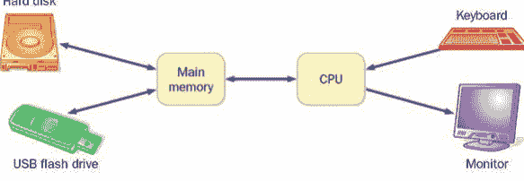

> CPU 从主内存中读取程序指令，逐条执行直到程序结束。

> 操作系统提供用户界面并管理计算机资源。

- 图标：代表计算机资源的小图像，如文件
- 滑动块：允许用户从数值范围内进行选择

> 对于用户而言，界面就是程序。

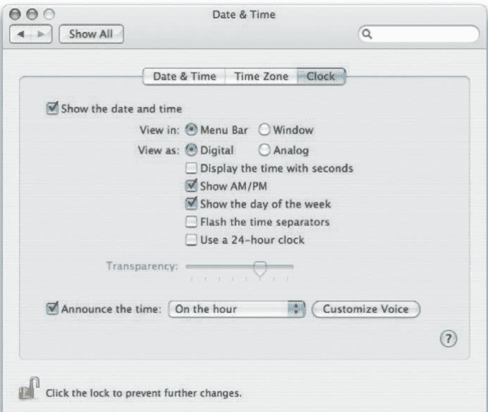

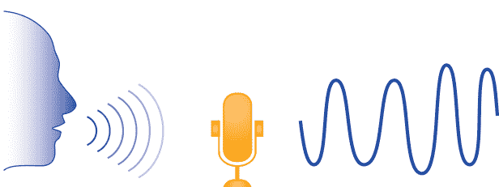

模拟信号

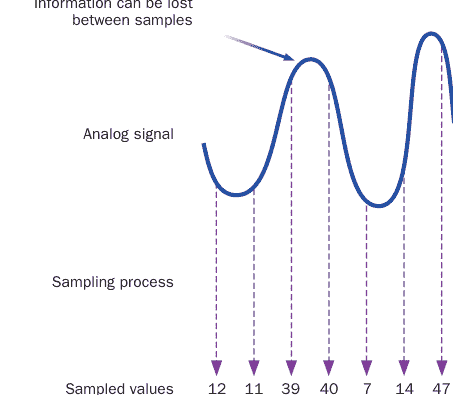

模拟信号

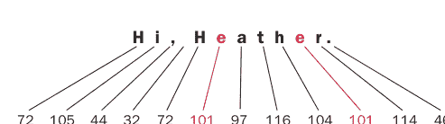

某些计算机内存设备（如硬盘）在本质上是磁性的。磁性材料可以被极化为其中一端，但中间状态很难区分。因此，磁性设备可以有效地表示二进制值——磁化区域代表二进制 1，去磁化区域代表二进制 0。其他计算机内存设备由微小的电子电路组成。这些设备更容易制造，而且如果只需要在两种状态之间切换，它们的故障概率就较低。与其制造少数更复杂的设备，我们复制数百万个这种简单设备要明智得多。

> N 位恰好有 2^N 种排列。N 位最多可以表示 2^N 个唯一项目。

| 位数 | 1位 | 2位 | 3位 | 4位 | 5位 |
| :--- | :--- | :--- | :--- | :--- | :--- |
| 0 | 0 | 00 | 000 | 0000 | 00000 |
| 1 | 1 | 01 | 001 | 0001 | 00001 |
| | | 10 | 010 | 0010 | 00010 |
| | | 11 | 011 | 0011 | 00011 |
| | | | 100 | 0100 | 00100 |
| | | | 101 | 0101 | 00101 |
| | | | 110 | 0110 | 00110 |
| | | | 111 | 0111 | 00111 |
| | | | | 1000 | 01000 |
| | | | | 1001 | 01001 |
| | | | | 1010 | 01010 |
| | | | | 1011 | 01011 |
| | | | | 1100 | 01100 |
| | | | | 1101 | 01101 |
| | | | | 1110 | 01110 |
| | | | | 1111 | 01111 |
| | | | | | 10000 |
| | | | | | 10001 |
| | | | | | 10010 |
| | | | | | 10011 |
| | | | | | 10100 |
| | | | | | 10101 |
| | | | | | 10110 |
| | | | | | 10111 |
| | | | | | 11000 |
| | | | | | 11001 |
| | | | | | 11010 |
| | | | | | 11011 |
| | | | | | 11100 |
| | | | | | 11101 |
| | | | | | 11110 |
| | | | | | 11111 |

图 1.7 使用的位数决定了可以表示的项目数。


我们已经看到如何通过将字符映射到数值在计算机上存储文本。这些数值被存储为二进制数字。假设我们想表示包含 256 个字符和符号的语言字符串。我们需要使用八位来表示每个字符，因为有 256 种位的排列（`2^8` 等于 256）。每个排列或二进制值都映射到一个特定的字符。需要多少位来表示世界？七位是不够的，因为 `2^7` 等于 128。八位足够了，但 256 种排列。最终，在计算机上表示信息取决于要表示的项目数量以及它们映射到二进制值的方式。

# 复习题（见附录）

- 1.1 什么是硬件？什么是软件？
- 1.2 操作系统的两个主要功能是什么？
- 1.3 CD 上的音乐是以每秒 44,000 次采样率创建的。每次测量都被存储为代表特定电压水平的数字。存储三分钟音乐需要多少数字？存储一小时音乐需要多少数字？
- 1.4 信息以数字形式存储时发生了什么？
- 1.5 使用以下位排列可以表示多少唯一项目？
  - a. 2 位
  - b. 4 位
  - c. 5 位
  - d. 7 位
- 1.6 假设你想用位的排列来表示每个状态。需要多少位？为什么？

## 1.2 硬件组件

让我们详细检查计算机系统的硬件组件。考虑图 1.8 中描述的台式计算机。这意味着什么？系统能够运行软件吗？它与其他系统相比如何？这些术语将在本节中进行解释。

| 规格 | 详情 |
| --- | --- |
| 处理器 | 3.3 GHz Intel i3 |
| 内存 (RAM) | 4 GB |
| 硬盘 | 750 GB |
| 光驱 | 16x 蓝光驱动器 / DVD-ROM & DVD-R 刻录机 |
| 显示器 | LCD 显示器（1280 x 1024 分辨率） |
| 网络 | 网卡 |

图 1.8 特定计算机的硬件规格

### 计算机架构

房屋的建筑定义了它的结构。同样，我们使用**计算机架构**一词来描述计算机的硬件组件是如何组合在一起的。图 1.9 展示了通用计算机系统的基础架构。信息通过一组称为**总线**的线在组件之间传输。


图 1.9 基础计算机架构

#### 引言

`CPU` 和主内存成了计算机的核心。正如我们之前提到的，主内存存储正在使用的程序和数据，而 `CPU` 有序地一次执行一条程序指令。

> **核心概念**
>
> 计算机的核心由存储程序和数据的内存以及一次执行一条指令的 `CPU` 组成。

假设我们有一个计算数字列表平均值的程序。在程序运行时，程序和数字必须留在主内存中。如果指令需要数据（例如列表中的某个数字）来执行任务，`CPU` 也会从内存中读取该信息。这个过程一直重复直到程序结束。计算出的平均值被存储在主内存中，以等待进一步处理或在辅助内存中长期存储。

除了 `CPU` 和主内存之外，几乎所有设备被称为**外设**；它们运行在系统的外部或边缘（尽管它们可能在同一个盒子里）。用户不直接与 `CPU` 或主内存交互。尽管它们构成了机器的核心，但如果没有外设设备，`CPU` 和内存是没有用的。

**控制器**是协调特定设备活动的设备。每个设备都有自己的方式向计算机硬件的其他部分格式化并通信其特性和数据。此外，控制器通常处理信息的实际传输，允许 `CPU` 专注于其他活动。

输入/输出（`I/O`）设备和辅助内存设备被称为外设。外设的另一类是数据传输设备，它们允许在计算机之间发送和接收信息。图 1.8 中指定的计算机包含一个网卡，也称为无线网络接口控制器 (`WNIC`)，它连接到基于无线电的网络。

在某些方面，辅助内存设备和数据传输设备可以被视为 `I/O` 设备，因为它们代表信息的来源（输入）和发送信息的地方（输出）。然而，在讨论中，我们将 `I/O` 定义为允许用户与计算机交互的设备。

#### 输入输出设备

让我们详细检查一些 `I/O` 设备。常用的输入设备是键盘和鼠标或触控板。其他设备包括：

- 条码扫描器，例如零售店收银台使用的
- 麦克风，用于解释语音命令的语音识别系统
- 虚拟现实设备，例如解释用户手部的手持设备
- 扫描仪，将文本、照片和图形转换为机器可读的形式

摄像头可以捕捉静态图像和视频，还可以用于处理 `QR` 代码等特殊输入。

显示器和打印机是最常见的输出设备。其他设备包括：

- 绘图仪，在大幅纸张上移动画笔（或反之）
- 扬声器，用于音频输出
- 头戴式显示器，用于虚拟现实显示

某些设备同时具备输入和输出功能。触摸屏系统可以检测用户在屏幕特定位置的操作。随后，软件可以使用屏幕来响应用户的触摸来显示文本和图形。触摸屏已成为手持设备的标配。

图 1.8 所示的台式电脑包含一个 17 英寸对角显示区域的显示器。它利用了液晶显示（`LCD`）技术，与旧的阴极射线管（`CRT`）显示器不同，后者需要高电压且通常不可便携。计算机中的图像是通过将其分解为独立的图像元素或**像素**（`pixels`）来表示的。显示器可能会显示一个 1280 比 1024 像素的网格。图形数据的表示和管理将在第 2 章中详细讨论。

#### 主内存与辅助内存

主内存由一系列微小的、连续的内存位置组成，如图 1.10 所示。每个内存位置都关联有一个称为**地址**（`address`）的唯一数字。

> **核心概念**
>
> **地址**：与内存位置关联的唯一数字。

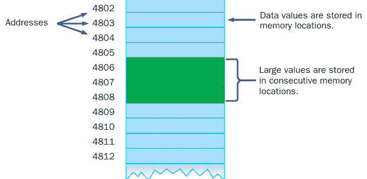

图 1.10 内存位置

| 单位 | 符号 | 字节数 |
| --- | --- | --- |
| 字节 (byte) | | `2^0 = 1` |
| 千字节 (kilobyte) | KB | `2^10 = 1024` |
| 兆字节 (megabyte) | MB | `2^20 = 1,048,576` |
| 吉字节 (gigabyte) | GB | `2^30 = 1,073,741,824` |
| 太字节 (terabyte) | TB | `2^40 = 1,099,511,627,776` |
| 拍字节 (petabyte) | PB | `2^50 = 1,125,899,906,842,624` |

图 1.11 二进制存储单位

当数据存储在内存位置中时，它会覆盖并破坏之前存储在该位置的任何信息。然而，从内存位置读取数据的过程不会影响该位置。

在许多计算机上，每个内存位置由八位（`bits`）或一个**字节**（`byte`）信息组成。如果我们需要存储无法用单个字节表示的值（例如大数字），则会使用多个连续的字节来存储数据。

如主内存等设备的**存储容量**是它能够容纳的字节总数。设备可以存储数千或数百万字节，因此你应该熟悉更大的测量单位。由于计算机内存基于二进制系统，所有的存储单位都是 2 的幂。一个**千字节**（`KB`）是 1024，或 `2^10` 字节。一些更大的存储单位是图 1.11 所示的**兆字节**（`MB`）、**吉字节**（`GB`）、**太字节**（`TB`）和**拍字节**（`PB`）。通常通过四舍五入来思考这些容量更为容易。例如，大多数用户认为一个千字节大约是一千字节，一个兆字节大约是一百万字节，以此类推。

> **核心概念**
>
> 主内存是易失的，这意味着存储的信息只在供电时才被保持。

许多计算机具有四吉字节的主内存，或称 `RAM`，如图 1.8 所示的系统所示（我们将在本章的后半部分更详细讨论 `RAM`）。较大的主内存允许大型程序或多个程序高效运行，因为它们不需要从辅助存储中检索信息。

主内存通常是**易失的**（`volatile`），这意味着如果关闭电源，存储在其中的信息将会丢失。当你在使用计算机工作时，应该经常将工作内容保存到辅助内存设备（如 `USB` 闪存驱动）上，以防断电。辅助设备通常是**非易失的**（`nonvolatile`）；即使关闭电源，信息也会被保留。

### 缓存与存储技术

**缓存**被中央处理器（`CPU`）用于加速对数据的访问。现代 `CPU` 使用几级缓存（`L1`、`L2` 和 `L3`），它们位于处理器上或非常靠近处理器。缓存比主内存快得多，但容量较小。缓存存储频繁使用的指令和数据，以便 `CPU` 可以访问它们，而无需等待较慢的主内存。

“直接访问”（`direct access`）和“随机访问”（`random access`）术语经常互换。然而，随机访问意味着无论数据位置如何，都可以直接访问任何数据。相反，**顺序访问**（`sequential access`）要求从起始点按顺序读取数据，这就是磁带的工作方式。

大多数现代硬盘使用随机访问，允许计算机快速跳转到任何文件。固态硬盘（`SSD`）甚至更快，因为它们没有移动部件，并使用闪存内存存储数据。`USB` 闪存驱动器是另一种便携且非易失的辅助内存。

辅助内存设备包括硬盘、`SSD`、光盘（如 `CD` 和 `DVD`）以及基于闪存的驱动器。光盘使用激光在光盘上读写数据。这些设备是非易失的，意味着即使关闭电源，也会保留数据。

`ROM` 可以指主板上的芯片，用于存储基本输入输出系统（`BIOS`）。`BIOS` 提供了启动计算机所需的初始指令。由于 `ROM` 是只读的，在正常计算机运行期间无法更改信息。然而，许多现代系统使用 `EEPROM`（电可擦除可编程只读存储），允许更新 `BIOS`。

`RAM` 和 `ROM` 术语经常被使用，因为它们的名称可能具有误导性。`RAM`（随机存取存储器）是易失的，存储计算机正在使用的数据。`ROM`（只读存储器）是非易失的，存储不经常变化的程序。

> **核心概念**
>
> `CD` 表面有光滑区域和坑。坑代表二进制 1，光滑区域代表 0。

`CD-ROM` 是一种便携式辅助内存设备。`CD` 代表紧凑盘。它被称为 `ROM` 是因为信息在 `CD` 创建时就是永久存储的。与其音乐副本一样，`CD-ROM` 以二进制格式存储信息。当 `CD` 创建时，在盘上压出一个微型坑表示二进制 1，而盘面代表二进制 0。通过将低强度激光束射到盘上来读取位。传感器接收反射以判断每个位是 1 还是 0。典型的 `CD-ROM` 容量在 650 到 900 `MB` 之间。

基础 `CD` 技术的变体很快出现。大多数个人电脑配备了 `CD` 刻录（`CD-R`）驱动器。`CD-R` 可用于创建音乐 `CD` 或通用计算机存储 `CD`。一旦创建，你可以在标准 `CD` 播放器中使用 `CD-R`，但一旦 `CD-R` 被“刻录”，你就无法更改其上的信息。

`CD` 可重写（`CD-RW`）可以被擦除和重复使用。这是因为普通 `CD` 的坑和平整表面是通过在盘上涂层材料模拟的，这种材料在加热到特定温度时变为无定形（因此无反射），而在加热到另一个温度时变为晶态（因此有反射）。`CD-RW` 介质并不适用于所有播放器，但 `CD-RW` 驱动器可以创建 `CD-R` 和 `CD-RW` 盘。

### 光存储演进

`CD` 最初是流行的音乐格式；后来演变为通用的计算机存储设备。同样，`DVD` 格式最初是为视频设计的，现在正成为计算机 `DVD` 的通用格式。`DVD` 曾代表数字视频光盘（`digital video disc`）或 `digital versatile disc`，但现在该缩写通常独立使用。`DVD` 的格式比 `CD` 更紧密（每平方毫米比特数更多），可以存储更多信息。`DVD-ROM` 可以完全取代 `CD-ROM`，因为存在兼容的迁移路径，这意味着 `DVD` 可以读取 `CD-ROM`。类似于 `CD-R` 和 `CD-RW`，还有 `DVD-R` 和 `DVD-RW` 光盘。图 1.8 所示的光驱驱动器允许用户读写 `CD-RW` 光盘并读取 `DVD-ROM`，包括播放音乐 `CD` 和观看 `DVD` 视频的能力。

`CD` 或 `DVD` 的速度以 `x` 倍数表示，`CD` 的数据传输速度为每秒 153,600 字节；`DVD` 为该速度的九倍，即每秒约 1.5 `MB`；蓝光为 `DVD` 速度的三倍，即每秒 4.5 `MB`。图 1.8 描述的驱动器最大数据访问速度为 16x，或每秒约 72 `MB` 数据。双层蓝光光盘的存储容量为 50 `GB`。

随着技术的进步，存储设备的容量不断变化。计算机行业的一个通用规则是存储容量每 18 个月翻倍。然而，随着容量接近绝对极限，这种进展将不可避免地缓慢。

### 中央处理器

中央处理器（`CPU`）与主内存交互以执行计算机所有的基本处理。`CPU` 在连续循环中一个接一个地解释并执行指令。它如图 1.13 所示由三个重要组件组成：**控制单元**协调处理步骤，**寄存器**在 `CPU` 内部执行少量存储，**算术/逻辑单元**（`ALU`）执行计算并做出决策。寄存器是系统中最小、最快的缓存。

控制单元协调主内存与 `CPU` 寄存器之间数据和指令的传输。它还协调算术/逻辑单元电路的执行，对存储在特定寄存器中的数据进行操作。

在大多数 `CPU` 中，某些寄存器用于特殊用途。例如，**指令寄存器**持有当前执行的指令。**程序计数器**持有下一个要执行指令地址的寄存器。除了这些和其他特殊用途寄存器外，`CPU` 还包含一组通用寄存器，用于根据需要临时存储值。

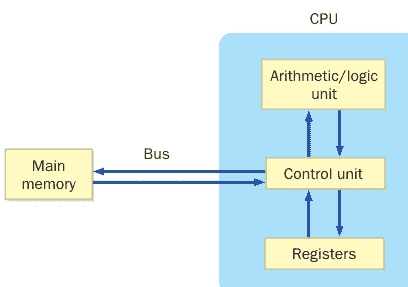

图 1.13 `CPU` 组件和主内存

在主内存中同时存储程序指令和数据的概念是**冯·诺依曼架构**的基础原理，它以约翰·冯·诺依曼（`John von Neumann`）命名，他是一位匈牙裔美国数学家，于 1945 年首次提出了这种编程概念。这些计算机持续地遵循图 1.14 所示的**取指-解码-执行循环**。从程序计数器存储的地址从主内存中取出指令并放入指令寄存器中。此时程序计数器加 1，为下一个循环做准备。对指令进行电子解码以确定执行哪种操作。最后，控制单元激活正确的电路来执行指令，例如将一个数据值加载到寄存器中或将两个值相加。

`CPU` 构建在一个称为**微处理器**的芯片上，该设备也是计算机主板的一部分。该主板还包含 `ROM` 芯片和通信插座，设备控制器（如管理视频显示的控制器）可以连接到这些地方。

> **核心概念**
>
> 取指-解码-执行循环构成了计算机处理的基础。

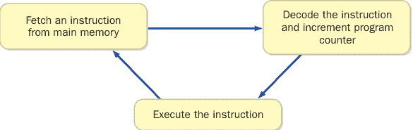

图 1.14 连续取指-解码-执行循环

主板的另一个关键组件是**系统时钟**。时钟定期产生电子脉冲，同步 `CPU` 的事件。脉冲发生的速率称为**时钟频率**，取决于处理器。图 1.8 描述的计算机包含 `Intel Core i7` 处理器，频率为 3.07 吉赫（`GHz`），或每秒约 31 亿次脉冲。系统时钟提供了 `CPU` 执行指令速度的粗略衡量。类似于存储容量，处理器的速度不断提高。

### 自习题（答案见附录 N）

- SR 1.7 以下各项各有多少字节？
  - 3 `KB`
  - 2 `MB`
  - 4 `GB`
- SR 1.8 以下各项各有多少位？
  - 8 字节
- SR 1.9 `CD` 上的音乐使用每秒 44,000 次的采样率创建。每次测量是一个特定的电压。假设每次测量需要两个字节。需要多少 `MB`？
- SR 1.10 计算机的主要硬件组件有哪些？它们如何交互？
- SR 1.11 什么是网络地址？
- SR 1.12 易失性是指什么？哪些内存是易失的？
- SR 1.13 从列表中选择匹配每个短语的单词：
  - a. 协调计算机活动的设备
  - b. 允许发送和接收信息。
  - c. 这种内存是易失的。
  - d. 这种内存是非易失的。
  - e. 这个术语基本上是“主要的”。
  - f. 执行处理的地方。
  - g. 如今，局域网（如单个建筑内的网络）使用无线连接，减少了对布线的需求。
  - 备选词：控制器、`CPU`、主、网络、外设、`RAM`、辅助

# 1.3 网络

网络对计算机系统的影响是巨大的。计算资源可以在许多用户之间共享，基于计算机的全球通信已成为常见。事实上，网络的使用非常普及，以至于某些计算机需要网络资源才能运行。

## 局域网与广域网

**局域网**（`LAN`）设计用于跨越短距离并连接相对少数量的计算机。通常，`LAN` 只连接一栋建筑或一个房间内的机器。`LAN` 安装和管理方便，且可靠性高。随着计算机变得越来越小且功能越全，`LAN` 为整个组织提供了一种廉价的信息共享方式。然而，拥有 `LAN` 就像拥有了一个只能拨打自己镇上电话的电话系统。我们需要能够在更远的距离共享信息。

> **核心概念**
>
> 局域网（`LAN`）是在整个组织内共享信息和资源的有效方式。

**广域网**（`WAN`）连接两个或多个 `LAN`，通常跨越远距离。通常，每个 `LAN` 有一台计算机专门负责处理跨越 `WAN` 的通信。这种技术减轻了 `LAN` 内其他计算机执行远距离通信细节的负担。图 1.17 显示了多个 `LAN` 连接到一个 `WAN`。通过 `WAN` 连接的 `LAN` 通常由不同的公司或组织所有，甚至位于不同的国家。

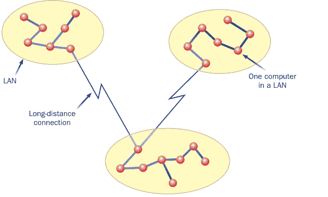

图 1.17 连接到 `WAN` 的 `LAN`

## 互联网

在整个 20 世纪 60 年代至 80 年代，国防部一个名为高级研究计划局（`ARPA`）的机构资助了几个探索网络技术的项目。这些努力的结果之一是 `ARPANET`，这是一个最终被称为互联网的 `WAN`。互联网源于**互联网络**的概念——将许多较小的网络连接在一起。

从 20 世纪 80 年代后期至今，互联网增长得惊人。1983 年，连接到互联网的计算机不到 600 台。现在，互联网为全球数十亿用户提供服务。随着越来越多的计算机连接到互联网，跟上更多用户和更重流量的任务变得非常困难。自最初开发以来，新技术已经取代了 `ARPANET` 几次，每次都提供了更大的容量和更快的处理。

> **核心概念**
>
> 互联网是一个跨越全球的广域网（`WAN`）。

**协议**是一组规定两个事物如何通信的规则。控制信息在互联网上移动的软件必须符合一组称为 `TCP/IP` 的协议（按字母读作 `T-C-P/IP`）。`TCP` 代表传输控制协议（`Transmission Control Protocol`），`IP` 代表互联网协议（`Internet Protocol`）。`IP` 软件定义了信息如何从源格式化并传输到目的地。`TCP` 软件处理如信息包到达顺序不乱或信息丢失等问题，这些在大量信息同时汇聚某处时可能会发生。

每台连接到互联网的计算机都有一个 `IP` 地址，它在互联网上所有其他计算机中唯一标识自己。`IP` 地址的一个示例是 `204.192.116.2`。幸运的是，互联网用户很少需要处理地址。互联网允许每台计算机获得一个名称。像 `IP` 地址一样，名称必须是唯一的。计算机的互联网名称通常被称为**互联网地址**。互联网地址的示例是 `hector.vt.edu`。

> **核心概念**
>
> 每台连接到互联网的计算机都有一个唯一标识它的 `IP` 地址。


互联网地址的第一部分是特定计算机的本地名称。地址的其余部分是域名，它指示计算机所属的组织。例如，`vt.edu`是弗吉尼亚科技理工大学（Virginia Tech）计算机网络的域名，而`hector`是该校园内某台特定计算机的名称。由于域名是唯一的，许多组织可以拥有名为`hector`的计算机而不会产生混淆。各个部门可能会分配子域名，子域名被添加到基本域名之后，以唯一区分它们在较大组织内的一组计算机。例如，`cs.edu`子域名专门用于弗吉尼亚大学计算机科学系。

每个域名的最后部分称为顶级域名（TLD），通常指示计算机所属的组织类型。`edu`通常指示教育机构。`com`经常指的是商业实体。另一个常见的TLD是`org`，通常用于非营利组织。其他顶级域名包括`biz`、`info`、`jobs`和`name`。许多计算机（特别是在美国以外的）使用国家代码顶级域名，表示原产国，例如英国的`uk`或澳大利亚的`au`。

当引用互联网地址时，它会被一种称为域名系统（DNS）的软件翻译成相应的IP地址。每个连接到互联网的组织都运行一个域名服务器，维护该组织内所有计算机及其IP地址的列表。它的工作有点像目录查询，你提供名称，域名服务器返回一个数字。如果本地域名服务器没有该名称的IP地址，它会联系另一个域名服务器。

互联网彻底改变了计算。最初，主要用途是电子邮件，但功能仍在不断改进。

### 世界网

互联网（Internet）和世界网（World Wide Web）这两个词有时可以互换，但它们之间存在重要的区别。互联网使得全球通信成为可能。网页让通信变得简单且愉快。网页本质上是一种分布式信息服务，基于一组软件应用程序。尽管它与互联网配合得良好，但它本质上并不与其相互绑定。网页可以在未连接到任何网络的局域网上使用，甚至可以在单台机器上显示HTML文档。

浏览器是一种加载和格式化网页文档的软件工具。`Mosaic`是网页的首个图形化界面浏览器，于1993年发布。开发`Mosaic`的一些人员后来创立了网景通信公司，并创建了网景浏览器。目前流行的现代浏览器包括`Internet Explorer`、`Mozilla Firefox`、`Apple Safari`、`Google Chrome`和`Opera`。

提供网页文档访问的计算机被称为Web服务器。许多此类文档使用超文本标记语言（HTML）格式化。Java编程语言与网页处理有着紧密的关系，因为指向Java程序的链接可以嵌入HTML文档中并通过网页浏览器执行。我们在第2章中更详细地探讨这种关系。

### 统一资源定位符

网页上的信息通过识别统一资源定位符（URL，按字母读作U-R-L）来找到。URL唯一指定了供浏览器获取和显示的文档和其他信息。以下是一个示例：

```
http://www.google.com
```

这个特定的网站是著名的谷歌搜索引擎的主页，它使我们能够使用特定的单词或短语在网页上搜索信息。

URL包含几部分信息。第一部分是协议，决定了浏览器如何翻译和处理信息。第二部分是存储文档的机器的互联网地址。第三部分信息是文件名或感兴趣的资源。如果没有文件名（如Google URL所示），Web服务器通常会提供默认页面（如`index.html`）。

> **核心概念**
>
> URL唯一指定了网页上、供浏览器获取和显示的文档和其他信息。

# 第 1 章 引言

让我们看另一个 URL：

```
http://www.whitehouse.gov/photos-and-video/photogallery/photo-day
```

在 URL 中，协议是 `http`，代表超文本传输协议（HyperText Transfer Protocol）。所引用的机器是 `www`（典型的 Web 服务器引用），位于域名 `whitehouse.gov` 下。最后，`photos-and-video/photogallery/photo-day` 代表一个文件（或生成文件的引用），该文件将被传输到浏览器中进行查看。虽然存在许多其他形式的 URL，但这种形式是最常见的。

- 自我复习题（答案见附录 N）

- SR 1.14 什么是文件服务器？

- SR 1.15 一个五台计算机组成的全连接点对点网络总共需要多少条通信线路？六条呢？

- SR 1.16 描述网络上的计算机共享同一条通信线路的用处。描述共享通信线路的成本/缺点。

- SR 1.17 Internet（互联网）一词的词源是什么？

- SR 1.18 TCP/IP 协议集描述了使用互联网的软件通信规则。TCP 代表什么？IP 代表什么？

- SR 1.19 解释以下 URL 的各个部分：

  a. `duke.csc.villanova.edu/jss/examples.html`

  b. `java.sun.com/products/index.html`

## 1.4 Java 编程语言

让我们关注那些使计算机系统变得实用的软件。程序是用某种特定的编程语言编写的，这种语言使用特定的单词和符号来表达问题的解决方案。编程语言定义了一套规则，这些规则精确决定了程序员如何将语言的单词和符号组合成编程语句，而编程语句是程序执行时运行的指令。

自计算机诞生以来，人们已经创建了许多编程语言。我们在书中使用 Java 语言来演示各种编程概念和技术。虽然我们的主要目标是学习这些底层的软件开发概念，但一个重要的收获将是精通 Java 程序的开发。

与其他许多语言相比，Java 是一门相对新的编程语言。它由 `James Gosling` 在 1991 年在 `Sun Microsystems`（太阳微系统公司）发起，作为许多机顶盒项目之一。该语言最初被称为 Oak，然后是 Green，最终定名为 Java。Java 于 1995 年向公众推出并从那时获得了巨大的人气。2010 年，`Sun Microsystems` 被 `Oracle`（甲骨文）收购。

Java 平台有多个版本，包括标准版（Standard Edition），它是 Java 的主流版本及其工具；企业版（Enterprise Edition），它包含额外的库以支持大规模系统开发；以及微型版（Micro Edition），它专门用于为手机等便携式设备开发软件。本书侧重于标准版。

此外，Java 标准版经过了多次修订。下表列出了 Java 的版本及其的一些特性。

| 版本 | 年份 | 新功能 |
|---|---|---|
| 1.0 | 1996 | 初始部署 |
| 1.1 | 1997 | 内部类 |
| 1.2 | 1998 | Swing 框架 |
| 1.3 | 2000 | Sound 框架 |
| 1.4 | 2002 | 断言、XML 支持 |
| 5 | 2004 | 增强型 for 循环、自动装箱、注解 |
| 6 | 2006 | 泛型 |
| 7 | 2010 | GUI |
| 8 | 2014 | Lambda 表达式、日期和时间 |

### 注释

让我们详细检查一下注释。注释是唯一一种允许程序员独立于代码来组织和交流他们想法的语言特性。注释应该提供对程序员原始意图的见解。一个程序通常会被使用多年，并且随着时间的推移会对其进行多次修改。当在未来的某一点需要进行修改时，原始程序员可能已经**不记得**某个特定程序的细节了。此外，原始程序员并不总是能够亲自进行更改；因此，完全不熟悉该程序的人将需要理解它。因此，良好的文档是至关重要的。

对于 Java 编程语言而言，注释的内容可以是任何文本。计算机会忽略注释；它们不会影响程序的执行。

`Lincoln` 程序中的注释代表了 Java 中允许的两种注释形式之一。`Lincoln` 中的注释采用以下形式：

```java
// 这是一个注释。
```

这种类型的注释以双斜杠（`//`）开头，并持续到行尾。两个斜杠之间不能有任何字符。计算机会忽略双斜杠之后一直到行尾的所有文本。注释可以跟在同一行的代码后面，用于说明该行代码，例如所示：

```java
System.out.println("Monthly Report"); // 始终使用此标题
```

Java 注释可能具有第二种形式如下：

```java
/* 这是另一个注释。 */
```

这种类型的注释不使用行尾来表示注释的结束。在起始斜杠-星号（`/*`）和结束星号-斜杠（`*/`）之间的任何内容都是注释的一部分，包括代表行结束的不可见换行符。因此，这种类型的注释可以跨多行。斜杠和星号之间不能有空格。

如果注释开头的 `/*` 后面跟着第二个星号，则注释的内容可以使用一个名为 `javadoc` 的工具来自动生成关于你程序的外部文档。关于 `javadoc` 的更多信息见附录 I。

这两种基本的注释类型可以用于创建各种文档样式，例如：

```java
// 这是一个单行注释。
//------------------------------------
// 某些注释，例如这些方法或类
// 应该被单独隔离以便特别关注
// 你代码的特定方面。注意这些
// 每一行在技术上都是一个独立的注释。
//------------------------------------
```

```java
/*
 这是一个跨越
 几行代码的注释。
 */
```

程序员往往过度专注于编写代码，导致对文档的关注太少。你应该养成良好的注释习惯并习惯性地遵循。注释应该写得良好，或者使用完整的句子。它们不应该描述显而易见的事，而应该对代码的意图提供适当的见解。以下示例**不是好的注释**：

```java
System.out.println("hello"); // 打印 hello
System.out.println("test"); // 后修改此处
```

第一个注释转述了该行明显的目的，没有为语句添加任何价值。与其有一个无用的注释，不如什么都不写。第二个注释具有歧义。以后应该修改什么？什么是以后？为什么要修改？

> **核心概念**
>
> 内联文档应该提供对你代码的见解，它不应该是歧义的，或描述显而易见的事。

### 标识符和保留字

编写程序时使用的各种单词称为*标识符*。`Lincoln` 程序中的标识符有 `class`、`Lincoln`、`public`、`static`、`void`、`main`、`String`、`args`、`System`、`out` 和 `println`。它们分为三类：

- 我们在编写程序时创建的单词（`Lincoln` 和 `args`）
- 别人选择的单词（`String`、`System`、`out`、`println` 和 `main`）
- 语言中保留用于特殊目的的单词（`class`、`public`、`static` 和 `void`）

在编写程序时，我们简单地将类命名为 `Lincoln`，但可以使用许多其他可能性。例如，我们可以将其命名为 `Quote`、`A` 或 `GoodOne`。标识符 `args`（arguments 的缩写）通常用法就像我们在 `Lincoln` 中使用它的一样，但几乎可以使用任何其他标识符来代替它。

# 第 1 章 引言

| | | | |
| :--- | :--- | :--- | :--- |
| `abstract` | `default` | `goto*` | `package` |
| `assert` | `do` | `if` | `private` |
| `boolean` | `double` | `implements` | `protected` |
| `break` | `else` | `import` | `public` |
| `byte` | `enum` | `instanceof` | `return` |
| `case` | `extends` | `int` | `short` |
| `catch` | `false` | `interface` | `static` |
| `char` | `final` | `long` | `strictfp` |
| `class` | `finally` | `native` | `super` |
| `const*` | `float` | `new` | `switch` |
| `continue` | `for` | `null` | `synchronized` |
| | | `this` | `throw` |
| | | `throws` | `transient` |
| | | `true` | `try` |
| | | `void` | `volatile` |
| | | `while` | |

图 1.18 Java 保留字

标识符 `String`、`System` 和 `println` 由其他程序员选择。这些单词不是 Java 语言的一部分。它们是 Java 标准库中预定义代码的一部分，这是一组已经为我们写好的类和方法。这些代码的作者选择了这些代码中的标识符——我们只是在利用它们。

保留字是在编程语言中具有特殊含义且只能以定义方式使用的单词。保留字不能用于任何其他用途，例如为类或方法命名。在 `Lincoln` 程序中，使用的保留字有 `class`、`public`、`static` 和 `void`。在整书中，我们用蓝色字体显示 Java 保留字。图 1.18 按字母顺序列出了所有保留字。带有星号的单词已被保留，但目前在 Java 中没有含义。

我们在程序中使用标识符可以由字母、数字、下划线字符（`_`）和美元符号（`$`）组成，但不能以数字开头。标识符可以是任意长度。因此，`total`、`labelItem`、`NUM_BOXES` 和 `$amount` 都是有效的。

# 标识符


标识符后面跟着零或多个字母和数字。Java 字母包括大写和小写字母、`$` 和 `_` 字符，以及其他语言的字母字符。Java 数字包括 0 到 9。示例有：

```java
total
MAX_HEIGHT
num1
Keyboard
System
```

尽管 Java 语言并不要求，但对每种标识符使用一致的大小写格式会更容易理解。关于标识符有各种 Java 规范应该遵循，尽管在技术上并不必须。例如，我们在全文中使用驼峰命名法（每个单词的首字母大写），在第一次遇到每种标识符时都会描述其首选样式。

虽然标识符可以是任意长度，但你应该仔细选择你的名称。它们应该具有描述性，但不冗长。你应该避免使用没有意义的名字，如 `a` 或 `x`。如果短名称实际上具有描述性，可以破例，例如使用 `x` 和 `y` 表示二维网格上的 `(x, y)` 坐标。同样，你不应该使用不必要的长名称，因为标识符 `currentSelectedItemProcessed` 效果一样。正如你可能想象到的那样，标识符的使用远比使用没有描述性的名称要常见得多。

你应该总是努力让你的程序尽可能具有可读性。因此，在缩写单词时应该总是小心。你的 `curStVal` 是当前股票价值的很好的名称，但其他人试图理解代码时可能很难弄清楚你的意思。在你写下代码几个月后，你自己可能都不太清楚了。

60 第 1 章 引言

# 列表 1.2

```java
********************************************************************
// Lincoln2.java               作者: Lewis/Loftus
//
// 展示了一个格式不佳、但仍然合法的程序。
********************************************************************
public class Lincoln2{public static void main(String[]args){
    System.out.println("A quote by Abraham Lincoln:");
    System.out.println("Whatever you are, be a good one.");}}
```

输出

亚伯拉罕·林肯的一句名言：

无论你成为什么，都要成为出色的。

# 空白

所有的 Java 程序都使用空白来分隔程序中使用的单词和符号。空白由空格（blanks）、制表符（tabs）和换行符组成。“空白”一词指的是：在印有黑色字迹的白色纸张上，单词和符号之间的空间是白色的。程序员使用空白的方式非常重要，因为它可以用于强调代码的部分，而适当的缩进可以使程序更易读。

> **核心概念**
>
> 恰当使用空白可以使程序更易阅读和理解。

除了用于分隔单词外，计算机会忽略空白。它不会影响程序的执行。这一事实为程序员在格式化程序时提供了极大的灵活性。程序的行应该在逻辑位置断开，并且某些行应该进行缩进和对齐，以便使程序的底层结构清晰可见。

由于空白会被忽略，我们可以用许多不同的方式来编写程序。如果将空白推向极端，我们可以在每行中放置尽可能多的单词。列表 1.2 中的代码（`Lincoln2` 程序）的格式与 `Lincoln` 的风格完全不同，但表达了相同的信息。

> **核心概念**
>
> 你应该遵循一套指南，这些指南规定了你格式化和记录程序的方式。

将空白推向极端，我们可以将几乎每个单词和符号都写在不同的行，并带有不同数量的空格，如列表 1.3 所示的 `Lincoln3`。

`Lincoln` 的三个版本在技术上都是有效的，且执行方式相同，但从读者的角度来看，它们有着天壤之别。后两个例子都显示了糟糕的风格，使得程序难以理解。

# 列表 1.3

```java
********************************************************************
// Lincoln3.java      作者: Lewis/Loftus
// 展示了另一个格式不佳的合法程序。
********************************************************************
public class
    Lincoln3
    {
        public static void
        main (String
            [] args)
        {
            System.out.println (
                "A quote by Abraham Lincoln:");
                System.out.println(
                    "Whatever you are, be a good one."
            )
        }
    }
```

输出

亚伯拉罕·林肯的一句名言：

无论你成为什么，都要成为出色的。

无论你成为什么，都要成为出色的。

你可能被要求在编写程序时遵循一致的风格指南。在任何情况下，你都应该采用一套指南来增加代码的可读性。

## 自复习问题（见附录）

- 20. Java 语言是什么时候开发的？是由谁开发的？

- 20. 是什么时候向公众引入的？

- 21. Java 程序从哪里开始处理？


- 22. 你预测以下代码的执行结果是什么？

```
System.out.println("Hello // 打印 hello
```

- 23. 你预测以下代码的执行结果是什么？

```
System.out.println("Hello"); // 打印 hello
```

- 24. 以下哪些是有效的标识符？

    - a. 结果
    - b. 结果
    - c. 12345
    - d. 结果
    - e. 空格格
    - f. 答案

- 25. 假设一个程序需要一个标识符来表示分数。请说明以下每一项是否正确：

    - a. 分数
    - b. 分数
    - c. 分数
    - d. 测试

- 26. 什么是空白？它如何影响执行？它如何影响可读性？

## 1.5 程序开发

运行程序的过程涉及各种活动。程序必须用适当的语言（如 Java）编写，并被转换为计算机可以执行的形式。在过程的各个阶段可能会发生错误并必须进行修复。让我们详细探讨这些问题。

### 语言层次

假设某人正在给朋友提供指令。那个人可以使用任何一种语言（如英语、俄语或意大利语）来解释指令。无论使用哪种语言，指令都是相同的，但表达指令的方式是不同的。朋友必须能够理解所使用的语言。

编程语言可以分为以下几组。这些分组基本上反映了计算机语言的发展。

- 机器语言
- 汇编语言
- 高级语言
- 四代语言

为了让程序在计算机上运行，必须转换为该计算机的机器语言。每种 CPU 都有自己的语言。由于原因，我们无法在具有 Sparc 处理器的 Sun 工作站上运行为具有 Intel 处理器的 PC 编写的程序。

每个机器指令只能完成简单的任务。例如，单条机器指令可能会将一个值复制到寄存器，或与零进行比较。可能需要四条机器指令将两个数字相加并存储结果。然而，计算机每秒可以执行数百万条指令，因此可以快速执行复杂的任务。

机器语言代码表示为一系列二进制位，对人类来说阅读和编写极其困难。最初，程序是通过开关或类似的方法输入计算机的。早期程序员发现这些技术耗时且容易出错。

这些问题催生了汇编语言的使用，它用助记符（代表命令或数据的短单词）取代了二进制位。程序员处理单词比处理二进制位容易。然而，汇编程序无法直接在计算机上执行。它必须首先翻译成机器语言。

通常，每条汇编指令都对应一条等效的机器指令。因此，类似于机器语言，每条汇编指令只完成一个简单的操作。虽然从程序员的角度来看汇编语言是对机器代码的改进

> 核心概念
>
> 所有程序必须翻译成特定 CPU 的机器语言才能执行。

| 高级语言 | 汇编语言 | 机器语言 |
|---|---|---|
| a + b | 1d [%fp-20], %o0 | ... |
| | 1d [%fp-24], %o1 | 110100000000 |
| | add %o0, %o1, %o0 | 110111111111 |
| | | 100100000000 |
| | | 110111111111 |
| | | 100100000000 |

图 1.19 高级表达式及其汇编语言和机器语言等效物

> 核心概念
>
> 高级语言允许程序员忽略机器语言的底层细节。

## 1.5 程序开发

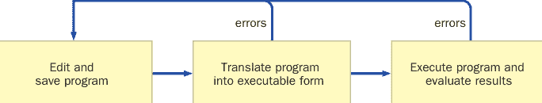

图 1.20 编辑和运行程序

### 编辑器、编译器和解释器

在开发新程序的过程中，需要几个特殊程序来提供帮助。它们有时被称为软件工具，因为它们被用于构建程序。基本软件工具的示例包括编辑器、编译器和解释器。

最初，当你将程序输入到计算机并将其存储在文件中时，你会使用编辑器。有许多不同的编辑器，它们具有许多功能。你应该熟悉你经常使用的编辑器，因为它会影响你输入和修改程序的速度。

图 1.20 显示了程序开发过程的基本视图。在编辑并保存程序后，你尝试将其从高级语言代码翻译成可以执行的形式。这种翻译可能会导致错误，此时你需返回编辑器修改代码以修复问题。一旦翻译成功，你就可以执行程序并评估结果。如果结果不是你所希望的，或者你想增强现有的程序，你再次返回编辑器进行修改。

将源代码翻译成特定类型 CPU 的（最终）机器语言可以通过多种方式实现。编译器是一种将一种语言翻译成另一种语言等效代码的程序。原始语言被称为源代码，被翻译到的语言被称为目标语言。对于传统的编译器，源代码被直接翻译成特定的机器语言。在这种情况下，翻译过程发生一次，生成的程序可以在需要时在任何使用该类型 CPU 的计算机上运行。

解释器与编译器类似，但有一个重要的区别。解释器将翻译和执行活动交替进行。源代码的一小部分（作为一条语句）会被翻译并执行。然后另一条语句被翻译并执行，以此类推。这种技术的一个优点是它消除了对单独编译阶段的需求。然而，程序通常运行得更慢，因为翻译过程发生在每次执行期间。

## 第 1 章 简介

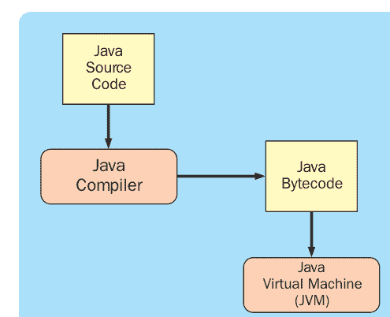

图 1.21 Java 翻译和执行过程

> 核心概念
>
> Java 编译器将源代码翻译成 Java 字节码，这是程序的低级、与架构无关的表示。

通常用于翻译和执行 Java 程序的流程结合了编译器和解释器的使用。这一过程如图 1.21 所示。Java 编译器将源代码翻译成 Java 字节码，这是程序以类似于机器码的低级形式表示。称为 Java 虚拟机（JVM）的 Java 解释器执行字节码。

Java 字节码与真正的机器码之间的区别在于，字节码不限于任何处理器类型。这种方法具有显著优势，使 Java 具有架构无关性，因此容易从一种机器类型移植到另一种机器类型。唯一的限制是每台机器上必须有一个 JVM。

由于编译过程将高级 Java 源代码翻译成低级表示，因此 JVM 的解释过程比直接解释高级代码要高效得多。通过解释字节码执行程序仍然比直接执行机器码慢，但对于大多数应用程序来说已经足够快了。

### 开发环境

开发环境是用于创建、测试和修改程序的工具集。某些开发环境是免费提供的，而另一些可能具有高级功能的环境则必须购买。某些环境被称为集成开发环境（IDE），因为它们将各种工具集成到一个软件程序中，并提供了方便的图形用户界面。

任何开发环境都会包含某些关键工具，例如 Java 编译器和解释器。某些环境包含`调试器`，它可以帮助你发现程序中的错误。可能包含的其他工具还包括文档生成器、存档工具以及帮助你可视化程序结构的工具。

Java 标准开发工具包（SDK）包含了这些内容，它有时简单称为 Java 开发工具包（JDK）。Java SDK 包含了让 Java 程序运行所需的内核工具，但它不是一个集成环境。编译和解释的命令通过命令行执行。也就是说，SDK 没有图形用户界面（GUI）。不过，它也不包含编辑器，任何可以保存简单文本的编辑器都可以。

最流行的 Java IDE 之一是 Eclipse (www.eclipse.org)。Eclipse 是一个开源项目，这意味着它由一组程序员开发，并免费提供。其他 Java IDE 包括 jEdit (www.jed.org)、DrJava (drjava.sourceforge.org)、iGRASP (www.igrasp.com) 和 BlueJ (www.bluej.org)。

还有其他 Java 开发环境可用。网络搜索可以发现几十种。选择使用哪种开发环境非常重要。你对环境的能力了解越多，你在程序开发期间的效率就越高。

> 核心概念
>
> 存在许多不同的开发环境来帮助你创建和修改程序。

### 语法与语义

每种编程语言都有其独特的语法。语言的语法规则规定了语言词汇如何如何组合成形式的语句。创建程序时必须遵循这些规则。我们已经讨论了几个 Java 语法规则。例如，标识符不能以数字开头的规则。使用大括号开始和结束类以及方法也是一条语法规则。附录 L 正式定义了 Java 编程语言的基本语法规则，并在文中强调了特定的规则。

在编译期间，所有的语法规则都会被检查。如果程序不符合语法，编译器将发出错误信息而不产生字节码。Java 的语法与 C 和 C++ 语言相似，因此对这些语言的人来说很熟悉。

编程语句的语义定义了执行时发生的情况。编程语言通常是无歧义的，这意味着程序的语义是有定义的。也就是说，只有一种解释。相反，人类使用的自然语言（如英语和意大利语）充满了歧义。一个句子通常有两个或多个含义。例如，考虑以下句子：

Time flies like an arrow（时间像箭一样快）

人类倾向于将这句话解释为：时间像箭一样移动得快。然而，如果我们把 `time` 解释为动词（如“为50米冲刺计时”），把 `flies` 解释为名词（飞虫的复数），解释就完全改变了。我们知道箭不会飞东西，所以我们通常会那样解释，但它是对词汇的有效解释。计算机在试图确定想要种含义时会遇到困难。此外，如果一个句子可以描述一种异常昆虫的偏好，即“时间蝇”，它可能出现在箭靶场附近。Fruit flies like a banana（果蝇喜欢香蕉）。

点在于，一个特定的英语句子可以有多种有效的含义。计算机语言不允许这种歧义。如果一个编程语言指令有两个不同的含义，计算机将无法确定应该执行哪一个。

### 错误

在软件中（特别是在程序开发期间）会出现各种问题。“计算机错误”这个术语经常被误用，取决于具体情况。从用户的角度来看，任何出现的问题是你用信用卡支付了一个23美元的项目，但当你收到账单时，该商品显示为230美元。在你修复问题后，信用卡公司为“计算机错误”向你道歉。是计算机随机在数字末尾添加了一个零，还是它可能将值乘以了10？当然，计算机遵循我们给出的命令并对我们提供的数据进行操作。如果我们的程序是错误的或数据是不准确的，我们无法期望结果是正确的。描述这种情况的常用短语是“垃圾进，垃圾出”（garbage in, garbage out）。

在开发程序时，你会遇到三种错误：

- 编译时错误（compile-time error）
- 运行时错误（run-time error）
- 逻辑错误（logical error）

## 1.5 程序开发

编译器会检查并确保你使用的是正确的语法。如果你有任何不符合语言语法规则的语句，编译器将产生语法错误。编译器还会尝试发现其他问题，例如使用了不兼容的数据类型。语法在技术上可能是正确的，但你可能正在尝试某些语言在语义上不允许的操作。编译器识别的任何错误都是编译时错误。如果发生编译时错误，则不会创建程序的可执行版本。

### 核心概念

> Java 程序在语法上必须是正确的，否则编译器不会产生字节码。

第二类问题发生在程序执行期间。它被称为运行时错误，并会导致程序异常终止。例如，如果你尝试除以零，程序将“崩溃”并在该点停止执行。由于请求的操作是未定义的，系统将直接放弃继续运行你的程序的尝试。最好的程序是健壮的；也就是说，它们避免了许多运行时错误。例如，程序可以防止除以零的可能性，并在情况发生时进行恰当的处理。在 Java 中，许多运行时问题被称为异常，异常可以被捕获并进行相应的处理。


各种错误类型的示例。

第三类软件问题是逻辑错误。在这种情况下，软件可以编译并执行而没有任何报错，但它会产生错误的结果。例如，当计算值错误，或者图形按钮没有出现在正确的位置时，就会发生逻辑错误。程序员必须对程序进行彻底测试，将预期结果与实际发生的结果进行比较。发现缺陷后，必须将其追溯到代码中的问题根源并进行修正。调试逻辑错误可能以许多形式出现，实际原因可能很难发现。

### 自测习题（答案见附录 N）

- SR 1.27 我们都知道计算机被用于执行复杂的工作。在本节中，你学习了计算机的指令只能执行简单的任务。请解释这种表面上的矛盾。

- SR 1.28 高级语言与机器语言之间是什么关系？

- SR 1.29 什么是 Java 字节码？

- SR 1.30 从下面的列表中选择与每个短语匹配的单词：汇编、编译器、高级别、IDE、解释器、Java、低级、机器

- a. 用这种语言编写的程序可以直接在计算机上运行。

# 第1章 引言

- b. 通常，这种语言中的每条语言指令都对应一条相应的机器语言指令。

- c. 大多数程序员使用这种语言编写程序。

- d. Java 是这种语言的一个示例。

- e. 这种程序将一种语言的代码翻译成另一种语言的代码。

- f. 这种程序将代码的翻译和代码的执行交织在一起。

**SR 1.31** 我们所说的编程语言的语法和语义是什么意思？

**SR 1.32** 将以下每个情况分类为编译时错误、运行时错误或逻辑错误。

- a. 拼错了 Java 保留字。

- b. 通过将列表数字的总和（为0）除以列表的大小（也是为0）来计算空数字列表的平均值。

- c. 在应该输出学生平均分时，打印了该学生的高分成绩。

## 1.6 面向对象编程

正如我们在本章前面的部分提到的，Java 是一种面向对象（OO）的语言。正如名称所示，对象是 Java 程序中的基本实体。本书侧重于通过定义相互作用的对象来开发软件的思想。

面向对象软件开发原则已经存在多年了，本质上与高级编程语言的使用历史一样长。20 世纪 60 年代开发的编程语言 Simula 具有许多定义现代面向对象软件开发方法的特征。20 世纪 80 年代和 90 年代，面向对象编程变得广泛流行，这很大程度上归功于 C++ 和 Java 等编程语言的发展。它现在是商业软件开发中使用的主导方法。

面向对象方法最有吸引力的特征之一是，对象可以非常有效地表示现实世界的实体。例如，我们可以使用软件对象来代表公司中的员工。我们将每个员工创建一个对象，每个对象都具有我们需要表示的行为和特征。通过这种方式，面向对象编程允许我们将程序映射到程序所代表的现实情况。也就是说，面向对象的方法使得解决问题变得更容易，这正是编写程序的初衷。

### 核心概念

面向对象编程帮助我们解决问题，这正是编写程序的目的。

让我们讨论与问题解决相关的通用问题，然后探索面向对象方法帮助我们解决这些问题的特定特征。

### 问题解决

通常情况下，问题解决包含多个步骤：

1. 理解问题。
2. 设计解决方案。
3. 考虑解决方案的替代方案并完善解决方案。
4. 实现解决方案。
5. 测试解决方案并修复任何存在的问题。

尽管这种方法适用于任何类型的问题解决，但在开发软件时尤为有效。这些步骤并不是纯线性的。也就是说，某些活动将会重叠。但在某些阶段，这些步骤都应该被仔细处理。

第一步理解问题，可能看起来显而易见，但对这一步的关注会导致许多错误的开发工作。为了开发良好的解决方案，我们必须彻底理解问题领域。在解决问题时，解决方案很少能表达为一个大任务。相反，它是相互作用的小任务，以执行更大的任务。

### 核心概念

程序设计涉及将问题拆解为可管理的部分。我们对解决方案的最初倾向可能不是最好的。我们必须考虑替代方案并随着接近来完善解决方案。

面向对象编程最终需要将问题拆解为可管理的部分。我们对解决方案的最初倾向可能不是最好的。这更容易修改我们的方法。

实现解决方案是把设计转化为可用的形式。在开发软件解决方案时，实现阶段是实际编写程序的过程。通常，编程被认为是编写代码。但在大多数情况下，设计对象的行为远比在特定语言中实现设计的过程更有趣、更有创造性。

在开发过程的许多点，我们应该测试我们的解决方案以发现任何存在的问题以便修复。测试不能保证没有留待发现的问题，但它可以增加我们对可行解决方案的信心。在本文中，我们探索允许设计和实现程序的技术。尽管我们经常沉浸在细节中，但我们永远不要忘记主要目标是解决问题。

### 面向对象软件原则

面向对象编程最终需要对以下术语有深入理解：

- 对象
- 属性
- 方法
- 封装
- 继承
- 多态

除了这些术语，还有许多相关概念允许我们以无数种方式定制解决方案。本书旨在帮助你逐渐、自然地理解这些概念。本节从宏观角度对这些思想进行概述，以建立一些术语并提供整体视图。

我们之前提到过，对象是程序中的基本元素。软件对象通常代表我们问题领域中的真实对象，例如银行账户。每个对象都有状态和一组行为。我们所说的“状态”是指存在状态——定义该对象的根本特征。例如，银行账户的状态的一部分是当前余额。与银行账户相关的行为可能包括存款和取款的能力。

除了对象之外，Java 程序还管理原始数据。原始数据包括基础值，如数字和字符。对象通常代表更有趣或更复杂的实体。

## 1.6 面向对象编程

对象的`属性`（attributes）是它内部存储的值，可以以原始数据或其他对象的形式表示。例如，银行账户对象可能会存储一个代表账户余额的浮点数（一个原始值）。它可能包含其他属性，例如账户所有者的姓名。对象所有属性的值共同定义了它的当前状态。

> 核心概念
>
> 每个对象都有一个状态（由其属性定义）以及一组行为（由其方法定义）。

正如本章稍早提到的，`方法`（method）是一组被赋予了名称的编程语句。当一个方法被调用时，它的语句将与该对象一起执行。对象的方法定义了它的潜在行为。为了定义向银行账户存款的能力，我们定义了一个包含编程语句的方法，这些语句将相应地更新账户余额。

对象由`类`（class）定义。类是用于创建对象的模型或蓝图。考虑建筑师在设计房屋时创建的蓝图。蓝图定义了房屋的重要特征——墙壁、窗户、门、电源插座等。一旦创建了蓝图，就可以用它建造好几栋房屋，如图 1.22 所示。

在某种意义上，根据蓝图建造的房屋是不同的。它们位于不同的位置，有不同的地址，包含不同的家具，并居住着不同的人。在很多方面，它们是“同一栋”房屋。房间的布局和其他关键特征在每栋房屋中都是相同的。要创建一个不同的房屋，我们需要不同的蓝图。

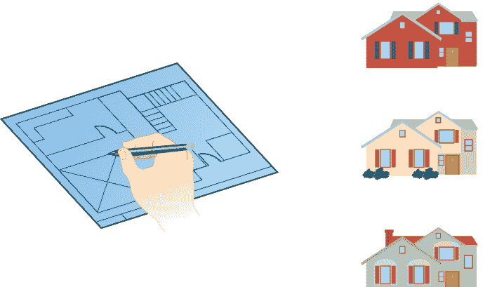

图 1.22 类被用于创建对象，就像房屋蓝图被用于创建不同但相似的房屋一样。

类是对象的蓝图。它确定了该类型对象将持有的数据类型，并定义了代表此类对象行为的方法。然而，类之于对象，就像蓝图之于房屋。通常情况下，类不包含存储数据的空间。每个对象都有存储自己数据的空间，这意味着每个对象都可以有自己的状态。

> 核心概念
>
> 类是对象的蓝图。
>
> 从一个类定义中可以创建多个对象。

一旦定义了类，就可以从该类创建多个对象。例如，我们定义了一个类来表示银行账户的特定内容，我们可以创建多个代表特定、独立银行账户的对象。每个银行账户对象都会跟踪自己的余额。


对象应该是被封装（encapsulated）的，这意味着它保护并管理自己的信息。也就是说，对象应该是自律的。对对象状态的唯一更改应该通过该对象的方法来实现。我们应该设计对象，使得其他对象无法“进入内部”并改变它们的状态。

可以使用继承（inheritance）从其他类创建新类。也就是说，一个类的定义可以基于已经存在的另一个类。继承是软件复用形式，利用了我们可能想要创建的不同类之间的相似性。一个类可以用来派生出几个类。派生类随后可以用来派生更多的类。这创建了一个类的层次结构，其中在一个类中定义的属性和方法会被其子类继承，并继传递给它们的子类，依此类推。例如，我们可能会创建一个表示各种类型账户的类层次结构。共同特征在高层类中定义，而特定差异在派生类中定义。

多态（Polymorphism）是指我们可以随时间以一致的方式引用多种类型的相关对象。它让我们有能够为处理多个对象的问题设计出强大且优雅的解决方案。

图 1.23 展示了一些核心的面向对象概念。我们不期望你现在阶段就能完全理解这些思想。这本书的大部分内容都是为了充实这些思想。这个概述仅用于做铺垫。

## 1.6 面向对象编程

- 类定义了一个概念
- 从一个类中可以创建多个被封装的对象
- 类可以被组织成继承层次结构

图 1.23 面向对象软件的不同方面

> **自测习题（答案见附录 N）**
>
> - SR 1.33 列出解决问题所需的五个通用步骤。
> - SR 1.34 为什么考虑比一种方法的方法来解决问题很重要？为什么在解决问题的过程中早期考虑备选方案很重要？
> - SR 1.35 支持面向对象编程的核心概念有哪些？

### 核心概念总结

- 计算机系统由硬件和软件组成，它们协同工作帮助我们解决问题。
- CPU 从主内存中读取程序指令，一个接一个地执行，直到程序结束。
- 操作系统提供用户界面并管理计算机资源。
- 对于用户来说，界面就是程序。
- 数字计算机通过将信息拆分成部分并将每个部分表示为数字来存储信息。
- 二进制被用于在计算机中存储和移动信息，因为存储和处理二进制数据的设备廉价且可靠。
- N 位恰好有 `2^N` 种位排列组合。因此，N 位表示多达 `2^N` 个唯一项目。
- 核心的面向对象概念是类、对象、封装、继承和多态。

### 核心概念总结

- 万维网（World Wide Web）是一种让类能够轻松地跨网络共享信息的软件。
- URL 唯一地指定了 Web 上的文档或其他信息，供浏览器获取。
- 本书侧重于面向对象编程的原理。
- 注释不会影响程序的处理；相反，它们有助于人类的理解。
- 内联文档应该对你的代码提供见解。它不应该是模糊的，也不应该陈述明显的观点。
- Java 是区分大小写敏感的。字母的大写和小写版本是不同的。
- 标识符名称应该具有描述性且可读性。
- 适当使用空格使程序更易读。
- 你应该遵循一组准则，这些准则建立了你格式化和记录程序的方法。
- 所有程序必须翻译成特定 CPU 的机器语言才能执行。
- 高级语言允许程序员忽略机器语言的细节。
- 编译器将 Java 源代码翻译成 Java 字节码，这是程序的低级、体系无关的表示。
- 存在许多不同的开发环境来帮助你创建和修改程序。
- 语法规则规定程序的形式。语义规定程序语句的含义。
- 程序员对程序的准确性和可靠性负责。
- Java 程序在语法上必须正确，否则编译器不会产生字节码。
- 面向对象编程有助于解决问题，这是编写程序的目的。
- 程序设计涉及将解决方案拆解为更易管理的部分。

# 练习题

- EX 1.1 描述你的个人电脑或你所访问的实验室计算机的硬件组件。包括处理器类型和速度、主内存和辅助内存的容量以及 I/O 设备的类型。解释你是如何得出答案的。
- EX 1.2 为什么磁性设备被认为是表示二进制值的有效手段？
- EX 1.3 需要多少比特位来唯一表示以下每一项？
  - a. 4 个项
  - b. 16 个项
  - c. 32 个项
  - d. 128 个项
  - e. 512 个项
  - f. 2048 个项
- EX 1.4 假设一年有 366 天，存储一年中的每一天需要多少比特位？为什么？
- EX 1.5 如果彩虹色用唯一的位模式表示，存储每种颜色需要多少比特位？为什么？
- EX 1.6 以下每个元素在图形用户界面 (GUI) 中的用途是什么？
  - a. 窗口 (windows)
  - b. 图标 (icons)
  - c. 按钮 (buttons)
  - d. 滑块 (sliders)
- EX 1.7 解释可刻录光盘 (CD-R) 和可重写光盘 (CD-RW) 的区别。
- EX 1.8 DVD 是像 CD 一样的辅助内存设备，但它可以存储更多信息。为什么？
- EX 1.9 确定你的电脑或你访问的实验室计算机是如何通过网络与其他连接的。它连接到互联网了吗？画一张图来显示你环境中的基本连接。
- EX 1.10 域名系统 (DNS) 在互联网中的意义是什么？如果没有 DNS 会发生什么？
- EX 1.11 八台计算机的全连接点对点网络需要多少条通信线？十台计算机又呢？确定此结果的通用公式是什么？
- EX 1.12 解释网页浏览器和网络服务器之间的区别。
- EX 1.13 列出并解释以下 URL 的部分：
  - a. 你的学校
  - b. 你学校的计算机科学系
  - c. 你老师的网页
- EX 1.14 给出 Java 标识符三个类别的示例，并解释它们之间的区别。
- EX 1.15 以下哪些是有效的 Java 标识符？
  - a. `Remainder`
  - b. `9_multiple`
  - c. `addTwoIntegers`
  - d. `PI_VALUE`
  - e. `highestof3`
  - f. `sum&product`
  - g. `diff_&div`
- EX 1.16 以下哪个有效的 Java 标识符能清晰地表示“正在处理的项”？
  - a. `curIt`
  - b. `cItem`
  - c. `currentItem`
- EX 1.17 Java 编程语言中的方法是什么？
- EX 1.18 区分 Java 字节码和机器语言代码。
- EX 1.19 我们说英语具有歧义性时是指什么？给出两个英语歧义的例子（本章使用的示例之外）并解释其歧义性。为什么歧义对编程语言来说是一个问题？
- EX 1.20 识别以下哪些会导致：编译错误、运行时错误或逻辑错误。
  - a. 在应该写 `printIn` 的地方写了 `println`
  - b. 在方法体末尾漏掉了一个 `}`
  - c. 计算数字的和而不是数字的乘积
  - d. 在 `System.out.println` 中将 `,` 打成了 `.`
  - e. 忘记写换行符。
  - f. 在分母中用变量减去它本身

# 编程项目

- PP 1.1 输入、编译并运行以下程序：

```java
public class Mystery {
    public static void main(String[] args) {
        System.out.println("Does this print \on one line???");
    }
}
```

- PP 1.2 向 PP 1.1 的程序中逐一个引入以下错误。记录编译器产生的任何错误信息。在引入新错误之前，每次都修复上一个错误。如果没有产生错误信息，请解释原因。在每次更改之前，尝试预测会发生什么。
  - a. 将 `Test` 改为 `test`
  - b. 将 `Emergency` 改为 `emergency`
  - c. 移除字符串中的第一个引号
  - d. 移除字符串中的最后一个引号
  - e. 将 `main` 改为 `man`
  - f. 将 `println` 改为 `bogus`
  - g. 移除 `println` 语句末尾的分号
  - h. 移除程序中的最后一个大括号

- PP 1.3 写一个程序，分行打印你最喜欢的书的书名、作者、类别、价格和总页数。在输出中为每条信息标记标签。
- PP 1.4 写一个程序，打印你喜欢的两个或三个游戏列表。打印游戏的名称和人数。
- PP 1.5 写一个程序，打印你选择的任意两个成语。标记优先级。
- PP 1.6 写一个程序，使用波浪号 (`~`) 字符打印一个房子的轮廓。
- PP 1.7 写一个程序，打印你最喜欢的短语之一及其含义。
- PP 1.8 写一个程序打印格言“Work is Worship”（工作即崇拜）：
  - a. 分三行，每行一个单词，每个单词左对齐。
  - b. 分两行，每行两个单词。
  - c. 在框内打印。
- PP 1.9 写一个程序打印以下内容。在输出中为每条信息标记标签。
- PP 1.10 写一个程序，用大字母显示单词“HI”。

```
########
######
#####
##########
```

## 2.1 字符字符串

`System.out` 对象还提供了另一个我们可以使用的服务：`print` 方法。`print` 和 `println` 之间的区别很小但非常重要。`println` 方法打印发送给它的信息，然后移动到下一行的开头。`print` 方法与 `println` 类似，但在完成后不会移动到下一行。

> **核心概念**
>
> `print` 和 `println` 方法代表了 `System.out` 对象提供的两种服务。

列表 2.1 所示的程序被称为 Countdown，它同时调用了 `print` 和 `println` 方法。

仔细比较程序列表底部显示的 Countdown 程序的输出与程序代码。注意，尽管 Liftoff 是使用 `println` 方法打印的，但它与前几个单词打印在同一行上。请记住，`println` 方法在打印完传递给它的信息后，会移动到下一行的开头。

### 列表 2.1

```java
// Countdown.java               Author: Lewis/Loft
// 展示 print 和 println 之间的区别。
public class Countdown
{
    // 打印两行代表火箭倒计时的输出。
    
    public static void main(String[] args)
    {
        System.out.print("Three ... ");
        System.out.print("Two ... ");
        System.out.print("One ... ");
        System.out.print("Zero ... ");
        System.out.println("Liftoff!"); // 出现在第一行输出
        System.out.println("Houston, we have a problem.");
    }
}
```

#### 输出

```
Three... Two... One... Zero... Liftoff!
Houston, we have a problem.
```

### 字符串拼接

字符串字面量在程序中不能跨多行。下面的程序语句语法是错误的，在尝试编译时会产生错误：

```java
// 以下语句将无法编译
System.out.println("the only stupid question is
tone one that is not asked.");
```

当我们想要打印一个太长而无法放入程序单行的字符串时，我们可以依靠字符串拼接，将一个字符串附加到另一个字符串的末尾。字符串拼接运算符是加号 (`+`)。下面的表达式将一个字符串连接到另一个字符串上，产生一个长字符串：

`"The only stupid question is " + "the one that is not asked."`

列表 2.2 所示的 Facts 程序包含了几个 `println` 语句。第一个语句打印了一个较长的句子，无法放入程序的一行中。由于字符字面量在程序中不能跨两行，我们将字符串分成两部分并使用字符串拼接将它们连接。第一个 `println` 语句中的字符串拼接操作产生了一个大字符串，并将其传递给该方法进行打印。

注意，我们不需要向 `println` 方法传递任何信息，如 Facts 程序中的第二行所示。此调用没有打印任何字符，但它确实会移动到输出的下一行。在这种情况下，调用不带参数的 `println` 具有打印一个空行的效果。

Facts 程序中最后三次调用 `println` 展示了关于字符串拼接的另一个有趣点：字符串可以与数字进行拼接。注意，这些行中的数字没有被双引号括起来，它们不是字符字符串。在这些情况下，数字会自动转换为字符串，然后将两个字符串拼接在一起。

由于我们正在打印特定的值，我们完全可以将数值作为字符串字面量的一部分包含，例如：

`"Speed of ketchup: 40 km per year"`

数字是字符，可以根据需要包含在字符串中。我们在 Facts 程序中将它们分开，是为了演示拼接字符串和数字的能力。这种技术在接下来的示例中将非常有用。

正如你可以想象的，`+` 运算符也用于算术加法。因此，`+` 运算符取决于它所操作的数据类型。

### 列表 2.2

```java
// Facts.java      Author: Lewis/Loftus
// 展示字符串拼接运算符的使用以及
// 整数到字符串的自动转换。
public class Facts {
    // 打印各种事实。
    public static void main(String[] args) {
        System.out.println("The only stupid question is " + "the one that is not asked.");
        System.out.println();
        System.out.println("Speed of ketchup: " + 40 + " km per year");
    }
}
```

#### 输出

```
The only stupid question is the one that is not asked.

Speed of ketchup: 40 km per year
```

### 列表 2.3

```java
// Addition.java               Author: Lewis/Loftus
// 展示加法和字符串
// 拼接的区别。
public class Addition
{
    // 拼接并相加数字。
    public static void main(String[] args)
    {
        System.out.println("24 and 45 concatenated: " + 45);
        System.out.println("24 and 45 added: " + (24 + 45));
    }
}
```

#### 输出

```
24 and 45 concatenated: 45
24 and 45 added: 69
```

### 转义序列

由于 Java 语言使用双引号 (`""`) 用于表示字符串的开始和结束，所以我们必须使用特殊技术来打印引号字符。如果我们简单地将其放在字符串中 (`""`)，编译器就会感到困惑，因为它认为第二个双引号是字符串的结束，并且不知道如何处理第三个引号。这会导致编译时错误。

为了解决这个问题，Java 定义了几个转义序列来表示特殊字符。转义序列以反斜杠字符 (`\`) 开头，表示该字符或多个字符应该以特殊方式解释。图 2.1 列出了 Java 转义序列。

列表 2.4 所示的程序名为 Roses，打印了一些代表诗歌的文本。尽管诗歌有几行，但它只使用了一个 print 语句来实现。注意在整个字符串中使用的转义序列。`\n` 转义序列强制输出到新行，而 `\t` 转义序列表示一个制表符字符。`\"` 转义序列确保引号被视为字符串的一部分，而不是字符串的终止，使其能够作为输出的一部分被打印。

> **核心概念**
>
> 转义序列可以用于表示引起其他编译问题的字符。

| 转义序列 | 含义 |
| :--- | :--- |
| `\b` | 退格符 |
| `\t` | 制表符 |
| `\n` | 新行符 |
| `\r` | 回车符 |
| `\"` | 双引号 |
| `\'` | 单引号 |
| `\\` | 反斜杠 |

图 2.1 Java 转义序列

#### 输出

```
玫瑰是红色的，
    紫花是蓝色的，
糖是甜的，
    但我有“承诺症”，
    所以在在我们关系的这个阶段，
    我宁愿做朋友。
```

> **自复习题（答案见附录 N）**
>
> - SR 2.1 什么是字符串字面量？
> - SR 2.2 `print` 方法和 `println` 方法之间有什么区别？
> - SR 2.3 什么是参数？
> - SR 2.4 下列代码片段产生什么输出？
>
> ```java
> System.out.println("One ");
> System.out.print("Two ");
> System.out.println("Three ");
> ```


# 第 2 章 数据与表达式

## 2.2 变量与赋值

### SR 2.5
下列代码片段产生什么输出？

```java
System.out.print("Ready ");
System.out.println();
System.out.println("Set ");
System.out.println();
System.out.println("Go ");
```

### SR 2.6
下述语句产生什么输出？如果删除内部括号，会产生什么？

```java
System.out.println("It is good to be " + (5 + 5));
```

### SR 2.7
什么是转义序列？举例说明。

### SR 2.8
编写一个 `print` 语句，输出与所示完全的内容（包括换行符和引号）。

> “我把这封信写得比平时长，是因为我没有时间把它写短。”
> —— 布莱斯·帕斯卡

---

### 变量

变量是内存中用于存储数据值的位置的名称。变量声明指示编译器在主内存中留出足够的空间，以存储特定类型的值，并指示我们用来指代该位置的名称。

考虑列表 2.5 所示的程序 `PianoKeys`。`main` 方法的第一行是声明变量 `keys` 的，它存储一个整数（`int`）值。该声明还为 `keys` 赋予了初始值 `88`。如果没有为变量指定初始值，则该值是未定义的。如果你尝试在显式给变量赋值之前使用它，Java 编译器会报错或发出警告。

`keys` 变量及其值可以想象如下：

> **核心概念**：一个变量是用于存储特定数据类型取值的内存位置的名称。

| keys | 88 |
| :--- | :--- |

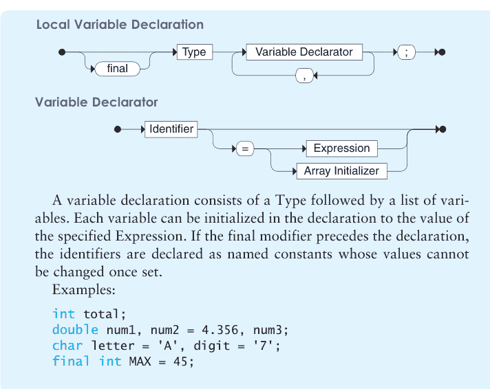

变量声明由一个类型（`Type`）后跟变量列表组成。每个变量都可以在声明中初始化为指定表达式（`Expression`）的值。如果最终修饰符位于声明之前，则标识符被声明为命名常量，其值不能被更改。

**示例：**
- `int total;`
- `double num1, num2 = 4.356, num3;`
- `char letter = 'A', digit = '7';`
- `final int MAX = 45;`

```java
// PianoKeys.java 作者: Lewis/Loftus
// 演示整数变量的声明、初始化和使用。

public class PianoKeys {
    // 打印钢琴上的琴键数量。
    public static void main(String[] args) {
        int keys = 88;
        System.out.println("A piano has " + keys + " keys.");
    }
}
```

#### 列表 2.5 输出
钢琴有 88 个琴键。

在 `PianoKeys` 程序中，调用 `println` 时使用了两个信息。第一个是字符串，第二个是变量 `keys`。当引用变量时，会使用当前存储在其中的值。因此，当执行 `println` 的调用时，获取了 `keys` 的值，即 `88`。由于该值是整数，它会自动转换为字符串并与初始字符串拼接。拼接后的字符串被传递给 `println` 并打印。

一个变量声明可以在同一行中声明多个相同类型的变量。行中的每个变量都带有带有初始化值或不带初始化值进行声明。例如：

```java
int count, minimum = 0, result;
```

### 赋值语句

让我们来看一个改变变量值的程序。列表 2.6 显示了一个名为 `Geometry` 的程序。该程序首先声明了一个名为 `sides` 的整数变量并将其初始化为 `7`。然后它打印了 `sides` 的当前值。

`main` 方法中的行改变了存储在变量 `sides` 中的值：

```java
sides = 10;
```

这被称为赋值语句，因为它为变量分配了一个值。执行时，赋值运算符（`=`）右侧的表达式被求值，其结果被存储。在例例中，表达式是简单的数字 `10`。我们将在下一节中讨论更复杂的表达式。

#### 列表 2.6

```java
// *****************************************************
// Geometry.java 作者: Lewis/Loftus
// 演示使用赋值语句改变存储在变量中的值。
// *****************************************************
public class Geometry {
    // 打印几何形状的边数数量。
    public static void main(String[] args) {
        int sides = 7; // 声明并初始化
        System.out.println("A heptagon has " + sides + " sides.");
        sides = 10; // 赋值
        System.out.println("A decagon has " + sides + " sides.");
    }
}
```

**输出：**
七边形有 7 条边。
十边形有 10 条边。

在此例中，当为 `sides` 赋值 `10` 时，原始值 `7` 被覆盖并丢失。如下所示：

**初始化后：**
| sides | 7 |
| :--- | :--- |

**第一次赋值后：**
| sides | 10 |
| :--- | :--- |


### 基础赋值

基础赋值语句使用赋值运算符（`=`）将表达式的结果存储指定的标识符（通常是变量）中。

```java
total = 57;
count = count + 1;
value = (min / 2) * last;
```

当引用变量时（例如打印时），变量的值不会改变。这是内存的本质：访问数据（读取）保持内存中的值不变，但写入数据则会用新数据替换旧数据。

Java 语言是强类型的，这意味着我们不允许为与其类型不一致的变量赋值。尝试组合不兼容类型会在编译程序时产生错误。因此，赋值语句右侧的表达式求值结果必须与左侧变量的类型兼容。

> **核心概念**：不能为类型不兼容的变量赋值值。

### 常量

有时我们会使用在整个程序中保持不变的数据。例如，我们可能为一个最多容纳 427 个人的剧院编写程序。使用常量名称（如 `MAX_OCCUPANCY`）通常比在整个代码中使用字面值（如 `427`）更有帮助。使用字面值作为 `427` 的目的通常会让阅读代码的人感到困惑。通过为值命名，你有助于解释它在程序中的作用。

常量是标识符，与变量的区别在于它们在存在期间保持特定的值。从单词的英文含义来说，常量不是变量的。它们的值不会改变。

> **核心概念**：常量在存在期间保持特定的值。

在 Java 中，如果你在声明之前加上保留字 `final`，则该标识符是一个常量。按照惯例，在命名常量时使用大写字母，使用下划线字符进行分隔。例如，描述剧院最大容纳人数的常量可以这样声明：

```java
final int MAX_OCCUPANCY = 427;
```

一旦给常量赋予了初始值，如果你尝试更改它的值，编译器将产生错误信息。这是使用常量的另一个原因。常量可以防止无意的编码错误，因为更改其值的唯一有效位置是在初始赋值。

使用常量的第三个原因是：如果在整个程序中它的值需要被修改，那么你只需要在一个地方进行更改。例如，如果剧院的容量（因为装修）从 427 变为 535，那么你只需要更改一处声明，`MAX_OCCUPANCY` 的所有使用处都会自动反映这一变化。如果在代码中到处使用了字面量 `427`，则必须找到并修改每一个使用处。如果你漏掉了任何一个字面量值，问题就会会出现。

### 自测习题（答案见附录 N）

- **SR 2.9** 什么是变量声明？
- **SR 2.10** 根据给定的以下变量声明，回答每个问题。

```java
int count = 0, value, total;
final int MAX_VALUE = 100;
int myValue = 50;
```

  - a. 声明了多少个变量？
  - b. 这些声明变量的类型是什么？
  - c. 哪些变量被赋予了初始值？
  - d. 根据上述声明，以下赋值语句是合法的吗？解释原因。
    ```java
    myValue = 100;
    ```
  - e. 根据上述声明，以下赋值语句是合法的吗？解释原因。
    ```java
    MAX_VALUE = 50;
    ```

- **SR 2.11** 你的程序需要一个 `int` 类型的变量来存储音乐集中 CD 的数量。初始值应为零。为该变量写一个声明语句。
- **SR 2.12** 你的程序需要一个 `int` 类型的变量来存储一英里的英尺数（5280）。为该变量写一个声明语句。
- **SR 2.13** 简述在程序中使用常量代替字面量的三个原因。

---

## 2.3 原始数据类型

Java 中有八种原始数据类型：四种整数子集、两种浮点数子集、一种字符数据类型和一个布尔数据类型。其他所有内容使用对象表示。让我们详细检查这八种原始数据类型。

### 整数与浮点数

Java 有两种基本的数值：整数（没有小数部分）和浮点数（有）。根据存储该范围数值所需的内存量，四种整数数据类型（`byte`、`short`、`int` 和 `long`）和两种浮点数数据类型（`float` 和 `double`）。每个数据类型的大小在所有硬件平台上都是相同的。所有数值类型都是符号的，这意味着它们都可以存储正值和负值。图 2.2 总结了数值类型。

回想第一章中的讨论，一个位（bit）可以是 1 或 0。每个位可以表示两种状态，一个 N 位的字符串可以表示 2^N 个值。附录 B 更详细地描述了数制和这类关系。

在设计程序时，我们有时需要小心选择合适大小的变量，以免浪费内存空间。这发生在内存空间特别受限的情况下，例如运行在个人数据辅助（PDA）上的程序。在这种情况下，我们可以恰当地选择变量的数据类型。

| 类型 | 存储 | 最小值 | 最大值 |
| :--- | :--- | :--- | :--- |
| `byte` | 8 bits | -128 | 127 |
| `short` | 16 bits | -32,768 | 32,767 |
| `int` | 32 bits | -2,147,483,647 | 2,147,483,647 |
| `long` | 64 bits | -9,223,372,036,854,775,808 | 9,223,372,036,854,775,807 |
| `float` | 32 bits | 约 -3.4E+38，有 7 位有效数字 | 约 3.4E+38，有 7 位有效数字 |
| `double` | 64 bits | 约 -1.7E+308，有 15 位有效数字 | 约 1.7E+308，有 15 位有效数字 |

> Java 有两种数值：整数和浮点数。有两种整数数据类型和两种浮点数数据类型。

**图 2.2 数值原始类型**

如果范围超出了 1 到 1000 的范围，那么一个双字节整数（`short`）就足够容纳它。另一方面，当不确定特定变量的范围时，我们应该提供足够合理、甚至是慷慨的空间。在大多数情况下，内存空间并不是严苛的限制，我们可以轻松地负担起慷慨的假设。

请注意，即使 `float` 值可以表示非常大（或非常小）的数字，它也只有七位有效数字。因此，如果保持一个诸如 `50341.2077` 这样的值非常重要，那么我们需要使用 `double`。

正如我们已经讨论过的，字面量是程序中使用的显式数据值。程序中作为 `Facts`、`Addition` 和 `PianoKeys` 使用的各种数字都是整数字面量。Java 假设所有整数字面量都是 `int`，除非在值的末尾附加 `L` 以指示它应该被视为 `long` 类型的字面量，如 `45L`。

同样，Java 假设所有浮点数字面量都是 `double`。如果需要将其视为 `float` 类型，则在值的末尾附加 `F`。

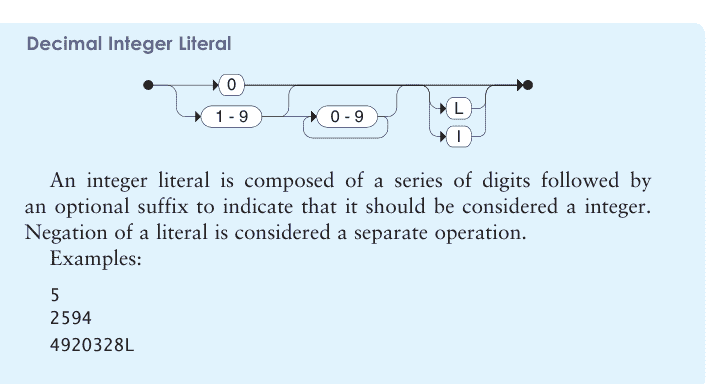

以下是变量声明的示例：

```java
int answer = 22;
byte smallNumber;
long countedStars = 29;
float ratio = 123;
double delta = 45;
```

### 字符

字符是计算机使用的另一种基本数据类型。单个字符可以作为单独的数据项，正如我们在几个示例中所看到的，它们可以组合成字符字符串。

字符字面量在 Java 中用单引号表示，例如 `'b'`。你会记得字符串字面量使用双引号界定，并且 `String` 类型不是原始类型；它是一个类。我们将在下一章讨论 `String` 类。

注意作为字符的数字与数值之间的区别。在字符串 "602 Green Court" 中，6、0 和 2 是字符，就像字符串中的其他字符一样。

我们管理的字符由字符集定义，字符集只是按特定顺序排列字符列表。每个编程语言支持一个特定的字符集，定义了该语言的有效值。曾提出许多字符集，但只有少数被一直使用。ASCII 字符集是一个受欢迎的选择。基础 ASCII 使用每个字符七位，提供了 128 个不同的字符，包括：

- 大写字母，如 `'A'`、`'B'` 和 `'C'`
- 小写字母，如 `'a'`、`'b'` 和 `'c'`
- 标点符号，如句号（`.`）、分号（`;`）和逗号（`,`）
- 数字 `'0'` 到 `'9'`
- 空格字符 `' '`
- 特殊符号，如安培符号（`&`）、垂直线（`|`）和反斜线（`\`）
- 控制字符，如回车、空字符和结束标记字符

控制字符有时是不可打印或不可见的字符，因为它们没有特定的符号来表示。然而，它们与其他任何字符一样都是有效的，并且以相同的方式进行存储和使用。许多控制字符对特定的软件应用程序具有特殊含义。

随着计算的全球化，用户需要包含其他语言字母表的更灵活的字符集。ASCII 被扩展为每个字符八位，字符数量翻倍到 256。扩展 ASCII 包含了许多用于非英语语言的带重音和变音的字符。

然而，即使有 256 个字符，ASCII 字符集也无法表示世界上字母，特别是考虑到各种亚洲字母及其数以千计的表意字。因此，Java 语言的开发者选择了 Unicode 字符集，它每个字符使用 16 位，支持 65,536 个唯一字符（以及允许使用多个字节表示更多字符的技术）。许多语言的字符和符号都包含在 Unicode 定义中。ASCII 是 Unicode 字符集的子集，包含前 256 个字符。附录 C 详细讨论了 Unicode 字符集。

为每个字符分配一个特定的数字；根据定义，字符按照特定的顺序排列。这被称为字典序。在 ASCII 和 Unicode 排序中，数字字符 `'0'` 到 `'9'` 是连续的（没有其他字符插入其中）且是有序的。同样，小写字母 `'a'` 到 `'z'` 是连续且有序的，大写字母 `'A'` 到 `'Z'` 也是如此。这些特性使得按字母顺序保持内容变得相对容易。

在 Java 中，`char` 类型表示单个字符。以下是 Java 中字符变量声明的示例：

```java
char topGrade = 'A';
char symbol1, symbol2, symbol3;
char terminator = ';', separator = ' ';
```

### 布尔值

布尔值在 Java 中使用保留字 `boolean` 定义，只有两个有效值：`true` 和 `false`。布尔变量通常用于指示特定条件是否真，它可以表示任何具有两种状态的情况，例如灯的开启或关闭。

布尔值不能转换为任何其他数据类型，其他数据类型也不能转换为布尔值。`true` 和 `false` 单词在 Java 中被保留为布尔字面量，不能在此上下文之外使用。

以下是 Java 中布尔变量声明的示例：

```java
boolean flag = true;
boolean tooHigh, tooSmall, tooRough;
boolean done = false;
```


> 自测习题（答案见附录 N）
> SR 2.14 什么是原始数据？原始数据类型与对象之间有何区别？

## 2.4 表达式

- SR 2.15 整数变量可以存储多少个值？
- SR 2.16 Java 中有四种整数数据类型？它们之间有什么不同？
- SR 2.17 Java 自动为整数字面量分配什么类型？你如何指示整数字面量应被视为不同的类型？
- SR 2.18 Java 自动为浮点字面量分配什么类型？你如何指示浮点字面量应被视为不同的类型？
- SR 2.19 什么是字符集？
- SR 2.20 ASCII 字符集、扩展 ASCII 字符集和 Unicode 字符集支持多少个字符？

### 核心概念
表达式是用于执行计算的操作数的组合。

### 算术运算符

算术运算符针对整数和浮点数值类型都有定义，包括加法 (`+`)、减法 (`-`)、乘法 (`*`) 和除法 (`/`)。Java 还有另一种算术运算符：取余运算符 (`%`) 返回第二个操作数除以第一个操作数后的余数。取余运算符有时称为模运算运算符。取余操作结果的符号是被除数的符号。因此：

| 操作 | 结果 |
|---|---|
| `17 % 4` | `1` |
| `-20 % 3` | `-2` |
| `10 % -5` | `0` |
| `3 % 8` | `3` |

正如你所预期的，如果数值运算符的一个或两个操作数是浮点值，结果就是浮点值。然而，除法运算符产生的结果不那么直观，取决于操作数的类型。如果两个操作数都是整数，`/` 运算符执行整数除法，这意味着结果的任何小数部分都会被丢弃。如果其中一个操作数是浮点值，`/` 运算符执行浮点除法，并保留结果的小数部分。例如，`10/4` 的结果是 `2`，但 `10.0/4`、`10.0/4.0` 和 `10.0/4.0` 的结果都是 `2.5`。

一元运算符只有一个操作数，而二元运算符有两个。`+` 和 `-` 运算符可以是一元的也可以是二元的。二元版本完成加法和减法，而一元版本表示正负数。例如，`-1` 是使用一元运算符使值变为负数的示例。一元 `+` 运算符很少使用。

Java 没有内置的将值提升指数的运算符。然而，`Math` 类提供了执行幂和其他许多数学函数的方法。`Math` 类将在第 3 章讨论。

### 运算符优先级

运算符可以组合创建更复杂的表达式。例如，考虑以下赋值语句：

```
result = 14 + 8 / 2;
```

> 赋值的整个右侧被求值，然后结果存储在变量中。但结果是什么？如果先执行加法，第一个结果是 11；如果先执行除法操作，结果是 18。

任何相同优先级的算术运算符从左到右执行。因此，我们说算术运算符具有左结合性。

然而，可以通过括号在表达式中强制执行优先级。例如，如果我们真的想在之前的例中先执行加法，可以将表达式写为：

```
result = (14 + 8) / 2;
```

括号中的任何表达式首先被求值。在复杂的表达式中，即使不是必须，使用括号也是良好的做法，以明确表达式是如何求值的。

括号可以嵌套，最内层的表达式首先被求值。考虑以下表达式：

```
result = 3 * ((18 - 4) / 2);
```

在这个例子中，结果是 21。首先，由于内括号执行减法。然后，尽管乘法和除法的优先级相同且通常从左到右评估，但由于外括号，先执行除法。最后，执行乘法。

在算术操作完成后，计算出的结果存储在赋值运算符 (`=`) 左侧的变量中。换句话说，赋值运算符的优先级低于任何算术运算符。

特定表达式的求值可以使用表达式树显示，如图 2.3 所示。运算符从底部向上执行，创建在表达式其他部分使用的值。因此，树中底部的运算符比上方的优先级更高，或者它们通过括号强制更早执行。

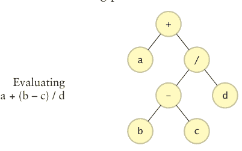

**图 2.3** 表达式树

| 优先级级别 | 运算符 | 操作 | 结合性 |
|---|---|---|---|
| 1 | `+` | 一元加 | 从右到左 |
| | `-` | 一元减 | |
| 2 | `*` | 乘法 | 从左到右 |
| | `/` | 除法 | |
| | `%` | 取模 | |
| 3 | `+` | 加法 | 从左到右 |
| | `-` | 减法 | |
| | `+` | 字符串拼接 | |
| 4 | `=` | 赋值 | 从右到左 |

**图 2.4** Java 运算符的优先级

表达式中使用的括号实际上本身就是运算符。括号的优先级高于几乎任何其他运算符。图 2.4 显示了一个包含算术运算符、括号和赋值运算符之间关系的表格。附录 D 包含一个显示所有 Java 运算符的完整优先级表。

为了使表达式在语法上是正确的，左括号的数量必须与右括号的数量匹配，并且它们必须正确嵌套。以下示例不是有效表达式：

```
result = ((19 + 8) % 3 - 4); // 无效

result = (19 + 8) % 3 - 4); // 无效
```

请记住，当表达式中引用变量时，将使用它的当前值来执行计算。在下面的赋值语句中，变量 `count` 的当前值与变量 `total` 的当前值相加，结果存储在变量 `sum` 中：

```
sum = count + total;
```

在这次赋值之前，`sum` 中包含的原始值会被存储在 `count` 和 `total` 中的值覆盖，而这两个值保持不变。

同一个变量可以出现在赋值语句的左侧和右侧。假设在执行以下赋值语句时，名为 `count` 的变量的当前值为 15：

```
count = count + 1;
```

由于右侧表达式首先被求值，因此获得了 `count` 的原始值并对其加了 1，产生结果 16。该结果存储在变量 `count` 中，用新值 16 覆盖了原始值 15。因此，该赋值语句使变量递增（或给变量加 1）。

让我们来看另一个表达式处理的示例。列表 2.7 中的程序 `TempConverter` 使用一个计算以下内容的表达式，将特定的摄氏温度转换为等值的华氏度值：

Fahrenheit = 9/5 Celsius + 32

```
********************************************************************************
// TempConverter.java      作者: Lewis/Loft
// 展示了基本数据类型的使用和算术
// 表达式的使用。
********************************************************************************

public class TempConverter
{
    // 使用公式 F = (9/5)C + 32 计算特定摄氏
    // 的华氏值。
    public static void main(String[] args)
    {
        final int BASE = 32;
        final double CONVERSION_FACTOR = 9.0 / 5.0;
        double fahrenheitTemp;
        int celsiusTemp = 24; // 要转换的值
        fahrenheitTemp = celsiusTemp * CONVERSION_FACTOR + BASE;
        System.out.println("Celsius Temperature: " + celsiusTemp);
        System.out.println("Fahrenheit Equivalent: " + fahrenheitTemp);
    }
}
```

**列表 2.7**

```
OUTPUT
Celsius Temperature: 24
Fahrenheit Equivalent: 75.2
```

注意，在温度转换程序中，除法操作的操作数是浮点数字面量，以确保数字的小数部分被保留。优先级规则规定，在最终转换计算中，乘法发生在加法之前。

`TempConverter` 程序并不非常有用，因为它只转换我们包含在程序中的一个常量值（24 摄氏度）。每次运行程序都会产生相同的结果。一个有用得多的版本将在每次执行程序时从用户那里获取要转换的值。读取用户输入的交互式程序将在本章后面的部分讨论。

### 递增和递减运算符

还有两个实用的算术运算符。递增运算符 (`++`) 对任何整数或浮点值加 1。组成该运算符的两个加号不能被空格分隔。递减运算符 (`--`) 与之类似，区别是从该值中减去 1。它们都是一元运算符，因为它们作用于一个操作数。以下语句会导致 `count` 的值递增：

```
count++;
```

结果存回变量 `count` 中。因此，它在功能上等同于上一节中讨论过的语句：

```
count = count + 1;
```

递增和递减运算符可以应用于变量之后（例如 `count++` 或 `count--`），创建所谓的运算符的**后置形式**。它们也可以应用于变量之前（例如 `++count` 或 `--count`），即所谓的**前缀形式**。当在语句中单独使用时，前缀和后置形式在功能上是等价的。也就是说，写成

```
count++;
```

或者

```
++count;
```

并不重要。然而，当这种形式单独作为一个语句编写时，通常以后置形式编写。

当递增或递减运算符用于较大的表达式时，根据所使用的形式可能会产生不同的结果。例如，如果变量 `count` 当前包含值 15，以下语句将值 15 赋值给 `total`，将值 16 赋值给 `count`：

```
total = count++;
```

然而，以下语句会将值 16 赋值给 `total` 和 `count`：

```
total = ++count;
```

由于 `count` 的值在两种情况下都递增了，但取决于使用的是前缀还是后置形式。

### 赋值运算符

为了方便，Java 定义了许多赋值运算符，将基本操作与赋值结合。例如，`+=` 运算符可以这样使用：

```
total += 5;
```

这与以下语句相同：

```
total = total + 5;
```

赋值运算符的右侧可以是一个完整的表达式。赋值运算符的右侧被求值，然后将结果与左侧的值相加，并将结果存储在变量。因此，以下语句：

```
total += sum - 12;
```

等同于：

```
total = total + (sum - 12);
```

Java 定义了类似的赋值运算符，包括执行减法 (`-=`)、乘法 (`*=`)、除法 (`/=`) 和取模 (`%=`)。所有的赋值运算符都会先求整个右侧表达式，然后将结果作为操作的操作数。因此，以下语句：

```
result *= count1 + count2;
```

等同于：

```
result = result * (count1 + count2);
```

同样，以下语句：

```
result %= (highest - 40) / 2;
```

等同于：

```
result = result % ((highest - 40) / 2);
```

与相应的普通运算符一样，某些赋值运算符根据操作数的类型执行特定的功能。例如，如果 `+=` 运算符的操作数是字符串，则该赋值运算符执行拼接。

### 自测习题（答案见附录 N）

- SR 2.21 `19 % 5` 在表达式中求值的结果是什么？解释。
- SR 2.22 `13 / 4` 在表达式中求值的结果是什么？解释。
- SR 2.23 如果整数变量 `diameter` 当前持有值 5，在执行以下语句后其值是多少？解释。
- SR 2.24 什么是运算符优先级？
- SR 2.25 下每个表达式的值是多少？
  - a. `15 + 7 * 3`
  - b. `(15 + 7) * 3`
  - c. `3 * 6 + 10 / 5 + 7 % 3`
  - d. `27 % 5 + 7 % 3`
  - e. `100 / 2 / 2 / 2`
  - f. `100 / ( 2 / 2 ) / 2`
- SR 2.26 对于每个表达式，请说明它是有效还是无效。如果无效，请解释原因。
  - a. `result = ( 5 + 2 )`
  - b. `result = ( 5 + 2 * ( 15 - 3 );`
  - c. `result = ( 5 + 2 (`
  - d. `result = ( 5 + 2 ( 4 ) );`

## 2.5 数据转换

- SR 2.27 在执行以下语句序列后，整型变量 `result` 包含什么值？

```
result = 27;
result = result + 3;
result = result / 7;
result = result * 2;
```

- SR 2.28 在执行以下语句序列后，整型变量 `result` 包含什么值？

```
int base;
int result;
base = 5;
result = base + 3;
base = 7;
```

- SR 2.29 什么是赋值运算符？
- SR 2.30 如果一个整数变量当前持有值 100，在执行以下语句后它的值是多少？请解释。

```
weight -= 17;
```

Java 是一种强类型语言，每个数据值都与特定类型相关联。将一种类型的数据值转换为另一种类型有时是有帮助的或必要的，但我们必须小心，不要在此过程中丢失重要信息。例如，假设一个存储数字 1000 的 `short` 变量被转换为 `byte`。`byte` 没有足够的位来表示值 1000，某些位会在转换过程中丢失，所表示的数字将无法保持原始值。

一种原始类型与另一种类型之间的转换分为两类：宽转换（widening conversions）和窄转换（narrowing conversions）。*宽转换是最安全的，因为它们通常不会丢失信息。它们被称为宽转换是因为它们从一种类型转换为另一种使用相同或更多空间来存储值的类型。* 图 2.5 列出了 Java 宽转换。

例如，从 `byte` 转换为 `short` 是安全的，因为 `byte` 存储为 8 位，而 `short` 存储为 16 位。没有信息丢失。所有从整数转换为另一种整数类型，或从浮点类型转换为另一种浮点类型的宽转换，都能精确地保留数值。

**图 2.5** Java 宽转换

| 源 | 目标 |
|---|---|
| `byte` | `short`, `int`, `long`, `float`, 或 `double` |
| `short` | `int`, `long`, `float`, 或 `double` |
| `char` | `int`, `long`, `float`, 或 `double` |
| `int` | `long`, `float`, 或 `double` |
| `long` | `float` 或 `double` |
| `float` | `double` |


宽转换不会丢失关于值大小的任何信息，但导致浮点值的宽转换可能会丢失精度。从 `int` 或 `long` 转换为 `float`，或从 `long` 转换为 `double` 时，可能会丢失一些低位。在这种情况下，生成的浮点值将是整数值的舍入版本，遵循 IEEE 754 浮点标准中定义的舍入技术。

窄转换比宽转换更容易丢失信息。它们通常从一种类型转换为使用较少空间存储值的类型，因此某些信息可能会受到损害。窄转换可能会丢失数值大小和精度。因此，通常情况下应该避免使用它们。图 2.6 列出了 Java 窄转换。

窄转换中空间缩减情况的一个例外是我们将 `byte`（8 位）或 `short`（16 位）转换为 `char`（16 位）。这些仍然被视为窄转换，因为符号位被整合到了新的字符值中。由于字符值是无符号的，负整数将转换为一个与原始整数数值值没有特定关系的字符。

**图 2.6** Java 窄转换

| 源 | 目标 |
|---|---|
| `byte` | `char` |
| `short` | `byte` or `char` |
| `char` | `byte` or `short` |
| `int` | `byte`, `short`, or `char` |
| `long` | `byte`, `short`, `char`, `int`, or `int` |
| `float` | `byte`, `short`, `char`, `int`, or `long` |
| `double` | `byte`, `short`, `char`, `int`, `long`, or `float` |

注意，在宽转换或窄转换中均未提到 `boolean` 值。`boolean` 值不能转换为任何其他原始类型，反之亦然。

### 转换技术

在 Java 中，转换可以通过三种方式发生：

- 赋值转换（assignment conversion）
- 提升（promotion）
- 强制类型转换（casting）

当将一种类型的值赋予另一种类型的变量时，会发生赋值转换，期间值被转换为新类型。只有宽转换可以通过赋值完成。例如，如果 `money` 是 `float` 变量而 `dollars` 是 `int` 变量，那么下面的赋值语句会自动将 `dollars` 中的值转换为 `float`：

```
money = dollars;
```


# 第 2 章 数据与表达式

## 2.6 交互程序

因此，如果 `dollars` 包含值 25，赋值后，`money` 包含值 25。然而，如果我们尝试将 `money` 赋值给 `dollars`，编译器将发出错误，提醒我们正尝试进行可能丢失信息的窄转换。如果我们真的想执行此赋值，就必须使用强制类型转换来使转换显式化。

当某些运算符需要修改其操作数以执行操作时，通过提升进行的转换会自动发生。例如，当一个浮点值 `sum` 除以整数值 `count` 时，`count` 的值在除法发生之前会自动提升为浮点值，从而产生浮点结果：

```java
result = sum / count;
```

当数字与字符串拼接时，也会发生类似的转换。数字首先被转换为（提升为）字符串，然后将两个字符串拼接。

强制类型转换是 Java 中最通用的转换形式。如果在 Java 程序中可以完成转换，就可以使用强制类型转换来完成。强制类型转换是一种由括号中的类型名指定的 Java 运算符。它放置在待转换值之前。

例如，为了将 `money` 转换为整数值，可以在它前面加上强制类型转换：

```java
dollars = (int) money;
```

强制类型转换返回 `money` 中的值，截弃任何小数部分。如果 `money` 包含值 84.69，那么赋值后，`dollars` 将包含值 84。然而，强制类型转换不会改变 `money` 中的值。赋值操作完成后，`money` 仍包含值 84.69。

### 自测习题（答案见附录）

**SR 2.34** 假设 `result` 是一个包含 27.32 的 `float` 变量，`value` 是一个包含 15 的 `int` 变量，在执行赋值语句后，它们的值是多少？请解释。

```java
value = (int) result;
```

**SR 2.35** 给定以下声明，以下赋值语句存储了每个变量的结果：

```java
int iResult, num1 = 17, num2 = 5;
double fResult, val1 = 12.0, val2 = 2.34;
```

- a. `iResult = num1 / num2;`
- b. `fResult = num1 / num2;`
- c. `fResult = val1 / val2;`
- d. `fResult = (double) num1 / num2;`
- e. `iResult = (int) val1 / val2;`

### Scanner 类

```java
Scanner(InputStream source)
Scanner(File source)
Scanner(String source)
```
构造函数：初始化新的扫描器，以从指定的源扫描值。

```java
String next()
```
将下一个输入标记作为字符字符串返回。

```java
String nextLine()
```
将当前行上剩余的所有输入作为字符字符串返回。

```java
boolean nextBoolean()
byte nextByte()
double nextDouble()
float nextFloat()
int nextInt()
long nextLong()
short nextShort()
```
返回指示的类型的下一个输入标记。如果下一个标记与该类型不一致，则抛出 `InputMismatchException`。

```java
boolean hasNext()
```
如果扫描器的输入中还有另一个标记，则返回 `true`。

```java
Scanner useDelimiter(String pattern)
Scanner useDelimiter(Pattern pattern)
```
设置扫描器的分隔符模式。

```java
Pattern delimiter()
```
返回扫描器当前正在用于匹配分隔符的模式。

```java
String findInLine(String pattern)
String findInLine(Pattern pattern)
```
尝试查找指定模式的下一次出现，忽略分隔符。

通过调用构造函数来设置对象。`Scanner` 构造函数接受一个参数，指示输入的源。`System.in` 表示标准输入流，默认情况下为键盘。使用 `new` 运算符创建对象将在下一章中进一步讨论。

除非另有说明，否则 `Scanner` 对象假设使用空白字符（空格、制表符和换行符）来分隔输入元素（称为标记）。这些字符是输入的分隔符。如果输入标记是由空白字符以外的字符分隔的，则可以更改分隔符集。

`Scanner` 的 `next` 方法将输入标记作为字符串读取并返回。因此，如果输入由一系列由空格分隔的单词组成，每次调用 `next` 都会返回下一个单词。`nextLine` 方法读取所有输入直到找到行尾，并将其作为一个字符串返回。

列表 2.8 中的程序 `Echo` 简单地读取用户输入的一行文本，将其存储在一个持有字符字符串的变量中，并将其回显到屏幕上。

### 列表 2.8 Echo.java

```java
****************************************************************
// Echo.java           作者: Lewis/Loftus
//
// 展示了使用 Scanner 类的 nextLine 方法
// 从用户处读取字符串。
****************************************************************

import java.util.Scanner;

public class Echo {
    // --------------------------------------------------------
    // 从用户处读取字符字符串并打印它。
    // --------------------------------------------------------
    public static void main(String[] args) {
        // 代码主体省略
    }
}
```

`Echo` 类定义上面的 `import` 语句告诉程序我们将在该程序中使用 `Scanner` 类。`Scanner` 类是 `java.util` 类库的一部分。`import` 语句的使用将在第 3 章中进一步讨论。

提供了各种 `Scanner` 方法（如 `nextLine` 和 `nextDouble`）来读取特定类型的数据。列表 2.9 显示的 `GasMileage` 程序读取的英里数作为整数，消耗的加仑数作为双精度点数，然后计算油耗。

#### 输出

```text
输入一行文本：
将你的激光打印机设置为待机！
你输入了："Set your laser printer on stun!"
```

正如从 `GasMileage` 程序的输出所示，计算产生了一个精确到几位小数的浮点结果。在下一章中，我们将讨论帮助以各种方式格式化输出的类，包括将浮点值保留到特定的小数位数。

### 列表 2.9 GasMileage.java

```java
********************************************************************************
// GasMileage.java          作者: Lewis/Loftus
// 展示了使用 Scanner 类读取数值数据。
//********************************************************************************

import java.util.Scanner;

public class GasMileage {
    //-----------------------------------------------------------------------
    // 根据用户输入的值计算燃料效率。
    //-----------------------------------------------------------------------
    public static void main(String[] args) {
        int miles;
        double gallons, mpg;
        Scanner scan = new Scanner(System.in);

        System.out.print("Enter the number of miles: ");
        miles = scan.nextInt();

        System.out.print("Enter the gallons of fuel used: ");
        gallons = scan.nextDouble();

        mpg = miles / gallons;

        System.out.println("Miles Per Gallon: " + mpg);
    }
}
```

#### 输出

```text
Enter the number of miles: 328
Enter the gallons of fuel used: 11.2
Miles Per Gallon: 29.28571428571429
```

`Scanner` 对象一次处理一个输入标记，基于用于读取数据的扫描器以及用于分隔输入值的分隔符。因此，根据情况需要，多个值可以位于输入的同一行中，也可以跨越多行分隔。

在第 5 章中，我们使用 `Scanner` 从文件读取输入，并修改它用于解析数据的分隔符。附录 H 探索了如何使用 `Scanner` 类通过称为正则表达式的模式来分析其输入。


### 自测习题（答案见附录 N）

**SR 2.36** 识别 `GasMileage` 程序中每一行对应以下哪项：
a. 告诉程序我们将使用 `Scanner` 类。
b. 创建一个 `Scanner` 对象。
c. 设置 `Scanner` 对象从输入流中读取。
d. 从输入流读取一个整数。

**SR 2.37** 假设你已经实例化了一个 `Scanner` 对象 `myScanner` 和一个 `int` 变量 `value`，如下：

```java
Scanner myScanner = new Scanner(System.in);
int value = 0;
```

编写程序语句，要求用户输入年龄，并将其存储在 `value` 中。

## 2.7 图形

图形在计算机系统中起着至关重要的作用。在本书中我们探索图形的各个方面并讨论如何实现。事实上，每章的最后两个部分都致力于图形主题。我们将此称为贯穿的图形轨迹。

### 核心概念

图形数据通过将其分为许多像素来表示。

图像与所有存储在计算机上的信息一样，必须通过将信息分解并将这些像素表示为数字来数字化。在图片的情况下，我们将图片分解为像素（像素元素）。像素是代表图片微小区域的区域。整个图像通过存储每个像素的颜色来存储。

数字化图像在需要时通过重组像素来复制。用于表示图片的像素越多，看起来就越真实。

### 坐标系

绘制时，图片的每个像素都映射到显示器上的一个像素。每个计算机系统和编程语言都定义了一个坐标系，通过它引用特定的像素。

传统的二维笛卡尔坐标系有两个在原点相交的轴。轴上的值可以是正的也可以是负的。

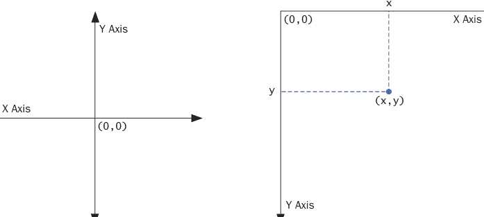

`Java` 坐标系中的每个点都用一对 `(x, y)` 值来表示。任何 `Java` 绘制区域的左上角坐标均为 `(0, 0)`。向右移动时，`x` 轴坐标增大；向下移动时，`y` 轴坐标增大。

> **核心概念**
> Java 坐标系的原点位于左上角，所有可见坐标都是正数。

正如我们在之前的示例中看到的，`Java` 程序在本质上并不一定是图形化的。然而，如果是图形化的，程序中的每个图形组件都有它自己的坐标系，原点 `(0, 0)` 位于左上角。这种一致的方法使得管理各种图形元素相对容易。

注意，`Java` 允许你指定屏幕上不可见的坐标，包括负值。如果你在这些坐标上绘制或放置组件，用户将看不到它们。

### 表示颜色

彩色图片和黑白图片一样被分为像素。然而，由于每个像素可以是许多颜色之一，因此仅用一个位来表示每个像素是不够的。表示像素颜色有多种方法。让我们讨论一种流行的技术。

每种颜色都可以表示为三种原色的混合：红、绿、蓝。在 `Java` 以及许多其他计算机语言中，颜色由三个数字指定，统称为 `RGB` 值。`RGB` 代表 `Red-Green-Blue`（红-绿-蓝）。每个数字代表一种原色的贡献。使用一个字节（8 位）来存储三个数字中的每一个，范围可以从 0 到 255。每种原色的水平决定了整体颜色。例如，红色和绿色的高值结合低水平的蓝色会产生黄色调。

> **核心概念**
> Java 中使用 RGB 值表示颜色——三个代表红、绿、蓝原色贡献的值。

**图 2.10 Color 类中的预定义颜色**

| 对象 | RGB 值 | RGB 值 |
| :--- | :--- | :--- |
| 黑色 | `Color.black` | 0, 0, 0 |
| 蓝色 | `Color.blue` | 0, 0, 255 |
| 青色 | `Color.cyan` | 0, 255, 255 |
| 灰色 | `Color.gray` | 128, 128, 128 |
| 深灰色 | `Color.darkGray` | 64, 64, 64 |
| 浅灰色 | `Color.lightGray` | 192, 192, 192 |
| 绿色 | `Color.green` | 0, 255, 0 |
| 品红色 | `Color.magenta` | 255, 0, 255 |
| 橙色 | `Color.orange` | 255, 0, 0 |
| 粉色 | `Color.pink` | 255, 175, 175 |
| 红色 | `Color.red` | 255, 0, 0 |
| 白色 | `Color.white` | 255, 255, 255 |
| 黄色 | `Color.yellow` | 255, 255, 0 |

在 `Java` 中，程序员使用 `java.awt` 包中的 `Color` 类来定义和管理颜色。`Color` 类的每个对象代表一种颜色。该类包含了自身的多个实例，以提供一组基本的预定义颜色。图 2.10 列出了 `Color` 类的颜色。它还包含用于定义和管理其他颜色的方法。

> **核心概念**
> `Color` 类包含了几种常用的预定义颜色，并可以使用它们定义许多其他颜色。

### 自测习题（答案见附录 N）

- **SR 2.38** 如何使用 1 和 0 表示黑白图片？
- **SR 2.39** 使用 `Java` 系统绘制的矩形有三个角的坐标分别为 (3, 4)、(3, 7) 和 (8, 7)。第四个角的坐标对应什么？
- **SR 2.40** 使用 `Java` 系统绘制的正方形有两个角的坐标分别为 (5, 10) 和 (8, 10)。另外两个角的坐标对应什么？
- **SR 2.41** 存储一张宽 300 像素、高 200 像素的彩色图片需要多少位？假设颜色使用本章描述的 RGB 技术表示，且没有使用任何特殊技术。

## 2.8 Applets

`Java` 程序有两种类型：`Java applet` 和 `Java` 应用程序。`Java applet` 是一种旨在嵌入 `HTML` 文档、通过网络传输并使用 `Web` 浏览器执行的 `Java` 程序。`Java` 应用程序是一个可以使用 `Java` 解释器执行的独立程序。本书中以后介绍的所有程序都是 `Java applet`。

`Web` 允许用户发送和接收各种类型的媒体，如文本、图形和声音，使用一种非常方便易用的点击界面。`Java applet` 是第一种可以通过网络软件获取的可执行程序。`Java applet` 被视为另一种可以在网络上传输的媒体。

> **核心概念**
> Applets 是通常在网络上传输的程序。

### 在 Web 上执行 Applet

为了让 applet 能够通过 `Web` 传输并由浏览器执行，必须在超文本标记语言（`HTML`）文档中引用它。`HTML` 文档包含用于指定格式指令的标签，并识别要包含在文档中的特殊媒体类型。`Java` 程序被视为一种特定的媒体类型，就像文本、图形和声音一样。

`HTML` 标签包含在角括号中。以下是一个 applet 示例：

```html
<applet code="Einstein.class" width="350" height="175">
</applet>
```


该标签规定了存储在 `Einstein.class` 文件中的字节码应该通过网络传输，并在查看此特定 HTML 文档的机器上执行。`<applet>` 标签还指明了 applet 的宽度和高度。

其他标签也可以用于在 HTML 文件中引用 applet，包括 `<object>` 标签和 `<embed>` 标签。根据世界维网联盟（W3C）的规定，实际上应该使用 `<object>` 标签。然而，浏览器对 `<object>` 标签的支持并不一致。目前，最可靠的解决方案是使用 `<applet>` 标签。

注意，applet 指的是 Einstein applet 的字节码文件，而不是源代码文件。在通过 Web 传输 applet 之前，必须先将其编译为字节码格式。然后，如图 2.11 所示，可以使用 Web 浏览器加载文档，浏览器将自动解释并执行 applet。

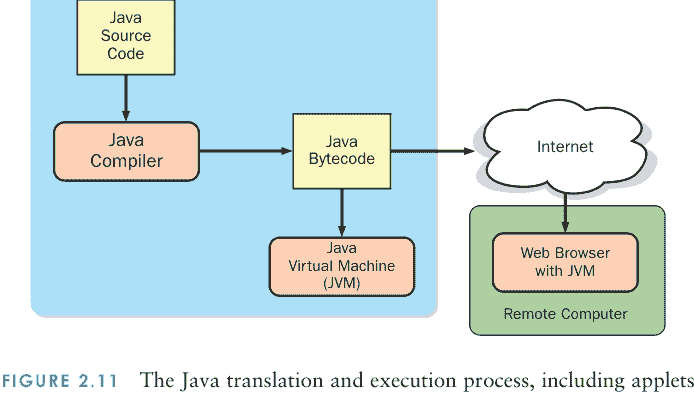

### 自测习题（答案见附录 N）

**SR 2.42** Java 应用和 Java applet 之间有什么区别？

**SR 2.43** applet 的 `paint` 方法在什么时候被调用？

**SR 2.44** 下面的 HTML applet 标签有什么错误？请解释。

```
<applet code="DrawHouse.java" width="400" height="300">
</applet>
```

## 2.9 绘制形状

Java 标准类库提供了许多类，让我们能够展示和操纵图形信息。`Graphics` 类是所有此类处理的基础。

### Graphics 类

`Graphics` 类定义在 `java.awt` 包中。它包含了各种方法，允许我们绘制形状，包括线条、矩形和椭圆。图 2.12 列出了 Graphics 类的一些基础绘制方法。注意，这些方法还允许我们绘制圆形和正方形，它们只是特定类型的椭圆和矩形。我们将在书后的适当位置讨论 Graphics 类的其他绘制方法。

`Graphics` 类的方法允许我们指定形状是填充的还是未填充的。未填充的形状仅显示形状的轮廓且是透明的（除非存在任何底层图形）。填充的形状在其边界之间是实心的，并覆盖任何底层图形。

所有这些方法都依赖于 Java 坐标系，我们在本章前面讨论过它。请记住 (0,0) 位于左上角，向右移动时 x 值增大，向下移动时 y 值增大。在可见区域之外的坐标处绘制的任何形状都将是不可的。

许多绘制方法是显而易见的，但某些需要进一步的讨论。注意，由 `drawOval` 方法绘制的椭圆是由左上角的坐标以及指定边界矩形宽度和高度的尺寸定义的。具有曲线的形状（如所示）通常由包含周边的矩形定义。图 2.13 描了一个椭圆的边界矩形。

```
void drawLine(int x1, int y1, int x2, int y2)
从点 (x1, y1) 到点 (x2, y2) 绘制一条线。
```

```
void drawRect(int x, int y, int width, int height)
绘制一个左上角为 (x, y) 尺寸为 width 和 height 的矩形。
```

```
void drawOval(int x, int y, int width, int height)
绘制一个由左上角为 (x, y)、尺寸为 width 和 height 的矩形边界的椭圆。
```

```
void drawString(String str, int x, int y)
在点 (x, y) 处绘制字符字符串，向右延伸。
```

```
void drawArc(int x, int y, int width, int height, int startAngle, int arcAngle)
沿由 x, y, width, height 矩形边界的椭圆绘制一条弧。弧从 startAngle 开始，延伸一段为 arcAngle 的距离。
```

```
void fillRect(int x, int y, int width, int height)
与其对应的 draw 方法相同，但用当前的前景颜色填充。
```

```
void fillOval(int x, int y, int width, int height)
```

```
void fillArc(int x, int y, int width, int height, int startAngle, int arcAngle)
```

```
Color getColor()
返回此图形上下文的前景颜色。
```

```
void setColor(Color color)
将此图形上下文的前景颜色设置为指定的颜色。
```

图 2.12 Graphics 类的一些方法

### 核心概念

弧是椭圆的一部分，从特定的起始角开始，并按弧角（arc angle）指定的距离延伸。

弧可以被看作椭圆的一个段。要绘制弧，我们指定弧所属的椭圆以及我们感兴趣的椭圆部分。弧的起点由起始角（start angle）定义，弧的终点由弧角（arc angle）定义。弧角并不指示弧结束的位置，而是指示它的范围。起始角和弧角以度为单位测量。起始角的原点是穿过椭圆中心的虚拟水平线，可以称为 0°，如图 2.14 所示。

每个图形上下文都有一个当前的前景颜色，在绘制形状时都会使用。每个可以绘制的表面都有一个背景颜色。前景颜色使用 `Graphics` 类的 `setColor` 方法设置，背景颜色使用我们正在绘制的组件的 `setBackground` 方法设置，例如在 applet 中。列表 2.11 显示了一个名为 Snowman 的 applet。它使用各种绘制方法来绘制一个冬季场景。仔细查看代码，注意每个形状是如何绘制的。注意，雪人形象基于两个常量值 `MID` 和 `TOP`，它们定义了雪人的中间位置和顶部。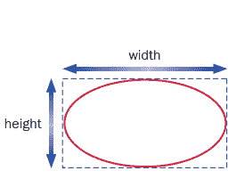

图 2.13 椭圆及其边界矩形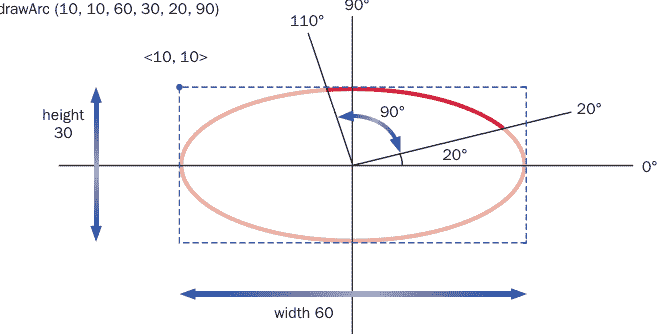

图 2.14 由椭圆、起始角和弧角定义的弧

## 2.11

```
************************************
// Snowman.java 作者：Lewis/Loftus
// 展示了绘制方法和颜色的使用
************************************

import javax.swing.JFrame;
import java.awt.*;

public class Snowman extends JFrame {

    // --------------------------------------
    // 绘制雪人。
    // --------------------------------------
    public void paint(Graphics page) {
        final int MID = 150;
        final int TOP = 50;

        setBackground(Color.cyan);
        page.setColor(Color.blue);
        page.fillRect(0, 175, 300, 50); // 地面
        page.setColor(Color.yellow);
        page.fillOval(-40, -40, 80, 80); // 太阳
        page.setColor(Color.white);
        page.fillOval(MID-35, MID+35, 70, 50); // 上身
        page.fillOval(MID-50, TOP+80, 100, 60); // 下身
        page.setColor(Color.black);
        page.fillOval(MID-10, TOP+10, 5, 5); // 左眼
        page.fillOval(MID+5, TOP+10, 5, 5); // 右眼
        page.drawArc(MID-10, TOP+20, 20, 10, 190, 160); // 微笑
        page.drawLine(MID-25, TOP+60, MID-50, TOP+40); // 左臂
        page.drawLine(MID+25, TOP+60, MID+55, TOP+60); // 右臂
        page.drawLine(MID-20, TOP+5, MID+20, TOP+5); // 帽檐
        page.fillRect(MID-15, TOP-20, 30, 25); // 帽顶
    }
}
```

### 列表 2.11 继续显示

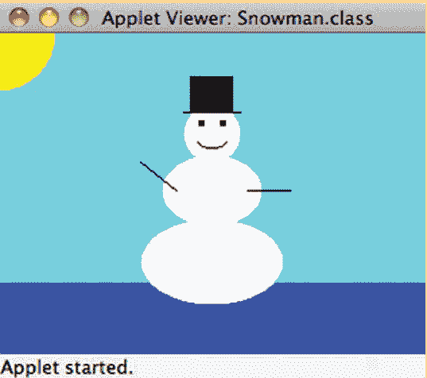

雪人的头部。整个雪人形象都是相对于这些值绘制的。使用像这样的常量可以更方便地创建雪人，并在以后进行修改。例如，要将你图片中的雪人向右或向左移动，只需更改一个常量声明。

- 自我测习题（答案见附录 N）
- SR 2.45 什么是边界矩形？
- SR 2.46 假设你有一个名为 `page` 的 Graphics 对象，编写一条语句画出一个边长为 50 的正方形，使其左上角位于点 (16, 12)。
- SR 2.47 假设你有一个名为 `page` 的 Graphics 对象，编写一系列语句，画一个高为 20、宽为 40 的矩形，使其左上角位于点 (30, 35)。
- SR 2.48 分别对雪人程序进行以下更改，结果会是什么？你可以进行更改、编译并运行程序，观察并报告结果。简要说明你观察到的现象。
  - a. `MID` 的值设置为 120 而不是 150。
  - b. `TOP` 的值设置为 25 而不是 50。
  - c. 在程序的最后两个语句（绘制帽子的语句）之前，我们包含语句 `page.setColor(Color.blue);`
  - d. 在创建微笑的语句中将 190 改为 10。
  - e. 在创建上躯干的语句之前，将前景颜色设置为青色。在创建上躯干后，立即将其设回白色。

### 核心概念总结

- `print` 和 `println` 方法代表了 `System.out` 对象提供的两种服务。
- 转义序列可用于表示否则会引起编译问题的字符。
- 变量是内存位置的名称，用于存储特定数据类型的值。
- 访问数据会保持其在内存中不变，但赋值语句会覆盖旧数据。
- 我们不能将一种类型的值赋值给不兼容类型的变量。
- 常量在它们存在期间保持一个特定的值。
- Java 有两种数值类型：整数和浮点数。共有四种整数数据类型和两种浮点数据类型。
- Java 使用 16 位的 Unicode 字符表示字符数据。
- 表达式是运算符和操作数的组合，用于执行计算。
- Java 遵循一套定义良好的优先级规则，这些规则决定了表达式中运算符被求值的顺序。
- 应避免窄化转换，因为它们可能会丢失信息。
- `Scanner` 类提供了从各种来源读取各种类型输入数据的方法。
- 图形数据通过将其划分为许多微小的像素（pixels）来表示。
- Java 的坐标系原点位于左上角，所有可见坐标均为正值。
- Java在 Java 中使用 RGB 值表示颜色——即代表红、绿、蓝三色原色贡献的三个值。
- `Color` 类包含了常用的预定义颜色，并可以定义许多其他颜色。
- Applet（小程序）是通常通过网络传输并使用 浏览器执行的 Java 程序。
- 大多数形状可以填充（不透明）或不填充（作为轮廓）。
- 边界矩形用于定义如椭圆等曲线形状的位置和大小。
- 弧（arc）是椭圆的一部分，从特定的起始角度开始，按弧角指定的距离延伸。

# 练习题

- EX 2.1 字面量 4、`4.0`、`'4'` 和 `"4"` 之间的区别是什么？
- EX 2.2 从对象及其提供的角度解释以下编程语句： `System.out.println("I gotta be me!");`
- EX 2.3 下述代码段产生什么输出？解释，

```
System.out.println("Welcome!");
System.out.print("This is an art of printing in ");
System.out.println("Java programming.");
System.out.print("More ");
System.out.print("to ");
System.out.println("follow.");
```

- EX 2.4 下述程序语句有错吗？如果是，如何修复？ `System.out.println("The solution is here.\n");`
- EX 2.5 下述语句产生什么输出？解释。 `System.out.println("50 plus 25 is " + 50 + 25");`
- EX 2.6 下述语句产生什么输出？解释。 `System.out.println("He thrusts his fists\ntagainst\" + "post\nand still insists\n,the sees the \"ghost\"\");");`
- EX 2.7 在执行以下语句后，整数变量中包含什么值？

```
count = 4;
count = count % 4;
count = count * 10;
count = count + 10;
```

- EX 2.8 在执行以下语句后，浮点变量中包含什么值？

```
area = 3.14;
area = area / 10;
area = area * 0.5;
```

- EX 2.9 在执行以下语句后，整数变量中包含什么值？

```
sum = 15;
sum = sum % 3;
sum += 500;
sum *= 2;
```

- EX 2.10 编写三个不同的程序语句来减少整数的值。
- EX 2.11 给定以下声明，每个赋值语句中存储了什么结果？

```
int iResult, num1 = 25, num2 = 40, num3 = 17, num4 = 5;
double fResult = 17.0, val2 = 5.7;
```
  a. iResult = num1 / num4;
  b. fResult = num1 / num4;
  c. iResult = num3 / num4;
  d. fResult = num3 / num4;
  e. iResult = val1 / num4;
  f. fResult = val1 / num2;
  g. iResult = num1 / num2;
  h. fResult = (double)num1 / num2;
  i. fResult = (double)num1 / num2;
  j. fResult = (double)num1;
  k. iResult = (int)val1;
  l. fResult = (int)num1;
  m. fResult = (double)num1;
  n. iResult = num3;
  o. fResult = num3;
  p. iResult = num3;
  q. fResult = num3;

- EX 2.12 对于以下表达式，标明运算符的求值顺序：
  a. a + b * c
  b. a * b + c
  c. a * b / c
  d. a / b * c
  e. a + b + c
  f. a - b - c
  g. a + (b * c)
  h. (a + b) * c
  i. a - (b - c)
  j. (a - b) - c
  k. a / (b * c)
  l. (a / b) * c
  m. a * (b / c)
  n. (a * b) / c
  o. a % (b + c)
  p. (a % b) + c
  q. a + b % c
  r. (a + b) % c
  i. a - b % c
  j. (a - b) % c
  k. a - (b % c)
  l. (a - b) % c
  m. a * (b + c)
  n. (a * b) + c
  o. a * (b - c)
  p. (a * b) - c
  q. a / (b * c)
  r. (a / b) * c
  s. a / (b / c)
  t. (a / b) / c
  u. a % (b + c)
  v. (a % b) + c
  w. a % (b - c)
  x. (a % b) - c
  y. a % (b * c)
  z. (a % b) * c

- EX 2.13 使用 `int` 和 `double` 变量执行以下语句，结果分别是什么？

```
int a = 10;
int b = 4;
double c = 10.0;
double d = 4.0;
```


a. `a / b`;
b. `c / d`;
c. `a / c`;
d. `c / b`;
e. `a % b`;
f. `c % d`;
g. `a % c`;
h. `c % b`;
i. `a + b`;
j. `c + d`;
k. `a + b`;
l. `c + d`;
m. `a - b`;
n. `c - d`;
o. `a * b`;
p. `c * b`;
q. `a * d`;
r. `c * d`;
s. `a / b`;
t. `c / b`;
u. `a / d`;
v. `c / d`;
w. `a % b`;
x. `c % b`;
y. `a % d`;
z. `c % d`;

- EX 2.14 描述 `Scanner` 类提供的从各种来源读取各种类型输入的方法。
- EX 2.15 图形数据是如何通过划分为许多微小的像素表示的？
- EX 2.16 Java 的坐标系原点在左上角，所有可见坐标均为正值。这意味着什么？
- EX 2.17 Java 中使用 RGB 值表示颜色——即代表红、绿、蓝三色原色贡献的三个值。
- EX 2.18 `Color` 类包含了常用的预定义颜色，并可以定义许多其他颜色。
- EX 2.19 Applet 是通常通过网络传输并使用浏览器执行的 Java 程序。
- EX 2.20 大多数形状可以填充（不透明）或不填充（作为轮廓）。
- EX 2.21 边界矩形用于定义如椭圆等曲线形状的位置和大小。
- EX 2.22 弧是椭圆的一部分，从特定的起始角度开始，按弧角指定的距离延伸。

- EX 2.1 字面量 `4`、`4.0`、`'4'` 和 `"4"` 之间的区别是什么？
- EX 2.2 从对象及其提供的角度解释以下编程语句：
  `System.out.println("I gotta be me!");`
- EX 2.3 下述代码段产生什么输出？解释，

```
System.out.println("Welcome!");

System.out.print("This is an art of printing in ");

System.out.println("Java programming.");

System.out.print("More ");

System.out.print("to ");

System.out.println("follow.");
```

- EX 2.4 下述程序语句有错吗？如果是，如何修复？
  `System.out.println("The solution is here.\n");`
- EX 2.5 下述语句产生什么输出？解释。
  `System.out.println("50 plus 25 is " + 50 + 25");`
- EX 2.6 下述语句产生什么输出？解释。
  `System.out.println("He thrusts his fists\ntagainst\" + "post\nand still insists\n,the sees the \"ghost\"\");");`
- EX 2.7 在执行以下语句后，整数变量中包含什么值？

```
count = 4;

count = count % 4;

count = count * 10;

count = count + 10;
```

- EX 2.8 在执行以下语句后，浮点变量中包含什么值？

```
area = 3.14;

area = area / 10;

area = area * 0.5;
```

- EX 2.9 在执行以下语句后，整数变量中包含什么值？

```
sum = 15;

sum = sum % 3;

sum += 500;

sum *= 2;
```

- EX 2.10 编写三个不同的程序语句来减少整数的值。
- EX 2.11 给定以下声明，每个赋值语句中存储了什么结果？

```
int iResult, num1 = 25, num2 = 40, num3 = 17, num4 = 5;

double fResult = 17.0, val2 = 5.7;
```

  a. `iResult = num1 / num4`;
  b. `fResult = num1 / num4`;
  c. `iResult = num3 / num4`;
  d. `fResult = num3 / num4`;
  e. `iResult = val1 / num4`;
  f. `fResult = val1 / num2`;
  g. `iResult = num1 / num2`;
  h. `fResult = (double)num1 / num2`;
  i. `fResult = (double)num1 / num2`;
  j. `fResult = (double)num1`;
  k. `iResult = (int)val1`;
  l. `fResult = (int)num1`;
  m. `fResult = (double)num1`;
  n. `iResult = num3`;
  o. `fResult = num3`;
  p. `iResult = num3`;
  q. `fResult = num3`;
- EX 2.12 对于以下表达式，标明运算符的求值顺序：
  a. `a + b * c`
  b. `a * b + c`
  c. `a * b / c`
  d. `a / b * c`
  e. `a + b + c`
  f. `a - b - c`
  g. `a + (b * c)`
  h. `(a + b) * c`
  i. `a - (b - c)`
  j. `(a - b) - c`
  k. `a / (b * c)`
  l. `(a / b) * c`
  m. `a * (b / c)`
  n. `(a * b) / c`
  o. `a % (b + c)`
  p. `(a % b) + c`
  q. `a + b % c`
  r. `(a + b) % c`
  i. `a - b % c`
  j. `(a - b) % c`
  k. `a - (b % c)`
  l. `(a - b) % c`
  m. `a * (b + c)`
  n. `(a * b) + c`
  o. `a * (b - c)`
  p. `(a * b) - c`
  q. `a / (b * c)`
  r. `(a / b) * c`
  s. `a / (b / c)`
  t. `(a / b) / c`
  u. `a % (b + c)`
  v. `(a % b) + c`
  w. `a % (b - c)`
  x. `(a % b) - c`
  y. `a % (b * c)`
  z. `(a % b) * c`
- EX 2.13 使用 `int` 和 `double` 变量执行以下语句，结果分别是什么？

```
int a = 10;

int b = 4;

double c = 10.0;

double d = 4.0;
```

  a. `a / b`;
  b. `c / d`;
  c. `a / c`;
  d. `c / b`;
  e. `a % b`;
  f. `c % d`;
  g. `a % c`;
  h. `c % b`;
  i. `a + b`;
  j. `c + d`;
  k. `a + b`;
  l. `c + d`;
  m. `a - b`;
  n. `c - d`;
  o. `a * b`;
  p. `c * b`;
  q. `a * d`;
  r. `c * d`;
  s. `a / b`;
  t. `c / b`;
  u. `a / d`;
  v. `c / d`;
  w. `a % b`;
  x. `c % b`;
  y. `a % d`;
  z. `c % d`;
- EX 2.14 描述 `Scanner` 类提供的从各种来源读取各种类型输入的方法。
- EX 2.15 图形数据是如何通过划分为许多微小的像素表示的？
- EX 2.16 Java 的坐标系原点在左上角，所有可见坐标均为正值。这意味着什么？
- EX 2.17 Java 中使用 RGB 值表示颜色——即代表红、绿、蓝三色原色贡献的三个值。
- EX 2.18 `Color` 类包含了常用的预定义颜色，并可以定义许多其他颜色。
- EX 2.19 Applet 是通常通过网络传输并使用浏览器执行的 Java 程序。
- EX 2.20 大多数形状可以填充（不透明）或不填充（作为轮廓）。
- EX 2.21 边界矩形用于定义如椭圆等曲线形状的位置和大小。
- EX 2.22 弧是椭圆的一部分，从特定的起始角度开始，按弧角指定的距离延伸。

# 编程项目

- PP 2.1 创建一个修订版的 Lincoln 程序打印框内的字符
- PP 2.2 编写一个程序读取四个整数并打印它们的平方。
- PP 2.3 编写一个程序读取三个浮点数并打印它们的立方。
- PP 2.4 编写一个程序提示并读取课程名称和学分，打印以下段落：
  本学期，增加了一门名为 `coursename` 的课程。它的学分为 `credits`。
- PP 2.5 创建一个 `UnitConverter` 应用程序将英寸转换为英尺。从用户处读取英寸值。
- PP 2.6 编写一个程序将克转换为磅。（1磅等于453.592克。）从用户处读取浮点类型的克值。
- PP 2.7 编写一个程序提示并读取打字速度和字符数，然后以浮点结果打印所需的时间。
- PP 2.8 编写一个程序读取千克、克和毫克的重量，然后打印对应的毫克重量。（例如，1千克、50克和42毫克等于10,500,042毫克。）
- PP 2.9 创建之前项目的版本以反转计算。即读取代表毫克的数值，然后打印作为千克、克和毫克的组合重量。（例如，90,700,056毫克等于9千克、70克和56毫克。）
- PP 2.10 编写一个程序确定罐中硬币的价值，并以美元和分的形式打印总额。读取季度币、镍和分的整数值。
- PP 2.11 编写一个程序提示并读取一个代表金额的 `double` 值。然后确定该金额所需的最少钞票和硬币，从最大的开始（假设美元钞是最大尺寸）。例如，如果输入的值为 47.63（47美元63分），则程序应打印等值金额为：
  - 4张十美元钞
  - 1张五美元钞
  - 2张1美元钞
  - 2枚季度币
  - 1枚镍币
  - 0个镍币
  - 3个美分币

- PP 2.12 编写一个程序，提示并读取两个表示矩形长度和宽的整数，然后打印它的周长和面积。
- PP 2.13 编写一个程序，提示并读取一个浮点值（`double`）作为圆的周长，然后打印圆的半径。
- PP 2.14 创建一个雪人 applet 的修订版本，并进行以下修改：
  - 在躯干上方添加两个红色按钮。
  - 让雪人呈现被冰结状态，而不是微笑。
  - 将太阳移动到图片的右上角。
  - 在图片的左上角显示你的名字。
  - 将整个雪人向右移动 20 像素。
- PP 2.15 编写一个绘制大熊座的 applet。在夜空中添加一些额外的星星。
- PP 2.16 编写一个绘制系在绳子上的气球 applet。让气球呈现各种颜色。
- PP 2.17 编写一个绘制奥林匹克标志的 applet。标志中的圆应该从左到右着色为蓝色、黄色、黑色、绿色和红色。
- PP 2.18 编写一个绘制带有门（和门把手）、窗户和烟囱的房屋的 applet。让烟囱排出一些烟，并在空中画一些云。
- PP 2.19 编写一个显示你自己的设计的名片的 applet。包含图形和文本。
- PP 2.20 编写一个 applet，通过绘制你的名字来显示阴影文字：先用黑色绘制你的名字，然后用稍微偏移的较浅颜色再次绘制一遍。
- PP 2.21 编写一个显示带有八个等份切片的饼图的 applet，每一片的颜色都不同。

# 软件故障

## NASA 火星气候轨道器与极地陆着陆器

### 发生了什么？

作为探索火星的一系列任务的一部分，NASA 于 1998 年 12 月发射了火星气候轨道器，并于 1999 年 1 月发射了火星极地陆着陆器。这项双探测器任务旨在通过每个季节观察火星的大气状况。轨道器本应收集有关温度、尘埃、水蒸气、云以及火星极地区增加和减少的二氧化碳（CO2）数量的数据。

在经过九个月的飞行后，轨道器于 1999 年 9 月到达火星，并启动发动机以建立轨道。轨道器按计划在从地球角度看五分钟后通过该行星，NASA 无法与其重新建立联系，本预期它已进入轨道。数据审查显示，轨道器进入轨道时的高度仅为 57 公里，而计划高度为 140 公里。NASA 得结论认为轨道器被大气摩擦摧毁。

极地陆着陆器于 1999 年 12 月到达火星，所有数据表明它将在火星南极目标区域 10 公里内成功着陆。然而，NASA 在陆着陆器进入大气层后不久便与其失去了联系。在之后的几周和几个月里，多次尝试重新建立联系均失败。

轨道器和陆着陆器的总成本为 3.276 亿美元。

### 是什么导致了这种情况？

轨道器问题的根源是一个令人尴尬的通信问题。引导航天器导航的软件使用的是英制单位（磅力），而航天器本身期望的是公制单位数据（牛顿）。因此，预期的导航变化与实际效果之间存在 4.45 倍的偏差。这种不匹配导致的部分原因是：一个位于科罗拉多州的团队负责航天器的工作，而位于加利福尼亚州的团队负责管理导航问题。


> 火星气候轨道器的构想

陆着陆器通信问题尚未解决，但据认为与轨道器的问题无关。调查得出，最可能的原因是一个软件错误，它将陆着陆器支腿展开时产生的震动误认为是实际落在行星表面时的震动。如果当时陆着陆器还距离地面 40 米，这个错误将导致陆着陆器的下降发动机关闭。然而，也存在其他的问题场景。

## 吸取的教训

火星气候轨道器的单位不匹配表明，在高度复杂的系统中，看似明显的问题可能会被忽视。错误是不可避免的，但必须建立相应的流程在错误变成致命问题之前捕捉它们。调查得出结论，在这种情况下，跟踪和双检子系统之间互连元件的系统不够稳健。对团队新成员的培训和沟通也不一致，且某些沟通渠道过于非正式。简而言之，该任务缺乏严谨的全系统视角，这种视角本可以导致在时太晚之前发现单位不匹配的问题。

鉴于原因尚不明确，很难从陆着陆器的问题中得出有力的结论。它仍然是一个悬而未决的问题，这一事实强调了在关键资源面临风险的情况下，需要更多的评估、模拟和测试。

来源：nasa.gov

# 使用类和对象

### 章目标

- 讨论对象的创建和对象引用变量的使用。
- 探索 `String` 类提供的服务。
- 描述 Java 标准类库如何组织成包。
- 探索 `Random` 和 `Math` 提供的服务。
- 讨论如何使用 `NumberFormat` 格式化输出。
- 引入枚举类型。
- 讨论自动装箱（autoboxing）的概念。
- 引入图形用户界面。
- 讨论图像显示。

本章进一步探讨对象的使用。在本章中，我们使用字符串、产生随机数、执行复杂的计算并格式化输出。本章还将介绍包装类。

## 3.1 创建对象

在第 1 章结束处，我们介绍了面向对象的概念，包括类和对象之间的基本关系。在第 2 章中，除了讨论基本数据，我们提供了一些使用对象的示例。本章进一步探讨这些思想。

在之前的示例中，我们多次使用了 `println` 方法。正如第 2 章提到的，`println` 方法是 `System` 对象提供的服务，该对象代表标准输出流。让我们仔细检查创建对象的想法。在 Java 中，变量要么表示基本类型值，要么表示对象。与持有基本类型的变量一样，引用对象的变量也必须声明。定义对象的类可以被视为对象的类型。

考虑以下声明：

```
int num;

String name;
```

第一个声明创建了一个持有整数值的变量。第二个声明创建了一个 `String` 变量，它持有对 `String` 对象的引用。

最初，上面定义的两个变量不包含任何数据。我们说它们是未初始化的，如下：

| num | |
|---|---|
| name | |

### 3.1 创建对象

对象引用可以被设置为 `null`，这是 Java 中的一个保留字。`null` 引用专门表示该变量不引用任何对象。

请注意，尽管我们声明了一个 `String` 引用变量，但实际上并不存在任何 `String` 对象。使用 `new` 运算符创建对象的行为被称为“实例化”（instantiation）。一个对象是特定类的实例（instance）。要实例化一个对象，我们可以使用 `new` 运算符，它会返回新对象的地址。以下两个赋值语句为上面声明的两个变量赋值：

```
num = 42;

name = new String("James Gosling");
```

在 `new` 运算符创建对象后，会调用构造函数对其进行初始化。构造函数是一个特殊方法，其名称与类名相同。在这个例中，构造函数的参数是一个字符串字面量，它定义了字符串对象将包含的字符。在执行这些赋值语句后，变量可以描述为：

> 核心概念
> `new` 运算符返回一个指向新创建对象的引用。

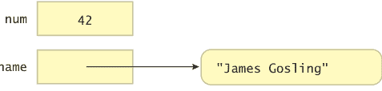

由于对象引用持有对象的地址，因此它可以被视为指向存储对象的内存的指针。我们可以显示数值地址，但实际值是无关的————重要的是变量引用了一个特定的对象。

在对象被实例化后，我们使用点运算符（dot operator）来访问它的方法。我们已经多次使用过点运算符了，例如调用 `System.out.println` 时。点运算符紧跟在对象引用之后，后面跟的是要调用的方法名。例如，为了调用 `String` 类中定义的 `length` 方法，我们在引用变量上使用点运算符：

```
count = name.length();
```


`length` 方法不接受任何参数，但仍然需要括号来表示这一点。某些方法在方法完成时会产生并返回一个值。`String` 类中 `length` 方法的目的是确定并返回字符串的长度（字符个数）。在这个例中，返回的值被赋值给变量 `count`。对于字符串 "James Gosling"，`length` 方法返回 13，这包含了名字和姓氏之间的空格。接下来的节将讨论一些 `String` 方法。

声明对象引用变量和创建对象本身的行为可以通过在声明时初始化变量来合并为一个步骤，就像我们处理基本数据类型时一样：

```java
String title = new String("Java Software Solutions");
```

尽管它们不是基本数据类型，但字符字符串是如此基础且使用如此频繁，以至于 Java 定义了由双引号界定的字符串字面量，我们在各种示例中已经看到过这一点。每当字符串字面量出现时，都会自动创建一个 `String` 对象。因此，以下声明是有效的：

```java
String city = "London";
```

也就是说，对于字符串对象，显式使用 `new` 运算符和调用构造函数是可以被省略的。在大多数情况下，我们将使用这种简化的语法。

### 别名（Aliases）

由于对象引用变量存储的是地址，程序员在管理对象时必须小心。首先，让我们回顾赋值对基本类型值的影响。假设我们有两个整数变量 `num1`（初始化为 5）和 `num2`（初始化为 12）：

| num1 | 5 |
| num2 | 12 |

在下面的赋值语句中，`num1` 中存储的值拷贝被存储在 `num2` 中：

```java
num2 = num1;
```

`num2` 中原始值 12 被值 5 覆盖。变量 `num1` 和 `num2` 仍然引用内存中的不同位置，而这两个位置现在都包含了值 5：

| num1 | 5 |
| num2 | 5 |

## 3.1 创建对象

现在考虑以下对象声明：

```java
String name1 = "Ada, Countess of Lovelace";
String name2 = "Grace Murray Hopper";
```

最初，引用 `name1` 和 `name2` 指向两个不同的 `String` 对象：

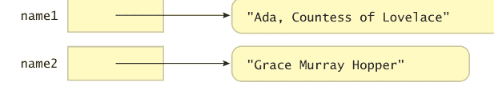

现在假设执行赋值语句，将 `name1` 的值拷贝到 `name2` 中：

```java
name2 = name1;
```

此赋值的操作方式与整数赋值相同——`name1` 的值的拷贝被存储在 `name2` 中。但请记住，对象变量持有的是对象的地址，被拷贝的是这个地址。最初，两个引用指向不同的对象。赋值后，`name1` 和 `name2` 包含相同的地址并引用同一个对象：

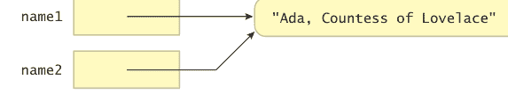

`name1` 和 `name2` 引用变量现在是彼此的别名，因为它们是引用同一个对象的两个名字。原本由 `name2` 引用的对象的引用现在都消失了；该对象无法在程序中使用。

别名的一个重要影响是，当我们使用一个引用来更改对象时，另一个引用对应的对象也会随之改变，因为实际上只有一个对象。除非仔细管理，否则别名会导致意外的后果。

与对象的所有交互都通过引用变量发生，因此只有当我们拥有该对象的引用时，才能使用该对象。当对对象的所有引用都消失时，该对象就再也无法使用了。当对对象的某个引用被重新赋值（例如通过赋值语句），该对象就变成了垃圾。Java 环境会自动回收这些不再被引用的对象以释放可用的内存。

> 核心概念
> 多个引用可以指向同一个对象。

### 自测问题（见附录 N）

- SR 3.1 什么是 `null`？
- SR 3.2 `new` 运算符的作用是什么？
- SR 3.3 写一个名为 `author` 的字符串声明，并将其初始化为 "Fred Brooks"。
- SR 3.4 什么是别名？
- SR 3.5 `String` 方法与垃圾回收有什么关系？

## 3.2 String 类

详细研究 `String` 类。图 3.1 列出了 `String` 类的一些有用方法。

一旦创建了 `String` 对象，其值就无法延长或缩短，我们说 `String` 是不可变的（immutable）。然而，某些方法会返回新的 `String` 对象。注意，某些 `String` 方法可以通过位置或索引指定字符。字符串中第一个字符的索引为 0，下一个字符索引为 1，以此类推。因此，在字符串 "Hello" 中，字符 'H' 的索引是 0，索引 4 的字符是 'o'。

列表 3.1 中的程序中练习了几个 `String` 方法。在检查 `StringMutation` 程序时，请记住这并不是一个改变数据的 `String` 对象；该程序创建了五个独立的 `String` 对象。最初，对象设置如下：

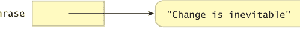

### String 类

| 方法 | 说明 |
| :--- | :--- |
| `String(String str)` | 构造函数：创建一个与 `str` 相同的新字符串对象。 |
| `char charAt(int index)` | 返回指定索引处的字符。 |
| `int compareTo(String str)` | 返回一个整数，表示此字符串在字典序上小于（负值）、等于（零值）还是大于（正值）字符串 `str`。 |
| `String concat(String str)` | 返回与 `str` 连接后的新字符串。 |
| `boolean equals(String str)` | 如果此字符串包含与 `str` 相同的字符（区分大小写），则返回 `true`，否则返回 `false`。 |
| `boolean equalsIgnoreCase(String str)` | 如果此字符串包含与 `str` 相同的字符（不区分大小写），则返回 `true`，否则返回 `false`。 |
| `int length()` | 返回字符串中的字符个数。 |
| `String replace(char oldChar, char newChar)` | 返回一个新字符串，其中此字符串中所有的 `oldChar` 都被替换为 `newChar`。 |
| `String substring(int offset, int endIndex)` | 返回一个字符串的子集，从索引 `offset` 开始延伸到 `endIndex-1`。 |
| `String toLowerCase()` | 返回一个与此字符串相同的新字符串，但所有大写字母都转换为小写。 |
| `String toUpperCase()` | 返回一个与此字符串相同的新字符串，但所有小写字母都转换为大写。 |

> 图 3.1 String 类的一些有用方法

### 列表 3.1

```java
/********************************************************************************
// StringMutation.java      Author: Lewis/Loftus
// 演示 String 类类及其方法的用法。
********************************************************************************/

public class StringMutation {

    //------------------------------------
    // 打印一个字符串及其各种变体。
    //------------------------------------

    public static void main(String[] args) {

        String phrase = "Change is inevitable";

        String mutation1, mutation2, mutation3, mutation4;

        System.out.println("Original string: " + phrase + "\"");

        System.out.println("Length of string: " + phrase.length());

        mutation1 = phrase.concat(", except from vending machines.");

        mutation2 = mutation1.toUpperCase();

        mutation3 = mutation2.replace('E', 'X');

        mutation4 = mutation3.substring(3, 30);

        // 打印每个变体字符串

        System.out.println("Mutation #1: " + mutation1);

        System.out.println("Mutation #2: " + mutation2);

        System.out.println("Mutation #3: " + mutation3);

        System.out.println("Mutation #4: " + mutation4);

        System.out.println("Mutated length: " + mutation4.length());

    }

}
```

```
OUTPUT

Original string: "Change is inevitable"
Length of string: 20
Mutation #1: Change is inevitable, except from vending machines.
Mutation #2: CHANGE IS INEVITABLE, EXCEPT FROM VENDING MACHINES.
Mutation #3: CHANGX IS INXVITABL, XXCPT FROM VXNDING MACHINXS.
Mutation #4: NGX IS INXVITABL, XXCXPT F
Mutated length: 27
```

## 3.2 String 类

在打印原始语句及其长度后，执行了 `concat` 方法来创建一个由变量 `mutation1` 引用的新字符串对象：

```java
mutation1 = "Change is inevitable, except from vending machines."
```

然后对 `mutation1` 对象执行了 `toUpperCase` 方法，并将结果字符串存储在 `mutation2` 中：

```java
mutation2 = "CHANGE IS INVITABLE, EXCEPT FROM VENDING MACHINES";
```

注意 `length` 和 `concat` 方法是在 `phrase` 对象上执行的，但 `toUpperCase` 方法是在 `mutation1` 对象上执行的。`String` 类的任何方法都可以在任何对象上执行，但对于任何调用，方法是在特定对象上执行的。在 `mutation1` 上执行 `toUpperCase` 的结果与在 `phrase` 上执行的结果将非常不同。记住，每个对象都有自己的状态，这通常会影响方法调用的结果。

> 核心概念
> 方法通常在特定对象上执行，这会影响结果。

最后，通过调用 `mutation2.replace` 和 `mutation3.substring` 分别初始化 String 变量 `mutation3` 和 `mutation4`：

```java
mutation3 = "CNGAX INXVITABL,XXCEPT FROM VXNDING MACHINXS";
```

```java
mutation4 = "NXG IS INXVITABL, XXCEPT F";
```

### 自测题（答案见附录 N）

- 3.6 假设 `s1`、`s2` 和 `s3` 是别别初始化为 "Amanda"、"Bobby" 和 "Chris" 的 String 变量。以下语句改变了哪一个 String 变量？
  - a. `System.out.println(s1);`
  - b. `s1 = s3.toLowerCase();`
  - c. `System.out.println(s2.replace('B', 'M'));`
  - d. `s2 = s2.concat(s1);`

- 3.7 下述片段产生什么输出？

```java
String s1 = "Foundations";
String s2;
System.out.println(s1.charAt(1));
s2 = s1.substring(0, 5);
System.out.println(s2);
System.out.println(s1.length());
System.out.println(s2.length());
```

- 3.8 编写一条语句，打印名为 `title` 的 String对象的全大写值。

- 3.9 为名为 `front` 的 String 变量编写声明，并将其初始化为另一个名为 `description` 的 String 对象的前 10 个字符。

## 3.3 包 (Packages)

我们之前提到 Java 语言由一个名为 Java API 的标准类库支持，我们可以根据需要使用它。让我们进一步探讨一下。

库是一组支持程序开发的类。编译器或开发环境通常会附带一个类库。类库也可以通过第三方供应商单独获得。类库中的类包含许多方法，这些方法对程序员来说非常有价值，因为它们提供了功能。事实上，程序员经常会依赖类库中的方法，并开始将它们视为语言的一部分。从技术上讲，它们并不属于语言本身。

例如，`String` 类并不是语言固有的部分。它是标准类库的一部分，可以在任何 Java 开发环境中找到。类库是由相关类的集合组成的，通常被称为 API（应用程序编程接口）。例如，当我们谈论与数据库交互的类集时，称为 Java API。另一个 API 的例子是 Java Swing API，它指的是用于图形组件的类集。

这些类是由 Sun Microsystems 的员工创建的。Java 标准类库也被组织成不同的包。每个类属于一个特定的包。例如，`String` 类属于 `java.lang` 包。我们在第 2 章中提到，`Scanner` 类属于 `java.util` 包。

包的组织比 API 名称更具基础性且基于语言。虽然包和 API 名称之间存在一般的对应关系，但构成给定 API 的类组可能会跨越包。

> 核心概念
> 类库为开发程序提供了支持。

> 核心概念
> Java 标准类库被组织成包。

| 包 | 提供支持 |
| :--- | :--- |
| `java.applet` | 创建可以在 Web 上快速传输的程序（applet）。 |
| `java.awt` | 绘制图形并创建图形用户界面；AWT 代表抽象窗口工具。 |
| `java.beans` | 定义可以组合成应用程序的软件组件。 |
| `java.io` | 执行各种输入输出功能。 |
| `java.lang` | 普通支持；它会自动导入到所有 Java 程序中。 |
| `java.math` | 执行任意精度的计算。 |
| `java.net` | 跨网络通信。 |
| `java.rmi` | 创建可以跨多个计算机分布的程序；RMI 代表远程方法调用。 |
| `java.security` | 强制执行限制。 |
| `java.sql` | 与数据库交互；SQL 代表结构化查询语言。 |
| `java.text` | 为输出格式化文本。 |
| `java.util` | 通用工具类。 |
| `javax.swing` | 使用扩展了 AWT 能力的组件创建图形界面。 |
| `javax.xml.parsers` | 处理 XML 文档；XML 代表可扩展标记语言。 |

### 导入声明

在编写 Java 程序时，`java.lang` 包中的类是自动可用的。然而，要使用任何其他包中的类，你必须使用全限定引用或使用导入声明（import declaration）。回想一下使用 `Scanner` 类的示例程序包含了一个导入声明。

当你想要在程序中使用类库中的某个类时，每次引用它时都可以使用它的全限定名称（包括包名）。例如，如果 `Scanner` 类定义在 `java.util` 包中，你可以写 `java.util.Scanner`。然而，每次需要时都完全指定包名和类名会非常疲累。Java 提供了导入声明来简化这些引用。

导入声明指定了程序将使用的包和类，这样每次引用就不需要全限定名称了。我们已经看到，以下是一个导入声明的示例：

```java
import java.util.Scanner;
```


该声明断言 `java.util` 包中的 `Scanner` 类可以在程序中使用。一旦进行了该导入声明，在程序中引用该类时，使用简单名称即可。

如果来自不同包的两个类名称相同，导入声明是不够的，因为编译器无法确定代码流中引用的是哪一个类。当这种情况发生时，应该在代码中使用全限定名称。

导入声明的另一种形式使用星号 (`*`) 来表示程序可以使用任何类包。因此，以下声明允许引用 `java.util` 包中的所有类，而无需对每个引用进行限定：

```
import java.util.*;
```

如果程序中使用某个特定包的一个类，通常最好通过导入声明指定具体的类名。如果使用两个或多个类，使用 `*` 符号通常就可以了。

`java.lang` 包中的类是自动导入的，因为它们是基础性的，被认为是语言的基本扩展。因此，`java.lang` 包中的任何类（如 `System` 和 `String`）都无需显式导入声明即可使用。这好像所有的程序文件都自动包含了以下声明：

```
import java.lang.*;
```

### 自习题（答案见附录 N）

+ SR 3.10 什么是 Java 包？
+ SR 3.11 `java.net` 包包含什么？`java.swing` 包包含什么？
+ SR 3.12 哪个包包含 `Scanner` 类？`String` 类？`Random` 类？`Math` 类？
+ SR 3.13 使用在线 Java API 文档，描述 `Point` 类。
+ SR 3.14 导入语句（import statement）实现了什么作用？
+ SR 3.15 为什么 `String` 类不需要特地导入到程序中？

> 核心概念
> `java.lang` 包的所有类在每个程序中都会被自动导入。

## 3.4 Random 类

在编写软件时，经常需要随机数。游戏经常使用随机数来代表骰子的掷点或牌组的洗牌。飞行模拟器可能会使用随机数来确定模拟飞行遇到引擎故障的频率。旨在帮助高中生准备 SAT 考试的程序可能会使用随机数来选择下一个问的问题。

`Random` 类是 `java.util` 类的一部分，代表一个伪随机数生成器。随机数生成器从一组值范围内选取一个数字。技术上，这个角色被设置为伪随机的，因为程序没有手段实际上随机选取一个数字。伪随机数生成器根据一个初始种子值执行一系列复杂的计算并产生一个数字。尽管它们在技术上不是随机的（因为它们是计算出来的），但伪随机数生成器产生的值看起来是随机的，至少对于大多数情况来说足够了。

图 3.4 列出了 `Random` 类的方法。`nextInt` 方法可以带参数调用，也可以传递单个整数值。不带参数的版本生成整个 `int` 取值范围（包括负数）内的随机数。但通常，我们需要一个更特定范围内的随机数。例如，为了模拟掷骰子，我们可能想要 1 到 6 范围内的随机数。`nextInt` 方法返回一个从 0 到参数减 1 的值。例如，如果我们传入 100，我们将得到一个大于 0 且小于或等于 99 的值。

> 核心概念
> 伪随机数生成器通过复杂的计算来营造随机的幻象。

```
Random()

构造函数：创建一个新的伪随机数生成器。

float nextFloat()

返回 0.0（包含）到 1.0（不包含）之间的随机数。

nextInt()

返回一个覆盖所有可能的 int 值（正数负数）的随机数。

int nextInt(int num)

返回一个 0 到 num-1 范围内的随机数。
```

图 3.4 Random 类的一些方法

注意，我们传递给 `nextInt` 方法的值也是可能值的数量。传递给 `nextInt` 的值也是我们可能得到的数量。我们可以通过增加或减去相应的金额来调整范围。为了得到 1 到 6 范围内的随机数，我们可以调用 `nextInt(6)` 获取一个 0 到 5 的值，然后加 1。

`nextFloat` 方法的 `Random` 类返回一个大于等于 0.0 小于 1.0 的浮点数。如果我们需要一个特定范围内的随机数，可以使用乘法来缩放结果，将其转换为整数以截断小数部分，然后加 1。

Listing 3.2 所示的程序生成了在各种范围内的伪随机数。

```
LISTING 3.2

/****************************************************************

// RandomNumbers.java    作者：Lewis

// 展示使用 Random

// 类创建随机数。

/****************************************************************

import java.util.Random;

public class RandomNumbers {

    // 生成各种范围内的随机数。

    //------------------------------------------------------

    public static void main(String[] args) {

        Random generator = new Random();

        int num1;

        float num2;

        num1 = generator.nextInt();

        System.out.println("随机整数: " + num1);

        num1 = generator.nextInt(10);

        System.out.println("从 0 到 9: " + num1);

        num1 = generator.nextInt(10) + 1;

        System.out.println("从 1 到 10: " + num1);

        num1 = generator.nextInt(15) + 20;

        System.out.println("从 20 到 34: " + num1);

        num1 = generator.nextInt(20) - 10;

        System.out.println("从 -10 到 9: " + num1);

        num2 = generator.nextFloat();

        System.out.println("随机浮点数（0-1之间）:" + num2);

        num2 = generator.nextFloat() * 6; // 0.0 到 5.9999

        num1 = (int)num2 + 1;

        System.out.println("从 1 到 6: " + num1);

    }

}
```

### LISTING 3.2 继续

```
随机整数: 1773351873
从 0 到 9: 8
从 1 到 10: 6
从 20 到 34: 20
从 -10 到 9: -6
随机浮点数（0-1之间）: 0.71050885
从 1 到 6: 3
```

### 自习题（答案见附录 N）

SR 3.16 给一个名为 `rand` 的 Random 对象，调用 `nextInt()` 返回什么？

SR 3.17 给一个名为 `rand` 的 Random 对象，调用 `nextInt(20)` 返回什么？

SR 3.18 假设已经创建了一个名为 `generator` 的 Random 对象，以下表达式的结果范围是多少？

+ a. `generator.nextInt(50)`
+ b. `generator.nextInt(5) + 10`
+ c. `generator.nextInt(10) + 5`
+ d. `generator.nextInt(50) - 25`

## 3.5 数学类 (Math Class)

SR 3.19 假设已经创建了一个 Random 对象生成器，请编写表达式生成以下整数范围内的每个整数，包含端点。使用接受单个整数参数的 `nextInt` 方法版本。

- a. 0 到 30
- b. 10 到 19
- c. -5 到 5

## 3.5 数学类（续）

Math 类提供了大量的各种数学函数，这些函数在进行数学计算时通常非常有帮助。Math 类定义在 Java 标准类库的 `java.lang` 包中。图 3.5 列出了它的其中几个方法。

Math 类中的所有方法都是静态方法（也称为类方法），这意味着可以通过定义它们所在的类名来调用，而无需实例化该类的对象。静态方法将在第 6 章中进一步讨论。

Math 类的方法返回结果，可以根据需要用于表达式。例如，以下语句计算了存储在 `total` 中的数字的绝对值，将其与 `count` 的四次幂值相加，并将结果存储在变量中：

```
value = Math.abs(total) + Math.pow(count, 4);
```

注意，你可以将整数值传递给接受 `double` 参数的方法。这是赋值转换的一种形式，在第 2 章中讨论过。

列表 3.3 所示的 Quadratic 程序使用 Math 类来计算二次方程的根。回想一下，二次方程具有以下通用形式：

```
ax² + bx + c
```

Quadratic 程序读取代表二次方程系数（a、b 和 c）的值，然后求值二次求根公式以确定方程的根。二次求根公式为：

```
roots = (-b±√b²-4ac) / 2a
```

> 核心概念
> Math 类的所有方法都是静态的，这意味着它们通过类名调用。

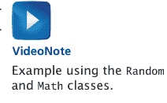

```
static int abs(int num)

返回 num 的绝对值。

static double acos(double num)
static double asin(double num)
static double atan(double num)

返回 num 的反余弦、反正弦或反正切值。

static double cos(double angle)
static double sin(double angle)
static double tan(double angle)

返回 angle 的余弦、正弦或正切值，角度以弧度为单位。

static double ceil(double num)

返回 num 的向上取整，即大于等于 num 的最小整数。

static double exp(double power)

返回 e 的指定 power 次幂。

static double floor(double num)

返回 num 的向下取整，即小于等于 num 的最大整数。

static double pow(double num, double power)

返回 num 的指定 power 次幂。

static double random()

返回一个 0.0（包含）到 1.0（不包含）之间的随机数。

static double sqrt(double num)

返回 num 的平方根，num 必须为正数。
```

### 图 3.5 Math 类的一些方法

注意，此程序假设判别式（根号下的值）为负数。如果它不是负数，结果将不是有效数字，Java 将其表示为 NAN，代表“Not A Number”（非数字）。在第 5 章中，我们将看到如何优雅地处理这种情况。

## 3.5 数学类 157

### 列表 3.3

```
********************************************************************

// Quadratic.java    Author: Lewis/Loftus

// 展示了如何使用 Math 类根据用户输入进行计算

//********************************************************************

import java.util.Scanner;

public class Quadratic {

    // 确定二次方程的根。

    public static void main(String[] args) {

        int a, b, c; // ax^2 + bx + c

        double discriminant, root1, root2;

        Scanner scan = new Scanner(System.in);

        System.out.print("Enter the coefficient of x squared: ");

        a = scan.nextInt();

        System.out.print("Enter the coefficient of x: ");

        b = scan.nextInt();

        System.out.print("Enter the constant: ");

        c = scan.nextInt();

        // 使用二次公式计算判别式。

        // 假设判别式为正数。

        discriminant = Math.pow(b, 2) - (4 * a * c);

        root1 = ((-1 * b) + Math.sqrt(discriminant)) / (2 * a);

        root2 = ((-1 * b) - Math.sqrt(discriminant)) / (2 * a);

        System.out.println("Root #1: " + root1);

        System.out.println("Root #2: " + root2);

    }

}
```

## 第 3 章 类和对象

列表 3.3 继续
输出
Enter the coefficient of x squared: 3
Enter the coefficient of x: 8
Enter the constant: 4
Root #1: -0.6666666666666666
Root #2: -2.0

- 自我测题（答案见附录 N）
SR 3.20 什么是类方法（也称为静态方法）？
SR 3.21 以下表达式的值是多少？
a. `Math.abs(10) + Math.abs(-10)`
b. `Math.pow(2, 4)`
c. `Math.pow(4, 2)`
d. `Math.pow(3, 5)`
e. `Math.pow(5, 3)`
f. `Math.sqrt(16)`
SR 3.22 写一个声明 double 变量 result 的语句并将其初始化为 5。
SR 3.23 根据在线 Java 文档，列出 Math 类中包含在图 3.5 中的三个方法。
SR 3.24 写一个语句打印 5 度。

## 3.6 格式化输出

NumberFormat 类和 DecimalFormat 类用于格式化信息，使其在打印或显示时恰当。它们都属于

### NumberFormat 类

NumberFormat 类提供了通用的数字格式化功能。你不需要使用 `new` 运算符实例化 NumberFormat。相反，你通过静态方法请求一个实例。图 3.6 列出了该类的方法。

```
String format(double number)

返回根据此模式格式化的字符串。

static NumberFormat getCurrencyInstance()

返回用于货币值的 NumberFormat 对象。

static NumberFormat getPercentInstance()

返回百分比的 NumberFormat 对象。
```

### 图 3.6 NumberFormat 类的一些方法

NumberFormat 类中的两个方法 `getCurrencyInstance` 和 `getPercentInstance` 返回一个用于格式化的对象。`format` 方法由格式化对象调用，并返回格式正确的数字字符串。列表 3.4 中的程序使用了两种格式化器。它读取销售交易并计算包含税的最终价格。

```
LISTING 3.4

****************************************************

// Purchase.java          Author: Lewis/Loftus

// 展示了如何使用 NumberFormat 类格式输出

****************************************************

import java.util.Scanner;

import java.text.NumberFormat;

public class Purchase {

    ----------------------------------------------------

    // 根据用户输入的值计算商品的最终价格。

    ----------------------------------------------------

    public static void main(String[] args) {

        final double TAX_RATE = 0.06; // 6% 销售税

        int quantity;

        double subtotal, totalCost, unitPrice;

        Scanner scan = new Scanner(System.in);

        NumberFormat fmt1 = NumberFormat.getCurrencyInstance();
```


# 第3章 使用类和对象

## 3.6 格式化输出

```java
NumberFormat fmt2 = NumberFormat.getPercentInstance();

System.out.print("Enter the quantity: ");
quantity = scan.nextInt();

System.out.print("Enter the unit price: ");
unitPrice = scan.nextDouble();

subtotal = quantity * unitPrice;
tax = subtotal * TAX_RATE;
totalCost = subtotal + tax;

// 使用适当的格式打印输出
System.out.println("Subtotal: " + fmt1.format(subtotal));
System.out.println("Tax: " + fmt1.format(tax) + " at " + fmt2.format(TAX_RATE));
System.out.println("Total: " + fmt1.format(totalCost));
```

### DecimalFormat 类

与 `NumberFormat` 类不同，`DecimalFormat` 类使用 `new` 运算符以传统方式实例化。它的构造函数接收一个代表引导格式化过程模式的字符串。我们随后可以使用用于格式化特定值的方法。在稍后，如果我们想更改格式化器使用的模式，可以调用 `applyPattern` 方法。下表描述了这些方法。

| 方法 | 说明 |
| :--- | :--- |
| `DecimalFormat(String pattern)` | 构造函数：创建一个带有指定模式的新 `DecimalFormat` 对象 |
| `void applyPattern(String pattern)` | 将指定的模式应用到此 `DecimalFormat` 对象 |
| `String format(double number)` | 返回一个包含指定数字的字符串，该数字根据当前模式进行了格式化 |

传递给 `DecimalFormat` 构造函数的字符串所定义的模式可以相当复杂。使用了多种符号来表示特定的格式化指南。例如，由字符串 `"0.000"` 定义的模式表示小数点左侧至少打印一个数字，如果值的整数部分为零，则应打印零。它还表示值的小数部分应舍入到三位小数。

该模式用于列表 3.5 所示的 `CircleStats` 程序，该程序从用户处读取圆半径并计算其面积和周长。末尾的零（例如圆面积为 78.540）不会被打印。

### printf 方法

除了 `print` 之外，`System` 类还有另一个名为 `printf` 的输出方法，允许用户打印包含数据值的格式化字符串。方法的第一个参数表示格式字符串，其余参数指定插入到格式字符串中的值。

例如，以下代码行：

```java
System.out.printf("ID: %d name:%s", id, name);
```

第一个参数指定输出的格式，并包括将输出值标记为转义字符的字面字符，如 `\t`。模式 `%5d` 表示相应的数值 (`id`) 应该在五个字符的字段中打印。模式 `%s` 匹配字符串参数 `name`。

`id` 和 `name` 的值被插入字符串中，产生的结果如下：

```text
ID: 24036 Name: Larry Flagelhopper
```

`printf` 方法被添加到 Java 中是为了镜像 C 语言程序中使用的类似功能。它使得程序员更容易将现有的 C 程序翻译（或迁移）到 Java。

具有价值的旧软件被称为遗留系统。维护遗留系统通常是昂贵的工作，因为其他事物基于旧的技术。在许多情况下，维护遗留系统比迁移到新技术（例如用较新的语言编写）更具成本效益。添加 `printf` 方法尝试让此类迁移变得更容易，从而降低成本，因为它提供了 C 程序员所赖的相同输出语句。

> **核心概念**
> `printf` 方法被添加到 Java 是为了支持遗留系统的迁移。

然而，`printf` 方法并不是解决输出格式化问题的特别面向对象的解决方案，因此在书中避免使用它。

### 自测习题（答案见附录 N）

- **SR 3.25** 描述如何在程序中请求 `NumberFormat` 对象供使用。
- **SR 3.26** 假设你的程序中有一个名为 `cost` 的 `double` 变量。你想将 `cost` 中存储的值格式化为当前区域的货币并输出。
  - a. 编写一个格式化货币值的方法。
  - b. 编写一个使用 `NumberFormat` 格式化 `double` 的程序。
  - c. `DecimalFormat` 和 `NumberFormat` 类之间有什么区别？
- **SR 3.27** 使用枚举类型代替常量的优点是什么？
- **SR 3.28** 编写一个使用 `enum` 表示星期几的程序。

## 3.7 枚举类型

枚举类型是一种特殊的类，枚举类型的变量是对象。因此，所有枚举类型都关联有几个方法。`ordinal()` 方法返回与特定枚举类型相关的数值。`name()` 方法返回值的名称，该名称与定义值的标识符相同。

列表 3.6 显示了一个名为 `IceCream` 的程序，它声明了一个枚举类型并练习了它的一些方法。由于枚举类型是特殊的类，它们不是在方法内部定义的。它们既可以在类级别定义（在类内部方法之外），如本例所示，也可以在最外层定义。我们将在第 6 章进一步探讨枚举类型。

### 列表 3.6

```java
/****************************************************************
// IceCream.java      作者: Lewis/Loftus
// 枚举类型的使用。
****************************************************************/

public class IceCream {

    enum Flavor {vanilla, chocolate, strawberry, fudgeRipple, coffee, rockyRoad, mintChocolateChip, cookieDough}

    // 创建并使用 Flavor 类型的变量。
    public static void main(String[] args) {

        Flavor cone1, cone2, cone3;

        cone1 = Flavor.rockyRoad;
        cone2 = Flavor.chocolate;

        System.out.println("cone1 value: " + cone1);
        System.out.println("cone1 ordinal: " + cone1.ordinal());
        System.out.println("cone1 name: " + cone1.name());

        System.out.println();

        System.out.println("cone2 value: " + cone2);
        System.out.println("cone2 ordinal: " + cone2.ordinal());
        System.out.println("cone2 name: " + cone2.name());

        cone3 = cone1;

        System.out.println("cone3 value: " + cone3);
        System.out.println("cone3 ordinal: " + cone3.ordinal());
        System.out.println("cone3 name: " + cone3.name());
    }
}
```

### 输出

```text
cone1 value: rockyRoad
cone1 ordinal: 5
cone1 name: rockyRoad

cone2 value: chocolate
cone2 ordinal: 1
cone2 name: chocolate

cone3 value: rockyRoad
cone3 ordinal: 5
cone3 name: rockyRoad
```

### 自测习题（答案见附录 N）

- **SR 3.29** 编写一个表示电影分级的枚举类型的声明。
- **SR 3.30** 假设定义了一个名为 `CardSuit` 的枚举类型如下：
  ```java
  enum CardSuit {clubs, diamonds, hearts, spades}
  ```
  以下代码序列的输出是什么？
  ```java
  CardSuit card1, card2;
  card1 = CardSuit.clubs;
  card2 = CardSuit.hearts;
  System.out.println(card1);
  System.out.println(card2.name());
  System.out.println(card1.ordinal());
  System.out.println(card2.ordinal());
  ```
- **SR 3.31** 为什么要使用上一个问题中 `CardSuit` 这样的枚举类型？为什么不使用 `String` 变量并赋值如 `"hearts"` 等值？

## 3.8 包装类

正如我们之前讨论过的，Java 使用基本类型（如 `int`、`double`、`char`、`boolean`）以及类和对象来表示数据。在某些情况下，管理两类数据（基本类型值和对象引用）可能会带来挑战。例如，我们可能会创建一个对象作为容器来存放各种其他类型的对象。然而，在特定情况下，我们可能想要存储一个简单的整数值。在这些情况下，我们需要将基本类型值“包装”成对象。

包装类表示一种特定的基本类型。例如，`Integer` 类表示一个简单的整数值。从 `Integer` 类创建的对象存储单个 `int` 值。包装类的构造函数接受要存储的基本类型值。例如：

```java
Integer ageObj = new Integer(40);
```

一旦完成此声明和实例化，`ageObj` 对象就有效地将 `40` 表示为一个对象。它可以在任何需要的地方使用。

> **核心概念**
> 包装类允许将基本类型值作为对象进行处理。

Java 中的每种基本类型在 Java 类库中都有对应的包装类。所有的包装类都定义在 `java.lang` 包中。下表显示了与每个基本类型对应的包装类。

| 基本类型 | 包装类 |
| :--- | :--- |
| `byte` | `Byte` |
| `short` | `Short` |
| `int` | `Integer` |
| `long` | `Long` |
| `float` | `Float` |
| `double` | `Double` |
| `char` | `Character` |
| `boolean` | `Boolean` |
| `void` | `Void` |

注意，甚至有一个表示 `void` 类型的包装类。然而，与包装类不同，`Void` 类不能被实例化。它仅仅代表 `void` 引用的概念。

下表列出了 `Integer` 类中的一些方法。其他包装类也具有类似的方法。

| 方法 | 说明 |
| :--- | :--- |
| `Integer(int value)` 构造函数 | 创建存储指定值新 `Integer` 对象。 |
| `byte byteValue()` | |
| `double doubleValue()` | |
| `float floatValue()` | |
| `int intValue()` | |
| `long longValue()` | 返回此 `Integer` 对应的基本类型值。 |
| `static int parseInt(String str)` | 返回与指定字符串中存储的值对应的 `int`。 |
| `static String toBinaryString(int num)` | |
| `static String toHexString(int num)` | |
| `static String toOctalString(int num)` | 返回指定整数值在相应基数下的字符串表示。 |

包装类还提供了与所关联基本类型管理相关的各种方法。例如，`Integer` 类包含了返回对象中存储的 `int` 值并将存储的值转换为其他基本类型的方法。

注意，这些类还包含可以独立于任何实例化对象而调用的静态方法。`Integer` 类包含一个名为 `parseInt` 的静态方法，可以将存储在 `String` 中的 `int` 转换为其对应的 `int` 值。如果 `String` 对象 `str` 持有字符串 `"987"`，下行代码将字符串转换为整数值 `987` 并将该值存储在 `int` 变量 `num` 中：

```java
num = Integer.parseInt(str);
```

Java 包装类通常包含非常有用的静态常量。例如，`Integer` 类包含两个常量，`MIN_VALUE` 和 `MAX_VALUE`，它们分别持有最小和最大的 `int` 值。其他包装类对于其类型也有类似的常量。

### 自动装箱

自动装箱是基本类型与对应的包装对象之间的自动转换。例如，在下面的代码中，一个 `int` 值被赋值给 `Integer` 对象引用变量：

```java
Integer obj1;
int num1 = 69;
obj1 = num1; // 自动创建一个 Integer 对象
```

反向转换称为拆箱，在需要时也会自动发生。例如：

```java
Integer obj2 = new Integer(69);
int num2;
num2 = obj2; // 自动提取 int 值
```

基本类型与包装对象之间的赋值会被自动处理。

> **核心概念**
> 自动装箱是基本类型与对应的包装对象之间的自动转换。

### 自测习题（答案见附录 N）

- **SR 3.32** 我们如何将基本类型值表示为对象？
- **SR 3.33** 以下每一项分别对应哪个包装类：`byte`, `int`?
- **SR 3.34** 假设定义了一个名为 `CardSuit` 的枚举类型如下：`enum CardSuit {clubs, diamonds, hearts, spades}`。以下代码序列的输出是什么？（见上方代码）
- **SR 3.35** 编写一条打印该值的语句。

## 3.9 组件与容器

正如我们之前讨论过的，Java 使用基本类型（如 `int`、`double`、`char`、`boolean`）以及类和对象来表示数据。在某些情况下，管理两类数据（基本类型值和对象引用）可能会带来挑战。例如，我们可能会创建一个对象作为容器来存放各种其他类型的对象。然而，在特定情况下，我们可能想要存储一个简单的整数值。在这些情况下，我们需要将基本类型值“包装”成对象。包装类表示一种特定的基本类型。例如，`Integer` 类表示一个简单的整数值。从 `Integer` 类创建的对象存储单个 `int` 值。包装类的构造函数接受要存储的基本类型值。例如：

```java
Integer ageObj = new Integer(40);
```


# 第 3 章 使用类和对象

## 3.9 组件与容器

正如我们之前讨论过的，Java 使用基本类型（如 `int`、`double`、`char`、`boolean`）以及类和对象来表示数据。在某些情况下，管理两类数据（基本类型值和对象引用）可能会带来挑战。例如，我们可能会创建一个对象作为容器来存放各种其他类型的对象。然而，在特定情况下，我们可能想要存储一个简单的整数值。在这些情况下，我们需要将基本类型值“包装”成对象。

包装类表示一种特定的基本类型。例如，`Integer` 类表示一个简单的整数值。从 `Integer` 类创建的对象存储单个 `int` 值。包装类的构造函数接受要存储的基本类型值。例如：

```java
Integer ageObj = new Integer(40);
```

一旦完成此声明和实例化，`ageObj` 对象就有效地将 40 表示为一个对象。它可以在任何需要的地方使用。Java 中的每种基本类型在 Java 类库中都有对应的包装类。所有的包装类都定义在 `java.lang` 包中。下表显示了与每个基本类型对应的包装类。注意，甚至有一个表示 `void` 类型的包装类。然而，与包装类不同，`Void` 类不能被实例化。它仅仅代表 void 引用的概念。

| 基本类型 | 包装类 |
| :--- | :--- |
| `byte` | `Byte` |
| `short` | `Short` |
| `int` | `Integer` |
| `long` | `Long` |
| `float` | `Float` |
| `double` | `Double` |
| `char` | `Character` |
| `boolean` | `Boolean` |
| `void` | `Void` |

**图 3.8 Java API 中的包装类**

包装类还提供了与所关联基本类型管理相关的各种方法。例如，`Integer` 类包含了返回对象中存储的 `int` 值并将存储的值转换为其他基本类型的方法。下表列出了在 `Integer` 类中找到的一些方法。其他包装类也具有类似的方法。注意，这些类还包含可以独立于任何实例化对象而调用的静态方法。`Integer` 类包含一个名为 `parseInt` 的静态方法，可以将存储在 `String` 中的 `int` 转换为其对应的 `int` 值。如果 `String` 对象 `str` 持有字符串 `"987"`，下行代码将字符串转换为整数值 987 并将该值存储在 `int` 变量 `num` 中：

```java
num = Integer.parseInt(str);
```

| 方法 | 描述 |
| :--- | :--- |
| `Integer(int value)` 构造函数 | 创建存储指定值新 `Integer` 对象。 |
| `byte byteValue()` | |
| `double doubleValue()` | |
| `float floatValue()` | |
| `int intValue()` | |
| `long longValue()` | 返回此 `Integer` 对应的基本类型值。 |
| `static int parseInt(String str)` | 返回与指定字符串中存储的值对应的 `int`。 |
| `static String toBinaryString(int num)` | |
| `static String toHexString(int num)` | |
| `static String toOctalString(int num)` | 返回指定整数值在相应基数下的字符串表示。 |

**图 3.9 Integer 类的一些方法**

Java 包装类通常包含非常有用的静态常量。例如，`Integer` 类包含两个常量，`MIN_VALUE` 和 `MAX_VALUE`，它们分别持有最小最大的 `int` 值。其他包装类对于其类型也有类似的常量。

### 自动装箱

自动装箱是基本类型与对应的包装对象之间的自动转换。例如，在下面的代码中，一个 `int` 值被赋值给 `Integer` 对象引用变量：

```java
Integer obj1;
int num1 = 69;
obj1 = num1; // 自动创建一个 Integer 对象
```

反向转换称为拆箱，在需要时也会自动发生。例如：

```java
Integer obj2 = new Integer(69);
int num2;
num2 = obj2; // 自动提取 int 值
```

基本类型与包装对象之间的赋值会被自动处理。

> **核心概念**
> 自动装箱是基本类型与对应的包装对象之间的自动转换。

- SR 3.32 我们如何将基本类型值表示为对象？
- SR 3.33 以下每一项分别对应哪个包装类：`byte`, `int`,?
- SR 3.34 假设定义了一个名为 `CardSuit` 的枚举类型如下：`enum CardSuit {clubs, diamonds, hearts, spades}`。以下代码序列的输出是什么？（见上方代码）
- SR 3.35 编写一条打印该值的语句。

---

通常情况下，重量级组件比轻量级组件更复杂。例如，一个框架（frame）拥有多个面板（pane），这些面板负责框架窗口的各种特性。Java 接口的所有可见元素都显示在框架的内容面板（content pane）中。

通常，我们可以通过创建一个显示程序界面的框架来创建一个基于 Java GUI 的应用程序。界面通常组织在一个主面板（primary panel）上，该面板被添加到框架的内容面板中。主面板中的组件根据需要使用其他面板进行组织。

除非容器能帮助我们组织和显示其他组件，否则它们通常没有用处。让我们来看另一个基础的 GUI 组件。标签（label）是一种在 GUI 中显示一行文本的组件。标签也可以显示图像，这是本章稍后会讨论过的话题。通常，标签用于显示信息或标识 GUI 中的其他组件。在几乎每个基于 GUI 的程序都能找到标签。

让我们来看一个使用框架、面板和标签的示例。当执行列表 3.7 中的程序时，屏幕上会打开一个新窗口并显示一个短语。该短语的文本是通过框架的两个标签组件显示的。这些标签组织在一个面板中，而该面板显示在框架的内容面板中。

`JFrame` 构造函数接受一个字符串作为参数，并将其显示在框架的标题栏中。调用 `setDefaultCloseOperation` 决定了点击框架右上角的关闭按钮（X）时会发生什么。在大多数情况下，我们只需让该按钮终止程序，如 `EXIT_ON_CLOSE` 常量所示。

通过实例化 `JPanel` 类来创建面板。面板的背景颜色使用 `setBackground` 方法设置。`setPreferredSize` 方法接受一个 `Dimension` 对象作为参数，用于指定组件以像素为单位的宽度和高度。许多组件的大小都可以通过此设置，并且还有 `setMinimumSize` 和 `setMaximumSize` 方法来帮助控制界面的外观。

标签通过实例化 `JLabel` 类来创建，并将标签的文本传递给其构造函数。在程序中，创建了两个独立的标签组件。

容器有一个 `add` 方法，允许将其他组件添加到它们中。两个标签都被添加到主面板中，从该点起，它们被视为该面板的一部分。组件添加到容器的顺序通常很重要。在这种情况下，它决定了哪个标签显示在另一个标签上方。

最后，使用 `getContentPane` 方法获取框架的内容面板，紧接着调用框架添加该面板。框架的 `pack` 方法根据其内容恰当地设置其大小——在这种情况下，框架的大小调整为适应它所包含的面板的大小。这比尝试显式设置框架的大小要更好，因为框架的大小应该随着框架内组件的变化而改变。调用 `setVisible` 方法会导致框架显示在显示器屏幕上。

`Authority`（权威）程序不是交互式的。通常，标签并不允许用户与程序进行交互。我们将在下一章检查交互式 GUI 组件。

然而，你可以通过多种方式与框架本身交互。你可以通过抓住框架的标题栏并用鼠标拖动将整个框架移动到桌面的另一个点。你还可以通过拖动框架的右下角来调整框架的大小。当框架变宽时会发生什么：第二个标签会跳到第一个标签上方。

每个容器都由一个称为布局管理器（layout manager）的对象管理，该对象决定了容器中组件的布局方式。当界面发生重要变化时（例如框架调整大小时），就会咨询布局管理器。

除非你另有指定，否则面板中的组件将尝试相互排成一行，当面板宽度无法容纳某个组件时，该组件将移动到下一行。尝试运行此程序，观察布局管理器如何随着窗口大小的变化改变标签的组织。布局管理器将在第 7 章的“图形轨迹”部分进行详细讨论。

> **核心概念**
> 每个容器都由一个布局管理器管理。

### Frame 和 Panel

`Frame`（帧）是一种用于显示 GUI Java 应用程序的容器。`Frame` 显示为一个带有标题栏的独立窗口。可以通过拖动鼠标根据需要调整其位置和大小。它角落带有小按钮，允许帧最小化、最大化和关闭。`Frame` 由 `JFrame` 类定义。

`Panel`（面板）也是一种容器。然而，与 `Frame` 不同，它不能独立显示。`Panel` 必须添加到另一个容器中才能显示。通常面板的主要作用是组织 GUI 中的其他组件。`Panel` 由 `JPanel` 类定义。

> **核心概念**
> `Frame` 显示为独立窗口，但 `Panel` 只能作为另一个容器的一部分显示。

### 列表 3.7

```java
// ************************************************************************************
// Authority.java    作者: Lewis/Loftus
// 演示框架、面板和标签的使用。
// ************************************************************************************

import java.awt.*;
import javax.swing.*;

public class Authority {

    // 显示一些智慧格言。
    public static void main(String[] args) {
        JFrame frame = new JFrame("Authority");
        frame.setDefaultCloseOperation(JFrame.EXIT_ON_CLOSE);

        JPanel primary = new JPanel();
        primary.setBackground(Color.yellow);
        primary.setPreferredSize(new Dimension(250, 75));

        JLabel label1 = new JLabel("Question authority.");
        JLabel label2 = new JLabel("but raise your hand first.");

        primary.add(label1);
        primary.add(label2);

        frame.getContentPane().add(primary);
        frame.pack();
        frame.setVisible(true);
    }
}
```


> **自测题（答案见附录 N）**
> SR 3.36 框架和面板之间有什么区别？
> SR 3.37 从下面的列表中选择一个与以下每个短语最匹配的术语：`container`、`content pane`、`frame`、`heavyweight`、`label`、`layout manager`、`lightweight`、`panel`
> A. 一种用于存放其他组件的组件。
> B. 在其带有标题栏的独立窗口中显示。
> C. 它的主要作用是帮助组织组件；必须添加到另一个容器中才能显示。
> D. 这种组件由操作系统管理。
> E. 这种组件由 Java 程序本身管理。
> F. 框架中显示可见元素的部分。
> G. 一个在 GUI 中显示一行文本的组件。
> H. 决定容器中的组件如何排列。
>
> 3.38 运行 `Authority` 程序。描述当你通过拖动右下角调整框架大小时会发生什么。
>
> 3.39 下列哪个陈述最能描述 `Authority` 程序的 GUI 如何构建？
> - 框架被添加到面板中，面板被添加到两个标签。
> - 标签被添加到面板中，面板被添加到框架的内容面板中。
> - 面板和标签添加到前景。
>
> 3.40 分别对 `Authority` 程序进行以下每项更改的结果是什么？你可以进行更改、编译并运行程序，然后观察结果。简要说明你的观察结果。
> a. 传递给 `setPreferredSize` 方法的变为 `(300, 300)` 而不是 `(250, 75)`。
> b. 背景颜色设置为黑色而不是黄色。
> c. 两个标签实例化语句的顺序反转（例如，首先实例化 `label2` 并传递字符串“but raise your hand first.”，然后实例化 `label1` 并传递字符串“Question authority.”）。
> d. 两个主 `add` 语句的顺序反转（例如，首先将 `label2` 添加到主面板，然后添加 `label1`）。

## 3.10 嵌套面板

在上一节中，我们看到了一个示例，其中标签包含在一个面板中，面板又包含在框架中。这种关系构成了界面的包含层次结构，它可以根据需要变得复杂，以实现所需的视觉效果。

特别是，通常会使用多层嵌套面板以各种方式组织和分组。虽然我们不应该在层次结构中包含不必要的组件，但在创建界面时，不要犹豫加入额外的脚手架以实现你想要的效果。

> **核心概念**
> 面板可以通过嵌套创建复杂的组件包含层次结构。

列表 3.8 中的程序 `NestedPanels` 创建了两个子面板，每个面板包含一个标签。这两个子面板都被放入另一个面板中，然后该面板被添加到框架的内容区域中。

### 列表 3.8

```java
// *****************************************************************
// NestedPanels.java Author: Lewis/Loftus
// 展示了基础的组件层次结构。
// *****************************************************************

import java.awt.*;
import javax.swing.*;

public class NestedPanels {

    // 展示嵌套在第三个面板中的两个彩色面板。
    public static void main(String[] args) {
        JFrame frame = new JFrame("NestedPanels");
        frame.setDefaultCloseOperation(JFrame.EXIT_ON_CLOSE);

        // 设置第一个子面板
        JPanel subpanel1 = new JPanel();
        subpanel1.setPreferredSize(new Dimension(150, 100));
        subpanel1.setBackground(Color.green);

        JLabel label1 = new JLabel("One");
        subpanel1.add(label1);

        // 设置第二个子面板
        JPanel subpanel2 = new JPanel();
        subpanel2.setPreferredSize(new Dimension(150, 100));
        subpanel2.setBackground(Color.red);

        JLabel label2 = new JLabel("Two");
        subpanel2.add(label2);

        // 设置主面板
        JPanel primary = new JPanel();
        primary.setPreferredSize(new Dimension(300, 100)); // 修正：原代码此处为 Color.blue，推测为 Dimension 对象
        primary.setBackground(Color.blue);

        primary.add(subpanel1);
        primary.add(subpanel2);

        frame.getContentPane().add(primary);
        frame.pack();
        frame.setVisible(true);
    }
}
```


## 第 3 章 使用类和对象

### 列表 3.8 续

```java
primary.add(subpanel1);
primary.add(subpanel2);
}
}
```

```java
frame.getContentPane().add(primary);
frame.pack();
frame.setVisible(true);
}
```

### 显示

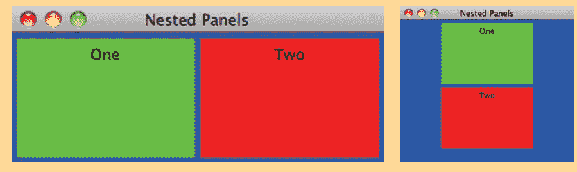

注意，程序中的主面板并没有显式指定大小。它根据需要自动调整大小以容纳其包含的两个面板。另外请注意，子面板周围有一个缓冲区，通过这个缓冲区可以看到主面板的蓝色。这种间距取决于用于容器的布局管理器以及为组件本身设置的特性。这些问题将在“图形”章节中进一步探讨。

正如你对上一个示例做的那样，执行并尝试这个程序。调整框架的大小以查看对组件的影响。注意，子面板的大小是固定的，而两个面板的方向取决于主面板的宽度（主面板随框架的扩大而扩展）。

当你熟悉了组件之间相对布局的方式后，将所有面板的背景颜色更改为相同的颜色（例如，绿色），以观察如果界面设计得当，面板之间的区分是否会变得不可见。

### 自测习题（答案见附录 N）

- SR 3.41 Java 图形用户界面的包含层次结构是什么？
- SR 3.42 在 NestedPanels 程序中创建了多少个面板？面板变量的名称是什么？
- SR 3.43 在 NestedPanels 程序中，哪些面板被添加到了另一个面板中？它们被添加到哪个面板中？哪一个面板被显式地添加到框架的内容区域中？

## 3.11 图像

图像在基于图形的软件中通常起着重要作用。Java 能够以多种方式使用 JPEG 和 GIF 图像。`Graphics` 类包含一个 `drawImage` 方法，允许你像绘制形状或字符一样绘制图像。图像也可以整合到标签组件中。让我们更详细地探索图像与标签之间的关系。

正如我们在前面的节中看到的，由 `JLabel` 类定义的标签可以向用户提供信息或描述界面中的其他组件。`JLabel` 也可以包含图像。也就是说，标签可以由文本、图像或两者共同组成。

> **核心概念**
> 标签可以包含文本、图像或两者兼有。

`ImageIcon` 类用于表示包含在标签中的图像。`ImageIcon` 构造函数接收图像文件名并将其加载到对象中。可以使用 JPEG 或 GIF 图像创建 `ImageIcon` 对象。

标签内部文本和图像的对齐可以通过 `JLabel` 构造函数或特定方法显式设置。同样，我们可以设置相对于图像的位置。

列表 3.9 中的 `JLabelDemo` 程序显示了多个标签。每个标签以不同的方向显示其图像和标签。

`JLabel` 构造函数的第三个参数定义了标签在允许空间内的水平位置。`SwingConstants` 接口包含了多个被各种 Swing 组件使用的常量，使得引用它们变得更加容易。

标签文本和图像的方向通过 `setHorizontalTextPosition` 和 `setVerticalPosition` 方法显式设置。如第一个标签的所示，文本的默认水平位置在右侧（图像在左侧），文本的默认垂直位置相对于图像居中。

不要将容器中标签的水平位置与文本和图像的方向混淆。构造函数的第三个参数决定了前者，而显式方法调用决定了后者。

通过将图像放入标签中，它就变成了组件的一部分，该组件与容器中的所有其他组件一起布局，而不是在特定位置绘制。这是一个恰当的设计决策：是使用 `Graphics` 类的 `drawImage` 方法来绘制图像，还是使用标签来显示图像。

### 列表 3.9

```java
// Author: Lewis/Loftus
// LabelDemo.java
// 展示在标签中使用图标。

import java.awt.*;
import javax.swing.*;

public class LabelDemo {
    // 创建并显示主框架。
    public static void main(String[] args) {
        JFrame frame = new JFrame("Label Demo");
        frame.setDefaultCloseOperation(JFrame.EXIT_ON_CLOSE);

        ImageIcon icon = new ImageIcon("devil.gif");

        JLabel label1, label2, label3;

        label1 = new JLabel("Devil Left", icon, SwingConstants.CENTER);
        label2 = new JLabel("Devil Right", icon, SwingConstants.LEFT);
        label2.setHorizontalPosition(SwingConstants.LEFT);
        label2.setVerticalPosition(SwingConstants.BOTTOM);

        label3 = new JLabel("Devil Above", icon, SwingConstants.CENTER);
        label3.setHorizontalPosition(SwingConstants.CENTER);
        label3.setVerticalPosition(SwingConstants.BOTTOM);

        JPanel panel = new JPanel();
        panel.setBackground(Color.cyan);
        panel.setPreferredSize(new Dimension(200, 250));

        panel.add(label1);
        panel.add(label2);
        panel.add(label3);

        frame.getContentPane().add(panel);
        frame.pack();
        frame.setVisible(true);
    }
}
```

### 列表 3.9 续 显示

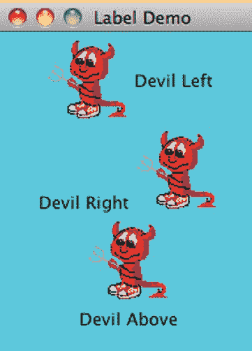

你的选择应根据程序的特定需求。

### 核心概念总结

- `new` 运算符返回指向新创建的对象的引用。
- 多个引用变量可以指向同一个对象。
- 通常方法是在特定对象上执行的，这会影响结果。
- 类库在开发程序时提供了实用的支持。
- Java 标准类库被组织成包（packages）。
- `java.lang` 包中的所有类都会为每个程序自动导入。
- 伪随机数生成器通过复杂的计算来营造随机的错觉。
- `Math` 类的所有方法都是静态的（static），意味着它们通过类名进行调用。
- Java 增加了 `printf` 方法以支持旧系统的迁移。
- 枚举类型（Enumerated types）是类型安全的，确保无效值不会被使用。
- 包装类（Wrapper class）允许将基本类型作为对象进行管理。
- 自动装箱（Autoboxing）提供了基本类型与相应包装对象之间的自动转换。
- 容器（Containers）是特殊的 GUI 组件，存放和组织其他组件。
- 框架（Frame）作为独立窗口显示，但面板（Panel）只能作为另一个容器的一部分显示。
- 每个容器都由布局管理器（layout manager）管理。
- 面板可以嵌套，以创建复杂的组件包含层级结构。
- 标签（Label）可以包含文本、图像或两者。

# 练习题

EX 3.1 编写语句，将字符串 `computer` 中的小写字母转换为大写字母并打印。

EX 3.2 编写语句，从字符串 `FullDay` 中提取子字符串 `Moon` 并打印。

EX 3.3 声明一个字符串，其字符与名为 `name` 的 String 对象相同，但全部为大写字母。

EX 3.4 编写一个名为 `change` 的 String 变量声明，并将其初始化为另一个名为 `original` 的 String 对象中的字符，并将所有的 'e' 替换为 'j'。

EX 3.5 下列代码段会产生什么输出？

```java
String str1, str2, str3;
str1 = "She sells sea shells in sea";
str2 = "shore";
str3 = str1.concat(str2);
System.out.println(str3.charAt(5));
```

EX 3.6 述 import 语句的作用是什么？

EX 3.7 假设已经创建了一个 `Random` 对象 `generator`，那么以下每个表达式结果的范围是多少？

- a. `generator.nextInt(20)`
- b. `generator.nextInt(8) + 1`
- c. `generator.nextInt(12) + 2`
- d. `generator.nextInt(35) + 10`
- e. `generator.nextInt(100) - 50`

EX 3.8 编写代码声明并实例化 `Random` 类对象（将对象引用命名为 `rand`）。编写一个使用 `nextInt` 方法的表达式列表，在指定的范围（包括端点）内生成随机数。使用接受单个整数参数的 `nextInt` 方法。

- a. 0 到 10
- b. 0 到 400
- c. 1 到 10
- d. 1 到 400
- e. 25 到 50
- f. -10 到 15

EX 3.9 编写一条赋值语句，计算 `var1` 的平方根，从 `var2` 中减去并将结果赋值给 `var3`。

EX 3.10 编写单条语句计算并打印 `sum` 的五次方。

EX 3.11 编写代码语句创建一个 `DecimalFormat` 对象，该对象将格式化后的值舍入到四位小数。然后编写语句使用该对象打印 `result` 的值并进行正确格式化。

EX 3.12 编写代码语句，提示用户读取一个 `double` 类型的值，然后打印该值四方的计算。结果保留三位小数。

EX 3.13 编写一个枚举类型的声明，表示一年的月份。

# 编程项目

PP 3.1 编写一个程序，提示并读取用户的城市和国家（分别读取）。然后打印一个字符串，该字符串由国家的前两个字母组成，后面跟着逗号，然后是用户的城市，最后是一个 1 到 100 之间的随机数，代表城市的邮政编码。类似的表示模式有时用于在注册新账户时存储用户的地址。

PP 3.2 编写一个程序，打印乘积的平方。提示读取并打印三个整数乘积的平方。

PP 3.3 编写一个程序，创建并打印格式为 `XXX-XXX-XXXX` 的随机电话号码。在输出中包含连字符。不要让前三个数字包含 8 或 9（但限制不要多于此），并确保三个数字中的第二个不大于 655。提示：思考构造电话号码最简单的方法。每个数字不需要单独确定。

PP 3.4 编写一个程序，读取一个整数并打印 $e$ 的该数字次幂。例如，如果数字是 2，程序将打印 `7.389056`（其中 $e = 2.71828$）。

PP 3.5 编写一个程序，读取构成一条直线的两个点的 $(x, y)$ 坐标。使用以下公式计算直线的斜率（slope）：

```math
Slope (m) = \frac{Y_2-Y_1}{X_2-X_1}
```


# 第 3 章 使用类和对象


## PP 3.6

编写一个程序读取球的半径并打印其体积和表面积。使用以下公式。输出保留四位小数。$r$ 代表半径。

开发 PP 3.6 中。

$Volume = \frac{4}{3}\pi r^3$

$Surface Area = 4\pi r^2$

## PP 3.7

编写一个程序，从用户处读取梯形的两条边和高度。使用下面给出的公式计算梯形的面积，其中 $h$ 代表梯形的垂直高度，$a$ 和 $b$ 代表梯形的两条边。将面积保留两位小数。

$Area = \frac{(a + b)}{2} \times h$

## PP 3.8

编写一个程序，在 1 到 20（包含端点）范围内生成两个随机整数，并显示这两个整数之和的正弦和余弦。

## PP 3.9

编写一个程序，为 10 到 30（包含端点）范围内的平行边形生成随机整数 ($b$)、高度 ($h$) 和边长 ($a$)，然后计算面积和周长。

$Area = base \times height$

$Perimeter = 2(a + b)$

## PP 3.10

编写一个程序，显示一个包含三个标签的框架，显示城市、国家和邮政编码。确保当窗口增大或缩小时，标签会改变方向。

## PP 3.11

编写一个程序，显示一个包含六个面板的框架。每个面板包含一张图像（使用你喜欢的图像）。允许所有面板根据需要调整大小，并为每个面板设置不同的背景颜色。尝试调整窗口大小观察图像的变化。确保你理解程序的行为原理。

## PP 3.12

修改 `NestedPanel` 程序，使其嵌套显示面板，每个面板有不同的颜色和标签。

# 第 4 章 编写类

## 目标

- 讨论类定义的结构和内容。
- 使用实例数据建立对象状态的概念。
- 说明可见性修饰符对方法和数据的影响。
- 探索方法定义的结构，包括参数和返回值。
- 讨论构造函数的结构和目的。
- 探索图形对象的创建。
- 引入创建交互式图形用户界面所需的概念。
- 探索一些基础 GUI 组件和事件。

在第 3 章中，我们使用了类和对象提供的各种服务。也就是说，我们使用了 Java API 提供的预定义类来简化编程过程。在本章中，我们处理面向对象编程的核心：编写我们自己的类来定义自己的对象。本章探索了类定义的基础，包括方法的结构以及数据的范围和封装。本章的图形部分讨论了如何编写具有图形表示的类，并引入了创建真正交互式图形用户界面所需的问题。

## 4.1 类与对象的复习

在第 1 章中，我们引入了基本的面向对象概念，包括对对象和类的简要概述。在第 3 章中，我们使用了 Java 标准类库中的几个预定义类来创建对象，并利用它们提供的特定功能。

在本章中，我们将注意力转向编写自己的类。虽然现有的库提供了许多有用的类，但面向对象程序开发的本质是设计和实现我们的类以满足我们的特定需求。

回顾对象与类之间的基本关系：类是对象的蓝图。类代表了对象的概念，而从该类创建的任何对象都是该概念的实现。

例如，从第 3 章我们知道，`String` 类代表字符字符串的概念，而每个 `String` 对象代表一个包含特定字符的特定字符串。

让我们考虑另一个例子。假设大学有一个名为 `Student`（学生）的类。从该类创建的对象代表一个特定的学生。`Student` 类代表了学生的通用概念，而从该类创建的每个对象都代表一个在该校就学的真实学生。在一个管理大学业务的系统中，我们将有一个 `Student` 类和成千上万个 `Student` 对象。

回想对象具有状态，状态由与该对象关联的属性的值定义。一个学生的属性可能包括学生的姓名、地址、专业和平均学点（GPA）。`Student` 类建立了这些属性。每个 `Student` 对象存储了某个特定学生的这些属性的值。在 Java 中，对象的属性定义在类内部。

对象还具有行为，由与该对象关联的操作定义。学生的操作将包括更新学生地址和计算学生当前平均学点的能力。`Student` 类定义了这些操作，例如计算平均学点的详细方法。这些操作可以在特定的 `Student` 对象上（或由该对象）执行。请注意，对象的行为可能会修改该对象的状态。在 Java 中，对象的操作是由类中的方法定义的。

下表列出了一些类的示例，以及可能为这些类的对象定义的某些属性和操作。确定需要哪些属性和操作取决于程序设计者，这取决于程序的目的以及特定对象在这些目的中所扮演的角色。考虑一下你可能为这些示例包含的其他属性和操作。

| 类 | 属性 | 操作 |
| :--- | :--- | :--- |
| Student | 姓名、地址、专业、平均学点 | 设置地址、设置专业、计算平均学点 |
| Rectangle | 长度、宽度、颜色 | 设置长度、设置宽度、设置颜色 |
| Aquarium | 材质、长度、宽度、高度 | 设置材质、设置长度、设置宽度、设置高度、计算体积、计算填充体积 |
| Flight | 航空公司、航班号、出发地、目的地、当前状态 | 设置航空公司、设置航班号、确定状态 |
| Employee | 姓名、部门、职位、薪水 | 设置部门、设置职位、设置薪水、计算工资、计算奖金、计算税费 |

**图 4.1** 类示例以及一些可能的属性和操作

> **自习题（答案见附录 N）**
> **SR 4.1** 什么是属性？
> **SR 4.2** 什么是操作？
> **SR 4.3** 列出一些可能为代表图书馆书籍的 `Book` 类定义的属性和操作。
> **SR 4.4** 正或错？请解释原因。
> - a. 我们在编写程序时应该只使用 Java 标准类库中的类——没有必要定义或使用其他类。
> - b. 对象上的操作可以改变对象的状态。
> - c. 对象的当前状态会影响在该对象上操作的结果。
> - d. 在 Java 中，对象的状态是由它的方法表示的。

## 4.2 类的解剖结构

在我们之前的所有示例中，我们都写了一个包含单个 `main` 方法的类。这些类代表了短小但完整的程序。这些程序通常使用 Java 类库中的预定义类实例化对象，并使用这些对象来实现我们提供的服务。这些类也是程序的一部分，但除了如何与它们交互之外，我们从未真正关心它们。我们只需信任它们提供它们承诺的服务。

让我们看另一个类似的示例。代码列表 4.1 所示的 `RollingDice` 类包含一个 `main` 方法，该方法实例化了两个 `Die` 对象（dice 的单数）。它掷骰子并打印结果。它还调用了 `Die` 类提供的其他方法，例如显式设置和获取骰子当前点值的能力。

### 代码列表 4.1 `RollingDice.java`

```java
//******************************************************************************** 
// RollingDice.java      作者: Lewis/Loftus 
// 展示了自定义类的创建和使用。 
//******************************************************************************** 

public class RollingDice 
{ 
    // 创建两个 Die 对象并多次掷骰。 
    // 
    public static void main(String[] args) 
    { 
        Die die1, die2; 
        int sum; 
        die1 = new Die(); 
        die2 = new Die(); 
        die1.roll(); 
        die2.roll(); 
        System.out.println("Die One: " + die1 + ", Die Two: " + die2); 
        die1.roll(); 
        die2.setFaceValue(4); 
        System.out.println("Die One: " + die1 + ", Die Two: " + die2); 
        die1.roll(); 
        die2.setFaceValue(4); 
        System.out.println("Die One: " + die1 + ", Die Two: " + die2); 
    } 
}
```

这个示例与之前的示例的主要区别在于，`Die` 类不是由 Java API 提供的。它是我们自己编写的。

### 代码列表 4.2 `Die.java`

```java
//******************************************************************** 
// Die.java               Author: Lewis/Loftus 
// 表示一个骰子（dice 的单数），其面显示 
// 1 到 6 之间的数值。 
//******************************************************************** 

public class Die { 
    private final int MAX = 6; // 最大面值 
    private int faceValue; // 骰子上显示的当前值 

    //---------------------------------------------------------------------- 
    // 构造函数：设置初始面值。 
    //---------------------------------------------------------------------- 
    public Die() { 
        faceValue = 1; 
    } 

    //---------------------------------------------------------------------- 
    // 掷骰子并返回结果。 
    //---------------------------------------------------------------------- 
    public int roll() { 
        faceValue = (int)(Math.random() * MAX) + 1; 
        return faceValue; 
    } 

    //---------------------------------------------------------------------- 
    // 面值修饰器。 
    //---------------------------------------------------------------------- 
    public void setFaceValue(int value) { 
        faceValue = value; 
    } 

    //---------------------------------------------------------------------- 
    // 面值访问器。 
    //---------------------------------------------------------------------- 
    public int getFaceValue() { 
        return faceValue; 
    } 

    // 返回此骰子的字符串表示。 
    // 
    public String toString() { 
        String result = Integer.toString(faceValue); 
        return result; 
    } 
}
```

用于打印。因此，通常为大多数类定义一个 `toString` 方法是个好主意。这些方法的定义包含多个部分，我们将在本章的学习中对其进行剖析。

对于书中的示例，我们通常将每个类存储在自己的独立文件中。Java 允许在一个文件中存储多个类。如果一个文件包含多个类，则其中只能有一个类可以使用关键字 `public` 声明。此外，公有类的名称必须与文件名对应。例如，`class Die` 存储在 `Die.java` 文件中。

| 方法 | 描述 |
| :--- | :--- |
| `Die()` | 构造函数：将骰子的初始面值设置为 1。 |
| `int roll()` | 通过将面值设置为适当范围内的随机数来掷骰子。 |
| `void setFaceValue(int value)` | 将骰子的面值设置为指定的值。 |
| `int getFaceValue()` | 返回骰子的当前面值。 |
| `String toString()` | 返回骰子的字符串表示，指示其当前面值。 |

**图 4.3** Die 类的某些方法

### 类的剖析

#### 实例数据

请注意，在 `Die` 类中，常量 `MAX` 和变量 `faceValue` 是在类内部声明的，但在任何方法内部之外。变量定义其作用域的位置，即程序中该变量可以被引用的区域。通过在类级别（而不是在方法内部）声明，这些变量和常量可以在类的任何方法中被引用。

诸如 `faceValue` 变量之类的属性被称为**实例数据**，因为每创建一个该类的新实例，都会为它预留新的内存空间。每个 `Die` 对象都有自己的 `faceValue` 变量和其独立的数据空间。这就是 `RollingDice` 程序的工作原理：一个对象的面值为 5，另一个面值为 2。这之所以可能，是因为为每个 `Die` 对象都创建了 `faceValue` 变量的内存空间。

我们可以将这种情况描述如下：

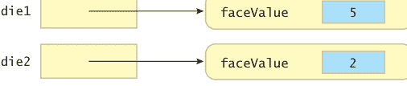

引用变量 `die1` 和 `die2` 指向（即包含）各自的 `Die` 对象。每个对象都包含一个具有独立内存空间的 `faceValue` 变量。因此，每个对象都可以为其实例数据存储不同的值。

Java 会自动初始化任何在类级别声明的变量。例如，所有数值类型（如 `int` 和 `double`）的变量都会初始化为零。尽管语言执行这种自动初始化，但显式初始化变量（通常在构造函数中）是一个良好的习惯，这样阅读代码的人就能清楚地理解意图。

### UML 类图

在本书中，我们使用 UML 图来视觉化类与对象之间的关系。UML 代表“统一建模语言”（Unified Modeling Language），它已成为表示面向对象程序设计最流行的符号。

存在多种类型的 UML 图，每种图都旨在显示面向对象程序的特定方面。在本书中，我们主要关注 UML 类图，用于显示类的内容以及类之间的关系。

```java
main(args: String [] ) : void

Die

faceValue : int

roll() : int

setValue(int value) : void

toString() : String
```


# UML 类图

图 4.4 显示涉及 `RollingDice` 程序的类的 UML 类图。

> **核心概念**
> UML 类图帮助我们视觉化程序中类的数据内容以及类之间的关系。

在 UML 图中，每个类都表示为一个矩形，包含三个部分以显示类名、其属性（数据）和其操作（方法）。图 4.4 显示了一个包含 `RollingDice` 程序类的类图。
图 4.4 中连接 `RollingDice` 和 `Die` 类的箭头表示类之间存在关系。虚线箭头表示一个类使用了另一个类的方法。类之间其他类型的面向对象关系通过不同类型的连接线和箭头显示。我们将在探索书中相关主题时讨论这些其他关系。

请记住，UML 并不是专门为 Java 程序员设计的。它的目的是独立于语言。UML 图并不等同于 Java 代码。例如，变量的类型显示在变量名之后，并用逗号分隔。方法的返回类型也是同样的方式。

UML 图是多功能的。根据特定图表的目标，我们可以包含任何所需的适当信息。例如，如果某些细节对于特定图表不相关，我们可能会省略类的数据和方法部分。

UML 图允许你视觉化你的程序设计。随着我们的程序变得越来越大，由越来越多的类组成，这些视觉化方法将变得越来越有用。我们将根据需要探索 UML 图的新侧面。

# 自测复习题（答案见附录 N）

- SR 4.5 对象和类之间有什么区别？
- SR 4.6 描述 `Die` 类的实例数据。
- SR 4.7 为 `Die` 类定义的哪些方法可以改变 `Die` 对象的状态——也就是说，哪些方法为实例数据赋值？
- SR 4.8 当你将一个对象传递给 `print` 或 `println` 方法时会发生什么？
- SR 4.9 变量的作用域是什么？
- SR 4.10 UML 图的设计目的是什么？

## 4.3 封装

在我们在第 1 章对面向对象概念的概述中提到过，对象应该是自管理的。也就是说，对象的实例数据应该只由该对象本身修改。例如，`Die` 类的方法应该专门负责更改 `face` 变量的值。我们应该让类外部代码难以（如果不是不可能的话）“进入内部”并更改类内部声明的变量值。这种特性被称为**封装**。

对象应该与系统的其他部分封装起来。它只通过定义该对象提供的服务的特定方法与程序的其他部分交互。这些方法定义了该对象与使用它的程序之间的接口。

> **核心概念**
> 对象被封装，保护其数据免受不当访问。

封装在图 4.5 中以图形方式表示。使用对象的代码（有时被称为对象的客户端）不应允许直接访问变量。客户端应该访问对象的方法，这些方法与封装在对象内部的数据进行交互。例如，`RollingDice` 程序中的 `main` 方法调用了 `Die` 对象的 `roll` 方法。`main` 方法不（实际上无法）直接访问 `faceValue` 变量。

图 4.5 客户端与对象的方法交互

在 Java 中，我们使用*修饰符*来实现对象封装。修饰符是 Java 保留字，用于指定编程语言构造的特定特性。在第 2 章中，我们讨论了 `final` 修饰符，它被用于声明常量。Java 有多种可以在各种方式使用的修饰符。某些修饰符可以组合使用，但某些组合是无效的。我们在本书的适当位置讨论各种 Java 修饰符，所有的都总结在附录 E 中。

### 可见性修饰符

某些 Java 修饰符被称为*可见性修饰符*，因为它们控制对类成员的访问。保留字 `public` 和 `private` 是可见性修饰符，可以应用于类的变量和方法。如果类的成员具有公共（public）可见性，则可以从对象外部直接引用。如果类的成员具有私有（private）可见性，可以在类定义内部任何地方使用，但不能从外部引用。第三种可见性修饰符 `protected` 只在继承的上下文中相关。我们在第 9 章中讨论它。

> **核心概念**
> 实例变量应该声明为私有可见性以促进封装。

公共变量违反了封装。它们允许定义数据的类外部代码访问或修改数据的值。因此，声明为私有可见性的数据可以由类的方法访问。

我们对方法应用的可见性取决于方法的目的。为客户端提供服务的方法必须声明为公共可见性，以便客户端调用。这些方法有时被称为服务方法（service methods）。私有方法不能从类外部调用。私有方法的唯一目的是帮助类的其他方法完成它们的工作。因此，它们有时被称为支持方法（support methods）。

**表 4.6** 公共和私有可见性的影响

| | public (公共) | private (私有) |
| :--- | :--- | :--- |
| **变量** | 违反封装 | 强制封装 |
| **方法** | 为客户端提供服务 | 支持类中的其他方法 |

将常量设为公共通常被认为是可以的，因为虽然可以直接访问它们的值，但由于它们被声明为 `final` 修饰符，它们不能被更改。请记住，封装意味着数据值不应被代码的其他部分直接更改。因为根据定义常量是不可变的，所以封装问题在很大程度上就不存在了。

UML 类图通过在类成员前加上特定的字符来显示其可见性。具有公共可见性的成员前面有一个加号 (+)，具有私有可见性的成员前面有一个减号 (-)。

### 访问器和修改器

由于实例数据通常声明为私有可见性，类通常提供访问和修改数据值的服务。诸如 `getCellValue` 的方法被称为访问器方法（accessor method），因为它提供了特定值的只读访问。同样，诸如 `setValue` 的方法被称为修改器方法（mutator method），因为它更改了特定值。

通常，访问器的名称具有 `getX` 的形式，其中 X 是它提供访问的值。同样，修改器方法具有 `setX` 的形式，其中 X 是它们正在设置的值。因此，这些类型的方法有时被称为“getter”（获取器）和“setter”（设置器）。

例如，如果一个类包含实例变量 `height`，它可能也包含方法 `getHeight` 和 `setHeight`。这种命名约定将方法名中使用的变量的首字母大写，这与通常方法的写法是一致的。

某些方法可能作为其主要目的的副作用提供访问和修改功能。例如，`Die` 类的 `roll` 方法更改了骰子的 `faceValue` 并返回该新值。因此，`roll` 也是一个修改器。

注意，`roll` 方法的代码仔细地将骰子的面保持在 (1 到 MAX) 范围内。服务方法必须仔细设计，仅允许适当的访问和值更改。这指出了 `Die` 类设计中的一个缺陷：`setFaceValue` 方法没有限制——客户端可以使用它将骰子设置为 20 这样的数字，这超出了有效范围。`setFaceValue` 方法的代码应该只允许对骰子的面进行有效修改。我们将在下一章中探索如何实现这种控制。

> **核心概念**
> 大多数对象包含访问器和修改器方法，允许客户端以受控的方式管理数据。

- 自测习题（答案见附录 N）
- SR 4.11 对象应该是自管理的。请解释。
- SR 4.12 对象的接口是什么？
- SR 4.13 什么是修饰符？
- SR 4.14 为什么可能给常量公共可见性？
- SR 4.15 描述以下每一项：
    * 公共方法
    * 私有方法
    * 公共变量
    * 私有变量

## 4.4 方法剖析

我们已经看到类由数据声明和方法声明组成。让我们详细地检查方法声明。

如第 1 章所述，方法是一组被命名的编程语言语句。方法声明指定了在调用方法时执行的代码。Java 程序中的每个方法都属于某个特定的类。

当调用方法时，控制流会转移到该方法。方法的语句被逐一执行。当方法完成后，控制返回到调用之处并继续执行。

被调用的方法（被激发的方法）可能与调用者同类。

### 方法声明

```
char calc (int num1, int num2, String message) {

    int sum = num1 + num2;

    char result = message.charAt(sum);

    return result;

}
```

图 4.8 从方法调用到声明传递参数

构造函数没有返回类型（甚至没有 `void`），因此不能返回任何值。我们将在本章的稍后部分详细讨论构造函数。

### 参数

如第 2 章所示，参数是在方法被调用时传递给方法的值。方法头部的参数列表指定了所传递的值的类型，以及被调用方法引用这些值的名称。

方法声明头部中的参数名称称为**形式参数**（formal parameters）。在调用时，传递给方法的值称为**实际参数**（actual parameters）。实际参数也称为方法的**参数**（arguments）。

方法的调用和定义在方法后的括号中给出了参数列表。如果没有参数，则使用空括号，如 `roll` 和 `get()` 方法所示。骰子（die）不接受任何参数，但构造函数通常会接受。

形式参数是在方法内部起作用的标识符，其初始值来自调用中的实际参数。当方法被调用时，每个实际参数的值会被复制并存储在对应的形式参数中。实际参数可以是字面量、变量或完整的表达式。如果使用表达式作为实际参数，它将在方法调用之前进行求值，并将结果作为参数传递。

`Die` 类中唯一接受任何参数的方法是 `setValue` 方法，它接受一个 `int` 参数。形式参数名称为 `value`。在 `main` 方法中，值 `4` 被作为实际参数传递给它。

调用和方法声明中的参数列表必须匹配。也就是说，如图 4.8 所示，第一个实际参数的值被复制到第一个形式参数中，第二个实际参数复制到第二个形式参数中，依此类推。实际参数的类型必须与形式参数的指定类型保持一致。

关于参数传递的其他细节将在第 7 章中讨论。

### 本地数据

正如我们在本章开头描述的，变量或常数的范围是程序中可以对该变量进行有效引用的部分。变量可以在方法内部声明，从而使其成为本地数据（local data），而不是实例数据（instance data）。记住，实例数据是在类中声明的，但在任何特定方法之外。

本地数据的作用域限于其被声明的方法。在 `Die` 类 `toString` 方法中定义的变量 `result` 就是本地数据。在 `Die` 类的任何其他方法对它进行引用都会导致编译器发布错误信息。本地变量不存在于其被声明的方法之外。另一方面，在类级别声明的实例数据的作用范围是整个类；类的任何方法都可以引用它。

本地数据和实例数据在不同的范围层级上运行，可以在方法内部声明一个与类中声明的实例变量同名的本地变量。在方法中引用该名称将引用该变量的本地版本。这种命名做法显然可能会混淆任何阅读代码的人，因此应该避免。

方法头部中的形式参数名称充当该方法的本地数据。它们在方法被调用之前不存在，在方法退出时也不再存在。例如，`setFace` 方法中的形式参数 `value` 在方法被调用时产生，在方法执行完毕时消失。

> **核心概念**
> 当方法被调用时，实际参数会被复制到形式参数中。

> **核心概念**
> 在方法中声明的变量是该方法私有的（局部的），且无法在方法外部使用它。

## 第 4 章 编写类

### 银行账户示例

让我们来看另一个类及其用法的示例。列表 4.3 显示的 `Transactions` 类包含一个 `main` 方法，该方法创建了几个 `Account` 对象并调用了的服务。

**列表 4.3** `Transactions.java`

```java
// Transactions.java      作者: Lewis/Loftus
// 展示了创建和使用多个 Account 对象。

public class Transactions {

    // 创建一些银行账户并请求各种服务。
    public static void main(String[] args) {

        Account acct1 = new Account("Ted Murphy", 72354, 102.56);
        Account acct2 = new Account("Jane Smith", 69713, 40.00);
        Account acct3 = new Account("Edward Demsey", 93757, 759.32);

        acct1.deposit(25.85);
        double smithBalance = acct2.deposit(500.00);

        System.out.println("Smith balance after deposit: " + smithBalance);
        System.out.println("Smith balance after withdrawal: " + 
            acct2.withdraw(430.75, 1.50));

        acct1.addInterest();
        acct2.addInterest();
        acct3.addInterest();

        System.out.println(acct1);
        System.out.println(acct2);
        System.out.println(acct3);
    }
}
```

**输出**

```
Smith balance after deposit: $540.00
Smith balance after withdrawal: $1075.50
12354   Ted Murphy      $132.90
69713   Jane Smith      $111.52
93757   Edward Demsey   $785.90
```

列表 4.4 显示的 `Account` 类代表了一个基础银行账户。它包含了代表账户号码、当前余额和账户名称的实例数据。注意，实例数据可以是一个对象引用（而不只是基本类型），因为账户持有者的名称是一个 `String` 对象。账户的利率存储为常量。

**列表 4.4** `Account.java`

```java
// Account.java               作者: Lewis/Loftus
// 代表具有存款和取款等基本银行账户。

import java.text.NumberFormat;

public class Account {

    private final double RATE = 0.035; // 3.5% 利率
    private long acctNumber;
    private double balance;
    private String name;

    ///
    // 通过定义所有者、账户号码和初始余额来设置账户。
    ///
    public Account(String owner, long account, double initial) {
        name = owner;
        acctNumber = account;
        balance = initial;
    }

    ///
    // 将指定的金额存入账户。返回新的余额。
    ///
    public double deposit(double amount) {
        balance = balance + amount;
        return balance;
    }

    // 从账户中取出指定的金额并收取手续费。返回新的余额。
    //
    public double withdraw(double amount, double fee) {
        balance = balance - amount;
        return balance;
    }

    // 为账户增加利息并返回新的余额。
    //
    public double addInterest() {
        balance += (balance * RATE);
        return balance;
    }

    // 返回账户的当前余额。
    //
    public double getBalance() {
        return balance;
    }

    // 作为字符串返回账户的行描述。
    //
    public String toString() {
        NumberFormat fmt = NumberFormat.getCurrencyInstance();
        return acctNumber + "\t" + name + "\t" + fmt.format(balance);
    }
}
```


账户上的交易会根据参数调整余额。还有一个 `addInterest` 方法，通过加上赚取的利来更新余额。这些方法代表了更改余额的有效方式，因此不提供像 `setBalance` 这样的经典的修改器方法。

在 Transactions 程序中，三个 Account 对象刚创建后的状态可以如下所示：

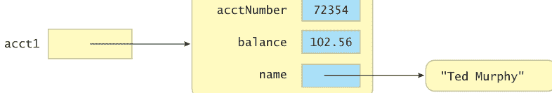
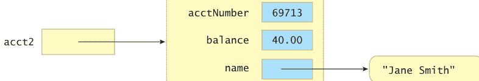
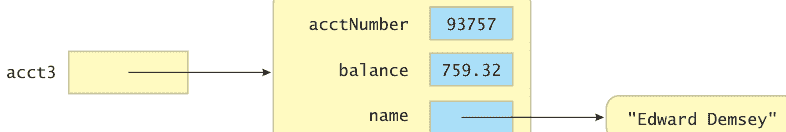

更新账户余额的各种方法可以设计得更严谨。应该进行检查确保参数值有效，以防止提取负数（这本质上是存款）。这种处理将在下一章中讨论。

> **自我复习题（答案见附录 N）**
> SR 4.16 为什么要通过特定对象（或在对象上）调用方法？该规则的例外是什么？
> SR 4.17 方法返回一个值意味着什么？
> SR 4.18 `return` 语句的作用是什么？
> SR 4.19 是否需要 `return` 语句？
> SR 4.20 解释实际参数和形式参数之间的区别。
> SR 4.21 为 Die 类编写一个名为 `getFaceDown` 的方法，返回骰子当前的“朝下”值。提示：在标准骰子上，任意两个相对面的数字和为七。
> SR 4.22 在 Transactions 程序中：
> - a. 创建了多少个 Account 对象？
> - b. 在 `acct2` 对象上调用 `withdraw` 方法时，传递了多少参数（实际参数）？
> - c. 在 `acct3` 对象上调用 `addInterest` 方法时，传递了多少参数（实际参数）？
> SR 4.23 Account 类方法中哪些属于访问器方法（accessor methods）？哪些属于修改器方法（mutator methods）？哪些属于服务方法（service methods）？

## 4.5 重新回顾构造函数

如第 2 章所述，构造函数类似于在对象实例化时调用的方法。当我们定义一个类时，通常会定义一个构造函数来帮助我们设置类。特别是，我们经常使用构造函数来初始化每个对象的变量。

构造函数与普通方法有两个不同之处。首先，构造函数的名称与类名相同。因此，Die 类中的构造函数名称是 `Die`，而 Account 类中的构造函数名称是 `Account`。第二，构造函数不能返回值，且在方法头中没有指定返回类型。

> **核心概念**
> 构造函数不能有任何返回类型，即使是 `void`。

程序员的一个常见错误是在构造函数上加上 `void` 类型。对于编译器而言，在构造函数上加上任何返回类型（即使是 `void`）都会将其变成一个恰好与类名同名的普通方法。因此，它不能作为构造函数被调用。这会导致难以理解的错误信息。

通常，构造函数用于初始化新实例化的对象。例如，Die 类的构造函数最初将骰子的面值设置为 1。Account 类的构造函数将实例变量的值设置为作为构造函数参数传入的值。

我们不必为每个类都定义构造函数。每个类都有一个不接受参数的默认构造函数。如果我们不提供自己的构造函数，就会使用默认构造函数。这个默认构造函数通常对新创建的对象没有影响。

> **自我复习题（答案见附录 N）**
> - SR 4.24 构造函数是做什么的？
> - SR 4.25 构造函数是如何定义的？

## 4.6 图形对象

某些对象具有图形表示，这意味着它们的状态和行为包含了关于对象视觉上看起来的的信息。例如，图形对象可能包含关于其尺寸和颜色的数据，并可能包含绘制它的方法。

在第 3 章中，我们实例化并使用了框架（frames）、面板（panels）、标签（labels）和锚点（anchors）等图形组件。这些组件当然被认为是图形对象。本节将详细检查其中一些对象，并探索如何定义具有图形特征的对象。

列表 4.5 中的程序显示了一个笑脸和一个文本说明。然而，SmilingFace 类中的 `main` 方法并没有处理所有这些细节，`main` 方法设置了程序的框架并使用它来显示 SmilingFacePanel 的实例。

SmileyPanel 类如列表 4.6 所示。它定义了两个用于绘图的结构（`BASEX` 和 `BASEY`）、一个设置面板关键特的构造函数，以及一个绘制我们在程序执行时所看到的脸脸的 `paintComponent` 方法。在这种情况下，我们不是向面板添加 GUI 组件，而仅仅是在上面进行绘图。

注意 `SmilingFacePanel` 继承了 `JPanel` 类。正如我们在第 2 章讨论方面时提到的，`extends` 建立了继承关系。SmilingFacePanel 继承了 JPanel 类的特征。也就是说，一个 SmilingFacePanel 就是一个 JPanel。到目前，关于继承你真正需要知道的只有这些了，继承将在第 9 章中详细讨论。


### 列表 4.5 SmilingFace.java

```java
import javax.swing.JFrame;

public class SmilingFace {

    public static void main(String[] args) {

        JFrame frame = new JFrame("Smiling Face");

        frame.setDefaultCloseOperation(JFrame.EXIT_ON_CLOSE);

        SmilingFacePanel panel = new SmilingFacePanel();

        frame.getContentPane().add(panel);

        frame.pack();

        frame.setVisible(true);

    }

}
```

### 列表 4.6 SmileyPanel.java

```java
import javax.swing.JPanel;

import java.awt.*;

public class SmilingFacePanel extends JPanel {

    private final int BASEX = 120, BASEY = 60; // 部的基点

    public SmilingFacePanel() {

        setBackground(Color.blue);

        setPreferredSize(new Dimension(320, 200));

        setFont(new Font("Arial", Font.BOLD, 16));

    }

    public void paintComponent(Graphics page) {

        super.paintComponent(page);

        page.setColor(Color.yellow);

        page.fillOval(BASEX, BASEY, 80, 80); // 头

        page.fillOval(BASEX-5, BASEY+20, 90, 40); // 耳朵

        page.setColor(Color.black);

        page.drawOval(BASEX+20, BASEY+30, 15, 7); // 眼睛

        page.drawOval(BASEX+45, BASEY+30, 15, 7);

        page.fillOval(BASEX+25, BASEY+31, 5, 5); // 瞳孔

        page.fillOval(BASEX+50, BASEY+31, 5, 5);

        page.drawArc(BASEX+20, BASEY+15, 15, 7, 0, 180); // 眉

        page.drawArc(BASEX+45, BASEY+25, 15, 7, 0, 180);

    }

}
```

### 列表 4.6 (续)

```java
page.drawArc(BASEX+35, BASEY+40, 15, 10, 180, 180); // nose

page.drawArc(BASEX+20, BASEY+50, 40, 15, 180, 180); // mouth

page.setColor(Color.white);

page.drawString("Always remember that you are unique!", BASEX-105, BASEY-15);

page.drawString("Just like everyone else.", BASEX-45, BASEY+15);
```

`paintComponent` 方法接收一个 `Graphics` 对象作为参数，正如我们在第 2 章中讨论过的样，该对象代表组件的图形上下文。图形是通过调用面板的图形上下文（即 `page` 参数）在面板上绘制绘制的。

每个 `JPanel` 都有一个 `paintComponent` 方法，该方法会被自动调用以绘制面板。在本例中，我们扩展了 `paintComponent` 的定义——告诉它除了绘制面板背景外，还应该根据 `paintComponent` 方法中定义的各种调用来绘制脸部和文字。`paintComponent` 方法的第一行是调用 `super.paintComponent`，它代表了 `JPanel` 版本的 `paintComponent` 方法，负责处理背景的绘制。我们始终将将其作为 `paintComponent` 方法中的第一行代码。

让我们来看另一个例子。列表 4.7 显示的 `Splat` 类包含一个 `main` 方法，用于创建并显示程序的的框架。从视觉上看，

### 列表 4.7 Splat.java

```java
/********************************************************************
// Splat.java               Author: Lewis/Loftus
// 展示了图形对象的使用。
********************************************************************/

import javax.swing.*;
import java.awt.*;

public class Splat {

//------------------------------------------------------
// 展示一组圆。
//------------------------------------------------------
public static void main(String[] args)
{
    JFrame frame = new JFrame("Splat");
    frame.setDefaultCloseOperation(JFrame.EXIT_ON_CLOSE);
    frame.getContentPane().add(new SplatPanel());
    frame.pack();
    frame.setVisible(true);
}
}
```

### 显示

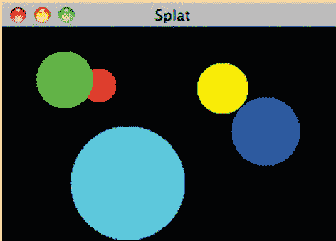

程序简单地绘制了几个实心圆。这个程序有趣的地方不在于它做了什么，而在于它是如何做的——这个程序中绘制的每个圆都由它自己的对象表示。

`main` 方法实例化了一个 `SplatPanel` 对象并将其添加到框架中。`SplatPanel` 类在列表 4.8 中。与上一个例子中的 `SmilingFacePanel` 类一样，`SplatPanel` 类派自于 `JPanel`。它持有五个 `Circle` 对象的实例数据，这些对象在构造函数中被实例化。

### 列表 4.8 SplatPanel.java

```java
/************************************************************************************
// SplatPanel.java
// Author: Lewis/Loftus
// 展示了图形对象的使用。
************************************************************************************/

import javax.swing.*;
import java.awt.*;

public class SplatPanel extends JPanel {

    private Circle circle1, circle2, circle3, circle4, circle5;

    // 构造函数：创建五个 Circle 对象。
    public SplatPanel() {
        circle1 = new Circle(30, Color.red, 70, 35);
        circle2 = new Circle(50, Color.green, 30, 20);
        circle3 = new Circle(100, Color.cyan, 60, 85);
        circle4 = new Circle(45, Color.yellow, 170, 30);
        circle5 = new Circle(60, Color.blue, 200, 60);
        setPreferredSize(new Dimension(300, 200));
        setBackground(Color.black);
    }

    // 通过请求每个圆绘制自己来绘制此面板。
    public void paintComponent(Graphics page) {
        super.paintComponent(page);
        circle1.draw(page);
        circle2.draw(page);
        circle3.draw(page);
        circle4.draw(page);
        circle5.draw(page);
    }
}
```

`SplatPanel` 类中的 `paintComponent` 方法通过调用每个圆的 `draw` 方法来绘制面板。本质上，`SplatPanel` 类要求每个圆绘制自己。

`Circle` 类在列表 4.9 中。它定义了实例数据来存储圆的大小、(x, y) 位置及其颜色。这些值通过构造函数设置，该类包含了所有适当的访问器（accessor）和修改器（mutator）。`Circle` 类的 `draw` 方法简单根据其实例数据的值（其当前状态）绘制圆。

### 列表 4.9 Circle.java

```java
/*********************************************************************************
// Circle.java               Author: Lewis/Loftus
// 表示具有特定位置、大小和颜色的圆。
*********************************************************************************/

import java.awt.*;

public class Circle {

    private int diameter, x, y;
    private Color color;

    //-----------------------------------------------------------------
    // 构造函数：用指定的值设置此圆。
    //-----------------------------------------------------------------
    public Circle(int size, Color shade, int upperX, int upperY) {
        diameter = size;
        color = shade;
        x = upperX;
        y = upperY;
    }

    //-----------------------------------------------------------------
    // 在指定的图形上下文中绘制此圆。
    //-----------------------------------------------------------------
    public void draw(Graphics page) {
        page.setColor(color);
        page.fillOval(x, y, diameter, diameter);
    }

    //--- 直径修改器。
    public void setDiameter(int size) {
        diameter = size;
    }

    //--- 颜色修改器。
    public void setColor(Color shade) {
        color = shade;
    }

    //--- X 修改器。
    public void setX(int upperX) {
        x = upperX;
    }
}
```


# 列表 4.9 (续)

```java
// 颜色访问器。
//----
public Color getColor()
{
    return color;
}

//--- X 访问器。
//----
public int getX()
{
    return x;
}

//--- Y 访问器。
//----
public int getY()
{
    return y;
}
```

`Splat` 程序体现了面向对象的思想。每个圆自我管理。

# 第 4 章

# 自复习问题（参见答案）

- SR 26: 用户界面需要哪些组件？
- SR 27: 在 SmilingFace 程序中，`paintComponent` 方法是何时以及如何被调用的？
- SR 28: 编写代码添加标签。
- SR 29: 重写构造函数，使其生成 20 到 200 之间的随机直径。

## 4.7 图形用户界面

在第 2 章和第 3 章中我们引入了一些有助于设计的组件。现在我们需要的是真正的交互，这是图形用户界面（GUI）的核心。本节介绍了创建交互式程序的概念，为所有的 GUI 讨论奠定了基础。

用户界面至少需要三种对象：

- 组件
- 事件
- 监听器

正如第 3 章提到的，GUI 组件是用于显示信息或允许用户交互的屏幕元素。组件的示例包括按钮、文本字段、标签、滚动条和菜单。容器是用于存放其他组件的特殊类型。

事件代表我们可能感兴趣的发生。事件通常响应用户操作，例如点击鼠标或在键盘上输入。大多数 GUI 组件都会产生与自身相关的事件。例如，按钮组件会产生一个指示按钮已被按下的事件。围绕 GUI 的程序是事件驱动的。

> 核心概念
> GUI 由组件、响应用户操作的事件和监听器组成。

监听器是“等待”事件发生并在其发生时以某种方式做出响应的对象。我们必须仔细建立监听器、它所监听的事件以及生成事件的组件之间的关系。

具体来说，为了创建一个使用 GUI 程序，我们必须：

- 实例化并设置必要的组件
- 实现监听器类以定义当特定事件时发生的情况
- 建立监听器与产生事件的组件之间的关系。


VideoNote
GUI 开发概览。

## 第 4 章 编写类

在某些方面，一旦你对事件驱动编程有了基本的理解，剩下的只是细节了。你可以使用许多类型的组件，这些组件会产生许多你可能想要响应的类型事件。它们的工作方式都是相同的。它们之间也具有相同的内核关系。

接下来的章节将介绍更多的组件，并展示基于 GUI 的程序示例，这些程序允许真正的用户交互。

### 自测习题（答案见附录 N）

- SR 4.30 事件与监听器之间是什么什么关系？
- SR 4.31 我们可以向任何组件添加任何种类型的监听器吗？请解释。

## 4.8 按钮

列表 4.10 所示的 PushCounter 程序为用户提供了一个单一的推按钮（标记为“Push Me!”）。每当按钮按下时，计数器就会更新并显示。

## 列表 4.10

```java
// PushCounter.java               Author: Lewis/Loftus
// 展示了图形化用户界面和事件监听器。
//************************************************************************************

import javax.swing.JFrame;

public class PushCounter {

    // ----------------------------------------------------------------------
    // 创建主程序框架。
    // ----------------------------------------------------------------------
    public static void main(String[] args) {
        JFrame frame = new JFrame("Push Counter");
        frame.setDefaultCloseOperation(JFrame.EXIT_ON_CLOSE);
        frame.getContentPane().add(new PushCounterPanel());
        frame.pack();
        frame.setVisible(true);
    }
}
```


该程序使用的组件包括一个按钮、一个显示计数的标签、一个用于组织 GUI 的面板以及一个显示该面板的框架。面板由 `PushCounterPanel` 类定义，如列表 4.11 所示。

推按钮是一种允许用户通过点击鼠标启动动作的组件。我们将在随后的章节中探索其他类型的按钮组件。推按钮由 `JButton` 类定义。

## 列表 4.11

```java
// PushCounterPanel.java      Author: Lewis/Loftus
//
// 展示了图形化用户界面和事件监听器。
//********************************************************************

import java.awt.*;
import java.awt.event.*;
import javax.swing.*;

public class PushCounterPanel extends JPanel {

    private int count;
    private JButton push;
    private JLabel label;

    //-------------------------------------------------------
    // 构造函数：设置 GUI。
    //-------------------------------------------------------
    public PushCounterPanel() {
        count = 0;
        push = new JButton("Push Me!");
        push.addActionListener(new ButtonListener());
        label = new JLabel("Pushes: " + count);
        add(push);
        add(label);
        setPreferredSize(new Dimension(300, 40));
        setBackground(Color.cyan);
    }

    //********************************************************************
    // 代表按钮按下（动作）事件的监听器。
    //********************************************************************
    private class ButtonListener implements ActionListener {
        //-------------------------------------------------------
        // 当按钮被按下时，更新计数器和标签。
        //-------------------------------------------------------
        public void actionPerformed(ActionEvent event) {
            count++;
            label.setText("Pushes: " + count);
        }
    }
}
```

`PushCounterPanel` 构造函数设置了 GUI。调用 `JButton` 构造函数会接收一个字符串参数，指定显示在按钮上的文本。按钮和标签被添加到面板中。

该程序中唯一感兴趣的事件发生在按钮被按下时。由于要响应该事件，我们必须为该事件创建一个监听器对象，因此我们编写一个表示该监听器的类。

## 4.8 按钮

`JButton` 在被按下时会产生一个动作事件。因此，我们将编写的监听器类将是一个动作事件监听器。在这个程序中，我们定义了一个名为 `ButtonListener` 的类来表示此事件的监听器。

我们可以将 `ButtonListener` 写在自己的单独文件中，甚至写在同一个文件中但位于 `CounterPanel` 之外。但是，我们必须设置一种监听器与被监听器更新的 GUI 组件之间进行通信的方法。相反，我们将 `ButtonListener` 定义为内部类，即定义在另一个类内部的类。因此，它应该能够访问包含它的类的成员。您只有在两个类之间存在紧密关系，且内部类不被任何其他类访问的情况下，才创建内部类。监听器与其 GUI 之间的关系是使用内部类的少数适用情况之一。

> 核心概念：
> 监听器通常被定义为内部类，是因为监听器与 GUI 组件之间存在紧密的关系。

监听器类通过实现接口创建，接口是一份实现类必须定义的方法列表。Java 标准类库包含了各种类型事件的接口。动作监听器是通过实现 `ActionListener` 接口创建的；因此，我们在 `ButtonListener` 类中包含了 `implements` 子句。接口将在第 7 章进行更详细的讨论。

`ActionListener` 接口中列出的唯一方法是 `actionPerformed` 方法，因此这是该方法必须定义的方法。

### 自测习题（答案见附录 N）

- SR 4.32 推按钮（`JButton`）产生什么种类型的事件？
- SR 4.33 你将如何修改 PushCounter 类，使其不再显示按钮被按下的次数，而是显示一个“轨迹”？按下一次显示“01”，按下两次显示“12”，按下五次显示“012345”，以此类推。

## 4.9 文本字段

让我们看看使用另一个组件的示例：文本字段。列表 4.12 所示的 Fahrenheit 程序展示了一个 GUI，其中包含一个文本字段，用户可以在其中输入华氏温度。当用户按下 Enter（或 Return）键时，就会显示等值的摄氏温度。

Fahrenheit 程序的界面在 `FahrenheitPanel` 类中设置。文本字段是 `JTextField` 类的对象。`JTextField` 构造函数接收一个整数参数，指定字段在当前默认字体下的字符数大小。

文本字段和各种标签被添加到面板中。记住，面板由称为流布局（flow layout）的布局管理器管理，该布局会将许多组件放在同一行。因此，如果你调整了框架的大小，标签和文本字段的方向可能会发生变化。我们将在第 7 章详细讨论布局管理器，为控制组件布局提供更多选项。

如果光标当前位于文本字段中，文本字段在按下 Enter 或 Return 键时产生一个动作事件。因此，我们需要设置一个监听器来响应动作事件。正如我们在上一节中所做的那样，我们将监听器定义为实现 `ActionListener` 接口的内部类。

当用户按下 Enter 键时，文本字段组件调用 `actionPerformed`。第一个方法通过调用 `getText` 方法从文本字段获取文本，该方法返回一个字符字符串。使用 `Integer` 包装类的 `parseInt` 方法将文本转换为整数。该方法计算确定等值的摄氏温度，并将结果设置到相应标签的文本。

注意，推按钮和文本字段产生相同的事件：动作事件。因此，Fahrenheit 程序设计的另一种方案是在 GUI 中添加一个 `JButton` 对象，当用户使用鼠标点击按钮时触发转换。就此，同一个监听器对象可以

# 列表 4.12

```java
// Fahrenheit.java               Author: Lewis/Loftos
// Demonstrates the use of text fields.
//********************************************************************************

import javax.swing.JFrame;

public class Fahrenheit {

    // Creates and displays the temperature converter GUI.
    // --------------------------------------------------------------------------------------
    public static void main(String[] args) {
        JFrame frame = new JFrame("Fahrenheit");
        frame.setDefaultCloseOperation(JFrame.EXIT_ON_CLOSE);
        FahrenheitPanel panel = new FahrenheitPanel();
        frame.getContentPane().add(panel);
        frame.pack();
        frame.setVisible(true);
    }
}
```

# 显示

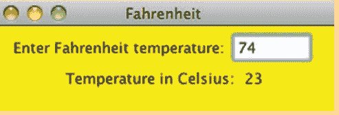

# 第 4 章 编写类

# 列表 4.13

```java
// FahrenheitPanel.java      Author: Lewis/Loftus
// Demonstrates the use of text fields.
//************************************************************************************

import java.awt.*;
import java.awt.event.*;
import javax.swing.*;

public class FahrenheitPanel extends JPanel {

    private JLabel inputLabel, outputLabel, resultLabel;
    private JTextField fahrenheit;

    // 构造函数：设置主 GUI 组件。
    public FahrenheitPanel() {
        inputLabel = new JLabel("Enter温度:");
        outputLabel = new JLabel("摄氏度温度: ");
        resultLabel = new JLabel("---");
        fahrenheit = new JTextField(5);
        fahrenheit.addActionListener(new TempListener());
        add(inputLabel);
        add(fahrenheit);
        add(outputLabel);
        add(resultLabel);
        setPreferredSize(new Dimension(300, 75));
        setBackground(Color.yellow);
    }

    //
    private class TempListener implements ActionListener {
        // 当在文本框按下回车键时，
        // 执行转换。
        //
        public void actionPerformed(ActionEvent event) {
            int fahrenheitTemp, celsiusTemp;
            String text = fahrenheit.getText();
        }
    }
}
```

# 4.9 文本框

# 列表 4.13 续


fahrenheitTemp = Integer.parseInt(text);

celsiusTemp = (fahrenheitTemp - 32) * 5 / 9;

resultLabel.setText(Integer.toString(celsiusTemp));

}

}

```
用于同时监听多个组件。因此，监听器可以同时被添加到文本框和按钮上，给用户提供选择。按下任何一个按钮或回车键都会触发转换。这些变体被留作编程项目。

### 自测习题（答案见附录 N）

- SR 4.34 描述当用户在文本框中输入数字并按下回车键时，Fahrenheit 程序内部发生了什么情况。
- SR 4.35 修改 Fahrenheit 类，使得当用户在文本框中输入数字时，文本框下方会出现以“X 华氏度 = Y 摄氏度”格式显示的语句。例如，如果用户输入 223，则显示“223 华氏度 = 106 摄氏度”，而不是“摄氏度温度: 106”。

### 核心概念总结

- 面向对象编程的核心是定义代表具有良好状态和行为对象的类。
- 变量的作用域决定了它可以在哪里被引用，取决于它的声明位置。
- UML 类图有助于我们可视化程序中类的内容以及类之间的关系。
- 对象应该被封装，保护其数据免受不当访问。
- 实例变量应该声明为 `private` 可见性以促进封装。
- 大多数对象包含访问器（accessor）和修改器（mutator）方法，允许客户端受控的方式管理数据。
- 方法返回的值必须与方法头中指定的返回类型一致。
- 当调用方法时，实际参数会被复制到形式参数中。
- 在方法中声明的变量是该方法的局部变量，不能在外部使用。
- 构造函数不能有任何返回值，即使是 `void`。
- GUI 由组件、代表用户操作的事件以及响应这些事件的监听器组成。
- 由于监听器与 GUI 组件之间存在紧密的关系，监听器通常被定义为内部类。

# 练习题

- EX 4.1 对于以下每一对项，识别哪一个代表类，哪一个代表该类的对象？
    - a. Weekdays, Friday
    - b. Java, Language
    - c. Bird, Eagle
    - d. Bob, Employee
    - e. Student, Alice

- EX 4.2 为一个代表窗户玻璃的 `WindowPane` 类列出一些可能定义的属性和操作。

- EX 4.3 为一个代表学校考试的 `Examination` 类列出一些可能定义的属性和操作。

- EX 4.4 为一个代表特定课程的 `Course` 类（而不是泛指课程）列出一些可能定义的属性和操作。

- EX 4.5 编写一个名为 `synonyms` 的方法，在调用时打印单词的至少两个同义词。该方法不接受参数且没有返回值。

- EX 4.6 编写一个接受两个整数并返回第一个整数的第二个整数幂的方法。

- EX 4.7 编写一个名为 `random100` 的方法，返回一个 1 到 100 之间的随机整数。

- EX 4.8 编写一个名为 `randomRange` 的方法，接受两个整数并返回指定范围内的随机整数。假设第一个参数大于第二个参数。

- EX 4.9 编写一个名为 `randomColor` 的方法，创建并返回一个随机颜色对象。颜色对象由 0 到 255 之间的三个值（红、绿、蓝）定义。

- EX 4.10 假设你有一个 `Movie` 类。为该类编写一个构造函数，根据传递的参数初始化实例变量。

- EX 4.11 假设你有一个带有 `age` 实例数据的 `Child` 类。为 age 编写 getter 和 setter 方法。

- EX 4.12 绘制 UML 类图，显示 `Transactions` 程序类之间的关系。

- EX 4.13 绘制 UML 类图，显示 `PushCounter` 程序类之间的关系。

- EX 4.14 绘制 UML 类图，显示 `Fahrenheit` 程序类之间的关系。

# 编程项目

- PP 4.1 编写一个名为 `NumberOfGoals` 的类，代表球队的进球数。该类应包含一个整数作为实例数据，表示进球数。编写一个构造函数将球数初始化为零。编写一个名为 `setGoal` 的方法，每次进球时数值加 1，并编写另一个名为 `getGoal` 的方法返回目前的进球数。最后，创建一个驱动类 `GoalTracker`，创建 `NumberOfGoals` 对象并测试它们的方法。

- PP 4.2 编写一个名为 `BitValue` 的类，代表真或假的二进制位。创建一个驱动类 `Bits`，其 `main` 方法实例化并设置一些位。

- PP 4.3 编写一个名为 `Circle` 的类，包含代表半径的实例数据。定义 `Circle` 构造函数接受并初始化半径，并包含半径的 getter 和 setter 方法。编写计算并返回周长和面积的方法。包含一个返回单行描述的 `toString` 方法。创建一个驱动类 `MultiCircle`，其 `main` 方法实例化并更新多个 `Circle` 对象。[周长 = 2π，面积 = π²]。

- PP 4.4 编写一个名为 `Dog` 的类，包含代表狗的名字和年龄的实例数据。定义 `Dog` 构造函数接受并初始化实例数据。为名字和年龄包含 getter 和 setter 方法。编写一个计算并返回狗的“人类年龄”（狗的年龄七倍）的方法。包含一个返回单行描述的 `toString` 方法。创建一个驱动类 `Kennel`，其 `main` 方法实例化并更新多个 `Dog` 对象。

- PP 4.5 编写一个名为 `Phone` 的类，包含代表手机名称、型号和年份的实例数据。定义 `Phone` 构造函数初始化这些值。为所有实例数据包含 getter 和 setter 方法，以及一个返回手机单行描述的 `toString` 方法。添加一个名为 `obsolete` 的方法，返回一个布尔值表示手机是否过期（如果超过10年）。创建一个驱动类 `PhoneCheck`，其 `main` 方法实例化并更新多个 `Phone` 对象。

- PP 4.6 编写一个名为 `Shelf` 的类，包含表示架子长度、宽度和容量的实例数据。还包含一个名为 `occupied` 的布尔变量作为实例数据，表示架子是否被占用。定义 `Shelf` 构造函数，以接收并初始化架子的高度、宽度和容量。每个新创建的架子都是空闲（构造函数应将 `occupied` 初始化为 `false`）。为所有实例数据包含 getter 和 setter 方法。包含一个 `toString` 方法，返回对架子的单行描述。创建一个名为 `ShelfCheck` 的驱动类，其 `main` 方法用于实例化并更新多个 `Shelf` 对象。

- PP 4.7 编写一个名为 `Laptop` 的类，包含表示笔记本电脑型号、品牌、购买者和购买年份的实例数据。定义 `Laptop` 构造函数以接收并初始化这些数据。为所有实例数据包含 getter 和 setter 方法。包含一个 `toString` 方法，返回一个独特格式的、多行的笔记本电脑购买描述。创建一个名为 `LaptopRecords` 的驱动类，其 `main` 方法用于实例化并更新多个笔记本电脑对象。

- PP 4.8 编写一个名为 `Course` 的类，表示提供给学生的课程。它应该包含表示课程标题、课程代码、学分和课程教师姓名的实例数据。定义 `Course` 构造函数以接收并初始化所有实例数据。为所有实例数据包含 getter 和 setter 方法。包含一个 `toString` 方法，返回对课程的单行描述。创建一个名为 `CourseDetails` 的驱动类，其 `main` 方法用于实例化并更新多个 `Course` 对象。

- PP 4.9 使用本章定义的 `Die` 类，编写一个名为 `PairOfDie` 的类，它由两个 `Die` 对象组成。包含设置和获取单个值的方法、一个掷骰子的方法，以及一个返回两个骰子值之和的方法。创建一个名为 `RollingDice` 的驱动类来实例化并使用 `PairOfDie` 对象。

- PP 4.10 编写一个名为 `BarChart` 的类，使用图形表示来比较数据。允许构造函数的参数指定图图的宽度和高度。图中的每个条形必须具有相同的颜色，以便清晰地表示数据。创建一个绘制随机尺寸条形图程序。

- PP 4.11 编写一个程序，显示出生预订的图形化座位图。创建一个名为 `Passenger` 的类（指旅行者），用于存储乘客的姓名、性别和床位。床位以矩形形式图形化表示，根据性别进行颜色编码，并在矩形中打印性别字母。

- PP 4.12 创建一个名为 `Marble` 的类，表示一种特定的颜色和直径。编写一个程序在地面上绘制几颗大理石。

- PP 4.13 创建一个名为 `Star` 的类，表示一个五角星。让构造函数接受星的宽度和星顶点的坐标。编写一个绘制包含各种尺寸星星的天空的程序。

- PP 4.14 修改本章的华氏温度程序，使其显示一个按钮，当按下该按钮时也会触发转换。也就是说，用户现在可以选择在文本框中按回车键或按下按钮。让已为文本框定义的监听器也监听按钮的按下事件。

- PP 4.15 编写一个显示两个按钮和一个标签的应用程序。一个按钮在按下时，将一个数值（初始为 1）乘以 0，而另一个按钮将该值重置为 10。

- PP 4.16 编写一个呈现三个按钮和一个标签的应用程序。将按钮标记为 Add（加）、Subtract（减）和 Multiply（乘）。使用标签显示一个数值（初始为 1）。每当按下任何按钮时，对数值执行值为 5的操作。例如：如果按下 Add 按钮，则给数值加 5。

- PP 4.17 编写一个绘制交通灯的应用程序，并使用推按钮改变灯的状态。从 `JPanel` 类派生绘制表面，并使用另一个面板来组织绘制表面和按钮。

- PP 4.18 开发一个实现用于编写电子邮件消息的原型用户界面程序。应用程序应该具有用于 To、CC 和 Bcc 地址列表以及主题行的文本框，以及一个消息正文文本框。包含一个标记为 Send（发送）的按钮。当按下 Send 按钮时，程序应使用 `println` 将所有字段的内容打印到标准输出。

# 软件失败

## 丹佛机场行李处理系统

### 发生了什么？

丹佛国际机场的设计者对自动化行李处理有宏大的计划。由于机场门口和航站楼之间有长达英里的距离需要覆盖，他们希望开发一种系统，让行李从值机柜台运送到出发飞机，并从到达的行李收集处运出，尽可能减少人工干预。他们认为该系统将减少航班延误、减少在行李提取道的等待时间并降低成本。


该系统是在 20 世纪 80 年代初和 90 年代初设计并创建的。建造了约 26 英里的轨道，在中央计算机的控制下通过灰色推车上下移动行李。然而，计划于 1994 年 3 月开放的机场因行李系统的故障而不断推迟。在测试期间，行李被错装和错误路由。它们从已经满的推车中掉落，落在塞满行李的传送带上。行李被卡在推车下掉落在水泥地上导致损坏。

- 丹佛的自动行李处理系统导致了行李丢失和包裹损毁。

机场最终于 1995 年 2 月开放营业。当时，只有一家航空公司——美国航空（United）同意使用该自动系统。没有其他航空公司使用该系统。他们选择由人工驾驶行李车，正如今天大多数机场这样做一样。美国航空在 2005 年放弃了该系统。

系统的原始成本为 1.86 亿美元。延误每天损失 100 万美元，超过了原始成本。当美国航空在 2005 年放弃该系统时，尽管他们拥有到 2025 年每年 6000 万美元的租赁。

### 原因是什么？

该项目所代表的失败被认为是历史上最大的软件工程和整体系统设计失败之一。许多个人对问题的产生了贡献，但总的来说，设计者只是对他们使用的技术过度信任。他们未能避免复杂系统中总是会出现错误和效率下的问题。

具体问题包括光电眼的软件误判未能检测到堆积的现有行李。当系统崩溃重启时，它丢失了关于推车的信息，不知道哪些是满的。一个被称为“蜥蜴舌”的伸缩传送带加载器——设计用于进入飞机货舱并在无人工帮助的情况下提取行李——完全失败了。

### 经验教训

如此规模的项目在没有对所用技术进行多次局部测试的情况下不应尝试。失败往往是整个系统运行时多个变量共同导致。

当该系统在 20 世纪 80 年代后期设计时，它依赖于中心化框架来控制系统。这种方法在当今分布式处理的世界中看来是荒谬的。今天，手持扫描仪的人工行李处理员比计划中的自动系统的最佳目标要快速和准确得多。

> 来源：《国际先报》(The International Herald Tribune)

# 条件与循环

## 章节目标

- 定义通过方法的控制流。
- 探索可用于做出决策的布尔表达式。
- 使用 `if` 语句进行基础决策。
- 讨论与某些类型数据比较相关的问题。
- 使用 `while` 循环重复执行语句。
- 讨论迭代器对象的概念并使用它读取文本文件。
- 介绍 `ArrayList` 类。
- 探索更多的 GUI 组件和事件。

所有的编程语言都具有允许你做出决策以确定下一步操作的语句。其中某些语句允许你重复执行某项活动多次。本章讨论了此类类型的关键 Java 语句，并探索了与数据和对象比较的相关内容。本章从讨论布尔表达式开始，布尔表达式是任何决策的基础。本章的图形轨迹（Graphics Track）部分将探索一些新的组件和事件。

## 5.1 布尔表达式

在运行的程序中，语句执行的顺序被称为控制流。除非另有说明，否则程序的执行按线性方式进行。也就是说，运行程序从第一条编程语句开始，每次向下移动一条，直到程序完成。Java 从执行 `main` 方法的第一行开始，逐步进行直到到达 `main` 方法的末尾。

调用方法会改变控制流。当一个方法被调用时，控制跳转到为该方法定义的代码。当方法完成后，控制返回到调用方法中执行调用的地方，并从那里继续处理。

在方法内部，我们可以通过某些类型的编程语句改变控制流。控制方法执行流的语句分为两类：条件和循环。

条件语句有时被称为选择语句，因为它允许我们选择执行哪条语句。Java 中的条件语句包括 `if` 语句、`if-else` 语句和 `switch` 语句。我们在本章中探索 `if` 语句和 `if-else` 语句，并在第 6 章介绍 `switch` 语句。

每个决策都基于布尔表达式（也称为条件），这是一个评估真（true）或假（false）的表达式。表达式的结果决定了下一步执行哪个语句。以下是一个语句的示例：

```
if (count > 20)
    System.out.println("Count exceeded");
```

该语句中的条件是 `count > 20`。该表达式评估布尔（真或假）。`count` 中存储的值大于 20，或者不大于。如果是，则跳过 `println` 语句并继续执行其后的任何代码。

在编程情况下，这种决策的需求无处不在。例如，人寿保险的费用可能取决于被保险人是否抽烟。如果此人抽烟，我们使用特定公式计算费用；如果不抽烟，我们使用另一种公式。条件语句的作用是评估布尔条件（此人是否抽烟），然后相应的执行正确的计算。

循环（或重复语句）允许我们反复执行某条编程语句。像条件一样，循环也基于布尔表达式，该表达式决定了语句执行的次数。

例如，假设我们想要计算班级中每个学生的平均绩点。每个学生的计算方法是相同的，但在不同的数据上执行。我们将设置一个循环，对每个学生重复计算，直到没有更多学生需要处理为止。

Java 有三种类型的循环：`while` 语句、`do` 语句和 `for` 语句。每种类型的循环语句都有与其他区分的独特特征。我们在本章中介绍 `while` 语句，并在第 6 章介绍 `do` 循环和 `for` 循环。

循环基于的布尔表达式使用相等运算符、关系运算符和逻辑运算符来做出决策。在详细讨论条件语句和循环语句之前，让我们探索这些运算符。

## 等于与关系运算符

`==` 和 `!=` 运算符被称为*相等运算符*。它们测试两个值是否相等或不相等。注意，相等运算符由两个并排等号组成，不应误认为是仅使用一个符号的赋值运算符。

以下 `if` 语句仅在变量 `total` 和 `sum` 包含相同值时才打印句子：

```
if (total == sum)
    System.out.println("total equals sum");
```

同样，以下 `if` 语句仅在变量 `total` 和 `sum` *不* 包含相同值时才打印句子：

```
if (total != sum)
    System.out.println("total does NOT equal sum");
```


# 第 5 章 条件判断与循环

Java 还有几个关系运算符，让我们决定值之间的相对顺序。在本节较早之前，我们使用大于运算符（`>`）来判断一个值是否大于另一个值。我们可以使用各种运算符询问类似的问题。在 Java 中，关系运算符包括大于（`>`）、小于（`<`）、大于等于（`>=`）和小于等于（`<=`）。图 5.1 列出了 Java 的相等和关系运算符。

| 运算符 | 含义 |
| --- | --- |
| `==` | 等于 |
| `!=` | 不等于 |
| `<` | 小于 |
| `<=` | 小于等于 |
| `>` | 大于 |
| `>=` | 大于等于 |

图 5.1 Java 相等和关系运算符

相等和关系运算符的优先级低于算术运算符。因此，首先评估算术运算，然后是相等和关系运算符。如以往，可以使用括号显式地指定评估顺序。

在本章中我们将看到更多关系运算符的示例。

## 逻辑运算符

除了相等和关系运算符，Java 还有三种产生结果的逻辑运算符。它们接受两个操作数。图 5.2 列出了逻辑运算符。

`!` 运算符用于执行非操作，也称为逻辑取反。布尔值的逻辑取反是其相反。也就是说，如果一个值为假，则 `!a` 为真。同样，如果一个值为真，则 `!a` 为假。

| 运算符 | 描述 | 示例 | 结果 |
| --- | --- | --- | --- |
| `!` | 逻辑非 | `! a` | 如果 a 为假则真 |
| `&&` | 逻辑与 | `a && b` | 如果 a 和 b 都为真则真 |
| `||` | 逻辑或 | `a || b` | 如果 a 或 b 为真则真 |

图 5.2 Java 逻辑运算符

非运算符是一元的，其操作数只有两个可能的值：真或假。图 5.3 显示了描述 `!` 运算符的真表。

| a | !a |
|---|---|
| false | true |
| true | false |

图 5.3 描述非运算符的真表

`&&` 运算符执行逻辑与操作。当两个操作数都为真时，结果为真，否则为假。对比逻辑或运算符（`||`）的结果，如果一个或另一个操作数为真，则为真，否则为假。

与或运算符是二元运算符，因为每个都使用两个操作数。因此，有四种组合需要考虑：两个操作数都真、都为假、一个真一个假，以及反之亦然。图 5.4 描绘了显示 `&&` 和 `||` 的真表。

| a | b | a && b | a || b |
|---|---|---|---|
| false | false | false | false |
| false | true | false | true |
| true | false | false | true |
| true | true | true | true |

逻辑非在三个逻辑运算符中优先级最高，随后是逻辑与，然后逻辑或。

考虑以下 `if` 语句：

```
if (done && count > MAX)
    System.out.println("Completed.");
```

在什么情况下会执行打印语句？布尔变量 `done` 的值为真或假，非运算符会反转该值。`count` 的值大于 `MAX` 或不是。图 5.5 中的真表分解了所有可能性。

`&&` 和 `||` 运算符的一个重要特性是它们是“短路的”。也就是说，如果它们的左操作数足以决定操作的布尔结果，则右操作数不会被评估。这种情况可能发生在两种运算符中，但对于不同的原因。如果 `&&` 运算符的左操作数为假，那么无论右操作数的值是什么，操作的结果都为假。同样，如果 `||` 运算符的左操作数为真，那么无论右操作数的值是什么，操作的结果都为真，这被称为短路逻辑。

> **核心概念**
> 逻辑运算符经常用于构建复杂的条件。

| done | count > MAX | !done | !done && (count > MAX) |
|---|---|---|---|
| false | false | true | false |
| false | true | true | true |
| true | false | false | false |
| true | true | false | false |

**图 5.5** 特定条件的真值表

有时你可以利用操作具有短路特性的事实。例如，以下 `if` 语句中的条件如果左操作数为假，则将不会尝试除以零。如果 `count` 的值为零，`&&` 运算符的左侧为假；因此，整个表达式为假，右侧不会被求值。

```
if (count != 0 && total/count > MAX)
    System.out.println("Testing.");
```

你应该仔细考虑是否依赖这类微妙的语言特性。并不是所有的编程语言工作方式都相同。正如我们之前强调的样，你应该优先考虑可读性而不是巧妙的编程技巧。始终努力让任何代码阅读者清楚你的程序逻辑是如何工作的。

### 自我复习题（答案见附录 N）

- **SR 5.1** 程序执行的控制流是指什么意思？
- **SR 5.2** 条件判断和循环是基于什么类型的条件的？
- **SR 5.3** 什么是相等运算符？关系运算符是什么？逻辑运算符是什么？
- **SR 5.4** 给定以下声明，列出的每个布尔表达式的值是多少？

```
int value1 = 5, value2 = 10;
boolean done = true;
```

- a. `value1 <= value2`
- b. `(value1 + 5) >= value2`
- c. `value1 < value2 / 2`
- d. `value2 != value1`
- e. `(!value1 == value2)`
- f. `(value1 < value2) || done`
- g. `(value1 > value2) || done`
- h. `(value1 < value2) && !done`
- i. `done || !done`
- j. `((value1 > value2) || done) && (!done || (value2 > value1))`

- **SR 5.5** 什么是真值表？
- **SR 5.6** 假设 `done` 是一个布尔变量，`value` 是一个 `int` 变量，为表达式创建一个真值表：`(value > 0) || !done`
- **SR 5.7** 假设 `c1` 和 `c2` 是布尔变量，为表达式创建一个真值表：`(c1 && !c2) || (!c1 && !c2)`

## 5.2 if 语句

我们在本章之前的示例中使用了一个基础的 `if` 语句。现在让我们详细探索一下它。

一个 `if` 语句由关键字 `if` 组成，后面跟着一个布尔表达式，然后是一个语句。条件包含在括号中，并且必须求值为真或假。如果条件为真，则执行该语句并继续执行下一条语句。如果条件为假，则跳过该语句并直接执行下一条语句。图 5.6 显示了这一过程。

考虑以下 `if` 语句的示例：

```
if (total > amount)
    total = total + (amount + 1);
```

在这个示例中，如果 `total` 中的值大于 `amount` 中的值，则执行赋值语句；否则跳过赋值语句。

注意，示例中的赋值语句在 `if` 语句的标题行下方缩进了。这传达出赋值语句是 `if` 语句的一部分；它意味着 `if` 语句决定了赋值语句是否会被执行。虽然这种缩进对人类阅读者来说极其重要，但编译器会忽略它。

> **核心概念**
> 适当的缩进对于人类可读性非常重要；它显示了语句与语句之间的关系。

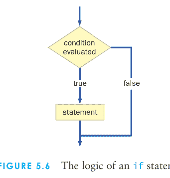

### 列表 5.1

```java
//******************************************************
// Age.java          Author: Lewis/Loftus
// 演示了 if 语句的使用。
//******************************************************

import java.util.Scanner;

public class Age {

    // 读取用户的年龄并相应的打印注释。
    public static void main(String[] args) {
        final int MINOR = 13;
        Scanner scan = new Scanner(System.in);
        System.out.print("Enter your age: ");
        int age = scan.nextInt();

        if (age < MINOR) {
            System.out.println("You are a youth.");
        } else {
            System.out.println("You are an adult.");
        }

        System.out.println("Age is a state of mind.");
    }
}
```

**OUTPUT**
```
Enter age: 15
You are a youth.
Age is a state of mind.

Enter age: 21
You are an adult.
Age is a state of mind.
```

### 列表 5.2

```java
System.out.println();

// 按“1.5倍工时”支付加班费
if (hours > STANDARD)
    pay = STANDARD * RATE + (hours-STANDARD) * (RATE * 1.5);
else
    pay = hours * RATE;

NumberFormat fmt = NumberFormat.getCurrencyInstance();
System.out.println("总收入: " + fmt.format(pay));
```

**输出**
```
输入工作小时数: 46
总收入: $404.25
```

此示例使用了一个名为 `roster` 的对象。即使不知道 `roster` 代表什么，或者它是由哪个类创建的，我们也可以看到它至少有三个方法：`getSize()`、`expand()` 和 `addName()`。`if` 语句的条件调用了 `getSize()` 并将结果与常量 `FULL` 进行比较。如果条件为真，则调用 `expand()` 方法（显然是为了扩展 `roster` 的大小）。如果 `roster` 尚未满，则将变量名传递给 `addName()` 方法。

### 列表 5.3

```java
//****************************************************************
// CoinFlip.java      作者: Lewis/Loftus
// 展示了 if-else 语句的使用。
//****************************************************************

public class CoinFlip {

    // 创建一个 Coin 对象，抛掷它，并打印结果。
    public static void main(String[] args) {
        Coin myCoin = new Coin();
        myCoin.flip();

        if (myCoin.isHeads()) {
            System.out.println("你赢了.");
        } else {
            System.out.println("下次好运。");
        }
    }
}
```

**输出**
```
反面 (Tails)
下次好运。
```

`Coin` 类见列表 5.4。它存储了两个整数常量（`HEADS` 和 `TAILS`），代表硬币的两种可能状态，一个名为 `face` 的实例变量代表硬币当前的状态。`Coin` 构造函数通过调用 `flip()` 方法来初始化硬币，该方法通过随机选择一个数字（0 或 1）来确定硬币的状态。`isHeads()` 方法根据硬币当前的正面返回一个布尔值。`toString()` 方法使用 `if-else` 语句来决定返回哪个字符字符串来描述硬币。当 `myCoin` 对象被传递给 `main` 方法中的 `println` 时，`toString()` 方法会被自动调用。

### 使用块语句

我们可能希望在评估布尔条件的结果后执行多于一项的操作。在 Java 中，我们可以用任何单语句替换块语句（block statement）。

### 列表 5.4

```java
//****************************************************************************************************
// Coin.java      作者: Lewis/Loftus
//************************************************************************************
// 代表一个可以抛掷的双面反面硬币。
//************************************************************************************

public class Coin {

    private final int HEADS = 0;
    private final int TAILS = 1;
    private int face;

    //--------------------------------------------------------------------------------------
    // 通过初始抛掷硬币来设置硬币。
    //--------------------------------------------------------------------------------------
    public Coin() {
        flip();
    }

    //--------------------------------------------------------------------------------------
    // 通过随机选择一个面来抛掷硬币。
    //--------------------------------------------------------------------------------------
    public void flip() {
        face = (int)(Math.random() * 2);
    }

    //--------------------------------------------------------------------------------------
    // 如果硬币当前正面是正面则返回 true。
    //--------------------------------------------------------------------------------------
    public boolean isHeads() {
        return (face == HEADS);
    }

    //--------------------------------------------------------------------------------------
    // 将硬币的当前正面作为字符串返回。
    //--------------------------------------------------------------------------------------
    public String toString() {
        String faceName;

        if (face == HEADS)
            faceName = "Heads";
        else
            faceName = "Tails";

        return faceName;
    }
}
```


## 块语句

块语句是括在大括号中的语句集合。在之前的示例中，我们已经多次使用这些大括号来包含方法定义和类定义。

列表 5.5 显示的名为 `Guessing` 的程序使用了 `if-else` 语句，其中 `else` 子句的语句是一个块语句。

如果用户输入的猜测与随机选择的答案相等，则会打印相应的确认。然而，如果答案错误，则会打印两条语句：一条声明猜测错误，另一条打印实际答案。本章末尾的一个编程项目将此示例的概念扩展到了 Hi-Lo（猜数字）游戏。

请注意，如果不使用块，声明答案错误的句子会被打印，但揭示正确答案的句子将在所有情况下都被打印。也就是说，只有第一条语句会被视为 `else` 子句的一部分。

记住，缩进除了对人类读者之外没有任何意义。没有被正确分块的语句会导致程序员对代码的执行方式做出不合理的假设。例如，以下代码具有误导性：

```java
if (depth >= UPPER_LIMIT)
    delta = 10;
else
    System.out.println("WARNING: Delta");
```

缩进意味着只有在 `if` 条件为真时才会将 `delta` 重置为零，但这显然不符合意图。

### 列表 5.5

```java
// 作者: Lewis/Loftus
// Guessing.java
// 展示了 if-else 中块语句的使用。

import java.util.*;

public class Guessing {
    // 与用户玩简单的猜数字游戏。
    // ------------------------------------------------------
    public static void main(String[] args) {
        final int MAX = 10;
        int answer, guess;
        Scanner scan = new Scanner(System.in);
        Random generator = new Random();
        answer = generator.nextInt(MAX) + 1;
        System.out.print("我想了一个 1 到 " + MAX + " 之间的数字。猜猜是多少: ");
        guess = scan.nextInt();
        if (guess == answer) {
            System.out.println("你对了！猜得好！");
        } else {
            System.out.println("不对，抱歉。");
            System.out.println("数字是 " + answer);
        }
    }
}
```

**输出**
```
我想了一个 1 到 10 之间的数字。猜猜是多少: 7
不对，抱歉。
数字是 5
```

## 5.2 if 语句

块语句可以用在任何 Java 语法中调用单语句的地方。例如，`if-else` 语句的 `if` 部分可以是块，或者 `else` 部分可以是块（正如我们在 `Guessing` 程序中看到的那样），或者两部分都是块语句。例如：

```java
if (boxes != warehouse.getCount()) {
    System.out.println("库存与仓库不匹配。");
    System.out.println("重新开始库存流程！");
    boxes = 0;
} else {
    System.out.println("库存与仓库匹配。");
    warehouse.ship();
}
```

在这个 `if-else` 语句中，`boxes` 的值与调用仓库对象的 `getCount()` 方法得到的值进行比较。如果它们不匹配，则执行两个打印语句和一个赋值语句。如果它们匹配，则会打印不同的消息并调用仓库的 `ship()` 方法。

### 嵌套 if 语句

作为 `if` 语句结果的语句可以是另一个 `if` 语句。这种情况被称为嵌套 `if`。它允许我们在确定之前的决策结果后做出另一个决定。列表 5.6 中的程序名为 `MinOfThree`，它使用嵌套 `if` 语句来确定用户输入的整数值中的最小值。

在嵌套 `if` 语句中出现了一个重要情况。嵌套的 `else` 子句似乎可以适用于任何 `if` 语句。例如：

```java
if (code == 'R') {
    if (height <= 20) {
        System.out.println("情况正常");
    } else {
        System.out.println("太棒了！");
    }
}
```

### 列表 5.6

```java
// MinOfThree.java    Author: Lewis/Loftus
// 展示了嵌套 if 语句的使用。

import java.util.Scanner;

public class MinOfThree {
    // 从用户处读取三个整数并确定最小值。
    public static void main(String[] args) {
        int num1, num2, num3, min = 0;
        Scanner scan = new Scanner(System.in);
        System.out.println("Enter three integers: ");
        num1 = scan.nextInt();
        num2 = scan.nextInt();
        num3 = scan.nextInt();
        if (num1 < num2) {
            if (num1 < num3)
                min = num1;
            else
                min = num3;
        } else {
            if (num2 < num3)
                min = num2;
            else
                min = num3;
        }
        System.out.println("Minimum value: " + min);
    }
}
```

**输出**
```
Enter three integers:
45 22 69
Minimum value: 22
```

`else` 子句是匹配到内部 `if` 语句还是外部 `if` 语句？此示例中的缩进意味着它是内部 `if` 语句的一部分，这是正确的。`else` 子句总是匹配到其之前最近的未匹配 `if` 语句。然而，如果我们不留心，很容易在脑海中产生错误的匹配，并导致缩进错位。这就是为什么准确、一致的缩进至关重要的另一个原因。

> **核心概念**
> 在嵌套语句中，`else` 子句匹配到距离其最近的未匹配 `if` 语句。

可以使用大括号来指定 `else` 子句属于哪个 `if` 语句。例如，上一个示例的结构本应该是：如果代码不等于 `'R'` 则打印字符串 `"Bravo!"`，我们可以通过如下方式强制这种关系（并正确地缩进）：

```java
if (code == 'R') {
    if (height <= 20)
        System.out.println("Situation Normal");
} else {
    System.out.println("Bravo!");
}
```

通过在第一个 `if` 语句中使用块语句，我们确定了 `else` 子句属于它。

### 自测习题（答案见附录 N）

- **SR 5.8** 在满足以下假设的情况下，以下代码段产生什么输出？

```java
if (num1 < num2)
    System.out.print(" red ");
if ((num1 + 5) < num2)
    System.out.print(" white ");
else
    System.out.print(" blue ");
System.out.println(" yellow ");
```

- a. 假设 `num1` 的值为 2，`num2` 的值为 10？
- b. 假设 `num1` 的值为 1，`num2` 的值为 2？
- c. 假设 `num1` 的值为 2，`num2` 的值为 2？

- **SR 5.9** 块语句如何帮助我们构建条件语句？
- **SR 5.10** 什么是嵌套 `if` 语句？
- **SR 5.11** 对于每种假设，以下代码段产生什么输出？

```java
if (num1 >= num2) {
    System.out.print(" red");
    System.out.print(" orange");
}
if ((num1 + 5) >= num2) {
    System.out.print(" white");
} else {
    if ((num1 + 10) >= num2) {
        System.out.print(" black");
        System.out.print(" blue");
    } else {
        System.out.print(" yellow");
        System.out.println(" green");
    }
}
```

- a. 假设 `num1` 的值为 5，`num2` 的值为 4？
- b. 假设 `num1` 的值为 5，`num2` 的值为 12？
- c. 假设 `num1` 的值为 5，`num2` 的值为 27？

- **SR 5.12** 写一个表达式，根据 `int` 变量 `temperature` 的值打印消息。如果 `temperature` 等于或小于 50，则在一行打印 `"It is cool."` 另一行打印 `"Dress warmly."`。如果 `temperature` 大于 80，在一行打印 `"It is warm."` 另一行打印 `"Dress coolly."`。如果 `temperature` 于 50 到 80 之间，在一行打印 `"It is pleasant."` 另一行打印 `"Dress pleasantly."`。

## 5.3 比较数据

在使用布尔表达式比较数据时，理解根据所检查的数据类型而产生的某些细微差别很重要。让我们来看几个关键情况。

### 比较浮点数

在比较浮点数据时会发生一种有趣的情况。根据 `==` 运算符，只有当底层表示的二进制位匹配时，两个浮点值才认为相等。如果所比较的值是计算结果，即使它们对于特定情况已经足够接近，它们也不可能完全相等。因此，在比较浮点数时，你应该很少使用相等运算符 (`==`)。

检查浮点相等性的更好方法是计算两个值之差的绝对值，并将结果与某些容差水平比较。例如，我们可以选择 `0.0001` 的容差水平。如果两个浮点值的差小于该容差，则它们相等。例如：

```java
if (Math.abs(f1 - f2) < tolerance)
    System.out.println("equal");
```

### 比较字符

### 比较对象

要确定两个字符串的相对顺序，请使用 `String` 类的 `compareTo()` 方法。`compareTo()` 方法比 `equals()` 方法更通用。`compareTo()` 方法不返回布尔值，而是返回一个整数。如果调用该方法的 `String` 对象在作为参数传递的字符串之前（小于），则返回负值。如果两个字符串包含相同的字符，则返回值为零。如果调用该方法的 `String` 对象在作为参数传递的字符串之后（大于），则返回值为正数。例如：

```java
int result = name1.compareTo(name2);
if (result < 0)
    System.out.println(name1 + " comes before " + name2);
else if (result == 0)
    System.out.println("The names are equal.");
else
    System.out.println(name1 + " follows " + name2);
```

请记住，字符和字符串的比较基于 Unicode 字符集（参见附录 C）。这被称为字典序。如果所有字母的大小相同（全大写或全小写），则字典序也将是字母顺序。然而，在比较两个字符串（例如 `"able"` 和 `"Baker"`）时，`compareTo()` 方法会认为 `"Baker"` 在前，因为在 Unicode 字符集中，所有大写字母都在所有小写字母之前。另一个较长字符串的前缀字符串被认为在较长字符串之前。例如，在比较字符串 `"horse"` 和 `"horsefly"` 时，`compareTo()` 方法会认为 `"horse"` 在前。

### 自测习题（答案见附录 N）

- **SR 5.13** 为什么在比较浮点数是否相等时，我们必须非常小心？
- **SR 5.14** 如何比较字符串是否相等？
- **SR 5.15** 为第 4.2 节中的 `Die` 类编写一个 `equals()` 方法。如果被调用的 `Die` 对象与作为参数的 `Die` 对象具有相同的 `faceValue`，则该方法应返回 `true`，否则应返回 `false`。
- **SR 5.16** 假设字符串变量 `s1` 和 `s2` 已初始化。编写一个表达式，按字典序分行打印这两个字符串。

## 5.4 while 语句

正如我们在本章引言中所讨论的，重复语句（或循环）允许多次执行另一个语句。`while` 语句是一种循环，它像 `if` 语句一样评估一个布尔条件，如果条件为真，则执行该语句（称为循环体）。然而，与 `if` 语句不同，在执行循环体后，会再次评估条件。如果条件仍然为真，则再次执行循环体。这种重复一直持续到条件变为假为止；然后继续执行循环体之后的语句。图 5.7 显示了这一处理过程。

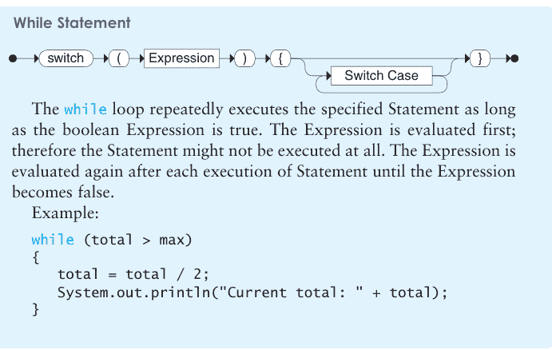

**图 5.7 while 循环的逻辑**

以下循环从 1 到 5 的值。循环的每次迭代打印一个值，然后增加计数器。

```java
int count = 1;
while (count <= 5) {
    System.out.println(count);
    count++;
}
```

> **核心概念**
> `while` 语句不断执行同一语句，直到其条件变为假。

注意，`while` 循环体是一个包含两个语句的块。整个块在循环的每次迭代中都会重复。

让我们看另一个使用 `while` 循环的程序。列表 5.7 显示的 `Average` 程序从用户处读取一系列整数值，对它们求和并计算平均值。

我们不知道用户可能会输入多少值，因此我们需要一种方法来指示用户已完成数字输入。在这个程序中，将零指定为哨兵值，表示输入结束。`while` 循环继续处理输入值直到用户输入零。这假设零

### 列表 5.7

```java
// Average.java         Author: Lewis/Loftus
// 展示 while 循环、哨兵值和
// 累加和的使用。

import java.text.DecimalFormat;
import java.util.Scanner;

public class Average {
    // 计算用户输入的一系列值的平均值。
    // 在输入数字时打印运行累加和。
    // ----------------------------------------------------------------------
    public static void main(String[] args) {
        int sum = 0;
        int count = 0;
        int value;
        double average;
        Scanner scan = new Scanner(System.in);

        System.out.print("Enter an integer (0 to quit): ");
        value = scan.nextInt();

        while (value != 0) { // 哨兵值 0 终止循环
            count++;
            sum += value;
            System.out.println("The sum so far is " + sum);
            System.out.print("Enter an integer (0 to quit): ");
            value = scan.nextInt();
        }

        average = (double) sum / count;
        DecimalFormat fmt = new DecimalFormat("0.###");
        System.out.println("The average is " + fmt.format(average));
    }
}
```

### 列表 5.7 续

```java
System.out.print("Enter an integer (0 to quit): ");
value = scan.nextInt();

while (value != 0) { // 哨兵值 0 终止循环
    count++;
    sum += value;
```


System.out.println("The sum so far is " + sum);

System.out.print("Enter an integer (0 to quit):");

value = scan.nextInt();

}

System.out.println();

if (count == 0)

    System.out.println("No values were entered.");

else

{

    average = (double)sum / count;

    DecimalFormat fmt = new DecimalFormat("0.###");

    System.out.println("The average is " + fmt.format(average));

}

```

### 输出

```

Enter an integer (0 to quit): 25

The sum so far is 25

Enter an integer (0 to quit): 16

The sum so far is 41

Enter an integer (0 to quit): 14

The sum so far is 55

Enter an integer (0 to quit): 0

The average is 3.933

```

## 5.4 while 语句

以下是一个无限循环的示例：

```java
int count = 1;

while (count <= 25) // 警告：这是一个无限循环！

{

    System.out.println(count);

    count = count - 1;

}
```

如果你执行这个循环，应该准备好中断它。在大多数系统中，按下键盘上的 Control-C 组合（按住 Control 键并按 C）可以终止正在运行的程序。

在这个示例中，`count` 的初始值为 1，并在循环体中递减。只要 `count` 小于或等于 25，`while` 循环就会持续进行。因为这将始终为真，直到 `count` 的值变得小到发生溢出错误为止。关键在于，代码的逻辑显然是错误的。

> 核心概念
> 我们必须仔细设计程序，以避免无限循环。

让我们来看其他无限循环的例子：

```java
int count = 1;

while (count != 50) // 无限循环

count += 2;
```

在这段代码中，变量 `count` 初始化为 1 并向正方向移动。然而，请注意它每次增加 2。这个循环将永远不会结束，因为 `count` 永远不会等于 50。它从 1 开始，变为 3，然后是 5 等等。它最终达到 49，然后变为 51、53，并一直持续下去。

现在考虑以下情况：

```java
double num = 1.0;

while (num != 0.0) // 无限循环

num = num - 0.1;
```

再次，循环变量的值似乎在朝着正确的方向移动。事实上，`num` 似乎最终会取值 0.0。然而，这个循环是无限的（至少在大多数系统中是如此），因为 `num` 的值永远不会恰好等于 0.0。这与我们在在本章早些讨论过的类似，当时我们探索了在 `if` 语句条件中比较浮点数的概念。由于值在二进制中的表示方式，内部会产生微小的计算误差，这使得比较两个浮点数的相等性变得有问题。

### 嵌套循环

循环的体可以包含另一个循环。这种情况被称为嵌套循环。记住，对于外部循环的每一次迭代，内部循环都会完全执行。考虑以下代码片段。字符串 "Here again" 会被打印多少次？

```java
int count1, count2;

count1 = 1;

while (count1 <= 10) {

    count2 = 1;

    while (count2 <= 50) {

        System.out.println("Here again");

        count2++;

    }

    count1++;
}
```

`println` 语句位于内部循环内部。外部循环执行 10 次，因为 `count1` 在 1 到 10 之间迭代。内部循环执行 50 次，因为 `count2` 在 1 到 50 之间迭代。对于外部循环的每一次迭代，内部循环都会完全执行。因此，`println` 语句执行了 500 次。

与任何其他情况一样，我们必须仔细审视循环的条件和变量的初始化。让我们考虑代码的条件。如果外部循环的条件是 `(count1 < 10)` 而不是 `(count1 <= 10)` 会怎样？这会如何改变打印的总行数？嗯，外部循环将执行 9 次而不是 10 次，所以 `println` 语句将执行 450 次。如果外部循环保持原始定义，但将 `count2` 在内部循环初始化为 11 而不是 1 呢？内部循环将执行 40 次而不是 50 次，所以打印的总行数将是 400 行。

让我们来看另一个使用嵌套循环的例子。回文（Palindrome）是一个正读和反读都相同的字符字符串。例如，以下字符串是回文：

- radar
- drab hab
- ab cde xxxx edc ba
- kayak
- deified
- able was I ere I saw saw

注意，某些回文具有偶数个字符，而另一些具有奇数个字符。列表 5.9 显示的 `PalindromeTester` 程序测试字符串是否为回文。用户可以测试任意数量的字符串。

`PalindromeTester` 的代码包含两个循环，一个嵌套另一个。外部循环控制测试多少个字符串，内部循环扫描

列表 5.9

```java
//********************************************************************
// PalindromeTester.java             作者: Lewis/Loftus
// 展示了嵌套 while 循环的使用。
//********************************************************************

import java.util.Scanner;

public class PalindromeTester {

    // --------------------------------------------------------------------
    // 测试字符串以判断是否为回文。
    // -----------------------------------------------------------------

    public static void main(String[] args) {

        String str, another = "y";
        int left, right;

        Scanner scan = new Scanner(System.in);

        while (another.equalsIgnoreCase("y")) // 外层循环
        {
            System.out.print("Enter a potential palindrome: ");
            str = scan.nextLine();

            left = 0;
            right = str.length() - 1;

            while (str.charAt(left) == str.charAt(right) && left < right) // 内层循环
            {
                left++;
                right--;
            }

            System.out.println();

            if (left < right)
                System.out.println("That string is NOT a palindrome.");
            else
                System.out.println("That string IS a palindrome.");

            System.out.println();
            System.out.print("Test another palindrome (y/n)? ");
            another = scan.nextLine();
        }
    }
}
```

### 输出

```
Enter a potential palindrome:
radar

That string IS a palindrome.

Test another palindrome (y/n)? y
Enter a potential palindrome:
able was I ere I saw saw

That string IS a palindrome.

Test another palindrome (y/n)? y
Enter a potential palindrome:
abba

That string IS a palindrome.

Test another palindrome (y/n)? y
Enter a potential palindrome:
abracadabra

That string is NOT a palindrome.

Test another palindrome (y/n)? n
```

## 5.4 while 语句 265

通过外部循环的每一次迭代，内部循环比较字符。`left` 和 `right` 存储字符串两端的字符索引。内部循环在字符不匹配时退出，或者当 `left` 的值大于或等于 `right` 时退出，这意味着整个字符串已测试完毕。注意以下短语不是回文：

- A man, a plan, a canal, Panama.
- Dennis and Edna.
- Rise to vote, sir.
- Doom an evil deed.
- Go hang a salami; I'm a lasagna hog.

这些字符串由于空格、标点符号和大小写而不符合标准。然而，如果忽略这些特征，它们正读相同。

### break 和 continue 语句

Java 包含了两个影响循环的语句。当执行 `break` 语句时，执行流立即跳转到循环之后的语句。例如，如果在循环体内执行 `break`，循环执行将停止。在第 6 章中我们将看到 `switch` 语句通常需要 `break`。然而，在循环中没有必要使用 `break`。

`continue` 语句有类似的效果。`continue` 语句类似于 `break`，但它会重新评估循环条件，如果真则再次执行循环体。对于 `break` 语句，`continue` 语句总是可以避免。

### 自习题（答案见附录 N）

SR 5.17 什么是无限循环？具体是什么导致了它？

SR 5.18 以下代码片段的输出是什么？

```java
int low = 0, high = 10;
while (low < high)
{
    System.out.println(low);
    low++;
}
```

SR 5.19 以下代码片段的输出是什么？

```java
int low = 10, high = 0;
while (low <= high)
{
    System.out.println(low);
    low++;
}
```

SR 5.20 以下代码片段的输出是什么？

```java
int low = 0, high = 10, mid;
while (low <= high)
{
    mid = low;
    while (mid <= high)
    {
        System.out.print(mid + " ");
        mid++;
    }
    System.out.println();
    low++;
}
```

SR 5.22 假设 int 变量 `value` 已初始化为一个正整数。写一个 `while` 循环打印 `value` 的所有正因数。例如，如果 `value` 为 28，则打印 28 的因子：1 2 4 7 14 28

## 5.5 迭代器

SR 5.23 假设整型变量 value 的值已初始化为一个正整数。编写一个 while 循环，打印从 1 到 value 之间每个数的所有正因数。例如，如果 value 为 4，它将打印出：

- 1 的因数：1
- 2 的因数：1 2
- 3 的因数：1 3
- 4 的因数：1 2 4

迭代器（iterator）是一个允许你一次处理一个项目集合的对象。也就是说，迭代器允许你逐个遍历每个项目，并根据需要与其进行交互。你的目标可能是计算俱乐部中每个成员的职责，或者打印 URL 的不同部分。此时，迭代器提供了一种一致且简单的机制，用于系统地处理一组项目。由于它本质上是一个重复性过程，因此它与循环的概念紧密相关。

> 核心概念
> 迭代器是一个帮助你处理一组相关对象的对象。

Java 中的迭代器对象是使用 `Iterator` 接口定义的，该接口将在第 7 章中讨论。目前，只需知道存在哪些对象，以及它们可以使项目集合的处理变得更简单就有帮助了。

每个迭代器都有一个 `hasNext()` 方法，返回一个布尔值，表示至少有一个待处理的项目。因此，`hasNext()` 方法可以作为循环的条件，用于控制每个项目的处理。迭代器还有一个名为 `next()` 的方法，用于获取集合中的下一个项目。

`Scanner` 类也拥有 `nextInt()` 和 `nextDouble()` 方法的特定变体，它们允许你判断下一个输入标记是否为特定类型。同样，正如我们看到的，`next()` 方法也有变体，如 `nextInt()` 和 `nextDouble()`，用于获取特定类型的值。

当从标准输入交互式读取输入时，`Scanner` 类的 `hasNext()` 方法将等待输入可用，然后返回 true。也就是说，从键盘读取的交互式输入始终认为有更多数据待处理——只是在用户输入之前尚未到达。这就是为什么在之前的示例中，我们使用了特殊的哨值（sentinel values）来确定交互式输入的结束。

然而，`Scanner` 对象是一个迭代器，这一事实在当 `Scanner` 用于处理来自具有特定终点的源输入时特别有用，例如处理数据文件的行或处理字符字符串的部分。让我们来看这种类型处理的示例。

### 读取文本文件

假设我们有一个名为 `urls.inp` 的输入文件，其中包含我们想要某种处理的 URL 列表：

```
www.google.com
www.linux.org/info/gnu.html
thelyric.com/calendar/
www.cs.vt.edu/undergraduate/about
youtube.com/watch?v=EHCRimwGLs
```

列表 5.10 所示的程序从该文件中读取 URL 并对其进行剖析，以显示路径的不同部分。它使用一个 `Scanner` 对象来处理输入。事实上，它使用了多个 `Scanner` 对象——一个用于读取数据文件的行，另一个用于处理每个 URL 字符串。

列表 5.10

```java
//********************************************************************
// URLDissector.java      作者: Lewis/Loftus
// 演示如何使用 Scanner 读取文件输入并使用
// 替代分隔符对其进行解析。
//********************************************************************

import java.util.Scanner;
import java.io.*;

public class URLDissector
{
    // 从文件中读取 urls 并打印它们的路径。
    public static void main(String[] args) throws IOException
    {
        String url;
        Scanner fileScan, urlScan;

        fileScan = new Scanner(new File("urls.inp"));

        // 读取并处理文件的每一行
        while (fileScan.hasNext())
        {
            url = fileScan.nextLine();
            System.out.println("URL: " + url);

            urlScan = new Scanner(url);
            urlScan.useDelimiter("/");

            // 打印 url 的每个部分
            while (urlScan.hasNext())
            {
                System.out.println(urlScan.next());
            }
        }
    }
}
```

### 输出

```
URL: www.google.com
URL: www.linux.org/info/gnu.html
URL: thelyric.com/calendar/
URL: www.cs.vt.edu/undergraduate/about
URL: youtube.com/watch?v=EHCRimwGLs
```

程序中有两个 while 循环，嵌套在另一个内部。外层循环处理文件的每一行，内层循环处理当前行中的每个标记（token）。变量 `fileScan` 被创建为在输入文件 `urls.inp` 上的扫描。我们没有将 `System` 传递给 `Scanner` 构造函数，而是实例化了一个代表输入文件的 `File` 对象并将其传递给 `Scanner` 构造函数。此时，`fileScan` 对象已准备好读取和处理来自输入文件的输入。如果由于某些原因找不到或打开输入文件，创建 `File` 对象的尝试将抛出 `IOException`，这就是为什么我们在 main 方法中添加了 `throws IOException`（I/O 异常将在第 1 章进一步讨论）。

外层循环体只要扫描器的 `hasNext()` 方法返回 true 就会执行——也就是说，只要文件中有更多输入待处理。循环的每次迭代都会从输入文件中读取一行（URL）并将其打印。对于每个 URL，都会设置一个新的 `Scanner` 来解析字符串的片段，该字符串被传递到 `Scanner` 构造函数。内层循环读取 URL 的每个标记。


## 5.6 ArrayList 类

### ArrayList 方法

`ArrayList<E>()`
构造函数：创建一个初始为空的列表。

`boolean add(E obj)`
将指定的对象插入此列表的末尾。

`void add(int index, E obj)`
将指定的对象插入此列表指定的索引处。

`void clear()`
从此列表中移除所有元素。

`E remove(int index)`
移除此列表中指定索引处的元素并返回它。

`E get(int index)`
返回列表中指定索引处的对象，但不将其移除。

`int indexOf(Object obj)`
返回指定对象第一次出现的索引。

`boolean contains(Object obj)`
如果此列表包含指定的对象，则返回 true。

`boolean isEmpty()`
如果此列表不包含任何元素，则返回 true。

`int size()`
返回此列表中元素的个数。

图 5.8 `ArrayList<E>` 类的一些方法。

列表 5.11 所示程序实例化了一个名为 `band` 的 `ArrayList<String>`。使用 `add` 方法按特定顺序将几个 `String` 对象添加到 `ArrayList` 的末尾。然后删除了一个特定的字符串，并在特定索引处插入了另一个。对于任何其他对象，每当它被发送到 `println` 方法时，会自动调用 `ArrayList` 类的 `toString` 方法，该方法会打印由方括号围绕的所有元素。程序末尾的 `while` 循环显式地逐行打印每个元素。

### 列表 5.11 Beatles.java

```java
//********************************************************************
// Beatles.java      Author: Lewis/Loft
// 演示了 ArrayList 对象的用法。
//********************************************************************
import java.util.ArrayList;

public class Beatles {
    //
    // 存储并修改乐队列表。
    // ----------------------------------------------------------------------
    public static void main(String[] args) {
        ArrayList<String> band = new ArrayList<String>();

        band.add("Paul");
        band.add("Pete");
        band.add("John");
        band.add("George");

        System.out.println(band);
        int location = band.indexOf("Pete");
        band.remove(location);

        System.out.println(band);
        System.out.println("At index 1: " + band.get(1));
        band.add(2, "Ringo");

        System.out.println("Size of the band: " + band.size());
        int index = 0;
        while (index < band.size()) {
            System.out.println(band.get(index));
            index++;
        }
    }
}
```

### 输出

```
[Paul, Pete, John, George]
[Paul, John, George]
At index 1: John
Size of the band: 4
Paul
John
Ringo
George
```

### 自测习题

**SR 5.26** 使用 ArrayList 对象的优点是什么？

**SR 5.27** ArrayList 存储什么种类型的元素？

**SR 5.28** 为名为 `dice` 的变量写一个声明，该变量是一个包含 `Die` 对象的 `ArrayList`。

**SR 5.29** 下面代码段产生什么输出？

```java
ArrayList<String> names = new ArrayList<String>();
names.add("Andy");
names.add("Chet");
names.add(1, "Donny");
names.remove(2);
System.out.println(names);
```

## 5.7 确定事件源

在第 4 章中我们开始探索创建具有真正图形用户界面（GUI）的程序。你会记得，交互式 GUI 要求我们创建监听器对象，并在监听器与产生感兴趣事件的组件之间建立关系。

让我们来看一个例子，一个监听器对象用于监听两个不同的组件。列表 5.12 所示的 `LeftRight` 类表示程序显示了两个按钮。当按下左按钮时，标签显示左边的单词；当按下右按钮时，标签显示右边的单词。

列表 5.13 所示的 `LeftRightPanel` 类创建了一个 `ButtonListener` 对象的实例，并将该监听器添加到两个按钮。当按下任一按钮时，`ButtonListener` 类的 `actionPerformed` 方法就会被调用。

在每次调用时，`actionPerformed` 方法都使用 `if-else` 语句来确定哪个按钮生成了事件。在按钮传入 `actionPerformed` 方法的 `ActionEvent` 上调用 `getSource` 方法。`getSource` 返回产生事件的组件的引用。`if` 语句的条件将事件源与左按钮的引用进行比较。如果它们不匹配，则事件一定是由右按钮生成的。

### 列表 5.12 LeftRight.java

```java
/****************************************************************
// LeftRight.java      Author: Lewis:Loftus
// 演示了用一个监听器处理多个按钮。
/****************************************************************
import javax.swing.JFrame;

public class LeftRight
{
    // 创建主程序框架。
    //----------------------------------------------------
    public static void main(String[] args) {
        JFrame frame = new JFrame("Left Right");
        frame.setDefaultCloseOperation(JFrame.EXIT_ON_CLOSE);

        frame.getContentPane().add(new LeftRightPanel());

        frame.pack();
        frame.setVisible(true);
    }
}
```


### 列表 5.13 LeftRightPanel.java

```java
************************************
// LeftRightPanel.java      Author: Lewis/Loftus
// 演示了用一个监听器处理多个按钮。
************************************
import java.awt.*;
import java.awt.event.*;
import javax.swing.*;

public class LeftRightPanel extends JPanel {
    private JButton left, right;
    private JLabel label;
    private JPanel buttonPanel;

    //--------------------------------------
    // 构造函数：设置 GUI。
    //--------------------------------------
    public LeftRightPanel() {
        left = new JButton("Left");
        right = new JButton("Right");

        ButtonListener listener = new ButtonListener();
        left.addActionListener(listener);
        right.addActionListener(listener);

        label = new JLabel("Push a button");

        buttonPanel = new JPanel();
        buttonPanel.setPreferredSize(new Dimension(200, 40));
        buttonPanel.setBackground(Color.blue);
        buttonPanel.add(left);
        buttonPanel.add(right);

        setPreferredSize(new Dimension(200, 80));
        setBackground(Color.cyan);
        add(label);
        add(buttonPanel);
    }
}
```

### 列表 5.13 续 ButtonListener 内部类

```java
*********************************
// 代表两个按钮的监听器。
*********************************
private class ButtonListener implements ActionListener {
//----
// 确定哪个按钮被按下并相应设置标签。
//----
    public void actionPerformed(ActionEvent event) {
        if (event.getSource() == left)
            label.setText("Left");
        else
            label.setText("Right");
    }
}
```

## 5.8 复选框和单选按钮

推入按钮（由 `JButton` 类定义）只是我们可以在 Java GUI 中使用的一种类型的按钮。另外两种类型是复选框和单选按钮。让我们详细查看这些内容。

### 复选框

复选框是一种可以使用鼠标切换开启或关闭的按钮，用于表示特定的布尔条件是否已设置或取消设置。例如，一个带标记的 Collate 复选框可用于指示打印作业的输出是否应该被收集。虽然你可能有一组复选框来表示一组选项，但每个复选框都是独立运行。也就是说，每个复选框都可以设置为开启或关闭，其中一个的状态不会影响其他。

列表 5.14 中的程序显示了两个复选框和一个标签。这些框决定了标签的文本是以**粗体**、**斜体**、两者都有还是都不是的方式显示。粗体和斜体的任何组合都是有效的。例如，两个复选框都可以被选中（开启），在这种情况下，文本将以粗体和斜体显示。如果两个都没有被勾选，标签的文本将以普通样式显示。

StyleOptions 程序的 GUI 体现在列表 5.15 中的 `StyleOptionsPanel` 类中。复选框由 `JCheckBox` 类表示。当复选框的状态从选中（已勾选）变为未选中（未勾选），或反之时，它会产生项目事件。`ItemListener` 接口包含一个名为 `itemStateChanged` 的方法。在这个示例中，我们使用同一个监听器对象来处理两个复选框。

### 列表 5.14 StyleOptions.java

```java
****************************************************************
// Author: Lewis/Loftus
// StyleOptions.java
//*************************************************
// Demonstrates the use of check boxes.
//*************************************************

import javax.swing.JFrame;

public class StyleOptions
{
    //--------------------
    // Creates and presents the program frame.
    //---------------------
    public static void main(String[] args) {
        JFrame frame = new JFrame("Style Options");
        frame.setDefaultCloseOperation(JFrame.EXIT_ON_CLOSE);

        StyleOptionsPanel panel = new StyleOptionsPanel();
        frame.getContentPane().add(panel);

        frame.pack();
        frame.setVisible(true);
    }
}
```

**显示示例**

| Style Options | Style Options |
| :--- | :--- |
| Say it with style! | Say it with style! |
| [x] Bold [ ] Italic | [x] Bold [x] Italic |

### 列表 5.15 StyleOptionsPanel.java

```java
************************************************************************************
// StyleOptionsPanel.java Author: Lewis/Loftus
// Demonstrates the use of check boxes.
// *********************************************************************

import javax.swing.*;
import java.awt.*;
import java.awt.event.*;

public class StyleOptionsPanel extends JPanel
{
    private JLabel saying;
    private JCheckBox bold, italic;

    // ---------------------------------------------------------------------------------
    // 设置一个包含标签和一些复选框的面板，
    // 控制标签字体样式。
    // ---------------------------------------------------------------------------------
    public StyleOptionsPanel()
    {
        saying = new JLabel("Say it with style!");
        saying.setFont(new Font("Helvetica", Font.PLAIN, 36));

        bold = new JCheckBox("Bold");
        bold.setBackground(Color.cyan);
    }
}
```


```java
italic = new JCheckBox("Italic");
italic.setBackground(Color.cyan);

StyleListener listener = new StyleListener();
bold.addListener(listener);
italic.addListener(listener);

add(saying);
add(bold);
add(italic);

setBackground(Color.cyan);
setPreferredSize(new Dimension(300, 100));
}

// 代表两个复选框的监听器。
private class StyleListener implements ItemListener {
    // 更新标签字体的样式。
    public void itemStateChanged(ItemEvent event) {
        int style = Font.PLAIN;

        if (bold.isSelected())
            style = Font.BOLD;

        if (italic.isSelected())
            style += Font.ITALIC;

        saying.setFont(new Font("Helvetica", style, 36));
    }
}
```

该程序还使用了 `Font` 类，该类表示特定的字符字体。一个 `Font` 对象由字体名称、字体样式和字体大小定义。字体名称确定了字符的通用视觉特征。我们在此程序使用了 Helvetica 字体。Java 字体的样式可以是普通、`Font.BOLD`、`Font.ITALIC`或粗体斜体组合。我们 GUI 中的复选框被设置为更改字体样式的特征。

字体的样式表示为一个整数，`Font` 类中定义的整数常量用于表示样式的各种方面。常量 `PLAIN` 用于表示普通样式。常量 `BOLD` 和 `ITALIC` 分别用于表示粗体和斜体。`BOLD` 和 `ITALIC` 常量的样式表示既是粗体又是斜体的样式。

监听器的 `itemStateChanged` 方法决定了当一个复选框状态改变后，修订后的样式应该是什么。初始将样式设置为普通，然后使用 `isSelected` 方法轮询每个复选框，该方法返回一个布尔值。首先，如果粗体框被选中（勾选），则样式设置为粗体。然后，如果斜体框被选中，则将 `ITALIC` 常量添加到 `style` 变量中。最后，将标签的字体设置为具有修订样式的新字体。

注意，由于此程序中监听器的编写方式，点击哪个复选框来生成事件并不重要。两个复选框都由同一个监听器处理。复选框是否被选中也并不重要。

# 列表 5.17 继续

```java
quote = new JLabel(comedyQuote);
quote.setFont(new Font("Helvetica", Font.BOLD, 24));

comedy = new JButton("Comedy", true);
comedy.setBackground(Color.green);
philosophy = new JButton("Philosophy");
philosophy.setBackground(Color.green);
carpentry = new JButton("Carpentry");
carpentry.setBackground(Color.green);

ButtonGroup = new ButtonGroup();
group.add(comedy);
group.add(philosophy);
group.add(carpentry);

QuoteListener listener = new QuoteListener(listener);
comedy.addActionListener(listener);
philosophy.addActionListener(listener);
carpentry.addActionListener(listener);

add(quote);
add(comedy);
add(philosophy);
add(carpentry);

setBackground(Color.green);
setPreferredSize(new Dimension(300, 100));
}

// 代表所有单选按钮的监听器。
private class QuoteListener implements ActionListener {
    // 根据按了哪个单选按钮设置标签的文本。
    public void actionPerformed(ActionEvent event) {
        Object source = event.getSource();
```

```java
if (source == comedy)
    quote.setText(comedyQuote);
else
    if (source == philosophy)
        quote.setText(philosophyQuote);
    else
        quote.setText(carpentryQuote);
```

注意，与推按钮不同，复选框和单选按钮都是切换按钮，这意味着在任何时候它们要么开启状态，要么处于关闭状态。区别在于它们的使用方式。独立选项（可以任意组合）由复选框控制。依赖选项（从一组中选择一个）由单选按钮控制。如果只有一个选项需要管理，则可以单独使用复选框。正如我们之前提到的，另一方面，单选按钮只有在与一个或多个单选按钮结合使用时才有意义。

还要注意，复选框和单选按钮会产生不同类型的事件。复选框产生项目事件（item event），而单选按钮产生动作事件（action event）。不同事件类型的使用与按钮功能的差异有关。复选框在被选中或取消选中时会产生事件，监听器可以根据需要进行区分。另一方面，单选按钮仅在被选中时才产生事件（组中当前选中的按钮会自动取消选中状态）。

### 核心概念总结

- 条件语句和循环允许我们控制方法内部的执行流。
- `if` 语句允许程序选择是否执行特定的语句。
- 循环允许程序多次执行某语句。
- 逻辑运算符通常用于构建复杂的条件。
- 适当的缩进对于人类可读性至关重要；它显示了语句与语句之间的关系。
- `if-else` 语句允许程序在条件为真时执行一件事，在条件为假时执行另一件事。
- 在嵌套 `if` 语句中，`else` 子句匹配到最近的未匹配 `if`。
- Java 中字符的相对顺序由 Unicode 字符集定义。
- `compare` 方法可以确定字符串的相对顺序。
- `while` 语句执行相同的语句，直到其条件变为假。
- 我们必须仔细设计程序以避免死循环。
- 迭代器（iterator）是一个帮助你处理一组相关对象的对象。
- `Scanner` 对象中用于分隔标记的边界符（delimiters）可以根据需要明确指定。
- `ArrayList` 对象存储对象列表并允许你使用整数索引访问它们。
- 当创建 `ArrayList` 对象时，你指定了将存储在列表中的元素类型。
- 单选按钮作为一个组运行，提供了一组互斥的选项。

# 练习题

## EX 5.1
在 `MinOnOff` 程序中，如果两个或多个值相等，会发生什么？如果恰好有两个值相等，这些相等的值比第三个值高还是低重要吗？

## EX 5.2
下列代码段有什么什么问题？请重写它使其产生正确的输出。

```java
if (total == MAX)
    if (total < sum)
        System.out.println("total == MAX and < sum.");
else
    System.out.println("total is not equal to MAX")
```

## EX 5.3
下列代码段有什么什么问题？如果这段代码是另一个有效程序的一部分，它能编译吗？请解释。

```java
if (length = MIN_LENGTH)
    System.out.println("The length is minimal.");
```

## EX 5.4
下列代码段产生什么输出？

```java
float product = 100.05, data = 21.75;
if (product < data)
    System.out.println("One is printed!");
    System.out.println("Two is printed!");
System.out.println("Three is printed!");
```

## EX 5.5
下列代码段产生什么输出？

```java
int highest = 62, num1 = 25, num2 = 50, num3 = 25;
if (highest >= num1)
    if (num1 == num2)
        System.out.println("One is printed!");
System.out.println("Two is printed!");
```

## EX 5.6
根据 Unicode 字符表将下列字符串按字母顺序排序。

- "fred"
- "etheL"
- "?-"
- "Lucy"
- "ricky"
- "book"
- "1234"
- "6789"
- "hephal"
- "book"
- "1"
- "heump"

## EX 5.7
下列代码段产生什么输出？

```java
int max = 1000, min = 100;
while (max > min)
{
    max -= min;
    System.out.println(max);
}
```

## EX 5.8
下列代码段产生什么输出？

```java
int par1 = 1, par2 = 129;
while (par2 > par1)
{
    if (par1 != 0)
        System.out.println(par1);
    par1 *= 2;
}
```

## EX 5.9
下列代码段有什么问题？可以通过哪些不同的方式修改？

```java
int count = 50;
while (count >= 0)
{
    System.out.println(count);
    count++;
}
```

## EX 5.10
写一个 `while` 循环验证用户输入的是正整数。

## EX 5.11
写一段代码，读取并打印整数值，直到输入一个特定的哨兵值（SENTINEL）。不要打印哨兵值。

## EX 5.12
写一个名为 `remainder` 的方法，接受两个整数，如果第二个整数不为零则除它们并返回结果。

## EX 5.13
写一个名为 `largerSum` 的方法，接受浮点参数（double 类型），如果前两个的和小于第三个则返回 true，否则返回 false。

## EX 5.14
写一个名为 `complexEquation` 的方法，接受三个整数参数，如果第一个不等于第二个且前两个的积等于第三个，则返回 true，否则返回 false。

## EX 5.15
写一个名为 `isAlpha` 的方法，接受字符参数，如果该字符是大写或小写字母则返回 true。

## EX 5.16
写一个名为 `floatEquals` 的方法接受三个浮点值。如果前两个在第三者的误差范围内相等，该方法应返回 true。

## EX 5.17
写一个名为 `isIsosceles` 的方法，接受表示三角形边的整数参数。如果三角形是等腰三角形而非等三角形（即恰好两条边相等），则返回 true，否则返回 false。

## EX 5.18
解释如果 `QuoteOptions` 程序中的按钮没有组织在一起会发生什么。修改程序以测试你的答案。

# 编程项目

## PP 5.1
写一个程序，从用户处读取一个代表年份的整数。程序的目的是判断该年份是否为闰年（因此二月有 29 天）。如果年份能被 4 整除，则为闰年，除非能被 100 整除但不能被 400 整除。例如，2003 年不是闰年，但 2004 年是。1900 年不是闰年，因为它被 100 整除，但 2000 年即使能被 100 整除也能被 400 整除。对于任何小于 1582（采用格利历的年份）的输入值产生错误消息。

## PP 5.2
修改上一个项目的解决方案，使用户可以评估多个年份。允许使用适当哨兵值终止程序。验证每个输入值以确保其大于等于 1582。

## PP 5.3
写一个程序，计算并打印从键盘读取的整数值中所有数字之和和积。

## 第 5 章 条件判断与循环

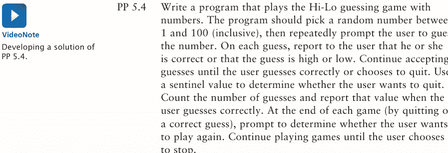

## PP 5.4
开发 PP 5.4 的解决方案。

## PP 5.5
创建一个 `ChangeCase` 程序，该程序接收用户输入的字符串，并识别字符串字符是大写还是小写，然后将所有小写字母（如果有）转换为大写，反之亦然。

## PP 5.6
设计一个在本章定义的 `Coin` 类相似的 `Person` 类。然后设计并实现一个名为 `SelectPerson` 的驱动类，其 `main` 方法随机选择两种性别，以观察哪个对象连续两次被选中女性性别。考虑可能平局的情况。打印每次选择的结果，然后打印连续两次被选中女性的对象的名称。

## PP 5.7
编写一个与电脑玩剪刀石头布的游戏程序。在两个人之间玩游戏时，每个人同时选择三个选项之一（通常通过手势），并决定胜负。在游戏中，石头胜剪刀，剪刀胜纸布，纸布胜石头。程序应随机选择三个选项之一（先不显示），然后提示用户进行选择。此时，程序显示两个选择，并打印一条语句说明用户获胜、电脑获胜还是平局。继续玩直到用户选择停止，然后打印用户的获胜次数、负胜次数和平局次数。

## PP 5.8
设计并实现一个模拟奇数老虎机的应用程序，该程序会随机选择并并排打印 1 到 100 之间的五个数字。如果这五个数字全都是奇数，或者其中任何一个数字是奇数，则打印一条相应的语句。继续模拟直到用户选择停止。

## PP 5.9
修改第 4 章中的 `Account` 类，使 `withdraw` 方法能够从用户账户中执行负数的取款操作。

## PP 5.10
修改第 4 章中的 `Account` 类，允许从一个账户转账到另一个账户。执行有效性检查，以确保转账金额小于转出账户的当前余额。

## PP 5.11
使用 PP 4.9 中的 `Pairof` 类，设计并实现一个玩名为“猪（Pig）”游戏的游戏类。在游戏中，用户与电脑竞争。在每轮回合中，当前玩家掷出一对骰子并累积分数。目标是在对手之前达到 100 分。如果玩家在任何回合中掷出 1，则该回合累积的所有分数都将作废，且骰子的控制权将交给另一名玩家。如果玩家在一个回合内掷出两个 1，则玩家将失去游戏中目前累积的所有分数并失去对骰子的控制权。玩家可以在每次投掷后自愿再次投掷。因此，玩家必须决定是再次投掷（掷“猪”）并承担失去分数的风险，还是放弃骰子的控制权（可能让另一个玩家获胜）。实现电脑玩家，使其在任何一个游戏中累积 20 分或更多分后总是放弃骰子。

## PP 5.12
设计并实现一个处理高尔夫得分的程序。四位高尔夫球员的分数存储在一个文本文件中。每行代表一个洞，文件包含 18 行。每行包含五个值：洞号以及之后该高尔夫球员在该洞使用的击杆数。将标准杆（par）和选手的总分存储在 `ArrayList` 中。确定胜者并生成一个表格，显示每个高尔夫球员的表现（与标准杆相比）。

## PP 5.13
设计并实现一个程序，逐行比较两个文本文件是否相等。打印任何不相等的行。

## PP 5.14
设计并实现一个程序，统计两个文本文件中 `double` 类型数值的个数。生成一个表格，列出你从每个输入文件中识别出的作为 `double` 类型的值。

## PP 5.15
设计并实现一个程序，统计文本输入文件中标点符号的数量。生成一个表格，显示每个符号出现的次数。

## PP 5.16
修改本章中的 `StyleOptions` 程序，允许用户指定字体大小。使用文本字段获取大小。

## PP 5.17
开发一个简单的工具，用于计算文本段的基础级统计数据。该应用程序应该有一个窗口，其中包含一个可滚动的文本框（一个 `QText`）和一个统计框。统计框应该是一个带有标题边框的面板，包含带有标签的字段，显示文本框中的单词数和平均单词长度，以及你想要添加的任何其他统计数据。统计框还应包含一个按钮，按下时会重新计算文本字段当前内容的统计数据。

# 软件故障

## Therac-25

### 发生了什么？

Therac-25 是一种放射治疗机，用于投递定向电子或 X 射线束以破坏癌症组织。在使用期间，数百患者通过该设备接受了适当的治疗。在 1985 年至 1987 年记录的六个案例中，Therac-25 提供了过量的辐射，导致严重的残疾和死亡。

在典型的治疗中，患者躺下，操作员调整机器针对身体的适当区域。操作员在机器的计算机控制台上设置治疗参数并按下按钮释放辐射。患者被告知典型的副作用是类似于轻微晒伤的小不适。在事故案例中，一些患者报告感到“巨大的热力”或“电击”。在其中一个案例，患者失去了肩膀和手臂的使用功能，并不得不切除乳房。其他人死于放射中毒。


辐射量以 `rad` 为单位（吸收剂量）。标准治疗量为 200 `rad`。据估计，事故导致了 20,000 `rad`。

### 原因是什么？

操作员曾告知 Therac-25 具有许多安全预防措施，以至于“几乎不可能”导致患者过量。但 Therac-25 使用的部分软件重用自早期的版本，该版本包含了许多硬件预防。因此，硬件特征


- 掩盖了底层问题。事实证明，如果操作员错误输入了参数并以特定方式进行了修正，软件允许机器释放最大剂量而没有适当扩散。这是一个如此奇怪的错误，以至于技术人员无法复制该问题。此时，一台明显导致过过量的机器在技术人员没有发现任何问题后重新投入使用。

分析人员说，软件问题只是事故发生的原因之一。虽然存在根本性的编程错误，但对安全问题的关注也不足。这也是机器被使用之久的原因之一，因为问题没有按应的方式进行报告或彻底核查。

### 教训

软件安全是本案中的核心问题。当人类生命受到威胁时，很难想象不尽一切努力确保你的软件尽可能健壮。这取决于风险分析。你愿意承担你开发的软件仍包含错误的风险有多大？对于许多应用程序，问题可能会给用户带来不便并可能产生业务影响，但其他应用程序直接关乎人的生命。

> 来源：computingcases.org, IEEE Computer

# 更多条件语句与循环

## 章节目标

- 检查使用 `switch` 语句的条件处理。
- 讨论条件运算符。
- 检查替代的循环语句：`do` 循环和 `for` 循环。
- 借助条件语句和循环绘制图形。
- 探索对话框的使用。

在第 5 章中，我们检查了用于决策的 `if` 语句和用于循环的 `while` 语句。本章将探索 Java 中用于执行类似任务的其他几个语句。特别在本章中，我们将探索 `switch` 语句，它允许我们根据特定值在几条执行路径之间选择。我们还将探索 `do` 和 `for` 循环，它们提供的逻辑处理和/或语法使其区别于 `while` 循环。这些替代语句在关键细节上有所不同，任何特定情况都可能适用于一种而非另一种。本章的“图形轨迹”（Graphics Track）部分探索了如何使用条件和循环来控制图形，并检查了对话框的作用和用法。


## 6.1 switch 语句

Java 中的另一种条件语句称为 `switch` 语句，它导致执行的程序根据单个值遵循几条路径中的一条。使用多个 `if` 语句也可以构建类似的逻辑，但在有需要的情况下，`switch` 语句通常使代码更具读性。

`switch` 语句评估一个表达式以确定一个值，然后与几个可能的 `case`（情况）进行匹配。每个 `case` 都有与其关联的语句。在评估表达式后，控制跳转到与值匹配的第一个 `case` 关联的语句。考虑以下示例：

```java
switch (idChar)
{
    case 'A':
        aCount = aCount + 1;
        break;
    case 'B':
        nCount = bCount + 1;
        break;
    case 'C':
        cCount = cCount + 1;
        break;
    System.out.println("Error in Identification Character.");
}
```

首先，评估表达式。在这个示例中，表达式是一个简单的 `char` 变量 `idChar`。执行随后转移到与表达式结果匹配的 `case` 值之后的语句。如果 `idChar` 包含 'A'，变量 `aCount` 增加。如果 `idChar` 包含 'B'，则跳过 'A' 的 `case` 并继续处理直到 `nCount` 增加。同样，如果 `idChar` 包含 'C'，则处理该 `case`。

如果没有值与表达式的值匹配，执行将继续由保留字 `default` 索引的默认 `case`。如果不存在 `default` case，则 `switch` 中的任何语句都不会执行，处理将继续执行 `switch` 语句之后的语句。包含一个 `default` case 往往是一个好主意，即使你不预计它会被执行。

当遇到 `break` 语句时，处理跳转到 `switch` 语句之后。`break` 语句通常用于跳出 `switch` 语句的每个 `case`。如果没有 `break` 语句，处理将继续进入 `switch` 语句的下一个 `case`；在之前的示例中，如果 'A' `case` 结尾没有 `break`，那么当 `idChar` 包含 'A' 时，`aCount` 和 `bCount` 两个变量都会增加。

**核心概念**

`switch` 语句将字符或整数值匹配到几个 `case` 之一。

通常我们只想执行一个 `case`，因此几乎总是使用 `break`。尽管如此，偶尔“穿透”（pass through）功能也会很有用。

> **核心概念** `break` 语句通常用于 `switch` 语句中每个 `case` 备选项的结尾。

你可能记得在第 5 章中曾简要提到过 `break` 语句，因为它可以用于其他类型的循环和条件语句。我们当时曾警告过，这种处理通常是不必要的，而且许多开发者认为这种（使用 `break` 跳出）做法是不良好的习惯（bad practice）。`switch` 语句是这一准则的例外。`break` 语句是确保某个 `case` 的代码被执行的唯一方法。

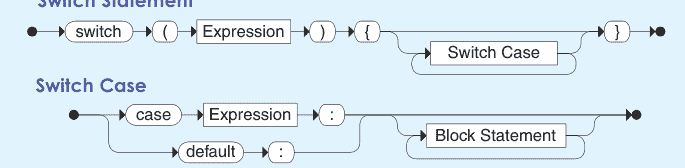

`switch` 语句评估初始表达式并将其值与 `case` 进行匹配。处理继续执行该 `case` 对应的语句。如果没有其他 `case` 匹配，则将执行可选的 `default` case。示例：

```java
switch (numValues)
{
  case 0:
    System.out.println("No values were entered.");
    break;
  case 1:
    System.out.println("One value was entered.");
    break;
  case 2:
    System.out.println("Two values were entered.");
    break;
  default:
    System.out.println("Too many values were entered.");
}
```

`switch` 语句开始时评估的表达式必须是 `char`、`byte`、`short` 或 `int`。从 Java 7 开始，`switch` 也可以对 `String` 执行。但 `switch` 表达式不能是布尔值或浮点值。此外，每个 `case` 的值必须是常量；它不能是变量或其他表达式。这限制了 `switch` 语句适用的情况，但它通常使代码更于阅读和理解。

还要注意，`switch` 语句的隐式布尔条件是基于等效性的。语句开头的表达式与每个 `case` 值进行比较，以确定哪一个相等。除非执行了初步处理，否则 `switch` 语句不能用于确定其他关系操作（例如小于）。例如，列表 6.1 中的 `GradeReport` 程序会根据用户输入的数字成绩打印注释。

## 列表 6.1

```java
// GradeReport.java               Author: Lewis/Loftus
// 展示了 switch 语句的使用。

import java.util.Scanner;
public class GradeReport {
    // 读取数字成绩并打印注释。
    public static void main(String[] args) {
        int grade, category;

        Scanner scan = new Scanner(System.in);

        System.out.print("Enter a numeric grade (0 to 100): ");
        grade = scan.nextInt();

        category = grade / 10;
        System.out.print("That grade is ");

        switch (category) {
            case 10:
                System.out.println("a perfect score. Well done.");
                break;
            case 9:
                System.out.println("well above average. Excellent.");
                break;
            case 8:
                System.out.println("above average. Nice job.");
                break;
            default:
                System.out.println("needs improvement.");
        }
    }
}
```

**OUTPUT**

```
Enter a numeric grade (0 to 100): 86
That grade is above average. Nice job.
```

在 `GradeReport` 中，`category` 是通过除以 10 确定的（假设输入 0 到 10 之间的整数）。注意任何 `switch` 都可以由嵌套 `if` 语句来实现。然而，这取决于情况。

## 自习题（答案见附录）

- SR 6.1 当 `switch` 语句运行时，如果评估的表达式不与任何 `case` 值匹配，会发生什么？
- SR 6.2 如果 `switch` 语句中的 `case` 没有以 `break` 语句结尾会发生什么？
- SR 6.3 如果用户输入 72，`GradeReport` 程序的输出是什么？如果用户输入 46 呢？如果用户输入 123 呢？

## SR 6.4

将以下嵌套 `if` 语句转换为等效的 `switch` 语句。

```java
if (num1 == 5)
    myChar = 'W';
else
    if (num1 == 6)
        myChar = 'X';
    else
        if (num1 == 7)
            myChar = 'Y';
        else
            myChar = 'Z';
```

## 6.2 条件运算符

Java *条件运算符* 在某些方面与 `if-else` 语句相似。它是一个三元运算符，因为它需要三个操作数。条件运算符的符号通常写为 `?:`，但它与其他运算符的不同在于，它的两个符号总是分开。以下是一个包含条件运算符的表达式示例：

```java
(total > MAX) ? total + 1 : total * 2;
```

`?` 之前是布尔条件。`?` 之后是两个 `:` 符号分隔的表达式。整个条件表达式在条件为真时返回第一个表达式的值，在条件为假时返回第二个表达式的值。

记住，这个示例是一个返回值的表达式。条件运算符只是一个运算符，而不是一个可以独立生存的语句。通常我们想对其进行某些处理，例如将其赋值给变量：

```java
total = (total > MAX) ? total + 1 : total * 2;
```

条件运算符和条件语句之间的区别可能是微妙的。在许多情况下，`?:` 运算符让我们形成简洁的逻辑，作为简短的 `if-else` 语句。之前的语句与以下语句等效，但有时比后者更方便：

```java
if (total > MAX)
    total = total + 1;
else
    total = total * 2;
```

### 让我们再看另外两个例子

考虑以下声明：

```java
int larger = (num1 > num2) ? num1 : num2;
```

如果 `num1` 大于 `num2`，则返回 `num1` 的值并用于初始化变量 `larger`。如果不是，则返回 `num2` 的值并初始化 `larger`。同样地，初始化语句打印两个值中较小的一个：

```java
System.out.println("Smaller: " + ((num1 < num2) ? num1 : num2));
```

条件运算符偶尔有助于评估一个短条件并返回结果。然而，它并不是 `if-else` 语句的替代品，因为 `?:` 运算符的操作数是表达式，而不一定是完整的语句。即使条件运算符是一个可行的替代方案，你也应该谨慎使用它，因为它可能比 `if-else` 语句更易读。

### 自测习题（答案见附录 N）

- SR 6.5 条件运算符和条件语句之间的区别是什么？
- SR 6.6 写一个声明，如果布尔变量 `first` 为 `true`，则将名为 `id` 的字符初始化为 'A'，否则初始化为 'B'。
- SR 6.7 使用条件运算符简洁地表达以下逻辑。

```java
if (val <= 10)
    System.out.println("The value is not greater than 10.")
else
    System.out.println("The value is greater than 10.")
```

## 6.3 do 语句

回顾第 5 章，`while` 语句首先检查条件，如果条件为真，则执行循环体。`do` 语句与 `while` 语句相似，但它的终止条件位于循环体的末尾。与 `while` 循环一样，`do` 循环执行循环体中的语句，直到条件变为假。条件写在循环末尾，因此在循环体执行之前不会进行求值。注意，`do` 循环体始终至少执行一次。图 6.6 显示了这种处理过程。

## 第 6 章 更多条件和循环


**图 6.1 do 循环的逻辑**

以下代码使用 `do` 循环打印从 1 到 5 的数字。将此代码与第 5 章中使用 `while` 循环完成相同任务的示例进行比较。

```java
int count = 0;
do {
    count++;
    System.out.println(count);
} while (count < 5);
```

> **核心概念**
>
> `do` 语句至少执行一次循环。

注意，`do` 循环简单地以关键字 `do` 开始。`do` 循环体持续执行，直到包含循环体条件的 `while` 子句决定是否继续执行循环体。有时，很难判断带有关键字 `while` 的行代码是 `while` 循环的开始还是 `do` 循环的结束。

让我们来看 `do` 循环的另一个例子。列表 6.2 显示的程序 `ReverseNumber` 从用户读取一个整数并用数学方法反转其数字。


只要布尔表达式 `Expression` 为真，`do` 循环就会重复执行指定的 `Statement`。`Statement` 至少执行一次，然后求值 `Expression` 以确定是否应该再次执行 `Statement`。

## 示例

```java
do {
    System.out.print("Enter a word:");
    word = scan.next();
    System.out.println(word);
} while (word.equals("quit"));
```

## 列表 6.2


```java
//********************************************************************
// ReverseNumber.java      作者: Lewis/Loft
// 演示了 do 循环的使用。
//********************************************************************
import java.util.Scanner;

public class ReverseNumber {
    // -------------------------------------------------------
    // 用数学方法反转整数的数字。
    // -------------------------------------------------------
    public static void main(String[] args) {
        int number, lastDigit, reverse = 0;

        Scanner scan = new Scanner(System.in);
        System.out.print("Enter a positive integer: ");
        number = scan.nextInt();

        do {
            lastDigit = number % 10;
            reverse = (reverse * 10) + lastDigit;
            number = number / 10;
        } while (number > 0);

        System.out.println("That number reversed is " + reverse);
    }
}
```

## 第 6 章 更多条件和循环

### 列表 6.2 续

#### 输出

```text
Enter a positive integer: 2896

That number reversed is 6982
```

`ReverseNumber` 程序中的 `do` 循环使用取余运算来确定个位上的数字，将其添加到反转后的数字中，并使用整数除法从原始数字中删除该数字。当没有更多数字时，`do` 循环终止，这对应于变量 `number` 达到零值的时间点。用几个示例仔细跟踪该程序的逻辑，以看看它是如何工作的。

如果你想至少执行一次循环体，你可能想使用 `do` 语句。`do` 循环具有许多 `while` 语句的属性。

### 自测习题（答案见附录 N）

- SR 6.8 比较 `while` 循环和 `do` 循环。
- SR 6.9 下述代码产生什么输出？

```java
int low = 0; high = 10;
do {
    System.out.println(low);
} while (low < high);
```

- SR 6.10 下述代码产生什么输出？

```java
int low = 10; high = 0;
do {
    System.out.println(low);
} while (low <= high);
```

- SR 6.11 写一个 `do` 循环来获取正整数序列。

## 6.4 for 语句

当你不知道想要执行循环体的次数时，`while` 和 `do` 语句很好用。`for` 语句特别适合执行固定次数的循环体。以下代码使用 `for` 循环打印 1 到 5 的数字：

```java
for (int count=1; count <= 5; count++)
    System.out.println(count);
```

`for` 循环的头部包含由分号隔开的部分。在循环开始之前，第一部分（初始化）被执行。循环头部的第二部分是条件（类似于 `while` 循环），为真则执行循环体，然后执行头部的第三部分（增量）。注意初始化部分只执行一次。图 6.2 显示了这种处理过程。

> **核心概念**
>
> `for` 语句通常用于执行已知次数的循环。

（注：请参考图 6.2）

图 6.2 for 循环的逻辑

`for` 循环读起来可能有点棘手，代码执行并不遵循“从上到下、从左到右”的阅读顺序。增量代码在循环体之后执行，尽管它位于头部。

在这个示例中，循环头部的初始化部分既用于声明变量，也用于给它赋初值。我们不需要声明变量，但在实践中，如果变量在循环外不需要，这样做是常见的。由于 `count` 在循环头部声明，它只在循环体内存在，不能在其他地方引用。循环控制变量通过头部的动作进行设置、检查和修改。可以在循环体内部引用它，但不应由头部定义的动作进行修改。

### for 语句

```text
for ( | For Init | Expression | For Update ) Statement
```

**For Init**

- 局部变量声明
- Statement Expression

**Statement Expression**

`for` 语句只要布尔表达式 `Expression` 为真，就会重复执行指定的 `Statement`。头部的 `For Init` 部分在循环开始前只执行一次。在每次执行 `Statement` 之后，都会执行 `For Update` 部分。

#### 示例

```java
for (int value=1; value < 25; value++)
    System.out.println(value + " squared is " + value*value);
```

```java
for (int num=40; num > 0; num-=3)
    sum = sum + num;
```

`for` 循环头部的增量部分尽管如此，也可以递减而不是递增。例如，以下循环打印从 100 到 1 的整数值：

```java
for (int num = 100; num > 0; num--)
    System.out.println(num);
```

事实上，`for` 循环的增量部分可以执行任何计算，而不仅仅是简单的加或减。考虑列表 6.3 所示的程序，它可以打印到特定限制范围内某个数值的倍数。

### 列表 6.3

```java
//********************************************************************************************************************
// Multiples.java               Author: Lewis/Loftus
// Demonstrates the use of a for loop.
//********************************************************************************************************************
import java.util.Scanner;

public class Multiples
{
    // Prints用户指定数字的倍数，直到用户
    // 指定限制。
    public static void main(String[] args)
    {
        final int PER_LINE = 5;
        int value, limit, count = 0;

        Scanner scan = new Scanner(System.in);

        System.out.print("Enter a positive value: ");
        value = scan.nextInt();

        System.out.print("Enter an upper limit: ");
        limit = scan.nextInt();

        System.out.println();
        System.out.println("The multiples of " + value + " between " +
            value + " and " + limit + " (inclusive) are:");

        for (int mult = value; mult <= limit; mult += value)
        {
            System.out.print(mult + "\t");
            // 每行输出打印特定数量的数值
            count++;
            if (count % PER_LINE == 0)
                System.out.println();
        }
    }
}
```

#### 输出

```text
输入一个正值: 7
输入一个上限: 400

7 到 400 之间（包含边界）7 的倍数有：
7 14 21 28 35
42 49 56 63 70
77 84 91 98 105
112 119 126 133 140
147 154 161 168 175
182 189 196 203 210
217 224 231 238 245
252 259 266 273 280
287 294 301 308 315
322 329 336 343 350
357 364 371 378 385
392 399
```

列表 6.4 中的 `Stars` 程序展示了嵌套 `for` 循环的使用。输出是一个由星号字符组成的三角形。外层循环正好执行 10 次。外层循环的每次迭代都会打印一行输出。内层循环的迭代次数取决于外层循环控制的行值。内层循环的每次迭代都会在当前行打印一个星号。编写打印此类配置变体的程序的练习包含在章节末尾的编程项目中。

### 列表 6.4

```java
//********************************************************************
// Stars.java      Author: Lewis/Loftus
// Demonstrates the use of nested for loops.
//********************************************************************
public class Stars {
    //--
    // 使用星号（star）字符打印三角形形状。
    //--
    public static void main(String[] args) {
        final int MAX_ROWS = 10;

        for (int row = 1; row <= MAX_ROWS; row++) {
            for (int star = 1; star <= row; star++) {
                System.out.print("*");
            }
            System.out.println();
        }
    }
}
```

#### 输出

```text
*
**
***
****
*****
******
*******
********
*********
**********
```

## for-each 循环

`for` 语句的一种变体，通常称为 `for-each` 循环，在涉及迭代器的情况下特别有用。在第 5 章中，我们讨论过某些对象被视为迭代器，它们具有 `hasNext` 和 `next` 方法来处理组中的每个项。如果一个对象实现了 `Iterable` 接口，我们就可以使用 `for` 循环的变体，使用简化的语法来处理项。

> **核心概念**
>
> `for-each` 版本的循环简化了对 `Iterable` 对象中所有元素的处理。

`ArrayList` 是一个 `Iterable` 对象。因此，例如，如果 `library` 是一个 `ArrayList<Book>` 对象（即一个管理 `Book` 对象的 `ArrayList`），我们可以按照如下方式使用 `for` 循环来处理集合中的每个 `Book` 对象：

```java
for (Book myBook : library)
    System.out.println(myBook);
```

这段代码可以读取为：对于 `library` 中的每个 `Book`，打印该书对象。变量 `myBook` 获取集合中每个 `Book` 对象的值，循环体对其进行处理。该版本本质上等同于以下：

```java
while (library.hasNext()) {
    Book myBook = library.next();
    System.out.println(myBook);
}
```

## 比较循环

三个基本的循环（`while`、`do` 和 `for`）在功能上是等价的。使用一种类型编写的任何循环都可以使用另一种类型编写。使用哪一种取决于情况。

> **核心概念**
>
> 当条件为假时，`for` 循环就像 `while` 循环。通常当我们想要迭代的次数是固定或可以容易计算时，我们会使用 `for` 循环。在许多情况下，将循环头与循环体分离是比较方便的。
>
> 如果我们希望至少执行一次循环，`do` 循环通常是更好的选择。`while` 循环和 `do` 循环的主要区别在于评估条件的时机。

### 自测题（答案见附录）

- SR 12 我们在什么时候会用 `for` 循环代替 `while` 循环？
- SR 13 下面代码产生什么输出？

```java
int value = 0;
for (int num = 10; num <= 40; num += 10) {
    value = value + num;
}
System.out.println(value);
```

- SR 14 下面代码产生什么输出？

```java
int value = 0;
for (int num = 10; num < 40; num += 10) {
    value = value + num;
}
System.out.println(value);
```

- SR 15 下面代码产生什么输出？

```java
int value = 6;
for (int num = 1; num <= value; num++) {
    for (int i = 1; i < (value - num); i++)
        System.out.println("*");
    for (int i = 1; i < (2 * num) - 1; i++)
        System.out.println("*");
}
```

- SR 16 假设 `die` 是一个 `Die` 对象（如 4.2 节定义）。编写一段代码掷 `die` 百次并输出平均值。

## 6.5 使用循环绘图

条件和循环极大增强了我们生成图形的能力。

列表 6.5 所示的 `Bullseye` 程序绘制了一个靶心。绘制实际上发生在列表 6.6 所示的 `BullseyePanel` 类中。`BullseyePanel` 类的 `paintComponent` 方法使用 `if` 来切换黑色和白色。

注意每个环实际上是绘制为一个填充圆（长宽相等的椭圆）。由于我们层叠绘制圆，内部的圆

### 列表 6.5

```java
//********************************************************************
// Author: Lewis/Loftus
// Bullseye.java
// Demonstrates the use of loops to draw.
//********************************************************************
import javax.swing.JFrame;

public class Bullseye {
    // 创建程序的主框架。
    // ----------------------------------------------------
    public static void main(String[] args) {
        JFrame frame = new JFrame("Bullseye");
        frame.setDefaultCloseOperation(JFrame.EXIT_ON_CLOSE);
        BullseyePanel panel = new BullseyePanel();
        frame.getContentPane().add(panel);
        frame.pack();
        frame.setVisible(true);
    }
}
```

#### 显示


## 6.5 使用循环和条件进行绘制

### 列表 6.6


```java
// *****************************************************************************************************
// BullseyePanel.java      作者: Lewis/Loft
// 演示如何使用条件和循环来引导绘制。
// ***************************************************************************************************
import javax.swing.JPanel;
import java.awt.*;

public class BullseyePanel extends JPanel {
    private final int MAX_WIDTH = 300, NUM_RINGS = 5, RING_WIDTH = 25;

    // ---------------------------------------------------------------------------------
    // 设置靶心面板。
    // ---------------------------------------------------------------------------------
    public BullseyePanel() {
        setBackground(Color.cyan);
        setPreferredSize(new Dimension(300,300));
    }

    // ---------------------------------------------------------------------------------
    // 绘制一个靶心目标。
    // ---------------------------------------------------------------------------------
    public void paintComponent(Graphics page) {
        super.paintComponent(page);
        int x = 0, y = 0, diameter = MAX_WIDTH;

        page.setColor(Color.white);

        for (int count = 0; count < NUM_RINGS; count++) {
            if (page.getColor() == Color.black) // 交替颜色
                page.setColor(Color.white);
            else
                page.setColor(Color.black);
        }
        page.fillOval(x, y, diameter, diameter);
    }
}
```

# 第 6 章 更多条件和循环

## 列表 6.6 继续

```
diameter = (2 * RING_WIDTH);
x += RING_WIDTH;
y += RING_WIDTH;
}

// 在中心绘制红色的靶心
page.setColor(Color.red);
page.fillOval(x, y, diameter, diameter);
}
```

覆盖了较大圆的内部部分，从而产生环形效果。最后，绘制一个红色的圆圆作为靶心。

让我们来看另一个例子。列表 6.7 显示了 `Boxes` 类，它实例化并显示了 6.8 所示 `BoxesPanel`。该程序的目的是在随机位置绘制随机大小的矩形。如果矩形的宽度低于某个厚度（5 像素），则框体填充为黄色。如果高度小于相同的最小厚度，则框体填充为绿色。否则，以白色（不填充）的形式绘制框体。

## 列表 6.7

```
********************************************************************************
// Boxes.java          作者: Lewis/Loftus
// 演示如何使用循环进行绘制。
****************************************************************

import javax.swing.JFrame;

public class Boxes {
    //-------------------------------------------------------------
    // 创建程序的主框架。
    //-------------------------------------------------------------
    public static void main(String[] args) {
        JFrame frame = new JFrame("Boxes");
        frame.setDefaultCloseOperation(JFrame.EXIT_ON_CLOSE);
```

## 6.5 使用循环和条件进行绘制

## 列表 6.7 继续

```
BoxesPanel panel = new BoxesPanel();
frame.getContentPane().add(panel);
frame.pack();
frame.setVisible(true);
}
```

## 显示

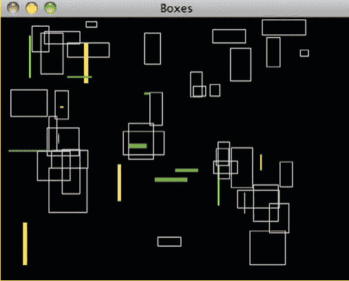

## 列表 6.8

```
****************************************************
// BoxesPanel.java      作者: Lewis/Loftus
// 演示如何使用条件和循环来引导绘制。
****************************************************

import javax.swing.JPanel;
import java.awt.*;
import java.util.Random;
```

## 列表 6.8 继续

```
public class BoxesPanel extends JPanel
{
    private final int NUM_BOXES = 50, THICKNESS = 5, MAX_SIDE = 50;
    private final int MAX_X = 350, MAX_Y = 250;
    private Random generator;

    //
    // 设置绘制面板。
    //
    public BoxesPanel() {
        generator = new Random();
        setBackground(Color.black);
        setPreferredSize(new Dimension(400, 300));
    }

    //
    // 在随机位置绘制随机宽度和高度的框。
    // 窄或短的框将用填充颜色高亮。
    //
    public void paintComponent(Graphics page) {
        super.paintComponent(page);
        int x, y, width, height;
        for (int count = 0; count < NUM_BOXES; count++) {
            x = generator.nextInt(MAX_X) + 1;
            y = generator.nextInt(MAX_Y) + 1;
            width = generator.nextInt(MAX_SIDE) + 1;
            height = generator.nextInt(MAX_SIDE) + 1;
            if (width <= THICKNESS) // 检查窄框 {
                page.setColor(Color.yellow);
                page.fillRect(x, y, width, height);
            }
            else {
                if (height <= THICKNESS) // 检查短框 {
                }
            }
        }
    }
```

## 6.6 对话框

## 列表 6.8 继续

```
page.setColor(Color.yellow);
  page.fillRect(x, y, width, height);
}
else {
  page.setColor(Color.white);
  page.drawRect(x, y, width, height);
}
```

## 6.6 对话框

> 核心概念

> 对话框是一个允许用户与之交互的图形窗口。对话框可以有多种用途，例如传递信息、确认操作或允许输入。

Java 库的 Swing 程序包包含一个名为 `JOptionPane` 的类，它简化了基本对话框的创建和使用。

```
static String showInputDialog(Object msg)
  显示一个包含指定消息和输入字段的对话框。返回文本字段的内容。

static int showConfirmDialog(Component parent, Object msg)
  显示一个包含指定消息和是/否选项的对话框。如果 parent 为空，则框显示在屏幕中央。

static void messageDialog(Component parent, Object msg)
  显示一个包含指定消息的对话框。如果父
  组件为空，则框显示在屏幕中央。
```

图 6.3 JOptionPane 的方法

## 第 6 章 更多条件和循环

`JOptionPane` 对话框的基本格式仅显示输出字符串。输入对话框提供提示词和一个输入字段，用户可以在其中输入数据字符串。确认对话框向用户提出一个简单的是或否问题。

让我们来看一个使用这些类型对话框的程序。列表 6.9 显示了一个程序首先向用户显示一个输入对话框，请求用户输入整数。当用户点击输入对话框上的确定按钮后，会显示第二个对话框（这次是消息对话框），告知用户输入的数字是偶数还是奇数。在用户关闭框后，会出现第三个对话框，确定用户是否想测试另一个数字。如果用户按下“是”按钮，则系列对话框将重复。否则程序终止。

## 列表 6.9

```
****************************************************************
// EvenOdd.java    作者: Lewis/Loftus
// 演示 JOptionPane 类的使用。
****************************************************************

import javax.swing.JOptionPane;

public class EvenOdd {
    // 判断用户输入的值是偶数还是奇数。
    // 使用多个对话框与用户交互。
    public static void main(String[] args) {
        String numStr, result;
        int num, again;
        do {
            numStr = JOptionPane.showInputDialog("Enter an integer:");
            num = Integer.parseInt(numStr);
            result = "That number is " + ((num%2 == 0) ? "even" : "odd");
            JOptionPane.showMessageDialog(null, result);
            again = JOptionPane.showConfirmDialog(null,"Do Another?");
        } while (again == JOptionPane.YES_OPTION);
    }
}
```

## 列表 6.9 继续

```java
}
}
```

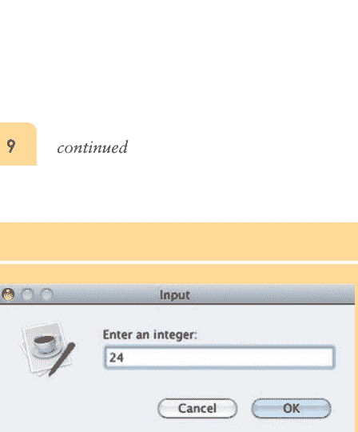

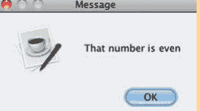

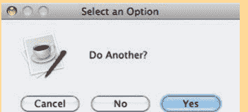

`showMessageDialog` 和 `showConfirmDialog` 的第一个参数指定了对话框的父组件。使用 `null` 引用作为此参数将使对话框显示在屏幕正中央。

`JOptionPane` 的许多方法允许程序员定制对话框的内容。此外，可以使用 `showOptionDialog` 方法创建结合了三种基本格式特征的对话框，以实现更复杂的交互。

### 核心概念总结

- `switch` 语句将字符或整数值匹配到若干个可能的情况（case）之一。

- `break` 语句通常用于 `switch` 语句中每个 case 分支末尾。

- 条件运算符根据布尔条件求值为两个可能值之一。

- `do` 语句至少执行一次其循环体。

- `for` 语句通常用于循环将执行固定次数的场景。

- `for-each` 版本的 `for` 循环简化了对 `Iterable` 对象中所有元素的处理。

- 各种循环语句在功能上是等价的。使用哪一个取决于具体情况。

- 对话框是一个弹出窗口，允许进行简短、特定的用户交互，以提供信息或验证操作。

## 练习题

EX 6.1 以下 `for` 循环将执行多少次？

a. `for (int i = 0; i < 20; i++) { }`

b. `for (int i = 1; i <= 20; i++) { }`

c. `for (int i = 5; i < 20; i++) { }`

d. `for (int i = 20; i > 0; i--) { }`

e. `for (int i = 1; i < 20; i = i + 2) { }`

f. `for (int i = 1; i < 20; i *= 2) { }`

EX 6.2 以下代码段会产生什么输出？

```
for (int highest = 1000; highest > 100; highest = highest / 2)
System.out.println(highest);
```

EX 6.3 以下代码段会产生什么输出？

```java
for (int count = 1; count <= 100; count += 4)
  if (count % 3 == 0)
    System.out.println(count);
```

EX 6.4 将以下 `while` 循环转换为等效的 `do` 循环（确保产生相同的输出）。

```java
int num = 1;
while (num < 20)
{
    num++;
    System.out.println(num);
}
```

EX 6.5 将上一个练习中的 `while` 循环转换为等效的 `for` 循环（确保产生相同的输出）。

EX 6.6 编写一个 `do` 循环，验证用户输入的值是否是 3 的倍数。

EX 6.7 编写一个 `for` 循环，打印从 150 到 50（包含）的偶数。

EX 6.8 编写一个 `for` 循环，打印从 1 到 100 的奇数倍数。

EX 6.9 编写一个代码段，从用户处读取 15 个浮点数并打印输入的最小值和最大值。

EX 6.10 编写一个代码段，判断名为 `called` 的 String 对象的最后一个字符是否为 'n'。

EX 6.11 编写一个代码段，倒序打印名为 `str` 的 String 对象存储的字符。

EX 6.12 编写一个代码段，从第一个字符开始打印名为 `starting` 的 String对象的每一个字符。

EX 6.13 编写一个名为 `multiplesOfFive` 的方法，打印 5 的前 5 个倍数（从 5 开始）。方法无参数且无返回值。

EX 6.14 编写一个名为 `alarm` 的方法，在单独行中多次打印字符串 "Alarm!"。该方法接受一个整数参数，指定打印字符串的次数。如果参数小于 1，打印错误信息。

EX 6.15 编写一个名为 `average25` 的方法，返回 1 到 25（包含）整数的平均值。

EX 6.16 编写一个名为 `sumRange` 的方法，接受两个表示范围的整数参数。如果第二个参数小于第一个参数，发布错误信息并返回零。否则，该方法应返回该范围内（包含）整数的和。

## 第 6 章 更多条件与循环

EX 6.17 编写一个名为 `startT` 的布尔方法，接受一个 String 参数，如果字符串以 "T" 开头则返回 true，否则返回 false。

EX 6.18 编写一个名为 `reverse` 的方法，接受一个 String 参数并返回一个包含参数字符倒序排列的字符串。注意 String 类中有一个方法可以执行此操作，但为了本次练习，你需要编写自己的方法。

## 编程项目

- PP 6.1 编写一个程序，读取一个整数值并打印 0 到输入值（包含）之间所有奇数的平均值。如果输入小于 0，打印错误信息。

- PP 6.2 编写一个程序，读取一个字符串并逐行打印它。


- PP 6.3 编写一个程序，生成一个显示随机负载分配的表格。

- PP 6.4 编写一个程序，使用循环打印“百瓶啤酒”歌曲的前几节。从用户处读取要打印的节数。验证输入。歌曲的前两节如下：

> 100 bottles of beer on the wall
>
> 100 bottles of beer
>
> If one of those bottles should fall
>
> 99 bottles of beer on the wall
>
> 99 bottles of beer
>
> If one of those bottles should fall

（此处省略原文内容）

- PP 6.5 使用 PP 4 中的 `PairOfDice` 类，编写一个程序掷 100 次骰子，并统计每种结果出现的次数。

- PP 6.6 使用 `Person` 类，编写一个程序，使用对话框获取字符串，显示修改后的字符串并提示用户继续。

- PP 6.7 创建 `Stars` 程序的变体以打印以下模式。提示：b、c 和 d 需要多个循环，其中某些打印特定数量的空格。

- PP 6.8 编写一个程序，显示从 32（空格字符）到 126（~ 字符）的 Unicode 字符表。

- PP 6.9 编写一个程序读取三个字符串，然后确定第一个字符串中 'e' 出现的次数、第二个字符串中 't' 以及第三个字符串中 'n'。为每个字母设置一个单独计数器。

- PP 6.10 编写一个程序打印“圣诞十二夜”的歌曲，每节增加一行。你的歌曲的前两节如下：

> On the 1st day of Christmas my true love gave to me
>
> A partridge in a pear tree.
>
> On the 2nd day of Christmas my true love gave to me
>
> Two doves, and
>
> A partridge in a pear tree.

在循环中使用 `switch` 语句来控制打印哪些行。提示：仔细安排 case 并避免使用 `break` 语句。

- PP 6.19 编写一个程序绘制一个简单的栅栏，带有等间距的垂直木板，并由两块支撑板支撑。在栅栏后面显示一个简单的房屋。确保房屋在栅栏间隙间可见。

- PP 6.20 编写一个程序绘制彩虹。使用密集的同心圆为彩虹的每个部分绘制特定的颜色。

- PP 6.21 编写一个程序在区域内随机位置绘制 20,000 个点。使面板左半的点显示红色，右半的点显示绿色。通过绘制长度仅一像素的线来绘制每个点。

- PP 6.23 编写一个程序，使用对话框获取三个整数值（每个对话框一个），并显示这些值的平均值及其平方。使用另一个对话框查看用户是否想继续。

- PP 6.24 修改 PP 5.5 中的 `ChangeCase` 程序，使其使用对话框获取输入字符串，显示修改后的字符串并提示用户继续。

- PP 6.25 编写一个名为 `Card` 的类，代表标准扑牌。每张牌都有花色和点值。创建一个程序来分发五张随机牌。

## 面向对象的设计

### 目标

- 建立与面向对象设计相关的关键问题。
- 探索识别程序所需的类和对象的技巧。
- 讨论类之间的关系。
- 描述静态（`static`）修饰符对方法和数据的影响。
- 讨论正式对象接口的。
- 进一步探索枚举类的定义。
- 讨论与方法设计相关的问题，包括方法重载。
- 探索与图形用户界面设计相关的问题，包括布局管理器。

本章扩展了我们面向对象软件设计的讨论。我们首先关注软件开发阶段，以及在问题领域中识别类和对象的流程。然后，我们讨论了影响类设计的各种性问题，包括静态成员、类关系、接口和枚举类型。我们还探索了方法层面的设计问题，并引入了方法重载的概念。对测试策略的讨论完成了对这些问题的探讨。在本章的图形轨迹（Graphics Track）章节中，我们关注 GUI 设计概念，包括布局管理器和包含层次结构。

### 7.1 软件开发活动

创建软件不仅仅是编写代码。随着你所解决的问题变得越来越大，解决方案包含的类越来越多，仔细思考软件设计就变得至关重要。任何适当的软件开发由四项基本开发活动组成：

- 建立需求
- 创建设计
- 实现设计
- 测试

如果这些活动能按顺序定义一种开发软件的逐步方法就好了。然而，尽管它们看起来是顺序的，但在现实中它们几乎不是完全线性的。它们相互重叠并交互。让我们简要讨论每个开发活动。

> 软件需求规定了程序必须完成的任务。它们指示了程序应该执行的任务，而不是如何执行这些任务。通常，需求在一个称为功能规范的文档中表示。

我们在第 1 章中讨论过一个基本前提：编程本质上是关于解决问题的；我们创建一个程序是为了解决特定问题。需求是对该问题的清晰表达。在不知道我们正试图解决什么问题之前，我们无法真正解决它。

想要开发软件产品的人或小组（客户）通常会提供一组初始需求。然而，这些需求通常是不完整的、含义的，甚至可能是矛盾的。软件开发人员必须与客户合作提炼需求，直到解决系统将具备的所有关键细节。

需求通常涉及用户界面问题，如输出格式、屏幕布局和图形界面组件。本质上，需求建立了使程序对终端用户用的特征。它们也可能对你的程序施加限制，或者任务执行的速度。

软件设计指示了程序将如何实现其需求。设计指定了程序所需的类和对象，并定义了它们如何交互。它还指定了类之间的关系。低级设计问题处理单个方法如何完成其任务。

土木工程师在没有设计桥梁之前就需要考虑它。软件的设计同样本质。软件中发生的许多问题直接归因于缺乏良好的设计努力。事实一次次证明，在程序设计上花费精力是非常值得的，从长远来看节省了大量的时间金钱。

> 核心概念
>
> 投入设计的精力既是关重要的也是有效的。

实现是编写解决问题的源代码的过程。确切地说，实现是将设计翻译成特定编程语言的行为。太多的程序员只关注实现，而实际上，它应该是所有开发活动中最具创造力的一项。重要的决策应该在建立需求和创建设计时做出。

测试是确保程序在所有必须履行的约束条件下能够解决问题的行为。测试包括使用各种输入多次运行程序，并仔细检查结果。但它的意义远不止于此。我们将在第 7.9 节中重新讨论与测试相关的问题。

#### 自测习题（答案见附录 N）

- SR 7.1 列出涉及开发过程的四项基本活动。
- SR 7.2 谁创建软件需求？客户还是开发人员？请讨论。
- SR 7.3 将本节介绍的四项基本开发活动与第 1 章（第 1.6 节）中提出的五个通用问题解决步骤进行比较和对比。

### 7.2 识别类和对象

面向对象软件设计的根本部分是确定对程序贡献类。我们必须仔细考虑如何表示构成整体设计的各种元素。这些类决定了将在系统中管理哪些对象。

识别潜在类的一种方法是识别程序需求中讨论的对象。对象通常是名词。你从字面上需要仔细检查问题描述（如果有的话，则是功能规范），以识别其中发现的名。例如，图 7.1 显示了圈出名词的部分问题描述。

> 核心概念
>
> 问题描述中的名词可能指示程序所需的某些类和对象。

当然，问题规范中的每个名词并不一定对应于你程序中的类。这项活动只是一个起点，允许你思考程序将管理的对象类型。

330 第 7 章 面向对象的设计

> 用户必须被允许指定每个产品的特性，包括其名称。如果条形码没有生成产品，则应向窗口生成错误并输入日志中。所有交易的摘要报告必须按照 7.A 的规定结构化。

图 7.1 圈出名词的部分问题描述

记住，类代表一组具有相似行为的对象。规范中的复数名词，如 products（产品），可能指示需要表示其中一个的类，例如 Product（产品类）。表示对象的类通常应以单数名词命名，例如 `Coin`、`Student` 和 `Message`。类代表一个单一项目，我们可以自由地从中创建任意数量实例。

另一个关键决策是将某物表示为对象，还是作为另一个对象的原始属性。例如，我们最初可能认为员工的薪水应该是一个整数，这对于系统的大部分处理是有效的。通过进一步反思，我们可能会意识到薪水取决于人的职级，职级有必须仔细管理的薪水上限和下限。因此，最终结论可能是，将所有数据和关联行为表示为一个单独的类更为恰当。

考虑到特定程序的需求，我们希望在过于通用的类和过于具体的类之间取得良好的平衡。例如，为房子中每种类型的电器创建一个单独的类可能会不必要地增加设计的复杂性。一个简单的 `Appliance`（电器）类可能足够，只需带有一个实例数据来指示它是什么类型的电器。然后，也可能不足。这完全取决于软件打算实现什么。

除了表示问题领域中对象的类之外，我们可能还需要支持完成工作工作所需的类。例如，除了 `Member`（成员）对象之外，我们可能想要一个单独的类来帮助管理俱乐部的所有成员。

在生产真实系统时要记住，我们识别设计的某些类可能已经存在了。即使没有完全匹配，也可能有一个相似的旧类可以作为我们新类的基础。这些

#### 分配职责

在识别程序所需的类的过程中，有一部分是为每个类分配职责的过程。每个类代表一个具有特定行为的对象，这些行为由类的方法定义。程序必须完成的任何活动都应该在类的行为某处有所体现。每个类都负责执行某些活动，而这些职责必须在设计程序时被分配。

类的行为执行着可能定义程序功能的动作。因此，我们通常使用动词来命名行为以及实现这些行为的方法。

有时，要确定哪一个类是执行特定职责的最佳类是具有挑战性的。考虑多种可能性。有时，这种分析会让你意识到，通过定义另一个类来承担该职责可能会让你受益匪浅。

在设计的早期，没有必要识别一个类将包含的所有方法。通常，分配主要职责并考虑这些职责如何转化为特定的方法就足够了。

> 自我复习问题（答案见附录 N）
>
> SR 7.4 在问题规格中识别名词如何帮助你设计该问题的面向对象的解决方案？
>
> SR 7.5 在问题设计的早期，识别并定义类将包含的所有方法是否重要？请讨论。

### 7.3 静态类成员

现有的类可能是 Java 标准类库的一部分，可能是我们之前解决过的某个问题的解决方案的一部分，也可能是从第三方购买的类库的一部分。这些都是软件重用的示例。

在书之前的示例中，我们已经在各种情况下使用过静态方法。例如，`Math` 类的所有方法都是静态的。记住，静态方法是通过其类名调用的，而不是通过该类的对象调用的。

方法不仅可以是静态的，变量也可以是静态的。我们使用 `static` 修饰符来声明静态类成员。


视频笔记

探索 `static` 修饰符。

#### 静态变量

决定将将方法或变量声明为静态是类设计中的关键步骤。让我们更仔细地检查静态变量和方法的影响。

到为止，我们看到了两类变量：在方法内部声明的局部变量，以及在类中声明但在方法之外的实例变量。使用“实例变量”一术是因为类的每个实例都有该变量的自己的版本。也就是说，每个对象为每个变量拥有独立的内存空间，以便每个对象对该变量拥有不同的值。

静态变量（有时称为类变量）在类的所有实例之间共享。对于类的所有对象来说，静态变量只有一个拷贝。因此，更改一个对象中静态变量的值会改变所有其他对象的值。使用关键字 `static` 如下所示声明静态变量：

```
private static int count = 0;
```

当程序中第一次引用包含该的类时，静态变量的内存空间就会建立。在方法内部声明的局部变量不能是静态的。

使用 `final` 修饰符声明的常量通常使用 `static` 修饰符声明。因为常量的值不能改变，在类的所有对象中可能只有一个该值的唯一拷贝。

#### 静态方法

在第 3 章中，我们简要地介绍了静态方法的概念（也称为类方法）。静态方法可以通过类名调用。我们不需要实例化类的对象就可以调用该方法。在第 3 章中，我们注意到 `Math` 类的所有方法都是静态方法。例如，在接下来的代码行中，`sqrt` 方法是通过 `Math` 名称调用的：

```
System.out.println("Square root of 27: " + Math.sqrt(27));
```

`Math` 类中的方法根据传递的参数值执行基础计算。在这些情况下，没有需要维护的对象状态；因此，没有理由为了请求这些服务而创建一个对象。

在方法声明中使用 `static` 修饰符使方法变为静态的。正如我们多次看到的，Java 程序的 `main` 方法必须用 `static` 修饰符声明；这样它就可以在不实例化包含 `main` 的类的对象的情况下由解释器执行。


由于静态方法不是在特定对象的上下文中运行，它们不能引用实例变量（实例变量只存在于类的实例）。如果静态方法尝试使用非静态变量，编译器将发出错误。然而，静态方法可以引用静态变量，因为静态变量独立于特定对象存在。因此，`main` 方法只能访问静态或局部变量。

列表 7.1 中的程序实例化了几个 `Slogan` 类的对象，并依次打印每一个。在程序结束时，它通过类名调用了一个名为 `setCount` 的方法，该方法返回程序中实例化的 `Slogan` 对象数量。

#### 列表 7.1

```java
//***********************************************************************************
// SloganCounter.java             Author: Lewis/Loft
// // 展示了 static 修饰符的使用。
// ************************************************************************************
public class SloganCounter {
    // 创建几个 Slogan 对象并打印创建的
    // 对象的数量。
    // --------------------------------------------------------------------------------
    public static void main(String[] args) {
        Slogan obj;

        obj = new Slogan("Remember the Alamo.");
        System.out.println(obj);

        obj = new Slogan("Don't Worry. Be Happy.");
        System.out.println(obj);

        obj = new Slogan("Live Free or Die.");
        System.out.println(obj);

        obj = new Slogan("Talk is Cheap.");
        System.out.println(obj);

        obj = new Slogan("Write Once, Anywhere.");
        System.out.println(obj);

        System.out.println("Slogans created: " + Slogan.getCount());
    }
}
```

#### 列表 7.2

```java
****************************************************************
// Slogan.java             Author: Lewis/Loft
// 代表单个口号字符串。
****************************************************************

public class Slogan
{
    private String phrase;
    private static int count = 0;

    // 构造函数：设置口号并统计创建的
    // 数量。
    public Slogan(String str)
    {
        phrase = str;
        count++;
    }

    // 将此口号作为字符串返回。
    public String toString()
    {
        return phrase;
    }

    // 返回该类已创建的实例数量。
    public static int getCount()
    {
        return count;
    }
}
```

#### 输出

```
Remember the Alamo.
Don't Worry. Be Happy.
Live Free or Die.
Talk is Cheap.
Write Once, Anywhere.
Slogans created: 5
```

#### 自我复习问题（答案见附录 N）

- SR 7.6 静态变量和实例变量的区别是什么？
- SR 7.7 假设你正在定义一个 `BankAccount` 类，其对象代表一个银行账户。请为该类声明一个变量，存储该类表示的所有银行账户的总余额。
- SR 7.8 假设你正在定义一个 `BankAccount` 类，其对象代表一个银行账户。请为该类声明一个变量，存储每个账户必须维持的最低余额。
- SR 7.9 任何程序的 `main` 方法可以引用哪些种类型的变量？为什么？

### 7.4 类关系

软件系统中的类之间存在着各种类型的关系。最常见的三种关系是依赖、聚合和继承。

我们已经在许多示例中看到过依赖关系，即一个类“使用”另一个类。本节将再次回顾依赖关系，并探索类依赖于自身的情况。然后，我们将探索聚合关系，聚合中一个类的对象包含了另一个类的对象，从而创建了一种“拥有”（has-as）的关系。我们在第 1 章中引入了继承，它在类之间创建了“是一个”（is-as）的关系。我们将对继承的详细检查推迟到第 9 章。

#### 依赖


# 第7章 面向对象的设计

## 类之间的依赖

在之前的许多示例中，我们看到过一个类依赖于另一个类的概念。这意味着一个类在某些方面依赖于另一个类。通常，一个类的方法会调用另一个类的方法。这建立了一种“使用”关系。

通常情况下，如果类 A 使用 B，那么类 A 的一个或多个方法会调用类 B 的一个或多个方法。如果调用的方法是静态的，那么 A 仅通过名称引用 B。如果调用的方法不是静态的，那么 A 必须访问类 B 的特定实例才能调用该方法。也就是说，A 必须拥有指向类 B 对象的引用。

一个类获取另一个类对象的方式是一个重要的设计决策。当一个类实例化另一个类的对象时，这通常是聚合关系的基础。访问也可以通过将一个对象作为方法参数传递给另一个对象来实现。

通常，我们希望尽量减少类之间的依赖关系。类之间的依赖程度越低，变化和错误对系统的影响就越小。

## 同一类对象之间的依赖

在某些情况下，类会依赖于自身。也就是说，一个类的对象与同类的另一个对象进行交互。为了实现这一点，类的一个方法可以接受同类的对象作为参数。设计这样的类体现了“类代表一个特定对象”的思想。

`String` 类的 `concat()` 方法就是这种情况的一个例子。该方法通过一个 `String` 对象执行，并接收另一个 `String` 对象作为参数传递。例如：

```java
str3 = str1.concat(str2);
```

执行方法的 `String` 对象 (`str1`) 将其字符附加到作为参数传递的 `String` 对象 (`str2`) 之后。返回一个新的 `String` 对象作为结果并存储为 `str3`。

列表 7.3 显示的 `RationalTester` 程序演示了类似的情况。有理数是可以表示为两个整数之比（分数）的值。`RationalTester` 程序创建了两个表示有理数的对象，并对它们进行操作以产生新的有理数。

```java
// 列表 7.3
// RationalTester.java    作者: Lewis/Loftus
// 用于练习使用多个 Rational 对象的驱动程序。
public class RationalTester {
    // 创建一些有理数对象并对它们执行各种操作。
    public static void main(String[] args) {
        RationalNumber r1 = new RationalNumber(6, 8);
        RationalNumber r2 = new RationalNumber(1, 3);
        RationalNumber r3, r4, r5, r6, r7;

        System.out.println("First rational number: " + r1);
        System.out.println("Second rational number: " + r2);

        if (r1.isLike(r2)) {
            System.out.println("r1 and r2 are equal.");
        } else {
            System.out.println("r1 and r2 are NOT equal.");
        }

        r3 = r1.reciprocal();
        System.out.println("The reciprocal of r1 is: " + r3);

        r4 = r1.add(r2);
        r5 = r1.subtract(r2);
        r6 = r1.multiply(r2);
        r7 = r1.divide(r2);

        System.out.println("r1 + r2: " + r4);
        System.out.println("r1 - r2: " + r5);
        System.out.println("r1 * r2: " + r6);
        System.out.println("r1 / r2: " + r7);
    }
}
```

**输出**
```
First rational number: 3/4
Second rational number: 1/3
r1 and r2 are NOT equal.
The reciprocal of r1 is: 4/3
r1 + r2: 12/12
r1 - r2: 5/12
r1 * r2: 1/4
r1 / r2: 9/4
```

列表 7.4 显示了 `RationalNumber` 类。请记住，从 `RationalNumber` 类创建的每个对象都代表一个有理数。`RationalNumber` 类包含了对有理数的各种操作，如加法和减法。

```java
// 列表 7.4
// RationalNumber.java 作者: Lewis/Loftus
// 表示带有分子和分母的有理数。
public class RationalNumber {
    private int numerator, denominator;

    // 计算并返回两个正数参数的最大公约数。使用欧几里得算法。
    private int gcd(int num1, int num2) {
        while (num1 != num2) {
            if (num1 > num2)
                num1 = num1 - num2;
            else
                num2 = num2 - num1;
        }
        return num1;
    }
}
```

`RationalNumber` 类的方法（如 `add()`、`subtract()`、`multiply()` 和 `divide()`）将执行方法的 `RationalNumber` 对象作为第一个（左）操作数，并将作为参数传递的 `RationalNumber` 对象作为第二个（右）操作数。

`RationalNumber` 类的 `isLike()` 方法用于判断两个有理数是否相等。人们可能会将该方法命名为 `equals()`，以与用于比较 `String` 对象的方法（在第5章中讨论过）保持一致。然而在第9章中，我们将讨论 `equals()` 方法由于继承而具有的特殊性，并且它应该以特定的方式实现。为了避免混淆，我们暂时将此方法命名为 `isLike()`。

注意 `RationalNumber` 类中的某些方法（包括 `reduce()` 和 `gcd()`）被声明为 `private` 可见性。这些方法是私有的，是因为我们不希望从 `RationalNumber` 对象外部直接执行它们。它们的存在是为了支持对象的其他服务。

## 聚合

某些对象是由其他对象组成的。例如，汽车由它的引擎、底盘、轮子以及其他部分组成。这些部分中的每一个都可以被视为一个独立的对象。因此我们可以说汽车是一个聚合——它至少在部分是由其他对象组成的。聚合有时被描述为“具有”关系。例如，汽车有一个底盘。

> **核心概念**：聚合对象由其他对象组成，形成了一种“具有”的关系。

在软件世界中，我们将聚合对象定义为任何在实例数据中包含其他对象引用的对象。例如，一个 `Account` 对象包含另外一个代表账户所有者名称的 `String` 对象。我们有时会忘记字符串也是对象，这从技术上说意味着每个 `Account` 对象都是一个聚合对象。

聚合是一种特殊的依赖关系。也就是说，一个部分由另一个类定义的类依赖于该类。聚合对象的方法通常会调用构成它的那些对象。

让我们考虑另一个例子。列表 7.5 所示的 `StudentBody` 程序创建了两个 `Student` 对象。每个 `Student` 对象部分由两个 `Address` 对象组成，一个用于学生的学校地址，另一个用于学生的家庭地址。`main()` 方法做的不仅仅是调用自动的 `toString()` 方法来创建一个适合打印的有效对象表示。

列表 7.6 中的 `Student` 类代表单个学生。如果该类要代表学生的所有方面，那么它将会大大扩展。我们现在刻意保持其简单，以便清晰地展示对象聚合。`Student` 类的实例数据包括对两个 `Address` 对象的引用。在 `toString()` 方法中，当我们创建学生的字符串表示时，引用了这些对象。通过将一个 `Address` 对象连接到另一个字符串，`Address` 类中的 `toString()` 方法会被自动调用。

```java
// 列表 7.5
// StudentBody.java      作者: Lewis/Loftus
// 展示了聚合类的使用。
public class StudentBody {
    // 创建一些 Address 和 Student 对象并打印它们。
    public static void main(String[] args) {
        Address school = new Address("800 Lancaster Ave.", "Villanova",
                                     "PA", 19085);
        Address jHome = new Address("21 Jump Street", "Blacksburg",
                                    "VA", 24551);

        Student john = new Student("John", "Smith", jHome, school);

        Address mHome = new Address("123 Main Street", "Euclid", "OH",
                                    44132);
        Student marsha = new Student("Marsha", "Jones", mHome, school);

        System.out.println(john);
        System.out.println();
        System.out.println(marsha);
    }
}
```

**输出**
```
John Smith
家庭地址:
21 Jump Street
Blacksburg, VA 24555
学校地址:
800 Lancaster Ave.
Villanova, PA 19085

Marsha Jones
家庭地址:
123 Main Street
Euclid, OH 44132
学校地址:
800 Lancaster Ave.
Villanova, PA 19085
```

```java
// 列表 7.6
// Student.java      作者: Lewis/Loftus
// 代表一个大学学生。
public class Student {
    private String firstName, lastName;
    private Address homeAddress, schoolAddress;

    // 构造函数：使用指定的值初始化此学生。
    public Student(String first, String last, Address home,
                   Address school) {
        firstName = first;
        lastName = last;
        homeAddress = home;
        schoolAddress = school;
    }

    // 返回学生的字符串表示。
    public String toString() {
        String result;
        result = firstName + " " + lastName + "\n";
        result += "家庭地址:\n" + homeAddress + "\n";
        result += "学校地址:\n" + schoolAddress;
        return result;
    }
}
```

`Address` 类在列表 7.7 中所示。它代表一个地址。注意 `Address` 类中没有任何表明它是 `Student` 对象的一部分。这是通过设计实现的。

```java
// 列表 7.7
// Address.java      作者: Lewis/Loftus
// 代表一个地址。
public class Address {
    private String streetAddress, city, state;
    private long zipCode;

    // 构造函数：使用指定的数据初始化此地址。
    public Address(String street, String town, String st, long zip) {
        streetAddress = street;
        city = town;
        state = st;
        zipCode = zip;
    }

    // 返回此对象的描述。
    public String toString() {
        String result;
        result = streetAddress + "\n";
        result += city + ", " + state + " " + zipCode;
        return result;
    }
}
```

一个对象越复杂，越可能需要被表示为聚合对象。在 UML 中，聚合用两个类之间的连接来表示，在聚合类的一端有一个空菱形。图 7.2 显示了 `StudentBody` 程序的类图。

注意在之前的图示例和图 7.2 中，字符串没有被表示为具有聚合关系的独立类，尽管技术上可以这样做。字符串对编程是如此基础，以至于在 UML 图中通常被表示为基本类型。

## this 引用

在离开类关系的话题之前，我们检查 Java 程序中另一种特殊的引用，称为 `this` 引用。`this` 是 Java 中的一个关键字。它允许对象引用自己。正如我们讨论过的，非静态方法通过对象调用。

例如，在 `ChessPiece` 类中可以有一个名为 `move()` 的方法，它可以包含以下行：

```java
if (this.position == piece2.position)
    result = false;
```

在这种情况下，`this` 引用被用于明确所引用的位置。`this` 引用指向调用方法的对象。当使用以下行调用方法时，`this` 引用指向 `bishop1`：

```java
bishop1.move();
```

然而，当使用不同的对象来调用方法时，`this` 引用指向该对象。因此，当使用以下调用时，`move()` 方法中的 `this` 引用指向 `bishop2`：

```java
bishop2.move();
```

通常，`this` 引用用于区分构造函数的参数与其同名的对应实例变量。例如，第 4 章展示了 `Account` 类的构造函数：

```java
public Account(String owner, long account, double initial) {
    name = owner;
    acctNumber = acctNumber;
    balance = initial;
}
```

在编写该构造函数时，我们刻意为参数使用了不同的名称，以便将其与实例变量 `acctNumber` 和 `balance` 区分开来。这种区分是任意的。可以使用 `this` 引用按照如下编写构造函数：

```java
public Account(String name, long account, double balance) {
    this.name = name;
    this.acctNumber = acctNumber;
    this.balance = balance;
}
```

在这个版本的构造函数中，`this` 引用特指对象的实例变量。赋值语句右侧的变量指代形式参数。这种方法避免了寻找等效名称的需要。这种情况在其他方法中也会发生，但在构造函数中很常见。

- 自习题（答案见附录 N）


- SR 7.10 描述两个类之间的依赖关系。
- SR 7.11 解释类如何与自身产生关联。
- SR 7.12 什么是聚合对象？
- SR 7.13 `this` 引用指的是什么？

## 7.5 接口

我们一直使用“接口（interface）”一词来指代用于与对象交互的公共方法集。这个定义与我们在本节中的用法一致，但我们现在将使用 Java 中一种特定的语言结构来形式化这一概念。

### LISTING 7.8

```
public interface Complexity
{
    public void setComplexity(int complexity);
    public int getComplexity();
}
```

Java 接口是常量和抽象方法的集合。抽象方法是不具有实现的方法。也就是说，抽象方法没有定义代码体。方法的头部（包括其参数列表）后面仅跟着一个分号。接口不能被实例化。

列表 7.8 显示了一个名为 `Complexity` 的接口。它包含两个抽象方法：`setComplexity` 和 `getComplexity`。

抽象方法前面可以带有关键字 `abstract`，尽管在接口中通常省略它。接口中的方法默认具有 `public` 可见性。

类通过为接口中定义的每个抽象方法提供方法实现来实现接口。实现接口的类在类头部中使用关键字 `implements`，后面后跟接口名称。如果一个类实现了一个特定的接口，它必须为接口中的所有方法提供定义。如果接口中的任何方法没有在类中给出定义，编译器将产生错误。

列表 7.9 显示的 `Question` 类实现了 `Complexity` 接口。`setComplexity` 和 `getComplexity` 方法都得到了实现。它们必须与接口中对应的抽象方法具有相同的签名。在 `Question` 类中，这些方法被定义为设置或返回一个数值，代表该对象所代表的问题的复杂度。

注意，`Question` 类还实现了并非 `Complexity` 接口部分的方法。具体而言，它定义了名为 `getQuestion`、`getAnswer`、`answerCorrect` 和 `toString` 方法，这些方法与接口无关。

> 核心概念
>
> 接口是抽象方法的集合，因此不能实例化。

### LISTING 7.9

```
public class Question implements Complexity
{
    private String question, answer;
    private int complexityLevel;

    // 构造函数：用默认复杂度设置问题。
    public Question(String query, String result)
    {
        question = query;
        answer = result;
        complexityLevel = 1;
    }

    // 设置此问题的复杂度级别。
    public void setComplexity(int level)
    {
        complexityLevel = level;
    }

    // 返回此问题的复杂度级别。
    public int getComplexity()
    {
        return complexityLevel;
    }

    // 返回问题。
    public String getQuestion()
    {
        return question;
    }
}
```

### LISTING 7.9 继续

```
// 返回此问题的答案。
//
public String getAnswer() {
    return answer;
}
// 如果候选答案与答案匹配则返回 true。
//
public boolean answerCorrect(String candidateAnswer) {
    return answer.equals(candidateAnswer);
}
// 将此问题（及其答案）作为字符串返回。
//
public String toString() {
    return question + "\n" + answer;
}
```

但并不限制它拥有额外的方法。实现接口的类拥有其他方法是常见现象。

列表 7.10 显示了一个名为 `MiniQuiz` 的程序，它使用了一些 `Question` 对象。

一个接口及其它可以实现的类之间的关系可以在 UML 类图中表示。接口的表示方法与类节点相似，但在接口名称上方插入了 `<<interface>>` 标记。从类到接口有一条带闭箭头的虚线。图 7.3 显示了 `MiniQuiz` 的 UML 类图。多个类可以实现同一个接口，为其提供不同的定义。例如，我们可以实现一个实现了 `Complexity` 接口的 `Task`。在其中以不同的方式管理复杂度（尽管它仍然实现接口的所有方法）。

### LISTING 7.10

```
import java.util.Scanner;

public class MiniQuiz {
    // 展示一个小型测验。
    //
    public static void main(String[] args) {
        Question q1, q2;
        String possible;

        Scanner scan = new Scanner(System.in);

        q1 = new Question("What is the capital of Jamaica?",
                           "Kingston");
        q1.setComplexity(4);

        q2 = new Question("Which is worse, ignorance or apathy?",
                           "I't know and I't care");
        q2.setComplexity(10);

        System.out.println(q1.getQuestion());
        System.out.println("Level: " + q1.getComplexity() +
```

### LISTING 7.10 继续

```
What is the capital of Jamaica? (Level: 4)
Kingston
Correct

Which is worse, ignorance or apathy? (Level: 10)
apathy
No, the answer is I't know and I't care
}
}
```

一个类实现多个接口，它们列在 `implements` 子句中，并用逗号分隔。

```
class ManyThings implements Interface1, Interface2, Interface3
{
// 包含所有接口的方法
}
```

除了抽象方法之外，接口还可以使用 `final` 修饰符包含常量。当一个类实现接口时，它就可以访问接口中定义的所有常量。

接口结构定义了我们与类交互的方式。它还是一种强大的编程技术——多态的基础，我们将在第 10 章中讨论。

## Comparable 接口

Java 标准库包含接口也包含类。例如，`Comparable` 接口位于 `java.lang` 包中。`Comparable` 接口仅包含一个方法 `compareTo`，它接受一个对象作为参数并返回一个整数。

该接口的意图是提供一个比较对象与其他对象的通用机制。一个对象调用该方法并将另一个对象作为参数传递如下：

```
if (obj1.compareTo(obj2) < 0)
System.out.println("obj1 is less than obj2");
```

根据接口文档说明，`compareTo` 方法返回的整数在 `obj1` 小于 `obj2` 时应为负数，如果它们相等则为 0，如果 `obj1` 大于 `obj2` 则为正数。每个类的设计者需要决定一个该类的对象相对于另一个对象“小于”、“等于”或“大于”什么。

在第 5 章中，我们提到 `String` 类包含一个以这种方式运行的 `compareTo` 方法。现在我们可以明确，`String` 类之所以拥有此方法是因为它实现了 `Comparable` 接口。`String` 类对此方法的实现是基于 Unicode 字符集定义的字典序进行比较的。

## 迭代器接口

`Iterator` 接口是 Java 标准类库定义的另一个接口。它被表示对象集合的类使用，提供了一种一次移动一个对象的集合的方法。

### 7.6 重温枚举类型

在第 5 章中，我们定义了迭代器的概念，使用循环处理集合中的所有元素。大多数迭代器（包括 `Scanner` 类的对象）都是使用 `Iterator` 接口定义的。

`Iterator` 接口中的两个主要方法是返回布尔结果的 `hasNext()` 和返回一个对象的 `next()`。这两个方法都不接受参数。如果还有剩余项目待处理，`hasNext` 方法返回 `true`，而 `next` 返回下一个对象。实现 `Iterator` 接口的类设计者需要决定 `next` 方法交付对象的顺序。

我们需要注意的是，根据该接口的精髓，该方法不会从底层集合中移除对象；它只是返回了该对象的引用。`Iterator` 接口还有一个方法 `remove` 方法，它不接受参数并返回 `void` 类型。调用 `remove` 方法会从底层集合中移除最近一次由 `next` 方法返回的对象。

#### 自测复习题（答案见附录 N）

- SR 7.14 类和接口之间的区别是什么？
- SR 7.15 定义一个 Java 类 `Nameable`。实现此接口的类必须提供一个 `setName` 方法，该方法需要一个 `String` 参数且没有返回值，以及一个没有参数并返回 `String` 的 `getName` 方法。
- SR 7.16 正确还是错误？请解释。
  - a. 接口可以只包含抽象方法，不包含其他内容。
  - b. 抽象方法是不具有实现的方法。
  - c. Java 接口定义中包含的所有方法都必须是抽象。
  - d. 实现接口的类只能定义接口中包含的那些方法。
  - e. 多个类可以实现同一个接口。
  - f. 一个类可以实现多个一个接口。
  - g. 所有实现接口的类必须为接口中包含的方法提供完全相同的定义。

### 7.6 重温枚举类型

在第 3 章中，我们引入了枚举类型（enumerated type）的概念，它定义了一种新的数据类型并列出了该类型所有可能的值。我们给了一个定义枚举类型 `Season` 的示例，其声明如下：

```
enum Season {winter, spring, summer, fall}
```

我们提到过枚举类型是一种特殊的类，枚举类型的值是对象。事实上，这些值是它们所属枚举类型的实例。例如，`winter` 是 `Season` 类的一个对象。让我们进一步探索一下。

假设我们如下声明一个 `Season` 类型的变量：

```
Season time;
```

由于枚举类型是一种特殊的类，因此变量 `time` 是一个对象引用变量。此外，作为一种枚举类型，它只能被赋值 `Season` 定义中列出的值。这些值（`winter`、`spring`、`summer` 和 `fall`）实际上是 `Season` 对象的引用，存储在 `Season` 类内部的 `public static` 变量中。因此，我们可以进行如下赋值：

```
time = Season.spring;
```

现在让我们把这个想法推进一步。在列表 7.11 中，我们重新定义了 `Season` 类型，赋予它一个更实质性的定义。注意，我们仍然使用 `enum` 关键字来声明枚举类型，并且仍然列出了该类型所有可能的值。此外，在这个定义中，我们添加了一个私有的 `String span` 字段、一个 `Season` 类的构造函数以及一个名为 `getSpan` 的方法。枚举类型值列表中的每个值都会调用构造函数，传递一个字符，该字符随后被存储在每个值的 `span` 变量中。

#### LISTING 7.11

```
public enum Season
{
    winter("December through February"),
    spring("March through May"),
    summer("June through August"),
    fall("September through November");

    private String span;

    // 构造函数：为每个值设置关联的字符串。
    //---
    Season(String months)
    {
        span = months;
    }
    // 返回此值的 span 消息。
    //---
    public String getSpan()
    {
        return span;
    }
}
```

列表 7.12 显示的 `SeasonTester` 类的 `main` 方法打印 `Season` 枚举类型的每个值，以及每个值的 `span` 语句。每个枚举类型都包含一个名为 `values()` 的静态方法，它返回该类型所有可能值的列表。

#### LISTING 7.12

```
public class SeasonTester
{
    public static void main(String[] args)
    {
        for (Season time : Season.values())
        {
            System.out.println(time + "\t" + time.getSpan());
        }
    }
}
```

#### 自测复习题（答案见附录 N）

- SR 7.17 使用枚举类型，以下序列的输出是什么？

```
Season time1, time2;
time1 = Season.winter;
time2 = Season.summer;
System.out.println(time1.ordinal());
System.out.println(time2.getSpan());
```

### 7.7 方法设计

一旦你确定了类并分配了职责，类的设计将决定方法如何行为。

算法是解决问题的逐步过程。配方是另一个例子。

算法通常使用伪代码描述。算法是代码语句和英语短语的混合。

> KEY概念
>
> 对象提供的服务可以被分解以使用私有辅助方法。

#### 方法分解

有时，对象提供的服务复杂到无法通过一个方法实现。因此，我们有时需要将方法分解为多个方法。例如，让我们观察一个将英语翻译成皮格语的程序。


皮格语是一种造语言，通过将单词的首字母移动到末尾并添加 "ay" 来修改句子中的每个单词。例如，`happy` 会变成 `apphay`，`birthday` 会变成 `ithday`。单词开头的辅音丛（如 `ch` 和 `st`）在添加 "ay" 之前整体移动。因此 `grapefruit` 变成 `apefrgray`。

列表 7.13 显示的翻译程序读取一个或多个句子，并将它们翻译成皮格语。

该翻译程序背后的主力是列表 7.14 显示的 `PigLatinTranslator` 类。该类提供了一个基本服务：名为 `translate` 的静态方法，它接受一个字符串并将其转换为皮格语。注意 `PigLatinTranslator` 类不包含构造函数，因为不需要。

### 列表 7.13

```java
//************************************************************************************
// PigLatin.java    Author: Lewis/Loftus
// 演示方法分解的概念。
//************************************************************************************

import java.util.Scanner;
```

### 列表 7.14

```java
//************************************************************************************
// PigLatinTranslator.java    Author: Lewis/Loftus
// 将字符串翻译为皮格语。
//************************************************************************************

public class PigLatinTranslator
{
    public static String translate(String input)
    {
        String[] words = input.split(" ");
        StringBuilder result = new StringBuilder();
        for (String word : words)
        {
            result.append(translateWord(word)).append(" ");
        }
        return result.toString().trim();
    }

    private static String translateWord(String word)
    {
        if (word.isEmpty()) return word;
        char firstChar = word.charAt(0);
        if (Character.isUpperCase(firstChar))
        {
            return word + "ay";
        }
        // 示例性的辅音丛处理逻辑
        return word.substring(1) + firstChar + "ay";
    }
}
```

### 列表 7.13 续

```java
public class PigLatin {
    //
    // 读取句子并将其翻译为猪爪语（Pig Latin）。
    //
    public static void main(String[] args) {
        String sentence, result, another;

        Scanner scan = new Scanner(System.in);
        do {
            System.out.println("Enter a sentence (no punctuation):");
            sentence = scan.nextLine();

            System.out.println();
            result = PigLatinTranslator.translate(sentence);
            System.out.println("That sentence in Pig Latin is:");
            System.out.println(result);

            System.out.println();
            System.out.print("Translate another sentence (y/n)? ");
            another = scan.nextLine();
        } while (another.equalsIgnoreCase("y"));
    }
}
```

### 输出

```
Enter a sentence (no punctuation):

Do you speak Pig Latin

That sentence in Pig Latin is:

oday ouyay eakspay igpay atlay

Translate another sentence (y/n)? y

Enter a sentence (no punctuation):

Play it again Sam

That sentence in Pig Latin is:

ayplay itay itay againay amsay

Translate another sentence (y/n)? n
```

## 7.7 方法设计

### 列表 7.14

```java
//********************************************************************
// PigLatinTranslator.java      Author: Lewis/Loftus
// 表示一个从英语到猪爪语的翻译器。演示了
// 方法分解。
//********************************************************************
import java.util.Scanner;

public class PigLatinTranslator {
    //------------------------------------
    // 将单词句子翻译为猪爪语。
    //------------------------------------
    public static String translate(String sentence) {
        String result = "";
        sentence = sentence.toLowerCase();
        Scanner scan = new Scanner(sentence);
        while (scan.hasNext()) {
            result += translateWord(scan.next());
            result += " ";
        }
        return result;
    }

    // 将一个单词翻译为猪爪语。如果单词以元音开头，
    // 则在单词后添加后缀 "yay"。否则，
    // 将第一个或两个字母移动到单词末尾，
    // 并添加 "ay"。
    //------------------------------------
    private static String translateWord(String word) {
        String result = "";
        if (beginsWithVowel(word)) {
            result = word + "yay";
        } else {
            if (beginsWithBlend(word)) {
                result = word.substring(2) + word.substring(0, 2) + "ay";
            } else {
                result = word.substring(1) + word.charAt(0) + "ay";
            }
        }
        return result;
    }

    // 判断指定的单词是否以元音开头。
    private static boolean beginsWithVowel(String word) {
        String vowels = "aeiou";
        char letter = word.charAt(0);
        return (vowels.indexOf(letter) != -1);
    }

    // 判断指定的单词是否以特定的
    // 两个字母辅音组合开头。
    private static boolean beginsWithBlend(String word) {
        return (word.startsWith("bl") || word.startsWith("sc") ||
                word.startsWith("br") || word.startsWith("sh") ||
                word.startsWith("ch") || word.startsWith("sk") ||
                word.startsWith("cl") || word.startsWith("sl") ||
                word.startsWith("cr") || word.startsWith("sn") ||
                word.startsWith("dr") || word.startsWith("sm") ||
                word.startsWith("dw") || word.startsWith("sp") ||
                word.startsWith("fl") || word.startsWith("sq") ||
                word.startsWith("fr") || word.startsWith("st") ||
                word.startsWith("gl") || word.startsWith("sw") ||
                word.startsWith("gr") || word.startsWith("th") ||
                word.startsWith("kl") || word.startsWith("tr") ||
                word.startsWith("ph") || word.startsWith("tw") ||
                word.startsWith("pl") || word.startsWith("wh") ||
                word.startsWith("pr") || word.startsWith("wr"));
    }
}
```

## 第 7 章 对象设计

| PigLatin | PigLatinTranslator |
| :--- | :--- |
| + main(String[] args) : void | + translate(String sentence) : String<br>-- translateWord(String word) : String<br>-- beginsWithVowel(String word) : boolean<br>-- beginsWithBlend(String word) : boolean |

**图 7.4** PigLatin 程序的类图

## 7.7 方法设计

将整个句子翻译成猪爪语并不是易事。如果写在一个大方法中，它将变得非常长且难以追踪。更好的解决方案（如 `PigLatinTranslator` 类所示）是分解 `translate` 方法，并使用几个其他方法来协助完成任务。

`translate` 方法使用 `Scanner` 对象将字符串拆分为单词。记得 `Scanner` 类（在第 3 章讨论过）的作用之一是将字符串拆分为称为标记（tokens）的较小元素。在这种情况下，标记是由空格字符分隔的，因此我们可以使用默认的空白分隔符。PigLatin 程序假设输入中不包含标点符号。

`translate` 方法将每个单词传递给私有辅助方法 `translateWord`。由于翻译工作本身相当复杂，因此 `translate` 方法使用了另外两个私有方法：`beginsWithVowel` 和 `beginsWithBlend`。

`beginsWithVowel` 方法返回一个布尔值，表示作为参数传递的单词是否以元音开头。该方法没有单独检查每个元音，而是声明了一个包含所有元音的字符串，然后调用 String 方法 `indexOf` 来判断单词的第一个字符是否在该字符串中。

## 第 7 章 对象设计

与方法相关的另一个重要问题是参数传递方法的方式。在 Java 中，所有参数都是通过值传递（pass by value）。这意味着实际参数（在调用处）的当前值被复制到方法头中的形式参数中。我们在第 4 章提到过这一点；现在让我们更详细地检查它。

本质上，参数传递就像赋值语句，为形式参数分配一个该值的副本。在对形式参数进行更改时，必须考虑这个问题。形式参数是所传递的值的独立副本，因此对其进行的任何更改都不会对实际参数产生影响。当控制返回到调用方法后，实际参数的值将与调用方法之前的值相同。

然而，当我们把对象传递给方法时，我们实际上传递的是该对象的引用。所获得的值是对象的地址。因此，形式参数和实际参数变成了别名（aliases）——如果通过形式参数引用更改对象的状态，我们实际上正在更改实际参数所引用的对象，因为它们引用同一个对象。另一方面，如果我们更改形式参数引用本身（例如使其指向一个新对象），我们并没有改变实际参数仍然指向原始对象的事实。

> **核心概念**
>
> 当对象传递给方法时，实际参数和形式参数变成别名。

列表 7.15 中的程序说明了参数传递的细微差别。仔细跟踪该程序的处理过程并注意输出的值。`Tester` 类包含一个 `main` 方法，它调用 `ParameterModifier` 对象的 `changeValues` 方法。`changeValues` 的两个参数是 `Num` 对象，每个对象仅存储一个整数值。另一个参数是基本类型整数值。

### 列表 7.15

```java
//****************************************************************
// ParameterTester.java      作者: Lewis/Loftus
// 演示了传递不同类型参数的效果。
//****************************************************************

public class ParameterTester {

    // 设置三个变量（一个基本类型和两个对象）来
    // 作为 changeValues 方法的实际参数。在调用方法
    // 前后打印它们的值。
    //
    public static void main(String[] args) {
        ParameterModifier modifier = new ParameterModifier();

        int a1 = 111;
        Num a2 = new Num(222);
        Num a3 = new Num(333);

        System.out.println("调用 changeValues 之前:");
        System.out.println("a1\ta2\ta3");
        System.out.println(a1 + "\t" + a2 + "\t" + a3 + "\n");

        modifier.changeValues(a1, a2, a3);

        System.out.println("调用 changeValues 之后:");
        System.out.println("a1\ta2\ta3");
        System.out.println(a1 + "\t" + a2 + "\t" + a3 + "\n");
    }
}
```

### 输出

```
调用 changeValues 之前
a1      a2      a3
111     222     333

修改值之前：
f1      f2      f3
111     222     333

修改值之后：
f1      f2      f3
999     888     777

调用 changeValues 之后：
a1      a2      a3
111     888     333
```

列表 7.16 显示了 `ParameterModifier` 类，列表 7.17 显示了 `Num` 类。在 `changeValues` 方法内部，对三个参数都进行了修改：整型参数被设置为不同的值，第一个 `Num` 参数通过其 `setValue` 方法被修改，而新的...

### 列表 7.16

```java
//****************************************************************
// ParameterModifier.java 作者: Lewis/Loftus
// 演示了修改参数的效果。
//****************************************************************

public class ParameterModifier {

    // 修改参数，在修改
    // 前后打印它们的值。
    //
    public void changeValues(int f1, Num f2, Num f3) {
        System.out.println("修改值之前:");
        System.out.println("f1\tf2\tf3");
        System.out.println(f1 + "\t" + f2 + "\t" + f3);
        
        f1 = 999;
        f2.setValue(888);
        f3 = new Num(777);
        
        System.out.println("修改值之后:");
        System.out.println("f1\tf2\tf3");
        System.out.println(f1 + "\t" + f2 + "\t" + f3);
    }
}
```


```java
System.out.println(f1 + "\t" + f2 + "\t" + f3 + "\n");

f1 = 999;

f2.setValue(888);

f3 = new Num(777);

System.out.println("修改值之后:");

System.out.println("f1\f2\f3");

System.out.println(f1 + "\t" + f2 + "\t" + f3 + "\n");

}
}
```

列表 7.17

```java
// *****************************************************************
// Num.java      作者: Lewis/Loftus
// 将单个整型表示为一个对象。
// ***************************************************

public class Num {

    private int value;

    //-------------------------------------------------------
    // 初始化 Num 对象，存储初始值。
    //-------------------------------------------------------
    public Num(int update) {
        value = update;
    }

    //-------------------------------------------------------
    // 将存储的值设置为新指定的值。
    //-------------------------------------------------------
    public void setValue(int update) {
        value = update;
    }

    //-------------------------------------------------------
    // 将存储的整型作为字符串返回。
    //-------------------------------------------------------
    public String toString() {
        return value + "";
    }
}
```

创建 `Num` 对象并赋值给第二个 `Num` 参数。这些更改反映在 `changeValues` 方法结束时的输出中。但并没有反映在方法返回后打印的最终值。基本整型没有改变，因为修改是在方法内部进行的。同样，最后一个参数仍然指向它的原始对象。这是因为在方法中创建的 `Num` 对象仅被形式参数引用。当方法返回时，该形式参数被销毁，它引用的 `Num` 对象被标记为垃圾回收。唯一的“永久”更改是对第二个参数状态的修改。图 7.5 显示了该程序的逐步处理。

### 步骤 1
调用 `changeValues` 之前


### 步骤 2
`tester.changeValues(a1, a2, a3);`
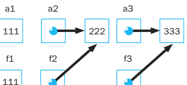

### 步骤 3
`f1 = 999;`
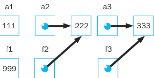

### 步骤 4
`f2.setValue(888);`
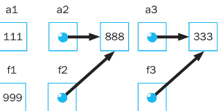

### 步骤 5
`f3 = new Num(777);`
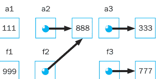

### 步骤 6
从 `changeValues` 返回后
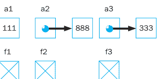

> = 未定义

图 7.5 ParameterTesting 程序中的参数追踪

### 自测复习题（见附录 N 中的答案）

**SR 7.18** 什么是方法分解？

**SR 7.19** 回答关于 `PigLatinTranslator` 类的问题：
- a. 没有定义构造函数。为什么？
- b. 定义的方法中有些是私有的。为什么？
- c. 在 `translate` 方法中声明了一个 `Scanner` 对象。它被用来扫描什么？

**SR 7.20** 当使用以下实际参数调用 `translate` 时，识别 `PigLatinTranslator` 支持方法所产生的相应调用/返回序列。
- a. `"animal"`
- b. `"hello"`
- c. `"We are the champions"`

**SR 7.21** 对象是如何作为参数传递的？

## 7.8 方法重载

我们讨论过，当方法被调用时，控制流转移到定义它的代码处。通常方法名就足以指示调用的是哪个方法。但在 Java 中，只要参数列表不同，就可以使用相同的方法名。这种技术被称为**方法重载**。当你需要对不同类型的数据执行相似的方法时，它非常有用。编译器必须能够根据方法调用来确定调用的是哪个版本。例如，我们可以定义如下名为 `sum` 的方法：

```java
public int sum(int num1, int num2) {
    return num1 + num2;
}
```

当进行调用时，编译器根据参数的数量来确定调用哪个版本的 `sum` 方法。例如，以下调用将调用第二个版本：

然后我们可以在同一个类中定义另一个名为 `sum` 的方法：

```java
public int sum(int num1, int num2, int num3) {
    return num1 + num2 + num3;
}
```

> **核心概念** 方法签名连同参数的数量、类型和顺序被称为方法的签名。编译器使用完整的方法签名将方法调用绑定到相应的定义。编译器必须能够检查方法调用以确定正在调用的特定方法。如果你尝试指定两个签名相同的方法，编译器将发出相应的错误信息且不会创建可执行程序。不能有歧义。

注意方法的返回类型不是签名的一部分。也就是说，重载方法不能通过返回类型来区分。这是因为方法返回的值可以被调用忽略。在这种情况下，编译器无法区分调用的是哪个重载版本。

`println` 方法是一个被多次重载的方法示例，每次接受单一类型。以下是其各种签名的部分列表：
- `println(String s)`
- `println(int i)`
- `println(double d)`
- `println(char c)`
- `println(boolean b)`

这两行代码实际上调用了名称不同的方法：

```java
System.out.println("Number of students: ");
System.out.println(count);
```

第一行调用接受字符串的 `println` 版本。第二行（假设 `count` 是整数变量）调用接受整数的 `println` 版本。

## 7.9 测试

我们经常使用 `println` 语句来打印几种不同类型，例如：
`System.out.println("Number of students: " + count);`

记住，在这种情况下，`+` 是字符串连接运算符。首先，变量 `count` 中的值被转换为字符串表示，然后将两个字符串拼接成一个更长的字符串，最后调用了接收单个字符串的 `println` 定义。

构造函数是可以重载的，而且通常情况下它们都是被重载的。通过提供多个版本的构造函数，我们提供了设置对象的多种方法。

### 自我复习题（答案见附录 N）

- **SR 7.22** 重载方法之间是如何相互区分的？
- **SR 7.23** 对于以下每一对方法头，请说明它们的签名是否是不同的。如果不相同，请解释为什么不相同。
    - a. `String describe(String name, int count)` / `String describe(int count, String name)`
    - b. `void count()` / `int count()`
    - c. `int howMany(int compareValue)` / `int howMany(int ceiling)`
    - d. `boolean greater(int value1)` / `boolean greater(int value1, int value2)`
- **SR 7.24** `Num` 类定义在 7.7 节。重载该类的构造函数，通过定义第二个无参数的构造函数，并将 `value` 属性设置为零。

## 7.9 测试

测试可以用许多方式应用于软件开发。测试无疑包含了它的传统定义：即使用各种输入运行已完成的程序以发现问题。但它也包括由人类或机器执行的评估，以评估演进系统的质量。这些评估应该在编写第一行代码之前很久就进行。

测试的目标是发现错误。通过发现并修复错误，我们提高了程序的质量。很可能在之后，其他人会发现开发过程中仍然存在的任何错误。错误越早被发现，修复它们就越容易、越廉价。花时间尽早发现问题几乎总是值得投入的。

### 第 7 章 面对象设计

#### 核心概念
测试程序永远无法保证没有错误。

使用特定输入运行程序并产生正确的结果，只能说明程序对于该特定输入是有效的。随着越来越多的测试用例执行而没有发现错误，我们对程序的信心会增加，但我们永远无法确定所有错误都已消除。可能存在另一个未被发现的错误。因此，以尽可能多的方式和设计良好的测试用例对程序进行彻底测试是非常重要的。

证明程序是正确的，但这种技术对于大型系统来说极其复杂，而且在证明本身也可能出错。因此，我们通常依赖测试来确定程序的质量。

在确定存在错误后，我们确定错误的原因并修复它。在问题修复后，我们应该再次运行测试，以确保在修复问题时我们没有创建另一个错误。这种技术被称为**回归测试**。

### 评审

一种用于评估设计或代码的技术称为**评审**（*review*），这是一种会议，几个人在会上仔细检查设计文档或代码部分。将我们的设计或代码展示给他人，可以允许我们对其进行更多思考，并允许他人与我们分享建议。参与者讨论其优点和问题，并列出一份必须解决的问题列表。评审的目标是识别问题，而不是解决问题，后者通常需要更多的时间。

设计评审应该确定需求是否已经得到满足。它还应该评估系统是如何分解为类和对象的。代码评审应该确定设计在多大程度上真实满足了需求，以及实现在多大程度上真实代表了设计。它应该识别任何会导致设计或实现在履行职责时失败的特定问题。

有时评审被称为**走步测试**（*walkthrough*），因为它的目标是仔细逐页文档并评估每个章节。

### 缺陷测试

由于测试的目标是发现错误，因此它经常被称为**缺陷测试**（*defect testing*）。以该目标为指导，一个好的测试是能够发现程序中任何缺陷的测试。这看起来可能很奇怪，因为我们最终不希望在系统中出现问题。但请记住，错误几乎肯定存在。测试工作应该尽一切发现它们。我们希望通过发现和修复存在的错误来增加程序的可靠性，而不是让用户去发现它们。

> **核心概念**
> 一个好的测试是能够发现一个错误的测试。

一个**测试用例**由一组输入、用户操作或其他初始条件以及预期的输出组成。测试用例应该被妥善记录，以便根据需要重复。开发者经常创建一个完整的**测试套件**（*test suite*），这是一组覆盖了系统各个方面的测试用例。

由于程序运行在大量可能的输入上，因此无法为所有可能的输入或用户操作创建测试用例。通常也没有必要测试每一种情况。两个特定的测试用例可能如此相似，以至于无法体现程序的独特方面。同时做这两者将是浪费精力。我们宁愿执行一个以某种新方式压力程序的测试用例。因此，我们想要仔细选择我们的测试用例：**黑盒测试**和**白盒测试**。

> **核心概念**
> 不可能对所有可能的输入和用户操作对程序进行穷尽测试。

正如其名所示，**黑盒测试**将被测试的对象视为一个黑盒。在黑盒测试中，测试用例的开发不考虑内部工作机制。可以使用黑盒技术测试整个程序。

让我们来看一个例子。考虑一个方法，其目的是验证一个值是否在 0 到 99 之间。这种情况有三类：0 以下、0 到 99 之间以及 99 以上。黑盒测试指示我们使用边界值，以及一些等效类值。因此，这种情况的黑盒测试用例应为 -500、-1、0、1、50、98、99、100 和 500。


在黑盒测试中，测试用例的开发不考虑内部工作机制。可以使用黑盒技术测试整个程序。

**白盒测试**也称为玻璃盒测试，执行方法的内部结构和实现。白盒测试的目标是确保程序中的每条路径至少执行一次。白盒测试映射代码中可能的路径，并确保测试用例覆盖所有路径。这种类型的测试称为**覆盖**。

通过控制流语句控制的路径使用条件表达式，为了至少执行一次，测试数据需要控制条件表达式的值。一个或多个测试用例的输入数据应控制 `if` 语句条件至少一次为真，至少一次为假。覆盖 `if` 语句的真假值可以确保 `if` 语句的所有路径都得到执行。类似的情况也可以适用于循环和其他构造。

在黑盒测试和白盒测试中，每个测试的预期输出应该在运行测试之前确定。如果你没有仔细确定应该是什么，就很容易被说服测试结果是合适的。

> **自我复习题（答案见附录 N）**

**SR 7.25** 从列表中选择最符合每个短语的术语：
`black-box`, `defects`, `regression`, `review`, `test case`, `test suite`, `walk-through`, `white-box`

- a. 在更改后运行之前的测试用例是为了修改程序，以帮助确保没有引入错误。
- b. 几个人共同评估产品的会议。
- c. 一种仔细翻阅文档并评估每个章节的评审。
- d. 测试的目标是发现这些。
- e. 对被测试代码单元的输入及相应预期输出的描述。
- f. 覆盖系统各个方面的测试用例集。
- g. 采用这种测试方法，测试用例完全基于需求规范。
- h. 采用这种测试方法，测试用例基于程序的内部工作机制。

## 7.10 GUI 设计

当我们关注允许我们创建 GUI 的细节时，有时可能会忽略大局。在我们继续探索 GUI 构建时，我们必须记住，我们的目标是解决问题。具体来说，我们想要创建实用的软件。了解组件、事件和其他语言元素的细节为我们提供了组装 GUI 的工具，但我们必须根据良好 GUI 设计的基本这些理念来引导这些知识：

- 了解用户。
- 防止用户错误。
- 优化用户能力。
- 保持一致性。

> **核心概念** 任何 GUI 设计都应该遵循关于一致性和可用性的基本指南。

软件设计人员必须理解用户的需求和潜在活动，以便开发出服务用户的界面。请记住，界面就是软件。它是用户与系统交互的唯一方式。因此，界面必须满足用户的需求。

尽可能，我们应该设计界面，让用户少出错。在许多情况下，我们有灵活选择几个组件之一来完成特定任务。我们应该始终尝试选择能够防止不当操作并避免无效输入的组件。例如，如果一个输入值必须是某个特定值之一，我们应该使用允许用户仅做出有效选择的组件。例如，一组单选按钮比允许用户在文本字段中输入任意且可能无效的数据要好。在本章中，我们将介绍适用于特定情况的其他组件。

并不是所有用户都是相同的。有些人使用特定 GUI 或通用 GUI 组件比其他人更熟练。我们不应该只考虑最低公约数进行设计。例如，只要合理，我们应该提供快捷键。也就是说，除了允许用户完成任务的正常系列操作外，我们还应该提供完成相同任务的冗余方法。使用键盘快捷键（记忆符）就是一个很好的例子。有时额外的机制可能不那么直观，但对于经验丰富的用户来说可能更快。

最后，在处理大型系统或共同环境中的多个系统时，一致性至关重要。用户会熟悉特定的组织结构或颜色方案；这些不应被随意更改。

> **自习题（答案见附录 N）**
> **7.26** 本节介绍了哪些 GUI 设计的通用指南？
> **SR 7.27** 为什么良好的用户界面设计非常重要？

## 7.11 布局管理器

除了组件、事件和监听器之外，GUI 设计还涉及到布局管理器的使用。布局管理器控制组件排列方式的对象。它决定了每个组件的大小和位置。每个容器都有一个默认布局，尽管我们可以根据喜好替换它。

> **核心概念** 容器的布局管理器决定了组件的定位方式。

> **核心概念** 当添加一个容器时，会咨询布局管理器。

容器的布局管理器可以显式地设置。为了开发良好的 GUI，我们必须熟悉布局管理器。例如，标签页面板（tabbed pane）允许用户选择显示几个中的哪一个。标签页面板由定义定义。

标签页面板引入了布局管理器的使用。标签页面板允许用户选择显示几个中的哪一个。标签页面板由定义定义。

标签页面板引入了布局管理器的使用。标签页面板允许用户选择显示几个中的哪一个。标签页面板由定义定义。

标签页面板引入了布局管理器的使用。标签页面板允许用户选择显示几个中的哪一个。标签页面板由定义定义。

标签页面板引入了布局管理器的使用。标签页面板允许用户选择显示几个中的哪一个。标签页面板由定义定义。

### 7.11 布局管理器

| 布局管理器 | 描述 |
| :--- | :--- |
| Border Layout (边界布局) | 将组件组织为北、南、东、西和中心。 |
| Box Layout (箱布局) | 将组件组织为单行。 |
| Card Layout (卡片布局) | 组织多个层；一次仅显示一层。 |
| Flow Layout (流式布局) | 尽可能在行中组织多个组件。 |
| Grid Layout (网格布局) | 将组件组织为网格。 |
| GridBag Layout | 将组件组织为网格。 |

以下示例显示了一些布局管理器：

```java
JPanel panel = new JPanel();
panel.setLayout(new BorderLayout());
```


# 标签页面板与布局管理器

标签页面板允许用户选择显示几个面板中的哪一个。标签页面板由 `JTabbedPane` 定义，引入了布局管理器的使用。

标签页面板包含一个带有介绍信息的面板，如代码列表 7.19 所示。

## 代码列表 7.18：LayoutDemo.java

```java
// *************************************************
// LayoutDemo.java
// 作者: Lewis/Loftus
// 展示了流、边界、网格和箱布局的使用。
// *************************************************

import javax.swing.*;

public class LayoutDemo {

    // 设置一个包含标签页面板的框架。每个标签页上的面板
    // 展示了不同的布局管理器。
    public static void main(String[] args) {
        JFrame frame = new JFrame("Layout Manager Demo");
        frame.setDefaultCloseOperation(JFrame.EXIT_ON_CLOSE);

        JTabbedPane tp = new JTabbedPane();
        tp.addTab("Intro", new IntroPanel());
        tp.addTab("Flow", new FlowPanel());
        tp.addTab("Border", new BorderPanel()); // 原文为 BorderLayout，此处修正为演示面板类 BorderPanel
        tp.addTab("Grid", new GridPanel());
        tp.addTab("Box", new BoxPanel());

        frame.getContentPane().add(tp);
        frame.pack();
        frame.setVisible(true);
    }
}
```

## 代码列表 7.19：IntroPanel.java

```java
// *********************************************************************
// IntroPanel.java
// 表示 LayoutDemo 程序中的介绍面板。
// *********************************************************************

import java.awt.*;
import javax.swing.*;

public class IntroPanel extends JPanel {

    // 设置此面板并包含两个标签。
    // --------------------------------------------------------------------
    public IntroPanel() {
        setBackground(Color.green);
        JLabel label11 = new JLabel("布局管理器演示");
        JLabel label12 = new JLabel("选择一个标签页以查看 " + 
            "布局管理器的示例。");
        add(label11);
        add(label12);
    }
}
```

---

# 第7章 对象面向设计

## 流式布局 (Flow Layout)

流式布局是最容易使用的布局管理器之一。`JPanel` 类默认使用流式布局。流式布局在行中放置尽可能多的组件，采用其首选大小。当组件无法放入某行时，它会被放在下一行。根据需要多少行来容纳所有已添加到容器的组件。图 7.7 描绘了一个由流管理器治理的容器。

代码列表 7.20 中的类代表了 `LayoutDemo` 程序中展示流式溢出的面板。它显式地设置布局为流式布局（尽管在这种情况下这是不必要的，因为 `JPanel` 默认使用流布局）。随后创建按钮并将它们添加到面板中。

### 代码列表 7.20：FlowPanel.java

```java
////
// FlowPanel.java      作者: Lewis/Loftus
// 表示 LayoutDemo 程序中的面板，该面板演示了
// 流布局管理器。
//////////////////////////////////////////////////////////////////////

import java.awt.*;
import javax.swing.*;

public class FlowPanel extends JPanel {

    // ----------------------------------------------------
    // 设置此面板并包含一些按钮，以显示流布局
    // 如何影响它们的位置。
    // ----------------------------------------------------
    public FlowPanel() {
        setLayout(new FlowLayout());
        setBackground(Color.green);

        JButton b1 = new JButton("按钮 1");
        JButton b2 = new JButton("按钮 2");
        JButton b3 = new JButton("按钮 3");
        JButton b4 = new JButton("按钮 4");
        JButton b5 = new JButton("按钮 5");

        add(b1);
        add(b2);
        add(b3);
        add(b4);
        add(b5);
    }
}
```

每个按钮的大小都被设置得足够大以容纳放置在其上的标签的大小。正如我们之前提到的，流布局在面板内的一行中尽可能多地放置这些按钮，然后开始在另一行中放置组件。当框架的大小变宽时（例如，用鼠标拖动右下角），面板也会随之增长，任何行都可以容纳更多按钮。当调整框架大小时，会咨询布局管理器并自动重新组织组件。请注意，默认情况下，每行中的组件在窗口内都是居中对齐的。

`FlowLayout` 类的构造函数经过重载，允许程序定制布局管理器的特性。在每一行中，组件可以是居中、左对齐或右对齐。对齐方式默认为居中。在创建布局管理器时，还可以指定组件之间的水平和垂直间隙。`FlowLayout` 类还拥有在布局管理器创建后设置对齐方式和间隙大小的方法。

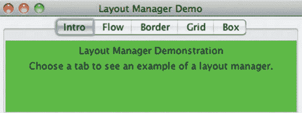
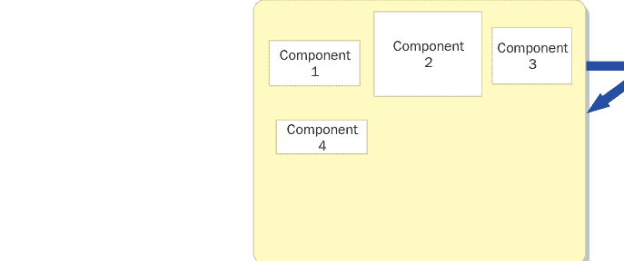
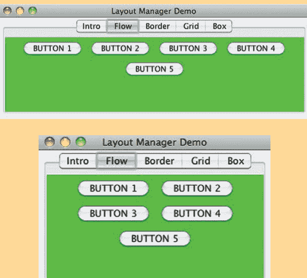


## 边界布局 (Border Layout)

边界布局有五个可以添加组件的区域：北（North）、南（South）、东（East）、西（West）和中心（Center）。这些区域之间有特定的位置关系，如图 7.8 所示。

```
| 北 |
| 西 | 中心 | 东 |
| 南 |
```
*图 7.8 边界布局将组件组织到五个区域*

四个外部区域会根据需要增大，以容纳它们包含的组件。如果没有向北、南、东或西区域添加组件，这些区域在整体布局中就不会占用任何空间。中心区域将扩展以填充任何可用空间。

特定的容器可能只使用几个区域。例如，程序可能只使用中心、南部和西部区域。这种灵活性使得边界布局成为非常有用的管理器。

由边界布局管理的容器的 `add` 方法其第一个参数是要添加的组件。第二个参数指定要添加的区域。该区域使用 `BorderLayout` 类定义的常量来指定。代码列表 7.21 显示了 `LayoutDemo` 程序用于演示边界布局的面板。

### 代码列表 7.21：BorderPanel.java

```java
// *********************************************************************
// BorderPanel.java      作者: Lewis/Loftus
// 表示 LayoutDemo 程序中的面板，该面板演示了
// 边界布局管理器。
// *********************************************************************

import java.awt.*;
import javax.swing.*;

public class BorderPanel extends JPanel {

    public BorderPanel() {
        // 设置此面板并在边界布局的每个区域设置一个按钮，
        // 以显示它是如何影响它们的位置、形状和大小的。
        // -----------------------------------------------------------------------
        setLayout(new BorderLayout());
        setBackground(Color.green);

        JButton b1 = new JButton("按钮 1");
        JButton b2 = new JButton("按钮 2");
        JButton b3 = new JButton("按钮 3");
        JButton b4 = new JButton("按钮 4");
        JButton b5 = new JButton("按钮 5");

        add(b1, BorderLayout.CENTER);
        add(b2, BorderLayout.NORTH);
        add(b3, BorderLayout.SOUTH);
        add(b4, BorderLayout.EAST);
        add(b5, BorderLayout.WEST);
    }
}
```

在 `BorderLayout` 构造函数中，面板的布局管理器被显式设置为边界布局。随后创建按钮并将它们添加到特定区域。默认情况下，每个按钮宽度足够容纳其标签，高度足够以填充区域。当框架（和面板）调整大小时，中心区域的按钮会根据需要调整。

边界布局的每个区域只显示一个组件。也就是说，常见的错误是向特定区域添加两个组件，第一个组件会被第二个替换，当容器显示时只能看到第二个。要向边界布局添加多个组件，我们首先将组件添加到另一个容器（如 `JPanel`），然后将该面板添加到区域。

注意，尽管用于显示按钮的面板具有绿色背景，但在显示 7.21 中看不到绿色。默认情况下，边界布局区域之间没有水平或垂直间隙。这些间隙可以通过重载的构造函数或 `BorderLayout` 类的方法进行设置。如果增加了间隙，底层面板将显示出来。

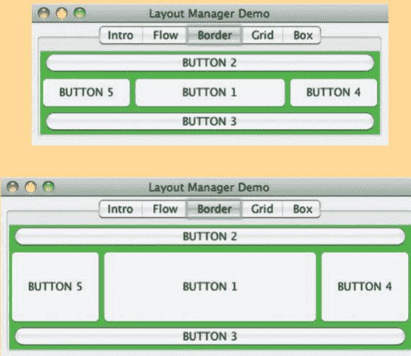

## 网格布局 (Grid Layout)

网格布局以行和列的矩形网格呈现容器组件。每个网格单元放置一个组件，且所有单元的大小相同。图 7.9 显示了网格布局的组织结构。


网格布局的行和列数是在创建布局管理器时通过构造函数的参数确定的。代码列表 7.22 中的类显示了用于网格布局的面板。它指定面板应使用两行三列的网格进行管理。

当按钮被添加到容器时，它们按默认从左到右、从上到下填充网格。除了添加到容器的顺序外，没有方法可以显式将组件分配到网格中的特定位置。

每个单元的大小由容器的整体大小决定。当调整容器时，所有单元都会按比例调整大小以填充容器。

如果用于指定行数或列数的值为 0，则网格在该维度上根据需要扩展以容纳添加到容器的组件。行数和列数的值不能同时为 0。

### 代码列表 7.22：GridPanel.java

```java
// ************************************************************************
// GridPanel.java      Author: Lewis/Loftus
// 代表 LayoutDemo 程序中的面板，该程序演示了
// 网格布局管理器。
// ****************************************************************

import java.awt.*;
import javax.swing.*;

public class GridPanel extends JPanel {

    // 设置此面板及其一些按钮，以展示网格
    // 布局如何影响它们的位置、形状和大小。
    //----------------------------------------------------------------------
    public GridPanel() {
        setLayout(new GridLayout(2, 3));
        setBackground(Color.green);

        JButton b1 = new JButton("BUTTON 1");
        JButton b2 = new JButton("BUTTON 2");
        JButton b3 = new JButton("BUTTON 3");
        JButton b4 = new JButton("BUTTON 4");
        JButton b5 = new JButton("BUTTON 5");

        add(b1);
        add(b2);
        add(b3);
        add(b4);
        add(b5);
    }
}
```


# 代码列表 7.2.2 续

# 显示


默认情况下，网格单元格之间没有水平和垂直间隙。可以使用重载的构造函数或适当的 `GridLayout` 方法指定间隙大小。

# 盒布局

盒布局将组件垂直或水平地组织，分为一行或一列，如图 7.10 所示。它很容易使用，当与其他盒布局结合时，它可以产生复杂的 GUI 设计，这种设计类似于使用 `GridLayout` 可以实现的效果，而后者通常要难掌握得多。

当创建 `BoxLayout` 对象时，我们使用常量来指定它将遵循 X 轴（水平）或 Y 轴（垂直），这些常量是在 `BoxLayout` 类中定义的。与其它布局管理器不同，`BoxLayout` 构造函数的第一个参数是它将要管理的组件。因此，必须为每个组件创建一个新的 `BoxLayout` 对象。代码列表 7.23 显示了 `LayoutDemo` 程序中用于演示盒布局的面板。

在由盒布局管理的容器中的组件，是按照它们被添加到容器的顺序（从上到下或从左到右）组织的。

盒布局中的组件之间没有间隙。与我们探索过的之前的布局管理器不同，盒布局没有可以为整个容器指定的特定垂直或水平间隙。相反，我们可以向容器中添加不可见组件，它们占据其他组件之间的空间。`Box` 类也是 Java 标准类库的一部分，它包含用于创建这些不可见组件的静态方法。

`BoxLayout` 中使用的两种不可见组件是刚性区域和胶水。前者具有固定大小，后者指定容器中多余空间的去向。刚性区域使用 `Box` 类的 `createRigidArea()` 方法创建，并使用 `Dimension` 对象作为参数来定义不可见区域的大小。胶水根据需要使用 `createHorizontalGlue()` 方法或 `createVerticalGlue()` 方法创建。

注意，在我们的示例中，由刚性区域隔开的按钮之间的空间在调整容器大小时保持不变。另一方面，胶水会根据需要扩展或收缩以填充空间。

盒布局比大多数其他布局管理器更尊重它所管理的组件的对齐方式以及最小、最大和首选尺寸。因此，设置放入容器的组件特征是定制视觉效果的另一种方法。

# 代码列表 7.23

```java
// *********************************************************************
// BoxPanel.java      Author: Lewis/Loftus
// 代表 LayoutDemo 程序中的面板，该程序演示了
// 盒布局管理器。
// *********************************************************************

import java.awt.*;
import javax.swing.*;

public class BoxPanel extends JPanel {

    // 设置此面板及其一些按钮，以展示垂直
    // 盒布局（不可见组件）如何影响它们的位置。
    // -----------------------------------------------------------------------
    public BoxPanel() {
        setLayout(new BoxLayout(this, BoxLayout.Y_AXIS));
        setBackground(Color.green);

        JButton b1 = new JButton("BUTTON 1");
        JButton b2 = new JButton("BUTTON 2");
        JButton b3 = new JButton("BUTTON 3");
        JButton b4 = new JButton("BUTTON 4");
        JButton b5 = new JButton("BUTTON 5");

        add(b1);
        add(Box.createRigidArea(new Dimension(0, 10)));
        add(b2);
        add(Box.createVerticalGlue());
        add(b3);
        add(b4);
        add(Box.createRigidArea(new Dimension(0, 20)));
        add(b5);
    }
}
```

# 代码列表 7.23 续

# 显示


# 第 7 章 对象面向设计


图 7.10 盒布局按垂直或水平组织组件。


# 7.12 边框

Java 提供了在组件周围放置边框的能力。边框本身不是组件，而是定义了组件应该如何绘制，并可以为 GUI 设计提供视觉线索。`BorderFactory` 类用于创建边框，并有许多方法。

## 自我复习题（见附录）

- 728 什么时候需要布局管理器？
- 729 布局的行为如何？
- 730 描述边框的区域。
- 731 盒布局中的胶水有什么效果？

# 7.12 边框（续）

> **核心概念**
> 边框可以应用于 Swing 组件以对对象并吸引注意力。

| 边框 | 描述 |
|---|---|
| Empty Border | 在组件周围留出空间，但没有视觉效果。 |
| Line Border | 包围组件的简单线条。 |
| Etched Border | 创建组件周围的凹槽效果。 |
| Bevel Border | 创建组件表面凸起或凹陷的效果。 |
| Titled Border | 在边框上或周围包含一个文本标题。 |
| Matte Border | 允许指定每个边缘的大小。使用实色或图像。 |
| Compound Border | 两个边框的组合。 |

图 7.11 组件边框

# 第 7 章 对象面向设计

# 代码列表 7.24

```java
// BorderDemo.java Author: Lewis/Loftus
// 演示各种类型边框的使用。
// ***********************************************

import java.awt.*;
import javax.swing.*;
import javax.swing.border.*;

public class BorderDemo {

    // 创建几个带边框的面板并显示它们。
    public static void main(String[] args) {
        JFrame frame = new JFrame("Border Demo");
        frame.setDefaultCloseOperation(JFrame.EXIT_ON_CLOSE);

        JPanel panel = new JPanel();
        panel.setLayout(new GridLayout(0, 2, 5, 10));
        panel.setBorder(BorderFactory.createEmptyBorder(8, 8, 8, 8));

        JPanel p1 = new JPanel();
        p1.setBorder(BorderFactory.createLineBorder(Color.red, 3));
        p1.add(new JLabel("Line Border"));
        panel.add(p1);

        JPanel p2 = new JPanel();
        p2.setBorder(BorderFactory.createEtchedBorder());
        p2.add(new JLabel("Etched Border"));
        panel.add(p2);

        JPanel p3 = new JPanel();
        p3.setBorder(BorderFactory.createRaisedBevelBorder());
        p3.add(new JLabel("Raised Bevel Border"));
        panel.add(p3);

        JPanel p4 = new JPanel();
        p4.setBorder(BorderFactory.createLoweredBevelBorder());
        p4.add(new JLabel("Lowered Bevel Border"));
        panel.add(p4);

        JPanel p5 = new JPanel();
        p5.setBorder(BorderFactory.createTitledBorder("Title"));
        p5.add(new JLabel("Titled Border"));
        panel.add(p5);

        JPanel p6 = new JPanel();
        TitledBorder tb = BorderFactory.createTitledBorder("Title");
        tb.setTitleJustification(TitledBorder.RIGHT);
        p6.setBorder(tb);
        p6.add(new JLabel("Titled Border (right)"));
        panel.add(p6);

        JPanel p7 = new JPanel();
        Border b1 = BorderFactory.createLineBorder(Color.blue, 2);
        Border b2 = BorderFactory.createEtchedBorder();
        p7.setBorder(BorderFactory.createCompoundBorder(b1, b2));
        p7.add(new JLabel("Compound Border"));
        panel.add(p7);

        JPanel p8 = new JPanel();
        Border mb = BorderFactory.createMatteBorder(1, 5, 1, 1, Color.red);
        p8.setBorder(mb);
        p8.add(new JLabel("Matte Border"));
        panel.add(p8);

        frame.getContentPane().add(panel);
        frame.pack();
        frame.setVisible(true);
    }
}
```


让我们看看此程序中创建的每种边框。空边框（`empty border`）被应用于包含其他边框的较大面板，以便在框架的外边缘创建一个空间缓冲区。空边框的顶部、左侧、底部和右侧的大小是以像素为单位的。线边框（`line border`）使用特定颜色创建，并按像素指定线条厚度（在本例中为 3 像素）。程序中创建的刻蚀边框（`etched border`）使用默认颜色作为刻蚀的高亮和阴影，但如果需要，也可以显式地设置两者。

斜角边框（`bevel border`）可以是凸起的也可以是凹的。此程序使用了默认颜色，尽管可以根据需要定制斜角边框每个部分的颜色，包括外高亮、内高亮、外阴影和内阴影。如果需要，这些部分中的每一个都可以有不同的颜色。

标题边框（`titled border`）在边框上或边框周围放置一个标题。标题的默认位置是边框左上角的边缘。使用 `TitledBorder` 类的 `setTitle` 方法，可以将其设置为边框上方、下方、左侧、右侧或中间的许多其他位置。

复合边框（`compound border`）是两个或多个边框的组合。此程序中的示例使用线边框和刻蚀边框创建了一个复合边框。`createCompoundBorder` 方法接受两个边框作为参数，并将第一个参数作为外边框，第二个参数作为内边框。三个或更多边框的组合是通过首先使用两个边框创建一个复合边框，然后使用它和另一个边框创建另一个复合边框来实现。

## 列表 7.24 继续 显示


## 7.13 包含层次结构

哑光边框（`matte border`）指定了边框顶部、左侧、底部和右侧边缘的像素大小。这些边缘由单一颜色组成（如本例所示），也可以使用图像。

应谨慎使用边框。它们有助于引导用户关注 GUI 的适当部分，并在概念上将相关项目组合在一起。然而，如果使用不当，它们也会降低呈现效果的优雅性。边框应该增强界面，而不是使其复杂化或与其竞争。

+ 自测习题（答案见附录 N）
SR 7.32 `BorderFactory` 类的作用是什么？
SR 7.33 列出并简要描述本节介绍的每种边框类型。

## 7.13 包含层次结构

组件被分组到容器中，这些容器之间相互嵌套的方式确定了 GUI 的包含层次结构。我们在第 3 节中引入了这一概念。通过仔细设计包含层次结构，可以为 GUI 定制精确的视觉效果。

任何 Java 程序通常有一个主容器，称为顶层容器（例如 frame 或 applet）。程序的顶层容器通常包含一个或多个容器（例如面板）。这些面板可能包含其他容器。

# 练习

EX 7.1 编写一个名为 `product` 的方法，接受四个整数参数并返回它们的乘积（整数类型）。

EX 7.2 重载练习 7.1 中的 `product` 方法，使得如果提供了整数作为参数，该方法返回所有五个整数的乘积。

EX 7.3 重载练习 7.1 中的 `product` 方法，使其接受六个整数参数并返回它们的乘积。

EX 7.4 编写一个名为 `doubleConcat` 的方法，接受一个 String 和一个整数作为参数。返回一个字符串，该字符串由字符串参数与其自身拼接 `number` 倍组成，其中 `number` 是一个整数参数。例如，如果参数值为 "hello" 和 1，返回值应为 "hellohello"。如果整数参数小于 1，则返回原始字符串。

EX 7.5 重载练习 7.4 中的 `doubleConcat` 方法，使得如果未提供整数参数，该方法返回字符串本身而不进行拼接。例如，如果字符串是 "hello"，返回的字符串也是 "hello"。

EX 7.6 编写一个名为 `drawCircle` 的方法，根据方法的参数画一个圆：一个用于画圆的 `Graphics` 对象、两个表示中心 (x, y) 坐标的整数值、另一个表示圆半径的整数，以及一个定义圆颜色的 `Color` 对象。该方法不返回任何内容。

EX 7.7 重载练习 7.6 中的 `drawCircle` 方法，使得如果未提供 `Color` 参数，圆的颜色将默认为黑色。

EX 7.8 重载练习 7.6 中的 `drawCircle` 方法，使得如果未提供半径，将使用 10 到 100（包含）范围内的随机半径。

EX 7.9 重载练习 7.6 中的 `drawCircle` 方法，使得如果圆的颜色半径均未提供，则颜色默认为红色，半径默认为 40。

EX 7.10 讨论 Java 向方法传递参数的方式。这种技术在基本数据类型和对象之间是一致的吗？请解释。

EX 7.11 解释为什么静态方法不能引用实例变量。

# 第 7 章 面向对象设计

EX 7.12 一个类是否可以实现两个包含相同方法签名的接口？请解释。

EX 7.13 创建一个名为 `Visible` 的接口，包含两个方法：`makevisible` 和 `makeInvisible`。两个方法都返回一个 `boolean` 结果。描述类可以如何实现此接口。

EX 7.14 绘制一个 UML 类图，显示练习 7.13 中元素之间的关系。

EX 7.15 想象一种游戏，其中某些元素可以被玩家破坏，而另一些则不能。创建一个名为 `Breakable` 的接口，它有一个不接受参数的 `break` 方法以及另一个名为 `broken` 的方法，后者返回一个表示该对象当前是否损坏的 `boolean` 值。

EX 7.16 创建一个 `VCR` 接口，它具有代表录带录像机标准操作（播放、停止等）的方法。按你喜欢的任何方式定义签名。描述类可以如何实现此接口。

EX 7.17 绘制一个 UML 类图，显示练习 7.16 中元素之间的关系。

EX 7.18 为 `LayoutDemo` 程序绘制包含层次树。

EX 7.19 改变 `LayoutDemo` 程序中使用的边框布局的水平和垂直间隙会产生什么视觉效果？通过更改来测试你的答案。

EX 7.20 编写代码行以使用三个边框定义一个复合边框。在内边缘使用线边框（`line border`），在外边缘使用刻蚀边框（`etched border`），在中间使用凸起边框（`raised border`）。

# 编程项目

- PP 7.1 修改第 4 章中的 `Account` 类，允许使用名称和账号开设账户，假设初始余额为零。修改 `Transactions` 类的 `main` 方法以演示此功能。
- PP 7.2 按照如下方式修改本章介绍的 `Student` 类。每个学生对象应包含三次测试的分数。提供一个根据参数值设置所有值的构造函数。重载构造函数，使得假设每次测试分数初始为零。提供一个名为 `setTestScore` 的方法，它接受两个参数：测试编号（1 到 3）和分数。还提供一个名为 `getTestScore` 的方法接受测试编号并返回相应的分数。提供一个名为 `average` 的方法，返回该学生的平均测试分数。修改 `toString` 方法，使测试分数和平均分包含在学生的描述中。修改驱动类方法以练习新的 `Student` 方法。
- PP 7.3 编写一个 `Course` 类，代表学校开设的一门课程。使用上一个编程项目中修改过的 `Student` 类来表示每个学生。在 `Course` 中使用 `ArrayList` 存储修读该课程的学生。`Course` 构造函数应仅接受课程名称。提供一个名为 `addStudent` 的方法接受一个 `Student` 参数。提供一个名为 `average` 的方法计算并返回所有学生测试平均值的平均值。提供一个名为 `roll()` 的方法打印课程中的所有学生。创建一个带有 `main` 方法的驱动类，创建一个课程，添加几个学生，打印点名册（roll），并打印课程整体平均分。
- PP 7.4 修改 `RationalNumber` 类以实现 `Comparable` 接口。为了执行比较，为两个 `RationalNumber` 对象从分子和分母计算等效的浮点值，并使用 0.0001 的容差值进行比较。编写一个主程序测试你的修改。
- PP 7.5 创建一个 `Priority` 的 Java 接口，包含两个方法：`setPriority` 和 `getPriority`。该接口定义了在对象之间建立优先级的方法。设计并实现一个 `Task` 类来表示一个任务（如待办事项列表），实现该接口。创建一个驱动类。
- PP 7.6 修改 PP 7.5 中的 `Task` 类，使其也实现本章定义的 `Comparable` 接口。修改驱动类以显示 `Task` 对象的新功能。
- PP 7.7 修改 PP 7.5 和 7.6 中的 `Task` 类，使其也实现 Java 类库中的 `Comparable` 接口。实现接口以使任务按优先级排序。创建一个驱动类，`main` 方法显示这些新功能。
- PP 7.8 创建一个名为 `Lockable` 的 Java 接口，包含以下方法：`set`、`lock`、`unlock` 和 `locked`。`set`、`lock` 和 `unlock` 方法接受一个表示密钥的整数参数。`set` 方法建立密钥，`lock` 和 `unlock` 方法在密钥正确时锁定和解锁对象。`locked` 方法返回一个表示对象是否锁定的布尔值。`Lockable` 对象代表一个普通方法受保护的对象：如果对象锁定，则无法调用方法；如果解锁，则可以调用。编写第 5 章 `Coin` 类的版本，使其实现 `Lockable`。
- PP 7.9 编写 PP 5.9 `Account` 类的版本，使其根据 PP 7.8 定义实现 `Lockable`。
- PP 7.10 编写 `PiLatin` 程序的新版本，使其使用 GUI。使用文本字段输入句子并使用标签显示结果。
- PP 7.11 修改 `LayoutDemo` 程序中的 `IntroPanel` 类以改变其视觉效果。使用框布局管理器。使用不可见组件在两个标签的下方放置胶水（`glue`），并在它们之间放置一个刚性区域（`rigid area`）。
- PP 7.12 修改第 5 章的 `QuoteOptions` 程序以改变其视觉效果。在引用标签左侧通过带边框的垂直列呈现单选按钮。
- PP 7.13 编写一个显示手机数字键盘的程序。在数字键上方，显示一个显示所选数字的标签。在数字键右侧，包含另一个清除显示的按钮。使用边框布局管理整体呈现，使用网格布局管理数字键。在数字键周围添加一个边框以进行视觉分组，并在显示周围添加一个边框。

# 软件故障

# 2003年东北大停电

### 发生了什么？

2003年8月14日，美国历史上最大规模的停电袭击了美国东北部和加拿大部分地区。多个大都市区受到影响，包括纽约、克利夫兰、底特律、多伦多的渥太华。在三分钟内，21座电厂停止了运行，影响了约500万人口。


- 停电前后的美国东北部。

典型问题在停电地区不断出现。交通灯缺失导致了交通问题。火车和电梯被困。机场航班延误。依赖水泵的水压失效。手机使用受到中断。（有线电话仍可用，但在紧急期间负荷过重。）互联网流量变慢，导致服务器断开以及尝试重新路由消息。报告了少数抢劫事件。

据估计，这次停电的总财务成本在40亿到80亿美元之间。有9人因与停电相关的各种原因去世。

# 是什么导致了？

在停电发生后的几个小时和几天内，许多来源被指为问题的根源。由于2001年9·11袭击后意识提高，当局排除了恐怖主义的可能性。整个受影响地区的倒塌树木和雷击被归咎于此。官员甚至考虑过——但很快排除——当时“Blaster”计算机病毒正在传播。

在接下来的几个月里，一个工作小组理清了这些问题。最初的案例确定发生在俄亥俄州的阿克伦，那里的FirstEnergy公司未能妥善修剪电线附近的树木。2003年8月14日，树枝导致三条电线路同时故障。当故障发生时，发电中心的操作员负责保持负载平衡。在这种情况下，他们未能做到，因为本该通知他们问题的计算机控制报警系统没有正常运行。负载不平衡迅速蔓延到邻近的电厂，导致了级联停电。

因此，尽管有各种影响因素，但部分原因在于报警系统的故障。这个问题最终被追溯到通用电气（General Electric）监控报警计算机中的竞态漏洞（race bug）。

当两个或多个并发运行的进程访问某些共享数据时，计算机程序就会发生竞态条件。一个在另一个之后修改数据，它们都在错误的假设下继续处理。在这种情况下，三条线路同时故障导致了竞态条件，导致报警系统失效，而操作员并未察觉。随后的问题不久后导致整个系统崩溃。备份系统由于同样的原因也崩溃了。发现漏洞后，GE发布了补丁来修复它。

# 经验训

这次事件问题的根源并非电力不足，而是无法将电力输送到所需要的地方。这次停电凸显了现有电力线基础设施的落后，以及依赖自愿规则来维护电网可靠性的危险。

在软件责任方面，竞态条件是并发系统故障的已知来源，必须进行彻底测试。在这样关键的情况下，有必要进行形式分析。

> 来源：CNN.com, WashingtonPost.com

# 数组

## 章节目标

- 定义并使用数组进行基础数据组织。
- 讨论边界检查和管理容量的技术。
- 讨论与数组对象以及对象数组相关的问题。
- 探索命令行参数的使用。
- 描述变长参数列表的语法和用法。
- 讨论多维数组的创建和使用。
- 探索鼠标和键盘事件。

在编程过程中，我们经常希望以易于访问和修改的形式组织对象或原始数据。在第5章探索的 `ArrayList`类正是为了这个目的。正如类名所示，`ArrayList` 是使用数组实现的，数组是将数据分组为列表的编程结构。在本章中，我们将探索数组的细节，它们是大多数高级语言的基础组成部分。在本章的图形轨迹部分，我们探索了允许我们绘制复杂多边形的方法，并检查由鼠标和键盘生成的事件。

## 8.1 数组元素

数组是一种简单但强大的编程语言结构，用于分组和组织数据。在编写管理大量信息的程序（例如包含100个名字的列表）时，为每条数据声明单独的变量是不行的。数组通过允许我们声明一个可以包含多个可单独访问值的变量来解决这个问题。

数组是一个值的列表。每个值都存储在数组中特定的、编号的位置。每个位置对应的数字称为索引（`index`）或下标（`subscript`）。图8.1显示了一个整数数组以及对应每个位置的索引。该数组被称为`height`；它包含了代表几个人身高（英寸）的整数。

在Java中，数组索引从0开始。因此，索引5处存储的值是数组中的第六个值。图8.1所示的数组有11个值，索引从0到10。

> 要访问数组中的值，我们使用数组名后跟方括号中的索引。例如，以下表达式引用数组中的第九个值：

`height[8]`

根据图8.1，`height[8]`（读作 height-sub-eight）包含值79。不要将索引的值（在此处为8）与存储在该索引处的值（在此处为79）混淆。

| 索引 | 值 |
|---|---|
| 0 | 69 |
| 1 | 61 |
| 2 | 70 |
| 3 | 74 |
| 4 | 62 |
| 5 | 69 |
| 6 | 66 |
| 7 | 73 |
| 8 | 79 |
| 9 | 62 |
| 10 | 70 |

图8.1 名为height的包含整数数组

核心概念
大小为N的数组从0到N–1索引。

## 8.2 声明和使用数组

表达式 `height[8]` 指存储在内存位置的单个整数。它可以用于任何可以使用整数变量的地方。因此，你可以给它赋值、在计算中使用它、打印它的值等。此外，数组索引是整数，可以使用表达式来指定访问数组的索引。这些概念在以下代码行中演示：

```
height[2] = 72;

height[count] = feet * 12;

average = (height[0] + height[1] + height[2]) / 3;

System.out.println("The middle value is " + height[MAX/2]);

pick = height[rand.nextInt(11)];
```

数组在内存中连续存储，这意味着元素在内存中紧密相邻，正如我们在概念上组织它们的那样。这使得数组通过索引访问任何元素变得极其高效。在内部，为了确定任何特定元素的地址，会将索引乘以每个元素的大小，并加上数组起始点的内存地址。这就是为什么数组从0开始而不是1开始的原因——为了让计算尽可能简单。从效率的角度来看，访问数组中的第500个元素与访问第一个元素一样简单。

自我练习题（答案见附录N）
SR 8.1 什么是数组？
SR 8.2 如何引用数组的每个元素？
SR 8.3 根据图8.1所示的数组，以下各项的值是什么？
- `height[1]`
- `height[2] + height[5]`
- `height[2 + 5]`
- 存储在索引8处的值
- 第四个个值
- `height.length`

# 第 8 章 数组

核心概念
在 Java 中，数组是一个必须实例化的对象。

变量 `height` 被声明为整型数组，其类型写为 `int[]`。数组中存储的所有值都具有相同的类型（或至少是兼容的）。例如，我们可以创建一个可以存储整数的数组，也可以创建一个存储字符串的数组，但不能创建一个同时存储整数和字符串的数组。数组可以被设置为存储任何原始类型或任何对象（类）类型。存储在数组中的值有时被称为数组的元素类型。

```
LISTING 8.1

************************************************************************************

// BasicArray.java      Author: Lewis/Loftus

// 演示了基础的数组声明和使用。

************************************************************************************

public class BasicArray

{

    // 创建数组，用各种整数值填充它，

    // 修改其中一个值，然后将其它们出来。

    //-

    public static void main(String[] args) {
```


# 8.2 数组的声明与使用

注意，数组变量的类型（`int[]`）并不包含数组的大小。使用 `new` 运算符对 `height` 进行实例化预留了内存空间来存储从 0 到 10 的 11 个整数。一旦数组被声明为特定的大小，它能容的值的数量就不能更改。


列表 8.1 中的示例创建了一个可以存储 15 个整数的数组 `list1`，并以 10 为递增进行加载。然后它更改了数组中第六个元素的值（索引为 5）。最后，它打印了数组中存储的所有值。

图 8.2 显示了数组在 `BasicArray` 程序执行期间的变化情况。在处理数组时，使用 `for` 循环通常非常方便，因为数组中的位置数量是固定的。请注意，在 `BasicArray` 程序中多处使用了常量 `LIMIT`。该常量用于声明数组的大小，并控制初始化数组值的循环。

使用迭代器版本的循环来打印数组中的值。回想第 5 章中介绍的，这种形式的 `for` 循环会提取指定迭代器中的每个值。每个 Java 数组都是一个迭代器，因此每当我们需要处理数组中存储的每个元素时，都可以使用这种循环。

| 数组创建时有 15 个元素，索引从 0 到 14 | 第一次循环迭代三次后 | 完成第一次循环后 | 修改 list[5] 的值后 |
|---|---|---|---|
| 0 | 0 | 0 | 0 |
| 1 | 10 | 10 | 10 |
| 2 | 20 | 20 | 20 |
| 3 | 30 | 30 | 30 |
| 4 | 40 | 40 | 40 |
| 5 | 50 | 50 | 999 |
| 6 | 60 | 60 | 60 |
| 7 | 70 | 70 | 70 |
| 8 | 80 | 80 | 80 |
| 9 | 90 | 90 | 90 |
| 10 | 100 | 100 | 100 |
| 11 | 110 | 110 | 110 |
| 12 | 120 | 120 | 120 |
| 13 | 130 | 130 | 130 |
| 14 | 140 | 140 | 140 |

图 8.2 在 `BasicArray` 程序中变化的数组 `list`

用于指示数组索引的方括号 `[]` 在 Java 中被视为运算符。因此，就像 `+` 运算符或 `<=` 运算符一样，索引运算符 `([])` 相对于其他 Java 运算符的优先级决定了它的执行时。它具有所有 Java 运算符中最高的优先级。

### 边界检查

索引运算符执行自动边界检查，以确保索引在所引用的数组范围内。每当对数组元素进行引用时，索引必须大于等于0 且小于数组的大小。例如，假设创建了一个包含 25 个元素的数组。该数组的有效索引是从 0 到 24。每当对数组中的特定元素进行引用（例如 `[count]`）时，都会检查索引值。如果它不在数组的有效范围（0 到 24）内，该引用会被拦截。如果无效，则会抛出 `ArrayOutOfBoundsException`。


当然，在程序中我们希望自己进行边界检查。也就是说，我们希望保持在数组边界并处理我们预期的每个元素。由于数组索引从零开始，直到大小减一，因此在程序中很容易产生“差一错误”（off-by-one errors），这种错误是由于处理多了一个元素或尝试访问过多的索引而产生的。

检查数组边界的一种方法是使用长度常量 `length`，它存储在数组对象中并存储数组的大小。它是一个公共常量，因此可以直接引用。例如，在创建了 25 个元素的数组后，`.length` 常量包含值 25。它在数组创建时设置一次且无法更改。长度常量是每个数组不可或缺的一部分，当我们需要数组大小而无需单独创建常量时，可以使用它。记住，数组的长度是最大索引加一。

### 替代的数组语法

在语法上，Java 中有两种声明数组引用的方式。第一种技术在之前的示例和本文中一直使用，是将括号与数组中存储的值的类型关联起来。第二种技术是将括号与数组的名称关联起来。因此，以下两种声明是等价的：

```java
int[] grades;
int grades[];
```

尽管从编译器的角度来看，这些声明技术没有区别，但第一种与其它类型的声明保持一致。如果数组括号与元素类型关联，则声明的类型是显式的，特别是当同一行声明了多个变量时。因此，我们在本文中始终将括号与元素类型关联。

### 初始化列表

你可以使用初始化列表来实例化数组并为数组元素提供初始值。这在本质上与初始化一个变量的想法相同。

> 核心概念
> 可以使用初始化列表来实例化数组，而不是使用 `new` 运算符。

初始化列表中的项目用逗号分隔，并用大括号（`{}`）界定。当使用初始化列表时，数组的大小由其中包含的项目数量决定。例如，以下声明：

```java
int[] scores = {87, 98, 69, 76, 65, 99, 83};
```

### 作为参数的数组

> 核心概念
> 数组可以作为参数传递，成为原始数组的别名。

整个数组可以传递给方法。由于数组是一个对象，方法内部的任何更改都会影响原始数组。如果元素是基本类型，则传递的是副本。如果该元素是对象，则传递的是引用的副本。这些规则适用于任何对象类型。我们将在下一节进一步讨论对象数组。

# 列表 8.4

```java
/****************************************************
// Primes.java               作者: Lewis/Loftus
// 演示数组初始化列表的使用。
****************************************************
public class Primes
{
    // 将一些质数存储在数组中并打印。
    public static void main(String[] args) {
        // 可以初始化列表来实例化数组
        // 而不是使用 new 运算符。在这种情况下：
        int[] primeNumbers = {2, 3, 5, 7, 11, 13, 17, 19};
        System.out.println("Array length: " + primeNumbers.length);
        System.out.println("前几个质数是:");
        for (int prime : primeNumbers) {
            System.out.print(prime + " ");
        }
    }
}
```

```
输出
Array length: 8
前几个质数是:
2 3 5 7 11 13 17 19
```

### 自测习题（答案见附录）

- **SR 8.4** 数组的元素是什么？
- **SR 8.5** 描述创建数组的过程。什么时候为数组分配内存？
- **SR 8.6** 写一个数组声明，表示参加夏令营的 100 名儿童的年龄。
- **SR 8.7** 写一个数组声明，表示投掷六面骰子时每个面朝上的次数。
- **SR 8.8** 解释数组边界检查的概念。当使用无效值对 Java 数组进行索引时会发生什么？
- **SR 8.9** 什么是差一错误（off-by-one error）？它与数组有什么关系？
- **SR 8.10** 写代码将名为 `values` 的整数数组的每个元素加 1。
- **SR 8.11** 写代码计算并打印名为 `values` 的整数数组元素的和。
- **SR 8.12** 初始化列表实现了什么？
- **SR 8.13** 整个数组可以作为参数传递吗？如何实现？

## 8.3 对象数组

在本章之前的示例中，我们使用数组来存储基本类型（如整数和字符）。数组也可以存储对象的引用作为元素。坦率地说，可以使用数组和其他对象来创建信息管理结构。例如，数组可以包含对象，而每个对象可以包含多个各种变量以及使用这些变量的方法。这些变量本身可以是数组，以此类推。程序的设计应该利用结合这些构造的能力，为信息创建最合适的表示。

记住数组本身就是一个对象。因此名为 `weight` 的 int 值数组可以构想为：


> 核心概念
> 实例化对象数组仅保留存储引用的空间。每个元素中存储的对象必须单独实例化。

我们在数组中存储对象时，每个元素都是独立的对象。也就是说，对象数组实际上是对象引用的数组。考虑以下声明：

```java
String[] words = new String[5];
```

变量 `words` 是一个指向 `String` 对象的引用数组。声明中的 `new` 运算符实例化了该数组，并为五个 `String` 引用预留了空间。此声明并没有创建任何 `String` 对象；它仅仅创建了一个持有 `String` 对象引用的数组。初始状态下，数组如下所示：

words


在创建几个 `String` 对象并将其放入数组后，它可能看起来这样：

words


`words` 数组是一个对象，它所持有的每个字符串都是自己的对象。数组中包含的每个对象必须单独实例化。

请记住，`String` 对象可以表示为字符串字面量。因此，下面的声明创建了一个动词数组和一个初始化列表，用若干个 `String` 对象填充它，每个对象都使用字符串字面量实例化：

```java
String[] verbs = {"play", "work", "eat", "sleep"};
```

示例 8.5 中的程序 `GradeRange` 创建了一个 `Grade` 对象的数组，然后打印了它们。`Grade` 对象是通过数组初始化列表中的几个 `new` 运算符创建的。

`Grade` 类如示例 8.6 所示。每个 `Grade` 对象代表一门课程的成绩，并包含一个数值下限。成绩和名称的值可以通过 `Grade` 构造函数设置，也可以使用相应的变器方法（mutator methods）设置。同时也定义了访问器方法（accessor methods），以及用于返回成绩字符串表示形式的 `toString` 方法。在 `main` 方法中打印成绩时，`toString` 方法会被自动调用。

# 示例 8.5

```java
/****************************************************
// GradeRange.java      作者: Lewis/Loftus
// 展示了对象数组的使用。
****************************************************
public class GradeRange {
    // 创建一个 Grade 对象的数组并打印它们。
    public static void main(String[] args) {
        Grade[] grades = new Grade[] {
            new Grade("A", 95), new Grade("A-", 90),
            new Grade("B+", 87), new Grade("B", 85), new Grade("B-", 80),
            new Grade("C+", 77), new Grade("C", 75), new Grade("C-", 70),
            new Grade("D+", 67), new Grade("D", 65), new Grade("F", 0)
        };
        for (Grade letterGrade : grades) {
            System.out.println(letterGrade);
        }
    }
}
```

### 输出

```
A 95
A- 90
B+ 87
B 85
B- 80
C+ 77
C 75
C- 70
D+ 67
D 65
D- 60
F 0
```


# 第 8 章 数组

## 8.3 对象数组

变量 `words` 是一个指向 `String` 对象的引用数组。声明中的 `new` 运算符实例化了该数组，并为五个 `String` 引用预留了空间。此声明并没有创建任何 `String` 对象；它仅仅创建了一个持有 `String` 对象引用的数组。初始状态下，数组如下所示：

words


在创建几个 `String` 对象并将其放入数组后，它可能看起来这样：

words


`words` 数组是一个对象，它所持有的每个字符串都是自己的对象。数组中包含的每个对象必须单独实例化。

请记住，`String` 对象可以表示为字符串字面量。因此，下面的声明创建了一个动词数组和一个初始化列表，用若干个 `String` 对象填充它，每个对象都使用字符串字面量实例化：

```java
String[] verbs = {"play", "work", "eat", "sleep"};
```

示例 8.5 中的程序 `GradeRange` 创建了一个 `Grade` 对象的数组，然后打印了它们。`Grade` 对象是通过数组初始化列表中的几个 `new` 运算符创建的。

`Grade` 类如示例 8.6 所示。每个 `Grade` 对象代表一门课程的成绩，并包含一个数值下限。成绩和名称的值可以通过 `Grade` 构造函数设置，也可以使用相应的变器方法（mutator methods）设置。同时也定义了访问器方法（accessor methods），以及用于返回成绩字符串表示形式的 `toString` 方法。在 `main` 方法中打印成绩时，`toString` 方法会被自动调用。

让我们来看另一个示例。示例 8.7 显示了 `Movies` 类，它包含一个 `main` 方法，用于创建、修改和检查 DVD 集合。

## 示例 8.5

```java
// GradeRange.java      Author: Lewis/Loftus
// 展示了对象数组的使用。

public class GradeRange {

    // 创建一个 Grade 对象的数组并打印它们。
    public static void main(String[] args) {

        Grade[] grades = new Grade[] {
            new Grade("A", 95), new Grade("A-", 90),
            new Grade("B+", 87), new Grade("B", 85), new Grade("B-", 80),
            new Grade("C+", 77), new Grade("C", 75), new Grade("C-", 70),
            new Grade("D+", 67), new Grade("D", 65), new Grade("F", 0)
        };

        for (Grade letterGrade : grades) {
            System.out.println(letterGrade);
        }
    }
}
```

### 输出

```
A 95
A- 90
B+ 87
B 85
B- 80
C+ 77
C 75
C- 70
D+ 67
D 65
D- 60
F 0
```

## 示例 8.6

```java
// Grade.java      Author: Lewis/Loftus
// 表示一个学校成绩。

public class Grade {

    private String name;
    private int lowerBound;

    //--------------------------------------------------------------------
    // 构造函数：设置此 Grade 对象，为指定的
    // 成绩名称和数值下限。
    //---------------------------------------------------------------------
    public Grade(String grade, int cutoff) {
        name = grade;
        lowerBound = cutoff;
    }

    //--------------------------------------------------------------------
    // 返回此成绩的字符串表示形式。
    //---------------------------------------------------------------------
    public String toString() {
        return name + "\t" + lowerBound;
    }

    //---------------------------------------------------------------------
    // 名称变器。
    //---------------------------------------------------------------------
    public void setName(String grade) {
        name = grade;
    }

    //---------------------------------------------------------------------
    // 下限变器。
    //---------------------------------------------------------------------
    public void setLowerBound(int cutoff) {
        lowerBound = cutoff;
    }

    //----------------------------------------------------------------------
    // 名称访问器。
    //----------------------------------------------------------------------
    public String getName() {
        return name;
    }

    //----------------------------------------------------------------------
    // 下限访问器。
    //----------------------------------------------------------------------
    public int getLowerBound() {
        return lowerBound;
    }
}
```

## 示例 8.7

```java
// Movies.java      Author: Lewis/Loftus
// 展示了对象数组的使用。

public class Movies {

    // 创建一个 DVDCollection 对象并向其中添加一些 DVD。打印
    // 关于集合状态的报告。
    public static void main(String[] args) {
        DVDCollection movies = new DVDCollection();

        movies.addDVD("The Godfather", "Francis Ford Coppola", 1972, 24.95, true);
        movies.addDVD("District 9", "Neill Blomkamp", 2009, 19.95, false);
        movies.addDVD("Iron Man", "Jon", 2009, 19.95, false);
        movies.addDVD("The Godfather", "Francis Ford Coppola", 1972, 24.95, true);
        movies.addDVD("District 9", "Neill Blomkamp", 2009, 19.95, false);
        movies.addDVD("Iron Man", "Jon", 2009, 19.95, false);
        movies.addDVD("The Godfather", "Francis Ford Coppola", 1972, 24.95, true);
        movies.addDVD("District 9", "Neill Blomkamp", 2009, 19.95, false);
        movies.addDVD("Iron Man", "Jon", 2009, 19.95, false);
        movies.addDVD("The Godfather", "Francis Ford Coppola", 1972, 24.95, true);
    }
}
```


# 第 8 章 数组

## 8.3 对象数组

变量 `words` 是一个指向 `String` 对象的引用数组。声明中的 `new` 运算符实例化了该数组，并为五个 `String` 引用预留了空间。此声明并没有创建任何 `String` 对象；它仅仅创建了一个持有 `String` 对象引用的数组。初始状态下，数组如下所示：

words


在创建几个 `String` 对象并将其放入数组后，它可能看起来这样：

words


`words` 数组是一个对象，它所持有的每个字符串都是自己的对象。数组中包含的每个对象必须单独实例化。

请记住，`String` 对象可以表示为字符串字面量。因此，下面的声明创建了一个动词数组和一个初始化列表，用若干个 `String` 对象填充它，每个对象都使用字符串字面量实例化：

```java
String[] verbs = {"play", "work", "eat", "sleep"};
```

示例 8.5 中的程序 `GradeRange` 创建了一个 `Grade` 对象的数组，然后打印了它们。`Grade` 对象是通过数组初始化列表中的几个 `new` 运算符创建的。

`Grade` 类如示例 8.6 所示。每个 `Grade` 对象代表一门课程的成绩，并包含一个数值下限。成绩和名称的值可以通过 `Grade` 构造函数设置，也可以使用相应的变器方法（mutator methods）设置。同时也定义了访问器方法（accessor methods），以及用于返回成绩字符串表示形式的 `toString` 方法。在 `main` 方法中打印成绩时，`toString` 方法会被自动调用。

让我们来看另一个示例。示例 8.7 显示了 `Movies` 类，它包含一个 `main` 方法，用于创建、修改和检查 DVD 集合。

### 示例 8.5

```java
/******************************************************************************** 
// GradeRange.java      Author: Lewis/Loftus 
// 展示了对象数组的使用。 
******************************************************************************** 
public class GradeRange { 
    // 创建一个 Grade 对象的数组并打印它们。 
    public static void main(String[] args) { 
        Grade[] grades = new Grade[] { 
            new Grade("A", 95), new Grade("A-", 90), 
            new Grade("B+", 87), new Grade("B", 85), new Grade("B-", 80), 
            new Grade("C+", 77), new Grade("C", 75), new Grade("C-", 70), 
            new Grade("D+", 67), new Grade("D", 65), new Grade("F", 0) 
        }; 
        for (Grade letterGrade : grades) { 
            System.out.println(letterGrade); 
        } 
    } 
} 
```

#### 输出

```
A 95
A- 90
B+ 87
B 85
B- 80
C+ 77
C 75
C- 70
D+ 67
D 65
D- 60
F 0
```

### 示例 8.6

```java
/************************************************************************************ 
// Grade.java      Author: Lewis/Loftus 
// 表示一个学校成绩。 
************************************************************************************ 
public class Grade { 
    private String name; 
    private int lowerBound; 
    //-------------------------------------------------------------------- 
    // 构造函数：设置此 Grade 对象，为指定的 
    // 成绩名称和数值下限。 
    //--------------------------------------------------------------------- 
    public Grade(String grade, int cutoff) { 
        name = grade; 
        lowerBound = cutoff; 
    } 
    //-------------------------------------------------------------------- 
    // 返回此成绩的字符串表示形式。 
    //--------------------------------------------------------------------- 
    public String toString() { 
        return name + "\t" + lowerBound; 
    } 
    //--------------------------------------------------------------------- 
    // 名称变器。 
    //--------------------------------------------------------------------- 
    public void setName(String grade) { 
        name = grade; 
    } 
    //--------------------------------------------------------------------- 
    // 下限变器。 
    //--------------------------------------------------------------------- 
    public void setLowerBound(int cutoff) { 
        lowerBound = cutoff; 
    } 
    //---------------------------------------------------------------------- 
    // 名称访问器。 
    //---------------------------------------------------------------------- 
    public String getName() { 
        return name; 
    } 
    //---------------------------------------------------------------------- 
    // 下限访问器。 
    //---------------------------------------------------------------------- 
    public int getLowerBound() { 
        return lowerBound; 
    } 
}
```

### 示例 8.7

```java
/************************************************************************************ 
// Movies.java      Author: Lewis/Loftus 
// 展示了对象数组的使用。 
************************************************************************************ 
public class Movies { 
    // 创建一个 DVDCollection 对象并向其中添加一些 DVD。打印 
    // 关于集合状态的报告。 
    public static void main(String[] args) { 
        DVDCollection movies = new DVDCollection(); 
        movies.addDVD("The Godfather", "Francis Ford Coppola", 1972, 24.95, true); 
        movies.addDVD("District 9", "Neill Blomkamp", 2009, 19.95, false); 
        movies.addDVD("Iron Man", "Jon", 2009, 19.95, false); 
    } 
}
```

### 示例 8.8 继续

```java
totalCost += cost; 
count++; 
} 
// 返回一个描述 DVD 集合的报告。 
// 
public String toString() { 
    NumberFormat fmt = NumberFormat.getCurrencyInstance(); 
    String report = "----------------------------------------------------------------------\n"; 
    report += "\nDVD Collection\n\n"; 
    report += "Number of DVDs: " + count + "\n"; 
    report += "Total cost: " + fmt.format(totalCost) + "\n"; 
    report += "Average cost: " + fmt.format(totalCost/count); 
    report += "\nDVD List:\n\n"; 
    for (int dvd = 0; dvd < count; dvd++) { 
        report += collection[dvd].toString() + "\n"; 
    } 
    return report; 
} 
// 通过创建一个更大的数组并将现有集合复制到其中 
// 来增加集合的容量。 
// 
private void increaseSize() { 
    DVD[] temp = new DVD[collection.length * 2]; 
    for (int dvd = 0; dvd < collection.length; dvd++) { 
        temp[dvd] = collection[dvd]; 
    } 
    collection = temp; 
}
```

`collection` 数组在 `DVDCollection` 构造函数中实例化。每当向集合添加一个 DVD 时（使用 `addDVD` 方法），都会创建一个新的 DVD 对象，并将其引用存储在 `collection` 数组中。

每当向集合添加一个 DVD 时，我们都会检查是否已经达到了 `collection` 数组的当前容量。如果我们不进行此检查，当我们尝试在无效索引处存储新的 DVD 对象时，将会发生异常。如果达到了当前容量，就会调用 `increaseSize` 方法，该方法首先创建一个比当前集合数组大两倍的数组。然后将现有集合中的每个 DVD 复制到新数组中。最后，将 `collection` 引用指向更大的数组。使用这种技术，理论上来说，我们的 DVD 集合永远不会耗尽空间。`DVDCollection` 对象的用户（在此例中为 `main` 方法）永远不需要担心空间不足，这一切都在内部处理了。

图 8.3 显示了 Movies 程序的 UML 类图。记住，空心菱形表示聚合。关系的基数也被标记出来：一个 `DVDCollection` 对象包含零或多个 `DVD` 对象。

`DVDCollection` 类的 `toString` 方法返回一个总结集合的完整报告。报告的创建通过调用存储在集合中的每个 DVD 对象的 `toString` 方法来实现。示例 8.9 显示了 `DVD` 类。


图 8.3 Movies 程序的 UML 类图。

### 示例 8.9

```java
/**************************************************************** 
// DVD.java               Author: Lewis/Loftus 
// 代表一张 DVD 视频光盘。 
/*************************************************************** 
import java.text.NumberFormat; 
public class DVD { 
    private String title, director; 
    private int year; 
    private double cost; 
    private boolean blur; 
    // 
    // 使用指定的信息创建一个新的 DVD。 
    // 
    public DVD(String title, String director, int year, double cost, boolean blur) { 
        this.title = title; 
        this.director = director; 
        this.year = year; 
        this.cost = cost; 
        this.blur = blur; 
    } 
    // 
    // 返回此 DVD 的字符串描述。 
    // 
    public String toString() { 
        NumberFormat fmt = NumberFormat.getCurrencyInstance(); 
        String description; 
        description = fmt.format(cost) + "\t" + year + "\t"; 
        description += title + "\t" + director; 
        if (blur) 
            description += "\t" + "Blu-ray"; 
        return description; 
    } 
}
```

### 自测习题（答案见附录 N）

**SR 8.14** 对象的数组是如何创建的？

**SR 8.15** 假设 `team` 是一个字符串数组，用于存放排球球队六名球员的名字：Amanda, Clara, Emily, Julie, Katie, 和 Maria。

- 为 `team` 编写一个数组声明。
- 展示如何使用初始化列表同时声明并填充 `team`。

**SR 8.16** 假设 `Book` 是一个表示书籍对象的类。假设 `Book` 类的构造函数接受两个参数——书名和页数。

- 为一个名为 `library` 的变量编写声明，它是一个包含十本书的数组。
- 编写一条语句，将 `library` 数组中的第一本书设置为 "Starship Troopers"，其长度为 208 页。

## 8.4 命令行参数

Java 应用程序 `main` 方法的形式参数始终是一个 `String` 对象的数组。我们在之前的示例中忽略了这个参数，但现在我们讨论一下它何时可能有用。

> **核心概念**  
> 命令行参数存储在 `String` 对象的数组中，并传递给 `main` 方法。

当应用程序提交给解释器时，Java 运行时会调用 `main` 方法。我们通常称为 `args` 的 `String[]` 参数代表在解释器运行时提供的命令行参数。

### 示例 8.10


# NameTag.java

```java
// NameTag.java               Author: Lewis/Loftus
// 演示命令行参数的使用。

public class NameTag {

    //
    // 使用 args 打印一个简单的名字。
    //---------------------------------------------
    public static void main(String[] args) {
        if (args.length > 0) {
            System.out.println("Hello " + args[0]);
        } else {
            System.out.println("Hello World");
        }
    }
}
```

## 输出

```
> java NameTag John
Hello John

> java NameTag Bill
Hello Bill
```


## 自测习题（答案见附录 N）

- SR 8.17 什么是命令行参数？
- SR 8.18 为一个程序编写 `main` 方法，该程序输出其前两个命令行参数长度的和。
- SR 8.19 为一个程序编写 `main` 方法，该程序输出其前两个命令行参数（整数）的和。

# 8.5 变长列表

假设我们想设计一种方法，在每次调用之间处理不同数量的数据。例如，让我们设计一个接收整数值并返回其平均值的方法。在方法的某次调用中，我们可能传入三个整数：

```java
mean1 = average(42, 69, 37);
```

在同一方法的另一次调用中，我们可能传入七个整数：

```java
mean2 = average(35, 43, 93, 23, 40, 21, 75);
```

> **核心概念**
> Java 方法可以定义为接收数量可变的参数。

为了实现这一点，我们可以定义 `average` 方法的重载版本，但我们需要知道可能的最大参数数量，并为每种情况创建一个单独的版本。或者，我们可以定义方法为接收一个整数数组，该数组在每次调用时大小可以不同。但这要求在调用方法中将整数封装成数组并传递一个参数。

Java 提供了一种定义接受变长列表的方法的方法。通过在方法的形式参数中使用某些特殊语法，我们可以定义方法以接收任意数量的参数。这些参数会自动放入一个数组中，以便在方法中进行处理。例如，`average` 方法可以写如下：

```java
public double average(int ... list) {
    double result = 0.0;
    if (list.length != 0) {
        int sum = 0;
        for (int num : list) {
            sum += num;
        }
        result = (double) sum / list.length;
    }
    return result;
}
```

注意形式参数是如何定义的。省略号（连续的三个点）表示该方法接受任意数量的参数。在这种情况下，该方法接受任意数量的 `int` 参数，并自动将它们放入一个名为 `list` 的数组中。在方法中，我们按照正常方式处理该数组。

现在，我们可以向 `average` 方法传递任意数量的 `int` 参数，甚至可以一个都不传。这就是为什么在计算平均值之前，我们要先检查数组的长度是否为零。

多个参数的类型可以是任何基本类型或对象类型。例如，以下方法接受并打印我们在本章之前定义的 `Grade` 类的多个 `Grade` 对象：

```java
public void printGrades(Grade ... grades) {
    for (Grade letterGrade : grades) {
        System.out.println(letterGrade);
    }
}
```

接受任意数量参数的方法还可以接受其他参数。例如，以下方法接受一个 `int`、一个 `String` 对象，以及任意数量的 `double` 值，这些值将存储在一个名为 `nums` 的数组中：

```java
public void test(int count, String name, double ... nums) {
    // whatever
}
```

可变参数必须位于参数的最后。一个方法不能同时接受两组可变参数。

构造函数也可以设置为接受任意数量的参数。列表 8.11 所示的程序创建了两个 `Family` 对象，将任意数量的字符串（代表家庭成员姓名）传递给 `Family` 构造函数。

## 列表 8.11 VariableParameters.java

```java
// VariableParameters.java      Author: Lewis/Loftus
// 展示了变长参数列表的使用。

public class VariableParameters {

    //- 使用接受任意数量 String 对象作为参数
    // 的构造函数创建两个 Family 对象。
    // -----------------------------------------------------------------------
    public static void main(String[] args) {
        Family lewis = new Family("John", "Sharon", "Justin", "Kayla",
            "Nathan", "Samantha");
        Family camden = new Family("Stephen", "Annie", "Matt", "Mary",
            "Simon", "Lucy", "Ruthie", "Sam", "David");
        System.out.println(lewis);
        System.out.println();
        System.out.println(camden);
    }
}
```

## 输出

- John
- Sharon
- Justin
- Kayla
- Nathan
- Samantha
- Stephen
- Annie
- Matt
- Mary
- Simon
- Lucy
- Ruthie
- Sam
- David

## 列表 8.12 Family.java

```java
// Family.java Author: Lewis/Loftus
// 展示了变长参数列表的使用。

public class Family {

    private String[] members;

    // ------------------------------------------------------------
    // 构造函数：通过存储作为参数传递的（可能是
    // 多个）姓名来设置此家庭。
    // ------------------------------------------------------------
    public Family(String... names) {
        members = names;
    }

    // ------------------------------------------------------------
    // 返回此家庭的字符串表示。
    // ------------------------------------------------------------
    public String toString() {
        String result = "";
        for (String name : members) {
            result += name + "\n";
        }
        return result;
    }
}
```

`Family` 类如列表 8.12 所示。构造函数简单地存储了对数组参数的引用，直到需要为止。通过对构造函数使用变长参数列表，我们可以轻松地创建任何规模的家庭。

## 自测习题（答案见附录 N）

- **SR 8.20** Java 方法如何能够具有变长参数列表？
- **SR 8.21** 编写一个名为 `distance` 的方法，它接受多个整数参数（每个参数代表旅程中某一段的距离），并返回旅程的总距离。
- **SR 8.22** 编写一个名为 `travelTime` 的方法，它接受一个表示平均速度的整数参数，随后是任意数量的整数参数（每个参数代表旅程中某一段的距离），并返回旅程的总时间。

# 8.6 二维数组

我们目前为止检查的数组都是一维数组，从某种意义上说，它们代表简单的值列表。正如名称所示，二维数组有两个维度的值，这些维度通常被认为是表格的行和列。图 8.4 形象地比较了一维数组和二维数组。我们必须使用两个索引来引用二维数组中的值，一个指定行，另一个指定列。

方括号用于表示数组的每个维度。因此，存储整数的二维数组类型是 `int[][]`。从技术上说，Java 将二维数组表示为数组的数组。二维整数数组实际上是一个指向一维数组引用的一维数组。

列表 8.13 所示的 `TwoArray` 程序实例化了一个整数二维数组。与一维数组一样，维度的大小在数组创建时指定。不同维度的大小可以是不同的。

`TwoArray` 程序中使用嵌套循环来加载数组并以表格格式打印这些值。仔细跟踪处理过程，查看嵌套循环是如何访问二维数组中的元素的。外层循环由 `table.length` 控制（代表行），内层循环由 `table[row].length` 控制（代表列）。

图 8.4 一维数组和二维数组

## 列表 8.13 TwoArray.java

```java
// TwoArray.java      Author: Lewis/Loftus
// 展示了二维数组的使用。

public class TwoArray {

    //
    // 创建一个整数二维数组，填充
    // 值，然后打印出来。
    //
    public static void main(String[] args) {
        int[][] table = new int[5][10];

        // 加载表格
        for (int row = 0; row < table.length; row++) {
            for (int col = 0; col < table[row].length; col++) {
                table[row][col] = row * 10 + col;
            }
        }

        // 打印表格
        for (int row = 0; row < table.length; row++) {
            for (int col = 0; col < table[row].length; col++) {
                System.out.print(table[row][col] + "\t");
            }
            System.out.println();
        }
    }
}
```

## 输出

| 0 | 1 | 2 | 3 | 4 | 5 | 6 | 7 | 8 | 9 |
|---|---|---|---|---|---|---|---|---|---|
| 10 | 11 | 12 | 13 | 14 | 15 | 16 | 17 | 18 | 19 |
| 20 | 21 | 22 | 23 | 24 | 25 | 26 | 27 | 28 | 29 |
| 30 | 31 | 32 | 33 | 34 | 35 | 36 | 37 | 38 | 39 |
| 40 | 41 | 42 | 43 | 44 | 45 | 46 | 47 | 48 | 49 |

与一维数组一样，可以使用初始化列表来实例化二维数组，其中每个元素本身是一个数组。这种技术用于 `SodaSurvey` 程序，如列表 8.14 所示。

## 列表 8.14 SodaSurvey.java

```java
// SodaSurvey.java               Author: Lewis/Loftus
// 展示了二维数组的使用。

import java.text.DecimalFormat;

public class SodaSurvey {

    //--------------------
    // 确定并打印问卷得分每行（饮料）和
    // 每列（受访者）的平均分。
    //--------------------
    public static void main(String[] args) {
        int[][] scores = { {3, 4, 5, 2, 1, 4, 3, 2, 4, 4},
                           {2, 4, 3, 4, 3, 2, 1, 2, 2, 2},
                           {3, 5, 4, 5, 5, 3, 2, 5, 5, 5},
                           {1, 1, 3, 1, 2, 1, 3, 2, 4, 4} };

        final int SODAS = scores.length;
        final int PEOPLE = scores[0].length;

        int[] sodaSum = new int[SODAS];
        int[] personSum = new int[PEOPLE];

        for (int soda = 0; soda < SODAS; soda++) {
            for (int person = 0; person < PEOPLE; person++) {
                sodaSum[soda] += scores[soda][person];
                personSum[person] += scores[soda][person];
            }
        }

        DecimalFormat fmt = new DecimalFormat("0.#");

        for (int soda = 0; soda < SODAS; soda++) {
            System.out.println("Soda #" + (soda + 1) + ": " +
                fmt.format((float) sodaSum[soda] / PEOPLE));
        }

        System.out.println();

        for (int person = 0; person < PEOPLE; person++) {
            System.out.println("Person #" + (person + 1) + ": " +
                fmt.format((float) personSum[person] / SODAS));
        }
    }
}
```


### 输出

平均值:

Soda #1: 3.2
Soda #2: 2.6
Soda #3: 4.2
Soda #4: 1.9

Person #1: 2.2
Person #2: 3.5
Person #3: 3.2
Person #4: 3.5
Person #5: 2.5
Person #6: 3
Person #7: 2
Person #8: 2.8
Person #9: 3.2
Person #10: 3.8

假设一家汽水制造商对四种新口味进行了口味测试，以看看人们对它们的喜爱程度。制造商邀请了 10 个人尝试每种新口味，并给出 1 到 5 分的评分，其中 1 分很差，5 分优秀。`SodaSurvey` 程序中名为 `scores` 的二维数组存储了该调查的结果。每行对应一种汽水，每行中的每一列对应尝试过该汽水的人。更通俗地说，每行包含所有测试者对一种特定汽水口味给出的响应，而每列包含一个人对所有汽水的响应。

### 多维数组

`SodaSurvey` 程序计算并打印了每种汽水和每位受访者的平均响应。每种汽水和每个人的总和首先存储在整数的一维数组中。然后计算并打印平均值。

数组可以有一个以上的维度。我们很容易将二维数组想象成一个表格。三维数组可以画成一个立方体。然而，一旦超过了三维，多维数组可能看起来很难可视化。尽管如此，请考虑每个后续维度都仅仅是前一个维度的细分。对于较大的多维数组，通常这种思考方式往往是最好的。

例如，假设我们想要存储全美各大学的学生人数，并以有意义的方式进行分类。我们可以将其表示为整数的四维数组。第一个维度代表州。第二个维度代表每个州的大学。第三个维度代表每所大学的学院。最后，第四个维度代表每个学院的部门。存储在每个位置的值是某个特定部门的学生人数。图 8.5 显示了这些细分。

二维数组相当常见。然而，在决定为程序创建多维数组时应该小心。在处理在多个级别管理的大量数据时，可能需要额外的信息以及管理这些信息的方法。在之前的例子中，更有可能是每个州都由一个对象来表示，该对象可能包含一个用于存储每所大学信息的数组等等。

Java 数组还有另一个重要特征需要考虑。正如我们之前建立的，Java **并不** 直接支持多维数组。

> 核心概念
> 在面向对象的系统中，使用超过两个维度的数组是很少见的。

相反，它们被表示为指向数组对象的引用数组。数组本身可以包含对其他数组的引用。根据所需的维度继续。由于这种表示每个维度的技术，任何一个维度的数组长度可以是不同的。这些有时被称为锯齿数组（`ragged arrays`）。例如，二维数组每行的元素数量可能不相同。在这种情况下，必须小心以确保数组得到恰当的管理。

- 自测复习题（答案见附录 N）
- SR 8.23 Java 中的多维数组是怎样的？
- SR 8.24 一个名为 `scores` 的二维数组持有一个班级学生在一个学期的测试成绩。编写代码打印出一个表示数组中持有分数范围的单值。它打印出最高分减去最低分的值。测试成绩用整数表示。

## 8.7 多边形和折线

在绘制复杂形状时，数组非常有帮助。例如，多边形（`polygon`）是一个多边形状，在 Java 中使用一系列 (x, y) 点定义，这些点指示多边形的顶点。数组经常用于存储坐标列表。

多边形是使用 `Graphics` 类的方法绘制的，类似于我们绘制矩形和椭圆的方式。与这些形状一样，多边形可以绘制填充的或不填充的。用于绘制多边形的方法称为 `drawPolygon` 和 `fillPolygon`。这两个方法都重载了。一个版本使用整数数组来定义多边形，另一个版本使用 `Polygon` 类的对象在本文节稍后的部分定义多边形。

在使用数组的版本中，`drawPolygon` 和 `fillPolygon` 方法接受三个参数。第一个是表示多边形中点 x 坐标的整数数组，第二个是表示这些点的 y 坐标的整数数组，第三个是表示从两个数组各使用了多少个点的整数。合起来，这两个参数代表多边形顶点的 (x, y) 坐标。

多边形总是闭合的。线段总是从列表中的最后一个点画到列表中的第一个点。

> 核心概念
> 折线（`polyline`）与多边形相似，不同在于折线不是闭合形状。

与多边形类似，折线包含一系列由线段连接的点。折线与多边形区别在于，在绘制时，第一个和最后一个坐标不会自动连接。由于折线不是闭合的，它不能被填充。因此，只有一个方法，称为 `drawPolyline`，用于绘制折线。

与 `drawPolygon` 方法一样，`drawPolyline` 的前两个参数都是整数数组。合起来，前两个参数代表折线段端点的 (x, y) 坐标。第三个参数是坐标列表中的点数。

列表 8.15 显示的程序使用多边形绘制了一只火箭。在列表 8.16 显示的 `RocketPanel` 类中，数组 `xRocket` 和 `yRocket` 定义了构成火箭主体的多边形点。数组中的第一个点是火箭的顶部。`xWindow` 和 `yWindow` 指定了形成多边形的点。火箭和窗口都是作为填充的多边形绘制的。

```
private int[] xFlame = {70, 70, 75, 80, 90, 100, 110, 115, 120, 130, 130};
private int[] yFlame = {155, 170, 165, 190, 170, 175, 160, 175, 155};

// 构造函数：设置此面板的基本特征。
public RocketPanel() {
    setBackground(Color.black);
    setPreferredSize(new Dimension(200, 200));
}

// 使用多边形和折线绘制一个火箭。
public void paintComponent(Graphics page) {
    super.paintComponent(page);
    page.setColor(Color.cyan);
    page.fillPolygon(xRocket, yRocket, xRocket.length);
    page.setColor(Color.gray);
    page.fillPolygon(xWindow, yWindow, xWindow.length);
    page.setColor(Color.red);
    page.drawPolyline(xFlame, yFlame, xFlame.length);
}
```

`xFlame` 和 `yFlame` 数组定义了一条折线的点，用于创建从火箭尾部喷出的火焰图像。由于它是作为折线而非多边形绘制的，因此火焰是不闭合且不填充的。

### Polygon 类

多边形也可以通过使用 `Polygon` 类的对象来显式地定义，该类定义在 Java 标准类库的 `java.awt` 包中。两个版本的重载 `drawPolygon` 和 `fillPolygon` 方法接受单个 `Polygon` 对象作为参数。

```
Polygon()
    构造函数：创建一个空多边形。

Polygon(int[] xpoints, int[] ypoints, int npoints)
    构造函数：使用 xpoints 和 ypoints 对应条目中的 (x, y) 坐标对创建一个多边形。

void addPoint(int x, int y)
    将指定点添加到此多边形。

boolean contains(int x, int y)
    如果指定点包含在此多边形内，则返回 true。

boolean contains(Point p)
    如果指定点包含在此多边形内，则返回 true。

Rectangle getBounds()
    获取此多边形的边界矩形。

void translate(int deltaX, int deltaY)
    沿 x 轴移动 deltaX，沿 y 轴移动 deltaY 移动此多边形的顶点。
```

图 8.6 Polygon 类的一些方法

`Polygon` 对象封装了多边形边的坐标。`Polygon` 类的构造函数允许创建一个初始为空的多边形，或者由表示点坐标的整数数组定义的多边形。`Polygon` 类包含向多边形添加点的方法，以及判断给定点是否包含在多边形内部的方法。它还包含获取多边形边界矩形表示的方法，以及一个将多边形中所有点移动到另一个位置的方法。图 8.6 列出了这些方法。

### 自习题（答案见附录 N）

- SR 8.25 什么是折线？我们如何指定它的形状？
- SR 8.26 多边形和折线之间有什么区别？
- SR 8.27 对 `RocketPanel` 类分别进行以下每项更改的结果将是什么？你可以进行更改、编译并运行程序，观察并报告结果。简要解释你观察到的现象。
  - a. 将 `page.drawPolyline` 方法调用改为 `page.fillPolygon` 方法调用。
  - b. 将 `fillPolygon` 参数 `xWindow.length` 改为数字字面量 "2"。
  - c. 交换每个数组中的 x 值和 y 值。例如，`yWindow` 变为 `[95, 105, 110, 90]`。
  - d. 首先绘制一个新的填充黄色多边形，坐标为 (0, 100)、(100, 100) 和 (100, 200)。
  - e. 最后绘制一个新的填充黄色多边形，坐标为 (0, 100)、(100, 0)、(200, 100) 和 (100, 200)。

## 8.8 鼠标事件

让我们检查使用鼠标时产生的事件。Java 将事件分为两类：鼠标事件和鼠标移动事件。图 8.7 定义了这些事件。

当你在 Java GUI 组件上点击鼠标按钮时，会产生三个事件：一个是鼠标按钮按下（`mouse pressed`），两个是松开时（`mouse released` 和 `mouse clicked`）。鼠标点击被定义在相同位置按下并释放鼠标按钮。如果你按下鼠标按钮、移动鼠标，然后释放鼠标按钮，则不会产生 `mouse clicked`。

| 鼠标事件 | 说明 |
| :--- | :--- |
| mouse pressed | 按下鼠标按钮。 |
| mouse released | 释放鼠标按钮。 |
| mouse clicked | 鼠标按钮被按下并释放，期间没有移动鼠标。 |
| mouse entered | 鼠标指针移动到组件上方（悬停）。 |
| mouse exited | 鼠标指针移出组件。 |

| 鼠标移动事件 | 说明 |
| :--- | :--- |
| mouse moved | 鼠标发生了移动。 |
| mouse dragged | 在按下鼠标按钮的同时移动鼠标。 |

（图 8.7 鼠标事件和鼠标移动事件。）

当鼠标指针进入组件的图形空间时，组件会产生 `mouse entered` 事件。同样，当鼠标指针离开时，它会产生 `mouse exited` 事件。

鼠标移动事件正如其名，在鼠标运动时发生。`mouse moved` 事件仅表示鼠标正在运动。`mouse dragged` 事件在用户按下鼠标按钮并在不释放的情况下移动鼠标时产生。在鼠标运动期间，鼠标移动事件会快速产生多次。

在特定情况下，我们可能只关注一两个鼠标事件。我们监听什么取决于我们试图实现的目标。

列表 8.17 显示的 `Dots` 程序响应一个鼠标事件。具体来说，每当按下鼠标时，它都会在鼠标指针所在的位置画一个点。

该类的 `main` 方法创建一个框架并添加一个面板。该面板由列表 8.18 中的 `DotsPanel` 类定义。

### 列表 8.17

```
****************************************************************
// Dots.java               Author: Lewis/Loftus
// 演示鼠标事件。
****************************************************************

import javax.swing.JFrame;

public class Dots {
    // 创建并显示应用程序框架。
    //--------------------------------
    public static void main(String[] args) {
        JFrame frame = new JFrame("Dots");
        frame.setDefaultCloseOperation(JFrame.EXIT_ON_CLOSE);
        frame.getContentPane().add(new DotsPanel());
        frame.pack();
        frame.setVisible(true);
    }
}
```

### 列表 8.18

```
****************************************************************
// DotsPanel.java      Author: Lewis/Loftus
// 代表 Dots 程序的主要面板。
****************************************************************

import java.util.ArrayList;
import javax.swing.JPanel;
import java.awt.*;
import java.awt.event.*;

public class DotsPanel extends JPanel {
    private final int SIZE = 6; // 每个点的半径
    private ArrayList<Point> pointList;

    //-------------------------------------------------------
    // 构造函数：设置此面板以监听鼠标事件。
    //-------------------------------------------------------
    public DotsPanel() {
        pointList = new ArrayList<Point>();
        addMouseListener(new DotsListener());
        setBackground(Color.black);
        setPreferredSize(new Dimension(300, 200));
    }

    //------------------------------------------------------
    // 绘制列表中存储的所有点。
    public void paintComponent(Graphics page) {
        super.paintComponent(page);
        page.setColor(Color.green);
        for (Point spot : pointList) {
            page.fillOval(spot.x - SIZE, spot.y - SIZE, SIZE * 2, SIZE * 2);
        }
        page.drawString("Count: " + pointList.size(), 5, 15);
    }
}

//****************************************************
// 代表鼠标事件的监听器。
//****************************************************
class DotsListener implements MouseListener {
    //-------------------------------------------------------
    // 每当按下鼠标按钮时，将当前点添加到点列表中
    // 并重绘面板。
    //-------------------------------------------------------
    public void mousePressed(MouseEvent event) {
        pointList.add(event.getPoint());
        repaint();
    }

    //-------------------------------------------------------
    // 为未使用的事件方法提供空定义。
    //-------------------------------------------------------
    public void mouseClicked(MouseEvent event) {}
    public void mouseReleased(MouseEvent event) {}
    public void mouseEntered(MouseEvent event) {}
    public void mouseExited(MouseEvent event) {}
}
```


`DotsPanel` 类维护了一个 `Point` 对象的列表，这些对象表示了用户点击鼠标的所有位置。`Point` 类表示二维空间中给定点的 (x, y) 坐标。它为该点的实例变量 `x` 和 `y` 提供了公共访问权限。每当面板被重绘时，存储在列表中的所有点都会被绘制出来。

该 `Point` 对象的列表由一个 `ArrayList` 对象维护。更准确地说，`pointList` 对象的类型是 `ArrayList<Point>`，这规定了 `ArrayList` 中只能存储 `Point` 对象。为了绘制这些点，我们使用 `for` 循环来遍历存储在列表中所有的点。

鼠标按下（mouse pressed）事件的监听器定义为一个实现了 `MouseListener` 接口的私有类。每当用户在面板上方按下鼠标按钮时，面板就会调用 `mousePressed` 方法。

鼠标事件总是发生在二维空间中的某一个点，而代表事件的对象会记录该位置。在鼠标监听器中，我们可以在需要时随时获取并使用该点。在 `Dots` 图形中，每当调用 `mousePressed` 方法时，都会使用 `MouseEvent` 对象的 `getPoint` 方法获取事件的位置。该点被存储在 `ArrayList` 中，然后面板会进行重绘。

> **核心概念**
> 为了满足接口定义，监听器可能需要为不需要的事件提供空方法定义。

注意，与我们在之前的示例中使用的仅包含一个方法的接口不同，`MouseListener` 接口包含五个方法。对于这个程序，我们感兴趣的唯一事件是鼠标按下事件。因此，我们感兴趣的方法只有 `mousePressed` 方法。然而，在实现接口时，我们必须为接口中的所有方法提供定义。因此，我们为其他事件提供了相应的空方法。当这些事件被触发时，空方法会被调用，但不会执行任何代码。在第 9 章中，我们将讨论一种创建监听器的技术，这种技术可以让我们避免编写此类空方法。

让我们来看一个响应两个鼠标相关事件的示例。列表 8.19 中的 `RubberLines` 程序在两个点之间画出一条线。第一个点由鼠标第一次按下的位置决定。第二个点随着鼠标在按住状态下的拖动而改变。当按钮释放时，线条将固定在第一个点和第二个点之间。当再次按下鼠标时，将开始画一条新线。

绘制线条的面板由列表 8.20 中的 `RubberLinesPanel` 类表示。由于我们需要监听鼠标按下事件和鼠标拖动（mouse dragged）事件，我们需要一个能够同时响应这两个事件以及运动事件的监听器。注意，此示例中的监听器类同时实现了 `MouseListener` 和 `MouseMotionListener` 接口。我们必须实现这两个接口的所有方法。感兴趣的两个方法 `mousePressed` 和 `mouseDragged` 被实现以完成目标，而其他方法则提供空定义以满足约定。

当 `mousePressed` 方法被调用时，变量 `point1` 被设置值。随着鼠标的拖动，变量 `point2` 会不断被重置，面板不断重绘。因此，线条被不断地重画，产生出一条线在固定点和移动点之间拉伸的视觉。这种效果被称为“橡皮带”（rubberbanding），在图形程序中很常见。

注意，在 `RubberLinesPanel` 构造函数中，监听器被两次添加到面板中：一次作为鼠标监听器，一次作为运动监听器。用于添加监听器的方法必须与作为参数传递的对象对应。在这种情况下，我们有一个对象同时作为这两类事件的监听器。我们也可以拥有两个监听器：一个监听鼠标事件，另一个监听运动事件。一个组件可以针对各种事件类别拥有多个监听器。

另外请注意，该程序一次只画一条线。这意味着，当用户通过新的鼠标点击开始画另一条线时，之前的线条就会消失。这是因为 `paintComponent` 方法每次都会重绘其背景，从而每次都消除线条。为了看到之前的线条，我们需要跟踪它们，也许像在 `Dots` 程序中那样使用 `ArrayList`。对 `RubberLines` 程序的这种修改被留作一个编程项目。

> **核心概念**
> 橡皮带效应是指当拖动鼠标时，形状似乎在扩大时产生的图形效果。


使用橡皮带效应和数组的示例。

# 第8章 数组

## 列表 8.19

```
// RubberLines.java      作者: Lewis/Loftus
// 演示鼠标事件和橡皮带效应。

import javax.swing.JFrame;

public class RubberLines {

    // 创建并显示应用程序框架。

    public static void main(String[] args) {
        JFrame frame = new JFrame("Rubber Lines");
        frame.setDefaultCloseOperation(JFrame.EXIT_ON_CLOSE);
        frame.getContentPane().add(new RubberLinesPanel());
        frame.pack();
        frame.setVisible(true);
    }
}
```


## 8.8 鼠标事件

## 列表 8.20

```
// RubberLinesPanel.java      作者: Lewis/Loftus
// 表示 RubberLines 程序的主面板。

import javax.swing.JPanel;
import java.awt.*;
import java.awt.event.*;

public class RubberLinesPanel extends JPanel {

    private Point point1 = null, point2 = null;

    // 构造函数：设置此面板监听鼠标事件。
    public RubberLinesPanel() {
        Listener listener = new Listener();
        addMouseListener(listener);
        addMouseMotionListener(listener);
        setBackground(Color.black);
        setPreferredSize(new Dimension(400, 200));
    }

    // 从初始鼠标按下点到鼠标当前位置绘制线条。
    public void paintComponent(Graphics page) {
        super.paintComponent(page);
        page.setColor(Color.yellow);
        if (point1 != null && point2 != null)
            page.drawLine(point1.x, point1.y, point2.x, point2.y);
    }
}

// 代表所有鼠标事件的监听器。
private class Listener implements MouseListener, MouseMotionListener {

    // 捕捉按下鼠标时的初始位置。
    public void mousePressed(MouseEvent event) {
        point1 = event.getPoint();
    }

    // 在拖动时获取鼠标当前位置，并重绘线条以创建橡皮带效应。
    public void mouseDragged(MouseEvent event) {
        point2 = event.getPoint();
        repaint();
    }

    // 为未使用的事件方法提供空定义。
    public void mouseClicked(MouseEvent event) {}
    public void mouseReleased(MouseEvent event) {}
    public void mouseEntered(MouseEvent event) {}
    public void mouseExited(MouseEvent event) {}
    public void mouseMoved(MouseEvent event) {}
}
```

### 自测题（答案见附录 N）

- **SR 8.28** 什么是鼠标事件？
- **SR 8.29** 当在 GUI 组件上点击并释放鼠标时，会产生哪些鼠标事件序列？
- **SR 8.30** 当在 GUI 组件上点击鼠标，移动鼠标使其不再位于该组件上，然后释放鼠标时，会产生什么鼠标事件序列？

## 8.9 关键事件

- **SR 8.31** Dots 程序中响应了哪些鼠标事件？RubberLines 程序中响应了哪些鼠标事件？
- **SR 8.32** 假设你正在创建一个 GUI 来支持一个与用户玩井井棋的程序。描述你的程序可能如何响应各种鼠标事件。

## 8.9 关键事件

当按下键盘按键时会生成一个键事件（Key event）。键事件允许程序在用户打字或按下键盘按键（如方向键）时立即做出响应。如果处理了键事件，程序可以在按键被按下时立即做出响应；无需等待 Enter 键被按下或等待其他组件（如按钮）被激活。

> **核心概念**
> 键事件允许程序对用户按下键盘键立即做出响应。

列表 8.21 显示的 Direction 程序响应键事件。屏幕上会显示箭头图像，并且当按下箭头键时，图像会在屏幕上移动。实际上，使用了四幅不同的图像，每个用于指向主要方向（上、下、右、左）的箭头。

列表 8.22 显示的 DirectionPanel 类表示显示箭的面板。构造函数加载了四个箭头图像，其中一个始终被视为当前图像（即显示的图像）。当前图像在最近被按下的箭头键上进行设置。例如，如果按了上方向键，就会显示箭头向上的图像。如果持续按下方向键，相应的图像就会向相应的方向“移动”。

这些图像以 `ImageIcon` 对象的形式管理。在这个示例中，每当图像重绘时，都会使用 `paintIcon` 绘制图像。`paintIcon` 接收四个参数：作为图像观察者的组件、用于绘制图像的图形上下文，以及绘制图像的 (x, y) 坐标。图像观察者是一个管理图像加载的组件；在本例中，我们使用面板作为图像观察者。

私有内部类 DirectionListener 用于响应键事件。它实现了 `KeyListener` 接口，该接口定义了三个我们可以用来响应键盘活动的方法。8.8 列出了这些方法。

具体而言，Direction 程序响应键事件。由于监听器必须实现接口中定义的所有方法，因此我们为其他事件提供了空方法。

## 第 8 章 数组

## 列表 8.21

```
// Direction.java      Author: Lewis/Loftus
// 展示了键事件。

import javax.swing.JFrame;

public class Direction {

    // 创建并显示应用程序框架。

    public static void main(String[] args) {
        JFrame frame = new JFrame("Direction");
        frame.setDefaultCloseOperation(JFrame.EXIT_ON_CLOSE);
        frame.getContentPane().add(new DirectionPanel());
        frame.pack();
        frame.setVisible(true);
    }
}
```


## 8.9 关键事件

## 列表 8.22

```
// DirectionPanel.java      Author: Lewis/Loftus
// 代表 Direction 程序的主显示面板。

import javax.swing.*;
import java.awt.*;
import java.awt.event.*;

public class DirectionPanel extends JPanel {

    private final int WIDTH = 300, HEIGHT = 200;
    private final int JUMP = 10; // 图像移动的增量
    private final int IMAGE_SIZE = 31;
    private Image up, down, left, right, currentImage;
    private int x, y;

    // 构造函数：设置此面板并加载图像。
    public DirectionPanel() {
        addKeyListener(new DirectionListener());
        x = WIDTH / 2;
        y = HEIGHT / 2;
        up = new ImageIcon("arrowUp.gif");
        down = new ImageIcon("arrowDown.gif");
        left = new ImageIcon("arrowLeft.gif");
        right = new ImageIcon("arrowRight.gif");
        currentImage = right;
        setBackground(Color.black);
        setPreferredSize(new Dimension(WIDTH, HEIGHT));
        setFocusable(true);
    }

    // 在当前位置绘制图像。
    public void paintComponent(Graphics page) {
        super.paintComponent(page);
        currentImage.paintIcon(this, page, x, y);
    }
}

// 代表键盘活动的监听器。
private class DirectionListener implements KeyListener {

    // 通过相应调整图像和图像位置，对用户按下方向键做出响应。
    public void keyPressed(KeyEvent event) {
        switch (event.getKeyCode()) {
            case KeyEvent.VK_UP:
```


```java
currentImage = up;

y -= JUMP;

break;

case KeyEvent.VK_DOWN:

    currentImage = down;

    y += JUMP;

    break;

case KeyEvent.VK_LEFT:

    currentImage = left;

    x -= JUMP;

    break;

case KeyEvent.VK_RIGHT:

    currentImage = right;

    x += JUMP;

    break;

}

repaint();

}

//---------------------------------------
// 为未使用的事件提供空定义。
//---------------------------------------

public void keyTyped(KeyEvent event) {

}

public void keyReleased(KeyEvent event) {

}

}
```

## 8.9 关键事件

列表 8.22 继续

传递给监听器 `keyPressed` 方法的 `Key` 对象可以用于判断按了哪个键。在示例中，我们调用事件的 `getKeyCode` 方法来获取按下键的数字代码。我们使用 `switch` 语句确定按了哪个键并做出相应响应。`KeyEvent` 类包含了与 `getKeyCode` 返回的数字代码对应的常量。如果按下任何方向键，它将被忽略。

| 方法 | 说明 |
| :--- | :--- |
| `keyPressed(KeyEvent event)` | 键按下时调用 |
| `keyReleased(KeyEvent event)` | 键释放时调用 |
| `keyTyped(KeyEvent event)` | 按下键或键组合产生键字符时调用 |

图 8.8 `KeyListener` 接口的方法

键事件每当按键按下时都会触发，但大多数系统启用按键重复的概念。也就是说，当键被按住时，就像被反复快速按下一样。键事件产生的方式相同。在 `Direction` 程序中，用户可以按住方向键并观察图像在屏幕上移动。

产生键事件的组件是当前拥有键盘焦点的组件。通常键盘焦点由主要的“活动”组件持有。组件在用户用鼠标点击它时获得键盘焦点。面板构造函数中对 `setFocusable` 方法的调用将 `Direction` 程序的焦点设置到了面板。

`Direction` 程序没有为箭头图像设置边界，因此它可以移动到可见窗口之外，然后在需要时移回来。你可以在监听器中添加代码，当图像到达窗口边界时停止。这种修改被留作为一个编程项目。

### 自习题（答案见附录 N）

- SR 8.33 什么是键事件？
- SR 8.34 回答关于我们 `Direction` 程序的以下问题。
  - a. 响应了哪些键按下事件？
  - b. 哪些键按下事件未被响应？
  - c. 上方向键的键码是多少？
  - d. 我们在哪个文件中存储左箭头图像？
  - e. 程序启动时显示哪个图像？

### 核心概念总结

- 大小为 N 的数组索引从 0 到 N–1。
- 在 Java 中，数组是一个必须实例化的对象。
- 边界检查确保用于引用数组元素的索引在有效范围内。
- 可以使用初始化列表来实例化数组对象，而无需使用 `new` 操作符。
- 可以将整个数组作为参数传递，这使得形式参数成为原始数组的别名。
- 实例化一个对象数组仅预留存储引用的空间。存储在每个元素中的对象必须单独实例化。
- 命令行参数存储在 `String` 对象的数组中，并传递给 `main` 方法。
- 可以定义一个 Java 方法来接受任意数量的参数。
- 在面向对象的系统中，使用超过两个维度的数组非常罕见。
- 折线与多边形相似，但折线不是闭合形状。
- 移动鼠标和点击鼠标按钮会产生程序可以响应的事件。
- 监听器可以为不需要的事件提供空方法定义以满足接口。
- 橡皮筋效应是指形状在拖动鼠标时似乎在扩展的图形效果。
- 按键事件允许程序立即响应用户按下键盘键。

# 练习题

## EX 8.1

以下哪些声明是有效的？哪些实例化了数组对象？请解释你的答案。

```java
int primes[] = {2, 3, 4, 5, 7, 11};

float elapsedTimes[] = {11.47, 12.04, 11.72, 13.88};

int[] scores = int[30];

int[] primes = new {2,3,5,7,11};
```

```java
int[] scores = new int[30];

char grades[] = {'a', 'b', 'c', 'd', 'f'};

char[] grades = new char[];
```

## EX 8.2

描述五个使用数组实现较困难的程序。

## EX 8.3

描述在内存中如何访问数组中的元素。例如，`myArray[25]` 存储在内存的什么位置？

## EX 8.4

描述以下代码中发生了什么问题。应该对其进行哪些修改以消除该问题？

```java
float[] values = {5.2, 10.5, 15.1, 20.87, 25.23, 30.01};

for (int total = values.length - 1; total >= 0; total--)
    System.out.println(values[total]);
```


# EX 8.5

编写数组声明和任何必要的辅助类来表示以下语句：

- a. 一个25 人学生班级的学生姓名
- b. 一个40 人学生班级的考试成绩
- c. 包含交易号、商户名称和金额的信用卡交易
- d. 一个班级的学生姓名以及每个学生的作业成绩
- e. 对于 LXL 国际公司的每位员工：员工姓名、入职日期以及最后五次加薪的金额

# EX 8.6

编写代码，将名为 `to` 的数组的每个元素设置为该数组元素值的两倍。

# EX 8.7

编写代码，打印名为 `items` 的数组中存储的数值的一半（从前开始）。

# EX 8.8

编写代码，将布尔数组 `multiples` 中所有位置为 3 的倍数的每个元素设置为 `true`。

# EX 8.9

编写一个名为 `averageArray` 的方法，它接受一个整数数组并返回数组中存储数值的平均值。

# EX 8.10

编写一个名为 `switchThat` 的方法，接受两个数组作为参数并交换这两个数组的内容。考虑到数组的大小可能不同。

# EX 8.11

描述一个你会使用 `ArrayList` 而不是数组的程序。描述一个你会使用数组而不是 `ArrayList` 的程序。解释你的选择理由。

# EX 8.12

如果在 `Dots` 程序中，我们不为一个或多个未使用的鼠标事件提供空定义，会发生什么？

# 编程项目

## 8.13

`Dots` 程序监听鼠标按下事件来画一个点。如果它监听鼠标释放事件，程序行为会有什么不同？监听鼠标点击事件呢？

## 8.14

如果从 `DotsPanel` 类的 `paintComponent` 方法中移除对 `super.paintComponent()` 的调用，会发生什么？移除并运行程序以测试你的答案。

## 8.15

如果从 `RubberLinesPanel` 类的 `paintComponent` 方法中移除对 `super.paintComponent()` 的调用，会发生什么？移除并运行程序以测试你的答案。答案与练习 8.13 的答案有何不同？

## 8.16

为 `Direction` 程序创建一个 UML 类图。

## PP 8.1

编写一个程序，读取任意数量 2 到 100（包含边界）之间的偶数，并指示每个数出现的次数。用一个偶数表示输入结束。在处理所有输入后，打印用户输入的所有值及其出现次数。

## PP 8.2

修改 PP 8.1 的程序，使其适用于奇数并用一个整数表示输入结束。

## PP 8.3

编写一个程序，创建一个直方图，允许你直观地检查一组学生的分数分布。程序提示用户输入任意数量的整数（范围为 0 到 100，包含边界），然后产生类似下表，显示每个范围的人数：

| 范围 | 人数 |
| :--- | :--- |
| 91-100 | |
| 81-90 | |
| 71-80 | |
| 61-70 | |
| 51-60 | |
| 41-50 | |
| 31-40 | |
| 21-30 | |
| 11-20 | |
| 0-10 | |

## PP 8.4

使用数组代替 `ArrayList` 描述一个程序。修改 PP 8.3 的程序，使其能够处理超过 50 个整数。假设输入 $n$ 个整数，并按范围打印结果。

## PP 8.5

编写一个程序，计算一组整数列表的平均值和标准差。使用以下公式计算浮点值：

$$mean = \frac{\sum_{i=1}^{n} X_i}{n}$$

$$ssd = \sqrt{\frac{\sum_{i=1}^{n}(X_i - mean)^2}{n}}$$

## PP 8.6

银行可以处理 30 个拥有储蓄账户的客户，设计一个程序管理这些账户。基于第 4 章的账户类，允许存款和取款。对于无效交易提供相应的错误消息。

## PP 8.7

创建一个 `Card` 类表示标准扑牌。创建一个名为 `Deck` 的类存储 52 张 `Card` 对象。包括洗牌、发牌和报告牌中剩余数量的方法。创建一个带有 `main` 方法的驱动程序。

## PP 8.8

编写一个程序，读取 20 组姓名和 ID。存储名（string）、姓（string）和 ID（integer）。在读完所有输入后，以合适的格式打印在屏幕上。

## PP 8.9

修改 PP 8.8 的程序以实现以下功能：

- 支持存储额外的信息：称号（string）、部门（string）、经验（integer）以及 10 位电话号（long）。
- 将数据存储在 `ArrayList` 对象中。

## PP 8.10

使用第 7 章的 `Question` 类定义 `Quiz` 类。测试可以由 5 个问题组成。定义 `Quiz` 类的 `add` 方法向测试添加问题。定义 `Quiz` 类的 `giveQuiz` 方法轮流向用户展示问题，接受答案并跟踪结果。定义一个带有 `main` 方法的 `QuizTime` 类，填充测试、展示并打印最终结果。

## PP 8.11

修改你的 PP 8.10 答案，将问题的复杂度级别考虑进来。重载 `giveQuiz` 方法，使其接受两个整数参数来指定问题的最小和最大复杂度，并展示该范围内的问题。修改 `main` 方法演示此功能。

## PP 8.12

设计一个表示指定半径和颜色的星。使用填充多边形绘制星。设计并实现一个程序绘制 10 个随机半径的星。

## PP 8.13

设计一个表示汽车视觉效果的类。使用折线和多边形在任何图形文本和位置绘制汽车。创建一个带有 `main` 方法的驱动程序来显示汽车。

## PP 8.25

编写一个表示位于特定位置飞船（侧视图）的类。创建一个程序显示该飞船，使其跟随鼠标移动。当按下鼠标键时，让激光束从飞船头部射出（一道连续的光束，而不是移动的射物），直到释放鼠标键为止。

## PP 8.26

编写一个程序帮助医院分析患者通过急诊室的流量。一个文本文件包含整数，代表了四周内每天每小时进入急诊室的患者人数。从命令行数组获取输入文件名称。然后对其进行分析，以比较每周、每天和每小时的患者总数。显示分析结果。

## PP 8.27

修改本章中的 Direction 程序，不允许图像移动到面板可视区域之外。忽略任何会导致这种情况发生的按键事件。

## PP 8.28

修改本章中的 Direction 程序，使其除了响应方向键外，还响应另外四个可以让图像沿对角线移动的键。当按下 't' 键时，图像向左上移动。同样，使用 'u' 向右上移动，'g' 向左下移动，'j' 向右下移动。如果图像已到达窗口边界，则不要移动。

# 软件故障

## 洛杉矶空中交通控制

### 发生了什么？

2004 年 9 月 14 日（周二）下午 5 左右，洛杉矶空中交通控制中心突然失去了与其追踪的美国西南部 400 架飞机的语音联系。由佛罗里达州墨尔本市的 Harris 公司设计的语音切换与控制系统（VSCS）意外关闭。随后，设计用于发生此类故障时接管的备份系统在激活后一分钟内发生崩溃。在没有控制员的指导下，飞机开始危险地相互靠近，导致了数次险撞。

碰撞的避免部分归于一些控制员的机敏反应，他们使用手机警报了其他流量中心和航空公司。该事件没有变成灾难的主要原因是现在商客机上配备的机载碰撞回避系统。这些系统跟踪附近飞机的应器，并在最后时刻向飞行员发出上升或下降的紧急指令。如果问题发生在 10 到 15 年前，在飞机拥有规避系统之前，很可能会发生多次空中碰撞并导致问题。


- 正在工作的空中交通控制员，使用语音和成像系统。

### 是什么引起的？

官方上，该事件被归咎于人为错误。联邦航空管理局（FAA）报告说，该问题“不是系统可靠性的结果”，如果遵循 FAA 的程序本可以避免。此例中的关键程序要求语音切换系统每 30 天重启一次。

然而，根源被追溯到一个软件问题。VSCS 依赖于定期运行内置测试的子系统。系统中的倒计时用于确定何时运行测试。以毫秒为单位，从系统能处理的最高数值开始：$2^{32}$。这超过了 40 亿毫秒。计时器从 $2^{32}$ 降到零需要不到 50 天。遗憾的是，当计时器达到零时，测试无法运行，系统就会关闭。通过每 30 天重启一次系统，计时器会在过期前约三周被重置。

FAA 最初在现场运行该系统运行时发现了该问题。该系统运行了 49.7 天，然后崩溃。重启后，一切似乎都正常。在另一个系统发生类似的崩溃后，FAA 实施了 30 天重启的程序。

在洛杉矶事件发生后，问题被追踪到了，并创建了软件补丁来修复该问题。现在系统会定期重置计数器，无需人工干预。

### 经验训

在这种情况下，问题（即使不是其影响）是预先获知的。Harris（制造商）知道计时器可能过期的可能性，但尚未确定它对系统可能产生的影响。FAA 在测试期间发现了该问题——尽管不是根源。他们没有深入研究，而是实施了基于人工的人工解决方案——即终极的“有疑问，就重启”方案。

诚然，如果遵循了 FAA 的程序，问题是可以避免的，但当软件可以让此类程序变得没有必要时，这种安慰是微小的。同样，如果备份系统没有故障，该事件将是微不足道的。拥有冗余的备份系统将减少完全失败的机会。

在这种情况下，底线是，彻底的测试和调查会让问题浮水面。在安全关键型系统中，没有任何事情是可以接受的。

> 来源：IEEE Spectrum，2004 年 11 月

# 继承

## 章目标

- 探索从现有类派生新类的方法。
- 定义方法重写（`method overriding`）的概念和目的。
- 讨论类层次的设计。
- 讨论与继承相关的可见性问题。
- 探索从一个接口派生另一个接口的能力。
- 讨论继承背景下的面向对象设计。
- 描述 GUI 组件的继承结构。
- 探索通过扩展适配器类（`adapter classes`）创建监听器。

本章解释了继承，这是组织和创建类的基本技术。这是一个简单但强大的想法，它影响了我们设计面向对象软件的方式，并增强了我们重用类的能力。

# 第 9 章 继承

## 9.1 创建子类

在第 1 章介绍面向对象概念时，我们提出了这样的类比：类之于对象就像蓝图之于房屋。在随后的章节中，我们强化了这个想法，编写了定义一组的类。类建立了对象的特征和行为并保留内存空间（除非这些变量是静态的）。

许多房屋可以从同一张蓝图创建。它们本质上是位于不同位置、由不同的人居住的相同房屋。现在假设你一个与另一个房屋相似但具有不同或额外功能的房屋。你想从相同的蓝图开始，但定义它以适应新的需求。许多住宅小区就是这样开发的。小区中的房屋具有相同的布局，具有相同的配置，但有些带有壁炉或全地下室而有些则没有，或者有升级版的烹饪厨房而不是标准版本。


### 9.1 创建子类

特征：它们是恒血动物，身上有毛，并产生乳来养后代。现在考虑哺乳动物的一个子集，例如马。所有的马都是哺乳动物，具有哺乳动物的所有特征，但它们也有与其他哺乳动物（如狗）不同的独特特征。

如果我们将这个想法翻译成软件术语，一个名为 `Mammal`（哺乳动物）的现有类将具有描述哺乳动物状态和行为的变量和方法。`Horse` 类可以从现有的 `Mammal` 类派生，自动继承 `Mammal` 中包含的变量和方法。`Horse` 类引用继承的变量和方法，就像它们在该类中被局部声明的一样。然后可以向派生类添加新的变量和方法，以将马与其他哺乳动物区分开。

原始类被用于派生一个新的父类、超类或基类。派生类被称为子类或子类。Java 使用 `extends` 关键字来表示一个新类正从一个现有类派生。

> 核心概念
> 继承在父类和子类之间建立了一种“是一个...”（is-a relation）的关系。

继承过程应该在两个类之间建立“是一个”的关系。也就是说，子类应该是父类的更具体的版本。例如，马是一类哺乳动物。并不是所有的哺乳动物都是马，但所有的马都是哺乳动物。对于任何从类 Y 派生出的类 X，你都可以说“X 是一个 Y”。如果这样的陈述不通，那么这种关系就不是继承的合适用法。

让我们来看一个例子。列表 9.1 所示的程序实例化了一个 `Dictionary` 类的对象，该类派生自 `Book` 类。在 `main` 方法中，通过 `Dictionary` 对象调用了三个方法：两个是在 `Dictionary` 类中局部声明的，另外一个是从 `Book` 类继承而来的。

`Book` 类（参见列表 9.2）被用于派生 `Dictionary` 类（参见列表 9.3）。`Dictionary` 类自动继承了 `setPages` 方法的定义以及 `pages` 变量。这就像方法和 pages 是在 `Dictionary` 类内部声明过的一样。请注意，在 `Dictionary` 类中，`computeRatio` 方法显式地引用了 `pages` 变量，尽管该变量是在 `Book` 类中声明的。

还要注意，创建 `Dictionary` 的定义需要 `Book` 类，程序中从未实例化过 `Book` 对象。子类的实例不依赖于父类的任何实例。

继承是单行道的。`Book` 类无法使用在 `Dictionary` 类中显式声明的变量或方法。例如，如果我们从 `Book` 类创建一个对象，它将无法调用 `setDefinitions` 方法。这种限制是有意义的，因为子类是父类的更具体的版本。字典有页面，因为所有书都有页面；但尽管字典有定义，并不是所有的书都有定义。

继承关系通常在 UML 类图中表示。图 9.1 显示了 `Book` 类和 `Dictionary` 类之间的继承关系。UML 图中使用带有空心箭头的箭头来表示继承，箭头从子类指向父类。

# 列表 9.1

```java
// Words.java      作者: Lewis/Loftus
// 演示了继承方法的使用。

public class Words {

    // 实例化一个派生类并调用其继承的
    // 局部方法。

    public static void main(String[] args) {

        Dictionary webster = new Dictionary();

        System.out.println("Number of pages: " + webster.getPages());

        System.out.println("Number of definitions: " + webster.getDefinitions());

        System.out.println("Definitions per page: " + webster.computeRatio());

    }

}
```

输出：
页数: 1500
定义数: 52500
每页定义数: 35.0

# 列表 9.2

```java
// Book.java      作者: Lewis/Loftus
// 代表书。作为派生类的父类用于
// 演示继承。

public class Book {

    protected int pages = 1500;

    // 页面修改器。

    public void setPages(int numPages) {

        pages = numPages;

    }

    // 页面访问器。

    public int getPages() {

        return pages;

    }

}
```

## protected 修饰符

正如我们所看到的，可见性修饰符用于控制对类成员的访问。这扩展到了继承过程中。父类中的任何公共方法或变量都可以在子类和该类的对象中通过名称显式地引用。另一方面，父类的私有方法和变量无法在子类中或通过子类对象被引用。

然而，如果我们声明一个具有公共可见性的变量，以便派生类可以引用它，我们就违反了封装原则。因此，Java 提供了第三种可见性修饰符：`protected`。请注意，变量 `pages` 在 `Book` 类中被声明为 `protected` 可见性。当一个变量或方法被声明为 `protected` 可见性时，派生类可以引用它。而且 `protected` 可见性允许类保留某些封装属性。`protected` 可见性的封装没有像变量或方法被声明为 `private` 时那么紧密，但比声明为 `public` 要好。具体来说，一个


图 9.1 显示继承关系的 UML 类图

# 列表 9.3

```java
// Dictionary.java    作者: Lewis/Loftus
// 代表字典，它是书的一种。用于演示
// 继承。
```


# 第 9 章 继承

## 继承概述

```java
public class Dictionary extends Book {

    private int definitions = 52500;

    //--------------------------------------------------------------------
    // 使用局部和继承的值打印消息。
    //--------------------------------------------------------------------
    public double computeRatio() {
        return (double) definitions / pages;
    }

    //--------------------------------------------------------------------
    // 定义修改器。
    //--------------------------------------------------------------------
    public void setDefinitions(int numDefinitions) {
        definitions = numDefinitions;
    }

    //--------------------------------------------------------------------
    // 定义访问器。
    //--------------------------------------------------------------------
    public int getDefinitions() {
        return definitions;
    }
}
```

声明为 `protected` 可见性的变量或方法可以被同包内的任何类访问，此外还可以被任何派生类访问。所有 Java 修饰符之间的关系在附录 E 中有详细解释。

在 UML 图中，`protected` 可见性可以通过保护成员前加上井号 (`#`) 来指示。`Book` 类的 `pages` 变量在图中就有该标记。

每个变量或方法都保留了其原始可见性修饰符的效果。例如，`setPages` 方法在子类的继承形式中仍然被认为是公共的。

> **核心概念**
> `protected` 可见性为继承提供了最好的封装。

让我们明确术语。所有方法和变量（即使是声明为私有的）都都会被子类继承。也就是说，它们的定义和内存空间仍然被保留。只是它们无法通过名称被引用。这个问题将在第 9.4 节进行更详细的探讨。


然而，构造函数不会被继承。构造函数是用于设置特定对象的特殊方法，因此名为 `Dictionary` 的类拥有 `Book` 构造函数是不逻辑的。但你可以想象子类可能想要引用父类的构造函数，这就是下一个描述的 `super` 引用的原因之一。

## super 引用

> **核心概念**
> 可以使用 `super` 引用来调用父类的构造方法。

保留字 `super` 可以在类中使用，用以引用其父类。通过使用 `super` 引用，我们可以访问父类的成员。与 `this` 引用一样，`super` 词指的内容取决于它被使用的类。

`super` 引用的用途之一是调用父类的构造方法。让我们来看一个示例。9.4 显示了列表 9.1 中原始 Words 程序的修改。与原始版本类似，我们使用了一个名为 `Book2` 的类。

### 列表 9.4

```java
// Words2.java      Author: Lewis/Loftus
// 展示了 super 引用的用法。

public class Words2 {

    //----------------------------------------------------------------------
    // 实例化派生类并调用其继承的
    // 本地方法。
    //----------------------------------------------------------------------
    public static void main(String[] args) {
        Dictionary2 webster = new Dictionary2(1500, 52500);

        System.out.println("Number of pages: " + webster.getPages());
        System.out.println("Number of definitions: " + 
            webster.getDefinitions());
        System.out.println("Definitions per page: " + 
            webster.computeRatio());
    }
}
```

**OUTPUT**

```text
Number of pages: 1500
Number of definitions: 52500
Definitions per page: 35.0
```

### 列表 9.5

```java
// Book2.java       Author: Lewis/Loft
// 代表一本书。作为派生类的父类使用，
// 用于演示继承和 super 引用的用法。

public class Book2 {

    protected int pages;

    //
    // 构造方法：根据指定的页数设置书籍。
    //
    public Book2(int numPages) {
        pages = numPages;
    }

    //
    // 页数修改器。
    //
    public void setPages(int numPages) {
        pages = numPages;
    }

    //
    // 页数访问器。
    //
    public int getPages() {
        return pages;
    }
}
```

（参见列表 9.5）作为派生类 `Dictionary2`（参见列表 9.6）的父类。然而，与这些类的早期版本不同，`Book2` 和 `Dictionary2` 具有显式的构造方法用于初始化它们的实例变量。`Words2` 程序的输出与原始 `Words` 程序相同。

### 列表 9.6

```java
// Dictionary2.java    Author: Lewis/Loft
// 代表字典，字典是一本书。用于演示
// super 引用的用法。

public class Dictionary2 extends Book2 {

    private int definitions;

    //
    // 构造方法：根据指定的页数和定义数
    // 建立字典。
    //
    public Dictionary2(int numPages, int numDefinitions) {
        super(numPages);
        definitions = numDefinitions;
    }

    //
    // 使用本地值和继承的值打印消息。
    //
    public double computeRatio() {
        return (double) definitions / pages;
    }

    //
    // 定义修改器。
    //
    public void setDefinitions(int numDefinitions) {
        definitions = numDefinitions;
    }

    //
    // 定义访问器。
    //
    public int getDefinitions() {
        return definitions;
    }
}
```

`Dictionary2` 构造方法接受两个整数值作为参数，代表书中的页数和定义数。由于 `Book2` 类已经有一个执行设置被继承的字典页数设置的构造方法，因此我们依赖于该构造方法来完成该工作。然而，由于构造方法是不可继承的，我们无法直接调用它，因此我们使用 `super` 引用在父类中获取它。随后，`Dictionary2` 构造方法继续初始化它的变量。

在这种情况下，直接在 `Dictionary2` 构造方法中显式设置页数其实和使用 `super` 调用 `Book2` 构造方法一样简单。然而，让每个类“自担责任”是一种良好的实践。如果我们选择让 `Book2` 构造方法来设置它的变量，我们也必须记得在 `Dictionary2` 中进行相应的更改。通过使用 `super` 引用，在 `Book2` 中进行的更改会自动反映在 `Dictionary2` 中。

子类的构造方法负责调用其父类的构造方法。通常，构造方法的第一行应该使用 `super` 引用来调用父类的构造方法。如果不存在此类调用，Java 将在构造方法的开头自动调用 `super()`。这条规则确保了父类在子类构造方法开始执行之前初始化了它的变量。使用 `super` 引用调用父类构造方法只能在子类的构造方法进行，并且它必须是构造方法的第一行。

`super` 引用还可以引用父类中定义的其他变量和方法。我们将在本章的后续章节中使用这种技术。

## 多重继承

Java 的继承方法被称为单继承。这个术语意味着派生类只能有一个父类。某些面向对象的语言允许一个类拥有多个父类。例如，假设我们有一个 `Car` 类和一个 `Truck` 类，并且想要创建一个 `PickupTruck` 类。皮卡车既像汽车也像卡车。在单继承中，我们必须决定是从 `Car` 还是从 `Truck` 派生更好。在多重继承中，它可以从两者派生，如图 9.2 所示。Java 语言的设计者显式地决定不支持多重继承。相反，我们可以依靠接口提供多重继承的最佳特性，而不会增加复杂性。虽然类可以派自一个父类，但它可以实现多个接口。

## 9.2 重写方法

当子类定义了一个与父类方法相同名称和签名的方法时，我们说子类的版本覆盖了父类的版本，并以自己的为准。重写通常发生在继承场景中。

列表 9.7 中的程序提供了 Java 中方法重写的简单演示。`Messages` 类包含一个 `main` 方法，实例化两个对象：分别来自 `Thought` 和 `Advice`。`Thought` 类是 `Advice` 类的父类。

> **核心概念**
> 类可以重写（重新定义）父类对继承方法的定义。

### 列表 9.7

```java
// Messages.java               Author: Lewis/Loftus
// 展示了重写方法的用法。

public class Messages {

    // 创建两个对象并调用每个对象的 message 方法。
    //--------------------------------------------------------------------------------------
    public static void main(String[] args) {
        Thought parked = new Thought();
        Advice dates = new Advice();

        parked.message();
        dates.message(); // 重写的
    }
}
```

**OUTPUT**

```text
我感觉自己像是在平行宇宙中斜着停车了。
警告：日历上的日期比看起来的更近。
我感觉自己像是在平行宇宙中斜着停车了。
```

`Thought` 类（见列表 9.8）和 `Advice` 类（见列表 9.9）都包含一个名为 `message` 方法定义。`Thought` 类中定义的 `message` 版本被 `Advice` 继承，但 `Advice` 用一个替代版本覆盖了它。该方法的新版本打印出完全不同的消息，并使用 `super` 引用调用父类的 `message` 方法。

用于调用方法的对象决定了实际上执行的是哪个版本的方法。当使用停放的对象调用 `message` 时：

### 列表 9.8

```java
// Thought.java    作者: Lewis/Loftus
// 表示一个散乱的绪。作为派生类的父类，
// 用演示重写方法的使用。

public class Thought {

    // 打印一条消息。
    // -------------------------------------------
    public void message() {
        System.out.println("I feel like I'm diagonally parked in a " + 
            "parallel universe.");
        System.out.println();
    }
}
```

### 列表 9.9

```java
// Advice.java 作者: Lewis/Loftus
// 表示一些深思的建议。用于演示
// 重写方法的使用。

public class Advice extends Thought {

    // 打印一条消息。此方法重写了父类的版本。
    //
    public void message() {
        System.out.println("Warning: Dates in calendar are closer " + 
        "than they appear.");
        System.out.println();

        super.message(); // 显式调用父类的版本
    }
}
```


# 第 9 章 继承

## 方法重写

在 `main` 方法中，执行的是 `Thought` 版本的 `message`。当使用 `dates` 对象调用 `message` 时，执行 `Advice` 版本的 `message`。

可以使用 `final` 修饰符定义方法。子类不能重写 `final` 方法。这种技术用于确保派生类使用方法的特定定义。

方法重写是面向对象设计中的关键元素。它允许通过继承关系相关的两个对象使用相同的方法命名规范，以不同的方式完成相同的通用任务。当涉及到多态性（将在第 10 章中讨论）时，重写变得更加重要。

## 变量隐藏

虽然不推荐，但子类可以声明一个与从父类继承的同名变量相同的变量。请注意重新声明变量与仅仅为继承的变量赋予特定值之间的区别。如果在一个子类中声明了同名的变量，它被称为隐藏变量。它在概念上与重写方法的过程相似，但可能会产生令人困惑的细微差别。

由于继承的变量对子类是可用的，通常没有理由重新声明它。阅读带有隐藏变量代码的人会发现两个不同的声明，它们似乎都适用于子类中的一个变量。这种困惑会导致问题且没有任何用处。重新声明某个特定的变量名可能会改变它的类型，这通常是没有必要的。通常情况下，应该避免变量隐藏。

### 自测习题（答案见附录 N）

- SR 9.8 为什么子类要重写其父类的一个或多个方法？
- SR 9.9 判断对错？解释原因。
  a. 子类可以定义一个与父类中方法同名的方法。
  b. 子类可以重写父类的构造函数。
  c. 子类可以重写父类的 `final` 方法。
  d. 子类重写父类的方法被认为是糟糕的设计。
  e. 子类可以定义一个与父类同名的变量。

## 9.3 类层次结构

继承机制是传递的。父类将特征传递给子类，子类又将其传递给它的后代。特征可能源于父类，也可能源于更远的祖先类。

> **核心概念：公共特征应尽可能位于类层次结构的高层。**

在 Java 中，所有类最终都派生自 `Object` 类。如果一个类定义没有使用 `extends` 子句来派生自另一个类，那么该类默认派生自 `Object` 类。因此，以下两个类定义是等效的：

```
class Thing {
    // whatever
}
```

```
class Thing extends Object {
    // whatever
}
```

由于所有类都派生自 `Object`，`Object` 的所有公共方法都被每个 Java 类继承。它们可以通过任何 Java 程序创建的任何对象进行调用。`Object` 类定义在标准类库的 `java.lang` 包中。图 9.5 列出了 `Object` 类的一些方法。

事实证明，我们在示例中经常使用 `Object` 方法。例如，`toString` 方法定义在 `Object` 类中，因此可以在任何对象上调用 `toString` 方法。我们多次看到，当带有对象参数调用 `println` 方法时，会调用 `toString` 来确定打印的内容。

因此，当我们在类中定义 `toString` 方法时，实际上是在重写一个继承的定义。`Object` 类提供的 `toString` 定义返回一个包含对象的类名后跟一个对该对象唯一的数值值的字符串。通常，我们会重写 `Object` 版本的 `toString` 方法以适应自己的需求。`String` 类重写了 `toString` 方法，以便返回其存储的字符串值。

当我们为类定义 `equals` 方法时，我们也在重写一个继承的方法。正如我们所讨论过的，`equals` 方法的作用是判断两个对象是否相等。`Object` 类提供的 `equals` 方法定义如果两个对象引用实际上指向同一个对象（如果它们是别名），则返回 `true`。类通常会重写继承的 `equals` 方法定义，以采用更合适的定义。例如，`String` 类重写了 `equals`，只有当两个字符串包含相同顺序的相同字符时才返回 `true`。

| 方法 | 描述 |
| :--- | :--- |
| `boolean equals(Object obj)` | 如果此对象是指定对象的别名，则返回 true。 |
| `String toString()` | 返回对象的字符串表示。 |
| `Object clone()` | 创建并返回对象的副本。 |

图 9.5 `Object` 类的一些方法

### 替代类层次结构

对于所有情况，没有单一的类层次结构。在本章前面的部分，我们讨论了一个按生物分类组织的类层次结构，如哺乳类、鸟类和爬行动物。然而，在不同的情况下，相同的动物可能会以不同的方式组织。例如，如图 9.4 所示，类层次结构可能会围绕功能组织，例如飞行能力。在这种情况下，`Parrot` 类和 `Bat` 类将派生自 `FlyingAnimal` 类。这种类层次结构与原始的同样有效合理。使用这些类的程序将决定哪种是合适的。


## 抽象类

抽象类表示类层次结构中的通用类。抽象类不能被实例化，并且通常包含一个或多个抽象方法，这些方法没有定义。我们在第 7 章中讨论过抽象方法，当时它们被用于定义 Java 接口。抽象类在某些方面与接口相似。然而，抽象类可以包含不是抽象的方法。它还可以包含常量之外的数据声明。

通过在类头中包含 `abstract` 修饰符，可以将类声明为抽象类。任何包含一个或多个抽象方法的类都必须声明为抽象类。抽象类（与接口不同），`abstract` 修饰符必须应用于每个抽象方法。声明为抽象类的类不包含方法（实现）。

> **核心概念**
> 抽象类不能被实例化。它代表一个其他类可以在其基础上构建定义的概念。

抽象类在类层次结构中充当占位符。正如其名称所示，抽象类表示一个抽象实体，该实体通常是未定义的，以便有用。相反，抽象类可能包含一个部分描述，类层次结构中所有的后代类都会继承该描述。更具体的子类会填充这些空白。

考虑图 9.6 所示的类层次结构。层次结构顶部的 `Vehicle` 类对于某个特定的应用程序来说可能太通用了。因此，我们可能选择将其实现为抽象类。在 UML 图中，抽象类用*斜体*表示。


所有车辆共同的概念可以在 `Vehicle` 类中表示并被其后代类继承。这样，它的每个后代类就不必冗余（且可能不一致地）定义相同的概念。例如，我们可以说所有车辆都有特定的速度。因此，我们在 `Vehicle` 类中声明了一个 `speed` 变量，层次结构中下方的所有特定车辆由于继承会自动拥有该变量。我们对车辆速度表示的任何更改都会自动反映在所有后代类中。同样，我们可能会声明一个名为 `fuelConsumption` 的抽象方法，其目的是计算特定车辆消耗燃料的速度。`fuelConsumption` 方法的细节必须由每种类型的车辆定义，但 `Vehicle` 类规定了所有车辆都消耗燃料，并提供了一种计算值的统一方法。

某些概念并不适用于所有车辆，因此我们不会在 `Vehicle` 级别表示这些概念。例如，我们不会在 `Vehicle` 类中包含一个名为 `numberOfWheels` 的变量，因为并不是所有车辆都有轮子。适合有轮子的子类会在层次结构中的适当级别添加该概念。

对于抽象类在类层次结构中的定义位置没有限制。通常，它们位于类层次结构的上层。然而，也可以从一个非抽象类派生出抽象类。

通常，抽象类的子类继承其父类的所有方法。请注意，这只是重写方法的一种特殊情况，给了一个与父类提供的不同的定义。如果抽象类的子类没有为其从父类继承的每个抽象方法提供定义，则该子类也被视为抽象类。

> **核心概念**
> 派生自抽象父类的类必须重写其父类所有的抽象方法，否则派生类也将被视为抽象类。

请注意，将抽象类修饰为 `final` 或 `static` 是自矛盾的。因为 `final` 方法无法在子类中被重写，因此抽象方法将没有办法在子类中被定义。`static` 方法可以使用类名调用，而无需声明该类的对象。由于抽象方法没有实现，抽象的 `static` 方法将毫无意义。

选择哪些类和方法进行抽象是设计过程的重要部分。你应该只在仔细考虑后才做出此类选择。通过明智地使用抽象类，你可以创建灵活、可扩展的软件。

## 接口层次结构

继承的概念不仅适用于类，也适用于接口。也就是说，一个接口可以从另一个接口派生出来。这些关系可以形成接口层次结构，它类似于类层次结构。接口之间的继承关系在 UML 图中使用与类相同的连接方式（一个带有空心箭头的箭头）来显示。

当使用父接口来派生子接口时，子接口继承父接口所有的抽象方法和常量。实现子接口的任何类必须实现所有方法。在处理接口之间的继承时，不存在可见性问题（就像处理类的 `protected` 和 `private` 成员那样），因为接口的所有成员都是公共的（`public`）。

类层次结构和接口层次结构是不重叠的。这意味着，接口不能用于派生类，而类不能用于派生接口。类和接口仅在类实现特定接口时才产生交互。

> **核心概念**
> 继承可以应用于接口，以便一个接口可以从另一个接口派生。

### 自测题

- SR 9.10 画出一个 UML 类图，显示一个包含不同食物类型的继承层次结构。显示至少两个类的变量和方法名。
- SR 9.11 哪个类没有父类？解释。
- SR 9.12 抽象类的作用是什么？
- SR 9.13 为什么定义 `final` 抽象类是自矛盾的？
- SR 9.15 什么是接口层次结构？

## 9.4 可见性

正如本章前面讨论过的，父类中定义的所有变量和方法（甚至是私有成员）都被子类继承。它们存在于派生类的对象中，尽管无法直接引用。然而，它们可以间接引用。

> **核心概念**
> 私有成员被子类继承，但不能直接引用。然而，它们可以间接使用。

让我们看一个演示此点的示例。列表 9.10 所示程序包含一个 `main` 方法，用于实例化 `Pizza` 对象并调用一个方法来确定披萨因脂肪含量含有多少卡路里。

### 代码列表 9.10 `FoodAnalyzer.java`

```
************************************************
// FoodAnalyzer.java      Author: Lewis/Loftus
// Demo对继承的私有成员的间接访问。
************************************************

public class FoodAnalyzer {
    // 实例化一个 Pizza 对象并打印其每份的热量。
    //------------------------------------------------
    public static void main(String[] args) {
        Pizza special = new Pizza(275);
        System.out.println("Calories per serving: " + special.caloriesPerServing());
    }
}
```

**输出**

```
Calories per serving: 309
```

列表 9.11 所示的 `FoodItem` 类表示一种通用食物类型。`FoodItem` 的构造函数接受脂肪克数和脂肪的份数。`calories` 方法返回脂肪产生的卡路里，`caloriesPerServing` 方法调用它来帮助计算每份的脂肪热量。

### 代码列表 9.11 `FoodItem.java`

```
************************************************************************************
// FoodItem.java      Author: Lewis/Loftus
// Represents an item of food. Used as the parent of a derived class
// to demonstrate indirect referencing.
//********************************************************************

public class FoodItem {
    final private int CALORIES_PER_GRAM = 9;
    private int fatGrams;
    protected int servings;

    //
    // Sets up this food item with the specified number of fat grams
    // and number of servings.
    //
    public FoodItem(int numFatGrams, int numServings) {
        fatGrams = numFatGrams;
        servings = numServings;
    }

    //
    // Computes and returns the number of calories in this food item
    // due to fat.
    //
    private int calories() {
        return fatGrams * CALORIES_PER_GRAM;
    }

    //
    // Computes and returns the number of fat calories per serving.
    //
    public int caloriesPerServing() {
        return (calories() / servings);
    }
}
```

列表 9.12 所示的 `Pizza` 类派生自 `FoodItem` 类，但没有添加任何功能或数据。它的构造函数使用 `super` 引用调用 `FoodItem` 的构造函数，断言每个披萨有八份。

### 代码列表 9.12 `Pizza.java`

```
********************************************************************
// Pizza.java      Author: Lewis/Loftus
// Represents a pizza, which is a food item. Used to demonstrate
// indirect referencing through inheritance.
//********************************************************************

public class Pizza extends FoodItem {
    // Sets up a pizza with the specified amount of fat (assumes
    // eight servings).
    public Pizza(int fatGrams) {
        super(fatGrams, 8);
    }
}
```


尽管 `Pizza` 类不能显式地引用 `calories`、`fatGrams` 或 `CALORIES_PER_GRAM`，当 `Pizza` 对象需要它们时，它们可以被间接使用。`Pizza` 对象不能用于调用 `calories` 方法，但它可以调用可以执行该操作的方法。请注意，`FoodItem` 对象从未被创建或需要过。

- 自测习题（答案见附录 N）
  - SR 9.16 父类的所有成员都由子类继承了吗？请解释。
  - SR 9.17 `Pizza` 类可以显式引用变量设置吗？`calories` 方法呢？请解释。

# 9.5 为继承而设计

作为面向对象软件的一个主要特征，在软件设计过程中必须仔细且具体地处理继承。对继承关系进行稍加思考可以导致优雅得多的设计，这种设计从长远来看会产生巨大的回报。

> **核心概念**
> 软件设计必须仔细且具体地处理继承。

在本章中，通过对 Java 继承的细节的讨论，我们已经处理了几个设计问题。以下列表总结了在程序设计阶段你应该记住的一些继承问题：

- 每一个派生类（derivation）都应该是一个“是（is-a）”的关系。子类应该是父类的更具体的版本。
- 设计一个类层次结构，以利用目前的重用以及未来可能的重用。
- 当在问题域中确定类和对象时，找到它们的共同点。将公共特征推到类层次结构中适当的高位置，以保持一致性和易于维护。
- 在适当的情况下重写方法，以定制或更改子类的功能。
- 根据需要向子类添加新变量，但不要遮蔽（重新定义）任何继承的变量。
- 允许每个类管理自己的数据。使用 `super` 引用符来调用父类的构造函数，并在适当的情况下调用重写后的方法。
- 使用接口创建一个承担多个角色的类（多重继承）。设计一个符合应用程序需求的类，并注意它在未来可能如何有用。
- 即使目前没有这些用途，也要在子类中重写如 `toString` 和 `equals` 等通用方法，以免继承的版本在以后引起意料之外的问题。
- 使用抽象类为层次结构中下方的具体类指定通用的类接口。
- 使用可见性修饰符在派生类中提供所需的访问，同时不破坏封装性。

## 限制继承

我们已经多次看到在声明中使用 `final` 修饰符来创建常量。`final` 修饰符的其他用法会修改继承行为，并可能对软件设计产生重大影响。具体来说，`final` 修饰符可以用于限制与继承相关的属性的继承能力。

在本章前面，我们提到方法可以声明为 `final`，这意味着它不能在任何扩展它的类中被重写。`final` 方法通常用于强制在所有子类中使用特定的功能。

> **核心概念**
> `final` 修饰符可以用于限制继承。

`final` 修饰符也可以应用于整个类。一个 `final` 类完全不能被扩展。考虑以下声明：

```java
public final class Standards
{
  // 各种内容
}
```

鉴于此声明，`Standards` 类不能在另一个类的 `extends` 子句中使用。在这种情况下，编译器将生成错误信息。`Standards` 类可以被正常使用，但它不能作为另一个类的父类。

使用 `final` 修饰符来限制继承是一项关键的设计决策。它应该在当你作为设计者特别希望功能以某种方式被处理时使用。这在稍后对第 10 章关于多态的讨论中会提到。

### 自测习题（答案见附录 N）

- SR 9.18 继承代表“是（is-a）”关系意味着什么？
- SR 9.19 公共特征应该出现在类层次结构的什么位置？
- SR 9.20 你如何定义一个具有多个角色的类？
- SR 9.21 为什么你应该在子类中重写父类的 `toString` 方法，即使应用程序没有通过子类调用该方法？
- SR 9.22 如何使用 `final` 修饰符来限制继承？为什么要这样做？

# 9.6 组件类层次结构

> **核心概念**
> 表示 Java 组件的类组织在类层次结构中。

所有定义 GUI 组件的 Java 类都是类层次结构的一部分，如图 9.7 部分所示。几乎 Swing 组件都派自 `JComponent` 类，该类定义了组件的通用工作。`JComponent` 派自 `Container` 类，而后者派自 `Component` 类。

你可能记得 Java 有两种主要的 GUI API：抽象窗口工具包（AWT）和 Swing 类。AWT 是 Java 原始图形集。Swing 类后来引入，提供了比 AWT 对应组件更多的功能。我们在书中示例使用了 Swing 组件。在组件层次结构中，某些 Swing 类最终派自 AWT 类。

`Container` 和 `Component` 都是原始的 AWT 类。`Component` 类包含了适用于所有 GUI 组件的许多通用功能，例如基础绘制和事件处理。尽管我们可能倾向于使用特定的 Swing 组件，但它们基于核心 AWT 概念并响应与 AWT 组件相同的事件。由于它们派自 `Container`，许多 Swing 组件可以作为容器，尽管在大多数情况下这些能力受到了限制。

许多适用于 Swing 组件的功能定义在 `Component` 类中，并继承到其后代中。例如，我们有能力为任何 Swing 组件设置边框（正如我们在第 6 章中看到的）。这种能力在 `JComponent` 类中定义一次，而任何直接或间接继承自它的类都继承了该能力。

某些组件类（如 `JPanel` 和 `JLabel`）直接继承自 `JComponent`。其他组件类则嵌套在继承结构的更深层中。例如，`AbstractButton` 类是一个抽象类，它定义了所有类型 GUI 按钮的功能。`JButton` 继承自它。但请注意，`JCheckBox` 和 `JRadioButton` 都继承自一个名为 `JToggleButton` 的类，该类体现了处于两种状态之一的按钮的共同特征。定义 GUI 按钮的类集合再次说明了共同特征是如何放置在类层次结构中适当的高层，而不是在多个类中重复。

文本组件的世界也证明了这一点。我们在之前的示例中使用的 `JTextField` 类是许多支持文本数据管理的 Java GUI 组件之一。它们被组织在 `JComponent` 类下。请记住，图 9.7 的图中并没有显示许多 GUI 组件类。

在之前的章节中，我们通过使用继承定义了自己的 `JPanel` 和 `applet` 类，进一步扩展了组件层次结构。通过扩展 `JPanel` 或 `Applet` 类，我们创建了自动具有这些组件特征的自定义类。有时我们会重写方法的定义（例如 `paintComponent` 方法），使其以特定的方式运行。

创建我们自己的面板和 applet 类是继承的经典用法，允许父类承担适用于其所有后代的职责。例如，`Applet` 类已经设计好用于处理所有有关 applet 创建和执行的细节。applet 与浏览器交互，可以通过 HTML 接收参数，并受到安全限制的约束。`Applet` 类已经以适用于所有 applet 的通用方式处理了这些细节。我们编写的 applet 类（派自 `Applet` 的类）已准备好关注该特定程序的目的。换句话说，我们在 applet 代码中解决的唯一问题是那些使其与其他 applet 不同的问题。

### 自测习题（答案见附录 N）

**SR 9.23** 根据此处显示的 GUI 组件类层次结构图，判断对错（选题）。

- a. 一个 `JCheckBox` 对象是一个 `JToggleButton`。
- b. 一个 `JCheckBox` 对象是一个 `AbstractButton`。
- c. 一个 `JTextField` 对象是一个 `JLabel`。
- d. 一个 `JComponent` 对象是一个 `JPanel`。
- e. 一个 `JToggleButton` 对象是一个 `JButton`。
- f. 一个 `JRadioButton` 是一个 `Component`。

**SR 9.24** 让你的 applet 类扩展 Java 库的 `JApplet` 类可以获得什么？

# 9.7 扩展适配器类

在之前的基于事件的示例中，我们通过实现特定的监听器接口来创建监听器类。例如，为了创建一个监听鼠标事件的类，我们创建了一个实现 `MouseListener` 接口的监听器。正如我们在 `Dots` 和 `RubberLines` 程序看到的，程序经常包含对特定程序不重要的方法，在这种情况下，我们提供了空定义以满足要求。

创建监听器类的另一种技术是扩展适配器类（adapter class）。每个监听器接口都包含多个方法，并有一个相应的适配器类已经包含了接口中所有方法的空定义。要创建一个监听器，我们可以从适当的适配器类派生出新的监听器类，并重写我们感兴趣的任何事件方法。使用这种技术，我们不再需要为使用的方法提供空定义。

> **核心概念**
> 监听器类可以通过从事件适配器类派生它来创建。

列表 9.13 中的程序显示了一个响应鼠标点击的面板。当在面板上点击鼠标按钮时，会从鼠标指针的位置到面板中心画一条线。显示表示线条长度的像素距离。

监听器类被实现为 `OffCenterPanel` 的内部类，如列表 9.14 所示。

## 9.8 Timer 类

从 `javax.swing` 包中的 `Timer` 类创建的 Timer 对象可以被视为一个 GUI 组件。然而，与其他组件不同，它没有出现在屏幕上的视觉表示。相反，正如其名称所暗示的那样，它帮助我们随时间管理某个活动。

Timer 对象以固定的间隔生成一个动作。为了执行动画，我们设置计时器定期生成动作事件，否则在动作监听器（action listener）中更新动画图形。Timer 类的方法如列表 9.8 所示。

列表 9.15 显示的程序显示了一个笑脸图像，该图像似乎以延迟和角度在程序中滑动，并在窗口边缘反弹。

列表 9.16 所示的 `ReboundPanel` 类构造函数创建了一个 Timer 对象。构造函数的第一个参数是以毫秒为单位的延迟。第二个参数是处理计时器动作事件的监听器。构造函数还设置了图像的初始位置，以及每次图像重绘时它在垂直和水平方向上移动的像素数。

> **核心概念**
> Timer 对象以固定的间隔生成动作事件，可以用于控制动画。


VideoNote
使用 Timer 类的示例。

```java
Timer(int delay, ActionListener listener)

构造函数：创建一个以固定的间隔生成动作事件的 Timer，由 delay 决定。该事件将由指定的监听器处理。

void addActionListener(ActionListener listener)

为计时器添加一个动作监听器。

boolean isRunning()

如果计时器正在运行，则返回 true。

void setDelay(int delay)

设置计时器的延迟。

void start()

启动计时器，导致其生成动作事件。

void stop()

停止计时器，导致其停止生成动作事件。
```

图 9.8 Timer 类的一些方法

# 第 9 章 继承

## 列表 9.15

```java
// Rebound.java      Author: Lewis/Loftus
// 展示了动画和 Timer 类的使用。

import java.awt.*;
import java.awt.event.*;
import javax.swing.*;

public class Rebound {

//-- 显示程序的主框架。
//--

    public static void main(String[] args) {
        JFrame frame = new JFrame("Rebound");
        frame.setDefaultCloseOperation(JFrame.EXIT_ON_CLOSE);
        frame.getContentPane().add(new ReboundPanel());
        frame.pack();
        frame.setVisible(true);
    }
}
```

## 显示


## 列表 9.16

```java
// ReboundPanel.java      Author: Lewis/Loftus
// 代表 Rebound 程序的主面板。

import java.awt.*;
import java.awt.event.*;
import javax.swing.*;

public class ReboundPanel extends JPanel {
    private final int WIDTH = 300, HEIGHT = 100;
    private final int DELAY = 20, IMAGE_SIZE = 35;
    private ImageIcon image;
    private Timer timer;
    private int x, y, moveX, moveY;

    // 设置面板，包括用于动画的计时器。
    //------------------------------------------------------------------------------
    public ReboundPanel() {
        timer = new Timer(DELAY, new ReboundListener());
        image = new ImageIcon("happyFace.gif");
        x = 0;
        y = 40;
        moveX = 3;
        moveY = 3;
        setPreferredSize(new Dimension(WIDTH, HEIGHT));
        setBackground(Color.black);
        timer.start();
    }

    // 在当前位置绘制图像。
    //------------------------------------------------------------------------------
    public void paintComponent(Graphics page) {
        super.paintComponent(page);
        image.paintIcon(this, page, x, y);
    }
}
```

## 列表 9.16 继续

```java
// 代表计时器的动作监听器。
private class ReboundListener implements ActionListener {
    // 每当计时器触发动作事件时，更新图像的位置以及可能的移动方向。
    public void actionPerformed(ActionEvent event) {
        x += moveX;
        y += moveY;
        if (x <= 0 || x >= WIDTH - IMAGE_SIZE)
            moveX = moveX * -1;
        if (y <= 0 || y >= HEIGHT - IMAGE_SIZE)
            moveY = moveY * -1;
        repaint();
    }
}
```


监听器的 `actionPerformed` 方法更新当前的 x 和 y 坐标，然后检查这些值是否会导致图像“撞击”面板边缘。如果是，则调整移动方向，使图像在水平、垂直或同时两个方向上向相反方向移动。请注意，此计算考虑了图像的大小。

该程序中动画的速度是两个因素的函数：动作事件之间的停顿以及每次偏移的距离。在这个示例中，计时器被设置为每隔 20 毫秒生成一次动作事件，图像每次更新时移动 3 个像素。你可以尝试这些值来改变动画的速度。目标应该是创造出令人眼悦的运动幻觉。

### 自测习题（答案见附录 N）

SR 9.28 Timer 对象的作用是什么？

SR 9.29 列出 Rebound 程序中使用的每个 Timer 方法并描述它们是如何使用的。

SR 9.30 描述你将如何修改 `ReboundPanel` 类以对 Rebound 程序提供以下每种更改：

- a. 笑脸移动得更快。
- b. 笑脸移动得更慢。
- c. 用一个不同的图像在周围弹跳。
- d. 让笑脸迈出更大的“跨步”。
- e. 笑脸每当“撞击”窗口边缘时，速度都会加快。

### 核心概念总结

- 继承是从现有类派生新类的过程。
- 继承的一个目的是重用现有的软件。
- 继承在父类和子类之间建立了“is-a（是一个...的）”的关系。
- `protected` 可见性提供了允许继承的最优封装。
- 可以使用 `super` 引用调用父类的构造函数。
- 子类可以重写（重新定义）父类对被继承方法的定义。
- 一个类的子类可以是一个或多个类的父类，从而创建类层次结构。
- 通用特征应该尽可能位于类层次结构中的高处。
- 所有 Java 类都直接或间接地派生自 `Object` 类。
- `toString` 和 `equals` 方法被每个 Java 程序中的每个类继承。
- 抽象类不能被实例化。它代表一个概念，其他类可以在其基础上构建自己的定义。
- 派生自抽象父类的类必须重写其父类所有的抽象方法，否则该派生类也将被视为抽象类的。
- 继承可以应用于接口，使得一个接口可以从另一个接口派生。
- 私有成员被子类继承，但不能通过通过名称直接引用它们。然而，可以间接地使用它们。
- 软件设计必须仔细且具体地处理继承。
- `final` 修饰符可以限制继承。
- 代表 Java GUI 组件的类组织成类层次结构。
- 可以通过派自事件适配器类来创建监听器类。

# 练习

EX 9.1 绘制一个 UML 类图，显示一个包含不同类型时钟类的继承层次结构。显示其中两个类的变量和方法名。

EX 9.2 针对练习 9.1 中的层次结构提供另一种替代形式的图表。解释为什么这种方法可能比原始方法更好或更差。

EX 9.3 绘制一个 UML 类图，显示一个包含不同类型汽车类的继承层次结构，并按制造商组织。为至少两个类显示一些合适的变量和方法名。

EX 9.4 针对练习 9.3 中的层次结构提供另一种替代形式的图表，其中汽车按类型（跑车、轿车、SUV 等）组织。为至少两个类显示一些合适的变量和方法名。对比并分析这两种方案。

EX 9.5 绘制一个 UML 类图，显示一个包含不同类型飞机的继承层次结构。为至少两个类显示一些合适的变量和方法名。

EX 9.6 绘制一个 UML 类图，显示一个包含不同类型树木（橡树、榆树等）的继承层次结构。为至少两个类显示一些合适的变量和方法名。

EX 9.7 绘制一个 UML 类图，显示一个包含商店不同类型支付交易类（现金、信用卡等）的继承层次结构。为至少两个类显示一些合适的变量和方法名。

EX 9.8 实验两个类之间的简单派生关系。在父类和子类的构造函数中都放置打印语句。不要在子类中显式调用父类的构造函数。发生了什么？为什么？将子类的构造函数更改为显式调用父类的构造函数。现在发生了什么？

# 编程项目

- PP 9.1 写一个名为 `MonetaryCoin` 的类，它继承自第5章介绍的 `Coin` 类。在 `MonetaryCoin` 中存储一个表示其值的整数，并添加一个返回其值的方法。创建一个主驱动类来实例化并计算多个 `MonetaryCoin` 对象的和。证明货币币继承了父类翻转的能力。

- PP 9.2 设计并实现一组定义医院员工的类：医生、护士、行政人员、外科医生、前台、清洁工等。在每个类中包含一个根据该人员提供的服务命名的方法，并打印适当的消息。创建一个主驱动类来实例化并练习其中的几个类。

- PP 9.3 设计并实现一组定义各种类型阅读材料的类：书籍、小说、杂志、技术期刊、教科书等。包含描述材料各种属性的数据值，如页数和主要角色的名字。为每个类包含命名恰当的方法，并打印适当的消息。创建一个主驱动类来实例化并练习其中的几个类。

- PP 9.4 设计并实现一组跟踪各种运动统计数据的类。让每个低级类代表一种特定的运动。针对相关运动定制类的服务，并根据情况将公共属性移动到高层类中。创建一个主驱动类来实例化并练习其中的几个类。

- PP 9.5 设计并实现一组跟踪某组人口统计学信息的类，例如年龄、国籍、职业、收入等。设计每个类以关注数据收集的某个特定方面。创建一个主驱动类来实例化并练习其中的几个类。

- PP 9.6 设计并实现一组定义一系列三维几何形状的类。对于每个形状，存储其尺寸的基本数据，并提供访问和修改这些数据的方法。此外，提供适当的方法来计算每个形状的周长、面积和体积。在你的设计中，考虑形状之间是什么关系，以及在哪里可以实现继承。创建一个主驱动类来实例化不同类型的形状，并练习你提供的行为。

- PP 9.7 设计并实现一组定义各种类型电子设备（计算机、手机、寻呼机、数码相机等）的类。包含描述电子设备各种属性的数据值，如重量、成本、功耗和制造商的名字。为每个类包含命名恰当的方法，并打印适当的消息。创建一个主驱动类来实例化并练习其中的几个类。

- PP 9.8 设计并实现一组定义你课程中各种课程的类。包含每门课程的信息，如标题、编号、描述和教授该课程的部门。在设计继承层次结构时，考虑构成你课程的类类别。创建一个主驱动类来实例化并练习其中的几个类。

- PP 9.9 修改本章中的 `Rebound` 程序，当点击鼠标按钮时动画停止，再次点击时动画继续。

- PP 9.10 写一个程序，显示一个汽车（侧视图）在屏幕上左右移动的动画。创建一个表示汽车的 `Car` 类（或使用第 8 章编程项目创建的类）。

- PP 9.11 写一个程序，显示一条水平线段横跨屏幕的动画，最终通过一条垂直线。当通过垂直线时，水平线应该改变颜色。颜色的变化发生在水平线跨越垂直线期间；因此，在交叉时，水平线将呈现两种不同的颜色。

- PP 9.12 写一个名为“Catch-the-Creature”（捕捉生物）的游戏。使用图像来表示生物。让生物在随机位置出现随机持续，然后消失在另一个地方。目标是通过点击鼠标来“捕捉”生物。显示生物被捕获的次数以及错过的次数。创建一个单独的类来表示生物，并包含一个方法判断鼠标点击是否对应于生物的位置

- PP 9.13 写一个像秒表一样工作的程序。显示精确一位的时间，并每0.1秒更新一次。包含允许用户启动和停止时间并将重置为零的按钮。使用 `Timer` 类来控制秒表的计时。

# 软件故障

## 飞里安 5号501次飞行

## 发生了什么

飞里安5号是由欧洲空间天局（ESA）设计的用于载荷进入地球轨道的可回收发射系统。1996年6月4日，该火箭首次飞行（501次）在起飞37秒后爆炸。

控制系统发生故障，导致火箭偏离轨道。强大的气动力学导致火箭主体破碎。板载监测器检测到破碎并启动了自动销毁程序以在空中销毁飞行。

501号携带了用于研究地球磁场的无人卫星。火箭的毁灭导致了载荷的完全损失，估计成本为3.7亿美元。

### 原因是什么？

飞里安5号火箭重用了部分控制其前身——飞里安4号——的软件。该软件包含一个将浮点数转换为带符号16位整数的段。在501次飞行中，此值超出了16位整数可以表示的范围，导致溢出错误。在飞里安4号中，转换后的值总是足够小，从而避免这个问题。

溢出本应由异常处理器捕获，但由于效率原因，系统的一部分被禁用了。错误几乎同时在主计算机和备用计算机中发生，导致它们关闭。

### 教训

飞里安4号的成功让飞里安5号的设计者对软件充满信心。因此，对系统的某些部分进行了最少的测试。潜在问题在之前的系统中一直存在，但数据（代表测量值）总是很小。新系统的变化参数没有被考虑在内。因此，尽管根源是一个软件漏洞，失败源于系统动力学及其环境的变化。这是设计和测试的失败——与其说是软件漏洞（bug）。对此类问题有更好的反应也会有所帮助。如果异常处理系统完备，它可以更优雅地处理问题，而不是简单地关闭控制计算机。讽刺的是，在这种情况下，起飞后根本就不需要相关的测量数据。

来源：IEEE Software, cnn.com

# 多态

## 章节目标

- 定义多态并探索其益处。
- 讨论动态绑定的概念。
- 使用继承关系创建多态引用。
- 使用接口创建多态引用。
- 探索使用多态实现排序和搜索。
- 在多态的背景下讨论面向对象的设计。
- 将事件处理作为多态的一个示例进行讨论。
- 更多的 GUI 组件。

本章讨论了多态，这是面向对象软件的另一个基本原则。我们首先探索绑定的概念，并讨论它如何与多态相关。然后我们研究了如何使用继承或接口来实现多态引用。文中检查了与多态相关的设计问题。本章的图形轨道（Graphics Track）讨论了图形用户界面中的事件处理如何作为多态的一个示例。我们还研究了几个新的 GUI 组件。

## 10.1 晚绑定

通常，引用变量的类型与其所引用的对象的类完全匹配。例如，考虑以下引用：

```
ChessPiece bishop;
```

`bishop` 变量可以用于指向通过实例化 `ChessPiece` 类创建的对象。然而，它并不必须如此。变量类型与其所引用的对象必须是兼容，但它们的类型并不完全相同。引用变量与其所引用的对象之间的关系比这更灵活。

多态（Polymorphism）一词可以定义为“具有多种形式”。多态引用是一种引用变量，它可以在不同时间点引用不同类型的对象。通过多态引用调用的特定方法可以从一次调用改变到下一次调用。

考虑以下行代码：

```
obj.doIt();
```

如果该对象是多态的，它可以在不同的时间引用不同类型的对象。因此，如果该行代码在一个循环中，或者它在一个被调用多次的方法中，那么该行代码在每次被调用时都可以调用 `doIt` 的不同版本。

在某一点，会承诺执行某些代码来执行方法调用。这种承诺被称为将方法调用绑定到方法定义。在许多情况下，方法调用到方法定义的绑定可以在编译时发生。然而，对于多态引用，在运行时之前无法做出决定。使用的方法定义位于引用引用指向的对象上。这种延迟承诺被称为晚绑定（late binding）或动态绑定。它比编译时绑定效率低，因为必须在程序执行期间决定。考虑到多态引用提供的灵活性，这种开销通常是可以接受的。

我们可以在 Java 中两种方式创建多态引用：使用继承和使用接口。让我们逐查看。

## 10.2 通过继承实现多态

### 自测题（答案见附录 N）

SR 10.1 什么是多态？

SR 10.2 为什么编译时绑定被认为比动态绑定更高效？

当我们使用特定的类名声明引用变量时，它可以用于引用该类的任何对象。此外，它还可以引用任何与其声明类型通过继承关系相关的任何类的任何对象。例如，如果 `Mammal`（哺乳动物）是类 `Horse`（马）的父类，那么 `Mammal` 引用就可以引用任何 `Horse` 类对象。这种能力在下面的代码段中显示：

> 核心概念
> 引用可以引用从任何与其通过继承关系相关的类中创建的对象。

```
Mammal pet;

Horse secretariat = new Horse();

pet = secretariat; // 这是一个有效的赋值
```

反向操作（将 `Mammal` 对象分配给 `Horse` 引用）也可以完成，但它需要显式类型转换。在这个方向上赋值通常用处较小，并且更容易引起问题，尽管马拥有哺乳动物的所有功能（因为马是哺乳动物），但反之则一定成立。

这种关系贯穿整个类层次结构。如果 `Mammal` 类派生自一个名为 `Animal`（动物）的类，那么接的赋值也是有效的：

```
Animal creature = new Horse();
```

推到极端，`Object` 引用可以引用任何对象，因为最终所有类都是 `Object` 类的后代。例如，`ArrayList` 使用了多态，因为它被设计为持有 `Object` 引用。这就是为什么 `ArrayList` 没有指定元素类型，可以用于存储任何类型的对象。事实上，一个特定的 `ArrayList` 可以同时持有几种不同类型的对象，由于继承，它可以是所有的 `Object` 对象。

引用变量可以是多态的，因为在任何时间点，它都可以引用 `Animal` 对象、`Mammal` 对象或 `Horse` 对象。假设这三个类都有一个名为 `move` 的方法，并且该方法以不同的方式实现（因为

> 核心概念
> 使用对象的类型，而不是引用的类型，来决定调用哪个版本的方法。

> 子类重写了它继承的定义）。下面的调用调用了 `move` 方法，它所调用的特定版本是在运行时确定的：

```
creature.move();
```

执行此行代码时，如果 `creature` 当前指向一个 `Animal` 对象，则调用 `Animal` 类的 `move` 方法。同样，如果 `creature` 当前指向一个 `Mammal` 对象，则调用 `Mammal` 版本的 `move`。同样，如果它指向一个 `Horse` 对象。

当然，由于 `Animal` 和 `Mammal` 代表通用概念，它们可以被定义为抽象类。这种情况并没有消除拥有多态引用的能力。假设 `Mammal` 类中的 `move` 方法是抽象的，并在 `Horse`、`Dog` 和 `Whale` 类中给出了定义（它们都派生自 `Mammal`）。`Mammal` 引用变量可以引用 `Horse`、`Dog` 和 `Whale` 类的任何对象，并可以用于执行它们的 `move` 方法。

让我们看看另一种情况。考虑图 10.1 所示的类层次结构。这些类代表可能雇用公司的各种员工。让我们探索一个使用该层次结构支付工资的示例。

列表 10.1 所示的 `Firm` 包含主驱动程序，它创建了一个员工组 `Staff` 并调用 `payday` 方法支付他们。程序输出包含了每个员工的信息以及支付金额（如果有的话）。

列表 10.2 中的 `Staff` 类维护一个表示各种类型员工的对象数组。注意，数组被声明为持有 `StaffMember` 引用，但它实际上填充了几个类的对象，例如 `Executive` 和 `Employee`。这些类都是 `StaffMember` 类的后代，因此赋值是有效的。`stafflist` 数组填充了多态引用。

`Staff` 类的 `payday` 方法扫描员工列表，打印它们的信息并调用它们的 `pay` 方法以确定每个员工应支付金额。`pay` 方法的调用是多态的，每个类都有自己的 `pay` 方法版本。

列表 10.3 所示的 `StaffMember` 类是抽象的。它不代表特定类型的员工，也不打算被实例化。相反，它充当所有员工类的祖先，并包含了适用于所有员工的信息。每个员工都有姓名、地址和电话号码，因此存储这些值的变量在 `StaffMember` 类中声明并被所有后代继承。

视频笔记

探索 `Firm` 程序。

### 代码列表 10.1

```
************************************************************************************

// Firm.java      Author: Lewis/Loftus

// 通过继承实现多态。

************************************************************************************

public class Firm

{

    // 为一家公司创建员工队伍并向他们发放工资。

    //

    public static void main(String[] args)

    {

        Staff personnel = new Staff();

        personnel.payday();

    }

}
```

```
OUTPUT

Name: Sam

Address: 123 Main Line

Phone: 555-0469

Social Security Number: 123-45-6789

Paid: 2923.07

------------------------------------

Name: Carla

Address: 456 Off Line

Phone: 555-0101

Social Security Number: 987-65-4321

Paid: 1246.15

------------------------------------

Name: Woody

Address: 789 Off Rocker

Phone: 555-0000

Social Security Number: 010-20-3040

Paid: 1169.23

------------------------------------

Name: Diane

Address: 678 Fifth Ave.

Phone: 555-0690
```


# 第10章 多态

## 代码列表 10.2

```java
// Staff.java          Author: Lewis/Loftus
// 代表特定业务的员工员工。

public class Staff {

    private StaffMember[] staffList;

    // 构造函数：设置员工列表。
    public Staff() {
        staffList = new StaffMember[6];

        staffList[0] = new Executive("Sam", "123 Main Line",
            "555-0469", "123-45-6789", 2423.07);
        staffList[1] = new Employee("Carla", "456 Off Line",
            "555-0101", "987-65-4321", 1246.15);
        staffList[2] = new Employee("Woody", "789 Off Rocker",
            "555-0000", "010-20-3040", 1169);
        staffList[3] = new Hourly("Diane", "678 Fifth Ave.",
            "555-0690", "958-47-3625", 10.55);
        staffList[4] = new Volunteer("Norm", "987 Suds Blvd.",
            "555-8374");
        staffList[5] = new Volunteer("Cliff", "321 Duds Lane",
            "555-7282");

        ((Executive)staffList[0]).awardBonus(500.00);
        ((Hourly)staffList[3]).addHours(40);
    }

    // 给所有员工发放工资。
    public void payday() {
        double amount;
        for (int count = 0; count < staffList.length; count++) {
            System.out.println(staffList[count]);
            amount = staffList[count].pay(); // 多态
            if (amount == 0.0) {
                System.out.println("Thanks!");
            } else {
                System.out.println("Paid: " + amount);
            }
            System.out.println("");
        }
    }
}
```

## 代码列表 10.3

```java
// StaffMember.java      Author: Lewis/Loftus
// 代表一个通用的员工。

abstract public class StaffMember {

    protected String name;
    protected String address;
    protected String phone;

    // 构造函数：使用指定的信息初始化该员工。
    public StaffMember(String eName, String eAddress, String ePhone) {
        name = eName;
        address = eAddress;
        phone = ePhone;
    }

    // 返回一个包含基本员工信息的字符串。
    public String toString() {
        String result = "Name: " + name + "\n";
        result += "Address: " + address + "\n";
        result += "Phone: " + phone;
        return result;
    }

    // 派生类必须为每种员工定义 pay 方法。
    public abstract double pay();
}
```

然而，`StaffMember` 的后代类各自提供了特定的 `pay` 方法定义。通过在 `StaffMember` 中抽象定义 `pay`，`Staff` 的 `payday` 方法就可以多态地为每个员工发放工资。

这就是多态的本质。每个类都最清楚如何处理特定的行为；在这种情况下是支付工资。然而从某种意义上说，它们都是相同的行为——员工获得工资。多态让我们能够以一致但独特的方式处理相似的对象。

列表10.4中所示的 `Volunteer` 类代表一个不受金钱报酬的人。我们记录志愿者的基本信息，这些信息传递给 `Volunteer` 的构造函数，然后它通过 `super` 引用将其传递给 `StaffMember` 构造函数。`Volunteer` 的 `pay` 方法简单地返回零工资值。

## 代码列表 10.4

```java
/********************************************************************
// Volunteer.java               Author: Lewis/Loftus
// 代表志愿者工作的员工。
/********************************************************************
public class Volunteer extends StaffMember {

    // 构造函数：使用指定的信息初始化该志愿者。
    public Volunteer(String eName, String eAddress, String ePhone) {
        super(eName, eAddress, ePhone);
    }

    // 为该志愿者返回零工资值。
    public double pay() {
        return 0.0;
    }
}
```

## 代码列表 10.5

```java
// Employee.java       Author: Lewis:Loftus
// 代表一个普通的带薪员工。

public class Employee extends StaffMember {
    protected String socialSecurityNumber;
    protected double payRate;

    // 构造函数：使用指定的信息初始化该员工。
    public Employee(String eName, String aAddress, String ePhone, String socSecNumber, double rate) {
        super(eName, aAddress, ePhone);
        socialSecurityNumber = socSecNumber;
        payRate = rate;
    }

    // 以字符串形式返回员工信息。
    public String toString() {
        String result = super.toString();
        result += "\nSocial Security Number: " + socialSecurityNumber;
        return result;
    }

    // 返回该员工的薪资率。
    public double getPayRate() {
        return payRate;
    }
}
```

## 代码列表 10.6

```java
public class Executive extends Employee {
    private double bonus;

    // 构造函数：使用指定的信息初始化该执行人员。
    public Executive(String ename, String aAddress, String ePhone,
        String socSecNumber, double rate) {
        super(ename, aAddress, ePhone, socSecNumber, rate);
        bonus = 0; // 奖金尚未发放
    }

    // 为该执行人员发放指定的奖金。
    public void awardBonus(double execBonus) {
        bonus = execBonus;
    }

    // 计算并返回执行人员的薪资，即常规员工薪资加上一次性奖金。
    public double pay() {
        double payment = super.pay() + bonus;
        bonus = 0;
        return payment;
    }
}
```

## 代码列表 10.7

```java
// Hourly.java Author: Lewis/Loftus
// 代表按小时计薪的员工。

public class Hourly extends Employee {
    private int hoursWorked;

    // 构造函数：使用指定的信息初始化该按小时计薪的员工。
    public Hourly(String eName, String aAddress, String ePhone,
                  String socSecNumber, double rate) {
        super(eName, aAddress, ePhone, socSecNumber, rate);
        hoursWorked = 0;
    }

    // 将指定的小数加到该员工的累计小时数。
    public void addHours(int moreHours) {
        hoursWorked += moreHours;
    }

    // 计算并返回按小时计薪员工的薪资。
    public double pay() {
        double payment = payRate * hoursWorked;
        hoursWorked = 0;
        return payment;
    }

    // 以字符串形式返回该按小时计薪员工的信息。
    public String toString() {
        String result = super.toString();
        result += "\nCurrent hours: " + hoursWorked;
        return result;
    }
}
```

## 10.2 多态与继承

### 自测习题（答案见附录 N）

- SR 10.3 继承如何支持多态？
- SR 10.4 假设 `MusicPlayer` 类是 `CDPlayer` 类的父类。以下语句序列合法吗？请解释。

```java
MusicPlayer mplayer = new MusicPlayer();
CDPlayer cdplayer = new CDPlayer();
mplayer = cdplayer;
```

- SR 10.5 假设 `MusicPlayer` 类是 `CDPlayer` 类的父类。以下语句序列合法吗？请解释。


MusicPlayer mplayer = new MusicPlayer();

CDPlayer cdplayer = new CDPlayer();

cdplayer = mplayer;

- SR 10.6 重写与多态之间是什么关系？
- SR 10.7 为什么 Firm 示例中的 StaffMember 类被声明为抽象类？
- SR 10.8 为什么在 StaffMember 类中声明了 pay 方法，尽管它是抽象的且在该层级没有方法体？
- SR 10.9 Staff 类的 payday 方法中的以下行代码调用了哪一个 pay 方法？
  `amount = staffList[count].pay();`

## 10.3 通过接口实现多态

现在让我们来看看如何使用接口创建多态引用。正如我们多次看到的，类名可以用来声明对象引用变量的类型。同样，现在接口名也可以被用作引用变量的类型。接口引用变量可以指向实现了该接口的任何类的任何对象。

> 核心概念
>
> 接口名可以用来声明对象引用变量。

假设我们如下声明一个名为 `Speaker` 的接口：

```java
public interface Speaker
{
    public void speak();
    public void announce(String str);
}
```

接口名 `Speaker` 现在可以用来声明对象引用变量了：

`Speaker current;`

> 核心概念
>
> 接口引用可以指向实现了该接口的任何类的任何对象。

引用变量 `current` 可以用来指向任何实现了 `Speaker` 接口的任何类的任何对象。例如，如果我们定义了一个类 `Philosopher` 并让它实现 `Speaker` 接口，那么我们就可以将一个 `Philosopher` 对象赋值给 `Speaker` 引用，赋值如下：

```java
current = new Philosopher();
```

此赋值是有效的，因为 `Philosopher` 是一个 `Speaker`。从这个意义上说，类与其接口之间的关系与子类与其父类之间的关系相同。这是一种“是”（is）的关系。而这种关系正是多态的基础。

接口引用的灵活性允许我们创建多态引用。正如我们在在本章较早看到的，通过继承，我们可以创建一个多态引用，只要这些对象之间存在继承关系，它就可以指向对象集合中的任何一个。使用接口，我们可以在实现相同接口的对象之间创建多态引用。

例如，如果我们创建一个名为 `Dog` 的类，它也实现了该接口，那么它也可以被赋值给 `Speaker` 引用变量。事实上，同一个引用变量在某一点可以指向 `Philosopher` 对象，稍后又指向一个 `Dog` 对象。以下代码说明了这一点：

```java
Speaker guest;
guest = new Philosopher();
guest.speak();
guest = new Dog();
guest.speak();
```

在这段代码中，第一次调用 `speak` 方法时，它调用的是 `Philosopher` 类定义的 `speak` 方法。第二次调用时，它调用的是 `Dog` 类的 `speak` 方法。在多态引用继承中，决定调用哪个方法的不是引用的类型，而是引用在调用时刻所指向的对象类型。

注意，当我们使用接口引用变量时，我们只能调用接口中定义的方法，即使它所引的对象具有其他它可以响应的方法。例如，假设 `Philosopher` 类还定义了一个公共方法 `pontificate`。以下代码的第二行将产生编译错误，尽管该对象实际上可以响应 `pontificate` 方法：

```java
Speaker special = new Philosopher();
special.pontificate(); // 产生编译错误
```

问题在于编译器只能确定该对象是 `Speaker`，因此只能保证该对象可以响应 `speak` 和 `announce` 方法。因为引用变量 `special` 可能会指向 `Dog` 对象…… 如果我们在特定情况下知道某个调用是合法的，我们可以将对象强制转换为相应的引用类型，这样编译器就能接受它，如下所示：

```java
((Philosopher)special).pontificate();
```

正如我们通过基于继承的多态引用一样，接口名也可以被用作方法参数的类型。在这种情况下，任何实现接口的类的对象都可以传递给该方法。例如，以下方法接受 `Speaker` 对象作为参数。因此，在不同的调用中，一个 `Dog` 对象或一个 `Philosopher` 对象都可以传递给它：

```java
public void sayIt(Speaker current)
{
    current.speak();
}
```

> 核心概念
>
> 方法的参数可以是多态的，从而让方法能够灵活地控制其参数。

将多态引用作为方法的形式参数是一项强大的技术。它允许方法控制传递给它的参数的类型，同时赋予了它接受各种类型参数的灵活性。

> 自习题（答案见附录 N）

SR 10.10 如何使用接口实现多态？

SR 10.11 假设 `Speaker` 接口以及 `Philosopher` 类和 `Dog` 类如本节所示。以下语句序列是否合法？请解释。

na. `Speaker current = new Speaker();`

b. `Speaker current = new Dog();`

c. `Speaker first, second;`
   `first = new Dog();`
   `second = new Philosopher();`
   `first.speak();`
   `first = second;`

d. `Speaker first = new Dog();`
   `Philosopher second = new Philosopher();`
   `second.pontificate();`
   `first = second;`

e. `Speaker first = new Dog();`
   `Philosopher second = new Philosopher();`
   `first = second;`
   `second.pontificate();`
   `first.pontificate();`

## 10.4 排序

让我们来看一个适合多态解决方案的问题。排序是按照定义的顺序排列项目列表的过程。例如，你可能想要对姓名列表进行字母排序，或者将一组调查结果列表按数字降序排列。多年来，人们已经开发并批判了许多排序算法。事实上，排序被认为是计算机科学中的一个经典研究领域。

本节将研究两种排序算法：选择排序和插入排序。涵盖各种排序技术超出了本文的范围范围。相反，我们介绍了该主题并确定了其中涉及的一些基本概念。我们不深入分析这些算法，而是关注其中涉及的策略和一般特征。

### 选择排序

*选择排序*算法通过连续将特定值放在其最终排序位置来对值列表进行排序。换句话说，对于列表中的每个位置，算法都会选择应该放在该位置的值并将其放置到位。让我们考虑将数值列表按升序排列的问题。

选择排序的总策略是：扫描整个列表以找到最小值。将该值与列表第一个位置的值交换。扫描剩余列表（除第一个值以外的所有）找到最小值，然后将其与列表第二个位置的值交换。扫描剩余列表（除前两个值以外）找到最小值，然后将其与列表第三个位置的值交换。继续这一过程，直到列表的最后一个位置（该位置最终将包含最大值）。当过程完成后，列表就排序了。图 10.2 展示了选择排序算法的使用。


图 10.2 选择排序处理

让我们来看一个例子。列表 10.8 显示的程序使用选择排序将 `Contact` 对象列表按升序排列。

列表 10.9 显示了 `Sorting` 类。它包含两个静态排序算法。`Phone` 程序仅使用 `selectionSort` 方法。另一个方法将在本节中讨论。

`selectionSort` 方法接受一个 `Comparable` 对象数组进行排序。记住，`Comparable` 是一个仅包含一个方法 `compareTo` 的接口，设计用于：如果执行对象小于、等于或大于与之比较的对象，分别返回一个小于、等于或大于零的整数。

任何实现 `Comparable` 接口的类必须定义 `compareTo` 方法。因此，任何此类对象都可以与其他对象进行比较，以确定它们的相对顺序。

`selectionSort` 方法是多态的。注意，它完全没有引用 `Contact` 对象，而是用于排序 `Contact` 对象的数组。`selectionSort` 方法被设置为对对象数组进行排序，只要这些对象可以通过比较来确定顺序。你可以多次调用 `selectionSort`，传递不同类型对象的数组，只要它们是 `Comparable` 即可。

每个 `Contact` 对象代表一个有一个姓、名和电话号码的人。列表 10.10 显示了 `Contact` 类。

`Contact` 类实现了 `Comparable` 接口，因此提供了 `compareTo` 方法的定义。在这些情况下，按姓进行排序；如果两个联系人的姓相同，则使用他们的名。

`selectionSort` 方法的实现使用 `for` 循环对数组进行排序。外层循环控制数组中存储下一个最小值的位置。内层循环通过扫描所有大于或等于外层循环指定索引的位置在剩余部分找到最小值。确定最小值后，将其与存储在索引处的值交换。这是通过三个赋值语句完成的，使用了一个名为 `temp` 的额外变量。这种交换通常被称为交换（交换）。

注意，由于该算法在每次迭代中都会找到最小值，结果是一个升序排列的数组（即从小到大）。该算法可以很容易更改为通过每次找到最大值将值按降序排列。

还要注意，我们设置排序方法是为了对对象数组进行排序。因此，如果你的目标是对原始类型的数组（例如整数数组）进行排序，必须将其放入 `Integer` 对象数组中处理。所有的包装类都实现了 `Comparable` 接口。

> 核心概念
>
> 多态地实现排序允许它对任何对象进行排序。


### 列表 10.8

```java
****************************************************
// Phone.java      Author: Lewis/Loftus
// 用于测试 Contact数组的驱动程序，
// 对它们进行排序，然后打印。
//****************************************************
public class Phone {
    public static void main(String[] args) {
        Contact[] friends = new Contact[8];

        friends[0] = new Contact("John", "Smith", "610-7384");
        friends[1] = new Contact("Sarah", "Barnes", "215-3827");
        friends[2] = new Contact("Mark", "Riley", "733-2969");
        friends[3] = new Contact("Laura", "Getz", "663-3984");
        friends[4] = new Contact("Larry", "Smith", "464-3489");
        friends[5] = new Contact("Frank", "Phelps", "322-2284");
        friends[6] = new Contact("Mario", "Guzman", "804-9066");
        friends[7] = new Contact("Marsha", "Grant", "243-2837");

        Sorting.selectionSort(friends);
        for (Contact friend : friends) {
            System.out.println(friend);
        }
    }
}
```

### 输出

| Barnes, Sarah | 215-3827 |
| Getz, Laura | 663-3984 |
| Grant, Marsha | 243-2837 |
| Guzman, Mario | 804-9066 |
| Phelps, Frank | 322-2284 |
| Riley, Mark | 733-2969 |
| Smith, John | 610-7384 |
| Smith, Larry | 464-3489 |

### 列表 10.9

```java
****************************************************
// Sorting.java      Author: Lewis/Loftus
// 展示选择排序和插入排序算法。
//****************************************************
public class Sorting
{
    // 使用选择排序算法对指定的对象数组进行排序。
    public static void selectionSort(Comparable[] list)
    {
        int min;
        Comparable temp;
        for (int index = 0; index < list.length-1; index++)
        {
            min = index;
            for (int scan = index+1; scan < list.length; scan++)
                if (list[scan].compareTo(list[min]) < 0)
                    min = scan;

            // 交换值
            temp = list[min];
            list[min] = list[index];
            list[index] = temp;
        }
    }

    // 使用插入排序算法对指定的对象数组进行排序。
    public static void insertionSort(Comparable[] list)
    {
        for (int index = 1; index < list.length; index++)
        {
            Comparable key = list[index];
            int position = index;
            // 将较大的值向右移动
            while (position > 0 && key.compareTo(list[position-1]) < 0)
            {
                list[position] = list[position-1];
                position--;
            }
            list[position] = key;
        }
    }
}
```

### 列表 10.10

```java
********************************************************************
// Contact.java               Author: Lewis/Loftus
// 表示一个电话联系人
********************************************************************
public class Contact implements Comparable
{
    private String firstName, lastName, phone;

    // 构造函数：使用指定的数据设置此联系人。
    public Contact(String first, String last, String telephone)
    {
        firstName = first;
        lastName = last;
        phone = telephone;
    }

    // 以字符串形式返回此联系人的描述。
    public String toString()
    {
        return lastName + ", " + firstName + "\t" + phone;
    }
}
```


```java
// 如果此联系人的姓、名与参数的姓、名匹配，则返回 true
public boolean equals(Object other) {
    return (lastName.equals(((Contact)other).getLastName())) &&
           firstName.equals(((Contact)other).getFirstName());
}

// 同时使用姓和名来确定顺序。
public int compareTo(Object other) {
    int result;

    String otherFirst = ((Contact)other).getFirstName();
    String otherLast = ((Contact)other).getLastName();

    if (lastName.equals(otherLast)) {
        result = firstName.compareTo(otherFirst);
    } else {
        result = lastName.compareTo(otherLast);
    }

    return result;
}

// 名的访问器。
public String getFirstName() {
    return firstName;
}

// 姓的访问器。
public String getLastName() {
    return lastName;
}
```

# 插入排序

`Sorting` 类还包含一个对 `Comparable` 对象数组执行插入排序的方法。如果用于对 PhoneList 程序中的 `Contact` 对象数组进行排序，它产生的结果与选择排序相同。然而，用于对对象排序的逻辑是不同的。

插入排序算法通过反复将某个特定值插入到列表中已经排序的子集中，从而对值列表进行排序。在一次过程中，每个未排序元素都会被插入到该排序子集的适当位置，直到整个列表都有序。

插入排序的通用策略是：从一个只包含一个值的“已排序”列表开始。通过在需要时交换，对列表中的前两个值对它们相互之间进行排序。将列表的第三个值插入到相对于前两个（已排序的）值的适当位置。将第四个值插入到其相对于列表中前三个值的的正确位置。每进行一次插入，排序子集中的值数量就会增加一个。继续这个过程，直到所有值都插入到它们正确的位置，此时列表就完全排序了。

插入过程要求数组中的其他值移动，以便为插入的元素留出空间。图 10.3 展示了插入排序算法处理整数时的行为。


类似于选择排序的实现，`insertionSort` 方法使用两个循环对数组进行排序。然而，在插入排序中，外层循环控制数组中要插入的下一个值的索引。内层循环将当前插入的值与存储在较低索引的值（这些形成了整个列表的排序子集）进行比较。如果当前插入的值小于位置处的值，则该值将向右移动。一直移动，直到打开了适当的位置以接受插入的值。外层循环的每次迭代都会向列表的排序子集增加一个值，直到列表排序完成。

# 比较排序

选择一种算法而不是另一种算法有多种原因，包括算法的简单性、它的效率水平以及它使用的内存量。更容易理解的算法更易实现和调试。通常，最简单的排序往往是最无效的。在比较算法时，效率通常被认为是首要标准。一般来说，如果一个排序算法执行的比较次数比另一个多，那么它的效率就较低。有几种算法比我们检查的这两种算法更有效，但它们也更复杂。

选择排序和插入排序本质上具有相同的效率水平。它们都具有外层循环和内层循环，具有相似的属性（如果不是目的）。外层循环为列表中的每个值执行一次，内层循环与列表其余部分进行比较。因此，两种算法都执行了大约 $n^2$ 次比较，其中 $n$ 是列表中值的数量。我们说选择排序和插入排序都是 $n^2$ 阶算法。更有效的算法执行较少的比较，且阶较小，例如 $n \log n$。

由于选择排序和插入排序具有相同的通用效率，它们之间的选择几乎是随机的。然而，还有一些额外需要考虑的问题。选择排序很容易理解，在许多情况下通常足够。此外，每个值精确移动一次到达列表中的最终位置。也就是说，尽管选择排序和插入排序在比较次数上（通常）是等等的，但选择排序的交换次数更少。

### 自测习题（答案见附录 N）

- SR 10.12 描述 `Comparable` 接口。
- SR 10.13 显示选择排序对以下数字列表的变化：
  5 7 1 8 2 4
  

# 10.5 搜索

- SR 10.14 显示插入排序对以下数字列表的变化：
  5 7 1 8 2 4
- SR 10.15 本章中的排序方法是以什么方式实现多态的？
- SR 10.16 哪种更好：选择排序还是插入排序？解释。

## 10.5 搜索

类似于排序，搜索项目是另一个经典的计算问题，也适用于多态解决方案。搜索是在一组项目内寻找指定的目标元素的过程。例如，我们可能需要在俱乐部名单中搜索名为 Vito Andolini 的人。

要搜索的项组有时被称为搜索池。搜索池通常组织成某种对象的集合，例如数组。

当我们执行搜索时，必须考虑目标不在组中的可能性。此外，我们还希望高效地执行搜索。我们不想进行任何额外的比较。

在本节中，我们检查两种搜索算法，线性搜索和二分搜索。我们探索这些算法灵活的多态实现，并比较它们的效率。

# 线性搜索

如果搜索池可以以任何顺序逐一检查，那么执行搜索的直接方法是从列表开始，逐个将每个值与目标元素比较。最终，要么目标元素被找到，要么我们到达列表末并得出目标不在组中的结论。这种方法被称为线性搜索，因为它从一端开始并以线性方式扫描搜索池。该过程如图 10.4 所示。当项存储在数组中时，线性搜索相对简单。

# 第 10 章 多态


## 列表 10.11

```java
************************************************************************************
// PhoneList2.java                                 Author: Lewis/Loftus
// 用于测试搜索算法的驱动程序。
************************************************************************************
public class PhoneList2 {
    // 创建 Contact 对象的数组，对其排序，然后打印
    // 。
    public static void main(String[] args) {
        Contact test, found;
        Contact[] friends = new Contact[8];
        friends[0] = new Contact("John", "Smith", "610-555-7384");
        friends[1] = new Contact("Sarah", "Barnes", "215-555-3827");
        friends[2] = new Contact("Mark", "Riley", "733-555-2969");
        friends[3] = new Contact("Laura", "Getz", "663-555-3984");
        friends[4] = new Contact("Larry", "Smith", "464-555-3489");
        friends[5] = new Contact("Frank", "Phelps", "322-555-2284");
        friends[6] = new Contact("Mario", "Guzman", "804-555-0066");
        friends[7] = new Contact("Marsha", "Grant", "243-555-2837");

        test = new Contact("Frank", "Phelps", "");
        found = (Contact) Searching.linearSearch(friends, test);
        if (found != null) {
            System.out.println("Found: " + found);
        }
        else
            System.out.println("the contact was not found.");
        System.out.println();

        Sorting.selectionSort(friends);

        test = new Contact("Mario", "Guzman", "");
        found = (Contact) Searching.binarySearch(friends, test);
        if (found != null)
            System.out.println("Found: " + found);
        else
            System.out.println("The contact was not found.");
    }
}
```

| 找到: Phelps, Frank | 322-555-2284 |
|---|---|
| 找到: Guzman, Mario | 804-555-9066 |

列表 10.12 显示了 `Searching` 类。它包含两个静态搜索算法。

在 `linearSearch` 方法中，`while` 循环遍历数组中的元素，当找到目标或到达数组末尾时终止。布尔变量初始化为 `false`，只有在找到目标时才会被改变。

注意，在得出目标不存在数组的结论之前，我们必须检查每一个元素。平均而言，线性搜索方法在找到数组中存在的目标之前，会检查一半的数据。

`linearSearch` 方法的实现用于处理一个 `Comparable` 对象的数组。然而，对于该算法，它仅依赖于 `equals` 方法；这种限制并不是必须的。

### 二分搜索

如果数组中的元素按升序或降序排列的，那么我们的搜索方法可以比线性搜索算法高效得多。二分搜索通过利用搜索池是有序的这一事实，每次比较都能消除搜索池的大部分区域。

## 列表 10.12

```java
************************************************************************************
// Searching.java
// Author: Lewis/Loftus
// 线性搜索和二分搜索算法。
//************************************************************************************
public class Searching {
    // 使用线性搜索在指定的对象数组中查找目标。
    // 如果找到，则返回数组中目标对象的引用，
    // 否则返回 null。
    public static Comparable linearSearch(Comparable[] list, Comparable target) {
        int index = 0;
        boolean found = false;
        while (!found && index < list.length) {
            if (list[index].compareTo(target) == 0)
                found = true;
            else
                index++;
        }
        if (found)
            return list[index];
        else
            return null;
    }
    // 使用二分搜索在指定的对象数组中查找目标。
    // 假设数组在传入时已经按升序排序。
    // 如果找到，则返回数组中目标对象的引用， 
    // 否则返回 null。
    public static Comparable binarySearch(Comparable[] list, Comparable target) {
        int min = 0, max = list.length - 1, mid = 0;
        boolean found = false;
        while (!found && min <= max) {
            mid = (min + max) / 2;
            if (list[mid].compareTo(target) == 0)
                found = true;
            else
                if (target.compareTo(list[mid]) < 0)
                    max = mid - 1;
                else
                    min = mid + 1;
        }
        if (found)
            return list[mid];
        else
            return null;
    }
}
```

考虑以下已排序的整数数组：

| 索引 | 0 | 1 | 2 | 3 | 4 | 5 | 6 | 7 | 8 | 9 | 10 | 11 | 12 | 13 |
|---|---|---|---|---|---|---|---|---|---|---|---|---|---|---|
| 值 | 14 | 18 | 22 | 31 | 34 | 40 | 46 | 59 | 67 | 69 | 72 | 82 | 84 | |

假设我们要确定 67 是否在上述排序的整数数组中。最初不是从一端开始搜索，二分搜索从中间开始。如果目标元素处没有找到目标，搜索将继续。然而，由于数组是有序的，我们知道 67 在数组中；它可能在后半部分。因此，通过一次比较，我们排除了一半的数据，剩下的候选对象如下：

| 索引 | 0 | 1 | 2 | 3 | 4 | 5 | 6 | 7 | 8 | 9 | 10 | 11 | 12 | 13 |
|---|---|---|---|---|---|---|---|---|---|---|---|---|---|---|
| 值 | 14 | 18 | 22 | 31 | 34 | 40 | 46 | 59 | 67 | 69 | 72 | 82 | 84 | |

为了搜索剩余的候选，我们再次检查中间元素。中间元素是 72，因此我们还没有找到目标。但再次，我们可以排除一半的候选对象（大于 72 的部分），剩下的如下：

| 索引 | 0 | 1 | 2 | 3 | 4 | 5 | 6 | 7 | 8 | 9 | 10 | 11 | 12 | 13 |
|---|---|---|---|---|---|---|---|---|---|---|---|---|---|---|
| 值 | 14 | 18 | 22 | 31 | 34 | 40 | 46 | 59 | 67 | 69 | 72 | 82 | 84 | |


作为搜索算法，毫无疑问，二分搜索比线性搜索高效得多。然而，二分搜索要求数据是有序的。所以再次，选择什么算法取决于情况。如果数据很容易排序，或者会有频繁搜索，那么使用二分搜索可能更好。另一方面，线性搜索实现非常简单，当长期效率不是问题时，它可能是最佳选择。

### 自习题（答案见附录 N）

- SR 10.17 给定以下数字列表，使用线性搜索算法确定元素是否在列表中时，会检查多少个元素？
  15 21 4 17 8 27 1 22 43 57 25 7 53 12 16
  a. 17
  b. 15
  c. 16
  d. 45
- SR 10.18 描述二分搜索的基本概念。
- SR 10.19 给定以下数字列表，使用二分搜索算法确定元素是否在列表中时，会检查多少个元素？
  1 4 7 8 12 15 16 17 21 22 25 27 43 53 57
  a. 17
  b. 15
  c. 57
  d. 45

## 10.6 为多态进行设计

在本书中，我们一直在演进良好软件设计背后的概念。对于面向对象的软件的每一个方面，我们应该有意识且审慎地做出决策，产生结构良好、灵活且优雅的代码。我们想要定义合适的类和对象，并进行适当封装。我们想要定义类与类之间的关系，包括尽可能利用继承的强大特性。现在，我们可以将多态加入我们思考软件设计的智力工具中。

# 第 10 章 多态

> 核心概念
>
> 多态允许我们用一致的方法来处理不一致的行为。

多态为在软件中创建优雅的多变性提供了手段。它允许我们用一致的方法来处理不一致但相关的行为。我们应该尝试在软件系统中寻找适合多态解决方案的机会。我们在开始编写代码之前，就应该有意识地去寻找这些机会。

每当你发现不同类型的对象执行相同类型的行为时，就存在多态解决方案的机会。你的经验越丰富，就越容易检测到此类情况。看看在以下情况下，你是否能识别出多态的机会：

- 不同类型的交通工具移动方式不同。
- 公司所有的业务交易都必须记录日志。
- 公司生产的所有产品必须符合某些质量标准。
- 酒店需要为每间房间规划翻新工作。
- 赌场想要分析其游戏的利润率。
- 调度员必须根据任务规模安排货车和人员。
- 绘图程序允许用户绘制各种形状。

> 核心概念
>
> 我们应该磨炼自己的设计感官，以识别适合多态解决方案的情况。

这些示例的共同主题是：相同的行为适用于多个对象，而这些行为根据对象的特定类型以不同的方式完成。每个圆都使用相同的技术和信息进行绘制，这与绘制矩形所需的信息和步骤不同。这两种形状都被绘制了。它们不同但相似。具有多态性。


绘图程序的示例在附录 J 的 PaintBox 案例研究中进行了详细探讨。它通过程序开发的各个阶段精炼了大型程序的精细化。其设计核心是处理用户可以绘制的各种类型形状的多态方法。

一旦确定了多态情况，就可以处理设计的细节了。特别是，你应该使用继承还是接口作为定义多态引用的机制？这个问题的答案在于涉及的不同类型对象之间的关系。如果这些对象可以通过继承自然地关联（具有真正的 "is-a" 关系），那么通过继承实现多态可能是可行之举。如果对象的主要共同点是它们需要以特定方式进行处理，那么使用接口来创建多态引用可能是更好的解决方案。

### 自测习题（答案见附录 N）

**SR 10.20** 假设你正在为一个与银行相关的系统设计类。支票账户和普通账户都需要存款和取款操作。你决定使用多态来提供这些行为。哪种多态机制（继承或接口）最适合这种情况？请为你的选择提供理由。

**SR 10.21** 假设你正在设计类来创建基于鱼缸的屏幕保护。有时，你希望某些鱼缸对象从任何地方“漂浮”到鱼缸顶部。你决定使用多态来提供这种行为。哪种多态机制（继承或接口）最适合这种情况？

**SR 10.22** 假设你正在设计类来支持雨林环境建模。动物对象（如蝴蝶和猴子）需要定期变老。你决定使用多态来提供这种行为。哪种多态机制（继承或接口）最适合这种情况？请为你的选择提供理由。

## 10.7 事件处理

让我们重新回顾 Java GUI 中事件处理的概念以及它如何与多态相关。正如我们在之前的示例中多次看到的，为了响应事件，我们必须在事件监听器（`event listener`）与可能触发事件的特定组件之间建立关系。我们通过编写一个将监听器添加到组件中的方法，来建立监听器与其监听的组件之间的关系。

例如，假设类 `MyActionListener` 表示一个动作监听器。为了给 `JButton` 对象设置监听器，我们可能执行以下操作：

```java
JButton button = new JButton();
button.addActionListener(new MyActionListener());
```

一旦建立了这种关系，当按钮触发事件时（因为用户点击了它），监听器就会做出响应。现在仔细考虑 `addActionListener` 方法。它是 `JButton` 类的方法，是由多年前太阳微系统公司（Sun Microsystems）的某人编写的。另一方面，我们可能是今天才编写的 `MyActionListener` 类。那么，多年前编写的方法如何能接收一个刚刚编写的类的对象作为参数呢？

> **核心概念** 建立监听器与其监听的组件之间的关系是通过多态来实现的。

答案是多态。如果你检查 `addActionListener` 方法的源代码，你会发现它接受一个类型为 `ActionListener`（接口）的参数。因此，`addActionListener` 方法不再只接受某一种对象类型的参数，而是可以接受任何实现了 `ActionListener` 接口的任何类的对象。所有其他监听器方法以类似的方式工作。

`JButton` 对象对传递给 `addActionListener` 方法的对象一无所知，除了该对象实现了 `ActionListener` 接口之外（否则代码将无法编译）。`JButton` 只存储监听器对象，并在事件发生时调用它的 `actionPerformed` 方法。

在第 9 章中，我们讨论过也可以扩展适配器类（`adapter class`）来创建监听器。事实证明，使用适配器类并不是一种创建监听器的新方法。每个适配器类的编写都是实现相应的监听器接口，并为所有处理器提供了空方法。通过扩展适配器类，新的监听器类会自动实现对应的监听器接口。这才是真正使其成为监听器的原因，使其能够传递给适当的适配器方法。

因此，无论监听器对象是如何创建的，我们都是通过接口多态来建立监听器与其监听的组件之间的关系。GUI 事件是多态所提供的力量和多变性的绝佳示例。

## 10.8 文件选择器

> 核心概念 文件选择器允许用户浏览磁盘并选择文件。

对话框在第 6 章中引入。我们使用 `JOptionPane` 类来显示信息、接受输入并确认操作。

`JFileChooser` 类代表另一种特殊的对话框——文件选择器，它允许用户从硬盘或其他介质选择文件。你可能运行过许多允许你使用类似对话框打开文件的程序。

列表 10.13 使用 `JFileChooser` 选择文件。该程序还演示了另一个 GUI 组件——文本区域（`text area`），它与字段类似但可以一次显示多行文本。当用户通过文件选择器选择文件后，文件中的内容将显示在文本区域中。

当调用 `showOpenDialog` 方法时，会显示文件选择器对话框。它会自动呈现特定目录中包含的文件列表。用户可以使用对话框上的控件导航到其他目录，更改文件的查看方式，并指定显示哪些类型的文件。

`showOpenDialog` 方法返回一个表示操作状态的整数，可以与 `JFrame` 类中定义的常量进行比对。在程序中，如果没有选择文件（可能是按了“取消”按钮），则文本区域将显示一条默认消息。如果用户选择了一个文件，将打开它并使用 `Scanner` 类读取其内容。注意，此程序假设所选文件包含文本。它没有捕获任何异常，如果用户选择了不适当的文件，程序将在抛出异常时终止。

文本区域组件由 `JTextArea` 类定义。在程序中，我们向其构造函数传递了两个参数，以字符数（行和列）指定文本区域显示的大小。要显示的文本使用 `setText` 方法设置。

文本区域组件像文本字段一样，可以设置为可编辑或不可编辑。用户可以通过点击文本区域并使用键盘输入来更改可编辑文本区域的内容。如果文本区域是不可编辑的，它仅用于显示文本。默认情况下，`JTextArea` 组件是可编辑的。

`JFileChooser` 让用户指定一个特定的文件变得简单。下一节将讨论另一种专门的对话框——允许用户选择颜色的对话框。

## 10.9 颜色选择器

在许多情况下，我们可能希望赋予程序用户选择颜色的能力。我们可以通过多种方式实现。例如，我们可以使用一组单选按钮提供颜色列表。然而，由于可用颜色种类众多，如果有一个更简单、更灵活的技术来完成这项任务就很好。通常被称为颜色选择器的专用对话框是实现此目的的图形组件。

> 核心概念
>
> 颜色选择器允许用户从调色板中选择颜色或使用 RGB 值。

`JColorChooser` 类表示颜色选择器。它可以显示一个对话框，让用户从为此目的呈现的调色板中点击选择的颜色。用户还可以使用 RGB 值或其他颜色表示技术来指定颜色。

列表 10.14 中的程序使用颜色对话框来指定显示在单独框架中的面板的颜色。

选择颜色后，新颜色将显示在主框架中，另一个对话框（这是使用第 6 节中讨论过的 `JOptionPane` 创建的）用于判断用户是否想再次更改颜色。如果是，则会显示另一个颜色对话框。这个循环可以根据用户的需要持续。

调用 `JColorChooser` 类的 `showDialog` 方法会导致颜色对话框出现。该方法的参数指定了对话框的父组件、显示在对话框框架中的标题以及颜色选择器中初始显示的颜色。通过使用变量 `shade` 作为第三个参数，颜色选择器首次出现时初始显示的颜色将与面板的当前颜色一致。

### 列表 10.14

```java
********************************************************************
// DisplayColor.java      作者: Lewis/Loftus
// 演示颜色选择器的用法。
********************************************************************

import javax.swing.*;
import java.awt.*;

public class DisplayColor {
    //
    // 呈现一个带有彩色面板的框架，然后允许
    // 使用颜色选择器多次更改颜色。
    //
    public static void main(String[] args) {
        JFrame frame = new JFrame("Display Color");
        frame.setDefaultCloseOperation(JFrame.EXIT_ON_CLOSE);

        JPanel colorPanel = new JPanel();
        colorPanel.setBackground(Color.white);
        colorPanel.setPreferredSize(new Dimension(300, 100));

        frame.getContentPane().add(colorPanel);
        frame.pack();
        frame.setVisible(true);

        Color shade = Color.white;
        int again;
        do {
            shade = JColorChooser.showDialog(frame, "Pick a Color!",
                shade);

            colorPanel.setBackground(shade);
            again = JOptionPane.showDialog(null,
                "Another color?");
        } while (again == JOptionPane.YES_OPTION);
    }
}
```

## 10.10 滑块

滑块是一种允许用户在边界范围内指定值的组件。它可以是垂直的，也可以是水平的，并可以带有刻度线。

> 核心概念
>
> 滑块允许用户在边界范围内选择一个值。

列表 10.15 显示的 `JSlider` 类从意义上说是对前一个程序的改进，因为它允许用户通过调整滑块来不断更改颜色。列表 10.16 显示的 `JSlider` 展示了滑块及其标签，并将它们沿左边缘对齐。

### 列表 10.15

```java
********************************************************************
// SlideColor.java      作者: Lewis/Loftus
// 演示滑块的用法。
********************************************************************

import javax.swing.*;
import java.awt.*;

public class SlideColor {
    //
    // 呈现一个带有彩色面板的框架，随着
    // 滑块的调整改变颜色。
    //
    public static void main(String[] args) {
        JFrame frame = new JFrame("Slide Colors");
        frame.setDefaultCloseOperation(JFrame.EXIT_ON_CLOSE);
        frame.getContentPane().add(new SlidePanel());

        frame.pack();
        frame.setVisible(true);
    }
}
```

### 列表 10.16

```java
********************************************************************
// SlideColorPanel.java      作者: Lewis/Loftus
// SlideColor 的滑块控制面板。
********************************************************************

import java.awt.*;
import javax.swing.*;
import javax.swing.event.*;

public class SlideColorPanel extends JPanel {
    private JPanel controls, colorPanel;
    private JSlider rSlider, gSlider, bSlider;
    private JLabel rLabel, gLabel, bLabel;

    // 设置滑块及其标签并将它们沿
    // 左边缘对齐使用框布局。
    //------------------------------------
    public SlideColorPanel() {
        controls = new JPanel();
        controls.setLayout(new BoxLayout(controls, BoxLayout.Y_AXIS));

        rSlider = new JSlider(JSlider.HORIZONTAL, 0, 255, 0);
        rSlider.setMajorTickSpacing(50);
        rSlider.setMinorTickSpacing(10);
        rSlider.setPaintTicks(true);
        rSlider.setPaintLabels(true);
        rSlider.setAlignmentX(Component.LEFT_ALIGNMENT);

        rLabel = new JLabel("Red:");
        rLabel.setAlignmentX(Component.LEFT_ALIGNMENT);

        gSlider = new JSlider(JSlider.HORIZONTAL, 0, 255, 0);
        gSlider.setMajorTickSpacing(50);
        gSlider.setMinorTickSpacing(10);
        gSlider.setPaintTicks(true);
        gSlider.setPaintLabels(true);
        gSlider.setAlignmentX(Component.LEFT_ALIGNMENT);

        gLabel = new JLabel("Green:");
        gLabel.setAlignmentX(Component.LEFT_ALIGNMENT);

        bSlider = new JSlider(JSlider.HORIZONTAL, 0, 255, 0);
        bSlider.setMajorTickSpacing(50);
        bSlider.setMinorTickSpacing(10);
        bSlider.setPaintTicks(true);
        bSlider.setPaintLabels(true);
        bSlider.setAlignmentX(Component.LEFT_ALIGNMENT);

        bLabel = new JLabel("Blue:");
        bLabel.setAlignmentX(Component.LEFT_ALIGNMENT);

        controls.add(rLabel);
        controls.add(rSlider);
        controls.add(gLabel);
        controls.add(gSlider);
        controls.add(bLabel);
        controls.add(bSlider);

        colorPanel = new JPanel();
        colorPanel.setPreferredSize(new Dimension(100, 100));
        colorPanel.setBackground(Color.WHITE);

        setLayout(new BorderLayout());
        add(controls, BorderLayout.WEST);
        add(colorPanel, BorderLayout.CENTER);
    }
}
```

### 列表 10.16 续

```java
SliderListener listener = new SliderListener();
rSlider.addChangeListener(listener);
gSlider.addChangeListener(listener);
bSlider.addChangeListener(listener);
```


```java
rLabel = new JLabel("Red: 0");
rLabel.setAlignment(Component.LEFT_ALIGNMENT);
gLabel = new JLabel("Green: 0");
gLabel.setAlignment(Component.LEFT_ALIGNMENT);
bLabel = new JLabel("Blue: 0");
bLabel.setAlignment(Component.LEFT_ALIGNMENT);
```

```java
controls = new JPanel();
BoxLayout layout = new BoxLayout(controls, BoxLayout.Y_AXIS);
controls.setLayout(layout);
controls.add(rLabel);
controls.add(rSlider);
controls.add(Box.createRigidArea(new Dimension(0, 20)));
controls.add(gLabel);
controls.add(gSlider);
controls.add(Box.createRigidArea(new Dimension(0, 20)));
controls.add(bLabel);
controls.add(bSlider);
```

```java
colorPanel = new JPanel();
colorPanel.setPreferredSize(new Dimension(100, 100));
colorPanel.setBackground(new Color(0, 0, 0));
```

```java
add(controls);
add(colorPanel);
```

```java
/********************************************************************
// 代表所有三个滑块的监听器。
********************************************************************/
```

```java
private class SliderListener implements ChangeListener {
    private int red, green, blue;
```

## 10.10 滑块

### LISTING 10.16 继续

```java
// 获取每个滑块的值，然后更新标签和
// 颜色面板。
//
public void stateChanged(ChangeEvent e) {
    red = rSlider.getValue();
    green = gSlider.getValue();
    blue = bSlider.getValue();

    rLabel.setText("Red: " + red);
    gLabel.setText("Green: " + green);
    bLabel.setText("Blue: " + blue);

    colorPanel.setBackground(new Color(red, green, blue));
}
```

构造函数指定滑块的初始值。在我们的示例中，每个滑块的初始值为零，这在程序最初执行时会将滑块按钮置最左侧。

名为 `colorPanel` 的面板通过设置其背景颜色来由滑块显示颜色。最初，滑块的设置均为零，这对应于初始颜色（黑色）。`JSlider` 类有几个方法，允许程序员定制滑块的外观。可以使用 `setMajorTickSpacing` 在特定间隔处设置主刻度线。可以使用 `setMinorTickSpacing` 设置中间刻度线。然而，除非同时调用参数为 `true` 的 `paintTicks` 方法，否则这两者都不会显示。通过调用 `setLabels` 显示指示主刻度值的标签。请注意，在例例中，主刻度间距为 50。从零开始，每增加 50 就会标记一次。因此，最后一个标签是 250，尽管滑块的值可以达到 255。

滑块会产生更改事件，表示滑块的位置及其所代表的值发生了变化。`ChangeListener` 接口包含一个名为 `stateChanged` 的方法。在 `SlideColor` 程序中，所有滑块都使用同一个监听器对象。在 `stateChanged` 方法中（当任何滑块被调整时都会调用该方法），获取每个滑块的值，更新所有三个标签，并修改显示面板的背景颜色。实际上，只需要更新一个标签（发生变化的滑块所对应的标签）。然而，为了确定是哪个滑块被调整而花费精力并没有必要。每次更新所有标签更为简单——而且可能更有效。另一种方案是为每个滑块设置一个唯一的监听器，但这需要额外的代码工作。当取值范围很大且两端有严格限制时，滑块通常是一个很好的选择。与文本字段等替代方案相比，滑块能向用户传递更多信息并消除输入错误。

### 核心概念总结

- 多态引用可以随着时间的推移指向不同类型的对象。
- 对于多态引用，方法调用到其定义的绑定是在运行时执行的。
- 引用变量可以指向通过继承从任何类创建的任何对象。
- 使用对象的类型（而不是引用的类型）来决定调用哪个版本的方法。
- 接口名称可以用于声明对象引用。
- 接口引用可以指向实现该接口的任何类的任何对象。
- 方法的参数可以是多态的，赋予方法对其参数的灵活控制。
- 以多态方式实现排序算法允许其对任何可比较的对象集合进行排序。
- 多态允许我们对不一致的行为采用一致的方法。
- 我们应该完善设计，以识别适用于多态解决方案的情况。
- 监听器与组件之间关系的建立是通过多态实现的。
- 文件选择器允许用户浏览磁盘并选择一个要处理的文件。
- 颜色选择器允许用户从调色板中选择颜色或使用 RGB 值。
- 滑块允许用户在范围内指定一个数字值。

## 练习题

- EX 10.1 绘制并注释一个代表大学各种类型教职人员的类层次结构。显示该层次结构中不同类将表示哪些特征。解释多态在为每位教职人员分配课程的过程中可以起什么作用。
- EX 10.2 绘制并注释一个代表动物园不同类型动物的类层次结构。显示该层次结构中不同类将表示哪些特征。解释多态在喂养动物的过程中可以起什么作用。
- EX 10.3 绘制并注释一个代表商店各种类型销售交易的类层次结构（现金、信用卡等）。显示该层次结构中不同类将表示哪些特征。解释多态在支付过程中可以起什么作用。
- EX 10.4 如果 `StaffMember` 类中的 `pay` 方法没有定义为抽象方法，会发生什么？
- EX 10.5 解释调用 `addListener` 方法如何表示一种多态情况。
- EX 10.6 绘制 `SlideColor` 程序的包含树。

## 编程项目

- PP 10.1 修改本章的示例程序，使其使用名为 `Payable` 的接口完成其多态。
- PP 10.2 修改本章的示例程序，根据分类给予员工不同的假期选项。提供一个名为 `vacation` 的方法来返回假期天数。给所有员工标准的假期天数（14天），然后在相应的类中重写该方法。修改程序演示此新功能。
- PP 10.3 实现 10.3 节描述的 `Speaker` 接口，并创建三个以不同方式实现 `Speaker` 的类。创建一个驱动类，其 `main` 方法实例化这些对象并对其进行测试。
- PP 10.4 重写 `Sorting` 类，使排序算法按降序排列值。创建一个带有 `main` 方法的驱动类来测试这些修改。
- PP 10.5 修改第 8 章的 `Movies` 程序，使其按标题排序 DVD。
- PP 10.6 编写一个图形化显示选择排序过程的程序。使用不同高度的条形表示正在排序的值 。每次交换后显示一组条形。在排序过程中加入延迟，以便人类观察者看到值顺序的变化。
- PP 10.7 使用插入排序重复 PP 10.6。
- PP 10.8 编写一个结合第 5 章 `StyleOptions` 和 `QuoteOptions` 程序的程序。包含调节引言字体大小的滑块。仔细设计包含层次结构，并使用合适的布局管理器创建一个良好的界面。
- PP 10.9 设计并实现一个应用程序，绘制方程 $ax^2 + bx + c$ 的图像，其中 $a$、$b$ 和 $c$ 的值通过三个滑块设置。

# 异常

## 本章目标

- 讨论异常的用途。
- 检查异常消息和调用栈轨迹。
- 检查用于处理异常的 `try-catch` 语句。
- 探索异常传播的概念。
- 描述 Java 标准类库中的异常层次结构。
- 探索 I/O 异常以及写入文本文件的能力。
- 使用助记符（mnemonics）和提示（tool tips）创建 GUI。
- 探索额外的 GUI 组件和容器。

异常处理是面向对象软件系统的重要部分。异常代表程序中可能出现的问题或异常情况。Java 提供了在异常发生时处理它们的多种方法。我们探索了用于定义异常的 Java 标准库类层次结构，以及定义自定义异常对象的能力。本章还讨论了在处理输入和输出时使用异常，并分析了一个写入文本文件的示例。本章的“图形轨道（Graphics Track）”部分探索了 Swing 组件的一些特殊功能，以及一些额外的组件和容器。

## 11.1 异常处理

正如我们在书中其他部分简要讨论过的，Java 程序中出现的问题可能会产生异常或错误。异常是一个定义了异常或错误情况的对象。异常由程序或运行时环境抛出，并在需要时可以被捕获并适当处理。错误与异常类似，但它通常代表一种无法恢复的情况，不应被捕获。Java 有一组预定义的、在程序执行过程中可能发生的异常和错误。

> **核心概念**
>
> 错误和异常是代表异常或无效处理的对象。

由异常和错误表示的问题情况可能有多种根源。以下是导致异常的一些情况：

- 尝试除以零。
- 数组索引越界。
- 找不到指定的文件。
- 请求的 I/O 操作无法正常完成。
- 尝试跟随空引用。
- 尝试执行违反某种安全措施的操作。

这些只是少数几个例子。还有几十种针对非常特定情况的示例。

正如这些许多示例所示，异常可以代表一种真实的错误情况。但正如名称所暗示的，它们可能代表一种特殊情况。也就是说，异常可能代表一种在通常情况下不会发生的情况。异常处理的设计是为了成为处理此类情况的一种有效方法，特别是当它们并不经常发生时。

在处理异常时，我们有几种选择。程序可以设计为以三种方式之一处理异常。它可以：

- 完全不处理该异常，
- 在异常发生的地方处理异常，
- 在程序的另一个点处理异常。

我们将在接下来的章节中探索每种方法。

### 自测习题（见附录 N 中的答案）

- SR 11.1 错误和异常之间的区别是什么？
- SR 11.2 抛出的异常可能以哪些方式被处理？

## 11.2 未捕获的异常

如果程序完全不处理异常，它将异常终止，并产生一条描述发生了什么异常以及在何处产生的消息。与异常关联的信息通常对于追踪问题原因很有帮助。

让我们看看异常的输出。列表 11.1 显示的程序在尝试无效的算术运算时会抛出 `ArithmeticException`。在这种情况下，程序尝试除以零。

由于此程序中没有显式处理异常的代码，因此它在异常发生时会终止，并打印有关异常的特定信息。注意，程序中的 `println` 语句永远不会执行，因为异常先发生了。

### 列表 11.1

```java
/*********************************************************************
// Zero.java               Author: Lewis/Loftus
// Demonstrates an uncaught exception.
********************************************************************/

public class Zero
{
    // 刻意除以零以产生异常。
    //----------------------------------------------------------------------
    public static void main(String[] args)
    {
        int numerator = 10;
        int denominator = 0;

        System.out.println(numerator / denominator);

        System.out.println("This text will not be printed.");
    }
}
```

### 输出

```
Exception in thread "main" java.lang.ArithmeticException: / by zero at Zero.main(Zero.java:17)
```

## 第 11 章 异常

### 核心概念

抛出异常时打印的消息提供了方法调用栈轨迹。

异常输出的第一行指示抛出了哪种异常，并提供了有关为何抛出异常的信息。其余行是*调用栈轨迹（call stack trace）*；它们指示了异常发生的地方。在这种情况下，调用栈轨迹中只有一行，但取决于异常的来源，可能有几行。第一行指示了异常发生的方法、文件和行号。其他轨迹行（如果存在）指示了为了获取产生异常的方法而调用的方法。在这个程序中，只有一个方法，并且它产生了异常；因此轨迹中只有一行。

调用轨迹信息也可以通过调用正在抛出的异常类的方法来获取。`getMessage` 方法返回一个解释抛出异常原因的字符串。`printStackTrace` 方法打印调用栈轨迹。

### 自测习题（见附录 N 中的答案）

SR 11.3 判断对错。并解释。

- a. 异常和错误是同一种东西。
- b. 尝试除以零不会导致抛出异常。
- c. 如果程序不处理抛出的异常，该异常将被忽略。
- d. 如果程序不处理异常，将产生一条与异常相关的消息。
- e. 调用栈轨迹显示了导致异常发生的方法调用序列。

## 11.3 try-catch 语句

现在让我们检查在异常抛出时如何捕获并处理它。`try-catch` 语句*识别了可能抛出异常的语句块。跟在 `try` 块后面的 `catch` 子句定义了如何处理特定类型的异常。`try` 块可以关联多个 `catch` 子句。每个 `catch` 子句被称为异常处理器。

当执行 `try` 语句时，其中的语句会被执行。如果在 `try` 块执行期间没有抛出异常，处理将继续执行 `try` 语句之后的语句（所有 `catch` 子句之后）。这种情况是正常的执行流，大多数情况下会发生。

如果在执行 `try` 块期间的任何一点抛出了异常，控制将立即转移到相应的 `catch` 处理器（也就是说，控制将转移到与抛出的异常对应的第一个 `catch`）。在执行完 `catch` 子句中的语句后，控制转移到 `try-catch` 语句之后的语句。

> **核心概念**
>
> 每个 `catch` 子句处理 `try` 块中可能抛出的特定类型的异常。

示例：

```java
try {
    System.out.println(Integer.parseInt(numString));
} catch (NumberFormatException exception) {
    System.out.println("Caught an exception.");
} finally {
    System.out.println("Done.");
}
```

### 列表 11.2


************************************************************************************
// ProductCodes.java      作者: Lewis/Loftus
// 演示了 try-catch 块的使用。
************************************************************************************

import java.util.Scanner;

public class ProductCodes
{
    // 统计区域为 R 且地区（district）大于 2000 的录入产品代码数量。
    public static void main(String[] args) {
        String code;
        char zone;
        int district, valid = 0, banned = 0;

        Scanner scan = new Scanner(System.in);

        System.out.print("输入产品代码 (输入 XXX 退出): ");
        code = scan.nextLine();

        while (!code.equals("XXX")) {
            try {
                zone = code.charAt(9);
                district = Integer.parseInt(code.substring(3, 7));
                valid++;
                if (zone == 'R' && district > 2000)
                    banned++;
            } catch (StringIndexException exception) {
                System.out.println("代码长度无效: " + code);
            } catch (NumberFormatException exception) {
                System.out.println("地区非数字: " + code);
            }

            System.out.print("输入产品代码 (输入 XXX 退出): ");
            code = scan.nextLine();
        }
        System.out.println("录入有效代码数量: " + valid);
        System.out.println("录入违禁代码数量: " + banned);
    }
}
```

## 11.3 try-catch 语句

`try` 块中的编程语句尝试提取区域和地区信息，然后判断其是否代表违禁产品代码。如果在提取区域和地区信息时出现任何问题，该产品代码将是无效且不再进一步处理。例如，`charAt` 或 `substring` 方法可能会抛出 `StringIndexOutOfBoundsException`。此外，如果 `substring` 不包含有效的整数，`parseInt` 可能会抛出 `NumberFormatException`。程序将根据抛出的异常类型打印特定的消息。无论何种情况，异常都会被捕获并处理，处理继续进行。

请注意，对于每个检查的代码，只有在没有抛出异常的情况下，整数 `valid` 才会被增加。如果抛出异常，控制将立即转移到相应的 `catch` 子句。同样，只有在没有抛出异常的情况下，`if` 语句才会测试区域和地区。

### 输出

```
输入产品代码 (输入 XXX 退出): TRV2475A5R-14
输入产品代码 (输入 XXX 退出): TRD1704A7R-12
输入产品代码 (输入 XXX 退出): TRL2k74A5R-11
地区非数字: TRL2k74A5R-11
输入产品代码 (输入 XXX 退出): TRQ2949A6M-04
输入产品代码 (输入 XXX 退出): TRV2105A2
代码长度无效: TRV2105A2
输入产品代码 (输入 XXX 退出): TRQ2778A7R-19
输入产品代码 (输入 XXX 退出): XXX
录入有效代码数量: 4
录入违禁代码数量: 2
```

### finally 子句

`try-catch` 语句可以有一个可选的 `finally` 子句。`finally` 子句定义了一个无论 `try` 块以何种方式退出都会执行的代码段。通常，`finally` 子句用于管理资源或保证算法中特定部分的执行。

**核心概念**

无论 `try` 块是正常退出还是因为抛出异常而退出，`finally` 子句都会执行。

如果没有生成异常，则执行 `finally` 子句中的语句。如果在 `try` 块中生成了异常，控制将转移到相应的 `catch` 块。在执行异常处理代码后，控制将转移到 `finally` 子句并执行其语句。如果存在 `finally` 子句，必须列在 `catch` 子句之后。

请注意，`try` 块并不需要 `catch`。如果没有 `catch` 子句，如果符合情况需要，可以单独使用 `finally` 子句。

# 第 11 章 异常

### 自测练习题（答案见附录 N）

- SR 11.4 什么是 `catch` 子句？
- SR 11.5 什么是 `finally` 子句？
- SR 11.6 在上述每种条件下，以下代码段会产生什么输出？

```
try {
    review.question();
} catch (Exception1 exception) {
    System.out.println("捕获了一个");
} catch (Exception2 exception) {
    System.out.println("捕获两个");
} finally {
    System.out.println("finally");
}
System.out.println("结束");
```

- a. `review.question()` 方法没有抛出异常。
- `review.question()` 方法抛出了一个 `Exception1` 异常。
- `review.question()` 方法抛出了一个 `Exception2` 异常。
- `review.question()` 方法抛出了一个 `Exception3` 异常。

## 11.4 异常传播

如果异常在发生处未被捕获和处理，控制将立即返回到产生异常方法的调用方法。我们可以设计软件，使得异常在该外部层被捕获并处理。如果未被捕获，控制将返回调用它的方法。

```
LISTING 11.4 继续--------------------
// 执行一个计算以产生异常。该异常未在此级别
// 被捕获和处理。
-------------------------------------------------
public void level3() {
    int numerator = 10, denominator = 0;

    System.out.println("Level 3 beginning.");
    int result = numerator / denominator;
    System.out.println("Level 3 ending.");
}
```

> 程序员必须选择最合适的层次来捕获和处理异常。对于如何做到这一点没有唯一的最佳答案。它取决于情况和系统设计。有时，正确的方法是完全不捕获异常，并让程序终止。

### 自复习题（答案见附录 N）

- SR 11.7 如果异常没有被捕获，会发生什么？
- SR 11.8 如果将以下代码段放在 `level12` 方法中、调用 `level13` 方法之前，Propagation 程序的运行会发生什么变化？

```
int num = 10, den = 0;
int res = num / den;
```

- SR 11.9 如果将以下代码段放在 `level12` 方法中、调用 `level13` 方法之后，Propagation 程序的运行会发生什么变化？

```
int num = 10, den = 0;
int res = num / den;
```

## 11.5 异常类层次结构

定义各种异常的类通过继承关系关联，创建了一个类层次结构，如图 11.1 所示。

`Throwable` 类是 `Error` 类和 `Exception` 类的父类。许多类型的异常派生自 `Exception` 类，而这些类也有许多子类。尽管这些高层类定义在 `java.lang` 包中，但许多定义特定异常的子类属于其他几个包。继承关系可以跨越包边界。


图 11.1 Error 和 Exception 类层次结构的一部分

我们可以通过从 `Exception` 或其后代类派生新类来定义自己的异常。我们选择哪个类作为父类取决于新异常所代表的情况或条件。

> 核心概念
>
> 新异常是通过从 `Exception` 类或其后代类派生一个新类来定义的。

列表 11.5 中的程序实例化了一个异常对象并将其抛出。该异常是由 `OutOfRangeException` 类创建的，如列表 11.6 所示。请注意，此异常不是 Java 标准类库的一部分。它的创建是为了表示值超出特定有效范围的情况。

```
LISTING 11.5
********************************************************************************
// CreatingExceptions.java      作者: Lewis/Loftus
//
// 展示了通过继承定义异常的能力。
********************************************************************************
import java.util.Scanner;

public class CreatingExceptions
{
    // 创建一个异常对象并可能抛出它。
    //
    public static void main(String[] args) throws OutOfRangeException
    {
        final int MIN = 25
```

```
LISTING 11.5 继续
```

```
OUTPUT
```

```
输入一个 25 到 40 之间的整数值（包含边界）： 69
Exception in thread "main" OutOfRangeException: Input value is out of range.
at CreatingExceptions.main(CreatingExceptions.java:20)
```

在读取输入值后，`main` 方法对其进行求值以检查是否在有效范围内。如果没有，则执行 `throw` 语句。`throw` 语句用于开始异常传播。由于 `main` 方法没有捕获并处理该异常，如果抛出了异常，程序将终止，并打印与异常相关的消息。

我们通过扩展 `Exception` 类来创建 `OutOfRangeException` 类。通常，一个新异常仅仅是你在示例中看到的内容：

```
LISTING 11.6
********************************************************************
// OutOfRangeException.java      作者: Lewis/Loftus
// 表示值超出某些特定范围的异常情况。
//********************************************************************
public class OutOfRangeException extends Exception
{
    // ----------------------------------------------------------------------
    // 使用特定消息设置异常对象。
    // ----------------------------------------------------------------------
    OutOfRangeException(String message)
    {
        super(message);
    }
}
```

某些现有异常类的扩展类存储了描述其所代表情况的特定消息。重要的一点是，该类最终是 `Exception` 类和 `Throwable` 类的后代，这使其具有使用 `throw` 语句抛出的能力。

此程序处理的情况类型（值超出范围）不需要表示为异常。我们之前使用条件判断或循环处理过此类情况。是使用异常处理某种情况，还是在程序的正常流程中处理它，是一个重要的设计决策。

### 检查异常与未检查异常

某些异常是已检查的（checked），而另一些是未检查的（unchecked）。*已检查异常*必须被方法捕获，或者在任何可能抛出它的方法的 `throws` 子句中列出。*未检查异常*是 `RuntimeException` 的子类，不需要被捕获或声明。

> 核心概念
> 已检查异常必须被方法捕获，或者列在 `throws` 子句中。未检查异常是 `RuntimeException` 的子类，不需要被捕获或声明。

### 自复习题（答案见附录 N）

- SR 11.10 什么是已检查异常？
- SR 11.11 对或错？解释。
  - a. 未检查异常是 `Exception`。
  - b. 未检查异常是 `Throwable`。
  - c. 未检查异常是已检查的。
  - d. `NoSuchMethodException` 是已检查异常。
  - e. 我们可以通过扩展 `Exception` 类创建自己的异常。
  - f. 如果方法可能抛出异常，必须在方法头部添加 `throws` 子句。
- SR 11.12 如果 Propagation 程序的输入是 42 会发生什么？如果是 -3 呢？

## 11.6 I/O 异常

处理输入输出通常会产生意外的情况，导致异常被抛出。让我们探讨一些 I/O 问题。

流是字节的有序序列。“流”一词源于这种比喻：我们读取和写入信息，数据从源流向目的地（汇）。信息的源就像填充流，目的地则是流进入的洞。

在程序中，我们将流视为输入流，或者视为向其写入信息的输出流。程序可以同时处理多个输入和输出流。程序数据存储（如文件）可以作为输入流，也可以作为程序的输出流，但通常不能同时兼顾。

在本书中，我们一直在使用标准输出流，例如调用 `System.out.println`。我们还使用标准输入流创建 `Scanner` 来处理交互式输入。`Scanner` 以各种方式扫描从标准输入流读取的输入，这使得我们的编程变得更容易。它在内部处理各种 I/O 异常，并在需要时创建 `InputMismatchException`。

| 标准 I/O 流 |  |
|---|---|
| `System.in` | 标准输入流。 |
| `System.out` | 标准输出流。 |
| `System.err` | 标准错误流（用于输出错误消息）。 |

图 11.2 标准 I/O 流

`System.err` 通常代表显示器屏幕上的特定窗口。默认情况下，`System.err` 流将输出写入到同一个窗口，尽管它们也可以设置为写入到不同的地方。`System.err` 流通常是发送错误消息的地方。

除了标准流外，Java API 的 `java.io` 包还允许我们定义具有特定功能的流。某些类处理文件，另一些处理内存，还有一些处理字符串。某些类假设它们处理的数据由字符组成，而另一些类则假设数据由二进制信息的原始字节组成。

某些类提供了某种方式操作流中数据的方法，例如对信息进行缓冲或编号。通过以适当的方式组合类，我们可以创建表示信息流的对象，该对象具有我们为特定情况所需的精确特征。

I/O 这一广泛的话题，加上包中大量的类，使得我们无法在书中对其进行详细介绍。我们目前的重点是 I/O 异常。

由 I/O 类执行的许多操作都可能抛出 `IOException`。`IOException` 类是几个异常类的父类，这些异常表示在尝试执行 I/O 操作时出现的问题。

`IOException` 是一个检查异常（checked exception）。如本章早些时候描述，这意味着异常必须被捕获，要么传播该异常的所有方法必须在方法头部的 `throws` 子句中列出它。

由于 I/O 经常涉及外部资源，在尝试执行 I/O 操作的程序可能会出现许多问题。例如，我们想要读取的文件可能不存在；当我们尝试打开该文件时，将抛出异常，因为找不到文件。通常情况下，我们应该设计程序使其在处理潜在问题时尽可能健壮。

在之前的示例中，我们已经看到了如何使用 `Scanner` 类来读取和处理来自文本文件的输入。现在，让我们探索一个将数据写入文本输出文件的示例。

假设我们想要测试正在编写的程序，但目前没有可用的真实数据。我们可以编写一个生成包含随机值的测试文件的程序。列表 11.7 显示的程序生成一个包含特定范围内的随机整数值的文件。它还写了一行标准输出，确认数据文件已写入。

```
LISTING 11.7
********************************************************************
// TestData.java      作者: Lewis/Loftus
// 演示 I/O 异常和字符文件输出流的使用。
********************************************************************
```


# 列表 11.7

```java
import java.util.Random;
import java.io.*;

public class TestData {
    // 创建一个测试数据文件，每行包含十行，
    // 10 到 99 范围内的十个整数值。

    public static void main(String[] args) throws IOException {
        final int MAX = 10;
        int value;
        String fileName = "test.txt";
        PrintWriter outFile = new PrintWriter(fileName);
        Random rand = new Random();

        for (int line = 1; line <= MAX; line++) {
            for (int num = 1; num <= MAX; num++) {
                value = rand.nextInt(90) + 10;
                outFile.print(value + " ");
            }
            outFile.println();
        }
        outFile.close();
        System.out.println("Output file has been created: " + fileName);
    }
}
```

### 输出

Output file has been created: test.txt

`PrintWriter` 类的构造函数接受一个代表作为文本输出流打开的文件名的字符串。与 `System.out` 类似，`PrintWriter` 对象具有 `print` 和 `println` 方法，可以使用它们将数据写入文件。

运行 `TestData` 程序后，`test.txt` 文件中包含的数据如下：

85 90 93 15 82 79 52 71 70 98 74 57 41 66 22 16 65 24 84 86 61 91 79 18 81 64 41 98 47 28 40 69 10 85 82 64 41 23 61 27 10 59 89 88 26 24 76 33 89 73 36 54 91 42 73 95 58 19 41 18 14 63 96 30 17 28 24 37 40 64 23 98 10 78 50 89 28 64 54 59 23 61 80 88 51 28 44 48 73 21 41 52 35

在 `TestData` 程序中，我们消除了特定的异常处理。如果发生了错误，我们直接让程序终止而不是特定的捕获并处理问题。由于所有异常都是检查异常，我们必须在方法中包含 `throws` 子句指示它们可能被抛出。在处理充满潜在问题的 I/O 时，这一要求尤为重要。`TestData` 程序使用循环计算随机值并写入输出文件。在打印所有值后，文件被关闭。

## 11.7 提示（Tool Tips）和快捷键（Mnemonics）

必须显式关闭输出文件以确保数据被保留。通常，在不再需要时显式关闭所有文件流是一种良好的习惯。

## 自测习题（见附录 N）

- SR 11.13 什么是流（stream）？
- SR 11.14 什么是标准 I/O 流？
- SR 11.15 我们在书中一直在显式使用哪些流类对象？
- SR 11.16 在创建程序（列表 11.5）的 `main` 方法中，如果用户输入字母，会发生 `InputMismatchException`。为什么方法定义没有包含 `throws InputMismatchException`？
- SR 11.17 在 `TestData` 程序的 `main` 方法中，如果 `.txt` 不可写，会发生 `FileNotFoundException`。为什么方法定义没有包含 `throws FileNotFoundException`？
- SR 11.18 `PrintWriter` 类的 `close` 方法目的是什么？

让我们看看可以用于任何 Swing 组件的一些特殊功能。适当应用这些功能可以增强用户界面并方便组件的使用。本节描述了提示（tool tips）和快捷键（mnemonics）的使用，以及禁用组件的能力，然后探索了一个使用这些功能的示例。

Swing 组件可以分配提示（tool tip），这是一行当光标短暂悬停在组件上方时显示的短文本。提示用于告知用户有关组件的信息，作为按钮的用途。可以使用 Swing 组件的 `setToolTipText` 方法分配提示。例如：

```java
JButton button = new JButton("Compute");
button.setToolTipText("Calculates the area under the curve.");
```

> **核心概念**
> 提示（tool tips）和快捷键（mnemonics）可以增强图形用户界面的功能。

当按钮添加到容器并显示时，它正常显示。当用户将鼠标指针滑过按钮并短暂悬停时，提示文本弹出。当用户将鼠标指针移离开按钮时，提示文本消失。

快捷键（mnemonic）是允许用户在使用鼠标外通过键盘按下按钮或选择菜单的字符。例如，当为按钮定义了快捷键，用户可以按住 ALT 键并快捷键字符来激活按钮。使用快捷键激活按钮系统的行为就像用户使用鼠标按下按钮一样。

快捷键字符应该从按钮或菜单项的标签中选择。使用 `setMnemonic` 方法建立快捷键后，标签中的字符将带有下划线，表示它可以作为快捷键使用。如果字母不在标签中，则没有字符带下划线，用户将不知道如何使用快捷键。你可以这样设置快捷键：

```java
JButton button = new JButton("Calculate");
button.setMnemonic('C');
```

当按钮显示时，Calculate 中的字母 C 在按钮标签下方带有下划线。当用户按下 ALT-C 时，按钮被激活，就像用鼠标按下它一样。

如果某些组件不应该被使用，可以将其禁用。禁用的组件将呈现“灰色”，如果用户尝试与其交互，将什么都不会发生。要禁用和启用组件，我们调用组件的 `setEnabled` 方法，传递一个布尔值来指示组件应该是被禁用（false）还是启用（true）。例如：

```java
JButton button = new JButton("Do It");
button.setEnabled(false);
```

当不应允许使用组件的功能时，禁用组件是一个好主意。禁用组件的灰色外观表示该组件在当前时刻是不适当的（实际上是不可能的）。禁用的组件不仅向用户传达哪些操作是适当的，还能防止错误情况的发生。

让我们看看使用提示、快捷键和禁用组件的示例。列表 11.8 程序展示了一个灯泡的图像，并提供了一个开启灯泡的按钮和一个关闭灯泡的按钮。

实际上，灯泡有两个图像：一张显示开启状态，另一张显示关闭状态。这些图像作为 `ImageIcon` 对象被引入的。显示图像的 `label` 的 `setIcon` 方法被用于根据当前状态设置合适的图像。这种处理由列表 11.9 所示的 `LightBulbPanel` 类控制。

# 列表 11.8

```java
// LightBulb.java               Author: Lewis/Loft
// 演示助记符（mnemonics）和提示（tool tips）。

import javax.swing.*;
import java.awt.*;

public class LightBulb {
    // 设置一个显示可以开启和关闭的灯泡图像的框架。
    public static void main(String[] args) {
        JFrame frame = new JFrame("Light Bulb");
        frame.setDefaultCloseOperation(JFrame.EXIT_ON_CLOSE);

        LightBulbPanel bulb = new LightBulbPanel();
        LightBulbControls controls = new LightBulbControls(bulb);

        JPanel panel = new JPanel();
        panel.setBackground(Color.black);
        panel.setLayout(new BoxLayout(panel, BoxLayout.Y_AXIS));

        panel.add(Box.createRigidArea(new Dimension(0, 20)));
        panel.add(bulb);
        panel.add(Box.createRigidArea(new Dimension(0, 10)));
        panel.add(controls);
        panel.add(Box.createRigidArea(new Dimension(0, 10)));

        frame.getContentPane().add(panel);
        frame.pack();
        frame.setVisible(true);
    }
}
```

### 显示


# 列表 11.9

```java
// LightBulbPanel.java      Author: Lewis/Loft
// 代表 LightBulb 程序的图像。

import javax.swing.*;
import java.awt.*;

public class LightBulbPanel extends JPanel {
    private boolean on;
    private ImageIcon lightOn, lightOff;
    private JLabel imageLabel;

    //----------------------------------------------------------------------
    // 构造函数：设置图像和初始状态。
    //----------------------------------------------------------------------
    public LightBulbPanel() {
        lightOn = new ImageIcon("lightBulbOn.gif");
        lightOff = new ImageIcon("lightBulbOff.gif");
        setBackground(Color.black);
        on = true;
        imageLabel = new JLabel(lightOff);
        add(imageLabel);
    }

    // 使用合适的图像绘制面板。
    public void paintComponent(Graphics page) {
        super.paintComponent(page);
        if (on) {
            imageLabel.setIcon(lightOn);
        } else {
            imageLabel.setIcon(lightOff);
        }
    }

    // 设置灯泡的状态。
    public void setOn(boolean lightBulbOn) {
        on = lightBulbOn;
    }
}
```

列表 11.10 所示的 `LightBulbControls` 类是一个包含开启和关闭按钮的面板。这两个按钮都分配了提示（tool tips），并且都使用了助记符（mnemonics）。此外，当其中一个按钮启用时，另一个就会被禁用，反之亦然。当灯泡开启时，没有理由启用“开启”（On）按钮。同样，当灯泡关闭时，没有理由启用“关闭”（Off）按钮。


# 列表 11.10

```java
// LightBulbControls.java Author: Lewis/Loftus
// 代表 LightBulb 程序的控制面板。

import javax.swing.*;
import java.awt.*;
import java.awt.event.*;

public class LightBulbControls extends JPanel {
    private LightBulbPanel bulb;
    private JButton onButton, offButton;

    //
    // 设置灯泡控制面板。
    //
    public LightBulbControls(LightBulbPanel bulbPanel) {
        bulb = bulbPanel;

        onButton = new JButton("On");
        onButton.setEnabled(false);
        onButton.setMnemonic('n');
        onButton.setToolTipText("Turn it on!");
        onButton.addActionListener(new OnListener());

        offButton = new JButton("Off");
        offButton.setEnabled(true);
        offButton.setMnemonic('f');
        offButton.setToolTipText("Turn it off!");
        offButton.addActionListener(new OffListener());

        setBackground(Color.black);
        add(onButton);
        add(offButton);
    }

    //********************************************************************
    // 代表 On按钮的监听器。
    //********************************************************************
    private class OnListener implements ActionListener {
        public void actionPerformed(ActionEvent event) {
            bulb.setOn(true);
            onButton.setEnabled(false);
            offButton.setEnabled(true);
        }
    }

    //********************************************************************
    // 代表 Off按钮的监听器。
    //********************************************************************
    private class OffListener implements ActionListener {
        public void actionPerformed(ActionEvent event) {
            bulb.setOn(false);
            onButton.setEnabled(true);
            offButton.setEnabled(false);
        }
    }
}
```

（注：11.10 延续部分的 OCR 文本碎片化/损坏；我已根据标准的 Swing 模式和提供的上下文片段重构了逻辑）。

## 11.8 组合框 (Combo Boxes)

# 列表 11.11

```java
// JukeBox.java 作者: Lewis/Loft
// 演示了组合框的使用
```


# JukeBox 示例

```java
import javax.swing.*;

public class JukeBox {

    // 创建并显示点唱机的控制控件。

    public static void main(String[] args) {

        JFrame frame = new JFrame("Java Juke Box");

        frame.setDefaultCloseOperation(JFrame.EXIT_ON_CLOSE);

        JukeControls controlPanel = new JukeControls();

        frame.getContentPane().add(controlPanel);

        frame.pack();

        frame.setVisible(true);

    }

}
```


一旦创建了 `URL` 对象，就可以使用 `JApplet` 类的静态方法 `newAudioClip` 来创建 `AudioClip` 对象。音频片段存储在一个数组中。数组中的第一个元素（索引为 0）被设置为 `null`。该元素对应组合框的初始选项，其目的是提示用户进行选择。

## 列表 11.12：JukeBoxControls.java

```java
// *********************************************************************
// JukeBoxControls.java             作者: Lewis and Loftus
// 代表点唱机的控制面板。
// *********************************************************************

import java.awt.*;
import java.awt.event.*;
import javax.swing.*;
import java.awt.applet.AudioClip;
import java.net.URL;

public class JukeBoxControls extends JPanel {

    private JComboBox musicCombo;
    private JButton stopButton, playButton;
    private AudioClip[] music;
    private AudioClip current;

    // -----------------------------------------------------------------------
    // 设置点唱机的 GUI。
    // -----------------------------------------------------------------------

    public JukeBoxControls() {

        URL url11, url12, url13, url14, url15, url16;
        url11 = url12 = url13 = url14 = url15 = url16 = null;

        // 获取并存储要播放的音频片段
        try {
            url11 = new URL("file", "localhost", "WesternBeat.wav");
            url12 = new URL("file", "localhost", "classical.wav");
            url13 = new URL("file", "localhost", "jeopardy.au");
            url14 = new URL("file", "localhost", "newAgeRythm.wav");
            url15 = new URL("file", "localhost", "eighties.jam.wav");
            url16 = new URL("file", "localhost", "hitchcock.wav");
        } catch (Exception exception) {
            // 异常处理代码省略
        }

        music = new AudioClip[7];
        music[0] = null; // 对应“请进行选择...”

        music[1] = JApplet.newAudioClip(url11);
        music[2] = JApplet.newAudioClip(url12);
        music[3] = JApplet.newAudioClip(url13);
        music[4] = JApplet.newAudioClip(url14);
        music[5] = JApplet.newAudioClip(url15);
        music[6] = JApplet.newAudioClip(url16);

        JLabel titleLabel = new JLabel("Java Juke Box");
        titleLabel.setAlignment(Component.CENTER_ALIGNMENT);

        // 为组合框选项创建字符串列表
        String[] musicNames = {"Make A Selection...", "Western Beat",
            "Classical Melody", "Jeopardy Theme", "New Age Rhythm",
            "Eighties Jam", "Alfred Hitchcock's Theme"};

        musicCombo = new JComboBox(musicNames);
        musicCombo.setAlignment(Component.CENTER_ALIGNMENT);

        // 设置按钮
        playButton = new JButton("Play", new ImageIcon("play.gif"));
        playButton.setBackground(Color.white);
        playButton.setMnemonic('c');

        stopButton = new JButton("Stop", new ImageIcon("stop.gif"));
        stopButton.setBackground(Color.white);
        stopButton.setMnemonic('s');

        JPanel buttons = new JPanel();
        buttons.setLayout(new BoxLayout(buttons, BoxLayout.X_AXIS));
        buttons.add(playButton);
        buttons.add(Box.createRigidArea(new Dimension(5,0)));
        buttons.add(stopButton);
        buttons.setBackground(Color.cyan);

        // 设置此面板
        setPreferredSize(new Dimension(300, 100));
        setBackground(Color.cyan);
        setLayout(new BoxLayout(this, BoxLayout.Y_AXIS));
        add(Box.createRigidArea(new Dimension(0,5)));
        add(titleLabel);
        add(Box.createRigidArea(new Dimension(0,5)));
        add(musicCombo);
        add(Box.createRigidArea(new Dimension(0,5)));
        add(buttons);
        add(Box.createRigidArea(new Dimension(0,5)));

        musicCombo.addActionListener(new ComboListener());
        stopButton.addActionListener(new ButtonListener());
        playButton.addActionListener(new ButtonListener());

        current = null;
    }

    // ****************************************************************
    // 组合框的动作监听器。
    // ****************************************************************

    private class ComboListener implements ActionListener {

        // ----------------------------------------------------
        // 停止当前播放的片段（如果有），并将
        // 当前选择更新为选中的项。
        // ----------------------------------------------------
        public void actionPerformed(ActionEvent event) {
            if (current != null) {
                current.stop();
            }
            current = music[musicCombo.getSelectedIndex()];
        }
    }

    // ****************************************************************
    // 按钮的动作监听器。
    // ****************************************************************

    private class ButtonListener implements ActionListener {

        // ----------------------------------------------------
        // 在任何情况下都停止当前的选择（如果有）。
        // 点击了播放按钮，则再次播放它。
        // ----------------------------------------------------
        public void actionPerformed(ActionEvent event) {
            if (current != null) {
                current.stop();
            }
            if (event.getSource() == playButton) {
                if (current != null) {
                    current.play();
                }
            }
        }
    }
}
```

组合框中显示的歌曲列表存储在数组中。数组的第一个元素默认显示在组合框中，通常用于引导用户。我们必须确保程序不会尝试将该选项作为歌曲。

播放和停止按钮带有文本标签和图标显示。它们还设置了快捷键，以便可以通过键盘部分控制点唱机。

当用户从组合框选择时，会产生动作事件。该程序使用一个类处理组合框，另一个类处理两个按钮，通过代码来区分是哪个组件触发了事件。

`ComboListener` 的 `actionPerformed` 方法在从组合框做出选择时执行。停止当前播放的选择（如果有），并将当前片段更新为新的选择。注意此时不会立即播放音频片段。根据程序的设计，用户必须按下播放按钮才能听到新的选择。

`ButtonListener` 的 `actionPerformed` 方法在按下任何按钮时执行。停止当前播放的选择（如果有）。如果按下停止按钮，则任务完成。如果按下播放按钮，则从头开始播放当前选择。

### 复习问题（答案见附录 N）

- SR 11.23 什么是组合框？
- SR 11.24 点唱程序如何确保不会播放与“请选择...”组合框相关的歌曲？
- SR 11.25 点唱程序中定义了多少个动作监听器？它们监听什么？
- SR 11.26 详细描述 `JukeBox` 如何将用户的组合框选择与特定的音频片段关联。

## 11.9 滚动面板

有时我们需要处理大到无法放入合理区域的图像或信息。滚动面板是一个容器，为组件提供有限视图，并提供垂直或水平滚动条来更改视图。在任何时刻，只能看到底层组件的一部分，但滚动条允许用户导航到任何位置。当 GUI 内部空间有限，或者查看的组件很大或可以动态改变大小时，滚动条非常有用。

> **核心概念**
> 滚动面板用于查看大型对象或大量数据。

列表 11.13 中的程序显示了一个包含单个滚动面板的框架。该滚动面板用于显示一张相当大的纽约市交通地图图像。该图像被放置在一个标签中，并使用 `JScrollPane` 构造函数将标签添加到滚动面板中。

## 列表 11.13：TransitMap.java

```java
// ************************************************************************
// TransitMap.java             Author: Lewis/Loftus
// 展示了滚动面板的使用。
// ************************************************************************

import java.awt.*;
import javax.swing.*;

public class TransitMap {

    //
    // 显示一个包含滚动面板的框架，用于查看
    // 纽约交通系统的大地图。
    //

    public static void main(String[] args) {
        JFrame frame = new JFrame("New York Transit Map");
        frame.setDefaultCloseOperation(JFrame.EXIT_ON_CLOSE);

        ImageIcon image = new ImageIcon("newyork.jpg");
        JLabel imageLabel = new JLabel(image);
        JScrollPane sp = new JScrollPane(imageLabel);

        sp.setPreferredSize(new Dimension(450, 400));
        frame.getContentPane().add(sp);

        frame.pack();
        frame.setVisible(true);
    }
}
```


# 11.9 滚动面板

## 列表 11.13 续

## 显示


滚动面板可以在容器的右侧有一个垂直滚动条，并在容器的底部有一个水平滚动条。对于其中的每一个，程序员都可以指定滚动条是始终使用、从不使用，或根据需要查看底层组件使用。默认情况下，垂直和水平滚动条都是根据需要使用的。`TransitMap` 程序依赖于这些默认设置，由于图像在高度和宽度上都太大，因此两个滚动条都出现了。

要移动滚动条，用户可以点击并拖动滚动条中的方框（称为滑块 `knob`），该滑块指示其当前位置（在相应维度上：上/下或左/右）。或者，用户可以点击滑块右侧或左侧的条，或者点击滚动条两端的箭头来调整位置。程序员可以决定这些动作中的每一个对可视区域改变的影响程度。

没有设置事件监听器来以这种方式使用滚动面板。滚动面板会自动对其滚动条的调整做出响应。

### 自测习题（答案见附录 N）

- SR 11.27 描述滚动面板上滚动条的使用。
- SR 11.28 如果你将 `TransitMap` 程序中传递给 `Dimension` 构造函数的第一个参数改为 1000，会发生什么？请解释原因。

# 11.10 分割面板

分割面板（split pane）是一种容器，它显示两个由可移动分割条隔开的组件。取决于分割面板的设置方式，两个组件将并排显示或一个在另一个上方的显示，如图 11.3 所示。在 Java 中，我们可以使用 `JSplitPane` 类创建一个分割面板。


图 11.3 分割面板的配置

分割面板的方向使用 `JSplitPane` 类中的常量设置，可以在创建容器时设置或稍后显式设置。常量 `HORIZONTAL_SPLIT` 指定组件并排显示。相比之下，`VERTICAL_SPLIT` 指定组件一个在另一个上方的显示。

分割条的位置决定了分割面板中每个组件分配了多少可视空间。可以使用鼠标跨容器拖动分割条。随着它的移动，一个组件的可视空间会增加，另一个组件的可视空间会减少。只有当整个分割面板的大小改变时，分配给两个组件的总空间才会改变。

`JSplitPane` 尊重为其显示的组件所设置的最小尺寸。因此，分割条可能不允许某部分缩小到某个特定点以下。要调整这一方面，可以更改组件的最小尺寸。

`JSplitPane` 对象的分割条可以设置成只需点击一次鼠标即可向任一方向扩展。默认情况下，分割条没有此功能，必须通过拖动来移动。如果开启了此功能，分割条将显示两个指向相反方向的小箭头。点击任何一个箭头都会导致分割条向该方向移动，使分配给一个组件的空间最大化。该功能通过 `setTouchExpandable` 方法设置，该方法接受一个布尔参数。分割条的大小和分割条的初始位置也可以显式设置。

可以在 `JSplitPane` 上设置的另一个功能是，当分割条移动时，组件是否连续调整并重绘。如果未设置此功能，则只有在分割条停止移动后才会查询组件的布局管理器。默认是关闭的，可以在创建 `JSplitPane` 对象时或使用 `setContinuousLayout` 方法开启。

可以通过将一个分割面板放入另一个分割面板的一个侧面来嵌套分割面板。例如，通过将一个分割面板放入另一个分割面板的顶部，可以将容器分成三个部分。通过将一个分割面板放入另一个分割面板的左侧，可以将容器分成三个部分，取决于分割条放置的位置。

## 列表 11.15 续

```java
private JList list;

// 将图像名称列表加载到列表中。
//
public ListPanel(JLabel imageLabel)
{
    label = imageLabel;
    String[] filenames = { "circuit.gif",
        "duke.gif",
        "hammock.gif",
        "justin.jpg",
        "kayla.jpg",
        "tiger.jpg",
        "toucan.gif",
        "worldmap.gif" };
    list = new JList(filenames);
    list.addSelectionListener(new ListSelectionListener());
    list.setSelectionMode(ListSelectionModel.SINGLE_SELECTION);
    add(list);
    setBackground(Color.white);
}

// 表示图像列表监听器。
private class ListListener implements ListSelectionListener {
    public void valueChanged(ListSelectionEvent event)
    {
        if (list.isSelectionEmpty())
            label.setIcon(null);
        else {
            String fileName = (String)list.getSelectedValue();
            ImageIcon image = new ImageIcon(fileName);
            label.setIcon(image);
        }
    }
}
```

通常情况下，`JList` 组件中的所有列表都是可见的。当用户使用鼠标选择某项时，该项会被高亮显示。当选择一个新项时，之前选中的项会自动取消高亮。`JList` 的内容可以使用传递给构造函数的对象数组来指定。`JList` 类的方法被用于以各种方式管理列表，并检索当前选中的项。

注意组合框（在第 1.8 节中描述）与 `JList` 对象之间的相似之处和不同之处。两者都允许用户从一组选项中选择一个项目。然而，`JList` 上的选项始终显示的，并高亮当前选择的项；而组合框仅在用户按下它时才呈现其选项。组合框中显示的唯一项是当前选择项。

当列表的当前选择发生变化时，`JList` 对象会产生一个选择事件。`ListSelectionListener` 包含一个 `valueChanged` 方法。在这个示例中，私有内部类定义了文件名列表的监听器。`valueChanged` 方法调用 `JList` 对象的 `isSelectionEmpty` 方法来确定当前是否选中了任何项。如果没有，则标签的图标被设置为 `null`。如果有，则创建相应的图像并显示在标签中。

`JList` 对象可以设置为允许同时选择多个项。列表选择模式可以是三个选项之一，如表 11.4 所示。选择模式由 `ListSelectionModel` 定义。默认情况下，列表允许多间距选择。通过调用 `setSelectionMode` 方法并使用 `ListSelectionModel` 类中定义的常量，可以显式地设置列表模式。在 `PickImage` 程序中，我们将列表模式设置为单次选择，因为一次只能显示一张图像。然而，如果多个...

| 列表选择模式 | 描述 |
| :--- | :--- |
| 单次选择 | 一次只能选择一个项。 |
| 单间距选择 | 一次可以选择多个连续的项。 |
| 多间距选择 | 可以选择任意组合的项目。 |

图 11.4 列表选择模式

# 第 11 章 异常

如果在此程序中允许多选，`getSelectedValue` 方法将返回选中的第一个项，因此该项将是显示的图像。名为 `getSelectedValues` 的类似方法在允许选择时返回代表项的对象数组。与其传递 `String` 对象数组，不如向 `JList` 构造函数传递一个 `ImageIcon` 对象的数组。在这种情况下，图像将显示在列表中。

## 自测习题（答案见附录）

- SR 11.29 描述拆分窗（split pane）上分割条的作用。
- SR 11.30 组合框（第 1.8 节）的显示方式与 `JList` 显示方式有什么区别？

## 概念总结

- 错误和异常是表示异常或无效处理过程的对象。
- 抛出异常时打印的消息提供了堆栈跟踪。
- 每个 `catch` 句处理在 `try` 块内可能抛出的特定类型异常。
- `finally` 句无论 `try` 是正常退出还是因为抛出异常而退出，都会被执行。
- 如果异常在发生处未被捕获和处理，它将传播到调用方法。
- 程序员必须仔细考虑应该如何以及何处处理异常（如果处理的话）。
- 通过从 `Exception` 类或其子类定义新类来定义新异常。
- 方法头部的 `throws` 句必须包含在方法中未捕获和处理的受检异常。
- 流是字节的顺序序列；它可以作为输入源或输出目的地。
- `System` 类中的三个公共引用变量代表标准 I/O 流。
- 输出文件流应显式关闭，否则它们可能无法正确保留写入到它们的数据。
- Java 类库包含许多用于定义具有各种特征的 I/O 流的类。
- 提示和助记符可以增强图形界面的功能。
- 当组件的使用不恰当时，应该禁用它们。
- 组合框为用户提供了一个下拉菜单。
- 滚动面板（scroll pane）对于查看大型对象或大量数据非常有用。
- 拆分窗（split pane）并排显示两个组件或一个在另一个上方。

## 练习题

- EX 11.1 为 `ProductCodes` 程序创建一个 UML 类图。
- EX 11.2 如果从 `ExceptionScope` 类的 `level11` 方法中删除 `try` 语句会发生什么？
- EX 11.3 如果上一个练习中的 `try` 语句移动到 `level12` 方法会发生什么？
- EX 11.4 在在线 API 文档中查找以下异常类的用途：
    - a. `ArithmeticException`
    - b. `NullPointerException`
    - c. `NumberFormatException`
    - d. `PatternSyntaxException`
- EX 11.5 为 `LightBulb` 程序绘制包含关系树。
- EX 11.6 为 `PickImage` 程序绘制包含关系树。
- EX 11.7 为 `JukeBox` 程序绘制包含关系树。
- EX 11.8 在 `ListPanel` 类中删除 `setSelectionMode` 调用会有什么影响？更改并测试你的答案。

## 编程项目

- PP 11.1 编写一个程序创建一个 `StringLongException` 异常，当发现字符过多时抛出该异常。在程序驱动中，从用户读取字符串直到用户输入“DONE”。如果输入的字符过多（例如20个），则抛出异常。允许异常终止程序。
- PP 11.2 修改 11.1 的解决方案，使其在异常抛出时能被捕获和处理。通过打印适当的消息来处理异常，然后继续处理。
- PP 11.3 假设在特定业务中，所有文档都是双字符标记，以 U、C 或 P 开头分别分别分类、机密或专用。创建一个 `InvalidDocumentException` 异常类，在处理过程中遇到不标记时抛出。如果遇到不符合描述的文档标记，则抛出异常。


- 创建一个驱动程序来测试异常。
- PP 11.4 修改 11.3 的解决方案，使其在异常抛出时能被捕获和处理。通过打印适当的消息来处理异常，然后继续处理。
- PP 11.5 修改第 10 章的 `DisplayFile` 程序，在文本区域上方添加名为“Save”的按钮。按下按钮时，将内容写回文件。
- PP 11.6 修改 `JukeBox` 程序，使其在使用组合框选择歌曲后立即播放歌曲。将两个监听器合并为一个。
- PP 11.7 修改第 5 章的 `Style` 程序，使其使用拆分窗。调整拆分窗的方向，使标签在顶部，样式复选框在底部。为复选框添加工具提示以解释其用途。
- PP 11.8 修改 `PickImage` 程序，使其提供额外的图像选项。将列表显示在始终显示垂直滚动条的面板中。将图像显示在需要时才使用水平和垂直滚动条的面板中。

# 递归

## 章节目标

- 解释递归的底层概念。
- 探索能够促进递归思维的示例。
- 检查递归方法并解析它们的处理步骤。
- 定义无限递归并讨论避免它的方法。
- 解释何时应该以及何时不应该使用递归。
- 演示如何使用递归解决问题。
- 探索递归在图形化程序中的应用。
- 定义分形的概念及其与递归的关系。

递归是一种强大的编程技术，为某些问题提供了优雅的解决方案。本章将介绍递归处理。它包含了对递归底层基本概念的解释，并探索了递归在编程中的应用。通过使用递归解决的几个特定问题，展示了它的多功能性、简单性和优雅性。

## 12.1 递归思维

### 核心概念

递归是一种方法调用自身的编程技术。能够递归地思考的关键在于能够递归地思考。

在之前的示例中，我们多次看到一个方法可以调用另一个方法来完成目标。然而，我们还没有见过一个方法可以调用它自己。*递归*是一种方法通过调用自身来实现其目的的编程技术。但在深入讨论如何在程序中使用递归的细节之前，我们需要先探索递归的通用概念。能够递归思考的能力对于使用递归至关重要。

通常情况下，递归是定义事物自身的过程。例如，考虑以下单词 *decoration*（装饰）的定义：decoration: n. 任何用于装饰的饰品或点缀。

单词 *decorate*（装饰）被用来定义 *decoration*。你可能记得小学老师告诉过你解释单词含义时要避免递归定义。在许多情况下，递归适用于表达一个思想或定义。例如，假设我们想正式定义一个由一个或多个数字组成的逗号分隔列表。这样的列表可以递归地定义为一个数字，或者一个数字后面跟着一个逗号再接列表。该定义可以表示如下：

```
A List is a: number
or a: number comma List
```

这个对 *List* 的递归定义定义了以下每个数字列表：
- 24, 88, 40, 37
- 96, 43
- 14, 64, 21, 69, 32, 93, 47, 81, 28, 45, 81, 52, 69
- 70

无论列表有多长，递归定义都能描述它。单元素的列表（如示例所示）完全由定义的第一个（非递归）部分定义。对于任何长度大于一个元素的列表，定义中的递归部分（引用自身的部分）会被根据需要使用多次，直到达到最后一个元素为止。列表中的最后一个元素始终由定义的非递归部分定义。图 12.1 显示了某个特定的数字列表是如何对应于 *List* 的递归定义的。

### 无限递归

注意，*List* 的定义包含一个递归选项和一个非递归选项。定义的非递归部分是基础情况。

| LIST | number comma LIST |
| :--- | :--- |
| 24, 88, 40, 37 | number comma LIST |
| 88, 40, 37 | number comma LIST |
| 40, 37 | number |
| 37 | |


如果所有选项都包含递归组件，递归将永远不会结束。例如，如果 List 的定义仅仅是“一个数字后面跟着一个逗号再接 List”，那么没有任何列表可以永远结束。这个问题被称为无限递归。它类似于无限循环，只不过“循环”发生在定义本身中。

> **核心概念**
> 任何递归定义都必须有一个非递归的情况，称为基础情况，它允许递归最终结束。

就像无限循环一样，程序员必须小心设计算法以避免无限递归。任何递归都必须有一个不会产生递归选项的基础情况。List 定义的基础情况是一个单个数字，后面不跟随任何内容。换句话说，当到达列表中的数字时，基础情况选项会终止递归路径。

### 数学中的递归

让我们来看一个数学中递归的示例。被称为 N（读作 N 阶乘）的值对于任何正整数 N，被定义为 1 到 N 之间所有整数的乘积。因此，3! 的定义为：

```
3! = 3*2*1 = 6
```

而 5! 的定义为：

```
5! = 5*4*3*2*1 = 120.
```

数学公式通常以递归方式表示。N 的定义可以递归地表示为：

```
1! = 1
N! = N * (N-1)! for N > 1
```

该定义的基础情况是 1!，定义为 1。N! 的所有其他值（对于 N > 1）都递归定义为 N 乘以 (N-1)! 的值。递归在于阶乘函数是根据阶乘函数定义的。

> **核心概念**
> 数学问题和公式通常以递归方式表示。

使用这个定义，50! 等于 50 * 49!。而 49! 等于 49 * 48!。48! 等于 48 * 47!……一直持续直到基础情况 1。由于 N 只对正整数定义，这种定义将以基础情况结束。

下一节描述递归如何在程序中实现。

- 复习题（见附录 N）
- SR 12.1 什么是递归？
- SR 12.2 递归定义的递归部分使用了多少次？基础情况使用了多少次？
- SR 12.3 什么是无限递归？
- SR 12.4 何时需要基础情况？
- SR 12.5 编写 s * n 的递归定义（其中 n > 0）。用整数加法来定义乘法。

## 编程中的递归

让我们使用一个简单的示例来演示是如何编写递归的。在 Java 中，正如许多其他语言一样，方法可以调用自身。每次调用方法都会创建一个新的工作环境。也就是说，每调用一次方法，局部变量和参数都会重新定义。这些规则与“普通”方法调用的规则不同。

### 核心概念

每次调用方法都会创建新的局部变量和参数。

该问题的递归解决方案通过以下递归调用定义：

```java
// 此方法返回 1 到 num 的和
public int sum(int num)
{
    int result;
    if (num == 1)
```


```java
result = 1;
else
    result = num + sum(num-1);
return result;
}
```

注意，这个方法本质上体现了递归定义：1 到 N 之间的和等于 N 加上 1 到 N–1 之间的和。该方法是递归的，因为它不断调用自身直到达到基础情况 1。递归方法总是包含一个 if-else 语句，通过该语句传递给 `sum` 的参数每次递减一次，通常第一个分支代表基础情况。

假设 `main` 方法调用 `sum`，传递一个初始值 1，存储在参数 `num` 中。由于 `num` 等于 1，结果 1 返回给 `main`，没有发生递归。

现在让我们跟踪当 `sum` 方法被传递初始值 2 时的执行情况。由于 `num` 不等于 1，再次调用 `sum`，参数为 `num–1` 或 1。这是对方法的再次调用，具有新的参数 `num` 和新的局部变量 `result`。由于这次调用中的 `num` 等于 1，返回结果 1 而不再有进一步的递归调用。

图 12.2 1 到 N 的数字和

$\sum_{i=1}^{N} i = N + \sum_{i=1}^{N-1} i = N + N-1 + \sum_{i=1}^{N-2} i = \dots = N + N-1 + \dots + 2 + 1$

# 第 12 章 递归

> 核心概念
> 对递归处理过程如何用于解决问题进行细致的追踪。

被调用的 `sum` 的和。返回值 1 加到该次 `sum` 调用中 `num` 的初始值上，结果为 2。因此，`result` 被赋值为 3，并返回给主方法。从 `main` 调用的方法正确计算了从 1 到 2 的整数之和，并返回结果 3。

求和示例中的基准情况是 N 等于 1，此时不再进行进一步的递归调用。递归开始回溯到 `sum` 方法的早期版本，每次都返回适当的值。每个返回值都对更高层级和的计算做出贡献。如果没有基准情况，就会导致无限递归。对方法的每次调用都需要额外的内存空间；因此，无限递归通常会导致指示内存耗尽的运行时错误。

使用不同的 `num` 初始值追踪 `sum` 函数，直到对这种处理过程变得熟悉，然后由 `main` 调用 `sum` 来确定从 1 到 4 的整数之和。每个框代表方法被调用时的副本，表示分配了空间来存储形式参数和任何局部变量。调用用实线表示，返回用虚线表示。返回值 `result` 在每一步中均显示。完全遵循递归路径直到到达基准情况；然后调用开始沿着链向上返回它们的结果。

## 递归 vs 迭代

当然，对于我们探索的求和问题，有一个非递归的解决方案。以迭代方式计算从 1 到 `num`（包含 `num`）之间数字和的方法如下：

```java
sum = 0;
for (int number = 1; number <= num; number++)
    sum += number;
```

> 核心概念
> 递归是解决某些问题最优雅、最合适的方法，但它的直观性不如迭代解决方案。

这种解决方案无疑比递归版本要直接得多。我们使用求和问题来演示递归是因为它简单，而不是因为在正常情况下你会使用递归来解决这个问题。递归具有多次方法调用的开销，在某些情况下，它提供了一个比对应的迭代方案更复杂的解决方案。

程序员必须学习何时使用递归以及何时不使用。确定哪种方法最好取决于正在解决的问题。所有问题都可以用迭代方式解决，但在某些情况下，迭代要复杂得多。对于某些问题，递归允许我们创建较短、优雅的程序。

## 直接递归 vs 间接递归

直接递归发生在方法调用自身时，例如 `sum` 调用它自己。间接递归发生在一个方法调用另一个方法时，最终导致原始方法被再次调用。例如，如果方法 `m1` 调用方法 `m2`，而 `m2` 调用方法 `m1`，我们可以说 `m1` 是间接递归的。重定向的深度可以是几层，例如当 `m1` 调用 `m2`，`m2` 调用 `m3`，`m3` 调用 `m4`，`m4` 调用 `m1` 时。图 12.4 描述了一个用实线表示的情况，返回用虚线表示。整个调用路径被追踪，并要求递归沿着返回路径展开。

间接递归需要与直接递归相同的关注度。此外，由于中间存在的方法调用，间接递归可能更难追踪。因此，在设计或评估间接递归方法时需要格外小心。确保间接性是真正必要的，并在文档中进行了清晰的解释。

## 12.3 使用递归

以下每个章节都描述了一个特定的递归问题。对于每个问题，我们准确检查递归如何在解决方案中起了什么作用，以及如何使用基准情况来终止递归。当你检查这些示例时，请考虑每个问题的非递归解决方案会有多复杂。


图 12.4 间接递归

> 自测习题（答案见附录 N）
> **SR 12.6** 递归是必要的吗？
> **SR 12.7** 何时应该避免递归？
> **SR 12.8** 描述以下递归方法返回的内容：
> ```c
> static int exercise(int n)
> {
>   if (n < 0)
>     return -1;
>   else
>     if (n < 10)
>       return 1;
>     else
>       return 1 + exercise(n/10);
> }
> ```
> **SR 12.9** 写一个递归方法，返回 5 * n 的值，其中 n > 0。参见自测习题 12.5。解释为什么你通常不使用递归来解决这个问题。
> **SR 12.10** 什么是间接递归？

## 遍历迷宫

解决迷宫涉及大量的尝试和错误：遵循路径、在无法继续前进时回溯，并尝试其他未尝试过的选项。此类活动通常可以使用递归很好地处理。Listing 12.1 显示的迷宫创建了一个 `Maze` 并尝试遍历它。Listing 12.2 显示的迷宫使用二维数组表示迷宫。目标是从左上角（入口）到右下角（出口）。初始状态，1 表示通路，0 表示阻塞路径。随着迷宫的解决，这些数组元素被更改为其他值，以表示尝试过的路径以及最终通过迷宫的路径。

```
OUTPUT
迷宫成功通过了！
没有路径。
```

### LISTING 12.1

```java
************************************************
// Maze.java      Author: Lewis Loftus
// 展示了递归。
************************************************
public class Maze
{
    private final int TRIED = 3;
    private final int PATH = 7;
    private int[][] grid = {
        {1, 1, 0, 1, 1, 1, 1, 1, 1, 1},
        {0, 1, 0, 1, 0, 0, 0, 1, 0, 1},
        {0, 0, 0, 1, 0, 0, 0, 1, 0, 1},
        {1, 1, 0, 1, 1, 1, 1, 1, 0, 1},
        {1, 0, 0, 0, 0, 0, 0, 1, 0, 1},
        {1, 0, 1, 1, 1, 1, 1, 1, 0, 1},
        {1, 0, 0, 0, 0, 0, 0, 1, 0, 1},
        {1, 1, 1, 1, 1, 1, 1, 1, 0, 1},
        {1, 0, 0, 0, 0, 0, 0, 0, 0, 0},
        {1, 1, 1, 1, 1, 1, 1, 1, 1, 1}
    };

    public static void main(String[] args) {
        Maze maze = new Maze();
        if (maze.traverse(0, 0)) {
            System.out.println("迷宫成功通过了!");
        } else {
            System.out.println("没有路径。");
        }
    }

    // ------------------------------------------------
    // 递归地遍历迷宫。插入特殊
    // 字符表示已尝试过的位置并最终
    // 成为解决方案的一部分。
    // ------------------------------------------------
    public boolean traverse(int row, int column) {
        boolean done = false;
        if (valid(row, column)) {
            grid[row][column] = TRIED; // 此单元格已尝试过
            if (row == grid.length-1 && column == grid[0].length-1)
                done = true; // 迷宫解决了
            else {
                done = traverse(row+1, column); // 下
                if (!done)
                    done = traverse(row, column+1); // 右
                if (!done)
                    done = traverse(row-1, column); // 上
                if (!done)
                    done = traverse(row, column-1); // 左
            }
            if (done) // 此位置是最终路径的一部分
                grid[row][column] = PATH;
        }
        return done;
    }

    // ------------------------------------------------
    // 确定特定位置是否有效。
    // ------------------------------------------------
    private boolean valid(int row, int column) {
        boolean result = false;
        if (row >= 0 && row < grid.length && column >= 0 && column < grid[0].length) {
            if (grid[row][column] == 1) {
                result = true;
            }
        }
        return result;
    }
}
```

### LISTING 12.2

```java
************************************************
// MazeSearch.java      Author: Lewis Loftus
// 表示一个字符迷宫。目标是从
// 左上角（入口）到右下角
//（出口）。初始状态，1 表示通路，
// 0 表示阻塞路径。随着迷宫的解决，这些数组
// 元素被更改为其他值，以表示尝试过的路径
// 以及最终通过迷宫的成功路径。
************************************************
public class MazeSearch
{
    private final int TRIED = 3;
    private final int PATH = 7;
    private int[][] grid = {
        {1, 1, 0, 1, 1, 1, 1, 1, 1, 1},
        {0, 1, 0, 1, 0, 0, 0, 1, 0, 1},
        {0, 0, 0, 1, 0, 0, 0, 1, 0, 1},
        {1, 1, 0, 1, 1, 1, 1, 1, 0, 1},
        {1, 0, 0, 0, 0, 0, 0, 1, 0, 1},
        {1, 0, 1, 1, 1, 1, 1, 1, 0, 1},
        {1, 0, 0, 0, 0, 0, 0, 1, 0, 1},
        {1, 1, 1, 1, 1, 1, 1, 1, 0, 1},
        {1, 0, 0, 0, 0, 0, 0, 0, 0, 0},
        {1, 1, 1, 1, 1, 1, 1, 1, 1, 1}
    };

    public static void main(String[] args) {
        MazeSearch maze = new MazeSearch();
        if (maze.traverse(0, 0)) {
            System.out.println("迷宫成功通过了!");
        } else {
            System.out.println("没有路径。");
        }
    }

    // ------------------------------------------------
    // 递归地遍历迷宫。插入特殊
    // 字符表示已尝试过的位置并最终
    // 成为解决方案的一部分。
    // ------------------------------------------------
    public boolean traverse(int row, int column) {
        boolean done = false;
        if (valid(row, column)) {
            grid[row][column] = TRIED; // 此单元格已尝试过
            if (row == grid.length-1 && column == grid[0].length-1)
                done = true; // 迷宫解决了
            else {
                done = traverse(row+1, column); // 下
                if (!done)
                    done = traverse(row, column+1); // 右
                if (!done)
                    done = traverse(row-1, column); // 上
                if (!done)
                    done = traverse(row, column-1); // 左
            }
            if (done) // 此位置是最终路径的一部分
                grid[row][column] = PATH;
        }
        return done;
    }

    // ------------------------------------------------
    // 确定特定位置是否有效。
    // ------------------------------------------------
    private boolean valid(int row, int column) {
        boolean result = false;
        if (row >= 0 && row < grid.length && column >= 0 && column < grid[0].length) {
            if (grid[row][column] == 1) {
                result = true;
            }
        }
        return result;
    }
}
```

## 第 12 章 递归（续）

### 列表 12.2 继续

```java
// 检查单元格是否在矩阵范围内
if (row >= 0 && row < grid.length &&
    column >= 0 && column < grid[row].length)
    // 检查单元格未被阻塞且未尝试过
    if (grid[row][column] == 1)
        result = true;
return result;
}

// 将字符串返回迷宫。
public String toString() {
    String result = "\n";
    for (int row=0; row < grid.length; row++) {
        for (int column=0; column < grid[row].length; column++) {
            result += grid[row][column] + "\n";
        }
    }
    return result;
}
```


## 12.3 使用递归

### 迷宫搜索

在迷宫中唯一有效的移动是四个方向：下、右、上、左。不允许对角线移动。在这个示例中，迷宫为 8 行 13 列，尽管代码设计用于处理任何尺寸的迷宫。

让我们递归地思考。如果迷宫可以从位置 (0, 0) 成功遍历，那么迷宫就可以成功遍历。因此，迷宫可以从与 (0, 0) 相邻的任何位置成功遍历，即位置 (1, 0)、位置 (0, 1)、位置 (-1, 0) 或位置 (0, -1)。选择一个潜在的下一步，例如 (1, 0)，我们发现自己处于与之前相同的情况中。要从新的当前位置成功遍历迷宫，我们必须从相邻的位置成功遍历。在任何一点，某些相邻位置可能是无效的、被阻塞的，或者可能代表一条可能的成功路径。我们递归地继续这个过程。如果到达基本情况位置 (7, 12)，则说明迷宫已成功遍历。

`Maze` 类中的递归方法确实执行了遍历。它返回一个布尔值，指示是否找到了解决方案。首先，方法确定指定的行和列是否有效。如果移动留在网格边界内且网格在该位置包含 1，则该移动被认为是有效的，这意味着该方向的移动未被阻塞。`traverse` 的初始调用传递了左上角 (0, 0)。

如果移动有效，网格条目将从 1 变为 3，将其标记为已访问，以便我们之后不再重复步骤。然后 `traverse` 方法通过到达右下角来确定迷宫是否已完成。因此，此问题实际上有三种基本情况的可能性，可以终止任何递归路径：

- 因为移动超出范围而导致的无效移动
- 因为移动之前尝试过而导致的无效移动
- 到达最终位置的移动

如果当前位置不是右下角，我们会在每个主要方向上搜索解决方案（如有必要）。首先我们递归向下看，调用 `traverse` 方法并传入新位置。`traverse` 方法的逻辑将使用此新位置重新开始。最终通过首先尝试从当前位置向下移动找到解决方案，或者未找到。如果没有找到，我们尝试向右移动。如果失败了，我们尝试向上移动。最后，如果没有其他方向产生正确的路径，我们尝试向左移动。如果从当前位置的任何方向都没有产生正确的路径，则从该位置没有路径，`traverse` 返回 `false`。

如果从当前位置找到了解决方案，网格条目将变为 7。第一个 7 放置在右下角。下一个 7 放置在通往右下角的位置，依此类推，直到最后一个 7 放置在左上角。因此，当打印最终迷宫时，0 仍然表示阻塞的路径，1 表示从未尝试过的开放路径，3 表示尝试过但未能产生正确解决方案的路径，7 表示解决方案的最后部分。

注意，在每次调用 `traverse` 方法时都有多次递归的机会。取决于迷宫的配置，可能会遵循其中一个或所有机会。虽然迷宫中可能有很多路径，但当找到路径时递归就会终止。在跟踪迷宫数组的同时仔细追踪此代码的执行，查看递归是如何解决问题的。考虑编写非递归解决方案的难度。

### 汉诺塔

汉诺塔游戏由法国数学家 Edouard Lucas 于 19 世纪 80 年代发明。它已成为计算机科学家的最爱，因为它的解决方案是递归优雅性的极佳演示。

游戏由三个直立的柱和一组中间有孔的圆盘组成，圆盘可以滑动到柱上。每个圆盘的直径都不同。最初，所有圆盘按大小堆叠在一个柱上，最大的圆盘在底部。

游戏的目标是将所有的圆盘从原始（第一个）柱移动到目标（第三个）柱。我们可以使用“额外”的柱作为临时地点，但必须遵守以下规则：

- 我们每次只移动一个圆盘。
- 我们不能将大圆盘放在小圆盘之上。
- 我们将圆盘从一个柱移动到另一个。

这些规则。这种策略非常适合递归解决方案。为了将 N 个圆盘从原始柱移动到目标柱，这些规则意味着我们必须移动 N-1 个圆盘。输出是圆盘如何移动的逐步列表。这个问题的基本情况发生在我们要移动“栈”中的盘时。这时会调用 `moveDisk` 方法来描述该特定的移动。如果栈包含多一个盘，我们再次调用 `moveTower` 来获取 N-1 个盘，然后移动最大的盘，最后通过再次调用 `moveTower` 将 N-1 个盘移动到最终目的地。

列表 12.3 中的程序创建了一个 `TowersOfHanoi` 对象并调用其 `solve` 方法。此示例使用了四个盘，这是通过参数传递给 `TowersOfHanoi` 构造函数的。列表 12.4 中的 `TowersOfHanoi` 类使用 `solve` 方法对递归 `moveTower` 进行初始调用。所有圆盘应该从 1 号柱移动到 3 号柱的初始调用，使用 2 号柱作为额外位置。

#### 列表 12.4

```java
// TowersOfHanoi.java      Author: Lewis/Loftus
// 表示经典的汉诺塔谜题。

public class TowersOfHanoi {

    private int totalDisks;

    // 使用指定数量的盘子设置游戏。
    public TowersOfHanoi(int disks) {
        totalDisks = disks;
    }

    // 执行对 moveTower 的初始调用以解决游戏。
    // 使用 2 号将盘子从 1 号移动到 3 号。
    public void solve() {
        moveTower(totalDisks, 1, 3, 2);
    }

    // 将指定数量的盘子从一个塔移动到另一个塔，
    // 通过将一个 n-1 个盘子的子塔移开，移动一个 
    // 盘子，然后将子塔移回。1 个盘子的基础情况。
    private void moveTower(int numDisks, int start, int end, int temp) {
        if (numDisks == 1) {
            moveOneDisk(start, end);
        } else {
            moveTower(numDisks - 1, start, temp, end);
            moveOneDisk(start, end);
            moveTower(numDisks - 1, temp, end, start);
        }
    }

    // 打印指令将一个盘子从指定的起始塔
    // 移动到指定的结束塔。
    private void moveOneDisk(int start, int end) {
        System.out.println("Move one disk from " + start + " to " + end);
    }
}
```

注意 `moveTower` 中描述柱的参数会根据移动部分栈的需要进行调换。此代码遵循了我们的通用策略，并使用 `moveTower` 方法移动所有部分栈。仔细跟踪三个盘子栈的代码执行过程以理解其处理过程。将处理步骤与图 12.6 进行对比。

#### 核心概念

汉诺塔的解决方案具有指数级复杂度，效率非常低。然而，该解决方案的实现却异常简短且优雅。

与其简短优雅的实现相反，汉诺塔谜题的解决方案本质上是低效的。要解决包含 N 个盘子的栈谜题，我们必须进行 $2^{N-1}$ 次单独盘子移动。这种情况是指数复杂度的例子。随着盘子数量的增加，所需的移动次数呈指数级增长。

传说中梵天（Brahma）正在世界中心的一座寺庙里研究这个谜题。他们正在使用 64 个金盘子，在纯钻石制的柱之间移动。缺点是，即使他们完成了谜题，世界也会结束。优点是，他们花费了超过 5840 亿年才完成。这仅仅是一个 64 个盘子的谜题！这无疑说明了指数级复杂度是多么难以处理。

#### 自测习题（答案见附录 N）

- **SR 12.11** 在 `MazeSearch` 程序中，递归在什么条件下停止？
- **SR 12.12** 在 `MazeSearch` 程序中识别以下内容的提供：
    - a. 定义了原始迷宫。
    - b. 发生了一个测试是否已到达目标的测试。
    - c. 标记某个位置为已尝试过。
    - d. 发生了一个测试是否已经尝试过某个位置的测试。
- **SR 12.13** 跟踪 `MazeSearch` 程序，确定如果原始迷宫所示，会发生 `valid` 方法（包括传递的参数值）的系列调用。

```
a. 1 1   b. 0 0   c. 1 1
   1 1     0 0   1 0
```

- **SR 12.14** 解释解决汉诺塔谜题的通用方法。它与递归有什么关系？
- **SR 12.15** 跟踪初始为 1 个盘子的栈 SolveTowers 代码。调用了多少次 `moveTower` 方法？初始为 2 个盘子的栈调用了多少次？3 个盘子又调用了多少次？描述随着盘子数量增加，调用 `moveTower` 方法次数增加的规律。

## 12.4 图形学中的递归

递归的概念在图像和图形中有多种用途。本节将探索一些基于图像和图形的递归。

### 瓦格图片

仔细检查列表 12.5 所示的 `TiledPictures` 显示。它们实际上有三个独特的图像。整个区域被划分为四个象限。一张世界（带有喜马拉雅山脉）的照片显示在右下象限。左下象限包含一张珠朗玛峰的照片。右上象限是一只羊的照片。

图片有趣的部分是左上象限。它包含了整个拼贴的副本，包括它自己。在这个较小的版本中，你可以看到象限中的简单图片。再次，在左上角，图片重复了（包括它自己）。这种重复持续了几个级别。这类似于你在观察另一面镜子的反射中看镜子时产生的效果。

#### 列表 12.5

```java
// TiledPictures.java      Author: Lewis/Loftus
// 瓦格图片。java      演示了递归的使用。

import java.awt.*;
import javax.swing.Applet;

public class TiledPictures extends Applet {

    private final int APPLET_WIDTH = 320;
    private final int APPLET_HEIGHT = 320;
    private final int MIN = 20; // 尺寸
    private Image world, everest, goat;

    // 加载图片。
    public void init() {
        world = getImage(getDocumentBase(), "world.gif");
        everest = getImage(getDocumentBase(), "everest.gif");
        goat = getImage(getDocumentBase(), "goat.gif");
        setSize(APPLET_WIDTH, APPLET_HEIGHT);
    }

    // 递归调用 drawPictures 方法。
    public void drawPictures(int size, Graphics page) {
        page.drawImage(world, 0, 0, size / 2, size / 2, this);
        page.drawImage(everest, size / 2, 0, size / 2, size / 2, this);
        page.drawImage(goat, 0, size / 2, size / 2, size / 2, this);
        if (size > MIN) {
            drawPictures(size / 2, page);
        }
    }

    // 初始调用 drawPictures。
    public void paint(Graphics page) {
        drawPictures(APPLET_WIDTH, page);
    }
}
```

这种视觉效果通过递归很容易创建。applet 的 `init` 方法首先加载了三张图片。`paint` 方法随后调用了 `drawPictures` 方法，接受一个定义尺寸的参数。`drawPictures` 被递归调用以绘制左上限。

在调用时，如果区域足够大，就会再次调用 `drawPictures` 方法，使用较小的区域。最终，区域变得非常小，不再执行递归调用。注意 `drawPictures` 无论尺寸如何都假设原点为 (0, 0)。这就是为什么拼贴画的左上角是空的。

### 分形

分形是一种在不同比例和方向上重复相同图案的几何形状。分形的本质适合递归定义。近年来对分形的兴趣极大增长，这很大程度上归功于1924年出生的波兰数学家本·曼德尔博（Benoit Mandelbrot）。他证明分形出现在许多地方。计算机使分形的生成和研究变得简单得多。在过去的四世纪里，用分形创建的明亮、有趣的图像被认为是一种艺术形式。

#### 列表 12.6

```java
// KochSnowflake.java    Author: Lewis/Loftus
// 演示了递归的使用。

import java.awt.*;
import java.awt.event.*;
import javax.swing.*;

public class KochSnowflake extends Applet implements ActionListener {

    private final int APPLET_WIDTH = 400;
    private final int APPLET_HEIGHT = 440;
    private final int MIN = 1, MAX = 9;
    private JButton increase, decrease;
    private JLabel titleLabel, orderLabel;
    private JPanel KochPanel drawing;
    private JPanel appletPanel, tools;

    // 设置 applet 的组件。
    public void init() {
        tools = new JPanel();
        tools.setLayout(new BoxLayout(tools, BoxLayout.X_AXIS));
        tools.setBackground(Color.yellow);
        tools.setOpaque(true);

        titleLabel = new JLabel("柯赫雪花");
        titleLabel.setForeground(Color.black);
        increase = new JButton(new ImageIcon("increase.gif"));
        increase.setPrePressedIcon(new ImageIcon("increasePressed.gif"));
        increase.setMargin(new Insets(0, 0, 0, 0));
        increase.addActionListener(this);
        decrease = new JButton(new ImageIcon("decrease.gif"));
        decrease.setPrePressedIcon(new ImageIcon("decreasePressed.gif"));
    }
}
```


decrease.setMargin(new `Insets(0, 0, 0, 0)`);

decrease.addActionListener(this);

orderLabel = new `JLabel("Order: 1")`;

orderLabel.setForeground(`Color.black`);

tools.add(titleLabel);

tools.add(`Box.createHorizontalStrut(20)`);

tools.add(decrease);

tools.add(increase);

tools.add(`Box.createHorizontalStrut(20)`);

tools.add(orderLabel);

drawing = new `KochPanel(1)`;

appletPanel = new `JPanel()`;

appletPanel.add(tools);

appletPanel.add(drawing);

getContentPane().add(appletPanel);

setSize(`APPLET_WIDTH`, `APPLET_HEIGHT`);

//----------------------------------------------------------------------
// 确定按了哪个按钮，如果范围内范围内，
// 则设置新的阶数。
//----------------------------------------------------------------------

public void actionPerformed(`ActionEvent event`) {

    int order = drawing.getOrder();

    if (event.getSource() == increase)
        order++;
    else
        order--;

    if (order >= `MIN` && order <= `MAX`) {
        orderLabel.setText("Order: " + order);
        drawing.setOrder(order);
        repaint();
    }
}

## 12.4 图形中的递归

### 列表 12.6 继续

```java
if (order >= MIN && order <= MAX) {
    orderLabel.setText("Order: " + order);
    drawing.setOrder(order);
    repaint();
}
```

# 显示


## 第 12 章 递归

分形图像绘制在列表 12.7 所示的 `KochPanel` 类定义的画布上。`paintComponent` 方法对递归的 `drawFractal` 进行初始调用。`paintComponent` 方法中 `drawFractal` 的三次调用代表了构成柯赫分形的等边三角形的原始三边。

# 列表 12.7

```java
//********************************************************************************
// KochPanel.java      Author: Lewis/Loftus
//
// 表示一个用于涂画柯赫雪花的绘制表面。
//********************************************************************************

import java.awt.*;
import javax.swing.JPanel;

public class KochPanel extends JPanel {

    private final int PANEL_WIDTH = 400;
    private final int PANEL_HEIGHT = 400;
    private final double SQ = Math.sqrt(3.0) / 6.0;
    private final int TOPX = 200, TOPY = 20;
    private final int LEFTX = 100, LEFTY = 300;
    private final int RIGHTX = 300, RIGHTY = 300;
    private int current; // 当前阶数

    // 将初始分形阶数设置为指定值。
    public KochPanel(int currentOrder) {
        current = currentOrder;
        setBackground(Color.black);
        setPreferredSize(new Dimension(PANEL_WIDTH, PANEL_HEIGHT));
    }

    // 递归地绘制分形。基础情况是阶数为 1，
    // 此时绘制一条简单的线。否则，计算三个
    // 中间点，并将每个线段作为分形绘制。
    public void drawFractal(int order, int x1, int y1, int x5, int y5, Graphics page) {
        int deltaX, deltaY, x2, y2, x3, y3, x4, y4;

        if (order == 1)
            page.drawLine(x1, y1, x5, y5);
        else {
            deltaX = x5 - x1; // 点之间的距离
            deltaY = y5 - y1;
            x2 = x1 + deltaX / 3; // 三之一
            y2 = y1 + deltaY / 3;
            x3 = (int) ((x1 + x5) / 2 - SQ * (y5 - y1)); // 投影顶点
            y3 = (int) ((y1 + y5) / 2 + SQ * (x5 - x1));
            x4 = x1 + deltaX * 2 / 3; // 三分二
            y4 = y1 + deltaY * 2 / 3;

            drawFractal(order - 1, x1, y1, x2, y2, page);
            drawFractal(order - 1, x2, y2, x3, y3, page);
            drawFractal(order - 1, x3, y3, x4, y4, page);
            drawFractal(order - 1, x4, y4, x5, y5, page);
        }
    }

    // 递归地执行分形的初始调用。
    public void paintComponent(Graphics page) {
        super.paintComponent(page);
        page.setColor(Color.green);
        drawFractal(current, TOPX, TOPY, LEFTX, LEFTY, page);
        drawFractal(current, LEFTX, LEFTY, RIGHTX, RIGHTY, page);
        drawFractal(current, RIGHTX, RIGHTY, TOPX, TOPY, page);
    }

    // 将阶数设置为值。
    public void setOrder(int order) {
        current = order;
    }

    // 返回阶数。
    public int getOrder() {
        return current;
    }
}
```

## 第 12 章 递归

变量 `current` 代表阶数。递归的 `drawFractal` 递减 1。当阶数为 1 时，递归的基础情况发生，绘制一条线段。根据参数递归来绘制分形。

柯赫雪花的一个有趣特征是其面积是有限的。随着分形的阶数增加，其周长指数级增长。然而，它的周长是无限的。

## 12.4 图形中的递归


> 自测题（答案见附录 N）
> - SR 12.16 TiledPictures 程序的基础情况是什么？
> - SR 12.17 什么是分形？它与递归有什么关系？

## 概念总结

- 递归是一种方法调用自身的编程技术。递归编程的关键在于能够递归思考。
- 任何递归定义都包含一个非递归部分，称为基础情况，允许递归结束。
- 数学问题和公式通常以递归形式表示。
- 每次递归调用都会创建新的局部变量和参数。
- 对递归过程进行仔细跟踪可以深入了解它是如何解决问题的。
- 递归是解决某些问题最优雅、合适的方法，但对于其他问题，它比迭代方案不直观。
- 汉诺塔问题的解决方案具有指数复杂度，效率非常低。然而，解决方案的实现非常短且优雅。
- 分形是一种自然以递归方式定义的几何形状。

# 习题

- EX 12.1 递归地定义有效的 Java 标识符（见第 1 章）。
- EX 12.2 递归地定义 $x^y$（x 的幂次），其中 $x$ 和 $y$ 是整数且 $y > 0$。
- EX 12.3 递归地定义 $i * j$（整数乘法），其中 $i > 0$。用整数加法定义乘法过程。例如，4 * 7 等于将 7 相加 4 次。
- EX 12.4 递归地定义斐波那契数列。斐波那契数列是一个整数序列，每个数字都是前两个数字之和。序列的前两个数字是 0 和 1。解释为什么我们通常不使用递归来解决这个问题。
- EX 12.5 修改本章计算 1 到 N 之间整数之和的方法。使新版本符合以下递归定义：1 到 N 的和等于 1 到 N/2 的和加上 N/2 + 1 到 N 的和。使用 N 为 7 跟踪你的解决方案。
- EX 12.6 编写一个递归方法，根据本章给出的定义返回 N!（N 阶乘）的值。解释为什么你通常不使用递归来解决这个问题。
- EX 12.7 编写一个递归方法来反转字符串。解释为什么你通常不使用递归来解决这个问题。
- EX 12.8 为本章中的 `MazeSearch` 程序设计或生成一个新的迷宫，并重新运行该程序。根据你的新迷宫解释处理过程，并给出一个尝试过但失败的路径、一个从未尝试过的路径以及最终解决方案的示例。
- EX 12.9 对本章中 `SolveTowers` 程序的输出行进行注释，以显示递归步骤。
- EX 12.10 制作一张图表，显示使用以下数量磁盘解决汉诺塔游戏所需的移动次数：2, 3, 4, 5, 6, 7, 8, 9, 10, 15, 20 和 25。
- EX 12.11 构造一个阶数为 N 的科赫雪花需要多少条线段？制作一张图表，显示阶数为 9 的科赫雪花包含的线段数量。

# 编程项目

- PP 12.1 设计并实现第 5 章 `PalindromeTester` 程序的递归版本。
- PP 12.2 设计并实现一个程序，使用欧几里得算法找到两个正整数的最大公约数。最大公约数是能除这两个值且没有余数的最大整数。该方法的迭代版本是第 7 章中 `Rational` 类的一部分。在一个名为 `DivisorCalc` 的类中，定义一个名为 `gcd` 的静态方法，接受两个整数 `num1` 和 `num2`。创建一个驱动程序来测试你的实现。递归算法定义如下：
  - 如果 `num1` 整除 `num2`，则 `gcd(num1, num2)` 为 `num1`
  - 否则，`gcd(num1, num2)` 为 `gcd(num2, num1 % num2)`
- PP 12.3 修改 `Maze` 类，使其在发现最终解决方案时打印路径，而不进行存储。


## 第 12 章 递归

- PP 12.4 设计并实现一个遍历 3D 迷宫的程序。
- PP 12.5 修改 `TiledPictures` 程序，使得重复的图像出现在右下象限。
- PP 12.6 设计并实现一个递归程序来解决“八皇后”问题。即，编写一个程序来确定八皇后在八乘八棋盘上的所有放置方式，使得任何皇后都不与其他皇后处于同一行、同一列或同一对角线上。棋盘上没有其他棋子。
- PP 12.7 在一种外星种族的语言中，所有单词都采用 `Blurb` 的形式。一个 `Blurb` 是一个 `Whozit` 后跟一个或多个 `Whatzit`。`Whozit` 是字符 'x' 后跟零或多个 'y'。`Whatzit` 是 'q' 后跟 'z' 或 'd'，再跟上一个 `Whozit`。设计并实现一个递归程序，生成这种外星语言的随机 `Blurbs`。
- PP 12.8 设计并实现一个程序，判断一个字符串是否为 PP 12.7 中定义的有效 `Blurb`。
- PP 12.9 设计并实现一个递归程序，确定并打印杨辉三角形的第 N 行，如下所示。每个值都是其上方两个值之和。提示：使用数组存储每行的值。

```
1
1 1
1 2 1
1 3 3 1
1 4 6 4 1
1 5 10 10 5 1
1 6 15 20 15 6 1
1 7 21 35 35 21 7 1
1 8 28 56 70 56 28 8 1
```

- PP 12.10 设计并实现一个泛化科赫雪花的 Applet 程序。允许用户从菜单项中选择分形设计，并选择背景和绘制颜色。增加和减少分形阶数的按钮将适用于所选的任何分形设计。除了科赫雪花外，还包含一个 C 曲线分形，其阶数为 1 时为直线。每个后续阶数通过将所有线段替换为长度为原线段的一半且直角的两个线段来创建。具体来说，从 `<x1, y1>` 到 `<x3, y3>` 的阶数为 N 的 C 曲线被替换为两条从 `<x1, y1>` 到 `<x2, y2>` 以及从 `<x2, y2>` 到 `<x3, y3>` 的 C 曲线，其中：
  - x2 = (x1 + x3 + y1 - y3) / 2;
  - y2 = (x3 + y1 + y3 - x1) / 2;
- PP 12.11 谢尔宾斯基三角形是通过绘制一个三角形，并使用三角形每边的中点形成另一个三角形形成的。移除这个内部三角形。结果三个较小的三角形（顶部一个，每个角一个），并在上面重复该过程。迭代 N 次后，图像将包含 3^N 个三角形，每个三角形与原始三角形相似。编写一个实现谢尔宾斯基三角形递归算法的程序。程序的用户界面应包含一个滑块，允许用户选择 N 的值。滑块允许用户在 0 到根据程序窗口大小可能的最大值之间选择 N。当窗口调整大小时，最大滑块值应相应发生变化。
- PP 12.12 设计并实现汉诺塔游戏的图形版本。用户应允许以两种方式设置游戏中使用的磁盘数量。用户可以使用鼠标将磁盘从一个移动到另一个，在这种情况下程序应确保每次移动都是合法的。用户还可以作为动画观看解决方案，带有暂停/恢复按钮。允许用户控制动画的速度。
- PP 12.13 编写一个对排序字符串列表进行递归搜索的程序。你的程序应包含一个递归方法，通过搜索不断缩小的段，确定某个字符串是否存在于排序数组（或者如果你选择，`ArrayList`）中。

## 13.2 动态表示

### 自测习题（答案见附录 N）

- SR 13.1 什么是集合？
- SR 13.2 `ArrayList` 类提供抽象数据类型吗？
- SR 13.3 为什么对象特别适合实现抽象数据类型？

## 13.2 动态表示

数组仅仅表示列表的一种方式。数组在某方面具有局限性，因为它们在整个生命周期内具有固定的大小。有时我们并不知道数组应该设得多大，因为我们不知道将存储多少信息。`ArrayList` 通过创建一个更大的数组并在必要时将所有内容复制过去来解决这个问题。这并不一定是一种高效的实现。

动态数据结构是通过链接实现的。通过使用引用作为对象之间的连接，我们可以根据情况创建任何合适的结构。如果实现得当，该结构的搜索和修改速度足够快。这种方式创建的结构被认为是动态的，因为它们的大小根据使用情况动态确定，而不是在声明时确定。

> 核心概念
> 动态数据结构的大小根据需要增长和缩小。

## 动态结构

回想用于跟踪对象的变量实际上是该对象的引用，这意味着它存储了对象的地址。如下声明：

```java
House home = new House("602 Greenbriar Court");
```

实际上完成了两件事：它声明 `home` 是指向一个 `House` 对象的引用，并实例化了一个 `House` 类的对象。现在考虑一个包含指向另一个相同类型对象的引用的对象。例如：

```java
class Node {
    int info;
    Node next;
}
```


可以实例化该类的两个对象，并通过让一个 `Node` 对象的 `next` 引用指向另一个 `Node` 对象来将它们链起来。第二个对象的 `next` 引用可以指向第三个 `Node` 对象，依此类推，创建一个链表。列表中的第一个节点可以使用单独的变量引用。列表中的最后一个节点的 `next` 引用将为 `null`；图 13.1 展示了这种情况。


图 13.1 一个链表

> 核心概念
> 动态链表通过存储和更新对对象的引用来管理。

在这个示例中，`Node` 类中存储的信息是一个简单的整数，但请记住，我们可以定义一个类来包含任何数量、任何类型。

## 动态链表

列表 13.1 中的程序建立了一个 `Magazine` 对象的列表，然后打印该列表。杂志列表封装在列表 13.2 所示的 `MagazineList` 类内部，并以动态链表的形式维护。

`Magazine` 类代表杂志列表。在类之外（外部视图），我们不关注列表是如何实现的。例如，我们并不知道杂志列表是存储在数组中还是在链表中。`MagazineList` 类提供了一组方法，允许用户维护杂志列表。这些方法中，特别是 `add` 和 `toString` 方法，定义了 `MagazineList` ADT 的操作。


视频笔记
使用链表的示例。

`Magazine` 类包含一个内部类 `MagazineNode` 来表示链表中的节点。每个节点都包含一个指向杂志的引用和一个指向列表中下一个节点的引用。因为 `MagazineNode` 是内部类，所以允许类中的数据值公开是合理的。因此，`MagazineList` 类中的代码直接引用这些数据值。

列表 13.3 所示的 `Magazine` 类封装得良好，所有数据都声明为 `private`，并提供了方法来完成任何必要的更新。注意，由于我们使用单独的类来表示列表中的节点，`Magazine` 类本身不需要包含指向列表中下一个 `Magazine` 的链接。这使得 `Magazine` 类不受关于其在列表中包含任何问题的影响。

## 13.2 动态表示

### 列表 13.1

```java
// MagazineRack.java      作者: Lewis/Loftus
// 用于练习 MagazineList 集合的驱动程序。

public class MagazineRack {

    ///

    // 创建一个 MagazineList 对象，向列表中添加几本杂志，
    // 然后打印它。

    ///

    public static void main(String[] args) {

        MagazineList rack = new MagazineList();

        rack.add(new Magazine("Time"));

        rack.add(new Magazine("Woodworking Today"));

        rack.add(new Magazine("Communications of the ACM"));

        rack.add(new Magazine("House and Garden"));

        rack.add(new Magazine("GQ"));

        System.out.println(rack);

    }

}
```

输出
```
Time
Woodworking Today
Communications of the ACM
House and Garden
GQ
```

`MagazineList` ADT 包含其他方法。例如，除了提供的 `add` 方法（它始终将新杂志添加到列表末尾）外，还可以定义另一个 `insert` 方法在列表的任何位置添加节点（例如，为了保持排序）。`insert` 的参数可以指示新节点应该插入在哪个节点值之后。图 13.2 显示了如何更新引用以插入新节点。

> 核心概念
> 插入和删除操作可以通过细致操作引用来实现。

### 列表 13.2

```java
// MagazineList.java      作者: Lewis/Loftus
// 代表杂志集合。

public class MagazineList {

    private MagazineNode list;

    //---------------------------------------
    // 设置空的杂志列表。
    //---------------------------------------

    public MagazineList() {
        list = null;
    }

    //---------------------------------------
    // 创建一个 MagazineNode 对象并添加到
    // 链表的末尾。
    //---------------------------------------

    public void add(Magazine mag) {
        MagazineNode node = new MagazineNode(mag);
        MagazineNode current;

        if (list == null) {
            list = node;
        } else {
            current = list;
            while (current.next != null) {
                current = current.next;
            }
            current.next = node;
        }
    }

    //---------------------------------------
    // 将杂志列表作为字符串返回。
    //---------------------------------------

    public String toString() {
        String result = "";
        MagazineNode current = list;

        while (current != null) {
            result += current.magazine + "\n";
            current = current.next;
        }
        return result;
    }

    /********************************************************************
    // 表示杂志列表中的节点的内部类。
    // 公有变量由 MagazineList 类访问。
    /****************************************************

    private class MagazineNode {
        public Magazine magazine;
        public MagazineNode next;

        //---------------------------------------
        // 设置节点
        //---------------------------------------

        public MagazineNode(Magazine mag) {
            magazine = mag;
            next = null;
        }
    }
}
```

### 列表 13.3

```java
// Magazine.java    作者: Lewis/Loftus
// 代表单本杂志。

public class Magazine {
    private String title;

    // 设置新杂志并其标题。
    public Magazine(String newTitle) {
        title = newTitle;
    }

    // 将此杂志作为字符串返回。
    public String toString() {
        return title;
    }
}
```


图 13.2 在列表中间插入节点

## 13.2 动态表示


图 13.3 从列表中删除节点

ADT 中另一个有用的操作是用于删除特定节点的 `delete`（删除）方法。回想我们在第 3 章中的讨论，通过移除对对象的所有引用，该对象将成为垃圾收集的候选。图 13.3 显示了如何更新引用以从列表中删除节点。必须注意以正确的顺序完成对引用的修改，以确保其他节点不会丢失，并且引用继续指向列表中有效且适当的节点。

## 其他动态列表表示法

> 核心概念
> 可以定义动态链表实现的多种变体。

你可以根据你正在设计的程序的特定需求使用不同的列表实现。例如，在某些情况下，实现双向链表可能会使处理变得更容易，每个节点不仅有指向列表中下一个节点的引用，还有指向列表中上一个节点的引用。我们的通用 `Node` 类可以声明如下：

```java
class Node {
    int info;
    Node next, prev;
}
```

图 13.4 显示了一个双向链表。注意，与单向链表一样，最后一个节点的 `next` 引用为 `null`。同样，第一个节点的 `previous` 引用也是 `null`，因为没有在第一个节点之前的节点。这种结构使得在列表节点之间来回移动，但需要更多的精力来设置和修改。


图 13.4 双向链表


图 13.5 带有头部和尾部引用的列表

链表的另一种实现可以包括一个列表的头部节点（header node），该节点有一个指向列表开部的引用和一个指向列表尾部的引用。尾部引用使得更容易在列表末尾添加新节点。头部节点可以包含其他信息，例如当前列表中节点数量的计数。头部节点的声明类似于此：

```java
class ListHeader {
    int count;
    Node front, rear;
}
```

注意，头部节点与它指向的 `Node` 类不是同一个类。图 13.5 描绘了一个使用头部节点实现的链表。

还可以创建其他链表实现。例如，可以将头部的使用与双向链表结合，或者以排序顺序维护列表。实现方式应该满足所需的处理类型。如果维护一个更复杂的数据结构可以使该结构上的常用操作更高效，那么投入一些额外精力是值得的。

> 自测习题（答案见附录 N）
- SR 13.4 什么是动态数据结构？
- SR 13.5 描述图 13.2 所示的向列表中插入结点的步骤。存在哪些特殊情况？
- SR 13.6 描述图 13.3 所示的从列表中删除节点的步骤。存在哪些特殊情况？

## 13.3 线性数据结构

- **SR 13.7** 假设 `first` 是指向一个 `Node` 对象的引用，且它指向链表中的第一个节点。请用伪代码编写计算并返回列表节点数量的步骤。
- **SR 13.8** 什么是双向链表？
- **SR 13.9** 什么是链表的头部节点？

除了列表之外，某些数据结构已经成为经典，因为它们代表了计算中常见的的重要通用情况。和列表一样，队列（queue）和栈（stack）是*放入项目并取出项目*。它们是*线性数据结构*，意味着它们所代表的数据按线性方式组织。本节将更详细地探讨一些线性数据结构。

## 队列

> 核心概念
> 队列是一种先进先出的数据结构。

队列与列表类似，不同在于它对放入和取出项目的方式有限制。具体来说，队列使用*先进先出 (FIFO)* 处理方式。图 13.6 描绘了一个队列。

注意，队列的处理是概念性的。我们可以谈论客户移动直到他们到达队头。


图 13.6 队列

一个数据结构通常具有以下操作：

- `enqueue`——向队列尾部添加一个项目
- `dequeue`——从队列头部移除一个项目
- `empty`——如果队列为空则返回 true

## 栈

栈与列表类似，不同在于它的元素从同一个端进入和离开。因此，栈以后进先出 (LIFO) 的方式处理信息，如图 13.7 所示。

一个典型的栈 ADT 包含以下操作：

- `push`——将一个项目推（压入）到栈顶
- `pop`——从栈顶移除（弹出）一个项目
- `peek`——从栈顶获取（检视）信息但不移除它
- `empty`——如果栈为空则返回 true

`java.util` 包包含一个名为 `Stack` 的类，该类实现了一种数据结构。它包含了符合标准操作的方法，以及一个在栈中搜索特定对象的方法。这种搜索类型通常不认为是经典栈 ADT 的一部分。


图 13.7 栈数据结构

## 列表 13.4 续

```java
// 反转打印单词
while (word.empty()) {
    System.out.print((Character)word.pop().charValue());
    System.out.print(" ");
    index++;
    System.out.println();
}
```

输出
```
输入编码消息：artxE eseehc esaelp
解码后的消息是：
Extra cheese please
```

这是一条消息中的每个单词都经过了反转。消息中的单词用单个空格分隔。程序使用栈（Stack）将每个单词的字符推入栈中。当读取完整个单词后，每个字符在从栈中弹出并打印时，会以反序出现。

### 自习题（答案见附录 N）

- SR 13.10 队列（queue）与列表（list）有什么区别？
- SR 13.11 在执行以下操作后，显示队列的内容。假设队列初始为空。

```
enqueue(5);
enqueue(21);
dequeue();
enqueue(72);
enqueue(37);
enqueue(15);
dequeue();
```

- SR 13.12 什么是栈（stack）？
- SR 13.13 在执行以下操作后，显示栈的内容。假设栈初始为空。

```
push(5);
push(21);
pop();
push(72);
push(37);
push(15);
pop();
```


# SR 13.14 栈 类是什么？

## 13.4 非线性数据结构

某些数据结构被认为是非线性数据结构，因为它们的数据不是线性组织的。本节将研究两种类型的非线性结构：树（trees）和图（graphs）。

### 树

树是一种非线性数据结构，由一个根节点和可能的许多级额外节点组成，形成层次结构。所有非根的节点被称为内部节点。没有子节点的节点被称为叶子节点。图 13.8 展示了一棵树。注意，我们是“倒着”画树的，根在顶部，叶子在底部。

> **核心概念**
> 树是一种将数据组织成层次结构的非线性数据结构。

在像图 13.8 所示的普通树中，每个节点可以有许多节点。正如我们在第 9 章提到的，类之间的继承关系可以使用普通树结构来表示。

在二叉树中，每个节点最多有两个孩子。二叉树在各种编程情况下都非常有用，并且比普通树更容易实现。从技术上讲，二叉树是普通树的子集，但它们在计算世界中非常重要，通常被视为独立的数据结构。

树和二叉树的操作各不相同，但至少包括从树或二叉树中添加和删除节点。由于它们的非线性特性，树和二叉树可以使用引用作为动态链接完美实现。然而，也可以使用数组等固定表示法来实现树数据结构。


图 13.8 树数据结构

### 图

> **核心概念**
> 图是一种非线性数据结构，它通过通用的边（edges）连接节点。

与树一样，图也是一种非线性数据结构。与树不同，图没有像树根节点那样的主要入口点。在图中，一个节点通过称为“边”的连接到另一个节点。通常，图中节点之间可以建立边的数量没有限制。图 13.9 展示的图比讨论过的任何其他数据结构都复杂。

当线性路径和严格的层次结构不足以表示关系时，图非常有用。例如，连接城市的公路系统和机场之间的航班连接比目前讨论的任何其他数据结构都更适合用图表示。

在普通图中，边是双向的，这意味着连接节点 A 和 B 的边可以从 A 到 B 也可以从 B 到 A。在有向图（digraph）中，每条边都有特定的方向。图 13.10 显示了一个有向图，其中每条边都使用箭头指示方向。

例如，有向图可以用于表示机场之间的航班。


图 13.9 图


图 13.10 有向图

### 核心概念总结

- 对象具有定义良好的接口，是实现集合的完美机制。
- 动态数据结构的大小根据需要增长和收缩。
- 动态链表通过存储和更新对对象的引用来管理。
- 插入和删除操作可以通过细致操作对象引用来实现。
- 动态链表的实现可以定义许多变体。
- 队列（`Queue`）是一种线性数据结构，以先进先出的方式管理数据。
- 栈（`Stack`）是一种线性数据结构，以后进先出的方式管理数据。
- 树（`Tree`）是非线性数据结构，将数据组织成层次结构。
- 图（`Graph`）是非线性数据结构，使用通用边连接节点。
- Java Collections API 定义了以多种方式实现的若干集合类。
- Java Collections API 的类通过泛型实现。
- 泛型类确保集合存储的对象之间的类型兼容性。

# 练习题

**EX 13.1** 假设 `current` 是一个 `Node` 对象的引用，且它当前指向链表中的某个特定节点。用伪代码表示删除列表中 `current` 之后节点的步骤。仔细考虑 `current` 指向链表第一个和最后一个节点的情况。

**EX 13.2** 假设链表设置为双向链表（同时具有 `next` 和 `prev` 引用），修改你对练习 13.1 的答案。

**EX 13.3** 假设 `current` 和 `newNode` 是 `Node` 对象的引用。假设 `current` 当前指向链表中的特定节点，`newNode` 指向一个未连接的 `Node` 对象。用伪代码表示在列表中 `current` 之前插入 `newNode` 的步骤。仔细考虑 `current` 指向链表第一个和最后一个节点的情况。

**EX 13.4** 假设链表设置为双向链表（同时具有 `next` 和 `prev` 引用），修改你对练习 13.3 的答案。

**EX 13.5** 链表头节点中的 `front` 和 `rear` 引用是否可能指向同一个节点？它们是否可能为 `null`？如果其中一个为 `null`，另一个是否可能不为零？请用例子说明你的答案。

**EX 13.6** 显示执行以下操作后队列的内容。假设队列初始为空。

```
enqueue(45);
enqueue(12);
enqueue(28);
dequeue();
dequeue();
enqueue(69);
enqueue(27);
enqueue(99);
dequeue();
enqueue(24);
enqueue(85);
enqueue(16);
dequeue();
```

**EX 13.7** 从队列的最终状态来看，`dequeue` 操作与 `enqueue` 操作的混合方式是否重要？`enqueue` 操作彼此之间的混合方式是否重要？请用例子说明。

**EX 13.8** 显示执行以下操作后栈的内容。假设栈初始为空。

```
push(45);
push(12);
push(28);
pop();
pop();
push(69);
push(27);
push(99);
pop();
push(24);
push(85);
push(16);
pop();
```


# 第13章 集合

## EX 13.9
从栈的最终状态来看，`pop` 操作与 `push` 操作的混合方式是否重要？`push` 操作彼此之间的混合方式是否重要？请用例子说明。

## EX 13.10
树结构是否是表示血缘关系的家族树的好选择？为什么或为什么不？二叉树会是更好的选择吗？为什么或为什么不？

## EX 13.11
什么数据结构是表示不同网站之间链接的好选择？举一个例子。

# 编程项目

## PP 13.1
与第8章的示例一致，设计并实现一个使用链表维护DVD集合的应用程序。在驱动类的 `main` 方法中，向集合中添加各种 DVD 并在完成后打印列表。

## PP 13.2
修改本章介绍的 `MagazineRack` 程序，在 `MagazineList` 类中添加删除和插入操作。让 `Magazine` 类实现 `Comparable` 接口，并将 `insert` 方法的处理基于对 `Magazine` 类中 `compareTo` 方法的调用，该方法根据字母顺序确定哪一个 `Magazine` 标题排在另一个之前。在 `driver` 中，练习各种插入和删除操作。完成后打印杂志列表。

## PP 13.3
设计并实现一个版本的选择排序（来自第10章），该排序作用于包含整数的节点链表。

## PP 13.4
设计并实现一个版本的插入排序（来自第10章），该排序作用于包含整数的节点链表。

## PP 13.5
设计并实现一个模拟银行排队等待客户的应用程序。使用队列数据结构来表示排队。当客户到达银行时，通过 `enqueue` 操作将客户对象放入队列尾部。当收银员准备好服务另一位客户时，通过 `dequeue` 操作从队列头部移除客户对象。随机决定新客户何时到达银行以及当前客户何时在此柜台办完业务。在模拟过程中每次发生操作时打印一条消息。


注：开发解决方案

## PP 13.6
假设链表设置为双向链表（同时具有 `next` 和 `prev` 引用），修改你对练习 13.3 的答案。

## PP 13.7
从队列的最终状态来看，`dequeue` 操作与 `enqueue` 操作的混合方式是否重要？`enqueue` 操作彼此之间的混合方式是否重要？请用例子说明。

## PP 13.8
设计并实现一个程序，提示用户输入一个字符串，然后测试其是否为回文。第一个版本使用单个栈，第二个使用两个栈。

## PP 13.9
设计并实现一个名为 `StringTree` 的类，这是一种按字母顺序存储对象的二叉树。树中的每个节点都应该包含其值以及指向左、右子节点的指针。

# 术语表

**abstract（抽象）**：Java 保留关键字，作为类、接口和方法的修饰符。抽象类不能被实例化，用于指定派生类提供的抽象方法。接口本质上是抽象的。

**abstract class（抽象类）**：见 abstract。

**abstract data type (ADT，抽象数据类型）**：数据以及定义在该数据上的操作集合。抽象可以通过多种方式实现，但其接口操作是一致的。

**abstract method（抽象方法）**：见 abstract。

**Abstract Window Toolkit (AWT)**：Java API 中的一个包（`java.awt`），包含与图形和用户界面相关的类。见 Swing。

**abstraction（抽象）**：隐藏细节的概念。通过隐藏细节，抽象可以显著帮助处理复杂性并关注适当的问题。

**access（访问）**：在声明它的类之外表示变量或调用方法的能力。由用于声明变量或方法的可见性修饰符控制。也称为封装级别。见 visibility。

**access modifier（访问修饰符）**：见 visibility modifier。

**actual parameter（实际参数）**：作为参数传递给方法的值。见 formal。

**adaptor class（适配器类）**：见 listener adaptor class。

**address（地址）**：(1) 唯一标识计算机主内存中特定位置的数值值。(2) 在网络上唯一标识一台计算机的标记。

**ADT**：见 abstract data type。

**aggregate object（聚合对象）**：包含变量和对其他对象引用的对象。见 has relationship。

**aggregation（聚合）**：部分由其他事物组成的东西。见 aggregate object。

**algorithm（算法）**：解决问题的逐步过程。程序基于一个或多个算法。

**alias（别名）**：被另一个引用指向对象的引用。每个引用都是该对象的别名。

**analog（模拟的）**：与信息源成正比例的表示。见 digital。

**animation（动画）**：一系列图像或绘图，以特定速度显示时产生运动感。

**API**：见 Application Programming Interface。

**applet（小程序）**：一种链接到 HTML 文档中的 Java 程序，通过 Web 浏览器检索和执行，而不是独立的 Java 应用程序。

# 附录 A 术语表

**appletviewer**：通过 HTML 文档中的链接解释并显示 Java applet 的软件工具。Java 开发工具的一部分。

**application**：(1) 任何程序的通用术语。(2) 一种不需要 Web 浏览器即可运行的 Java 程序，与 Java applet 相对。

**Application Programming Interface (API)**：一组定义程序服务的类。不是语言本身的一部分，但通常依赖它来执行即使是基础的任务。也称为类库。

**arc**：在定义弧时，径向距离定义了弧的长度。参见 start（起始）。

**architectural design**：识别软件系统大部分部分和数据结构的高级设计。参见 design（设计）。

**architecture**：计算机体系。

**architecture neutral**：不针对任何特定平台。Java 代码被编译为字节码，然后由任何带有 Java 解释器的机器进行解释。

**arithmetic operator**：执行基础计算（如加法或乘法）的运算符。

**arithmetic promotion**：将数值运算符提升至与其他运算符一致的操作。

**array**：一种编程语言结构，用于存储原始值或对象的数组。数组中的每个元素通过从 0 到 N-1 的数字索引进行引用，其中 N 是数组的大小。

**array element**：存储在数组中的值或对象。

**element type**：存储在数组中的值或对象的类型。

**ASCII**：许多编程语言使用的常用字符集。ASCII 是美国交换标准代码的缩写。它是 Java 使用的 Unicode 字符子集。

**assembly language**：一种使用助符表示程序命令的低级语言。

**assignment conversion**：在赋值语句中，某些类型可以转换为另一种。参见 widening conversion（宽转换）。

**assignment operator**：导致对变量赋值的运算符。 `=` 运算符以及许多其他运算符在赋值之前执行附加操作，例如 `*=`。

**association**：两个类之间的关系，其中一个使用另一个或以某种方式与之关联。参见 operator association（运算符关联）、relationship（关系）。

**AWT**：参见 Abstract Windowing Toolkit（抽象窗口工具包）。

**background color**：(1) 图形用户组件背景的颜色。(2) HTML 页面背景的颜色。参见 foreground color（前景颜色）。

**base**：特定系统所基于的数值。它决定了该数字可用的位数以及数字中每个数字的位置值。参见 binary（二进制）、decimal（十进制）、hexadecimal（十六进制）、octal（八进制）、place value（位值）。

**base 2**：参见 binary（二进制）。

**base 8**：参见 octal（八进制）。

**base 10**：参见 decimal（十进制）。

**base 16**：参见 hexadecimal（十六进制）。

**base case**：终止递归处理的情况，允许递归方法开始返回其调用点。参见 white-box testing（白盒测试）。

**base class**：参见 superclass（父类）。

**behavior**：由方法定义的对象的功能特征。参见 identity（标识）、state（状态）。

**block**：由大括号（`{}`）分隔的一组编程语句和声明。

**boolean**：一个 Java 保留字，表示一种只能取 `true` 或 `false` 值的原始数据类型。

**boolean expression**：评估结果为真或假结果的表达式，主要用于条件和循环语句。

**binary**：基于 2 的计数系统。现代计算机系统以二进制位存储信息。

**boolean operator**：当应用于布尔操作数时的任何按位运算符 (`&`)、(`|`) 或异或 (`^`)。其结果与其对应的逻辑运算符等效，但布尔运算符不是短路计算。

**binary operator**：使用两个操作数的运算符。

**binary search**：一种要求列表有序的搜索算法，通过比较目标值与“中间”元素，从而缩小每次搜索的范围。参见 linear search（线性搜索）。

**border**：用户界面周围的图形边缘，用于增强其外观或对组件分组。空边框会在复合组件周围创建一个空间缓冲区。

**binary string**：一系列二进制位。

**binary tree**：一种每个节点最多有两个子节点的数据结构。

**bounding rectangle**：定义了椭圆或弧所处区域的矩形。

**binding**：将标识符与其所代表的结构关联的过程。例如，将方法名绑定到其调用的特定定义的过程。

**boundary values**：对应等效分类边缘的输入值。

**bit**：二进制位，0 或 1。

**bounds**：给定数组的大小，确定索引是否在范围内的过程。Java 执行自动边界检查。

**bit shifting**：将数据值的位向左或向右移动，丢失一端的位并在另一端结束。

**bps**：参见 bits per second。

**bits per second (bps)**：每秒比特数——数据传输的速率。

**break**：一个保留字，通过跳出当前循环或 `switch` 语句来中断控制流。

**bitwise operator**：通过计算或位移操作值中的单个比特的运算符。

**browser**：跨网络检索 HTML 文档和其他资源并对其进行格式化以便查看的软件。浏览器是访问万维网的主要工具。

**black-box testing**：基于软件的输入和输出生成并评估测试用例。

**bug**：计算机程序的缺陷或错误。

**convert**：将一种类型的值转换为另一种。

**build-and-fix approach**：一种在没有重大规划或设计的情况下创建程序，直到其达到某种接受程度的方法。它是常见的方法。

**byte**：(1) 8 位的二进制存储单位。(2) 一个使用二补码存储 8 位的原始整数类型的 Java 关键字。

**byte stream**：管理 8 位原始二进制数据的 I/O 流。参见 character stream。

**central processing unit (CPU)**：控制计算机主要活动（包括信息流和指令执行）的硬件组件。

**bytecode**：Java 编译器翻译源代码的低级格式。字节码在通过互联网传输后由 Java 解释器进行解释和执行。

**char**：表示原始类型的 Java 关键字。所有 Java 字符都是 Unicode 字符集的成员，并存储为 16 位。

**character font**：定义字符打印或绘制时独特外观的规范。

**capacity**：参见存储容量。

**case**：(1) 用于在 `switch` 语句中标识每个唯一选项的 Java 关键字。(2) 字母的方向（大写或小写）。

**character set**：有序字符列表，例如 ASCII 或 Unicode 字符集。每个字符在给定的字符集中对应一个特定的、唯一的数值。编程语言采用字符集用于字符的表示和管理。

**case sensitive**：区分字母的大小写。Java 是大小写敏感的；因此，`identifier` 和 `Total` 被视为不同的标识符。

**character stream**：管理 16 位 Unicode 字符的 I/O 流。参见 byte stream。

**character string**：有序字符序列。在 Java 中使用 `String` 类和字符串字面量如 `"hello"` 表示。

**check box**：图形用户界面组件，允许用户通过鼠标点击设置布尔条件。复选框可以单独使用，也可以与其他复选框独立使用。参见 radio button（单选按钮）。

**coding guidelines**：一组描述程序如何构建的一系列约定。它们使得程序更容易易读、交换和集成。有时称为编码标准，特别是在它们强制执行时。

**checked exception**：一种 Java 异常，必须被捕获或显式抛出给调用方法。参见 unchecked exception（未受检异常）。

**coding standard**：参见 coding guidelines。

**cohesion**：软件组件内部部分之间关系的强度。参见 coupling（耦合）。

**class child**：参见 subclass（子类）。

**class**：(1) 用于定义类的 Java 保留关键字。(2) 对象的蓝图——定义了对象在实例化时将包含的变量和方法的模型。

**collision**：两个哈希值产生相同哈希码的过程。参见 hash coding（哈希编码）、hashing（哈希处理）。

**chooser**：一种图形用户界面组件，以对话框的形式显示，允许用户选择或指定颜色。

**class diagram**：一种显示类之间关系的图表，包括继承和关系。参见 Unified Modeling Language（统一建模语言）。

**combo box**：一种图形用户界面组件，允许用户从多个选项中选择其中一个。组合框还显示最近的选择。参见 list（列表）。

**class hierarchy**：当类通过继承派生自其他类时创建的树形结构。参见 interface（接口）。

**command-line arguments**：命令行中跟在程序后面的值。在 Java 程序中通过传递给 `main` 方法的 `String` 数组进行访问。

**class library**：一组为程序员定义服务的类。参见 Application Programming Interface。

**comment**：一种编程语言的构造结构，允许程序员在源代码中嵌入可读的注释。参见 documentation（文档）。

**class method**：一种仅可以使用类来调用的方法。不需要像实例方法那样需要实例化的对象。在 Java 程序中使用 `static` 关键字定义。

**compiler**：一种将代码从一种语言翻译成另一种语言等效代码的程序。Java 将源代码翻译成字节码。参见 interpreter（解释器）。

**CLASSPATH**：一种操作系统环境变量，决定了 Java 解释器搜索类文件的位置。

**compile-time error**：在编译过程中发生的错误，表示程序不符合语言语法，或尝试对不适当的数据类型进行操作。参见 logical error（逻辑错误）、run-time error（运行时错误）、syntax error（语法错误）。

**class variable**：类中所有对象之间共享的变量。可以通过类名引用，而无需实例化该类的任何对象。在 Java 程序中使用 `static` 关键字定义。

**client-server model**：一种基于对象的软件设计方式，其中对象（客户端）调用其他对象（服务器）提供的服务。

**component**：软件系统中执行特定任务、将输入转换为输出的任何部分。参见 GUI component（GUI 组件）。

**computer architecture**：计算机硬件组件的结构和相互作用。

**CPU**：参见 central processing unit。

**concatenation**：参见 string concatenation（字符串拼接）。

**data stream**：一种表示数据特定源或目的（如文件）的 I/O 流。参见 processing stream（处理流）。

**condition**：用于确定是否执行选择或循环语句主体的布尔表达式。

**data structure**：任何在语言中或由程序员定义的编程构造，用于将数据组织成某种格式以便于访问和处理。数组、列表和栈都被视为数据结构。

**conditional coverage**：白盒测试中使用的一种策略，其中所有条件都会执行，并产生真和假值。参见 statement coverage（语句覆盖）。

**data type**：一种指定一组值（可能是无限的）的设计。例如，每个变量都有一个数据类型，指定了可以存储的值类型。

**conditional operator**：一种三元运算符，根据条件评估两个表达式中的一个。

**data transfer device**：允许在计算机之间发送信息的硬件组件，如调制解调器。

**conditional statement**：参见 selection statement（选择语句）。

**debugger**：一种允许程序员分步执行程序的软件工具。

**const**：常量——一种不可修改的标识符。在 Java 中使用 `final`。

**decimal**：十进制——一种使用十进制数字系统。

**constructor**：构造函数——在类实例化时调用的特殊方法。

**default**：默认——一种指定类可见性的保留关键字。

**do**：一种表示重复构造的 Java 关键字。`do` 语句执行一次或多次。

**derived class**：派生类——参见 subclass（子类）。

**design**：(1) 实现程序的计划，包括类和对象的规范。(2) 创建设计的过程。

**documentation**：关于程序的辅助信息，包括源代码中的注释和打印报告等用户指南。

**desk check**：一种开发者仔细检查设计或程序以发现错误的评审类型。

**domain name**：互联网地址中指定所属组织的部分。

**detailed design**：(1) 确定底层算法步骤的阶段。(2) 软件首次创建、维护和最终淘汰之前的开发阶段。

**Domain Name System (DNS)**：域名系统——使用域名将互联网地址转换为 IP 地址的软件。

**domain server**：域名服务器——维护互联网地址及其对应地址列表的文件服务器。

**dialog box**：对话框——允许临时用户交互的弹出窗口。

**double**：一种原始浮点数值类型，使用 IEEE 754 存储 64 位。

**linked list**：链表——每个节点都有两个引用的链表：一个指向列表，另一个指向列表中的节点。

**digital**：数字——通过分解为碎片的数字表示。所有现代计算机系统都是数字化的。

**dynamic binding**：动态绑定——运行时将标识符与其定义关联的过程。

**digitize**：数字化——通过分解为碎片将模拟表示转换为数字。

**dynamic data**：使用引用链接的对象集，可以在程序执行期间根据需要进行修改。

**digraph**：有向图——每个边都有特定方向的图结构。

**editor**：编辑器——允许用户在计算机上输入和存储字符的软件工具。程序员通常用它输入程序的源代码。

**dimension**：维度——数组的索引级数。

**direct recursion**：直接递归——方法调用自身的过程。参见 indirect recursion（间接递归）。

**efficiency**：效率——算法完成任务所需的特定操作数量的特性。例如，排序的效率可以通过排序列表所需的比较次数来衡量。

**element**：存储在另一个对象中的数组中的值或对象。

**exception propagation**：异常传播——异常发生的过程；控制返回堆栈跟踪中的每个调用方法，直到异常被捕获并处理，或者异常从主方法抛出并终止程序。

**element type**：参见 array type（数组类型）。

**else**：一个保留字，指定 `if` 语句中当条件为假时将执行的代码部分。

**exponent**：指数——浮点数内部表示中指定小数点移动位数的部分。参见 mantissa（尾数）。

**enable**：启用——使图形用户界面组件激活以便可以使用。参见 disable。

**encapsulation**：封装——对象的一种特性，限制对其包含的变量和方法的访问。与对象的所有交互都通过支持模块化设计的定义接口进行。

**expression**：表达式——产生结果的运算符组合。

**extends**：一个保留字，用于在子类的定义中指定父类。

**equality operator**：等值运算符——Java 中的两个运算符之一，根据两个值是否相等 (`==`) 或不相等 (`!=`) 来返回布尔值。

**event**：(1) 用户操作，例如鼠标点击或按键。(2) 一个表示用户操作的对象，程序可以对其做出响应。参见 event-driven programming（事件驱动编程）。

**equivalence category**：等价类别——由软件组件的需求指定的等值范围。在开发块测试用例时使用。

**event-driven programming**：事件驱动编程——一种软件开发方法，程序被设计为识别已发生的事件并做出相应处理。参见 listener（监听器）。

**error**：(1) 设计或程序中的任何缺陷。(2) 一个可以被特殊块处理和捕获的对象，尽管通常不应被捕获。参见 compile-time error（编译时错误）、logical error（逻辑错误）、run-time error（运行时错误）、syntax error（语法错误）。

**false**：假——一个保留字，作为两个布尔字面量（`true` 和 `false`）之一。

**fetch-decode-execute**：取-译-执行——CPU 持续从主内存获取并执行它们的循环。

**escape sequence**：转义序列——在 Java 中，以反斜杠 (`\`) 开头的字符序列，用于在打印值时指示特殊情况。例如，序列 `\t` 指定打印水平制表符。

**FIFO**：先进先出。

**file**：文件——次级存储设备（如磁盘）上的命名数据集合。参见 text file（文本文件）。

**file chooser**：文件选择器——一种图形用户界面组件，通常以对话框形式显示，允许用户从存储设备中选择文件。

**exception**：异常——(1) 程序执行过程中出现的错误或非正常情况。(2) 一个可以被特殊 `catch` 块抛出并处理的对象。参见 error（错误）。

**file server**：文件服务器——网络中的计算机，通常具有较大的次级存储容量，专门用于存储许多网络用户所需的软件。

**exception handler**：异常处理器——`try` 语句中 `catch` 子句中的代码，当抛出特定类型的异常时执行。

**filtering stream**：过滤流——参见 processing stream（处理流）。

**final**：最终/的——一个 Java 保留字，作为类、方法和变量的修饰符。`final` 类不能用于派生新类。`final` 方法不能被重写。`final` 变量是常量。

**finalize**：最终化——在 `Object` 类中定义的一个 Java 方法，可以在任何其他类中被重写。它在对象成为垃圾收集候选之后、被销毁之前调用。它可以用于执行垃圾收集器不会自动执行的“清理”活动。

**finalizer method**：终结方法——一种名为 `finalize` 的 Java 方法，在对象被销毁后调用。参见 finalize。

**finally**：终于——一个保留字，指定在抛出异常且在任何适当的 `catch` 处理器之后执行的代码块。

**first-in, first-out (FIFO)**：先进先出——一种数据管理技术，存储数据结构中的第一个值是第一个出来的值。参见 last-in, first-out（后进先出）。

**float**：单精度浮点数——一个保留字，表示原始浮点数值，使用 IEEE 754 格式的 32 位存储。

**flushing**：刷新——强制将输出缓冲区的内容显示在输出设备上的过程。

**font**：字体——一种保留的字符类型。

**for**：一个保留字，表示一个循环结构。该语句执行零次或多次，通常在已知精确迭代次数时使用。

**foreground color**：前景色——任何当前绘图将要渲染的颜色。参见 background color（背景颜色）。

**formal parameter**：形式参数——在方法中用作参数名的标识符。它的初始值接收自传递给它的实际参数。参见 actual parameter（实际参数）。

**fourth-generation language**：第四代语言——一种高级语言，除了传统的高级语言外，还提供了如自动报告生成或数据库管理等内置功能。

**function**：函数——一组声明和编程语句，可以在需要时被调用（执行）。类的一部分函数是方法。Java 没有函数，因为所有代码都是类的一部分。

**garbage**：垃圾——(1) 内存位置中未指定或未初始的值。(2) 因为对它的所有引用都已丢失而无法访问的对象。

**garbage collection**：垃圾回收——回收动态分配内存的过程。Java 对不再具有任何有效引用的对象进行垃圾回收。

**gigabyte (GB)**：GB——二进制大小单位，等于 2³⁰（约 10 亿字节）。

**goto**：(1) 一个不使用的保留字。(2) 无条件跳转。

**grammar**：语法——语言语法的表示，规定了保留字、符号和标识符如何组合成有效程序。

**graph**：图——由节点和连接这些节点的边组成的非线性数据结构。参见 digraph（有向图）。

**graphical user interface (GUI)**：图形用户界面——通过利用图形界面组件提供与程序交互的手段。

**graphics context**：图形上下文——放置元素的绘图系统。

**GUI component**：GUI 组件——一种视觉元素，如按钮或文本框，用于装饰图形界面。

**hardware**：硬件——计算机系统的实体组件，如键盘、显示器和电路板。

**has-a-relationship**：包含关系——对象之间的关系，其中一个包含另一个。参见 aggregate object（聚合对象）。

**hash code**：哈希码——从任何数据值或对象计算出的整数值，用于确定其在哈希表的位置。

**hash method**：哈希方法——从数据值或对象计算哈希码的方法。数据值或对象总是产生相同的哈希码。称为 hash function。

**hash table**：哈希表——一种高效检索值的数据结构。

**hashing**：哈希——一种存储项目以便查找的技术。项目根据计算出的哈希码存储在哈希表中。

**hexadecimal**：十六进制——十六进制计数系统，通常作为二进制字符串的简写形式。

**hierarchy**：层次结构——一种对项目进行分层或分组以减少复杂性的组织技术。

**high-level language**：高级语言——每个语句代表许多机器指令的编程语言。

**HTML**：参见 HyperText Markup Language（超文本标记语言）。

**hybrid object-oriented language**：混合面向对象语言——一种可以根据程序员判断以过程或面向对象的方式实现程序的编程语言。参见 object-oriented language（面向对象语言）。

**hypermedia**：多媒体——超文本扩展到其他媒体类型，如图形、音频、视频和程序。

**hypertext**：超文本——文档表示允许用户以非线性方式轻松导航。在适当位置嵌入链接允许用户从文档的一部分跳转到另一部分。参见 hypermedia（多媒体）。

**HyperText Markup Language (HTML)**：用于定义 Web 页面的标记。参见 browser（浏览器）、World Wide Web（万维网）。

**icon**：图标——小型固定尺寸图片，通常装饰图形界面。参见 image（图像）。

**identifier**：标识符——程序员在程序中定义的任何名称，例如类名或变量名。

**identity**：身份——Java 中对象的标识是对象的引用名称。参见 state（状态）、behavior（行为）。

**IEEE 754**：用于表示浮点值的标准。Java 用它表示 `float` 和 `double` 数据类型。

**if**：一个保留字，指定简单的条件结构。参见 else。

**image**：图像——图片，通常使用 GIF、JPEG 或 PNG 格式。参见 icon（图标）。

**immutable**：不可变的——不改变的特性。例如，Java 字符字符串的内容在定义后是不可变的。

**implementation**：实现——(1) 将设计转换为源代码的过程。(2) 定义方法、类、抽象数据类型或其他编程接口的源代码。

**inner class**：内部类——一种非静态嵌套类。

**input/output buffer**：输入/输出缓冲区——数据从用户传输到计算机（输入缓冲区）或从计算机传输到用户（输出缓冲区）过程中的存储位置。

**implements**：实现——一个关键字，用于类声明中，以指定该类实现了特定接口中的方法。

**input/output devices**：输入/输出设备——允许人类用户与计算机交互的硬件组件，如键盘、鼠标和显示器。

**import**：导入——一个关键字，用于指定特定 Java 源代码中使用的包和类。

**input/output stream**：输入/输出流——一种字节序列，表示数据源（输入流）或数据目的地（输出流）。

**index**：索引——用于指定数组中特定元素的整数型值。

**insertion sort**：插入排序——一种排序算法，其中每次将一个值插入到整个列表的已排序子集中。参见 selection sort（选择排序）。

**index operator**：索引运算符——用于指定索引的括号 (`[]`)。

**indirect recursion**：间接递归——调用其他方法并最终导致原始方法再次被调用。参见 recursion（递归）。

**inspection**：检查——参见 walkthrough（走查）。

**infinite loop**：无限循环——由于控制循环从不变为假而无法终止的循环。

**instance**：实例——从类创建的对象。从单个类中可以实例化多个对象。

**instance method**：实例方法——必须通过类的特定实例而不是类来调用的方法。

**infinite recursion**：无限递归——一系列递归调用，由于从未到达基准情况而无法终止。

**instance variable**：实例变量——必须通过类的特定实例访问的变量，而不是类变量。

**infix expression**：中缀表达式——操作符位于其处理的操作数之间的表达式。参见 postfix expression（后缀表达式）。

**instanceof**：实例判断——一个运算符关键字，用于确定变量的类或类型。

**inheritance**：继承——从现有类派生新类的能力。原始（父类）的继承变量和方法在新类（子类）中可以访问，就像在局部声明一样。

**instantiation**：实例化——从类创建对象的行为。

**initialize**：初始化——给变量赋予初始值。

**initializer list**：初始化列表——一个用大括号 `{}` 分隔的逗号分隔值列表，用于初始化并指定数组的大小。

**int**：整数——一个表示基本整数类型的关键字，使用补码的 32 位表示。

**integration test**：集成测试——对由其他交互组件组成的软件组件进行测试的过程。它强调组件之间的通信，而不是单个组件的功能。

**inline documentation**：内联文档——包含在程序源代码中的注释。

**interface**：接口——(1) Java 关键字，用于定义一组抽象方法，这些方法将由特定类实现。(2) 由从对象外部调用的方法定义的对象做出响应的消息集。(3) 人类用户与程序交互的通用技术。参见 graphical user interface（图形用户界面）。

**interface hierarchy**：接口层次结构——当接口通过继承从其他接口派生时创建的树形结构。参见 class hierarchy（类层次结构）。

**interpreter**：解释器——一个在特定机器上翻译并执行的程序。Java 解释器翻译并执行 Java 字节码。参见 compiler（编译器）。

**Internet**：互联网——世界上最广泛的广域网；已成为计算机之间通信的主要媒介。

**Internet address**：IP 地址——用于识别互联网上特定计算机或设备的标识。

**invisible component**：不可见组件——可以添加到容器中的图形用户界面，用于在其他组件之间提供缓冲空间。

**invocation**：调用——参见 method invocation（方法调用）。

**I/O devices**：输入输出设备——参见 input/output devices。

**IP address**：一组用逗号分隔的整数值，用于唯一标识互联网上的特定计算机或设备。每个 Internet 地址都有对应的 IP 地址。

**is relationship**：is 关系——通过继承正确派生的类创建的关系。子类是父类的更具体版本。

**ISO**：国际标准组织。

**iteration**：迭代——一种执行过程。

**iteration statement**：迭代语句——执行语句。

**iterative process**：迭代过程——一系列由于从未到达基准情况而无法终止的递归调用。

**Java Virtual Machine**：虚拟机——一个在特定机器上翻译并执行的程序。

**JDK**：Java 开发包——参见 Java Development Kit。

**kilobit (Kb)**：千比特——二进制存储的单位，1024 比特。

**kilobyte (KB)**：千字节——二进制存储的单位，1024 字节。

**label**：标签——(1) 显示文本、图像或两者的图形界面组件。(2) Java 中指定特定代码行的标识。

**LAN**：局域网——参见 wide-area network（广域网）。

**last-in, first-out (LIFO)**：后进先出——一种数据管理技术，最后存储的值第一个取出。

**layout manager**：布局管理器——指定图形组件呈现的对象。

**lexicographical ordering**：字典排序——基于特定字符集（如 Unicode）的字符排序。

**life cycle**：生命周期——产品开发和使用的阶段。

**LIFO**：参见 last-in, first-out。

**linear search**：线性搜索——一种将列表中的每个项目与目标值比较算法，直到找到目标或耗尽列表。

**link**：链接——(1) 超文本文档中的标识，后跳转到新文档。(2) 动态链接结构中两个项目之间的连接，表示为对象引用。

**linked list**：链表——使用引用链接对象的数据结构。

**list**：列表——呈现用户可以从中选择的列表的图形界面组件。选择项会被高亮。

**listener**：监听器——在事件发生时设置为响应的对象。

**listener adapter**：监听器适配器——定义了对应事件发生时调用的空方法的类。

**listener interface**：监听器接口——Java 接口定义了事件发生时调用的方法。

**literal**：字面量——程序中显式使用的原始值，如数字字面量 `147`。

**local variable**：局部变量——仅在方法执行期间存在的变量。

**logical error**：逻辑错误——代码中处理不当产生了错误的结果。另参见 compile-time error、run-time error、syntax error。

**Java API**：Java 接口。

**JDK**：Java 开发包——包含编译器和解释器的工具集合。

**javac**：Java 编译器——将源代码编译为字节码。

**javadoc**：Java 文档工具——生成 HTML 格式的外部文档。

**java**：Java——一种编程语言。

**javap**：Java 查看工具——将类文件反汇编为可读版本。

**jdb**：Java 调试器——命令行工具。

**megabyte (MB)**：兆字节——二进制存储单位，等于 2²⁰（约 100 万）字节。

**logical line of code**：源代码中的逻辑编程语句，它可能跨越多行物理行。另参见 physical line of code。

**member**：成员——对象或类中的变量或方法。

**logical operator**：逻辑运算符——执行逻辑非 (`!`)、与 (`&&`) 和或 (`||`) 的运算符之一，返回布尔值结果。逻辑运算符具有短路特性，如果其左操作数足以确定结果，则不计算右操作数。

**memory**：内存——存储程序和数据的硬件设备。另参见 main memory、secondary memory。

**memory location**：内存位置——内存中单个可寻址的单元，可以向其中存储数据。

**long**：一个保留字，表示一个原始整数，使用补码形式的 64 位进行存储。

**memory management**：内存管理——控制动态分配内存部分的过程，特别是当不再需要时返回内存的行为。另参见 garbage collection（垃圾收集）。

**loop**：循环——参见 repetition statement（重复语句）。

**method**：方法——一组命名的声明和编程语句，可以在需要时被调用（执行）。方法是类的一部分。

**loop control variable**：循环控制变量——其值决定了循环执行次数的变量。

**method call conversion**：方法调用转换——当将一种类型的值传递给另一种类型的形式参数时，可能发生的自动转换。

**low-level language**：低级语言——指机器语言或汇编语言，这些语言不便于在高级语言中构建软件。

**method definition**：方法定义——方法被调用时执行的代码的规范。定义包括局部变量和形式变量的声明。

**machine language**：机器语言——特定 CPU 的原生语言。任何在特定 CPU 上运行的软件都必须翻译成其机器语言。

**method invocation**：方法调用——导致方法执行的一行代码。它指定了作为参数传递给方法的任何值。

**main memory**：主内存——在 CPU 激活使用程序和数据时的易失性存储设备。另参见 secondary memory（辅助内存）。

**method overloading**：方法重载——参见 overloading（重载）。

**maintenance**：维护——(1) 对发布的软件产品进行错误修复或功能增强的过程。(2) 软件被使用的生命周期以及对其所做的更改。

**mnemonic**：助记符——(1) 汇编语言中指定命令或数据值的单词或标识符。(2) 用作激活图形界面组件（如按钮）手段的键盘字符。

**mantissa**：尾数——浮点值内部表示中指定数字大小的部分。另参见 exponent（指数）。

**modal**：模态的——具有多种模式（如对话框）的。

**modem**：调制解调器——允许沿电话线发送信息的数据传输设备。

**modifier**：修饰符——Java 声明中的一种标记，用于指定被声明构造的特定特征。

**new**：Java 保留字，同时也是一个运算符，用于从类实例化对象。

**monitor**：显示器——计算机系统中作为输出设备的设备的屏幕。

**newline character**：换行符——表示行结束的不可打印字符。

**multidimensional array**：多维数组——使用多于一个索引来存储所存值的数组。

**nonprintable characters**：不可打印字符——任何字符，如转义符或换行符，没有可以在显示器上显示或由打印机打印的符号表示。另参见 printable characters。

**multiple inheritance**：多重继承——从多个父类派生类，并继承每个父类的方法和变量。Java 不支持多重继承。

**nonvolatile**：非易失——内存设备掉电后仍保留其存储信息的特性。辅助内存是非易失的。另参见 volatile（易失）。

**multiplicity**：多元性——两个对象之间的数值关系，通常在类图中显示。

**NaN**：“不是一个数字”的缩写，用于指示不适当或未定义的值。

**null**：一个保留字，是一种引用字面量，用于指示未引用任何对象的引用。

**narrowing conversion**：窄转换——两种不同数据类型之间的转换。窄转换可能会导致数据丢失。

**number**：数值——在编程语言中表示运算的符号，例如加法运算符 (`+`)。

**operator**：运算符——执行操作的值。例如，在表达式 `5 + 2` 中，`5` 和 `2` 是操作数。

**operating system**：操作系统——提供资源管理的程序的集合。

**operand**：操作数——运算符执行操作的值。

**object**：对象——(1) 从方法调用传递到定义的值。(2) 方法定义中接收传递值的标识符。参见 actual parameter、formal parameter。

**object-oriented programming**：面向对象编程——以类为中心的设计方法。

**object diagram**：对象图——对象的可视化表示。

**negative infinity**：负无穷——一种浮点值的特殊值。

**positive infinity**：正无穷——一种浮点值的特殊值。

**nested statement**：嵌套语句——位于另一个内的语句。

**octal**：八进制——八进制数值系统。

**hexadecimal**：十六进制——十六进制数值系统。

**off-by-one error**：偏移错误——由于计算偏差一导致的错误。

**network**：网络——连接在一起以交换数据的两个或多个计算机。

**address**：参见 network address。

**overflow**：溢出——当值超过其存储大小时发生的问题，可能会导致算术溢出。参见 underflow（下溢）。

**order**：顺序——算法的效率。例如，选择排序是 O(n²)。

**operator precedence**：运算符优先级——在表达式中评估运算符的顺序，从左到右或从右到左。参见 operator associativity。

**operator overloading**：运算符重载——给运算符赋予额外的含义。Java 不支持运算符重载，但支持方法重载。

**overriding**：重写——为了子类的目的而修改继承方法的定义。参见 variable shadowing（变量遮蔽）。

**package**：包——Java 保留字，用于指定一组相关的类。

**package visibility**：包可见性——参见 default visibility（默认可见性）。

**panel**：面板——持有和组织 GUI 组件的图形界面容器。

**parameter**：参数——(1) 从方法调用传递到定义的值。(2) 方法定义中接收传递值的标识符。参见 actual parameter、formal parameter。

**parameter list**：参数列表——方法的实际或形式参数的列表。

**parent class**：父类——参见 superclass（超类）。

**pass by reference**：按引用传递——将引用作为参数传递给方法的过程。在 Java 中通过引用管理对象，因此对象的参数是原始对象的别名。参见 pass by value（按值传递）。

**pass by value**：按值传递——创建值的副本并将其复制到方法的过程。因此，对值的任何更改都不会反映在原始值中。所有 Java 基本类型都按值传递。

**PDL**：参见 Program Design Language。

**peripheral**：外设——CPU 或主内存之外的任何硬件设备。

**persistence**：持久性——对象在创建它的程序终止后继续存在的能力。另参见 serialization（序列化）。

**physical line of code**：物理代码行——源代码文件中的行，以换行符或类似字符结束。另参见 logical line of code。

**pixel**：像素——图像的最小单元。数字化图像由许多像素组成。

**place value**：位值——数字中每个数字位置的值，决定了该数字对数值的整体贡献。另参见 base。

**pointer**：指针——可以存储内存地址的变量。Java 不使用指针，而是使用引用，引用提供了本质相同的功能但不需要显式的解引用。

**primitive data type**：原始数据类型——在编程语言中预定义的数据类型。

**point-to-point connection**：点对点连接——通过线直接连接的网络设备之间的链路。

**printable characters**：可打印字符——任何可以在显示器上或通过打印机显示的具有符号表示的字符。另参见 nonprintable characters。

**polyline**：折线——由一系列连接的线段组成的形状。折线类似于多边形，但该形状不是闭合的。

**private**：私有——一个保留字，作为内部类以及方法和变量的可见性修饰符。私有类仅对声明它的类的成员可见。私有方法和变量仅在声明它们的类中可见。

**polymorphism**：多态——一种面向对象的技术，通过引用调用方法可能会在不同时间调用不同的方法。如果 Java 方法调用了对象类型、引用的方法，则所有 Java 方法调用都具有潜在的多态性。

**procedural programming**：过程编程——一种以过程（或函数）及其相互作用为中心的软件设计和实现方法。另参见 object-oriented programming。

**portability**：可移植性——程序从一个硬件平台移动到另一个平台而无需更改的能力。由于 Java 代码与任何特定环境无关，因此 Java 程序被认为是可移植的。另参见 architecture neutral（架构无关）。

**processing stream**：处理流——对流中的数据执行某种类型操作的 I/O 流。流也称为 filtering stream（过滤流）。

**positive infinity**：正无穷大——代表“最大值”的特殊浮点值。另参见 negative infinity（负无穷大）。

**program**：程序——由硬件顺序执行的一系列指令。

**postfix expression**：后置表达式——操作符位于其所作用的操作数之后的表达式。另参见 infix expression（中缀表达式）。

**Program Design Language (PDL)**：程序设计语言——一种用于表达程序设计和算法的语言。另参见 pseudocode（伪代码）。

**postfix operator**：后置操作符——在 Java 中，位于其单个操作数后面的运算符，其求值结果为执行操作之前的值。自增 (`++`) 和自减 (`--`) 运算符都可以应用于后置。另参见 operator precedence。

**programming language**：编程语言——用于创建程序的语句的语法和语义的规范。

**programming language statement**：编程语言语句——给定编程语言中的个体指令。

**precedence**：优先级——见 operator precedence。

**prompt**：提示——用于请求用户提供信息的消息或符号。

**prefix operator**：前置操作符——在 Java 中，位于其单个操作数前面的运算符，其求值结果为操作执行后的值。自增 (`++`) 和自减 (`--`) 运算符都可以应用于前置。另参见 postfix operator。

**propagation**：传播——见 exception propagation。

**protected**：受保护——一个保留字，作为内部类以及方法和变量的可见性修饰符。受保护的内部类对相同包中的类以及所有扩展声明该类的其他包中的类可见。受保护的方法和变量对相同包中的所有类以及对包之外的类可见。

**random access device**：随机访问设备——可以直接访问其信息的内存设备。另参见 random access memory、sequential access device。

**random access memory (RAM)**：随机访问存储器——一个基本上与主内存互换的术语。可能应该被称为读写存储器，以区别于只读存储器。

**prototype**：原型——用于探索想法或证明特定方法可行性的程序。

**random number generator**：随机数生成器——根据种子值计算产生伪随机数的软件。

**pseudocode**：伪代码——用于表达程序算法步骤的结构化且简短的自然语言。另参见 Program Design Language。

**read-only memory (ROM)**：只读存储器——一种在设备创建时其存储永久存储的内存设备。它可以读取但不能写入。

**pseudorandom number**：伪随机数——由软件根据初始种子进行大量计算生成的值。结果不是真正的随机，而是基于计算的。

**recursion**：递归——程序调用自身的过程，无论是直接还是间接。递归算法有时提供了优雅但可能低效的解决方案。

**public**：公有——一种作为类、方法和变量的可见性修饰符，对所有类可见。

**reference**：引用——持有对象引用的变量。在 Java 中，引用可以访问、设置对象。

**pure object**：纯对象——一种在执行期间确定某个值的编程语言。

**register**：寄存器——CPU 中的一个小型存储区域。

**relational operator**：关系运算符——确定关系的运算符，包括小于 (`<`)、小于等于 (`<=`)、大于 (`>`) 和大于等于 (`>=`)。

**push**：推——一种图形界面操作。

**release**：发布——软件生命周期中被移出的阶段。

**queue**：队列——一种管理先进先出的抽象数据类型。

**repetition statement**：重复语句——只要特定条件为真就执行一组语句的编程结构。也称为循环。另参见 while。

**requirements**：需求——(1) 程序必须满足的规范说明。(2) 软件开发的一个早期阶段。

**searching**：搜索——在列表中确定目标值是否存在或位置的过程。另参见 binary search、linear search。

**reserved word**：保留字——在编程语言中具有特殊含义的单词。

**secondary memory**：二级内存——永久存储信息的硬件存储设备，如磁盘或磁带。

**retirement**：退役——程序停止活跃的阶段。

**seed value**：种子值——随机数生成器用作计算基础的值。

**return**：返回——导致执行流从方法返回调用点的保留字。

**selection sort**：选择排序——一种将每个值放置在其最终排序位置的排序算法。另参见 insertion sort。

**return type**：返回类型——从方法返回的值类型，在方法声明名之前指定。可以是 `void`，表示不返回值。

**selection statement**：选择语句——一种允许在特定条件为真时执行一组语句的编程结构。另参见 if。

**reuse**：重用——使用软件组件创建新的组件。

**semantics**：语义——程序或编程结构的解释。

**review**：审查——批判性地检查设计或程序以发现错误的过程。有很多类型的审查。另参见 walkthrough、desk check。

**sentinel value**：哨兵值——用于指示特殊条件的值，例如输入的结束。

**RGB value**：RGB 值——定义颜色的三个值的集合。每个值代表原色红、绿、蓝的贡献。

**serialize**：序列化——将对象转换为线性字节序列的过程，以便保存到文件或跨网络传输。另参见 persistence。

**ROM**：见 read-only memory。

**service methods**：服务方法——对象中以公有可见性声明的定义对象可以调用的方法。

**run-time error**：运行时错误——在程序执行期间导致程序异常终止的问题。另参见 compile-time error、logical error、syntax error。

**shadowing variables**：变量遮蔽——在子类中定义变量覆盖继承版本的过程。

**scope**：作用域——程序中标识符（如变量）可以被引用的区域。另参见 access。

**short**：短整数——Java 中一种使用 16 位补码表示的原始整数类型。

**scroll pane**：滚动面板——图形界面容器提供组件的有限视图，并提供水平和/垂直滚动条来更改该视图。

**sibling**：兄弟节点——树或层次结构中（如类继承层次结构）具有相同父节点的两个项。

**sign bit**：符号位——代表该数值符号（正或负）的数值值。

**SDK**：见 Software Development Kit。

**signed value**：带符号数值——一个存储符号（正或负）的值。所有的 Java 数值都是带符号的。Java 字符以无符号值存储。

**signature**：签名——方法参数的名称、类型和顺序。重载方法必须各具有唯一的签名。

**start angle**：起始角度——在定义弧时，弧开始的角。另参见 angle。

**state**：状态——对象的存在状态，由其数据的值定义。另参见 behavior。

**slider**：滑块——一种图形用户界面组件，允许用户通过将滑块移动到范围内的适当位置，在限定范围内指定数值值。

**statement**：语句——参见 programming language statement。

**software**：软件——(1) 程序和数据。(2) 计算机系统的非实体属性。

**statement coverage**：语句覆盖率——白盒测试中使用的一种策略，用于确保程序中的所有语句都执行。另参见 condition coverage。

**software component**：软件组件——参见 component。

**static**：静态——一个 Java 保留关键字，作为方法和变量的修饰符。静态方法也称为类方法，不需要引用类的实例。静态变量也称为类变量，是类所有实例共有的。

**Software Development Kit (SDK)**：软件开发包——一组辅助软件开发的软件工具。Java Development Kit 是 Java 开发包的别名。

**static data structure**：静态数据结构——一种大小固定且不能根据需要增长或收缩的数据结构。另参见 dynamic data structure。

**software engineering**：软件工程——计算机科学中的一个学科，解决在实际限制下开发高质量软件的问题。

**storage capacity**：存储容量——特定内存设备中可以存储的字节总数。

**sorting**：排序——将值列表按定义的顺序排列的过程。另参见 insertion sort、selection sort。

**stream**：流——输入源或输出目的地。

**split pane**：分栏面板——一种图形用户界面容器，通过显示两个组件（并排显示或上下显示），由可移动的分割条分隔。

**strictfp**：一个 Java 保留关键字，用于控制浮点算术的某些操作。

**stack**：栈——一种以后进先出方式管理数据的抽象数据类型。

**string**：字符串——参见 character string。

**stack trace**：堆栈轨迹——到达程序中某一点而调用的一系列方法。当抛出异常时，可以分析堆栈轨迹以帮助程序员追踪问题。

**string concatenation**：字符串拼接——将一个字符串的末尾附加另一个字符串末尾的过程，产生一个更长的字符串。

**strongly typed language**：强类型语言——一种编程语言，其中每个变量在其存在期间都与特定的数据类型相关。不允许变量获取与其类型不一致的值或在操作中使用。

**standard I/O streams**：标准 I/O 流——三个 I/O 流之一，代表标准输入（通常是键盘）、标准输出（通常是显示器屏幕），以及标准错误（通常也是显示器）。参见 stream。

**structured programming**：结构化编程——一种编程开发方法，其中每个软件组件只有一个入口和一个出口，且控制流不会发生不必要的交叉。

**stub method**：存根方法——一个模拟特定组件功能的方法。通常用于单元测试。

**syntax rules**：语法规则——一组规定编程语言元素如何组合成有效语句的规格说明。

**subclass**：子类——通过继承从另一个类派生出的类。也称为派生类或子类。另参见 superclass。

**subscript**：下标——参见 index。

**super**：一个关键字，引用执行引用的对象的父类。通常用于调用代理的构造函数。

**tabbed pane**：选项卡面板——一种图形用户界面 (GUI)，包含一组用户可以从中选择的卡片。每个卡片都包含它自己的组件。

**super reference**：参见 super。

**superclass**：超类——通过继承派生出另一个类的类。也称为基类或父类。另参见 subclass。

**target value**：目标值——在数据集合上执行搜索时所需的值。

**support methods**：支持方法——对象中不供类外使用的方法。它们为服务方法提供支持功能。它们通常不声明为公共可见性。

**TCP/IP**：控制消息在互联网上传输的软件。该缩写代表传输控制协议/网络协议。

**swapping**：交换——交换变量值的过程。

**terabyte (TB)**：太字节——二进制存储单位，等于 2⁴⁰（约 1 万亿字节）。

**Swing**：Java API (`javax.swing`) 中的类包含与图形用户界面相关的类。Swing 提供了 Abstract Window Toolkit 包之外的替代组件，但并没有取代它。

**termination**：终止——程序停止执行的点。

**ternary operator**：三元运算符——一个使用三个操作数的运算符。

**switch**：一个关键字，指定复合条件结构。

**test case**：测试用例——一组输入值和用户操作，以及预期输出的规格，用于发现系统中的错误。

**synchronization**：同步——确保多个线程共享的数据不能同时被超过一个线程访问的过程。另参见 synchronized。

**testing**：测试——(1) 用各种用例运行程序以发现问题的过程。(2) 对设计或程序进行批判性评估的过程。

**synchronized**：同步——一个关键字，作为方法的修饰符。方法中的不同线程的执行被同步。

**text area**：文本区域——一种显示或允许用户输入多行的图形用户界面组件。

**text field**：文本字段——一种显示或允许用户输入单行数据的图形用户界面组件。

**text file**：文本文件——包含 ASCII 或 Unicode 格式的文件。

**this**：一个 Java 保留关键字，引用执行代码的对象。

**thread**：线程——程序中执行的独立进程。Java 程序可以同时运行多个线程。

**throw**：一个关键字，用于启动异常传播。

**throws**：一个关键字，指定方法可能会抛出特定类型的异常。

**timer**：定时器——一个按固定时间间隔生成事件的对象。

**token**：令牌——由一组分隔符定义的字符串部分。

**tool tip**：工具提示——当鼠标指针悬停在组件上时显示的短文本。通常，工具提示用于告知组件的用途。

**top-level domain**：顶级域名——网络名称的最后部分，如 `edu` 或 `com`。

**transient**：瞬态——一个关键字，作为变量的修饰符。临时变量不构成对象的持久化状态，不需要保存。另参见 serialize。

**tree**：树——一种从单个根节点派生出层次结构的非线性数据结构。

**true**：真——一个关键字，作为两个布尔字面量（`true` 和 `false`）之一。

**truth table**：真值表——布尔表达式所涉及的所有值的完整列举，以及计算结果。

**try**：一个关键字，用于定义在抛出异常时处理异常的上下文。

**two-dimensional array**：二维数组——一种使用两个索引指定元素位置的数组。这两个维度通常被视为表格的行和列。另参见 multidimensional array。

**two's complement**：补码——一种表示二进制数据的技术。用于所有整数原始类型（`byte`、`short`、`int`、`long`）。

**type**：类型——参见 data type。

**UML**：统一建模语言。

**unary operator**：一元运算符——只使用一个操作数的运算符。

**unchecked exception**：未检查异常——程序员不需要捕获或处理的 Java 异常。

**underflow**：下溢——当浮点值变得小到其存储大小无法容纳时发生的问题，会导致算术处理不准确。另参见 overflow。

**Unicode**：定义 Java 字符的国际字符集。每个字符使用 16 位无符号值表示。

**Unified Modeling Language (UML)**：统一建模语言——用于可视化类和对象之间关系的图形表示法。简称 UML。有许多类型的 UML 图。另参见 class diagrams。

**Uniform Resource Locator (URL)**：统一资源定位符——通过万维网浏览器定位资源的标识。

**unit test**：单元测试——测试单个软件组件的过程。可能需要创建存根模块来模拟其他系统组件。

**unsigned value**：无符号数值——一个不存储符号（正或负）的值。通常用于表示符号的位包含在数值中，使可以存储的数字幅度增加了一倍。Java 字符以无符号数值的形式存储，但没有无符号的原始数值类型。

**walkthrough**：走查——一种评审形式，由开发人员、经理和质量保证人员小组检查设计或程序以发现错误。另参见 desk check。

**WAN**：参见 wide-area network。

**URL**：参见 Uniform Resource Locator。

**waterfall model**：瀑布模型——最早的发展过程模型之一。它定义了需求、设计、实现和测试阶段之间的基准线性交互。

**use relationship**：使用关系——两个类之间的关系，通常在类图中显示，一个类以某种方式使用另一个类，例如依赖它的服务。另参见 association。

**Web**：参见 World Wide Web。

**user interface**：用户界面——用户与软件系统交互的方式，通常是图形化的。另参见 graphical user interface。

**while**：一个代表执行零或多次语句的单词。另参见 do。

**white-box testing**：白盒测试——对软件组件内部逻辑产生并评估测试用例。测试用例关注于决策点并确保覆盖。另参见 black-box testing、condition coverage、statement coverage。

**variable**：变量——程序中的标识符，代表存储值的位置。

**visibility modifier**：可见性修饰符——定义构造体可访问范围的修饰符。Java 修饰符有 `public`（公共）、`protected`（保护）、`private`（私有）和默认（不使用修饰符）。

**white space**：空白——用于分隔源代码部分的空格、制表符和空行，提高程序的可读性。

**wide-area network (WAN)**：广域网——连接两个或多个本地网络的计算机网络，通常跨越地理距离。另参见 local-area network (LAN)。

**void**：可以作为方法返回值的单词，表示没有返回值。

**widening conversion**：宽转换——两个不同但兼容类型的值之间的转换。宽转换通常保持数据值不变，因为转换后的类型内部表示等于或大于原始存储空间。另参见 narrowing conversion。

**volatile**：(1) 一种作为变量修饰符的单词。`volatile` 变量可能会被异步更改，因此表示编译器不应尝试对其进行优化。(2) 存储设备在电源中断时仍存储信息的特性。主内存是易失性存储设备。另参见 nonvolatile。

**word**：字——二进制存储单元。字的大小随计算机而异，通常为二、四或八字节。字长表示一次通过机器的信息量。

**von Neumann architecture**：冯·诺依曼架构——以冯·诺依曼命名的计算机体系，程序和数据存储在同一个内存设备中。

**World Wide Web (WWW or Web)**：万维网。

**wrapper class**：包装类——设计用于在对象存储原始类型的类。通常用于通过为多种类型的信息提供通用用户界面，以便于跨网络交换信息。这需要对象引用，原始类型是不够的。浏览器用于检索和格式化 HTML 文档。

**WWW**：参见 World Wide Web。

# 附录 B 进制

## 数字系统

本附录详细介绍了数字系统及其底层特征。重点关注二进制系统及其在计算机中的应用，以及与其他数字系统的相似之处。本介绍还涵盖了不同基之间的转换。

在日常生活中，我们使用十进制系统来表示数值、计数和进行算术运算。十进制系统也被称为基 10 系统（0 到 9），用于表示十进制系统中的值。

计算机使用二进制系统来存储和管理信息。二进制系统也称为基 2 系统，只有两个数字（0 和 1）。每个 0 和 1 称为位（bit），binary digit 的缩写。一系列位被称为二进制字符串。

二进制系统或十进制系统都没有特别之处。很久以前，人类采用十进制可能是因为我们手有 10 个手指。如果人类有 12 个手指，我们可能会经常使用基 12 系统，并发现它像我们现在处理十进制一样容易。这取决于你习惯了什么。当你探索二进制系统时，它会变得更加熟悉和自然。

二进制用于计算机处理，因为如果管理和存储信息的设备只需要表示两个值，它们的成本更低且更可靠。数字系统有无限多个，并且它们遵循相同的算术规则。你已经知道二进制系统是如何运作的，但你可能没有意识到它可以追溯到基本规则。

## 位值

在十进制中，我们用一个数字表示 0 到 9 的值。为了表示任何大于 9 的值，我们必须使用多个数字。每个数字的位置都有一个位值，指示它对总值的贡献量。在十进制中，我们称之为个位、十位、百位等。

位值：$10^3$，$10^2$，$10^1$，$10^0$（见图 B.1）

每个位值由数字系统的基数从右向左移动时逐次增加的幂决定。在十进制系统中，最右侧数字的位值是 $10^0$，即 1。下一个数字的位值是 $10^1$，即 10。从右起第三个数字的位值是 $10^2$，即 100。

所有基大于 10 的进制都使用字母作为数字。例如，12 进制使用 0 到 B 作为数字，19 进制使用 0 到 I 作为数字。然而，除了拥有不同的数字集合和不同的基数外，控制每个进制系统的规则是相同的。

请记住，当我们改变进制系统时，我们仅仅是在改变表示数值的方式，而不是数值本身。如果我们有 $18_{10}$ 支铅笔，它在二进制中可以写为 10010，在十六进制中可以写为 12，但铅笔的数量仍然相同。

图 B.4 显示了十进制值 0 到 20 在几种进制中的表示形式，包括 8 进制（也称为八进制）。注意，基数越大，单个数字可以表示的值就越高。

| 二进制（2 进制） | 八进制（8 进制） | 十进制（10 进制） | 十六进制（16 进制） |
| :--- | :--- | :--- | :--- |
| 0 | 0 | 0 | 0 |
| 1 | 1 | 1 | 1 |
| 10 | 2 | 2 | 2 |
| 11 | 3 | 3 | 3 |
| 100 | 4 | 4 | 4 |
| 101 | 5 | 5 | 5 |
| 110 | 6 | 6 | 6 |
| 111 | 7 | 7 | 7 |
| 1000 | 10 | 8 | 8 |
| 1001 | 11 | 9 | 9 |
| 1010 | 12 | 10 | A |
| 1011 | 13 | 11 | B |
| 1100 | 14 | 12 | C |
| 1101 | 15 | 13 | D |
| 1110 | 16 | 14 | E |
| 1111 | 17 | 15 | F |
| 10000 | 20 | 16 | 10 |
| 10001 | 21 | 17 | 11 |
| 10010 | 22 | 18 | 12 |
| 10011 | 23 | 19 | 13 |
| 10100 | 24 | 20 | 14 |

图 B.4 各种进制中的计数

## 转换

我们已经看到如何通过确定每个数字的位值并计算结果，将其他进制的数字转换为十进制。这个过程可以将任何进制的任何数字转换为其在 10 进制中的等值。

现在让我们反转这个过程，将 10 进制值转换为其他进制。首先，在新进制系统中找到小于或等于原始值的最高位值。将原数除以该位值，以确定该位置上的数字。余数必须在剩余数字中表示的值。逐个位置地继续这个过程，直到整个数值被表示。

例如，图 B.5 显示了将十进制值转换为二进制的过程。二进制中小于或等于 180 的最高位值是 128（或 $2^7$），它是从右侧数的第八位。将 180 除以 128 得到 1，余 52。因此，第一位是 1，十进制值 52 必须在剩余七位中表示。将 52 除以 64（下一个位值 $2^6$）得到 0，余 52。所以第二位是 0。将 52 除以 32 得到 1，余 20。所以第三位是 1，剩余的五位必须表示值 20。将 20 除以 16 得到 1，余 4。将 4 除以 4 得到 1，余 0。

由于数字已经被完全表示，其余的位均为 0。因此，$180_{10}$ 等于二进制的 10110100。这可以通过下表确认：

| 位值 | 数字 | 数字 |
| :--- | :--- | :--- |
| 128 | 180 | 1 |
| 64 | 52 | 0 |
| 32 | 52 | 1 |
| 16 | 20 | 1 |
| 8 | 4 | 0 |
| 4 | 4 | 1 |
| 2 | 0 | 0 |
| 1 | 0 | 0 |

图 B.5 将十进制值转换为二进制

$180_{10} = 10110100_2$

| 位值 | 数字 | 数字 |
| :--- | :--- | :--- |
| 256 | 1967 | 7 |
| 16 | 175 | A |
| 1 | 15 | F |

$1967_{10} = 7AF_{16}$

图 B.6 将十进制值转换为十六进制

将二进制数转换回十进制以确保转换正确。将二进制数转换回十进制，将每个数字乘以其位值并对结果求和。

例如，将 $10110100_2$ 转换为十进制：
$1 \times 2^7 + 0 \times 2^6 + 1 \times 2^5 + 1 \times 2^4 + 0 \times 2^3 + 1 \times 2^2 + 0 \times 2^1 + 0 \times 2^0$
$128 + 0 + 32 + 16 + 0 + 4 + 0 + 0 = 180$

# 附录 C Unicode 字符集

| Value | Char | Value | Char | Value | Char | Value | Char | Value | Char |
| :--- | :--- | :--- | :--- | :--- | :--- | :--- | :--- | :--- | :--- |
| 32 | 空 | 51 | 3 | 70 | F | 89 | Y | 108 | l |
| 33 | ! | 52 | 4 | 71 | G | 90 | Z | 109 | m |
| 34 | " | 53 | 5 | 72 | H | 91 | [ | 110 | n |
| 35 | # | 54 | 6 | 73 | I | 92 | \ | 111 | o |
| 36 | $ | 55 | 7 | 74 | J | 93 | ] | 112 | p |
| 37 | % | 56 | 8 | 75 | K | 94 | ^ | 113 | q |
| 38 | & | 57 | 9 | 76 | L | 95 | _ | 114 | r |
| 39 | ' | 58 | : | 77 | M | 96 | ` | 115 | s |
| 40 | ( | 59 | ; | 78 | N | 97 | a | 116 | t |
| 41 | ) | 60 | < | 79 | O | 98 | b | 117 | u |
| 42 | * | 61 | = | 80 | P | 99 | c | 118 | v |
| 43 | + | 62 | > | 81 | Q | 100 | d | 119 | w |
| 44 | , | 63 | ? | 82 | R | 101 | e | 120 | x |
| 45 | - | 64 | @ | 83 | S | 102 | f | 121 | y |
| 46 | . | 65 | A | 84 | T | 103 | g | 122 | z |
| 47 | / | 66 | B | 85 | U | 104 | h | 123 | { |
| 48 | 0 | 67 | C | 86 | V | 105 | i | 124 | \| |
| 49 | 1 | 68 | D | 87 | W | 106 | j | 125 | } |
| 50 | 2 | 69 | E | 88 | X | 107 | k | 126 | ~ |

图 C.1 Unicode 字符集的一小部分

这些都是 ASCII 字符。其中许多具有相当常见且定义良好的用途，而另一些则更具通用性。图 C.2 中的表格列出了不可打印字符的一个小样本。

不可打印字符用于许多情况，以表示特殊条件。例如，某些不可打印字符在文档中表示新行的开始。编辑器会处理这些字符，而不是将其打印到屏幕上。除了没有视觉表示外，不可打印字符本质上等于可打印字符。它们存储在 16 位 Java 变量中，可以转换为它们的数值，并可以使用关系运算符进行比较。

## 附录 C Unicode 字符集

| Value | Char |
| :--- | :--- |
| 0 | 空字符 |
| 7 | 铃声 |
| 8 | 退格 |
| 9 | 制表符 |
| 10 | 换行 |
| 12 | 换页 |
| 13 | 回车 |
| 27 | 转义 |
| 127 | 删除 |

图 C.2 Unicode 字符集中的某些不可打印字符

Unicode 字符集的前 128 个字符对应常见的 ASCII 集。前 256 个字符对应 ISO-拉丁扩展集。许多操作系统和浏览器会处理这些字符，但可能无法打印它们。Unicode 字符集包含许多语言，包括希腊语、希伯来语、俄语（西里尔字母）、泰语、切罗基语、字母表以及数学和音乐符号。图 C.3 显示了 Unicode 字符集中的一些非西方字符。

| Value | Char | Source |
| :--- | :--- | :--- |
| 1071 | Я | 俄语 |
| 3593 | ภ | 泰语 |
| 5098 | Ꭲ | 切罗基 |
| 8478 | ℝ | 字母 |
| 8652 | ⇔ |  |
| 10287 | ⠇ | 盲文 |
| 13407 |  |  |

图 C.3 Unicode 字符集中的某些非西方字符

# 附录 D Java 运算符

Java 运算符根据图 D.1 所示的层次结构进行求值。低优先级的运算符按照指定的顺序从右到左 (R to L) 或从左到右 (L to R) 执行。为了清晰起见，即使在不需要时使用括号也是个好主意。位运算符在二进制存储的各个位上进行操作。位运算符与逻辑运算符 `!`、`&&` 和 `||` 相似。位非、位与和位或的工作方式与它们相同，只是它们在单个位上操作。

## 图 D.1 Java 运算符优先级

| Precedence Level | Operator | Operation | Associates |
| :--- | :--- | :--- | :--- |
| 1 | `[]` | 数组索引 | L to R |
| | `.` | 对象成员引用 | |
| | `()` | 参数求值和方法调用 | |
| | `++` | 后置增 | |
| | `--` | 后置减 | |
| 2 | `++` | 前置增 | R to L |
| | `--` | 前置减 | |
| | `+` | 一元加 | |
| | `-` | 一元减 | |
| | `~` | 位非 | |
| | `!` | 逻辑非 | |
| 3 | `new` | 对象实例化 | R to L |
| | `(type)` | 强制类型转换 | |
| 4 | `*` | 乘法 | L to R |
| | `/` | 除法 | |
| | `%` | 余数 | |
| 5 | `+` | 加法 | L to R |
| | `-` | 减法 | |
| | `+` | 字符串拼接 | |
| 6 | `<<` | 左移 | L to R |
| | `>>` | 符号右移 | |
| | `>>>` | 零右移 | |
| 7 | `<` | 小于 | L to R |
| | `<=` | 小于或等于 | |
| | `>` | 大于 | |
| | `>=` | 大于或等于 | |
| | `instanceof` | 类型比较 | |
| 8 | `==` | 等于 | L to R |
| | `!=` | 不等于 | |
| 9 | `&` | 位与 | L to R |
| | `&` | 布尔与 | |
| 10 | `^` | 位异或 | L to R |
| | `^` | 布尔异或 | |
| 11 | `\|` | 位或 | L to R |
| | `\|` | 布尔或 | |
| 12 | `&&` | 逻辑与 | L to R |
| 13 | `\|\|` | 逻辑或 | L to R |
| 14 | `?:` | 三元运算符 | R to L |
| 15 | `=` | 赋值 | R to L |
| | `+=` | 加法后赋值 | |
| | `-=` | 减法后赋值 | |
| | `*=` | 乘法后赋值 | |
| | `/=` | 除法后赋值 | |
| | `%=` | 余数后赋值 | |
| | `<<=` | 左移后赋值 | |
| | `>>=` | 符号右移后赋值 | |
| | `>>>=` | 零右移后赋值 | |
| | `&=` | 位与后赋值 | |
| | `^=` | 位异或后赋值 | |
| | `\|=` | 位或后赋值 | |

位运算符包括异或运算符，它代表**异或**。逻辑 `\|` 运算符是一个**包含或操作**，这意味着如果两个操作数都为真，则返回真。位 `\|` 运算符也是包含性的。

## 图 D.2 Java 位运算符

| Operator | Description |
| :--- | :--- |
| `~` | 位非 |
| `&` | 位与 |
| `\|` | 位或 |
| `^` | 位异或 |
| `<<` | 左移 |
| `>>` | 符号右移 |
| `>>>` | 零右移 |

## 图 D.3 单个位上的位操作

| a | b | `~a` | `a & b` | `a \| b` | `a ^ b` |
| :--- | :--- | :--- | :--- | :--- | :--- |
| 0 | 0 | 1 | 0 | 0 | 0 |
| 0 | 1 | 1 | 0 | 1 | 1 |
| 1 | 0 | 0 | 0 | 1 | 1 |
| 1 | 1 | 0 | 1 | 1 | 0 |

当位运算符应用于整数值时，操作是针对值中的每个比特位单独进行的。例如，假设整数变量 `number` 被声明为 `byte` 类型（8 位），它用二进制表示为 01011010。当位取反运算符（`~`）应用于 `number` 时，值中的每个比特位都会被反转，产生 10100101。由于整数使用补码表示法存储，现在表示的值是负数，具体而言为 -46。

同样，对于所有位运算符，操作都是逐位应用的，这就是“位运算”（bitwise）一词的由来。对于二元操作（带有两个操作数），操作应用于每个操作数中对应的比特位。例如，假设 `num1` 和 `num2` 是整数，`num1` 的值为 45，`num2` 的值为 14。图 D.4 显示了若干位操作的结果。

运算符 `&`、`\|` 和 `^` 也可以应用于布尔值，它们的含义基本上与其逻辑对应的相同。当与布尔值一起使用时，它们称为布尔运算符。然而，与具有“短路”功能的运算符 `&&` 和 `\|\|` 不同，布尔运算符不是短路的。表达式的两边每次都会求值。

## 图 D.4 字节上的位操作

| `num1 & num2` | `num1 \| num2` | `num1 ^ num2` |
| :--- | :--- | :--- |
| 00101101 | 00101101 | 00101101 |
| & 00001110 | \| 00001110 | ^ 00001110 |
| = 00001100 | = 00101111 | = 00100011 |

与其他位运算符一样，位移运算符操作整数值的单个比特位。它们接受两个操作数。左侧操作数是进行移位的值；右侧操作数指定它们应该移动的位数。在执行移位之前，所有的 `byte` 和 `short` 值都会提升为 `int`。此外，如果其中一个操作数是 `long`，另一个操作数也会被提升为 `long`。为了可读性，我们在本节中仅使用 16 位，但在执行到 32 位或 64 位字符串时，概念是相同的。

当比特位移位时，某些位会从一端丢失，而另一些位需要在另一端填充。左移运算符 (`<<`) 将比特位向左移动，并在右侧位填充零。例如，如果整数变量当前值为 13，那么语句

```
number <<= 2;
```

将把 `number` 的值变为 52（二进制 00110100）。


number = number << 2;

```

将值 52 存储到 `number` 中。初始时，`number` 包含比特字符串 0000000000000111。向左移位后，值变为 00000000000110100，即 52。注意，每向左移位一位，原值就会乘以 2。

数字的符号与所有其他位一起移位。因此，如果通过移位比特位来改变符号位，值的符号可能会改变。例如，值 -8 以二进制补码形式存储为 11111111111111100。向左移动两个位置后，它变为 1111111111111100000，即 -32。然而，如果移位的位数足够，负数可以变成正数，反之亦然。

右移运算符有两种形式：一种保留原始值的符号 (`>>`)，另一种是在最左侧位填充零 (`>>>`)。

让我们查看符号填充右移运算符的两个示例。如果 `int` 变量当前值为 39，表达式 `(number >> 2)` 的结果为 9。存储在 `number` 中的原始比特字符串是 0000000000000100111，向右移动两个位置的结果是 00000000000000101。在这种情况下，最左侧符号位为零，用于从左侧填充。

如果 `number` 的原始值为 -16，或 1111111111110000，右移（带符号填充）表达式 `(number >> 3)` 的结果为二进制字符串 11111111111111110，即 -2。在这种情况下，最左侧符号位为 1，用于填充新位。零填充右移运算符 (`>>>`) 不无论符号如何都在最左侧位填充零。如果 `int` 变量当前值为 -16，表达式 `(number >>> 3)` 的结果为二进制字符串 00000000111111110，即 2。

与其他位运算符一样，位移运算符操作整数值的单个比特位。它们接受两个操作数。左侧操作数是进行移位的值；右侧操作数指定它们应该移动的位数。在执行移位之前，所有的 `byte` 和 `short` 值都会提升为 `int`。此外，如果其中一个操作数是 `long`，另一个操作数也会被提升为 `long`。为了可读性，我们在本节中仅使用 16 位，但在执行到 32 位或 64 位字符串时，概念是相同的。

当比特位移位时，某些位会从一端丢失，而另一些位需要在另一端填充。左移运算符 (`<<`) 将比特位向左移动，并在右侧位填充零。例如，如果整数变量当前值为 13，那么语句

```
number = number << 2;
```

将值 52 存储到 `number` 中。初始时，`number` 包含比特字符串 00000000000001101。向左移位后，值变为 00000000000110100，即 52。注意，每向左移位一位，原值就会乘以 2。

数字的符号与所有其他位一起移位。因此，如果通过移位比特位来改变符号位，值的符号可能会改变。例如，值 -8 以二进制补码形式存储为 11111111111111100。向左移动两个位置后，它变为 1111111111111100000，即 -32。然而，如果移位的位数足够，负数可以变成正数，反之亦然。

右移运算符有两种形式：一种保留原始值的符号 (`>>`)，另一种是在最左侧位填充零 (`>>>`)。

让我们查看符号填充右移运算符的两个示例。如果 `int` 变量当前值为 39，表达式 `(number >> 2)` 的结果为 9。存储在 `number` 中的原始比特字符串是 0000000000000100111，向右移动两个位置的结果是 00000000000000101。在这种情况下，最左侧符号位为零，用于从左侧填充。

如果 `number` 的原始值为 -16，或 1111111111110000，右移（带符号填充）表达式 `(number >> 3)` 的结果为二进制字符串 11111111111111110，即 -2。在这种情况下，最左侧符号位为 1，用于填充新位。零填充右移运算符 (`>>>`) 不无论符号如何都在最左侧位填充零。如果 `int` 变量当前值为 -16，表达式 `(number >>> 3)` 的结果为二进制字符串 00000000111111110，即 2。

（注：原文后续部分存在大量段落重复，译文已根据要求不进行重复输出）

# Java 编码规范

本附录包含系列描述如何组织和格式化 Java 源代码的指南。这些指南旨在使程序更易阅读和维护。某些指南可能归于个人偏好并可以进行修改。然而，拥有一套合理的标准实践并严格遵守它们是非常关键的。此处给出的指南在全文的示例代码中得到了遵循，并与 Java 命名规范保持一致。

一致性是成功的一半。如果你在整个程序中遵循相同的规则，并从一个程序到另一个程序都遵循这些规则，你就为你自己和他人完成了阅读和理解代码的努力。程序员开发出在当时看起来很简单的软件，但在几个月后重新审视时却发现很难记得它是如何运行的，这并不罕见。如果你遵循一致的开发指南，就能大大减少这种问题。

当一个组织采用编码标准时，人们更容易协作工作。一个软件产品通常由一个合作开发人员团队创建，每个人都负责系统的一个部分。如果他们都遵循相同的开发指南，将有助于将这些各个部分集成成一个统一的整体。

你可能需要在某些指南之间进行权衡。例如，你可能被要求让所有的标识符都易于阅读，同时将它们保持在合理的长度内。根据具体情况运用常识，尽可能地遵循所有指南的精髓。

你可以选择或被要求按照此处提供的这套指南执行。如果进行了更改或添加，请确保它们是清晰的，并且代表了使用良好编程实践的刻意努力。这些大部分问题在正文的相关区域会有进一步讨论，但此处仅简要列出，未作详述。

# 设计指南

## A. 设计准备

- 1. 最终指南是开发一个整洁的设计。在开始编码之前思考。一个运行良好的程序并不一定是好的程序。
- 2. 使用一致、清晰的符号表示并记录你的设计。

## B. 结构化编程

- 1. 不要使用 `continue` 语句。
- 2. 仅使用 `break` 语句结束 `switch` 语句。
- 3. 方法的最后一行仅保留 `return` 语句，除非这会不必要地增加方法的复杂度。

## C. 类与包

- 1. 包含 `main` 方法的类不要有额外的修饰符。
- 2. 将包含 `main` 方法的类定义在文件的顶部，如果合适，后续是其他类。
- 3. 如果只从导入的包中使用一个类，请按名导入该类。如果导入了两个或多个，请使用 `*` 号。

## D. 修饰符

- 1. 不要带可见性声明变量。
- 2. 不要在接口内部使用修饰符。
- 3. 始终为每种情况使用最合适的修饰符。例如，如果变量被用作常量，请使用 `final` 修饰符显式将其声明为常量。

## E. 异常

- 1. 仅对真正的异常情况（如终止性错误）或异常或重要的情况使用异常处理。
- 2. 不要使用异常来掩盖或隐藏不当的处理。
- 3. 在设计的适当层级处理每个异常。

## F. 杂项

- 1. 在几乎所有情况下，使用常量代替字面量。
- 2. 设计方法使其执行一个逻辑功能。因此，方法的长度倾向于不超过 50 行代码，且通常更短。
- 3. 将源文件的物理行长度保持在 80 个字符以内。
- 4. 仅在必要时将逻辑代码行扩展到二或多行物理行。在逻辑处划分行。

# 风格指南

## A. 标识符命名

- 1. 给标识符赋予语义含义。例如，除非单字母具有语义含义，否则不要使用 `a` 或 `i` 等单字母名称。
- 2. 让标识符易于阅读。例如，使用 `currentValue` 而不是 `cur`。
- 3. 保持标识符长度合理。
- 4. 使用下划线字符分隔常量单词。

## B. 标识符的大小写

- 1. 常量使用大写字母。
- 2. 类、包和接口名称使用标题大写命名法（Title Case）。
- 3. 变量和方法名使用小写，但每个单词第一个字母之后的字母除外。例如：`minTaxRate`。注意所有保留字必须是小写。

## C. 缩进

- 1. 使用三个或四个空格缩进代码（保持一致）。
- 2. 如果循环、`if` 语句或 `else` 子句的体是单个语句（不是块），则将该语句单独占一行缩进。
- 3. 将开始每个新块的左大括号 `{ }` 放在新行。将结束的右大括号 `}` 与左大括号 `{` 对齐。例如：

```
while (value < 25)
{
    value += 5;
    System.out.println("The value is " + value);
}
```

- 4. 在 `switch` 语句中，每个 `case` 标签缩进三个空格。与 `case` 相关的所有代码额外缩进三个空格。

## D. 空格

- 1. 小心使用空白字符引导人们关注程序的适当特征。
- 2. 在参数列表的每个逗号后放置一个空格。
- 3. 在二元运算符两侧各放置一个空格。
- 4. 不要在左括号之后或右括号之前立即加空格。
- 5. 不要在分号之前加空格。
- 6. 在左括号之前放置一个空格，但空参数列表除外。
- 7. 声明数组时，将括号与类型关联，而不是数组名，以便其适用于该行。例如：

```
int[] list1, list2;
```

## E. 消息与提示

- 1. 不要降级。
- 2. 不要尝试幽默。
- 3. 保持信息丰富且简洁。
- 4. 在提示中适当定义特定的输入选项。
- 5. 在提示中适当的情况下指定默认选择。

## F. 输出

- 1. 清晰标记所有输出。
- 2. 以一致的方式向用户呈现信息。

# 文档指南

## A. 读者

- 1. 编写所有文档时，假设读者懂计算机并熟悉 Java 语言。
- 2. 假设读者对程序的功能一无所知。
- 3. 记住你在编写时看起来直观的代码，对其他读者或日后的你来说可能并非如此。据此进行记录。

## B. 内容

- 1. 确保注释准确。
- 2. 在修改代码时更新注释。
- 3. 简洁但详尽。

## C. 头部块

### 1. 每个源代码文件都应该包含一个文档头部块，提供关于内容和作者的基本信息。
### 2. 类中的每个类和方法应该有一个小的头部块来描述其作用。
### 3. 每个文档头部块的顶部和底部都应该有一个明显的隔符，以便读者可以轻松地从一个结构扫描到下一个。例如：

```
****************************************************
// header block
****************************************************
```

## D. 内联注释

- 1. 适当使用内联文档清晰地描述有趣的处理。
- 2. 仅当注释适用于单行代码且可以方便地放在该行时，才在代码同一行放置注释。否则，将注释放在其应用的行或代码段的上方。

## E. 杂项

- 1. 避免使用 `/* * /` 风格的注释，除非符合 javadoc (`/** */`) 注释规范。
- 2. 不要等到程序完成后再插入文档。当系统的部分完成时，对其进行适当的注释。

# Java Applets

在第 2 章中，我们介绍了 applet 的基本概念，包括 applet 与应用程序的区别，以及如何在 HTML 页面中引用 applet 以便其在浏览器中执行。第 2 章中的 applet 示例展示了简单的图形。在第 9 章中，我们重新回顾了 applet 的概念，探索了 applet 如何继承的良好示例。本附录补充了关于 Java applet 的其他细节。

第 2 章中的 applet 示例重写了 `JApplet` 类的 `paint` 方法。applet 还有其他几个执行特定职责的方法。由于 applet 设计用于与 Web 页面配合，某些 applet 方法是专门针对该概念而设计的。图 G.1 列出了几个 applet 方法。

```java
public void init()
// 初始化 applet。在 applet 加载后立即

public void start()
// 启动 applet。在 applet 变为激活状态后

public void stop()
// 停止 applet。在 applet 变为非激活状态后

public void destroy()
// 销毁 applet。当退出浏览器时。

public URL getCode()
// 返回此 applet 字节码的 URL

public URL getDocumentBase()
// 返回包含此 applet 的 HTML 文档加载的 URL

public AudioClip getAudioClip(URL url, String name)
// 从指定的 URL 获取音频剪。

public Image getImage(URL url, String name)
// 从指定的 URL 获取图像。
```


# 附录 G Java Applets

## 图 G.1 Applet 类的某些方法

`init` 方法在 applet 首次加载时执行一次，例如当浏览器或 `appletviewer` 查看 applet 时。因此，`init` 方法是初始化 applet 环境和持久数据的地方。

applet 的 `start` 和 `stop` 方法分别在 applet 变为激活或非激活状态时被调用。例如，在我们使用浏览器加载 applet 后，会调用 applet 的 `start` 方法。随后，我们可能会离开该页面去访问另一个页面，此时 applet 变为非激活状态并被调用 `stop` 方法。如果我们返回 applet 所在的页面，applet 将再次变为激活状态并再次调用 `start` 方法。

请注意，`init` 方法在 applet 加载时调用一次，但随着页面的反复访问，`start` 可能会被调用多次。如果 applet 积极使用 CPU 时间（例如在显示动画时），为 applet 实现 `start` 和 `stop` 是一种良好的做法，这样 CPU 时间就不会浪费在未活动的 applet 上。

另外请注意，在浏览器中刷新 Web 页面并不一定会重新加载 applet。为了强制 applet 重新加载，大多数浏览器都提供了某种组合键。例如，在 Netscape Navigator 中，按住 Shift 键并鼠标点击刷新按钮不仅会刷新 Web 页面，还会重新加载（初始化）所有链接到该的 applet。

`getCodeBase` 和 `getDocumentBase` 方法用于确定 applet 字节码或 HTML 文档的位置。Applet 可以使用适当的 URL 获取额外资源，例如分别通过 applet 方法 `getImage` 或 `getAudioClip` 获取图像或音频剪。

安全性是 applet 的一个问题。如果你查看 Web 页面，可能会打开一个包含 applet 的页面，然后突然有一个未知程序在你的机器上运行。由于该过程固有的危险性，applet 可以执行的操作类型受到了限制。例如，applet 无法向本地驱动器写入数据。

在本书的整个图形轨道（Graphics Track）章节中，我们探索了与使用图形用户界面（GUI）的程序开发相关的问题。章节示例以 Java 应用程序的形式呈现，使用 `JFrame` 作为主要的重量级容器。applet 也可以用于展示基于 GUI 的程序。像 `JFrame` 一样，`JApplet` 是一个重量级容器。

applet 对于小型、孤立的程序（如游戏或计算器）非常有用。由于安全限制和处理开销，它们并不经常用于大型系统。通常，使用其他技术来支持完全集成的动态网站。

# 正则表达式

在整书中，我们使用 `Scanner` 类来从用户处读取交互式输入并将字符串解析为单个标记（如单词）。在第 5 章中，我们还用它从数据文件中读取输入。通常，我们在扫描输入中使用默认的空白分隔符作为标记的分隔符。

`Scanner` 类还可用于根据正则表达式解析输入，正则表达式是表示模式的字符字符串。正则表达式可以用于在提取标记时设置分隔符，也可以用于 `findInLine` 等方法来匹配特定字符。

构建正则表达式的某些通用规则包括：

- 点字符 `.` 匹配任何单个字符。
- 星号 `*`（被称为 Kleene 星）匹配零或多个字符。
- 方括号中的字符字符串 `[]` 匹配字符串中的任何字符。
- 反斜杠 `\` 后面跟一个特殊字符（如此列表中的字符）匹配字符本身。
- 反斜杠 `\` 后面跟一个字符匹配由该字符指定的模式（见下文）。

例如，正则表达式 `B.[b]*b` 匹配 Bob、Bubba 和 Baby。正则表达式 `T[aei]*ing` 匹配 Taking、Tickling 和 Telling。

这些示例只是许多示例中的极几个。图 H.1 规定了 Java 正则表达式中可以匹配的某些模式，尽管此列表并不完整。请参阅 `Pattern` 类的在线文档以获取完整列表。

# 附录 H 正则表达式

## 图 H.1 Java 正则表达式中可以匹配的某些模式

| 正则表达式 | 匹配 |
| :--- | :--- |
| `.` | 任何字符 |
| `*` | 零或多个字符 |
| `[abc]` | 字符串中的任何字符 |
| `\\` | 字符本身 |
| `\d` | 由该字符指定的模式 |
| `^` | 行的开头 |
| `$` | 行的结尾 |
| `\d` | 数字 |
| `\D` | 非数字 |
| `\s` | 空格 |
| `\S` | 非空白 |

# 附录 I Javadoc 文档生成器

## 图 1.1 javadoc 注释中使用的各种标签

| 标签名称 | 说明 |
| :--- | :--- |
| `@author` | 插入带有指定文本的“作者”项目。 |
| `@code` | 与 `{@link literal}` 相同。 |
| `@deprecated` | 插入带有指定文本的粗体“弃用”项目。 |
| `@docRoot` | 指向文档根的相对链接。 |
| `@exception` | 参见 `@throws`。 |
| `@inheritDoc` | 从最近的继承类或实现的接口复制文档，同时允许使用层级更高的类的更通用的注释。 |
| `@link` | 插入指向 HTML 文档的超链接。使用方法：`{@link name url}`。 |
| `@linkPlain` | 与 `{@link}` 相同，但以纯文本显示。使用方法：`{@linkPlain label}`。 |
| `@literal` | 包在指定标记内的文本，包含任何 HTML。例如，`{@literal <td>Touchdown</td>}` 将显示为 `<td>Touchdown</td>`（而不被解释为表格单元格）。 |
| `@param` | 插入“参数”部分，列出并描述特定构造函数/方法的参数。 |
| `@return` | 插入“返回值”部分，列出并描述特定构造函数/方法的任何返回值。使用方法：`@return 描述`。如果包含在 void 类型方法的注释中，则会显示错误返回。 |
| `@see` | 包含一个“另见”注释，其中有一个指向包含更多信息的文档的链接。使用方法：`@see`。 |
| `@serial` | 用于序列化字段。使用方法：`@serial 文本`。 |
| `@serialData` | 用于记录 `writeObject`、`writeExternal` 和 `readExternal` 方法写入的数据。使用方法：`@serialData 文本`。 |
| `@serialField` | 用于对 `ObjectStreamField` 注。使用方法：`@serialField 名称 描述`。 |
| `@since` | 插入一个新的“首次”标题，用于标记特定功能首次引入的时间。使用方法：`@since 文本`。 |
| `@throws` | 包含“抛出”标题。使用方法：`@throws 名称 描述`。 |
| `@value` | 返回其所引代码元素的值。使用方法：`@value 代码-成员 标签`。 |
| `@version` | 使用 `-version` 命令行选项时添加“版本”标题。使用方法：`@version 文本`。 |

紧随主描述之后。封装在 `{ }` 隔符中的内联标签可以放置在描述部分的任何位置，或块标签的注释中。例如：

```
/**
 * 这是一个示例文档注释。
 * {@link 术语表} 提供了所用类型的定义。
 * @author Sebastian Niazgoda
 */
```


# 生成的文件

javadoc 工具分析 Java 源文件或包并为每个类生成一个三部分的 HTML 文档。该 HTML 文件通常被称为文档文件。它包含了根据代码中 doc 注释得出的关于类文件的组织整齐的信息。

文档的第一部分包含类的总体描述。类名首先出现，然后是继承关系的图形化表示。会显示一个通用的描述，该描述是从每个 doc 注释实体的第一句中提取的（如前所述）。

接下来，提供了构造函数和方法列表。源文件中包含的所有构造函数和方法的签名都会列出，并带有单句描述。构造函数/方法的名称是指向文档第三部分更详细描述的超链接。

最后，提供了方法的完整描述。同样，首先通过实体的解释提供签名，但这次没有单句限制，内容是从 doc 注释中获取的。如果适用，将在相应部分提供参数和返回值的列表及其描述。

HTML 文档广泛使用了超链接，例如使用 `@see` 标签，以及用于导航的目的。页面的头部和页脚是导航栏，带有以下链接：

- **Package（包）**：提供了包中包含的类列表，以及每个类的简短目的和描述。
- **Tree（树形）**：展示了包内类的视觉层级结构。每个类名都是指向相应的文档 HTML 文件的链接。
- **Deprecated（已弃用）**：列出了包中包含的任何类文件中使用的、且被认为已弃用的功能。
- **Index（索引）**：提供了包中类、构造函数和方法的字母顺序列表。类名还与类的简短目的和描述相关联。类名的每次出现都是指向相应 HTML 文档的链接。每个构造函数和方法的签名都是指向相应详细描述的链接。签名列表旁边列出的单句描述将构造函数/方法与相应的类相关联。
- **Help（帮助）**：加载一个带有使用和导航 HTML 文档说明的帮助页面。

所有页面都可以在有或无框架的情况下查看。每个类摘要都有链接，可以快速访问文档的任何部分（如上所述）。

输出内容可以某种程度上通过执行 `javadoc` 工具时使用的命令行选项（见上文）生成。默认情况下，如果没有指定任何选项，返回的输出等同于使用 `-protected` 选项。选项包括：

- `-private`：显示所有类、方法和变量。
- `-public`：只显示公共类、方法和变量。
- `-protected`：仅显示保护和公有的类、方法和变量。
- `-help`：显示在线帮助。
- `-keywords`：在生成的输出文件中包含 HTML 元标记，以辅助搜索。

本页特意留白。

# PaintBox 项目

在本附录中，我们研究一个比本文中描述的任何项目都大的软件开发项目。我们的示例允许用户使用各种颜色绘制。我们称这个示例为 PaintBox 项目。

# PaintBox 需求

假设客户提供了以下一组需求。程序将：

- 提供一个由鼠标驱动的图形用户界面。
- 允许用户绘制线条、椭圆、矩形和正方形。
- 允许用户更改绘图颜色。
- 显示当前的绘图颜色。
- 允许用户为形状（线条外）填充颜色。
- 允许用户选择形状以便移动、修改颜色或重塑。
- 允许用户剪切、复制和粘贴单个形状。
- 允许用户将绘制保存到文件中并加载以前保存的绘制。
- 允许用户随时开始新的绘制。

在检查这些需求后，我们可能会与客户坐在一起讨论某些细节以确保没有误解。我们可能会创建一个关于问题更具体的的需求文档。在与客户的交互期间，我们可能会创建一个界面草图，如图 J.1 所示。该草图作为界面的基本原型，并为我们的讨论提供参考。

| 文件 | 编辑 |
|---|---|
| 选择 | 线 |
| 椭圆 | 矩形 | 颜色 |

图 J.1 PaintBox 程序界面草图

根据客户讨论的结果，确定了几个额外的需求问题：

- 没有需要对圆或或正方形分离用户交互，因为它们分别是椭圆和矩形的子集。
- 用户还应该能够创建多折线形状。
- 选择绘图工具的按钮应该使用图标而不是文字。

# 附录 J PaintBox 项目

- 系统应该将形状的描边颜色（轮廓）和填充颜色（内部）区分开。因此，每个形状都将有独立的描边颜色和填充颜色。线条和折线将只有描边颜色，因为它们无法被填充。
- 应该提供一个以特定名称保存绘图的选项（传统的“另存为”操作）。
- 应该包含剪切、复制和粘贴等操作的传统键盘快捷键。
- 系统应该执行检查，以确保用户不会丢失未保存的绘画更改。
- 系统在执行程序时应该显示一个初始的“启动屏”（splash screen）来介绍程序。

这些问题必须集成到项目需求文档的形式描述中。在获得准确且稳固的程序需求集之前，可能需要与客户进行多次讨论，并绘制额外的屏幕草图。

# PaintBox 架构设计

在与客户明确需求之后，我们可以开始考虑系统高层架构设计的一些元素。例如，用户界面所需的许多类可以源自 Java 标准类库中的 Swing 软件包。

此外，由于使用一个单独的类来表示每个形状类型似乎也是合理的。此外，每个单独的形状应该是 `Oval` 类的实例化以表示椭圆，`Line` 类的实例化以表示直线，并且每个类都应该负责跟踪定义定义所需的信息，并应该提供绘制自身的方法。

一个绘图可能由许多形状组成，因此我们需要一种方法来跟踪所有的形状。`ArrayList` 可能是此很好的选择。当画出每个新形状时，我们可以将代表它的对象添加到列表中。列表还内生地定义了形状绘制的顺序。由于某些形状将绘制在其他形状之上，列表还将跟踪形状“堆叠”的顺序。

定义架构设计的过程可能需要一些时间。关键在于做出对影响整个系统最重要且最基础的决策，而不是跳跃到那些最好留给系统各个细化完善的决策上。

# PaintBox 细化

经过一些考虑，我们可能会决定 PaintBox 项目的演进可以分为以下细化步骤：

- 建立基础用户界面。
- 允许用户使用不同的描边颜色绘制基本形状。
- 允许用户剪切、复制和粘贴形状。
- 允许用户选择、移动和填充形状。
- 允许用户修改形状的尺寸。
- 允许用户保存和重新加载绘图。
- 包含启动屏等最后的润色工作。

注意，首先，这些细化侧重于分解系统功能分解。随着我们进入迭代过程，可能会根据需要进行额外的细化。例如，我们可能会决定需要某项细化来解决在之前的细化中发现的问题。

列出的细化本可以被进一步拆分。例如，某项细化可以专门用于绘制某一种特定类型形状的能力。细化的程度与开发软件系统时的许多其他决策一样，是一个判断问题。开发者必须在任何特定情况下决定什么是最佳的。

我们处理细化的顺序也很重要。用户界面细化似乎是逻辑上的第一步，因为在所有活动依赖于它之前必须先完成它。我们可能会决定，为了测试目的，具有保存和重新加载绘图的能力是很好的。我们可能还会注意到，选择对象对于移动和剪切/复制/粘贴等操作是基础。经过进一步分析，我们得到了图 J.2 所示的细化集。

# PaintBox 细化 #1

用于界面的大多数类都来自预定义的库。在任何合理的情况下，我们都使用 Swing 技术。例如，我们可以使用 `JPanel` 作为整个界面空间，以及使用单独的 `JPanel` 对象来组织按钮工具和绘制区域。`JButton` 类将非常适合按钮。`JMenu` 和 `MenuItem` 等类将用于实现菜单。

图 J.3 显示了 PaintBox 细化的类图。

| 细化 | 描述 |
|---|---|
| 1 | 基础用户界面，包括主框架、按钮和绘制区域。此时不包含任何功能（一次只能选择一个）。菜单项不包含任何功能。退出程序由窗口按钮提供。 |
| 2 | 支持绘制：线条、椭圆、矩形和折线。选中的形状按钮决定了绘制内容。描边颜色按钮可用于设置描边颜色。在选择颜色后会弹出一个对话框。 |
| 3 | 支持保存和加载绘图。这包括打开、保存等菜单项。检查绘画自上次保存以来是否被修改过，如果是则提示保存。 |
| 4 | 提供在绘制表面选择和移动形状的能力。简单的选择框应在形状的轮廓上以指示选中的形状。选中后，可以使用鼠标拖动形状。 |
| 5 | 添加剪切、复制和粘贴菜单项的功能。一旦选中，形状可以剪切或复制；可以多次粘贴到绘制表面，具有固定偏移。在任何时刻不有效的菜单项是可选的。 |
| 6 | 支持填充和调整形状。一旦选择了形状，填充按钮可用于确定其填充颜色。编辑菜单上的菜单项可以移除对象的填充（使其变为透明）。当前选中的形状将有一个调整柄，可以更改尺寸。 |
| 7 | 为程序添加一些额外功能。这些添加包括系统最初执行时显示的启动屏、关于对话框、所有菜单项的快捷键以及将应用程序打包成可执行的 JAR 文件。 |

图 J.2 PaintBox 项目的功能细化

图 J.3 PaintBox 界面细化的类图

附录 J PaintBox 项目 735


图 J.4 优化 #1 后的 PaintBox

## PaintBox 优化 #2

下一个要处理的优化是绘制基本形状的能力，因为所有其他操作都以某种方式利用了已绘制的形状。因此，在本次优化中，我们将重点为用于绘制形状和指定颜色的按钮提供处理支持。

我们在本次优化中将用的大多数对象和类并没有像在界面优化中那样预先定义。我们可能会考虑使用 Java 标准类库中的 `Rectangle` 类，但进一步调查后，我们发现它的角色与我们的目标并不真正一致。此外，对于我们需要的其他形状没有定义其他类。

因此，正如我们在架构设计中预想的那样，我们考虑为每种形状类型创建一个类：`Line`（直线）、`Oval`（椭圆）、`Rect`（矩形）和 `Poly`（多形）。记住，圆和方形分别是 `Oval` 和 `Rect` 类的特定实例。每个形状类都将有一个 `draw` 方法，用于在屏幕上绘制该类型的形状。

现在让我们考虑每个形状绘制自身所需的信息类型。直线需要两个点：起点和终点。另一方面，每条多形线都需要一个点列表来定义每条线段的开始和结束。椭圆和矩形都由一个边界矩形定义，存储形状的左上角、宽度和高度。

这种分析得出的结论是 `Oval` 和 `Rect` 对象具有许多共同特征，我们可以利用继承来利用这些特征。例如，它们都可以派生自名为 `BoundedShape` 的类。此外，由于所有形状都必须存储在用于跟踪整个绘图的 `ArrayList` 中，定义一个通用的 `Shape` 类并让所有绘制对象都派生自该类，将简化优化工作。

`Shape` 和 `BoundedShape` 类用于组织目的。我们并不打算实例化它们；因此，它们可能应该是抽象类。事实上，如果我们在 `Shape` 类中定义一个名为 `draw` 的抽象方法，我们就可以利用多态来简化绘图区域形状的绘制。循环可以遍历 `ArrayList`，让每个形状（无论它是什么）自己绘制自己。

经过考虑，我们得到了图 J.5 所示的类图。该图专门表示了对 PaintBox 项目第二次优化重要的类。

选择当前颜色可以交给 Swing 软件包提供的 `JColorChooser` 处理。颜色按钮将弹出 `JColorChooser` 对话框，并根据用户的选择做出相应响应。

多个形状将堆积在绘图表面上。我们可以定义一个类作为绘图形状的集合。它可以使用 `ArrayList` 来跟踪形状列表。每当绘图区域需要刷新时，我们可以遍历形状列表并逐个绘制每一个。

图 J.6 显示了完成前两次优化后的 PaintBox 程序。再次，我们可以在此点与客户进行交流，以确定系统的演进是否满足其要求。


图 J.5 PaintBox 项目第二次优化的类图

## 剩余的 PaintBox 优化

由于空间原因，文中没有给出各种 PaintBox 优化的代码。前两次优化的完整实现可以与书中其他示例一起下载。剩下的优化留作为项目。

PaintBox 程序的优化将持续进行，直到解决所有需求问题和困难。这种演进式开发对于中、大型开发工作至关重要。图 J.7 显示了完成所有七次优化后的 PaintBox 程序。


**图 J.6** 界面和形状优化后的 PaintBox 程序


图 J.7 完成的 PaintBox 程序

本页特意留空

## GUI 事件

在本书的“图形轨迹”章节中，我们讨论了组件可能生成的各种事件。本附录的目的是将事件/组件关系放在具体的语境中。

图 K.1 中列出的事件是由每个 Swing 组件生成的。也就是说，我们可以在任何组件上为这些事件中的任何一个设置监听。

某些事件仅由特定组件生成。图 K.2 中的表格将组件映射到它们可以生成的事件。请记住，这些事件是所有组件都会生成的事件之外的。如果一个组件不产生特定类型的事件，则无法为该组件添加该事件的监听器。

我们在文的适当位置讨论了图 K.1 和图 K.2 中的某些事件；另另则留供你独立探索。应用组件/事件/监听器交互的基本概念，通常只需要知道在什么情况下哪些组件会产生哪些事件即可。

当然，GUI 中发生着许多事件与当前程序无关。例如，每当鼠标跨越组件移动时，都会产生许多鼠标移动事件。尽管我们在文中对 GUI 进行了大量介绍，但以下列表描述了其他一些容器和组件：

| 事件 | 描述 |
| :--- | :--- |
| 组件事件 | 更改组件的大小或可见性。 |
| 焦点事件 | 获得或焦点。 |
| 键事件 | 按下按键。 |
| 鼠标事件 | 点击、移动鼠标。 |
| 移动事件 | 移动鼠标。 |

图 K.1 组件生成的事件

| 组件 | 动作 | 光标 | 文档 | 选择 | 窗口 | 其他 |
| :--- | :--- | :--- | :--- | :--- | :--- | :--- |
| 按钮 | | | | | | |
| 复选框 | | | | | | |
| 颜色选择器 | | | | | | |
| 组合框 | | | | | | |
| 对话 | | | | | | |
| 编辑面板 | | | | | | |
| 文件选择器 | | | | | | |
| JFrame | | | | | | |
| 内部帧 | | | | | | |
| 列表 | | | | | | |
| 菜单 | | | | | | |
| 菜单项 | | | | | | |
| 字段 | | | | | | |
| 弹出菜单 | | | | | | |
| 进度条 | | | | | | |
| 单选按钮 | | | | | | |
| 滑块 | | | | | | |
| 选项页面板 | | | | | | |
| 表格 | | | | | | |
| 文本区域 | | | | | | |
| 文本字段 | | | | | | |
| 面板 | | | | | | |
| 切换按钮 | | | | | | |
| 树 | | | | | | |

图 K.2 组件生成的事件

# Java 语法

本附录包含了语法图，这些共同描述了 Java 语言元素的构造方式。矩形表示在另一个语法图中进一步定义的内容，椭圆表示字面量单词或字符。

# 编译单元


# 包声明


### 导入声明


# 类型声明


# 类声明


# 类关联


# 类体


# 类成员


# 接口声明


# 接口体


# 接口成员


# 字段声明


# 变量声明符


# 类型


# 修饰符


# 基本数据类型


# 数组初始化器


# 标识


# 标识列表


# 附录 L Java 语法

### 方法声明


# 参数


# Throws 子句


### 方法体


# 构造方法声明


# 构造方法体


# 构造方法调用


# 块


# 块语句


# 局部变量声明


# 语句


# 附录 L Java 语法

# If 语句


# Switch 语句


# Switch Case


# While 语句


# Do 语句


# For 语句


# For 初始化


# For 更新


### 基础赋值


# Return 语句


# Throw 语句


# Try 语句


# Synchronized 语句


# 空语句


# Break 语句


# Continue 语句


# 标签语句


# 表达式


# 一级表达式


# 一级后缀


# 附录 L Java 语法 753

# 参数


# 分配


# 数组维度


# 语句


# 附录 L Java 语法

# 算术表达式


# 等于表达式


# 关系表达式


# 逻辑表达式


# 位运算表达式


# 条件表达式


# 实例表达式


# 转换表达式


# 附录 L Java 语法

# 一元表达式


# 后缀表达式


# 字面量


# 整数字面量


# 十进制整数字面量


# 进制整数字面量


# 十六进制整数字面量


# 十六进制数字


# 附录 L Java 语法

# 浮点字面量


# 指数部分


# 浮点后缀


# 字符字面量


# 布尔字面量


# 字符串字面量


### 转义序列


# 附录 L Java 语法 757

# 标识符


# Java 字母


- “其他 Java 字母”类别包含了英语以外的许多语言字母。

# Java 数字


- “其他 Java 数字”类别包含了 Unicode 定义的其他数字。

# Unicode 转义*


- 在某些语境下，Unicode 转义所表示的字符是有限制的。

# 附录 L Java 语法 759

# 类库

在本书的早期版本中，本附录包含了 API 的简要材料。这些内容仍然供任何想要下载和使用的人使用。我们鼓励您花时间熟悉该文档的结构和布局，如图 M.1 所示。


图 M.1 在线 API 文档

# 附录 N 自测题答案

- a. 3 KB = 3 * 1,024 字节 = 3,072 字节 = 约 3 千字节
注：2 MB = 2 * 1,048,576 字节 = 2,097,152 字节 = 约 2.1 百万字节
- c. 4 GB = 4 * 1,073,741,824 字节 = 4,294,967,296 字节 = 约 433 亿字节

SR 1.8 一个字节包含 8 个位（bits）。因此：

- a. 8 字节 = 8 * 8 位 = 64 位
- b. 2 KB = 2 * 1,024 字节 = 2,048 字节 = 2,048 * 8 位 = 16,384 位
- c. 4 MB = 4 * 1,048,576 字节 = 4,194,304 字节 = 4,194,304 * 8 位 = 33,554,432 位

SR 1.9 在给定条件下，一小时的音乐需要 288,000,000 字节（40,000 × 60 × 2）。将此除以兆字节中的字节数（1,048,576 字节），得到约 275 MB。一张普通的音频 CD 的容量约为 650 MB，可以存储约 70 分钟的音乐。这与每秒 41,000 次的实际采样率、每次测量占用 2 字节存储空间以及产生立体效果需要存储两条音乐流的需求相符。

SR 1.10 两个主要的硬件组件是主内存和 CPU。主内存存储当前活跃的程序和数据。CPU 从主内存中逐个提取单个程序指令并执行它们。

SR 1.11 内存地址是一个数字，用于唯一标识存储某个值的特定内存位置。

SR 1.12 主内存是易失的，这意味着如果关闭计算机电源，存储在其中的信息将会丢失。辅助存储设备是非局部的；因此，即使断电，存储在上面的信息也会被保留。

SR 1.13 最匹配的词是

- a. 外围设备 b. 控制器 c. 调制解调器 d. 主内存或 RAM
- b. 辅助存储或 ROM f. RAM g. CPU

### 1.3 网络

SR 1.14 文件服务器是一种网络计算机，专门用于存储网络用户所需的程序和数据。

SR 1.15 数数图 1.16 中唯一连接的数量，共有 10 条通信链路。

SR 1.16 这种点对点的连接减少了所需的链路数量，具有成本效益。

SR 1.17 Internet（互联网）一词源于广域网（WAN），连接了多个计算机。

SR 1.18 TCP 代表传输控制协议。IP 代表一套规定通信的规则。

SR 1.19 Internet（互联网）一词源于互连（interworking）概念。其组成部分：

- a. duke 是杜克大学的域名 csc 是计算机科学系的子域名 edu 是维尔尼亚大学的顶级域名
- b. java 是 Java 的域名 sun.com 是 Sun 微型公司的商业顶级域名

# 1.4 Java 语言

SR 1.20 Java 语言由詹姆斯·高斯林在 90 年代在 Sun 微型公司开发。

SR 1.21 Java 的处理从 `main` 方法开始。

SR 1.22 “Hello”将打印在屏幕上。

SR 1.23 整个行代码是一条注释。

SR 1.24 标识符不能以数字开头。

SR 1.25 空格（White space）指的是程序中的空格、制表符和换行符，不影响执行。

SR 1.26 适当使用空格使程序具有可读性。

SR 1.27 在底层，计算机只执行简单任务，如复制值或比较数字。

SR 1.28 高级语言允许程序员以类似英语的术表达程序。然而，为了执行，程序必须翻译成机器语言。

SR 1.29 字节码是源代码的低级表示。Java 编译器将源代码翻译成字节码，然后可以使用解释器执行。

SR 1.30 最匹配的词是 a. 机器 b. 汇编 c. 高级 d. 编译器 e. 解释器

SR 1.31 语法规则定义了语言的符号和单词如何组合。语义决定了执行该指令时发生什么。

SR 1.32 a. 编译时错误 b. 运行时错误（除以零） c. 逻辑错误

# 1.6 对象化编程

SR 1.33 1. 理解问题。
2. 设计解决方案。
3. 考虑解决方案的替代方案和改进。
4. 实现解决方案。
5. 测试解决方案。

SR 1.34 我们想到的第一个解决方案可能并不好。在投入大量精力实现第一个想法之前，考虑替代方案通常可以节省时间和精力。

# 附录 N 自测题答案

SR 2.6 语句产生的输出是
It is good to be 10

子表达式 `(5 + 5)` 中的 `+` 运算符表示整数加法，因为两个操作数都是整数。如果移除内层括号，`+` 运算符表示字符串拼接，产生的输出是
It is good to be 55

SR 2.7 转义序列是以反斜杠 `\` 开头的字符序列，意味着后面的字符应该以特殊方式处理。例如：`\n` 代表换行符，`\t` 代表制表符，`\"` 代表引号（而不是用于结束字符串）。


# SR 2.8

```
System.out.println("I this letter longer than \" because I lack the time to\nmake it short." +\tBlaise Pascal");
```

# 2.2 变量与赋值

## SR 2.9
变量声明建立了变量名称以及它可以包含的数据类型。声明还可以包含一个可选的初始化，赋予变量一个初始值。

## SR 2.10
给定这些变量声明，答案如下：

- a. 声明了五个变量：`count`、`value`、`total`、`MAX_VALUE` 和 `maxValue`。
- b. 它们全部都是 `int` 类型。
- c. `count`、`MAX_VALUE` 和 `maxValue` 都被赋予了初始值。
- d. 是的，这是合法的。`maxValue` 是 `int` 类型的变量，而 `100` 是一个 `int` 字面量。
- e. 不，这是不合法的。`MAX_VALUE` 被声明为 `final` 变量，因此它不能被赋予初始值以外的值。

## SR 2.11
你选择的变量名应该反映变量的用途。例如：

```
int numCDs = 0;
```

## SR 2.12
你选择的变量名应该反映变量的用途。由于每英里的英尺数固定，定义常量是一个好主意。例如：

```
final int FT_PER_MILE = 5280;
```

## SR 2.13
首先，通过仔细选择常量名称，你可以让程序比直接使用字面量更易于理解。其次，使用常量可以确保变量所代表的字面量不会在程序的某处被无意中修改。第三，如果你以后需要使用不同的字面量重写程序，你只需要修改常量的初始值一次，而不需要修改程序中的多个地方。

# 2.3 原始数据类型

## SR 2.14
原始数据是基本值，如数字或字符。对象是更复杂的实体，通常包含辅助它们的原始数据。

## SR 2.15
整数变量一次只能存储一个值。当给它分配一个新值时，旧值会被覆盖并丢失。

## SR 2.16
Java 中的四种整数数据类型是 `byte`、`short`、`int` 和 `long`。它们的区别在于为每个类型分配的内存空间大小，因此能够容纳数字的大小。

## SR 2.17
Java 自动将整数字面量分配为 `int` 类型。如果你在整数字面量后面加上 `L` 或 `l`（例如 `1234L`），Java 将其分配为 `long`。

## SR 2.18
Java 自动将浮点字面量分配为 `double` 类型。如果你在浮点字面量后面加上 `F` 或 `f`（例如 `1234f`），Java 将其分配为 `float`。

## SR 2.19
字符集是按特定顺序排列字符列表。它定义了特定计算机或编程语言支持的字符。Java 使用 Unicode 字符集。

## SR 2.20
ASCII 字符支持 $2^7 = 128$ 个字符，扩展 ASCII 字符支持 $2^8 = 256$ 个字符，而 Unicode 字符支持 $2^{16} = 65,536$ 个字符。

# 2.4 表达式

## SR 2.21
Java 表达式 `19%5` 的结果是 4。取模运算符 `%` 返回第二个数除以第一个数的余数。19 除以 5 的余数是 4。

## SR 2.22
Java 表达式 `13/4` 的结果是 3（而不是 3.25）。由于两个操作数都是整数，结果是一个整数。因此，`/` 运算符执行整数除法，结果的小数部分被截断。

## SR 2.23
执行语句后，`diameter` 保持值为 20。首先，`diameter` 的当前值 (5) 乘以 4，并将结果存回 `diameter` 中。

## SR 2.24
运算符优先级是决定表达式中运算符求值顺序的规则集合。

## SR 2.25
表达式的求值结果为

```
a. 15 + 7 * 3 = 15 + 21 = 36
b. (15 + 7) * 3 = 22 * 3 = 66
c. 3 * 6 / 10 / 5 + 5 = 18 + 2 + 5 = 25
d. 27 % 5 % 7 % 3 = 2 + 1 = 3
e. 100 / 2 = 50
f. 100 / 2 = 50
```

## SR 2.26
表达式 a 是有效的。表达式 b 是无效，因为有两个左括号。表达式 c 是有效的，因为没有左括号。表达式 d 可能是有效的。这里有两个括号。

## SR 2.27
执行系列语句后，`result` 为 8。

## SR 2.28
执行系列语句后，该值为 8。

## SR 2.29
赋值运算符将操作与赋值结合。例如，`+=` 通过先减法来修改 `weight`。

## SR 2.30
执行语句后，`weight` 保持值为 8。

# 2.5 数据转换

## SR 2.31
宽转换从存储数据所需的空间来看，倾向于从较小的值增长到较大的值。窄转换则相反。在窄转换中更容易丢失信息，这就是为什么窄转换被认为比宽转换不安全。

## SR 2.32
转换分别为：a. 宽转换，b. 窄转换，c. 宽转换，d. 窄转换，e. 宽转换。

## SR 2.33
在语句执行期间，`result` 中存储的值被读取并在复制到 `value` 所代表的内存位置时转换为 `float`。但 `value` 变量本身没有被改变，因此赋值后 `value` 仍保持为 `int`。

## SR 2.34
在语句执行期间，`result` 中存储的值被读取，并在复制到 `value` 所代表的内存位置时转换为 `int`。但 `result` 变量本身没有改变，因此它保持等于 27.32，而 `value` 变为 27。

## SR 2.35
存储的结果是

- a. 3 使用了整数除法，因为两个操作数都是整数。
- b. 3.0 使用了整数除法，因为两个操作数都是整数，但加法转换将结果 3 转换为 3.0。
- c. 2.4 使用了浮点除法，因为操作数之一是浮点。
- d. 3.4 `num1` 首先被强制转换为 `double`；因此，因为操作数之一是浮点，使用了浮点除法。
- e. 2 `val1` 首先被强制转换为 `int`；因此，因为两个操作数都是整数，使用了整数除法。

# 2.6 交互式程序

## SR 2.36
`GasMileage` 程序中对应的行

- a. `import java.util.Scanner;`
- b. `Scanner scan = new Scanner(System.in);`
- c. `Scanner scan = new Scanner(System.in);`
- d. `miles = scan.nextInt();`

## SR 2.37
在假设的情况下，以下代码将要求用户输入年龄并将响应存储在 `value` 中。

```
System.out.print("Enter your age in years: \");
value = myScanner.nextInt();
```

# 2.7 图形

## SR 2.38
黑白图片可以使用一系列点称为像素（pixels）来绘制。对应值 0 的像素显示为白色，对应值 1 的像素显示为黑色。通过使用成千上万个像素，在计算机屏幕上可以生成一张真实的黑白照片。

## SR 2.39
第四个顶点的坐标为 (3, 7)，即是右上角。

## SR 2.40
我们从给定的信息中可以看出正方形的边长为 3。因此，另外两个顶点是 (5, 13) 和 (8, 13)。

## SR 2.41
每个数字 8 位，每个像素三个数字，300 比 200 像素得到：
8 × 3 × 300 × 200 = 1,440,000 位

# 2.8 小型程序

## SR 2.42
Java applet 是一种可以使用 Web 浏览器执行的 Java 程序。通常情况下，Java applet 的字节码形式会通过互联网从另一台计算机拉取，并在本地执行。Java 应用程序（Java application）是可以独立运行的 Java 程序。它的执行不需要 Web 浏览器。

## SR 2.43
每当 applet 的图形元素需要在屏幕上显示（或“绘制”）时，系统就会调用 applet 的 `paint` 方法。示例包括 applet 首次运行时，或者当覆盖 applet 窗口的窗口被移除时。

## SR 2.44
`code` 标签应该指示一个字节码文件，例如 `DrawHouse.class`，而不是源代码文件。标签指示的文件应该是 Java 解释器上“准备好就绪”的。

# 2.9 绘制形状

## SR 2.45
边界矩形（bounding rectangle）是一个包围曲形形状（如椭圆）的虚拟矩形，用于定义该形状的宽度、高度和左上角。

## SR 2.46
```
page.drawRect(16, 12, 50, 50);
```

## SR 2.47
```
page.setColor(Color.blue);
page.fillRect(30, 35, 40, 20);
```

## SR 2.48
更改的结果为：

- a. `MID` 的值加到了雪人的所有水平分量上，雪人向左移动了一点点。
- b. 由于 `TOP` 的值加到了雪人的所有垂直分量上，雪人向上移动了一点点。
- c. 帽子现在是蓝色的。
- d. 通过将微笑弧弧的起始角度改为 10，起始点现在位于雪人脸的右侧，而不是左侧。弧的“方向”仍然是反的。因此，曲线向下而不是向上，开心的雪人现在变难心了。
- e. 上方的装饰“消失”了，因为它与背景合并了。

# 附录 N 自测习题答案

# 第 3 章 使用类和对象

## 3.1 创建对象

### SR 3.1
空引用（null reference）是不引用任何对象的引用。可以使用保留字 `null` 在跟进这些引用之前检查它们是否为空引用。

### SR 3.2
`new` 运算符创建指定类的新实例（对象）。该类的构造函数会被调用以初始化新创建的对象。

### SR 3.3
下面的声明创建了一个名为 `author` 的 String 变量并对其进行了初始化：
`String author = new String("Fred Brooks");`
对于字符串，此声明可以简写为：
`String author = "Fred Brooks";`
此对象引用及其值可以描述如下：


### SR 3.4
要将一个整数变量设置为名为 `name` 的 String 对象的长度，你的代码为：
`size = name.length();`

### SR 3.5
如果两个引用指向同一个对象，则它们是彼此的别名。通过一个引用更改对象的状态会改变另一个引用的状态，因为实际上只有一个对象。只有当对该对象没有有效引用时，该对象才会被标记为垃圾回收。

## 3.2 String 类

### SR 3.6
字符串是不可变的。更改 String 变量值的唯一方法是给它分配一个新对象。因此，被语句更改的变量是：a. 无，b. `s1`，c. 无，d. `s3`。

### SR 3.7
产生的输出是：

- O
- Found
- 11
- 5

### SR 3.8
以下语句打印全大写字母的 String 对象的值：
`System.out.println(title.toUpperCase());`

### SR 3.9
下面的声明创建了一个 String 对象，并将其设置为字符串描述的前 10 个字符：
`String front = description.substring(0, 10);`

## 3.3 包

### SR 3.10
Java 包是相关类的集合。Java 标准类库是一组支持常见编程任务的包。

### SR 3.11
每个包都包含一组支持特定编程活动的类。`java.net` 包中的类支持网络通信，`java.swing` 类中的类支持图形用户界开发。

### SR 3.12
`Scanner` 类和 `Random` 类是 `java.util` 包的一部分。`String` 和 `Math` 类是 `java.lang` 的部分。

### SR 3.13
根据文档，`Point` 类表示二维空间中的位置 (x, y)。

### SR 3.14
`import` 语句建立程序使用特定的类包。

### SR 3.15
`String` 类是 `java.lang` 的部分，会被自动导入程序。

## 3.4 Random 类

### SR 3.16
调用 `nextInt()` 返回一个正负随机整数。

# 附录 N 自测习题答案

### SR 3.17
调用 `nextInt(x)` 返回在该范围内的随机整数。

### SR 3.18
范围有：
- a. 20
- b. 16
- c. 14
- d. 25

### SR 3.19
值为：
- a. 31
- b. 14
- c. 5

## 3.5 Math 类

### SR 3.20 3.21
下面的语句打印弧弧量的正弦：

### SR 3.22
下面的声明创建了一个 double 变量并将其初始化为 2.5 的幂：
`double result = Math.pow(5, 2.5);`

### SR 3.24
未列出的方法包括：
```
static int min(int a, int b)
static float max(long a, long b)
static long round(double a)
```


# 3.6 输出格式化

- SR 3.25 为了在程序中使用 `NumberFormat` 对象，你通过 `NumberFormat` 提供的静态方法请求一个对象。你调用的方法取决于你的预期用途。例如，如果你打算将其用于格式百分比，你可以代码：
```
NumberFormat fmt = NumberFormat.getPercentInstance();
```

- SR 3.26 a. 语句是：
```
NumberFormat moneyFormat = NumberFormat.getCurrencyInstance();
```
不要忘记，你还必须导入 `java.text.NumberFormat`。
b. 语句是：
```
System.out.println(moneyFormat.format(cost));
```
c. 如果区域在美国，输出将是 $54.89。如果位于英国，输出将是 £54.89。

- SR 3.27 要将浮点值输出为百分比，你首先通过调用 `NumberFormat` 类的静态方法 `getInstance()` 获取一个 `NumberFormat` 对象。然后，你将要格式化的值传递给对象的 `format` 方法，该方法返回一个格式化正确的字符串。例如：
```
NumberFormat fmt = NumberFormat.getPercentInstance();
System.out.println(fmt.format(value));
```

- SR 3.28 下面的代码将提示并从用户读取一个 double 值，并打印输入值的绝对值的平方根结果，保留两位小数：
```
Scanner scan = new Scanner(System.in);
DecimalFormat fmt = new DecimalFormat("0.00");
double value, result;
System.out.print("Enter a double value: ");
value = scan.nextDouble();
result = Math.sqrt(Math.abs(value));
System.out.println(fmt.format(result));
```

# 3.7 枚举类型 (Enumerated Types)

- SR 3.29 下面是电影分级枚举类型的声明：
```
enum Ratings {G, PG, PG13, R, NC17}
```

- SR 3.30 在列出的假设下，输出是：
```
clubs
hearts
0
2
```

# 附录 N 自测题答案 775

SR 3.31 通过使用枚举类型，你可以保证该类型的变量只会取枚举定义的值。

## 3.8 包装类

SR 3.32 Java 标准类库为每种基本数据类型定义了一个包装类。在需要调用对象的情况下，由包装类创建的对象的对象可能就足够了。

SR 3.33 对应的包装类是 `Byte`、`Integer`、`Double`、`Character` 和 `Boolean`。

SR 3.34 一种方法是使用 `Integer` 的构造函数，如下：
```
holdNumber = new Integer(number);
```
另一种方法是利用自动装箱（autoboxing），如下：
```
holdNumber = number;
```

SR 3.35 下述语句使用 `Integer` 类的 `MAX_VALUE` 来打印最大的 int 值：
```
System.out.println(Integer.MAX_VALUE);
```

## 3.9 组件与容器

SR 3.36 帧（frame）和面板（panel）都是可以包含 GUI 元素的容器。然而，帧显示为一个带有标题栏的独立窗口，而面板无法独立显示。面板通常显示在帧内部。

SR 3.37 最匹配的术语是

- a. 容器 (container)
- b. 帧 (frame)
- c. 面板 (panel)
- d. 重量级 (heavyweight)
- e. 轻级 (lightweight)
- f. 内容面板 (content pane)
- g. 标签 (label)
- h. 布局管理器 (layout manager)

SR 3.38 如果通过拖动右下角调整帧的大小，尺寸的变化从两行变为一行。这是因为没有包含描述容器布局的特殊指令，在这种情况下，当面板尺寸变化时，面板的组件会相互排列。

SR 3.39 最好的描述是“标签被添加到面板中”

SR 3.40 变化的结果是

- a. 由于新的尺寸，面板变得更大且呈正方形。
- b. 句子可见。你只看到一个黑色面板，因为用黑色书写的句子与背景融融在了一起。
- c. 没有变化。
- d. 由于标签是以相反顺序添加的，句子是“反向的”——也就是说，读起来是“先举手”，然后是“质疑权威”。

## 3.10 嵌套面板

SR 3.41 图形用户界面的包含层次结构识别了 GUI 内部元素的嵌套关系。例如，在特定的 GUI 中，假设某些标签和按钮包含在一个面板内，而该面板又包含在一个帧内。包含层次结构可以表示为棵树，指示 GUI 的所有元素相互嵌套。

SR 3.42 在 `NestedPanels` 程序中，创建了三个面板：`subPanel11`、`subPanel12` 和 `primary`。

SR 3.43 在 `NestedPanels` 程序中，`subPanel11` 和 `subPanel12` 被添加到 `primary` 面中。`primary` 面被显式地添加到帧的内容中。

## 3.11 图像

SR 3.44 `LabelDemo` 程序中声明了一个帧、一个面板、一个图标和三个标签。

SR 3.45 在 `LabelDemo` 程序的实例化语句：`label12 = new JLabel("Devil Right", icon, SwingConstants.CENTER);` 中，第一个参数提供文本，第二个参数提供图像，第三个参数指示标签的水平对齐方式。

SR 3.46 变化的结果是：

- a. 改变标签的水平对齐没有视觉效果。水平对齐仅描述了文本图标在标签内部的对齐方式。由于标签区域通常恰好是显示标签所需的大小，因此在该区域内的标签对齐是无关的。
- b. 文本位置的变化导致文本“Devil Right”出现在第二个图像的右侧，而不是左侧。
- d. 错误 – 在 Java 中，对象的状态由其实例数据表示。

# 4.2 类的构造

- SR 4.5 类是对象的蓝图。它定义了作为从该类实例化的每个对象部分的变量和方法。但类没有为变量预留内存空间。每个对象都有自己的空间，因此有它们自己的状态。
- SR 4.6 `Die` 的实例数据是 `MAX`（一个等于 6 的整数，代表骰子的面数，因此代表骰子的最大值）和 `faceValue`（一个整数变量，代表骰子当前“朝上”的面或面值）。
- SR 4.7 `Die` 类中定义的改变 `Die` 对象状态的方法是 `roll` 和 `setFaceValue`。
- SR 4.8 当你将对象传递给 `print` 或 `println` 方法时，会自动调用对象的 `toString` 方法来获取对象的字符串描述。如果对象没有定义 `toString` 方法，则使用默认字符串。因此，在定义类时定义一个 `toString` 方法是一个好主意。
- SR 4.9 变量的作用范围是可以引用它的程序区域。在类级别定义的实例变量可以在任何方法中引用。局部变量（包括形式参数）只能在定义它们的方法中引用。
- SR 3.10 UML 图帮助我们可视化程序中的实体（类和对象）以及它们之间的关系。

## 4.3 封装

- SR 4.11 自管理对象是指控制其数据的对象。不允许外部客户端访问并更改数据的对象是自管理的。
- SR 4.12 对象的接口是其定义的公共操作（方法）集合。也就是说，接口确定了对象将执行的服务。
- SR 4.13 修饰符是用于定义变量或方法的 Java 关键字。例如，通过将变量声明为私有，无法在对象外部进行访问。
- SR 4.14 常量可以声明为公共可见，因为这不会违反封装。常量的值无法更改，其他对象它通常不是问题。
- SR 4.15 修饰符以以下方式影响方法和变量：
  - 公共方法是对象的服务方法，因为它定义了一种服务。
  - 私有方法被称为支持方法，因为它不能从对象外部调用，用于支持类中其他方法的活动。
  - 公共变量是可以被客户端直接访问和修改的变量。这违反了封装原则，因此应该避免。
  - 私有变量是只能从类内部访问和修改的变量。变量几乎总是声明为私有的。

## 4.4 方法构造

SR 4.16 虽然方法定义在类中，但它通过特定对象调用以识别类中的哪个活跃对象。例如，`Student` 类可能定义计算学生平均绩点（GPA）的操作，但该操作通过特定的 `Student` 对象调用以计算该学生的 GPA。此规则的例外是静态方法的调用（见第3章），它通过类名执行且不影响任何特定对象。

SR 4.17 被调用的方法返回一个值，这意味着它计算一个值并提供给调用方法。调用方法通常使用调用及其返回值，作为更大表达式的一部分。

SR 4.18 显式返回语句用于指定从方法返回的值。返回类型必须与方法定义中指定的返回类型匹配。

SR 4.19 返回类型非 `void` 的方法必须有返回语句。不返回值的方法可以使用不带表达式的返回语句，但并非必须。一个方法中应只使用返回语句。

SR 4.20 实际参数是调用方法时发送给方法的值。形式参数是方法头中对应的变量。

# 附录 N 自测习题答案

方法声明；它获取实际参数的值，以便在方法内部使用。

**SR 4.21** 下面代码实现了要求的 `getFaceDown` 方法：

```java
//
// 脸朝下的访问器。
//
public int getFaceDown() {
    return (MAX + 1) - faceValue;
}
```

**SR 4.22** 在 `Transactions` 程序中创建了：

- a. 创建了三个 `Account` 对象。
- b. 在 `actct2` 对象上调用 `withdraw` 方法时，传递了两个参数（实际参数）。
- c. 在 `actct3` 对象上调用 `addInterest` 方法时，没有传递任何参数（实际参数）。

**SR 4.23** `getBalance` 方法是一个经典的访问器方法（accessor）。人们也可以将 `toString` 分类为访问器，因为它返回了关于对象的信息。`deposit`、`withdraw` 和 `addInterest` 方法都提供了修改器（mutator）和访问器功能，因为它们可以用于更改账户余额，并并在更改后返回余额的值。上述所有方法都是服务方法——它们都具有公共可见性，并为客户端提供服务。

# 4.5 重新回顾构造函数

**SR 4.24** 构造函数是对象中的特殊方法，用于在实例化时初始化对象。

**SR 4.25** 构造函数的名称与其类名相同，且没有返回值。

## 4.6 图形对象

**SR 4.26** `SmilingFace` 程序中创建面板的“内容”定义在 `SmilingFacePanel` 类中。

**SR 4.27** 在 `SmilingFace` 程序中，当面板对象 `SmilingFace` 被实例化时，面板的 `paintComponent` 方法会被自动调用。

**SR 4.28** 有很多方法可以为笑脸添加一幅眼镜。以下代码插入在绘制鼻子和嘴的代码之后就是一种方法。

```java
page.drawOval(BASEX+17, BASEY+23, 21, 21); // 眼镜
page.drawOval(BASEX+42, BASEY+23, 21, 21);
page.drawLine(BASEX+3, BASEY, BASEX+17, BASEY+27);
page.drawLine(BASEX+62, BASEY+27, BASEX+76, BASEY+27);
page.drawLine(BASEX+39, BASEY+29, BASEX+42, BASEY+29);
```

**SR 4.29** 以下代码实现了要求的构造函数：

```java
//
// 构造函数：使用指定的值设置
// 此圆形。
public Circle(Color shade, int upperX, int upperY)
{
    diameter = (int)(Math.random() * 180) + 20;
    color = shade;
    x = upperX;
    y = upperY;
}
```

在 `Circle` 类中定义并使用 180 和 20 的常量可能会更好，或者从客户端作为参数将这些值传递给构造函数。

# 4.7 图形用户界面

**SR 4.30** 事件通常代表用户操作。设置一个监听器对象来监听特定组件生成的特定事件。

**SR 4.31** 不，我们不能向任何组件添加任何监听器。每个组件都会生成一组特定的事件，只有这些事件类型的监听器才能添加到该组件中。

## 4.8 按钮

**SR 4.32** 按钮在按下时会产生一个动作事件。当发生这种情况时，与该按钮关联的监听器的 `actionPerformed` 方法会被调用。

**SR 4.33** 为了修改 `PushCounterPanel` 类，使其不再显示按钮按次数计数而是显示“轨迹”计数，你可以在 `PushCounterPanel` 类中定义一个新的实例变量：

```java
private String display = "0";
```

然后修改 `actionPerformed` 方法为：

```java
count++;
display = count;
label.setText("Pushes: " + display);
```

# 4.9 文本域

**SR 4.34** 在 `Fahrenheit` 程序中，当用户在文本框输入数字并按下 Enter（回车）键时，文本域组件产生动作事件。监听该事件的 `TempListener` 通过获取框中的文本将其转换为整数、计算相应的摄氏度并保存到 `resultLabel`。`resultLabel` 的内容显示在屏幕上。

**SR 4.35** 为了修改 `FahrenheitPanel`，首先从类中移除 `outputLabel`，因为它不再需要了。然后修改代码为：

```java
String hold = text + " degrees Fahrenheit";
hold += celsius + " degrees Celsius";
resultLabel.setText(hold);
```

# 第5章 条件与循环

## 5.1 布尔表达式

**SR 5.1** 程序的流程决定了哪些语句将执行。

**SR 5.2** 每个条件和循环都基于一个评估为真或假的布尔条件。

**SR 5.3** 等等运算符有 `==` 和 `!`。关系运算符有小于 (`<`)、小于等于 (`<=`)、大于 (`>`) 和大于等于 (`>=`)。逻辑运算符有 `!` 和或 (`||`)。

**SR 5.4** 假设给定的声明，值为：a. true, b. true, c. false, d. true, e. true, f. true, g. true, h. false, i. true, j. true。

**SR 5.5** 真值表根据给定变量和条件的组合显示布尔表达式的所有可能结果。

**SR 5.6** 真值表如下：

| value > 0 | done | (value > 0) \|\| !done |
|---|---|---|
| true | false | true |
| true | true | true |
| false | true | false |
| false | false | true |

**SR 5.7** 真值表如下：

| c1 | c2 | !c1 | !c2 | c1 \&\& !c2 | c1 \&\& !c2 \|\| c2 |
|---|---|---|---|---|---|
| true | true | false | false | false | false |
| true | false | false | true | false | true |
| false | true | true | false | false | true |
| false | false | true | true | false | false |

## 5.2 if 语句

**SR 5.8** 根据给定的赋值，输出为：

- a. red white yellow
- b. blue yellow
- c. blue yellow

**SR 5.9** 块语句将多个元素组合在一起。当我们想要根据布尔条件执行多个操作时，我们使用它们来定义 `if` 语句的体。

**SR 5.10** 当 `if` 或 `else` 子句内部内部是一个语句时，就会发生嵌套 `if`。嵌套 `if` 让程序员做出一系列决策。同样，嵌套循环是循环中的循环。

**SR 5.11** 根据给定的假设，输出为：

- a. red orange white yellow
- b. black blue green
- c. yellow green

**SR 5.12**
```
if (temperature <= 50)
{
    System.out.println("It is cool,");
    System.out.println("Dress warmly.");
}
else
{
    if (temperature > 80)
    {
        System.out.println("It is warm.");
        System.out.println("Dress coolly.");
    }
    else
    {
        System.out.println("It is pleasant.");
        System.out.println("Dress pleasantly.");
    }
}
```


## 5.3 数据比较

**SR 5.13** 因为它们在内部存储为二进制数，对浮点值的精确相等比较只有在它们位完全相同时才为真。使用合理的容差值并考虑两个值之间的差异会更好。

**SR 5.14** 我们使用 `String` 类的方法来比较字符串的相等性，它返回布尔结果。`String` 类的 `compareTo` 方法也可以用于比较字符串。它根据两个字符串之间的关系返回正、0或负整数结果。

**SR 5.15**

```java
// 如果相等返回 true，否则
// 返回 false。
//--------------------
public boolean equals(Die die) {
    return this.faceValue == die.faceValue();
}
```

**SR 5.16** `if (s1.compareTo(s2) < 0)`

```java
{
    System.out.println(s1 + "\n" + s2);
} else {
    System.out.println(s2 + "\n" + s1);
}
```

## 5.4 while 语句

**SR 5.17** 死循环是一个永远不终止的重复语句。具体来说，循环体从未导致条件变为假。

**SR 5.18** 输出是 0 到 9 的整数，每行打印一个整数。

**SR 5.19** 循环未进入，因此没有输出。

**SR 5.20** 由于 `high` 的值始终大于 `low` 的值，代码持续循环，产生许多行零，直到程序终止。

**SR 5.21** 输出是：

```
0 1 2 3 4 5 6 7 8 9 10
1 2 3 4 5 6 7 8 9 10
2 3 4 5 6 7 8 9 10
3 4 5 6 7 8 9 10
4 5 6 7 8 9 10
5 6 7 8 9 10
6 7 8 9 10
7 8 9 10
8 9 10
9 10
10
```

**SR 5.22**

```java
int count = 1;
System.out.print("divisors of " + value + ":");
while (count <= value) {
    if ((value % count) == 0) {
        System.out.print(" " + count);
    }
    count++;
}
```

**SR 5.23** `int count1 = 1`

## 5.5 迭代器

**SR 5.24**
a. `Scanner user = new Scanner(System.in);`
b. `Scanner infoFileScan = new Scanner(new File("info.data"));`
c. `Scanner infoStringScan = new Scanner(infoString);`

**SR 5.25** 下面代码输出了每行的平均字符数：

```java
int numChars = 0;
int numLines = 0;
String holdLine;

// 读取并处理文件的每一行
while (fileScan.hasNext()) {
    numChars++;
    holdLine = fileScan.nextLine();
    numChars += holdLine.length();
}
System.out.println((double) numChars / numLines);
```

## 5.6 ArrayList 类

**SR 5.26** `ArrayList` 能够同时存储和管理多个对象。它允许你通过数字索引访问对象，并在对象添加或删除对象时保持对象索引的连续性。`ArrayList` 会根据需要动态增加其容量。

**SR 5.27** `ArrayList` 通常持有对 `Object` 类的引用，这意味着它可以持有任何类型的对象（这在第 8 章中进一步讨论）。在 `ArrayList` 声明中可以并指定特定的元素类型，以限制可以添加的对象类型，并消除提取时进行类型强制转换的需求。

**SR 5.28** `ArrayList<Die> dice = new ArrayList<Die>();`

**SR 5.29** `[Andy, Don, Betty]`

## 第 6 章 更多条件和循环

## 6.1 switch 语句

**SR 6.1** 当 Java 程序运行时，如果用于 `switch` 语句评估的表达式与该语句关联的任何 `case` 值都不匹配，则执行将继续到默认的 `default` 分支。如果没有 `default`，则执行将继续执行 `switch` 语句后面的语句。

**SR 6.2** 如果一个 `case` 不以 `break` 语句结束，则处理将继续到下一个 `case` 的语句中。我们通常希望使用 `break` 语句以便跳转到 `switch` 的末尾。

**SR 6.3** 如果用户输入 72，输出是：Grade is average。如果用户输入 46，输出是：Grade is not passing。如果用户输入 123，输出是：That is not passing。

**SR 6.4** 一个等效的 `switch` 语句：

```java
switch (num) {
    case 5:
        myChar = 'W';
        break;
    case 6:
        myChar = 'X';
        break;
    case 7:
        myChar = 'Y';
        break;
    default:
        myChar = 'Z';
}
```

## 6.2 条件运算符

**SR 6.3** 条件运算符是一个三元运算符，它评估一个条件并产生两个结果之一。条件语句（如 `if` 语句和 `switch` 语句）是语句的一类，允许评估条件并根据结果执行相应的语句。

**SR 6.6**

```java
char id = (first) ? 'A' : 'B';
```

**SR 6.7**

```java
System.out.println("The value is " + ((val <= 10) ? "not " : "") + "greater than 10");
```

### 6.3 语句

**SR 6.8** `while` 循环首先评估条件。如果为真，则执行循环体。`do` 循环先执行循环体，然后评估条件。因此，`while` 循环体执行零次或多次，而 `do` 循环体执行一次或多次。

**SR 6.9** 0 10 循环。

```java
Scanner scan = new Scanner(System.in);
int num, sum = 0;
do {
    System.out.print("enter number (0 to quit) ");
    num = scan.nextInt();
} while (num != 0);
System.out.println(sum);
```

## 6.4 for 语句

**SR 6.12** `for` 循环通常在我们知道迭代多少次时使用。

**SR 6.13** 输出是：100

**SR 6.14** 输出是：

**SR 6.15** 输出是：
*****

```java
final = =S10000;
0;
for (int = 1; i i i;S; i {
    sum.roll();
}
System.out.println((double)sum);
```

## 第 7 章 对象设计

## 7.1 软件开发

- **SR 7.1** 软件开发包括活动包括需求需求（设计）、设计（如何实现）、实现（编写代码）以及测试（验证）。
- **SR 7.2** 需求通常描述问题。软件开发人员与客户合作确保需求是准确且无歧的。
- **SR 7.3** 软件开发是一个问题解决活动。
- **SR 7.4** 识别规范中的名词有助于在开发对象解决方案时识别潜在的类。
- **SR 7.5** 在设计的早期，识别类将包含的方法是关键的。随着设计的完善，可以向类添加方法。

## 7.2 识别类和对象

- **SR 7.4** 规范中的名词有助于在开发对象解决方案时识别潜在的类。
- **SR 7.5** 规范中的名词通常对应于在解决方案中表示的对象。

## 7.3 静态类成员

- **SR 7.6** 为每个从类实例化的对象为实例变量创建内存空间。静态变量由该类的所有对象共享。
- **SR 7.7** 假设你使用标识符 `totalBalance`，声明：

```java
private static int totalBalance = 0;
```

- **SR 7.8** 假设最小值为 100 且你决定使用标识符 `MIN_BALANCE`，声明为：

```java
public static final int MIN_BALANCE = 100;
```

- **SR 7.9** 任何程序的 `main` 方法都是静态的，只能引用静态或局部变量。因此，`main` 方法无法引用类级别定义的实例变量。

## 7.4 类关系

- **SR 7.10** 当一个类依赖另一个类的功能时，两个类之间存在依赖关系。它通常被称为“使用”关系。
- **SR 7.11** 类的非静态方法可能接受另一个对象作为参数。例如 `String` 类的 `concat` 方法。
- **SR 7.12** 聚合对象是指拥有实例数据的对象。也就是说，聚合对象是由其他组成的。

## 7.5 接口

- **SR 7.14** 类可以实例化；接口不能。接口包含一组抽象方法，类为这些方法提供实现。

```java
public interface Nameable {
    public void setName(String name);
    public String getName();
}
```

### 7.6 重新回顾枚举类型

**SR 7.17** 使用本节定义的枚举类型 `Season`，输出是：

```
winter
summer
0
June through August
```

## 7.7 方法设计

**SR 7.21** 对象是通过复制对象的引用（其地址）传递给方法的。因此，方法的实际参数和形式参数变成彼此的别名。

## 7.8 方法重载

**SR 7.22** 重载方法通过具有唯一的签名（`signature`）来区分，签名包含了参数的数量、顺序和类型。返回类型不是签名的一部分。

- **SR 7.23**
  a. 它们是不同的。
  b. 它们不是不同的。方法的返回类型不是其签名的一部分。
  c. 它们不是不同的。方法参数的名称不是其签名的一部分。
  d. 它们是不同的。

**SR 7.24**

```java
// 设置新的 Num 对象，存储默认值
// 为 0。
public Num() {
    value = 0;
}
```

## 7.9 测试

**SR 7.25** 最匹配的单词是：
c. regression
b. review
c. walkthrough
d. defects
d. test case
f. test suite
g. black-box
h. white-box

## 7.10 GUI 设计

**SR 7.26** GUI 设计的通用指南包括：了解用户的需求和特征，尽可能防止用户错误，通过提供快捷键和其他完成任务的冗余手段来优化用户能力，并在 GUI 布局和配色方案上保持一致。

**SR 7.27** 良好的界面设计非常重要，因为对于用户来说，界面就是程序。由于用户与程序交互的唯一方式，在用户的脑中，界面代表了整个程序。

## 7.11 布局管理器

**SR 7.28** 每当组件的视觉外观可能受到影响时，就会咨询布局管理器，例如当容器调整大小或向容器中添加新组件时。

**SR 7.29** 流式布局（`Flow layout`）尝试在行中放置尽可能多的组件。根据需要创建多行。

**SR 7.30** 边框布局（`Border layout`）分为五个区域：北（`North`）、南（`South`）、东（`East`）、西（`West`）和中心（`Center`）。北部和南部区域位于容器的顶部和底部，并跨越整个宽度。夹在它们之间从左到右是西部、中心和东部区域。任何未使用的区域不占用空间，其他区域根据需要填充。

**SR 7.33** 盒式布局（`box layout`）中的胶水组件（`glue component`）决定了布局中任何额外空间的位置。它会根据需要扩展，但如果没有额外的空间可以分配，则不占用空间。

## 7.12 边框

**SR 7.32** `BorderFactory` 类包含几个方法，用于创建可以应用于组件的边框。

**SR 7.33** 本节介绍的边框类型包括：空隙 `empty`——仅缓冲空间；线条 `line`——简单的线；刻线 `etched`——槽；斜角 `bevel`——组件看起来凸或凹；标题 `titled`——文本标题；哑光 `matte`——边缘可能有单独的尺寸；以及复合 `compound`——边框的组合。

## 7.13 包含层级

**SR 7.34** GUI 的包含层级是嵌套容器及其包含的其他组件的集合。包含层级可以被描述为一棵树。

**SR 7.35** 第 5 章预先介绍的 `LeftRight` 应用 GUI 的包含层级树为：


## 第 8 章 数组

## 8.1 数组元素

**SR 8.1** 数组存储值列表的对象。整个列表可以通过其名称引用，列表中的每个元素可以根据其在数组中的位置单独引用。

**SR 8.2** 数组中的每个元素都可以通过其在数组中的数字位置（称为索引）引用。在 Java 中，数组索引从零开始。使用方括号来指定索引。例如，`nums[5]` 指名为 `nums` 的数组中的第六个元素。

**SR 8.3** a. 61, b. 139, c. 73, d. 79, e. 74, f. 11

## 8.2 数组的声明与使用

**SR 8.4** 数组的元素类型是数组可以包含的值类型。特定数组中的所有值具有相同的类型，或者至少是兼容的类型。我们可能有一个整数数组、一个布尔值数组，或者一个 `Dog` 对象数组等。

**SR 8.5** 数组是对象。因此，对于所有对象，为了创建一个数组，我们首先创建数组的引用（其名称）。然后实例化数组本身，为存储数组预留内存。普通对象实例化和数组实例化之间的唯一区别是括号语法。

**SR 8.6** `int[] ages = new int[100];`

**SR 8.7** `int[] faceCounts = new int[6];`

**SR 8.8** 每当引用特定的数组元素时，索引运算符（括号括围的部分）确保该值大于等于零且小于数组的大小。

**SR 8.9** 当逻辑超出范围时，会发生差一错误（`off-by-one error`）。这些错误包括处理超出数组大小的元素，会抛出 `ArrayIndexOutOfBoundsException`。

**SR 8.10**

```java
for (int index < values.length++) {
  values++;
}
```

**SR 8.11**

```java
int sum = 0;
for (int index < values.length++) {
  sum
}
```

**SR 8.12** 使用省略号 (`...`) 在声明设置数组。

**SR 8.13** 数组可以传递给方法。

## 8.3 对象数组

**SR 8.14** 数组的元素必须被创建。

**SR 8.15**
a. `String[] team = new[6];`
b. `{"Amanda", "Clare", "Emily", "Maria"},`

## 8.4 命令行参数

**SR 8.17** 命令行参数是提供输入的另一种方式。它们通过字符串访问。

```java
public static void main(String[] args) {
    System.out.println(Integer.parseInt(args[0]) + Integer.parseInt(args[1]));
}
```

## 8.5 变长列表

**SR 8.18** Java 方法可以定义为接受变数量的参数。当传递一组值时，它们会自动转换为数组。

**SR 8.19**

```java
int distance(int ... legs) {
    int sum = 0;
    for (int leg : legs) {
        sum += leg;
    }
    return sum;
}
```

**SR 8.20**

```java
double travelTime(int speed, int ... legs) {
    int sum = 0;
    for (int leg : legs) {
        sum += leg;
    }
    return (double) sum / speed;
}
```

## 8.6 二维数组

**SR 8.23** 多维数组在 Java 中实现为数组的数组。外部数组的元素也可以包含数组。这种嵌套过程可以持续到所需的级别。

**SR 8.24**

```java
int high = scores[0];
int low = high;
for (int row = 0; row < scores.length; row++) {
    for (int col = 0; col < scores[row].length; col++) {
        if (scores[row][col] < low) {
            low = scores[row][col];
        }
        if (scores[row][col] > high) {
            high = scores[row][col];
        }
    }
}
System.out.println(high - low);
```

## 8.7 多边形与折线


# SR 8.25 折线由一组代表其顶点的点定义。drawPolyLine 方法接受三个参数来指定其形状。第一个是表示点 x 坐标的整数数组。第二个是表示点 y 坐标的整数数组。第三个参数是单一个整数，指示从数组中使用的点数。

# SR 8.26 多边形总是闭合的，而折线可能是开放的。多边形的第一个坐标和最后一个坐标会自动连接；折线则不然。

# SR 8.27 更改的结果是：

- 火箭火焰是实红色的，因为多边形总是闭合的，并且我们指定了填充。
- 火箭的窗口消失了，因为只使用了前两个点来绘制多边形，这导致绘制出的是一条“不可见”的线而不是窗口。
- 火箭飞船和火焰现在向侧侧（即水平方向），因为交换所有点的 x 和 y 坐标会将绘图跨越 x = y 线的进行反射。
- 火箭飞船和火焰被一个黄色菱形框住；因为黄色多边形是先绘制的，所以其他所有内容都在它上面。
- 图片几乎大部分都被黄色多边形遮住了；因为黄色多边形是最后绘制的，它隐藏了落在其坐标范围内的绘图其他组件。

## 8.8 鼠标事件

# SR 8.28 鼠标事件是用户以各种方式操作鼠标时产生的事件。在特定情况下，可能会感兴趣的鼠标事件有多种，包括鼠标移动、按下鼠标按钮、鼠标进入特定组件以及鼠标拖动。

# SR 8.29 事件的序列是：鼠标按下、鼠标释放和鼠标点击。

# SR 8.30 事件的序列是：鼠标按下、鼠标退出和鼠标点击。还会生成一系列鼠标事件。

# SR 8.31 Dots 程序响应的鼠标事件是鼠标按下。RubberLines 程序响应的鼠标事件是鼠标按下和鼠标拖动。

# SR 8.32 一些可能的响应包括：当鼠标进入游戏格空间时，如果它代表合法移动，则高亮该游戏格；如果用户在适当时间点击它，则在游戏格中放置 X（或 O）；允许用户在方格中画一个 X（或 O）。

## 8.9 键事件

# SR 8.33 按下键盘键时产生按键事件，允许监听程序立即对用户输入做出响应。代表事件的对象持有一个代码，指定按了哪一个键。

- SR 8.34
  - a. `keyPressed`
  - b. `keyTyped`, `keyReleased`
  - c. `arrowLeft.gif`
  - d. `arrowRight.gif`

# 附录 N 自测题答案

# 第9章 继承

## 9.1 创建子类

- SR 9.1 子类通过继承派生自父类。父类的方法和变量自动成为子类的一部分，但取决于声明它们时使用的可见性修饰符规则。

- SR 9.2 因为新类可以从现有类派生，所以重用父类的特性，而无需经过易出错的代码复制和修改过程。

- SR 9.3 每次继承派生都应该表示一种“是一个...”的关系：子类是父类的特定版本。如果这种关系不成立，则继承的使用是不当的。

- SR 9.4 `protected` 修饰符建立了一个考虑继承的可见性级别（类似于 public 和 private）。用受保护可见性声明的变量或方法可以在派生类中被引用，同时保持在封装的作用范围内。受保护可见性允许从同一包中的任何类访问。

- SR 9.5 `super` 引用可以用于调用父类的构造函数，构造函数不能直接调用的。它还可以用于调用父类的被覆盖方法的版本。

```java
public class SchoolBook2 extends Book2
{
    private int ageLevel;

    // 构造函数：设置指定页数和年龄段的教科
    //（假设在 4 到 16 之间，包含边界）。
    public SchoolBook2(int numPages, int age)
    {
        super(numPages);
        ageLevel = age;
    }

    // 返回描述年龄段的字符串。
    public String level()
    {
        if (ageLevel <= 6)
            return "Pre-school";
        if (ageLevel <= 9)
            return "Early";
        else
            if (ageLevel <= 12)
                return "Middle";
            else
                return "Upper";
    }
}
```

- SR 9.7 在单继承中，一个类只派生自一个父类；而在多继承中，一个类可以派生自多个父类，继承每个类的属性。多继承的问题在于，当两个或多个父类贡献相同名的属性或方法时，必须解决冲突。Java 只支持单继承。

## 9.2 覆盖方法

# SR 9.8 子类可能倾向于使用自己的方法定义，而不是父类提供的定义。在这种情况下，子类用自己的定义覆盖（重定义）父类的定义。

# SR 9.9 答案是：

- 正确。如果两个方法具有相同的签名，子类会“覆盖”父类的方法定义。
- 错误。构造函数是一个没有返回类型的特殊方法，其名称与类名相同。如果你尝试覆盖父类的构造函数，将产生语法错误，因为所有方法（构造函数外）必须有返回类型。
- 错误。`final` 方法不能被覆盖（这就是为什么它是“final”的）。
- 错误。相反，使用继承时正会产生覆盖父类方法的需求。
- 正确。这样的变量被称为变量影变量（shadow variable）。你可以这样做，但可能会导致混淆的情况，且不建议使用。

## 9.3 类层次结构

# SR 9.10 这个问题有许多可能的答案。

# SR 9.11 Java 中的所有类都直接或间接地派生自 `Object` 类。因此，`Object` 类的所有公共方法（如 `equals` 和 `toString`）对所有对象都是可用的。

（注：原文后续存在大量由于 OCR 错误导致的重复文本，已按要求仅翻译核心逻辑内容）

# 附录 N 自测题答案

`method` 在 `ReboundPanel` 构造函数中也被调用，以便启动计时器倒计时。在 Rebound 程序中，计时器永远不会停止。

# 第 10 章 多态

## 10.1 晚绑定

多态是指引用变量指向不同类型对象的能力。通过此类引用调用的方法会根据对象的类型，在不同的时间绑定到不同的定义。

# SR 10.1 编译时绑定比动态绑定更高效。编译时绑定发生在程序执行之前，因此不会延迟执行。动态绑定发生在程序运行期间，因此会影响运行性能。

## 10.2 通过继承实现多态

在 Java 中，使用父类声明的引用变量可以指向子类对象。如果两个类都包含具有相同签名的方法，则该引用可以是多态的。

# SR 10.2 是的，由于 `CDPlayer` 是一个 `MusicPlayer`，因此将 `CDPlayer` 类的对象赋值给 `MusicPlayer` 类的变量是合法的。

# SR 10.3 不的，`MusicPlayer` 不一定是是 `CDPlayer`。在不使用显式强制转换的情况下，执行 `cdplayer = mplayer` 是非法的。

# SR 10.6 当子类重写了父方法的定义时，该方法存在两个版本。如果使用多态引用调用该方法，调用的方法版本取决于所引用对象的类型，而不是取决于引用的类型。

# SR 10.7 `StaffMember` 类是抽象类，因为它不打算被实例化。它在继承层次中充当占位符，以帮助多态地组织和管理对象。

# SR 10.8 该方法在 `StaffMember` 级别没有意义，因此被声明为抽象方法。通过声明它，我们保证每个子类的每个对象都拥有该方法。这允许我们创建一个 `StaffMember` 对象的数组（该数组实际上填充了各种类型的员工），并调用每一个。具体被调用的细节由每个类根据实际情况决定。

# SR 10.9 这取决于具体情况。方法调用是多态的。运行时调用的实际方法基于当前员工列表计数器所引用的对象的类。

## 10.3 通过接口实现多态

接口名称可以作为引用的类型。此类引用变量可以指向任何实现该接口的类的对象。由于所有类都实现同一个接口，它们拥有具有相同签名的方法，这些方法可以进行动态绑定。

# SR 10.10
- a. 非法 — `Speaker` 是一个接口，接口没有构造函数。
- b. 合法 — `Dog` 类实现了 `Speaker`。
- c. 合法 — 注意所有涉及的类都实现了 `Speaker`。
- d. 合法 — `Philosopher` 实现了 `Speaker`，因此将哲学家对象赋值给 `speaker` 变量是合法的。
- e. 非法 — `first` 被声明为 `Speaker`，因此我们不能通过 `first` 调用 `Philosopher` 方法。

# SR 10.12 `Comparable` 接口包含一个名为 `compareTo` 的方法，如果执行对象小于、等于或大于正在比较的对象，该方法应分别返回小于、等于或大于零的整数。

# SR 10.13 选择排序算法对数字列表所做的更改序列：

```
5 7 1 2 4 3
1 7 5 8 2 4
1 2 5 8 7 4
1 2 3 8 7 4
1 2 3 4 7 5
1 2 3 4 5 7 8
```

# SR 10.14 插入排序算法对数字列表所做的更改序列：

```
5 7 1 2 4 3
5 7 1 8 2 4
1 5 7 8 2 4
1 5 7 8 4 3
1 2 4 5 7 8
1 2 3 4 5 7 8
```

# SR 10.15 本章中的排序方法都对在 `Comparable` 对象数组上操作。因此，排序方法并不真正“知道”对象是什么，除了它们是可比较的，并且有一个可以调用的 `compare` 方法。

# SR 10.16 选择排序和插入排序在效率上通常是等等的，因为排序一个包含 $n$ 个元素的列表需要 $n^2$ 次比较。

## 10.5 搜索

# SR 10.17 a. 二分查找假设目标是有排序的。b. 二分查找在每一步中排除一半的数据。c. 二分查找持续到找到元素或数据耗尽为止。

## 10.6 为多态设计

# SR 10.5 考虑 `mplayer` 变量可能代表许多不同的播放器：CD 播放器、唱片机、mp3 播放器。那么在赋值时，它代表一个 mp3 播放器。

# 第 11 章 异常

### 11.1 异常是一个表示异常或错误情况的对象。错误与异常相似，区别在于错误是可以恢复的。

### 11.2 异常可以通过三种方式处理：可以被忽略（这将导致程序终止）；可以使用 `try` 语句进行处理；或者在栈的更高处被捕获。

## 11.3 try-catch 语句

`finally` 子句无论如何退出块都会执行。如果抛出了异常，则执行 `catch` 子句。

### 11.4 finally 子句

`finally` 子句在 `try` 块完成后执行。如果抛出了异常，则执行 `finally` 子句。

### 11.5

`method` 在 `ReboundPanel` 构造函数中也被调用，以便启动计时器倒计时。在 Rebound 程序中，计时器永远不会停止。

# SR 9.3
- a. 如果减少计时器延迟，笑脸会移动得更快。
- b. 如果增加计时器延迟，笑脸会移动得更慢。
- c. 可以通过构造函数中指定新文件来更改笑脸。
- d. 如果增加 `moveY` 的值，笑脸将会跳跃。
- e. 当笑脸击中边缘时，它移动得更快，在两个语句中都减少了计时器延迟。

# 附录 N 自测题答案

# SR 9.3
- a. 如果减少计时器延迟，笑脸会移动得更快。
- b. 如果增加计时器延迟，笑脸会移动得更慢。
- c. 可以通过构造函数中指定新文件来更改笑脸。
- d. 如果增加 `moveY` 的值，笑脸将会跳跃。
- e. 当笑脸击中边缘时，它移动得更快，在两个语句中都减少了计时器延迟。

# SR 10.3
- a. 如果减少计时器延迟，笑脸会移动得更快。
- b. 如果增加计时器延迟，笑脸会移动得更慢。
- c. 可以通过构造函数中指定新文件来更改笑脸。
- d. 如果增加 `moveY` 的值，笑脸将会跳跃。
- e. 当笑脸击中边缘时，它移动得更快，在两个语句中都减少了计时器延迟。

# SR 10.5 考虑 `mplayer` 变量可能代表许多不同的播放器：CD 播放器、唱片机、mp3 播放器。

# SR 10.10
- a. 非法 — `Speaker` 是一个接口，接口没有构造函数。
- b. 合法 — `Dog` 类实现了 `Speaker`。
- c. 合法 — 注意所有涉及的类都实现了 `Speaker`。
- d. 合法 — `Philosopher` 实现了 `Speaker`，因此将哲学家对象赋值给 `speaker` 变量是合法的。
- e. 非法 — `first` 被声明为 `Speaker`，因此我们不能通过 `first` 调用 `Philosopher` 方法。

# SR 10.12 `Comparable` 接口包含一个名为 `compareTo` 的方法，如果执行对象小于、等于或大于正在比较的对象，该方法应分别返回小于、等于或大于零的整数。

# SR 10.17 a. 二分查找假设目标是有排序的。b. 二分查找在每一步中排除一半的数据。c. 二分查找持续到找到元素或数据耗尽为止。

# SR 10.19 提示（tool tip）是当光标停留在组件上时显示的少量文本。它通常提供关于该组件的信息。

# SR 11.1
- a. 是 — 继承自 `RuntimeException`。
- b. 是 — 继承自 `Throwable`。
- c. 否 — 它是未检查异常。
- d. 是 — 继承自 `RuntimeException`。
- f. 否 — `ArithmeticException` 是未检查异常。

# SR 11.12 如果输入是 42，将打印定义的 `RangeException "Input value is out of range."` 以及包含 `CreatingExceptions main` 的堆栈跟踪，程序终止。如果输入是 -3，情况也会相同。如果输入是字符串 "thirty"，则会抛出库异常 `InputMismatchException`，包含五个方法的堆栈跟踪，程序终止。

# SR 11.13 流是一系列顺序字节，作为输入源或输出目标。

# SR 11.14 Java 中的标准 I/O 流有 `System.in`（标准输入流）、`System.out`（标准输出流）、`System.err`（标准错误流）。通常，标准输入来自键盘，标准输出错误去往显示器上的默认窗口。

# SR 11.15 我们整本书使用的 `Stream` 对象是 `System.out` 对象。我们在打印输出时使用了它。有时我们也使用 `System.in` 对象创建 `Scanner` 对象来读取用户输入。

# SR 11.16 `CreatingExceptions` 的 `main` 方法定义不包含 `throws InputMismatch` 子句，因为 `Scanner` 类处理了这一点——由于已经在辅助类中包含了代码，不需要在 `main` 方法中重复。

# SR 11.17 `TestData` 的 `main` 方法定义不包含 `throws FileNotFoundException` 子句，因为 `FileWriter` 类处理了这一点——由于已经在辅助类中包含了代码，不需要在 `main` 方法中重复。

# SR 11.18 如果 `TestDate` 类的 `PrintWriter` 构造函数传递的是 `fw` 对象而不是 `bw` 对象，程序仍然有效。唯一的区别是程序没有使用 `BufferedWriter` 类的缓冲功能，因此处理可能没有那么高效。

# 附录 N 自测习题答案 809

# SR 11.20 助记符（mnemonic）是一个当用户使用鼠标操作时，可用于激活控件（如按钮）的字符。用户通过按住 ALT 键并按下相应的字符来激活助记符。

# SR 11.21 如果组件在给定时间内对用户来说不是可行选项，则应将其禁用。这不仅可以防止用户错误，还有助于明确当前的有效操作。

# SR 11.22 提供所列功能的类以及类中的代码行：

- a. LightBump panel.setBackground(Color.black)
- b. LightBumpControls offButton.ToolTipText("Turn it off")
- c. LightBumpControls onButton.setMnemonic('n')
- d. OffListener Listener Listener onButton.setEnabled(false)
- e. LightBumpPanel on = true

## 11.8 组合框 (Combo Boxes)

# SR 11.23 组合框是一种组件，允许用户从下拉列表的一组选项中进行选择。可编辑的组合框还允许用户输入特定值。

# SR 11.24 Juke 程序通过将音乐数组中相应的项设置为 `null`，确保它不会尝试播放与“制作选择 (Make a Selection)”组合框选项相关的歌曲。

# SR 11.25 JukeBox 程序中定义了两个动作监听器。ComboListener 监听器监听组合框选择列表的鼠标点击。JukeBox 监听器监听两个按钮（播放和停止）之一的鼠标点击。

# SR 11.26 JukeBox 程序通过以下方式将用户的组合框选择与特定的音频片段关联：将音频片段存储在数组 `music` 中；以相同的顺序将音乐描述存储在数组 `musicNames` 中；根据数组 `musicNames` 生成用于选择音乐的组合框；并使用组合框选择返回的索引从数组设置当前音频片段。

## 11.9 滚动面板 (Scroll Panes)

# SR 11.27 滚动面板右侧有一个垂直滚动条，并在或在底部有一个水平滚动条。程序员可以决定任何一种情况：滚动条应该是始终出现、从不出现，还是在需要查看底层组件时出现。

# SR 11.28 如果你将 TransiMap 程序中传递给 `Dimension` 构造函数的第一个参数改为 1000，当地图出现时，它位于较宽的容器中——地图底部没有水平滚动条，因为地图的整个宽度都了容器。

## 11.10 分割面板 (Split Panes)

# SR 11.29 分隔条将面板分为不同的左/右或上/下部分。通过拖动带，可以使一个部分变大而另一部分变小，从而让用户能够控制他们看到的内容。

# SR 11.30 通常情况下，JList 对象的所有选项对用户都是可见的，而对于组合框，用户必须“打开”框才能看到选项。

# 第 12 章 递归 (Recursion)


## 12.1 递归思维

SR 12.1 递归是一种编程技术，其中方法调用其自身，每次解决一个规模较小的问题，直到达到终止条件。

SR 12.2 `List` 定义中的递归部分被使用了 9 次来定义一个包含 10 个数字的列表。基础情况被使用一次。

SR 12.3 当没有作为终止条件的基础情况，或者当基础情况指定不当时，会发生无限递归。递归路径将无限执行。在递归程序中，无限递归通常会导致一个指示可用内存已耗尽的错误。

SR 12.4 始终需要基础情况来终止递归并开始通过调用层次级返回的过程。没有基础情况就会导致无限递归。

SR 12.5 5 * n = n 如果 n = 1, 5 * n = 5 + (5 * (n - 1)) 如果 n > 1

## 12.2 递归编程

SR 12.6 递归并非必要的。每个递归算法都可以以迭代的方式编写。然而，某些解决方案在用递归编写时会更加优雅和直接。

SR 12.7 当迭代解决方案更简单且易于理解时，避免递归。

SR 12.8 如果 n <= 0, return 0;

SR 12.9 下面的递归解决方案比迭代版本更复杂：

```java
private static int multFive(int num) {
    if (num <= 1) {
        return 5;
    } else {
        return 5 + multFive(num - 1);
    }
}
```

SR 12.10 间接递归发生在一个方法调用另一个方法，后者又调用另一个方法，通常比直接递归更难追踪。

SR 12.11 `Search` 程序递归地处理四个位置中的每一个，除非 (1) 当前位置在网格之外或 (2) 达到目标。

SR 12.12

a. 定义并初始化了原始迷宫。

b. 第二个 `if` 语句发生了一个检查是否已到达目标的测试。

c. 在第一个语句中标记某个位置为已尝试过。

d. 第二个 `if` 语句发生了一个检查是否已经尝试过的测试。

SR 12.13 N 个盘的汉诺塔问题的解决是通过将 N-1 个盘移开到一个额外的柱子上，将最大的盘移动到目的地，然后将 N-1 个盘从额外的柱子移动到目的地来实现的。

SR 12.14 对于包含一个盘的初始栈，会调用一次 `moveTower` 方法。对于包含两个盘的初始栈，有三次调用。对于三个盘，有七次调用。每增加一个盘，调用的次数就会增加数量的两倍加一。

## 12.4 图形中的递归

SR 12.16 `TiledPictures` 程序的基础情况是生成图像的最小尺寸。如果区域尺寸小于预设的最小值，递归将终止。

SR 12.17 分形是一种几何形状，可以由不同比例和不同方向的相同形状的多个版本组成。递归可以用于反复绘制这些形状。

# 第 13 章 集合 (Collections)

## 13.1 集合与数据结构

SR 13.1 集合是一个对象，其目的是存储和组织原始数据或其他对象。集合代表了有助于解决问题解决方案的经典数据结构。

SR 13.2 是的，`ArrayList` 类提供了一种抽象数据类型。`ArrayList` 类提供了信息的集合。它提供了存储和访问信息的操作。实现细节对我们隐藏的——也就是说，为了使用 `ArrayList` 对象，我们不需要知道信息是如何存储的或操作是如何实现的。

## 13.2 动态表示

SR 13.4 动态数据结构是通过引用将各种对象连接在一起，形成特定的组织结构构建的。它是动态的，因为它可以根据需要增长或收缩。在运行时，可以通过调整结构中对象之间的引用，向结构中添加新对象，并从结构中移除过时的对象。

SR 13.5 要向列表中插入一个节点，找到新节点之前的节点（我们称其为 `beforeNode`）。然后，将新节点的 `next` 指针设置为 `beforeNode` 的 `next` 指针。接着，将 `beforeNode` 的 `next` 指针指向新节点。在列表开头插入节点时，存在一种特殊情况。

SR 13.6 要从列表中删除一个节点，找到要删除节点之前的节点（我们称其为 `beforeNode`）。然后，将 `beforeNode` 的 `next` 指针置为被删除节点的 `next` 指针。在删除列表第一个节点时，存在一种特殊情况。

```
set count = 0;
current = first;
while current != null
  count++;
  current = current.next;
return count;
```

SR 13.8 双向链表中的每个节点都拥有指向列表中其之前的节点和其之后的节点的引用。这种组织方式允许在列表中轻松地向前或向后移动，并简化了某些操作。

SR 13.9 链表的头节点（header node）是一个特殊节点，它持有有关列表的信息，例如指向列表头部和尾部的引用，以及一个用于跟踪当前列表中有多少个节点的整数。

## 13.3 线性数据结构

SR 13.10 队列是一种类似于列表线性数据结构，但它对使用有更多限制。普通列表可以通过列表的任何位置插入或删除节点来修改，但队列只在一端添加节点（入队），并在另一端取出节点（出队）。因此，队列采用先进先出（FIFO）的方法。

SR 13.11 队列从队到尾的内容：72 37 15

### SR 13.12

栈是一种从一端添加（推入）和移除（弹出）结点的线性数据结构。它使用后进先出（LIFO）的方法管理信息。

### SR 13.13

栈从顶到底的内容是：37 72 55

### SR 13.14

`Stack` 类定义在 Java 标准类库的 `java.util` 包中。它实现了一个泛型栈 ADT。`Stack` 类使用 `Object` 引用，因此栈可以用于存储任何类型的对象。

## 13.4 非线性数据结构

### SR 13.15

树和图都是非线性数据结构，意味着它们存储的数据不是以线性方式组织的。树创建了节点的层级结构。图中的节点使用通边进行连接。

- a. 树，b. 图，c. 图，d. 树

### SR 13.16

## 13.5 Java Collections API

### SR 13.17

Java Collections API 是 Java 标准类库中的一组类，表示各种类型的集合，例如 `ArrayList` 和 `LinkedList`。

### SR 13.18

泛型类型（generic type）是一种集合对象，其实现方式使得在创建集合时就可以确定所管理的对象类型。这允许对添加到集合中的对象类型进行某些编译时的控制，并消除了从集合中移除对象时进行强制转换的需要。Java Collections API 中的所有集合都已实现为泛型类型。

# 索引

| 符号 | 页码 |
| :--- | :--- |
| -- (递减运算符) | 106–107 |
| ' (单引号字符字面量) | 99 |
| - (减法运算符) | 101 |
| = (相等运算符) | 235–236 |
| " (双引号字符串字面量) | 55 |
| $ (美元符号) | 57–58 |
| % (取模运算符) | 101, 303–304 |
| % (取模运算符) | 107–108 |
| & (位与运算符) | 703 |
| && (逻辑与运算符) | 236–238 |
| * (括号) | 88–89, 103–114, 119–142, 239 |
| 算术运算 | 103–104 |
| 布尔表达式 | 239 |
| 强制转换数据 | 111–112 |
| 调用方法 | 141 |
| 运算符用法 | 88–89, 103–104 |
| * (用于声明) | 151 |
| * (乘法运算符) | 107 |
| . (用于访问) | 141 |
| /= (赋值运算符) | 107 |
| ? (条件运算符) | 300–301 |
| [ (用于数组的) | 40–47, 410 |
| \ (单引号转义) | 89 |
| " (双引号转义) | 89 |
| \\ (反斜杠转义) | 89 |
| # (换行转义) | 89 |
| \r (回车) | 89 |
| \t (制表符转义) | 89 |
| ^ (异或运算符) | 704 |
| _ (下划线字符) | 57–58 |
| { (类定义) | 247 |
| ! (逻辑非运算符) | 236–238 |
| | (位或运算符) | 704 |
| || (逻辑或运算符) | 235–236 |
| ~ (位非运算符) | 704 |
| ++ (加减) | 86–88, 101 |
| | (增量运算符) | 106–107 |
| 字符串拼接 | 86–88 |
| += (加法运算符) | 107 |
| < (小于运算符) | 235–236 |
| << (左移运算符) | 704 |
| <= (小于等于运算符) | 235–236 |
| = (减法运算符) | 107 |
| == (不等于运算符) | 235–236 |
| > (大于运算符) | 235–236 |
| >= (大于等于运算符) | 235–236 |
| >> (右移运算符) | 704 |
| >>> (符号右移运算符) | 704 |
| 高级研究项目 | |
| Agency (APA) | 49 |
| 聚合 | 342–346 |
| 算法 | 358–359 |
| 别名 | 142–144 |
| 模拟位与运算符 (&) | 704 |
| / (多行注释) | 56 |
| // (* 外部注释) | 56 |
| // (注释) | 56 |
| <= (HTML 标签) | 124 |
| Applets | 121–129, 627–637, 667, 719–720 |
| 查看器工具 | 121–122 |
| 应用对比 | 121–122 |
| 字节码 | 121–129 |
| 绘制形状 | 125–129 |
| 执行 | 122–124 |
| 分形 | 630–637 |
| Graphics 类 | 123–129 |
| HTML 标签 < | 124 |
| import 语句 | 122 |
| Java 编程 | 121–129 |
| 方法 | 123, 719–720 |
| paint 方法，公共声明，递归用于 | 627–637 |
| 瓦片图片 | 627–630 |
| 全网执行， | 124 |
| 应用程序编程接口 (API) | 53–54, 148–149, 660–661 |
| 选项 | 30, 121–122 |
| 弧角 | 127 |
| 体系、计算机硬件 | 37–38 |
| arg 标识符 | 57, 528–429 |
| 算术单元 | 43 |
| ArrayList 类 | 271–273 |
| ands | 405–468, 601–604 |
| 边界检查 | 410–415 |
| 字符在 | 412–445 |
| 命令行参数 | 428–429 |
| 构造 | 424–426 |
| 声明 | 427 |
| 元素 | 406–407 |
| 事件驱动事件 | 444–452 |
| 图形界面 (GUIs) | 439–458 |
| 多维数组 | 434–438 |
| new 运算符 | 407–408 |
| 对象类型 | 407–410 |
| 差一错误 | 407–410 |
| 参数 | 415–416 |
| 绘制 | 439–444 |
| 锯齿括号 [] | 410 |
| 二维 | 434–438 |
| 语法 | 406–407 |
| 变量在 | 407–415 |

# 索引

整数, 410–412

差一错误 (off-by-one errors), 410

盒布局, 379–388

break 语句, 265, 296–297

浏览器, 51

总线, 37

按钮, 218–222, 274–285

动作事件, 221–222,

复选框, 277–281

条件语句, for 274–285

事件语句, 274–277

冯·诺依曼架构, 44

改变事件, 558

char 数据类型, 100, 110–111, 167

char 字符串, 55, 84–91, 124, 234

char 数据, 254–255

转义序列, 89–90

if 语句 for, 254–255

Java 编程, 35, 84

字面量 (*), 55, 88–94, 对象数据, 241, 254–255

子类和, 484–485

Component 类, 494–496

异常, 575–578

继承, 和, 448–488, 494–496

Object 类, 486–487

多态, 和, 516–517

类, 52, 54, 58–73, 139–184, 185–232, 329–369, 469–512, 516–517

GUI 程序 for, 218–222, 274

项目事件, 278–281

列表标签类型, 271–278

监听器, 217–225, 274–277

push 事件, 222–274

单选按钮, 281–285

按值参数, 364–368

抽象, 477–488

适配器类, 497–500

聚合, 342–346

分配职责给, 31

子, 479–484

Component, 494–496

构造函数, 207–208

byte 数据类型, 97–98, 101, 117, 168

字节码, Java 编程, 65–66, 122

字节, 40

DecimalFormat, 160–161

封装, 195–198

枚举类型, 164–166, 355–358

# C

缓存, 41

所有堆栈跟踪, 566

大小写敏感, 94

编程, 58–59

强制转换到, 569–570, 111–112

事件适配器, 497–500

格式化输出, 158–163

图形用户界面 (GUIs), 169–179–215

图形对象, 208–216

标识识别, 329–331, 150–151

CD (光盘) 设备, CD-ROM, 42

中央处理单元 (CPU), 28–29, 38, 43–45

算术/逻辑单元, 缓存, 425

计算机硬件, 功能, 28–29, 38, 43–45

继承, 74, 49–52

实例数据, 193

接口, 实现, 348–355

Java 编程和, 73–75

控制单元, 43

取-译码-执行周期, 44

main 方法和, 28–29, 38–41

微处理器, 44–45

寄存器, 43–44

系统时钟, 45

Java 标准库, 54, 57, 58–141

JButton, 219–221

JFrame, 170–173, 212

JPanel, 170, 208–213

Text, 222–225

监听器, 的, 86

print 和在内, 86

字符串拼接, 86–89

Unicode 关系, 254–255

字符, 100–101

ASCII 字符, 99

边界检查, 412–415

char, 100–111

控制字符, 97, 692

控制字符和, 109–112

数据比较, 253

if 语句 for, 253

字面量 (*), 99

收窄转换, 109

不可打印 (控制), 681

原始类型, 683–699

Unicode 字符集, 100,

宽转换, 109–110

复选框, GUI 的, 277–281

检查异常, 578

子类, 473, 479–485

类定义 ({}), 55

类层次结构, 484–488, 494–516, 517–573

575–578

抽象类, 487–488

数学方法, 188–189

方法 for, 162–192, 195–208

NumberFormat, 158–160

Object 类, 486–487

面向对象 (OO) 编程和, 73–75, 329–348

类 (继续)

对象和, 73–74, 139–184, 186–187, 195–198, 207–216, 329–331, 336–348

父类 (基), 471–476

限定名称, 150–151, 141–142, 152–153

关系, 336–348

软件设计, 329–337

可见性修饰符, 185–232, 195, 328

时钟速度, 60

编码指南, 712–717

子类, 470–473

System, 161–163

this 方法 for, 346

Timer, 59–91

使用, 184

包装器, 167–169

集合, 643–666

文档, 716–717

Java 编程, 713–717

抽象数据类型 (ADT),

数据结构, 644–660

动态表示, 645–652

泛型类型, 660–661

图, 660–668

异质, 664

同质, 664

实现接口, 664

Java Collections API, 660–661

线性数据结构, 链表, 646–652

非线性数据结构, 657–660

队列, 653–654

栈, 654–656

树, 837–838

颜色选择器, GUI 程序 for, 552–553

Color 类, 120–121

颜色表示, Java 图形, 121–127

组合框, GUI 程序 for, 590–595

命令行应用程序, 170

命令行参数, 428–429

语法, 56, 67–724

文档, 55–57, 724–725

双斜杠 (//) 符号 for, 内联文档, 55–57

javadoc, 724–725

java (/** */) 符号 for, 多行 (/** */) 符号 for, 56–57

换行类, 58

标签,724

Comparable 接口, 354

编译时, 68

复杂的, 65–66

Component 类, 494–496

复合类, 394

中央处理单元, (CPU) 28–29, 36, 43–45

进展, 66–67


# 索引

## 数字层次结构
- for, 30–36

## 错误
- 69–72

## 硬件设备
- 28–29, 36–45

## 信息存储和管理
- 31–36

## 输入/输出 (I/O) 设备
- 28–33

## 内部
- 49–50

## 局域网 (LAN)
- 48–52

## 网络
- 46–52

## 面向对象 (OO) 编程
- 52–67

## 程序
- 28–30, 50–51

## 语义
- 67–68

## 语法
- 68

## 资源定位符 (URL)
- 51–52

## 广域网 (WAN)
- 48–49

## 万维网 (WWW)
- 51–52

## 条件运算符 (?)
- 71–300

## 布尔表达式 for
- 234–238

## break
- 266–297

## continue
- 234–255

## 决策来自
- 252–255

## do 运算
- 25, 301–304

## 绘图数学
- 311–318

## 控制流
- 234–350

## for 循环
- 235, 301

## 图形界面 (GUI)
- 274–285, 319–331

## if
- 234, 242–251, 300–301

## 迭代器
- 267–270

## 循环
- 235–238, 265–266, 295–301

## 需要的
- 251, 262–266

## 使用对象管理
- 271–273

## 对象和
- 267–285

## switch
- 234, 236–299

## 三元运算符 (?): for
- 300–301

## while 循环
- 235, 256–267, 267–270

## 确认对话框
- 连接, 46–48

---

# 索引

## 声明（续）

### 对象
- 113–115, 142–n407–410, 418–426

### 参数
- 以及 416–417

### 多态
- 以及 515–516, 528

### 引用变量
- 514–516, 528

### 方括号 `[]` 用于
- 407–410, 415

### String 方法
- 用于 140–142, 418–423

### 变量
- 92–93, 140–142, 193–201, 448–450, 415–416

## 方法的拆分
- 359–374

## 递减运算符 `-`
- 106–107

## 默认可见性
- 672, 709

## 缺陷测试
- 352–374

## 依赖
- 336–342

## 发展
- 66–67

## diraph
- 658–659

## 对话
- 317–319, 548–553

### 颜色 颜色选择
- 552–553

### 条件语句
- 用于 317–319

### 确认
- 318–319

### 创建
- 317–319

### 文件选择器
- 548–551

### 输入
- 318–319

### 用于创建的循环
- 317–319

### 消息
- 318–319

### 多态用于
- 548–553

### Swinging 包用于
- 格式, 317–319

## 与 alog 比较的日志信息
- 81

## 二进制值
- 33–36

## 采样率
- 31–33

## 信号
- 32–36

## 直接访问存储器

## 直接递归
- 615–616

## 有向图
- 658–659

## 除以零错误
- 259

## do 循环语句
- 301–304, 318–319

### 无限的
- 304

### 取模运算符 `%` 用于
- 303–304

### 重复
- 302–304

### while 子句用于
- 301–302

## 文档
- 55–57, 673

### 编码规范
- 716–717

### 注释
- 55–57, 723

### HTML 文件生成器
- 726–727

### 内联
- 55–57

### javadoc
- 56, 723–727

### 编程风格
- 54, 75, 717

### 标签

## 域名系统 (DNS)
- 50

## 域名
- 45–50

## 域名服务器

## 点 `.`
- 用于运算符搜索方法, 141

## 双精度精度浮点数据类型
- 97–98, 110, 167–168

## 双向链表
- 313–317

## darrows
- 125–129, 208–216, 317–319

## 弧角
- 317–436

### 数组用于
- 439–443

### 背景颜色
- 127

### 边界矩形
- 125–127

### 牛心形
- 311–334

### Circle 类
- 214–216

### 条件语句
- 用于 317–319

### 构造函数用于
- 208–216

### 绘制程序
- 311–317

### 前景颜色
- 127

### 图形对象
- 206–218

### Graphics 类
- 125–129, 439–442

### Java 标准库类
- 342–347

### 循环用于
- 311–317

### 椭圆
- 125–127

### paintComponent 方法
- 208, 216, 311–314

### 多边形
- 439–443

### 多折线
- 440–442

### 矩形
- 314–317

### 形状
- 125–129

### 起始角度
- 127

## DVD 设备
- 43

## 动态数据结构
- 645–652

## E

## Eclipse IDE
- 67

## 编辑器
- 65

## elise 子句
- 249–251

## 空体
- 293–394

## 封装
- 174–198

### 访问器方法
- 197–198, 473–475

### cient
- 195

### 手继承
- 473–475

### 修饰符用于
- 196–218

### 适配器方法
- 197–198

### 对象
- 74, 198

### 可见性修饰符
- 196–197, 473–475

## 枚举类型
- 164–216

## 等价运算符
- 235–236

## 等价性
- 373–375

## 错误
- 66–259, 558

### 白盒测试
- 317–371, 564

### 编译时
- 68

### 缺陷测试
- 352–374

### 除以零
- 258

### 差一
- 61

### 逻辑的
- 68–69

### 运行时
- 654

### 白盒测试
- 374

### 测试构建器
- 393–394

## 适配器类
- 497–500

## 事件驱动程序
- 217–222, 274–285, 444–458, 497–500, 547–548, 553–558, 590–604

### 动作事件
- 212–222

### 适配器类
- 497–500

### 按钮
- 218–222, 274–285

### 改变事件
- 538–558

### 条件语句
- 用于 274–277

### 确定性事件源
- 274–277

### 图形用户界面 (GUIs) 作为
- 217–218, 274–285, 444–452, 453–457, 497–500, 547–548, 553–558

### 项事件
- 278–281

### 监听器
- 217–225, 247–277, 448–452, 457–497

### 移动事件
- 444–452

### 移动动作
- 444–445

### 橡胶带
- 444–459

### 滑块
- 513–558

### 事件
- 547–558

## 异常处理
- 563–607

### 类层次结构
- 175–178

### finally 子句
- 570

### 图形用户界面 (GUIs)
- 183–604

### 缩进
- 570–571

### 输入/输出 (I/O)
- 579–583

### 内存和
- 578–589

### 运行时错误
- 69, 564

### 输入流
- 579–580

### throw 语句
- 577–578, 580–582

### 工具提示和
- 583–589

### try 块
- 566–570

### try-catch 语句
- 566–570

### 未检查的
- 578–595

## 指数级复杂度
- 626

## 表达式的
- 109–110, 238–238, 271–722

### 算术运算符
- 101–102

### 赋值 `=` 运算符
- 103–104, 107–108

### 递减运算符 `=`
- 106–107

### 数据分析
- 109–110

### 等价谓词
- 235–236

### 窄转换
- 109–110

### 强制转换用于
- 111

### 宽转换的
- 110–111

## 流布局
- 378–382

## 字体样式
- GUI 编程, 277–281

## for 循环
- 308–310

## for 循环语句
- 235–236, 315–434, 438

### for each 版本
- 380–310

### 递增代码用于
- 305–307

### 初始化
- 308–310

### 迭代器和
- 434–438

### 重复
- 305–306

### 二维数组使用
- 434–438

## 前景颜色
- 121

## 格式化输出
- 158–163

### DecimalFormat
- 160–161

### 数字格式
- 158–160

### printf 方法
- 161–163

## 第四代语言 (301)
- 64

## 碎片
- 630–637

## 帧
- 170–176

### 包含层次结构
- 174–176

### 内容面板
- 171–173

### 帧类
- 170–173

### 面板
- 171

## 功能规范
- 328

## F

## 假布尔值
- 100

## 取-译-执行周期
- 4

## 文件选择
- GUI 编程, 548–551

## 泛型文件 (HTML)
- 726–727

## 文件服务器
- 46

## final 修饰符（接收者）单词顺序
- 39–96, 193, 493–494

## finally 子句
- 570

## 先入先出处理
- 603

## final 字段
- 数据类型, 97–98, 111–113

## 浮点数据类型
- 97–98, 113–252

### 赋值转换用于
- 111

### 强制转换 `()`
- 111–112

### 转换
- 109–113

## 数据比较
- 252–253

### if 语句用于
- 252–253

### 字面量
- 98

## G

## 垃圾回收
- 对象, 143–144

## 泛型类型
- 660

## 图形数据结构
- 658–660

## 图形应用程序
- 627–639

## 图形用户界面 (GUIs)
- 170, 217–227, 225–285, 311–319, 375–375

### 抽象工具包 (AWT)
- 170, 494–495

### 像素
- 627–637

### RGB (红绿蓝) 值
- 120

### 平铺图片
- 627–630

## 图形类
- 125–129

## 灰色网格方法
- 385–387

## GUI 用户界面 (GUIs)

## 主内存
- 28–29, 39–43

## 内存
- 28–29, 39–43

## 次级内存
- 28, 41–43

## 软件和
- 关系, 342–343

## 头部节点
- 652

## 重量级容器
- 170–171

## 十六进制值
- 676

## 高级级语言
- 63–64

## HTML 文件生成
- 722–727

## HTML 标签 `<`
- 124

## 超链接
- 151

## 超文本
- 50–52

## 超文本标记语言 (HTML)
- 51

## 超文本传输协议 (http)
- 52

## 标识符
- 57–59, 67

### 缩写用于
- 59

### 大小写敏感性
- 58–59

### 保留资源
- 57–58

### 标题卡用于
- 59

## if-else 语句
- 234, 248–251, 300

### 块语句
- 245–249

### 运算符作为
- 300–301

### 嵌套
- 249–251

### 真假条件的
- 242–245

## if 语句
- 234, 259

### 布尔表达式用于
- 234–238, 252–255

### 大括号用于
- 247

### 字符数据比较
- 253

### 数据比较
- 252–255

### else 子句
- 241

## 图像观察者
- 453

## ImageIcon 类
- 177–179

## 图像
- 177–179

## 柯赫雪花
- 630–637

## 监控释放
- 118

## 监听器用于
- 208–216

## 绘制对象
- 121–123

## 面板
- 170–176

## 图片资源
- 118

## 递归用于
- 627–637

---

# 索引

# 823

## 图像
- 118-121, 177-179, 627-637; 另见

### 颜色表示
- 120-121

### 系统
- 118-120

### 分形
- 630-637

## Java 编程
- 118-121

### 标签
- 177-179

### 无像素点
- 118

### 递归的使用
- 627-637

### 对象
- 620-637

### 不变对象
- 144

### 实现
- 221, 329, 349-354

### 类
- 359-359-364

### 接口
- 321-359

### 软件设计及用于
- 349-354

## implements 留用关键字

## import 语句
- 122-123, 150

### 星号 `*` 用于类声明
- 150-151

### java
- 211

### 122-123, 151

### 增量代码
- 305-307

### 增增运算符 `++`
- 100

## 缩进
- 239-240, 242, 247, 251

### 编码规范
- 215

### if 语句
- 239-240, 242, 247, 251

### 嵌套语句
- 251

## 索引值
- 271, 406-407, 410-415

### 数组声明
- 271, 406-407, 410-415

### ArrayList
- 271-273

### 边界检查
- 410-415

### 接口
- 212-415

### 内部类
- 410-415

## 间接递归
- 615-616

## 无限循环
- 260-261

## 无限递归
- 610-611

## 信息存储与管理
- 31-36, 39-43

### 模拟
- 31

### 二进制值
- 33-36

### 位
- 35-36

### 设备容量
- 40-43

### 数字
- 32-36

### 主内存
- 28-29, 39-41

### 存储设备
- 39-43

### 采样率
- 31-33

### 级内存
- 28, 41-43

### 信号
- 36

## 熵
- 74-469- 516-527, 573-578

### 抽象类
- 487-488

### 类类型
- 471-474

### 类层次结构
- 488-484, 494-496, 573-578

### 组合
- 494-496

### 封装及
- 473-475

### 事件适配器类
- 497-500

### 异常及
- 575-578

### 嵌套修饰符用于
- 471, 486, 493-494

## 输入对话框
- 318-319

## 输入/输出 (I/O)
- 28, 38, 579-583

### 计算机设备
- 28, 38

### 异常及
- 579-583

### Java 标准类库用于
- 580

### 流
- 579-583

## 输入验证
- 260

## 插入排序
- 537-538

## 实例数据
- 193

## 实例化
- 113-115, 141, 207, 407-418, 420, 424-426

### 数组
- 407-408, 418-420, 424-426

### 构建
- 113-115, 241, 424-426

### 对象声明及
- 407-418, 420, 424-426

## 指令寄存器
- 43

## int 类型数据
- 71-93, 97-98, 110, 167-169, 407-408, 434

### 使用 int 数组声明
- 407-408

### 自动装箱
- 169

### 转换用于
- 110-111

### 原始数据作为
- 97-98

### 方括号 `[]`
- 407-408, 434

### 使用变量值进行声明
- 91-93

### 包装类用于
- 167-168

## 整数数据类型
- 97-98, 109-110, 412

### 数组索引值
- 410-412

### 赋值
- 111

### 边界检查
- 410-412

### 强制转换用于
- 111-112

### 转换用于
- 109-113

### 箭头用于
- 109-110

### 原始数据作为
- 97-98

### 提升用于
- 109-113

### 宽转换
- 110-111

## 集成开发环境 (IDEs)
- 66-67

## 图形界面 (GUIs)
- 78-489

## 关系
- 472-493

## 对象数据
- 486-487

## 面向对象编程
- 74, 469-512

## 父类（基类）
- 476-779

## 多态
- 514-527

## 保护修饰符用于
- 473-475

## 留用关键字用于
- 473-479, 483-486

## 限制
- 493-494

## 阴影变量
- 483-484

## 兄弟类
- 472-483

## 排序设计
- 492-494

## 软件复用
- 470-512

## 子类
- 470-480

## super 用于
- 476-779, 490-493

## 类
- 501-504

## UML 程序用于
- 472-475

## 可见性及
- 473-475, 489-492

## 初始化器列表
- 415-416

## 输入数据
- 115, 117

## 交互式编程
- 113-115, 121-124, 148-151, 163-196, 207-208, 376-391, 707-709, 710-720

### applet
- 121-129, 148-149

### 编程接口 (API)
- 53-54, 148-149, 121-122

### 赋值对象
- 107-108

### 字节码
- 656-122

### 字符字符串 `""`

### 类定义 `{}`
- 55, 207-208

### 类 `{}`
- 55, 207-208

### 编码规范
- 671, 713-714

### 颜色表示
- 120-121

### 坐标系
- 118-120

### 构造函数
- 36-36

### 编译器
- 65-67

### 弃用
- 53

### 封装
- 74

### 内联声明
- 55-57

### 垃圾回收
- 143-144

### 图形
- 118-129

### 标识符
- 57, 79

### 继承
- 374

### 涉及（调用）方法
- 55

### 主方法
- 54-55

### 方法
- 53, 73

### 修饰符
- 709-711, 714

### new 运算符
- 113-115

### 面向对象 (OO) 语言
- 53, 72-75

### 运算符
- 703-707

### 包
- 148-151

### PaintBox
- 729-739

### 多态
- 74

### 原始数据
- 72

### 打印到
- 55

### 留用关键字
- 57-59

### Scanner 类
- 113-117

### 网页搜索
- 67

### 软件开发工具包 (SDK)
- 68

### 终止
- 55

### 空白
- 60-61, 115

---

# 824

# 索引

## 抽象
- 349

## 访问器
- 197-198

## 算法用于
- 358-359

## applet
- 213-720

## 类及
- 162-173, 195-208

## 构造函数作为
- 141, 190, 207-208

## 声明
- 189-192, 198-199

## 分解
- 359-364

## 点 `.` 运算符用于

## 对象封装
- 195-198

## 头文件
- 208-201

## 实例
- 481-483, 514-527

## Comparable
- 35

## 实现用于
- 221, 349-354

## Iterator
- 348-532

## 方法用于
- 349-355

## 通过多态
- 528-530

## 软件设计及
- 349-355

## 内部帧
- 742

## 互联网
- 49-52

## 域名 (ARPA)
- 94

## 超文本
- 50-52

## 搜索引擎
- 51-52

## 子域名
- 50

## 顶级域名 (TLD)
- 53

## 传输控制协议 (TCP)
- 49

## 统一资源定位符 (URL)
- 51-52

## 世界维网 (WWW)
- 53

## 迭代器
- 75-76

## 关系
- 471-472

## Iterator 接口
- 354-355

## 迭代器
- 267-270, 308-310

### for-each 语句用于
- 308-310

### 分隔符
- 270

### 路径分隔符 `/`
- 270


# 索引

- 读取文件, 268-270
- 递归, 65
- `Scanner` 类用于, 267-270
- java utility, 150-151
- Collections API, 660-661
- Java 开发工具包 (JDK), 67
- Java 编程, 52-63, 67-75, 107-108, 113-117, 121-124, 148-151, 163-196, 207-208, 376-391, 707-709, 710-720
- applet, 121-129, 148-149
- 编程接口 (API), 53-54, 148-149, 121-122
- 赋值对象, 107-108
- 字节码, 656-122
- 字符字符串 ("")
- 类定义 ({}), 55, 207-208
- 类 ({}), 55, 207-208
- 编码规范, 671, 713-714
- 颜色表示, 120-121
- 坐标系, 118-120
- 构造函数, 36-36
- 编译器, 65-67
- 弃用, 53
- 封装, 74
- 内联声明, 55-57
- 垃圾回收, 143-144
- 图形, 118-129
- 标识符, 57, 79
- 继承, 374
- 涉及（调用）方法, 55
- 主方法, 54-55
- 方法, 53, 73
- 修饰符, 709-711, 714
- `new` 运算符, 113-115
- 面向对象 (OO) 语言, 53, 72-75
- 运算符, 703-707
- 包, 148-151
- PaintBox, 729-739
- 多态, 74
- 原始数据, 72
- 打印到, 55
- 留用关键字, 57-59
- `Scanner` 类, 113-117
- 网页搜索, 67
- 软件开发工具包 (SDK), 68
- 终止, 55
- 空白, 60-61, 115

---

# 索引

- `JButton`, 219-221
- `ColorChooser`, 551-553
- `JFileChooser`, 548-551
- `JFrame`, 170-173, 211-212
- `JList`, 590-595
- `JOptionPane`, 317-319
- `JPanel`, 170-173, 206-208
- `JScrollPane`, 545-598
- `JSplitPane`, 598-604
- `JTextField`, 222-225
- 线性搜索, 539-541
- 链列表, 646-652
- 监听组件, 601-604
- 监听对象, 217-225, 248-275, 274-277, 448-453, 447-548, 453-557, 553-558
- 数据类型, 数组作为, 88-89, 98-102, 149
- 局域网 (LAN), 201-202
- 逻辑错误, 609-613
- 长整类型, 97-110
- 布尔表达式, 235-238, 256-265, 295-319
- 比较, 310
- 使用创建, 301-304, 318-319
- 执行时间, 236
- `for-each` 语句用于, 308-310
- `for` 语句, 305-310
- 图形界面 (GUIs), 311-319
- 内部帧, 260-261
- 低级语言, 63-64
- 中央处理器 (CPU), 28-29, 39-41
- 内存, 28-29, 39-43
- 计算机硬件,功能, 28-29, 43
- 直接访问设备, 41-42
- 磁性设备, 41-42
- 随机访问存储 (RAM), 40
- 只读存储 (ROM), 40
- 级, 28, 41-43
- 顺序访问设备, 40
- 存储设备, 40
- 易失性, 40

---

# 索引

## methods（续）

- 接口与和, 348–354, 528–530
- 调用, 55, 141, 198–199, 369–371
- date（动态）绑定, 514, 201–202
- 矩阵, 54–55, 188–189
- `Math` 类, 155–158
- 变异器 (mutator), 197–198
- 对象行为与, 73, 186–187, 189
- 对象声明, 140–142
- 面向对象编程与, 332–335, 348–355
- 对象引用变量, 73, 140–142
- 操作, 186–187
- 重载, 369–371
- 重写, 481–483
- 参数传递, 201–202, 364–360, 438
- 用于调用的括号 ( ) , 41
- 多态与, 514–530
- 打印 (print), 85–86
- 如果打印 (if), 162–163
- 打印 (in), 55, 84
- 伪随机名称生成器, 152–153
- `Randall` 类, 115–123
- 引用变量, 73, 140–142, 514–516, 528–530
- 返回语句, 201–200
- 返回值, 141–142, 153–155
- 签名 (signature), 370
- 静态 (static), 155, 168, 332–335
- `String` 类, 140–147
- 终止程序, 55
- UML 类图, 363–364
- 可变长度参数列表, 430–433
- 其中的变量, 73, 140–142, 201–202, 514–516, 528–530
- 包装类与, 168
- 微处理器, 44–55
- 助记法 (mnemonics), 63
- GUI 助记法, 583–589
- 修饰符 (modifiers), 196–197, 473–485, 489–492, 608, 701–721. 另参见预留字 封装与, 196–198 实例和, 473–475, 489–492, Java 编程, 209–711, 196–197, 473–485, 668, 709–710 使用方法, 709
- 监控器分辨率, 5
- 鼠标事件游戏, 452–497–500
- 移动鼠标事件, 444–445
- 多维数组, 438–439
- 多重继承, 479–480
- 变异器方法, 封装, 197–198

---

- 统一定位符 (URL), 51–52
- 广域网 (WAN), 48–49
- 世界维员网 (World Wide Web), 51–52
- `new` 运算符, 113–115, 142–140, 407–408, 418–420
- 数组声明, 407–408, 418–420
- 构造函数与, 113–115, 141, 190
- 实例化, 113–115, 141–408, 418–420
- 数据对象与, 113–115, 141–142, 418–420
- `String` 对象与, 141–142, 418–420
- 换行方法 (newline), 115
- 结构体 (structs), 657–658
- 不可打印, 681, 699–700
- 位运算符 (,), 704
- null 值设置, 141
- 进制 (base), 28, 691
- 大于, 693–694
- 二进制 (binary), 691
- 转换, 695–697
- 十进制 (decimal), 672, 693
- 十六进制 (hexadecimal), 693
- 数值 (value), 991–693
- `NumberFormat` 类, 158–160
- N
- 窄转换, 110–111
- 原生修饰符 (native) (接收)
- 嵌套测试, 174–176
- 嵌套元素, 249–251, 262–263, 438–442
- 布尔表达式, 249–251
- else 类赋值, 244–250
- `for` 语句, 249–251
- `if` 语句, 200–201
- 缩进用于, 262–265
- 二维数组, 434–438
- `while` 循环, 262–265
- 网络, 46–52
- 计算机系统, 46–52
- 互联网 (Internet), 45–52
- 局域网 (LAN), 48–49
- 数据包, 47–48
- 点对点连接, 46–47
- 协议, 45
- 面向对象编程, 53, 70–75, 193–194, 327–404, 492–494, 545
- 聚合与 (aggregation), 342–346
- 赋值可能性, 331–332
- 类与, 73–75, 329–333, 395–397
- 容器层次结构, 342–346
- 封装, 74
- 类型, 355–358
- 图形界面 (GUI), 375–397
- 继承用于, 74, 492–494
- 接口, 348–355
- 方法, 73–332, 322–331, 342–353, 346–348
- 重载方法, 369–371
- 多态用于, 74, 345–346
- 问题求解, 72–75, 307–75, 404, 492–494, 546
- 静态方法, 331–335
- 测试, 371–375
- `this` 保留为, 324–326
- 统一建模 (UML) 图, 193–194, 472–475
- 对象, 113–115, 139–184, 207–255, 254–255, 267–285, 329–331, 336–343, 346–348, 407–410
- 聚合, 302–343
- 类别名, 271–273
- 数组作为, 47–410, 418–427
- 属性, 51, 186–187
- 行为, 72–186
- 按钮, 218–222, 274–278
- 字符 (""), 91–142, 254–255
- 类与, 73–139–184, 186–187, 195–198, 207–216, 329–331, 336–343, 348
- 客户端, 643–666
- 条件语句用于, 267–285
- 构造函数用于, 113–115, 141, 207–216, 424–426
- 创建, 140–144
- 容器, 170–171
- 数据比较, 254–255
- 声明, 113–115, 140–141, 407–410, 418–427
- 依赖于, 336–342
- 示例方法, (.) , 141
- 封装, 175–198
- 事件驱动程序, 217–218
- 事件, 227–274
- 函数, 143–147
- 图形化, 179–208–216
- 基于 GUI 的类, 170–179, 227–245
- 关系, 342–343
- 标识 (identification), 329–331
- 图像, 177–179
- 索引值, 271–273
- 实例, 74, 501–504
- 实例化, 141, 407, 420–426
- 迭代器, 171
- 监听器用于 GUI, 227–274
- 方法, 73, 141–192, 72, 186
- `new` 运算符, 113–141, 407–408, 418–420
- 面向对象编程, 186–187
- 指针, 141–144
- 返回值, 141–142
- 状态, 72
- 字符串字面量, 140–142
- 字段, 222–225
- 定计时器, 501–504
- 包装类, 167–169
- 变量作为, 140–144
- 与, 186–187
- 行为, 72
- 或, 86–93
- 算术, 107–102
- 布尔表达式, 235–238
- 条件语句和, 235–238
- 相等, 235–236
- 递增 (++), 106
- Java 编程, 703–707
- 循环语句和, 235–238
- 括号 (), 88–104
- 后置形式, 106–107
- 前置形式, 106–110
- 余数 (%), 101–108
- 减法 (-), 101, 107
- 三元运算符 (条件), 300–301
- 一元, 102
- 序数值, 164–165

---

# 索引

- 输出数据, 55, 84–116, 158–163
- `DecimalFormat` 类, 160–161
- 格式化, 158–163
- 交互式编程, 116
- Java 标准类库, 包, 158–161
- `NumberFormat` 类, 158–160
- `print` 方法, 84–85
- `printf` 方法, 161–163
- `print` 方法, 55, 84–85
- 重载方法, 369–371
- 重写方法, 481–483, 52
- 按值传递, 364–368
- 字符字符串作为, 84
- 命令行参数, 428–433
- 构造函数与, 431–433
- 数据作为, 84
- 头前缀, 201–202
- 列表, 201
- `main` 方法与, 428–429
- 方法, 201–202, 364–368, 416–417, 430–433
- 乘法, 428–433
- 软件设计与, 364–396
- `String` 对象与, 428–429
- 父类与 429
- 基本数据类型, 72, 97–101, 109–113, 167–169, 252–253, 410–415, 683
- 数组索引值, 410–415
- 赋值转换, 111–112
- 边界检查, 410–415
- 强制转换（对象转换）, 109–113
- `char`, 100, 111
- 选择器, 99–102
- `double`, 97–98, 111
- `false`, 102
- `float`, 97, 111
- 浮点数, 97, 111
- 整数, 101–103
- Java 编程, 706
- 字面量, 86–98
- `long`, 97
- 类型, 100
- `true`, 102
- 包装类, 167–169
- 变量作为, 140–144
- 与, 186–187
- 行为, 72
- 或, 86–93
- 算术, 107–102
- 布尔表达式, 235–238
- 条件语句和, 235–238
- 相等, 235–236
- 递增 (++), 106
- Java 编程, 703–707
- 循环语句和, 235–238
- 括号 (), 88–104
- 后置形式, 106–107
- 前置形式, 106–110
- 余数 (%), 101–108
- 减法 (-), 101, 107
- 三元运算符（条件), 300–301
- 一元, 102
- 序数值, 164–165

---

# 索引 829

- 调用 (invoking) 方法, 55
- Java, 52–61
- 低层 (low-level), 63–64
- 机器, 63
- 方法和, 55
- 助记符 (mnemonics), 63
- 面对象的 (OO), 53
- 关键字字, 57–58
- 语义, 67–68
- 语句和, 52
- 语法, 68
- 翻译代码用于, 65–66
- 程序, 52–57
- 类定义 (I), 55
- 编译器, 66
- 计算机硬件和, 28
- 调试器, 66–67
- 开发, 66-
- 开发的, 62–69
- 文档, 55–57
- 编辑器, 66
- 错误, 66
- 集成开发环境 (IDEs), 66
- 解释器, 55–66
- 调用 (invoking) 方法, 53
- Java, 52, 66–69
- 语言, 52–66
- 方法, 55, 73
- 面向 (OO), 53, 70–75
- 语义, 73,
- 用于的软件工具, 28, 65–67
- 源, 65
- 语句, 52
- 语法, 68
- 终止, 55
- 进度条, 743
- 提升引起的数据转换, 111
- 传播异常, 571–574
- 保护修饰符, 196, 473–475, 709
- 协议, 47
- 伪代码, 359
- 伪随机数生成器, 152–155
- 公有修饰符, 55, 57–58, 123, 196
- 推入按钮, GUI 创建的, 218–222, 274–277

## Q

- 队列, 653–654

## R

- 单选按钮, GUI 创建的, 281–285
- 锯齿数组 (rag arrays), 439
- 随机存储器 (RAM), 40
- `Random` 类, 152–155
- 只读存储器 (ROM), 40
- 可读 CD (CD) 设备, 42
- 递归, 609–642
- 直接的, 615–641
- 及其分形和, 630–637
- 图形应用, 627–637
- 直接的, 615–616
- 无限的, 610
- 迭代, 615
- 数学数学, 612–616
- 解决问题的, 616–626
- 编程, 612–616
- 响应式使用, 610–612
- 瓦贴图片和, 627–630
- 汉诺塔问题, 621–626
- 遍历, , 617–621
- 递归变量, 73, 140–144, 515–516, 528–530
- 垃圾, 141–143
- 实例和, 515–516
- 接口和, 528–530
- 对象的别名, 144–142
- 声明，和, 140–142
- 多态, 514–516, 528–530
- 字符串方法, 140–142
- 正则表达式, 43–44
- 寄存器, 117, 721–722
- 关系运算符, 235–236
- 模运算符 (%), 101, 107–108, 303–304
- 重复语句, see loops


# 索引

- 关键字字, 57–59, 95–96, 100, 196–197, 200–201, 207–208, 331–335, 346–354, 473–479, 483, 486–488, 493–494, 685, 709
- 抽象的, 347–488, 667
- 布尔型, 100
- 类, 58
- 的, 95–96
- 扩展, 471, 486
- 假, 100
- final, 95–96, 196, 483, 493–494, 354, 675
- 标识, 37–58
- 实现, 348–354
- 实例使用, 473–479, 486–488, 490, 493–494
- 接口和, 348–354
- Java 编程, 709–711
- 编程, 58–58
- 面向对象的, 331–345
- 保护修饰符, 196, 473–475, 709
- 公有修饰符, 57–58, 196, 709
- 返回, 200–201
- 修饰符, 57–58, 331–711
- super, 476–479, 490, 523
- this 关键字字, 346–348
- 可见性修饰符, 196–197, 473–475
- void, 57–58, 207–208
- 返回语句, 200–201
- 返回值, 141–142, 152–153, 155
- Math 类, 155–158
- Random 类, 152–155
- String 类, 141–142
- 复习，通过代码, 372
- 可写 CD (CD) 设备, 42
- RGB (绿蓝红), 120
- 右移运算符 (>>), 704
- 根节点, 657–658
- 分带, 449–452
- 运行时错误, 69
- 软件, 28–30, 50–51, 65–69, 70–75, 492–494, 55–546
- 应用, 30
- 对象, 72–74, 329–331, 342–343, 346–348
- 参数传递, 364–368
- 多态和, 545–546
- 原理, 75
- 静态类成员, 331–335
- 采样率, 31–33
- Scanner 扫描, 113–117, 267–270
- Scanner 程序, 用于 GUI, 595–598
- 搜索引擎, 51–52
- 搜索, 539–545
- 二进制, 541–544
- 方法的比较, 547
- 调试, 66–67
- 编辑器, 65
- 错误, 66–69
- 图形用户界面 (GUI), 30
- 硬件组件, 30, 231–232, 293–294, 303–407, 467–468, 511–512
- Ariane 飞行, 527–531
- 行和, 539–541
- 二级内存, 28, 41–43
- 磁性存储设备, 41–42
- 随机访问 (RAM), 40
- 只读存储器, (40)
- 顺序存储设备, 40
- 存储容量, 41–43
- 快速排序, 513–536
- 选择测试, 见 selection
- 哨兵值, 257–259
- 服务 (支持), 方法
- 封装, 196
- 影子变量, 483–484
- 兄弟节点, 485
- 短整型类型, 97–98, 109–111
- 数字的, 32–36
- 采样率, 31–33
- 签名，方法调用和, 370
- 滑块, 用于 GUI 的, 553–558
- 面向对象的编程, 70–75
- 逻辑错误, 69
- 多态和设计, 545–546
- 程序工具, 65–67
- 用户接口, 29
- 软件设计, 70–75, 327–404, 492–546
- 聚合和, 342–346
- 边界, 382–385, 391–395
- 范围, 373–374
- 类和, 329–369
- 客户端, 327
- 容器层次, 397
- 开发活动, 328–336
- 举举类型, 355–358
- 图形用户界面 (GUIs), 375–397
- 相同的对象和类, 329–331
- 实现, 329, 349–354
- 继承和, 492–494
- 接口和, 348–355
- 布局管理器, 376–391
- 方法, 332–333, 358–381
- 和 Polar Lunar, 137–138
- Therac, 251, 293–294
- 东北部的, 403–408
- 软件重用, 740
- 排序, 530–538
- 方法的比较, 537
- 多态和,
- 快速排序,
- 源代码, 65
- 间距指南, 715
- 拆分行, 用于 GUI 的, 598–604
- 栈数据结构, 654–656
- 标准输入流, 115
- 尖角, 127
- 语句覆盖率, 374
- 静态类成员, 57–58, 326, 331–335
- 静态修饰符, 57–58, 332
- 变量, 226, 332
- 流，和, 579–590
- 字符串拼接 (""), 55, 84, 142, 419
- String 对象, 140–142, 144–147, 418, 423, 428, 480
- 字符索引, 428–429, 440–442, 444–447, 450–452
- 实例化, 141, 450
- 主方法, 428–429
- 参数, 428–429
- 引用变量, 140–142
- 子类, 470–484
- 子类, 471, 479
- 多重继承, 481–483
- 基类, 471, 475
- 用于的 super 修饰符, 476–479, 490, 523
- 子域, 15
- 下标值, 476–479, 490, 493, 523
- Switch 语句, 170, 317, 391, 495, 496, 583
- 同步修饰符, 234, 296–299
- 数据类型用于, 296–297
- 等等条件, 296–297
- 单值情况, 296–297
- 语法, 67–68, 415–757
- 标准 I/O, 579–580
- 标准 I/O, 579
- 类方法, 161
- 标签页的, 377–378
- 标签, 24, 725
- 测试用例, 373
- 测试套件, 329, 371–384
- 黑块, 373–374
- 缺陷, 372
- 等价条件, 372
- 语句覆盖率, 374
- 走流程, 372
- 文本字段, 222–225
- 文本文件，使用读取, 374
- 文本处理, 374
- this 关键字字, 346–348, 577–582
- 三类, 269–270, 576–581
- Timer 类, 501–504
- 瓦贴图片和, 627–630
- 瓦贴边界, 394
- 切换按钮, 285
- 工具栏, 742
- 提示框和用于 GUI 的, 583–589
- 顶级控件, 395
- 顶级域名 (tld), 50
- 临时修饰符（保留）关键字字, 711
- 汉诺塔问题, 621–626
- 传输协议 (tcp), 49
- 遍历迷宫, 617–621
- 树组件, 743
- 树数据结构, 657–658
- 真布尔值, 100
- 真值表, 236–238
- try 块, 566–570
- try-catch 语句, 566–570
- 二维数组, 434–438
- 一元运算符, 102
- 未检查的异常, 578
- Unicode 字符集, 100, 699–791
- 统一建模语言 (uml), 图表, 193–194, 475
- 统一资源定位符 (url), 31–52
- 未初始化变量, 140
- 变长参数, 430–433
- 变量, 91–95, 140–144, 164–166, 193–201, 202, 332, 355–358, 407–410, 415–416, 483–484, 514–516, 515–516, 528
- 子句, 142
- 数组, 407–413, 415–416
- 赋值语句, 93–95
- 数据值作为, 91–95
- 声明, 92–93, 140–142, 193–201, 202, 514–516, 415–416, 515–516, 528
- 举举类型, 164–166, 355–358

## 变量（续）

- 初始化列表，415–416
- 实例数据，193
- 实例化，141, 193
- int 值的声明，91–93, 140, 407–408, 415–416
- 接口及，528–530
- 接口，528–530
- 绑定，514
- 本地数据，223
- 方法声明的，201–202, 407–410
- new 运算符的，141–142
- null 值设置，141
- 对象和，140–144, 164–166
- 序数值，164–165
- 多态性和，514–516, 528–530
- 引用，140–142, 514–516, 528–530
- 范围，223
- 遮蔽，483–484
- 静态（类），326, 332
- 未初始化的，140
- 可见性修饰符，196–197, 473–475, 489–492, 709–710
- 默认，688, 709
- 封装和，196–197, 473–475
- 实例和，473–475, 489–492
- Java 编程，709–710
- 包，682, 709
- 私有，196, 689, 709
- 保护和，473–475, 689, 709
- 公有，55, 57–58, 167, 196, 689, 709
- void 修饰符，55, 57–58, 167
- Java 中的用法，55, 57–58, 201–207
- 57–58, 207–208
- 方法头规范，200–201
- 返回语句和，200–201, 207
- 包装类的，167
- volatile 修饰符（关键字），711
- 冯·诺依曼架构，44
- while 循环语句，235, 256–265, 267–270
- break 语句的，265
- continue 语句的，265
- 错误调试（debug-by-error），258–257
- 无限的，260–261
- 输入验证，260
- 使用迭代，267–270
- 嵌套，262–259
- 重复，256
- 运行相同的，259
- 哨兵值，257
- 白盒（玻璃盒）测试，374
- 空格，60–61, 115, 689
- 广域网（WAN），48–49
- 宽化转换，109–110
- 世界维网（WWW），51–52, 124
- 包装类，167–199
- 包装类，185–232

## W

- 逐步执行修饰符（walkthrough modifiers）的代码评估，372
- for 语句中的 while 子句，301–302

## X

- 异或位运算符 (^)，704
