# Java 软件解决方案：程序设计基础

通过练习的力量和即时的个性化反馈，MyProgrammingLab 提升了你的表现。

# myprogramminglab™

访问 `www.myprogramminglab.com` 了解更多信息

此页故意留白

编辑总：Marcia Horton

主编：Michael Hirsch

编辑助理：Stephanie Steinerberg

媒体项目经理：Daniel Sandberg

营销副总裁：Patrice Jones

媒体项目经理：Wanda Rockwell

营销协调员：Zeyan Alayan

制作副总裁：Kathy Ferran

制作项目经理：Jeff Holm

字体设计：Glyph International

高级主管：Alan Fischer

制造采购员：Lisa McDowell

艺术总监：Linda Knowles

封面设计：Suzanne Harrison

- 图形与图形用户界面（GUI）。图形可以成为学生的极佳动力，它们的使用可以作为面向对象编程极佳示例。因此，我们在书中通过一组定义良好的章节贯穿始终，我们将其称为“图形轨道”（Graphics Track）。这部分内容涵盖了事件处理和 GUI 的使用。学生将通过主题的自然过渡，学习如何以适当的方式构建 GUI。对于那些选择不使用图形的学生，可以完全跳过图形轨道。

# 前言

第 7 章（面向对象设计）加强并扩展了与类设计相关问题的涵盖范围。讨论了识别问题所需的类和对象，以及它们之间关系的技术。本章还涵盖了静态成员、接口和枚举类型的设计。还讨论了方法设计和方法重载。

第 8 章（数组）包含了对数组和数组处理的广泛涵盖。数组作为一种底层编程结构的本质与高层对象管理方法进行了对比。其他主题还包括命令行参数、变长参数列表和多维数组。

第 9 章（继承）涵盖了类派生以及相关概念，如类层次、重写和可见性。重点强调了继承的正确使用及其在软件设计中的作用。

第 10 章（多态）探索了绑定概念以及它如何与多态相关。我们随后检查了如何使用继承或接口来实现多态引用。以排序作为多态的示例。还检查了与多态相关的设计问题。

第 11 章（异常）探索了用于定义异常的 Java 标准库的类层次，以及定义自定义异常对象的能力。我们还讨论了在处理输入输出时使用异常，以及一个写入文本文件的示例。

第 12 章（递归）涵盖了递归的概念、实现和正确使用。使用了来自不同领域的若干示例来演示递归技术如何使某些类型的处理变得优雅。

第 13 章（集合）引入了集合的概念及其底层数据结构。在此背景下重新回顾了抽象，并探索了经典数据结构。还引入了泛型。本章作为 CS2 课程的介绍。

- 书中所有程序的源代码
- Java 开发环境的链接
- VideoNotes（视频笔记）：简短的逐步视频，演示了如何从设计到编码解决问题。VideoNotes 允许按照自己的节奏进行学习，并提供易于导航的功能，包括在每个 VideoNote 练习中选择、播放、回放、快进和停止的能力。教科书中的页边图标可以让你知道某个特定概念或作业题是否有相应的 VideoNote。

MyProgrammingLab 帮助学生充分掌握编程的逻辑、语义和语法。通过练习题和即时的个性化反馈，MyProgrammingLab 提高了初学学生的编程能力，这些学生通常在高级编程语言的基本概念和范式上感到苦挣。

MyProgrammingLab 是一个自学和作业工具，由数百个围绕本书的结构组织的小型项目组成。对于学生来说，系统会自动检测代码提交中的逻辑和语法错误，并让学生能够弄清楚哪里错了以及为什么。对于讲师来说，全面的成绩记录本可以跟踪正确和错误的答案，并存储学生提交的代码以供评审。

MyProgrammingLab 为本书的用户提供，它是与 CodeLab 交互编程系统合作提供的。要查看演示或开始使用 MyProgrammingLab，请访问 `myprogramminglab.com`。

以下内容仅对合格讲师开放。访问 Pearson 教育资源中心 (`www.pearhighered.com/irc`) 或向 `computing@pearson.com` 发送电子邮件获取：

- 演示文稿—— PowerPoint 格式
- 答案——包含练习题答案
- 带有软件的题库——包括开放答题、选题
- 实验手册——配合书中设计的

讲师可以订购带有资源的本书，其中包含流行 IDE（最新的 JDK、Eclipse、NetBeans、jGRASP、DrJava、BlueJ 和 TextPad）的磁盘，以及包含 IDE 入门教程网站。对于讲师，可以在 `pearsonhighered.com` 获取购买信息。对于学生，如果你的讲师没有要求 IDE 资源包，可以在书籍的配套网站找到下载 IDE 的链接。

**核心概念**。在书中，核心概念框强调了基本思想和重要指南。这些概念在每章末尾都有总结。

**列表**。所有的编程示例都以清晰标记的列表形式呈现，附有程序输出、示例运行或相应的截图。代码经过颜色处理，以区分注释和关键字。

**语法图**。在书中适当的位置，Java 语言的语法元素将在特别标记的章节中讨论，明确语句或结构的有效形式。整个 Java 语言的语法图位于附录 L。

**图形轨道**。所有涉及图形和图形用户界面的处理都在每章末的一个或两个章节中讨论，我们统称为图形轨道。跳过这些内容不会影响连续性，也可以根据需要重点关注。图形轨道章节的内容通过页边框标识。

**核心概念总结**。贯穿章节的核心概念在章末进行了总结。

**自测问题与答案**。这些简答题回顾了在前节中建立的基础元素和术语。它们旨在让学生评估对材料的基本掌握情况。这些问题的答案可以在书末的附录 N 中找到。

**练习题**。这些中级题目需要计算、分析或编写代码程序以及对章节内容的深入理解。练习题可能涉及代码，通常不需要任何在线活动。

# 前言

编程项目（Programming Projects）。这些问题要求设计并实现 Java 程序。它们的难度程度跨度很大。

MyProgrammingLab。书中的许多题目可以在 MyProgrammingLab 中在线完成。通过练习题和即时、个性化反馈，MyProgrammingLab 提高了那些在高级编程语言基础概念和范式上挣扎的初学者的编程能力。

视频笔记（VideoNotes）。由作者制作，通过易于理解的非正式视频以视觉化方式解释主题，为学生提供重要概念所需的额外支持。请查看视频笔记，以了解哪些章节主题和章末项目提供了视频笔记版本。

软件失败（Software Failures）。这些章节之间的小短文讨论了现实世界中软件设计中的缺陷，鼓励学生从一开始就采用良好的设计实践。

# 致谢

我非常感谢全球范围内对本书之前的版本提供反馈的教师和学生。我很高兴看到教师对学生的关注之深以及学生对知识的渴求。欢迎你们的意见和问题。

我特别感谢来自布格汉大学（Brigham University）的 Robert Burton 的帮助、洞见和对细节的关注。多年来，Robert 一直提供宝贵的反馈，帮助了本教材的塑造和演变。最近，他对第 1 章关于个人计算系统的材料进行了修订，使其回到了最先进的讨论水平。

西蒙·弗雷泽大学（Simon Fraser University）的 Brian Fraser 最近也提供了一些优秀的反馈，帮助澄清了本版本的某些问题。与计算教育工作者的交流非常有价值。

我还想感谢来自维拉诺瓦大学（Villanova）的 Dan Joyce，他开发了自测测验，确保每个相关主题都有复习材料，并编写了每个题目的标准答案。

我继续对 Pearson Addison-Wesley 团队展现出的才华和努力感到惊。我们的编辑 Michael Hirsch 管理着这些见解和投入。他的助手 Stephanie Selinger 是持续且有帮助的支持源泉。营销经理 Yaz Alayan 确保教师们理解本书的教学优势。封面由才华横溢的 Suzanne Harbison 设计。Jeff Holcomb 和 Heather McNally 领导了制作工作。

# 前言

Addison-Wesley 的同事们得到了 Nesbitt Graphics 卓越团队的支持，包括负责内部设计的 Jerilyn Bockorick、负责项目管理的 Rose Kernan 以及负责制作协调的 Diane Paluba。我们感谢这些人确保了本书符合最高质量标准。

特别感谢以下人员，他们通过参与焦点小组、采访和评审对本书提供了宝贵的建议。他们以及许多其他教师和朋友都提供了宝贵的反馈：

- Elizabeth Adams 麦迪逊大学
- David Atkins 俄勒冈大学
- Lewis Barnett 里士满大学
- Thomas Bennet 密西西学院
- Gian Maria Besano 保罗大学
- Hans-Peter Bischof 罗彻斯特理工大学
- Robert Burton 杨明大学
- John Chandler 俄克拉荷马州立大学
- Robert Cohen 马萨诸塞顿顿
- Dodi Coren Linn Benton社区学院
- James H. Cross II 奥本大学
- El El-Sheikh 西佛里达大学
- Christopher Eliot 马萨诸塞大学阿姆斯特
- Wanda M. Eanes Macon州立学院
- Stephanie Elzer Millersville 大学
- Matt Everitt 东密根州立大学
- Mar Feoe 宾夕法尼亚州县社区学院
- John Gauch 堪萨斯大学
- Chris Haynes 印第安纳大学
- James Heliotis 罗彻斯特理工大学
- Laurie Hendren 麦吉尔大学
- Mike Hughes 奥斯汀学院
- Stephen Hughes 罗诺克学院
- Sarojha Kanchi Kettering学院
- Karen Kluge 达特茅学院
- Jason Levy 夏威夷大学
- Peter McKenzie 麦吉尔大学
- Blayne May 俄克拉荷马州立大学
- Gheorghe Muresan 罗格斯大学
- Laurie Murphy 太平洋路德大学
- Dave Musquart 卡尔顿学院
- Faye Navabi-Tadayon 亚利那那州立大学
- Lawrence Osborne 拉马尔大学
- Barry Pollack 旧金山市社区学院
- B. Ravakumar 罗德岛大学
- David Riley 威斯康星州大学（克拉罗斯）
- Jerry Ross Lane 社区学院
- Patricia Roth 东南理工州立大学
- Carolyn Schauble 科罗拉多州立大学
- Arjit Sengupta 佐治亚州立大学
- Bennet Setzer Kennesaw 大学
- Vijay Srinivasan JavaSoft, Sun Microystems, Inc.
- Stuart Steinert 东华盛顿大学
- Katherine St. John CUNY Lehman 学院
- Alexander Stoytchev 爱荷华州立大学
- Ed Timmerman 马里兰大学，大学立学院
- Shenngru Tu 新奥尔良大学
- Paul Tymann 罗彻斯特理工大学
- John J. Wegis JavaSoft, Sun Microystems, Inc.
- Linda Wilson 东华盛顿大学
- David Wittenberg 布兰代斯大学
- Wang-Chan Wong 加州立大学

# 第 1 章 引言

- 1.1 计算机处理
- 1.2 硬件组件
    - 输入/输出设备
    - 主内存
    - 外内存
- 1.3 网络
    - 局域网
    - 广域网
- 1.4 Java 语言
    - 标识符
    - 保留关键字
    - 空格
- 1.5 程序开发
    - 编辑器、编译器和解释器
    - 语法与语义
- 1.6 面向对象
- 问题解决
- 面向对象的原则

# 第 2 章 数据与表达式

- 2.1 字符字符串
    - `println` 方法
    - 字符串拼接
    - 转义序列
- 2.2 变量与赋值
    - 变量
    - 赋值语句
    - 常量
- 2.3 基本数据类型
    - 整数与浮点数
    - 字符
    - 布尔值
- 2.4 表达式
    - 算术运算符
    - 运算符优先级
    - 增/减运算符
    - 赋值运算符
- 2.5 数据转换
- 2.6 交互程序
    - `Scanner` 类
- 2.7 图形
    - 坐标系
    - 颜色表示
- 2.8 Applet
    - 使用 Web 执行 Applet

软件失败：NASA 火星气候轨道器和极地着陆器

# 第 3 章 使用类和对象

- 3.1 创建对象
    - 别名
- 3.2 `String` 类
- 3.3 包
    - `import` 声明
- 3.4 `Random` 类
- 3.5 `Math` 类
- 3.6 输出格式化
    - `NumberFormat` 类
    - `DecimalFormat` 类
    - `printf` 方法
- 3.7 枚举类型
- 3.8 包装类
    - 自动装箱
- 3.9 组件与容器
    - `Frame` 和 `Panel`
- 3.10 嵌套面板
- 3.11

# 第 4 章 写类

- 4.1 复习类和对象
- 4.2 类的结构
    - 实例数据
    - UML 类图
- 4.3 封装
    - 可见性修饰符
    - 访问器与变异器
- 4.4 方法的结构
    - `return` 语句
    - 参数
    - 本地数据
    - 银行账户示例
- 4.5 构造函数重温
- 4.6 图形对象
- 4.7 图形化用户界面
- 4.8 按钮
- 4.9 文本框

软件失败：丹佛机场行李处理系统

# 第 5 章 条件语句与循环

- 5.1 布尔表达式
    - 等值运算符与关系运算符
    - 逻辑运算符
- 5.2 `if` 语句
    - `if-else` 语句
    - 使用块语句
    - 嵌套 `if` 语句
- 5.3 比较数据
    - 比较浮点数
    - 比较字符
    - 比较对象
- 5.4 `while` 语句
    - 死循环
    - 嵌套循环
    - `break` 和 `continue` 语句
- 5.5 迭代器
    - 读取文本文件
- 5.6 `ArrayList` 类
- 5.7 确定事件源
- 5.8 复选框与单选按钮
    - 复选框
    - 单选按钮

软件失败：Therac-25

# 第 6 章 更多条件语句与循环

- 6.1 `switch` 语句
- 6.2 条件运算符
- 6.3 `do` 语句
- 6.4 `for` 语句
    - for-each 循环
    - 循环比较
- 6.5 使用循环和条件语句绘图
- 6.6 对话框

# 第 7 章 面向对象设计

- 7.1 软件开发活动
- 7.2 识别类与对象
    - 分配职责
- 7.3 静态类成员
    - 静态变量
    - 静态方法
- 7.4 类关系
    - 依赖
    - 同类对象之间的依赖
    - 聚合
    - `this` 引用
- 7.5 接口
    - `Comparable` 接口
    - `Iterator` 接口
- 7.6 枚举类型重温
- 7.7 方法设计
    - 方法拆解
    - 方法参数重温
- 7.8 方法重载
- 7.9 测试
    - 复习
    - 缺陷测试
- 7.10 GUI 设计
- 7.11 布局管理器
    - 流布局
    - 边框布局
    - 网格布局
    - 容器布局
- 7.12 边框
- 7.13 包含层级结构

软件失败：2003年东北大停电

# 第 8 章 数组

- 8.1 数组元素
- 8.2 声明与使用数组
    - 边界检查
    - 替代数组语法
    - 初始化列表
    - 作为参数的数组
- 8.3 对象数组
- 8.4 命令行参数
- 8.5 可变长度参数列表
- 8.6 二维数组
    - 多维数组
- 8.7 多形与折线
    - `Polygon` 类
- 8.8 鼠标事件
- 8.9 按键事件

软件失败：洛杉矶交通控制

# 第 9 章 继承

- 9.1 创建子类
    - `protected` 修饰符
    - `super` 引用
    - 多重继承
- 9.2 重写方法
    - 变量隐藏
- 9.3 类层级结构
    - `Object` 类
    - 抽象类
    - 接口层级结构
- 9.4 可见性
- 9.5 为继承而设计
    - 限制继承
- 9.6 组件类层级结构
- 9.7 扩展适配器类
- 9.8 `Timer` 类

软件失败：Ariane 5 号飞行 501 次

# 第 10 章 多态

- 10.1 晚绑定
- 10.2 通过继承实现多态
- 10.3 通过接口实现多态
- 10.4 排序
    - 选择排序
    - 插入排序
- 10.5 搜索
    - 线性搜索
    - 二分搜索
- 10.6 为多态而设计

# 第 11 章 异常


# 目录

- 10.7 事件处理 521
- 10.8 GUI 设计器 522
- 10.9 GUI 设计器 525
- 10.10 GUI 设计器 527
- 11.1 异常处理 538
- 11.2 未捕获异常 539
- 11.3 try-catch 语句 540
- 11.4 finally 子句 544
- 11.5 异常传播 545
- 11.6 类层级结构 549
- 已异常与未检查异常 552
- 11.7 I/O 异常 553
- 11.8 组合框 557
- 11.9 分割窗 564
- 11.10 分割窗 572
- 第 12 章 递归 583
  - 12.1 递归思维 584
  - 12.2 递归编程 585
  - 12.3 递归与迭代 589
  - 12.4 图形中的递归 591
- 第 13 章 集合 617
  - 13.1 动态数据 618
  - 13.2 动态表示 619
  - 13.3 线性数据 620
  - 13.4 其他表示 625
  - 13.5 动态结构 634
- 附录 A 术表 641
- 附录 B 数制 665
- 附录 C Unicode 集 673
- 附录 D 运算符 677
- 附录 E 修饰符 683
- 附录 F 编码规范 687
- 附录 G Applets 693
- 附录 H 正则表达式 695
- 附录 I 提示框 703
- 附录 J 事件 715
- 附录 K 语法 719
- 附录 L 类库 733
- 附录 M 项目 735
- 附录 N 自测习题答案 739
- 索引 789

# 第 1 章 引言

## 1.1 计算机处理

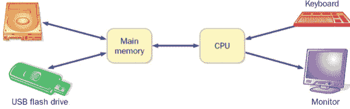

**图 1.1** 计算机系统的简化

程序存储在某些辅助存储设备中，例如硬盘。当你指示计算机执行程序时，程序的副本会从辅助存储器调取并存储在内存中。`CPU` 从内存中读取各个程序指令。`CPU` 逐个执行这些指令，直到程序结束。指令所使用的数据（例如将相加的数字）也存储在内存中。这些数据要么是从辅助存储调取的，要么是从键盘等输入设备读取的。执行过程中，程序可能会向显示器等输出设备显示信息。

> **核心概念**
>
> `CPU` 从内存中读取程序指令，并逐个执行它们，直到程序结束。

执行程序的过程是计算机运行的基础。所有计算机系统的工作原理基本上都是相同的。

软件可以使用各种标准分为许多类。在此处，我们简单地将系统程序和应用程序区分开。

操作系统是计算机的核心。它承担两个重要功能：首先，它提供用户界面，允许用户与机器进行交互；其次，操作系统管理 `CPU` 和内存等计算机资源。它决定程序何时允许运行、被加载到内存的何处，以及硬件设备之间如何通信。操作系统的任务是让计算机易于使用并确保其高效运行。

目前在使用几种流行的操作系统。`Windows` 操作系统是由微软公司为个人计算机开发的，它占据了近 90% 的操作系统市场份额。各种版本的 `Unix` 操作系统也非常流行，特别是在较大的计算机系统中。

> **核心概念**
>
> 操作系统提供用户界面并管理计算机资源。

一种名为 `Linux` 的 `Unix` 版本作为开源项目开发的，这意味着许多人对其开发做出了贡献，且其代码是免费提供的。正因如此，`Linux` 成为某些用户的喜爱。`Mac OS X` 是由苹果公司开发的用于计算系统的操作系统。

“应用程序”是除操作系统之外几乎任何其他程序的通用术语。文字处理器、导弹控制系统、数据库管理器、Web 浏览器和游戏都可以被视为应用程序。每个应用程序都有其自己的界面，允许用户与该特定程序进行交互。

现代操作系统和应用程序的用户界面是图形用户界面（`GUI`，发音为 "gooey"），正如其名，它是由图形屏幕元素组成的。其他等，这些元素包括：

- 窗口：用于将屏幕分成不同的区域
- 图标：代表计算机资源的小图像，例如文件选项
- 菜单、复选框和单选按钮：为用户提供选择选项
- 滑块：允许用户从一系列值中进行选择
- 按钮：可以通过鼠标点击来“按下”，以指示用户的选择

鼠标是与 `GUI` 配合的主要输入设备；因此，`GUI` 有时被称为点击式界面。图 1.2 中的截图显示了 `GUI` 的示例。

> 就用户而言，界面就是程序。

应用程序或操作系统的界面是软件的重要部分，因为它是程序中与用户直接交互的唯一部分。对用户来说，界面就是程序。在整本书中，我们将讨论图形用户界面的设计和实现。

本书的重点是开发高质量的应用程序。我们探索如何设计和编写能够执行计算、决策并以视觉或图形方式呈现结果的软件。我们在全文中使用 `Java` 编程语言来演示各种计算概念。

## 数字计算机

存储和管理信息判别了两种基本技术：模拟和数字。模拟信息是连续的，与信息的源成正比关系。例如，酒精温度计是测量温度的模拟设备。管中酒精上升的高度与管外的温度直接成正比。

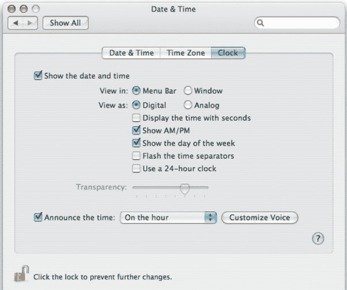

**图 1.2** 图形用户界面 (`GUI`) 示例

模拟信息的另一个例子是用于表示声波振动的电子信号。信号的电压与原始声波直接成正比。立体声放大器将这种电子信号发送到扬声器，扬声器通过振动重现声音。我们使用“模拟”一词是因为该信号与它所代表的信息直接是模拟的。1.3 图形象地描述了由麦克风捕并表示为电子信号的声波。

*数字*技术将信息分解成离散片段并将其表示为数字。光盘上的音乐是数字的，表现为数字序列。每个数字代表录音的一个特定实例的电压水平。这些测量中的许多是在短时间内完成的，可能是每秒 44,000 次。每秒的测量次数被称为*采样率*。如果采样足够频繁，离散的电压测量就可以用来生成与原始信号“足够接近”的连续模拟信号。

> **核心概念**
>
> 数字计算机通过将信息分解片段并将每个片段表示为数字来存储信息。

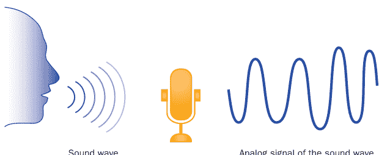

**图 1.3** 声波和代表该波的电子模拟信号

在大多数情况下，目标是创建一个原始信号的复制，足以满足人类感官。图 1.4 显示了模拟信号的采样。当模拟信息通过分解片段转换为数字格式时，我们说它已被数字化。由于采样之间信号中发生的变化丢失了，采样率必须足够快。

信息在采样之间可能会丢失

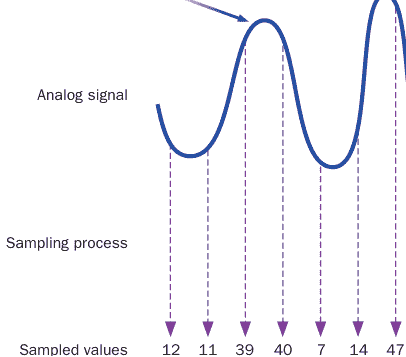

**图 1.4** 通过采样使模拟数字化

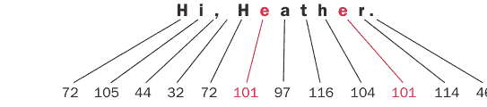

**图 1.5** 通过字符映射到数字存储文本

采样是数字化信息的唯一方法。例如，文本句子在计算机中以数字序列的形式存储，每个数字代表一个单独字符。每个字母和标点符号都分配了一个数字。甚至空格字符也分配了一个数字。考虑以下句子：

`Hi, Heather.`

句子中的字符表示为 12 个数字的序列，如图 1.5 所示。当字符重复时（例如大写字母 `'H'`），使用相同的表示方法。注意字母的大写版本存储与小写版本不同，例如 `Heather` 中的 `'H'` 和 `'h'`。它们被视为独立的字符。

数字计算机以数字存储信息，但这些数字不是以十进制存储的。计算机中的所有信息都以二进制存储和管理。与有 10 个数字（0 到 9）的十进制系统不同，二进制系统只有两个数字（0 和 1）。单个二进制数字称为位。

所有数字系统遵循相同的规则。数字系统的基数决定了我们可以使用的数字数量，并指示了数字中每个数字的位值。十进制系统是基 10，而二进制系统是基 2。附录 B 包含了数字系统的详细说明。

现代计算机使用二进制数字，是因为如果只需要表示两个可能值之一，那么存储和移动信息的设备就会更廉价、更可靠。除了这一特性外，二进制数字并没有特别之处

> **核心概念**
>
> 计算机使用二进制来存储和移动信息，是因为存储和处理二进制数据的设备廉价且可靠。

系统。计算机已经能够制造出来，可以使用其他系统来存储和移动信息，但它们并不方便。

某些计算机内存设备（如硬盘）在本质上是磁性的。磁性材料可以很容易地极化为其中一个极端；中间电则很难区分。因此，磁性设备可以非常有效地表示二进制值——磁化区域代表二进制 1，而去磁化区域代表二进制 0。其他的计算机内存设备由微小的电路制成。这些设备更容易制造，而且如果只需要在两个状态之间切换，它们故障的概率更小。与其创建更少、更复杂的设备，我们再复制数百万个简单的设备会更明智。

二进制值和数字电子学是密不可分的。它们提高了我们沿着电线可靠地传输信息的能力。正如我们所看到的，模拟信号是连续变化的电压，具有无限多的状态，而数字信号是离散的，这意味着电压在一个极端（如 +5 伏）和另一个极端（如 -5 伏）之间发生剧烈变化。在任何一点，数字信号的电压都被视为“高”或“低”，分别代表二进制 0。图 1.6 比较了这两种类型的信号。

当信号沿电线移动时，由于环境条件的影响，它会变弱并劣化。原始信号的电压发生轻微变化。模拟信号的问题在于它会波动；它丢失了原始信息。由于信息与信号直接对应，信号的任何变化都会改变信息。模拟信号的变化无法恢复，因为退化的信号与原始信号同样有效。数字信号的退化与模拟信号一样，但由于它最初处于一个极端值，在任何信息丢失之前它可以被增强。电压可能会与其原始值发生轻微变化，但仍然仍然被正确地解释为高或低。

我们在任何情况下使用的比特（`bit`）数量决定了我们可以表示的唯一项目数量。单个比特有两个可能的值，0 和 1，

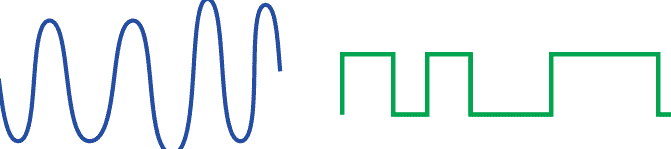

**图 1.6** 模拟信号与数字信号对比

## 1.1 计算机处理

因此可以表示两个可能的项目或情况。如果我们想表示灯泡的状态（关闭或开启），一个比特就足够了，因为我们可以将 0 解释为灯泡关闭，将 1 解释为灯泡开启。如果我们想表示两个以上的东西，就需要多一个比特。

两个比特结合在一起可以表示四个，因为两个比特恰好有四种排列组合：`00`、`01`、`10` 和 `11`。假设我们想表示汽车处于哪种档位（驻车、前进、倒车或空挡）。我们只需要两个比特，就可以在排列组合和档位之间建立映射关系。例如，我们可以说 `00` 代表驻车，`01` 代表前进，`10` 代表倒车，`11` 代表空挡。在这种情况下，即使交换它们的顺序也无所谓，尽管在某些情况下，比特与排列组合之间的关系是重要的。

三个比特可以表示八个项目，因为三个比特有八种排列组合。同样，五个比特可以表示 32 个项目，此类推。图 1.7 显示了所用比特数量与它们能表示的项目数量之间的关系。通常情况下，N 个比特可以表示 `2^N` 个唯一项目。每增加一个比特，可以表示的项目数量就会翻倍。

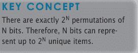

**图 1.7** 所用比特数量与可表示项目数量的关系

| 比特数 | 1 比特 | 2 比特 | 3 比特 | 4 比特 | 5 比特 |
| :--- | :---: | :---: | :---: | :---: | :---: |
| 可表示项目数 | 2 个项目 | 4 个项目 | 8 个项目 | 16 个项目 | 32 个项目 |
| 排列组合 | 0 | 00 | 000 | 0000 | 00000 |
| | 1 | 01 | 001 | 0001 | 00001 |
| | | 10 | 010 | 0010 | 00010 |
| | | 11 | 011 | 0011 | 00011 |
| | | | 100 | 0100 | 00100 |
| | | | 101 | 0101 | 00101 |
| | | | 110 | 0110 | 00110 |
| | | | 111 | 0111 | 00111 |
| | | | | 1000 | 01000 |
| | | | | 1001 | 01001 |
| | | | | 1010 | 01010 |
| | | | | 1011 | 01011 |
| | | | | 1100 | 01100 |
| | | | | 1101 | 01101 |
| | | | | 1110 | 01110 |
| | | | | 1111 | 01111 |

# 第 1 章 引言

我们已经看到如何通过将字符映射到数值，在计算机上存储文本。这些数值以二进制数存储。

最终，在计算机上表示信息归结为要表示的项目以及如何将这些项目映射到二进制值。

- SR 1.1 什么是硬件？什么是软件？
- SR 1.2 操作系统的两个主要功能是什么？
- SR 1.3 CD 上的音乐是使用每秒 44000 次的采样率创建的。每次测量都会丢失其原始信息。由于信息与信号直接对应，信号的任何变化都会改变信息。模拟信号的变化无法恢复，因为退化的信号与原始信号同样有效。
- SR 1.4 计算机信号在任何信息丢失之前会发生什么？
- SR 1.5 多少个比特可以表示：
  - a. 输入设备
  - b. 输出设备
  - c. 内存
  - d. 软件
- SR 1.6 假设我们要表示包含 256 个字符的语言。我们需要八个比特，因为有 256 种排列组合（`2^8` 等于 256）。每个排列组合都映射到一个特定的字符。

多少比特可以表示世界的 195 个国家？7 个比特是不够的，`2^7` 等于 128。8 个比特是足够的，但 256 个排列组合都不会映射到一个国家。

| 组件 |
| :--- |
| 3.0 GHz 核心处理器 |
| 4 GB RAM |
| 750 GB 硬盘 |
| 17 英寸平板 |
| 1024 分辨率网络卡 |
| DVD-ROM / HD-DVD |
| DVD 刻录机 |

### 计算机架构

让我们详细查看硬件组件。图 1.8 展示了该架构。信息通过一组被称为总线的线在组件之间传输。


**图 1.8** 计算机的硬件

### 输入/输出设备

让我们详细查看一些 I/O 设备。最常见的输入设备是键盘和鼠标。其他的包括

- 条码扫描器，例如零售店收银台处
- 麦克风，用于解释语音命令的语音识别系统
- 虚拟现实设备，例如解释用户手部动作的手持设备
- 扫描仪，将文本、照片和图形转换为机器可读的形式

显示器和打印机是最常见的输出设备。其他设备还包括：

- 绘图仪，让笔在大张纸张上移动（或反之）
- 扬声器，用于音频输出
- 虚拟现实眼镜，用于虚拟现实显示

某些设备同时具备输入和输出功能。触摸屏系统可以检测用户在特定位置触摸屏幕。软件随后可以使用屏幕响应用户的触摸来显示文本和图形。触摸屏已成为手持设备的常见配置。

图 1.8 描述的计算机包含一个具有 17 英寸显示区域的显示器。它是一个平板屏，使用了液晶显示（`LCD`）技术，这与旧的阴极射线管（`CRT`）显示器不同，后者需要高电压且通常不可便携。计算机中的图像是通过将图像拆分为独立的图像元素（即像素）来表示。显示器可能会显示一个 1280 比 1024 像素的网格。图形数据的表示和管理将在第 2 章中详细讨论。

主内存由一系列连续且小的内存位置组成，如图 1.10 所示。每个内存位置都关联有一个称为“地址”的唯一数字。

> **核心概念**
>
> 地址是与内存位置关联的唯一数字。

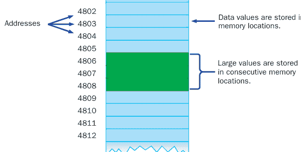

**图 1.10** 内存位置

| 单位 | 符号 | 字节数 |
| :--- | :---: | :--- |
| 字节 (byte) | | $2^0 = 1$ |
| 千字节 (kilobyte) | KB | $2^{10} = 1024$ |
| 兆字节 (megabyte) | MB | $2^{20} = 1,048,576$ |
| 吉字节 (gigabyte) | GB | $2^{30} = 1,073,741,824$ |
| 太字节 (terabyte) | TB | $2^{40} = 1,099,511,627,776$ |
| 拍字节 (petabyte) | PB | $2^{50} = 1,125,899,906,842,624$ |

**图 1.11** 二进制存储单位

当数据存储在内存位置中时，它会覆盖并破坏之前存储在该存储位置的任何信息。然而，从内存位置读取数据的过程不会影响它。

在许多计算机上，每个内存位置由八位（`bits`）或一个*字节*（`byte`）的信息组成。我们需要存储一个无法用单个字节表示的值（例如大数字），则会使用多个连续的字节来存储数据。

如内存等设备的*存储容量*是它能够容纳的字节总数。设备可以存储数千或数百万字节，因此您应该熟悉更大的内存单位。因为内存基于二进制系统，所有存储单位都是 2 的幂次。一个*千字节*（`KB`）是 1024，或 $2^{10}$。一些较大的存储单位是图 1.11 所示的*兆字节*（`MB`）、*吉字节*（`GB`）、*太字节*（`TB`）和*拍字节*（`PB`）。通过四舍五入这些这些容量是容易的。例如，大多数用户将一个千字节视为大约一千，一个兆字节视为大约百万，以此此类推。

> **核心概念**
>
> 主内存是易失的，这意味着存储的信息只有在供电时才会被保持。

许多人拥有四种类型的主内存或 `RAM`，如图 1.8 所示的系统（我们将在本章的晚些部分更详细讨论 `RAM`）。大内存允许大型程序或多个程序高效运行，因为它们不需要频繁地从辅助内存中检索信息。

主内存通常是*易失的*，这意味着如果关闭电源，存储在其中的信息将会丢失。当你在计算机上工作时，您应该将工作保存到辅助内存设备（如 `USB` 闪存器）中，以防断电。辅助内存设备是*非易失的*；即使关闭电源，信息也会被保留。

缓存是一种小型、快速内存，由中央处理器（`CPU`）用于以加速访问频繁使用的数据。缓存是内存的一种类型，用于存储指令和数据。某些设备同时具备输入和输出功能。触摸屏系统可以检测用户在特定位置触摸屏幕。软件随后可以使用屏幕响应用户的触摸来显示文本和图形。触摸屏已成为手持设备的常见配置。

图 1.8 描述的计算机包含一个具有 17 英寸显示区域的显示器。它是一个平板屏，使用了液晶显示（`LCD`）技术，这与旧的阴极射线管（`CRT`）显示器不同，后者需要高电压且通常不可便携。计算机中的图像是通过将图像拆分为独立的图像元素（即像素）来表示的显示器可能会显示一个 1280 比 1024 像素的网格。图形数据的表示和管理将在第 2 章中详细讨论。

显示器和打印机是最常见的输出设备。其他设备还包括：

- 绘图仪，让笔在大张纸张上移动（或反之）
- 扬声器，用于音频输出
- 虚拟现实眼镜，用于虚拟现实显示
- 扫描仪，将文本、照片和图形转换为机器可读的形式


# 主内存与存储单位

主内存由一系列连续且小的内存位置组成，如图 1.10 所示。每个内存位置都关联有一个称为“地址”的唯一数字。

> **核心概念**
>
> 地址是与内存位置关联的唯一数字。


**图 1.10** 内存位置

| 单位 | 符号 | 字节数 |
| --- | --- | --- |
| 字节 (byte) | | $2^0 = 1$ |
| 千字节 (kilobyte) | KB | $2^{10} = 1024$ |
| 兆字节 (megabyte) | MB | $2^{20} = 1,048,576$ |
| 吉字节 (gigabyte) | GB | $2^{30} = 1,073,741,824$ |
| 太字节 (terabyte) | TB | $2^{40} = 1,099,511,627,776$ |
| 拍字节 (petabyte) | PB | $2^{50} = 1,125,899,906,842,624$ |

**图 1.11** 二进制存储单位

当数据存储在内存位置中时，它会覆盖并破坏之前存储在该存储位置的任何信息。然而，从内存位置读取数据的过程不会影响它。

在许多计算机上，每个内存位置由八位（bits）或一个`字节`（byte）的信息组成。我们需要存储一个无法用单个字节表示的值（例如大数字），则会使用多个连续的字节来存储数据。

如内存等设备的`存储容量`是它能够容纳的字节总数。设备可以存储数千或数百万字节，因此您应该熟悉更大的内存单位。因为内存基于二进制系统，所有存储单位都是 2 的幂次。一个`千字节`（KB）是 1024，或 $2^{10}$。一些较大的存储单位是图 1.11 所示的`兆字节`（MB）、`吉字节`（GB）、`太字节`（TB）和`拍字节`（PB）。通过四舍五入这些容量是容易的。例如，大多数用户将一个千字节视为大约一千，一个兆字节视为大约百万，以此类推。

> **核心概念**
>
> 主内存是易失的，意味着存储的信息只有在供电时才会被保持。

许多人拥有四种类型的主内存或 `RAM`，如图 1.8 所示的系统（我们将在本章的晚些部分更详细讨论 `RAM`）。大内存允许大型程序或多个程序高效运行，因为它们不需要频繁地从辅助内存中检索信息。

主内存通常是`易失的`，这意味着如果关闭电源，存储在其中的信息将会丢失。当你在计算机上工作时，你应该将工作保存到辅助内存设备（如 `USB` 闪存器）中，以防断电。辅助内存设备是`非易失的`；即使关闭电源，信息也会被保留。

# 光存储设备

CD 起初是音乐的流行格式；后来演变为通用存储设备。同样，DVD 最初是为视频创建的，现在正作为计算机数据的通用格式取得进展。DVD 曾代表视频光（video disc）或数字多功能盘（digital versatile disc），但该缩写通常独立使用。DVD 的格式比 CD 更紧凑（每平方英寸位数更多），因此可以存储更多信息。DVD 可能完全取代 CD-ROM，因为存在兼容的迁移路径，这意味着 DVD 可以读取 CD-ROM。类似于 `CD-R` 和 `CD-RW`，还有 `DVD-R` 和 `DVD-RW` 光盘。图 1.8 所示的驱动器允许用户读取和写入 `CD-RW` 光盘并读取 `DVD-ROM`，包括播放音乐 CD 和观看 DVD 视频的能力。

CD 或 DVD 的速度以 x 的倍数表示，对于 CD，数据传输速度超过每秒 153,600 字节；DVD 为其九倍，即每秒超过 1.5 兆字节数据；蓝光光盘则为 DVD 速度的三倍，即每秒 4.5 兆字节数据。图 1.8 描述的驱动器最大数据访问速度为 16x，或约每秒 72 MB 数据。双层蓝光光盘的存储容量为 50 GB。

随着技术的进步，存储设备的容量不断变化。行业的一条通用规则建议存储容量每 18 个月翻倍。然而，随着容量接近绝对物理极限，这种进步将变缓慢。

# 中央处理器（CPU）

中央处理器（`CPU`）与主内存交互，执行计算机中所有的基础计算。`CPU` 在连续循环中一个接一个地解释并执行指令。它如图 1.13 所示，由三个重要部分组成。控制单元协调进程，寄存器在 `CPU` 内部提供少量存储，算术逻辑单元执行计算并做出决策。寄存器是系统中最小、最快的缓存。

控制单元协调主内存与 `CPU` 中寄存器之间的数据和指令。它还协调算术逻辑单元电路的执行，以对存储在特定寄存器中的数据进行操作。

在大多数 `CPU` 中，寄存器被留作特殊用途。例如，指令寄存器持有当前正在执行的指令。程序计数器是一个持有下一条执行指令地址的寄存器。除了这些和其他特殊用途寄存器外，`CPU` 还包含一组通用寄存器，用于根据需要临时存储值。

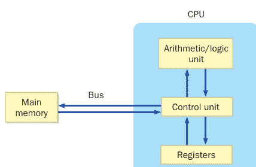

在主内存中同时存储程序指令和数据的概念是计算机设计**冯·诺依曼架构**的底层原理，它以匈牙利裔美国数学家约翰·冯·诺依曼命名，他在 1945 年首次提出了这一编程概念。这些指令持续地遵循图 1.14 所示的`取指-解码-执行`循环。指令从程序计数器存储的地址从内存中被取出并放入寄存器中。此时，程序计数器加1，为下一个循环做准备。然后对指令进行电子化解码，以确定执行何种操作。最后，控制单元激活正确的电路来执行指令，例如，将一个数据值加载到寄存器中或将两个值相加。

> **核心概念**
>
> 取指-解码-执行循环形成了计算机处理的基础。

`CPU` 构建在一个名为`微处理器`的芯片上，该设备是计算机主电路板的一部分。该电路板还包含 `ROM` 芯片以及允许设备控制器（如管理视频显示的控制器）连接的通信插座。

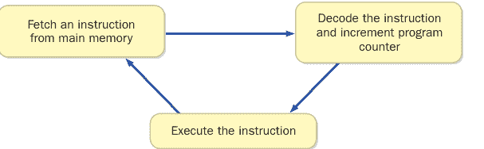

**图 1.14** 连续的取指-解码-执行循环

主电路板的另一个关键组件是系统时钟。时钟按固定间隔产生电子脉冲，以同步 `CPU` 的事件。脉冲产生的频率称为时钟频率，它取决于处理器。图 1.1 描述的计算机包含一个 `Intel Core i7` 处理器，其运行时钟频率为 3.07 吉赫兹 (`GHz`)，或约每秒 31 亿次脉冲。系统时钟的速度提供了 `CPU` 执行指令快慢的粗略衡量。类似于存储容量，处理器的速度随着技术的进步而不断增加。

## 自测复习题（答案见附录 N）

- **SR 1.7** 以下各项中各有多少字节？
  - a. 3 KB
  - b. 2 MB
  - c. 4 GB

- **SR 1.8** 以下各项中各有多少位？
  - a. 8 字节
  - b. 2 KB
  - c. 4 MB

- **SR 1.9** CD 上的音乐是使用每秒 44,000 次测量采样率创建的。每次测量都存储为一个代表特定电压水平的数字。假设这些数字中的每个都需要两个字节的存储空间。表示一小时音乐需要多少 MB？

- **SR 1.10** 计算机中两个主要的硬件组件是什么？它们是如何交互的？

- **SR 1.11** 什么是内存地址？

- **SR 1.12** 什么是易失性（volatile）？哪些设备是易失的，哪些是非易失的？

- **SR 1.13** 从列表中选择与以下短语最匹配的词：控制器、`CPU`、网卡、`RAM`、寄存器、`ROM`。
  - a. 除了 `CPU` 和主内存外，计算机系统中几乎所有设备都归类为这种：
  - b. 协调外设设备的设备。
  - c. 允许发送和接收。
  - d. 这种内存通常是易失的。
  - e. 这种内存通常是非易失的。
  - f. 这种类型与“主内存”通用。
  - g. 基本处理发生。


# 网络基础

单台计算机可以完成很多工作，但将几台计算机连接起来可以极大提高生产力。网络是由连接以便交换信息的计算机组成的。使用网络已成为常态。每天都有新技术出现。

图 1.15 显示了一个简单的网络。网络设备之一是打印机。网络计算机之一是文件服务器，它专门用于当两台计算机地理位置很近，这种解决方案效果良好并被称为`点对点`。

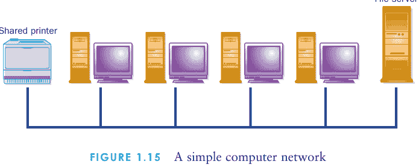

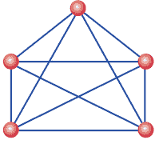

**图 1.16** 点对点连接

如果使用点对点连接，每台计算机都通过一根线与网络中的所有其他计算机直接连接。为每个连接配备单独的线路并不是行的解决方案，每当向网络添加一台新计算机，都要为网络中已有的计算机安装新的通信线。此外，单个计算机只能处理有限的直接连接。图 1.16 显示了多个点对点连接。

比较图 1.15 和 1.16 的差异。1.15 中的所有计算机共享同一根通信线。网络上的每个计算机都有自己的`网络地址`，可以唯一标识它。这些地址类似于主内存中的地址，但它们识别的是网络上的个体，而不是单台计算机内部的内存位置。消息通过指定目标计算机的网络地址从一台计算机发送到另一台。

共享线路具有成本效益，且向网络中添加新计算机相对容易。然而，共享线路会导致延迟。计算机不能同时使用通信线。它们必须轮流发送信息，这意味着当线路忙时它们必须等待。

提高网络延迟的一种技术是将大型消息分成分段（称为`数据包`），然后与其他用户的数据包交替发送到网络中。数据包在终点处被收集并重新组成原始消息。

每个人一次可以放置一个盒子，他们都能完成自己的工作。这虽然不像拥有自己的输送带那么快，但也不像必须等所有人完成后才能开始那么慢。

## 局域网与广域网

`局域网（LAN）` 设计用于跨越短距离并连接相对少量的计算机。通常，一个局域网连接一栋大楼或一个房间内的机器。局域网便于安装和管理，而且可靠性很高。随着计算机变得越来越小且功能多化，局域网为整个组织内部的信息共享提供了一种廉价的方式。然而，拥有局域网就像拥有一套只能给本镇的人打电话的电话系统。我们需要能够在更长的范围内共享信息。

> **核心概念**
>
> 局域网（LAN）是在整个组织内共享信息和资源的有效方法。

`广域网（WAN）` 连接两个或多个局域网，通常跨越远距离。通常，每个局域网上有一台计算机专门负责跨广域网的通信。这种技术减轻了局域网内其他计算机执行远距离通信细节的负担。图 1.17 显示了多个局域网连接到一个广域网。由广域网连接的局域网通常由不同的公司或组织所有，甚至可能位于不同的国家。

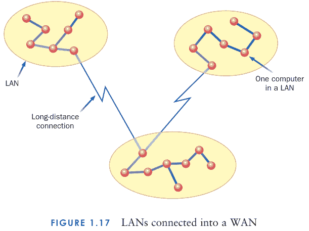

网络对计算机系统的影响是巨大的。现在计算资源可以在许多用户之间共享，跨全球的计算机通信已十分常见。事实上，网络的使用已无处不在，以至于某些计算机需要网络资源才能运行。

## 互联网

在整个 20 世纪 70 年代，国防部一个名为高级研究计划局（`ARPA`）的机构资助了几个探索网络技术的项目。其成果之一是 `ARPANET`，这是一个最终被称为互联网的广域网。互联网是网络的网络。“Internet”一词源于广域网的概念——将许多较小的网络连接在一起。

从 20 世纪 80 年代后期至今，互联网增长迅速。1983 年，连接到互联网的计算机不到 600 台。现在，互联网为全球数十亿用户提供服务。随着更多的计算机连接，跟上数量增加的用户和更重的流量变得日益困难。自最初开发以来，新技术已经取代了 `ARPANET` 几次，每次都提供了更大的容量和更快的处理。

> **核心概念**
>
> 互联网是一个跨全球的广域网（WAN）。

协议是一组规定两个事物如何通信的规则。控制信息在互联网上移动的软件必须符合一组被称为 `TCP/IP` 的协议（按字母发音读作 T-C-P-I-P）。`TCP` 代表传输控制协议，`IP` 代表互联网协议。`IP` 软件定义了信息从源到目的地的格式化和传输方式。`TCP` 软件处理如数据包未原始顺序到达或信息丢失等问题，这些在大量信息同时汇聚到一个地时可能会发生。

连接到互联网的每个设备都有一个 `IP` 地址，在互联网上所有其他计算机中唯一标识它。`IP` 地址允许处理 `IP` 地址。幸运的是，互联网用户很少有名字。和 `IP` 地址一样，名称必须是唯一的。计算机的互联网名称通常被称为互联网地址。互联网地址的一个示例是 `hector.vt.edu`。

> **核心概念**
>
> 每个连接到互联网的设备都有一个唯一标识它的 IP 地址。

互联网地址的第一部分是特定计算机的本地名称。地址的其余部分是域名，它指示该计算机所属的组织。例如，`vt.edu` 是弗吉尼亚理工大学（Virginia Tech）计算机网络的域名，而 `hector` 是该校园内某台特定计算机的名字。


由于域名是唯一的，许多组织可以拥有名为 `hector` 的计算机而不会产生冲突。各个部门可能会被分配子域名，子域名添加到基本域名中，以便在较大的组织内唯一区分它们的计算机组。例如，`cs.vt.edu` 子域名专门用于弗吉尼亚理工大学的计算机科学系。

当引用互联网地址时，它会被翻译为相应的 `IP` 地址，从那时起使用该地址。用于翻译的软件被称为域名系统（`DNS`）。每个连接到互联网的组织都运行一个域名服务器，维护该组织内所有计算机及其 `IP` 地址的列表。它的工作方式类似于电话辅助：你提供名称，域名服务器返回一个数字。如果本地域名服务器没有该名称的 `IP` 地址，它会联系另一个拥有该地址的域名服务器。

互联网彻底了计算机处理。最初，互联计算机的主要用途是发送电子邮件，但互联网的能力不断提高。互联网最重要的用途之一是万维网。

## 万维网

互联网赋予我们交换信息的能力。万维网（也称为 `WWW` 或简单的 Web）让类的信息交换变得简单。Web 软件提供了一个通用接口，通过点击鼠标即可访问许多不同类型的信息。

Web 基于超文本和超多媒体的概念。“超文本”一词由特·尼尔森（Ted Nelson）于 1963 年创造。它描述了一种组织信息的方法，使思想流不受限于线性进展。保罗·奥特（Paul Otlet，1868–1944）被认为是信息科学之父，他设了一种管理大量信息的方法。

> **核心概念**
>
> 万维网是一种让类轻松跨网络共享信息的软件。

### 1.3 网络

互联网和万维网有时可以互换，但两者之间存在差异。互联网使通过全球计算机进行通信成为可能。Web 让通信变成一种简单且愉快的活动。Web 本质上是一种分布式信息服务，基于一组软件应用程序。它不是一个网络。尽管它与互联网一起使用，但它本质上并不绑定。Web 可以在未连接到任何其他网络的局域网上甚至在单台机器上显示 `HTML` 文档。

浏览器是加载和格式化 Web 文档的软件工具。第一个用于 Web 图形界面浏览器 `Mosaic` 于 1993 年发布。Web 文档的定义某些开发 `Mosaic` 的人去寻找 `Netscape` 通信公司并创建了 `Netscape Navigator` 浏览器。目前流行的浏览器包括 `Internet Explorer`、`Mozilla Firefox`、`Apple Safari`、`Google Chrome` 和 `Opera`。

提供 Web 文档访问的计算机被称为 Web 服务器。浏览器加载并解释由 Web 服务器提供的文档。许多此类文档使用超文本标记语言（`HTML`）进行格式化。`Java` 编程语言与 Web 处理有种非常紧密的关系，因为指向 `Java` 程序的链接可以嵌入 `HTML` 文档中并通过 Web 浏览器执行。我们在第 2 章中更详细地探讨这种关系。

#### 统一资源定位符

Web 信息通过统一资源定位符（`URL`，按字母读作 U-RL）标识。`URL` 唯一地指定了浏览器获取和显示的文档和其他信息。以下是一个 `URL`：

```
http://www.google.com
```

该特定 `URL` 的 Web 是著名的 Google 搜索引擎的所在地，它使我们能够使用特定的单词或短语搜索 Web 信息。

`URL` 包含几部分信息。第一部分是协议，它决定了浏览器传输和处理信息。第二部分是存储文档的机器的 Internet 地址。第三部分信息是感兴趣的文件名或资源。如果没有给出名称（如 Google `URL` 所示），Web 服务器通常会提供一个默认页面（例如 `index.html`）。

让我们来看另一个 `URL` 示例：

```
http://www.whitehouse.gov/photos-and-video/photogallery/photo-day
```

在这个 `URL` 中，协议是 `http`，它代表超文本传输协议（HyperText Transfer Protocol）。所引用的机器是 `www`（一个典型的 Web 服务器引用），位于域名 `whitehouse.com`。最后，`photos-and-video/photogallery/photo-day` 指向要传输到浏览器进行查看的资源（或引用文件）。虽然还用到了许多其他形式的 `URL`，但这种是最常见的。

#### 自测复习题（答案见附录 N）

- **SR 1.14** 什么是文件服务器？
- **SR 1.15** 五台计算机组成的全连接点对点网络需要多少条通信线？六台又是多少呢？
- **SR 1.16** 描述网络上的计算机共享通信线的好处。描述共享通信线的成本/缺点。
- **SR 1.17** Internet 一词的词源是什么？
- **SR 1.18** `TCP/IP` 协议集描述了使用 Internet 的软件的通信规则。`TCP` 代表什么？`IP` 代表什么？
- **SR 1.19** 解释以下 `URL` 的组成：
  - a. `duke.csc.villanova.edu/jss/examples/index.html`
  - b. `java.sun.com/products/index.html`

# 1.4 Java 编程语言

现在让我们关注让计算机系统变得用的软件。程序是用特定的编程语言编写的，这种语言使用特定的单词和符号来表达解决方案。编程语言定义了一组规则，决定了程序员如何如何将语言的单词和符号组合成编程语句，这些语句是程序执行时运行的指令。

自从计算机诞生以来，已经有了许多编程语言。我们在本书中使用 `Java` 语言来演示各种编程概念和技术。虽然我们的主要目标是学习底层的软件开发概念，但一个重要的副作用将精通 `Java` 程序开发。

与其他许多语言相比，`Java` 是一种相对新的编程语言。它由 `James Gosling` 在 1991 年于 `Sun Microsystems` 推出，作为他许多箱中项目之一。该语言最初被称为 `Oak`，然后是 `Green`，最终称为 `Java`。`Java` 于 1995 年向公众推出，从那时获得了巨大的流行。2010 年，`Sun Microsystems` 被 `Oracle` 收购。


# Java 语言概述

自创建以来，Java 经历了各种变化。Java 平台有多个版本，包括标准版（Standard Edition）及其相关工具；企业版（Enterprise Edition），包含支持大规模系统开发的额外库；以及微型版（Micro Edition），专门用于开发手机等便携式设备。本书重点关注标准版。

Java 的某些部分已经弃用（deprecated），这意味着它们被认为过时且不应被使用。在重要时，我们会指出被弃用的元素并讨论首选的替代方案。

引起最初关注的一个原因是，由于它是第一种故意采用编写可以使用 Web 执行的程序（Applet）概念的编程语言。从那时起，创建具有动态能力网页的技术急剧扩展。

Java 是一种面向对象的编程语言。对象是组成程序的根本元素。面向对象的软件开发原则是本书的核心。我们将在本章后半部分和书的其他部分探索面向对象的编程概念。

> **核心概念**
>
> 本书侧重于面向对象编程的原则。

Java 配随有一个额外的软件库，我们可以在开发程序时使用。这些软件被称为 Java API，全称为应用程序接口（Application Programming Interface），或简称为标准类库。Java API 提供了创建图形、通过网络通信以及与数据库交互等许多功能。Java API 非常庞大且功能多变。我们无法涵盖该库的所有方面，但我们将探索其中一些。

Java 用于世界各地的商业环境。它是历史上增长最快的编程技术之一。因此，它不仅是一个学习编程概念的好语言，也是一种在未来对你有帮助的实用语言。

## Java 程序

让我们来看一个简单但完整的 Java 程序。列表 1.1 中的程序在屏幕上打印两个句子。这个特定程序打印了亚伯拉罕·林肯的格言。输出显示程序列表下方。

```
************************************************************************************
// Lincoln.java    作者: Lewis/Loftus
// 展示了 Java 应用程序的基本结构。
************************************************************************************
public class Lincoln
{
    // 打印总统格言。-------------------------------------------------------
    public static void main(String[] args)
    {
        System.out.println("A quote by Abraham Lincoln:");
        System.out.println("Whatever you are, be a good one.");
    }
}
```

### 列表 1.1

### 输出

亚伯拉罕·林肯的格言：

无论你是什么，都要做个优秀的。

所有的 Java 应用程序都有相似的基本结构。尽管规模很小且目的简单，但这个程序包含了几个重要特征。让我们仔细检查它并研究它的组成部分。

程序的前几行是注释，它们以 `//` 符号开始并持续到行尾。注释不影响程序的运行，但包含在内是为了让人类更容易理解程序。程序员可以在整个处理过程中包含注释，以清楚地标识程序的目的并描述任何特殊处理。任何书面注释或文档，包括用户指南和技术参考，都称为文档（documentation）。程序中的注释称为行内文档（inline documentation）。

> **核心概念**
>
> 注释不影响程序的处理；相反，它们的作用是为了人类理解。


VideoNote：程序元素概述。

程序的其余部分是一个类定义（class definition）。这个类是 `Lincoln`，尽管如果我们想要，可能并不需要它。类定义从程序的第一个左大括号 `{` 开始，到程序最后行的最后一个右大括号 `}` 结束。所有的 Java 程序都使用类定义。

类定义内部有一些注释描述了方法的目的，方法直接定义在注释下方。方法是一组被命名的编程语句。在这种情况下，方法的名称是 `main`，它包含两个编程语句。

所有的 Java 应用程序都有 `main` 方法，处理从这里开始。`main` 方法中的每条编程语句按顺序执行，直到方法结束。然后程序结束或终止。Java 程序中的 `main` 方法定义总是带有 `public`、`static`、`void` 这几个词，我们将稍后解释。`String` 和 `args` 的使用没有出现在这个程序中。我们稍后也会描述这些。这两行代码调用了另一个方法 `println`（读作 print line）。当我们想要执行某个方法时，我们会调用（invoke）它。`println` 方法指定了打印到屏幕上的字符。要打印的字符是一个字符字符串，包含在双引号 `"` 中。当程序执行时，它调用 `println` 方法打印第一条语句，再次调用第二条语句，然后因为它是 `main` 方法的最后一行，程序终止。

调用 `println` 方法时执行的代码没有在这个程序中定义。`println` 方法是 `System.out` 对象的一部分，它是 Java 标准类库的一部分。它在技术上不是 Java 语言的一部分，但在任何 Java 程序中都可用。我们将在第二章详细探讨 `println` 方法。

## 注释

让我们详细地检查注释。对于 Java 语言而言，注释的内容可以是任何文本。注释会被计算机忽略；它们不影响程序的运行方式。

Lincoln 程序中的注释代表了 Java 中允许的两种注释类型之一。注释在 Lincoln 中的形式如下：

```
// This is a comment.
```

这种类型的注释以双斜杠（`//`）开始，持续到行的末尾。你不能在双斜杠之间放置任何字符。计算机会忽略双斜杠之后到行尾的所有文本。注释可以跟在同一行的代码后面，用于说明该特定行的含义，如下例所示：

```
System.out.println("Monthly Report"); // always use this title
```

Java 注释的第二形式可能包含以下内容：

```
/* This is another comment. */
```

这种注释不使用行尾来表示注释的结束。起始斜杠-星号（`/*`）和结束星号-斜杠（`*/`）之间的任何都是都是的一部分，包括代表行结束的不可见换行字符。因此，这种类型的注释可以跨多行。斜杠和星号之间没有空格。

如果在注释开头的 `/*` 后面跟着第二个星号，则可以使用注释的内容通过名为 `javadoc` 的工具自动生成关于你程序的外部文档。关于 javadoc 的更多信息请参见附录 I。

两种基本的注释类型可以创建各种文档样式，例如：

```
// This is a comment on a single line.
```

```
------------------------------------------------------
// 像上面方法或类之类的注释
// 应该被块锁定以便特别关注
// 你代码的特定方面。注意这些
// 每一行在技术上都是一个独立的注释。
------------------------------------------------------
```

```
/*
// 这是一条跨越
// 几行的注释。
*/
```

程序员往往专注于编写代码，而对文档关注太少。你应该养成良好的注释习惯并习惯性遵循它们。注释应该写得良好，使用完整的句子。

它们不应该解释显而易见的事，而应该对代码的意图提供适当的见解。以下示例不是好的注释：

```
System.out.println("hello"); // prints hello
System.out.println("test"); // change this later
```

第一条注释转述了该行的目的，没有为语句添加任何价值。与其说有一个无用的注释，不如没有注释。第二条注释是含糊的。应该修改什么？什么时候是“以后”？为什么要修改？

> **核心概念**
>
> 内联文档应该提供对你代码的见解。它不应该是含糊的，也不应该解释显而易见的事。

## 标识符和保留字

编写程序时使用的各种单词被称为标识符。Lincoln 程序中的标识符有 `class`、`Lincoln`、`public`、`static`、`void`、`main`、`String`、`args`、`System` 和 `out`。它们分为三类：

- 我们编写程序时自定义的单词（`Lincoln` 和 `args`）
- 另一个程序选择的单词（`String`、`System`、`out` 和 `main`）
- 语言中预留给特殊目的的单词（`class`、`public`、`static`、`void`）

在编写程序时，我们简单地选择将类命名为 `Lincoln`，但也可以使用 `Quote`、`Abe` 或 `GoodOne`。标识符 `args`（用于参数）经常出现在 Lincoln 中使用的行中，但我们可以使用任何其他标识符来代替它。

标识符 `String`、`System` 和 `out` 是其他程序员选择的。它们不是 Java 语言的一部分。它们是 Java 标准库预定义代码的一部分，是某些人为我们编写的一组类和方法。代码的作者选择了代码中的标识符——这些只是我们所组合的单词。

保留字是在编程语言中具有特殊含义且不能以预定义方式使用的标识符。保留字不能用于任何其他目的，例如命名类或方法。在 Lincoln 程序中，保留字有 `class`、`public`、`static`、`void`。在整书中，我们将按照字母顺序查看 Java 单词。图 1.18 按照字母顺序列出了所有保留字。标记有星号的单词已被预留，但目前在 Java 中没有意义。

### 图 1.18 Java 保留字

| abstract | default | goto* | package | this |
| :--- | :--- | :--- | :--- | :--- |
| assert | do | if | private | throw |
| boolean | double | implements | protected | throws |
| break | else | import | public | transient |
| byte | enum | instanceof | return | true |
| case | extends | int | short | try |
| catch | false | interface | static | void |
| char | final | long | strictfp | volatile |
| class | finally | native | super | while |
| const* | float | new | switch | |
| continue | for | null | synchronized | |

因此，`total`、`label17`、`nextItem`、`NUM_BOXES` 和 `$amount` 都是有效的标识符，但 `4th_word` 和 `coin#value` 不是。

标识符可以使用小写和大写字母，这种差异至关重要。Java 是大小写敏感的，这意味着两个标识符名称仅字母大小写不同就被视为不同的标识符。因此，`total`、`Total`、`ToTal` 和 `TOTAL` 都是不同的标识符。你可以想象，使用多个仅大小写不同的标识符不是好主意，因为它们很容易被混淆。


标识符以一个字母开头，后面跟着零或多个字母、数字、下划线字符（`_`）和美元符号（`$`），但不能以数字开头。标识符可以是任何长度。字母包括字母字符。数字包括 0 到 9。

```
total
MAX_HEIGHT
System
```

虽然 Java 语言没有要求，但每种标识符使用一致的大小写格式会让你的代码更容易理解。关于标识符有各种 Java 惯例应当遵循。例如，我们在全文中使用标题大小写（每个单词的首字母大写），在第一次遇到标识符时，我们会描述其首选的大小写格式。

> **核心概念**
>
> Java 是大小写敏感的。字母的大写和小写版本是不同的。

## 空格

所有的 Java 程序都使用空白来分隔程序中的单词和符号。空白由空格、制表符和换行符组成。“空白”一词是指，在印有黑色文字的白纸上，单词和符号之间的空间是白色的。程序员使用空白很重要，因为可以用它可以强调代码的部分并使程序更易于阅读。

除了在分隔单词时，计算机会忽略空白。它不会影响程序的执行。这为程序员在格式化程序时提供了一种灵活性。程序的行应该在逻辑位置划分，某些行应该进行缩进和对齐，以便程序的底层结构清晰。

由于空白被忽略，我们可以以许多不同的方式编写程序。例如，将空白推向极端，我们可以在每行放置尽可能多的单词。列表 1.2 中的代码（`Lincoln2` 程序）格式与 Lincoln 完全不同，但打印相同的方法。

> **核心概念**
>
> 适当使用空白使程序更易阅读和理解。

### 列表 1.2

> 亚伯拉罕·林肯的一句引用：
>
> 无论你成为什么，要做一个出色的。

将空间推向另一个极端，我们几乎可以将每个单词和符号写在单独的一行，并配以不同数量的空格，例如列表 1.3 中的 Lincoln3。

林肯的三个版本在技术上都是有效的，并且执行方式相同，但从读者的角度来看，它们存在着本质的区别。后两个示例都显示了糟糕的风格，并使程序难以理解。在编写程序时，可能会被要求遵守特定的指南。软件开发公司通常有一套程序员需要遵循的编程风格策略。无论如何，你都应该采用并一致地使用一组提高代码可读性的风格指南。

### 列表 1.3

```
********************************************************************
// Lincoln3.java      作者: Lewis/Loftus
// 展示了另一个格式糟糕的有效程序。
********************************************************************
public class
Lincoln3
{
    public
    static void
    main
    (
      String
      []
      args
      )
    {
      System.out.println (
        "亚伯拉罕·林肯的一句引用："
      );
      System.out.println (
        "无论你成为什么，要做一个出色的。"
      );
    }
}
```

### 输出

亚伯拉罕·林肯的一句引用：

无论你成为什么，要做一个出色的。

#### 自测习题（答案见附录 N）

- SR 1.20 Java 编程语言是什么时候开发的？由谁开发的？什么时候向公众介绍的？
- SR 1.21 Java 程序的处理从哪里开始？
- SR 1.22 你预测 Java 程序中以下行代码的结果是什么？
  `System.out.println("Hello"); // 打印 hello`
- SR 1.23 你预测 Java 程序中以下行代码的结果是什么？
  `// 打印 hello System.out.println("Hello");`
- SR 1.24 下列哪些不是有效的 Java 标识符？为什么？
  a. `RESULT`
  b. `result`
  c. `12345`
  d. `x12345y`
  e. `black&white`
  f. `answer_7`

## 第 1 章 练习

- SR 1.25 假设程序需要一个标识符来表示一个班测试成绩的总和。对于以下每个名称，判断每个是否是作为标识符的好名称。解释你的答案。
  a. `x`
  b. `scoreSum`
  c. `sumOfTestScoresOfTheStudents`
  d. `smTstScr`
- SR 1.26 什么是空白符？它如何影响程序的执行？它如何影响程序的可读性？

# 程序开发

让程序运行的过程涉及各种活动。程序必须用适当的编程语言（如 Java）编写。该程序必须被翻译成计算机可以执行的形式。错误可能会在该过程的各个阶段发生并必须予以修正。可以使用各种软件工具来帮助开发过程的所有部分。让我们详细探讨这些问题。

## 编程语言层次

假设某人正在给朋友提供旅行路线。那个人可以使用几种语言中的一种（如英语、俄语或意大利语）解释这些路线。无论使用哪种语言解释，路线都是相同的，朋友必须能够理解所使用的语言才能遵循路线。

同样，可以通过用许多编程语言之一（如 Java、Ada、C++、C#、Pascal 和 Smalltalk）编写程序来解决问题。无论使用哪种语言，目的都是相同的，但用于表示指令的特定语句以及这些指令的整体结构随语言不同而异。计算机必须能够理解指令才能执行它们。

编程语言可以分为四组。这些组基本上反映了计算机语言的历史发展。

- 机器语言
- 汇编语言
- 高级语言
- 第四代语言

为了在计算机上运行程序，它必须被翻译成计算机的机器语言。每种 CPU 都有自己的语言。因此，我们不能将专为带有 Sparc 处理器的 Sun 工作站编写的程序运行在带有 Intel 处理器的 Dell PC 上。

每条机器语言指令只能完成一个简单的任务。单个机器语言指令可能会将一个值复制到寄存器，或将一个值与零比较。可能需要四条独立的机器语言指令来相加两个数字并存储结果。然而，计算机每秒可以执行数百万次这样的指令，因此可以通过复杂的任务快速执行许多命令。

> **核心概念**
>
> 所有程序都必须翻译成特定 CPU 的机器语言才能执行。

机器语言代码表示为一系列二进制数字，对于人类来说，读写极其困难。最初，程序是通过通过开关或某些枯燥的方法输入计算机。早期的程序员发现这些技术既耗时又容易出错。


这些问题产生了`汇编语言`，它用`助记符`代替了二进制数字（代表命令或数据的短英语类单词）。对于程序员来说，处理没有二进制数字的情况要容易得多。然而，汇编语言程序不能在计算机上直接执行。它必须首先翻译成机器语言。

通常，每条汇编语言指令对应一条机器语言。与机器语言类似，汇编语言完成一个简单的操作。两者都被视为`低级语言`。

> 核心概念

高级语言允许程序员忽略底层的机器语言。

今天，大多数程序员使用高级语言，因为它以类英语的短语表示，更容易阅读和编写。单个高级语言语句可以完成相当于——也许数百条——机器语言指令。`Java` 是一种高级语言，与 `Ada`、`C++`、`Smalltalk` 等语言一样。

图 1.19 显示了高级语言、汇编语言和机器语言的示例。这些是针对 `Sparc` 处理器的。

| 高级语言 | 汇编语言 | 机器语言 |
|---|---|---|
| `a + b` | `add [fp-20], u0` | `1101000000000111` |
| | `add [fp-24], o1` | `1011111111111000` |
| | `add u0, o1, u0` | `1101001000000111` |
| | | `1001000000000000` |

图 1.19 一个高级表达式及其对应的汇编语言和机器语言

## 1.5 程序开发

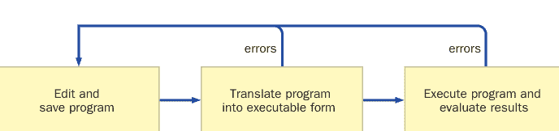

图 1.20 编辑和运行程序

图 1.20 展示了程序开发过程的一个基本视图。在编辑并保存程序后，你尝试将其从高级代码翻译成可以执行的形式。这种翻译可能会导致错误，在这种情况下，你需要返回编辑器修改代码以解决问题。一旦翻译成功，你就可以执行程序并评估结果。如果结果不是你所想要的，或者你想增强现有的程序，你将再次返回编辑器进行修改。

将源代码（最终）翻译为特定类型 CPU 的机器语言可以通过多种方式实现。`编译器`（`compiler`）是将代码翻译成另一种语言的等效代码的程序。原始代码被称为源代码，而它被翻译到的语言被称为目标语言。对于许多传统语言，源代码被直接翻译成机器语言。在这种情况下，翻译过程只发生一次（对于给定版本的程序），生成的可执行程序可以在任何时候运行。

`解释器`（`interpreter`）与编译器类似，但有一个重要的区别。解释器执行翻译和执行活动。源代码的一小部分（例如一条语句）被翻译并执行。然后另一条语句被翻译并执行，以此类推。这种技术的优势之一是消除了对独立编译阶段的需求。然而，程序运行得较慢，因为翻译过程发生在每次执行期间。

> 核心概念

`Java` 编译器将 `Java` 源代码翻译成 `Java` 字节码，字节码是程序的一种低级、与架构无关的表示形式。

翻译和执行 `Java` 程序的过程通常结合了编译器和解释器的使用。这一过程如图 1.21 所示。`Java` 编译器将 `Java` 源代码翻译成 `Java` 字节码，这是机器语言代码的低级形式。解释器读取 `Java` 字节码并在机器上执行。另一个编译器可以将字节码翻译成特定的机器语言，以便在机器上高效执行。

`Java` 字节码与真正的机器码的区别在于 `Java` 字节码不绑定到任何处理器类型。这种方法的独特优势是使 `Java` 具有架构无关，因此很容易在不同机器类型之间迁移。唯一的限制是，对于执行 `Java` 字节码的每个处理器类型，必须有一个 `Java` 解释器或字节码编译器。

由于编译过程将高级 `Java` 源代码翻译成低级表示，因此解释过程比直接解释高级代码更高效。通过解释字节码执行程序仍然比直接执行机器码慢，但对于大多数应用程序来说已经足够快了。注意，为了效率，`Java` 字节码可以被编译成机器码。

### 开发环境

软件开发环境是用于创建、测试和修改程序的工具集。某些开发环境免费提供，而另一些可能具有高级功能的环境则必须购买。某些环境被称为集成开发环境（`IDE`），它们将各种工具集成到一个软件程序中，并提供方便的图形用户界面。

任何开发环境都包含包含某些关键工具，例如 `Java` 编译器和解释器。有些环境会包含调试器，它可以帮助你发现程序中的错误。其他可能包含的工具还有文档生成器、归档工具以及帮助你可视化程序结构的工具。

`Java` 标准版的下载包包含 `Java` 开发工具包（`SDK`），有时也称为 `Java` 开发工具包（`JDK`）。`Java SDK` 包含了让 `Java` 程序运行所需的核心工具，但它并不是一个环境。编译和解释命令在命令行中执行。也就是说，`SDK` 没有图形用户界面（`GUI`）。它也不包含编辑器，尽管任何可以保存简单文本的内容都可以被编辑。

最流行的 `Java IDE` 之一是 `Eclipse`（见 `www.eclipse.org`）。`Eclipse` 是一个开源项目，这意味着它是由大量的程序员开发的并且是免费的。其他 `Java IDE` 包括 `jEdit` (`www.jed.org`)、`DrJava` (`drjava.sourceforge.org`)、`jGRASP` (`www.jgrasp.com`) 和 `BlueJ` (`www.bluej.org`)。

还有其他的 `Java` 开发环境。通过网络搜索可以发现几十。选择使用哪种开发环境非常重要。你对环境能力的了解越多，你在程序开发期间的效率就越高。

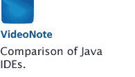

> 核心概念

存在许多开发环境来帮助你创建和修改 `Java` 程序。

### 语法与语义

每种编程语言都有其独特的语法。语言的语法规则规定了语言的词汇元素如何组合成语句。创建程序时必须遵循这些规则。我们已经讨论了若干条 `Java` 语法规则。例如，标识符不能以数字开头就是一个语法规则。使用大括号来开始和结束类和方法也是一个语法规则。附录 L 详细介绍了 `Java` 编程语言的基本语法规则，并在文中强调了特定的规则。

在编译期间，所有的语法规则都会经过检查。如果程序语法上不正确，编译器将发出错误信息且不会产生字节码。`Java` 的语法与 `C++` 相似，因此代码的外观和感受对熟悉这些语言的人来说是很熟悉的。语句的语义定义了执行该语句时会发生什么。编程语言通常是没有歧义的，这意味着每条语句只有一种一种解释。相反，人类用于通信的自然语言（如英语）充满了歧义。一个句子通常有多种含义。例如，考虑以下句子：

`Time flies like an arrow`

> 核心概念

语法决定程序的形式。语义决定程序的含义。

普通人类可能会将这句话解释为一种普遍观察：时间像箭一样移动得很快。然而，如果我们把 `time` 解释为动词（在“跑 50 米冲刺，我为你计时”中），并将 `flies` 解释为名词（`fly` 的复数），解释就完全改变了。我们知道通常不会这样解释，但它是对词汇的有效解释。计算机在试图确定想要什么含义时会遇到困难。此外，这句话还可以描述对被称为“时间蝇”的昆虫的喜好，这种蝇可能出现在箭场。毕竟果蝇喜欢香蕉。

### 错误

软件中会发生不同类型的问题，特别是在程序开发期间。计算机错误一词经常被误用，其含义取决于情况。从用户的角度来看，与机器交互时发生的任何故障都可以是计算机错误。例如，假设你信用卡支付了一项 23 元的项目，但当你收到账单时，该项目列出的是 230 元。在你解决问题后，信用卡公司为“计算机错误”道歉。计算机是随机在数字末尾添加了一个零，还是将其值乘以 10？计算机遵循我们给出的命令并处理我们提供的数据。如果我们的程序错了或数据不准确，我们就不能期望结果是正确的。描述这种情况的一种常用短语是“垃圾进，垃圾出”。

> 核心概念

程序员对程序的准确性和可靠性负责。

开发程序时，你会遇到三种错误：

- 编译时错误 (`compile-time error`)
- 运行时错误 (`run-time error`)
- 逻辑错误 (`logical error`)

## 1.5 程序开发

编译器会检查以确保你使用了正确的语法。如果你有任何不符合语言语法规则的语句，编译器将产生语法错误（`syntax error`）。编译器还会尝试寻找其他问题，例如使用了不兼容的数据类型。语法在技术上可能是正确的，但你可能正在尝试某些语言在语义上不允许的操作。编译器识别的任何错误都是编译时错误（`compile-time error`）。如果发生编译时错误，则不会创建程序的执行版本。

第二类问题发生在程序执行期间。它被称为运行时错误（`run-time error`），并会导致程序异常终止。例如，如果我们尝试除以零，程序将“崩溃”（`"crash"`）并并在该处停止执行。由于请求的操作是未定义的，系统直接放弃了继续运行你程序的尝试。最好的程序是健壮的；也就是说，尽可能避免所有的运行时错误。例如，程序代码可以防止除以零的可能性，并在情况发生时进行恰当的处理。在 `Java` 中，许多运行时问题是可以被捕获并相应处理的异常（`exceptions`）。

第三类软件问题是逻辑错误（`logical error`）。在这种情况下，软件可以编译并执行而没有任何报错，但它会产生错误的结果。例如，当计算出的值错误或者图形边界没有出现在正确的位置时，就会发生逻辑错误。程序员必须对程序进行彻底测试，将预期结果与实际发生的结果进行比较。发现缺陷后，必须将其追溯到代码中的问题根源并进行修正。在程序中发现并修正缺陷的过程被称为调试（`debugging`）。逻辑错误可能以许多形式出现，实际原因可能很难发现。

> 核心概念

> 程序必须在语法上是正确的，否则编译器不会产生字节码。


视频笔记：各种错误类型的示例。

### 自测习题（答案见附录 N）

- SR 1.27 我们知道计算机被用于执行复杂的任务。在这一节中，你学习了计算机的指令只能执行简单的任务。请解释这一矛盾。
- SR 1.28 高级语言与机器语言之间是什么关系？
- SR 1.29 什么是 `Java` 字节码？
- SR 1.30 从以下列表中选择与每个短语匹配的单词：汇编（`assembly`）、编译器（`compiler`）、高级（`high-level`）、`IDE`、解释器（`interpreter`）、`Java`、低级（`low-level`）、机器（`machine`）。

  a. 用这种语言编写的程序可以直接在计算机上运行。


# 第 1 章 引言

- b. 通常，这种语言中的每条语言指令都对应于等效机器语言指令。
- c. 大多数程序员使用这种语言编写他们的程序。
- d. `Java` 是这种语言的一个示例。
- e. 这种程序将一种语言的代码翻译成另一种语言的代码。
- f. 这种程序将代码的翻译和代码的执行交织在一起。

**SR 1.31** 我们说的编程语言的语法（`syntax`）和语义（`semantics`）是指什么？

**SR 1.32** 将以下每种情况分类为编译错误、运行时错误或逻辑错误。

- a. 写错 `Java` 保留字。
- b. 通过将列表数字之和（为零）除以列表的大小（也是零）来计算空数字列表的平均值。
- c. 在应该输出学生平均分时，打印了学生的高分成绩。

## 1.6 面向对象编程

正如本章早期提到的，`Java` 是一种面向对象的（`OO`）语言。正如其名所示，`对象` 是程序中的基本元素。面向对象的编程通过定义相互作用的对象来实现。面向对象的原则已经存在多年，主要是由于 `C++` 和 `Java` 等编程语言的发展。面向对象方法最吸引人的特性之一是对象可以有效地表示现实世界。我们可以使用一个对象来表示一个员工，以及许多行为。

> 核心概念

> 面向对象的编程有助于我们解决问题。

让我们讨论解决问题相关的通用问题，然后探索面向对象方法的特定特性。

### 问题解决

通常，解决问题包含多个步骤：

1. 理解问题。
2. 设计方案。
3. 考虑替代方案并完善方案。
4. 实现方案。
5. 测试方案并修复错误。

尽管这种方法适用于任何问题，但在开发软件时特别有效。第一步理解问题听起来显而易见，但我们必须彻底理解它。我们越早考虑替代方案，就越容易修改我们的方法。实现方案是将设计转化为可用的形式。通常人们将编程视为编写代码。但在大多数情况下，设计程序应该比写代码更有趣且更有创意。

### 面向对象软件原则

面向对象编程最终需要实理解以下术语：

- 对象（`object`）
- 属性（`attribute`）
- 方法（`method`）
- 类（`class`）
- 封装（`encapsulation`）
- 继承（`inheritance`）
- 多态（`polymorphism`）

除了这些术语，还有许多相关概念允许我们以无数方式定制解决方案。本书的设计旨在帮助你逐渐自然地演进对这些概念的理解。本节将从高层次概述这些思想，以建立术语并提供整体视图。

我们之前提到过 `对象` 是程序的基本元素。软件对象通常表示我们问题领域中的真实对象，例如银行账户。每个对象都有 `状态` 和一组 `行为`。我们说的“状态”是指存在状态——当前定义对象的根本特征。例如，银行账户的状态之一是其当前余额。对象的行为是与对象相关的活动。一个银行账户可能包括存款和取款的能力。

除了对象之外，`Java` 程序还管理原始数据。`原始数据` 包括基础值，如数字和字符。对象通常表示更有趣或更复杂的实体。

对象的属性是其内部存储的值，这些值可以表示为原始数据或其他对象。例如，一个银行账户对象可能会存储一个浮点数（原始值），用于代表账户余额。它还可能包含其他属性，例如账户所有者的姓名。对象的属性值共同定义了它的当前状态。

> 核心概念

> 每个对象都有一个状态（由其属性定义）和一组行为（由其方法定义）。

正如本章前面提到的，方法是一组被赋予了名称的编程语句。当方法被调用时，其内部语句就会被执行。一组方法与一个对象相关。对象的方法定义了它的潜在行为。为了定义向银行账户存款的能力，我们定义了一个包含若干编程语句的方法，这些语句将相应地更新账户余额。

对象是由类（`class`）定义的。类是创建对象时所依据的模型或蓝图。考虑一下建筑师在设计房屋时创建的蓝图。蓝图定义了房屋的属性特征——它的墙壁、窗户、门、电源插座等。一旦创建了蓝图，就可以用它来建造好几栋房子，如图 1.22 所示。

从某种意义上说，根据蓝图建造的房屋是不同的。它们位于不同的位置，有不同的地址，包含不同的家具，居住着不同的人。在许多方面，它们是“同一栋”房子。

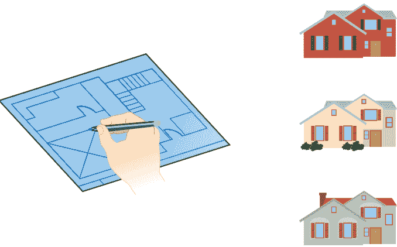

图 1.22 类用于创建对象，就像房屋蓝图被用于创建不同但相似的房屋一样

每栋房子的房间布局和其他关键特征是相同的。要创建一个不同的房子，我们需要一个不同的蓝图。

类是对象的蓝图。它确定了该类型对象将持有的数据类型，并定义了代表此类对象行为的方法。然而，类并不等于对象，正如蓝图不等于房子一样。通常情况下，类不包含存储数据的空间。每个对象都有存储自己数据的空间，这就是为什么每个对象都可以有自己的状态。

一旦定义了类，就可以从该类创建多个对象。例如，我们定义一个类来表示银行账户的概念，我们就可以创建多个代表特定、独立账户的对象。每个银行账户对象都会跟踪自己的余额。

> 核心概念

> 类是对象的蓝图。

> 可以从一个类定义中创建多个对象。


# 面向对象编程

对象应该是封装的，这意味着它会保护并管理自己的信息。也就是说，一个对象应该是自管理的。对对象状态的唯一更改应该通过对象的方法来实现。我们应该设计对象，使得其他对象无法“伸进去”并改变它们的状态。

可以使用继承（`inheritance`）从其他类创建新类。也就是说，一个类的定义可以基于另一个已经存在的类。继承是软件复用的形式，利用了我们可能想要创建的各种类之间的相似性。一个类可以用于派生几个新类。派生类随后可以用于派生更多的类。这创建了一个类的层次结构，其中在一个类中定义的属性和方法会被子类继承，子类又会将它们传递给它们的子类，以此类推。例如，我们可以创建一个表示各种类型账户的类层次结构。共同特征定义在高层类中，而特定差异定义在派生类中。

多态（`Polymorphism`）是指我们可以以一致的方式随时间引用多种类型的相关对象。它使我们能够为处理多个对象的问题设计出强大且优雅的解决方案。

图 1.23 展示了一些核心面向对象概念。我们不指望你现在就能完全理解这些内容。本书的大部分内容将阐述这些思想。此概述仅用于铺垫基础。

## 1.6 面向对象编程

- 类定义了对象的概念
- 多个对象可以从一个类创建

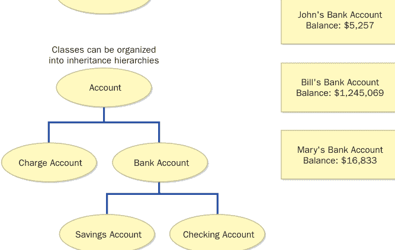

- 类可以组织成继承层次结构

图 1.23 核心面向对象概念

### 自测

- 执行一个程序需要哪五个步骤？（33）
- 面向对象的核心概念有哪些？（34）
- 为什么考虑多种方法很重要？（35）
- 开发环境如何帮助你创建 Java 程序？（36）

## 核心概念总结

- 程序必须被翻译成特定 CPU 的机器语言才能执行。
- 高级语言允许程序员忽略机器语言的细节。
- Java 编译器将 Java 源代码翻译成 Java 字节码，这是一种低级的与架构无关的表示形式。
- 存在许多开发环境可以帮助你创建 Java 程序。
- 语法规则规定程序的形式。语义规定了程序语句的含义。
- 程序员对程序的准确性和可靠性负责。
- Java 程序必须符合语法，否则编译器将无法生成字节码。
- 面向对象编程有助于解决问题，这是编写程序的目的。
- 程序设计涉及将解决方案拆分为可管理的区块。
- 每个对象都有一个状态（由其属性定义）和一组行为（由其方法定义）。
- 类是对象的蓝图。可以从一个类定义中创建多个对象。
- 世界范围网（The Web）是一种在网络上共享信息的软件。
- URL 唯一标识了 Web 上供浏览器获取的文档和其他信息。
- 本书侧重于面向对象编程的原则。
- 注释不会影响程序的处理；相反有助于理解。
- 内联文档应该为你的代码提供见解，而不应是模糊的或显而易见的。

# 练习

访问 `www.myprogramminglab.com` 在线完成许多练习题并获取即时反馈。

**EX 1.1** 描述你的个人电脑或你所访问的实验室计算机的硬件组件。包括处理器类型、主存和辅助存储的容量，以及 I/O 设备的类型。解释你是如何得出这些答案的。

**EX 1.2** 为什么我们在计算机上使用二进制数制来存储信息？

**EX 1.3** 以下每一项位宽可以表示多少个唯一项目？

- a. 1 bit
- b. 3 bits
- c. 6 bits
- d. 8 bits
- f. 10 bits
- g. 16 bits

**EX 1.4** 如果一张图片由 128 种可能的颜色组成，存储该图片的每个像素需要多少位？为什么？

**EX 1.5** 如果一种语言使用 240 个唯一的字母和符号，存储文档中的每个字符需要多少位？为什么？

**EX 1.6** 以下每项有多少个位？每项有多少个字节（byte）？

- a. 12 KB
- b. 5 MB
- c. 3 GB
- d. 2 TB

**EX 1.7** 解释随机存取（`RAM`）和只读存储（`ROM`）之间的区别。

**EX 1.8** 磁盘是一种随机访问设备，但它不是 `RAM`（随机存取）。解释原因。

**EX 1.9** 确定你的计算机或你访问的实验室计算机是如何通过网络连接到其他设备的。画一张图显示你环境中的基本连接。

**EX 1.10** 解释局域网（`LAN`）和广域网（`WAN`）之间的区别。它们之间的关系是什么？

**EX 1.11** 八台计算机的全连接点对点网络需要多少条通信线？九台计算机又需要？确定此结果的通用公式是什么？

**EX 1.12** 解释互联网（`Internet`）和万维网（`World Wide Web`）之间的区别。

**EX 1.13** 列出并解释以下 URL 的部分：

- a. 你的学校
- b. 你学校的计算机科学系
- c. 你老师的网页

**EX 1.14** 使用网络浏览器通过网络访问有关以下主题的信息。对于每个主题，解释你找到信息的过程并记录你找到的特定 URL。

- a. 费城人员棒队
- b. 加利福尼亚州的葡萄酒生产
- c. 两个大城市的地铁系统
- d. 加勒比地区的度假机会

**EX 1.15** 给出 Java 两种类型注释的示例以及它们之间的区别。

**EX 1.16** 以下哪些是有效的 Java 标识符？为什么？

- a. `Factorial`
- b. `anExtremelyLongIdentifierIfYouAskMe`
- c. `2level2`
- e. `MAX_SIZE`
- f. `highest$`
- g. `hook&ladder`

**EX 1.17** 为什么以下有效的 Java 标识符不被认为是良好的标识符？

- a. `q`
- b. `totVal`
- c. `theNextValueInTheList`

# 第1章 绪

**EX 1.18** Java 是区分大小写的。这意味着什么？

**EX 1.19** 当我们说英语具有歧义时是什么意思？给出两个英语歧义的例子（本章使用的示例之外）并解释其歧义。为什么歧义对于编程语言来说是一个问题？

**EX 1.20** 将以下每种情况归类为编译错误、运行时错误或逻辑错误。

- a. 当你想相加数字时却进行了乘法
- b. 除以零
- c. 忘记在编程语句结束加分号
- d. 在输出中拼写错误单词
- e. 产生不准确的结果
- f. 在应该输入 `(` 时却输入了 `{`

## 编程项目

访问 `www.myprogramminglab.com` 在线完成许多编程项目并获取即时反馈。

**PP 1.1** 输入、编译并运行以下代码：

```java
public class Test {
    public static void main(String[] args) {
        System.out.println("An Emergency Broadcast");
    }
}
```

**PP 1.2** 逐一向 PP 1.1 的程序引入以下错误。记录编译器产生的任何错误信息。在引入新错误之前，每次修复上一个错误。如果没有产生错误信息，请解释原因。在每次更改之前，尝试预测会发生什么。

- a. 将 `Test` 改为 `test`
- b. 将 `Emergency` 改为 `emergency`
- c. 移除字符串中的第一个引号
- d. 移除字符串中的最后一个引号
- e. 将 `main` 改为 `man`
- f. 将 `println` 改为 `bogus`
- g. 移除 `println` 语句末尾的分号
- h. 移除程序中的最后一个括号

**PP 1.3** 编写一个应用程序，分行打印你的名字、生日、爱好、你最喜欢的书和最喜欢的电影。在输出中为每项信息标记标签。

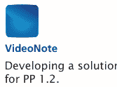

**PP 1.4** 编写一个应用程序，打印短语 Knowledge is Power（知识就是力量）：

a. 在一行内
b. 在两行内
c. 在三行内

**PP 1.5** 编写一个应用程序，打印你喜欢的食物以及喜欢它的原因。

**PP 1.6** 编写一个应用程序，打印你喜欢的电影以及喜欢它的原因。

**PP 1.7** 编写一个应用程序，打印你喜欢的书以及喜欢它的原因。

**PP 1.8** 编写一个应用程序，打印你喜欢的爱好以及喜欢它的原因。

**PP 1.9** 编写一个应用程序，打印你喜欢的地点以及喜欢它的原因。

**PP 1.10** 编写一个应用程序，打印你喜欢的颜色以及喜欢它的原因。

`http://avaxhome.ws/blogs/ChrisRedfield`

# 2.1 字符字符串

`System.out` 对象还提供了另一个我们可以使用的服务：`print` 方法。`print` 和 `println` 之间的区别很小但很重要。`println` 方法打印发送给它的信息，然后移动到下一行的开头。`print` 方法与 `println` 类似，但在完成后不会移动到下一行。

> **核心概念**
>
> `print` 和 `println` 方法代表了 `System.out` 对象提供的两种服务。

列表 2.1 所示的程序被称为 Countdown，它调用了 `print` 和 `println` 方法。

仔细比较程序底部显示的 Countdown 程序输出与代码。注意，单词 Liftoff 打印在与前几个单词打印在同一行，尽管它是使用 `println` 方法打印的。请记住，`println` 方法在传递给它的参数打印后，会移动到下一行的开头。

**LISTING 2.1**

```java
//****************************************************************
// Countdown.java             Author: Lewis/Loftus
// 展示了 print 和 println 之间的区别。
//****************************************************************
public class Countdown {
    // 打印两行代表火箭倒计时的输出。
    public static void main (String[] args) {
        System.out.print("Three... ");
        System.out.print("Two... ");
        System.out.print("One... ");
        System.out.print("Zero... ");
        System.out.println("Liftoff!"); // 出现在第一行输出
        System.out.println("Houston, we have a problem.");
    }
}
```

**OUTPUT**

```
Three... Two... One... Zero... Liftoff!
Houston, we have a problem.
```

### 字符串拼接

字符串字面量在程序中不能跨多行。下面的程序语句是错误的语法，在尝试编译时会产生错误：

```java
// 以下语句将无法编译
System.out.println("The only stupid question is
the one that is not asked.");
```

当我们想要打印一个太长而无法放入程序单行的字符串时，我们可以依靠字符串拼接将一个字符串附加到另一个字符串的末尾。字符串拼接运算符是加号（`+`）。下面的表达式将一个字符连接到另一个字符，产生一个字符串：

> "The only stupid question is " + "the one that is not asked."

列表 2.2 所示的名为 Facts 程序包含了 `println` 语句。第一个语句打印了一个较长且不适合程序单行的句子。由于字符字面量在程序中不能跨行，我们将字符串拆分为两部分并使用字符串拼接将它们连接。第一个 `println` 语句中的字符串拼接操作产生一个大字符串，并传递给该方法进行打印。

注意，我们不需要向 `println` 方法传递任何信息，如 Facts 程序的第二行所示。此调用不打印任何字符，但它会移动到输出行输出。在这种情况下，调用不带参数的 `println` 效果是打印一个空行。

Facts 中的最后三次 `println` 的调用展示了关于字符串拼接的另一个有趣现象：字符串可以与数字拼接。这些行中的数字没有被双引号括起来，也不是字符字符串。在这种情况下，数字会自动转换为字符串，然后两个字符串进行拼接。

由于我们正在打印特定的值，我们完全可以将数值值包含在字符串字面量中，例如：

> "Speed of ketchup: 40 km per year"

数字是字符，可以根据需要包含在字符串中。我们在 Facts 程序中将它们分开是为了演示拼接字符串和数字的能力。这种技术在接下来的示例中将非常有用。

正如你可以想象的，`+` 运算符也用于算术加法。因此，`+` 运算符取决于它的数据类型

**LISTING 2.2**

```java
//********************************************************************
// Facts.java             Author: Lewis/Loftus
// 展示了字符串拼接运算符的使用以及
// 到字符串的自动转换。
//********************************************************************
public class Facts
{
    // 打印各种事实。
    public static void main(String[] args) {
        // 字符串可以拼接成一个长字符串
        System.out.println("We are the following facts for your "
            + "extracurricular edification:");

        System.out.println("The Hawaiian alphabet: " + 12);

        System.out.println("Dialing code: " + 67);

        System.out.println("Year in which Leonardo da: " + 15);

        System.out.println("Speed of ketchup: " + 40);
    }
}
```

**OUTPUT**

```
We are the following facts for your extracurricular edification:
The Hawaiian alphabet: 12
Dialing code: 67
Year in which Leonardo da: 15
Speed of ketchup: 40
```

## 2.1 字符字符串

感，产生结果 69。然后数字与字符串拼接，产生一个更大的字符串并进行打印。

我们将在本章的晚后部分重新讨论这种情况，届时我们将形式化定义运算符获取顺序的优先级规则。

# 转义序列

由于 Java 语言中使用双引号字符（`""`）来指示字符串的开始和结束，因此我们必须使用特殊技术来打印引号字符。如果我们简单地将其放在字符串中（`""`），编译器就会感到困惑，因为它认为第二个字符是字符串的结束，并且不知道该如何处理第三个字符。这会导致编译时错误。

为了解决这个问题，Java 定义了几个转义序列来表示特殊字符。转义序列以反斜杠字符（`\`）开头，这表示后面的字符应该以特殊方式解释。图 2.1 列出了这些转义序列。

列表 2.4 所示的名为 Roses 的程序打印了一些类似于诗的文本。尽管这首诗有几行，但它只使用了一个 `print` 语句来实现。整个字符串中使用了转义序列。`\n` 转义序列强制输出到新的一行，`\t` 转义序列表示制表符。`\"` 转义序列确保引号字符被视为字符串的一部分，而不是结束符，使其能够作为输出的一部分被打印。

| 转义序列 | 含义 |
| --- | --- |
| `\b` | 退格 |
| `\t` | 制表符 |
| `\n` | 换行 |
| `\r` | 回车 |
| `\"` | 双引号 |
| `\'` | 单引号 |
| `\\` | 反斜杠 |

图 2.1 Java 转义序列

**LISTING 2.4**

```java
//********************************************************************************
// Roses.java    作者: Lewis/Loftus
//
// 演示了转义字符的使用。
//********************************************************************************
public class Roses {
    // 在多行上打印一首（某种）诗。
    public static void main(String[] args) {
        System.out.println("Roses are red,\n\tViolets are blue,\n\" + \
        "Sugar is sweet,\n\tBut I have \"\tcommitment issues\",\n\" + \
        "So I'd rather just be friends\n\tAt this point in our \" + \
        "relationship.");
    }
}
```

**OUTPUT**

```
Roses are red,
	Violets are blue,
"Sugar is sweet,
	But I have "	commitment issues",
"So I'd rather just be friends
	At this point in our "relationship.
```

- 自习题（答案见附录 N）

**SR 2.1** 什么是字符串字面量？

**SR 2.2** `print` 方法和 `println` 方法之间有什么区别？

**SR 2.3** 什么是参数？

**SR 2.4** 下述代码段产生什么输出？

```java
System.out.println("One ");
System.out.print("Two ");
System.out.println("Three ");
```


## 2.2 变量与赋值


# SR 2.5 下述代码段产生什么输出？

```
System.out.print("Ready ");
System.out.println();
System.out.println(" Set ");
System.out.println();
System.out.println("Go ");
```

# SR 2.6 下述语句产生什么输出？如果移除内部圆括号会怎样？

```
System.out.println("It is good to be " + (5 + 5));
```

# SR 2.7 什么是转义字符？举例说明。

# SR 2.8 编写单条语句，按所示精确输出内容（包括换行符和引号）。

> “我把这封信写得比平时长，是因为我没有时间把它写短。”
>
> —— 布莱斯·帕斯卡（Blaise Pascal）

# 2.2 变量与赋值

程序中管理的大部分信息由变量表示。让我们研究如何在程序中声明和使用它们。

## 变量

变量是内存中位置的名称，用于存储数据值。变量声明指示编译器预留足够存储特定类型值的内存空间，并指示我们引用该位置的名称。

考虑列表 2.5 所示的 `PianoKeys` 程序。`main` 方法的第一行是一个命名变量的声明，该变量存储一个整数（`int`）值。声明还为 `keys` 赋予了初始值 88。如果没有为变量指定初始值，则该值是未定义的。如果你在显式给变量赋值之前尝试使用它，Java 编译器会给出错误或警告。

`keys` 变量及其值可以想象如下：

> **核心概念**
>
> 变量是用于存储特定数据类型值的内存位置的名称。

| 88 |
| :--- |

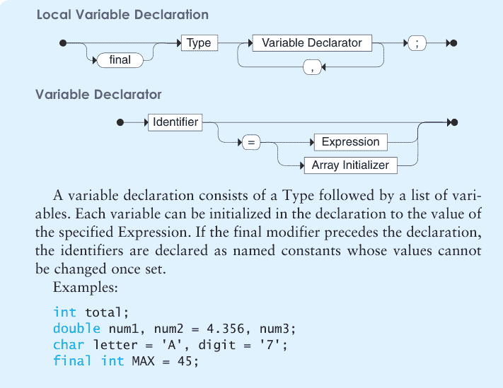

变量声明由一个类型（`Type`）后跟变量列表组成。每个变量都可以在声明中初始化为指定表达式（`Expression`）的值。如果最终修饰符位于声明之前，则标识符被声明为命名常量，其值一旦设定就无法更改。

示例：

```java
int total;
double num1, num2 = 4;
char letter = 'A', digit = '7';
final int MAX = 5;
```

### LISTING 2.5

```java
// PianoKeys.java      作者: Lewis/Loftus
//
// 演示了整数变量的声明、初始化和使用。

public class PianoKeys {

    // 打印键的数量。

    public static void main(String[] args) {
        int keys = 88;
        System.out.println(keys);
    }
}
```

### 输出

```
88
```

变量声明由一个类型（`Type`）后跟变量列表组成。每个变量都可以在声明中初始化为指定表达式（`Expression`）的值。如果最终修饰符位于声明之前，则标识符被声明为命名常量，其值一旦设定就无法更改。

`PianoKeys` 程序输出 88。在 `PianoKeys` 程序中，当引用变量时，值不会改变。当给变量赋值新值时，旧值会被覆盖。基本赋值使用赋值运算符（`=`）将表达式（`Expression`）的结果存储到变量中。

```java
total = 5;
count = count + 1;
value = min / 2;
```

Java 语言是*强类型*的（strongly typed），这意味着我们不允许为与其声明类型不一致的变量赋值。尝试组合不兼容的类型会在你尝试编译程序时会生成错误。

> **核心概念**
> 不允许将不兼容类型的值赋值给变量。

## 常量

有时我们会使用在整个程序过程中保持不变的数据。例如，我们可能会编写一个处理容量不超过 427 人的剧院的程序。为常量值命名（例如 `MAX_OCCUPANCY`）比在整个代码中使用字面量值（例如 `427`）要有帮助。对于阅读代码的人来说，字面量值 427 的目的和意义通常令人困惑。通过命名，你可以帮助解释它在程序中的作用。

常量是标识符，与变量相似，不同之处在于它们在存在期间保持特定的值。它们的值不会改变。

在 Java 中，如果你在声明之前加上保留字 `final`，该标识符就是一个常量。按照惯例，命名常量时使用大写字母以与普通变量区分开。

> **核心概念**
> 常量在存在期间保持特定的值。

通常使用下划线字符进行分隔。例如，描述剧院最大容纳人数的常量可以如下声明：

```java
final int MAX_OCCUPANCY = 427;
```

如果你尝试在常量被赋予初始值后更改它的值，编译器将产生错误信息。这是使用常量的另一个良好理由。常量可以防止无意的编码错误，因为更改其值的唯一合法地方是在初始赋值。

使用常量的还有第三个良好理由。如果一个常量在整个程序中使用并且需要修改其值，那么你只需要在一个地方进行更改即可。例如，如果剧院的容量发生了变化（从 427 变为 535），你只需要修改一处声明，所有使用 `MAX_OCCUPANCY` 的都会反映这一变化。如果在代码中处处使用字面量（literal），就会出现潜在的问题。

# 自测（答案见附录）

- 2.9 什么是变量声明？
- 2.10 鉴于以下变量声明，请回答每个问题：

```java
int count = 0, total;
final int MAX_VALUE = 100;
int myValue = 50;
```

a. 声明了多少个变量？
b. 这些变量的类型是什么？
c. 哪些变量被赋予了初始值？
d. 根据上述声明，以下赋值合法吗？`myValue = 100;`
e. 根据上述声明，以下赋值合法吗？`MAX_VALUE = 50;`

- 2.11 你的程序需要一个 `int` 类型变量来存储集合中 CD 的数量。初始值应为零。为该变量编写一条声明语句。
- 2.12 你的程序需要一个 `int` 类型变量来存储一英里的英尺数（5280）。为该变量编写一条声明语句。
- 2.13 描述在程序中使用常量代替字面量的三个理由。

# 2.3 原生类型

Java 中有八种原生类型：四种整数子集、两种浮点数子集、一个字符数据类型和一个布尔类型。所有内容都使用对象来表示。让我们详细检查这八种原生类型。

## 整数与浮点数

Java 有两种基本的数值类型：没有小数部分的整数，以及带有小数部分的浮点数。共有四种整数类型（`byte`、`short`、`int`、`long`）和两种浮点数类型（`float` 和 `double`）。所有数值类型的区别在于存储数值时占用的内存量。每种数据类型的大小在所有平台上都是相同的。所有数值类型都是符号的，这意味着它们都可以存储正值和负值。回想我们在第 1 章中的讨论，一个位可以是 1 也可以是 0。每个位可以表示两个值，一个 N 位的位串可以表示 2^N 个值。附录 B 更详细地描述了数值系统。

在设计程序时，我们有时需要小心选择大小合适的变量，以免浪费内存。这发生在内存受限的情况下，例如运行在 PDA 上的程序。在这些情况下，我们可以相应地选择变量的数据类型。例如

| 类型 | 存储 | 最小值 | 最大值 |
| :--- | :--- | :--- | :--- |
| `byte` | 8 位 | -128 | 127 |
| `short` | 16 位 | -32,768 | 32,767 |
| `int` | 32 位 | -2,147,483,648 | 2,147,483,647 |
| `long` | 64 位 | -9,223,372,036,854,775,808 | 9,223,372,036,854,775,807 |
| `float` | 32 位 | 约 -3.4E+38，保留 7 位有效数字 | 约 3.4E+38，保留 7 位有效数字 |
| `double` | 64 位 | 约 -1.7E+308，保留 15 位有效数字 | 约 1.7E+308，保留 15 位有效数字 |

> **核心概念**
> Java 有两种数值类型：整数和浮点。共有四种整数数据类型和两种浮点数据类型。

如果数值在 -32,768 到 32,767 的范围之内，那么双字节整数（`short`）就足够容纳它。另一方面，尚不清楚特定变量的范围将会是多少；我们应该提供合理的、甚至是慷慨的空间。在大多数情况下，内存空间并不是限制，我们可以轻松地承担慷慨的假设。

注意，尽管 `float` 支持非常大（和非常小）的数字，但它只有七位有效数字。因此，如果保持像如 50341.2077 这样的值很重要，那么我们需要使用 `double`。

正如我们已经讨论过的，字面量（literal）是程序中使用的显式数据值。如 `Facts` and `Addition` 和 `PianoKeys` 等程序使用的数字是整数字面量。Java 假设所有整数字面量都是 `int` 类型，除非在后面附加 `L` 以指示它被视为 `long` 类型字面量，例如 `45L`。

同样，要意识到所有浮点字面量都是 `double` 类型。如果我们需要将浮点字面量视为 `float`，我们可以在值的末尾附加 `F` 或 `f`，例如 `2.718f` 或 `123.45f`。根据需要，`double` 类型数值字面量后面可以跟随 `d` 或 `D`。

字符字面量在 Java 程序中用单引号表示，例如 `'b'` 或 `'j'`。你会记得字符串字面量使用双引号界定，且 `String` 类型不是原生类型；它是一个类。我们将详细讨论 `String` 类。

字符是计算机使用的另一种基本数据类型。单个字符可以被视为单独的数据项，正如我们在几个示例中看到的，它们可以组合成字符字符串。一个字符是一个数值值（字符串的一部分）。

我们可以定义的字符由字符集管理，字符集只是按特定顺序排列的列表。每种编程语言支持一种特定的字符集，定义该语言字符变量的有效值。虽然提过许多字符，但多年来只有少数一直在使用。ASCII 字符集是一个流行的选择。ASCII 代表信息交换标准代码。基础 ASCII 每个字符使用七位，提供的空间支持 128 个不同的字符：

- 大写字母，如 `'A'`、`'B'` 和 `'C'`
- 小写字母，如 `'a'`、`'b'` 和 `'c'`
- 标点符号，如句号 (`.`) 、分号 (`;`)
- 数字 `'0'` 到 `'9'`
- 空格字符 `' '`
- 特殊符号，如安培符号 (`&`)、竖线 (`|`) 和反斜杠 (`\`)
- 控制字符，如回车和文本结束字符

控制字符有时是非打印或不可见的字符，因为它们没有特定的符号来表示。它们与任何其他字符一样有效，并以相同的方式存储和使用。许多控制字符对某些软件应用程序有特殊含义。

以下是 Java 中字符声明的示例：

```java
char answer = '4'; // 注：原文示例 '42' 非法，char 只能存单字符
byte smallNumber = 2; // 注：原文示例 '2' 为字符，此处修正为数值赋值
long countedStars = 5; // 注：原文示例 '5' 为字符，此处修正为数值赋值
float ratio = 0.2f; // 注：原文示例 '0.2' 为字符，此处修正为数值赋值
double delta = 1.0; // 注：原文示例 '1' 为字符，此处修正为数值赋值
```


然而，即使有 256 个字符，ASCII 字符集也无法表示字母，特别是考虑到各种亚洲字母及其数千个表意字。因此，Java 语言的开发者选择了 Unicode 字符集，每个字符使用 16 位，支持 65,536 个唯一字符（技术允许使用多个字节表示更多字符）。许多语言的字符和符号都包含在 Unicode 定义中。ASCII 是 Unicode 字符集的子集，包含前 256 个字符。附录 C 详细讨论了 Unicode 字符集。

字符集为每个字符分配一个特定的数字，根据定义字符按照特定的顺序排列，即字典序（lexicographic order）。在 ASCII 和 Unicode 编码中，数字 `'0'` 到 `'9'` 是连续的（没有其他字符干扰）且是有序的；小写字母 `'a'` 到 `'z'` 是连续的，大写字母 `'A'` 到 `'Z'` 也是如此。这些特性使得按字母顺序保持内容相对容易。

在 Java 中，`char` 代表单个字符。以下是 Java 中变量声明的示例：

```java
char topGrade = 'A';
char symbol11, symbol12, symbol13;
char terminator = ';', separator = ' ';
```

## 布尔值

布尔值在 Java 中使用保留字 `boolean` 定义，只有两个值：`true`（真）和 `false`（假）。布尔值通常用于指示特定条件是否为真，也可以表示任何具有两种状态的情况，例如灯的开启或关闭。

布尔值不能转换为任何其他数据类型，任何其他数据类型也不能转换为布尔值。`true` 和 `false` 词在 Java 中保留为布尔字面量，不能在上下文之外使用。

以下是 Java 中布尔变量声明的示例：

```java
boolean flag = true;
boolean too, tooSmall, tooRough;
boolean done = false;
```


### 自习题（答案见附录 N）

SR 2.14 什么是原始数据？原始数据类型与对象之间有什么区别？

## 2.4 表达式

- SR 2.15 整数变量可以存储多少个值？
- SR 2.16 Java 中的四种整数数据类型是什么？它们有什么不同？
- SR 2.17 Java 自动为整数字面量分配什么类型？你如何指示一个整数字面量应该被视为不同的类型？
- SR 2.18 Java 自动为浮点字面量分配什么类型？你如何指示一个浮点字面量应该被视为不同的类型？
- SR 2.19 什么是字符集？
- SR 2.20 ASCII 字符集、扩展 ASCII 字符集和 Unicode 字符集支持多少字符？

表达式是一个或多个运算符和操作数的组合，通常用于计算。计算出的值不一定是数字，但通常是。操作中使用的操作数可以是字面量、常量、变量或其他数据源。表达式的评估和使用方式是编程的基础。现在我们将关注使用数值操作数并产生数值结果的表达式。

> **核心概念**：表达式是用于执行计算的运算符和操作数的组合。

### 算术运算符

通常算术运算适用于整数和浮点数值类型，包括加法 (`+`)、减法 (`-`)、乘法 (`*`) 和除法 (`/`)。Java 还有另一种算术运算：取余运算符 (`%`)，返回第二个操作数除以第一个操作数后的余数。余数有时被称为取模运算符。余数运算的符号是分子的符号。因此：

| 操作 | 结果 |
| --- | --- |
| `17 % 4` | `1` |
| `-20 % 3` | `-2` |
| `10 % -5` | `0` |
| `3 % 8` | `3` |

正如你预期的那样，如果数值运算符的一个或两个操作数是浮点值，则结果是浮点值。然而，除法运算符产生的结果不那么直观，取决于操作数的类型。如果两个操作数都是整数，`/` 运算符执行整数除法，这意味着结果的任何分数部分都会丢弃。如果其中一个是浮点值，`/` 则执行浮点除法。

一元运算符只有一个操作数，而二元运算符有两个操作数。一元运算符在 Java 中很少使用。

Java 没有内置用于幂的运算符。`Math` 类提供了幂的方法。`Math` 类将在第 3 章讨论。

特定表达式的评估可以使用表达式树来显示，如图 2.3 所示。运算符从底部向上执行，创建用于表达式其余的值。因此，树底部的操作优先级高于上方操作，并强制更早执行。

### 运算符优先级

任何相同优先级的算术运算符从左到右执行。因此我们说算术运算符具有从左到右的结合（association）。

然而，可以通过括号在表达式中强制执行优先级。例如，如果我们真的想在以前的例子中先执行加法，可以这样写表达式：

```
result = (14 + 8) / 2;
```

任何括号中的表达式都会被评估。在复杂的表达式中，即使严格不需要，使用括号也是良好的做法，以明确如何评估表达式。

括号可以嵌套，并评估最内部的表达式。考虑以下表达式：

```
result = 3 * (18 - 4) / 2;
```

在这个例子中，结果是 21。首先执行减法，由内部括号强制。然后尽管乘法和除法处于相同的优先级且通常从左到右执行，但由于外部括号，先执行除法。最后执行乘法。

在算术运算完成后，计算出的结果存储在赋值运算符左侧的变量中。换句话说，赋值运算符的优先级低于任何算术运算符。

所有表达式都根据建立执行规则的运算符层次结构进行评估。算术运算符通常遵循你在代数中学习的规则：除法和取余运算符具有相同的优先级，并且在加法和减法之前执行。加法和减法具有相同的优先级。

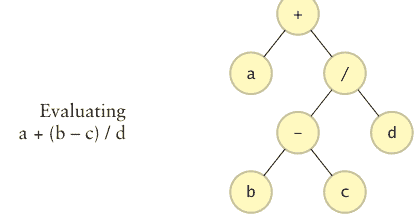

图 2.3 表达式树

# 第 2 章 数据与表达式

| 优先级级别 | 运算符 | 操作 | 结合性 |
| --- | --- | --- | --- |
| 1 | `+` | 一元加法 | 从右到左 |
| | `-` | 一元减法 | |
| 2 | `*` | 乘法 | 从左到右 |
| | `/` | 除法 | |
| | `%` | 取余 | |
| 3 | `+` | 加法 | 从左到右 |
| | `-` | 减法 | |
| | `+` | 字符串拼接 | |
| 4 | `=` | 赋值 | 从右到左 |

图 2.4 某些 Java 运算符之间的优先级

在表达式中使用的括号本身实际上就是运算符。括号的优先级高于几乎任何其他运算符。图 2.4 显示了包含算术运算符、括号和赋值运算符之间关系的表格。附录 D 包含一个显示所有 Java 运算符的完整优先级表。

为了使表达式在语法上是正确的，左括号的数量必须与右括号的数量匹配，并且它们必须正确嵌套。以下示例是无效的：

```
result = (19 + 8) % 3 - 4); // 无效
result = (19 - 8) % 3 - 4); // 无效
```

记住，当表达式中引用变量时，将使用其当前值进行计算。在赋值语句中，变量的当前值加上变量 `total` 的当前值，结果存储在变量中：

```
sum = count + total;
```

在赋值之前，`sum` 中包含的原始值会被计算出的值覆盖。`count` 和 `total` 中存储的值不会改变。

同一个变量可以出现在赋值语句的左侧和右侧。假设在执行赋值语句时，变量 `count` 的当前值为 15：

```
count = count + 1;
```

由于右侧表达式先求值，因此获得了 `count` 的原始值并对其加 1，产生结果 16。然后将该结果存储在变量 `count` 中，用新值 16 覆盖原始值 15。因此，这条赋值语句增加了变量 `count`（或给变量 count 加 1）。

让我们来看另一个表达式处理的示例。列表 2.7 中的程序名为 `TempConverter`，它使用一个计算公式的表达式将摄氏度转换为等值的华氏度值：

Fahrenheit = \frac{9}{5} Celsius + 32

# 列表 2.7

```
************************************************************************************
// TempConverter.java      作者: Lewis/Loftus
// 展示了基本数据类型和算术
// 表达式的使用。
************************************************************************************
public class TempConverter
{
    // 使用公式 F = (9/5)C + 32 计算
    // 特定摄氏度值的等值华氏度。
    public static void main(String[] args) {
        final int BASE = 32;
        final double CONVERSION_FACTOR = 9.0 / 5.0;
        double fahrenheitTemp;
        int celsiusTemp = 24; // 要转换的值
        fahrenheitTemp = celsiusTemp * CONVERSION_FACTOR + BASE;
        System.out.println("Celsius Temperature: " + celsiusTemp);
        System.out.println("Fahrenheit Equivalent: " + fahrenheitTemp);
    }
}
```

### 输出

Celsius Temperature: 24
Fahrenheit Equivalent: 75.2

# 第 2 章 数据与表达式

注意，在温度转换程序中，除法操作的操作数是浮点字面量，以保留数字的小数部分。优先级规则规定，在最终转换计算中，乘法发生在加法之前。

`TempConverter` 程序作为常量并不非常有用，因为它只转换了我们在程序中作为常量包含的一个数据值（24 摄氏度）。

### 增减运算符

增减运算符在表达式中使用的形式有两种。加法运算符 (`++`) 将变量值加 1，减法运算符 (`--`) 则减去 1。它们是一元运算符。加法运算符 (`++`) 会将变量值加 1，而减法运算符 (`--`) 类似，只是它减去 1。加法运算符 (`++`) 会将结果存回变量，例如：

```
count++;
```

加法运算符 (`++`) 可以作为后缀形式（例如 `count++`）或前缀形式（例如 `++count`）。减法运算符 (`--`) 也可以作为后缀形式（例如 `count--`）或前缀形式（例如 `--count`）。它们的区别取决于使用的形式。

### 赋值运算符

为了方便，Java 定义了多种赋值运算符，将基本操作与赋值相结合。例如，`+=` 运算符可以如下：

```
total += 5;
```

这与以下语句的操作相同：

```
total = total + 5;
```

Java 定义了类似的赋值运算符，包括 `-=`、`*=`、`/=` 和 `%=`。所有 Java 运算符见附录 D。

所有的赋值运算符都会求值右侧表达式，然后将结果作为该操作的左操作数。因此，以下语句：

```
result *= count1;
```

等于：

```
result = result * count1;
```

同样，以下语句：

```
result %= (highest - 40) / 2;
```

等于：

```
result = result % ((highest - 40) / 2);
```

某些赋值运算符根据操作数的类型执行特定的功能，正如普通运算符一样。例如，如果 `+=` 运算符的操作数是字符串，则赋值运算符执行拼接。

### 自测题（答案见附录 N）

SR 2.21 在 Java 表达式中求值时，`19%5` 的结果是什么？解释。

SR 2.22 在 Java 表达式中求值时，`13/4` 的结果是什么？解释。

SR 2.23 如果整数 `diameter` 当前值为 5，执行以下语句后其值是多少？解释。

```
diameter = diameter * 4;
```

SR 2.24 运算符优先级是什么？

SR 2.25 下列每个表达式的值是多少？

a. `15 + 7 * 3`
b. `(15 + 7) * 3`
c. `3 * 6 + 10 / 5 + 5`
d. `27 % 5 + 7 % 3`
e. `100 / 2 / 2 / 2`
f. `100 / (2 / 2) / 2`

SR 2.26 对于下列表达式，说明它们有效还是无效。如果无效，请解释原因。

a. `result = (5 + 2);`
b. `result = (5 + 2 * (15 - 3));`
c. `result = (5 + 2 (;`
d. `result = (5 + 2 * (4));`

## 2.5 数据转换

SR 2.27 在执行以下语句序列后，整数变量 `result` 包含什么值？

```
result = 27;
result = result + 3;
result = result / 7;
result = result * 2;
```

SR 2.28 在执行以下语句序列后，整数变量 `result` 包含什么值？

```
int base;
int result;
base = 5;
result = base + 3;
base = 7;
```

SR 2.29 什么是赋值运算符？

SR 2.30 如果一个整数变量当前持有值 100，在执行以下语句后，它的值会变成什么值？请解释原因。

```
weight -= 17;
```

## 2.5 数据转换

Java 是一种强类型语言，每个数据值都与一个特定的类型相关联。有时将一种类型的数据值转换为另一种类型是有帮助的或必要的，但我们必须小心，不要在此过程中丢失信息。例如，假设将一个持有数字 1000 的短型变量 (`short`) 转换为字节型 (`byte`)。由于字节没有足够的位来表示值 1000，在转换过程中将丢失某些位，字节中表示的数字将无法保持其原始值。

从一种原始类型到另一种原始类型的转换分为两类：宽转换（widening conversions）和窄化转换（narrowing conversions）。宽转换是安全的，因为它们通常不会丢失信息。它们被称为宽转换，是因为它们从一种数据类型转换为另一种具有相等或更大存储空间的类型。2.5 节列出了 Java 的宽转换。

例如，从字节转换为短型是安全的，因为字节存储在 8 位中，而短型存储在 16 位中。这没有信息丢失。所有从整数类型到另一种整数类型，或从浮点类型到另一种浮点类型的宽转换，都能够精确地表示该数值。

# 第 2 章 数据与表达式

| 源 | 目标 |
| --- | --- |
| `byte` | `short`, `int`, `long`, `float`, 或 `double` |
| `short` | `int`, `long`, `float`, 或 `double` |
| `char` | `int`, `long`, `float`, 或 `double` |
| `int` | `long`, `float`, 或 `double` |
| `long` | `float` 或 `double` |
| `float` | `double` |

图 2.5 Java 宽转换


虽然宽转换不会丢失任何关于数值大小的信息，但导致浮点值的宽转换可能会丢失精度。当从 `int` 或 `long` 转换为 `float` 或 `double` 时，某些低位数字可能会丢失。在这种情况下，生成的浮点值将是整数值的舍入版本，遵循 IEEE 754 浮点标准中定义的舍入技术。

窄化转换比宽转换丢失更多信息。它们通常是从一种类型到另一种使用较少空间存储值的类型，因此某些信息可能会受损。窄化转换可能会丢失数值大小和精度。因此，通常情况下应该避免使用它们。图 2.6 列出了 Java 的窄化转换。

窄化转换中空间缩减情况的一个例外是当我们从字节（8 位）转换为短型（16 位）或字符（16 位）时。这些仍然属于

| 源 | 目标 |
| --- | --- |
| `byte` | `char` |
| `short` | `byte` or `char` |
| `char` | `byte` or `short` |
| `int` | `byte`, `short`, `char` |
| `long` | `byte`, `short`, `char`, `int` |
| `float` | `byte`, `short`, `char`, `int`, `long` |
| `double` | `byte`, `short`, `char`, `int`, `long`, `float` |

图 2.6 Java 窄化转换

## 2.5 数据转换

被视为窄化转换，因为符号位被整合进了新的字符值。由于字符值是无符号的，负整数将转换为一个与原始整数数值值没有特定关系的字符。


注意，宽转换或窄化转换中均未提到布尔（`boolean`）。布尔值不能转换为任何其他原始类型，反之亦然。

### 转换技术

在 Java 中，转换可以通过三种方式发生：

- 赋值转换
- 提升（`promotion`）
- 强制转换（`casting`）

当一种类型的值赋值给另一种类型的变量时，会发生赋值转换，期间该值被转换为新类型。只有宽转换可以通过赋值完成。例如，如果 `money` 是一个 `float` 变量而 `dollars` 是一个 `int` 变量，以下赋值语句会自动将 `dollars` 的值转换为 `float` 的 `dollars`：

```
money = dollars;
```

因此，如果 `dollars` 包含值 25，赋值后 `money` 包含值 25.0。然而，如果我们尝试将 `money` 赋值给 `dollars`，编译器将发出错误，提醒我们正尝试进行可能丢失信息的窄化转换。如果我们真的想这样做，可以通过使用强制转换来完成转换。

当某些运算符需要修改其操作数以执行操作时，通过提升完成的转换会自动发生。例如，如果一个浮点值 `sum` 除以一个整数值 `count`，在进行除法之前，`count` 的值会自动提升为浮点值，从而产生一个浮点结果：

```
result = sum / count;
```

当数字与字符串拼接时，也会发生类似的转换。数字首先被转换为（提升为）字符串。

强制转换是最通用的转换形式。它通过在待转换值前放置括号来指定。例如，将 `money` 转换为整数，我们可以这样做：

```
result = (int) money;
```

首先，强制转换返回该值的截断版本。如果没有使用强制转换，该操作将执行整数除法。

### 自测（见附录）

- SR 2.31 为什么宽转换比窄化转换安全？
- SR 2.32 识别以下转换是宽转换还是窄化转换：
    a. `int` 到 `long`
    b. `int` 到 `byte`
    c. `short` 到 `char`
    d. `byte` 到 `double`
    e. `short` 到 `int`
- SR 2.33 假设一个 `float` 变量持有值 100，且 `result` 是一个 `int` 变量，在执行以下语句后变量的值是多少？请解释原因。

```
result = value;
```


# 2.6 交互程序

SR 2.34 假设一个 `float` 变量持有值 27.32，而 `value` 是一个持有值 15 的 `int` 变量，在执行以下赋值语句后，变量的值是多少？请解释原因。

```
value = (int) result;
```

SR 2.35 给定以下声明，每个赋值语句的 result 存储什么？

```
int iResult, num1 = 17, num2 = 5;
double fResult, val1 = 12.0, val2 = 2.34;
```

- a. `iResult = num1 / num2;`
- b. `fResult = num1 / num2;`
- c. `fResult = val1 / val2;`
- d. `fResult = (double) num1 / num2;`
- e. `iResult = (int) val1 / val2;`

```
Scanner (InputStream source)
Scanner (File source)
Scanner (String source)
构造函数：设置新的扫描器以从指定的源读取值。
```

```
String next()
将下一个输入标记作为字符字符串返回。
```

```
String nextLine()
将当前行中剩余的所有输入作为字符字符串返回。
```

```
boolean nextBoolean()
byte nextByte()
double nextDouble()
float nextFloat()
int nextInt()
long nextLong()
short nextShort()
```

按指定的类型返回下一个输入标记。如果下一个标记与类型不一致，则抛出 `InputMismatchException`。

```
boolean hasNext()
如果扫描器的输入中还有另一个标记，则返回 true。
```

```
Scanner useDelimiter (String pattern)
Scanner useDelimiter (Pattern pattern)
设置扫描器的分隔符模式。
```

```
Pattern delimiter()
返回扫描器当前使用的、用于匹配分隔符的模式。
```

```
String findInLine (String pattern)
String findInLine (Pattern pattern)
尝试查找指定模式的下一次出现位置，忽略分隔符。
```

### 图 2.7 Scanner 类的一些方法

## 2.6 交互式程序

调用构造函数来设置对象。`Scanner` 构造函数接受一个参数，用于指示输入源。`System.in` 对象表示标准输入流，默认情况下是键盘。使用 `new` 操作符创建对象将在下一章中进一步讨论。

除非另有说明，否则 `Scanner` 对象假设使用空白字符（空格、制表符和换行符）来分隔输入元素（称为标记，`tokens`）与其他元素之间。这些字符就是输入分隔符。如果输入标记是由空白字符以外的字符分隔的，则可以更改分隔符集。

`Scanner` 类的下一个 `next` 方法将输入标记作为字符串读取并返回它。因此，如果输入由一系列由空格分隔的单词组成，每次调用 `next` 都会返回下一个单词。`nextLine()` 读取所有输入直到找到行尾，并将其作为一个字符串返回。

列表 2.8 所示的 Echo 程序简单地读取用户输入的一行文本，将其存储在持有字符字符串的变量中，然后将其回显并显示在屏幕上。

关于 Echo 类定义的 `import` 语句告诉程序，我们将在该程序中使用 `Scanner` 类。`Scanner` 类是 `java.util` 类库的一部分。`import` 语句的使用将在第 3 章进一步讨论。

提供了如 `nextInt()` 和 `nextDouble()` 等各种 `Scanner` 方法来读取特定类型的数据。列表 2.9 所示的 GasMileage 程序将行驶里程读取为整数，将消耗燃料加仑数读取为双精度，并计算油耗。

```
//****************************************************************
// Echo.java          作者: Lewis/Loftus
//
// 展示了如何使用 Scanner 类的 nextLine 方法
// 从用户处读取字符串。
//****************************************************************

import java.util.Scanner;

public class Echo
{
    // 从用户处读取字符字符串并打印。
    public static void main(String[] args)
}
```

输入一行文本：
将你的激光打印机设置为待机状态！
你输入：“将你的激光打印机设置为待机状态！”

正如 GasMileage 程序的输出所示，计算产生了一个精确到几位小数的浮点结果。在下一章中，我们将讨论类如何帮助我们以各种方式格式化输出，包括将浮点值四舍五入到特定的位数。

```
//********************************************************************************************************************
// GasMileage.java      作者: Lewis/Loftus
// 展示了如何使用 Scanner 类读取数值数据。
//********************************************************************************************************************

import java.util.Scanner;

public class GasMileage {
  // 根据用户输入的值计算燃料效率。
  //
  public static void main (String[] args)
}
```

# 列表 2.9 续

```
{
    int miles;
    double gallons, mpg;
    Scanner scan = new Scanner (System.in);
    System.out.print("输入里程： ");
    miles = scan.nextInt();
    System.out.print("输入消耗加仑数： ");
    gallons = scan.nextDouble();
    mpg = miles / gallons;
    System.out.println("每加仑里程：" + mpg);
}
```

### 输出

输入里程：300
输入消耗加仑数：10.5
每加仑里程：28.571428571428573

`Scanner` 类的下一个 `next` 方法将输入标记作为字符串读取并返回它。因此，如果输入由一系列由空格分隔的单词组成，每次调用 `next` 都会返回下一个单词。`nextLine()` 读取所有输入直到找到行尾，并将其作为一个字符串返回。

> 核心概念：图形数据通过将其划分为许多像素来表示

图像像存储在计算机上的所有其他信息一样，必须通过分解成部分来实现数字化。在图片的情况下，像素是一个代表小部分的微小区域。整个图像通过存储每个像素的颜色来存储。

黑白图片可以使用单个位来表示每个像素并存储。如果位为 0，则是白色；如果位为 1，则是黑色。图 2.8 显示了一幅黑白图片及其局部放大，后者显示了单个像素。

### 坐标系

在绘制时，图片的每个像素都会被映射到显示器屏幕上的像素。每个计算机系统和编程语言都定义了一个坐标系，我们可以通过它来引用特定的像素。

正如我们在之前的示例中所看到的，Java 程序在本质上并不非是图形化的。然而，如果是图形化的，程序中的每个图形组件都有自己的坐标系，其中原点 (0, 0) 位于左上角。这种一致的方法使得管理各种图形元素变得相对容易。

### 颜色的表示

彩色图片被分为像素，就像黑白图片一样。然而，由于每个像素可以是许多可能颜色之一，仅用一个比特位来表示每个像素是不够的。表示像素颜色的方法有很多。让我们简要讨论一种流行的技术。

每种颜色都可以表示为三种原色的混合：红、绿、蓝。在 Java 以及许多其他计算机语言中，颜色由三个数字指定，这些数字统称为 RGB 值。RGB 代表红绿蓝（Red-Green-Blue）。每个数字代表一种原色的贡献。使用一个字节（8位）存储这三个数字中的每一个，数值范围从 0 到 255。每种原色的水平决定了整体颜色。例如，红色和绿色的高值配合低水平的蓝色会产生一种黄色调。

### 核心概念

Java 中使用 RGB 值表示颜色——即代表红、绿、蓝三种原色的三个值。

| 颜色 | 对象 | RGB 值 |
|---|---|---|
| 黑色 | `Color.black` | 0, 0, 0 |
| 蓝色 | `Color.blue` | 0, 0, 255 |
| 青色 | `Color.cyan` | 0, 255, 255 |
| 灰色 | `Color.gray` | 128, 128, 128 |
| 深灰色 | `Color.darkGray` | 64, 64, 64 |
| 浅灰 | `Color.lightGray` | 192, 192, 192 |
| 绿色 | `Color.green` | 0, 255, 0 |
| 品红色 | `Color.magenta` | 255, 0, 255 |
| 橙色 | `Color.orange` | 255, 200, 0 |
| 粉色 | `Color.pink` | 255, 175, 175 |
| 红色 | `Color.red` | 255, 0, 0 |
| 白色 | `Color.white` | 255, 255, 255 |
| 黄色 | `Color.yellow` | 255, 255, 0 |

图 2.10 Color 类中的预定义颜色

在 Java 中，程序员使用 `java.awt` 包中的 `Color` 类来定义和管理颜色。`Color` 类的每个对象都代表一种颜色。该类包含了多个自身的实例，以提供一组预定义的颜色。图 2.10 列出了 `Color` 类的预定义颜色。它还包含用于定义和管理任何其他颜色的方法。

> ### 核心概念
> `Color` 类包含了几种常用的预定义颜色，并可以使用它们定义许多其他颜色。

### 自测习题（答案见附录 N）

- **SR 2.38** 如何使用 1s 和 0s 表示黑白图片？
- **SR 2.39** 使用 Java 坐标系，矩形的两个顶点坐标分别为 (3, 4)、(3, 7) 和 (8, 7)。第四个顶角的坐标是什么？
- **SR 2.40** 使用 Java 坐标系，正方形的两个顶点坐标分别为 (5, 10) 和 (8, 10)。其他顶角的坐标是什么？
- **SR 2.41** 存储一张宽 300 像素、高 200 像素的彩色图片需要多少比特？假设颜色使用本章描述的 RGB 技术表示，且没有使用特殊的压缩技术。

## 2.8 Applets

Java 程序有两种：Java applet（小程序）和 Java 应用程序（应用）。Java applet 是一种旨在嵌入 HTML 文档、通过网络传输并使用 Web 浏览器执行的 Java 程序。Java 应用程序是一个可以使用 Java 解释器执行的独立程序。书中介绍的所有程序都曾 Java applet。

> ### 核心概念
> Applets 是通常通过网络传输并使用 Web 浏览器执行的 Java 程序。

Web 允许我们通过点点点击的界面发送和接收各种类型的媒体，如文本、图形和声音，这种界面极其方便且易于使用。Java applet 是第一种可以通过 Web 软件获取的可执行程序。Java applet 被认为是可以在 Web 上进行交换的另一种媒体。

尽管 Java applet 通常旨在通过网络传输，但它们并非如此。它们可以使用 Web 浏览器在本地查看。就此而言，它们并不都必须通过 Web 浏览器执行。Sun Java 软件包中有一个名为 `appletviewer` 的工具用于解释和执行 applet。我们在书中使用 `appletviewer` 来显示 applet。然而，通常制作 Java applet 的目的是在 Web 页面上提供链接，允许世界上任何地方的用户获取并执行它。

Java 字节码（而非 Java 源代码）与 HTML 文档链接，允许世界上任何地方的用户获取并执行。

applet 和应用程序之间存在一些区别。applet 嵌入在 HTML 文档中，而应用程序是独立程序。applet 由 Web 浏览器执行，而应用程序由 Java 解释器执行。applet 通常通过网络传输，而应用程序通常存储在本地。applet 是第一种可以通过 Web 软件获取的可执行程序。Java applet 被认为是可以在 Web 上交换的另一种媒体。

## 2.9 绘制形状

自测题（答案见附录 N）

- SR 2.42 Java 应用程序和 Java applet 之间有什么区别？
- SR 2.43 applet 的 `paint` 方法在什么时候被调用？
- SR 2.44 下面这个 HTML applet 标签有什么错误？请解释说明。

```
<applet code="DrawHouse.java" width="400" height="300">
</applet>
```


## 2.9 绘制形状

Java 标准类库提供了许多类，让我们能够展示和操纵图形信息。`Graphics` 类是所有此类处理的基础。

### Graphics 类

`Graphics` 类定义在 `java.awt` 包中。它包含了各种方法，允许我们绘制形状，包括线条、矩形和椭圆。图 2.12 列出了 `Graphics` 类的一些基本绘制方法。

请注意，这些方法还允许我们绘制圆形和正方形，它们分别是椭圆和矩形的特定类型。我们将在书后的适当位置讨论 `Graphics` 类的其他绘制方法。

> **核心概念**
> 大多数形状都可以绘制填充的（不透明）或未填充的（作为轮廓）。

`Graphics` 类的方法允许我们指定是想要填充的还是未填充的形状。未填充的形状只显示形状的轮廓且是透明的（可以看到任何底层的图形）。填充的形状边界是实心的，并会覆盖任何底层的图形。

所有这些方法都依赖于 Java 坐标系，我们在在本章前面讨论过它。请记住 `(0,0)` 位于左上角，向右移动时 `x` 值增大，向下移动时 `y` 值增大。在可见区域之外的坐标处绘制的任何形状都将不可见。

> **核心概念**
> 外接矩形用于定义作为椭圆的弯线形状的位置和大小。

许多 `Graphics` 绘制方法是显而易懂的，但某些需要更详细的讨论。例如，通过 `drawOval` 方法定义的椭圆是由其左上角的坐标以及指定外接矩形宽度和高度的尺寸定义的。具有曲线的形状通常由一个包含其轮周的矩形来定义。图 2.13 描绘了一个椭圆的外接矩形。

圆弧可以被看作椭圆的一部分。绘制圆弧时，我们指定该圆弧所属的椭圆，以及我们感兴趣的椭圆部分。圆弧的起点由起始角度（`startAngle`）定义，终点由弧角（`arcAngle`）定义。弧角并不表示圆弧结束的位置，而是表示它的范围。起始角度和弧角以度为单位测量。起始角度的原点是穿过椭圆中心的虚拟水平线，被称为 0°，如图 2.14 所示。

每个上下文（`context`）都有一个当前的前景颜色，每当绘制形状或字符串时都会使用。每个可以在背景颜色上绘制的表面。前景颜色使用 `Graphics` 类的 `setColor` 方法设置，而背景颜色使用我们正在绘制的组件的 `setBackground` 方法设置，如 `applet` 所示。

列表 2.11 显示了一个名为 `Snowman`（雪人）的 `applet`。它使用各种绘制和颜色方法来绘制一个包含雪人的冬季场景。请仔细查看代码，注意如何绘制每个形状以创建整个画作。

> **视频笔记** 注意，雪人是基于两个名为 `MID` 和 `TOP` 的常量值，它们定义了形状的中点（从左到右）和顶部。

### 图 2.12 Graphics 类的一些方法

```java
void drawLine(int x1, int y1, int x2, int y2)
// 从点 (x1, y1) 到点 (x2, y2) 绘制一条线。

void drawRect(int x, int y, int width, int height)
// 绘制一个左上角为 (x, y) 尺寸为 width 和 height 的矩形。

void drawOval(int x, int y, int width, int height)
// 绘制一个由矩形边界的椭圆，该矩形的左上角为 (x, y)，尺寸为 width 和 height。

void drawString(String string, int x, int y)
// 在点 (x, y) 处绘制字符字符串，向右延伸。

void drawArc(int x, int y, int width, int height, int startAngle, int arcAngle)
// 沿由 x, y, width 和 height 定义的矩形边界的椭圆绘制圆弧。圆弧从 startAngle 开始，并按 arcAngle 定义的距离延伸。

void fillRect(int x, int y, int width, int height)
// 与它们的 drawRect 相同，但用当前前景颜色填充。

void fillOval(int x, int y, int width, int height)

void fillArc(int x, int y, int width, int height, int startAngle, int arcAngle)

Color getColor()
// 返回此图形上下文的前景颜色。

void setColor(Color color)
// 将此图形上下文的前景颜色设置为指定的颜色。
```

> **核心概念**
> 圆弧是椭圆的一部分。绘制圆弧时，我们指定该圆弧所属的椭圆，以及我们感兴趣的椭圆部分。圆弧的起点由起始角度定义，终点由弧角定义。弧角并不表示圆弧结束的位置，而是表示它的范围。起始角度和弧角以度为单位测量。起始角度的原点是穿过椭圆中心的虚拟水平线，被称为 0°，如图 2.14 所示。

图 2.13 椭圆的外接矩形

图 2.14 椭圆定义的圆弧

### 列表 2.11 Snowman.java

```java
import javax.swing.JPanel;
import java.awt.*;

// Snowman.java 作者: Lewis
// 展示基本的绘制和颜色的使用。

public class Snowman extends JPanel {

    // 绘制雪人。
    final int MID = 150;
    final int TOP = 50;

    public void paint(Graphics page) {
        setBackground(Color.cyan);
        setColor(Color.blue);
        page.fillRect(0, 175, 300, 50); // 地

        setColor(Color.yellow);
        page.fillOval(-40, TOP - 40, 80, 80); // 太阳

        setColor(Color.white);
        page.fillOval(MID - 35, TOP + 35, 70, 50); // 上身

        setColor(Color.black);
        page.fillOval(MID - 10, TOP + 10, 5, 5); // 左眼
        page.fillOval(MID + 5, TOP + 10, 5, 5); // 右眼
        page.drawArc(MID - 10, TOP + 20, 20, 10, 0, 190); // 笑

        page.drawLine(MID - 25, TOP + 60, MID - 60, TOP + 60); // 左臂
        page.drawLine(MID + 25, TOP + 60, MID + 55, TOP + 60); // 右臂

        setColor(Color.blue);
        page.fillRect(MID - 15, TOP - 20, 30, 25); // 帽檐
        page.fillOval(MID - 20, TOP - 5, 40, 25); // 帽顶
    }
}
```

### 自测题（答案见附录 N）

- **SR 2.42** Java 应用程序和 Java applet 之间有什么区别？
- **SR 2.43** applet 的 `paint` 方法在什么时候被调用？
- **SR 2.44** 下面这个 HTML applet 标签有什么错误？请解释说明。
- **SR 2.45** 什么是外接矩形？
- **SR 2.46** 假设你有一个名为 `page` 的 `Graphics` 对象，编写一条语句绘制一个边长为 50 的正方形，其左上角位于点 `(16, 12)` 处。
- **SR 2.47** 假设你有一个名为 `page` 的 `Graphics` 对象，编写一系列语句，绘制一个高度为 20 宽度为 40 的蓝色矩形，其左上角位于点 `(30, 35)` 处。
- **SR 2.48** 分别对 `Snowman` 程序进行以下更改的结果会如何？你可以进行更改、编译并运行程序，观察并报告结果。简要说明你的观察结果。
  - a. `MID` 的值设置为 120 而不是 150。
  - b. `TOP` 的值设置为 25 而不是 50。
  - c. 在程序的最后两个语句（绘制帽的语句）之前，我们包含了语句：`page.setColor(Color.blue);`
  - d. 在创建笑脸的语句中，将 190 改为 10。
  - e. 在创建上身的语句之前，将前景颜色设置为青色。在创建上身之后，立即将其设为白色。

## 核心概念总结

- `print` 和 `println` 方法代表 `System.out` 对象提供的两个服务。
- 转义序列可用于表示否则会引起编译问题的字符。
- 变量是内存位置的名称，用于存储特定数据类型的值。
- 访问数据时会将其保留在内存中，但赋值语句会覆盖旧数据。
- 我们不能将一个类型的值赋值给与其不兼容的变量。
- 常数在其存在期间内持有一个特定的值。
- Java 有两种数值类型：整数和浮点数。共有四种整数数据类型和两种浮点数数据类型。
- Java 使用 16 位的 Unicode 字符来表示字符数据。
- 表达式是操作符和操作数的组合，用于执行计算。
- Java 遵循一套定义良好的优先级规则，这些规则规定了表达式中运算符执行的顺序。
- 应该避免窄化转换，因为它们可能会从各种来源丢失信息。
- 图形数据通过将其划分为许多称为像素的小方块来表示。
- Java 的坐标系原点位于左上角，所有坐标均为正值。
- Java 使用 RGB 值表示颜色——即三个代表红、绿、蓝三种原色内容的数值。
- `Color` 类包含了几个常用的预定义颜色，并可用于定义许多其他颜色。
- Applet 是 Java 程序，通常通过网络传输并使用 Web 浏览器执行。
- 大多数形状是以填充（不透明）或不填充（作为轮廓）的方式绘制的。
- 边界矩形被用于定义如椭圆等弯曲形状的位置和大小。
- 弧是椭圆的一段，从特定的起始角度开始，并按弧角指定的距离延伸。

# 练习题

访问 www.myprogramminglab.com 在线完成许多练习题并获取即时反馈。

**EX 2.1** 请从对象及其提供的服务的角度解释以下程序语句：

```java
System.out.println("I gotta be me!");
```

**EX 2.2** 下面代码段产生什么输出？请解释其原因。

```java
System.out.print("Here we go!");
System.out.println("12345");
System.out.print("Test this if you are not sure.");
System.out.print("Another.");
System.out.println();
System.out.println("All done.");
```

**EX 2.3** 下面程序语句哪里错误？如何修复？

```java
System.out.println("To be or not to be, that is the question.");
```

**EX 2.4** 下面语句产生什么输出？请解释其原因。

```java
System.out.println("50 plus 25 is " + 50 + 25);
```

**EX 2.5** 下面语句产生什么输出？请解释其原因。

```java
System.out.println("He thrusts his fists\ndastain" + "_post\sand still insists\nthe the \"ghost\"");
```

**EX 2.6** 在执行以下语句后，整数变量 `size` 包含什么值？

```java
size = 18;
size = size + 12;
size = size * 2;
size = size / 4;
```

**EX 2.7** 在执行以下语句后，浮点数变量 `depth` 包含什么值？

```java
depth = 2.4;
depth = 20 - depth * 4;
depth = depth / 5;
```

**EX 2.8** 在执行以下语句后，整数变量 `length` 包含什么值？

```java
length = 5;
length *= 2;
length += length;
length /= 100;
```

**EX 2.9** 编写四个不同的程序语句来增加整数变量 `total` 的值。

**EX 2.10** 给定以下声明，列出的每个赋值语句中存储了什么？

```java
int iResult, num1 = 25, num2 = 40, num3 = 17, num4 = 5;
double val1 = 17.0, val2 = 12.78;
```

- a. `iResult = num1 / num4;`
- b. `fResult = num1 / num4;`
- c. `iResult = num3 / num4;`
- d. `fResult = num3 / num4;`
- e. `fResult = val1 / num4;`
- f. `fResult = val1 / val2;`
- g. `iResult = num1 / num2;`
- h. `fResult = (double)num1 / num2;`
- i. `fResult = (double)num2;`
- j. `fResult = (double)(num1 / num2);`
- k. `iResult = (int)(val1 / num4);`
- l. `fResult = (int)(val1 / num4);`
- m. `fResult = (int)(double)num1 / num2;`
- n. `iResult = num3 % num4;`
- o. `iResult = num2 % num3;`
- p. `fResult = num3 % num2;`
- q. `iResult = num2 % num4;`

**EX 2.11** 对于下面的每个表达式，请在每个表达式下方写数字，指示运算符求值的顺序。

- a. `a - b - c`
- b. `a - b + c`
- c. `a + b / c * d`
- d. `a + b * c * d`
- e. `a + b * c`
- f. `a / b`
- g. `a % b`
- h. `a - (b) c`
- i. `(a) - (b) c`
- j. `a + ((b) * c)`
- k. `(a + bb * c)`
- l. `(a + (b / c)`
- m. `(a + (b / c)`
- n. `(a + (b / c)`

**EX 2.12** 解释表达式中运算符执行顺序的规则。


```java
int iResult, num1 = 25, num2 = 40, num3 = 17, num4 = 5;
double val1 = 17.0, val2 = 12.78;
```

- a. `iResult = num1 / num4;`
- b. `fResult = num1 / num4;`
- c. `iResult = num3 / num4;`
- d. `fResult = num3 / num4;`
- e. `fResult = val1 / num4;`
- f. `fResult = val1 / val2;`
- g. `iResult = num1 / num2;`
- h. `fResult = (double)num1 / num2;`
- i. `fResult = (double)num2;`
- j. `fResult = (double)(num1 / num2);`
- k. `iResult = (int)(val1 / num4);`
- l. `fResult = (int)(val1 / num4);`
- m. `fResult = (int)(double)num1 / num2;`
- n. `iResult = num3 % num4;`
- o. `iResult = num2 % num3;`
- p. `fResult = num3 % num2;`
- q. `iResult = num2 % num4;`

# EX 2.11 对于下面的每个表达式，请在每个表达式下方写数字，指示运算符求值的顺序。

- a. `a - b - c`
- b. `a - b + c`
- c. `a + b / c * d`
- d. `a + b * c * d`
- e. `a + b * c`
- f. `a / b`
- g. `a % b`
- h. `a - (b) c`
- i. `(a) - (b) c`
- j. `a + ((b) * c)`
- k. `(a + bb * c)`
- l. `(a + (b / c)`
- m. `(a + (b / c)`
- n. `(a + (b / c)`

# EX 2.12 解释表达式中运算符执行顺序的规则。

13. 图形数据通过将其划分为许多称为像素的小方块来表示。

14. Java 的坐标系原点位于左上角，所有坐标均为正值。

15. Java 使用 RGB 值表示颜色——即三个代表红、绿、蓝三种原色内容的数值。

16. `Color` 类包含了几个常用的预定义颜色，并可用于定义许多其他颜色。

17. `Applet` 是 Java 程序，通常通过网络传输并使用 Web 浏览器执行。

18. 大多数形状是以填充（不透明）或不填充（作为轮廓）的方式绘制的。

19. 边界矩形被用于定义如椭圆等弯曲形状的位置和大小。

20. 弧是椭圆的一段，从特定的起始角度开始，并按弧角指定的距离延伸。

# 练习题

访问 `www.myprogramminglab.com` 在线完成许多练习题并获取即时反馈。

## EX 2.1
请从对象及其提供的服务的角度解释以下程序语句：

```java
System.out.println("I gotta be me!");
```

## EX 2.2
下面代码段产生什么输出？请解释其原因。

```java
System.out.print("Here we go!");
System.out.println("12345");
System.out.print("Test this if you are not sure.");
System.out.print("Another.");
System.out.println();
System.out.println("All done.");
```

## EX 2.3
下面程序语句哪里错误？如何修复？

```java
System.out.println("To be or not to be, that is the question.");
```

## EX 2.4
下面语句产生什么输出？请解释其原因。

```java
System.out.println("50 plus 25 is " + 50 + 25);
```

## EX 2.5
下面语句产生什么输出？请解释其原因。

```java
System.out.println("He thrusts his fists\ndastain" + 
"_post\sand still insists\nthe the \"ghost\"");
```

## EX 2.6
在执行以下语句后，整数变量 `size` 包含什么值？

```java
size = 18;
size = size + 12;
size = size * 2;
size = size / 4;
```

## EX 2.7
在执行以下语句后，浮点数变量 `depth` 包含什么值？

```java
depth = 2.4;
depth = 20 - depth * 4;
depth = depth / 5;
```

## EX 2.8
在执行以下语句后，整数变量 `length` 包含什么值？

```java
length = 5;
length *= 2;
length += length;
length /= 100;
```

## EX 2.9
编写四个不同的程序语句来增加整数变量 `total` 的值。

## EX 2.10
给定以下声明，列出的每个赋值语句中存储了什么？

```java
int iResult, num1 = 25, num2 = 40, num3 = 17, num4 = 5;
double val1 = 17.0, val2 = 12.78;
```

- a. `iResult = num1 / num4;`
- b. `fResult = num1 / num4;`
- c. `iResult = num3 / num4;`
- d. `fResult = num3 / num4;`
- e. `fResult = val1 / num4;`
- f. `fResult = val1 / val2;`
- g. `iResult = num1 / num2;`
- h. `fResult = (double)num1 / num2;`
- i. `fResult = (double)num2;`
- j. `fResult = (double)(num1 / num2);`
- k. `iResult = (int)(val1 / num4);`
- l. `fResult = (int)(val1 / num4);`
- m. `fResult = (int)(double)num1 / num2;`
- n. `iResult = num3 % num4;`
- o. `iResult = num2 % num3;`
- p. `fResult = num3 % num2;`
- q. `iResult = num2 % num4;`

## EX 2.11
对于下面的每个表达式，请在每个表达式下方写数字，指示运算符求值的顺序。

- a. `a - b - c`
- b. `a - b + c`
- c. `a + b / c * d`
- d. `a + b * c * d`
- e. `a + b * c`
- f. `a / b`
- g. `a % b`
- h. `a - (b) c`
- i. `(a) - (b) c`
- j. `a + ((b) * c)`
- k. `(a + bb * c)`
- l. `(a + (b / c)`
- m. `(a + (b / c)`
- n. `(a + (b / c)`

## EX 2.12
解释表达式中运算符执行顺序的规则。

13. 图形数据通过将其划分为许多称为像素的小方块来表示。

14. Java 的坐标系原点位于左上角，所有坐标均为正值。

15. Java 使用 RGB 值表示颜色——即三个代表红、绿、蓝三种原色内容的数值。

16. `Color` 类包含了几个常用的预定义颜色，并可用于定义许多其他颜色。

17. `Applet` 是 Java 程序，通常通过网络传输并使用 Web 浏览器执行。

18. 大多数形状是以填充（不透明）或不填充（作为轮廓）的方式绘制的。

19. 边界矩形被用于定义如椭圆等弯曲形状的位置和大小。

20. 弧是椭圆的一段，从特定的起始角度开始，并按弧角指定的距离延伸。

# 练习题

访问 `www.myprogramminglab.com` 在线完成许多练习题并获取即时反馈。

## EX 2.1
请从对象及其提供的服务的角度解释以下程序语句：

```java
System.out.println("I gotta be me!");
```

## EX 2.2
下面代码段产生什么输出？请解释其原因。

```java
System.out.print("Here we go!");
System.out.println("12345");
System.out.print("Test this if you are not sure.");
System.out.print("Another.");
System.out.println();
System.out.println("All done.");
```

## EX 2.3
下面程序语句哪里错误？如何修复？

```java
System.out.println("To be or not to be, that is the question.");
```

## EX 2.4
下面语句产生什么输出？请解释其原因。

```java
System.out.println("50 plus 25 is " + 50 + 25);
```

## EX 2.5
下面语句产生什么输出？请解释其原因。

```java
System.out.println("He thrusts his fists\ndastain" + 
"_post\sand still insists\nthe the \"ghost\"");
```

## EX 2.6
在执行以下语句后，整数变量 `size` 包含什么值？

```java
size = 18;
size = size + 12;
size = size * 2;
size = size / 4;
```

## EX 2.7
在执行以下语句后，浮点数变量 `depth` 包含什么值？

```java
depth = 2.4;
depth = 20 - depth * 4;
depth = depth / 5;
```

## EX 2.8
在执行以下语句后，整数变量 `length` 包含什么值？

```java
length = 5;
length *= 2;
length += length;
length /= 100;
```

## EX 2.9
编写四个不同的程序语句来增加整数变量 `total` 的值。

## EX 2.10
给定以下声明，列出的每个赋值语句中存储了什么？

```java
int iResult, num1 = 25, num2 = 40, num3 = 17, num4 = 5;
double val1 = 17.0, val2 = 12.78;
```

- a. `iResult = num1 / num4;`
- b. `fResult = num1 / num4;`
- c. `iResult = num3 / num4;`
- d. `fResult = num3 / num4;`
- e. `fResult = val1 / num4;`
- f. `fResult = val1 / val2;`
- g. `iResult = num1 / num2;`
- h. `fResult = (double)num1 / num2;`
- i. `fResult = (double)num2;`
- j. `fResult = (double)(num1 / num2);`
- k. `iResult = (int)(val1 / num4);`
- l. `fResult = (int)(val1 / num4);`
- m. `fResult = (int)(double)num1 / num2;`
- n. `iResult = num3 % num4;`
- o. `iResult = num2 % num3;`
- p. `fResult = num3 % num2;`
- q. `iResult = num2 % num4;`

## EX 2.11
对于下面的每个表达式，请在每个表达式下方写数字，指示运算符求值的顺序。

- a. `a - b - c`
- b. `a - b + c`
- c. `a + b / c * d`
- d. `a + b * c * d`
- e. `a + b * c`
- f. `a / b`
- g. `a % b`
- h. `a - (b) c`
- i. `(a) - (b) c`
- j. `a + ((b) * c)`
- k. `(a + bb * c)`
- l. `(a + (b / c)`
- m. `(a + (b / c)`
- n. `(a + (b / c)`

## EX 2.12
解释表达式中运算符执行顺序的规则。

13. 图形数据通过将其划分为许多称为像素的小方块来表示。

14. Java 的坐标系原点位于左上角，所有坐标均为正值。

15. Java 使用 RGB 值表示颜色——即三个代表红、绿、蓝三种原色内容的数值。

16. `Color` 类包含了几个常用的预定义颜色，并可用于定义许多其他颜色。

17. `Applet` 是 Java 程序，通常通过网络传输并使用 Web 浏览器执行。

18. 大多数形状是以填充（不透明）或不填充（作为轮廓）的方式绘制的。

19. 边界矩形被用于定义如椭圆等弯曲形状的位置和大小。

20. 弧是椭圆的一段，从特定的起始角度开始，并按弧角指定的距离延伸。

# 练习题

访问 `www.myprogramminglab.com` 在线完成许多练习题并获取即时反馈。

## EX 2.1
请从对象及其提供的服务的角度解释以下程序语句：

```java
System.out.println("I gotta be me!");
```

## EX 2.2
下面代码段产生什么输出？请解释其原因。

```java
System.out.print("Here we go!");
System.out.println("12345");
System.out.print("Test this if you are not sure.");
System.out.print("Another.");
System.out.println();
System.out.println("All done.");
```

## EX 2.3
下面程序语句哪里错误？如何修复？

```java
System.out.println("To be or not to be, that is the question.");
```

## EX 2.4
下面语句产生什么输出？请解释其原因。

```java
System.out.println("50 plus 25 is " + 50 + 25);
```

## EX 2.5
下面语句产生什么输出？请解释其原因。

```java
System.out.println("He thrusts his fists\ndastain" + 
"_post\sand still insists\nthe the \"ghost\"");
```

## EX 2.6
在执行以下语句后，整数变量 `size` 包含什么值？

```java
size = 18;
size = size + 12;
size = size * 2;
size = size / 4;
```

## EX 2.7
在执行以下语句后，浮点数变量 `depth` 包含什么值？

```java
depth = 2.4;
depth = 20 - depth * 4;
depth = depth / 5;
```

## EX 2.8
在执行以下语句后，整数变量 `length` 包含什么值？

```java
length = 5;
length *= 2;
length += length;
length /= 100;
```

## EX 2.9
编写四个不同的程序语句来增加整数变量 `total` 的值。

## EX 2.10
给定以下声明，列出的每个赋值语句中存储了什么？

```java
int iResult, num1 = 25, num2 = 40, num3 = 17, num4 = 5;
double val1 = 17.0, val2 = 12.78;
```

- a. `iResult = num1 / num4;`
- b. `fResult = num1 / num4;`
- c. `iResult = num3 / num4;`
- d. `fResult = num3 / num4;`
- e. `fResult = val1 / num4;`
- f. `fResult = val1 / val2;`
- g. `iResult = num1 / num2;`
- h. `fResult = (double)num1 / num2;`
- i. `fResult = (double)num2;`
- j. `fResult = (double)(num1 / num2);`
- k. `iResult = (int)(val1 / num4);`
- l. `fResult = (int)(val1 / num4);`
- m. `fResult = (int)(double)num1 / num2;`
- n. `iResult = num3 % num4;`
- o. `iResult = num2 % num3;`
- p. `fResult = num3 % num2;`
- q. `iResult = num2 % num4;`

## EX 2.11
对于下面的每个表达式，请在每个表达式下方写数字，指示运算符求值的顺序。

- a. `a - b - c`
- b. `a - b + c`
- c. `a + b / c * d`
- d. `a + b * c * d`
- e. `a + b * c`
- f. `a / b`
- g. `a % b`
- h. `a - (b) c`
- i. `(a) - (b) c`
- j. `a + ((b) * c)`
- k. `(a + bb * c)`
- l. `(a + (b / c)`
- m. `(a + (b / c)`
- n. `(a + (b / c)`

## EX 2.12
解释表达式中运算符执行顺序的规则。

13. 图形数据通过将其划分为许多称为像素的小方块来表示。

14. Java 的坐标系原点位于左上角，所有坐标均为正值。

15. Java 使用 RGB 值表示颜色——即三个代表红、绿、蓝三种原色内容的数值。

16. `Color` 类包含了几个常用的预定义颜色，并可用于定义许多其他颜色。

17. `Applet` 是 Java 程序，通常通过网络传输并使用 Web 浏览器执行。

18. 大多数形状是以填充（不透明）或不填充（作为轮廓）的方式绘制的。

19. 边界矩形被用于定义如椭圆等弯曲形状的位置和大小。

20. 弧是椭圆的一段，从特定的起始角度开始，并按弧角指定的距离延伸。


# EX 2.10 给定以下声明，列出的每个赋值语句中存储了什么？

```
int iResult, num1 = 25, num2 = 40, num3 = 17, num4 = 5;
double val1 = 17.0, val2 = 12.78;
```

- a. `iResult = num1 / num4;`
- b. `fResult = num1 / num4;`
- c. `iResult = num3 / num4;`
- d. `fResult = num3 / num4;`
- e. `fResult = val1 / num4;`
- f. `fResult = val1 / val2;`
- g. `iResult = num1 / num2;`
- h. `fResult = (double)num1 / num2;`
- i. `fResult = (double)num2;`
- j. `fResult = (double)(num1 / num2);`
- k. `iResult = (int)(val1 / num4);`
- l. `fResult = (int)(val1 / num4);`
- m. `fResult = (int)(double)num1 / num2;`
- n. `iResult = num3 % num4;`
- o. `iResult = num2 % num3;`
- p. `fResult = num3 % num2;`
- q. `iResult = num2 % num4;`

# EX 2.11 对于下面的每个表达式，请在每个表达式下方写数字，指示运算符求值的顺序。

- a. `a - b - c`
- b. `a - b + c`
- c. `a + b / c * d`
- d. `a + b * c * d`
- e. `a + b * c`
- f. `a / b`
- g. `a % b`
- h. `a - (b) c`
- i. `(a) - (b) c`
- j. `a + ((b) * c)`
- k. `(a + bb * c)`
- l. `(a + (b / c)`
- m. `(a + (b / c)`
- n. `(a + (b / c)`

# EX 2.12 解释表达式中运算符执行顺序的规则。

13. 图形数据通过将其划分为许多称为像素的小方块来表示。

14. Java 的坐标系原点位于左上角，所有坐标均为正值。

15. Java 使用 RGB 值表示颜色——即三个代表红、绿、蓝三种原色内容的数值。

16. `Color` 类包含了几个常用的预定义颜色，并可用于定义许多其他颜色。

17. `Applet` 是 Java 程序，通常通过网络传输并使用 Web 浏览器执行。

18. 大多数形状是以填充（不透明）或不填充（作为轮廓）的方式绘制的。

19. 边界矩形被用于定义如椭圆等弯曲形状的位置和大小。

20. 弧是椭圆的一段，从特定的起始角度开始，并按弧角指定的距离延伸。

# 练习题

访问 `www.myprogramminglab.com` 在线完成许多练习题并获取即时反馈。

## EX 2.1 请从对象及其提供的服务的角度解释以下程序语句：

```
System.out.println("I gotta be me!");
```

## EX 2.2 下面代码段产生什么输出？请解释其原因。

```
System.out.print("Here we go!")
System.out.println("12345");
System.out.print("Test this if you are not sure.")
System.out.print("Another.")
System.out.println();
System.out.println("All done.");
```

## EX 2.3 下面程序语句哪里错误？如何修复？

```
System.out.println("To be or not to be, that is the question.");
```

## EX 2.4 下面语句产生什么输出？请解释其原因。

```
System.out.println("50 plus 25 is " + 50 + 25);
```

## EX 2.5 下面语句产生什么输出？请解释其原因。

```
System.out.println("He thrusts his fists\ndastain" + 
"_post\sand still insists\nthe the \"ghost\"");
```

## EX 2.6 在执行以下语句后，整数变量 `size` 包含什么值？

```
size = 18;
size = size + 12;
size = size * 2;
size = size / 4;
```

## EX 2.7 在执行以下语句后，浮点数变量 `depth` 包含什么值？

```
depth = 2.4;
depth = 20 - depth * 4;
depth = depth / 5;
```

## EX 2.8 在执行以下语句后，整数变量 `length` 包含什么值？

```
length = 5;
length *= 2;
length += length;
length /= 100;
```

## EX 2.9 编写四个不同的程序语句来增加整数变量 `total` 的值。

## EX 2.10 给定以下声明，列出的每个赋值语句中存储了什么？

```
int iResult, num1 = 25, num2 = 40, num3 = 17, num4 = 5;
double val1 = 17.0, val2 = 12.78;
```

- a. `iResult = num1 / num4;`
- b. `fResult = num1 / num4;`
- c. `iResult = num3 / num4;`
- d. `fResult = num3 / num4;`
- e. `fResult = val1 / num4;`
- f. `fResult = val1 / val2;`
- g. `iResult = num1 / num2;`
- h. `fResult = (double)num1 / num2;`
- i. `fResult = (double)num2;`
- j. `fResult = (double)(num1 / num2);`
- k. `iResult = (int)(val1 / num4);`
- l. `fResult = (int)(val1 / num4);`
- m. `fResult = (int)(double)num1 / num2;`
- n. `iResult = num3 % num4;`
- o. `iResult = num2 % num3;`
- p. `fResult = num3 % num2;`
- q. `iResult = num2 % num4;`

## EX 2.11 对于下面的每个表达式，请在每个表达式下方写数字，指示运算符求值的顺序。

- a. `a - b - c`
- b. `a - b + c`
- c. `a + b / c * d`
- d. `a + b * c * d`
- e. `a + b * c`
- f. `a / b`
- g. `a % b`
- h. `a - (b) c`
- i. `(a) - (b) c`
- j. `a + ((b) * c)`
- k. `(a + bb * c)`
- l. `(a + (b / c)`
- m. `(a + (b / c)`
- n. `(a + (b / c)`

## EX 2.12 解释表达式中运算符执行顺序的规则。

13. 图形数据通过将其划分为许多称为像素的小方块来表示。

14. Java 的坐标系原点位于左上角，所有坐标均为正值。

15. Java 使用 RGB 值表示颜色——即三个代表红、绿、蓝三种原色内容的数值。

16. `Color` 类包含了几个常用的预定义颜色，并可用于定义许多其他颜色。

17. `Applet` 是 Java 程序，通常通过网络传输并使用 Web 浏览器执行。

18. 大多数形状是以填充（不透明）或不填充（作为轮廓）的方式绘制的。

19. 边界矩形被用于定义如椭圆等弯曲形状的位置和大小。

20. 弧是椭圆的一段，从特定的起始角度开始，并按弧角指定的距离延伸。

# 练习题

访问 `www.myprogramminglab.com` 在线完成许多练习题并获取即时反馈。

## EX 2.1 请从对象及其提供的服务的角度解释以下程序语句：

```
System.out.println("I gotta be me!");
```

## EX 2.2 下面代码段产生什么输出？请解释其原因。

```
System.out.print("Here we go!")
System.out.println("12345");
System.out.print("Test this if you are not sure.")
System.out.print("Another.")
System.out.println();
System.out.println("All done.");
```

## EX 2.3 下面程序语句哪里错误？如何修复？

```
System.out.println("To be or not to be, that is the question.");
```

## EX 2.4 下面语句产生什么输出？请解释其原因。

```
System.out.println("50 plus 25 is " + 50 + 25);
```

## EX 2.5 下面语句产生什么输出？请解释其原因。

```
System.out.println("He thrusts his fists\ndastain" + 
"_post\sand still insists\nthe the \"ghost\"");
```

## EX 2.6 在执行以下语句后，整数变量 `size` 包含什么值？

```
size = 18;
size = size + 12;
size = size * 2;
size = size / 4;
```

## EX 2.7 在执行以下语句后，浮点数变量 `depth` 包含什么值？

```
depth = 2.4;
depth = 20 - depth * 4;
depth = depth / 5;
```

## EX 2.8 在执行以下语句后，整数变量 `length` 包含什么值？

```
length = 5;
length *= 2;
length += length;
length /= 100;
```

## EX 2.9 编写四个不同的程序语句来增加整数变量 `total` 的值。

## EX 2.10 给定以下声明，列出的每个赋值语句中存储了什么？

```
int iResult, num1 = 25, num2 = 40, num3 = 17, num4 = 5;
double val1 = 17.0, val2 = 12.78;
```

- a. `iResult = num1 / num4;`
- b. `fResult = num1 / num4;`
- c. `iResult = num3 / num4;`
- d. `fResult = num3 / num4;`
- e. `fResult = val1 / num4;`
- f. `fResult = val1 / val2;`
- g. `iResult = num1 / num2;`
- h. `fResult = (double)num1 / num2;`
- i. `fResult = (double)num2;`
- j. `fResult = (double)(num1 / num2);`
- k. `iResult = (int)(val1 / num4);`
- l. `fResult = (int)(val1 / num4);`
- m. `fResult = (int)(double)num1 / num2;`
- n. `iResult = num3 % num4;`
- o. `iResult = num2 % num3;`
- p. `fResult = num3 % num2;`
- q. `iResult = num2 % num4;`

## EX 2.11 对于下面的每个表达式，请在每个表达式下方写数字，指示运算符求值的顺序。

- a. `a - b - c`
- b. `a - b + c`
- c. `a + b / c * d`
- d. `a + b * c * d`
- e. `a + b * c`
- f. `a / b`
- g. `a % b`
- h. `a - (b) c`
- i. `(a) - (b) c`
- j. `a + ((b) * c)`
- k. `(a + bb * c)`
- l. `(a + (b / c)`
- m. `(a + (b / c)`
- n. `(a + (b / c)`

## EX 2.12 解释表达式中运算符执行顺序的规则。

13. 图形数据通过将其划分为许多称为像素的小方块来表示。

14. Java 的坐标系原点位于左上角，所有坐标均为正值。

15. Java 使用 RGB 值表示颜色——即三个代表红、绿、蓝三种原色内容的数值。

16. `Color` 类包含了几个常用的预定义颜色，并可用于定义许多其他颜色。

17. `Applet` 是 Java 程序，通常通过网络传输并使用 Web 浏览器执行。

18. 大多数形状是以填充（不透明）或不填充（作为轮廓）的方式绘制的。

19. 边界矩形被用于定义如椭圆等弯曲形状的位置和大小。

20. 弧是椭圆的一段，从特定的起始角度开始，并按弧角指定的距离延伸。

# 练习题

访问 `www.myprogramminglab.com` 在线完成许多练习题并获取即时反馈。

## EX 2.1 请从对象及其提供的服务的角度解释以下程序语句：

```
System.out.println("I gotta be me!");
```

## EX 2.2 下面代码段产生什么输出？请解释其原因。

```
System.out.print("Here we go!")
System.out.println("12345");
System.out.print("Test this if you are not sure.")
System.out.print("Another.")
System.out.println();
System.out.println("All done.");
```

## EX 2.3 下面程序语句哪里错误？如何修复？

```
System.out.println("To be or not to be, that is the question.");
```

## EX 2.4 下面语句产生什么输出？请解释其原因。

```
System.out.println("50 plus 25 is " + 50 + 25);
```

## EX 2.5 下面语句产生什么输出？请解释其原因。

```
System.out.println("He thrusts his fists\ndastain" + 
"_post\sand still insists\nthe the \"ghost\"");
```

## EX 2.6 在执行以下语句后，整数变量 `size` 包含什么值？

```
size = 18;
size = size + 12;
size = size * 2;
size = size / 4;
```

## EX 2.7 在执行以下语句后，浮点数变量 `depth` 包含什么值？

```
depth = 2.4;
depth = 20 - depth * 4;
depth = depth / 5;
```

## EX 2.8 在执行以下语句后，整数变量 `length` 包含什么值？

```
length = 5;
length *= 2;
length += length;
length /= 100;
```

## EX 2.9 编写四个不同的程序语句来增加整数变量 `total` 的值。

## EX 2.10 给定以下声明，列出的每个赋值语句中存储了什么？

```
int iResult, num1 = 25, num2 = 40, num3 = 17, num4 = 5;
double val1 = 17.0, val2 = 12.78;
```

- a. `iResult = num1 / num4;`
- b. `fResult = num1 / num4;`
- c. `iResult = num3 / num4;`
- d. `fResult = num3 / num4;`
- e. `fResult = val1 / num4;`
- f. `fResult = val1 / val2;`
- g. `iResult = num1 / num2;`
- h. `fResult = (double)num1 / num2;`
- i. `fResult = (double)num2;`
- j. `fResult = (double)(num1 / num2);`
- k. `iResult = (int)(val1 / num4);`
- l. `fResult = (int)(val1 / num4);`
- m. `fResult = (int)(double)num1 / num2;`
- n. `iResult = num3 % num4;`
- o. `iResult = num2 % num3;`
- p. `fResult = num3 % num2;`
- q. `iResult = num2 % num4;`

## EX 2.11 对于下面的每个表达式，请在每个表达式下方写数字，指示运算符求值的顺序。

- a. `a - b - c`
- b. `a - b + c`
- c. `a + b / c * d`
- d. `a + b * c * d`
- e. `a + b * c`
- f. `a / b`
- g. `a % b`
- h. `a - (b) c`
- i. `(a) - (b) c`
- j. `a + ((b) * c)`
- k. `(a + bb * c)`
- l. `(a + (b / c)`
- m. `(a + (b / c)`
- n. `(a + (b / c)`

## EX 2.12 解释表达式中运算符执行顺序的规则。

13. 图形数据通过将其划分为许多称为像素的小方块来表示。

14. Java 的坐标系原点位于左上角，所有坐标均为正值。

15. Java 使用 RGB 值表示颜色——即三个代表红、绿、蓝三种原色内容的数值。

16. `Color` 类包含了几个常用的预定义颜色，并可用于定义许多其他颜色。

17. `Applet` 是 Java 程序，通常通过网络传输并使用 Web 浏览器执行。

18. 大多数形状是以填充（不透明）或不填充（作为轮廓）的方式绘制的。

19. 边界矩形被用于定义如椭圆等弯曲形状的位置和大小。

20. 弧是椭圆的一段，从特定的起始角度开始，并按弧角指定的距离延伸。


- a. `iResult = num1 / num4;`
- b. `fResult = num1 / num4;`
- c. `iResult = num3 / num4;`
- d. `fResult = num3 / num4;`
- e. `fResult = val1 / num4;`
- f. `fResult = val1 / val2;`
- g. `iResult = num1 / num2;`
- h. `fResult = (double)num1 / num2;`
- i. `fResult = (double)num2;`
- j. `fResult = (double)(num1 / num2);`
- k. `iResult = (int)(val1 / num4);`
- l. `fResult = (int)(val1 / num4);`
- m. `fResult = (int)(double)num1 / num2;`
- n. `iResult = num3 % num4;`
- o. `iResult = num2 % num3;`
- p. `fResult = num3 % num2;`
- q. `iResult = num2 % num4;`

# EX 2.11 对于下面的每个表达式，请在每个表达式下方写数字，指示运算符求值的顺序。

- a. `a - b - c`
- b. `a - b + c`
- c. `a + b / c * d`
- d. `a + b * c * d`
- e. `a + b * c`
- f. `a / b`
- g. `a % b`
- h. `a - (b) c`
- i. `(a) - (b) c`
- j. `a + ((b) * c)`
- k. `(a + bb * c)`
- l. `(a + (b / c)`
- m. `(a + (b / c)`
- n. `(a + (b / c)`

## EX 2.12 解释表达式中运算符执行顺序的规则。

13. 图形数据通过将其划分为许多称为像素的小方块来表示。

14. Java 的坐标系原点位于左上角，所有坐标均为正值。

15. Java 使用 RGB 值表示颜色——即三个代表红、绿、蓝三种原色内容的数值。

16. `Color` 类包含了几个常用的常用的预定义颜色，并可用于定义许多其他颜色。17. `Applet` 是 Java 程序，通常通过网络传输并使用 Web 浏览器执行。

18. 大多数形状是以填充（不透明）或不填充（作为轮廓）的方式绘制的。

19. 边界矩形被用于定义如椭圆等弯曲形状的位置和大小。

20. 弧是椭圆的一段，从特定的起始角度开始，并按弧角指定的距离延伸。

# 练习题

访问 `www.myprogramminglab.com` 在线完成许多练习题并获取即时反馈。

## EX 2.1 请从对象及其提供的服务的角度解释以下程序语句：

```
System.out.println("I gotta be me!");
```

## EX 2.2 下面代码段产生什么输出？请解释其原因。

```
System.out.print("Here we go!")
System.out.println("12345");
System.out.print("Test this if you are not sure.")
System.out.print("Another.")
System.out.println();
System.out.println("All done.");
```

## EX 2.3 下面程序语句哪里错误？如何修复？

```
System.out.println("To be or not to be, that is the question.");
```

## EX 2.4 下面语句产生什么输出？请解释其原因。

```
System.out.println("50 plus 25 is " + 50 + 25);
```

## EX 2.5 下面语句产生什么输出？请解释其原因。

```
System.out.println("He thrusts his fists\ndastain" + 
"_post\sand still insists\nthe the \"ghost\"");
```

## EX 2.6 在执行以下语句后，整数变量 `size` 包含什么值？

```
size = 18;
size = size + 12;
size = size * 2;
size = size / 4;
```

## EX 2.7 在执行以下语句后，浮点数变量 `depth` 包含什么值？

```
depth = 2.4;
depth = 20 - depth * 4;
depth = depth / 5;
```

## EX 2.8 在执行以下语句后，整数变量 `length` 包含什么值？

```
length = 5;
length *= 2;
length += length;
length /= 100;
```

## EX 2.9 编写四个不同的程序语句来增加整数变量 `total` 的值。

## EX 2.10 给定以下声明，列出的每个赋值语句中存储了什么？

```
int iResult, num1 = 25, num2 = 40, num3 = 17, num4 = 5;
double val1 = 17.0, val2 = 12.78;
```

- a. `iResult = num1 / num4;`
- b. `fResult = num1 / num4;`
- c. `iResult = num3 / num4;`
- d. `fResult = num3 / num4;`
- e. `fResult = val1 / num4;`
- f. `fResult = val1 / val2;`
- g. `iResult = num1 / num2;`
- h. `fResult = (double)num1 / num2;`
- i. `fResult = (double)num2;`
- j. `fResult = (double)(num1 / num2);`
- k. `iResult = (int)(val1 / num4);`
- l. `fResult = (int)(val1 / num4);`
- m. `fResult = (int)(double)num1 / num2;`
- n. `iResult = num3 % num4;`
- o. `iResult = num2 % num3;`
- p. `fResult = num3 % num2;`
- q. `iResult = num2 % num4;`

## EX 2.11 对于下面的每个表达式，请在每个表达式下方写数字，指示运算符求值的顺序。

- a. `a - b - c`
- b. `a - b + c`
- c. `a + b / c * d`
- d. `a + b * c * d`
- e. `a + b * c`
- f. `a / b`
- g. `a % b`
- h. `a - (b) c`
- i. `(a) - (b) c`
- j. `a + ((b) * c)`
- k. `(a + bb * c)`
- l. `(a + (b / c)`
- m. `(a + (b / c)`
- n. `(a + (b / c)`

## EX 2.12 解释表达式中运算符执行顺序的规则。

13. 图形数据通过将其划分为许多称为像素的小方块来表示。

14. Java 的坐标系原点位于左上角，所有坐标均为正值。

15. Java 使用 RGB 值表示颜色——即三个代表红、绿、蓝三种原色内容的数值。

16. `Color` 类包含了几个常用的常用的预定义颜色，并可用于定义许多其他颜色。17. `Applet` 是 Java 程序，通常通过网络传输并使用 Web 浏览器执行。

18. 大多数形状是以填充（不透明）或不填充（作为轮廓）的方式绘制的。

19. 边界矩形被用于定义如椭圆等弯曲形状的位置和大小。

20. 弧是椭圆的一段，从特定的起始角度开始，并按弧角指定的距离延伸。

# 练习题

访问 `www.myprogramminglab.com` 在线完成许多练习题并获取即时反馈。

## EX 2.1 请从对象及其提供的服务的角度解释以下程序语句：

```
System.out.println("I gotta be me!");
```

## EX 2.2 下面代码段产生什么输出？请解释其原因。

```
System.out.print("Here we go!")
System.out.println("12345");
System.out.print("Test this if you are not sure.")
System.out.print("Another.")
System.out.println();
System.out.println("All done.");
```

## EX 2.3 下面程序语句哪里错误？如何修复？

```
System.out.println("To be or not to be, that is the question.");
```

## EX 2.4 下面语句产生什么输出？请解释其原因。

```
System.out.println("50 plus 25 is " + 50 + 25);
```

## EX 2.5 下面语句产生什么输出？请解释其原因。

```
System.out.println("He thrusts his fists\ndastain" + 
"_post\sand still insists\nthe the \"ghost\"");
```

## EX 2.6 在执行以下语句后，整数变量 `size` 包含什么值？

```
size = 18;
size = size + 12;
size = size * 2;
size = size / 4;
```

## EX 2.7 在执行以下语句后，浮点数变量 `depth` 包含什么值？

```
depth = 2.4;
depth = 20 - depth * 4;
depth = depth / 5;
```

## EX 2.8 在执行以下语句后，整数变量 `length` 包含什么值？

```
length = 5;
length *= 2;
length += length;
length /= 100;
```

## EX 2.9 编写四个不同的程序语句来增加整数变量 `total` 的值。

## EX 2.10 给定以下声明，列出的每个赋值语句中存储了什么？

```
int iResult, num1 = 25, num2 = 40, num3 = 17, num4 = 5;
double val1 = 17.0, val2 = 12.78;
```

- a. `iResult = num1 / num4;`
- b. `fResult = num1 / num4;`
- c. `iResult = num3 / num4;`
- d. `fResult = num3 / num4;`
- e. `fResult = val1 / num4;`
- f. `fResult = val1 / val2;`
- g. `iResult = num1 / num2;`
- h. `fResult = (double)num1 / num2;`
- i. `fResult = (double)num2;`
- j. `fResult = (double)(num1 / num2);`
- k. `iResult = (int)(val1 / num4);`
- l. `fResult = (int)(val1 / num4);`
- m. `fResult = (int)(double)num1 / num2;`
- n. `iResult = num3 % num4;`
- o. `iResult = num2 % num3;`
- p. `fResult = num3 % num2;`
- q. `iResult = num2 % num4;`

## EX 2.11 对于下面的每个表达式，请在每个表达式下方写数字，指示运算符求值的顺序。

- a. `a - b - c`
- b. `a - b + c`
- c. `a + b / c * d`
- d. `a + b * c * d`
- e. `a + b * c`
- f. `a / b`
- g. `a % b`
- h. `a - (b) c`
- i. `(a) - (b) c`
- j. `a + ((b) * c)`
- k. `(a + bb * c)`
- l. `(a + (b / c)`
- m. `(a + (b / c)`
- n. `(a + (b / c)`

## EX 2.12 解释表达式中运算符执行顺序的规则。

13. 图形数据通过将其划分为许多称为像素的小方块来表示。

14. Java 的坐标系原点位于左上角，所有坐标均为正值。

15. Java 使用 RGB 值表示颜色——即三个代表红、绿、蓝三种原色内容的数值。

16. `Color` 类包含了几个常用的常用的预定义颜色，并可用于定义许多其他颜色。17. `Applet` 是 Java 程序，通常通过网络传输并使用 Web 浏览器执行。

18. 大多数形状是以填充（不透明）或不填充（作为轮廓）的方式绘制的。

19. 边界矩形被用于定义如椭圆等弯曲形状的位置和大小。

20. 弧是椭圆的一段，从特定的起始角度开始，并按弧角指定的距离延伸。

# 练习题

访问 `www.myprogramminglab.com` 在线完成许多练习题并获取即时反馈。

## EX 2.1 请从对象及其提供的服务的角度解释以下程序语句：

```
System.out.println("I gotta be me!");
```

## EX 2.2 下面代码段产生什么输出？请解释其原因。

```
System.out.print("Here we go!")
System.out.println("12345");
System.out.print("Test this if you are not sure.")
System.out.print("Another.")
System.out.println();
System.out.println("All done.");
```

## EX 2.3 下面程序语句哪里错误？如何修复？

```
System.out.println("To be or not to be, that is the question.");
```

## EX 2.4 下面语句产生什么输出？请解释其原因。

```
System.out.println("50 plus 25 is " + 50 + 25);
```

## EX 2.5 下面语句产生什么输出？请解释其原因。

```
System.out.println("He thrusts his fists\ndastain" + 
"_post\sand still insists\nthe the \"ghost\"");
```

## EX 2.6 在执行以下语句后，整数变量 `size` 包含什么值？

```
size = 18;
size = size + 12;
size = size * 2;
size = size / 4;
```

## EX 2.7 在执行以下语句后，浮点数变量 `depth` 包含什么值？

```
depth = 2.4;
depth = 20 - depth * 4;
depth = depth / 5;
```

## EX 2.8 在执行以下语句后，整数变量 `length` 包含什么值？

```
length = 5;
length *= 2;
length += length;
length /= 100;
```

## EX 2.9 编写四个不同的程序语句来增加整数变量 `total` 的值。

## EX 2.10 给定以下声明，列出的每个赋值语句中存储了什么？

```
int iResult, num1 = 25, num2 = 40, num3 = 17, num4 = 5;
double val1 = 17.0, val2 = 12.78;
```

- a. `iResult = num1 / num4;`
- b. `fResult = num1 / num4;`
- c. `iResult = num3 / num4;`
- d. `fResult = num3 / num4;`
- e. `fResult = val1 / num4;`
- f. `fResult = val1 / val2;`
- g. `iResult = num1 / num2;`
- h. `fResult = (double)num1 / num2;`
- i. `fResult = (double)num2;`
- j. `fResult = (double)(num1 / num2);`
- k. `iResult = (int)(val1 / num4);`
- l. `fResult = (int)(val1 / num4);`
- m. `fResult = (int)(double)num1 / num2;`
- n. `iResult = num3 % num4;`
- o. `iResult = num2 % num3;`
- p. `fResult = num3 % num2;`
- q. `iResult = num2 % num4;`

## EX 2.11 对于下面的每个表达式，请在每个表达式下方写数字，指示运算符求值的顺序。

- a. `a - b - c`
- b. `a - b + c`
- c. `a + b / c * d`
- d. `a + b * c * d`
- e. `a + b * c`
- f. `a / b`
- g. `a % b`
- h. `a - (b) c`
- i. `(a) - (b) c`
- j. `a + ((b) * c)`
- k. `(a + bb * c)`
- l. `(a + (b / c)`
- m. `(a + (b / c)`
- n. `(a + (b / c)`

## EX 2.12 解释表达式中运算符执行顺序的规则。

13. 图形数据通过将其划分为许多称为像素的小方块来表示。

14. Java 的坐标系原点位于左上角，所有坐标均为正值。

15. Java 使用 RGB 值表示颜色——即三个代表红、绿、蓝三种原色内容的数值。

16. `Color` 类包含了几个常用的常用的预定义颜色，并可用于定义许多其他颜色。17. `Applet` 是 Java 程序，通常通过网络传输并使用 Web 浏览器执行。

18. 大多数形状是以填充（不透明）或不填充（作为轮廓）的方式绘制的。

19. 边界矩形被用于定义如椭圆等弯曲形状的位置和大小。

20. 弧是椭圆的一段，从特定的起始角度开始，并按弧角指定的距离延伸。


# 练习题

访问 `www.myprogramminglab.com` 在线完成许多练习题并获取即时反馈。

## EX 2.1
请从对象及其提供的服务的角度解释以下程序语句：

```
System.out.println("I gotta be me!");
```

## EX 2.2
下面代码段产生什么输出？请解释其原因。

```
System.out.print("Here we go!")
System.out.println("12345");
System.out.print("Test this if you are not sure.")
System.out.print("Another.")
System.out.println();
System.out.println("All done.");
```

## EX 2.3
下面程序语句哪里错误？如何修复？

```
System.out.println("To be or not to be, that is the question.");
```

## EX 2.4
下面语句产生什么输出？请解释其原因。

```
System.out.println("50 plus 25 is " + 50 + 25);
```

## EX 2.5
下面语句产生什么输出？请解释其原因。

```
System.out.println("He thrusts his fists\ndastain" + 
"_post\sand still insists\nthe the \"ghost\"");
```

## EX 2.6
在执行以下语句后，整数变量 `size` 包含什么值？

```
size = 18;
size = size + 12;
size = size * 2;
size = size / 4;
```

## EX 2.7
在执行以下语句后，浮点数变量 `depth` 包含什么值？

```
depth = 2.4;
depth = 20 - depth * 4;
depth = depth / 5;
```

## EX 2.8
在执行以下语句后，整数变量 `length` 包含什么值？

```
length = 5;
length *= 2;
length += length;
length /= 100;
```

## EX 2.9
编写四个不同的程序语句来增加整数变量 `total` 的值。

## EX 2.10
给定以下声明，列出的每个赋值语句中存储了什么？

```
int iResult, num1 = 25, num2 = 40, num3 = 17, num4 = 5;
double val1 = 17.0, val2 = 12.78;
```

- a. `iResult = num1 / num4;`
- b. `fResult = num1 / num4;`
- c. `iResult = num3 / num4;`
- d. `fResult = num3 / num4;`
- e. `fResult = val1 / num4;`
- f. `fResult = val1 / val2;`
- g. `iResult = num1 / num2;`
- h. `fResult = (double)num1 / num2;`
- i. `fResult = (double)num2;`
- j. `fResult = (double)(num1 / num2);`
- k. `iResult = (int)(val1 / num4);`
- l. `fResult = (int)(val1 / num4);`
- m. `fResult = (int)(double)num1 / num2;`
- n. `iResult = num3 % num4;`
- o. `iResult = num2 % num3;`
- p. `fResult = num3 % num2;`
- q. `iResult = num2 % num4;`

## EX 2.11
对于下面的每个表达式，请在每个表达式下方写数字，指示运算符求值的顺序。

- a. `a - b - c`
- b. `a - b + c`
- c. `a + b / c * d`
- d. `a + b * c * d`
- e. `a + b * c`
- f. `a / b`
- g. `a % b`
- h. `a - (b) c`
- i. `(a) - (b) c`
- j. `a + ((b) * c)`
- k. `(a + bb * c)`
- l. `(a + (b / c)`
- m. `(a + (b / c)`
- n. `(a + (b / c)`

## EX 2.12
解释表达式中运算符执行顺序的规则。

13. 图形数据通过将其划分为许多称为像素的小方块来表示。

14. Java 的坐标系原点位于左上角，所有坐标均为正值。

15. Java 使用 RGB 值表示颜色——即三个代表红、绿、蓝三种原色内容的数值。

16. `Color` 类包含了几个常用的预定义颜色，并可用于定义许多其他颜色。

17. `Applet` 是 Java 程序，通常通过网络传输并使用 Web 浏览器执行。

18. 大多数形状是以填充（不透明）或不填充（作为轮廓）的方式绘制的。

19. 边界矩形被用于定义如椭圆等弯曲形状的位置和大小。

20. 弧是椭圆的一段，从特定的起始角度开始，并按弧角指定的距离延伸。


# 练习题

访问 `www.myprogramminglab.com` 在线完成许多练习题并获取即时反馈。

## EX 2.1
请从对象及其提供的服务的角度解释以下程序语句：

```
System.out.println("I gotta be me!");
```

## EX 2.2
下面代码段产生什么输出？请解释其原因。

```
System.out.print("Here we go!")
System.out.println("12345");
System.out.print("Test this if you are not sure.")
System.out.print("Another.")
System.out.println();
System.out.println("All done.");
```

## EX 2.3
下面程序语句哪里错误？如何修复？

```
System.out.println("To be or not to be, that is the question.");
```

## EX 2.4
下面语句产生什么输出？请解释其原因。

```
System.out.println("50 plus 25 is " + 50 + 25);
```

## EX 2.5
下面语句产生什么输出？请解释其原因。

```
System.out.println("He thrusts his fists\ndastain" + 
"_post\sand still insists\nthe the \"ghost\"");
```

## EX 2.6
在执行以下语句后，整数变量 `size` 包含什么值？

```
size = 18;
size = size + 12;
size = size * 2;
size = size / 4;
```

## EX 2.7
在执行以下语句后，浮点数变量 `depth` 包含什么值？

```
depth = 2.4;
depth = 20 - depth * 4;
depth = depth / 5;
```

## EX 2.8
在执行以下语句后，整数变量 `length` 包含什么值？

```
length = 5;
length *= 2;
length += length;
length /= 100;
```

## EX 2.9
编写四个不同的程序语句来增加整数变量 `total` 的值。

## EX 2.10
给定以下声明，列出的每个赋值语句中存储了什么？

```
int iResult, num1 = 25, num2 = 40, num3 = 17, num4 = 5;
double val1 = 17.0, val2 = 12.78;
```

- a. `iResult = num1 / num4;`
- b. `fResult = num1 / num4;`
- c. `iResult = num3 / num4;`
- d. `fResult = num3 / num4;`
- e. `fResult = val1 / num4;`
- f. `fResult = val1 / val2;`
- g. `iResult = num1 / num2;`
- h. `fResult = (double)num1 / num2;`
- i. `fResult = (double)num2;`
- j. `fResult = (double)(num1 / num2);`
- k. `iResult = (int)(val1 / num4);`
- l. `fResult = (int)(val1 / num4);`
- m. `fResult = (int)(double)num1 / num2;`
- n. `iResult = num3 % num4;`
- o. `iResult = num2 % num3;`
- p. `fResult = num3 % num2;`
- q. `iResult = num2 % num4;`

## EX 2.11
对于下面的每个表达式，请在每个表达式下方写数字，指示运算符求值的顺序。

- a. `a - b - c`
- b. `a - b + c`
- c. `a + b / c * d`
- d. `a + b * c * d`
- e. `a + b * c`
- f. `a / b`
- g. `a % b`
- h. `a - (b) c`
- i. `(a) - (b) c`
- j. `a + ((b) * c)`
- k. `(a + bb * c)`
- l. `(a + (b / c)`
- m. `(a + (b / c)`
- n. `(a + (b / c)`

## EX 2.12
解释表达式中运算符执行顺序的规则。

13. 图形数据通过将其划分为许多称为像素的小方块来表示。

14. Java 的坐标系原点位于左上角，所有坐标均为正值。

15. Java 使用 RGB 值表示颜色——即三个代表红、绿、蓝三种原色内容的数值。

16. `Color` 类包含了几个常用的预定义颜色，并可用于定义许多其他颜色。

17. `Applet` 是 Java 程序，通常通过网络传输并使用 Web 浏览器执行。

18. 大多数形状是以填充（不透明）或不填充（作为轮廓）的方式绘制的。

19. 边界矩形被用于定义如椭圆等弯曲形状的位置和大小。

20. 弧是椭圆的一段，从特定的起始角度开始，并按弧角指定的距离延伸。


# 第 2 章 数据与表达式

2 枚四分币
1 枚一角币
0 枚五分币
3 枚分币

PP 2.12 编写一个程序，提示并读取一个表示正方形边长的整数，然后打印该正方形的周长和面积。

PP 2.13 编写一个程序，提示并读取两个整数分别作为分数的分子和分母，然后打印该分数的等值小数形式。

PP 2.14 创建雪人 applet 的修订版本，进行以下修改：

- 在上躯干部分添加两个红色按钮。
- 让雪人呈现被冰结状态而不是微笑。
- 将太阳移动到图片的右上角。
- 在图片的左上角显示你的名字。
- 将整个雪人向右移动 20 像素。

PP 2.15 编写一个 applet，使用 `draw` 方法写你的名字。在 HTML 文档中嵌入该 applet 的链接并使用 浏览器运行它。

PP 2.16 编写一个 applet，绘制大斗七星。在夜空中添加一些星星。

PP 2.17 编写一个 applet，绘制系在绳子上的气球。制作不同色的气球。

PP 2.18 编写一个 applet，绘制奥林匹克标志。标志中的圆圈应该从左到右分别涂成：蓝色、黄色、绿色和红色。

PP 2.19 编写一个 applet，绘制一栋带有门（和门把）、窗户和烟囱的房屋。让烟囱冒出一些烟，并在空中添加一些云。

PP 2.20 编写一个 applet，显示你设计的名片。包含图形和文本。

PP 2.21 编写一个 applet，通过先绘制黑色名字，然后用稍微偏移的浅色再次绘制，显示带有阴影效果的名字。

PP 2.22 编写一个 applet，显示一个具有八个相等扇区的饼图，每个扇区的颜色不同。

http://avaxhome.ws/blogs/ChrisRedfield

## 软件故障

### NASA 火星气候轨道器和极地着陆器

#### 发生了什么？

作为探索火星系列任务的一部分，NASA 分于 1998 年 12 月发射了火星气候轨道器，并在 1999 年 1 月发射了火星极地着陆器。这项双探测器任务旨在观察火星每个季节的大气状况。轨道器和着陆器将收集有关温度、尘埃、水蒸气、云以及火星极地区增加和减少的二氧化碳（CO2）的数据。


在经历了九个月旅行后，轨道器于 1999 年 9 月到达，并启动主引擎建立轨道。轨道器按计划在五分钟后（从地球视角）经过该行星，NASA 未能在其预期出现时重新建立联系。数据审查显示，轨道器进入轨道时的高度仅为 57 公里，而计划的高度为 140 公里。最小宜居住高度在 85 到 100 公里之间。NASA 得结论是轨道器被大气摩擦摧毁。

> 火星气候轨道器的艺术构想

极地着陆器于 1999 年 12 月到达火星，所有数据表明它正要在火星南极目标站点 10 公里内成功着陆。然而，NASA 在着陆器进入大气层后立即失去了联系。在随后的几周和几个月里，多次尝试重新建立联系均失败。轨道器和着陆器的总成本为 3.276 亿美元。

#### 是什么导致了这个问题？

轨道器问题的根源是一个尴尬的通信问题。部分软件使用了英制单位（磅），而另一部分使用了公制单位（牛顿）。这种单位不一致导致了灾难性的后果。

#### 教训

该案例表明，即使是微小的软件错误也可能导致致命的后果。失败。

## 使用类与对象

### 目标

- 讨论对象的创建。
- 探索对象变量。
- 讨论 Java 的组织方式。
- 探索字符串的服务。
- 生成随机数。
- 介绍基本类型。
- 讨论包装类。
- 介绍图形界面。
- 讨论图像。

本章将探讨对象的使用。


## 3.1 创建对象

在第 1 章结束时，我们介绍了面向对象概念的概述。随后在第 2 章中，在讨论基本数据的同时，我们提供了一些使用对象的示例。本章将探讨这些思想。

在之前的示例中，我们多次使用了 `println` 方法。正如我们在 `2` 中提到的，`println` 方法是由 `System.out` 对象提供的服务。

让我们仔细研究对象的创建。在 Java 中，变量要么表示基本类型要么表示对象。就像基本类型变量一样，引用对象的变量必须声明。定义对象的类可以认为是对象的类型。

考虑以下两个声明：

```java
int num;
String name;
```

最初，上述的两个变量不包含任何数据。我们说它们是*未初始化*的，可以如下所示：

| num | |
| name |  |

对象变量也可以被设置为 `null`，这是 Java 中的一个保留字。`null` 引用专门表示该变量不引用任何对象。

请注意，尽管我们声明了一个 `String` 引用，但实际上并不存在任何对象。使用 `new` 运算符创建对象的行为被称为**实例化**。一个对象被称为某个特定类的**实例**。要实例化一个对象，我们可以使用 `new` 运算符，它会返回新对象的地址。以下两个赋值语句为上面声明的两个变量赋予了值：

```java
num = 42;
name = new String("James Gosling");
```

在 `new` 运算符创建对象后，会调用构造函数来帮助进行初始化。构造函数是一个与类名相同的特殊方法。在这个例中，构造函数的参数是一个字符串字面量，它指定了字符串对象所持有的字符。在执行这些赋值语句后，变量可以描述为：


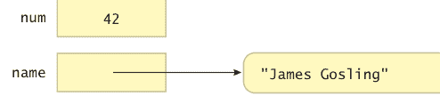

由于对象引用持有对象的地址，因此它可以被视为指向存储对象位置的指针。我们可以显示数值地址，但实际值是无关紧要的——重要的是引用指向一个特定的对象。

在对象被实例化后，我们使用点运算符（`.`）来访问它的方法。我们经常多次使用点运算符，例如在调用 `System.out.println()` 时。点运算符直接附加在对象引用之后，后面跟的是要调用的方法。例如，要调用 `String` 类中定义的 `length` 方法，我们可以在引用变量上使用点运算符：

```java
count = name.length();
```

`length` 方法不接受任何参数，但括号仍然是必要的，用以表示调用了一个方法。某些方法会产生一个在方法完成后返回的值。`length` 方法的目的是确定并返回字符串的长度（它包含的字符数）。在这个例中，返回的值被赋值给变量 `count`。对于字符串 "James Gosling"，`length` 方法返回 13，这包括第一个姓和最后一个名之间的空格。


某些方法不返回值。其他 `String` 方法将在下一节中讨论。

声明对象引用变量和创建对象本身的行为可以通过在声明时初始化变量来合并为一个步骤，就像我们处理基本类型一样：

```java
String title = new String("Java Software Solutions");
```

尽管字符字符串不是基本类型，但它们是基础的且使用非常频繁，因此 Java 定义了由双引号界定的字符串字面量，正如我们在各种示例中看到的。这是一种快捷表示法。每当出现字符串字面量时，都会自动创建一个 `String` 对象。因此，以下声明是有效的：

```java
String city = "London";
```

也就是说，对于 `String` 对象，可以消除对 `new` 运算符和构造函数的唯一使用。在大多数情况下，我们将使用这种简化语法。

### 别名

由于对象引用变量存储的是地址，程序员在管理对象时必须小心。首先，让我们复习赋值对基本值的影响。假设我们有两个整数变量，`num1` 初始化为 5，`num2` 初始化为 12：

| num1 | 5 |
| num2 | 12 |

在接下来的赋值语句中，存储在 `num1` 中的值的副本被存储在 `num2` 中：

```java
num2 = num1;
```

赋值执行后，存储在 `num1` 中的值的副本存储在 `num2` 中。`num2` 的原始值被覆盖。`num1` 和 `num2` 指向不同的位置：

| num1 | 5 |
| num2 | 5 |

现在考虑以下 `String` 声明：

```java
String name1 = "Ada Lovelace";
String name2 = "Grace Hopper";
```

最初，`name1` 和 `name2` 指向不同的对象：


现在执行赋值语句，将 `name1` 的值赋给 `name2`：

```java
name2 = name1;
```

执行后，`name1` 和 `name2` 指向同一个对象，因为它们引用相同的地址。它们都包含相同的值：


别名会产生不可避免的影响。多个变量可以引用同一个对象。除非小心管理，否则会产生意外的副作用。

> 核心概念
> 多个变量可以引用同一个对象。

### 自测习题

- 3.1 什么是 `null` 引用？
- 3.2 `new` 运算符起什么作用？
- 3.3 声明一个名为 `author` 的 `String` 变量并将其初始化为 "Fred Brooks"。
- 3.4 编写一条代码语句，将一个整数变量 `size` 设置为 `author` 变量的长度。
- 3.5 什么是别名？

## 3.2 String 类

让我们更详细地检查 `String` 类。一旦 `String` 对象被创建，它的值就不能延长或缩短。我们说 `String` 对象是**不可变的**（immutable）。然而，某些方法会返回新的 `String` 对象。注意，某些方法引用索引。字符串中的第一个字符是0，下一个字符的索引是1，依此类推。对于字符串 "Hello"，'H' 的索引是0。

几个 `String` 方法在图31所示的程序中得到了练习。在检查 `StringMutation` 程序时，请记住这不是一个会改变的单一对象。最初，设置对象如下：

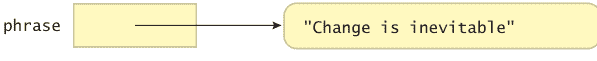

| 方法 | 说明 |
| :--- | :--- |
| `String(String str)` | 构造函数：创建一个与 `str` 字符相同的字符串对象。 |
| `char charAt(int index)` | 返回指定索引处的字符。 |
| `int compareTo(String str)` | 返回一个整数，表示在字典顺序上小于（负值）、等于（零值）或大于（正值）字符串 `str`。 |
| `String concat(String str)` | 返回由此字符串与 `str` 拼接的新字符串。 |
| `boolean equals(String str)` | 如果此字符串与 `str` 包含相同字符（包括大小写），则返回 `true`，否则返回 `false`。 |
| `boolean equalsIgnoreCase(String str)` | 如果此字符串与 `str` 包含相同字符（不区分大小写），则返回 `true`，否则返回 `false`。 |
| `int length()` | 返回字符串中的字符数。 |
| `String replace(char oldChar, char newChar)` | 返回一个与此字符串相同的新字符串，但所有的 `oldChar` 都被替换为 `newChar`。 |
| `String substring(int offset, int endIndex)` | 返回一个从索引 `offset` 开始到 `endIndex-1` 的此字符串子字符串。 |
| `String toLowerCase()` | 返回一个与此字符串相同的新字符串，但所有大写字母都转换为小写。 |
| `String toUpperCase()` | 返回一个与此字符串相同的新字符串，但所有小写字母都转换为大写。 |

图 3.1 String 类的一些方法

# 第 3 章 使用类和对象

## 列表 3.1

```java
// *****************************************************************
// StringMutation.java      作者: Lewis/Loftus
// 演示了 String 类的使用及其方法。
// *****************************************************************

public class StringMutation {

    // 打印一个字符串以及它的各种变体形式。
    //--------------------
    public static void main(String[] args) {

        String phrase = "Change is inevitable";
        String mutation1, mutation2, mutation3, mutation4;

        System.out.println("Original string: \"" + phrase + "\"");
        System.out.println("Length of string: " + phrase.length());

        mutation1 = phrase.concat(", except from vending machines.");
        mutation2 = mutation1.toUpperCase();
        mutation3 = mutation2.replace('E', 'X');
        mutation4 = mutation3.substring(3, 30);

        // 打印每个变体字符串
        System.out.println("Mutation #1: " + mutation1);
        System.out.println("Mutation #2: " + mutation2);
        System.out.println("Mutation #3: " + mutation3);
        System.out.println("Mutation #4: " + mutation4);
        System.out.println("Mutated length: " + mutation4.length());
    }
}
```

### 输出

Original string: "Change is inevitable"
Length of string: 20
Mutation #1: Change is inevitable, except from vending machines.
Mutation #2: CHANGE IS INVITABLE, EXCEPT FROM VENDING MACHINES.
Mutation #3: CHANGX IS INVITABLX, XXCXPT FROM VXNDING MACHINXXS.
Mutation #4: NGX IS INVITABLX, XXCXPT F
Mutated length: 27

## 3.2 String 类

在打印原始句子及其长度后，执行了 `concat` 方法来创建一个由变量 `mutation1` 引用的新字符串对象：

```java
mutation1 = "Change is inevitable, except from vending machines."
```

然后对 `mutation1` 对象执行了 `toUpperCase` 方法，并将生成的字符串存储在 `mutation2` 中：

```java
mutation2 = "CHANGE IS INVITABLE, EXCEPT FROM VENDING MACHINES"
```


# 3.3 包

注意 `length` 和 `concat` 方法是在 `phrase` 对象上执行的，但 `toUpperCase` 方法是在 `mutation1` 对象上执行的。`String` 类的任何方法都可以在任何对象上执行，但对于任何调用，方法是在特定对象上执行的。在 `mutation1` 上执行 `toUpperCase` 的结果与在 `phrase` 上执行 `toUpperCase` 的结果非常不同。每个对象都有自己的状态，这通常会影响方法调用的结果。

最后，通过分别调用 `mutation2.replace` 和 `mutation3.substring` 初始化了 `String` 对象变量 `mutation3` 和 `mutation4`：

```
mutation3 = "CHANGX IS INVITABLE, XXCEPT FROM VXNDING MACHINXS"
```

```
mutation4 = "NGX IS INVITABLE, XXCXPT F"
```

> **核心概念**
> 通常方法是在特定对象上执行的，这会影响结果。

## 自测题（答案见附录 N）

**SR 3.6** 假设 `s1`、`s2` 和 `s3` 是分别初始化为 "Amanda"、"Bobby" 和 "Chris" 的 `String` 变量。以下每个语句改变了哪一个或几个 `String` 变量？

- `System.out.println(s1);`
- `s1 = s3.toLowerCase();`
- `System.out.println(s2.replace('B', 'M'));`
- `d3 = s2.concat(s1);`

**SR 3.7** 以下代码段的输出是什么？

```
String s1 = "Foundations";
String s2 = "";
System.out.println(s1.charAt(1));
s2 = s1.substring(0, 5);
System.out.println(s2);
System.out.println(s1.length());
System.out.println(s2.length());
```

**SR 3.8** 写一条语句，打印名为 `title` 的 `String` 对象的全大写值。

**SR 3.9** 写一个名为 `front` 的 `String` 变量的声明，并将其初始化为另一个名为 `description` 的 `String` 对象的前 10 个字符。

---

## 3.3 包

我们之前提到过 Java 语言由标准类库支持，我们可以根据需要使用它。让我们进一步研究一下。


类库是一组支持程序开发的类。编译器或开发环境通常会带有一个类库。类库也可以通过第三方供应商单独获得。类库中的类提供了对程序员来说有价值的方法，因为这些方法具有特殊的功能。事实上，程序员往往会依赖类库中的方法，并开始将它们视为语言的一部分。然而，从技术上讲，它们并不属于语言本身。

例如，`String` 并不是 Java 语言的固有组成部分。它是 Java 标准类库的一部分，可以在任何 Java 开发环境中找到。构成该库的类是由 Sun Microsystems 创建的，他们也是 Java 语言的创造者。

类库由几个相关类的簇组成，这些簇通常被称为 Java APIs，即应用程序编程接口。例如，当我们谈论帮助我们编程的类集合时，我们称为 Java Database API。

### 表 3.2 Java 标准类库中的某些包

| 包 | 提供 |
| :--- | :--- |
| `java.applet` | 创建可以在 Web 上轻松传输的程序（applet）。 |
| `java.awt` | 绘制图形并创建图形界面；AWT 代表抽象窗口工具包。 |
| `java.beans` | 定义可以组合到应用程序中的软件组件。 |
| `java.io` | 执行各种输入输出函数。 |
| `java.lang` | 通用支持；它会自动导入到所有 Java 程序中。 |
| `java.math` | 执行任意精度的计算。 |
| `java.net` | 跨网络通信。 |
| `java.rmi` | 创建可以分布在多台计算机上的程序；RMI 代表远程方法调用。 |
| `java.security` | 实施安全限制。 |
| `java.sql` | 与数据库交互；SQL 代表结构化查询语言。 |
| `java.text` | 对文本进行格式化。 |
| `java.util` | 通用工具类。 |
| `java.swing` | 使用扩展了 AWT 能力的组件创建图形界面。 |
| `java.xml.parsers` | 处理 XML 文档；XML 代表可扩展标记语言。 |

这些包适用于任何支持 Java 软件开发的平台。其中某些包支持特定的编程技术，在开发基础程序时不会用到。

图 3.3 显示了在线 Java API 文档的一页。侧边的链接允许你查看特定的包并跳转到特定的类。花些时间熟悉此网站的导航并学习信息是如何组织的。整套 Java API 文档都可以下载，这样你始终有一份本地副本，或者你也可以依赖在线版本。

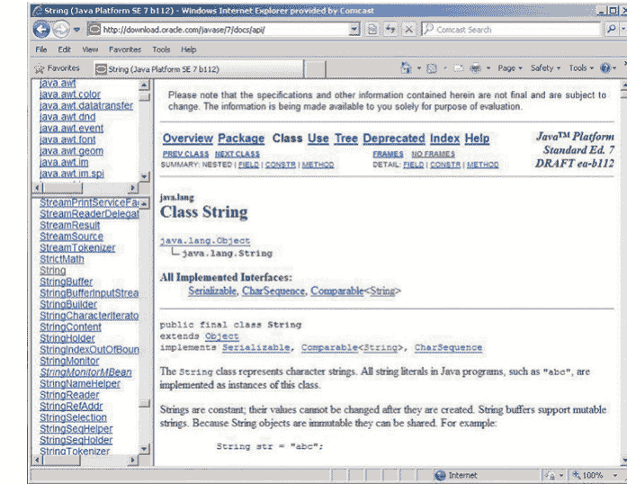

**图 3.3** 在线 Java API 文档的一页

### import 声明

在编写 Java 程序时，`java.lang` 包中的类是自动可用的。然而，要使用来自任何其他包的类，我们必须使用完全限定的引用或使用 `import` 声明。回想一下使用 `Scanner` 类的示例程序都包含一个 `import` 声明。

当你想要在程序中使用库中的类时，每次引用它时，都可以使用它的完全限定名（包括包名）。例如，每当你想要引用在 `java.util` 包中的 `Scanner` 类时，你都可以写 `java.util.Scanner`。然而，每次需要都完全指定包名和类名会变得非常疲惫。Java 提供 `import` 声明来简化这些引用。

`import` 声明指定了程序将使用的包和类，这样在每次引用时就不需要使用完全限定名。以下是一个 `import` 声明的示例：

```
import java.util.Scanner;
```

此声明断言 `java.util` 包中的 `Scanner` 类可以在程序中使用。一旦通过了此 `import` 声明，那么在程序中引用该类时，使用简单名称 `Scanner` 就足够了。

如果来自不同包的两个类具有相同的名称，仅靠 `import` 是不够的，因为编译器无法确定代码中引用的是哪一个类。当这种情况发生时（虽然很罕见），应该在代码中使用完全限定名。

另一个 `import` 声明使用星号 (`*`) 来表示包内的任何类都可能在程序中使用。因此，以下声明允许 `java.util` 包中的所有类在程序中被引用，而无需对每个引用进行限定：

```
import java.util.*;
```

如果程序中只使用特定包的一个类，通常通过 `import` 明确指定类名更好。然而，如果将使用两个或多个，使用 `*` 符号通常是可以的。

`java.lang` 包是自动导入的，因为它们是基础的，可以作为语言的基础扩展。因此，任何 `java.lang` 包中的类（如 `System` 和 `String`）可以在无需显式 `import` 的情况下使用。这就像所有的程序文件自动包含了以下内容：

```
import java.lang.*;
```


## 自我复习题（答案见附录 N）

- **SR 3.10** 什么是 Java 包？
- **SR 3.11** `java.net` 包包含什么？`java.swing` 包又包含什么？
- **SR 3.12** 哪个包包含 `Scanner` 类？`String` 类？`Random` 类？
- **SR 3.13** 使用在线 Java API 文档，描述 `Point` 类。
- **SR 3.14** `import` 语句实现了什么功能？
- **SR 3.15** 为什么 `String` 类不被具体地导入到我们的程序中？

---

## 3.4 Random 类

在编写软件时，经常需要随机数。游戏通常使用随机数来表示骰子的掷点或洗牌。一个飞行模拟器可能会使用随机数来决定…… `Random` 类提供了一些方法。注意传递给 `nextInt()` 的值是范围。`nextInt` 方法返回一个在……之间的整数。

### 代码清单 3.2

```
************************************************
// RandomNumbers.java    Author: Lewis
// Generates random numbers in various
************************************************

import java.util.Random;

public class RandomNumbers
{
    //
    public static void main(String[] args)
    {
        Random generator = new Random();
        int num1;
        float num2;
        num1 = generator.nextInt();
        System.out.println("A random integer: " + num1);
        num1 = generator.nextInt(10);
        System.out.println("From 0 to 9: " + num1);
        num1 = generator.nextInt(10) + 1;
        System.out.println("From 1 to 10: " + num1);
    }
}
```

```
OUTPUT
A random integer: 1773351873
From 0 to 9: 8
From 1 to 10: 6
```

[PAGE 155]

```
// LISTING 3.2 continued
num1 = generator.nextInt(15) + 20;
System.out.println("From 20 to 34: " + num1);
num1 = generator.nextInt(20) - 10;
System.out.println("From -10 to 9: " + num1);
num2 = generator.nextFloat();
System.out.println("A random float (between 0-1): " + num2);
num2 = generator.nextFloat() * 6; // 0.0 to 5.9999
num1 = (int)num2 + 1;
System.out.println("From 1 to 6: " + num1);
}
}
```

> **核心概念**：随机数的需求在编写软件时经常出现。游戏通常使用随机数来表示骰子的掷点或洗牌。一个飞行模拟器可能会使用随机数来决定…… `Random` 类提供了一些方法。注意传递给 `nextInt()` 的值是范围。`nextInt` 方法返回一个在……之间的整数。`Random` 类提供了一些方法。`nextInt` 方法可以不带参数调用，也可以带参数。`nextFloat()` 方法返回一个在 0.0 到 1.0 之间的浮点数。为了得到特定的范围，我们可以缩放结果，将其转换为 `int`，然后进行偏移。例如，为了得到 1 到 6 之间的数字，我们可能会使用 `nextInt(6)` 并加 1。

## 自我复习题（答案见附录 N）

- **SR 3.16** 给一个名为 `rand` 的 `Random` 对象，调用 `nextInt()` 返回什么？
- **SR 3.17** 给一个名为 `rand` 的 `Random` 对象，调用 `nextInt(20)` 返回什么？
- **SR 3.18** 假设已经创建了一个名为 `generator` 的 `Random` 对象，以下表达式结果的结果范围是什么？
  - a. `generator.nextInt(50)`
  - b. `generator.nextInt(5) + 10`
  - c. `generator.nextInt(10) + 5`
  - d. `generator.nextInt(50) - 25`
- **SR 3.19** 假设已经创建了一个 `Random` 对象，请编写表达式来生成以下每个范围的整数（包含端点）。使用接受单个整数参数的 `nextInt` 方法版本。
  - a. 0 到 30
  - b. 10 到 19
  - c. -5 到 5

---

## 3.5 Math 类

`Math` 类提供了大量的各种数学函数，这些函数在进行计算时通常非常有帮助。`Math` 类定义在 Java 标准类库的 `java.lang` 包中。3.5 节列出了它的几个方法。

`Math` 类中的所有方法都是静态方法（也称为类方法），这意味着可以通过定义这些方法的类名来调用，而无需实例化该类的对象。静态方法将在第 6 章中进一步讨论。

`Math` 类的方法返回结果，这些值可以根据需要用于表达式中。例如，以下语句计算存储在 `total` 中的数字的绝对值，将其加上 `count` 的四次方，并将结果存储在变量中：

> **核心概念**：`Math` 类的所有方法都是静态的，这意味着它们通过类名进行调用。

```
value = Math.abs(total) + Math.pow(count, 4);
```

注意，你可以将一个整数值传递给接受 `double` 参数的方法。这是赋值转换的形式，在第 2 章中讨论过。

列表 3.3 所示的 `Quadratic` 程序使用 `Math` 类来计算二次方程的根。回想二次方程具有以下通用形式：

```
ax² + bx + c
```

`Quadratic` 程序读取代表二次方程系数（a、b 和 c）的值，并求值二次公式以确定方程的根。二次公式为：

```
roots = (-b ± √(b² - 4ac)) / 2a
```

VideoNote：使用 `Random` 和 `Math` 类的示例。

### 图 3.5 Math 类的一些方法

| 方法 | 描述 |
| :--- | :--- |
| `static int abs(int num)` | 返回 `num` 的绝对值。 |
| `static double acos(double num)`<br>`static double asin(double num)`<br>`static double atan(double num)` | 返回 `num` 的反余弦、反正弦或反正切。 |
| `static double cos(double angle)`<br>`static double sin(double angle)`<br>`static double tan(double angle)` | 返回 `angle` 的余弦、正弦或正切，角度以弧度为单位。 |
| `static double ceil(double num)` | 返回 `num` 的向上取整，即大于或等于 `num` 的最小整数。 |
| `static double exp(double power)` | 返回 e 的指定幂次方的值。 |
| `static double floor(double num)` | 返回 `num` 的向下取整，即小于或等于 `num` 的最大整数。 |
| `static double pow(double num, double power)` | 返回 `num` 的指定幂次方的值。 |
| `static double random()` | 返回介于 0.0（包含）和 1.0（不包含）之间的随机数。 |
| `static double sqrt(double num)` | 返回 `num` 的平方根，`num` 必须为正数。 |

注意，该程序假设判别式（根号下的部分）为负数。如果它不是负数，结果将不是有效数字，Java 将其表示为 NaN，代表“不是数字”。在第 5 章中，我们将学习如何优雅地处理这种情况。

### 代码清单 3.3

```
//*****************************************************************
// Quadratic.java                               Author: LewisLoftus
// 展示如何使用 Math 类根据用户输入执行计算
//*****************************************************************

import java.util.Scanner;

public class Quadratic {
    // 确定二次方程的根。
    public static void main(String[] args) {
```


# 第 3 章 类与对象

## 3.6 输出格式化

`NumberFormat` 类提供了数字的通用功能。它们是 `java.text` 包的一部分并定义在那里。

### NumberFormat 类

与 `Math` 类不同，你不需要使用 `new` 运算符实例化 `NumberFormat`。相反，你通过一个静态方法请求一个对象。3.6 节列出了部分 `NumberFormat` 方法。

```
String format(double number)
```
返回格式化后的数字字符串。

```
static NumberFormat getCurrencyInstance()
```
返回表示货币的 `NumberFormat` 对象。

```
static NumberFormat getPercentInstance()
```
返回表示百分比的 `NumberFormat` 对象。

列表 3.4 所示的 `Purchase` 程序使用了两种格式化器。它读取销售交易并计算包含税的金额。

### 列表 3.4 Purchase.java

```
*****************************************************************
// Purchase.java                               Author: LewisLoftus
// 展示如何使用 NumberFormat 类格式化输出
*****************************************************************

import java.util.Scanner;
import java.text.NumberFormat;

public class Purchase {
    // 使用用户输入的值计算物品的最终价格
    public static void main(String[] args) {
        final double TAX_RATE = 0.06; // 6% 销售税
        int quantity;
        double subtotal, totalCost, unitPrice;
        Scanner scan = new Scanner(System.in);
        NumberFormat fmt1 = NumberFormat.getCurrencyInstance();
        NumberFormat fmt2 = NumberFormat.getPercentInstance();

        System.out.print("Enter the quantity: ");
        quantity = scan.nextInt();
        System.out.print("Enter the unit price: ");
        unitPrice = scan.nextDouble();

        subtotal = quantity * unitPrice;
        double tax = subtotal * TAX_RATE;
        totalCost = subtotal + tax;

        // 使用适当的格式打印输出
        System.out.println("Subtotal: " + fmt1.format(subtotal));
        System.out.println("Tax: " + fmt1.format(tax) + " at " + fmt2.format(TAX_RATE));
        System.out.println("Total: " + fmt1.format(totalCost));
    }
}
```

### 输出

```
Enter the quantity: 3
Enter the unit price: 4
Subtotal: $12.00
Tax: $0.72 at 6%
Total: $12.72
```

## DecimalFormat 类

与 `NumberFormat` 类不同，`DecimalFormat` 类是使用传统的 `new` 运算符实例化的。它的构造函数接受一个代表引导格式化过程的字符串。然后我们可以使用 `format` 方法来格式化特定值。在之后的某个点，如果我们想更改格式化器使用的模式，可以调用 `applyPattern` 方法。图 3.7 描述了这些方法。

### 图 3.7 DecimalFormat 类的一些方法

```
DecimalFormat(String pattern)
```
构造函数：创建一个带有指定模式的新 `DecimalFormat` 对象。

```
void applyPattern(String pattern)
```
将指定的模式应用到此 `DecimalFormat` 对象。

```
String format(double number)
```
返回一个包含指定数字的字符串，该数字根据当前模式进行格式化。

传递给 `DecimalFormat` 构造函数的字符串定义的模式可以相当复杂。使用了各种符号来表示特定的格式化指南。例如，由 `"0.###"` 定义的模式表示小数点左侧至少应打印一个数字，如果值的整数部分为 0，则应为 0。它还表示值的小数部分应四舍五入三位。

该模式用于列表 3.5 所示的 `CircleStats` 程序，该程序从用户处读取圆半径并计算其面积和周长。末尾的零（例如面积为 78.540 的情况）不会被打印。

### 列表 3.5 CircleStats.java

```
****************************************************
// CircleStats.java      Author: Lewis/Loftus
// 使用 DecimalFormat 类格式化值。
****************************************************

import java.util.Scanner;
import java.text.DecimalFormat;

public class CircleStats {
    // 给定半径计算面积和周长。
    public static void main(String[] args) {
        int radius;
        double area, circumference;
        Scanner scan = new Scanner(System.in);

        System.out.print("Enter the circle's radius: ");
        radius = scan.nextInt();

        area = Math.pow(radius, 2);
        circumference = 2 * Math.PI * radius;

        // 输出三位小数
        DecimalFormat fmt = new DecimalFormat("0.###");
        System.out.println("The circle's area: " + fmt.format(area));
        System.out.println("The circle's circumference: " + fmt.format(circumference));
    }
}
```

### 输出

```
Enter the circle's radius: 5
The circle's area: 78.54
The circle's circumference: 31.41
```

## printf 方法

除了 `print` 和 `println`，`System` 类还有另一个输出方法 `printf`，它允许我们打印包含数据值的格式化字符串。该方法的第一个参数表示格式字符串，其余参数指定插入到格式字符串中的值。

例如，下面行代码打印了一个 ID 编号和名称：

```
System.out.printf("ID: %5d\nName: %s", id, name);
```

第一个参数指定输出的格式，并包括将输出值标记为转义字符的字面字符，如 `\t`。模式 `%5d` 表示相应的数字 (`id`) 应在五个字符的字段中打印。模式 `%s` 匹配字符串参数名。`id` 和 `name` 的值被插入字符串中，产生的结果如下：

```
ID: 24036 Name: Larry Flagelhopper
```

Java 添加 `printf` 方法是为了镜像 C 语言编写的程序中使用的类似函数。它使得程序员更容易将现有的 C 程序翻译（或迁移）到 Java。

旧版软件仍被称为遗留系统。维护遗留系统通常是一项昂贵的工作，因为它的很多方面都是基于旧技术。在许多情况下，维护 Java 支持仍然比迁移到新技术（即用新语言编写）更贵。添加 `printf` 方法是为了尝试通过提供 C 程序员赖以的相同输出，使此类迁移变得更容易，从而成本更低。

> **核心概念**
> 向 Java 添加 `printf` 方法是为了支持遗留系统的迁移。

然而，使用 `printf` 方法并不是解决输出格式化问题的特别纯面向对象的解决方案，因此我们在本书中避免使用它。

### 自测习题（答案见附录 N）

- **SR 3.25** 描述如何在程序内部请求一个 `NumberFormat` 对象以便使用。
- **SR 3.26** 假设你的程序中有一个名为 `cost` 的 `double` 变量。你想输出存储在 `cost` 中的值，并将其格式化为当前区域的货币格式。
  - a. 写一条代码语句，声明并请求一个名为 `moneyFormat` 的 `NumberFormat` 对象，该对象可以表示当前区域格式的货币。
  - b. 写一条代码语句，使用 `moneyFormat` 对象并打印 `cost` 的值，将其格式化为当前区域的货币格式。
  - c. 如果值为 54.89 且你的计算机区域设置为美国，你在 (b) 部分编写的语句的输出是什么？如果你的计算机区域设置为英国，结果又如何？
- **SR 3.27** 使用 Java 的格式化类将浮点值输出为百分比的步骤是什么？
- **SR 3.28** 写出代码语句，提示用户读取并输入一个 `double` 值，并打印输入值绝对值的平方根结果。输出结果保留两位小数。

## 3.7 枚举类型

Java 提供了定义枚举类型（enumerated type）的能力，可以在声明变量时作为变量的类型。枚举类型通过列出（或枚举）它们来建立该类型变量的所有可能值。这些值是标识符，可以是任何想要的内容。

例如，下面的声明定义了一个名为 `Season` 的枚举类型，其可能值为冬、春、夏、秋：

```
enum Season {winter, spring, summer, fall};
```

对于枚举类型，列出的值数量没有限制。一旦定义了类型，就可以声明该类型的变量：

```
Season time;
```

变量 `time` 在其取值上受到限制。

枚举类型是一种特殊的类，枚举类型的变量是对象变量。作为这样，所有枚举类型都有关联的方法。`ordinal()` 方法返回与特定枚举类型相关的数值。`name()` 方法返回名称，与定义该值的标识符相同。

列表 3.6 显示了一个名为 `IceCream` 的程序，它声明了一个枚举类型并使用了它的一些方法。由于枚举类型是特殊的类型，它们不是在方法内部定义的。它们可以定义在类级别（类内部方法外部），例如所示，也可以定义在最外层。

我们在第 6 章进一步探讨枚举类型。

### 列表 3.6 IceCream.java

```
****************************************************
// IceCream.java               Author: Lewis/Loftus
// 展示枚举类型的使用。
****************************************************

public class IceCream {
    enum Flavor {vanilla, chocolate, strawberry, fudgeRipple, coffee,
        rockRoad, mintChocolateChip, cookieDough}

    //----------------------------------------------------------------
    // 创建并使用 Flavor 类型变量。
    //----------------------------------------------------------------
    public static void main(String[] args) {
        Flavor cone1, cone2, cone3;

        cone1 = Flavor.rockRoad;
        cone2 = Flavor.chocolate;

        System.out.println("cone1 value: " + cone1);
        System.out.println("cone1 ordinal: " + cone1.ordinal());
        System.out.println("cone1 name: " + cone1.name());
    }
}
```


System.out.println();

System.out.println("cone2 value: " + cone2);

System.out.println("cone2 ordinal: " + cone2.ordinal());

System.out.println("cone2 name: " + cone2.name());

}

}

## 第 3 章 使用类与对象

### 列表 3.6 延续

```java
cone3 = cone1;

System.out.println("cone3 value: " + cone3);

System.out.println("cone3 ordinal: " + cone3.ordinal());

System.out.println("cone3 name: " + cone3.name());

}
```

```
cone1 value: rockyRoad
cone1 ordinal: 5
cone1 name: rockyRoad
cone2 value: chocolate
cone2 ordinal: 1
cone2 name: chocolate
cone3 value: rockyRoad
cone3 ordinal: 5
cone3 name: rockyRoad
```

### 自习题（答案见附录 N）

- SR 3.29 编写一个表示电影分级的枚举类型的声明。

- SR 3.30 假设定义了名为 `CardSuit` 的枚举类型如下：

```java
enum CardSuit {clubs, diamonds, hearts, spades}
```

以下代码序列的输出结果是什么？
```java
CardSuit card1, card2;
card1 = CardSuit.clubs;
card2 = CardSuit.hearts;
System.out.println(card1);
System.out.println(card2.name());
System.out.println(card1.ordinal());
System.out.println(card2.ordinal());
```

- SR 3.31 为什么要使用上一个问题中定义的 `CardSuit` 枚举类型？为什么不直接使用 `String` 变量并赋值诸如“hearts”这样的值？

## 3.8 包装类

正如我们讨论过的，Java 使用基本数据类型（`int`, `double`, `char`, `boolean`）以及类和对象来表示数据。在某些情况下，管理两类数据（基本值和对象引用）可能会带来挑战。我们可以创建一个对象作为容器，用于持有各种类型的其他对象。然而，在特定情况下，我们可能希望它包含一个简单的整数值。在这些情况下，我们需要将基本值“包装”到其中。

包装类表示特定的基本数据类型。例如，`Integer` 类表示一个简单的整数值。从 `Integer` 类创建的对象存储一个 `int`。包装类的构造函数接受基本类型值作为参数。例如：

```java
Integer ageObj = new Integer(40);
```

一旦完成此声明和实例化，`ageObj` 对象实际上以对象的形式表示整数 40。它可以用于程序中任何需要对象而非基本类型的地方。

> 核心概念
> 包装类允许将基本值作为对象进行管理。

对于 Java 中的每种基本数据类型，在 Java 类库中都有一个对应的包装类。所有的包装类都定义在 `java.lang` 包中。图 3.8 显示了与每个基本数据类型对应的包装类。

注意，甚至有一个表示 `void` 类型的包装类。然而，与其他包装类不同，`Void` 类不能被实例化。它仅仅代表了值引用的概念。

| 基本类型 | 包装类 |
|---|---|
| byte | Byte |
| short | Short |
| int | Integer |
| long | Long |
| float | Float |
| double | Double |
| char | Character |
| boolean | Boolean |
| void | Void |

图 3.8 Java 类库中的包装类

| 方法 | 说明 |
|---|---|
| `Integer(int value)` | 构造函数：创建一个存储指定值的新整数。 |
| `byte byteValue()` | |
| `double doubleValue()` | |
| `float floatValue()` | |
| `int intValue()` | |
| `long longValue()` | 返回此 `Integer` 作为对应基本类型的值。 |
| `static int parseInt(String str)` | 返回指定字符串中存储的 `int` 值。 |
| `static String toBinaryString(int num)` | |
| `static String toHexString(int num)` | |
| `static String toOctalString(int num)` | 返回指定整数值在相应基数下的字符串表示。 |

图 3.9 `Integer` 类的一些方法

包装类还提供了各种与类型管理相关的方法。例如，`Integer` 类包含了返回存储在对象中的 `int` 值并将存储的值转换为基本类型的方法。图 3.9 列出了 `Integer` 类中找到的一些方法。其他包装类也具有类似的方法。请注意，包装类还包含可以独立于任何对象而被调用的静态方法。例如，`Integer` 类包含静态方法 `parseInt`，可以将 `String` 转换为其对应的 `int` 值。如果字符串 `str` 持有 "123"，下行代码将该变量转换为整数并将该值存储在变量中：

```java
num = Integer.parseInt(str);
```

Java 包装类通常也包含静态常量。例如，`Integer` 类包含两个常量，`MIN_VALUE` 和 `MAX_VALUE`，分别持有最小和最大的 `int` 值。其他包装类也为其类型包含相似的常量。

## 自动装箱

自动装箱是基本值与对应对象之间的自动转换。例如，在以下代码中，`int` 被赋值给 `Integer` 引用变量：

```java
Integer obj1;

obj1 = 69; // 自动创建 Integer 对象
```

反向转换自动拆箱在需要时也会发生。例如：

```java
Integer obj2 = new Integer(69);

int num2 = obj2; // 自动提取值
```

基本类型和对象类型之间的赋值通常是不兼容的。自动装箱只发生在基本类型和包装类之间。在任何其他情况下，尝试将基本值赋值给对象或反之，都会导致编译错误。

> 核心概念
> 自动装箱提供了基本值与对应对象之间的转换。

### 自习题（答案见附录 N）

- SR 3.32 如何将基本值作为对象表示？
- SR 3.33 对于 `int`, `double`, `boolean`，哪些包装类是对应的？
- SR 3.34 假设已经声明了一个名为 `number` 的变量并初始化了一个名为 `holdNumber` 的变量。
- SR 3.35 写一个表示最大 `int` 值的语句。

## 3.9 组件与容器

在第 2 章中，我们使用 `Graphics` 和 `Color` 类来绘制形状。我们还定义了 app 的概念，即一种通过浏览器执行的程序。到目前为止，我们看过的程序都是 Java 应用程序。更具体地说，它们是命令行应用程序，仅通过文本提示进行交互。Java 应用程序也可以具有图形界面。在本章中，我们将建立 GUI 的基本规则。

GUI 组件是表示屏幕元素的对象，用于显示信息或允许用户与程序交互。GUI 组件包括标签、按钮、文本字段、滚动条和菜单。

Java 组件和其他 GUI 相关类主要定义在两个包中：`java.awt` 和 `javax.swing`。抽象窗口工具包（AWT）是最初的 GUI 包。它仍然包含了重要的类，例如我们在第 2 章使用的 `Color` 类。Swing 包后来引入，提供了比 AWT 包更灵活的组件。GUI 开发中都需要这两个包。

容器是用于持有和组织其他组件的特殊组件类型。框架和面板是 GUI 容器的两个例子。让我们详细研究它们。

> 核心概念
> 容器是持有和组织其他组件的特殊 GUI 组件。

通常情况下，重量级组件比轻量级组件更复杂。例如，一个帧（`JFrame`）有多个面板（panes），这些面板负责帧窗口的各种特性。Java 接口的所有可见元素都显示在帧的内容面板（content pane）中。

通常，我们可以通过创建一个帧来构建 Java GUI 应用程序，并在帧中显示程序界面。界面通常组织在一个主面板（primary pane）上，该面板被添加到帧的内容面板中。主面板中的组件通常根据需要使用其他面板进行组织。

除非容器能帮助我们组织和显示其他组件，否则它们通常没有用。让我们检查另一个基础的 GUI 组件。标签（label）是一种在 GUI 中显示一行文本的组件。标签也可以显示图像，本章稍后部分将讨论这一主题。通常，标签用于显示信息或识别 GUI 中的其他组件。在几乎每个基于 GUI 的程序都能找到标签。

让我们来看一个使用帧、面板（`JPanel`）和标签的示例。当执行列表 3.7 中的程序时，屏幕上会出现一个新窗口，显示一个短语。该短语的文本使用两个标签组件显示。这些标签组织在一个面板中，而该面板显示在帧的内容面板中。

`JFrame` 构造函数接受一个字符串作为参数，并显示在帧的标题栏中。对 `setDefaultCloseOperation` 方法的调用决定了点击帧角的按钮 (X) 会发生什么。在大多数情况下，我们只需让该按钮终止程序，如 `EXIT_ON_CLOSE` 常量所示。

通过实例化 `JPanel` 类来创建面板。面板的背景颜色使用 `setBackground` 方法设置。`setPreferredSize` 接受一个 `Dimension` 对象作为参数，用于指定组件以像素为单位的宽高。许多组件的大小可以通过此进行设置，还可以使用 `setMinimumSize` 和 `setMaximumSize` 方法来帮助控制界面的外观。

标签通过实例化 `JLabel` 类创建，并向其构造函数传递标签的文本。在该程序中，创建了两个独立的标签组件。

容器有一个 `add` 方法，允许将其他组件添加到它们中。两个标签都被添加到主面板中，并从该点起被视为该面板的一部分。组件添加到容器的顺序通常很重要。在这种情况下，它决定了哪个标签显示在另一个标签的上方。

最后，使用 `getContentPane` 方法获取帧的内容面板，紧接着调用内容面板的 `add` 方法来添加面板——在这种情况下，帧的大小被调整以适应它包含的面板。这比尝试显式设置帧的大小要好，因为后者在帧改变时会随之改变组件。对 `setVisible` 方法的调用会导致帧显示在显示器屏幕上。

“Authority”不是交互式的。通常，标签不允许用户与程序进行交互。我们将在下一章中检查交互式 GUI 组件。

然而，你可以通过多种方式与帧本身交互。你可以通过抓住帧的标题栏并用鼠标拖动移动整个帧到桌面的另一个位置。你还可以通过拖动帧的右下角来调整帧的大小。当帧变宽时会发生什么：选择标签出现在第一个标签旁边。

每个容器都由一个名为布局管理器（layout manager）的对象管理，该对象决定容器中组件的布局方式。当界面发生重要变化时（例如调整帧大小时），会咨询布局管理器。

> 核心概念
> 每一个容器都由布局管理器管理。

除非另有指定，否则面板中的组件将尝试在一行中排列，当面板宽度无法容纳某个组件时，该组件将移动到下一行。尝试此程序，观察随着窗口大小的变化，布局管理器如何改变标签的组织方式。布局管理器将在第 7 章的图形章节中更详细地讨论。

### 列表 3.7

```java
/********************************************************************
// Authority.java Author: Lewis/Loftus
// 展示了帧、面板和标签的使用。
********************************************************************/

import java.awt.*;
import javax.swing.*;

public class Authority {
    // ------------------------------------------------------------
    // 显示一些格言。
    // ------------------------------------------------------------
    public static void main(String[] args) {
        JFrame frame = new JFrame("Authority");
        frame.setDefaultCloseOperation(JFrame.EXIT_ON_CLOSE);
        JPanel primary = new JPanel();
        primary.setBackground(Color.yellow);
        primary.setPreferredSize(new Dimension(250, 75));
        JLabel label1 = new JLabel("Question authority,");
        JLabel label2 = new JLabel("but raise your hand first.");
        primary.add(label1);
        primary.add(label2);
        frame.getContentPane().add(primary);
        frame.pack();
        frame.setVisible(true);
    }
}
```

### 显示


### 自测习题（答案见附录 N）

- SR 3.36 帧和面板之间的区别是什么？
- SR 3.37 从以下列表中选择与每个短语最匹配的术语：
  `container`, `content pane`, `frame`, `label`, `layout manager`,
  - 容器用于组织其他组件。
  - 面板显示在带有标题栏的帧中。
  - 它的首要作用是帮助组织 GUI 中的其他组件。
  - 这种类型的组件由操作系统管理。
  - 这种类型的组件由 Java 程序管理。
  - 帧中显示可见元素的区域。
  - 一种在 GUI 中显示一行文本的组件。
  - 决定容器中组件的排列方式。
- SR 3.38 运行 `Authority` 程序。描述当你通过拖动角落调整帧大小时会发生什么。
- SR 3.39 下列哪种说法描述了 `Authority` 程序的 GUI 是如何构建的？
  - 帧被添加到面板中，面板被添加到标签中。
  - 标签被添加到面板中。
  - 帧、面板和标签被添加到前景。
  - 面板显示两个标签。
- SR 3.40 分别对 `Authority` 程序进行以下每种更改的结果是什么？你可以更改、编译并运行程序，观察并报告结果。简要说明你观察到的现象。
  a. 传递给 `setPreferredSize` 方法的尺寸为 (300, 300) 而不是 (250, 75)。
  b. 背景设置为黑色而不是黄色。
  c. 两个新标签的顺序反了（即，你先创建一个新的 `label2`，传递字符串 "but raise your hand first."，然后创建一个新的 `label1`，传递字符串 "Question authority,"）。
  d. 两个主要的添加顺序反了（即，你先将 `label2` 添加到主面板，然后添加 `label1`）。

## 3.10 嵌套面板

在上一节中，我们看到了一个示例，两个标签包含在一个面板中，而该面板包含在一个帧中。这种关系构成了界面的内容层次结构，它可以根据需要变得复杂，以创建视觉效果。

特别是，通常会有多层嵌套面板，以各种方式组织和分组组件。虽然你不应该在层级结构中包含不必要的组件，但在创建界面时，不要犹豫包含额外的手架结构以实现你想要的效果。

> 核心概念
> 面板可以嵌套以创建复杂的组件层次结构。

### 列表 3.8

```java
/************************************************************************************************************************************
// NestedPanels.java      Author: Lewis/Loftus
// 展示了基础的组件层级结构。
************************************************************************************************************************************/

import java.awt.*;
import javax.swing.*;

public class NestedPanels {
    // 展示嵌套在第三个面板中的两个彩色面板。
    public static void main(String[] args) {
        JFrame frame = new JFrame("Nested Panels");
```


# 第 3 章 使用类和对象

### LISTING 3.8 继续

```java
frame.setDefaultCloseOperation(JFrame.EXIT_ON_CLOSE);

// 设置第一个子面板
JPanel subPanel1 = new JPanel();
subPanel1.setPreferredSize(new Dimension(150, 100));
subPanel1.setBackground(Color.green);
JLabel label1 = new JLabel("One");
subPanel1.add(label1);

// 设置第二个子面板
JPanel subPanel2 = new JPanel();
subPanel2.setPreferredSize(new Dimension(150, 100));
subPanel2.setBackground(Color.red);
JLabel label2 = new JLabel("Two");
subPanel2.add(label2);

// 设置主面板
JPanel primary = new JPanel();
primary.setBackground(Color.blue);
primary.add(subPanel1);
primary.add(subPanel2);
```

```java
frame.getContentPane().add(primary);
frame.pack();
frame.setVisible(true);
```

### 显示

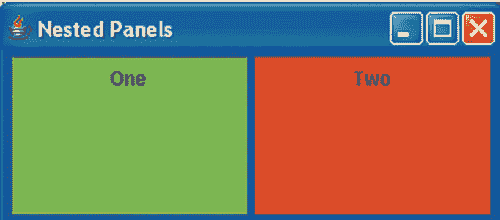

请注意，程序中的主面板没有显式设置大小。它会根据需要调整大小以容纳其包含的两个面板。同样注意，子面板周围有一个缓冲区，通过这个可以看到主面板的蓝色。这种间距是用于管理容器的布局管理器以及为组件设置的特性的函数。这些问题将在布局管理器章节中进一步探讨。

与上一个示例一样，执行并实验此操作：调整框架的大小以观察对组件的影响。请注意，子面板的大小保持固定，而两个面板的方向取决于面板的宽度（面板的宽度随框架的扩大而增大）。

当你熟悉了组件之间的相对关系后，将所有面板的背景颜色更改为相同的颜色（例如，灰色），并观察如果界面设计得当，面板之间的区别将如何变得不可见。

### 自测习题（答案见附录 N）

- SR 3.41 Java 图形用户界面的包含层级结构是什么？
- SR 3.42 在 `NestedPanels` 程序中，创建了多少个面板？面板变量名是什么？
- SR 3.43 在 `NestedPanels` 程序中，哪些面板被添加到了另一个面板中？它们被添加到哪个面板中？哪一个面板被显式地添加到框架的内容中？

## 3.11 图像

图像在基于图形的软件中经常起着重要作用。Java 有以多种方式使用 JPEG 和 GIF 图像。`Graphics` 类包含一个 `drawImage` 方法，允许你像绘制形状或字符一样绘制图像。图像也可以整合到标签组件中。让我们详细探讨图像与标签之间的关系。

正如我们在前面的章节中看到的，由 `JLabel` 类定义的标签可以用于向用户提供信息或描述其他组件。

> **核心概念**
> 由 `JLabel` 类定义的标签可以用于向用户提供信息或描述其他组件。

> **核心概念**
> 标签可以包含文本、图像或两者。

`JLabel` 标签可以显示不同的方向。标签可以包含文本、图像或两者。

`ImageIcon` 类被用于表示图像。`ImageIcon` 构造函数接受图像文件名并将其加载。

`JLabel` 的文本和图像的位置可以通过对方式来显式设置。`SwingConstants` 包含了用于各种标签的常量，使得更容易引用它们。

`JLabel` 的文本和图像的位置可以通过 `setHorizontalAlignment` 和 `setVerticalAlignment` 方法显式设置。

`JLabel` 标签可以包含文本、图像或两者。`ImageIcon` 类被用于表示图像。`ImageIcon` 构造函数接受图像文件名并将其加载。

`JLabel` 的文本和图像的位置可以通过 `setHorizontalAlignment` 和 `setVerticalAlignment` 方法显式设置。

`JLabel` 标签可以显示不同的方向。标签可以包含文本、图像或两者。

`JLabel` 的文本和图像的位置可以通过 `setHorizontalAlignment` 和 `setVerticalAlignment` 方法显式设置。

`JLabel` 标签可以显示不同的方向。The third parameter of the constructor determines the horizontal position of the text relative to image.

通过将图像放入标签中，它成为了一个在容器中布局的组件，而不是在特定的位置绘制。这是一种设计决策：是使用 `Graphics` 类的方法绘制图像还是使用标签来显示图像。

### LISTING 3.9

```java
// LabelDemo.java      Author: Lewis/Loftus
// 展示了标签中图像的使用。

import java.awt.*;
import javax.swing.*;

public class LabelDemo {

    // 创建并显示主框架。
    public static void main(String[] args) {
        JFrame frame = new JFrame("Label Demo");
        frame.setDefaultCloseOperation(JFrame.EXIT_ON_CLOSE);

        ImageIcon icon = new ImageIcon("devil.gif");

        JLabel label1, label2, label3;

        label1 = new JLabel("Devil Left", icon, SwingConstants.CENTER);
        label2 = new JLabel("Devil Right", icon, SwingConstants.CENTER);
        label2.setHorizontalAlignment(SwingConstants.LEFT);
        label2.setVerticalAlignment(SwingConstants.BOTTOM);

        label3 = new JLabel("Devil Above", icon, SwingConstants.CENTER);
        label3.setHorizontalAlignment(SwingConstants.CENTER);
        label3.setVerticalAlignment(SwingConstants.BOTTOM);

        JPanel panel = new JPanel();
        panel.setBackground(Color.cyan);
        panel.setPreferredSize(new Dimension(200, 250));
        panel.add(label1);
        panel.add(label2);
        panel.add(label3);

        frame.getContentPane().add(panel);
        frame.pack();
        frame.setVisible(true);
    }
}
```

### LISTING 3.9 继续

### 显示

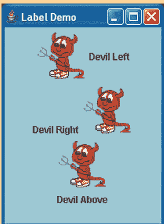

## 复习习题（答案见附录 N）

14. `LabelDemo` 程序中声明了多少个框架、面板、图像图标和标签？
15. 考虑 `LabelDemo` 程序中的一个标签实例化语句：
    `label2 = new JLabel("Devil Right", icon, SwingConstants.CENTER);`
    解释传递给 `JLabel` 构造函数的三个参数的作用。

SR 3.46 分别对 `LabelDemo` 程序进行以下每种更改，结果如何？你可以进行更改、编译并运行程序，观察并报告结果。简要解释你观察到的。

a. 将三个 `JLabel` 构造函数调用的第三个参数更改为 `SwingConstants.LEFT`。
b. 将 `label2` 的水平文本位置从 LEFT 更改为 RIGHT。
c. 将 `label2` 的水平文本位置从 LEFT 更改为 BOTTOM。
d. 将 `label3` 的垂直文本位置从 BOTTOM 更改为 CENTER。

## 核心概念总结

- `new` 运算符返回一个新创建的对象的引用。
- 多个引用变量可以指向同一个对象。
- 通常，方法是在特定对象上执行的，这会影响结果。
- 类库在开发程序时提供了实用的支持。
- Java 标准类库被组织成多个包（packages）。
- `java.lang` 包中的所有类在每个程序中都会自动导入。
- 伪随机数生成器通过复杂的计算来营造随机的假象。
- `Math` 类的所有方法都是静态的（static），意味着它们通过类名进行调用。
- Java 增加了 `printf` 方法以支持遗留系统的迁移。
- 枚举类型（Enumerated types）是类型安全的，确保了不会使用无效值。
- 包装类（wrapper class）允许将原始值作为对象管理。
- 自动装箱（Autoboxing）提供了从原始值到相应包装对象的自动转换。
- 容器（Containers）是特殊的 GUI 组件，用于存放和组织其他组件。
- 框架（frame）作为单独窗口显示，但面板（panel）只能作为另一个容器的一部分显示。
- 每个容器都由布局管理器（layout manager）管理。
- 面板可以嵌套，以创建复杂的组件包含层级结构。
- 标签（label）可以包含文本、图像或两者都有。

# 练习题

访问 www.myprogramminglab.com 在线完成许多练习题并获取即时反馈。

EX 3.1 编写一条语句，打印名为 `overview` 的 `String` 对象的字符数。

EX 3.2 编写一条语句，打印名为 `introduction` 的 `String` 对象的第 8 个字符。


EX 3.3 为 `String` 变量 `change` 声明，并初始化存储名为 `original` 的另一个 `String` 对象的所有字符，其中所有的 'e' 字符都改为 'j'。

EX 3.4 下述代码段产生什么输出？

```java
String m1, m2, m3;
m1 = "Quest for the Holy Grail";
m2 = m1.toLowerCase();
m3 = m1 + " " + m2;
System.out.println(m3.replace('h', 'z'));
```

EX 3.5 下述 `import` 语句的作用是什么？

```java
import java.awt.*;
```

EX 3.6 假设已经创建了一个 `Random` 对象生成器，以下每个表达式结果的结果范围是什么？

- a. `generator.nextInt(20)`
- b. `generator.nextInt(8) + 1`
- c. `generator.nextInt(45) + 10`
- d. `generator.nextInt(100) - 50`

EX 3.7 编写代码声明并实例化一个 `Random` 类的对象（将对象引用变量命名为 `rand`）。然后列出一个使用 `nextInt` 方法的表达式列表，在指定的范围（包括端点）内生成随机数。使用接受单个整数参数的 `nextInt` 方法。

- a. 0 到 10
- b. 0 到 500
- c. 1 到 10
- d. 1 到 500
- e. 25 到 50
- f. -10 到 15

EX 3.8 编写一条赋值语句，计算 `num1` 和 `num2` 之和的平方根，并将结果赋值给 `num3`。

EX 3.9 编写一条语句，计算并打印 `total` 的绝对值。

EX 3.10 编写代码语句创建一个 `DecimalFormat` 对象，该对象可以将格式化后的值保留到四位小数。然后编写一条语句使用该对象打印格式化后的 `result` 的值。

http://avaxhome.ws/blogs/ChrisRedfield

EX 3.11 编写代码语句，提示用户并读取一个 `double` 类型的值。

EX 3.12 编写一个枚举类型来表示周几。

## 项目

访问 www.myprogramminglab.com 在线完成许多项目并获取即时反馈。

- PP 3.1 编写一个程序，显示一个包含 `username` 的字符串，后面跟着 10 到 99 之间的随机数。面板包含至少五个字符。
- PP 3.2 编写一个程序，显示两个标签，分别显示你的名和姓。尝试调整窗口大小，观察标签方向的变化。
- PP 3.3 编写一个程序，读取用户输入的两个整数并打印它们的和的立方。
- PP 3.4 编写一个程序，读取两个点的 (x,y) 坐标。使用以下公式计算点之间的距离：

```
Distance = \sqrt{(x2-x1)^2 + (y2-y1)^2}
```

- PP 3.5 编写一个程序，读取球的半径并打印其体积和表面积。输出保留四位小数。r 代表半径。

```
Volume = \frac{4}{3}\pi r^3
Surface Area = 4\pi r^2
```

- PP 3.6 编写一个程序，读取三角形的三边长。使用公式计算面积，其中 $s$ 代表周长的一半，$a$、$b$ 和 $c$ 代表边的长度。输出保留三位小数。

```
Area = \sqrt{s(s-a)(s-b)(s-c)}
```

- PP 3.7 编写一个程序，生成 20 到 40 之间的随机整数，并显示它的正弦、余弦和正切。
- PP 3.8 编写一个程序，生成圆柱的随机半径 (r) 和高度 (h)，并计算其体积和表面积。

```
Volume = \pi r^2h
Area = 2\pi rh
```

- PP 3.9 编写一个程序，显示一个包含两个面板的框架。每个面板包含两个图像（由你选择）。固定第一个面板的大小，使其两个图像并排显示。允许另一个面板根据需要调整大小。
- PP 3.10 编写一个程序，显示一个包含两个面板的框架。每个面板包含两个图像（由你选择）。确保你理解应用程序是如何像现在这样运行的。
- PP 3.11 修改 `LabelDemo` 程序，使其显示第四个标签，标签文本位于图像正上方。

# 第 4 章 写类

## 章节目标

- 讨论类定义的结构和内容。
- 使用实例数据建立对象状态的概念。
- 描述可见性修饰符对方法和数据的影响。
- 探索方法定义的结构，包括参数和返回值。
- 讨论构造函数的结构和目的。
- 探索图形对象的创建。
- 引入创建交互式图形界面所需的概念。
- 探索一些基本的 GUI 组件和事件。

## 4.1 复习类与对象

在第 1 章中，我们引入了基本的面向对象概念，包括对对象和类的简要概述。在第 3 章中，我们使用了 Java 标准类库中的几个预定义类来创建对象，并使用它们来实现特定的提供的功能。

在本章中，我们将注意力转向编写自己的类。虽然现有的类库提供了许多有用的类，但面向对象程序开发的本质是设计和实现我们自己的类，以满足我们的特定需求。

回想对象与类之间的基本关系：类是对象的蓝图。类表示对象的概念，而从该类创建的任何对象都是该概念的实现。

例如，从第 3 章我们知道，`String` 类代表字符字符串的概念，每个 `String` 对象代表一个包含特定字符的特定字符串。

让我们考虑另一个例子。假设大学里有一个名为 `Student` 的类。从 `Student` 创建的对象代表一个特定的学生。`Student` 类代表学生的泛化概念，从该类创建的每个对象都代表一个就读的真实学生。在一个帮助管理大学业务的系统中，我们将有一个 `Student` 类和数千个 `Student` 对象。


回想对象具有状态，状态由与该对象关联的属性值定义。学生的属性可能包括学生的姓名、地址和平均分。`Student` 类规定了每个学生都存储该特定学生的这些属性的值。在 Java 中，对象的属性是由声明在类内部的变量定义的。对象还具有行为，行为由与该对象关联的操作定义。学生的操作包括更新学生地址的能力和计算学生当前平均点数的能力。`Student` 类定义了可以在特定学生上执行（或由特定学生执行）的操作。注意，对象的行为可能会修改该对象的状态。在 Java 中，对象的操作是由声明在类内部的方法定义的。

## 4.1 复习类与对象

列出了一些类的示例，以及可能为这些类的对象定义的某些属性和操作。确定需要哪些属性和操作是程序员的任务，这取决于程序的目的以及特定对象在 particular 目的中所扮演的角色。考虑一下你可能为这些示例（下表）还包含的哪些属性和操作。

| 类 | 属性 | 操作 |
|---|---|---|
| Student | 姓名 地址 专业 平均分 | 设置地址 设置专业 计算平均分 |
| Rectangle | 长度 宽度 颜色 | 设置长度 设置宽度 设置颜色 |
| Aquarium | 材质 长度 宽度 高度 | 设置材质 设置长度 设置宽度 设置高度 计算体积 计算填充体积 |
| Flight | 航空公司 航班号 出发地 目的地 当前状态 | 设置航空公司 设置航班号 确定状态 |
| Employee | 姓名 部门 职位 薪资 | 设置部门 设置职位 设置薪资 计算工资工资 计算奖金 计算税费 |

图 4.1 类的示例以及一些可能的属性和操作

> ### 自我复习题（答案见附录 N）

**SR 4.1** 什么是属性？

**SR 4.2** 什么是操作？

**SR 4.3** 列出一些可能为代表图书馆中书籍的 `Book` 类定义的属性和操作。

**SR 4.4** 正确或错误？请解释。

- 在编写程序时，我们应该只使用来自 Java 标准类库的类——没有必要定义或使用其他类。
- 对象上的操作可以改变对象的状态。
- 对象的当前状态会影响对对象执行操作的结果。
- 在 Java 中，对象的状态是由其方法表示的。


## 4.2 类的构造

在我们之前的所有示例中，我们都编写了一个包含 `main` 方法的单类。这些类代表了小型但完整的程序。这些程序通常使用 Java 库中的预定义类实例化对象，并使用这些对象来提供的服务。那些预定义类也是程序的一部分，但除了知道如何与它们交互之外，我们从不真正关心它们。我们只是信任它们会提供它们承诺的服务。

让我们看另一个类似的例子。列表 4.1 所示的 `RollingDice` 类包含一个 `main` 方法，该方法实例化了两个 `Die`（即 dice 的单数）。它掷骰子并打印结果。它还调用了 `Die` 类提供的几个方法，例如显式设置和获取骰子当前面值的能力。

```java
****************************************************************
// RollingDice.java      作者: Lewis/Loftus
// 展示了自定义类的创建和使用。
******************************************************************
public class RollingDice
{
    // 创建两个 Die 对象并掷它们几次。
    // ---------------------------------------------------------
    public static void main(String[] args)
    {
        Die die1, die2;
        int sum;

        die1 = new Die();
        die2 = new Die();

        die1.roll();
        die2.roll();
        System.out.println("Die One: " + die1 + ", Die Two: " + die2);

        die1.roll();
        die2.setFaceValue(4);
    }
}
```

### 列表 4.1 继续

```java
System.out.println("Die One: " + die1 + \
```

```
Die One: 5, Die Two: 2
Die One: 1, Die Two: 4
Sum: 5
Die One: 4, Die Two: 2
New sum: 6
```

如所示，此示例与之前示例的主要区别在于 `Die` 类不是 Java 库的一部分。我们必须自己编写 `Die` 类，定义我们想要 `Die` 对象执行的服务。

每个类都可以包含数据声明和方法声明，如图 4.2 所示。数据声明表示存储在类中的数据。方法声明定义了对象提供的服务。总的来说，类的数据和方法被称为类的成员。

面向对象编程来自于定义具有良好状态和行为的类。例如，在任何时刻，对象显示一个特定的面值，我们可以引用这个状态。

> 核心概念
>
> 面向对象编程的核心是定义具有良好状态和行为的类。

## 第 4 章 写类

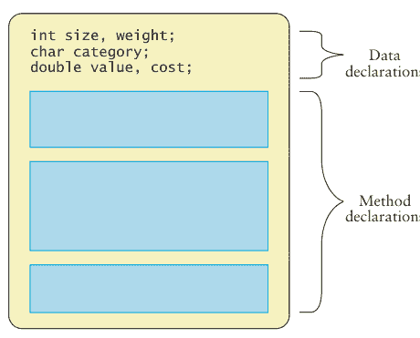

图 4.2 类的成员：数据和方法

`Die` 类位于列表 4.2。它包含两个数据值：一个代表骰子最大值的整数常量 `MAX` 以及代表当前面值的变量 `faceValue`。它还包含一个名为 `Die` 的构造方法和四个普通方法：`roll`、`setFaceValue`、`getValue` 和 `toString`。

你从第 2 章和第 3 章记得，构造方法是与类名相同的特殊方法。构造方法在用 `new` 运算符创建 `Die` 的新实例时被调用。`Die` 类其余方法定义了 `Die` 对象提供的服务。

我们使用文档头块来解释类中每个方法的目的。这种做法对于试图理解软件的人来说不是必须的，但它在视觉上分离了代码，使得在阅读代码时眼睛很容易从一个方法跳转到另一个。

图 4.3 列出了 `Die` 类的方法。从这个角度来看，它与我们之前使用的任何其他类都没有区别。唯一的区别是 `Die` 类不是由 Java 标准库提供的，是我们自己编写的。

`Die` 类的方法包括掷骰子的能力，从而产生一个新的随机值。`roll` 方法将面值返回给获取方法，但你也可以随时使用 `getValue` 方法获取当前面值。`setFaceValue` 方法显式设置面值，如果你已经到达或转到了你想要的任何数值。当你将对象传递给 `print` 或 `println` 方法时，任何对象的 `toString` 方法都会自动调用，以获取该对象的字符串描述。


```java
********************************************************************
// Die.java      Author: Lewis/Loftus
// 表示一个骰子（dice 的单数），其面显示为 1 到 6 之间的值。
//********************************************************************
public class Die {
    private final int MAX = 6; // 最大面值
    private int faceValue; // 骰子当前显示的值

    //----------------------------------------------------------------------
    // 构造函数：设置初始面值。
    //----------------------------------------------------------------------
    public Die() {
        faceValue = 1;
    }

    //----------------------------------------------------------------------
    // 掷骰子并返回结果。
    //----------------------------------------------------------------------
    public int roll() {
        faceValue = (int)(Math.random() * MAX) + 1;
        return faceValue;
    }

    //----------------------------------------------------------------------
    // 面值修改器。
    //----------------------------------------------------------------------
    public void setFaceValue(int value) {
        faceValue = value;
    }

    //----------------------------------------------------------------------
    // 面值访问器。
    //----------------------------------------------------------------------
    public int getFaceValue()
    {
        return faceValue;
    }

    // 返回此骰子的字符串表示形式。
    public String toString()
    {
        String result = Integer.toString(faceValue);
        return result;
    }
}
```

### 列表 4.2 继续

以进行打印。因此，通常为大多数类定义一个 `toString` 方法是一个好主意。这些方法的定义包含多个部分，我们将在本章后续内容对其进行剖析。

对于书中的示例，我们将每个类都存储在自己的单独文件中。Java 允许在一个文件中存储多个类。如果一个文件包含多个类，则只有其中一个类可以使用保留字 `public` 进行声明。此外，公共类的名称必须与文件名对应。例如，`Die` 存储在 `Die.java` 文件中。

| 构造函数 | 将骰子的初始面值设置为 1。 |
|---|---|
| `int roll()` | 通过将面值设置为适当范围内的随机数来掷骰子。 |
| `void setFaceValue(int value)` | 将骰子的面值设置为指定值。 |
| `int getFaceValue()` | 返回骰子的当前面值。 |
| `toString()` | 返回骰子的字符串表示形式，指示其当前面值。 |

图 4.3 Die 类的一些方法

## 4.2 类的构造分析

### 实例数据

注意，在类中，常量 `MAX` 和变量 `faceValue` 是在类内部声明的，但在任何方法内部。变量声明的位置定义了它的*作用域*（scope），即程序中可以引用该变量的区域。通过在类级别（而不是在方法内部）声明它，这些变量和常量可以在类的任何方法中被引用。

如变量 `faceValue` 等属性均被称为*实例数据*（instance data）。会为创建的该类实例预留新的内存空间。每个对象都有自己的 `faceValue` 变量及其对应的数据空间。我们在 `RollingDie` 程序的输出中说明：一个骰子的面值为 5，另一个面值为 2。只有当为每个骰子都创建了 `faceValue` 的内存空间时，这种情况才是可能的。

我们可以这样描述这种情况：

| | | |
|---|---|---|
| die1 | faceValue | 5 |
| die2 | faceValue | 2 |

`die1` 和 `die2` 引用变量指向并包含各自 `Die` 对象的地址。每个对象都包含一个具有独立内存空间的 `faceValue` 变量。每个对象可以为其实例数据存储不同的值。

Java 会自动初始化在类级别声明的变量。例如，所有如 `int`、`double` 等数值类型的变量都会被初始化为零。然而，尽管语言执行了这种自动初始化，显式地初始化变量（通常在构造函数中）仍然良好的做法，这样任何阅读代码的人都能清楚地理解其意图。

### UML 类图

在整书中，我们使用 UML 图来视觉化类与对象之间的关系。UML 代表统一建模语言（Unified Modeling Language），它已成为表示面向对象程序设计最流行的表示法。

存在多种类型的 UML 图，每种图都旨在展示面向对象程序的特定方面。在本书中，我们主要关注 UML 类图，以展示类的内容以及它们之间的关系。

## 第 4 章 类

| RollingDice | Die |
| :--- | :--- |
| `main(args: String[])` : void | `faceValue` : int |
| | `roll()` : int |
| | `setFaceValue(int value)` : void |
| | `getFaceValue()` : int |
| | `toString()` : String |

图 4.4 显示参与 RollingDice 程序的类的 UML 类图

> 核心概念
>
> UML 类图有助于视觉化程序中类与类之间的关系内容。

在 UML 图中，每个类都表示为一个矩形，可能包含三个部分以显示类名、其属性（数据）和其操作（方法）。4.4 显示了一个包含 `RollingDice` 程序类的类图。

图 4.4 中连接 `RollingDice` 和 `Die` 类的箭头表示类之间的关系。虚线箭头表示一个类使用了另一个类的方法。类之间其他类型的面向对象关系通过不同类型的连接线和箭头显示。我们将在探索书中相关的主题时讨论这些其他关系。

记住，UML 并不是专门为 Java 程序员设计的。它的目的是与语言无关的。UML 中的语法并不与 Java 相同。例如，变量的类型显示在名称之后。方法的返回类型显示相同的方式。UML 图是多用途的。根据特定图表的质量，我们可以包含任何所需的信息。UML 图允许你视觉化程序的设计。随着我们的程序变得越来越，由越来越多的类组成，这些视觉化变得非常有帮助。我们将根据情况探索 UML 的新方面。

- SR 4.5 对象和类之间有什么区别？
- SR 4.6 描述 `Die` 类的实例数据。
- SR 4.7 `Die` 类定义的哪些方法更改对象的状态——即哪些方法为实例数据赋值？

### 自测习题（答案见附录 N）

## 4.3 封装

- SR 4.8 当将对象传递给方法时会发生什么？
- SR 4.9 变量的作用域是什么？
- SR 4.10 UML 图的设计目的是什么？

我们在第 1 章的面向对象概念概览中提到过，对象应该是自管理的。也就是说，对象的实例数据应该只由该对象本身修改。例如，`Die` 类的方法应该唯一负责更改 `faceValue` 变量的值。我们应该让类外部代码难以（甚至不可能）“伸进去”并改变类内部声明变量的值。这种特性就是封装。

对象应该与系统的其他部分封装起来。它应该通过定义对象提供的特定方法集与程序的其他部分交互。这些方法定义了该对象与使用它的程序之间的接口。

> 核心概念
>
> 对象应该是封装的，保护数据免受不当访问。

封装在图 4.5 中以图形所示。使用对象的代码（有时被称为对象的客户端）不应允许直接访问变量。客户端应该调用对象的方法，这些方法与封装在对象内部的数据交互。例如，`RollingDice` 程序中的 `main` 方法调用了 `Die` 对象的 `roll` 方法。`main` 方法不（实际上无法）直接访问 `faceValue` 变量。

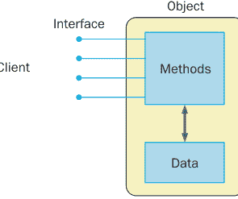

图 4.5 客户端与对象的方法交互

# 第 4 章 类

在 Java 中，我们使用修饰符来实现封装。修饰符是 Java 保留字，用于指定编程语言构造的特定特性。在第 2 章中我们讨论了 `final` 修饰符，它被用于声明常量。Java 有多种可以以各种方式使用的修饰符。某些修饰符可以组合使用，但某些组合是无效的。我们将在书中适当的位置讨论各种 Java 修饰符，所有这些修饰符都将在附录 E 中总结。

## 可见性修饰符

Java 修饰符中的某些是可见性修饰符，因为它们控制了对类成员的访问。保留字 `public` 和 `private` 是可见性修饰符，可以应用于类的变量和方法。如果一个类的成员具有 `public` 可见性，则可以从对象外部直接引用。如果一个类的成员具有 `private` 可见性，则可以在类的内部任何地方使用，但不能从外部引用。第三种可见性修饰符 `protected` 仅在继承的语境中相关。我们将在第 9 章讨论它。

> 核心概念
>
> 实例变量应该声明为 `private` 可见性以促进封装。

`public` 变量违反了封装。它们允许定义数据的类的外部代码访问或修改数据的值。因此，实例变量应被定义为 `private` 可见性。被声明为 `private` 的数据只能通过类的方法进行访问。

方法的可见性取决于该方法的目的。为客户端提供服务的方法必须声明为 `public` 可见性，以便客户端调用它们。方法有时被称为服务方法。`private` 方法不能从类外部调用。`private` 方法的目的是帮助类的其他方法完成其工作。它们有时被称为支持方法。

图 4.6 中的表格总结了 `public` 和 `private` 可见性对变量和方法的影响。


将常量赋予 `public` 可见性通常被认为是可以接受的，尽管它们的值可以被直接访问，但由于它们是使用 `final` 修饰符声明的，不能被更改。保持封装可以确保数据值不被代码的其他部分更改。因为常量根据定义是不可更改的，所以封装问题在很大程度上是不成立的。

UML 类图可以通过在类成员前面加上特定的字符来显示类成员的可见性。具有 `public` 可见性的成员前面有一个加号 (+)。

## 4.3 封装

| | public | private |
| :--- | :--- | :--- |
| 变量 | 违反封装 | 强制封装 |
| 方法 | 为客户端提供服务 | 支持类中的其他方法 |

图 4.6 `public` 和 `private` 可见性的影响

## 访问器和变异器

由于实例数据通常声明为 `private` 可见性，类通常会提供访问和修改数据值的方法。像 `getFaceValue()` 这样的方法是一个*访问器方法*（accessor method），提供对特定值的只读访问。同样，像 `setFaceValue()` 这样的方法是一个*变异方法*（mutator method），因为它改变了特定值。

通常，访问器方法命名为 `getX()`，其中 `X` 是它提供访问的值。同样，变异器方法命名为 `setX()`，其中 `X` 是它们正在设置的值。这些类型的方法有时被称为“getters”和“setters”。

例如，如果一个类包含实例变量 `height`，它还应该提供 `getHeight()` 和 `setHeight()` 方法。注意这种命名约定将方法名中使用的值的首字母大写，这与方法名的通用写法是一致的。

某些方法作为其主要目的的副作用提供了访问器和/或变异器功能。例如，`Die` 类的 `roll()` 方法改变了骰子的 `faceValue` 并同样返回了新值。注意，`roll()` 方法的代码仔细地将骰子的面值保持在有效范围内（1 到 `MAX`）。服务方法必须经过仔细设计，仅允许适当的访问和有效的更改。

这指出了 `Die` 类设计中的一个缺陷。注意 `setFaceValue()` 方法有一个限制——客户端可以使用它将值设置为像 20 这样的数字，这在有效范围之外。`setFaceValue()` 方法的代码应该只允许对骰子的面进行有效修改。我们将在下一章探索如何实现这种控制。

> **核心概念**
>
> 大多数对象包含访问器和变异器方法，允许客户端以受控的方式管理数据。

### 自测习题（答案见附录 N）

- SR 4.11 对象应该是自管理的。请解释。
- SR 4.12 对象的接口是什么？
- SR 4.13 修饰符是什么？
- SR 4.14 为什么常量可能被赋予 `public` 可见性？
- SR 4.15 描述以下各项：
  - a. public 方法
  - b. private 方法
  - c. public 变量
  - d. private 变量

## 4.4 方法的结构

我们已经见过由数据声明和方法声明组成的类。让我们更详细地检查方法声明。

正如第 1 章所述，方法是一组被命名的编程语言语句。方法声明指定了在方法被调用时执行的代码。Java 程序中的每个方法都是特定类的一部分。

当方法被调用时，控制流会转移到该方法。方法的语句逐个执行。当该方法执行完毕，控制返回到调用发生的位置并继续执行。被调用的方法（调用该方法的那个）可能与调用方法属于同一个类，只需要该方法即可调用它。如果它属于不同的类，则通过该类的对象名称进行调用，我们已经见过多次。图 4.7 显示了方法调用时的执行流。我们在很多例子中定义了 `main()` 方法。方法头包含了返回值的类型，方法名以及参数列表。方法体是由大括号定义的语句。本节将详细讨论与方法声明。

### 方法声明

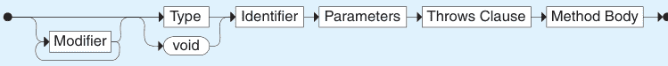

### 参数

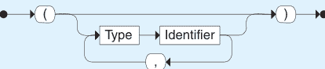

方法由可选修饰符、返回类型、标识符（方法名）、参数列表以及方法体定义。返回类型指示方法将返回的值的类型，方法可以是 `void`。方法体是方法被调用时执行的语句块。`throws` 子句是可选的，指示方法可能抛出的异常。

```
public void instructions(int count) {
    System.out.println("Follow all instructions.");
    System.out.println("Use no more than " + count + " turns.");
}
```


图 4.7 方法调用后的控制流

### 返回语句

方法头中指定的返回类型可以是基本类型、类或 `void`。当方法不返回任何值时，使用 `void` 作为返回类型，正如方法中总是这样做的那样。`Die` 类的 `setFaceValue()` 方法返回类型为 `void`。

返回值的方法必须有返回语句。当执行返回语句时，控制立即返回到调用方法并在那里继续。返回语句由保留字 `return` 以及指示返回值的表达式组成。表达式必须与方法头中的返回类型一致。

`Die` 类的 `getValue()` 方法返回一个代表骰子当前值的 `int`。`roll()` 方法同样如此，返回随机设置的 `faceValue`。`toString()` 方法返回一个 `String` 对象。

不返回值的方法通常不包含返回语句。当到达方法结束时，会自动返回到调用方法。此类方法可以包含不带表达式的返回语句。

在方法中使用多个返回语句通常被认为不是良好的做法，尽管可以这样做。通常，方法应该将返回语句作为方法体的最后一行，除非该方法过于复杂。

方法返回的值可以在调用方法中被忽略。例如，在 `RollingDice` 类的 `main()` 方法中，返回的值在某些调用中，`roll()` 方法的返回值被忽略了，而在另一些调用中，返回值用于计算。

构造函数没有返回类型（甚至没有 `void`），因此不能返回值。我们将在本章的稍后部分详细讨论构造函数。

### 参数

正如第 2 节定义的，参数是在方法被调用时传递给方法的值。方法头部的参数列表指定了传递的值的类型，以及方法引用这些值时使用的名称。

方法声明头中的参数名称被称为**形式参数**（formal parameters）。在调用中，传递给方法的值被称为**实际参数**（actual parameters）。实际参数被称为方法的**参数**（arguments）。

方法调用和定义在方法后的括号中给出了参数列表。如果没有参数，则使用空括号，如 `roll()` 和 `getFieldValue()` 方法所示。`Die` 类不接受任何参数，尽管构造函数通常会接受。

形式参数是作为方法内部变量使用的标识符，而其初始值来自调用中的实际参数。当方法被调用时，每个实际参数的值都会被复制并存储在相应的形式参数中。实际参数可以是字面量、变量或完整的表达式。如果使用表达式作为实际参数，它在方法被调用之前会被完全求值并作为参数传递。

`Die` 类中唯一接受任何参数的方法是 `setFieldValue()` 方法，它接受一个 `int` 类型参数。形式参数名称为 `value`。在 `main()` 方法中，值 `4` 被作为实际参数传递给它。

调用和方法声明中的参数列表必须匹配。也就是说，如图 4.8 所示，第一个实际参数的值被复制到第一个形式参数中，第二个实际参数复制到第二个形式参数中，依此类推。实际参数的类型必须与形式参数指定的类型一致。

关于参数传递的其他细节将在第 7 节中讨论。

### 本地数据

正如我们在本章开头描述的，变量或常量的作用域是程序中可以对该变量进行有效引用的部分。可以在方法内部声明变量，使其成为本地数据而非实例数据。记住，实例数据是在类中声明的，但在任何特定方法中都不是。

> **核心概念**
>
> 当方法被调用时，实际参数被复制到形式参数中。

#### 第 4 节 编写类

-- 本地数据的作用域仅限于其声明所在的方法。在 `Die` 类的 `toString()` 方法中声明的变量 `result` 是本地数据。`Die` 类中任何其他方法对它的引用在外部都不存在，并将导致编译器发出错误信息。本地变量在它声明的方法之外简单地不存在。相反，在类级别声明的实例数据其作用域是整个类；该类的任何方法都可以引用它。

本地数据和实例数据在不同级别的作用域上运行，可以在方法内部声明一个与类级别声明的实例变量同名的本地变量。在方法中引用该名称将引用该变量的本地版本。这种命名做法显然可能会让阅读代码的人产生困惑，因此应该避免。

方法头中的形式参数名称充当该方法的本地数据。它们在方法被调用之前是不存在的，在方法执行结束时也消失。例如，`setValue()` 方法中的形式参数 `value` 在方法被调用时产生，在方法执行完毕后消失。

| 方法调用 | 方法声明 |
| :--- | :--- |
| `ch = obj.calc(25, count, "Hello");` | `char calc(int num1, int num2, String message) { int sum = num1 + num2; char result = message.charAt(sum); }` |

**图 4.8** 从方法调用向声明传递参数。

> **核心概念**
>
> 在方法中声明的变量是该方法的局部变量，不能在方法外部使用。

## 银行账户示例

让我们来看另一个类及其使用的示例。列表 4.3 所示的 `Transactions` 类包含一个 `main()` 方法，该方法创建了几个 `Account` 对象并调用了它们的服务。

```java
// Transactions.java      Author: Lewis/Loftus
// 展示多个 Account对象的创建和使用。

public class Transactions {
    // 创建一些账户并调用它们的服务。
    public static void main(String[] args) {
        Account acc1 = new Account("Ted Murphy", 101, 500.00);
        Account acc2 = new Account("Jane Smith", 102, 750.50);
        Account acc3 = new Account("Edward Demsey", 103, 1000.00);

        System.out.println(acc1.toString());
        System.out.println(acc2.toString());
        System.out.println(acc3.toString());

        acc1.deposit(150.0);
        acc2.withdraw(100.0, 10.0);
        acc3.addInterest(0.0);

        System.out.println(acc1.toString());
        System.out.println(acc2.toString());
        System.out.println(acc3.toString());
    }
}
```

账户上的事务会根据参数调整余额。还有一个 `addInterest()` 方法，它通过加上赚取的利来更新余额。这些方法是改变余额的有效方式，因此不提供像 `setBalance()` 这样经典的修改器方法。

在 Transactions 程序中，三个 Account 对象刚创建后的状态可以描述所示：

| acctNumber | 72354 |
| :--- | :--- |
| acct1 | balance | 102.56 |
| name | "Ted Murphy" |
| acctNumber | 69713 |
| :--- | :--- |
| acct2 | balance | 40.00 |
| name | "Jane Smith" |
| acctNumber | 93757 |
| :--- | :--- |
| acct3 | balance | 759.32 |
| name | "Edward Demsey" |

对更新账户余额的各种方法可以进行更严谨的分析。应该检查以确保参数值有效，例如防止提取负金额（这本质上是存款）。这一处理将在下一章中讨论。

### 自测习题（答案见附录 N）

- SR 4.16 如何通过特定对象（或在特定对象上）调用方法？该规则的例外是什么？
- SR 4.17 方法返回一个值意味着什么？
- SR 4.18 `return` 语句的作用是什么？
- SR 4.19 是否强制需要 `return` 语句？
- SR 4.20 解释实际参数和形式参数之间的区别。
- SR 4.21 为 Die 类编写一个名为 `getFaceDown()` 的方法，用于返回骰子当前的“朝下”面；提示：在标准骰子上，任意两个相对面的数字之和为七。
- SR 4.22 在 Transactions 程序中：
    - a. 创建了多少 Account 对象？
    - b. 在 `acct2` 对象上调用 `withdraw()` 方法时，传递了多少个参数（实际参数）？
    - c. 在 `acct3` 对象上调用 `addInterest()` 方法时，传递了多少个参数（实际参数）？
- SR 4.23 Account 类的方法中，哪些可以归类为访问器方法（accessor）？修改器方法（mutator）？服务方法（service）？

# 4.5 重温构造函数

正如第 2 章所述，构造函数类似于在实例化对象时调用的方法。当我们定义一个类时，通常会定义一个构造函数来帮助设置类。特别是，我们经常使用构造函数初始化每个对象的变量。

构造函数与普通方法有两个不同点。首先，构造函数的名称与类名相同。Die 类构造函数的名称是 `Die`，Account 类构造函数的名称是 `Account`。其次，构造函数不能返回值，且头部中没有指定返回类型。

> **核心概念**
>
> 构造函数不能有任何返回类型，即使是 `void`。

程序员的一个常见错误是在构造函数上加上 `void` 类型。对于编译器来说，在构造函数上放置任何返回类型都会变成一个恰好与类名相同的普通方法。因此，它不能作为构造函数被调用。这会导致有时难以理解的错误信息。

通常，构造函数用于初始化新实例的对象。例如，Die 类的构造函数将骰子的面值设置为 1。Account 类的构造函数将实例变量的值设置为传递给构造函数的参数值。

我们并不需要为每个类都定义构造函数。每个类都有一个不接受参数的默认构造函数。当我们不提供自己的构造函数时，就会使用默认构造函数。这个默认构造函数通常对新的对象没有影响。

# 第 4 章 类

### 自测习题（答案见附录 N）

- SR 4.24 构造函数是做什么的？
- SR 4.25 构造函数是如何定义的？

## 4.6 图形对象

某些对象具有图形表示，这意味着它们的状态和行为包含了关于对象外观的信息。例如，一个图形对象可能包含关于其尺寸和颜色的数据，并可能包含绘制它的方法。

在第 3 章中，我们实例化并使用了框架、面板、标签和图像等图形组件。这些组件确实被认为是图形对象。本节将更详细地检查其中一些，并探索如何定义具有图形特征的对象。

列表 4.5 中的程序显示了一个简单的脸和文本说明。然而，`SmilingFace` 类中的 `main()` 方法并没有处理所有的细节，但 `main()` 方法设置了程序的框架，并使用它来显示 `SmilingFacePanel` 的实例。

列表 4.6 显示的 `SmilingFacePanel` 类定义了两个绘图常量（`BASEX` 和 `BASEY`）、一个绘制面板脸关键部分的构造函数，以及一个名为 `paintComponent()` 的方法，用于绘制程序执行时我们看到的脸。在这种情况下，我们不是向面板中添加 GUI 组件，而是在上面进行绘制。

注意 `SmilingFacePanel` 类继承了 `JPanel` 类。正如我们在第 2 章讨论 applet 时提到的，`extends` 建立了继承关系。`SmilingFacePanel` 类继承了 `JPanel` 类的特性。也就是说，一个 `SmilingFacePanel` 就是一个 `JPanel`。关于这一点，你真的需要了解第 9 章讨论的继承。

`SmilingFacePanel` 类的构造函数设置了背景颜色和面板的预期尺寸，正如我们在第 3 章创建 `JPanel` 时设置默认字体一样。这些调用是针对该对象的。当不通过特定对象调用该方法时，你可以将其理解为 `SmilingFace` 类本身。


使用扩展 JPanel 的示例。

# 列表 4.5


# 4.6 图形对象

## SmilingFace 示例

```java
// SmilingFace.java      Author: Lewis/Loftus
//
// 展示了面板类的用法。
import javax.swing.JFrame;

public class SmilingFace {
    // 创建程序的框架。
    public static void main(String[] args) {
        JFrame frame = new JFrame("Smiling Face");
        frame.setDefaultCloseOperation(JFrame.EXIT_ON_CLOSE);

        SmilingFacePanel panel = new SmilingFacePanel();
        frame.getContentPane().add(panel);

        frame.pack();
        frame.setVisible(true);
    }
}
```


## 列表 4.6 SmilingFacePanel.java

```java
// SmilingFacePanel.java      Author: Lewis/Loftus
// 展示了面板类的用法。
import javax.swing.JPanel;
import java.awt.*;

public class SmilingFacePanel extends JPanel {
    private final int BASEX = 120, BASEY = 60; // 头部基点

    // 构造函数：设置面板的主要特性。
    public SmilingFacePanel() {
        setBackground(Color.blue);
        setPreferredSize(new Dimension(320, 200));
        setFont(new Font("Arial", Font.BOLD, 16));
    }

    // 绘制脸。
    public void paintComponent(Graphics page) {
        super.paintComponent(page);
        page.setColor(Color.yellow);
        page.fillOval(BASEX, BASEY, 80, 80); // 头
        page.fillOval(BASEX - 5, BASEY + 20, 90, 40); // 耳朵
        page.setColor(Color.black);
        page.drawOval(BASEX + 20, BASEY + 30, 15, 7); // 眼睛
        page.drawOval(BASEX + 45, BASEY + 30, 15, 7);
        page.fillOval(BASEX + 25, BASEY + 31, 5, 5); // 瞳孔
        page.fillOval(BASEX + 50, BASEY + 31, 5, 5);
        page.drawArc(BASEX + 20, BASEY + 25, 15, 7, 0, 180); // 眉
        page.drawArc(BASEX + 45, BASEY + 25, 15, 7, 0, 180);
        page.drawArc(BASEX + 35, BASEY + 40, 15, 10, 180, 180); // 鼻子
        page.drawArc(BASEX + 20, BASEY + 50, 40, 15, 180, 180); // 嘴
        page.setColor(Color.white);
        page.drawString("Always remember that you are unique!", BASEX - 105, BASEY - 15);
        page.drawString("Just like everyone else.", BASEX - 45, BASEY + 105);
    }
}
```

`paintComponent` 方法接受一个 `Graphics` 对象作为参数，正如第 2 章所讨论过的，该对象代表了组件的图形上下文。通过对面板的图形上下文（即 `page` 参数）调用方法，可以在面板上绘制图形。

每个 `JPanel` 都有一个 `paintComponent` 方法，该方法会被自动调用以绘制面板。在这种情况下，我们正在扩展 `paintComponent` 的定义——告诉它除了绘制面板背景外，还应该通过 `paintComponent` 方法中进行的各种调用来绘制脸部和文字。`paintComponent` 方法的第一行是调用 `super.paintComponent`，它代表了 `JPanel` 版本的 `paintComponent` 方法，该方法负责背景的绘制。我们始终应该将其作为 `paintComponent` 方法的第一行。

## Splat 示例

### 列表 4.7 Splat.java

```java
import javax.swing.*;
import java.awt.*;

public class Splat {
    // 展示一组圆的集合。
    public static void main(String[] args) {
        JFrame frame = new JFrame("Splat");
        frame.setDefaultCloseOperation(JFrame.EXIT_ON_CLOSE);
        frame.getContentPane().add(new SplatPanel());

        frame.pack();
        frame.setVisible(true);
    }
}
```

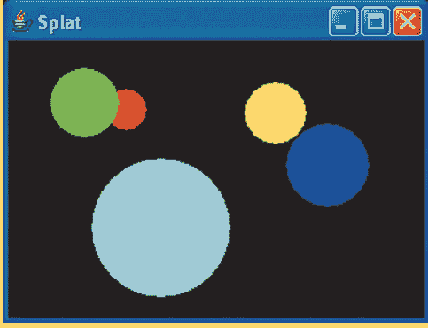

程序只是绘制了几个实心圆。这个程序的有趣之处不在于它做了什么，而在于它是如何实现的——程序中绘制的每个圆都由它自己的对象表示。

`main` 方法实例化了一个 `SplatPanel` 对象并将其添加到框架中。`SplatPanel` 类在列表 4.8 所示。与上一个示例中的 `SmilingFace` 类一样，`SplatPanel` 类继承自 `JPanel`。它持有五个 `Circle` 对象的实例数据，这些对象在构造函数中实例化。

### 列表 4.8 SplatPanel.java

```java
// SplatPanel.java
// Author: Lewis/Loftus
// 展示了图形对象的使用。

import javax.swing.*;
import java.awt.*;

public class SplatPanel extends JPanel {
    private Circle circle1, circle2, circle3, circle4, circle5;

    // 构造函数：创建五个 Circle 对象。
    public SplatPanel() {
        circle1 = new Circle(30, Color.red, 70, 35);
        circle2 = new Circle(50, Color.green, 30, 20);
        circle3 = new Circle(100, Color.cyan, 60, 85);
        circle4 = new Circle(43, Color.yellow, 170, 30);
        circle5 = new Circle(60, Color.blue, 200, 65);

        setPreferredSize(new Dimension(300, 200));
        setBackground(Color.white);
    }

    // 通过请求图形上下文绘制面板。
    public void paintComponent(Graphics page) {
        super.paintComponent(page);
        circle1.draw(page);
        circle2.draw(page);
        circle3.draw(page);
        circle4.draw(page);
        circle5.draw(page);
    }
}
```

`paintComponent` 方法接受一个 `Graphics` 对象作为参数，正如第 2 章所讨论过的，该对象代表了组件的图形上下文。通过对面板的图形上下文（即 `page` 参数）调用方法，可以在面板上绘制图形。

### 列表 4.9 Circle.java

```java
// Circle.java
// Author: Lewis/Loftus
// 表示具有位置、大小的圆。

import java.awt.*;

public class Circle {
    private int diameter, x, y;
    private Color color;

    // 构造函数：设置圆的属性
    public Circle(int diameter, Color color, int x, int y) {
        this.diameter = diameter;
        this.color = color;
        this.x = x;
        this.y = y;
    }

    // 使用图形上下文绘制此圆
    public void draw(Graphics page) {
        page.setColor(color);
        page.fillOval(x, y, diameter, diameter);
    }

    // 访问器和设置器
    public int getDiameter() {
        return diameter;
    }

    public void setDiameter(int diameter) {
        this.diameter = diameter;
    }

    public Color getColor() {
        return color;
    }

    public void setColor(Color color) {
        this.color = color;
    }

    public int getX() {
        return x;
    }

    public void setX(int x) {
        this.x = x;
    }

    public int getY() {
        return y;
    }

    public void setY(int y) {
        this.y = y;
    }
}
```

# 4.7 图形界面

在 2 和 3 章中，我们引入了一些有助于设计的组件。我们现在需要的是真正的用户交互，这是核心。本节介绍了交互程序所需的概念，为所有的 GUI 讨论奠定了基础。

在 Java 中创建用户界面至少需要三种对象：

- 组件
- 事件
- 监听器

正如第 3 章提到的，GUI 组件是用于显示信息或允许用户交互的屏幕元素。GUI 组件的示例包括按钮、文本字段、标签、滚动条和菜单。容器是一种特殊的组件，用于存放和组织其他组件。我们已经使用了框架和面板等容器。

事件代表我们可能感兴趣的某种发生。事件通常对应于用户操作，例如按下按钮或在键盘上打字。大多数 GUI 组件都会产生相关的用户操作。例如，按钮组件会生成一个指示按钮已按下的事件。

监听器是“等待”事件发生并在发生时做出响应的对象。我们必须仔细建立监听器、它监听的事件以及生成事件的组件之间的关系。


# 具体步骤

为了创建一个使用 GUI 的 Java 程序，我们必须：

- 实例化并设置必要的组件
- 实现监听类，定义当特定事件发生时执行什么
- 建立监听器与生成感兴趣事件的组件之间的关系

> **核心概念**
>
> GUI 由组件、代表用户操作的事件以及响应这些事件的监听器组成。

# 第 4 章 编写类

在某些方面，一旦你对事件驱动编程有了基本的理解，其余的只是细节问题。你可以使用许多类型的组件，它们会产生许多类型的事件，而你可能需要响应这些事件。但它们的工作原理都是相同的。它们之间具有相同的内核关系。

接下来的章节将介绍一些组件，并展示一些基于 GUI 的程序示例，这些程序允许真正的用户交互。

- 自我习题（答案见附录 N）
- SR 4.30 事件与监听器之间是什么关系？
- SR 4.31 我们是否可以向任何组件添加任何按键监听器？请解释原因。

## 4.8 按钮

列表 4.10 中的 `PushCounter` 程序向用户提供了一个单一的推按按钮（标记为“Push Me!”）。每当按钮按下时，计数器就会更新并显示。

### 列表 4.10

```java
// PushCounter.java      Author: Lewis/Loftus
// Demonstrates a graphical user interface and an event listener.

import javax.swing.JFrame;

public class PushCounter
{
    // 创建主程序框架。
    // ------------------------------------
    public static void main(String[] args)
    {
        JFrame frame = new JFrame("Push Counter");
        frame.setDefaultCloseOperation(JFrame.EXIT_ON_CLOSE);
        frame.getContentPane().add(new PushCounterPanel());
        frame.pack();
        frame.setVisible(true);
    }
}
```


该程序使用的组件包括一个按钮、一个用于显示计数的标签、一个组织 GUI 的面板以及一个用于显示面板的框架。面板由 `PushCounter` 类定义，如列表 4.11 所示。

推按按钮是一种允许用户通过点击鼠标来启动操作的组件。我们将在随后的章节中探索其他类型的按钮组件。推按按钮由 `JButton` 类定义。

### 列表 4.11

```java
// PushCounterPanel.java      Author: Lewis/Loftus
// Demonstrates a graphical user interface and an event listener.

import java.awt.*;
import java.awt.event.*;
import javax.swing.*;

public class PushCounterPanel extends JPanel {
    private int count;
    private JButton push;
    private JLabel label;

    //--- 构造函数：设置 GUI。
    //-
    public PushCounterPanel() {
        count = 0;

        push = new JButton("Push Me!");
        push.addActionListener(new ButtonListener());

        label = new JLabel("Pushes: " + count);

        add(push);
        add(label);

        setPreferredSize(new Dimension(300, 40));
        setBackground(Color.cyan);
    }

    //--- 代表对按钮按下（动作）事件的监听器。
    //-
    private class ButtonListener implements ActionListener {
        //--- 当按钮被按下时更新计数器和标签。
        //-
        public void actionPerformed(ActionEvent event) {
            count++;
            label.setText("Pushes: " + count);
        }
    }
}
```

`PushCounterPanel` 构造函数设置了 GUI。`JButton` 构造函数的调用接收一个字符串参数，用于指定在面板上显示的文本。按钮和标签被添加到面板中。

该程序中唯一的事件发生在按钮被按下时。为了响应该事件，我们必须为该事件创建一个监听器对象，因此我们必须编写一个代表监听器的类。

## 4.8 按钮（续）

`JButton` 在被按下时会产生一个动作事件。因此，监听器类将是一个动作事件监听器。在这个程序中，我们定义了一个名为 `ButtonListener` 的类来表示此事件的监听器。

我们可以将 `ButtonListener` 类写在单独的文件，甚至写在 `PushCounterPanel` 之外的文件中。但是，我们必须设置一种在监听器与监听器更新的 GUI 组件之间进行通信的方法。相反，我们将 `ButtonListener` 类定义为内部类（inner class），即定义在另一个类内部的类。这样，它就可以自动访问包含它的类的成员。只有当两个类之间存在紧密关系，且内部类不被任何其他类访问时，你才创建内部类。监听器与其 GUI 之间的关系是适用于内部类的少数情况之一。

> **核心概念**
>
> 监听器被定义为内部类，是因为监听器与 GUI 组件之间存在紧密的关系。

监听器是通过实现接口编写的，接口是实现类必须定义的方法列表。Java 标准库包含了用于许多类型事件的接口。动作监听器是通过实现 `ActionListener` 接口创建的，因此我们在 `ButtonListener` 类中包含了 `implements` 子句。接口将在第 7 章中进行更详细的讨论。

`ActionListener` 接口中唯一的方法是 `actionPerformed` 方法，因此它也是 `ButtonListener` 类必须实现的唯一方法。产生动作事件的组件（在本例中为按钮）在事件发生时会调用 `actionPerformed` 方法，有时我们会使用事件对象，而另一些时候我们只需要知道事件已经发生即可。

## 4.9 文本字段

让我们看看使用另一个组件的示例：文本字段。列表 4.12 显示的程序展示了一个 GUI，其中包含一个文本字段，用户可以在其中输入华氏温度。当用户按下 Enter（或 Return）键时，就会显示相应的摄氏温度。

该程序的界面在 `FahrenheitPanel` 类中设置。文本字段是 `JTextField` 类的对象。`JTextField` 构造函数接收一个整数参数，根据当前字体指定字段的字符数。

文本字段和各种标签被添加到面板中。记住，面板由称为流布局（flow layout）的布局管理器管理，它可以将组件放在同一行。因此，如果你缩放框架，标签和文本字段的布局可能会改变。我们将在第 7 章详细讨论布局管理器，提供控制组件布局的更多选项。

如果光标位于文本字段内，文本字段组件在按下 Enter 或 Return 键时会产生事件。我们需要设置一个监听器来响应动作事件。在上一节的 `PushCounter` 程序中，我们将监听器定义为实现 `ActionListener` 接口的内部类。

当用户按下 Enter 键时，文本字段调用 `actionPerformed` 方法。该方法首先通过调用 `getText` 方法从文本字段获取文本，该方法返回一个字符字符串。使用 `Integer` 包装类的 `parseInt` 方法将文本转换为整数。然后方法计算等值的摄氏温度，并将结果设置到相应标签的文本。

注意，按钮和文本字段产生相同的事件：动作事件。因此，华氏程序设计的另一种替代方案是在 GUI 中添加一个 `JButton` 对象，当用户使用鼠标点击按钮时触发转换。就此，同一个监听器对象可以用于同时监听多个组件。该监听器可以同时添加到文本字段和按钮上，为用户提供选择。按下任何一个按钮或回车键都会执行转换。这些变体留作编程项目。

### 代码列表 4.12

```java
// Fahrenheit.java      Author: Lewis/Loftus
// 展示了文本字段的使用。

import javax.swing.JFrame;

public class Fahrenheit {
    // 创建并显示温度转换器的 GUI。
    // -----------------------------------------------------------------------
    public static void main(String[] args) {
        JFrame frame = new JFrame("Fahrenheit");
        frame.setDefaultCloseOperation(JFrame.EXIT_ON_CLOSE);

        FahrenheitPanel panel = new FahrenheitPanel();
        frame.getContentPane().add(panel);
        frame.pack();
        frame.setVisible(true);
    }
}
```

### 显示

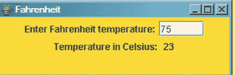

### 代码列表 4.13

```java
// FahrenheitPanel.java      Author: Lewis/Loftus
// 展示了文本字段的使用。

import java.awt.*;
import java.awt.event.*;
import javax.swing.*;

public class FahrenheitPanel extends JPanel {
    private JLabel inputLabel, outputLabel, resultLabel;
    private JTextField fahrenheit;

    //-----------------------------------------------------------------------
    // 构造函数：设置主要的 GUI 组件。
    //-----------------------------------------------------------------
    public FahrenheitPanel() {
        inputLabel = new JLabel("输入华氏度温度:");
        outputLabel = new JLabel("摄氏度:");
        resultLabel = new JLabel("--");

        fahrenheit = new JTextField(5);
        fahrenheit.addActionListener(new TempListener());

        add(inputLabel);
        add(fahrenheit);
        add(outputLabel);
        add(resultLabel);

        setPreferredSize(new Dimension(300, 75));
        setBackground(Color.yellow);
    }

    //********************************************************************
    // 代表温度输入字段的监听器。
    //********************************************************************
    private class TempListener implements ActionListener {
        //------------------------------------------------------
        // 当在文本字段按下回车键时执行转换。
        //------------------------------------------------------
        public void actionPerformed(ActionEvent event) {
            int fahrenheitTemp, celsius;

            String text = fahrenheit.getText();

            fahrenheitTemp = Integer.parseInt(text);
            celsius = (fahrenheitTemp - 32) * 5 / 9;

            resultLabel.setText(Integer.toString(celsius));
        }
    }
}
```

## 自我复习题（答案见附录 N）

- SR 4.32 推按按钮（`JButton` 对象）产生什么类型的事件？
- SR 4.33 如何修改 `CounterPanel` 类，使其不再显示按钮按下的次数，而是显示轨迹；按下一次显示“01”；按下两次显示“02”；按下五次显示“012345”，以此类推。
- SR 4.34 描述当用户在接口文本框中输入数字并按下回车（或 Return）键时，华氏度程序内部发生了什么。
- SR 4.35 修改 `FahrenheitPanel` 类，当用户在文本字段中输入数字时，文本字段下方会出现“X 华氏度 = Y 摄氏度”格式的消息。例如，如果用户输入 223，则显示“223 华氏度 = 106 摄氏度”，而不是“摄氏度: 106”。

## 核心概念总结

- 面向对象编程的核心是定义表示对象的类，具有良好的状态和行为。
- 变量的作用域决定了它可以在哪里被引用，取决于它的声明位置。
- 类图帮助我们可视化程序中类的内容及其之间的关系。
- 对象应该被封装，保护其数据免受不当访问。
- 实例变量应该声明为 `private` 可见性，以促进封装。
- 大多数对象包含访问器方法（accessor）和修改器方法（mutator），允许客户端以受控的方式管理数据。
- 方法返回的值必须与方法头指定的返回类型一致。
- 当调用方法时，实际参数会被复制到形式参数中。
- 在方法中声明的变量是该方法的局部变量，不能在外部使用。
- 构造函数不能有任何返回类型，即使是 `void` 也不行。
- GUI 由组件、代表用户操作的事件以及响应这些事件的监听器组成。
- 监听器通常定义为内部类，因为监听器与 GUI 组件之间存在紧密的关系。

# 练习题

访问 www.myprogramming.com 在线完成许多练习题并获得即时反馈。

**EX 4.1** 对于以下每对项，哪一个代表类，哪一个代表该类的对象？

- a. Superhero（英雄）, Superman（超人）
- b. Justin, Person（人）
- c. Rover（罗孚）, Pet（宠物）
- d. Magazine（杂志）, Time（时代）
- e. Christmas（圣诞节）, Holiday（节日）


## 编程项目

- **EX 4.2** 为一个名为 `Picture` 的表示图片的类定义一些属性和操作。
- **EX 4.3** 为一个名为 `Meeting` 的表示会议的类定义一些属性和操作。
- **EX 4.4** 为一个名为 `Course` 的表示课程的类定义一些属性和操作。
- **EX 4.5** 在名为 `Song` 的类中写一个方法，在调用时打印歌词。
- **EX 4.6** 在名为 `Cube` 的类中写一个方法，接受一个整数并返回该值的三次方。


# 练习题

## EX 4.7
在名为 `Box` 的类中写一个方法，返回体积。

## EX 4.8
在名为 `Range` 的类中写一个方法，接受两个整数参数并返回范围。

## EX 4.9
在名为 `Color` 的类中写一个方法，创建并返回一种颜色。

## EX 4.10
绘制一个类图，显示 `Transactions` 类之间的关系。

## EX 4.11
绘制一个类图，显示 `Counter` 类之间的关系。

## EX 4.12
绘制一个类图，显示 `Fahrenheit` 类之间的关系。

# 编程项目

访问 www.myprogramming.com 在线完成许多练习题并获得即时反馈。

## PP 4.1
设计并实现一个名为 `Sphere` 的类，其中包含表示直径的实例数据。定义 `Sphere` 构造函数以接受并初始化直径，并包含直径的 getter 和 setter 方法。包含计算并返回球体的体积和表面积的方法（见 PP 3.5）。包含一个返回单行描述的 `toString` 方法。创建一个名为 `MultiSphere` 的驱动类，其 `main` 方法实例化并更新球对象。

## PP 4.2
设计并实现一个名为 `Dog` 的类，包含表示名称和年龄的实例数据。定义 `Dog` 构造函数以初始化数据。包含名称和年龄的 getter 和 setter 方法。包含一个计算返回“人类年龄”（年龄乘以 7）的方法。包含一个返回单行描述的 `toString` 方法。创建一个名为 `Kennel` 的驱动类，其 `main` 方法实例化并更新狗对象。

## PP 4.3
设计并实现一个名为 `Car` 的类，包含表示品牌、型号和年份的实例数据。定义 `Car` 构造函数以初始化这些值。包含所有实例数据的 getter 和 setter 方法，以及一个返回单行描述的 `toString` 方法。创建一个名为 `CarTest` 的驱动类，其 `main` 方法实例化并更新汽车对象。

## PP 4.4
设计并实现一个名为 `Box` 的类，包含表示盒子高、宽、深的实例数据。还包含一个名为 `full` 的布尔变量作为实例数据，表示盒子是否装满。定义 `Box` 构造函数以接受并初始化盒子的高、宽、深。每个创建的 `Box` 是空的（构造函数应将 `full` 初始化为 `false`）。包含所有实例数据的 getter 和 setter 方法。包含一个返回单行描述的 `toString` 方法。创建一个名为 `BoxTest` 的驱动类，其 `main` 方法实例化并更新盒子对象。

## PP 4.5
设计并实现一个名为 `Book` 的类，包含标题、作者、出版者和版权期的实例数据。定义 `Book` 构造函数以接受并初始化这些数据。包含所有实例数据的 getter 和 setter 方法。包含一个返回格式化良好的、多行描述的 `toString` 方法。创建一个名为 `Bookshelf` 的驱动类，其 `main` 方法实例化并更新书籍对象。

## PP 4.6
设计并实现一个名为 `Flight` 的类，表示航空公司航班。它应该包含表示航空公司名称、航班号以及航班的起点和终点的实例数据。定义 `Flight` 构造函数以接收并初始化所有实例数据。为所有实例数据包含 getter 和 setter 方法。包含一个 `toString` 方法，返回航班的单行描述。创建一个驱动类 `FlightTest`，其 `main` 方法用于实例化并更新多个 `Flight` 对象。

## PP 4.7
设计并实现一个 `Bulb` 类，表示一个可以开启和关闭的灯泡。创建一个驱动类 `Lights`，其 `main` 方法用于实例化并开启 `Bulb` 对象。

## PP 4.8
使用本章定义的 `Die` 类，设计并实现一个由两个 `Die` 对象组成的 `PairOfDice` 类。包含设置和获取单个值的方法、一个掷骰子的方法，以及一个返回两个值当前和的方法。创建一个驱动类 `RollingDice2` 来实例化并使用 `PairOfDice` 对象。

## PP 4.9
设计并实现一个 `Building` 类，表示建筑的图形化描述。允许构造函数的参数指定建筑的宽度和高度。每座建筑都应该涂成黑色，并包含几个黄色的窗户。创建一个程序绘制随机的建筑天际线。

## PP 4.10
编写一个程序显示晚宴的图形化座位图。创建一个 `Diner` 类（表示用餐者），存储人的姓名、性别和在晚宴桌上的位置。`Diner` 以圆的形式图形化表示，根据性别进行颜色编码，并在圆内打印人的姓名。

## PP 4.11
创建一个 `Crayon` 类，表示特定颜色和长度（高度）的蜡笔。设计并实现一个绘制一盒蜡笔的程序。

## PP 4.12
创建一个 `Star` 类，表示一个五角星。让构造函数接受星星的宽度和星星顶点的坐标。编写一个程序绘制包含各种尺寸星星的天空。

## PP 4.13
修改本章的华氏温度程序，使其显示一个按钮，按下时也会触发计算。这意味着用户现在可以选择在文本字段中按回车键或按下按钮。让已为文本字段定义的监听器监听按钮的按下。

## PP 4.14
设计并实现一个显示按钮和标签的应用程序。每当按钮被按下时，标签应显示 1 到 100 之间的随机数。

## PP 4.15
设计并实现一个向用户展示两个按钮和一个标签的应用程序。将按钮分别标记为 Increment（增加）和 Decrement（减少）。使用标签显示一个数值（初始为 50）。每当按下增加按钮时，显示的数值就加一。同样，每当按下减少按钮时，显示的数值就减一。

## PP 4.16
设计并实现一个绘制交通灯并使用推按钮改变灯光状态的应用程序。从 `Pane1` 类派生绘制表面，并使用另一个面板来组织绘制表面和按钮。

## PP 4.17
开发一个实现编写电子邮件消息的原型用户界面应用程序。该应用程序应该具有 To、CC、Bcc 地址列表和主题行的文本字段，以及一个用于正文的字段。包含一个标记为 Send 的按钮。当按下 Send 按钮时，程序使用 `println` 语句将所有字段的内容打印到标准输出。

# 软件故障

## 丹佛机场行李处理系统

### 发生了什么？

丹佛国际机场的设计者对自动化行李处理有宏伟计划。由于机场登口和航站楼之间的距离长达一英里，他们希望开发出一种系统，以最小的人工干预将行李从值机柜台送到出发飞机，并从到达收集处取出。他们认为该系统将减少航班延误、行李转盘处的等待时间并降低劳动力成本。

该系统于 20 世纪 80 年代后期和 90 年代初设计创建。建造了约 26 英里的轨道，在中央计算机的控制下通过灰色推车上下移动行李。然而，由于行李系统的故障，机场 1994 年 3 月的开放推迟了。在测试期间，行李被错误装载和路由。它们在转弯时从推车落下。系统将行李装入已经满的推车，并将其卸到塞满行李的传送带上。行李因挤在推车下掉落在水泥地上而受损。

机场最终于 1995 年 2 月正式开放。那时，只有一家航空公司同意使用自动化系统。这是该系统的精简版本，仅用于出发航班。没有其他航空公司完全使用该系统。他们选择由人工驾驶行李推车，就像今天大多数机场这样做一样。美国航空最终在 2005 年放弃了该系统。

系统的原始成本为 1.86 亿美元。延误每天损失 100 万美元，超过了原始成本。当美航在 2005 年选择放弃该系统时，他们仍持有到 2025 年的系统租赁，每年费用 600 万美元。

- 丹佛的自动化行李处理系统导致行李丢失和包裹破损。

### 是什么导致的？

这个项目所代表的失败被认为是软件工程和整体系统设计最大的失败之一。许多因素导致了问题的产生，但总的来说，设计者只是对他们使用的技术过度信任。

具体问题包括软件误读了来自光电眼的数据，因此没有检测到一堆行李。当系统崩溃重启时，它丢失了推车状态的信息，不知道哪些推车是满的。在传送带速度方面正确考虑了尖角，结果导致推车倾倒。伸缩式传送带装载机导致系统（设计用于在没有人工帮助的情况下进入飞机货舱并捡取行李）完全失败。

### 经验训

这种规模的项目在没有对所用技术进行大量局部测试的情况下不应尝试。这些失败通常是系统整体运行时多个变量共同导致的。

当该系统在 20 世纪 80 年代后期设计时，它依赖于中央主机来控制系统。在今天分布式处理的世界里，这种方法看起来是荒谬的，但它是大型系统在开发完成时就已经过时的很好的例子。今天，配备手持扫描仪的人工行李运员比计划中自动化系统的最佳目标要快速、准确得多。

> 来源：《国际赫报》

# 第 5 章 条件语句和循环

## 5.1 布尔表达式

在运行程序中，语句执行的顺序被称为控制流。除非另有说明，否则程序的执行按线性方式进行。也就是说，运行的程序从第一条编程语句开始，每次向下移动一条语句，直到程序完成。Java 应用程序从 `main` 方法的第一行开始执行，并逐步进行，直到到达 `main` 方法的末尾。

调用方法会改变控制流。当一个方法被调用时，控制将跳转到为该方法定义的代码。当方法完成后，控制返回到调用方法中执行调用的地方，并从那里继续处理。

在给定的方法内部，我们可以通过使用某些类型的编程语句来改变控制流。控制方法内执行流的语句分为两类：条件语句和循环。

条件语句有时被称为选择语句，它允许我们选择将执行哪条语句。Java 中的条件语句是 `if-else` 语句和 `switch` 语句。我们在本章中评估 `if` 语句和 `if-else` 语句，并在第 6 章中介绍 `switch` 语句。

每个决策都基于一个布尔表达式（也称为条件），该表达式的结果为 `true` 或 `false` 之一。表达式的结果决定了执行哪条语句。以下是一个示例：

```java
if (count > 20)
    System.out.println("Count exceeded");
```

该语句中的条件是 `count > 20`。该表达式评估出一个布尔（`true` 或 `false`）结果。结果是 `count` 中存储的值大于 20，要么不是。如果不是，则跳过 `println` 语句，并继续处理后续随后的任何代码。

在编程场景中，做出这种决策的需求随处可见。例如，人寿保险的费用取决于被保险人是否为烟民。如果此人吸烟，我们使用特定公式计算费用；如果不吸烟，我们使用另一个公式计算。条件语句的作用是评估布尔条件（人是否吸烟），然后相应地执行适当计算。

循环（或重复语句）允许我们反复执行某条编程语句。与条件语句一样，循环也基于布尔表达式，该表达式决定了语句执行的次数。

例如，假设我们想计算班级中每个学生的平均学分。每个学生的计算方法是相同的，只是在不同的数据上执行。我们将设置一个循环，对每个学生重复计算，直到没有更多学生需要处理为止。

Java 有三种类型的循环语句：`while` 语句、`do` 语句和 `for` 语句。每种循环类型都有与其他不同的独特特征。我们在本章中介绍 `while` 语句，并在第 6 章探索 `do` 循环。

循环基于的条件布尔表达式使用相等运算符、关系运算符和逻辑运算符来进行决策。在详细讨论条件语句和循环语句之前，让我们先探索这些运算符。

## 相等和关系运算符

`==` 和 `!=` 运算符被称为相等运算符。它们分别测试两个值是否相等。注意，相等运算符由两个并排的符号组成，不应误认为是仅使用一个符号的赋值运算符。

下面的 `if` 仅在 `total` 和 `sum` 包含相同值时才打印句子：

```java
if (total == sum)
    System.out.println("total equals sum");
```

同样，`if` 语句仅在变量 `total` 和 `sum` 不包含相同值时才打印句子：

```java
if (total != sum)
    System.out.println("total does NOT equal sum");
```

Java 还有关系运算符，允许我们决定值之间的关系顺序。在本节较早之前，我们使用大于 (`>`) 来判断一个值是否大于另一个值。可以使用各种运算符询问类似的问题。在 Java 中，关系运算符有大于 (`>`)、小于 (`<`)、大于等于 (`>=`) 和小于等于 (`<=`)。图 5.1 列出了 Java 的相等运算符和关系运算符。

| 运算符 | 含义 |
| :--- | :--- |
| `==` | 等于 |
| `!=` | 不等于 |
| `<` | 小于 |
| `<=` | 小于等于 |
| `>` | 大于 |
| `>=` | 大于等于 |

图 5.1 Java 相等和关系运算符

相等和关系运算符的优先级低于算术运算符。因此，首先评估算术运算，然后由相等和关系运算符。一如既往，可以使用括号显式地指定评估顺序。

在本章中检查条件语句和循环语句时，我们将看到更多关系运算符的示例。

## 逻辑运算符

除了相等和关系运算符外，Java 还有三种产生布尔结果的逻辑运算符。它们也接受布尔操作数。图 5.2 列出并描述了逻辑运算符。

`!` 运算符用于执行 NOT 操作，也称为逻辑取反。布尔值的逻辑取反产生其相反的值。也就是说，如果布尔变量 `found` 的值为 `false`，那么 `!found` 即为 `true`。同样，如果 `found` 为 `true`，那么 `!found` 为 `false`。逻辑 NOT 操作不能改变存储的值的值。

逻辑操作可以通过真值表来描述，真值表列出了表达式中涉及变量的所有可能的值组合。

| 运算符 | 描述 | 示例 | 结果 |
| :--- | :--- | :--- | :--- |
| `!` | 逻辑非 | `!a` | 如果 `a` 为 `false` 则为 `true`，反之亦然 |
| `&&` | 逻辑与 | `a && b` | 如果 `a` 和 `b` 均为 `true` 则为 `true`，否则为 `false` |
| `||` | 逻辑或 | `a || b` | 如果 `a` 或 `b` 中有一个为 `true` 则为 `true`，否则为 `false` |

图 5.2 逻辑运算符

| `a` | `b` | `a && b` | `a || b` |
| :--- | :--- | :--- | :--- |
| `false` | `false` | `false` | `false` |
| `false` | `true` | `false` | `true` |
| `true` | `false` | `false` | `true` |
| `true` | `true` | `true` | `true` |

图 5.3 逻辑运算符真值表

| `done` | `count > MAX` | `!done` | `!done && (count > MAX)` |
| :--- | :--- | :--- | :--- |
| `false` | `false` | `true` | `false` |
| `false` | `true` | `true` | `true` |
| `true` | `false` | `false` | `false` |
| `true` | `true` | `false` | `true` |

图 5.4 特定条件的真值表

`&&` 和 `||` 运算符执行“短路”求值。如果 `&&` 运算符的左侧为 `false`，那么无论右侧的值如何，其结果都为 `false`。同样，如果 `||` 的左侧为 `true`，那么无论右侧的值如何，其结果都为 `true`。

有时你利用操作是短路的这一事实。例如，接下来的 `if` 语句中的条件如果左操作数为 `false`，就不会尝试除以零。如果 `count` 的值为零，`&&` 运算符的左侧为 `false`；因此，整个表达式为 `false`，右侧不会求值。

```java
if (count != 0 && total/count > MAX)
    System.out.println("Testing.");
```

你应该考虑这些微妙的编程语言特性。并不是所有编程语言的工作方式都相同。正如我们之前看到的，你应该考虑可读性而非巧妙的编程技巧。尽量让你的逻辑工作方式清晰可见。


> 核心概念：逻辑运算符通常用于构建条件。

| a | b | a && b | a \|\| b |
| :--- | :--- | :--- | :--- |
| false | false | false | false |
| false | true | false | true |
| true | false | false | true |
| true | true | true | true |

# 自测习题（见附录 N）

*   SR 5.1 程序的控制流是指什么意思？
*   SR 5.2 条件语句和循环基于什么类型的条件？
*   SR 5.3 什么是相等运算符？关系运算符？逻辑运算符？
*   SR 5.4 给定以下声明，每个列出的布尔表达式的值是什么？

```java
int value1 = 5, value2 = 10;
boolean done = true;
```

## 5.2 if 语句

```
a. value1 <= value2
b. (value1 + 5) >= value2
c. value1 < value2 / 2
d. value2 != value1
e. (!value1 == value2)
f. (value1 < value2) || done
g. (value1 > value2) || done
h. (value1 < value2) && !done
i. done || !done
j. ((value1 > value2) || done) && (!done || (value2 > value1))
```

*   SR 5.5 什么是真值表？
*   SR 5.6 假设 `done` 是布尔变量，`value` 是 `int` 类型变量，为以下表达式创建一个真值表：`(value > 0) || !done`
*   SR 5.7 假设 `c1` 和 `c2` 是布尔变量，为以下表达式创建一个真值表：`(c1 && !c2) || (!c1 && !c2)`

## 5.2 if 语句

我们在本章早期的示例中使用过基础的 `if` 语句。现在让我们详细探索它。

`if` 语句由一个布尔表达式以及一个语句组成。条件被包含在括号中，并且必须求值为真或假。如果条件为真，则执行该语句并继续处理下一语句。如果条件为假，则跳过该语句并立即继续处理下一语句。图 5.6 显示了这种处理过程。

> 核心概念：适当的缩进对于人类可读性非常重要；它展示了语句与语句之间的关系。

考虑这个 `if` 语句的示例：

```java
if (total > amount)
    total = total + (amount + 1);
```

在这个示例中，如果 `total` 中的值大于 `amount` 中的值，则执行赋值语句；否则，跳过赋值语句。

注意，此示例中的赋值语句在 `if` 语句的标题行下方缩进了。这传达出赋值语句是 `if` 语句的一部分；它意味着 `if` 语句决定了赋值语句是否会被执行。尽管这种缩进对人类阅读者来说极其重要，但编译器会忽略它。

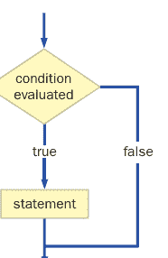

列表 5.1 中的示例读取用户的年龄，并根据输入的年龄决定是否打印某个特定句子。程序在所有情况下都会回显输入的年龄值。如果年龄小于常量 `MINOR` 的值，则打印输出。如果年龄等于或大于 `MINOR` 的值，则跳过 `println`。无论何种情况，最后关于年龄是心态状态的语句都会被打印。

### 列表 5.1

```java
*************************************************
// Age.java      作者: Lewis/Loftus
// 展示了 if 语句的使用。
************************************************

import java.util.Scanner;

public class Age {

    // 读取用户的年龄并根据情况打印注释。
    public static void main(String[] args) {
        final int MINOR = 21;
        Scanner scan = new Scanner(System.in);
        System.out.print("Enter your age: ");
        int age = scan.nextInt();
        System.out.println("You entered: " + age);
        if (age < MINOR)
            System.out.println("Youth is a wonderful thing.");
        System.out.println("Age is a state of mind.");
    }
}
```

#### 输出

```text
Enter your age: 40
You entered: 40
Age is a state of mind.
```

让我们看看更多基础 `if` 语句的示例。`if` 语句在条件大于或等于常量值时将 `size` 设置为 0。

```java
if (amount >= MAX)
    adjustment = 0;
else
    adjustment = height;
```

列表 5.2 中的 `Wages` 程序使用 `if-else` 语句来计算支付金额。如果员工每周工作超过 40 小时，加班时间按费率的一半支付。如果没有加班小时，总额基于标准费率。

这个示例使用了一个名为 `roster` 的对象。即使不知道 `roster` 代表什么，或者它是哪个类创建的，我们可以看到它至少有三个方法：`getSize()`、`expand()` 和 `addName()`。

## 第5章 条件判断与循环

# if-else 语句

有时我们希望在条件为真时做一件事，在条件为假时做另一件事。下面的示例展示了这一点：

```java
if (height <= MAX)
    adjustment = 0;
else
    adjustment = height;
```

> 核心概念：`if-else` 语句允许程序根据条件的真假求值来执行不同的语句。如果条件为真，执行第一个块；如果为假，执行 `else` 块。

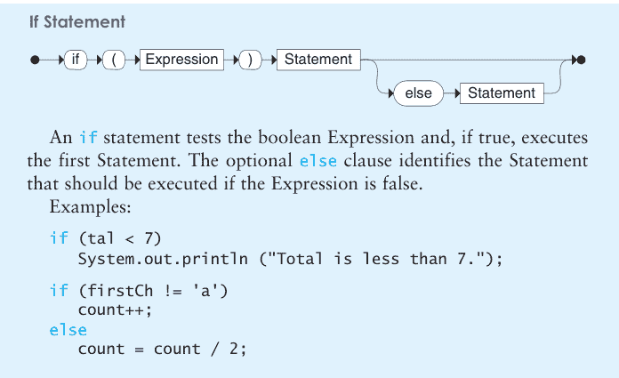

```java
if (count < 7)
    count++;
else
    count = 2;
```

## 5.2 if 语句

`if` 语句比较 `getSize()` 的结果与常量 `FULL`。如果条件为真，则调用 `expand()` 方法。

```java
if (roster.getSize() == FULL)
    roster.expand();
else
    roster.addName(name);
```

# 列表 5.2

```java
****************************************************************
// Wages.java          作者: Lewis/Loftus
// 展示了 if-else 语句的使用。
****************************************************************
import java.text.NumberFormat;
import java.util.Scanner;

public class Wages
{
    // 读取工作小时并计算工资。
    public static void main(String[] args)
    {
        final double RATE = 8.25; // 常规费率
        final int STANDARD = 40; // 每周标准小时

        Scanner scan = new Scanner(System.in);
        double pay = 0.0;
        System.out.print("Enter the number of hours worked: ");
        int hours = scan.nextInt();
        System.out.println();

        // 加班费按“加倍”支付
        if (hours > STANDARD)
            pay = STANDARD * RATE + (hours - STANDARD) * (RATE * 1.5);
        else
            pay = hours * RATE;

        NumberFormat fmt = NumberFormat.currencyInstance();
        System.out.println("Gross earnings: " + fmt.format(pay));
    }
}
```

列表 5.3 中的程序实例化了一个 `Coin` 对象，通过 `flip()` 方法掷硬币，然后使用 `if-else` 语句根据结果决定打印哪句特定的句子。

### 列表 5.3

```java
****************************************************************
// CoinFlip.java          作者: Lewis/Loftus
// 展示了 if-else 语句的使用。
****************************************************************
public class CoinFlip {
    // 创建一个硬币对象，抛掷它并打印结果。
    public static void main(String[] args) {
        Coin myCoin = new Coin();
        myCoin.flip();
        System.out.println(myCoin);
        if (myCoin.isHeads()) {
            System.out.println("You win.");
        } else {
            System.out.println("Better luck next time.");
        }
    }
}
```

#### 输出

```text
Tails
Better luck next time.
```

`Coin` 类如列表 5.4 所示。它存储了两个整数常量（`HEADS` 和 `TAILS`），代表硬币的两种可能状态，以及一个代表硬币当前状态的实例变量 `face`。`Coin` 构造函数通过调用 `flip()` 方法来初始化硬币，该方法通过随机选择一个数字（0 或 1）来确定硬币的状态。`isHeads()` 方法根据硬币的当前值返回一个布尔值。`toString()` 方法使用 `if-else` 语句来确定为硬币返回哪个字符字符串。当 `Coin` 对象传递给 `main` 方法中的 `println` 时，`toString()` 方法会被自动调用。

## 使用块语句

我们可能希望在评估布尔条件后执行多条语句。在 Java 中，我们可以用块语句替换任何单条语句。

### 列表 5.4

```java
************************************************************************************
// Coin.java    Author: LewisLoftus
// 表示一个可以抛掷的双面硬币。
************************************************************************************
public class Coin
{
    private final int HEADS = 0;
    private final int TAILS = 1;

    private int face;

//------------------------------------------------------------------------------------
// 通过初始抛掷硬币来设置硬币。
//------------------------------------------------------------------------------------
    public Coin()
    {
        flip();
    }

//------------------------------------------------------------------------------------
// 通过随机选择面值来抛掷硬币。
//------------------------------------------------------------------------------------
    public void flip()
    {
        face = (int)(Math.random() * 2);
    }

//------------------------------------------------------------------------------------
// 如果硬币当前正面是正面，则返回 true。
//------------------------------------------------------------------------------------
    public boolean isHeads()
    {
        return (face == HEADS);
    }

//------------------------------------------------------------------------------------
// 将硬币的当前正面作为字符串返回。
//------------------------------------------------------------------------------------
    public String toString()
    {
        String faceName;
        if (face == HEADS)
            faceName = "Heads";
        else
            faceName = "Tails";
        return faceName;
    }
}
```

块语句是括在大括号中的语句集合。在之前的示例中，我们已多次使用这些大括号来封装方法和类的定义。

列表 5.5 所示的 `Guessing` 程序使用了 `if-else` 语句，其中 `else` 子句的语句是一个块语句。

如果用户输入的猜测与随机选择的答案相等，则打印相应的确认信息。然而，如果答案错误，则会打印两条语句：一条说明猜测错误，另一条打印实际答案。本章末尾的一个编程项目将此示例的概念扩展到了 Hi-Lo 游戏。

请注意，如果不使用大括号，当答案错误时，说明答案错误的句子会被打印，但揭示正确答案的句子在所有情况下都会被打印。也就是说，第一条语句将被视为 `else` 子句的一部分。

记住，缩进对人类读者来说没有意义。没有正确成块的语句可能会导致程序员对代码的执行方式做出错误的假设。例如，以下代码具有误导性：

```java
if (depth >= UPPER_LIMIT)
    delta = 100;
else
    System.out.println("WARNING: Delta is being reset to ZERO");
    delta = 0; // 不是 else 子句的一部分！
```

缩进（更不用说代码逻辑）意味着变量 `delta` 只有在 `depth` 小于 `UPPER_LIMIT` 时才被置零。然而，如果不使用块，将 `delta` 置零的赋值并不是 `else` 子句的一部分。

### 列表 5.5

```java
************************************************************************************
// Guessing.java    Author: LewisLoftus
// 与用户玩一个简单的猜数字游戏。
************************************************************************************
public class Guessing
{
    private final int MAX = 10;

    public static void main(String[] args) {
        int answer = (int)(Math.random() * MAX);
        Scanner scan = new Scanner(System.in);

        System.out.print("Enter a number between 0 and " + MAX + ": ");
        int guess = scan.nextInt();

        if (guess == answer) {
            System.out.println("I'm thinking...");
        } else {
            System.out.println("Sorry, not.");
            System.out.println("The number was " + answer);
        }
    }
}
```

#### 输出


```
Enter a number between 0 and 10: 7
Sorry, not.
The number was 4
```

## 嵌套 if 语句

块语句可以使用在 if-else 语句中的任何地方。它允许我们在确定上一个决策的结果后做出另一个决策。列表 5.6 所示的 `MinOf` 程序使用 if 语句来确定三个整数值中的最小值。

仔细跟踪 `MinOf` 程序，使用最小值位于所有位置的不同输入集，以观察其运行。嵌套 if 语句产生了一个问题。嵌套 if 之后的 `else` 子句可能适用于 `if` 语句。例如：

```
if (code == 'R') {
    if (height <= 20) {
        System.out.println("Situation Normal");
    } else {
        System.out.println("Bravo!");
    }
}
```

## LISTING 5.6

```
************************************************************************************
// MinOf.java    Author: LewisLoftus

// 展示嵌套 if 语句的使用。
************************************************************************************
import java.util.Scanner;
public class MinOf
{
    //----------------------------------------------------------------------
    // 从用户读取三个整数并确定最小
    // 值。
    //----------------------------------------------------------------------
    public static void main(String[] args) {
        int num1, num2, num3, min = 0;

        Scanner scan = new Scanner(System.in);

        System.out.println("Enter three integers: ");
        num1 = scan.nextInt();
        num2 = scan.nextInt();
        num3 = scan.nextInt();

        if (num1 < num2) {
            if (num1 < num3) {
                min = num1;
            } else {
                min = num3;
            }
        } else {
            if (num2 < num3) {
                min = num2;
            } else {
                min = num3;
            }
        }

        System.out.println("Minimum value: " + min);
    }
}
```

OUTPUT

```
Enter three integers: 45 22 69
Minimum value: 22
```

## 5.2 if 语句

else 子句是匹配到内部的 if 语句还是外部的语句？这里的缩进意味着它是内部 if 语句的一部分，这种做法是正确的。`else` 子句总是匹配到其之前最近的、未被匹配的 `if` 语句。然而，如果我们不小心，很容易在脑海和代码对齐中产生匹配错位。这就是为什么一致的缩进至关重要的原因。

> **核心概念**
>
> 在嵌套语句中，else 子句匹配到最近的、未匹配的 if 语句。

大括号需要指定 `else` 子句属于哪个 `if` 语句。例如，如果之前的示例被构造为当 `code` 不等于 'R' 时打印 "Bravo"，我们可以按照如下方式强制建立关系（并正确地缩进）：

```
if (code == 'R') {
  if (height <= 20)
    System.out.println("Situation Normal");
  }
}
else
  System.out.println("Bravo!");
```

通过在第一个 `if` 语句中使用块语句，我们确定了 `else` 子句所属的对象。

## 自我复习题（答案见附录 N）

- SR 5.8 在满足以下假设的情况下，代码片段产生什么输出？

  ```
  if (num1 < 2)
      System.out.print(" red ");
  if (num1 + 5 < 2)
      System.out.print(" white ");
  else
      System.out.print(" blue ");
      System.out.println(" yellow ");
  ```

  a. 假设 `num1` 的值为 2，`num2` 的值为 10？

  b. 假设 `num1` 的值为 10，`num2` 的值为 2？

  c. 假设 `num1` 的值为 2，`num2` 的值为 2？

- SR 5.9 块语句如何帮助我们构建条件判断？

- SR 5.10 什么是嵌套 if 语句？

- SR 5.11 对于每个语句，以下代码片段产生什么输出？

```
if (num1 >= num2) {
    System.out.print(" red");
    System.out.print(" orange");
}
if ((num1 + 5) >= num2) {
    System.out.print(" white");
}
else
    if ((num1 + 10) >= num2) {
        System.out.print(" black");
        System.out.print(" blue");
    }
    else
        System.out.print(" yellow");
        System.out.println(" green");
```

- a. 假设 `num1` 的值为 5，`num2` 的值为 4？

- b. 假设 `num1` 的值为 5，`num2` 的值为 12？

- c. 假设 `num1` 的值为 5，`num2` 的值为 27？

- SR 5.12 编写一个表达式，根据名为 `temperature` 的 int 变量的值打印消息。如果 `temperature` 等于或小于 50，它在一行打印 "It is cool."，并在下一行打印 "Dress warmly."。如果 `temperature` 大于 80，在一行打印 "It is warm."，并在下一行打印 "Dress coolly."。如果 `temperature` 在 50 和 80 之间，在一行打印 "It is pleasant."，并在下一行打印 "Dress pleasantly。"

## 5.3 比较数据

在使用布尔表达式比较数据时，理解根据所检查的数据类型而产生的细微差别很重要。让我们来看几种关键情况。

### 比较浮点数

在比较浮点数据时会出现一种有趣的情况。根据 `==` 运算符，只有当两个浮点值的底层表示的所有二进制位都匹配时，它们才相等。如果比较的值是通过计算得出的，即使它们足够接近，也可能不会完全相等。因此，在比较浮点值时应少使用相等运算符 (`==`)。

检查浮点相等性的更好方法是计算两个值之间的绝对值，并将其与某个容差（tolerance）比较。例如，我们可以选择 0.0001 作为容差。如果两个浮点值的差小于容差，我们就认为它们相等。比较两个浮点值 `f1` 和 `f2` 可以如下实现：

```
if (Math.abs(f1 - f2) < TOLERANCE)
    System.out.println("Essentially equal.");
```

`TOLERANCE` 的值应该适用于这种情况。

### 比较字符

我们知道一个数字小于另一个数字，但一个字符小于另一个意味着什么？正如我们在第 2 章中所过的，Java 中的字符基于 Unicode 字符集，它定义了所有可能字符的顺序。在字符集中，字符 'a' 在字符 'b' 之前，我们可以说 'a' 小于 'b'。

我们可以在字符数据上使用相等运算符和关系运算符。例如，如果两个变量 `ch1` 和 `ch2` 包含两个字符，我们可以通过 `if` 语句确定它们在字符集中的相对顺序：

> **核心概念**
>
> Java 中字符的相对顺序由 Unicode 字符集定义。

```
if (ch1 > ch2)
    System.out.println(ch1 + " is greater than " + ch2);
else
    System.out.println(ch1 + " is less than " + ch2);
```

### 比较对象

### 比较字符串

要确定两个字符串的相对顺序，请使用 `String` 类的 `compareTo` 方法。`compareTo` 方法比运算符更通用。它不返回布尔值，而是返回一个整数。如果调用方法的 `String` 对象小于作为参数传递的字符串，则返回负值。如果两个字符串相同，则返回 0。如果调用方法的 `String` 对象大于（在之后）作为参数传递的字符串，则返回正值。例如：

```
int result = name1.compareTo(name2);
if (result < 0)
    System.out.println(name1 + " comes before " + name2);
if (result == 0)
    System.out.println("The names are equal.");
    System.out.println(name1 + " follows " + name2);
```

请记住比较字符和字符串是基于 Unicode 字符集的（见附录 C）。如果所有字母的大小相同（全大写或全小写），则字典顺序也将字母顺序。然而，当比较两个字符串时，例如 "able" 和 "Baker"，`compareTo` 方法会得出 "Baker" 在之前，因为在 Unicode 字符集中，所有大写字母都在小写字母之前。如果一个字符串是另一个长字符串的前缀，例如比较 "horse" 和 "horsefly"，`compareTo` 方法会得出 "horse" 在之前。

## 自我复习题（答案见附录 N）

- SR 5.13 为什么在比较浮点值的相等性时必须小心？

- SR 5.14 如何比较字符串的相等性？

- SR 5.15 为 4.2 节中的 Die 情况编写一个 `equals` 方法。如果调用的 Die 对象与参数对象的 点数相同，该方法应返回 `true`，否则返回 `false`。

- SR 5.16 假设字符串变量 `s1` 和 `s2` 已初始化。编写一个表达式，按字典顺序分行打印这两个字符串。

## 5.4 while 语句

正如我们在本章介绍中所讨论的，重复语句（或循环）允许我们多次执行另一个语句。`while` 语句是一种循环，它像 `if` 语句一样评估一个布尔条件，如果条件为真，则执行该语句（称为循环体）。然而，与 `if` 语句不同，在执行循环体之后，会再次评估条件。如果仍然为真，则再次执行循环体。这种重复一直持续到 `while` 循环体结束。图 5.7 显示了这种处理过程。

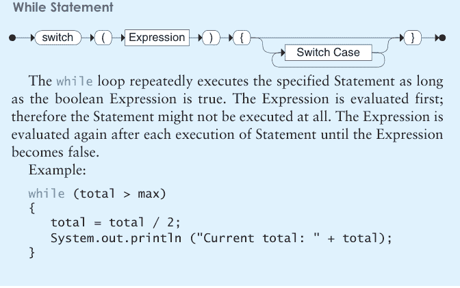

只要布尔 `Expression` 为真，`while` 循环就会执行 `Statement`。首先评估 `Expression`；因此 `Statement` 可能完全不执行。在每次执行 `Statement` 后，都会再次评估 `Expression`，直到 `Expression` 变为假。

示例：

```
while (total > max)
{
    total = total / 2;
    System.out.println("Current total: " + total);
}
```

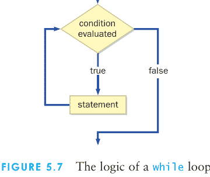

## 5.4 while 语句

以下循环打印从 1 到 5 的值。循环的每次迭代打印一个值并增加计数器。

> **核心概念**
>
> `while` 语句不断执行相同的语句，直到其条件变为假。

```
int count = 1;
while (count <= 5)
{
    System.out.println(count);
    count++;
}
```

注意，`while` 循环体是一个包含两个语句的块。整个块在循环的每次迭代中重复。

让我们看看另一个使用 `while` 循环的程序。列表 5.7 中的 `Average` 程序从用户处读取一系列整数，求和并计算平均值。

我们不知道用户可能会输入多少值，因此我们需要一种方法来指示用户已完成数字输入。在这个程序中，我们将哨值（sentinel value）表示输入结束。`while` 循环继续处理输入值，直到用户输入 0。这假设 0 不是应对平均值贡献的有效数字之一。哨值必须位于输入值的正常范围之外。

在 `Average` 程序中，使用一个名为 `sum` 的变量来维护累加和，这意味着它是到目前为止输入值的和。该变量初始化为 0，每个值都被相加并存回 `sum`。

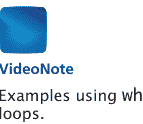

我们还必须计算输入的数值个数，以便在循环结束后通过除以适当的值来计算平均值。注意，哨值是不被计数的。用户在输入任何值之前立即输入哨值的异常情况由 `if` 语句处理，这避免了除零错误。

```
LISTING 5.7
************************************************************************************
// Author: Lewis Loftus
// Average.java
// 展示了 while 循环、哨值以及
// 累加和的使用。
************************************************************************************
import java.text.DecimalFormat;
import java.util.Scanner;

public class Average
{
    // 计算用户输入的一值的平均值。
    // 在输入数字时，会打印累加和。
--------------------------------------------------------------------------------
    public static void main(String[] args)
    {
        int sum = 0, value, count = 0;
        double average;
        Scanner scan = new Scanner(System.in);

        System.out.print("Enter an integer (0 to quit): ");
        value = scan.nextInt();

        while (value != 0) // 哨值 0 用于终止循环
        {
            count++;

            sum += value;
            System.out.println("The sum so far is " + sum);

            System.out.print("Enter an integer (0 to quit): ");
            value = scan.nextInt();
        }

        if (count == 0)
            System.out.println("No values were entered.");
        else
        {
            average = (double)sum / count;

            DecimalFormat fmt = new DecimalFormat("0.###");
            System.out.println("The average is " + fmt.format(average));
        }
    }
}
```

### 输出


# 5.5 条件语句与循环

## 5.4 while 语句

让我们看看另一个使用 `while` 循环的程序。列表 5.7 中的 `Average` 程序从用户处读取一系列整数，求和并计算平均值。

我们不知道用户可能会输入多少值，因此我们需要一种方法来指示用户已完成数字输入。在这个程序中，我们将 0 设计为哨值，表示输入结束。`while` 循环继续处理输入值，直到用户输入 0。这假设 0 不是应对平均值贡献的有效数字之一。

在 `Average` 程序中，使用一个名为 `sum` 的变量来维护累加和，这意味着它是到目前为止输入值的和。该变量初始化为 0，每个值都被相加并存回 `sum`。

我们还必须计算输入的数值个数，以便在循环结束后通过除以适当的值来计算平均值。注意，哨值是不被计数的。用户在输入任何值之前立即输入哨值的异常情况由 `if` 语句处理，这避免了除零错误。

### 示例运行

```
Enter an integer (0 to quit): 25
The sum so far is 25
Enter an integer (0 to quit): 164
The sum so far is 189
Enter an integer (0 to quit): -14
The sum so far is 175
Enter an integer (0 to quit): 84
The sum so far is 259
Enter an integer (0 to quit): 12
The sum so far is 271
Enter an integer (0 to quit): -35
The sum so far is 236
Enter an integer (0 to quit): 0

The average is 39.333
```

## 无限循环

以下是一个无限循环的示例：

```java
int count = 1;
while (count <= 25) // 警告：这是一个无限循环！
{
    System.out.println(count);
    count = count - 1;
}
```

如果你执行这个循环，应该准备好中断它。在大多数系统上，按下组合键 `Ctrl+C`（按住 Control 键并按 C）可以终止程序。

在这个示例中，`count` 的初始值为 1，并在循环中递减。`while` 循环只要 `count` 小于或等于 25 就会持续。因为 `count` 每次迭代都会变小，条件将始终为真，直到 `count` 小到发生溢出错误。这一点在于代码的逻辑显然是错误的。

现在考虑以下情况：

```java
double num = 1.0;
while (num != 0.0) // 无限循环
    num = num - 0.1;
```

再次，循环变量的值似乎向正确的方向移动。事实上，`num` 似乎最终会移动到 0.0。然而，这个循环是无限的（至少在大多数系统上），因为 `num` 永远不会*恰好*等于 0.0。

## 嵌套循环

循环体可以包含另一个循环。这种情况被称为嵌套循环。记住，对于外层循环的每次迭代，内层循环都会完整执行。考虑以下代码段。字符串 "Here again" 会被打印多少次？

```java
int count1, count2;
count1 = 1;
while (count1 <= 10)
{
    count2 = 1;
    while (count2 <= 50)
    {
        System.out.println("Here again");
        count2++;
    }
    count1++;
}
```

`println` 语句在内层循环内部。外层循环执行 10 次，因为 `count1` 在 1 到 10 之间迭代。内层循环执行 50 次，因为 `count2` 在 1 到 50 之间迭代。对于外层循环的每次迭代，内层循环都会完整执行。因此，`println` 语句执行了 500 次。

与任何情况一样，我们必须仔细检查循环的条件和变量的初始化。让我们考虑对这段代码的一些更改。如果外层循环的代码是 `(count1 < 10)` 而不是 `count1 <= 10` 会怎样？总行数会变成多少嗯，外层循环将执行 9 次而不是 10 次，所以 `println` 语句将执行 450 次。如果外层循环保持原始定义，但在内层循环之前将 `count2` 初始化为 11 而不是 1 呢？那么内层循环将执行 40 次而不是 50 次，因此打印的总行数将是 400。

让我们来看另一个使用嵌套循环的例子。回文（palindrome）是指正向读和反向读都相同的字符字符串。例如，以下字符串都是回文：

- radar
- drab bard
- ab cde xxxx edc ba
- kayak
- deified
- able was I ere I saw Elba

注意，某些回文具有偶数个字符，而另一些具有奇数个字符。列表 5.9 所示的 `PalindromeTester` 程序用于测试一个字符串是否为回文。用户可以根据需要测试任意数量的字符串。

`PalindromeTester` 的代码包含两个循环，一个嵌套另一个。外层循环控制测试多少个字符串，内层循环逐字符遍历字符串，直到确定其是否为回文。变量 `left` 和 `right` 存储字符串两端的字符索引。内层循环的每次迭代比较由 `left` 和 `right` 指定的字符。当字符不匹配，或者 `left` 的值等于或大于 `right` 的值时，跳出内层循环，这意味着整个字符串已经过测试并且是一个回文。

### 列表 5.9 PalindromeTester.java

```java
/*************************************************/
// PalindromeTester.java           Author: Lewis/Loftus
// 展示了嵌套 while 循环的使用。
/*************************************************/
import java.util.Scanner;

public class PalindromeTester {
    // 测试字符串以判断是否为回文。
    // ----------------------------------------------------------------------
    public static void main(String[] args) {
        String str, another = "y";
        int left, right;

        Scanner scanner = new Scanner(System.in);
        while (another.equalsIgnoreCase("y")) //  y 或 n
        {
            System.out.println("Enter a potential palindrome:");
            str = scanner.nextLine();

            left = 0;
            right = str.length() - 1;
            while (str.charAt(left) == str.charAt(right) && left < right)
            {
                left++;
                right--;
            }
            System.out.println();

            if (left < right)
                System.out.println("That string is NOT a palindrome.");
            else
                System.out.println("That string IS a palindrome.");

            System.out.println();
            System.out.print("Test another palindrome (y/n)? ");
            another = scanner.nextLine();
        }
    }
}
```

### 输出示例

```
Enter a potential palindrome:
radar

That string IS a palindrome.

Test another palindrome (y/n)? y
Enter a potential palindrome:
able was I ere I saw elba

That string IS a palindrome.

Test another palindrome (y/n)? y
Enter a potential palindrome:
abcdcdcba

That string IS a palindrome.

Test another palindrome (y/n)? y
Enter a potential palindrome:
abracadabra

That string IS NOT a palindrome.

Test another palindrome (y/n)? n
```

注意，以下短语由于空格、标点符号以及大小写，这些字符串不符合回文的标准：

- A man, a plan, Panama.
- Dennis and sinned.
- Rise to vote, sir.
- Doom an evil, a mood.
- Go hang a salami; I am hog.

## break 和 continue 语句

Java 引入了影响条件和循环的语句。如果执行了 `break` 语句，执行流立即转移到循环后的语句。在第 6 章中我们将看到，在编写 `switch` 时通常需要 `break` 语句。然而，在循环中并不总是需要使用 `break`。等价的循环始终可以编写而不使用 `break`。`continue` 语句对循环处理有影响。如果 `continue` 被执行，循环条件将再次评估，并且执行循环体。循环中可以避免 `continue` 语句，但在某些情况下它应该使用。

## 条件与循环

### 自测题 [答案见附录]

**SR 17** 什么是无限循环？具体是什么导致了它？

**SR 18** 下列代码段的输出是什么？

```java
int low = 0, high = 10;
while (low < high)
{
    System.out.println(low);
    low++;
}
```

**SR 19** 下列代码段的输出是什么？

```java
int low = 10, high = 0;
while (low <= high)
{
    System.out.println(low);
    low++;
}
```

**SR 20** 下列代码段的输出是什么？

```java
int low = 0, high = 10;
while (low <= high)
{
    System.out.println(low);
    high = high - low;
}
```

**SR 21** 下列代码段的输出是什么？

```java
int low = 0, high = 10, mid;
while (low <= high)
{
    mid = low;
    while (mid <= high)
    {
        System.out.print(mid + " ");
        mid++;
    }
    System.out.println();
    low++;
}
```

**SR 22** 假设变量 `value` 已初始化为正整数。编写一个 `while` 循环打印 `value` 的所有正因数。例如，如果 `value` 为 28，它打印 28 的因数：1 2 4 7 14 28

**SR 23** 假设变量 `value` 已初始化为正整数。编写一个 `while` 循环打印从 1 到 `value` 每个数字的正因数。例如，如果 `value` 为 4，它打印：

- 1 的因数：1
- 2 的因数：1 2
- 3 的因数：1 3
- 4 的因数：1 2 4

## 5.5 迭代器

迭代器对象拥有允许你逐个处理项目的方法。也就是说，迭代器允许你遍历每个项目并与其交互。例如，你的目标可能是计算俱乐部每个成员的费用，或者打印 URL 的不同部分。关键在于迭代器提供了一种系统处理一组项的统一且简单的机制。由于它本质上是一个重复过程，因此它与循环的概念密切相关。

> **核心概念**
>
> 迭代器是一个帮助你处理一组相关项的对象。

从技术上说，Java 中的迭代器对象是使用 `Iterator` 接口定义的，这将在第 7 章讨论。目前只需知道此类对象存在并且它们可以使项目处理变得更容易。

每个迭代器都有一个名为 `hasNext` 的方法，返回一个布尔值，指示是否至少有一个待处理的项目。`hasNext` 方法可以用于条件以控制每个项目的处理。迭代器还有一个名为 `next` 的方法，用于获取集合处理中的下一个项目。

Java 标准库中有多个定义迭代器的类。其中之一是 `Scanner`，我们在之前的示例中多次使用该类来帮助从用户处读取数据。如果有另一个输入待处理，`hasNext` 方法将返回 `true`。正如我们之前看到的，它有一个 `next` 方法可以将下一个输入作为字符串返回。

当从标准输入流读取输入时，`Scanner` 类的 `hasNext` 方法将等待输入可用并返回 `true`。也就是说，从键盘读取的交互式输入被认为始终有更多数据需要处理——在用户输入它们之前，数据还没有到达。这就是为什么在之前的示例中，我们使用了特殊的哨兵值来确定交互式输入的结束。

然而，`Scanner` 对象是一个迭代器，当扫描器被用于处理来自具有特定终点的源的输入时会变得特别有用，例如处理数据文件的行或处理字符字符串的部分。让我们来看这种处理类型的示例。

### 读取文本文件

假设我们有一个名为 `urls.inp` 的输入文件，其中包含我们想要以某种方式处理的 URL 列表：

```
www.google.com
www.linux.org/info/gnu.html
thely.com/calendar/
www.cs.vt.edu/undergraduate/about
youtube.com/watch?v=EHCRimwRGLs
```

列表 5.10 中的程序显示了该文件中的 URL 并对其进行解析，以显示路径的不同部分。它使用 `Scanner` 对象来处理输入。事实上，它使用了多个 `Scanner` 对象——一个用于读取数据文件的行，另一个用于处理每个 URL 字符串。

### 列表 5.10 URLDissector.java

```java
/************************************************************************************/
// URLDissector.java      Author: Lewis/Loftus
// 演示如何使用 Scanner 读取文件输入并使用
// 不同的分隔符进行解析。
/************************************************************************************/
import java.util.Scanner;
import java.io.*;

public class URLDissector {
    // 从文件中读取 urls 并打印它们的路径组件。
    public static void main(String[] args) throws IOException {
        String url;
        Scanner fileScan, urlScan;

        fileScan = new Scanner(new File("urls.inp"));

        // 读取并处理文件的每一行
        while (fileScan.hasNext()) {
            url = fileScan.nextLine();
            System.out.println("URL: " + url);

            urlScan = new Scanner(url);
            urlScan.useDelimiter("/");

            // 打印 url 的每个部分
            while (urlScan.hasNext()) {
                System.out.println(" " + urlScan.next());
            }
            System.out.println();
        }
    }
}
```

### 输出示例

```
URL: www.google.com
www.google.com

URL: www.linux.org/info/gnu.html
www.linux.org
info
gnu.html

URL: thelyric.com/calendar/
thelyric.com
calendar

URL: www.cs.vt.edu/undergraduate/about
www.cs.vt.edu
undergraduate
about

URL: youtube.com/watch?v=EHCRimwRGLs
youtube.com
watch?v=EHCRimwRGLs
```

程序中有两个 `while` 循环，一个嵌套在另一个内部。外部循环处理文件中的每一行，内部循环处理当前行中的每个标记（token）。


变量 `fileScan` 被创建一个在输入文件 `urls.inp` 上的扫描器。我们没有将 `System.in` 传递给 `Scanner` 构造函数，而是实例化了一个代表输入文件的 `File` 对象，并将其传入 `Scanner` 构造函数。此时，`fileScan` 已经准备好读取和处理来自输入文件的输入。

如果由于某些原因在查找或打开输入文件时出现问题，尝试创建 `File` 对象将抛出 `IOException` 子句，这就是为什么我们添加了 `throws IOException`。这将在第 11 章中进一步讨论。

只要输入扫描器的 `hasNext` 方法返回 `true`，外部循环体就会执行——也就是说，只要数据文件中还有输入需要处理。每次循环从输入文件中读取一行（URL）并将其打印。

对于每个 URL，都会设置一个新的 `Scanner` 对象来解析 URL 字符串的片段，该字符串在实例化 `urlScan` 对象时传递给 `Scanner` 构造函数。内部循环在单独的行读取 URL 的每个标记。

### 核心概念

扫描器对象中用于分离标记的分隔符可以根据需要显式设置。

记住，默认情况下，扫描对象的空白字符（空格、制表符和换行符）作为分离输入标记的分隔符。在本示例中，扫描器读取输入文件的每一行。但如果默认不够（例如处理 URL 时），就可以更改它们。

在这种情况下，路径由斜杠（`/`）字符部分分离。调用扫描器的 `useDelimiter` 方法可以将分隔符设置为斜杠，以解析 URL 字符串。

如果你想使用另一个分隔符，或者想以更复杂的方式解析输入，`Scanner` 可以处理正则表达式模式，这些将在附录 H 中讨论。

### 自测习题（答案见附录 N）

- SR 5.24 编写创建以下每个 `Scanner` 对象的语句。

- a. 用于从 `System.in` 读取的交互式输入。

- b. 一个从文件 "info.dat" 读取的。一个从字符串变量 `infoString` 读取的。

- SR 5.25 假设扫描器 `Scanner` 对象 `fileScan` 已初始化为从文件读取。写一个 `while` 循环来计算文件每行的平均字符数。

## 5.6 ArrayList 类

现在我们已经在编程语句的武器库中拥有了循环，让我们引入一个用于管理对象的非常有用的类。`ArrayList` 是一个动态数组，意味着它可以根据需要增长或缩小。与固定大小的标准数组不同，`ArrayList` 会为你处理调整大小的逻辑。

### ArrayList 方法

`ArrayList` 类提供了几个管理列表的方法：

| 方法 | 描述 |
| :--- | :--- |
| `ArrayList<E>()` | 构造函数：创建一个初始为空的列表。 |
| `boolean add(E obj)` | 将指定的对象插入此列表的末尾。 |
| `void add(int index, E obj)` | 在指定的索引处将指定的对象插入此列表。 |
| `void clear()` | 从列表中移除所有元素。 |
| `E remove(int index)` | 移除列表中指定索引处的元素并返回它。 |
| `E get(int index)` | 返回列表中指定索引处的对象，但不删除它。 |
| `int indexOf(Object obj)` | 返回指定对象首次出现的位置索引。 |
| `boolean contains(Object obj)` | 如果此列表包含指定对象，则返回 true。 |
| `boolean isEmpty()` | 如果此列表不包含任何元素，则返回 true。 |
| `int size()` | 返回列表中元素数量。 |

> 核心概念

当创建 `ArrayList` 时，要指定存储的元素类型。

`ArrayList` 的索引值从 0 开始，而不是 1。从概念上说，例如一个 `String` 的 `ArrayList` 可能会管理：

- 0 "Bashful"
- 1 "Sleepy"
- 2 "Happy"
- 3 "Dopey"
- 4 "Doc"

此外注意 `ArrayList` 存储的是对象的引用。你不能创建一个存储原始值的 `ArrayList`。但这正是包装类大显身场。例如，你可以根据需要创建 `ArrayList<Integer>` 或 `ArrayList<Double>`。

### ArrayList 程序

列表 5.11 中的程序实例化了一个名为 `band` 的 `ArrayList<String>`。使用 `add` 方法按特定顺序将多个字符串对象添加到末尾。在特定索引处删除一个字符串并插入另一个。对于任何其他对象，当将其发送到 `println` 方法时，会自动调用 `ArrayList` 的 `toString` 方法，打印方括号周围的所有元素。程序末尾的循环显式地逐行打印每个元素。

```java
import java.util.ArrayList;

public class Beatles {
    public static void main(String[] args) {
        ArrayList<String> band = new ArrayList<>();
        band.add("Bashful");
        band.add("Sleepy");
        band.add("Happy");
        band.add("Dopey");
        band.add("Doc");

        band.remove(2);
        band.add(2, "John");

        System.out.println(band);

        for (String member : band) {
            System.out.println(member);
        }
    }
}
```

# 列表 5.11 继续

```java
import java.util.ArrayList;
public class Beatles {
    // 存储和修改乐队[] 成员列表。
    //----------------
    public static void main (String[] args) {
        ArrayList<String> band = new ArrayList<String>();

        band.add("Paul");
        band.add("Pete");
        band.add("John");
        band.add("George");

        System.out.println(band);
        int location = band.indexOf("Pete");
        band.remove(location);

        System.out.println(band);
        System.out.println("At index 1: " + band.get(1));
        band.add(2, "Ringo");

        System.out.println("Size of the band: " + band.size());
        int index = 0;
        while (index < band.size()) {
            System.out.println(band.get(index));
            index++;
        }
    }
}
```

```
[Paul, Pete, John, George]
[Paul, John, George]
At index 1: John
Size of the band: 4
Paul
John
Ringo
George
```

### 自测习题

+   SR 5.26 使用 ArrayList 对象有什么优点？

+   SR 5.27 ArrayList 包含什么类型的元素？

+   SR 5.28 为一个名为 `dice` 的变量编写声明，它是一个 `Die` 对象的 ArrayList。

+   SR 5.29 下列代码段产生什么输出？

```java
ArrayList<String> names = new ArrayList<String>();
names.add("Andy");
names.add("Betty");
names.add(1, "C");
names.add(1, "Don");
names.remove(2);
System.out.println(names);
```

# 5.7 确定事件源

在第 4 章中，我们开始探索创建具有真正交互性的图形用户界面 (GUI) 的程序。你可能记得，交互式 GUI 需要我们创建监听器，并建立监听器与产生感兴趣事件的组件之间的建立关系。

让我们来看一个示例，其中使用一个监听器来监听不同的组件。列表 5.12 中的 `LeftRight` 类对应的程序显示了一个标签和两个按钮。当按下左按钮时，标签显示单词“left”；当按下右按钮时，标签显示单词“right”。

列表 5.13 中的 `LeftRightPanel` 类包含一个 `ButtonListener` 对象的实例，它将该监听器添加了两个按钮上。因此，当按下任一按钮时，`ButtonListener` 类的 `actionPerformed` 方法就会被调用。

在每次调用时，`actionPerformed` 方法使用 `if-else` 语句来确定哪个按钮产生了事件。`getSource` 方法识别传递给 `ActionEvent` 的按钮，`getSource` 方法返回产生事件的组件的引用。`if` 语句的条件将事件源与左按钮的引用进行比较。如果不匹配，则事件一定是由右按钮产生的。

# 列表 5.12

```java
// LeftRight.java               作者: Lewis/Loftus
//
// 展示了多个按钮使用同一个监听器。
//********************************************************************************
import javax.swing.JFrame;
public class LeftRight
{
    // 创建主程序框架。
    //------------------------------------------------------------
    public static void main (String[] args) {
        JFrame frame = new JFrame("Left Right");
        frame.setDefaultCloseOperation(JFrame.EXIT_ON_CLOSE);

        frame.getContentPane().add(new LeftRightPanel());

        frame.pack();
        frame.setVisible(true);
    }
}
```

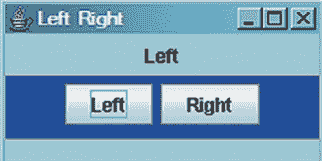

# 第 5 章 条件语句与循环

# 列表 5.13

```java
// LeftRightPanel.java    作者: Lewis-Loftus
// 展示了多个按钮使用同一个监听器。
//************************************************************************************
import java.awt.*;
import java.awt.event.*;
import javax.swing.*;

public class LeftRightPanel extends JPanel {
    private JButton left, right;
    private JLabel label;
    private JPanel buttonPanel;

    //----------------------------------------------------
    // 构造函数：设置 GUI。
    //----------------------------------------------------
    public LeftRightPanel() {
        left = new JButton("Left");
        right = new JButton("Right");
        label = new JLabel("Push a button");
        buttonPanel = new JPanel();

        buttonPanel.add(left);
        buttonPanel.add(right);
        add(buttonPanel);
        add(label);

        left.addActionListener(new ButtonListener());
        right.addActionListener(new ButtonListener());
    }

    private class ButtonListener implements ActionListener {
        //------------------------------------------------------
        // 确定哪个按钮被按下并设置标签内容
        //------------------------------------------------------
        public void actionPerformed(ActionEvent event) {
            if (event.getSource() == left) {
                label.setText("Left");
            } else {
                label.setText("Right");
            }
        }
    }
}
```

# 代码列表 5.14 延续


# 代码列表 5.15

```java
// StyleOptionsPanel.java      作者: Lewis/Loftus
// 展示了复选框的使用。
********************************************************************************
import javax.swing.*;
import java.awt.*;
import java.awt.event.*;
public class StyleOptionsPanel extends JPanel
{
    private JLabel saying;
    private JCheckBox bold, italic;

    // 设置一个包含标签和一些复选框的面板，
    // 这些复选框控制标签字体样式。
    public StyleOptionsPanel()
    {
        saying = new JLabel("用风格说话吧！");
        saying.setFont(new Font("Helvetica", Font.PLAIN, 36));

        bold = new JCheckBox("粗体");
        bold.setBackground(Color.cyan);
```

# 第 5 章 条件与循环

# 代码列表 5.15 延续

```java
italic = new JCheckBox("斜体");
italic.setBackground(Color.cyan);
```


# 第 5 章 条件与循环

## 5.8 复选框与单选按钮

```java
StyleListener listener = new StyleListener();
bold.addListener(listener);
italic.addListener(listener);
```

```java
add(saying);
add(bold);
add(italic);
```

```java
setBackground(Color.cyan);
setPreferredSize(new Dimension(300, 100));
}
```

```java
****************************************************************
// 代表两个复选框的监听器。
****************************************************************
private class StyleListener implements ItemListener {
    // ------------------------------------------------------------
    // 更新标签字体的字体样式。
    // ------------------------------------------------------------
    public void itemChanged(ItemEvent event) {
        int style = Font.PLAIN;

        if (bold.isSelected())
            style = Font.BOLD;

        if (italic.isSelected())
            style += Font.ITALIC;

        saying.setFont(new Font("Helvetica", style, 36));
    }
}
```

此程序还使用了 `Font` 类，它表示特定的字符字体。一个 `Font` 对象由字体名称、字体样式和字体大小定义。字体名称确定了字符的通用视觉特征。我们在程序中使用了 `Helvetica` 字体。Java 字体的样式可以是普通的、粗体、斜体，或粗体斜体的结合。我们 GUI 中的复选框被设置为用于更改我们字体样式的特征。

字体的样式被表示为一个整数，在 `Font` 类中定义的整数常量用于表示样式的各个方面。常量 `PLAIN` 用于表示普通样式。常量 `BOLD` 和 `ITALIC` 分别用于表示粗体和斜体。`BOLD` 和 `ITALIC` 常数的和表示一种既是粗体又是斜体的样式。

监听器的 `itemChanged` 方法决定在复选框状态改变后，是否应该更新修订后的样式。最初将样式设置为普通。然后，通过使用 `isSelected` 方法轮询检查每个复选框，该方法返回一个布尔值。首先，如果粗体复选框被选中（勾选），则样式被设置为粗体。然后，如果斜体复选框被选中，则将 `ITALIC` 常量加到样式变量上。最后，将标签的字体设置为带有修订样式的新字体。

注意，由于此程序中监听器的编写方式，点击哪个复选框来生成事件并不重要。两个复选框都由同一个监听器处理。被改变的复选框是从选中变为未选中，还是反之也并不重要。如果状态发生变化，会检查两个复选框的状态。

### 单选按钮

单选按钮与其他单选按钮一起使用，提供一组互斥的选项。与复选框不同，单选按钮本身并不特别有用。它主要在与一个或多个单选按钮一起使用时才有意义。在组中只有一个选项是有效的。在任何时刻，单选按钮组中仅有一个按钮被选中（开启）。当一个单选按钮被按下时，组中处于开启状态的另一个按钮会自动关闭。

“单选按钮”（radio buttons）一词源于旧式汽车收音机按钮的工作方式。在任何时候，按下一个按钮来选择当前电台；当按下另一个按钮时，当前的按钮会自动弹出。

> **核心概念**
>
> 单选按钮作为一组运行，提供一组互斥的选项。


### 代码列表 5.16

```java
********************************************************************
// QuoteOptions.java      作者: Lewis/Loftus
// 展示了单选按钮的使用。
********************************************************************
import javax.swing.JFrame;
public class QuoteOptions
{
    public static void main(String[] args) {
        JFrame frame = new JFrame("引言");
        frame.setDefaultCloseOperation(JFrame.EXIT_ON_CLOSE);

        QuoteOptionsPanel panel = new QuoteOptions();
        frame.getContentPane().add(panel);

        frame.pack();
        frame.setVisible(true);
    }
}
```


### 代码列表 5.17

```java
********************************************************************
// QuoteOptionsPanel.java      作者: Lewis/Loftus
// 展示了单选按钮的使用。
********************************************************************
import javax.swing.*;
import java.awt.*;
import java.awt.event.*;

public class QuoteOptionsPanel extends JPanel {
    private JLabel quote;
    private JRadioButton comedy, philosophy, carpentry;
    private String comedyQuote, philosophyQuote, carpentryQuote;

    // 设置一个包含标签和一组单选按钮的面板，
    // 这些按钮控制文本。
    public QuoteOptionsPanel() {
        comedyQuote = "带上我的妻子吧。";
        philosophyQuote = "我思，故我在。";
        carpentryQuote = "量两次，切一次。";

        quote = new JLabel(comedyQuote);
        quote.setFont(new Font("Helvetica", Font.BOLD, 24));

        comedy = new JButton("喜剧", true);
        comedy.setBackground(Color.green);
        philosophy = new JButton("哲学");
        philosophy.setBackground(Color.green);
        carpentry = new JButton("木工");
        carpentry.setBackground(Color.green);

        ButtonGroup group = new ButtonGroup();
        group.add(comedy);
        group.add(philosophy);
        group.add(carpentry);

        QuoteListener listener = new QuoteListener();
        comedy.addActionListener(listener);
        philosophy.addActionListener(listener);
        carpentry.addActionListener(listener);

        add(quote);
        add(comedy);
        add(philosophy);
        add(carpentry);

        setBackground(Color.green);
        setPreferredSize(new Dimension(300, 100));
    }
    ********************************************************************
    // 代表所有单选按钮的监听器。
    ********************************************************************
    private class QuoteListener implements ActionListener {
        //------------------------------------------------------
        // 根据按下了哪个单选按钮，设置标签的文本。
        //------------------------------------------------------
        public void actionPerformed(ActionEvent event) {
            Object source = event.getSource();
            if (source == comedy) {
                quote.setText(comedyQuote);
            } else if (source == philosophy) {
                quote.setText(philosophyQuote);
            } else if (source == carpentry) {
                quote.setText(carpentryQuote);
            }
        }
    }
}
```

### 列表 5.17 续

```java
if (source == comedy)
    quote.setText (comedyQuote);
else
    if (source == philosophy)
        quote.setText (philosophyQuote);
    else
    quote.setText (carpentryQuote);
```

注意，与推按钮不同，复选框和单选按钮都是切换按钮，这意味着在任何时候它们都处于开启或关闭状态。它们的区别在于使用方式。独立选项（可以选择任意组合）由复选框/按钮控制。依赖性选项（从集合中选择一个）由单选按钮控制。如果只有一个选项需要管理，可以使用单独的复选框。正如之前提到的，单选按钮只有在与一个或多个单选按钮结合使用时才有意义。

此外请注意复选框和单选按钮产生不同类型的事件。复选框产生事件（event），而单选按钮产生一个动作事件（action event）。使用不同的事件与按钮功能的差异有关。复选框在被选中或取消选择时会产生一个事件，监听器可以根据需要进行区分。相反，单选按钮仅在被选中时产生一个事件（组中当前选中的按钮会自动被取消选择）。

## 核心概念总结

- 条件语句和循环允许我们控制方法内部的执行流。
- `if` 语句允许程序选择是否执行特定的语句。
- 循环允许程序多次执行某条。
- 逻辑运算符通常用于构建简单的条件。
- 适当的缩进对于人类可读性非常重要；它显示了语句与语句之间的关系。
- `if-else` 语句允许程序在条件为真时执行一件事，在条件为假时执行另一件事。
- 在嵌套语句中，`else` 句匹配最近的未匹配的 `if`。
- Java 中字符的相对顺序由 Unicode 字符集定义。
- `compareTo` 方法可以确定字符串的相对顺序。
- `while` 语句持续执行相同的语句，直到其条件变为假。
- 我们必须仔细设计程序以避免死循环。
- 迭代器（iterator）是一个帮助你处理一组相关对象的对象。
- `Scanner` 对象中用于分隔标记（tokens）的边界符可以需要显式设置。
- `ArrayList` 对象存储对象列表，并允许你使用整数索引访问它们。
- 当创建 `ArrayList` 对象时，你需要指定要存储在列表中的元素类型。
- 单选按钮作为一个组运行，提供一组互斥的选项。

# 练习题

访问 www.myprogramming.com 在线完成这些许多练习并获得即时反馈。

### EX 5.1
在 `MinOf` 程序中，如果两个或多个值相等会发生什么？如果恰好有两个值相等，这些相等值比第三个数低还是高是否重要？

### EX 5.2
下述代码片段有什么问题？请重写它使其产生正确的输出。

```java
if (total == MAX)
  if (total < sum)
    System.out.println("total == MAX and < sum.")
  else
    System.out.println("total is not equal to MAX")
```

### EX 5.3
下述代码片段有什么问题？如果这段代码是另一个有效程序的一部分，它能编译吗？请解释。

```java
if (length = MIN_LENGTH)
  System.out.println("The length is minimal.")
```

### EX 5.4
下述代码片段产生什么输出？

```java
int num = 87, max = 25;
if (num >= max*2)
  System.out.println("apple")
  System.out.println("orange")
System.out.println("pear")
```

### EX 5.5
下述代码片段产生什么输出？

```java
int limit = 100, num1 = 15, num2 = 40;
if (limit <= limit)
  {
    if (num1 == num2)
      System.out.println("lemon")
    System.out.println("lime")
  }
System.out.println("grape")
```

### EX 5.6
根据 `String` 类的 `compareTo` 方法，将以下字符串列表按字典顺序排序。请参考目录 C 中的 Unicode 表格。

- "fred"
- "Ethel"
- "?-?-?-?"
- "{{[]}}"
- "Lucy"
- "ricky"
- "book"
- "*****"
- "12345"
- "\""
- "HEPHALUMP"
- "bookkeeper"
- "6789"
- ";+<??>"
- "^^^^^^^^^^"
- "hephalump"

### EX 5.7
下述代码片段产生什么输出？

```java
int num = 0, max = 20;
while (num < max)
{
    System.out.println(num);
    num += 4;
}
```

### EX 5.8
下述代码片段产生什么输出？

```java
int num = 1, max = 20;
while (num < max)
{
    if (num%2 == 0)
        System.out.println(num);
    num++;
}
```

### EX 5.9
下述代码片段有什么问题？有三种不同的方式可以修改它来消除缺陷？

```java
count = 50;
while (count >= 0)
{
    System.out.println(count);
    count = count - 1;
}
```

### EX 5.10
编写一个 `while` 循环，直到用户输入正整数。

### EX 5.11
编写一个代码片段，读取值直到输入哨值。打印哨值。

### EX 5.12
编写一个名为 `max` 方法，接受两个整数并返回较大的一个。

### EX 5.13
编写一个 `larger` 方法，接受两个浮点参数（double），如果第一个大于第二个则返回 `true`。

### EX 5.14
编写一个 `evenlyDivisible` 方法，接受整数参数，如果第一个能被第二个整除则返回 `true`。

### EX 5.15
编写一个 `isAlpha` 方法，接受一个字符，如果该字符是字母则返回 `true`。

### EX 5.16
编写一个 `floatEquals` 方法，接受三个浮点值。如果两个在容差范围内相等则返回 `true`。

### EX 5.17
编写一个 `isosceles` 方法，接受表示三角形边的整数参数。如果三角形是等腰三角形则返回 `true`，否则返回 `false`。解释如果单选按钮没有组织成组会发生什么。

## 编程项目


访问 `www.myprogramming.com` 完成这些许多练习。

PP 5.1 设计并实现一个应用程序，确定从键盘读取的整数中的奇数、偶数和零位数。

PP 5.2 设计并实现一个数字猜大小游戏应用程序。程序随机选择一个 1 到 100（包含边界）之间的数字，反复提示用户猜测。在每次猜测时，告知用户是正确、太高还是太低。继续接受猜测，直到用户猜对或退出。使用哨值来确定用户是否想停止。当用户猜对时报告猜测次数。在每个游戏结束（通过退出或猜对）时，提示用户是否想再次玩。

PP 5.3 创建 `PalindromeTester` 程序的修改版本，使得空格、标点符号和大小写变化不影响字符串是否为回文。提示：这些问题可以通过多种方式处理。仔细考虑你的设计。

PP 5.4 使用本章定义的 `Coin` 类，设计并实现一个驱动类 `FlipRace`，其 `main` 方法创建两个 `Coin` 对象，然后连续掷以看哪个硬币先出现三次正面。继续掷直到有一个硬币赢得比赛，并考虑平局的可能性。打印每次回合的结果，最后打印获胜者和总投掷次数。

视频笔记

开发 PP 5.4 的解决方案。

# 编程项目 265

PP 5.8 设计并实现一个模拟简单老虎机的应用程序，该程序会随机选择三个 0 到 9 之间的数字并将它们并排打印出来。如果三个数字都相同，或者其中任意两个数字相同，则打印相应的语句。继续游戏，直到用户选择停止。

PP 5.9 设计并实现一个程序，用于统计文本输入文件中的整数个数。生成一个表格，列出你从输入文件中识别为整数的数值。

PP 5.10 修改第 4 章的 `Die` 类，如果参数在有效值范围之外，则 `setFaceValue` 方法不执行任何操作。

PP 5.11 修改第 4 章的 `Account` 类，使其对存款和取款操作进行有效性检查。具体而言，不允许存款负数，也不允许取款金额超过当前余额度。如果发生这些问题，请打印相应的错误信息。

PP 5.12 修改本章中的 `StyleOptions` 程序，允许用户指定字体大小。使用文本字段获取大小。

PP 5.13 设计并实现一个处理高尔夫得分的程序。四位高尔夫球员的得分存储在一个文本文件中。每行代表一个洞，文件包含 18 行。每行包含五个值：该洞的标准杆（par）以及该高尔夫球员在该洞使用的杆数。确定胜者并生成一个表格，显示每位高尔夫球员的表现（相对于标准杆）。

PP 5.14 设计并实现一个程序，逐行比较两个文本输入文件是否相等。打印任何不等的行。

PP 5.15 设计并实现一个程序，统计文本输入文件中的标点符号个数。生成一个表格显示每个符号出现的次数。

PP 5.16 开发一个简单的工具，用于计算文本段的基本统计数据。该应用程序应有一个窗口，其中包含一个滚动文本框（`TextArea`）和一个统计框。统计框应该是一个带有标题边框的面板，包含标记的字段，用于显示文本框中的单词数、平均长度以及你想要添加的任何其他统计数据。统计框还应包含一个按钮，按下后会重新计算文本字段当前内容的统计数据。


+ 17 使用 PP 4.7 中的 `PairOfDice` 类，设计并实现一个名为“猪游戏”（Pig）的游戏。在游戏中，用户与计算机竞争。在每个回合中，当前玩家掷出一对骰子并累积分数。目标是在对手之前达到 100 分。如果在任何回合中玩家掷出 1，则该回合积累的所有分数都作废，且骰子的控制权移交给另一玩家。如果玩家在一个回合内掷出两个 1，则玩家将失去游戏到为止积累的所有分数并失去对骰子的控制权。玩家可以在每次投掷后自愿交出骰子。因此，玩家必须决定是继续掷（当“猪”）并承担丢分的风险，还是放弃骰子的控制权（可能让另一玩家获胜）。实现计算机玩家，使其在任何给定回合累积 20 分或更多分后总是放弃骰子。

## 软件故障

## Therac-25

### 发生了什么？

Therac-25 是一种放射治疗设备，用于投射定向电子束或 X 射线以破坏癌组织。在使用期间，数百患者使用该设备接受了适当治疗。在 1985 年至 1987 年间的六个记录案例中，Therac-25 输出了过量辐射，导致严重的残疾和死亡。

在典型的治疗中，患者躺下，操作员调整机器对准身体的相应区域。在治疗过程中，操作员在控制台上设置参数并按下按钮投射辐射。辐射的典型副作用是类似于晒伤的不适。在某些事故案例中，患者感到“剧烈的热感”或“电击感”。其中一个病例的患者因辐射损伤不得不切除左乳和手臂，另一些人死于辐射中毒。辐射剂量以 r（瑞德）为单位。标准治疗剂量为 200 r。

### 原因是什么？

Therac-25 具有许多硬件防护措施，理论上几乎不可能发生过量。但事实证明，如果操作员输入错误的参数并以特定方式进行纠正，软件允许机器投射最大剂量。


- 放射治疗机投射精确的定向辐射。Therac-25 的安全功能主要是基于软件的，而隐藏的问题显现了出来。Therac-25 使用的软件是从早期版本，包含了许多硬件防护措施。当问题明显发生时，测试机器的人员无法重现它并将其投入使用。

### 教训

软件安全是本例中的要问题。当涉及人类生命时，难以不尽一切努力确保你的软件尽可能健壮。这涉及到风险分析。你愿意为你开发的特定软件中的错误承担多少风险？对于许多应用程序来说，问题可能会带来不便并产生业务影响，但另一些应用程序直接关乎生死。本案例也是隔离问题困难性的例子。对于数百患者来说，Therac-25 提供了良好的治疗。最初的投诉之一在没有经过调查或报告的情况下被驳回。

来源：computingcases.org, IEEE Computer

# 更多条件和循环

# 章节目标

- 使用 `switch` 语句检查条件处理。
- 讨论条件运算符。
- 检查替代循环语句：`do` 循环和 `for` 循环。
- 利用条件和循环绘制图形。
- 探索对话框的使用。

在第 5 章中，我们检查了用于决策的 `if` 语句和用于循环的 `while` 语句。本章探索了 Java 执行类似任务的其他语句。特别在本章中，我们将探索 `switch` 语句，它允许根据特定值在多个执行路径之间进行选择。我们还将探索 `do` 循环和 `for` 循环，它们提供了与 `while` 循环区分的逻辑处理或语法。这些替代语句在细节上有所不同，任何特定情况都可能适用于其中一种。本章的图形部分探索了如何利用条件和循环来控制图形，并探讨了对话框的目的和用途。

## 6.1 switch 语句

Java 中的另一种条件语句称为 `switch` 语句，它导致执行的程序根据单个值遵循几条路径中的一条。类似的逻辑可以使用多个 `if` 语句来构建，但在需要的情况下，`switch` 语句通常使代码更易读。`switch` 评估一个表达式以确定一个值，然后将其与几个可能的 `case` 之一进行匹配。每个 `case` 都有与其关联的语句。评估表达式后，控制跳转到与匹配该值的第一个 `case` 关联语句。考虑以下示例：

```
switch (idChar) {
    case 'A':
        aCount = aCount + 1;
        break;
    case 'B':
        bCount = bCount + 1;
        break;
    case 'C':
        cCount = cCount + 1;
        break;
    default:
        System.out.println("Error in Identification Character.");
}
```

首先，评估表达式。在这个例子中，表达式是一个名为 `idChar` 的简单 `char` 变量。执行继续到与表达式结果匹配后的第一个语句。因此，如果 `idChar` 包含 'A'，变量 `aCount` 将递增。如果它包含 'B$，则跳过 'A' 的 `case` 并继续处理。同样，如果 `idChar` 包含 'C'，则处理该 `case`。

如果没有值与表达式匹配，执行将通过关键字指示的 `default` 情况继续。如果没有 `default` 情况，则 `switch` 语句中的任何语句都不会执行，处理将继续到 `switch` 语句之后的语句。通常包含一个 `default` 情况是一个好主意，即使你不预期的会发生。

当遇到 `break` 语句时，处理跳转到 `switch` 语句之后的语句。`break` 语句通常用于跳出 `switch` 语句的每个 `case`。如果缺少 `break` 语句，处理将继续进入下一个 `case`。

如果上一个示例中的 'A' 情况不存在，那么当 `idChar` 包含 'A' 时，`aCount` 和 `bCount` 变量都会递增。通常我们只想执行一个 `case`，因此几乎总是会使用 `break` 语句。尽管如此，偶尔，“穿透”（pass）功能会很有用。

> 核心概念
>
> `break` 语句用于 `switch` 语句中每个 `case` 分支的末。

你会记得在第 5 章中提到过 `break` 语句，因为它可以用于其他类型的循环和条件。我们曾警告过你，那时处理通常是不必要的，而且被许多开发者认为是坏习惯。使用 `break switch` 语句是当它是为某个 `case` 制作代码的唯一方法时的例外。

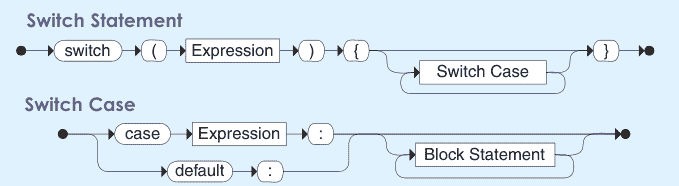

`switch` 评估初始表达式并将其值与几个 `case` 之一匹配。继续执行该 `case` 对应的语句。如果没有其他 `case` 匹配，则将执行可选的 `default` 情况。

示例：

```
switch (numValues)
{
  case 0:
    System.out.println("No values were entered.");
    break;
  case 1:
    System.out.println("One value was entered.");
    break;
  case 2:
    System.out.println("Two values were entered.");
    break;
  default:
    System.out.println("Many values were entered.");
}
```

在 `switch` 语句开始评估的表达式必须是 `char`、`byte`、`short` 或 `int`。特别是，它不能是 `boolean` 或 `String`。此外，每个 `case` 的值必须是常量；不能是变量或其他表达式。这限制了 `switch` 语句适当的情况。但当适当时，它使代码更易读和理解。

另请注意，`switch` 语句开头的隐式布尔条件是基于等效性的。语句中的表达式被比较以确定它等于哪一个。`switch` 语句不能用于确定其他关系操作（例如小于），除非执行了初步处理。例如，列出 6.1 中的 `GradeReport` 程序根据用户输入的数字成绩打印注释。

## 列表 6.1

```
********************************************************************
// GradeReport.java           Author: Lewis/Loftus
// 演示了 switch 语句的使用。
****************************************************************

import java.util.Scanner;
public class GradeReport
{
    // 从用户处读取成绩并相应的打印注释。
    //----------------------------------------------------------------------
    public static void main (String[] args) {
        int grade, category;

        Scanner scan = new Scanner(System.in);

        System.out.print("Enter a numeric grade (0 to 100): ");
        grade = scan.nextInt();

        category = grade / 10;
        System.out.print("That grade is ");

        switch (category) {
            case 10:
                System.out.println("a perfect score. Well done.
case 7:
System.out.println("average. 
case 6:
System.out.println("below average. You should see the");
break;
default:
System.out.println("not passing.");```

Enter a numeric grade (0 to 100): 86

That grade is above average. Nice job.

在 `GradeReport` 中，类别是通过成绩除以 10 确定的，使用整数除法得到 0 到 10 之间的值。使用 `switch` 语句可以处理 0 到 10 之间的值。

注意 `switch` 语句开头的隐式布尔条件是基于等效性的。语句中的表达式被比较以确定它等于哪一个。`switch` 语句不能用于确定其他关系操作（例如小于），除非执行了初步处理。例如，列出 6.1 中的 `GradeReport` 程序根据用户输入的数字成绩打印注释。

## 自测问题（答案在附录 N）

- SR 6.1 当 `switch` 语句运行时，如果评估的表达式与任何 `case` 值不匹配会发生什么？
- SR 6.2 如果 `switch` 语句不以 `break` 语句结束会发生什么？
- SR 6.3 如果用户输入“72”，`GradeReport` 程序的输出是什么？如果用户输入“46?”？如果用户输入“123?”

# 第 6 章 更多条件和循环

SR 6.4 将下面的嵌套 `if` 语句转换为等效的 `switch` 语句。

```
if (num1 == 5)
    myChar = 'W';
else
    if (num1 == 6)
        myChar = 'X';
    else
        if (num1 == 7)
            myChar = 'Y';
        else
            myChar = 'Z';
```

## 6.2 条件运算符

Java 的条件运算符在某些方面与 `if-else` 语句相似。它是一个三元运算符，因为它需要三个操作数。条件运算符的符号通常是 `?:`，但与其他运算符不同在于这两个符号总是分开的。下面是一个包含条件运算符的表达式：

```
(total > MAX) ? total + 1 : total * 2;
```

`?` 之前是布尔条件。`?` 之后是两个用 `:` 分隔的表达式。条件表达式如果为真返回第一个表达式的值，如果为假返回第二个表达式的值。

> 核心概念
>
> 条件运算符根据布尔条件评估两个可能值之一。

记住，这是一个返回值的示例。条件运算符只是一个运算符，而不是一个独立运行的语句。通常我们想对该值做些什么，例如将其赋值给变量：

```
total = (total > MAX) ? total + 1 : total * 2;
```

条件运算符与条件语句之间的区别可能是微妙的。在许多情况下，`?:` 让我们能够使用作为简化的 `if-else` 语句的逻辑。之前的语句在功能上等同，但有时比下面的更方便：

```
if (total > MAX)
    total = total + 1;
else
    total = total * 2;
```

## 6.2 条件运算符

让我们再来看几个例子。考虑以下声明：

```java
int larger = (num1 > num2) ? num1 : num2;
```

如果 `num1` 大于 `num2`，则返回 `num1` 的值并用于初始化变量 `larger`。如果不是，则返回 `num2` 的值并再次初始化 `larger`。同样，以下语句打印两个数中较小的一个：

```java
System.out.println("Smaller: " + ((num1 < num2) ? num1 : num2));
```

条件运算符有时有助于避免短条件并返回结果。然而，它不能替代 `if-else` 语句，因为 `?:` 的操作数是表达式，而不一定是完整的语句。当条件运算符可行时，你应该谨慎使用，因为它的可读性可能比 `if-else` 语句差。

- 自测习题（见附录 N 中的答案）

- SR 6.5 条件运算符和条件语句之间有什么区别？
- SR 6.6 编写一个声明，如果布尔变量为真，则初始化一个名为 'A' 的 char 变量；否则初始化为 'B'。
- SR 6.7 使用条件运算符用简洁的方式表达该逻辑。


# 第 6 章 更多条件和循环

```java
if (val <= 10)
    System.out.println("The value is not greater than 10.");
else
    System.out.println("The value is greater than 10.");
```

## 6.3 do 语句

记得第 5 章提到的 `while` 语句首先检查条件，如果条件为真，则执行循环体。`do` 语句与 `while` 语句相似，但它的终止条件位于循环体的末尾。`while` 循环一直执行到条件变为假。`do` 循环写在循环体的末尾，表示在执行循环体之前不会进行评估。注意，`do` 循环至少会执行一次。图 6.1 显示了这种处理过程。

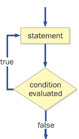

图 6.1 do 循环的逻辑

以下代码使用 `do` 循环打印从 1 到 5 的数字。将此代码与第 5 章中使用 `while` 循环完成相同任务的示例进行比较。

```java
int count = 0;
do {
    count++;
    System.out.println(count);
} while (count < 5);
```

> **核心概念**
>
> `do` 语句至少执行一次循环。

注意，`do` 循环简单地以关键字 `do` 开始。`do` 循环体一直持续，直到遇到包含布尔条件的 `while` 子句，该条件决定了循环是否继续执行。有时很难判断哪一行以关键字开头的代码是 `while` 循环的开始，还是 `do` 循环的结束。

让我们来看另一个 `do` 循环的例子。列表 6.2 显示的 `ReverseNumber` 程序从用户处读取一个整数，并通过数学方法反转其数字。

### Do 语句

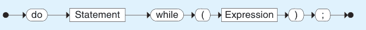

`do` 循环只要布尔表达式为真，就会重复执行语句。`do` 语句至少执行一次，然后评估表达式以决定是否再次执行语句。

## 6.2 条件运算符

示例：

```java
do {
    System.out.print("Enter a word:");
    word = scan.next();
    System.out.println(word);
} while (!word.equals("quit"));
```

```java
// 列表 6.2
//****************************************************************
// ReverseNumber.java 作者: Lewis/Loft
// 展示了 do 循环的使用。
//****************************************************************
import java.util.Scanner;
public class ReverseNumber
{
    // 通过数学方法反转整数的数字。
    public static void main(String[] args) {
        int number, lastDigit, reverse = 0;
        Scanner scan = new Scanner(System.in);
        System.out.print("Enter a positive integer:");
        number = scan.nextInt();
        do {
            lastDigit = number % 10;
            reverse = (reverse * 10) + lastDigit;
            number = number / 10;
        } while (number > 0);
        System.out.println("That number reversed is " + reverse);
    }
}
```

## 第 6 章 更多条件和循环 列表 6.2 继续

输入正整数：2896

反转后的数字是 6982

`ReverseNumber` 程序中的 `do` 循环使用取模运算确定个位数字，然后将其加到反转数字上，使用整数除法从原始数字中去掉该数字。当变量 `number` 达到零时，`do` 循环终止。仔细跟踪该程序的逻辑。如果你知道如何至少执行一次循环体，你可能想使用 `do` 循环。`do` 循环与 `while` 循环许多属性相同，因此必须检查终止条件以避免无限循环。

## 自测习题（见附录 N 中的答案）

- SR 6.8 比较 `while` 循环和 `do` 循环。
- SR 6.9 以下代码的输出是什么？

```java
int low = 0, high = 10;
do {
    System.out.println(low);
    low++;
} while (low < high);
```

- SR 6.10 以下代码的输出是什么？

```java
int low = 10, high = 0;
do {
    System.out.println(low);
    low++;
} while (low <= high);
```

- SR 6.11 编写一个 `do` 循环，使用零作为哨值获取一系列正整数。程序应该输出数字的和。

## 6.4 for 语句

当你不知道执行循环体的次数时，`while` 和 `do` 语句很好。`for` 语句特别适合在循环开始前定义执行循环体的特定次数。

以下代码使用 `for` 循环打印 1 到 5，正如之前的示例：

```java
for (int count=1; count <= 5; count++)
    System.out.println(count);
```

`for` 循环头部包含三个由分号隔开的部分。在循环开始之前，执行头部的第一部分，称为“初始化”。头部的第二部分是布尔条件，在循环体之前进行评估。如果为真，则执行循环体，然后执行头部的第三部分，称为“增量”。注意初始化部分只执行一次，增量在每次循环迭代后执行。图 6.2 显示了这种处理过程。

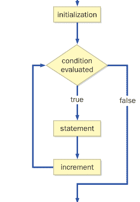

图 6.2 for 循环的逻辑

`for` 循环在习惯之前阅读可能有点困难。代码的执行并不遵循“从上到下、从左到右”的阅读顺序。增量代码即使位于头部，也会循环体之后执行。

注意

使用 `for` 循环的示例。

在这里，循环头部的初始化部分用于声明变量 `count` 并赋予它一个初始值。我们并不要求声明变量，但在变量在循环外不需要的情况下，这是常见的做法。因为 `count` 在 `for` 头部声明，所以它只存在于循环体内，不能在其他地方引用。循环控制变量由循环头部设置、检查和修改。它可以在循环体内部引用，但不应被循环头部定义的动作所修改。

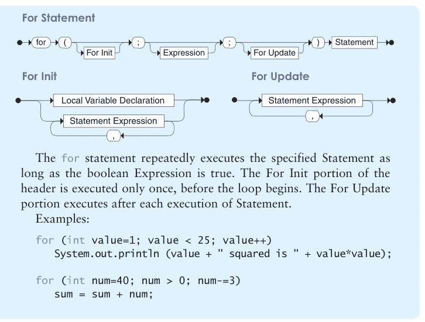

`for` 语句只要表达式为真就会重复执行指定的语句。头部的 `Init`（初始化）部分在循环开始前执行一次。`Update`（更新）部分在每次执行语句后执行。

示例：

```java
for (int value=1; value < 25; value++)
    System.out.println(value + " squared is " + value*value);
```

```java
for (int num=40; num > 0; num-=3)
    sum = sum + num;
```

`for` 循环头部的增量部分尽管命名如此，但它可以减少一个值而不是增加它。例如，以下循环打印从 100 降到 10 的整数：

```java
for (int num = 100; num > 0; num--)
    System.out.println(num);
```

事实上，`for` 循环的增量部分可以执行任何计算，而不仅仅是简单的加或减。列表 6.3 所示的程序打印从特定数值到特定限制的倍数。

`Multiples` 程序中 `for` 循环的增量部分在每次迭代后加上用户输入的值。每行打印的数值个数通过计数打印的数值来控制，当 `count` 能被 `PER_LINE` 常数整除时，就移动到下一行。

```java
// 列表 6.3
//************************************************************************************
// Multiples.java           Author: Lewis/Loftus
// 展示了 for 循环的使用。
//************************************************************************************
import java.util.Scanner;
public class Multiples {
    // 打印从用户指定的数值到用户
    // 指定限制的倍数。
    public static void main(String[] args) {
        final int PER_LINE = 5;
        int limit, value, count = 0;

        Scanner scan = new Scanner(System.in);
        System.out.print("Enter a positive value: ");
        value = scan.nextInt();

        System.out.print("Enter an upper limit: ");
        limit = scan.nextInt();

        System.out.println("The multiples of " + value + " between " +
            value + " and " + limit + " (inclusive) are:");
        for (int mult = value; mult <= limit; mult += value) {
            System.out.print(mult + "\t");
            // 每行输出打印特定数量的数值
            count++;
            if (count % PER_LINE == 0)
                System.out.println();
        }
    }
}
```

列表 6.4 中的 `Stars` 程序展示了嵌套循环的使用。输出是一个由星号字符组成的三角形。外层循环执行 10 次。外层循环的每次迭代都会打印一行输出。内层循环执行的迭代次数取决于外层循环控制的行值。内层循环的每次迭代都会在当前行打印一个星号。打印此三角形形状变体的程序包含在本章末尾的编程项目中。

```java
// 列表 6.4
//************************************************************************************
// Stars.java      Author: Lewis/Loftus
// 展示了嵌套 for 循环的使用。
//************************************************************************************
public class Stars
{
    // 使用星号（star）字符打印三角形形状。
    //
    public static void main(String[] args)
    {
        final int MAX_ROWS = 10;

        for (int row = 1; row <= MAX_ROWS; row++) {
            for (int star = 1; star <= row; star++) {
                System.out.print("*");
            }
            System.out.println();
        }
    }
}
```

```
OUTPUT
*
**
***
****
*****
******
*******
********
*********
**********
```

`ArrayList` 是一个 `Iterable` 对象。因此，例如，如果 `library` 是一个 `ArrayList<Book>` 对象（即管理 Book 对象的 `ArrayList`），我们可以使用 `for` 循环所示处理集合中的每个 `Book` 对象：

> **核心概念**
>
> `for-each` 版本的 `for` 循环简化了对 `Iterable` 对象中所有元素的处理。

```java
for (Book myBook : library)
    System.out.println(myBook);
```

这段代码可以读作：对于 `library` 中的每个 `Book`，打印该书籍对象。变量 `myBook` 替获取集合中每个 `Book` 对象的值，循环体可以对其进行恰当的处理。那个简洁的 `for-each` 循环本质上等同于以下代码：

```java
while (library.hasNext()) {
    Book myBook = library.next();
    System.out.println(myBook);
}
```

这种版本的 `for` 也可以用于数组，数组将在第 8 章中讨论。我们根据情况适当使用 `for` 循环。

## 比较循环

三个基础循环（`while`、`do`、`for`）在功能上是等价的。使用哪一个取决于情况。如之前所述，`while` 循环和 `do` 循环的主要区别在于判断条件的时间。如果希望至少执行一次，`do` 循环是更好的选择。另一方面，如果条件初始为假，`while` 循环可能完全不执行。当迭代次数是固定或可以计算同时，我们使用 `for` 循环。在许多情况下，将循环头与循环体分离更为简单。

## 自测（见答案）

- SR 6.12 什么情况下我们会用 `for` 循环代替 `while` 循环？
- SR 6.13 以下代码的输出是什么？

```java
int value = 0;
for (int num = 10; num <= 40; num += 10) {
    value = num;
}
System.out.println(value);
```

- SR 6.14 以下代码的输出是什么？

```java
int value = 0;
for (int num = 10; num < 40; num += 10) {
    value = num;
}
System.out.println(value);
```

- SR 6.15 以下代码的输出是什么？

```java
int value = 6;
for (int num = 1; num <= value; num++) {
    for (int i = 1; i < (value - num); i++)
        System.out.print(" ");
    for (int i = 1; i < (2 * num) - 1; i++)
        System.out.println("*");
}
```

- SR 6.16 假设 `die` 是一个 `Die` 对象（如 4.2 节定义）。编写一段代码投掷 100 次并输出平均值。

## 6.5 使用循环和条件绘图

条件循环极大增强了我们生成有趣图形的能力。列表 6.5 中的 `Bullseye` 程序绘制了一个靶子。绘图实际上发生在 `BullseyePanel` 类中，如列表 6.6 所示。`BullseyePanel` 的 `paintComponent` 使用 `if` 语句交替使用黑色和白色。

注意每个环实际上被绘制为一个填充圆（长宽相等的椭圆）。因为我们层叠绘制圆，所以内部的圆是可见的。

## 6.5 使用循环和条件判断绘图

# 列表 6.6


# 第 6 章 更多条件判断和循环

## 6.5 使用循环和条件判断绘图

### 列表 6.6 `BullseyePanel.java`

```java
/*******************************************************************************
// BullseyePanel.java    作者: Lewis/Loftus
// 展示如何使用条件判断和循环引导绘图。
*******************************************************************************/

import javax.swing.JPanel;
import java.awt.*;

public class BullseyePanel extends JPanel
{
    private final int MAX_WIDTH = 300, NUM_RINGS = 5, RING_WIDTH = 25;

    // 设置靶心面板。
    public BullseyePanel() {
        setBackground(Color.cyan);
        setPreferredSize(new Dimension(300, 300));
    }

    // 绘制靶心靶。
    public void paintComponent(Graphics g) {
        super.paintComponent(g);
        int x = 0, y = 0, diameter = MAX_WIDTH;

        for (int count = 0; count < NUM_RINGS; count++) {
            if (g.getColor() == Color.black) // 交替颜色
                g.setColor(Color.white);
            else
                g.setColor(Color.black);

            g.fillOval(x, y, diameter, diameter);
            diameter -= (2 * RING_WIDTH);
            x += RING_WIDTH;
            y += RING_WIDTH;
        }

        // 在中心绘制红色的靶心
        g.setColor(Color.red);
        g.fillOval(x, y, diameter, diameter);
    }
}
```

覆盖较大圆的内部部分，从而营造出环形效果。最后，绘制一个最终的红色圆圈作为靶心。

### 列表 6.7 `Boxes.java`

```java
/****************************************************************
// Boxes.java    作者: Lewis/Loftus
// 展示如何使用循环进行绘图。
//****************************************************************
import javax.swing.JFrame;

public class Boxes {
    //------------------------------------
    // 创建程序的主框架。
    //------------------------------------
    public static void main(String[] args) {
        JFrame frame = new JFrame("Boxes");
        frame.setDefaultCloseOperation(JFrame.EXIT_ON_CLOSE);

        BoxesPanel panel = new BoxesPanel();
        frame.getContentPane().add(panel);
        frame.pack();
        frame.setVisible(true);
    }
}
```

### 列表 6.8 `BoxesPanel.java`

```java
/********************************************************************
// BoxesPanel.java Author: Lewis/Loftus
// 展示如何使用条件判断和循环引导绘图。
********************************************************************/

import javax.swing.JPanel;
import java.awt.*;
import java.util.Random;

public class BoxesPanel extends JPanel {
    private final int NUM_BOXES = 50, THICKNESS = 5, MAX_SIDE = 50;
    private final int MAX_X = 350, MAX_Y = 250;
    private Random generator;

    //------------------------------------------------------
    // 设置绘图面板。
    //------------------------------------------------------
    public BoxesPanel() {
        generator = new Random();
        setBackground(Color.cyan);
        setPreferredSize(new Dimension(300, 300));
    }

    //------------------------------------------------------
    // 绘制随机大小的矩形。
    //------------------------------------------------------
    public void paintComponent(Graphics g) {
        super.paintComponent(g);

        for (int i = 0; i < NUM_BOXES; i++) {
            int x = generator.nextInt(MAX_X - MAX_SIDE);
            int y = generator.nextInt(MAX_Y - MAX_SIDE);
            int width = generator.nextInt(MAX_SIDE);
            int height = generator.nextInt(MAX_SIDE);

            if (width < THICKNESS) {
                g.setColor(Color.yellow);
                g.fillRect(x, y, width, height);
            } else if (height < THICKNESS) {
                g.setColor(Color.green);
                g.fillRect(x, y, width, height);
            } else {
                g.setColor(Color.white);
                g.drawRect(x, y, width, height);
            }
        }
    }
}
```

## 6.6 对话框

`JOptionPane` 对话框的基本格式分为三类。消息对话框仅显示输出字符串。输入对话框提供一个提示和一个用户可以输入数据的字段。确认对话框向用户提出一个简单的是否问题。

Swing 包包含一个名为 `JOptionPane` 的类，它简化了对话框的创建和使用。

| 方法 | 描述 | 返回值 |
| :--- | :--- | :--- |
| `showMessageDialog(Component parent, Object msg)` | 显示消息对话框 | void |
| `showInputDialog(Object msg)` | 显示带有提示的输入对话框 | String（用户输入） |
| `showConfirmDialog(Component parent, Object msg)` | 提供是否选项的确认对话框 | int（YES, NO 等） |

让我们来看使用这些类型对话框的程序。列表 6.9 显示了一个程序首先向用户展示一个输入对话框，请求用户输入整数。在用户点击输入对话框上的确定按钮后，会出现第二个对话框（这次是消息对话框），告知用户输入的数字是偶数还是奇数。在用户关闭该框后，会出现第三个对话框，以确定用户是否想再次测试。如果用户点击标记为“是”的按钮，系列对话框将重复执行。否则程序终止。

### 列表 6.9 `EvenOdd.java`

```java
/****************************************************
// 作者: Lewis/Loftus
// EvenOdd.java
// 展示如何使用 JOptionPane 类。
****************************************************/

import javax.swing.JOptionPane;

public class EvenOdd {
    //------------------------------------------------------------
    // 判断用户输入的值是偶数还是奇数。
    // 使用多个对话框与用户交互。
    //------------------------------------------------------------
    public static void main(String[] args) {
        String numStr, result;
        int num, again;

        do {
            numStr = JOptionPane.showInputDialog("输入整数：");
            num = Integer.parseInt(numStr);
            result = "那个数字是" + ((num % 2 == 0) ? "偶数" : "奇数");
            JOptionPane.showMessageDialog(null, result);
            again = JOptionPane.showConfirmDialog(null, "还要再测试吗？");
        } while (again == JOptionPane.YES_OPTION);
    }
}
```

`showMessageDialog` 和 `showConfirmDialog` 方法的第一个参数指定了对话框的父组件。使用 `null` 引用作为此参数会导致对话框显示在屏幕中央。

许多 `JOptionPane` 方法允许程序员自定义对话框的内容。此外，可以使用 `showOptionDialog` 方法创建结合了三种基本格式特征的对话框，以实现更复杂的交互。

## 核心概念总结

- `switch` 语句将字符或整数值匹配到多个可能的 `case` 之一。
- `break` 语句通常用于 `switch` 语句中每个 `case` 分支的末尾。
- 条件运算符根据布尔条件评估两个可能值之一。
- `do` 语句至少执行一次其循环体。
- `for` 语句通常用于循环执行固定次数的情况。
- `for` 循环的 `for-each` 版本简化了对 `Iterable` 对象中所有元素的处理。
- 这些循环语句在功能上是等价的。你应该依赖哪一个取决于具体情况。
- 对话框是一个弹出窗口，允许进行简短、特定的用户交互以提供或验证某个操作。

## 练习题

访问 `www.myprogramming.lab` 在线完成许多练习题并获得即时反馈。

**EX 6.1** 下述代码片段产生什么输出？

```java
for (int num = 0; num <= 200; num += 2) {
    System.out.println(num);
}
```

**EX 6.2** 下述代码片段产生什么输出？

```java
for (int val = 200; val >= 0; val -= 1) {
    if (val % 4 != 0)
        System.out.println(val);
}
```

**EX 6.3** 将下述 `while` 循环转换为等效的形式（确保它产生相同的输出）。

```java
int num = 1;
while (num < 20) {
    num++;
    System.out.println(num);
}
```


# 练习

## EX 6.4
将上一个练习中的 `while` 循环转换为等效的循环（确保它产生相同的输出）。

## EX 6.5
编写一个 `do` 循环验证用户输入的是偶整数。

## EX 6.6
编写 `for` 循环打印从 1 到 99（包含 99）的奇数。

## EX 6.7
编写 `for` 循环打印从 300 到 3 的 3 倍数。

## EX 6.8
编写一个代码片段，从用户处读取 10 个整数值并打印输入的最高值。

## EX 6.9
编写一个代码片段，确定并打印名为 `name` 的 String 对象中字符 'a' 出现的次数。

## EX 6.10
编写一个代码片段，倒序打印 String 对象 `str` 中存储的字符。

## EX 6.11
编写一个代码片段，从 String 对象 `word` 的第一个字符开始每隔打印一个字符。

## EX 6.12
编写一个名为 `powersTwo` 的方法，打印 2 的前 10 次幂（从 2 开始）。该方法无参数且无返回值。

## EX 6.13
编写一个名为 `alarm` 的方法，在多行中打印字符串 "Alarm!" 多次。该方法应接受一个参数，指定字符串打印的次数。如果参数小于 1，则打印错误信息。

## EX 6.14
编写一个名为 `sum100` 的方法，返回从 1 到 100（包含）的整数的和。

## EX 6.15
编写一个名为 `sumRange` 的方法，接受两个表示范围的整数。如果第二个参数小于第一个参数，则发布错误信息并返回 0。否则，该方法应返回该范围内整数的和。

## EX 6.16
编写一个名为 `countA` 的方法，接受一个 String 参数并返回字符串中字符 'A' 出现的次数。

## EX 6.17
编写一个名为 `reverse` 的方法，接受一个 String 参数并返回一个包含倒序内容的字符串。

# 编程项目

访问 `my.programming.lab` 在线完成许多项目并获得即时反馈。

- **PP 6.1** 设计并实现一个应用程序，读取一个整数并打印 2 到该值（包含）之间所有整数的和。如果值小于 2，则打印错误信息。
- **PP 6.2** 设计并实现一个应用程序，从用户处读取字符串并每行打印一个字符。
- **PP 6.3** 设计并实现一个应用程序，生成 1 到 12 的整数自乘表。
- **PP 6.4** 设计并实现一个应用程序，打印“百瓶”歌的前几节。使用循环从用户处读取节数。
- **PP 6.5** 使用 PP 4 中的 `Pair` 类，设计并实现一个应用程序，掷 100 次骰子，统计点数的次数。
- **PP 6.6** 使用本章定义的 `Coin` 类，设计并实现一个驱动类，其 `main` 方法抛掷 100 次硬币并统计正面次数。
- **PP 6.7** 设计并实现一个应用程序打印这些模式。注意某些模式需要多个循环。
- **PP 6.8** 设计并实现一个应用程序，打印显示 Unicode 字符及其数值的表格。每行打印五个数字/字符对，并用制表符分隔。打印数值从 32（空格）到 126（~ 字符）的表格。
- **PP 6.9** 设计并实现一个应用程序，从用户处读取字符串，然后确定整个字符串中每个元音（a, e, i, o 和 u）出现的次数。为每个元音设置单独计数器。还要统计并打印非元音的数量。
- **PP 6.10** 设计并实现一个应用程序，打印“十二圣诞日”歌的歌节，每节增加一行。该歌的前两节如下：
  - 在圣诞的第一天，我的爱人送给我：
    - 一只梨树上的鹧鸪。
  - 在圣诞的第二天，我的爱人送给我：
    - 两只斑鸠，和
    - 一只梨树上的鹧鸪。

```
十个跳跃的主公，
九位跳舞的女士，
八位正在挤奶的女仆，
七只游泳的天鹅，
六只正在产蛋的鹅，
五个金戒指，
四只鸣叫的鸟，
三只法国鸡，
两对斑鸠，
一只梨树上的鹧鸪。
```

- **PP 6.11** 设计并实现一个程序，绘制 20 条长度随机、间距均匀的水平平行线。
- **PP 6.12** 设计并实现一个程序，绘制从左下角到右上角的阶梯侧视图。
- **PP 6.13** 设计并实现一个程序，在随机位置绘制 100 个直径随机且位置随机的圆形。确保在每种情况下，整个圆都出现在 applet 的可见区域内。
- **PP 6.14** 设计并实现一个程序，绘制 10 个半径随机的同心圆。
- **PP 6.15** 设计并实现一个程序，绘制砖墙图案，其中每一行砖相对于上方和下方的行都有偏移。
- **PP 6.16** 设计并实现一个程序，绘制一条被子，其中简单的图案在正方形网格中重复。
- **PP 6.17** 修改前面的问题，使其使用一个名为 `Pattern` 的独立类来绘制被子，该类表示特定的图案。允许 `Pattern` 类构造函数改变图案的某些特征，例如其颜色方案。实例化两个独立的 `Pattern` 对象并将它们整合到被子的棋盘图中。
- **PP 6.18** 设计并实现一个程序，绘制一个简单的栅栏，由两块水平支撑板支撑垂直且等间距的木板。在栅栏背景后显示一栋简单的房屋。确保房屋在栅栏的木板之间可见。
- **PP 6.19** 设计并实现一个程序绘制彩虹。使用紧密排列的同心弧用特定的颜色绘制彩虹的每个部分。
- **PP 6.20** 设计并实现一个程序，在可见区域内的随机位置绘制 20,000 个点。使面板左侧的点显示为红色，面板右侧的点显示为绿色。通过绘制长度为一个像素的线来绘制每个点。
- **PP 6.21** 设计并实现一个程序，在随机位置绘制 10 个半径随机的圆形。将最大的圆填充为红色。
- **PP 6.22** 设计并实现一个应用程序，使用对话框获取两个整数值（每个值使用一个对话框），并显示这两个值的和和乘积。使用另一个对话框查看用户是否想处理另一对数值。
- **PP 6.23** 重新设计并实现 `PalindromeTester` 的版本，使其使用对话框获取输入字符串、显示结果并提示继续。
- **PP 6.24** 设计并实现一个 `Card` 类，表示一张标准扑克牌。每张牌都有花色和点值。创建一个程序来发五张随机的牌。

# 第 6 章 更多条件与循环

# 第 7 章 面向对象设计

## 本章目标

- 建立与对象软件设计相关的关键问题。
- 探索识别程序所需的类和对象的技巧。
- 讨论类之间的关系。
- 描述 `static` 修饰符对方法和数据的影响。
- 讨论正式对象接口的创建。
- 进一步探索枚举类型类的定义。
- 讨论与方法设计相关的问题，包括方法重载。
- 探索与图形用户界面设计相关的问题，包括布局管理器。

本章扩展了我们对对象软件设计的讨论。我们首先关注软件开发阶段以及在问题领域中识别类和对象的过程。然后，我们讨论了影响类设计的各种问题，包括静态成员、类关系、接口和枚举类型。我们还探索了方法层面的设计问题，并引入了方法重载的概念。对测试策略的讨论完善了这些问题。本章的后续部分将关注 GUI 设计，包括布局管理器。

## 7.1 软件开发活动

创建软件不仅仅是编写代码。随着问题的解决变得越来越复杂，仔细思考设计变得至关重要。任何适当的软件开发都涉及四个基本活动：

- 建立需求
- 创建设计
- 实现设计
- 测试

尽管这些活动按顺序呈现，但实际上它们是重叠的。让我们简要讨论每个活动。

需求指定了必须完成的内容。这些内容通常表达在需求说明文档中。然而，需求往往是不完整的、模糊的甚至是矛盾的。客户通常提供这些需求。

设计指定如何执行。它识别程序所需的类和对象，并定义了它们之间的关系。低级设计处理单个方法如何完成任务。土木工程师在设计之前绝不会考虑建造桥梁。软件的设计也是如此。

## 7.2 识别类和对象

对象设计的一个基本部分是确定对程序有贡献的类。我们必须仔细考虑如何表示各种元素。识别潜在类的一种方法是识别需求中讨论的对象。对象通常是名词。你可能需要仔细检查程序描述，识别其中发现的名词。

当然，问题规范中的每个名词并不对应一个类。这项活动是一个起点，让你思考程序将管理的对象类型。

请记住，类代表一组具有相似行为的实例。规范中的复数名词（如 `products`）可能表示需要一个类来代表其中某一项物品，例如 `Product`。如果系统中只需要一种特定类型的对象，那么将其表示为类可能是最佳选择。

表示对象的类应使用单数名词命名，例如 `Coin`、`Student` 和 `Message`。类代表一个单一项目，我们可以根据意愿创建任意数量的实例。

另一个关键决策是将某个内容表示为对象，还是表示为另一个对象的原始属性。例如，我们最初可能认为员工的工资应该表示为整数，并用于系统的大部分处理。但经过进一步反思，我们意识到工资取决于人的级别，而级别有必须小心管理的上限和下限。因此，最终结论是，将所有数据和相关行为表示为一个独立的类会更好。

考虑到特定程序的需求，我们希望在过于通用的类和过于具体的类之间取得平衡。例如，为房子存在的每种电器创建一个单独的类可能会增加不必要的复杂性。拥有一个 `Appliance` 类可能足够了，其中可能有一段实例数据来指示它是什么种类型的电器。然而，这也不一定。这完全取决于软件打算实现什么。

除了表示问题领域对象的类外，我们可能还需要支持完成工作任务所需的类。例如，除了 `Member` 对象外，我们可能还需要一个单独的类来帮助管理俱乐部的所有成员。

请记住，在构建真实系统时，我们在设计过程中识别出的某些类可能已经存在。如果没有完全匹配的，可能有一个旧类与我们足够相似，可以作为我们新类的基础。现有的类可能是 Java 标准类库的一部分，可能是我们之前解决的问题的解决方案的一部分，也可能是从第三方购买的库的一部分。这些都是软件重用的例子。

### 分配职责

识别程序所需类的过程的一部分，是为每个类分配职责的过程。每个类代表一个具有特定行为的对象，这些行为由类的方法定义。程序必须完成的任何活动都必须在类的行为某处表示出来。也就是说，每个类负责执行某些活动，这些职责必须在设计程序时分配。

类的行为执行使程序具有功能的操作。因此，我们使用动词为行为名称以及实现这些行为的方法命名。

有时，要确定哪一个类是执行特定职责的最佳类是具有挑战性的。考虑多种可能性。有时通过这种分析，你可能会发现定义另一个类来承担该职责会大有益处。

在设计的早期阶段，没有必要识别一个类将包含的所有方法。通常分配职责并考虑这些职责如何转换为特定方法就足够了。

#### 自我复习题（答案请见附录 N）

- **SR 7.4** 识别程序规范中的名词如何帮助你为该问题设计一个面向对象的解决方案？
- **SR 7.5** 在问题解决方案设计的早期，识别并定义一个类将包含的所有方法是否重要？请讨论。

## 7.3 静态类成员

在书之前的示例中，我们在各种情况下使用了静态方法。例如，`Math` 类的所有方法都是静态的。记住，静态方法是通过其名称调用的，而不是通过该类的对象调用。

不仅方法可以是静态的，变量也可以是静态的。我们使用 `static` 修饰符来声明静态类成员。

决定是否将方法或变量声明为静态是类设计的关键步骤。让我们更仔细地检查静态变量和方法的影响。

### 静态变量

到为止，我们看到了类变量：在方法内部定义的局部变量，以及在类中声明但在方法之外的实例变量。使用*实例变量*（instance variable）一词是因为类的每个实例都有变量的自己的版本。也就是说，每个对象对每个变量都有独立的内存空间，以便每个对象对该变量可以有不同的值。

*静态变量*（static variable）有时被称为*类变量*（class variable），它是类的所有实例共享的。对于类的所有对象来说，静态变量只有一个副本。更改一个对象的静态变量值就会改变所有其他对象的值。使用关键字 `static` 用作修饰符来如下所示声明一个静态 int：

```java
private static int count = 0;
```

当包含静态变量的类第一次被引用时，静态变量的内存空间就会建立。使用 `final` 修饰符声明的常量通常是静态的。

### 静态方法

在第 3 章中，我们简要介绍了*静态方法*（static method，也称为*类方法*）的概念。静态方法可以在没有类的实例的情况下调用。在第 3 章中，我们注意到 `Math` 类的所有方法都是静态的。例如，在下面的代码行中，`sqrt` 是通过类名调用的：

```java
System.out.println("Square of 27: " + Math.sqrt(27));
```

`Math` 类中的方法使用传递的参数进行计算。在这些情况下，没有对象需要维护；没有理由为了请求这些服务而创建一个对象。

通过在方法声明中使用 `static` 修饰符来创建静态方法。正如我们多次看到的，Java 程序的 `main` 方法必须用 `static` 修饰符声明；这样做是为了它可以被解释器执行，而无需从包含 `main` 的类中实例化。

由于静态方法不在特定对象的语境上下文中运行，因此它们不能引用实例变量，实例变量只存在于类的实例中。如果静态方法尝试使用非静态变量，编译器将发出错误。然而，静态方法可以引用静态变量，因为静态变量独立于特定对象。因此，`main` 方法只能访问静态变量或局部变量。

### 示例：Slogan 类

**Listing 7.1** 演示了静态变量和方法的使用。

```java
// Slogan.java               Author: Lewis/Loftus
// 表示单个标语字符串。

public class Slogan {
    private String phrase;
    private static int count = 0;

    // 构造函数：设置标语并计算创建的实例数量。
    public Slogan(String str) {
        phrase = str;
        count++;
    }

    // 将此标语作为字符串返回。
    public String toString() {
        return phrase;
    }

    // 返回已创建的该类的实例数量。
    public static int getCount() {
        return count;
    }
}
```

**Listing 7.2** 演示了 `Slogan` 类的使用。

```java
// SloganDriver.java         Author: Lewis/Loftus
// 演示 Slogan 类。

public class SloganDriver {
    public static void main(String[] args) {
        Slogan s1 = new Slogan("记住阿拉莫战。");
        Slogan s2 = new Slogan("不要担心，要快乐。");
        Slogan s3 = new Slogan("自由或死亡。");
        Slogan s4 = new Slogan("言语是廉价的。");
        Slogan s5 = new Slogan("一次编写，到处运行。");

        System.out.println(s1);
        System.out.println(s2);
        System.out.println(s3);
        System.out.println(s4);
        System.out.println(s5);

        System.out.println();
        System.out.println("Slogans created: " + Slogan.getCount());
    }
}
```

**输出**

```
记住阿拉莫战。
不要担心，要快乐。
自由或死亡。
言语是廉价的。
一次编写，到处运行。

创建的标语数：5
```

#### 自我复习题（答案见附录 N）

- **SR 7.6** 静态变量和实例变量之间的区别是什么？
- **SR 7.7** 假设你正在定义一个 `BankAccount` 类，其每个对象代表一个独立的银行账户。为该类声明一个变量，以存储该类代表的所有账户的总和。
- **SR 7.8** 假设你正在定义一个 `BankAccount` 类，其每个对象代表一个独立的银行账户。为该类声明一个变量，以存储每个账户必须维持的最低余额。
- **SR 7.9** 任何程序的 `main` 方法可以引用什么种类的变量？为什么？

## 7.4 类关系

软件系统中的类之间有多种类型的关系。三种最常见的关系是依赖（dependency）、聚合（aggregation）和继承（inheritance）。

我们在许多示例中已经见过依赖关系，当一个类“使用”另一个类时。本节将复习依赖关系，并探索类依赖于其自身的情况。然后我们来探索聚合关系，在聚合中，一个类的对象包含另一个类的对象，创建了“拥有”（has-a）关系。我们在第 1 章中介绍的继承关系则在类之间创建了“是”（is-a）关系。我们将对继承的详细检查推到第 8 章。

### 依赖

在之前的示例中，我们见过一个类依赖于另一个类的概念。这意味着一个类在某种程度上依赖另一个类。通常，一个类的方法会调用另一个类的方法。这建立了一种“使用”（uses）关系。

通常，如果类 A 使用类 B，那么类 A 的一个或多个方法会调用类 B 的一个或多个方法。如果调用的方法是静态的，那么 A 仅通过名称引用 B。如果调用的方法不是静态的，那么 A 必须拥有类 B 对象的引用。

一个对象获取另一个对象访问权限是一个重要的设计决策。当一个类实例化另一个类的对象时，就会发生这种情况。

#### 同一类中的依赖

在某些情况下，一个类依赖于自身。为了说明这一点，一个类的方法可以调用该类的其他方法。

### 聚合

聚合关系发生在一个类的对象包含另一个类的对象时。通常，一个类的方法可以调用另一个类的方法。

### 示例：RationalNumber 类

**Listing 7.3** 定义了 `RationalNumber` 类。

```java
// RationalNumber.java       Author: Lewis/Loftus
// 表示一个有理数。

public class RationalNumber {
    private int numerator;
    private int denominator;

    // 构造函数：设置分子和分母。
    public RationalNumber(int numer, int denom) {
        numerator = numer;
        denominator = denom;
    }

    // 返回此有理数的倒数。
    public RationalNumber reciprocal() {
        return new RationalNumber(denominator, numerator);
    }

    // 将此有理数加到作为参数传递的有理数上。
    // 通过将各个分母相乘来找到公分母。
    public RationalNumber add(RationalNumber op2) {
        int commonDenom = denominator * op2.denominator;
        int newNumer = numerator * op2.denominator + op2.numerator * denominator;
        return new RationalNumber(newNumer, commonDenom);
    }
}
```


## RationalNumber 类方法实现

```java
int commonDenominator = denominator * op2.getDenominator();

int numerator1 = numerator * op2.getDenominator();

int numerator2 = op2.getNumberOf() * denominator;

int sum = numerator1 + numerator2;

return new RationalNumber(sum, commonDenominator);
```

```java
// 从此有理数中减去作为参数传递的有理数。
public RationalNumber subtract(RationalNumber op2) {
    int commonDenominator = denominator * op2.getDenominator();
    int numerator1 = numerator * op2.getDenominator();
    int numerator2 = op2.getNumberOf() * denominator;
    int difference = numerator1 - numerator2;
    return new RationalNumber(difference, commonDenominator);
}
```

```java
// 将此有理数乘以作为参数传递的有理数。
public RationalNumber multiply(RationalNumber op2) {
    int numer = numerator * op2.getDenominator();
    int denom = denominator * op2.getDenominator();
    return new RationalNumber(numer, denom);
}
```

```java
// 通过乘以第二个有理数的倒数，将此有理数除以作为参数传递的有理数。
public RationalNumber divide(RationalNumber op2) {
    return multiply(op2.reciprocal());
}
```

```java
// 判断此有理数是否与作为参数传递的有理数相等。
// 假设它们都是已约分形式。
public boolean isLike(RationalNumber op2) {
    return (numerator == op2.getNumerator() && denominator == op2.getDenominator());
}
```

```java
// 以字符串形式返回此有理数。
public String toString() {
    String result;
    if (numerator == 0)
        result = "0";
    else if (denominator == 1)
        result = numerator + "";
    else
        result = numerator + "/" + denominator;
    return result;
}
```

```java
// 通过将分子和分母都除以它们的最大公约数来约此有理数。
private void reduce() {
    if (numerator != 0) {
        int common = gcd(Math.abs(numerator), denominator);
        numerator = numerator / common;
        denominator = denominator / common;
    }
}
```

```java
// 计算并返回两个正数参数的最大公约数。
// 使用欧几里得算法。
private int gcd(int num1, int num2) {
    while (num1 != num2) {
        if (num1 > num2)
            num1 = num1 - num2;
        else
            num2 = num2 - num1;
    }
    return num1;
}
```

这些方法使用 `RationalNumber` 类，如 `add`、`subtract`、`multiply` 和 `divide`，将执行方法的 `RationalNumber` 对象作为第一个（左侧）操作数，将作为参数传递的 `RationalNumber` 对象作为第二个（右侧）操作数。

`RationalNumber` 类的 `Like` 方法用于判断两个数字在本质上是否相等。人们往往想将该方法命名为 `equals`，类似于比较 `String` 对象的方法（在第 5 章中讨论）。然而，在第 9 章中我们将讨论该方法由于继承而具有的特殊性，以及它是如何被实现的。为了避免混淆，我们将此方法命名为 `Like`。

注意，`RationalNumber` 类中的某些方法（如 `reduce` 和 `gcd`）被声明为 `private` 可见性。我们不希望从 `RationalNumber` 对象外部直接执行这些方法。它们仅用于支持对象的其他服务。

## 聚合 (Aggregation)

有些对象是由其他对象组成的。

> **核心概念**
>
> 聚合是描述“……有一个”（has-a）关系的一种。例如，一个班级拥有学生。在这种情况下，班级和学生的生命周期是独立的。如果班级消失了，学生仍然存在。

### 列表 7.7 继续

```java
private String streetAddress, city, state;
private long zipCode;

// 构造函数：使用指定的数据设置此地址。
public StreetAddress(String street, String town, String st, long zip) {
    streetAddress = street;
    city = town;
    state = st;
    zipCode = zip;
}

// 返回此 Address 对象的描述。
public String toString() {
    String result;
    result = streetAddress + "\n";
    result = city + " , " + state + " , " + zipCode;
    return result;
}
```

对象越复杂，就越可能需要表示为一个聚合对象（aggregate object）。在 UML 中，聚合用两个类之间的连接表示，在靠近聚合类的一端有一个空心菱形。图 7.2 显示了 StudentBody 程序的 UML 类图。

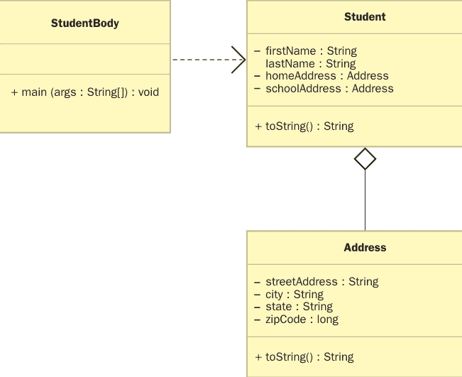

注意在之前的 UML 图示例和图 7.2 中，字符串没有被表示为具有聚合关系的独立类，尽管它们可以这样做。字符串对于编程来说是如此基础，以至于它们在 UML 图中通常被表示为基本类型（primitive type）。

## this 引用

在离开类之间关系的课题之前，我们应该检查 Java 程序中的另一个特殊引用，称为 `this` 引用。`this` 是 Java 中的一个保留关键字。它允许对象引用其自身。正如我们讨论过的，这是一个通过特定对象（或通过该类）调用的非静态方法。

### 7.4 类关系

或类。在方法内部，`this` 引用可以指向当前正在执行的对象。

例如，在 `ChessPiece` 类中，可能有一个名为的方法，其中可能包含以下行：

```java
if (this.position == piece2.position)
    result = false;
```

在这种情况下，`this` 引用被用于明确该引用指向调用该方法的对象。当使用以下行来调用方法时，`this` 指向 `bishop1`：

```java
bishop1.move();
```

然而，当使用不同的对象来调用方法时，`this` 指向该对象。当使用以下调用时，`move` 方法中的 `this` 引用指向 `bishop2`：

```java
bishop2.move();
```

通常，`this` 引用被用于区分构造函数的参数与其同名的对应实例变量。例如，`Account` 类的构造函数在第 4 章中介绍如下：

```java
public Account(String owner, long account, double initial) {
    name = owner;
    acctNumber = account;
    balance = initial;
}
```

在编写此构造函数时，我们刻意使用不同的名称作为参数，以将它们与实例变量 `name`、`acctNumber` 和 `balance` 区分开。这种区分是任意的。构造函数可以使用 `this` 引用写成如下：

```java
public Account(String name, long acctNumber, double balance) {
    this.name = name;
    this.acctNumber = acctNumber;
    this.balance = balance;
}
```

在构造函数的这个版本中，`this` 引用特指对象的实例变量。赋值语句的右侧指向参数。这种方法消除了发明不同但相等名称的需要。这种情况有时出现在其他方法中，但最常出现在构造函数中。

### 自习题（答案见附录 N）

- SR 7.10 描述两个类之间的关系。
- SR 7.11 解释类如何与它自身具有关联。
- SR 7.12 什么是聚合对象？
- SR 7.13 `this` 引用指的是什么？

## 7.5 接口

我们使用“接口”（interface）一词来指代我们可以与对象交互的公共方法集。这个定义与我们在本节中的用法一致，但现在我们将使用 Java 中的一种特定语言结构来正式化这个概念。


### 列表 7.8

```java
// Complexity.java      作者: Lewis/Loftus
// 表示一个可以被赋值为显式复杂的
// 对象的接口。
public interface Complexity {
    public void setComplexity(int complexity);
    public int getComplexity();
}
```

接口是常量和抽象方法的集合。抽象方法是一种没有实现的方法。也就是说，抽象方法没有定义代码体。方法的头部（包括其参数列表）后面简单地跟一个分号即可。接口不能被实例化。

列表 7.8 显示了一个名为 `Complexity` 的接口。它包含两个抽象方法：`setComplexity` 和 `getComplexity`。

抽象方法前面可以有 `abstract` 关键字，尽管在接口中通常不需要。接口中的方法默认具有公共（`public`）可见性。类通过为接口中定义的每个抽象方法提供方法实现来实现接口。实现接口的类在类头部使用 `implements` 关键字后接接口名称。如果一个类实现某个特定的接口，它必须为所有方法提供实现。

> **核心概念**
>
> 接口是抽象方法的集合，因此不能被实例化。

### 第 7 章 面对象设计

### 列表 7.9

```java
// Question.java 作者: Lewis/Loftus
// 表示一个问题（及其答案）。
public class Question implements Complexity {
    private String question, answer;
    private int complexityLevel;

    // 构造函数：使用默认复杂度设置问题。
    public Question(String query, String result) {
        question = query;
        answer = result;
        complexityLevel = 1;
    }

    // 设置此问题的复杂度级别。
    public void setComplexity(int level) {
        complexityLevel = level;
    }

    // 返回此问题的复杂度级别。
    public int getComplexity() {
        return complexityLevel;
    }

    // 返回问题。
    public String getQuestion() {
        return question;
    }
}
```

### 列表 7.9 继续

```java
// 返回此问题的答案。
public String getAnswer() {
    return answer;
}

// 如果候选答案与答案匹配则返回 true。
public boolean answerCorrect(String candidateAnswer) {
    return answer.equals(candidateAnswer);
}

// 将此问题（及其答案）作为字符串。
public String toString() {
    return question + "\n" + answer;
}
```

抽象方法前面可以有 `abstract` 关键字，尽管在接口中通常不需要。接口中的方法默认具有公共（`public`）可见性。类通过为接口中定义的每个抽象方法提供方法实现来实现接口。实现接口的类在类头部使用 `implements` 关键字后接接口名称。如果一个类实现某个特定的接口，它必须为所有方法提供实现。

7.9 所示的 `Question` 类实现了 `Complexity`。`setComplexity` 和 `getComplexity` 方法都已实现。注意 `Question` 类还实现了不属于接口的方法。它定义了 `getAnswer`、`answerCorrect` 和 `toString`，这些

### 列表 7.10

```java
// MiniQuiz.java 使用 Question 对象的程序示例
```

接口与其实现它的类之间的关系可以在 UML 图中显示。接口的表示与类节点相似，只是在接口名称上方插入了 `<<interface>>` 标记。一条带有实心箭头的虚线从类指向它实现的接口。图 7.3 使用了 MiniQuiz 程序的 UML 类图。

多个类可以实现同一个接口，为方法提供替代性定义。例如，我们可以实现一个同样实现了 `Complexity` 接口的 `Task` 类。在类中，它可以以不同的方式管理任务的复杂度（尽管它仍然必须实现接口的所有方法）。

一个类可以实现多个接口。在这些情况下，该类必须为所有列出的接口中的所有方法提供实现。为了显示


# 第7章 面对象设计

## 代码列表 7.10

```java
/********************************************************************************
// Author: Lewis/Loftus
// MiniQuiz.java                               
// 演示了实现接口的类的用法。
********************************************************************************
import java.util.Scanner;
public class MiniQuiz {
    // 展示一个短的测验。
    // ----------------------------------------------------------------------
    public static void main(String[] args) {
        Question q1, q2;
        String possible;

        Scanner scan = new Scanner(System.in);

        q1 = new Question("What is the capital of Jamaica?",
            "Kingston");
        q1.setComplexity(4);

        q2 = new Question("Which is worse, ignorance or apathy?",
            "I don't know and I don't care");
        q2.setComplexity(10);

        System.out.print(q1.getQuestion());
        System.out.println(" Level: " + q1.getComplexity() + ")");
        possible = scan.nextLine();
        if (scan.answerCorrect(possible)) {
            System.out.println("Correct");
        } else {
            System.out.println("No, the answer is " + q1.getAnswer() + ")\n");
        }

        System.out.println();
        System.out.print(q2.getQuestion());
        System.out.println(" Level: " + q2.getComplexity() + ")");
        possible = scan.nextLine();
        if (q2.answerCorrect(possible)) {
            System.out.println("Correct");
        } else
```

## 代码列表 7.10 续

```java
System.out.println("No, the answer is " + q2.getAnswer());
}
```

### 输出

```text
What is the capital of Jamaica? (Level: 4)
Kingston
Correct
Which is worse, ignorance or apathy? (Level: 10)
apathy
No, the answer is I don't know and I don't care
```

一个类可以实现多个接口，这些接口通过 `implements` 子句列出，并用逗号隔开。例如：

```java
class ManyThings implements Interface1, Interface2, Interface3 {
  // 所有接口的所有方法
}
```

除了抽象方法之外（或者代替它们），接口还可以包含常量，使用 `final` 方法。当一个类实现接口时，它就可以访问接口中定义的所有常量。例如：

接口正式地定义了我们与类交互的方式。它还作为一种名为“多态”的强大编程技术的基础，我们将在第 10 章中讨论它。

## Comparable 接口

Java 标准类库包含了接口以及许多类。例如，`Comparable` 接口定义在 `java.lang` 包中。`Comparable` 接口只包含一个方法 `compareTo`，它接受一个对象作为参数并返回一个整数。

该接口的意图是为比较两个对象提供一种通用机制。一个对象调用方法并将另一个对象作为参数传递：

```java
if (obj1.compareTo(obj2) < 0)
  System.out.println("obj1 is less than obj2");
```

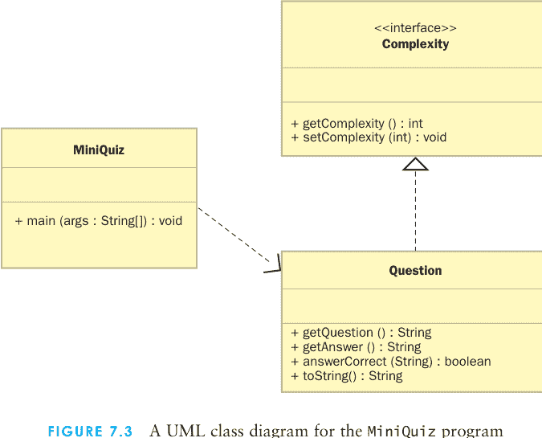

根据接口文档说明，如果 `obj1` 小于 `obj2`，`compareTo` 方法返回的整数应该是负数；如果它们相等，则为 0；如果 `obj1` 大于 `obj2`，则为正数。每个类的设计者需要决定该类的某一个对象“小于”、“等于”或“大于”另一个对象具体意味着什么。

在第 5 章中，我们提到 `String` 类包含一个以这种方式运行的 `compareTo` 方法。现在我们可以明确，`String` 类拥有此方法是因为它实现了 `Comparable` 接口。`String` 类对该方法的实现基于 Unicode 字符集定义的字典序。

## Iterator 接口

`Iterator` 是另一个定义在 Java 标准类库中的接口。它被表示对象集合的类使用，提供了一种逐个对象遍历集合的方法。

在第 5 章中，我们定义了迭代器的概念，使用循环处理集合中的所有元素。大多数迭代器（包括 `Scanner` 类的对象）都是使用 `Iterator` 接口定义的。

`Iterator` 接口中的两个主要方法是 `hasNext()`（返回布尔值结果）和 `next()`（返回一个对象）。这两个方法都不接受任何参数。`hasNext` 方法判断是否有剩余待处理的内容，`next` 返回下一个对象。实现 `Iterator` 接口的类设计者决定方法交付对象的顺序。

我们应该注意，根据接口的本意，`next` 方法不会从底层集合中移除对象；它返回该对象的引用。`Iterator` 接口有一个 `remove` 方法，它不接受任何参数且返回类型为 `void`。调用 `remove` 方法会将最近一次由 `next` 方法返回的对象从底层集合中移除。

## 自测题（答案见附录 N）

- **SR 7.14** 类和接口之间的区别是什么？
- **SR 7.15** 定义一个名为 `Nameable` 的 Java 接口。实现此接口的类必须提供一个接受单个 String 参数的 `setName` 方法。
- **SR 7.16** 对或错？
    - a. 接口可以包含抽象方法，不包含其他任何内容。
    - b. 抽象方法是一个没有实现的方法。
    - c. 接口定义中包含的所有方法都是抽象的。
    - d. 实现接口的类只能定义接口中包含的方法方法。
    - e. 多个类可以实现同一个接口。
    - f. 一个类可以实现多个接口。
    - g. 所有实现接口的类都必须提供方法的精确定义。

## 7.6 重新回顾枚举类型

在第 3 章中，我们引入了枚举类型（enumer type）的概念，它定义了一种新的数据类型并列出了所有可能的值。我们给出了定义 `Season` 的示例，其声明如下：

```java
enum Season {winter, spring, summer, fall}
```


我们提到枚举类型是一种特殊的类，枚举类型值的实例就是对象。例如，值 `winter` 是 `Season` 类的一个对象。让我们进一步探讨这个概念。

假设我们如下声明一个 `Season` 类型的变量：

> **概念**
>
> 枚举类型的值是该类型的静态变量。

```java
time = Season;
```

因为枚举类型是一种特殊的类，所以变量 `time` 是引用变量。此外，作为枚举类型，它只能被赋值为 `Season` 定义中列出的值。这些值（`winter`、`spring`、`summer` 和 `fall`）实际上是存储在 `Season` 类中的公共静态变量的引用。我们可以如下赋值：

现在让我们完善这个想法。在列表 7.11 中，我们重新定义了 `Season` 类型，赋予了它更丰富的定义。注意我们使用 `enum` 关键字来声明枚举类型，并且仍然列出了类型所有可能的值。此外，在这个定义中，我们添加了一个私有的 `String span`、一个 `Season` 类的构造函数以及名为 `getSpan` 的方法。枚举类型值列表中的每个值调用构造函数，传递一个字符字符串，该字符串随后存储在每个值的 `span` 变量中。

### 代码列表 7.11

```java
// *****************************************************************
// Season.java      Author: Lewis/Lo
// 枚举 Season 的值。
// *****************************************************************
public enum Season
{
    winter("December through February
```

### 7.6 重新回顾枚举类型 331

```java
LISTING 7.11 续
//------------------------------------
// 构造函数：为每个值关联一个字符串。
//
Season (String months)
{
    span = months;
}
//
 返回该值的跨度消息。
//
public String getSpan()
{
    return span;
}
```

如列表 7.12 所示的 `SeasonTester` 类的 `main` 方法打印 `Season` 枚举类型的每个值，以及每个值的跨度语句。每个枚举类型都包含一个名为 `values` 的静态方法，返回返回该类型所有可能值的列表。该列表是一个迭代器，因此我们可以使用增强版本的 `for` 循环来处理每个值。

### 代码列表 7.12

```java
****************************************************************
// SeasonTester.java    Author: Lewis/Loft
// 展示了完整枚举类型的使用。
****************************************************************
public class SeasonTester
{
    // 遍历 Season 枚举类型的值。
    //------------------------------------------------n
    public static void main(String[] args)
{
}
```

* avavaxome.ws/blogs/ChrisRedfield

### LISTING 7.12 续

```java
for (Season time : Season.values()) {
    System.out.println(time + "\t" + time.getSpan());
}
```

#### 输出

```text
冬季 12月至2月
春季 3月至5月
夏季 6月至8月
秋季 9月至11月
```

### 核心概念

除了每个枚举类型中定义的可能值列表外，我们还可以包含我们自己选择的任意数量的属性或方法。这为创新的类设计提供了各种机会。

## 自测题 *(答案见附录 N)*

**SR 7.17** 使用本节中定义的 `Season` 类型，以下代码序列的输出结果是什么？

```java
Season time1, time2;
time1 = Season.winter;
time2 = Season.summer;
System.out.println(time1);
System.out.println(time2.name());
System.out.println(time1.ordinal());
System.out.println(time2.getSpan());
```

## 7.7 方法设计

一旦你确定了类并分配了基本职责，每个方法的设计将决定类具体如何定义其行为。方法是直观的，不需要过多思考。其他方法则更有趣，需要仔细的规划。

算法是解决问题的逐步过程。食谱就是算法的一个示例。旅行路线是另一个算法的示例。每个方法都实现了一个决定该方法如何实现目标的算法。

算法通常使用伪代码来描述，伪代码是代码语句和英语短语的混合体。伪代码提供了足够的结构来展示代码将如何运行，而不会陷入特定编程语言的语法细节中，也不会过早地受到特定编程构造特征的限制。

本节讨论了方法层级程序设计的两个重要方面：方法分解以及将对象作为参数传递的影响。

### 方法分解

有时，对象提供的服务非常复杂，以无法通过一个方法可靠地实现。因此，我们有时需要将一个方法分解为多个方法，以创建一个更易理解的设计。例如，让我们考虑一个将英语句子翻译为皮格语（Pig Latin）的程序。

皮格语是一种虚构的语言，句子中的每个单词通常通过将单词的首字母移到末尾并加上“ay”音来修改。例如，单词 `happy` 会写成 `appihay`，单词 `birthday` 会写成 `irthdaybay`。以元音开头的单词在末尾添加 `ay` 如 `enoughay`。单词开头的辅音组合（如“ch”和“st”）在添加“ay”音之前移到末尾。因此，单词 `grapefruit` 变成 `apefruitgray`。

列表 7.13 所示的 `PigLatin` 程序读取一个或多个句子，翻译每个皮格语。

`PigLatin` 程序的内核是列表 7.14 所示的 `PigTranslator` 类。`PigTranslator` 类提供了一个基本服务，即静态方法 `translate`，它接受一个字符串并将其翻译成皮格语。注意，`PigTranslator` 类不需要构造函数，因为不需要。

> **核心概念**
>
> 对象提供的复杂服务可以分解为使用私有的辅助方法。

### 代码列表 7.13

```java
****************************************************************************************************************************************************
// PigLatin.java Author: Lewis/Loftus
//
// 展示了方法分解的概念。
****************************************************************************************************************************************************

import java.util.Scanner;
```

### 第 7 章 面对象设计

### LISTING 7.13 续

```java
public class PigLatin {
    // 读取句子并将其翻译为皮格语。
    public static void main(String[] args) {
        String sentence, result, another;

        Scanner scan = new Scanner(System.in);
        do {
            System.out.println();
            System.out.println("输入句子（无标点）：");
            sentence = scan.nextLine();

            System.out.println();
            result = PigTranslator.translate(sentence);
            System.out.println("皮格语为：");
            System.out.println(result);

            System.out.println();
            System.out.print("还要翻译句子吗(y/n)? ");
            another = scan.nextLine();
        } while (another.equalsIgnoreCase("y"));
    }
```

#### 输出

```text
输入句子（无标点）：
皮格语为：
还要翻译句子吗(y/n)? y
输入句子（无标点）：
皮格语为：
还要翻译句子吗(y/n)? n
```

### 代码列表 7.14


```java
************************************************
// PigTranslator.java      Author: Lewis/Loftus
// 将英语翻译成皮格语。
// 方法分解。
************************************************
import java.util.Scanner;

public class PigTranslator {
    // 将句子翻译成皮格语。
    public static String translate(String sentence) {
        String result = "";
        sentence = sentence.toLowerCase();
        Scanner scan = new Scanner(sentence);
        while (scan.hasNext()) {
            result += translateWord(scan.next()) + " ";
        }
        return result;
    }

    // 将单词翻译成皮格语。如果单词以
    // 元音开头，则在末尾加上“yay”。否则，
    // 将第一个或两个字母移到末尾，
    // 并加上“ay”。
    private static String translateWord(String word) {
        String result = "";
        if (beginsWithVowel(word))
            result = word + "yay";
        else
            if (beginsWithBlend(word))
                result = word.substring(2) + word.substring(0,2) + "ay";
            else
                result = word.substring(1) + word.charAt(0) + "ay";
        return result;
    }

    // 判断单词是否以元音开头。
    private static boolean beginsWithVowel(String word) {
        String vowels = "aeiou";
        char letter = word.charAt(0);
        return (vowels.indexOf(letter) != -1);
    }

    // 判断单词是否以特定的
    // 两个字母辅音组合开头。
    private static boolean beginsWithBlend(String word) {
        return (word.startsWith("bl") | word.startsWith("sc") | |
                word.startsWith("br") | word.startsWith("sh") | |
                word.startsWith("ch") | word.startsWith("sk") | |
                word.startsWith("cl") | word.startsWith("sl") | |
                word.startsWith("cr") | word.startsWith("sn") | |
                word.startsWith("gr") | word.startsWith("sm") | |
                word.startsWith("fl") | word.startsWith("sp") | |
                word.startsWith("fr") | word.startsWith("st") | |
                word.startsWith("gl") | word.startsWith("sw") | |
                word.startsWith("gr") | word.startsWith("th") | |
                word.startsWith("kl") | word.startsWith("tr") | |
                word.startsWith("ph") | word.startsWith("tw") | |
                word.startsWith("pl") | word.startsWith("wh") | |
                word.startsWith("pr") | word.startsWith("wr") );
    }
}
```

# 第 7 章 面向对象设计

将整个句子翻译成 Pig Latin 语并非易事。如果将其写在一个大方法中，它将变得非常长且难以维护。更好的解决方案是在 `PigLatinTranslator` 类中实现，对 `translate` 方法进行分解，并使用其他辅助方法来协助完成任务。

`translate` 方法使用 `Scanner` 对象将字符串拆分为单词。回想一下，`Scanner` 类的功能之一（在第 3 章中讨论过）是将字符串拆分为称为“标记”（tokens）的较小元素。在这种情况下，标记由空格字符分隔，因此我们可以使用默认的空格分隔符。`PigLatin` 程序假设输入中包含了标点符号。

`translate` 方法将每个单词传递给辅助方法 `translateWord`。连接一个单词的工作相当复杂，因此 `translate` 方法使用了另外两个方法：`beginsWithVowel` 和 `beginsWithBlend`。

`beginsWithVowel` 返回一个布尔值，表示作为参数传递的单词是否包含元音。该方法没有单独检查每个元音，而是声明了一个包含所有元音的字符串，并调用 `String` 的 `indexOf` 方法来确定单词的第一个字符是否在元音中。如果没有找到指定的字符，`indexOf` 返回值为 -1。

`beginsWithBlend` 也返回一个布尔值。该方法体只包含一个返回语句，其中包含一个调用 `String` 类 `startsWith` 方法的大型表达式。如果这些用例中的任何一个返回 `true`，则 `beginsWithBlend` 方法返回 `true`。

注意，`translateWord`、`beginsWithVowel` 和 `beginsWithBlend` 方法都声明为 `private` 可见。它们并不是为了直接为类外的客户端提供服务。相反，它们是为了帮助 `translate` 方法，而这是类中唯一真正的服务。通过将它们声明为 `private`，无法从类外调用它们。例如，如果 `PigLatin` 类的 `main` 方法尝试调用 `translateWord`，编译器将发出错误信息。

图 7.4 显示了 PigLatin 程序的 UML 类图。注意显示各种方法可见性的符号表示。

| PigLatin | PigLatinTranslator |
| :--- | :--- |
| + main (args : String[]) : void | + translate (sentence : String) : String |
| | - translateWord (word) : String |
| | - beginsWithVowel (word) : String |
| | - beginsWithBlend (word : String) : boolean |

图 7.4 PigLatin 程序的 UML 类图

## 方法参数回顾

与方法设计相关的另一个重要问题涉及参数传递方法的方式。在 Java 中，所有参数都是按值传递的。这意味着实际参数（调用时）的当前值被复制到方法头中的形式参数中。我们在第 4 章中提到过这一点；让我们详细检查一下它。

本质上，参数传递类似于赋值语句，将实际参数中存储的值的副本赋值给形式参数。在方法内部更改形式参数时，必须考虑这一点。形式参数是传递的值的独立副本，因此对其进行的任何更改对实际参数都没有影响。当控制权返回到调用方法后，实际参数的值将与调用方法前的值相同。

然而，当我们向方法传递一个对象时，我们实际上传递的是该对象的引用。被复制的值是该对象的地址。因此，形式参数和实际参数变成了别名。如果我们通过内部的形式参数引用更改了对象的状态，那么我们就是在更改实际参数所引用的对象，因为它们引用同一个对象。如果我们更改形式参数本身（使其指向一个新的对象实例），则我们没有更改实际参数。

> **核心概念**
>
> 当我们向方法传递一个对象时，我们实际上传递的是该对象的引用。
>
> 被复制的值是该对象的地址。因此，形式参数和实际参数变成了别名。
>
> 如果我们通过内部的形式参数引用更改了对象的状态，那么我们就是在更改实际参数所引用的对象，因为它们引用同一个对象。
>
> 如果我们更改形式参数本身（使其指向一个新的对象实例），我们没有更改实际参数；它仍然指向原始对象。

程序 7.15 展示了参数传递的细微差别。

> 仔细跟踪输出并注意不同类型传递的影响。

### 列表 7.15

```java
**************************************************
// ParameterTester.java Author: Lewis
// 展示参数传递的影响。
**************************************************
public class ParameterTester {
    // 设置三个变量：一个基本类型和两个对象。
    public static void main(String[] args) {
        int f1 = 10;
        Modifier m1 = new Modifier();
        Modifier m2 = new Modifier();

        System.out.println("Before changeValues:");
        System.out.println("f1 = " + f1);
        System.out.println("m1 = " + m1);
        System.out.println("m2 = " + m2);

        changeValues(f1, m1, m2);

        System.out.println("\nAfter changeValues:");
        System.out.println("f1 = " + f1);
        System.out.println("m1 = " + m1);
        System.out.println("m2 = " + m2);
    }

    public static void changeValues(int f1, Modifier m1, Modifier m2) {
        f1 = 20;
        m1.setValue(20);
        m2 = new Modifier();
    }
}
```

#### 输出

```text
Before changeValues:
f1 = 10
m1 = Modifier@value=0
m2 = Modifier@value=0

After changeValues:
f1 = 10
m1 = Modifier@value=20
m2 = Modifier@value=0
```

### 列表 7.16

```java
**************************************************
// Modifier.java Author: Lewis
// 代表一个整数的类。
**************************************************
public class Modifier {
    private int value;

    // 设置新对象，存储初始值。
    public Modifier() {
        value = 0;
    }

    // 将存储的值设置为新指定的值。
    public void setValue(int update) {
        value = update;
    }

    // 返回存储的整数的字符串。
    public String toString() {
        return "Modifier@value=" + value;
    }
}
```

### 列表 7.17

```java
**************************************************
// Num.java Author: LewisLoftus
// 代表一个整数的类。
**************************************************
public class Num {
    private int value;

    // 设置新对象，存储初始值。
    public Num(int update) {
        value = update;
    }

    // 将存储的值设置为新指定的值。
    public void setValue(int update) {
        value = update;
    }

    // 返回存储的整数的字符串。
    public String toString() {
        return value + "";
    }
}
```

方法返回时，因为形式参数已被销毁，且所引用的 `Num` 对象已被标记为待垃圾回收。唯一“永久”的改变是对第二个参数状态的修改。图 7.5 显示了该程序的处理步骤。

#### 第 1 步

在调用 `changeValues` 之前

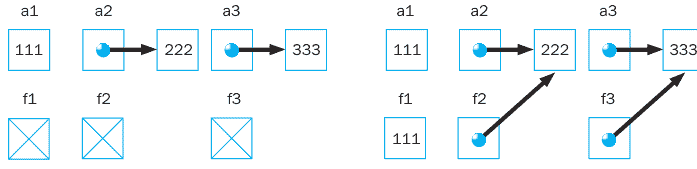

#### 第 2 步

`tester.changeValues(a1, a2, a3);`

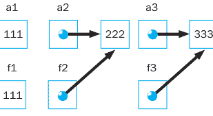

#### 第 3 步

`f1 = 999;`

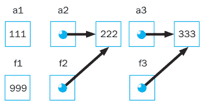

#### 第 4 步

`f2.setValues(888);`

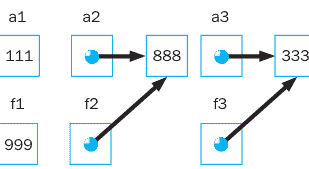

#### 第 5 步

`f3 = new Num(777);`

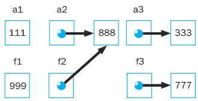

#### 第 6 步

从 `changeValues` 返回后

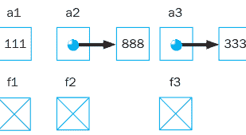

= Undefined

图 7.5 追踪 ParameterTesting 程序中的参数

## 7.8 方法重载

自测习题（答案见附录 N）

**SR 7.18** 什么是方法分解？

**SR 7.19** 关于 `PigLatinTranslator` 类回答以下问题：

- a. 没有定义构造函数。为什么不定义？
- b. 定义的方法中某些是私有的。为什么？
- c. `translate` 方法中声明了一个 `Scanner` 对象。它被用来扫描什么？

**SR 7.20** 识别当使用以下实际参数调用 `translate` 时，`PigLatinTranslator` 支持方法产生的调用/返回结果序列。

- a. `"animal"`
- b. `"hello"`
- c. `"We are the champions"`

**SR 7.21** 对象是如何作为参数传递的？

正如我们讨论过的，当一个方法被调用时，控制流转移到定义该方法的代码处。方法执行后，控制返回到调用位置并继续处理。

通常，方法名就足以指示特定调用执行的是哪个方法。但在 Java 中，与其他其它面向对象的语言一样，你可以为多个对象使用具有不同参数列表相同方法名。这种技术被称为**方法重载**。当你需要对不同类型的数据执行相似的方法时，这种技术非常非常有用。

编译器仍然必须将每次调用与特定的方法声明关联。如果两个或多个方法的名称相同，则使用额外信息来唯一标识被调用的版本。在 Java 中，只要参数的数量、类型和顺序不同，同一个方法名就可以用于多个用途。例如，我们可以如下定义一个方法 `sum`：

> **核心概念**
>
> 重载方法的版本通过其参数的数量、类型和顺序来区分。

```java
public int sum(int num1, int num2) {
    return num1 + num2;
}
```

然后我们可以在同一个类中声明另一个名为 `sum` 的方法，如下：

```java
public int sum(int num1, int num2, int num3) {
    return num1 + num2 + num3;
}
```

现在，当进行调用时，编译器会查看参数的数量来决定调用哪个版本的 `sum` 方法。例如，以下调用将调用 `sum` 方法的第二个版本：

`sum(25, 69, 13);`


# 方法签名与重载

方法的名称以及其参数的数量、类型和顺序被称为方法的**方法签名**（method signature）。编译器使用完整的方法签名将方法调用绑定到适当的定义上。

编译器必须能够检查方法调用以确定正在调用的是哪个具体方法。如果你尝试指定两个签名相同的方法名，编译器将发出相应的错误信息并且不会创建可执行程序。不能有任何歧义。

注意，方法的返回类型不是方法签名的一部分；因此，两个重载方法不能仅通过返回类型来区分。这是因为方法返回的值可以被调用忽略。在这种情况下，编译器将无法区分引用的是哪个版本的重载方法。

`println` 方法是一个被重载多次的方法示例，每个版本接受不同的类型。以下是其各种签名的部分列表：

- `println(String s)`
- `println(int i)`
- `println(double d)`
- `println(char c)`
- `println(boolean b)`

以下代码行实际上调用了：

```java
System.out.println("Number of students: " + count);
```

第一行调用了接受 `String` 参数的 `println` 版本：

```java
System.out.println(count);
```

第二行调用了接受 `int` 参数的版本。编译器使用完整的方法签名将方法调用绑定到合适的定义。

# 7.9 测试

测试术语可以应用于软件。测试的目标是发现错误。通过发现错误，我们提高了程序的质量。越早发现错误，修复起来就越容易且越便宜。

> **核心概念**
>
> 测试程序永远无法保证没有错误。

使用特定的输入运行程序只能证明它对这些输入是有效的。可以证明程序是正确的，但这种技术对于大型系统来说极其复杂，而且证明本身可能出错。因此，我们通常依赖测试来确定存在错误。确定存在错误后，我们确定错误的原因并修复。如果修复了问题，我们会运行之前的测试以确保在修复问题时没有引入另一个错误。这种技术被称为**回归测试**（regression testing）。

## 评审

用于评估设计或代码的技术称为**评审**（review），它是由几个人仔细检查设计文档或代码的会议。将我们的设计或代码展示给他人让我们仔细思考，并允许他人向我们分享建议。参与者讨论其优缺点，创建一个必须解决的问题列表。设计评审应该确定需求是否得到了解决。它应该评估系统如何分解为类和对象。代码评审应该确定设计是否忠实于需求，以及实现是否忠实于设计。

有时评审被称为**演练**（walkthrough），因为其目标是仔细遍历文档并评估每个部分。

## 测试策略

通过发现并修复存在的错误来提高程序的可靠性，而不是让用户去发现这些错误。

一个**测试用例**（test case）由一组输入、用户操作或其他初始条件以及预期的输出组成。测试用例应该经过适当的记录，以便以后根据需要重复执行。开发者通常会创建一个完整的**测试套件**（test suite），这是一组涵盖系统各个方面的测试用例。

由于程序运行在大量可能的输入上，因此为所有可能的输入或用户操作创建测试用例是不可行的。测试每一种情况也是没有必要的。如果两个特定的测试用例具有相似性，它们就不会涵盖程序的独特方面，这样做将是徒劳无功。我们宁愿执行一个能够以某种新方式压力程序的测试。因此，我们需要精心选择自己的测试用例。为此，让我们检查设计测试的两种方法：黑盒测试和白盒测试。

### 黑盒测试

顾名思义，黑盒测试将被测对象视为一个黑箱。在黑盒测试中，开发测试用例时不考虑内部工作机制。黑盒测试基于输入和输出。整个程序都可以使用黑盒技术进行测试，在这种情况下，输入是用户提供的信息和用户操作（如按钮点击）。只有当输入产生预期输出时，测试用例才成功。单个类也可以使用黑盒技术进行测试，该技术侧重于类的公共接口（包括公共方法）。传入某些参数会产生特定的结果。黑盒测试用例通常直接源于系统需求或方法的陈述目的。

黑盒测试用例的输入数据通常通过定义**等价类**（equivalence categories）来选择。等价类是预期产生相似输出的输入集合。通常，如果一个方法对其中一个输入有效，它对其他输入也有效。例如，计算整数平方根的输入可以分为两个等价类：非负整数和负整数。如果它对一个非负值有效，那么它可能对所有非负值都有效。同样，如果它对一个负值有效，它可能对所有负值也有效。

等价类具有定义的边界。由于等价类中的所有值本质上都在测试程序的同一特性，因此在等价边界内只需要一个测试用例。然而，由于编程容易产生“差一”（off-by-one）错误，对边界及周围的值应该进行详尽测试。对于整数边界，一个良好的测试套件应至少包含边界的精确值、边界减 1 的值以及边界加 1 的值。应该定义使用这些情况（且至少一个在类别通用范围内）的测试用例。

让我们来看一个例子。考虑一个目的是验证特定输入值是否在 0 到 99（包含边界）范围内的方法。在这种情况下有三类：小于 0 的值、0 到 99 之间的值以及大于 99 的值。黑盒测试要求我们测试边界周围和边界上的值，以及等价类中的一些通用值。因此，这种情况的一组黑盒测试用例可能是：-500、-1、0、1、50、98、99、100 和 500。

### 白盒测试

白盒测试也称为玻璃盒测试，它练习方法的内部结构和实现。白盒测试基于代码逻辑。目标是确保程序中的每条路径至少执行一次。白盒测试映射代码中所有可能的路径，并确保测试用例涵盖了所有要执行的路径。这种测试通常是语句覆盖（statement coverage）。

路径由使用条件表达式（如 `if`）的各种流语句控制。为了让程序中的每条路径至少执行一次，测试用例的输入数据需要控制条件表达式。一个或多个测试用例的输入数据应该控制 `if` 语句条件，使其至少在一种情况下为真，至少在一种情况下为假。覆盖 `if` 语句中的真、假值可以保证通过 `if` 语句的两条路径都将被执行。循环和其他结构也可以创建类似的情况。

在黑盒测试和白盒测试中，每个测试的预期输出应在运行测试之前建立。如果你先确定了结果应该是什么，就很容易判断测试结果是否恰当。

## 自测问题（答案见附录 N）

**SR 7.25** 从以下列表中选择与每个短语最匹配的术语：黑盒、缺陷、回归、评审、用例、测试套件、走查、白盒

- 在对程序进行更改后运行之前的测试用例，以帮助确保更改没有引入错误。
- 几个人共同评估一个产物的会议。
- 一种仔细检查文档并评估每个部分的评审。
- 测试的目标是发现这些东西。
- 对被测试代码单元的输入及相应的预期输出的描述。
- 一组涵盖系统各个方面的测试用例。
- 在使用这种测试方法时，测试用例完全基于需求规范。
- 在使用这种测试方法时，测试用例基于程序的内部工作机制。

# 7.10 GUI 设计

当我们关注允许我们创建 GUI 的细节时，有时可能会忽略大局。在我们继续探索 GUI 构造时，我们应该记住我们的目标是解决问题。具体来说，我们想要创建实用的软件。了解组件、事件和其他语言元素的细节为我们提供了组装 GUI 的工具，但我们必须根据良好 GUI 设计的以下基本思想来引导知识：

- 了解用户。
- 防止用户错误。
- 优化用户能力。
- 保持一致性。

> **核心概念**
>
> 任何 GUI 设计都应该遵循关于一致性和可用性的基本指南。

软件设计人员必须理解用户的需求和潜在活动，以便开发出良好服务该用户的界面。记住，对用户来说，界面就是软件。它是用户与系统交互的唯一方式。因此，界面必须满足用户的需求。

尽可能，我们应该设计界面让使用户少犯错。在许多情况下，我们有灵活选择几个组件之一来完成特定任务。我们应该始终尝试选择防止不当操作的组件。例如，一组单选按钮（radio buttons）比允许用户输入任意数据的文本框更好。

并不是所有用户都一样。有些人比其他人更熟练。使用快捷键（记忆符）对于经验用户来说是一个很好的例子。

最后，在处理大型系统或多个系统时，一致性非常重要。用户会熟悉特定的组织或配色方案；这些不应该被改变。

## 自测问题（答案见附录 N）

**SR 7.26** 本节介绍了哪些 GUI 设计通用指南？

**SR 7.27** 为什么良好的界面设计如此重要？

# 7.11 布局管理器

除了构成 GUI 骨架的组件、事件和监听器外，设计中最重要的活动是使用布局管理器。布局管理器是一个规定组件在容器中排列方式的对象。它决定每个组件的大小和位置，并可能考虑许多因素。每个容器都有默认的布局管理器，但如果我们愿意，也可以替换它。

> 每当容器的内容可能需要更改视觉外观时，容器的布局管理器就会被咨询。例如，当调整容器大小时，会咨询布局管理器以确定容器中所有组件应该如何显示。每当向容器添加一个组件时，布局管理器都会确定该添加如何影响所有现有组件。

我们可以使用容器的 `setLayout` 方法来更改其布局管理器。我们在之前的示例中已经这样做过几次。例如，以下代码设置了 `JPanel` 的布局管理器，它默认使用流式布局，但这里改为使用边界布局：

```java
JPanel panel = new JPanel();
panel.setLayout(new BorderLayout());
```

## 预定义的 Java 布局管理器

| 布局管理器 | 说明 |
| :--- | :--- |
| 边界布局 (`BorderLayout`) | 将组件组织为五个区域（北、南、东、西和中心）。 |
| 箱体布局 (`BoxLayout`) | 将组件组织为单行或单列。 |
| 卡片布局 (`CardLayout`) | 将组件组织在一个区域内，使得任何时间只有一个组件可见。 |
| 流式布局 (`FlowLayout`) | 从左到右组织组件，必要时开始新行。 |
| 网格布局 (`GridLayout`) | 将组件组织为行和列组成的网格。 |
| 网格包布局 (`GridBagLayout`) | 将组件组织为单元格网格，允许组件跨越多个单元格。 |

让我们更详细地探索这些管理器。目前我们重点关注最流行的布局管理器：流式、边界、箱体和网格。列表 7.18 中提供的类包含一个 `main` 方法，演示了这些布局管理器的用法和效果。

## LayoutDemo 程序

`LayoutDemo` 程序引入了标签页（tabbed pane），这是一种允许用户（通过点击标签）选择多个面板中哪一个可见的容器。标签页由 `JTabbedPane` 类定义。`addTab` 方法创建一个标签，并指定在标签上显示的名称以及当该面板通过被“置于顶层”获得焦点并对用户可见时要显示的组件。

有趣的是，标签页和卡片布局管理器之间在功能上存在重叠。与标签页类似，卡片布局允许显示多个层级，但在任何给定点只显示其中一个。然而，由卡片布局管理的容器只能在程序控制下进行调整，而标签页则允许用户直接指示应该显示哪个标签。

在例子中，标签页的每个标签都包含一个由不同布局管理器控制的面板。第一个标签仅包含一个带有介绍消息的面板，如列表 7.19 所示。当我们更详细探索每个布局管理器时，我们将检查定义该程序对应面板的类，并讨论其视觉效果。

### 列表 7.18 `LayoutDemo.java`

```java
//********************************************************************
// Author: Lewis/Loftus
// LayoutDemo.java
// 演示了流式、边界、网格和箱体布局的用法。
//********************************************************************
import javax.swing.*;

public class LayoutDemo
{
    // 设置一个包含标签页的帧。每个标签上的面板
    // 演示了不同的布局管理器。
    //********************************************************************
    public static void main(String[] args) {
        JFrame frame = new JFrame("Layout Manager Demo");
        frame.setDefaultCloseOperation(JFrame.EXIT_ON_CLOSE);

        JTabbedPane tp = new JTabbedPane();
        tp.addTab("Intro", new IntroPanel());
        tp.addTab("Flow", new FlowPanel());
        tp.addTab("Border", new BorderPanel());
        tp.addTab("Grid", new GridPanel());
        tp.addTab("Box", new BoxPanel());

        frame.getContentPane().add(tp);
        frame.pack();
        frame.setVisible(true);
    }
}
```

## 流式布局

流式布局是最易于使用的布局管理器之一。`JPanel` 类默认使用流式布局。流式布局尽可能将多个组件放在一行中，并保持其首选大小。当组件无法放入一行时，它会被放在下一行。根据需要创建若干行。

### 列表 7.19 `IntroPanel.java`

```java
// *************************************************
// IntroPanel.java
// Author: Lewis/Loftus
// 代表 LayoutDemo 程序的介绍面板。
// *************************************************
import java.awt.*;
import javax.swing.*;

public class IntroPanel extends JPanel {

    // 设置此带有两个标签的面板。
    public IntroPanel() {
        setBackground(Color.green);

        JLabel l11 = new JLabel("Layout Demonstration");
        JLabel l12 = new JLabel("Choose a tab to see an example of the layout manager.");

        add(l11);
        add(l12);
    }
}
```

### 列表 7.20 `FlowPanel.java`

```java
// *****************************************************************
// FlowPanel.java
// Author: Lewis/Loftus
// 代表 LayoutDemo 程序中演示流式布局的面板。
// *****************************************************************
import java.awt.*;
import javax.swing.*;

public class FlowPanel extends JPanel {

    // 设置此带有一些按钮的面板
    public FlowPanel() {
        setLayout(new FlowLayout());
        setBackground(Color.green);

        JButton b1 = new JButton("Button 1");
        JButton b2 = new JButton("Button 2");
        JButton b3 = new JButton("Button 3");
        JButton b4 = new JButton("Button 4");
        JButton b5 = new JButton("Button 5");

        add(b1);
        add(b2);
        add(b3);
        add(b4);
        add(b5);
    }
}
```

### 列表 7.21


*****************************************************************
// Author: Lewis/Loftus
// BorderPanel.java
// 代表 LayoutDemo 程序中的面板，该程序演示了
// 布局布局。
*****************************************************************
import java.awt.*;
import javax.swing.*;
public class `BorderPanel` extends `JPanel` {
  // 设置此面板，在边界布局的每个区域设置一个按钮，
  // 以显示它如何影响按钮的位置、形状和大小。
  //
  public `BorderPanel`() {
    `setLayout(new BorderLayout())`;

    `setBackground(Color.green)`;

    `JButton b1 = new JButton("BUTTON 1")`;
    `JButton b2 = new JButton("BUTTON 2")`;
    `JButton b3 = new JButton("BUTTON 3")`;
    `JButton b4 = new JButton("BUTTON 4")`;
    `JButton b5 = new JButton("BUTTON 5")`;

    `add(b1, BorderLayout.CENTER)`;
    `add(b2, BorderLayout.NORTH)`;
    `add(b3, BorderLayout.SOUTH)`;
    `add(b4, BorderLayout.EAST)`;
    `add(b5, BorderLayout.WEST)`;
  }
}
```

# 列表 7.21 继续


在 `BorderPanel` 构造函数中，面板的布局管理器显式指定为边界布局（border layout）。随后创建按钮并添加到特定区域。默认情况下，每个按钮的宽度足够容纳其标签，高度足够填充其分配的区域。随着框架（以及面板）的大小调整，每个按钮的大小都会根据需要进行调整，其中位于（Center）的按钮将填充所有未使用的空间。

边界布局中的每个区域只显示一个组件。也就是说，给定的边界布局的每个区域只能添加一个组件。一个常见的错误是在边界布局的特定区域添加两个组件，在这种情况下，先添加的组件会被第二个组件替换，且只有在容器显示时才会发生。要在边界布局的区域内添加多个组件，我们首先将组件添加到另一个容器（例如 `JPanel1`）中，然后将该面板添加到区域。

请注意，尽管用于显示的面板具有绿色背景，但在列表 7.21 的显示中并没有看到绿色。默认情况下，边界布局的区域之间没有水平或垂直间隙。这些间隙可以通过重载构造函数或 `BorderLayout` 类的显式方法来设置。如果增加了间隙，底层面板将显示出来。

图 7.9 网格布局创建了一个等大小单元格的矩形网格

# 列表 7.22

```
********************************************************************
// GridPanel.java    Author: Lewis/Loftus
// 代表 LayoutDemo 程序中的面板，该程序演示了
// 网格布局管理器。
//********************************************************************
import java.awt.*;
import javax.swing.*;

public class `GridPanel` extends `JPanel` {
{
    // 设置此面板的某些按钮，以显示网格
    // 布局如何影响它们的位置、形状和大小。
    //----------------------------------------------------------------------------------
    public `GridPanel`() {
        `setLayout(new GridLayout(2, 3))`;

        `setBackground(Color.green)`;

        `JButton b1 = new JButton("BUTTON 1")`;
        `JButton b2 = new JButton("BUTTON 2")`;
        `JButton b3 = new JButton("BUTTON 3")`;
        `JButton b4 = new JButton("BUTTON 4")`;
        `JButton b5 = new JButton("BUTTON 5")`;

        `add(b1)`;
        `add(b2)`;
        `add(b3)`;
        `add(b4)`;
        `add(b5)`;
    }
}
```

# 7.11 布局管理器 361

# 列表 7.2.2 继续

# 布局管理器演示


默认情况下，边界布局区域之间没有水平或垂直间隙。这些间隙可以通过重载构造函数或 `BorderLayout` 类的显式方法来设置。如果增加了间隙，底层面板将显示出来。

# 盒子布局 (Box Layout)


盒子布局按水平或垂直方向排列组件，如图 7.10 所示。它很容易使用，但与其他布局结合使用时，会变得复杂。

当创建一个 `BoxLayout` 对象时，我们必须为每个组件创建一个新的 `BoxLayout` 对象。列表 7.23 展示了用于 LayoutDemo 程序的面板布局。

由盒子布局控制的组件按照它们被添加到容器的顺序从上到下排列。盒子布局中没有间隙——与其他布局不同。不可见组件有两种类型：刚性区域（rigid areas），它们具有固定大小；以及胶（glue），它会根据需要扩展或收缩。`Box` 类是 Java 标准库的一部分，包含了创建这些的静态方法。

# 列表 7.2.3

```
****************************************************
// BoxPanel.java    Author: Lewis/Loftus
// 代表 LayoutDemo 程序中的面板，该程序演示了
// 盒子布局。
//************************************
import java.awt.*;
import javax.swing.*;

public class `BoxPanel` extends `JPanel` {

    // 设置此面板的某些按钮，以显示
    // 布局（以及不可见组件）如何影响它们的位置、形状和大小。
    //************************************************
    public `BoxPanel`() {
        `setLayout(new BoxLayout(this, BoxLayout.Y_AXIS))`;
        `setBackground(Color.green)`;

        `JButton b1 = new JButton("BUTTON 1")`;
        `JButton b2 = new JButton("BUTTON 2")`;
        `JButton b3 = new JButton("BUTTON 3")`;
        `JButton b4 = new JButton("BUTTON 4")`;
        `JButton b5 = new JButton("BUTTON 5")`;

        `add(b1)`;
        `add(Box.createRigidArea(new Dimension(0, 10)))`;
        `add(Box.createVerticalGlue())`;
        `add(b3)`;
        `add(b4)`;
        `add(Box.createRigidArea(new Dimension(0, 20)))`;
        `add(b5)`;
    }
}
```


# 7.12 边界

# 第 7 章 对象面向设计

# 列表 7.24

```java
********************************************************************
// BorderDemo.java      Author: Lewis/Loftus
// 演示了各种类型边框的使用。
//********************************************************************

import java.awt.*;
import javax.swing.*;
import javax.swing.border.*;

public class `BorderDemo`
{
    // 创建几个边界面板并显示它们。

    public static void `main(String[] args)`
    {
        `JFrame frame = new JFrame("BorderDemo")`;
        `frame.setDefaultCloseOperation(JFrame.EXIT_ON_CLOSE)`;

        `JPanel panel = new JPanel()`;
        `panel.setLayout(new GridLayout(0, 2, 5, 10))`;
        `panel.setBorder(BorderFactory.createEmptyBorder(8, 8, 8, 8))`;

        `JPanel p1 = new JPanel()`;
        `p1.setBorder(BorderFactory.createLineBorder(Color.red, 3))`;
        `p1.add(new JLabel("Line Border"))`;
        `panel.add(p1)`;

        `JPanel p2 = new JPanel()`;
        `p2.setBorder(BorderFactory.createEtchedBorder())`;
        `p2.add(new JLabel("Etched Border"))`;
        `panel.add(p2)`;

        `JPanel p3 = new JPanel()`;
        `p3.setBorder(BorderFactory.createRaisedBevelBorder())`;
        `p3.add(new JLabel("Raised Bevel Border"))`;
        `panel.add(p3)`;

        `JPanel p4 = new JPanel()`;
        `p4.setBorder(BorderFactory.createLoweredBevelBorder())`;
        `p4.add(new JLabel("Lowered Bevel Border"))`;
        `panel.add(p4)`;

        `JPanel p5 = new JPanel()`;
```

# 列表 7.24 续

```java
        `p5.setBorder(BorderFactory.createTitledBorder("Title"))`;
        `p5.add(new JLabel("Title Border"))`;
        `panel.add(p5)`;
```

```java
        `JPanel p6 = new JPanel()`;
        `TitledBorder tb = BorderFactory.createTitledBorder("Title")`;
        `tb.setTitleJustification(Border.RIGHT)`;
        `p6.setBorder(tb)`;
        `p6.add(new JLabel("Border right"))`;
        `panel.add(p6)`;
```

```java
        `JPanel p7 = new JPanel()`;
        `Border b1 = BorderFactory.createLineBorder(Color.blue, 2)`;
        `Border b2 = BorderFactory.createEtchedBorder(Border.ETCHED)`;
        `p7.setBorder(BorderFactory.createCompoundBorder(b1, b2))`;
        `p7.add(new JLabel("Compound Border"))`;
        `panel.add(p7)`;
```

```java
        `JPanel p8 = new JPanel()`;
        `Border mb = BorderFactory.createMatteBorder(1, 5, 1, 1, Color.red)`;
        `p8.setBorder(mb)`;
        `p8.add(new JLabel("Matte Border"))`;
        `panel.add(p8)`;
```

```java
        `frame.getContentPane().add(panel)`;
        `frame.pack()`;
        `frame.setVisible(true)`;
    }
}
```

让我们看看此程序中创建的每个类型的边框。空边框（empty border）应用于包含所有其他面板的大型面板上，以在框架外边缘创建一个空间缓冲区。空边框的顶、左、下、右边缘的大小以像素为单位。线边框（line border）使用特定颜色创建，并用像素指定线宽（本例中为 3）。如果未指定，则线宽默认为 1 像素。此程序创建的蚀刻边框（etched border）对高光和阴影使用默认颜色，但如果需要，也可以显式设置两者。

斜角框（bevel border）可以是凸起的或凹下的。程序使用了默认着色。如果需要，可以显式设置斜角框的颜色、高光和阴影。

标题边框（titled border）可以在其上放置标题。复合边框（compound border）是两个边框的组合。哑光边框（matte border）允许为四个边缘指定不同的颜色。

## 核心概念总结

- 投入在设计上的努力至关重要且具有成本效益。

- 问题描述中的名词可能指示程序中需要的某些类和对象。

- 静态变量被该类的所有实例共享。

- 聚合对象由其他对象组成，形成一种“包含（has-a）”的关系。

- 接口是抽象方法的集合，因此不能被实例化。

- 枚举类型的值是该类型的静态变量。

- 我们可以在枚举类型的定义中添加属性和方法。

- 对象所提供的复杂服务可以分解，以利用私有的辅助方法。

- 当将对象传递给方法时，实际参数和形式参数成为彼此的别名。

- 重载方法的版本通过其参数的数量、类型和顺序来区分。

- 测试程序永远无法保证没有错误。

- 一个好的测试是能够发现错误的测试。

- 对程序的所有可能的输入和用户操作进行穷尽测试的测试是不可行的。

- 任何 GUI 设计都应该遵循关于一致性和易用性的基本指南。

- 容器的布局管理器决定了组件的视觉呈现方式。

- 当发生变化时，容器中的组件将根据布局策略进行重新组织。

- 可以显式设置每个容器的布局管理器。

- 边界（Borders）可以应用于 Swing 组件以对对象分组并集中注意力。

- GUI 的外观是包含层次结构和每个容器布局管理器的函数。

# 练习

访问 www.myprogramminglab.com 在线完成这些许多练习题并获得即时反馈。

EX 7.1 编写一个名为 `average` 的方法，它接受两个整数参数，并将它们的平均值作为浮点值返回。

EX 7.2 重载练习题 7.1 中的 `average` 方法，使得如果提供了三个整数作为参数，该方法返回所有三个整数的平均值。

EX 7.3 重载练习题 7.1 中的 `average` 方法，使其接受四个整数参数并返回它们的平均值。

EX 7.4 编写一个名为 `multiConcat` 的方法，接受一个 String 和一个整数作为参数。返回一个由字符串参数与自身连接 `count` 次后组成的字符串，其中 `count` 是该整数参数。例如，如果参数值为 "hi" 和 4，返回值为 "hihihihi"。如果整数参数小于 2，则返回原始字符串。

EX 7.5 重载练习题 7.4 中的 `multiConcat` 方法，使得如果没有提供参数，该方法返回与自身连接的字符串。例如，如果参数为 "test"，返回值为 "testtest"。

EX 7.6 编写一个名为 `drawCircle` 的方法，根据方法的参数绘制一个圆：一个用于画圆的 `Graphics` 对象、两个表示圆心 (x, y) 坐标的整数值、另一个表示圆半径的整数，以及一个定义圆颜色的 `Color` 对象。该方法不返回任何内容。

EX 7.7 重载练习题 7.6 中的 `drawCircle` 方法，使得如果没有提供 `Color`，则圆的颜色将默认为黑色。


# EX 7.8 重载练习题 7.6 中的 `drawCircle` 方法

重载练习题 7.6 中的 `drawCircle` 方法，使得如果没有提供半径，则将使用 10 到 100（包含）范围内的随机半径。

# EX 7.9 重载练习题 7.6 中的 `drawCircle` 方法

重载练习题 7.6 中的 `drawCircle` 方法，使得圆的颜色和半径都未提供，颜色将默认为红色，半径将默认为 40。

# EX 7.10 讨论 Java 向方法传递参数的方式

讨论 Java 向方法传递参数的方式。这种技术在基本类型和对象之间是一致的吗？请解释。

# 第 7 章 面向对象设计

# EX 7.11 解释为什么静态方法不能引用实例变量

解释为什么静态方法不能引用实例变量。

# EX 7.12 一个类可以实现两个包含相同方法签名的接口吗？

一个类可以实现两个包含相同方法签名的接口吗？解释。

# EX 7.13 创建一个名为 `Visible` 的接口

创建一个名为 `Visible` 的接口，它包含两个方法：`makeVisible` 和 `makeInvisible`。这两个方法都不应该接受参数并返回一个布尔结果。描述类如何实现此接口。

# EX 7.14 绘制一个 UML 类图

绘制一个 UML 类图，显示练习题 7.3 中元素之间的关系。

# EX 7.15 创建一个名为 `Breakable` 的接口

想象一个游戏，其中某些元素可以损坏而另一些不能。创建一个名为 `Breakable` 的接口，它有一个不接受参数的方法 `break`，并返回一个指示该对象是否损坏的布尔值。

# EX 7.16 创建一个名为 `VCR` 的接口

创建一个名为 `VCR` 的接口，它有 `play`、`stop` 等方法。设计一个实现此接口的类。定义方法的签名。

# EX 7.17 绘制一个 UML 类图

绘制一个 UML 类图，显示练习题 7.16 中元素之间的关系。

# EX 7.18 绘制布局管理器的包含树

绘制布局管理器的包含树。

# EX 7.19 更改布局管理器中的水平和垂直间隙会产生什么影响？

更改布局管理器中的水平和垂直间隙会产生什么影响？

# EX 7.20 编写定义每个容器布局管理器的代码

编写定义每个容器布局管理器的代码。

## 编程项目

访问 www.myprogramminglab.com 在线完成这些许多编程项目并获得即时反馈。

# PP 7.1 修改第 4 章中的 `Student` 类

修改第 4 章中的 `Student` 类，使其也包含三个分数。提供一个根据参数设置所有实例值的构造函数。重载该构造函数，使得每个测试分数初始为零。提供一个名为 `setTestScore` 的方法，它接受两个参数：测试编号（1 到 3）和分数。还提供一个名为 `getTestScore` 的方法，它接受测试编号并返回分数。提供一个名为 `average` 的方法，计算该学生的平均测试分数。修改 `toString` 方法，使得描述中包含测试分数和平均值。修改驱动程序类以执行新的 Student 方法。

# PP 7.2 设计并实现一个名为 `Course` 的类

设计并实现一个名为 `Course` 的类，代表学校的一门课程。Course 对象应跟踪最多五个学生，由修改后的 `Student` 类表示。Course 类的构造函数仅接受课程名称。提供一个名为 `addStudent` 的方法接受一个参数（Course 对象应跟踪已添加多少学生）。提供一个名为 `average` 的方法，返回所有学生测试分数的平均值。提供一个名为 `roll` 的方法打印课程中的所有学生。创建一个带有 `main` 方法的驱动类，创建一个课程、添加几个学生、打印 roll 并打印课程平均分。

# PP 7.3 修改 `RationalNumber` 类以实现 `Comparable` 接口

修改 `RationalNumber` 类以实现 `Comparable` 接口。为了进行比较，从两个 RationalNumber 对象的分子和分母计算等效浮点值，然后使用 0.0001 的容差进行比较。编写一个主驱动程序来测试你的修改。

# PP 7.4 设计一个 Java 接口 `Priority`

设计一个 Java 接口 `Priority`，包含两个方法：`setPriority` 和 `getPriority`。该接口定义了对一组对象建立数值优先级的方法。设计并实现一个 `Task` 类来代表任务（如待办事项列表），并实现 `Priority` 接口。创建一个驱动程序类来练习一些 Task 对象。

# PP 7.5 修改 PP 7.4 中的 `Task` 类

修改 PP 7.4 中的 `Task` 类，使其也实现本章定义的 `Complexity` 接口。修改驱动类以展示这些 Task 对象的特性。

# PP 7.6 修改 PP 7.4 和 7.5 中的 `Task` 类

修改 PP 7.4 和 7.5 中的 `Task` 类，使其也实现 Java 标准类中的 `Comparable` 接口。

# PP 7.7 修改 PP 7.4、7.5 和 7.6 中的 `Task` 类

修改 PP 7.4、7.5 和 7.6 中的 `Task` 类，使其也实现 Java 标准库中的 `Comparable` 接口。实现接口，使任务按优先级排序。创建一个驱动类，其 `main` 方法用于显示 Task 对象的这些新功能。

# PP 7.8 设计一个名为 `Lockable` 的 Java 接口

设计一个名为 `Lockable` 的 Java 接口，包含以下方法：`setKey`、`lock`、`unlock` 和 `locked`。`setKey`、`lock` 和 `unlock` 方法接收一个整数参数，该参数代表密钥。`setKey` 方法用于建立密钥。`lock` 和 `unlock` 方法锁定和解锁对象，但前提是传递的密钥必须正确。`locked` 方法返回一个布尔值，指示对象是否被锁定。一个 `Lockable` 对象表示一个其普通方法受保护的对象：如果对象被锁定，则无法调用这些方法；如果已解锁，则可以调用。重新设计并实现第 5 章中的 `Coin` 类版本，使其实现 `Lockable`。

# PP 7.9 重新设计并实现第 4 章中的 `Account` 类版本

重新设计并实现第 4 章中的 `Account` 类版本，使其按照 PP 7.8 的定义实现 `Lockable`。

# PP 7.10 重新设计并实现 PigLatin 程序

重新设计并实现 PigLatin 程序，使其使用 GUI。使用文本字段接受句子，并使用标签显示结果。

# PP 7.11 修改 LayoutDemo 程序的 `IntroPanel` 类

修改 LayoutDemo 程序的 `IntroPanel` 类，使用箱布局管理器（box layout manager）。使用不可见组件在面板两个标签之前和之间留空。

# PP 7.12 修改第 5 章的 `QuoteOptions` 程序

修改第 5 章的 `QuoteOptions` 程序以更改其视觉外观。在引用标签左侧以垂直列形式呈现单选按钮，并带有边框。

# PP 7.13 设计并实现一个显示可能出现在手机上的数字键盘的程序

设计并实现一个显示可能出现在手机上的数字键盘的程序。在键盘按钮上方，显示一个标签，显示所选的数字。在键盘按钮右侧，包含另一个清除显示的按钮。使用边框布局（border layout）管理整体呈现，使用网格布局（grid layout）管理键盘按钮以进行视觉上的分组，并在显示器周围添加边框。

# PP 7.14 设计并实现一个帮助披萨店点点的应用程序

设计并实现一个帮助披萨店点点的应用程序。使用标签页（tabbed pane）区分不同的食物类别（披萨、饮料、特设）。收集有关数量和大小的信息。随着信息的收集，显示订单成本。使用适当组件收集各种类型的信息。使用包含层次结构和布局管理器仔细构建界面。

## 软件故障

# 2003年东北大停电

## 发生了什么？

2003年8月14日，美国历史上最大的停电袭击了美国东北部和加拿大部分地区。多个大都市受到影响，包括纽约、克利夫兰、底特律、多伦多和渥太华。在三分钟内，21座电厂关闭，影响了约500万人。


典型问题导致了停电区域。交通拥堵导致了交通问题。火车和电梯被困。机场延迟了航班。依赖电泵的水压仍然可用，手机使用受到干扰。（有线电话使用）互联网流量变慢，导致服务器崩溃以及尝试重试消息。报告了部分抢劫事件。

估计认为停电的总财务成本在40亿到80亿美元之间。有9人因与停电相关的各种原因去世。

- 停电前后的美国东北部。

## 是什么引起的？

在停电发生后的几个小时和几天内，许多问题的源头被指责。由于2001年9月11日袭击后意识提高，当局迅速排除了恐怖主义的可能性。整个影响地区的倒树和雷击被归于此。官员甚至提到当时正在流行的一种被迅速排除的——“Blaster”（爆炸病毒）计算机词汇。

在接下来的几个月里，一个工作小组理了这些问题。最初的情况确定发生在阿克隆（Akron），FirstEnergy 公司在那里必须保持线路处于适当的跳闸状态。2003年8月14日，树枝导致三条线路同时故障。当故障发生时，电力站的操作员……

## 经验训

# 数组

## 目标

- 定义并使用数组。
- 讨论边界检查。
- 讨论多维数组。
- 探索鼠标事件。
- 探索键盘事件。

## 8.1 数组元素

数组是一种简单但强大的语言结构，用于分组和组织数据。在编写管理大量信息的程序（例如100个名字的列表）时，为每条数据声明单独的变量是不现实的。数组通过让我们声明一个可以包含多个可单独访问值的变量来解决这个问题。

数组是值的列表。每个位置对应的数字被称为索引（index）或下标（subscript）。图8.1显示了一个整数数组以及每个位置对应的索引。该数组名为 `height`；它包含代表几个人身高（英寸）的整数。

在Java中，数组从0开始。因此，索引5处存储的值实际上是数组中的第六个值。图8.1所示数组有11个值，索引从0到10。

要访问数组中的值，我们使用数组名后跟方括号中的索引。例如，以下表达式引用数组中的第九个值：`height[8]`

根据图8.1，`height[8]`（读作 height-subeight）包含值79。不要将索引的值（在本例中为8）与数组中存储的值（在本例中为79）混淆。

| | height |
|---|---|
| 0 | 69 |
| 1 | 61 |
| 2 | 70 |
| 3 | 74 |
| 4 | 62 |
| 5 | 69 |
| 6 | 66 |
| 7 | 73 |
| 8 | 79 |
| 9 | 62 |
| 10 | 70 |

表达式 `height[8]` 指存储在特定内存位置的单个整数。它可以用于任何可以使用整数变量的地方。因此，你可以给它赋值，在计算中使用它，等等。此外，由于数组是整数类型，你可以使用表达式来指定访问数组的索引。以下代码行演示了这些概念：

```
height[2] = 72;
height[count] = feet * 12;
average = (height[0] + height[1] + height[2]) / 3;
System.out.println('The middle value is " + height[MAX/2]);
pick = height[randInt(11)];
```

数组连续存储在内存中，这意味着元素在内存中的存储方式紧密挨着，正如我们在概念上感知的那样。这使得通过索引访问任何元素的效率都极高。在内部，为了确定任何特定元素的地址，会将索引乘以每个元素的大小，并加上数组起始点的内存地址。这就是为什么数组索引从零开始的原因——为了让计算变得尽可能简单。从效率的角度来看，访问数组中的第 50 个元素与访问第一个元素一样简单。

### 自我复习题（答案见附录 N）

- SR 8.1 什么是数组？
- SR 8.2 数组的每个元素是如何引用的？
- SR 8.3 根据图 8.1 所示的数组，以下各项分别？
  - a. `height[1]`
  - b. `height[2] + height[5]`
  - c. `height[2 + 5]`
  - d. 存储在索引 8 处的值
  - e. 第四个值
  - f. `height.length`


## 8.2 声明和使用数组

在 Java 中，数组是对象。创建一个数组，必须声明数组的引用。可以使用 `new` 运算符实例化数组，这将分配内存来存储值。以下代码表示图 8.1 所示数组的声明：

```
int[] height = new int[11];
```

### 核心概念

在 Java 中，数组是一个必须实例化的对象。

变量 `height` 被声明为整数数组类型，写为 `int[]`。存储在数组中的所有值具有相同的类型（或至少是兼容的）。例如，我们可以创建一个存储整数的数组，也可以创建一个存储字符串的数组，但不能创建一个同时持有整数和字符串的数组。数组可以被设置为持有任何基本类型或对象（类）类型。存储在数组中的值有时被称为数组元素，数组中值的类型称为数组的元素类型。

### 代码列表 8.1

```java
// BasicArray.java      作者: Lewis/Loftus
// 演示了基本的数组声明和使用。
public class BasicArray {
    // 创建一个数组，用各种整数值填充它，
    // 修改一个值，然后打印它们。
    public static void main(String[] args) {
        final int LIMIT = 15, MULTIPLE = 10;
        int[] list = new int[LIMIT];
        // 初始化数组值
        for (int index = 0; index < LIMIT; index++)
            list[index] = index * MULTIPLE; // 修改一个数组值

        list[5] = 999; // 打印数组值
        for (int value : list)
            System.out.print(value + " ");
    }
}
```

### 输出

```
0 10 20 30 40 999 60 70 80 90 100 110 120 130 140
```

注意数组变量的类型 (`int[]`) 不包含数组的大小。使用 `new` 运算符实例化预留了内存空间来存储从 0 到 10 的 11 个整数。一旦数组被声明为特定大小，它能容纳的值就不能更改。

代码列表 8.1 中的示例创建了一个可以容纳 15 个整数的数组 `list`，并以 10 的增量加载了它。然后它更改了数组中第六个元素（索引 5）的值。最后，所有值都存储在数组中。

图 8.2 显示了数组在 `BasicArray` 程序执行期间的变化情况。在处理数组时，使用 `for` 循环通常很方便，因为数组中的位置数量是固定的。注意在 `BasicArray` 程序中多处使用了常量 `LIMIT`。该常量用于声明数组的大小，并控制初始化值的循环。

`for` 循环的迭代版本用于打印数组中的值。回想第 5 章，`for` 循环从指定的迭代器中提取每个值。每个数组都是迭代器，因此当我们想要处理数组中的每个元素时，可以使用这种类型。

### 边界检查

索引运算符执行自动边界检查，确保索引在引用的数组范围内。当对数组元素进行引用时，索引必须大于等于零且小于数组的大小。例如，假设有一个包含 25 个元素的数组。数组的有效索引为 0 到 24。每次进行引用（如 `prices[count]`）时都会进行检查。如果无效，将抛出一个名为 `ArrayIndexOutOfBoundsException` 的异常。

当然，在程序中我们希望执行自己的边界检查。也就是说，我们希望小心留在数组边界内，并处理我们想要处理的每个元素。由于数组索引从零开始，直到大小减一，很容易在程序中产生“差一错误”，即处理了多一个元素或尝试访问过多的一个元素。

检查数组边界的一种方法是使用 `length` 常量，该常量存储在数组对象中并存储数组的大小。它是一个公共常量，可以直接引用。例如，在创建包含 25 个元素的 `prices` 数组后，常量 `length` 包含 25。该值在数组首次创建时设置，无法更改。`length` 常量是每个数组不可或缺的一部分，当需要数组大小时可以使用，无需单独创建常量。记住数组的长度是最大索引是 `length-1`。


图 8.2 BasicArray 程序执行期间数组的变化


# 列表 8.2 续

```
数组的大小为: 10
输入数字 1: 18.36
输入数字 2: 48.9
输入数字 3: 53.5
输入数字 4: 29.06
输入数字 5: 72.404
输入数字 6: 34.8
输入数字 7: 63.41
输入数字 8: 45.55
输入数字 9: 69.0
输入数字 10: 99.18
倒序数字为:
99.18 69.0 45.55 63.41 34.8 72.404 29.06 53.5 48.9 18.36
```

列表 8.3 所示的 `LetterCount` 示例使用了两个数组和一个 `String` 对象。名为 `upper` 的数组用于存储字符串中每个大写字母出现的次数。名为 `lower` 的数组对小写字母起到相同的作用。

由于英语字母表中有 26 个字母，因此 `upper` 和 `lower` 数组都声明为 26 个元素。每个元素都包含一个初始化为零的整数。`for` 循环每次扫描字符串中的一个字符。对于字符串中找到的每个字符，相应数组中的计数器都会加 1。

# 列表 8.3

```
********************************************************************
// LetterCount.java               作者: Lewis/Loftus
// 演示了数组与字符串之间的关系。
********************************************************************

import java.util.Scanner;

public class LetterCount
{
    // 从用户处读取一个句子并统计其中包含的
    // 大写字母和小写字母的数量。
    //----------------------------------------------------------------******
    public static void main(String[] args)
    {
        final int NUMCHARS = 26;
        Scanner scan = new Scanner(System.in);
        int[] upper = new int[NUMCHARS];
        int[] lower = new int[NUMCHARS];
        char current; // 当前正在处理的字符
        int other = 0; // 非字母的计数器

        System.out.println("Enter a sentence:");
        String line = scan.nextLine();

        // 统计每个字母出现的次数
        for (int ch = 0; ch < line.length(); ch++) {
            current = line.charAt(ch);
            if (current >= 'A' && current <= 'Z')
                upper[current - 'A']++;
            else if (current >= 'a' && current <= 'z')
                lower[current - 'a']++;
            else
                other++;
        }

        // 打印结果
        System.out.println();
        for (int letter = 0; letter < upper.length; letter++) {
            System.out.print(" " + (char) (letter + 'A'));
            System.out.print(": " + upper[letter]);
            System.out.print("\t\t" + (char) (letter + 'a'));
            System.out.println(": " + lower[letter]);
        }

        System.out.println();
        System.out.println("Non-alphabetic characters: " + other);
    }
}
```

# 列表 8.3 续

```
输入一个句子:
In Casablanca, Humphrey Bogart says "Play it again."
```

| 字母 | 计数 | 字母 | 计数 | 字母 | 计数 | 字母 | 计数 | 字母 | 计数 |
| :--- | :--- | :--- | :--- | :--- | :--- | :--- | :--- | :--- | :--- |
| A | 0 | F | 0 | K | 0 | P | 1 | U | 1 |
| B | 1 | G | 0 | L | 2 | Q | 0 | V | 1 |
| C | 1 | H | 1 | M | 2 | R | 3 | W | 0 |
| D | 0 | I | 2 | N | 4 | S | 3 | X | 0 |
| E | 3 | J | 0 | O | 1 | T | 2 | Y | 3 |
| | | | | | | | | Z | 0 |

## 数组作为参数

> **注意事项**
>
> 整个数组可以作为参数传递，使形式参数成为原始数组的别名。

整个数组可以作为参数传递给方法。因为数组是对象，当整个数组作为参数传递时，传递的是原始数组的拷贝。我们在第 7 章中讨论过这适用于所有对象。

接收数组作为参数的方法可以永久地更改数组的元素，因为它引用的是原始元素。方法无法永久地更改数组本身的引用，因为发送到方法的是原始引用的拷贝。这些规则与适用于任何对象的规则一致。我们将在下一节中进一步讨论对象数组。

## 替代数组语法

在语法上，Java 有两种声明数组的方法。第一种技术在文中与类型关联。

你可以使用初始化列表来实例化数组并提供元素的初始值。这与初始化基本数据类型变量的想法本质相同，只是数组需要多个值。

> **注意事项**
>
> 可以使用初始化列表来实例化数组对象，而不是使用 `new` 运算符。

初始化列表中的项用逗号分隔，并用大括号 `{}` 包围。使用初始化列表时，不使用 `new` 运算符。数组的大小由初始化列表中的项数决定。例如，以下声明实例化了 `scores` 为一个从 0 到 7 的整数数组，具有指定的初始值：

```
int[] scores = {87, 98, 69, 67, 65, 76, 99, 83};
```

初始化列表只能在第一次声明数组时使用。初始化列表中每个类型必须与数组类型匹配。另一个例子：

```
char[] vowels = {'A', 'E', 'I', 'O', 'U'};
```

在这种情况下，变量 `vowels` 被声明为包含五个字符的数组，初始化列表包含了字符字面量。

列表 8.4 所示的程序演示了使用初始化列表来实例化数组。

## 初始化列表

在语法上，Java 有两种声明数组的方法。第一种技术在文中与类型关联，特别是当同一行声明多个变量时。

```
int[] grades;
int grades[];
```

尽管这两种声明技术对于编译器来说没有区别，第二种技术是与数组名称关联。第一种技术在文中与类型关联，是显式的。

# 列表 8.4

```
********************************************************************
// Primes.java      作者: Lewis/Loftus
//
// 展示了如何使用初始化列表创建数组。
********************************************************************
public class Primes
{
    // 在数组中存储一些质数并打印它们。
    //
    public static void main(String[] args)
    {
        int[] primeNums = {2, 3, 5, 7, 11, 13, 17, 19};
        System.out.println("Array length: " + primeNums.length);
        System.out.println("前几个质数是:");
        for (int prime : primeNums) {
            System.out.print(prime + " ");
        }
    }
}
```

```
OUTPUT
Array length: 8
The first prime numbers are:
2 3 5 7 11 13 17 19
```

## 自测复习习题（答案见附录 N）

- SR 8.4 数组的元素类型是什么？
- SR 8.5 描述创建数组的过程。什么时候为数组分配内存？
- SR 8.6 编写一个数组声明，表示参加夏令营的 100 名儿童的年龄。
- SR 8.7 编写一个数组声明，表示掷标准六面骰子时，每个面出现的次数。
- SR 8.8 解释数组边界检查的概念。当使用无效值对 Java 数组进行索引时会发生什么？
- SR 8.9 什么是差一错误（off-by-one error）？它与数组有什么关系？
- SR 8.10 编写代码，将名为 `values` 的整数数组的每个元素都加 1。
- SR 8.11 编写代码，计算并打印名为 `values` 的整数数组的元素之和。
- SR 8.12 数组初始化器实现了什么功能？
- SR 8.13 整个数组可以作为参数传递吗？是如何实现的？

# 8.3 对象数组

在本章的示例中，我们使用数组来存储整数和字符等基本数据类型。数组也可以将对象的引用作为元素存储。仅使用数组和其他对象就可以创建部分复杂的信息管理结构。例如，一个数组可以包含对象，而这些每个对象都可以包含几个变量以及它们使用的方法。这些值本身也可以是数组，依此类推。程序的设计应该利用组合这些构造结构的能力，为信息创建最合适的表示形式。

请记住，数组本身是一个对象。因此，想象如下所示的 `int` 类型值数组是合适的：

```
weight -> [125
          [182
          [160
          [104
          [147]
```

当我们把对象存储在数组中，每个元素都是一个独立的对象。也就是说，对象数组实际上是一个对象引用数组。考虑以下声明：

```
String[] words = new String[5];
```

> **核心概念**
>
> 实例化对象数组仅预留存储引用的空间。存储在每个元素中的对象必须单独实例化。

变量 `words` 是一个指向 `String` 对象的引用数组。声明中的 `new` 操作符实例化了数组并为五个 `String` 引用留出了空间。此声明并没有创建任何 `String` 对象；它仅仅创建了一个持有 `String` 对象引用的数组。初始时，数组如下：

words


在创建几个 `String` 对象并放入数组后，它可能看起来这样：

words


`words` 数组是一个对象，数组中的每个元素都是独立的对象。请记住，`String` 对象可以以字面量表示。以下声明创建一个名为 `verbs` 的数组并使用初始化列表填充它：

```java
String[] verbs = {"play", "work", "eat"};
```


# 列表 8.4

```java
// Primes.java      作者: Lewis/Loftus
//
// 展示了如何使用初始化列表创建数组。
public class Primes
{
    // 在数组中存储一些质数并打印它们。
    public static void main(String[] args)
    {
        int[] primeNums = {2, 3, 5, 7, 11, 13, 17, 19};
        System.out.println("Array length: " + primeNums.length);
        System.out.println("前几个质数是:");
        for (int prime : primeNums)
        {
            System.out.print(prime + " ");
        }
    }
}
```

```
OUTPUT
Array length: 8
The first prime numbers are:
2 3 5 7 11 13 17 19
```

## 自测复习习题（答案见附录 N）

- SR 8.4 数组的元素类型是什么？
- SR 8.5 描述创建数组的过程。什么时候为数组分配内存？
- SR 8.6 编写一个数组声明，表示参加夏令营的 100 名儿童的年龄。
- SR 8.7 编写一个数组声明，表示掷标准六面骰子时，每个面出现的次数。
- SR 8.8 解释数组边界检查的概念。当使用无效值对 Java 数组进行索引时会发生什么？
- SR 8.9 什么是差一错误（off-by-one error）？它与数组有什么关系？
- SR 8.10 编写代码，将名为 `values` 的整数数组的每个元素都加 1。
- SR 8.11 编写代码，计算并打印名为 `values` 的整数数组的元素之和。
- SR 8.12 数组初始化器实现了什么功能？
- SR 8.13 整个数组可以作为参数传递吗？是如何实现的？

# 8.3 对象数组

在本章的示例中，我们使用数组来存储整数和字符等基本数据类型。数组也可以将对象的引用作为元素存储。仅使用数组和其他对象就可以创建部分复杂的信息管理结构。例如，一个数组可以包含对象，而这些每个对象都可以包含几个变量以及它们使用的方法。这些值本身也可以是数组，依此类推。程序的设计应该利用组合这些构造结构的能力，为信息创建最合适的表示形式。

请记住，数组本身是一个对象。因此，想象如下所示的 `int` 类型值数组是合适的：

weight -> [125, 182, 160, 104, 147]

当我们把对象存储在数组中，每个元素都是一个独立的对象。也就是说，对象数组实际上是一个对象引用数组。考虑以下声明：

```java
String[] words = new String[5];
```

> **核心概念**
>
> 实例化对象数组仅预留存储引用的空间。存储在每个元素中的对象必须单独实例化。

变量 `words` 是一个指向 `String` 对象的引用数组。声明中的 `new` 操作符实例化了数组并为五个 `String` 引用留出了空间。此声明并没有创建任何 `String` 对象；它仅仅创建了一个持有 `String` 对象引用的数组。初始时，数组如下：

words -> [null, null, null, null, null]

在创建几个 `String` 对象并放入数组后，它可能看起来这样：

words -> ["Hello", "World", null, null, null]

# 列表 8.7

```java
System.out.println(movies);

movies.addDVD("Iron Man 2", "Jon Favreau", 2010, 22.99, false);
movies.addDVD("Casablanca", "Michael Curtiz", 1942, 19.95, false);

System.out.println(movies);
}
```

### 输出

My DVD Collection

Number of DVDs: 5

Total cost: $98.30

Average cost: $19.66

DVD List:

| $24.95 1972 | The Godfather | Francis Ford Coppola | Blu-ray |
| $19.95 2009 | District 9 | Neill Blomkamp | |
| $15.95 2008 | Iron Man | Jon Favreau | |
| $17.50 1950 | All About Eve | Joseph Mankiewicz | |
| $19.95 1999 | The Matrix | Andy & Lana Wachowski | Blu-ray |

My DVD Collection

Number of DVDs: 7

Total cost: $141.24

Average cost: $20.18

DVD List:

| $24.95 1972 | The Godfather | Francis Ford Coppola | Blu-ray |
| $19.95 2009 | District 9 | Neill Blomkamp | |
| $15.95 2008 | Iron Man | Jon Favreau | |
| $17.50 1950 | All About Eve | Joseph Mankiewicz | |
| $19.95 1999 | The Matrix | Andy & Lana Wachowski | Blu-ray |
| $22.99 2010 | Iron Man 2 | Jon Favreau | |
| $19.95 1942 | Casablanca | Michael Curtiz | |

每个添加到集合的 DVD 都通过其标题、导演、发行年份、购买价格以及是否为蓝光格式来指定。

列表 8.8 显示了 `DVDCollection` 类。它包含一个表示集合的 `DVD` 对象数组。它维护了集合中 DVD 的计数及其总价值。它还跟踪集合数组的当前大小，以便在向集合中添加了过多的 DVD 时创建一个更大的数组。

# 列表 8.8

```java
// DVDCollection.java             Author: Lewis/Loftus
// 表示一个 DVD 电影集合。
import java.text.NumberFormat;

public class DVDCollection {
    private DVD[] collection;
    private int count;
    private double totalCost;

    // 构造函数：创建一个初始空集合。
    public DVDCollection() {
        collection = new DVD[100];
        count = 0;
        totalCost = 0.0;
    }

    // 将 DVD 添加到集合中，必要时增加集合数组的大小。
    public void addDVD(String title, String director, int year,
                       double cost, boolean bluray) {
        if (count == collection.length)
            increaseSize();
        collection[count] = new DVD(title, director, year, cost, bluray);
        totalCost += cost;
        count++;
    }

    // 返回一个描述 DVD 集合的报告。
    public String toString() {
        NumberFormat fmt = NumberFormat.getCurrencyInstance();

        String report = "====================================================\n";
        report += "My DVD Collection\n";
        report += "Number of DVDs: " + count + "\n";
        report += "Total cost: " + fmt.format(totalCost) + "\n";
        report += "Average cost: " + fmt.format(totalCost / count);
        report += "\nDVD List:\n";
        for (int dvd = 0; dvd < count; dvd++) {
            report += collection[dvd].toString() + "\n";
        }
        return report;
    }

    // 通过创建一个更大的数组并将现有集合复制到其中来增加集合容量。
    private void increaseSize() {
        DVD[] temp = new DVD[collection.length * 2];
        for (int dvd = 0; dvd < collection.length; dvd++) {
            temp[dvd] = collection[dvd];
        }
        collection = temp;
    }
}
```

集合数组在 `DVDCollection` 构造函数中实例化。每当向集合中添加一个 DVD 时（使用 `addDVD` 方法），都会创建一个新的 `DVD` 对象并将其引用存储在集合数组中。

每当向集合中添加 DVD 时，我们都会检查是否已经达到了集合数组的当前容量。如果不进行此检查，当我们尝试在无效索引处存储新的 `DVD` 对象时，最终会抛出异常。如果达到了当前容量，将调用私有的 `increaseSize` 方法，该方法首先创建一个比当前集合数组大一倍的数组。然后将集合中的每个 DVD 复制到新数组。最后，将集合引用设置为更大的数组。使用这种技术，理论上我们的 DVD 集合永远不会耗尽空间。

# 列表 8.9

```java
// DVD.java             Author: Lewis/Loftus
// 表示一个 DVD 电影。
import java.text.NumberFormat;

public class DVD {
    private String title, director;
    private int year;
    private double cost;
    private boolean bluray;

    // 创建带有指定信息的 DVD。
    public DVD(String title, String director, int year, double cost, boolean bluray) {
        this.title = title;
        this.director = director;
        this.year = year;
        this.cost = cost;
        this.bluray = bluray;
    }

    // 返回此 DVD 的字符串描述。
    public String toString() {
        NumberFormat fmt = NumberFormat.getCurrencyInstance();

        String description;
        description = fmt.format(cost) + "\t" + year + "\t";
        description += title + "\t" + director;
        if (bluray)
            description += "\tBlu-ray";
        return description;
    }
}
```

# 8.4 命令行参数

# 列表 8.10

```java
// NameTag.java    Author: Lewis/Loftus
// Demonstrates the use of command line arguments.
public class NameTag
{
    // 输出一个简单的名字标签，使用问候语和用户指定的名字。
    public static void main(String[] args)
    {
        System.out.println();
        System.out.println(" " + args[0]);
        System.out.println("My name is " + args[1]);
    }
}
```

### 输出

> java NameTag Howdy John

Howdy

My name is John

> java NameTag Hello Bill

Hello

My name is Bill

请记住，`main` 方法的参数始终是一个 `String` 对象的数组。如果你想作为命令行参数输入数值信息，程序必须从其字符串表示对其进行转换。

你还应该意识到，在某些程序开发环境中，命令行信息并不是提交的，而是可以通过某些其他方式指定的。如有必要，请查阅这些细节的文档。

## 自测题（答案见附录 N）

- SR 8.17 什么是命令行参数？
- SR 8.18 编写一个 `main` 方法，该程序输出前两个命令行参数的字符串长度之和。
- SR 8.19 编写一个 `main` 方法，该程序输出前两个命令行参数的值，这两个参数是整数。

# 8.5 变长参数列表

假设我们想设计一个方法，在每次调用时处理不同数量的数据。例如，让我们设计一个名为 `average` 的方法，它接受几个整数值并返回它们的平均值。在方法的其中一次调用中，我们向 `average` 传递三个整数：

```java
mean1 = average(42, 69, 37);
```

在方法的另一个调用中，我们向 `average` 传递七个整数：

```java
mean2 = average(35, 43, 93, 23, 40, 21, 75);
```

> **核心概念**


# Java 变长参数与多维数组

## 变长参数

Java 方法可以定义为接受可变数量的参数。

为了实现这一点，我们可以定义 `average` 方法的重载版本，但我们需要知道可能出现的最大参数数量，并为每种可能性创建一个独立的方法版本。或者，我们可以定义该方法接受一个整数数组，该数组对于每次调用可以有不同的大小。这需要在调用方法中将整数封装成数组并传递一个参数。

Java 提供了一种定义接受变长参数列表的方法的方法。通过在方法的形式参数列表中使用特殊语法，我们可以定义该方法以接受任意数量的参数。这些参数会被自动放入一个数组中，以便在方法内部进行方便处理。例如，`average` 方法可以写如下：

```java
public double average(int ... list) {
    double result = 0.0;
    if (list.length != 0) {
        int sum = 0;
        for (int num : list) {
            sum += num;
            result = (double)sum / list.length;
        }
    }
    return result;
}
```

注意变长形式参数是如何定义的。省略号（连续的三个点）表示该方法接受任意数量的参数。在这种情况下，方法接受任意数量的 `int` 参数，并将其自动放入一个数组中。在方法中，我们正常地处理该数组。

现在我们可以向 `average` 方法传递任意数量的 `int` 参数，甚至一个都不传递。这就是为什么我们在计算平均值之前，要检查数组的长度是否为零。

多个参数的类型可以是任何基本数据类型或对象类型。例如，以下方法接受并打印 `Grade` 对象（我们在本章较早定义了 `Grade` 类）：

```java
public void printGrades(Grade ... grades)
{
    for (Grade letterGrade : grades) {
        System.out.println(letterGrade);
    }
}
```

接受变数量参数的方法还可以接受其他参数。例如，以下方法接受一个 `int`、一个 `String` 对象，然后是任意数量的 `double` 值，这些值将存储在一个名为 `nums` 的数组中：

```java
public void test (int count, String name, double ... nums)
{
    // 略
}
```

变长参数必须位于形式参数的最后。一个方法不能接受两组变长参数。

构造函数也可以设置为接受任意数量的参数。列表 8.11 的程序创建了两个 `Family` 对象，将任意数量的字符串（代表家庭成员姓名）传递给 `Family` 构造函数。

### 列表 8.11

```java
// VariableParameters.java      Author: Lewis/Loftus
// 演示变长参数列表的使用。
public class VariableParameters
{
    // 使用接受变数量 String 对象作为参数的构造函数
    // 创建两个 Family 对象。
    public static void main(String[] args) {
        Family lewis = new Family("John", "Sharon", "Justin", "Kayla",
        "Nathan", "Samantha");

        Family camden = new Family("Stephen", "Annie", "Matt", "Mary",
        "Lucy", "Sam", "David");

        System.out.println(lewis);
        System.out.println(camden);
    }
}
```

### 列表 8.12

```java
// Family.java                  Author: Lewis/Loftus
// 演示变长参数列表的使用。
public class Family {
    private String[] members;

    // 构造函数：通过存储作为参数传递的
    // 名称来设置此家庭。
    public Family (String ... names) {
        members = names;
    }

    // 返回此对象的字符串表示。
    public String toString() {
        String result = "";
        for (String name : members) {
            result += name + "\n";
        }
        return result;
    }
}
```

列表 8.12 显示的 `Family` 类中，构造函数只是存储该数组直到需要为止。通过使用变长参数，我们可以轻松地创建任何大小的家庭。

#### 自测题（答案见附录 N）

- SR 8.20 Java 方法如何拥有变长列表？
- SR 8.21 编写一个名为 `distance` 的方法，它接受多个整数参数（每个参数代表一段路程的距离）并返回行程的总距离。
- SR 8.22 编写一个 `travelTime` 方法，它接受一个表示平均速度的整数参数，随后是多个整数参数（每个参数代表一段路程的距离），并返回行程的总时间。

## 8.6 二维数组

我们到目前为止检查的数组都是一维数组，意味着它们表示一个简单的值列表。正如名称所示，二维数组在两个维度上有值，这通常被认为是表格的行和列。图 8.4 形象地比较了一维数组和二维数组。我们必须使用两个索引来引用二维数组中的一个值，即通过指定行和列。

括号用于表示数组的每个维度。因此，存储整数的二维数组类型是 `int[][]`。从技术上讲，Java 将二维数组表示为“数组的数组”。二维数组实际上是一个指向一维数组引用的一维数组。

列表 8.13 显示的 `TwoArray` 程序实例化了一个整数的二维数组。对于一维数组，维度的大小是在创建数组时指定的。维度的大小可以是不同的。

`TwoArray` 程序使用嵌套的 `for` 循环来向数组加载值，并以表格格式打印这些值。仔细跟踪处理过程，查看嵌套循环如何访问二维数组中的每个元素。

### 列表 8.13

```java
// TwoArray.java
// 作者: Lewis/Loftus
// 演示了二维数组的使用。
public class TwoArray {
    // 创建一个整型二维数组，用递增的整数
    // 值填充它，然后将其打印出来。
    public static void main(String[] args) {
        int[][] table = new int[5][10];
        // 用这些值填充表格
        for (int row=0; row < table.length; row++) {
            for (int col=0; col < table[row].length; col++) {
                table[row][col] = row * 10 + col;
            }
        }
        // 打印表格
        for (int row=0; row < table.length; row++) {
            for (int col=0; col < table[row].length; col++) {
                System.out.print(table[row][col] + "\t");
            }
            System.out.println();
        }
    }
}
```

| 0 | 1 | 2 | 3 | 4 | 5 | 6 | 7 | 8 | 9 |
|---|---|---|---|---|---|---|---|---|---|
| 10 | 11 | 12 | 13 | 14 | 15 | 16 | 17 | 18 | 19 |
| 20 | 21 | 22 | 23 | 24 | 25 | 26 | 27 | 28 | 29 |
| 30 | 31 | 32 | 33 | 34 | 35 | 36 | 37 | 38 | 39 |
| 40 | 41 | 42 | 43 | 44 | 45 | 46 | 47 | 48 | 49 |

与一维数组一样，可以使用初始化列表来实例化二维数组，其中每个元素本身都是一个数组初始化列表。这种技术用于 `SodaSurvey` 程序，如列表 8.14 所示。

### 列表 8.14

```java
// SodaSurvey.java      作者: Lewis/Loftus
// 演示了二维数组的使用。
import java.text.DecimalFormat;

public class SodaSurvey {
    // 确定并打印调查问分中每行（汽水）和每列
    //（受访者）的平均值。
    public static void main(String[] args) {
        int[][] scores = { {3, 4, 5, 2, 1, 4, 3, 2, 2, 4},
                          {2, 4, 3, 4, 3, 2, 1, 2, 2},
                          {3, 5, 4, 3, 5, 2, 5, 5},
                          {1, 1, 3, 1, 2, 1, 3, 2, 4}};

        final int SODAS = scores.length;
        final int PEOPLE = scores[0].length;

        int[] sodaSum = new int[SODAS];
        int[] personSum = new int[PEOPLE];

        for (int soda=0; soda < SODAS; soda++) {
            for (int person=0; person < PEOPLE; person++) {
                sodaSum[soda] += scores[soda][person];
                personSum[person] += scores[soda][person];
            }
        }
        DecimalFormat fmt = new DecimalFormat("#.#");
        System.out.println("Averages:\n");
        for (int soda=0; soda < SODAS; soda++)
            System.out.println("Soda #" + (soda+1) + ": " +
              fmt.format((float)sodaSum[soda]/PEOPLE));
        System.out.println();
        for (int person=0; person < PEOPLE; person++)
            System.out.println("Person #" + (person+1) + ": " +
              fmt.format((float)personSum[person]/SODAS));
    }
}
```

**输出**

```text
Averages:

Soda #1: 3.2
Soda #2: 2.6
Soda #3: 4.2
Soda #4: 1.9

Person #1: 2.2
Person #2: 3.5
Person #3: 3.2
Person #4: 3.5
Person #5: 2.5
...
```

假设一家汽水制造商对四种新口味进行了口味测试，以看看人们有多喜欢它们。制造商找了 10 个人尝试每种新口味，并给出 1 到 5 分的分数，其中 1 表示差，5 表示优秀。二维数组 `scores` 存储了他们的调查结果。每行对应一种汽水，每列对应一个测试的人。此外，每行包含所有测试者对某种特定汽水的反馈，而每列包含某一个人对所有汽水的反馈。

`SodaSurvey` 程序计算并打印每种汽水和每位受访者的平均分。每种汽水和每个人的总和首先存储在整型一维数组中。然后计算并打印平均分。

### 多维数组

数组可以有一维、二维、三维甚至更多维度。任何超过一维的数组都称为**多维数组**。将二维数组想象成一个表格很容易。一个三维数组可以画成一个立方体。然而，一旦超过了三维，可视化就变得困难了。

例如，假设我们想存储跨州的学生数据。多维数组是通过嵌套数组来表示的。

二维数组相当常见。在处理海量数据时，多维数组很有用。它们通过嵌套数组表示。第一维度表示州，第二维度表示大学，第三维度表示学院，第四维度表示系。每个系存储的值是学生数量。

在面向对象的系统中，超过两个维度的数组很少见。Java 并不直接支持多维数组。相反，它们被表示为数组的引用。由于这种技术，任何一个维度的数组长度可能不同。这些数组有时被称为**不规则数组**（ragged arrays）。在这种情况下，必须确保数组管理正确。

#### 自测题（答案见附录 N）

- SR 8.23 Java 是如何实现多维数组的？
- SR 8.24 一个二维数组 `score` 存储了一个班的分数。编写代码打印表示数组分数范围的单个值。打印最高分减去最低分的值。每个分数表示为一个整数。

## 8.7 多边形和折线

数组在绘制复杂形状时很有帮助。例如，多边形是一个使用一系列 (x, y) 点定义的闭合形状。多边形通常用于存储坐标列表。

多边形是使用 `Graphics` 类绘制的，就像我们绘制矩形和椭圆一样。和这些形状一样，多边形可以是填充的或不填充的。绘制多边形的方法称为 `drawPolygon` 和 `fillPolygon`。这两个方法都经过重载。一个版本使用整数数组来定义多边形，另一个版本使用 `Polygon` 类对象来定义多边形。我们将在本节稍后讨论 `Polygon` 类。

在数组版本中，`drawPolygon` 和 `fillPolygon` 方法接受三个参数。第一个是表示多边形点 x 坐标的整数数组，第二个是表示这些点 y 坐标的整数数组，第三个是指示从两个数组中使用了多少个点的整数。这两个参数共同表示了多边形的 (x, y) 坐标。

多边形总是闭合的。线段总是从最后一个点画到第一个点。

> **核心概念** 折线与多边形相似，但折线不是闭合形状。

与多边形类似，折线包含一系列由线段连接的点。折线与多边形的不同在于，绘制时不会自动连接最后一个坐标到第一个坐标。由于折线不是闭合的，因此无法进行填充。因此，只有一种方法名为 `drawPolyline`，用于绘制折线。

与 `drawPolygon` 方法一样，`drawPolyline` 方法的前两个参数都是整数数组。合起来看，前两个参数代表折线线段端点的 (x, y) 坐标。第三个参数是坐标列表中的点数。

列表 8.15 显示的程序使用多边形绘制了一枚火箭。列表 8.16 所示的 `RocketPanel` 类中，名为 `xRocket` 和 `yRocket` 的数组定义了构成火箭主体的多边形点。数组中的第一个点是火箭的顶部，从那里开始顺时针排列。`xWindow` 和 `yWindow` 数组指定了构成火箭窗口的多边形点。火箭和窗口都是作为完整的多边形绘制的。

### 列表 8.15


# 8.7 多形与折线

## 列表 8.15 Rocket.java

```java
/************************************************************************************
// Rocket.java               Author: Lewis/Loftus
//
// 演示多形和折线的用法。
************************************************************************************/
import javax.swing.JFrame;

public class Rocket {
    //-----------------------------------------------------------------------
    // 创建程序的主框架。
    //-----------------------------------------------------------------------
    public static void main(String[] args) {
        JFrame frame = new JFrame("Rocket");
        frame.setDefaultCloseOperation(JFrame.EXIT_ON_CLOSE);

        RocketPanel panel = new RocketPanel();

        frame.getContentPane().add(panel);
        frame.pack();
        frame.setVisible(true);
    }
}
```

## 列表 8.16 RocketPanel.java

```java
/********************************************************************************
// RocketPanel.java      Author: Lewis/Loftus
// 演示多形和折线的用法。
*******************************************************************************/
import javax.swing.JPanel;
import java.awt.*;

public class RocketPanel extends JPanel {
    private int[] xRocket = {100, 120, 120, 130, 130, 70, 70, 80};
    private int[] yRocket = {15, 40, 115, 125, 150, 150, 125, 115, 40};

    private int[] xWindow = {95, 105, 110, 90};
    private int[] yWindow = {45, 45, 70, 70};

    private int[] xFlame = {70, 70, 75, 80, 90, 100, 110, 115, 120, 130, 130};
    private int[] yFlame = {155, 170, 165, 190, 170, 175, 160, 185, 160, 175, 155};

    // 构造函数：设置此面板的基本特征。
    public RocketPanel() {
        setBackground(Color.black);
        setPreferredSize(new Dimension(200, 200));
    }

    // 使用多形和折线绘制火箭。
    public void paintComponent(Graphics page) {
        super.paintComponent(page);
        page.setColor(Color.cyan);
        page.fillPolygon(xRocket, yRocket, xRocket.length);

        page.setColor(Color.gray);
        page.fillPolygon(xWindow, yWindow, xWindow.length);

        page.setColor(Color.red);
        page.drawPolyline(xFlame, yFlame, xFlame.length);
    }
}
```

`xFlame` 和 `yFlame` 数组定义了折线的点，用于创建从火箭尾部喷出的火焰图像。由于它是作为多形而非折线绘制的，因此多形是闭合或填充的。

## Polygon 类

多形也可以使用 `Polygon` 类对象显式定义，该类定义在 Java 标准类的 `java.awt` 包中。重载的 `drawPolygon` 和 `fillPolygon` 方法有两个版本接受单个 `Polygon` 对象作为参数。

```java
Polygon()
// 构造函数：创建一个空的多形。

Polygon(int[] xpoints, int[] ypoints, int npoints)
// 构造函数：使用 xpoints 和 ypoints 中对应项的 (x, y) 坐标创建一个多形。

void addPoint(int x, int y)
// 向多形中添加一个点。

boolean contains(int x, int y)
// 如果指定的点在多形内，则返回 true。

boolean contains(Point p)
// 如果指定的点在多形内，则返回 true。

Rectangle getBounds()
// 获取多形的边界矩形。

void translate(int deltaX, int deltaY)
// 沿 x 轴平移 deltaX，沿 y 轴平移 deltaY。
```

# 8.8 鼠标事件

## 列表 8.17 Dots.java

*内容待补充*

## 列表 8.18 DotsPanel.java

```java
/*********************************************************************************
// DotsPanel.java      作者: Lewis/Loftus
// 代表 Dots 程序的主面板。
*********************************************************************************/
import java.util.ArrayList;
import javax.swing.JPanel;
import java.awt.*;
import java.awt.event.*;

public class DotsPanel extends JPanel {
    private final int SIZE = 6; // 每个圆点的半径
    private ArrayList<Point> pointList;

    // 构造函数：设置此面板以监听鼠标事件。
    public DotsPanel() {
        pointList = new ArrayList<Point>();
        addMouseListener(new DotsListener());
        setBackground(Color.black);
        setPreferredSize(new Dimension(300, 200));
    }

    // 绘制列表中存储的所有圆点。
    public void paintComponent(Graphics page) {
        super.paintComponent(page);
        page.setColor(Color.green);

        for (Point spot : pointList) {
            page.fillOval(spot.x - SIZE, spot.y - SIZE, SIZE * 2, SIZE * 2);
        }
        page.drawString("Count: " + pointList.size(), 5, 15);
    }

    /** 代表鼠标事件的监听器 */
    private class DotsListener implements MouseListener {
        // 当鼠标按钮被按下时，将当前点添加到点列表中并重绘面板。
        public void mousePressed(MouseEvent event) {
            pointList.add(event.getPoint());
            repaint();
        }

        // 为未使用的事件方法提供空定义。
        public void mouseClicked(MouseEvent event) {}
        public void mouseReleased(MouseEvent event) {}
        public void mouseEntered(MouseEvent event) {}
        public void mouseExited(MouseEvent event) {}
    }
}
```

`DotsPanel` 类维护了一个 `Point` 对象的列表，这些对象表示用户点击鼠标的所有位置。`Point` 类表示二维空间中给定点的 (x, y) 坐标。它提供了对点的实例变量 `x` 和 `y` 的访问。每次绘制面板时，列表中存储的所有点都会被绘制出来。

`Point` 对象列表作为 `ArrayList` 进行维护。更准确地说，`pointList` 的类型是 `ArrayList<Point>`，规定了 `ArrayList` 中只能存储 `Point` 对象。为了绘制这些点，我们使用 `for` 循环遍历列表中的所有点。

鼠标按下事件的监听器被定义为实现 `MouseListener` 接口的私有类。每当用户在面板上方按下鼠标按钮时，面板就会调用 `mousePressed` 方法。

鼠标事件始终发生在二维空间中的某点，并且会有代表跟踪该位置的对象。在鼠标监听器中，我们可以在任何需要的时候获取并使用该点。在 `Dots` 程序中，每当 `mousePressed` 方法被调用时，都会使用 `MouseEvent` 对象的 `getPoint` 方法获取事件的位置。该点被存储在 `ArrayList` 中，然后面板被重绘。

### 核心概念

监听器可能为不需要的事件提供空方法定义以满足接口。

请注意，与我们之前示例中使用的只包含一个方法的接口不同，`MouseListener` 接口包含五个方法。对于该程序，我们感兴趣的唯一事件是鼠标按下事件。因此，我们感兴趣的唯一方法是 `mousePressed` 方法。然而，实现接口意味着我们必须为接口中的所有方法提供定义。因此，我们为其他事件提供了相应的空方法。当这些事件产生时，会调用这些空方法，但不会执行代码。在第 9 章中，我们将讨论创建此类监听器的技巧。

## 列表 8.19 RubberLines.java

```java
/*********************************************************************************
// RubberLines.java    作者: Lewis/Loftus
// 演示鼠标事件和橡筋效应。
*********************************************************************************/
import javax.swing.JFrame;

public class RubberLines {
    // 创建并显示应用程序框架。
    public static void main(String[] args) {
        JFrame frame = new JFrame("Rubber Lines");
        frame.setDefaultCloseOperation(JFrame.EXIT_ON_CLOSE);
        frame.getContentPane().add(new RubberLinesPanel());
        frame.pack();
        frame.setVisible(true);
    }
}
```

## 列表 8.20 RubberLinesPanel.java

*内容待补充*


```java
private class LineListener implements MouseListener,
MouseMotionListener
{
    // 鼠标按钮被按下时的初始位置。
    
    public void mousePressed(MouseEvent event)
    {
        point1 = event.getPoint();
    }
    // 在拖动时获取鼠标当前位置并重绘线条以创建橡筋效应。
    
    public void mouseDragged(MouseEvent event)
    {
        point2 = event.getPoint();
        repaint();
    }
    
    // 为未使用的事件方法提供空定义。
    
    public void mouseClicked(MouseEvent event) {}
    public void mouseReleased(MouseEvent event) {}
    public void mouseEntered(MouseEvent event) {}
    public void mouseExited(MouseEvent event) {}
    public void mouseMoved(MouseEvent event) {}
}
```

# 自习问题（答案见附录 N）

- SR 8.28 什么是鼠标事件？
- SR 8.29 当鼠标在 GUI 组件上点击并释放时，会产生哪些事件序列？
- SR 8.30 当鼠标在 GUI 组件上点击、移动到该组件之外，然后释放时，会产生哪些事件序列？
- SR 8.31 Dots 程序中响应了哪些鼠标事件？RubberLines 程序中响应了哪些鼠标事件？
- SR 8.32 假设你创建一个 GUI 来支持一个与用户对战井棋的程序。请描述你的程序如何响应各种鼠标事件。

## 8.9 关键事件

当按下键盘按键时，会产生一个键事件（key event）。键事件允许程序在用户输入或按下其他键盘按键（如方向键）时立即做出响应。如果正在处理键事件，程序可以在按键被按下时立即响应；而无需等待 `Enter` 键被按下或某些组件（如按钮）被激活。

> **核心概念**
> 键事件允许程序对用户按下键盘键做出响应。

列表 8.21 所示的 `Direction` 程序响应键事件。屏幕上会显示一个箭头图像，随着方向键的按下，图像会在屏幕上移动。实际上，使用了四张不同的图像，每张代表指向主要方向（上、下、右、左）的箭头。

列表 8.22 所示的 `DirectionPanel` 类表示显示箭头的面板。构造函数加载了四张箭头图像，其中一张始终被视为当前图像（即显示的图像）。当前图像基于最近被按下的方向键。例如，如果按下上方向键，则显示指向上的箭头图像。如果持续按下某个方向键，相应的图像就会向相应的方向“移动”。

箭头图像被作为 `ImageIcon` 对象管理。在本示例中，图像在每次重绘时都使用 `paintIcon` 方法进行绘制。`paintIcon` 方法接收四个参数：一个作为观察者的组件、用于绘制图像的图形上下文、以及绘制图像位置的 (x, y) 坐标。图像观察者（image observer）是一个管理图像加载的组件；在这种情况下，我们使用图像本身作为图像观察者。

使用私有内部类 `DirectionListener` 来响应键事件。它实现了 `KeyListener` 接口，该接口定义了三个我们可以用于响应键盘活动的方法。图 8.8 列出了这些方法。

具体而言，`Direction` 程序响应“按键按下”（key pressed）事件。由于监听器类必须实现接口中定义的所有方法，我们为其他事件提供了空方法。

# 第 8 章 数组

```java
// Direction.java    Author: Lewis/Loftus
// 演示键事件。

import javax.swing.JFrame;

public class Direction
{
    // 创建并显示应用程序框架。
    //------------------------------------------------------
    public static void main(String[] args) {
        JFrame frame = new JFrame("Direction");
        frame.setDefaultCloseOperation(JFrame.EXIT_ON_CLOSE);
        frame.getContentPane().add(new DirectionPanel());
        frame.pack();
        frame.setVisible(true);
    }
}
```

# 显示


http://avaxhome.ws/blogs/ChrisRedfield

# 列表 8.22

```java
// *********************************************************************
// DirectionPanel.java      Author: LewisLoftus
// 代表 Direction 程序的主显示面板。
// *********************************************************************
import javax.swing.*;
import java.awt.*;
import java.awt.event.*;

public class DirectionPanel extends JPanel {
    private final int WIDTH = 300, HEIGHT = 200;
    private final int JUMP = 10; // 图像移动的增量
    private final int IMAGE_SIZE = 31;
    private ImageIcon up, down, right, left, currentImage;
    private int x, y;

    // 构造函数：设置此面板并加载图像。
    public DirectionPanel() {
        addKeyListener(new DirectionListener());
        x = WIDTH / 2;
        y = HEIGHT / 2;
        up = new ImageIcon("arrowUp.gif");
        down = new ImageIcon("arrowDown.gif");
        left = new ImageIcon("arrowLeft.gif");
        right = new ImageIcon("arrowRight.gif");
        currentImage = right;
        setBackground(Color.black);
        setPreferredSize(new Dimension(WIDTH, HEIGHT));
        setFocusable(true);
    }

    public void paintComponent(Graphics page) {
        super.paintComponent(page);
        currentImage.paintIcon(this, page, x, y);
    }

    // 代表对键盘活动的监听器。
    private class DirectionListener implements KeyListener
    {
        // 通过调整图像位置来响应
        // 按键按下事件。
        //------------------------------------------------------
        public void keyPressed(KeyEvent event) {
            switch (event.getKeyCode())
            {
                case KeyEvent.VK_UP:
                    currentImage = up;
                    y -= JUMP;
                    break;
                case KeyEvent.VK_DOWN:
                    currentImage = down;
                    y += JUMP;
                    break;
                case KeyEvent.VK_LEFT:
                    currentImage = left;
                    x -= JUMP;
                    break;
                case KeyEvent.VK_RIGHT:
                    currentImage = right;
                    x += JUMP;
                    break;
            }
            repaint();
        }

        // 为未使用的方法提供空定义。
        public void keyReleased(KeyEvent event) {
        }

        public void keyTyped(KeyEvent event) {
        }
    }
}
```

传递给监听器 `keyPressed` 方法的 `KeyEvent` 对象可以确定按下了哪个键。我们使用 `switch` 语句确定按下的键并做出响应。`KeyEvent` 类包含了与 `getKeyCode` 方法返回的代码对应的常量。如果按下方向键以外的任何键，则会被忽略。

| 方法 | 说明 |
| :--- | :--- |
| `void keyPressed(KeyEvent event)` | 当按键按下时调用。 |
| `void keyReleased(KeyEvent event)` | 当按键松开时调用。 |
| `void keyTyped(KeyEvent event)` | 当按键或按键组合产生字符时调用。 |

**图 8.8 KeyListener 接口的方法**

键事件在每次按下按键时都会触发，但大多数系统都会启用按键重复。也就是说，当按住某个键时，就像被反复快速地按下一样。键事件的生成方式相同。在 `Direction` 程序中，用户可以按住方向键，观察图像在屏幕上移动。

产生键事件的组件是当前拥有键盘焦点的组件。通常键盘焦点由“活动”组件持有。组件在用户点击它时通常获得键盘焦点。面板构造函数中对 `setFocusable` 方法的调用将键盘焦点设置为面板。

`Direction` 程序没有为箭头图像设置边界，因此它可以移动到窗口外，需要时再移回来。你可以在监听器中添加代码，当图像到达窗口边界时停止移动。这种修改被留作为一个编程项目。

# 自测题（答案见附录 N）

- SR 8.33 什么是键事件？
- SR 8.34 回答关于我们 Direction 程序的的问题：
  - a. 响应了哪些按键按下事件？
  - b. 哪些按键按下事件未被响应？
  - c. 上方向键的键码是什么？
  - d. 我们在哪个文件中存储左箭头图像？
  - e. 程序启动时显示哪张图像？

# 核心概念摘要

- 长度为 N 的数组索引从 0 到 N–1。
- 在 Java 中，数组是一个必须经过实例化的对象。
- 边界检查确保用于引用数组元素的索引在有效范围内。
- 可以使用初始化列表来实例化数组对象，而不是使用 `new` 运算符。
- 整个数组可以作为参数传递，这使得形式参数成为原数组的引用。
- 实例化对象数组仅预留存储引用的空间。每个元素中存储的对象必须被实例化。
- 命令行参数存储在 `String` 对象的数组中，并传递给 `main` 方法。
- 可以定义 Java 方法来接受任意数量的参数。
- 在面向对象的系统中，使用超过两个维度的数组是少见的。
- 折线类似于多边形，不同之处在于折线不是闭合形状。
- 移动鼠标和点击鼠标按钮会产生程序可以响应的事件。
- 监听器可以为不需要的事件提供空方法定义以满足接口要求。
- 橡皮筋效应（Rubberbanding）是指当拖动鼠标时形状似乎在扩大时产生的图形效果。
- 键事件允许程序立即响应用户按下键盘键的操作。

# 练习题

访问 www.myprogramminglab.com 在线完成许多练习题并获得即时反馈。

**EX 8.1** 下列哪些是有效的声明？哪些实例化了数组对象？解释你的答案。

```java
int primes = {2, 3, 4, 5, 7, 11};
float elapsedTimes[] = {11.47, 12.04, 11.72, 13.88};
int[] scores = new int[30];
int[] primes = new int[]{2,3,5,7,11};
int[] scores = new int[30];
char grades[] = {'a', 'b', 'c', 'd', 'f'};
char[] grades = new char[];
```

**EX 8.2** 描述五个如果没有数组将难以实现的程序。

**EX 8.3** 描述数组元素在内存中是如何访问的。例如，`myArray[25]` 存储在内存的哪个位置？

**EX 8.4** 描述以下代码发生了什么问题。应该对其进行哪些修改以消除该问题？

```java
int[] numbers = {3, 2, 3, 6, 9, 10, 12, 32, 3, 12, 6};
for (int count = 1; count < numbers.length; count++)
    System.out.println(numbers[count]);
```


# 练习题

## EX 8.5 编写数组声明和任何必要的辅助类来表示以下语句：

- a. 一个 25 人学生班级的姓名
- b. 一个 40 人学生班级的考试成绩
- c. 包含交易号、商户名称和金额的信用卡交易
- d. 一个班级的学生姓名以及每个学生的作业成绩
- e. 对于 L&L 国际公司的每位员工：员工编号、入职日期和最后五次加薪的金额

## EX 8.6 编写代码将名为 `nums` 的数组的每个元素设置为常量 `INITIAL` 的值。

## EX 8.7 编写代码，倒序打印名为 `names` 的数组中存储的值。

## EX 8.8 编写代码，将名为 `flags` 的布尔数组的每个元素设置为交替值（索引 0 为 `true`，索引 1 为 `false` 等）。

## EX 8.9 编写一个名为 `sumArray` 的方法，接受一个浮点数数组并返回数组中存储值的和。

## EX 8.10 编写一个名为 `switchThe` 的方法，接受两个整数数组并交换它们的内容。考虑到数组的大小可能不同。

## EX 8.11 描述一个使用 `ArrayList` 类而不是数组的程序。描述一个使用数组而不是 `ArrayList` 类的程序。

## EX 8.12 如果 `Dots` 程序不为一个或多个未使用事件产生空定义，会发生什么？

## EX 8.13 `Dots` 程序监听鼠标按下（mouse pressed）事件来绘制圆点。如果它监听鼠标释放（mouse released）事件，表现会如何？

## EX 8.14 如果从 `DotsPanel` 的 `paintComponent` 方法中移除 `super.paintComponent` 调用，会发生什么？移除并运行程序测试答案。

## EX 8.15 如果从 `RubberLines` 的 `paintComponent` 方法中移除 `super.paintComponent` 调用，会发生什么？移除并运行程序测试答案。答案与练习 8.13 有何不同？

## EX 8.16 为 `Direction` 创建一个 UML 图。

# 编程项目

访问 myprogramming.com 在线完成许多项目并获得反馈。

## PP 8.1 设计并实现一个应用程序，读取任意数量 0 到 50 之间的整数，并统计每个整数出现的次数。处理完成后，打印所有出现 5 次或更多的值（带上次数）。

## PP 8.2 修改 PP 8.1 的程序，使其适用于 -25 到 25 之间的数字。

## PP 8.3 设计并实现一个应用程序，创建一个直方图，允许检查一组值的频率分布。程序应读取任意数量 1 到 100 之间的整数；然后产生一个类似的图表，显示 1 到 10、11 到 20 等范围内的数值个数。每个数值打印一个星号。

### 示例输出

| 范围 | 星号 |
| :--- | :--- |
| 1 - 10 | ***** |
| 11 - 20 | ** |
| 21 - 30 | ***************** |
| 31 - 40 | **** |
| 41 - 50 | *** |
| 51 - 60 | ****** |
| 61 - 70 | ** |
| 71 - 80 | **** |
| 81 - 90 | ***** |
| 91 - 100 | ************ |

## PP 8.4 如果输入了大量数值，PP 8.3 中的直方图行会太长。修改程序，使每五个值打印一个星号。忽略剩余部分。例如，如果一个类别有 17 个值，在该处打印三个星号。如果一个类别有 4 个值，则在该行不打印任何星号。


## PP 8.5 设计并实现一个应用程序，计算并打印整数列表 $x_1$ 到 $x_n$ 的平均值和标准差。假设输入值超过 50 个。使用以下公式以浮点值计算平均值和标准差。

$$
\text{mean} = \frac{\sum X_i}{n}
$$

$$
sd = \sqrt{\frac{\sum (X_i - \text{mean})^2}{n}}
$$

## PP 8.6 L&L 银行可以处理最多 30 个拥有储蓄账户的客户。设计并实现一个管理账户的程序。跟踪关键信息并允许每个客户存款和取款。对于无效交易产生适当的错误消息。*提示*：你可能希望基于第 4 章的 `Account` 类编写账户。此外提供一个方法，每次调用时为所有账户添加 3% 的利息。

## PP 8.7 第 4 章的编程项目讨论了代表标准扑克牌的 `Card` 类。创建一个 `DeckOfCards` 类，存储 52 个 `Card` 类对象。包括洗牌、发牌和报告牌中剩余牌数数量的方法。`shuffle` 方法应假设是一副完整的牌。创建一个带有 `main` 方法的驱动类，从洗过的牌中发出每张牌，并在发牌时打印每张牌。

## PP 8.8 设计并实现一个应用程序，读取最多 25 组个人姓名和邮政编码（ZIP）序列。将数据存储在一个对象中，用于存储名（string）、姓（string）和邮政编码（integer）。假设每行输入包含两个字符串，后跟一个整数值，并用制表符分隔。在读取输入后，以适当格式将列表打印到屏幕上。

## PP 8.9 修改你在 PP 8.8 中创建的程序以完成以下工作：

- 支持额外的用户信息：街道地址（string）、城市（string）、州（string）和 10 位电话号码（long integer，包含区号且不包含 `*`、`.` 或 `-` 等特殊字符）
- 将数据存储在 `ArrayList` 对象中。

## PP 8.10 使用第 7 章的 `Question` 类定义一个 `Quiz` 类。一个测验可以由 25 个问题组成。定义 `Quiz` 类的方法向测验添加问题。定义 `Quiz` 类的 `giveQuiz` 方法，向用户展示每个问题，接受每个答案并跟踪结果。定义一个名为 `QuizTime` 的类，带有 `main` 方法，填充测验并打印最终结果。

## PP 8.11 修改你对 PP 8.10 的答案，考虑测验中问题的复杂度水平。重载 `giveQuiz` 方法，使其接受两个整数参数，指定测验问题的最小和最大复杂度水平，并仅展示该范围内的题目。

## PP 8.12 设计一个表示指定半径和颜色的星类。使用填充多边形绘制星形。设计并实现一个程序，在随机位置绘制 10 个随机半径的星形。

## PP 8.13 设计一个表示汽车视觉形象的类。使用多段线（polylines）和多边形（polygons）在任何图形上下文和任何位置绘制汽车。创建一个主程序来显示该汽车。

## PP 8.14 修改 PP 8.13 的解决方案，使其使用 `Polygon` 类来表示绘制中使用的所有多边形。

## PP 8.15 修改第 5 章的 `QuoteOptions` 程序，使其提供三个额外的报价选项。使用数组来存储所有的报价字符串。

## PP 8.16 设计并实现一个程序，绘制 20 个圆，每个圆的半径和位置都是随机绘制的。如果一个圆没有与其他任何圆重叠，则用黑色绘制它。如果一个圆与一个或多个圆重叠，则用青色绘制。使用数组来存储每个圆的表示，然后确定每个圆的颜色。如果两个圆中心之间的距离小于它们半径之和，则两个圆重叠。

## PP 8.17 设计并实现一个程序，在棋盘上不同位置绘制 5 个红色棋子和 8 个黑色棋子。将棋盘存储在二维数组中。

## PP 8.18 修改 PP 8.17 的程序，使其判断黑色棋子是否可以跳过任何红色棋子。在棋盘下方，打印（使用 `drawString`）所有可以跳跃的黑色棋子的行和列位置。

## PP 8.19 修改本章的 `RubberLines` 程序，使其显示绘制的所有线条。仅显示最终的线条（从初始鼠标按下到释放），而不显示为了表现橡皮筋效应（rubberbanding effect）而绘制的中间线条。*提示*：跟踪一个表示线条的对象列表，类似于 `Dots` 程序跟踪多个点的方式。

## PP 8.20 设计并实现一个程序，统计鼠标点击次数。将该数字显示在应用程序窗口的中心。

## PP 8.21 设计并实现一个应用程序，使用鼠标点击创建多段线形状。每次鼠标点击都会从上一个点添加新的线段。在绘制区域下方包含一个按钮，用于清除当前的多段线并开始另一个。

## PP 8.22 设计并实现一个应用程序，使用橡皮筋技术绘制圆。圆的大小由鼠标点击位置作为固定中心点决定。计算鼠标指针当前位置与中心点之间的距离，以确定圆的当前半径。

## PP 8.23 设计并实现一个作为鼠标里程计的应用程序，持续显示鼠标移动的距离（以像素为单位，在程序窗口的一半区域内）。使用标签（label）显示当前的里程计值。提示：使用鼠标移动事件确定当前位置，并将其与鼠标的上次位置进行比较。使用距离公式查看鼠标移动了多远，并将其累加到运行总距离中。

## PP 8.24 设计并实现一个程序，其背景颜色根据鼠标指针的位置而改变。如果鼠标指针在程序窗口的左半部分，显示红色；如果在右半部分，则显示绿色。

## PP 8.25 设计并实现一个表示飞船的类，它可以在任何特定位置绘制（侧视图）。创建一个程序显示该飞船，使其跟随鼠标的移动。当按下鼠标按钮时，让激光束从飞船的前部射出（一个连续的光束，而不是移动的投影），直到释放按钮。

## PP 8.26 设计并实现一个程序，帮助医院分析患者通过急诊室的流量。一个文本文件包含整数，代表四周内每天每小时进入急诊室的数。读取信息并将其存储在三维数组中。然后对其进行分析，以比较每周、每天和每小时的患者人数。显示分析结果。

## PP 8.27 修改本章的 `Direction` 程序，不允许图像移动到面板的可视区域之外。忽略任何会导致这种情况的按键事件。

## PP 8.28 修改本章的 `Direction` 程序，使其除了响应方向键外，还响应另外四个让图像沿对角线移动的键。当按下 `t` 键时，图像向左上移动。同样，使用 `u` 向右上移动，使用 `g` 向左下移动，使用 `j` 向右下移动。如果图像已到达边界，则不移动。

# 软件故障

## 洛杉矶航空交通管制

### 发生了什么？

2004 年 9 月 14 日（星期二）下午 5 点左右，洛杉矶的航空交通管制员突然失去了与飞机的联系。由佛罗里达州梅尔本 Harris 公司设计的语音切换与控制系统（VSCS）意外关闭。由于一些管制员的敏捷反应，避免了碰撞。


### 产生是什么？

官方认为，该事件归因于人为失误。联邦航空管理局（FAA）报告说，问题“不是系统可靠性的结果”，如果按照规定操作是可以避免的。FAA 在对现场的系统进行测试时首次发现了问题。该系统运行了 49.7 天后崩溃了。重启后，一切似乎都很正常。当另一个系统发生类似的崩溃后，FAA 实施了每 30 天重启的程序。

根源追踪到一个软件问题。VSCS 依赖于一个定期运行的子系统。系统中的一个倒计时器用于确定何时运行测试。它从最大值开始毫秒计数。不幸的是，当计时器归零时，测试无法运行，系统就会关闭。通过每 30 天重启系统，计时器在过期前三周被重置。

### 教训总结

在这种情况下，问题（即使不是其影响）在之前就已经已知。Harris（制造商）知道计时器过期的可能性，但尚未确定它对系统可能产生的影响。FAA 在测试期间发现了问题——尽管不是根源。他们没有进一步研究，而是实施了一种基于人的、手动解决方案——终极的“有疑就重启”方案。

诚然，如果按照 FAA 的规定操作，问题是可以避免的，但当软件可以让这些程序变得不再必要时，这种说法并无济于事。同样，如果备份系统没有失效，该事件将是微不足道的。拥有冗余的备份系统可以减少完全故障的可能性。

然而，在这种情况下，底线是彻底的测试和调查会让问题浮出水。对于安全关键系统，没有这种标准是可以接受的。

> 来源：IEEE Spectrum, 2004年11月

# 第 9 章 继承

## 章节目标

- 探索从现有类派生新类的方法。
- 定义方法重写（method overriding）的概念目的。
- 讨论类层次结构的设计。
- 讨论与继承相关的可见性问题。
- 探索从一个接口派生另一个接口的能力。
- 在继承背景下讨论面向对象的设计。
- 描述 GUI 组件的继承结构。
- 探索通过扩展适配器类（adaptor classes）创建监听器。

本章介绍了继承，这是组织和创建类的基本技术。这是一个简单但强大的思想，它影响了我们设计面向对象软件的方式，并增强了我们在其他情况和程序重用类的能力。在本章中，我们将探索创建子类和类层次结构的技术，并讨论一种重写继承方法定义的技术。我们将检查 `protected` 修饰符，并讨论所有可见性修饰符对继承属性和方法的影响。最后，我们将讨论继承如何影响 Java 中与图形用户界面（GUI）相关的各种问题，例如通过扩展适配器类来创建监听器。

## 9.1 创建子类

在第 1 章对面向对象概念的介绍中，我们提出了一个类比：类之于对象正如蓝图之于房屋。在随后的章节中，我们强化了这一点，编写类定义了一组相似的对象。类建立了对象的特征和行为，但没有为变量预留内存空间（除非变量被声明为 `static`）。类是计划，而对象是计划的体现。

从蓝图中可以创建许多房屋。它们本质上是位于不同位置的房子，里面住着人。现在假设你想要与另一个房屋相似但具有不同或额外功能的房屋。你想从相同的蓝图开始，但对其进行修改以适应新的、略有不同的需求。许多住宅小区就是这样创建的。小区中的房屋具有相同的布局，但具有独特的特征。例如，它们可能是具有相同基本配置的分层房屋，但有些带有壁炉或地下室，而另一些没有，或者有升级版的美厨而不是标准版本。

房屋开发商可能委托一位首席建筑师为整个开发区的所有房屋创建一张单一蓝图，然后设计出一系列带有变体的蓝图以吸引不同的买家。创建这些蓝图的过程被**继承**了，因为它们从底层结构开始，同时赋予了它们对潜在所有者可能重要的独特特征。

基于面向对象概念——继承——创建一个新的蓝图。继承是指从现有类派生新类的过程。继承是一项强大的软件开发技术，也是面向对象编程的定义性特征。

> **核心概念**
> 继承是从现有类派生新类的过程。

通过继承，新类自动包含原始类中的变量和方法。然后，根据需要调整类，程序员可以添加新的变量和方法来修改派生类，或修改继承来的。

> **核心概念**
> 继承的一个目的是重用现有软件。

通常情况下，通过继承创建新类比从头开始写更快、更简单、更便宜。继承是支持软件重用理念的方法之一。通过使用现有软件组件创建新组件，我们利用了在现有软件的设计、实现和测试上投入的精力。

请记住，“类”一词来自对具有相似特征的对象组进行分类的想法。分类方案通常使用类的级别来相互关联。例如，所有哺乳动物都具有某些共同特征：它们是温血动物，长有毛，并产生乳汁来喂养幼崽。现在考虑哺乳动物的一个子集，例如马。所有的马都是哺乳动物并具有哺乳动物的所有特征，但它们也具有使它们不同于狗等哺乳动物的独特特征。

如果我们将其翻译成软件术语，实体类 `Mammal` 将具有某些描述哺乳动物状态和行为的变量和方法。`Horse` 类可以从现有的 `Mammal` 类派生，自动继承 `Mammal` 中包含的变量和方法。`Horse` 类引用继承的变量和方法就像在该类中局部声明的一样。然后可以向类中添加新的变量和方法以与其他哺乳动物区分开来。

用于派生新类的原始类被称为父类（parent class）、超类（superclass）或基类（base class）。派生类被称为子类（subclass）。Java 使用 `extends` 关键字来表示从现有类派生一个新类。

> **核心概念**
> 继承在父类和子类之间建立了“是”的关系。

继承过程应该在两个类之间建立“是”的关系。也就是说，子类应该是父类的更具体的版本。例如，马是哺乳动物。并不是所有的哺乳动物都是马，但你可以说“X 是 Y”。如果这样的陈述不通顺，那么这种关系可能不是继承的适当用法。

让我们看一个例子。图 9.1 所示程序实例化了 `Dictionary` 类的对象，该类派生自 `Book` 类。在 `main` 方法中，通过 `Dictionary` 对象调用了三个方法：两个在 `Dictionary` 中局部声明，一个继承自 `Book` 类。

`Book` 类（见列表 9.2）用于在 `Dictionary` 的头部使用 `extends` 关键字来派生 `Dictionary` 类（见列表 9.3）。`Dictionary` 类自动继承 `setPages` 和 `getPages` 方法的定义以及 `pages` 变量，就好像这些方法和 `pages` 是声明在 `Dictionary` 类内部的话。注意，在 `Dictionary` 类中，`computeRatio` 方法显式引用了 `pages` 变量，尽管它是在 `Book` 类中声明的。

还要注意，尽管创建 `Dictionary` 的定义需要 `Book` 类，但没有实例化 `Book` 对象。类的实例不依赖父类的实例。

继承是单行道。`Book` 类无法使用在 `Dictionary` 类中明确定义的变量或方法。例如，如果我们从 `Book` 类创建一个对象，它将无法调用 `setDefinitions` 方法。这种限制是有意义的，因为子类是父类的更具体的版本。字典有页面，正如所有书都有页面一样，尽管字典有定义，并不是所有的书都有。

继承关系通常在 UML 类图中表示。图 9.1 显示了 `Book` 和 `Dictionary` 类之间的继承关系。带有空心箭头的实线用于在 UML 图中表示继承，箭头从子类指向父类。

### 列表 9.1

```java
// DictionaryDemo.java      作者: Lewis/Loftus
//
// 演示继承的使用。
//********************************************************************

public class DictionaryDemo
{
    //-----------------------------------------------------------------
    //  创建一个 Dictionary 对象并使用其方法。
    //-----------------------------------------------------------------
    public static void main(String[] args)
    {
        Dictionary webster = new Dictionary();

        webster.setPages(1500);
        webster.setDefinitions(50000);
        System.out.println("页数: " + webster.getPages());
        System.out.println("定义数: " + webster.getDefinitions());
        System.out.println("每页定义数: " + webster.computeRatio());
    }
}
```

### 列表 9.2

```java
// Book.java      作者: Lewis/Loftus
//
// 表示一本书。作为派生类的父类，用于
// 演示继承。
//********************************************************************

public class Book
{
    private int pages;

    //-----------------------------------------------------------------
    //  设置这本书的页数。
    //-----------------------------------------------------------------
    public void setPages(int numPages)
    {
        pages = numPages;
    }

    //-----------------------------------------------------------------
    //  返回这本书的页数。
    //-----------------------------------------------------------------
    public int getPages()
    {
        return pages;
    }
}
```

### 列表 9.3

```java
// Dictionary.java      作者: Lewis/Loftus
//
// 表示一个字典，它是一种书。
//********************************************************************

public class Dictionary extends Book
{
    private int definitions;

    //-----------------------------------------------------------------
    //  设置字典中的定义数量。
    //-----------------------------------------------------------------
    public void setDefinitions(int numDefs)
    {
        definitions = numDefs;
    }

    //-----------------------------------------------------------------
    //  返回字典中的定义数量。
    //-----------------------------------------------------------------
    public int getDefinitions()
    {
        return definitions;
    }

    //-----------------------------------------------------------------
    //  计算并返回每页定义数。
    //-----------------------------------------------------------------
    public double computeRatio()
    {
        return (double) definitions / pages;
    }
}
```


# 第 9 章 继承

```java
protected int pages = 1500;

// 页面数修改器。

public void setPages(int numPages) {
    pages = numPages;
}

// 页面数访问器。

public int getPages() {
    return pages;
}
```

## protected 修饰符

正如我们所见，可见性修饰符用于控制对类成员的访问。这种效果延伸到了继承过程中。父类中的任何公共方法或变量都可以在子类以及该类的对象中通过名称显式地引用。另一方面，父类的私有方法和变量无法在子类中或通过子类对象进行引用。

然而，如果我们声明一个具有 `public` 可见性的变量以便派生类引用它，我们就违反了封装原则。因此，Java 提供了第三种可见性修饰符：`protected`。注意变量 `pages` 在 `Book` 类中被声明为 `protected` 可见性。当一个变量或方法被声明为 `protected` 可见性时，派生类可以引用它。而 `protected` 可见性允许类保留某些封装属性。`protected` 可见性的封装性不如将变量或方法声明为 `private` 那么严密，但它比声明为 `public` 要好。具体来说，一个

## 列表 9.3

```java
// Dictionary.java      作者: Lewis/Loftus
// 表示一个字典，它是一本书。用于演示
// 继承。

public class Dictionary extends Book {
    private int definitions = 2500;

    // 使用本地值和继承的值打印消息。
    public double computeRatio() {
        return (double) definitions / pages;
    }

    // 定义数修改器。
    public void setDefinitions(int numDefinitions) {
        definitions = numDefinitions;
    }

    // 定义数访问器。
    public int getDefinitions() {
        return definitions;
    }
}
```

## 9.1 创建子类

| Book |
| :--- |
| # pages : int |
| + setPages(numPages : int) : void |
| + getPages() : int |

| Words | Dictionary |
| :--- | :--- |
| - definitions : int |
| + computeRatio() : double |
| + setDefinitions(numDefinitions : int) : void |
| + getDefinitions() : int |

图 9.1 一个显示继承关系的 UML 类图

> **核心概念**
> `protected` 可见性提供了允许继承的情况下最好的封装性。

在 UML 图中，可以通过在 `protected` 成员前加哈希标记（#）来指示可见性。`Book` 类的 `pages` 变量在图 9.1 中就具有此标记。

每个变量或方法都保留其原始修饰符的效果。例如，`setPages` 方法在 `Dictionary` 类中的继承形式中仍被视为公共方法。


让我们澄清一下术语。所有的方法和变量，即使是声明为 `private` 可见性的，也会被子类继承。也就是说，它们的定义和内存空间是为这些变量保留的。只是不能通过名称进行引用。这个问题在 9.4 节中将详细探讨。

构造函数是不继承的。构造函数是用于设置特定类型对象的特殊方法，因此一个名为 `Dictionary` 的类拥有一个名为 `Book` 的构造类是没有意义的。但你可以想象，子类可能想要引用父类的构造函数，这就是后面描述的使用 `super` 的原因之一。

## super 引用

> **核心概念**
> 使用 `super` 引用可以调用父类的构造函数。

保留 `super` 可以在类中用于引用其父类。使用 `super` 引用，我们可以访问父类的成员。与 `this` 引用一样，`super` 指向取决于它被使用的类。

`super` 引用的用途之一是调用父类的构造函数。让我们来看一个例子。列表 9.4 显示了对列表 9.1 中原始 Words 程序的修改。与原始版本类似，我们使用了一个名为 `Book2` 的类

## 列表 9.4

```java
// Words2.java      作者: Lewis/Loftus
// 演示 super 引用的使用。

public class Words2 {
    // 实例化派生类并调用继承的
    // 方法。
    public static void main(String[] args) {
        Dictionary2 webster = new Dictionary2(1500, 52500);
        System.out.println("Number of pages: " + webster.getPages());
        System.out.println("Number of definitions: " + webster.getDefinitions());
        System.out.println("Definitions per page: " + webster.computeRatio());
    }
}
```

输出
```
Number of pages: 1500
Number of definitions: 52500
Definitions per page: 35.0
```

## 列表 9.5

```java
// Book2.java      作者: Lewis/Loftus
// 表示一本书。作为派生类的父类，
// 演示继承和 super 引用的使用。

public class Book2 {
    protected int pages;

    // 构造函数：设置带有指定的
    // 页数。
    public Book2(int numPages) {
        pages = numPages;
    }

    // 页面数修改器。
    public void setPages(int numPages) {
        pages = numPages;
    }

    // 页面数访问器。
    public int getPages() {
        return pages;
    }
}
```

（见列表 9.5）作为派生类 `Dictionary2`（见列表 9.6）的父类。然而与这些类的早期版本不同，`Book2` 和 `Dictionary2` 拥有显式的构造函数来初始化实例变量。Words2 程序的输出与原始 Words 程序相同。

## 列表 9.6

```java
// Dictionary2.java      作者: Lewis/Loftus
// 表示一个字典，它是一本书。用于演示
// super 引用的使用。

public class Dictionary2 extends Book2 {
    private int definitions;

    // 构造函数：设置带有指定的
    // 页数和定义。
    public Dictionary2(int numPages, int numDefinitions) {
        super(numPages);
        definitions = numDefinitions;
    }

    // 使用本地值和继承的值打印消息。
    public double computeRatio() {
        return (double) definitions / pages;
    }

    public int getDefinitions() {
        return definitions;
    }
}
```

`Dictionary2` 构造函数接受两个整数值作为参数，代表书中的页数和定义数量。由于 `Book2` 类已经有了一个执行设置字典所需工作的构造函数，我们依赖于该构造函数来完成这些工作。然而，由于构造函数是不可继承的，我们无法直接调用它，因此我们使用 `super` 引用在父类中获取它。随后，`Dictionary2` 构造函数继续初始化其 `definitions` 变量。

在这种情况下，直接在 `Dictionary2` 中显式设置变量其实与使用 `super` 调用 `Book2` 构造函数一样容易。然而，让每个类“自管其事”是一种良好的做法。如果我们选择让 `Book2` 构造函数来设置其变量，那么我们也必须记住在 `Dictionary2` 中也进行相应的更改。通过使用 `super` 引用，`Book2` 中的更改会自动反映在 `Dictionary2` 中。

子类的构造函数负责调用其父类的构造函数。通常，构造函数的第一行应该调用 `super` 来调用父类的构造函数。如果不存在此类调用，Java 将自动在构造函数的开头调用 `super()`。这一规则确保了父类在子类构造函数开始执行之前初始化了它的变量。使用 `super` 调用父类构造函数只能在子类构造函数进行，如果包含，它必须是构造函数的第一行。

`super` 引用也可以引用父类中定义的其他变量和方法。我们在本章的后续章节将使用这种技术。

## 多重继承

Java 的继承方法被称为单继承。这个术语意味着派生类只能有一个父类。某些面向对象的语言允许


图 9.2 显示多重继承的 UML 类图

子类拥有多个父类。这种方法被称为多重继承，对于描述处于两个类别或类之间的对象偶尔有用。例如，假设我们有一个 `Car` 类和一个 `Truck` 类，并且想要创建一个新类 `PickupTruck`。皮卡车有点像汽车，又有点像卡车。在单继承下，我们必须决定是从 `Car` 还是 `Truck` 派生新类更好。而在多重继承下，它可以派自两者，如图 9.2 所示。

多重继承在某些情况下运行良好，但是有代价的。如果 `Truck` 和 `Car` 具有同名的方法怎么办？`Pickup` 会继承哪一个方法？问题的答案很复杂，取决于支持多重继承的语言规则。

Java 语言的设计者明确决定不支持多重继承。相反，我们可以依靠接口来提供多重继承的最佳特性，而不会增加复杂性。一个 Java 类可以派生自一个父类，但它可以实现多个接口。因此，我们可以在从一个父类继承核心信息的同时，以特定的方式与特定类进行交互。

### 自测习题（答案见附录 N）

- SR 9.1 描述父类与子类之间的关系。
- SR 9.2 继承是如何支持软件复用的？
- SR 9.3 每一个类派生关系应该代表什么样的关系？
- SR 9.4 `protected` 修饰符实现了什么作用？
- SR 9.5 为什么 `super` 引用对子类非常重要？
- SR 9.6 定义一个 `SchoolBook2` 类，它继承 `Book2` 并包含一个指示书籍目标年龄（4 到 16 岁）的属性。构造函数接受年龄作为参数。该类还提供一个 `level1` 方法，返回如下字符串：如果目标年龄为 4 到 6 岁，返回“Pre-school”；如果是 7 到 9 岁，返回“Early”；如果是 10 到 12 岁，返回“Middle”；如果是 13 到 16 岁，返回“Upper”。
- SR 9.7 单继承和多重继承的区别是什么？

## 9.2 重写方法

当子类定义了一个与父类中相同名称和签名的方法时，我们说子类的版本覆盖了父类的版本并以自己的为准。重写的需求通常发生在继承场景中。

> **核心概念**
> 子类可以重写（重新定义）父类对被继承方法的定义。

列表 9.7 中的程序提供了 Java 中方法重写的简单演示。`Messages` 类包含一个 `main` 方法，实例化了两个对象：一个来自 `Thought` 类，另一个来自 `Advice` 类。`Thought` 类是 `Advice` 类的父类。

## 列表 9.7

```java
// Messages.java               Author: Lewis/Loftus
// 演示重写方法的用法。

public class Messages {
    // 创建两个对象并调用它们中的 message 方法。
    public static void main(String[] args) {
        Thought parked = new Thought();
        Advice dates = new Advice();
        parked.message();
        dates.message(); // 重写
    }
}
```

输出
```
I feel like I'm diagonally parked in a parallel universe.
Warning: Dates in calendar are closer than they appear.
I feel like I'm diagonally parked in a parallel universe.
```

`Thought` 类（见 9.8）和 `Advice` 类（见 9.9）都包含一个方法的定义。当使用对象调用 `message` 时，执行 `Thought` 版本的 `message`。当使用 `dates` 调用 `message` 时，执行 `Advice` 版本的 `message`。用于调用方法的对象决定了执行哪个版本


# 第 9 章 继承

## 9.2 重写方法

```java
// Thought.java      Author: Lewis/Loftus
// 代表一个散乱的绪。作为派生类的父类使用，
// 以演示重写方法的用法。

public class Thought {

    // ----------------------------------------------------------------------
    // 打印一条消息。
    // ----------------------------------------------------------------------
    public void message() {
        System.out.println("I feel like I'm diagonally parked in a " + "parallel universe.");
        System.out.println();
    }
}
```

```java
// Advice.java    Author: Lewis/Loftus
// 代表周到的建议。用于演示重写
// 方法用法。

public class Advice extends Thought {

    // 打印一条消息。此方法重写了父类的版本。
    public void message() {
        System.out.println("Warning: Dates in calendar are closer " + 
                           "than they appear.");
        System.out.println();
        super.message(); // 显式调用父类的版本
    }
}
```

方法可以定义为 `final` 修饰。子类不能重写 `final` 方法。这种技术用于确保派生类使用特定的方法定义。

方法重写是面向对象设计中的关键元素。它允许具有继承关系的两个对象使用相同的命名约定来实现不同方式的相同任务。当涉及多态时（将在第 10 章讨论），重写变得更加重要。

## 变量隐藏

子类可以（尽管不推荐）声明一个与从父类继承的名称相同的变量。这是声明变量与仅仅给继承的变量赋予特定值之间的区别。如果在子类中声明了同名的变量，它被称为隐藏变量。它在概念上与重写方法的过程相似，但会产生混淆的微妙之处。

由于继承的变量对子类已经可用，因此通常没有理由再次声明它。阅读带有遮蔽变量代码的人会发现两个似乎应用于子类中使用的不同声明。这种混淆会导致问题，并且没有任何实际用处。重新声明特定变量可能会更改其类型，但通常这是没有必要的。通常情况下，应该避免变量遮蔽。

### 自我复习题（答案见附录 N）

- SR 9.8 为什么子类要重写其父类的一个或多个方法？
- SR 9.9 正或错？请解释。
    * a. 子类可以定义一个与父类方法同名的方法。
    * b. 子类可以重写父类的构造函数。
    * c. 子类可以重写父类的最终（final）方法。
    * d. 子类重写来自父类的方法被认为是不良的设计。
    * e. 子类可以定义一个与父类中变量同名的变量。

## 9.3 类层次结构

> **核心概念**
> 一个类的子类可以是一个或多个类的父类，从而创建一个类层次结构。

派自于一个父类的子类可以是其自己的子类的父类。此外，多个类可以派自同一个父类。继承关系往往会发展为类层次结构。图 9.3 中的图展示了一个类层次结构，包含了哺乳动物（`Mammal`）类和马（`Horse`）类之间的继承关系。


一个类拥有的子类数量没有限制，类层次结构延伸的层级也没有限制。同一个父类的两个孩子被称为兄弟。虽然兄弟共享从共同父类传递的特征，但它们之间没有继承关系，因为其中一个没有被用来派生另一个。

在类层次结构中，共同特征应该尽可能合理地保留在层次结构的高层。这样，在子类中显式建立的唯一特征使该类与其父类以及其兄弟类区分开来。这种方法最大化了类的重用潜力。它也有助于维护活动，当对父类进行更改时，这些更改会自动反映到后代中。在构建类层次结构时，始终要维护“是”（is-a）关系。

继承机制是传递的。也就是说，父类将特征传递给子类，该子类再传递给它的孩子，以此类推。继承的特征可能源于直接父类，也源于更远祖先类中的几级之上。

对于所有情况，没有单一的最佳组织方式。你在设计类层次结构时做出的决策会限制并引导更详细的设计决策和实现选项，因此你必须谨慎做出。

在本章前面，我们讨论了一个根据动物的主要分类（如哺乳动物、鸟和爬行动物）组织的类层次结构。然而，在不同的情况下，相同的动物在逻辑上可能会以不同的方式组织。例如，如图 9.4 所示，类层次结构可以围绕动物的功能进行组织，例如它们的飞行能力。在这种情况下，鹦鹉类（`Parrot`）和蝙蝠类（`Bat`）将是派自通用飞行动物类（`FlyingAnimal`）的兄弟。这种层次结构与原始的一样有效且合理。使用这些程序的程序将决定哪种对于特定情况是最合适的。

> **核心概念**
> 共同特征应该尽可能合理地位于类层次结构中的高层。


## Object 类

在 Java 中，所有类最终都派自 `Object` 类。如果类定义没有使用 `extends` 子句来显式地派自另一个类，那么该类默认就自动派自 `Object` 类。因此，以下两个类定义是等价的：

```java
class Thing {
    // 任意
}
```

```java
class Thing extends Object {
    // 任意
}
```


# 第 9 章 继承

## Object 类

由于所有类都派自 `Object`，`Object` 的所有公共方法都被每个 Java 类继承。它们可以通过任何 Java 程序创建的任何对象被调用。`Object` 类定义在标准类库的 `lang` 包中。图 9.5 列出了 `Object` 类的一些方法。

事实证明，我们在示例中经常使用 `Object` 方法。例如，定义在 `Object` 类中的 `toString()` 方法，可以在任何对象上调用 `toString()` 方法。正如我们多次看到的，当可以带有一个对象参数并调用打印方法时，会调用 `toString()` 来决定打印什么。

| 方法 | 描述 |
| :--- | :--- |
| `boolean equals(Object obj)` | 如果此对象是指定对象的别名，则返回 `true`。 |
| `String toString()` | 返回此对象的字符串表示。 |
| `Object clone()` | 创建并返回此对象的副本。 |

图 9.5 `Object` 类的一些方法

当我们在类中定义 `toString()` 方法时，我们实际上是在重写一个继承的定义。`Object` 类提供的 `toString()` 定义返回一个包含内容的字符串。

当我们为一个类定义 `equals()` 方法时，我们也在重写一个继承的方法。正如我们讨论过的，`equals()` 方法的目的是判断两个对象是否相等。`Object` 类提供的 `equals()` 方法定义如果两个对象实际上引用同一个对象（即为别名）。类通常会重写继承的 `equals()` 定义，以采用更合适的定义。例如，`String` 类重写了 `equals()`，只有当两个字符串包含相同顺序的字符时才返回 `true`。

## 抽象类

抽象类代表层次结构中的一个通用类。抽象类不能实例化，通常包含一个或多个抽象方法，这些方法没有定义。我们在第 7 章定义 Java 接口时讨论过抽象方法。抽象类在某些方面与接口相似。然而，与接口不同，抽象类可以包含非抽象方法，还可以包含常量以外的声明。

类头部包含 `abstract` 修饰符。任何包含一个或多个抽象方法的类必须声明为抽象。在抽象类中（与接口不同），`abstract` 修饰符应用于每个抽象方法。声明为抽象的类不必包含抽象方法。

> **核心概念**  
> 抽象类不能实例化。它代表一个其他类可以构建的概念。

抽象类在类层次结构中充当占位符。正如名称所示，抽象类代表一个不足以实用的实体。相反，抽象类可能包含其所有后代继承的部分描述。更具体的子类填补了空白。

考虑图 9.6 所示的类层次结构。层次结构顶部的 `Vehicle` 类对于特定应用程序可能太通用了。我们可能选择将其实现为抽象类。在 UML 图中，抽象类名使用斜体表示。


图 9.6 车辆类层级结构

适用于所有车辆的概念都可以在 `Vehicle` 类中表示，并被其后代继承。这样，它的每个后代就不需要冗余地（可能没必要地）定义相同的概念了。例如，我们可以说所有车辆都有特定的速度。因此，我们在 `Vehicle` 类中声明一个速度变量，层次结构中的所有特定车辆自动拥有该继承变量。我们对车辆速度表示形式的任何更改都会自动反映在所有后类中。同样地，我们可以声明一个名为 `fuelConsumption()`（燃料消耗）的抽象方法，其目的是计算特定车辆消耗燃料的快慢。`fuelConsumption()` 方法的细节由每种类型的车辆定义，但 `Vehicle` 类规定了所有车辆都消耗燃料，并提供了一种计算该值的一致方法。

某些概念并不适用于所有车辆，因此我们不会在 `Vehicle` 级别表示这些概念。例如，我们不会在 `Vehicle` 类中包含一个 `numberOfWheels`（轮子数量）变量，因为并不是所有车辆都有轮子。合适的轮子子类会在层级结构中适当的位置添加该概念。

抽象类可以在类层级结构中的任何位置定义，没有限制。通常，它们位于类层级结构的上层。然而，也可以从非抽象部分派生抽象类。

通常，抽象类的子类会为从父类继承的抽象方法提供具体的定义。注意，这只是重写方法的一种特殊情况，给出一个与父类提供的不同的定义。如果抽象类的子类没有为它从父类继承的每个抽象方法提供定义，那么该子类也被视为抽象类。

注意，抽象方法不能被修改为 `final`（最终）或 `static`（静态）。因为 `final` 方法不能在子类中被重写，所以抽象方法将没有办法在子类中被定义。`static` 方法可以使用类名调用，而无需声明该类的对象。由于抽象方法没有实现，因此抽象静态方法将毫无意义。

选择将哪些类和方法设为抽象是设计过程中的重要部分。你应该只在仔细考虑之后才做出此类选择。通过明智地使用抽象类，你可以创建出灵活、可扩展的软件设计。

> 派生自抽象部分的类必须重写其父类所有的抽象方法，否则派生类也将视为抽象类。

## 接口层级结构

继承的概念同样适用于接口和类。也就是说，一个接口可以从另一个接口派生。这些关系可以形成一个接口层级结构。接口之间的继承关系在 UML 图中用与类相同的连接方式（带有空心箭头的箭头）表示。

> **核心概念**  
> 继承可以应用于接口，使得一个接口可以从另一个接口派生出来。

当使用父接口来派生子接口时，子接口继承父接口所有的抽象方法和常量。实现子接口的任何类都必须实现所有内容。在处理接口之间的交互时没有可见性问题（就像处理类的 `protected` 和 `private` 成员那样），因为接口的所有成员都是 `public`（公共的）。

类层级结构和接口是不重叠的。也就是说，接口不能用于派生类，类也不能用于派生接口。只有当一个类被设计为实现特定接口时，类和接口才会发生交互。

### 自测习题（答案见附录 N）

- SR 9.10 绘制一个 UML 图，显示包含表示不同类型食物的类的接口层级结构。为其中至少两个类显示合适的变量和方法名。
- SR 9.11 `Object` 类的意义是什么？
- SR 9.12 哪一个 Java 类没有父类？请解释。
- SR 9.13 抽象类的作用是什么？
- SR 9.14 为什么定义一个 `final` 且 `abstract` 的类是矛盾的？
- SR 9.15 什么是接口层级结构？

## 9.4 可见性

在本章前面讨论过的，在父类中定义的所有变量和方法（甚至是 `private` 成员）都会被子类继承。

> **核心概念**  
> 父类中定义的所有变量和方法，甚至是 `private` 成员，都会被子类继承。

## 9.5 面向继承的设计

在本章中，通过对 Java 继承机制细节的讨论，已经涵盖了几个设计问题。以下列表总结了在程序设计阶段您应该记住的一些继承问题：

- 每一个派生类都是一种“是”（is-a）的关系。子类应该是父类的更具体的版本。
- 设计一个类层次结构以利用复用性，以及未来可能的复用。
- 当在问题领域中识别出类和对象时，找到它们的共同点。将共同特征推到类层次结构中的位置，以保持适当的一致性和易维护性。
- 适当地重写方法，以定制或更改子类的功能。
- 根据需要为类添加新变量，但不要显示（重定义）任何继承来的变量。
- 允许每个类管理自己的数据。因此，请使用 `super` 关键字来调用父类的构造函数，并在适当的情况下调用被重写的方法版本。
- 使用接口创建一个承担多重角色的类（模拟多继承）。
- 设计符合应用需求的类层次结构，并注意其在未来可能有用之处。
- 即使目前没有使用，也要在子类中适当地重写 `toString()` 和 `equals()` 等通用方法，以防继承来的版本引起意外问题。
- 使用抽象类为层次结构中底部的具体类指定公共类接口。
- 小心地使用可见性修饰符，在不破坏封装性的情况下为派生类提供所需的访问权限。

### 限制继承

我们已经多次看到在声明中使用 `final` 修饰符来创建常量。`final` 修饰符的其他用法也会影响继承，并对软件设计产生重大影响。具体来说，`final` 修饰符可以用于限制与继承相关的能力。

在本章前面提到，一个方法可以被声明为 `final`，这意味着它在任何扩展该方法的类中都不能被重写。`final` 方法通常用于强制在所有子类中使用某个特定功能。

> **核心概念**  
> `final` 修饰符可以用于限制继承。

`final` 修饰符也可以应用于整个类。`final` 类完全不能被扩展。考虑以下声明：

```java
public final class Standards {
    // 任意内容
}
```


## 9.5 限制继承

给定此声明，`Standards` 类不能在另一个类的 `extends` 子句中使用。在这种情况下，编译器将生成错误信息。`Standards` 类可以正常使用，但它不能作为另一个类的父类。

限制继承能力的 `final` 修饰符是一个关键的设计决策。在以下情况下应该这样做：即子类可能被用来更改你（作为设计者）特别希望以某种方式处理的功能。这在第 10 章关于多态的讨论中再次出现。

### 自复习题（答案见附录 N）

- SR 9.18 继承派生表示“是”（is-a）关系意味着什么？
- SR 9.19 类的共同特征应该出现在类层次结构的什么位置？为什么？
- SR 9.20 你如何定义一个具有多个规则的类？
- SR 9.21 即使你的应用程序没有通过子类调用该方法，为什么你应该在子类中重写父类的 `toString()` 方法？
- SR 9.22 如何使用 `final` 修饰符来限制继承？为什么要这样做？


## 9.6 组件类层次结构

所有定义 GUI 组件的 Java 类都是类层次结构的一部分，如图 9.7 部分所示。几乎所有的 Swing GUI 组件都继承自 `JComponent` 类，该类定义了所有组件的基本工作方式。`JComponent` 继承自 `Container` 类，而 `Container` 又继承自 `Component` 类。

> **核心概念**
> 表示 Java GUI 类的类组织成类层次结构。

你可能记得 Java 中使用了两种 GUI API：抽象窗口工具（AWT）和 Swing 类。AWT 是原始的


图 9.7 GUI 组件层次结构的一部分

Swing 组件是后来引入的，增加了 AWT 更多的功能。`Container` 和 `Component` 是原始 AWT 类。在 Swing 层次结构中，许多组件继承自 `JComponent`。例如，某些类（如 `JPanel` 和 `JLabel`）直接继承自 `JComponent`。

文本组件的世界很好地说明了这一点。我们在示例中使用的 `JTextField` 是许多支持文本数据的 GUI 组件之一。它们被组织在一个类之下。请记住，图 9.7 的图中没有显示许多 GUI 组件。

`final` 修饰符也可以应用于整个类。`final` 类完全不能被扩展。为任何组件添加边框的能力（正如我们在第 6 章所看到的）在 `JComponent` 中定义一次，并被任何直接或间接是它的类继承。`AbstractButton` 类是一个抽象类，定义了适用于所有类型按钮的功能。`JButton` 继承自名为 `JToggleButton` 的类，该类体现了可以处于两种状态之一的按钮特征。按钮的类集展示了如何

- SR 9.23 根据本节显示的 GUI 组件层次结构图，判断下列描述对错：
  - a. 一个 `JComponent` 对象是一个 `JToggleButton`。
  - b. 一个 `JComponent` 对象是一个 `AbstractButton`。
  - c. 一个 `JTextField` 对象是一个 `JLabel`。


- d. 一个 `JComponent` 对象是一个 `JPanel`。
- e. 一个 `JToggleButton` 对象是一个 `JButton`。
- f. 一个 `JRadioButton` 是一个 `Component`。

- SR 9.24 让你的 applet 类扩展 Java 库的 `JApplet` 可以获得什么？

## 9.7 扩展适配器类

在之前的基于事件的示例中，我们通过实现特定的监听器接口来创建监听器类。例如，为了创建一个监听鼠标事件的类，我们创建了一个实现 `MouseListener` 接口的监听器类。正如我们在第 8 章的 Dots 和 RubberLines 程序中看到的，监听器接口通常包含一些对特定程序并不重要的事件方法，为此我们提供了空定义以满足接口的要求。

> **核心概念**
> 监听器类可以通过派生自事件适配器类（adapter class）来创建。

创建监听器类的另一种技术是扩展事件适配器类。每个包含多个方法的监听器都有一个对应的适配器类，该适配器类已经包含了接口中所有方法的空定义。要创建一个监听器，我们可以从适当的适配器类派生一个新的监听器类，并重写我们感兴趣的任何事件方法。使用这种技术，我们不再需要为未使用的方法提供空定义。

列表 9.13 中的程序显示了一个响应鼠标点击事件的面板。当在面板上点击鼠标按钮时，会从鼠标指针的位置到面板中心画一条线。显示以像素为单位的距离。

监听器类实现为 `OffCenterPanel` 类的内部类，如列表 9.14 所示。我们没有直接实现 `MouseListener` 接口，而是扩展了 `MouseAdapter` 类，它在 Java 标准库的 `java.awt.event` 包中。`MouseAdapter` 实现了 `MouseListener` 接口，并包含了所有鼠标事件方法的空定义。在我们的监听器类中，我们重写了 `mouseClicked()` 方法的定义以适应我们的需求。由于我们继承了对应其他鼠标事件的方法，因此不需要提供自己的定义。

由于继承，我们现在创建事件监听器时有了选择，可以扩展事件适配器类。这是一个应该仔细考虑的设计决策。最佳技术取决于具体情况。

### 列表 9.13

```java
// OffCenter.java      作者: Lewis/Loftus
// 演示事件适配器类的使用。

import javax.swing.*;

public class OffCenter {

    // 创建程序的主框架。
    //----------------------------------------------------------------------
    public static void main(String[] args) {
        JFrame frame = new JFrame("OffCenter");
        frame.setDefaultCloseOperation(JFrame.EXIT_ON_CLOSE);
        frame.getContentPane().add(new OffCenterPanel());
        frame.pack();
        frame.setVisible(true);
    }
}
```

### 显示


### 列表 9.14

```java
// *********************************************************************
// OffCenterPanel.java             作者: Lewis/Loftus
// 代表 OffCenter 程序的主要图面板。
// *********************************************************************

import java.awt.*;
import java.awt.event.*;
import java.text.DecimalFormat;
import javax.swing.*;

public class OffCenterPanel extends JPanel {

    private final int WIDTH = 300, HEIGHT = 300;
    private DecimalFormat fmt;
    private Point current;
    private int centerX, centerY;
    private double length;

    // ----------------------------------------------------------------------
    // 构造函数：设置面板和必要数据。
    // ----------------------------------------------------------------------
    public OffCenterPanel() {
        addMouseListener(new OffCenterListener());
        centerX = WIDTH / 2;
        centerY = HEIGHT / 2;
        fmt = new DecimalFormat("0.##");
        setPreferredSize(new Dimension(WIDTH, HEIGHT));
        setBackground(Color.yellow);
    }

    // ----------------------------------------------------------------------
    // 从鼠标指针到面板中心点画一条线
    // 并显示距离。
    // ----------------------------------------------------------------------
    public void paintComponent(Graphics g) {
        super.paintComponent(g);
        g.setColor(Color.black);
        if (current != null) {
            g.drawLine(centerX, centerY, current.x, current.y);
            g.drawString("Distance: " + fmt.format(length), 10, 15);
        }
    }

    // ********************************************************************
    // 代表鼠标事件的监听器。
    // 演示扩展适配器类的能力。
    // ********************************************************************
    private class OffCenterListener extends MouseAdapter {
        // -------------------------------------------------------
        // 计算鼠标指针到面板中心点之间的距离。
        // -------------------------------------------------------
        public void mouseClicked(MouseEvent event) {
            current = event.getPoint();
            length = Math.sqrt(Math.pow(current.x - centerX, 2) + Math.pow(current.y - centerY, 2));
            repaint();
        }
    }
}
```

### 自测（答案见附录）

- SR 9.25 什么是适配器类（adapter class）？
- SR 9.26 `OffCenterPanel` 对象是 `JPanel` 吗？是 `JComponent` 吗？是 `Container` 吗？
- SR 9.27 在第 8 章中为 `RubberPanel` 定义的监听器类包含了五个空事件方法。为什么本节定义的 `OffCenterListener` 没有包含此类方法？

## 9.8 Timer 类

从 `swing` 包的 `Timer` 类创建 `Timer` 对象可以被认为是 GUI 组件。然而，与其他组件不同，它没有显示在屏幕上的视觉表示。相反，正如其名称所示，它帮助我们随时间管理活动。

定时器定期产生一个事件。为了执行动画，我们设置定时器定期产生动作事件，然后在监听器中更新动画图形。`Timer` 类的方法如图 9.8 所示。

列表 9.15 中的程序显示了一个笑脸图像，它以某种角度滑过程序，并在窗口边缘反弹。

`ReboundPanel` 类的构造函数（列表 9.16）创建了 `Timer` 对象。构造函数的第一个参数是毫秒级延迟。构造函数的第二个参数是处理动作事件的监听器。构造函数还设置了图像的初始位置，以及每次图像重绘时在垂直和水平方向上移动的像素数。

> **核心概念**
> `Timer` 对象定期产生动作事件，用于控制动画。


```java
Timer(int delay, ActionListener listener)
    // 构造函数：创建一个按指定延迟定期产生动作事件的定时器。该事件将由指定的监听器处理。

void addActionListener(ActionListener listener)
    // 为定时器添加一个动作监听器。

boolean isRunning()
    // 如果定时器正在运行，返回 true。

void setDelay(int delay)
    // 设置定时器的延迟。

void start()
    // 启动定时器，使其产生动作事件。

void stop()
    // 停止定时器，使其停止产生动作事件。
```

图 9.8 `Timer` 类的一些方法

### 列表 9.15

```java
// Rebound.java      Author: Lewis/Loftus
// 展示了动画效果和 Timer 类的使用。

import java.awt.*;
import java.awt.event.*;
import javax.swing.*;

public class Rebound {

    // 显示程序的主框架。
    // ----------------------------------------------------------------------------------
    public static void main(String[] args) {
        JFrame frame = new JFrame("Rebound");
        frame.setDefaultCloseOperation(JFrame.EXIT_ON_CLOSE);
        frame.getContentPane().add(new ReboundPanel());
        frame.pack();
        frame.setVisible(true);
    }
}
```


### 列表 9.16

```java
// *********************************************************************
// ReboundPanel.java      Author: Lewis/Loftus
// 代表 Rebound 程序的主要面板。
// *********************************************************************

import java.awt.*;
import java.awt.event.*;
import javax.swing.*;

public class ReboundPanel extends JPanel {

    private final int WIDTH = 300, HEIGHT = 100;
    private final int DELAY = 20, IMAGE_SIZE = 35;
    private ImageIcon image;
    private Timer timer;
    private int x, y, moveX, moveY;

    // 设置面板，包括动画的计时器。
    public ReboundPanel() {
        timer = new Timer(DELAY, new ReboundListener());
        image = new ImageIcon("happyFace.gif");
        x = 0;
        y = 40;
        moveX = moveY = 3;
    }
}
```


```java
setPreferredSize(new Dimension(WIDTH, HEIGHT));

setBackground(Color.black);

timer.start();
}

    // 在当前位置绘制图像。
    public void paintComponent(Graphics page) {
        super.paintComponent(page);
        image.paintIcon(this, page, x, y);
    }
}
```

# 第9章 继承

# 列表 9.16 续

```java
// 代表计时器的动作监听器。
private class ReboundListener implements ActionListener {
    // 每当计时器触发动作事件时，更新图像的位置
    // 并可能改变移动的方向。
    public void actionPerformed(ActionEvent e) {
        x += moveX;
        y += moveY;
        if (x <= 0 || x >= IMAGE_SIZE)
            moveX = moveX * -1;
        if (y <= 0 || y >= IMAGE_SIZE)
            moveY = moveY * -1;
        repaint();
    }
}
```

监听器的 `actionPerformed` 方法更新当前的 `x` 和 `y` 坐标，然后检查这些值是否会导致图像“撞到”面板的边缘。如果是，则调整移动方式，使图像在水平、垂直或两个方向上向相反方向移动。请注意，该计算考虑了图像的大小。

该程序中动画的速度取决于两个因素：动作事件之间的暂停时间以及图像每次移动的距离。在这个示例中，计时器设置为每 20 毫秒生成一个动作事件，图像每次更新时移动 3 像素。你可以尝试调整这些值来改变动画的速度。目标应该是创造出一种视觉上悦目的运动幻象。

### 自习题（答案见附录 N）

**SR 9.28** `Timer` 对象的作用是什么？

**SR 9.29** 列出 Rebound 程序中使用的每个 `Timer` 方法并描述它们是如何使用的。

**SR 9.30** 描述如何修改 `ReboundPanel` 类来实现 Rebound 程序的以下更改：
- a. 笑脸移动得更快。
- b. 笑脸移动得更慢。
- c. 图像发生弹跳。
- d. 笑脸进行更大的“跳跃”。
- e. 笑脸每次“撞击”窗口时速度加快。

# 概念总结

- 继承是从现有类派生新类的过程。
- 继承的一个目的是为了重用现有软件。
- 继承在父类和子类之间创建了“是一个”（is-a）的关系。
- `protected` 可访问性提供了允许继承的封装。
- 可以使用 `super` 调用父类的构造函数。
- 子类可以重写（重定义）父类的方法定义。
- 一个类的子类可以是多个类的父类，从而创建一个类层次结构。
- 公共特征应该尽可能位于类层次结构的高层。
- 所有 Java 类都直接或间接地派生自 `Object` 类。
- `toString` 和 `equals()` 方法被每个类继承。
- 抽象类不能实例化。它代表了其他类可以构建的概念。
- 派自抽象父类的类必须重写父类的所有方法，否则派生类也被视为抽象类。
- 继承可以应用于接口，以便一个接口可以派自另一个接口。
- 子类继承了私有成员，但不能通过名称直接引用。然而，它们可以被间接使用。
- 软件设计必须仔细且专门地处理继承。
- `final` 修饰符可以限制继承。
- 代表 GUI 组件的类被组织成类层次结构。
- 监听器类可以通过派生适配器类（adapter class）来创建。
- `Timer` 对象定期生成动作事件，并用于控制动画。

# 练习题

访问 www.myprogramminglab.com 完成许多练习题并获取即时反馈。

- EX 9.1 绘制一个显示代表不同类型时钟的继承层次结构的 UML 图。两个类的适当变量和方法名。
- EX 9.2 为练习 9.1 中的层次结构提供另一种替代方案图。解释为什么它可能比原始的好或更差。
- EX 9.3 绘制一个显示代表不同类型汽车的继承层次结构的 UML 图，首先按制造商组织。显示至少两个类的适当变量和方法名。
- EX 9.4 为练习 9.3 中的层次结构提供另一种替代方案图，在该方案中汽车按类型（跑车、轿车等）组织。显示至少两个类的适当变量和方法名。对比并分析这两种方法。
- EX 9.5 绘制一个显示代表不同类型飞机的继承层次结构的 UML 图。显示至少两个类的适当变量和方法名。
- EX 9.6 绘制一个显示代表不同类型树（橡树、榆树等）的继承层次结构的 UML 图。显示两个类的适当变量和方法名。
- EX 9.7 绘制一个显示代表商店不同类型支付交易（现金、信用卡等）的继承层次结构的 UML 图。显示至少两个类的适当变量和方法名。
- EX 9.8 对两个类之间的简单派生关系进行实验。在父类和子类的构造函数中放置 `print()` 语句。不在子类中显式调用父类的构造函数。发生了什么？为什么？将子类的构造函数改为显式调用父类的构造函数。现在发生了什么？

## 编程项目

访问 www.myprogramminglab.com 在线完成许多编程项目并获取即时反馈。

- PP 9.1 设计并实现一个派自第5章类的 `MonetaryCoin` 类。在其中存储一个表示值的整数，并添加一个返回该值的方法。创建一个主驱动类来实例化并计算多个 `MonetaryCoin` 对象的和。证明货币继承了父类翻转的能力。
- PP 9.2 设计并实现一组定义医院员工的类：医生、护士、管理员、外科医生、接待、清洁工等。在每个类中包含根据该人员提供的服务命名的方法，并打印适当的消息。创建一个主驱动类来实例化并练习这些类。
- PP 9.3 设计并实现一组定义各种阅读材料的类：书籍、小说、杂志、教科书等。包含描述材料各种属性的数据值，例如页数和主要角色的名称。为每个类包含命名恰当的方法，并打印适当的消息。创建一个主驱动类来实例化并练习这些类。
- PP 9.4 设计并实现一组跟踪各种运动统计数据的类。让每个低级类代表一种特定的运动。针对相关运动调整类的服务，并将共同属性移动到高级类中。创建一个主驱动类来实例化并练习这些类。
- PP 9.5 设计并实现一组跟踪某组人人口统计信息的类，例如年龄、国籍、收入等。设计每个类以关注数据收集的某个特定方面。创建一个主驱动类来实例化并练习这些类。
- PP 9.6 修改本章的 `Rebound` 程序，使得点击鼠标按钮时动画停止，再次点击时动画继续。
- PP 9.7 设计并实现一个应用程序，显示汽车（侧视图）从左到右穿过屏幕的动画。创建一个 `Car` 类来表示汽车（或使用第 8 章中编程项目中创建的类）。
- PP 9.8 设计并实现一个应用程序，显示水平线段穿过屏幕的动画，最终穿过一条垂直线。当穿过垂直线时，水平线应该改变颜色。颜色的变化应该在水平线段跨越垂直线时发生；因此，在交叉过程中，水平线段将呈现两种颜色。
- PP 9.9 设计并实现一个应用程序，运行名为“捕捉生物”（Catch-the-Creature）的游戏。使用一张图片代表生物，它会在随机位置出现并持续一段时间，然后消失并在其他处重新出现。目标是在鼠标指针位于生物图像上时按下鼠标按钮来“捕捉”该生物。创建一个单独类来表示生物，并将其包含在一个方法中，该方法判断鼠标点击的位置是否与生物当前的位置对应。显示生物被捕捉到的次数。
- PP 9.10 设计并实现一个作为秒表工作的应用程序。包含一个显示随时间增加（秒为单位）的显示器。包含允许用户启动、停止计时器并将显示器重置为零的按钮。安排组件以呈现良好的界面。提示：使用 `Timer` 类来控制秒表的计时。
- PP 9.11 设计并实现一组类，定义一系列三维几何形状。对于每个形状，存储关于其尺寸的基础性数据，并提供访问和修改这些数据的方法。此外，提供适当的方法来计算每个形状的周长、面积和体积。在你的设计中，考虑形状之间的关系，以及在何处实现继承。创建一个主驱动程序来实例化几个不同类型的形状，并测试所提供的行为。
- PP 9.12 设计并实现一组类，定义各种类型的电子设备（电脑、手机、传真机、数码相机等）。包含描述电子设备各种属性的数据值，例如重量、成本、功耗和制造商名称。为每个类创建命名适当的方法并打印适当的消息。创建一个主驱动类来实例化并测试其中的几个类。


开发 PP 9.8 的解决方案。

**PP 9.13** 设计并实现一组类，定义你课程中的各种课程。包含关于每门课程的信息，如标题、编号、描述和教授课程的部门。在设计继承结构时，考虑构成你课程的类类别。创建一个主驱动类来实例化并测试其中的几个类。

## 软件故障

# 协里安 5 号501 次飞行

### 发生了什么？

协里安 5 号是由欧洲航天局（ESA）设计的回收式发射系统，旨在将载荷送入地球轨道。1996 年 6 月 4 日，该火箭的首次飞行（501 次飞行）在起飞 37 秒后爆炸。

控制系统发生故障，导致火箭偏离航线。强烈的空气动力学力导致火箭主体破碎。板载监测器检测到自动销毁系统在空中销毁了飞行器。

501 次飞行携带了无人航天器，用于研究地球磁场。火箭的损毁导致载荷完全损失，估计损失为 3.7 亿美元。


- 协里安 5 号火箭在起飞后不久发生爆炸。

## 是什么引起的？

协里安 5 号火箭重用了部分控制其前身——协里安 4 号的软件。该软件包含一个将浮点数转换为 16 位整数的段。在 501 次飞行中，该值超出了 16 位整数的范围，导致了溢出错误。在协里安 4 号中，转换后的值总是足够小，可以避免这个问题。

溢出可以由异常处理器捕获，但由于效率考虑，该部分被禁用了。错误几乎在主计算机和备份计算机同时发生，导致它们关闭。这导致火箭偏离航线并被毁。

## 经验训

协里安 4 号的成功让协里安 5 号的设计者对软件充满信心。因此，对系统的某些部分只进行了极少数测试。潜在问题在之前的系统中一直存在，但数据（代表测量值）总是很小。新系统的变化参数没有被考虑进去。因此，如果根源是软件漏洞，那么失败是由于系统动力学及其环境的变化。这是设计和测试的失败——而不仅仅是软件漏洞。

对这类问题更好的反应也会有所帮助。如果保留异常处理系统，它可以更优雅地处理问题，而不是简单地关闭控制计算机。讽刺的是，在这种情况下，涉及的测量值在起飞后根本是不需要的。

来源：IEEE Software, cnn.com

# 多态

### 目标

- 定义多态并探索其益处。
- 讨论动态绑定的概念。
- 使用继承创建多态引用。
- 使用接口创建多态引用。
- 使用多态实现探索排序和搜索。
- 在多态的背景下讨论面向对象的设计。
- 将事件处理作为多态的示例。
- 检查 GUI 组件。

本章讨论多态，这是面向对象软件的一个基本原则。我们首先探索绑定的概念，并讨论它与多态的关系。然后我们研究如何使用继承或接口来实现多态。讨论了与多态相关的设计问题。本章还讨论了图形界面中的事件处理是多态的一个示例。我们还检查了几个 GUI 组件。

# 10.1 后绑定

通常，引用变量的类型与其所引对象的类相同。例如，考虑以下引用：

```java
ChessPiece bishop;
```

`bishop` 变量可以指向通过实例化 `ChessPiece` 类创建的对象。然而，它们不必相同。变量和它引的对象是兼容的，但类型不需要完全相同。多态的术语可以定义为“多种形式”。多态引用是在不同时间指向不同类型对象的引用变量。通过多态引用调用的特定方法可以在每次调用之间发生变化。

考虑以下行代码：

```java
obj.doIt();
```

如果引用 `obj` 是多态的，它可以在不同的时间指向不同类型的对象。因此，如果该行代码位于循环中，或者在一个调用多次的方法中，那么该行代码每次调用都会调用 `doIt` 方法的不同版本。

在某个时刻，会承诺执行某些代码以执行方法调用。这种承诺被称为将方法调用绑定到方法定义。在许多情况下，将方法调用到方法定义的绑定可以在编译时发生。对于多态引用，决策直到运行时才能做出。所使用的方法定义是基于引用变量在该时刻所指向的对象。这种延迟承诺被称为后绑定或动态绑定。它比编译时绑定效率低，因为决策必须在程序执行期间做出。考虑到多态引用提供的灵活性，这种开销通常是可以接受的。

## 10.2 通过继承实现多态

### 自习题（答案见附录 N）

- SR 10.1 什么是多态？
- SR 10.2 为什么编译时绑定被认为比动态绑定更高效？


## 10.2 通过继承实现多态

当我们使用特定的类名声明引用变量时，它可以被用来指向该类的任何对象。此外，它还可以指向任何通过继承关系与其声明类型相关的类的任何对象。例如，如果 `Mammal`（哺乳动物）是 `Horse`（马）的父类，那么 `Mammal` 引用就可以指向任何 `Horse` 类的对象。如下代码段所示：

```java
Mammal pet;
Horse secretariat = new Horse();
pet = secretariat; // 一个有效的赋值
```

> 核心概念
> 引用可以指向从任何具有继承关系的类中创建的对象。

反向操作（将 `Mammal` 对象赋值给 `Horse` 引用）也可以完成，但它需要显式的强制转换。这种方向的赋值通常用处较小且更容易引发问题，因为虽然马拥有哺乳动物的所有功能（因为马是一只哺乳动物），但反之则不成立。

这种关系在整个类层次结构中都有效。如果 `Mammal` 类派自 `Animal`（动物）类，那么以下赋值也是有效的：

```java
Animal creature = new Horse();
```

推到极限，`Object` 引用可以指向任何对象，因为终极所有类都是 `Object` 类的后代。例如，`ArrayList` 使用了多态性，因为它被设计为持有 `Object` 引用。这就是为什么 `ArrayList` 没有指定要使用的元素类型或任何类型的对象。一个特定的 `ArrayList` 可以同时持有多个不同类型的对象，从继承的角度来看，它们都是 `Object` 对象。

引用变量可以是多态的，因为在任何时刻它都可以指向一个 `Animal` 对象、`Mammal` 对象或 `Horse` 对象。假设这些类都有一个名为 `move` 的方法，并且以不同的方式实现（因为

> 核心概念
> 对象的类型而不是引用的类型，决定了调用哪个版本的方法。

子类重写了它继承的定义）。以下调用调用了 `move` 方法，但它调用的特定版本是在运行的：

```java
creature.move();
```


# 第 10 章 多态

## 10.2 通过继承实现多态

当执行这一行时，如果 `creature` 目前指向一个 `Animal` 对象，则调用 `Animal` 类的 `move` 方法。同样，如果 `creature` 目前指向一个 `Mammal` 对象，则调用 `Mammal` 版本的 `move`。同样地，如果 `creature` 目前指向一个 `Horse` 对象。

当然，由于 `Animal` 和 `Mammal` 代表的是通用概念，它们可能被定义为抽象类。这种情况并没有消除拥有多态引用的能力。假设 `Mammal` 类中的 `move` 方法是抽象的，并在 `Horse`、`Dog`（狗）和 `Whale`（鲸鱼）类中给唯一的定义（它们都派自 `Mammal`）。一个 `Mammal` 变量可以指向从 `Horse`、`Dog` 和 `Whale` 类创建的任何对象，并用于执行其中任何一个对象的 `move` 方法。

让我们来看另一种情况。考虑图 10.1 所示的类层次结构。其中的类代表了特定公司可能雇用的各种类型的员工。让我们探索一个使用该层次结构来支付各种类型员工工资的示例。

列表 10.1 中的 `Firm` 类包含一个主驱动程序，它创建了一个员工 `Staff` 数组，并调用 `payday` 方法支付给所有人。程序输出包含了关于每个员工的信息以及给他们支付了多少工资（如果有的话）。

列表 10.2 中的 `Staff` 类维护了一个对象数组，代表各种种类的单个员工。注意，数组被声明为持有 `StaffMember` 引用，但它实际上是由其他几个类的对象（如 `Executive` 高管和 `Employee` 员工）填充的。这些类都属于 `StaffMember` 类的后代，因此所有赋值都是有效的。`staffList` 数组填充了多态引用。

`Staff` 类的 `payday` 方法扫描员工列表，打印它们的信息并调用它们的 `pay` 方法来确定每位员工应该支付多少工资。`pay` 方法的调用是多态的，因为每个类都有自己版本的方法。

列表 10.3 所示的 `StaffMember` 类是抽象的。它不代表特定类型的员工，也不打算被实例化。相反，它作为所有员工类的祖先，并包含了适用于所有员工的信息。每个员工都有名字、地址和电话号码，因此存储这些值的变量声明在 `StaffMember` 类中，并被所有后代继承。


探索 `Firm` 程序。


> 图 10.1 员工类层次结构

`StaffMember` 类包含了 `toString` 方法来返回由 `StaffMember` 管理的信息。它还有一个抽象方法 `pay`，它不接受参数并返回一个 `double` 类型。在 `StaffMember` 级别为该方法提供定义是不恰当。

### 列表 10.1

```java
public class Firm {

    public static void main(String[] args) {

        // 创建一个员工数组

        Staff staff = new Staff();

        staff.payday();

    }

}
```

**OUTPUT**

```
Sam, 123 Main Line, 555-0469: 2423.0

Carla, 456 Off Line, 555-0101: 1246.15

Woody, 789 Rocker, 555-0000: 1169.23

Diane, 678 Fifth Ave., 555-0690: 10.55

Norm, 987 Suds Blvd., 555-8374: 0.0

Cliff, 321 Duds Lane, 555-7282: 0.0

----------------------
```

### 列表 10.2

```java
public class Staff {

    private StaffMember[] staffList;

    // 构造函数：设置列表

    public Staff () {

        staffList = new StaffMember[6];

        staffList[0] = new Executive("Sam", "123 Main Line", "555-0469");

        staffList[1] = new Employee("Carla", "456 Off Line", "555-0101");

        staffList[2] = new Employee("Woody", "789 Rocker", "555-0000");

        staffList[3] = new Hourly("Diane", "678 Fifth Ave.", "555-0690");

        staffList[4] = new Volunteer("Norm", "987 Suds Blvd.", "555-8374");

        staffList[5] = new Volunteer("Cliff", "321 Duds Lane", "555-7282");

    }

    // 支付所有员工

    public void payday() {

        double amount;

        for (int count=0; count < staffList.length; count++) {

            System.out.println(staffList[count]);

            amount = staffList[count].pay(); // 多态

            if (amount == 0.0) {

                System.out.println("Thanks!");

            } else {

                System.out.println("Paid: " + amount);

            }

            System.out.println("--------------------------------------");

        }

    }

}
```

### 列表 10.3

```java
public abstract class StaffMember {

    private String name;

    private String address;

    private String phone;

    public StaffMember(String name, String address, String phone) {

        this.name = name;

        this.address = address;

        this.phone = phone;

    }

    public abstract double pay();

    public String toString() {

        return name + ", " + address + ", " + phone + ": ";

    }

}
```

然而，`StaffMember` 的后代各自为 `pay` 提供了自己的特定定义。通过在 `StaffMember` 中抽象地定义 `pay`，`Staff` 的 `payday` 方法就可以多态地支付每位员工工资。

这就是多态的精髓。每个类都最了解如何处理特定的行为，在本例中是支付员工工资。然而在某种意义上，它们都是同一种行为——员工正在获得工资。多态让我们能够以一致但独特的方式处理相似的对象。

列表 10.4 中的 `Volunteer` 类代表一个工作不获取金钱报酬的人。我们记录志愿者的基本信息，这些信息被传递给 `Volunteer` 的构造函数，构造函数再通过 `super` 引用将其传递给 `StaffMember` 构造函数。`Volunteer` 的 `pay` 方法返回零值。如果 `pay` 没有被重写，`Volunteer` 类将被视为抽象类且无法实例化。

```java
// Volunteer.java      Author: Lewis/Loftus
// 代表一个作为志愿者工作的员工。

public class Volunteer extends StaffMember {

    // 构造函数：使用指定的信息初始化该志愿者。
    public Volunteer(String eName, String eAddress, String ePhone) {
        super(eName, eAddress, ePhone);
    }

    // 为此志愿者返回零工资值。
    public double pay() {
        return 0.0;
    }

}
```

请注意，当志愿者在 `Staff` 的 `payday` 方法中获得“工资”时，会打印出一条简单的感谢信息。在所有其他值大于零的情况下，支付金额本身就是工资金额。

列表 10.5 显示的 `Employee` 类代表一个每天按特定费率获得工资的员工。工资费率以及员工的社会安全号码与其他基本信息一起被传递给 `Employee` 构造函数。基本信息通过 `super` 传递给 `StaffMember` 构造函数。

`Employee` 的 `toString` 方法被重写，以将 `Employee` 管理的信息与父类版本的 `toString` 返回的信息拼接起来，该版本是通过使用 `super` 引用调用的。`Employee` 的 `pay` 方法简单地返回员工的工资。

### 列表 10.5

```java
// Employee.java      Author: Lewis/Loftus
// 代表一个普通带薪员工。

public class Employee extends StaffMember {

    protected String socialSecurityNumber;
    protected double payRate;

    // 构造函数：使用指定的信息初始化该员工。
    public Employee(String eName, String eAddress, String ePhone, String socSecNumber, double rate) {
        super(eName, eAddress, ePhone);
        socialSecurityNumber = socSecNumber;
        payRate = rate;
    }

    // 以字符串形式返回员工信息。
    public String toString() {
        String result = super.toString();
        result += "\nSocial Security Number: " + socialSecurityNumber;
        return result;
    }

    // 返回员工的工资费率。
    public double getPayRate() {
        return payRate;
    }

}
```

列表 10.6 中的 `Executive` 类代表一个除了基本或正常工资费率外可能获得奖金的员工。`Executive` 类派自 `Employee`，因此继承自 `StaffMember` 和 `Employee`。`Executive` 的构造函数将其信息传递给 `Employee` 构造函数并将奖金设置为零。

使用 `bonus` 方法为执行管发放奖金。该方法在 `Staff` 构造函数中调用，针对 `staffList` 数组中唯一的 `Executive` 对象。通用的 `StaffMember` 引用必须转换为 `Executive` 引用才能调用 `bonus` 方法（该方法在 `StaffMember` 中不存在）。

`Executive` 类重写了 `pay` 方法，使其像处理任何员工一样确定支付金额，然后加上奖金。使用 `super` 调用 `Employee` 类的 `pay` 方法以获取正常金额。这种技术比直接使用 `payRate` 变量更好，如果我们选择更改 `Employee` 对象获取工资的方式，更改将自动反映在 `Executive` 中。奖金发放后，它会重置为零。

### 列表 10.6

```java
// Executive.java               Author: Lewis/Loftus
// 代表可以获得奖金的执行级员工。

public class Executive extends Employee {

    private double bonus;

    // 构造函数：使用指定的信息初始化该执行管。
    public Executive(String eName, String eAddress, String ePhone, String socSecNumber, double rate) {
        super(eName, eAddress, ePhone, socSecNumber, rate);
        bonus = 0;
    }

    // 为执行管发放奖金。
    public void bonus(double execBonus) {
        bonus = execBonus;
    }

    // 重写 pay 方法，加上奖金。
    public double pay() {
        double payment = super.pay() + bonus;
        bonus = 0;
        return payment;
    }

}
```

列表 10.7 显示的 `Hourly` 类代表一个按小时计算工资的员工。它记录当前计薪周期内的工作小时数，该小时数可以通过调用 `addHours` 方法修改。该方法从 `Staff` 的 `payday` 方法调用。`Hourly` 的 `pay` 方法根据工作小时数确定金额并将小时数重置为零。

### 列表 10.7

```java
// Hourly.java      Author: Lewis/Loftus
// 代表一个按小时计酬的员工。

public class Hourly extends StaffMember {

    private int hoursWorked;
    private double payRate;

    // 构造函数：使用指定的信息初始化该小时工。
    public Hourly(String eName, String eAddress, String ePhone, double rate) {
        super(eName, eAddress, ePhone);
        payRate = rate;
        hoursWorked = 0;
    }

    // 增加工作小时数。
    public void addHours(int moreHours) {
        hoursWorked += moreHours;
    }

    // 计算并返回工资，然后重置小时数。
    public double pay() {
        double payment = hoursWorked * payRate;
        hoursWorked = 0;
        return payment;
    }

    // 返回包含小时数的字符串。
    public String toString() {
        String result = super.toString();
        result += "\nCurrent hours: " + hoursWorked;
        return result;
    }

}
```


```java
public Executive(String eName, String eAddress, String ePhone,
        String socSecNumber, double rate) {
    bonus = 0; // 尚未发放奖金
}

// ------------------------------------------------------
// 为此执行管发放指定的奖金。
// ------------------------------------------------------
public void awardBonus(double execBonus) {
    bonus = execBonus;
}

// ------------------------------------------------------
// 计算并返回执行管的工资，即常规
// 员工工资加一次性奖金。
// ------------------------------------------------------
public double pay() {
    double payment = super.pay() + bonus;
    bonus = 0; // 重置奖金
    return payment;
}
```

http://avaxhome.ws/blogs/ChrisRedfield

```java
// Hourly.java      Author: LewisLoftus
// 代表一个按小时计薪的员工。

public class Hourly extends Employee {
    private int hoursWorked;

    //----------------------------------------------------------------------
    // 构造函数：使用指定的这些
    // 初始化小时制员工。
    //----------------------------------------------------------------------
    public Hourly(String eName, String eAddress, String ePhone, 
                 String socSecNumber, double rate) {
        super(eName, eAddress, ePhone, socSecNumber, rate);
        hoursWorked = 0;
    }

    //----------------------------------------------------------------------
    // 将指定的小时数累加到员工的累计
    // 工作时长。
    //----------------------------------------------------------------------
    public void addHours(int moreHours) {
        hoursWorked += moreHours;
    }

    //----------------------------------------------------------------------
    // 计算并返回该小时制员工的薪资。
    //----------------------------------------------------------------------
    public double pay() {
        double payment = payRate * hoursWorked;
        hoursWorked = 0;
        return payment;
    }
}
```

```java
// 返回关于该小时制员工的字符串形式信息。
//
public String toString() {
    String result = super.toString();
    result += "\nCurrent hours: " + hoursWorked;
    return result;
} 
```

### 自测习题（答案见附录 N）

- SR 10.3 继承是如何支持多态的？
- SR 10.4 假设 `MusicPlayer` 类是 `CDPlayer` 类的父类。以下语句序列合法吗？解释原因。
  `MusicPlayer mplayer = new MusicPlayer();`
  `CDPlayer cdplayer = new CDPlayer();`
  `mplayer = cdplayer;`
- SR 10.5 假设 `MusicPlayer` 类是 `CDPlayer` 类的父类。以下语句序列合法吗？解释原因。
  `MusicPlayer mplayer = new MusicPlayer();`
  `CDPlayer cdplayer = new CDPlayer();`
  `cdplayer = cdplayer;`
- SR 10.6 方法重写（overriding）与多态之间有什么关系？
- SR 10.7 为什么 `Firm` 示例中的 `StaffMember` 类被声明为抽象类（abstract）？
- SR 10.8 为什么在 `StaffMember` 类中声明了 `pay` 方法，尽管它是抽象的且在该级别没有方法体？
- SR 10.9 在 `Staff` 类的 `payday` 方法中，执行以下行代码调用了哪个 `pay` 方法？
  `amount = StaffList[count].pay();`


* avavaxome.ws/blogs/ChrisRedfield

## 10.3 通过接口实现多态

现在让我们看看如何使用接口（interfaces）来创建多态引用。我们已经多次看到，类名可以用来声明对象引用变量的类型。同样，接口名也可以用作引用变量的类型。接口引用变量可以指向实现该接口的任何类的对象。

假设我们如下声明了一个 `Speaker` 接口：

```java
public interface Speaker {
    public void speak();
    public void announce(String str);
}
```

现在，接口名 `Speaker` 可以用来声明一个对象引用变量：

`Speaker current;`

引用变量 `current` 可以指向任何实现了 `Speaker` 接口的类的任何对象。例如，如果我们定义了一个名为 `Philosopher` 的类，它实现了 `Speaker` 接口，那么我们可以如下所示将一个 `Philosopher` 对象赋值给 `Speaker` 引用：

```java
current = new Philosopher();
```

这种赋值是有效的，因为 `Philosopher` 是一个 `Speaker`。从这个意义上说，类与其接口之间的关系与子类与其父类的关系是相同的。这是一种“是”的关系（is-relationship）。这种关系构成了多态的基础。

接口引用的灵活性允许我们创建多态引用。正如我们在本章早些看到的，通过继承，只要一组对象之间存在继承关系，我们就可以创建一个多态引用，使其指向该对象集中的任何一个。使用接口，我们可以在实现相同接口的对象之间创建类似的多态引用。

例如，如果我们创建一个名为 `Dog` 的类，它也实现了 `Speaker` 接口，那么它也可以被赋值给 `Speaker` 变量。事实上，引用变量可以先指向一个 `Philosopher` 对象，稍后又指向一个 `Dog` 对象。以下代码行说明了这一点：

```java
Speaker guest;
guest = new Philosopher();
guest.speak();
guest = new Dog();
guest.speak();
```

在这段代码中，第一次调用 `speak` 方法时，它调用的是 `Philosopher` 类中定义的 `speak` 方法。第二次调用时，它调用的是 `Dog` 类的 `speak` 方法。在基于继承的多态引用中，决定调用哪种方法的不是引用的类型，而是引用在调用瞬间所指向的对象的类型。

请注意，当我们使用接口引用变量时，我们只能调用接口中定义的方法，即使所引的对象具有其他它可以响应的方法。例如，假设 `Philosopher` 类还定义了一个 public 的 `pontificate`。以下代码的第二行将产生编译器错误，尽管引用变量 `special` 可以指向 `Dog` 对象：

```java
Speaker special = new Philosopher(); // 产生编译器错误
special.pontificate();
```

问题在于编译器只能确定该对象是 `Speaker`，因此只能保证该对象响应 `speak` 和 `announce` 方法。如果我们在特定情况下知道这种调用是有效的，可以如下对对象进行强制转换：

```java
((Philosopher)special).pontificate();
```

正如基于继承的多态引用一样，接口名也可以用作方法的参数类型。在这些情况下，实现该接口的任何类对象都可以传入。例如，下面的方法以 `Speaker` 对象作为示例：

> **核心概念**
> 方法的参数可以是多态的，赋予方法灵活控制参数的能力

```java
public void sayIt(Speaker current) {
    current.speak();
}
```

将多态引用作为方法的形式参数是一种强大的技术。它允许方法控制传入的参数类型，同时使其能够接受各种类型。

### 自测习题（答案见附录 N）

- SR 10.10 如何通过接口实现多态？
- SR 10.11 假设 `Speaker` 接口以及 `Philosopher` 和 `Dog` 类如本文所示。以下语句序列合法吗？解释原因。
  - a. `Speaker current = new Speaker();`
  - b. `Speaker current = new Dog();`
  - c. `Speaker first, second;`
      `first = new Dog();`
      `second = new Philosopher();`
      `first.speak();`
      `first = second;`
  - d. `Speaker first = new Dog();`
      `Philosopher second = new Philosopher();`
      `second.pontificate();`
      `first = second;`
  - e. `Speaker first = new Dog();`
      `Philosopher second = new Philosopher();`
      `first = second;`
      `second.pontificate();`
      `first.pontificate();`

## 10.4 排序

让我们来研究一个适合多态解决方案的问题。*排序*（Sorting）是将一组项目按照定义的顺序进行排列的过程。例如，你可能想将姓名按字母顺序排序，或者将调查结果列表按数字降序排列。多年来，人们开发并批判了许多排序算法。事实上，排序被认为是计算机科学中的一个经典领域。本节将介绍两种排序算法：选择排序和插入排序。对各种排序技术的全面介绍超出了书的范围。

相反，我们引入了该主题并建立了其中涉及的一些基本思想。我们没有对算法进行详细分析，而是关注所涉及的策略和一般特征。

## 选择排序

选择排序通过连续地将特定值放在其最终的排序位置来对值列表进行排序。换句话说，对于列表中的每个位置，算法都会选择应该放在该位置的值并将其置于那里。让我们考虑将一个数值列表按升序排列的问题。

选择排序的通用策略是：扫描列表找到最小值。将该值与列表第一个位置的值交换。扫描列表的剩余部分（除第一个值以外的所有部分）找到最小值，然后将其与列表第二个位置的值交换。扫描列表的剩余部分（除前两个值以外的所有部分）找到最小值，然后将其与列表第三个位置的值交换。继续这个过程，直到列表的最后一个位置为止（该位置最终将包含最大值）。当过程完成后，列表就排好序了。图10.2 展示了选择排序算法的使用。


图 10.2 选择排序处理

让我们将其作为一个例子。列表 10.8 的程序使用选择排序将 `Contact` 对象列表按升序排列。

列表 10.9 显示了 `Sorting` 类。它包含了两个静态排序算法，`Phone` 程序只使用了 `selectionSort` 方法。另一个方法将在本节中讨论。

`selectionSort` 方法接受一个 `Comparable` 对象的数组进行排序。记住，`Comparable` 是一个接口，它只包含一个方法 `compareTo`，设计用于返回一个整数，如果执行对象分别小于、等于或大于与与之比较的对象，则分别返回小于、等于或大于零的整数。

任何实现 `Comparable` 接口的类都必须定义 `compareTo` 方法。因此，任何此类对象都可以与其他对象进行比较，以确定它们的相对顺序。

`selectionSort` 方法是多态的。它完全没有引用 `Contact` 对象，但仍用于排序任何对象数组，只要这些对象可以通过比较来确定它们的顺序。你可以多次调用 `selectionSort` 并传递不同类型的对象数组，只要它们实现了 `Comparable` 即可。

每个 `Contact` 对象代表一个有姓氏、名字和电话号码的人。列表 10.10 显示了 `Contact` 类。

`Contact` 类实现了 `Comparable` 接口，因此提供了 `compareTo` 方法的定义。在此，联系人按姓名进行排序；如果两个联系人的姓名相同，则使用他们的名字。

`selectionSort` 方法的实现使用了循环来对数组进行排序。外层循环控制数组中存储下一个最小值的位置。内层循环通过扫描所有大于或等于外层循环指定索引的位置，在剩余循环中找到最小值。当确定了最小值后，将其与存储在该索引处的值交换。这种交换通过一个名为 `temp` 的额外变量通过三次赋值完成。

注意，该算法在每次迭代中都会找到最小值，结果是一个升序数组（从最小到最大）。该算法也可以通过每次找到最大值来更改为按降序排列值。

另请注意，我们将排序方法设置为为对对象数组进行排序。因此，如果你的目标是排序原始类型数组（例如整数值数组），你必须将值放入 `Integer` 对象数组中进行处理。所有的包装类都实现了 `Comparable` 接口。

> **核心概念**
> 实现排序算法
> 多态性允许它排序任何可比较的对象集合。


## 列表 10.8

```java
// PhoneList.java
// Author: Lewis/Loftus
// 测试排序算法的驱动程序。

public class PhoneList {
    // 创建一个Contact对象的数组，对其进行排序，然后打印
    // true。
    public static void main(String[] args) {
        Contact[] friends = new Contact[8];
        friends[0] = new Contact("John", "Smith", "610-555-7384");
        friends[1] = new Contact("Sarah", "Barnes", "215-555-3827");
        friends[2] = new Contact("Mark", "Riley", "733-555-2969");
        friends[3] = new Contact("Laura", "Getz", "663-555-3984");
        friends[4] = new Contact("Larry", "Smith", "464-555-3489");
        friends[5] = new Contact("Frank", "Phelps", "322-555-2284");
        friends[6] = new Contact("Mario", "Guzman", "804-555-9066");
        friends[7] = new Contact("Marsha", "Grant", "243-555-2837");
        Sorting.selectionSort(friends);
```


## 列表 10.9

```java
// Sorting.java
// Author: Lewis/Loftus
// 展示了选择和插入排序算法。

public class Sorting
{
    // 使用选择算法对指定的对象数组进行排序。
    public static void selectionSort(Comparable[] list) {
        int min;
        Comparable temp;
        for (int index = 0; index < list.length - 1; index++) {
            min = index;
            for (int scan = index + 1; scan < list.length; scan++) {
                if (list[scan].compareTo(list[min]) < 0)
                    min = scan;
            }
            // 交换值
            temp = list[min];
            list[min] = list[index];
            list[index] = temp;
        }
    }

    // 使用插入算法对指定的对象数组进行排序。
    public static void insertionSort(Comparable[] list) {
        for (int index = 1; index < list.length; index++) {
            Comparable key = list[index];
            int position = index;
            while (position > 0 && key.compareTo(list[position-1]) < 0) {
                list[position] = list[position-1];
                position--;
            }
            list[position] = key;
        }
    }
}
```

## 列表 10.10

```java
// Contact.java
// Author: Lewis/Loftus
// 代表一个联系人。

public class Contact implements Comparable
{
    private String firstName, lastName, phone;

    // 构造函数：用指定的数据设置联系人。
    public Contact(String first, String last, String telephone)
    {
        firstName = first;
        lastName = last;
        phone = telephone;
    }

    // 返回此联系人的字符串描述。
    public String toString()
    {
        return lastName + ", " + firstName + "\t" + phone;
    }

    // 如果此联系人的姓和名与参数的姓名匹配，则返回 true。
    public boolean equals(Object other)
    {
        return lastName.equals(((Contact)other).getLastName()) &&
               firstName.equals(((Contact)other).getFirstName());
    }

    // 使用姓和名来确定顺序。
    public int compareTo(Object other)
    {
        int result;
        String otherFirst = ((Contact)other).getFirstName();
        String otherLast = ((Contact)other).getLastName();
        if (lastName.equals(otherLast))
            result = firstName.compareTo(otherFirst);
        else
            result = lastName.compareTo(otherLast);
        return result;
    }

    // 名字访问器。
    public String getFirstName()
    {
        return firstName;
    }

    // 姓氏访问器。
    public String getLastName()
    {
        return lastName;
    }
}
```

## 插入排序

`Sorting` 类还包含一个对 `Comparable` 对象数组执行插入排序的方法。如果用它来排序 `PhoneList` 程序中的 `Contact` 对象数组，它产生的结果与选择排序相同。然而，用于将对象按顺序排列的逻辑是不同的。

插入排序算法通过反复将一个特定值插入列表中已经排序的子集，从而对值列表进行排序。每一次，将每个未排序的元素插入到该已排序子集的适当位置，直到整个列表都有序为止。

插入排序的通用策略是：从一个只包含一个值的“已排序”列表开始。对列表的前两个值进行相对排序，必要时交换它们的位置。将第三个值插入到其相对于前两个（已排序的）的适当位置。然后，将第四个值插入到其相对于列表中前三个值的正确位置。每进行一次插入，已排序子集中的值数量就会增加一个。继续这个过程，直到所有值都插入到正确的位置，此时列表就完全排序了。

插入过程需要数组中的其他值为插入元素腾出空间。图 10.3 展示了插入排序算法处理整数的行为。


与选择排序的实现类似，`insertionSort` 方法使用两个循环来对数组排序。但在插入排序中，外层循环控制数组中下一个要插入值的索引。内层循环将当前插入的值与存储在较低索引的值进行比较（这些值形成了整个列表的已排序子集）。如果当前值小于位置处的值，则该值向右移动。移动一直持续，直到打开可以接受插入值的正确位置。外层循环的每次迭代向列表的已排序子集增加一个值，直到列表排序完成。

## 比较排序算法

选择一种排序算法而不是另一种有多种原因，包括算法的简单性、效率水平以及它使用的内存量。更容易理解的算法也更容易实现和调试。然而，通常最简单的排序是效率最低的。在比较算法时，效率通常被认为是首要考虑。通常，如果一个排序算法执行的比较次数多于另一个，那么它的效率就较低。有几种算法比我们检查的两种算法更高效，但它们也更复杂。

选择排序和插入排序本质上具有相同的效率。它们都有外层循环和内层循环，属性相似甚至相同。外层循环为列表中的每个值执行一次，内层循环将外层循环中的值与列表中大部分或全部剩余值进行比较。因此，两种算法都执行大约 $n^2$ 次比较，其中 $n$ 是列表中值的数量。我们说选择排序和插入排序都是 $n^2$ 阶算法。更高效的排序比较次数更少，且阶较小，例如 $n \log n$、$n$。

由于选择排序和插入排序具有相同的通用效率，它们之间的选择几乎是随机的。但还有一些额外的问题需要考虑。选择排序通常更容易理解，并且在许多情况下足够了。此外，每个值恰好移动一次到列表的最终位置。虽然选择和插入排序在比较次数上通常是高效的，但选择排序的交换次数更少。

## 自复习题（答案见附录 N）

- **SR 10.12** 描述 `Comparable` 接口。
- **SR 10.13** 显示选择排序算法对以下数字列表进行的更改序列：5 7 1 8 2 4 3
- **SR 10.14** 显示插入排序算法对以下列表进行的更改序列：5 7 1 8 2 4 3
- **SR 10.15** 排序是如何定义的？
- **SR 10.16** 选择排序和插入排序哪个更好？解释。

## 10.5 搜索

```java
// Searching.java
// 作者: Lewis/Loftus
// 展示了线性查找和二分查找算法。

public class Searching {

    // 使用线性查找在指定的对象数组中查找目标。
    // 如果找到，返回数组中目标对象的引用；否则返回 null。
    public static Comparable linearSearch(Comparable[] list, Comparable target) {
        int index = 0;
        boolean found = false;
        while (!found && index < list.length) {
            if (list[index].compareTo(target) == 0) {
                found = true;
            } else {
                index++;
            }
        }
        if (found) {
            return list[index];
        } else {
            return null;
        }
    }

    // 使用二分查找在指定的对象数组中查找目标。
    // 假设传入的数组已经按升序排序。如果找到，
    // 返回数组中目标对象的引用；否则返回 null。
    public static Comparable binarySearch(Comparable[] list, Comparable target) {
        int min = 0, max = list.length - 1, mid = 0;
        boolean found = false;
        while (!found && min <= max) {
            mid = (min + max) / 2;
            if (list[mid].compareTo(target) == 0)
                found = true;
            else if (target.compareTo(list[mid]) < 0)
                max = mid - 1;
            else
                min = mid + 1;
        }
        if (found)
            return list[mid];
        else
            return null;
    }
}
```


## 10.5 查找

### 列表 10.12 续

考虑以下排序后的整数数组：

| 索引 | 0 | 1 | 2 | 3 | 4 | 5 | 6 | 7 | 8 | 9 | 10 | 11 | 12 | 13 | 14 |
|---|---|---|---|---|---|---|---|---|---|---|---|---|---|---|---|
| 值 | 10 | 12 | 18 | 22 | 31 | 34 | 40 | 46 | 59 | 67 | 69 | 72 | 82 | 84 | 98 |

假设我们正试图确定数字 67 是否在列表中。最初，目标可能在列表的任何位置，或者根本不在。也就是说，起初，搜索池中的所有项目都是可选的候选者。

二分查找不是从列表的一端开始，而是从排序列表的中间开始。如果不在中间元素处找到目标元素，查找将继续。此列表的中间元素是 46，它不是我们的目标，所以我们必须继续。然而，由于列表是排序的，我们知道如果 67 在，它会在数组的半部分。所有索引较低的值小于 46。因此，通过一次比较，我们排除了一半数据，剩下以下可选的候选者：

**可选候选者**

| 索引 | 0 | 1 | 2 | 3 | 4 | 5 | 6 | 7 | 8 | 9 | 10 | 11 | 12 | 13 | 14 |
|---|---|---|---|---|---|---|---|---|---|---|---|---|---|---|---|
| 值 | 10 | 12 | 18 | 22 | 31 | 34 | 40 | 46 | 59 | 67 | 69 | 72 | 82 | 84 | 98 |

为了搜索剩余的候选者，再次检查“中间”元素。中间元素是 72，我们还没有找到目标。或者再次再次排除掉一半的候选者（大于 72 的部分），剩下：

**可选候选者**

| 索引 | 0 | 1 | 2 | 3 | 4 | 5 | 6 | 7 | 8 | 9 | 10 | 11 | 12 | 13 | 14 |
|---|---|---|---|---|---|---|---|---|---|---|---|---|---|---|---|
| 值 | 10 | 12 | 18 | 22 | 31 | 34 | 40 | 46 | 59 | 67 | 69 | 72 | 82 | 84 | 98 |

再次采用相同的方法，选择中间元素 67 并找到我们正在寻找的元素。如果它不是目标，我们将继续此过程，直到找到该值或排除所有数据。

每次比较，二分查找都会排除大约一半的数据（也会排除中间元素）。也就是说，二分查找在第一次比较排除一半数据，第二次比较排除四分之一，第三次比较排除八分之一，以此类推。二分查找方法如图 10.5 所示。

`Searching` 类中的 `binarySearch` 方法通过循环查找直到找到目标元素或候选者变为零。两个整数索引 `min` 和 `max` 用于定义仍然可选的数据。在循环的每次迭代中，通过 `min` 和 `max` 之和除以 2 来计算中间点。如果当前候选者是偶数，该计算会舍弃剩余。如果没有找到目标元素，则修改 `min` 或 `max` 的值以排除相应的候选者。然后继续查找。


**图 10.5** 二分查找

## 10.6 为多态性设计

### 比较查找

从算法来说，无疑二分查找方法比线性查找高效得多。然而，二分查找要求数据是排序的。再次，算法的选择取决于情况。如果数据容易保持排序，或者有很多查找需求，使用二分查找可能更合适。另一方面，线性查找实现简单，当长期效率不是问题时可能是最佳选择。

### 自我习题（答案见附录）

- **SR 10.17** 给出以下整数列表，线性查找将检查列表中多少个元素以确定指定的元素是否在列表中？
  15 21 4 17 8 27 1 22 43 57 25 7 53 12 16
  a. 17
  b. 15
  c. 16
  d. 45

- **SR 10.18** 描述二分查找的基本概念。

- **SR 10.19** 给出以下整数列表，二分查找算法将检查列表中多少个元素以确定指定的元素是否在列表中？
  1 4 7 8 12 15 16 17 21 22 25 27 43 53 57
  a. 17
  b. 15
  c. 57
  d. 45

在本书中，我们一直在概述良好软件的基础。对于对象软件的每个方面，我们都应该自觉且仔细地做出决策，产生结构良好、灵活且优雅的代码。我们希望定义具有适当封装类的和对象。我们希望定义类与对象之间适当的关系，包括尽可能利用继承的强大特性。现在我们可以将多态性加入我们思考设计的智工具集中。

### 核心概念：多态性允许我们对不一致的行为采用一致的方法。

多态为我们的软件提供了一种创建优雅通用性的手段。它允许我们对不一致但相关的行为采用一致的方法。我们应该尝试在软件系统中寻找适合多态解决方案的机会。在开始编写代码之前，我们应该积极且有目的地去寻找它们。

当你发现不同类型的对象执行相同类型的行为时，就存在多态解决方案的机会。随着经验的增加，检测此类情况将变得容易。看看你是否能在以下情况中识别多态的机会：

- 不同类型的车辆以不同的方式移动。
- 公司所有的业务交易都必须记录。
- 公司生产的所有产品必须符合某些质量标准。
- 酒店需要为每个房间计划装修工作。
- 赌场想要分析其游戏的利润率。
- 调度员必须根据任务大小安排货车和人员。
- 绘画程序允许用户绘制各种形状。

### 核心概念：我们应该磨炼感官以识别适合多态解决方案的情况。

这些示例的共同主题是基本行为适用于多个对象，而这些行为在特定对象类型上的完成方式不同。每个圆都使用相同的基础技术和信息绘制，这与绘制矩形所需的信息和步骤不同。然而，不同类型的形状被绘制了出来。

## 10.7 事件处理

### 自习题（答案见附录 N）

- **SR 10.20** 假设你正在为一个与银行相关的系统设计类。支票账户和储蓄账户都需要存款和提取操作。你决定使用多态来提供这些行为。哪种多态机制（继承或接口）最适合这种情况？请为你的选择提供理由。

- **SR 10.21** 假设你正在设计类来帮助创建基于水族箱的保存器。有时，你想让某些对象从所在的任何地方“漂浮”到水箱顶部。你决定使用多态来提供这种行为。哪种多态机制（继承或接口）最适合这种情况？请为你的选择提供理由。

- **SR 10.22** 假设你正在设计类来支持雨林环境的建模。动物对象（如蝴蝶和猴子）需要定期生长。你决定使用多态来提供这种行为。哪种多态机制（继承或接口）最适合这种情况？请为你的选择提供理由。

### 事件处理详解

让我们重新回顾 Java GUI 中的事件处理概念以及它如何与多态相关。正如我们在之前的示例中多次看到的，为了响应事件，我们必须在事件监听器对象与可能触发事件的特定组件之间建立关系。我们通过链接到一个调用监听器的组件方法来建立监听器与组件之间的关系。

例如，假设有一个名为 `MyButtonListener` 的类表示动作监听器。要为 `JButton` 对象设置监听器，我们可能会执行以下操作：

```java
JButton button = new JButton();
button.addActionListener(new MyButtonListener());
```

一旦建立了这种关系，每当按钮触发事件（因为用户点击了它）时，监听器就会响应。现在仔细考虑 `addActionListener` 方法。它是 `JButton` 类的一个方法，是由 Sun Microsystems 的人编写的。另一方面，我们可能是今天才编写的 `MyButtonListener` 类。那么，多年前编写的方法如何能接收一个刚刚编写的类的参数呢？

答案是多态。如果你检查 `addActionListener` 方法的源代码，你会发现它接受一个类型为 `ActionListener` 的参数，这是一个接口。因此，`addActionListener` 方法并不只接受一种对象类型的参数，而是可以接受任何实现了 `ActionListener` 接口的类的对象。所有其他监听器方法以类似的方式工作。

> **核心概念：**
> 监听器与其所监听的组件之间的关系是通过使用多态实现的。

`JButton` 对传递给 `addActionListener` 方法的对象一无所知，除非它实现了 `ActionListener` 接口（否则代码将无法编译）。`JButton` 仅仅存储监听器对象，并在事件发生时调用它的 `actionPerformed` 方法。

在第 9 章中，我们讨论过可以通过扩展适配器类（adapter class）来创建监听器。事实证明，使用适配器类毕竟并不是创建监听器的新方法。每个适配器类的编写都是为了实现相应的接口，为所有的处理程序提供空方法。通过扩展适配器类，新的监听器自动实现了相应的接口。这才是真正使其成为一个监听器的原因，并且它可能被传递给合适的监听器方法。

因此，无论监听器对象是如何创建的，我们都是通过接口的多态来设置监听器与其所监听的组件之间的关系的。GUI 事件是多态力量和多功能性的极佳示例。

## 10.8 文件选择器

> **核心概念：**
> 文件选择器允许用户浏览磁盘并选择一个要处理的文件。

对话框在第 6 章中引入。我们使用 `JOptionPane` 类创建了几个对话框，用于显示信息、接受输入和确认操作。

`JFileChooser` 类代表另一个专门的对话框，即文件选择器，它允许用户从硬盘或其他存储介质中选择文件。我们运行过许多程序，允许你使用类似的对话框打开文件。

列表 10.13 中的程序使用 `JFileChooser` 对话框来选择文件。该程序还演示了另一个 GUI 组件的使用——文本区域（text area），它与文本字段类似，但可以同时显示多行文本。当用户使用文件选择对话框选择文件时，其中包含的内容将显示在文本区域中。

### 列表 10.13 `DisplayFile.java`

```java
// ***************************************************************
// DisplayFile.java      作者: Lewis/Loftus
// 演示文件选择器和文本区域的使用。
// ***************************************************************

import java.util.Scanner;
import java.io.*;
import javax.swing.*;

public class DisplayFile {

    // 打开文件选择器对话框，读取选定的文件
    // 并将其加载到主区域。
    public static void main(String[] args) throws IOException {
        JFrame frame = new JFrame("Display File");
        frame.setDefaultCloseOperation(JFrame.EXIT_ON_CLOSE);

        JTextArea ta = new JTextArea(20, 30);
        JFileChooser chooser = new JFileChooser();

        int status = chooser.showOpenDialog(null);

        if (status != JFileChooser.APPROVE_OPTION) {
            ta.setText("No File Chosen");
        } else {
            File file = chooser.getSelectedFile();
            Scanner scan = new Scanner(file);

            String info = "";
            while (scan.hasNext()) {
                info += scan.nextLine() + "\n";
            }

            ta.setText(info);
        }

        frame.getContentPane().add(ta);
        frame.pack();
        frame.setVisible(true);
    }
}
```

文件选择对话框在调用 `showOpenDialog` 方法时显示。文件选择器允许用户浏览目录，并根据文件类型进行筛选。`showOpenDialog` 方法返回一个表示操作状态的整数，可以与 `JFileChooser` 中的常量进行比较。如果未选择文件（可能是按了取消按钮），将显示默认消息。如果用户选择了文件，将使用 `Scanner` 类读取其内容。注意，可能会抛出异常。文本区域由 `JTextArea` 类定义。在该程序中，我们在其构造函数中传递了两个参数，指定了文本区域的大小。

## 10.9 颜色选择器

文本区域组件与文本字段一样，可以设置为可编辑或不可编辑。用户可以通过点击文本区域并使用键盘更改文本区域的内容。默认情况下，`JTextArea` 是可编辑的。

`JFileChooser` 让选择文件变得容易。另一个专门的对话框——允许用户选择颜色的——将在下一节讨论。

> **核心概念：**
> 颜色选择器允许用户从调色板选择颜色或使用 RGB 值。

`JColorChooser` 类代表选择器。它可以显示一个对话框，让用户从呈现的调色板中点击颜色。用户也可以使用 RGB 值或其他颜色表示技术指定颜色。

列表 10.14 中的程序使用颜色选择器对话框来指定显示在单独框架中的面板颜色。在选择颜色后，新颜色将显示在主框架中，并使用另一个对话框（这是按照第 6 章使用的 `JOptionPane` 创建的）来确定用户是否想要更改颜色。如果是，这种循环可以持续到用户想要。

调用 `JColorChooser` 类的 `showDialog` 方法会导致选择器对话框出现。该方法的参数指定了对话框的父组件、对话框框中显示的标题以及选择器中初始显示的颜色。通过将变量 `shade` 作为第三个参数，颜色选择器出现时初始显示的颜色将与面板的当前颜色一致。

### 列表 10.14 `DisplayColor.java`

```java
// ***************************************************************
// DisplayColor.java      Author: Lewis/Loftus
// 展示了颜色选择器的用法。
// ***************************************************************

import javax.swing.*;
import java.awt.*;

public class DisplayColor {

    // 显示一个带有彩色面板的框架，然后允许用户
    // 通过使用颜色选择器多次更改颜色。
    public static void main(String[] args) {
        JFrame frame = new JFrame("Display Color");
        frame.setDefaultCloseOperation(JFrame.EXIT_ON_CLOSE);

        JPanel colorPanel = new JPanel();
        colorPanel.setBackground(Color.white);
        colorPanel.setPreferredSize(new Dimension(300, 100));

        frame.getContentPane().add(colorPanel);
        frame.pack();
        frame.setVisible(true);

        Color shade = Color.white;
        int again;

        do {
            shade = JColorChooser.showDialog(frame, "Pick a Color!", shade);
            colorPanel.setBackground(shade);
            again = JOptionPane.showConfirmDialog(null, "Display another color?");
        } while (again == JOptionPane.YES_OPTION);
    }
}
```


# 列表 10.14 继续

## 显示


# 10.10 滑块

滑块是一种允许用户在限定范围内指定数字数值的组件。滑块可以水平或垂直放置，并带有可选的刻度线和标签，用于指示数值范围。

列表 10.15 显示了一个名为 `displayColor` 的程序。从某种意义上说，该程序是对上一节 `displayColor` 程序的改进，因为它允许用户在无需每次都使用选择器的情况下不断更改显示的颜色。该程序展示了三个控制颜色 RGB 分量的滑块。通过滑块值指定的颜色将显示在滑块右侧的正方形中。

列表 10.16 所示的 `SliderColorPanel` 类是一个用于显示三个滑块的面板。每个滑块都由 `JSlider` 类创建，该类接受四个参数。第一个参数使用 `JSlider` 常量之一（`HORIZONTAL` 或 `VERTICAL`）确定滑块的方向。第二、第三、第四个参数指定滑块的最小值、最大值和初始值，在示例中，每个滑块的这些值被设置为 0、255 和 0。`JSlider` 的最后一个参数...

> **核心概念**
> 滑块允许用户在限定范围内指定数字数值。

# 列表 10.15

```java
//************************************************************************************
// SlideColor.java      Author: Lewis/Loftus
// 展示了滑块组件的用法。
//************************************************************************************
```

```java
import java.awt.*;
import javax.swing.*;

public class SlideColor {

    // 显示一个带有控制面板和面板的框架，
    // 面板随滑块的调整改变颜色。

    public static void main(String[] args) {
        JFrame frame = new JFrame("Slide Colors");
        frame.setDefaultCloseOperation(JFrame.EXIT_ON_CLOSE);
        frame.getContentPane().add(new SlideColorPanel());
        frame.pack();
        frame.setVisible(true);
    }
}
```


# 列表 10.16

```java
//********************************************************************
// SlideColorPanel.java             Author: Lewis/Loftus
// 代表 SlideColor 程序的滑块控制面板。
//********************************************************************
import java.awt.*;
import javax.swing.*;
import javax.swing.event.*;

public class SlideColorPanel extends JPanel {

    private JPanel controls, colorPanel;
    private JSlider rSlider, gSlider, bSlider;
    private JLabel rLabel, gLabel, bLabel;

    // 设置滑块及其标签，使用框布局将
    // 它们沿左边缘对齐。

    public SlideColorPanel() {
        rSlider = new JSlider(JSlider.HORIZONTAL, 0, 255, 0);
        rSlider.setMajorTickSpacing(50);
        rSlider.setMinorTickSpacing(10);
        rSlider.setPaintTicks(true);
        rSlider.setPaintLabels(true);
        rSlider.setAlignmentX(Component.LEFT_ALIGNMENT);

        gSlider = new JSlider(JSlider.HORIZONTAL, 0, 255, 0);
        gSlider.setMajorTickSpacing(50);
        gSlider.setMinorTickSpacing(10);
        gSlider.setPaintTicks(true);
        gSlider.setPaintLabels(true);
        gSlider.setAlignmentX(Component.LEFT_ALIGNMENT);

        bSlider = new JSlider(JSlider.HORIZONTAL, 0, 255, 0);
        bSlider.setMajorTickSpacing(50);
        bSlider.setMinorTickSpacing(10);
        bSlider.setPaintTicks(true);
        bSlider.setPaintLabels(true);
        bSlider.setAlignmentX(Component.LEFT_ALIGNMENT);
    }
}
```

# 列表 10.16 继续

```java
//****************************************************
// 代表所有滑块的监听器。
//****************************************************
class SliderListener implements ChangeListener {

    private int red, green, blue;

    // 获取每个滑块的值，然后更新标签
    // 和颜色面板。

    public void stateChanged(ChangeEvent event) {
        red = rSlider.getValue();
        green = gSlider.getValue();
        blue = bSlider.getValue();
        rLabel.setText("Red: " + red);
        gLabel.setText("Green: " + green);
        bLabel.setText("Blue: " + blue);
        colorPanel.setBackground(new Color(red, green, blue));
    }
}
```

## 核心概念总结

- 多态引用可以随着程序指向不同类型的对象。
- 对于多态引用，方法调用到其定义的绑定是在运行时完成。
- 引用变量可以指向由与其具有继承关系的任何类所创建的任何对象。
- 使用对象的类型（而不是引用的类型）来决定调用哪个版本的方法。
- 接口名称可以用于声明对象引用变量。
- 接口引用可以指向实现该接口的任何类的任何对象。
- 方法的参数可以是多态的，这使得方法能够对其参数进行灵活控制。
- 以多态方式实现排序算法允许其对任何可比较的对象集进行排序。
- 多态允许我们对不一致的行为采用一致的方法。
- 我们应该锻炼设计直觉，以识别适用于多态解决方案的情况。
- 监听器与它所监听组件之间关系的建立是通过使用多态性实现的。
- 文件选择器允许用户浏览磁盘并选择要处理的文件。
- 颜色选择器允许用户从调色板中选择颜色或使用 RGB 值。
- 滑块允许用户在限定范围内指定数值。

# 练习题

访问 `www.myprogramming.com` 在线完成许多练习并获得即时反馈。

**EX 10.1** 绘制并注释一个代表大学不同类型教职人员的类层次结构。显示该层次结构中的不同类将表示哪些特征。解释多态性如何在给每位教职人员分配课程的过程中发挥作用。


**EX 10.2** 绘制并注释一个代表动物园中不同类型动物的类层次结构。显示该层次结构中的不同类将表示哪些特征。解释多态性如何在引导动物喂养的过程中发挥作用。

**EX 10.3** 绘制并注释一个代表商店中不同类型销售交易（现金、信用卡等）的类层次结构。显示该层次结构中的不同类将表示哪些特征。解释多态性如何在支付过程中发挥作用。

**EX 10.4** 如果 `pay` 方法没有在 `Firm` 程序的 `StaffMember` 类中定义为抽象方法，会发生什么？

**EX 10.5** 解释调用 `addMouseListener` 方法如何代表一种多态情况。

**EX 10.6** 为 `SlideColor` 绘制包含层次结构树。

## 编程项目

访问 `myprogramminglab.com` 在线完成许多编程项目并获得即时反馈。


- **PP 10.1** 修改本章中的 `Firm` 示例，使其通过名为 `Payable` 的接口实现多态。
- **PP 10.2** 修改本章中的 `Firm` 示例，使所有员工都能根据其分类获得不同的假期选项。修改驱动程序以演示此新功能。
- **PP 10.3** 实现第 10.3 节描述的 `Speaker` 接口，并创建三个以不同方式实现 `Speaker` 的类。创建一个驱动类，其 `main` 方法实例化这些对象，并测试它们的功能。
- **PP 10.4** 重写 `Sorting` 类，使两种排序算法都按降序排列值。创建一个带有 `main` 方法的驱动类以执行这些修改。
- **PP 10.5** 修改第 8 章的 `Movies` 程序，使其按标题对 DVD 进行排序。

> http://avahome.ws/blogs/ChrisRedfield

- **PP 10.6** 设计并实现一个图形化显示选择排序过程的程序。使用不同高度的条形表示被排序的值。
- **PP 10.7** 设计并实现一个程序，处理执行中的异常。
- **PP 10.8** 设计并实现一个程序，处理违反安全措施的情况。
- **PP 10.9** 设计并实现一个绘制 $ax^2 + bx + c$ 图形的程序。

---

# 异常

### 目标

- 讨论异常的用途。
- 检查异常消息和调用栈。
- 使用 `try-catch` 语句处理异常。
- 检查异常传播的概念。
- 探索 Java 标准库中的异常层次结构。
- 探索输入输出。
- 探索额外的组件和容器。

异常处理是面向对象系统的重要部分。异常代表可能出现的问题。Java 提供了处理异常的各种方法。我们将探索标准库，并定义自己的异常。

# 11.1 异常处理

正如我们在其他部分简要讨论过的，程序出现的问题可能会产生异常或错误。异常是定义不常情况的对象。异常由程序或运行时抛出，如果需要可以进行处理。错误与异常相似，但错误通常不被捕获。Java 有预定义的异常和错误。

> **核心概念**
> 错误和异常是表示异常或无效处理的对象。

异常和错误表示的问题可能有各种原因。以下是一些导致抛出异常的情况：

- 尝试除零。
- 数组索引越界。
- 找不到指定的文件。
- 请求无法正常完成的 IO 操作。
- 尝试跟随空引用。
- 尝试执行违反安全措施的操作。

这些只是几个例子。还有许多针对特定情况的情况。

正如许多这些例子所示，异常可以代表真正的错误情况。但正如其名称所示，它们可能仅仅代表特殊情况。也就是说，异常可能代表在通常情况下不会发生的情况。异常处理被设置为处理此类情况的一种有效方式，特别是当它们并不频繁发生时。

## 11.2 未捕获异常

如果程序完全没有处理异常，它将异常终止，并产生一条描述发生了什么异常以及产生位置的消息。与异常相关的信息对于追踪问题的原因非常有帮助。

让我们来看异常的输出。列表 11.1 所示的程序在尝试进行无效算术运算时会抛出 `ArithmeticException`。在这种情况下，程序尝试除以零。

由于此程序中没有显式处理异常的代码，它会在异常发生时终止，并打印有关该异常的特定信息。请注意，程序中的最后一个 `println` 语句永远不会执行，因为异常先发生了。

```java
//******************************************************************************** 
// Zero.java               Author: Lewis/Loftus
// 展示了未捕获的异常。
//******************************************************************************** 

public class Zero {

    // 刻意除以零以产生异常。
    //----------------------------------------------------------------

    public static void main(String[] args) {
        int numerator = 10;
        int denominator = 0;
        System.out.println(numerator / denominator);
        System.out.println("This text will not be printed.");
    }
}
```

```
Exception in thread "main" java.lang.ArithmeticException: / by zero at Zero.main(Zero.java:17)
```

> **核心概念**
> 抛出异常时打印的消息提供了方法调用栈踪溯。

异常输出的第一行指示抛出了什么异常，并提供了有关为何抛出异常的信息。剩余的行是调用栈踪溯；它们指示了异常发生的位置。在这种情况下，调用栈中只有一行，但取决于异常的源头，可能会有几行。第一行指示了发生异常的方法、文件和行号。其他踪溯行（如果存在）指示了为了到达产生异常的方法而调用的方法。在这个程序中，只有一个方法，且是它产生了异常；因此踪溯中只有一行。

调用栈踪溯信息也可以通过调用正在被抛出的异常类的方法来获取。`getMessage()` 方法返回一个解释异常原因的字符串。`printStackTrace()` 方法打印调用栈。

### 自测习题（答案见附录 N）

**SR 11.3** 判断对错。请解释原因。

- a. 异常和错误是同一件事。
- b. 尝试除以零不会导致抛出异常。
- c. 如果程序不处理抛出的异常，该异常将被忽略，且什么都不会发生。
- d. 如果程序不处理异常，则会产生一条与异常相关的消息。
- e. 调用栈踪溯显示了导致发生异常代码的方法调用序列。

## 11.3 try-catch 语句

现在让我们检查当异常被抛出时我们是如何捕获并处理它的。`try-catch` 语句识别一个可能抛出异常的语句块。跟在 `try` 块之后的 `catch` 子句定义了如何处理特定类型的异常。一个 `try` 块可以关联多个 `catch` 子句。每个 `catch` 子句被称为一个异常处理器。

当执行 `try` 语句时，其中的语句会被执行。如果在执行 `try` 块期间没有抛出异常，处理过程将继续执行 `try` 语句之后的语句（在所有 `catch` 子句之后）。这种情况是正常的执行流，在大多数情况下都会发生。

如果在执行 `try` 块期间的任何点抛出了异常，控制将立即转移到相应的 `catch` 处理器（如果存在）。也就是说，控制转移到第一个异常与抛出的异常相匹配的子句。在执行完 `catch` 子句中的语句后，控制将转移到整个 `try-catch` 语句之后的语句。

让我们来看一个例子。一家假设的公司使用代码来表示其产品。产品代码除了其他信息外，还包括第三位置上代表制造区域的字符，以及一个从 4 到 7 的四位整数，代表销售的地区。由于某些重组，来自 R 区域的产品被禁止在标记为 2000 或以上的地区销售。列表 11.2 所示的程序从用户处读取产品代码并计算被禁代码的数量。

> **核心概念**
> 每个 `catch` 子句处理在该 `try` 块内可能抛出的特定类型的异常。


`try` 语句包含一个代码块，后面紧跟一个或多个 `catch` 子句。如果块中发生异常，则执行相应的 `catch` 子句的代码。`finally` 子句（如果存在）无论块以何种方式退出都将被执行。

示例：

```java
try {
    System.out.println(Integer.parseInt(numString));
} catch (NumberFormatException exception) {
    System.out.println("Caught an exception.");
} finally {
```


System.out.println("Done.");

}

```

### 列表 11.2

```java
// ProductCodes.java    Author: Lewis/Loftus
// 展示了 try-catch 块的使用。

import java.util.Scanner;

public class ProductCodes {

    // 统计来自 R 区域且地区大于 2000 的产品代码数量。

    public static void main(String[] args) {

        Scanner scan = new Scanner(System.in);

        int valid = 0;

        int banned = 0;

        String code;

        while (true) {

            System.out.print("Enter product code (or 'q' to quit): ");

            code = scan.nextLine();

            if (code.equals("q")) {

                break;

            }

            try {

                if (code.length() != 7) {

                    System.out.println("Improper code length");

                    continue;

                }

                char zone = code.charAt(2);

                int district = Integer.parseInt(code.substring(3, 7));

                if (zone == 'R' && district >= 2000) {

                    banned++;

                } else {

                    valid++;

                }

            } catch (StringIndexOutOfBoundsException e) {

                System.out.println("Invalid code format");

            } catch (NumberFormatException e) {

                System.out.println("District is not numeric");

            }

        }

        System.out.println("valid codes entered: " + valid);

        System.out.println("banned codes entered: " + banned);

    }

}
```

输出:

```
Enter product code (or 'q' to quit): ABCR1234
Enter product code (or 'q' to quit): ABCR2500
Enter product code (or 'q' to quit): ABCZ9999
Enter product code (or 'q' to quit): ABCR1999
Enter product code (or 'q' to quit): AB
Improper code length
Enter product code (or 'q' to quit): ABCRDEFG
District is not numeric
Enter product code (or 'q' to quit): q
valid codes entered: 2
banned codes entered: 1
```

### finally 子句

> 核心概念
> 无论 try 块正常退出还是由于异常退出，finally 子句都会被执行。

`try-catch` 语句可以有一个可选的 `finally` 子句。`finally` 子句定义了一个无论 try 块如何退出都会被执行的代码段。通常，`finally` 用于管理资源或捕获执行算法的特定部分。

如果没有产生异常，执行 try 块中的语句。如果在 try 块中产生异常，控制转移到 catch 子句。执行异常处理代码后，控制转移到 finally 子句并执行其语句。如果存在 finally 子句，它必须后跟一个 `catch` 子句。try 块不需要有 catch 或 finally 子句，如果这对该情况适用的话。

### 自测习题（答案见附录 N）

* SR 11.4 什么是 catch 子句？
* SR 11.5 什么是 finally 子句？
* SR 11.6 在每个陈述条件下，以下代码片段产生什么输出？

```java
try
{
    review.question();
}
catch (Exception1 exception)
{
    System.out.println("one caught");
}
catch (Exception2 exception)
{
    System.out.println("two caught");
}
finally
{
    System.out.println("finally");
}
System.out.println("the end");
```

a. `review.question()` 方法没有抛出异常。

b. `review.question()` 方法抛出一个 `Exception1` 异常。

c. `review.question()` 方法抛出一个 `Exception2` 异常。

d. `review.question()` 方法抛出一个 `Exception3` 异常。

## 11.4 异常传播（Exception Propagation）

如果异常在发生的地方没有被捕获和处理，控制将立即返回调用产生异常的方法。我们可以设计软件，使得异常在更外层被捕获并处理。如果它没有被捕获，控制将返回到调用它的方法。这被称为异常的传播。传播会持续，直到异常被捕获，或者它被传递到主方法（`main` method），这会终止程序并产生异常。要在外层捕获异常，产生异常的方法必须在能够 `catch` 它的 `try` 块内部中被调用。

列表 11.3 所示的 `Propagation` 程序简明地演示了异常传播的过程。`main` 方法调用了 `ExceptionScope` 中的 `level1` 方法（见列表 11.4），`level1` 调用了 `level2`，`level2` 调用了 `level3`，而 `level3` 没有捕获异常，因此控制传回到 `level2`。`level2` 方法没有捕获并处理异常，因此控制传回到 `level1`。由于 `level2` 的调用是在 `try` 块（方法 `level1`）内部进行的，异常在该处被捕获并处理。

注意，输出中不包含指示 `level3` 和 `level2` 方法正在结束的消息。这些打印语句永远不会执行，因为发生了异常且尚未被捕获。然而，在方法 `level1` 处理异常后，处理从该点开始正常继续，打印出指示方法 `level1` 和程序正在结束的消息。

同样注意处理异常的 `catch` 子句使用了 `getMessage` 和 `printStackTrace` 方法来输出这些信息。堆栈跟踪（stack trace）显示了异常发生时被调用的方法。

> 核心概念
> 如果异常在发生的地方没有被捕获和处理，它将传播到调用它的方法。


### 列表 11.3

```java
// Propagation.java    作者: Lewis/Loftus
// 演示异常传播。

public class Propagation {

    // ---------------------------------------------------------
    // 调用 level1 方法开始异常演示。
    // ---------------------------------------------------------

    public static void main(String[] args) {

        ExceptionScope demo = new ExceptionScope();

        System.out.println("Program beginning.");

        demo.level1();

        System.out.println("Program ending.");

    }

}
```

输出:

```
Program beginning.
Level 1 beginning.
Level 2 beginning.
Level 3 beginning.
异常消息是: / by zero
调用堆栈跟踪:
java.lang.ArithmeticException:ExceptionScope.level3(ExceptionScope.java:54)
    at ExceptionScope.level2(ExceptionScope.java:41)
    at ExceptionScope.level1(ExceptionScope.java:18)
    at Propagation.main(Propagation.java:17)
Level 1 ending.
Program ending.
```

### 列表 11.4

```java
// ExceptionScope.java      作者: Lewis/Loftus
// 演示异常传播。

public class ExceptionScope {

    // 捕获并处理在 level3 中抛出的异常。
    // ---------------------------------------------------------

    public void level1() {
        System.out.println("Level 1 beginning.");

        try {
            level2();
        } catch (ArithmeticException problem) {
            System.out.println("The exception message is: " + problem.getMessage());
            System.out.println("The call trace:");
            problem.printStackTrace();
        }

        System.out.println("Level 1 ending.");
    }

    //----------------------------------------------------
    // 作为中间层。异常通过此方法
    // 传播回 level1。
    //----------------------------------------------------

    public void level2() {
        System.out.println("Level 2 beginning.");
        level3();
        System.out.println("Level 2 ending.");
    }

    // 执行产生异常的计算。它没有
    // 在这一层被捕获
    // ---------------------------------------------------------

    public void level3() {
        System.out.println("Level 3 beginning.");
        int result = 10 / 0;
        System.out.println("Level 3 ending.");
    }
}
```

## 11.5 异常（Exceptions）

定义异常的类通过继承相互关联，形成了图 11.1 所示的层次结构。`Throwable` 类是 `Error` 类和 `Exception` 类的父类。许多类型的异常派生自 `Exception` 类，且这些类也有子类。虽然这些高层类定义在 `java.lang` 包中，但许多特定的异常子类属于其他包。继承关系跨越了包边界。


我们可以通过派生 `Exception` 类或其派生类来定义异常。我们选择哪个类作为父类取决于新异常代表什么情况或条件。

列表 11.5 实例化了一个异常对象并抛出它。异常是从列表 11.6 所示的 `OutOfRangeException` 类创建的。注意该异常不是 Java 类库的一部分。它是为了表示值超出特定范围的情况而创建的。

> 核心概念
> 新异常通过派生 `Exception` 类或其派生类来定义。

### 列表 11.5

```java
// CreatingExceptions.java 作者: Lewis/Loftus
// 演示通过继承定义异常的能力。

import java.util.Scanner;

public class CreatingExceptions {

    // 创建异常对象并可能抛出它。

    public static void main(String[] args) throws OutOfRangeException {

        final int MIN = 25, MAX = 40;

        Scanner scan = new Scanner(System.in);

        OutOfRangeException problem = new OutOfRangeException("Input value is out of range.");

        System.out.print("Enter an integer between " + MIN + " and " + MAX + ", inclusive: ");

        int value = scan.nextInt();

        // 判断是否应该抛出异常

        if (value < MIN || value > MAX) {
            throw problem;
        }

        System.out.println("End of main method."); // 可能永远无法到达

    }
}
```

### 列表 11.6

```java
// OutOfRangeException.java 作者: Lewis/Loftus
// 表示超出范围的异常。

public class OutOfRangeException extends Exception {

    public OutOfRangeException(String message) {
        super(message);
    }
}
```

## 11.4 异常传播（续）

### 列表 11.4 续

```java
// 执行产生异常的计算。它没有
// 在这一层被捕获

public void level3() {
    int result = 10 / 0;
}
```

如果异常在发生的地方没有被捕获和处理，它将传播到调用它的方法。

+ 自测题（见附录答案）

- 11.7 What happens if an exception is not caught?
- 11.8 How would the result of the Propagation program change if the following fragment was placed in `level2` before the call to `level3`?
    `int result = 10 / 0;`
- 11.9 How would the result of the Propagation program change if the following fragment was placed in `level2` after the call to `level3`?
    `int result = 10 / 0;`


Enter an integer between 25 and 40, inclusive: 69
Exception in thread "main" OutOfRangeException:
Input value is out of range.
at CreatingExceptions.main(CreatingExceptions.java:20)

在读取一个输入值后，`main` 方法会评估其是否在有效范围内。如果不是，执行 `throw` 语句。`throw` 语句用于开始异常的传播。由于 `main` 方法没有捕获并处理该异常，如果抛出异常，程序将终止并打印与该异常相关的消息。

我们通过扩展 `Exception` 类来创建 `OutOfRangeException` 类。通常，一个新异常无非如示例所示的内容：

# 列表 11.6

```java
//********************************************************************************
// OutRangeException.java         Author: Lewis/Loftis
// 表示一种异常情况，即值超出了
// 特定范围。********************************************************************
public class OutRangeException extends Exception
{
    // 使用特定消息设置异常对象。
    OutOfRangeException(String message)
    {
        super(message);
    }
}
```

或者是某些现有异常类的扩展，该类存储了描述其所代表情况的特定消息。关键点在于，该类最终是 `Exception` 类和 `Throwable` 类的后代，这使其具有使用 `throw` 语句进行抛出的能力。

此程序处理的这种情况（即值超出范围）并不需要表示为异常。我们之前使用过条件判断或循环处理过此类情况。使用异常处理某种情况，还是在程序的正常流程中处理它，是一个重要的设计决策。

# 检查异常与未检查异常

某些异常是受检查的（checked），而另一些异常则是未检查的（unchecked）。检查异常必须由作者捕获，或者在任何可能抛出或传播它的方法的 `throws` 子句中被列出。`throws` 子句附加在方法头部，以正式确认如果发生特定异常，该方法将抛出或传播该异常。未检查异常则不需要 `throws` 子句。

Java 中唯一的未检查异常是 `RuntimeException` 或其任何后代类的对象。所有其他异常都被视为检查异常。`CreatingExceptions` 程序的 `main` 方法有一个 `throws` 子句，表明它可能抛出 `OutOfRangeException`。之所以需要 `throws` 子句是因为 `OutOfRangeException` 是从 `Exception` 类抛出的，使其成为一个检查异常。

> 核心概念

对于在方法中未被捕获和处理的检查异常，必须在方法头部包含 `throws` 子句。

# 自复习题（答案见附录 N）

+   SR 11.10 什么是检查异常？

+   SR 11.11 正确还是错误？解释。

a. `ArithmeticException` 是一个异常。

b. `ArithmeticException` 是 `Throwable`。

c. `ArithmeticException` 是一个检查异常。

d. `NoSuchMethodException` 是一个检查异常。

e. 我们可以通过扩展 `Exception` 类来创建自己的异常。

f. 如果方法可能抛出 `ArithmeticException`，则必须在方法定义中附加 `throws` 子句。

+   SR 11.12 如果 `CreatingExceptions` 程序的输入是 42 会发生什么？如果是 -3 又会怎样？

# 11.6 I/O 异常

处理输入和输出是一项经常产生不可预见情况的任务，导致异常的产生。让我们探索一些 I/O 问题以及可能出现的问题。

流（stream）是字节的有序序列。“流”一词源于一种比喻：我们读取和写入数据，数据像水流过溪一样从源流向汇点（目的地）。信息源是填充流的泉水，汇点是流汇入的洞穴。

> 核心概念

流是字节的顺序序列；它可以作为输入的源或输出的汇点。

在程序中，我们要么将其处理为输入流（从从中读取信息），要么将其视为输出流（向其中写入信息）。也就是说，程序通过多个输入和输出流充当填充泉水的源头或接收流的洞穴。特定的数据存储区域（如文件）既可以作为程序的输入流，也可以作为输出流，但通常不能同时作为两者。

有三个流被称为标准 I/O 流。它们列在图 11.2 中。`System` 类包含了用于标准 I/O 流的对象引用变量（`in`、`out` 和 `err`）。这些引用被声明为 `public` 且为 `static`，允许通过 `System` 类直接访问它们。

> 核心概念

`System` 类中的三个公共引用变量代表标准 I/O 流。

在本书的各个示例中，我们一直在使用标准输出流，例如 `System.out.println`。我们还使用标准输入流来创建 `Scanner` 对象，用于处理从用户那里交互式读取的输入。`Scanner` 类以多种方式管理从标准输入流读取的输入，使我们的任务更容易。它还处理 I/O 异常，在需要时创建 `InputMismatchException`。

标准 I/O 流默认代表特定的 I/O 设备。`System` 代表键盘输入，而 `System.out` 和 `System.err` 通常

| 标准 I/O 流 | 描述 |
| :--- | :--- |
| System.in | 标准输入流。 |
| System.out | 标准输出流。 |
| System.err | 标准错误流（错误消息的输出） |

代表特定的窗口。`System.out` 和 `System.err` 通常输出到显示器（通常是执行程序的那个窗口），尽管它们可以设置为写入不同的地方。`System.err` 流通常是发送错误消息的地方。

除了标准输入流外，Java 标准类库的 `java.io` 包提供了许多定义特定流的类。某些类处理文件，另一些处理内存，还有处理字符串。某些类假设它们处理的数据由字符组成，而另一些则假设数据由原始字节组成。某些类提供了处理数据的方法，如缓冲数据或编号。通过适当的方式组合类，我们可以创建表示特定情况下所需的精确信息流的对象。

I/O 这一广泛主题，加上 `java.io` 包中大量的类，使得我们无法对其进行详细介绍。我们目前的重点是 I/O 异常。

I/O 类执行的许多操作都可能抛出 `IOException`。`Exception` 类是若干表示执行 I/O 时问题的异常类的父类。

`IOException` 是一个检查异常。正如本章前面所述，这意味着异常必须被捕获，或者所有传播它的方法必须在方法头部的 `throws` 子句中列出它。

由于 I/O 通常涉及外部资源，在尝试 I/O 的程序中可能会出现问题。例如，我们想要读取的文件可能不存在；当我们尝试打开文件时，会抛出异常，因为找不到该文件。通常，我们应该尝试在处理潜在问题时尽可能设计健壮的程序。

我们已经在之前的示例中看到了如何使用 `Scanner` 类读取并处理从文本文件中读取的输入。现在让我们探索一个将数据写入文本输出文件的示例。向文本文件写入输出只需要我们使用适当的类创建输出流，然后使用适当的方法写入数据。

假设我们想测试正在编写的程序，但没有真实的可用数据。我们可以写一个程序生成测试文件。列表 11.7 所示的程序生成一个包含特定范围内随机整数值的文件。它还会输出一行标准输出，确认数据文件已生成

> 核心概念

类库包含许多用于定义具有各种特征的 I/O 流的类。

# 列表 11.7

```java
*****************************************************************
// TestData.java               Author: LewisLoftus
//
// 展示了 I/O 异常以及字符文件
// 输出流的使用。
*****************************************************************
import java.util.Random;
import java.io.*;

public class TestData
{
    // 创建一个测试数据文件，由十行组成，
    // 每行包含十个在 10 到 99 之间的整数值。
    public static void main (String[] args) throws IOException
    {
        final int MAX = 10;

        int value;
        String file = "test.dat";

        Random rand = new Random();

        FileWriter fw = new FileWriter(file);
        BufferedWriter bw = new BufferedWriter(fw);
        PrintWriter outFile = new PrintWriter(bw);

        for (int line=1; line <= MAX; line++)
        {
            for (int num=1; num <= MAX; num++)
            {
                value = rand.nextInt(90) + 10;
                outFile.print(value + " ");
            }
            outFile.println();
        }
        outFile.close();
        System.out.println("输出文件已创建: " + file);
    }
}
```

### 输出

输出文件已创建: test.dat

`FileWriter` 类表示一个文本输出文件，但在操作数据方面支持的方法非常少。`PrintWriter` 类提供了 `print` 和 `println` 方法，这与标准的 I/O `PrintStream` 类类似。

在运行 `TestData` 程序后，`file.dat` 中包含的数据可能如下：

```
85 90 93 15 82 79 52 71 70 98
74 57 41 66 22 16 67 65 24 84
86 61 91 79 18 81 64 41 68 81
98 47 28 40 69 10 85 82 64 41
23 61 27 10 59 88 26 24 76
33 89 73 36 54 91 42 73 95 58
19 41 18 14 63 80 96 30 17 28
24 37 40 64 94 23 98 10 78 50
89 28 64 54 59 23 21 41 15 80 88
51 28 44 48 73 21 41 52 35 38
```

虽然在程序中我们不需要这样做，但我们在文件流配置中添加了一层以包含一个 `BufferedWriter`。这一添加仅仅是为输出流提供了缓冲能力，这使得处理更加高效。虽然在情况下缓冲并非至关重要，但在写入文本文件时，这通常是一个好主意。

注意 `TestData` 程序，我们消除了显式的异常处理。这意味着，如果发生了错误，我们允许程序终止，而不是专门地捕获并处理问题。由于 `IOException` 是受检异常（checked exceptions），我们必须在方法头中包含 `throws` 子句，以指示可能抛出的异常。对于我们的程序，我们必须仔细考虑如何最好处理可能抛出的异常。这一要求在处理 I/O 时别为重要，因为 I/O 充满了无法预见的潜在问题。

# 11.7 提示与助记

`TestData` 程序使用嵌套的 `for` 循环来计算随机值并将它们写入输出文件。在打印所有值后，程序结束。

# 代码列表 11.8 续

# 代码列表 11.9

```java
************************************************************************************************************************************
// LightBulbPanel.java                Author: Lewis/Loftus
// 代表 Light泡泡程序的图像。
************************************************************************************************************************************

import javax.swing.*;
import java.awt.*;

public class LightBulbPanel extends JPanel {
    private boolean on;
    private ImageIcon lightOn, lightOff;
    private JLabel imageLabel;

    ------------------------------------------------------------------------------------------------
    // 构造函数：设置图像和初始状态。 ---------------------------------
    ------------------------------------------------------------------------------------------------
    public LightBulbPanel() {
        lightOn = new ImageIcon("lightBulbOn.gif");
        lightOff = new ImageIcon("lightBulbOff.gif");
        setBackground(Color.black);
        on = true;
        imageLabel = new JLabel(lightOff);
        add(imageLabel);
    }

    // 使用相应的图像绘制面板。
    public void paintComponent(Graphics page) {
        super.paintComponent(page);
        if (on) {
            imageLabel.setIcon(lightOn);
        } else {
            imageLabel.setIcon(lightOff);
        }
    }

    // 设置灯泡的状态。
    public void setOn(boolean lightBulbOn) {
        on = lightBulbOn;
    }
}
```

# 代码列表 11.10


# LightBulbControls.java

```java
// LightBulbControls.java      Author: Lewis/Loft
// 代表 Light泡泡程序的控制面板。
import javax.swing.*;
import java.awt.*;
import java.awt.event.*;

public class LightBulbControls extends JPanel {
    private LightBulbPanel bulb;
    private JButton onButton;
    private JButton offButton;

    // 设置灯泡控制面板。
    public LightBulbControls(LightBulbPanel bulbPanel) {
        bulb = bulbPanel;

        onButton = new JButton("On");
        onButton.setEnabled(false);
        onButton.setMnemonic('n');
        onButton.setToolTipText("开启它!");
        onButton.addActionListener(new OnListener());

        offButton = new JButton("Off");
        offButton.setEnabled(true);
        offButton.setMnemonic('f');
        offButton.setToolTipText("关闭它!");
        offButton.addActionListener(new OffListener());

        setBackground(Color.black);
        add(onButton);
        add(offButton);
    }

    // 代表 On 按钮的监听器。
    private class OnListener implements ActionListener {
        // 打开灯泡并重绘灯泡面板。
        public void actionPerformed(ActionEvent event) {
            bulb.setOn(true);
            onButton.setEnabled(false);
            offButton.setEnabled(true);
            bulb.repaint();
        }
    }

    // 代表 Off 按钮的监听器。
    private class OffListener implements ActionListener {
        // 关闭灯泡并重绘灯泡面板。
        public void actionPerformed(ActionEvent event) {
            bulb.setOn(false);
            onButton.setEnabled(true);
            offButton.setEnabled(false);
            bulb.repaint();
        }
    }
}
```

每个按钮都有自己的监听器类。每个 `actionPerformed` 方法设置灯泡的状态，切换两个按钮的状态，并导致带有图像的面板进行重绘。

注意每个按钮使用的记忆键在显示中带有下划线。当你运行程序时，请注意工具提示会自动包含用于灯泡的记忆键指示。

# 自测题（答案见附录 N）

- SR 11.19 什么是工具提示？
- SR 11.20 什么是记忆键？它是如何使用的？
- SR 11.21 你为什么可能想要禁用一个组件？


# 11.7 工具提示与记忆键

# 代码列表 11.12

```java
// JukeBoxControls.java      作者: Lewis and Loftus
// 代表点唱播放机的控制面板。

import java.awt.*;
import java.awt.event.*;
import javax.swing.*;
import java.applet.AudioClip;
import java.net.URL;

public class JukeBoxControls extends JPanel {
    private JComboBox musicCombo;
    private JButton stopButton, playButton;
    private AudioClip[] music;
    private AudioClip current;

    // 设置点唱播放机的 GUI。
    public JukeBoxControls() {
        URL url1, url2, url3, url4, url5, url6;
        url1 = url2 = url3 = url4 = url5 = url6 = null;

        // 获取并存储要播放的音频剪辑
        try {
            url1 = new URL("file", "localhost", "westernBeat.wav");
            url2 = new URL("file", "localhost", "classical.wav");
            url3 = new URL("file", "localhost", "jeopardy.wav");
            url4 = new URL("file", "localhost", "newAgeRhythm.wav");
            url5 = new URL("file", "localhost", "eightjames.wav");
            url6 = new URL("file", "localhost", "hitchcock.wav");
        } catch (Exception exception) {
            music = new AudioClip[7];
            music[0] = null; // 对应于"请选择..."
            music[1] = JApplet.newAudioClip(url1);
            music[2] = JApplet.newAudioClip(url2);
            music[3] = JApplet.newAudioClip(url3);
            music[4] = JApplet.newAudioClip(url4);
            music[5] = JApplet.newAudioClip(url5);
            music[6] = JApplet.newAudioClip(url6);

            JLabel titleLabel = new JLabel("Juke Box");
            titleLabel.setAlignment(Component.CENTER_ALIGNMENT);

            // 创建组合框选项的字符串列表
            String[] musicNames = {"请选择...", "西部节拍",
                "古典旋律", "危险游戏主题", "新世纪节奏",
                "八十年代金曲", "阿尔弗德·希柯克主题曲"};

            musicCombo = new JComboBox(musicNames);
            musicCombo.setAlignmentX(Component.CENTER_ALIGNMENT);

            // 设置按钮
            playButton = new JButton("Play", new ImageIcon("play.gif"));
            playButton.setBackground(Color.white);
            playButton.setMnemonic('p');
            stopButton = new JButton("Stop", new ImageIcon("stop.gif"));
            stopButton.setBackground(Color.white);
            stopButton.setMnemonic('s');

            JPanel buttons = new JPanel();
            buttons.setLayout(new BoxLayout(buttons, BoxLayout.X_AXIS));
            buttons.add(playButton);
            buttons.add(Box.createRigidArea(new Dimension(5, 0)));
            buttons.add(stopButton);
            buttons.setBackground(Color.cyan);

            // 设置此面板
            setPreferredSize(new Dimension(300, 100));
            setBackground(Color.cyan);
            setLayout(new BoxLayout(this, BoxLayout.Y_AXIS));
            add(Box.createRigidArea(new Dimension(0, 5)));
            add(titleLabel);
            add(Box.createRigidArea(new Dimension(0, 5)));
            add(musicCombo);
            add(Box.createRigidArea(new Dimension(0, 5)));
            add(buttons);
            add(Box.createRigidArea(new Dimension(0, 5)));

            musicCombo.addActionListener(new ComboListener());
            stopButton.addActionListener(new ButtonListener());
            playButton.addActionListener(new ButtonListener());
            current = null;
        }
    }

    // 代表组合框的动作监听器。
    private class ComboListener implements ActionListener {
        // 停止当前选择（如果有）并将当前选择重置为所选中的项。
        public void actionPerformed(ActionEvent event) {
            if (current != null) {
                current.stop();
            }
            current = music[musicCombo.getSelectedIndex()];
        }
    }

    // 代表两个控制按钮的动作监听器。
    private class ButtonListener implements ActionListener {
        // 在任何情况下都停止当前选择（如果有）。如果点击了播放按钮，则重新播放它。
        public void actionPerformed(ActionEvent event) {
            if (current != null) {
                current.stop();
            }
            if (event.getSource() == playButton) {
                if (current != null) {
                    current.play();
                }
            }
        }
    }
}
```

# 11.8 组合框

# 11.9 滚动面板

通过 OCR 识别的歌曲列表不完整或断碎片化，但提供的文本描述了滚动面板。

滚动面板可以在容器的右侧有一个垂直滚动条，并在底部有一个水平滚动条。对于每一个，程序员可以指定滚动条是始终使用、从不使用，或者需要查看底层组件时使用。默认情况下，垂直和水平滚动条按需使用。TransitMap 程序依赖于这些默认设置，由于图像在高度和宽度上太大，因此两个滚动条都出现了。

# 列表 11.13 继续

## 显示传输地图


要移动滚动条，用户可以点击并拖动滚动条中的“滑块”方框，滑块指示了当前的位置（在该维度上：上/下或左/右）。或者，用户可以点击滑块右侧或左侧的区域，或者点击滚动条两端的箭头来调整位置。程序员可以决定这些动作对视图区域的影响程度。

请注意，以这种方式使用滚动面板不需要设置任何事件监听器。滚动面板会自动对其滚动条的调整做出响应。

### 自测习题（答案见附录 N）

- SR 11.27 描述滚动面板上滚动条的作用。
- SR 11.28 如果你将 TransitMap 程序中传递给 `Dimension` 构造函数的第一个参数改为 1000，会发生什么？请解释。

# 11.10 分割面板

分割面板是一个容器，显示两个由可移动分隔条分隔的组件。根据分割面板的设置方式，两个组件可以并排显示，也可以一个在另一个上面，如图 11.3 所示。在 Java 中，我们可以使用 `JSplitPane` 类创建一个分割面板。


分割面板的方向使用 `JSplitPane` 类中的常量设置，并可以在创建容器时设置或之后显式地设置。常量 `HORIZONTAL_SPLIT` 指定组件并排显示。相比之下，`VERTICAL_SPLIT` 指定组件一个在另一个上面显示。

> 核心概念：分割面板并排显示两个组件，或一个在另一个上面。

分割线条的位置决定了分割面板中每个组件分配了多少可见区域。分割线条可以跨容器区域移动。随着它的移动，一个组件的可见空间会增加，而另一个则会减少。分配给两个组件的总空间仅在整个分割面板的大小改变时才会发生变化。

`JSplitPane` 代表其所显示组件的设置的最小尺寸。因此，分割线可能不允许某部分缩小到特定点以下。要调整这一点，可以更改组件的最小尺寸。


`JSplitPane` 对象的分割线可以设置为：只需点击一下鼠标即可向任一方向扩展。默认情况下，分割线没有此功能，只能通过拖动移动。如果开启了此功能，分割线将显示两个指向相反方向的小箭头。点击其中任何一个都会导致分割线完全向该方向移动，从而为其中一个组件分配最大的空间。此功能通过 `setTouchExpandable` 方法设置，该方法接受一个布尔参数。分割线条的大小和分割线的初始位置也可以显式设置。

`JSplitPane` 的另一个功能是，当分割线移动时，组件是否连续调整并调整大小。如果未设置此功能，组件的布局管理器将在分割线停止移动后才被查询。此功能默认关闭，但可以在创建 `JSplitPane` 对象时或通过 `setContinuousLayout` 方法开启。

可以通过将分割面板放入另一个分割面板的一侧或两侧来嵌套分割面板。通过将一个分割面板放入另一个分割面板的顶部组件，将有两个分割线：一个将总区域分为两个主要部分，另一个将其中一个部分再分为另外两个部分。显示多少可见区域取决于分割线的位置。列表 11.4 显示的分割面板使用 `HORIZONTAL_SPLIT` 常量并排显示组件。列表 11.5 显示的分割面板使用 `VERTICAL_SPLIT` 常量将组件一个在另一个上面显示。


# 第 11 章 异常

## 列表 11.4

```java
//****************************************************
// PickImage.java             Author: Lewis/Loftus
// 展示了分割面板的使用。
//****************************************************

import java.awt.*;
import javax.swing.*;

public class PickImage
{
    // 创建并显示一个包含分割面板的框架。
    public static void main(String[] args)
    {
        JFrame frame = new JFrame("Pick Image");
        frame.setDefaultCloseOperation(JFrame.EXIT_ON_CLOSE);

        JLabel imageLabel = new JLabel();
        JPanel imagePanel = new JPanel();
        imagePanel.add(imageLabel);

        ListPanel imageList = new ListPanel(imageLabel);
        JSplitPane sp = new JSplitPane(JSplitPane.HORIZONTAL_SPLIT, imageList, imagePanel);

        sp.setTouchExpandable(true);

        frame.getContentPane().add(sp);
        frame.pack();
        frame.setVisible(true);
    }
}
```

## 列表 11.5

```java
//****************************************************
// PickImage.java             Author: Lewis/Loftus
// 展示了分割面板的使用。
//****************************************************

import java.awt.*;
import javax.swing.*;

public class PickImage
{
    // 创建并显示一个包含分割面板的框架。
    public static void main(String[] args)
    {
        JFrame frame = new JFrame("Pick Image");
        frame.setDefaultCloseOperation(JFrame.EXIT_ON_CLOSE);

        JLabel imageLabel = new JLabel();
        JPanel imagePanel = new JPanel();
        imagePanel.add(imageLabel);

        ListPanel imageList = new ListPanel(imageLabel);
        JSplitPane sp = new JSplitPane(JSplitPane.VERTICAL_SPLIT, imageList, imagePanel);

        sp.setTouchExpandable(true);

        frame.getContentPane().add(sp);
        frame.pack();
        frame.setVisible(true);
    }
}
```

## 列表 11.6

```java
//****************************************************
// ListPanel.java             Author: Lewis/Loftus
// 代表 PickImage 程序的图像列表。
//****************************************************

import java.awt.*;
import javax.swing.*;
import javax.swing.event.*;

public class ListPanel extends JPanel
{
    private JLabel label;
    private JList list;

    //-----------------
    // 将图像名称加载到列表中。
    //-----------------
    public ListPanel (JLabel imageLabel)
    {
        label = imageLabel;
        String[] fileName = { "circuit.gif",
                            "duke.gif",
                            "hammock.gif",
                            "justin.jpg",
                            "kayla.jpg",
                            "tiger.jpg",
                            "toucan.gif",
                            "worldmap.gif" };

        list = new JList(fileName);
        list.addSelectionListener(new ListListener());
        list.setSelectionMode(ListSelectionModel.SINGLE_SELECTION);
        add(list);
        setBackground (Color.white);
    }

    private class ListListener implements ListSelectionListener
    {
        public void valueChanged(ListSelectionEvent event)
        {
            if (list.isSelectionEmpty())
                label.setIcon(null);
            else
            {
                String fileName = (String)list.getSelectedValue();
                ImageIcon image = new ImageIcon(fileName);
                label.setIcon(image);
            }
        }
    }
}
```

通常情况下，`JList` 组件中的所有选项都是可见的。当用户使用鼠标选择某一项时，该项会被高亮显示。当选择一个新项时，之前选中的项会自动取消高亮。

`JList` 的内容可以使用传递构造函数的对象数组来指定。`JList` 类的方法用于以各种方式管理列表，包括获取当前选中的项。

注意组合框（combo box，在第 11.8 节中描述）与 `JList` 对象之间的相似之处和不同。它们都允许用户从一组选项中选择一个项目。然而，`JList` 上的选项始终显示，并高亮当前选中的项；而组合框仅在用户用鼠标点击它时才显示其选项。组合框中始终显示的唯一项是当前选中的项目。

当列表的当前选择发生变化时，`JList` 对象会产生一个选择事件。`ListSelectionListener` 接口包含一个名为 `valueChanged` 的方法。在该程序中，实现 `ListSelectionListener` 的私有内部类为名称列表定义了监听器。

监听器的 `valueChanged` 方法调用 `JList` 对象的 `isSelectionEmpty` 方法来判断是否选选了任何值。如果没有，则将标签的图标设置为 `null`。如果有，则使用 `getSelectedValue` 方法获取文件名。然后创建相应的图像图标并显示在标签中。

可以设置 `JList` 对象，以便同时选择多个项。选择模式可以是三个选项之一，如图 11.4 所示表格所示。

选择模式由一个 `ListSelectionModel` 对象定义。默认情况下，列表允许多间隔选择。通过使用 `ListSelectionModel` 类中定义的常量调用 `setSelectionMode` 方法，可以显式地设置列表选择模式。

在 `PickImage` 程序中，我们将选择模式设置为单选型（single selection），因为一次只能显示一张图像。然而，即使此程序允许多项选择，`getSelectedValue` 方法也会返回第一个选中的项，因此那将是显示的图像。一个名为 `getSelectedValuesList` 的类似方法在允许多次选择时返回一个代表项的对象列表。

| 列表选择模式 | 描述 |
| :--- | :--- |
| 单选 (Single Selection) | 一次只能选择一个项。 |
| 单区间间隔选择 (Single Interval Selection) | 一次可以选择多个连续的项。 |
| 多区间间隔选择 (Multiple Interval Selection) | 可以选择任何组合的项。 |

**图 11.4** 列表选择模式

`JList` 构造函数可以传递一个 `ImageIcon` 对象的数组，而不是 `String` 对象的数组。在这种情况下，图像将显示在列表中。

### 自测复习题（答案见附录 N）

- SR 11.29 描述拆分窗（split pane）上分割条的作用。
- SR 11.30 组合框（第 11.8 节）的显示方式与 `JList` 对象的显示方式有何区别？

## 核心概念总结

- 错误和异常是代表异常或无效处理的对象。
- 当抛出异常时打印的消息提供了方法栈轨迹信息。
- 每个 `catch` 子句负责处理 `try` 块内可能抛出的特定类型的异常。
- `finally` 子句无论 `try` 块是正常退出还是由于异常退出，都会被执行。
- 如果异常在发生处没有被捕获和处理，它将传播到调用方法。
- 程序员必须仔细考虑应该如何以及何时处理异常（如果需要的话）。
- 新异常通过从 `Exception` 或其后代类定义新类来定义。
- 对于方法中未捕获和处理的检查异常（checked exceptions），方法头中必须包含 `throws` 子句。
- 流（stream）是字节的顺序序列；它可以作为输入源或输出目的。
- `System` 类中的三个公共引用变量代表标准 I/O 流。
- 输出文件流应该显式关闭，否则它们可能无法正确保留写入它们的数据。
- 提示信息（Tool tips）可以增强功能。
- 组件在不适当使用时应被禁用。
- 组合框（combo box）为用户提供下拉的选项。
- 滚动面板（scroll pane）对于查看大量数据很有用。
- 拆分窗（split pane）可以将组件并排显示或堆叠显示。

# 练习

访问 www.example.com 完成以下练习并获取即时反馈。

- EX 11.1 在 `Product` 程序中绘制 UML 类图。
- EX 11.2 如果从 `Propagation` 程序中移除 `try` 语句会发生什么？
- EX 11.3 如果将上题中的 `try` 语句移动到 `level1` 方法会发生什么？
- EX 11.4 在 Java 文档中查询以下异常类并描述它们的用途：
  - a. `ArithmeticException`
  - b. `NullPointerException`
  - c. `NumberFormatException`
  - d. `PatternSyntaxException`
- EX 11.5 为 `LightBulb` 程序绘制继承层次结构。
- EX 11.6 为 `TestCase` 程序绘制继承层次结构。
- EX 11.7 为 `Jbox` 程序绘制继承层次结构。
- EX 11.8 在 `ListPanel` 类中调用 `setSelectionMode` 会产生什么影响？进行更改。

## 编程项目

访问 www.example.com 完成以下编程项目并获取即时反馈。

- PP 11.1 设计并实现一个程序，创建一个 `StringLong` 异常，当字符串字符过多时抛出异常。在程序的 `main` 方法中读取字符串，直到用户输入 "DONE"。如果输入的字符串字符过多（例如 20 个），则抛出异常。允许抛出的异常终止程序。
- PP 11.2 修改 PP 11.1 的解决方案，使其捕获并处理抛出的异常。通过打印适当的消息来继续处理。
- PP 11.3 设计并实现一个程序，创建一个 `InvalidDocumentException` 异常，当处理过程中遇到不正确的文档标记时抛出异常。假设在特定业务中，所有文档都以 U、C 或 P 开头的两个字符标记，分别代表未分类、机密和专有。如果遇到不符合描述的文档标记，则抛出异常。创建一个驱动程序来测试该异常，允许其终止程序。

# 递归

## 章节目标

- 解释递归的底层概念。
- 探索能够促进递归思维的示例。
- 检查递归方法并拆解它们的处理步骤。
- 定义无限递归并讨论避免它的方法。
- 解释何时应该以及不应该使用递归。
- 演示如何使用递归解决问题。
- 探索递归在基于图形程序中的应用。
- 定义分形概念及其与递归的关系。

递归是一种强大的编程技术，能够为某些问题提供优雅的解决方案。本章介绍了递归处理的介绍。它包含了对递归底层基本概念的解释，然后探索了递归在编程中的应用。通过递归解决了几个特定问题，展示了它的多功能性、简单性和优雅性。

## 12.1 递归思维

> **核心概念**
>
> 递归是一种方法调用其自身的编程技术。能够进行递归编程的关键在于能够进行递归思考。

在之前的示例中，我们已经多次看到一个方法可以调用另一个方法来完成目标。然而，我们还没有看到的是一个方法可以调用自己。*递归*是一种方法通过调用自身来实现其目的的编程技术。但在我们进入如何在程序中使用递归的细节之前，递归思考的能力对于能够将递归作为一种编程技术至关重要。

总来说，递归是用自身来定义某物的过程。例如，考虑单词 *decoration*（装饰）的定义：

> decoration: n. 任何装饰品或用于装饰的

单词 *decorate*（装饰）被用来定义单词 *decoration*。你可能还记得小学老师教你尽量避免使用递归定义来解释一个单词的含义。然而，在许多情况下，递归是表达思想或定义的适当方式。例如，假设我们想正式地定义一个由逗号分隔的一个或多个数字列表。这样的列表可以递归地定义为一个数字，或者一个数字后面跟着一个逗号和一个列表。这种定义可以表示如下：

- 一个 *List*（列表）是一个：`number` 或：`number` 逗号 `List`

这种对 *List* 的递归定义了以下每个数字列表：

24, 88, 40, 37

96, 43

14, 64, 21, 69, 32, 93, 47, 81, 28, 45, 81, 52, 69

70

无论列表有多长，递归定义都能描述它。一个单元素的列表（如最后一个示例所示）完全由定义中的第一个（非递归）部分定义。对于任何多于一个元素的列表，定义的递归部分（引用自身的部分）会根据需要重复多次，直到达到列表为止。列表中的最后一个元素始终由定义的非递归部分定义。图 12.1 展示了一个特定的数字列表是如何对应于 *List* 的递归定义的。

### 无限递归

注意，*List* 的定义包含一个递归选项和一个非递归选项。定义中非递归的部分被称为 *base case*（基准情况）。

| LIST | number, comma LIST |
| :--- | :--- |
| 24, 88, 40, 37 | number comma LIST |
| 88, 40, 37 | number comma LIST |
| 40, 37 | number 37 |


如果所有选项都有递归部分，那么递归将永远不会结束。例如，如果 `List` 的定义只是“一个数字后面跟着一个逗号，一个 `List`”，那么任何列表都无法结束。这个问题被称为无限递归。它类似于无限循环，只不过“循环”发生在定义本身中。

> **核心概念**
>
> 任何递归定义都必须包含一个非递归部分，称为基准情况，它允许递归最终结束。

就像无限循环一样，程序员必须小心设计避免无限递归的算法。任何递归定义都必须有一个不会产生递归选项的基准情况。`List` 定义的基准情况是一个数字，后面不跟跟任何内容。换句话说，当到达列表中的最后一个数字时，基准选项会终止递归路径。

## 数学中的递归

让我们来看一个数学中递归的示例。被称为 `N!`（读作 N 阶乘）的值对于每个正整数 N 定义为 1 到 N 之间所有整数的乘积。因此，`3!` 定义为：

```
3! = 3*2*1 = 6
```

而 `5!` 定义为：

```
5! = 5*4*3*2*1 = 120.
```

数学公式通常用递归表示。`N!` 的定义可以递归地表示：

```
1! = 1
N! = N * (N-1!) for N > 1
```

## 第 12 章 递归

该定义的基准情况是 `1!`，它定义为 1。`N!` 的所有其他值（对于 `N > 1`）都递归定义为 `N` 乘以 `(N-1)!`。递归在于阶乘函数是通过阶乘函数定义的。

> **核心概念**
>
> 数学问题和公式通常用递归表示。

使用这个定义，`50!` 等于 `50 * 49!`。而 `49!` 等于 `49 * 48!`。`48!` 等于 `48 * 47!`。这个过程一直持续到达到基准情况 `1`。因为 `N!` 只对正整数定义，所以这个定义是完整的并始终以基准情况结束。

接下来的章节将描述如何在程序中实现递归。

### 自习题（答案见附录 N）

- SR 12.1 什么是递归？
- SR 12.2 `List` 定义的递归部分用于定义 10 个数字列表的多少次？基准情况使用了多少次？
- SR 12.3 什么是无限递归？
- SR 12.4 递归处理何时需要基准情况？
- SR 12.5 写出 `5 * n`（整数乘法）的递归定义，其中 `n > 0`。用整数加法定义乘法过程。

# 第 12 章 递归

### 核心概念

对递归处理进行仔细的追踪，可以洞察其如何用于解决问题。

...被调用的和。在对应的次 `sum` 调用中，返回值 1 加到 `num` 的初始值，结果为 2。因此，`result` 被赋值为 3，并返回给主方法。从主方法调用的方法正确计算了从 1 到 2 的整数和，并返回结果 3。

求和示例中的基准情况是 `N` 等于 1，此时不再进行进一步的递归调用。递归开始回溯到 `sum` 方法的早期版本，每次返回适当的值。每个返回值都对较高层和的计算做出贡献。如果没有基准情况，会导致无限递归。对方法的每次调用都需要额外的内存空间；因此，无限递归会导致指示内存已耗尽的运行时错误。

使用不同的 `num` 值追踪函数调用，直到你对这种处理变得熟悉。图 12.3 展示了 `main` 调用 `sum` 来确定从 1 到 4 的整数和时的递归调用。每个方框表示方法被调用时的副本，指示了为存储形式参数和任何局部变量分配的空间。调用用实线表示，返回用虚线表示。


图 12.3 对 `sum` 方法的递归调用

每一步都显示了返回值 `result`。完全遵循递归路径直到到达基准情况；调用开始沿着链链向上返回其结果。

## 12.2 递归编程

### 递归 vs 迭代

当然，对于我们刚刚探索的求和问题有一个非递归的解决方案。计算 1 到 `num` 之间数字和的一种方法是以如下迭代方式包含在内的：

```
sum = 0;
for (int number = 1; number <= num; number++)
  sum += number;
```

> **核心概念**
>
> 递归是解决问题最优雅且合适的方法，但对其他人人来说，它没有迭代解决方案那么直观。

这个解决方案比递归版本更直观。我们使用求和问题来演示递归是因为它简单，而不是因为你在正常情况下会使用递归来解决它。递归具有多次调用的开销，在这一点上，它提出的解决方案比其迭代对应更为复杂。

程序员必须学会何时使用递归以及何时不使用它。决定哪种方法最好取决于正在解决的问题。所有问题都可以迭代方式解决，但在某些情况下，迭代版本要复杂得多。对于某些问题，递归允许我们创建较短、优雅的程序。

### 直接递归 vs 间接递归

直接递归发生在方法调用自身时，例如 `sum` 调用自身时。间接递归发生在一个方法调用另一个方法时，最终导致原始方法再次被调用。例如，如果方法 `m1` 调用方法 `m2`，而 `m2` 调用 `m1`，我们可以说 `m1` 是直接递归的。递归的深度可以是几层，例如 `m1` 调用 `m2`，`m2` 调用 `m3`，`m3` 调用 `m4`，`m4` 调用 `m1`。图 12.4 描述了一个用实线表示的情况，返回用虚线表示。遵循整个调用路径，然后递归展开以下路径。

间接递归需要像直接递归那样关注所有情况。此外，由于存在中间的方法调用，间接递归可能更难追踪。因此，在设计或评估递归方法时需要格外小心。确保间接性是绝对必要的并在文档中进行了清晰的解释。

## 12.3 使用递归

以下每个章节都描述了一个特定的递归问题。对于每个问题，我们确切检查了递归在解决方案中是如何起作用的，以及如何使用基准情况来终止递归。当你检查这些示例时，请考虑每个问题的非递归解决方案将会有么复杂。


### 自测习题（答案见附录 N）

- SR 12.6 递归是必要的吗？
- SR 12.7 何时应该避免递归？
- SR 12.8 描述以下递归方法的返回值：

```java
private static int exercise (int n) {
    if (n < 0)
        return -1;
    else
        if (n < 10)
            return 1;
        else
            return 1 + exercise(n/10);
}
```

- SR 12.9 写一个返回 `5 * n` 值的递归方法，其中 `n > 0`。参见自测习题 12.5。解释为什么你通常不会使用递归来解决这个问题。
- SR 12.10 什么是间接递归？

### 遍历迷宫

解决迷宫涉及大量的尝试与错误：遵循路径、回溯无法继续以及尝试未尝试过的选项。这些活动通常可以通过递归很好地处理。列表 12.1 创建了一个 `Maze` 对象并尝试遍历它。

```java
LISTING 12.1
************************************
// Maze.java    Author: Lewis
// 展示递归。
************************************
public class Maze {
    private final int TRIED = 3;
    private final int PATH = 7;

    private int[][] grid = {
        {1, 1, 1, 0, 1, 1, 1, 1, 1, 1},
        {1, 0, 1, 0, 1, 0, 0, 0, 0, 1},
        {1, 0, 1, 0, 1, 0, 0, 1, 0, 1},
        {1, 1, 1, 1, 1, 1, 1, 1, 0, 1},
        {0, 0, 0, 0, 0, 0, 0, 0, 0, 1},
        {1, 1, 1, 1, 1, 1, 1, 1, 1, 1}
    };

    public static void main(String[] args) {
        Maze labyrinth = new Maze();
        if (labyrinth.traverse(0, 0)) {
            System.out.println("迷宫被成功遍历了！");
        } else {
            System.out.println("没有路径。");
        }
    }

    public boolean traverse(int row, int column) {
        boolean done = false;
        if (valid(row, column)) {
            grid[row][column] = TRIED;
            if (row == grid.length-1 && column == grid[0].length-1) {
                done = true;
            } else {
                done = traverse(row+1, column);
                if (!done)
                    done = traverse(row, column+1);
                if (!done)
                    done = traverse(row-1, column);
                if (!done)
                    done = traverse(row, column-1);
            }
            if (done)
                grid[row][column] = PATH;
        }
        return done;
    }

    private boolean valid(int row, int column) {
        if (row < 0 || row >= grid.length || column < 0 || column >= grid[0].length) {
            return false;
        }
        return grid[row][column] == 1;
    }
}
```

# 第 12 章 递归

# 列表 12.2 续

```java
// 检查单元格是否在矩阵边界内
if (row >= 0 && row < grid.length &&
    column >= 0 && column < grid[row].length)

// 检查单元格未被阻塞且之前未尝试过
if (grid[row][column] == 1)
    result = true;

return result;
}
// 将迷宫转换为字符串。
public String toString() {
    String result = "\n";
    for (int row = 0; row < grid.length; row++) {
        for (int column = 0; column < grid[row].length; column++) {
            result += grid[row][column] + " ";
        }
        result += "\n";
    }
    return result;
}
```


追踪 MazeSearch 程序。

穿过迷宫的唯一有效移动是四个主要方向：下、右、上、左。不允许对角线移动。在这个示例中，迷宫为 8 行 13 列，尽管代码设计用于处理任何尺寸的迷宫。

让我们递归地思考这个问题。如果能从位置 `(0, 0)` 成功穿过，那么迷宫就可以成功穿过。如果能从 `(0, 0)` 的任何相邻位置（即位置 `(1, 0)`、位置 `(0, 1)`、位置 `(-1, 0)` 或 `(0, -1)`）成功穿过，那么迷宫就可以成功穿过。选择一个潜在的下一步，例如 `(1, 0)`，我们发现自己处于与之前相同的情况中。要从当前位置成功穿过迷宫，我们必须从相邻位置成功穿过。在任何时候，

* avaxome.ws/blogs/ChrisRedfield

## 12.3 使用递归

某些相邻位置将是非无效，或者可能代表一条可能的成功路径。我们递归地继续这个过程。如果到达基础情况位置 `(7, 12)`，则迷宫已成功穿过。

`Maze` 类中的递归方法返回一个布尔值，指示是否找到了解决方案。首先，方法确定移动到指定的行和列是否有效。如果移动位于网格边界内且网格在该位置包含 1，则该移动是有效的，表示在该方向上的移动未被阻塞。遍历的初始调用传入了左上角 `(0, 0)`。

如果移动有效，网格将从 1 变为 3，标记此位置为已访问，这样我们就不会重复步骤。然后 `traverse` 方法通过到达右下角位置来确定迷宫是否已完成。因此，对于将终止任何递归路径的问题，实际上有三种情况：

- 无效移动，因为移动超出了边界
- 无效移动，因为移动之前已经尝试过
- 移动到达了最终位置

如果当前位置不是右下角，我们会在每个主要方向上搜索解决方案（必要时）。首先我们递归地向下，调用 `traverse` 方法并传入新位置。`traverse` 方法的逻辑将使用此新位置重新开始。最终通过首先尝试从当前位置移动找到解决方案，或者没有找到。如果没有找到，我们尝试向右移动。如果失败，我们尝试向左移动。最后，如果没有其他方向产生正确的路径，我们从当前位置产生正确的解决方案，则从该位置没有路径，且 `traverse` 返回 false。

如果从当前位置找到了解决方案，网格将变为 7。第一个 7 放置在右下角。下一个 7 放置在通往右下角的位置，此类推，直到最后一个 7 放置在左上角。因此，当打印最终迷宫时，0 表示被阻塞的路径，1 表示未尝试过的开放路径，3 表示尝试过但未能产生正确解决方案的路径，7 表示迷宫最终解决方案的一部分。

注意，在 `traverse` 方法的每次调用中都有多次递归的机会。取决于具体情况，可能会遵循其中一个或所有机会。仔细追踪代码的执行过程，直到迷宫在找到路径时终止。

## 汉诺河塔

汉诺河塔由法国数学家埃德华·卢卡斯（Edouard Lucas）于 1880 年发明，因为它的解决方案是递归的极佳演示。该游戏由三个柱和圆盘组成。最初，圆盘按大小减小的顺序堆在一个柱上。目标是将所有圆盘移动到另一个柱上，并遵守以下规则：

- 每次只能移动一个圆盘。
- 任何盘不能放在较小的圆盘之上。
- 只有任何柱最顶部的圆盘可以移动。

这种策略非常适合递归。要将 `N` 个圆盘从第一个柱移动到第三个柱：

1. 将 `N-1` 个圆盘从第一个柱移动到额外的柱。
2. 将最大的圆盘从第一个柱移动到目标柱。
3. 将 `N-1` 个圆盘从额外的柱移动到目标柱。

该问题的基础情况发生在栈由一个圆盘时。这一步可以直接完成而不需要递归。

# 列表 12.4

```java
************************************************************************************
// TowersOfHanoi.java      Author: Lewis/Loftus
// 代表经典的汉诺塔谜题。
************************************************************************************
public class TowersOfHanoi {
    private int totalDisks;

    // 使用指定数量的盘设置谜题。
    //
    public TowersOfHanoi(int disks) {
        totalDisks = disks;
    }

    // 执行 moveTower 的初始调用以解决游戏。
    // 使用 2 号塔将盘从 1 号塔移动到 3 号塔。
    //
    public void solve() {
        moveTower(totalDisks, 1, 3, 2);
    }

    // 将指定数量的盘从一个塔移动到另一个塔，
    // 通过将 n-1 个盘的子塔移开，移动一个盘，
    // 然后再将子塔移回来。1 个盘是基础情况。
    private void moveTower(int numDisks, int start, int end, int temp) {
        if (numDisks == 1) {
            moveOneDisk(start, end);
        } else {
            moveTower(numDisks-1, start, temp, end);
            moveOneDisk(start, end);
            moveTower(numDisks-1, temp, end, start);
        }
    }
}
```

# 第 12 章 递归

# 列表 12.4 续

```java
// 打印指令，将一个盘从指定的起始塔
// 移动到指定的结束塔。
private void moveOneDisk(int start
```

注意 `moveTower` 中描述圆子的参数会根据移动部分栈的需要进行交换。此代码遵循了我们的通用策略，并使用 `moveTower` 方法移动所有部分栈。仔细追踪三个盘栈的代执行过程，以理解该过程。将处理步骤与 12.6 进行比较。

### 核心概念

汉诺塔的解决方案具有指数级复杂度，非常低效。然而，该解决方案的实现却极其短且优雅。

与简洁优雅的实现相反，汉诺塔谜题的解决方案极其低效。要解决一个包含 `N` 个盘的栈问题，我们必须进行 $2^{N-1}$ 次移动。这种情况是指数级复杂度的例子。随着盘数量的增加，所需的移动次数呈指数级增长。


传说中，梵天的祭司们正在世界中心的一座寺庙里研究这个谜题。他们使用 64 块金盘，在纯钻石制成的圆子之间移动。缺点是，一旦他们完成谜题，世界就会结束；优点是完成它需要超过 584 年。而这个谜题只有 64 个盘！这足以说明算法复杂度是多么难以对付。

### 自习题（答案见附录 N）

- **SR 12.11** 在 `MazeSearch` 程序中，递归在什么情况下停止？
- **SR 12.12** 识别 `MazeSearch` 程序中每一项内容分别位于什么位置。
  - a. 定义了原始迷宫。
  - b. 发生了检查是否到达终点的测试。
  - c. 将某个位置标记为已尝试过。
  - d. 发生了检查是否已经尝试过某个位置的测试。

**SR 12.13** 追踪 `MazeSearch` 程序，定义如果原始迷宫所示，将会发生 `valid()` 方法的一系列调用（包括传递的参数）。

```
a. 1 1   c. 1 1
   1 1   0 0   1 0
```

**SR 12.14** 说明解决汉诺塔谜题的通用方法。它与递归有什么关系？

**SR 12.15** 追踪 `SolveTowers` 代码，对于 1 个盘的栈调用了多少次 `moveTower`？2 个盘调用了多少次？3 个盘又是多少次？描述随着盘数量增加，`moveTower` 调用次数的规律。

## 12.4 图形学中的递归

递归的概念在图像和图形中有多种用途。本节将探索基于图像和图形的递归示例。

### 平瓦图

仔细检查列表 12.5 所示的 `TiledPictures` 应用程序。在动物中实际上有三个图像。整个区域被分为四个象限。右下象限显示了世界的图像（指示喜马拉雅山地区）。左下象限包含一张珠穆玛峰的图像。右上象限包含一张山羊的图像。

有趣的部分是左上象限。它包含了整个拼贴的副本，包括自身。再次，在左上角，图像是重复的（包括自身）。这种重复持续了多个层次。这类似于你在观察另一面镜子时产生的效果。

#### 列表 12.5

```java
// TiledPictures.java      Author: Lewis/Loftus
// 展示递归的使用。

import java.awt.*;
import javax.swing.*;

public class TiledPictures extends JPanel {
    private final int APPLET_WIDTH = 320;
    private final int APPLET_HEIGHT = 320;
    private final int MIN = 20;

    private Image world, everest, goat;

    // 加载图像。
    public void init() {
        world = getImage("world.gif");
        everest = getImage("everest.gif");
        goat = getImage("goat.gif");
    }

    // 绘制三个图像，然后递归地调用自身。
    public void drawPictures(Graphics g, int size) {
        if (size > MIN) {
            g.drawImage(world, 0, 0, size, size, null);
            g.drawImage(everest, size, size, null);
            g.drawImage(goat, size, size, null);
            drawPictures(g, size / 2);
        }
    }

    // 执行 drawPictures 的初始调用。
    public void paint(Graphics g) {
        drawPictures(g, APPLET_WIDTH);
    }
}
```

注意 `moveTower` 中描述圆子的参数会根据移动部分栈的需要进行交换。此代码遵循了我们的通用策略，并使用 `moveTower` 方法移动所有部分栈。仔细追踪三个盘栈的代执行过程，以理解该过程。将处理步骤与 12.6 进行比较。

### 核心概念

汉诺塔的解决方案具有指数级复杂度，非常低效。然而，该解决方案的实现却极其短且优雅。

与简洁优雅的实现相反，汉诺塔谜题的解决方案极其低效。要解决一个包含 N 个盘的栈问题，我们必须进行 $2^{N-1}$ 次移动。这种情况是指数级复杂度的例子。随着盘数量的增加，所需的移动次数呈指数级增长。

传说中，梵天的祭司们正在世界中心的一座寺庙里研究这个谜题。他们使用 64 块金盘，在纯钻石制成的圆子之间移动。缺点是，一旦他们完成谜题，世界就会结束；优点是完成它需要超过 584 年。而这个谜题只有 64 个盘！这足以说明算法复杂度是多么难以对付。

### 核心概念

分形是以递归方式自然定义的几何形状。

分形是由在不同比例和方向上重复的相同图案组成的几何形状。分形的本质适合递归定义。近年来，人们对分形的兴趣极大增长，这很大程度上归于 1924 年波兰数学家贝诺瓦·曼德尔博。他证明了分形出现在数学和自然界中。计算机使得分形的生成和研究变得更容易。在过去一个世纪里，用分形创建的明亮、有趣的图像已成为了一种艺术形式。

分形的一个例子被称为科赫雪花，以瑞典数学家海尔盖·科赫命名。它从一个等三角形开始，被认为是 1 阶科赫分形。更高阶的分形通过反复修改形状中所有的线来构建。

要创建下一阶科赫分形，每个段通过将其中间三分之一替换为两条线的尖锐突起来修改，每条线的长度与被替换的部分相同。相对于整个形状，任何线段上的突起始终指向外部。图 12.7 显示了几阶的科赫分形。随着阶数的增加，形状开始像雪花。

列表 12.6 所示的应用程序绘制了几阶的科赫雪花。应用程序顶部的按钮允许用户增加和减少分形的阶数。每次按下按钮，都会重形图像。应用程序作为按钮的监听器。

#### 代码列表 12.6

```java
// KochSnowflake.java         Author: Lewis/Loftus
// 展示了递归的使用。

import java.awt.*;
import java.awt.event.*;
import javax.swing.*;

public class KochSnowflake extends JApplet implements ActionListener {
    private final int APPLET_WIDTH = 400;
    private final int APPLET_HEIGHT = 440;

    private final int MIN = 1, MAX = 9;

    private JButton increase, decrease;
    private JLabel titleLabel, orderLabel;
    private JPanel panelDrawing;
    private JPanel appletPanel, tools;

    // 设置 applet 的组件。
    public void init() {
        tools = new JPanel();
        tools.setLayout(new BoxLayout(tools, BoxLayout.X_AXIS));
        tools.setBackground(Color.yellow);
        tools.setOpaque(true);

        titleLabel = new JLabel("科赫雪花");
        titleLabel.setForeground(Color.black);

        increase = new JButton(new ImageIcon("increase.gif"));
        increase.setPressedIcon(new ImageIcon("increasePressed.gif"));
        increase.setMargin(new Insets(0, 0, 0, 0));
        increase.addActionListener(this);
        decrease = new JButton(new ImageIcon("decrease.gif"));
        decrease.setPressedIcon(new ImageIcon("decreasePressed.gif"));
        decrease.setMargin(new Insets(0, 0, 0, 0));
        decrease.addActionListener(this);
        orderLabel = new JLabel("Order: 1");
        orderLabel.setForeground(Color.black);

        tools.add(titleLabel);
        tools.add(Box.createHorizontalStrut(20));
        tools.add(decrease);
        tools.add(increase);
        tools.add(Box.createHorizontalStrut(20));
        tools.add(orderLabel);

        panelDrawing = new KochPanel(1);
        appletPanel = new JPanel();
        appletPanel.add(tools);
        appletPanel.add(panelDrawing);

        getContentPane().add(appletPanel);

        setSize(APPLET_WIDTH, APPLET_HEIGHT);
    }

    // 确定按了哪个按钮，如果在范围内，
    // 则设置新的阶数。
    public void actionPerformed(ActionEvent event) {
        int order = panelDrawing.getOrder();

        if (event.getSource() == increase)
            order++;
        else
            order--;

        if (order >= MIN && order <= MAX) {
            orderLabel.setText("Order: " + order);
            panelDrawing.setOrder(order);
            repaint();
        }
    }
}
```

#### 代码列表 12.7

```java
// KochPanel.java         Author: Lewis/Loftus
// 表示用于绘制科赫雪花的绘制表面。

import java.awt.*;
import javax.swing.JPanel;

public class KochPanel extends JPanel {
    private final int PANEL_WIDTH = 400;
    private final int PANEL_HEIGHT = 400;

    private final double SQ = Math.sqrt(3.0) / 6;

    private final int TOPX = 200, TOPY = 20;
    private final int LEFTX = 60, LEFTY = 300;
    private final int RIGHTX = 340, RIGHTY = 300;

    private int current; // 当前阶数

    // 将分形阶数设置为指定值。
    public KochPanel(int currentOrder) {
        current = currentOrder;
        setBackground(Color.black);
        setPreferredSize(new Dimension(PANEL_WIDTH, PANEL_HEIGHT));
    }

    // 递归地绘制分形。当阶数为 1 时，
    // 画一条简单的直线。否则，计算
    // 中间点，并且每个线段都
    // 作为分形绘制。
    public void drawFractal(int order, int x1, int y1, int x5, int y5, Graphics page) {
        int deltaX, deltaY, x2, y2, x3, y3, x4, y4;

        if (order == 1)
            page.drawLine(x1, y1, x5, y5);
        else {
            deltaX = x5 - x1; // 点之间的距离
            deltaY = y5 - y1;

            x2 = x1 + deltaX / 3; // 三分之一处
            y2 = y1 + deltaY / 3;

            x3 = (int) ((x1 + x5) / 2 + SQ * (y1 - y5)); // 凸起处
            y3 = (int) ((y1 + y5) / 2 + SQ * (x5 - x1));

            x4 = x1 + deltaX * 2 / 3; // 三分之二处
            y4 = y1 + deltaY * 2 / 3;

            drawFractal(order - 1, x1, y1, x2, y2, page);
            drawFractal(order - 1, x2, y2, x3, y3, page);
            drawFractal(order - 1, x3, y3, x4, y4, page);
            drawFractal(order - 1, x4, y4, x5, y5, page);
        }
    }

    // 执行 drawFractal 的初始调用。
    public void paintComponent(Graphics page) {
        super.paintComponent(page);
        page.setColor(Color.green);
        drawFractal(current, TOPX, TOPY, LEFTX, LEFTY, page);
        drawFractal(current, LEFTX, LEFTY, RIGHTX, RIGHTY, page);
        drawFractal(current, RIGHTX, RIGHTY, TOPX, TOPY, page);
    }

    // 将分形阶数设置为指定值。
    public void setOrder(int order) {
        current = order;
    }

    // 返回当前阶数。
    public int getOrder() {
        return current;
    }
}
```


变量 `current` 表示要绘制的分形的阶数。每次调用 `drawFractal` 都会将分形的阶数减 1。递归的基准情况发生在分形阶数为 1 时，在指定的坐标之间绘制一条简单的线段。

如果分形的阶数大于 1，则计算三个额外的点。这些点与参数共同构成修改后分形的线段。图 12.8 显示了这种转换。

根据原始线段两端的位置，计算它们之间三分之一处和三分之二处的一个点。`<x3, y3>`（凸起处的点）的计算更为复杂，并使用了一个包含多个几何关系的简化常数。确定三个新点的计算实际上与用于绘制分形的递归技术无关，因此我们不会讨论这些计算的细节。

科赫雪花的一个有趣特征是它具有无限的周长但有限的面积。随着分形阶数的指数级增长，足以包围科赫雪花二阶分形的矩形足以包含所有更高阶的分形。该形状在面积上受到限制，但它的周长变得无限长。


图 12.8 科赫每个线段的转换

### 自习题（答案见附录 N）
SR 12.16 `TiledPictures` 程序的基准情况是什么？
SR 12.17 什么是分形？它和递归有什么关系？

# 关键概念总结

- 递归是一种方法调用自身的编程技术。能够进行递归编程的关键在于能够递归地思考。
- 任何递归定义都必须有一个非递归部分，称为基准情况，它允许递归最终结束。
- 数学问题和公式通常以递归方式表示。
- 对方法的每次递归调用都会创建新的局部变量和参数。
- 对递归处理进行仔细的追踪，可以为其如何解决问题提供洞察。
- 递归是解决某些问题的最优雅、合适的方法，但对于其他问题，它比迭代方案不直观。
- 汉诺塔问题的解决方案具有指数复杂度，非常低效。然而，解决方案的实现非常短且优雅。
- 分形是以自然递归方式定义的几何形状。

# 练习

访问 www.myprogramminglab.com 在线完成许多练习并获得即时反馈。

EX 12.1 编写有效 Java 标识符的递归定义（见第 1 章）。

EX 12.2 编写 `x^y`（x 的幂）的递归定义，其中 x 和 y 是整数且 y > 0。

EX 12.3 编写 `i * j`（整数乘法）的递归定义，其中 i > 0。使用整数加法来定义乘法过程。例如，4 * 7 等于将 7 相加 4 次。

EX 12.4 编写斐波那契数的递归定义。斐波那契数是一个整数序列，每个数字都是前两个数字之和。序列中的前两个数字是 0 和 1。解释为什么你通常不使用递归来解决这个问题。

EX 12.5 修改本章所示的计算 1 到 N 之间整数之和的方法。使新版本符合以下递归定义：从 1 到 N 的和等于 1 到 (N/2) 的和加上 (N/2 + 1) 到 N 的和。使用 N=7 对你的解决方案进行追踪。

EX 12.6 编写一个递归方法，根据本章给出的定义返回 N!（阶乘）的值。解释为什么在通常情况下你会使用递归来解决这个问题。

EX 12.7 编写一个递归方法来反转字符串。解释为什么在通常情况下你不会使用递归来解决这个问题。

EX 12.8 为本章中 MazeSearch 程序设计或生成一个新的迷宫并运行该程序。根据你设计的迷宫解释其处理过程，并给出失败的路径、从未尝试过的路径以及最终解决方案的示例。

EX 12.9 对本章中 SolveTowers 程序的输出行进行注释，以显示递归的步骤。

EX 12.10 制作一张图表，显示使用以下数量的盘解决汉诺塔所需的移动次数：2, 3, 4, 5, 6, 7, 8, 9, 10, 15, 20 和 25。

EX 12.11 构建一个 N 阶科赫雪花需要多少条线段？制作一张图表，显示构成第 1 到第 9 阶科赫雪花的线段数量。

## 编程项目

访问 www.myprogramminglab.com 在线完成许多此类编程项目并获得即时反馈。

PP 12.1 设计并实现第 5 章中 PalindromeTester 程序的递归版本。

PP 12.2 设计并实现一个程序，该程序实现欧几里得算法寻找两个正整数的最大公约数。最大公约数是能除尽这两个值而不产生余数的最大整数。


VideoNote: 开发 PP 12.1 的解决方案。

# 614 第 12 章 递归

该方法的迭代版本是第 7 章介绍的 RationalNumber 类的一部分。在一个名为 DivisorCalc 的类中定义一个静态方法 `gcd`，接受两个整数 `num1` 和 `num2`。创建一个驱动程序来测试你的实现。递归算法定义如下：

- 如果 `num2` 能整除 `num1`，则 `gcd(num1, num2)` 为 `num2`
- 如果 `num1 < num2`，则 `gcd(num1, num2)` 为 `gcd(num2, num1)`
- 否则，`gcd(num1, num2)` 为 `gcd(num2, num1 % num2)`

PP 12.3 修改 Maze 类，使其在发现最终解决方案时打印并存储该路径。

PP 12.4 设计并实现一个遍历 3D 迷宫的程序。

PP 12.5 修改 TiledPictures 程序，使重复的图像出现在右下象限。

PP 12.6 设计并实现一个递归程序，用于解决非攻击皇后问题。也就是说，编写一个程序确定如何在八乘八的棋盘上放置八个皇后，使得没有任何一个皇后与其他皇后处于同一行、同列或对角线。棋盘上没有其他棋子。

PP 12.7 在一种外星种族的语言中，所有单词都呈 Blurb 形式。一个 Blurb 是一个 Whozit 后跟一个或多个 Whatzit。Whozit 是字符 'x' 后跟一个 'z' 或 'd'。设计并实现一个递归程序来生成 Blurbs。

PP 12.8 设计并实现一个递归程序，判断一个字符串是否为有效的 Blurb。

PP 12.9 设计并实现一个递归程序，确定杨辉三角形的第 N 行。每个值都是其上方两个值的和（提示：使用数组存储值）。

http://avaxhome.ws/blogs/Redfield

## 编程项目

| 阶 | 线段 |
| :--- | :--- |
| 1 | 4 |
| 2 | 16 |
| 3 | 64 |
| 4 | 256 |
| 5 | 1024 |
| 6 | 4096 |
| 7 | 16384 |
| 8 | 65536 |
| 9 | 262144 |

PP 12.10 设计并实现汉诺塔的图形版本。允许用户设置盘子的数量。用户可以使用鼠标移动盘子，确保每次移动都是合法的。解决方案应带有暂停/恢复按钮。允许用户控制动画速度。

PP 12.11 编写一个程序判断一个字符串是否存在于排序数组（或者如果你选择，使用 ArrayList）。包含一个驱动程序提示用户输入字符串每行一个，空行表示结束。列表输入完成后，程序提示用户输入搜索字符串。然后打印该字符串是否被找到、列表中的总数以及查找时的比较次数。

PP 12.12 使用递归算法打印从第一个城市开始、最后一个城市结束并访问每个城市的所有路径长度。对于每条路径，程序应打印访问的每个城市的名称，以及长度。

PP 12.13 科赫雪花是通过画一个三角形，然后利用每边的中点形成另一个三角形形成的。这个内部三角形被移除。结果是三个较小的三角形（顶部一个，角落一个），重复该过程。迭代 N 次后，图像将包含 3^N 个三角形，每个都与原始三角形相似。编写一个实现绘制科赫雪花的递归程序。程序的界面应包含一个滑动块，允许用户选择 N 的值。滑动块允许用户在 0 到根据窗口大小可能的最大 N 值之间选择值。当窗口调整大小时，最大滑动块值应相应变化。

# 13.1 集合与数据结构

**集合** 是一个作为其他对象存储库的对象。这是一个通用术语，适用于许多情况，但我们通常在讨论某个特定作用是提供添加、删除和其他管理其中包含元素的服务的对象时使用它。例如，`ArrayList`（在第 5 章中讨论）就代表了一个集合。它提供了向列表末尾添加元素或根据索引值向列表特定位置添加元素的方法。它还提供了根据需要移除特定元素的方法。

某些集合按照特定顺序维护其元素，而另一些则不然。某些集合是**同质的**，意味着它们可以包含所有相同类型的对象；另一些集合是**异质的**，意味着它们可以包含各种类型的对象。一个没有指定元素类型的 `ArrayList` 可以被认为是异质的，因为它可以持有任何类型的对象。它的异质性源于 `ArrayList` 存储的是 `Object` 引用，这意味着由于继承和多态，它可以存储任何对象。

## 分离接口与实现

集合的一个至关重要的方面是，它们可以用多种方式实现。也就是说，存储对象的底层**数据结构**可以使用各种技术来实现。例如，Java 标准库中的 `ArrayList` 类是使用数组实现的。对 `ArrayList` 的所有操作都是通过调用在底层数组上执行相应操作的方法完成的。

**抽象数据类型（ADT）** 是数据以及允许对该数据进行的特定操作的集合。ADT 具有一个值域和一组可以执行的操作。ADT 被认为是抽象的，因为你对其可以执行的操作与底层实现分离开来。也就是说，ADT 如何存储数据以及完成其方法的细节，与它所体现的概念是分离的。从本质上说，**集合**和**抽象数据类型**这两个术语是可以互换的。

对象非常适合定义集合。根据定义，每个对象都有一个定义良好的接口，其实现隐藏在类中。所表示的数据以及管理数据的操作被封装在对象内部。这种类型的对象是可重用且可靠的，因为它与系统的其他交互是受控制的。

> 核心概念
> 对象及其定义良好的接口，是实现集合的完美机制。

## 13.2 动态表示

### 自测习题（答案见附录 N）

- SR 13.1 什么是集合？
- SR 13.2 `ArrayList` 类是否提供了抽象数据类型？
- SR 13.3 为什么对象特别适合实现抽象数据类型？

数组只是表示列表的一种方式。数组在某方面具有局限性，因为它们在整个生命周期内具有固定的大小。有时我们不知道如何创建数组，因为我们不知道要存储多少信息。`ArrayList` 通过创建一个更大的数组并在必要时复制所有内容来处理这个问题。这并不一定是一种高效的实现。

数据结构是使用链接实现的。通过使用引用作为对象之间的链接，我们可以创建适用于特定任何类型的结构。如果实现得当，该结构在搜索和修改时会非常高效。通过这样创建的结构被认为是动态的，因为它们的大小是根据使用情况动态决定的，而不是通过声明决定的。

> 核心概念
> 动态数据结构的大小根据需要增长和收缩。

## 动态结构

回想用于跟踪对象的变量是该对象的引用，这意味着它存储了对象的地址。如下的声明：

```java
House home = new House("602 Greenbriar Court");
```

实际上完成了两件事：它声明 `home` 是一个 `House` 对象的引用，并实例化了一个 `House` 对象。现在考虑一个包含指向相同类型另一个对象的引用的对象。例如：

```java
class Node {
    int info;
    Node next;
}
```

可以实例化该类的两个对象并将它们链在一起，通过让一个 `Node` 对象的 `next` 引用指向另一个 `Node` 对象。第二个对象的 `next` 引用可以指向第三个 `Node` 对象，以此类推，从而创建一个链表。列表中的第一个节点可以使用单独的变量引用。列表中的最后一个节点将有一个 `next` 引用为 `null`，表示列表的结束。图 13.1 描绘了这种情况。

在例子中，每个 `Node` 类中存储的信息是一个简单的整数，但请记住，我们可以定义一个类来包含任何数量、任何类型的信息。

## 动态链表

列表 13.1 中的程序建立了一个 `Magazine` 对象列表并打印了该列表。杂志列表封装在列表 13.2 所示的 `MagazineList` 类中，并被维护为动态链表。

`MagazineList` 代表杂志列表。从类的外部（外部视图）来看，我们不关注列表是如何实现的。例如，我们不知道杂志列表是存储在数组中还是链表中。`MagazineList` 提供了一组方法，允许用户维护杂志列表。那组方法（特别是 `toString`）定义了 `MagazineList` ADT 的操作。

`MagazineList` 使用内部类 `MagazineNode` 来表示列表。每个节点包含一个指向一个杂志的引用以及一个指向列表中下一个节点的引用。由于 `MagazineNode` 是一个内部类，允许类中的数据值为公有是合理的。因此，`MagazineList` 类中的代码直接引用了所有数据值。

列表 13.3 中的 `Magazine` 类是完全封装的，所有数据都声明为私有，并有方法完成任何必要的更新。请注意，我们使用单独的类来表示列表中的节点，`Magazine` 类不需要包含指向列表中下一个 `Magazine` 的链接。这使得 `Magazine` 避免了任何关于其是否包含在列表中的问题。


```
OUTPUT

Time
Woodworking Today
Communications of the ACM
House and Garden
GQ
```

`MagazineList` ADT 还可以包含其他方法。例如，除了提供的 `add` 方法（该方法始终将新杂志添加到列表末尾）外，还可以定义另一个 `insert` 方法来将节点插入到任何位置（例如，为了保持某种顺序，它被保留在某处）。`insert` 的参数可以指示应该在哪个节点之后插入新节点。图 13.2 显示了如何更新引用以插入新节点。

> 核心概念
> 插入和删除操作可以通过仔细操作引用来实现。

# 列表 13.2

```java
/****************************************************
// MagazineList.java      作者: Lewis/Loftus
// 代表杂志集合。
****************************************************
public class MagazineList {
    private MagazineNode list;

    // 设置一个初始为空的杂志列表。
    public MagazineList() {
        list = null;
    }

    // 创建一个新的 MagazineNode 对象并将其添加到
    // 链表的末尾。
    public void add(Magazine mag) {
        MagazineNode node = new MagazineNode(mag);
        MagazineNode current;
        if (list == null) {
            list = node;
        } else {
            current = list;
            while (current.next != null) {
                current = current.next;
            }
            current.next = node;
        }
    }

    // 将此杂志列表作为字符串返回。
    public String toString() {
        String result = "";
        MagazineNode current = list;
        while (current != null) {
            result += current.magazine + "\n";
            current = current.next;
        }
        return result;
    }

    /************************************************************************************
    // 一个表示杂志列表中节点的内部类。
    // 公有变量由 MagazineList 类访问。
    ************************************************************************************
    private class MagazineNode {
        public Magazine magazine;
        public MagazineNode next;

        // 初始化节点
        public MagazineNode(Magazine mag) {
            magazine = mag;
            next = null;
        }
    }
}
```

# 列表 13.3


************************************************************************************
// Magazine.java      作者: Lewis/Loftis
// 表示单个杂志。
************************************************************************************
public class Magazine
{
    private String title;

    // 初始化带有新标题的杂志。
    // ----------------------------------------------------------------------
    public Magazine(String newTitle) {
        title = newTitle;
    }

    // 将此杂志作为字符串返回。
    // ----------------------------------------------------------------------
    public String toString() {
        return title;
    }
}
```


图 13.2 在列表中间插入节点

## 13.2 动态表示


图 13.3 从列表中删除节点

ADT（抽象数据类型）另一个有用的操作是删除特定节点的 `delete` 方法。回想我们在第 3 章中的讨论，通过移除对对象的所有引用，它就成为了垃圾回收的候选。图 13.3 显示了如何更新引用以从列表中删除节点。必须按照正确的顺序完成对引用的修改，以确保其他节点不会丢失，并且引用继续指向列表中有效、适当的节点。

## 其他动态列表表示

你可以根据你正在设计的程序的特定需求使用不同的列表实现。例如，在某些情况下，实现双向链表可能会使处理更容易，双向链表中每个节点不仅有指向列表中下一个节点的引用，还有另一个指向列表中上一个节点的引用。我们的通用 `Node` 类必须声明如下：

```java
class Node
{
  int info;
  Node next, prev;
}
```

图 13.4 显示了一个双向链表。注意，与单链表一样，最后一个节点的 `next` 引用为 `null`。同样，第一个节点的 `previous` 引用也是 `null`，因为没有在第一个节点之前的节点。这种结构使得在列表节点之间来回移动变得容易，但在设置和修改时需要更多工作。


图 13.4 双向链表

# 第 13 章 集合


图 13.5 带有头部和尾部引用的列表

链表的另一种实现可以包括列表的头部节点（header node），它有一个指向列表开头的引用和一个指向列表尾部的引用。尾部引用使得更容易向列表末尾添加新节点。头部节点可以包含其他信息，例如当前列表中节点数量的计数。头部节点的声明类似于：

```java
class ListHeader{
  int count;
  Node front, rear;
}
```

注意，头部节点与它所指向的 `Node` 类不是同一个类。图 13.5 描绘了一个使用头部节点实现的链表。仍然可以创建链表实现。例如，可以将头部节点的使用与双向链表结合，或者以排序顺序维护列表。实现应该适应所需的处理结构。在维护更复杂的数据结构上花费一些额外努力，可能会使该结构上的常用操作更高效。

### 自测习题（答案见附录 N）

- SR 13.4 什么是动态数据结构？

- SR 13.5 描述图 13.2 所示的向列表中插入节点的步骤。存在哪些特殊情况？

- SR 13.6 描述图 13.3 所示的从列表中删除节点的步骤。存在哪些特殊情况？

- SR 13.7 假设 `first` 是指向 `Node` 对象的引用，且它指向链表中的第一个节点。在伪代码中，写出计算并返回列表节点数量的步骤。

- SR 13.8 什么是双向链表？

- SR 13.9 链表的头部节点是什么？

## 13.3 线性数据结构

除了列表之外，数据结构已经变得经典，因为它们代表了重要的通用情况。队列和栈都是线性数据结构，意味着它们表示的数据是线性组织的。本节将详细介绍一些线性数据结构。

### 队列

队列与列表相似，不同在于它对放入和取出元素有限制。队列**先进先出*（FIFO）处理方式，如图 13.6 所示。

> 核心概念
>
> 队列是一种以先进先出的方式管理数据的结构。

任何等待都是队列。想象在银行柜员处排队的顾客。客户进入队列并向前移动。

注意队列的队列是概念性的。


### 栈

栈与队列相似，不同在于元素在同一端进出。最后进入栈的项目是第一个取出的，就像橱子里的盘子。因此，栈以后进先出（LIFO）的方式处理信息，如图 13.7 所示。

队列数据结构通常具有以下操作：

- `enqueue`——向队列尾添加元素
- `dequeue`——从队列头移除元素
- `empty`——如果队列为空返回 true

`java.util` 包包含一个 `Stack` 类。它包含了标准操作的方法，还有一个搜索特定对象的方法。这种搜索类型通常不被认为是栈 ADT 的一部分。

与 `ArrayList` 操作一样，`Stack` 操作基于对象引用。由于所有对象都派生自 `Object` 类，因此任何对象都可以推入栈。如果需要存储基本类型，必须使用相应的包装类将其视为对象。与 `Stack` 类不同，Java API 中没有定义队列的类。

让我们看一个使用栈来解决问题的示例。列表 13.4 中的程序接受一个代表秘密消息的字符字符串。程序将解码并打印该消息。

# 第 13 章 集合

# 列表 13.4 继续

```java
// 倒序打印单词
while (!word.empty()) {
    System.out.print((Character)word.pop());
    System.out.print(" ");
    index++;
}
System.out.println();
```

输入编码的消息：

art eseehc esaelp

解码后的消息是：

Extra cheese please

这条消息中的每个单独单词都经过了反转。消息中的单词由单个空格分隔。程序使用 `Stack` 类将每个单词的字符推入栈中。当读取完整个单词后，每个字符在从栈中弹出并打印时，会以相反顺序出现。

### 自习题（答案见附录 N）

+   SR 13.10 队列（queue）与列表（list）有什么区别？

+   SR 13.11 在执行以下操作后显示队列的内容。假设队列初始为空。

```
enqueue(5);
enqueue(21);
dequeue();
enqueue(72);
enqueue(37);
enqueue(15);
dequeue();
```

SR 13.12 什么是栈（stack）？

SR 13.13 在执行以下操作后显示栈的内容。假设栈初始为空。

```
push (5);
push (21);
pop();
push (72);
push (37);
push (15);
pop();
```

SR 13.14 什么是 `Stack` 类？

# 13.4 非线性数据结构

某些数据结构被认为是非线性数据结构，因为它们的数据不是线性组织的。本节将研究两种类型的非线性结构：树和图。

# 树

树是一种非线性数据结构，它由一个根节点和可能的许多层额外节点组成，形成层次结构。除根节点外的所有节点被称为内部节点。没有子节点的节点称为叶子节点。图 13.8 展示了一棵树。注意，我们画树是“倒过来”的，根节点在顶部，叶子在底部。

> 核心概念
>
> 树是将数据组织成层次结构的非线性数据结构。

在图 13.8 所示的普通树中，每个节点可以有多个子节点。正如我们在第 9 章中提到的，类之间的继承关系可以使用普通树结构来表示。

在二叉树中，每个节点最多有两个孩子。二叉树在各种编程情况下都有用，而且通常比普通树更容易实现。从技术上讲，二叉树是普通树的子集，但它们在计算世界中非常重要，被视为独立的数据结构。

树和二叉树的操作有所不同，但至少包括从树或二叉树中添加和删除节点。由于其非线性特性，可以使用引用作为动态链接来良好实现。然而，可以使用固定表示（如数组）来实现树数据结构。

# 第 13 章 集合


图 13.8 树数据结构

# 图

> 核心概念
>
> 图是使用通用边连接节点的非线性数据结构。

与树一样，图也是一种非线性数据结构。与树不同，图没有像树根节点那样的主要入口点。在图中，一个节点通过可以是边的连接链接到另一个节点。通常，图中节点之间可以建立边的数量没有限制。图 13.9 展示了图数据结构。

当表示线性路径和严格层次结构的关系不足以满足需求时，图非常有用。例如，连接地图上城市的高公路系统和机场之间的航空连接比目前为止讨论的任何其他数据结构都更适合用图表示。

在普通图中，节点是双向的，这意味着连接 A 和 B 的边可以从 A 到 B 也可以也可以从 B 到 A。在有向图（digraph）中，每条边都有特定的方向。图 13.10 显示了一个有向图，其中每条边使用箭头指示方向。

有向图可能用于表示机场之间的航班。与几乎所有情况下都是双向的高公路系统不同，从一个城市飞往另一个城市的航班并不意味着有返回的相应航班。


图 13.9 图数据结构


图 13.10 有向图

### 自习题（答案见附录 N）

+   SR 13.15 树和图有什么共同点？

+   SR 13.16 哪种结构（树或图）较适合表示以下内容：

    a. 计算机上的目录和文件。

    b. 航空路线。

    c. 一群人。

    d. 公司结构。

# 13.5 Java 集合 API

Java 标准库包含几个表示集合的类。这些类通常被称为 *Java Collections API*（Java 集合接口）。大多数类使用数组实现。一个例子是第 5 章中讨论的 `ArrayList` 类。使用多个接口来定义集合。这些接口包括 `List`、`Set`、`SortedSet`（排序集合）、`Map`（映射）和 `SortedMap`（排序映射）。集合是不包含重复元素的集合。映射是通过键值对引用的元素组。

# 泛型（Generics）

正如在第 5 章讨论 `ArrayList` 类时提到的，集合 API 中的类被实现为*泛型类型*，这意味着在实例化时可以确定集合管理的对象类型。

例如，创建一个包含 `String` 对象的 `LinkedList`，我们通过以下方式实例化：

```java
LinkedList<String> myString = new LinkedList<String>();
```

同样，创建一个包含 `Book` 对象的 `LinkedList`，我们如下实例化：

```java
LinkedList<Book> myBook = new LinkedList<Book>();
```

通过指定存储在集合中的类型，我们获得了两个优势：

- 适当类型的对象才能添加到集合中。

- 从集合中删除对象时，其类型已经确定，不需要将其强制转换为适当类型。

## 核心概念总结

- 对象通过其定义良好的接口，是实现集合的完美机制。

- 动态数据结构的大小根据需要增长和缩小。

- 动态链表通过存储和更新对对象的引用来管理。

- 插入和删除操作可以通过细致地操作对象引用来实现。

- 动态链表的实现上可以定义许多变体。

- 队列是一种线性数据结构，以先进先出（FIFO）的方式管理数据。

- 栈是一种线性数据结构，以后进先出（LIFO）的方式管理数据。

- 树是一种非线性数据结构，将数据组织成层级结构。

- 图是一种非线性数据结构，使用泛用边连接节点。

- Java Collections API 定义了若干以不同方式实现的集合类。

- Java Collections API 的类是以泛型类型实现的。

- 泛型类确保了集合所存储的对象之间的类型兼容性。

# 练习

访问 www.myprogramminglab.com 在线完成这些许多练习并获得即时反馈。

EX 13.1 假设 `current` 是一个 `Node` 对象的引用，且它目前指向链表中的特定节点。请用伪代码显示从列表中删除该节点的步骤。请仔细考虑 `current` 指向链表第一个和最后一个节点的情况。

EX 13.2 假设列表被构建为双向链表，同时具有 `next` 和 `prev` 引用，请修改你对练习 13.1 的答案。

EX 13.3 假设 `current` 和 `new` 是 `Node` 对象的引用。假设 `current` 目前指向链表中的特定节点，而 `newNode` 指向一个未连接的 `Node` 对象。请用伪代码显示将 `newNode` 插入到列表中 `current` 之后的步骤。请仔细考虑 `current` 指向链表第一个和最后一个节点的情况。

EX 13.4 假设列表被构建为双向链表，同时具有 `next` 和 `prev` 引用，请修改你对练习 13.3 的答案。

EX 13.5 链表头节点中的 `front` 和 `rear` 会指向同一个节点吗？它们是否可能同时为 `null`？如果其中一个不是 `null`，另一个是否可能为 `null`？请用示例说明你的答案。

EX 13.6 显示在执行以下操作后队列的内容。假设队列初始为空。

- enqueue(45)
- enqueue(12)
- enqueue(28)
- dequeue()
- dequeue()
- enqueue(69)
- enqueue(27)
- enqueue(99)
- dequeue()
- enqueue(24)
- enqueue(85)
- enqueue(16)
- dequeue()

EX 13.7 从队列的最终状态来看，`dequeue` 操作与 `enqueue` 操作的混合方式重要吗？`enqueue` 操作内部的混合方式重要吗？请用示例说明。

EX 13.8 显示在执行以下操作后栈的内容。假设栈初始为空。

- push(45)
- push(12)
- push(28)
- pop()
- pop()
- push(69)
- push(27)
- push(99)
- pop()

# 第 13 章 集合 (Collections)

```
push (24);
push (85);
push (16);
pop();
```

- EX 13.9 从栈的最终状态来看，`pop` 操作与 `push` 操作的混合方式重要吗？`push` 操作内部的混合方式重要吗？请用示例说明。

- EX 13.10 树数据结构是表示显示血缘的家族树的好选择吗？为什么？为什么不？二叉树会是更好的选择吗？为什么？为什么不。

- EX 13.11 什么样的数据结构是表示不同网站之间链接的好选择？举一个例子。

## 编程项目

访问 myprogramminglab.com 在线完成这些许多编程项目并获得即时反馈。

- PP 13.1 参考第 8 章的示例，设计并实现一个使用链表维护 DVD 集合的应用程序。在驱动类的 `main` 方法中，向集合添加各种 DVD 完成后打印列表。

- PP 13.2 修改本章介绍的 `MagazineRack` 程序，在 `MagazineList` 类中添加删除和插入操作。让 `Magazine` 实现 `Comparable` 接口，并将 `insert` 方法的处理基于对 `Magazine` 类中 `compareTo` 方法的调用，该方法判断一个杂志标题在字母顺序上是否在另一个之前。在驱动中练习各种插入和删除操作。完成后打印杂志列表。

- PP 13.3 设计并实现一个选择排序（来自第 10 章）的版本，在包含整数的节点链表上操作。

- PP 13.4 设计并实现一个插入排序（来自第 10 章）的版本，在包含整数的节点链表上操作。

- PP 13.5 设计并实现一个模拟银行客户排队等待的应用程序。使用队列数据结构表示排队。当客户到达银行时，客户


（注：由于 OCR 文本后半部分由于图像标签和重复字符串而严重损坏，我已根据提供的逻辑流处理了可见部分。）

## 术语表

abstract—抽象——Java 预留字，作为类、接口和方法的修饰符。抽象类不能实例化，用于指定由派生类实现的无体抽象方法。接口本质是抽象的。

abstract class—参见适配器类。

abstract data type (ADT)—数据以及定义在该数据上的操作的集合。抽象数据类型可以用许多方式实现，但其接口操作是恒定的。

abstract method—抽象方法——参见抽象 (abstract)。


# 附录 A 术语表

## A

**Abstract Window Toolkit (AWT)**——Java API (`java.awt`) 中的一个包，包含与图形和图形用户界面相关的类。参见 Swing。

**abstraction（抽象）**——隐藏细节的概念。如果在正确的时间隐藏了正确的细节，抽象可以显著帮助控制复杂性并将注意力集中在适当的问题上。

**adaptor class（适配器类）**——参见监听器适配器类 (listener adaptor class)。

**address（地址）**——
1. 唯一标识计算机主内存中特定位置的数值。
2. 在网络上唯一标识某台计算机的标记。

**ADT**——参见抽象数据类型。

**aggregate object（聚合对象）**——包含指向其他对象的引用变量的对象。参见组合关系 (has a relationship)。

**aggregation（聚合）**——由其他事物的局部组成的东西。参见聚合对象。

**algorithm（算法）**——解决问题的逐步处理过程。程序基于一个或多个算法。

**alias（别名）**——对当前正被另一个引用引用的对象的引用。每个引用都是另一个的别名。

**analog（模拟）**——与信息源成正比的表示方式。参见数字 (digital)。

**animation（动画）**——一系列图像或绘图，以特定的速度顺序显示，产生运动的假象。

**API**——参见应用程序接口 (Application Programming Interface)。

**applet（小程序）**——一种链接到 HTML 文档中的 Java 程序，通过 Web 浏览器检索并执行，与独立的 Java 应用程序相对。

**access（访问）**——在变量或方法的类外部引用变量或调用方法的能力。由声明变量或方法时使用的可见性修饰符控制。也称为封装级别。参见修饰符 (modifier)。

**access modifier（访问修饰符）**——参见可见性修饰符 (visibility modifier)。

**actual parameter（实际参数）**——作为参数传递给方法的值。参见形式参数 (formal parameter)。

## B

**appletviewer（程序查看器）**——一种软件工具，通过 HTML 文档中的链接解释并显示 Java 小程序。Java 开发工具包 (JDK) 的一部分。

**application（应用程序）**——
1. 任何程序的通用术语。
2. 一种不需要 Web 浏览器即可运行的 Java 程序，与 Java 小程序相对。

**Application Programming Interface (API)（应用程序接口）**——一组为程序定义服务的类。它不是语言本身的一部分，但即使执行基本任务通常也需要。也称为类库。

**arc angle（弧角）**——在定义弧时，从弧圆心的径向距离。参见起始角 (start angle)。

**architectural design（架构设计）**——识别软件系统大部分和关键数据结构的高级设计。参见详细设计 (detailed design)。

**architecture（架构）**——参见计算机架构。

**architecture neutral（架构中性）**——不特定于任何平台。Java 代码是中性的，因为它被编译成字节码，然后在任何带有 Java 解释器的机器上进行解释。

**arithmetic operator（算术运算符）**——执行基本算术计算（如加法或乘法）的运算符。

**arithmetic promotion（数值提升）**——将数值操作数的类型提升至与另一个一致的行为。

**array（数组）**——一种用于存储原始值或对象有序列表的编程语言。数组中的每个元素都使用从 0 到 N–1 的数值索引引用，其中 N 是数组的大小。

**array element（数组元素）**——存储在数组中的值或对象。

**array element type（元素类型）**——存储在数组中的值或对象的类型。

**ASCII**——许多编程语言使用的常用字符集。ASCII 代表“美国标准信息代码”。它是 Java 使用的 Unicode 字符集的子集。

**assembly language（汇编）**——一种使用助记符表示程序命令的低级语言。

**assignment conversion（赋值转换）**——某些数据可以在赋值语句中转换为另一种。参见宽化转换 (widening conversion)。

**assignment operator（赋值运算符）**——导致变量赋值的运算符。`=` 运算符许多赋值运算符在赋值之前会执行额外操作，例如 `*=` 运算符。

**association（关联）**——两个类之间的关系，其中一个使用另一个或以某种方式相关联。参见运算符关联 (operator association)、使用关系 (use relationship)。

**AWT**——参见 Abstract Window Toolkit。

**background color（背景颜色）**——
1. 图形界面组件的背景颜色。
2. HTML 页面的背景颜色。参见前景颜色 (foreground color)。

**base（基数）**——特定数值系统的基础值。它决定了该数字中可用的位数以及数字中每个数字的位值。参见二进制、十六进制、八进制、位。

**base 2**——参见二进制 (binary)。

**base 8**——参见八进制 (octal)。

**base 10**——参见十进制 (decimal)。

**base 16**——参见十六进制 (hexadecimal)。

**base case（边界情况）**——终止递归处理的情况，允许递归方法开始返回到它们的调用点。

**输入边界值**——参见白盒测试 (white-box testing)。

**base class（基类）**——参见父类 (superclass)。

**block（块）**——由大括号 (`{}`) 限定的编程语句和声明组。

**behavior（行为）**——对象的特征，由其方法定义。参见标识 (identity)、状态 (state)。

**boolean（布尔）**——一种表示逻辑数据类型的预留字，只能取 `true` 或 `false` 值。

**binary（二进制）**——二进制数字。现代计算机系统以二进制位 (bits) 保存信息。

**boolean expression（布尔表达式）**——评估为真或假的的表达式，主要用于条件和循环语句。

**binary operator（二运算符）**——使用两个操作数的运算符。

**boolean operator（布尔运算符）**——位与 (`&`)、位或 (`|`) 或位异或 (`^`) 运算符。

**binary search（二分搜索）**——一种通过反复将搜索区间减半来在排序列表中查找项的算法。

**binary tree（二叉树）**——每个节点最多有两个子节点的数据结构。

**border（边界）**——区域边缘或用于控制流的线。

**browser（浏览器）**——检索 HTML 文档的软件。

**bitwise operator（位运算符）**——操作单个位的运算符。

**black-box testing（黑盒测试）**——未知内部结构的测试方法。

**bug**——程序中的缺陷或错误的俚语。

**build-and-fix**——构建修复方法。

**bus（总线）**——在组件间传输数据的线。

**button（按钮）**——允许用户启动操作的图形界面组件。

**byte**——
1. 八位的存储单位。
2. 表示原始类型的 Java 预留字。

**byte stream（字节流）**——管理 8 位原始数据的输入输出流。

**bytecode（字节码）**——Java 编译器翻译源代码的底层格式。

**capacity**——参见容量。

**case**——
1. 语句中识别每个唯一选项的预留字。

**case sensitive（大小敏感）**——区分字母的大写和小写。

**cast（强制转换）**——一种 Java 操作，使用圆括号中的类型或类名显式地将一种数据类型转换为另一种并返回。

**catch**——用于指定异常处理程序的 Java 预留字。

**CD-Recordable (CD-R)**——可以存储一次信息的光盘。

**CD-Rewritable (CD-RW)**——可以多次存储和重写信息的光盘。

**CD-ROM**——以光盘的方式存储二进制信息的光存储介质。

**central processing unit (CPU)（处理器）**——控制计算机主要活动的硬件组件。

**char**——表示原始字符类型的 Java 预留字。

**character font（字体）**——定义字符独特外观的规范。

**character set（字符集）**——字符有序列表，例如 ASCII 或 Unicode 字符集。

**character stream（字符流）**——管理 16 位 Unicode 字符的输入输出流。

**character string（字符字符串）**——一系列有序字符。

## C

**选择框（check box）**——一种允许用户通过鼠标点击设置布尔条件的图形用户界面组件。选择框可以单独使用也可以与其他选择框独立使用。参见单选按钮（radio button）。

**编码指南（coding guidelines）**——描述如何构建程序的一系列约定。它们使得程序更容易阅读、交换和集成。有时称为编码标准，特别是当它们被强制执行时。

**检查异常（checked exception）**——这种 Java 异常必须被捕获或显式地抛出给方法。参见未检查异常（unchecked exception）。

**编码标准（coding standard）**——参见编码指南。

**内聚（cohesion）**——软件组件内部部分之间关系的强度。参见耦合（coupling）。

**类（class）**——
1. 定义类的 Java 关键字。
2. 对象的蓝图——定义对象在实例化时将包含的变量和方法的模型。

**冲突（collision）**——两个哈希值产生相同哈希的过程。参见哈希编码（hash coding）、哈希（hashing）。

**类图（class diagram）**——显示类之间之间关系的图，包括继承和使用。参见统一建模语言（Unified Modeling Language）。

**颜色选择器（color chooser）**——以对话框形式显示的图形用户界面，允许用户选择或指定颜色。

**类层次结构（class hierarchy）**——当类通过继承自其他类时创建的树形结构。参见接口层次结构（interface hierarchy）。

**组合框（combo box）**——一种允许用户从多个选项中选择一个的图形用户界面组件。组合框显示最近的选择。参见列表（list）。

**类库（class library）**——一组为程序员定义服务的类。参见应用程序编程接口（Application Programming Interface）。

**命令行参数（command-line arguments）**——命令行上程序名后的值。在 Java 程序中通过传递 `main` 方法的字符串数组访问。

**类方法（class method）**——一种仅可以使用类调用的方法。不需要像实例方法那样实例化。在 Java 程序中通过使用 `static` 关键字定义。

**注释（comment）**——一种允许程序员在源代码中嵌入人类注释的编程构造结构。参见文档（documentation）。

**CLASSPATH**——一种操作系统设置，决定了 Java 解释器搜索类文件的位置。

**编译器（compiler）**——一种将代码翻译为另一种语言等效代码的程序。Java 编译器将源代码翻译成字节码。参见解释器（interpreter）。

**类变量（class variable）**——类中所有对象共享的变量。它也可以通过类名引用，而无需实例化该类的任何对象。在 Java 程序中通过使用 `static` 关键字定义。

**编译时错误（compile-time error）**——在编译过程中发生的任何错误，表示程序不符合语言语法，或对不适当的数据类型尝试进行操作。参见逻辑错误（logical error）、运行时错误（runtime error）、语法错误（syntax error）。

**客户端-服务器模型（client-server model）**——一种基于对象（客户端）利用其他对象（服务器）提供的服务的软件设计方法。

**组件（component）**——软件系统中执行特定任务并将输入转换为输出的任何部分。参见 GUI 组件（GUI component）。

**计算机架构（computer architecture）**——计算机硬件组件的结构和交互。

**连接（concatenation）**——参见字符串连接（string concatenation）。

**条件（condition）**——用于确定是否应该执行选择语句或重复语句主体的布尔表达式。

**条件覆盖（conditional coverage）**——白盒测试中使用的一种策略，其中执行程序中的所有条件，包括真和假两种结果。参见语句（statement）。

**条件运算符（conditional operator）**——一种根据条件评估一个表达式的三元运算符。

**条件语句（conditional statement）**——参见选择语句（selection）。

**const**——一个目前未使用的保留字。

**常量（constant）**——包含不可修改之值的标识符。用于提高代码的可读性并便于更改。在 Java 中使用 `final` 修饰符定义。

**构造方法（constructor）**——类中的一种特殊方法，在当从类实例化对象时被调用。初始化对象。

**容器（container）**——可以包含其他组件的 Java 用户界面组件。参见层次结构（hierarchy）。

**包含层次结构（containment hierarchy）**——用户界面图形组件之间的关系。参见容器（container）。

**内容面板（content pane）**——顶级容器添加组件的部分。

**控制字符（control characters）**——不可打印字符。

**控制器（controller）**——控制计算机系统与特定外设备交互的硬件设备。

**耦合（coupling）**——两个软件组件之间关系的强度。参见内聚（cohesion）。

**CPU**——参见中央处理器（central processing unit）。

**数据流（data stream）**——代表数据特定源或目的（如文件）的 I/O 流。参见处理（processing）。

**数据结构（data structure）**——任何由语言定义或由程序员定义的、用于将数据组织成格式以方便访问和处理的编程构造。数组、列表和栈都被视为数据结构。

**数据类型（data type）**——指定值集合（可能是无限的）标记。例如，每个变量都有一个数据类型，指定了可以存储的值类型。

**数据传输设备（data transfer device）**——允许在计算机之间发送信息的硬件组件，如调制解调器。

**调试器（debugger）**——一种允许程序员逐步执行运行程序并在任何点检查变量的软件工具。参见 jdb。

**十进制（decimal）**——人类在日常生活中使用的十进制计数系统。参见二进制（binary）。

**default**——一种保留字，用于指示 `switch` 语句的默认情况，当没有其他 case 匹配时。

**默认可见性（default visibility）**——当不使用显式可见性修饰符声明类、接口或方法时被拒绝的访问级别。变量被称为包可见性。任何用默认可见性声明的内容仅对同一包中的类可见。

**缺陷缺陷测试（defect testing）**——发现程序中错误的测试。

**分隔符（delimiter）**——用于设置编程语言构造边界的任何符号或单词，例如定义 Java 块的括号 `{}`。

**弃用（deprecated）**——事物，如 Java API 中的特定方法，被认为过时——不应被使用。

**DNS**——参见域名系统（Domain Name System）。

**do**——一种表示重复构造的保留字。`do` 语句执行一次或多次。参见 for。

**派生类（derived class）**——参见子类（subclass）。

**设计（design）**——
1. 实现程序的计划，包括类和对象的规范。
2. 创建设计的过程。

**文档（documentation）**——关于程序的补充信息，包括源代码中的注释和打印报告。

**检视（desk check）**——一种开发者仔细检查设计或程序以发现错误的评审类型。

**域名（domain name）**——互联网地址中指定计算机所属组织的部分。

**详细设计（detailed design）**——
1. 方法的底层步骤。
2. 确定底层算法步骤的开发阶段。

**域名系统 (DNS)**——将互联网地址翻译为 IP 地址的软件。

**域名服务器（domain server）**——维护互联网地址及其对应 IP 地址列表的文件。

**开发阶段（development stage）**——软件系统首次创建的生命周期阶段，位于维护和最终退役之前。

**double**——一种表示原始数值类型的保留字，使用 IEEE 754 格式的 64 位。

**对话框（dialog box）**——弹出的允许进行简短用户交互的图形窗口。

**双链表（doubly linked list）**——每个节点有两个引用的链表：一个指向该节点，另一个指向列表中的上一个节点。

**数字（digital）**——一种分解为片段并用数字表示的。所有现代计算机系统都是数字化的。

**动态绑定（dynamic binding）**——在运行时将标识符与其定义关联的过程。参见绑定（binding）。

**数字化（digitize）**——通过分解为片段将模拟表示转换为数字的动作。

**动态数据结构（dynamic data structure）**——一组使用引用链接、并在程序执行期间需要修改的对象。

**有向图（digraph）**——每个边都有特定方向的图结构。

**编辑器（editor）**——一种允许用户在计算机上输入和存储字符文件的软件工具。程序员常用它输入程序的源代码。

**维度（dimension）**——特定数组的索引级数。

**直接递归（direct recursion）**——方法调用自身的过程。参见递归（recursion）。

**效率（efficiency）**——算法完成任务所需的特定操作数量。例如，可以通过排序列表所需的比较次数来衡量排序的效率。参见顺序（order）。

**禁用（disable）**——使图形界面组件变为非活动状态以便无法使用。禁用的组件呈灰色以指示其禁用状态。参见启用（enable）。

## E

**element（元素）**——存储在另一个对象（如数组）中的值或对象。

**element type（元素类型）**——参见数组元素类型。

**else**——保留字，指定 `if` 语句中条件为假时将执行的代码部分。

**enable（启用）**——处于激活状态的图形用户界面组件，以便可以使用。另参见。

**encapsulation（封装）**——对象的一种特性，限制了对其包含的变量和方法的访问。与对象的任何交互都通过定义良好的接口进行，该接口支持模块化设计。


# 附录 A 术语表

## A

**equality operator**——相等运算符——两个运算符之一，返回两个值是否相等 (`==`) 或不相等 (`!=`) 的布尔结果。

**equivalence category**——等价类——由软件组件需求指定的等效输入值范围。开发黑盒测试用例时使用。

**error**——错误——
1. 设计或程序中的任何缺陷。
2. 一个可以被特殊的 `catch` 块抛出并处理的对象，尽管通常不应捕获错误。*另参见*编译时错误、逻辑错误、运行时错误、语法错误。

**escape sequence**——转义序列——在以反斜杠字符 (`\`) 开头的字符序列中，用于指示打印值时的特殊情况。例如，转义序列 `\t` 指定应打印水平制表符。

**exception**——异常——
1. 程序执行过程中出现的错误或非寻常情况。
2. 一个可以被特殊的 `catch` 块抛出并处理的对象。*另参见*。

**exception handler**——异常处理器——`try` 语句中 `catch` 子句中的代码，当抛出特定类型的异常时执行。

**exception propagation**——异常传播——当异常被抛出时发生的过程：控制返回到堆栈跟踪中的每个调用方法，直到异常被捕获并处理，或者异常从主方法中抛出并导致程序终止。

**exponent**——指数——浮点值内部表示中指定小数点移动位移距离的部分。*另参见*尾数。

**expression**——表达式——产生结果的运算符组合。

**extends**——扩展（继承）——一个保留字，用于在子类的定义中指定父类。

**event**——事件——
1. 用户操作，如鼠标点击或按键。
2. 一个代表用户操作的对象，程序可以对其做出响应。*另参见*事件驱动编程。

**event-driven programming**——事件驱动编程——一种软件开发方法，程序被设计为识别已发生的事件并采取相应的行动。*另参见*。

**false**——假——一个保留字，作为两个布尔字面量 (`true` 和 `false`) 之一。

**fetch-decode-execute**——取-译-执——CPU 从内存获取指令并执行指令的循环。

**FIFO**——先进先出。

**file**——文件——存储在次级存储设备（如磁盘）上的数据集合。*另参见*文本文件。

**file chooser**——文件选择器——图形用户界面组件，以对话框形式显示，允许用户从存储设备中选择文件。

**file server**——文件服务器——网络中的计算机，通常具有较大的次级存储容量，专门供许多网络用户存储软件。

**filtering stream**——过滤流——参见处理流。

**final**——最终——Java 保留字，用作类、方法和变量的修饰符。`final` 类不能用于派生新类。`final` 方法不能被重写。`final` 变量是一个常量。

**formal parameter**——形式参数——在方法中用作参数名的标识符。它从传递给它的实际参数接收初始值。*另参见*实际参数。

**finalize**——最终化——`Object` 类中定义的 Java 方法，可以在任何其他类中被重写。它在对象成为垃圾回收候选之后、被销毁之前调用。它用于执行垃圾收集器不会执行的“清理”活动。

**fourth-generation language**——四代语言——一种高级语言，除了传统高级语言之外，还提供了自动报告生成或数据库管理的内置功能。

**finalizer method**——终结方法——在对象销毁之前被调用的 Java 方法。*另参见* `finalize`。

**garbage**——垃圾——
1. 内存位置中未指定或未初始的值。
2. 在丢失对它的任何引用后无法再访问的对象。

**garbage collection**——垃圾回收——回收未使用动态分配内存的过程。Java 对不再具有有效引用的对象执行自动垃圾回收。

**first-in, first-out (FIFO)**——先进先出——一种数据管理技术，存储在数据结构中的第一个值是第一个出来的值。*另参见*后进先出。

**gigabyte (GB)**——吉字节——二进制存储单位，等于 2^30（约 10 亿字节）。

**float**——浮点型——保留字，表示一种原始浮点数值类型，使用 IEEE 754 格式的 32 位。

**goto**——跳转——
1. 一个目前未使用的 Java 保留字。
2. 无条件分支。

**flushing**——刷新——强制输出内容显示在输出设备上的过程。

**grammar**——语法——语法的表示，规定了单词、符号和标识符如何组合成有效程序。

**font**——字体——字符字体。

**for**——for——一个 Java 保留字，表示一个重复循环。`for` 语句执行零次或多次，用于已知精确迭代次数的情况。

**graph**——图——由节点和连接节点的边构成的非线性结构。*另参见*有向图。

**foreground color**——前景色——任何当前绘图将渲染的颜色。*另参见*背景颜色。

**graphical user interface (GUI)**——图形用户界面——通过使用图形图像和点击机制（如按钮和文本框）与程序或操作系统进行交互的软件。

**graphics context**——图形上下文——渲染绘图的绘制表面和相关坐标系。

**GUI component**——GUI 组件——一种视觉元素，如按钮或文本框，用于构成图形界面。

## H

**hardware**——硬件——计算机系统的实体组件，如键盘、显示器和电路板。

**has-a-relationship**——组合关系——两个对象之间的关系，其中一个是另一个的一部分。*另参见*聚合对象。

**hash code**——哈希码——从任何数据值或对象计算出的整数值，用于确定存储位置。也称为哈希函数。

**hash method**——哈希方法——从数据值或对象计算哈希码的方法，将产生相同的哈希码。

**hash table**——哈希表——一种存储值以便高效检索的数据结构。

**hashing**——哈希——一种存储项以便能够快速找到的技术。项存储在哈希表中，位置由计算出的哈希码指定。

**hexadecimal**——十六进制——16 进制数系统，通常作为二进制字符串的缩写表示。

**hierarchy**——层次结构——一种组织技术，将项目分层或分组以降低复杂度。

**high-level language**——高级语言——一种编程语言，其中每个语句代表许多机器指令。

**hybrid object-oriented language**——混合面向对象语言——可以根据程序员意愿以过程化或面向对象的方式实现的编程语言。*另参见*面向对象语言。

**hypermedia**——超媒体——文本概念扩展到图形、音频、视频和程序等媒体类型。

**hypertext**——超文本——一种允许用户以非线性方式导航的文档表示。文档其他部分的链接被嵌入在适当位置，允许用户从文档的某部分跳转到另一部分。*另参见*超媒体。

**HyperText Markup Language (HTML)**——超文本标记语言——用于解码网页的标记。*另参见*浏览器、万维网。

**icon**——图标——小型固定尺寸的图片，通常用于装饰图形界面。*另参见*图像。

**identifier**——标识符——程序员在程序中使用的任何名称，如类名或变量名。

**identity**——身份——对象的标识，在 Java 中是对象的引用名称。*另参见*状态、行为。

**IEEE 754**——一种用于表示浮点值的标准。Java 用它表示 `float` 和 `double` 数据类型。

**if**——if——保留字，指定一个简单的条件结构。*另参见*。

**image**——图像——图片，通常使用 GIF、JPEG 或 PNG 格式。*另参见*图标。

**immutable**——不可变的——不变化的特性。例如，Java 字符字符串一旦定义，内容就是不可变的。

**implementation**——实现——
1. 将设计转换为源代码的过程。
2. 定义方法、类、抽象数据类型或其他编程接口源代码。

**inner class**——内部类——一种嵌套的类。

**input/output buffer**——输入/输出缓冲区——用于存储在从用户到计算机（输入缓冲区）或从计算机到用户（输出缓冲区）传输过程中的数据位置。

**implements**——实现——Java 关键字，用于类声明中指定该类实现了特定接口中的方法。

**input/output devices**——输入/输出设备——允许人类与计算机交互的硬件组件，如键盘、鼠标和显示器。

**import**——导入——Java 关键字，用于指定特定 Java 源代码文件中使用的包和类。

**input/output stream**——输入/输出流——表示数据源（输入流）或数据终点（输出流）的字节序列。

**index**——索引——用于指定数组中特定元素的整数值。

**insertion sort**——插入排序——一种排序算法，将每个值一个一个地插入列表的已排序子集中。*另参见* selection（选择排序）。

**inspection**——检查——*另参见* walkthrough（演练）。

**instance**——实例——从类创建的对象。从一个类可以实例化多个对象。

**infinite loop**——死循环——一种由于条件永远不会变为假而不会终止的循环。

**instance method**——实例方法——必须通过类的特定实例调用的方法，而不是通过类。

**infinite recursion**——无限递归——由于从未到达基准情况而导致不终止的一系列递归调用。

**instance variable**——实例变量——通过类的特定实例引用的变量，而不是通过类。

**infix expression**——中缀表达式——操作符位于其所作用的操作数之间的表达式。*另参见* postfix（后缀）。

**instanceof**——instanceof——Java 关键字，一种运算符，用于确定变量的类或类型。

**inheritance**——继承——从现有类派生新类的能力。如果原始（父）类的被继承变量和方法是受保护声明的，则是可以访问的。

**instantiation**——实例化——从类创建对象的行为。

**int**——int——Java 关键字，表示一种原始整数类型，以补码格式存储 32 位。

**initialize**——初始化——给变量赋予初始值。

**initialize list**——初始化列表——由大括号 `{ }` 定义的、逗号分隔的值列表，用于初始化并指定数组的大小。

**integration test**——集成测试——对由其他相互作用组件组成的软件组件进行测试的过程。强调组件之间的通信而不是单个组件的功能。

**inline documentation**——内联文档——包含在程序源代码中的注释。

**interface**——接口——
1. Java 关键字，用于定义一组将被特定类实现的抽象方法。
2. 对象做出响应的消息集，由可以从对象外部调用的方法定义。
3. 人类用户与程序交互的技术，通常具有通用性。*另参见* user interface（用户界面）。

**interface hierarchy**——接口层次结构——当通过继承从其他接口派生接口时形成的树形结构。*另参见* hierarchy（层次）。

**interpreter**——解释器——在特定机器上翻译并执行代码的程序。Java 解释器翻译并执行 Java 字节码。*另参见* compiler（编译器）。

**Internet**——互联网——世界上最大的广域网；它已成为计算机间通信的主要媒介。

**Internet address**——互联网地址——识别互联网上特定计算机或设备的标识。

**invisible component**——不可见组件——可以添加到容器中的图形用户界面组件，在其他组件之间提供缓冲区空间。

**invocation**——调用——*另参见* method invocation（方法调用）。

**I/O devices**——*另参见* input/output devices。

**IP address**——IP 地址——一组用点 (`.`) 分隔的整数值，唯一标识互联网上的特定计算机或设备。每个互联网地址都有相应的 IP 地址。

**is-relationship**——is 关系——通过继承正确派生的子类创建的关系。子类是父类的更具体的版本。*另参见* has-relationship（has 关系）。

**ISO-Latin-1**——由国际标准组织 (ISO) 定义的 ASCII 集的 128 字符扩展。这些字符对应 ASCII 和 Unicode 中的数值 128 到 255。

**iteration**——迭代——
1. 重复语句体的一次执行。
2. 循环过程的一次通过，例如迭代开发过程。

**iteration statement**——迭代语句——*另参见* repetition statement（重复语句）。

**iterative development process**——迭代开发过程——一种创建软件的逐步方法，包含一系列重复执行的阶段。

**Java Virtual Machine (JVM)**——Java 虚拟机——用软件实现的、执行 Java 字节码的逻辑设备。字节码是架构无关的，不针对特定的硬件平台；相反，它运行在 JVM 上。

**java**——java——Java 命令行解释器，用于翻译并执行 Java 字节码。Java 开发工具包 (JDK) 的一部分。

**Java**——Java——本文用于演示开发概念的编程语言。其开发者描述为面向对象的、健壮的、安全的；架构无关、高性能、解释型、多线程和动态的。

**Java API**——Java API——应用程序编程接口。

**Java Development Kit (JDK)**——Java 开发工具包——一组用于开发 Java 软件的基本工具，包括编译器和解释器。*另参见* Software Development Kit（软件开发工具包）。

**javac**——javac——Java 命令行编译器，将 Java 源代码翻译成 Java 字节码。Java 开发工具包的一部分。

**javadoc**——javadoc——一种软件工具，用于以 HTML 格式创建关于 Java 软件系统内容和结构的外部文档。Java 开发工具包的一部分。

**javah**——javah——一种软件工具，生成 C 头文件和源文件，用于实现本地方法。Java 开发工具包的一部分。

**javap**——javap——一种软件工具，将包含不可读内容的 Java 类文件反汇编成人类可读的版本。Java 开发工具包的一部分。

**jdb**——jdb——命令行调试器。Java 开发工具包的一部分。

**JDK**——*另参见* Java Development Kit。

**JVM**——*另参见* Java Virtual Machine。

## K

**kilobit**——千比特——二进制存储单位，等于 2¹⁰ 或 1024 位。

**kilobyte (K 或 KB)**——千字节——二进制存储单位，等于 2¹⁰ 或 1024 字节。

## L

**label**——标签——
1. 显示文本、图像或两者的图形用户界面组件。
2. 用于指定特定代码行的标识。`break` 和 `continue` 语句可以跳转到程序的标记行。

**LAN**——*另参见* local-area network（局域网）。

**layout manager**——布局管理器——指定图形用户界面组件呈现的对象。每个容器由特定的布局管理器管理。

**lexicographical ordering**——字典序——基于特定字符集对字符和字符串进行排序。

**life cycle**——生命周期——软件产品开发和使用的阶段。

**linear search**——线性搜索——一种将列表中的每个项与目标进行比较的搜索算法。

**linked-list**——链表——对象链接的动态数据结构。

**link**——链接——
1. 超文本文档中的标识，跟随时会“跳转”到新文档（或同一文档的部分）。
2. 动态链接结构中项之间的连接。

**list**——列表——供用户从中选择的项目列表图形用户界面组件。选中的项会被突出。

**listener**——监听器——设置为响应事件的对象。

**listener adapter class**——监听器适配器类——提供事件发生时对应方法的类。监听器可以派生自适配器类。*另参见* listener。

**listener interface**——监听器接口——定义事件发生时方法的 Java 接口。监听器可以通过实现接口来创建。*另参见* listener adapter class。

**literal**——字面量——程序显式使用的原始值，例如数值字面量 `147` 或字符串 `"literal"`。

**local-area network (LAN)**——局域网——用于跨越短距离并连接较少数量计算机的网络。*另参见* wide-area network（广域网）。

**local variable**——局部变量——在方法内部定义的变量，仅在方法执行期间存在。

**logical error**——逻辑错误——源于代码中处理不当的问题。它不会导致程序异常终止，但它产生了错误的结果。*另参见*编译时错误、运行时错误、语法错误。

**logical operator**——逻辑运算符——执行逻辑非 (`!`)、逻辑与 (`&&`) 或逻辑或 (`||`) 操作的运算符之一，返回一个布尔结果。逻辑运算符具有短路特性，如果其左操作数已足够确定结果，则右操作数将不被评估。

**long**——long——一个保留字，表示一种原始整数类型，使用二补码格式的 64 位表示。

**loop**——循环——*另参见* repetition statement（重复语句）。

**loop control variable**——循环控制变量——一个值决定了循环体执行次数的变量。

**low-level language**——低级语言——机器语言或汇编语言，这些语言不像高级语言那样便于构建软件。

**machine language**——机器语言——特定 CPU 的原生语言。任何运行在特定 CPU 上的软件都必须翻译成其机器语言。

**maintenance**——维护——对已发布的软件产品进行错误修复或增强的过程。软件生命周期中软件正在被使用并根据需要对其进行更改的阶段。

**mantissa**——尾数——浮点值内部表示中表示数值数量级的部分。*另参见*指数。

**member**——成员——对象或类中的变量或方法。

**memory**——内存——一种易失性硬件设备，当程序和数据被 CPU 激活使用时存储在其中。*另参见*辅助内存。

**memory location**——内存位置——内存内部一个独立的、可寻址的单元，可以在其中存储数据。

**memory management**——内存管理——动态分配内存部分的过程，特别是返回不再需要的内存的行为。*另参见*垃圾收集。

**method**——方法——一组具名的声明和编程语句，可以在需要时被调用（执行）。方法是类的一部分。

**method invocation conversion**——方法调用转换——当将一种类型的值传递给另一种类型的形式参数时，发生的自动转换。

**method definition**——方法定义——指明在方法被调用时执行的代码规范。定义包括局部变量和形式参数的声明。

**method invocation**——方法调用——导致方法执行的一行代码。它指定了作为参数传递给方法的任何值。

**method overloading**——方法重载——*另参见* overloading（重载）。

**mnemonic**——助记符——
1. 汇编语言中指定命令或数据值的单词或标识符。
2. 键盘字符，作为创建图形界面（如按钮）的替代手段。

**modal**——模态——具有多种模式（如对话框）。

**megabyte (MB)**——兆字节——一种二进制存储单位，等于 2^20（约 100 万）个字节。

**logical code line**——逻辑代码行——源代码中的一个逻辑编程语句，它可能跨越多个物理行。*另参见*物理代码行。


# 附录 A 术语表

调制解调器——一种数据传输设备，允许沿电话线发送信息。

修饰符——Java 声明中的一种标记，用于指定被声明构造的特定特征。

显示器——计算机系统中作为输出设备的屏幕。

多维数组——使用一个以上索引来在其中存储值的数组。

多重继承——从多个父类派生一个类，并继承各自的方法和变量。Java 不支持多重继承。

多重性——两个对象之间的数值关系，通常在类图中显示。

NaN——“not a number”（不是数字）的缩写，用于指定不恰当或未定义的值。

窄化转换——两个不同数据类型值之间的转换。窄化转换可能会丢失信息，因为转换后的表示通常比原始空间小。另参见`宽化转换`。

native（原生）——一个作为方法修饰符的保留字。原生方法用另一种编程语言实现。

自然语言——人类用于通信的语言，如英语或法语。

负无穷——一种表示“最低可能值”的特殊浮点值。另参见`正无穷`。

嵌套类——在另一个类内部声明的类，以便于实现并限制访问。

嵌套 if 语句——以另一个 if 语句作为体的 if 语句。

网络——两个或多个计算机连接在一起，以便它们交换数据和资源。

网络地址——参见`地址`。

new（新建）——一个 Java 保留字，也是一种操作符，用于从类实例化对象。

换行符——表示行结束的不可打印字符。

不可打印字符——任何字符，如转义符或换行符，它们没有可以在显示器或打印机上显示的符号表示。另参见`可打印字符`。

非易失性——内存设备的一种特征，即使在关闭电源后仍保留其信息。辅助内存是非易失性的。另参见`易失性`。

null（空）——一个 Java 保留字，是一种引用字面量，用于标识未引用任何对象的引用。

数值系统——一组由特定基定义的值和操作，它决定了可用数字以及每个数字的位置值。

对象——(1) 面向对象范式中的主要软件构造。(2) 对收集的变量、数据和方法的封装。(3) 类的实例。

对象图——程序在给定时间点内对象的视觉化表示，显示实例的状态。

面向对象编程——一种以对象和类为中心的软件设计和实现方法。另参见`过程化编程`。

八进制——基 8 数值系统，用于缩写二进制字符串。另参见`十六进制`。

差一错误——由于计算或条件偏移 1 导致的错误，例如当循环被设置为多访问一个元素时。

操作数——操作符对其执行其功能的值。例如，在表达式`5 + 2`中，值`5`和`2`是操作数。

操作系统——提供计算机用户界面的程序集合，并管理资源。

操作符——编程语言中表示特定操作的符号，例如加法（`+`）。

运算符结合性——在同一优先级级别内运算符的评估顺序，通常从左到右。另参见`运算符优先级`。

运算符重载——给运算符赋予额外的含义。Java 不支持运算符重载，但支持方法重载。

运算符优先级——按照一个定义的层级评估运算符的顺序。

溢出——当值大于其存储大小时发生的问题，可能导致不准确的结果。另参见`下溢`。

重写——为了适应子类的目的而修改继承的方法的过程。另参见`变量遮蔽`。

包（package）——Java 中用于指定一组相关类的单词。

包可见性——参见`默认可见性`。

面板（panel）——一种容纳和组织其他组件的图形界面（GUI）容器。

参数——(1) 从方法调用传递到定义的值。(2) 方法定义中在方法被调用时接收传递值的标识符。另参见`实际参数`，`形式参数`。

参数列表——传递给方法的实际参数或形式参数的列表。

父类——超类。

按引用传递——将值的引用作为参数传递的过程。在 Java 中，所有对象都是通过引用管理的，因此对象的形式参数是原始对象的别名。另参见`按值传递`。

按值传递——制作值的副本并将其传递到方法的过程。在方法内部对值进行的任何更改都不会反映在原始值上。所有 Java 原始类型都按值传递。

PDL——参见`程序设计语言`。

外围——除 CPU 或内存以外的任何硬件设备。

持久性——对象在创建它的执行程序终止后仍继续存在的能力。另参见`序列化`。

物理代码行——源代码中的一行，以换行符或类似字符结束。另参见`逻辑代码行`。

像素——图片元素。一张数字化图片由许多像素组成。

位置值——数字中每个数字位置的值，它决定了该数字对数值的整体贡献。另参见`数值系统`。

指针——一种可以持有内存地址的变量。相反，Java 使用引用，它们提供了本质相同的指针功能，但不需要显式的解引用。

原始数据类型——在编程语言中预定义的数据类型。

点对连接——通过电缆直接连接两个网络设备之间的链路。

打印字符——任何可以在显示器上显示或由打印机打印的具有符号表示的字符。另参见`不可打印字符`。

折线——由一系列连接的线组成的形状。折线类似于多边形，但形状不是闭合的。

private（私有）——一个保留字，作为内部类以及方法和变量的可见性修饰符。私有内部类仅对声明它的类的成员可访问。私有方法和变量仅在它们声明的类中可见。

polymorphism（多态）——一种面向对象的技术，通过引用调用方法可能会在不同时间调用不同的方法。如果 Java 方法调用调用的是对象类型的方法而非引用类型的方法，那么所有的 Java 方法调用都具有潜在的多态性。

procedural programming（过程化编程）——一种以过程（或函数）及其交互为中心的软件设计和实现方法。另参见`面向对象编程`。

portability（可移植性）——程序从一个硬件平台移动到另一个平台而无需更改的能力。由于 Java 代码与任何特定的硬件环境无关，因此 Java 程序被认为是可移植的。另参见`架构无关`。

processing stream（处理流）——对流中的数据执行某种类型操作的 I/O 流。有时称为过滤流。另参见`数据流`。

positive infinity（正无穷大）——表示“最大可能”值的特殊浮点值。另参见`负无穷大`。

program（程序）——连续执行的一系列指令。

postfix expression（后置表达式）——一种运算符位于其所作用的操作数之后的表达式。另参见`中缀表达式`。

Program Design Language (PDL)（程序设计语言）——用于表示程序设计和算法的语言。另参见`伪代码`。

postfix operator（后置运算符）——在 Java 中，位于单个操作数后面的运算符，其求值结果为执行操作之前的值。递增（`++`）和递减（`--`）运算符可以应用于后置。另参见`前缀运算符`。

programming language（编程语言）——用于创建程序的语句的语法和语义的规范。

programming language statement（编程语言语句）——给定编程语言中的单条指令。

precedence（优先级）——参见`运算符优先级`。

prompt（提示）——用于向用户请求信息的消息。

prefix operator（前缀运算符）——在 Java 中，位于单个操作数前面的运算符，其求值结果为执行操作之后的值。递增（`++`）和递减（`--`）运算符可以应用于前缀。另参见`后置运算符`。

propagation（传播）——参见`异常传播`。

protected（受保护）——一个保留字，作为内部类以及方法和变量的可见性修饰符。受保护的内部类对同一包中的类以及其他包中所有扩展了声明该类的类可见。受保护的方法和变量对同一包中的所有类以及扩展该类的包外类可见。

random access device（随机访问设备）——可以直接访问其信息的内存设备。另参见`随机访问内存`，`顺序访问设备`。

random access memory (RAM)（随机访问内存）——一个基本上与主内存通用的术语。可能应该读作读写内存，以与只读内存区分开来。

prototype（原型）——一种用于探索想法或证明特定方法可行性的程序。

random number generator（随机数生成器）——一种基于种子值计算产生伪随机数的软件。

pseudocode（伪代码）——用于表示程序算法步骤的结构化和简略语言。另参见`程序设计语言`。

read-only memory (ROM)（只读内存）——一种在设备创建时就永久存储其信息的内存设备。它可以读取，但不能写入。

pseudorandom number（伪随机数）——由软件根据初始种子进行大量计算生成的值。结果不是真正的随机，因为它基于计算，但对于目的来说，它通常足够随机。

recursion（递归）——方法调用自身的过程。

public（公共）——一个保留字，作为内部类以及方法和变量的可见性修饰符。公共内部类对所有类可见。公共方法和变量对所有类可见。

reference（引用）——一个标识对象的值。在 Java 中，所有对象都是通过引用访问的。

有符号数值——一个存储符号（正或负）的值。所有的 Java 数值都是有符号的。Java 字符是以无符号值的形式存储的。

签名——方法参数的名称、类型和顺序。重载方法必须每个具有唯一的签名。

滑块——一种图形用户界面组件，允许用户通过移动滑块到范围内的适当位置来指定边界范围内的数值。

软件——(1) 程序和数据。(2) 软件组件的无形部分。另参见`组件`。

软件开发包（SDK）——辅助软件开发的软件工具集合。Java 开发包（JDK）是 Java Development Kit 的另一个名称。

软件工程——计算机科学中的一个学科，解决在实际限制内开发高质量软件的过程。

排序——将值列表处理为定义顺序的过程。另参见`插入排序`，`选择排序`。

分栏面板——一种图形用户界面，显示两个组件，并排或上下显示，并通过可移动分割条分开。

栈——一种以先进后出顺序管理数据的抽象数据类型。

栈轨迹——到达程序某点时调用的系列方法。当异常抛出给程序员时，可以通过分析栈轨迹来跟踪问题。

标准输入/输出流——三种常见的 I/O 流之一，代表标准输入（通常是键盘）、标准输出（通常是显示器屏幕）和标准错误（也是显示器）。另参见`流`。

起始角度——在定义弧时，弧开始的角度。另参见`弧角`。

状态——对象的状态，由其数据的值定义。另参见`行为`，`标识`。

语句——参见`编程语言语句`。

语句覆盖率——白盒测试的一种策略，执行程序中的所有语句。另参见`条件覆盖率`。

static（静态）——一个作为方法和变量修饰符的关键字。静态方法也称为类方法，可以在不创建类实例的情况下引用。静态变量也称为类变量，被类的所有实例共有。

静态数据结构——一种具有固定大小且不能根据需要增长或收缩的数据结构。另参见`动态数据结构`。

存储容量——特定内存设备中可以存储的字节总数。

流——输入源或输出目的地。

strictfp——一个用于控制浮点算术各方面的关键字。

字符串——参见`字符字符串`。


# 术语表

**字符串拼接（string concatenation）**——将一个字符串的开头附加到另一个字符串的结尾的过程，产生一个更长的字符串。

**强类型语言（strongly typed language）**——在这种编程语言中，每个变量在其存在期间都与特定的数据类型相关。不允许变量取与其类型不一致的值或在操作中使用它们。

**结构化编程（structured programming）**——一种编程方法，其中每个软件组件只有一个入口和一个出口，且控制流不会发生不必要的交叉。

**存根（stub）**——模拟特定软件组件功能的方法。用于单元测试期间。

**类（class）**——通过继承派生自另一个类的类。也称为派生类或子类。也称为 `super`。

**脚本（script）**——参见索引（index）。

**super**——一个 Java 关键字，引用执行引用的对象的父类。通常用于调用父类的构造函数。

**super 引用（super reference）**——参见 `super`。

**超类（superclass）**——通过继承派生出另一个类。也称为基类或父类。也称为 `super`。

**支持方法（support methods）**——对象中不供类外使用的方法。它们为服务方法提供支持功能。因此，它们通常不声明为 `public` 可见性。

**交换（swapping）**——交换两个变量值的过程。

**swing**——Java API (`javax.swing`) 中包含与图形用户界面相关的类的包。Swing 提供了 Abstract Windowing Toolkit (AWT) 包的替代组件，但并没有取代它。

**switch**——一个指定复合条件构造的 Java 关键字。

**同步（synchronization）**——确保多个线程之间共享的数据不能同时被访问超过一次的过程。参见 `synchronized`。

**synchronized**——一个作为方法修饰符的 Java 关键字。进程的独立线程可以在方法中并发执行，除非该方法是同步的，使其成为互斥资源。访问共享数据的方法应该是同步的。

**语法规则（syntax rules）**——一组规定编程语言元素如何组合成有效语句的规范。

**语法错误（syntax error）**——编译器由于因程序不符合编程语言的语法而产生的错误。语法错误是编译错误（compile-errors）的一个子集。也称为编译时错误、逻辑错误或运行时错误。

**选项页面板（tabbed pane）**——一种图形用户界面 (GUI)，包含一组用户从中选择的卡片（cards）。每张卡片包含它自己的组件。

**目标值（target value）**——在搜索数据集时寻找的值。

**TCP/IP**——控制信息在互联网上移动的软件。该缩写代表传输控制协议/网络协议。

**太字节（terabyte, TB）**——二进制单位，等于 $2^{40}$（约 1 万亿）字节。

**终止（termination）**——程序停止执行的点。

**三元运算符（ternary operator）**——一种使用三个操作数的算符。

**测试用例（test case）**——一组输入值和用户操作，以及预期输出的说明，用于发现系统中的错误。

**测试（testing）**——用各种情况运行程序以发现问题的过程。（批判性）评估设计或程序的过程。

**文本区域（text area）**——一种显示并允许用户输入多行数据的图形用户界面组件。

**文本字段（text field）**——一种显示并允许用户输入单行数据的图形用户界面组件。

**try**——一个 Java 关键字，用于定义异常被抛出时处理的上下文。

**文本文件（text file）**——包含 ASCII 或 Unicode 数据的文件。

**二维数组（two-dimensional array）**——使用两个索引指定元素位置的数组。维度通常被视为行和列。参见多维数组（multidimensional array）。

**this**——一个 Java 关键字，引用执行当前方法的对象。

**补码（two's complement）**——一种表示数值二进制数据的技术。用于所有基本类型（`byte`, `short`, `int`, `long`）。

**线程（thread）**——程序内部执行的独立进程。Java 程序可以运行多个线程。

**类型（type）**——参见数据类型（data type）。

**throw**——一个用于启动异常传播的关键字。

**UML**——参见通用建模语言（Unified Modeling Language）。

**throws**——一个指定方法可能抛出特定类型异常的 Java 关键字。

**单元运算符（unary operator）**——一种使用一个操作数的运算符。

**未检查异常（unchecked exception）**——如果程序员选择，则不需要捕捉或处理的 Java 异常。

**定时器（timer）**——定期间隔生成事件的对象。

**下溢（underflow）**——当浮点值小于其存储大小时发生的问题，可能导致算术处理不准确。参见溢出（overflow）。

**标记（token）**——由分隔符定义的字符串部分。

**Unicode**——用于定义宽字符国际字符集。每个字符使用 16 位无符号值表示。

**工具提示（tool tip）**——当指针停留在特定组件上时显示的短文本。工具提示通常用于告知用户组件。

**通用建模语言（Unified Modeling Language, UML）**——用于可视化类和对象之间关系的图形表示法。缩写为 UML 有许多类型的 UML 图表。参见类图（class diagrams）。

**顶级域名（top-level domain）**——包名的最后部分，例如 `com` 或 `org`。

**瞬态（transient）**——一个作为变量修饰符的关键字。瞬态变量不受对象的持久状态影响，不需要保存。参见序列化（serialize）。

**统一资源定位符（uniform resource locator, URL）**——可以通过 Wide Web 浏览器定位资源的标识。

**树（tree）**——一种从单个根节点发出的层次结构的非线性数据结构。

**真（true）**——一个 Java 关键字，作为布尔字面量（`true` 和 `false`）之一。

**真值表（truth table）**——布尔表达式涉及的所有值排列的完整枚举，以及相应的计算结果。

**单元测试（unit test）**——测试单个软件组件的过程。可能需要创建存根模块来模拟其他系统组件。

**无符号数值**——一个不存储符号（正或负）的值。通常用于表示符号的位包含在数值中，使得可以存储的数字幅度增加一倍。Java 字符以无符号数值的形式存储，但没有无符号的原始类型。

**演练（walkthrough）**——一种审查形式，由开发人员、经理和质量保证人员检查程序以发现错误。某些错误被称为检查（inspection）。另参见桌上检查（desk check）。

**WAN**——广域网。

**瀑布模型**——最早的软件开发过程之一模型之一。它定义了需求、设计、实现和测试阶段之间基本的线性交互。

**URL**——参见统一资源定位符（uniform resource locator）。

**使用关系（use relationship）**——两个类之间的关系（通常在类图中），表示一个类以某种方式使用另一个类，例如依赖于其服务。

**Web**——参见世界万维网（World Wide Web）。

**用户界面（user interface）**——用户与软件系统交互的方式，通常是图形化的。另参见图形用户界面。

**while**——一种执行零或多次的 Java 语句。另参见，

**白盒测试（white-box testing）**——基于软件组件的内部逻辑产生并评估测试用例。测试重点在于决策点并确保覆盖。另参见黑盒、条件覆盖、语句覆盖。

**变量（variable）**——程序中的标识符，表示存储数据值的内存位置。

**空白区域（white space）**——用于分隔源代码以提高程序可读性的空格、制表符和空行。

**可见性修饰符（visibility modifier）**——定义构造体访问范围的修饰符。Java 修饰符有 `public`、`protected`、`private` 和 `default`（如果未使用）。

**广域网（WAN）**——跨越地理距离连接两个或多个局域网计算机网络。另参见局域网。

**void**——Java 关键字，可以作为方法的返回值，表示不返回任何值。

**volatile**——Java 保留关键字，作为可能异步更改的变量修饰符，指示编译器不应尝试对其优化。(2) 存储设备在电源中断时会丢失信息的特性。主内存是易失存储设备。另参见非易失性。

**宽转换（widening conversion）**——两个不同数据类型值之间的转换。宽转换通常保持数据值完备，因为转换后的类型内部表示等于或大于原始存储。另参见窄转换（narrowing conversion）。

**冯·诺依曼架构（von Neumann architecture）**——以约翰·诺依曼命名的计算机架构，程序和数据存储在同一个内存中。

**字（word）**——二进制存储单元。字的大小随计算机而异，通常为二、四或八字节。字长表示一次通过机器移动的信息量。

**世界万维网（WWW 或 Web）**——一种软件类，通过为多种类型的信息提供公共用户界面，使网络信息交换更加容易。网络浏览器用于检索和格式化 HTML 文档。

**包装类（wrapper class）**——设计用于在对象中存储原始类型的类。通常在需要对象引用而原始类型无法满足时使用。

**WWW**——参见世界万维网。

# 附录 B 数字系统

本附录详细介绍了数字系统及其底层特征。重点关注二进制系统、其在计算机中的应用，以及它与其他数字系统的相似之处。本介绍还涵盖了不同进制之间的转换。

在日常生活中，我们使用十进制系统来表示数值、计数和执行算术运算。十进制也称为 10 进制系统。

计算机使用二进制系统来存储和管理信息。二进制系统也称为 2 进制系统，只有两个数字（0 和 1）。每个 0 和 1 都是位（bit），二进制数字的缩写。一组位被称为二进制字符串。

二进制系统或十进制系统并没有特别特殊之处。很久以前，人类采用十进制可能是因为我们手上有 10 根手指。如果人类有 12 根手指，我们可能会经常使用 12 进制系统，并发现像现在处理十进制一样容易。这取决于你得到什么。随着对二进制系统的探索，它将变得更加熟悉和自然。计算机使用二进制系统是因为管理和存储信息的设备更便宜、更可靠。有无限多个数字系统，它们都遵循相同的基本规则。你已经知道二进制系统是如何工作的，但可能没有意识到它回到算术规则。

## 位值（Place Value）

在十进制中，我们使用单个数字表示 0 到 9 的值。为了表示大于 9 的任何值，我们使用多个数字。每个数字的位置都有对总数值的位值。在十进制中，我们称为个位、十位、百位等。

位值：$10^3$ $10^2$ $10^1$ $10^0$

十进制数：$8 * 10^3 + 4 * 10^2 + 2 * 10^1 + 7 * 10^0 =$

每个值由从左到右基数的递增幂决定。在十进制系统中，最右侧数字的位值是 $10^0$，或 1。下一个数字的位值是 $10^1$，或 10。第三个数字的位值是 $10^2$，或 100，以此类推。图 B1 显示了十进制数的每个数字如何对总数值贡献。二进制系统的方法相同，只是耗尽可用数字更快。我们可以用单个位表示 0 和 1，但要表示大于 1 的任何值必须使用多个位。二进制中的位值由向左移动时基数的递增幂决定，就像在十进制系统中一样。然而，在二进制中，基数是 2。因此，最右侧位的位值是 $2^0$，或 1。下一个位的位值是 $2^1$，或 2。从右侧第三个位的位值是 $2^2$，或 4，以此类推。图 B2 显示了二进制数及其位值。数字 1101 是一个有效的二进制数，但也是一个有效的十进制数。为了明确使用的是哪种数字系统，基值以下标附加在数字末尾。

位值：$2^3$ $2^2$ $2^1$ $2^0$

二进制数：$1 * 2^3 + 1 * 2^2 + 0 * 2^1 + 1 * 2^0 = 1 * 8 + 1 * 4 + 0 * 2 + 1 * 1 = 13$

> **图 B.2** 二进制系统中的位值

具有 $N$ 个数字（0 到 $N-1$）的数字系统。正如我们看到的，十进制系统有 10 个数字（0 到 9），而二进制系统有两个数字（0 和 1）。它们的工作方式相同。例如，五进制系统有五个数字（0 到 4）。

注意，在任何数字系统中，右侧数字的位值都是 1，因为任何基数的 0 次幂都是 1。此外请注意，我们在十进制中称为“十”的值 10 在任何数字系统中始终代表基值。在 10 进制中，10 是一个和一个零一。在 2 进制中，10 是一个二和一个零二。在 5 进制中，10 是一个和一个零五。

## 大于 10 的进制

由于所有数字系统都有 $N$ 个数字，因此 16 进制就有 16 个数字。但它们是什么？我们使用 0 到 9 的数字，但在大于 10 的进制中，我们需要一个数字、一个符号来表示十进制值 10。事实上，在 16 进制（也称为十六进制）中，我们需要数字来表示十进制值 10 到 15。

对于大于 10 的数字系统，我们使用字母作为大于 9 的值的单个数字。十六进制数字是 0 到 F，其中 0 到 9 代表前 10 个数字，而 A 到 F 代表十进制值 10、B 代表 11、C 代表 12、D 代表 13、E 代表 14 和 F 代表 15。

数字 2A8 是有效的十六进制数。位值的确定与十进制和二进制相同，使用基数的递增幂。在十六进制中，位值是 16 的幂。图 B.3 显示了十六进制数 2A8 的位值对总数值的贡献。

> **图 B.3** 十六进制数 2A8 的位值

所有基大于 10 的进制系统都使用字母作为数字。例如，12 进制使用 0 到 B 的数字，19 进制使用 0 到 I 的数字。然而，除了具有不同的数字集合和不同的基数之外，控制每个进制系统的规则是相同的。

请记住，当我们改变进制系统时，我们只是在改变表示值的方式，而不是值本身。如果我们有 $18_{10}$ 支铅，它在二进制中可以写为 10010，在十六进制中可以写为 12，但它们仍然相同数量的铅。

图 B.4 显示了十进制值 0 到 20 在几种进制中的表示形式，包括八进制（也称为 octal）。注意，基数越大，单个数字可以表示的值就越高。

| 二进制（基 2） | 八进制（基 8） | 十进制（基 10） | 十六进制（基 16） |
|---|---|---|---|
| 0 | 0 | 0 | 0 |
| 1 | 1 | 1 | 1 |
| 10 | 2 | 2 | 2 |
| 11 | 3 | 3 | 3 |
| 100 | 4 | 4 | 4 |
| 101 | 5 | 5 | 5 |
| 110 | 6 | 6 | 6 |
| 111 | 7 | 7 | 7 |
| 1000 | 10 | 8 | 8 |
| 1001 | 11 | 9 | 9 |
| 1010 | 12 | 10 | A |
| 1011 | 13 | 11 | B |
| 1100 | 14 | 12 | C |
| 1101 | 15 | 13 | D |
| 1110 | 16 | 14 | E |
| 1111 | 17 | 15 | F |
| 10000 | 20 | 16 | 10 |
| 10001 | 21 | 17 | 11 |
| 10010 | 22 | 18 | 12 |
| 10011 | 23 | 19 | 13 |
| 10100 | 24 | 20 | 14 |

> **图 B.4** 各种进制系统中的计数

## 转换

我们已经看到如何通过确定每个数字的位值并计算结果，将其他进制的数字转换为十进制。这个过程可以将任何进制的任何数字转换为其在基 10 中的等值值。

现在让我们反过来这个过程，将 10 进制的值转换为其他进制。首先，在新进制系统中找到小于或等于原值的最高位值。然后将原数除以该位值，以确定该位置的数字。继续这个过程，一个位置一个，直到整个值被表示出来。

例如，图 B.5 显示了将十进制值 180 转换为二进制的过程。二进制中小于位等于 128（或 $2^7$）的最高位是从右侧数的第八位。将 180 除以 128 得到 1，余 52。因此第一位是 1，十进制值 52 必须在剩余位中表示。将 52 除以 64（下一个位值，$2^5$）得到 0，余 52。第二位是 0。将 52 除以 32 得到 1，余 20。所以第三位是 1，剩余五位必须表示值 20。将 20 除以 16 得到 0，余 4。将 4 除以 4 得到 1，余 0。

由于数字已被完全表示，其余位均为零。因此，$180_{10}$ 等于二进制的 10110100。这可以通过下表确认：

| 位值 | 数字 | 数字位 |
|---|---|---|
| 128 | 180 | 1 |
| 64 | 52 | 0 |
| 32 | 52 | 1 |
| 16 | 20 | 1 |
| 8 | 4 | 0 |
| 4 | 4 | 1 |
| 2 | 0 | 0 |
| 1 | 0 | 0 |

$180_{10} = 10110100_2$

> **图 B.5** 将十进制值转换为二进制

| 位值 | 数字 | 数字位 |
|---|---|---|
| 256 | 196 | 7 |
| 16 | 15 | A |
| 1 | 15 | F |

$196_{10} = 7AF_{16}$

> **图 B.6** 将十进制值转换为十六进制

这个过程适用于将任何十进制值转换为任何目标进制。对于每个目标进制，位值和可能的数字都会发生变化。如果你从正确的数值开始，每个除法操作都会在新进制中产生一个有效的数字。

例如，在图 B.5 中，值 256（即 $16^2$）是小于或等于原数的最高位，因为下一个位值是 $16^3$ 或 4096。将 196 除以 256 得到 0，余 196。将 196 除以 16 得到 10，余 15。十进制中的 10 可以表示为十六进制中的数字 A。剩余的 15 可以表示为数字 F。因此，$196_{10}$ 等于 $7AF_{16}$。

## 快捷转换


# 数制转换

我们已经建立了将任何进制的任何值转换为其 10 进制等值表示，以及从 10 进制转换为任何其他进制的技术。因此，你现在可以通过 10 进制将任何进制的数字转换为任何其他进制。然而，在 2 的幂进制之间存在一种有趣的关系，例如二进制、八进制和十六进制，这允许它们之间进行非常快速转换。

要从二进制转换为十六进制，例如，可以将位按四位分组（从右向左），并将每四位转换为一个十六进制数字。这种转换在图 B.7 所示。

> 图 B.7 二进制转十六进制

> 图 B.8 十六进制转二进制

> 图 B.9 二进制转八进制

要从二进制转换为八进制，例如可以将位按三位分组（从右向左），并将每三位转换为一个八进制数字。这种转换在图 B.10 所示。

> 图 B.10 二进制转八进制

> 图 B.11 八进制转二进制

若要从 10 进制转换为十六进制，首先将 10 进制值转换为二进制，然后将结果按四位分组，扩展为十六进制数字。这种转换在图 B.12 所示。

> 图 B.12 十进制转十六进制

要将十六进制转换为十进制，首先将十六进制数字转换为二进制，然后将二进制按四位分组，计算出 10 进制值。这种转换在图 B.13 所示。

> 图 B.13 十六进制转十进制

# 附录 C Unicode 字符集

Java 编程语言使用 Unicode 字符集管理文本。字符集简单来说是字符的有序列表，每个字符对应特定的数值。Unicode 是一种国际字符集，包含了世界语言的字母、符号和表意字。每个字符表示为 16 位无符号数值。因此，Unicode 可以支持超过 65000 个唯一字符。目前只有大约一半的数值分配了字符。随着各种语言的加入，Unicode 字符集不断完善。

许多编程语言仍然使用 ASCII 字符集。ASCII 代表美国信息交换标准。8 位扩展 ASCII 非常小，因此 Java 开发者选择使用 Unicode 以支持国际用户。然而，ASCII 基本上是 Unicode 的子集，包括相应的数值，因此程序员使用 ASCII 不会产生 Unicode 问题。

图 C.1 显示了常用字符及其 Unicode 数值。这些字符也是 ASCII 字符。图 C.1 中的所有字符都是打印字符，因为它们可以在显示器上显示或在打印机上打印的符号表示。其他字符被称为不可打印字符，因为它们没有这种符号表示。注意空格字符（数值 32）被认为是打印字符，尽管在显示时不会打印任何符号。不可打印字符有时被称为控制字符，因为许多此类字符可以通过按住键盘上的控制 键并按下另一个键来生成。

数值 0 到 31 的 Unicode 字符是不可打印字符。此外，数值为 127 的删除字符也是不可打印。

## 打印字符表

| 值 | 字符 | 值 | 字符 | 值 | 字符 | 值 | 字符 | 值 | 字符 |
|---|---|---|---|---|---|---|---|---|---|
| 32 | 空格 | 51 | 3 | 70 | F | 89 | Y | 108 | l |
| 33 | ! | 52 | 4 | 71 | G | 90 | Z | 109 | m |
| 34 | * | 53 | 5 | 72 | H | 91 | [ | 110 | n |
| 35 | # | 54 | 6 | 73 | I | 92 | \ | 111 | o |
| 36 | $ | 55 | 7 | 74 | J | 93 | ] | 112 | p |
| 37 | % | 56 | 8 | 75 | K | 94 | ^ | 113 | q |
| 38 | & | 57 | 9 | 76 | L | 95 | _ | 114 | r |
| 39 | ' | 58 | : | 77 | M | 96 | ` | 115 | s |
| 40 | ( | 59 | ; | 78 | N | 97 | a | 116 | t |
| 41 | ) | 60 | < | 79 | O | 98 | b | 117 | u |
| 42 | * | 61 | = | 80 | P | 99 | c | 118 | v |
| 43 | + | 62 | > | 81 | Q | 100 | d | 119 | w |
| 44 | , | 63 | ? | 82 | R | 101 | e | 120 | x |
| 45 | - | 64 | @ | 83 | S | 102 | f | 121 | y |
| 46 | . | 65 | A | 84 | T | 103 | g | 122 | z |
| 47 | / | 66 | B | 85 | U | 104 | h | 123 | { |
| 48 | 0 | 67 | C | 86 | V | 105 | i | 124 | \| |
| 49 | 1 | 68 | D | 87 | W | 106 | j | 125 | } |
| 50 | 2 | 69 | E | 88 | X | 107 | k | 126 | ~ |

> 图 C.1 部分打印字符

## 非打印字符表

Unicode 字符集中的部分非打印字符。这些非打印字符用于控制输出。Unicode 字符集中的非打印字符，其中大多数是 ASCII 字符。

> 图 C.2 Unicode 字符集非打印字符概览

> 图 C.3 Unicode 字符集扩展非打印字符

| 值 | 字符 |
|---|---|
| 7 | 响铃 |
| 8 | 退格 |
| 9 | 制表符 |
| 10 | 换行 |
| 13 | 回车 |
| 27 | 转义 |
| 128 | |
| 129 | |
| 130 | |
| 131 | |
| 132 | |
| 133 | |
| 134 | |
| 135 | |
| 136 | |
| 137 | |
| 138 | |
| 139 | |
| 140 | |
| 141 | |
| 142 | |
| 143 | |
| 144 | |
| 145 | |
| 146 | |
| 147 | |
| 148 | |
| 149 | |
| 150 | |
| 151 | |
| 152 | |
| 153 | |
| 154 | |
| 155 | |
| 156 | |
| 157 | |
| 158 | |
| 159 | |
| 160 | |
| 161 | |
| 162 | |
| 163 | |
| 164 | |
| 165 | |
| 166 | |
| 167 | |
| 168 | |
| 169 | |
| 170 | |
| 171 | |
| 172 | |
| 173 | |
| 174 | |
| 175 | |
| 176 | |
| 177 | |
| 178 | |
| 179 | |
| 180 | |
| 181 | |
| 182 | |
| 183 | |
| 184 | |
| 185 | |
| 186 | |
| 187 | |
| 188 | |
| 189 | |
| 190 | |
| 191 | |
| 192 | |
| 193 | |
| 194 | |
| 195 | |
| 196 | |
| 197 | |
| 198 | |
| 199 | |
| 200 | |
| 201 | |
| 202 | |
| 203 | |
| 204 | |
| 205 | |
| 206 | |
| 207 | |
| 208 | |
| 209 | |
| 210 | |
| 211 | |
| 212 | |
| 213 | |
| 214 | |
| 215 | |
| 216 | |
| 217 | |
| 218 | |
| 219 | |
| 220 | |
| 221 | |
| 222 | |
| 223 | |
| 224 | |
| 225 | |
| 226 | |
| 227 | |
| 228 | |
| 229 | |
| 230 | |
| 231 | |
| 232 | |
| 233 | |
| 234 | |
| 235 | |
| 236 | |
| 237 | |
| 238 | |
| 239 | |
| 240 | |
| 241 | |
| 242 | |
| 243 | |
| 244 | |
| 245 | |
| 246 | |
| 247 | |
| 248 | |
| 249 | |
| 250 | |
| 251 | |
| 252 | |
| 253 | |
| 254 | |
| 255 | |

# 附录 D Java 运算符

## 运算符优先级

| 优先级级别 | 运算符 | 操作 | 结合性 |
|---|---|---|---|
| 1 | `[]` `()` `.` | 数组索引、成员访问、方法调用 | 从左到右 |
| 2 | `++` `--` `~` `!` | 后置增减、一元增减、位取反、逻辑取反 | 从右到左 |
| 3 | `new` `cast` | 实例化、类型转换 | 从右到左 |
| 4 | `*` `/` `%` | 乘法、除法、取余 | 从左到右 |
| 5 | `+` `-` | 加法、减法 | 从左到右 |
| 6 | `<<` `>>` `>>>` | 左移、带符号右移、无符号右移 | 从左到右 |
| 7 | `<` `<=` `>=` `instanceof` | 小于、小于等于、大于、大于等于、实例 | 从左到右 |
| 8 | `==` `!=` | 等于、不等于 | 从左到右 |
| 9 | `&` | 按位与 | 从左到右 |
| 10 | `^` | 按位异或 | 从左到右 |
| 11 | `\|` | 按位或 | 从左到右 |
| 12 | `&&` | 逻辑与 | 短路求值 |
| 13 | `\|\|` | 逻辑或 | 短路求值 |
| 14 | `? :` | 条件运算符 | 从右到左 |
| 15 | `=` `+=` `-=` `*=` `/=` `%=` `<<=` `>>=` `>>>=` `&=` `^=` `\|=` | 赋值及复合赋值 | 从右到左 |

> 图 D.1 Java 运算符优先级

## 位运算符

位运算符用于对单个位进行操作。图 D.3 显示了位运算符在所有可能的双位组合上的结果。

| 运算符 | 描述 |
|---|---|
| `~` | 按位取反 |
| `&` | 按位与 |
| `\|` | 按位或 |
| `^` | 按位异或 |
| `<<` | 左移 |
| `>>` | 带符号右移 |
| `>>>` | 无符号右移 |

> 图 D.2 Java 位运算符

### 位运算真值表

| a | b | `~a` | `a & b` | `a \| b` | `a ^ b` |
|---|---|---|---|---|---|
| 0 | 0 | 1 | 0 | 0 | 0 |
| 0 | 1 | 1 | 0 | 1 | 1 |
| 1 | 0 | 0 | 0 | 1 | 1 |
| 1 | 1 | 0 | 1 | 1 | 0 |

> 图 D.3 单个位上的位运算

1 如果对应的位为 1，则结果为 1。然而，异或运算符 (`^`) 在两个操作数均为 1 时会产生 0。Java 中没有逻辑异或运算符。当按位运算符应用于整数值时，操作是在该值的每个位上执行的。例如，假设整数变量 `number` 声明为字节类型，且当前持有值 45。作为 8 位字节存储，它用二进制表示为 00101101。当按位取反运算符 (`~`) 应用于 `number` 时，值中的每个位都会被反转，产生 11010010。由于整数使用补码表示法，该值被表示为负数，具体为 -46。

同样地，对于所有按位操作，操作都是按位进行的，这正是“按位（bitwise）”一词的由来。对于二进制操作（带有两个操作数），操作应用于每个操作数中的对应位。例如，假设 `num1` 和 `num2` 是整数，`num1` 持有值 45，`num2` 持有值 14。图 D.4 显示了位运算的结果。

```
num1 & num2: 00101101 & 00001110 = 00101100
num1 | num2: 00101101 | 00001110 = 00101111
num1 ^ num2: 00101101 ^ 00001110 = 00100011
```

> 图 D.4 字节上的位运算

运算符 `&`、`\|` 和 `^` 也可以应用于布尔值，它们的含义与其对应的逻辑运算符基本相同。与布尔值一起使用时，被称为布尔运算符。然而，与具有“短路”特性的运算符 `&&` 和 `\|\|` 不同，这些布尔运算符不是短路的。表达式的两侧每次都会被求值。

### 移位运算符

与其他按位运算符一样，这三个按位运算符处理的是整数值的单个位。它们接受两个操作数。左侧操作数被移动；右侧操作数指定它们移动的位置数。在执行移位之前，字节（`byte`）或短整数（`short`）会被提升为 `int`；如果其中一个操作数是 `long`，则另一个操作数会被提升为 `long`。为了可读性，我们在本节仅使用了 16 位，但在执行到 32 位或 64 位字符串时，原理是相同的。

当位发生移动时，某些位会从末端丢失，另一端则需要填充。左移运算符 (`<<`) 将位向左移动，并在右侧位填充零。例如，如果整数 `number` 当前值为 13，则语句

```
number = number << 2;
```

将值 52 存储到 `number` 中。初始，`number` 包含位字符串 0000000000001101。向左移动后，值变为 0000000000110100，即 52。注意，每向左移动一位，原值就会乘以 2。

数字的符号位随所有其他位一起移动。因此，如果位发生了移位，该值的符号可能会改变。值 -8 以二进制补码格式存储为 1111111111111100。向左移动两个位置后，它变为 1111111111110000，即 -32。然而，如果位置发生了移位，负数的符号可能会变成正数，反之亦然。

右移运算符有两种形式：一种是保留原始值符号的 (`>>`)，另一种是在最左侧位填充零的 (`>>>`)。

让我们来看符号填充右移运算符的两个例子。如果 `int` 变量 `number` 的值为 39，表达式 `(number >> 2)` 的结果为 9。存储的原始位字符串是 0000000000100111。最左侧的符号位（在此情况下为 0）用于填充左侧。

如果 `number` 的原始值为 -16，或 1111111111110000，右移（带符号填充）表达式 `(number >> 3)` 的结果为二进制字符串 1111111111111110，即 -2。在这种情况下，最左侧的符号位是 1，用于填充新的左侧位以保持符号。

如果不需要保持符号，可以使用零填充右移运算符 (`>>>`)。它的操作方式与 `>>` 运算符类似，但无论原始值的符号是什么，都会填充零。

# 附录 E 修饰符

## 可见性修饰符

此表总结了类、接口和方法的可见性修饰符。这些修饰符分为两组：访问权限和级别。

| 修饰符 | 类 | 接口 | 方法 |
|---|---|---|---|
| 默认（无修饰符） | 在包内可见 | 在包内可见 | 在包内可见 |
| `public` | 处处可见 | 处处可见 | 处处可见 |
| `protected` | 在包内及子类中可见 | N/A | 在包内及子类中可见 |
| `private` | 仅在类内可见 | N/A | 仅在类内可见 |

> 图 E.1 可见性修饰符

## 其他修饰符

图 E.3 总结了 Java 的其他修饰符，它们解决了各种问题并具有不同的效果。

| 修饰符 | 类 | 接口 | 方法 | 变量 |
|---|---|---|---|---|


| 修饰符 | 类 | 接口 | 方法 | 变量 |
|---|---|---|---|---|
| `abstract` | 类可以包含抽象方法。不能被实例化。 | 接口本质上是抽象的。 | 方法没有体。继承时需要实现。 | N/A |
| `final` | 类不能用于派生新类。 | N/A | 方法不能被重写。 | 变量是常量，一旦设置后无法更改。 |
| `native` | N/A | N/A | 无需体，因为实现在另一种语言中。 | N/A |
| `static` | N/A | N/A | 定义类方法。调用不需要实例对象。它不能引用实例方法或变量。它是隐式的 `final`。 | 定义类变量。不需要实例对象。它在类的所有实例之间共享。 |
| `synchronized` | N/A | N/A | 方法的执行在所有线程之间是互斥的。 | N/A |
| `transient` | N/A | N/A | N/A | 变量不会被序列化。 |
| `volatile` | N/A | N/A | N/A | 变量异步更改。编译器不应对其进行优化。 |

**图 E.3 其他修饰符**

## Java 编码指南

本附录包含了一系列描述如何组织和格式化 Java 源代码的指南。这些指南旨在使程序更易阅读和维护。某些指南可以归于个人偏好并可以进行修改。然而，拥有一套合理的实践标准并严格遵守它们是非常关键的。此处提出的指南在全文中都得到了遵循，并与 Java 命名规范一致。

一致性是成功的一半。如果你在整个程序中遵循相同的规则，并在一个程序到另一个程序之间保持一致，就能让你自己和他人阅读和理解代码的工作变得更容易。程序员开发出在当时看起来很直观的软件并不罕见，但在几个月后重新查看时，发现很难记得它是如何运行的。如果你遵循一致的开发指南，就能大大减少这个问题。

当一个组织采用一种编码风格时，人们更容易协作工作。软件产品通常由一个合作开发人员团队创建，每个人负责系统的某一部分。如果他们都遵循相同的开发指南，将有助于将这些各个部分集成成一个整体的实体的过程。

你可能需要在某些指南之间进行权衡。例如，你可能被要求让所有的标识符都易于阅读，同时保持其合理的长度。根据具体情况运用常识，尽可能遵循所有指南的精髓。

你可能选择或被要求按照呈现的这套指南执行。如果进行了更改或添加，请确保它们是清晰的，并且代表了使用良好编程实践的有意识的努力。这些问题大部分在正文中相应的区域进行了进一步讨论，但此处简要列出，未作详述。

## 设计指南

### A. 设计准备

1. 终极指南是开发一个简洁的设计。在开始编码之前思考。一个运行良好的程序并不一定是一个良好的程序。
2. 使用一致、清晰的符号表示并记录你的设计。

### B. 结构化编程

1. 不要使用 `continue` 语句。
2. 使用 `break` 语句结束 `switch` 语句的情况。
3. 方法中仅在最后一行有一个 `return` 语句，除非不必要地增加了方法的复杂性。

### C. 类与包

1. 包含 `main` 方法的类不要有额外的方法。
2. 将包含 `main` 方法的类定义在文件顶部，如果合适，在之后跟上其他类。
3. 如果只从导入的包使用一个类，按类名导入。如果导入了两个或多个类，使用 `*` 符号。

### D. 修饰符

1. 不要声明具有 `public` 可见性的变量。
2. 不要在接口内部使用修饰符。
3. 始终为每种情况使用最合适的修饰符。例如，如果变量被用作常量，使用 `final` 修饰符显式地将其声明为常量。

### E. 异常

1. 仅对真正的异常情况（如终止错误）或异常或重要的情况使用异常处理。
2. 不要使用异常来掩盖或隐藏不当的处理。
3. 在设计的适当层级处理每个异常。

### F. 杂项

1. 在几乎所有情况下，使用常量代替字面量。
2. 设计方法以便其执行一个逻辑功能。因此，方法的长度将不超过 50 行代码，并且会更短。
3. 保持源文件的物理行长度小于 80 个字符。
4. 仅在必要时将逻辑代码行扩展到两或多行物理行。在逻辑处分行。

## 风格指南

### A. 标识符命名

1. 给标识符赋予语义含义。例如，除非单字母具有语义含义，否则不要使用单字母如 `a` 或 `i`。
2. 让标识符易于阅读。例如，使用 `currentValue` 而不是 `cur`。
3. 保持标识符为合理的短长度。
4. 使用下划线字符分隔常量中的单词。

### B. 标识符的大小

1. 常量使用大写（`UPPERCASE`）。
2. 类、包和接口名称使用标题大小命名法（`Title Case`）。
3. 变量和方法名使用小写，但第一个单词以外的每个单词的首字母大写。例如，`minTaxRate`。注意所有保留字必须是小写。

### C. 缩进

1. 在任何块中将代码缩进四个空格（保持一致）。
2. 如果循环体、`if` 语句或 `else` 的体是单个语句（不是块），则将语句在单独的一行上缩进三个空格。
3. 将起始新块的左大括号 `{` 放在新行。将结束的右大括号 `}` 与左大括号对齐。例如：

```java
while (value < 25) {
    value += 5;
    System.out.println("The value is " + value);
}
```

4. 在 `switch` 语句中，将每个 `case` 标签缩进三个空格。

### D. 空间距

1. 适当使用留白以注意程序的特征。
2. 在参数列表的每个逗号后留一个空格。
3. 在二元运算符两侧留空格。
4. 不要在左括号之后或右括号之前留空格。
5. 不要在分号之前留空格。
6. 在左括号之前留一个空格，参数列表除外。
7. 声明数组时，将括号与类型关联，而不是数组名，以便它适用于该行。例如：

```java
int[] list1, list2;
```

8. 引用类型时，不要在类型和方括号之间留任何空格。`int[]`

### E. 消息与提示

1. 不要傲慢。
2. 不要尝试幽默。
3. 保持信息丰富简洁。
4. 在提示适当的情况下定义特定的输入选项。
5. 在提示适当的情况下指定默认值选择。

### F. 输出

1. 清晰标记所有输出。
2. 以一致的方式向用户呈现信息。

## 文档指南

### A. 读者

1. 为读者精通计算机并熟悉 Java 语言编写所有文档。
2. 假设读者几乎不知道程序将要做什么。
3. 记住，当你编写代码时觉得直观的代码部分，对其他读者或你自己来说可能并不如此。请据此进行记录。

### B. 内容

1. 确保注释准确。
2. 在修改代码时保持注释更新。
3. 简洁而详尽。

### C. 头部块

1. 每个源代码文件都应该包含一个文档头部块，提供关于内容和作者的基本信息。
2. 类中的每个方法都应该有一个小的头部块来描述其作用。
3. 每个文档头部块的顶部和底部应该有一个明显的分割符，以便读者可以从一个结构扫描到下一个。例如：

```
****************************************************
//头部块
****************************************************
```

### D. 行内注释

1. 适当使用行内文档清晰地描述有趣的处理过程。
2. 仅当注释适用于单行代码并可以方便地放在该行时，将注释与代码放在一行。否则，将注释放在其适用的代码行或部分上方。

### E. 杂项

1. 避免使用 `/* */` 风格注释，除非符合 javadoc (`/** */`) 注释规范。
2. 不要等到程序完成后再插入文档。当系统的部分完成后，适当地对其进行注释。

# Java Applets

在第 2 章中，我们介绍了 applet 的基本概念，包括 applet 与应用程序的区别，以及如何在 HTML 页面中引用 applet 以便在浏览器中执行。第 2 章中的 applet 示例展示了简单的绘图。我们在第 9 章中重新回顾了 applet 的概念，探索了 applet 作为继承的良好示例。本附录补充了关于 Java applet 的其他细节。

第 2 章中的 applet 示例重写了 `JApplet` 类的 `paint` 方法。applet 还有其他执行特定职责的方法。由于 applet 设计用于与网页配合工作，某些 applet 方法是专门针对这一概念设计的。图 G.1 列出了若干个 applet 方法。

```java
public void init()
初始化 applet。在 applet 加载后立即调用。
public void start()
启动 applet。在 applet 激活后立即调用。
public void stop()
停止 applet。在 applet 变为非激活后立即调用。
public void destroy()
销毁 applet。在退出浏览器时调用。
public URL getBase()
返回此 applet 字节码所在的 URL。
public URL getDocumentBase()
返回包含此 applet 的 HTML 文档所在的 URL。
public AudioClip getAudioClip(URL url, String name)
从指定的 URL 获取音频剪辑。
public Image getImage(URL url, String name)
从指定的 URL 获取图像。
```

**图 G.1 Applet 类的某些方法**

# 附录 G Java Applets

`init` 方法在 applet 首次加载时执行一次，例如当 `appletviewer` 浏览器首次查看 applet 时。因此，`init` 方法是初始化 applet 环境和永久数据的地方。

applet 的 `start` 和 `stop` 方法分别在 applet 变为激活或非激活时调用。例如，在我们使用浏览器加载 applet 后，会调用 applet 的 `start` 方法。然后我们可能会离开该页面访问另一个页面，此时 applet 变为非激活状态并调用 `stop` 方法。如果我们返回 applet 页面，applet 将再次变为激活并再次调用 `start` 方法。

请注意，`init` 方法在 applet 加载时被调用一次，但随着页面的反复访问，`start` 可能会被调用多次。如果 applet 积极使用 CPU 时间（例如正在显示动画），则为 applet 实现 `start` 和 `stop` 是一种良好的做法，这样 CPU 时间就不会被浪费在不可见的 applet 上。

另外请注意，在浏览器中重新加载网页并不一定会重新加载 applet。为了强制 applet 重新加载，大多数浏览器提供了用于此目的的组合键。例如，在 Netscape Navigator 中，鼠标点击刷新按钮时按住 Shift 键不会重新加载网页，而是会重新加载（重新初始化）链接到该页的所有 applet。

`getBase` 和 `getDocument` 方法对于确定 applet 字节码或 HTML 文档的位置非常有用。applet 可以使用适当的 URL 获取额外资源，例如通过 applet 方法 `getImage` 或 `getAudioClip` 分别获取图像或音频剪辑。

安全性是 applet 的一个问题。当你浏览页面时，可能会发现一个包含 applet 的页面，然后突然有一个未知程序在你的机器上运行。由于该过程固有的危险，applet 能够执行的操作类型受到了限制。例如，applet 无法向本地驱动器写入数据。

在本书的“图形轨迹”章节中，我们探索了与使用图形用户界面 (GUI) 的程序开发相关的问题。这些章节中的示例以 Java 应用程序的形式呈现，使用 `JFrame` 组件作为主要的重量级容器。applet 也可以用于展示基于 GUI 的程序。与 `JFrame` 类似，`JApplet` 是一个重量级容器。

applet 适用于小型、隔离的程序，例如游戏或计算器。由于其安全限制和处理开销，它们并不经常用于大型系统。通常，使用其他技术来支持完全集成的动态网站。

# 正则表达式

在整本书中，我们使用 `Scanner` 类来从用户读取交互式输入并将字符串解析为单个标记（如单词）。在第 5 章中，我们用它从数据文件中读取输入。通常，我们使用默认的空白分隔符作为标记。

构建表达式的某些通用规则包括：

- 点 `.` 匹配任何字符。
- 星号字符 `*`（称为 Kleene 星）匹配零次或多次。
- 方括号 `[]` 匹配范围内的任何字符。
- 反斜杠 `\` 后跟特殊字符可匹配该字符。
- `+` 匹配一个或多个。
- `^` 匹配行首。
- `$` 匹配行尾。

这些示例仅是一角。请参见表格获取完整列表。

# 附录 H 正则表达式

| 正则表达式 | 匹配 |
|---|---|
| `x` | 字符 |
| `.` | 任何字符 |
| `[abc]` | a, b 或 c |
| `[^abc]` | 除 a, b 或 c 之外的任何字符（取反） |
| `[a-zA-Z]` | a 到 z 或 A 到 Z（范围） |
| `[a-dm-p]` | a 到 d 或 m 到 p（并集） |
| `[a-z&&[def]]` | d, e 或 f（交集） |
| `[a-z&&[^bc]]` | a 到 z，排除 b 和 c（减法） |
| `[a-z&&[^m-p]]` | a 到 z，但不是 m 到 p（减法） |
| `\d` | 数字：`[0-9]` |
| `\D` | 非数字：`[^0-9]` |
| `\s` | 空白字符 |
| `\S` | 非空白字符 |
| `^` | 行首 |
| `$` | 行尾 |

**图 H.1 表达式中可以匹配的模式**

# Javadoc 文档生成器

Javadoc 是一种从 Java 源代码创建 HTML 格式文档的工具。该实用程序检查源代码，提取特殊标记的信息，然后生成总结软件的 Web 页面。文档注释（称为 doc 注释）指定了 javadoc 处理的注释格式。特殊标签称为标签也被 javadoc 解析。文档注释和标签共同用于构建完整的 Java 应用程序接口 (API) 规范。Java API 是关于如何使用类的规范。

Javadoc 可以运行于包或单独的文件（或两者都有）。它每次都会生成一个结构良好的单一文档。然而，Javadoc 不支持增量添加。

Javadoc 是 Java 开发工具包 (SDK) 的标准部分。工具执行文件 `javadoc.exe` 位于安装目录的 bin 文件夹中，与 java 编译器和 java 执行工具一起。因此，如果你可以使用命令行编译并执行你的代码，javadoc 也应该可以工作。

以简单形式使用 `javac` 非常简单；非常类似于编译 java 源文件。例如：

```bash
javadoc myfile.java
```

`javadoc` 命令也可以指定选项和包名。源文件名必须包含 .java 扩展名。

# 文档注释

文档注释分为描述（descriptions）和标签（tags）。描述部分应该对所解释代码的功能提供概述。标签则处理功能的具体细节，例如代码（针对类或接口）或返回类型（针对方法）。

Javadoc 处理置于 `/**`（开始）和 `*/`（结束）之间的代码。注释允许跨行，每行以 `*` 字符开头，这些字符以及它们之前的任何空白字符会被工具丢弃。这些注释允许包含 HTML 标签。例如：

```java
/**
 * This is an <strong>example</strong> document comment.
 */
```

应该仔细考虑注释的放置。javadoc 会自动将每个文档注释的第一句复制到 HTML 文档顶部的摘要中。该句子从 `*` 字符之后的任何空白字符之后开始，止于第一个句号处。随后的描述应当简洁且完整。只有当文档注释放置在类、构造函数、方法、接口或字段声明的之前时，才会被识别。

在描述中使用 HTML 的情况应限制在适当的注释分割和显示，而不是用于样式设置。Javadoc 自动使用某些标签（例如标题）来构建文档。适当使用程序或列表标签（有序/无序列表）可以提供满意的格式化。

# 标签

标签包含在文档注释中。每个标签必须另起一行，因此其前面必须有一个 `*` 字符。标签是大小写敏感的，并以 `@` 符号开头。

在某些情况下某些标签是强制性的。每个参数都必须提供 `@param` 标签，用于描述该参数的含义。每个返回非 `void` 类型内容的方法都必须提供 `@return` 标签，而 `@version` 标签仅适用于类和接口。

图 1.1 列出了 javadoc 注释中使用的各种标签。

注意图 1.1 中列出的两种类型的标签。以 `@` 符号开头的块标签（例如 `@author`）必须放置在主描述随后的标签区域。

# 附录 I Javadoc 文档生成器

| 标签名称 | 描述 |
|---|---|
| `@author` | 插入带有指定文本的“作者（Author）”项。 |
| `@code` | 等同于 `<code>{@literal}</code>`。 |
| `@deprecated` | 插入带有指定文本的粗体“已弃用（Deprecated）”项。 |
| `@docRoot` | 指向文档根目录的相对链接。 |
| `@exception` | 参见 `@throws`。 |
| `@inheritDoc` | 从最近的继承的类或实现的接口复制文档，允许层级更高类的更通用注释被重用。 |
| `@link` | 插入指向 HTML 文档的超链接。使用方法：`{@link name url}`。 |
| `@linkPlain` | 同 `{@link}` 但以纯文本形式显示。使用方法：`{@link label}`。 |
| `@literal` | 包含在 literal 中的文本将字面意思显示，包含任何 HTML。例如，`{@literal <html>Touchdown}` 将显示为 `<html>Touchdown</html>`（不被解释为表格单元格）。 |


| @param | 插入“参数（Parameters）”部分，列出并描述特定构造函数/方法的参数。 |
| @return | 插入“返回（Returns）”部分，列出并描述特定构造函数/方法的任何返回值。使用方法：`@return 描述`。如果包含在 `void` 类型的方法的注释中，将显示错误。 |
| @see | 包含“另见（See Also）”注释，其链接指向带有更多信息的文档。使用方法：`@see link`。 |
| @serial | 用于可序列化字段。使用方法：`@serial text`。 |
| @serialData | 用于描述由 `writeObject`、`readObject`、`writeExternal` 和 `readExternal` 方法写入的数据。使用方法：`@serialData text`。 |
| @serialField | 用于对 `ObjectField` 进行注释。使用方法：`@serialField name type description`。 |
| @since | 插入一个新的“自从（Since）”标题，用于标记特定功能首次引入的时间。使用方法：`@since text`。 |
| @throws | 包含“抛出异常（Throws）”标题。使用方法：`@throws name description`。 |
| @value | 返回其所引用的代码元素的值。使用方法：`@value code-member label`。 |
| @version | 当使用 `-version` 命令行选项时，添加“版本（Version）”标题。使用方法：`@version text`。 |

图 1.1 在 javadoc 注释中使用的各种标签

封装在 `{` 和 `}` 分隔符中的内联标签可以放置在描述部分的任何位置，或者块标签的注释中。例如：

```java
/*
* This is an <string>example</string> document comment.
* The {@link Glossary}提供了所用类型的定义。
*
* @author Sebastian Niezgoda
*/
```

# 生成的文件

javadoc 工具分析 java 源文件或包，并为每个类生成一个三部分的 HTML 文档。HTML 文件通常被称为文档文件。它包含了从代码中包含的文档注释派生的关于类文件的整洁信息。

文档的第一部分包含类的整体描述。类名首先通过继承关系的图形化表示出现。接下来显示一个通用描述，该描述是从每个文档注释实体的第一句中提取的（如前所述）。

接下来，提供构造函数和方法列表。源文件中包含的所有构造函数和方法的签名将被列出，并附有单句描述。构造函数/方法的名称是指向文档第三部分更详细描述的超链接。

第三部分，提供了方法的完整描述。同样，首先提供签名，然后是对该实体的解释，这次没有单句限制，该解释是从文档注释中获取的。如果适用，将在相应部分提供参数和返回值列表及其描述。

HTML 文档广泛利用链接来提供必要的额外信息（使用这些标签），并用于导航。页面的头部和页脚是导航栏，带有以下链接：

- Package：提供包内的类列表，并带有每个类的简短目的和描述。
- Tree：展示包内类的层次结构。每个类名都是指向相应 HTML 文件的链接。
- Deprecated：列出了包中任何类被认为弃用的功能。
- Index：提供包内类、构造函数和方法的字母排序列表。类名也与简短目的和描述关联。类名的每次出现都是指向相应文档的链接。每个构造函数和方法的签名都是指向相应详细描述的链接。签名附近的单句描述将构造函数/方法与相应的类关联。
- Help：加载有关使用和导航 HTML 文档的帮助页面。

所有页面都可以在框架内或框架外查看。每个类摘要都有链接。

输出内容可以通过执行 javadoc 工具时使用的命令行选项（见上文）部分生成。默认情况下，如果没有指定任何选项，返回的内容等同于使用 `-protected` 选项。选项包括：

- `-private`：显示所有类、方法和变量。
- `-public`：仅显示公共类、方法和变量。
- `-protected`：仅显示受保护的公共类、方法和变量。
- `-help`：显示在线帮助。
- `-keywords`：在生成的输出文件中包含 HTML 元数据标签以辅助搜索。

# 附录 I Javadoc 文档生成器

# 附录 J PaintBox 项目

在本附录中，我们将研究一个比本文描述的任何其他项目都规模更大的软件开发项目。我们的示例程序允许用户使用各种形状和颜色创建绘图。这种类型的项目涵盖了大型软件开发中常见的各种问题，并为探索我们的开发模型提供了良好的基础。我们将这个示例项目称为 PaintBox 项目。

## PaintBox 需求

假设客户提供了以下初始需求集。程序将：

- 呈现一个主要由所有用户操作驱动的图形用户界面。
- 允许用户绘制线条、椭圆、圆形、矩形和正方形。
- 允许用户更改绘图颜色。
- 显示当前的绘图颜色。
- 允许用户对形状（线条除外）进行填充。
- 允许用户选择形状以便移动、修改其颜色或改变形状。
- 允许用户在绘图中剪切、复制和粘贴单个形状。
- 允许用户将绘图保存到文件中，并从文件中加载之前存储的绘图进行进一步编辑。
- 允许用户随时开始新的绘图。

在检查这些通用需求后，我们可能会与客户坐在一起讨论某些细节，以确保没有误解。我们可能会创建一个新的需求文档，对涉及的问题进行更加具体的描述。

在与客户的交互过程中，我们可能会为系统用户界面创建一个草图（如图 J.1 所示）。该草图作为界面的基本原型，并为我们与客户的讨论提供参考内容。


图 J.1 PaintBox 程序用户界面草图

对于其他系统，程序的每个屏幕可能都有许多此类草图。界面草图显示了一个主绘图区域，用户将在其中创建绘图。顶部包含一组选择各种工具的按钮，例如用于绘制椭圆或圆形的椭圆工具、用于更改当前绘图颜色的颜色工具，以及用于修改或移动之前绘制形状的选取工具。顶部显示了两个菜单标题。文件（File）菜单包含开始新绘图、保存绘图和退出程序的操作。编辑（Edit）菜单包含剪切、复制和粘贴等编辑操作。

通过与客户的讨论，确定了几个额外的需求问题：

- 无需将圆形或正方形的用户交互分开，因为它们是椭圆和矩形的子集。
- 用户还应该能够创建多边形形状。
- 用于选择绘图工具的按钮应该使用图标而不是文字。
- 系统应该区分形状的描边颜色（轮廓）和填充颜色（内部）。因此，每个形状将有独立的描边和填充颜色。线条和多边形将只有描边颜色，因为它们无法填充。
- 应提供以特定名称保存绘图的选项（传统的“另存为”操作）。
- 应该包含剪切、复制和粘贴等操作传统键盘快捷键。
- 系统应该进行检查，确保用户不会丢失绘图中未保存的更改。
- 系统在执行程序时应显示初始的“启动界面”以介绍程序。

这些问题必须整合到项目需求文档的正式描述中。在获得准确且稳固的程序需求之前，可能需要与客户进行多次讨论并增加额外的屏幕草图。

## PaintBox 架构设计

在与客户澄清需求后，我们可以开始考虑系统高层架构设计的一些元素。例如，用户界面所需的许多类可以来自 Swing 包中的 Java 标准类库。

每个形状类型由一个单独类表示也是合理的。此外，每个单独的形状都应该是相应形状类的实例化。例如，我们可以定义一个 `Oval` 类来表示椭圆，定义一个 `Line` 类来表示线条，以此类推。每个类都应该负责跟踪其定义所需的信息，并应该提供绘制自身的方法。

绘图可能由许多形状组成。定义架构设计的过程可能需要一段时间。关键是做出对整个系统产生影响的最重要且最基础的决策，而不是过早跳到那些最好留给系统单独细化的决策。

## PaintBox 细化

经过一些考虑，我们可能决定 PaintBox 项目的演进可以拆分为以下细化步骤：

- 建立基础用户界面。
- 允许用户使用不同的描边颜色绘制基本形状。
- 允许用户剪切、复制和粘贴形状。
- 允许用户选择、移动和填充形状。
- 允许用户修改形状的尺寸。
- 允许用户保存和重新加载绘图。
- 包含启动界面在内的最终完善。

首先请注意，这些细化侧重于分解系统的功能。随着我们进入迭代过程，可能根据需要进行额外的细化。例如，我们可能决定需要一个细化来解决在之前的细化中发现的问题。

列出的细化本可以被进一步拆分。例如，一个细化可以专门用于绘制某种特定类型形状的能力。细化的程度与之前一样重要。我们处理细化的顺序也很重要。一旦被选中，形状就可以被剪切、复制或粘贴（可能多次）到绘图表面上。

### PaintBox 细化 #1

用于界面的绝大多数类都来自预定义库。选取和形状按钮共同工作（一次只能选择一个）。目前不包含此界面的其他功能。图 J.3 显示了一个类图，代表了第一个细化所需的类，除了界面之外没有。

| 细化 | 描述 |
| :--- | :--- |
| 1 | 呈现基础用户界面，包括框架、按钮、菜单项和绘图区域。选取和形状按钮共同工作（一次只能选择一个）。目前不包含此界面的其他功能。退出程序由框架的关闭按钮提供。 |
| 2 | 添加基本形状的支持：线条、椭圆、矩形和多边形。形状按钮决定绘制什么形状。描边颜色按钮可用于选择形状的描边颜色。颜色按钮会弹出一个对话框进行选择。 |
| 3 | 添加保存和加载绘图的支持。这包括文件菜单项的功能。当打开、新建或退出菜单项时，检查当前绘图自上次保存以来是否被修改，并提示用户是否要保存绘图。 |
| 4 | 提供在绘图表面上选取和移动形状的能力。简单的选取应显示在形状轮廓上以指示选中的形状。一旦选取，可以使用鼠标将形状拖到绘图表面的另一个位置。 |
| 5 | 添加编辑菜单项剪切、复制和粘贴的功能。一旦选取，形状就可以剪切、复制或粘贴（可能多次）到绘图表面上，相对于原始位置。在任何时间无效的编辑项目将被禁用。例如，除非选择了形状，否则剪切和复制项将无法选择。 |
| 6 | 添加填充和重塑形状的支持。一旦选择了形状，填充颜色按钮可用于确定其填充颜色。编辑菜单上的一个菜单项可以删除任何填充对象（使其透明）。当前选中的形状现在将有一个重塑句柄，可以更改形状的尺寸。 |
| 7 | 为程序添加额外功能。这些添加包括系统最初执行时出现的启动界面、关于对话框、所有菜单项的键盘快捷键，以及将应用程序封装成可执行的 JAR 文件。 |

图 J.2 PaintBox 项目的功能性细化

界面细化的详细设计和实现可能与我们在之前章节中开发的其他图形项目类似的方式开发。随着进一步细化的开发，我们将创建额外的图表来增强我们对系统设计的理解。


图 J.3 PaintBox 项目界面细化的类图

我们可以根据需要创建监听器对象和方法，但此时暂不关注它们的内部工作机制。也就是说，我们在这次细化中的重点是展示用户界面，而不是创建界面背后的任何功能。在这次细化的开发过程中，我们不断修改用户界面的细节，直到它呈现出我们所想要的样子。

在第一次细化结束时，我们得到了一个完全实现的程序，它只展示用户界面。按下按钮时没有任何反应，选择菜单项时也没有反应。我们还没有办法创建绘制图形。

然而，我们拥有的是一个完整的实体，它已经经过了达到该细化水平的调试和测试。我们可以在此时将其展示给客户并获取进一步的意见。根据这些讨论产生的任何更改都可以整合到未来的细化中。图 J.4 显示了完成第一次细化后的 PaintBox 程序。

http://avaxome.ws/blogs/ChrisRedfield


图 J.4 细化 #1 后 PaintBox 应用

### PaintBox 细化 #2

下一个处理的细化是绘制基本形状的能力，因为所有其他操作都以某种方式使用了绘制的形状。因此，在这次细化中，我们专注于为绘制形状和指定颜色的按钮提供处理能力。

我们在这次细化中使用的大多数对象和类并没有像界面细化中那样预定义。我们可能会考虑使用 Java 标准类库中的 `Rectangle` 类，但通过进一步研究，我们发现它的角色与我们的目标并不真正一致。此外，我们需要的其他形状没有定义其他类。

因此，正如我们在架构设计中所想的那样，我们考虑为每种形状类型创建一个类：`Line`（直线）、`Oval`（椭圆）、`Rect`（矩形）和 `Poly`（多边形）。记住圆形和方形分别是 `Oval` 和 `Rect` 类的特定实例。每个形状类都有一个 `draw` 方法，用于在屏幕上绘制该种形状。

现在让我们考虑每个形状为了绘制自身需要存储什么类型的信息。直线需要两个点：起点和终点。每条多边线需要一个点列表来定义每条线段的开始和结束。椭圆和矩形都由一个边界矩形定义，存储左上角以及形状的宽度和高度。

这种分析得出结论：`Oval` 和 `Rect` 对象具有一些共同特征，我们可以利用继承来利用这些特征。例如，它们可以派生自 `BoundedShape` 类。此外，所有形状都必须存储在我们用于跟踪整个绘制内容的 `ArrayList` 中，因此有一个通用的 `Shape` 类（让所有绘制的形状都派生自它）将简化细化过程。

`Shape` 和 `BoundedShape` 类用于组织目的。我们不打算实例化它们；因此它们可能应该是抽象类。事实上，如果我们在 `Shape` 类中定义一个抽象方法 `draw`，我们就可以利用多态来简化绘制区域中形状的绘制。循环可以遍历 `ArrayList`，让每个形状（无论它是什么）都绘制自己。

经过一些考虑，我们实现了图 J.5 所示的类图。该图专门表示了对 PaintBox 项目第二次细化至关重要的类。

选择当前颜色可以委托给 Swing 包提供的 `JColorChooser` 组件。颜色将弹出 `JColorChooser` 对话框，并根据用户的选择做出相应。

多个形状将累积在绘制表面上。我们可以定义一个类作为绘制形状对象的集合。我们可以使用 `ArrayList` 来跟踪形状列表。每当绘制区域需要刷新时，我们就可以遍历形状列表并逐个绘制每一个形状。

图 J.6 显示了完成前两次细化后的 PaintBox 程序。再次，我们可以在此时拜访客户，以确定系统的演进是否满足他或她的需求。


图 J.5 PaintBox 项目第二次细化的类图

### 剩余的 PaintBox 细化

由于空间原因，文中没有给出各种 PaintBox 细化的代码。前两次细化的完整实现可以随书中其他示例一起下载。剩余的细化留作为项目练习。

PaintBox 程序的细化将持续，直到所有需求都提出且问题都得到解决。这种演化式开发对于中、大型的开发工作至关重要。图 J.7 显示了完成所有细化后的 PaintBox 程序。

http://avaxome.ws/blogs/ChrisRedfield


图 J.6 完成两次细化后的 PaintBox 程序


图 J.7 完成的 PaintBox 程序

此页故意留白

## GUI 事件

在书中，我们讨论了组件可能产生的事件。本附录的目的是将事件/组件关系置于文中。图 K.1 列出的事件是由每个 Swing 组件产生的。我们可以为这些事件中的任何一个设置监听器。

某些事件仅由某些组件产生。图 K.2 映射了组件到它们产生的事件。请记住这些事件是在所有组件产生的事件之外的。如果一个组件不产生特定事件，则无法为该事件添加监听器。

在对 GUI 开发的覆盖中，我们仅触及了表面。

| 事件 | 表示 |
|---|---|
| 组件事件 | 改变的大小、位置或可见性。 |
| 焦点事件 | 获取或失去键盘焦点。 |
| 键事件 | 按下、释放和点击按键。 |
| 鼠标事件 | 点击鼠标按钮并进入离开组件。 |
| 鼠标移动事件 | 在组件上移动或拖动鼠标。 |

**图 K.1** Swing 组件产生的事件

# 事件

| 组件 | Action | Caret | Change | Document | List | Window | Other |
| :--- | :---: | :---: | :---: | :---: | :---: | :---: | :---: |
| JButton | ✓ | | | | ✓ | | |
| JCheckBox | | ✓ | | | ✓ | | |
| JColorChooser | | | ✓ | | | | |
| JComboBox | ✓ | | | | ✓ | | |
| JDialog | | | | | | | ✓ |
| JEditorPane | | | ✓ | ✓ | | | |
| JFileChooser | ✓ | | | | | | |
| JFrame | | | | | | | ✓ |
| JInternalFrame | | | | | | | ✓ |
| JList | | | | | | ✓ | | |
| JMenu | | | | | | | ✓ |
| JMenuItem | ✓ | | | | ✓ | | ✓ |
| JOptionPane | | | | | | | | |
| JPasswordField | | ✓ | | | | | | |
| JProgressBar | | | ✓ | | ✓ | | | |
| JRadioButton | ✓ | | | | | | | |
| JSlider | | | ✓ | | | | | |
| JTabbedPane | | | | | | | ✓ | |
| JTable | | | | | | | | ✓ |
| JTextArea | | ✓ | | ✓ | | | | |
| JTextField | ✓ | | | ✓ | | | ✓ |
| JTextPane | | | | | ✓ | | | |


| JToggleButton | ✓ | | ✓ | ✓ | | | | |
| JTree | | | | | | | | ✓ |

图 K.2 特定组件产生的特定事件

分层面板（layered pane）是一种容器，它考虑了第三维度——深度，用于组织其包含的组件。当将组件添加到分层面板时，会指定其深度。如果组件重叠，每个组件的深度值将决定哪一个在上方。

进度条（progress bar）可用于指示特定活动的进度。用户通常不会与进度条交互，只是查看它以确定任务（如图像加载）的进度。

表格（table）是一种 Java GUI 组件，以表格格式显示数据。Java 表格可以经过仔细定制，以提供精确的组织和展示。它还可以允许用户编辑数据。Java 表格实际上并不包含或存储数据；它只是以组织的方式向用户展示数据。

树（tree）是一种呈现数据层次视图的组件。与表格一样，它实际上并不存储数据；它提供了一个组织良好的视图，允许用户从高层根节点向下遍历各个分支。

Java 提供丰富支持的另一个领域是文本处理。我们已经使用了文本字段和文本区域等基础文本组件，但这仅仅是一个开始。Java 标准类库（特别是 Swing API）拥有大量的类，支持文本的显示、编辑和操作。

与本书介绍的所有主题一样，我们鼓励你更详细地探索这些问题。特别是 Java GUI 的世界，为你提供了许多发现的机会。

# Java 语法

本附录包含语法图，这些图共同描述了 Java 语言元素的构建方式。矩形表示在另一个语法图中进一步定义的的内容，椭圆表示字面量单词或字符。

# 编译单元


# 包声明


# 导入声明


# 类型声明


# 类声明


# 类关联


# 类体


# 类成员


# 接口声明


# 接口体


# 接口成员


# 字段声明


# 变量声明符


# 类型


# 修饰符

# 原生类型


# 数组初始化


# 标识


# 标识列表


# 方法声明


# 参数


# 抛出子


# 方法体


# 构造函数声明


# 构造函数体


# 构造函数调用


# 块


# 块语句


# 本地变量声明


# 语句


# If 语句


# Switch 语句


# Switch Case


# While 语句


# Do 语句


# For 语句


# For 初始化

# For 更新


# 基础赋值

```
Identifier = Expression ;
```

# 返回语句

```
return Expression ;
```

# 抛出语句

```
throw Expression ;
```

# Try 语句

```
try Block catch ( Type Identifier ) Block finally { }
```

# 同步语句

```
synchronized ( Expression ) Block
```

# 空语句

```
: ;
```

# Break 语句

```
break Identifier ;
```

# Continue 语句

```
continue Identifier ;
```

# 标签语句

```
Identifier : Statement ;
```

# 表达式


# 原始表达式


# 原始后缀


# 参数


# 分配


# 数组维度


# 语句


# 赋值


# 算术表达式


# 等等表达式


# 关系表达式


# 逻辑表达式


# 位运算表达式


# 条件表达式


# 实例表达式


# 转换表达式


# 一元表达式

# 前缀表达式


# 后缀表达式


# 字面量


# 整数字面量


# 十进制整数字面量


# 八进制整数字面量


# 十六进制数字


# 十六进制整数字面量


# 浮点数字面量


# 指数部分

# 浮点后缀


# 字符字面量

# 布尔字面量


# 字符串字面量


# 转义序列


* 在某些上下文中，由 Unicode 转义表示的字符是限制的。

# Java 类库

在本书的早期版本中，本附录包含了 Java API 的简略参考资料。该附录仍然可以通过 `ftp://fp.aw.com/cseng/authors/lewis/jss7/get` 任何想要下载和使用的用户获取。

然而，更好的解决方案是熟悉更新且完整的在线 API 文档，如图 M.1 所示。它包含了 Java 开发环境中可用的每个类、接口和方法的描述。我们鼓励你花时间熟悉该文档的组织结构和布局。它是开发过程中可靠的宝贵工具。


图 M.1 在线 Java API 文档

# 自测题答案

## 第1章 引言

### 1.1 计算机处理

计算机系统的硬件由其物理组件组成，如电路板、显示器或键盘。计算机软件由硬件执行的程序以及这些程序使用的数据组成。硬件是有实形的，而软件是无形的。为了可以使用，硬件需要软件，而软件也需要硬件。

SR 1.2 操作系统提供了用户界面，并高效地协调主内存和 CPU 等资源的使用。

SR 1.3 一首 3 分钟的歌曲需要 7,200,000 个数字（40,000 × 60 × 3），1 小时的音乐需要 144,000,000 个数字（40,000 × 60 × 60）。

SR 1.4 信息被切若干部分，这些部分被表示为数字。

SR 1.5 一般来说，N 位可以表示 2^N 个唯一项目。因此：

- a. 2 位可以表示 4 个项目，因为 2^2 = 4。
- b. 4 位可以表示 16 个项目，因为 2^4 = 16。
- c. 5 位可以表示 32 个项目，因为 2^5 = 32。
- d. 7 位可以表示 128 个项目，因为 2^7 = 128。

SR 1.6 表示 50 个州中的每一个州都需要 6 位。5 位是不够的，因为 2^5 = 32，但 6 位是足够的，因为 2^6 = 64。

### 1.2 硬件组件

SR 1.7 一个千字节（KB）是 2^10 = 1,024 字节，一个兆字节（MB）是 2^20 = 1,048,576 字节，一个吉字节（GB）是 2^30 = 1,073,741,824 字节。因此：

- a. 3 KB = 3 * 1,024 字节 = 3,072 字节 = 约 3 千字节
- b. 2 MB = 2 * 1,048,576 字节 = 2,097,152 字节 = 约 2.1 万字节
- c. 4 GB = 4 * 1,073,741,824 字节 = 4,294,967,296 字节 = 约 43 亿字节

SR 1.8 一个字节包含 8 位。因此：

- a. 8 字节 = 8 * 8 位 = 64 位
- b. 2 KB = 2 * 1,024 字节 = 2,048 字节 = 2,048 * 8 位 = 16,384 位
- c. 4 MB = 4 * 1,048,576 字节 = 4,194,304 字节 = 4,194,304 * 8 位 = 33,554,432 位

SR 1.9 在给定条件下，1 小时的音乐需要 288,000,000 字节（40,000 × 60 × 2）。将此数字除以一个兆字节的字节数（1,048,576），得到约为 275 MB。一张典型的音频 CD 容量为 650 MB，可以存储约 70 分钟的音乐。这与每秒 40,000 次测量的实际采样率、每次测量两个字节的存储空间以及存储两条音乐流以产生立体声效果的需求相吻。

SR 1.10 主要硬件组件是主内存和 CPU。主内存持有当前活动的程序和数据。CPU 从内存中逐个检索指令并执行它们。

SR 1.11 内存地址是一个唯一标识存储值的的数字。

SR 1.12 主内存是易失的，这意味着如果关闭电源，存储在其中的信息将会丢失。辅助内存是非易失的；因此，如果断电，存储在上面的信息会被保留。

### 1.13 最匹配的单词是

- a. 外围
- b. 控制器
- c. 调制解调器
- d. 主内存或 RAM
- e. 辅助内存或 ROM
- f. CPU

## 1.3 网络

SR 1.14 文件服务器是一个网络，用于存储和提供许多用户需要的程序和数据。

SR 1.15 计算图 1.6 中的唯一连接，需要 10 条通信线来完全连接一个五台计算机的点对点网络。增加第六台计算机需要将其连接到原始计算机，总共需要 15 条通信线。

SR 1.16 在网络上拥有计算机是成本效益的，因为它减少了所需的线路并更容易添加新计算机。但如果网络繁忙，共享线路会导致通信延迟。

SR 1.17 Internet 源于 internetworking，这是一个与广域网（WANs）的概念。互联将一个连接到另一个。Internet 是一个 WAN。

SR 1.18 TCP 代表传输控制协议。IP 代表协议是一一组规定计算机如何通信的规则。

SR 1.19 分解 URL 的部分：

- a. duke 是 Villanova.domain 中的计算机（计算机科学系），代表 Villanova 大学。顶级域名表示它是一个教育机构。该 URL 从子目录请求文件 examples.html。
- b. java 是 sun.com 域名中的计算机（Web 服务器），代表 Sun Microsystems, Inc.。顶级域名表示它是一个商业企业。该 URL 从 products 请求文件 index.html。

### 1.4 Java 编程语言

SR 1.20 Java 编程语言由 James Gosling 在 20 世纪 90 年代初在 Sun Microsystems 开发。它于 1995 年向推出。

SR 1.21 Java 应用程序的处理从 `main` 方法开始。

SR 1.22 字符 "Hello" 打印在计算机屏幕上。

SR 1.23 整行代码是一个注释，所以没有结果。

SR 1.24 所有的标识符都是有效的，除了 `12345`（标识符不能以数字开头）和 `black-white`（标识符不能包含 &）。`RESULT` 和 `result` 都是有效的，但在程序中不应同时使用，因为它们仅在于大小写。下划线字符（如 `answer_7`）是标识符有效的一部分。


# SR 1.25

列出的名称都可以作为标识符，唯一的“良好”选择是 `scoreSum`。标识符 `x` 没有描述性且毫无意义，标识符 `sumTestsOfStudents` 太长了，标识符 `smtScr` 不清晰。

# SR 1.26

空格是指分离程序中单词和符号的空格、制表符和换行符。编译器忽略额外的空格；因此，它不影响执行。适当使用空格使程序对人类可读至关重要。

# 1.5 程序开发

## SR 1.27

在最底层，计算机指令只执行简单任务，如复制值或比较两个数字。然而，通过每秒组合数百万指令，计算机可以执行复杂的任务。

## SR 1.28

高级语言允许程序员用易于阅读和使用的英语术语表达一系列程序指令。然而，为了执行，程序必须用特定计算机的机器语言表示，由一系列人类基本上无法接触的位组成。高级语言在运行之前必须翻译成机器语言。

## SR 1.29

`Java` 字节码是 `Java` 源程序的低级表示。`Java` 编译器将源代码转换为字节码，然后可以使用 `Java` 解释器执行。字节码在被 Web 浏览器的 `Java` 解释器执行之前，可能会跨越 Web 传输。

## SR 1.30

匹配的单词是：

- a. 机器
- b. 汇编
- c. 高级
- d. 高级
- e. 编译器
- f. 解释器

## SR 1.31

语法规则定义了编程语言的符号和单词如何组合。语言指令的语义决定了执行该指令时会发生什么。

## SR 1.32

a. 编译时错误
b. 运行时错误（你不能除以零）
c. 逻辑错误

# 1.6 面向对象编程

## SR 1.33

1. 理解问题。
2. 设计解决方案。
3. 考虑解决方案的替代方案和改进。
4. 实现解决方案。
5. 测试解决方案。

## SR 1.34

我们想问题的第一个解决方案可能不是好的。通过考虑替代方案而不花费太多精力来实现我们的第一个想法，我们通常可以节省时间和精力。

# 第2章 数据与表达式

## 2.1 字符字符串

### SR 2.1

字符串字面量是用双引号分隔的字符序列。

### SR 2.2

`System` 的 `print()` 和 `println()` 方法都将字符串输出到显示器屏幕。区别在于，打印字符后，`println()` 执行回车，以便随后的内容出现在下一行。`print()` 方法允许在同一行进行后续输出。

### SR 2.3

当方法被调用时，参数被传递给方法。方法通常使用数据来完成它提供的服务。例如，`println()` 方法的参数指示应该打印哪些字符。

### SR 2.4

代码片段的输出是：

```
One
Two Three
```

### SR 2.5

代码片段的输出是：

```
Ready
Set
Go
```

# 附录 N 自习题答案

## SR 2.6

语句产生的输出是：

```
It is good to be 10
```

子表达式 `(5 + 5)` 中的 `+` 运算符表示整数加法，因为它的两个操作数都是整数。如果删除了内部括号，`+` 运算符表示字符串拼接，产生的输出是：

```
It is good to be 55
```

## SR 2.7

转义序列是一系列以反斜杠 `\` 开头的字符，意味着随后的字符应该被以某种特殊方式处理。例如：`\n` 代表换行，`\t` 代表制表符，`\"` 代表引号字符（而不是用它来终止字符串）。

## SR 2.8

```java
System.out.println("I made this letter longer than \" + usual because I lack the time to\nmake it short." + \"Blaise Pascal");
```

## 2.2 变量与赋值

### SR 2.9

变量声明确立了变量名称以及它可以包含的数据类型。声明还可能包含一个可选的初始化，为变量提供一个初始值。

### SR 2.10

鉴于这些变量声明，答案是：

- a. 声明了变量：`count`、`value`、`total`、`MAX_VALUE` 和 `myValue`。
- b. 它们都是 `int` 类型。
- c. `MAX_VALUE` 和 `maxValue` 分别是一个初始值。
- d. 是的，这合法。`myValue` 是 `int` 类型的变量，`100` 是一个 `int` 字面量。
- e. 不，这非法。`MAX_VALUE` 被声明为 `final` 变量，在初始值赋值后不能再次赋值。

### SR 2.11

你选择的变量应该反映变量的用途。例如：

```java
int numCDs = 0;
```

### SR 2.12

你选择的变量应该反映变量的用途。由于一英里的英尺数不改变，因此定义常量是一个好主意。例如：

```java
final int FT_PER_MILE = 5280;
```

### SR 2.13

首先，通过仔细选择常量名称，你可以让程序比直接使用字面量更易理解。其次，使用常量可以确保变量所代表的字面量值不会在程序的某处被无意修改。第三，如果你必须使用不同的字面量值重写程序，你只需要修改一次常量的初始值，而不是修改程序各处。

## 2.3 原始数据类型

### SR 2.14

原始数据是数字或字符等基本值。对象是更复杂的实体，通常包含定义它们的原始数据。

### SR 2.15

整数变量一次只能存储一个值。当给它分配一个新值时，旧值会被覆盖并丢失。

### SR 2.16

Java 中的四种整数数据类型是 `byte`、`short`、`int` 和 `long`。它们的区别在于为每个类型分配的内存空间大小，因此它们能容纳数字的大小。

### SR 2.17

Java 自动为整数字面量分配 `int` 数据类型。如果你在整数字面量尾加上 `L` 或 `l`，例如 `1234L`，Java 将其分配为 `long`。

### SR 2.18

Java 自动为浮点字面量分配 `double` 数据类型。如果你在浮点字面量尾加上 `F` 或 `f`，例如 `12.34f`，Java 将其分配为 `float`。

### SR 2.19

字符集是字符列表。字符顺序定义了特定计算机或编程语言所使用的值。Java 使用 Unicode 字符集。

### SR 2.20

原始 ASCII 字符集支持 $2^7 = 128$ 个字符，扩展 ASCII 字符集支持 $2^8 = 256$ 个字符，而 Unicode 字符集支持 $2^{16} = 65,536$ 个字符。

## 2.4 表达式

### SR 2.21

Java 表达式 `19 % 5` 的结果是 `4`。`%` 返回除数除以被除数的余数。除以 9 的余数是 5。（注：原文逻辑描述可能有误，此处保留原文语义）

### SR 2.22

Java 表达式 `13 / 4` 的结果是 `3`（而不是 `3.25`），因为两个操作数都是整数。因此，`/` 运算符执行整数除法，结果的小数部分被截断。

### SR 2.23

执行语句后，`diameter` 的值为 `20`。首先，将 `diameter` 的当前值 (`5`) 乘以 `4`，然后将结果存回 `diameter`。

### SR 2.24

运算符优先级是规定表达式中运算符求值顺序的规则。

### SR 2.25

表达式的求值如下：

| 表达式 | 步骤 1 | 结果 |
| :--- | :--- | :--- |
| a. `15 + 7 * 3` | `15 + 21` | `36` |
| b. `(15 + 7) * 3` | `22 * 3` | `66` |
| c. `3 * 6 + 10 / 5` | `18 + 2` | `25` |
| d. `27 % 5 % 7` | `2 % 3` | `3` |
| e. `100 / 2 / 2` | `50 / 2` | `25` |
| f. `(100 / 2) / 2` | `50 / 2` | `50` |

### SR 2.26

表达式 a 是有效的。表达式 b 无效，因为有两个左括号但只有一个右括号。表达式 c 也是如此，有两个左括号但没有右括号。表达式 d 在 Java 中可能是有效的，但操作数 `2` 和 `)` 之间没有运算符。

### SR 2.27

执行语句后，`result` 的值为 `8`。

### SR 2.28

执行语句后，`result` 的值为 `8`。注意，尽管 `result` 被设置为 `base + 3`，改变 `base` 的值并没有影响 `result` 的值。

### SR 2.29

赋值运算符将操作与赋值结合。例如，`+=` 执行加法，并将结果存入左侧。

### SR 2.30

执行语句后，`weight` 的值为 `8`。赋值运算符 `-=` 通过从当前值 (`100`) 中减去 `17`，并将结果存回 `weight`。

## 2.5 数据转换

### SR 2.31

宽转换通常是从存储空间的角度从小值变为大值。窄转换则相反。在窄转换中信息更容易丢失，这就是为什么窄转换比宽转换不安全。

### SR 2.32

转换是：a. 宽、b. 窄、c. 宽、d. 宽、e. 宽。

### SR 2.33

执行语句时，`value` 中存储的值被读取并转换为 `float`，存入 `result` 所在的内存位置中。`value` 变量本身没有改变，因此 `result` 在赋值后仍为 `int`。

### SR 2.34

执行语句时，`result` 中存储的值被读取并转换为 `int`，存入 `value` 所在的内存位置中。`result` 变量本身没有改变，所以等于 `27`。

### SR 2.35

结果存储为：

- a. 使用整数除法，因为两个操作数都是整数。
- b. 使用整数除法，因为两个操作数都是整数，但赋值将结果转换为 `3.0`。
- c. 使用浮点除法，因为其中一个操作数是浮点。
- d. `num1` 首先被强制转换为 `double`；因此，因为其中一个操作数是浮点，使用了浮点除法。
- e. `val` 首先被强制转换为 `int`；因此，因为两个操作数都是整数，使用了整数除法。

## 2.6 交互程序

### SR 2.36

`GasMileage` 程序对应的行是：

- a. `import java.util.Scanner;`
- b. `scan = new Scanner(System.in);`
- c. `Scanner = new Scanner(System.in);`
- d. `miles = scan.nextInt();`

### SR 2.37

在上述假设下，以下代码将要求用户输入年龄并存储在他们的变量中。

```java
System.out.print("Enter your age in years: ");
age = scanner.nextInt();
```

## 2.7 图形

### SR 2.38

黑白图片可以使用一系列称为像素来绘制。对应值为 `0` 的像素显示为白色，对应值为 `1` 的像素显示为黑色。通过数千个像素，可以在计算机屏幕上生成真实的黑白照片。

### SR 2.39

第四个角的坐标是 `(3, 7)`，是右上角。

### SR 2.40

我们可以从已知信息看出正方形的边长为 `3`。因此，其他角是 `(5, 13, 18)`。

### SR 2.41

每个数字 `8` 位，每个像素 `3` 个数字，`300x200` 像素得到：

```
8 × 3 × 300 × 200 = 1,440,000 bits
```

## 2.8 Applet

### SR 2.42

Java applet 是可以使用网络浏览器执行的 Java 程序。通常，applet 的字节码形式从互联网另一台计算机获取并在本地执行。应用程序是独立运行的 Java 程序。它的执行不需要网络浏览器。

### SR 2.43

当 applet 的图形元素需要在屏幕上显示（或“绘制”）时，系统调用 applet 的 `paint()` 方法。例如 applet 运行时或覆盖 applet 的窗口移除时。

### SR 2.44

`code` 标签应该指向字节码文件，例如 `DrawHouse.class`，而不是源代码。标签指向的文件应该是“准备好在 Java 解释器上运行”的。

## 2.9 绘制形状

### SR 2.45

边界矩形是包围弧形形状（如椭圆）的虚拟矩形，用于定义形状的宽度、高度和左上角。

### SR 2.46

```java
page.drawRect(16, 12, 50, 50);
```

### SR 2.47

```java
page.setColor(Color.blue);
page.fillRect(30, 35, 40, 20);
```

### SR 2.48

改变的结果是：

- a. 由于给雪人的所有水平分量加上了 `MID` 值，雪人向左移动了一点。
- b. 由于给雪人的所有垂直分量加上了 `TOP` 值，雪人向上移动了一点。
- c. 帽子现在是蓝色的。

# 附录 N 自测题答案

d. 通过将微笑弧的起始角度更改为 `10`，起始点现在位于雪人脸的右侧，而不是左侧。弧的“方向”仍然是逆时针。因此，弧向下弯曲而不是向上，这个开心的雪人现在变正常了。

顶部的装饰物“消失”了因为它与背景合并在了一起。

# 第 3 章 类与对象

## 3.1 创建对象

### SR 3.1

空引用是不指向任何对象的引用。可以使用关键字 `null` 在跟随这些引用之前检查其是否为空引用。

### SR 3.2

`new` 运算符创建指定类的新实例。然后调用该类的构造函数来初始化新创建的对象。

### SR 3.3

下述的声明创建了一个名为 `author` 的 `String` 变量并对其进行初始化：

```java
String author = new String("Fred Brooks");
```

对于字符串，该声明可以简写为如下：

```java
author = "Fred Brooks";
```

该对象引用及其值可以如下所示：


### SR 3.4

要将整数变量 `size` 设置为名为 `name` 的 `String` 对象的长度，代码为：

```java
size = name.length();
```

### SR 3.5

如果两个引用指向同一个对象，则它们彼此的别名。通过一个引用更改对象的状态会改变另一个引用所看到的状态，因为实际上只有一个对象。当一个对象没有真实的引用指向它时，该对象会被标记为待垃圾回收。

## 3.2 String 类

### SR 3.6

字符串是不可变的。改变 `String` 变量值的唯一方法是重新对其赋值一个新对象。被语句更改的变量有：a. 无，b. `s1`，c. 无，d. `s3`。

### SR 3.7

产生的输出是：

```
- - O
Found
11
5
```

### SR 3.8

下述语句以全大写字母打印 `String` 对象的值：

```java
System.out.println(title.toUpperCase());
```

### SR 3.9

下述声明创建了一个 `String` 对象并将其设置为 `description` 字符串的前 10 个字符：

```java
String front = description.substring(0, 10);
```

## 3.3 包

### SR 3.10

包是相关类的集合。Java 类库是一组支持常见编程任务的包。

### SR 3.11

每一个包都包含一组支持特定编程活动的类。`java.net` 包中的类支持网络通信，而 `java.swing` 类包中的类支持图形用户界面的开发。

### SR 3.12

`Scanner` 和 `Random` 类是 `java.util` 包的一部分。`String` 和 `Math` 类是 `java.lang` 包的一部分。

### SR 3.13

根据 Java API 文档，`Point` 类表示二维空间中具有坐标 `(x, y)` 的位置。

### SR 3.14

`import` 语句建立程序使用了某个特定类，并指定该类属于哪个包。这允许程序员直接使用类名（如 `Random`），而不需要每次都使用完全限定的引用（如 `java.util.Random`）。

### SR 3.15

`String` 类是 `java.lang` 包的一部分，该包会被自动导入到任何 Java 程序中。因此，不需要单独的 `import` 声明。

## 3.4 Random 类

### SR 3.16

调用 `Random` 对象的 `nextInt()` 方法返回所有可能的 `int` 值范围内的随机整数，包括正数和负数。

### SR 3.17

向 `Random` 对象的 `nextInt()` 方法传递正整数参数 `x` 会返回一个范围在 `0` 到 `x` 之间的数字。`nextInt(x)` 返回 `0` 到 `x` 之间的数字。

### SR 3.18

表达式的范围是：

- a. `0` 到 `31`
- b. `0` 到 `14`
- c. `0` 到 `25`

### SR 3.19

表达式的范围是：

- a. `0` 到 `30`
- b. `0` 到 `10`
- c. `0` 到 `5`

## 3.5 Math 类

### SR 3.20

调用 `Random` 对象的 `nextInt()` 方法返回所有可能的 `int` 值范围内的随机整数，包括正数和负数。（注：原文重复，此处保留）

### SR 3.21

表达式的值为：

- a. `20`
- b. `16`
- c. `16`
- d. `31.0`
- e. `5.0`
- f. `4.0`

### SR 3.22

下述语句打印 `23` 弧度的正弦：

```java
System.out.println(Math.sin(23));
```

### SR 3.23

下述声明创建一个 `double` 并将其设置为 `5` 的 `2` 次方：

```java
double result = Math.pow(5, 2);
```

### SR 3.24

列出的方法有：

- `static int min(int a, int b)`
- `static long max(long a, long b)`
- `static double round(double a)`

## 3.6 输出格式

### SR 3.25

要将浮点值输出为百分比，首先使用 `NumberFormat` 类的静态方法 `getPercentInstance()` 获取一个对象。然后将值传递给 `format()` 方法，该方法会返回一个格式化后的字符串。

### SR 3.26

下述代码将提示输入一个双精度值，并以两位打印结果：

```java
Scanner scan = new Scanner(System.in);
DecimalFormat fmt = new DecimalFormat("0.00");
double value, result;
System.out.print("Enter a double: ");
value = scan.nextDouble();
result = Math.sqrt(Math.abs(value));
System.out.println(fmt.format(result));
```

## 3.7 枚举类型

### SR 3.29

下述是电影分级的枚举声明：

```java
enum Ratings {G, PG, PG13, NC17}
```

### SR 3.30

根据上述假设，输出是：

```
hearts
0
2
```

## 3.8 包装类

Java 标准库为每个基本类型定义了包装类。在需要对象的情况下，由包装类创建的对象可能足够。

### SR 3.33

对应的包装类是 `Byte`、`Integer`、`Double`、`Character` 和 `Boolean`。


# SR 3.34

一种方法是使用 `Integer` 的构造函数，如下：

```
holdNumber = new Integer(number);
```

另一种方法是利用自动装箱，如下：

```
holdNumber = number;
```

# SR 3.35

下述语句使用 `Integer` 类的 `MAX_VALUE` 常数打印可能的 `int` 值：

```
System.out.println(Integer.MAX_VALUE);
```

# 3.9 组件与容器

## SR 3.36

`frame` 和 `panel` 都是包含 GUI 元素的容器。然而，`frame` 以带有标题栏的独立窗口显示，而 `panel` 不能单独显示。`panel` 通常在 `frame` 内部显示。

## SR 3.37

匹配术语：

a. 容器
b. 框架
c. 面板
d. 重量
e. 轻
f. 内容面板
g. 标签
h. 布局管理器

## SR 3.38

如果通过拖动右下角调整 `frame` 的大小，跨越两行的文字将变为单行。这是因为没有引入描述容器布局的特殊指令，在这种情况下，`panel` 的组件会在尺寸允许的情况下相邻排列。

## SR 3.39

最准确的描述是“将标签添加到面板中，然后将面板添加到框架的内容面板中”。

## SR 3.40

更改的结果是：

a. 由于新的尺寸，面板变得更大且呈正方形。
b. 标语不可见。你只看到一个黑色面板，因为用黑色书写的标语与背景融合了一起。
c. 没有变化。
d. 由于标签是以相反顺序添加的，标语是“反过来的”——也就是说，读取顺序是“请先举起手”，然后是“质疑权威”。

# 3.10 嵌套面板

## SR 3.41

图形用户界面（GUI）的包含层级标识了元素在 GUI 内的嵌套情况。例如，在一个特定的 GUI 中，假设某些标签和按钮包含在一个面板内，该面板又包含另一个面板内，而该面板又包含在一个框架内。包含层级可以表示为树，指示 GUI 的所有元素是如何相互嵌套。

## SR 3.42

在 NestedPanels 程序中，创建了三个面板：`subPane11`、`subPane12` 和 `primary`。

## SR 3.43

在 NestedPanel1 程序中，`subPane11` 和 `subPane12` 被添加到 `primary` 面板。`primary` 面板被显式地添加到框架的内容中。

# 3.11 图像

## SR 3.44

LabelDemo 程序中声明了一个框架、一个面板、一个图像图标三个标签。

## SR 3.45

在 LabelDemo 程序的实例化语句 `label12 = new Label ("Devil Right", icon, SwingConstants.CENTER);` 中：第一个参数定义了文本，第二个参数提供图像，第三个参数指示标签的水平对齐方式。

## SR 3.46

更改的结果为：

- 更改标签的水平对齐没有视觉效果。水平对齐仅描述文本和图标在标签内部的对齐方式。由于标签的区域通常是显示标签所需的大小，因此标签在该区域内的对齐方式是无关的。
- 文本位置的变化导致文本“Devil Right”出现在第二张图像的右侧，而不是左侧。
- 文本位置的变化导致了运行时错误——“Bottom”不是 `setHorizontalTextPosition` 方法的有效参数。由于你更改了文本在标签内的垂直位置，文本“Devil Above”直接出现在了第 3 张图像上。

# 第 4 章 编写类

## 4.1 复习类和对象

### SR 4.1

属性是存储在对象中的数据值，定义了该对象的特定特征。例如，学生对象的一个属性可能是学生当前的平均分。对象属性值的总和决定了对象的当前状态。

### SR 4.2

操作是一个可以对对象执行或由对象执行的函数。例如，学生对象的一个操作可能是计算该学生当前的平均学分（GPA）。对象的操作合称为对象的行为。

### SR 4.3

为名为 Book 的类（代表图书馆中的一本书）可能定义的某些属性和操作如下：

| 属性 (Attributes) | 操作 (Operations) |
|---|---|
| idNumber | checkOut |
| onShelf | checkIn |
| readingLevel | isAvailable |
| dueDate | placeOnHold, setStatus |

### SR 4.4

答案是：

a. 错误 – 识别类是解决面向对象编程的关键步骤。除了识别已经存在的类外，我们还根据需要识别、设计并实现新类。
b. 正确 – 我们将此类操作称为修改器（mutators）。
c. 正确 – 许多操作的结果取决于它们所操作的对象的当前状态。
d. 错误 – 在 Java 中，对象的状态由其实例数据表示。

## 4.2 类的构造

### SR 4.5

类是对象的蓝图。它定义了从该类实例化每个对象都将包含的变量和方法。但类不为变量预留内存空间。每个对象都有自己的数据空间，因此也有它自己的状态。

### SR 4.6

Die 类的实例数据是 `MAX`（一个等于 6 的整数，代表骰子的面数，因此骰子的最大值）以及 `faceValue`（一个代表骰子当前“朝上”面或值的整数）。

### SR 4.7

为 Die 类定义的、可以改变 Die 对象状态的方法有 `roll` 和 `setFaceValue`。

### SR 4.8

当你将对象传递给 `print` 或 `println` 方法时，会自动调用对象的 `toString` 方法来获取对象的字符串描述。如果对象没有定义 `toString` 方法，则将使用默认字符串。因此，在定义类时定义 `toString` 方法通常是一个好主意。

### SR 4.9

变量的作用范围是程序中引用该变量的区域。在类中定义的实例变量可以在类的任何方法中引用。在特定方法内部定义的局部变量（包括形式参数）只能在该方法中引用。

### SR 4.10

UML 图有助于我们视觉化程序中的实体（类和对象）以及它们之间的关系。UML 图是我们在编写程序之前帮助捕捉程序设计的工具。

## 4.3 封装

### SR 4.11

自主对象是指控制其自身数据值的对象。封装的对象不允许外部客户端访问并更改其数据，因此它们是自主的。

### SR 4.12

对象的接口是定义在其上的公共操作（方法）集合。也就是说，接口建立了对象将为系统其余部分执行的服务集。

### SR 4.13

修饰符（modifier）是 Java 关键字，可以用于变量或方法的定义，专门定义其使用的某些特征。例如，通过声明一个具有特定可见性的变量，该变量无法在定义的对象之外直接访问。

# 附录 N 自测题答案

### SR 4.14

常量可以声明为公共可见性，因为这不会违反封装。因为常量的值不能更改，所以通常不会另一个对象直接访问它。

### SR 4.15

修饰符以以下方式影响方法和变量：

- 公共方法被称为对象的服务方法，因为它定义了对象提供的服务。
- 私有方法被称为支持方法，因为它不能从对象外部调用，用于支持类中其他方法的活动。
- 公共变量是可以被客户端访问和修改的变量。这显式地违反了封装原则，因此应该避免。
- 私有变量是只能从类内部访问和修改的变量。变量几乎总是被声明为私有可见性。

## 4.4 方法的构造

### SR 4.16

虽然方法定义在类中，但它是通过特定对象调用的，以识别受影响的对象。例如，Student 类可能定义计算学生平均学分（GPA）的操作，但该操作是通过特定对象调用来计算该学生的 GPA。此规则的例外是静态方法的调用（见第3章），它通过类名执行且不影响任何对象。

### SR 4.17

被调用的方法可以返回一个值，这意味着它计算并提供给调用方法。调用方法通常将调用及其返回值作为更大表达式的一部分使用。

### SR 4.18

显式返回语句用于指定从方法返回的值。返回值的类型必须与方法定义中指定的返回类型匹配。

### SR 4.19

返回类型非 void 的方法必须有 `return` 语句。不返回值的方法可以使用不带异常的 `return` 语句，但并非必须。一个方法应只使用 `return` 语句。

### SR 4.20

实际参数是调用方法时发送给方法的值。形式参数是方法头部中对应的变量方法声明；它获取实际参数的值，以便在方法内部使用。

### SR 4.21

以下代码实现了请求的 `getFaceDown` 方法：

```
// 脸朝下的值访问器。
//
public int getFaceDown(){
    return (MAX + 1) - faceValue;
}
```

### SR 4.22

在 Transactions 程序中：

- 创建了三个 Account 对象。
- 在 `act2` 对象上调用 `withdraw` 方法时，传递了两个参数（实际参数）。
- 在 `act3` 对象上调用 `addInterest` 方法时，没有传递任何参数（实际参数）。

### SR 4.23

`getBalance` 方法是一个经典的祖先类方法。人们也可以将 `toString` 方法归类祖先方法，因为它返回了关于对象的信息。`deposit`、`withdraw` 和 `addInterest` 方法提供了修改器（mutator）和访问器（accessor）功能，因为它们既可以用来更改账户余额，也可以返回更改后的余额值。上述所有方法都是服务方法——它们都具有公共可见性，并为客户端提供服务。

## 4.5 构造函数复习

### SR 4.24

构造函数是对象中的特殊方法，用于在实例化时初始化对象。

### SR 4.25

构造函数的名称与其类名相同，且没有返回值。

## 4.6 图形对象

### SR 4.26

SmilingFace 程序中创建的面板的“内容”定义在 `SmilingPanel` 类中。

### SR 4.27

在 SmilingFace 程序中，当面板对象 `SmilingFacePanel` 实例化时，会自动调用 `paintComponent` 方法。

http://avaxhome.ws/blogs/ChrisRedfield

### SR 4.28

有许多方法可以为笑脸添加一副眼镜。以下代码插入在绘制鼻子和嘴的代码之后，是一种方法：

```
page.drawOval(BASEX+17, BASEY+23, 21, 21); // 眼镜
page.drawOval(BASEX+42, BASEY+23, 21, 21);
page.drawLine(BASEX+3, BASEY+27, BASEX+17, BASEY+27);
page.drawLine(BASEX+62, BASEY+27, BASEX+76, BASEY+27);
page.drawLine(BASEX+39, BASEY+29, BASEX+42, BASEY+29);
```

### SR 4.29

以下代码实现了请求的构造函数：

```
// 构造函数：使用指定的值
// 设置此圆形。
public Circle(Color shade, int upperX, int upperY)
{
    diameter = (int)Math.random() * 180) + 20;
    color = shade;
    x = upperX;
    y = upperY;
}
```

在类中定义并使用 180 和 20 的常量可能会更好，或者可以从客户端作为参数将这些值传递给构造函数。

## 4.7 图形用户界面

### SR 4.30

事件通常代表用户操作。为从特定组件触发的特定事件设置一个监听器对象。

### SR 4.31

不，我们不能向任何组件添加任何监听器。每个组件都会生成一组事件，只有这些事件类型的监听器才能被添加到该组件中。

## 4.8 按钮

### SR 4.32

当按钮按下时，JButton 会生成一个动作事件。当发生这种情况时，与按钮关联的动作监听器的 `actionPerformed` 方法会被调用。

### SR 4.33

要修改 `PushCounterPanel` 类，使其不再显示按钮点击的次数，而是显示计数“轨迹”（trail），你可以如下所示为 `PushCounterPanel` 类定义一个新的实例变量：

```
private String display = "0";
```

然后将 `actionPerformed` 方法中的代码更改为：

```
count++; display = display + count;
label.setText("Pushes: " + display);
```

## 4.9 文本字段

### SR 4.34

在 Fahrenheit 程序中，当用户在界面文本框中输入数字并按下回车（Enter）键时，文本字段组件会生成一个动作事件。`TempListener` 类正在监听该事件，并通过通过从文本框获取文本、将文本转换为代表给定华华氏温度的整数、计算相应的温度并保存到 `resultLabel` 来做出反应。随后 `resultLabel` 的内容将出现在屏幕上。

### SR 4.34 (续)

要修改 `FahrenheitPanel` 类，首先从类中移除 `outputLabel`，因为不需要它。然后将设置结果标签的代码更改为：

```
String hold = text + " degrees Fahrenheit = ";
hold = celsiusTemp + " degrees Celsius";
resultLabel.setText(hold);
```

# 第 5 章 条件判断与循环

## 5.1 布尔表达式

### SR 5.1

程序的控制流决定了程序在某次运行期间将执行的状态。

### SR 5.2

每个条件判断和循环都基于一个布尔条件，该条件的求值结果真（true）或假（false）。

### SR 5.3

等于运算符是等于 (`==`) 和不等于 (`!=`)。关系运算符是小于 (`<`)、小于或等于 (`<=`)、大于 (`>`) 和大于或等于 (`>=`)。逻辑运算符是非 (`!`) 和或 (`||`)。

### SR 5.4

假设给定的声明如上，其值为：a. true, b. true, c. false, d. true, e. true, f. true, g. true, h. false, i. true, j. true。

### SR 5.5

真值表是一个显示了在给定所有可能的变量和条件的情况下，布尔表达式所有可能结果的表格。

### SR 5.6

真值表为：

| value > 0 | done | (value > 0) \|\| done |
|---|---|---|
| true | true | true |
| true | false | true |
| false | true | true |
| false | false | false |

### SR 5.7

真值表为：

| c1 | c2 | !c1 | !c2 | c1 && !c2 | c1 && c2 | !c1 && c2 \|\| !c1 && c2 |
|---|---|---|---|---|---|---|
| true | true | false | false | false | true | false |
| true | false | false | true | false | false | true |
| false | true | true | false | false | false | true |
| false | false | true | true | false | false | false |

## 5.2 if 语句

### SR 5.8

根据给定的赋值，输出将是：

- a. red yellow
- b. blue yellow
- c. blue yellow

### SR 5.9

块将多个语句组合在一起。我们使用它们来定义 if 语句体，或者当我们想要根据布尔条件执行多件事时使用。

### SR 5.10

当 `else` 子句内部的语句是 `if` 时就会发生嵌套 if。嵌套 if 让程序员能够做出一系列决策。同样，嵌套循环是循环中的循环。

### SR 5.11

根据给定的内容，输出将是：

- red orange yellow
- black blue green
- yellow green

```
if (temperature <= 50)
{
    System.out.println("It is cool.");
    System.out.println("Dress warmly.");
} else
    if (temperature > 80)
    {
        System.out.println("It is warm.");
        System.out.println("Dress coolly.");
    }
    else
    {
        System.out.println("It is pleasant.");
    }
```

## 5.3 数据比较

### SR 5.13

它们以二进制形式存储，浮点值的相等性判断只有在它们相同时才为真。最好在类中定义并使用 180 和 20 的常量，或者从客户端作为参数将这些值传递给构造函数。

### SR 5.14

我们使用 String 类的方法比较字符串相等，该方法返回一个布尔结果。String 类的 `compareTo` 方法也可以用于比较字符串。它返回一个正整数、零或负整数，取决于字符串之间的关系。

### SR 5.15

```
//----------------
// 如果相等返回 true，否则
// 返回 false。
//--------------------------------
public boolean equals(Die die)
{
    return faceValue == die.faceValue;
}
```

### SR 5.16

```
if (s1.compareTo(s2) < 0)
{
    System.out.println(s1 + "\n" + s2);
} else
    // ...
```

## 5.4 while 语句

### SR 5.17

一个永远不终止的死循环。具体来说，循环体从未导致条件变为假。

### SR 5.18

输出是 0 到 9 的整数，每行打印一个。

### SR 5.19

未进入循环，因此没有输出。

### SR 5.20

由于 `high` 的值始终大于 `low` 的值，代码持续循环产生大量的零，直到程序终止。

### SR 5.21

输出是：


```
0 1 2 3 4 5 6 7 8 9 10
1 2 3 4 5 6 7 8 9 10
2 3 4 5 6 7 8 9 10
3 4 5 6 7 8 9 10
4 5 6 7 8 9 10
5 6 7 8 9 10
6 7 8 9 10
7 8 9 10
8 9 10
9 10
10
```

```
SR 5.22 int count = 1;
System.out.print("divisors of " + value + ":");
while (count <= value) {
    if ((value % count) == 0)
        System.out.print(" " + count);
    count++;
}
```

```
SR 5.23 int count1 = 1, count2;
while (count1 <= value) {
    System.out.print("divisors of " + count1 + ":");
    count2 = 1;
    while (count2 <= count1) {
        if ((count1 % count2) == 0)
            System.out.print(" " + count2);
        count2++;
    }
    System.out.println();
    count1++;
}
```

# 附录 N 自习题答案

## 5.5 迭代器

SR 5.24. `Scanner user = new Scanner(System.in);`

b. `Scanner infoScan = new Scanner(new File("info.dat"));`

c. `Scanner infoString = new Scanner(infoString);`

SR 5.25 以下代码输出了每行的平均字符数：

```java
int numChars = 0;
int numLines = 0;
String holdLine;

// 读取并处理文件的每一行
while (fileScan.hasNext()) {
    numLines++;
    holdLine = fileScan.nextLine();
    numChars += holdLine.length();
}
System.out.println((double) numChars / numLines);
```

## 5.6 ArrayList 类

SR 5.26 `ArrayList` 同时存储和管理多个对象。它允许你通过数字索引访问对象，并在对象添加或删除时保持其索引的连续性。`ArrayList` 会根据需要动态增加其容量。

SR 5.27 `ArrayList` 通常持有对 `Object` 类的引用，这意味着它可以持有任何类型的对象（这在第 8 章中会有进一步讨论）。在 `ArrayList` 声明中可以指定特定类型的元素，以限制可以添加的对象类型，并消除提取时进行类型转换的需要。

SR 5.28 `ArrayList<Die> dice = new ArrayList<Die>();`

SR 5.29 `[Andy, Don, Betty]`

# 第 6 章 更多条件和循环

## 6.1 switch 语句

当 Java 程序运行时，如果 `switch` 语句评估的表达式值与 `switch` 关联的任何 `case` 值都不匹配，执行将继续执行 `default case`。如果不存在 `default case`，则继续执行 `switch` 之后的语句。

如果一个 `case` 不以 `break` 结尾，则执行将继续进入下一个 `case` 的语句中。我们通常希望使用 `break` 语句以便跳转到 `switch` 的末尾。

如果用户输入 72，输出是：That grade is average.。如果用户输入 46，输出是：That grade is not passing.。如果用户输入 23，输出是：That grade is not passing.。

等效的 `switch` 语句：

```java
switch (expression) {
  case 5:
    myChar = 'W';
    break;
  case 6:
    myChar = 'X';
    break;
  case 7:
    myChar = 'Y';
    break;
  default:
    myChar = 'Z';
}
```

## 6.2 条件运算符

条件运算符是一个三元运算符，它用于评估一个条件并产生两个可能的结果。条件语句（如 `if-switch` 语句）是一类语句，它允许评估条件并根据结果执行相应的语句。

# 附录 N 自习题答案

```java
SR 6.6 char id = (first) ? 'A' : 'B';
```

```java
SR 6.7 System.out.println("The value is " + ((val <= 10) ? "not" : "") + "greater 10.0");
```

## 6.3 do 语句

SR 6.8 `while` 循环首先评估条件。如果为真，则执行循环体。`do` 循环先执行体，再评估条件。因此，`while` 循环执行零或多次，而 `do` 循环的体执行一次或多次。

SR 6.9 输出是整数 0 到 9，每行打印一个整数。

SR 6.10 代码包含一个无限循环。数字 10, 11, 12 等将一直打印，直到变量或数字大到 `int` 变量无法容纳为止。

```java
SR 6.11 Scanner scan = new Scanner(System.in);
int num = 0;
int sum = 0;
do {
    System.out.print("enter next number (0 to quit) ");
    num = scan.nextInt();
    sum += num;
} while (num != 0);
System.out.println(sum);
```

## 6.4 for 语句

SR 12 当我们知道或可以计算迭代循环体的次数时，通常使用 `for` 循环。`while` 循环处理更通用的情况。

SR 13 输出是：100

SR 14 输出是：60

SR 15 输出是：

```
******
```

SR 16 `final int NUMS = 100;`

```java
int sum = 0;
for (int i = 1; i <= NUMS; i++) {
  sum += die.roll();
}
System.out.println((double) sum / NUMS);
```

# 第 7 章 面向设计

## 7.1 软件开发

SR 7.1 软件开发的四个基本活动是：需求分析（决定程序做什么）、设计（决定怎么做）、实现（编写代码）和测试（实现）。

SR 7.2 在开发面向对象的解决方案时，识别规范中的名词可以帮助识别潜在的类。

SR 7.3 客户端通常提供一组需求或他们想要解决的问题描述。软件开发者的责任是与客户端合作，确保需求清晰无误。

SR 7.4 软件开发是一种解决问题的活动。因此，本节提出的四个基本活动与第 1.6 节提出的五个通用解决步骤本质相同。“建立需求”直接对应“理解问题”，“设计解决方案”和“考虑替代设计”共同对应“创建设计”——两种方法包含了“实现”和“测试”阶段。

SR 7.5 识别并定义类将包含的所有方法至关重要。随着设计的演进，可以根据需要向类添加额外方法。

## 7.3 静态类成员

SR 7.6 为类实例化的每个对象都会创建实例变量内存空间。静态变量在类的所有对象之间共享。

SR 7.7 如果你决定使用 `totalBalance`，声明为：`private static int totalBalance = 0;`

SR 7.8 假设最小值为 100 且决定使用标识符 `MIN_BALANCE`，声明为：`public static final int MIN_BALANCE = 100;`

SR 7.9 任何程序的 `main` 方法都是静态的，只能引用静态变量或局部变量。因此，`main` 方法不能引用实例变量。

## 7.4 类的关系

SR 7.10 当一个类依赖另一个类的功能时，两个类之间发生了依赖关系。这通常被称为“使用”关系。

SR 11 通过对象执行的方法可能会接收来自同一类的另一个对象。例如，`String` 类的 `concat` 方法通过一个 `String` 执行并接收另一个 `String` 作为参数。

SR 7.12 聚合对象是一个拥有其他对象作为实例对象。聚合对象是由其它组成的。

SR 7.13 该引用始终指向当前执行的对象。类的非静态方法是为类的所有对象通用编写的，但是通过特定对象调用的。该引用指向执行当前代码的对象。

## 7.5 接口

SR 14 类可以被实例化；接口不能。接口包含一组抽象方法，类为这些方法提供实现。

```java
public interface Nameable
{
    public void setName(String name);
    public String getName();
}
```

# 附录 N 自习题答案

SR 7.16 a. False – 接口也可以包含常量。

b. True – 抽象方法没有定义代码体。

c. True – 接口是常量和抽象方法的集合。

d. False – 虽然类必须定义接口中包含的方法，但类也可以定义额外方法。

e. True – 只要实现类提供了所需的方法。

f. True – 只要类为所实现的每个接口提供了所需的方法。

g. False – 尽管方法的签名必须相同，但方法的实现可以不同。

## 7.6 重新回顾枚举类型

SR 7.17 使用本节定义的枚举类型 `Season`，输出是：

winter

summer

June through August

## 7.7 方法设计

SR 7.18 方法分解是将复杂方法划分为若干辅助方法以完成工作的过程。这简化并促进了程序的设计。

SR 7.19 基于 `PigLatinTranslator` 类：

b. 类提供的服务（即将字符串翻译为猪圈语英语）通过静态方法访问。因此，没有必要创建类的对象。推导出没有构造函数。

b. 定义为私有的方法并不直接为类的客户端提供服务。它们被用于支持公共方法 `translate`。

c. `translate` 方法中声明的 `Scanner` 对象用于扫描字符串句子，该句子是由客户端传递给该方法的。

SR 7.20 调用序列为：

a. `translate` – `translateWord` – `beginsWithVowel`

b. `translate` – `translateWord` – `beginsWithVowel` – `beginsWithLBlend`

# 附录 N 自测题答案

c. `translate` - `translateWord` `beginsWithVowel`-`beginsWithBlend` - `translateWord` `beginsWithVowel` - `translateWord` `beginsWithVowel` `beginsWithBlend` - `translateWord`

SR 7.21 对象通过复制对象的引用（其地址）传递给方法。因此，方法的实际参数和形式参数互为彼此的别名。

## 7.8 方法重载

SR 7.22 重载方法通过具有唯一的签名来区分，该签名包含了参数的数量、顺序和类型。返回类型不是签名的一部分。

- a. 它们是不同的。

- b. 它们不是不同的。方法的返回类型不是其签名的一部分。

- c. 它们不是不同的。方法参数的名称不是签名的一部分。

- d. 它们是不同的。

```java
SR 7.24 //------------------------------------------
// 设置新的 Num 对象，存储默认值
// 为 0.--------------------------------------
public Num () {
    value = 0;
}
```

## 7.9 测试

SR 7.25 最匹配的单词是回归 (regression) b. 回顾 (review) c. 演练 (walkthrough) d. 缺陷 (defects) t. 测试用例 (test case) f. 测试套件 (test suite) g. 黑盒 (black-box) h. 白盒 (white-box)

## 7.10 GUI 设计

SR 7.26 GUI 设计通用指南包括：了解用户的需求和特征，尽可能防止错误，通过提供快捷键和其他冗余手段完成任务来优化用户能力，并在 GUI 布局和配色方案上保持一致。

SR 7.27 良好的用户界面设计非常重要，因为对用户来说，界面就是程序。由于它是用户与程序交互的唯一方式，在用户心中，界面代表了整个程序。

## 7.11 布局管理器

SR 7.28 每当组件的视觉外观可能受到影响时（例如当容器调整大小或向容器中添加新组件时），都会咨询布局管理器。

SR 7.29 流布局 (Flow layout) 尝试在一行放置尽可能多的组件。根据需要创建多行。

SR 7.30 边界布局 (Border layout) 被分为五个区域：北 (North)、南 (South)、东 (East)、西 (West) 和中心 (Center)。北部和南部分别位于容器的顶部和底部，并跨越容器的整个宽度。它们之间从左到右依次是西部、中部和东部。任何未使用的区域都不占用空间，其他区域则填充需要。

SR 7.31 框中的胶水组件 (`glue component`)决定了布局中任何额外空间应该的位置。它会根据需要扩展，但如果没有额外的空间可以分配，则不占用任何空间。

## 7.12 边界

SR 7.32 `BorderFactory` 类包含几个方法，用于创建可以应用于组件的边界。

SR 7.33 本节介绍的边界类型有：空 (empty)——仅缓冲空间；简单的线；蚀刻 (etched)——蚀刻槽；斜面 (bevel)——组件看起来凸起或凹陷；倾斜 (tilted)——文本标题；边缘可能有独立的大小；复合 (compound)——两个边界的组合。

## 7.13 包含层级

SR 7.34 GUI 的包含层级是一组嵌套容器及其包含的其他组件。包含层级可以描述为一棵树。

# 第 8 章 数组

SR 7.35 第 5 章中预先介绍的 LeftRight 应用 GUI 包含层级树是：


## 8.1 数组元素

SR 8.1 数组是一个存储值列表的对象。整个列表可以通过其名称引用，列表中的每个元素可以根据其在数组中的位置单独引用。

SR 8.2 数组中的每个元素可以通过其数字位置引用，称为索引。在 Java 中，所有索引从 0 开始。使用方括号指定索引。例如 `nums[5]` 指向数组中的第六个元素。

SR 8.3 a. 61, b. 139, c. 73, d. 79, e. 74, f. 11

## 8.2 声明和使用数组

SR 8.4 数组元素是数组可以容纳的值。数组中的所有值具有相同类型，或者是兼容类型。我们可能有整数数组、布尔数组或 `Dog` 对象数组。

SR 8.5 数组是对象。因此，作为对象，我们可以通过先创建一个引用来创建数组；然后实例化数组，预留存储数组元素的空间。对象实例化和数组实例化唯一区别在于括号语法。

```java
SR 8.6 int[] ages = new int[100];
```

```java
SR 8.7 int[] faceCounts = new int[6];
```

SR 8.8 每引用特定的数组元素，索引运算符（括号）确保值大于等于 0 小于数组大小。如果超出范围，将抛出 `ArrayIndexOutOfBoundsException`。

SR 8.9 当程序逻辑超出数组边界时会发生差一错误 (off-by-one error)。这些错误包括忘记处理边界元素，因为它们从 0 开始运行到数组大小减 1。

```java
SR 8.10 for (int index = 0; index < values.length; index++)
{
}
```

```java
SR 8.11 int sum = 0;
for (int index = 0; index < values.length; index++)
{
  sum += values[index];
}
System.out.println(sum);
```

SR 8.12 数组列表在数组声明中用于设置元素的初始值。数组初始化对象，因此不需要 `new` 运算符。

SR 8.13 整个数组可以作为参数传递。具体来说，因为数组是对象，传递的是数组引用。对数组的任何更改都会反映在外部。

## 8.3 对象数组

SR 8.14 对象数组实际上是引用数组。数组本身必须初始化，存储在数组中的对象必须单独创建。

SR 8.15 a. `String[] team = new String[6];`

b. `String[] team = {"Amanda","Emily","Maria"};`

SR 8.16 a. `Book[] library = new Book[10];`

b. `library[0] = new Book("Starship");`

## 8.4 命令行参数

SR 8.17 命令行参数是在调用解释器执行程序时包含在命令行中的数据。命令行参数是提供输入的另一种方式。通过传入 `main` 方法的字符串数组进行访问。

```java
// 打印前两个命令行参数长度的和。
public static void main(String[] args) {
    System.out.println(args[0].length() + args[1].length());
}
```

```java
SR 8.19 // 打印前两个命令行参数的和，假设它们是整数。
public static void main(String[] args) {
    System.out.println(Integer.parseInt(args[0]) + Integer.parseInt(args[1]));
}
```

## 8.5 变长列表


# SR 8.20 Java 方法可以使用形式参数列表中的省略号（`...`）来接受数量可变的参数。当一组值传递给方法时，它们会自动转换为数组。这允许以数组处理的方式编写方法，而无需强制调用者创建数组。

```
SR 8.21 public int distance (int... legs) {
    int sum = 0;
    for (int leg : legs) {
        sum += leg;
    }
    return sum;
}
```

```
SR 8.22 double travelTime (int... legs) {
    int sum = 0;
    for (int leg : legs) {
        sum += leg;
    }
    return (double)sum/speed;
}
```

# 8.6 二维数组

SR 8.23 多维数组在 Java 中实现为数组对象的数组。外层数组的元素也可以包含数组作为元素。这种嵌套过程可以根据需要一直持续下去。

```
SR 8.24 int high = scores[0][0];
int low = high;
for (int row = 0; row < scores.length; row++) {
    for (int col = 0; col < scores[row].length; col++) {
        if (scores[row][col] < low)
            low = scores[row][col];
        if (scores[row][col] > high)
            high = scores[row][col];
    }
}
System.out.println("high - " + low);
```

# 8.7 多边形和折线

SR 8.25 折线由代表其顶点的点定义。`drawPolyline` 方法接受三个参数来指定形状。第一个是表示点 x 坐标的整数数组。第二个是表示 y 坐标的整数数组。第三个参数是表示要从数组中使用点的单个整数。

SR 8.26 多边形总是封闭的，除非多边形的第一个和最后一个坐标自动连接；折线则不是这样。

SR 8.27 更改的结果是：

- 火箭下方的火焰现在是实红色，因为多边形总是封闭的，并且我们指定了填充。
- 火箭的窗口消失了，因为只使用了前两个点来绘制多边形，导致绘制出一条不可见的线而不是窗口。

# 附录 N 自测题答案

- c. 火箭和火焰现在向侧面（即水平方向），因为交换所有点的 x 和 y 坐标反映了图形沿 $x = y$ 线的镜像反射。
- d. 火箭和火焰被一个黄色菱形包围；因为黄色多边形是先绘制的，所以所有内容都显示在其上方。
- e. 几乎整幅图都被黄色多边形遮住了；因为绘制了黄色多边形，它隐藏了落在其坐标范围内的绘图其他组成部分。

# 8.8 鼠标事件

SR 8.28 当用户以各种方式操作鼠标时，会产生鼠标事件。在特定情况下，可能感兴趣的鼠标事件有多种，包括鼠标移动、按下鼠标按钮、鼠标进入特定组件以及鼠标拖动。

SR 8.29 事件的顺序是：鼠标按下、鼠标释放和鼠标点击。

SR 8.30 事件的顺序是：鼠标按下、鼠标退出和鼠标点击。还会生成一系列鼠标运动事件。

SR 8.31 `Dots` 程序响应的事件是鼠标按下。`RubberLines` 程序响应的事件是鼠标按下和鼠标拖动。

SR 8.32 一些可能的响应包括：当鼠标进入正方形空间时，如果它代表合法移动，则突出显示；如果用户在适当时间点击游戏格，则在格内放置一个 X（或 O）；允许用户在格内画一个 X（或 O）。

# 8.9 按键事件

SR 8.33 当按下键盘按键时会产生按键事件，允许监听程序立即对用户输入做出响应。表示事件的对象持有指定按了哪个按键的代码。

- a. `keyPressed`
- b. `keyTyped`, `keyReleased`
- c. `VK_UP`
- d. `arrowLeft.gif`
- d. `arrowRight.gif`

# 第 9 章 继承

## 9.1 创建子类

SR 9.1 子类通过继承自父类。父类的方法和变量自动成为子类的一部分，但取决于声明它们时使用的可见性修饰符规则。

SR 9.2 因为可以从现有类派生新类，所以可以重用父类的特性，而无需经过容易出错的代码复制和修改过程。

SR 9.3 每次继承派生应该代表一个“是一个”（is-a）的关系：子类是父类的更具体的版本。如果这种关系不成立，说明继承使用不当。

SR 9.4 `protected` 修饰符建立了一个考虑继承的可见性级别（类似于 `public` 和 `private`）。用 `protected` 可见性定义的变量或方法可以在派生类通过名称引用，同时保持相同的封装级别。`protected` 可见性允许从同一包中的任何类访问。

SR 9.5 `super` 引用可以调用父类的构造函数，构造函数无法通过名称直接调用。它也可以用于调用父类被重写的方法。

```
SR 9.6 public class SchoolBook extends Book2 {
    private int ageLevel;
    // 构造函数：设置具有指定页数
    // 和年龄等级的教科书（假设
    // 在 4 到 16 之间）。
    public SchoolBook2(int numPages, int age) {
        super(numPages);
        ageLevel = age;
    }
    // 返回一个描述年龄级别的字符串。
    public String level() {
        if (ageLevel <= 6)
            return "Pre-school";
    }
}
```

# 附录 N 自测题答案

```
else if (ageLevel <= 9)
    return "Early";
else if (ageLevel <= 12)
    return "Middle";
else
    return "Upper";
}
```

- SR 9.7 简单继承时，类只从一个父类派生，而在多重继承中，类可以派生自多个父类。多重继承的问题是冲突，Java 只支持单继承。

## 9.2 重写方法

- SR 9.8 子类可以根据需要重写父类的方法，以自己的定义取代父类定义。

SR 9.9 答案如下：

a. 正确。重写时需要具有相同的签名（`signature`）。

b. 错误。`final` 修饰的构造函数无法重写。

c. 错误。`final` 修饰的方法**不能**被重写。

d. 正确。`final` 修饰的类不能被继承。

e. 正确。重写方法允许子类拥有自己的定义。

f. 错误。`final` 修饰的类**不能**被继承（原文“可以被重写”有误，应为不能被继承/扩展）。

## 9.3 类层次结构

- SR 9.10 所有的类都直接或间接地派生自 `Object` 类。

SR 9.11 所有的类都派生自 `Object` 类，因此 `Object` 类中的方法（如 `toString`）是可用的。

# 附录 N 自测题答案

SR 9.12 只有 `Object` 类没有派生自父类。

SR 9.13 抽象类表示一个通用概念，抽象类包含了方法。

SR 9.14 将抽象类标记为 `final` 是矛盾的，抽象类必须被继承。

SR 9.15 新类可以派生自现有接口，就像类可以派生自现有类一样。

## 9.4 可见性

- SR 9.16 `private` 可见性的类成员不会被继承，这意味着它们无法通过名称被引用。

SR 9.17 `protected` 可见性的类成员可以显式地引用，但不能被标记为 `final`。（注：原文“类”应为“成员”）

## 9.5 设计继承

- SR 9.18 继承表示一种“是一个”的关系，子类是父类的更具体的版本。

SR 9.19 类的特征应该尽可能出现在类层次结构的高层，以便定义。这种方法支持理解性、一致性和重用。

SR 9.20 你可以通过让类实现多个接口来定义类的多个角色。

SR 9.21 `final` 修饰符可以应用于特定的方法，防止该方法在子类中被重写。它也可以应用于整个类，防止该类被扩展。

## 9.6 Component 类层次结构

SR 9.23 a. 正确，b. 正确，c. 错误，d. 错误，e. 错误，f. 正确

SR 9.24 优势包括不需要担心 applet 的创建和执行、applet 与浏览器的交互或安全问题。基本上，你不需要担心任何所有 applet 共同的问题；这些问题已经处理了。你只需要担心你的 applet 与其他 applet 的不同之处。

## 9.7 扩展适配器类

SR 9.25 适配器类是实现监听接口的类，为其所有方法提供了空定义。监听类可以通过扩展相应的适配器类并重写感兴趣的方法来创建。

SR 9.26 `OffCenterPanel` 类扩展 `JPanel`。`JPanel` 类继承自所有提到的类。因此，`OffCenterPanel` 对象是一个 `JPanel`、一个 `JComponent`、一个 `Container` 以及一个 `Object`。

SR 9.27 `OffCenterListener` 扩展 `MouseAdapter`。`MouseAdapter` 类包含了每个鼠标事件的方法，`OffCenterListener` 类继承了这些方法，不需要直接定义它们。

# 附录 N 自测题答案

该方法在 `ReboundPanel1` 构造函数中调用，用于初始启动计时器倒计时。在 Rebound 程序中，计时器永远不会停止。

- SR 9.30 a. 如果减小计时器延迟，微笑脸将移动得更快。
  b. 如果增加计时器延迟，微笑脸将移动得更慢。
  c. 可以在调用 `ImageIcon` 构造函数时指定新文件来更改图像。如果增加 `moveX` 和 `moveY` 的值，微笑脸的跳跃将更大。
  e. 如果在 `actionPerformed` 方法中的两个语句都减小了计时器延迟，微笑脸在撞击边缘时将移动得更快。

# 第 10 章 多态

## 10.1 晚绑定

SR 10.1 多态是指引用变量在不同时间指向不同类型对象。通过此类引用调用的方法会根据所引用对象的类型，在不同时间绑定到不同的方法定义。

SR 10.2 编译时绑定被认为比动态绑定更高效。编译时绑定发生在程序执行之前，不会延迟程序的执行进度。动态绑定发生在程序运行时，因此会影响程序的效率。

## 10.2 通过继承实现多态

SR 10.3 在 Java 中，使用父类声明的引用变量可以指向子类对象。如果两个类都包含具有相同签名的方法，则该引用可以是多态的。

SR 10.4 是的，这些语句是合法的。由于 `CDPlayer` 是 `MusicPlayer`，因此将 `CDPlayer` 类的对象赋值给 `MusicPlayer` 类的变量是合法的。

SR 10.5 不，该语句是非法的。`MusicPlayer` 不一定是 `CDPlayer`。在不使用显式转换操作的情况下，执行 `cdplayer = musicplayer` 是非法的。考虑到 `player` 变量可能代表许多不同类型的播放器：CD 播放器、唱片机、mp3 播放器等。假设在赋值语句执行时它代表一个 mp3 播放器，那么你就会将一个 mp3 播放器对象赋值给 `CDPlayer` 变量。这通常没有意义，而且如果允许发生，将会导致问题。

SR 10.6 当类重写了父方法的定义时，存在该方法的两个版本。如果使用多态引用调用方法，则调用的方法版本取决于所引用对象的类型，而不是引用变量的类型。

SR 10.7 `StaffMember` 类是抽象的，因为它不打算被实例化。它在继承层次中充当占位符，以帮助多态地组织和管理对象。

SR 10.8 `pay` 方法在 `StaffMember` 级别没有实现，因此被声明为抽象方法。通过声明它，我们保证每个子类对象都拥有 `pay` 方法。这允许我们创建一个 `StaffMember` 对象的数组（该数组填充了各种类型的员工），并让他们相互支付工资。支付工资的细节由每个类根据情况决定。

SR 10.9 取决于情况。`pay` 的调用是多态的。运行时调用的实际方法基于员工列表中当前元素（根据 `count` 的值）所引用的对象的类。

## 10.3 通过接口实现多态

SR 10.10 接口名称可以作为引用的类型。此类引用变量可以指向任何实现该接口的对象。由于所有类都实现同一个接口，它们拥有具有相同签名的方法，这些方法可以动态绑定。

- SR 10.11 a. 非法 — `Speaker` 是一个接口，接口没有构造函数。
  b. 非法 — `Dog` 类实现了 `Speaker`。
  c. 非法 — 注意所有涉及的类都实现了 `Speaker`。
  d. 合法 — `Philosopher` 实现了 `Speaker`，因此将 `philosopher` 对象赋值给 `speaker` 变量是合法的。
  e. 非法 — `first` 被声明为 `Speaker`，所以我们不能通过 `first` 调用 `Philosopher` 方法 `pontificate`。

## 10.4 排序

SR 10.12 `Comparable` 接口包含一个名为 `compareTo` 的方法，该方法应该返回一个整数，如果执行对象分别小于、等于或大于所比较的对象，则分别小于零、等于零或大于零。（注：原文 `compare` 应为 `compareTo`）

**SR 10.13** 选择排序算法对数字列表所做的更改序列如下：

| 5 | 7 | 1 | 2 | 4 | 3 |
|---|---|---|---|---|---|
| 1 | 7 | 5 | 8 | 2 | 4 |
| 1 | 2 | 5 | 8 | 7 | 4 |
| 1 | 2 | 3 | 8 | 7 | 4 |
| 1 | 2 | 3 | 4 | 7 | 8 |
| 1 | 2 | 3 | 4 | 5 | 7 |
| 1 | 2 | 3 | 4 | 5 | 8 |

**SR 10.14** 插入排序算法对数字列表所做的更改序列如下：

| 5 | 7 | 1 | 2 | 4 | 3 |
|---|---|---|---|---|---|
| 1 | 7 | 8 | 2 | 4 | 3 |
| 1 | 5 | 7 | 8 | 2 | 4 |
| 1 | 2 | 5 | 7 | 8 | 4 |
| 1 | 2 | 4 | 5 | 7 | 8 |
| 1 | 2 | 3 | 4 | 5 | 7 |

**SR 10.15** 本章中的排序方法在对象上操作。它们并“不知道”这些是什么，除非它们是可比较的。

**SR 10.16** 选择排序和插入排序通常情况下是等效的。归并排序算法比其中任何一种都更高效。（注：原文“排序算法”根据上下文补全为“归并排序”）

## 10.5 搜索

**SR 10.17** a. 4, b. 1, c. 15, d. 4

**SR 10.18** 二分搜索假设数据已经排序，并从检查中间元素开始。如果找不到目标，将排除一半的数据。这个过程持续直到找到该元素。

**SR 10.19** a. 1, b. 3, c. 4, d. 4

**SR 10.20** 对于本节的问题，考虑使用继承或接口。

## 10.6 多态设计

# 第 11 章 异常

## 11.1 异常处理

SR 11.1 异常是一个定义异常或错误的对象。错误是类似的，但错误代表不可恢复的情况，且不应该被捕获。

SR 11.2 抛出的异常可以通过三种方式处理：被忽略（会导致程序终止）；使用 `try` 语句在发生处进行处理；或者在调用栈更高处捕获。

## 11.2 未捕获的异常

- SR 11.3 a. 否 — 异常和错误相关，但不总是相同的。
  b. 是 — 除以零是无效的，因此抛出了异常。
  c. 是 — 异常必须被处理或抛出。
  d. 是 — 如果异常未被处理，程序将终止。
  e. 是 — 这是栈的作用。

## 11.3 try-catch 语句

SR 11.4 `catch` 语句子句定义了具有特定类型的代码。

SR 11.5 `finally` 子句无论 `try` 块如何执行都会执行。如果抛出异常，会执行 `finally` 子句。如果异常被捕获，执行 `catch` 块，然后执行 `finally` 子句。

SR 11.6 输出结果是：

- a. finally, the end
- b. one caught, finally, the end
- c. two caught, finally, the end
- d. finally

## 11.4 传播

SR 11.7 如果异常在抛出时没有立即被捕获，它将向上调用的方法传播。异常可以在传播的任何点被捕获并处理。如果它传播出 `main` 方法，程序将终止。

SR 11.8 如果生成异常的代码添加到 `level12` 方法中，在调用 `level13` 方法之前，那么输出将不包含任何关于“Level 3”的内容——这是因为在调用之前就已经抛出了异常。

SR 11.9 没有变化。异常仍然在 `level3` 中抛出。`level2` 中的新代码不会执行。

## 11.5 异常类层次结构

SR 11.10 检查异常必须被 (1) 捕获并处理，或 (2) 在任何可能抛出或传播它的方法的 `throws` 子句中列出。它建立了一组必须由程序或其他部分正式确认的异常。如果需要，可以在代码中完全忽略未检查异常。

- SR 11.11 a. 是 — 它继承自 `RuntimeException`，后者继承自 `Exception`。
  b. 是 — 它通过 `RuntimeException` 和 `Exception` 继承自 `Throwable`。
  c. 否 — 它继承自 `RuntimeException`，所以它是未检查的。
  d. 是 — 它不继承自 `RuntimeException`。
  e. 是 — 例如见本节定义的 `OutOfRangeException`。
  f. 否 — `ArithmeticException` 是未检查异常。

# 附录 N 自测习题答案

SR 11.12


如果输入是 42，程序会在 `main` 方法中抛出 `OutOfRangeException`，打印消息“Input value is out of range.”，堆栈跟踪仅包含关于 `CreatingExceptions.main` 的信息，程序终止。如果输入是 -3，也会发生相同的情况。如果输入是字符串 "thirty"，会抛出库定义的 `InputMismatchException`，打印包含方法信息的堆栈跟踪，程序终止。I/O 异常是本教科书下一节的主题。

## 11.6 I/O 异常

**SR 11.13**

流（Stream）是顺序字节序列，作为输入的源或输出的目的。

**SR 11.14**

Java 中的标准 I/O 流有 `System.in`（标准输入流）、`System.out`（标准输出流）和 `System.err`（标准错误流）。通常，输入来自键盘，标准输出和错误输出到显示器屏幕上的默认窗口。

**SR 11.15**

我们在整书中广泛使用的 Stream 对象是 `System.out` 对象。我们在打印程序输出时使用了它。有时我们也使用了 `System.in` 对象来创建 `Scanner` 对象以从用户处读取输入。

**SR 11.16**

`CreatingExceptions` 程序的 `main` 方法没有包含 `throws InputMismatch` 子句，因为 `Scanner` 类处理了这一点——当代码已经包含在辅助类中时，没有必要在 `main` 中重复。

**SR 11.17**

`TestData` 程序的 `main` 方法没有包含 `throws FileNotFound` 子句，因为 `FileWriter` 类已经处理了这一点——当代码已经包含在辅助类中时，没有必要在 `main` 中重复。

**SR 11.18**

如果传递给 `Test` 类的 `PrintWriter` 构造函数的是 `fw` 对象而不是 `obj` 对象，程序将能够工作。唯一的区别是程序没有使用 `Buffered` 类的缓冲功能，处理效率可能不会那么高。

## 11.7 工具提示与助记符

**SR 11.19**

工具提示（Tool Tip）是一段短文本，可以设置为光标停留在组件上时显示。它通常提供有关该组件的信息。

**SR 11.20**

助记符（Mnemonic）是一个字符，如果用户必须使用鼠标操作，可以使用该字符来激活按钮等控件。用户通过按住 ALT 键并按下相应的字符来激活助记符。

**SR 11.21**

如果一个组件在给定时间内对用户不是可行选项，则应该将其禁用。这不仅可以防止错误，还有助于澄清当前的有效操作。

**SR 11.22**

该类以及该类的代码行提供了列出的功能：

- a. `LightBulb panel.setBackground(Color.black)`
- b. `LightBulbControls offButton.setToolToolTip("Turn off!")`
- c. `LightBulbControls onButton.setMnemonic('n')`
- d. `Listener onButton.setEnabled(true)`
- e. `Listener onButton.setEnabled(false)`
- f. `LightBulbPanel on = true`

## 11.8 组合框

**SR 11.23**

组合框（Combo Box）是一种允许用户从下拉列表中的一组选项中选择的组件。可编辑的组合框还允许用户输入特定值。

**SR 11.24**

`JukeBox` 通过将 `music` 数组中的对应项设置为 `null`，确保它不会尝试播放与“Make a Selection...”组合框相关的歌曲。

**SR 11.25**

`JukeBox` 程序中定义了两个监听器。`ComboBoxlistener` 用于组合框选择列表。`Buttonlistener` 监听两个按钮（播放和停止）之一的鼠标点击。

**SR 11.26**

`JukeBox` 通过以下方式将用户做的组合框选择与特定的音频片段关联：将音频片段存储在数组 `music` 中；以相同的顺序将音乐描述存储在数组 `musicNames` 中；根据数组 `musicNames` 生成用于选择的组合框；使用组合框返回的索引从 `music` 数组中选择当前音频片段。

## 11.9 滚动面板

**SR 11.27**

面板（Scroll Pane）可以在右侧有一个垂直滚动条，并/或在底部有一个水平滚动条。程序员可以决定在任何情况下滚动条应该是始终出现、从不出现，还是在需要查看底层组件时出现。

**SR 11.28**

如果将 `TransitMap` 程序中传递给 `Dimension` 构造函数的第一个参数改为 1000，当地图出现时，它位于一个更宽的容器中——地图底部没有水平滚动条，因为地图的整个宽度已经适应了容器。

## 11.10 分割面板

**SR 11.29**

分割条（Divider bars）将分割面板分为不同的右/左或上/下部分。这些条可以拖动，使一个部分变大，另一个部分变小，以便用户可以控制他们看到的内容。

**SR 11.30**

通常情况下，`JList` 对象的所有选项对用户都是可见的，而在组合框中，用户必须“打开”框才能看到选项。

# 第 12 章 递归

## 12.1 递归思维

**SR 12.1**

递归是一种编程技术，其中方法调用自身，每次解决问题的较小版本，直到达到基准情况。

**SR 12.2**

基准情况用于终止递归。没有它递归会导致错误。

**SR 12.3**

如果没有基准情况或基准情况指定不当，会发生无限递归。

**SR 12.4**

总是需要基准情况来终止和开始。

**SR 12.5**

如果 `n > 1` 则 `5 * (n - 1)`

## 12.2 递归编程

**SR 12.6**

递归不是必须的。每个递归都可以以迭代方式编写。然而，某些问题用递归编写会优雅得多。

**SR 12.7**

当迭代解决方案更简单易于理解时，避免递归。递归具有多次调用的开销，并不直观。

**SR 12.8**

如果 `n < 0` 则返回 -1；否则返回整数的位数。

**SR 12.9**

下面的递归解决方案比迭代版本复杂，因此通常不会这样写。

```java
// 返回 n * num，假设 num > 0
private static int multByFive(int num) {
    int result = 5; // 当 num == 1 时
    if (num > 1)
        result = 5 + multByFive(num - 1);
    return result;
}
```

**SR 12.10**

当方法调用另一个方法，后者调用另一个方法，直到其中一个被调用方法调用原始方法时，发生了间接递归。间接递归通常比调用自身的直接递归难以追踪。

## 12.3 使用递归

**SR 12.11**

`Maze` 程序递归地处理“当前”位置相邻的四个位置，除非 (1) 当前位置位于游戏格之外或 (2) 到达了最终目标位置。

**SR 12.12**

- a. 原始迷宫在声明和初始化 `grid` 数组时定义。
- b. 测试是否到达目标发生在 `traverse` 方法的第二个 `if` 句中。
- c. 在 `traverse` 方法第一个块的第一条语句将位置标记为尝试过。
- d. 在 `valid` 方法的第二个 `if` 句中测试是否已经尝试过某个位置。

**SR 12.13**

- a. 0,0 1,0 2,0 1,1
- b. 0,0
- c. 0,0 1,0 2,0 1,1 0,0 1,-1 0,1 1,1 0,2 -1,1 0,0 -1,0 0,-1

**SR 12.14**

N 个盘子的汉诺塔问题通过移动 N-1 个盘子避开，再通过额外的移动移动最大的盘子来解决。

它的目标是将 N–1 个盘子通过额外的销子移动到目的地。这种解决方案本质上是递归的，因为为了移动 N–1 个盘子的子栈，我们可以使用相同的过程。

**SR 12.15** 对于初始为 1 个盘子的栈，对 `moveTower` 方法有 1 次调用。对于初始为 2 个盘子的栈，有 3 次调用。对于 3 个盘子有 7 次调用。每增加一个盘子，调用次数就会增加前一次次数的两倍加一。

## 12.4 图形中的递归

**SR 12.16** `Tiled` 程序的基准情况是生成图像最小尺寸。如果区域尺寸小于预设的最小值，则递归终止。

**SR 12.17** 分形是一种几何形状，它可以由不同比例和不同方向角度的多个版本的相同形状组成。递归可以反复绘制这些重复的形状。

# 第 13 章 集合（Collections）

## 13.1 集合与数据结构

**SR 13.1** 集合（Collection）是一个对象，其目的是存储和组织原始数据或其他对象。集合代表了经典数据结构，这些结构对特定的问题解决非常有帮助。

**SR 13.2** 是的，`ArrayList` 类提供了一种抽象数据类型。`ArrayList` 类提供一组信息。它用于存储和访问信息。实现细节对我们是隐藏的——也就是说，为了使用 `ArrayList` 对象，我们不需要知道关于信息是如何存储的或操作是如何实现的任何知识。

**SR 13.3** 抽象数据类型（ADT）是数据的集合以及可以对该数据执行的操作。对象在本质上与它们是相同的东西，因为我们在对象中封装了变量和方法。对象隐藏了 ADT 的底层实现，将接口与底层实现分离开来，允许在不影响接口的情况下更改实现方式。

## 13.2 动态表示

**SR 13.4** 动态数据结构使用引用将各种对象连接起来形成特定的组织结构。它是动态的，因为可以根据需要增长或缩小。在运行时，通过调整结构中对象之间的引用，可以向结构添加新对象并从结构中移除过时对象。

**SR 13.5** 要向列表中插入节点，首先找到新节点之前的节点（我们称之为 `beforeNode`）。然后，将新节点的 `next` 指针设置为 `beforeNode` 的 `next` 指针。接着，将 `beforeNode` 的 `next` 指针设置为新节点。在列表开头插入节点时存在特殊情况。

**SR 13.6** 要从列表中删除节点，首先找到要删除节点之前的节点（我们称之为 `beforeNode`）。然后，将 `beforeNode` 的 `next` 指针设置为被删除节点的 `next` 指针。在删除列表首节点时存在特殊情况。

```java
set count = 0;
current = first;
while current != null
    count++;
    current = current.next;
return count;
```

**SR 13.8** 双向链表中的每个节点都有指向列表中其前一个节点和后一个节点的两个引用。这种组织方式允许在列表中轻松地向前和向后移动，并简化了某些操作。

**SR 13.9** 链表的头节点（header node）是一个特殊的节点，它持有有关列表的信息，例如指向列表头部和尾部的引用，以及一个用于跟踪列表中当前节点数的整数。

## 13.3 线性数据结构

**SR 13.10** 队列（Queue）是一种像列表一样的线性数据结构，但它对使用有更多限制。普通列表可以通过在列表的任何位置插入或删除节点来修改，但队列只在一端添加节点（入队 enqueue）并从另一端取出（出队 dequeue）。因此，队列使用先进先出（FIFO）的方法。

**SR 13.11** 队列从队到尾的内容为：72 37 15

**SR 13.12** 栈（Stack）是一种线性数据结构，从一端添加（入栈 push）和移除（出栈 pop）节点。它使用后进先出（LIFO）的方法管理信息。

**SR 13.13** 栈从顶到底的内容为：37 72 5

**SR 13.14** `Stack` 类定义在 Java 标准类库的 `java.util` 包中。它实现了一个泛型 ADT。`Stack` 类存储 `Object` 引用，因此栈可以用于存储任何种类型的对象。

## 13.4 非线性数据结构

**SR 13.15** 树和图都是非线性数据结构，意味着它们存储的数据不是以线性方式组织的。树创建了节点的层次结构。图中的节点使用通用边连接。

- a. 树, b. 图, c. 图, d. 树

**SR 13.16**

## 13.5 Java Collections API

**SR 13.17** Java Collections API 是 Java 标准类库中的一组类，代表了各种类型的集合，如 `ArrayList` 和 `LinkedList`。

**SR 13.18** 泛型类型（generic type）是一种集合对象，其实现方式使得在创建集合时就可以确定其管理的对象类型。这允许在编译时对添加到集合中的对象类型进行控制，并消除了在移除对象时进行强制转换的需要。Java Collections API 中的所有集合都已实现为泛型类型。

# 索引

- `-` (减运算符), 80–81
- `'` (单引号字符), 73
- `-` (减法运算符), 75
- `!=` (不等运算符), 209–210
- `"` (双引号), 29, 58
- `$` (美元符号), 31–32
- `%` (取模运算符), 75, 277–278
- `%` (取模运算符), 80–81
- `&&` (逻辑与运算符), 210–212
- `()` (括号), 62–63, 77–78, 85–86, 115, 75
- 布尔表达式, 213, 225
- 调用方法, 62–63, 77
- `*` (星号), 125
- `**` (乘法运算符), 81
- `*` (乘法运算符), 75
- `.` (用于访问方法), 115, 75–76
- `/=` (除赋值运算符), 75
- `/` (斜杠), 244
- `/*` (多行注释), 30
- `/**` (外部注释), 30
- `//` (注释), 28, 30
- `/=` (除赋值运算符), 81
- `?` (条件运算符), 274–275
- `[]` (方括号), 380–381
- `\` (单引号转义), 63
- `\"` (双引号转义), 63
- `\\` (反斜杠转义), 69
- `\b` (退格符转义), 63
- `\n` (换行符转义), 69
- `\r` (回车符转义), 63
- `\t` (制表符转义), 63
- `^` (异或运算符), 66–678
- `~` (一元运算符), 31–32
- `{` (类定义), 28–29
- `}` (大括号), 321
- `|` (逻辑或运算符), 210–212
- `|` (位或运算符), 667–678
- `|` (位或), 210–212
- `~` (位取反运算符)
- `+` (加法运算符), 60–72, 75
- `++` (自增运算符), 80–81
- `+=` (加赋值运算符), 81
- `<` (小于关系运算符), 209–210
- `<<` (左移运算符), 669
- `<=` (小于等于关系运算符), 209–210
- `<>` (HTML 标签), 98
- `-=` (减赋值运算符), 81
- `==` (等于运算符), 209–210
- `>` (大于关系运算符), 209–210
- `>=` (大于等于关系运算符), 209–210
- `>>` (右移运算符), 669
- `>>>` (无符号右移运算符), 669
- 抽象类, 461–462
- 抽象数据类型 (ADT), 618
- 抽象方法, 323
- 抽象修改 (word), 323, 462–673
- 抽象工具包 (AWT), 144, 468–469
- 访问器方法封装, 171–172
- 事件, 195–196, 248–257
- 实际参数, 175
- 适配器类, 使用扩展事件, 471–474
- `add` 方法, 145
- 地址, 31, 21–23–24 Internet, 21–24 内存, 13
- 高级计划计划 (ARPA ARPANET), 225
- 聚合, 316–320
- 别名, 116–118
- 模拟信号, –4
- 位与运算符 (&), 667
- 整数, 384–386
- 差一错误 (off-by-one errors), 384
- 框布局, 361–364
- `break` 语句, 229, 270–271
- 浏览器, 25
- 总线, 11
- 按钮, 192–196, 248–259
- 动作事件, 192–296, 248–251, 257–259
- 复选框, 251–257
- 用于条件语句的, 248–251
- GUI 程序, 192
- 事件事件, 248–252
- 项目事件, 232–253
- 用于标签的, 251–255
- 监听器对象, 191, 248–251
- `push`, 192–248
- 进制 (radix), 35–39
- 切换 (toggle), 25
- 按值传递参数, 30–40, 96
- 字节类型数据, 71–83–85, 141–142
- 字节码, Java 编程, 39–40, 96
- 字节, 14
- 缓存, 15
- 调用栈轨迹溯, 540
- 大小敏感性, Java 编程, 32, 63
- 数据转换, 85–86
- `catch` 子句, 540–544
- CD（紧凑光盘）设备, 16–17
- CD-ROM 设备, 16
- 中央处理器, CPU, 2–3, 12, 15–19


# 索引

## A

- **算术逻辑**, 17
- **缓存**, 15

## C

- **计算机硬件**
- **函数**, 2–3, 12–19
- **控制单元**, 17
- **取指-执行周期**
  - **周期**, 18
  - **主内存和**, 2–3, 15
  - **微处理器**, 18
  - **寄存器**, 17–19
  - **系统时钟**, 19
- **冯·诺依曼架构**, 18
- **改变事件**, 53
- **字符数组数据类型**, 74, 84–85, 141
- **字符字符串**, 29, 58–65, 116, 228–229
- **数据比较**, 228–259
- **转义序列**, 63–64
- **if 语句**, 228–259
- **Java 编程**, 29, 58
- **字面量**, 29, 56–83
- **面向对象的**, 58–116, 228–229
- **参数的**, 58
- **用于 print 和 in 的方法**, 35–59
- **字符串拼接**, 60–63
- **Unicode 关系**, 228–229
- **字符**, 74, 83, 85
- **数组索引方法**, 338–389, 389, 661–663
- **ASCII 字符集**, 73–74, 661–662
- **用于赋值的**, 85
- **边界检查**, 386–389, 661–663
- **char**, 74–85, 661–663
- **控制线程**, 73
- **数据比较**, 22–27
- **if 语句**, 227
- **字面量**, 73
- **通过窄收转换**, 85–86
- **不可打印的**, 661–663
- **基本数据类型**, 73
- **可打印的**, 661–662
- **无符号字符集**, 74, 661–663
- **用于宽转换转换**, 83–84
- **检查哪个, GUI 的**, 251–259
- **检查异常**, 552
- **子类**, 453–459
- **Circle**, 188–189
- **类定义**, 28–29
- **类层次结构**, 458–462, 490–491, 549–552
  - **抽象类**, 461–462
  - **子类和**, 458–459
- **Component 类**, 468–470
- **异常**, 549–552
- **实例和**, 458–462, 468–470
- **Object 类**, 460–461
- **多态和**, 490–491
- **类**, 27, 37–49, 113–158, 159–206, 303–344, 448–460, 490–491
  - **适配器类**, 471–474
  - **抽象**, 461–462
  - **聚合**, 316–320
  - **分配职责**, 305
  - **子类**, 445–458
  - **Component**, 468–470, 171–182
  - **DecimalFormat**, 134–135
  - **依赖**, 310–316
  - **封装**, 169–172
  - **枚举类型**, 138–140, 329–332
  - **事件输出**, 474–471
  - **图形对象**, 182–190
  - **图形用户界面 (GUIs)**, 143–153, 191–199
  - **识别**, 303–305
  - **导入声明**, 124–125
  - **实例**, 48, 443–486
  - **实例数据**, 167
  - **接口, 实现的**, 322–329
  - **Java 编程和**, 47–49
  - **标准类库**, 27, 31, 122–125
  - **JButton**, 193–195
  - **Frame**, 144, 186–187
  - **Panel**, 144, 182–187
  - **JTextField**, 196–199
  - **监听器**, 195
  - **主方法**, 162–163
  - **方法**, 160–166, 169–182, 332–343
  - **NumberFormat**, 132–134
  - **Object**, 460–461
  - **面向对象的 (OO) 编程**, 47–49
  - **对象和**, 47–48, 113–158, 160–161, 169–172, 181–190, 303–305, 310–317, 320–322
  - **父类**, 444, 450–453
  - **命名类**, 124–125
  - **关系**, 310–322
  - **软件设计**, 302–322
  - **静态成员**, 305–309
  - **子类**, 444–447
  - **System**, 135–137
  - **this 方法**, 302
  - **使用的**, 118–155
  - **可见性修饰符**, 170
  - **包装类**, 141–143
- **时钟**, 19
- **编码指南**, 675–779
  - **文档**, 678–779
  - **样式**, 677–778
- **集合**, 617–640
  - **数据结构, 用于**, 618–634
  - **动态表示**, 619–626
  - **泛型类型**, 634–635
  - **异质的**, 618
  - **实现的, Java Collections API**, 634–635
  - **链表**, 620–626
  - **内部接口, 用于**, 618–627
  - **非线性数据结构**, 631–634
  - **队列**, 627–628
  - **栈**, 628–630
  - **树**, 631–632
- **颜色, GUI**, 326–327
- **Color 类**, 94–95
- **颜色表示**, 94–101
- **组合框, GUI 程序**, 564–569
- **命令行应用程序**, 144
- **命令行参数**, 402–403
- **注释**, 28–31
  - **双斜杠 (//) 用于的符号**, 28–30
  - **内联文档**, 28
  - **javadoc**, 608–685
  - **换行多个 (/**/) 用于符号**, 678–688
  - **标签**, 678–688
- **comparable 接口**, 328
- **Component 类**, 468–470
- **复合边界**, 368
- **计算机系统**, 55–156
  - **中央处理器 (CPU)**, 2, 17–19
  - **开发**, 204–208
  - **数字技术, 用于**, 4–10
  - **错误**, 42–43, 45–46
  - **硬件组件**, 2–10
  - **管理**, 4–10, 13–17
  - **输入/输出 (I/O)**, 2, 12–13
  - **Internet**, 23–24
  - **Java 编程**, 26–35, 39–41, 44–49
  - **局域网 (LAN)**, 22–25
  - **内存**, 2, 13–17
  - **网络**, 20–26
  - **面向对象的 (OO) 编程**, 27, 44–49
  - **程序**, 2, 26–49
  - **语义**, 41–42
  - **软件**, 2–4, 24–25, 38–43, 44–49
  - **语法**, 41
  - **统一资源定位符 (URL)**, 25–26
  - **广域网 (WAN)**, 22–25
  - **万维网 (WWW)**, 28–293
- **条件运算符 (?:)**, 274–275
- **条件语句**, 207–268, 269–299
  - **启动表达式, 用于**, 208–212
  - **break**, 239–270
  - **continue**, 229
  - **用于数据比较**, 226–229
  - **用于绘图的程序**, 291–293
  - **对话框元素，决策自**, 292–293
  - **do 循环用于**, 207–258, 292–293
  - **诱发的事件**, 248–251
  - **控制流**, 208
  - **for 循环**, 209–274
  - **图形用户界面 (GUI)**, 248–259, 283–293
  - **if**, 208, 213–226
  - **if**, 208, 216–225, 274–275
  - **迭代器**, 241, 244–253
  - **循环**, 209–219, 230–234
  - **嵌套的**, 231
  - **实例管理的**, 244–247
  - **多态和**, 248–259
  - **switch**, 270–271
  - **三元运算符 (?:)**, 274–275
  - **while 循环**, 209, 230–239
  - **确认的**, 241–244
- **构造函数和数据**, 87–89, 115, 164, 175, 181, 398–400
  - **用于数据的**, 398–400
  - **默认的**, 1
- **容器**, 144–151, 316–320
- **内容页面**, 145–150
- **控制单元**, 17
- **控制器**, 12
- **数据**, 163–164, 167, 175–176
  - **赋值语句**, 67–69
  - **强制**, 85–86
  - **箭头**, 67–70
  - **分配**, 85
  - **装箱**, 143
  - **基本数据类型和**, 83–85, 143
  - **宽**, 83–84
  - **包装类对象**, 143
- **数据结构**, 618–634
  - **动态的**, 616–626
  - **图形**, 632–634
  - **头部节点**, 626
  - **线性的**, 627
  - **非线性的**, 631–634

## D

- **声明（继续）**
  - **对象 (objects)**, 87–89, 114–116,
- **取模运算符 (%)**, 277–278,
- **重复**, 276–278
- **while 服务器**, 2
- **DVD 设备**, 17
- **动态数据结构**, 619–626
- **参数和**, 390–391
- **多态性和**, 489–490, 502
- **文档**, 28, 30–31, 678–679, 685–
  - **编码规范**, 678–679

## E

- **Eclipse IDE 软件**, 41
- **编辑器**, 38–39
- **引用变量**, 485–499, 502
- **方括号块 [] 用于**, 381–384, 389
- **HTML 文件生成**, 688–689
- **编程风格**, 28, 30, 678–679
- **else 子句**, 223–225
- **身体空**, 367–368
- **封装**, 48, 169–172,
- **String 方法用于**, 114–116, 392
- **变量**, 66–67, 114–116,
- **内联**, 28, 30,
- **javadoc 方法**, 30,
- **访问器方法 (accessor methods)**, 171–172
- **继承和**, 447–449
- **修饰符用于**, 170–172
- **语法和**, 188, 16–175–384,
- **修改器方法 (mutator methods)**, 171–172
- **对象**, 48, 169
- **服务方法**, 170
- **其分解**, 338
- **递减 (--)**, 80–81
- **可见性方法**, 170–171, 447
- **枚举类型**, 138–140,
- **默认可见性**, 671–672
- **缺陷测试**, 346–348
- **等号运算符**, 209–210
- **等价类**, 347–348
- **依赖**, 310–316
- **开发环境**, 40–43, 232–235, 345–348, 384, 538
- **图表**, 632–633
- **对话框**, 291–292,
- **块测试**, 347
- **编译时**, 42
- **调试软件**, 522–527
- **颜色选择**, 525–526
- **条件语句**, 40–41
- **缺陷测试**, 346–348
- **越界错误 (drive-by-error)**, 232–235
- **for**, 291–292
- **限制**, 292–293
- **异常和**, 43, 538
- **逻辑**, 43
- **编程**, 42–44
- **创建**, 291–293
- **文件选择**, 522–525
- **差一 (off-by)**, 384
- **运行时**, 43
- **语法**, 45
- **输入**, 292–293
- **多态用于**,
- **测试程序**, 345
- **白盒（玻璃盒）测试**, 522–527
- **转义序列**, 63–64
- **刻蚀边框**, 367–368
- **事件适配器类,**
- **Swing 包**, 291
- **数字计算机**, 4
- **事件驱动程序**, 191–192–195, 248–259, 418–432,
- **二进制**, 7–10
- **数字化过程**, 5
- **动作事件**, 195–196
- **信号**, 10
- **直接访问**, 15–16
- **直接递归**, 599–580
- **直接图**, 632–633
- **越界错误**, 232–233
- **do 循环语句**, 275–278, 292–293
- **无限**, 278

## 索引 795

- **适配器类**, 471–474
- **数组**, 418–432
- **按钮**, 192–196, 248–259
- **改变事件**, 532
- **组合框**, 564–569
- **条件语句用于**, 248–259
- **确定性事件源**, 248–251
- **图形用户界面 (GUIs) 作为**, 191–192
- **继承用于**, 473–437
- **项事件**, 252–255
- **监听**, 191–199, 258–241, 426–427, 431–474, 569
- **鼠标事件**, 418–419
- **运动事件,**
- **多态用于**, 522–527–532,
- **滚动复制**, 569–572
- **滑动条**, 527–532
- **分栏面板**, 572–578
- **事件区域**, 703
- **事件处理**, 521–532
- **事件源**, 248–251
- **异常**, 537–581
  - **catch 子句**, 540–554
  - **类层次结构**, 542
  - **条件**, 564–569
  - **处理**, 538–540
  - **继承和**, 549–552
  - **输入/输出 (I/O)**, 553–557
  - **机制和**, 557
  - **传播**, 548–543
  - **运行时错误**, 418–438
  - **输入流**, 553–554
  - **分栏面板**, 572–578
  - **try 块**, 540–544
  - **try-catch 语句**, 540–544
  - **未捕获**, 539–550
  - **未检查的**, 552
- **指数复杂度**, 600
- **扩展**, 75–83, 209–212, 244–248
- **赋值 (=)**, 77–78, 81
- **布尔**, 209–212
- **数据和**, 75–83
- **递减 (--)**, 80–81
- **等号运算符**, 209–210
- **加法运算符 (+)**, 80–81
- **逻辑运算符**, 210–212
- **运算符优先级**, 76–80
- **括号 ()**, 77–78
- **前缀运算符**, 80–81
- **正则**, 244, 683–684
- **关系运算符**, 209–220
- **树**, 577
- **原始数据作为**, 71–72
- **宽转换**, 84–85
- **流式布局**, 352–356
- **字体样式, GUI 编程用于**, 251–255
- **each**, 278–284, 408–412
- **递增代码**, 279–281
- **初始化**, 279–282
- **迭代器和**, 282–284
- **嵌套**, 408–412
- **重复**, 279–290
- **二维数组，使用**, 408–412
- **前景色**, 101
- **格式化输出**, 132–137
  - **DecimalFormat 类**, 134–135
  - **NumberFormat 类**, 132–134
  - **printf 方法**, 135–137
- **第四代语言 (4GL)**, 38
- **分形**, 604–611
- **包含层次结构**, 148–150
- **内容面板**, 145–147
- **JFrame 类**, 144
- **面板**, 145
- **功能规范**, 302
- **假布尔值**, 74
- **try-解码-执行循环，用于**, 522–525
- **文件组 (HTML)**, 688–689
- **文件服务器**, 202
- **final 方法（结果）单词**, 69–70, 157
- **final 类**, 544
- **先入先出处理**, 627
- **产出数据类型**, 71–82, 841
- **浮点数据数组**, 72–83, 227
- **赋值，基于**, 85
- **转换的**, 83–87
- **if 语句**, 226–227
- **箭头转换**, 83–84

## G

- **垃圾，对象引用**, 117–118
- **泛型类型**, 634–635
- **数据结构**, 632–634
- **图形应用程序**, 601–611
- **图形用户界面 (GUIs)**, 4, 144–469, 191–199, 248–259, 283–295, 348–391, 413–432, 468–478, 521–532, 557–578
  - **Abstract Toolkit (AWT)**, 144–469
  - **数组**, 418–432
  - **按钮**, 192–196, 248–259
  - **改变事件**, 532
  - **组合框**, 564–569
  - **条件语句用于**, 248–259
  - **确定性事件源**, 248–251
  - **图形用户界面 (GUIs) 作为**, 191–192
  - **继承用于**, 473–437
  - **项事件**, 252–255
  - **监听**, 191–199, 258–241, 426–427, 431–474, 569
  - **鼠标事件**, 418–419
  - **运动事件,**
  - **多态用于**, 522–527–532,
  - **滚动复制**, 569–572
  - **滑动条**, 527–532
  - **分栏面板**, 572–578
  - **事件区域**, 703
  - **事件处理**, 521–532
  - **事件源**, 248–251
- **异常**, 537–581
  - **catch 子句**, 540–554
  - **类层次结构**, 542
  - **条件**, 564–569
  - **处理**, 538–540
  - **继承和**, 549–552
  - **输入/输出 (I/O)**, 553–557
  - **机制和**, 557
  - **传播**, 548–443
  - **运行时错误**, 418–438
  - **输入流**, 553–554
  - **分栏面板**, 572–578
  - **try 块**, 540–544
  - **try-catch 语句**, 540–544
  - **未捕获**, 539–550
  - **未检查的**, 552
- **指数复杂度**, 600

## 索引

- **图像**, 92–95, 151–153, 601–611。另参见绘图
- **颜色表示**, 94–95
- **坐标系**, 92–94
- **分形几何**, 604–611
- **主内存**, 2–3, 13–15
- **内存设备**, 13–17
- **采样率**, 5–7
- **次级内存**, 15–17
- **输入对话框**, 292–295
- **输入/输出 (I/O)**, 22–13, 553–557
- **Java 编程**, 92–95
- **带有标签**, 151–153
- **图片分辨率**, 92
- **像素, 用于递归**, 601–611
- **瓦片化图片**, 601–604
- **不变对象, 实现**, 195, 303, 323–328, 618
- **继承**, 48, 44–46
  - **抽象类**, 48–49, 54–55, 461–462
  - **子类**, 453, 45–48
  - **类层次结构**, 458–462, 468–470, 453–570
  - **面向对象**, 470
  - **封装与**, 444–477
  - **事件适配器类**, 471–474
  - **计算机设备**, 2, 12
  - **异常与**, 555–557
  - **Java 标准类库**, 554
  - **数据流**, 553–557
  - **输入验证**, 234
  - **插入排序**, 511–512
  - **实例数据**, 167
  - **类**, 323–368
  - **集合**, 618
  - **接口**, 195, 323–328
  - **软件设计与**, 303, 323–328
  - **implements 关键字**, 323–328
- **实例化**, 87–89, 115, 181, 381–382, 392–394, 398–400
  - **数组**, 381–382, 394–398–400
- **导入**, 86, 97–124–125
- **is (*), 用于**, 125
- **类声明**, 89, 124–125
- **Java-API 包, 与构造函数**, 87–89, 398–400
- **对象声明与**, 15, 381–382, 392–398–400
- **增量代码**, 279–281
- **增量 (++)**, 80–81
- **不确定性**, 214, 216, 221, 225, 677
- **编码规范**, 677
- **清单文件**, 213–214, 216
- **索引值**, 245, 380–389
- **指令读取器**, 17
- **整数数据类型**, 65, 72–84, 85–141, 381–382, 408


# 索引

## A

- 使用数组声明，381–382, 408
- 数组元素，245；索引值，245, 380–384
- `ArrayList` 类，254
- 边界检查，384–389
  - 字符，386–389
  - 整数，386
- 转换，84–85
- 原始数据，作为，71–75
- 字节 (`byte`)，用于，381–382, 408

## B

- 变量声明，65
- 包装类，141–142

## C

- 继承，195, 389–389
- 无限循环，234–235, 278
- 无限递归，585–588
- 信息存储与管理，40–43
- `final` 方法，用于，457, 467–468
- 图形用户界面 (GUI)，468–477
- 接口，463
- 关系，444–456, 453–554
- 面向对象，48
- 二进制值，7–10

## D

- 容量，147–154
- 数字，15–17
- 覆写方法，455, 457, 497

## E

- `protected` 方法，用于，488–501
- 引用变量，488–490

## F

- 留用关键字，444–453–457, 460–462
- 限制，466–467
- 隐藏方法，457–458
- 移位，485–509
- 软件设计，466–468
- 软件重用，48, 44–53
- `super` 方法，用于，450–453, 464, 467

## G

- `Timer` 类，475–478

## I

- UML 程序，449–51
- 可用性，447–449, 463–466
- 初始列表，389–390
- 输入数据，89, 91
- 赋值，85–86
- 边界检查，384–386
- 强制转换，85–87
- 字面量，72
- 窄转换，83–84
- 提升转换，84–85
- 拓宽转换，84–85
- 集成开发环境 (IDEs)，40–41
- 交互式编程，87–89
- `new` 运算符，87–89, 115, 381–382, 392–394

## J

- 接口，195, 323–329, 463, 502–504
- 图形用户界面 (GUI)，328–323
- 实现，195, 328–323
- 迭代器，328–329
- 方法，用于，328, 502–504
- 多态，通过，502–504
- 软件设计与，323–329
- 内部框架，704
- 互联网，23–26
- 地址，21–24
- 高级研究计划 (ARPA)，23
- 域名，23
- 域名服务器，24
- 超文本，24–26
- 协议 (IP)，23
- 搜索引擎，25–26
- 域名系统，34
- 顶级域名 (TLD)，24
- 传输控制协议 (TCP)，23
- 统一资源定位 (URL)，25
- 世界维网 (WWW)，25–26

## K

- 参数，49–50
- 不可见组件，362–364
- 调用 (`invoking`)，方法，29, 115, 172–173, 45–45
- is-a 关系，444–455
- 迭代器接口，328–329
- 迭代器，241–244, 282–284, 389
- 条件语句与，241–244, 282–284
- 分隔符，244
- `for-each` 语句，用于，282–284
- 路径分隔符 (`\\`)，24
- 使用读取文本文件，242–244
- 递归对比，589
- `Scanner` 类，241–244

## L

- Java 集合 API，634–635
- Java 开发包 (JDK)，41
- Java 编程，26–35, 39–44, 49–48, 81–91, 92–95, 103, 117–118, 122–125, 137–140, 170, 181–182, 305–365, 682, 691–719
  - Applets，95–103
  - 接口 (API)，27, 122–123
  - 规范，95–96
  - 赋值运算符，81–82
  - 引用，96
  - 字符字符串 (`""`)，29
  - 类定义 (`{}`)，28–29
  - 类，47–49, 122–125
  - 编码分隔符，67–79
  - 注释，28–31
  - 坐标变量，92–94
  - 编译器，35–30
  - 构造函数，87–89, 181–182
  - 面向对象 (OO)，46–49, 87–89, 181–182
  - 对象，46–49, 665–669
  - PaintBox，691–701
  - 多态，46
  - 原始数据，29
  - `Scanner` 类，87–91
  - 语义，42–43, 507–719
  - 可见性修饰符，170, 89
  - 空格，33–35

## M

- Java 类库，27, 122–125, 141–142, 245–247, 316–417, 460–461, 634–635, 671–672
  - 应用程序接口，27, 122–123, 132–135
  - 导入声明，124–125
  - `java` 包，124–125, 122–125
  - 输入/输出 (I/O) 流，554
  - Java API 方法，124–125
  - 通用，30, 685–689
  - 生成的文件，688–689
- `JButton` 类，193–195
- `JColorChooser` 类，525–527
- `JComboBox` 类，564–569
- `JFileChooser` 类，522–525
- `JFrame` 类，144–147, 185–186
- `JList` 类，575–578
- `JOptionPane` 类，291–293
- `JPanel` 类，144–147, 182–187
- `JScrollPane` 类，567–592
- `JSeparator` 类，527–532
- `JSplitPane` 类，572–578
- `JText` 类，196–199
- 边框，367–368
- 线性搜索，513–515
- 链表列表，620–626
- 列表组件，575–578
- 列表对象，191–199, 248–251, 422–426, 427–431, 471–474, 521–522, 537
  - 适配器，修改，471–474
  - 按钮，192–196, 259
  - 键事件，427–431
  - 鼠标，422–426
  - 多态与，522–522, 537
  - 滑块，527–532
- 缓存，15
- 中央处理器单元 (CPU) 和，2–3, 15
- 位置，13–14
- 存储容量，14–15
- 主方法，28, 162–163, 402–403
- `Math` 类，129–132
- 哑光边框，368–369
- 兆字节 (MB)，14
- 内存，2–3, 17
- 地址，13
- 字节，14
- 容量，14–17
- 计算机硬件功能，2–3–17
- 直接访问设备，15–16
- 位置，13–14
- 磁性设备，15–16
- 主，2–3, 13
- 随机访问存储器 (RAM)，14
- 只读 (ROM)，14
- 次级，15
- 顺序访问设备，存储设备，14–17
- 易失性，4
- 114–116, 118–121, 126–128, 129–132, 135–137, 140
- 164–166, 169–172, 181–182, 306–309, 322–329, 333–338, 342–345, 404–407, 455–457, 488–501, 502–504, 681–682

## N

- 方法（续）
  - 与接口和，322–328, 502–504
  - 调用 (`calling`)，29, 115, 172–173, 343–345
  - 晚（动态）绑定，488
  - 本地，175–176
  - `main`，28, 162–163
  - `Math` 类，132
  - 变异器，171–172
  - 对象行为和，47, 160–161, 163
  - 对象声明，114–116
  - 面向对象编程和，306–309, 322–325
  - 对象引用变量，47, 114–116
  - 重载，344–345
  - 重写，455–457
  - 参数传递，175–176, 338–342, 404–407
  - 调用的括号 (`()`)，115
  - 多态和，488–504
  - `print`，28–59
  - `printf`，135–137
  - `println`，29, 58
  - 伪匿名词，生成器，126–129
  - `Random` 类，126
  - 引用变量，47, 114–116, 488–490, 502–504
  - `return` 语句，174–175
  - 返回值，115–116, 126–127, 139–132
  - 签名，344
  - 静态的，129, 142–306
  - `String` 类，114
  - 终止程序，29 337–338
  - 变长的 UML 类图，404–407
  - 其中的变量，47, 114–116, 175–176, 488–490, 502–504
  - 包装类和，142

## O

- 微处理器，18–19
- 助记符，37
- 助记符，GUI 程序的，557–563
- 修饰符，170–171, 447–449, 466–466, 671–673. 参见已复习词汇
  - 封装的，170–172
  - 继承和，447–449, 463–466
  - Java 编程，61–673
  - 对象声明，171–449, 671–672
  - 使用，673
- 监器资源，92
- GUI 的鼠标事件，418–426, 471–474
- 鼠标事件，418–419
- 多维数组，412–413
- 多重继承，453–454
- 变异器方法，封装，171–172

## P

- 收缩约，84–85
- 原生修饰符（已复习）词，67
- 嵌套面板，148–150
- 嵌套语句，223–225, 236–239, 408–412
  - 布尔表达式，223–225
  - `else` 子句应用，223–225
  - `for` 循环，323–225
  - `if` 语句，223–225
  - 缩进的，示例，236–239
  - 使用二维数组，408–412
  - `while` 循环，236–239
- 网络，67
- 计算机系统，20–26
  - 地址，21, 23–24
  - 连接，20–26
  - 文件服务器，20
  - Internet，26
  - 局域网 (LAN)，22–23
  - 数据包，21–22
  - 点对点连接，20–21
  - 协议，23
  - 统一资源定位符 (URL)，25–26
  - 广域网 (WAN)，22–23
  - 万网，25–26
- `new` 运算符，87, 89–116, 164–381, 382–392
  - 数组声明，381–382, 392–394
  - 构造函数和，87–115, 164–381, 382–392
  - 使用 `new` 实例化，87–89, 115–381, 382–394
  - 对象数据和，87–89, 115–316, 392–394
  - `String` 对象，115–316, 392–394
- `next` 方法，49
- 节点结构，661–632
- 不可打印（控制）字符，661–663
- 数值，115, 625
- 数制，635–669
  - 高位二进制，655–656
  - 对话，657–659
  - 十进制值，633–655
- `NumberFormat` 类，132–134
- 面向对象 (OO) 编程，27, 44–49, 167–168, 301–378, 468–468, 519–520
  - 聚合和，316–320
  - 类和，47, 49–303
  - 包含层次，369–371
  - 封装，48
  - 枚举类型，329–332
  - 图形用户界面 (GUI)，349–371 (img/618a2d4ac820d621f2b3b5bd27.png)
  - 语言，27
  - 继承，48, 466–468
  - 接口，322–329
  - 方法，47, 306–309, 332–345
  - 重载方法，343–345
  - 多态的，58
  - 问题求解，45–46
  - 软件设计，44, 301–378, 466–518, 519–520
  - 静态方法，305–309
  - 测试，349–350
  - 使用 `this`，320–349
- 容器，144–145
- 创建，114–118
- 数据比较，228–229
- 声明，87–89, 114–115, 381–384, 392–401
- 之间的，303–316
- 点 (`.`) 运算符方法
- 封装，168–192
- 枚举类型，138–140
- 事件驱动程序，191–192
- 事件，199, 248–251
- 用于帧的，143–147
- 帧，147–148
- 图形的，143, 152–180
- 基于 GUI 的类，144–151, 199–320–349
- 关系，316–317
- 识别，303–305
- 图像，153–153
- 不可变的，118
- 索引，245–247
- 继承和，48, 475–478
- 实例化，115, 381–384, 392–394, 398–406
- 迭代，340–374
- 标签，144, 156–153
- GUI 接口的监听器，191–216–251
- 方法和，47, 115–116, 160–169
- 统一建模语言 (UML) 167–168, 466, 449
- 对象和，46, 87–89, 113–118, 191–228–229, 249–251, 303–305, 310, 320–322, 381–384, 470–475, 617–640
  - 用于动作事件，191–316
  - `Arrays` 类的聚合，24, 245–247
  - 数组和，38, 381–384, 392–401
  - 属性，176, 160–163
  - 行为和，46, 160–161
  - 布尔值，192–196, 248–259
  - 类和，47, 118–153, 160–169, 181–190, 303–315, 317–320
  - 集合，617–640
  - 用于条件语句，241–259
  - 用于构造函数，87–89, 181–190, 398–400
  - 文本字段，196–199
  - 用于此引用的，302–322
  - 计时器，475–478
  - 包装类，141–143
- 操作系统，3–4
- 对象行为，160–161
- 运算符，60, 62, 67, 75–82, 115, 209–242, 274–275, 665–669
  - 算术，75–76
  - 赋值 (`=`)，67, 81–72
  - 位运算，665–669
  - 布尔变量，668
  - 布尔表达式，274–275
  - 条件语句和，209–212, 274
  - 递减 (`-`)，80–81
  - 除法 (`/`)，75–86
  - 递增 (`++`)，80–81
  - 循环语句和，209–212
  - 乘法 (`*`)，75
  - 用于括号 (`()`)，62, 77–88
  - 后后缀的，81
  - 前缀的，81
  - 关系性的，209–212
  - 余数 (`%`)，66, 78–82, 277–278
  - 字符串拼接 (`+`)，60–62
  - 减法 (`-`)，75, 81
  - 一元的，76
  - 位或运算符 (`|`)，667–678
- 序数值，138–139
- 用于 `new` 运算符，87, 89, 115–116, 381–382, 392–394
- 面向对象编程和，46, 87–89, 303–305, 317, 320–322
- 操作，160–161, 138–339
- 用于调用的括号 (`()`)，指针，115
- 引用变量，114–118
- 返回值，115
- 软件设计和，303–305, 317–320
- 状态，160
- `String` 类，114–116, 118–121, 392–397

## Q

- 输出
  - 输出数据，29, 58, 90, 132–137
  - `DecimalFormat` 类，134–135
  - 格式化，132–137
  - 交互式编程，90
  - Java 标准包，132–135
  - `NumberFormat` 类，132–134
  - `print` 方法，58–59
  - `printf` 方法，135–137
  - `print` 方法，29–58
- 重载方法，343–345, 455–497

## R

- 包，122–125
  - 应用程序编程接口 (API)，122–123
  - 导入声明，124–125
  - Java，131–124
  - 可见性，671
- `paint`，21–22
- `paint` 方法，97
- Paintbox 对象，691
- `paintComponent` 方法，182, 185, 188, 282–288
- 回文的示例，236–239
- 包含层次，148–150
- `panel` 类，144–147
- 面板，145, 347–352, 569–578, 572–578
  - 内容，145
  - 用于异常，569–578
  - 帧和，145
  - GUI 程序，145–147, 331–352, 569–578
  - 用于列表组件，375–578
  - 滚动条，569–572
  - 分割，572–578
- 实际（参数），175–176, 338–342, 404–407
- 数组数组，390–391, 402–407
- 按值，338–342
- 命令行参数，402–407
- 构造函数和，405–407
- 数据作为，58
- 形式的，175–176
- 头部规范，175–176
- `main` 方法，和，402–403
- 方法，175–175, 338–342, 390–391, 402–407
- 多个的，308–407
- 多态，48, 487–535, 490–490, 502–504
  - 事件处理，和 521–552
  - 在内，和，488–501
  - 与接口和，502–504
  - 搜索，513–519
  - 滑块和，527–532
  - 软件排序，用于 519–520
  - 排序，304–511
- 主色，94
- 基元数据类型，46, 71–75, 83–87, 141–143, 226–227, 384–389, 661–663
  - 数组索引，384–389
  - 自动装箱，和，143
  - 生长，71–74
  - 边界连接，384–389
  - 强制转换（`of`），85–86
  - `char`，ta，84–85
  - 类，73–83, 366, 386–391, 661–663
  - 转换的，338–342
  - 数据值，和，71–75
  - `double`，72, 82–85
  - `float`，74


# 索引

## A

- **float**, 72–85
- **浮点数**, 71–72, 83–86, 227
- **Java 编程和**, 46
- **字面量**, 72
- **long**, 71
- **收缩约的**, 84–85
- **提升的**, 85
- **short**, 72, 83–85
- **true**, 74
- **类型**, 71
- **宽转换连接**, 和 83–84
- **包装类**, 143–149
- **print 方法**, 58
- **可打印类**, 662
- **print 方法**, 135–137
- **print 方法**, 29–58
- **重载方法**, 343–345, 455–497

## B

- **调用（执行）方法**, 29
- **Java**, 26–35
- **低级**, 37
- **机器,方法和**, 29
- **助记符,面向对象 (OO)**, 27
- **返回词**, 31–42
- **语义**, 41–42
- **语句和**, 26–37
- **目标翻译为**, 38–40
- **程序**, 26–29
- **类定义 (I)**, 28–31
- **注释**, 36–40
- **复杂硬件和**, 22
- **调试器**, 40–41
- **开发环境**, 40–41
- **开发过程**, 36–43
- **文档**, 28–31
- **编辑器**, 38–39
- **错误**, 40–41
- **集成开发环境 (IDEs)**, 40–41
- **解释器**, 49–50
- **调用（执行）方法**, 24, 35–40
- **语言**, 26–43
- **方法**, 29, 47
- **面向对象 (OO)**, 27
- **语义**, 31–42
- **软件工具**, 26–41
- **源代码**, 33–36
- **语法**, 41–42
- **终止**, 29
- **进度**, 705
- **通过类型提升进行数据转换**, 85
- **传播异常**, 545–548
- **protected 修饰符**, 170, 449–671–672
- **协议**, 23
- **伪代码**,

## C

- **匿名名生成器**, 126–129
- **public 修饰符**, 29, 31, 97, 170–672
- **推入按钮, GUI 创建**, 192–196, 248–251

## Q

- **队列**, 627–628

## R

- **单选按钮, GUI 创建**, 255–259
- **锯齿数组**, 413
- **随机存存储器 (RAM)**, 14
- **Random 类**, 126–129
- **只读修饰符 (ROM)**, 144
- **可重写光盘 (CD-RW) 设备**, 16
- **递归**, 583–616
  - **直接的**, 589–590
  - **分形和图形**, 601–611
  - **缩进**, 589–590
  - **无限**, 584–588
  - **迭代版本**, 589
  - **解决问题的使用**, 590–600
  - **编程**, 586–590
  - **并发收缩**, 584–586
  - **平铺图片和**, 601–604
  - **汉诺塔问题**, 595–600
  - **走过迷宫**, 391–595
- **引用变量**, 47, 114–118, 490, 502–504
  - **垃圾**, 117–118
  - **缩进和**, 489–490
  - **接口和**, 502–504
  - **对象的别名**, 116–118
  - **对象声明和**, 114–116
  - **多态的**, 485–490, 502–504
  - **字符串方法**, 114–116
- **寄存器**, 17–18
- **正则表达式**, 91, 68–684
- **关系运算符**, 209–210
- **余数 (), 运算符**, 75, 81–82, 277–278
- **重复语句**, 见循环
- **保留字**, 31–32, 69–70, 74, 170–171, 181–182, 305–309, 320–328, 447–457, 460–462, 467–468, 671–676, 673
  - **抽象**, 245, 460
  - **布尔**, 74
  - **类**, 31
  - **使用声明的常量**, 69–70
  - **false**, 74
  - **final**, 69–170, 457, 467–468, 328, 673
  - **标识符**, 31, 322–328
  - **使用继承**, 445, 447–453, 460–462, 464, 467–468
  - **接口和**, 322–328
  - **Java 修饰符**, 671–673
  - **Java 编程**, 31–32
  - **使用面向对象设计**, 305–309, 320–328
  - **private 修饰符**, 671–672
  - **protected 修饰符**, 170, 449–671, 672
  - **public 修饰符**, 31, 671–672
  - **return**, 174–175, 181–182
  - **static 修饰符**, 31, 305–309
  - **super**, 450, 464
  - **this 保留字**, 320–322
  - **true**, 74
  - **可见性修饰符**, 170–171, 447–449
  - **void**, 174, 181–182
- **return 语句**, 174–175
- **返回值**, 115–116, 126–132
  - **Math 类**, 122–129
  - **Random 类**, 126–129
  - **String 类**, 115–116
- **回顾, 通过**, 346
- **可重写 (CD-RW) 设备**, 16
- **RGB (红-绿-蓝) 值**, 94
- **右移运算符 (>>)**, 669
- **健壮的程序**, 234
- **运行和**, 233

## S

- **软件**, 2–4, 24–25, 38–43, 44–49
  - **应用**, 4
  - **编译器**, 39–40
  - **编译时错误**, 42
  - **编译系统函数**, 2–3
  - **开发**, 40–41
  - **调试**, 40–41
  - **错误**, 40–43
  - **编辑器**, 38–39
  - **对象和**, 46–48, 316–317, 320–332
  - **参数传递**, 338–342
  - **原理**, 44
  - **静态类成员**, 305–309
  - **测试程序**, 303, 345–448
  - **this 保留字**, 320–322
- **采样率**, 5–7
- **Scanner 类**, 87–91, 241–244
- **滚动面板, GUI 程序**, 569–572
- **搜索**, 513–519
  - **二进制**, 315–518
  - **线性的**, 513–515
  - **多态和**, 513–519
- **二级内存**, 2, 15–17
  - **直接访问存储设备**, 15–16
  - **随机访问方法 (RAM)**, 14
  - **只读内存 (ROM)**, 14
  - **顺序访问容量**, 15–17
- **选择排序**, 506–507
- **选择语句, 语义**, 41–42
- **哨兵值**, 213–233
- **顺序访问存储设备**,
- **服务 (支持) 方法**,
- **整数数据类型**, 71–72, 85–88
- **数字**, 5
- **采样率**, 5–7
- **签名, 方法调用**
- **滑块, GUI 程序**, 527–532
- **硬件组件和 (GUI)**, 4
- **继承设计**, 466–468
- **解释器**, 39–40
- **Java 开发包 (JDK)**, 4
- **逻辑错误**, 43
- **面向对象编程**, 44–49
- **操作系统**, 3–4
- **多态和**, 519
- **程序开发工具**, 38–41
- **运行时错误**, 43
- **用户界面**, 3
- **软件设计**, 44–49, 301–378, 466–519–520
- **软件开发包 (SDK)**, 1
- **软件故障**, 111–112, 205–206, 267–288, 377–391, 441–442, 485–486
  - **Ariane F**, 501
  - **Denver 行李处理系统**, 206
  - **LA 交通控制**, 441–442
  - **NASA 质量气候观测器和极地查找器**, 111–112, 200, 377–383
  - **Therac**, 25, 267–268
- **方法比较**, 512
- **插入**, 511
- **多态和**, 504–512
- **选择**, 505–507
- **编码指南间隔**, 677
- **分屏, GUI 程序**, 572–578
- **栈数据结构**, 628–630
- **标准导入**, 89
- **语句注释**, 348
- **静态类成员**, 29, 1, 129, 142, 300–305, 309–673
- **static 修饰符**, 29, 31, 305–309
- **变量**, 306
- **String 对象**, 114–116, 118–121, 397, 402–403
  - **arg**, 402–403
  - **命令行参数**, 402–403
  - **对象的声明**, 114–116
  - **实例化**, 115–116
  - **主方法**, 402–403
  - **参数**, 114–116
  - **返回值**, 115–116
- **子类**, 444–448
  - **创建**, 445–457
  - **this 保留字**, 320–322
- **synchronized 修饰符**, 673
- **with 语句**, 270–271
- **try 块**, 540–544
  - **break 语句**, 270–271
  - **default 情况**, 270–272
  - **equal 语句**, 273
  - **exception 异常**, 551–552
  - **finally 块**, 540–544
  - **for 语句**, 270–273
  - **switch 语法**, 41–719

## V

- **变量（续）**
  - **初始化列表**, 389–390
  - **实例数据**, 167
  - **实例化**, 115, 167
  - **int 值的声明**, 65–67, 114, 381–382, 389–390
  - **接口与**, 502–504
  - **晚绑定**, 488
  - **局部数据**, 175–176
  - **方法声明的**, 175, 381–384
  - **new 运算符的**, 115–116
  - **空值设置，对象和**, 114–118
  - **序数值**, 138–139
  - **多态性与**, 488–490, 502–504
  - **引用**, 114–116, 488–490, 502–504
  - **作用域**, 197
  - **阴影**, 457–458
  - **静态（类）**, 300, 306
  - **未初始化的**, 114
  - **可见性修饰符**, 170–171, 447–449, 463–466, 671–672
    - **默认**, 671–672
    - **封装与**, 170–171, 447–449
    - **实例和**, 447–449, 463–466
    - **Java 编程**, 671–672
      - **包**, 671
      - **private**, 170, 671–672
      - **protected**, 447–449, 671–672
      - **public**, 170, 672
- **void 修饰符**, 29, 31, 141, 174–175, 181–182
  - **Java 编程的使用**, 29
  - **方法头规范**, 174–175
  - **return 语句与**, 174–175, 181
  - **包装类**, 141
- **volatile 修饰符（保留字）**, 673
- **冯·诺依曼架构**, 18

## W

- **while 循环语句**, 209, 230–239, 241–244
  - **break 语句**, 239
  - **continue 语句**, 239
  - **除零错误**, 232–233
  - **无限循环**, 234–235
  - **输入验证**, 241–244
  - **使用迭代，嵌套，重复**, 230–231
  - **运行累加和**, 236
  - **哨兵值**, 231–233
- **白盒（玻璃盒）测试**, 348
- **空格**, 23–35, 89, 677
- **广域网 (WAN)**, 22–23
- **宽转换**, 83–84
- **世界万网 (WWW)**, 25–26, 98
- **包装类**, 141–143
- **类的编写**, 159–206
- **遍历，代码评估**, 346
- **语句的 while 子句**, 275–276

## X

- **异或位运算符 (^)**, 667–678
