# Java 软件解决方案 PDF 电子书，全球版

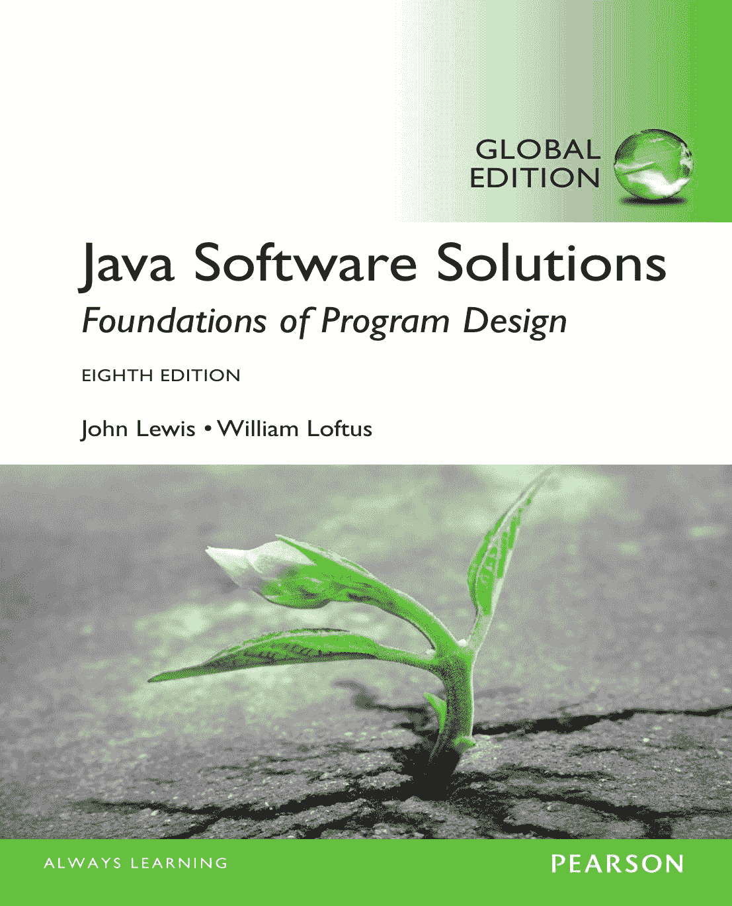


TM `java`

## JOHN LEWIS

维吉亚科技大学

•

## WILLIAM LOFTUS

埃森

•

全球版贡献者：

Mohit Tahiliani, NITK Surathkal

波士, Columbus, Indianapolis, New York, San Francisco, Upper Saddle River, Amsterdam, Cape Town, Dubai, London, Madrid, Milan, Munich, Paris, Montreal, Toronto, Delhi, Mexico City, São Paulo, Sydney, Hong Kong, Seoul, Singapore, Taipei, Tokyo

**总监:** Marcia Horton

**制造采购员:** Lisa McDowell

**主编:** Michael Hirsch

**艺术总监:** Linda Knowles

**编辑助理:** Stephanie Sellinger

**封面设计:** Shree Mohanambal

**市场部副总裁:** Patrice Jones, Inbakumar/Lumina

**市场经理:** Yezan Alayan, Datamatics, Inc.

**市场协调员:** Kathryn Ferranti

**图片许可协调:** Rita Wenning

**制作部副总裁:** Vince O’Brien

**封面摄影:** Eugene Sergeev/Shutterstock

**执行编辑:** Jeff Holcomb

**媒体编辑:** Daniel Sandin

**制作项目经理:** Marilyn Lloyd

**媒体项目经理:** Wanda Rockwell

**学习资产全方位项目管理负责人:** Harleen Chopra, Cenveo®

**全球版采购:** Laura Dent

**全球版出版服务采购编辑:** Karthik Subramaniun

**排版:** Cenveo Publisher Services

**全球版项目编辑:** Anuprova Dey

**印刷/装订:** Courier Kendallville-Chowdhuri.

**封面印刷:** Courier Kendallville

**高级运营主管:** Alan Fischer

**正文字体:** Sabon LT Std

**培逊教育有限公司**

Edinburgh Gate, Harlow, Essex CM20 2JE, England

以及遍布全球的相关公司

访问我们的官方网站：`www.pearsonglobaleditions.com`

*本书献给我们的家人。*

*Sharon, Justin, Kayla, Nathan, and Samantha Lewis* 以及

*Veena, Isaac, and Dévi Loftus*

*本页特意留白。*

# 前言

欢迎阅读《Java 软件解决方案：程序设计基础》第八版。我们很高兴多年来这本书一直满足许多学生和教员的需求。本版经过进一步定制，以改进对入门计算中关键主题的覆盖。

## 本版新内容

本版最大的更新包括：

- 更新了所有图形截图。
- 添加了额外的截图以显示界面选项。
- 修订了章末练习和编程项目。
- 修订了所有代码中的空格一致性问题。
- 改进了对 Java 翻译、文本文件 I/O 等主题的讨论。

来自教师和学生的反馈不断表明，我们在书籍整体愿景上是正确的。重点仍然是以清晰、循序渐进的方式呈现核心概念。每章中的“图形轨道（Graphics Track）”部分仍然将图形和图形用户界面的涵盖分开，为这些材料的讲解提供了极大的灵活性。

轻松的写作风格和趣味性的示例仍然占据主导地位。

图形程序（包括带有图形用户界面的程序）的截图已全部更新。之前的版本在视觉效果上有些过时。我们根据需要对部分内容进行了更新。

在某些图形程序中，我们添加了额外的截图，以显示程序在不同情况下的外观。

我们在修订中还关注了章末练习和编程项目。我们对这些内容进行了增删修改，以提供合适且更新的版本。

整本书示例在空格使用上变得不一致。我们仔细检查了每个示例和代码片段，以确保采用一致且适当的风格。

最后，一如既往，我们改进了书中的讨论，有时是微小的，其中几处是重大改进。特别是 Java 翻译的讨论在第一章及全文中进行了更新，专注于 `JVM` 而不是不实用的“解释器”。与翻译过程相关的图表也已更新。文本文件 I/O 的讨论及其示例也进行了更新。

## 本书核心

本书基于以下基本理念，我们认为这些理念构建了良好的入门教材：

- **真正的面向对象：** 一本真正教授坚实面向对象方法的教材必须使用我们所说的“对象语言”。也就是说，所有处理都应该用面向对象的术语进行讨论。然而，这并不意味着学生看到的第一个程序就讨论编写多个类和方法。学生在学习编写对象之前先学习使用对象。本书采用了自然的进展，最终使具备设计真实的面向对象解决方案的能力。

- **良好的编程实践：** 学生不应该被教如何编程，而应该被教如何编写良好的软件。两者是有区别。编写软件不是一套菜谱式的动作，良好的程序不仅仅是语句的集合。本书整合了作为良好编程基础的实践。这些实践应用于所有示例中，并在讨论中得到了加强。

学生学习如何解决问题，以及如何实现解决方案。我们在书中引入并整合了基础软件工程技术。“**软件失败（Software Failure）**”案例通过展示不遵循这些良好实践的危险，重申了这些教训。

# 示例

学生通过示例进行学习。本文包含了许多完整实现的示例，用于演示特定的概念。我们将短小、易于理解的示例与更大、更贴切的示例交织在一起。在图形化和非图形化程序之间取得了平衡。

`VideoNotes`（视频笔记）以现场演示的形式提供了额外的示例。

# 图形与 GUI

图形可以成为学生极佳的动力，它们的使用可以作为面向对象编程的优秀示例。因此，我们在全书中通过一组定义良好的章节来使用它们，我们称这些章节为“图形轨道”（Graphics Track）。这些内容涵盖了事件处理和 GUI 的使用。学生将通过主题的自然演进学习如何以正确的方式构建 GUI。对于不选择使用图形的学生，可以完全跳过“图形轨道”。

## 章节详解

### 第 1 章（引言）

介绍了通用的计算机系统，包括基础体系和硬件、网络、编程和语言转换。本章介绍了 Java，并讨论了通用程序开发的基础以及面向对象编程的基础。本章包含了广泛的介绍性材料，可以在学生熟悉开发环境时涵盖这些内容。

### 第 2 章（数据与表达式）

探索了 Java 程序中用到的一些基本数据类型以及使用表达式进行计算。它讨论了数据从一种类型到另一种类型的转换，以及如何借助标准 `Scanner` 类从用户处交互式读取输入。

### 第 3 章（使用类和对象）

探索了预定义类的使用以及从这些类创建的对象。类和对象被用于处理字符串、生成随机数、执行复杂计算和格式化输出。还讨论了枚举类型。

### 第 4 章（编写类）

探索了与编写类和方法相关的各种问题。主题包括实例数据、可见性、作用域、方法参数和返回类型。还涵盖了封装和构造函数。一些较复杂的课题推迟到了第 6 章或在后续中重新回顾。

### 第 5 章（条件语句与循环）

涵盖了使用布尔表达式进行决策。然后详细探讨了 `if` 语句和 `while` 循环。一旦建立了循环，就引入了迭代器概念，并重新回顾了 `Scanner` 类用于额外的输入解析和文本文件的读取。最后引入了 `ArrayList` 类，它提供了管理大量对象的选项。

### 第 6 章（更多条件语句与循环）

检查了 Java 其余条件（`switch`）和循环（`do`, `for`）语句。讨论了所有与条件和循环相关的语句，包括增强版的 `for` 循环。`for-each` 循环也用于处理迭代器和 `ArrayList` 对象。

### 第 7 章（面向对象设计）

强化并扩展了与类设计相关问题的覆盖。讨论了识别问题所需的类和对象以及它们之间关系的技术。本章还涵盖了静态成员、接口。

### 第 8 章（数组）

包含了数组的广泛覆盖。内容包括命令行参数、变量长度和多维数组。

### 第 9 章（继承）

涵盖了类层次结构、重写和可见性，这些是关于类设计的主题。本章还讨论了方法重载。

### 第 10 章（多态）

探索了绑定的概念。然后讨论了如何通过继承或接口来实现多态。与多态相关的设计问题也得到了讨论。

### 第 11 章（异常）

探索了 Java 标准库中的异常。我们还讨论了处理输入输出时的异常对象。

### 第 12 章（递归）

涵盖了递归的概念、实现。通过不同领域的示例演示了递归技术。

### 第 13 章（集合）

介绍了集合的概念及其底层数据结构。本章作为对泛型介绍的背景回顾。

## 补充材料

### 学生在线资源

这些学生资源可以通过配套网站 `www.pearsonglobalitions.com/lewis` 获取：

- 书中所有程序的源代码
- Java 开发环境的链接
- VideoNotes：演示解决问题的逐步视频。VideoNotes 允许根据自己的节奏进行学习，并带有播放、回退、快进和停止功能。书中的边缘图标会提示特定概念或作业是否有对应的 VideoNotes。

### 教师资源

以下补充材料仅供合格教师。访问 Pearson 教育资源中心 `www.pearsonglobalitions.com/lewis` 获取如何访问它们的信息：

- 演示幻灯片——PowerPoint 格式。
- 答案——练习和项目的答案。
- 带有强大测试生成软件的题库——包含丰富的简答题、多选题和判断题。
- 实验手册——实验活动旨在配合书中的主题演进。

## 特性

### 核心概念

在全文中，“核心概念”框突出了基本思想和重要指南。这些概念在每章末尾会有总结。

### 代码列表

所有的编程示例都以清晰标记的列表形式呈现，随后附有程序输出、示例运行或屏幕截图。代码经过颜色处理，以区分注释和关键字。

### 语法图

在书中合适的位置，Java 语言的语法元素将在特别标记的章节中讨论，并配图标识语句或结构的有效形式。整个 Java 语言的语法图见附录 L。

### 图形轨道

所有涉及图形和图形用户界面的处理将在每章末尾的一个或两个章节中讨论，我们统称为“图形轨道”。跳过这些内容不会影响连续性，也可以根据需要重点关注。任何图形轨道的内容与其所在章节的主题相关。图形轨道通过页面边缘的棕色框指示。

### 核心概念总结

贯穿章节的核心概念将在章末尾进行总结。

### 自测练习题与答案

这些简答题回顾了前述节建立的基本思想和术语。它们旨在让学生评估自己对内容的掌握程度。这些问题的答案可以在书末的附录 N 中找到。

## 练习

这些中级问题需要进行计算、分析或编写代码片段，并彻底掌握本章节的内容。虽然练习可能涉及代码，但通常不需要进行任何在线活动。

## 编程项目

这些问题要求设计并实现 `Java` 程序。它们的难度程度各不相同。

## 视频笔记 (VideoNotes)

由作者制作的 `VideoNotes` 通过易于跟随的非正式视频，以视觉化的方式解释相关主题，为学生理解重要概念提供额外的帮助。请寻找此视频笔记图标，查看哪些章节主题和章末的编程项目提供了 `VideoNotes` 版本。

## 软件故障

这些章节之间的小插曲讨论了软件设计中的现实缺陷，鼓励学生从一开始就采用良好的设计实践。

## 致谢

我非常感谢来自全球的教师和学生，他们对本书的之前的版本提供了反馈。我很高兴看到教师们对学生的关注以及学生对知识的渴求。随时欢迎你们的意见和问题。

我特别感谢来自杨百大学的 Robert Burton 提供的帮助、见解和对细节的关注。多年来，Robert 一直持续提供宝贵的反馈，帮助了本教材的形成和演变。

来自西蒙弗雷泽大学的 Brian Fraser 最近也提供了一些优秀的反馈，帮助澄清了本版本中的一些问题。与计算机教育工作者的这种互动是极其宝贵的。

还要感谢来自维拉诺瓦大学的 Dan Joyce，他开发了自测题，确保了每个相关主题都有足够的复习材料，并编写了每道题的答案。

我继续对 Pearson 团队展现出的才华和努力感到惊叹。我们的编辑 Matt Goldstein 具有惊人的见解和投入。他的助理 Kelsey Loanes 是持续且有帮助的支持源。营销经理 Yez Alayan 确保讲师们理解本书在教学上的优势。封面由 Joyce Wells 的才华横溢的设计。Scott Disanno、Marilyn Lloyd 和 Kayla Smith-Tarbox 领导了制作工作。Addison-Wesley 的同事得到了 Cenveo 出版服务卓越团队的支持，包括负责室内设计的 Jerilyn Bockorick 和负责项目管理的 Harleen Chopra。我们感谢所有这些人员，他们确保了这本书符合最高质量标准。

特别特别感谢以下人员，他们通过参与焦点小组、访谈和评审对我们关于这本书提供了宝贵的建议。他们以及许多其他教师和朋友提供了宝贵的反馈。他们包括：

- Elizabeth Adams, 詹姆斯麦迪大学
- Hossein Assadipour, 罗格斯大学
- David Atkins, 俄勒冈大学
- Lewis Barnett, 里士满大学
- Thomas W. Bennet, 密西西比学院
- Gian Mario Besana, 德保罗大学
- Hans-Peter Bischof, 罗彻斯特理工学院
- Don Braffitt, 拉福大学
- Robert Burton, 杨百大学
- John Chandler, 俄克拉荷马州立大学
- Robert Cohen, 马萨诸塞大学波士顿分校
- Dodi Coreson, 林-本顿社区学院
- James H. Cross II, 奥本大学
- Eman El-Sheikh, 西佛罗里达大学
- Sherif Elfayoumy, 北佛罗里达大学
- Christopher Eliot, 马萨诸塞大学阿姆赫斯特分校
- Wanda M. Eanes, 梅肯州立学院
- Stephanie Elzer, 米勒斯维尔大学
- Matt Evett, 东密歇根州立大学
- Marj Feroe, 宾夕法尼亚州县社区学院
- John Gauch, 堪萨斯大学
- Chris Haynes, 印第安纳大学
- James Heliotis, 罗彻斯特理工学院
- Laurie Hendren, 麦吉尔大学
- Mike Higgs, 奥斯汀学院
- Stephen Hughes, 罗诺克学院
- Daniel Joyce, 维拉诺瓦大学
- Saroja Kanchi, 基特林大学
- Gregory Kapfhammer, 阿利格尼学院
- Karen Kluge, 达特茅斯学院
- Jason Levy, 夏威夷大学
- Peter MacKenzie, 麦吉尔大学
- Jerry Marsh, 奥克兰大学
- Blayne Mayfield, 俄克拉荷马州立大学
- Gheorghe Muresan, 罗格斯大学
- Laurie Murphy, 太平洋路德大学
- Dave Musicant, 卡尔顿学院
- Faye Navabi-Tadayon, 亚利桑那州立大学
- Lawrence Osborne, 拉马大学
- Barry Pollack, 旧金山城市学院
- B. Ravikumar, 罗德岛大学
- David Riley, 威斯康星大学（拉克罗斯）
- Bob Roos, 阿利格尼学院
- Carolyn Rosiene, 哈特福德大学
- Jerry Ross Lane, 社区学院
- Patricia Roth, 东南理工州立大学
- Carolyn Schauble, 科罗拉多州立大学
- Arjit Sengupta, 乔治亚州立大学
- Bennet Setzer, 肯尼索州立大学
- Vijay Srinivasan, JavaSoft, Sun Microsystems, Inc.
- Stuart Steiner, 东华盛顿州立大学
- Katherine St. John, 纽约市立大学莱曼学院
- Alexander Stoytchev, 爱荷华州立大学
- Ed Timmerman, 马里兰大学，大学学院
- Shengru Tu, 新奥尔良大学
- Paul Tymann, 罗彻斯特理工学院
- John J. Wegis, JavaSoft, Sun Microsystems, Inc.
- Ken Williams, 北卡罗来纳农业与技术大学
- Linda Wilson, 达特茅斯学院
- David Wittenberg, 布兰戴斯大学
- Wang-Chan Wong, 加州州立大学（多明格斯希尔斯）

还要感谢我在维拉诺瓦大学的朋友和前同事，他们提供了许多精彩的反馈。他们包括 Bob Beck, Cathy Helwig, Anany Levitin, Najib Nadi, Beth Taddei 和 Barbara Zimmerman。

特别感谢新泽西州学院的 Pete DePasquale，感谢 `PaintBox` 项目的设计与演变，以及原始的 `Java Class Library` 附录。

许多其他人以各种方式提供了帮助。他们包括 Ken Arnold, Mike Czepiel, John Loftus, Sebastian Niezgoda, Saverio Perugini。`ACM` 计算机教育特别小组 (`SIGCSE`) 是一个巨大的资源。对于我们遗漏的任何未参与 `SIGCSE` 的人员，我们表示歉意。

# 网络

46

## 网络连接

46

### 局域网与广域网

48

### 互联网

49

### 世界维员网

50


# 引言

## 章节目标

* 描述硬件与软件之间的关系。
* 定义各种类型的软件及其用途。
* 识别计算机的核心硬件组件并解释它们的作用。
* 解释硬件组件如何相互作用以执行程序和管理数据。
* 描述计算机如何连接到网络以共享信息。
* 介绍 Java 编程语言。
* 描述程序编译和执行涉及的步骤。
* 介绍面向对象原则概述。

本书关于如何编写设计良好的软件。要理解软件，我们必须首先从了解它在计算机系统中的作用。硬件和软件在计算机系统中协作以完成复杂任务。各种硬件组件的作用以及这些组件连接到网络的方式，是学习软件开发的重要前提。本章首先讨论了基本的计算机处理，然后通过介绍 Java 编程语言和面向对象编程原则，开始我们对软件开发的探索。

# 第 1 章 引言

## 1.1 计算机处理

所有的计算机系统，无论是台式机、笔记本电脑、平板电脑、智能手机、游戏机还是汽车导航系统等特殊设备，都具有某些特征。细节各异，但它们都以类似的方式处理数据。虽然本书的大部分涉及软件开发，但我们将从计算机处理的概述开始，以建立背景。建立一些基础术语并观察计算机系统的关键部分如何相互作用是重要的。

计算机系统由硬件和软件组成。计算机系统的 `hardware` 组件是支持计算工作的物理实体。它们包括芯片、机箱、电线、键盘、扬声器、磁盘、内存卡、USB 闪存驱动（也称为优盘）、电缆、插头、打印机、鼠标、显示器、路由器等。如果你能物理上接触它并且它可以认为是计算机系统的一部分，那么它就是计算机硬件。

如果没有指令告诉它们做什么，计算机的硬件组件基本上是无用的。`program` 是一系列硬件顺序执行的指令。`Software` 由程序和这些程序使用的数据组成。软件是物理硬件组件的虚拟对应物。它们共同构成了一个我们可以利用来帮助解决问题的工具。

计算机系统中的关键硬件组件是：

* 中央处理器 (CPU)
* 输入/输出 (I/O) 设备
* 主内存
* 辅助存储设备

下一节将详细介绍这些每一个硬件组件。现在，我们只需检查它们的基本作用。`central processing unit`（`CPU`）是执行程序单个命令的设备。`Input/output`（`I/O`）设备（如键盘、鼠标和显示器）允许人类与计算机交互。

程序数据存储在称为内存的存储设备中，分为两类：主内存和辅助内存。`Main memory` 是在 CPU 处理软件时持有软件的存储设备。`Secondary memory` 设备以相对永久的方式存储软件。典型计算机系统最重要的辅助内存设备是位于主计算机机箱内的硬盘。USB 闪存驱动器也是一种重要的辅助内存设备。典型的 USB 闪存驱动器存储的信息几乎没有硬盘那么多。USB 闪存驱动器的优点是便携性；它们可以根据需要临时移除或在计算机之间移动。另一种便携式辅助内存设备是光盘 (CD)。

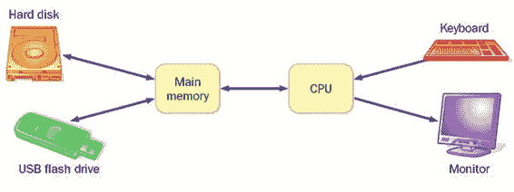


## 1.1 计算机处理

**图 1.1** 计算机系统的简化视图图 1.1 显示了信息如何在基本硬件组件之间移动。假设你有一个想要运行的可执行程序。

程序存储在某些辅助内存设备上（如硬盘）。

当你指示计算机执行你的程序时，程序的副本从辅助内存调入并存储在主内存中。CPU 从主内存读取各个程序指令。CPU 然后逐个执行这些指令，直到程序结束。

**核心概念**


# 指令与数据存储

指令使用的数据（例如要相加的两个数字）也存储在主内存中。它们要么是主内存中的指令（从辅助内存调入的），要么是从输入设备读取的，并逐个执行直到程序结束。

诸如键盘。在执行期间，程序可以将信息显示到显示器等输出设备。

执行程序的过程是计算机运行的基础。所有计算机系统基本上以相同的方式工作。

# 软件分类

软件可以根据各种标准分为许多类。在此，我们简单地区分系统程序和应用程序。

## 操作系统

`operating system` 是计算机的核心软件。它执行着两个重要的功能：首先，它提供了一个 `user interface`，让用户能够与机器进行交互。其次，操作系统管理着 CPU 和主内存等计算机资源。它决定了程序何时允许运行、被加载到内存的哪个位置，以及硬件设备如何通信。让计算机易于使用并确保其高效运行是操作系统的职责。

### 流行的操作系统

如今有几种流行的操作系统正在使用。Windows 操作系统是由微软公司为个人计算机开发的，它提供了用户界面并管理计算机资源，这占据了操作系统市场的大多数份额。


各种版本的 Unix 操作系统也非常流行，特别是在大型计算机系统中。一种名为 Linux 的 Unix 版本是作为一个开源项目开发的，这意味着许多人对它的开发做出了贡献，并且其代码是免费获取的。正因如此，Linux 成为某些用户的特别宠爱。Mac OS X 是苹果公司开发的用于计算系统的操作系统。

操作系统通常是为智能手机和平板电脑等移动设备定制的。苹果的 iOS 操作系统用于 iPhone、iPad 和 iPod Touch。它在功能和外观上与桌面级 Mac OS 相似，但针对较小的设备进行了定制。同样，Windows Phone 是微软用于手机的 Windows 操作系统版本。Android 是由谷歌开发的基于 Linux 的移动操作系统，用于许多手机。

## 应用程序

`application`（在会话中通常缩短为“app”）是除操作系统之外的任何软件的通用术语。文字处理器、导弹控制系统、数据库管理器、Web 浏览器和游戏都可以被视为应用程序。每个应用程序都有其自己的用户界面，允许用户与该特定程序进行交互。

大多数现代操作系统和应用程序的用户界面是 `graphical user interface`（GUI，读作“gooey”），正如名称所示，它利用了图形屏幕元素。在许多元素中，这些元素包括：

- `windows`（窗口）：用于将屏幕分为不同的工作区域
- `icons`（图标）：代表计算机资源（如文件）的小图像
- `menus, checkboxes, and radio buttons`（菜单、复选框和单选按钮）：为用户提供可选选项
- `sliders`（滑动条）：允许用户从范围内选择值
- `buttons`（按钮）：可以通过鼠标点击“按下”以表示用户的选择

鼠标是用于 GUI 的主要输入设备；因此，GUI 有时被称为 `point-and-click interfaces`（点点接口）。图 1.2 中的截图显示了一个 GUI 示例。

应用程序或操作系统的接口是软件的重要部分，因为它是程序中用户直接交互的唯一部分。对于用户来说，界面就是程序。对用户来说，界面就是程序。在整本书中，我们将讨论图形用户界面的设计和实现。本书的重点是开发高质量的应用程序。我们探索如何设计和编写能够执行计算、做出决策并以文本或图形形式呈现结果的软件。我们在全文中将使用 Java 编程语言来演示各种计算概念。

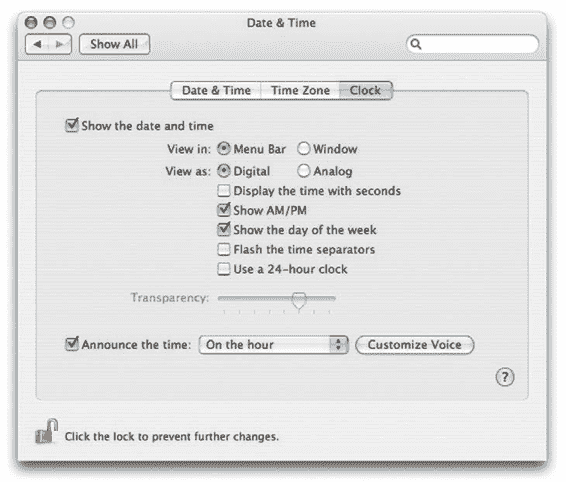


**图 1.2** 图形用户界面 (GUI) 示例

# 第 1 章：引言

## 1.1 计算机处理

### 模拟与数字技术

存储和管理信息使用了两种基本技术：模拟和数字。`Analog`（模拟）信息是连续的，与信息的源直接成正比。例如，酒精温度计是测量温度的模拟设备。酒精在管中的上升与管外的温度直接成正比。另一个模拟信息的例子是用于表示声波振动的电子信号。信号的电压与原始声波直接成正比。立体声放大器将这种电子信号发送到扬声器，扬声器通过振动重现声音。

我们使用模拟一词是因为信号与它代表的信息直接类比。图 1.3 描绘了代表声波的电子信号。


**图 1.3** 声波和电子信号

`Digital`（数字）技术将信息分解为离散的片段，数字计算机通过将这些片段表示为数字来存储信息。音乐带以数字形式存储，是通过将其分解为片段并将每个片段表示为数字。

特定实例的电压电平在短时间内进行了多次测量，也许每秒 44,000 次。每秒的测量次数被称为 `sampling rate`（采样率）。如果采样足够频繁，离散的电压测量值就可以生成一个连续的模拟信号。在大多数情况下，目标是创建一个足以人类感官的原始信号再现。

图 1.4 显示了模拟信号的采样。当模拟信息通过分解为片段转换为数字格式时，我们说它被数字化了。


**图 1.4** 通过采样数字化模拟信号


**图 1.5** 通过将字符映射到数字存储文本

采样之间可能会丢失信息

H i , H e t e r .

72 105 44 32

72 101 97 116

104 101 114

### 二进制数

数字计算机以数字存储信息，但这些数字不是以十进制值存储的。计算机中的所有信息都以二进制值存储和管理。与具有 10 个数字（0 到 9）的十进制系统不同，二进制系统只有两个数字（0 和 1）。单个二进制位被称为 `bit`。

所有的数字系统都按照相同的规则运行。数字系统的`base value`（基值）决定了我们可以使用的位数，并指示了数字中每个数字的位值。十进制系统的**核心概念**是 10 进制，而二进制系统是 2 进制。见附录 B。

二进制用于在计算机中存储和移动信息，因为文中对数字系统进行了详细讨论。

现代计算机使用二进制数，是因为存储和移动信息的设备成本更低且更可靠。如果二进制数据只需要表示两个可能值之一，那么这些数据就是廉价且可靠的。除了这个特性外，二进制系统并没有特殊之处。

虽然已经创建了使用其他数字系统存储和移动信息的计算机，但它们并不如方便。

某些计算机内存设备（如硬盘）本质上是磁性的。磁性材料很容易被极化为其中一个极端，但中间水平很难区分。因此，磁性设备可以非常有效地表示二进制值——磁化区域代表二进制 1，去磁化区域代表二进制 0。其他计算机内存设备由微小的电子电路组成。如果这些设备只需要在两个状态之间切换，那么它们更容易制造，而且不太可能故障。与其创建更少、更复杂的设备，我们再复制数百万这种简单设备会更好。

二进制值和数字电子信号紧密相分的。它们提高了我们沿着电线可靠地传输信息的能力。正如我们所看到的，模拟信号具有连续变化的电压和无限多的状态，而数字信号是`discrete`（离散的），这意味着电压在一个极端（如 +5 伏）和另一个极端（如 –5 伏）之间发生剧烈变化。在任何一点，数字信号的电压都被视为“高”（代表二进制 1）或“低”（代表二进制 0）。图 1.6 对比了这两种信号。

当信号沿着电线移动时，由于环境的影响会变弱并衰化。这意味着原始信号的电压水平发生了轻微变化。

模拟信号的问题在于，随着它的波动，会丢失原始信息。由于信息与信号直接对应，信号的任何变化都会改变信息。模拟信号的变化无法恢复，因为衰化的信号与原始信号一样有效。数字信号的衰化程度与模拟信号一样，但由于数字信号最初处于两个极端之一，在任何信息丢失之前可以对其进行增强。电压可能会与其原始值发生轻微变化，但它仍然可以被正确地解释为高或低。

我们在任何特定情况下使用的位数决定了我们可以表示的唯一项目数量。单个位（bit）有两个可能的值：0 和 1，因此可以表示两个可能的项目或或情况。如果我们想表示灯泡的状态（关闭或开启），一个位就足够了，因为我们可以将 0 解释为灯泡关闭，将 1 解释为灯泡开启。如果我们想表示两个两个以上的东西，就需要多于一个位。

两个位组合在一起可以表示四种可能的项目，因为两个位恰好有四种排列：00、01、10 和 11。假设我们想表示汽车所处的档位（P 档、D 档、倒车档或空档）。我们只需要两个位，就可以在位排列和档位之间建立映射。例如，我们可以说 00 代表 P 档，01 代表 D 档，10 代表倒车档，11 代表空档。在这种情况下，交换该映射没有关系，尽管在某些情况下，位排列与它们所表示的内容之间的关系是重要的。

三个位可以表示八个唯一项目，因为三位有**核心概念**八种排列。同样，四位可以表示 16 个项目，五位可以表示 32 个项目，以此此类推。图 1.7 显示了 `N` 位。因此，`N` 位可以表示多达 `2^N` 个唯一项目。使用的位数与它们能表示的项目数之间存在这种关系。通常情况下，`N` 位可以表示 `2^N` 个唯一项目。每增加一个位，可以表示的项目数量就会增加一倍。

**1 位**

**2 位**

**3 位**

**4 位**

**5 位**

**2 个项目**

**4 个项目**

**8 个项目**

**16 个项目**

**32 个项目**

```
0
00
000
0000
00000
10000
1
01
001
0001
00001
10001
10
010
0010
00010
10010
11
011
0011
00011
10011
100
0100
00100
10100
101
0101
00101
10101
110
0110
00110
10110
111
0111
00111
10111 
```

模拟信号

数字信号

**图 1.6** 模拟信号对比数字信号


**1.1 计算机处理**

**35**

我们已经看到如何通过将字符映射到数值来在计算机上存储文本句子。这些数值以二进制数的形式存储。假设我们想表示一种包含 256 个字符的语言中的字符。我们需要使用八位，因为八位有 256 种排列（2⁸）。每个位排列都映射到一个字符。表示世界上 195 个国家需要多少位？七位是不够的，因为 2⁷ 等于 128。八位是足够的，但 256 种排列中将没有所有都映射到一个国家。最终，在计算机上表示信息归结为要表示的项目以及将其映射到二进制值的方式。

### 自测题（答案见附录 N）

1.1 什么是硬件？什么是软件？

1.2 操作系统的两个主要功能是什么？

1.3 CD 音乐是以每秒 44000 次采样率创建的。每次测量都以表示电压水平的存储。存储三分钟歌曲需要多少这样的数字？一小时音乐需要多少数字？

1.4 信息以数字形式存储时会发生什么？

1.5 以下内容可以表示多少唯一项目？

a. 2 位

b. 4 位

c. 5 位

d. 7 位

1.6 假设你想用唯一的位排列表示美国所有的 50 个州。需要多少位？为什么？

## 1.2 硬件

让我们详细地检查计算机系统的硬件组件。

考虑图 1.8 中描述的台式计算机。这一切意味着什么？该系统能够运行你需要的软件吗？它与其他系统相比如何？这些术语在节文中都有解释。

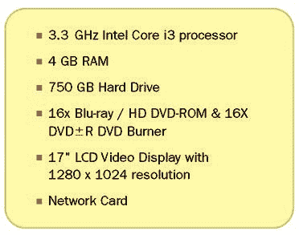
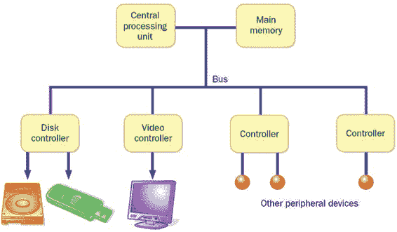

**图 1.8** 特定计算机的硬件规格

### 计算机架构

房屋的架构定义了它的结构。同样，我们使用*计算机架构*术语来描述计算机的硬件组件是如何组合在一起的。图 1.9 展示了通用计算机系统的基本架构。

信息通过一组称为*总线*的电线在组件之间进行传输。

**图 1.9** 基础计算机架构


**38**

CPU 和内存构成了计算机的核心。

#### 核心概念

正如我们之前提到的，内存存储程序和数据。计算机的核心由内存（存储程序和数据）和 CPU（按条不紊地执行程序指令）组成。

假设我们有一个计算数字列表平均值的程序。在程序运行期间，程序和数字必须驻留在内存中。CPU 从内存中读取一条程序指令并执行它。如果某条指令需要数据（例如列表中的某个数字）来完成任务，CPU 也会读取该信息。这个过程不断重复直到程序结束。计算出的平均值将存储在内存中，等待进一步的处理或长期存储在辅助内存中。

在计算机系统中，除了 CPU 和内存外，几乎所有设备都称为`外设设备`；它们在系统的边缘或外围运行（尽管它们可能位于同一个箱体内）。用户并不直接与 CPU 或内存交互。尽管 CPU 和内存构成了机器的本质，但如果没有外设设备，它们将无用武处。

`控制器`是协调特定外设活动的设备。每种设备都有其独特的数据格式化和通信方式，控制器的作用之一就是处理这些特殊性，并将它们与计算机的其他部分隔离开。此外，控制器通常处理大部分的实际信息传输，允许 CPU 专注于其他活动。

输入/输出（I/O）设备和辅助内存设备被视为外设。另一类外设是`数据传输设备`，它们允许在计算机之间发送和接收信息。图 1.8 中指定的计算机包含网卡，也称为无线网络接口控制器（`WNIC`），它可以连接到基于无线的计算机网络。

在某些方面，辅助内存设备和数据传输设备可以被视为 I/O 设备，因为它们代表了信息的来源（输入）和发送信息的地方（输出）。然而，我们将 I/O 设备定义为允许用户与计算机交互的设备。

### 输入/输出设备

让我们详细检查一些 I/O 设备。常见的输入设备是键盘和鼠标或触摸板。其他设备包括：

- `条码器`，例如零售店收银台使用的设备
- `麦克风`，用于解释语音命令的语音识别系统
- `虚拟现实设备`，例如解释用户手部动作的手持设备
- `扫描仪`，将文本、照片和图形转换为机器可读的形式


- `摄像头`，捕捉静态图像和视频，也可以用于处理特殊输入，如 `QR 代码`

显示器和打印机是最常见的输出设备。其他设备包括：

- `绘图仪`，在大幅纸上移动画笔（或反之）
- `扬声器`，用于音频输出
- `眼镜`，用于虚拟现实显示

某些设备可以同时提供输入输出功能。`触摸屏`系统可以检测触摸。图 1.8 描述的台式计算机包含一个 17 英角的对角区域。它由液晶显示（`LCD`）组成，不像不可便携的旧阴射线管（`CRT`）显示器。触摸屏已变得普及。

## 1.2 硬件组件

### 内存和辅助内存

#### 核心概念

内存由一系列小的`字节`组成。当数据存储在内存位置时，它会覆盖该位置之前存储的任何信息。然而，从内存位置读取数据的过程不会影响它。

每个位置都是一个唯一的数字，称为`地址`。如图 1.10 所示，设备的存储容量是它能容纳的`字节`总数。因为计算机基于二进制系统，所有存储单位都是 2 的幂。`千字节`（`KB`）是 1024 `字节`，`兆字节`（`MB`）是 1,048,576 `字节`，`吉字节`（`GB`）是 1,073,741,824 `字节`，`太字节`（`TB`）是 1,099,511,627,776 `字节`，`拍字节`（`PB`）是 1,125,899,906,842,624 `字节`。

通常通过舍入来考虑这些容量更容易。例如，大多数计算机用户认为千字节大约是一千字节，兆字节大约一百万，以此类推。

许多个人电脑拥有 4GB 的内存，即 `RAM`，例如图 1.8 描述的系统（我们将在本章稍后详细讨论 `RAM`）。内存是`易失的`，这意味着只要有供电，存储的信息就会保持。较大的内存允许大型程序或多个程序高效运行，因为它们不需要频繁从辅助内存中检索信息。

### 计量单位

| **单位** | **符号** | **字节数** |
| :--- | :--- | :--- |
| `byte` | | |
| `kilobyte` | | |
| `megabyte` | | |
| `gigabyte` | | |
| `terabyte` | | |
| `petabyte` | | |

**图 1.10** 存储单位

USB 闪存由一个小型打印电路板组成，上面承载着电路元件和一个 USB 接口。它们封装在塑料、金属或橡胶外壳内，并经过绝缘处理。例如，它可以放在口袋里或挂在钥匙上。

磁盘是一种磁性介质，位在以磁化颗粒的形式表示。读写头在旋转的磁盘上方移动，根据需要读取或写入信息。硬盘驱动器实际上可能包含垂直排列的几块磁盘，并配有多个读写头，如图 1.12 所示。

为了直观地感受这些设备可以存储多少信息，请考虑一下书中的所有信息（包括图片和格式）大约需要 7 MB 的存储空间。

`磁带`也曾用作次级存储，但由于访问信息的方式，其速度远慢于硬盘和 USB 闪存。硬盘是一种`直接访问设备`，因为读写头通常可以直接移动到所需信息处。USB 闪存也是直接访问读写头，但没有机械部件移动。`直接访问`和`随机访问`这两个术语通常互换使用。然而，磁带上的信息只有在跳过中间的数据后才能访问。磁带必须回带或快进到适当的位置。因此，磁带被认为是一种`顺序访问设备`。由于这些原因，磁带作为计算机存储设备已基本被淘汰，就像音频磁带被光盘取代一样。

### 磁盘

**图 1.12** 带有多个磁盘和读写头的硬盘驱动器


**42**

**第 1 章** 引言

还有两个术语描述内存设备：`随机存内存`（`RAM`）和`只读存储`（`ROM`）。理解这些术语很重要，因为它们被频繁使用且名称可能具有误导性。`RAM` 和`主内存`基本上可以互换，描述存储活动程序和数据的内存。`ROM` 可以指计算机主板上的芯片，也可以指光盘等便携存储设备。

`ROM` 芯片通常存储名为 `BIOS`（基本输入输出系统）的软件，它提供了计算机最初启动时所需的初步指令。在信息存储到 `ROM` 之后，在典型的计算机使用期间，通常不会被更改（正如“只读”一词所示）。`RAM` 和 `ROM` 都是直接（或随机）访问设备。


`CD-ROM` 是一种便携式次级存储设备。`CD` 是**核心概念**紧凑型（compact disc）。它之所以被称为 `ROM`，是因为信息在 `CD` 创建时是永久存储的且无法更改。`CD` 的表面既有光滑区域也有小凹槽。凹槽代表二进制 1，光滑区域代表二进制 0。其音乐 CD 对应的 CD-ROM 以二进制格式存储信息。在 CD 初次创建时，一个微细的凹槽被压入圆片中以表示二进制 1，而圆片保持光滑以表示二进制 0。位通过将低强度激光束投射到旋转的磁盘上来读取。激光束从磁盘上的光滑区域强烈反射，但从凹槽区域反射较弱。接收反射光的传感器据此判断每个位是 1 还是 0。一个典型的 `CD-ROM` 存储容量在 650 到 900 MB 之间。

基础 CD 技术的变体很快出现。大多数个人电脑都配备了 `CD 刻录光`（`CD-R`）驱动器。`CD-R` 可用于创建音乐或通用计算机存储的 `CD`。一旦创建，你可以在标准的 CD 播放器中使用 `CD-R` 光盘，但一旦 `CD-R` 光盘被“刻录”，你就无法更改其信息。你购买的音乐 CD 是通过模具压制的，而 `CD-Rs` 则是用激光刻录的。

`CD 可重写`（`CD-RW`）光盘可以擦除并重复使用。它可以重复使用是因为普通 `CD` 的凹槽和平整表面在 `CD-RW` 上通过在磁盘表面涂层一种材料来模拟的：这种材料在加热到特定温度时会变成无形态（因此不反射）且光滑，而普通 `CD` 的光滑区域在加热到不同温度时会变成晶态（通过使用可变为反射性的涂层）。`CD-RW` 介质并非在所有播放器中工作，但根据需要变为无形态或晶态。`CD-RW` 驱动器可以同时创建 `CD-R` 和 `CD-RW` 光盘。

**核心概念**

可重写 CD 模拟了凹槽

## 1.2 硬件组件

CD 最初是音乐的流行格式；后来演变为用作通用计算机存储设备。同样，`DVD` 格式最初是为视频设计的，现在正作为计算机数据的通用格式取得进展。`DVD` 曾代表数字视频盘（digital video disc）或数字多功能盘（digital versatile disc），但现在缩写通常独立使用。`DVD` 的格式比 `CD` 更致密（每平方英寸位更多），因此可以存储更多信息。`DVD-ROMs` 最终可能会完全取代 `CD-ROMs`，因为存在兼容迁移路径，这意味着 `DVD` 驱动器可以读取 `CD-ROM`。类似于 `CD-R` 和 `CD-RW`，还有 `DVD-R` 和 `DVD-RW` 光盘。图 1.8 中列出的驱动器允许用户读写 `CD-RW` 光盘并读取 `DVD-ROM`。

将程序指令和数据共同存储在主内存中的概念是计算机设计中`冯·诺依曼架构`的基础原理，以约翰·冯·诺依曼（John von Neumann）命名，他是一位匈牙利美国数学家，于 1945 年首次提出了这种编程概念。这些计算机持续地遵循图 1.14 所示的`取指-译码-执行`循环。

根据`程序计数器`中存储的地址从主内存中取出，并放入`指令寄存器`中。此时，`程序计数器`会增加（**核心概念**），以为下一个循环做准备。然后，对指令进行电子解码，以确定执行何种操作。最后，控制单元激活正确的电路来执行指令处理，例如，将一个数据值加载到寄存器中或将两个值相加。

CPU 构建在一个名为`微处理器`的芯片上，该设备是计算机主电路板的一部分。该主板还包含 `ROM` 芯片和通信插座，设备控制器（如管理视频显示的控制器）可以连接到这些插座上。

```
Figure 1.14 连续的取指-译码-执行循环
从主内存取指指令
解码指令并增加程序计数器
执行指令
```

## 1.2 硬件组件

主电路板的另一个关键组件是`系统时钟`。时钟定期产生电子脉冲，从而同步 CPU 的各个事件。脉冲发生的速率称为`时钟频率`，它根据处理器而异。图 1.8 描述的计算机包含一个 `Intel Core i7` 处理器，其运行频率为 3.07 吉赫兹 (GHz)，或每秒约 31 亿次脉冲。系统时钟的速度提供了 CPU 执行指令快慢的粗略衡量。与存储容量一样，处理器的速度随着技术的进步而不断增加。

**自测题** *(答案见附录 N)*

SR 1.7 下述各项各包含多少个字节？

a. 3 KB

b. 2 MB

c. 4 GB

SR 1.8 下述各项各有多少比特位？

a. 8 bytes

b. 2 KB

c. 4 MB

SR 1.9 CD 上的音乐使用每秒 44,000 次测量的采样率创建。每次测量都存储为一个表示特定电压电平的数字。假设这些数字每个都需要两个字节的存储空间。表示一小时的音乐需要多少 MB？

SR 1.10 计算机中两个主要的硬件组件是什么？它们是如何相互作用的？

SR 1.11 什么是内存地址？

SR 1.12 易失（volatile）是什么意思？哪些内存设备是易失的，哪些是非易失的？

SR 1.13 从以下列表中选择与每个短语最匹配的词：`controller`、`CPU`、`main`、`network card`、`peripheral`、`RAM`、`register`、`ROM`、`secondary`

a. 计算机系统中除 `CPU` 和主内存外的几乎所有设备都归类。

b. 协调`外设`活动的设备。

c. 允许信息的发送和接收。

d. 这种内存通常是易失的。

e. 这种内存通常是非易失的。

f. 这个术语基本上可以与“主内存”术语互换。

g. 计算机的基础处理发生的地方。

## 1.3 网络

单台计算机可以完成很多，但将几台计算机连接成网络可以极大提高生产力并促进信息共享。`网络`由两个或多个连接在一起的计算机组成，以便它们交换信息。使用网络已成为商业计算机运行的标准模式。每天都有新技术（**核心概念**）出现，以利用现代计算机系统的连接环境。

图 1.15 显示了一个简单的计算机网络。网络设备之一是打印机，它允许连接到网络的任何计算机在该打印机上打印文档。网络上的其中一台计算机被指定为`文件服务器`，专门存储许多网络用户需要的程序和数据。`文件服务器`通常有大量的`次级存储`。当网络有文件服务器时，每台独立的计算机就不需要自己的程序副本。

```
Figure 1.15 简单的计算机网络
文件服务器
共享打印机
```

如果两台计算机直接连接，它们通信的方式基本上与信息在单台机器内部通过导线移动的方式相同。在连接两台地理位置的计算机时，这种方案效果良好，被称为`点点连接`。然而，考虑跨远距离连接许多计算机的任务。如果使用`点点连接`，网络中的每台计算机都通过导线与网络中的其他所有计算机直接连接。为每个连接准备单独的导线并不是可行方案，因为每当向网络添加一台新计算机时，都必须为网络中已有的每个计算机安装新的通信线。此外，单台计算机只能处理少数的直接连接。

图 1.16 显示了多个点点连接。考虑如果向网络中增加两或三台额外的计算机，需要多少通信线。如今，局域网（如单个建筑内的网络）通常使用无线连接，最大限度地减少了对导线的需求。

比较 1.15 和 1.16 中的图。1.15 中显示的所有计算机共用单条通信线。网络上的每台计算机都有自己的`网络地址`，用于唯一标识它。这些地址在概念上与主内存中的地址相似，区别在于它们识别网络上的单个计算机，而不是单台计算机内部的位置。通过指定目标计算机的`网络地址`，消息可以在线路上之间发送。

共享通信线具有成本效益，并使得向网络添加新计算机变得容易。然而，共享线路（**核心概念**）会引入延迟。网络上的计算机无法同时使用通信线。它们必须轮流发送信息，这意味着当线路繁忙时它们必须等待。改进网络延迟的一种技术是将大消息分割成段`数据包`，然后将这些数据包与其他用户发送的消息片段混合发送到网络中。数据包在目的地被收集并重组为原始消息。

这种情况类似于一组人使用传送带将箱从一个地方移动到另一个地方。如果只允许一个人一次使用传送带，而这个人有大量的箱要移动，其他人将等待很长时间才能使用它。通过轮流，每个人每次可以放一个箱，这样他们都能完成工作。

这并不像拥有自己的传送带那么快，但也不像等所有人完成后那么慢。

```
Figure 1.16 点点连接
```

一个*局域网*（LAN）设计用于跨越短距离并连接较少数量的计算机。通常局域网只连接一个大楼或一个房间内的机器。局域网易于安装和管理，且可靠性很高。随着计算机变得越来越小且 `KeY COnCept` 多样化，局域网为整个组织的信息共享提供了一种廉价的方式。然而，拥有局域网就像拥有了一个有效的信息共享方式——电话系统只允许你拨打自己小镇上的电话。我们需要能够跨越更远距离共享信息。

*广域网*（WAN）连接两个或多个局域网，通常跨越远距离。通常，每个局域网上有一台计算机专门处理跨广域网的通信。这种技术减轻了局域网内其他计算机执行远距离通信细节的负担。图 `1.17` 显示多个局域网连接到一个广域网。通过广域网连接的局域网通常由不同的公司或组织所有，甚至可能位于不同的国家。

### LAN

局域网中的某台计算机

远距离连接

**图 1.17** 连接到广域网的局域网


## 1.3 网络

网络对计算机系统的影响是巨大的。现在计算资源可以在许多用户之间共享，基于计算机的全球范围内通信已成为常态。事实上，现在网络的使用已无处不在，以至于某些计算机需要网络资源才能运行。

### 互联网

在整个 20 世纪 70 年代，国防部一个名为高级研究计划局（ARPA）的机构资助了几个项目来探索网络技术。这些努力的成果之一是 ARPANET，这是一个最终被称为互联网的广域网。*互联网*是网络的网络。Internet 一术语源于广域网的*互联*（internetworking）概念——将许多较小的网络连接在一起。

从 20 世纪 80 年代后期至今，互联网 `KeY COnCept` 急速增长。1983 年，计算机少于 600 台。互联网是一个连接到互联网的广域网。目前，互联网为全球数十亿用户提供服务。随着越来越多的计算机连接到互联网，跟上更多用户和更沉重流量的任务变得非常困难。自最初开发以来，新技术已多次替换了 ARPANET，每次都提供了更大的容量和更快的处理速度。

*协议*（protocol）是一组规定两个事物如何通信的规则。控制消息在互联网上移动的软件必须符合一组被称为 `TCP/IP` 的协议（通过拼写字母读作 `T-C-P-I-P`）。TCP 代表*传输控制协议*（Transmission Control Protocol），IP 代表*互联网协议*（Internet Protocol）。IP 软件定义了信息如何格式化并从源传输到目的地。TCP 软件处理诸如信息片段到达顺序与原始顺序不同或信息丢失的问题，这在过量信息同时汇聚在某处时可能会发生。

每台连接到互联网的计算机都有一个*IP 地址*，它在互联网上所有其他计算机中唯一地标识自己。IP 地址的一个示例是 `204.192.116.2`。幸运的是，互联网用户很少需要处理 IP 地址。互联网允许每台计算机被 `KeY COnCept` 赋予名称。像 IP 地址一样，这些名称必须是唯一的。计算机的名称通常被称为其*互联网地址*。互联网地址的一个示例是 `hector.vt.edu`。

互联网地址的第一部分是特定计算机的本地名称。地址的其余部分是*域名*（domain name），指示该计算机所属的组织。例如，`vt.edu` 是弗吉尼亚理工大学（Virginia Tech）计算机网络的域名，而 `hector` 是该校园内某台特定计算机的。


由于域名是唯一的，许多组织可以拥有名为 hector 的计算机而不会产生混乱。各个部门可能会被分配*子域名*（subdomains），子域名被添加到基本域名，以便在较大的组织内唯一地区分它们的计算机组。例如，`cs.vt.edu` 子域名专门用于弗吉尼亚理工大学计算机科学系。

每个域名的最后部分称为*顶级域名*（TLD），通常指示计算机所属的组织类型。顶级域名 `edu` 通常表示教育机构。顶级域名 `com` 通常指商业实体。另一个常见的顶级域名是 `org`，通常用于非营利组织。其他顶级域名包括 `biz`、`info`、`jobs` 和 `name`。许多计算机，尤其是美国以外的计算机，使用国家代码顶级域名来表示原产国，例如英国的 `uk` 或澳大利亚的 `au`。

当引用一个互联网地址时，它会被翻译为相应的 IP 地址，从那时起使用该地址。进行这种翻译的软件被称为*域名系统*（DNS）。每个连接到互联网的组织都运行一个*域名服务器*，该服务器维护着该组织内所有计算机及其 IP 地址的列表。它的工作方式有点像电话目录查询，你提供名称，域名服务器返回一个数字。如果本地域名服务器没有该名称的 IP 地址，它会联系另一个域名服务器。

**第 1 章** 引言

### 世界维网

互联网改变了计算机处理。最初，互联计算机的主要用途是发送电子邮件，但互联网能力仍在不断提高。互联网最重要的用途之一是世界维网。

互联网赋予我们交换信息的能力。*世界维网*（World Wide Web，也称为 `WWW` 或简称为 Web）让人类的信息交换变得简单。

Web 基于超文本和超媒体的概念。*超文本*术语由特德·尼尔于 1965 年创造。它描述了一种组织信息的方式，使思想的流动不受限于线性进展。保罗·奥特（Paul Otlet，1868–1944）被某些认为是信息科学之父，他预想了这一概念用于管理大量信息。基本思想是文档可以根据自然关系在各个点链接，以便读者可以从一个文档跳转到另一个文档，遵循符合该读者需求的路径。当整合了其他媒体组件（如图形、声音、动画和视频）时，产生的组织被称为*超媒体*（hypermedia）。


“互联网”（Internet）和“万维网”（World Wide Web）这两个术有时会被通用，但它们之间存在重要的区别。互联网使得全球计算机之间的通信成为可能。万维网让这种通信变得简单且愉快。万维网本质上是一种分布式信息服务，基于一组软件应用程序。它并不是一个网络。尽管它与互联网配合使用，但它在本质上并不与其绑定。万维网可以在未连接到任何其他网络的局域网（LAN）上甚至在单台机器上显示 HTML 文档。

`browser`（浏览器）是一种用于加载和格式化 Web 文档以便的软件工具。`Mosaic` 是第一个 Web 图形界面浏览器，于 1993 年发布。Web 文档的设计者定义了可能位于互联网任何地方的其他 Web 信息。开发 Mosaic 的人员中，有些人后来创立了 Netscape 通信公司并创建了 `scape Navigator` 浏览器。目前流行的浏览器包括 Internet Explorer、Mozilla Firefox、Apple Safari、Google Chrome 和 Opera。

专门用于提供 Web 文档访问的计算机被称为 `Web server`（Web 服务器）。浏览器加载并解释由 `Web server` 提供的文档。

许多此类文档使用 `HyperText Markup Language`（`HTML`）进行格式化。Java 编程语言与 Web 处理有密切的关系，因为指向 Java 程序的链接可以嵌入 `HTML` 文档中并通过 Web 浏览器执行。我们在第 2 章中将详细探讨这种关系。

### 统一资源定位符 (Uniform Resource Locators)

Web 上的信息通过识别 `Uniform Resource Locator`（`URL`，读作字母 U-R-L）来找到。`URL` 唯一地指定了浏览器获取和显示的文档和其他信息。以下是一个 URL 示例：

```
http://www.google.com
```

该特定 URL 的网站是著名的 Google `search engine`（搜索引擎）的所在地，它允许你使用特定的单词或短语在 Web 上搜索信息。

`URL` 包含几部分信息。第一部分是 `KeY COnCept`——一种协议，它决定了浏览器传输和处理信息的方式。第二部分是存储文档的机器的互联网地址以及在该上的其他信息。第三部分是浏览器获取和显示的感兴趣的文件名或资源。如果没有提供文件名（如 Google URL 所示），Web 服务器通常会提供默认页面（如 `index.html`）。

**第 1 章介绍**

让我们来看另一个 URL 示例：

```
http://www.whitehouse.gov/photos-and-video/photogallery/photo-day
```

在这个 URL 中，协议是 `http`，代表 `HyperText Transfer Protocol`（超文本传输协议）。所引用的机器是 `www`（对 `Web server` 的典型引用），位于域名 `whitehouse.gov`。最后，`photos-and-video/photogallery/photo-day` 代表要传输到浏览器进行查看的文件（或生成文件的引用）。URL 还有许多其他形式，但这种形式是最常见的。

**自测复习题**（答案见附录 N）

SR 1.14 什么是文件服务器？

SR 1.15 五台计算机构成的全连接点对点网络共需要多少条通信线？六台计算机需要多少条？

SR 1.16 描述在网络上的计算机共享通信线的好处。描述共享通信线的成本/缺点。

SR 1.17 Internet（互联网）一词的词源是什么？

SR 1.18 `TCP/IP` 协议族描述了使用互联网软件的通信规则。`TCP` 代表什么？`IP` 代表什么？

SR 1.19 解释以下 URL 的部分：

a. `duke.csc.villanova.edu/jss/examples.html`

b. `java.sun.com/products/index.html`

# 1.4 Java 编程语言


# 现在让我们把注意力到让计算机系统实用的软件上

程序是用特定的 `programming language`（编程语言）编写的，该语言使用特定的单词和符号来表达解决方案。编程语言定义了一组规则，决定了程序员如何将语言的单词和符号组合成 `programming statements`（编程语句），这些语句是程序执行时运行的指令。

自从计算机诞生以来，已经有了许多编程语言。我们在本书中使用 Java 语言来演示各种编程概念和技术。尽管我们的主要目标是学习这些底层的软件开发概念，但一个重要的副作用将精通 Java 程序开发。

与许多其他语言相比，Java 是一种相对新的编程语言。它由 James Gosling 在 1991 年在 Sun Microsystems 发起，作为他的许多机顶盒项目之一。该语言最初被称为 `Oak`，然后是 `Green`，最终称为 `Java`。Java 于 1995 年向公众推出，从那时获得了巨大的普及。2010 年，Sun Microsystems 被 `Oracle` 收购。

Java Platform 有多个变体，包括 `Standard Edition`（标准版），它是该语言的主流及相关工具；`Enterprise Edition`（企业版），包含了支持大型系统开发的额外库；以及 `Micro Edition`（微版），专门用于为手机等便携设备开发软件。本书侧重于 `Standard Edition`。

此外，`Java Standard Edition` 在多年来经历了多次修订，扩展了其功能并对其某些方面进行了更改。下表列出了版本和一些新功能。注意，它们从版本 5 开始更改了编号技术。本书的内容适用于版本 5 或更高版本。

| 版本 | 年份 | 新功能 |
| :--- | :--- | :--- |
| 1.0 | 1996 | 初始部署 |
| 1.1 | 1997 | 内部类 |
| 1.2 | 1998 | 集合框架，Swing 图形 |
| 1.3 | 2000 | 音频框架 |
| 1.4 | 2002 | 断言、XML 支持、正则表达式、泛型、for-each 循环、自动装箱、枚举、注解 |
| 1.5 | 2004 | 可变参数列表 |
| 1.6 | 2006 | GUI 改进，各种库更新 |
| 1.7 | 2010 | switch 中使用字符串，其他语言更改 |
| 1.8 | 2014 | Lambda 表达式、日期时间 API |

早期 Java 技术的一些部分已被 `deprecated`（弃用），这意味着它们被认为过时且不应使用。在重要时，我们会指出弃用的元素并讨论其首选替代方案。

Java 最初吸引关注的原因之一是因为它是第一个刻意采用编写可以使用 Web 执行的程序（称为 applet）的编程语言。从那时起创建具有动态功能 Web 页面的技术已大大扩张。

Java 是一种 `object-oriented programming language`（面向对象的编程语言）。对象是组成程序的根本元素。面向对象软件开发的原则是本书的基石，本书侧重于面向对象编程的原则。我们在本章后面及本书的其余部分探索面向对象编程概念。

## 一个 Java 程序

让我们来看一个简单但完整的 Java 程序。列表 1.1 中的程序在屏幕上打印了两个句子。这个特定的程序打印了亚伯拉罕·林肯的一句名言。输出位于程序列表下方。

**Listing 1.1** `Lincoln.java`

```java
/****************************************************
// Lincoln.java Author: Lewis/Loftus
//
// 展示 Java 应用程序的基本结构。
//****************************************************
public class Lincoln
{
    //-----------------------------------------------------------------
    // 打印总统格言。
    //-----------------------------------------------------------------
    public static void main(String[] args)
    {
        System.out.println("A quote by Abraham Lincoln:"); 
        System.out.println("Whatever you are, be a good one.");
    }
}
```

### 输出

亚伯拉罕·林肯的一句名言：

无论你做什么，都要做好。

## Java 语言

所有的 Java 程序都具有类似的基本结构。尽管这个程序规模小且目的简单，但它包含了几个重要的特性。让我们仔细剖析并检查它的组成部分。

程序的前几行是注释，它们以 `//` 符号开头并持续到行尾。注释不会影响程序的运行，但包含它们是为了让人类更容易理解程序。程序员可以并且应该促进人类的理解；在程序的任何需要的地方包含注释，以清楚地标识程序的目的并描述任何特殊处理。任何书面注释或文档，包括用户指南和技术参考，都称为`文档`。包含在程序中的注释被称为`内联文档`。

程序的其余部分是一个`类定义`（class definition）。这个类被称为 `Lincoln`，尽管我们也可以给它起任何想要的名字。类定义从第一个左大括号（`{`）运行到程序元素最后一行的右大括号（`}`）。所有的 Java 程序都是使用类定义定义的。

类定义内部还有一些注释，描述了 `main` 方法的作用，该方法直接定义在注释下方。`方法`（method）是一组被赋予名称的编程语句。在这种情况下，方法的名称是 `main`，它只包含两个编程语句。与类定义一样，方法也由大括号分隔。

所有的 Java 程序都有一个 `main 方法`（main method），这是处理开始的地方。

`main method` 中的每条编程语句都会按顺序逐一执行，直到方法结束。然后程序结束或`终止`（terminates）。Java 程序中的 `main method` 定义之前总是会有 `public`、`static` 和 `void` 这几个单词，我们将在稍后的文中检查这些词。`String` 和 `args` 的使用在这个特定的程序中并没有发挥作用。我们稍后也会描述这些内容。

`main method` 中的两行代码调用了另一个名为 `println`（读作 print line）的方法。当我们想要执行某个方法时，我们就`调用`（invoke）或`调用`（call）它。`println` 方法将指定的字符打印到屏幕上。

要打印的字符表示为`字符字符串`（character string），并包含在双引号（`"`）中。当程序执行时，它调用 `println` 方法打印第一条语句，再次调用它打印第二条语句，然后因为这是 `main method` 的最后一行，程序终止了。

调用 `println` 方法时执行的代码在该程序中并未定义。`println` 方法是 `System.out` 对象的一部分，而该对象是 Java 标准类库的一部分。它在技术上不属于 Java 语言，但在任何 Java 程序中始终可用。我们将在第 2 章中详细探讨 `println` 方法。

Java 语言附带了一个额外的软件库，我们可以在开发程序时使用它们。这些软件被称为 `Java API`，全称是应用程序编程接口（Application Programmer Interface），或简称为`标准类库`。`Java API` 提供了创建图形、通过网络通信以及与数据库交互等许多功能。`Java API` 极其庞大且功能强大。虽然我们无法涵盖该库的所有方面，但我们将探索其中的几个部分。

Java 被应用于全球的商业环境中。它是历史以来增长最快的编程技术之一。因此，它不仅是一个学习编程概念的好门语言，也是一门在未来对你大有益的实用语言。

## 注释

让我们更详细地检查注释。注释是允许程序员独立于代码编写和交流想法的语言特性。注释应该提供对程序员原始意图的见解。一个程序通常会使用多年，随着时间的推移，往往对其进行多次修改。当在未来的某时刻需要进行修改时，原始程序员往往会忘记某个特定程序的细节。此外，原始程序员并不总是能出现来进行更改；因此，完全不熟悉程序的人将需要理解它。因此，良好的文档是至关重要的。

就 Java 编程语言而言，注释的内容可以是任何文本。计算机会忽略注释；它们不会影响程序的执行。

`Lincoln` 程序中的注释代表了 Java 允许的两种注释类型之一。`Lincoln` 中的注释形式如下：

`// This is a comment.`

这种类型的注释以双斜杠（`//`）开头并持续到结尾。你不能在两个斜杠之间放置任何字符。计算机忽略从双斜杠到行尾的任何文本。注释可以跟在同一行的代码后面，以记录该特定行，如下所示：

`System.out.println("Monthly Report"); // always use this title`

Java 注释可能具有的第二种形式如下：

`/* This is another comment. */`

这种类型的注释不使用行尾来指示注释的结束。起始斜杠-星号（`/*`）和终止星号-斜杠（`*/`）之间的任何内容都是注释的一部分，包括代表行结束的不可见`换行`（newline）字符。因此，这种类型的注释可以跨多行。斜杠和星号之间不能有空格。

如果注释开头的 `/*` 后面有第二个星号，则可以使用注释的内容通过名为 `javadoc` 的工具自动生成关于你的程序的外部文档。关于 `javadoc` 的更多信息见附录 I。

这两种基本的注释类型可以创建各种文档样式，例如：

```java
// This is a comment on a single line.
//-------------------------------------------
// 像上面方法或类之上的注释
// 应该被隔离起来，以便对你代码的
// 特定方面给予特别关注。注意这些
// 每一行在技术上都是一个独立的注释。
//-------------------------------------------

/*
这是一条跨越
几行的注释。
*/
```

程序员往往把太多精力集中在编写代码上，以至于对文档的关注太少。你应该养成良好的注释习惯并习惯成章遵循它们。注释应该写得良好，通常是完整的句子。

它们不应该解释显而易见的事实，而应该对代码的意图提供适当见解。以下示例*不是*良好的注释：

```java
System.out.println("hello");
// prints hello

System.out.println("test");
// change this later
```

第一条注释重复了该行显而易见的目的，没有为语句增加任何价值。最好没有注释比一个无用的要好。第二条注释具有歧义。这对你的代码有什么见解？它不应该以后修改吗？以后是什么时候？为什么要修改？具有歧义或解释显而易见。

## 标识符和保留字

编写程序时使用的各种单词被称为`identifiers`。`Lincoln`程序中的标识符有`class`、`Lincoln`、`public`、`static`、`void`、`main`、`String`、`args`、`System`、`out`和`println`。它们分为三类：

- 我们编写程序时自定义的单词（`Lincoln`和`args`）
- 其他程序员选择的单词（`String`、`System`、`out`、`println`和`main`）
- 语言中为特殊目的保留的单词（`reserved`）

在编写程序时，我们简单选择将类命名为`Lincoln`，但我们可以使用许多其他可能性之一。例如，我们可以将其命名为`Quote`、`Abe`或`GoodOne`。标识符`args`（`arguments`的缩写）通常用于我们在`Lincoln` 中使用的方式，但我们可以在该位置使用任何其他标识符。

标识符`String`、`System`、`out`和`println`是由其他程序员选择的。这些单词不是 Java 语言的一部分。它们是 Java 标准库预定义代码的一部分，这是一组别人已经为我们写好的类和方法。这些代码的作者选择了这些代码中的标识符——我们只是在利用它们。

`Reserved words`（保留字）是在编程语言中具有特殊含义且只能以预定义方式使用的标识符。保留字不能用于任何用途，例如命名类或方法。在`Lincoln`程序中，使用的保留字有`class`、`public`、`static`和`void`。在本书中，我们用蓝色字体显示 Java 保留字。图 1.18 按字母顺序列出了所有的 Java 保留字。标记有星号的单词已被保留，但目前在 Java 中没有意义。

我们为程序自定义的标识符可以由字母、数字、下划线字符（`_`）和美元符号（`$`）的任意组合组成，但不能以数字开头。标识符可以是任意长度。

因此，`total`、`label7`、`nextStockItem`、`NUM_BOXES`和 `$amount`都是有效的标识符，但`4th_word`和`coin#value`不是有效的。

标识符可以使用大写和小写字母，这种区别非常重要。Java 是`case sensitive`（大小写敏感的），这意味着两个仅字母大小写不同的标识符名称被认为是不同的标识符。

因此，`total`、`Total`、`ToTaL`和`TOTAL`都是不同的标识符。你可以想象，使用多个仅大小写不同的标识符并不是一个好主意，因为它们很容易被混淆。

## 标识符规范

标识符是一个字母，后面跟着零或多个字母和数字。

`Java Letter`（Java 字母）包括大写和小写的 26 个英语字母、`$`字符和`_`（下划线）字符，以及其他语言的字母。`Java Digit`（Java 数字）包括数字`0`到`9`。

示例：

- `total`
- `MAX_HEIGHT`
- `num1`
- `Keyboard`
- `System`

虽然 Java 语言没有要求，但为每种标识符使用一致的`case format`（大小写格式）会让你的标识符更容易理解。关于标识符有各种 Java 规范——例如字母的大写和小写版本是不同的——这些规范应该遵循，尽管从技术上来说不必。例如，我们对类名使用`title case`（每个单词的首字母大写）。在全文中，当我们第一次遇到每个类型的标识符时，都会描述其首选的大小写样式。

虽然标识符可以是任意长度，但你应该仔细地选择你的名称。它们应该是描述性的，但不应该是冗长的。你应该避免诸如`a`或`x`这样没有意义的名称。如果短名称实际上具有描述性，可以对规则进行例外，例如使用`x`和`y`来表示二维网格上的（`x`, `y`）坐标。同样，你不应该使用不必要的长名称，例如标识符`theCurrentItemBeingProcessed`。使用`currentItem`的效果一样。正如你可以想象的，使用冗长的标识符比使用不具描述性的名称问题要常见得多。

你应该始终努力让你的程序尽可能易读。

因此，在缩写单词时你应该始终保持小心。你可能认为`curStVal`是一个代表当前股票价值的好名字，但另一个试图理解代码的人可能很难弄清楚你的意思。即使在编写代码几个月后，它对你来说可能都不清晰。

### Java 保留字

```
abstract
assert
boolean
break
byte
case
char
class
const
continue
do
double
enum
extends
else
false
final
float
for
goto
if
implements
import
instanceof
int
interface
long
null
native
new
package
private
protected
public
return
short
strictfp
super
synchronized
throw
this
transient
true
volatile
while
```

**图 1.18** Java 保留字

## 空格

所有 Java 程序都使用*white space*（空白）来分隔程序中单词和符号。空白由空格、制表符和换行符组成。“空白”一词是指，在有黑色打印内容的白纸上，单词和符号之间的空间是白色的。程序员使用空白的方式很重要，因为它可以用来强调代码的部分，并使程序更易读。

除了用于分隔单词外，计算机会忽略空白。它不会影响程序的执行。这一事实为程序员在格式化程序方面提供了极大的灵活性。程序的行应该在逻辑位置进行划分，某些行应该进行缩进和对齐，以便使程序的底层结构清晰可见。

**Listing 1.18** `Lincoln2.java`

```java
/****************************************************
// Lincoln2.java Author: Lewis/Loftus
// 展示了一个格式不佳但有效的程序。
/****************************************************
public class Lincoln2{
    public static void main(String[]args){
        System.out.println("A quote by Abraham Lincoln:");
        System.out.println("Whatever you are, be a good one.");
    }
}
```

### 输出

A quote by Abraham Lincoln:

Whatever you are, be a good one.


由于空白被忽略，我们可以以许多不同的方式编写程序。例如，将空白推向极端，我们可以在每行放置尽可能多的单词。列表 1.2 中的代码（`Lincoln2`程序）的格式与`Lincoln`完全不同，但打印出的消息相同。

将空白推向另一个极端，我们可以将几乎每个单词和符号写在不同的行，并带有不同数量的空间。Lincoln 的三个版本在技术上都是有效的，并将以相同的方式执行，但从读者的角度来看，它们是完全不同的。后两个示例都显示了糟糕的风格，并使记录程序变得困难。

```java
/****************************************************
// Lincoln3.java
/****************************************************
public
class
Lincoln3
{
public
static
void
main(
String[]
args
)
{
System.out.println(
"A
quote
by
Abraham
Lincoln:"
);
System.out.println(
"Whatever
you
are,
be
a
good
one.");
);
}
}
```

**列表 1.13** `Lincoln3.java`

```java
// Lincoln3.java Author: Lewis/Loftus
//
// 展示了另一个格式不规范的有效程序。
//********************************************************************
public class Lincoln3 {
    public static void main(String[] args) {
        System.out.println("A quote by Abraham Lincoln:");
        System.out.println("Whatever you are, be a good one.");
    }
}
```

### 输出

亚伯拉罕·林肯的一言：

无论你是什么，要做优秀的。

该程序难以理解。在编写程序时，你可能被要求遵守特定的指南。软件开发公司通常有一套要求其程序员遵守的编程风格策略。

在任何情况下，你都应该采用并一致地使用一套风格指南，以提高代码的可读性。

### 自测问题（答案见附录 N）

SR 1.20 Java 编程语言是什么时候开发的？由谁开发的？它是什么时候向公众推出的？

SR 1.21 Java 应用程序的执行从哪里开始？

SR 1.22 你预测 Java 程序中下一行代码的结果是什么？

`System.out.println("Hello");` // 打印 hello

SR 1.23 你预测 Java 程序中下一行代码的结果是什么？

// 打印 hello `System.out.println("Hello");`

SR 1.24 下列哪些不是有效的 Java 标识符？为什么？

a. `RESULT`

b. `result`

c. `12345`

d. `x12345y`

e. `black&white`

f. `answer_7`

SR 1.25 假设程序需要一个标识符来表示一个班测试成绩的总和。对于以下每个名称，说明每个是否是良好的标识符名称。解释你的答案。

a. `x`

b. `scoreSum`

c. `sumOfTheTestScoresOfTheStudents`

d. `smTstScr`

SR 1.26 什么是空白符？它如何影响程序的执行？它如何影响程序的可读性？

# 1.5 程序开发

让程序运行涉及各种活动。程序必须用适当的编程语言（如 `Java`）编写。该程序必须被翻译成计算机可以执行的形式。在此过程的各个阶段都可能发生错误，并且必须予以。各种软件工具也可以用于帮助开发过程的所有部分。让我们详细探讨这些问题。

### 编程语言层级

假设某人正在给朋友提供路线指南。这个人可以使用几种语言中的任何一种（如英语、俄语或意大利语）来解释这些路线。无论使用哪种语言解释，路线都是相同的，但表达路线的方式是不同的。

朋友必须能够理解使用的语言才能遵循路线。

同样，可以通过许多编程语言之一（如 `Java`、`Ada`、`C`、`C++`、`C#`、`Pascal` 和 `Smalltalk`）编写程序来解决问题。无论使用哪种语言，程序的目的都是相同的，但用于表达指令的特定语句以及这些指令的整体结构随语言而异。计算机必须能够理解这些指令才能执行它们。

编程语言可以分为四类。这些类别基本上反映了计算机语言的历史发展。

- 机器语言
- 汇编语言
- 高级语言
- 四代语言

为了让程序在计算机上运行，它必须以计算机的机器语言表示。每种类型的 `CPU` 都有自己的语言。因此，我们无法在带有 `Intel` 处理器的 Dell PC 上运行专门为带有 `Sparc` 处理器的 Sun 工作站编写的程序。

每条机器指令只能完成一个简单的任务。例如，单条机器指令可能会将一个值复制到寄存器中，或将一个值与零进行比较。可能需要四条特定的 `CPU` 机器语言指令才能将两个数字相加并存储结果。然而，计算机每秒可以执行数百万这样的指令，因此可以快速执行许多简单命令来完成复杂任务。

机器语言代码是一系列二进制数字，对人类来说极难阅读和编写。最初，程序是通过开关或某些类似的枯燥方法输入计算机的。早期的程序员发现这些技术耗时且容易出错。

这些问题促成了汇编语言的使用，汇编语言用助记符代替二进制数字，助记符是代表命令或数据的短英语单词。对于程序员来说，处理单词比处理二进制数字容易得多。然而，汇编语言程序无法直接在计算机上执行。它必须首先翻译成机器语言。

通常，每条汇编指令都对应一条等效的机器指令。因此，与机器语言类似，每条汇编指令只完成一个简单的操作。尽管从程序员的角度来看，汇编语言是机器码的改进，但使用起来仍然很枯燥。汇编语言和机器语言都被认为是低级语言。

#### 高级语言

今天，大多数程序员使用高级语言来编写软件。高级语言用类英语的短语表示，这使得高级语言更容易阅读和编写。单条高级语言编程语句就可以完成等同于许多——也许是数百条——机器指令的任务。“高级”一词是指编程语句的表达方式与最终执行的机器语言相差甚。

`Java` 是一种高级语言，`Ada`、`C++`、`Smalltalk` 以及其他许多语言也是如此。

图 1.19 显示了高级语言、汇编语言和机器语言中的等效表达式。这些表达式将两个数字相加。示例中的汇编语言和机器语言针对特定的 `Sparc`处理器。

```
a + b
1d [%fp–20], %o0
1d [%fp–24], %o1
add %o0, %o1, %o0
1101 0000 0000 0111
...（图 1.19 中所示的二进制代码）
```

图 1.19 中的高级语言表达式对程序员来说是可读且直观的。它类似于代数式。等的汇编代码具有可读性，但更冗长且不直观。机器语言基本上不可读，且长得多。事实上，图 1.19 中仅显示了两个数字相加的二进制机器码的一小部分。该特定表达式的完整机器语言代码超过 400 位。

高级语言使程序员不需要了解他们正在工作的处理器的底层机器语言。但高级语言代码必须被翻译成机器语言才能执行。

某些编程语言被认为运行在比高级语言更高的层次上。它们可能包含自动生成报告或与数据库交互的特殊功能。这些语言被称为`第四代语言`，或简单称为 `4GLs`，因为它们遵循了计算机编程的前三代：机器语言、汇编语言和高级语言。

# 1.5 程序开发

**图 1.20** 编辑和运行程序

- 编辑并保存程序
- 将程序翻译成可执行形式
- 执行程序并评估结果
- 错误

### 编辑器、编译器和解释器

需要几个特殊用途程序来帮助开发新程序的流程。它们有时被称为软件工具，因为它们被用于构建程序。基础软件工具的示例包括`editor`（编辑器）、`compiler`（编译器）和`interpreter`（解释器）。

当你向计算机输入程序并将其存储在文件中时，你会使用`editor`。有很多不同的编辑器，具有许多不同的功能。你应该熟悉你经常使用的编辑器，因为它会极大地影响你输入和修改程序的速度。

图 1.20 显示了程序开发过程的基本视图。在编辑并保存程序后，你尝试将其从高级代码翻译成可以执行的形式。这种翻译可能会导致错误，在这种情况下，你需要返回`editor`对代码进行修改以修复问题。

一旦翻译成功，你就可以执行程序并评估结果。如果结果不是你想要的，或者你想增强现有的程序，你再次返回`editor`进行修改。

将源代码翻译成针对特定类型 CPU 的（最终）机器语言可以通过多种方式进行。`compiler`是一个将一种语言的代码翻译成另一种语言等等代码的程序。原始代码被称为`source code`（源代码），被翻译到的语言被称为`target language`（目标语言）。对于许多传统编译器，源代码被直接翻译成特定的机器语言。在这种情况下，翻译过程发生一次，生成的可执行程序可以在任何使用该类型 CPU 的计算机上运行。

`interpreter`与编译器类似，但有一个重要的区别。`interpreter`将翻译和执行活动交织在一起。源代码的一部分（例如一条语句）被翻译并执行。然后另一条语句被翻译并执行，依此类推。这种技术的一个优点是它消除了单独编译阶段的需求。然而，程序运行速度通常较慢，因为翻译过程发生在每次执行期间。

**图 1.21** Java 翻译和执行过程

- Java 源代码
- Java 编译器
- Java 字节码
- Java 虚拟机 (JVM)

**核心概念**

通常用于翻译和执行 Java 程序的流程结合了编译器和解释器的使用。这一过程如图 1.21 所示。Java `compiler`将`Java source code`翻译成`Java bytecode`（Java 字节码），这是一种低级的、体系无关的程序表示，形式类似于机器语言代码的低级形式。称为`Java Virtual Machine`（`JVM`）的 Java `interpreter`执行`Java bytecode`。

`Java bytecode`与真正的机器语言代码之间的区别在于`Java bytecode`不绑定到任何特定的处理器类型。这种方法的明显优势是使 Java 具有`架构无关性`，因此可以从从一种机器类型移植到另一种。唯一的限制是每台机器上都必须有一个`JVM`。

由于编译过程将高级`Java source code`翻译成低级表示，`JVM`的解释过程比直接解释高级代码要高效得多。通过解释其`bytecode`来执行程序仍然比直接执行机器代码慢，但对于大多数应用程序来说已经足够快了。

### 开发环境

软件`development environment`（开发环境）是创建、测试和修改程序的工具集。某些开发环境是免费的，而另一些具有高级功能的环境必须购买。某些环境被称为`集成开发环境`（`IDEs`），因为它们将各种工具集成到一个软件程序中，并提供方便的图形用户界面。

任何开发环境都会包含某些关键工具，例如 Java `compiler`和解释器。某些将包含`debugger`（调试器），它可以帮助你发现程序中的错误。可能包含的工具还包括文档生成器、归档工具以及帮助你可视化程序结构的工具。

Java 标准版的下载包中包含了 Java `Software Development Kit`（`SDK`，Java 开发工具包），它有时被简单地称为`Java Development Kit`（`JDK`）。Java `SDK`包含了让 Java 程序运行所需的内核开发工具，但它不是一个集成环境。编译和解释的命令在命令行执行。`SDK`没有 GUI（图形用户界面）。它也不包含编辑器，尽管任何可以将文档保存为纯文本的编辑器都可以使用。

最流行的 Java IDE 之一是`Eclipse`（见 www.eclipse.org）。Eclipse 是`open source`（开源）项目，这意味着它是由广泛的程序员开发的，并且免费提供。其他流行的 Java IDE 包括`jEdit` (www.jedit.org)、`DrJava` (drjava.sourceforge.net)、`jGRASP` (www.jgrasp.com) 和 `BlueJ` (www.bluej.org)。

还有其他各种 Java 开发环境。网络搜索可以发现几十种。选择使用哪种开发环境是非常重要的。你对环境能力的了解越多，你编写 Java 程序的效率就越高。

### 语法和语义

每种编程语言都有其独特的`syntax`（语法）。语言的`syntax`规则规定了语言的词汇元素具体如何组合成语句。为了创建程序，必须遵循这些规则。我们已经讨论了几个 Java `syntax` 规则。例如，标识符不能以数字开头是一个`syntax rule`。使用大括号开始和结束类和方法也是`syntax rule`。附录 L 正式定义了 Java 编程语言的基本`syntax rules`，并在文中强调了特定的规则。

在编译期间，会检查所有的`syntax rules`。如果程序语法不正确，编译器将发出错误信息且不产生字节码。编程语言中语句的`semantics`（语义）定义了执行该语句时会发生什么。编程语言通常无歧义性，意味着程序的语义是良好定义的。也就是说，每条语句都有且仅有一种解释。另一方面，人类用于交流的自然语言（如英语和意大利语）充满了歧义性。一个句子往往可以有两种或多种不同的含义。例如，考虑以下句子：Time flies like an arrow.（光阴如箭。）

普通人可能会将这句话解释为一个通用的观察结果：时间移动得很快，正如箭头的快速移动的形式一样。然而，如果我们将 `time` 一词解释为动词（正如程序中，语义决定了程序语句的含义，“跑 50 米冲刺，我为你计时”），并将 `flies` 一词解释为名词（fly 的复数），那么解释就完全改变了。我们知道箭是不会给某物体计时的，所以我们通常不会那样解释这个句子，但这确实是句子中词汇的一种有效解释。计算机在试图确定想要哪种含义时会非常困难。此外，这个句子可能描述一种被称为“时间蝇”的奇特昆虫的偏好，这种昆虫可能出现在射箭场附近。毕竟，果蝇喜欢香蕉。

问题的点在于，一个特定的英语句子可以有多个有效的含义。编程语言不允许此类歧义性的存在。如果一条编程语言指令可以有两个不同的含义，计算机将无法确定应该执行哪一个。

### 错误

软件中可能会发生几种不同的问题，特别是在程序开发期间。“计算机错误（computer error）”一词经常被误用，其含义随情况而异。从用户的角度来看，在与机器交互时发生的任何故障都可以称为计算机错误。例如，假设你用信用卡支付了一个价值 23 美元的物品，但当你收到账单时，该物品列出的价格是 230 美。在你解决问题后，信用卡公司对“计算机错误”表示了。是计算机随机在数字末尾添加了一个零，还是它可能将该值乘以了 10？当然不是。计算机遵循我们给它的命令，并根据我们提供的数据进行操作。如果我们的程序是错误的或数据是不准确的，我们就不能期望结果是正确的。描述这种情况的常用短语是“垃圾进，垃圾出（garbage in, garbage out）”。

在开发程序时，你会遇到三种错误：

- 编译时错误（compile-time error）
- 运行时错误（run-time error）
- 逻辑错误（logical error）


# 1.5 程序开发

**69**

编译器检查你是否使用了正确的语法。如果你有任何不符合语言语法规则的语句，编译器将产生 `syntax error.`（语法错误）。否则编译器不会产生字节码。编译器还会尝试寻找其他问题，例如使用不完整的数据类型。语法在技术上可能是正确的，但你可能正在尝试某些语言语义上不允许的操作。编译器识别的任何错误被称为 `compile-time error.`（编译时错误）。如果发生编译时错误，就不会创建程序的可执行版本。

第二类问题发生在程序执行期间。它被称为 `run-time error`（运行时错误），并会导致程序异常终止。例如，如果我们尝试除以零，程序将“崩溃”并在该处停止执行。由于请求的操作是未定义的，系统将直接放弃继续处理你的程序的尝试。最好的程序是 `robust`（健壮的）；也就是说，它们尽可能地避免所有的运行时错误。例如，程序代码可以防止除以零的可能性，并在发生这种情况时恰当地处理。在 Java 中，许多运行时问题被称为 `exceptions`（异常）。各种异常错误类型的示例，它们可以被捕获并进行相应的处理。

第三类软件问题是 `logical error.`（逻辑错误）。在这种情况下，软件可以编译并执行而没有任何报错，但它产生了错误的结果。例如，当计算值错误或图形按钮没有出现在正确的位置时，就会发生逻辑错误。程序员必须彻底测试程序，将预期结果与实际发生的结果进行比较。

当发现缺陷时，必须追溯到代码中的问题源并进行。在程序中发现并修正缺陷的过程被称为 `debugging.`（调试）。逻辑错误可以通过许多方式表现出来，实际根源可能很难发现。

### 自习题（答案见附录 N）

**SR 1.27** 我们都知道计算机被用于执行复杂的工作。在这一节中，你学到了计算机的指令只能执行简单的任务。请解释这种表面上的矛盾。

**SR 1.28** 高级语言与机器语言之间是什么关系？

**SR 1.29** 什么是 Java 字节码？

**SR 1.30** 从以下列表中选择最符合每个短语的词：`assembly`, `compiler`, `high-level`, `IDE`, `interpreter`, `Java`, `low-level`, `machine`。

a. 用这种语言编写的程序可以直接运行在计算机上。

b. 通常情况下，这种语言中的每条语言指令都对应一条等效的机器语言指令。

c. 大多数程序员使用这种语言编写他们的程序。

d. Java 是这种语言的一个例子。

e. 这种程序将一种语言的代码翻译成另一种语言。

f. 这种程序将代码翻译和代码执行交织在一起。

**SR 1.31** 我们所说的语言的语法（syntax）和语义（semantics）是指什么？


**SR 1.32** 将以下每种情况分类为编译错误、运行时错误或逻辑错误。

a. 写错了 Java 保留字。

b. 通过将数字列表的和（为零）除以列表的大小（也是零）来计算空列表的平均值。

c. 输出学生的高分，而本应输出学生的平均分。

## 1.6 面向对象编程

正如本章早期提到的，Java 是一种面向对象的（OO）语言。正如名称所示，`object`（对象）是 Java 程序中的基本实体。本书重点关注通过定义相互作用的对象来开发软件的思想。

面向对象软件开发的原理已经存在很多年，基本上和高级编程语言的使用一样久。20 世纪 60 年代的编程语言 Simula 具有定义现代面向对象开发方法的许多特征。

在 20 世纪 80 年代和 90 年代，由于 `C++` 和 `Java` 等编程语言的发展，面向对象编程变得极其流行。现在它是商业软件开发的主流方法。

面向对象方法吸引人的特点之一是对象可以非常有效地表示现实世界的实体。例如，我们可以使用软件对象来代表公司的一名员工。我们会为每个员工创建一个对象，每个对象都具有我们需要表示的行为和特征。通过这样，面向对象编程允许我们将程序映射到程序所代表的现实情况中。这就是那个 **Key Concept**：面向对象的方法使得问题解决变得更容易。面向对象编程帮助我们解决问题，而这正是我们编写程序的初衷。

让我们讨论一下与问题解决相关的通用问题，然后讨论编写程序的目的。探索面向对象的方法中帮助我们解决这些问题的特定特质。

### 问题解决

通常情况下，问题解决包含多个步骤：

1. 理解问题。
2. 设计解决方案。
3. 考虑解决方案的替代方案并完善解决方案。
4. 实现解决方案。
5. 测试解决方案并修复任何存在的问题。

尽管这种方法适用于任何类型的问题解决，但在开发软件时效果尤为显著。这些步骤并非纯线性的。也就是说，某些活动会与其他活动重叠。但在某个时刻，所有这些步骤都应该被仔细处理。

第一步理解问题听起来似乎显而易见，但对这一步的忽视是许多软件开发工作误入方向的原因。如果我们尝试解决一个我们并不完全理解的问题，往往最终会解决错误的问题，或者至少偏离了不恰的主题。每个问题都有一个`问题领域`（problem domain），即对我们的解决方案关键的现实世界问题。例如，如果我们要写一个程序来记录球赛得分，那么问题领域就包含了保龄球规则。为了开发出良好的解决方案，我们必须彻底理解问题领域。

设计问题解决方案的关键在于将其分解为易于管理的部分。任何问题的解决方案很少能被表达为一个巨大的任务。相反，它是一系列相互协作的小任务。程序设计涉及将相互交互的任务分解，以执行一个更大的任务。在开发软件时，我们并不是写一个巨大的程序。我们设计出负责解决方案某些部分的独立单元，然后将它们与其他部分集成在一起。

我们对解决方案的首选直觉可能不是最好的。我们必须始终考虑替代方案，并在必要时完善解决方案。我们越早考虑替代方案，修改方法的方法就越容易。

实现解决方案是将设计并将其转化为可用形式的行为。在为问题开发软件解决方案时，实现阶段实际上是实际编写程序的过程。编程往往被认为是编写代码。但在大多数情况下，设计程序的行为应该比在特定编程语言中实现设计的过程要有趣得多且更具创造性。

在开发过程的许多节点，我们都应该测试自己的解决方案以发现任何存在的错误，以便修复它们。测试不能保证没有尚未被发现的问题，但它可以增强我们对拥有可行解决方案的信心。

在本文中，我们将探索允许我们设计和实现优雅程序的技术。尽管我们经常沉浸在这些细节中，但我们永远不要忘记，我们的要目标是解决问题。

### 面向对象原则

面向对象编程最终要求对以下术语有深入理解：

- 对象 (object)
- 属性 (attribute)
- 方法 (method)
- 类 (class)
- 封装 (encapsulation)
- 继承 (inheritance)
- 多态 (polymorphism)

除了这些术语，还有许多相关概念允许我们以无数方式定制解决方案。本书旨在帮助你逐渐自然地进化对这些概念的理解。本节提供了这些思想的高层次概述，以建立术语并提供大局。

我们之前提到过`对象`是程序中的基本元素。软件对象通常代表我们问题领域中的真实对象，例如银行账户。每个对象都有`状态`（state）和一组`行为`（behaviors）。我们所说的“状态”是指状态——当前定义对象的根本特征。例如，银行账户状态的一部分是它的当前余额。对象的行为是与对象相关的活动。与银行账户行为可能包括存款和取款的能力。

除了对象之外，`Java`程序还管理原始数据。`Primitive data`包括数字和字符等基本值。对象通常代表更有趣或更复杂的实体。

对象的`attributes`（属性）是它在内部存储的值，这些值可以表示为原始数据或其他对象。例如，银行账户对象可能会存储一个代表账户余额的浮点数（一个原始值/primitive value）。它还可能包含其他属性，例如账户持有者的姓名。对象属性的所有值共同定义了它的当前状态。

正如本章前面提到的，`method`（方法）是一组被赋予了名称的编程语句。当一个方法被调用时，它的语句就会被执行。一组方法与一个对象相关。对象的方法定义了它的潜在行为。为了定义向银行账户存款的能力，我们定义了一个包含编程语句的方法，这些语句将相应地更新账户余额。

对象由`class`（类）定义。类是创建对象的模型或蓝图。考虑一下建筑师在设计房屋时创建的蓝图。蓝图定义了房子的重要特征——墙壁、窗户、门、电源插座等。一旦创建了蓝图，就可以用它建造几栋房子，如图 1.22 所示。

从某种意义上说，从蓝图建造的房子是不同的。它们位于不同的位置，有不同的地址，包含不同的家具，并居住着不同的人。然而在许多方面，它们是“同一”栋房子。

`class`是对象的蓝图。它确立了该类型的对象将持有的数据类型，并定义了代表此类对象行为的方法。然而，类不是对象，就像蓝图不是房子一样。通常情况下，类不包含存储数据的空间。每个对象都有存储自己数据的空间，这就是为什么每个对象都可以有自己的状态。

一旦定义了类，就可以从该类创建多个对象。例如，一旦我们定义了一个表示银行账户概念的类，我们就可以创建多个代表特定、个人银行账户的对象。每个银行账户对象都会跟踪它自己的余额。

对象应该是被`encapsulated`（封装）的，这意味着它保护并管理自己的信息。也就是说，对象应该是自律的。对对象状态的任何更改都应该通过该对象的方法来实现。

我们应该设计对象，使得其他对象无法“伸入”内部改变它们的状态。

可以使用`inheritance`（继承）从其他类创建新类。也就是说，一个类的定义可以基于另一个已经存在的类。继承是`software reuse`（软件复用）的形式，它利用了我们想要创建的不同类之间的相似性。一个类可以用来派生出几个新类。派生类又可以用来派生出更多的类。这创建了一个类的层次结构，其中在一个类中定义的属性和方法会被子类继承，子类又会将它们传递给自己的子类，以此类推。

例如，我们可能会创建一个代表各种类型账户的类层次结构。共同特征在高类中定义，特定的差异在派生类中定义。

`Polymorphism`（多态）是指我们可以用一致的方式随时间引用多个相关对象的类型。它使我们能够为处理多个对象的问题设计强大且优雅的解决方案。

图 1.23 描绘了一些核心面向对象的概念。我们不期望你现在就完全理解这些思想。本书的大部分内容都是为了阐述这些思想。这个概述仅用于铺垫背景。

## 1.6 面向对象编程小结

类定义了一个概念。从一个类可以创建出多个封装的对象。

- `Bank Account`（银行账户）
- `John's Bank Account`：`Balance: $5,257`
- 类可以组织成继承层次结构
- `Bill's Bank Account`：`Account`, `Balance: $1,245,069`
- `Mary's Bank Account`：`Balance: $16,833`
- `Charge Account`（记账账户）
- `Bank Account`
- `Savings Account`（储蓄账户）
- `Checking Account`（支票账户）

**图 1.23** 面向对象软件的不同方面。自习题 *(答案参见附录 N)*

SR 1.33 列出解决问题所需的五个通用步骤。

SR 1.34 为什么考虑解决问题的多种方法很重要？为什么在解决问题的过程中早期考虑替代方案很重要？

SR 1.35 支持面向对象编程的主要概念有哪些？

## 第 1 章 引言

### 核心概念总结

- 计算机系统由硬件和软件组成，它们协同工作帮助我们解决问题。
- CPU 从主内存中读取程序指令，一个接一个地执行，直到程序结束。
- 操作系统提供用户界面并管理计算机资源。
- 对于用户来说，界面*就是*程序。
- 数字计算机通过将信息拆分为部分并将每个部分表示为数字来存储信息。
- 二进制被用于在计算机中存储和移动信息，因为用于存储和处理二进制数据的设备廉价且可靠。
- $N$ 位二进制恰好有 $2^N$ 种排列。因此，$N$ 位可以表示最多 $2^N$ 个唯一项目。
- 计算机的核心由主内存（存储程序和数据）和 CPU（一个接一个地执行程序指令）组成。
- 地址是与内存位置相关的唯一数字。
- 主内存是易失的，这意味着只有在供电时，存储的信息才会保持。
- CD 的表面既有平滑区域也有小凹槽。凹槽代表二进制 1，平滑区域代表二进制 0。
- 可重写 CD 使用根据需要制成非晶态或晶态的涂层，模拟普通 CD 的凹槽和平滑区域。
- 取取-解码-执行周期（fetch-decode-execute cycle）构成了计算机处理的基础。
- 网络由两个或多个连接在一起的计算机组成，以便它们交换信息。
- 共享通信线路会产生延迟，但具有成本效益并简化了向网络添加新计算机的过程。
- 局域网（`LAN`）是整个组织共享信息和资源的有效方法。
- 互联网是跨越全球广域网（`WAN`）。
- 连接到互联网的每台计算机都有唯一标识它的 IP 地址。
- 万维网（World Wide Web）是一种让类能够跨网络共享信息的软件。
- `URL` 唯一指定了 Web 上的文档或其他信息，供浏览器获取和显示。
- 本书重点关注面向对象编程的原理。
- 注释不影响程序的处理；而是便于人类理解。
- 内联文档应该提供对代码的洞察。它不应该是模糊的，也不应该把显而易见。
- Java 是大小敏感的。字母的大写和小写版本是不同的。
- 标识符名称应该具有描述性且可读性。
- 适当使用空格使程序更容易阅读和理解。
- 你应该遵守一套建立你格式化和记录程序方法的指南。
- 所有程序必须翻译成特定 CPU 的机器语言才能执行。
- 高级语言允许程序员忽略机器语言的底层细节。
- Java 编译器将 Java 源代码翻译成 Java 字节码，这是一种低级的、体系无关的程序表示。
- 存在许多不同的开发环境帮助你创建和修改 Java 程序。
- 语法规则规定程序的形式。语义规定程序语句的含义。
- 程序员对程序的准确性和可靠性负责。
- Java 程序必须在语法上是正确的，否则编译器将不会产生字节码。
- 面向对象编程帮助我们解决问题，这正是编写程序的目的。
- 程序设计涉及将解决方案拆分为易于管理的部分。
- 每个对象都有状态（由其属性定义）和一组行为（由其方法定义）。
- 类是蓝图

## 练习题

EX 1.1 描述你的个人电脑或你使用的计算机的硬件组件。包括处理器类型和速度、主内存和辅助存储的容量以及 I/O 设备。说明你是如何得出答案的。

EX 1.2 为什么磁性设备被认为是二进制值的有效手段？

EX 1.3 唯一表示以下各项需要多少位？

a. 4 个项目
b. 16 个项目
c. 32 个项目
d. 128 个项目
e. 512 个项目
f. 2048 个项目

EX 1.4 假设一年有 366 天，存储每天需要多少位？为什么？

EX 1.5 如果用唯一的位模式表示彩虹颜色，存储每个颜色需要多少位？为什么？

EX 1.6 图形用户界面（GUI）中以下元素的作用是什么？

a. 窗口 b. 图标 c. 按钮 d. 滑块

EX 1.7 解释光刻光盘（CD-R）和可重写光盘（CD-RW）的区别。

EX 1.8 DVD 是像 CD 一样的辅助存储设备，它可以存储更多信息。为什么？

EX 1.9 确定你的计算机或你使用的计算机如何通过网络与其他连接。它是否连接到互联网？画一张图显示你环境中的基本连接。

EX 1.10 域名系统（`DNS`）在互联网中的重要性是什么？如果没有 DNS 会发生什么？

EX 1.11 八台计算机的全连接点对点网络需要多少条通信线路？九台计算机？十台计算机？确定此结果的通用公式是什么？

EX 1.14 请给出 Java 标识符的三种类型的示例，并解释它们之间的区别。

EX 1.15 下列哪些项是有效的 Java 标识符？

a. `Remainder`
b. `9_multiple`
c. `addTwoIntegers`
d. `PI_VALUE`
e. `highestof3`
f. `sum&product`
g. `diff_&_div`

EX 1.16 下列哪个有效的 Java 标识符能清晰地表示“正在处理当前的项目”？

a. `curIt`
b. `cItem`
c. `currentItem`

EX 1.17 Java 编程语言中的方法是指什么？

EX 1.18 区分 Java 字节码和机器语言代码。

EX 1.19 当我们说英语具有歧义性时是什么意思？给出两个英语歧义的例子（本章使用的示例之外），并解释其歧义之处。为什么歧义性对编程语言来说是一个问题？

EX 1.20 识别下列各项会导致：编译时错误、运行时错误或逻辑错误。

a. 在应该写 `println` 的地方写成了 `print1n`
b. 在方法体末尾漏掉了一个 `}`
c. 计算数字之和而不是数字之积
d. 在 `System.out.println` 中输入了 `,` 而不是 `.`
e. 忘记输入行尾符
f. 在分母中用变量减去它自己

## 编程项目

### PP 1.1 输入、编译并运行以下程序：

```java
public class Mystery
{
    public static void main(String[] args)
    {
        System.out.println("Does this print \non one line???");
    }
}
```

### PP 1.2 逐一个地向 PP 1.1 的程序中引入以下错误。记录编译器产生的任何错误信息。在引入新错误之前，每次都修复上一个错误。如果认为没有产生任何错误信息，请解释原因。尝试为 PP 1.2 开发一个解决方案。在进行每次更改之前，预测会发生什么。

a. 将 `Test` 改为 `test`
b. 将 `Emergency` 改为 `emergency`
c. 删除字符串中的第一个双引号
d. 删除字符串中的最后一个双引号
e. 将 `main` 改为 `man`
f. 将 `println` 改为 `bogus`
g. 删除 `println` 语句末尾的分号
h. 删除程序中的最后一个大括号

### PP 1.3 编写一个程序，分行打印你最喜欢的书名、其作者、类别、价格和总页数。在输出中为每项信息加上标签。

### PP 1.4 编写一个程序，打印一个你喜欢的两个或三个游戏列表。打印游戏的名称和游戏人数。

### PP 1.5 编写一个程序，打印你选择的任意两个成语。标记优先级。

### PP 1.6 编写一个程序，使用波浪号（`~`）字符打印房屋的轮廓。

### PP 1.7 编写一个程序，打印你喜欢的短语之一及其含义。

### PP 1.8 编写一个程序，打印谚语 "Work is Workship"：

a. 分三行打印，每行一个单词，每个单词左对齐。
b. 分两行打印，第一行两个单词。
c. 在一个由字符 `$` 和 `#` 组成的框内打印。

### PP 1.9 编写一个程序打印以下沙漏形。不要打印任何不需要的字符。（也就是说，不要让任何字符字符串比需要的更长。）

```
#########
#######
#####
###
#
###
#####
#######
#########
```

### PP 1.10 编写一个程序，用大区块字母显示单词“HI”。使用下所示的其他字符构造每个大字母：

```
I I I I I I H H H H H H H H H
I I I I I I H
I I I I I I H
I I I I I I H
I I I I I I I I I I I I I I H
I I I I I I H
I I I I I I H
I I I I I I H
I I I I I I H H H H H H H H H
```

# 第 2 章 数据与表达式

## 本章目标

- 讨论字符字符串、拼接和转义序列的使用。
- 探索变量的声明和使用。
- 描述 Java 原始数据类型。
- 讨论表达式的语法和处理。
- 定义数据转换类型以及实现它们的机制。
- 引入 `Scanner` 类以创建交互程序。
- 探索基础图形概念和绘制形状的技术。
- 引入 Java Applet 的概念。

本章探索了 Java 程序中使用的基本数据类型以及使用表达式进行计算。它讨论了数据从一种类型到另一种类型的转换，以及如何从运行程序的用户那里交互式读取输入。本章还开启了本书的图形轨道，我们引入了图形编程的概念，探索了 Java 与 Web 的关系，并深入研究 Java 处理颜色和绘制形状的能力。

## 2.1 字符字符串

在第 1 章中，我们讨论了 Java 程序的 Basic 结构，包括注释、标识符和空白的使用，并以 Lincoln 程序作为示例。第 1 章还涵盖了对象、方法等概念。如有必要，请回顾这些思想。


# 字符字符串

字符字符串是 Java 中由 `String` 类定义的对象。由于字符串对编程至关重要，Java 提供了使用双引号限定的字符串字面量的功能，正如我们在之前的示例所示。以下是字符串字面量的示例：

"The quick brown fox jumped over the lazy dog."

"602 Greenbriar Court, Chalfont PA 18914"

"x"

""

> **注意：** 最后一个示例没有任何字符。

## print 和 println 方法

在第 1 章的 Lincoln 程序中，我们调用了 `println` 方法：`System.out.println("Whatever you are, be a good one.");` 该语句演示了对象。`System.out` 对象代表输出设备或文件，默认是显示器。更准确地说，该对象的名称为 `out` 并存储在 `System` 类中。

`println` 方法是 `System.out` 对象为我们提供的服务。每当我们请求时，它都会打印字符字符串。我们可以说将 `println` 消息发送给 `System.out` 对象以便打印某些文本。

我们发送给方法的每个数据单元被称为参数。在这种情况下，`println` 方法只接受一个参数：要打印的字符字符串。

`System.out` 对象还提供了我们可以使用的另一种服务：**核心概念**。`print` 和 `println` 之间的区别很小但很重要。`println` 方法打印发送它的信息，然后移动到下一行的开头。`print` 方法与 `println` 类似，但在完成后不会跳转到下一行。

列表 2.1 所示的程序被称为 `Countdown`，它调用了 `print` 和 `println` 方法。仔细比较 `Countdown` 程序的输出（位于程序列表底部）与程序代码。注意 "Liftoff" 一词与前几个单词在同一行，尽管它是使用 `println` 方法打印的。记住，`println` 方法在传递给它的信息打印*之后*才会移动到下一行的开头。

### 列表 2.1 Countdown.java

```java
//****************************************************
// Countdown.java
// Author: Lewis/Loftus
//
// 演示 print 和 println 的区别。
//****************************************************
public class Countdown
{
    //-----------------------------------------------------------------
    // 输出两行代表火箭倒计的输出。
    //-----------------------------------------------------------------
    public static void main(String[] args)
    {
        System.out.print("Three... ");
        System.out.print("Two... ");
        System.out.print("One... ");
        System.out.print("Zero... ");
        System.out.println("Liftoff!");
        // 显示在第一行输出
        System.out.println("Houston, we have a problem.");
    }
}
```

**输出**

```
Three... Two... One... Zero... Liftoff!
Houston, we have a problem.
```

## 字符串拼接

字符串字面量在程序中不能跨多行。以下程序语句语法是错误的，在尝试编译时会产生错误：

```java
// 以下语句将无法编译
System.out.println("The only stupid question is the one that is not asked.");
```

当我们想要打印一个长到无法在程序一行中显示的字符串时，可以依靠*字符串拼接*（string concatenation）将一个字符串附加到另一个字符串的末尾。

字符串拼接运算符是加号（`+`）。以下表达式将一个字符字符串与另一个字符串拼接，产生一个较长的字符串：

`"The only stupid question is " + "the one that is not asked."`

列表 2.2 所示的 `Facts` 程序包含几个 `println` 语句。第一个语句打印了一句较长的句子，无法放入程序的一行中。由于字符字面量在程序中不能跨行，我们将字符串拆分为两部分，并使用字符串拼接将它们连接。因此，第一个 `println` 语句中的字符串拼接操作产生一个大字符串，并将其传递给该方法进行打印。

注意，我们不需要向 `println` 方法传递任何信息，如 `Facts` 程序的第二行所示。此调用不会打印任何可见字符，但它会移动到输出的下一行。因此，在这种情况下，调用不带参数的 `println` 效果是打印一个空行。

`Facts` 程序中的最后三次 `println` 调用展示了关于字符串拼接的另一个有趣现象：字符串可以与数字拼接。注意这些行中的数字没有包含在双引号中，因此它们不是字符字符串。在这些情况下，数字会自动转换为字符串，然后将两个字符串进行拼接。

由于我们正在打印特定的值，我们完全可以将数值作为字符串字面量的一部分包含，例如：

`"Speed of ketchup: 40 km per year"`

数字是字符，可以根据需要包含在字符串中。我们在 `Facts` 程序中将它们分开是为了演示拼接字符串和数字的能力。这种技术在接下来的示例将非常有用。

你可以想象的，`+` 运算符也用于算术加。

因此，`+` 运算符的作用取决于它所操作的数据类型。如果 `+` 运算符的操作数中有一个或两个都是字符串，就会执行字符串拼接。

### 列表 2.2 Facts.java

```java
//********************************************************************
// Facts.java 作者：Lewis/Loftus
//
// 展示了字符串拼接运算符的使用以及
// 到字符串的自动转换。
//********************************************************************
public class Facts
{
    //-----------------------------------------------------------------
    // 打印各种事实。
    //-----------------------------------------------------------------
    public static void main(String[] args)
    {
        // 字符串可以拼接成一个长字符串
        System.out.println("We present the following facts for your "
        + "extracurricular edification:");
        System.out.println();
        // 字符串可以包含数字
        System.out.println("Letters in the Hawaiian alphabet: 12");
        // 数值可以拼接到字符串上
        System.out.println("Dialing code for Antarctica: " + 672); 
        System.out.println("Year in which Leonardo da Vinci invented "
        + "the parachute: " + 1515);
        System.out.println("Speed of ketchup: " + 40 + " km per year");
    }
}
```

**输出**

```
We present the following facts for your extracurricular edification:

Letters in the Hawaiian alphabet: 12
Dialing code for Antarctica: 672
Year in which Leonardo da Vinci invented the parachute: 1515
Speed of ketchup: 40 km per year
```

列表 2.3 所示的 `Addition` 程序演示了字符串拼接与算术加之间的区别。`Addition` 程序使用了四次 `+` 运算符。在第一次调用 `println` 时，两个 `+` 操作都执行了字符串拼接，因为运算符是从左到右执行的。第一个运算符将字符串与第一个数字（`24`）拼接，创建一个更大的字符串。然后，该字符串又与第二个数字（`45`）拼接，创建一个更大的字符串，并被打印出来。

在第二次调用 `println` 时，我们使用括号将 `+` 操作与两个数值操作数分组。这强制让该操作先发生。由于两个操作数都是数字，在算术运算中，数字被相加，产生结果 `69`。然后该数字与字符串拼接，产生一个更大的字符串并被打印出来。

我们将在本章稍后形式化优先级规则时，再次讨论这种情况。

### 列表 2.3 Addition.java

```java
//********************************************************************
// Addition.java 作者：Lewis/Loftus
//
// 展示了加法运算符与字符串
// 拼接运算符之间的区别。
//********************************************************************
public class Addition
{
    //-----------------------------------------------------------------
    // 拼接并加两个数字并打印结果。
    //-------------------------------------------------
    public static void main(String[] args)
    {
        System.out.println("24 and 45 concatenated: " + 24 + 45); 
        System.out.println("24 and 45 added: " + (24 + 45));
    }
}
```

**输出**

```
24 and 45 concatenated: 2445
24 and 45 added: 69
```

由于双引号字符（`"`）在 Java 语言中用于指示字符串的开始和结束，我们必须使用一种特殊技术来打印引号字符。如果我们简单地将其放入字符串中（`"""`），编译器会困惑，因为它认为第二个双引号字符是字符串的结束，并且不知道如何处理第三个字符。这会导致编译时错误。

为了解决这个问题，Java 定义了若干种*转义序列*（escape sequences）。转义序列以反斜杠字符（`\`）开头，该字符指示随后的字符或字符序列应以特殊方式解释，否则会导致编译问题。图 2.1 列出了 Java 转义序列。

列表 2.4 中的程序名为 `Roses`，它打印类似于诗歌的文本。尽管这首诗有多行，但它只使用了一个 `println` 语句来实现这一目标。注意整个字符串中使用的转义序列。`\n` 转义序列强制输出到新行，而 `\t` 转义序列表示制表符字符。`\"` 转义序列确保引号字符被视为字符串的一部分，而不是字符串的终止，从而使其能够作为输出的一部分被打印。

### 图 2.1 Java 转义序列

| 转义序列 | 含义 |
| :--- | :--- |
| `\b` | 退格 |
| `\t` | 制表符 |
| `\n` | 换行 |
| `\r` | 回车 |
| `\"` | 双引号 |
| `\'` | 单引号 |
| `\\` | 反斜杠 |

### 列表 2.4 Roses.java

```java
//********************************************************************
// Roses.java 作者: Lewis/Loftus
//
// 展示转义序列的使用。
//********************************************************************
public class Roses
{
    //-----------------------------------------------------------------
    // 在多行上打印一首（某种）诗。
    //-----------------------------------------------------------------
    public static void main(String[] args)
    {
        System.out.println("Roses are red,\n\tViolets are blue,\n" +
        "Sugar is sweet,\n\tBut I have \"commitment issues\",\n\t" +
        "So I'd rather just be friends\n\tAt this point in our " +
        "relationship.");
    }
}
```

**输出**

```
Roses are red,
	Violets are blue,
Sugar is sweet,
	But I have "commitment issues",
	So I'd rather just be friends
	At this point in our relationship.
```

### 自测习题（答案见附录 N）

**SR 2.1** 什么是字符串字面量？

**SR 2.2** `print` 方法和 `println` 方法之间有什么区别？

**SR 2.3** 什么是参数？

**SR 2.4** 下述代码段产生什么输出？

```java
System.out.println("One ");
System.out.print("Two ");
System.out.println("Three ");
```

**SR 2.5** 下述代码段产生什么输出？

```java
System.out.print("Ready ");
System.out.println();
System.out.println("Set ");
System.out.println();
System.out.println("Go ");
```

**SR 2.6** 下述语句产生什么输出？如果移除内部括号会产生什么？

```java
System.out.println("It is good to be " + (5 + 5));
```

**SR 2.7** 什么是转义序列？举例说明。

**SR 2.8** 编写一个 `println` 语句，使其输出与显示的内容完全相同（包括换行符和引号）。

> “I made this letter longer than usual because I lack the time to make it short.”
>
> Blaise Pascal

---

# 2.2 变量与赋值

我们在程序中管理的大部分信息都由变量表示。让我们看看如何在程序中声明和使用它们。

## 变量

变量（variable）是内存中用于存储数据值的位置的名称。变量声明指示编译器留出足够大的主内存空间，以容纳特定类型的值，并指定我们用来引用该位置的名称。

考虑列表 2.5 所示的 `PianoKeys` 程序。`main` 方法的第一行声明了一个名为 `keys` 的变量，该变量存储一个整数（`int`）值。该声明还为 `keys` 赋了一个初始值 `88`。如果没有为变量指定初始值，则该值是未定义的。如果你尝试在显式赋值之前使用变量，大多数 Java 编译器会给出错误或警告。

变量 `keys` 及其其值可以想象如下：`keys = 88`

## 局部变量声明

| 类型 | 变量声明符 | ; |
| :--- | :--- | :--- |
| `final` | `Identifier` = `Expression` `Array Initializer` | |

变量声明由一个 `Type` 后跟一个变量列表组成。每个变量都可以在声明中初始化为指定 `Expression` 的值。如果 `final` 修饰符位于声明之前，则标识符被声明为命名常量，其值一旦设定就无法更改。

**示例：**

```java
int total;
double num1, num2 = 4.356, num3;
char letter = 'A', digit = '7';
final int MAX = 45;
```

### 列表 2.5


```java
//********************************************************************
// PianoKeys.java 作者: Lewis/Loftus
//
// 展示整数变量的声明、初始化和使用。
//********************************************************************
public class PianoKeys
{
    //-----------------------------------------------------------------
    // 打印钢琴按键的数量。
    //-----------------------------------------------------------------
    public static void main(String[] args)
    {
        int keys = 88;
        System.out.println("A piano has " + keys + " keys.");
    }
}
```

### 输出

```
A piano has 88 keys.
```

在 `PianoKeys` 程序中，调用 `println` 方法时使用了两部分信息。第一个是字符串，第二个是变量 `keys`。当引用变量时，会使用当前存储在其中的值。

因此，当执行 `println` 调用时，会获取 `keys` 的值，即 `88`。因为该值是一个整数，它会自动转换为字符串并与初始字符串拼接。拼接后的字符串被传递给 `println` 并打印。

一个变量声明可以包含同一类型的多个变量。每个变量可以在声明时带有初始化值，也可以不带。例如：

```java
int count, minimum = 0, result;
```

### 赋值语句

让我们查看一个改变变量值的程序。列表 2.6 显示了一个名为 `Geometry` 的程序。该程序首先声明了一个整数变量 `sides` 并将其初始化为 `7`。然后它打印 `sides` 的当前值。

`main` 方法中的下一行改变了存储的值：`sides = 10;`。这被称为*赋值语句*，因为它为变量分配值。执行时，赋值运算符（`=`）右侧的表达式被求值，结果存储在左侧变量指示的内存中。在这个例子中表达式简单的数字 `10`。我们将在下一节讨论更复杂的表达式。


### 列表 2.6

```java
//********************************************************************
// Geometry.java 作者: Lewis/Loftus
//
// 展示使用赋值语句改变变量的值。
//********************************************************************
public class Geometry
{
    //-----------------------------------------------------------------
    // 打印几个几何形状的边数。
    //-----------------------------------------------------------------
    public static void main(String[] args)
    {
        int sides = 7;
        // 带有初始化的声明
        System.out.println("A heptagon has " + sides + " sides.");
        sides = 10;
        // 赋值语句
        System.out.println("A decagon has " + sides + " sides.");
        sides = 12;
        System.out.println("A dodecagon has " + sides + " sides.");
    }
}
```

### 输出

```
A heptagon has 7 sides.
A decagon has 10 sides.
A dodecagon has 12 sides.
```

变量只能存储一个其声明类型的值。新的**核心概念**值会覆盖旧值。在这种情况下，当将 `10` 分配给 `sides` 时，原始值 `7` 被覆盖并永久丢失。

访问数据会保持其在内存中完整，但赋值语句会永久覆盖旧数据，如下：

初始化后：

`sides = 7`

第一次赋值后：

`sides = 10`


### 基础赋值

`Identifier` = `Expression`;

基础赋值语句使用赋值运算符（`=`）将 `Expression` 的结果存储到指定的 `Identifier`（通常是变量）中。

**示例：**

```java
total = 57;
count = count + 1;
value = (min / 2) * lastValue;
```

当引用一个变量时（例如打印它时），变量的值不会发生改变。这是计算机内存的本质：访问（读取）数据会保持内存中的值不变，但写入数据则会用新数据替换旧数据。

Java 语言是`强类型`（strongly typed），这意味着我们不允许`核心概念`（Key Concept）将与其声明类型不一致的值赋值给变量。我们不能将一种类型的值赋值给另一种类型。当你尝试编译程序时，组合不兼容的类型将产生错误。因此，赋值语句右侧的表达式必须产出一个与左侧变量类型兼容的值。

### 常量

有时，我们会使用在整个程序中保持不变的数据。例如，我们可能会编写一个处理容纳人数不超过 427 人的剧院的程序。给常量值赋予一个名称（例如 `MAX_OCCUPANCY`）比在整个代码中使用字面量（如 `427`）通常更有帮助。对于阅读代码的人来说，`427` 等字面值的目的和意义往往令人困惑。通过给该值命名，你可以帮助解释它在程序中的作用。

常量是标识符，与变量相似，不同之处在于它们在存在期间始终保持一个特定的值。

### 核心概念

用单词的字面意思来说，常量不是变量。

- 常量在它们存在期间始终保持一个特定的值。
- 它们的值不会改变。

在 Java 中，如果你在声明前面加上保留字 `final`，该标识符就会变成一个常量。按照惯例，在命名常量时使用大写字母以与普通变量区分开，并使用下划线分隔单个单词。例如，描述剧院最大容量人数的常量可以声明如下：`final int MAX_OCCUPANCY = 427;`。

如果你尝试在常量被赋予初始值后更改其值，编译器将产生错误信息。这是使用常量的另一个良好理由。常量可以防止无意的编码错误，因为更改其值的唯一合法位置是初始赋值。

使用常量的还有第三个良好理由。如果一个常量在整个程序中使用并且需要修改其值，那么你只需要在一个地方对其进行修改。例如，如果剧院的容量（因为装修）从 `427` 变为 `535`，你只需要更改一个声明，所有对 `MAX_OCCUPANCY` 的使用都会自动反映这一变化。如果在代码中到处使用了字面量 `427`，则必须找到并更改每一个使用处。如果你遗漏了任何对字面值的使用，问题肯定会产生。

#### 自测题（答案见附录 N）

**SR 2.9** 什么是变量声明？

**SR 2.10** 给定以下变量声明，回答每个问题。

```java
int count = 0, value, total;
final int MAX_VALUE = 100;
int myValue = 50;
```

a. 声明了多少个变量？

b. 这些声明变量的类型是什么？

c. 哪些变量被赋予了初始值？

d. 根据上述声明，下面的赋值语句合法吗？解释原因。`myValue = 100;`

e. 根据上述声明，下面的赋值语句合法吗？解释原因。`MAX_VALUE = 50;`

**SR 2.11** 你的程序需要一个 `int` 类型变量来存储音乐收藏中 CD 的数量。初始值应为零。为该变量编写一个声明语句。

**SR 2.12** 你的程序需要一个 `int` 类型变量来存储一英里的英尺数（5280）。为该变量编写一个声明语句。

**SR 2.13** 简述在程序中使用常量代替字面值的三个理由。

## 2.3 原始数据类型

Java 中有八种`原始数据类型`（primitive data types）：四种整数子集、两个浮点数子集、一个字符数据类型和一个布尔数据类型。其他所有内容都使用对象表示。让我们详细检查一下这八种原始数据类型。

#### 整数和浮点数

Java 有两种基本的数值类型：整数（没有小数部分）和浮点数（有）。有四种整数数据类型（`byte`、`short`、`int` 和 `long`）和两种浮点数据类型（`float` 和 `double`）。所有数值类型的区别在于存储该类型的值所用的内存空间，这决定了可以表示的值范围。

所有硬件平台。所有数值类型都是`有符号的`（signed），这意味着可以存储正值和负值。图 2.2 总结了数值原始类型。

回想我们在第 1 章中的讨论，一个位可以是 `1` 也可以是 `0`。由于每个位可以表示两种不同的状态，一个 `N` 位的字符串可以表示 `2^N` 个不同的值。附录 B 详细描述了数制和这类关系。

在设计程序时，我们有时需要选择选择大小合适的变量，以免浪费内存空间。这发生在内存空间特别受限的情况下，例如 PDA。在大多数情况下，内存空间并不是严格的限制，我们通常可以负担得起慷慨的假设。

| 类型 | 存储 | 最小值 | 最大值 |
| :--- | :--- | :--- | :--- |
| `byte` | 8 位 | –128 | 127 |
| `short` | 16 位 | –32,768 | 32,767 |
| `int` | 32 位 | –2,147,483,648 | 2,147,483,647 |
| `long` | 64 位 | –9,223,372,036,854,775,808 | 9,223,372,036,854,775,807 |
| `float` | 32 位 | –3.4E+38 | 3.4E+38 |
| `double` | 64 位 | –1.7E+308 | 1.7E+308 |

注意，尽管 `float` 值支持极大或极小的数字，但它只有七位有效数字。因此，如果要准确维护如 `50341.2077` 这样的值，我们需要使用 `double`。

正如我们已经讨论过的，字面量（literal）是程序中显式的数据值。Facts 和 PianoKeys 等程序中使用的各种数字都是整数字面量。Java 假设所有整数字面量都是 `int` 类型，除非在值的末尾加上 `L` 或 `l` 表明其应视为 `long` 类型字面量，例如 `45L`。

同样，Java 假设所有浮点数字面量都是 `double` 类型。如果我们需要将浮点数字面量视为 `float`，则在值的末尾加上 `F` 或 `f`，如 `2.718F` 或 `123.45f`。如果需要，`double` 类型的数值字面量可以跟一个 `D` 或 `d`。

#### 十进制整数字面量

整数字面量由一系列数字组成，后面跟一个可选的后缀，以指明其应被视为整数。字面量的否定被视为一个独立的操作。

示例：

- `5`
- `2594`
- `4920328L`

以下是 Java 中数值变量声明的示例：

```java
int answer = 42;
```

```java
byte smallNumber1, smallNumber2;

long countedStars = 86827263927L;

float ratio = 0.2363F;

double delta = 453.523311903;
```


### 字符

字符是计算机中用于和管理的另一种基本数据类型。单个字符可以被视为单独的数据项，正如我们在几个示例中看到的，它们可以组合成字符字符串。

*字符字面量*（character literal）在 Java 程序中使用单引号表示，例如 `'b'`、`'J'` 或 `';'`。你可能记得*字符串字面量*（string literals）是使用双引号界定的，而且 `String` 类型不是 Java 中的基本数据类型；它是一个类名。我们将在下一章中详细讨论 `String` 类。

请注意作为字符的数字（或字符串的一部分）与作为数字的数字（或更大数字的一部分）之间的区别。数字 `602` 是可以用于算术计算的数值。但在字符串 `"602 Greenbriar Court"` 中，`6`、`0` 和 `2` 是字符，就像组成字符串的其余字符一样。

我们可以管理的字符由*字符集*（character set）定义，它仅仅是按特定顺序排列字符列表。每种编程语言都支持特定的字符集，定义了该语言字符变量的有效值。虽然提出了多种字符集，但多年来只有少数被经常使用。*ASCII 字符集*是一个流行的选择。`ASCII` 代表美国信息交换标准代码。基础 ASCII 集每个字符使用七位，提供了支持 128 个不同字符的空间，包括：

- 大写字母，例如 `'A'`、`'B'` 和 `'C'`
- 小写字母，例如 `'a'`、`'b'` 和 `'c'`
- 标点符号，例如句号（`.`）、分号（`;`）和逗号（`,`）
- 数字 `'0'` 到 `'9'`
- 空格字符 `' '`
- 特殊符号，例如安培符（`'&'`）、竖线（`'|'`）和反斜杠（`'\'`）
- 控制字符，如回车符、空字符和文本结束标记。*控制字符*有时被称为非打印字符或不可见字符，因为它们没有特定的表示符号。然而，它们与其他任何字符一样有效，并以相同的方式存储和使用。许多控制字符对某些软件应用程序具有特殊含义。

随着计算成为全球性事务，用户需要包含其他语言字母表的更灵活的字符集。`ASCII` 被扩展为每个字符使用八位，集合中的字符数量翻倍到 256。扩展 ASCII 包含许多重音符号，Java 使用 16 位的 `Unicode` 字符集来表示英语其他语言使用的变符号。

然而，即使有 256 个字符，`ASCII` 字符集也无法表示世界的字母，特别是考虑到各种亚洲字母及其数以千计的意字。因此，Java 编程语言的开发者选择了*Unicode 字符集*，它每个字符使用 16 位，支持 65,536 个唯一字符（以及允许使用多个字节表示更多字符的技术）。许多语言的字符和符号都包含在 `Unicode` 定义中。`ASCII` 是 `Unicode` 字符集的子集，包含前 256 个字符。附录 C 详细讨论了 `Unicode` 字符集。

字符集为每个字符分配一个数字，因此根据定义，字符处于特定的顺序。这被称为字典序。

在 `ASCII` 和 `Unicode` 排序中，数字字符 `'0'` 到 `'9'` 是连续的（没有其他字符插入）且有序的。同样，小写字母字符 `'a'` 到 `'z'` 是连续且有序的，大写字母字符 `'A'` 到 `'Z'` 也是如此。这些特性使得按字母顺序排列变得相对容易。

在 Java 中，数据类型 `char` 表示单个字符。以下是 Java 中字符变量声明的一些示例：

```java
char topGrade = 'A';
char symbol1, symbol2, symbol3;
char terminator = ';', separator = ' ';
```

### 布尔值

Java 中使用保留字 `boolean` 定义的布尔值只有两个有效值：`true` 和 `false`。布尔变量通常用于指示特定条件是否为真，但它也可以用于表示任何两种状态的情况，例如灯泡的开启或关闭。

布尔值不能转换为任何其他数据类型，任何其他数据类型也不能转换为布尔值。`true` 和 `false` 单词在 Java 中保留为*布尔字面量*（boolean literals），在此上下文之外无法使用。

以下是 Java 中布尔变量声明的一些示例：

```java
boolean flag = true;
boolean tooHigh, tooSmall, tooRough;
boolean done = false;
```

**自测题** *(答案见附录 N)*

**SR 2.14** 什么是基本数据？基本数据类型与对象有什么区别？


## 2.4 表达式

**SR 2.15** 整数变量中可以存储多少值？

**SR 2.16** Java 中有四种整数数据类型？它们有什么区别？

**SR 2.17** Java 自动为整数字面量分配类型？如何指示整数字面量被视为不同的类型？

**SR 2.18** Java 自动为浮点字面量分配类型？如何指示浮点字面量被视为不同的类型？

**SR 2.19** 什么是字符集？

**SR 2.20** ASCII 字符集、扩展 ASCII 字符集和 Unicode 字符集支持多少个字符？

*表达式*是一个或多个运算符和操作数的组合，通常执行计算。计算值不必是数字，但通常是。表达式中的操作数是字面量、常量、变量或其他数据的组合。表达式的求值方式是编程的基础。现在我们关注使用数值操作数并产生数值结果的算术表达式。

### 算术运算符

通常算术运算对整数和浮点类型都有定义，包括加法（`+`）、减法（`–`）、乘法（`*`）和除法（`/`）。Java 还有另一种算术操作：剩余运算符（`%`）返回第一个操作数除以第二个操作数的余数。剩余运算符有时称为模运算。剩余结果符号与分子符号一致。因此：

| 运算 | 结果 |
| :--- | :--- |
| 17 % 4 | 1 |
| -20 % 3 | -2 |
| 10 % -5 | 0 |
| 3 % 8 | 3 |


正如你预期的那样，如果任何数值运算符的任一或操作数是浮点值，结果就是浮点值。然而，除法运算符产生的结果不那么直观，取决于操作数的类型。如果两个操作数都是整数，`/` 运算符执行*整数除法*，这意味着结果的任何小数部分都会丢弃。

如果一个、另一个或两个操作数都是浮点值，`/` 运算符执行*浮点除法*，并保留结果的小数部分。

例如，`10/4` 的结果是 `2`，但 `10.0/4`、`10/4.0` 和 `10.0/4.0` 的结果均为 `2.5`。

*一元运算符*只有一个操作数，而*二元运算符*有两个操作数。

`++` 和 `-` 算术运算符可以是单元的或二元的。二元版本执行加法和减法，而单元版本表示正、负数。例如，`-1` 就是使用单元否定运算符使值变为负数的一个示例。单元 `+` 运算符很少使用。

Java 没有内置用于将值提升为幂的运算符。

然而，`Math` 类提供了执行幂运算以及许多其他数学函数的方法。`Math` 类将在第 3 章中讨论。

### 运算符优先级

运算符可以组合以创建更复杂的表达式。例如，考虑以下赋值语句：

```java
result = 14 + 8 / 2;
```

赋值语句的整个右侧会被求值，然后**核心概念（Key CONCept）**将结果存储在变量中。但结果是什么？如果加法遵循一组定义良好的优先级规则（这些规则规定了表达式中运算符求值的顺序），则结果为 `11`；如果先执行除法操作，结果为 `18`。运算符的求值顺序影响很大。在这种情况下，除法在加法之前执行，得到结果 `18`。

注意，在本例及后续示例中，我们使用字面量而非变量来简化表达式。如果操作数是变量或任何其他数据源，运算符的求值顺序是相同的。

所有表达式都根据*运算符优先级层次结构*进行求值，该层次结构规定了操作求值的顺序。算术运算符通常遵循你在代数中学习的规则。乘法、除法和取余运算符的优先级相同，且在加法和减法之前执行（优先级高于它们）。加法和减法的优先级相同。

## 2.4 表达式

任何相同优先级的算术运算符都从左到右执行。因此，我们说算术运算符具有*从左到右结合性*。

然而，可以使用括号在表达式中强制规定优先级。例如，如果我们真的希望在上一个例子中先执行加法，我们可以这样写表达式：

```java
result = (14 + 8) / 2;
```

任何括号内的表达式都会先求值。在复杂的表达式中，即使不是严格必要的，使用括号也是一种良好的习惯，可以清晰表达式表达式是如何求值的。

括号可以嵌套，最内层的嵌套表达式最先求值。考虑以下表达式：

```java
result = 3 * ((18 – 4) / 2);
```

在这个示例中，结果是 `21`。首先，由于内层括号的强制执行减法。然后，尽管乘法和除法的优先级相同且通常从左到右求值，但由于外层括号的存在，先执行除法。最后执行乘法。

在算术操作完成后，计算出的结果存储在赋值运算符 `=` 左侧的变量中。换句话说，赋值运算符的优先级低于任何算术运算符。

特定表达式的求值可以使用*表达式树*来表示，如图 2.3 所示。运算符从底向上执行，创建出用于表达式其余部分的值。因此，树中位置较低的操作优先级高于上面的操作，或者它们被括号强制更早执行。

```
      +
     / \
    a   /
       / \
      –   d
     / \
    b   c
(求值中)
```

**图 2.3** 表达式树

### 优先级

| 等级 | 运算符 | 操作 | 结合性 |
| :--- | :--- | :--- | :--- |
| 1 | `+` | 单元加 | 从右到左 |
| | `-` | 单元减 | 从右到左 |
| 2 | `*` | 乘法 | 从左到右 |
| | `/` | 除法 | 从左到右 |
| | `%` | 取余 | 从左到右 |
| 3 | `+` | 加法 | 从左到右 |
| | `-` | 减法 | 从左到右 |
| | `+` | 字符串连接 | 从左到右 |
| 4 | `=` | 赋值 | 从右到左 |

**图 2.4** 运算符之间的优先级

表达式中的括号本身也是运算符。括号的优先级高于任何其他运算符。图 2.4 显示了算术运算符、括号和赋值运算符 `=` 之间的关系。

为了使表达式语法正确，左右括号的数量必须匹配且必须正确嵌套。

以下示例是*无效*的：

```java
result = ((19 + 8) % 3); // 无效
result = (19 (+ 8 %) 3); // 无效
```

请记住，当在表达式引用变量时，其当前值被用于计算。在下面的赋值语句中，变量 `count` 的当前值与 `total` 的当前值相加，结果存储在变量 `sum` 中：

```java
sum = count + total;
```

赋值前 `sum` 中的原始值会被计算出的值覆盖。`count` 和 `total` 的值不会改变。

同一个变量可以出现在赋值语句的左侧和右侧。假设执行以下赋值语句时，变量 `count` 的值为 `15`：

```java
count = count + 1;
```

由于右侧表达式先求值，获取 `count` 的原始值并加上 `1`，产生结果 `16`。该结果随后存储在变量 `count` 中，覆盖了原始值 `15`。因此，该赋值语句递增（即给变量 `count` 加 1）。

### 2.7

```java
//************************************
// TempConverter.java 作者: Lewis/Loftus
//
// 演示了基本数据类型和算术
// 表达式的使用。
//************************************
public class TempConverter
{
    //------------------------------------------------
    // 使用公式 F = (9/5)C + 32 计算
    // 摄氏度的华氏度等值。
    //------------------------------------------------
    public static void main(String[] args)
    {
        final int BASE = 32;
        final double CONVERSION_FACTOR = 9.0 / 5.0;

        double fahrenheitTemp;
        int celsiusTemp = 24; // 要转换的值

        fahrenheitTemp = celsiusTemp * CONVERSION_FACTOR + BASE;
        System.out.println("Celsius Temperature: " + celsiusTemp);
        System.out.println("Fahrenheit Equivalent: " + fahrenheitTemp);
    }
}
```

**输出**

```
Celsius Temperature: 24
Fahrenheit Equivalent: 75.2
```

还有两个实用的算术运算符。`自增运算符` (`++`) 可向任何整数或浮点值加 1。组成该运算符的两个加号之间不能有空格隔开。`自减运算符` (`--`) 与其相似，不同之处是从值中减去 1。它们都是一元运算符，因为它们只作用于一个操作数。以下语句会导致 `count` 的值增加：

```
count++;
```

结果被存储回变量 `count` 中。因此，它在功能上等于我们在上一节中讨论的以下语句：`count = count + 1;`

自增和自减运算符可以应用于变量之后（例如 `count++` 或 `count--`），产生所谓的运算符的`后置形式`。它们也可以应用于变量之前（例如 `++count` 或 `--count`），即所谓的`前缀形式`。当单独在语句中使用时，前缀和后置形式在功能上是等价的。也就是说，写成

```
count++;
```

或者

```
++count;
```

并没有区别。

然而，当这种形式单独作为一个语句书写时，通常以其后置形式书写。

当自增或自减运算符用于较大的表达式时，根据所使用的形式，可能会产生不同的结果。例如，如果变量 `count` 当前包含值 15，以下语句将值 15 赋值给 `total`，将值 16 赋值给 `count`：

```
total = count++;
```

然而，以下语句将值 16 同时赋值给 `total` 和 `count`：`total = ++count;`

在两种情况下 `count` 的值都增加了，但在较大的表达式中使用的值取决于使用的是自增运算符的前缀还是后置形式。

由于自增和自减运算符的前缀与后置形式之间存在细微差异，使用时应格外谨慎。一如既往，优先考虑可读性。

### 赋值运算符

为了方便起见，Java 定义了几个`赋值运算符`，它们将基本操作与赋值结合。例如，`+=` 运算符可以如下使用：

```
total += 5;
```

这执行的操作与以下语句相同：`total = total + 5;`

赋值运算符的右侧可以是一个完整的表达式。运算符右侧的表达式先求值，然后将该结果加上左侧变量的当前值，并将该值存储在变量中。因此，以下语句：`total += (sum - 12) / count;`

等于：

`total = total + ((sum - 12) / count);`

Java 中定义了许多类似的赋值运算符，包括执行减法 (`-=`)、乘法 (`*=`)、除法 (`/=`) 和取余 (`%=`) 的运算符。

所有的 Java 运算符将在附录 D 中讨论。

所有的赋值运算符都会首先求右侧整个表达式的值，然后将结果作为另一个操作的右操作数。

因此，以下语句：

```
result *= count1 + count2;
```

等于：

`result = result * (count1 + count2);`

同样，以下语句：

```
result %= (highest - 40) / 2;
```

等于：

`result = result % ((highest - 40) / 2);`

某些赋值运算符根据操作数的类型执行特定功能，正如其对应的普通运算符一样。例如，如果 `+=` 运算符的操作数是字符串，则赋值运算符执行字符串拼接。

## 自测题（答案见附录 N）

SR 2.21 在 Java 表达式中求值 `19%5` 的结果是什么？请解释。

SR 2.22 在 Java 表达式中求值 `13/4` 的结果是什么？请解释。

SR 2.23 如果整数变量 `diameter` 当前持有值 5，执行以下语句后，它的值是多少？请解释。

```
diameter = diameter * 4;
```

SR 2.24 什么是运算符优先级？

SR 2.25 下列每个表达式的值是多少？

a. `15 + 7 * 3`

b. `(15 + 7) * 3`

c. `3 * 6 + 10 / 5 + 5`

d. `27 % 5 + 7 % 3`

e. `100 / 2 / 2 / 2`

f. `100 / ( 2 / 2) / 2`

SR 2.26 对于下列每个表达式，说明它们是有效的还是无效的。如果无效，请解释原因。

a. `result = ( 5 + 2 );`

b. `result = ( 5 + 2 * ( 15 - 3 );`

c. `result = ( 5 + 2 (;`

d. `result = ( 5 + 2 ( 4 ) );`

## 2.5 数据转换

SR 2.27 在执行以下一系列语句后，整数变量 `result` 包含什么值？

```
result = 27;
result = result + 3;
result = result / 7;
result = result * 2;
```

SR 2.28 在执行以下一系列语句后，整数变量 `result` 包含什么值？

```java
int base;
int result;
base = 5;
result = base + 3;
base = 7;
```

SR 2.29 什么是赋值运算符？

SR 2.30 如果整数变量 `weight` 当前持有值 100，执行以下语句后，它的值是多少？请解释。

```
weight -= 17;
```

因为 Java 是一种强类型语言，每个数据值与特定类型相关。有时有助于或需要将一种类型转换为另一种类型，但我们必须注意不要丢失重要信息。例如，假设持有数字 1000 的 `short` 变量转换为 `byte`。

基本类型之间的转换分为两类：宽转换和窄转换。*宽转换*是最安全的，因为它们不会丢失信息。它们被称为宽转换，是因为它们从一种数据类型转换为另一个使用相同或更多存储空间的类型。图 2.5 列出了 Java 的宽转换。

例如，从 `byte` 转换为 `short` 是安全的，因为 `byte` 存储在 8 位，而 `short` 存储在 16 位。没有信息丢失。所有从整数类型到另一种整数类型，或从浮点类型到另一种浮点类型的宽转换都能完整保留数值。

尽管宽转换不会丢失关于数值大小的信息，但产生浮点值的宽转换可能会丢失精度。当从 `int` 或 `long` 转换为 `float`，或从 `long` 转换为 `double` 时，可能会丢失一些有效位。在这种情况下，得到的浮点值将是整数值的舍入版本，遵循 IEEE 754 浮点标准定义的舍入技术。

*窄转换*比宽转换更有可能丢失信息。它们通常从一种类型转换为另一个存储值空间较小的类型，因此，部分信息可能会受到损害。窄转换可能会同时丢失数值大小和精度。因此，通常应该避免使用它们。图 2.6 列出了 Java 的窄转换。

窄转换中空间缩减情况有一个例外，当我们把 `byte`（8 位）或 `short`（16 位）转换为 `char`（16 位）时。这些仍然是窄转换。

`byte`, `short`, `char`, `int`, `long`, 或 `float`

**图 2.6** Java 窄类型转换

**111** 被视为收窄类型转换，因为符号位被包含在新的字符中。由于字符值是无符号的，负整数将转换为一个与原始整数数值没有特定关系的字符。

请注意，在宽类型转换或收窄类型转换中均未提到布尔值（boolean values）。布尔值不能转换为任何其他原始数据类型，反之亦然。

### 转换技术

在 Java 中，转换可以通过三种方式发生：

- 赋值转换（assignment conversion）
- 自动提升（promotion）
- 强制类型转换（casting）

当将一种类型的值赋值给另一种类型的变量时，就会发生`赋值转换`，在此期间，值会被转换为新类型。只有宽类型转换可以通过赋值来完成。例如，如果 `money` 是一个 `float` 变量而 `dollars` 是一个 `int` 变量，那么下面的赋值语句会自动将 `dollars` 中的值转换为 `float`：`money = dollars;`

因此，如果 `dollars` 包含值 `25`，赋值后，`money` 包含值 `25.0`。然而，如果我们尝试将 `money` 赋值给 `dollars`，编译器将发出错误信息，提醒我们正在尝试一种可能会丢失信息的收窄类型转换。如果我们真的想执行此赋值，就必须使用强制类型转换来显式地进行转换。

当某些运算符为了执行操作需要修改其操作数时，通过`自动提升`的转换会自动发生。例如，当一个名为 `sum` 的浮点值除以名为 `count` 的整数值时，在除法之前，`count` 的值会自动提升为浮点值，从而产生浮点数结果：`result = sum / count;`

当数字与字符串拼接时，也会发生类似的转换。该数字首先转换为（提升为）字符串，然后将两个字符串拼接在一起。

`强制类型转换`是 Java 中最通用的转换形式。如果 Java 程序中可以完成某种转换，就可以使用强制类型转换来实现。强制类型转换是一种 Java 运算符，由括号中的类型名称指定。它被放在要转换的值之前。

**112** **第 2 章** 数据与表达式

例如，为了将 `money` 转换为整数值，我们可以在它前面加上强制类型转换：

`dollars = (int) money;`

强制类型转换返回 `money` 中的值，并截断任何小数部分。如果 `money` 包含值 `84.69`，那么赋值后，`dollars` 将包含值 `84`。但注意，强制类型转换不会改变 `money` 中的值。

在赋值操作完成后，`money` 仍然包含值 `84.69`。

在许多我们需要将一个值临时视为另一种类型的情下，强制类型转换非常有帮助。例如，如果我们想将 `total` 除以 `count` 并得到浮点数结果，我们可以这样做：

`result = (float) total / count;`

首先，`float` 强制类型转换作用于 `total`。如果没有包含该强制转换，该操作将执行整数除法。

**复习收窄转换**（见附录）

识别以下各项是宽类型转换还是收窄类型转换：

- `int` 转换为 `long`
- `double` 转换为 `int`
- `float` 转换为 `double`
- `short` 转换为 `int`
- `byte` 转换为 `short`
- `char` 转换为 `int`
- `long` 转换为 `float`
- `double` 转换为 `long`
- `short` 转换为 `char`
- `int` 转换为 `char`
- `float` 转换为 `int`
- `byte` 转换为 `char`

给定以下赋值语句，结果是什么？

```
int x = 10.5f;
```

## 2.6 交互式程序

设计一个从用户那里交互式读取数据的程序通常是很有用的。

### Scanner 类


`Scanner` 类是 Java API 的一部分，提供了读取各种类型输入的方便方法。输入可能来自用户，也可能存储在文件中。`Scanner` 类可以将字符串解析成片段。

我们必须先创建一个 `Scanner` 对象才能调用其方法。对象使用 `new` 运算符创建。下面的声明创建一个从键盘读取的 `Scanner` 对象：

```
Scanner scan = new Scanner(System.in);
```

该声明创建了一个代表 `Scanner` 对象的变量 `scan`。对象本身是由 `new` 运算符创建的。

### 构造函数与方法

`Scanner(InputStream source)`

`Scanner(File source)`

`Scanner(String source)`

构造函数：设置扫描器从指定的源扫描值。

`String next()`

返回下一个令牌作为字符串。

`String nextLine()`

返回当前行的剩余输入作为字符串。

`boolean nextBoolean()`

`byte nextByte()`

`double nextDouble()`

`float nextFloat()`

`int nextInt()`

`long nextLong()`

`short nextShort()`

返回下一个令牌。如果令牌与类型不一致，则抛出 `InputMismatchException`。

`boolean hasNext()`

如果扫描器的输入中还有令牌，则返回 true。

`Scanner useDelimiter(String pattern)`

`Scanner useDelimiter(Pattern pattern)`

设置扫描器的分隔符模式。

`Pattern delimiter()`

当前用于匹配分隔符的模式。

`String findInLine(String pattern)`

`String findInLine(Pattern pattern)`

尝试找到指定模式的下一次出现，忽略分隔符。

**图 2.7** Scanner 类的一些方法

### 2.6 交互式程序

被称为“构造函数”，用于设置对象。`Scanner` 构造函数接受一个指示输入源的参数。`System.in` 对象表示标准输入流，默认情况下是键盘。使用 `new` 运算符创建对象将在下一章详细讨论。

除非另有说明，`Scanner` 对象假设空白字符（空格字符、制表符和换行符）用于分隔输入元素（称为“令牌”）。这些字符被称为输入分隔符。如果输入令牌由非空白字符分隔，则可以更改分隔符集。

`Scanner` 类的 `next()` 方法将下一个输入标记作为字符串读取并返回它。因此，如果输入由一系列用空格分隔的单词组成，则每次调用 `next()` 都会返回下一个单词。`nextLine()` 方法读取所有输入，直到找到行尾，并将其作为一个字符串返回。

如列表 2.8 所示的 `Echo` 程序简单地读取用户输入的一行文本，将其存储在一个持有字符字符串的变量中，然后将其回显到屏幕上。

`Echo` 类定义上面的 `import` 语句告诉程序，我们将在该程序中使用 `Scanner` 类。`Scanner` 类是 `java.util` 类库的一部分。`import` 语句的使用将在第 3 章中进行进一步讨论。

程序提供了多种 `Scanner` 方法，如 `nextInt()` 和 `nextDouble()`，用于读取特定类型的数据。如列表 2.9 所示的 `GasMileage` 程序将行驶的里数作为整数读取，将消耗的燃料加仑作为双精度浮点数读取，然后计算油耗。

#### 列表 2.8

```java
//********************************************************************
// Echo.java Author: Lewis/Loftus
//
// 演示如何使用 Scanner 类的 nextLine 方法
// 从用户处读取字符串。
//********************************************************************
import java.util.Scanner;

public class Echo
{
    //-----------------------------------------------------------------
    // 从用户处读取一个字符字符串并打印。
    //-----------------------------------------------------------------
    public static void main(String[] args)
    {
        String message;
        Scanner scan = new Scanner(System.in);
        System.out.println("Enter a line of text:");
        message = scan.nextLine();
        System.out.println("You entered: \"" + message + "\"");
    }
}
```

**输出**

Enter a line of text:

Set your laser printer on stun!

You entered: "Set your laser printer on stun!"

正如你通过 `GasMileage` 程序的输出看到的，计算产生了一个精确到几位小数的浮点结果。在下一章中，我们将讨论帮助我们以各种方式格式输出的类，包括将浮点值四舍入到特定的小数位数。

#### 列表 2.9

```java
//********************************************************************
// GasMileage.java Author: Lewis/Loftus
//
// 演示如何使用 Scanner 类来读取数值数据。
//********************************************************************
import java.util.Scanner;

public class GasMileage
{
    //-----------------------------------------------------------------
    // 根据用户输入的值计算燃油效率。
    //-----------------------------------------------------------------
    public static void main(String[] args)
    {
        int miles;
        double gallons, mpg;
        Scanner scan = new Scanner(System.in);
        System.out.print("Enter the number of miles: ");
        miles = scan.nextInt();
        System.out.print("Enter the gallons of fuel used: ");
        gallons = scan.nextDouble();
        mpg = miles / gallons;
        System.out.println("Miles Per Gallon: " + mpg);
    }
}
```

**输出**

Enter the number of miles: 328

Enter the gallons of fuel used: 11.2

Miles Per Gallon: 29.28571428571429

`Scanner` 对象根据用于读取数据的方法以及用于分隔输入值的分隔符，一次处理一个输入标记。因此，根据实际情况，可以将多个值放在同一行输入中，也可以跨越多行进行分隔。

在第 5 章中，我们使用 `Scanner` 类从数据文件中读取输入，并使用 `Scanner` 类修改其在解析数据时使用的分隔符。附录 H 探讨了如何使用 `Scanner` 类通过名为*正则表达式*（regular expressions）的模式来分析其输入。

### 自测题（答案见附录 N）

**SR 2.36** 识别 `GasMileage` 程序中哪些行对应以下各项操作：

a. 告诉程序我们将使用 `Scanner` 类。

b. 创建一个 `Scanner` 对象。

c. 设置 `Scanner` 对象 `scan` 从标准输入流读取内容。

d. 从标准输入流读取一个整数。

**SR 2.37** 假设你已经在程序中实例化了一个名为 `myScanner` 的 `Scanner` 对象和一个名为 `value` 的 `int` 变量如下：

```java
Scanner myScanner = new Scanner(System.in);
int value = 0;
```

编写程序语句，要求用户输入他们的年龄，并将响应存储在 `value` 中。

## 2.7 图形

图形在计算机系统中起着至关重要的作用。在本书中，我们探索了图形的各个方面并讨论了如何实现它们。事实上，每章的最后一两个部分都致力于图形主题。我们将此称为贯穿本书的*图形轨道*（Graphics Track）。这些章节可以跳过而不影响后续正文的连贯性，也可以整合到章节的**核心概念**常规流程中，或者作为一个整体进行探索。

图形数据由图像表示，就像计算机上存储的所有其他信息一样，它必须通过将其拆分为许多部分并将这些部分表示为数字来数字化。在图片的情况下，我们将图片拆分为*像素*（pixels，即图像元素）。像素是代表图片中极小部分的微小区域。整个图像通过存储每个独立像素的颜色来存储。

数字化的图像可以在需要时通过重新组合像素来重现。表示图像的像素越多，重现时看起来就越真实。表示图像的像素数量被称为*图像分辨率*（picture resolution）。显示器可以显示的像素数量被称为*显示器分辨率*（monitor resolution）。黑白图片可以使用单个位来表示每个像素并存储。如果位为 0，该像素为白色；如果位为 1，则为黑色。图 2.8 显示了一幅数字化存储的黑白图片以及该图片的局部放大，显示了单个像素。

### 坐标系

绘制时，图片的每个像素都会映射到显示器屏幕上的像素。每个计算机系统和编程语言都定义了一个坐标系，以便引用特定的像素。传统的二维笛卡尔坐标系有两个交于原点的轴。轴上的值可以是正数也可以是负数。Java 编程语言有一个相对简单的坐标系，其中所有可见坐标都是正数。

正如我们在之前的示例中看到的，如果存在，程序中的每个图形组件都有其 x-y 坐标。任何 Java 绘制区域的左上角均为 (0, 0)。*x*-轴坐标向右移动而增大，而*y*-轴坐标向下移动而增大。图 2.9 比较了传统的坐标系和 Java 坐标系。


...自己的坐标系，原点 (0, 0) 位于左上角。这种一致的方法使得管理各种图形元素变得相对容易。

请注意，Java 允许指定在屏幕上不可见的坐标，包括负值。尽管如此，如果你在这些坐标上绘制或放置组件，用户将无法看到它们。

### 表示颜色

彩色图片被划分为像素，就像黑白图片一样。

然而，由于每个像素可以是许多可能颜色中的一种，因此仅用一个位（bit）来表示每个像素是不够的。表示像素颜色有多种方法。让我们简要讨论一种流行的技术。

每种颜色都可以表示为三种原色**核心概念**的混合

*颜色*：红、绿、蓝。在 Java 中，与许多其他计算机语言中一样，颜色由三个数字指定，这三个 RGB 值——即代表原色贡献的三个值——统称为 *RGB 值*。RGB 代表红（Red（绿--））。每个数字代表一种原色的贡献。使用一个字节（八位）来存储这三个数字中的每一个，数字的范围可以从 0 到 255。每种原色的水平决定了整体颜色。例如，红色和绿色的高值结合低水平的蓝色会产生一种黄色。

### 颜色对象与 RGB 值

| 颜色 | 对象 | RGB 值 |
| :--- | :--- | :--- |
| 黑色 black | `Color.black` | 0, 0, 0 |
| 蓝色 blue | `Color.blue` | 0, 0, 255 |
| 青色 cyan | `Color.cyan` | 0, 255, 255 |
| 灰色 gray | `Color.gray` | 128, 128, 128 |
| 深灰色 dark gray | `Color.darkGray` | 64, 64, 64 |
| 浅灰色 light gray | `Color.lightGray` | 192, 192, 192 |
| 绿色 green | `Color.green` | 0, 255, 0 |
| 品红色 magenta | `Color.magenta` | 255, 0, 255 |
| 橙色 orange | `Color.orange` | 255, 200, 0 |
| 粉色 pink | `Color.pink` | 255, 175, 175 |
| 红色 red | `Color.red` | 255, 0, 0 |
| 白色 white | `Color.white` | 255, 255, 255 |
| 黄色 yellow | `Color.yellow` | 255, 255, 0 |

**图 2.10** `Color` 类中的预定义颜色


## 2.8 Applets

在 Java 中，程序员使用 `java.awt` 包的 `Color` 类来定义和管理颜色。`Color` 类的每个对象都代表一种颜色。`Color` 类包含了几个常用的预定义颜色，并可以使用它们来定义许多其他颜色。图 2.10 列出了 `Color` 类的预定义颜色。它还包含用于定义和管理许多其他颜色的方法。

**核心概念**

### 自我复习问题（请参见附录 N 中的答案）

**SR 2.38** 如何使用 1s 和 0s 表示黑白图片？

**SR 2.39** 使用 Java 坐标系绘制的矩形的三个角坐标分别为 (3, 4)、(3, 7) 和 (8, 7)。第四个角的坐标是什么？

**SR 2.40** 使用 Java 坐标系绘制的正方形两个角坐标分别为 (5, 10) 和 (8, 10)。另外两个角的坐标是什么？

**SR 2.41** 存储一张宽 300 像素、高 200 像素的彩色图片需要多少位？假设颜色使用本章描述的 RGB 技术表示，且没有使用特殊的压缩技术。

### 2.8 Applets

Java 程序有两种：Java applet 和 Java application（应用程序）。Java *applet* 是一种旨在嵌入 HTML 文档的 Java 程序，通常通过网络传输，并使用 Web 浏览器执行。Java *application* 是一个可以使用 Java 解释器执行的独立程序。本书到为止介绍的所有程序都是 Java 应用程序。

Web 使户户可以使用极其方便且易于使用的点点点击界面来发送和接收各种类型的媒体，如文本、图形和声音。Java applet 是第一种可以使用 Web 软件检索的可执行程序。Java applet 被认为是可以通过 Web 交换的另一种媒体。尽管 Java applets 通常旨在跨网络传输，但它们并不一定如此。可以使用 Java 开发工具包中的 `appletviewer` 工具查看并执行 applets。

**核心概念**

Applets 是跨网络传输并使用 Web 浏览器执行的 Java 程序。Java applet 的结构与 Java application 的结构之间存在一些区别。由于执行 applet 的 Web 浏览器已经在运行，applets 可以被视为更大程序的一部分。正如此，它们没有执行开始的 `main` 方法。

程序开头的两个 import 语句显式地指示了程序中使用的包。在本例中，我们需要 `JApplet`。考虑代码 2.10，其中 `paint` 方法被用于在屏幕上绘制一些形状并写下爱因斯坦的格言。**代码 2.10**


```java
import javax.swing.JApplet;
import java.awt.*;

public class Einstein extends JApplet
{
    //-------------------------------------------------
    // 在形状之间绘制爱因斯坦的格言。
    //-------------------------------------------------
    public void paint(Graphics page)
    {
        page.drawRect(50, 50, 40, 40); // 正方形
        page.drawRect(60, 80, 225, 30); // 矩形
        page.drawOval(75, 65, 20, 20); // 圆形
        page.drawLine(35, 60, 100, 120); // 线
        page.drawString("Out of clutter, find simplicity.", 110, 70);
        page.drawString("-- Albert Einstein", 130, 100);
    }
}
```

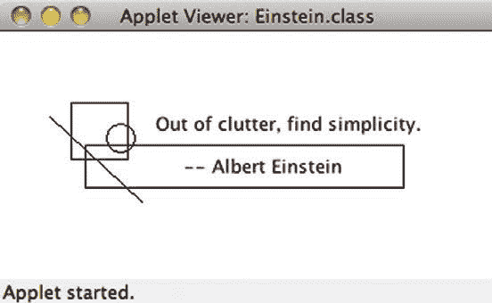

## 2.8 Applets

**123**

**代码 2.10**

*续*

**显示**

类，它是 `javax.swing` 包的一部分，以及 `java.awt` 包中定义的各种图形功能。第 3 章将进一步探讨 `import` 语句。

定义 applet 的类扩展了 `JApplet` 类，正如类声明的头行所示。这一过程正在使用面向对象的继承概念，我们在第 1 章讨论过它，并在书的后续部分进行更详细的介绍。Applet 类也必须声明为公共。

`paint` 方法是 applet 几个具有特殊意义的方法之一。每当 applet 的图形元素需要绘制到屏幕上时（例如在 applet 首次运行时或另一个覆盖它的窗口移动时），该方法就会被自动调用。

请注意 `paint` 方法接受一个 `Graphics` 对象作为参数。`Graphics` 对象定义了一个特定的我们可以与之交互的*图形上下文*。

传递到 applet `paint` 方法的图形上下文代表了整个 applet 窗口。每个图形上下文都有自己的坐标系。在随后的示例中，我们将拥有多个组件，每个组件都有它们自己的图形上下文。

`Graphics` 对象允许我们使用 `drawRect`、`drawOval`、`drawLine` 和 `drawString` 等方法来绘制各种形状。传递给绘制方法的参数指定了要绘制形状的坐标和尺寸。我们将在下一节中探索这些以及其他绘制形状的方法。

# 第 2 章：数据与表达式

## 使用 Web 运行 applet

为了让 applet 能够通过 Web 传输并由浏览器执行，它必须在超文本标记语言（HTML）文档中引用。HTML 文档包含 `tags`，用于指定格式化指令并识别要包含在文档中的特殊媒体类型。Java 程序被视为一种特定的媒体类型，就像文本、图形和声音一样。

HTML 标签包含在角括号中。以下是 applet 标签的示例：

```html
<applet code="Einstein.class" width="350" height="175">
</applet>
```

该标签规定存储在文件 `Einstein.class` 中的字节码应该通过网络传输，并在想要查看此特定 HTML 文档的机器上执行。applet 标签还指示了 applet 的宽度和高度。

其他标签也可以用于在 HTML 文件中引用 applet，包括 `<object>` 标签和 `<embed>` 标签。根据世界维网联盟（W3C）的规定，实际上 `<object>` 标签才是应该使用的标签。

然而，浏览器对 `<object>` 标签的支持并不一致。目前，最可靠的解决方案是使用 `<applet>` 标签。

注意，applet 标签引用的是 `Einstein` applet 的字节码文件，而不是源代码文件。在通过 Web 传输 applet 之前，必须将其编译成字节码格式。然后，如图 2.11 所示，可以使用 Web 浏览器加载文档，浏览器将自动解释并执行该 applet。

Java 源代码 -> Java 编译器 -> 字节码 -> Java Web 浏览器 -> 带有 JVM (JVM) 的虚拟机 -> 远程计算机

**图 2.11** Java 的翻译与执行过程，包括 applets


## 2.9 绘制形状

### 自测习题（答案见附录 N）

- SR 2.42 Java 应用和 Java applet 之间有什么区别？
- SR 2.43 applet 的 `paint` 方法何时被调用的？
- SR 2.44 下面的 HTML applet 标签有什么错误？请解释。

```html
<applet code="DrawHouse.java" width="400" height="300">
</applet>
```

## 2.9 绘制形状

Java 标准类库提供了许多类，允许我们呈现和操纵图形信息。`Graphics` 类是所有此类处理的基础。

### Graphics 类

`Graphics` 类定义在 `java.awt` 包中。

**核心概念**：它包含了各种方法，允许我们绘制形状。大多数形状都可以进行填充绘制，包括线条、矩形和椭圆。图 2.12 列出了 `Graphics` 类的一些基础绘制方法，有些是不透明的（填充的），有些是不透明的（未填充的，作为轮廓）。

注意，这些方法还允许我们绘制圆和正方形，它们分别是椭圆和矩形的特定类型。我们将在书后的适当位置进一步讨论 `Graphics` 类的其他绘制方法。

`Graphics` 类的方法允许我们指定是想要填充形状还是不填充形状。不填充的形状只显示形状的轮廓，并且在其他地方是透明的（你可以看到任何底层的图形）。填充的形状在边界之间是实心的，并会覆盖任何底层的图形。

所有这些方法都依赖于 Java 坐标系，这是我们在在本章早期讨论过的**核心概念**。回想点 `(0,0)` 位于左上角，随着向右移动，`x` 值增大；随着向下移动，`y` 值增大，从而定义边界矩形的位置和大小。

在可见区域之外坐标处绘制的任何形状都将无法看到。

许多 `Graphics` 绘制方法是自而易懂的，但有些需要进一步的讨论。例如，注意由 `drawOval` 方法绘制的椭圆是由左上角的坐标以及指定宽度和高度的*边界矩形*尺寸定义的。

```java
void drawLine(int x1, int y1, int x2, int y2)
// 从点 (x1, y1) 绘制到点 (x2, y2) 的直线。

void drawRect(int x, int y, int width, int height)
// 绘制一个左上角为 (x, y)、尺寸为 width 和 height 的矩形。

void drawOval(int x, int y, int width, int height)
// 绘制一个由左上角为 (x, y)、尺寸为 width 和 height 的矩形所边界的椭圆。

void drawString(String str, int x, int y)
// 在点 (x, y) 处绘制字符串 str，并向右延伸。

void drawArc(int x, int y, int width, int height, int startAngle, int arcAngle)
// 沿着 x, y, width, height 定义的矩形绘制弧。弧从 startAngle 开始，延伸到 arcAngle 定义的距离。
```

**图 2.12** `Graphics` 类的一些方法，如椭圆，通常是由它们的边界定义的。

圆弧可以被认为是椭圆的一部分。要绘制圆弧，我们指定圆弧所属的椭圆以及我们感兴趣的椭圆部分。圆弧的起点由*起始角*定义，终点由*弧角*定义。弧角并不指示圆弧的结束的位置，而是它的范围。

起始角和弧角是以度为单位的。起始角的起始点是穿过椭圆中心的虚拟水平线，可以称为 0°，如图 2.14 所示。

每个图形上下文都有当前的*前景颜色*，在绘制任何形状或字符串时使用。任何可以绘制的表面都有*背景颜色*。前景颜色通过 `Graphics` 类的 `setColor` 方法设置，背景颜色通过我们正在绘制的组件（如 applet）的 `setBackground` 方法设置。

```java
Color getColor()
// 返回此图形上下文的前景颜色。

void setColor(Color color)
// 将此图形上下文的前景颜色设置为指定的颜色。
```

```java
// Snowman.java Author: Lewis/Loftus
//
// Demonstrates basic drawing methods and the use of color.
//********************************************************************

import javax.swing.JApplet;
import java.awt.*;

public class Snowman extends JApplet
{
    //-----------------------------------------------------------------
    // Draws a snowman.
    //-----------------------------------------------------------------
    public void paint(Graphics page)
    {
        final int MID = 150;
        final int TOP = 50;
        setBackground(Color.cyan);
        page.setColor(Color.blue);
        page.fillRect(0, 175, 300, 50); // ground
        page.setColor(Color.yellow);
        page.fillOval(-40, -40, 80, 80); // sun
        page.setColor(Color.white);
        page.fillOval(MID-20, TOP, 40, 40); // head
        page.fillOval(MID-35, TOP+35, 70, 50); // upper torso
        page.fillOval(MID-50, TOP+80, 100, 60); // lower torso
        page.setColor(Color.black);
        page.fillOval(MID-10, TOP+10, 5, 5); // left eye
        page.fillOval(MID+5, TOP+10, 5, 5); // right eye
        page.drawArc(MID-10, TOP+20, 20, 10, 190, 160); // smile
        page.drawLine(MID-25, TOP+60, MID-50, TOP+40); // left arm
        page.drawLine(MID+25, TOP+60, MID+55, TOP+60); // right arm
        page.drawLine(MID-20, TOP+5, MID+20, TOP+5); // brim of hat
        page.fillRect(MID-15, TOP-20, 30, 25); // top of hat
    }
}
```

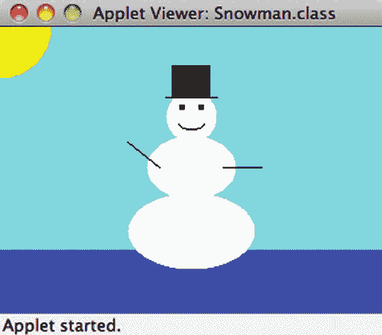

### 2.9 绘制形状

**129**

#### 列表 2.11 显示

*续*

雪人的头部。整个雪人形象都是相对于这些值绘制的。

使用此类常量可以更容易地创建雪人并在稍后进行修改。例如，要将图片中的雪人向右或向左移动，只需要更改一个常量声明。

#### 自测习题（答案见附录 N）

- **SR 2.45** 什么是边界矩形（bounding rectangle）？
- **SR 2.46** 假设你有一个名为 `page` 的 `Graphics` 对象，写一条语句来绘制一个边长为 50 的正方形，其左上角位于点 (16, 12)。
- **SR 2.47** 假设你有一个名为 `page` 的 `Graphics` 对象，写出一系列语句来绘制一个高度为 20 宽度为 40 的蓝色矩形，其左上角位于点 (30, 35)。

**130**

# 第 2 章 数据与表达式

- **SR 2.48** 分别对雪人程序进行以下每种更改的结果将会是什么？你可以进行更改、编译并运行程序，然后观察并报告结果。简要解释你观察到的现象。

    a. 将 `MID` 的值设置为 120 而不是 150。
    b. 将 `TOP` 的值设置为 25 而不是 50。
    c. 在程序的最后两条语句（绘制帽子的语句）之前，我们包含语句：
       `page.setColor(Color.blue);`
    d. 在创建微笑的语句中，将 190 更改为 10。
    e. 在创建上半身的语句之前，将前景颜色设为青色（cyan）。在创建完上半身后，立即将其重新设为白色。

### 核心概念总结

**131**

- `print` 和 `println` 方法代表 `System.out` 对象提供的两种服务。
- 转义字符序列（escape sequence）可以表示否则会引起编译问题的字符。
- 变量是用于存储特定数据类型值的内存位置的名称。
- 访问数据会保持其在内存中完好，但赋值语句会覆盖旧数据。
- 我们不能将一种类型的值赋值给一个不兼容类型的变量。
- 常量在它们存在期间持有特定的值。
- Java 有两种数值类型：整数和浮点数。有四种整数数据类型和两种浮点数据类型。
- Java 使用 16 位 Unicode 字符集表示字符数据。
- 表达式是运算符和操作数的组合，用于执行计算。
- Java 遵循一套定义良好的优先级规则，这些规则规定了表达式中运算符求值的顺序。
- 应避免收缩转换（Narrowing conversions），因为它们可能会丢失信息。
- `Scanner` 类提供了从各种来源读取各种类型输入的方法。
- 图形数据通过将其划分为许多称为像素的微小部分表示。
- Java 的坐标系原点位于左上角，所有可见坐标均为正数。
- 颜色在 Java 中使用 RGB 值表示——即红、绿、蓝三种原色的贡献值。
- `Color` 类包含了若干预定义的颜色。

（注：原文中存在大量重复行，已按要求整合）

**132**

**第 2 章** 数据与表达式

**练习**

- **EX 2.1** 下述片段的输出是什么？
- **EX 2.2** 解释。
- **EX 2.3** 下述语句的输出是什么？
- **EX 2.4** 下列程序是否有误？如果是，如何修复？
- **EX 2.5** 下述语句的输出是什么？
- **EX 2.6** 解释。
- **EX 2.7** 在后续语句之后，整数变量中包含什么值？
- **EX 2.8** 在后续语句之后，浮点变量中包含什么值？
- **EX 2.9** 在后续语句之后，和中包含什么值？
- **EX 2.10** 写三条程序语句来减少整数变量的值。
- **EX 2.11** 给定以下声明，每个赋值语句的结果将是什么？

  `int iResult, num1 = 25, num2 = 40, num3 = 17;`
  `double fResult, val1 = 17.0, val2 = 12.7;`

  a. `iResult = num1 / num4;`
  b. `fResult = num1 / num4;`
  c. `iResult = num3 / num4;`
  d. `fResult = num3 / num4;`
  e. `fResult = val1 / num4;`
  f. `fResult = val1 / val2;`
  g. `iResult = num1 / num2;`
  h. `fResult = (double) num1 / num2;`
  i. `fResult = num1 / (double) num2;`
  j. `fResult = (double) (num1 / num2);`
  k. `iResult = (int) (val1 / num4);`
  l. `fResult = (int) (val1 / num4);`
  m. `fResult = (int) ((double) num1 / num2);`
  n. `iResult = num3 % num4;`
  o. `iResult = num2 % num3;`
  p. `iResult = num3 % num2;`
  q. `iResult = num2 % num4;`

- **EX 2.12** 对于每个表达式，通过在每个运算符下方写数字来指示求值的顺序。

  a. `a - b - c - d`
  b. `a - b + c - d`
  c. `a + b / c / d`
  d. `a + b / c * d`
  e. `a / b * c * d`
  f. `a % b / c * d`
  g. `a % b % c % d`
  h. `a - (b - c) - d`


# 练习题

i. `(a - (b - c)) - d`

j. `a - ((b - c) - d)`

k. `a % (b % c) * d * e`

l. `a + (b - c) * d - e`

m. `(a + b) * c + d * e`

n. `(a + b) * (c / d) % e`

## EX 2.13 解释 Web 在翻译和执行某些 Java 程序中所起的作用。

## EX 2.14 比较对比传统的坐标系与 Java 图形组件使用的坐标系。

## EX 2.15 存储一张宽为 400 像素、高为 250 像素的彩色图片需要多少位？假设颜色使用本章描述的 RGB 技术表示，且没有进行任何特殊压缩。

## EX 2.16 假设你有一个名为 `page` 的 `Graphics` 对象，写一条语句从点 (20, 30) 画一条线到点 (50, 60)。

## EX 2.17 假设你有一个名为 `shape` 的 `Graphics` 对象，写一条语句画一个高度为 100 的正方形，使其左上角位于点 (35, 50)。

## EX 2.18 假设你有一个名为 `page` 的 `Graphics` 对象，写一条语句画一个以点 (50, 50) 为中心、半径为 20 像素的圆。

## EX 2.19 下面代码绘制了 Snowman Applet 中雪人的眼睛。绘制时，眼睛看起来位于脸部中心，但每次调用的第一个参数相对于中点的偏移并不相等。请解释原因。

```
page.fillOval(MID-10, TOP+10, 5, 5);
page.fillOval(MID+5, TOP+10, 5, 5);
```

# 编程项目

### PP 2.1 创建第 1 章中 Lincoln 程序的修订版本，用字符 `^` 组成框并打印框内的引言。

### PP 2.2 写一个程序，读取四个整数并打印它们的平方之和。

### PP 2.3 写一个程序，读取三个浮点数并打印它们的平均值的立方。

### PP 2.4 写一个程序，提示并读取一个课程名称、学分和参考书。然后打印以下段落，并插入相应的数据：

本学期，课程设置中增加了一门关于 `course_name` 的新课程。它包含 `credits` 学分，该课程的参考书是 `reference_book`。

### PP 2.5 创建 UnitConverter 应用的一个版本，将英寸转换为英尺。从用户处读取英寸值。

### PP 2.6 写一个将克转换为磅的程序。（1 磅等于 453.592 克）。从用户处读取浮点数类型的克值。

### PP 2.7 写一个程序，提示并读取打字速度和文档字符数的整数值，然后以浮点数结果的形式打印输入它们所需的时间。

### PP 2.8 写一个程序，读取表示公斤、克和毫克重量的数值，然后打印等值的毫克重量。（例如，1 公斤 50 克和 42 毫克等于 10,50,042 毫克）。

### PP 2.9 创建上一个项目的版本，反转计算过程。即读取一个表示毫克重量的数值，然后以公斤、克和毫克的组合打印等值的重量。（例如，90,70,056 毫克等于 9 公斤 70 克和 56 毫克）。

### PP 2.10 写一个程序，确定罐中硬币的价值并以美元和分的形式打印总额。读取代表季度币、一角币、镍币和美分数量的整数值。

### PP 2.11 写一个程序，提示并读取一个代表金额的 double 值。然后确定表示该金额所需的最少纸钞和硬币数量，从面值最大的开始（假设十元钞为所需的最大面值）。例如，如果输入的值是 47.63（47 元 63 分），则程序应打印等值金额为：

4 ten dollar bills

1 five dollar bills

2 one dollar bills

2 quarters

1 dimes

0 nickles

3 pennies

### PP 2.12 写一个程序，提示并读取两个表示矩形长度和宽的整数，然后打印它的周长和面积。

### PP 2.13 写一个程序，提示并读取以浮点数（`double`）形式表示的圆的周长，然后打印圆的半径。

### PP 2.14 创建 Snowman Applet 的修订版本，进行以下修改：

- 在上躯干添加两个红色按钮。
- 让雪人皱眉而不是微笑。
- 将太阳移动到图片的右上角。
- 在图片的左上角显示你的名字。
- 将整个雪人向右移动 20 像素。

### PP 2.15 写一个绘制大斗七的 Applet。在夜空中添加一些额外的星星。

### PP 2.16 写一个绘制系在绳子上的气球的 Applet。让气球五颜六色。

### PP 2.17 写一个绘制奥运会标志的 Applet。标志中的圆从左到右分别涂成蓝色、黄色、黑色、绿色和红色。

### PP 2.18 写一个绘制带有门（和门把手）、窗户和烟囱的房屋的 Applet。让烟囱排出一些烟，并在空中画上一些云。

### PP 2.19 写一个显示你设计的名片的 Applet。

### PP 2.20 写一个 Applet，通过再次略微偏移绘制你的名字来实现显示效果。

### PP 2.21 写一个显示带有八个不同切片的饼图的 Applet。

# 第 2 章 数据与表达式

# 火星轨道探测器与极地着陆器软件故障

### 发生了什么？

作为探索火星系列任务的一部分，NASA 于 1998 年 12 月发射了火星轨道探测器，并于 1999 年 1 月发射了极地着陆器。这项双探测器任务的设计目的是观察火星每个季节的状况。轨道探测器和着陆器将收集温度、水蒸气、云以及火星极地区增加和减少二氧化碳的数据。

在经历了九个月旅行后，轨道探测器于 1999 年 9 月到达火星，并启动了主引擎以建立轨道。轨道探测器五分钟后按照计划出现在行星后方（从地球视角看），但 NASA 未能与其重新联系。数据审查显示，轨道探测器进入轨道时的高度仅为 57 公里，而计划高度为 140 公里。最小生存高度在 85 到 100 公里之间。NASA 得出的结论是其被大气摩擦破坏了。

极地着陆器于 1999 年 12 月到达火星，所有数据表明它将在火星南极目标地点 10 公里内实现软着陆。然而，NASA 在其进入大气层后不久失去了与着陆器的联系。在随后的几周和几个月里，多次尝试联系均未成功。

轨道探测器和着陆器的项目总成本为 3.276 亿美元。

### 是什么造成的？

轨道探测器问题的根源是一个尴尬的通信问题。引导航器导航的软件使用的是英制单位（磅力），而航天器本身期望的是公制单位（牛顿）。因此，预期的导航变化与实际效果偏差了 4.45 倍。这种不匹配部分是因为一个位于科罗拉多州的团队负责航天器工作，而另一个位于加利福尼亚州的团队负责导航问题。

# 第 3 章 使用类和对象

着陆器通信问题的原因尚未明确，但据认为与轨道器的问题无关。调查结论认为，最可能的原因是一个软件错误，该错误将着陆器支腿的部署误认为是已着陆在行星表面。这会导致引擎在着陆器仍距离地面 40 米高时就关闭。然而，也存在其他可能性。

## 经验教训

火星探测器的单位不匹配表明，显而易见的问题可能会被忽视。错误是不可避免的，但必须建立相应的流程来捕获它们。调查得出结论，在这种情况下，子系统之间元素的跟踪和双重检查系统不够健壮。此外，团队对新成员的培训不一致，某些通信渠道过于非正式。单位不匹配发现得太晚了。这强调了进行更多评估和测试的必要性。

来源：nasa.gov

## 类与对象

- 讨论对象的创建和引用变量的使用。
- 探索 `String` 类提供的服务。
- 描述 Java 标准库如何组织成包。
- 探索 `Random` 和 `Math` 类提供的服务。
- 讨论使用 `NumberFormat` 和 `DecimalFormat` 类格式化输出的方法。
- 引入枚举类型。
- 包装类（`wrapper classes`）和自动装箱（`autoboxing`）概念。
- 介绍图形界面使用的组件。
- 描述预定义类的使用。

使用类和对象及其提供的服务是面向对象软件的基础部分，并为编写程序奠定基础。在本章中，我们使用类和对象来处理字符串、执行计算并格式化输出。本章还引入了枚举类型的概念（这是一种特殊的 Java 类型），并讨论了包装类。

## 3.1 创建对象

在第 1 章结束时，我们介绍了面向对象概念的概述，包括类和对象之间的基本关系。在第 2 章，除了讨论原始数据类型外，我们提供了一些使用对象来提供服务的示例。本章将进一步探索这些思想。在之前的示例中，我们多次使用了 `println` 方法。正如第 2 章提到的，`println` 方法是由 `System.out` 提供的服务，它代表标准输出流。更准确地说，标识符 `out` 是存储在 `System` 类中的对象变量。我们可以直接使用它。

在第 2 章中，我们还使用了 `Scanner` 类，它代表一个允许我们从键盘或文件读取输入的对象。我们使用 `new` 操作符创建了一个 `Scanner` 对象。一旦对象创建，我们就可以使用它调用它的方法。让我们仔细检查创建对象的想法。在 Java 中，变量代表一个原始值或一个对象。与持有原始类型的变量一样，引用对象的变量也必须声明。用于定义对象的类可以被视为对象的类型。对象变量的声明结构与原始变量的声明结构相似。

考虑以下两个声明：

```
int num;
String name;
```

第一个声明创建了一个持有整数值的变量，正如我们之前多次看到的。第二个声明创建了一个 `String` 变量，它持有指向一个 `String` 对象的引用。对象变量本身并不持有对象；它持有的是对象的地址。

最初，上面声明的两个变量不包含任何数据。我们称它们是未初始化的（`uninitialized`），可以如下所示所示：

`num` – `name` –

正如我们在第 2 章中指出的，在使用变量之前确保其已初始化始终是重要的。对于对象变量，这意味着我们必须在使用之前确保它指向一个有效对象。在大多数情况下，如果你尝试在初始化之前使用一个变量，编译器将抛出错误。

对象变量也可以设置为 `null`，这是 Java 中的一个保留字。`null` 引用特别表示变量没有引用对象。注意，尽管我们声明了一个 `String` 引用变量，但实际上还没有 `String` 对象。使用 `new` 操作符创建对象的过程被称为实例化（`instantiation`）。对象被称为特定类的实例（`instance`）。要实例化对象，我们可以使用 `new` 操作符，它返回新对象的地址。以下两个赋值语句为声明的变量赋值：

```
num = 42;
name = new String("James Gosling");
```

在 `new` 操作符创建对象后，会调用构造函数（`constructor`）进行初始化。构造函数是一个与类名相同的特殊方法。在这个示例中，构造函数的参数是一个字符串字面量，指定了新创建的 `String` 对象将持有的字符。`new` 操作符返回引用。执行这些赋值后，变量可以描述为：

`num` = 42

`name` = "James Gosling"

由于对象引用变量持有对象的地址，它可以被视为内存中存储对象位置的指针（`pointer`）。我们可以显示数值地址，但实际地址值是无关的——重要的是该变量指向一个特定的对象。

对象实例化后，我们使用点操作符（`dot operator`）来访问它的方法。我们已经多次使用点操作符，例如在调用 `System.out.println` 时。点操作符直接附加在对象引用之后，后面跟着要调用的方法。例如，为了调用 `String` 类定义的 `length` 方法，我们可以在 `name` 引用变量上使用点操作符：

```
count = name.length()
```

`length` 方法不接受任何参数，但括号仍然是必要的，以表示正在调用方法。某些方法会产生一个方法完成后返回（`returned`）的值。`String` 类 `length` 方法的作用是确定并返回字符串的长度（包含的字符数）。在这个示例中，返回的值被赋值给变量 `count`。对于字符串 "James Gosling"，长度方法返回 13，这包含了姓名之间的空格。

声明对象引用变量和创建对象本身的操作可以通过在声明时初始化变量来合并为一个步骤，就像我们处理原始数据类型一样：

```java
String title = new String("Java Software Solutions");
```

即使字符串不是原始数据类型，但它们是如此基础且使用频繁，以至于 Java 定义了由双引号分隔的字符串字面量，正如我们在各种示例中看到的那样。这是一个简写符号。每当字符串字面量出现时，都会自动创建一个 `String` 对象。因此，以下声明是有效的：

```java
String city = "London";
```

也就是说，对于 `String` 对象，可以消除显式地使用 `new` 运算符和对构造函数的调用。在大多数情况下，我们将使用这种简化的语法。

### 别名

由于对象引用变量存储的是地址，因此程序员在管理对象时必须小心。首先，让我们回顾赋值对原始类型值的影响。假设我们有两个整数变量 `num1` 初始化为 `5`，`num2` 初始化为 `12`：

```
num1 = 5
num2 = 12
```

在接下来的赋值语句中，存储在 `num1` 中的值被存储到 `num2` 中：

```java
num2 = num1;
```

`num2` 中的原始值 `12` 被值 `5` 覆盖。变量 `num1` 和 `num2` 仍然指向内存中的不同位置，而这两个位置现在都包含值 `5`：

```
num1 = 5
num2 = 5
```


现在考虑以下对象声明：

```java
String name1 = "Ada, Countess of Lovelace";
String name2 = "Grace Murray Hopper";
```

最初，引用 `name1` 和 `name2` 指向两个不同的 `String` 对象：

```
name1 = "Ada, Countess of Lovelace"
name2 = "Grace Murray Hopper"
```

现在假设执行以下赋值语句，将 `name1` 中的值复制到 `name2`：

```java
name2 = name1;
```

此赋值的操作与整数赋值相同——`name1` 值的副本被存储在 `name2` 中。但记住，对象变量持有的是对象的地址，被复制的是地址。最初，两个引用指向不同的对象。赋值后，`name1` 和 `name2` 均包含相同的地址，因此指向同一个对象：

```
name1 = "Ada, Countess of Lovelace"
name2 = "Ada, Countess of Lovelace"
```

`name1` 和 `name2` 引用变量现在是彼此的**别名**，因为它们是指向同一个对象的两个名称。所有多个引用变量都可以指向同一个对象。原本由 `name2` 引用的对象现在已无法访问；该对象在程序中无法再次被使用。

别名的一个重要影响是，当我们使用一个引用来更改对象时，另一个引用对应的对象也会随之改变，因为实际上只有一个对象。除非仔细管理，否则别名可能会产生不良后果。

与对象的所有交互都通过引用变量进行，因此只有当我们拥有该对象的引用时，才能使用它。当对一个对象的所有引用都丢失时（可能是通过重新赋值），该对象将无法再对程序做出贡献。程序无法再次调用它的方法或使用它的变量。此时，该对象被称为`垃圾`，因为它不再具有任何用处。

Java 执行`自动垃圾回收`。当对对象的最后一个引用丢失时，它就变成了垃圾回收的候选对象。有时，Java 环境会在后台执行“收集”并将内存返回给系统。

### 自复习

- 什么是 `null` 引用？
- `new` 运算符实现了什么功能？
- 什么是`别名`？
- 它与垃圾回收有什么关系？
- 为 `String` 变量 `author` 写一个声明，并将其初始化为 "Fred Brooks"。
- 编写代码语句，将整数变量 `size` 设置为字符串对象 `name` 的长度。

## 3.2 String 类

让我们详细地检查 `String` 类。图 3.1 列出了更多实用的方法。一旦创建了 `String` 对象，它的值就不能延长或缩短，它的任何字符都不能改变。因此我们说 `String` 是**不可变的**。请注意，某些 `String` 方法返回的是修改原始字符串产生的新 `String` 对象。字符串中的字符可以通过其位置或索引来指定。字符串中第一个字符的索引为零，下一个字符的索引为一，依此类推。

**图 3.1 String 类的部分方法**

- `String(String str)`：创建一个与 `str` 具有相同字符的新字符串对象。
- `charAt(int index)`：返回指定索引处的字符。
- `compareTo(String str)`：返回一个整数，指示此字符串在字典顺序上是在 `str` 之前（负值）、相等（零值）还是在 `str` 之后（正值）。
- `concat(String str)`：返回一个新字符串，由此字符串与 `str` 拼接而成。
- `equals(String str)`：如果字符串包含与 `str` 相同的字符（包括大小写）则返回 true，否则返回 false。
- `equalsIgnoreCase(String str)`：如果此字符串包含与 `str` 相同的字符（不区分大小写）则返回 true，否则返回 false。
- `length()`：返回此字符串中字符的数量。
- `substring(int offset, int endIndex)`：返回一个新字符串，它是此字符串从 `offset` 开始延伸到 `endIndex-1` 的子集。
- `replace(char oldChar, char newChar)`：返回一个新字符串，与此字符串相同，但每个旧字符 `oldChar` 都被替换为 `newChar`。


- `toLowerCase()`：返回一个新字符串，与此字符串相同，但所有大写字母都转换为相应的小写字母。
- `toUpperCase()`：返回一个新字符串，与此字符串相同，但所有小写字母都转换为对应的大写字母。

**图 3.1** `String` 类的一些方法

```java
// Print each mutated string
System.out.println("Mutation #1: " + mutation1);
System.out.println("Mutation #2: " + mutation2);
System.out.println("Mutation #3: " + mutation3);
System.out.println("Mutation #4: " + mutation4);
System.out.println("Mutated length: " + mutation4.length());
}
```

# 输出

原始字符串: "Change is inevitable"
字符串长度: 20
变异 #1: Change is inevitable, except from vending machines.
变异 #2: CHANGE IS INEVITABLE, EXCEPT FROM VENDING MACHINES.
变异 #3: CHANGX IS INXVITABLX, XXCXPT FROM VXNDING MACHINXS.
变异 #4: NGX IS INXVITABLX, XXCXPT F
变异长度: 27


## 3.2 `String` 类

**147**

在打印原始短句及其长度后，执行了 `concat` 方法来由变量 `mutation1` 引用的新字符串对象：`mutation1` "Change is inevitable, except from vending machines."

然后在 `mutation1` 对象上执行了 `toUpperCase` 方法，并将结果字符串存储在 `mutation2` 中：`mutation2` "CHANGE IS INEVITABLE, EXCEPT FROM VENDING MACHINES"

注意，`length` 和 `concat` 方法是在 `phrase` 短句对象上执行的，但 `toUpperCase` 方法是在 `mutation1` 对象上执行的。通常，方法是在特定对象上执行的。`String` 类的任何方法都可以在任何 `String` 对象上执行，但对于任何给定的调用，结果是在特定对象上执行。在 `mutation1` 上执行 `toUpperCase` 的结果与在 `phrase` 上执行 `toUpperCase` 的结果将大不相同。记住，每个对象都有自己的状态，这通常会影响方法调用的结果。

最后，通过调用 `mutation2.replace` 和 `mutation3.substring` 分别初始化了 `String` 对象变量 `mutation3` 和 `mutation4`：`mutation3` "CHANGX IS INXVITABLX, XXCXPT FROM VXNDING MACHINXS" `mutation4` "NGX IS INXVITABLX, XXCXPT F"

### 自测习题 *(答案见附录 N)*

SR 3.6 假设 `s1`、`s2` 和 `s3` 是分别初始化为 "Amanda"、"Bobby" 和 "Chris" 的 `String` 变量。以下语句改变哪些 `String` 变量？

a. `System.out.println(s1);`
b. `s1 = s3.toLowerCase();`
c. `System.out.println(s2.replace('B', 'M'));`
d. `s3 = s2.concat(s1);`

SR 3.7 下述代码段产生什么输出？

```java
String s1 = "Foundations";
String s2;
System.out.println(s1.charAt(1));
s2 = s1.substring(0, 5);
System.out.println(s2);
```


**148**

**第 3 章** 使用类和对象

SR 3.8 编写一条语句，将名为 `title` 的 `String` 对象的值全大写打印出来。

SR 3.9 编写一个名为 `front` 的 `String` 变量声明，并将其初始化为另一个名为 `description` 的 `String` 对象的前 10 个字符。

## 3.3 包

我们之前提到 Java 语言由称为 Java API 的标准类库支持，我们可以根据需要使用它。让我们进一步探讨这个想法。

*类库*是一组支持程序开发**核心概念**的类。编译器或开发环境通常会带有一个类库。类库在开发程序时提供用的支持。类库也可以通过第三方供应商单独获取。类库中的类包含许多方法，这些方法对程序员来说通常非常有价值，因为它们提供了特殊功能。事实上，程序员往往会依赖类库中的方法，并开始将它们视为语言的一部分。然而，从技术上讲，它们并不属于语言本身。

例如，`String` 类并不是 Java 语言的固有部分。它是 Java 标准类库的一部分，可以在任何 Java 开发环境中找到。构成该库的类是由 Sun Microsystems 的员工创建的，他们也是 Java 语言的创建者。

类库由几个相关的类簇组成，通常称为 Java APIs，全称为*应用程序编程**接口*。例如，当我们谈论帮助我们编写与数据库交互的程序的类集时，我们可以提到 Java 数据库 API。API 的另一个例子是 Java Swing API，它指的是一组定义了图形用户界面中使用的特殊图形组件的类。通常，整个标准库被通泛称为 Java API。

Java 标准类库的类也被**核心概念**地组织成*包*（packages）。每个类都是某个特定包的一部分。例如，`String` 类是 `java.lang` 包的一部分。`System` 类也是 `java.lang` 包的一部分。我们在第 2 章中提到，`Scanner` 类是 `java.util` 包的一部分。包的组织比 API 名称更基础。虽然包和 API 名称之间存在通用对应关系，但构成给定 API 的类可能会跨越包。

## 3.3 包

**149**

**包**

提供支持

*   `java.applet`: 创建可以在 Web 上传输的程序（applet）。
*   `java.awt`: 绘制图形并创建图形界面；AWT 代表抽象工具包。
*   `java.beans`: 定义可以组合的软件组件。
*   `java.io`: 执行各种输入输出功能。
*   `java.lang`: 通用支持；自动导入到所有 Java 程序中。
*   `java.math`: 执行任意精度的计算。
*   `java.net`: 跨网络通信。
*   `java.rmi`: 创建分布在多台计算机上的程序；RMI 代表远程方法调用。
*   `java.security`: 实施安全限制。
*   `java.sql`: 与数据库交互；SQL 代表结构化查询语言。
*   `java.text`: 文本格式化输出。
*   `java.util`: 通用工具。
*   `javax.swing`: 使用扩展 AWT 能力的组件创建图形界面。
*   `javax.xml.parsers`: 处理 XML 文档；XML 代表可扩展标记语言。

**图 3.2** API 中的某些包

图 3.2 描述了 API 的部分包。这些包在任何支持 Java 软件开发的平台上可用。其中某些包支持非常特定的编程技术，在基础程序开发中不会涉及。

Java API 的各种类在书中都有讨论。为了方便起见，我们在书中包含了一些用到的类的文档（如图 3.2），但了解如何获取更多 Java API 类的信息也非常重要。*在线 Java API 文档*是任何 Java 程序员的宝贵资源。它是一个包含标准 Java API 中每个类的网站，列出并描述了每个类的方法。

图 3.3 显示此文档的一个页。侧边的链接允许你查看特定的包并跳转到特定的类。花点时间

### import 声明

`java.lang` 包中的类在编写 Java 程序时是可以自动使用的。然而，要使用任何其他包中的类，我们必须使用`完全限定`（fully qualify）引用或使用 `import declaration`（导入声明）。请记住，使用 `Scanner` 类的示例程序包含一个导入声明。

当你想要在程序中使用类库中的类时，可以在每次引用它时都使用它的完全限定名（包括包名）。例如，每当你想要引用定义在 `java.util` 包中的 `Scanner` 类时，你可以写 `java.util.Scanner`。

然而，每次需要都完全指定包名和类名很快就会变得非常累。Java 提供了 import 声明来简化这些引用。


## 3.3 包

**151**

import 声明指定了程序将使用的包和类，这样在每次引用时就不需要完全限定名。正如我们所看到的，下面是一个 import 声明的示例：`import java.util.Scanner;`

此声明断言 `java.util` 包中的 `Scanner` 类可以在程序中使用。一旦此 import 声明，在程序中引用该类时，使用简单名称 `Scanner` 就足够了。

如果来自两个包的两个类具有相同的名称，import 声明是不够的，因为编译器无法确定代码流中引用的是哪一个类。当出现这种情况时（这种情况很少），应该在代码中使用完全限定名。

import 声明的另一种形式使用星号（`*`）表示包内的任何类都可能在程序中使用。因此，以下声明允许 `java.util` 包中的所有类在程序中被引用，无需对每个引用进行限定：`import java.util.*;`

如果程序只使用特定包的一个类，通常在 import 声明中指定该类会更好。然而，如果将使用两个或多个类，通常使用 `*` 表示法就可以了。

`java.lang` 包中的类是自动导入的，**核心概念**，因为它们是基础性的，可以被看作是语言的基础扩展。因此，`java.lang` 包中的任何类（如 `System` 和 `String`）在每个程序中都可以无需显式声明直接使用。这就像是所有的程序文件自动包含了以下声明：`import java.lang.*;`

### 自测问题 *(答案见附录 N)*

SR 3.10 什么是 Java 包？

SR 3.11 `java.net` 包包含什么？`javax.swing` 包包含什么？

SR 3.12 哪个包包含 `Scanner` 类？`String` 类？`Random` 类？`Math` 类？

SR 3.13 使用在线 Java API 文档描述 `Point` 类。

SR 3.14 import 语句实现了什么功能？

SR 3.15 为什么 `String` 类不需要专门导入到我们的程序中？


**152**

**第 3 章** 使用类和对象

### 3.4 `Random` 类

在编写软件时，经常需要随机数。游戏通常使用随机数来代表骰子的点数或洗牌。飞行模拟器可能会使用随机数来决定模拟飞行发生引擎故障的频率。设计用于帮助高中生准备 SAT 考试的程序可能会使用随机数来选择下一个问的问题。

`Random` 类是 `java.util` 类的一部分，代表一个`伪随机数生成器`。随机数生成器从一个值范围内随机选取一个数字。承担此角色的程序在技术上是伪随机的，因为程序没有实际上随机选取数字的方法。伪随机数生成器根据初始`种子值`（seed value）执行一系列复杂的计算并产生一个数字。尽管它们在技术上不是随机的（因为它们是计算出来的），伪随机数生成器产生的值通常看起来是随机，至少对于大多数情况来说足够随机。

图 3.4 列出了 `Random` 类的一些方法。**核心概念** `nextInt` 方法可以不带参数调用，也可以向它传递单个整数值。不带参数的版本执行复杂的计算以营造随机的幻象，在整个 `int` 值范围（包括负数）内生成随机数。通常，我们需要一个更特定范围内的随机数。例如，为了模拟掷骰子，我们可能想要 1 到 6 范围内的随机数。`nextInt` 方法返回一个范围从 0 到参数减 1 的值。

```
Random()
构造函数：创建一个新的伪随机数生成器。

float nextFloat()
返回 0.0（包含）和 1.0（不包含）之间的随机数。

int nextInt()
返回一个范围覆盖所有可能的 int 值（正和负）的随机数。

int nextInt(int num)
返回 0 到 num-1 范围内的随机数。
```

**图 3.4** `Random` 类的一些方法

#### 3.4 `Random` 类

**153**

注意，我们传递给 `nextInt` 方法的值也是可以获取的范围。我们可以通过加或减适当量来移动范围。为了获取 1 到 6 范围内的随机数，我们可以调用 `nextInt(6)` 获取一个 0 到 5 的值，然后加 1。`nextFloat` 方法的 `Random` 类返回一个大于或等于 0.0 且小于 1.0 的浮点数。显示 3.2 程序产生了各种范围的随机数。

**显示 3.2**

```java
//************************************
// RandomNumbers.java Author: Lewis/Loftus
// 展示了伪随机数的
// 类的创建。
//************************************
import java.util.Random;

public class RandomNumbers
{
    //------------------------------------------------
    // 生成各种范围的随机数。
    //------------------------------------------------
    public static void main(String[] args)
    {
        Random generator = new Random();

        int num1;
        float num2;

        num1 = generator.nextInt();
        System.out.println("随机整数：" + num1);

        num1 = generator.nextInt(10);
        System.out.println("0 到 9：" + num1);

        num1 = generator.nextInt(10) + 1;
        System.out.println("1 到 10：" + num1);

        num1 = generator.nextInt(15) + 20;
        System.out.println("20 到 34：" + num1);

        num1 = generator.nextInt(20) - 10;
        System.out.println("-10 到 9：" + num1);

        num2 = generator.nextFloat();
        System.out.println("随机浮点数（0-1 之间）：" + num2);

        num2 = generator.nextFloat() * 6; // 0.0 到 5.9999
        num1 = (int)num2 + 1;
        System.out.println("1 到 6：" + num1);
    }
}
```

**154**

**第 3 章** 使用类和对象

**输出**

随机整数：1773351873
0 到 9：8
1 到 10：6
20 到 34：20
-10 到 9：-6
随机浮点数（0-1 之间）：0.71058085
1 到 6：3

# SR 3.18 假设已经创建了一个名为 `generator` 的 `Random` 对象，下面每个表达式的结果的范围是多少？

a. `generator.nextInt(50)`
b. `generator.nextInt(5) + 10`
c. `generator.nextInt(10) + 5`
d. `generator.nextInt(50) – 25`


## 3.5 `Math` 类

**155**

SR 3.19 假设已经创建了一个名为 `generator` 的 `Random` 对象，请编写表达式来生成以下每个范围的整数（包含端点）。请使用接受单个整数参数的 `nextInt` 方法版本。

a. 0 到 30
b. 10 到 19
c. −5 到 5

## 3.5 `Math` 类

`Math` 类提供了大量的基础数学函数，这些函数在进行计算时非常有帮助。`Math` 类定义在 Java 标准类库的 `java.lang` 包中。图 3.5 列出了它的其中几个方法。

## `Math` 类中的所有方法都是**静态方法**（也称为类方法），这意味着它们可以通过它们所定义的类名来调用，而无需先实例化该类的对象。静态方法将在第 6 章中进一步讨论。

`Math` 类的方法返回结果，可以根据需要作为 `KeY CONCept` 使用在表达式中。例如，以下语句计算存储在 `total` 中的数字的绝对值，将其与 `count` 的四次方幂相加，并通过类名将结果存储在变量 `value` 中：

```java
value = Math.abs(total) + Math.pow(count, 4);
```


## 3.5 Math 类

注意，你可以将一个整数值传递给接受 `double` 参数的方法。这是赋值转换的一种形式，在第 2 章中讨论过。

列表 3.3 显示的二次方程程序（`Quadratic`）使用 `Math` 类来计算二次方程的根。回想，二次方程具有以下一般形式：

$ax^2 + bx + c$

二次方程程序读取代表二次方程系数（`a`、`b` 和 `c`）的值，然后计算求根公式以确定方程的根。求根公式为：

$roots = \frac{-b + \sqrt{b^2 - 4ac}}{2a}$

**VideoNote**

使用 `Random` 和 `Math` 类的示例。

### Figure 3.5 Math 类的一些方法

```java
static int abs(int num) // 返回 num 的绝对值。
static double acos(double num)
static double asin(double num)
static double atan(double num) // 返回 num 的反余弦、反正弦或反正切。
static double cos(double angle)
static double sin(double angle)
static double tan(double angle) // 返回 angle 的余弦、正弦或正切，以弧度为单位。
static double ceil(double num) // 返回 num 的向上取整，即大于等于 num 的最小整数。
static double exp(double power) // 返回 e 的指定幂次方的值。
static double floor(double num) // 返回 num 的向下取整，即小于等于 num 的最大整数。
static double pow(double num, double power) // 返回 num 的指定幂次方的值。
static double random() // 返回 0.0（包含）和 1.0（不包含）之间的随机数。
static double sqrt(double num) // 返回 num 的平方根，num 必须为正。
```

注意，该程序假设判别式（根号下的值）为正。如果它不是正数，结果将不是有效数字，Java 将其表示为 `NaN`，代表不是数字（Not A Number）。在第 5 章中，我们将看到优雅地处理这种情况。

### Listing 3.3

```java
//********************************************************************
// Quadratic.java Author: Lewis/Loftus
//
// 演示了使用 Math 类根据用户输入进行计算。
//********************************************************************
import java.util.Scanner;

public class Quadratic
{
    //-----------------------------------------------------------------
    // 确定二次方程的根。
    //-----------------------------------------------------------------
    public static void main(String[] args)
    {
        int a, b, c; // ax^2 + bx + c
        double discriminant, root1, root2;
        Scanner scan = new Scanner(System.in);
        System.out.print("Enter the coefficient of x squared: "); a = scan.nextInt();
        System.out.print("Enter the coefficient of x: "); b = scan.nextInt();
        System.out.print("Enter the constant: ");
        c = scan.nextInt();
        // 使用求根公式计算根。
        // 假设判别式为正。
        discriminant = Math.pow(b, 2) - (4 * a * c);
        root1 = ((-1 * b) + Math.sqrt(discriminant)) / (2 * a); 
        root2 = ((-1 * b) - Math.sqrt(discriminant)) / (2 * a);
    }
}
```

**Self-Review** *(见附录答案)*

SR 3.20 什么是类方法（也称为静态方法）？

SR 3.21 下每个表达式的值是多少？

a. `Math.abs(10)`

b. `Math.abs(-10)`

c. `Math.pow(2, 4)`

d. `Math.pow(4, 2)`

e. `Math.pow(5, 3)`

f. `Math.sqrt(16)`

SR 3.22 编写一个打印 1 弧度正弦值的语句。

SR 3.23 为 double 变量 `result` 并初始化为 5 的幂次方。

SR 3.24 使用在线 Java 文档，列出 Math 类中未包含在图 3.5 中的三个方法。

## 3.6 格式化输出

`NumberFormat` 类和 `DecimalFormat` 类用于格式化信息，使其在打印或显示时看起来更美观。它们都是 Java 标准库的一部分，定义在 `java.text` 包中。

### NumberFormat 类

`NumberFormat` 类提供了通用的数字格式化功能。

你不需要通过 `new` 操作符来实例化 `NumberFormat` 对象。相反，你通过静态方法请求一个对象。图 3.6 列出了 `NumberFormat` 类的一些方法。

### Figure 3.6 NumberFormat 类的一些方法

```java
String format(double number) // 返回根据对象模式格式化的指定数字字符串。
static NumberFormat getCurrencyInstance() // 返回当前区域设置货币格式的 NumberFormat 对象。
static NumberFormat getPercentInstance() // 返回当前区域设置百分比格式的 NumberFormat 对象。
```

`NumberFormat` 类中的两个方法 `getCurrencyInstance` 和 `getPercentInstance` 返回用于格式化数字的对象。`getCurrencyInstance` 方法返回货币格式化器，`getPercentInstance` 方法返回格式化百分比的对象。

`format` 方法通过格式化对象调用，并返回一个按相应方式格式化的 `String`。

列表 3.4 显示的 `Purchase` 程序使用了两种格式化器。它读取一笔销售交易并计算包含税的最终价格。

### Listing 3.4

```java
//********************************************************************
// Purchase.java Author: Lewis/Loftus
//
// 演示了使用 NumberFormat 类进行输出格式化。
//********************************************************************
import java.util.Scanner;
import java.text.NumberFormat;

public class Purchase
{
    //-----------------------------------------------------------------
    // Calculates the final price of a purchased item using values
    // entered by the user.
    //-----------------------------------------------------------------
    public static void main(String[] args)
    {
        final double TAX_RATE = 0.06; // 6%销售税
        int quantity;
        double subtotal, tax, totalCost, unitPrice;
        Scanner scan = new Scanner(System.in);
        NumberFormat fmt1 = NumberFormat.getCurrencyInstance(); 
        NumberFormat fmt2 = NumberFormat.getPercentInstance(); 
        System.out.print("Enter the quantity: ");
        quantity = scan.nextInt();
        System.out.print("Enter the unit price: "); 
        unitPrice = scan.nextDouble();
        subtotal = quantity * unitPrice;
        tax = subtotal * TAX_RATE;
        totalCost = subtotal + tax;
        // Print output with appropriate formatting
        System.out.println("Subtotal: " + fmt1.format(subtotal)); 
        System.out.println("Tax: " + fmt1.format(tax) + " at " + fmt2.format(TAX_RATE));
        System.out.println("Total: " + fmt1.format(totalCost));
    }
}
```

**输出**

```
Enter the quantity: 5
Enter the unit price: 3.87
Subtotal: $19.35
Tax: $1.16 at 6%
Total: $20.51
```

### DecimalFormat 类

与 `NumberFormat` 类不同，`DecimalFormat` 类使用 `new` 运算符以传统方式进行实例化。它的构造函数接收一个字符串，该字符串表示引导格式化过程的模式。我们可以使用

### Figure 3.7 DecimalFormat 类的一些方法

```java
DecimalFormat(String pattern) // 构造函数：创建一个指定模式的新 DecimalFormat 对象。
void applyPattern(String pattern) // 将指定的模式应用于此 DecimalFormat 对象。
String format(double number) // 返回一个包含根据当前模式格式化的指定数字的字符串。
```

传递给 `DecimalFormat` 构造函数的字符串定义的模式可以变得相当复杂。使用各种符号来表示特定的格式化指南。例如，字符串 `"0.###"` 定义的模式表示小数点左侧至少应打印一个数字，如果值的整数部分为零，则应显示为零。它还表示值的数值部分应保留三位小数。

该模式用于列表 3.5 所示的 `CircleStats` 程序，程序从用户处读取圆的半径并计算其面积和周长。末尾零（例如圆面积为 78.540）不会被打印。

### Listing 3.5

```java
//********************************************************************
// CircleStats.java 作者: Lewis/Loftus
//
// 展示了如何使用 DecimalFormat 类对小数进行格式化。
//********************************************************************
import java.util.Scanner;
import java.text.DecimalFormat;

public class CircleStats
{
    //-----------------------------------------------------------------
    // 根据给定的半径计算圆的面积和周长。
    //-----------------------------------------------------------------
    public static void main(String[] args)
    {
        int radius;
        double area, circumference;
        Scanner scan = new Scanner(System.in);
        System.out.print("Enter the circle's radius: "); radius = scan.nextInt();
        area = Math.PI * Math.pow(radius, 2);
        circumference = 2 * Math.PI * radius;
        // 将输出保留三位小数
        DecimalFormat fmt = new DecimalFormat("0.###"); 
        System.out.println("The circle's area: " + fmt.format(area)); 
        System.out.println("The circle's circumference: " + fmt.format(circumference));
    }
}
```

**输出**

```
Enter the circle's radius: 5
The circle's area: 78.54
The circle's circumference: 31.416
```

### printf 方法

除了 `print` 和 `println` 之外，`System` 类还有另一个名为 `printf` 的输出方法，它允许用户打印包含数据值的格式化字符串。方法的第一个参数表示格式字符串，其余参数指定插入到格式字符串中的值。

例如，下面行代码打印了 ID 号和名称：`System.out.printf("ID: %5d\tName: %s", id, name);`。第一个参数指定输出的格式，并包含标记输出值的字面量字符以及转义字符（如 `\t`）。

模式 `%5d` 表示相应的数值（`id`）应在五个字符的字段中打印。模式 `%s` 匹配字符串参数 `name`。`id` 和 `name` 的值被插入字符串中，产生如下结果：

`ID: 24036 Name: Larry Flagelhopper`

Java 添加 `printf` 方法是为了镜像 C 语言编程中使用的类似功能。这使得程序员更容易将现有程序翻译（或*迁移*）到 Java。仍然具有价值的旧软件被称为*遗留系统*。维护遗留系统通常是一项昂贵的工作，因为由于其他原因，它是基于旧技术的。但在许多情况下，通过提供 C 语言程序员赖以生存的相同输出语句，将其迁移到新技术。

然而，使用 `printf` 方法并不是格式化输出问题的一个特别良好的面向对象的解决方案，因此我们在书中避免使用它。

**自测复习题** *(参见附录中的答案)*

SR 3.25 描述你如何请求一个 `NumberFormat` 对象。

SR 3.26 假设在你的程序中有一个 double 类型变量 `cost`。你想输出按当前区域的货币格式格式化的 `cost`。

a. 写一条代码语句，声明并请求一个名为 `moneyFormat` 的 `NumberFormat` 对象，可以用于表示当前区域的货币。

b. 写一条代码语句，使用 `moneyFormat` 对象打印按当前区域格式化的 `cost` 值。

c. 如果 `cost` 的值为 54.89 且你的计算机区域设置为美国，你在 (b) 部分编写的语句输出是什么？如果你的计算机区域设置为英国输出又是呢？

SR 3.27 如何使用 Java 的格式化类将浮点值输出为百分比？

SR 3.28 写代码语句提示并从用户处读取 double 值，然后打印该输入绝对值的平方根结果。输出结果保留两位小数。

## 3.7 枚举类型

Java 提供了定义*枚举类型*的能力，然后该类型可以作为声明变量时的类型。枚举类型通过列出（或枚举）值来建立该类型变量的所有可能值。这些值是标识符，可以是任何内容。


例如，下面的声明定义了一个名为 `Season` 的枚举类型，其可能值为 `winter`、`spring`、`summer` 和 `fall`：`enum Season {winter, spring, summer, fall}`

变量 `time` 现在其取值范围被限制了。

### 核心概念

它可以包含四个 `Season` 值之一，但不能包含其他任何值。Java 枚举类型是类型安全的，确保了不会使用无效值。枚举类型被认为是类型安全的，这意味着任何尝试使用枚举值之外的值的尝试都会导致编译时错误。

通过类型的名称来访问这些值。例如：`time = Season.spring`。

当变量可以取用的一组较少且不同的值时，枚举类型会非常有帮助。例如，假设我们想表示学生可能获得的各种字母等级。我们可以声明如下枚举类型：

```java
enum Grade {A, B, C, D, F}
```

任何持有 `Grade` 的初始化变量都保证具有其中一个有效等级。这比使用简单的字符或字符串变量来表示等级要好，因为字符或字符串变量可以取任何值。

假设我们还想表示加分和减分等级，例如 `A–` 和 `B+`。我们不能将 `A–` 或 `B+` 作为值，因为它们不是有效的标识符（在 Java 中，`-` 和 `+` 字符不能作为标识符的一部分）。然而，可以使用标识符 `Aminus`、`Bplus` 等来表示相同的值。

在内部，枚举类型中的每个值都存储为一个整数，这被称为它的序值（ordinal value）。枚举类型中的第一个值的序值为 `0`，第二个值的序值为 `1`，第三个为 `2`，依此类推。

序值仅在内部使用。你不能给枚举类型赋值数值，即使该数值对应于一个有效的序值。

### 3.7 枚举类型

枚举类型是一种特殊的类，枚举类型的变量是对象变量。因此，所有枚举类型都关联有几个方法。`ordinal()` 方法返回与特定枚举值相关的数值。`name()` 方法返回该值的名称，该名称与定义该值的标识符相同。

列表 3.6 显示了一个名为 `IceCream` 的程序，它声明了一个枚举类型并练习了它的一些方法。由于枚举类型是特殊的类，因此它们不是定义在方法内部。它们既可以在类级别定义（在类内部但方法之外），如本例所示），也可以在最外层定义。

我们将在第 6 章中进一步探讨枚举类型。

#### 列表 3.6

```java
//********************************************************************
// IceCream.java 作者: Lewis/Loftus
//
// 展示枚举类型的使用。
//********************************************************************
public class IceCream
{
    enum Flavor {vanilla, chocolate, strawberry, fudgeRipple, coffee, rockyRoad, mintChocolateChip, cookieDough}

    //-----------------------------------------------------------------
    // 创建并使用 Flavor 变量。
    //-----------------------------------------------------------------
    public static void main(String[] args)
    {
        Flavor cone1, cone2, cone3;
        cone1 = Flavor.rockyRoad;
        cone2 = Flavor.chocolate;
        System.out.println("cone1 value: " + cone1); 
        System.out.println("cone1 ordinal: " + cone1.ordinal()); 
        System.out.println("cone1 name: " + cone1.name()); 
        System.out.println();

        System.out.println("cone2 value: " + cone2); 
        System.out.println("cone2 ordinal: " + cone2.ordinal()); 
        System.out.println("cone2 name: " + cone2.name());

        cone3 = cone1;
        System.out.println();
        System.out.println("cone3 value: " + cone3); 
        System.out.println("cone3 ordinal: " + cone3.ordinal()); 
        System.out.println("cone3 name: " + cone3.name());
    }
}
```

**输出**

```
cone1 value: rockyRoad
cone1 ordinal: 5
cone1 name: rockyRoad
cone2 value: chocolate
cone2 ordinal: 1
cone2 name: chocolate
cone3 value: rockyRoad
cone3 ordinal: 5
cone3 name: rockyRoad
```

### 自测习题

**SR 3.29** 编写一个表示电影分级的枚举类型的声明。

**SR 3.30** 假设定义了一个名为 `CardSuit` 的枚举类型如下：

```java
enum CardSuit {clubs, diamonds, hearts, spades}
```

以下代码序列的输出是什么？

```java
CardSuit card1, card2;
card1 = CardSuit.clubs;
card2 = CardSuit.hearts;
System.out.println(card1);
System.out.println(card2.name());
System.out.println(card1.ordinal());
System.out.println(card2.ordinal());
```

**SR 3.31** 为什么要使用上一个问题中定义的枚举类型 `CardSuit`？为什么不直接使用 `String` 变量并给它们赋值如 "hearts" 等值？

## 3.8 包装类

正如我们之前讨论过的，Java 使用基本数据类型（如 `int`、`double`、`char` 和 `boolean`）以及类和对象来表示数据。管理两类数据（基本类型值和对象引用）在某些情况下会带来挑战。例如，我们可能会创建一个作为持有各种类型的对象。包装类表示特定的基本数据类型。例如，`Integer` 类表示简单的整数值。

**核心概念**

包装类允许将基本值作为对象管理。

包装类的构造函数接收要存储的基本值。然而，在特定情况下，我们可能希望它持有一个简单的整数值。在这些情况下，我们需要将基本值“包装”成对象。例如：

```java
Integer ageObj = new Integer(40);
```

一旦完成了此声明和实例化，`ageObj` 对象实际上表示了整数 `40`。它可以在需要对象而非基本类型的地方使用。

对于 Java 中的每个基本类型，在 Java 类库中都存在对应的包装类。所有包装类都定义在 `java.lang` 包中。注意，甚至有一个表示 `void` 类型的包装类。然而，与其他包装类不同，`Void` 类不能被实例化。它仅仅表示 void 引用的概念。

| 基本类型 | 包装类 |
| :--- | :--- |
| byte | Byte |
| short | Short |
| int | Integer |
| long | Long |
| float | Float |
| double | Double |
| char | Character |
| boolean | Boolean |
| void | Void |

包装类还提供了与关联基本类型相关的各种方法。例如，`Integer` 类包含返回存储在对象中的 `int` 值以及将存储的值转换为其他基本类型的方法。图 3.9 列出了 `Integer` 类中找到的一些方法。其他包装类具有类似的方法。

- `Integer(int value)`：构造函数：创建一个存储指定值的 `Integer` 对象。
- `byteValue()`
- `doubleValue()`
- `floatValue()`
- `intValue()`
- `longValue()`：将此 `Integer` 的值作为对应的基本类型返回。
- `static int parseInt(String str)`：返回与指定字符串存储的值对应的 `int`。
- `static String toBinaryString(int num)`
- `static String toHexString(int num)`
- `static String toOctalString(int num)`：返回指定整数值在相应进制下的字符串表示。

注意，包装类也包含静态方法，这些方法可以独立于任何实例化对象被调用。例如，`Integer` 类包含一个名为 `parseInt` 的静态方法，用于将存储在 `String` 中的整数转换为对应的 `int` 值。如果 `String` 对象 `str` 持有字符串 `"987"`，则以下代码行将字符串转换为整数值 987 并将该值存储在 `int` 变量 `num` 中：

```
num = Integer.parseInt(str);
```

Java 包装类通常还包含非常有用的静态常量。例如，`Integer` 类包含两个常量 `MIN_VALUE` 和 `MAX_VALUE`，它们分别持有最小和最大的 `int` 值。其他包装类对于其类型也有类似的常量。


### 自动装箱 (autoboxing)

自动装箱是基本类型与对应的包装对象之间的自动转换。例如，在以下代码中，一个 `int` 值被赋值给 `Integer` 对象引用变量：

```java
Integer obj1;
int num1 = 69;
obj1 = num1;
// 自动创建一个 Integer 对象
```

反向转换称为自动拆箱，在需要时也会自动发生。

例如：

```java
Integer obj2 = new Integer(69);
int num2;
num2 = obj2;
// 自动提取 int 值
```

基本类型与对象类型之间的赋值通常是不兼容的。自动装箱的能力仅发生在基本类型和与其对应的包装类之间。在任何其他情况下，尝试将基本类型赋值给对象引用变量，或者反过来，在对应的包装对象之间进行操作，都将导致编译时错误。

**自测题 (self-review QUESTIONS)** *(请见附录 N 中的答案)*

- SR 3.32 我们如何将基本类型表示为对象？
- SR 3.33 以下每个基本类型对应哪个包装类：`byte`、`int`、`double`、`char` 和 `boolean`？
- SR 3.34 假设已经声明并初始化了一个名为 `number` 的 `int` 变量，并声明了一个名为 `holdNumber` 的 `Integer` 变量。用 Java 中的两种方法让 `holdNumber` 代表 `number` 中存储的值。
- SR 3.35 写出一条语句打印出可能的 `int` 值。

## 3.9 组件与容器

在第 2 章的图形轨道（Graphics Track）章节中，我们介绍了使用 Java 标准类库中的 `Graphics` 和 `Color` 类绘制形状的能力。我们还定义了 `applet`（小程序）的概念，这是一种旨在嵌入 Web 页面并通过浏览器执行的 Java 程序。请记住，与 applet 相反，Java 应用程序是不通过 Web 执行的独立运行程序。


到目前为止，我们看到的大多数示例程序都是 Java 应用程序。具体来说，它们是*命令行应用程序*，仅通过简单的文本提示与用户交互。Java 应用程序也可以拥有图形化组件。在书的其余部分，在每章末尾的图形轨道章节中，我们将探索 Java 创建具有图形用户界面（GUI）程序的能力。在本章中，我们将建立关于图形化应用程序的基础问题。

GUI `component`（组件）是一个表示屏幕元素的对象，用于显示信息或允许用户以某种特定方式与程序进行交互。GUI 组件包括标签、按钮、文本框、滚动条和菜单。

Java 组件和其他与 GUI 相关的类主要定义在两个包中：`java.awt` 和 `javax.swing`。（注意 `javax.swing` 中的 x）。*抽象窗口工具包*（Abstract Windowing Toolkit，简称 AWT）是最初的 Java GUI 包。它仍然包含许多重要的类，例如在我们在第 2 章中使用的 `Color` 类。*Swing* 包是后来添加的，它提供了比 `AWT` 包更通用的组件。GUI 开发需要这两个包，但只要有选择，我们都将使用 `Swing` 组件。

`container`（容器）是一种特殊的组件，用于存放和组织其他组件。帧（Frames）和面板（Panels）是 Java 容器的两个例子。让我们详细地探索它们。

### 帧与面板 (frames and panels)

`frame`（帧）是一种用于显示基于 GUI 的 Java 程序的容器。帧显示为一个带有单独标题栏的独立窗口。可以通过鼠标拖动它在屏幕上重新定位，并根据需要调整大小。它在帧的角上有小按钮，允许帧进行最小化、最大化和关闭。帧由 `JFrame` 类定义。

`panel`（面板）也是一种容器。然而，与帧不同，它不能独立显示。面板必须添加到另一个容器中才能显示。通常，除非你移动它所在的容器，否则面板不会移动。它的主要作用是帮助组织 GUI 中的其他组件。面板仅作为另一个容器的一部分，由 `JPanel` 类定义。

我们可以将容器分类为重量级或轻量级。*重量级容器*（heavyweight container）是由运行程序的底层操作系统管理的，而*轻量级容器*（lightweight container）则是由 Java 程序管理的。在我们探索 GUI 开发时，这种区别有时是重要的。帧是重量级组件，而面板是轻量级组件。

标签是通过实例化 `JLabel` 类创建的，并将标签的文本传递给其构造函数。在这个程序中，创建了两个独立的标签组件。

容器有一个 `add` 方法，允许将其他组件添加到它们。两个标签都被添加到主面板（primary panel），从那时起，它们被视为该面板的一部分。组件添加到容器的顺序通常很重要。在这种情况下，它决定了哪个标签出现在另一个标签上方。

最后，使用 `getContentPane` 方法获取框架（frame）的内容面板，紧接着调用内容面板的 `add` 方法来添加面板。


### 代码 3.7

```java
//********************************************************************
// Authority.java Author: Lewis/Loftus
//
// 展示了框架（frames）、面板和标签的使用。
//********************************************************************
import java.awt.*;
import javax.swing.*;

public class Authority
{
    //-------------------------------------------------
    // 显示一些格言。
    //-----------------------------------------------------------------
    public static void main(String[] args)
    {
        JFrame frame = new JFrame("Authority");
        frame.setDefaultCloseOperation(JFrame.EXIT_ON_CLOSE); 
        JPanel primary = new JPanel();
        primary.setBackground(Color.yellow);
        primary.setPreferredSize(new Dimension(250, 75));
        JLabel label1 = new JLabel("Question authority,"); 
        JLabel label2 = new JLabel("but raise your hand first."); 
        primary.add(label1);
        primary.add(label2);
        frame.getContentPane().add(primary);
        frame.pack();
        frame.setVisible(true);
    }
}
```

**Display**


## 3.9 组件与容器

**173**

框架的 `pack()` 方法根据其内容恰当地设置其大小——在这种情况下，框架的大小调整为容纳其包含的面板的大小。这比显式地设置框架的大小要好，因为框架的大小应该随着框架内组件的变化而改变。调用 `setVisible()` 方法会导致框架显示在显示器屏幕上。

`Authority` 程序不是交互式的。通常，标签并不允许用户与程序进行交互。我们将在下一章检查交互式 GUI 组件。

然而，你可以通过各种方式与框架本身进行交互。你可以通过按住框架的标题栏用鼠标拖动将整个框架移动到桌面的另一个点。你还可以通过拖动框架的右下角来调整框架的大小。注意看当框架变宽时发生了什么：第二个标签会出现在第一个标签旁边。

每个容器都由一个名为 `layout manager`（布局管理器）的对象管理，该对象决定了容器中组件的布局方式。当界面发生重要变化时（例如框架被调整大小时），程序会咨询布局管理器。

除非你另有指定，否则面板中的组件将尝试在行中相邻排列，只有当面板宽度无法容纳某个组件时，该组件才会移动到下一行。尝试这个程序，看看随着窗口大小的改变，布局管理器是如何改变标签的组织结构的。布局管理器将在第 7 章的图形轨道（Graphics Track）部分进行更详细的讨论。

### 自习题（答案见附录 N）

**SR 3.36** 框架（frame）和面板（panel）之间的区别是什么？

**SR 3.37** 从下列表中选择与每个短语最匹配的术语：`container`、`content pane`、`frame`、`heavyweight`、`label`、`layout manager`、`lightweight`、`panel`

a. 用于包含和组织其他组件的组件。

b. 一个在带有标题栏的独立窗口中显示的容器。

c. 它的主要作用是帮助组织 GUI 中的其他组件；它必须被添加到另一个容器才能显示。

d. 这种组件由底层操作系统管理。

e. 这种组件由 Java 程序本身管理。

f. 框架中显示可见元素的部分。

g. 在 GUI 中显示一行文本的组件。

h. 决定容器中的组件在屏幕上的排列方式。（注：此处原文为 h 项，对应布局管理器）

**SR 3.38** 运行 `Authority` 程序。描述如果通过拖动右下角向右调整框架大小会发生什么。解释原因。

**SR 3.39** 下述哪种陈述最能描述 `Authority` 程序 GUI 的构建方式？

- 将框架添加到面板中，面板再添加到两个标签中。
- 将标签添加到面板中，面板再添加到框架的内容面板中。
- 将框架、面板和标签添加到前景（foreground）。
- 面板向用户显示两个标签。

**SR 3.40** 分别对 `Authority` 程序进行以下每种更改的结果是什么？你可以进行更改、编译并运行程序，观察并报告结果。简要说明你观察到的现象。

a. 传递给 `setPreferredSize()` 方法的维度为 `(300, 300)` 而不是 `(250, 75)`。

b. 背景颜色设置为黑色而不是黄色。

c. 两个标签实例化语句的顺序反转（即首先创建一个新的 `JLabel` 作为 `label2` 并传递字符串 `"but raise your hand first."`，然后创建一个新的 `JLabel` 作为 `label1` 并传递字符串 `"Question authority,"`）。

d. 两个主要的 `add()` 语句的顺序反转（即首先将 `label2` 添加到 `primary` 面板，然后添加 `label1`）。

## 3.10 嵌套面板

上一节中，我们看到了一个示例，其中两个标签包含在一个面板中，而该面板又包含在一个框架中。这种关系构成了界面的 `containment hierarchy`（包含层次结构），它可以根据需要变得复杂，以创建所需的视觉效果。

特别是，通常会有多层嵌套面板来以各种方式组织和分组组件。虽然 `Panels` 可以嵌套以创建复杂的包含层次结构，但你不应该在层次结构中包含不必要的组件，不要在组件中包含额外的脚手架以帮助实现你想要。

### 代码 3.8

```java
//********************************************************************
// NestedPanels.java Author: Lewis/Loftus
//
// 展示基础的组件层次结构。
//********************************************************************
import java.awt.*;
import javax.swing.*;

public class NestedPanels
{

//-------------------------------------------------
// 在第三个面板内嵌套展示两个彩色面板。
//----------------------------------------------------------------
public static void main(String[] args)
{
    JFrame frame = new JFrame("Nested Panels");
    frame.setDefaultCloseOperation(JFrame.EXIT_ON_CLOSE);
    // 设置第一个子面板
    JPanel subPanel1 = new JPanel();
    subPanel1.setPreferredSize(new Dimension(150, 100));
    subPanel1.setBackground(Color.green);
    JLabel label1 = new JLabel("One");
    subPanel1.add(label1);
    // 设置第二个子面板
    JPanel subPanel2 = new JPanel();
    subPanel2.setPreferredSize(new Dimension(150, 100));
    subPanel2.setBackground(Color.red);
    JLabel label2 = new JLabel("Two");
    subPanel2.add(label2);
    // 设置主面板
    JPanel primary = new JPanel();
    primary.setBackground(Color.blue);
    primary.add(subPanel1);
    primary.add(subPanel2);
    frame.getContentPane().add(primary);
    frame.pack();
    frame.setVisible(true);
}
}
```

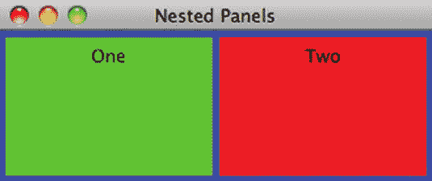
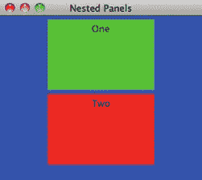

### 显示

注意，程序中的主面板（primary panel）没有显式地指定大小。它根据需要自动调整大小以容纳其中包含的两个面板。还要注意，子面板周围有一个缓冲区，通过缓冲区可以看到主面板的蓝色。这种间距是由用于管理容器的布局管理器以及组件本身设置的特性决定的。

这些问题将在稍后的“图形路径”（Graphics Track）章节中进一步探讨。像处理上一个示例一样，执行并尝试这个程序。

调整窗口的大小以查看其对组件的影响。注意，子面板的大小保持固定，而两个面板的方向取决于主面板的宽度（主面板的宽度会随着窗口的扩大而增大）。

### 使用窗口和面板的示例

当你熟悉了组件之间的相对布局方式后，尝试将所有面板的背景颜色更改为相同的颜色（例如绿色），以观察如果界面设计得当，面板之间的区分是否是不可见的。

### 自测题（答案见附录 N）

- **SR 3.41** Java 图形用户界面的包含层次结构是什么？
- **SR 3.42** 在 `NestedPanels` 程序中，创建了多少面板？面板变量的名称是什么？


## 3.11 图像

**177**

**SR 3.43** 在 `NestedPanels` 程序中，哪些面板被添加到另一个面板中？它们被添加到了哪个面板？哪个面板被显式地添加到窗口的内容区域（content pane）中？

## 3.11 图像

图像在基于图形的软件中通常起着重要作用。Java 能够多种方式使用 JPEG 和 GIF 图像。`Graphics` 类包含一个 `drawImage()` 方法，允许你像绘制形状或字符字符串一样绘制图像。图像也可以被包含在标签（label）组件中。让我们更详细地探索图像与标签之间的关系。

正如我们在之前的章节中看到的，由核心概念 `JLabel` 类定义的标签可以用于向用户提供信息。标签可以包含文本、图像，或者描述界面中的其他组件。`JLabel` 或两者都可以包含一个图像。也就是说，一个标签可以由文本、图像或两者共同组成。

`ImageIcon` 类用于表示包含在标签中的图像。`ImageIcon` 构造函数接收图像文件的名称并将其加载到对象中。`ImageIcon` 对象可以使用 JPEG 或 GIF 图像创建。

标签内部文本和图像的对齐方式可以通过 `JLabel` 构造函数或特定方法显式设置。同样，我们可以设置文本相对于图像的位置。

列表 3.9 显示的 `LabelDemo` 程序显示了几个标签。每个标签以不同的方向显示其文本和图像。

传递给 `JLabel` 构造函数的第三个参数定义了标签在面板允许标签的空间内的水平位置。`SwingConstants` 接口包含了多个被各种 Swing 组件使用的常量，这使得引用它们变得容易。

标签文本和图像的方向通过 `setHorizontalTextPosition()` 和 `setVerticalTextPosition()` 方法显式设置。如第一个标签所示，文本的默认水平位置在右侧（图像在左侧），文本的默认垂直位置相对于图像垂直居中。

不要将容器中标签的水平位置与文本与图像之间方向的设置混淆。构造函数的第三个参数决定前者，而显式方法调用决定后者。

通过将图像放入标签中，它就成了与容器中所有其他组件一起布局的组件的一部分，而不是在特定位置绘制。这是一个恰当的设计决策：是使用 `Graphics` 类的 `drawImage()` 方法绘制图像，还是使用标签来显示图像。

**178**

### 列表 3.9

```java
//********************************************************************
// LabelDemo.java 作者: Lewis/Loftus
//
// 展示了在标签中使用图像图标。
//********************************************************************
import java.awt.*;
import javax.swing.*;

public class LabelDemo
{
//-----------------------------------------------------------------
// 创建并显示主应用程序窗口。
//-----------------------------------------------------------------
public static void main(String[] args)
{
    JFrame frame = new JFrame("Label Demo");
    frame.setDefaultCloseOperation(JFrame.EXIT_ON_CLOSE);
    ImageIcon icon = new ImageIcon("devil.gif");
    JLabel label1, label2, label3;
    label1 = new JLabel("Devil Left", icon, SwingConstants.CENTER);
    label2 = new JLabel("Devil Right", icon, SwingConstants.CENTER);
    label2.setHorizontalTextPosition(SwingConstants.LEFT);
    label2.setVerticalTextPosition(SwingConstants.BOTTOM);
    label3 = new JLabel("Devil Above", icon, SwingConstants.CENTER);
    label3.setHorizontalTextPosition(SwingConstants.CENTER);
    label3.setVerticalTextPosition(SwingConstants.BOTTOM);
    JPanel panel = new JPanel();
    panel.setBackground(Color.cyan);
    panel.setPreferredSize(new Dimension(200, 250));
    panel.add(label1);
    panel.add(label2);
    panel.add(label3);
    frame.getContentPane().add(panel);
    frame.pack();
    frame.setVisible(true);
}
}
```


## 3.11 图像

**179**

**SR 3.44** 在 `LabelDemo` 程序中声明了多少个窗口、面板、图像图标和标签？

**SR 3.45** 考虑 `LabelDemo` 程序中的一个标签语句：

`label2 = new JLabel("Devil Right", icon, SwingConstants.CENTER);`

解释传递给 `JLabel` 构造函数的三个参数的作用。

**180**

**SR 3.46** 分别对 `LabelDemo` 程序进行以下任何更改，结果如何？你可以进行更改、编译并运行程序，观察并报告结果。简要说明你的观察。

a. 将三个 `JLabel` 构造函数调用的第三参数改为 `SwingConstants.LEFT`。

b. 将 `label2` 的水平文本位置从 `LEFT` 改为 `RIGHT`。

c. 将 `label2` 的水平文本位置从 `LEFT` 改为 `BOTTOM`。

d. 将 `label3` 的垂直文本位置从 `BOTTOM` 改为 `CENTER`。

### 核心概念总结

**181**

- `new` 运算符返回新对象的引用。
- 多个引用变量可以指向同一个对象。
- 方法通常在特定对象上执行，这会影响结果。
- 类库为开发提供了帮助。
- Java 标准类库按包组织。
- `java.lang` 包中的所有类对每个程序都会自动导入。
- 伪随机数生成器通过复杂的计算产生随机错觉。
- `Math` 类的所有方法都是静态的，这意味着它们通过类名调用。
- 添加 `printf()` 方法是为了支持旧系统的迁移。
- 枚举类型是类型安全的，确保不会无效值。
- 包装类允许将基本类型作为对象进行管理。
- 自动装箱提供了基本类型与相应包装对象之间的自动转换。
- 容器是存放和组织其他组件的特殊 GUI 组件。
- 帧（Frame）作为单独窗口显示，但面板（Panel）只能作为另一个容器的一部分显示。
- 每个容器都由布局管理器（Layout Manager）管理。
- 面板可以嵌套，以创建复杂的组件包含层次结构。
- 标签（Label）可以包含文本、图像或两者。

## 练习

**182**

**EX 3.1** 编写语句，将 `String` `computer` 中的小写字母转换为大写并打印。

**EX 3.2** 编写语句，从 `String` `FullMoonDay` 中提取子字符串 `Moon` 并打印。

**EX 3.3** 声明一个名为 `str` 的 `String` 变量，并初始化为包含与名为 `name` 的 `String` 对象相同的字符，但所有字母均为大写。

**EX 3.4** 为名为 `change` 的 `String` 变量编写声明，并初始化为存储在另一个名为 `original` 的 `String` 对象中的字符，并将其中所有的 `'e'` 字符替换为 `'j'`。

**EX 3.5** 下述代码片段的输出是什么？

```java
String str1, str2, str3;
str1 = "She sells sea shells in sea";
str2 = "shore"
str3 = str1.concat(str2);
System.out.println (str3.chatAt(5));
```

**EX 3.6** 下述导入语句的作用是什么？

```java
import java.awt.*;
```

**EX 3.7** 假设已创建一个名为 `generator` 的 `Random` 对象，以下每个表达式的结果范围是什么？

a. `generator.nextInt(20)`

b. `generator.nextInt(8) + 1`

c. `generator.nextInt(12) + 2`


### 练习题

#### EX 3.8
编写代码声明并实例化 `Random` 类的一个对象（对象引用变量命名为 `rand`）。然后写出使用 `nextInt` 方法的表达式列表，在指定的指定范围内（包含端点）生成随机数。使用接受单个整数参数的 `nextInt` 方法版本。

a. 0 到 10
b. 0 到 400
c. 1 到 10
d. 1 到 400
e. 25 到 50
f. -10 到 15

#### EX 3.9
编写一个赋值语句，计算 `var1` 的平方根，将其从 `var2` 中减去并将结果赋值给 `var3`。

#### EX 3.10
编写一条条语句计算并打印 `sum` 的五次方。

#### EX 3.11
编写代码语句创建一个 `DecimalFormat` 对象，将格式化值四舍五入四位小数。然后编写一个语句使用该对象以正确的格式打印 `result` 的值。

#### EX 3.12
编写代码语句提示并从用户读取一个 `double` 值，然后打印该值四方的结果。输出保留三位小数。

#### EX 3.13
为一个枚举类型（Enumerated type）编写声明，表示年的月份。

### 编程项目

#### PP 3.1
编写一个程序，提示并读取用户的城市和国家（分别读取）。然后打印一个字符串，该字符串由用户国家的前两个字母组成，后面跟着逗号，然后是用户的城市，最后是一个 1 到 100 之间的随机数，代表城市的邮政编码。在注册新账户时，有时使用类似的表示模式来存储用户的地址。

#### PP 3.2
编写一个程序，打印积的平方。提示并读取三个整数值，打印这三个整数乘积的平方。

#### PP 3.3
编写一个程序，创建并打印格式为 `XXX–XXX–XXXX` 的随机电话号码。在输出中包含连字符。不要让前三位数字包含 8 或 9（但不要比此限制），并确保第二组三个数字不大于 655。*提示：*思考构造电话号码最简单的方法。每个数字不需要单独确定。

#### PP 3.4
编写一个程序，读取一个整数值并打印 `e` 加上该数字的幂。例如，如果数字是 2，程序将打印 7.389056（其中 `e = 2.71828`）。

#### PP 3.5
编写一个程序，读取构成一条直线的两个点的 (*x*, *y*) 坐标。使用以下公式计算直线的斜率：

```
Slope (m) = (y2 - y1) / (x2 - x1)
```

#### PP 3.6
编写一个程序，读取球的半径并打印其体积和表面积。使用以下公式。将输出保留四位小数。`r` 代表半径。开发 PP 3.6 的解决方案。

```
Volume = p * r³ / 3
Surface Area = 4 * p * r²
```

#### PP 3.7
编写一个程序，从用户处读取四边形的两条边和高度。使用下面给出的公式计算四边形的面积，其中 `h` 代表四边形的垂直高度，`a` 和 `b` 代表四边形的两条边。将面积保留两位小数。

```
Area = (a + b) * h / 2
```

#### PP 3.8
编写一个程序，生成 10 到 30（包含边界）之间的两个整数，并显示这两个整数之和的正弦和余弦。

#### PP 3.9
编写一个程序，为平行四形生成底 (b)、高 (h) 和边 (a)，然后计算面积和周长。

#### PP 3.10
编写一个程序，显示一个包含三个标签的帧，显示城市名称、国家名称及其邮政编码。确保标签根据需要调整大小。

#### PP 3.11
编写一个程序，显示一个包含六个面板的帧。每个面板应包含一张图像（使用你选择的六张独特图像）。允许所有面板根据需要调整大小，并为六个面板中的每个设置不同的背景颜色。尝试窗口的大小以观察图像的变化。

#### PP 3.12
修改 `NestedPanels` 程序，使其在第五个面板内显示四个面板，每个面板都有不同的颜色和标签。

---

### 第 4 章 类与对象

#### 4.1 重习类与对象

回想对象与类之间的基本关系：类是对象的蓝图。类表示了对象的概念，而从该类创建的任何对象都是该概念的实现。

例如，从第 3 章我们知道，`String` 类表示字符字符串的概念，而每个 `String` 对象都代表一个包含特定字符的特定字符串。

让我们考虑另一个例子。假设有一个名为 `Student` 的类代表大学的一名学生。从 `Student` 类创建的对象将代表一个特定的学生。`Student` 类表示了学生的通用概念，而从该类创建的每个对象都代表一个在该校就学的真实学生。在一个帮助管理大学业务的系统中，我们有一个 `Student` 类和数千个 `Student` 对象。

回想一下，对象有一个 `state`（状态），它由与该对象相关的 `attributes`（属性）的值定义。一个学生的属性可能包括学生的姓名、地址、专业和平均学点（GPA）。`Student` 类规定了每个学生都拥有这些属性。每个 `Student` 对象存储某个特定学生的这些属性的值。在 Java 中，对象的属性是在类内部声明的变量定义的。

对象还具有 `behaviors`（行为），它们由与该对象相关的 `operations`（操作）定义。学生的操作将包括更新该学生地址以及计算该学生当前平均学点的能力。`Student` 类定义了这些操作，例如如何计算平均学点的细节。这些操作可以在特定的 `Student` 对象上（或通过对象）执行。

注意，对象的行为可能会修改该对象的状态。在 Java 中，对象的操作是在类内部声明的方法（methods）定义的。

图 4.1 列出了一些类的示例，以及可能为这些类的对象定义的某些属性和操作。确定需要哪些属性和操作取决于程序设计者，这取决于程序的目的以及特定对象在在该目的中所扮演的角色。

考虑一下你可能为这些示例包含包含的其他属性和操作。

**图 4.1** 类示例以及一些可能的属性和操作

| 类 | 属性 | 操作 |
| :--- | :--- | :--- |
| Student | 姓名、地址、专业、平均学点 | 设置地址，设置专业，计算平均学点 |
| Rectangle | 长度、宽度、颜色 | 设置长度，设置宽度，设置颜色 |
| Aquarium | 材质、长度、宽度、高度 | 设置材质，设置长度，设置宽度，设置高度，计算体积，计算填充重量 |
| Flight | 航空公司、航班号、出发地、目的地、当前状态 | 设置航空公司，设置航班号，确定状态 |
| Employee | 姓名、部门、职位、薪水 | 设置部门，设置职位，设置薪水，计算工资，计算奖金，计算税费 |

**自测题**（答案见附录 N）

**SR 4.1** 什么是属性？

**SR 4.2** 什么是操作？

**SR 4.3** 列出可能为名为 `Book` 的类（代表图书馆中的书）定义的属性和操作。

**SR 4.4** 正确还是错误？解释。

a. 在编写程序时，我们应该只使用 Java 标准类库中的类——不需要定义或使用其他类。
b. 对象上的操作可以改变对象的状态。
c. 对象的当前状态会影响在该对象的操作的结果。
d. 在 Java 中，对象的状态是由它的方法表示的。

#### 4.2 类的构造分析

在我们之前所有的示例中，我们都写了一个包含单个 `main` 方法的类。这些类代表了小型但完整的程序。这些程序通常使用 Java 类库中预定义的类来实例化对象，并使用这些对象提供它们提供的服务。那些预定义的类也是程序的一部分，但我们从并不真正关心它们，只需知道如何与它们交互。我们只需信任它们会提供它们承诺的服务。

让我们来看另一个类似的示例。如代码列表 4.1 所示的 `RollingDice` 类包含一个 `main` 方法，该方法实例化了两个 `Die` 对象（dice 的单数形式）。然后它投掷骰子并打印结果。它还调用了 `Die` 类提供的几个其他方法，例如显式设置和获取骰子当前点数的能力。

**代码列表 4.1** `RollingDice.java`

```java
//********************************************************************
// RollingDice.java Author: Lewis/Loftus
//
// 展示了用户定义类的创建和使用。
//********************************************************************
public class RollingDice
{
//-----------------------------------------------------------------
// 创建两个 Die 对象并多次投掷。
//-----------------------------------------------------------------
    public static void main(String[] args)
    {
        Die die1, die2;
        int sum;
        die1 = new Die();
        die2 = new Die();
        die1.roll();
        die2.roll();
        System.out.println("Die One: " + die1 + ", Die Two: " + die2); 
        die1.roll();
        die2.setFaceValue(4);
        System.out.println("Die One: " + die1 + ", Die Two: " + die2); 
        sum = die1.getFaceValue() + die2.getFaceValue();
        System.out.println("Sum: " + sum);
        sum = die1.roll() + die2.roll();
        System.out.println("Die One: " + die1 + ", Die Two: " + die2); 
        System.out.println("New sum: " + sum);
    }
}
```

**输出**

```
Die One: 5, Die Two: 2
Die One: 1, Die Two: 4
Sum: 5
Die One: 4, Die Two: 2
New sum: 6
```

这个例子与之前示例的主要区别在于 `Die` 类不是 Java 类库的预定义部分。我们必须自己编写 `Die` 类，定义我们希望 `Die` 对象执行的服务，以便程序能够编译和运行。

每个类都可以包含数据声明和方法声明，如图 4.2 所示。数据声明表示存储在每个对象中的数据。方法声明定义了这些对象提供的服务。总来说，类的数据和方法被称为类的*成员*（members）。

我们将继续定义这样的类，例如 `RollingDice` 类，用以定义程序的起点。

然而，真正的面向对象编程来自于定义具有良好状态和行为对象的类。例如，在任何时刻，一个 `Die` 对象都显示一个特定的点数，我们可以将其称为骰子的状态。一个 `Die` 对象还具有我们可以对其调用的各种方法，例如投掷骰子或获取其点数的方法。

**图 4.2** 类的成员：数据和方法声明

代码列表 4.2 显示了 `Die` 类。它包含两个数据值：一个表示骰子最大点数的整数常量 (`MAX`) 和一个表示骰子当前点数的整数变量 (`faceValue`)。它还包含一个名为 `Die` 的构造函数和四个普通方法：`roll`、`setFaceValue`、`getFaceValue` 和 `toString`。

你可能在第 2 章和第 3 章中记得，构造函数是与类名相同的特殊方法。当使用 `new` 操作符创建 `Die` 类的新实例时，就会调用 `Die` 构造函数。`Die` 类其余的方法定义了 `Die` 对象提供的各种服务。

我们使用文档头块（header block）来解释类中每个方法的作用。这种做法不仅对于任何试图理解软件的人来说至关重要，而且在视觉上将代码分离，使得眼睛在阅读代码时能轻松地从一个方法跳转到下一个方法。

##### 剖析 `Die` 类

图 4.3 列出了 `Die` 类的方法。从这个角度来看，它与我们在之前的示例中使用的任何其他类都没有区别。唯一的区别是，`Die` 类并不是由 Java API 提供的，而是我们自己编写的。

`Die` 类的方法包括掷骰子的能力，产生一个新的随机点数。`roll` 方法将新的点数返回给调用它的方法，但你也可以使用 `getFaceValue` 方法随时获取当前点数。`setFaceValue` 方法显式地设置点数，就像你伸手过去并将骰子转到你想要的任何点数一样。任何对象的 `toString` 方法每当你将对象传递给 `print` 或 `println` 方法以获取用于打印的对象的字符串描述时，都会被调用。因此，为大多数类定义一个 `toString` 方法通常是一个好主意。这些方法的定义包含多个部分，我们将在本章后续中对其进行剖析。

对于书中的示例，我们通常将每个类存储在自己的文件中。Java 允许将多个类存储在一个文件中。例如，类 `Die` 存储在 `Die.java` 中。

**图 4.3** `Die` 类的一些方法

| 方法 | 说明 |
| :--- | :--- |
| `Die()` | 构造函数：将初始点数设置为 1。 |
| `roll()` | 通过设置一个范围内的随机数来掷骰子。 |
| `setFaceValue(int value)` | 将点数设置为指定的值。 |
| `getFaceValue()` | 返回骰子的当前点数。 |
| `toString()` | 返回骰子的字符串表示形式。 |

#### 4.3 类的结构

**代码列表 4.2** `Die.java`

```java
//********************************************************************
// Die.java Author: Lewis/Loftus
//
// 表示一个骰子（dice 的单数），其面值在
// 1 到 6 之间。
//********************************************************************
public class Die
{
    private final int MAX = 6; // 最大点数
    private int faceValue; // 骰子当前显示的点数

    //-----------------------------------------------------------------
    // 构造函数：设置初始点数。
    //-----------------------------------------------------------------
    public Die()
    {
        faceValue = 1;
    }

    //-----------------------------------------------------------------
    // 掷骰子并返回结果。
    //-----------------------------------------------------------------
    public int roll()
    {
        faceValue = (int)(Math.random() * MAX) + 1;
        return faceValue;
    }

    //-----------------------------------------------------------------
    // 点数修改器。
    //-----------------------------------------------------------------
    public void setFaceValue(int value)
    {
        faceValue = value;
    }

    //-----------------------------------------------------------------
    // 点数访问器。
    //-----------------------------------------------------------------
    public int getFaceValue()
    {
        return faceValue;
    }

    //-----------------------------------------------------------------
    // 返回此骰子的字符串表示形式。
    //-----------------------------------------------------------------
    public String toString()
    {
        String result = Integer.toString(faceValue);
        return result;
    }
}
```

注意，在 `Die` 类中，常量 `MAX` 和变量 `faceValue` 是在类级别声明的（而不是任何方法内部）。变量的作用域是类中引用它的区域。通过在类级别声明，这些变量可以在任何方法中被引用。像诸如变量 `faceValue` 的属性被称为 `实例数据`（instance data）。Java 会自动初始化任何在类级别声明的变量。例如，所有 `int` 和 `double` 等数值类型的变量都会初始化为零。然而，尽管语言执行了这种自动初始化，但显式地初始化变量（通常在构造函数中）是一个良好的习惯，这样任何阅读代码的人都能清楚地理解意图。

### UML 类图


# UML 类图与封装

在整书中，我们使用 UML 图来视觉化类和对象之间的关系。UML 代表 `Unified Modeling Language`（统一建模语言），它已成为表示面向对象程序设计最流行的符号。

存在多种类型的 UML 图，每种都旨在展示面向对象程序的特定方面。我们在本书中主要关注 UML `class diagrams`（类图），用于展示类的内容以及它们之间的关系。

**Figure 4.4** 一个显示 RollingDice 程序中涉及类的 UML 类图

```
---------------------------------------
|             RollingDice             |
---------------------------------------
| +main(args: String[]) : void       |
---------------------------------------
            |
            | (uses)
            v
---------------------------------------
|                  Die                  |
---------------------------------------
| - MAX : int                         |
| - faceValue : int                   |
---------------------------------------
| + Die()                              |
| + roll() : int                       |
| + setFaceValue(int value) : void    |
| + getFaceValue() : int              |
| + toString() : String                |
---------------------------------------
```

图 4.4 中连接 `RollingDice` 和 `Die` 类的箭头表示类之间存在关系。虚线箭头表示一个类*使用*了另一个类的方法。类之间其他类型的面向对象关系用不同类型的线条和箭头表示。我们将在书中探索相应主题时讨论这些其他关系。

请记住，UML 并不是专门为 Java 程序员设计的。它是与语言无关的。因此，UML 图中使用的语法并不一定等同于 Java。例如，变量的类型显示在变量名之后，用冒号分隔。方法的返回类型也以相同的方式显示。

UML 图是多功能的。根据特定图表的目标，我们可以包含任何所需的适当信息。例如，如果某些细节对特定图表不相关，我们可以省略类的数据部分和方法部分。

UML 图允许你将程序设计可视化。随着程序变得越来越大，包含越来越多的类，这些可视化工具将变得越来越有用。我们将根据情况探索 UML 图的新方面。

## 自测复习题（答案见附录 N）

- SR 4.5 对象和类之间的区别是什么？
- SR 4.6 描述 `Die` 类的实例数据。
- SR 4.7 为 `Die` 类定义的方法中，哪些可以改变 `Die` 对象的状态——也就是说，哪些方法可以为实例数据赋值？

## 4.3 封装

- SR 4.8 当你将一个对象传递给 `print` 或 `println` 方法时会发生什么？
- SR 4.9 变量的作用域是什么？
- SR 4.10 UML 图的设计目的是什么？

我们在第 1 章关于面向对象概念的概述中提到，对象应该是`自管理`的。这意味着，对象的实例数据应该只由该对象本身修改。例如，`Die` 类的方法应该专门负责改变 `faceValue` 变量的值。我们应该让类外部的代码难以（如果不是不可能的话）“伸入”并更改在该类内部声明的变量的值。这种特性被称为`封装`。

对象应该与系统的其余部分封装开。

### 核心概念

它应该通过一组特定的方法与程序的其他部分交互，这些方法定义了该对象提供的服务，从而保护其数据免受不当访问。这些方法定义了该对象与使用它的程序之间的`接口`。

封装在图 4.5 中以图形表示。使用对象的代码（有时称为对象的`客户端`）不应允许直接访问变量。客户端应该调用对象的方法，然后由这些方法与封装在对象内部的数据交互。例如，`RollingDice` 程序中的 `main` 方法调用了 `Die` 对象的 `roll` 方法。

`main` 方法不应该（实际上也无法）直接访问 `faceValue` 变量。

**图 4.5** 客户端与对象的方法交互


# 第 4 章 编写类

在 Java 中，我们使用`修饰符`来实现对象封装。修饰符是 Java 的保留字，用于指定编程语言构造的特定特征。在第 2 章中，我们讨论了 `final` 修饰符，它用于声明常量。Java 有多种可以以各种方式使用的修饰符。某些修饰符可以组合，但某些组合是无效的。

我们将在本书的适当位置讨论各种 Java 修饰符，所有修饰符都总结在附录 E 中。

### 可见性修饰符

某些 Java 修饰符被称为`可见性修饰符`，因为它们控制对类成员的访问。保留字 `public` 和 `private` 是可以应用于类和方法的可见性修饰符。如果类的成员具有`public 可见性`，则可以从对象外部直接引用它。如果类的成员具有`private 可见性`，则可以在类定义内部任何地方使用，但不能从外部引用。第三种可见性修饰符 `protected` 只在继承上下文中相关。我们将在第 9 章讨论它。

`public` 变量违反了封装。它们允许定义数据的类外部代码“伸入”并访问或修改数据。因此，实例数据应该声明为`private 可见性`以促进封装。声明为 `private` 的数据只能通过类的方法访问。

我们应用到方法上的可见性取决于该方法的目的。

为客户端提供服务的方法必须声明为`public 可见性`，以便客户端可以调用它们。这些方法有时被称为`服务方法`。`private` 方法不能从类外部调用。`private` 方法的唯一目的是帮助类的其他方法完成工作。因此，它们有时被称为`支持方法`。

图 4.6 中的表格总结了 `public` 和 `private` 可见性对变量和方法的影响。

给常量赋予 `public` 可见性通常被认为是可以的，因为尽管它们的值可以被直接访问，但由于它们是使用 `final` 修饰符声明的，因此无法更改。请记住，封装意味着数据值不应被代码的其他部分直接`更改`。因为常量根据定义是不可变的，所以封装问题在很大程度上不复存在。

UML 类图可以通过在类成员前面加上特定字符来显示其可见性。具有`public 可见性`的成员前面带有一个加号（`+`），具有`private 可见性`的成员前面带有减号（`-`）。

**图 4.6** public 和 private 可见性的影响


### 访问器（Accessors）和修改器（Mutators）

#### 核心概念

由于实例数据通常声明为 `private` 可见性，因此类通常提供访问和修改数据的服务。大多数对象都包含访问器方法和修改器方法。

`getFaceValue` 被称为`访问器方法`，因为它提供了对特定值的只读访问。同样，`setFaceValue` 被称为`修改器方法`，因为它改变了特定值。

通常，访问器方法的命名的形式为 `getX`，其中 `X` 是它提供访问的值。同样，修改器方法的形式为 `setX`，其中 `X` 是它们正在设置的值。因此，这些类型的方法有时被称为“getter”和“setter”。

例如，如果一个类包含实例变量 `height`，它可能还会包含 `getHeight` 和 `setHeight` 方法。注意这种命名约定在方法名中使用变量的首字母大写，这与通用的方法命名方式是一致的。

某些方法可能作为其主要目的的副作用提供访问和/或修改器功能。例如，`Die` 类的 `roll` 方法改变了骰子的 `faceValue` 并同样返回该新值。因此，`roll` 也是一个修改器方法。

注意 `roll` 方法的代码非常小心地将点数保持在有效范围内（1 到 `MAX`）。服务方法必须经过仔细设计，以仅允许适当的访问和有效的更改。这指出了 `Die` 类设计的一个缺陷：`setFaceValue` 方法没有限制——客户端可以使用它将骰子值设置为 20 等超出范围的数字。`setFaceValue` 方法的代码应该只允许对骰值的有效修改。我们将在下一章探讨如何实现这种控制。

## 自测题（答案见附录 N）

- SR 4.11 对象应该是自治的。请解释。
- SR 4.12 对象的接口是什么？
- SR 4.13 什么是修饰符？
- SR 4.14 为什么可以给常量赋予公共可见性？
- SR 4.15 描述下述每一项：
    - a. 公有方法 (public method)
    - b. 私有方法 (private method)
    - c. 公有变量 (public variable)
    - d. 私有变量 (private variable)

## 4.4 方法的结构

我们已经看到类是由数据声明和方法声明组成的。让我们详细地检查方法声明。

正如我们在第 1 章中所说的，方法是一组被命名的编程语言语句。`method declaration`（方法声明）指定了方法被调用时执行的代码。Java 程序中的每个方法都是特定类的一部分。

当方法被调用时，控制流会转移到该方法。该方法的各个语句会被逐个执行。当该方法执行完成后，控制返回到调用发生的位置并继续执行。

`被调用方法`（被调用的方法）可能与调用它的`调用方法`属于同一个类。如果被调用方法属于同一个类，则只需要方法名即可调用它。如果它属于不同的类，则正如我们多次看到的那样，它是通过该另一个类的对象名称调用的。图 4.7 显示了方法被调用时的执行流。

我们在之前的示例中多次定义了程序的 `main` 方法。它的定义与所有方法遵循相同的语法。方法的头部包括返回值的类型、方法名以及该方法接受的参数列表。构成方法体的语句定义在由花括号限定的块中。本节的其余部分将更详细地讨论与方法声明相关的问题。

### 方法声明 (Method Declaration)

```
Type
Identifier
Parameters
Throws Clause
Method Body
Modifier
void
parameters
( )
Type
Identifier
,
```

方法由可选的修饰符定义，随后是返回类型 `Type`，接着是确定方法名的 `Identifier`（标识符），然后是 `Parameters`（参数）列表，最后是 `Method Body`（方法体）。返回 `Type` 表示方法将返回的值的类型，该可以是 `void`。`Method Body` 是在方法被调用时执行的语句块。`Throws Clause`（异常声明）是可选的，表示此方法可能抛出的异常。

示例：

```java
public void instructions(int count)
{
    System.out.println("Follow all instructions."); 
    System.out.println("Use no more than " + count + " turns.");
}
```

**图 4.7** 方法调用后的控制流


### 返回语句 (the return statement)

方法头部中指定的返回类型可以是基本数据类型、类名或保留字 `void`。当方法不返回任何值时，使用 `void` 作为返回类型，这在 `main` 方法中总是这样做的。`Die` 类的 `setFaceValue` 方法的返回类型也是 `void`。

返回值的方法必须有一个 `return statement`（返回语句）。当执行 `return statement` 时，控制会立即返回到调用方法中的语句处，并在那里继续处理。`return statement` 由保留字 `return` 以及一个决定要返回值的表达式组成。该表达式必须与方法头部中的返回类型一致。

`Die` 类的 `getFaceValue` 方法返回一个 `int` 值，代表骰子的当前值。`roll` 方法也执行同样的操作，返回 `faceValue` 刚刚随机设置的新值。`toString` 方法返回一个 `String` 对象。

不返回值的方法通常不包含 `return statement`。当到达方法末尾时，方法会自动返回到调用它的方法。此类方法可以包含一个不带表达式的 `return statement`。从方法返回的值必须与方法头部中指定的返回类型一致。

在方法中使用多个一个 `return statement` 通常不是一个良好的习惯，尽管这样做是可行的。通常情况下，一个方法应该有一个 `return statement` 作为方法体的最后一行，除非这会使方法变得过于复杂。

从方法返回的值可以在调用方法中被忽略。例如，在 `RollingDice` 类的 `main` 方法中，返回的值被忽略了：

```java
return;
```

`return statement` 由 `return` 保留字加上一个可选的 `Expression`（表达式）组成。执行时，控制会立即返回到调用方法，并返回由 `Expression` 定义的值。

示例：

```java
return;
return distance * 4;
```


`roll` 方法返回的值在某些调用中被忽略了，而在另一些调用中，返回值被用于计算。

构造函数没有返回类型（甚至没有 `void`），因此不能返回值。我们将在本章的晚些部分详细讨论构造函数。

### 参数 (parameters)

正如我们在第 2 章中定义的，参数是方法被调用时传递到方法的值。方法头部的 `parameter list`（参数列表）指定了传递的值的类型，以及调用方法引用这些值的名称。

方法声明中的参数名称被称为 `formal parameters`（形式参数）。在调用中，传递进去的值被称为 `actual parameters`（实际参数）。

方法调用和定义始终会在方法名后的括号中给出参数列表。如果没有参数，则使用空括号，如 `roll` 和 `getFaceValue` 方法所示。`Die` 构造函数也不接受参数，尽管构造函数通常。

`formal parameters` 是方法内部作为变量的标识符，其初始值来自调用中的 `actual parameters`。当方法被调用时，每个 `actual parameter` 中的值会被复制并存储在相应的 `formal parameter` 中。`actual parameters` 可以是字面量、变量或完整的表达式。如果表达式作为 `actual parameter`，它会在方法调用之前完全求值，结果作为参数传递。

`Die` 类中唯一接受任何参数的方法是 `setFaceValue` 方法，它接受一个 `int` 参数。形式参数名为 `value`。在 `main` 方法中，值 `4` 作为 `actual parameter` 传递给它。

调用和方法声明中的参数列表必须匹配。也就是说，第一个 `actual parameter` 的值被复制到第一个 `formal parameter`，第二个 `actual parameter` 到第二个 `formal parameter`，依此类推，如图 4.8 所示。`actual parameters` 的类型必须与指定的 `formal parameters` 类型一致。

关于参数传递的其他细节将在第 7 章讨论。

### 局部数据 (local Data)

正如我们在本章前面所述，变量或常量的作用范围是对该变量进行有效引用的程序部分。一个变量


```java
ch = obj.calc(25, count, "Hello");

char calc(int numl, int num2, String message)
{
    int sum = numl + num2;
    char result = message.charAt(sum);
    return result;
}
```

**图 4.8** 从方法调用到声明的参数传递

可以在方法内部声明，使其成为相对于于实例数据的 `local data`。

回想一下实例数据是在类中声明的，但在任何特定方法之外。

局部数据的作用范围仅限于声明它的方法。在 `Die` 类 `toString` 方法中声明的变量 `result` 就是局部数据。在该类的任何其他方法中对 `result` 的引用都仅是该方法局部的，且不能在方法之外使用。在 `Die` 类的方法中声明的变量将导致编译器发出错误信息。局部变量在声明它的方法之外简单地不存在。另一方面，在类级别声明的实例数据其作用范围涵盖整个类；该类的任何方法都可以引用它。

由于局部数据和实例数据在不同的作用域层次上运行，因此可以在方法内部声明一个与类级别声明的实例变量同名的局部变量。在方法中引用该名称将引用该变量的本地版本。这种命名习惯显然具有混淆任何阅读代码的人的可能，因此应该被避免。

方法头中的形式参数名称用作该方法的局部数据。它们在方法被调用之前不存在，在方法退出时也不复存在。例如，`setFaceValue` 方法中的形式参数值在方法被调用时产生，在方法执行结束时消失。

### 银行账户示例


让我们来看另一个类及其使用的示例。列表 4.3 显示的 `Transactions` 类包含一个 `main` 方法，该方法创建了几个 `Account` 对象并调用了它们的服务。

## 4.4 方法的结构

### 列表 4.3

```java
//********************************************************************
// Transactions.java Author: Lewis/Loftus
//
// 展示多个 Account 对象的创建和使用。
//********************************************************************
public class Transactions
{
    //-----------------------------------------------------------------
    // 创建一些银行账户并请求各种服务。
    //-----------------------------------------------------------------
    public static void main(String[] args)
    {
        Account acct1 = new Account("Ted Murphy", 72354, 102.56); 
        Account acct2 = new Account("Jane Smith", 69713, 40.00); 
        Account acct3 = new Account("Edward Demsey", 93757, 759.32);
        acct1.deposit(25.85);

        double smithBalance = acct2.deposit(500.00);
        System.out.println("Smith balance after deposit: " + smithBalance);
        System.out.println("Smith balance after withdrawal: " + acct2.withdraw(430.75, 1.50));

        acct1.addInterest();
        acct2.addInterest();
        acct3.addInterest();

        System.out.println();
        System.out.println(acct1);
        System.out.println(acct2);
        System.out.println(acct3);
    }
}
```

**输出**

```
Smith balance after deposit: 540.0
Smith balance after withdrawal: 107.75
72354 Ted Murphy $132.90
69713 Jane Smith $111.52
93757 Edward Demsey $785.90
```

### 列表 4.4

列表 4.4 显示的 `Account` 类代表一个基础银行账户。它包含代表账户号码、账户当前余额和账户所有者名称的实例数据。注意，实例数据可以是一个 `VideoNote` 对象引用变量（而不仅仅是基本类型），例如账户所有者的名称，它是对 `String` 对象的引用。账户的利率被存储为常量。`Account` 类的构造函数接受三个参数，用于初始化实例数据。`deposit` 和 `withdraw` 方法在账户上执行基础交易，根据参数调整余额。还有一个 `addInterest` 方法通过加上赚取的利息来更新余额。这些方法代表了改变余额的有效方式，因此没有提供如 `setBalance` 这样的经典修改器（mutator）。

```java
//********************************************************************
// Account.java Author: Lewis/Loftus
//
// 代表一个具有基础服务（如存款
// 取款）的银行账户。
//********************************************************************
import java.text.NumberFormat;

public class Account
{
    private final double RATE = 0.035; // 3.5%的利率
    private long acctNumber;
    private double balance;
    private String name;

    //-----------------------------------------------------------------
    // 通过定义所有者、账户号码和
    // 余额来设置账户。
    //-----------------------------------------------------------------
    public Account(String owner, long account, double initial)
    {
        name = owner;
        acctNumber = account;
        balance = initial;
    }

    //-----------------------------------------------------------------
    // 将指定金额存入账户。返回
    // 新余额。
    //-----------------------------------------------------------------
    public double deposit(double amount)
    {
        balance = balance + amount;
        return balance;
    }

    //-----------------------------------------------------------------
    // 从账户中取出指定金额并收取
    // 手续费。返回新余额。
    //-----------------------------------------------------------------
    public double withdraw(double amount, double fee)
    {
        balance = balance - amount - fee;
        return balance;
    }

    //-----------------------------------------------------------------
    // 通过加上赚取的利息更新余额。
    //-----------------------------------------------------------------
    public double addInterest()
    {
        balance += (balance * RATE);
        return balance;
    }

    //-----------------------------------------------------------------
    // 返回账户的余额。
    //-----------------------------------------------------------------
    public double getBalance()
    {
        return balance;
    }

    //-----------------------------------------------------------------
    // 返回账户的单行描述。
    //-----------------------------------------------------------------
    public String toString()
    {
        NumberFormat fmt = NumberFormat.getCurrencyInstance();
        return acctNumber + "\t" + name + "\t" + fmt.format(balance);
    }
}
```

在 `Transactions` 程序中创建后，三个 `Account` 对象的状态如下：

- `acct1`: 72354, `balance`: 102.56, `name`: "Ted Murphy"
- `acct2`: 69713, `balance`: 40.00, `name`: "Jane Smith"
- `acct3`: 93757, `balance`: 759.32, `name`: "Edward Demsey"

更新账户余额的各种方法可以设计得更严谨。应该进行检查以确保参数有效，例如防止提取负数（这实际上是存款）。这种处理将在下一章中讨论。

### 自测习题（见附录 N）

- SR 4.16 为什么通过特定的对象调用方法？该规则的例外是什么？
- SR 4.17 方法返回值意味着什么？
- SR 4.18 `return` 语句的作用是什么？

### 4.5 构造函数的回顾

- SR 4.20 解释实际参数和形式参数之间的区别。
- SR 4.21 为 `Die` 类编写一个名为 `getFaceDown` 的方法，返回骰子当前的“朝下”值。*提示：*标准骰子上相对的面之和为七。
- SR 4.22 在 `Transactions` 程序中：
    a. 创建了多少 `Account` 对象？
    b. 在 `acct2` 对象上调用 `withdraw` 方法时，传递了多少个参数（实际参数）？
    c. 在 `acct3` 对象上调用 `addInterest` 方法时，传递了多少个参数（实际参数）？
- SR 4.23 你会将 `Account` 类的哪些方法分类为访问方法（accessor methods）？修改方法（mutator methods）？服务方法（service methods）？

## 4.5 重温构造函数

正如我们在第 2 章中所说的，构造函数类似于在对象实例化时被调用的方法。当我们定义一个类时，通常会定义一个构造函数来帮助我们设置类。特别是，我们经常使用构造函数来初始化与每个相关的变量。

构造函数与普通方法有两点不同。首先，构造函数的名称与类名相同。因此，`Die` 类中构造函数的名称是 `Die`，`Account` 类中构造函数的名称是 `Account`。其次，构造函数不能返回值，且在方法头中没有指定的返回类型。

程序员经常犯的一个常见错误是在构造函数上加上一个**核心概念**——`void` 返回类型。对于编译器来说，在构造函数上放置任何返回类型（即使是 `void`）都会将其变成一个恰好与类名同名的普通方法。因此，它不能作为构造函数被调用。这会导致有时难以读懂的错误信息。

通常，构造函数用于初始化新实例化的对象。例如，`Die` 类的构造函数最初将骰子的面值设置为 1。

`Account` 类的构造函数将实例变量的值设置为作为构造函数参数传入的值。

我们不需要为每个类都定义构造函数。每个类都有一个不带参数的*默认构造函数*。如果我们不提供自己的构造函数，就会使用默认构造函数。这个默认构造函数通常对新创建的对象没有影响。

### 自我复习题（答案见附录 N）

- SR 4.24 构造函数是做什么的？
- SR 4.25 构造函数是如何定义的？

## 4.6 图形对象

某些对象具有图形表示，这意味着它们的状态和行为包含了关于对象视觉上看起来什么样的信息。例如，一个图形对象可能包含关于其尺寸和颜色的数据，并可能包含绘制它的方法。

在第 3 章中，我们实例化并使用了如框架（frames）、面板（panels）、标签（labels）和图像（images）等图形组件。这些组件当然可以被认为是图形对象。本节将更详细地检查其中的一些组件，并探索如何定义我们具有图形特征的自定义对象。

列表 4.5 中的程序显示了一个笑脸和一个文本说明。然而，`SmilingFace` 类中的 `main` 方法并没有处理所有这些细节。

相反，`main` 方法为程序设置了框架，并使用它来显示 `SmilingFacePanel` 类的实例化。

### 列表 4.5

```java
//********************************************************************
// SmilingFace.java 作者: Lewis/Loftus
//
// 展示了单独面板类用用法。
//********************************************************************
import javax.swing.JFrame;

public class SmilingFace
{
    //-----------------------------------------------------------------
    // 创建程序的主框架。
    //-----------------------------------------------------------------
    public static void main(String[] args)
    {
        JFrame frame = new JFrame("Smiling Face");
        frame.setDefaultCloseOperation(JFrame.EXIT_ON_CLOSE);
        SmilingFacePanel panel = new SmilingFacePanel();
        frame.getContentPane().add(panel);
        frame.pack();
        frame.setVisible(true);
    }
}
```

### 列表 4.6

`SmilingFacePanel` 类定义了两个用于绘图的常量（`BASEX` 和 `BASEY`）、一个设置面板关键部分的构造函数，以及一个名为 `paintComponent` 的方法，该方法负责程序执行时我们看到的脸。在这种情况下，我们并没有向此面板添加 GUI 组件，而是直接在其上绘图。

注意，`SmilingFacePanel` 类继承了 `JPanel` 类。正如我们在第 2 章讨论 applet 时提到的，`extends` 子句建立了继承关系。`SmilingFacePanel` 类继承了 `JPanel` 类的特性。也就是说，一个 `SmilingFacePanel` *是一个* `JPanel`。到目前，这就是你对继承真正需要知道的所有内容了，将在第 9 章进行详细讨论。

`SmilingFacePanel` 类的构造函数设置了面板的背景颜色和首选尺寸，还设置了面板的默认字体。注意，这些调用不是对其他对象进行的（就像我们在第 3 章创建单独的 `JPanel` 对象那样）。当一个方法在没有扩展 `JPanel` 的情况下通过特定对象被调用时，你可以将其认为对象在“自言自语”。构造函数中的调用是针对 `SmilingFacePanel` 类所代表的对象进行的。


```java
//********************************************************************
// SmilingFacePanel.java 作者: Lewis/Loftus
//
// 展示了单独面板类用用法。
//********************************************************************
import javax.swing.JPanel;
import java.awt.*;

public class SmilingFacePanel extends JPanel
{
    private final int BASEX = 120, BASEY = 60; // 头部基点

    //-----------------------------------------------------------------
    // 构造函数：设置面板的关键部分。
    //-----------------------------------------------------------------
    public SmilingFacePanel()
    {
        setBackground(Color.blue);
        setPreferredSize(new Dimension(320, 200));
        setFont(new Font("Arial", Font.BOLD, 16));
    }

    //-----------------------------------------------------------------
    // 绘制脸。
    //-----------------------------------------------------------------
    public void paintComponent(Graphics page)
    {
        super.paintComponent(page);
        page.setColor(Color.yellow);
        page.fillOval(BASEX, BASEY, 80, 80); // 头
        page.fillOval(BASEX-5, BASEY+20, 90, 40); // 耳
        page.setColor(Color.black);
        page.drawOval(BASEX+20, BASEY+30, 15, 7); // 眼睛
        page.drawOval(BASEX+45, BASEY+30, 15, 7);
        page.fillOval(BASEX+25, BASEY+31, 5, 5); // 瞳孔
        page.fillOval(BASEX+50, BASEY+31, 5, 5);
        page.drawArc(BASEX+20, BASEY+25, 15, 7, 0, 180); // 眉
        page.drawArc(BASEX+45, BASEY+25, 15, 7, 0, 180);
        page.drawArc(BASEX+35, BASEY+40, 15, 10, 180, 180); // 鼻
        page.drawArc(BASEX+20, BASEY+50, 40, 15, 180, 180); // 口
        page.setColor(Color.white);
        page.drawString("永远记住你是独特的!", BASEX-105, BASEY-15);
        page.drawString("就像每个人一样。", BASEX-45, BASEY+105);
    }
}
```

让我们来看另一个例子。`Listing 4.7` 中显示的 `Splat` 类包含一个 `main` 方法，用于创建并显示程序的窗口。从视觉上看，这个 `Listing 4.7`

```java
//********************************************************************
// Splat.java Author: Lewis/Loftus
//
// Demonstrates the use of graphical objects.
//********************************************************************
import javax.swing.*;
import java.awt.*;

public class Splat
{
    //-----------------------------------------------------------------
    // Presents a collection of circles.
    //-----------------------------------------------------------------
    public static void main(String[] args)
    {
        JFrame frame = new JFrame("Splat");
        frame.setDefaultCloseOperation(JFrame.EXIT_ON_CLOSE); 
        frame.getContentPane().add(new SplatPanel());
        frame.pack();
        frame.setVisible(true);
    }
}
```

该程序只是绘制了几个填充圆。这个程序有趣的地方不在于它做了什么，而在于它是如何实现的——程序中绘制的每个圆都由它自己的对象表示。

`main` 方法实例化了一个 `SplatPanel` 对象并将其添加到框架中。

`SplatPanel` 类位于 `Listing 4.8` 中。与上一个示例中的 `SmilingFacePanel` 类一样，`SplatPanel` 类派自 `JPanel`。它包含五个 `Circle` 对象作为实例数据，这些对象在构造函数中被实例化。

## 4.6 图形对象

```java
//********************************************************************
// SplatPanel.java Author: Lewis/Loftus
//
// Demonstrates the use of graphical objects.
//********************************************************************
import javax.swing.*;
import java.awt.*;

public class SplatPanel extends JPanel
{
    private Circle circle1, circle2, circle3, circle4, circle5;

    //-----------------------------------------------------------------
    // Constructor: Creates five Circle objects.
    //-----------------------------------------------------------------
    public SplatPanel()
    {
        circle1 = new Circle(30, Color.red, 70, 35);
        circle2 = new Circle(50, Color.green, 30, 20);
        circle3 = new Circle(100, Color.cyan, 60, 85);
        circle4 = new Circle(45, Color.yellow, 170, 30);
        circle5 = new Circle(60, Color.blue, 200, 60);
        setPreferredSize(new Dimension(300, 200));
        setBackground(Color.black);
    }

    //-----------------------------------------------------------------
    // Draws this panel by requesting that each circle draw itself.
    //-----------------------------------------------------------------
    public void paintComponent(Graphics page)
    {
        super.paintComponent(page);
        circle1.draw(page);
        circle2.draw(page);
        circle3.draw(page);
        circle4.draw(page);
        circle5.draw(page);
    }
}
```

`SplatPanel` 类中的 `paintComponent` 方法通过调用每个圆的 `draw` 方法来绘制面板。本质上，`SplatPanel` 类是要求每个圆自己绘制自己。

`Circle` 类位于 `Listing 4.9`。它定义了实例数据来存储圆的大小、它的 (`x`, `y`) 位置以及它的颜色。这些值通过构造函数设置，该类包含了所有适当访问器和变量器方法。`Circle` 类的 `draw` 方法仅根据其实例数据的值（其当前状态）绘制圆。

```java
//********************************************************************
// Circle.java Author: Lewis/Loftus
//
// Represents a circle with a particular position, size, and color.
//********************************************************************
import java.awt.*;

public class Circle
{
    private int diameter, x, y;
    private Color color;

    //-----------------------------------------------------------------
    // Constructor: Sets up this circle with the specified values.
    //-----------------------------------------------------------------
    public Circle(int size, Color shade, int upperX, int upperY)
    {
        diameter = size;
        color = shade;
        x = upperX;
        y = upperY;
    }

    //-----------------------------------------------------------------
    // Draws this circle in the specified graphics context.
    //-----------------------------------------------------------------
    public void draw(Graphics page)
    {
        page.setColor(color);
        page.fillOval(x, y, diameter, diameter);
    }

    //-----------------------------------------------------------------
    // Diameter mutator.
    //-----------------------------------------------------------------
    public void setDiameter(int size)
    {
        diameter = size;
    }

    //-----------------------------------------------------------------
    // Color mutator.
    //-----------------------------------------------------------------
    public void setColor(Color shade)
    {
        color = shade;
    }

    //-----------------------------------------------------------------
    // X mutator.
    //-----------------------------------------------------------------
    public void setX(int upperX)
    {
        x = upperX;
    }

    //-----------------------------------------------------------------
    // Y mutator.
    //-----------------------------------------------------------------
    public void setY(int upperY)
    {
        y = upperY;
    }

    //-----------------------------------------------------------------
    // Diameter accessor.
    //-----------------------------------------------------------------
    public int getDiameter()
    {
        return diameter;
    }

    //-----------------------------------------------------------------
    // Color accessor.
    //-----------------------------------------------------------------
    public Color getColor()
    {
        return color;
    }

    //-----------------------------------------------------------------
    // X accessor.
    //-----------------------------------------------------------------
    public int getX()
    {
        return x;
    }

    //-----------------------------------------------------------------
    // Y accessor.
    //-----------------------------------------------------------------
    public int getY()
    {
        return y;
    }
}
```

`Splat` 程序体现了基本的面向对象思维。每个圆都管理自己，并在传递给它的任何图形环境中绘制自己。

每个 `Circle` 对象都维护自己的状态。`Circle` 类的定义方式可以在其他情况和程序中使用。

**自习题（答案见附录 N）**

SR 4.26 在 `SmilingFace` 程序中，面板的“内容”在哪里定义的？

SR 4.27 在 `SmilingFace` 程序中，面板对象的 `paintComponent` 方法何时以及如何被调用的？

SR 4.28 编写代码为笑笑脸添加一副眼镜。

SR 4.29 重写 `Circle` 类的构造函数，使其为其设置的 `Circle` 对象生成一个直径在 20 到 200 之间的随机直径。圆的其他属性应作为参数传递给构造函数。

### 4.7 图形用户界面

在第 2 章和第 3 章中，我们介绍了一些有助于设计图形程序的关键组件。现在我们需要的是真正的用户交互，这是图形用户界面（GUI）的核心。本节介绍了创建交互式 GUI 程序所需的概念。它为全书中后续所有的 GUI 讨论奠定了基础。

在 Java 中创建图形用户界面至少需要三种对象：

- 组件（components）
- 事件（events）
- 监听器（listeners）


正如我们在第 3 章中提到的，GUI `component`（组件）是一个定义屏幕元素的对象，用于显示信息或允许用户以特定方式与程序进行交互。GUI 组件的示例包括推按钮、文本字段、标签、滚动条和菜单。`container`（容器）是一种特殊的组件，用于包含和组织其他组件。我们已经使用过框架（frames）和面板（panels）等容器，并探索了标签（labels）的使用。

`event`（事件）是一个代表我们可能感兴趣的发生的对象**核心概念**，并在事件发生时以某种方式做出响应。通常，事件对应于用户操作，例如按下鼠标按钮或在键盘上输入按键。大多数 GUI 组件都会生成事件以指示与该组件相关的用户操作。例如，按钮组件会生成一个事件来表示按钮已被按下。以 GUI 为核心并响应用户事件的程序被称为 `event-driven`（事件驱动的）。

`listener`（监听器）是一个“等待”事件发生的对象**核心概念**，并在事件发生时以某种方式做出响应。我们必须仔细地建立监听器、它所监听的事件以及生成该事件的组件之间的关系。

GUI 由组件、代表用户操作的事件以及响应这些事件的监听器组成。在大多数情况下，我们将使用 Java 类库中类预定义的组件和事件。我们将定制组件的行为，但它们的基本角色已经确定。然而，我们将编写监听器类以便在事件发生时执行我们所需的任何操作。

具体而言，要创建一个使用 GUI 的 Java 程序，我们必须：

* 实例化并设置必要的组件，
* 实现监听器类，定义当特定事件发生时发生什么，以及
* 建立监听器与生成感兴趣事件的组件之间的关系。

# GUI 开发概述

## 第 4 章 类编写

在某些方面，一旦你对事件驱动编程有了基本的理解，剩下的只是细节了。你可以使用许多类型的组件，它们会产生你可能想要确认的许多类型的事件。但它们的工作原理都是相同的。它们之间具有相同的核心关系。

接下来的章节将介绍更多组件，并展示允许真实用户交互的 GUI 程序示例。

### 自测习题 *（答案见附录 N）*

SR 4.30 事件和监听器之间是什么关系？

SR 4.31 我们可以向任何组件添加任何类型的监听器吗？请解释。

## 4.8 按钮

列表 4.10 显示的 `PushCounter` 程序向用户提供了一个单推按钮（标记为“Push Me!”）。每次按下按钮时，计数器就会更新并显示。

### 列表 4.10

```java
//********************************************************************
// PushCounter.java 作者: Lewis/Loftus
//
// 展示了图形化用户界面和事件监听器。
//********************************************************************
import javax.swing.JFrame;

public class PushCounter
{
//-----------------------------------------------------------------
// 创建主程序框架。
//-----------------------------------------------------------------
public static void main(String[] args)
{
JFrame frame = new JFrame("Push Counter"); 
frame.setDefaultCloseOperation(JFrame.EXIT_ON_CLOSE);

frame.getContentPane().add(new PushCounterPanel());
frame.pack();
frame.setVisible(true);
}
}
```

### 显示

此程序中使用的组件包括一个按钮、一个显示计数的标签、一个组织 GUI 的面板以及一个显示面板的框架。面板由 `PushCounterPanel` 类定义，如列表 4.11 所示。

推按钮是一种允许用户通过点击鼠标启动操作的组件。在随后的章节中，我们将探索其他类型的按钮组件。推按钮由 `JButton` 类定义。

### 列表 4.11

```java
//********************************************************************
// PushCounterPanel.java 作者: Lewis/Loftus
//
// 展示了图形化用户界面和事件监听器。
//********************************************************************
import java.awt.*;
import java.awt.event.*;
import javax.swing.*;

public class PushCounterPanel extends JPanel
{
private int count;
private JButton push;
private JLabel label;

//-----------------------------------------------------------------
// 构造函数：设置 GUI。
//-----------------------------------------------------------------
public PushCounterPanel()
{
count = 0;
push = new JButton("Push Me!");
push.addActionListener(new ButtonListener());
label = new JLabel("Pushes: " + count);
add(push);
add(label);
setPreferredSize(new Dimension(300, 40));
setBackground(Color.cyan);
}
//*****************************************************************
// 代表按钮按下（动作）事件的监听器。
//*****************************************************************
private class ButtonListener implements ActionListener
{
//--------------------------------------------------------------
// 当按钮被按下时更新计数器和标签。
//--------------------------------------------------------------
public void actionPerformed(ActionEvent event)
{
count++;
label.setText("Pushes: " + count);
}
}
}
```

`PushCounterPanel` 构造函数设置了 GUI。对 `JButton` 构造函数的调用接收一个 `String` 参数，指定按钮上显示的文本。

按钮和标签被添加到面板中。

此程序中感兴趣的事件发生在按钮按下时。为了响应该事件，我们必须为该事件创建一个监听器对象，因此我们必须编写一个表示监听器的类。

`JButton` 在被按下时会生成 `action event`（动作事件）。因此我们编写的监听器类将是一个动作监听器。在本程序，我们定义了一个名为 `ButtonListener` 的类来表示该事件的监听器。

**核心概念**

我们可以将 `ButtonListener` 类写在单独的文件中，或者在同一个文件中但 `PushCounterPanel` 类之外。然而，这样我们必须建立一种方式，在监听器与它更新的 GUI 组件之间进行通信。相反，我们在内部定义 GUI 组件。

我们将 `ButtonListener` 类定义为 `inner class`（内部类），它是定义在另一个类内部的类。因此，它可以自动访问包含它的类的成员。只有当两个类之间存在密切的关系且内部类不被任何其他类访问时，你应该创建内部类。监听器与其 GUI 之间的关系是适用于内部类的情况之一。

监听器类通过实现 `interface`（接口）来编写，接口是实现类必须定义的方法列表。Java 标准类库包含许多类型事件的接口。动作监听器是通过实现 `ActionListener` 接口创建的；因此我们在 `ButtonListener` 类中包含了 `implements` 子句。接口将在第 7 章中更详细地讨论。

`ActionListener` 接口中列出的唯一方法是 `actionPerformed` 方法，因此这是 `ButtonListener` 类必须实现的方法。产生动作事件的组件（在本例中为按钮）在事件发生时会调用 `actionPerformed` 方法，并传入一个代表该事件的 `ActionEvent` 对象。有时我们会使用该事件对象，而其他时候只需要知道事件发生了就足够了。在这种情况下，我们不需要与事件对象进行交互。当事件发生时，监听器会增加计数，并使用 `setText` 方法重置标签的文本。

请记住，我们不仅要为事件创建一个监听器，还要设置监听器与产生事件的组件之间的关系。要做到这一点，我们通过调用适当的方法将监听器添加到组件中。在 `PushCounterPanel` 构造函数中，我们调用了 `addActionListener` 方法，并传入一个新实例化的 `ButtonListener` 对象。

仔细检查这个示例，注意它是如何完成创建交互式 GUI 程序的三个关键步骤的：它创建并设置了 GUI 组件，为感兴趣的事件创建了相应的监听器，并设置了监听器与产生事件的组件之间的关系。

## 222

# 第 4 章 编写类

**自测题** *(答案见附录 N)*

SR 4.32 推送按钮（一个 `JButton` 对象）产生什么种类型的事件？

SR 4.33 你将如何修改 `PushCounterPanel` 类，使其不再显示按钮被点击的次数，而是显示一个计数轨迹（trail）？点击一次后，显示 "01"；点击两次后，显示 "012"；点击五次后，显示 "012345"，以此此类推。

## 4.9 文本字段

让我们看看使用另一个组件的示例：文本字段。列表 4.12 显示的华氏温度程序展示了一个包含文本字段的 GUI，用户可以在其中输入华氏度温度。当用户按下 Enter（回车）或 Return 键时，程序将显示等效的摄氏度温度。

华氏温度程序的界面在 `FahrenheitPanel` 类中设置。文本字段是 `JTextField` 类的对象。`JTextField` 构造函数接收一个整数参数，根据当前默认字体指定字段的字符数大小。

文本字段和各种标签被添加到面板中进行显示。

请记住，面板由一个称为流布局（flow layout）的布局管理器管理，它会在一行中放置尽可能多的组件。因此，如果你调整了框架的大小，标签和文本字段的方向可能会发生变化。我们将在第 7 章详细检查布局管理器，提供更多控制组件布局的选项。

如果光标当前位于文本字段中，那么当按下 Enter 或 Return 键时，文本字段组件会产生动作事件。因此，我们需要设置一个监听器对象来响应动作事件。正如我们在上一节的 PushCounter 程序中所做过的，我们将监听器定义为实现 `ActionListener` 接口的内部类。

当用户按下 Enter 键时，文本字段组件调用 `actionPerformed` 方法。该方法首先通过调用 `getText` 方法从文本字段获取文本，返回一个字符串。使用 `Integer` 包装类的 `parseInt` 方法将文本转换为整数。然后该方法执行计算以确定等效的摄氏度温度，并将结果设置在相应标签的文本中。

注意，按钮和文本字段产生相同类型的事件：动作事件。因此，华氏温度程序设计的替代方案是在 GUI 中添加一个 `JButton` 对象，当用户使用鼠标按下按钮时触发转换。至于这一点，同一个监听器对象可以

## 列表 4.12

```java
//********************************************************************
// Fahrenheit.java 作者：Lewis/Loftus
//
// 展示了文本字段的使用。
//********************************************************************
import javax.swing.JFrame;

public class Fahrenheit
{
    //-----------------------------------------------------------------
    // 创建并显示温度转换器 GUI。
    //-----------------------------------------------------------------
    public static void main(String[] args)
    {
        JFrame frame = new JFrame("Fahrenheit");
        frame.setDefaultCloseOperation(JFrame.EXIT_ON_CLOSE); 
        FahrenheitPanel panel = new FahrenheitPanel();
        frame.getContentPane().add(panel);
        frame.pack();
        frame.setVisible(true);
    }
}
```

## 显示

## 列表 4.13

```java
//********************************************************************
// FahrenheitPanel.java 作者：Lewis/Loftus
//
// 展示了文本字段的使用。
//********************************************************************
import java.awt.*;
import java.awt.event.*;
import javax.swing.*;

public class FahrenheitPanel extends JPanel
{
    private JLabel inputLabel, outputLabel, resultLabel; 
    private JTextField fahrenheit;

    //-----------------------------------------------------------------
    // 构造函数：设置主 GUI 组件。
    //-----------------------------------------------------------------
    public FahrenheitPanel()
    {
        inputLabel = new JLabel("Enter Fahrenheit temperature:"); 
        outputLabel = new JLabel("Temperature in Celsius: "); 
        resultLabel = new JLabel("---");

        fahrenheit = new JTextField(5);
        fahrenheit.addActionListener(new TempListener());
        add(inputLabel);
        add(fahrenheit);
        add(outputLabel);
        add(resultLabel);
        setPreferredSize(new Dimension(300, 75));
        setBackground(Color.yellow);
    }

    //****************************************************
    // 代表温度输入字段的动作监听器。
    //****************************************************
    private class TempListener implements ActionListener
```


```java
{
    //------------------------------------------------------------------------------
    // 当文本字段按下回车键时执行转换。
    //------------------------------------------------------------------------------
    public void actionPerformed(ActionEvent event)
    {
        int fahrenheitTemp, celsiusTemp;
        String text = fahrenheit.getText();
        fahrenheitTemp = Integer.parseInt(text);
        celsiusTemp = (fahrenheitTemp - 32) * 5 / 9;
        resultLabel.setText(Integer.toString(celsiusTemp));
    }
}
```

用于同时监听多个组件。因此，监听器可以同时添加到文本字段和按钮中，给用户提供选择。按下按钮或 `Enter` 键都会触发转换。

这些变体留作编程项目。

**自测题** *(答案见附录 N)*

* SR 4.34 描述在华氏温度程序中，当用户向文本框输入数字并按下 `Enter` 键时发生了什么。
* SR 4.35 修改 `FahrenheitPanel` 类，当用户在文本字段输入数字时，在文本字段下方出现“X 华氏度 = Y 摄氏度”格式的语句。例如，如果用户输入 223，则显示“223 华氏度 = 106 摄氏度”，而不是“Temperature in Celsius: 106”。

---

# 第 4 章 编写类

## 核心概念总结

- 面向对象编程的核心是定义具有良好状态和行为的类。
- 变量的作用域（决定了可以在哪里被引用）取决于它声明的位置。
- UML 类图帮助我们可视化程序中类的内容以及类之间的关系。
- 对象应该被封装，以保护其数据免受不当访问。
- 实例变量应声明为 `private` 可见性以促进封装。
- 大多数对象包含访问器方法（accessor）和修改器方法（mutator），以允许客户端以受控的方式管理数据。
- 方法返回的值必须与方法头中指定的返回类型一致。
- 当调用方法时，实际参数会被复制到形式参数中。
- 在方法中声明的变量是该方法的局部变量，不能在方法外部使用。
- 构造函数不能有任何返回类型，即使是 `void`。
- GUI（图形用户界面）由组件、代表用户操作的事件以及响应这些事件的监听器组成。
- 监听器通常定义为内部类，因为监听器与 GUI 组件之间存在着紧密的关系。

## 练习

**EX 4.1** 对于以下每一对项，请识别哪一个代表类，哪一个代表该类的对象？

a. `Weekdays`, `Friday`
b. `Java`, `Language`
c. `Bird`, `Eagle`
d. `Bob`, `Employee`
e. `Student`, `Alice`

**EX 4.2** 列出为名为 `WindowPane`（窗格）的类可能定义的某些属性和操作。

**EX 4.3** 列出为名为 `Examination`（考试）的类可能定义的某些属性和操作。

**EX 4.4** 列出为名为 `Course`（课程）的类可能定义的某些属性和操作（不是特定的某门课程，泛泛指课程）。

**EX 4.5** 编写一个名为 `synonyms` 的方法，在调用时打印单词的至少两个同义词。该方法不接受参数且不返回值。

**EX 4.6** 编写一个接受两个整数并返回第一个整数的第二个整数次幂的方法。

**EX 4.7** 编写一个名为 `random100` 的方法，返回一个 1 到 100（包含）之间的随机整数。

**EX 4.8** 编写一个名为 `randomInRange` 的方法，接受两个表示范围的整数参数。该方法应返回指定范围内的随机整数（包含）。假设第一个参数大于第二个参数。

**EX 4.9** 编写一个名为 `randomColor` 的方法，创建并返回一个代表随机颜色的 `Color` 对象。记住，`Color` 对象可以用三个 0 到 255 之间的整数值定义，代表红、绿、蓝的贡献（其 RGB 值）。

**EX 4.10** 假设你有一个名为 `Movie` 的类。为该类编写构造函数，根据传递给构造器的参数初始化 `title` 和 `director` 实例变量。

**EX 4.11** 假设你有一个名为 `Child` 的类，带有一个名为 `age` 的实例数据值。为 `age` 编写一个 getter 方法和一个 setter 方法。

**EX 4.12** 绘制 UML 类图，显示 `Transactions` 程序中使用的类之间的关系。

**EX 4.13** 绘制 UML 类图，显示 `PushCounter` 程序中使用的类之间的关系。

**EX 4.14** 绘制 UML 类图，显示 `Fahrenheit` 程序中使用的类之间的关系。

---

# 第 4 章 编写类

## 编程实践项目

**PP 4.1** 编写一个名为 `NumberOfGoals` 的类，代表足球队的进球总数。`NumberOfGoals` 类应包含一个整数作为实例数据，代表进球数。编写一个构造函数将进球数初始化为零。编写一个名为 `setGoal` 的方法，每进一次球时值加一，以及另一个名为 `getGoal` 的方法，返回目前为止的进球总数。最后，创建一个名为 `GoalTracker` 的驱动类，创建几个 `NumberOfGoals` 对象并测试它们的方法。

**PP 4.2** 编写一个名为 `BitValue` 的类，代表可以被设置为 `true` 或 `false` 的二进制位。创建一个名为 `Bits` 的驱动类，其 `main` 方法实例化并设置几个位为 `true`。

**PP 4.3** 编写一个名为 `Circle` 的类，包含代表圆的 `radius`（半径）的实例数据。定义 `Circle` 构造函数接受并初始化 `radius`，并包含 `radius` 的 getter 和 setter 方法。包含计算并返回球体 `circumference`（周长）和 `area`（面积）的方法。包含一个 `toString` 方法，返回圆的单行描述。创建一个名为 `MultiCircle` 的驱动类，其 `main` 方法实例化并更新多个 `Circle` 对象。[Circumference = 2*pr* and Area = *pr*²]。

**PP 4.4** 编写一个名为 `Dog` 的类，包含代表狗的 `name`（名称）和 `age`（年龄）的实例数据。定义 `Dog` 构造函数接受并初始化实例数据。包含 `name` 和 `age` 的 getter 和 setter 方法。包含一个计算并返回狗的“人类年”年龄的方法（狗年龄的七倍）。包含一个 `toString` 方法，返回狗的单行描述。创建一个名为 `Kennel` 的驱动类，其 `main` 方法实例化并更新多个 `Dog` 对象。

**PP 4.5** 编写一个名为 `Phone` 的类，包含代表手机 `make`（品牌）、`model`（型号）和 `year`（年份）的实例数据。定义 `Phone` 构造函数初始化这些值。包含所有实例数据的 getter 和 setter 方法，以及一个返回手机单行描述的 `toString` 方法。添加一个名为 `isObsolete` 的方法，返回一个 `boolean` 值，表示手机是否已过时（如果超过了 10 年）。创建一个名为 `PhoneCheck` 的驱动类，其 `main` 方法实例化并更新多个 `Phone` 对象。

**PP 4.6** 编写一个名为 `Shelf` 的类，包含代表架子 `length`（长度）、`breadth`（宽度）和 `capacity`（容量）的实例数据。还包含一个名为 `occupied` 的 `boolean` 变量作为实例数据，代表架子被占用。定义 `Shelf` 构造函数接受并初始化 `height`、`width` 和 `capacity`。每个新创建的 `Shelf` 都是空的（构造函数将 `occupied` 初始化为 `false`）。包含所有实例数据的 getter 和 setter 方法。包含一个返回架子单行描述的 `toString` 方法。创建一个名为 `ShelfCheck` 的驱动类，其 `main` 方法实例化并更新多个 `Shelf` 对象。

**PP 4.7** 编写一个名为 `Laptop` 的类，包含笔记本 `model`、`make`、`purchaser` 和购买年份。定义 `Laptop` 构造函数接受并初始化这些数据。包含所有实例数据的 setter 和 getter 方法。包含一个 `toString` 方法，返回格式化良好的多行笔记本购买描述。创建一个名为 `LaptopRecords` 的驱动类，其 `main` 方法实例化并更新多个 `Laptop` 对象。

**PP 4.8** 编写一个名为 `Course` 的类，代表向学生提供的课程。它应包含代表课程 `title`、`code`、`credits`（学分）和 `Instructor’s name` 的实例数据。定义 `Course` 构造函数接受并初始化所有实例数据。包含所有实例数据的 getter 和 setter 方法。包含一个返回课程单行描述的 `toString` 方法。创建一个名为 `CourseDetails` 的驱动类，其 `main` 方法实例化并更新多个 `Course` 对象。

**PP 4.9** 使用本章定义的 `Die` 类，编写一个名为 `PairOfDice` 的类，由两个 `Die` 对象组成。包含设置和获取单个骰子值的方法、掷骰子的方法，以及一个返回两个骰子当前总和的方法。创建一个名为 `RollingDice2` 的驱动类来实例化并使用 `PairOfDice` 对象。

**PP 4.10** 编写一个名为 `BarChart` 的类，使用条形图表示数据比较。允许通过构造函数的参数指定条形的 `width`（宽度）和 `height`（高度）。图中的每个条形必须具有相同的颜色，以清晰地表示数据。创建一个绘制随机大小条形的程序。

## 编程项目

**PP 4.11** 编写一个程序，显示床位预订的图形座位图。创建一个名为 `Passenger`（即乘客）的类，用于存储乘客的姓名、性别和床位位置。床位用矩形图形化表示，根据性别进行颜色编码，并在矩形内打印性别字母。

**PP 4.12** 创建一个名为 `Marble` 的类，表示特定颜色和直径的玻璃球。编写一个程序在地面上画出几个玻璃球。

**PP 4.13** 创建一个名为 `Star` 的类，表示一个五角星。让构造函数接受星星的宽度和星形顶点的坐标。编写一个程序画出一片包含各种大小星星的天空。

**PP 4.14** 修改本章中的 `Fahrenheit` 程序，使其显示一个按钮，按下该按钮时，也会触发转换计算。也就是说，用户现在可以选择在文本字段中按 `Enter` 键或按下按钮。让已为文本字段定义的监听器也监听按钮的按下事件。

**PP 4.15** 编写一个应用程序，显示两个按钮和一个标签。其中一个按钮在按下时，将一个数值（初始为 10）乘以 0，另一个按钮将该值重置为 10。

**PP 4.16** 编写一个应用程序，呈现三个按钮和一个标签。分别将按钮标记为 `Add`、`Subtract` 和 `Multiply`。使用标签显示一个数值（初始为 1）。每当按下任何按钮时，对数值执行相应的 5 的操作。例如：如果按下 `Add` 按钮，则在数值上加 5。

**PP 4.17** 编写一个应用程序，绘制一个交通灯并使用推入按钮改变交通灯的状态。从 `JPanel` 类派生绘制表面，并使用另一个面板来组织绘制表面和按钮。

**PP 4.18** 开发一个程序，实现一个编写电子邮件消息的原型用户界面。该应用程序应包含 `To`、`CC`、`Bcc` 地址列表、主题行以及正文文本字段。包含一个标记为 `Send` 的按钮。当按下 `Send` 按钮时，程序应使用 `println` 语句将所有字段的内容打印到标准输出。

---

## 软件失败：丹佛机场行李处理系统

### 发生了什么？

丹佛国际机场的设计师曾对行李处理自动化有宏大计划。由于航站口和终端楼之间的距离长达一英里，他们希望开发一种系统，用最少的人工干预将行李从值机台运送到出发飞机，并从到达飞机运送到行李收集处。他们认为该系统将减少航班延误、缩短在行李提取道的等待时间并降低劳动力成本。

该系统设计于 20 世纪 80 年代后期和 90 年代初。建造了约 26 英里的轨道，在中央计算机的控制下，通过灰色推车在坡道移动自动行李。

然而，由于行李系统的故障，原定于 1994 年 3 月开放的机场持续延迟。在测试期间，行李出现了错装、损坏和路径错误。行李在转弯时从推车上掉落。系统将行李放入已经满的推车中，并卸到已经堵塞行李的传送带上。行李因卡在推车下或掉在水泥地上而破损。

机场最终于 1995 年 2 月开放营业。当时，只有一家航空公司——美联航——同意使用该自动系统。这是该系统的简化版本，仅用于出发航班。没有其他航空公司完全使用该系统。他们选择由人工驾驶行李车，就像今天的大多数机场一样。美联航最终在 2005 年放弃了该系统。

该系统的原始成本为 1.86 亿美元。延误每天损失 100 万美元，超过了原始成本。当美联航在 2005 年选择放弃系统时，尽管他们拥有到 2025 年的租赁合同，每年费用 6000 万。

### 是什么原因导致的？

这个项目代表的惨剧被认为是历史上最严重的软件工程和整体系统设计失败之一。许多个人问题导致了这些故障，但总的来说，设计师们对他们所使用的技术过度信任。他们没有考虑到复杂系统中总是会错误和效率低下。

具体问题包括软件误读了光电眼睛的数据，因此没有检测到一堆已存在的行李。当系统崩溃后重启时，丢失了推车的状态信息，不知道哪些推车是满的。传送带的速度没有正确考虑尖角处，导致推车翻倒。

一种被称为“蜥蜴舌”的伸缩式装载带——设计用于进入飞机货舱并在无人工帮助的情况下提取行李——完全失效了。

### 经验训

对于这种规模的项目，在没有对所用技术进行大量本地测试的情况下，不应尝试。失败往往是系统整体运行时多个变量共同导致的。

当该系统在 20 世纪 80 年代后期设计时，它依赖中央主机来控制系统。这种方法在当今分布式处理的世界中似乎是荒谬的，但它是一个大型系统可能在开发完成时就已经过时的很好的例子。

---

# 第 5 章：条件判断与循环

## 目标

- 定义通过方法的控制流。
- 探索可用于决策的布尔表达式。
- 使用 `if` 语句执行基础决策。
- 讨论与数据比较相关的问题。
- 使用 `while` 循环重复执行语句。
- 讨论迭代器对象的概念并使用它读取文本文件。
- 引入 `ArrayList` 类。
- 探索更多的 GUI 组件和事件。

## 5.1 布尔表达式

在运行程序中执行语句的顺序被称为控制流。除非另有说明，程序的执行以线性方式进行。也就是说，运行程序从第一条语句开始，一次一条向下移动，直到程序完成。

Java 从 `main` 方法的第一行开始执行，逐步进行，直到 `main` 方法结束。

调用方法会改变控制流。当方法被调用时，控制权跳转到定义该方法的代码处。当方法完成后，控制权返回到调用方法的位置，并从那里继续处理。

使用特定类型的编程语句编写代码。

控制方法执行流的语句分为两类：条件语句和循环。

### 条件与循环允许我们

`条件语句`（conditional statement）有时被称为`选择语句`（selection statement），因为它允许我们选择下一步将执行哪条语句。Java 中的条件语句包括 `if` 语句、`if-else` 语句和 `switch` 语句。在本章中我们将探索 `if` 语句和 `if-else` 语句，并在第 6 章中介绍 `switch` 语句。

每个决策都基于一个`布尔表达式`（boolean expression，也称为`条件`，condition），这是一个评估结果为真或假的表达式。表达式的结果决定了下一步执行哪条语句。以下是一个 `if` 语句的示例：

```
if (count > 20)
    System.out.println("Count exceeded");
```

该语句中的条件是 `count > 20`。该表达式会评估出一个布尔结果（真或假）。`if` 语句根据存储的值允许程序变量 `count` 大于 20，或者不是。如果是，则选择是否执行特定的 `println` 语句。如果不是，则跳过 `println` 语句并继续处理后续的代码。

这种决策的需求在编程场景中随可见。例如，人寿保险的费用可能取决于被保险人是否抽烟。如果该人抽烟，我们使用特定公式计算费用；如果不抽烟，我们使用另一个公式计算。条件语句的作用是评估布尔条件（人是否抽烟），然后根据此执行相应的计算。


## 5.1 布尔表达式

**235**

`循环`（loop）或`重复语句`（repetition statement）允许我们反复执行程序语句。与条件语句类似，循环允许程序根据布尔表达式执行，该表达式决定了语句执行的次数。

例如，假设我们要计算班级中每个学生的平均学分。每个学生的计算方法都是相同的，只是在不同的数据上执行。我们将设置一个循环，对每个学生重复计算，直到没有更多需要处理的学生。

Java 有三种类型的循环语句：`while` 语句、`do` 语句和 `for` 语句。每种循环语句都有与其他语句不同的独特特性。我们在本章中介绍 `while` 语句，并在第 6 章中探索 `do` 循环和 `for` 循环。

条件和循环基于的布尔表达式使用相等运算符、关系运算符和逻辑运算符来做出决策。在详细讨论条件语句和循环语句之前，让我们先探索这些运算符。

#### 相等运算符和关系运算符

`==` 和 `!=` 运算符被称为`相等运算符`（equality operators）。它们分别测试两个值是否相等或不相等。注意，相等运算符由两个并列的等号组成，不应将其误认为是使用单个等号的赋值运算符。

以下 `if` 语句仅在变量 `total` 和 `sum` 包含相同值时才会打印一条语句：


```
if (total == sum)
    System.out.println("total equals sum");
```

同样，以下 `if` 语句仅在变量 `total` 和 `sum` *不* 包含相同值时才会打印一条语句：

```
if (total != sum)
    System.out.println("total does NOT equal sum");
```

Java 还有几个`关系运算符`（relational operators），允许我们决定值之间的相对顺序。在本节较早部分，我们使用大于运算符（`>`）来判断一个值是否大于另一个值。我们可以使用各种运算符询问类似的问题。在 Java 中，关系运算符有大于（`>`）、小于（`<`）、大于等于（`>=`）和小于等于（`<=`）。图 5.1 列出了 Java 的相等和关系运算符。

**236**

**第 5 章** 条件与循环

| 运算符 | 含义 |
| :--- | :--- |
| `==` | 等于 |
| `!=` | 不等于 |
| `<` | 小于 |
| `<=` | 小于等于 |
| `>` | 大于 |
| `>=` | 大于等于 |

**图 5.1** Java 相等和关系运算符。相等和关系运算符的优先级低于算术运算符。因此，首先评估算术运算，然后是相等和关系运算。一如既往，可以使用括号来显式指定评估顺序。

在我们在本章检查条件语句和循环语句时，我们将看到更多关系运算符的示例。

#### 逻辑运算符

除了相等和关系运算符外，Java 还有三种产生布尔结果的`逻辑运算符`（logical operators）。它们也接受布尔操作数。图 5.2 列出了描述了逻辑运算符。

`!` 运算符用于执行`逻辑非`（logical NOT）操作，也称为`逻辑取反`（logical complement）。布尔值的逻辑取反产生其相反的值。也就是说，如果一个名为 `found` 的布尔变量值为 `false`，那么 `!found` 为真。同样，如果 `found` 为真，则 `!found` 为假。逻辑非操作不会改变存储在 `found` 中的值。

逻辑操作可以通过`真值表`（truth table）来描述，该表列出了表达式中涉及变量的所有可能的值组合。

| 运算符 | 描述 | 示例 | 结果 |
| :--- | :--- | :--- | :--- |
| `!` | 逻辑非 | `!a` | 如果 `a` 为假则为真 |
| `&&` | 逻辑与 | `a && b` | 如果 `a` 和 `b` 都为真则为真 |
| `||` | 逻辑或 | `a \|\| b` | 如果 `a` 或 `b` 或两者都为真则为真 |

**图 5.2** Java 逻辑运算符


**5.1 布尔表达式

**237**

| **a** | **!a** |
| :--- | :--- |
| false | true |
| true | false |

**图 5.3** 描述逻辑非运算符的真值表。非运算符是一元运算符，其操作数只有两个可能的值：真或假。

`&&` 运算符执行`逻辑与`（logical AND）操作。如果两个操作数都为真，结果为真，否则为假。将其与`逻辑或`运算符（`||`）的结果对比，如果其中一个或两个操作数为真，结果为真，否则为假。

与和或运算符都是二元运算符，因为每个都使用两个操作数。因此，有四种可能的组合：两个操作数都为真、都为假、一个一假、反之亦然。图 5.4 展示了 `&&` 和 `||` 运算符的真值表。

逻辑非在三个逻辑运算符中优先级最高，接下来是逻辑与，然后是逻辑或。

| **a** | **b** | **a && b** | **a \|\| b** |
| :--- | :--- | :--- | :--- |
| false | false | false | false |
| false | true | false | true |
| true | false | false | true |
| true | true | true | true |

**图 5.4** 描述逻辑与和或运算符的真值表

考虑以下 `if` 语句：

```
if (!done && (count > MAX))
    System.out.println("Completed.");
```

什么情况下会执行 `println` 语句？布尔变量 `done` 的值为真或假，非运算符会反转该值。`count` 的值要么大于 MAX 要不是。图 5.5 中的真值表分解了所有可能性。

`&&` 和 `||` 运算符的一个重要特性是它们是“短路的”（short-circuited）。也就是说，如果它们的左操作数足以`核心概念` 决定操作的布尔结果，则不评估右操作数。这种情况可能发生在两种运算符中，但对于 **a** 逻辑运算符通常用于构建复杂的条件。

`!done && (count > MAX)`

false

false

true

false

false

true

true

true

true

false

false

false

true

true

false

false

**图 5.5** 特定条件的不同原因的真值表。如果 `&&` 运算符的左侧操作数为 false，那么无论右侧操作数的值是什么，操作的结果都为 false。

同样，如果 `||` 的左侧操作数为 true，那么无论右侧操作数的值是什么，操作的结果都为 true。

有时你可以利用操作具有短路路特性的这一事实。

例如，在接下来的 if 语句的条件中，如果左侧操作数为 false，它将不会尝试除以零。如果 `count` 的值为 0，则 `&&` 操作的左侧为 false；因此，整个表达式为 false，右侧不会被求值。

```
if (count != 0 && total/count > MAX)
System.out.println("Testing.");
```

你应该仔细考虑是否要依赖这些微妙的编程语言特性。并不是所有的编程语言工作方式都相同。正如我们之前强调的，你应该优先考虑可读性，而不是巧妙的编程技巧。始终让代码的任何读者都能清楚你的程序逻辑是如何工作的。

**自测习题**（见附录 N 中的答案）SR 5.1 程序中的控制流是指什么？

SR 5.2 条件判断语句和循环是基于什么类型的条件的？

SR 5.3 等于运算符是什么？关系运算符是什么？逻辑运算符是什么？

SR 5.4 给以下声明，列出的布尔表达式的值分别是多少？

`int value1 = 5, value2 = 10;`

`boolean done = true;`


**5.2** if 语句

**239**

a. `value1 <= value2`

b. `(value1 + 5) >= value2`

c. `value1 < value2 / 2`

d. `value2 != value1`

e. `!(value1 == value2)`

f. `(value1 < value2) \|\| done`

g. `(value1 > value2) \|\| done`

h. `(value1 < value2) && !done`

i. `done \|\| !done`

j. `((value1 > value2) \|\| done) && (!done \|\| (value2 > value1))`

SR 5.5 什么是真值表？

SR 5.6 假设 `done` 是一个布尔变量，`value` 是一个 int 变量，为表达式创建一个真值表：

`(value > 0 ) \|\| !done`

SR 5.7 假设 `c1` 和 `c2` 是布尔变量，为表达式创建一个真值表：

`(c1 && !c2) \|\| (!c1 && c2)`

## 5.2 if 语句

在本章之前的示例中，我们已经使用了基础的 if 语句。现在让我们详细探索它。

一个 *if 语句*由关键字 `if` 后跟一个**核心概念**——布尔表达式，以及一个语句。条件被包含在括号内并必须求值为 true 或 false。如果条件为 true，则执行该语句并继续处理；可读性显示了一个语句与下一个语句之间的关系。如果条件为 false，该语句被跳过，并立即继续处理下一个语句。图 5.6 显示了这种处理过程。

考虑以下 if 语句的示例：

```
if (total > amount)
total = total + (amount + 1);
```

在这个示例中，如果 `total` 中的值大于 `amount` 中的值，则执行赋值语句；否则，跳过赋值语句。

注意，示例中的赋值语句在 if 语句的标题行下方进行了缩进。这传达了赋值语句是 if 语句的一部分；它意味着 if 语句控制赋值语句是否会被执行。虽然这种缩进对于人类读者来说极其重要，但编译器会忽略它。

**240**

**第 5 章** 条件判断和循环

condition

evaluated

true

false

statement

**图 5.6** if 语句的逻辑

列表 5.1 中的示例读取了用户的年龄，然后根据输入的年龄决定是否打印特定的句子。Age 程序在所有情况下都会回显输入的年龄值。如果年龄小于常量 `MINOR` 的值，则将打印关于青少年的语句。如果年龄大于或等于 `MINOR` 的值，则跳过 `println` 语句。在任何情况下，最后关于年龄是一种心态的句子都会被打印。

**列表 5.1**

```java
//********************************************************************
// Age.java 作者: Lewis/Loftus
//
// 演示了 if 语句的使用。
//********************************************************************
import java.util.Scanner;

public class Age
{
//-----------------------------------------------------------------
// 读取用户的年龄并相应地打印注释。
//-----------------------------------------------------------------
public static void main(String[] args)
{
final int MINOR = 21;
Scanner scan = new Scanner(System.in);
```

**5.2** if 语句

**241**

**列表 5.1**

*接上*

```java
System.out.print("请输入年龄：");
int age = scan.nextInt();
System.out.println("你输入了：" + age);
if (age < MINOR)
System.out.println("青少年是美好的。");
else
System.out.println("年龄是一种心态.")
}
}
```

*接上*

输入年龄：40

你输入了：40

年龄是一种心态.

让我们看看更多 if 语句的示例。下面的 if 语句在当前值大于或等于常量 `MAX` 时将 `size` 设为 0：

```
if (size >= MAX)
size = 0;
```

下面的 if 语句首先执行加法，然后将结果与存储在 `numBooks` 中的值进行比较，因为算术运算符的优先级高于关系运算符：

```
if (numBooks < stackCount + duplicateCount)
reorder = true;
```

*接上*

假设 `generator` 指向 `Random` 类的对象，下面的 if 语句检查 `nextInt()` 返回的返回值以确定一个随机胜利者：

```
if (generator.nextInt(CHANCE) == 0)
System.out.println("你是随机选中的胜利者！");
```


**242**

**第 5 章** 条件判断和循环

这段代码选择胜者的概率基于 `CHANCE` 常量的值。也就是说，如果 `CHANCE` 为 20，获胜的概率是 1/20。条件寻找返回值为 0 是任意的；0 到 `CHANCE-1` 之间的任何值都可以工作。

**if-else 语句**

有时我们希望在条件为 true 时做某事，在条件为 false 时做另一件事。我们可以向 if 语句添加一个 *else 子句*，使其成为 *if-else 语句*，以处理这种情况。以下是 if-else 语句的示例：

```
if (height <= MAX)
adjustment = 0;
else
adjustment = MAX - height;
```

如果条件为 true，执行第一个赋值语句；**核心概念**如果条件为 false，则执行第二个赋值语句。

if-else 语句允许程序员在条件为 true 时做某事，在条件求值为 true 或 false 时做另一件事。注意，再次使用了正确的缩进来传达这些语句是该 if 语句的一部分。

只有其中一个会被执行，因为布尔条件只能求值为 true 或 false。

**if 语句**

```
if
(表达式)
语句
else
语句
```

if 语句测试布尔表达式，如果为真，则执行第一个语句。可选的 else 子句指定了如果表达式为假时应该执行的语句。

示例：

```
if (tal < 7)
System.out.println("总和小于 7。");

if (firstCh != 'a')
count++;
else
count = count / 2;
```

**5.2** if 语句

**243**

Listing 5.2 所示的 Wages 程序使用 `if-else` 语句来计算员工的正确支付金额。

在 Wages 程序中，如果员工某周工作时间超过 40 小时，支付金额将考虑加班小时。使用一个 `if-else` 语句来判断用户输入的时数是否大于 40。如果是，额外的时数将按正常费率的一点五倍率支付。

如果没有加班小时，总支付金额将简单地基于工作小时数和标准费率。

让我们来看 `if-else` 语句的另一个示例：`if (roster.getSize() == FULL)`

```
roster.expand();
else
roster.addName(name);
```

**Listing 5.2**

```java
//********************************************************************
// Wages.java Author: Lewis/Loftus
//
// 演示了 if-else 语句的使用。
//********************************************************************
import java.text.NumberFormat;
import java.util.Scanner;

public class Wages
{
    //-----------------------------------------------------------------
    // 读取工作小时数并计算工资。
    //-----------------------------------------------------------------
    public static void main(String[] args)
    {
        final double RATE = 8.25; // 常规薪率
        final int STANDARD = 40; // 每周标准小时数
        Scanner scan = new Scanner(System.in);
        double pay = 0.0;
        System.out.print("Enter the number of hours worked: ");
        int hours = scan.nextInt();

        // 244
        // 第 5 章 条件与循环
        // Listing 5.2 继续

        System.out.println();
        // 按“加点半倍”支付加班费
        if (hours > STANDARD)
            pay = STANDARD * RATE + (hours-STANDARD) * (RATE * 1.5); 
        else
            pay = hours * RATE;

        NumberFormat fmt = NumberFormat.getCurrencyInstance();
        System.out.println("Gross earnings: " + fmt.format(pay));
    }
}
```

**Output**

```
Enter the number of hours worked: 46
Gross earnings: $404.25
```

此示例使用了一个名为 `roster` 的对象。即使不知道 `roster` 代表什么，或者它是从哪个类创建的，我们可以看到它至少有三个方法：`getSize()`、`expand()` 和 `addName()`。`if` 语句的条件调用了 `getSize()` 并结果与常量 `FULL` 进行比较。如果条件为真，则调用 `expand()` 方法（显然是为了扩展列表的大小）。如果 `roster` 尚未满，则将变量名 `name` 作为参数传递给 `addName()` 方法。


# Listing 5.3 中的程序实例化了一个 `Coin` 对象，通过调用 `flip` 方法翻转硬币，然后使用 `if-else` 语句根据结果打印两个句子中的其中一个。

## Listing 5.3

```java
//********************************************************************
// CoinFlip.java Author: Lewis/Loftus
//
// 演示了 if-else 语句的使用。
//********************************************************************
// 5.2 if 语句
// 245
// Listing 5.3 继续

public class CoinFlip
{
    //-----------------------------------------------------------------
    // 创建一个 Coin 对象，翻转它并打印结果。
    //-----------------------------------------------------------------
    public static void main(String[] args)
    {
        Coin myCoin = new Coin();
        myCoin.flip();
        System.out.println(myCoin);
        if (myCoin.isHeads())
            System.out.println("You win.");
        else
            System.out.println("Better luck next time.");
    }
}
```

## Output

```
Tails
Better luck next time.
```

Listing 5.4 展示了 `Coin` 类。它存储了两个整数常量（`HEADS` 和 `TAILS`），代表硬币的两种可能状态，以及一个名为 `face` 的实例变量，代表硬币当前的状态。`Coin` 构造函数通过调用 `flip` 方法初始翻转硬币，通过随机选择一个数字（0 或 1）来确定硬币的新状态。`isHeads` 方法根据硬币当前的 `face` 值返回一个布尔值。`toString` 方法使用 `if-else` 语句来确定返回哪个字符字符串来描述硬币。当 `myCoin` 对象传递给 `main` 方法中的 `println` 时，`toString` 方法会被自动调用。

## 使用块语句 (block statements)

作为评估布尔条件的结果，我们可能想要执行多一项操作。在 Java 中，我们可以将任何单个语句替换为*块语句*。

## Listing 5.4

```java
//********************************************************************
// Coin.java Author: Lewis/Loftus
//
// 代表一个可以翻转的双面硬币。
//********************************************************************
public class Coin
{
    private final int HEADS = 0;
    private final int TAILS = 1;
    private int face;

    //-----------------------------------------------------------------
    // 通过初始翻转来设置硬币。
    //-----------------------------------------------------------------
    public Coin()
    {
        flip();
    }

    //-----------------------------------------------------------------
    // 通过随机选择一个值来翻转硬币。
    //-----------------------------------------------------------------
    public void flip()
    {
        face = (int) (Math.random() * 2);
    }

    //-----------------------------------------------------------------
    // 如果硬币当前为正面，则返回 true。
    //-----------------------------------------------------------------
    public boolean isHeads()
    {
        return (face == HEADS);
    }

    //-----------------------------------------------------------------
    // 以字符串形式返回硬币的状态。
    //-----------------------------------------------------------------
    public String toString()
    {
        String faceName;
        // 5.2 if 语句
        // 247
        // Listing 5.4 继续
        if (face == HEADS)
            faceName = "Heads";
        else
            faceName = "Tails";
        return faceName;
    }
}
```

块语句是用括号包含的语句集合。我们在之前的示例中多次使用了这些括号来包含方法和类定义。

Listing 5.5 所示的 Guessing 程序使用了一个 `if-else` 语句，其中 `else` 部分的语句是一个块语句。

如果用户输入的猜测与随机选择答案相等，则打印相应的确认。然而，如果答案错误，则会打印两条语句，一个是说明猜测错误的，另一个打印实际答案。本章末的编程项目会将此示例的概念扩展为 Hi-Lo 游戏。

注意，如果不使用块括号，说明答案错误的句子会在错误时打印，但揭示正确答案的句子将在所有情况下都打印。也就是说，只有第一个语句会被视为 `else` 子句的一部分。

记住，缩进对于人类读者之外没有任何意义。没有正确块的语句会导致程序员对代码执行方式做出错误的假设。例如，以下代码具有误导性：

```java
if (depth >= UPPER_LIMIT)
    delta = 100;
else
    System.out.println("WARNING: Delta is being reset to ZERO");
    delta = 0; // 不是 else 子句的一部分！
```

缩进（考虑到代码逻辑）意味着变量 `delta` 仅在小于 `UPPER_LIMIT` 时被重置。然而，如果不使用块，重置 `delta` 为零的赋值语句完全不受 `if-else` 语句的控制。它在任何情况下都会执行，这显然不是预期的。

## Listing 5.5

```java
//********************************************************************
import java.util.*;

public class Guessing {
    //-----------------------------------------------------------------
    // Plays a simple guessing game with the user.
    //-----------------------------------------------------------------
    public static void main(String[] args) {
        final int MAX = 10;
        int answer, guess;
        Scanner scan = new Scanner(System.in);
        Random generator = new Random();
        answer = generator.nextInt(MAX) + 1;
        System.out.print("I'm thinking of a number between 1 and " + MAX + ". Guess what it is: ");
        guess = scan.nextInt();
        if (guess == answer)
            System.out.println("You got it! Good guessing!");
        else {
            System.out.println("That is not correct, sorry.");
            System.out.println("The number was " + answer);
        }
    }
}
```

## 输出

```
我正在想一个 1 到 10 之间的数字。猜猜它是几：7

不正确，抱歉。

数字是 5
```

## 5.2 if 语句

块语句（block statement）可以用于 Java 语法中任何需要调用单个语句的地方。例如，if-else 语句的 `if` 部分可以是一个块，或者 `else` 部分可以是一个块（正如我们在 `Guessing` 程序中看到的），或者两部分都是块语句。例如：

```java
if (boxes != warehouse.getCount())
{
    System.out.println("Inventory and warehouse do NOT match.");
    System.out.println("Beginning inventory process again!");
    boxes = 0;
}
else
{
    System.out.println("Inventory and warehouse MATCH.");
    warehouse.ship();
}
```

在这个 if-else 语句中，`boxes` 的值将与通过调用 `warehouse` 对象的 `getCount` 方法获得的值（无论该值是什么）进行比较。如果它们不完全匹配，将执行两个 `println` 语句和一个赋值语句。如果它们完全匹配，则会打印一条不同的消息并调用 `warehouse` 的 `ship` 方法。

### 嵌套 if 语句

作为 `if` 语句结果执行的语句可以是另一个 `if` 语句。这种情况被称为 `嵌套 if`（nested if）。它允许我们在确定了上一个决定的结果后做出另一个决定。列表 5.6 中的程序名为 `MinOfThree`，它使用嵌套 `if` 语句来确定用户输入的三个整数值中的最小值。

请仔细跟踪 `MinOfThree` 程序的逻辑，使用在三个位置上都具有最小值的各种输入集，用以观察它是如何确定最低值的。

嵌套 `if` 语句中出现了一个重要的情况。嵌套 `if` 之后的 `else` 子句似乎可以适用于任何一个 `if` 语句。例如：

```java
if (code == 'R')
    if (height <= 20)
        System.out.println("Situation Normal")
    else
        System.out.println("Bravo!");
```

## Listing 5.6

```java
//********************************************************************
// MinOfThree.java 作者: Lewis/Loftus
//
// 展示了嵌套 if 语句的使用。
//********************************************************************
import java.util.Scanner;

public class MinOfThree {
    //-----------------------------------------------------------------
    // 从用户处读取三个整数并确定最小
    // 的值。
    //-----------------------------------------------------------------
    public static void main(String[] args) {
        int num1, num2, num3, min = 0;
        Scanner scan = new Scanner(System.in);
        System.out.println("Enter three integers: ");
        num1 = scan.nextInt();
        num2 = scan.nextInt();
        num3 = scan.nextInt();
        if (num1 < num2)
            if (num1 < num3)
                min = num1;
            else
                min = num3;
        else
            if (num2 < num3)
                min = num2;
            else
                min = num3;
        System.out.println("Minimum value: " + min);
    }
}
```

## 输出

```
输入三个整数：

45 22 69

最小值：22
```

`else` 子句是匹配到内部的 `if` 语句还是外部的 `if` **核心概念** 语句？此示例中的缩进意味着它是内部 `if` 语句的一部分，这是正确的。在嵌套 `if` 语句中， `else` 子句始终匹配到其之前最近的、未匹配的 `if`。然而，如果我们不小心，很容易在脑海中对其产生错误匹配并导致缩进对齐错误。这也是为什么准确、一致的缩进至关重要的另一个原因。

可以使用大括号来指定 `else` 子句属于哪个 `if` 语句。例如，如果上一个示例应该构造为当 `code` 不等于 'R' 时打印字符串 "Bravo!"，我们可以如下强制建立这种关系（并正确缩进）：

```java
if (code == 'R')
{
    if (height <= 20)
        System.out.println("Situation Normal");
}
else
    System.out.println("Bravo!");
```

通过在第一个 `if` 语句中使用块语句，我们确立了 `else` 子句属于它。

## 自习题 *(答案见附录 N)*

5.8 在给定以下假设的情况下，代码代码的输出是什么？

```java
if (num1 < num2)
    System.out.print("red ");
if ((num1 + 5) < num2)
    System.out.print("white ");
else
    System.out.print("blue ");
```

a. 假设 `num1` 为 2 `num2` 为 10？

b. 假设 `num1` 为 10 `num2` 为 2？

c. 假设 `num1` 为 2 `num2` 为 2？

5.9 块语句如何帮助我们？

5.10 什么是嵌套 if 语句？

5.11 对于每个假设，以下代码的输出是什么？

```java
if (num1 >= num2)
{
    System.out.print("red ");
    System.out.print("orange ");
}
if ((num1 + 5) >= num2)
    System.out.print("white ");
else
    if ((num1 + 10) >= num2)
    {
        System.out.print("black ");
        System.out.print("blue ");
    }
    else
        System.out.print("yellow ");
```

a. 假设 `num1` 为 5 `num2` 为 4？

b. 假设 `num1` 为 5 `num2` 为 12？

c. 假设 `num1` 为 5 `num2` 为 27？

5.12 写一个表达式，根据 `temperature` 变量的值打印一条消息。如果 `temperature` 等于或小于 50，打印“天气很凉”并“穿暖一点”。如果 `temperature` 大于 80，打印“天气很热”并“穿凉一点”。如果 `temperature` 在 50 到 80 之间，打印“天气宜人”并“穿舒适”。

## 5.3 比较数据


# 第 5 章：条件与循环

在使用布尔表达式比较数据时，理解根据所检查的数据类型产生的某些微妙差别。让我们来看几个关键情况。

## 比较浮点数

在比较浮点数据时会出现一种有趣的情况。根据 `==` 运算符，两个浮点值只有在它们的底层表示的所有二进制位完全匹配时才是相等的。如果比较的值是计算的结果，即使它们对于特定情况来说已经足够接近，它们可能是不相等的。因此，在比较浮点值时，你应该很少使用相等运算符 (`==`)。

检查浮点相等性的更好方法是计算两个值之间的绝对值，并将结果与某个容差水平进行比较。例如，我们可以选择 `0.00001` 作为容差水平。如果两个浮点值足够接近，它们的差异小于容差，那么我们就认为它们是相等的。比较两个浮点值 `f1` 和 `f2` 可以通过以下方式实现：

```java
if (Math.abs(f1 - f2) < TOLERANCE)
    System.out.println("本质相等.");
```

常量 `TOLERANCE` 的值应该适用于这种情况。

## 比较字符

当我们说一个数字小于另一个数字时知道这意味着什么，但一个字符小于另一个字符又意味着什么？正如我们在第 2 章中所讨论的，Java 中的字符基于 Unicode 字符集，该字符集定义了所有可用字符的顺序。因为字符 'a' 在字符集中位于字符 'b' 之前，所以我们可以说 'a' 小于 'b'。

我们可以对字符数据使用等值运算符和关系运算符。例如，如果两个字符变量 `ch1` 和 `ch2` 存储了两个字符，我们可以使用 `if` 语句根据 Java 定义的 Unicode `char` 字符集确定它们的相对顺序：

```java
if (ch1 > ch2)
    System.out.println(ch1 + " is greater than " + ch2); 
else
    System.out.println(ch1 + " is NOT greater than " + ch2);
```

**核心概念**：Unicode 字符集的结构使得所有小写字母（'a' 到 'z'）都是连续的，并按字母顺序排列。大写字母（'A' 到 'Z'）以及代表数字的字符（'0' 到 '9'）也是如此。数字在大写字母之前，大写字母在小写字母之前。在这些组之前、之后和之间还有其他字符。详情参见附录 C 中的表格。

记住，字符和字符字符串是两种不同类型的信息。`char` 是表示一个字符的原始值。字符字符串在 Java 中以对象的形式表示，由 `String` 类定义。虽然比较字符串是基于比较字符串中的字符，但这种比较受比较对象的规则支配。

## 比较对象

字符之间的 Unicode 关系使得排序字符和字符字符串变得简单。例如，如果你有一个姓名列表，你可以根据字符集中字符之间的内在关系将其按字母顺序排列。

然而，你不应该使用等值运算符或关系运算符来比较 `String` 对象。`String` 类包含一个名为 `equals` 的方法，该方法返回一个布尔值：如果比较的两个字符串包含完全相同的字符，则返回 true，否则返回 false。例如：

```java
if (name1.equals(name2))
    System.out.println("The names are the same."); 
else
    System.out.println("The names are not the same.");
```

**核心概念**：假设 `name1` 和 `name2` 是 `String` 对象，此条件决定它们所包含的字符是否完全匹配。

`compareTo` 方法可以确定字符串的相对顺序。因为两个对象都是从 `String` 类创建的，所以它们都响应 `equals` 消息。因此，该条件可以写成 `name2.equals(name1)`，结果将是相同的。

测试条件 `(name1 == name2)` 是有效的，但它实际上测试的是两个引用变量是否指向同一个 `String` 对象。对于任何对象，`==` 运算符测试的是两个引用变量是否为彼此的别名（即它们是否包含相同的地址）。这与测试两个不同的 `String` 对象是否包含相同的字符是不同的。

记住，字符串字面量（如 "Nathan"）是一种便利手段，实际上是创建 `String` 对象的简写技术。与字符串比较相关的一个有趣问题是，Java 仅在需要时才会为字符串字面量创建一个唯一对象。也就是说，如果在一个方法中多次使用字符串字面量 "Hi"，则只会创建一个 `String` 对象来表示它。因此，以下代码中两个 `if` 语句的条件都是真的：

```java
String str = "software";
if (str == "software")
    System.out.println("References are the same"); 
if (str.equals("software"))
    System.out.println("Characters are the same");
```

第一次使用字符串字面量 "software" 时，会创建一个 `String` 对象来表示它，并将引用变量 `str` 设置为它的地址。之后每次使用该字面量，都会引用原始对象。

## 5.3 比较数据

要确定两个字符串的相对顺序，使用 `String` 类的 `compareTo` 方法。`compareTo` 方法比 `equals` 方法更通用。`compareTo` 方法不返回布尔值，而是返回一个整数。如果调用方法的 `String` 对象在传入的字符串之前（小于），则返回值为负。如果两个字符串包含相同的字符，则返回值为零。

如果调用方法的 `String` 对象在作为参数的字符串之后（大于），则返回值为正。例如：

```java
int result = name1.compareTo(name2);
if (result < 0)
    System.out.println(name1 + " comes before " + name2); 
else if (result == 0)
    System.out.println("The names are equal."); 
else
    System.out.println(name1 + " follows " + name2);
```

记住，比较字符和字符串是基于 Unicode 字符集的（见附录 C）。这被称为*字典序排序*（lexicographic ordering）。如果所有字母都是相同的大小（大写或小写），则字典序也将是字母顺序。然而，在比较两个字符串时（例如 "able" 和 "Baker"），`compareTo` 方法会认为 "Baker" 排在前面，因为在 Unicode 字符集中，所有大写字母都在所有小写字母之前。作为另一个长字符串的前缀字符串被认为在长字符串之前。例如，在比较 "horse" 和 "horsefly" 时，`compareTo` 方法会认为 "horse" 在前面。

## 5.4 while 语句

正如我们在本章引言中讨论的，重复语句（或循环）允许我们多次执行另一个语句。*while 语句*是一种循环，它评估布尔条件的方式与 `if` 语句一样，如果条件为真，则执行一个语句（称为循环的*体*）。然而，与 `if` 语句不同，在执行体之后，会再次评估条件。如果仍然为真，则再次执行体。这种重复一直持续到条件变为假；然后继续执行 while 循环体之后的语句。图 5.7 展示了这一点。只要布尔表达式为真，while 循环就会执行指定的语句。首先评估表达式；因此语句可能一次都不执行。在每次执行语句后，都会再次评估表达式，直到表达式变为假。

示例：

```java
while (total > max)
{
    total = total / 2;
    System.out.println("Current total: " + total);
}
```

重复相同的语句直到其条件为假。

```java
int count = 1;

becomes false.

while (count <= 5)
{
    System.out.println(count);
    count++;
}
```

注意 `while` 循环体是一个包含两个语句的块。整个块在循环的每次迭代中都会重复。

让我们来看另一个使用 `while` 循环的程序。列表 `5.7` 显示的 `Average` 程序从用户处读取一系列整数值，对它们求和并计算平均值。

我们不知道用户可能会输入多少个值，因此我们需要一种方法来指示用户已完成数字输入。在这个程序中，我们将零指定为`哨兵值`（sentinel value），表示输入的结束。`while` 循环继续处理输入值，直到用户输入零为止。这假设零不是应该应该计入平均值的有效数字之一。哨兵值必须始终处于输入值的正常范围之外。

### 列表 5.7

```java
//********************************************************************
// Average.java Author: Lewis/Loftus
//
// 展示了 while 循环、哨兵值和
// 运行和的使用。
//********************************************************************
import java.text.DecimalFormat;
import java.util.Scanner;

public class Average
{
    //-----------------------------------------------------------------
    // 计算用户输入的一组值的平均值。
    // 随着数字的输入，打印运行和。
    //-----------------------------------------------------------------
    public static void main(String[] args)
    {
        int sum = 0, value, count = 0;
        double average;
        Scanner scan = new Scanner(System.in);

        System.out.print("Enter an integer (0 to quit): ");
        value = scan.nextInt();
        while (value != 0) // 哨兵值 0 用于终止循环
        {
            count++;
            sum += value;
            System.out.println("The sum so far is " + sum);
            System.out.print("Enter an integer (0 to quit): ");
            value = scan.nextInt();
        }

        System.out.println ();
        if (count == 0)
            System.out.println("No values were entered.");
        else
        {
            average = (double)sum / count;
            DecimalFormat fmt = new DecimalFormat("0.###");
            System.out.println("The average is " + fmt.format(average));
        }
    }
}
```

**输出**

```
Enter an integer (0 to quit): 25
The sum so far is 25
Enter an integer (0 to quit): 164
The sum so far is 189
Enter an integer (0 to quit): -14
The sum so far is 175
Enter an integer (0 to quit): 84
The sum so far is 259
Enter an integer (0 to quit): 12
The sum so far is 271
Enter an integer (0 to quit): -35
The sum so far is 236
Enter an integer (0 to quit): 0
The average is 39.333
```

注意在 `Average` 程序中，使用一个名为 `sum` 的变量来维护`运行和`（running sum），这意味着它是到目前为止输入值的和。变量 `sum` 被初始化为零，读取的每个值都会被相加并存回 `sum` 中。

我们还需要统计输入值的个数，以便在循环结束后，我们可以除以适当的值来计算平均值。

注意哨兵值是不计入入数的。考虑一种特殊情况：用户在输入任何有效值之前立即输入了哨兵值。程序末尾的 `if` 语句避免了除零错误。

让我们再检查另一个使用 `while` 循环的程序。列表 `5.8` 显示的 `WinPercentage` 程序根据胜场数计算运动队伍的获胜率。

我们在 `WinPercentage` 程序中使用 `while` 循环来`验证输入`（validate the input），这意味着我们保证用户输入的是我们认为是有效的值。

在这个例子中，这意味着胜场数必须大于或等于零，且小于或等于比赛总数。`while` 循环将继续执行，反复提示用户输入有效值，直到输入的数字确实有效为止。

### 列表 5.8

```java
//********************************************************************
// WinPercentage.java Author: Lewis/Loftus
//
// 展示了使用 while 循环进行输入验证。
//********************************************************************
import java.text.NumberFormat;
import java.util.Scanner;

public class WinPercentage
{
    //-----------------------------------------------------------------
    // 计算队伍获胜的百分比。
    //-----------------------------------------------------------------
    public static void main(String[] args)
    {
        final int NUM_GAMES = 12;
        int won;
        double ratio;

        Scanner scan = new Scanner(System.in);
        System.out.print("Enter the number of games won (0 to " + NUM_GAMES + "): ");
        won = scan.nextInt();
        while (won < 0 || won > NUM_GAMES)
        {
            System.out.print("Invalid input. Please reenter: ");
            won = scan.nextInt();
        }

        ratio = (double)won / NUM_GAMES;
        NumberFormat fmt = NumberFormat.PercentInstance();
        System.out.println();
        System.out.println("Winning percentage: " + fmt.format(ratio));
    }
}
```

**输出**

```
Enter the number of games won (0 to 12): -5
Invalid input. Please reenter: 13
Invalid input. Please reenter: 7
Winning percentage: 58%
```

再次，循环控制变量的值似乎正在朝着正确的方向移动。事实上，`num` 似乎最终会取值 `0.0`。然而，这个循环是无限循环的（至少在大多数系统上），因为 `num` 的值永远不会*恰好*等于 `0.0`。这种情况与我们在本章早期讨论过的类似，当时我们探索了在 `if` 语句的条件中比较浮点值的想法。由于值在二进制中的表示方式，内部会产生微小的计算误差，这使得比较两个浮点值是否相等变得很有问题。

## 嵌套循环

循环体中可以包含另一个循环。这种情况被称为*嵌套*循环。记住，对于外层循环的每一次迭代，内层循环都会完整执行。考虑以下代码段。字符串 "Here again" 被打印了多少？

```java
int count1, count2;
count1 = 1;
while (count1 <= 10)
{
    count2 = 1;
    while (count2 <= 50)
    {
        System.out.println("Here again");
        count2++;
    }
    count1++;
}
```


`println` 语句位于内层循环内部。外层循环执行 10 次，因为 `count1` 在 1 到 10 之间迭代。内层循环执行 50 次，因为 `count2` 在 1 到 50 之间迭代。对于外层循环的每一次迭代，内层循环都会完整执行。因此 `println` 语句执行了 500 次。

与任何循环情况一样，我们必须仔细检查循环的条件和变量的初始化。让我们考虑对这段代码的一些微调。如果外层循环的条件是 `(count1 < 10)` 而不是 `(count1 <= 10)` 会怎样？这将如何改变打印的总行数？外层循环将执行 9 次而不是 10 次，因此 `println` 语句将执行 450 次。如果外层循环保持原始定义，但在内层循环开始之前将 `count2` 初始化为 11 而不是 1 会怎样？那么内层循环将执行 40 次而不是 50 次，因此打印的总行数将是 400。

让我们来看另一个使用嵌套循环的例子。**回文**（palindrome）是一个正读和反读都相同的字符字符串。例如，以下字符串都是回文：

- radar
- drab bard
- ab cde xxxx edc ba
- kayak
- deified
- able was I ere I saw elba

## 5.4 while 语句

注意，某些回文的字符数是偶数，而另一些是奇数。列表 5.9 所示的 `PalindromeTester` 程序用于测试一个字符串是否为回文。用户可以根据需要测试任意数量的字符串。

`PalindromeTester` 代码包含两个循环，一个在另一个内部。外层循环控制测试多少字符串，内层循环逐字符地扫描 `Listing 5.9` 中的每一个字符串，直到确定该字符串是否为回文。

```java
//********************************************************************
// PalindromeTester.java Author: Lewis/Loftus
//
// 展示了嵌套 while 循环的使用。
//********************************************************************

import java.util.Scanner;

public class PalindromeTester
{
//-----------------------------------------------------------------
// 测试字符串以检查它们是否为回文。
//-----------------------------------------------------------------
public static void main(String[] args)
{
    String str, another = "y";
    int left, right;
    Scanner scan = new Scanner(System.in);
    while (another.equalsIgnoreCase("y")) // 允许 y 或 Y
    {
        System.out.println("Enter a potential palindrome:"); 
        str = scan.nextLine();
        left = 0;
        right = str.length() - 1;
        while (str.charAt(left) == str.charAt(right) && left < right)
        {
            left++;
            right--;
        }
        System.out.println();

        if (left < right)
            System.out.println("That string is NOT a palindrome."); 
        else
            System.out.println("That string IS a palindrome."); 
        System.out.println();
        System.out.print("Test another palindrome (y/n)? "); 
        another = scan.nextLine();
    }
}
}
```

**输出**

```
Enter a potential palindrome:
radar
That string IS a palindrome.
Test another palindrome (y/n)? y
Enter a potential palindrome:
able was I ere I saw elba
That string IS a palindrome.
Test another palindrome (y/n)? y
Enter a potential palindrome:
abcddcba
That string IS a palindrome.
Test another palindrome (y/n)? y
Enter a potential palindrome:
abracadabra
That string is NOT a palindrome.
Test another palindrome (y/n)? n
```

变量 `left` 和 `right` 存储两个字符的索引。它们最初指向字符串两端的字符。内层循环的每次迭代都会比较由 `left` 和 `right` 指出的两个字符。当字符不匹配（意味着字符串不是回文）或者当 `left` 的值等于或大于 `right` 时，我们跳出内层循环。

### break 和 continue 语句

Java 包含了两个影响条件和循环的语句。

当执行 `break` 语句时，执行流立即转移到循环后的语句。例如，如果在循环体内执行 `break` 语句，循环将停止并执行循环后的语句。它“跳出”了循环。

在第 6 章中我们将看到，在编写 `switch` 语句时通常需要 `break` 语句。然而，在循环中永远不需要使用 `break` 语句。等效的循环总是可以不用它的。由于 `break` 语句会导致程序从一个地方跳转到另一个地方，在循环中使用 `break` 不是良好的做法。

**continue 语句**对循环处理有影响。`continue` 语句类似于 `break`，但它会重新评估循环条件，如果仍然为真则再次执行循环体。和 `break` 语句一样，循环中总是可以避免使用 `continue`。

## 自测题（答案见附录 N）

**SR 5.17** 什么是无限循环？具体是什么导致了它？

**SR 5.18** 下列代码段的输出是什么？

```java
int low = 0, high = 10;
while (low < high)
{
    System.out.println(low);
    low++;
}
```

**SR 5.19** 下列代码段的输出是什么？

```java
int low = 10, high = 0;
while (low <= high)
{
    System.out.println(low);
    low++;
}
```

**SR 5.20** 下列代码段的输出是什么？

```java
int low = 0, high = 10;
while (low <= high)
{
    System.out.println(low);
    high = high - low;
}
```

**SR 5.21** 下列代码段的输出是什么？

```java
int low = 0, high = 10, mid;
while (low <= high)
{
    mid = low;
    while (mid <= high)
    {
        System.out.print(mid + " ");
        mid++;
    }
    System.out.println();
    low++;
}
```

**SR 5.22** 假设 `int` 类型变量 `value` 已初始化为一个正整数。编写一个 `while` 循环，打印 `value` 的所有正因数。

例如，如果 `value` 为 28，它将打印 28 的因数：1 2 4 7 14 28


## 5.5 迭代器

**267**

**SR 5.23** 假设 `int` 类型变量 `value` 已初始化为一个正整数。编写一个 `while` 循环，打印从 1 到 `value` 每个数字的所有正因数。例如，如果 `value` 为 4，它将打印：1 的因数：1

2 的因数：1 2

3 的因数：1 3

4 的因数：1 2 4

## 5.5 迭代器

`iterator`（迭代器）是一个对象，它包含的方法允许你一次处理一个项目集合。也就是说，`iterator` 允许你逐个遍历项目并根据需要与其进行交互。例如，你的 `iterator` 是一个帮助你处理一组相关目标的对象，这些目标可能是计算俱乐部每个成员的费用，或者打印项目（如 URL 的不同部分）。关键在于，`iterator` 提供了一种一致且简单的机制，用于系统地处理一组项目。由于这本质上是一个重复过程，因此它与循环的概念紧密相关。

从技术上讲，Java 中的 `iterator` 对象是使用 `Iterator` 接口定义的，该接口将在第 7 章中讨论。目前，只需知道此类对象存在并且它们可以使项目集合的处理变得简单就有帮助了。

每个 `iterator` 对象都有一个名为 `hasNext` 的方法，它返回一个布尔值，表示是否至少还有一个项目待处理。因此，`hasNext` 方法可以作为循环的条件，以控制每个项目的处理。`iterator` 还有一个名为 `next` 的方法，用于获取集合中下一个要处理的的项目。

Java 标准类库中有几个类定义了 `iterator` 对象。其中之一是 `Scanner` 类，我们在之前的示例中多次使用过该类，来帮助我们从用户处读取数据。`Scanner` 类的 `hasNext` 方法在存在另一个输入标记待处理时返回 true。而且正如我们之前看到的，它有一个 `next` 方法，可以将下一个输入标记作为字符串返回。

`Scanner` 类还具有 `hasNext` 方法的变体，例如 `hasNextInt` 和 `hasNextDouble` 方法，允许你判断下一个输入标记是否为特定类型。同样，正如我们看到的，`next` 方法也有变体，例如 `nextInt` 和 `nextDouble`，它们获取特定类型的值。

当从标准输入流交互式读取输入时，`Scanner` 类的 `hasNext` 方法将等待输入可用，然后返回 true。也就是说，从键盘读取的交互式输入始终被认为有数据要处理——只是在用户输入之前，它尚未到达。这就是为什么在之前的示例中，我们使用了特殊的哨兵值来确定交互式输入的结束。

然而，当 `Scanner` 对象是一个 `iterator` 时，当扫描器用于处理来自具有特定终点的源的输入时，这一点特别有用，例如处理数据文件的行或处理字符字符串的各个。让我们来看这种类型处理的示例。

**268**

**第 5 章 条件判断与循环**

### 读取文本文件

假设我们有一个名为 `urls.inp` 的输入文件，其中包含我们想要以某种方式处理的 URL 列表：

www.google.com

www.linux.org/info/gnu.html

thelyric.com/calendar/

www.cs.vt.edu/undergraduate/about

youtube.com/watch?v=EHCRimwRGLs

Listing 5.10 的程序从该文件中读取 URL 并对其进行剖析，以显示路径的不同部分。它使用一个 `Scanner` 对象来处理输入。事实上，它使用了多个 `Scanner` 对象——一个用于读取数据文件的行，另一个用于处理每个 URL 字符串。

#### Listing 5.10

```java
//********************************************************************
// URLDissector.java 作者: Lewis/Loftus
//
// 展示了使用 Scanner 读取文件输入并使用
// 替代分隔符进行解析。
//********************************************************************
import java.util.Scanner;
import java.io.*;

public class URLDissector {
    //----------------------------------------------------
    // 从文件读取并打印它们的组件。
    //----------------------------------------------------
    public static void main(String[] args) throws IOException {
        String url;
        Scanner fileScan, urlScan;
        fileScan = new Scanner(new File("urls.inp"));

        // 处理文件的每一行
        while (fileScan.hasNext()) {
            url = fileScan.nextLine();
            System.out.println("URL: " + url);

            urlScan = new Scanner(url);
            urlScan.useDelimiter("/");

            // 打印 url 的每个部分
            while (urlScan.hasNext()) {
                System.out.println(" " + urlScan.next());
            }
        }
    }
}
```

**输出**

```
URL: www.google.com
URL: www.linux.org/info/gnu.html
  info
  gnu.html
URL: thelyric.com/calendar/
  calendar
URL: www.cs.vt.edu/undergraduate/about
  undergraduate
  about
URL: youtube.com/watch?v=EHCRimwRGLs
  watch?v=EHCRimwRGLs
```

**269**

**5.5 迭代器**

此程序中有两个 `while` 循环，一个在另一个内部。外层循环处理每一行，内部循环处理每个标记。变量 `fileScan` 被创建一个操作输入文件的扫描器。与其将 `System.in` 传递给 `Scanner` 构造函数，我们实例化了一个代表输入文件的 `File` 对象并将其传递进去。此时，`fileScan` 对象已准备好读取并处理输入文件。

如果由于某些原因找不到或打开输入文件，创建 `File` 对象的尝试将抛出 `IOException`，这就是为什么我们在 main 方法中添加了 `throws IOException` 子句。（处理 I/O 异常将在第 11 章进一步讨论。）

只要输入文件扫描器的 `hasNext` 方法返回 true，外层 `while` 循环体就会执行——也就是说，循环每次迭代都会从输入文件中读取一行（一个 URL）并将其打印。

对于每个 URL，都会设置一个新的 `Scanner` 对象来解析 URL 的片段，这在实例化 `urlScan` 对象时传递给 `Scanner` 构造函数。内部 `while` 循环将 URL 的每个标记打印在单独的一行。

记住，默认情况下，`Scanner` 对象假设空白区域（空格、制表符和换行符）用输入标记的分隔符。这对于读取输入文件中每行标记的扫描器来说是有效的。然而，如果默认分隔符不能满足需求，可以更改它们。

在这种情况下，我们对由斜杠（ / ）字符分隔的路径部分感兴趣。调用扫描器的 `useDelimiter` 方法可以在处理 URL 字符串之前将分隔符设置为斜杠。

如果你想使用多个替代分隔符字符，或者想以更复杂的方式解析输入，`Scanner` 类可以处理称为**正则表达式**的模式，这些模式将在附录 H 中讨论。

**自测复习题** *(答案见附录 N)*

**SR 5.24** 编写语句来创建以下每个 `Scanner` 对象。

a. 一个用于交互式输入的，从 `System.in` 读取。

b. 一个从文件 `info.dat` 读取的。

c. 从字符串变量 `infoString` 读取内容。

**SR 5.25** 假设 `Scanner` 对象 `fileScan` 已初始化为从文件读取。编写一个 `while` 循环来计算文件每行的平均字符数。


## 5.6 ArrayList 类

271

### 5.6 ArrayList 类


现在我们已经在编程语句的武器库中拥有了循环，让我们引入一个用于管理对象集合的非常有用的类。`ArrayList` 类是 Java 标准类库中 `java.util` 包的一部分。`ArrayList` 对象存储一个对象列表，并允许你通过整数索引 `index` 值来引用每一个对象。我们经常会使用循环来扫描列表中的对象并以某种方式或另一种方式处理它们。

在内部，`ArrayList` 类使用一种名为 `array`（数组，因此得此名）的编程结构来管理列表。数组将在第 8 章中详细讨论，但我们不需要了解数组的细节。`ArrayList` 对象存储一个对象列表，并让你访问它们以使用 `ArrayList` 对象。`ArrayList` 类是使用 Java 集合 API 的，它是一组用于组织和管理其他对象的类。我们将在第 13 章进一步讨论集合类。

图 5.8 列出了 `ArrayList` 类的几种方法。你可以以各种方式添加和删除元素，判断列表是否为空，并获取当前列表中元素数量，以及其他几种操作。

注意，`ArrayList` 类指的是具有类型为 `E` 的元素。也就是说，这是一个泛型类型（`E` 代表 element，元素），它是在创建 `ArrayList` 对象时确定的。因此，你不仅仅是创建一个 `ArrayList` 对象，而是创建一个将存储特定类型对象的 `ArrayList` 对象。对于给定对象的类型参数写在类名后的角括号中。因此，我们可以讨论管理 `String` 对象列表的 `ArrayList<String>` 对象，或者管理 `Book` 对象列表的 `ArrayList<Book>` 对象。

你可以在不指定元素类型的情况下创建一个 `ArrayList`，在这种情况下，`ArrayList` 存储 `Object` 引用，这意味着你可以将任何类型的对象放入列表中。这通常不是一个好主意。你应该指定将存储在列表中元素类型。能够承诺在指定的 `ArrayList` 对象中存储特定类型的意义在于，可以让编译器帮助你检查只有适当类型的对象被存储在对象。

`ArrayList` 的索引值从 0 开始，而不是 1。因此从概念上讲，例如，一个 `String` 对象的 `ArrayList` 可能会管理以下列表：

0 "Bashful"
1 "Sleepy"
2 "Happy"
3 "Dopey"
4 "Doc"

另外注意，`ArrayList` 存储的是对象的引用。你不能创建一个存储 `int` 等原始值的 `ArrayList`。但这时包装类再次出现来救场了。例如，你可以根据需要创建 `ArrayList<Integer>` 或 `ArrayList<Double>`。

### 5.6 ArrayList 类

```
ArrayList<E>()
构造函数：创建一个初始空列表。

boolean add(E obj)
将指定的对象插入此列表的末尾。

void add(int index, E obj)
在指定的索引处将指定的对象插入此列表。

void clear()
从此列表中删除所有元素。

E remove(int index)
删除此列表中指定索引处的元素并返回它。

E get(int index)
返回此列表中指定索引处的对象而不删除它。

int indexOf(Object obj)
返回指定对象第一次出现处的索引。

boolean contains(Object obj)
如果此列表包含指定的对象，则返回 true。

boolean isEmpty()
如果此列表不包含元素，则返回 true。

int size()
返回此列表中元素的数量。
```

**图 5.8** `ArrayList<E>` 类的一些方法。

Listing 5.11 显示的程序实例化了一个名为 `band` 的 `ArrayList<String>`。使用 `add` 方法按特定顺序将几个 `String` 对象添加到 `ArrayList` 的末尾。然后删除了一个特定的字符串，并在特定索引处插入另一个。与任何其他对象一样，每当 `ArrayList` 类的 `toString` 方法被发送 `println` 方法时，它会被自动调用，该方法会打印被方括号围的所有元素。程序末尾的 `while` 循环显式地在单独行打印每个元素。

### Listing 5.11

```java
//********************************************************************
// Beatles.java Author: Lewis/Loftus
//
// 展示了 ArrayList 对象的用法。
//********************************************************************
import java.util.ArrayList;

public class Beatles
{
    //-----------------------------------------------------------------
    // 存储并修改乐队成员列表。
    //-----------------------------------------------------------------
    public static void main(String[] args)
    {
        ArrayList<String> band = new ArrayList<String>();
        band.add("Paul");
        band.add("Pete");
        band.add("John");
        band.add("George");
        System.out.println(band);

        int location = band.indexOf("Pete");
        band.remove(location);
        System.out.println(band);

        band.add(2, "Ringo");
        System.out.println("Size of the band: " + band.size());

        int index = 0;
        while (index < band.size())
        {
            System.out.println(band.get(index));
            index++;
        }
    }
}
```

**输出**

```
[Paul, Pete, John, George]
[Paul, John, George]
Size of the band: 4
Paul
John
Ringo
George
```

### 自习题

**SR 5.26** 使用 `ArrayList` 对象有什么好处？

**SR 5.27** `ArrayList` 持什么类型的元素？

**SR 5.28** 为一个 `Die` 对象的变量 `dice` 声明。

**SR 5.29** 以下代码片段产生什么输出？

```java
ArrayList<String> names = new ArrayList<String>();
names.add("Andy");
names.add("Betty");
names.add(1, "Chet");
names.add(1, "Don");
names.remove(2);
System.out.println(names);
```

## 5.7 确定事件源

在第 4 章我们开始探索创建具有图形用户界面 (GUI) 的程序。你会记得，交互式 GUI 需要我们创建监听器对象，并建立监听器与生成事件的组件之间的关系。

让我们看一个用监听器监听两个不同组件的示例。Listing 5.12 显示的 `LeftRight` 类显示了一个标签和两个按钮。当左按钮按下时，标签显示 Left；当右按钮被按下时，标签显示 Right。

Listing 5.13 显示的 `LeftRightPanel` 类创建一个 `ButtonListener` 实例，然后将该监听器添加到两个按钮。因此，当任何按钮被按下时，`ButtonListener` 类的 `actionPerformed` 方法都会被调用。

在每次调用时，`actionPerformed` 方法使用 `if-else` 语句确定哪个按钮生成了事件。在按钮传入 `actionPerformed` 方法的 `ActionEvent` 对象上调用 `getSource` 方法。`getSource` 方法返回生成事件的组件引用。`if` 语句的条件将事件源与左按钮引用进行比较。如果不匹配，则事件是由右按钮生成的。

### Listing 5.12

```java
//********************************************************************
// LeftRight.java Author: Lewis/Loftus
//
// 展示了如何为一个多个按钮使用监听器。
//********************************************************************
import javax.swing.JFrame;

public class LeftRight
{
    //-----------------------------------------------------------------
    // 创建主程序窗口。
    //-----------------------------------------------------------------
    public static void main(String[] args)
    {
        JFrame frame = new JFrame("Left Right");
        frame.setDefaultCloseOperation(JFrame.EXIT_ON_CLOSE);
        frame.getContentPane().add(new LeftRightPanel());
        frame.pack();
        frame.setVisible(true);
    }
}
```

### Listing 5.13

```java
//********************************************************************
// LeftRightPanel.java Author: Lewis/Loftus
//
// 展示了如何为一个多个按钮使用监听器。
//********************************************************************
import java.awt.*;
import java.awt.event.*;
import javax.swing.*;

public class LeftRightPanel extends JPanel
{
    private JButton left, right;
    private JLabel label;
    private JPanel buttonPanel;

    //-----------------------------------------------------------------
    // 构造函数：设置 GUI。
    //-----------------------------------------------------------------
    public LeftRightPanel()
    {
        left = new JButton("Left");
        right = new JButton("Right");
        ButtonListener listener = new ButtonListener();
        left.addActionListener(listener);
        right.addActionListener(listener);
        label = new JLabel("Push a button");
        buttonPanel = new JPanel();
        buttonPanel.setPreferredSize(new Dimension(200, 40));
        buttonPanel.setBackground(Color.blue);
        buttonPanel.add(left);
        buttonPanel.add(right);
        setPreferredSize(new Dimension(200, 80));
        setBackground(Color.cyan);
        add(label);
        add(buttonPanel);
    }

    //*****************************************************************
    // 代表两个按钮的监听器。
    //*****************************************************************
    private class ButtonListener implements ActionListener
    {
        //--------------------------------------------------------------
        // 确定哪个按钮被按下，并相应的设置标签。
        //--------------------------------------------------------------
        public void actionPerformed(ActionEvent event)
        {
            if (event.getSource() == left)
                label.setText("Left");
            else
                label.setText("Right");
        }
    }
}
```

我们可以创建两个独立的监听器类，一个用于监听左按钮，另一个用于监听右按钮。在这种情况下，`actionPerformed` 方法就不需要确定事件的源。是使用多个监听器还是在事件发生时确定事件源，是一个取决于具体情况的设计决策。

请注意，这两个按钮被放在同一个名为 `buttonPanel` 的面板上，该面板与 `LeftRightPanel` 类表示的面板是分开的。通过将两个按钮放在一个面板上，我们可以确保即使窗口以各种方式调整大小时，它们之间的视觉关系依然保持。对于标记为 `Left` 和 `Right` 的按钮，这可能非常重要。

## 5.8 复选框和单选按钮

由 `JButton` 类定义的推按钮只是我们可以在 Java GUI 中使用的按钮类型。另外两种类型是复选框和单选按钮。让我们详细查看这些内容。

### 复选框

复选框（check box）是一种可以使用鼠标切换开启或关闭的按钮，表示特定的布尔条件是否被设置或取消。例如，标记为 `Collate`（装订）的复选框可能用于指示打印作业输出是否应该装订。尽管你可能有一组复选框表示一组选项，但每个复选框都是独立运行。也就是说，每个复选框都可以设置为开启或关闭，其中一个的状态不会影响其他。

列表 5.14 中的程序显示了两个复选框和一个标签。复选框决定了标签文本是以粗体、斜体、两者兼有还是都不带的方式显示。任何粗体和斜体的组合都是有效的。例如，两个复选框都可以被选中（开启），在这种情况下，文本将以粗体和斜体显示。如果两个都没有被选中，标签文本将以普通样式显示。

`StyleOptions` 程序的 GUI 体现在列表 5.15 显示的 `StyleOptionsPanel` 类中。复选框由 `JCheckBox` 类表示。

当复选框的状态从选中（勾选）变为未选中（未勾选），或反之时，它会产生一个项目事件（item event）。`ItemListener` 接口包含一个名为 `itemStateChanged` 的方法。在这个示例中，我们使用同一个监听器对象来处理两个复选框。

### Listing 5.14

```java
//********************************************************************
// StyleOptions.java Author: Lewis/Loftus
//
// 展示了复选框的使用。
//********************************************************************
import javax.swing.JFrame;

public class StyleOptions
{
    //-----------------------------------------------------------------
    // 创建并展示程序窗口。
    //-----------------------------------------------------------------
    public static void main(String[] args)
    {
        JFrame frame = new JFrame("Style Options");
        frame.setDefaultCloseOperation(JFrame.EXIT_ON_CLOSE);
        StyleOptionsPanel panel = new StyleOptionsPanel();
        frame.getContentPane().add(panel);
        frame.pack();
        frame.setVisible(true);
    }
}
```


## 5.8 复选框与单选按钮

### 列表 5.14 续

### 显示

### 列表 5.15

```java
//********************************************************************
// StyleOptionsPanel.java Author: Lewis/Loftus
//
// 展示了复选框的使用。
//********************************************************************
import javax.swing.*;
import java.awt.*;
import java.awt.event.*;

public class StyleOptionsPanel extends JPanel
{
    private JLabel saying;
    private JCheckBox bold, italic;

    //-----------------------------------------------------------------
    // 设置一个包含标签和一些复选框的面板，
    // 控制标签的字体。
    //-----------------------------------------------------------------
    public StyleOptionsPanel()
    {
        saying = new JLabel("Say it with style!");
        saying.setFont(new Font("Helvetica", Font.PLAIN, 36));
        bold = new JCheckBox("Bold");
        bold.setBackground(Color.cyan);
        italic = new JCheckBox("Italic");
        italic.setBackground(Color.cyan);
        StyleListener listener = new StyleListener();
        bold.addItemListener(listener);
        italic.addItemListener(listener);
        add(saying);
        add(bold);
        add(italic);
        setBackground(Color.cyan);
        setPreferredSize(new Dimension(300, 100));
    }

    //*****************************************************************
    // 代表两个复选框的监听器。
    //*****************************************************************
    private class StyleListener implements ItemListener
    {
        //--------------------------------------------------------------
        // 更新标签字体的字体样式。
        //--------------------------------------------------------------
        public void itemStateChanged(ItemEvent event)
        {
            int style = Font.PLAIN;
            if (bold.isSelected())
                style = Font.BOLD;
            if (italic.isSelected())
                style += Font.ITALIC;
            saying.setFont(new Font("Helvetica", style, 36));
        }
    }
}
```

该程序还使用了 `Font` 类，该类表示特定的字符字体。`Font` 对象由字体名称、字体样式和字体大小定义。

字体名称确定了字符的整体视觉特征。我们在此程序中使用 `Helvetica` 字体。Java 字体的样式可以是普通、粗体、斜体，或者是粗体与斜体的结合。

### 5.8 复选框与单选按钮

我们 GUI 中的复选框被设置为更改我们字体样式的特征。

字体的样式用整数表示，并且在 `Font` 类中定义的整数常量用于表示样式的各个方面。常量 `PLAIN` 用于表示普通样式。常量 `BOLD` 和 `ITALIC` 分别表示粗体和斜体。`BOLD` 和 `ITALIC` 常数之和表示既是粗体又是斜体的样式。

监听器的 `itemStateChanged` 方法决定了当其中一个复选框状态改变时，修订后的样式应该是什么。它最初将样式设置为普通。然后，使用 `isSelected` 方法轮询查询每个复选框，该方法返回一个布尔值。首先，如果选中了粗体复选框（勾选），则将样式设置为粗体。然后，如果选中了斜体复选框，则将 `ITALIC` 常量添加到 `style` 变量中。最后将标签的字体设置为带有修订后样式的新字体。

请注意，由于此程序中监听器的编写方式，点击哪个复选框来生成事件并不重要。两个复选框都由同一个监听器处理。改变的复选框是从选中变为未选中还是反之也不重要。只要其中一个发生变化，就会检查两个复选框的状态。

### 单选按钮

`radio button` 与单选按钮一起使用，提供一组互斥的选项。与复选框不同，单选按钮本身并没有特别用。只有当它与一个或多个其他单选按钮一起使用时才有意义。

组只有一个选项是有效的。在任何时刻，单选按钮组只有一个按钮被选中（开启）。当按下组中的某个单选按钮时，单选按钮将作为一个组运行，组中当前开启的另一个按钮会自动关闭。

“radio buttons（单选按钮）”一词源于老式汽车收音机上按钮的工作方式。在任何时候，按下一个按钮来指定当前的电台选择；当按下另一个按钮时，当前的按钮会自动弹出。

列表 5.16 显示的 `QuoteOptions` 程序显示了一个标签和一组单选按钮。单选按钮决定在标签中显示哪条引言。因为一次只能显示一条引言，所以使用 `JRadioButton` 单选按钮是合适的。例如，如果选中了 `Comedy` 单选按钮，标签中将显示使用喜剧引言的示例。如果接着按下 `Philosophy` 按钮，`Comedy` 单选按钮会自动关闭，喜剧引言将被哲学引言所替换。

### 列表 5.16

```java
//********************************************************************
// QuoteOptions.java Author: Lewis/Loftus
//
// 展示单选按钮的使用。
//********************************************************************
import javax.swing.JFrame;

public class QuoteOptions
{
    //-----------------------------------------------------------------
    // 创建并展示程序框架。
    //-----------------------------------------------------------------
    public static void main(String[] args)
    {
        JFrame frame = new JFrame("Quote Options");
        frame.setDefaultCloseOperation(JFrame.EXIT_ON_CLOSE);
        QuoteOptionsPanel panel = new QuoteOptionsPanel();
        frame.getContentPane().add(panel);
        frame.pack();
        frame.setVisible(true);
    }
}
```

### 显示

### 列表 5.17

```java
//********************************************************************
// QuoteOptionsPanel.java Author: Lewis/Loftus
//
// 展示单选按钮的使用。
//********************************************************************
import javax.swing.*;
import java.awt.*;
import java.awt.event.*;

public class QuoteOptionsPanel extends JPanel
{
    private JLabel quote;
    private JRadioButton comedy, philosophy, carpentry;
    private String comedyQuote, philosophyQuote, carpentryQuote;

    //-----------------------------------------------------------------
    // 设置一个带有标签和一组单选按钮的面板，
    // 这些按钮控制标签的文本。
    //-----------------------------------------------------------------
    public QuoteOptionsPanel()
    {
        comedyQuote = "Take my wife, please.";
        philosophyQuote = "I think, therefore I am.";
        carpentryQuote = "Measure twice. Cut once.";

        quote = new JLabel(comedyQuote);
        quote.setFont(new Font("Helvetica", Font.BOLD, 24));
        comedy = new JRadioButton("Comedy", true);
        comedy.setBackground(Color.green);

        philosophy = new JRadioButton("Philosophy");
        philosophy.setBackground(Color.green);

        carpentry = new JRadioButton("Carpentry");
        carpentry.setBackground(Color.green);

        ButtonGroup group = new ButtonGroup();
        group.add(comedy);
        group.add(philosophy);
        group.add(carpentry);

        QuoteListener listener = new QuoteListener();
        comedy.addActionListener(listener);
        philosophy.addActionListener(listener);
        carpentry.addActionListener(listener);

        add(quote);
        add(comedy);
        add(philosophy);
        add(carpentry);
        setBackground(Color.green);
        setPreferredSize(new Dimension(300, 100));
    }

    //*************************************************
    // 代表所有单选按钮的监听器。
    //*************************************************
    private class QuoteListener implements ActionListener
    {
        //--------------------------------------------------------------
        // 根据按了哪个单选按钮，设置标签的文本。
        //--------------------------------------------------------------
        public void actionPerformed(ActionEvent event)
        {
            Object source = event.getSource();

            if (source == comedy)
            {
                quote.setText(comedyQuote);
            }
            else if (source == philosophy)
            {
                quote.setText(philosophyQuote);
            }
            else
            {
                quote.setText(carpentryQuote);
            }
        }
    }
}
```


# 5.8 复选框与单选按钮

我们 GUI 中的复选框被设置为更改我们字体样式的特征。

字体名称确定了字符的整体视觉特征。我们在此程序中使用 `Helvetica` 字体。Java 字体的样式可以是普通、粗体、斜体，或者是粗体与斜体的结合。


字体的样式用整数表示，并且在 `Font` 类中定义的整数常量用于表示样式的各个方面。常量 `PLAIN` 用于表示普通样式。常量 `BOLD` 和 `ITALIC` 分别表示粗体和斜体。`BOLD` 和 `ITALIC` 常数之和表示既是粗体又是斜体的样式。

监听器的 `itemStateChanged` 方法决定了当其中一个复选框状态改变时，修订后的样式应该是什么。它最初将样式设置为普通。然后，使用 `isSelected` 方法轮询查询每个复选框，该方法返回一个布尔值。首先，如果选中了粗体复选框（勾选），则将样式设置为粗体。然后，如果选中了斜体复选框，则将 `ITALIC` 常量添加到 `style` 变量中。最后将标签的字体设置为带有修订后样式的新字体。

请注意，由于此程序中监听器的编写方式，点击哪个复选框来生成事件并不重要。两个复选框都由同一个监听器处理。改变的复选框是从选中变为未选中还是反之也不重要。只要其中一个发生变化，就会检查两个复选框的状态。

## 单选按钮

`radio button` 与其他单选按钮一起使用，提供一组互斥的选项。与复选框不同，单选按钮本身并没有特别用。只有当它与一个或多个其他单选按钮一起使用时才有意义。

组只有一个选项是有效的。在任何时刻，单选按钮组只有一个按钮被选中（开启）。当按下组中的某个单选按钮时，单选按钮将作为一个组运行，组中当前开启的另一个按钮会自动关闭。

“radio buttons（单选按钮）”一词源于老式汽车收音机上按钮的工作方式。在任何时候，按下一个按钮来指定当前的电台选择；当按下另一个按钮时，当前的按钮会自动弹出。

列表 5.16 显示的 `QuoteOptions` 程序显示了一个标签和一组单选按钮。单选按钮决定在标签中显示哪条引言。因为一次只能显示一条引言，所以使用 `VideoNote` 单选按钮是合适的。例如，如果选中了 `Comedy` 单选按钮，标签中将显示使用喜剧引言的示例。如果接着按下 `Philosophy` 按钮，`Comedy` 单选按钮会自动关闭，喜剧引言将被哲学引言所替换。


## 列表 5.16

```java
//********************************************************************
// QuoteOptions.java Author: Lewis/Loftus
//
// 展示单选按钮的使用。
//********************************************************************
import javax.swing.JFrame;

public class QuoteOptions
{
    //-----------------------------------------------------------------
    // 创建并展示程序框架。
    //-----------------------------------------------------------------
    public static void main(String[] args)
    {
        JFrame frame = new JFrame("Quote Options"); 
        frame.setDefaultCloseOperation(JFrame.EXIT_ON_CLOSE); 
        QuoteOptionsPanel panel = new QuoteOptionsPanel();
        frame.getContentPane().add(panel);
        frame.pack();
        frame.setVisible(true);
    }
}
```

显示

列表 5.17 显示的 `QuoteOptionsPanel` 类设置并显示了 GUI 组件。单选按钮由 `JRadioButton` 类表示。

由于一组中的单选按钮是协同工作的，因此使用 `ButtonGroup` 类来定义一组相关的单选按钮。

请注意，每个按钮都被添加到按钮组中，而且每个按钮也都被单独添加到面板中。`ButtonGroup` 对象不是用于组织和显示组件的容器；它仅仅是定义一组协同工作以形成一组依赖选项的单选按钮的方法。`ButtonGroup` 对象确保了当组中的另一个按钮被选中时，当前被选中的单选按钮会被关闭。

单选按钮在被选中时会产生一个动作事件。监听器的 `actionPerformed` 方法首先使用 `getSource` 方法获取事件源，然后轮流与三个单选按钮中的每一个进行比较。取决于选中了哪个按钮，标签的文本将被设置为相应的引言。

## 列表 5.17

```java
//********************************************************************
// QuoteOptionsPanel.java Author: Lewis/Loftus
//
// 展示单选按钮的使用。
//********************************************************************
import javax.swing.*;
import java.awt.*;
import java.awt.event.*;

public class QuoteOptionsPanel extends JPanel
{
    private JLabel quote;
    private JRadioButton comedy, philosophy, carpentry;
    private String comedyQuote, philosophyQuote, carpentryQuote;

    //-----------------------------------------------------------------
    // 设置一个带有标签和一组单选按钮的面板，
    // 这些按钮控制标签的文本。
    //-----------------------------------------------------------------
    public QuoteOptionsPanel()
    {
        comedyQuote = "Take my wife, please.";
        philosophyQuote = "I think, therefore I am.";
        carpentryQuote = "Measure twice. Cut once.";

        quote = new JLabel(comedyQuote);
        quote.setFont(new Font("Helvetica", Font.BOLD, 24)); 
        comedy = new JRadioButton("Comedy", true); 
        comedy.setBackground(Color.green);

        philosophy = new JRadioButton("Philosophy"); 
        philosophy.setBackground(Color.green);

        carpentry = new JRadioButton("Carpentry"); 
        carpentry.setBackground(Color.green);

        ButtonGroup group = new ButtonGroup();
        group.add(comedy);
        group.add(philosophy);
        group.add(carpentry);

        QuoteListener listener = new QuoteListener();
        comedy.addActionListener(listener);
        philosophy.addActionListener(listener);
        carpentry.addActionListener(listener);

        add(quote);
        add(comedy);
        add(philosophy);
        add(carpentry);
        setBackground(Color.green);
        setPreferredSize(new Dimension(300, 100));
    }

    //*************************************************
    // 代表所有单选按钮的监听器。
    //*************************************************
    private class QuoteListener implements ActionListener
    {
        //--------------------------------------------------------------
        // 根据按了哪个单选按钮，设置标签的文本。
        //--------------------------------------------------------------
        public void actionPerformed(ActionEvent event)
        {
            Object source = event.getSource();

            if (source == comedy)
            {
                quote.setText(comedyQuote);
            }
            else
            if (source == philosophy)
            {
                quote.setText(philosophyQuote);
            }
            else
            {
                quote.setText(carpentryQuote);
            }
        }
    }
}
```


注意，与推入按钮不同，复选框和单选按钮都是`toggle buttons`，意味着在任何时间它们要么开启状态，要么关闭状态。区别在于它们的使用方式。独立选项（选择任意组合）由复选框控制。依赖选项（从一组中选择一个）由单选按钮控制。如果只有一个需要管理的选项，可以单独使用复选框。正如我们之前提到的，单选按钮只有在与一个或多个单选按钮结合使用时才有意义。

还要注意，复选框和单选按钮产生不同类型的事件。

复选框产生项目事件，而单选按钮产生动作事件。

不同类型事件的使用与按钮功能的差异有关。复选框在被选中或取消选择时产生事件，监听器可以需要进行区分。另一方面，单选按钮仅在被选中时产生事件（组中当前选中的按钮会自动取消选中）。

# 第 5 章 条件语句与循环

### 核心概念总结

- 条件语句和循环允许我们控制方法内部的执行流。
- `if` 语句允许程序选择是否执行特定的语句。
- 循环允许程序多次执行某语句。
- 逻辑运算符通常用于构建复杂的条件。
- 适当的缩进对于人类可读性很重要；它展示了语句与语句之间的关系。
- `if-else` 语句允许程序在条件为真时执行一个操作，条件为假时执行另一个操作。
- 在嵌套的 `if` 语句中，`else` 子句与最近的未匹配 `if` 匹配。
- Java 中字符的相对顺序由 Unicode 字符集定义。
- `compareTo` 方法可以确定字符串的相对顺序。
- `while` 语句持续执行相同的语句，直到其条件变为假。
- 我们必须仔细设计程序，以避免无限循环。
- `iterator`（迭代器）是一个帮助你处理一组相关项的对象。
- `Scanner` 对象中用于分隔标记的边界符可以根据需要显式设置。
- `ArrayList` 对象存储对象列表，并允许你使用整数索引访问它们。
- 当创建 `ArrayList` 对象时，你指定了将存储在列表中的元素类型。
- 单选按钮作为一个组运行，提供了一组互斥的选项。

## 练习题

**EX 5.1** 在 `MinOfThree` 程序中，如果两个或多个值相等会发生什么？如果恰好有两个值相等，这些相等值比第三个值低还是高是否重要？

**EX 5.2** 下述代码片段有什么错误？重写它使其产生正确的输出。

```
if (total == MAX)
    if (total < sum)
        System.out.println("total == MAX and < sum.");
else
    System.out.println("total is not equal to MAX");
```

**EX 5.3** 下述代码片段有什么错误？如果这段代码是另一个有效程序的一部分，它能通过编译吗？解释原因。

```
if (length = MIN_LENGTH)
    System.out.println("The length is minimal.");
```

**EX 5.4** 下述代码片段产生什么输出？

```
float product = 100.05, data = 21.75;
if (product < data + 50)
    System.out.println("One is printed!");
System.out.println("Two is printed!");
System.out.println("Three is printed!");
```

**EX 5.5** 下述代码片段产生什么输出？

```
int highest = 625, num1 = 25, num2 = 50, num3 = 25;
if (highest >= num1 * num3)
{
    if (num1 != num2)
        System.out.println("One is printed!");
    System.out.println("Two is printed!");
}
System.out.println("Three is printed!");
```

**EX 5.6** 将下面的字符串列表按字典顺序排序，如同由 `String` 类的 `compareTo` 方法确定一样。请参考附录 C 中的 Unicode 表。

"fred"
"Ethel"
"?-?-?-?"
"{([])}"
"Lucy"
"ricky"
"book"
"******"
"12345"
" "
"HEPHALUMP"
"bookkeeper"
"6789"
";+<?"
"^^^^^^^^^^"
"hephalump"

**EX 5.7** 下述代码片段产生什么输出？

```
int max = 1000, min = 100;
while (max > min)
{
    max -= min;
    System.out.println(max);
}
```

**EX 5.8** 下述代码片段产生什么输出？

```
int par1 = 1, par2 = 129;
while (par2 > par1)
{
    if (par1 != 0)
        System.out.println(par1);
    par1 *= 2;
}
```

**EX 5.9** 下述代码片段有什么错误？可以通过哪三种不同的方式修改来消除缺陷？

```
count = 50;
while (count >= 0)
{
    System.out.println(count);
    count = count + 1;
}
```

**EX 5.10** 写一个 `while` 循环，验证用户输入的是正整数值。

**EX 5.11** 编写一段代码，读取并打印用户输入的整数值，直到输入哨兵值为止。不要打印哨兵值。

**EX 5.12** 写一个 `remainder` 方法，接受两个整数，如果第二个整数不为零则对其进行除法并返回结果。

**EX 5.13** 写一个 `largerSum` 方法，接受三个浮点数参数（`double` 类型），如果前两个之和小于第三个则返回 `true`，否则返回 `false`。

## 编程项目

**EX 5.14** 写一个 `complexEquation` 方法，接受三个整数参数，如果第一个等于第二个且前两个的积等于第三个，则返回 `true`，否则返回 `false`。

**EX 5.15** 写一个 `isAlpha` 方法，接受一个字符参数，如果该字符是大写或小写字母，则返回 `true`。

**EX 5.16** 写一个 `floatEquals` 方法，接受三个浮点值。如果前两个在第三者的范围内相等，该方法应返回 `true`。

**EX 5.17** 写一个 `isIsosceles` 方法，接受代表三角形边长的三个整数参数。如果三角形是等腰而非等边三角形（即恰好两条边相等），则返回 `true`，否则返回 `false`。

**EX 5.18** 解释如果 `QuoteOptions` 程序中单选按钮没有组织成 `ButtonGroup` 对象会发生什么。修改程序以测试你的答案。

## 编程项目

**PP 5.1** 写一个程序从用户处读取一个代表年份的整数值。程序的目的是判断该年份是否为格里利历闰年（因此二月有 29 天）。如果一个年份能被 4 整除，则为闰年，除非它能被 100 整除但不能被 400 整除。例如，2003 年不是闰年，但 2004 年是。1900 年不是闰年，因为它能被 100 整除，但 2000 年是闰年，因为它虽然能被 100 整除，也能被 400 整除。对于任何小于 1582（格里利历采用的年份）的输入值，产生错误消息。

**PP 5.2** 修改上一个项目的解决方案，使用户可以评估多个年份。允许用户使用适当的哨兵值终止程序。验证每个输入值以确保其大于等于 1582。

**PP 5.3** 写一个程序计算并打印从键盘读取的整数值中所有数字之和和积。

**PP 5.4** 程序应该随机选取一个 1 到 100（包含边界）之间的数字，然后反复提示用户猜测该数字。每次猜测时，向用户报告其太高、太低或正确。判断是正确的还是猜测高了或低了。继续接受猜测，直到用户猜对或选择退出。使用一个哨兵值来判断用户是否想要退出。统计猜测次数，并在用户猜对时报告该值。在每局游戏结束时（通过退出或猜对），提示用户确定是否想再次玩游戏。继续玩游戏，直到用户选择停止。

## 编程项目

### PP 5.5

创建一个 `ChangeCase` 程序，该程序接受用户输入的字符串作为输入，识别字符串中的字符是大写还是小写，然后将所有小写字母（如果有的话）转换为大写，反之亦然。

### PP 5.6

设计一个与本章中定义的 `Coin` 类相似的 `Person` 类。然后设计并实现一个名为 `SelectPerson` 的驱动程序类，其 `main` 方法创建两个 `Person` 对象，然后在两个对象中随机选择一个性别，以观察哪个对象连续两次被选中女性性别。考虑可能平局的情况。打印每次选择的结果，然后打印第一个连续两次选中女性性别的对象名称。

### PP 5.7

编写一个与电脑玩“石头剪刀布”游戏的程序。在两人之间玩游戏时，每个人同时选择三个选项之一（通常用手势表示），并决定胜负者。在游戏中，石头赢剪刀，剪刀赢纸布，纸布赢石头。程序应随机选择三个选项之一（不提前显示），然后提示用户进行选择。此时，程序将显示两个选择，并打印一条语句说明是用户获胜、电脑获胜还是平局。继续玩，直到用户选择停止，然后打印用户的获胜次数、输掉次数和平局次数。

### PP 5.8

设计并实现一个应用程序，模拟一个奇数老虎机，其中随机选择并并排打印 1 到 100 之间的五个数字。如果所有五个数字都是奇数，或者其中任一一个数字是奇数，则打印一条相应的语句。继续模拟直到用户选择停止。

### PP 5.9

修改第 4 章中的 `Account` 类，使 `withdraw` 方法防止从用户账户中提取负数。

### PP 5.10

修改第 4 章中的 `Account` 类，使其允许从一个账户转账到另一个账户。进行有效性检查，确保转账金额小于转出账户的当前余额。

### PP 5.11

使用 PP 4.9 中的 `PairOfDice` 类，设计并实现一个玩名为 `Pig` 游戏的类。在这个游戏中，用户与电脑进行竞争。在每个回合中，当前玩家掷出一对骰子并累积分数。目标是在对手之前达到 100 分。如果在任何回合中玩家掷出 1，则该回合累积的所有分数将作废，且骰子的控制权将交给另一名玩家。如果玩家在一个回合内掷出两个 1，则玩家将失去游戏中到为止积累的所有分数，并失去对骰子的控制权。玩家在每次投掷后可以自愿停止投掷。因此，玩家必须决定是再次投掷（冒着失去分数的风险），还是放弃骰子的控制权（可能让另一个玩家获胜）。实现电脑玩家，使其在任何给定回合累积 20 分或更多分后总是放弃骰子。

### PP 5.12

设计并实现一个处理高尔夫球数的程序。四位高尔夫球员的分存储在一个文本文件中。每行代表一个洞，文件包含 18 行。每行包含五个值：该洞的 `par`（标准杆数），以及每个球员在该洞使用的杆数。在 `ArrayList` 中存储标准杆总数和球员的总数。确定胜者并生成一个表格，显示每位高尔夫球员的表现（与标准杆相比）。

### PP 5.13

设计并实现一个程序，逐行比较两个文本输入文件以判断相等。打印任何不相等的行。

### PP 5.14

设计并实现一个程序，统计两个文本文件中 `double` 类型值的数量。生成一个表格，列出从每个输入文件中识别出的 `double` 类型值。

### PP 5.15

设计并实现一个程序，统计文本输入文件中标点符号的数量。生成一个表格，显示每个符号出现的次数。

## 第 5 章：条件与循环

### PP 5.16

修改本章中的 `StyleOptions` 程序，允许用户指定字体大小。使用文本字段获取大小。

开发一个简单的工具用于计算一段文本的统计统计数据。该应用程序应该有一个窗口，带有一个滚动文本框（`JTextArea`）和一个统计框。统计框应该是一个带有标题边框的面板，包含带有标签的字段，显示文本框中的单词数和平均单词长度，以及你想要添加任何其他统计数据。统计框还应包含一个按钮，按下后重新计算文本字段当前内容的统计数据。


### 软件故障：Therac-25

### 发生了什么？

Therac-25 是一种放射治疗设备，用于投送定向电子或 X 射线束以破坏癌症组织。在使用期间，数百名患者在该设备接受了适当的治疗。但在 1985 年至 1987 年记录的六个案例中，Therac-25 交付了过量辐射，导致严重残疾和死亡。

在典型的治疗中，患者躺下，操作员调整机器针对目标身体区域。操作员在机器计算机控制台上设置治疗参数并按下按钮交付辐射。患者被告知典型的副作用是轻微的皮肤不适，类似于晒伤。

在事故案例中，一些患者报告感到“巨大的热力”或“电击刺刺感”。在一个案例中，患者失去了肩膀和手臂的功能，并由于辐射损伤不得不切除左乳房。其他人则死于放射中毒。

辐射量以 rad（戈瑞）为单位。标准治疗约为 200 rad。估计这些事故导致了 20,000 rad 的剂量被入。

### 原因是什么？

操作员被告知这台机器具有如此多的安全措施，以至于“几乎不可能”导致患者过量辐射。但 Therac-25 使用的部分软件重用了早期型号的软件，而该版本包含了许多基于硬件的安全措施。因此，硬件特性掩盖了底层软件的问题。

结果证明，如果操作员错误输入参数并以特定方式进行纠正，软件将允许机器在不适当扩散的情况下交付最大辐射剂量。这是一个非常奇怪的错误，测试机器的技术人员未能重现该问题。在某一点，一台显然导致过过量辐射的机器在技术人员未能发现问题后被重新投入使用。

分析师认为，软件问题只是事故发生的原因之一。虽然存在基础性的编程错误，但对整体安全问题的关注也不足。此外，机器被长时间使用的的一个原因在于，对这些问题的报告没有如预期的那样准确和彻底。

## 经验训

软件安全是本案例中的核心问题。当人的生命悬于一线时，很难想象自己为什么不竭尽全力去确保你的软件尽可能健壮。这归结为风险分析：你会在多大程度上愿意承担你正在开发的某个特定软件仍包含错误的风险？对于许多应用程序来说，问题可能会给用户带来不便并可能产生业务影响，但其他应用程序则直接关乎人的性命。

本案例也是定位问题困难性的一个例子。对于数百名患者来说，`ac-25`提供了卓越的治疗。最初的投诉之一在没有经过适当调查或报告的情况下被忽略了。后来，当问题确实发生时，却又无法重现。这是一个非常特殊的情况——这种情况通常不会在正常情况下发生。

*来源：*computingcases.org, IEEE Computer

## 章节目标

- 检查使用 `switch` 语句的条件处理。
- 讨论条件运算符。
- 检查替代的重复语句：`do` 和 `for` 循环。
- 借助条件和循环绘制图形。
- 探索对话框的使用。

在第 5 章中，我们检查了用于决策的 `if` 语句和用于循环的 `while` 语句。本章探索了 Java 中执行类似任务的几条额外语句。特别在本章中，我们将探索 `switch` 语句，它允许我们根据特定值在多个执行路径之间进行选择。我们还将探索 `do` 和 `for` 循环，它们提供了区别于 `while` 循环的逻辑处理和/或语法。

这些替代语句在关键细节上有所不同，任何特定情况都可能适合其中一种而非另一种。本章的“图形轨迹”部分探索了如何使用条件和循环来控制图形，并检查了对话框的目的和用途。

## 第 6 章：更多条件和循环

## 6.1 switch 语句

Java 中的另一种条件语句被称为 `switch` 语句，它导致执行程序根据单个值遵循几条执行路径中的之一。

使用多个 `if` 语句也可以构建类似的逻辑，但在需要的情况下，`switch` 语句通常会让代码更易读。

`switch` 语句评估一个表达式以确定一个值，然后将该值与几个可能的 `cases` 之一进行匹配。每个 `case` 都有与其相关的语句。评估表达式后，控制将跳转到与匹配值的第一个 `case` 关联的语句。考虑以下示例：

```java
switch (idChar)
{
    case 'A':
        aCount = aCount + 1;
        break;
    case 'B':
        bCount = bCount + 1;
        break;
    case 'C':
        cCount = cCount + 1;
        break;
    default:
        System.out.println("Error in Identification Character.");
}
```

首先，评估表达式。在这个示例中，表达式是一个简单的名为 `idChar` 的字符类型变量。执行随后转移到与表达式结果匹配的 case 值之后的第一个语句。

**核心概念**：如果 `idChar` 包含 'A'，则变量 `aCount` 加 1。如果 `idChar` 包含 'B'，则跳过 'A' 的 case 并继续处理到 `bCount` 加 1 的地方。同样，如果 `idChar` 包含 'C'，则处理该 case。

如果没有 case 值与表达式匹配，执行将继续执行可选的 `default case`，由保留字 `default` 指明。如果不存在 `default` case，则 `switch` 语句中的语句都不会执行，处理将继续到 `switch` 语句之后的语句。包含一个 `default` case 通常是一个好习惯，即使你不预计它会被执行。


# 第 6 章 更多条件与循环

## 6.1 switch 语句

当遇到 `break` 语句时，处理跳转到 `switch` 语句之后的语句。`break` 语句通常用于退出 `switch` 语句的每个 `case`。如果没有 `break` 语句，处理将进入 `switch` 的下一个 `case`。因此，如果上一个示例中 'A' case 结尾没有 `break` 语句，那么当 `idChar` 包含 'A' 时，`aCount` 和 `bCount` 变量都会加 1。

**核心概念**：通常我们只想执行一个 case，因此几乎总是会使用 `break` 语句。然而，`switch` 语句中 case 备选项的“穿透”功能偶尔也会派上用场。

你可能记得第 5 章简要提到过 `break` 语句，因为它可以用于其他类型的循环和条件语句。我们当时警告过，这种处理通常是没有必要的，许多开发者认为这种用法是坏习惯。`switch` 语句是这一准则的例外。使用 `break` 语句是确保只执行一个 case 代码的唯一方法。

### switch 语句语法

```
switch (Expression)
{
}
```

### switch case 语法

```
case Expression: Block Statement
default:
```

`switch` 语句评估初始 `Expression` 并将其值与 `cases` 之一匹配。处理继续执行与该 case 对应的 `Statement`。如果没有其他 case 匹配，则将执行可选的 `default` case。

示例：

```java
switch (numValues)
{
    case 0:
        System.out.println("No values were entered."); break;
    case 1:
        System.out.println("One value was entered."); break;
    case 2:
        System.out.println("Two values were entered."); break;
    default:
        System.out.println("Too many values were entered.");
}
```

`switch` 语句开头评估的表达式必须是 `char`、`byte`、`short` 或 `int` 类型。从 Java 7 开始，`switch` 也可以对 `String` 执行。但 `switch` 表达式不能是布尔或浮点值。此外，每个 `case` 的值必须是常量；不能是变量或其他表达式。这限制了 `switch` 语句适用的情况。但在适用的情况下，它通常会让代码更容易阅读和理解。

还要注意，`switch` 语句的隐含布尔条件是基于相等性的。语句开头的表达式与每个 `case` 值比较，以确定它等于哪。`switch` 语句不能用于确定其他关系操作（如小于），除非先进行预处理。例如，列表 6.1 中的 `GradeReport` 程序根据用户输入的数值成绩打印注释。

#### 列表 6.1

```java
/************************************
// GradeReport.java Author: Lewis/Loftus
//
// 展示了 switch 语句的使用。
//************************************
import java.util.Scanner;

public class GradeReport
{
    //-----------------------------------------------------
    // 从用户处读取成绩并打印相应的注释。
    //-----------------------------------------------------
    public static void main(String[] args)
    {
        int grade, category;
        Scanner scan = new Scanner(System.in);

        System.out.print("Enter a numeric grade (0 to 100): ");
        grade = scan.nextInt();

        category = grade / 10;

        System.out.print("That grade is ");

        switch (category)
        {
            case 10:
                System.out.println("a perfect score. Well done."); break;
            case 9:
                System.out.println("well above average. Excellent."); break;
            case 8:
                System.out.println("above average. Nice job."); break;
            case 7:
                System.out.println("average.");
                break;
            case 6:
                System.out.println("below average. You should see the");
                System.out.println("instructor to clarify the material " + "presented in class.");
                break;
            default:
                System.out.println("not passing.");
        }
    }
}
```

**输出**

```text
Enter a numeric grade (0 to 100): 86
That grade is above average. Nice job.
```

在 `GradeReport` 中，成绩的类别通过使用整数除法将 `grade` 除以 10 来确定，得到 0 到 10 之间的整数值（假设输入了有效成绩）。该结果被用 `switch` 的表达式，为 60 分及以上的成绩打印各种消息，并对所有其他值打印默认语句。

注意，任何 `switch` 语句都可以实现为一组嵌套的 `if` 语句。然而，嵌套的 `if` 语句会让人类阅读者难以理解，并且在实现和调试时容易出错。但由于 `switch` 只能评估相等性，有时嵌套的 `if` 语句是必要的。这取决于具体情况。

#### 自测习题（答案见附录 N）

- SR 6.1 当 Java 程序运行时，如果为 `switch` 语句评估的表达式与该语句关联的任何 `case` 值都不匹配，会发生什么？
- SR 6.2 如果 `switch` 语句中的 `case` 不以 `break` 语句结束，会发生什么？
- SR 6.3 如果用户输入 72，`GradeReport` 程序的输出是什么？如果用户输入 46 呢？如果用户输入 123 呢？
- SR 6.4 将以下嵌套的 `if` 语句转换为等效的 `switch` 语句。

```java
if (num1 == 5)
    myChar = 'W';
else
    if (num1 == 6)
    myChar = 'X';
else
    if (num1 == 7)
    myChar = 'Y';
else
    myChar = 'Z';
```

## 6.2 条件运算符

Java 的 `条件运算符`（conditional operator）在某些方面与 `if-else` 语句相似。它是一个`三元运算符`（ternary operator），因为它需要三个操作数。条件运算符的符号通常写为 `?:`，但它与其他运算符的区别在于，组成它的两个符号总是分开的。下面是一个包含条件运算符的表达式示例：`(total > MAX) ? total + 1 : total * 2;`。

`?` 之前是一个布尔条件。`?` 之后是两个用 `:` 符号隔开的表达式。如果条件为真，整个条件表达式返回第一个表达式的值；如果条件为假，则返回第二个表达式的值。

**核心概念**

请记住，这个示例是一个返回值的表达式。条件运算符仅仅是一个运算符，而不是一个独立存在的、基于语句的两个可能值之一的状态。通常我们希望对该值进行某些操作，例如将其赋值给变量：`total = (total > MAX) ? total + 1 : total * 2;`。

条件运算符和条件语句之间的区别可能是细微的。在许多方面，`?:` 运算符允许我们形成简洁的逻辑，作为简写的 `if-else` 语句。前一个语句在功能上与以下代码等效，但有时比后者更方便：

```java
if (total > MAX)
    total = total + 1;
else
    total = total * 2;
```

让我们再看两个例子。考虑以下声明：`int larger = (num1 > num2) ? num1 : num2;`。

如果 `num1` 大于 `num2`，则返回 `num1` 的值并用于初始化变量 `larger`。如果没有，则返回 `num2` 的值并用于初始化 `larger`。同样，下面的语句打印两个值中的较小：`System.out.println("Smaller: " + ((num1 < num2) ? num1 : num2));`。

条件运算符有时有助于评估短条件并返回结果。然而，它不是 `if-else` 语句的替代，因为 `?:` 运算符的操作数是表达式，而不一定是完整的语句。即使条件运算符是一个行的替代方案，你也应该谨慎地使用它，因为它可能比 `if-else` 语句更易读。

#### 自测习题（答案见附录 N）

- SR 6.5 条件运算符和条件语句之间的区别是什么？
- SR 6.6 写一个声明，如果布尔变量 `first` 为真，则将名为 `id` 的 `char` 变量初始化为 'A'，否则初始化为 'B'。
- SR 6.7 使用条件运算符简洁地表示以下逻辑。

## 6.3 do 语句

记得第 5 章提到的 `while` 语句首先检查条件，然后执行其体体。

`do 语句` 与 `while` 语句类似，但它的终止条件位于体的末。像 `while` 循环一样，`do` 循环一直执行体，直到条件变为假。

**图 6.1 do 循环的逻辑**

以下代码使用 `do` 循环打印 1 到 5 的数字。将此代码与第 5 章中使用 `while` 循环完成相同任务的示例进行比较。

```java
int count = 0;
do {
    count++;
    System.out.println(count);
}
while (count < 5);
```

注意 `do` 循环直接以关键字 `do` 开始。

**核心概念**

`do` 循环体始终至少执行一次。图 6.1 显示了这种处理过程。

### do 语句语法

```
do
    Statement
while (Expression);
```

只要布尔 `Expression` 为真，`do` 循环就会反复执行指定的 `Statement`。`Statement` 执行至少一次，然后评估 `Expression` 以决定是否再次执行 `Statement`。

#### 列表 6.2

```java
/************************************
// ReverseNumber.java Author: Lewis/Loftus
//
// Demonstrates the use of a do loop.
//************************************
import java.util.Scanner;

public class ReverseNumber
{
    //-----------------------------------------------------
    // Reverses the digits of an integer mathematically.
    //-----------------------------------------------------
    public static void main(String[] args)
    {
        int number, lastDigit, reverse = 0;
        Scanner scan = new Scanner(System.in);

        System.out.print("Enter a positive integer: ");
        number = scan.nextInt();

        do
        {
            lastDigit = number % 10;
            reverse = (reverse * 10) + lastDigit;
            number = number / 10;
        }
        while (number > 0);

        System.out.println("That number reversed is " + reverse);
    }
}
```

**输出**

```text
Enter a positive integer: 2896
That number reversed is 6982
```

`ReverseNumber` 程序中的 `do` 循环使用取模运算来确定个位上的数字，将其加到反转数字中，然后使用整数除法从原始数字中截去该数字。当我们没有更多数字可以处理时，`do` 循环终止，这对应于变量 `number` 达到零点。用几个示例仔细跟踪此程序的逻辑，看看它是如何运行的。

如果你知道你想至少执行一次循环体，那么你可能想使用 `do` 语句。`do` 循环具有与 `while` 语句许多相同的属性，因此也必须检查终止条件以避免死循环。

#### 自习题（答案见附录 N）

- SR 6.8 比较并对比 `while` 循环和 `do` 循环。
- SR 6.9 下述代码段产生什么输出？

```java
int low = 0, high = 10;
do
{
    System.out.println(low);
    low++;
} while (low < high);
```

- SR 6.10 下述代码段产生什么输出？

```java
int low = 10, high = 0;
do
{
    System.out.println(low);
    low++;
} while (low <= high);
```

- SR 6.11 写一个 `do` 循环从用户处获取正整数序列，使用 0 作为哨兵值。程序应该输出这些数字的和。

## 6.4 for 语句

当你最初并不知道想要执行循环体多少次时，`while` 和 `do` 语句是好用的。

**核心概念**

`for 语句` 是另一种重复语句，特别适用于执行特定次数的循环体，而这些次数可以在循环执行之前确定。`for 语句` 通常用于循环一个

以下代码使用 `for` 循环打印从 1 到 5 的数字，正如我们在之前的示例中使用其他循环语句所的那样：

```java
for (int count=1; count <= 5; count++)
    System.out.println(count);
```

`for` 循环的头部包含三个由分号隔开的部分。在循环开始之前，头部的第一部分称为“初始化（initialization）”，会被执行。

头部的第二部分是布尔条件，它在循环体执行之前求值（类似于 `while` 循环）。如果为真，则执行循环体，然后执行头部的第三部分，该部分称为“增量（increment）”。注意，初始化部分只执行一次，但增量部分在循环的每次迭代后执行。图 6.2 显示了这种处理过程。

**图 6.2 for 循环的逻辑**

`for` 循环在你习惯它之前可能有点难读。代码的执行并不遵循“从上到下，从左到右”的阅读顺序。增量代码虽然位于头部，但会在循环体之后执行。

### 视频笔记：使用 for 循环的示例

在此示例中，`for` 循环头部的初始化部分被用于声明变量 `count` 并给它一个初始值。我们并不被要求在那里声明变量，但在变量在循环外部不需要的情况下，这是一种常见做法。由于 `count` 在 `for` 循环头部中声明，它只存在于循环体内部，不能在其他地方引用。

循环控制变量通过循环头部的操作进行设置、检查和修改。它可以在循环体内部被引用，但除了循环头部定义的动作外，它不应被修改。

### for 语句语法

```
for (For Init; Expression; For Update) { Statement }
```

`for` 语句只要布尔 `Expression` 为真，就会反复执行指定的 `Statement`。头部的 `For Init` 部分在循环开始前只执行一次。`For Update` 部分在每次执行 `Statement` 后执行。

示例：

```java
for (int value=1; value < 25; value++)
    System.out.println(value + " squared is " + value*value);
for (int num=40; num > 0; num-=3)
    sum = sum + num;
```

`for` 循环头部的增量部分尽管名为增量，但可以减少一个值而不是增加它。例如，下面的循环打印从 100 开始递减的值：

```java
for (int num = 100; num > 0; num--)
    System.out.println(num);
```

事实上，`for` 循环的增量部分可以执行任何计算，而不仅仅是增减。考虑示例 6.3 所示的打印到 `limit` 的 `value` 的倍数。`for` 循环的增量部分在每次迭代后加上用户输入的 `value`。每行打印的数值由 `count` 是否能被 `PERLINE` 整除来控制。

#### 列表 6.3

```java
/************************************
// Multiples.java
// Author: Lewis/Loftus
// Demonstrates the use of for loop.
****************************************************/
```


//------------------------------------
// Prints multiples of user-specified
// up to limit.
//------------------------------------

import java.util.Scanner;

public class Multiples
{
    //------------------------------------
    public static void main(String[] args)
    {
        //------------------------------------
        final int PERLINE = 5;
        int value, limit, count = 0;
        Scanner scan = new Scanner(System.in);
        System.out.print("Enter a positive value: "); value = scan.nextInt();
        System.out.print("Enter an upper limit: "); limit = scan.nextInt();
        System.out.println("The multiples of " + value + " between " + limit + " are:");

        for (int mult = value; mult <= limit; mult += value)
        {
            //------------------------------------
            System.out.print(mult + "\t");
            //------------------------------------
            // Print a specific number of
            // values per line
            count++;
            if (count % PERLINE == 0)
                System.out.println();
        }
    }
}

```

### 输出

输入一个正整数: 7
输入一个上限: 400
7 到 400 之间（包含）的 7 的倍数有：
7	14	21	28	35
42	49	56	63	70
77	84	91	98	105
112	119	126	133	140
147	154	161	168	175
182	189	196	203	210
217	224	231	238	245
252	259	266	273	280
287	294	301	308	315
322	329	336	343	350
357	364	371	378	385
392	399

示例 6.4 中的 `Stars` 程序展示了嵌套 `for` 循环的使用。输出是一个由星号字符组成的三角形。外层循环执行 10 次。外层循环的每次迭代打印输出行。

内部循环根据外层循环控制的行值执行不同次数的迭代。内部循环的每次迭代在当前行打印一个星。打印这种配置变体的程序包含在章节末尾的编程项目中。

### for-each 循环

`for` 语句的一种变体，通常称为 `for-each loop`，在涉及迭代器的情况下特别有帮助。在第 5 章中我们讨论过某些对象被视为迭代器，它们拥有 `hasNext` 和 `next` 方法来处理来自组中的每个项。如果一个对象实现了 `Iterable` 接口，那么我们就可以使用 `for` 循环的变体通过简化的语法来处理项。


```java
//********************************************************************
// Stars.java 作者: Lewis/Loftus
//
// 展示了嵌套 for 循环的使用。
//********************************************************************

public class Stars
{
    //-----------------------------------------------------------------
    // 使用星号（star）字符打印一个三角形。
    //-----------------------------------------------------------------
    public static void main(String[] args)
    {
        final int MAX_ROWS = 10;

        for (int row = 1; row <= MAX_ROWS; row++)
        {
            for (int star = 1; star <= row; star++)
                System.out.print("*");
            System.out.println();
        }
    }
}
```

### 输出

```
*
**
***
****
*****
******
*******
********
*********
**********
```

`ArrayList` 对象是一个 `Iterable` 对象。因此，**核心概念**，例如，如果 `library` 是一个 `ArrayList<Book>` 对象（即 `for-each` 版本的 `for` 循环是一个管理 `Book` 对象的 `ArrayList`），我们可以通过 `for` 循环简化对 `Iterable` 对象中所有元素的处理，以处理集合中的每个 `Book` 对象，如下：

```java
for (Book myBook : library)
    System.out.println(myBook);
```

这段代码可以读作：对于 `library` 中的每个 `Book`，打印该书籍对象。变量 `myBook` 轮流获取集合中每个 `Book` 对象的值，循环体可以对其进行适当处理。那个简洁的 `for-each` 循环本质上等同于以下代码：

```java
Book myBook;
while (bookList.hasNext())
{
    myBook = bookList.next();
    System.out.println(myBook);
}
```

这种版本的 `for` 循环也可以用于数组，数组将在第 8 章中讨论。在书的其余部分，我们将根据情况适时使用 `for-each` 循环。

## 比较循环

三个基本的循环语句（`while`、`do` 和 `for`）在功能上是等价的。使用一种类型循环编写的任何特定循环都可以使用另外两种类型的循环来编写。我们使用哪种类型的循环取决于具体情况。

正如我们之前提到的，`while` 循环和 `do` 循环的主要区别在于评估条件的时机。如果我们知道至少要执行一次循环体，那么 `do` 循环通常是更好的选择。另一方面，如果初始条件为假（false），`while` 循环的体可能完全不会被执行。因此，我们说 `while` 循环的体执行零次或多次，而 `do` 循环的体执行一次或多次。

`for` 循环类似于 `while` 循环，其特点在于条件在执行循环体之前就会进行**核心概念**评估。当我们想要循环遍历的次数是固定的或可以很容易计算出来时，我们通常使用 `for` 循环。在许多情况下，将设置和控制循环迭代的代码放在 `for` 循环头部，与循环体分离会更加方便。

## 6.5 使用循环和条件绘图

### 311 自测练习题（答案见附录 N）

- **SR 6.12**: 我们什么时候会使用 `for` 循环而不是 `while` 循环？
- **SR 6.13**: 下述代码段产生什么输出？

```java
int value = 0;

for (int num = 10; num <= 40; num += 10)
{
    value = value + num;
}

System.out.println(value);
```

- **SR 6.14**: 下述代码段产生什么输出？

```java
int value = 0;

for (int num = 10; num < 40; num += 10)
{
    value = value + num;
}

System.out.println(value);
```

- **SR 6.15**: 下述代码段产生什么输出？

```java
int value = 6;

for (int num = 1; num <= value; num ++)
{
    for (int i = 1; i <= (value - num); i++)
        System.out.print(" ");
    for (int i = 1; i <= ((2 * num) - 1); i++)
        System.out.print("*");
    System.out.println();
}
```

- **SR 6.16**: 假设 `die` 是一个 `Die` 对象（如 4.2 节定义）。编写一个代码段，掷 `die` 100 次并输出掷出的平均值。

## 6.5 使用循环和条件绘图

条件和循环极大增强了我们生成有趣图形的能力。列表 6.5 所示的 `Bullseye` 程序绘制了一个靶心。绘制实际上发生在 `BullseyePanel` 类中。`BullseyePanel` 的 `paintComponent` 使用 `if` 语句在黑白之间切换颜色。

注意，每个环实际上是作为一个填充圆（宽和高相等的椭圆）。由于我们层层绘制圆，内部的圆覆盖了外部圆的部分。


## 6.5 使用循环和条件绘图

### 311 自测练习题（答案见附录 N）

- **SR 6.12**: 我们什么时候会使用 `for` 循环而不是 `while` 循环？
- **SR 6.13**: 下述代码段产生什么输出？

```java
int value = 0;

for (int num = 10; num <= 40; num += 10)
{
    value = value + num;
}

System.out.println(value);
```

- **SR 6.14**: 下述代码段产生什么输出？

```java
int value = 0;

for (int num = 10; num < 40; num += 10)
{
    value = value + num;
}

System.out.println(value);
```

- **SR 6.15**: 下述代码段产生什么输出？

```java
int value = 6;

for (int num = 1; num <= value; num ++)
{
    for (int i = 1; i <= (value - num); i++)
        System.out.print(" ");

    for (int i = 1; i <= ((2 * num) - 1); i++)
        System.out.print("*");

    System.out.println();
}
```

- **SR 6.16**: 假设 `die` 是一个 `Die` 对象（如 4.2 节定义）。编写一个代码段，掷 `die` 100 次并输出掷出的平均值。

## 6.5 使用循环和条件绘图

条件和循环极大增强了我们生成有趣图形的能力。列表 6.5 所示的 `Bullseye` 程序绘制了一个靶心。绘制实际上发生在 `BullseyePanel` 类中。`BullseyePanel` 的 `paintComponent` 使用 `if` 语句在黑白之间切换颜色。

注意，每个环实际上是作为一个填充圆（宽和高相等的椭圆）。由于我们层层绘制圆，内部的圆覆盖了外部圆的部分。


### 312 第 6 章 更多条件与循环

**核心概念**，例如，如果 `library` 是一个 `ArrayList<Book>` 对象（即 `for-each` 版本的 `for` 循环是一个管理 `Book` 对象的 `ArrayList`），我们可以通过 `for` 循环简化对 `Iterable` 对象中所有元素的处理，以处理集合中的每个 `Book` 对象，如下：

```java
for (Book myBook : library)
    System.out.println(myBook);
```

这段代码可以读作：对于 `library` 中的每个 `Book`，打印该书籍对象。变量 `myBook` 轮流获取集合中每个 `Book` 对象的值，循环体可以对其进行适当处理。那个简洁的 `for-each` 循环本质上等同于以下代码：

```java
Book myBook;

while (bookList.hasNext())
{
    myBook = bookList.next();
    System.out.println(myBook);
}
```

这种版本的 `for` 循环也可以用于数组，数组将在第 8 章中讨论。在书的其余部分，我们将根据情况适时使用 `for-each` 循环。

## 比较循环

三个基本的循环语句（`while`、`do` 和 `for`）在功能上是等价的。使用一种类型循环编写的任何特定循环都可以使用另外两种类型的循环来编写。我们使用哪种类型的循环取决于具体情况。

正如我们之前提到的，`while` 循环和 `do` 循环的主要区别在于评估条件的时机。如果我们知道至少要执行一次循环体，那么 `do` 循环通常是更好的选择。另一方面，如果初始条件为假（false），`while` 循环的体可能完全不会被执行。因此，我们说 `while` 循环的体执行零次或多次，而 `do` 循环的体执行一次或多次。

`for` 循环类似于 `while` 循环，其特点在于条件在执行循环体之前就会进行**核心概念**评估。当我们想要循环遍历的次数是固定的或可以很容易计算出来时，我们通常使用 `for` 循环。在许多情况下，将设置和控制循环迭代的代码放在 `for` 循环头部，与循环体分离会更加方便。

## 6.5 使用循环和条件进行绘图

### 列表 6.7

```java
//********************************************************************
// Boxes.java 作者: Lewis/Loftus
//
// 展示了如何使用循环进行绘图。
//********************************************************************

import javax.swing.JFrame;

public class Boxes
{
    //-----------------------------------------------------------------
    // 创建程序的主框架。
    //-----------------------------------------------------------------
    public static void main(String[] args)
    {
        JFrame frame = new JFrame("Boxes");
        frame.setDefaultCloseOperation(JFrame.EXIT_ON_CLOSE);

        BoxesPanel panel = new BoxesPanel();
        frame.getContentPane().add(panel);
        frame.pack();
        frame.setVisible(true);
    }
}
```

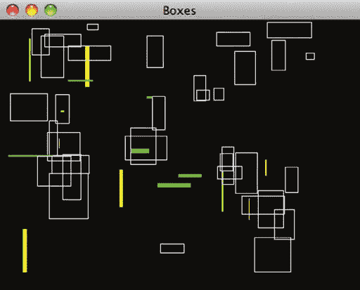

### 列表 6.7 (续)

### 显示

```java
//********************************************************************
// BoxesPanel.java Author: Lewis/Loftus
//
// 展示了如何使用条件语句和循环引导绘图。
//********************************************************************

import javax.swing.JPanel;
import java.awt.*;
import java.util.Random;

public class BoxesPanel extends JPanel
{
    private final int NUM_BOXES = 50, THICKNESS = 5, MAX_SIDE = 50;
    private final int MAX_X = 350, MAX_Y = 250;
    private Random generator;

    //-----------------------------------------------------------------
    // 设置绘图面板。
    //-----------------------------------------------------------------
    public BoxesPanel()
    {
        generator = new Random();
        setBackground(Color.black);
        setPreferredSize(new Dimension(400, 300));
    }

    //-----------------------------------------------------------------
    // 在随机位置绘制随机宽度和高度矩形。
    // 窄或短的矩形将用填充颜色高亮。
    //-----------------------------------------------------------------
    public void paintComponent(Graphics page)
    {
        super.paintComponent(page);
        int x, y, width, height;

        for (int count = 0; count < NUM_BOXES; count++)
        {
            x = generator.nextInt(MAX_X) + 1;
            y = generator.nextInt(MAX_Y) + 1;
            width = generator.nextInt(MAX_SIDE) + 1;
            height = generator.nextInt(MAX_SIDE) + 1;

            if (width <= THICKNESS) // 检查窄矩形
            {
                page.setColor(Color.yellow);
                page.fillRect(x, y, width, height);
            }
            else if (height <= THICKNESS) // 检查短矩形
            {
                page.setColor(Color.green);
                page.fillRect(x, y, width, height);
            }
            else
            {
                page.setColor(Color.white);
                page.drawRect(x, y, width, height);
            }
        }
    }
}
```


## 6.6 对话框

一种名为对话框（dialog box）的组件对于辅助 GUI 关键概念的处理非常有帮助。`对话框`是一个弹出在任何当前活动窗口之上的图形窗口，使用户可以对其进行简短、特定的用户交互。对话框可以服务于多种用途，例如提供信息或传递某些信息、确认操作，或允许用户输入某些信息。通常，对话框只有一个单一的目的，用户与其的交互是短暂的。

Java 类库的 `Swing` 包包含一个名为 `JOptionPane` 的类，它简化了基本对话框的创建和使用。图 6.3 列出了 `JOptionPane` 的一些方法。

*   `static String showInputDialog(Object msg)`: 显示一个包含指定消息和输入文本框的对话框。返回文本框的内容。
*   `static int showConfirmDialog(Component parent, Object msg)`: 显示一个包含指定消息和是/否按钮选项的对话框。如果父组件为 `null`，则对话框将居于屏幕中央。
*   `static void showMessageDialog(Component parent, Object msg)`: 显示一个包含指定消息的对话框。如果父组件为 `null`，则对话框将居于屏幕中央。

**图 6.3** `JOptionPane` 类的一些方法

`JOptionPane` 对话框的基本格式分为三类。`消息对话框`简单地显示输出字符串。`输入对话框`呈现一个提示和一个单一输入文本框，用户可以在其中输入一个数据字符串。`确认对话框`向用户提出一个简单的“是或否”的问题。

让我们来看一个使用这些类型对话框的程序。列表 6.9 显示了一个程序，该程序首先向用户显示一个输入对话框，要求用户输入一个整数。在用户点击输入对话框上的 OK 按钮后，会出现第二个对话框（这次是消息对话框），告知用户输入的数字是偶数还是奇数。在用户关闭该对话框后，将出现第三个对话框，以确定用户是否想要测试另一个数字。如果用户点击标记为“是”的按钮，这一系列对话框将重复。否则，程序终止。

### 列表 6.9

```java
//********************************************************************
// EvenOdd.java 作者: Lewis/Loftus
//
// 展示了 JOptionPane 类的使用。
//********************************************************************

import javax.swing.JOptionPane;

public class EvenOdd
{
    //-----------------------------------------------------------------
    // 判断用户输入的值是偶数还是奇数。
    // 使用多个对话框进行用户交互。
}
```


//-----------------------------------------------------------------

public static void main(String[] args)

{

    String numStr, result;

    int num, again;

    do

    {

        numStr = JOptionPane.showInputDialog("Enter an integer: ");

        num = Integer.parseInt(numStr);

        result = "That number is " + ((num%2 == 0) ? "even" : "odd");

        JOptionPane.showMessageDialog(null, result);

        again = JOptionPane.showConfirmDialog(null, "Do Another?");

    }

    while (again == JOptionPane.YES_OPTION);

}

319

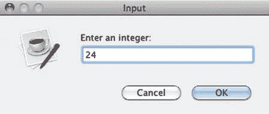 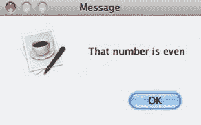 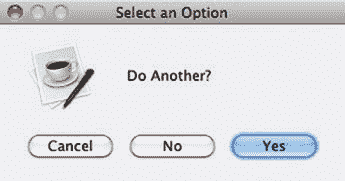

## 6.6 对话框

列表 6.9 (续)

### 显示

`showMessageDialog` 和 `showConfirmDialog` 方法的第一个参数指定了对话框的主父组件。使用 `null` 引用作为此参数会使对话框显示在屏幕中央。

许多 `JOptionPane` 方法允许编程人员定制对话框的内容。此外，可以使用 `showOptionDialog` 方法来创建结合了三种基本格式特征的对话框，以实现更复杂的交互。

320

第 6 章 更多条件语句和循环

### 关键概念总结

*   `switch` 语句将字符或整数值匹配到多个可能情况之一。
*   `break` 语句通常用于 `switch` 语句中每个 `case` 变体的末尾。
*   条件运算符根据布尔条件求值为两个可能值之一。
*   `do` 语句至少会执行一次其循环体。
*   `for` 语句通常用于执行固定次数的循环。
*   `for-each` 版本的 `for` 循环简化了对 `Iterable` 对象中所有元素的处理。
*   循环语句在功能上是对等的。使用哪种取决于情况。
*   对话框是一种弹出窗口，允许简短、特定的用户交互以提供信息或验证操作。

**练习**

EX 6.1 下列 `for` 循环将执行多少次？

a. `for (int i = 0; i < 20; i++) { }`
b. `for (int i = 1; i <= 20; i++) { }`
c. `for (int i = 5; i < 20; i++) { }`
d. `for (int i = 20; i > 0; i--) { }`
e. `for (int i = 1; i < 20; i = i + 2) { }`
f. `for (int i = 1; i < 20; i *= 2) { }`

## EX 6.2 下面代码段的输出是什么？

```java
for (int highest = 1000; highest > 100; highest = highest / 2) System.out.println(highest);
```

## EX 6.3 下面代码段的输出是什么？

```java
for (int count = 1; count <= 100; count += 4)
    if (count %3 == 0)
        System.out.println(count);
```

## 练习题

### EX 6.4 将以下 `while` 循环转换为等效的 `do` 循环（确保其输出相同）。

```java
int num = 1;

while (num < 20)
{
    num++;
    System.out.println(num);
}
```

### EX 6.5 将上一个练习中的 `while` 循环转换为等效的 `for` 循环（确保其输出相同）。

### EX 6.6 编写一个 `do` 循环，验证用户输入的值是否为 3 的倍数。

### EX 6.7 编写一个 `for` 循环，打印从 150 到 50（包含）的偶数。

### EX 6.8 编写一个 `for` 循环，打印从 1 到 100 5 的奇数倍数。

### EX 6.9 编写一段代码段，从用户处读取 15 个浮点数，并打印输入的最小值和最大值。

### EX 6.10 编写一段代码段，判断名为 `text` 的 `String` 对象的最后一个字符是否为‘n’。

### EX 6.11 编写一段代码段，倒序打印名为 `str` 的 `String` 对象中存储的字符。

### EX 6.12 编写一段代码段，从第一个字符开始，隔一个打印名为 `word` 的 `String` 对象中的字符。

### EX 6.13 编写一个名为 `multiplesOfFive` 的方法，打印 5 的前 5 个倍数（从 5 开始）。该方法不接受参数且没有返回值。

### EX 6.14 编写一个名为 `alarm` 的方法，在多行中多次打印字符串 "Alarm!"。该方法应接受一个整数参数，指定打印字符串的次数。如果参数小于 1，则打印错误信息。

### EX 6.15 编写一个名为 `average25` 的方法，返回从 1 到 25（包含）的整数的平均值。

### EX 6.16 编写一个名为 `sumRange` 的方法，接受两个表示范围的整数参数。如果第二个参数小于第一个参数，则发出错误信息并返回零。否则，该方法应返回该范围内整数的和（包含边界值）。

## 第 6 章：更多的条件语句和循环

### EX 6.17 编写一个名为 `startT` 的布尔方法，接受一个 `String` 参数，如果字符串以“T”开头则返回 true，否则返回 false。

### EX 6.18 编写一个名为 `reverse` 的方法，接受一个 `String` 参数，并返回一个包含参数字符倒序排列的字符串。注意，`String` 类中有一个可以执行此操作的方法，但为了这个练习，你应当编写自己的方法。

## 编程项目

### PP 6.1 编写一个程序，读取一个整数，并打印 0 到输入值之间（包含）所有奇整数的平均值。如果输入值小于 0，则打印错误信息。进行相应的提示。

### PP 6.2 编写一个程序，从用户处读取一个字符串，并每行打印一个字符。

### 开发解决方案

### PP 6.3 编写一个程序，生成 PP 6.2 作业的随机负载表，代表每天分配给 10 名员工的工作量。

### PP 6.4 编写一个程序，打印旅行歌曲“百瓶啤酒”（One Hundred Bottles of Beer）的前几节。使用循环使每次迭代打印一节。从用户处读取要打印的节数。验证输入的有效性。以下是歌曲的前两节：

```
100 bottles of beer on the wall
100 bottles of beer
If one of those bottles should happen to fall
99 bottles of beer on the wall

99 bottles of beer on the wall
99 bottles of beer
If one of those bottles should happen to fall
98 bottles of beer on the wall
```

### PP 6.5 使用 PP 4.9 中的 `PairOfDice` 类，编写一个程序掷 1000 次双骰子，统计“大骰”（两个六）出现的次数。

### PP 6.6 使用第 5 章中的 `Person` 类，编写一个名为 `SelectPerson` 的程序，其 `main` 方法选择 25 次人员，并统计每个性别被选中的次数。打印结果。

### PP 6.7 创建 `Stars` 程序的修改版本以打印以下模式。为每个模式创建一个单独的程序。*提示：* 部分 b、c 和 d 需要若干个循环，其中某些循环会打印特定数量的空格。

a. `**********`
b. `*`
c. `*********`
d. `*`

```
**********
*
*********
*
*********
***
***
*****
*******
****
*******
*******
******
*****
******
*********
*****
******
*****
*********
****
*******
****
*******
***
********
***
*****
**
*********
**
***
**********
*
*
```

### PP 6.8 编写一个程序，打印 Unicode 字符子集及其数值。每行打印五个数值/字符对，用制表符分隔。打印从 32（空格字符）到 126（~ 字符）的数值。与目录 C 不同，你表中的数值随行增加。

### PP 6.9 编写一个程序读取三个字符串，然后确定第一个字符串中‘e’出现的次数、第二个字符串中‘t’出现的次数以及第三个字符串中‘n’出现的次数。

### PP 6.10 编写一个程序，打印《圣诞节十二天》的歌词，每节增加一行。前两节为：

```
On 1st day of Christmas my true love gave me
A partridge in a pear tree.

On 2nd day of Christmas my true love gave me
Two turtle doves, and
A partridge in a pear tree.
```


在循环中使用 `switch` 语句来控制打印哪些行。天数使用后缀（`1st`、`2nd`、`3rd` 等）。最后一节涉及所有十二天：*提示：* 仔细安排分支并避免使用 `break` 语句。

### PP 6.11 编写一个程序，绘制 25 条等距的固定长度垂直平行线。

### PP 6.12 编写一个程序，显示一个包含 64 个黑白交替方块的棋盘。

### PP 6.13 编写一个程序，绘制从左下角到右上角的阶梯侧视图。

### PP 6.14 编写一个程序，在随机位置绘制 100 个颜色和直径随机的圆形。确保在每个情况下，整个圆都出现在程序的可见区域。

### PP 6.15 编写一个程序，绘制 5 个长度随机的同心正方形。

### PP 6.16 编写一个程序，绘制砖墙图案，每行砖相对于上方和下方都有偏移。

### PP 6.17 编写一个程序，绘制一个被子，在方形网格中重复简单的图案。

### PP 6.18 修改前面的问题，使用名为 `QuiltPattern` 的独立类来绘制被子，该类表示特定的模式。允许 `QuiltPattern` 类的构造函数改变模式的某些特征，例如颜色方案。实例化两个独立的 `QuiltPattern` 对象并在被子中以棋盘布局整合它们。

### PP 6.19 编写一个程序，绘制一个简单的栅栏，具有垂直且等间距的栅条，由两根水平支撑板支撑。在栅栏背景处显示一个简单的房子。确保通过栅栏的缝隙可以看到房子。

### PP 6.20 编写一个绘制彩虹的程序。使用间距紧密的同心圆用特定的颜色绘制彩虹的每一部分。

### PP 6.21 编写一个程序，在可见区域内的随机位置绘制 20,000 个点。让面板左半部分的点显示为红色，右半部分显示为绿色。通过绘制长度仅为一像素的线来绘制每个点。

### PP 6.22 编写一个程序，在随机位置绘制 5 个大小随机的矩形。将面积最大的矩形填充为绿色。

### PP 6.23 编写一个程序，使用对话框获取三个整数值（每个值使用一个对话框），并显示这些值的平均值以及平均值的平方。使用另一个对话框询问用户是否想继续。

### PP 6.24 修订 PP 5.5 中的 `ChangeCase` 程序，使其使用对话框获取输入字符串，显示修改后的字符串，并提示用户继续。

### PP 6.25 编写一个名为 `Card` 的类，表示一张标准扑牌。

每张扑牌都有花色和面值。创建一个程序来发五张随机牌。

*本页特意留空*


# 面向对象设计

## 第 7 章目标

- 建立与面向对象软件设计相关的关键问题。
- 探索识别程序所需的类和对象的技术。
- 讨论类之间的关系。
- 描述 `static` 修饰符对方法和数据的影响。
- 讨论正式对象接口的创建。
- 进一步探索枚举类型的定义。
- 讨论与方法设计相关的问题，包括方法重载。
- 探索与图形用户界面设计相关的问题，包括布局管理器。

本章扩展了对面向对象软件设计的讨论。我们首先关注软件开发阶段以及在问题领域中识别类和对象的流程。

然后，我们讨论了影响类设计的各种问题，包括 `static` 成员、类关系、接口和枚举类型。我们还探索了方法层面的设计问题，并引入了方法重载的概念。对测试策略的讨论完成了这些问题的介绍。在本章的“图形轨道”章节中，我们关注 GUI 设计概念，包括布局管理器和包含层次结构。

## 7.1 软件开发活动

创建软件涉及的远比编写代码得多。随着你处理的问题变得越来越大，解决方案包含更多的类，仔细思考软件的设计变得至关重要。任何恰当的软件开发工作都由四个基本的 `开发活动` 组成：

- 建立需求
- 创建设计
- 实现设计
- 测试

如果这些活动能按照这种顺序定义一种开发软件的逐步方法，那就太好了。然而，尽管它们看起来是顺序的，但在现实中它们几乎从不是完全线性的。它们相互重叠并相互作用。让我们简要讨论每个开发活动。

`软件需求` 规定了程序必须完成*什么*。它们指出了程序应该执行的任务，而不是如何执行这些任务。通常，需求是在名为 `功能规范` 的文档中表达的。

我们在第 1 章中讨论过一个基本前提：编程实际上是关于解决问题的；我们创建一个程序是为了解决特定问题。需求是该问题的清晰表达。在真正知道我们正在尝试解决什么问题之前，我们无法真正解决它。

想要开发软件产品的人或小组（`客户`）通常会提供一组初始需求。然而，这些初始需求通常是不完整的、含糊的，甚至可能是矛盾的。软件开发人员必须与客户合作完善需求，直到关于系统将做什么的所有关键决策都得到解决。

需求通常涉及用户界面问题，如输出格式、屏幕布局和图形界面组件。本质上，需求建立了使程序对终端用户实用的特征。它们也可能对你的程序施加限制，例如任务必须执行得有多快。

`软件设计` 指明了程序将*如何*完成其需求。

设计规定了程序所需的类和对象，并定义了它们如何交互。它还规定了类之间的关系。低级设计问题处理单个方法如何完成其任务。

土木工程师绝不会在不先设计的情况下考虑建造桥梁。软件的设计同样重要。软件中发生的许多问题直接归于缺乏良好的设计工作。事实反复证明，在程序设计上花费的精力是非常值得的，从长远来看节省了时间和金钱。


### 7.2 识别类和对象

在软件设计期间，需要考虑替代方案并探索**关键概念**。通常，设计的第一次尝试并不是最佳解决方案。投入设计的精力既至关重要又具有成本效益。幸运的是，在设计阶段更改是相对容易的。

`实现` 是编写将解决问题的源代码的过程。更准确地说，实现是将设计翻译成特定编程语言的行为。许多程序员只关注实现，而实际上，它应该是所有开发活动中创造性最低的一项。重要的决策应该在建立需求和创建设计时做出。

`测试` 是确保程序在它必须执行的所有约束条件下能够解决预设问题的行为。测试包括使用各种输入多次运行程序，并仔细检查结果。但它所代表的意义远不止于此。我们将在 7.9 节中重新讨论与测试相关的问题。

**自测习题** *(答案见附录 N)*

SR 7.1 列出涉及软件开发过程四个基本活动。

SR 7.2 谁创建/指定需求？客户还是开发人员？讨论。

SR 7.3 将本节介绍的四个基本开发活动与第 1 章（第 1.6 节）中的五个通用问题解决步骤进行比较和对比。

### 7.2 识别类和对象

面向对象软件设计的一个基本部分是确定对程序贡献的类。我们必须仔细考虑想要如何表示组成整体解决方案的各种元素。这些类决定了我们在系统中管理的对象。

识别潜在类的一种方法是识别程序需求中讨论的对象。对象通常是名词。你实际上可能需要仔细检查问题描述，或者如果有功能规范的话，以识别其中发现的名词。例如，图 7.1 显示了问题描述的一部分，并圈出了其中的名词。

**关键概念**

当然，问题规范中的每个名词都不会对应于程序中的一个类。这项活动只是一个起点，允许你思考程序将管理的对象类型。问题描述中的名词可能指示程序所需的某些类和对象。

用户必须允许通过其主要特征来指定每个产品，包括其名称和产品编号。如果条码不匹配产品，此时应向消息窗口生成错误并录入错误日志中。所有事务的汇总报告必须按照第 7.A 节规定的结构进行组织。

**图 7.1** 圈出名词的部分问题描述。请记住，一个类表示一组具有相似行为的对象。规范中的复数名词（例如 `products`）可能表示需要一个表示其中某项物品的类，例如 `Product`。即使你的系统中只需要一种特定类型的对象，它也可能最好被表示为一个类。

表示对象的类通常应该使用单数名词进行命名，例如 `Coin`、`Student` 和 `Message`。一个类代表一个单项，我们可以根据意愿从该类创建任意数量的实例。

另一个关键决策是将某个内容表示为对象，还是表示为另一个对象的原始类型属性。例如，我们最初可能认为员工的薪水应该表示为整数，这对于系统的大部分处理工作可能是有效的。但经过进一步的反思，我们可能会意识到薪水取决于个人的职级，而职级有上限和下限工资范围，必须小心管理。因此，最终的结论可能是，我们认为将所有数据和相关行为表示为一个独立的类会更好。

考虑到特定程序的需求，我们希望在过于通用的类和过于具体的类之间取得良好的平衡。例如，为房子中存在的每种家电创建一个单独的类可能会不必要地增加设计的复杂性。拥有一个 `Appliance` 类可能足够了，其中或许有一个实例数据来指示它是哪种类型的家电。但另一方面，这可能也不够。这一切取决于软件旨在实现什么目标。

除了表示问题领域对象的类外，我们可能还需要支持完成工作所需工作的类。例如，除了 `Member` 对象之外，我们可能还需要一个单独的类来帮助我们管理俱乐部的所有成员。

请记住，在构建真实系统时，我们在设计过程中识别出的某些类可能已经存在了。即使没有完全匹配的，也可能有一个与我们相似的旧类，可以作为我们新类的基础。现有的类可能是 Java 标准类库的一部分，可能是我们以前解决过的问题的解决方案的一部分，也可能是从第三方购买的库的一部分。这些都是软件重用的示例。

### 7.3 静态类成员

#### 分配职责

在识别程序所需的类的过程中，有一部分工作是为每个类分配职责。每个类表示一个具有某些行为的对象，这些行为由类的方法定义。程序必须完成的任何活动都必须在类的行为某处表示出来。也就是说，每个类负责执行某些活动，这些职责必须在设计程序时被分配。

类的行为执行了构成程序功能的操作。因此，我们通常使用动词来命名行为以及实现这些行为的方法。

有时，要确定哪一个类是执行特定职责的最佳类是具有挑战性的。考虑多种可能性。有时这种分析会让你意识到，定义另一个类来承担该职责可能会让你受益。

在设计的早期阶段，没有必要识别一个类所包含的所有方法。

**复习题**
- 7.4 识别规范中的名词如何帮助你设计解决方案？
- 7.5 定义类所包含的所有方法重要吗？

#### 探索静态

到目前为止，我们已经看到了两类变量：在方法内部声明的局部变量和在类中声明的实例变量。使用*实例变量*（instance variable）一词是因为每个对象都有其自己的变量版本。**静态变量**（static variables）是一种*静态变量*（有时称为*类变量*），由该类的所有实例共享。对于该类的所有对象，静态变量只有一个副本。因此，更改一个对象中静态变量的值会改变所有对象的值。关键字 `static` 用作修饰符来声明静态变量，如下：

```java
private static int count = 0;
```

当包含静态变量的类第一次被引用时，就会为静态变量建立内存空间。在方法内部声明的局部变量不能是静态的。使用 `final` 修饰符声明的常量通常使用 `static` 修饰符来声明。因为常量的值不能改变，那么在类的所有对象中只保留一个值的副本也是一样的。

#### 静态方法

在第 3 章中，我们简要地介绍了*静态方法*（static method，也称为*类方法*）的概念。静态方法可以通过类名调用。我们不需要实例化类的对象即可调用该方法。在第 3 章中，我们注意到 `Math` 类的所有方法都是静态方法。例如，在下面的代码行中，`sqrt` 方法是通过 `Math` 类名调用的：

```java
System.out.println("Square root of 27: " + Math.sqrt(27));
```

`Math` 类中的方法根据传递的参数的值执行基础计算。在这些情况下，没有需要维护的对象状态；因此，没有理由为了请求这些服务而创建一个对象。

通过在方法声明中使用 `static` 修饰符可以将方法设为静态的。由于静态方法不是在特定对象的上下文中运行，它们不能引用实例变量（实例变量只存在于类的实例中）。然而，静态方法可以引用静态变量，因为静态变量独立于特定对象。如果静态方法尝试使用非静态变量，编译器将发出错误。

列表 7.1 中的程序实例化了多个 `Slogan` 类对象，并依次打印每一个。在程序结束时，它通过类名调用了一个名为 `getCount` 的方法，该方法返回程序中实例化的 `Slogan` 对象的数量。

### Listing 7.1

```java
//********************************************************************
// SloganCounter.java Author: Lewis/Loftus
//
// 展示了 static 关键字的使用。
//********************************************************************

public class SloganCounter
{
    //-----------------------------------------------------------------
    // 创建几个 Slogan 对象并打印创建
    // 对象的数量。
    //-----------------------------------------------------------------
    public static void main(String[] args)
    {
        Slogan obj;

        obj = new Slogan("Remember the Alamo.");
        System.out.println(obj);

        obj = new Slogan("Don't Worry. Be Happy.");
        System.out.println(obj);

        obj = new Slogan("Live Free or Die.");
        System.out.println(obj);

        obj = new Slogan("Talk is Cheap.");
        System.out.println(obj);

        obj = new Slogan("Write Once, Run Anywhere.");
        System.out.println(obj);

        System.out.println();

        System.out.println("Slogans created: " + Slogan.getCount());
    }
}
```

**输出**

```
Remember the Alamo.
Don't Worry. Be Happy.
Live Free or Die.
Talk is Cheap.
Write Once, Run Anywhere.
Slogans created: 5
```

Listing 7.2 展示了 `Slogan` 类。`Slogan` 的构造函数会增加一个名为 `count` 的静态变量，该变量在声明时初始化为零。

因此，`count` 用于跟踪已创建的 `Slogan` 实例数量。

`Slogan` 的 `getCount` 方法也被声明为 `static`，这允许它在 `main` 方法中通过类名被调用。注意，`getCount` 方法中引用的唯一数据是整数变量 `count`，它是 `static` 的。

作为静态方法，`getCount` 不能引用任何非静态数据。`getCount` 方法可以在不带 `static` 修饰符的情况下声明，但那样的话在 `main` 方法中的调用就必须通过 `Slogan` 类的实例而不是类本身来完成。

### Listing 7.2

```java
//********************************************************************
// Slogan.java Author: Lewis/Loftus
//
// 表示单个口号字符串。
//********************************************************************

public class Slogan
{
    private String phrase;
    private static int count = 0;

    //-----------------------------------------------------------------
    // 构造函数：设置口号并统计创建
    // 实例的数量。
    //-----------------------------------------------------------------
    public Slogan(String str)
    {
        phrase = str;
        count++;
    }

    //-----------------------------------------------------------------
    // 将此口号作为字符串返回。
    //-----------------------------------------------------------------
    public String toString()
    {
        return phrase;
    }

    //-----------------------------------------------------------------
    // 返回此类已创建的实例的数量。
    //-----------------------------------------------------------------
    public static int getCount()
    {
        return count;
    }
}
```


## 7.3 静态类成员

### 自测题（参见附录 N 中的答案）

- **SR 7.6** 静态变量和实例变量之间的区别是什么？
- **SR 7.7** 假设你正在定义一个 `BankAccount` 类，其每个对象代表一个独立的银行账户。编写一个类变量声明，该变量将存储该类表示的所有银行账户的总余额。
- **SR 7.8** 假设你正在定义一个 `BankAccount` 类，其每个对象代表一个独立的银行账户。编写一个类变量声明，该变量将存储每个账户都必须维持的最低余额。
- **SR 7.9** 任何程序的 `main` 方法可以引用哪些类型的变量？为什么？

## 7.4 类关系

软件系统中的类之间存在各种类型的关系。三种最常见的关系是依赖、聚合和继承。

我们在许多示例中都见过依赖关系，即其中一个类“使用”另一个类。本节将重新回顾依赖关系，并探索类依赖于自身的情况。然后我们探索聚合关系，在聚合中，一个类的对象包含另一个类的对象，创建了一种“拥有”（has-a）的关系。我们在第 1 章中引入了继承，它在类之间创建了“是”（is-a）的关系。我们将继承的详细检查推到第 9 章。

### 依赖

在之前的许多示例中，我们见过一个类依赖于另一个类的概念。这意味着一个类在某种程度上依赖另一个类。通常，一个类的方法会调用另一个类的方法。这建立了一种“使用”的关系。

通常，如果类 `A` 使用类 `B`，那么类 `A` 的一个或多个方法会调用类 `B` 的一个或多个方法。如果调用的方法是 `static`，那么 `A` 只通过名称引用 `B`。如果调用的方法不是 `static`，则 `A` 必须能够访问类 `B` 的特定实例才能调用该方法。也就是说，`A` 必须拥有指向类 `B` 对象的引用。

一个对象获取另一个对象访问权限的方式是一个重要的设计决策。当一个类实例化另一个类的对象时，通常是聚合关系的基础。访问也可以通过将一个对象作为参数传递给另一个对象来实现。通常而言，我们希望减少类之间的依赖关系。类之间的依赖程度越低，变化和错误对系统的影响就越小。

#### 同类对象之间的依赖

在某些情况下，一个类依赖于自身。也就是说，一个类的对象与同类的另一个对象进行交互。为了实现这一点，类的一个方法可以接受同类的对象作为参数。这种设计强化了“类表示特定对象”的思想。

`String` 类的 `concat` 方法就是这种情况的例子。它通过一个 `String` 对象执行，并接收另一个 `String` 对象作为参数。例如：

```java
str3 = str1.concat(str2)
```

执行方法的 `String` 对象 (`str1`) 将其字符追加到作为参数的 `String` 对象 (`str2`) 之后。返回一个新的 `String` 对象作为结果并存储在 `str3` 中。

列表 7.3 所示的 `RationalTester` 程序展示了类似的情况。有理数可以是两个整数比例的值（分数）。`RationalTester` 程序创建了两个有理数的对象，然后对它们进行各种操作以产生新的有理数。

```java
System.out.println("r1 and r2 are equal.");
else
    System.out.println("r1 and r2 are NOT equal.");
r3 = r1.reciprocal();
System.out.println("The reciprocal of r1 is: " + r3);
```

```java
r4 = r1.add(r2);
r5 = r1.subtract(r2);
r6 = r1.multiply(r2);
r7 = r1.divide(r2);
System.out.println("r1 + r2: " + r4);
System.out.println("r1 - r2: " + r5);
System.out.println("r1 * r2: " + r6);
System.out.println("r1 / r2: " + r7);
```

### 输出

第一个有理数: 3/4
第二个有理数: 1/3
r1 and r2 are NOT equal.
The reciprocal of r1 is: 4/3
r1 + r2: 13/12
r1 - r2: 5/12
r1 * r2: 1/4
r1 / r2: 9/4

`RationalNumber` 类如列表 7.4 所示。在检查此类时，请记住，从 `RationalNumber` 类创建的每个对象都代表一个单一的有理数。`RationalNumber` 类包含了对有理数的各种操作，例如加法和减法。

```java
//********************************************************************
// RationalNumber.java 作者: Lewis/Loftus
//
// 表示一个带有分子和分母的有理数。
//********************************************************************
public class RationalNumber
{
    private int numerator, denominator;

//-----------------------------------------------------------------
// 构造函数：通过确保分母不为零且仅使分子带有符号来设置该有理数。
//-----------------------------------------------------------------
public RationalNumber(int numer, int denom)
{
    if (denom == 0)
        denom = 1;
    // 让分子“存储”符号
    if (denom < 0)
    {
        numer = numer * -1;
        denom = denom * -1;
    }
    numerator = numer;
    denominator = denom;
    reduce();
}

//-----------------------------------------------------------------
// 返回此有理数的分子。
//-----------------------------------------------------------------
public int getNumerator()
{
    return numerator;
}

//-----------------------------------------------------------------
// 返回此有理数的分母。
//-----------------------------------------------------------------
public int getDenominator()
{
    return denominator;
}

//-----------------------------------------------------------------
// 返回此有理数的倒数。
//-----------------------------------------------------------------
public RationalNumber reciprocal()
{
    return new RationalNumber(denominator, numerator);
}

//-----------------------------------------------------------------
// 将此有理数加到作为参数传递的有理数上
// 公分母通过相乘分母找到。
//-----------------------------------------------------------------
public RationalNumber add(RationalNumber op2)
{
    int commonDenominator = denominator * op2.getDenominator();
    int numerator1 = numerator * op2.getDenominator();
    int numerator2 = op2.getNumerator() * denominator;
    int sum = numerator1 + numerator2;
    return new RationalNumber(sum, commonDenominator);
}

//-----------------------------------------------------------------
// 将作为参数传递的有理数从此
// 有理数减去。
//-----------------------------------------------------------------
public RationalNumber subtract(RationalNumber op2)
{
    int commonDenominator = denominator * op2.getDenominator();
    int numerator1 = numerator * op2.getDenominator();
    int numerator2 = op2.getNumerator() * denominator;
    int difference = numerator1 - numerator2;
    return new RationalNumber(difference, commonDenominator);
}

//-----------------------------------------------------------------
// 将此有理数乘以作为参数
// 传递的有理数。
//-----------------------------------------------------------------
public RationalNumber multiply(RationalNumber op2)
{
    int numer = numerator * op2.getNumerator();
    int denom = denominator * op2.getDenominator();
    return new RationalNumber(numer, denom);
}

//-----------------------------------------------------------------
// 通过乘以第二个数的倒数
// 将此有理数除以作为参数传递的有理数。
//-----------------------------------------------------------------
public RationalNumber divide(RationalNumber op2)
{
    return multiply(op2.reciprocal());
}

//-----------------------------------------------------------------
// 判断此有理数是否与作为参数传递的
// 有理数相等。假设两者已约分。
//-----------------------------------------------------------------
public boolean isLike(RationalNumber op2)
{
    return numerator == op2.getNumerator() &&
           denominator == op2.getDenominator();
}

//-----------------------------------------------------------------
// 将此有理数作为字符串返回。
//-----------------------------------------------------------------
public String toString()
{
    String result;
    if (numerator == 0)
        result = "0";
    else if (denominator == 1)
        result = numerator + "";
    else
        result = numerator + "/" + denominator;
    return result;
}

//-----------------------------------------------------------------
// 通过将分子和分母除以它们的最大公约数来约此有理数。
//-----------------------------------------------------------------
private void reduce()
{
    if (numerator != 0)
    {
        int common = gcd(Math.abs(numerator), denominator);
        numerator = numerator / common;
        denominator = denominator / common;
    }
}

//-----------------------------------------------------------------
// 计算并返回两个正参数的最大公约数。
// 使用欧几里得算法。
//-----------------------------------------------------------------
private int gcd(int num1, int num2)
{
    while (num1 != num2)
        if (num1 > num2)
            num1 = num1 - num2;
        else
            num2 = num2 - num1;
    return num1;
}
}
```

`RationalNumber` 类的方法（如 `add`、`subtract`、`multiply` 和 `divide`）使用执行方法的 `RationalNumber` 对象作为第一个（左）操作数，并将作为参数传递的 `RationalNumber` 对象作为第二个（右）操作数。

`RationalNumber` 类的 `isLike` 方法用于判断两个有理数是否相等。因此很容易命名为 `equals`，类似于比较 `String` 对象的方法（在第 5 章中讨论）。然而，在第 9 章中，我们将讨论由于继承 `equals` 方法非常特殊，以及它应该以特定的方式实现。为了避免混淆，我们现在将此方法命名为 `isLike`。

注意 `RationalNumber` 类中的某些方法包括 `reduce` 和 `gcd` 被声明为 `private` 可见性。这些方法是私有的，因为我们不希望从 `RationalNumber` 对象外部直接执行它们。它们存在是为了支持该对象的其他服务。

### 聚合

某些对象是由其他对象组成的。例如，汽车是由它的发动机、底盘、轮子和许多部分组成的。这些**核心概念**每个部分都可以被视为独立的对象。因此，我们可以说汽车是一个*聚合*——它至少部分由其他对象组成，形成了一种“拥有”（has-a）关系。聚合有时被描述为一种*拥有关系*。

例如，汽车有一个底盘。

在软件世界中，我们将 `aggregate object`（聚合对象）定义为任何以实例数据形式包含其他对象引用的对象。例如，一个 `Account`（账户）对象包含一个代表账户所有者名字的 `String` 对象（此外）。我们有时会忘记字符串也是对象，但从技术上说，这使得每个 `Account` 对象都是一个聚合对象。

聚合是一种特殊的依赖关系。也就是说，一个类部分是由另一个类定义的，它就依赖于该类。聚合对象的方法通常会调用构成该对象的对象的那些对象的方法。

让我们考虑另一个例子。列表 `7.5` 所示的程序 `StudentBody` 创建了两个 `Student` 对象。每个 `Student` 对象部分由两个 `Address` 对象组成，一个用于学生在学校的地址，另一个用于学生的家庭地址。`main` 方法所做的无非创建了 `Student` 对象并将它们打印出来。我们再次将对象传递给 `println` 方法，依靠自动调用 `toString` 方法来创建一个适用于打印的有效对象表示。


列表 `7.6` 所示的 `Student` 类代表单个学生。如果该类要代表学生的所有方面，它将必须大幅扩展。

我们现在刻意保持其简单，以便清晰地展示对象聚合。`Student` 类的实例数据包括两个对 `Address` 对象的引用。在创建字符串表示时，我们在 `toString()` 方法中引用了这些对象。通过将一个 `Address` 对象连接到另一个字符串上，`Address` 类中的 `toString()` 方法会被自动调用。

### 列表 7.5

```java
//********************************************************************
// StudentBody.java Author: Lewis/Loftus
//
// 展示了聚合类的使用。
//********************************************************************
public class StudentBody
{
//-----------------------------------------------------------------
// 创建一些 Address 和 Student 对象并打印它们。
//-----------------------------------------------------------------
public static void main(String[] args)
{
Address school = new Address("800 Lancaster Ave.", "Villanova",
"PA", 19085);
Address jHome = new Address("21 Jump Street", "Blacksburg",
"VA", 24551);

Student john = new Student("John", "Smith", jHome, school); 
Address mHome = new Address("123 Main Street", "Euclid", "OH", 44132);
Student marsha = new Student("Marsha", "Jones", mHome, school); 
System.out.println(john);
System.out.println();
System.out.println(marsha);
}
}
```

**输出**

```
John Smith
Home Address:
21 Jump Street
Blacksburg, VA 24551
School Address:
800 Lancaster Ave.
Villanova, PA 19085
Marsha Jones
Home Address:
123 Main Street
Euclid, OH 44132
School Address:
800 Lancaster Ave.
Villanova, PA 19085
```

### 列表 7.6

```java
//********************************************************************
// Student.java Author: Lewis/Loftus
//
// 代表一个大学学生。
//********************************************************************
public class Student
{
private String firstName, lastName;
private Address homeAddress, schoolAddress;

//-----------------------------------------------------------------
// 构造函数：用指定的值设置此学生。
//-----------------------------------------------------------------
public Student(String first, String last, Address home, Address school)
{
firstName = first;
lastName = last;
homeAddress = home;
schoolAddress = school;
}

//-----------------------------------------------------------------
// 返回此 Student 对象的字符串描述。
//-----------------------------------------------------------------
public String toString()
{
String result;
result = firstName + " " + lastName + "\n"; 
result += "Home Address:\n" + homeAddress + "\n"; 
result += "School Address:\n" + schoolAddress; 
return result;
}
}
```

`Address` 类如列表 `7.7` 所示。它代表一个街道地址。注意，`Address` 类中没有任何地方表明它是 `Student` 对象的一部分。`Address` 类在设计上保持了通用性，因此可以被用于任何需要街道地址的情况。

### 列表 7.7

```java
//********************************************************************
// Address.java Author: Lewis/Loftus
//
// 代表一个街道地址。
//********************************************************************
public class Address
{
private String streetAddress, city, state;
private long zipCode;

//-----------------------------------------------------------------
// 构造函数：用指定的数据设置此地址。
//-----------------------------------------------------------------
public Address(String street, String town, String st, long zip)
{
streetAddress = street;
city = town;
state = st;
zipCode = zip;
}

//-----------------------------------------------------------------
// 返回此 Address 对象的描述。
//-----------------------------------------------------------------
public String toString()
{
String result;
result = streetAddress + "\n";
result += city + ", " + state + " " + zipCode; 
return result;
}
}
```

对象越复杂，越可能需要被表示为一个聚合对象。在 UML 中，聚合用两个类之间的连接来表示，在靠近聚合类的末端有一个空心菱形。图 7.2 显示了 `StudentBody` 程序的 UML 类图。注意，在之前的 UML 图表示例和 7.2 中，字符串没有被表示为具有聚合关系的独立类，尽管从技术上讲它们是可以的。字符串对于编程来说是如此基础，以至于在 UML 图中通常被表示得像原始类型。

### this 引用

在我们离开类之间关系的话题之前，我们应该检查 Java 程序中使用的另一个特殊引用，称为 `this` 引用。`this` 单词是 Java 中的一个保留字。它允许对象引用自己。正如我们所讨论过的，非静态方法是通过（或由）特定对象被调用的。

图 7.2 显示显示聚合或类的 UML 类图。

```
**StudentBody**
**Student**
firstName : String
lastName : String
homeAddress : Address
+ main (args : String[]) : void
schoolAddress : Address
+ toString() : String

**Address**
streetAddress : String
city : String
state : String
zipCode : long
+ toString() : String
```

在该方法内部，`this` 引用可以指向当前正在执行的对象。例如，在一个名为 `ChessPiece` 的类中可能有一个名为 `move()` 的方法，它可以包含以下行：

```java
if (this.position == piece2.position)
result = false;
```

在这种情况下，`this` 引用被用来明确所引用的哪个位置。`this` 引用指向调用方法的对象。因此，当使用以下行来调用方法时，`this` 引用指向 `bishop1`：

```java
bishop1.move();
```

然而，当使用另一个对象来调用方法时，`this` 引用指向该对象。因此，当使用以下调用时，`move()` 方法中的 `this` 引用指向 `bishop2`：

```java
bishop2.move();
```

通常，`this` 引用用于区分构造函数的参数与与其同名的实例变量。例如，第 4 章中介绍的 `Account` 类的构造函数如下：

```java
public Account(String owner, long account, double initial)
{
    name = owner;
    acctNumber = account;
    balance = initial;
}
```

在编写该构造函数时，我们刻意为参数使用了不同的名称，以将其与实例变量 `name`、`acctNumber` 和 `balance` 区分开。这种区分是任意的。可以使用 `this` 引用将构造函数写如下：

```java
public Account(String name, long acctNumber, double balance)
{
    this.name = name;
    this.acctNumber = acctNumber;
    this.balance = balance;
}
```

在这个版本的构造函数中，`this` 特指对象的实例变量。赋值语句右侧的变量指的是形式参数。这种方法避免了寻找不同但等效名称的需要。这种情况有时出现在其他方法中，但在构造函数中经常出现。

### 自测题（答案见附录 N）

- **SR 7.10** 描述两个类之间的依赖关系。
- **SR 7.11** 解释类如何与自身产生关联。
- **SR 7.12** 什么是聚合对象？
- **SR 7.13** `this` 引用指的是什么？

## 7.5 接口

我们使用 `interface` 一词来指代我们用于与对象交互的公共方法集合。该定义与我们在本节中的用法一致，但现在我们将使用 Java 中一种特定的语言结构将这一概念形式化。


#### 列表 7.8

```java
//********************************************************************
// Complexity.java Author: Lewis/Loftus
//
// 表示一个可以被分配显式复杂
// 对象的接口。
//********************************************************************
public interface Complexity
{
    public void setComplexity(int complexity);
    public int getComplexity();
}
```

Java `interface` 是常量和抽象方法的集合。

**核心概念**

`abstract method`（抽象方法）是不具有实现的方法。也就是说，抽象方法没有定义代码体。方法的头部（包括其参数列表）后面仅跟一个分号。`interface` 无法被实例化。

列表 7.8 显示了一个名为 `Complexity` 的接口。它包含两个抽象方法：`setComplexity()` 和 `getComplexity()`。

抽象方法可以带有保留关键字 `abstract`，尽管在接口中通常不需要。接口中的方法默认具有 `public` 可见性。

类通过为接口中定义的每个抽象方法提供方法实现，来 `implements`（实现）一个 `interface`。实现接口的类在类头部使用关键字 `implements` 后跟接口名称。如果一个类断言它实现了某个特定接口，则它必须为接口中的所有方法提供定义。如果接口中的任何方法没有在类中给出定义，编译器将产生错误。

列表 7.9 所示的 `Question` 类实现了 `Complexity` 接口。`setComplexity()` 和 `getComplexity()` 方法都得到了实现。它们的声明签名必须与接口中对应的抽象方法相同。在 `Question` 类中，这些方法的定义仅是为了设置或返回一个数值，该数值代表对象所代表的问题的复杂度水平。

注意 `Question` 类还实现了不属于 `Complexity` 接口的其他方法。具体来说，它定义了名为 `getQuestion()`、`getAnswer()`、`answerCorrect()` 和 `toString()` 的方法，这些方法与接口无关。接口保证类实现了某些方法，但并没有限制它拥有额外的方法。

#### 列表 7.9


```java
//********************************************************************
// Question.java Author: Lewis/Loftus
//
// 表示一个问题（及其答案）。
//********************************************************************
public class Question implements Complexity
{
    private String question, answer;
    private int complexityLevel;

    //-----------------------------------------------------------------
    // 构造函数：使用默认复杂度设置问题。
    //-----------------------------------------------------------------
    public Question(String query, String result)
    {
        question = query;
        answer = result;
        complexityLevel = 1;
    }

    //-----------------------------------------------------------------
    // 设置此问题的复杂度水平。
    //-----------------------------------------------------------------
    public void setComplexity(int level)
    {
        complexityLevel = level;
    }

    //-----------------------------------------------------------------
    // 返回此问题的复杂度水平。
    //-----------------------------------------------------------------
    public int getComplexity()
    {
        return complexityLevel;
    }

    //-----------------------------------------------------------------
    // 返回问题。
    //-----------------------------------------------------------------
    public String getQuestion()
    {
        return question;
    }

    //-----------------------------------------------------------------
    // 返回此问题的答案。
    //-----------------------------------------------------------------
    public String getAnswer()
    {
        return answer;
    }

    //-----------------------------------------------------------------
    // 如果候选答案与答案匹配，则返回 true。
    //-----------------------------------------------------------------
    public boolean answerCorrect(String candidateAnswer)
    {
        return answer.equals(candidateAnswer);
    }

    //-----------------------------------------------------------------
    // 以字符串形式返回此问题（及其答案）。
    //-----------------------------------------------------------------
    public String toString()
    {
        return question + "\n" + answer;
    }
}
```

实现接口的类拥有其他方法是常见的。列表 7.10 显示了一个名为 `MiniQuiz` 的程序，它使用了一些 `Question` 对象。

接口及其与实现它的类的关系可以在 UML 类图中表示。接口的表示方法与类节点相似，但在接口名称上方插入了 `<<interface>>` 标记。一条带有实心箭头的虚线从类指向它实现的接口。图 7.3 显示了 `MiniQuiz` 程序的 UML 类图。

多个类可以实现同一个接口，为方法提供替代性定义。例如，我们可以实现一个名为 `Task` 的类，它也实现了 `Complexity` 接口。在类中，我们可以选择以不同的方式管理任务的复杂度（尽管它仍然必须实现所有方法）。

一个类可以实现多个接口。在这种情况下，该类必须为列出的所有接口中的所有方法提供实现。为了演示这一点

#### 列表 7.10

```java
//********************************************************************
// MiniQuiz.java Author: Lewis/Loftus
//
// 展示实现接口的类的用法。
//********************************************************************
import java.util.Scanner;

public class MiniQuiz
{
    //-----------------------------------------------------------------
    // Presents a short quiz.
    //-----------------------------------------------------------------
    public static void main(String[] args)
    {
        Question q1, q2;
        String possible;
        Scanner scan = new Scanner(System.in);

        q1 = new Question("What is the capital of Jamaica?",
        "Kingston");
        q1.setComplexity(4);

        q2 = new Question("Which is worse, ignorance or apathy?",
        "I don't know and I don't care");
        q2.setComplexity(10);

        System.out.print(q1.getQuestion());
        System.out.println(" (Level: " + q1.getComplexity() + ")");
        possible = scan.nextLine();

        if (q1.answerCorrect(possible))
            System.out.println("Correct");
        else
            System.out.println("No, the answer is " + q1.getAnswer());
        System.out.println();

        System.out.print(q2.getQuestion());
        System.out.println(" (Level: " + q2.getComplexity() + ")");
        possible = scan.nextLine();

        if (q2.answerCorrect(possible))
            System.out.println("Correct");
        else
            System.out.println("No, the answer is " + q2.getAnswer());
    }
}
```

### output

牙买加的首都是是什么？（等级: 4）

金斯顿

正确

无知还是冷漠更糟糕？（等级: 10）

冷漠

不，答案是：我也不知道也不乎

### 接口 (Interfaces)

一个类可以实现多个接口，这些接口在 `implements` 子句中列出，并用逗号分隔。例如：

```java
class ManyThings implements Interface1, Interface2, Interface3
{
    // 包含所有接口的方法
}
```

除了或或代替抽象方法，接口还可以包含常量，这些常量使用 `final` 修饰符定义。当一个类实现一个接口时，它就可以访问接口中定义的所有常量。

接口结构从形式上定义了我们与类交互的方式。它还作为一种名为“多态性”的强大编程技术的基础，我们将在第 10 章中讨论这种技术。

### Comparable 接口

Java 标准类库包含了接口也包含了类。例如，`Comparable` 接口定义在 `java.lang` 包中。`Comparable` 接口只包含一个方法 `compareTo`，它接受一个对象作为参数并返回一个整数。

该接口的意图是提供一种比较对象与其他对象的通用机制。一个对象调用该方法并将另一个对象作为参数传递如下：

```java
if (obj1.compareTo(obj2) < 0)
    System.out.println("obj1 is less than obj2");
```

**第 7 章 面对象设计**

**图 7.3** `MiniQuiz` 程序的 UML 类图。根据接口文档的规定，如果 `obj1` 小于 `obj2`，则 `compareTo` 方法返回的整数应该是负数；如果它们相等则为 0；如果 `obj1` 大于 `obj2` 则为正数。每个类的设计者负责决定该类的一个对象小于、等于或大于另一个对象意味着什么。

在第 5 章中，我们提到 `String` 类包含一个以这种方式运行的 `compareTo` 方法。现在我们可以明确，`String` 类之所以拥有此方法是因为它实现了 `Comparable` 接口。`String` 类对该方法的实现是基于 Unicode 字符集定义的字典顺序进行比较的。

### Iterator 接口

`Iterator` 接口是另一个作为 Java 标准类库一部分定义的接口。它被表示对象集合类使用，提供了一种一次移动一个对象遍历集合的方法。

#### 复习枚举类型 (Enumerated Types)

在第 5 章中，我们定义了迭代器的概念，使用循环处理集合中的所有元素。大多数迭代器（包括 `Scanner` 类的对象）都是使用 `Iterator` 接口定义的。

`Iterator` 接口中的两个主要方法是返回布尔结果的 `hasNext` 和返回一个对象的 `next`。这两个方法都不接受任何参数。如果还有剩余项目待处理，`hasNext` 返回 `true`，`next` 返回下一个对象。实现 `Iterator` 接口的类设计者负责决定 `next` 方法交付对象的顺序。

我们应该注意到，根据接口的精神，`next` 方法不会从底层集合中移除对象；它只是返回该对象的引用。`Iterator` 接口还有一个名为 `remove` 的方法，它不接受参数且返回类型为 `void`。调用 `remove` 方法会从底层集合中移除最近由 `next` 方法返回的对象。

#### 自测复习题

- **SR 7.14** 类和接口之间的区别是什么？

- **SR 7.15** 定义一个名为 `Nameable` 的 Java 接口。实现此接口的类必须提供一个 `setName` 方法，该方法需要单个 `String` 参数且没有返回值，以及一个没有参数且返回 `String` 的 `getName` 方法。

- **SR 7.16 判断对对错？**

    - a. 接口可以只包含抽象方法。

    - b. 抽象方法是不具有实现的方法。

    - c. Java 接口定义中的所有方法都必须是抽象的。

    - d. 实现接口的类只能定义接口中包含的方法。

    - e. 多个类可以实现同一个接口。

    - f. 一个类可以实现多个接口。

    - g. 所有实现接口的类必须为接口中包含的方法提供完全相同的定义。

## 7.6 复习枚举类型

```java
enum Season
{
    winter ("December through February"),
    spring ("March through May"),
    summer ("June through August"),
    fall ("September through November");

    private String span;

    //-----------------------------------------------------------------
    // 构造函数：为每个值设置关联的字符串。
    //-----------------------------------------------------------------
    Season(String months)
    {
        span = months;
    }

    //-----------------------------------------------------------------
    // 返回此值的跨度消息。
    //-----------------------------------------------------------------
    public String getSpan()
    {
        return span;
    }
}
```

`SeasonTester` 类的 `main` 方法打印了 `Season` 枚举类型的每个值，以及每个值的跨度语句。每个枚举类型都包含一个名为 `values` 的静态方法，该方法返回该类型所有可能值的列表。该列表是一个迭代器，因此我们可以使用增强型的 `for` 循环来处理每个值。

**列表 7.12**

```java
//********************************************************************
// SeasonTester.java Author: Lewis/Loftus
//
// 演示完整枚举类型的用法。
//********************************************************************
public class SeasonTester
{
    //-----------------------------------------------------------------
    // 遍历 Season 枚举类型的值。
    //-----------------------------------------------------------------
    public static void main(String[] args)
    {
        for (Season time : Season.values())
        {
            System.out.println(time + "\t" + time.getSpan());
        }
    }
}
```

**输出**

```
winter December through February
spring March through May
summer June through August
fall September through November
```

**核心概念**

除了每个枚举类型中定义的可能值列表外，我们还可以在定义枚举类型时包含任何根据我们需要选择的任意数量的属性或方法。这为创新的类设计提供了各种机会。

**自测题**（答案见附录 N）

SR 7.17 使用本节定义的枚举类型 `Season`，以下代码序列的输出是什么？

```java
Season time1, time2;
time1 = Season.winter;
time2 = Season.summer;
System.out.println(time1);
System.out.println(time2.name());
System.out.println(time1.ordinal());
System.out.println(time2.getSpan());
```

## 7.7 方法设计

一旦你确定了类并分配了基本职责，每个方法的设计将决定该类具体如何定义其行为。有些方法是直观的，不需要过多思考；另一些则更有趣，需要仔细的规划。

`algorithm`（算法）是解决问题的逐步过程。食谱就是算法的示例。旅行路线也是算法的一个例子。每个方法都实现了一个决定该方法如何实现其目标的算法。


算法通常使用 `pseudocode`（伪代码）来描述，它是代码语句和英语短语的混合。伪代码提供了足够的结构来展示代码将如何运行，而不会陷入特定编程语言的语法细节中，也不会过早地受到特定编程结构特征的限制。

本节讨论了方法层面程序设计的两个重要方面：方法分解和将对象作为参数传递的影响。

### 方法分解

有时，对象提供的服务非常复杂，以至于无法通过一个方法合理实现。因此，我们有时需要将一个方法分解为多个方法，以创建一个更易理解的设计。例如，让我们检查一个将英语句子翻译成皮丁语（Pig Latin）的程序中对私有辅助方法的用法。

皮丁语是一种虚构语言，句子中的每个单词通常通过将单词的初始音素移动到末尾并添加“ay”音来修改。例如，单词 *happy* 将被写成并读作 *appyhay*，单词 *birthday* 将变成 *irthdaybay*。以元音开头的单词只需在末尾加上“yay”音，将单词 *enough* 变成 *enoughyay*。单词开头的“ch”和“st”等辅音字母组合在添加“ay”音之前一起移动到末尾。因此，单词 *grapefruit* 变成 *apefruitgray*。

**列表 7.13**

```java
//********************************************************************
// PigLatin.java Author: Lewis/Loftus
//
// 演示方法分解的概念。
//********************************************************************
import java.util.Scanner;

public class PigLatin
{
    //-----------------------------------------------------------------
    // 读取句子并将其翻译成皮丁语。
    //-----------------------------------------------------------------
    public static void main(String[] args)
    {
        String sentence, result, another;
        Scanner scan = new Scanner(System.in);
        do
        {
            System.out.println();
            System.out.println("Enter a sentence (no punctuation):");
            sentence = scan.nextLine();
            System.out.println();
            result = PigLatinTranslator.translate(sentence);
            System.out.println("That sentence in Pig Latin is:");
            System.out.println(result);
            System.out.println();
            System.out.print("Translate another sentence (y/n)? ");
            another = scan.nextLine();
        } while (another.equalsIgnoreCase("y"));
    }
}
```

**输出**

```
Enter a sentence (no punctuation):
Do you speak Pig Latin
That sentence in Pig Latin is:
oday ouyay eakspay igpay atinlay
Translate another sentence (y/n)? y
Enter a sentence (no punctuation):
Play it again Sam
That sentence in Pig Latin is:
ayplay ityay againyay amsay
Translate another sentence (y/n)? n
```

**列表 7.14**

```java
//********************************************************************
// PigLatinTranslator.java Author: Lewis/Loftus
//
// 代表从英语到皮丁语的翻译器。演示
// 方法分解。
//********************************************************************
import java.util.Scanner;

public class PigLatinTranslator
{
    //-----------------------------------------------------------------
    // 将单词句子翻译成皮丁语。
    //-----------------------------------------------------------------
    public static String translate(String sentence)
    {
        String result = "";
        sentence = sentence.toLowerCase();
        Scanner scan = new Scanner(sentence);
        while (scan.hasNext())
        {
            result += translateWord(scan.next());
            result += " ";
        }
        return result;
    }

    //-----------------------------------------------------------------
    // 将一个单词翻译成皮丁语。如果单词以元音开头，
    // 则在单词末尾加上“yay”。否则，
    // 将第一个或两个字母移动到单词末尾，
    // 并且追加 "ay"。
    //-----------------------------------------------------------------
    private static String translateWord(String word)
    {
        String result = "";
        if (beginsWithVowel(word))
            result = word + "yay";
        else
            if (beginsWithBlend(word))
                result = word.substring(2) + word.substring(0,2) + "ay";
            else
                result = word.substring(1) + word.charAt(0) + "ay";
        return result;
    }

    //-----------------------------------------------------------------
    // 确定指定的单词是否以元音开头。
    //-----------------------------------------------------------------
    private static boolean beginsWithVowel(String word)
    {
        String vowels = "aeiou";
        char letter = word.charAt(0);
        return (vowels.indexOf(letter) != -1);
    }

    //-----------------------------------------------------------------
    // 确定指定的单词是否以特定的
    // 双字母辅音组合开头。
    //-----------------------------------------------------------------
    private static boolean beginsWithBlend(String word)
    {
        return ( word.startsWith("bl") || word.startsWith("sc") ||
        word.startsWith("br") || word.startsWith("sh") ||
        word.startsWith("ch") || word.startsWith("sk") ||
        word.startsWith("cl") || word.startsWith("sl") ||
        word.startsWith("cr") || word.startsWith("sn") ||
        word.startsWith("dr") || word.startsWith("sm") ||
        word.startsWith("dw") || word.startsWith("sp") ||
        word.startsWith("fl") || word.startsWith("sq") ||
        word.startsWith("fr") || word.startsWith("st") ||
        word.startsWith("gl") || word.startsWith("sw") ||
        word.startsWith("gr") || word.startsWith("th") ||
        word.startsWith("kl") || word.startsWith("tr") ||
        word.startsWith("ph") || word.startsWith("tw") ||
        word.startsWith("pl") || word.startsWith("wh") ||
        word.startsWith("pr") || word.startsWith("wr") );
    }
}
```

### 7.7 方法设计

将整个句子翻译成皮格语（Pig Latin）并非易事。如果写在一个大方法中，它将变得非常长且难以理解。更好的解决方案正如在 `PigLatinTranslator` 类中所实现的那样，分解 `translate` 方法并使用其他几个辅助方法来帮助完成这项任务。

`translate` 方法使用 `Scanner` 对象将字符串拆分为单词。

回想 `Scanner` 类（在第 3 章中讨论过）的作用之一是将字符串拆分为称为令牌（tokens）的较小元素。在这种情况下，令牌是通过空格字符分隔的，因此我们可以使用默认的空白分隔符。皮格语程序假设输入中不包含标点符号。

`translate` 方法将每个单词传递给私有辅助方法 `translateWord`。即使是翻译一个单词的工作也有些复杂，因此 `translateWord` 方法利用了另外两个私有方法：`beginsWithVowel` 和 `beginsWithBlend`。

`beginsWithVowel` 方法返回一个布尔值，指示作为参数传递的单词是否以元音开头。注意，该方法的代码并没有单独检查每个元音，而是声明了一个包含所有元音的字符串，然后调用 `String` 的方法 `indexOf` 来判断单词的第一个字符是否在元音字符串中。如果找不到指定的字符，`indexOf` 方法将返回值 -1。

`beginsWithBlend` 方法也返回一个布尔值。该方法体只包含一个带有大型表达式的语句，该表达式对 `String` 类的 `startsWith` 方法进行了多次调用。如果其中任何调用返回 true，那么 `beginsWithBlend` 方法也会返回 true。

注意，`translateWord`、`beginsWithVowel` 和 `beginsWithBlend` 方法都声明为 `private` 可见性。它们的目的不是直接为类外部的客户端提供服务。相反，它们的存在是为了帮助 `translate` 方法（该方法是类中唯一的真正的服务方法）完成它的工作。通过将它们声明为 `private` 可见性，无法从类外部调用它们。例如，如果 `PigLatin` 类的 `main` 方法尝试调用 `translateWord` 方法，编译器将发出错误信息。

图 7.4 显示了皮格语程序的 UML 类图。注意显示各种方法可见性的符号。

每当一个方法变得庞大或复杂时，我们应该考虑将其分解为多个方法，以创建一个更易理解的类设计。然而，首先我们必须考虑如何定义其他类和对象以创建更好的整体系统设计。在面向对象的设计中，方法分解必须从于对象分解。


**PigLatin**

**PigLatinTranslator**

+ `main(args : String[]) : void`

+ `translate(sentence : String) : String`

— `translateWord(word : String) : String`

— `beginsWithVowel(word : String) : boolean`

— `beginsWithBlend(word : String) : boolean`

图 7.4 皮格语程序的 UML 类图

与方法设计相关的另一个重要问题涉及参数传递到方法的方式。在 Java 中，所有参数都是*按值传递*的（by value）。也就是说，实际参数（在调用时）的当前值被复制到方法头中的形式参数中。我们在第 4 章中提到过这个问题；现在让我们详细地检查它。

本质上，参数传递就像赋值语句，将实际参数中存储的值赋值给形式参数。我们在第 4 章中提到过这个问题；在方法内部对形式参数进行更改时必须考虑这一点。形式参数是实际参数存储的值的副本，因此对它进行的任何更改对实际参数都没有影响。当返回到调用方法后，实际参数的值将与调用之前相同。

然而，当我们把对象传递给方法时，我们实际上传递的是该对象的引用。被复制的是对象的地址。因此，形式参数和实际参数变成了别名。如果我们在方法内部通过形式参数更改对象的状态，那么我们正在更改实际参数所引用的对象。相反，如果我们更改形式参数引用本身（例如使其指向新对象），我们并没有改变实际参数仍然指向原始对象的事实。

**列表 7.15**

```java
System.out.println("Before calling changeValues:");
System.out.println("a1\ta2\ta3");
System.out.println(a1 + "\t" + a2 + "\t" + a3 + "\n");
modifier.changeValues(a1, a2, a3);
System.out.println("After calling changeValues:");
System.out.println("a1\ta2\ta3");
System.out.println(a1 + "\t" + a2 + "\t" + a3 + "\n");
```

**输出**

```
Before calling changeValues
a1 a2 a3
111 222 333
Before changing the values:
f1 f2 f3
111 222 333
After changing the values:
f1 f2 f3
999 888 777
After calling changeValues:
a1 a2 a3
111 888 333
```

**列表 7.16**

`ParameterModifier` 类

**列表 7.17**

`Num` 类。在 `changeValues` 方法内部，对三个形式参数中的每一个都进行了修改：整数参数被设置为一个不同的值，第一个 `Num` 参数中存储的值通过其 `setValue` 方法被更改，而新建的 `listing 7.16`


```java
//********************************************************************
// ParameterModifier.java 作者: Lewis/Loftus
//
// 展示了更改参数值的影响。
//********************************************************************
public class ParameterModifier
{
//-----------------------------------------------------------------
// 修改参数，并在修改之前和之后
// 输出它们的值。
//-----------------------------------------------------------------
public void changeValues(int f1, Num f2, Num f3)
{
System.out.println("Before changing the values:"); System.out.println("f1\tf2\tf3");
System.out.println(f1 + "\t" + f2 + "\t" + f3 + "\n"); f1 = 999;
f2.setValue(888);
f3 = new Num(777);
System.out.println("After changing the values:"); System.out.println("f1\tf2\tf3");
System.out.println(f1 + "\t" + f2 + "\t" + f3 + "\n");
}
}
```

## 7.7 方法设计

367

## 列表 7.17

```java
//********************************************************************
// Num.java 作者: Lewis/Loftus
//
// 将单个整数表示为一个对象。
//********************************************************************
public class Num
{
private int value;
//-----------------------------------------------------------------
// 初始化新的 Num 对象，并存储一个初始值。
//-----------------------------------------------------------------
public Num(int update)
{
value = update;
}
//-----------------------------------------------------------------
// 将存储的值设置为新指定的值。
//-----------------------------------------------------------------
public void setValue(int update)
{
value = update;
}
//-----------------------------------------------------------------
// 将存储的整数值作为字符串返回。
//-----------------------------------------------------------------
public String toString()
{
return value + "";
}
}
```

创建了 `Num` 对象并将其赋值给第二个 `Num` 参数。这些更改反映在 `changeValues` 方法结束时打印的输出中。

然而，请注意方法方法后打印的最终值。原始类型整数没有从其原始值改变，因为更改是在方法内部的副本上进行的。同样地，最后一个参数仍然指向其带有原始值的原始对象。这是因为在方法中创建的新 `Num` 对象仅被形式参数引用。当方法返回时，该形式参数被销毁，它所引用的 `Num` 对象被标记为等待垃圾回收。唯一“永久性”的更改是对第二个参数状态的更改。图 7.5 显示了该程序的逐步处理过程。

**步骤 1**

**步骤 2**

在调用 `changeValues` 之前

`tester.changeValues(a1, a2, a3);`

`a1` `a2` `a3`

`a1` `a2` `a3`

`111` `222` `333`

`111` `222` `333`

`f1` `f2` `f3`

`f1` `f2` `f3`

`111`

**步骤 3**

**步骤 4**

`f1 = 999;`

`f2.setValue(888);`

`a1` `a2` `a3`

`a1` `a2` `a3`

`111` `222` `333`

`111` `888` `333`

`f1` `f2` `f3`

`f1` `f2` `f3`

`999`

**步骤 5**

**步骤 6**

`f3 = new Num(777);`

从 `changeValues` 返回后

`a1` `a2` `a3`

`a1` `a2` `a3`

`111` `888` `333`

`111` `888` `333`

`f1` `f2` `f3`

`f1` `f2` `f3`

`999` `777`

= 未定义

**图 7.5** 追踪 ParameterTesting 程序中的参数


## 7.8 方法重载

369

### 自测习题

*(答案见附录 N)*

SR 7.18 什么是方法拆解？

SR 7.19 回答关于 `PigLatinTranslator` 类的问题。

a. 没有定义构造函数。为什么？

b. 定义的某些方法是私有的。为什么？

c. 在 `translate` 方法中声明了一个 `Scanner` 对象。它被用来扫描什么？

SR 7.20 当调用 `PigLatinTranslator` 支持方法时，识别结果性的调用/返回序列。

a. "animal"

b. "hello"

c. "We are the champions"

SR 7.21 对象是如何作为参数传递的？

## 7.8 方法重载

正如我们所讨论的，当方法被调用时，控制流转移到定义方法的代码。

通常，方法名就足以指示调用的是哪个方法。但在 Java 中，与其他面向对象的语言一样，你可以为相同的方法名使用不同的参数列表。这种技术被称为*方法重载*。当你需要对不同类型的数据执行相似的方法时，这非常有用。

编译器仍然能够将每次调用关联到特定的方法声明。例如，我们可以定义如下名为 `sum` 的方法：

```java
public int sum(int num1, int num2)
{
return num1 + num2;
}
```

370

第 7 章 面对象设计

然后我们可以在同一个类中定义另一个名为 `sum` 的方法：

```java
public int sum(int num1, int num2, int num3)
{
return num1 + num2 + num3;
}
```

现在，当进行调用时，编译器通过参数的数量来确定调用哪个版本的 `sum` 方法。例如，以下调用将调用 `sum` 方法的第二个版本：`sum(25, 69, 13);`

方法名加上参数的数量、类型和顺序，被称为方法的*签名*（signature）。编译器使用完整的方法签名将方法调用*绑定*到相应的定义。

编译器必须检查方法调用以确定正在调用哪个特定方法。如果你尝试指定两个签名相同的方法，编译器将发出相应的错误信息且不会创建可执行程序。不能存在歧义。

注意，方法的返回类型不是方法签名的一部分。也就是说，两个重载方法不能仅通过返回类型来区分。这是因为方法的返回值可以被调用忽略。在这种情况下，编译器无法区分引用的是哪个重载方法。

`println` 方法是一个被重载了多次示例，每次接受一种类型。以下是其各种签名的部分列表：**视频笔记**

- `println(String s)`
- `println(int i)`
- `println(double d)`
- `println(char c)`
- `println(boolean b)`

以下两行代码实际上调用了同名的不同方法：

```java
System.out.println("Number of students: "); System.out.println(count);
```

第一行调用了接受字符串的 `println` 版本。第二行假设 `count` 是一个整数变量，调用了接受整数的 `println` 版本。

## 7.9 测试

**371**

我们经常使用 `println` 语句来打印几种不同类型的内容，例如：`System.out.println("Number of students: " + count);`。请记住，在这种情况下，加号（`+`）是字符串拼接运算符。首先，变量 `count` 中的值被转换为字符串表示形式，然后将两个字符串拼接成一个更长的字符串，最后调用接受单个字符串的 `println` 定义。

构造函数可以被重载，而且通常都是经过重载的。通过提供多个版本的构造函数，我们为设置对象提供了多种方法。

### 自我复习题（答案请见附录 N）

**SR 7.22** 如何区分不同的重载方法？

**SR 7.23** 对于以下每对方法头，说明它们的签名（signatures）是否不同。如果不同，请解释原因。

a. `String describe(String name, int count)`

`String describe(int count, String name)`

b. `void count()`

`int count()`

c. `int howMany(int compareValue)`

`int howMany(int ceiling)`

d. `boolean greater(int value1)`

`boolean greater(int value1, int value2)`

**SR 7.24** `Num` 类定义第 7.7 节。通过定义第二个无参数的构造函数来重载该类的构造函数，并将 `value` 属性设置为零。

## 7.9 测试

“测试”一术可以以多种方式应用于软件开发。测试无疑包含了它的传统定义：即通过各种输入运行已完成的程序以发现问题。但它也包括由人类或机器执行的任何评估，以评估演进系统的质量。这些评估在编写单行代码之前就应该发生。

测试的目标是发现错误。通过发现并修复错误，我们提高了程序的质量。很可能在以后，其他人会发现开发过程中仍然隐藏的错误。错误发现得越早，修复起来就越容易、越便宜。花时间尽早发现问题几乎总是值得的。


**372**

## 第 7 章 面对象设计

使用特定输入运行程序并产生正确的**核心概念**结果，只能证明程序对于该特定输入是有效的。程序永远无法保证没有错误。随着越来越多的测试用例执行而未发现错误，我们对程序的信心会增加，但我们永远无法真正确定所有错误都已消除。可能一直存在另一个未被发现的错误。因此，以尽可能多的方式和设计良好的测试用例对程序进行彻底测试是非常重要的。

证明程序是正确的可能的，但这种技术对于大型系统来说极其复杂，且证明本身也可能出错错误。

因此，我们通常依赖测试来确定程序的质量。

在确定错误存在后，我们确定错误的原因并修复它。问题修复后，我们应该重新运行之前的测试，以确保在修复问题时没有引入另一个错误。这种技术被称为回归测试。

## 评审

用于评估设计或代码的技术称为评审（review），这是一种会议，其中几个人仔细检查设计文档或代码段。向他人展示我们的设计或代码使我们更仔细地思考它，并允许他人与我们分享建议。参与者讨论其优点和问题，并创建一个必须解决的问题列表。

评审的目标是识别问题，而不是解决问题（解决问题通常需要多得的时间）。

设计评审应该确定需求是否已落实。它还应该评估系统被分解为类和对象的方式。代码评审应该确定设计在多大程度上满足了需求，以及实现在多大程度上代表了设计。它应该识别任何可能导致设计或实现无法履行其职责的特定问题。

有时评审被称为步检（walkthrough），因为其目标是仔细遍历文档并评估每个章节。

## 缺陷测试

由于测试的目标是发现错误，因此它经常被称为缺陷测试（defect testing）。

带着这一目标，一个好的测试是能够发现程序中任何缺陷的测试。这听起来可能很奇怪，因为我们最终并不希望系统中出现问题。但请记住，错误几乎肯定存在。我们的测试工作应该尽一切发现它们。我们希望通过发现并修复存在的错误来提高程序的可靠性，这是**核心概念**，而不是让用户去发现它们。


**7.9** 测试

**373**

一个好的测试是能够发现错误的测试。

一个测试用例由一组输入、用户操作或其他初始条件以及预期输出组成。测试用例应该被妥善记录，以便以后根据需要重复执行。

开发者经常创建一个完整的测试套件（test suite），这是一组涵盖了系统各个方面的测试用例。

由于程序在大量可能的输入上运行，因此为所有可能的输入或用户操作创建测试用例是不行的。通常也没有必要测试每一种情况。两个特定的测试用例可能如此相似以至于没有测试程序的独特方面。这样做将是白费精力。我们宁愿执行一个以某种新方式压力程序的测试用例。因此，我们希望仔细选择测试用例。为此，让我们检查两种缺陷测试的方法：黑盒测试和白盒测试。

等价类具有定义的边界。由于一个等价类中的所有值本质上是在测试程序的相同特征，因此在等价边界内部只需要一个测试用例。然而，由于编程经常会产生“差一错误”（off by one errors），因此应该对边界上及周围的值进行详尽测试。对于整数边界，一个良好的测试套件应至少包含边界的精确值、边界减 1 的值以及边界加 1 的值。还应该定义使用这些情况的测试用例，再加上来自该类别通用区域的至少一个测试用例。

让我们来看一个例子。考虑一个方法，其目的是验证某个特定的整数值是否在 `0` 到 `99` 范围内（包含边界）。在这种情况下，有三个等价类：`0` 以下的值、`0` 到 `99` 范围内的值以及 `99` 以上的值。黑盒测试要求我们使用位于边界周围和落在边界上的测试值，以及来自等价类的一些通用值。因此，针对这种情况的一组黑盒测试用例可能是：`-500`、`-1`、`0`、`1`、`50`、`98`、`99`、`100` 和 `500`。

白盒测试也称为玻璃盒测试，它测试方法的内部结构和实现。白盒测试用例基于代码的逻辑。其目标是确保程序中的每条路径至少执行一次。白盒测试映射了代码中可能的所有路径，并确保测试用例会导致每条路径的执行。这种测试通常被称为`statement coverage`。

代码中的路径由各种使用条件表达式（如 `if` 语句）的控制流语句控制。为了确保程序的每条路径至少执行一次，测试用例的输入数据值需要控制条件表达式的值。一个或多个测试用例的输入数据应促使 `if` 语句的条件在至少一种情况下求为 `true`，在至少另一种情况下求为 `false`。在 `if` 语句中同时覆盖真值和假值可以保证通过 `if` 语句的两条路径都会被执行。循环和其他结构也可以创建类似的情况。

在黑盒测试和白盒测试中，在运行测试之前，都应该建立每个测试的预期输出。如果你没有先仔细确定结果应该是什么，很容易就会被测试结果是合理的所说服。

### 自我检查问题（答案见附录 N）

SR 7.25 从下列列表中选择与每个每个短语最匹配的术语：

`black-box`, `defects`, `regression`, `review`, `test case`, `test suite`, `walkthrough`, `white-box`

a. 在对程序进行更改后运行先前的测试用例，以帮助确保更改没有引入错误。

b. 几个人共同评估某个构物的会议。

c. 一种仔细查阅文档并评估每个部分的评审。

d. 测试的目标是发现这些。

e. 对被测试代码单元的输入和相应预期输出的描述。

f. 覆盖系统各个各个方面的测试用例集。

g. 采用这种测试方法时，测试用例完全基于需求规范。

h. 采用这种测试方法时，测试用例基于程序的内部工作机制。

## 7.10 GUI 设计

当我们关注允许我们创建 GUI 的细节时，有时可能会忽视大局。随着我们继续探索 GUI 的构建，我们应该记住，我们的目标是解决问题。具体来说，我们想要创建实用的软件。了解组件、事件和其他语言元素的细节为我们提供了组装 GUI 的工具，但我们必须用以下良好 GUI 设计的基本构理念来指导这些知识：

- 了解用户。
- 防止用户错误。
- 优化用户能力。
- 保持一致性。

任何 GUI 的设计都应该遵循关于一致性和可用性的基本准则。

软件设计人员必须理解用户的需求和潜在活动，以便开发能够良好服务该用户的界面。

请记住，对用户来说，界面就是软件。它是用户与系统交互的唯一方式。因此，界面必须满足用户的需求。

只要可能，我们应该设计界面，让用户尽可能少犯错。在许多情况下，我们有灵活选择多个组件中的一个来完成特定任务。我们应该始终尝试选择能够防止不当操作并避免无效输入的组件。例如，如果输入值必须是某个特定值中的一个，我们应该使用允许用户仅做出有效选择的组件。也就是说，通过例如单选按钮（radio buttons）将用户限制在几个有效选择中，比允许用户在文本框中输入任意且可能无效的数据要好。

在本章中，我们将涵盖适用于特定情况的其他组件。


并不是所有用户都是一样的。有些人比其他人更擅长使用特定的 GUI 或一般的 GUI 组件。我们不应该只考虑最低公约数进行设计。例如，只要合理，我们就应该提供快捷键。也就是说，除了允许用户完成任务的一系列正常操作外，我们还应该提供完成相同任务的冗余方法。使用键盘快捷键（mnemonics）就是一个很好的例子。有时这些额外的机制可能不太直观，但对于经验丰富的用户来说可能更快。

最后，在处理大型系统或共同环境中的多个系统时，一致性至关重要。用户会熟悉特定的组织或颜色方案；这些不应该被随意更改。

### 自我检查问题（答案见附录 N）

- SR 7.26 本节介绍了哪些 GUI 设计的通用准则？
- SR 7.27 为什么良好的用户界面设计如此重要？

### 7.11 布局管理器

除了构成 GUI 骨干的组件、事件和监听器之外，GUI 设计中最重要的活动是使用布局管理器（layout managers）。布局管理器是一个管理如何在容器中排列组件的对象。它决定了每个组件的大小和位置，并在过程中可能考虑许多因素。每个容器都有一个默认的布局管理器，如果我们偏好另一个，也可以替换它。

每当容器内容的视觉外观可能需要更改时，容器的布局管理器就会被咨询。例如，当容器的大小调整时，布局管理器会被咨询，以确定容器中的所有组件在调整大小后应该如何视觉呈现。每当向容器添加组件时，布局管理器都会确定该添加对所有现有组件的影响。

每个布局管理器本身根据管理组件布局的布局和规则具有其特定的属性。对于某些管理器的策略，添加组件的顺序会影响它们的布局，而另一些布局管理器则提供更具体的控制。某些布局管理器会考虑组件的优选尺寸或对齐方式，而另一些则不会。在 Java 中开发良好的 GUI，熟悉各种布局管理器的功能和特征是非常重要的。

我们可以使用容器的 `setLayout` 方法来更改其布局管理器。我们在之前的示例中已经做过几次了。例如，如下：


#### 布局管理器描述

- **Border Layout（边界布局）**：将组件组织为五个区域（北、南、东、西和中心）。
- **Box Layout（箱布局）**：将组件组织为单行或单列。
- **Card Layout（卡片布局）**：将组件组织在一个区域内，使得任何时候只有一个组件可见。
- **Flow Layout（流式布局）**：从左到右组织组件，必要时开始新行。
- **Grid Layout（网格布局）**：将组件组织为行和列组成的网格。
- **GridBag Layout（网格包布局）**：将组件组织为单元格网格，允许组件跨越多个单元格。

**图 7.6** 某些预定义的 Java 布局管理器

代码设置了 `JPanel` 的布局管理器，它默认使用流式布局，因此这里将其改为边界布局：

```java
JPanel panel = new JPanel();
panel.setLayout(new BorderLayout());
```

让我们更详细地探索这些布局管理器。我们将重点关注最流行的布局管理器：流式、边界、箱和网格。每个容器的布局管理器类可以显式设置。

列表 7.18 包含一个应用程序的 `main` 方法，该程序演示了这些布局管理器的用法效果。

`LayoutDemo` 程序引入了 `tabbed pane`（标签页面板）的使用，这是一种允许用户（通过点击标签页）选择多个面板中当前可见面板的容器。标签页面板由 `JTabbedPane` 类定义。`addTab` 方法创建一个标签页，指定显示在标签上的名称以及当该面板通过“置于顶层”获得焦点并对用户可见时要在此的组件。

有趣的是，标签页面板提供的功能与卡片布局管理器之间存在重叠。与标签页面板类似，卡片布局允许定义多个层，在任何给定时刻只显示其中一层。然而，由卡片布局管理的容器只能在程序控制下进行调整，而标签页面板允许用户直接指示应该显示哪个标签页。

在示例中，标签页面板的每个标签页都包含一个由不同布局管理器控制的面板。第一个标签页仅包含一个带有介绍消息的面板，如列表 7.19 所示。当我们详细探索每个布局管理器时，我们将检查定义该程序对应面板的类，并讨论其视觉效果。

```java
// listing 7.18
//********************************************************************
// LayoutDemo.java Author: Lewis/Loftus
//
// 演示了流式、边界、网格和箱布局的用法。
//********************************************************************
import javax.swing.*;

public class LayoutDemo
{
    //-----------------------------------------------------------------
    // 设置一个包含标签页面板的框架。每个标签
    // 上的面板演示了不同的布局管理器。
    //-----------------------------------------------------------------
    public static void main(String[] args)
    {
        JFrame frame = new JFrame("Layout Manager Demo");
        frame.setDefaultCloseOperation(JFrame.EXIT_ON_CLOSE);
        JTabbedPane tp = new JTabbedPane();
        tp.addTab("Intro", new IntroPanel());
        tp.addTab("Flow", new FlowPanel());
        tp.addTab("Border", new BorderPanel());
        tp.addTab("Grid", new GridPanel());
        tp.addTab("Box", new BoxPanel());
        frame.getContentPane().add(tp);
        frame.pack();
        frame.setVisible(true);
    }
}
```

```java
// listing 7.19
//********************************************************************
// IntroPanel.java Author: Lewis/Loftus
//
// 代表 LayoutDemo 程序的介绍面板。
//********************************************************************
import java.awt.*;
import javax.swing.*;

public class IntroPanel extends JPanel
{
    //-----------------------------------------------------------------
    // 设置此面板带有两个标签。
    //-----------------------------------------------------------------
    public IntroPanel()
    {
        setBackground(Color.green);
        JLabel l1 = new JLabel("Layout Manager Demonstration");
        JLabel l2 = new JLabel("Choose a tab to see an example of " + "a layout manager.");
        add(l1);
        add(l2);
    }
}
```

#### Flow Layout（流式布局）

`FlowLayout`（流式布局）是最容易使用的布局管理器之一。`JPanel` 类默认使用流式布局。流式布局将尽可能多的组件放在同一行中，并保持它们的优选尺寸。当组件无法放入某行时，它会被放在下一行。会添加需要的所有行来容纳所有已添加到容器的组件。图 7.7 描述了一个由流式布局管理器管理的容器。

列表 7.20 中的类代表了 `LayoutDemo` 程序中演示流式布局的面板。它显式地将布局设置为流式布局。

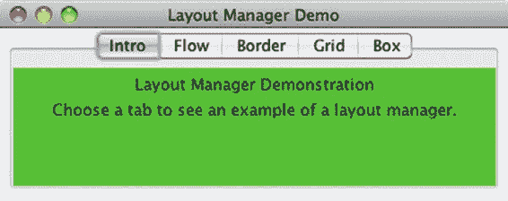

```java
// listing 7.20
//********************************************************************
// FlowPanel.java Author: Lewis/Loftus
//
// 代表 LayoutDemo 程序中演示
// 流式布局器的面板。
//********************************************************************
import java.awt.*;
import javax.swing.*;

public class FlowPanel extends JPanel
{
    //-----------------------------------------------------------------
    // 设置此面板带有一些按钮，以显示
    // 流式布局如何影响它们的位置。
    //-----------------------------------------------------------------
    public FlowPanel()
    {
        setLayout(new FlowLayout());
        setBackground(Color.green);
        JButton b1 = new JButton("BUTTON 1");
        JButton b2 = new JButton("BUTTON 2");
        JButton b3 = new JButton("BUTTON 3");
        JButton b4 = new JButton("BUTTON 4");
        JButton b5 = new JButton("BUTTON 5");
        add(b1);
        add(b2);
        add(b3);
        add(b4);
        add(b5);
    }
}
```

**图 7.7** 流式布局将尽可能多的组件放在一行

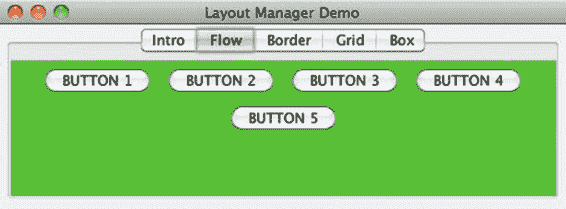
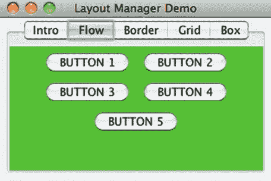

每个按钮的大小都被调整到足够容纳放在上面的标签的大小。正如我们之前提到的，流式布局将这些按钮尽可能放在面板内的一行中，然后开始在另一行放置组件。当框架的大小变宽时（例如用鼠标拖动右下角），面板也会随之增大，一行可以容纳更多按钮。当调整框架大小时，会咨询布局管理器并自动重新组织组件。请注意，默认情况下，每行的组件在窗口中居中对齐。

`FlowLayout` 类的构造函数被重载，允许程序员定制化布局管理器的特征。在每一行中，组件可以是居中、左对齐或右对齐。默认对齐方式为居中。在创建布局管理器时，还可以指定组件之间的水平和垂直间隙大小。`FlowLayout` 类还具有在布局管理器创建后设置对齐方式和间隙大小的方法。

#### Border Layout（边框布局）

`BorderLayout` 有五个区域可以添加组件的区域：北（North）、南（South）、东（East）、西（West）和中心（Center）。这些区域之间具有特定的位置关系，如图 7.8 所示。

四个外部区域会根据需要增大以容纳其包含的组件。如果没有向 `North`、`South`、`East` 或 `West` 区域添加组件，这些区域将不会占用整体布局中的任何空间。`Center` 区域将扩展填充任何可用空间。

特定的容器可能会根据系统的功能仅使用少数区域。例如，一个程序可能只使用 `Center`、`South` 和 `West` 区域。这种灵活性使得 `BorderLayout` 成为一种非常有用的布局管理器。

受 `BorderLayout` 支配的容器的 `add` 方法其第一个参数是要待添加的组件。第二个参数指示其被添加的区域。该区域使用 `BorderLayout` 类中定义的常量指定。列表 7.21 显示了 `LayoutDemo` 程序用于演示边框布局的面板。

> 北
> 西
> 中心
> 东
> 南

**图 7.8** 边框布局将组件组织在五个区域中

**列表 7.21**

```java
//********************************************************************
// BorderPanel.java 作者: Lewis/Loftus
//
// 代表 LayoutDemo 程序中的面板，该面板演示了
// 边框布局（border layout）。
//********************************************************************
import java.awt.*;
import javax.swing.*;

public class BorderPanel extends JPanel
{
    //-----------------------------------------------------------------
    // 在边框布局的每个区域为此面板设置一个按钮，
    // 以显示它是如何影响它们的位置、形状和大小的。
    //-----------------------------------------------------------------
    public BorderPanel()
    {
        setLayout(new BorderLayout());
        setBackground(Color.green);
        JButton b1 = new JButton("BUTTON 1");
        JButton b2 = new JButton("BUTTON 2");
        JButton b3 = new JButton("BUTTON 3");
        JButton b4 = new JButton("BUTTON 4");
        JButton b5 = new JButton("BUTTON 5");
        add(b1, BorderLayout.CENTER);
        add(b2, BorderLayout.NORTH);
        add(b3, BorderLayout.SOUTH);
        add(b4, BorderLayout.EAST);
        add(b5, BorderLayout.WEST);
    }
}
```

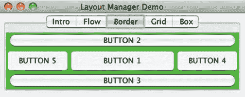
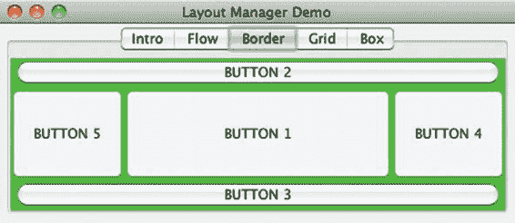

在 `BorderPanel` 类构造函数中，面板的布局管理器被显式设置为边框布局。然后创建按钮并将它们添加到面板的特定区域。默认情况下，每个按钮的宽度都足够容纳其标签，高度也足够填充它被分配的区域。随着框架（以及面板）的大小进行调整，每个按钮的大小都会根据需要进行调整，位于 `Center` 区域的按钮将填充任何未使用的空间。

边框布局中的每个区域只显示一个组件。也就是说，给定边框布局的每个区域只添加一个组件。常见的错误是向边框布局的特定区域添加两个组件，在这种情况下，先添加的组件会被第二个组件替换，并且在显示容器时只能看到第二个组件。要向边框布局中的区域内添加多个组件，我们首先将这些组件添加到另一个容器（例如 `JPanel`）中，然后将该面板添加到区域中。

注意，尽管用于显示按钮的面板具有绿色背景，但在列表 7.21 的显示中并没看到绿色。默认情况下，边框布局的区域之间没有水平或垂直间隙。这些间隙可以使用重载的构造函数或 `BorderLayout` 类的显式方法设置。如果增加了间隙，底层面板将显示出来。

#### Grid Layout（网格布局）

`GridLayout` 以行和列的矩形网格形式呈现容器的组件。每个网格单元格中放置一个组件，所有单元格的大小相同。

图 7.9 显示了网格布局的一般结构。

网格布局中的行数和列数是在创建布局管理器时通过构造函数的参数确定的。列表 7.22 中的类显示了 `LayoutDemo` 程序用于演示网格布局的面板。它指定面板应使用二行三列的网格进行管理。

随着按钮被添加到容器中，它们会（默认情况下）从左到右、从上到下填充网格。除了它们添加到容器的顺序外，没有办法可以显式将组件分配到网格中的特定位置。

每个单元格的大小由容器的整体大小决定。当调整容器大小时，所有单元格的大小都会按比例变化以填充容器。

如果用于指定行数或列数的值为零，则网格在该维度上按需要扩展，以容纳添加到容器的组件数量。行数和列数的值不能同时为零。

**图 7.9** 网格布局创建大小相同的单元格网格

**列表 7.22**


```java
//********************************************************************
// GridPanel.java 作者: Lewis/Loftus
//
// 代表 LayoutDemo 程序中的面板，该面板演示了
// 网格布局（grid layout）。
//********************************************************************
import java.awt.*;
import javax.swing.*;

public class GridPanel extends JPanel
{
//-----------------------------------------------------------------
// 为此面板设置一些按钮，以显示网格布局
// 如何影响它们的位置、形状和大小。
//-----------------------------------------------------------------
public GridPanel()
{
setLayout(new GridLayout(2, 3));
setBackground(Color.green);
JButton b1 = new JButton("BUTTON 1");
JButton b2 = new JButton("BUTTON 2");
JButton b3 = new JButton("BUTTON 3");
JButton b4 = new JButton("BUTTON 4");
JButton b5 = new JButton("BUTTON 5");
add(b1);
add(b2);
add(b3);
add(b4);
add(b5);
}
}
```

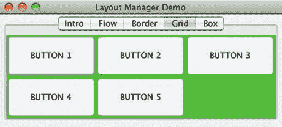

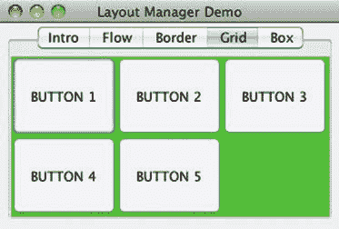

### 7.11 布局管理器

#### 显示

默认情况下，网格单元格之间没有水平间隙或垂直间隙。这些间隙大小可以使用重载的构造函数或相应的 `GridLayout` 方法设置。

## 盒布局 (box layout)

`BoxLayout` 以垂直或水平方向组织组件，以单行或单列的形式，如图 7.10 所示。它很容易使用，但当与其他盒布局结合时，它可以产生类似于通过 `GridBagLayout` 实现的复杂 GUI 设计，而通常 `GridBagLayout` 要难掌握得多。

在创建 `BoxLayout` 对象时，我们指定它将遵循 `X` 轴（水平）或 `Y` 轴（垂直），使用 `BoxLayout` 类中定义的常量。与其他布局管理器不同，`BoxLayout` 的构造函数其参数为该组件第一个参数是它将管理的组件。因此，必须为每个组件创建一个新的 `BoxLayout` 对象。列表 7.23 显示了 `LayoutDemo` 程序用于演示箱布局的面板。

由箱形布局管理的容器中的组件是按照它们被添加到容器的顺序（从上到下或从左到右）排列的。

箱布局中的组件之间没有间隙。与我们之前探索过的布局管理器不同，箱形布局没有可以为整个容器指定的特定垂直或水平间隙。相反，我们可以向容器中添加`不可见组件`，它们占据其他组件之间的空间。`Box` 类也是 Java 标准类库的一部分，它包含了用于创建这些不可见组件的静态方法。

`BoxPanel` 类中使用的两种不可见组件是`刚性区域（rigid areas）`（具有固定大小）和`胶水（glue）`，后者指定了容器中多余空间的去向。刚性区域使用 `Box` 类的 `createRigidArea` 方法创建，并接受 `Dimension` 对象作为参数来定义不可见区域的大小。胶水则根据需要使用 `createHorizontalGlue` 方法或 `createVerticalGlue` 方法创建。

注意，在我们的示例中，由刚性区域分隔的按钮之间的空间在容器调整大小时仍然保持不变。另一方面，胶水会根据需要扩展或收缩以填满空间。

箱布局比大多数其他布局管理器更尊重它所管理的组件的对齐方式以及最小、最大和首选尺寸。因此，设置放入容器的组件的特性是定制视觉效果的另一种方法。

### 7.11 布局管理器

**Listing 7.23**

```java
//********************************************************************
// BoxPanel.java 作者: Lewis/Loftus
//
// 代表 LayoutDemo 程序中的面板，用于演示
// 箱形布局管理器。
//********************************************************************

import java.awt.*;
import javax.swing.*;

public class BoxPanel extends JPanel
{
//-----------------------------------------------------------------
// 设置此面板并带有一些按钮，以显示垂直
// 箱形布局（以及不可见组件）如何影响它们的位置。
//-----------------------------------------------------------------
    public BoxPanel()
    {
        setLayout(new BoxLayout(this, BoxLayout.Y_AXIS));
        setBackground(Color.green);
        JButton b1 = new JButton("BUTTON 1");
        JButton b2 = new JButton("BUTTON 2");
        JButton b3 = new JButton("BUTTON 3");
        JButton b4 = new JButton("BUTTON 4");
        JButton b5 = new JButton("BUTTON 5");
        add(b1);
        add(Box.createRigidArea(new Dimension(0, 10)));
        add(b2);
        add(Box.createVerticalGlue());
        add(b3);
        add(b4);
        add(Box.createRigidArea(new Dimension(0, 20)));
        add(b5);
    }
}
```

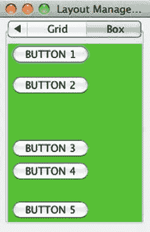

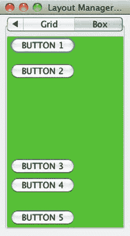

#### 显示


## 7.12 边框

Java 提供了在任何 Swing 组件周围放置`边框（border）`的能力。边框本身不是一个组件，而是定义了任何组件边缘应该如何绘制，对 GUI 设计有重要影响。边框提供了有关 GUI 组件如何组织的视觉提示，并可用于为组件添加标题。图 7.11 列出了 Java 标准类库中预定义的边框。

`BorderFactory` 类用于为组件创建边框。它有许多方法来创建特定类型的边框。通过使用组件对对象分组并使用组件的 `setBorder` 方法来集中注意力，可以将边框应用于组件。

列表 7.24 中的程序演示了多种类型的边框。它只是创建了几个面板，为每个面板设置了不同的边框，然后使用网格布局在一个较大的面板中显示它们。

| 边框 | 说明 |
| :--- | :--- |
| 空边框 (Empty Border) | 在组件边缘留留缓冲区，但在其他方面没有视觉效果。 |
| 线边框 (Line Border) | 包围组件的简单线条。 |
| 刻蚀边框 (Etched Border) | 在组件周围创建凹槽的效果。 |
| 斜角边框 (Bevel Border) | 创建组件高于表面或凹于表面的效果。 |
| 标题边框 (Titled Border) | 在边框上或周围包含文本标题。 |
| 哑光边框 (Matte Border) | 允许指定每个边缘的大小。使用实色或图像。 |
| 复合边框 (Compound Border) | 两个边框的组合。 |

**图 7.11** 组件边框

**Listing 7.24**

```java
//********************************************************************
// BorderDemo.java 作者: Lewis/Loftus
//
// 演示各种类型边框的使用。
//********************************************************************

import java.awt.*;
import javax.swing.*;
import javax.swing.border.*;

public class BorderDemo
{
//-----------------------------------------------------------------
// 创建几个带边框的面板并显示它们。
//-----------------------------------------------------------------
    public static void main(String[] args)
    {
        JFrame frame = new JFrame("Border Demo");
        frame.setDefaultCloseOperation(JFrame.EXIT_ON_CLOSE);
        JPanel panel = new JPanel();
        panel.setLayout(new GridLayout(0, 2, 5, 10));
        panel.setBorder(BorderFactory.createEmptyBorder(8, 8, 8, 8));

        JPanel p1 = new JPanel();
        p1.setBorder(BorderFactory.createLineBorder(Color.red, 3));
        p1.add(new JLabel("Line Border"));
        panel.add(p1);

        JPanel p2 = new JPanel();
        p2.setBorder(BorderFactory.createEtchedBorder());
        p2.add(new JLabel("Etched Border"));
        panel.add(p2);

        JPanel p3 = new JPanel();
        p3.setBorder(BorderFactory.createRaisedBevelBorder());
        p3.add(new JLabel("Raised Bevel Border"));
        panel.add(p3);

        JPanel p4 = new JPanel();
        p4.setBorder(BorderFactory.createLoweredBevelBorder());
        p4.add(new JLabel("Lowered Bevel Border"));
        panel.add(p4);

        JPanel p5 = new JPanel();
        p5.setBorder(BorderFactory.createTitledBorder("Title"));
        p5.add(new JLabel("Titled Border"));
        panel.add(p5);

        JPanel p6 = new JPanel();
        TitledBorder tb = BorderFactory.createTitledBorder("Title");
        tb.setTitleJustification(TitledBorder.RIGHT);
        p6.setBorder(tb);
        p6.add(new JLabel("Titled Border(right)"));
        panel.add(p6);

        JPanel p7 = new JPanel();
        Border b1 = BorderFactory.createLineBorder(Color.blue, 2);
        Border b2 = BorderFactory.createEtchedBorder();
        p7.setBorder(BorderFactory.createCompoundBorder(b1, b2));
        p7.add(new JLabel("Compound Border"));
        panel.add(p7);

        JPanel p8 = new JPanel();
        Border mb = BorderFactory.createMatteBorder(1, 5, 1, 1, Color.red);
        p8.setBorder(mb);
        p8.add(new JLabel("Matte Border"));
        panel.add(p8);

        frame.getContentPane().add(panel);
        frame.pack();
        frame.setVisible(true);
    }
}
```

#### 显示

让我们看看此程序创建的每种类型的边框。`空边框`应用于包含所有其他面板的大面板，以便在框架的外边缘留出缓冲区空间。空边框的顶部、左、底部和右边缘的大小以像素为单位。`线边框`使用特定的颜色创建，并以像素指定线条厚度（此处为 3）。如果没有指定，线条厚度默为 1 像素。此程序创建的`刻蚀边框`使用默认颜色作为高亮和阴影，但如果需要，可以显式设置两者。

`Bevel Border`（斜角框）可以是凸起的也可以是凹的。本程序使用了默认颜色，但根据需要对斜角框每个部分的颜色进行定制，包括外高亮、内高亮、外阴影和内阴影。如果需要，这些每个部分都可以采用不同的颜色。

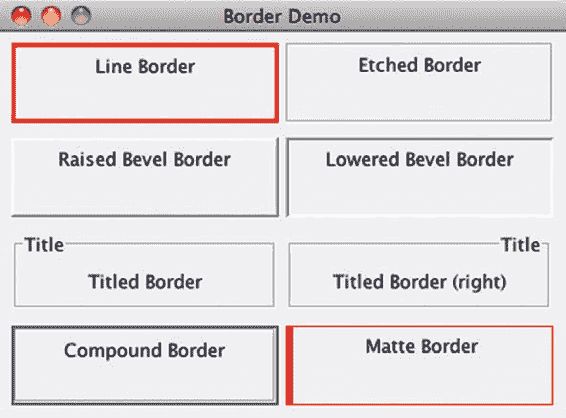

`Titled Border`（有标题框）在边框上或周围放置一个标题。标题的默认位置位于边框左上。使用 `TitledBorder` 类的 `setTitleJustification` 方法，可以将此位置设置为边框上方、下方、内部、左侧、右侧或中心等许多位置。

`Compound Border`（复合框）是两个或多个边框的组合。程序中的示例创建了一个使用线框和蚀刻框组合的复合框。`createCompoundBorder` 方法接受两个边框作为参数，并将第一个参数设置为外边框，第二个参数设置为内框。三个或更多边框的组合可以通过先使用两个边框创建一个复合框，然后使用它和另一个边框创建另一个复合框来实现。


### 自测习题（答案见附录 N）

- **SR 7.32** `BorderFactory` 类的作用是什么？
- **SR 7.33** 列出并简述本节介绍的每种边框类型。

## 7.13 包含层次结构

组件分组到容器中的方式，以及这些容器相互嵌套的方式，确定了 GUI 的 `containment hierarchy`（包含层次结构）。

我们在第 3 章中引入了这个概念。通过仔细设计包含层次结构，可以对 GUI 进行定制以获得精确的视觉效果。

对于任何 Java 程序，通常会有一个主容器，称为 `top-level container`（顶层容器），例如框架或 applet。程序的顶层容器通常包含一个或多个其他容器，例如面板。这些面板可能包含其他面板，以根据需要组织其他组件。

每个容器都可以有它自己的布局管理器。GUI 的最终外观是为每个容器选择的布局管理器以及包含层次结构设计的函数。可以有许多组合，很少有单一的最佳选择。一如既往，我们应该遵循预期的系统目标和通用的 GUI 设计指南。

图 7.12 显示了一个 GUI 应用，并进行了标注以描述其包含层次结构。程序中使用的几个组件在文中之前讨论过；其他组件将在后面的章节中讨论。


注意，在许多情况下，仅通过观察 GUI 无法看出某些容器的用途。特别是 `panel`（面板），除非我们以某种方式引起注意（例如给它一个边框），否则它是不可见的。我们还可以使用不可见组件在组件之间提供特定的间距。这些元素都是包含层次结构的一部分，尽管它们对用户是不可见的。

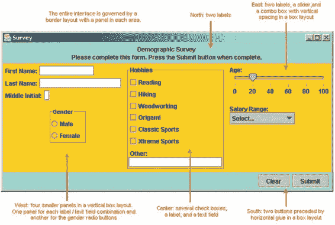

**图 7.12** GUI `JFrame` 的包含层次结构

（注：该图描述了一个包含北、西、中、东、南区域的 Border Layout，其中包含各种 `JPanel`、`JLabel`、`JCheckBox`、`JButton`、`JSlider`、`JTextField` 和 `JComboBox` 组件。）

特定程序的包含层次结构可以表示为树结构，如图 7.13 所示。树的根是顶层容器。树的每一层显示了上一层容器中所包含容器和组件。

当发生可能影响程序中组件视觉布局的更改时，会轮询每个容器的布局管理器。其中一个的变化可能会影响另一个。这些更改根据需要通过包含层次结构进行传递。

**自测习题**（答案见附录 N）

- **SR 7.34** GUI 的包含层次结构是什么？

- **SR 7.35** 为第 5 章所示的 `LeftRight` 应用 GUI 画出包含层次结构树。

### 关键概念总结

- 设计上的投入既至关重要又具有成本效益。
- 问题描述中的名词可能指示程序中需要的某些类和对象。
- 静态变量在类的所有实例之间共享。
- 聚合对象由其他对象组成，形成“有一个”（has-a）的关系。
- 接口是抽象方法的集合，因此不能实例化。
- 枚举类型的值是该类型的静态变量。
- 可以在枚举类型的定义中添加属性和方法。
- 对象提供的复杂服务可以被分解以利用私有方法。
- 当将对象传递给方法时，实际参数和形式化参数成为别名。
- 重载方法的版本通过参数的数量、类型和顺序来区分。
- 测试程序永远无法保证没有错误。
- 一个好的测试是能够发现错误的测试。
- 对程序进行所有可能的输入和用户操作的穷尽测试是不可行的。
- 任何 GUI 设计都应遵循关于一致性和易用性的基本指南。
- 容器的布局管理器决定了组件如何在视觉上呈现。
- 当发生更改时，容器中的组件将根据布局管理器的策略重新组织。
- 每个容器的布局管理器都可以显式设置。
- 边框可以应用于 Swing 组件以对对象分组并集中注意力。
- GUI 的外观是包含层次结构和每个容器布局管理器的函数。

## EX 7.3 重载练习 7.1 中的 `product` 方法，使其接受六个整数参数并返回它们的乘积。

## EX 7.4 编写一个名为 `doubleConcat` 的方法，接受一个 `String` 和一个 `integer` 作为参数。返回一个 `String`，该字符串由字符串参数与其自身拼接 `number` 次后组成，其中 `number` 是一个整数参数。例如，如果参数值为 "hello" 和 1，则返回值应为 "hellohello"。

如果整数参数小于 1，则返回原始字符串。

## EX 7.5 重载练习 7.4 中的 `doubleConcat` 方法，使得在未提供整数参数时，该方法返回字符串本身而不进行拼接。例如，如果字符串是 "hello"，则返回的字符串也是 "hello"。

## EX 7.6 编写一个名为 `drawCircle` 的方法，根据方法的参数绘制一个圆：一个用于绘制圆的 `Graphics` 对象、两个表示圆心 `(x, y)` 坐标的整数值、另一个表示圆的半径的整数，以及一个定义圆颜色的 `Color` 对象。该方法不返回任何内容。

## EX 7.7 重载练习 7.6 中的 `drawCircle` 方法，使得如果未提供 `Color` 参数，圆的颜色默认为黑色。

## EX 7.8 重载练习 7.6 中的 `drawCircle` 方法，使得如果未提供半径，将使用 10 到 100（包含边界）范围内的随机半径。

## EX 7.9 重载练习 7.6 中的 `drawCircle` 方法，使得如果未提供圆的颜色和半径，则颜色默认为红色，半径默认为 40。

## EX 7.10 讨论 Java 向方法传递参数的方式。这种技术在基本类型和对象之间是一致的吗？请解释。

## EX 7.11 解释为什么静态方法不能引用实例变量。

## EX 7.12 一个类是否可以实现两个包含相同方法签名的接口？请解释。

## EX 7.13 创建一个名为 `Visible` 的接口，包含两个方法：`makeVisible` 和 `makeInvisible`。这两个方法都不应该有参数，并返回一个布尔结果。描述类可能如何实现此接口。

## EX 7.14 绘制一张 UML 类图，显示练习 7.13 中元素之间的关系。

## EX 7.15 想象一个游戏，某些游戏元素可以被玩家破坏，而另一些不能。创建一个名为 `Breakable` 的接口，它包含一个名为 `break` 的方法（无参数）和另一个名为 `broken` 的方法（返回布尔结果，指示该对象当前是否损坏）。

## EX 7.16 创建一个名为 `VCR` 的接口，它具有代表磁带录像机标准操作（播放、停止等）的方法。按照你的意愿定义方法签名。描述类可能如何实现此接口。

## EX 7.17 绘制一张 UML 类图，显示练习 7.16 中元素之间的关系。

## EX 7.18 为 `LayoutDemo` 程序绘制包含层级结构树。

## EX 7.19 改变 `LayoutDemo` 程序中使用的边框布局的水平和垂直间距会产生什么视觉效果？通过更改更改来测试你的答案。

## EX 7.20 编写代码行以使用三个边框定义一个复合边框。在内边缘使用线框（line border），在外边缘使用刻蚀边框（etched border），在中间使用凸斜边框（raised bevel border）。

### 编程项目

### PP 7.1 修改第 4 章中的 `Account` 类，允许仅通过名称和账号开设账户，假设初始余额为零。修改 `Transactions` 类的 `main` 方法以演示此新功能。

### PP 7.2 按照如下修改本章介绍的 `Student` 类。每个学生对象还应包含三次测试的分数。提供一个构造函数，根据参数值设置所有实例值。重载构造函数，假设每次测试的分数初始为零。提供一个名为 `setTestScore` 的方法，接受两个参数：测试编号（1 到 3）和分数。还提供一个名为 `getTestScore` 的方法，接受测试编号并返回相应的分数。提供一个名为 `average` 的方法，计算并返回该学生的平均测试分数。修改 `toString` 方法，在学生的描述中包含测试分数和平均分。修改驱动类 `main` 方法以练习新的 `Student` 方法。

### PP 7.3 编写一个名为 `Course` 的类，代表学校的一门课程。使用上一个编程项目中修改过的 `Student` 类表示每个学生。在 `Course` 中使用 `ArrayList` 存储学习该课程的学生。`Course` 类的构造函数只接受课程名称。提供一个名为 `addStudent` 的方法，接受一个 `Student` 参数。提供一个名为 `average` 的方法，计算并返回所有学生测试平均分的平均值。提供一个名为 `roll` 的方法打印课程中的所有学生。创建一个带有 `main` 方法的驱动类，创建一个课程，添加几个学生、打印名单并打印课程整体测试平均分。

### PP 7.4 修改 `RationalNumber` 类以实现 `Comparable` 接口。为了进行比较，为两个 `RationalNumber` 对象的分子和分母计算等效浮点值，然后使用 `0.0001` 的容差值对其进行比较。编写主驱动程序来测试你的修改。

### PP 7.5 编写一个名为 `Priority` 的 Java 接口，包含两个方法：`setPriority` 和 `getPriority`。该接口应定义在一组对象之间建立数值优先级的方法。设计并实现一个名为 `Task` 的类，代表一个任务（如待办列表），实现 `Priority` 接口。创建一个驱动类来练习一些 `Task` 对象。

### PP 7.6 修改 PP 7.5 中的 `Task` 类，使其也实现本章定义的 `Complexity` 接口。修改驱动类以显示 `Task` 对象的这些新功能。

### PP 7.7 修改 PP 7.5 和 7.6 中的 `Task` 类，使其实现 Java 标准类库中的 `Comparable` 接口。实现该接口使得任务按优先级排序。创建一个驱动类，其 `main` 方法显示 `Task` 对象的这些新功能。

### PP 7.8 编写一个名为 `Lockable` 的 Java 接口，包含以下方法：`setKey`、`lock`、`unlock` 和 `locked`。`setKey`、`lock` 和 `unlock` 方法接受一个代表密钥的整数参数。`setKey` 方法设置密钥。`lock` 和 `unlock` 方法锁定和解锁对象，但仅当传入的密钥正确时。`locked` 方法返回一个布尔值指示对象是否被锁定。`Lockable` 对象代表其方法受保护的对象：如果对象被锁定，则不能调用方法；如果解锁，则可以调用。编写第 5 章 `Coin` 类的版本，使其实现 `Lockable`。

### PP 7.9 编写 PP 5.9 中 `Account` 类的版本，使其按照 PP 7.8 实现 `Lockable`。

### PP 7.10 编写一个新版本的 PigLatin 程序，使其使用 GUI。使用文本字段接受句子并使用标签显示结果。

### PP 7.11 修改 `LayoutDemo` 程序中的 `IntroPanel` 类，使其使用箱体布局管理器。使用不可见组件在两个标签的上下放置胶水（glue），并在它们之间放置刚性区域（rigid area）。

### PP 7.12 修改第 5 章的 `QuoteOptions` 程序以更改其视觉外观。将单选按钮以垂直列展示，并在引用标签左侧提供一个环绕边框。

### PP 7.13 编写一个程序，显示手机上可能出现的数字键盘。在数字键盘按钮上方显示一个标签，按按键顺序显示数字。在数字键盘按钮右侧，包含另一个清除显示内容的按钮。使用边框布局（border layout）管理整体布局，使用网格布局（grid layout）管理数字键盘按钮。在数字键盘按钮周围添加边框以进行视觉分组，并在显示区域周围添加边框。

### PP 7.14 编写一个帮助披萨店接订单的程序。使用标签页面板（tabbed pane）区分不同类食物（披萨、饮料、特选）。收集有关数量和尺寸的信息。

在收集信息的同时显示订单费用。使用适当的组件收集各种类型的信息。使用包含层次结构和布局管理器仔细地构建界面。


## 软件故障

## 2003 年东北停电

### 发生了什么？

2003 年 8 月 14 日，美国历史上最大的停电事件袭击了美国东北部和加拿大部分地区。多个大都市受到此影响，包括纽约、克利夫兰、底特律、多伦多和渥太华。在三分钟内，21 家发电厂停止运行，影响了约 5000 万人。

### 东北部停电

典型问题导致了停电区域的情况。交通灯缺失导致了美国的交通问题。火车和电梯被困住。机场航班延误。依赖水泵的供水系统失效。手机使用受到干扰（有线电话仍可用，但在紧急情况下负载过重）。由于服务器宕机和尝试重新路由消息，互联网流量变慢。报告了若干起抢劫事件。

据估计，这次停电的总财务损失在 40 亿到 80 亿美元之间。有 9 人死于与停电相关的各种原因。

### 是什么导致的？

在停电后的几个小时和几天内，许多来源被指为问题的根源。由于 2001 年 9 月 11 日袭击后人们意识提高，当局迅速排除了恐怖主义的可能性。整个影响区域的树倒和雷击被归咎为祸首。官员甚至考虑过——但很快排除了——当时正在传播的“Blaster”计算机病毒。

在接下来的几个月里，一个工作小组梳理了这些问题。确定最初原因是俄亥俄州的阿克隆，那里 `FirstEnergy Corp.` 未能对电力线附近的树木进行适当修剪。2003 年 8 月 14 日，树枝导致三条电源线同时故障。当此类故障发生时，电力控制中心的操作员负责保持负载平衡。在这种情况下，他们未能做到，因为本该通知他们该问题的计算机报警系统没有正常运行。负载不平衡迅速蔓延到邻近的发电厂，导致了连锁停电。

因此，尽管有各种影响因素，但问题的很大一部分是报警系统的故障。这个问题最终被追溯到通用电气公司用于监控报警的计算机中的一个竞态漏洞（race condition bug）。

### 经验教训

这次事件的问题源不在于电力不足，而是由于无法将电力输送到需要的地方。这次停电凸显了现有电力线基础设施的落后，以及依赖自愿规则来维护电网可靠性的危险性。

在软件责任方面，竞态是并发系统中已知的故障源，必须对其进行彻底测试。在像这样涉及重大的情况下，有必要进行形式化分析。

*来源：* CNN.com, WashingtonPost.com


# 第 8 章 数组

## 本章目标

* 定义并使用数组进行基础数据组织。
* 讨论边界检查和管理容量的技术。
* 讨论与数组对象以及对象数组相关的问题。
* 探索命令行参数的使用。
* 描述变长参数列表的语法用法。
* 讨论多维数组的创建和使用。
* 探索鼠标和键盘事件。

在编程工作中，我们经常希望以易于访问和修改的形式组织对象或原始数据。在第 5 章探索的 `ArrayList` 类正是为了这个目的而使用的。正如类名所示，`ArrayList` 是使用数组实现的，数组是将数据分组为列表的编程结构。在本章中，我们将探索数组的细节，数组是大多数高级语言的基础组成部分。在本章的图形跟踪（Graphics Track）部分，我们探索了允许我们绘制复杂多边形的方法，并检查了鼠标和键盘生成的事件。

## 8.1 数组元素

`array` 是一种简单但强大的编程语言结构，用于分组和组织数据。在编写管理大量信息（如 100 个名字的列表）的程序时，为每条数据声明单独的变量是不现实的。数组通过允许声明一个包含多个可单独访问值的值的变量来解决这个问题。

数组是值的列表。每个值都存储在数组中特定的、带有编号的位置。每个位置对应的数字称为索引（`index`）或下标（`subscript`）。图 8.1 显示了一个整数数组以及每个位置对应的索引。该数组名为 `height`；它包含代表几个英寸高度的整数。

在 Java 中，数组索引始终从 0 开始。因此，存储在索引 5 处的值实际上是数组中的第六个值。图 8.1 所示数组有 11 个值，索引从 0 到 10。

要访问数组中的值，我们使用数组名后跟方括号索引。例如，以下表达式引用数组中的第九个值：

核心概念：大小为 N 的数组索引从 0 到 N–1。

`height[8]`

根据图 8.1，`height[8]`（读音为 height-sub-eight）包含值 79。不要混淆索引的值（在此例中为 8）与存储在该索引处数组的值（在此例中为 79）。

```
height
0 69
1 61
2 70 索引
3 74
4 62
5 69 height[5 的值
6 66
7 73
8 79
9 62
10 70
```

**图 8.1** 一个名为 height 的包含整数值的数组

### 自我测验（答案见附录 N）

- **SR 8.1** 什么是数组？

- **SR 8.2** 数组的每个元素是如何被引用的？

- **SR 8.3** 根据图 8.1 所示的数组，以下各项是什么？

  a. `height[1]`

  b. `height[2] + height[5]`

  c. `height[2 + 5]`

  d. 存储在索引 8 处的值

  e. 第四个值

  f. `height.length`

## 8.2 声明和使用数组

在 Java 中，数组是对象。要创建一个数组，必须先声明数组的引用。然后可以使用 `new` 操作符实例化数组，这会分配内存空间来存储值。以下代码表示图 8.1 所示数组的声明：

```java
int[] height = new int[11];
```

表达式 `height[8]` 指向存储在特定内存位置的单个整数。它可以在任何可以使用整数变量的地方使用。因此，你可以对其赋值、在计算中使用它、打印它的值等。此外，由于数组索引是整数，你可以使用整数表达式来指定用于访问数组的索引。这些概念在以下代码行中得到了演示：

```java
height[2] = 72;
height[count] = feet * 12;
average = (height[0] + height[1] + height[2]) / 3;
System.out.println("The middle value is " + height[MAX/2]);
pick = height[rand.nextInt(11)];
```

数组在内存中连续存储，这意味着元素在内存中的存储方式正如我们在概念上构想的那样，一个紧接一个。这使得数组通过索引访问任何特定元素变得极其高效。在内部，为了确定任何特定元素的地址，会将索引乘以每个元素的大小，并加到数组起始点的内存地址上。这就是为什么数组索引从 0 开始而不是 1——为了让该计算尽可能简单。因此，从效率的角度来看，访问数组中的第 500 个元素与访问第一个元素一样简单。


**第八章** 数组


变量 `height` 被声明为整数数组，其核心概念类型写为 `int []`。数组中存储的所有值具有相同的类型（或至少是兼容的）。例如，我们可以创建一个存储整数的数组，也可以创建一个存储字符串的数组，但不能创建一个同时存储整数和字符串的数组。存储在数组中的值有时称为`数组元素`，数组所包含的值类型称为数组的`元素类型`。

### 列表 8.1

```java
//********************************************************************
// BasicArray.java
// Author: Lewis/Loftus
//
// 演示数组的基本声明和使用。
//********************************************************************
public class BasicArray
{
    //-----------------------------------------------------------------
    // 创建一个数组，填充各种整数值，
    // 修改其中一个值，然后打印它们。
    //-----------------------------------------------------------------
    public static void main(String[] args)
    {
        final int LIMIT = 15, MULTIPLE = 10;
        int[] list = new int[LIMIT];
        // 初始化数组值
        for (int index = 0; index < LIMIT; index++)
            list[index] = index * MULTIPLE;
        list[5] = 999;

        // 修改一个数组值
        // 打印数组值
        for (int value : list)
            System.out.print(value + " ");
    }
}
```

**输出**

```
0 10 20 30 40 999 60 70 80 90 100 110 120 130 140
```

注意，数组变量的类型（`int[]`）不包含数组的大小。使用 `new` 操作符实例化 `height` 会预留内存空间来存储索引从 0 到 10 的 11 个整数。一旦数组声明为特定大小的`视频笔记`，它能包含的值数量就无法更改。

### 数组概述

列表 8.1 中的示例创建了一个名为 `list` 的数组，它可以存储 15 个整数，并以每次 10 的增量加载。然后它更改了数组中第六个元素（索引为 5）的值。最后，它打印了数组中存储的所有值。图 8.2 显示了数组在 `BasicArray` 程序执行期间的变化。在处理数组时，使用 `for` 循环通常很方便，因为数组中的位置数量是固定的。注意，`BasicArray` 程序中的多处使用了一个名为 `LIMIT` 的常量。该常量用于声明数组的大小，并控制初始化数组值的 `for` 循环。

使用 `for` 循环的迭代器版本来打印数组中的值。

回想第 5 章，这个版本的 `for` 循环提取数组中的每个值。

数组创建时有 15 个元素，索引从 0 到 14。

在第一次循环迭代三次后，`list[5]` 的值发生了变化。

完成第一次循环后，`list[5]` 的值变为 999。

(图 8.2：BasicArray 程序中变化过程中的数组)

### 边界检查

索引操作符会执行`边界检查`，这确保索引在数组的范围内。每当引用数组中的特定元素（例如 `prices[count]`）时，都会检查索引值。如果它在数组的有效索引范围内（0 到 24），则执行该引用。如果索引无效，则会抛出一个名为 `ArrayIndexOutOfBoundsException` 的异常。

当然，在我们的程序中，我们会希望执行自己的边界检查。也就是说，我们希望小心留在数组边界内，并处理我们想要过的每个元素。由于数组索引从 0 开始并到比大小小 1 结束，程序中很容易产生`差一错误`，这是一种由于处理掉一个元素或尝试访问多一个元素而产生的问题。

检查数组边界的一种方法是使用长度常量，该常量存储在数组对象并存储数组的大小。它是一个公共常量，因此可以直接引用。例如，在 `prices` 数组创建了 25 个元素后，常量 `prices.length` 包含值 25。它的值在数组首次创建时设置，无法更改。当需要数组大小而无需单独创建常量时，长度常量作为每个数组不可分割的一部分可以使用。

让我们看另一个示例。列表 8.2 中的程序将 10 个整数读入一个名为 `numbers` 的数组中，然后按倒序打印它们。

注意在 `ReverseOrder` 程序中，数组 `numbers` 被声明为包含 10 个元素，因此其索引从 `0` 到 `9`。索引范围在 `for` 循环中通过数组对象的 `length` 字段进行控制。你应该仔细地设置循环控制变量的初始值以及终止循环的条件，以确保所有预期的元素都得到处理，并且仅使用有效索引引用数组元素。

### 列表 8.2

```java
//********************************************************************
// ReverseOrder.java 作者: Lewis/Loftus
//
// 展示了数组索引处理。
//********************************************************************
import java.util.Scanner;

public class ReverseOrder
{
    //-----------------------------------------------------------------
    // 从用户处读取一组数字，将其存储在数组
    // 中，然后以相反顺序打印它们。
    //-----------------------------------------------------------------
    public static void main(String[] args)
    {
        Scanner scan = new Scanner(System.in);
        double[] numbers = new double[10];
        System.out.println("数组的大小: " + numbers.length); 
        for (int index = 0; index < numbers.length; index++)
        {
            System.out.print("输入数字 " + (index+1) + ": "); 
            numbers[index] = scan.nextDouble();
        }
        System.out.println("反序排列的数字:"); 
        for (int index = numbers.length-1; index >= 0; index--) 
            System.out.print(numbers[index] + " ");
        }
    }
}
```

**输出**

```
数组的大小: 10
输入数字 1: 18.36
输入数字 2: 48.9
输入数字 3: 53.5
输入数字 4: 29.06
输入数字 5: 72.404
输入数字 6: 34.8
输入数字 7: 63.41
输入数字 8: 45.55
输入数字 9: 69.0
输入数字 10: 99.18
反序排列的数字:
99.18 69.0 45.55 63.41 34.8 72.404 29.06 53.5 48.9 18.36
```

示例 8.3 所示的 `LetterCount` 示例使用了两个数组和一个 `String` 对象。名为 `upper` 的数组用于存储字符串中每个大写字母字母出现的次数。名为 `lower` 的数组对小写字母起到相同的作用。

由于英语字母表中有 26 个字母，`upper` 和 `lower` 数组都声明为 26 个元素。每个元素都包含一个初始值为 0 的整数。`for` 循环逐个字符扫描字符串。对于字符串中找到每个字符，相应数组中对应的计数器都会加 1。

### 示例 8.3

```java
//********************************************************************
// LetterCount.java 作者: Lewis/Loftus
//
// 展示了数组与字符串之间的关系。
//********************************************************************
import java.util.Scanner;

public class LetterCount
{
    //-----------------------------------------------------------------
    // 从用户处读取一个句子并统计其中包含
    // 大写和小写字母的数量。
    //-----------------------------------------------------------------
    public static void main(String[] args)
    {
        final int NUMCHARS = 26;
        Scanner scan = new Scanner(System.in);
        int[] upper = new int[NUMCHARS];
        int[] lower = new int[NUMCHARS];
        char current; // 当前正在处理的字符
        int other = 0; // 非字母字符的计数器
        System.out.println("输入一个句子:");
        String line = scan.nextLine();
        // 统计每个字母的数量
        for (int ch = 0; ch < line.length(); ch++)
        {
            current = line.charAt(ch);
            if (current >= 'A' && current <= 'Z')
                upper[current-'A']++;
            else
                if (current >= 'a' && current <= 'z')
                    lower[current-'a']++;
            else
                other++;
        }
        // 打印结果
        System.out.println();
        for (int letter=0; letter < upper.length; letter++)
        {
            System.out.print((char)(letter + 'A') + ": " + upper[letter]);
            System.out.print("\t" + (char)(letter + 'a') + ": " + lower[letter]);
        }
        System.out.println();
        System.out.println("非字母字符: " + other);
    }
}
```

**输出**

```
输入一个句子:
In Casablanca, Humphrey Bogart never says "Play it again, Sam."
A: 2	a: 4
B: 0	b: 1
C: 1	c: 1
D: 0	d: 1
E: 1	e: 3
F: 0	f: 0
G: 0	g: 1
H: 1	h: 1
I: 1	i: 2
J: 0	j: 0
K: 0	k: 0
L: 0	l: 0
M: 0	m: 0
N: 0	n: 2
O: 0	o: 0
P: 0	p: 0
Q: 0	q: 0
R: 0	r: 0
S: 0	s: 3
T: 0	t: 0
U: 0	u: 0
V: 0	v: 0
W: 0	w: 0
X: 0	x: 0
Y: 0	y: 0
Z: 0	z: 0
非字母字符: 4
```

*(注：由于原文输出示例中部分字母计数可能存在省略或不全，译文此处根据逻辑补充进行了对齐)*

由大括号 (`{ }`) 包围。当使用初始化列表时，不使用 `new` 运算符。数组的大小由初始化列表中项的数量决定。例如，以下声明将数组 `scores` 实例化为一个包含八个整数的数组，索引从 0 到 7，并带有指定的初始值：

```java
int[] scores = {87, 98, 69, 87, 65, 76, 99, 83};
```

初始化列表只能在首次声明数组时使用。

初始化列表中每个值的类型必须与数组元素的类型相匹配。让我们来看另一个例子：

```java
char[] vowels = {'A', 'E', 'I', 'O', 'U'};
```

在这种情况下，变量 `vowels` 被声明为包含五个字符的数组，初始化列表包含字符字面量。

### 列表 8.4

```java
//********************************************************************
// Primes.java Author: Lewis/Loftus
//
// 演示了使用初始化列表创建数组的使用。
//********************************************************************
public class Primes
{
//-----------------------------------------------------------------
// 在数组中存储一些质数并打印它们。
//-----------------------------------------------------------------
public static void main(String[] args)
{
    int[] primeNums = {2, 3, 5, 7, 11, 13, 17, 19};
    System.out.println("Array length: " + primeNums.length); 
    System.out.println("The first few prime numbers are:"); 
    for (int prime : primeNums)
        System.out.print(prime + " ");
}
}
```

**输出**

```
Array length: 8
The first few prime numbers are:
2 3 5 7 11 13 17 19
```

### 数组作为参数

整个数组可以作为参数传递给方法。由于数组是一个对象，当将整个数组作为参数传递时，传递的是原始数组引用的拷贝，从而传递了整个数组。我们在第 7 章中讨论过参数问题，使形式参数成为原始参数的别名。这个问题适用于所有对象。

接收数组作为参数的方法可以永久地更改数组的元素，因为它是引用原始元素值的。但该方法无法永久地更改数组本身的引用，因为发送到方法的是原始引用的拷贝。这些规则与适用于任何对象类型的规则是一致的。

数组的元素也可以作为参数传递给方法。如果元素类型是基本类型（`primitive type`），则传递的是值的拷贝。如果该元素是引用对象的引用，则传递的是对象引用的拷贝。一如既往，在方法内部对参数所做的更改产生的影响取决于参数的类型。我们将在下一节中进一步讨论对象数组。

## 8.2 声明和使用数组

### 自测习题（答案见附录 N）

- SR 8.4 数组的元素类型是什么？
- SR 8.5 描述创建数组的过程。何时为数组分配内存？
- SR 8.6 编写一个数组声明，表示参加夏令营的所有 100 名儿童的年龄。
- SR 8.7 编写一个数组声明，表示投掷标准六面骰子时，每个面出现的次数。
- SR 8.8 解释数组边界检查的概念。当使用无效值对 Java 数组索引时会发生什么？
- SR 8.9 什么是差一错误（`off-by-one error`）？它与数组有什么关系？
- SR 8.10 编写代码，将名为 `values` 的整数数组的每个元素各加 1。
- SR 8.11 编写代码，计算并打印名为 `values` 的整数数组的元素之和。
- SR 8.12 数组初始化列表实现了什么作用？
- SR 8.13 整个数组可以作为参数传递吗？是如何实现的？

## 8.3 对象数组


在这一章之前的示例中，我们使用数组来存储整数和字符等基本类型。数组也可以将对象的引用作为元素存储。仅使用数组和其他对象就可以创建相当复杂的信息管理结构。例如，数组可以包含对象，而这些每个对象又可以由几个变量和使用这些变量的方法组成。这些变量本身可以是数组，以此类推。程序的设计应该利用组合这些构造结构的能力，为信息创建最合适的表示。

请记住，数组本身是一个对象。因此，将一个名为 `weight` 的 `int` 值数组构化为如下是合适的：`weight`

125

182

160

104

147

### 核心概念：实例化对象数组

当我们向数组中存储对象时，每个元素都是一个存储引用的独立房间。也就是说，对象数组实际上只是一个对象引用的数组。存储在每个元素中的对象必须单独实例化。考虑以下声明：

```java
String[] words = new String[5];
```

### 8.3 对象数组

变量 `words` 是一个引用数组。声明中的 `new` 运算符实例化了数组并预留了五个空间。此声明没有创建任何 `String` 对象；初始数组看起来如下：

—

—

—

—

—

在创建并放入几个 `String` 对象后，它可能看起来像这样：

“friendship”

“loyalty”

“honor”

记住 `String` 对象可以用字符串字面量表示。因此，以下声明创建一个名为 `verbs` 的数组，并使用初始化列表填充 `String` 对象：

```java
String[] verbs = {"play", "work", "eat", "sleep"};
```

列表 8.5 所示的 `GradeRange` 程序创建了一个对象数组，然后打印它们。每个 `Grade` 对象代表一个课程等级并包含一个数值下界。可以使用 `Grade` 构造函数或相应的修改方法设置等级和下界的值。同时也定义了访问方法以及返回等级字符串的 `toString` 方法。当在 `main` 方法中打印等级时，`toString` 方法会被调用。

列表 8.6 显示了 `Movies` 类，它包含一个 `main` 方法，用于创建、修改和检查 DVD 集合。

#### 列表 8.5

```java
//********************************************************************
// GradeRange.java Author: Lewis/Loftus
//
// 演示了对象数组的使用。
//********************************************************************
public class GradeRange
{
//-----------------------------------------------------------------
// 创建一个 Grade 对象数组并打印它们。
//-----------------------------------------------------------------
public static void main(String[] args)
{
    Grade[] grades = {
        new Grade("A", 95), new Grade("A-", 90), new Grade("B+", 87), 
        new Grade("B", 85), new Grade("B-", 80), new Grade("C+", 77), 
        new Grade("C", 75), new Grade("C-", 70), new Grade("D+", 67), 
        new Grade("D", 65), new Grade("D-", 60), new Grade("F", 0)
    };

    for (Grade letterGrade : grades)
        System.out.println(letterGrade);
}
}
```

```java
//********************************************************************
// Grade.java 作者: Lewis/Loftus
//
// 代表一个学校等级。
//********************************************************************
public class Grade
{
    private String name;
    private int lowerBound;

    //-----------------------------------------------------------------
    // 构造函数：使用指定的等级名称和数字下界
    // 来初始化此 Grade 对象。
    //-----------------------------------------------------------------
    public Grade(String grade, int cutoff)
    {
        name = grade;
        lowerBound = cutoff;
    }

    //-----------------------------------------------------------------
    // 返回此等级的字符串表示。
    //-----------------------------------------------------------------
    public String toString()
    {
        return name + "\t" + lowerBound;
    }

    //-----------------------------------------------------------------
    // 属性修改器（mutator）。
    //-----------------------------------------------------------------
    public void setName(String grade)
    {
        name = grade;
    }

    //-----------------------------------------------------------------
    // 下界修改器（mutator）。
    //-----------------------------------------------------------------
    public void setLowerBound(int cutoff)
    {
        lowerBound = cutoff;
    }

    //-----------------------------------------------------------------
    // 属性访问器（accessor）。
    //-----------------------------------------------------------------
    public String getName()
    {
        return name;
    }

    //-----------------------------------------------------------------
    // 下界访问器（accessor）。
    //-----------------------------------------------------------------
    public int getLowerBound()
    {
        return lowerBound;
    }
}
```

#### 列表 8.6

```java
//********************************************************************
// Movies.java 作者: Lewis/Loftus
//
// 演示对象数组的使用。
//********************************************************************
public class Movies
{
    //-----------------------------------------------------------------
    // 创建一个 DVDCollection 对象并其中添加一些 DVD。
    // 打印集合状态的报告。
    //-----------------------------------------------------------------
    public static void main(String[] args)
    {
        DVDCollection movies = new DVDCollection();
        movies.addDVD("The Godfather", "Francis Ford Coppola", 1972, 24.95, true);
        movies.addDVD("District 9", "Neill Blomkamp", 2009, 19.95, false);
        movies.addDVD("Iron Man", "Jon Favreau", 2008, 15.95, false);
        movies.addDVD("All About Eve", "Joseph Mankiewicz", 1950, 17.50, false);
        movies.addDVD("The Matrix", "Andy & Lana Wachowski", 1999, 19.95, true);

        System.out.println(movies);
        movies.addDVD("Iron Man 2", "Jon Favreau", 2010, 22.99, false);
        movies.addDVD("Casablanca", "Michael Curtiz", 1942, 19.95, false);
        System.out.println(movies);
    }
}
```

#### 输出

```
我的 DVD 集合

DVD 数量: 5

总成本: $98.30

平均成本: $19.66

DVD 列表:

$24.95 1972 The Godfather Francis Ford Coppola Blu-ray

$19.95 2009 District 9 Neill Blomkamp

$15.95 2008 Iron Man Jon Favreau

$17.50 1950 All About Eve Joseph Mankiewicz

$19.95 1999 The Matrix Andy & Lana Wachowski Blu-ray

我的 DVD 集合

DVD 数量: 7

总成本: $141.24

平均成本: $20.18

DVD 列表:

$24.95 1972 The Godfather Francis Ford Coppola Blu-ray

$19.95 2009 District 9 Neill Blomkamp

$15.95 2008 Iron Man Jon Favreau

$17.50 1950 All About Eve Joseph Mankiewicz

$19.95 1999 The Matrix Andy & Lana Wachowski Blu-ray

$22.99 2010 Iron Man 2 Jon Favreau

$19.95 1942 Casablanca Michael Curtiz
```

添加到集合中的每个 DVD 均通过其标题、导演、发行年份、购买价格以及是否为蓝光格式来指定。

列表 8.8 显示了 `DVDCollection` 类。它包含一个由 `DVD` 对象组成的数组，代表该集合。它维护了集合中 `DVDs` 的计数以及它们的总价值。它还跟踪了集合数组的当前大小，以便在向集合中添加过多的 `DVDs` 时创建一个更大的数组。

#### 列表 8.8


```java
//********************************************************************
// DVDCollection.java 作者: Lewis/Loftus
//
// 代表一个 DVD 电影集合。
//********************************************************************
import java.text.NumberFormat;

public class DVDCollection
{
    private DVD[] collection;
    private int count;
    private double totalCost;

    //-----------------------------------------------------------------
    // 构造函数：创建一个初始空集合。
    //-----------------------------------------------------------------
    public DVDCollection()
    {
        collection = new DVD[100];
        count = 0;
        totalCost = 0.0;
    }

    //-----------------------------------------------------------------
    // 将 DVD 添加到集合中，必要时增加
    // 的大小。
    //-----------------------------------------------------------------
    public void addDVD(String title, String director, int year, double cost, boolean bluray)
    {
        if (count == collection.length)
        {
            increaseSize();
        }
        collection[count] = new DVD(title, director, year, cost, bluray);
        totalCost += cost;
        count++;
    }

    //-----------------------------------------------------------------
    // 返回描述集合的报告。
    //-----------------------------------------------------------------
    public String toString()
    {
        NumberFormat fmt = NumberFormat.getCurrencyInstance();
        String report = "~~~~~~~~~~~~~~~~~~~~~~~~~\n";
        report += "My DVD Collection\n";
        report += "Number of DVDs: " + count + "\n";
        report += "Total cost: " + fmt.format(totalCost) + "\n";
        report += "Average cost: " + fmt.format(totalCost/count);
        report += "DVD List:\n\n";
        for (int dvd = 0; dvd < count; dvd++)
        {
            report += collection[dvd].toString() + "\n";
        }
        return report;
    }

    //-----------------------------------------------------------------
    // 通过创建一个更大的数组并将集合
    // 复制其中来增加集合的容量。
    //-----------------------------------------------------------------
    private void increaseSize()
    {
        DVD[] temp = new DVD[collection.length * 2];
        for (int dvd = 0; dvd < collection.length; dvd++)
        {
            temp[dvd] = collection[dvd];
        }
        collection = temp;
    }
}
```

### 8.3 对象数组

`collection` 数组在 `DVDCollection` 构造函数中实例化。每当向集合中添加 DVD 时（使用 `addDVD` 方法），都会创建一个新的 `DVD` 对象并将其引用存储在数组中。

每当向集合中添加 DVD 时，我们都会检查其是否达到了集合数组的当前容量。如果不进行此检查，当我们尝试在无效索引处存储新的 `DVD` 对象时，最终会抛出异常。如果达到了当前容量，则调用 `increaseSize` 方法。通过这种技术，理论上我们的 DVD 集合永远不会用尽空间。`DVDCollection` 对象的用户（在本例中为 `main` 方法）不需要担心空间耗尽，因为这些都是在内部处理的。

图 8.3 显示了 Movies 程序的 UML 类图。请记住，空菱形表示聚合。关系的基数也已标出：一个 `DVDCollection` 对象包含零或多个 `DVD` 对象。

`DVDCollection` 类的 `toString` 方法返回一个汇总集合的完整报告。该报告的创建是通过调用集合中存储的每个 `DVD` 对象的 `toString` 方法来实现的。

#### `DVDCollection`

- `- collection : DVD[]`
- `- count : int`
- `- totalCost : double`
- `+ main (args : String[]) : void`
- `+ addDVD(title : String, director : String, year : int, cost : double, blueray : boolean) : void`
- `+ toString() : String`
- `- increaseSize() : void`

#### `DVD`

- `- title : String`
- `- director : String`
- `- year : int`
- `- cost : double`
- `- blueray : boolean`
- `+ toString() : String`

**图 8.3** Movies 程序的 UML 类图。

### 列表 8.9

```java
//********************************************************************
// DVD.java Author: Lewis/Loftus
//
// 代表一个 DVD 视频盘。
//********************************************************************
import java.text.NumberFormat;

public class DVD
{
    private String title, director;
    private int year;
    private double cost;
    private boolean bluray;

    //-----------------------------------------------------------------
    // 使用指定的信息创建一个新的 DVD。
    //-----------------------------------------------------------------
    public DVD(String title, String director, int year, double cost, boolean bluray)
    {
        this.title = title;
        this.director = director;
        this.year = year;
        this.cost = cost;
        this.bluray = bluray;
    }

    //-----------------------------------------------------------------
    // 返回此 DVD 的字符串描述。
    //-----------------------------------------------------------------
    public String toString()
    {
        NumberFormat fmt = NumberFormat.getCurrencyInstance(); 
        String description;
        description = fmt.format(cost) + "\t" + year + "\t"; 
        description += title + "\t" + director;
        if (bluray)
            description += "\t" + "Blu-ray"; 
        return description;
    }
}
```

### 第 8 章 数组

#### 自习题（答案见附录 N）

- **SR 8.14** 对象数组是如何创建的？

- **SR 8.15** 假设 `team` 是一个字符串数组，用于存储排球球队中六名球员的名字：Amanda, Clare, Emily, Julie, Katie 和 Maria。

    a. 为 `team` 编写一个数组声明。

    b. 显示如何使用初始化列表同时声明并填充 `team`。

- **SR 8.16** 假设 `Book` 是一个其对象代表书籍的类。假设 `Book` 类的构造函数接受两个参数——书名和页数。

    a. 为一个名为 `library` 的变量编写声明，它是一个包含十本书的数组。

    b. 编写一条新语句，将 `library` 数组中的第一本书设置为 "Starship Troopers"，其长度为 208 页。

## 8.4 命令行参数

Java 应用程序 `main` 方法的形式参数始终是一个 `String` 对象的数组。我们在之前的示例中忽略了该参数，但现在我们可以讨论它偶尔可能有用之处。

当应用程序提交给解释器时，Java 运行时环境会调用 `main` 方法。`String[] param`——命令行参数（我们通常称之为 `args`）代表在调用解释器时提供的命令行参数，并传递给 `main` 方法。调用解释器时命令行上的任何额外信息都存储在 `args` 数组中供程序使用。这种技术是为程序提供输入的另一种方式。

列表 8.10 显示的程序使用命令行参数打印名字标签。它假设第一个参数代表某种问候语，第二个参数代表人的名字。

如果命令行上没有为 `NameTag` 程序提供两个字符串，`args` 数组将不包含足够的（或任何）元素，程序中的引用将导致抛出 `ArrayIndexOutOfBoundsException`。如果命令行上包含了额外信息，它将存储在 `args` 数组中，但会被程序忽略。

### 列表 8.10

```java
//********************************************************************
// NameTag.java Author: Lewis/Loftus
//
// 演示命令行参数的使用。
//********************************************************************
public class NameTag
{
    //-----------------------------------------------------------------
    // 使用用户指定的问候语和名字打印一个简单的名字标签。
    //-----------------------------------------------------------------
    public static void main(String[] args)
    {
        System.out.println();
        System.out.println(" " + args[0]);
        System.out.println("My name is " + args[1]);
    }
}
```

**输出**

```
> java NameTag Howdy John
Howdy
My name is John

> java NameTag Hello Bill
Hello
My name is Bill
```

记住 `main` 方法的参数始终是一个 `String` 对象的数组。如果你想让数字信息作为命令行参数输入，程序需要将其转换。你应当注意，在某些程序开发环境中，不使用命令行提交程序。在这种情况下，命令行信息可以通过其他方式指定。查阅文档了解这些细节。

#### 自习题（答案见附录 N）

- **SR 8.17** 什么是命令行参数？

- **SR 8.18** 编写一个主方法，输出前两个命令行参数长度的和。

- **SR 8.19** 编写一个主方法，输出前两个命令行参数的和，它们是整数。

## 8.5 变长列表

假设我们想设计一个在每次调用之间处理不同数据的方法。例如，设计一个名为 `average` 的方法，它接受一些整数并返回它们的平均值。在方法的一次调用中，我们传递三个整数：`mean1 = average(42, 69, 37);`

在方法的另一个调用中，我们传递七个整数：`mean2 = average(35, 43, 93, 23, 40, 21, 75);`

为了实现这一点，我们可以定义 `average` 方法的重载版本，但这我们需要可能的可能的参数数量并为每种情况创建一个单独的版本。或者，我们可以定义方法接受一个整数数组，该数组的每次调用的大小不同。但这需要在调用方法中将整数封装成数组并传递参数。

Java 提供了一种定义接受变长参数列表的方法。通过在方法的形式参数列表中使用特殊语法，我们可以定义方法接受任意数量的参数。这些参数被自动放入一个数组中以便在方法中处理。例如，`average` 方法可以写成：

```java
public double average(int ... list)
{
    double result = 0.0;
    if (list.length != 0)
    {
        int sum = 0;
        for (int num : list)
            sum += num;
        result = (double)sum / list.length;
    }
    return result;
}
```

注意形式参数定义的方式。省略号（三个点）表示方法接受可数量的参数。在这种情况下，方法接受任意数量的 `int` 参数，并将其自动放入一个名为 `list` 的数组中。在方法中，我们正常地处理该数组。

现在我们可以向 `average` 方法传递任意数量的 `int` 参数，甚至可以一个都不传递。这就是为什么在计算平均值之前，我们需要检查数组的长度是否为零。

多个参数的类型可以是任何原始类型或对象类型。例如，下面的方法接受并打印多个 `Grade` 对象（我们在本章稍早之前定义了 `Grade` 类）：

```java
public void printGrades(Grade ... grades)
{
    for (Grade letterGrade : grades)
        System.out.println(letterGrade);
}
```

接受可变数量参数的方法也可以接受其他参数。例如，下面的方法接受一个 `int`、一个 `String` 对象，以及若干任意数量的 `double` 值，这些值将存储在一个名为 `nums` 的数组中：

```java
public void test(int count, String name, double ... nums)
{
    // whatever
}
```

可变参数必须位于形式参数列表的最后。一个方法不能接受两组可变参数。

构造函数也可以设置为设置为接受可变数量的参数。

### 列表 8.11


```java
//********************************************************************
// VariableParameters.java Author: Lewis/Loftus
//
// 展示了变长参数列表的使用。
//********************************************************************
public class VariableParameters
{
    //-----------------------------------------------------------------
    // 使用接受任意数量 String 对象作为参数的构造函数
    // 创建两个 Family 对象。
    //-----------------------------------------------------------------
    public static void main(String[] args)
    {
        Family lewis = new Family("John", "Sharon", "Justin", "Kayla",
            "Nathan", "Samantha");
        Family camden = new Family("Stephen", "Annie", "Matt", "Mary",
            "Simon", "Lucy", "Ruthie", "Sam", "David"); 
        System.out.println(lewis);
        System.out.println();
        System.out.println(camden);
    }
}
```

**输出**

```
John
Sharon
Justin
Kayla
Nathan
Samantha
Stephen
Annie
Matt
Mary
Simon
Lucy
Ruthie
Sam
David
```

### 8.5 变长参数列表

#### 列表 8.12

```java
//********************************************************************
// Family.java Author: Lewis/Loftus
//
// 展示了变长参数列表的使用。
//********************************************************************
public class Family
{
    private String[] members;
    //-----------------------------------------------------------------
    // 构造函数：通过存储作为参数传递的
    // （可能可能是多个）名称来设置此家庭。
    //-----------------------------------------------------------------
    public Family(String ... names)
    {
        members = names;
    }
    //-----------------------------------------------------------------
    // 返回此家庭的字符串表示。
    //-----------------------------------------------------------------
    public String toString()
    {
        String result = "";
        for (String name : members)
            result += name + "\n";
        return result;
    }
}
```

`Family` 类如列表 8.12 所示。构造函数简单地存储对数组参数的引用，直到需要为止。通过对构造函数使用变长参数列表，我们可以轻松地创建任何规模的家庭。

**自测习题**（见附录 N 中的答案）

- SR 8.20 Java 方法如何拥有变长参数列表？
- SR 8.21 编写一个名为 `distance` 的方法，它接受多个数量的整数参数（每个参数代表旅程中一段的距离），并返回旅程的总距离。
- SR 8.22 编写一个名为 `travelTime` 的方法，它接受一个表示平均速度的整数参数，随后是多个数量的整数参数（每个参数代表旅程中一段的距离），并返回旅程的总时间。

## 8.6 二维数组

我们到目前为止检查的数组在意义上都是一维数组，因为它们表示一个简单的值列表。正如名称所暗示，二维数组在两个维度上都有值，这些维度通常被认为是表格的行和列。图 8.4 形象地比较了一维数组和二维数组。我们必须使用两个索引来引用二维数组中的一个值，一个指定行，另一个指定列。

方括号用于表示数组的每个维度。因此，存储整数的二维数组类型为 `int[][]`。从技术上讲，Java 将二维数组表示为数组的数组。二维整数数组实际上是一个指向一维整数数组引用的一维数组。

列表 8.13 所示的 `TwoDArray` 程序实例化了一个二维整数数组。与一维数组一样，维度的尺寸是在创建数组时指定的。维度的尺寸可以是不同的。

`TwoDArray` 程序中使用嵌套的 `for` 循环来向数组加载值，并以表格格式打印这些值。仔细跟踪处理过程，查看嵌套循环如何访问二维数组中的每个元素。注意，外层循环由 `table.length` 控制（这代表行数），内层循环由 `table[row].length` 控制。

**图 8.4** 一维数组与二维数组

#### 列表 8.13

```java
//********************************************************************
// TwoDArray.java Author: Lewis/Loftus
//
// 展示了二维数组的使用。
//********************************************************************
public class TwoDArray
{
    //-----------------------------------------------------------------
    // 创建一个整数二维数组，用增加
    // 值填充，然后将其打印。
    //-----------------------------------------------------------------
    public static void main(String[] args)
    {
        int[][] table = new int[5][10];
        // 为表格加载值
        for (int row=0; row < table.length; row++)
            for (int col=0; col < table[row].length; col++)
                table[row][col] = row * 10 + col;
        // 打印表格
        for (int row=0; row < table.length; row++)
        {
            for (int col=0; col < table[row].length; col++)
                System.out.print(table[row][col] + "\t");
            System.out.println();
        }
    }
}
```

**输出**

```
0 1 2 3 4 5 6 7 8 9	
10 11 12 13 14 15 16 17 18 19	
20 21 22 23 24 25 26 27 28 29	
30 31 32 33 34 35 36 37 38 39	
40 41 42 43 44 45 46 47 48 49	
```

与一维数组一样，初始化列表可以用于实例化二维数组，其中每个元素本身是一个数组列表。这种技术用于列表 8.14 所示的 `SodaSurvey` 程序。

#### 列表 8.14

```java
//********************************************************************
// SodaSurvey.java Author: Lewis/Loftus
//
// 展示了二维数组的使用。
//********************************************************************
import java.text.DecimalFormat;
public class SodaSurvey
{
    //-----------------------------------------------------------------
    // 确定并打印调查得分中每行（汽水）和
    // 每列（受访者）的平均值。
    //-----------------------------------------------------------------
    public static void main(String[] args)
    {
        int[][] scores = { {3, 4, 5, 2, 1, 4, 3, 2, 4, 4},
        {2, 4, 3, 4, 3, 3, 2, 1, 2, 2},
        {3, 5, 4, 5, 5, 3, 2, 5, 5, 5},
        {1, 1, 1, 3, 1, 2, 1, 3, 2, 4} };

        final int SODAS = scores.length;
        final int PEOPLE = scores[0].length;

        int[] sodaSum = new int[SODAS];
        int[] personSum = new int[PEOPLE];

        for (int soda=0; soda < SODAS; soda++)
            for (int person=0; person < PEOPLE; person++)
            {
                sodaSum[soda] += scores[soda][person];
                personSum[person] += scores[soda][person];
            }

        DecimalFormat fmt = new DecimalFormat("0.#"); 
        System.out.println("Averages:\n");

        for (int soda=0; soda < SODAS; soda++)
            System.out.println("Soda #" + (soda+1) + ": " +
                fmt.format((float)sodaSum[soda]/PEOPLE));

        System.out.println();

        for (int person=0; person < PEOPLE; person++)
            System.out.println("Person #" + (person+1) + ": " +
                fmt.format((float)personSum[person]/SODAS));
    }
}
```

**输出**

```
Averages:

Soda #1: 3.2
Soda #2: 2.6
Soda #3: 4.2
Soda #4: 1.9

Person #1: 2.2
Person #2: 3.5
Person #3: 3.2
Person #4: 3.5
Person #5: 2.5
Person #6: 3
Person #7: 2
Person #8: 2.8
Person #9: 3.2
Person #10: 3.8
```

假设一家汽水制造商对四种新口味进行了口味测试，以查看人们的喜好程度。制造商邀请了 10 个人尝试每种新口味，并给出 1 到 5 分的评分，其中 1 代表差，5 代表优秀。`SodaSurvey` 程序中名为 `scores` 的二维数组存储了该调查的结果。每一行对应一种汽水，每行的每一列对应尝试过该汽水的人。更通地说，每一行存储了所有测试者对某种特定汽水口味的回答，而每一列存储了一个人对所有汽水的回答。


### 多维数组

数组可以有一、二、三甚至更多维度。任何超过一个维度的数组被称为`多维数组`。

将二维数组想象成表格是非常容易的。三维数组可以画成立方体。然而，一旦超过三个维度，多维数组可能看起来很难可视化。尽管如此，请考虑随后的每个维度仅仅是前一个维度的细分。对于较大的多维数组，通常用这种方式思考是最好的。

例如，假设我们想要存储全美大学的就读学生人数，并以有意义的方式进行分类。我们可以将其表示为四维整型数组。第一维度代表州。第二维度代表各州的大学。第三维度代表每所大学的学院。最后，第四维度代表每个学院的系部。每个位置存储的值是特定系的学生人数。图 8.5 显示了这些细分。

二维数组相当常见。然而，在决定程序中创建多维数组时，应当注意**核心概念**。在处理大量数据时，如果维度在多层级管理的对象中很少见，则可能需要额外的信息以及管理这些信息所需的方法。例如，在之前的示例中，更有可能的是每个州都由一个对象表示，该对象可能包含一个存储每所大学信息的数组等等。

Java 数组还有另一个重要特征需要考虑。正如我们之前确定的那样，Java 不直接支持多维数组。相反，它们被表示为指向数组对象的引用数组。

**图 8.5** 四维数组的可视化

州 -> 大学 -> 学院 -> 系部


这些数组本身可以包含指向其他数组的引用。这种分层会持续到所需的任意维度。由于这种表示每个维度的技术，任何一个维度中的数组长度可以不同。这些有时被称为`不规则数组`（ragged arrays）。例如，二维数组每行的元素数量可能不相同。在这种情况下，必须小心确保数组得到恰当的管理。

**自测复习题**（答案见附录 N）

- SR 8.23 Java 中是如何实现多维数组的？
- SR 8.24 一个名为 `scores` 的二维数组存储了一个班级学生在一个学期的测试成绩。编写代码，打印一个表示数组中分数范围的单一值。它打印最高分的值减去最低分的值。每个测试分值都表示为一个整数。

## 8.7 多边形与折线

数组在绘制复杂形状时非常有用。例如，多边形是一个多边形，在 Java 中使用一系列 (x, y) 点定义，这些点指示多边形的顶点。多边形使用 `Graphics` 类的方法绘制，类似于我们绘制矩形和椭圆的方式。与这些形状一样，多边形可以是填充的也可以是不填充的。

多边形总是闭合的。总是会从最后一个点到第一个点绘制一条线段。

与多边形类似，`折线`（polyline）包含一系列由线段连接的点。折线与多边形的不同在于，在绘制时第一个和最后一个坐标不会自动连接。由于折线不是闭合的，因此无法被填充。因此，只有一个方法称为 `drawPolyline` 用于绘制折线。

与 `drawPolygon` 方法一样，`drawPolyline` 方法的前两个参数都是整数数组。合并来看，前两个参数代表折线段端点的 (x, y) 坐标。第三个参数是坐标列表中的点数。

列表 8.15 所示的程序使用多边形绘制火箭。在列表 8.16 所示的 `RocketPanel` 类中，名为 `xRocket` 和 `yRocket` 的数组定义了构成火箭主体多边形点。数组中的第一个点是火箭顶部，从那里开始顺时针推进。`xWindow` 和 `yWindow` 数组指定了形成火箭窗口的多边形点。火箭和窗口都是作为填充多边形绘制的。

```java
//-----------------------------------------------------------------
// 创建程序的主框架。
//-----------------------------------------------------------------
public static void main(String[] args)
{
    JFrame frame = new JFrame("Rocket");
    frame.setDefaultCloseOperation(JFrame.EXIT_ON_CLOSE);
    RocketPanel panel = new RocketPanel();
    frame.getContentPane().add(panel);
    frame.pack();
    frame.setVisible(true);
}
```


#### 列表 8.15

*继续*

#### 显示

#### 列表 8.16


```java
//********************************************************************
// RocketPanel.java 作者: Lewis/Loftus
//
// 展示了多边形和多折线的使用。
//********************************************************************
import javax.swing.JPanel;
import java.awt.*;

public class RocketPanel extends JPanel
{
    private int[] xRocket = {100, 120, 120, 130, 130, 70, 70, 80, 80};
    private int[] yRocket = {15, 40, 115, 125, 150, 150, 125, 115, 40};
    private int[] xWindow = {95, 105, 110, 90};
    private int[] yWindow = {45, 45, 70, 70};
    private int[] xFlame = {70, 70, 75, 80, 90, 100, 110, 115, 120, 130, 130};
    private int[] yFlame = {155, 170, 165, 190, 170, 175, 160, 185, 160, 175, 155};

    //-----------------------------------------------------------------
    // 构造函数：设置此面板的基本特征。
    //-----------------------------------------------------------------
    public RocketPanel()
    {
        setBackground(Color.black);
        setPreferredSize(new Dimension(200, 200));
    }

    //-----------------------------------------------------------------
    // 使用多边形和多折线绘制一个火箭。
    //-----------------------------------------------------------------
    public void paintComponent(Graphics page)
    {
        super.paintComponent(page);
        page.setColor(Color.cyan);
        page.fillPolygon(xRocket, yRocket, xRocket.length);
        page.setColor(Color.gray);
        page.fillPolygon(xWindow, yWindow, xWindow.length);
        page.setColor(Color.red);
        page.drawPolyline(xFlame, yFlame, xFlame.length);
    }
}
```

`xFlame` 和 `yFlame` 数组定义了多折线的点，用于创建从火箭尾部喷出的火焰图像。

由于它是作为多折线而非多边形绘制的，因此火焰不是闭合或填充的。

## 第 8 章 数组

### 8.7 多边形与多折线

#### Polygon 类

多边形也可以使用 `Polygon` 类的对象显式定义，该类定义在 Java 标准类库的 `java.awt` 包中。两个版本的重载方法 `drawPolygon` 和 `fillPolygon` 接受单个 `Polygon` 对象作为参数。

| 方法 | 说明 |
| :--- | :--- |
| `Polygon()` | 构造函数：创建一个空的多边形。 |
| `Polygon(int[] xpoints, int[] ypoints, int npoints)` | 构造函数：使用 `xpoints` 和 `ypoints` 对应条目中的 `(x, y)` 坐标对创建一个多边形。 |
| `void addPoint(int x, int y)` | 将指定的点附加到此多边形。 |
| `boolean contains(int x, int y)` | 如果指定的点包含在此多边形内，则返回 true。 |
| `boolean contains(Point p)` | 如果指定的点包含在此多边形内，则返回 true。 |
| `Rectangle getBounds()` | 获取此多边形的包围矩形。 |
| `void translate(int deltaX, int deltaY)` | 沿 `x` 轴偏移 `deltaX`、沿 `y` 轴偏移 `deltaY` 移动多边形的顶点。 |

**图 8.6** Polygon 类的一些方法。`Polygon` 对象封装了多边形边的坐标。`Polygon` 构造函数允许创建一个初始为空的多边形，或者由表示点坐标的整数数组定义的多边形。`Polygon` 类包含向多边形添加点的方法以及判断给定点是否在多边形形状内的方法。它还包含获取多边形包围矩形表示的方法，以及将多边形中的所有点移动到另一个位置的方法。图 8.6 列出了这些方法。

#### 自测习题（答案见附录 N）

**SR 8.25** 什么是多折线？我们如何指定它的形状？

**SR 8.26** 多边形和多折线之间的区别是什么？

**SR 8.27** 分别对 `RocketPanel` 类进行以下每项更改的结果是什么？你可以进行更改、编译并运行程序，观察并报告结果。

a. 将 `RocketPanel` 类更改为方法调用。

b. 将 `page.drawPolyline` 方法调用更改为 `page.fillPolygon`。

c. 交换数组中的数值。例如，`yWindow` 变为 `{95, 105, 110, 90}`。

d. 首先绘制一个坐标为 (0, 100), (200, 100) 的新填充多边形。

e. 最后绘制一个坐标为 (0, 100), (200, 200) 的新填充多边形。

## 8.8 鼠标事件

让我们检查使用鼠标时生成的事件。Java 将这些分为两类：*鼠标事件*和*运动事件*。下表定义了这些事件。

你在 GUI 组件上点击鼠标按钮时，会产生三个事件：当鼠标按钮按下时产生一个（*鼠标按下*），当松开时产生两个（*鼠标释放*和*鼠标点击*）。

**鼠标事件**

| 事件 | 描述 |
| :--- | :--- |
| mouse pressed | 鼠标按钮按下。 |
| mouse released | 鼠标按钮释放。 |
| mouse clicked | 鼠标按钮按下并释放且未移动。 |
| mouse entered | 鼠标指针移动到组件上方。 |
| mouse exited | 鼠标指针移出组件。 |

**鼠标运动事件**

| 事件 | 描述 |
| :--- | :--- |
| mouse moved | 鼠标移动。 |
| mouse dragged | 在按下鼠标按钮时移动鼠标。 |

**图 8.7** 鼠标事件与运动事件

当鼠标指针进入其图形空间时，组件会产生 *mouse entered* 事件。同样，当离开时会产生 *mouse exited* 事件。

鼠标运动事件正如其名，在鼠标移动时发生。*mouse moved* 事件仅表示鼠标正在移动。*mouse dragged* 事件在用户按下鼠标但未释放时移动鼠标时产生。鼠标移动时会非常快速地产生多次运动事件。

在特定情况下，我们可能只关心一个或两个鼠标事件。我们监听什么取决于我们要实现什么。列表 8.17 显示的 `Dots` 程序响应一个鼠标事件。具体来说，每当按下鼠标按钮时，它会在鼠标指针的位置绘制一个绿点。`Dots` 类的主方法创建一个框架并为其添加一个面板。该面板由列表 8.18 显示的 `DotsPanel` 类定义。

### 列表 8.17

```java
//********************************************************************
// Dots.java 作者: Lewis/Loftus
//
// 展示鼠标事件。
//********************************************************************
import javax.swing.JFrame;

public class Dots
{
    //-----------------------------------------------------------------
    // 创建并显示应用程序框架。
    //-----------------------------------------------------------------
    public static void main(String[] args)
    {
        JFrame frame = new JFrame("Dots");
        frame.setDefaultCloseOperation(JFrame.EXIT_ON_CLOSE);
        frame.getContentPane().add(new DotsPanel());
        frame.pack();
        frame.setVisible(true);
    }
}
```

### 列表 8.18

```java
//********************************************************************
// DotsPanel.java 作者: Lewis/Loftus
//
// 代表 Dots 程序的主要面板。
//********************************************************************
import java.util.ArrayList;
import javax.swing.JPanel;
import java.awt.*;
import java.awt.event.*;

public class DotsPanel extends JPanel
{
    private final int SIZE = 6; // 每个圆点的半径
    private ArrayList<Point> pointList;

    //-----------------------------------------------------------------
    // 构造函数：设置此面板以监听鼠标事件。
    //-----------------------------------------------------------------
    public DotsPanel()
    {
        pointList = new ArrayList<Point>();
        addMouseListener(new DotsListener());
        setBackground(Color.black);
        setPreferredSize(new Dimension(300, 200));
    }

    //-----------------------------------------------------------------
    // 绘制存储在列表中所有的圆点。
    //-----------------------------------------------------------------
    public void paintComponent(Graphics page)
    {
        super.paintComponent(page);
        page.setColor(Color.green);
        for (Point spot : pointList)
            page.fillOval(spot.x - SIZE, spot.y - SIZE, SIZE * 2, SIZE * 2);
        page.drawString("Count: " + pointList.size(), 5, 15);
    }

    //*****************************************************************
    // 代表鼠标事件的监听器。
    //*****************************************************************
    private class DotsListener implements MouseListener
    {
        //--------------------------------------------------------------
        // 每当鼠标按钮被按下时，将当前点添加到点列表中
        // 并重绘面板。
        //--------------------------------------------------------------
        public void mousePressed(MouseEvent event)
        {
            pointList.add(event.getPoint());
            repaint();
        }

        //--------------------------------------------------------------
        // 为未使用的事件方法提供空定义。
        //--------------------------------------------------------------
        public void mouseClicked(MouseEvent event) {}
        public void mouseReleased(MouseEvent event) {}
        public void mouseEntered(MouseEvent event) {}
        public void mouseExited(MouseEvent event) {}
    }
}
```

`DotsPanel` 类维护了一个包含 `Point` 对象的列表，这些对象代表了用户点击鼠标的所有位置。`Point` 类表示二维空间中给定点的 `(x, y)` 坐标。它为该点的实例变量 `x` 和 `y` 提供了公共访问权限。每当面板被重绘时，存储在列表中所有的点都会被画出来。

`Point` 对象的列表作为 `ArrayList` 对象进行维护。更准确地说，`pointList` 对象的类型是 `ArrayList<Point>`，这规定该 `ArrayList` 中只能存储 `Point` 对象。为了画出这些点，我们使用 `for` 循环来遍历列表中存储的所有点。

鼠标按下（mouse pressed）事件的监听器被定义为实现 `MouseListener` 接口的私有内部类。每当用户在面板上方按下鼠标按钮时，面板都会调用 `mousePressed` 方法。

鼠标事件总是发生在二维空间中的某一点，而代表该事件的对象会跟踪该位置。在鼠标监听器中，我们可以在任何需要的时候获取并使用该点。在 `Dots` 程序中，每当调用 `mousePressed` 方法时，都会使用 `MouseEvent` 对象的 `getPoint` 方法获取事件发生的位置。该点被存储在 `ArrayList` 中，然后重绘面板。

请注意，与我们在之前的示例中使用的每个包含一个方法的监听器接口不同，`MouseListener` 接口包含五个方法。对于这个程序，我们感兴趣的唯一事件是鼠标按下事件而忽略的事件。因此，我们对接口中感兴趣的方法只有 `mousePressed` 方法。然而，实现一个接口意味着我们必须为接口中的所有方法提供定义。因此，我们为其他事件提供了空方法。当这些事件产生时，空方法会被调用，但不会执行任何代码。在第 9 章中，我们将讨论一种创建监听器的技术，让我们能够避免创建此类空方法。

**核心概念** 橡皮筋效应（Rubberbanding）是在拖动鼠标时，形状似乎在扩张的视觉效果，给人线条正在固定点和移动点之间拉伸的错。这种效果被称为*橡皮筋效应*，在图形程序中很常见。

让我们来看一个响应两个鼠标方向事件的示例。列表 8.19 所示的 `RubberLines` 程序在两点之间画一条线。

第一个点由鼠标第一次按下的位置决定。第二个点随着鼠标在按住按钮时被拖动而改变。当释放按钮时，线固定在第一个点和第二个点之间。当再次按下鼠标按钮时，将开始画一条新线。

绘制线条的面板由列表 8.20 所示的 `RubberLinesPanel` 类表示。


注意，在 `RubberLinesPanel` 构造函数中，监听器对象被添加到面板两次：一次作为鼠标监听器，一次作为鼠标移动监听器。用于添加监听器的方法必须与作为视频参数的对象对应。在这种情况下，我们有一个对象作为两类事件的监听器。如果需要，我们可以有两个监听器类：一个监听鼠标事件，另一个监听鼠标移动事件。组件可以对各种事件类别拥有多个监听器。

此外注意此程序每次只画一条线。也就是说，当用户用新的点击开始画另一条线时，之前的线就会消失。这是因为 `paintComponent` 方法会重绘背景，每次都消除了线条。为了看到之前的线条，我们需要跟踪它们，也许像在 Dots 程序中那样使用 `ArrayList`。对 `RubberLines` 程序的这种修改留作为一个编程项目。

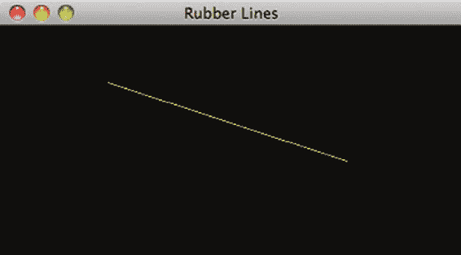

# 第 8 章 数组

## 8.8 鼠标事件

### 列表 8.19 `RubberLines.java`

```java
//********************************************************************
// RubberLines.java 作者: Lewis/Loftus
//
// 展示鼠标事件和橡皮筋效应。
//********************************************************************
import javax.swing.JFrame;

public class RubberLines
{
    //-----------------------------------------------------------------
    // 创建并显示应用程序框架。
    //-----------------------------------------------------------------
    public static void main(String[] args)
    {
        JFrame frame = new JFrame("Rubber Lines");
        frame.setDefaultCloseOperation(JFrame.EXIT_ON_CLOSE);
        frame.getContentPane().add(new RubberLinesPanel());
        frame.pack();
        frame.setVisible(true);
    }
}
```

### 列表 8.20 `RubberLinesPanel.java`

```java
//********************************************************************
// RubberLinesPanel.java Author: Lewis/Loftus
//
// 代表 RubberLines 程序的主绘制面板。
//********************************************************************
import javax.swing.JPanel;
import java.awt.*;
import java.awt.event.*;

public class RubberLinesPanel extends JPanel
{
    private Point point1 = null, point2 = null;

    //-----------------------------------------------------------------
    // 构造函数：设置此面板以监听鼠标事件。
    //-----------------------------------------------------------------
    public RubberLinesPanel()
    {
        LineListener listener = new LineListener();
        addMouseListener(listener);
        addMouseMotionListener(listener);
        setBackground(Color.black);
        setPreferredSize(new Dimension(400, 200));
    }

    //-----------------------------------------------------------------
    // 从初始鼠标按下点到鼠标的当前位置
    // 绘制当前线条。
    //-----------------------------------------------------------------
    public void paintComponent(Graphics page)
    {
        super.paintComponent(page);
        page.setColor(Color.yellow);
        if (point1 != null && point2 != null)
            page.drawLine(point1.x, point1.y, point2.x, point2.y);
    }

    //*****************************************************************
    // 代表所有鼠标事件的监听器。
    //*****************************************************************
    private class LineListener implements MouseListener, MouseMotionListener
    {
        //--------------------------------------------------------------
        // 捕获按下鼠标按钮时的初始位置。
        //--------------------------------------------------------------
        public void mousePressed(MouseEvent event)
        {
            point1 = event.getPoint();
        }

        //--------------------------------------------------------------
        // 获取鼠标拖动时的当前位置，并
        // 重新绘制线条以创建橡皮筋效果。
        //--------------------------------------------------------------
        public void mouseDragged(MouseEvent event)
        {
            point2 = event.getPoint();
            repaint();
        }

        //--------------------------------------------------------------
        // 为未使用的事件方法提供空定义。
        //--------------------------------------------------------------
        public void mouseClicked(MouseEvent event) {}
        public void mouseReleased(MouseEvent event) {}
        public void mouseEntered(MouseEvent event) {}
        public void mouseExited(MouseEvent event) {}
        public void mouseMoved(MouseEvent event) {}
    }
}
```

### 自我复习习题（答案见附录 N）

**SR 8.28** 什么是鼠标事件？

**SR 8.29** 在 GUI 组件上点击并释放鼠标按钮时，会产生什么顺序的鼠标事件？

**SR 8.30** 在 GUI 组件上点击并释放鼠标按钮时，会产生什么顺序的鼠标事件？

**SR 8.31** `RubberLines` 响应哪些鼠标事件？

**SR 8.32** 假设你正在创建一个 GUI，请描述你的程序如何响应各种鼠标事件。

## 8.9 键事件

### 核心概念

当按下键时会产生`键事件`。`键事件`允许程序对键盘按键做出响应。具体来说，`KeyListener` 接口允许程序在按下时立即做出响应。`KeyListener` 接口定义了我们可以用于响应活动的方法。由于该类必须实现接口定义的所有方法，我们为其他事件提供了空方法。


### 列表 8.21 `Direction.java`

```java
//********************************************************************
// Direction.java Author: Lewis/Loftus
//
// 演示键事件。
//********************************************************************
import javax.swing.JFrame;

public class Direction
{
    public static void main(String[] args)
    {
        JFrame frame = new JFrame("Direction");
        frame.setDefaultCloseOperation(JFrame.EXIT_ON_CLOSE);
        frame.getContentPane().add(new DirectionPanel());
        frame.pack();
        frame.setVisible(true);
    }
}
```

### 列表 8.22 `DirectionPanel.java`

```java
//********************************************************************
// DirectionPanel.java Author: Lewis/Loftus
//
// 代表 Direction 程序的主显示面板。
//********************************************************************
import javax.swing.*;
import java.awt.*;
import java.awt.event.*;

public class DirectionPanel extends JPanel
{
    private final int WIDTH = 300, HEIGHT = 200;
    private final int JUMP = 10; // 移动的增量
    private final int IMAGE_SIZE = 31;
    private ImageIcon up, down, right, left, currentImage;
    private int x, y;

    public DirectionPanel()
    {
        addKeyListener(new DirectionListener());
        x = WIDTH / 2;
        y = HEIGHT / 2;

        up = new ImageIcon("arrowUp.gif");
        down = new ImageIcon("arrowDown.gif");
        left = new ImageIcon("arrowLeft.gif");
        right = new ImageIcon("arrowRight.gif");
        currentImage = right;
        setBackground(Color.black);
        setPreferredSize(new Dimension(WIDTH, HEIGHT));
        setFocusable(true);
    }

    //-----------------------------------------------------------------
    // 在当前位置绘制图像。
    //-----------------------------------------------------------------
    public void paintComponent(Graphics page)
    {
        super.paintComponent(page);
        currentImage.paintIcon(this, page, x, y);
    }

    //*****************************************************************
    // 表示键盘活动的监听器。
    //*****************************************************************
    private class DirectionListener implements KeyListener
    {
        //--------------------------------------------------------------
        // 响应用户按下方向键，相应地调整
        // 图像和图像位置。
        //--------------------------------------------------------------
        public void keyPressed(KeyEvent event)
        {
            switch (event.getKeyCode())
            {
                case KeyEvent.VK_UP:
                    currentImage = up;
                    y -= JUMP;
                    break;
                case KeyEvent.VK_DOWN:
                    currentImage = down;
                    y += JUMP;
                    break;
                case KeyEvent.VK_LEFT:
                    currentImage = left;
                    x -= JUMP;
                    break;
                case KeyEvent.VK_RIGHT:
                    currentImage = right;
                    x += JUMP;
                    break;
            }
            repaint();
        }

        //--------------------------------------------------------------
        // 为未使用的事件方法提供空定义。
        //--------------------------------------------------------------
        public void keyTyped(KeyEvent event) {}
        public void keyReleased(KeyEvent event) {}
    }
}
```

传递给监听器 `keyPressed` 方法的 `KeyEvent` 对象可以用来确定按了哪个按键。在示例中，我们调用 `event` 对象的 `getKeyCode` 方法来获取一个表示所按键的数字代码。我们使用 `switch` 语句来确定按了哪个按键并做出相应响应。`KeyEvent` 类包含了与 `getKeyCode` 方法返回的数字代码对应的常量。如果按了方向键以外的任何按键，它都会被忽略。

```
void keyPressed(KeyEvent event)
当按下按键时调用。

void keyReleased(KeyEvent event)
当释放按键时调用。

void keyTyped(KeyEvent event)
当按下的按键或按键组合产生按键字符时调用。
```

**图 8.8** `KeyListener` 接口的方法

每当按下按键时都会触发键事件，但大多数系统都启用了`按键重复`的概念。也就是说，当按下并按住按键时，就像该按键被反复快速地按下一样。键事件以相同的方式生成。

在 `Direction` 程序中，用户可以按住方向键并观察图像快速穿过屏幕。


生成键事件的组件是当前具有`键盘焦点`的组件。通常，键盘焦点由主要的“活动”组件持有。当用户用鼠标点击组件时，该组件通常会获得键盘焦点。面板构造函数中对 `setFocusable` 方法的调用将键盘焦点设置为面板。

`Direction` 程序没有为箭头图像设置边界，因此它可以被移动到可见窗口之外，然后根据需要再次移回来。你可以向监听器添加代码，当图像到达窗口任一边界时停止其移动。这一修改被留作为一个编程项目。

## 自测习题（答案见附录 N）

SR 8.33 什么是键事件？

SR 8.34 回答以下关于我们的 `Direction` 程序的问题。

a. 哪些按下按键事件得到了了响应？

b. 哪些按下按键事件没有得到响应？

c. 上方向键的键码是什么？

d. 我们在哪个文件中存储左方向键图像？

e. 程序启动时显示哪幅图像？

# 8.1 总结 键元素数组

## 关键概念总结

- 尺寸为 `N` 的数组索引从 `0` 到 `N-1`。
- 在 Java 中，数组是一个必须实例化的对象。
- 边界检查确保了用于引用数组元素的索引在范围内。
- 可以使用初始化列表来实例化数组对象，而不是使用 `new` 运算符。
- 整个数组可以作为参数传递，这使得形式参数成为原始数组的别名。
- 实例化对象数组只预留了存储引用的空间。存储在每个元素中的对象必须单独实例化。
- 命令行参数存储在 `String` 对象数组中，并传递给 `main` 方法。
- 可以定义一个 Java 方法来接受任意数量的参数。
- 在面向对象的系统中，使用超过两个维度的数组是罕见的。
- 折线与多边形相似，区别在于折线不是闭合形状。
- 移动鼠标和点击鼠标按钮会生成程序可以对其响应的事件。
- 监听器为了满足接口，可能需要为未处理的事件提供空方法定义。
- 橡皮带（Rubberbanding）是形状在被拖动时似乎扩展的视觉效果。
- 键事件允许程序对用户按键做出响应。

## 练习题

EX 8.1 哪些声明是有效的？哪些实例化了数组对象？

```
int primes = {2, 3, 4, 5, 7};
float[] elapsedTimes = {11.47, 12.04, 11.72, 13.88};
int[] scores = int[30];
int[] primes = new {2,3,5,7,11};
```

注意：最后一个是无效的

```
int[] scores = new int[30];
char grades[] = {'a', 'b', 'c', 'd', 'f'};
char[] grades = new char[];
```

EX 8.2 描述五个如果没有数组很难程序。

EX 8.3 描述如何在内存中访问数组元素。例如，`myArray[25]` 存储在哪里？

EX 8.4 描述以下代码出现什么问题。应该进行哪些修改来消除该问题？

```
float[] values = {5.2, 10.5, 15.1, 20.87, 25.23, 30.01};
for (int total = values.length - 1; total >= 1; total--) System.out.println(values[total]);
```

EX 8.5 编写数组声明以及必要的类来表示以下语句：

a. 25 个学生的姓名
b. 40 个学生的测试考试成绩
c. 包含交易号、商户名称和金额的信用卡交易
d. 学生的姓名以及每个学生的作业成绩
e. L&L International 公司每位员工的员工号、入职日期和最后五次加薪金额

EX 8.6 编写代码将 `items` 数组的每个元素设置为该元素两倍。

EX 8.7 编写代码从前端打印存储在 `items` 数组中的一半值。

EX 8.8 编写代码将布尔数组 `multiples` 中位置为 3 的倍数的每个元素设置为 true。

EX 8.9 编写一个 `averageArray` 方法，接受一个整数数组并返回数组中存储值的平均值。

EX 8.10 编写一个 `switchThem` 方法，接受两个整数数组作为参数并交换数组的内容。考虑到数组的大小可能不同。

EX 8.11 描述一个你你会使用 `ArrayList` 类而不是数组的程序。描述一个你你会使用数组而不是 `ArrayList` 类的程序。解释你的选择。

EX 8.12 如果在 `Dots` 程序中我们没有为一个或多个未使用的鼠标事件提供空定义，会发生什么？

## 编程项目

### EX 8.13

Dots 程序监听鼠标按下事件以绘制一个圆点。如果程序改为监听鼠标释放事件，其行为会有什么不同？如果是监听鼠标点击事件呢？

### EX 8.14

如果从 `DotsPanel` 类的 `paintComponent` 方法中删除对 `super.paintComponent` 的调用，会发生什么？删除该调用并运行程序以测试你的答案。

### EX 8.15

如果从 `RubberLinesPanel` 类的 `paintComponent` 方法中删除对 `super.paintComponent` 的调用，会发生什么？删除该调用并运行程序以测试你的答案。在哪些方面与练习 8.13 的答案有何不同？

### EX 8.16

为 Direction 程序创建一个 UML 类图。

### PP 8.1

编写一个程序，读取任意数量在 2 到 100 之间（包含边界）的偶数，并统计每个数被输入的次数。用一个奇数表示输入结束。在处理完所有输入后，打印用户输入的所有值及其出现的次数。

### PP 8.2

修改 PP 8.1 中的程序，使其适用于奇数，并用偶数表示输入结束。

### PP 8.3

编写一个程序，创建一个直方图，允许你直观地检查一组学生的分数分布。程序应提示用户输入任意数量在 0 到 100 之间（包含边界）的整数；然后生成一个类似于下面的图表，指示分数在 91 到 100、81 到 90 等范围内的学生人数。为该范围内的每个学生打印一个井号（#）。

```
91 - 100 | ###
81 - 90 | #######
71 - 80 | ##########
61 - 70 | 
51 - 60 | #####
41 - 50 | ##
31 - 40 | #
21 - 30 | ##
11 - 20 |
0 - 10 |
```

### PP 8.4

如果有大量学生的分落在同一个范围内，PP 8.3 中直方图的行将会太长。修改程序，使得每个范围内每三个学生打印一个井号。

忽略剩余部分。例如，如果某个范围内有 11 个学生，在该行打印三个井号。如果某个类别有 2 个学生，则在该行不打印任何井号。

### PP 8.5

编写一个程序，计算并打印整数列表 `x1` 到 `xn` 的平均值和标准差。假设输入值不超过 50 个。使用以下公式以浮点值计算平均值和标准差。

```
mean = sum(xi) / n
sd = sqrt( sum((xi - mean)²) / n )
```

### PP 8.6

L&L 可以处理 30 个拥有储蓄账户的客户。设计并实现一个管理账户的程序。跟踪关键信息并允许每个客户存款。为无效交易产生适当的错误信息。*提示*：你可以基于第 4 章的 `Account` 类设计账户。还要提供一个方法，每次调用该方法时为所有账户添加 3% 的利息。

### PP 8.7

第 4 章的编程项目讨论了一个代表标准扑牌的 `Card` 类。创建一个名为 `DeckOfCards` 的类，存储 52 个 `Card` 类对象。包含洗牌、发牌以及报告牌组中剩余卡牌数量的方法。`shuffle` 方法应假设牌组是满的。创建一个带有 `main` 方法的驱动类，从洗过的牌组中发出每张卡牌，并在发牌时打印每张卡牌。

### PP 8.8

编写一个程序，读取最多 20 对员工姓名和 ID 的序列。将数据存储在一个设计用于存储名（字符串）、姓（字符串）和员工 ID（整数）的对象中。假设每行输入包含两个字符串后跟一个整数值，每个部分之间由制表符（tab）分隔。在读取输入后，以适当的格式在屏幕上打印列表。

### PP 8.9

修改你在 PP 8.8 中创建的程序以完成以下任务：

- 支持存储额外的员工信息：职称（string）、部门（string）、经验（integer）和 10 位电话号码（long integer，包含区号且不包含如 '('、')' 或 '-' 等特殊字符）。
- 将数据存储在 `ArrayList` 对象中。

### PP 8.10

使用第 7 章的 `Question` 类定义一个 `Quiz` 类。一个测验可以包含最多 25 个问题。定义 `Quiz` 类的 `add` 方法以向测验添加问题。定义 `Quiz` 类的 `giveQuiz` 方法顺序向用户展示每个问题，接受每个问题的答案并跟踪结果。定义名为 `QuizTime` 的类，其带有 `main` 方法，用于填充测验、展示测验并打印最终结果。

### PP 8.11

修改你对 PP 8.10 的答案，考虑测验中给出问题的复杂度级别。重载 `giveQuiz` 方法，使其接受指定最小和最大复杂度的整数参数。

### PP 8.12

设计一个表示星星的类，具有指定的半径和颜色。使用填充多边形（filled polygon）绘制星星。设计并实现一个随机位置绘制 10 颗星的程序。

### PP 8.13

设计一个表示汽车的类。使用折线（polylines）和多边形（polygons）在任何图形上下文和任何位置绘制汽车。创建一个主程序来显示汽车。

### PP 8.14

修改 PP 8.13 的解决方案，使用 `Polygon` 类来表示所有多边形。

### PP 8.15

修改第 5 章的 `QuoteOptions` 程序，使其提供额外的引用选项。使用数组存储所有引用字符串。

### PP 8.16

编写一个程序，绘制 20 个圆，每个圆的半径和位置随机确定。如果一个圆与其他圆重叠，则用黑色绘制。如果一个圆与或多个圆重叠，则用青色绘制。使用数组存储每个圆，然后确定每个圆的颜色。如果两个圆之间的距离小于它们的半径之和，则它们重叠。

### PP 8.17

编写一个程序，绘制一个在不同位置上有五个红棋和八个黑棋的棋盘。使用二维数组存储棋盘。

### PP 8.18

修改 PP 8.17 中的程序，使其判断任何黑棋是否可以跳过任何红棋。在棋盘下方，打印（使用 `drawString`）所有可以跳跃的黑棋的行列位置。

### PP 8.19

修改本章的 `RubberLines` 程序，使其显示所有绘制过的线条。只显示最终线条（从鼠标按下到鼠标释放），不显示用于展示橡皮筋效果的中间线条。*提示*：像 `Dots` 程序跟踪多个点一样，跟踪一个表示线条的对象列表。

### PP 8.20

编写一个程序，统计鼠标点击的次数。在窗口中心显示该数字。

### PP 8.21

编写一个程序，使用鼠标点击动态创建一个折线形形状。每次鼠标点击都会从上一个点添加一条新的线段。在绘制区域下方包含一个按钮，用于清除当前折线形并开始画一个。

### PP 8.22

编写一个程序，使用橡皮筋技术绘制圆。圆的大小由鼠标拖动决定。使用鼠标点击位置作为固定中心点。计算鼠标指针当前位置与中心点之间的距离，以确定圆的当前半径。

### PP 8.23

编写一个程序作为鼠标里程程计，持续显示鼠标（在程序窗口上方）移动的像素距离。使用标签（label）显示当前的里程程值。*提示*：随着鼠标的移动，确定当前位置并与鼠标的上一个位置进行比较。使用距离公式计算鼠标移动的距离，并将其累加到运行总距离中。

### PP 8.24

编写一个程序，其背景颜色根据鼠标指针的位置而改变。如果鼠标指针在程序窗口的左半部分，显示红色；如果在右半部分，显示绿色。

### PP 8.25

编写一个表示飞船的类，该飞船可以在任何特定位置绘制（侧视图）。编写一个程序显示飞船使其跟随鼠标的移动。当按下鼠标键时，让激光束从飞船前端发射（一束连续的光束，而不是移动的射体），直到释放鼠标键。

### PP 8.26

编写一个程序帮助医院分析急诊室的患者流量。一个文本输入文件包含整数，代表四周内每天每小时进入急诊室的患者人数。从命令行参数获取输入文件名。读取信息并存储在三维数组中。然后对其分析以比较每周、每天和每小时的患者总数。显示分析结果。

### PP 8.27

修改本章中的 Direction 程序，不允许图像移动到面板的可视区域之外。忽略任何导致这种情况的按键事件。

### PP 8.28

修改本章中的 Direction 程序，使其在响应箭头键外，也响应另外四个让图像沿对角线移动的键。当按下 `'t'` 键时，图像向左上移动。同样地，使用 `'u'` 向上右移动，使用 `'g'` 向左下移动，使用 `'j'` 向右下移动。如果图像已到达窗口边界，则不要移动图像。

## 软件故障

## 航空交通管制

### 发生了什么？

2004 年 9 月 14 日（周二）下午 5 点左右，洛杉矶航空交通管制中心突然失去了与与其在美西南部追踪的 400 架飞机的语音联系。由位于佛罗里达州梅尔堡恩的 Harris 公司设计的语音切换控制系统（`VSCS`）意外关闭了。随后，设计用于发生此类故障时接管的备份系统在激活后一分钟内也崩溃了。在没有管制员的指导的情况下，飞机开始危险地相互靠近，导致了数次险些碰撞。

碰撞之所以被避免，部分归功于一些管制员的机敏反应，他们使用手机向正在使用交通管制中心和航空公司的其他管制员警报。但该事件没有演变成灾难的主要原因是由于现在商用客机上配备的机载避障系统。这些系统跟踪附近飞机的应应器，并向飞行员发出紧急指令，在最后时刻爬升或下降。如果该问题发生在 10 到 15 年前（在飞机拥有此类避障系统之前），很可能会发生多次空中碰撞。

### 产生原因是什么？

官方认为，该事件被归咎于人为失误。联邦航空管理局（FAA）报告说，该问题“不是系统可靠性的结果”，如果遵循 FAA 的程序本可以避免的。此例中的关键程序要求每 30 天重启一次语音切换系统。

然而，根源被追溯到一个软件问题。`VSCS` 依赖于一个定期运行内置测试的子系统。子系统中的倒计时计时器用于确定何时运行测试。计时器以毫秒为单位倒计时，从系统能处理的最大数值 `232` 开始。这超过了 40 亿毫秒。计时器从 `232` 减到零需要不到 50 天。遗憾的是，当计时器归零时，测试无法运行，系统就会关闭。通过每 30 天重启一次系统，计时器会在过期前大约三周被重置。

FAA 首次在对现场系统进行测试时发现了这个问题问题。该系统运行了 49.7 天，然后崩溃了。重启后，一切似乎都正常。当另一个系统发生类似的崩溃时，FAA 实施了 30 天重启一次的程序。

在洛杉矶事件发生后，问题被追踪到了，并创建了软件补丁来修复问题。现在系统会定期重置计数器，无需人工干预。

### 汲取的教训

在这种情况下，问题（即使不是其影响）是预先已知的。Harris（制造商）知道计时器可能过期的风险，但尚未确定它对系统可能产生的影响。FAA 在测试期间发现了这个问题——尽管不是根源。他们没有进一步挖掘，而是实施了基于人的手工解决方案——终极的“有疑就重启”情景。

诚然，如果遵循了 FAA 程序，问题是可以避免的，但当软件可以让此类程序变得不再必要时，这种安慰是微小的。同样，如果备份系统没有故障，该事件也将是微不足道的。拥有冗余的备份系统会减少完全失败的可能性。但在这种情况下，底线是彻底的测试和调查会将问题暴露出来。在安全关键型系统中，不应接受任何低于此标准的。

来源：IEEE Spectrum，2004 年 11 月

# 9 继承

## 9.1 创建子类

在第 1 章介绍面向对象的概念时，我们提出了这样的类比：类之于对象就像蓝图之于房屋。在随后的章节中，我们强化了这个想法，编写了定义一组相似对象的类。类建立了对象的特征和行为，但没有为变量留内存空间（除非这些变量被声明为 `static` ）。

许多房屋可以根据同一个蓝图创建。它们本质上是位于不同位置的相同房屋，居住着不同的人。现在假设你想要一间与另一个房屋相似但具有某些不同或额外功能的房屋。你希望从同一个基础蓝图开始，但对其进行修改以适应新的、略有不同的需求。许多住宅区就是这样创建的。开发区中的房屋具有相同的核心布局，但它们拥有独特的特征。例如，它们可能都是具有相同基本房间配置的分层式住宅，但某些带有壁炉或完整的地下室，而另一些没有，或者拥有升级版的豪华厨房而不是标准版本。

房屋开发商可能会委托一位首席建筑师创建一张单一蓝图，以建立开发区所有房屋的基本设计，然后创建一系列包含变体以吸引不同买家的新蓝图。创建这一系列蓝图的过程被简化了，因为它们都从相同的底层结构开始，而变体赋予了它们独特的特征，这些特征对潜在所有者可能很重要。

## 继承

基于现有蓝图 `KeY Concept` 创建新蓝图比比面向对象编程中的 `inheritance`（继承）概念。继承是从现有类派生新类的过程。

继承是一种强大的软件开发技术，也是面向对象编程的定义特性。

通过继承，新类自动包含原始类中的变量和方法。然后，根据需要定制该类，程序员可以在派生类中添加新的变量和方法，或修改继承的成员。

通常，通过继承创建新类比从头开始写更快、更容易、更符合 `KeY Concept`。继承的一个目的是支持 `software reuse`（软件重用）的想法。通过使用现有的软件组件创建新组件，我们可以利用在现有软件的设计、实现和测试上投入的精力。

记住，`class`（类）一词源于对具有相似特征的对象进行分类。分类方案通常使用相互相关的类级。例如，所有哺乳动物都有某些特征：它们是温血动物，有毛，并产生牛奶喂养幼崽。


## 9.1 创建子类

现在考虑哺乳动物的一个子，例如马。所有的马都是哺乳动物，具有哺乳动物的所有特征，但它们也具有独特的特征，使它们与狗等哺乳动物区别来。


# 第 9 章 继承

我们将这一想法翻译成软件术语，一个名为 `Mammal` 的现有类将具有描述哺乳动物状态和行为的某些变量和方法。`Horse` 类可以从现有的 `Mammal` 类派生，自动继承 `Mammal` 中包含的变量和方法。`Horse` 类可以引用继承的变量和方法，就像它们在该类中局部声明的一样。然后可以在派生类中添加新的变量和方法，以将马与其他哺乳动物区分开来。

用于派生新类的原始类被称为 `parent class`（父类）、`superclass`（超类）或 `base class`（基类）。派生类被称为 `child class`（子类）或 `subclass`。继承在父类和子类之间建立了一个 `is-a relation`（“是一个”的关系）。Java 使用关键字 `extends` 表示一个新类正从一个现有类派生。

继承的过程应该在两个类之间建立 `is-a relationship`。也就是说，子类应该是父类的更具体的版本。例如，马是哺乳动物。并不是所有的哺乳动物都是马，但所有的马都是哺乳动物。对于任何从类 `Y` 派生的类 `X`，你都应该说“X 是一个 Y”。如果这种说法不通，那么这种关系可能不是继承的适当用法。

让我们来看一个例子。列表 9.1 显示的程序实例化了一个 `Dictionary` 类对象，该类派生自名为 `Book` 的类。在 `main` 方法中，通过 `Dictionary` 对象调用了三个方法：两个是在 `Dictionary` 类中局部声明的，一个是继承自 `Book` 类。

`Book` 类（参见列表 9.2）用于通过 `Dictionary` 头部关键字 `extends` 派生 `Dictionary` 类（参见列表 9.3）。

`Dictionary` 类自动继承 `setPages` 和 `getPages` 方法的定义，以及 `pages` 变量。仿佛这些方法和 `pages` 变量是声明在 `Dictionary` 类内部一样。注意，在 `Dictionary` 类中，`computeRatio` 方法显式引用了 `pages` 变量，尽管该变量是在 `Book` 类中定义的。

还要注意，尽管创建 `Dictionary` 的定义需要 `Book` 类，但程序中从未实例化过 `Book` 对象。子类的实例不依赖于父类的实例。

继承是单行道。`Book` 类不能使用在 `Dictionary` 类中显式定义的变量或方法。例如，如果我们从 `Book` 类创建了一个对象，它不能被用来调用 `setDefinitions` 方法。这种限制是有意义的，因为子类是父类的更具体的版本。

## 列表 9.1

```java
//********************************************************************
// Words.java Author: Lewis/Loftus
//
// 展示了继承方法的使用。
//********************************************************************
public class Words
{

//-----------------------------------------------------------------
// 实例化一个派生类并调用其继承的
// 局部方法。
//-----------------------------------------------------------------
    public static void main(String[] args)
    {
        Dictionary webster = new Dictionary();
        System.out.println("Number of pages: " + webster.getPages());
        System.out.println("Number of definitions: " + webster.getDefinitions());
        System.out.println("Definitions per page: " + webster.computeRatio());
    }
}
```

**输出**

```
Number of pages: 1500
Number of definitions: 52500
Definitions per page: 35.0
```

继承关系通常在 UML 类图中表示。图 9.1 显示了 `Book` 和 `Dictionary` 类之间的继承关系。带有空箭头的箭头用于在 UML 图表示继承，箭头从子类指向父类。

## 列表 9.2

```java
//********************************************************************
// Book.java Author: Lewis/Loftus
//
// 代表一本书。作为派生类的父类用于
// 展示继承。
//********************************************************************
public class Book
{

    protected int pages = 1500;

    //-----------------------------------------------------------------
    // Pages 变异器。
    //-----------------------------------------------------------------
    public void setPages(int numPages)
    {
        pages = numPages;
    }

    //-----------------------------------------------------------------
    // Pages 访问器。
    //-----------------------------------------------------------------
    public int getPages()
    {
        return pages;
    }
}
```

## protected 修饰符

正如我们所看到的，可见性修饰符用于控制类成员的访问。这种效果也延伸到了继承过程中。父类中的任何公共（`public`）方法或变量都可以在子类中通过名称以及该子类的对象显式引用。另一方面，父类的私有（`private`）方法和变量无法在子类中或通过子类对象被引用。

然而，如果我们声明一个具有公共可见性的变量以便让派生类引用它，那么我们就违反了封装原则。因此，Java 提供了第三种可见性修饰符：`protected`。注意，变量 `pages` 在 `Book` 类中被声明为 `protected` 可见性。当变量或方法被声明为 `protected` 可见性时，派生类可以引用它。而 `protected` 可见性允许类保留某些封装属性。使用 `protected` 可见性的封装虽然没有将变量或方法声明为 `private` 那么严密，但比声明为 `public` 要好。

## 9.1 创建子类

### 列表 9.3

```java
//********************************************************************
// Dictionary.java Author: Lewis/Loftus
//
// 表示一个字典，即一本书。用于演示
// 继承。
//********************************************************************
public class Dictionary extends Book
{
    private int definitions = 52500;

    //-----------------------------------------------------------------
    // 使用本地和继承的值打印消息。
    //-----------------------------------------------------------------
    public double computeRatio()
    {
        return (double) definitions/pages;
    }

    //----------------------------------------------------------------
    // Definitions 的修改器。
    //----------------------------------------------------------------
    public void setDefinitions(int numDefinitions)
    {
        definitions = numDefinitions;
    }

    //----------------------------------------------------------------
    // Definitions 的访问器。
    //----------------------------------------------------------------
    public int getDefinitions()
    {
        return definitions;
    }
}
```

`protected` 可见性可以被同一个包中的任何类访问，同时也可以被任何派生类访问。`protected` 可见性提供了提供了允许继承范围内最好的封装。

在 UML 图中，`protected` 可见性可以通过在受保护成员前加一个哈希标记（`#`）来表示。图 9.1 中 `Book` 类的 `pages` 变量就有此注解。每个变量或方法都保留其原始可见性修饰符的效果。例如，`setPages` 方法在 `Dictionary` 类中的继承形式中仍被认为是 `public` 的。

#### 继承概览

让我们明确一下我们的术语。所有方法和变量，即使是声明为 `private` 可见性的，也会被子类继承。也就是说，它们的定义存在，并且为这些变量留有了内存空间。只是它们不能通过名称进行引用。这个问题将在 9.4 节中进行更详细探讨。

然而，构造函数是不被继承的。构造函数是用于设置特定对象的特殊方法，因此，一个名为 `Dictionary` 的类拥有名为 `Book` 的构造函数是没有意义的。但你可以想象，子类可能想要引用父类的构造函数，这就是后面将描述的 `super` 引用的原因之一。

### super 引用

关键字 `super` 可以在类中使用以引用其父类。通过 `super` 引用，我们可以访问父类的成员。与 `this` 引用一样，`super` 单词所指的内容取决于调用 `super` 引用的位置——即使用它的类。

`super` 引用的一个用途是调用父类的构造函数。让我们来看一个例子。列表 9.4 显示了对列表 9.1 中原始 `Words` 程序的修改。与原始相似，我们使用了一个名为 `Book2` 的类。

### 列表 9.4

```java
//********************************************************************
// Words2.java Author: Lewis/Loftus
//
// 演示 super 引用的使用。
//********************************************************************
public class Words2
{
    //-----------------------------------------------------------------
    // 实例化派生类并调用其继承的
    // 本方法。
    //-----------------------------------------------------------------
    public static void main(String[] args)
    {
        Dictionary2 webster = new Dictionary2(1500, 52500);
        System.out.println("Number of pages: " + webster.getPages()); 
        System.out.println("Number of definitions: " + webster.getDefinitions());
        System.out.println("Definitions per page: " + webster.computeRatio());
    }
}
```

**输出：**

```
Number of pages: 1500
Number of definitions: 52500
Definitions per page: 35.0
```

### 列表 9.5

```java
//********************************************************************
// Book2.java Author: Lewis/Loftus
//
// 表示一本书。作为派生类的父类，用于演示
// 继承和 super 引用的使用。
//********************************************************************
public class Book2
{
    protected int pages;

    //----------------------------------------------------------------
    // 构造函数：用指定的页数 
    // 设置书。
    //----------------------------------------------------------------
    public Book2(int numPages)
    {
        pages = numPages;
    }

    //----------------------------------------------------------------
    // Pages 的修改器。
    //----------------------------------------------------------------
    public void setPages(int numPages)
    {
        pages = numPages;
    }

    //----------------------------------------------------------------
    // Pages 的访问器。
    //----------------------------------------------------------------
    public int getPages()
    {
        return pages;
    }
}
```

然而，与这些类的早期版本不同，`Book2` 和 `Dictionary2` 具有用于初始化实例变量的显式构造函数。`Words2` 程序的输出与原始 `Words` 程序相同。

### 列表 9.6

```java
//********************************************************************
// Dictionary2.java Author: Lewis/Loftus
//
// 表示一个字典，即一本书。用于演示
// super 引用的使用。
//********************************************************************
public class Dictionary2 extends Book2
{
    private int definitions;

    //-----------------------------------------------------------------
    // 构造函数：用指定的页数和
    // 定义数量设置字典。
    //-----------------------------------------------------------------
    public Dictionary2(int numPages, int numDefinitions)
    {
        super(numPages);
        definitions = numDefinitions;
    }
}
```


```java
// Prints a message using both local and inherited values.

//-----------------------------------------------------------------

public double computeRatio()
{
    return (double) definitions/pages;
}

//----------------------------------------------------------------

// Definitions mutator.

//----------------------------------------------------------------

public void setDefinitions(int numDefinitions)
{
    definitions = numDefinitions;
}

//----------------------------------------------------------------

// Definitions accessor.

//----------------------------------------------------------------

public int getDefinitions()
{
    return definitions;
}

}
```

## 9.1 创建子类

479

**列表 9.6** (*续*)

`Dictionary2` 构造函数接收两个整数值作为参数，代表书中的页数和定义数量。由于 `Book2` 类已经有一个构造函数来执行设置被继承的字典部分的工作，因此我们依赖于该构造函数来完成这些工作。然而，由于构造函数是不被继承的，我们无法直接调用它，因此我们使用 `super` 引用来访问父类中的该构造函数。随后，`Dictionary2` 构造函数初始化它的 `definitions` 变量。

在这种情况下，直接在 `Dictionary2` 构造函数里显式设置 `pages` 变量与使用 `super` 调用 `Book2` 构造函数同样简单。然而，让每个类“自理”是一种良好的做法。如果我们选择改变 `Book2` 构造函数设置 `pages` 变量的方式，我们也必须记住在 `Dictionary2` 中进行相应的更改。通过使用 `super` 引用，在 `Book2` 中进行的更改会自动反映在 `Dictionary2` 中。

子类的构造函数负责调用其父类的构造函数。通常，构造函数的第一行应该使用 `super` 引用调用父类的构造函数。如果没有这样的调用，Java 将在构造函数的开头自动调用 `super()`。这条规则确保了父类在子类构造函数开始执行之前初始化了它的变量。使用 `super` 引用调用父构造函数只能在子类的构造函数中进行，并且如果包含，它必须是构造函数的第一行。

`super` 引用也可以用于引用父类中定义的其他变量和方法。我们将在本章的后续章节中使用这种技术。

## 多重继承

Java 的继承方法被称为`单继承`。这个术语意味着派生类只能有一个父类。某些面向对象的语言允许派生类拥有多个父类。这种方法被称为`多重继承`，有时用于描述介于两个类别或类之间的对象。例如，假设我们有一个 `Car` 类和一个 `Truck` 类，并且想要创建一个名为 `PickupTruck` 的新类。皮卡车在某种程度上像汽车，在某种程度上像卡车。使用单继承，我们必须决定是从 `Car` 还是从 `Truck` 派生这个新类更好。而在多重继承中，它可以从两者中都派生，如图 9.2 所示。

多重继承在某些情况下运行良好，但它是有代价的。如果 `Truck` 和 `Car` 都有同名方法怎么办？Java 的设计者显式地决定不支持多重继承。相反，我们可以依靠接口来提供多重继承的最佳特性，而不会增加额外的复杂性。尽管一个 Java 类只能派生自一个父类，但它可以实现多个接口。

因此，我们可以在继承一个父类的核心信息的同时，以特定的方式与特定的类进行交互。

## 自测题（答案见附录 N）

- SR 9.1 描述父类与子类之间的关系。
- SR 9.2 继承如何支持软件重用？
- SR 9.3 每一个类派生应该代表什么样的关系？
- SR 9.4 `protected` 修饰符起什么作用？
- SR 9.5 为什么 `super` 引用对子类非常重要？
- SR 9.6 定义一个扩展 `Book2` 的类 `SchoolBook2`，包含一个指示书籍目标年龄（4 到 16 岁）的属性。构造函数接受年龄作为参数。该类还提供了一个返回字符串的方法如下：如果目标年龄是 4 到 6 岁，返回“Pre-school”如果是 7 到 9 岁，返回“Early”，“如果是 10 到 12 岁，返回“Middle”，“如果是 13 到 16 岁，返回“Upper”。
- SR 9.7 单继承和多重继承之间的区别是什么？

## 9.2 方法重写

当子类定义了一个与父类中方法相同名称和签名的方法时，我们说子类的版本`覆盖`（overrides）了父类的版本，以使用自己的版本。在继承情况下，重写的需求经常发生，此时子类可以覆盖（重新定义）父类对继承方法的定义。

列表 9.7 中的程序提供了 Java 中方法重写的简单演示。`Messages` 类包含一个 `main` 方法，该方法实例化两个对象：一个来自 `Thought` 类，另一个来自 `Advice` 类。`Thought` 类是 `Advice` 类的父类。

```java
//****************************************************
// Messages.java 作者: Lewis/Loftus
//
// 展示重写方法的使用。
//****************************************************
public class Messages
{
    //-------------------------------------------------
    // 创建两个对象并在每个对象调用 message 方法。
    //-------------------------------------------------
    public static void main(String[] args)
    {
        Thought parked = new Thought();
        Advice dates = new Advice();
        parked.message();
        dates.message();
    }
}
```

**输出**

```
I feel like I'm diagonally parked in a parallel universe.
Warning: Dates in calendar are closer than they appear.
I feel like I'm diagonally parked in a parallel universe.
```

用于调用方法的对象决定了实际执行哪个版本的方法。当使用列表 9.8 中的 `parked` 对象调用 `message` 时：

```java
//****************************************************
// Thought.java 作者: Lewis/Loftus
//
// 代表一个杂乱的想法。作为派生类的父类
// 用于展示重写方法的使用。
//****************************************************
public class Thought
{
    //-------------------------------------------------
    // 打印消息。
    //-------------------------------------------------
    public void message()
    {
        System.out.println("I feel like I'm diagonally parked in a " +
                          "parallel universe.");
        System.out.println();
    }
}
```

`Thought` 类（见列表 9.8）和 `Advice` 类（见列表 9.9）都包含名为 `message` 方法定义。`Thought` 类定义的 `message` 版本被 `Advice` 继承，但 `Advice` 使用一个替代版本对其进行了重写。新版本的方法打印出完全不同的消息，然后使用 `super` 引用调用父类的方法版本。

**列表 9.9**

```java
//********************************************************************
// Advice.java 作者: Lewis/Loftus
//
// 表示一些深思熟虑的建议。用于演示重写
// 方法的使用
//********************************************************************
public class Advice extends Thought
{
    //-----------------------------------------------------------------
    // 打印消息。此方法覆盖了父类版本。
    //-----------------------------------------------------------------
    public void message()
    {
        System.out.println("警告: 日历中的日期比"
        "看起来的要近");
        System.out.println();
        super.message(); // 显式调用父类版本
    }
}
```

在 `main` 方法中，执行的是 `Thought` 版本的 `message`。当使用日期对象调用 `message` 时，执行的是 `Advice` 版本的 `message`。

可以使用 `final` 修饰符定义方法。子类不能重写 `final` 方法。这种技术用于确保派生类使用方法的特定定义。

方法重写是面向对象设计中的核心元素。它允许通过继承关系相关的两个对象使用相同的命名约定，以不同的方式完成相同的通用任务。当涉及到多态（将在第 10 章中讨论）时，重写变得更加重要。

### 变量遮蔽 (shadowing variables)

虽然不建议，但子类可以声明一个与从父类继承的同名的变量。注意重新声明变量与仅仅为继承的变量赋予特定值之间的区别。如果在子类中声明了同名的变量，它被称为`shadow variable”（遮蔽变量）。它在概念上与重写方法的过程相似，但会产生混淆的细微差别。


**484**

**第 9 章** 继承

由于继承的变量对子类是可用的，因此通常没有好的理由重新声明它。阅读带有遮蔽变量代码的人会发现两个不同的声明，它们似乎都适用于子类中使用的变量。这种混淆会导致问题且没有任何实际用处。

对特定变量名进行重新声明可能会改变其类型，但这通常是没有必要的。通常情况下，应该避免变量遮蔽。

### 自测习题（seLF-revieW QuestiONs 答案见附录 N）

- SR 9.8 为什么子类要重写其父类的一个或多个方法？
- SR 9.9 真或错？请解释。
  - a. 子类可以定义一个与父类中方法同名的方法。
  - b. 子类可以重写父类的构造函数。
  - c. 子类可以重写父类的 `final` 方法。
  - d. 子类重写来自父类的方法被认为是糟糕的设计。
  - e. 子类可以定义一个与父类中变量同名的变量。

## 9.3 类层次结构 (Class hierarchies)

派生自一个父类的子类可以作为其自己的子类的父类。此外，多个类可以派生自同一个父类。因此，继承关系往往会发展为*类层次结构*（class hierarchies）。创建一个类层次结构。图 9.3 显示了一个 `Animal` 类。

**爬行动物**

**鸟类**

**哺乳动物**

**蛇**

**蜥蜴**

**鹦鹉**

**马**

**蝙蝠**

**图 9.3** 显示类层次结构的 UML 类图


**9.3** 类层次结构

**485**

包含了 `Mammal` 和 `Horse` 类之间继承关系的层次结构。

一个类可以拥有的子类数量没有限制，类层次结构延伸的层级也没有限制。同一个父类的两个子类被称为`siblings`（兄弟类）。虽然兄弟类共享共同父类传递的特征，但它们之间没有继承关系，因为其中一个并没有被用来派生出另一个。

在类层次结构中，公共特征应该尽可能地保持在层次结构的高层。这样，子类中显式建立的唯一特征就是那些使该类与其父类以及兄弟类区分开来的特征。这种方法最大限度地了类重用的潜力。它也便于维护工作，因为当父类发生更改时，这些更改会自动反映在后代中。在构建类层次结构时，始终要记住维护“is-a”关系。

继承机制是传递的。也就是说，父类将一种特征传递给子类，该子类又将其传递给它的子类，依此类推。一个继承的特征可能起源于类层次结构中尽可能的高层：直接父类中，或者可能在更远的祖先类中高几层。

对于所有情况，并没有单一的最佳层次结构组织方式。你在设计类层次结构时做出的决策限制并引导了更详细的设计决策和实现方案，因此你必须仔细做出这些决策。

在本章的前面，我们讨论了一种根据其主要生物分类组织动物的类层次结构，例如 `Mammal`、`Bird` 和 `Reptile`。然而，在不同的情况下，相同的动物可能在逻辑上以不同的方式组织。例如，如图 9.4 所示，类层次结构可以围绕动物的功能进行组织，例如它们飞行的能力。在这种情况下，`Parrot` 类和 `Bat` 类将是派生自通用的 `FlyingAnimal` 类的兄弟类。这种类层次结构与原始的层次结构一样有效且合理。使用这些类的程序需求将决定哪种结构最适用于特定情况。

**飞行动物**

**鹦鹉**

**蝙蝠**

**蚊**

**图 9.4** 组织动物的另一种层次结构


**486**

**第 9 章** 继承

### Object 类

在 Java 中，所有的类最终都派自 `Object` 类。如果一个类定义没有使用 `extends` 子句派生自另一个类，那么该类默认自动派生自 `Object` 类。

因此，以下两个类定义是等价的：

```java
class Thing {
    // 内容
}
```

和

```java
class Thing extends Object
{
    // 内容
}
```

由于所有类都派自 `Object`，`Object` 的所有公共方法都被每个 Java 类继承。可以通过任何 Java 程序中创建的对象调用它们。`Object` 类定义在 Java 标准类库的 `java.lang` 包中。图 9.5 列出了 `Object` 类的一些方法。

公共特征应该位于层次结构中。事实证明，我们在示例中经常使用 `Object` 方法。例如，`toString` 方法定义在 `Object` 类中，因此可以在任何对象上调用 `toString` 方法。正如我们多次看到的，当带有对象参数调用 `println` 方法时，会调用 `toString` 来确定打印的内容。

#### toString 和 equals 方法

因此，当我们在类中定义 `toString` 方法时，我们实际上是在重写一个继承的定义。`Object` 类提供的 `toString` 定义返回一个包含以下内容的字符串：

> 对象的类名，后跟一个对该对象唯一的数值值。

通常，我们会重写 `Object` 版本的 `toString` 以适应我们自己的需求。`String` 类已经重写了 `toString` 方法，使其返回其存储的字符串值。

当我们为一个类定义 `equals` 方法时，我们也在重写一个继承的方法。正如我们之前讨论过的，`equals` 方法的目的是判断两个对象是否相等。`Object` 类提供的 `equals` 方法的定义是：如果两个对象引用实际上指向同一个对象（即，如果它们是别名），则返回 true。类通常会重写继承的 `equals` 方法定义，以采用更适当的定义。例如，`String` 类重写了 `equals`，只有当两个字符串包含相同顺序的相同字符时，它才返回 true。

**图 9.5** `Object` 类的一些方法

| 方法 | 描述 |
| :--- | :--- |
| `boolean equals(Object obj)` | 如果此对象是指定对象的别名，则返回 true。 |
| `String toString()` | 返回对象的字符串表示。 |
| `Object clone()` | 创建并返回此对象的副本。 |

### 抽象类

`abstract class` 表示类层次级中的一个通用概念。`abstract class`不能被实例化，并且通常包含一个或多个`abstract methods`，这些方法没有具体定义。我们在第 7 章中讨论过抽象方法，当时它们被用于定义 Java `interface`（接口）。抽象类在某些方面与接口相似。然而，与接口不同，抽象类可以包含非抽象的方法。它还可以包含常量以外的数据声明。

通过在类头中包含 `abstract` 修饰符，可以将一个类声明为抽象类。任何包含一个或多个抽象方法的类必须声明为抽象类。在抽象类中（与接口不同），`abstract` 修饰符必须应用于每个抽象方法。声明为抽象的类不必得包含定义。


# 抽象类与继承设计

## 抽象类

抽象类在类层次结构中充当占位符。正如其名称所示，抽象类表示一个抽象实体，该实体本身通常定义不足，无法单独发挥作用。相反，抽象类可能包含一个部分描述，该描述会被其类层次结构中的所有后代类继承。它的子类更具体，会填补这些空白。

考虑图 9.6 所示的类层次结构。层次结构顶部的 `Vehicle` 类对于特定应用程序可能太通用了。因此，我们可能选择将其实现为抽象类。在 UML 图中，抽象类名用斜体表示。

适用于所有车辆的概念可以在 `Vehicle` 类中表示，并被其后代类继承。这样，它的每个后代类就不需要冗余地（可能是不一致地）定义相同的概念了。例如，我们可以说所有车辆都有特定的速度。因此，我们在 `Vehicle` 类中声明了一个 `speed` 变量，由于继承，层次结构中其下方的所有特定车辆自动拥有该变量。我们对车辆速度表示所做的任何更改都会自动反映在所有后代类中。


类似地，我们可能会声明一个名为 `fuelConsumption` 的抽象方法，其目的是计算特定车辆消耗燃料的速度。`fuelConsumption` 方法的细节必须由每种车辆定义，但 `Vehicle` 类建立了所有车辆都消耗燃料的概念，并提供了一种计算该值的一致方法。

某些概念并不适用于所有车辆，因此我们不会在 `Vehicle` 级别表示这些概念。例如，我们不会在 `Vehicle` 类中包含名为 `numberOfWheels` 的变量，因为并不是所有车辆都有轮子。适合轮子的子类可以在层次结构中的适当层级添加该概念。

抽象类可以在类层次结构中的任何位置定义，没有任何限制。通常，它们位于类层次结构的上层。然而，也可以从非抽象父类派生出抽象类。

通常，抽象类的子类将为其从父类继承的抽象方法提供具体的定义。请注意，这只是重写方法的一种特殊情况，它给出了与父类提供的定义不同的定义。如果抽象类的子类没有为它从父类继承的每个抽象方法提供定义，那么该子类也被视为抽象类。

派生自抽象父类的类也将被视为抽象类。

请注意，将抽象方法修改为 `final` 或 `static` 是自相矛盾的。因为 `final` 方法不能在子类中被重写，因此 `abstract final` 方法将无法在子类中被赋予定义。`static` 方法可以使用类名调用而无需声明该类的对象。由于抽象方法没有实现，`abstract static` 方法将毫无意义。

选择哪些类和方法设为抽象是设计过程中的重要部分。你应该在仔细考虑之后才做出此类选择。通过明智地使用抽象类，你可以创建灵活、可扩展的软件设计。

## 9.4 可见性

### 接口层次结构

继承的概念不仅适用于类，也适用于接口。也就是说，一个接口可以派生自另一个接口。这些关系可以形成 `interface hierarchy`（接口层次结构），它类似于类层次结构。接口之间的继承关系派生自另一个接口。它们在 UML 图中使用与类相同的连接方式（带有一个空心箭头的箭头）来表示。

当使用一个父接口来派生一个子接口时，子接口继承了父接口的所有抽象方法和常量。任何实现子接口的类都必须实现所有方法。在处理接口之间的继承时，没有可见性问题（就像处理类的 `protected` 和 `private` 成员时那样），因为接口的所有成员都是 `public` 的。

类层次结构和接口层次结构之间是不重叠的。也就是说，接口不能用于派生类，类不能用于派生接口。类和接口只有在类被设计为实现特定接口时才会交互。

### 自测题

*(答案见附录 N)*

- SR 9.10 绘制一个 UML 类图，显示一个包含代表不同食物类型的类的层次结构。为其中至少两个类显示一些适当变量和方法名。
- SR 9.11 `Object` 类的意义是什么？
- SR 9.12 Java 中哪一个类没有父类？请解释。
- SR 9.13 抽象类的作用是什么？
- SR 9.14 为什么定义 `final`、`abstract` 类是自相矛盾的？
- SR 9.15 什么是接口层次结构？

## 列表 9.10：FoodAnalyzer.java

```java
//********************************************************************
// FoodAnalyzer.java 作者: Lewis/Loftus
//
// 展示了对继承私有成员的间接访问。
//********************************************************************
public class FoodAnalyzer
{
    //-----------------------------------------------------------------
    // 实例化 Pizza 对象并打印其每份的热量。
    //-----------------------------------------------------------------
    public static void main(String[] args)
    {
        Pizza special = new Pizza(275);
        System.out.println("Calories per serving: " +
            special.caloriesPerServing());
    }
}
```

**输出**

```
Calories per serving: 309
```

`Pizza` 对象调用一个方法来根据其脂肪含量确定披萨每份含有多少卡路里。

列表 9.11 所示 `FoodItem` 类表示了一种通用的食物类型。

`FoodItem` 的构造函数接受脂肪的克数和该食物的份数。`calories` 方法返回脂肪产生的卡路里数，`caloriesPerServing` 方法调用该方法来帮助计算每份的脂肪卡路里。

列表 9.12 所示的 `Pizza` 类派生自 `FoodItem` 类，但它没有添加特殊的功能或数据。它的构造函数使用 `super` 引用调用 `FoodItem` 的构造函数，规定每个披萨有八份。

`main` 方法中名为 `special` 的 `Pizza` 对象用于调用 `caloriesPerServing` 方法，该方法被定义为 `FoodItem` 的公共方法。

注意 `caloriesPerServing` 调用了 `calories`，后者被声明为私有可见性。此外，`calories` 引用了变量 `fatGrams` 和常量 `CALORIES_PER_GRAM`，它们也都被声明为私有可见。

## 列表 9.11：FoodItem.java

```java
//********************************************************************
// FoodItem.java 作者: Lewis/Loftus
//
// 表示一种食物。用作派生类的父类，以展示
// 间接引用。
//********************************************************************
public class FoodItem
{
    final private int CALORIES_PER_GRAM = 9;
    private int fatGrams;
    protected int servings;

    //-----------------------------------------------------------------
    // 使用指定的脂肪克数和份数
    // 设置该食物项目。
    //-----------------------------------------------------------------
    public FoodItem(int numFatGrams, int numServings)
    {
        fatGrams = numFatGrams;
        servings = numServings;
    }

    //-----------------------------------------------------------------
    // 计算并返回该食物项目由于脂肪
    // 产生的卡路里数。
    //-----------------------------------------------------------------
    private int calories()
    {
        return fatGrams * CALORIES_PER_GRAM;
    }

    //-----------------------------------------------------------------
    // 计算并返回每份的脂肪卡路里。
    //-----------------------------------------------------------------
    public int caloriesPerServing()
    {
        return (calories() / servings);
    }
}
```


## 列表 9.12：Pizza.java

```java
//********************************************************************
// Pizza.java 作者: Lewis/Loftus
//
// 表示披萨，它是一种食物。用于通过
// 继承展示间接引用。
//********************************************************************
public class Pizza
    extends FoodItem
{
    //-----------------------------------------------------------------
    // 使用指定的脂肪量设置披萨（假设
    // 有八份）。
    //-----------------------------------------------------------------
    public Pizza(int fatGrams)
    {
        super(fatGrams, 8);
    }
}
```

尽管 `Pizza` 类不能显式地引用 `calories`、`fatGrams` 或 `CALORIES_PER_GRAM`，当 `Pizza` 对象需要它们时，它们可以间接地使用。`Pizza` 对象不能用于调用 `calories` 方法，但它可以调用一个可以调用内核的方法。注意，`FoodItem` 对象从未被创建或需要过。

### 自测题

*(答案见附录 N)*

- SR 9.16 父类的所有成员是否都被子类继承了？请解释。
- SR 9.17 `Pizza` 类可以显式地引用变量 `servings` 吗？`calories` 方法呢？请解释。

## 9.5 为继承设计

作为面向对象软件的一个主要特征，继承这一核心概念在软件设计期间必须仔细且具体地处理。对继承关系稍加思考可以导致一个更加优雅的设计，这在长期来看将产生巨大的回报。


在本章中，通过对 Java 继承细节的讨论，已经解决了几个设计问题。以下列表总结了您在程序设计阶段应该记住的某些继承问题：

- 每一个派生都应该是一个 `is-a`（是一个）关系。子类应该是父类的更具体的版本。
- 设计类层次结构以利用目前的重用以及未来的潜在重用。
- 当在问题领域中确定类和对象时，寻找它们的共同点。根据一致性和易于维护的需要，将共同特征推到类层次结构中合适的位置。
- 适时地重写方法，以定制或更改子类的功能。
- 根据需要向子类添加新变量，但不要遮蔽（重新定义）任何已继承的变量。
- 允许每个类管理自己的数据。因此，使用 `super` 引用来调用父类的构造函数，并在适当的情况下调用重写的方法版本。
- 使用接口创建一个承担多重角色的类（模拟多继承）。
- 设计类层次结构以适应应用程序的需求，并注意其在未来的用途。
- 即使目前没有使用，也要在子类中重写 `toString` 和 `equals` 等通用方法，以防继承的版本引起意外问题。
- 使用抽象类为层次结构下方的具体类指定通用的类接口。
- 仔细使用可见性修饰符，在不破坏封装的情况下提供派生类所需的访问。

### 限制继承

我们多次看到在声明中使用 `final` 修饰符来创建常量。`final` 修饰符的其他用法涉及继承并对软件设计产生显著影响。具体来说，`final` 修饰符可以限制与继承有关的能力。

在本章前面，我们提到过方法可以声明为 `final`，这意味着它在扩展它的类中不能被重写。`final` 方法通常用于强制要求在所有子类中使用特定的功能。

`final` 修饰符也可以应用于整个类。`final` 类完全不能被扩展。考虑以下声明：

```java
public final class Standards
{
    // 任意内容
}
```

给定此声明，`Standards` 类不能用于另一个类的 `extends` 子句中。在这种情况下，编译器将生成错误信息。`Standards` 类可以正常使用，但它不能作为另一个类的父类。

使用 `final` 修饰符来限制继承能力是一项关键的设计决策。在某些情况下，如果子类可能被用来更改你（设计者）特别希望以特定方式处理的功能，就应该使用这种限制。

这个问题在第 10 章讨论多态时会再次出现。

### 自测习题

*(答案见附录 N)*

- SR 9.18 继承派生表示 `is-a`（是一个...）关系意味着什么？
- SR 9.19 类的共同特征应该出现在类层次体系的什么位置？为什么？
- SR 9.20 如何定义一个具有多个角色的类？
- SR 9.21 为什么即使你当前的应用程序没有通过子类调用该方法，你也应该在它的子类中重写父类的 `toString` 方法？
- SR 9.22 如何使用 `final` 修饰符来限制继承？为什么要这样做？

## 9.6 组件类层次结构

所有定义 GUI 组件的 Java 类都是类层次结构的一部分，图 9.7 显示了部分内容。几乎所有表示 Java Swing GUI 组件的类都派生自 `JComponent`，它们被组织在一个定义了所有组件通用工作的类层次结构中。

`JComponent` 派生自 `Container` 类，而 `Container` 又派生自 `Component` 类。

你可能记得 Java 中使用了两个主要的 GUI API：抽象窗口工具包 (`AWT`) 和 `Swing` 类。`AWT` 是 Java 中原始的图形类集合。`Swing` 类后来引入的，增加了提供了比其 `AWT` 对应组件多得多功能的组件。我们在书中的示例使用了 `Swing` 组件。在组件类层次结构中，某些 `Swing` 类最终派生自 `AWT` 类。

`Container` 和 `Component` 都是原始的 `AWT` 类。`Component` 类包含了适用于所有 GUI 组件的通用功能，例如基础绘制和事件处理。因此，尽管我们可能倾向于使用某些特定的 `Swing` 组件，但它们基于核心的 `AWT` 概念，并响应与 `AWT` 组件相同的事件。由于它们派生自 `Container`，许多 `Swing` 组件可以作为容器，尽管在大多数情况下这些能力被削弱了。例如，我们已经看到 `JLabel` 对象可以包含图像，但它不能用作通用容器向其中添加任何组件。

许多适用于所有 `Swing` 组件的功能定义在 `JComponent` 类中，并继承到其后代中。例如，我们有能力为任何 `Swing` 组件添加边框（正如我们在第 6 章中看到的那样）。这种能力在 `JComponent` 类中定义一次，并被任何直接或间接派生自它的类继承。

某些组件类（如 `JPanel` 和 `JLabel`）直接派生自 `JComponent`。其他组件类嵌套在继承层次结构的更深层中。例如，`AbstractButton` 类是一个抽象类，定义了适用于所有类型 GUI 按钮的功能。`JButton` 直接派生自它。然而，请注意 `JCheckBox` 和 `JRadioButton` 都派生自一个名为 `JToggleButton` 的类，该类体现了可以在两种状态之间切换的按钮的共同特征。定义 GUI 按钮的类集合再次展示了如何将共同特征放在类层次结构中适当的高层，而不是在多个类中重复。

文本组件的世界也证明了这一点。我们在之前的示例中使用的 `JTextField` 类是许多支持文本数据管理的 Java GUI 组件之一。它们被组织在一个名为 `JTextComponent` 的类下。请记住，图 9.7 中没有显示许多 GUI 组件类。

在之前的章节中，我们通过继承定义自己的 `panel` 和 `applet` 类进一步扩展了组件类层次结构。通过扩展 `JPanel` 或 `JApplet` 类，我们创建了自己的类，这些类自动具有相应组件的所有特征。有时，我们会重写方法的定义（例如 `paintComponent` 方法），使其以特定的方式运行。

创建我们自己的面板和 applet 类是继承的经典用法，允许父类承担适用于所有后代的责任。例如，`JApplet` 类已经设计为处理所有关于 applet 创建和执行的细节。applet 与浏览器交互，可以通过 HTML 代码接受参数，并受到某些安全限制的约束。`JApplet` 类已经以适用于所有 applet 的通用方式处理了这些细节。我们写的 applet 类（派生自 `JApplet` 的类）准备好专注于该特定程序的目的。换句话说，我们在 applet 代码中解决的问题只有那些使它与其他 applet 不同的问题。

### 自测习题

*(答案见附录 N)*

- SR 9.23 根据本节显示的 GUI 组件类层次结构图，判断对错：


a. 一个 `JCheckBox` 对象是一个 `JToggleButton`。

b. 一个 `JCheckBox` 对象是一个 `AbstractButton`。

c. 一个 `JTextField` 对象是一个 `JLabel`。

d. 一个 `JComponent` 对象是一个 `JPanel`。

e. 一个 `JToggleButton` 对象是一个 `JButton`。

f. `JRadioButton` 是一个 `Component`。

`SR 9.24` 让你的 applet 类扩展 Java 库的 `Applet` 类有什么好处？

监听器类被实现为 `OffCenterPanel` 类的内部类，如列表 9.14 所示。我们没有像之前的示例中那样直接实现 `MouseListener` 接口，而是让这个监听器继承 `MouseAdapter` 类，该类定义在 Java 标准类库的 `java.awt.event` 包中。`MouseAdapter` 类实现了 `MouseListener` 接口，并包含了所有鼠标事件方法的空定义。在我们的监听器类中，我们重写了 `mouseClicked` 方法的定义以适应我们的需求。由于我们继承了对应其他鼠标事件的空方法，因此我们就不需要提供自己的空定义了。

由于继承的存在，我们现在在创建事件监听器时有了选择。我们可以实现一个事件监听器接口，也可以扩展一个事件适配器类。这是一个应该仔细考虑的设计决策。最佳技术取决于情况。

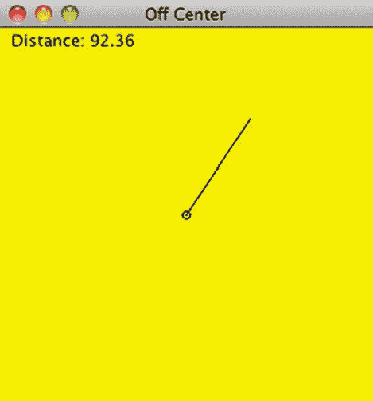

### 第 9 章 继承

#### 列表 9.13

```java
//********************************************************************
// OffCenter.java Author: Lewis/Loftus
//
// 展示了事件适配器类的用法。
//********************************************************************
import javax.swing.*;

public class OffCenter
{
//-----------------------------------------------------------------
// 创建程序的主框架。
//-----------------------------------------------------------------
public static void main(String[] args)
{
JFrame frame = new JFrame("Off Center");
frame.setDefaultCloseOperation(JFrame.EXIT_ON_CLOSE);
frame.getContentPane().add(new OffCenterPanel());
frame.pack();
frame.setVisible(true);
}
}
```

## 9.7 扩展适配器类

#### 列表 9.14

```java
//********************************************************************
// OffCenterPanel.java Author: Lewis/Loftus
//
// 代表 OffCenter 程序主绘制面板。
//********************************************************************
import java.awt.*;
import java.awt.event.*;
import java.text.DecimalFormat;
import javax.swing.*;

public class OffCenterPanel extends JPanel
{
private final int WIDTH=300, HEIGHT=300;
private DecimalFormat fmt;
private Point current;
private int centerX, centerY;
private double length;
//-----------------------------------------------------------------
// 构造函数：设置面板和必要数据。
//-----------------------------------------------------------------
public OffCenterPanel()
{
addMouseListener(new OffCenterListener());
centerX = WIDTH / 2;
centerY = HEIGHT / 2;
fmt = new DecimalFormat("0.##");
setPreferredSize(new Dimension(WIDTH, HEIGHT));
}
//-----------------------------------------------------------------
// 重写 mouseClicked 方法的定义以适应我们的需求。
// 因为我们继承了对应其他鼠标事件的空方法，
// 所以我们就不需要提供自己的空定义。
public void mouseClicked(MouseEvent e)
{
    // 此处处理点击逻辑
}

private class OffCenterListener extends MouseAdapter {
    // 只有当鼠标被点击时此方法才会被执行
}
```

```java
private final int DELAY = 20, IMAGE_SIZE = 35;

private ImageIcon image;

private Timer timer;

private int x, y, moveX, moveY;

//-----------------------------------------------------------------
// 设置面板，包括用于动画的计时器。
//-----------------------------------------------------------------

public ReboundPanel()
{
    timer = new Timer(DELAY, new ReboundListener());
    image = new ImageIcon("happyFace.gif");
    x = 0;
    y = 40;
    moveX = moveY = 3;
    setPreferredSize(new Dimension(WIDTH, HEIGHT));
    setBackground(Color.black);
    timer.start();
}

//-----------------------------------------------------------------
// 在当前位置绘制图像。
//-----------------------------------------------------------------
public void paintComponent(Graphics page)
{
    super.paintComponent(page);
    image.paintIcon(this, page, x, y);
}
```

504

# 第 9 章 继承

## 列表 9.16

```java
//*****************************************************************
// 代表计时器的动作监听器。
//*****************************************************************
private class ReboundListener implements ActionListener
{
    //--------------------------------------------------------------
    // 每当计时器触发动作事件时，更新图像的位置
    // 以及可能的移动方向。
    //--------------------------------------------------------------
    public void actionPerformed(ActionEvent event)
    {
        x += moveX;
        y += moveY;
        if (x <= 0 || x >= WIDTH-IMAGE_SIZE)
            moveX = moveX * -1;
        if (y <= 0 || y <= HEIGHT-IMAGE_SIZE)
            moveY = moveY * -1;
        repaint();
    }
}
```

监听器的 `actionPerformed` 方法更新当前的 `x` 和 `y` 坐标值，然后检查这些值是否导致图像“撞击”面板边缘。如果是这样，则调整移动方式，使图像在未来的移动中会在水平、垂直或两个方向上向反方向移动。请注意，该计算考虑了图像的大小。

该程序中动画的速度取决于两个因素：动作事件之间的间隔以及图像每次更新时移动的距离。

在这个示例中，计时器被设置为每隔 20 毫秒生成一次动作事件，图像每次更新时移动 3 像素。你可以尝试这些值来改变动画的速度。目标应该是创建一个视觉上令人愉悦的运动幻觉。

## 9.8 Timer 类

505

### 自测习题（答案见附录 N）

- SR 9.28 `Timer` 对象的作用是什么？

- SR 9.29 列出 `Rebound` 程序中使用的每个 `Timer` 方法，并描述它们是如何被用用的。

- SR 9.30 描述你将如何修改 `ReboundPanel` 类，以向 `Rebound` 程序提供以下每种更改：

    - a. 微笑的脸移动得更快。

    - b. 微笑的脸移动得更慢。

    - c. 用不同的图像进行弹回跳动。

    - d. 微笑的脸进行更大的“跳跃”。

    - e. 微笑的脸每次“撞击”窗口边缘时，它都会加速。

506

# 第 9 章 继承

### 核心概念总结

- 继承是从现有类派生出新类的过程。

- 继承的目的之一是重用现有软件。

- 继承在父类和子类之间创建了“是一个”（is-a）的关系。

- `protected` 可见性提供了允许继承的最优封装。

- 可以使用 `super` 引用调用父类的构造函数。

- 子类可以重写（重定义）父类对被继承方法的定义。

- 一个类的子类可以是一个或多个类的父类，从而创建类层次结构。

- 共同特征应该在合理范围内位于类层次结构中的高位置。

- 所有的 Java 类都直接或间接地派生自 `Object` 类。

- `toString` 和 `equals` 方法被每个 Java 程序中的每个类继承。

- 抽象类不能被实例化。它代表一个概念，其他类可以在此基础上构建它们的定义。

- 派生自抽象父类的类必须重写其父类所有的抽象方法，否则该派生类也将被视为抽象类。

- 继承可以应用于接口，使得一个接口可以派生另一个接口。

- 私有成员（private members）被子类继承，但不能通过名称直接引用。然而，它们可以间接地使用。

- 软件设计必须仔细且具体地处理继承。

- `final` 修饰符可以限制继承。

- 表示 Java GUI 组件的类组织成类层次结构。

- 监听器类可以通过派生自事件适配器类（event adapter class）来创建。

- `Timer` 对象定期生成动作事件，并用于控制动画。

507

## 练习

- EX 9.1 绘制一个 UML 类图，显示一个包含不同类型时钟类的继承层次结构。显示这些类中两个类的变量和方法名。

- EX 9.2 为练习 9.1 中的层次结构展示另一种替代图表。解释为什么这种方法比原始方法更好或更差。

- EX 9.3 绘制一个 UML 类图，显示一个包含不同类型汽车类的继承层次结构，首先按制造商组织。显示其中至少两个类的若干适当变量和方法名。

- EX 9.4 为练习 9.3 中的层次结构展示另一种替代图表，在图中，汽车首先按类型（跑车、轿车、SUV 等）组织。显示其中至少两个类的适当变量和方法名。对比这两种方法。

- EX 9.5 绘制一个 UML 类图，显示一个包含不同类型飞机的继承层次结构。显示其中至少两个类的适当变量和方法名。

- EX 9.6 绘制一个 UML 类图，显示一个包含不同类型树木（橡树、榆树等）的继承层次结构。显示其中至少两个类的适当变量和方法名。

- EX 9.7 绘制一个 UML 类图，显示一个包含商店不同类型支付交易类的继承层次结构（现金、信用卡等）。显示其中至少两个类的适当变量和方法名。

- EX 9.8 对两个类之间的简单派生关系进行实验。在父类和子类的构造函数中放置 `println` 语句。不要在子类中显式调用父类的构造函数。发生了什么？为什么？修改子类的构造函数显式调用父类的构造函数。现在发生了什么？

508

# 第 9 章 继承

## 编程项目

- PP 9.1 编写一个名为 `MonetaryCoin` 的类，它派生自第 5 章介绍的 `Coin` 类。在 `MonetaryCoin` 中存储一个代表其价值的整数，并添加一个返回其值的方法。创建一个主驱动类来实例化并计算多个 `MonetaryCoin` 对象的和。证明货币硬币继承了其父类的翻转能力。

- PP 9.2 设计并实现一组类，定义医院的员工：医生、护士、管理员、外科医生、接待台人员、洁工等。在每个类中包含一个根据该人员提供的服务命名的方法，并打印适当的消息。创建一个主驱动类来实例化并测试几个类。

## 编程项目

## PP 9.3

设计并实现一组类，用于定义各种类型的阅读材料：书籍、小说、杂志、技术期刊、教科书等。包含描述材料各种属性的数据值，例如页数和主要角色的名字。为每个类编写命名恰当的方法，并打印适当的消息。创建一个主驱动类来实例化并测试其中的几个类。

## PP 9.4

设计并实现一组类，用于跟踪各种体育运动统计数据。让每个低层类代表一项特定的运动。根据涉及的运动调整类的功能，并在适当的情况下将公共属性移动到高层类中。创建一个主驱动类来实例化并测试其中的几个类。

## PP 9.5

设计并实现一组类，用于跟踪一组人员的人口统计信息，例如年龄、国籍、职业、收入等。设计每个类以侧重于数据收集的特定方面。创建一个主驱动类来实例化并测试其中的几个类。

## PP 9.6

设计并实现一组类，用于定义一系列三维几何形状。对于每个形状，存储关于其尺寸的基本数据，并提供访问和修改这些数据的方法。此外，提供适当的方法来计算每个形状的周长、面积和体积。在你的设计中，考虑形状之间的关系，从而在哪里可以实现继承。创建一个主驱动类来实例化几个不同类型的形状，并测试你提供的行为。

## PP 9.7

设计并实现一组类，用于定义各种类型的电子设备（电脑、手机、寻呼机、数码相机等）。包含描述电子设备各种属性的数据值，例如重量、成本、功耗和制造商名称。为每个类编写命名恰当的方法，并打印适当的消息。创建一个主驱动类来实例化并测试其中的几个类。

## PP 9.8

设计并实现一组类，用于定义你课程中的各种课程。包含每门课程的信息，如标题、编号、描述和教授该课程的系别。在设计继承结构时，考虑构成你课程的类类别。创建一个主驱动类来实例化并测试其中的几个类。

## PP 9.9

修改本章中的 Rebound 程序，使得在点击鼠标按钮时动画停止，再次点击时动画恢复。

## PP 9.10

编写一个程序，显示汽车（侧视图）从左向右横过屏幕的动画。创建一个表示汽车的 `Car` 类（或使用第 8 章中编程项目中创建的类）。

## PP 9.11

编写一个程序，显示水平线段横过屏幕的动画，最终穿过垂直线。当通过垂直线时，水平线应该改变颜色。颜色的变化发生在水平线穿过垂直线期间；因此，在交叉时，水平线将呈现两种不同的颜色。

## PP 9.12

编写一个运行名为“捕捉生物”（Catch-the-Creature）的游戏程序。使用图像代表生物。让生物在随机位置出现随机持续，然后消失并出现在另一个地方。目标是在鼠标指针位于生物图像时点击鼠标按钮来“捕捉”该生物。创建一个单独的类表示生物，并在其中包含一个方法，判断鼠标点击的位置是否与生物当前的位置对应。显示捕捉生物的次数以及未中的次数。

## PP 9.13

编写一个像秒表一样工作的程序。显示保留一位小数的时间，并每 0.1 秒更新一次。包含允许用户开始、停止计时并将显示重置为零的按钮。安排组件以呈现良好的界面。*提示*：使用 `Timer` 类来控制秒表的计时。

# 第 9 章 继承

## 软件故障：Ariane 5 501 号飞行

### 发生了什么事？

Ariane 5 是由欧洲空间局 (ESA) 设计的废弃式发射系统，用于将载荷送入地球轨道。1996 年 6 月 4 日，该火箭的首次飞行（`Flight 501`）在起飞 37 秒后发生爆炸。控制系统发生故障，导致火箭偏离轨道。强大的空气动力学力导致火箭主体破碎。机载监控器检测到破碎并启动自动销毁系统以在空中销毁飞行器。

`Flight 501` 携带了四个无人探测器，用于研究地球磁场。火箭的爆炸导致载荷完全损失，估计损失金额为 3.7 亿美元。

*注：Ariane 5 火箭的首次飞行在起飞后不久爆炸。*

### 原因是什么？


# Ariane 5 火箭软件故障案例

Ariane 5 火箭重用了部分用于控制其前身 Ariane 4 的软件。该软件包含一个将浮点数转换为符号 16 位整数的段。在 `Flight 501` 上，此值超出了 16 位整数能表示的范围，导致溢出错误。在 Ariane 4 中，转换后的值始终小到可以避免这种情况。溢出错误本应由异常处理器捕获，但该部分系统出于效率考虑被禁用。错误在主计算机和备份计算机中几乎同时发生，导致它们关闭。这导致火箭偏离轨道并被毁。

## 吸取的教训

Ariane 4 的成功让 Ariane 5 的设计者对软件充满信心。因此，对系统的某些部分只进行了极少测试。潜在问题在之前的系统中一直存在，但数据（代表测量值）总是很小。新系统的变化参数没有被考虑在内。因此，虽然根源是软件漏洞，但失败源于系统及其环境的变化。这是设计和测试的失败——不仅仅是软件漏洞。

# 第 10 章 多态

## 10.1 晚绑定

通常，引用变量的类型与其所引用的对象的类完全匹配。例如，考虑以下引用：`ChessPiece bishop;`

`bishop` 变量可以指向一个通过实例化 `ChessPiece` 类而创建的对象。然而，并非必须如此。变量类型与其所引用的对象必须兼容，但它们的类型不需要完全相同。引用变量与其所引用的对象之间的关系比这更灵活。

`polymorphism`（多态）一词可以定义为“具有多种形式”。

### 核心概念

`polymorphic reference`（多态引用）是指在不同时间可以引用不同类型对象的引用变量。通过多态引用调用的方法可以在当前调用和下一次调用之间发生变化。

考虑以下代码行：

```java
obj.doIt();
```

如果引用 `obj` 是多态的，它可以在不同的时间引用不同类型的对象。因此，如果该行代码在一个循环中，或者它在一个被调用多次的方法中，那么该行代码每次被调用时都可能调用 `doIt` 方法的不同版本。

在某个点，会做出执行某些代码以执行方法调用的承诺。这种承诺被称为将方法调用 `binding`（绑定）到方法定义上。在许多情况下，方法调用到方法定义的绑定可以在编译时发生。然而，对于多态引用，该决策直到运行时才能做出。所使用的方法定义是基于引用变量此时所引用的对象的。这种延迟的承诺被称为 `late binding`（晚绑定）或 `dynamic binding`（动态绑定）。它比编译时绑定效率低，因为必须在程序执行期间做出决定。考虑到多态引用提供的灵活性，这种开销通常是可以接受的。

我们可以在 Java 中通过两种方式创建多态引用：使用继承和使用接口。让我们逐一查看。

## 10.2 通过继承实现的多态

### 自测题（答案见附录 N）

- SR 10.1 什么是多态？
- SR 10.2 为什么编译时绑定被认为比动态绑定高效？

当我们使用特定的类名声明引用变量时，它可以被用于引用该类的任何对象。此外，它还可以引用任何与其声明类型通过继承关系相关的任何类的任何对象。例如，如果 `Mammal` 类是 `Horse` 类的父类，那么 `Mammal` 引用就可以用来引用 `Horse` 类的任何对象。这种能力在下面的代码段中得到了体现：

### 核心概念

引用变量可以引用从与其通过继承关系相关的任何类创建的任何对象。

```java
Mammal pet;
Horse secretariat = new Horse();
pet = secretariat; // 一个有效的赋值
```

反向操作，将 `Mammal` 对象赋值给 `Horse` 引用也可以完成，但它需要显式的强制转换。在这个方向上赋值通常用处较小，并且更有可能引起问题，因为虽然马具有哺乳动物的所有功能（因为马*是一个*哺乳动物），但反之则不一定成立。

这种关系贯穿整个类层次结构。如果 `Mammal` 类派生自一个名为 `Animal` 的类，那么下面的赋值也是有效的：

```java
Animal creature = new Horse();
```

将此推向极限，`Object` 引用可以用来引用任何对象，因为所有类最终都是 `Object` 类的后代。例如，`ArrayList` 使用了多态，因为它被设计为持有 `Object` 引用。这就是为什么一个没有指定元素类型的 `ArrayList` 可以用来存储任何类型的对象。事实上，一个特定的 `ArrayList` 可以同时持有几种不同类型的对象，因为根据继承，它们都是 `Object` 对象。

### 核心概念

引用变量 `creature` 可以是多态的，因为在任何时间点，它都可以引用 `Animal` 对象、`Mammal` 对象或 `Horse` 对象。是对象的类型而不是引用的类型被用来决定调用哪个版本的方法。假设这三个类都拥有一个名为 `move` 的方法，并且该方法以不同的方式实现（因为子类重写了它继承的定义）。下面的调用执行了 `move` 方法，但它所调用的特定版本是在运行时决定的：

```java
creature.move();
```

当执行这一行代码时，如果 `creature` 当前指向一个 `Animal` 对象，则调用 `Animal` 类的 `move` 方法。同样，如果 `creature` 当前指向一个 `Mammal` 对象，则调用 `Mammal` 版本的 `move` 方法。同样，如果它当前指向一个 `Horse` 对象也是。

当然，由于 `Animal` 和 `Mammal` 代表通用概念，它们可能被定义为抽象类。这种情况并不能消除拥有多态引用的能力。假设 `Mammal` 类中的 `move` 方法是抽象的，并在 `Horse`、`Dog` 和 `Whale` 类中给出了唯一的定义（都派生自 `Mammal`）。`Mammal` 引用变量可以用来引用从 `Horse`、`Dog` 和 `Whale` 类创建的任何对象，并可以用于执行其中任何对象的 `move` 方法。

让我们来看另一种情况。考虑图 10.1 所示的类层次结构。其中的类代表了可能在特定公司的各种类型的员工。让我们探索一个使用该层次结构来支付各种类型员工的示例。

列表 10.1 所示的 `Firm` 类包含一个主驱动程序，它创建一个员工 `Staff` 并调用 `payday` 方法来支付他们。程序输出包含了每个员工的信息以及他们获得的工资金额（如果有）。

列表 10.2 所示的 `Staff` 类维护了一个表示各种类型员工的对象数组。注意，该数组被声明为持有 `StaffMember` 引用，但它实际上是由几个其他类（如 `Executive` 和 `Employee`）创建的对象填充的。这些类都是 `StaffMember` 类的后代，因此赋值是有效的。`staffList` 数组填充了多态引用。

### 图 10.1 员工的类层级结构

- `Firm`
    - `+ main(args : String[]) : void`
- `StaffMember`
    - `Staff`
        - `# name : String`
        - `– staffList : StaffMember[]`
        - `# address : String`
        - `# phone : String`
        - `+ payday() : void`
        - `+ toString() : String`
        - `+ pay() : double`
    - `Employee`
        - `# socialSecurityNumber : String`
        - `+ pay() : double`
    - `Hourly`
        - `# payRate : double`
        - `+ toString() : String`
        - `+ pay() : double`
    - `Executive`
        - `– bonus : double`
        - `– hoursWorked : int`
        - `+ awardBonus(execBonus : double) : void`
        - `+ addHours(moreHours : int) : void`
        - `+ pay() : double`
        - `+ toString() : String`
    - `Volunteer`
        - `+ pay() : double`

`StaffMember` 类包含一个 `toString` 方法，用于返回 `StaffMember` 类管理的信息。它还包含一个名为 `pay` 的抽象方法，该方法不接受参数并返回一个 `double` 类型的值。在通用的 `StaffMember` 级别，为此方法提供定义是不恰当的。

### 列表 10.1

```java
//********************************************************************
// Firm.java Author: Lewis/Loftus
//
// 通过继承实现多态。
//********************************************************************
public class Firm
{
    //-----------------------------------------------------------------
    // 为公司创建一个员工团队并向他们发放工资。
    //-----------------------------------------------------------------
    public static void main(String[] args)
    {
        Staff personnel = new Staff();
        personnel.payday();
    }
}
```

### 输出

```
Name: Sam
Address: 123 Main Line
Phone: 555-0469
Social Security Number: 123-45-6789
Paid: 2923.07
-----------------------------------
Name: Carla
Address: 456 Off Line
Phone: 555-0101
Social Security Number: 987-65-4321
Paid: 1246.15
-----------------------------------
Name: Woody
Address: 789 Off Rocker
Phone: 555-0000
Social Security Number: 010-20-3040
Paid: 1169.23
-----------------------------------
Name: Diane
Address: 678 Fifth Ave.
Phone: 555-0690
Social Security Number: 958-47-3625
Current hours: 40
Paid: 422.0
-----------------------------------
Name: Norm
Address: 987 Suds Blvd.
Phone: 555-8374
Thanks!
-----------------------------------
Name: Cliff
Address: 321 Duds Lane
Phone: 555-7282
Thanks!
```

### 列表 10.2

```java
//********************************************************************
// Staff.java Author: Lewis/Loftus
//
// 代表特定业务的人员团队。
//********************************************************************
public class Staff
{
    private StaffMember[] staffList;

    //-----------------------------------------------------------------
    // 构造函数：设置员工列表。
    //-----------------------------------------------------------------
    public Staff()
    {
        staffList = new StaffMember[6];
        staffList[0] = new Executive("Sam", "123 Main Line", "555-0469", "123-45-6789", 2423.07);
        staffList[1] = new Employee("Carla", "456 Off Line", "555-0101", "987-65-4321", 1246.15);
        staffList[2] = new Employee("Woody", "789 Off Rocker", "555-0000", "010-20-3040", 1169.23);
        staffList[3] = new Hourly("Diane", "678 Fifth Ave.", "555-0690", "958-47-3625", 10.55);
        staffList[4] = new Volunteer("Norm", "987 Suds Blvd.", "555-8374");
        staffList[5] = new Volunteer("Cliff", "321 Duds Lane", "555-7282");

        ((Executive)staffList[0]).awardBonus(500);
        ((Hourly)staffList[3]).addHours(40);
    }

    public void payday()
    {
        // 为所有员工发放工资。
        for (int count = 0; count < staffList.length; count++)
        {
            double amount = staffList[count].pay();
            if (amount == 0.0) {
                System.out.println("Thanks!");
            } else {
                System.out.println("Paid: " + amount);
            }
            System.out.println("-----------------------------------");
        }
    }
}
```

### 列表 10.3


```java
//********************************************************************
// StaffMember.java Author: Lewis/Loftus
//
// 代表通用的员工。
//********************************************************************
abstract class StaffMember
{
    protected String name;
    protected String address;
    protected String phone;

    //-----------------------------------------------------------------
    // 构造函数：使用指定的信息设置员工成员。
    //-----------------------------------------------------------------
    public StaffMember(String eName, String eAddress, String ePhone)
    {
        name = eName;
        address = eAddress;
        phone = ePhone;
    }

    //-----------------------------------------------------------------
    // 返回包含员工信息的字符串。
    //-----------------------------------------------------------------
    public String toString()
    {
        String result = "Name: " + name + "\n";
        result += "Address: " + address + "\n";
        result += "Phone: " + phone;
        return result;
    }

    //-----------------------------------------------------------------
    // 派生类必须为每种类型定义 pay 方法。
    //-----------------------------------------------------------------
    public abstract double pay();
}
```

**列表 10.4**

```java
//********************************************************************
// Volunteer.java Author: Lewis/Loftus
//
// 代表志愿者的员工。
//********************************************************************
public class Volunteer extends StaffMember
{
    //-----------------------------------------------------------------
    // 构造函数：使用指定的信息设置志愿者成员。
    //-----------------------------------------------------------------
    public Volunteer(String eName, String eAddress, String ePhone)
    {
        super(eName, eAddress, ePhone);
    }

    //-----------------------------------------------------------------
    // 为此志愿者返回零工资。
    //-----------------------------------------------------------------
    public double pay()
    {
        return 0.0;
    }
}
```

注意，当志愿者在 `Staff` 类的 `payday` 方法中获得“薪酬”时，会打印一条简单的感谢信息。在所有其他 `pay` 值大于 0 的情况下，将打印薪酬金额本身。

**列表 10.5** 所示的 `Employee` 类表示在每个薪期内按特定率领取工资的员工。`pay rate`（薪率）以及员工的社会安全号与其他基本信息一起传递给 `Employee` 构造函数。基本信息通过 `super` 引用传递给 `StaffMember` 的构造函数。

`Employee` 的 `toString` 方法被重写，以便将 `Employee` 管理的额外信息与父类版本的 `toString` 方法返回的信息拼接，父类方法通过 `super` 引用进行调用。`Employee` 的 `pay` 方法简单返回该员工的 `pay rate`。

**列表 10.6** 所示的 `Executive` 类表示一个除了正常薪率外还可能获得奖金的员工。`Executive` 类派自 `Employee`，因此同时继承了 `StaffMember` 和 `Employee`。`Executive` 的构造函数将其信息传递给 `Employee` 构造函数，并将执行管奖金设置为零。

使用 `awardBonus` 方法向执行管发放奖金。该方法在 `Staff` 构造函数中调用，用于 `staffList` 数组中唯一的执行管。注意，必须将泛型 `StaffMember` 引用强制转换为 `Executive` 引用才能调用 `awardBonus` 方法（该方法在 `StaffMember` 中不存在）。

`Executive` 类重写了 `pay` 方法，以便它首先确定像任何员工那样的支付金额，然后加上奖金。通过 `super` 调用 `Employee` 类的 `pay` 方法以获取正常支付金额。这种技术比仅使用 `payRate` 变量更好，因为如果我们选择更改 `Employee` 对象的支付方式，该更改将自动反映在 `Executive` 中。在发放奖金后，奖金会被重置为零。

**列表 10.7** 所示的 `Hourly` 类表示按小时计算薪资的员工。它跟踪当前薪期内的工作小时数，该数可以通过调用 `addHours` 方法进行修改。该方法从 `Staff` 的 `payday` 方法中调用。`Hourly` 的 `pay` 方法根据工作小时数确定支付金额，然后将小时数重置为零。

# 第 10 章 多态

## 10.2 通过继承实现多态

### 列表 10.5

```java
//********************************************************************
// Employee.java 作者: Lewis/Loftus
//
// 表示普通的带薪员工。
//********************************************************************
public class Employee extends StaffMember
{
    protected String socialSecurityNumber;
    protected double payRate;

    //-----------------------------------------------------------------
    // 构造函数：使用指定的信息
    // 初始化此员工。
    //-----------------------------------------------------------------
    public Employee(String eName, String eAddress, String ePhone, String socSecNumber, double rate)
    {
        super(eName, eAddress, ePhone);
        socialSecurityNumber = socSecNumber;
        payRate = rate;
    }

    //-----------------------------------------------------------------
    // 以字符串形式返回员工的信息。
    //-----------------------------------------------------------------
    public String toString()
    {
        String result = super.toString();
        result += "\nSocial Security Number: " + socialSecurityNumber;
        return result;
    }

    //-----------------------------------------------------------------
    // 返回此员工的薪率。
    //-----------------------------------------------------------------
    public double pay()
    {
        return payRate;
    }
}
```

### 列表 10.6

```java
//********************************************************************
// Executive.java 作者: Lewis/Loftus
//
// 表示执行管级人员，他们可以获得奖金。
//********************************************************************
public class Executive extends Employee
{
    private double bonus;

    //-----------------------------------------------------------------
    // 构造函数：使用指定的信息
    // 初始化此执行管。
    //-----------------------------------------------------------------
    public Executive(String eName, String eAddress, String ePhone, String socSecNumber, double rate)
    {
        super(eName, eAddress, ePhone, socSecNumber, rate);
        bonus = 0; // 奖金尚未发放
    }

    //-----------------------------------------------------------------
    // 向此执行管发放指定的奖金。
    //-----------------------------------------------------------------
    public void awardBonus(double execBonus)
    {
        bonus = execBonus;
    }

    //-----------------------------------------------------------------
    // 计算并返回执行管的薪资，即
    // 普通员工支付金额加上一次性奖金。
    //-----------------------------------------------------------------
    public double pay()
    {
        double payment = super.pay() + bonus;
        bonus = 0;
        return payment;
    }
}
```

### 列表 10.7

```java
//********************************************************************
// Hourly.java 作者: Lewis/Loftus
//
// 表示按小时支付薪资的员工。
//********************************************************************
public class Hourly extends Employee
{
    private int hoursWorked;

    //-----------------------------------------------------------------
    // 构造函数：使用指定的信息
    // 初始化此小时工员工。
    //-----------------------------------------------------------------
    public Hourly(String eName, String eAddress, String ePhone, String socSecNumber, double rate)
    {
        super(eName, eAddress, ePhone, socSecNumber, rate);
        hoursWorked = 0;
    }

    //-----------------------------------------------------------------
    // 将指定的小时数加上员工
    // 累计的小数。
    //-----------------------------------------------------------------
    public void addHours(int moreHours)
    {
        hoursWorked += moreHours;
    }

    //-----------------------------------------------------------------
    // 计算并返回此小时工的薪资。
    //-----------------------------------------------------------------
    public double pay()
    {
        double payment = payRate * hoursWorked;
        hoursWorked = 0;
        return payment;
    }

    //-----------------------------------------------------------------
    // 以字符串形式返回此小时工的信息。
    //-----------------------------------------------------------------
    public String toString()
    {
        String result = super.toString();
        result += "\nCurrent hours: " + hoursWorked;
        return result;
    }
}
```

### 自习题（答案见附录 N）

**SR 10.3** 继承如何支持多态？

**SR 10.4** 假设 `MusicPlayer` 类是 `CDPlayer` 类的父类。以下语句合法吗？解释。

```java
MusicPlayer mplayer = new MusicPlayer();
CDPlayer cdplayer = new CDPlayer();
mplayer = cdplayer;
```

**SR 10.5** 假设 `MusicPlayer` 类是 `CDPlayer` 类的父类。以下语句合法吗？解释。

```java
MusicPlayer mplayer = new MusicPlayer();
CDPlayer cdplayer = new CDPlayer();
cdplayer = mplayer;
```

**SR 10.6** 重写与多态有什么关系？

**SR 10.7** 为什么 `Firm` 中的 `StaffMember` 类被声明为抽象类？

**SR 10.8** 为什么在 `StaffMember` 类中声明 `pay` 方法，尽管它是抽象的且在该层级没有方法体？

**SR 10.9** `Staff` 类 `payday` 方法中的以下行代码调用了哪个 `pay` 方法？

```java
amount = staffList[count].pay();
```

# 第 10 章 多态

## 10.3 通过接口实现多态


# 通过接口实现多态

现在让我们来看看如何使用 `Key Concept` 接口创建多态引用。正如我们多次看到的那样，类名可以用来声明对象引用变量的类型。同样，接口名也可以用作引用变量的类型。接口引用变量可以指向任何实现了该接口的任何类的对象。

假设我们如下定义一个名为 `Speaker` 的接口：

```java
public interface Speaker
{
    public void speak();
    public void announce(String str);
}
```

现在，接口名 `Speaker` 可以用来声明一个对象引用变量：

```java
Speaker current;
```

引用变量 `current` 可以指向任何实现了 `Speaker` 接口的任何类的对象。例如，如果我们定义了一个名为 `Philosopher` 的类并使其实现了 `Speaker` 接口，那么我们就可以如下所示将一个 `Philosopher` 对象赋值给 `Speaker` 引用：

```java
current = new Philosopher();
```

这种赋值是有效的，因为 `Philosopher` 是一个 `Speaker`。从这个意义上说，类与其接口之间的关系与子类与其父类之间的关系相同。这是一种“是”（is-a）的关系。这种关系构成了多态的基础。

接口引用的灵活性允许我们创建多态引用。正如我们在在本章早期看到的，通过继承，我们可以创建多态引用，只要这些对象之间存在继承关系，就可以指向对象集合中的任何一个。使用接口，我们可以在实现相同接口的对象之间创建类似的多态引用。

例如，如果我们创建一个名为 `Dog` 的类，它也实现了 `Speaker` 接口，那么它也可以被赋值给 `Speaker` 引用变量。事实上，同一个引用变量可以在某一点指向一个 `Philosopher` 对象，稍后又指向一个 `Dog` 对象。接下来的代码说明了这一点：


## 10.3 通过接口实现多态

```java
Speaker guest;
guest = new Philosopher();
guest.speak();
guest = new Dog();
guest.speak();
```

在这段代码中，第一次调用 `speak()` 方法时，它调用了在 `Philosopher` 类中定义的 `speak()` 方法。第二次调用时，它调用了 `Dog` 类的 `speak()` 方法。与通过继承实现多态引用一样，决定调用哪个方法的不是引用的类型，而是在调用瞬间引用所指向的对象的类型。

请注意，当我们使用接口引用变量时，我们只能调用接口中定义的方法，即使它所引用的对象有其他它可以响应的方法。例如，假设 `Philosopher` 类还定义了一个名为 `pontificate()` 的公有方法。那么以下代码的第二行将产生编译错误，尽管该对象实际上可以响应 `pontificate()` 方法：

```java
Speaker special = new Philosopher();
special.pontificate(); // 产生编译错误
```

问题在于，编译器只能确定该对象是一个 `Speaker`，因此只能保证该对象可以响应 `speak()` 和 `announce()` 方法。因为引用变量 `special` 可能会指向一个 `Dog` 对象（该对象不能执行 `pontificate()`），所以它不允许进行该调用。如果我们在特定情况下知道这种调用是有效的，我们可以将对象强制转换为适当的引用，以便让编译器接受它，如下所示：

```java
((Philosopher)special).pontificate();
```

正如我们可以对基于继承的多态引用所做的那样，接口名可以用作方法参数的类型。方法的参数可以是接口类型，任何实现了该多态接口的任何类的对象都可以传递给方法，从而允许方法对其参数进行灵活的控制。例如，以下方法接受一个 `Speaker` 对象作为参数。因此，在不同的调用中，`Dog` 对象和 `Philosopher` 对象都可以传递给它：

```java
public void sayIt(Speaker current)
{
    current.speak();
}
```

将多态引用作为方法的形式参数是一项强大的技术。它允许方法控制传递给参数的类型，同时赋予了方法接受各种类型参数的灵活性。

**自测复习题（答案见附录 N）**

SR 10.10 如何使用接口实现多态？

SR 10.11 假设 `Speaker` 接口以及 `Philosopher` 和 `Dog` 类如本节所述。以下语句序列是否合法？请解释原因。

a. `Speaker current = new Speaker();`

b. `Speaker current = new Dog();`

c. `Speaker first, second; first = new Dog(); second = new Philosopher(); first.speak(); first = second;`

d. `Speaker first = new Dog(); Philosopher second = new Philosopher(); second.pontificate(); first = second;`

e. `Speaker first = new Dog(); Philosopher second = new Philosopher(); first = second; second.pontificate(); first.pontificate();`

# 第 10 章 多态

## 10.4 排序

让我们来看一个适合多态解决方案的问题。*排序*是按照定义良好的顺序对项目列表进行排列的过程。例如，你可能对姓名列表按字母顺序排序，或将调查结果列表按数字降序排列。多年来，人们已经开发并改进了许多排序算法。事实上，排序被认为是计算机科学中的一个经典研究领域。

本节研究了两种排序算法：选择排序和插入排序。对各种排序技术的全面涵盖超出了本书的范围。相反，我们介绍了该主题并建立了一些基本思想。

### 选择排序

*选择排序*算法通过不断将值放在其最终的排序位置来对值列表进行排序。换句话说，对于列表中的每个位置，算法都选择应该放在该位置的值并将其放在那里。让我们考虑将一个数值列表按升序排列的问题。

选择排序的通用策略是：扫描整个列表以找到最小值。将该值与列表第一个位置的值交换。扫描列表的剩余部分（除第一个值以外的所有值）找到最小值，然后将其与列表第二个位置的值交换。扫描列表的剩余部分（除前两个值以外的所有值）找到最小值，然后将其与列表第三个位置的值交换。继续这个过程，直到列表最后一个位置（该位置最终将包含最大值）。

当过程完成后，列表就被排序了。图 10.2 展示了选择排序算法的使用。

```
3 9 6 1 2
从 3 开始向右扫描。
1 是最小值。交换 1 和 3。
1 9 6 3 2
从 9 开始向右扫描。
2 是最小值。交换 9 和 2。
1 2 6 3 9
从 6 开始向右扫描。
3 是最小值。交换 6 和 3。
1 2 3 6 9
从 6 开始向右扫描。
6 是最小值。交换 6 和 6。
1 2 3 6 9
```

**图 10.2** 选择排序处理


让我们来看一个例子。列表 10.8 所示程序使用选择排序将 `Contact` 对象列表按升序排列。

列表 10.9 显示了 `Sorting` 类。它包含了两个静态排序算法。

`PhoneList` 程序仅使用了 `selectionSort()` 方法。另一种方法将在本节的后部分进行讨论。

`selectionSort()` 方法接收一个 `Comparable` 对象的数组进行排序。

请记住，`Comparable` 是一个接口，它只包含一个方法 `compareTo()`。该方法的设计用于返回一个整数：如果执行对象小于、等于或大于所比较的对象，则分别返回小于零、零或大于零的整数。

任何实现 `Comparable` 接口的类都必须定义 `compareTo()` 方法。因此，任何此类对象都可以与另一个对象进行比较，以确定它们的相对顺序。

`selectionSort()` 方法是多态的。注意，它完全没有引用 `Contact` 对象，但被用于对 `Contact` 对象的数组进行排序。`selectionSort()` 方法被设置为对任何对象数组排序，只要这些对象可以通过比较来确定它们的顺序。你可以多次调用 `selectionSort()` 并传入不同类型的对象数组，只要它们都实现了 `Comparable` 即可。

每个 `Contact` 对象代表一个具有姓、名和电话号码的人。列表 10.10 显示了 `Contact` 类。

#### 实现排序算法

`Contact` 类实现了 `Comparable` 接口，并以多态方式允许对该可比较对象集中的任何对象进行排序，因此提供了 `compareTo()` 方法定义。在这种情况下，联系人按姓排序；如果两个联系人的姓相同，则使用他们的名。

`selectionSort()` 方法的实现使用了两个 `for` 循环来对数组排序。外层循环控制数组中存储下一个最小值的位置。内层循环通过扫描所有大于或等于外层循环指定索引的位置，在剩余列表中找到最小值。当确定了最小值后，将其与存储在索引处的值进行交换。这种交换通过使用一个名为 `temp` 的额外变量通过三条赋值语句完成。这种交换操作通常被称为“交换（swapping）”。

注意，由于该算法在每次迭代中都会寻找最小值，因此结果是一个升序排列的数组（即从小到大）。该算法可以很容易更改为通过每次寻找最大值来将值按降序排列。

同样注意，我们设置的排序方法是为对象数组排序的。因此，如果你的目标是对基本类型的数组进行排序（例如整数值数组），则必须将其放入 `Integer` 对象数组中才能进行处理。所有的包装类都实现了 `Comparable` 接口。

#### 列表 10.8

```java
//********************************************************************
// PhoneList.java 作者: Lewis/Loftus
//
// 用于测试排序算法的程序。
//********************************************************************
public class PhoneList
{
    //-----------------------------------------------------------------
    // 创建 Contact 对象的数组，对其进行排序，然后打印
    // 。
    //-----------------------------------------------------------------
    public static void main(String[] args)
    {
        Contact[] friends = new Contact[8];
        friends[0] = new Contact("John", "Smith", "610-555-7384"); 
        friends[1] = new Contact("Sarah", "Barnes", "215-555-3827"); 
        friends[2] = new Contact("Mark", "Riley", "733-555-2969"); 
        friends[3] = new Contact("Laura", "Getz", "663-555-3984"); 
        friends[4] = new Contact("Larry", "Smith", "464-555-3489"); 
        friends[5] = new Contact("Frank", "Phelps", "555-555-1234"); 
        friends[6] = new Contact("Alice", "Brown", "555-555-5678"); 
        friends[7] = new Contact("Bob", "Miller", "555-555-9012");

        selectionSort(friends);
        for (Contact friend : friends)
        {
            System.out.println(friend);
        }
    }

    public static void selectionSort(Comparable[] list)
    {
        for (int i = 0; i < list.length - 1; i++)
        {
            int min = i;
            for (int j = i + 1; j < list.length; j++)
            {
                if (list[j].compareTo(list[min]) < 0)
                {
                    min = j;
                }
            }
            Comparable temp = list[i];
            list[i] = list[min];
            list[min] = temp;
        }
    }
}
```

**输出**

```
Brown, Alice, 555-555-5678
Barnes, Sarah, 215-555-3827
Miller, Bob, 555-555-9012
Getz, Laura, 663-555-3984
Phelps, Frank, 555-555-1234
Smith, John, 610-555-7384
Smith, Larry, 464-555-3489
Riley, Mark, 733-555-2969
```

#### 列表 10.9

```java
//-----------------------------------------------------------------
public String getLastName()
{
    return lastName;
}
}
```

### 插入排序

`Sorting` 类还包含一个对 `Comparable` 对象数组执行插入排序的方法。如果用它对 `PhoneList` 程序中的 `Contact` 对象数组进行排序，它将产生与选择排序相同的结果。

然而，用于将对象顺序排列的逻辑是不同的。

`插入排序`算法通过重复地将一个特定值插入到列表中已经排序的子集中，从而对一组值列表进行排序。每个未排序的元素一个接一个地插入到该排序子集的适当位置，直到整个列表都按顺序排列。

插入排序的通用策略是：从一个只包含一个值的“已排序”列表开始。在必要时通过交换它们对列表的前两个值进行相对排序。将列表的第三个值插入到相对于前两个（已排序）值的适当位置。然后，将第四个值插入到其相对于列表中前三个值的正确位置。每进行一次插入，已排序子集中的值数量就会增加一个。继续这个过程，直到所有值都插入到它们正确的位置，此时列表就完全排序了。

插入过程要求数组中的其他值移动以为插入的元素留出空间。图 10.3 展示了整数插入排序算法的行为。

```
3 已排序。

3 9 6 1 2

不移动。插入 9。

3 和 9 已排序。

将 9 向右移动。插入 6。

3 9 6 1 2

3, 6 和 9 已排序。

3 6 9 1 2

将 9, 6 和 3 向右移动。插入 1。

1, 3, 6 和 9 已排序。

1 3 6 9 2

将 9, 6 和 3 向右移动。插入 2。

所有值都已排序。

1 2 3 6 9
```

**图 10.3** 插入排序处理

与选择排序的实现类似，`insertionSort()` 方法使用两个 `for` 循环对数组进行排序。然而，在插入排序中，外层循环控制数组中下一个插入值的索引。内层循环将当前插入的值与存储在较低索引处的值（这些值组整个列表的排序子集）进行比较。如果当前插入的值小于该位置的值，则该值向右移动。持续移动，直到打开一个适当的位置来接受插入值。外层循环的每次迭代都会向列表的排序子集增加一个值，直到整个列表排序完毕。

### 比较排序算法

选择一种排序算法而不是另一种算法有多种原因，包括算法的简单性、效率水平以及它所占的内存。更容易理解的算法也更容易实现和调试。然而，最简单的排序算法往往是效率最低的。

效率通常被认为是比较排序算法的首要标准。通常情况下，如果一个排序算法执行的比较次数比另一个多，那么它的效率就较低。有几种算法比我们检查的两种算法更高效，但它们也更复杂。

选择排序和插入排序在本质上具有相同的效率。它们都有一个外层循环和一个内层循环，具有相似的属性（尽管目的不同）。外层循环为列表中的每个值执行一次，而内层循环将外层循环中的值与列表中其余部分的大部分（如果全部）值进行比较。因此，两种算法都执行大约 `n²` 次比较，其中 `n` 是列表中值的数量。我们说选择排序和插入排序都是 `order n²` 阶的算法。更高效的排序执行的比较较少，且阶较小，例如 `n log2 n`。

由于选择排序和插入排序具有相同的通用效率，在它们之间的选择几乎是随机的。然而，还有一些额外的问题需要考虑。选择排序通常易于理解，在许多情况下也足够。此外，每个值都恰好移动一次到达它在列表中的最终位置。也就是说，虽然选择排序和插入排序在比较次数上（通常）是等的，但选择排序的交换次数更少。

**自测题**（答案见附录 N）

SR 10.12 描述 `Comparable` 接口。


# SR 10.13

显示选择排序算法对以下数字列表进行的变化序列：

5 7 1 8 2 4 3

# SR 10.14

显示插入排序算法对以下数字列表进行的变化序列：

5 7 1 8 2 4 3

# SR 10.15

本章定义的排序方法以何种方式体现了多态？

# SR 10.16

选择排序还是插入排序更好？请解释原因。

# 10.5 搜索

与排序一样，查找一个项目是另一个经典的计算问题，也适用于多态解决方案。`Searching` 是在一组项目内寻找 `target element` 的过程。例如，我们可能需要在俱乐部成员列表中查找名为 Vito Andolini 的人。

要搜索的项目组有时被称为 `search pool`（搜索池）。搜索池通常组织成某种对象的集合，例如数组。每当我们执行搜索时，必须考虑目标不在组中的可能性。此外，我们希望高效地执行搜索。我们不想进行任何不必要的比较。

## 线性搜索

如果可以按任何顺序一次一个元素检查搜索池，那么执行搜索的一种简单方法是从列表开始，并逐个将每个值与目标元素进行比较。最终，要么找到目标元素，要么到达列表末尾并得出目标不存在于组中的结论。

这种方法被称为 `linear search`，因为它从一端开始并以线性方式扫描搜索池。这个过程如图 10.4 所示。当项目存储在数组中，线性搜索相对简单。

**Listing 10.11** 所示的程序与上一节的 `PhoneList` 程序相似。它从相同的、未排序的 `Contact` 对象数组开始。然后它对联系人进行线性搜索并打印结果。接着它调用了上一节中讨论过的 `selectionSort` 方法对联系人进行排序。然后它使用二分查找查找另一个联系人，二分查找在本节后面会讨论。

**图 10.4** 线性搜索

**Listing 10.11**

```java
//****************************************************
// PhoneList2.java Author: Lewis/Loftus
//
// 测试搜索算法的驱动程序。
//****************************************************
public class PhoneList2
{
    //----------------------------------------------------------------
    // 创建 Contact 对象的数组，对其进行排序，然后打印
    // 它们。
    //----------------------------------------------------------------
    public static void main(String[] args)
    {
        Contact test, found;
        Contact[] friends = new Contact[8];

        friends[0] = new Contact("John", "Smith", "610-555-7384");
        friends[1] = new Contact("Sarah", "Barnes", "215-555-3827");
        friends[2] = new Contact("Mark", "Riley", "733-555-2969");
        friends[3] = new Contact("Laura", "Getz", "663-555-3984");
        friends[4] = new Contact("Larry", "Smith", "464-555-3489");
        friends[5] = new Contact("Frank", "Phelps", "322-555-2284");
        friends[6] = new Contact("Mario", "Guzman", "804-555-9066");
        friends[7] = new Contact("Marsha", "Grant", "243-555-2837");

        test = new Contact("Frank", "Phelps", "");
        found = (Contact) Searching.linearSearch(friends, test);
        if (found != null) {
            System.out.println("Found: " + found);
        } else {
            System.out.println("The contact was not found.");
            System.out.println();
        }

        Sorting.selectionSort(friends);

        test = new Contact("Mario", "Guzman", "");
        found = (Contact) Searching.binarySearch(friends, test);
        if (found != null) {
            System.out.println("Found: " + found);
        } else {
            System.out.println("The contact was not found.");
        }
    }
}
```

### 输出

找到：Phelps, Frank 322-555-2284

找到：Guzman, Mario 804-555-9066

### Listing 10.12

`Listing 10.12` 展示了 `Searching` 类。它包含了两个静态搜索算法。

在 `linearSearch` 方法中，`while` 循环遍历数组中的元素，在找到目标或到达数组末尾时终止。布尔变量 `found` 初始化为 `false`，只有在找到目标元素时才会更改为 `true`。

注意，在得出目标不存在于数组之前，我们必须检查每一个元素。平均而言，线性搜索方法在找到数组中存在的目标之前，会查看一半的数据。

`linearSearch` 方法的实现用于处理一个 `Comparable` 对象的数组。然而，对于这种仅依赖于 `equals` 方法的算法来说，这种限制并不是必要的。

## 二分查找

如果数组中的元素是排序的（无论是升序还是降序），那么我们的搜索方法可以比线性搜索算法效率高得多。`二分查找` 利用搜索池是有序的这一事实，每次比较都能消除搜索池的大大部分。

考虑以下已排序的整数数组：`0, 1, 2, 3, 4, 5, 6, 7, 8, 9, 10, 11, 12, 13, 14, 18, 22, 31, 34, 40, 46, 59, 67, 69, 72, 84, 98`。

假设我们试图确定 `67` 是否在列表中。

**Listing 10.12**

```java
//********************************************************************
// Searching.java 作者：Lewis/Loftus
//
// 展示了线性搜索和二分搜索算法。
//********************************************************************
public class Searching
{
    //----------------------------------------------------------------
    // 使用线性搜索在指定的数组中搜索目标。
    // 如果找到，则返回目标对象的引用，
    // 否则返回 null。
    //----------------------------------------------------------------
    public static Comparable linearSearch(Comparable[] list, Comparable target)
    {
        int index = 0;
        boolean found = false;
        while (!found && index < list.length)
        {
            if (list[index].compareTo(target) == 0)
                found = true;
            else
                index++;
        }
        if (found)
            return list[index];
        else
            return null;
    }

    //----------------------------------------------------------------
    // 使用二分搜索在指定的对象数组中搜索目标。
    // 假设传入的数组已经按升序排序。
    // 如果找到，则从数组中返回目标对象的引用，
    // 否则返回 null。
    //----------------------------------------------------------------
    public static Comparable binarySearch(Comparable[] list, Comparable target)
    {
        int min = 0, max = list.length - 1, mid = 0;
        boolean found = false;
        while (!found && min <= max)
        {
            mid = (min + max) / 2;
            if (list[mid].compareTo(target) == 0)
                found = true;
            else if (target.compareTo(list[mid]) < 0)
                max = mid - 1;
            else
                min = mid + 1;
        }
        if (found)
            return list[mid];
        else
            return null;
    }
}
```


如果数组中的元素是排序的（无论是升序还是降序），那么我们的搜索方法可以比线性搜索算法效率高得多。`二分查找`利用搜索池是有序的这一事实，每次比较都能消除搜索池的大部分。

# 第 10 章：多态

## 列表 10.12

```java
//********************************************************************
// Searching.java 作者：Lewis/Loftus
//
// 展示了线性搜索和二分搜索算法。
//********************************************************************
public class Searching
{
    //----------------------------------------------------------------
    // 使用线性搜索在指定的数组中搜索目标。
    // 如果找到，则返回目标对象的引用，
    // 否则返回 null。
    //----------------------------------------------------------------
    public static Comparable linearSearch(Comparable[] list, Comparable target)
    {
        int index = 0;
        boolean found = false;
        while (!found && index < list.length)
        {
            if (list[index].compareTo(target) == 0)
                found = true;
            else
                index++;
        }
        if (found)
            return list[index];
        else
            return null;
    }

    //----------------------------------------------------------------
    // 使用二分搜索在指定的对象数组中搜索目标。
    // 假设传入的数组已经按升序排序。
    // 如果找到，则从数组中返回目标对象的引用，
    // 否则返回 null。
    //----------------------------------------------------------------
    public static Comparable binarySearch(Comparable[] list, Comparable target)
    {
        int min=0, max=list.length-1, mid=0;
        boolean found = false;
        while (!found && min <= max)
        {
            mid = (min+max) / 2;
            if (list[mid].compareTo(target) == 0)
                found = true;
            else if (target.compareTo(list[mid]) < 0)
                max = mid-1;
            else
                min = mid+1;
        }
        if (found)
            return list[mid];
        else
            return null;
    }
}
```

考虑以下已排序的整数数组：`0, 1, 2, 3, 4, 5, 6, 7, 8, 9, 10, 11, 12, 13, 14, 18, 22, 31, 34, 40, 46, 59, 67, 69, 72, 84, 98`。

假设我们试图确定 `67` 是否在列表中。初始情况下，目标可能在列表的任何位置。平均而言，在找到数组中存在的目标之前，线性搜索方法会查看一半的数据。

## SR 10.18
描述二分查找的基本概念。

## SR 10.19
给定以下数字列表，二分查找算法需要检查列表中的多少元素，以确定指定的每个目标元素在列表中？

`1 4 7 8 12 15 16 17 21 22 25 27 43 53 57`

a. 17

b. 15

c. 57

d. 45

## 10.6 为多态设计

在本书中，我们一直在完善良好软件设计的基础概念。对于对象软件的每一个方面，我们都应该有意识且仔细地做出决策，形成结构良好、灵活且优雅的代码。

我们希望定义合适的类和对象，并进行良好的封装。我们希望在类和对象之间定义适当的关系，包括尽可能地利用继承的强大特性。现在，我们可以将多态加入我们思考软件设计的思维工具箱中。

多态为我们的软件提供了一种创建优雅多变性的手段。它允许我们用一致的方法处理不一致但相关的行为。我们应该尝试在软件系统中那些不一致但需要一致处理的地方寻找机会，使其适用于多态解决方案。

在开始编写代码之前，我们应该积极且刻意地寻找这些机会。

每当你发现不同类型的对象执行相同类型的行为时，就存在多态解决方案的机会。你积累的经验越多，就越容易检测到此类情况。看看你是否能在以下情况下识别出多态的机会：

*   不同类型的车辆以不同的方式移动。
*   所有的交易都必须记录。
*   公司生产的所有产品必须符合某些质量标准。
*   酒店需要为每个房间规划装修工作。
*   赌场想要分析其游戏的利润率。
*   调度员必须根据任务大小安排搬运车和人员。
*   一个绘图程序允许用户绘制各种形状。

这些示例的共同点是，相同的基本行为适用于多个对象，而这些行为的实现方式取决于对象的具体类型。我们应该磨炼自己的设计感官，以识别适用于多态解决方案的情况。每个圆都使用相同的基本技术和信息进行绘制，这与绘制矩形所需的信息和采取的步骤不同。然而，两种形状都被绘制了。不同但相似。

绘图程序的示例在附录 J 中的 `PaintBox` 案例中进行了更详细的探讨。它遵循了一个大型程序通过开发各个阶段的完善。其设计的核心是处理用户可以绘制的各种形状的多态方法。

一旦确定了多态情况，就可以处理设计的细节了。特别是，你应该使用继承还是接口作为定义多态引用的机制？问题的答案在于所涉及的不同类型对象之间的关系。如果这些对象可以通过继承自然地关联，具有真正的“是”（is-a）关系，那么通过继承实现多态可能是可行的方法。但如果这些对象的主要共同点是它们需要以特定的方式进行处理，那么使用接口来创建多态引用可能是更好的解决方案。

## 10.7 事件处理

### 自测题（答案见附录 N）

**SR 10.20** 假设你正在为一个与银行相关的系统设计类。支票账户和储蓄账户都需要存款和取款操作。你决定使用多态来提供这些行为。哪种多态机制（继承或接口）最适合这种情况？请为你的选择提供理由。

**SR 10.21** 假设你正在设计类来帮助创建水族屏保。有时，你希望某些水族对象从任何地方“漂浮”到鱼缸顶部。你决定使用多态来提供这种行为。哪种多态机制（继承或接口）最适合这种情况？请为你的选择提供理由。

**SR 10.22** 假设你正在设计类来支持雨林环境建模。动物对象（如蝴蝶和猴子）需要定期变老。你决定使用多态来提供这种行为。哪种多态机制（继承或接口）最适合这种情况？请为你的选择提供理由。

---

让我们重新回顾 Java GUI 中事件处理的概念，并看看它是如何与多态相关的。正如我们在之前的示例中多次看到的，为了响应事件，我们必须在事件监听对象和可能触发事件的特定组件之间建立关系。我们通过调用一个方法将监听器添加到组件中，从而建立监听器与其监听的组件之间的关系。

例如，假设有一个名为 `MyButtonListener` 的类表示动作监听器。为了设置一个响应 `JButton` 对象的监听器，我们可能会执行以下操作：

```java
JButton button = new JButton();
button.addActionListener(new MyButtonListener());
```

一旦建立了这种关系，当按钮触发动作事件时（因为用户点击了它），监听器就会响应。现在仔细考虑 `addActionListener` 方法。它是 `JButton` 类的方法，是由太阳微系统公司的人多年前编写的。另一方面，我们可能是今天编写了 `MyButtonListener` 类。那么，多年前编写的方法如何能接受一个刚刚编写的类的参数呢？

答案是多态。如果你检查 `addActionListener` 方法的源代码，你会发现它接受一个类型为 `ActionListener` 接口的参数。监听器与其监听的组件之间关系的建立是通过多态实现的。

因此，`addActionListener` 方法不再只接受一种类型的参数，而是可以接受实现 `ActionListener` 接口的任何类的对象。所有其他添加监听器的方法都类似。

`JButton` 对象对传递给 `addActionListener` 方法的对象一无所知，除了它实现了 `ActionListener` 接口之外（否则代码将无法编译）。`JButton` 对象简单地存储监听器对象，并在事件发生时调用它的 `actionPerformed` 方法。

在第 9 章中，我们讨论过也可以通过扩展适配器类（adapter class）来创建监听器。事实证明，使用适配器类并不是创建监听器的新方法。每个适配器类的编写都是为了实现相应的监听器接口，为所有事件处理器提供空方法。因此，通过扩展适配器类，新的监听器类会自动实现相应的监听器接口。这才是真正使其成为监听器的原因，使其可以传递给相应的添加监听器方法。

因此，无论如何创建监听器对象，我们都是通过接口使用多态来建立监听器与其对应的组件之间的关系。GUI 事件是多态所提供的力量和多变性的极佳示例。

## 10.8 文件选择器

`JOptionPane` 类用于创建多个对话框，以显示文件选择器，允许用户获取信息、接受输入并确认操作、浏览磁盘并选择要处理的文件。

`JFileChooser` 类表示另一个专门的对话框，即*文件选择器*，它允许用户从硬盘或其他存储介质中选择文件。你可能运行过许多允许你使用类似对话框打开文件的程序。

### 列表 10.13

```java
//********************************************************************
// DisplayFile.java Author: Lewis/Loftus
//
// 演示了文件选择器和文本区域的使用。
//********************************************************************
import java.util.Scanner;
import java.io.*;
import javax.swing.*;

public class DisplayFile
{
    //-----------------------------------------------------------------
    // 打开文件选择器对话框，读取所选文件并
    // 将其加载到文本区域。
    //-----------------------------------------------------------------
    public static void main(String[] args) throws IOException
    {
        JFrame frame = new JFrame("Display File"); 
        frame.setDefaultCloseOperation(JFrame.EXIT_ON_CLOSE); 
        JTextArea ta = new JTextArea(20, 30);
        JFileChooser chooser = new JFileChooser();
        int status = chooser.showOpenDialog(null);
        if (status != JFileChooser.APPROVE_OPTION)
            ta.setText("No File Chosen");
        else
        {
            File file = chooser.getSelectedFile();
            Scanner scan = new Scanner(file);
            String info = "";
            while (scan.hasNext())
                info += scan.nextLine() + "\n";
            ta.setText(info);
        }
        frame.getContentPane().add(ta);
        frame.pack();
        frame.setVisible(true);
    }
}
```

当调用 `showOpenDialog` 方法时，会显示文件选择器对话框。它会自动呈现特定目录中包含的文件列表。用户可以使用对话框上的控件导航到其他目录，更改文件的查看方式，并指定显示的文件类型。

`showOpenDialog` 方法返回一个表示操作状态的整数，可以与 `JFileChooser` 类中定义的常量进行比对。在程序中，如果未选择文件（可能是通过点击取消按钮），则在文本区域中显示一条默认消息。如果用户选择了文件，则会打开该文件并使用 `Scanner` 类读取其内容。注意，此程序假设所选文件包含文本。它没有捕获任何异常，因此如果用户选择了不适当的文件，程序将在抛出异常时终止。

文本区域组件由 `JTextArea` 类定义。在程序中，我们向其构造函数传递了两个参数，根据文本区域应该显示的字符数（行和列）来指定文本区域的大小。使用 `setText` 方法设置要显示的文本。

## 10.9 颜色选择器

文本区域组件像文本字段一样，可以设置为可编辑或不可编辑。用户可以通过点击文本区域并使用键盘打字来更改可编辑文本区域的内容。如果文本区域是不可编辑的，则仅用于显示文本。默认情况下，`JTextArea` 组件是可编辑的。

`JFileChooser` 组件使用户指定特定文件变得方便。下一节将讨论另一个专门的对话框——允许用户选择颜色的对话框。

在许多情况下，我们可能希望赋予程序用户选择颜色的能力。我们可以通过多种方式实现这一点。例如，我们可以使用一组单选按钮提供颜色列表。然而，由于颜色种类众多，如果有一种更简单、更灵活的技术来完成这项常见任务就好了。通常被称为*颜色选择器*（color chooser）的专用对话框是一种用于此目的图形组件。

`JColorChooser` 类表示颜色选择器。它可以显示一个对话框，让用户从为此目的调色板中点击选择的颜色。用户还可以使用 RGB 值或其他颜色表示技术指定颜色。

### 列表 10.14


```java
//********************************************************************
// DisplayColor.java Author: Lewis/Loftus
//
// 演示了颜色选择器的使用。
//********************************************************************
import javax.swing.*;
import java.awt.*;

public class DisplayColor
{
//-----------------------------------------------------------------
// 呈现一个带颜色面板的帧，然后允许用户
// 使用颜色选择器多次更改颜色。
//-----------------------------------------------------------------
public static void main(String[] args)
{
    JFrame frame = new JFrame("Display Color"); 
    frame.setDefaultCloseOperation(JFrame.EXIT_ON_CLOSE); 
    JPanel colorPanel = new JPanel();
    colorPanel.setBackground(Color.white);
    colorPanel.setPreferredSize(new Dimension(300, 100)); 
    frame.getContentPane().add(colorPanel);
    frame.pack();
    frame.setVisible(true);

    Color shade = Color.white;
    int again;
    do
    {
        shade = JColorChooser.showDialog(frame, "Pick a Color!", shade);
        colorPanel.setBackground(shade);
        again = JOptionPane.showConfirmDialog(null, "Display another color?");
    }
    while (again == JOptionPane.YES_OPTION);
}
}
```

## 10.10 滑块

*滑块* 是一种允许用户在边界范围内指定数值的组件。滑块可以以垂直或水平的方式呈现，并可以带有可选的刻度线和标签，以指示值范围。

程序 `SlideColor` 所示于列表 10.15。

从某种意义上说，这个程序是对上一节中 `DisplayColor` 程序的改进，因为它允许用户在不需要每次都使用颜色选择器的情况下不断更改显示的颜色。该程序展示了三个控制颜色 RGB 分量的滑块。通过滑块值指定的颜色将显示在滑块右侧的正方形框中。

列表 10.16 所示的 `SlideColorPanel` 类是一个用于显示这三个滑块的面板。每个滑块都由 `JSlider` 类创建，该类接受四个参数。第一个参数使用两个 `JSlider` 常量之一（`HORIZONTAL` 或 `VERTICAL`）确定滑块的方向。第二个和第三个参数指定滑块的最大值最小值，在示例中，每个滑块的值都被设置为 0 和 255。`JSlider` 的最后一个参数指定了滑块的初始值。在我们的示例中，每个滑块的初始值为 0，这使得程序执行时滑块位于最左侧。名为 `colorPanel` 的面板通过设置其背景来显示颜色。最初，滑块的设置均为 0，对应初始颜色（黑色）。

`JSlider` 类有几个方法允许程序员定制滑块的外观。可以使用 `setMajorTickSpacing` 方法按特定间隔设置主刻度。可以使用 `setMinorTickSpacing` 方法设置中间的小刻度。然而，除非同样调用了参数为 `true` 的 `setPaintTicks` 方法，否则这两者都不会显示。如果通过调用 `setPaintLabels` 方法指示，则会显示主刻度值的标签。

注意，在示例中，主刻度间距被设置为 50。从 0 开始，每增加 50 就会标记一个。因此，最后一个标签是 250，尽管滑块值可以达到 255。

滑块产生一个更改事件，指示滑块的位置及其所代表的值已更改。`ChangeListener` 接口包含一个名为 `stateChanged` 的方法。在 `SlideColor` 程序中，三个滑块使用同一个监听器对象。在 `stateChanged` 方法中（每当调整任何滑块时都会调用该方法），获取每个滑块的值，更新所有三个标签，并修订显示面板的背景颜色。实际上，只需要更新一个标签（发生变化的滑块对应的标签）。但是，确定是哪个滑块被调整的精力是不必要的。每次更新三个标签更为简单且可能更高效。另一种方案是为每个滑块创建一个唯一的监听器，尽管这种额外的代码工作也是需要的。

当范围很大且两端都有限制时，滑块通常是一个很好的选择。与字段等替代方案相比，滑块向用户传递了更多信息并消除了输入错误。

### 列表 10.15

```java
//********************************************************************
// SlideColor.java Author: Lewis/Loftus
//
// 展示了滑块组件的使用。
//********************************************************************
import java.awt.*;
import javax.swing.*;

public class SlideColor
{
//-----------------------------------------------------------------
// 提供一个带有控制面板和随滑块调整
// 颜色的面板的框架。
//-----------------------------------------------------------------
public static void main(String[] args)
{
JFrame frame = new JFrame("Slide Colors"); 
frame.setDefaultCloseOperation(JFrame.EXIT_ON_CLOSE); 
frame.getContentPane().add(new SlideColorPanel());
frame.pack();
frame.setVisible(true);
}
}
```

### 列表 10.16

```java
//********************************************************************
// SlideColorPanel.java Author: Lewis/Loftus
// 代表 SlideColor 程序的滑块控制面板。
//********************************************************************
import java.awt.*;
import javax.swing.*;
import javax.swing.event.*;

public class SlideColorPanel extends JPanel
{
private JPanel controls, colorPanel;
private JSlider rSlider, gSlider, bSlider;
private JLabel rLabel, gLabel, bLabel;

//-----------------------------------------------------------------
// 设置滑块及其标签，使用盒式布局
// 将它们左对齐。
//-----------------------------------------------------------------
public SlideColorPanel()
{
rSlider = new JSlider(JSlider.HORIZONTAL, 0, 255); 
rSlider.setMajorTickSpacing(50);
rSlider.setMinorTickSpacing(10);
rSlider.setPaintTicks(true);
rSlider.setPaintLabels(true);
rSlider.setAlignmentX(Component.LEFT_ALIGNMENT);

gSlider = new JSlider(JSlider.HORIZONTAL, 0, 255); 
gSlider.setMajorTickSpacing(50);
gSlider.setMinorTickSpacing(10);
gSlider.setPaintTicks(true);
gSlider.setPaintLabels(true);
gSlider.setAlignmentX(Component.LEFT_ALIGNMENT);

bSlider = new JSlider(JSlider.HORIZONTAL, 0, 255); 
bSlider.setMajorTickSpacing(50);
bSlider.setMinorTickSpacing(10);
bSlider.setPaintTicks(true);
bSlider.setPaintLabels(true);
bSlider.setAlignmentX(Component.LEFT_ALIGNMENT);

SliderListener listener = new SliderListener();
rSlider.addChangeListener(listener);
gSlider.addChangeListener(listener);
bSlider.addChangeListener(listener);

rLabel = new JLabel("Red: 0");
rLabel.setAlignmentX(Component.LEFT_ALIGNMENT);
gLabel = new JLabel("Green: 0");
gLabel.setAlignmentX(Component.LEFT_ALIGNMENT);
bLabel = new JLabel("Blue: 0");
bLabel.setAlignmentX(Component.LEFT_ALIGNMENT);

controls = new JPanel();
BoxLayout layout = new BoxLayout(controls, BoxLayout.Y_AXIS); 
controls.setLayout(layout);
controls.add(rLabel);
controls.add(rSlider);
controls.add(Box.createRigidArea(new Dimension(0, 20))); 
controls.add(gLabel);
controls.add(gSlider);
controls.add(Box.createRigidArea(new Dimension(0, 20))); 
controls.add(bLabel);
controls.add(bSlider);

colorPanel = new JPanel();
colorPanel.setPreferredSize(new Dimension(100, 100)); 
colorPanel.setBackground(new Color(0, 0, 0));
add(controls);
add(colorPanel);
}

//*************************************************
// 代表三个滑块的监听器。
//*************************************************
private class SliderListener implements ChangeListener
{
private int red, green, blue;

//--------------------------------------------------------------
// 获取每个滑块的值，然后更新面板
// 上的标签。
//--------------------------------------------------------------
public void stateChanged(ChangeEvent event)
{
red = rSlider.getValue();
green = gSlider.getValue();
blue = bSlider.getValue();

rLabel.setText("Red: " + red);
gLabel.setText("Green: " + green);
bLabel.setText("Blue: " + blue);

colorPanel.setBackground(new Color(red, green, blue));
}
}
}
```

## 核心概念总结

- 多态引用可以随时间指向不同类型的对象。
- 对于多态引用，方法调用到定义的绑定是在运行时完成的。
- 引用变量可以指向任何与其通过继承关系相关的类所创建的对象。
- 使用对象的类型而不是引用的类型来确定调用哪个版本的方法。
- 接口名称可以声明对象引用变量。
- 接口引用可以指向实现该接口的任何类的任何对象。
- 方法的参数可以是多态的，使方法能够对其参数进行灵活的控制。
- 以多态方式实现排序算法可以使其对任何可比较的对象集合进行排序。
- 多态允许我们对不一致的行为采用一致的方法。
- 我们应该磨炼设计直觉，以识别适合采用多态解决方案的情况。
- 建立监听器与它监听的组件之间的关系是通过使用多态实现的。
- 文件选择器允许用户浏览磁盘并选择要处理的文件。
- 颜色选择器允许用户从调色板中选择颜色或使用 RGB 值。
- 滑块允许用户在限定范围内指定一个数值。

# 第 10 章 多态

## 练习题

**EX 10.1** 绘制并标注一个类层次结构，表示大学中不同类型的教职员工。显示层次结构中不同类将表示哪些特征。解释多态在为每位教师分配课程的过程中可以起什么作用。

**EX 10.2** 绘制并标注一个类层次结构，表示动物园中不同类型的动物。显示层次结构中不同类将表示哪些特征。解释多态在引导动物喂食过程中可以起什么作用。

**EX 10.3** 绘制并标注一个类层次结构，表示商店中不同类型的销售交易（现金、信用卡等）。显示层次结构中不同类将表示哪些特征。解释多态在支付处理过程中可以起什么作用。

**EX 10.4** 如果 `pay` 方法在 `Firm` 程序的 `StaffMember` 类中没有定义为抽象方法，会发生什么？

**EX 10.5** 解释调用 `addMouseListener` 方法如何代表一个多态情况。

**EX 10.6** 为 `SlideColor` 程序绘制包含层次结构树。

## 编程项目

**PP 10.1** 修改本章中的 `Firm` 示例，使其通过名为 `Payable` 的接口来实现多态性。

**PP 10.2** 修改本章中的 `Firm` 示例，使所有员工可以根据其分类获得不同的假期选项。开发 `PP 10.1` 的解决方案。提供一个名为 `vacation` 的方法，返回一个人拥有的假期天数。给所有员工标准的假期天数（14 天），然后在不同的员工类中相应地重写该方法。修改驱动程序以演示此新功能。

**PP 10.3** 实现第 10.3 节描述的 `Speaker` 接口，并创建三个以不同方式实现 `Speaker` 的类。创建一个驱动类，其 `main` 方法能够实例化其中一些对象并测试它们的能力。

**PP 10.4** 重写 `Sorting` 类，使两种排序算法都按降序排列值。创建一个带有 `main` 方法的驱动类来演练这些修改。

**PP 10.5** 修改第 8 章的 `Movies` 程序，使其保持 DVD 按标题排序。

**PP 10.6** 编写一个程序，以图形化方式显示选择排序的过程。使用不同高度的条形表示正在排序的值。在每次交换后显示条形集合。在排序处理过程中设置延迟，以便人类观察者有机会看到值顺序的变化情况。

**PP 10.7** 使用插入排序重复 `PP 10.6`。

**PP 10.8** 编写一个结合第 5 章中 `StyleOptions` 和 `QuoteOptions` 程序功能的程序。也就是说，新程序应该呈现适当的引用（使用单选按钮），其样式可以通过（使用复选框）更改。还包含一个调节引用字体大小的滑块。仔细设计包含层次结构，并适时地使用布局管理器来创建一个良好的界面。

**PP 10.9** 设计并实现一个应用程序，绘制方程 $ax^2 + bx + c$ 的图像，其中 $a$、$b$ 和 $c$ 的值通过三个滑块设置。

---

# 第 11 章 异常

## 章节目标

- 讨论异常的用途。
- 检查异常消息和调用栈跟踪。


- 检查用于处理异常的 `try-catch` 语句。
- 探索异常传播的概念。
- 描述 Java 标准类库中的异常类体系。
- 探索 I/O 异常和写入文本文件的能力。
- 使用记忆（mnemonics）和工具提示（tool tips）创建 GUI。
- 探索额外的 GUI 组件和容器。

异常处理是面向对象软件系统的重要部分。异常代表程序中可能出现的问题或异常情况。Java 提供了在异常发生时处理它们的各种方法。我们探索了用于定义异常的 Java 标准库类层次结构，以及定义自定义异常对象的能力。本章还讨论了处理输入输出时使用异常，并检查了一个写入文本文件的示例。本章的图形轨道（Graphics Track）探索了 Swing 组件的一些特殊特性，以及一些额外的组件和容器。

## 11.1 异常处理

正如我们在其他部分简单讨论过的，Java 程序中出现的问题可能会产生异常或错误。*异常*（exception）是一个定义了异常或错误情况的对象。异常由程序或运行时环境抛出，并在需要时被适当地捕获。*错误*（error）与异常类似，不同之处错误通常代表一种不可恢复的情况，且不应被捕获。Java 定义了一组在程序执行期间可能发生的预定义异常和错误。

由异常和错误表示的问题可能有各种根源。以下是导致抛异常的情况：

- 尝试除以零。
- 数组索引越界。
- 找不到指定的文件。
- 请求的 I/O 操作无法正常完成。
- 尝试跟从空引用。
- 尝试执行违反某种安全措施的操作。

这些只是几个例子。还有几十种针对非常特定情况的情况。

正如许多这些示例所示，异常可以代表一种真正的错误情况。但正如其名称所示，它们可能仅仅代表一种特殊情况。也就是说，异常可能代表在通常情况下不会发生的情况。异常处理被设定为处理此类情况的一种有效方式，特别是考虑到它们并不频繁发生。

在处理异常时我们有几种选择。程序可以设计以三种方式之一处理异常。它可以：

- 完全不处理异常，
- 在异常发生的地方处理异常，或
- 在程序的其他点处理异常。

我们将在接下来的章节中探索每种方法。

## 自测题 *(答案见附录 N)*

**SR 11.1** 错误和异常之间的区别是什么？

**SR 11.2** 抛出的异常可以通过哪些方式进行处理？

如果程序完全没有处理异常，它将异常终止并产生一条描述发生了什么异常以及在何处产生的消息。与异常相关的信息通常对于追踪问题产生很有帮助。

让我们来看异常的输出。列表 11.1 所示的程序在尝试进行无效的算术运算时会抛出 `ArithmeticException`。

在这种情况下，程序尝试除以零。

由于此程序中没有显式处理异常的代码，它在异常发生时会终止，并打印有关该异常的特定信息。请注意，程序中的最后一个 `println` 语句永远不会执行，因为异常先发生了。

### 列表 11.1

```java
//********************************************************************
// Zero.java Author: Lewis/Loftus
//
// 展示一个未捕获的异常。
//********************************************************************
public class Zero
{
    //-----------------------------------------------------------------
    // 故意除以零以产生异常。
    //-----------------------------------------------------------------
    public static void main(String[] args)
    {
        int numerator = 10;
        int denominator = 0;
        System.out.println(numerator / denominator);
        System.out.println("This text will not be printed.");
    }
}
```

**输出**

```
Exception in thread "main" java.lang.ArithmeticException: / by zero at Zero.main(Zero.java:17)
```


**566 第 11 章 异常**

异常输出的第一行指示抛出了什么异常，并提供有关为何抛出异常的信息。其余行是*调用堆栈跟踪*（call stack trace）；它们指示了异常发生的位置。在这种情况下，调用堆栈跟踪中只有一行，但取决于异常的来源，可能会有几行。第一条跟踪行指示了异常发生的方法、文件和行号。其他跟踪行（如果存在的话）指示了为了到达产生异常的方法而调用的其他方法。在这个程序中，只有一个方法，并且它产生了异常；因此，跟踪中只有一行。

通过调用正在抛出的异常类的方法，也可以获取调用堆栈跟踪信息。`getMessage()` 方法返回一个解释抛出异常的字符串。`printStackTrace()` 方法打印调用堆栈跟踪。

**自测复习题（见附录 N 中的答案）**

SR 11.3 判断对错。请解释。

a. 异常和错误是同一件事。

b. 尝试除以零会导致抛出异常。

c. 如果程序不处理抛出的异常，该异常将被忽略且什么都不会发生。

d. 如果程序不处理异常，将产生与异常相关的消息。

e. 调用堆栈跟踪显示了通向异常发生代码的方法调用序列。

## 11.3 try-catch 语句

现在让我们检查当异常被抛出时，我们是如何捕获并处理它的。*try-catch 语句*识别可能抛出异常的语句块。跟随 `try` 块的*catch 子句*（catch clause）定义了如何处理特定类型的异常。一个 `try` 块可以关联多个几个 `catch` 子句。每个 `catch` 子句被称为*异常处理器*（exception handler）。

当执行 `try` 语句时，会执行 `try` 块中的语句。如果在执行 `try` 块执行期间没有抛出异常，处理将继续执行 `try` 语句之后的语句（在所有 `catch` 子句之后）。这种情况是正常的执行流，并且大多数情况下都会发生。


**11.3 try-catch 语句 567**

如果在执行 `try` 块期间的任何点抛出了异常，如果存在相应的 catch 处理器，控制将立即转移到那里。也就是说，控制将转移到第一个异常类与 `try` 块内抛出的异常相匹配的 `catch` 子句。在执行完 `catch` 子句中的语句后，控制转移到整个 `try-catch` 语句之后的语句。

让我们来看一个例子。假设一家公司使用代码来表示它的各种产品。产品代码除了其他信息外，还包括第十位的字符，代表制造该产品的区域，以及第 4 到 7 位的四位整数，代表销售的地区。由于某些重组，来自 R 区域的产品被禁止在标记为 2000 或更高的地区销售。

列表 11.2 所示的程序从用户处读取产品代码，并计算输入的被禁代码数量。

**try 语句**

```
try 块
catch (类型 标识符) 块
finally 块
```

一个 `try` 语句包含一个代码块，后跟一个或多个 `catch` 子句。如果在 `try` 块中发生异常，将执行相应的 `catch` 子句的代码。如果存在 `finally` 子句，无论如何退出 `try` 块，它都会被执行。

**示例：**

```java
try
{
    System.out.println(Integer.parseInt(numString));
}
catch (NumberFormatException exception)
{
    System.out.println("Caught an exception.");
}
finally
{
    System.out.println("Done.");
}
```

**568 第 11 章 异常**

### 列表 11.2

```java
//********************************************************************
// ProductCodes.java Author: Lewis/Loftus
//
// 展示 try-catch 块的使用
//********************************************************************
import java.util.Scanner;

public class ProductCodes
{
    //-----------------------------------------------------------------
    // 统计区域为 R 且地区大于 2000 的代码数量。
    //-----------------------------------------------------------------
    public static void main(String[] args)
    {
        String code;
        char zone;
        int district, valid = 0, banned = 0;
        Scanner scan = new Scanner(System.in);
        System.out.print("Enter product code (XXX to quit): ");
        code = scan.nextLine();
        while (!code.equals("XXX"))
        {
            try
            {
                zone = code.charAt(9);
                district = Integer.parseInt(code.substring(3, 7));
                valid++;
                if (zone == 'R' && district > 2000)
                    banned++;
            }
            catch (StringIndexOutOfBoundsException exception)
            {
                System.out.println("Improper code length: " + code);
            }
            catch (NumberFormatException exception)
            {
                System.out.println("District is not numeric: " + code);
            }
            // 11.3 try-catch 语句 569
            System.out.print("Enter product code (XXX to quit): ");
            code = scan.nextLine();
        }
        System.out.println("# of valid codes entered: " + valid);
        System.out.println("# of banned codes entered: " + banned);
    }
}
```

**输出**

```
Enter product code (XXX to quit): TRV2475A5R-14
Enter product code (XXX to quit): TRD1704A7R-12
Enter product code (XXX to quit): TRL2k74A5R-11
District is not numeric: TRL2k74A5R-11
Enter product code (XXX to quit): TRQ2949A6M-04
Enter product code (XXX to quit): TRV2105A2
Improper code length: TRV2105A2
Enter product code (XXX to quit): TRQ2778A7R-19
Enter product code (XXX to quit): XXX
# of valid codes entered: 4
# of banned codes entered: 2
```

在 `try` 块中的编程语句尝试提取区域和地区信息，然后判断它们是否代表被禁的产品代码。如果在提取区域和地区信息时出现任何问题，该产品代码将被视为无效的且不再进一步处理。

例如，`charAt` 或 `substring` 方法都可能抛出 `StringIndexOutOfBoundsException`。此外，如果 `substring` 不包含有效的整数，`parseInt` 方法可能会抛出 `NumberFormatException`。程序将根据抛出的异常类型打印特定的消息。在任何情况下，由于异常被捕获并处理，处理将继续进行。

请注意，对于检查的每段代码，只有在没有抛出异常时，整数 `valid` 才会增加。如果抛出了异常，控制将立即转移到相应的 `catch` 子句。同样，`if` 语句只有在没有抛出异常时会对 `zone` 和 `district` 进行测试。


`finally` 子句通常用于无论 `try` 块是正常退出还是因为抛出异常而退出，用于管理资源或确保算法的特定部分被执行。

如果没有生成异常，`finally` 子句中的语句将在 `try` 块完成后执行。如果在 `try` 块中生成了异常，控制将首先转移到相应的 `catch` 子句。在执行异常处理代码后，控制将转移到 `finally` 子句并执行其语句。如果存在 `finally` 子句，它必须列在 `catch` 子句之后。

注意，`try` 块完全不需要 `catch` 子句。如果没有 `catch` 子句，如果情况允许，可以单独使用 `finally` 子句。

## 自复习题（答案见附录 N）

SR 11.4 什么是 `catch` 子句？

SR 11.5 什么是 `finally` 子句？

SR 11.6 在上述每种条件下，以下代码段会产生什么输出？

```java
try
{
    review.question();
}
catch (Exception1 exception)
{
    System.out.println("one caught");
}
catch (Exception2 exception)
{
    System.out.println("two caught");
}
finally
{
    System.out.println("finally");
}
System.out.println("the end");
```

a. `review.question()` 方法没有抛出异常。


571

b. `review.question()` 方法抛出了 `Exception1` 异常。

c. `review.question()` 方法抛出了 `Exception2` 异常。

d. `review.question()` 方法抛出了 `Exception3` 异常。

## 11.4 异常传播

如果异常在发生的地方没有被捕获和处理，控制将立即返回到调用产生异常的方法。我们可以设计软件，使异常在更外层级被捕获并处理。如果在那里没有被捕获，控制将返回到调用它的方法。这个过程被称为*异常传播*。这种传播会一直持续，直到异常被捕获并处理，或者它被传递到 `main` 方法之外，这将终止程序并产生异常消息。要在外层级捕获异常，产生异常的方法必须在具有处理异常的 `catch` 子句的 `try` 块内部被调用。

列表 11.3 所示的 `Propagation` 程序简明地演示了异常传播的过程。`main` 方法调用了 `ExceptionScope` 类中的 `level1` 方法（参见列表 11.4），该方法调用了 `level2`，`level2` 调用了 `level3`，最后由 `level3` 产生了一个异常。`level3` 方法没有捕获并处理该异常，因此控制传回了 `level2`。

`level2` 方法也没有捕获并处理该异常，因此控制传回了 `level1`。由于 `level2` 的调用是在 `try` 块中（在方法 `level1` 中）进行的，异常在该处被捕获并处理。

请注意，输出并不包含指示 `level3` 和 `level2` 方法正在结束的消息。这些 `println` 语句永远不会执行，因为发生了异常且异常尚未被捕获。然而，在 `level1` 方法处理异常后，处理将从正确的点继续进行，打印出表示方法 `level1` 和程序正在结束的消息。

同样注意，处理异常的 `catch` 子句使用 `getMessage` 和 `printStackTrace` 方法来输出这些信息。堆栈跟踪显示了异常发生时被调用的方法。

572

第 11 章：异常

### 列表 11.3


```java
//********************************************************************
// Propagation.java 作者: Lewis/Loftus
//
// 演示异常传播。
//********************************************************************
public class Propagation
{
    //-----------------------------------------------------------------
    // 调用 level1 方法以开始异常演示。
    //-----------------------------------------------------------------
    public static void main(String[] args)
    {
        ExceptionScope demo = new ExceptionScope();
        System.out.println("Program beginning.");
        demo.level1();
        System.out.println("Program ending.");
    }
}
```

**输出**

```
Program beginning.
Level 1 beginning.
Level 2 beginning.
Level 3 beginning.
The exception message is: / by zero
The call stack trace:
java.lang.ArithmeticException: / by zero
at ExceptionScope.level3(ExceptionScope.java:54)
at ExceptionScope.level2(ExceptionScope.java:41)
at ExceptionScope.level1(ExceptionScope.java:18)
at Propagation.main(Propagation.java:17)
Level 1 ending.
Program ending.
```

## 11.4 异常传播

### 列表 11.4

```java
//********************************************************************
// ExceptionScope.java 作者: Lewis/Loftus
//
// 演示异常传播。
//********************************************************************
public class ExceptionScope
{
    //-----------------------------------------------------------------
    // 捕获并处理 level3 抛出的异常。
    //-----------------------------------------------------------------
    public void level1()
    {
        System.out.println("Level 1 beginning.");
        try
        {
            level2();
        }
        catch (ArithmeticException problem)
        {
            System.out.println();
            System.out.println("The exception message is: " + problem.getMessage());
            System.out.println();
            System.out.println("The call stack trace:");
            problem.printStackTrace();
            System.out.println();
        }
        System.out.println("Level 1 ending.");
    }

    //-----------------------------------------------------------------
    // 作为中间层级。异常通过此方法传播
    // 回 level1。
    //-----------------------------------------------------------------
    public void level2()
    {
        System.out.println("Level 2 beginning.");
        level3();
        System.out.println("Level 2 ending.");
    }

    //-----------------------------------------------------------------
    // 执行计算以产生异常。异常在此层级
    // 未被捕获和处理。
    //-----------------------------------------------------------------
    public void level3()
    {
        int numerator = 10, denominator = 0;
        System.out.println("Level 3 beginning.");
        int result = numerator / denominator;
        System.out.println("Level 3 ending.");
    }
}
```

应当被处理，如果需要的话。

有时候，正确的方法是根本不捕获异常，而是让程序终止。

### 自测问题（参见附录 N 中的答案）*

SR 11.7 如果异常没有被捕获，会发生什么？

SR 11.8 如果将以下代码段放在 `level2` 方法中、调用 `level3` 方法之前，`Propagation` 程序的结果会发生什么变化？

```java
int num = 10, den = 0;
int res = num / den;
```

SR 11.9 如果将以下代码段放在 `level2` 方法中、调用 `level3` 方法之后，`Propagation` 程序的结果会发生什么变化？

```java
int num = 10, den = 0;
int res = num / den;
```

## 11.5 异常类层次结构

11.5 异常类层次结构

定义各种异常的类通过继承关系相关，形成了一个类层次结构，图 11.1 显示了该结构的部分。

`Throwable` 类是 `Error` 类和 `Exception` 类的父类。许多类型的异常派生自 `Exception` 类，这些类也有许多子类。虽然这些高层类定义在 `java.lang` 包中，但许多定义特定异常的子类属于其他几个包。继承关系可以跨越包的边界。

- `Object`
- `Throwable`
- `Error`
- `Exception`
- `RuntimeException`
- `LinkageError`
- `ThreadDeath`
- `ArithmeticException`
- `VirtualMachineError`
- `IndexOutOfBoundsException`
- `AWTError`
- `NullPointerException`
- `IllegalAccessException`
- `NoSuchMethodException`
- `ClassNotFoundException`

**图 11.1** Error 和 Exception 类层次结构的一部分


第 11 章 异常

我们可以通过派生 `Exception` 或其一个后代类来定义自己的异常。我们选择哪个类作为父类取决于新异常所代表的情况或条件。

列表 11.5 中的程序实例化了一个异常对象并将其抛出。该异常是由 `OutOfRangeException` 创建的。新异常通过派生类定义，如列表 11.6 所示。注意，此异常并不是从 `Exception` 类或其后代类（Java 标准类库的一部分）中派生的类。它的创建是为了表示值在特定有效范围之外的情况。

**列表 11.5**

```java
//********************************************************************
// CreatingExceptions.java 作者: Lewis/Loftus
//
// 演示了通过继承定义异常的能力。
//********************************************************************
import java.util.Scanner;

public class CreatingExceptions
{
    //-----------------------------------------------------------------
    // 创建一个异常对象并可能将其抛出。
    //-----------------------------------------------------------------
    public static void main(String[] args) throws OutOfRangeException
    {
        final int MIN = 25, MAX = 40;
        Scanner scan = new Scanner(System.in);
        OutOfRangeException problem = new OutOfRangeException("Input value is out of range.");
        System.out.print("Enter an integer value between " + MIN + " and " + MAX + ", inclusive: ");
        int value = scan.nextInt();
        // Determine 是否应该抛出异常
        if (value < MIN || value > MAX)
            throw problem;
        System.out.println("End of main method."); // 可能永远无法到达
    }
}
```

11.5 异常类层次结构

**输出**

```
Enter an integer value between 25 and 40, inclusive: 69
Exception in thread "main" OutOfRangeException: Input value is out of range.
at CreatingExceptions.main(CreatingExceptions.java:20)
```

读入输入值后，`main` 方法会评估该值以检查它是否在有效范围内。如果没有，则执行 `throw` 语句。`throw` 语句用于开始异常传播。由于 `main` 方法没有捕获并处理该异常，如果抛出了异常，程序将终止，并打印与异常相关的消息。

我们通过扩展 `Exception` 类来创建 `OutOfRangeException` 类。通常，一个新异常仅仅是我们在示例中看到的这些：列表 11.6。

```java
//********************************************************************
// OutOfRangeException.java 作者: Lewis/Loftus
//
// 表示值超出某些
// 特殊范围的异常情况。
//********************************************************************
public class OutOfRangeException extends Exception
{
    //-----------------------------------------------------------------
    // 使用特定消息设置异常对象。
    //-----------------------------------------------------------------
    OutOfRangeException(String message)
    {
        super(message);
    }
}
```


第 11 章 异常

它是对某些现有异常类的扩展，存储了一个描述其所代表情况的特定消息。关键点是，该类最终是 `Exception` 类和 `Throwable` 类的后代，这使其能够使用 `throw` 语句被抛出。

此程序处理的情境类型（即值超出范围）不需要表示为异常。我们之前使用条件判断处理了此类情况。是使用异常处理这种情况还是在程序的流程中处理，是一个重要的设计决策。

### 检异常与未检异常

某些异常是受检的，而另一些是未检的。*检异常*必须被方法捕获，或者在可能抛出它的方法的 *throws 子句* 中列出。未检异常不需要 `throws 子句`。

Java 中唯一的未检异常是 `RuntimeException` 类型或其任何后代的对象。所有其他异常都被视为检异常。`CreatingExceptions` 程序的 `main` 方法有一个 `throws 子`，表示它可能抛出 `OutOfRangeException`。这是因为 `OutOfRangeException` 派生自 `Exception` 类，使其成为检异常。

### 自测问题（参见附录 N 中的答案）*

SR 11.10 什么是检异常？

SR 11.11 对还是错？请解释。

a. `ArithmeticException` 是 `Exception`。

b. `ArithmeticException` 是 `Throwable`。

c. `ArithmeticException` 是检异常。

d. `NoSuchMethodException` 是检异常。

e. 我们可以通过扩展 `Exception` 类创建自己的异常。

f. 如果方法可能抛出 `ArithmeticException`，则必须在方法定义头部附加 `throws 子`。

SR 11.12 如果 `CreatingExceptions` 程序的输入是 42，会发生什么？如果是 -3，会发生什么？


## 11.6 I/O 异常

11.6 I/O 异常

处理输入输出的任务往往产生不可预见的情况，导致异常的抛出。让我们探索一些 I/O 问题以及可能出现的问题。

*流*是字节的有序序列。“流”一词源于这种类比：当我们读写信息时，数据从源头流向目的地（或 *汇* ），就像水流动一样。流是字节的顺序序列；它可以作为流的源。

流，而目的地就像一个水流汇入洞穴。

在程序中，我们将流视为 `input stream`（输入流），从中读取信息，或者视为 `output stream`（输出流），向其写入信息。一个程序可以同时处理多个输入和输出流。特定的数据存储单元（如文件）可以作为程序的输入流，也可以作为输出流，但通常它们不能同时兼任这两者。

有三个流被称为 `standard I/O`（标准输入/输出）流。它们如图 11.2 所示。

### 核心概念

`System` 类包含三个对象变量（即 `in`、`out` 和 `err` 中的三个公共引用变量），代表三个标准 I/O 流。这些引用被声明为 `public` 且为 `static`，这允许通过 `System` 类直接访问它们。

在整本书中，我们一直在使用标准输出流，例如调用 `System.out.println`。当我们想要处理从用户处交互读取的输入时，我们还使用了标准输入流创建一个 `Scanner` 对象。`Scanner` 类以多种方式管理从标准输入流读取的输入，这使得我们的编程任务变得简单。它还在内部处理了各种 I/O 异常，并在需要时创建 `InputMismatchException`。

标准 I/O 流默认代表特定的 I/O 设备。`System.in` 通常代表键盘输入，而 `System.out` 和 `System.err` 通常代表显示器屏幕上的特定窗口。`System.out` 和 `System.err` 流默认向同一个窗口写入输出内容，尽管它们可以被设置为写入不同的地方。`System.err` 流通常是发送错误消息的地方。

### 描述

| 对象 | 描述 |
| :--- | :--- |
| `System.in` | 标准输入流。 |
| `System.out` | 标准输出流。 |
| `System.err` | 标准错误流（错误消息的输出） |

**图 11.2** 标准 I/O 流。


除了标准输入流外，Java API 的 `java.io` 包提供了许多类，允许我们定义具有特定特征的流。某些类处理文件，另一些处理内存，还有处理字符串。某些类假设它们处理的数据由字符组成，而另一些类则假设数据是由原始二进制信息的字节组成的。

某些类提供了以某种方式操作流中数据的方法，例如对信息进行缓冲或编号。通过以适当的方式组合类，我们可以创建定义 I/O 流的类，这些对象代表信息流，并具有我们为特定情况所需的各种特征。

## I/O 异常

Java I/O 这一宽泛的主题加上 `java.io` 包中海量的类，使我们无法在书中详细介绍。我们目前的关注点是 I/O 异常。

I/O 类执行的许多操作都可能抛出 `IOException`。`IOException` 类是几个异常类的父类，这些异常代表了尝试执行 I/O 时出现的问题。`IOException` 是一个检查异常（checked exception）。正如本章前面描述的，这意味着要么必须捕获异常，要么所有传播该异常的方法必须在方法头部的 `throws` 子句中列出它。

由于 I/O 经常涉及外部资源，在尝试执行 I/O 操作的程序可能会出现许多问题。例如，我们想要读取的文件可能不存在；当我们尝试打开该文件时，会抛出一个异常，因为找不到该文件。通常，我们应该尽量在处理潜在问题时设计尽可能健壮的程序。

我们在之前的示例中已经看到如何使用 `Scanner` 类来读取和处理从文本文件中读取的输入。现在，让我们探索一个将数据写入文本输出文件的示例。

假设我们想要测试正在编写的程序，但没有可用的真实数据。我们可以编写一个程序生成一个包含随机值的测试数据文件。列表 11.7 中的程序将生成一个包含特定范围内随机整数值的文件。它还会输出一行标准输出，以确认数据文件已写入。

### 列表 11.7

```java
//********************************************************************
// TestData.java Author: Lewis/Loftus
//
// 演示了 I/O 异常以及字符文件
// 输出流的使用。
//********************************************************************
import java.util.Random;
import java.io.*;

public class TestData
{
//-----------------------------------------------------------------
// 创建一个测试数据文件，该文件包含十行，
// 每行包含 10 到 99 之间的十个整数值。
//-----------------------------------------------------------------
public static void main(String[] args) throws IOException
{
    final int MAX = 10;
    int value;
    String fileName = "test.txt";
    PrintWriter outFile = new PrintWriter(fileName);
    Random rand = new Random();
    for (int line=1; line <= MAX; line++)
    {
        for (int num=1; num <= MAX; num++)
        {
            value = rand.nextInt (90) + 10;
            outFile.print (value + " ");
        }
        outFile.println ();
    }

    outFile.close();
    System.out.println("Output file has been created: " + fileName);
}
}
```

`PrintWriter` 类的构造函数接受一个表示要打开的文件字符串。像 `System.out` 一样，`PrintWriter` 对象拥有 `print` 和 `println` 方法，可写入文件。运行 `TestData` 程序后，`test.txt` 文件中包含的数据可能如下：

`Output file has been created: test.txt`

必须显式关闭输出文件以确保数据能够被保留。通常，在不再需要时显式关闭所有文件流是一个良好的习惯。

## 自测题

- 什么是流？
- 什么是标准 I/O 流？
- 在整本书中，我们一直在显式使用哪个 Stream 类对象？
- 如果用户输入字母，在 `CreatingExceptions` 程序（见列表 11.5）的 `main` 方法中会发生 I/O 异常，即 `InputMismatchException`。为什么 `main` 方法定义没有包含 `throws InputMismatchException` 子句？
- SR 11.17 如果 `test.txt` 不可写，在 `TestData` 程序的 `main` 方法执行期间会发生 I/O 异常 `FileNotFoundException`。为什么 `main` 方法的定义没有包含 `throws FileNotFoundException` 子句？
- SR 11.18 `PrintWriter` 类的 `close` 方法的作用是什么？

## 11.7 工具提示和助记符

让我们来看一些可以应用于任何 Swing 组件的特殊功能。适当应用这些功能可以增强用户界面并方便组件的使用。本节描述了工具提示和助记的使用，以及禁用组件的能力，然后探讨了一个使用这些功能的示例。

任何 Swing 组件都可以分配一个 `tool tip`（工具提示），其核心概念是：当光标短暂停留在组件上方时，会显示的一行短文本。工具提示和助记可以增强组件的功能，告知用户组件的信息，例如按钮在图形用户界面中的目的。

可以使用 Swing 组件的 `setToolTipText` 方法分配工具提示。例如：

```java
JButton button = new JButton("Compute");
button.setToolTipText("Calculates the area under the curve.");
```


当按钮被添加到容器并显示时，它会正常显示。当用户将鼠标指针悬停在按钮上并短暂停留时，工具提示文本就会弹出。当用户将鼠标指针移出按钮时，工具提示文本就会消失。

`mnemonic`（助记）是一个字符，允许用户在使用鼠标的同时还可以使用键盘按下按钮或做出菜单选择。例如，当为按钮定义了助记后，用户可以按住 `ALT` 键并按下助记字符来激活按钮。使用助记激活按钮时，系统的行为将与用户使用鼠标按下按钮完全相同。

助记字符应该从按钮或菜单项的标签中选择。一旦使用 `setMnemonic` 方法建立了助记，标签中的该字符将会有下划线，以指示它可以被作为快捷键使用。

如果选择的字母不在标签中，则没有任何字符会被加上下划线，用户将不知道如何使用快捷键。你可以按照以下方式设置助记：

```java
JButton button = new JButton("Calculate");
button.setMnemonic('C');
```

当按钮显示时，`Calculate` 中的字母 `C` 在按钮标签上会有下划线。当用户按下 `ALT-C` 时，按钮会被激活，就像用鼠标按下它一样。

如果某些组件不应该被使用，可以将其 `disabled`（禁用）。被禁用的组件将显示为“灰色”，如果用户尝试与其交互将不会发生任何事情。要禁用和启用组件，我们调用组件的 `setEnabled` 方法，传递一个布尔值来指示该组件应该是禁用（`false`）还是启用（`true`）。例如：

```java
JButton button = new JButton("Do It");
button.setEnabled(false);
```

当用户不应使用组件的功能时，禁用组件是一个好主意。禁用组件的灰色外观表明在当前情况下使用该组件是不合适的（事实上也是不可能的）。禁用组件不仅能告知用户哪些操作是合适的，哪些是不合适的，还能防止错误情况的发生。

让我们来看一个使用工具提示、助记和禁用组件的示例。`Listing 11.8` 中的程序展示了一个灯泡的图像，并提供了一个开启灯泡的按钮，以及在开启不合适时一个关闭灯泡的按钮。

实际上有两个灯泡图像：一个显示它是开启的，另一个显示它是关闭的。这些图像是作为 `ImageIcon` 对象引入的。显示图像的标签的 `setIcon` 方法用于根据当前状态设置合适的图像。这种处理在 `Listing 11.9` 所示的 `LightBulbPanel` 类中控制。

### Listing 11.8

```java
//********************************************************************
// LightBulb.java Author: Lewis/Loftus
//
// 演示助记符和工具提示。
//********************************************************************
import javax.swing.*;
import java.awt.*;

public class LightBulb
{
//-----------------------------------------------------------------
// 设置一个显示灯泡图像的框架，该图像可以
//开启和关闭。
//-----------------------------------------------------------------
public static void main(String[] args)
{
    JFrame frame = new JFrame("Light Bulb");
    frame.setDefaultCloseOperation(JFrame.EXIT_ON_CLOSE); 
    LightBulbPanel bulb = new LightBulbPanel();
    LightBulbControls controls = new LightBulbControls(bulb); 
    JPanel panel = new JPanel();
    panel.setBackground(Color.black);
    panel.setLayout(new BoxLayout(panel, BoxLayout.Y_AXIS)); 
    panel.add(Box.createRigidArea(new Dimension(0, 20))); 
    panel.add(bulb);
    panel.add(Box.createRigidArea(new Dimension(0, 10))); 
    panel.add(controls);
    panel.add(Box.createRigidArea(new Dimension(0, 10))); 
    frame.getContentPane().add(panel);
    frame.pack();
    frame.setVisible(true);
}
}
```

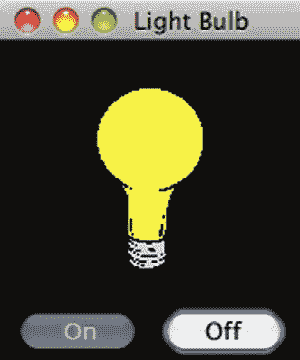
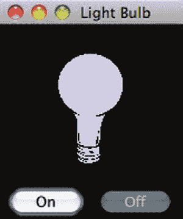

### Listing 11.9

```java
//********************************************************************
// LightBulbPanel.java Author: Lewis/Loftus
//
// 代表 LightBulb 程序的图像。
//********************************************************************
import javax.swing.*;
import java.awt.*;

public class LightBulbPanel extends JPanel
{
private boolean on;
private ImageIcon lightOn, lightOff;
private JLabel imageLabel;

//-----------------------------------------------------------------
// 构造函数：设置图像和初始状态。
//-----------------------------------------------------------------
public LightBulbPanel()
{
    lightOn = new ImageIcon("lightBulbOn.gif"); 
    lightOff = new ImageIcon("lightBulbOff.gif"); 
    setBackground(Color.black);
    on = true;
    imageLabel = new JLabel(lightOff);
    add(imageLabel);
}

//-----------------------------------------------------------------
// 使用合适的图像绘制面板。
//-----------------------------------------------------------------
public void paintComponent(Graphics page)
{
    super.paintComponent(page);
    if (on)
        imageLabel.setIcon(lightOn);
    else
        imageLabel.setIcon(lightOff);
}

//-----------------------------------------------------------------
// 设置灯泡的状态。
//-----------------------------------------------------------------
public void setOn(boolean lightBulbOn)
{
    on = lightBulbOn;
}
}
```

### Listing 11.10

```java
//********************************************************************
// LightBulbControls.java Author: Lewis/Loftus
//
// 代表 LightBulb 程序的控制面板。
//********************************************************************
import javax.swing.*;
import java.awt.*;
```


```java
import java.awt.event.*;

public class LightBulbControls extends JPanel
{
  private LightBulbPanel bulb;
  private JButton onButton, offButton;

  //-----------------------------------------------------------------
  // 设置灯泡控制面板。
  //-----------------------------------------------------------------
  public LightBulbControls(LightBulbPanel bulbPanel)
  {
    bulb = bulbPanel;
    onButton = new JButton("On");
    onButton.setEnabled(false);
    onButton.setMnemonic('n');
    onButton.setToolTipText("Turn it on!");
    onButton.addActionListener(new OnListener());
    offButton = new JButton("Off");
    offButton.setEnabled(true);
    offButton.setMnemonic('f');
    offButton.setToolTipText("Turn it off!");
    offButton.addActionListener(new OffListener());
    setBackground(Color.black);
    add(onButton);
    add(offButton);
  }

  //*****************************************************************
  // 代表 On 按钮的监听器。
  //*****************************************************************
  private class OnListener implements ActionListener
  {
    // 11.7 Tool Tips and Mnemonics
    // 589
    // Listing 11.10
    // *续*

    //--------------------------------------------------------------
    // 开启灯泡并重绘灯泡面板。
    //--------------------------------------------------------------
    public void actionPerformed(ActionEvent event)
    {
      bulb.setOn(true);
      onButton.setEnabled(false);
      offButton.setEnabled(true);
      bulb.repaint();
    }
  }

  //*****************************************************************
  // 代表 Off 按钮的监听器。
  //*****************************************************************
  private class OffListener implements ActionListener
  {
    //--------------------------------------------------------------
    // 关闭灯泡并重绘灯泡面板。
    //--------------------------------------------------------------
    public void actionPerformed(ActionEvent event)
    {
      bulb.setOn(false);
      onButton.setEnabled(true);
      offButton.setEnabled(false);
      bulb.repaint();
    }
  }
}
```

每个按钮都有其自己的监听器类。每个监听器的 `actionPerformed` 方法都会设置灯泡的状态，切换两个按钮的启用状态，并导致带有图像的面板重绘自身。

注意，每个按钮使用的快捷键（mnemonic）在显示时是带有下划线的。当你运行程序时，请注意工具提示（tool tips）会自动包含一个用于按钮可使用的快捷键指示。

### 自测习题（答案见附录 N）

- SR 11.19 什么是工具提示（tool tip）？
- SR 11.20 什么是快捷键？它是如何使用的？
- SR 11.21 为什么你可能想要禁用组件？


**590**

## 第 11 章 异常

- SR 11.22 针对灯泡程序，识别提供以下各项功能的类及对应的代码行：
  - a. 背景为黑色。
  - b. 当你将鼠标悬停在 off 按钮上时，出现消息“Turn it off!”。
  - c. 如果用户输入 ALT-n，关闭状态的灯泡将开启。
  - d. 当灯泡开启时，on 按钮显示为灰色（置灰）。
  - e. 初始状态灯泡是开启的。

### 11.8 组合框

*组合框*（combo box）允许用户从“下拉”菜单中选择多个选项之一。**核心概念**：当用户使用鼠标点击组合框时，会显示一个选项列表，用户从中进行选择。当前选择将显示在组合框中。组合框为用户提供了一个选项菜单，并由 `JComboBox` 类定义。

组合框可以是*可编辑的*（editable）也可以是*不可编辑的*（uneditable）。默认情况下，组合框是不可编辑的。更改不可编辑组合框的值，只能通过从列表中选择一个项来实现。然而，如果组合框是可编辑的，用户可以通过从列表中选择一个项或通过在组合框区域输入特定值来更改值。

组合框列表中的选项可以通过两种方式之一建立。我们可以创建一个字符串数组并将其传递给 `JComboBox` 类的构造函数。或者，我们可以使用 `addItem` 方法在创建组合框后向其添加项。`JComboBox` 还可以将 `ImageIcon` 对象作为选项显示。

Listing 11.11 中的 JukeBox 程序演示了组合框的使用。用户使用组合框选择一首歌播放，然后按下 Play 按钮开始播放歌曲。可以随时按下 Stop 按钮停止歌曲。在歌曲播放时选择新歌曲也会停止当前歌曲。

Listing 11.12 显示的 `JukeBoxControls` 类是一个面板，包含了组成点唱机 GUI 的组件。该类的构造函数还加载了将播放的音频片段。首先通过创建一个与定义片段的 `wav` 或 `au` 文件相对应的 `URL` 对象来获取音频片段。如果音频片段存储在执行程序的同一机器上，则 `URL` 构造函数的前两个参数应分别为 `"file"` 和 `"localhost"`。创建 `URL` 对象可能会抛出受检异常；因此它们在 `try` 块中创建。然而，此程序假设音频片段将成功加载，因此如果抛出异常则什么都不做。


**11.8 组合框**

**591**

#### Listing 11.11

```java
//****************************************************
// JukeBox.java 作者 Lewis/Loftus
//
// 演示了组合框的使用。
//****************************************************
import javax.swing.*;

public class JukeBox
{
  //------------------------------------------------
  // 创建并显示点唱机的控制面板。
  //------------------------------------------------
  public static void main(String[] args)
  {
    JFrame frame = new JFrame("Java Juke");
    frame.setDefaultCloseOperation(JFrame.EXIT_ON_CLOSE);
    JukeBoxControls controlPanel = new JukeBoxControls();
    frame.getContentPane().add(controlPanel);
    frame.pack();
    frame.setVisible(true);
  }
}
```

一旦创建，`URL` 对象将使用 `Applet` 类的静态 `newAudioClip` 方法创建 `AudioClip` 对象。音频片段存储在数组中。索引为 0 的第一个项被设置为 `null`。该项对应初始组合框选项，仅鼓励用户进行选择。

592

**第 11 章 异常**

#### Listing 11.12

```java
//****************************************************
// JukeBoxControls.java 作者 Lewis 和 Loftus
//
// 代表点唱机的控制面板。
//****************************************************
import java.awt.*;
import java.awt.event.*;
import javax.swing.*;
import java.applet.AudioClip;
import java.net.URL;

public class JukeBoxControls extends JPanel
{
  private JComboBox musicCombo;
  private JButton stopButton, playButton;
  private AudioClip[] music;
  private AudioClip current;

  //-----------------------------------------------------------------
  // 设置点唱机的 GUI。
  //-----------------------------------------------------------------
  public JukeBoxControls()
  {
    URL url1, url2, url3, url4, url5, url6;
    url1 = url2 = url3 = url4 = url5 = url6 = null;
    // 获取并存储播放的音频片段
    try
    {
      url1 = new URL("file", "localhost", "westernBeat.wav");
      url2 = new URL("file", "localhost", "classical.wav");
      url3 = new URL("file", "localhost", "jeopardy.au");
      url4 = new URL("file", "localhost", "newAgeRythm.wav");
      url5 = new URL("file", "localhost", "eightiesJam.wav");
      url6 = new URL("file", "localhost", "hitchcock.wav");
    }
    catch (Exception exception) {}

    music = new AudioClip[7];
    music[0] = null; // 对应“Make a Selection...”
    music[1] = JApplet.newAudioClip(url1);
    music[2] = JApplet.newAudioClip(url2);
  }
}
```


## 代码示例

```java
music[3] = JApplet.newAudioClip(url3);
music[4] = JApplet.newAudioClip(url4);
music[5] = JApplet.newAudioClip(url5);
music[6] = JApplet.newAudioClip(url6);

JLabel titleLabel = new JLabel("Java Juke Box");
titleLabel.setAlignmentX(Component.CENTER_ALIGNMENT);

// Create the list of strings for the combo box options
String[] musicNames = {
    "Make A Selection...",
    "Western Beat",
    "Classical Melody",
    "Jeopardy Theme",
    "New Age Rythm",
    "Eighties Jam",
    "Alfred Hitchcock's Theme"
};
musicCombo = new JComboBox(musicNames);
musicCombo.setAlignmentX(Component.CENTER_ALIGNMENT);

// Set up the buttons
playButton = new JButton("Play", new ImageIcon("play.gif"));
playButton.setBackground(Color.white);
playButton.setMnemonic('p');

stopButton = new JButton("Stop", new ImageIcon("stop.gif"));
stopButton.setBackground(Color.white);
stopButton.setMnemonic('s');

JPanel buttons = new JPanel();
buttons.setLayout(new BoxLayout(buttons, BoxLayout.X_AXIS));
buttons.add(playButton);
buttons.add(Box.createRigidArea(new Dimension(5,0)));
buttons.add(stopButton);
buttons.setBackground(Color.cyan);

// Set up this panel
setPreferredSize(new Dimension(300, 100));
setBackground(Color.cyan);
setLayout(new BoxLayout(this, BoxLayout.Y_AXIS));
add(Box.createRigidArea(new Dimension(0,5)));
add(titleLabel);
add(Box.createRigidArea(new Dimension(0,5)));
add(musicCombo);
add(Box.createRigidArea(new Dimension(0,5)));
add(buttons);
add(Box.createRigidArea(new Dimension(0,5)));
musicCombo.addActionListener(new ComboListener());
stopButton.addActionListener(new ButtonListener());
playButton.addActionListener(new ButtonListener());
current = null;
}

//*****************************************************************
// Represents the action listener for the combo box.
//*****************************************************************
private class ComboListener implements ActionListener
{
//--------------------------------------------------------------
// Stops playing the current selection (if any) and resets
// the current selection to the one chosen.
//--------------------------------------------------------------
public void actionPerformed(ActionEvent event)
{
    if (current != null)
        current.stop();
    current = music[musicCombo.getSelectedIndex()];
}
}

//*****************************************************************
// Represents the action listener for both control buttons.
//*****************************************************************
private class ButtonListener implements ActionListener
{
//--------------------------------------------------------------
// Stops the current selection (if any) in either case. If
// the play button was pressed, start playing it again.
//--------------------------------------------------------------
public void actionPerformed(ActionEvent event)
{
    if (current != null)
        current.stop();
    if (event.getSource() == playButton)
        if (current != null)
            current.play();
}
}
```

## 11.8 组合框

**列表 11.12**（续）

## 11.9 滚动面板

在组合框中显示的歌曲列表定义在一个字符串数组中。数组的第一个元素将默认显示在组合框中，通常用于引导用户。我们必须确保程序的其余部分不会将该选项视为有效的歌曲。

播放和停止按钮同时通过文本标签和图像图标显示。它们还被赋予了快捷键（mnemonics），以便可以通过键盘部分控制点唱机。

每当用户从组合框做出选择时，组合框就会产生一个动作事件。`JukeBox` 程序为组合框使用了一个动作监听器类，为两个推按钮使用了另一个。它们本可以合并，并使用代码来区分是哪个组件触发了事件。

`ComboListener` 类的 `actionPerformed` 方法在从组合框中进行选择时执行。如果当前正在播放音频选择，它将会被停止。然后更新当前剪辑以反映新的选择。

请注意，音频片段在此时并不会立即播放。根据该程序的设计，用户必须按下播放按钮才能听到新的选择。

`ButtonListener` 类的 `actionPerformed` 方法在任意一个按钮被按下时执行。如果当前正在播放音频选择，它将会被停止。如果按下停止按钮，则任务完成。如果按下的是播放按钮，则将从头再次播放当前的音频选择。

### 自测题（答案见附录 N）

- SR 11.23 什么是组合框（combo box）？
- SR 11.24 `JukeBox` 程序如何确保不会尝试播放与“Make a Selection...”组合框选项相关的歌曲？
- SR 11.25 `JukeBox` 程序中定义了多少个动作监听器，它们分别监听什么？
- SR 11.26 详细描述 `JukeBox` 程序如何将用户在组合框中的选择与特定的音频剪辑关联。

## 11.9 滚动面板

有时我们需要处理大到无法容纳在合理区域内的图像或信息。在这种情况下，`scroll pane`（滚动面板）通常很有帮助。`scroll pane` 是提供组件受限视图的容器，并提供垂直或水平滚动条来更改该视图。当界面空间有限或所查看的组件很大或可以动态变化时，滚动条很有用。

列表 11.13 中的程序展示了一个包含单个滚动面板的框架。该滚动面板用于查看一张相当大的地图。大型对象或大量图像被放在标签中，并将标签添加到滚动面板中（使用了 `JScrollPane` 构造函数）。

**列表 11.13**

```java
//****************************************************
// TransitMap.java 作者: Lewis/Loftus
//
// 展示滚动面板的使用。
//****************************************************
import java.awt.*;
import javax.swing.*;

public class TransitMap
{
//----------------------------------------------------------------
// 展示一个包含滚动面板的框架，用于查看
// 纽约交通系统的地图。
//-------------------------------------------------
public static void main(String[] args)
{
    JFrame frame = new JFrame("纽约交通地图");
    frame.setDefaultCloseOperation(JFrame.EXIT_ON_CLOSE);
    ImageIcon image = new ImageIcon("newyork.jpg");
    JLabel imageLabel = new JLabel(image);
    JScrollPane sp = new JScrollPane(imageLabel);
    sp.setPreferredSize(new Dimension(450, 400));
    frame.getContentPane().add(sp);
    frame.pack();
    frame.setVisible(true);
}
}
```

### 显示

滚动面板可以在容器右侧有一个垂直滚动条，并在底部有一个水平滚动条。对于每一个，程序员都可以指定滚动条是始终使用、从不使用，还是根据需要查看底层组件。默认情况下，垂直和水平滚动条都根据需要使用。`TransitMap` 程序依赖这些默认值，由于图像在高度和宽度上都很大，因此两个滚动条都会出现。

要移动滚动条，用户可以点击并拖动滚动条中称为 `knob`（滑块）的框，该框指示其在当前维度（向上/向下或向左/向右）的位置。或者，用户点击滑块右侧或左侧的栏，或者点击滚动条两端的箭头来调整位置。程序员可以确定这些操作中每一个改变可视区域程度。

请注意，以这种方式使用滚动面板时不需要设置事件监听器。滚动面板会自动对其滚动条的调整做出响应。

### 自测习题

*（答案见附录 N）*

- SR 11.27 描述滚动面板上滚动条的使用。
- SR 11.28 如果你将 `TransitMap` 程序中传递给 `Dimension` 构造函数的第一个参数改为 1000，会发生什么？请解释。

## 11.10 分割面板

`split pane`（分割面板）是一个容器，显示两个由可移动分割条隔开的组件。根据分割面板的设置，两个组件可以并排显示，也可以一个在另一个上方，如图 11.3 所示。

在 Java 中，我们可以使用 `JSplitPane` 类创建一个分割面板。

**图 11.3** 分割面板的配置

（可移动分割条：顶部组件 左 右组件， 底部组件）


分割面板的取向使用 `JSplitPane` 类中的常量进行设置，可以在创建容器时设置，也可以稍后显式设置。常量 `HORIZONTAL_SPLIT` 指定组件并排显示。相比之下，`VERTICAL_SPLIT` 指定组件一个在另一个上方显示。

分割条的位置决定了分割面板中每个组件分配了多少可视区域。可以使用鼠标在容器区域上跨越式地拖动分割条。随着它的移动，一个组件的可视空间会增加，而另一个组件的会减少。只有当整个分割面板的大小改变时，分配给两个组件的总空间才会改变。

`JSplitPane` 尊重为其显示的组件所设置的最小尺寸。因此，分割条可能不允许某部分尺寸缩小到某个特定点以下。要调整这一点，可以更改所显示组件的最小尺寸。

`JSplitPane` 对象的分割条可以设置成只需点击一下鼠标即可向一个或另一个方向扩展。默认情况下，分割条没有此功能，只能通过拖动来移动。如果启用此功能，分割条将出现两个指向相反方向的小箭头。点击这些箭头中的任意一个会导致分割条完全向该方向移动，从而使分配给其中一个组件的空间最大化。此功能通过 `setOneTouchExpandable` 方法设置，该方法接受一个 `boolean` 参数。分割条的大小和分割条的初始位置也可以显式设置。

在 `JSplitPane` 上可以设置的另一个功能是：在移动分割条时，组件是否会持续调整并重绘。如果未设置此功能，组件的布局管理器将只有在分割条停止移动后才被调用。此功能默认关闭，并可以在创建 `JSplitPane` 对象时或通过使用 `setContinuousLayout` 方法开启。

可以通过将一个分割面板放入另一个分割面板的一侧或两侧来嵌套分割面板。例如，我们可以通过将一个分割面板放入另一个分割面板的顶部组件中，从而将一个容器分为三个部分。这样就会有两个分割条：一个将总区域分为两个主要部分，另一个将其中一个部分再分为另外两个部分。每个部分显示多少可视区域取决于分割条放置的位置。

代码列表 11.14 所示的程序向用户展示图像文件名列表。当选择其中一个文件名时，相应的图像显示在分割面板的右侧。

分割面板在 `main` 方法中创建并添加到框架中显示。分割面板使用 `HORIZONTAL_SPLIT` 常量进行定向，使得包含列表的面板和包含要显示图像的标签并排。调用 `setOneTouchExpandable` 方法会导致分割面板的分割条显示箭头，允许用户通过点击鼠标将面板向一个方向或另一个方向扩展。

**代码列表 11.14**

```java
//********************************************************************
// PickImage.java Author: Lewis/Loftus
//
// 演示分割面板和列表的使用。
//********************************************************************
import java.awt.*;
import javax.swing.*;

public class PickImage
{
    //-----------------------------------------------------------------
    // 创建并显示一个包含分割面板的框架。
    // 用户从列表中选择一个要显示的图像名称。
    //-----------------------------------------------------------------
    public static void main(String[] args)
    {
        JFrame frame = new JFrame("Pick Image");
        frame.setDefaultCloseOperation(JFrame.EXIT_ON_CLOSE);
        JLabel imageLabel = new JLabel();
        JPanel imagePanel = new JPanel();
        imagePanel.add(imageLabel);
        imagePanel.setBackground(Color.white);
        ListPanel imageList = new ListPanel(imageLabel);
        JSplitPane sp = new JSplitPane(JSplitPane.HORIZONTAL_SPLIT, imageList, imagePanel);
        sp.setOneTouchExpandable(true);
        frame.getContentPane().add(sp);
        frame.pack();
        frame.setVisible(true);
    }
}
```

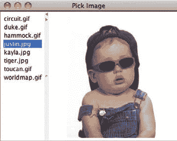

### 显示

列表 11.15 中的 `ListPanel` 类定义了包含列表的面板。我们使用由 `JList` 类定义的 `list` 组件来显示文件名列表。列表内容设置为 `String` 对象的数组，并传递给 `JList` 构造函数。

**代码列表 11.15**


```java
//********************************************************************
// ListPanel.java Author: Lewis/Loftus
//
// 代表 PickImage 程序的图像列表。
//********************************************************************
import java.awt.*;
import javax.swing.*;
import javax.swing.event.*;

public class ListPanel extends JPanel
{
    private JLabel label;
    private JList list;

    //-----------------------------------------------------------------
    // 将文件名加载到列表中。
    //-----------------------------------------------------------------
    public ListPanel(JLabel imageLabel)
    {
        label = imageLabel;
        String[] fileNames = { "circuit.gif", "duke.gif", "hammock.gif", "justin.jpg", "kayla.jpg", "tiger.jpg", "toucan.gif", "worldmap.gif" };
        list = new JList(fileNames);
        list.addListSelectionListener(new ListListener());
        list.setSelectionMode(ListSelectionModel.SINGLE_SELECTION);
        add(list);
        setBackground(Color.white);
    }

    //*****************************************************************
    // 代表图像列表的监听器。
    //*****************************************************************
    private class ListListener implements ListSelectionListener
    {
        public void valueChanged(ListSelectionEvent event)
        {
            if (list.isSelectionEmpty())
                label.setIcon(null);
            else
            {
                String fileName = (String)list.getSelectedValue();
                ImageIcon image = new ImageIcon(fileName);
                label.setIcon(image);
            }
        }
    }
}
```

通常情况下，`JList` 组件中的所有选项都是可见的。当用户使用鼠标选择某项时，该项会被高亮。当选择新项时，之前选中的项会自动取消高亮。

`JList` 的内容可以使用传递给构造函数的对象数组来指定。`JList` 类的方法用于以各种方式管理列表，包括获取当前选中的项。

注意组合框（在第 11.8 节描述）与 `JList` 对象之间的相似之处和不同。两者都允许用户从一组选项中选择一个项目。然而，列表上的选项始终可见，并高亮当前选择项；而组合框仅在用户用鼠标点击它时才显示选项。组合框中始终显示的唯一项是当前选择项。

当列表的当前选择发生变化时，`JList` 对象会生成一个*列表选择事件*。`ListSelectionListener` 接口包含一个名为 `valueChanged` 的方法。在该程序中，名为 `ListListener` 的私有内部类定义了文件名列表的监听器。

监听器的 `valueChanged` 方法调用 `JList` 对象的 `isSelectionEmpty` 方法来确定当前是否有任何选中的值。如果没有，则将标签图标设置为 `null`。如果有，则使用 `getSelectedValue` 方法获取文件名。然后创建相应的图像图标并将其显示在标签中。

`JList` 对象可以设置为允许同时选择多个项。*列表选择模式*可以是三个选项之一，如图 11.4 所示的表格所示。

列表选择模式由 `ListSelectionModel` 对象定义。默认情况下，列表允许多项间隔选择。通过使用 `ListSelectionModel` 类中定义的常量调用 `setSelectionMode` 方法，可以显式地设置列表选择模式。

在 `PickImage` 程序中，我们将列表选择模式设置为单选，因为由于一次只能显示一张图像。然而，即使在该程序中允许多个`列表选择模式`，`getSelectedValue` 方法也会返回第一个被选中的项，因此该项将是显示的图像。一个名为 `getSelectedValues` 的类似方法返回一个表示在允许多项选择时选中项的对象数组。

`JList` 构造函数可以传递 `String` 对象的数组，而是传递一个 `ImageIcon` 对象的数组。在这种情况下，图像将显示在列表中。

### 图 11.4 列表选择模式

| 模式 | 说明 |
| :--- | :--- |
| 单选 | 一次只能选择一个项。 |
| 单项间隔选择 | 一次可以选择多个连续的项。 |
| 多项间隔选择 | 可以选择任意组合的项。 |

### 自测习题（答案见附录 N）

- **SR 11.29**: 描述拆分窗（split pane）上分割条的作用。
- **SR 11.30**: 组合框（第 11.8 节）的显示方式与 `JList` 对象的显示方式有什么区别？

### 核心概念总结

- 错误和异常是表示异常或无效处理的对象。
- 抛出异常时打印的消息提供了方法调用堆栈跟踪。
- 每个 `catch` 子句处理 `try` 块内可能抛出的特定类型异常。
- `finally` 子句无论 `try` 块是正常退出还是因为抛出异常而退出，都会被执行。
- 如果异常在发生处没有被捕获和处理，它将传播到调用它的方法。
- 程序员必须仔细考虑何时以及何地处理异常（如果处理的话）。
- 新异常通过从 `Exception` 类或其一个子类派生一个新类来定义。
- 对于在方法中未捕获和处理的受检异常，方法头中必须包含 `throws` 子句。
- 流是字节的顺序序列；它可以作为输入源或输出目标。
- `System` 类中的三个公共引用变量代表标准 I/O 流。
- 输出文件流应该被显式关闭，否则它们可能无法正确地保留写入它们的数据。
- Java 类库包含许多用于定义具有各种特征的 I/O 流的类。
- 提示（Tool tips）和记忆符（mnemonics）可以增强图形用户界面的功能。
- 当组件的使用不合适时，应该禁用它们。
- 组合框为用户提供下拉菜单。
- 滚动面板（scroll pane）对于查看大型对象或大量数据很有用。
- 拆分窗（split pane）并排显示两个组件或上下显示两个组件。

## 练习

- **EX 11.1**: 为 `ProductCodes` 程序创建一个 UML 类图。
- **EX 11.2**: 如果从 `Propagation` 程序中 `ExceptionScope` 类的 `level1` 方法删除 `try` 语句会发生什么？
- **EX 11.3**: 如果将上一个练习中描述的 `try` 语句移动到 `level2` 方法会发生什么？
- **EX 11.4**: 在在线 Java API 文档查询以下异常类并描述它们的用途：
    - a. `ArithmeticException`
    - b. `NullPointerException`
    - c. `NumberFormatException`
    - d. `PatternSyntaxException`
- **EX 11.5**: 为 `LightBulb` 程序绘制包含层次树。
- **EX 11.6**: 为 `PickImage` 程序绘制包含层次树。
- **EX 11.7**: 为 `JBox` 程序绘制包含层次树。
- **EX 11.8**: 在 `ListPanel` 类中删除对 `setSelectionMode` 调用会有什么影响？

## 编程项目

- **PP 11.1**: 编写一个程序创建一个 `StringTooLong` 异常类，当发现字符串字符过多时抛出该异常。在程序的驱动中，从用户处读取字符串直到用户输入“DONE”。如果输入的字符串字符过多（例如 20 个），则抛出异常。允许抛出的异常终止程序。
- **PP 11.2**: 修改 PP 11.1 的解决方案，在抛出异常时捕获并处理。通过打印适当的消息处理异常，然后继续处理字符串。
- **PP 11.3**: 假设在某个业务中，所有文档都有以 U、C 或 P 开头的双字符标记，代表未分类、机密或专利。创建一个 `InvalidDocumentCodeException`，在处理过程中遇到不正确的标记时抛出。如果遇到不符合描述的文档标记，则抛出异常。创建一个驱动程序来测试异常，允许其终止程序。
- **PP 11.4**: 修改第 10 节的 `DisplayFile` 程序，在文本区域上方添加标记为“保存”的按钮。按下按钮时，将内容写回文件。
- **PP 11.5**: 修改 `JukeBox` 程序，使其在使用组合框选择歌曲后立即播放歌曲。将两个监听器合并为一个。

## PP

- **PP 11.8**: 修改 `PickImage` 程序，使其呈现几个额外的图像选项。在一个带有垂直滚动条的滚动面板中显示列表，该滚动条应始终显示。在一个同时使用水平和垂直滚动条的滚动面板中显示图像，但仅在需要时显示。
- **PP 11.9**: 设计并实现一个应用程序，用于对简单的数学题进行闪卡测试。允许用户选择类别。重复显示问题并获取用户的答案。对于每个问题指示用户的答案是正确还是错误，并显示实时分数。

*本页特意留白。*


# 12 递归

## 第 12 章目标

- 解释递归的底层概念。
- 探索促进递归思维的示例。
- 检查递归方法并剖析其处理步骤。
- 定义无限递归并讨论避免它的方法。
- 解释何时应该以及何时不应该使用递归。
- 演示使用递归解决问题。
- 探索递归在图形程序中的应用。
- 定义分形概念及其与递归的关系。

递归是一种强大的编程技术，为某些问题提供了优雅的解决方案。本章介绍了递归处理的介绍。它包含了对递归基础概念的解释，然后探索了递归在编程中的应用。通过递归解决了几个特定问题，展示了它的多功能性、简单性和优雅性。

609


610

## 12.1 递归思维

在之前的示例中，我们多次看到一个方法可以调用另一个方法来实现目标。但我们还没有看到的是，递归作为一种编程技术——一个方法可以调用它自己。递归是一种方法通过调用自身来实现其目的的编程技术。能够递归编程的关键在于能够进行递归思维。但在深入研究如何在程序中递归地使用递归细节之前，我们需要探索递归的通用概念。

递归思维的能力对于将递归作为一种编程技术至关重要。

通常，递归是根据自身来定义某物的过程。例如，考虑单词 *decoration*（装饰）的以下定义：decoration : n. 用于装饰某物的任何装饰品或点缀。*decorate*（装饰）一词被用来定义 *decoration* 一词。你可能记得小学老师告诉过你在解释单词含义时要避免这种递归定义。然而，在许多情况下，递归是表达思想或定义的恰当方式。例如，假设我们想要正式定义一个由一个或多个数字组成、逗号分隔的列表。这样的列表可以递归地定义为一个数字，或者为一个数字后跟着逗号，再跟着列表。这种定义可以表示为：一个 *List* 是：数字或一个：数字 逗号 *List*。

这种对 *List* 的递归定义定义了以下每个数字列表：24, 88, 40, 37, 96, 43, 14, 64, 21, 69, 32, 93, 47, 81, 28, 45, 81, 52, 69, 70。

无论列表有多长，递归定义都能描述它。单元素列表（如上一个示例所示）完全由定义的第一个（非递归）部分定义。对于任何多于一个元素的列表，定义中的递归部分（引用自身的部分）将根据需要使用若干次，直到达到最后一个元素为止。列表中的最后一个元素始终由定义的非递归部分定义。图 12.1 显示了一个特定的数字列表如何对应于 *List* 的递归定义。

### 无限递归

注意，*List* 的定义包含一个递归选项和一个非递归选项。定义中的非递归部分称为*基准*（base）。


**列表: 数字 逗号列表**

24, 88, 40, 37

**数字 逗号列表**

88, 40, 37

**数字 逗号列表**

40, 37

**数字**

37

**图 12.1** 追踪 *List* 递归定义的案例。如果所有选项都有递归组件，递归将永远不会。例如，如果 *List* 的定义仅仅是“一个数字后跟着逗号，再跟着一个 *List*”，那么任何列表都无法结束。

这个问题被称为*无限递归*。它类似于无限循环，区别在于这个“循环”发生在定义本身中。

与无限循环问题一样，程序员必须小心设计算法以避免无限递归。任何递归定义都必须有一个不会产生递归选项的基准情况。*List* 定义的基准情况是一个单一数字，后面没有跟随内容。换句话说，当到达列表中的最后一个数字时，基准选项会终止递归路径。

### 数学中的递归

让我们来看一个数学中递归的例子。`N!`（读作 *N 阶乘*）的值对于任何正整数 `N` 都定义为 1 到 `N` 之间所有整数的乘积。因此，`3!` 定义为：`3! = 3*2*1 = 6`，而 `5!` 定义为：`5! = 5*4*3*2*1 = 120`。

数学公式通常递归地表示。`N!` 的定义可以递归地表示为：

`N! = N * (N-1)!` `N > 1`


612

## 12.2 递归编程

让我们使用一个简单的数学运算演示递归编程的概念。考虑 1 到 `N` 之间值的和，其中 `N` 是任何正整数。从 1 到 `N` 的值的和可以表示为 `N` 加上从 1 到 `N-1` 的值的和。该和可以以类似的方式表示，如图 12.2 所示。

*N*

*N–1*

*N–2*

∑ *i* = *N* + ∑ *i* = *N* + *N* – 1 + ∑ *i*

*i* = 1

*i* = 1

*i* = 1

*N–3*

= *N* + *N* – 1 + *N* – 2 + ∑ *i*

..

= *N* + *N* – 1 + *N* – 2 + . . . + 2 + 1

**图 12.2** 1 到 *N* 的数字的和，通过递归定义

例如，1 到 20 之间数值的和等于 20 加上 1 到 19 之间数值的和。继续这种方法，1 到 19 之间数值的和等于 19 加上 1 到 18 之间数值的和。

这听起来可能是解决这个问题很奇怪的方法，但这是一个直观的例子，可以用来演示如何编写递归。

正如我们之前提到的，在 `Java` 中，与许多其他编程语言中一样，方法可以调用自己。每次调用该方法都会创建一个新的工作环境。也就是说，每调用一次方法，所有局部变量和参数都会重新定义，并拥有它们自己独特的数据空间。每个参数都会根据新的调用赋予一个初始值。每当一个方法终止时，处理就会返回到调用它的方法（这可能是对方法的每次递归调用都是该方法的早先调用）。这些规则与管理任何“普通”方法调用的规则没有区别。

### 核心概念

求和问题的递归解决方案由以下名为 `sum` 的递归方法定义：

```java
// 此方法返回 1 到 num 的和
public int sum(int num)
{
    int result;
    if (num == 1)
        result = 1;
    else
        result = num + sum(num-1);
    return result;
}
```

注意，该方法本质上体现了我们的递归定义，即 1 到 `N` 之间数字的和等于 `N` 加上 1 到 `N −1` 之间数字的和。`sum` 方法是递归的，因为 `sum` 调用了自己。每次调用 `sum` 时，传递给 `sum` 的参数都会递减，直到达到 1 的基本情况。递归方法总是包含一个 `if-else` 语句，其中一个分支（通常是第一个）代表基本情况，如本例所示。

### 自测（答案见附录）

- **SR 12.1**: 什么是递归？
- **SR 12.2**: *List* 定义的递归部分使用了多少次来定义一个十数字列表？基准情况使用了多少次？
- **SR 12.3**: 什么是无限递归？
- **SR 12.4**: 递归处理何时需要基准情况？
- **SR 12.5**: 为 `5 * n`（整数乘法）编写递归定义，`n > 0`。用整数相加定义乘法过程。例如，`5 * 7` 等于 7 次 5 加。


# 第 12 章 递归

假设 `main` 方法调用 `sum` 并向其传递初始值 1，该值存储在参数 `num` 中。由于 `num` 等于 1，结果 1 返回给 `main`，且没有发生递归。

现在让我们追踪一下 `sum` 方法在传递初始值 2 时的执行情况。由于 `num` 不等于 1，将再次使用参数 `num - 1`（即 1）调用 `sum`。这是对方法 `sum` 的新调用，具有新的参数 `num` 和新的局部变量 `result`。由于在这次调用中 `num` 等于 1，结果直接返回，不再进行进一步的递归调用。控制返回到第一个被调用的 `sum` 版本。返回值 1 被加到该 `sum` 调用中 `num` 的初始值（即 2）上。因此，`result` 被赋值为 3，并返回给 `main` 方法。对递归过程的仔细追踪可以让我们深入了解它是如何用于解决问题的。从 `main` 调用的方法正确计算了从 1 到 2 的整数的和，并返回结果 3。

求和示例中的基本情况是 `N` 等于 1，此时不再进行进一步的递归调用。递归开始回溯到 `sum` 方法的早先版本，每次都返回适当的值。每个返回值都对更高层求和的计算做出贡献。

如果没有基本情况，就会导致无限递归。每次方法调用都需要额外的内存空间；因此，无限递归通常会导致指示内存已耗尽的运行时错误。

使用不同的 `num` 初始值追踪 `sum` 函数，直到对这种处理变得熟悉。图 12.3 展示了 `main` 调用 `sum` 来确定从 1 到 4 的整数之和时的递归调用。每个框代表方法被调用时的副本，表示分配了用于存储形式参数和任何局部变量的空间。调用用实线表示，`main` 调用和返回用虚线表示。每一步都显示了返回值 `result`。完全遵循递归路径直到到达基本情况；然后调用开始沿着链向上返回其结果。

```
result = 10
sum(4)
result = 6
sum(3)
result = 3
sum(2)
result = 1
sum(1)
```

**图 12.3** 对 `sum` 方法的递归调用

## 递归 vs 迭代

当然，我们刚刚探索的求和问题有一个非递归的解决方案。以迭代方式计算 1 到 `num`（包含）之间数字和的一种方法如下：递归是解决某些问题最优雅、合适的方法，但对于其他问题，它没有迭代解决方案那么直观。

```java
sum = 0;
for (int number = 1; number <= num; number++)
    sum += number;
```

这个解决方案显然比递归版本更直接。我们使用求和问题来演示递归是因为它简单，而不是因为在正常情况下你会使用递归来解决它。递归具有多次方法调用的开销，并且在这种情况下，它提供了一个比其迭代对应方案更复杂的解决方案。

程序员必须学习何时使用递归，何时不使用递归。确定哪种方法最好取决于正在解决的问题。所有问题都可以以迭代的方式解决，但在某些情况下，迭代版本要复杂得多。

## 直接递归 vs 间接递归

**直接递归**发生在方法调用自身时，例如当 `sum` 调用 `sum`。

**间接递归**发生在方法调用另一个方法时，最终导致原始方法被再次调用。例如，如果方法 `m1` 调用 `m2`，而 `m2` 调用 `m1`，我们可以说 `m1` 是间接递归的。间接深度可能达到几层，例如 `m1` 调用 `m2`，`m2` 调用 `m3`，`m3` 调用 `m4`，`m4` 调用 `m1`。图 12.4 描绘了一个带有间接递归的情况。方法调用用实线表示，返回用虚线表示。遵循整个调用路径，然后递归开始展开。

间接递归对基本情况的关注与直接递归的要求完全相同。此外，由于中间插入的方法调用，间接递归可能更难追踪。因此，在设计或评估间接方法时需要格外小心。确保间接性是绝对必要的，并在文档中进行了清晰的解释。

**图 12.4** 间接递归

### 自习题 *(请参见附录 N 中的答案)*

**SR 12.6** 递归是必要的吗？

**SR 12.7** 何时应该避免递归？

**SR 12.8** 描述以下递归方法的返回值。

```java
private static int exercise(int n)
{
    if (n < 0)
        return -1;
    else
        if (n < 10)
            return 1;
        else
            return 1 + exercise(n/10);
}
```

**SR 12.9** 写一个递归方法返回 `5 * n` 的值，其中 `n > 0`。参见自习题 12.5。解释为什么你不会使用递归来解决这个问题。

**SR 12.10** 什么是间接递归？

## 12.3 使用递归

接下来的每个章节描述了一个特定的递归问题。对于每个问题，我们都检查了递归在解决方案中具体扮演的角色，以及如何使用基本情况来终止递归。在检查这些示例时，请考虑每个问题的非递归解决方案会有多复杂。

### 穿越迷宫

解决迷宫涉及大量的尝试与错误：遵循路径，在无法继续时回溯，并尝试其他未尝试过的选项。此类活动通常可以使用递归很好地处理。列表 12.1 所示的程序创建一个 `Maze` 对象并尝试遍历它。

#### 列表 12.1

```java
//********************************************************************
// MazeSearch.java Author: Lewis/Loftus
//
// 展示了递归。
//********************************************************************
public class MazeSearch
{
    //-----------------------------------------------------------------
    // 创建一个新的迷宫，打印它的原始形状，尝试
    // 解决它，并打印出最终形状。
    //-----------------------------------------------------------------
    public static void main(String[] args)
    {
        Maze labyrinth = new Maze();
        System.out.println(labyrinth);
        if (labyrinth.traverse(0, 0))
            System.out.println("The maze was successfully traversed!");
        else
            System.out.println("There is no possible path.");
        System.out.println(labyrinth);
    }
}
```

#### 输出

```
1110110001111
1011101111001
0000101010100
1110111010111
1010000111001
1011111101111
1000000000000
1111111111111
618
```

迷宫已成功遍历！

```
7770110001111
3077707771001
0000707070300
7770777070333
7070000773003
7077777703333
7000000000000
7777777777777
```

#### 列表 12.2

```java
//********************************************************************
// Maze.java Author: Lewis/Loftus
//
// 表示一个字符迷宫。目标是遵循 1 的路径
// 从左上角移动到右下角。
//********************************************************************
public class Maze
{
    private final int TRIED = 3;
    private final int PATH = 7;
    private int[][] grid = { {1,1,1,0,1,1,0,0,0,1,1,1,1},
    {1,0,1,1,1,0,1,1,1,1,0,0,1},
    {0,0,0,0,1,0,1,0,1,0,1,0,0},
    {1,1,1,0,1,1,1,0,1,0,1,1,1},
    {1,0,1,0,0,0,0,1,1,1,0,0,1},
    {1,0,1,1,1,1,1,1,0,1,1,1,1},
    {1,0,0,0,0,0,0,0,0,0,0,0,0},
    {1,1,1,1,1,1,1,1,1,1,1,1,1} };

    //-----------------------------------------------------------------
    // 尝试递归遍历迷宫。插入特殊字符
    // 以表示已尝试过并且最终成为解决方案一部分的位置。
    //-----------------------------------------------------------------
    public boolean traverse(int row, int column)
    {
        boolean done = false;
        if (valid(row, column))
        {
            grid[row][column] = TRIED; // 此单元格已尝试过
            if (row == grid.length-1 && column == grid[0].length-1)
                done = true; // 迷宫已解决
            else
            {
                done = traverse(row+1, column); // 向下
                if (!done)
                    done = traverse(row, column+1); // 向右
                if (!done)
                    done = traverse(row-1, column); // 上
                if (!done)
                    done = traverse(row, column-1); // 向左
            }
            if (done) // 此位置是最终路径的一部分
                grid[row][column] = PATH;
        }
        return done;
    }

    //-----------------------------------------------------------------
    // 判断特定位置是否有效。
    //-----------------------------------------------------------------
    private boolean valid(int row, int column)
    {
        boolean result = false;
        // 检查单元格是否在矩阵范围内
        if (row >= 0 && row < grid.length && column >= 0 && column < grid[0].length && grid[row][column] == 1)
        {
            result = true;
        }
        return result;
    }

    //-----------------------------------------------------------------
    // 将迷宫作为字符串返回。
    //-----------------------------------------------------------------
    public String toString()
    {
        String result = "\n";
        for (int row = 0; row < grid.length; row++)
        {
            for (int column = 0; column < grid[row].length; column++)
            {
                result += grid[row][column];
            }
            result += "\n";
        }
        return result;
    }
}
```

注意，在 `traverse` 方法的每次调用中，都有几次递归的机会。根据迷宫的配置，可能会执行其中一个或所有递归。虽然穿过迷宫可能有许多路径，但当找到路径时，递归就会终止。请在遵循迷宫数组的同时，仔细追踪这段代码的执行过程，看看递归是如何解决问题的。然后考虑编写一个非递归解决方案的难度。

## 汉诺塔

**图 12.5** 汉诺塔游戏

*汉诺塔*游戏是由法国数学家埃德华·卢卡斯（Edouard Lucas）在 19 世纪 80 年代发明的。它已成为计算机科学家们喜爱的难题之一，因为它的解决方案是递归优雅性的极佳典范。

该游戏由三个直立的柱子和一组中间有孔的盘子组成，这些盘子可以滑到柱子上。每个盘子的直径都不同。

初始时，所有的盘子按大小顺序堆叠在一个柱子上，最大的盘子在底部，如图 12.5 所示。

游戏的目标是将所有的盘子从原始（第一个）柱子移动到目标（第三个）柱子。我们可以使用“额外的”柱子作为临时放置盘子的地方，但我们必须遵守以下三个规则：

- 我们一次只能移动一个盘子。
- 我们不能将大盘子放在小盘子的上面。
- 除了在柱子之间传输的盘子外，所有的盘子必须位于某个柱子上。

这些规则意味着，为了将大盘子从一个柱子移动到另一个，我们必须将较小的盘子“移开”。图 12.6 显示了三个盘子的汉诺塔逐步解决方案。为了最终将所有三个盘子从第一个柱子移动到第三个柱子，我们首先必须让两个较小的盘子在第二个柱子上移开，这样最大的盘子就可以从第一个柱子移动到第三个柱子了。

图 12.6 显示的前三个移动可以被认为是将较小的盘子移开。第四次移动将最大的盘子放在它的最终位置。最后三个移动将较小的盘子放在大盘子顶部的最终位置。

让我们利用这个想法形成一个通用策略。要将一叠 *N* 个盘子从原始柱子移动到目标柱子：

- 将顶部的 *N-1* 个盘子从原始柱子移动到额外的柱子。
- 将最大的盘子从原始柱子移动到目标柱子。
- 将 *N-1* 个盘子从额外的柱子移动到目标柱子。

**图 12.6** 三盘汉诺塔游戏的解决方案

这种策略非常适合转化为递归解决方案。将 *N-1* 个盘子移开的步骤又是完全相同的问题：移动一叠盘子。

然而，对于这个子任务，少了一个盘子，而且我们的目标柱子是我们最初所谓的额外柱子。在我们移动完最大的盘子后，会发生类似的情况，我们需要再次移动原始的 *N-1* 个盘子。

这个问题的基准情况发生在当我们移动一个只包含一个盘子的“栈”时。这一步可以直接完成，而不需要递归。

列表 12.3 中的程序创建了一个 `TowersOfHanoi` 对象并调用了它的 `solve` 方法。输出是一个逐步的指令列表，描述了如何移动盘子来解决游戏。这个示例使用了四个盘子，这是通过 `TowersOfHanoi` 构造函数的一个参数指定的。

列表 12.4 所示的 `TowersOfHanoi` 类使用 `solve` 方法对递归方法 `moveTower` 进行初始调用。初始调用表示所有的盘子都应该从 1 号柱移动到 3 号柱，使用 2 号柱作为额外位置。

### 视频笔记

`moveTower` 方法首先考虑只包含一个盘子的“栈”基准情况。当该情况发生时，它会调用 `moveOneDisk` 方法来打印那次特定的移动描述。

#### 列表 12.3

```java
//****************************************************
// SolveTowers.java 作者: Lewis/Loftus
//
// 展示了递归。
//****************************************************
public class SolveTowers
{
    //-------------------------------------------------
    // 创建汉诺塔并解决它。
    //-------------------------------------------------
    public static void main(String[] args)
    {
        TowersOfHanoi towers = new TowersOfHanoi(4);
        towers.solve();
    }
}
```

#### 输出


## 汉诺塔移动序列

```
Move one disk from 1 to 2
Move one disk from 1 to 3
Move one disk from 2 to 3
Move one disk from 1 to 2
Move one disk from 3 to 1
Move one disk from 3 to 2
Move one disk from 1 to 3
Move one disk from 1 to 2
Move one disk from 2 to 3
Move one disk from 1 to 2
Move one disk from 3 to 1
Move one disk from 3 to 2
Move one disk from 1 to 3
Move one disk from 1 to 2
Move one disk from 2 to 3
Move one disk from 1 to 2
Move one disk from 3 to 1
Move one disk from 3 to 2
Move one disk from 1 to 3
Move one disk from 1 to 2
Move one disk from 2 to 3
Move one disk from 1 to 2
Move one disk from 3 to 1
Move one disk from 3 to 2
Move one disk from 1 to 3
Move one disk from 1 to 2
Move one disk from 2 to 3
```

**列表 12.4**

```java
//****************************************************
// TowersOfHanoi.java 作者: Lewis/Loftus
//
// 表示汉诺塔游戏。
//****************************************************
public class TowersOfHanoi
{
    private int totalDisks;

    //-------------------------------------------------
    // 用指定的盘子数量设置游戏。
    //-------------------------------------------------
    public TowersOfHanoi(int disks)
    {
        totalDisks = disks;
    }

    //-------------------------------------------------
    // 执行 moveTower 的初始调用以解决游戏。
    // 将盘子从 1 号柱移动到 3 号柱，使用 2 号柱。
    //-------------------------------------------------
    public void solve()
    {
        moveTower(totalDisks, 1, 3, 2);
    }

    //-------------------------------------------------
    // 通过将 n-1 个盘子的子栈移开，移动一个
    // 盘子，从一个柱子移动到另一个，
    // 再将子栈移回。1 个盘子的基准情况。
    //-------------------------------------------------
    private void moveTower(int numDisks, int start, int end, int temp)
    {
        if (numDisks == 1)
            moveOneDisk(start, end);
        else
        {
            moveTower(numDisks-1, start, temp, end);
            moveOneDisk(start, end);
            moveTower(numDisks-1, temp, end, start);
        }
    }

    //-------------------------------------------------
    // 打印从指定的起始柱移动到一个
    // 目标柱的指令。
    //-------------------------------------------------
    private void moveOneDisk(int start, int end)
    {
        System.out.println("Move one disk from " + start + " to " + end);
    }
}
```

注意 `moveTower` 描述柱子的参数会根据移动部分栈的需求进行交换。这段代码遵循了我们的通用策略，并使用 `moveTower` 方法移动所有的部分栈。请针对三个盘子的情况仔细追踪代码，以理解处理过程。将处理步骤与图 12.6 进行对比。

### 核心概念

与其简洁优雅的实现相反，汉诺塔游戏的解决方案效率极低。为了解决一个叠有 `N` 个盘子的谜题，我们必须进行 `2^N − 1` 次移动。然而，解决方案却极其短且优雅。这种情况是解决方案指数级复杂性的一个例子。随着盘子数量的增加，所需的移动次数呈指数级增长。

传说中，梵的祭司们正在世界中心的一座寺庙里研究这个谜题。他们正在使用 64 个金盘子，在纯钻石制成的柱之间移动它们。缺点是，当祭司们完成谜题时，世界将会结束。优点是，即使他们每天每秒都移动一个盘子，也需要超过 584 亿年才能完成。而这仅仅是 64 个盘子！这充分说明了指数级算法复杂度是多么难以处理。

### 自我检测问题 *(答案见附录 N)*

**SR 12.11** 在 `MazeSearch` 程序中，递归在什么时候停止？

**SR 12.12** 识别 `MazeSearch` 程序中每个以下项位于什么位置。

a. 定义了原始迷宫。

b. 一个检查是否已到达目标的测试。

c. 标记某个位置为已尝试过。

d. 一个检查是否已经尝试过某个位置的测试。

**SR 12.13** 追踪 `MazeSearch` 程序，确定如果原始迷宫所示，会发生对 `valid` 方法的系列调用（包括传递的参数值）。

a. 1 1

b. 0 0

c. 1 1

1 1

0 0

1 0

**SR 12.14** 解释解决汉诺塔谜题的通用方法。它是如何与递归相关的？

**SR 12.15** 针对初始为 1 个盘子的堆栈追踪 `SolveTowers` 代码。调用了多少次 `moveTower` 方法？初始为 2 个盘子的堆栈调用了多少次？3 个盘子又是多少次？描述一个随着盘子数量增加，调用 `moveTower` 方法次数增加相关的模式。

## 12.4 图形中的递归

递归的概念在图像和图形中有多种用途。本节将探索一些基于图像和图形的递归示例。

### 瓦片式图片

仔细观察列表 12.5 所示 `TiledPictures` Applet 的显示。

在这个系列中实际上有三张独特的图像。整个区域被分为四个等象限。右下象限显示了一张世界地图（用圆圈表示喜马拉雅山地区）。左下象限包含一张珠穆朗玛峰的照片。右上象限是一张山羊的照片。

图片中有趣的部分是左上象限。它包含了整个拼贴的副本，包括它自己。在这个较小的版本中，你可以看到三个象限中的三个简单图片。再次，在左上角，图片重复了（包括它自己）。这种重复持续了几个层次。这类似于当你从另一面镜子的反射中看镜子时可以产生的效果。

**列表 12.5**

```java
//********************************************************************
// TiledPictures.java 作者: Lewis/Loftus
//
// 展示了递归的使用。
//********************************************************************
import java.awt.*;
import javax.swing.JApplet;

public class TiledPictures extends JApplet
{
    private final int APPLET_WIDTH = 320;
    private final int APPLET_HEIGHT = 320;
    private final int MIN = 20; // 最小图片尺寸
    private Image world, everest, goat;

    //-----------------------------------------------------------------
    // 加载图像。
    //-----------------------------------------------------------------
    public void init()
    {
        world = getImage(getDocumentBase(), "world.gif");
        everest = getImage(getDocumentBase(), "everest.gif");
        goat = getImage(getDocumentBase(), "goat.gif");
        setSize(APPLET_WIDTH, APPLET_HEIGHT);
    }

    //-----------------------------------------------------------------
    // 绘制三张图片，然后递归调用自己。
    //-----------------------------------------------------------------
    public void drawPictures(int size, Graphics page)
    {
        page.drawImage(everest, 0, size/2, size/2, size/2, this);
        page.drawImage(goat, size/2, 0, size/2, size/2, this);
        page.drawImage(world, size/2, size/2, size/2, size/2, this);
        if (size > MIN)
            drawPictures(size/2, page);
    }

    //-----------------------------------------------------------------
    // 执行 drawPictures 方法的初始调用。
    //-----------------------------------------------------------------
    public void paint(Graphics page)
    {
        drawPictures(APPLET_WIDTH, page);
    }
}
```

#### 显示

使用递归可以很容易地创建这种视觉效果。Applet 的 `init` 方法最初加载三张图片。`paint` 方法随后调用 `drawPictures` 方法，该方法接收一个定义显示区域的参数。它使用 `drawImage` 方法绘制三张图片，并将其缩放到正确的尺寸和位置。

`drawPictures` 方法被递归调用以绘制左上象限。在每次调用中，如果绘制区域足够大，再次调用 `drawPictures` 方法，使用较小的绘制区域。最终，绘制区域变得非常小，不再执行递归调用。这就是为什么最小版本的左上角是空的。

### 分形

*分形*（fractal）是由不同比例和方向重复的相同图案组成的几何形状。分形是以递归方式定义的几何形状。近年来对分形的兴趣极大，这在很大程度上归功于 1924 年生的波兰数学家本努·曼德尔博（Benoit Mandelbrot）。他证明了分形出现在数学的许多地方。计算机使得分形的生成和研究变得容易得多。在过去的四世纪里，用分形创建的明亮有趣的图像已被认为是一种艺术形式。

分形的一个特殊例子被称为科赫雪花，以瑞典数学家海尔格·科赫（Helge von Koch）命名。它从等边三角形开始，被认为是一阶科赫分形。更高阶的形状是通过反复修改形状中的所有线段来构建的。

要创建更高一阶的科赫分形，形状中的每条线段都通过将其中间三分之一替换为两个线段组成的尖锐突出部分，每个线段的长度与被替换的部分相同。对于整个形状而言，任何线段上的突出部分始终向外。图 12.7 显示了几阶的分形。随着阶数的增加，形状开始像雪花。

列表 12.6 所示的 Applet 绘制了不同阶数的科赫雪花。Applet 顶部的按钮允许用户增加和减少分形的阶。每次按下按钮，分形图像都会重绘。Applet 充当按钮的监听器。

**图 12.7** 科赫雪花的几阶

**列表 12.6**


# KochSnowflake.java

```java
//********************************************************************
// KochSnowflake.java Author: Lewis/Loftus
//
// 演示了递归的使用。
//********************************************************************
import java.awt.*;
import java.awt.event.*;
import javax.swing.*;

public class KochSnowflake extends JApplet implements ActionListener
{
    private final int APPLET_WIDTH = 400;
    private final int APPLET_HEIGHT = 440;
    private final int MIN = 1, MAX = 9;
    private JButton increase, decrease;
    private JLabel titleLabel, orderLabel;
    private KochPanel drawing;
    private JPanel appletPanel, tools;

    //-----------------------------------------------------------------
    // 设置 applet 的组件。
    //-----------------------------------------------------------------
    public void init()
    {
        tools = new JPanel();
        tools.setLayout(new BoxLayout(tools, BoxLayout.X_AXIS));
        tools.setBackground(Color.yellow);
        tools.setOpaque(true);

        titleLabel = new JLabel("科赫雪花");
        titleLabel.setForeground(Color.black);
        increase = new JButton(new ImageIcon("increase.gif"));
        increase.setPressedIcon(new ImageIcon("increasePressed.gif"));
        increase.setMargin(new Insets(0, 0, 0, 0));
        increase.addActionListener(this);
        decrease = new JButton(new ImageIcon("decrease.gif"));
        decrease.setPressedIcon(new ImageIcon("decreasePressed.gif"));
        decrease.setMargin(new Insets(0, 0, 0, 0));
        decrease.addActionListener(this);
        orderLabel = new JLabel("Order: 1");
        orderLabel.setForeground(Color.black);
        tools.add(titleLabel);
        tools.add(Box.createHorizontalStrut(20));
        tools.add(decrease);
        tools.add(increase);
        tools.add(Box.createHorizontalStrut(20));
        tools.add(orderLabel);
        drawing = new KochPanel(1);
        appletPanel = new JPanel();
        appletPanel.add(tools);
        appletPanel.add(drawing);
        getContentPane().add(appletPanel);
        setSize(APPLET_WIDTH, APPLET_HEIGHT);
    }

    //-----------------------------------------------------------------
    // 确定哪个按钮被按下，如果在范围内则设置
    //新的阶（order）。
    //-----------------------------------------------------------------
    public void actionPerformed(ActionEvent event)
    {
        int order = drawing.getOrder();
        if (event.getSource() == increase)
            order++;
        else
            order--;

        if (order >= MIN && order <= MAX)
        {
            orderLabel.setText("Order: " + order);
            drawing.setOrder(order);
            repaint();
        }
    }
}
```

## 第 12 章 递归

### 列表 12.6（续）

分形图像绘制在由列表 12.7 所示的 `KochPanel` 类定义的画布上。`paint` 方法对递归方法 `drawFractal` 发出初始调用。`paint` 方法中对 `drawFractal` 的三次调用代表了等边三角形的三个边，它们构成了阶数为 1 的科赫分形。

### 列表 12.7

```java
//********************************************************************
// KochPanel.java Author: Lewis/Loftus
//
// 表示一个可以在上面绘制科赫雪花的绘制表面。
//********************************************************************
import java.awt.*;
import javax.swing.JPanel;

public class KochPanel extends JPanel
{
    private final int PANEL_WIDTH = 400;
    private final int PANEL_HEIGHT = 400;
    private final double SQ = Math.sqrt(3.0) / 6;
    private final int TOPX = 200, TOPY = 20;
    private final int LEFTX = 60, LEFTY = 300;
    private final int RIGHTX = 340, RIGHTY = 300;
    private int current; // 当前阶数

    //-----------------------------------------------------------------
    // 将初始分形阶设置为指定的值。
    //-----------------------------------------------------------------
    public KochPanel(int currentOrder)
    {
        current = currentOrder;
        setBackground(Color.black);
        setPreferredSize(new Dimension(PANEL_WIDTH, PANEL_HEIGHT));
    }

    //-----------------------------------------------------------------
    // 递归地绘制分形。基本情况是阶数为 1，
    // 绘制一条简单的直线。否则，计算三个
    // 中间点，并将每个线段作为分形绘制。
    //-----------------------------------------------------------------
    public void drawFractal(int order, int x1, int y1, int x5, int y5, Graphics page)
    {
        int deltaX, deltaY, x2, y2, x3, y3, x4, y4;
        if (order == 1)
            page.drawLine(x1, y1, x5, y5);
        else
        {
            deltaX = x5 - x1; // 之间的距离
            deltaY = y5 - y1;
            x2 = x1 + deltaX / 3; // 三分之一
            y2 = y1 + deltaY / 3;
            x3 = (int) (x2 + (deltaY * SQ) / 6); // 投影的顶点
            y3 = (int) (y2 - (deltaX * SQ) / 6);
            x4 = x1 + 2 * deltaX / 3; // 三分之
            y4 = y1 + 2 * deltaY / 3;

            drawFractal(order - 1, x1, y1, x2, y2);
            drawFractal(order - 1, x2, y2, x3, y3);
            drawFractal(order - 1, x3, y3, x4, y4);
            drawFractal(order - 1, x4, y4, x5, y5);
        }
    }

    //-----------------------------------------------------------------
    // 执行 drawFractal 的初始调用。
    //-----------------------------------------------------------------
    public void paintComponent(Graphics page)
    {
        super.paintComponent(page);
        page.setColor(Color.green);
        drawFractal(current, TOPX, TOPY, LEFTX, LEFTY);
        drawFractal(current, LEFTX, LEFTY, RIGHTX, RIGHTY);
        drawFractal(current, RIGHTX, RIGHTY, TOPX, TOPY);
    }

    //-----------------------------------------------------------------
    // 将分形阶设置为指定的值。
    //-----------------------------------------------------------------
    public void setOrder(int order)
    {
        current = order;
    }

    //-----------------------------------------------------------------
    // 返回当前阶数。
    //-----------------------------------------------------------------
    public int getOrder()
    {
        return current;
    }
}
```

### 12.4 图形学中的递归

科赫雪花的一个有趣的数学特性是它具有无限的周长，但面积是有限的。随着分形阶数的增加，周长呈指数级增长，其极限为无穷大。然而，一个足以容纳科赫雪花二阶分形的矩形，足以包含所有更高阶阶的分形。该形状在面积上被永远限制，但其周长会变得无限长。

**图 12.8** 科赫雪花每条线段的变换 **自测习题** *(答案见附录 N)*

SR 12.16 `TiledPictures` 程序的基准情况是什么？

SR 12.17 什么是分形？它与递归有什么关系？

# 第 12 章 递归

## 核心概念总结

- 递归是一种编程技术，其中方法调用其自身。能够递归编程的关键在于能够递归地思考。
- 任何递归定义都必须包含一个非递归部分，称为 `base case`（基准情况），它允许递归最终结束。
- 数学问题和公式通常以递归方式表示。
- 方法的每次递归调用都会创建新的局部变量和参数。
- 对递归处理过程进行细致追踪，可以深入理解其用于解决问题的方式。
- 递归是解决某些问题最优雅、合适的方法，但对于其他问题，它不如迭代解决方案那么直观。
- 汉诺塔问题的解具有指数复杂度，效率非常低。然而，该解决方案的实现却非常短且优雅。
- 分形是以递归方式自然定义的几何形状。

## 练习

- EX 12.1 编写有效 Java 标识符的递归定义（见第 1 章）。
- EX 12.2 编写 `x` * `y`（`x` 的 `y` 次方）的递归定义，其中 `x` 和 `y` 是整数且 `y > 0`。
- EX 12.3 编写 `i` * `j`（整数乘法）的递归定义，其中 `i > 0`。用整数加法定义乘法过程。例如，`4 * 7` 等于 `7` 相加 `4` 次。
- EX 12.4 编写斐波那契数的递归定义。斐波那契数是一个整数序列，其中每个数字都是前两个数字之和。序列的前两个数字是 0 和 1。解释为什么你通常不使用递归来解决这个问题。
- EX 12.5 修改本章所示计算 1 到 `N` 之间整数和的方法。使新版本符合以下递归定义：1 到 `N` 的和等于 1 到 (`N/2`) 的和加上 (`N/2 + 1`) 到 `N` 的和。使用 `N=7` 追踪你的解决方案。
- EX 12.6 使用本章给出的定义编写一个返回 `N!` (`N` 阶乘)值的递归方法。解释为什么你通常不使用递归来解决这个问题。
- EX 12.7 编写一个反转字符串的递归方法。解释为什么你通常不使用递归来解决这个问题。
- EX 12.8 为本章中的 `MazeSearch` 程序设计或生成一个新的迷宫并重新运行程序。根据你的新迷宫解释处理过程，给出尝试过但失败的路径、从未尝试过的路径以及最终解决方案的示例。
- EX 12.9 对本章中 `SolveTowers` 程序的输出行进行注释，显示递归步骤。
- EX 12.10 制作一张图表，显示使用以下数量盘子解决汉诺塔谜所需的移动次数：2, 3, 4, 5, 6, 7, 8, 9, 10, 15, 20 和 25。
- EX 12.11 构建阶阶为 `N` 的科赫雪花需要多少线段？制作一张图表，显示构成 1 阶到 9 阶科赫雪花的线段数量。

## 编程项目

- PP 12.1 设计并实现第 5 章中 `PalindromeTester` 程序的递归版本。
- PP 12.2 设计并实现一个程序，用欧几里得 **VideoNote** 算法寻找两个正整数的最大公约数。最大公约数是 PP 12.1 的最大解。该方法的迭代版本是第 7 章介绍的 `RationalNumber` 类的一部分。在一个名为 `DivisorCalc` 的类中，定义一个名为 `gcd` 的静态方法，接受两个整数 `num1` 和 `num2`。创建一个驱动程序来测试你的实现。递归算法定义如下：

```
gcd(num1, num2) 如果 num1 能整除 num2，则结果为 num1
否则，gcd(num1, num2) 为 gcd(num2, num1%num2)
```

- PP 12.3 修改 `Maze` 类，使其在发现最终解决方案时打印出路径，而不存储它。
- PP 12.4 设计并实现一个遍历 3D 迷宫的程序。
- PP 12.5 修改 `TiledPictures` 程序，使重复图像出现在右下象限。
- PP 12.6 设计并实现一个解决八皇后问题的递归程序。也就是说，编写一个程序来确定八皇后在八乘八棋盘上的所有放置方式，使得没有任何一个皇后与其他皇后位于同一行、同一列或同一对角线上。棋盘上没有其他棋子。
- PP 12.7 在一种外星种族的语言中，所有单词的形状都是 Blurb。一个 Blurb 是一个 Whoozit 后跟一个额外的 Whatzit。一个 Whoozit 是 `x` 后跟一个 `y`。Whatzit 是 `q` 后跟 `d`。设计并实现一个生成随机 Blurbs 的递归程序。
- PP 12.8 设计一个递归程序来判断字符串是否为 PP12.7 中定义的 Blurb。


- PP 12.9 设计并实现一个递归程序来打印杨辉三角形的第 N 行。*提示*：使用数组存储每行的值。

```
1
1 1
1 2 1
1 3 3 1
1 4 6 4 1
1 5 10 10 5 1
1 6 15 20 15 6 1
1 7 21 35 35 21 7 1
```

- PP 12.10 设计并实现一个扩展 `Snowflake` 程序的 applet。允许用户从菜单项选择分形设计并选择背景和绘制颜色。阶数的按钮适用于所选的分形。除了科赫雪花，还包含一个 C 曲线，其阶 0 为直线。后续每一阶都是通过将所有线段替换为两条大小为原来一半且相互直角的线段来创建的。具体来说，从 `x1, y1` 到 `x3, y3` 的 N 阶 C 曲线被替换为从 `x1, y1` 到 `x2, y2` 以及从 `x2, y2` 到 `x3, y3` 的 C 曲线（见下文）。

- PP 12.11 谢尔宾斯基三角形是通过绘制一个三角形，然后使用每边的中点形成另一个三角形形成的分形。这个内部三角形随后被移除。结果是三个较小的三角形（顶部一个每个角一个），在上面重复该过程。迭代 N 次后，图像将包含 3^N 个三角形，每个三角形与原始三角形相似。编写一个实现递归算法绘制谢尔宾斯基三角形的程序。程序的界面应包含一个允许用户选择 N 值的 `JSlider`。滑块允许用户在 0 到根据程序窗口可能的最大 N 值之间选择 N 值。当窗口调整大小时，最大滑块值应相应改变。

- PP 12.12 设计并实现汉诺塔谜题的图形版本。允许用户设置谜题使用的盘子数量。用户可以通过两种主要方式与谜题交互。用户可以使用鼠标将盘子从一个柱移动到另一个，在这种情况下程序应确保每次移动都是合法的。用户还可以以动画形式观看解决方案，带有暂停/恢复按钮。允许用户控制动画速度。

```
x2 = (x1 + x3 + y3) / 2
y2 = (y1 + y3 - x1) / 2
```

## 练习

### PP 12.13 编写一个程序，对排序后的字符串列表实现递归搜索。你的程序应包含一个递归方法，该方法通过连续搜索列表较小的片段，来判断给定的 `String` 是否存在于排序数组（或，如果你选择的话，也可以是 `ArrayList`）中。

包含一个测试驱动程序，提示用户输入要搜索的字符串。用户每行输入一个字符串，空行表示序列结束。在输入完排序后的字符串列表后，程序应提示用户输入一个搜索字符串。然后程序应打印一条消息，说明在列表中是否找到了搜索字符串、列表中的字符串总数，以及在查找搜索字符串时进行的比较次数。

### PP 12.14 编写一个程序，提示用户输入一个城市列表，每个城市都有一个名称以及 `x` 和 `y` 坐标。在输入所有城市后，程序应使用递归算法打印出所有可能的路线的长度，这些路线从第一个输入的城市开始，以最后一个输入的城市结束，并访问列表中的每个城市。对于每条路线，程序应打印每个被访问的城市名称，随后是该路线的长度。

---

## 第 13 章 集合

### 本章目标

- 探索集合的概念。
- 强调接口与实现分离的重要性。
- 固定实现与动态实现之间的区别。
- 定义并使用动态链表。
- 介绍经典的线性数据，如队列和栈。
- 介绍经典的非线性数据结构，如树和图。
- 讨论 Java Collections API。
- 定义泛型类型的使用及其在集合类中的应用。

解决问题通常需要组织和管理信息的技术。本章将探索存储信息的对象，称为“集合”，以及实现它们的各种方法。

多年来人们开发了许多集合，其中一些已经成为经典。本章解释了如何使用引用将一个对象链接到另一个对象来实现集合。

## 13.1 集合与数据结构

`collection`（集合）是一个作为其他对象仓库的对象。它是一个通用术语，可以适用于许多情况，但我们通常在讨论特定角色是提供添加、删除及其他管理其中元素服务的对象时使用它。例如，`ArrayList` 类（在第 5 章中讨论过）代表一个集合。它提供了将元素添加到列表末尾或根据索引值添加到列表特定位置的方法。它还提供了需要时删除特定元素的方法。

某些集合按特定顺序维护元素，而另一些则不然。

某些集合是 `homogeneous`（同质的），意味着它们可以包含所有相同类型的对象；其他集合是 `heterogeneous`（异质的），意味着它们可以包含各种类型的对象。一个没有指定明确元素类型的 `ArrayList` 可以被认为是异质的，因为它可以持有任何类型的对象。它的异质性源于 `ArrayList` 存储的是 `Object` 引用，由于继承和多态，它可以存储任何对象。

### 分离接口与实现

集合的一个至关重要的方面是它们可以用多种方式实现。也就是说，存储对象的底层 `data structure`（数据结构）可以使用各种技术来实现。例如，Java 标准库中的 `ArrayList` 类是使用数组实现的。对 `ArrayList` 的所有操作都是通过调用对底层数组执行相应操作的方法完成的。

`abstract data type`（抽象数据类型，ADT）是数据的集合以及允许在该数据上执行的特定操作。一个 ADT 有一个名称、一个值域和一组可以执行的操作。ADT 被认为是抽象的，因为你可以在上面执行的操作与底层实现是分离的。也就是说，ADT 如何存储数据以及完成其方法的细节与它所体现的概念是分离的。本质上说，`collection` 和 `abstract data type` 术语是可以互换的。

对象非常适合定义集合。根据定义，对象有一个定义良好的接口，其实现隐藏在 `class`（类）中。数据表示方式以及管理数据的操作封装在对象内部。这种类型的对象接口是实现集合的完美机制。它是可重用且可靠的，因为它与系统其余部分的交互是受控的。

## 13.2 动态表示

### 自测习题

- SR 13.1 什么是集合？
- SR 13.2 `ArrayList` 类提供抽象数据类型吗？
- SR 13.3 为什么对象特别适合实现抽象数据类型？

### 动态表示

数组仅仅是列表的一种表示方式。数组在某种意义上是有局限性的，因为它们在整个生命周期内具有固定的大小。有时我们不知道数组应该设得多大，因为我们不知道将存储多少信息。`ArrayList` 类通过在需要时创建一个更大的数组并把所有内容复制过去来处理这个问题。这并不一定是一种高效的实现。

`dynamic data structure`（动态数据结构）是通过链接实现的。通过使用引用作为对象之间的链接，我们可以创建任何适合这种情况的类型结构。如果实现得当，该结构在搜索和修改时可以非常高效。动态数据结构的大小根据需要增长和缩小。这样创建的结构被认为是动态的，因为它们的大小是在使用过程中动态决定的，而不是通过声明。

### 动态结构

回想，用于跟踪对象的变量实际上是该对象的引用，这意味着它存储了对象的地址。像 `home = new House("602 Greenbriar Court");` 这样的声明实际上完成了两件事：将 `home` 声明为 `House` 对象的引用，并实例化 `House` 类的对象。现在考虑一个包含相同类型对象引用的对象。例如：

```java
class Node {
    int info;
    Node next;
}
```

该类的两个对象可以实例化并链联在一起，让一个 `Node` 对象的 `next` 引用指向另一个 `Node` 对象。第二个对象的 `next` 引用可以指向第三个 `Node` 对象，依此类推，从而创建一个 `linked list`（链表）。列表中的第一个节点可以使用单独的变量进行引用。列表中的最后一个节点其 `next` 引用为 `null`，表示列表的结束。图 13.1 描述了这种情况。

动态链表通过存储和更新对象引用来管理。

在这个示例中，每个 `Node` 类中存储的信息是一个简单的整数，但请记住，我们可以定义一个类来包含任何数量、任何类型的信息。

### 动态链表

列表 13.1 程序设置了一个 `Magazine` 对象的列表，然后打印该列表。杂志列表封装在列表 13.2 所示的 `MagazineList` 类内部，并作为动态链表进行维护。

`MagazineList` 类代表杂志列表。从类的外部（外部视图）来看，我们并不关注列表是如何实现的。例如，我们并不知道杂志列表是存储在数组中还是链表中。`MagazineList` 类提供了一组方法，允许用户维护杂志列表。这组方法，特别是 `add` 和 `toString`，定义了对 `MagazineList` ADT（抽象数据类型）的操作。

`MagazineList` 类使用一个名为 `MagazineNode` 的内部类来表示链表中的节点。每个节点包含一个指向某个杂志的引用，以及一个指向列表中下一个节点的 `MagazineNode` 引用。由于 `MagazineNode` 是一个内部类，允许类中的数据值为公有（public）是合理的。因此，`MagazineList` 类中的代码直接引用了这些数据值。

列表 13.3 所示的 `Magazine` 类封装得良好，所有数据都声明为 `private`，并提供了相应的方法来完成任何必要的更新。

请注意，由于我们使用一个独立的类来表示列表中的节点，`Magazine` 类本身不需要包含指向列表中下一份杂志的链接。这使得 `Magazine` 类能够避免任何关于其在列表中包含性的问题。


#### LISTING 13.1

```java
//*******************************************************************
// MagazineRack.java Author: Lewis/Loftus
//
// 用于练习 MagazineList 集合的驱动程序。
//*******************************************************************
public class MagazineRack
{
    //----------------------------------------------------------------
    // 创建 MagazineList 对象，向列表中添加几本杂志，
    // 然后打印它。
    //----------------------------------------------------------------
    public static void main(String[] args)
    {
        MagazineList rack = new MagazineList();
        rack.add(new Magazine("Time"));
        rack.add(new Magazine("Woodworking Today"));
        rack.add(new Magazine("Communications of the ACM"));
        rack.add(new Magazine("House and Garden"));
        rack.add(new Magazine("GQ"));
        System.out.println(rack);
    }
}
```

**输出**

Time

Woodworking Today

Communications of the ACM

House and Garden

GQ

其他方法也可以包含在 `MagazineList` ADT 中。例如，除了提供的 `add` 方法（该方法始终向列表末尾添加新杂志）外，还可以定义另一个名为 `insert` 的方法，将节点添加到列表的任何位置（例如为了保持排序）。`insert` 的参数可以指示在哪个节点之后（`insert` 和 `delete` 操作之后）应该插入新节点的值。图 13.2 显示了如何通过仔细操作对象引用来更新引用，以插入新节点。

#### LISTING 13.2

```java
//*******************************************************************
// MagazineList.java Author: Lewis/Loftus
//
// 表示一个杂志集合。
//*******************************************************************
public class MagazineList
{
    private MagazineNode list;

    //----------------------------------------------------------------
    // 初始化一个空的杂志列表。
    //----------------------------------------------------------------
    public MagazineList()
    {
        list = null;
    }

    //----------------------------------------------------------------
    // 创建一个新的 MagazineNode 对象并将其添加到
    // 链表的末尾。
    //----------------------------------------------------------------
    public void add(Magazine mag)
    {
        MagazineNode node = new MagazineNode(mag);
        MagazineNode current;
        if (list == null)
            list = node;
        else
        {
            current = list;
            while (current.next != null)
                current = current.next;
            current.next = node;
        }
    }

    //----------------------------------------------------------------
    // 将此杂志列表作为字符串返回。
    //----------------------------------------------------------------
    public String toString()
    {
        String result = "";
        MagazineNode current = list;
        while (current != null)
        {
            result += current.magazine + "\n";
            current = current.next;
        }
        return result;
    }

    //*****************************************************************
    // 一个表示杂志列表中节点的内部类。
    // 公有变量由 MagazineList 类访问。
    //*****************************************************************
    private class MagazineNode
    {
        public Magazine magazine;
        public MagazineNode next;

        //--------------------------------------------------------------
        // 设置节点
        //--------------------------------------------------------------
        public MagazineNode(Magazine mag)
        {
            magazine = mag;
            next = null;
        }
    }
}
```

#### LISTING 13.3


```java
//********************************************************************
// Magazine.java Author: Lewis/Loftus
//
// 表示单本杂志。
//********************************************************************
public class Magazine
{
    private String title;

    //-----------------------------------------------------------------
    // 使用其标题设置新杂志。
    //-----------------------------------------------------------------
    public Magazine(String newTitle)
    {
        title = newTitle;
    }

    //-----------------------------------------------------------------
    // 将此杂志作为字符串返回。
    //-----------------------------------------------------------------
    public String toString()
    {
        return title;
    }
}
```

list

info

info

info

info

next

next

next

next

info

newNode

next

图 13.2 向列表中间插入节点


13.2 动态表示

651

list

info

info

info

info

next

next

next

next

图 13.3 从列表中删除节点

列表 ADT 中另一个有用的操作是用于删除特定节点的 `delete` 方法。回想我们在第 3 章中的讨论，通过移除对一个对象的所有引用，该对象将成为垃圾回收的候选对象。图 13.3 显示了如何更新引用以从列表中删除节点。必须注意按照正确的顺序完成引用的修改，以确保其他节点不会丢失，并且引用继续指向列表中有效且适当的节点。

### 其他动态表示

你可以根据正在设计的程序的特定需求使用不同的列表实现。例如，在某些情况下，实现一个双向链表可能会使处理更容易，每个节点不仅有列表中下一个节点的引用，还有一个指向列表中上一个节点的引用。我们的通用 `Node` 类可以声明如下：

```java
class Node
{
    int info;
    Node next, prev;
}
```

图 13.4 显示了一个双向链表。注意，与单链表一样，最后一个节点的 `next` 引用为 `null`。同样，第一个节点的 `prev` 引用也是 `null`，因为没有在第一个节点之前的节点。这种结构使得在列表节点之间来回移动很容易，但在设置和修改时需要更多努力。

list

info

info

info

info

next

next

next

next

prev

prev

prev

prev

图 13.4 双向链表

## 图 13.5 带有头部和尾部引用的列表

链表的另一种实现方式可以为列表包含一个 `header node`（头部节点），它包含一个指向列表头部的引用和另一个指向列表尾部的引用。尾部引用使得向列表末尾添加新节点变得更容易。头部节点可以包含其他信息，例如当前列表中节点数量的计数。头部节点的声明如下：

```java
class ListHeader
{
    int count;
    Node front, rear;
}
```

请注意，头部节点的类与它所引用的 `Node` 类不是同一个类。图 13.5 描绘了一个使用头部节点实现的链表。

还可以创建其他的链表实现方式。例如，可以将头部的使用与双向链表结合，或者以排序顺序维护列表。实现方式应该满足所需的处理类型。如果为了维护更复杂的数据结构可以使该结构上的常用操作更高效，那么付出一些额外努力可能是值得的。

### 自测习题（答案见附录 N）

**SR 13.4** 什么是动态数据结构？

**SR 13.5** 描述图 13.2 所示的向列表中插入节点的步骤。存在哪些特殊情况？

**SR 13.6** 描述图 13.3 所示的从列表中删除节点的步骤。存在哪些特殊情况？


## 13.3 线性数据结构

**SR 13.7** 假设 `first` 是一个 `Node` 对象的引用，且它指向链表中的第一个节点。用伪代码显示计算并返回列表节点数量的步骤。

**SR 13.8** 什么是双向链表？

**SR 13.9** 链表的头部节点是什么？

## 13.3 线性数据结构

除了列表之外，某些数据结构已经变得非常经典，因为它们代表了计算中经常发生的的重要通用情况。与列表一样，`queue`（队列）和 `stack`（栈）都是 `linear data structures`，这意味着它们所代表的数据是以线性方式组织的。本节将更详细地探讨一些线性数据结构。

### 队列 (Queues)

`queue` 与列表相似，不同之处它对放入和取出项目的方式有限制。具体来说，`queue` 使用 `first-in, first-out`（FIFO，先进先出）处理。也就是说，第一个放入列表的项目是第一个离开列表的项目。队列是一种以先进先出的方式管理数据的线性数据结构。图 13.6 描绘了队列的 FIFO 处理。

任何等待队都是队列。想象一下在银行等柜员的人群。客户从队列尾部进入，并随着较早客户的接受服务而向前移动。最终，每个客户都会到达队列的前端以接受处理。

请注意，队列的处理是概念性的。我们可能会说人们向前移动直到到达队列前端，但现实可能是随着元素的离开，队列的头部在移动。项目从尾部进入队列（`enqueue`），项目从头部离开队列（`dequeue`）。

**图 13.6 队列数据结构**


此时不考虑客户队列是向柜台员移动，还是在客户接受服务时由柜台员移动而保持不动。

### 视频笔记：实现队列

队列数据结构通常具有以下操作：

- `enqueue`——向队列尾部添加一个项目
- `dequeue`——从队列头部移除一个项目
- `empty`——如果队列为空，则返回 true

### 栈 (Stacks)

`stack` 与队列相似，不同之处是它的元素在同一个端部进入和离开。最后一个进入栈的项目是第一个离开栈的项目，就像橱子里的一叠盘子或谷仓的一堆干草一样。因此，栈以 `last-in, first-out`（LIFO，后进先出）的方式处理信息，如图 13.7 所示。

一个典型的栈 ADT 包含以下操作：

- `push`——将一个项目推入栈顶
- `pop`——从栈顶移除一个项目
- `peek`——从栈顶项目检索信息，而不将其移除
- `empty`——如果栈为空，则返回 true

API 的 `java.util` 包包含一个名为 `Stack` 的类，它实现了一个栈数据结构。该包含包含了与标准栈操作对应的方法，以及一个在栈中搜索特定对象的方法。

`Stack` 类有一个 `search` 方法，它返回一个与特定对象在栈中位置对应的整数。这种搜索通常不被认为是经典栈 ADT 的部分。

最后一个进入的必须是栈上第一个进入（`push`）离开（`pop`）的项目。

**图 13.7 栈数据结构**

与 `ArrayList` 操作一样，`Stack` 操作对 `Object` 引用进行。由于所有对象都派自 `Object`，因此任何对象都可以推入栈中。如果要存储基本类型，必须使用相应的包装类将其视为对象。与 `Stack` 类不同，没有实现队列的类定义在 Java 中。

让我们来看使用栈来解决问题的示例。13.4 中的程序接受一个代表秘密消息的字符串。程序解码并打印该消息。

**13.4 列表**

```java
import java.util.*;

// Decode.java Author: Lewis/Loftus
// 展示了栈的使用
// 通过反转字符串中的每个单词来解码。
public class Decode {
    public static void main(String[] args) {
        Scanner scan = new Scanner(System.in);
        Stack word = new Stack();
        String message;
        int index = 0;

        System.out.println("Enter the coded message:");
        message = scan.nextLine();

        System.out.println("The decoded message is:");
        while (index < message.length()) {
            // 将单词推入栈
            while (index < message.length() && message.charAt(index) != ' ') {
                word.push(new Character(message.charAt(index)));
                index++;
            }
            // 反向打印单词
            while (!word.empty()) {
                System.out.print(((Character)word.pop()).charValue());
            }
            System.out.print(" ");
            index++;
        }
        System.out.println();
    }
}
```

**输出**

Enter the coded message:

artxE esaelp

The decoded message is:

Extra cheese please

## 13.4 非线性数据结构

**SR 13.10** 队列与列表有什么不同？

**SR 13.11** 显示执行以下操作后队列的内容。假设队列初始为空。

```
enqueue(5);
enqueue(21);
dequeue();
enqueue(72);
enqueue(37);
enqueue(15);
dequeue();
```

**SR 13.12** 什么是栈？

**SR 13.13** 显示执行以下操作后栈的内容。假设栈初始为空。

```
push(5);
push(21);
pop();
push(72);
push(37);
push(15);
pop();
```

**SR 13.14** `Stack` 类是什么？

某些数据结构被认为是非线性数据结构，因为它们的数据不是线性组织的。本节将研究两种类型的非线性结构：树和图。

### 树

`tree`（树）是一种非线性数据结构，由一个 `root node`（根节点）和可能存在的若干层形成层级结构的额外节点组成。除根节点以外的所有节点都称为 `internal nodes`（内部节点）。没有子节点的节点称为 `leaf nodes`（叶子节点）。图 13.8 展示了一棵树。注意，我们是倒画树，根节点在顶部，叶子节点在底部。

在像图 13.8 所示的普通树中，每个节点可以有许多子节点。正如我们在第 9 章中提到的，类之间的继承关系可以使用普通树结构来表示。

在 `binary tree`（二叉树）中，每个节点最多有两个子节点。二叉树在各种编程场景中非常有用，而且通常比普通树更容易实现。从技术上讲，二叉树是普通树的子集，但它们在计算世界中如此重要，以至于通常被视为独立的数据结构。

树和二叉树的操作各不相同，但至少包括从树或二叉树中添加和删除节点。由于它们的非线性特性，树和二叉树可以使用引用作为动态链接很好地实现。然而，也可以使用数组等固定表示法来实现树数据结构。


**658**

**第 13 章** 集合

根节点

叶子节点

**图 13.8** 树数据结构

### 图

与树一样，`graph`（图）也是非线性数据结构。与树不同，图没有像树的根节点那样的主入口。

在图中，节点通过称为 `edge`（边）的连接到另一个节点，该连接使用通用边连接节点。通常，图中节点之间可以建立边的数量没有限制。图 13.9 展示了一个图的数据结构。

在表示线性路径和严格层级结构不足以描述的关系时，图是非常有用的。例如，地图上连接城市的公路网系统和机场之间的航空公司连接，比目前讨论的任何其他数据结构都更适合用图来表示。

在普通图中，边是双向的，这意味着连接节点 A 和 B 的边可以从 A 到 B 遵循，也可以从 B 到 A。在 `directed graph`（有向图）或 `digraph` 中，每条边都有特定的方向。图 13.10 显示了一个有向图，其中每条边使用箭头指示方向。

有向图可能用于表示机场之间的航班。与在几乎所有情况下都是双向的公路系统不同，从一个城市到另一个城市的航班并不并不意味着一定有相应的返回航班。或者，如果有的话，我们可能还想为它关联不同的信息，例如成本。

**13.4** 非线性数据结构

**659**

**图 13.9** 图的数据结构

**图 13.10** 有向图


**660**

**第 13 章** 集合

像树一样，图通常使用动态链接实现，尽管它们也可以使用数组实现。

**自测题** *(答案见附录 N )*

SR 13.15 树和图有什么共同点？

SR 13.16 哪种结构（树或图）是表示以下各项的良好选择。

a. 计算机系统上的目录和文件。

b. 飞机路线。

c. 一群人之间的“朋友”关系。

d. 公司中的“上司”关系。

### 13.5 Java 集合 API

Java 标准类库包含了几个表示各种类型集合的类。这些通常被称为 `Java Collections API`（Java 集合 API）（应用程序接口）。

该集合中大多数类名都指示了集合类型和底层实现。一个例子是 `ArrayList` 类，它在第 5 章中被详细讨论过。它代表一个列表集合，使用底层数组实现。

同样，`LinkedList` 类表示一个具有动态链接内部实现的列表集合。

`Vector` 类和 `Stack` 类继承自早期的 Java 版本，这 true 为什么它们的名称与较新的集合类不一致。

使用了几个接口来定义集合操作本身。这些接口包括 `List`、`Set`、`SortedSet`、`Map` 和 `SortedMap`。`Set` 与其正常解释（不包含重复元素的集合）一致。`Map` 是一组可以通过键值对进行引用的元素。

#### 泛型

正如我们在第 5 章讨论 `ArrayList` 类时提到的，Java Collections API 中的类是实现为 `generic types`（泛型类型）的，这意味着集合所管理的对象类型可以在实例化该集合类型的对象时确定。


**13.5** Java 集合 API

**661**

例如，要创建一个 `String` 对象的 `LinkedList`，我们将以以下方式实例化集合对象：

```
LinkedList<String> myList = new LinkedList<String>();
```

同样，要创建一个 `Book` 对象的 `LinkedList`，我们将如下实例化集合：

```
LinkedList<Book> myList = new LinkedList<Book>();
```

通过指定存储在集合中的类型，我们获得了两个优势：

- 只有相应类型的对象可以添加到集合中。
- 从集合中删除对象时，其类型已经确定，无需对其进行强制类型转换。

`myList` 对象只能存储 `String` 对象，而 `myList` 集合只能存储 `Book` 对象。请记住，泛型类通过继承确保了指定类型对象之间的类型安全。例如，如果 `Dictionary` 类派自 `Book`，那么我们就可以在 `myList` 集合中存储 `Dictionary` 对象。毕竟，如果我们正确使用继承，`Dictionary` 就是一个 `Book`。

如果在创建集合对象时没有指定特定类型，则集合被定义为包含 `Object` 类引用，这意味着它可以存储任何对象。这使得集合的使用能够包含泛型规范的早期 Java 版本。集合类的细节和定义泛型类的技术超本书的范围，因此在此不再深入探讨。

**自测题** *(答案见附录 N )*

SR 13.17 什么是 Java 集合 API？

SR 13.18 什么是泛型？它与 Java 集合 API 有什么关系？

**662**

**第 13 章** 集合

**核心概念总结**

- 定义良好的接口是实现集合的完美机制。
- 动态数据结构的大小根据需要增长和缩小。
- 动态链接列表通过存储和更新引用来管理。
- 通过仔细操作引用可以实现插入和删除操作。
- 可以定义动态链接列表的许多变体。
- 队列是一种以先入先出的方式管理数据的线性数据结构。
- `stack`（栈）是一种线性数据结构，以后进先出的方式管理数据。
- `tree`（树）是一种非线性数据结构，将数据组织成层次级结构。
- `graph`（图）是一种非线性数据结构，使用通用边连接节点。
- `Java Collections API` 定义了若干以多种方式实现的集合类。


- `Java Collections API` 的类是以泛型类型实现的。
- 泛型类确保了集合所存储的对象之间的类型兼容性。

## 练习题

**EX 13.1** 假设 `current` 是一个 `Node` 对象的引用，且它目前指向链表中的特定节点。请用伪代码展示从列表中删除 `current` 之后节点的步骤。请仔细考虑 `current` 指向列表第一个节点和最后一个节点的情况。

**EX 13.2** 假设列表被设置为双向链表，同时具有 `next` 和 `prev` 引用，请修改你对练习题 13.1 的答案。

**EX 13.3** 假设 `current` 和 `newNode` 是 `Node` 对象的引用。假设 `current` 目前指向链表中的特定节点，而 `newNode` 指向一个未连接的 `Node` 对象。请用伪代码展示在列表中将 `newNode` 插入 `current` 之后的步骤。请仔细考虑 `current` 指向列表第一个节点和最后一个节点的情况。

**EX 13.4** 假设列表被设置为双向链表，同时具有 `next` 和 `prev` 引用，请修改你对练习题 13.3 的答案。

**EX 13.5** 链表头节点中的 `front` 和 `rear` 引用 ever 可能指向同一个节点吗？它们是否可能同时为 `null`？如果其中一个为 `null`，另一个可能为 `null` 吗？请用示例说明你的答案。

**EX 13.6** 在执行以下操作后，显示 `queue` 的内容。假设队列初始为空。

```
enqueue(45);
enqueue(12);
enqueue(28);
dequeue();
dequeue();
enqueue(69);
enqueue(27);
enqueue(99);
dequeue();
enqueue(24);
enqueue(85);
enqueue(16);
dequeue();
```

**EX 13.7** 从 `queue` 的最终状态来看，`dequeue` 操作与 `enqueue` 操作的交替顺序重要吗？`enqueue` 操作之间的交替顺序重要吗？请用示例说明。

**EX 13.8** 在执行以下操作后，显示 `stack` 的内容。假设栈初始为空。

```
push(45);
push(12);
push(28);
pop();
pop();
push(69);
push(27);
push(99);
pop();
push(24);
push(85);
push(16);
pop();
```

**EX 13.9** 从 `stack` 的最终状态来看，`pop` 操作与 `push` 操作的交替顺序重要吗？`push` 操作之间的交替顺序重要吗？请用示例说明。

**EX 13.10** `tree` 数据结构是表示显示谱缘的家族树的好选择吗？为什么或者为什么不是？`binary tree`（二叉树）会是更好的选择吗？为什么或者为什么不是？

**EX 13.11** 哪种数据结构是表示各个网站之间链接的好选择？请给出一个示例。

## 编程项目

**PP 13.1** 与第 8 章的示例一致，设计并实现一个使用 `linked list`（链表）维护 `DVDs` 集合的应用程序。在驱动类的 `main` 方法中，向集合中添加各种 `DVDs` 完成后打印列表。

**PP 13.2** 修改本章介绍的 `MagazineRack` 程序，在 `MagazineList` 类中添加 `delete` 和 `insert` 操作。让 `Magazine` 类实现 `Comparable` 接口，并将 `insert` 方法的处理基于对 `Magazine` 类中 `compareTo` 方法的调用，该方法用于判断一个 `Magazine` 标题在字母顺序上是否在另一个标题之前。在驱动程序中，练习各种插入和删除操作。完成后打印杂志列表。

**PP 13.3** 设计并实现一个选择排序（源自第 10 章）的版本，该排序在 `nodes` 链表上操作，每个节点包含一个 `integer`（整数）。

**PP 13.4** 设计并实现一个插入排序（源自第 10 章）的版本，该排序在 `nodes` 链表上操作，每个节点包含一个 `integer`（整数）。

**PP 13.5** 设计并实现一个模拟银行排队客户的应用程序。使用 `queue` 数据结构来表示队列。当客户到达银行时，通过 `enqueue` 操作将 `customer` 对象放入 `queue` 的末尾。当收银员准备好服务另一位客户时，通过 `dequeue` 操作从 `queue` 的头部移除 `customer` 对象。随机确定新客户到达银行的时间以及当前客户在柜台窗口完成办理的时间。在模拟过程中每次发生操作时，打印一条消息。

**PP 13.6** 修改 PP 13.5 的解决方案，以表示八位收银员，因此有八个 `customer queues`。让新客户去等待最短的队列。确定哪个队列的每个客户平均等待时间最短。

**PP 13.7** 设计并实现一个计算后缀表达式的应用程序，该表达式对整数操作数使用运算符 `+`、`-`、`*`、`/` 和 `%`。我们已经熟悉运算符位于两个操作数之间的表达式。后缀表达式将运算符放在操作数之后。请记住，操作数可以是另一个操作的结果。例如，以下中缀表达式：

`(5 + 2) * (8 − 5)`

等同于以下后缀表达式：

`5 2 + 8 5 − *`

后缀表达式可以使用 `stack`。从左到右处理后缀表达式时，你会遇到操作数运算符。如果遇到操作数，将其 `push` 入栈。如果遇到运算符，从栈中 `pop` 出操作数，执行操作并将结果 `push` 回栈。处理完整个表达式后，栈上有一个值即整个表达式的结果。

你可能需要使用 `StringTokenizer` 对象辅助解析表达式。你可以假设表达式是有效的后缀格式。

**PP 13.8** 设计并实现一个程序，提示用户输入字符串，然后进行两次回文测试。第一个使用单个 `stack` 测试字符串是否为回文。第二个使用两个 `stack` 测试在忽略大小写、空格、标点符号和其他非字母数字字符的情况下字符串是否为回文。程序应打印两次测试的结果。

**PP 13.9** 设计并实现一个名为 `StringTree` 的类，它是按字母顺序存储 `String` 对象的二叉树。树中的每个节点应由 `Node` 类表示，该类存储字符串值以及指向左右子节点的指针。对于树中的任何节点值，其左子节点的值应在该值之前，右子节点的值应在该值之后。`StringTree` 类应包含一个向树中添加字符串的方法和一个按字母顺序打印树值的方法。编写一个驱动程序，从文件（每行一个）读取字符串并将其添加到树中。处理输入后，打印树值。

**PP 13.10** 设计并实现一个应用程序，支持主持的问答环节，其中观众成员向 `queue` 提交问题。`queue` 头部的问题可以由演讲者或小组回答，并且随时可以检索已回答或未回答的问题的列表。

程序应接受以下简单命令：

- `Q` 允许观众成员提交一个问题以及他们的姓名；
- `A` 允许演讲者对当前队列顶端的问题输入答案；
- `P` 允许演讲者跳过一个问题，将其从队列头部移动到末尾；
- `R` 允许演讲者将某个问题标记为拒绝，并将其从队列中移除；
- `LA` 将打印已回答问题的编号列表及其答案；
- `LU` 将打印未回答问题的编号列表；
- 最后，`X` 将打印已回答和未回答问题的编号列表，然后退出程序。

你应当创建一个 `Question` 类来存储每个问题、其答案以及任何其他问题状态信息。已回答队列和未回答队列应该使用 `java.util.LinkedList` 类来实现。你必须且仅使用该类中提供 `Queue` 功能的方法：移除第一个元素、在末尾添加元素、获取队列大小以及遍历列表。

# 术语表

### A

**abstract**——一个 Java 保留字，用作类、接口和方法的修饰符。抽象类不能被实例化，用于指定没有方法体的抽象方法，这些方法由派生类提供定义。接口本质上是抽象的。

**adaptor class**——*参见* listener adaptor class（监听器适配器类）。

**address**——(1) 唯一标识计算机主内存中特定内存位置的数值。(2) 唯一标识网络上所有计算机中的一个标记。

**abstract class**——*参见* abstract（抽象）。

**ADT**——*参见* abstract data type（抽象数据类型）。

**abstract data type (ADT)**——数据以及在该之上定义的操作集合。抽象数据类型可以通过多种方式实现，但其接口操作是一致的。

**aggregate object**——一个包含引用指向其他对象的变量的对象。*参见* data（数据）。抽象数据类型还具有“有一个”（*has-a*）的关系。

**aggregation**——至少部分由其他事物组成的东西。*参见* aggregate object（聚合对象）。

**abstract method**——*参见* abstract（抽象）。

**Abstract Windowing Toolkit (AWT)**——Java API (`java.awt`) 中的一个包，包含与图形和图形化算法相关的类。程序基于一个或多个用户界面。*参见* Swing。

**algorithm**——一种解决问题的步进式过程。

**alias**——对当前正被另一个引用引用的对象的引用。每个引用都是另一个的别名。

**abstraction**——隐藏细节的概念。如果在正确的时间隐藏了正确的细节，抽象可以显著帮助控制复杂性并将注意力放在适当的问题上。

**analog**——一种与信息源直接正比的表示。*参见* digital（数字）。

**animation**——一系列图像或绘图，当以特定速度顺序显示时产生运动的假象。

**access**——从声明该方法的类外部引用变量或调用方法的能力。由用于声明变量或方法的可见性修饰符（visibility modifier）控制。也称为封装级别。

**API**——*参见* Application Programming Interface（应用程序接口）。*参见* visibility modifier（可见性修饰符）。

**applet**——一种链接到 HTML 文档中的 Java 程序，然后由 Web 浏览器检索并执行，而不是独立的 Java 应用程序。

**access modifier**——*参见* visibility modifier（可见性修饰符）。

**actual parameter**——通过参数传递给方法的值，相对于形式参数。*参见* formal parameter（形式参数）。

**appletviewer**——一种软件工具，通过 HTML 文档中的链接解释并显示 Java applet。Java 开发工具包（JDK）的一部分。

**ASCII**——一种许多编程语言使用的常用字符集。ASCII 代表美国信息交换标准代码。它是 Java 使用的 Unicode 字符集的子集。

**application**——(1) 任何程序的通用术语。(2) 一种可以在不使用 Web 浏览器的情况下运行的 Java 程序，相对于 Java applet。

**assembly language**——一种使用助记符表示程序命令的低级语言。它不是语言本身的一部分，但用于执行基本任务。

**Application Programming Interface (API)**——一组为程序员定义服务的类。

**assignment conversion**——某些数据类型通常可以在赋值语句中被依赖转换为另一种类型。也指类库。*参见* widening conversion（宽化转换）。

**arc angle**——在定义弧时，定义弧长度的径向距离。*参见* start angle（起始角度）。

**architectural design**——一种识别软件系统大部分和关键数据结构的高级设计。*参见* detailed design（详细设计）。

**architecture**——*参见* computer architecture（体系体系）。

**association**——两个类之间的关系，其中一个类使用另一个类或以某种方式与其关联。

**architecture neutral**——不特定于任何特定的硬件平台。Java 代码被认为是架构中性的，因为它被编译成字节码，然后在任何带有 Java 解释器的机器上进行解释。

**AWT**——*参见* Abstract Windowing Toolkit（抽象窗口工具包）。

**background color**——(1) 图形界面组件的背景颜色。(2) HTML 页的背景颜色。*参见* foreground color（前景颜色）。

**arithmetic operator**——执行基本算术运算（如加法或乘法）的操作符。

**base**——数值系统所依据的数值。它决定了系统中可用的位数以及数字中每个数字的位值。*参见* binary（二进制）、decimal（十进制）、hexadecimal（十六进制）、octal（八进制）、place value（位值）。

**base case**——终止递归处理的情况，允许活动递归方法返回到调用点。

**block**——由大括号（{}）定义的语句组。

**base class**——*参见* superclass（父类）。

**boolean**——一个 Java 保留字，表示一种逻辑原始数据类型，只能取状态。*参见* identity（恒等），值真或假。

**boolean expression**——一个求值为真或假结果的表达式，主要用于选择和循环语句的条件。

**binary operator**——使用两个操作数的操作符。

**binary**——二进制进制。现代计算机以二进制位（bits）存储信息。

**binary search**——一种要求列表排序的搜索算法。它反复

**boolean operator**——当应用于布尔操作数时，任何位逻辑与 (`&`)、逻辑或 (`|`) 或逻辑异或 (`^`)。结果与其相应的逻辑运算符等效，除了

**附录 A** 术语表

**array element type**——存储在数组中的值或对象的类型。

**array element**——存储在数组中的值或对象。

**assignment operator**——导致变量赋值的操作符。`=` 操作执行基本赋值。

**array**——一种编程语言结构，用于存储原始值或对象的有序列表。数组中的每个元素使用从 0 到 *N*−1 的数值索引进行引用，其中 *N* 是数组的大小。

**base 2**——*参见* binary（二进制）。

**base 8**——*参见* octal（八进制）。

**base 10**——*参见* decimal（十进制）。

**base 16**——*参见* hexadecimal（十六进制）。

**arithmetic promotion**——将数字操作数的类型提升到与另一个操作数一致的行为。

# 附录 A 术语表

**黑盒测试**——根据软件组件的输入和预期输出生成并评估测试用例。测试用例侧重于覆盖等效类。

**二进制字符串**——一系列二进制数字（位比特）。

**二叉树**——一种树形数据结构，其中每个节点最多有两个子节点。

**边界矩形**——一个用于描定定义椭圆或弧形区域的矩形。

**边界值**——对应于等效类边界的输入值。用于黑盒测试。

**比特位 (bit)**——一个二进制数字，值为 0 或 1。

**边界检查**——根据数组的大小确定数组索引是否在边界内的过程。Java 执行自动的边界检查。

**位移**——将数据值的位向左或向右移动的操作，在 一端丢失位而在另一端插入位。

**每秒比特数 (bps)**——数据传输设备的速率测量单位。

**bps**——*参见* bits per second。

**break**——一个 Java 保留字，用于通过跳出当前循环或 switch 语句来中断控制流。

**位运算符**——一种通过计算或位移操作数值中单个比特的运算符。

**浏览器**——一种跨网络检索 HTML 文档和其他资源并对其进行格式化以供查看的软件。浏览器是访问万网的主要工具。

**bug**——对计算机程序中缺陷或错误的俚语称呼。

**构建与修复法**——一种软件开发方法，在没有任何重大计划或设计的情况下创建程序，然后对其进行修改，直到达到某些可接受水平。这是一种流行但并不明智的方法。

**总线**——计算机中的一组导线，用于在 CPU 和主内存等组件之间传输数据。

**可刻录光盘 (CD-R)**——一种在带有相应光驱的家用电脑上使用的紧凑光盘，信息可以存储一次。*另参见* CD-Rewritable, CD-ROM。

**可重写光盘 (CD-RW)**——一种在带有相应光驱的家用电脑上可以多次存储和重写信息的紧凑光盘。*另另* CD-Recordable, CD-ROM。

**按钮**——一种图形用户界面组件，允许用户通过点击鼠标启动操作、设置条件或选择选项。有多种 GUI 按钮。*另参见* 复选框、推按钮、单选按钮。

**CD-ROM**——一种以类似于音乐紧凑盘的方式存储二进制信息的光学辅助存储介质。

**字节 (byte)**——(1) 一个等于 8 位的二进制存储单位。(2) 一个 Java 保留字，表示一种基本整数类型，使用补码格式的 8 位进行存储。

**字节流**——一种管理 8 位字节原始二进制数据数据的 I/O 流。*另参见* 字符 `char`。所有 Java 字符都是 Unicode 字符集的成员，并使用 16 位存储。

**字节码**——Java 编译器将 Java 源代码翻译成的低级格式。字节码由 Java 解释器解释和执行，可能是在通过互联网传输后。

**字符字体**——一种定义字符在打印或绘制时独特外观的规范。

**容量**——*参见* 存储容量。

**字符集**——一个有序的字符列表，例如 ASCII 或 Unicode 字符集。每个字符对应于给定字符集内一个特定的唯一数值。编程语言采用一种特定的字符集用于字符表示。

**区分大小写**——区分字母的大写和小和小写版本。Java 是区分大小写的；因此标识符 `total` 和标识符 `Total` 被视为不同的标识符。

**字符流**——一种管理 16 位 Unicode 字符的 I/O 流。*另参见* 字节流。


# 附录 A 术语表

## 术语定义

**字符字符串** — 一系列有序字符。在 Java 中使用 `String` 类和字符串字面量如 `"hello"` 表示。

**复选框** — 一种图形用户界面组件，允许用户通过点击鼠标设置布尔条件。复选框可以单独使用或在复选框之间独立使用。*另参见* 单选按钮。

**检查异常** — 一种必须被捕获或显式抛给调用方法的 Java 异常。*另参见* 未检查异常。

**内聚性** — 软件组件内部部分之间关系的强度。*另参见* 耦合。

**子类** — *参见* 基类。

**类** — (1) 一个用于定义类的 Java 保留字。(2) 对象的蓝图——定义对象在实例化时包含的变量和方法的模型。

**类图** — 一种显示类之间关系的图，包括继承和使用关系。*另参见* 统一建模语言。

**类层次结构** — 当类通过继承从其他类派生出来时创建的树形结构。*另参见* 接口层次结构。

**类库** — 一组为程序员定义有用服务的类集合。*另参见* 应用程序接口 (API)。

**类方法** — 一种仅可以使用类名调用的方法。不需要实例化的对象。

**编码规范** — 一组描述程序应如何构建的惯例。它们使程序更易读、交换和集成。有时被称为编码标准，特别是在它们被强制执行时。

**编码标准** — *参见* 编码规范。

**冲突** — 两个哈希值产生相同哈希码的过程。*另参见* 哈希码、哈希处理。

**颜色选择器** — 一种图形用户界面组件，通常以对话框的形式显示，允许用户选择或指定颜色。

**组合框** — 一种图形用户界面组件，允许用户从多个选项中选择一个。组合框显示最近的选择。*另参见* 列表。

**case** — (1) 一个 Java 保留字，用于识别 `switch` 语句中的每个唯一选项。(2) 字母的方向（大写或小写）。

**强制转换** — 一种使用括号内的类型或类名表示的 Java 操作，用于显式地将一种数据类型的值转换并返回另一种。

**边界** — 图形用户界面组件周围的图形边缘，以增强其外观或分组。

**二进制字符串** — 一系列二进制数字（位比特）。

**二叉树** — 一种每个节点最多有两个子节点的树形结构。

**边界矩形** — 一个用于描述定义椭圆或弧形区域的矩形。

**边界值** — 对应于等效类边界的输入值。用于黑盒测试。

**比特位** — 一个二进制数字，值为 0 或 1。

**边界检查** — 根据数组的大小确定数组索引是否在边界内的过程。Java 执行自动的边界检查。

**位移** — 将数据值的位向左或向右移动的操作，在一端丢失位而在另一端插入位。

**每秒比特数** — 数据传输设备的速率测量单位。

**bps** — *参见* bits per second。

**break** — 一个 Java 保留字，用于通过跳出当前循环或 `switch` 语句来中断控制流。

**位运算符** — 一种通过计算或位移操作数值中单个比特的运算符。

**浏览器** — 一种跨网络检索 HTML 文档和其他资源并对其进行格式化以供查看的软件。浏览器是访问万网的主要工具。

**bug** — 对计算机程序中缺陷或错误的俚语称呼。

**构建与修复法** — 一种软件开发方法，在没有任何重大计划或设计的情况下创建程序，然后对其进行修改，直到达到某些可接受水平。这是一种流行但并不明智的方法。

**总线** — 计算机中的一组导线，用于在 CPU 和主内存等组件之间传输数据。

**可刻录光盘** — 一种在带有相应光驱的家用电脑上使用的紧凑光盘，信息可以存储一次。*另参见* CD-Rewritable, CD-ROM。

**可重写光盘** — 一种在带有相应光驱的家用电脑上可以多次存储和重写信息的紧凑光盘。*另参见* CD-Recordable, CD-ROM。

**按钮** — 一种图形用户界面组件，允许用户通过点击鼠标启动操作、设置条件或选择选项。有多种 GUI 按钮。*另参见* 复选框、推按钮、单选按钮。

**CD-ROM** — 一种以类似于音乐紧凑盘的方式存储二进制信息的光学辅助存储介质。

**字节** — (1) 一个等于 8 位的二进制存储单位。(2) 一个 Java 保留字，表示一种基本整数类型，使用补码格式的 8 位进行存储。

**字节流** — 一种管理 8 位字节原始二进制数据的 I/O 流。*另参见* 字符流。

**字节码** — Java 编译器将 Java 源代码翻译成的低级格式。字节码由 Java 解释器解释和执行，可能是在通过互联网传输后。

**字符字体** — 一种定义字符在打印或绘制时独特外观的规范。

**容量** — *参见* 存储容量。

**字符集** — 一个有序的字符列表，例如 ASCII 或 Unicode 字符集。每个字符对应于给定字符集内一个特定的唯一数值。编程语言采用一种特定的字符集用于字符表示。

**区分大小写** — 区分字母的大写和小写版本。Java 是区分大小写的；因此标识符 `total` 和标识符 `Total` 被视为不同的标识符。

**字符流** — 一种管理 16 位 Unicode 字符的 I/O 流。*另参见* 字节流。

**字符** — 所有 Java 字符都是 Unicode 字符集的成员，并使用 16 位存储。

**class variable** — 类中所有对象之间共享的变量。它也可以在编译过程中被引用，通常表示程序不符合语言语法，或对不适当的数据类型尝试了某种操作。*参见* 逻辑错误、运行时错误、语法错误。在 Java 中使用 `static` 关键字定义。

**compile-time error** — 在编译期间发生的任何错误，且无需实例化该类的任何对象。

**client-server model** — 客户端-服务器模型，对象（客户端）利用其他对象（服务器）提供的服务的方式。

**component** — 软件系统中执行特定任务（将输入转换为输出）的任何部分。*另参见* GUI 组件。

**computer architecture** — 计算机硬件组件的结构和相互作用。

**CPU** — *参见* 中央处理器。

**data stream** — 代表数据特定源或目的地（如文件）的 I/O 流。*另参见* 处理流。

**concatenation** — *参见* 字符串连接。

**condition** — 用于判断是否执行选择语句或重复语句主体的布尔表达式。

**data structure** — 任何由语言定义或程序员定义的编程结构，用于将数据组织成特定格式以便于访问和处理。数组、链表和栈都可以被视为数据结构。

**conditional coverage** — 白盒测试中使用的一种覆盖策略，其中程序中的所有条件都会被执行，并产生真和假两种结果。*另参见* 语句覆盖率。

**conditional operator** — 一种 Java 三元运算符，根据条件评估两个表达式之一。

**conditional statement** — *参见* 选择语句。

**data type** — 一种指定了值集合（可能是无限的）的标记。例如，每个变量都有一个数据类型，指定了可以在其中存储的值的类型。

**data transfer device** — 允许在计算机之间发送传输的硬件组件，如调制解调器。

**constant** — 一个包含不可修改之值的标识符。用于提高代码的可读性并方便更改。在 Java 中使用 `final` 修饰符定义。*另参见* jdb。

**constructor** — 类中的一种特殊方法，当从该类实例化对象时被调用。用于初始化对象。

**default** — Java 关键字，用于指定 `switch` 语句的默认情况，当没有其他情况匹配时使用。

**container** — 一种可以包含其他组件的 Java 图形界面组件。

**default visibility** — 用于声明类、接口、方法或变量的访问修饰符级别。有时被称为包可见性。

**content pane** — 容器中用于添加组件的部分。

**controller** — 控制交互的硬件设备。

**coupling** — 软件组件之间关系的强度。*另参见* 内聚性。

**defect** — 旨在发现程序中错误的测试。

**delimiter** — 任何用于界定边界的符号或单词，例如大括号 `{}`。

**detailed design** — (1) 实施程序的计划，包括类和对象。(2) 方法的低级算法步骤。

**domain name** — 指定 Internet 计算机所属的地址。

**domain server** — 维护 Internet 地址列表及其对应关系的文件服务器。

**development stage** — 软件生命周期中的阶段，在此阶段软件系统首次创建、维护和。

**do** — 一种 Java 关键字，表示一种重复结构。`do` 语句执行一次或多次。*另参见* while。

**derived class** — *参见* 子类。

**design** — 程序的规范。

**disable** — 使图形界面组件变为非活动状态以便无法使用。禁用的组件显示为灰色以指示其被禁用状态。

**dialog box** — 一个弹出的图形窗口，允许简短、特定的用户交互。

**decimal** — 十进制，即人类在日常生活中使用的数制。*另参见* 二进制。

**doubly linked list** — 一种每个节点都有两个引用的链表：一个指向链表中的下一个节点，另一个指向链表中的上一个节点。

**digital** — 一种将信息分解为碎片并用数字表示这些碎片的方法。所有现代计算机都是数字化的。

**digitize** — 通过将模拟表示分解为碎片将其转换为数字表示的行为。

**digraph** — 一种图数据结构，其中每条边都有特定的方向。

**editor** — 一种允许用户在计算机上输入和存储字符文件的软件工具。程序员经常用它来输入程序的源代码。

**direct recursion** — 方法调用其自身的过程。*另参见* 间接递归。

**dimension** — 特定数组的索引级数。

**dynamic binding** — 在运行时将标识符与其定义关联的过程。*另参见* 绑定。

**dynamic data structure** — 一组使用引用链接的对象，可以在程序执行期间根据需要进行修改。

**double** — 一种 Java 关键字，表示一种原始浮点数值类型，使用 IEEE 754 格式的 64 位。

**debugger** — 一种允许程序员单步执行执行中的程序并在任何点检查变量值的软件工具。

**exception propagation** — 当抛出异常时发生的过程：控制返回到堆栈跟踪中的每个调用方法，直到异常被捕获并处理。

**else** — 一种 Java 关键字，指定了

## 675

**指数** — 浮点值内部表示中指定小数点移动距离的部分。*参见* 尾数。

**启用** — 使图形用户界面组件处于激活状态以便可以使用。*参见* 禁用。

**封装** — 对象限制对其包含的变量和方法的访问的特性。通过支持模块化设计的定义接口实现。

**表达式** — 运算符和操作数的组合，用于产生一个结果。

**扩展** — Java 保留字，用于在定义子类时指定父类。

**等性运算符** — Java 中的两个运算符之一，用于根据两个值是否相等 (`==`) 或不相等 (`!=`) 返回布尔结果。

**事件** — (1) 用户操作，例如鼠标点击或按键按下。(2) 表示用户操作的对象，程序可以对其做出响应。*参见* 事件驱动编程。

**等效类** — 根据软件组件需求指定的系列功能等效的输入值范围。在开发黑盒测试用例时使用。

**事件驱动编程** — 一种软件开发方法，程序被设计为识别事件的发生并采取相应行动。*参见* 事件。

**错误** — (1) 设计或程序中的任何缺陷。(2) 可以被抛出并由特殊的 catch 块捕获处理的对象，尽管通常不应该捕获错误。

**假** — 一个 Java 保留字，作为两个布尔字面量 (`true` 和 `false`) 之一。*参见* 错误、异常、逻辑错误、运行时错误、语法错误。

**取-解码-执行** — CPU 持续从主内存中获取指令并执行指令的循环。

**转义序列** — 在 Java 中，以反斜杠字符 (`\`) 开头的字符序列，用于在打印值时指示特殊情况。例如，转义序列 `\t` 指定打印水平制表符。

**FIFO** — *参见* 先入先出。

**文件** — 存储在磁盘等次级存储设备上的命名数据集合。*参见* 文本文件。

**文件选择器** — 图形用户界面组件，通常以对话框形式显示，允许用户从存储设备中选择文件。

**文件服务器** — 网络中的计算机，通常具有较大的次级存储容量，专门存储许多网络用户所需的软件。

**过滤流** — *参见* 处理流。

**形式参数** — 在方法中充当参数名称的标识符。它从传递给它的实际参数接收初始值。*参见* 实际参数。

**第四代语言** — 一种高级语言，提供了比传统高级语言更丰富的内置功能，如自动生成报告或数据库管理。

**终结化** — 定义在 `Object` 类中的 Java 方法，可以在任何其他类中被重写。它在对象成为垃圾收集候选之后、被销毁之前调用。它可以用于执行垃圾收集器不会自动执行的“清理”活动。

**函数** — 一组命名的声明和编程语句，可以在需要时被调用（执行）。类的一部分函数被称为方法。Java 没有函数，因为所有代码都是类的一部分。

**终结方法** — 一种 Java 方法，名为 `finalize()`，在对象被销毁之前调用。

**垃圾** — (1) 内存位置中未指定或未初始的值。(2) 因为所有引用都已丢失而无法再访问的对象。*参见* finalize。

**最后** — 一个 Java 保留字，用于指定在抛出异常后、处理完任何适当的 catch 处理器后要执行的代码块。

**垃圾收集** — 回收不需要的动态分配内存的过程。Java 对不再具有有效引用的对象执行自动垃圾收集。

**先入先出** — 一种数据管理技术，存储在数据结构中的第一个值是第一个出来的值。*参见* 后入先出；队列。

**千字节** — 一种二进制存储单位，等同于 $2^{30}$（约 10 亿）字节。

**跳转到** — (1) 一个目前未使用的 Java 保留字。(2) 无条件分支。

**刷新** — 强制将输出缓冲区的内容显示在输出设备上的过程。

**字体** — *参见* 字符字体。

**for** — 一个 Java 保留字，表示一个循环结构。`for` 语句执行零次或多次，适用于已知精确迭代次数的场景。

**图形用户界面** — 一种通过使用图形图像和点点机制（如按钮和文本框）与程序或操作系统进行交互的软件。

**前景颜色** — 当前绘制将渲染的颜色。*参见* 背景颜色。

**图形上下文** — 用于渲染图形或放置图形界面组件的绘制表面和相关坐标系。

**GUI 组件** — 一种视觉元素，如按钮或文本框，用于构成图形用户界面。*参见* 纯面向对象语言。

**超媒体** — 超文本概念的扩展，包含了其他媒体类型，如图形、音频、视频和程序。

**超文本** — 一种文档表示形式，允许用户以非线性的方式在其中导航。指向文档其他部分的链接嵌入在适当位置，允许用户从文档的一个部分跳转到另一个部分。


# 附录 A 术语表

## 哈希码（hash code）
从给定数据值或对象计算出的整数值，用于确定值应存储在哈希表的位置。也称为哈希值（hash value）。*参见* 哈希（hashing）。

## 676

### 最终（final）
一个 Java 保留字，作为类、方法和变量的修饰符。`final` 类不能用于派生新类。`final` 方法不能被重写。`final` 变量是常量。

### 异常（exception）
(1) 程序执行过程中出现的错误或异常情况。(2) 可以被抛出并由特殊的 `catch` 块处理的对象。*参见* 错误（error）。

### 异常处理器（exception handler）
`try` 语句中 `catch` 子句中的代码，当抛出特定类型的异常时执行。

### 浮点型（float）
一个 Java 保留字，表示原始浮点数值类型，以 IEEE 754 格式存储 32 位。

### 语法（grammar）
语言语法的表示，规定了如何将保留字、符号和标识符组合成有效程序。

### 图（graph）
一种由节点和连接节点的边组成的非线性数据结构。*参见* 有向图（digraph）。

### 包含关系（has-a relationship）
两个对象之间的关系，其中一个对象由一个或多个另一个对象组成。*参见* 继承关系（is-a relationship）。

### HTML（超文本标记语言）
用于定义 Web 页面的标记法。*参见* 哈希（hashing）。

### 混合面向对象语言（hybrid object-oriented language）
一种编程语言，允许根据意愿以过程化或面向对象的方式来实现程序。

`browser`，世界维网（World Wide Web）。

### hash method
一种计算相同哈希码的方法。也称为哈希函数。*参见* 哈希（hashing）。

### icon
一幅固定尺寸的小图片，通常根据数据值或对象的代码来装饰图形界面。*参见* 数据值或对象将始终产生该图像。

### identifier
程序员在程序中创建的任何名称，例如类名或变量名。

### hash table
一种用于高效检索的存储值的数据结构。*参见* 哈希（hashing）。

### identity
对对象的标识，在 `Java` 中，它是对象的引用名称。*参见* `hashing`（哈希）——一种存储项的技术，以便高效地找到状态和行为。项存储在由计算出的哈希码指定的哈希表位置。*参见* 哈希方法（hash method）。

### IEEE 754
一种表示浮点数的标准。`Java` 用它表示 `float` 和 `double` 数据类型。

### hexadecimal
十六计数系统，通常用作二进制字符串的缩写表示。

### if
`Java` 保留关键字，用于指定一个简单的二元条件结构。*参见* `else`。

### hierarchy
一种组织技术，通过对项进行分层或分组来降低复杂度。

### image
一幅图片，通常使用 `GIF`、`JPEG` 或 `PING` 格式。*参见* 图标（icon）。

### immutable
事不改变的特性。例如，`Java` 字符字符串一旦定义，其内容就是不可变的。

### high-level language
一种编程语言，其中每条语句代表许多机器级指令。

## 677

### implementation
(1) 将设计翻译成源代码的过程。(2) 定义方法、类、抽象数据类型或其他编程实体的源代码。

### inner class
一种非静态的嵌套类。

### input/output buffer
用于存储从用户传输到计算机（`input buffer`）或从计算机传输到用户（`output buffer`）过程中数据的存储位置。

### implements
`Java` 保留关键字，用于类声明中以指定该类实现了特定接口中指定的方法。

### input/output devices
允许人类用户与计算机交互的硬件组件，例如键盘、鼠标和显示器。

### import
`Java` 保留关键字，用于指定特定 `Java` 源代码文件中使用的包和类。

### input/output stream
一系列字节，代表一个数据源（`input stream`）或数据终点（`output stream`）。

### index
用于指定数组中特定元素的整数值。

### insertion sort
一种排序算法，将每个值逐一个插入到整个列表的排序子集中。*参见* 选择排序（selection sort）。

### index operator
指定索引的括号（`[]`）。

### indirect recursion
一个方法调用另一个方法，最终导致原始方法再次被调用的过程。*参见* 直接递归（direct recursion）。

### inspection
*参见* 步行演练（walkthrough）。

### instance
从类创建的对象。从单个类中可以实例化多个对象。

### infinite loop
一种不会终止的循环，因为控制循环的条件永远不会变为假。

### instance method
一种必须通过类的特定实例调用的方法，而不是类方法。

### infinite recursion
一系列递归调用，因为永远到达基础情况（base case）而不终止。

### instance variable
一种必须通过类的特定实例引用的变量，而不是类变量。

### infix expression
一种运算符位于其作用的操作数之间的表达式。

### instanceof
`Java` 保留关键字，也是一种运算符，用于确定变量的类或类型。*参见* 后置表达式（postfix expression）。

### inheritance
从现有类派生新类的能力。原始（父）类继承的变量和方法在新（子）类中可用，就像它们是原始整数类型一样。

### instantiation
从类创建对象的行为。

### int
`Java` 保留关键字，表示一种原始整数类型，使用 32 位补码格式存储。

### initializer list
一个由大括号（`{}`）分隔的逗号值列表，用于初始化并指定数组的大小。它强调组件之间的通信，而不是单个组件的功能。

### inline documentation
包含在程序源代码中的注释。

## 678

### interface
(1) `Java` 保留关键字，用于定义一组抽象方法，将由特定类实现。(2) 对象做出响应的消息集，由可以从对象外部调用的方法定义。

### iteration
(1) 重复语句体的一次执行。(2) 循环过程的一次次通过，例如迭代开发过程。

### iterative development process
一种创建软件的步步演进方法，其中一系列阶段被重复执行。

### interface hierarchy
一当接口通过继承派生自其他接口时创建的树形结构。*参见* 类层级结构（class hierarchy）。

### Java Virtual Machine (JVM)
一种用软件实现的概念性设备，在上面执行 Java 字节码。字节码是架构中性的，不运行在特定的硬件平台上；相反，它运行在世界范围内；它已成为计算机之间通信的主要媒介。

### java
Java 命令行解释器，用于翻译并执行 Java 字节码。

### interpreter
一个在特定机器上翻译并执行代码的程序。`Java` 解释器翻译并执行 `Java` 字节码。*参见* 编译器（compiler）。

### Internet
无处不在的广网 `JVM`。

### Internet address
一种在互联网上唯一标识特定计算机或设备的标识。

### IP address
一系列由多个整数值组成的、用点（`.`）分隔，用于唯一标识互联网上的特定计算机或设备。

### initialize
给变量赋一个初始值。

### integration test
测试软件组件的过程。

### javac
Java 命令行编译器，将 Java 源代码翻译成 Java 字节码。

### is-a relationship
通过继承通过恰当派生类创建的关系。

# 附录 A 术语表

## 679

### ASCII
一种由国际标准定义的字符集。Java 开发工具包的一部分。

### ISO-Latin-1
对关于 Java 软件系统内容和结构的 HTML 格式文档进行的 128 字符扩展。

### javah
一种用于生成 C 头文件文件的软件工具，用于实现原生方法。Java 开发工具包的一部分，直到找到目标或列表耗尽。*参见* 二分查找。

### javap
一种用于将包含不可读字节码的 Java 类文件反汇编为人类可读版本的软件工具。Java 开发工具包的一部分。

### jdb
Java 命令行调试器。Java 开发工具包的一部份。

### link（链接）
(1) 超文本文档中的一种标记，在跟随它时会“跳转”到一个新文档（或跳转到同一份文档的新部分）。(2) 动态链接结构中两个项之间的连接，表示为对象引用。

### linked list（链表）
一种使用引用连接对象的动态数据结构。

### JDK
*参见* Java Development Kit（Java 开发工具包）。

### JVM
*参见* Java Virtual Machine（Java 虚拟机）。

### list（列表）
一种图形用户界面组件，呈现一组项目，用户可以从中进行选择。当前选中项在列表中突出显示。*参见* 组合框。

### kilobyte（千字节，K 或 KB）
一种二进制存储单位，等于 $2^{10}$ 或 1024 字节。

### listener（监听器）
一种被设定为在事件发生时做出响应的对象。

### label（标签）
(1) 一种显示文本、图像或两者的图形用户界面组件。(2) Java 中用于指定特定代码行的标识符。`break` 和 `continue` 语句可以跳转到程序中带有特定特定行。

### listener adaptor class（监听器适配器类）
一种定义的类，其空空方法与 `listener` 接口的方法相对应，并在特定事件发生时被调用。监听器对象可以从适配器类派生出来。*参见* 监听器接口。

### listener interface（监听器接口）
一种定义了在特定事件发生时被调用的方法的 Java 接口。监听器对象可以通过实现监听器接口来创建。

### last-in, first-out (LIFO，后入先出)
一种数据管理技术，存储在数据结构中的最后一个值是第一个出来的值。*参见* 先入先出；栈。

### literal（字面量）
在程序中显式使用的原始值，例如数字字面量 `147` 或字符串字面量 `"hello"`。

### local-area network (LAN，局域网)
一种旨在跨越短距离并连接较少计算机的计算机网络。*参见* 广域网。

### lexicographic ordering（字典序排序）
基于 Unicode 等特定字符集对字符和字符串进行排序。

### local variable（局部变量）
定义在方法内部的变量，仅在方法执行期间存在。

### LIFO
*参见* last-in, first-out。

### logical error（逻辑错误）
源于代码中处理不当的问题。它不会导致程序异常终止，但会产生错误的结果。*参见* 编译时错误、运行时错误、语法错误。

### logical line of code（逻辑代码行）
源程序中的一个逻辑编程语句，可能会跨越多个物理行。*参见* 物理代码行。

### logical operator（逻辑运算符）
执行逻辑非 (`!`)、逻辑与 (`&&`) 或逻辑或 (`||`) 的运算符之一，返回一个布尔结果。逻辑运算符具有短路特性的，这意味着如果其左操作数足以确定结果，则不对右操作数进行求值。

### memory location（内存位置）
主内存中单个可寻址的单元，可以在其中存储数据。

### memory management（内存管理）
控制动态分配的主内存部分的过程，特别是当不再需要时返回已分配内存的行为。

### long（长型）
一种 Java 保留关键字，表示一种内存原始整数类型，使用补码格式以 64 位进行存储。*参见* 垃圾收集。

### loop（循环）
*参见* re 语句。

### loop control variable（循环控制变量）
一个其值专门决定循环体执行次数的变量。

### method（方法）
一组具命名的声明和编程语句，可以在需要时被调用（执行）。方法是类的一部分。

### low-level language（底层语言）
指机器语言或汇编语言，不便于在高级语言层中构建软件。

### method definition（方法定义）
当方法被调用时执行的代码的规范。定义包含了局部变量和形式参数的声明。

### method invocation（方法调用）
导致方法执行的一行代码。它指定了作为参数传递给方法的任何值。*参见* 方法方法重载。

### main memory（主内存）
一种易失性硬件存储设备，当 CPU 活跃需要程序和数据时将其保存在其中。*参见* 辅助内存。

### maintenance（维护）
(1) 在对发布的软件产品进行增强时修复错误的过程。(2) 软件生命周期阶段，在该阶段软件正在使用，并根据需要对其进行更改。

### mnemonic（助记符）
(1) 汇编语言中指定命令或数据值的单词或标识符。(2) 用作激活图形用户界面组件（如按钮）替代手段的键盘字符。

### modal（模态的）
具有多种模式（如对话框）。

### mantissa（尾数）
浮点数内部表示中指定数字大小的部分。*参见* 指数。

### modem（调制解调器）
一种允许沿电话线发送信息的数据传输设备。

### modifier（修饰符）
Java 声明中的一种标记，用于指定被声明构造的特性。

### monitor（显示器）
计算机系统中的屏幕，是一种输出设备，可以在显示器上显示或通过打印机打印。

### multidimensional array（多维数组）
使用多个索引来指定其中存储值的数组。

### multiple inheritance（多重继承）
派自多个父类，继承每个类的方法和变量。Java 不多重继承。

### machine language（机器语言）
特定 CPU 的原生语言。任何在特定 CPU 上运行的软件都必须翻译成机器语言。

### megabyte (MB)
一种二进制存储单位，等于 $2^{20}$（约 100 万）字节。

### newline character（换行符）
作为行结束指示不可打印字符。

### nonprintable characters（不可打印字符）
任何没有视觉表示的字符，例如转义字符或换行符。

### new
一种 Java 保留关键字，也是一种运算符，用于从类实例化对象。

### conversion（转换）
当将一种类型的值传递给另一种类型的形式参数时，可能发生的自动宽类型转换。

### member（成员）
对象或类中的变量或方法，可以是物理的或逻辑的。

### layout manager（布局管理器）
一种用于指定图形用户界面组件呈现方式的对象。每个容器都由特定的布局管理器管理。

# 附录 A 术语表

### 非易失性—nonvolatile
存储器设备在关闭电源后仍能保留其存储信息的数值关系。次级存储设备是非易失性的。*参见*

### NaN
“非易变数字”（not a volatile number）的缩写，用于表示不适当或未定义的数值。

### null
一个 Java 保留字，是一个引用字面量，用于指示该引用当前未指向任何对象。

### 窄转换—narrowing conversion
两个不同但兼容的数据类型之间的转换。窄转换可能会丢失信息，因为转换后的类型通常可用的位位数较少，且内部表示空间小于原始存储空间。*参见* 宽转换。

### 数字系统—number system
一组由特定基值定义的数值和操作，该基值决定了每个数字位的值。

### 对象—object
(1) 面向对象范式中的主要软件结构。(2) 封装的数据变量和方法的集合。(3) 类的实例。

### 原生—native
一个 Java 保留字，用作方法的修饰符。原生方法用另一种编程语言实现。

### 自然语言—natural language
人类用于通信的语言，例如英语或法语。

### 对象图—object diagram
程序在特定时间点内对象的视觉化表示。

### 负无穷—negative infinity
一种特殊的浮点值，通常用于显示表示“最低可能”值的实例数据状态。*参见* 正无穷大。

### 面向对象编程—object-oriented programming
一种以对象和类为中心的软件设计和实现方法，旨在便于实现和过程化编程。

### 嵌套类—nested class
在另一个类内部声明的类，用于限制访问权限。*参见* 类。

### 八进制—octal
基数 8 数字系统，有时用于缩写二进制字符串。*参见* 二进制、十六进制。

### 网络—network
两个或多个连接在一起的，以便它们可以交换数据并共享资源。

### 网络地址—network address
*参见* 地址。

### 差一错误—off-by-one error
由计算或条件偏差一位而导致的错误，例如当循环被设置为访问多出的一个数组元素时。

### 操作数—operand
运算符执行其功能的值。例如，在表达式 `5 + 2` 中，值 `5` 和 `2` 就是操作数。

### 操作系统—operating system
为计算机提供主要用户界面并管理其资源（如内存和 CPU）的程序集合。

### 参数—parameter
(1) 从方法调用传递到其定义的值。(2) 方法定义中的标识符，用于接收方法被调用时传递给它的值。*参见* 实际参数、形式参数。


# 附录 A 术语表

**参数列表—parameter list—** 传递给方法的实际参数或形式参数的列表。

**运算符结合性—operator association—** 同一优先级级别内运算符的求值顺序，可以从右到左或从左到右。*参见* `运算符优先级`。

**父类—parent class—** *参见* `超类`。

**按引用传递—pass by reference—** 将值的引用传递给方法的过程。在 Java 中，所有对象都使用引用进行管理，因此对象的形式参数是原始对象的别名。*参见* `按值传递`。

**运算符重载—operator overloading—** 为运算符赋予额外的含义。Java 虽不支持运算符重载，但支持方法重载。

**按值传递—pass by value—** 复制一个值并将副本传递给方法的过程。因此，在方法内部对值进行的任何更改都不会反映在原始值上。所有 Java 基本类型都是按值传递的。

**运算符优先级—operator precedence—** 按照定义的层级结构，在表达式中运算符的求值顺序。

**阶—order—** 方程中的主导项，用于指定算法的效率。例如，选择排序的阶是 $n^2$。

**外围—peripheral—** 除 CPU 或主内存外的任何硬件设备。

**溢出—overflow—** 当数据值过大，其存储大小无法容纳时发生的问题，可能导致算术处理不准确。*参见* `下溢`。

**持久性—persistence—** 对象在创建它的执行程序终止后继续存在的能力。*参见* `序列化`。

**物理行—physical line of code—** 源代码文件中的某行，以换行符或类似字符结束。*参见* `逻辑行`。

**像素—pixel—** 图像元素。数字化图像由许多像素组成。

**重写—overriding—** 修改继承方法的定义以适应子类目的的过程。*参见* `变量`。

**位值—place value—** 数字中每个数字位置的值，决定了该数字的总值。

**包—package—** 一个 Java 保留字，用于指定一组相关的类。

**包可见性—package visibility—** *参见* `默认可见性`。

**指针—pointer—** 一个可以存储内存地址的变量。Java 使用引用代替指针，引用提供了本质上与指针相同的功能，但不需要显式的解引用。

**基本数据类型—primitive data type—** 在编程语言中预定义的数据类型。

**点对点连接—point-to-point connection—** 两个通过电线直接连接的网设备之间的链路。

**折线—polyline—** 由一系列连接的线段构成的形状。折线类似于多边形，但形状不是闭合的。

**私有—private—** 一个 Java 保留字，用作内部类以及方法和变量的可见性修饰符。私有内部类仅对声明它的类的成员可见。私有方法和变量仅在声明它们的类中可见。

**多态—polymorphism—** 一种面向对象的技术，通过一个调用方法的引用可以在不同时间调用不同的方法。所有的 Java 方法调用都可能是多态的，因为它们调用的是对象类型而非引用类型的方法。

**可移植性—portability—** 程序无需更改即可移动到另一个硬件平台的能力。由于 Java 字节码与特定的硬件环境无关，Java 程序被认为是可移植的。*参见* `架构中立`。

**处理流—processing stream—** 一种对流中的数据进行某种操作的 I/O 流。有时称为过滤流。

**正无穷—positive infinity—** 一种特殊的浮点值，表示“最高可能”的值。*参见* `负无穷`。

**可打印字符—printable characters—** 任何具有可以在显示器上显示或打印机上打印的符号表示的字符。*参见* `不打印字符`。

**程序—program—** 由硬件按顺序执行的一系列指令。

**嵌套 if 语句—nested if statement—** 体部为另一个 `if` 语句的 `if` 语句。

**重载—overloading—** 为编程语言结构（如方法或运算符）赋予额外的含义。Java 支持方法重载，但不支持运算符重载。

**PDL—** *参见* `程序设计语言`。

**面板—panel—** 图形用户界面 (GUI) 遵循其用于包含和组织其他 GUI 组件的容器。

## 术语表

**后缀表达式—postfix expression—** 运算符位于其操作数之后的表达式。*参见* `中间表达式（infix expression）`。

**后缀运算符—postfix operator—** 在 Java 中，位于单个操作数后面的运算符，其求值结果为操作执行之前的值。递增（`++`）和递减（`--`）运算符都可以作为后缀使用。*参见* `前缀运算符（prefix operator）`。

**编程语言语句—programming language statement—** 给定编程语言中的单个指令。

**优先级—precedence—** *参见* `优先级（operator precedence）`。

**提示—prompt—** 用于向用户请求信息的消息或符号。

**前缀运算符—prefix operator—** 在 Java 中，位于单个操作数前面的运算符，其求值结果为操作执行后的值。递增（`++`）和递减（`--`）运算符都可以作为前缀使用。*参见* `后缀运算符`。

**传播—propagation—** *参见* `异常传播（exception propagation）`。

**protected—protected—** 一个 Java 关键字，作为内部类以及方法和变量的可见性修饰符。受保护的内部类对相同包中的类以及所有扩展该类的其他包中的类可见。受保护的方法和变量对相同包中的所有类以及扩展该类的包外类可见。

**随机访问设备—random access device—** 可以直接访问信息的内存设备。*参见* `顺序随机访问存储器（random access memory, sequential）`。

**随机访问存储器（RAM）—random access memory (RAM)—** 一个与主内存基本可以通用的术语。应该被称为读写内存，以区别于只读内存。

**原型—prototype—** 用于探索构想或证明特定方法可行性的程序。

**随机数生成器—random number generator—** 通过基于种子值（seed value）的计算产生伪随机数的软件。*参见* `程序设计语言（Program Design Language）`。

**伪代码—pseudocode—** 用于表示程序算法步骤的结构化且简记的自然语言。

**伪随机数—pseudorandom number—** 由软件根据初始种子值通过大量计算生成的值。该结果不是真正的随机，因为它基于计算，但对于大多数用途来说，它通常足够随机了。

**递归—recursion—** 方法直接或间接调用自身的过程。递归算法有时为问题提供优雅但可能效率低下的的解决方案。

**public—public—** 一个 Java 关键字，作为类、接口、方法和变量的可见性修饰符。任何声明为 public 的内容对所有类都可见。

**纯面向对象语言—pure object-oriented language—** 一种在某种程度上强制使用面向对象的方法进行软件开发的编程语言。*参见* `混合面向对象语言（hybrid object-oriented language）`。

**引用—reference—** 持有对象地址的变量。在 Java 中，可以使用引用来与对象交互，但不能直接访问、设置或操作其数值地址。

**寄存器—register—** 计算机 CPU 中的一小块存储区域。

**关系运算符—relational operator—** 决定两个值之间顺序关系的若干个运算符之一：小于（`<`）、小于等于（`<=`）、大于（`>`）和大于等于（`>=`）。*参见* `等等运算符（equality operator）`。

**按钮—push button—** 一种允许用户通过鼠标点击启动动作的图形用户界面组件。*参见* `复选框（check box）`、`单选按钮（radio）` 或 `按钮（button）`。

**发布—release—** 向客户提供的软件产品版本。

**队列—queue—** 一种以先进先出方式管理信息的抽象数据类型。

**循环语句—repetition statement—** 一种编程结构，允许只要特定条件为真，就重复执行一组语句。循环语句体最终应使该条件为假。也称为迭代语句（iteration statement）或循环。*参见* `do`、`for`、`while`。

**单选按钮—radio button—** 一种允许用户通过鼠标点击一组选项中的某一个图形用户界面组件。单选按钮只有作为一组其他单选按钮的一部分时才有用。*参见* `复选框（check box）`。

**RAM—** *参见* `随机访问存储器`。

**需求—requirements—** (1) 对程序必须做和不能做的事规范。(2) 软件开发过程的早期阶段，在此建立程序需求。

**次级内存—secondary memory—** 硬件存储设备，如磁磁盘或磁带，以相对永久的方式存储信息。*参见* `主内存（main memory）`。

**关键字—reserved word—** 在编程语言中具有特殊含义且不能用于任何其他目的词。

**退役—retirement—** 程序生命周期中程序被停止主动使用的阶段。

**选择排序—selection sort—** 一种排序算法，其中每个值逐一个地放置在其最终的排序位置。*参见* `插入排序（insertion sort）`。

**返回类型—return type—** 方法返回值的类型，指定在方法名之前。可以是 `void`，表示不返回任何值。

**选择语句—selection statement—** 一种编程结构，允许在特定条件为真时执行一组语句。*参见* `if`、`switch`。

**语义—semantics—** 对程序或设计或程序的解释。

**哨兵值—sentinel value—** 用于指示特殊条件的特定值，例如输入结束。

**序列化—serialize—** 将对象转换为线性字节序列的过程，以便将其保存到文件或或跨网络发送以实现持久化。

**服务方法—service methods—** 对象中声明为 public 可见性的方法，定义了对象客户端可以调用的服务。

**变量遮蔽—shadowing variables—** 在子类中定义变量以取代继承版本的过程。

**作用域—scope—** 程序内部标识符（如变量）可以被引用的区域。

**滚动面板—scroll pane—** 一种图形用户界面容器，提供组件的有限视图并提供水平和/或垂直滚动条来更改该视图。

**搜索—searching—** 在值列表中确定目标值是否存在或所在的过程。*参见* `二分查找（binary search）`、`线性查找（linear search）`。

**种子值—seed value—** 随机数生成器用作产生伪随机数计算的基础值。

**返回—return—** 一个导致程序执行流返回到调用点的 Java 关键字。

**复用—reuse—** 使用现有的软件组件创建新组件。

**审查—review—** 批判性地检查编程结构以发现错误的过程。有许多类型的审查。*参见* `静态检查（desk check）`、`走演（walkthrough）`。

**兄弟节点—sibling—** 树或层次结构（如类继承层次结构）中具有相同父节点的两个项。

**short—short—** 一个 Java 关键字，表示一种原始整数类型，使用 16 位补码格式存储。*参见* `访问（access）`。

**RGB 值—RGB value—** 定义颜色的三个值的集合。每个值代表红、绿、蓝三原色的贡献。

**ROM—** *参见* `只读内存（read-only memory）`。

## 术语表

**符号位—** 数值中表示符号（正或负）的位。*参见* `Software Development Kit（软件开发包）`。

**有符号数值—** 存储符号（正或负）的值。所有 Java 数值都是有符号的。Java 字符通常存储为（通常是显示器屏幕），而标准错误（也）作为无符号值存储。

**起始角度—** 在定义弧时，弧开始的角。*另参见* `弧角`。

**签名—** 方法参数的数量、类型和顺序。重载方法每个必须具有唯一的签名。

**状态—** 对象的存在状态。*另参见* `行为`。

**滑块—** 一种图形化用户界面组件，允许用户通过将滑块移动到范围内的适当位置来指定限定范围内的数值值。

**语句覆盖率—** 白盒测试中使用的一种策略，其中执行程序中的所有语句。*另参见* `条件覆盖率`。

**static—** Java 关键字，用作方法和变量的修饰符。`static` 方法也称为类方法，可以在不实例化类的情况下被引用。`static` 变量也称为类变量，供类的所有实例共享。

**Software Development Kit (SDK)—** 一组辅助软件开发的软件工具。Java Software Development Kit 是 Java Development Kit（Java 开发包）的另一个名称。

**软件工程—** 计算机科学中旨在解决在实际限制内开发高质量软件的过程。

**存储容量—** 特定内存设备中可以存储的字节总数。*另参见* `插入排序`、`选择排序`。

**流—** 输入源或输出目的地。

**strictfp—** Java 关键字，用于控制浮点运算的某些方面。

**栈—** 一种以“后进先出”方式管理数据的抽象数据类型。

**字符串拼接—** 将一个字符字符串的开头附加到另一个字符串的结尾的过程，产生一个更长的字符串。

**堆栈跟踪—** 为了到达程序中某一点而调用的系列方法。当抛出异常时，可以分析 `stack trace` 以帮助程序员追踪问题。

**强类型语言—** 一种编程语言，每个变量在其整个生命周期内都与特定的数据类型关联。不允许变量获取与其类型不一致的值或在操作中使用它们。

**结构化编程—** 一种程序开发方法，其中每个软件组件只有一个入口和一个出口点，且控制流不会发生不必要的交叉。访问共享数据的方法应该被同步处理。

**存根—** 模拟特定软件组件功能的方法。通常可以组合成有效的语句。

**子类—** 通过继承派自另一个类的类。也称为派生类或子类。*另参见* `父类`。

**下标—** *参见* `索引`。

**super 引用—** 指向创建该引用的对象的父类的引用。通常用于调用父类的构造函数。

**父类—** 通过继承派自另一个类的类。也称为基类或父类。*另参见* `子类`。

**支持方法—** 对象中不打算在类之外使用的方法。因此，它们通常不声明为 `public` 可见性。

**太字节 (TB)—** 一种二进制存储单位，等于 $2^{40}$（约 1 万亿）字节。

**终止—** 程序停止执行的位点。

**排序—** 将值列表按定义良好的顺序排列的过程。*另参见* `插入排序`、`选择排序`。

**分栏面板—** 一种图形化用户界面容器，显示两个组件（并排或上下堆叠），由一个可移动的分割条分隔。

**字符串—** *参见* `字符字符串`。

**软件—** (1) 程序和数据。(2) 计算机系统的非实体组件。

**软件组件—** *参见* `组件`。

**静态数据结构—** 一种具有固定大小且无法根据需要增长缩小的数据结构。*另参见* `动态数据结构`。

**语法规则—** 规定在单元测试期间如何使用编程语言元素的规格规范集。

**语法错误—** 编译器产生的错误，由于程序不符合编程语言的语法。语法错误是编译时错误的子集。*另参见* `编译时错误`、`逻辑错误`、`运行时错误`、`语法规则`。

**super—** Java 关键字，用于指向 `superclass`（父类）。

**选项卡面板—** 一种图形化用户界面 (GUI) 容器，呈现一组用户可以从中选择的卡片。每个卡片包含其自己的 GUI 组件。

**目标值—** 在对数据集合进行搜索时所寻找的值。

**TCP/IP—** 控制消息在互联网上移动的软件。该缩写代表传输控制协议/网际协议。

**交换—** 交换两个变量值的过程。

**swing—** Java API (`javax.swing`) 中的一个包，包含与图形化用户界面相关的类。Swing 提供了组件，但并没有替代它。

**三元运算符—** 一种使用三个操作数的运算符。

**测试用例—** 一组输入值和用户操作，以及预期输出的规范，用于发现系统中的错误。

**测试—** (1) 用各种测试用例运行程序以发现问题的过程。(2) 批判性评估设计或程序的过程。

**同步—** 确保多个线程共享的数据不能同时被超过一个线程访问的过程。*另参见* `synchronized`。

**synchronized—** Java 关键字，用作方法和变量的修饰符。`synchronized` 方法可以并发执行，除非该方法是 `synchronized` 的，这将使其成为互斥资源。

**文本区域—** 一种显示或允许用户输入多行数据的图形化用户界面组件。

**文本字段—** 一种显示或允许用户输入单行数据的图形化用户界面组件。

**文本文件—** 包含以 ASCII 或 Unicode 字符格式化的文件。

**线程—** 在程序内执行的独立进程。Java 程序可以同时有多个线程在运行。

**throw—** Java 关键字，用于启动异常传播。

**类型—** *参见* `数据类型`。

**二维数组—** 一种使用两个索引来指定元素位置的数组。这两个维度通常被认为表格的行和列。*另参见* `多维数组`。

**补码—** 一种用于表示数值二进制数据的技术。用于所有 Java 原生类型（`byte`、`short`、`int`、`long`）。

**UML—** *参见* `Unified Modeling Language（统一建模语言）`。

`throws`—Java 预留字，指定某个方法可能会抛出特定类型的异常。

`unary operator`—一个仅使用一个操作数的操作符。

`unchecked exception`—一种 Java 异常，如果程序员选择需要，则不需要捕获或处理。

`timer`—一个按固定间隔生成事件的对象。


# 术语表

`token`——由一组分隔符定义的字符串部分。

`underflow`——当浮点值变得太小，以至于其存储大小无法容纳时发生的问题，这会导致算术处理不准确。*另参见* `overflow`。

`overflow`——（注：提供的文本未包含 `overflow` 的定义，但在 `underflow` 中被作为“另参见”交叉引用引用。）

`tool tip`——当鼠标指针悬停在特定组件上时显示的短行文本。通常，工具提示用于告知用户组件的用途。

`Unicode`——用于定义有效 Java 字符的国际字符集。每个字符都使用一个 16 位的无符号数值表示。

`top-level domain`——网络域名的最后部分，例如 `edu` 或 `com`。

`transient`——Java 预留字，作为变量的修饰符。transient 变量不参与对象的持久化状态，因此不需要保存。

`Unified Modeling Language (UML)`——一种用于可视化类和对象之间关系的图形表示法。缩写 `UML`。有许多类型的 `UML` 图。*另参见* `class` *另参见* `serialize`。

`tree`——一种形成源自单个根节点的层级结构的非线性数据结构。

`uniform resource locator (URL)`——一种可以通过万维网浏览器定位的资源设计。

`true`——Java 预留字，作为两个布尔（boolean）字面量（`true` 和 `false`）之一。

`unit test`——对单个软件组件进行测试的过程。可能需要创建存根模块（stub modules）来模拟其他系统组件。

`truth table`——布尔表达式中涉及的所有值排列组合的完整枚举，以及计算结果。

`unsigned numeric value`——一个不存储符号（正或负）的值。

`walkthrough`——一种审查形式，由开发人员、经理和质量保证人员小组检查设计或程序以发现错误。有时称为检查（inspection）。*另参见* `desk check`。

`WAN`——*参见* `wide-area network`。

`water`——*参见* `waterfall model`。（注：文中提到“Java 字符存储为无符号数值，但没有无符号的原型数值类型”。）

`waterfall model`——最早的软件开发过程模型之一。它定义了需求、设计、实现和测试阶段之间基本为线性的交互。

`use relationship`——两个类之间的关系，通常在类图中显示，表示一个类以某种方式使用另一个类，例如依赖其服务。*另参见* `while`。

`Web`——*参见* World Wide Web。

`while`——Java 预留字，表示一个循环结构。`while` 语句执行零次或多次。*另参见* `do`、`for`。

`user interface`——用户与软件系统交互的方式，通常是图形化的。*另参见* `graphical user interface`。

`white-box testing`——基于软件组件的内部逻辑生成并评估图形测试用例。测试用例侧重于压力测试决策点并确保语句覆盖。

`variable`——程序中的标识符，表示存储数据值的内存位置。*另参见* `black-box testing`、`condition coverage`。

`visibility modifier`——一种定义构造可访问范围的 Java 修饰符。Java `可见性修饰符`有 `public`、`protected`、`private` 和 `default`（未使用修饰符）。

`white space`——空格、制表符和空行，用于分隔源代码段以提高程序的可读性。

`wide-area network (WAN)`——连接两个或多个局域网的计算机网络，通常跨越长地理距离。*另参见* `local-area network`。

`void`——Java 预留字，可以作为方法的返回值，表示没有返回值。

`volatile`——(1) Java 预留字，作为变量的修饰符。volatile 变量可能会异步更改，因此指示编译器不应尝试对其进行优化。(2) 存储设备在电源中断时丢失存储信息的特性。主内存是一个 `volatile storage device`。*另参见* `nonvolatile`、`volatile conversion`。

`word`——二进制存储单元。`word` 的大小随计算机而异，通常为二字节、四字节或八字节。`word` 大小表示一次性通过机器移动的信息量。

`von Neumann architecture`——以约翰·冯·诺依曼命名的计算机架构，其中程序和数据存储在相同的内存设备中。

`wrapper class`——设计用于将基本类型存储在对象中的类。通常在需要对象引用而基本类型足够时使用。

`World Wide Web (WWW)`——通过提供通用接口使跨信息交换变得简单的软件。用于检索和格式化 HTML 文档的 Web 浏览器。

`widening conversion`——两个不同但兼容的数据类型之间的值转换。宽式转换通常会保持数据值不变，因为转换后的类型内部表示等于或大于原始存储空间。

`URL`——*参见* `uniform resource locator`。

`WWW`——*参见* World Wide Web。

# 附录 B 进制系统

在十进制中，我们仅用一个数字来表示 `0` 到 `9` 的值。为了表示任何大于 `9` 的值，我们必须使用多个数字。每个数字的位置都有一个`位值`（place value），它表示该数字对总数值的贡献。在十进制中，我们称之为个位、十位、百位，以此类推。

## 位值

**十进制系统**

| 位值 | `10³` | `10²` | `10¹` | `10⁰` |
| :--- | :---: | :---: | :---: | :---: |
| 十进制数 | 8 | 4 | 2 | 7 |

**十进制数：**

```
8 * 10³ + 4 * 10² + 2 * 10¹ + 7 * 10⁰ =
8 * 1000 + 4 * 100 + 2 * 10 + 7 * 1
= 8427
```

**图 B.1** 十进制系统中的位值。每个位值由数字系统的`基`（base）决定，从右向左移动时幂次逐渐增加。在十进制系统中，最右侧数字的位值是 `10⁰`，或 `1`。下一个数字的位值是 `10¹`，或 `10`。从右起第三个数字的位值是 `10²`，或 `100`，以此类推。图 B.1 显示了十进制中的每个数字是如何贡献数值的。

二进制系统的工作原理相同，只是我们会更快用尽可用的数字。我们可以用一个位表示 `0` 和 `1`，但为了表示任何大于 `1` 的值，我们必须使用多个位。

二进制中的位值是由从右向左基数的增加幂次决定的，这与十进制系统相同。然而，在二进制中，基值为 `2`。因此，最右侧位的位值是 `2⁰`，或 `1`。下一个位的位值是 `2¹`，或 `2`。从右起第三个位的位值是 `2²`，或 `4`，以此类推。图 B.2 显示了一个二进制数及其位值。

数字 `1101` 是一个有效的二进制数，但它也是一个有效的十进制数。有时为了清楚正在使用的是哪种数字系统，**基值作为下标附加在数字的末尾。因此，你可以区分 `1101₂`（它在十进制中等同于 `13`）和 `1101₁₀`（千一百一十），后者在二进制中表示为 `10001001101₂`。**

**二进制系统**

| 位值 | `2³` | `2²` | `2¹` | `2⁰` |
| :--- | :---: | :---: | :---: | :---: |
| 二进制数 | 1 | 1 | 0 | 1 |

**十进制数：**

```
1 * 2³ + 1 * 2² + 0 * 2¹ + 1 * 2⁰ =
1 * 8 + 1 * 4 + 0 * 2 + 1 * 1
= 13
```

**图 B.2** 二进制系统中的位值

基为 `N` 的数字系统有 `N` 个数字（`0` 到 `N−1`）。正如我们所看到的，十进制系统有 10 个数字（`0` 到 `9`），二进制系统有两个数字（`0` 和 `1`）。它们的工作原理都是相同的。例如，五进制系统有五个数字（0 到 4）。

注意，在任何数字系统中，最右侧数字的位值都是 `1`，因为任何基数的 0 次幂都是 `1`。还要注意，数值 `10`（在十进制中我们称之为“十”）在任何数字系统中始终代表该系统的基值。在 10 进制中，`10` 是一个 `10` 和零 `1`。在 2 进制中，`10` 是一个 `2` 和零 `1`。在 5 进制中，`10` 是一个 `5` 和零 `1`。

## 大于 10 的基

由于所有基为 `N` 的数字系统都有 `N` 个数字，因此 16 进制有 16 个数字。

但它们是什么呢？我们习惯了 `0` 到 `9` 的数字，但在大于 10 的基中，我们需要一个单一数字、一个符号来表示十进制值 10。

事实上，在也称为`十六进制`（hexadecimal）的 `base 16` 中，我们需要表示十进制值 10 到 15 的数字。

对于大于 10 的数字系统，我们使用字母作为大于 `9` 数值的单一数字。十六进制数字为 `0` 到 `F`，其中 `0` 到 `9` 代表前 10 个数字，`A` 代表十进制值 10，`B` 代表 11，`C` 代表 12，`D` 代表 13，`E` 代表 14，`F` 代表 15。

因此，数字 `2A8E` 是一个有效的十六进制数。位值的确定方法与十进制和二进制相同，使用基数的增加幂次。因此，在十六进制中，位值是通过基数的增加幂次确定的。图 B.3 显示了十六进制数中的每个数字是如何贡献数值的。

**十六进制系统**

| 位值 | `16³` | `16²` | `16¹` | `16⁰` |
| :--- | :---: | :---: | :---: | :---: |
| 十六进制数 | 2 | A | 8 | E |

**十进制数：**

```
2 * 16³ + A * 16² + 8 * 16¹ + E * 16⁰ =
2 * 4096 + 10 * 256 + 8 * 16 + 14 * 1
= 10862
```

**图 B.3** 十六进制系统中的位值

所有基大于 10 的数字系统都使用字母作为数字。例如，12 进制使用 `0` 到 `B`。请记住，当我们改变数字系统时，改变的是表示数值的方式。基越大，需要的数字就越少。

**图 B.4** 各种系统中的数值 100

| 进制 | 表示 |
| :--- | :--- |
| 二进制 | `1100100` |
| 八进制 | `144` |
| 十进制 | `100` |
| 十六进制 | `64` |

## 转换

我们已经看到了如何通过确定位值并计算结果将另一种进制转换为十进制。此过程也可用于将十进制值转换为另一种进制。首先，找到新系统中小于等于原始数值的最大位值。将原始数值除以该位值得到该位置的数字。余数需要在剩余的位置中表示。重复此过程，直到表示整个数值。

例如，图 B.5 显示了将十进制值 180 转换为二进制的过程。二进制中小于或等于 180 的最大位值是 `128`（或 `2⁷`），这是从右数起第八位。180 除以 128 得到 `1`，余 `52`。因此第一位是 `1`，十进制值 52 需要在剩下的七位中表示。52 除以 `64`（下一个位值 `2⁶`）得到 `0`，余 `52`。因此第二位是 `0`。52 除以 `32` 得到 `1`，余 `20`。因此第三位是 `1`，剩下的五个位需要表示数值 20。20 除以 `16` 得到 `1`，余 `4`。4 除以 `8` 得到 `0`，余 `4`。4 除以 `4` 得到 `1`，余 `0`。

由于数值已被完全表示，其余位均为 0。

因此，`180₁₀` 等于二进制的 `10110100₂`。通过以下方式可以确认：

**图 B.5** 十进制值转换为二进制

| 位值 | 数值 | 数字 |
| :--- | :--- | :--- |
| `128` | `180` | `1` |
| `64` | `52` | `0` |
| `32` | `52` | `1` |
| `16` | `20` | `1` |
| `8` | `4` | `0` |
| `4` | `4` | `1` |
| `2` | `0` | `0` |
| `1` | `0` | `0` |

`180₁₀ = 10110100₂`

此过程可以将任何十进制值转换为任何目标基数。对于每个目标进制，位值和可能的数字都会发生变化。如果你从正确的位值开始，每次除法操作都将产生新进制中的一个有效数字。

在图 B.5 的示例中，每次除法操作可能产生的数字只有 `1` 或 `0`，因为我们正在将其转换为二进制。

然而，当我们转换为其他基数时，新进制中的任何有效数字都可能产生。例如，图 B.6 显示了将十进制值 `1967` 转换为十六进制的过程。

`256` 的位值（`16²`）是小于等于原始数字的最大位值，因为下一个更高的位值是 `16³` 或 `4096`。

将 `1967` 除以 `256` 得到 `7`，余 `175`。将 `175` 除以 `16` 得到 `10`，余 `15`。记住，十进制的 `10` 可以表示为十六进制中的单个数字 `A`。剩余的 `15` 可以表示为数字 `F`。

因此，`1967₁₀` 等于十六进制的 `7AF₁₆`。

**图 B.6** 十进制值转换为十六进制

| 位值 | 数值 | 数字 |
| :--- | :--- | :--- |
| `256` | `1967` | `7` |
| `16` | `175` | `A` |
| `1` | `15` | `F` |

`1967₁₀ = 7AF₁₆`

### 快速转换

我们已经建立了将任何基数中的任何值转换为其十进制等效表示，以及从十进制转换为任何其他基数的技术。

因此，你现在可以通过十进制作为中介将任何基数的数字转换为任何其他基数。然而，在作为 2 的幂的基数（例如二进制、八进制和十六进制）之间存在一种有趣的关系，这允许它们之间进行非常快速的转换。

例如，从二进制转换为十六进制，你只需要将原始值的位从右侧开始四位一组进行分组，然后将每组四位转换为单个十六进制数字。图 B.7 中的示例演示了这一过程。

**图 B.7** 从二进制到十六进制的快速转换

```
101111110110011
101 1111 1011 0011
5    F    B    3
101111110110011₂ = 5FB3₁₆
```

从十六进制到二进制，我们反转这一过程，将每个十六进制数字扩展为四个二进制位。注意，如果必要为了凑四个二进制位，你可能需要为每个扩展后的十六进制数字的二进制版本添加导零。图 B.8 显示了十六进制值 `40C6` 转换为二进制。

**图 B.8** 从十六进制到二进制的快速转换

```
40C6
0100 0000 1100 0110
40C6₁₆ = 100000011000110₂
```

为什么从二进制转换为十六进制时我们将位分为四位一组？快速转换适用于二进制和任何作为 2 的幂的基数之间。我们将位按该幂次进行分组。由于 `2⁴ = 16`，我们按四位一组分组。

从二进制转换为八进制的过程相同，只是位被分为三位一组，因为 `2³ = 8`。同样，当从八进制转换为二进制时，我们将每个八进制数字扩展为三位。

现在，在例如十六进制和八进制之间进行转换变成了一个执行两次快速转换的过程。首先将十六进制转换为二进制，然后取该结果执行从二进制到八进制的快速转换。

顺便说一下，这类快速转换可以在任何基数 `B` 和任何作为 `B` 的幂的基数之间进行。例如，基数 `3` 和基数 `9` 之间的转换可以使用快速分组技术，将数字分组或扩展为二位一组，因为 `3² = 9`。

*本页特意留白。*

# 附录 C Unicode 字符集

Java 编程语言使用 Unicode 字符集来管理文本。*字符集*简单来说是字符的有序列表，每个字符对应于特定的数值。Unicode 是一种国际字符集，包含了世界各国语言的字母、符号和表意文字。每个字符都表示为一个 16 位的无符号数值。因此，Unicode 可以支持超过 65,000 个唯一字符。目前，这些值中只有大约一半分配了字符。随着各种语言字符的加入，Unicode 字符集在不断完善。

许多编程语言仍然使用 ASCII 字符集。ASCII 代表美国信息交换标准代码。8 位扩展 ASCII 集合非常小，因此 Java 开发者选择使用 Unicode 以支持国际用户。然而，ASCII 本质上是 Unicode 的子集，包括相应的数值，所以习惯于 ASCII 的程序员在使用 Unicode 时不应该有任何问题。

图 C.1 显示了常用字符及其 Unicode 数值的列表。这些字符也恰好是 ASCII 字符。图 C.1 中的所有字符都被称为*可打印字符*，因为它们具有可以在显示器上显示或由打印机打印的符号表示。

其他字符被称为*不可打印字符*，因为它们没有那样的符号表示。请注意，空格字符（数值 `32`）被认为是打印字符，尽管在显示时没有打印出任何符号。不可打印字符有时被称为*控制字符*，因为其中许多字符可以通过按下键盘上的某些键生成。

**图 C.1** Unicode 字符集（部分）

| 数值 | 字符 | 数值 | 字符 | 数值 | 字符 | 数值 | 字符 |
| :--- | :---: | :--- | :---: | :--- | :---: | :--- | :---: |
| 32 | (space) | 51 | 3 | 79 | O | 97 | a |
| 33 | ! | 52 | 4 | 80 | P | 98 | b |
| 34 | " | 53 | 5 | 81 | Q | 99 | c |
| 35 | # | 54 | 6 | 82 | R | 100 | d |
| 36 | $ | 55 | 7 | 83 | S | 101 | e |
| 37 | % | 56 | 8 | 84 | T | 102 | f |
| 38 | & | 57 | 9 | 85 | U | 103 | g |
| 39 | ' | 58 | : | 86 | V | 104 | h |
| 40 | ( | 59 | ; | 87 | W | 105 | i |
| 41 | ) | 60 | < | 88 | X | 106 | j |
| 42 | * | 61 | = | 89 | Y | 107 | k |
| 43 | + | 62 | > | 90 | Z | 108 | l |


| 44 | , | 63 | ? | 91 | [ | 109 | m |
| 45 | - | 64 | @ | 92 | \ | 110 | n |
| 46 | . | 65 | 1 | 93 | ] | 111 | o |
| 47 | / | 66 | 2 | 94 | ^ | 112 | p |
| 48 | 0 | 67 | 3 | 95 | _ | 113 | q |
| 49 | 1 | 68 | 4 | 96 | ` | 114 | r |
| 50 | 2 | 69 | 5 | 97 | A | 115 | s |

（注：上述表格是根据源文本中交织的数值和字符重建的，以保持清晰度。）

...所有这些字符也是 ASCII 字符。

**图 C.1** Unicode 字符集的一小部分

**701**

**图 C.2** Unicode 字符集中的某些不可打印字符

| 数值 | |
| :--- | :--- |
| 0 | *null* |
| 7 | *bell* |
| 8 | *backspace* |
| 9 | *tab* |
| 10 | *line feed* |
| 12 | *form feed* |
| 13 | *carriage return* |
| 27 | *escape* |
| 127 | *delete* |

Unicode 字符集的前 128 个字符对应常见的 ASCII 字符集。前 256 个字符对应于 ISO-Latin-1 扩展 ASCII 字符集。许多操作系统和 Web 浏览器可以处理这些字符，但它们可能无法打印其他的 Unicode 字符。

Unicode 字符集包含了现今使用的大多数字母表，包括希腊语、希伯来语、西尔字母和各种亚洲表意文字。它还包含了盲文，以及几组用于数学和音乐的符号。图 C.3 显示了一些来自非西方字母表的字符。

| Value | 字符 | 来源 |
| :--- | :--- | :--- |
| 1071 | 俄语（西尔字母） | |
| 3593 | 泰语 | |
| 5098 | 切罗基 | |
| 8478 | 类字母符号 | |
| 8652 | 箭头 | |
| 10287 | 盲文 | |
| 13407 | 中日/韩（通用） | |

**图 C.3** Unicode 字符集中的某些非西方字符

*本页特意留。*

# 附录 D Java 运算符

Java 运算符根据图 D.1 所示的优先级层次进行求值。低优先级运算符在高优先级运算符之前求值。同一优先级的运算符根据指定的结合性（从右到左 R to L 或从左到右 L to R）进行求值。

相同优先级的运算符没有按照特定顺序列出。

始终可以通过括号强制规定运算符的求值顺序。即使在不需要时使用括号通常也是一个好主意，这可以向人类阅读者明确地说明表达式是如何求值的。

对于某些运算符，操作数的类型决定了执行什么操作。例如，如果在两个字符串上使用 `+` 运算符，则执行字符串拼接；但如果将其应用于两个数值类型，则在算术意义上进行相加。如果操作数中只有一个是字符串，另一个将转换为字符串并执行字符串拼接。同样，运算符 `&`、`^` 和 `|` 对数值型操作数执行位运算，而对布尔型操作数执行布尔逻辑运算。

布尔运算符 `&` 和 `|` 与逻辑运算符 `&&` 和 `||` 有细微的区别。逻辑运算符具有“短路”特性，即如果表达式的结果可以通过求值左侧操作数来确定，则右侧操作数就不会被求值。布尔版本总是求值表达式的两个边。没有执行执行异或（XOR）操作的逻辑运算符。

## Java 位运算符

Java 位运算符在原始类型值内部的单个位上进行操作。它们仅针对整数（integer）和字符（character）定义。它们在所有 Java 运算符中是独一无二的，因为它们让我们能够在二进制存储的最底层进行工作。图 D.2 列出了 Java 位运算符。

三个位运算符与逻辑运算符 `!`、`&&` 和 `||` 相似。位非、位与、位或操作的工作原理与其逻辑对应基本相同，区别在于它们作用于值的每一个位。

### 优先级表

| 级别 | 运算符 | 操作 | 结合性 | 描述 |
| :--- | :--- | :--- | :--- | :--- |
| 1 | `[]` | 数组索引 | 从左到右 | |
| | `.` | 对象成员引用 | | |
| | `()` | 参数求值和方法调用 | | |
| | `++` | 后置递增 | | |
| | `--` | 后置递减 | | |
| 2 | `++` | 前置递增 | 从右到左 | |
| | `--` | 前置递减 | | |
| | `+` | 一元加号 | | |
| | `-` | 一元减号 | | |
| | `~` | 位非 | | |
| | `!` | 逻辑非 | | |
| 3 | `new` | 对象实例化 | 从右到左 | |
| | `(*type*)` | 强制转换 | | |
| 4 | `*` | 乘法 | 从左到右 | |
| | `/` | 除法 | | |
| | `%` | 余数 | | |
| 5 | `+` | 加法 | 从左到右 | |
| | `+` | 字符串拼接 | | |
| | `-` | 减法 | | |
| 6 | `<<` | 左移 | 从左到右 | |
| | `>>` | 符号右移 | | |
| | `>>>` | 零右移 | | |
| 7 | `<` | 小于 | 从左到右 | |
| | `<=` | 小于或等于 | | |
| | `>` | 大于 | | |
| | `>=` | 大于或等于 | | |
| | `instanceof` | 类型比较 | | |
| 8 | `==` | 等于 | 从左到右 | |
| | `!=` | 不等于 | | |
| 9 | `&` | 位与 | 从左到右 | |
| | `&` | 布尔与 | | |
| 10 | `^` | 位异或 | 从左到右 | |
| | `^` | 布尔异或 | | |
| 11 | `|` | 位或 | 从左到右 | |
| | `|` | 布尔或 | | |
| 12 | `&&` | 逻辑与 | 从左到右 | |
| 13 | `||` | 逻辑或 | 从左到右 | |

**图 D.1** Java 运算符优先级

### 赋值运算符

| 级别 | 运算符 | 操作 | 结合性 | 描述 |
| :--- | :--- | :--- | :--- | :--- |
| 14 | `?:` | 三目运算符 | 从右到左 | |
| 15 | `=` | 赋值 | 从右到左 | |
| | `+=` | 加法，然后赋值 | | |
| | `+=` | 字符串拼接，然后赋值 | | |
| | `-=` | 减法，然后赋值 | | |
| | `*=` | 乘法，然后赋值 | | |
| | `/=` | 除法，然后赋值 | | |
| | `%=` | 余数，然后赋值 | | |
| | `<<=` | 左移，然后赋值 | | |
| | `>>=` | 右移（符号），然后赋值 | | |
| | `>>>=` | 右移（零），然后赋值 | | |
| | `&=` | 位与，然后赋值 | | |
| | `&=` | 布尔与，然后赋值 | | |
| | `^=` | 位异或，然后赋值 | | |
| | `^=` | 布尔异或，然后赋值 | | |
| | `|=` | 位或，然后赋值 | | |
| | `|=` | 布尔或，然后赋值 | | |

**图 D.1** Java 运算符优先级（续）

规则本质上相同。图 D.3 显示了位运算符对所有双位组合的操作结果。将此表与第 5 章中逻辑运算符的真值表进行比较，可以发现相似之处。

位运算符包含了异或运算符，代表 *exclusive OR*（异或）。逻辑 `||` 运算符是 *inclusive OR*（包含或）操作，这意味着如果两个操作数都为真，它返回真。`|` 位运算符也是包含性的，当两个操作数都为 1 时它产生 1。

### 位运算符表

| 运算符 | 描述 |
| :--- | :--- |
| `~` | 位非 |
| `&` | 位与 |
| `|` | 位或 |
| `^` | 位异或 |
| `<<` | 左移 |
| `>>` | 符号右移 |
| `>>>` | 零右移 |

**图 D.2** Java 位运算符

### 位上的位运算

| a | b | a & b | a \| b | a ^ b |
| :--- | :--- | :--- | :--- | :--- |
| 0 | 0 | 0 | 0 | 0 |
| 0 | 1 | 0 | 1 | 1 |
| 1 | 0 | 0 | 1 | 1 |
| 1 | 1 | 1 | 1 | 0 |

**图 D.3** 位上的位运算

### 字节上的位运算

| a | b | a & b | a \| b | a ^ b |
| :--- | :--- | :--- | :--- | :--- |
| 00101101 | 00001110 | 00001100 | 00101111 | 00100011 |

**图 D.4** 字节上的位运算

当位运算符应用于整数值时，操作是对每一个位单独执行的。例如，假设整数变量 `number` 被声明为 `byte` 且当前值为 45。存储为 8 位 `byte` 时，它的二进制表示为 `00101101`。当位非运算符 `~` 应用于 `number` 时，值中的每一个位都被反转，产生 `11010010`。由于整数使用补码存储，现在表示的值是负数，具体而言为 -46。

运算符 `&`、`|` 和 `^` 也可以应用于布尔值，它们的含义与其逻辑对应运算符基本相同。当与布尔值使用时，它们被称为 *布尔运算符*。然而，与具有“短路”特性的运算符 `&&` 和 `||` 不同，布尔运算符不会短路。表达式的两个边每次都会求值。

当位发生移位时，某些位会从一端丢失，而另一端则需要填充。`左移`运算符（`<<`）将位向左移动，并在右侧位用零填充。例如，如果整数变量 `number` 当前值为 13，那么语句

```
number = number << 2;
```

将值 52 存储到 `number` 中。初始情况下，`number` 包含位字符串 `0000000000001101`。向左移动后，值变为 `0000000000110100`，即 `52`。注意，每向左移动一位，原始值就会乘以 2。

数字的符号位与其他所有位一起移位。因此，如果移位的位数足够以改变符号位，数值的符号可能会改变。例如，值 `-8` 以二进制补码的形式存储为 `1111111111111000`。向左移动两个位置后，它变为 `1111111111100000`，即 `-32`。然而，如果移位的位数足够，负数可能会变成正数，反之亦然。

右移运算符有两种形式：一种是保留原始值的符号的（`>>`），另一种是在最左侧位上填充零（`>>>`）。

让我们来看`带符号填充右移`运算符的两个示例。如果 `int` 变量 `number` 当前值为 39，表达式 `(number >> 2)` 的结果为 `9`。存储在 `number` 中的原始位字符串为 `0000000000100111`，向右移动两个位置的结果是 `0000000000001001`。最左侧的符号位（在这种情况下为零）被用于从左侧填充。

如果 `number` 的原始值为 `-16`，即 `1111111111110000`，右移（带符号填充）表达式 `(number >> 3)` 的结果为二进制字符串 `1111111111111110`，即 `-2`。在这种情况下，最左侧的符号位是 1，用于填充新的左侧位，以保持符号不变。

如果不希望保持符号，可以使用`带零填充右移`运算符（`>>>`）。它的操作方式与 `>>` 运算符类似，但无论原始值的符号如何，它都会用零填充。

*本页特意留白。*

# 附录 E Java 修饰符

本附录总结了为 Java 类、接口、方法和变量赋予特定特征的修饰符。为了方便讨论，所有的 Java 修饰符集合被分为两组：可见性修饰符和其他修饰符。

## Java 可见性修饰符

图 E.1 中的表格描述了 Java 可见性修饰符对各种构造的影响。可见性修饰符在类和接口上的作用相同，在方法和变量上的作用也相同。

`默认可见性（Default visibility）`意味着没有显式使用可见性修饰符。默认可见性有时称为`包可见性（package visibility）`，但你不能将关键字 `package` 作为修饰符。

注意，只有内部类可以私有（private）或保护（protected）可见性。

### 修饰符表

| 修饰符 | 类和接口 | 方法和变量 |
| :--- | :--- | :--- |
| `default (无修饰符)` | 在其包内可见。 | 对该类所在包中的任何类可见。 |
| `public` | 随处可见。 | 随处可见。 |
| `protected` | 只能应用于内部类。对同一包中的任何类可见。 | 在其包内可见，并对扩展了其声明类的任何派生类可见。 |
| `private` | 只能应用于内部类。对任何其他类不可见。 | 仅对所属的类可见。 |

**图 E.1** Java 可见性修饰符

## 可见性示例

考虑图 E.2 所示的极度刻意的人为设计的情况。类 `P` 是父类，用于派生子类 `C1` 和 `C2`。类 `C1` 与 `P` 在同一个包中，但 `C2`不在。类 `P` 包含四个方法，每个方法都有不同的可见性修饰符。这些类中的每个类都实例化了一个对象。

公共方法 `a()` 被 `C1` 和 `C2` 继承，任何访问对象 `x` 的代码都可以调用 `x.a()`。私有方法 `d()` 对 `C1` 或 `C2` 不可见，因此对象 `y` 和 `z` 没有这种方法可用。此外，`d()` 是完全封装的，只能从对象 `x` 内部调用。

受保护方法 `b()` 在 `C1` 和 `C2` 中均可见。`y` 中的方法可以调用 `x.b()`，但 `z` 中的方法则不能。此外，包 `One` 中任何类的对象的对象都可以调用 `x.b()`，即使是那些与类 `P` 没有继承关系的类，例如从类 `Another1` 创建的对象。

方法 `c()` 具有默认可见性，因为声明时没有使用可见性修饰符来声明它。因此，对象 `y` 可以引用方法 `c()` 就像它是本地声明的一样，但对象 `z` 不行。对象 `y` 可以调用 `x.c()`，包 `One` 中任何一个类的实例化对象也是如此，例如从类 `Another1` 实例化的对象。对象 `z` 无法调用 `x.c()`。

这些规则在变量上也是通用的。可见性规则初看起来很复杂，但稍加努力就能掌握。

```
package One
class P {
    public a() {}
    P x = new P();
    protected b() {}
    c() {}
    private d() {}
}
class Another1 {}

package Two
class C1 extends P { C1 y = new C1(); }
class C2
```

**图 E.2** 可见性修饰符示例

## 其他 Java 修饰符

图 E.3 总结了其余 Java 修饰符，它们解决了各种问题。此外，修饰符对类、接口、方法和变量有不同的影响。某些修饰符无法用于某些构造是不适用（N/A）。

`transient` 修饰符用于标记不需要存储在持久化（序列化）对象中的数据。也就是说，当对象被写入序列化流时，对象的表示将包含所有未指定为 `transient` 的数据。

### 修饰符表

| 修饰符 | 类 | 接口 | 方法 | 变量 |
| :--- | :--- | :--- | :--- | :--- |
| `abstract` | 类可以包含抽象方法。 | 接口本质上是抽象的。 | 继承时不需要方法体。 | N/A |
| `final` | 类不能被实例化。 | N/A | 方法不能被重写。 | 变量一旦初始化就无法更改。 |
| `native` | N/A | N/A | 不需要方法体，因为实现在另一种语言中。 | N/A |
| `static` | N/A | N/A | 定义类方法。调用不需要实例化对象。 | 定义类变量。它不能引用非静态方法或变量。它是类所有实例共享的（公共内存空间）。它是隐式的 final。 |
| `synchronized` | N/A | N/A | 方法的执行在所有线程间是互斥的。 | N/A |
| `transient` | N/A | N/A | N/A | 变量将不会被序列化。 |
| `volatile` | N/A | N/A | N/A | 变量是异步变化的。编译器不应对其进行优化。 |

**图 E.3** 其余 Java 修饰符

# 附录 F Java 编码指南

本附录包含了一系列描述如何组织和格式化 Java 源代码的指南。这些设计的目的是让程序更容易阅读和维护。某些指南可以归于个人偏好并可以进行修改。然而，重要的是拥有一套符合标准的实践集，并严格遵守它们。这里提出的指南在全文的示例代码中得到了遵循，并与 Java 命名规范保持一致。

一致性是成功的一半。如果你在整个程序中遵循相同的规则，并从一个程序应用到另一个程序，你就会让自己和他人阅读和理解代码的工作变得更容易。程序员开发出在当时看起来很直观的软件并不罕见，但在几个月后回顾时，却发现很难记住它是如何工作的。如果你遵循一致的开发指南，就能大大减少这种问题。

当一个组织采用编码标准时，人们的协作会变得更容易。一个软件产品通常是由合作开发的开发者团队创建的，每个人负责系统的一个部分。如果他们都遵循相同的开发指南，将有助于将这些各个部分集成成一个统一实体的过程。


# 附录 F Java 编码指南

## 设计指南

### A. 设计准备

1. 终极指南是开发一个清晰的设计。在开始编码之前先思考。运行良好的程序并不一定是一个好的程序。
2. 使用一致、清晰的符号表示并记录你的设计。

### B. 结构化编程

1. 不要使用 `continue` 语句。
2. 仅使用 `break` 语句终止 `switch` 语句的情况。
3. 方法中仅在最后行使用一个 `return` 语句，除非这会让方法变得不复杂。

### C. 类与包

1. 包含 `main` 方法的类不要有额外的方法。
2. 将包含 `main` 方法的类定义在文件的顶部，如果合适，之后是其他类。
3. 如果从导入的包中只使用一个类，按名称导入该类。如果导入了两个或多个，请使用 `*` 符号。

### D. 修饰符

1. 不要声明具有 `public` 可见性的变量。
2. 不要在接口内部使用修饰符。
3. 始终为每种情况使用最合适的修饰符。例如，如果变量被用作常量，请使用 `final` 修饰符显式将其声明为常量。

### E. 异常

1. 仅对真正的异常情况（如终止错误）或极不寻常或重要的情况使用异常处理。
2. 不要使用异常来掩盖或隐藏不恰当的处理。
3. 在设计的适当层级处理每个异常。

### F. 杂项

1. 在几乎所有情况下使用常量代替字面量。
2. 设计方法使其只执行一个逻辑功能。因此，方法的长度倾向于不会超过 50 行代码，而且通常更短。
3. 将源文件的物理行长度保持在 80 个字符以内。
4. 仅在必要时将一个逻辑行跨越两行或多行物理行。在逻辑处分行。

## 风格指南

### A. 标识符命名

1. 给标识符赋予语义意义。例如，除非单字母具有语义意义，否则不要使用如 `a` 或 `i` 等单字母名称。
2. 使标识符易于阅读。例如，使用 `currentValue` 代替 `curval`。
3. 将标识符保持在合理的长度。
4. 使用下划线字符分隔常量中的单词。

### B. 标识符大小写

1. 常量使用 `UPPERCASE`（大写）。
2. 类、`package` 和 `interface` 名称使用 `Title Case`（标题命名法）。
3. 变量和方法名使用 `lowercase`（小写），除第一个单词以外每个单词的首字母除外。例如 `minTaxRate`。注意所有关键字必须小写。

### C. 缩进

1. 将任何块中的代码缩进三个或四个空格（保持一致）。
2. 如果循环、`if` 语句或 `else` 子句的体是单个语句（而不是块），将该语句单独占一行缩进三个空格。
3. 将每个新块的左括号 `{` 放在新的一行。将结束的右括号 `}` 与起始的左括号对齐。例如：

```
while (value < 25)
{
    value += 5;
    System.out.println ("The value is " + value);
}
```

4. 在 `switch` 语句中，每个 `case` 标签缩进三个空格。将与 case 关联的所有代码额外缩进三个空格。

### D. 空间距

1. 仔细使用留白来突出程序的适当特征。
2. 在参数列表的每个逗号后加一个空格。
3. 在二元运算符的两侧各加一个空格。
4. 不要在左括号之后或右括号之前立即加空格。
5. 不要在分号之前加空格。
6. 在左括号之前加一个空格，空参数列表除外。
7. 声明数组时，将括号与元素类型关联，而不是数组名，这样它就适用于该行的所有变量。

例如：

```
int[30] list1, list2;
```

8. 引用数组类型时，在元素类型和方括号之间不要任何空格，例如 `int[]`。

### E. 消息与提示

1. 不要居高临下。
2. 不要尝试幽默。
3. 保持信息量丰富但简洁。
4. 在提示适当的情况下定义特定的输入选项。
5. 在提示适当的情况下指定默认选择。

### F. 输出

1. 清晰地标记所有输出。
2. 以一致的方式向用户呈现信息。

## 文档指南

### A. 读者

1. 编写所有文档时假设读者具备计算机知识并基本熟悉 Java 语言。
2. 假设读者几乎不知道程序要做什么。
3. 记住，你编写代码时认为直观的部分，对其他读者或未来的你自己可能并不如此。据此进行记录。

### B. 内容

1. 确保注释准确。
2. 在修改代码时保持注释。
3. 简洁但详尽。

### C. 头部块

1. 每个源文件都应该包含一个提供内容和作者基本信息的文档头部块。
2. 每个类和接口以及类中的每个方法都应该有一个描述其作用的小头部块。
3. 每个文档头部块都应该有明显的边界符，以便读者可以轻松地从一个结构扫描到另一个。例如：

```
*************************
// 头部块
*************************
```

### D. 行内注释

1. 在适当的情况下使用行内注释清晰地描述有趣的处理。
2. 只有当注释适用于单行代码且可以方便地放在该行时，才将注释与代码放在同一行。否则，将注释放在其所属的代码行或区域的上方。

### E. 杂项

1. 避免使用 `/* */` 风格的注释，除非符合 javadoc (`/** */`) 注释约定。
2. 不要等到程序完成后再插入文档。在完成系统的部分时，对其进行适当注释。

---

# 附录 G Java Applets

在第 2 章中，我们介绍了小程序（applet）的基本概念，包括 applet 与应用程序的区别，以及如何在 HTML 页面中引用 applet 以便在浏览器中执行。第 2 章中的 applet 示例展示了简单的绘图。我们在第 9 章重新回顾了 applet 概念，探讨了 applet 如何作为继承良好的示例。本附补充了关于 Java applet 的其他细节。

第 2 章中的示例 applet 重写了 `JApplet` 类的 `paint` 方法。applet 还有其他执行特定职责的方法。由于 applet 设计用于与 Web 页面配合，某些 applet 方法是专门针对这一概念设计的。图 G.1 列出了几个 applet 方法。

```
public void init()
```
初始化 applet。在 applet 加载后立即调用。

```
public void start()
```
启动 applet。在 applet 激活后立即调用。

```
public void stop()
```
停止 applet。在 applet 变为非激活状态立即调用。

```
public void destroy()
```
销毁 applet。在退出浏览器时调用。

```
public URL getCodeBase()
```
返回此 applet 字节码所在的 URL。

```
public URL getDocumentBase()
```
返回包含此 applet 的 HTML 文档所在的 URL。

```
public AudioClip getAudioClip(URL url, String name)
```
从指定的 URL 获取音频剪。

```
public Image getImage(URL url, String name)
```
从指定的 URL 获取图像。

**图 G.1** Applet 类的某些方法

`init` 方法在 applet 首次加载时执行一次，例如当浏览器或 `appletviewer` 首次查看 applet 时。因此，`init` 方法是初始化 applet 环境和持久性数据的地方。

`start` 和 `stop` 方法分别在 applet 变为激活或非激活状态时被调用。例如，在我们使用浏览器初始加载一个 applet 后，会调用 applet 的 `start` 方法。随后我们可能会离开该页面去访问另一个页面，此时 applet 变为非激活状态并调用 `stop` 方法。如果我们返回 applet 页面，applet 将再次变为激活状态并再次调用 `start` 方法。

注意，`init` 方法在 applet 加载时调用一次，但 `start` 在页面被反复访问时可能会被调用多次。如果 applet 积极使用 CPU 时间（例如显示动画时），则为 applet 实现 `start` 和 `stop` 是一个良好的做法，这样 CPU 时间就不会浪费在不可见的 applet 上。

另外注意，在浏览器中重新加载 Web 页面并不一定会重新加载 applet。为了强制 applet 重新加载，大多数浏览器提供了某些按键组合。例如，在 Netscape Navigator 中，按住 `Shift` 键同时点击鼠标刷新按钮不仅会重新加载 Web 页面，还会重新加载（并初始化）该页面链接的所有 applet。

`getCodeBase` 和 `getDocumentBase` 方法对于确定 applet 字节码或 HTML 文档的位置非常有用。applet 可以使用适当的 `URL` 获取额外的资源，例如通过 applet 方法 `getImage` 或 `getAudioClip` 分别获取图像或音频剪。

安全性是 applet 的一个问题。当你浏览 Web 页面时，可能会打开一个包含 applet 的页面，突然你的机器上就会执行一个未知程序。由于该过程固有的危险性，applet 对它可以执行的操作类型受到了限制。例如，applet 不能向本地驱动器写入数据。

在本书的图形轨迹章节中，我们探索了与使用图形用户界面（GUI）的程序开发相关的问题。这些章节中的示例以 Java 的形式呈现，使用 `JFrame` 组件作为主要的重量级容器。applet 也可以用于演示 GUI 程序。与 `JFrame` 类似，`JApplet` 也是一个重量级容器。

applet 适用于小型、独立的程序，例如游戏或计算器。

由于安全限制和处理开销，它们并不被频繁用于大型系统。通常，会使用其他技术来支持完全集成的动态 Web 网站。

---

# 附录 H 正则表达式

在整本书中，我们使用 `Scanner` 类来从用户处读取交互式输入并将字符串解析为单个标记（如单词）。在第 5 章中，我们还使用它从数据文件中读取输入。通常我们在扫描器输入中使用默认的空白分隔符作为标记的分隔符。

`Scanner` 类还可以根据正则表达式解析其输入，正则表达式是表示模式的字符字符串。正则表达式可以用于设置提取标记时使用的分隔符，也可以用于 `findInLine` 等方法来匹配特定字符串。

构建正则表达式的一些通用规则包括：

- 点字符 `.` 匹配任何单个字符。
- `*` 字符（称为 Kleene 星）匹配零或多个字符。
- 方括号 `[ ]` 中的字符字符串匹配该字符串中的任何单个字符。
- `\` 字符后跟一个特殊字符（如列表中的字符）匹配字符本身。
- `\` 字符后跟一个字符匹配由该字符指定的模式（见下表）。

例如，正则表达式 `B.b*` 匹配 Bob、Bubba 和 Baby。正则表达式 `T[aei]*ing` 匹配 Taking、Tickling 和 Telling。

这些示例只是许多中的几个。图 H.1 指定了可以匹配的某些模式，尽管该列表是不完整的。

| 正则表达式 | 匹配 |
| :--- | :--- |
| `x` | 字符 x |
| `.` | 任意字符 |
| `[abc]` | a、b 或 c |
| `[^abc]` | 除 a、b、c 以外的任意字符 |

...（完整列表见 `Pattern` 类的在线文档。）

---

# 附录 I Javadoc 文档生成器

*Javadoc* 是一种从 Java 源代码创建 HTML 格式文档的工具。该工具检查源代码，提取标记的文档信息，然后生成总结软件的网页。*文档注释*（称为 doc 注释）指定了 javadoc 处理的注释格式。特殊标签（tags）也被 javadoc 解析。文档注释和标签可以用于构造完整的 Java 接口（API）规范。

Java API 是关于如何使用类的规范。

Javadoc 可以对包或单独的文件（或两者）运行。它每次都会生成一个结构良好的文档。然而，Javadoc 不支持增量添加。

Javadoc 是 Java 开发工具包（SDK）的标准部分。

工具执行文件 `javadoc.exe` 位于安装目录的 bin 文件夹，与 `javac` 编译器和 `java` 执行工具一起。因此，如果你可以使用命令行编译并执行代码，javadoc 也应该工作。

基本形式使用 javadoc 非常简单，非常类似于编译 java 源文件。例如：

```
javadoc myfile.java
```

javadoc 命令还可以指定选项和包名。源文件名必须包含 .java 扩展名。

## 文档注释

文档注释分为描述（descriptions）和标签（tags）。描述部分应提供所解释代码的功能概述。标签则处理功能的具体细节，例如代码版本（针对类或接口）或返回类型（针对方法）。

Javadoc 处理放置在 `/**`（开始标签）和 `*/`（结束标签）之间的代码注释。注释允许跨行，每行都以 `*` 字符开头，这些字符以及它们之前的任何空白字符会被工具丢弃。这些注释允许包含 HTML 标签。

例如：

```java
/**
* 这是一个 <strong>示例</strong> 文档注释。
*/
```

注释的位置应该仔细考虑。javadoc 工具会自动将每个文档注释的第一句复制到 HTML 文档顶部的摘要中。该句子紧跟 `*` 字符之后的任何空白字符之后开始，在第一个句号处结束。随后的描述应当简洁且完整。只有当文档注释直接放置在类、构造函数、方法、接口或字段的声明之前时，它们才会被识别为文档注释。

在描述中使用 HTML 的情况应限制在适当的注释分离和显示上，而不是样式设计。Javadoc 自动使用某些标签结构化文档——例如标题标签。适当使用段落标签或列表标签（有序/无序）可以提供满意的格式化。

## 标签

标签包含在文档注释中。每个标签必须单独起一行，因此其前面必须有一个 `*` 字符。标签对大小写敏感，并以 `@` 符号开头。

在某些情况下，某些标签是必须的。每个参数都必须提供 `@param` 标签，用于描述参数的作用。对于每个返回 `void` 以外内容的方法，必须提供 `@return` 标签，以描述方法返回的内容。`@author` 和 `@version` 标签仅适用于类和接口。

图 I.1 列出了 javadoc 注释中使用的各种标签。注意图 I.1 中列出的两种不同类型的标签。*块标签（block tags）*以 `@` 符号开头（例如 `@author`），必须放置在主描述之后的标签部分。*内联标签（inline tags）*包含在 `{` 和 `}` 分隔符中，可以放置在描述部分的任何位置或块标签的注释中。例如：

```java
/**
* 这是一个 <strong>示例</strong> 文档注释。
* {@link 表} 提供了所用类型的定义。
*
* @author Sebastian Niezgoda
*/
```

### 图 I.1：javadoc 注释中各种标签

| 标签名称 | 描述 |
| :--- | :--- |
| `@author` | 插入带有指定文本的“作者（Author）”项。 |
| `{@code}` | 等于 `<code>{@literal}</code>`。 |
| `@deprecated` | 插入带有指定文本的粗体“已弃（Deprecated）”项。 |
| `{@docRoot}` | 指向文档根的相对链接。 |
| `@exception` | 参见 `@throws`。 |
| `{@inheritDoc}` | 从使用处最近的继承类或实现的接口复制文档，允许对层级更高的类的更通用的注释进行重用。 |
| `{@link}` | 插入指向 HTML 文档的超链接。用法：`{@link name url}`。 |
| `{@linkPlain}` | 与 `{@link}` 相同，但以纯文本形式显示。用法：`{@linkPlain link label}`。 |
| `{@literal}` | 标签中的文本以字面意思表示，因为它包含任何 HTML。例如，`{@literal <td> TouchDown` 将显示为 `<td> TouchDown`（`<td>` 不会被解释为表格单元格）。 |
| `@param` | 插入“参数（Parameters）”部分，列出并描述特定构造函数/方法的参数。 |
| `@return` | 插入“返回（Returns）”部分，列出并描述特定构造函数/方法的任何返回值。用法：`@return description`。如果包含返回类型为 `void` 的注释中，将抛出错误。 |
| `@see` | 包含“参见（See Also）”注释，带有指向包含更多信息的文档链接。用法：`@see link`。 |
| `@serial` | 用于可序列化字段。用法：`@serial text`。 |
| `@serialData` | 用于描述由 `writeObject`、`readObject`、`writeExternal` 和 `readExternal` 方法写入的数据。用法：`@serialdata text`。 |


| 标签 | 说明 |
| :--- | :--- |
| `@serialField` | 用于注释 `ObjectStreamField`。用法：`@serialField name type description`。 |
| `@since` | 插入新的“自（Since）”标题，用于标记特定功能首次引入的时间。用法：`@since text`。 |
| `@throws` | 包含“抛出（Throws）”标题。用法：`@throws name description`。 |
| `{@value}` | 返回其所引代码元素的值。用法：`@value code-member label`。 |
| `@version` | 当使用 `-version` 命令行选项时添加“版本（Version）”标题。用法：`@version text`。 |

## 生成的文件

`javadoc` 工具分析 Java 源文件或包，并为每个类生成一个三部分的 HTML 文档。该 HTML 文件通常被称为文档文件。它包含了从代码中包含的文档注释推导出的关于类文件的组织整齐的信息。

文档的第一部分包含类的总体描述。类名首先出现，然后是继承关系的图形表示。接下来显示一个通用描述，该描述是从每个文档注释实体的第一句中提取的（如前所述）。

接下来，提供构造函数和方法列表。源文件中的所有构造函数和方法的签名将列出，并带有单句描述。构造函数/方法的名称是指向文档第三部分详细描述的超链接。

最后，提供方法的完整描述。同样，首先提供签名，然后是实体的解释，但这次没有单句限制，是从文档注释获取的。如果适用，将在相应部分提供参数和返回值的列表。

HTML 文档广泛使用超链接提供必要的附加信息（例如使用 `@see` 标签），并用于导航。页面的头部和页脚是导航栏，带有以下链接：

*   **Package（包）**：提供包内类列表以及每个类的简短目的和描述。
*   **Tree（树）**：展示包内类的视觉层次结构。每个类名都是指向相应 HTML 文件的链接。
*   **Deprecated（已弃用）**：列出任何类文件中使用的被认为弃用的功能。
*   **Index（索引）**：提供包内类、构造函数和方法的字母顺序列表。类名也与类的简短目的和描述相关。类名的每次出现都是指向相应文档的链接。每个构造函数和方法的签名都是指向相应详细描述的链接。签名旁边的单句描述将构造函数/方法与相应的类关联。
*   **Help（帮助）**：加载有关如何使用和导航 HTML 文档的帮助页面。

所有页面都可以在带框架或不带框架的情况下查看。每个类摘要都有链接，可以快速访问文档的任何部分。

输出内容可以通过执行 `javadoc` 工具时使用的命令行选项（见上文）进行部分生成。默认情况下，如果没有指定选项，返回的输出等同于使用 `-protected` 选项。选项包括：

*   `-private`：显示所有类、方法和变量。
*   `-public`：仅显示公共类、方法和变量。
*   `-protected`：仅显示保护的和公共的类、方法和变量。
*   `-help`：显示在线帮助。
*   `-keywords`：在生成的输出文件中包含 HTML 元数据标签，用以辅助搜索。

---

# 附录 J：PaintBox 项目

在本附录中，我们将研究一个比本文描述的任何其他项目都大的软件开发项目。我们的示例程序允许用户使用各种形状和颜色创建图形。这类项目涵盖了大型软件开发中常见的各种问题，并为探索我们的开发模型提供了良好的基础。我们将此示例称为 `PaintBox` 项目。

## PaintBox 需求

假设客户提供了以下初始需求。该程序将：

*   提供一个主要由鼠标驱动的图形界面用于所有的用户操作。
*   允许用户绘制线条、椭圆、圆形、矩形和正方形。
*   允许用户更改绘制颜色。
*   显示当前的绘制颜色。
*   允许用户为形状（线条除外）填充颜色。
*   允许用户选择形状以移动它、修改颜色或重塑形状。
*   允许用户对图形中的单个形状进行剪切、复制和粘贴。
*   允许用户将图形保存到文件中，并从文件中加载以前存储的图形以便进一步编辑。
*   允许用户随时开始绘制新图形。

在检查这些通用需求后，我们可能会与客户坐下来讨论一些细节，以确保没有误解。我们可能会创建一个新的需求文档，对涉及的问题描述得具体。

在与客户的这些交互过程中，我们可能会为系统的用户界面创建一个草图，如图 J.1 所示。该草图作为界面的基本原型，为我们的讨论提供了参考依据。

界面草图显示了一个主绘制区域，用户将在其中创建图形。顶部包含一组用于选择各种工具的按钮，例如用于绘制椭圆或圆形的椭圆工具、更改当前绘制颜色的颜色工具，以及用于选择之前绘制的形状以便修改或移动的选择工具。顶部边缘显示了两个菜单标题。`文件` 菜单包含开始新图形、保存图形和退出程序的操作。`编辑` 菜单包含剪切、复制和粘贴等编辑操作。

通过与客户的讨论，确定了几个额外的需求问题：

*   不需要为圆形或正方形提供单独的用户交互，因为它们分别是椭圆和矩形的子集。
*   用户还应该能够创建多折线形状。
*   用于选择绘制工具的按钮应该使用图标而不是文字。
*   系统应该区分形状的笔触颜色（轮廓）和填充颜色（内部）。因此，每个形状将有一个独立的笔触颜色。

## 细化

图 J.2 显示了一个类图，代表了 `PaintBox` 项目第一次细化中最重要的类。请注意，它并不包含所有可能需要的类，也没有处理需求之外的任何内容。

### 细化描述

1.  **呈现基础图形用户界面**，包括主框架、按钮、菜单、菜单项和绘图区域。`select`（选择）和 `shape`（形状）按钮作为单选按钮组共同工作（一次只能选择一个）。目前不包含这些界面元素的任何功能。退出程序仅通过框架窗口的关闭按钮提供。
2.  **添加对绘制四种基本形状的支持**：直线、椭圆、矩形和多折线。选中的形状按钮决定了绘制何种形状。`stroke color`（描边颜色）按钮可用于设置下一个绘制形状的描边颜色。`color`（颜色）按钮将弹出一个独立的对话框以允许选择颜色。
3.  **添加对保存和加载图形的支持**。这包括 `File` 菜单项 `open`（打开）、`save`（保存）和 `save as`（另存为）的功能。当选择 `File` 菜单的 `open`、`new` 或 `exit` 选项时，检查当前图形自上次保存以来是否被修改过，如果是提示用户是否要保存图形。
4.  **提供在绘图表面上选择和移动形状的能力**。在形状的轮廓上应显示简单的图形选择块，以指示当前选中的形状。一旦选中，可以使用鼠标将形状拖动到绘图表面的另一个位置。
5.  **添加 `Edit` 菜单项 `cut`（剪切）、`copy`（复制）和 `paste`（粘贴）的功能**。选中后，可以剪切或复制一个形状。一旦形状被剪切或复制，就可以将其（可能多次）粘贴到绘图表面上，相对于原始位置有固定偏移。在任何给定时刻无效的 `Edit` 菜单项将被禁用。例如，除非选中了形状，否则无法选择 `cut` 和 `copy` 菜单项。
6.  **添加对填充和重塑形状的支持**。一旦选中了形状，可以使用 `fill color`（填充颜色）按钮来确定其填充颜色。`Edit` 菜单上的菜单项可用于移除任何已填充对象的填充（使其透明）。当前选中的形状现在将有一个重塑句柄，用于更改形状的尺寸。
7.  **为程序添加一些额外功能**。这些新增包括系统初始执行时出现的启动界面、一个 `about`（关于）对话框、所有菜单项的键盘快捷键以及将应用程序打包成可执行的 `JAR` 文件。

**图 J.2** 本次细化对 `PaintBox` 项目的功能性细化。随着进一步细化的开发，我们将创建额外的图表来增强我们对系统设计的理解。

界面细化的详细设计和实现可能与我们在之前章节中开发的其他图形项目类似地进行。

## 界面细化

```text
JFrame
PaintBox
+ main (args : String[]) : void
PaintFrame
JMenuBar
JToolBar
DrawingPanel
ButtonBar
JRadioButton
JButton
```

**图 J.3** `PaintBox` 项目界面细化的类图。

我们可以根据需要创建监听器对象和方法，但目前不关注它们的内部工作机制。也就是说，我们在这次细化中的重点是展示用户界面，而不是创建界面背后的任何功能。在这次细化的开发过程中，我们修改用户界面的细节，直到它完全符合我们想要的样子。

在第一次细化结束时，我们得到了一个完全实现的仅展示用户界面的程序。按钮按下时没有反应，菜单项被选中时也没有反应。我们还没有创建图形的方法。


然而，我们拥有的是一个完全的实体，它经过调试和测试，可以向客户展示这个细化结果。从这些讨论中产生的任何变化都可以整合进来。图 J.4 显示了完成第一次细化后的 `PaintBox` 程序。


**图 J.4** 第一次细化后的 `PaintBox` 程序。

## PaintBox 细化 #2

下一个细化是处理绘制基本形状的能力，因为所有操作都以某种方式使用形状。因此，在这次细化中，我们关注提供绘制形状背后的按钮功能。

我们在细化中预期的其他类可以考虑使用 Java 标准库，但通过进一步调查，我们发现使用 `Rectangle` 类与我们的目标并不一致。因此，正如我们在架构设计中构想的那样，为每种形状考虑一个类：`Line`、`Oval`、`Rect` 和 `Poly`。记住，圆和正方形将分别是 `Oval` 和 `Rect` 类的特定实例。每个形状类将有一个在屏幕上绘制该形状的 `draw()` 方法。

现在考虑每个形状需要存储哪些信息以便绘制自身。直线需要两个点：起点和终点。

另一方面，多折线需要点列表来定义每个线段的起点和终点。椭圆和矩形都由边界框定义，存储左上角以及宽度高度。

这种分析得出结论：`Oval` 和 `Rect` 对象具有可以使用继承利用的特性。例如，它们都可以继承自名为 `BoundedShape` 的类。此外，由于所有形状都必须存储用于跟踪整个图形的 `ArrayList` 对象中，拥有一个通用 `Shape` 类将简化细化过程。

### 图 J.5

PaintBox 项目第二次完善的类图：**剩余的 PaintBox 完善工作**

由于篇幅限制，文中未列出各种 PaintBox 完善的代码。前两次完善的完整实现可以随书中的其他示例一起下载。剩余的完善作为项目留留。

PaintBox 程序的完善将持续进行，直到所有需求问题和困难都得到解决。这种演化式开发对于中大型开发工作至关重要。图 J.7 显示了完成所有七次完善后的 PaintBox 程序。

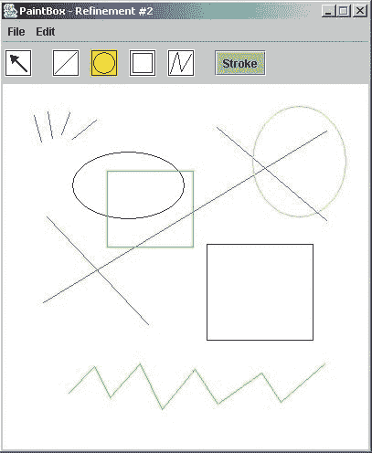

**附录 J** PaintBox 项目 (738)

### 图 J.6

在完成接口和形状完善后的 PaintBox 程序

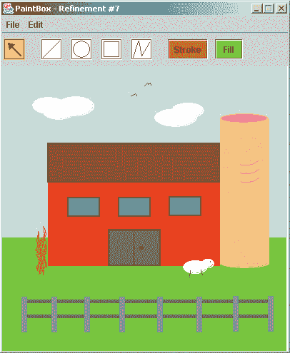

**附录 J** PaintBox 项目 (739)

### 图 J.7

完成后的 PaintBox 程序

*本页特意留空。*

## GUI 事件

在本书的图形轨迹章节中，我们讨论了组件可能生成的各种事件。本附录的目的是将事件/组件关系置于上下文中。

图 K.1 中列出的事件由每个 Swing 组件生成。也就是说，我们可以在任何组件上为这些事件中的任何一个设置监听器。

某些事件由特定组件生成。图 K.2 中的表格将组件与其能生成的事件映射起来。请记住，这些事件是所有组件生成的事件之外的。如果某个组件不产生特定类型的事件，则无法为该组件添加该事件的监听器。

我们已经在文中适当的地方讨论了图 K.1 和 K.2 中的某些事件；而将另一些内容留给您独立探索。应用组件/事件/监听器交互的基本概念，通常只需要知道在什么情况下、哪些组件会生成哪些事件即可。

当然，GUI 中发生的许多事件与当前程序无关。例如，每当鼠标跨越组件移动时，都会产生许多鼠标移动事件。然而，这并不意味着我们必须监听它们。GUI 的定义在某种取决于我们选择对其响应的事件。尽管我们在书中对 GUI 开发进行了详尽介绍，但仍然仅是触皮一角。以下列表描述了本文未深入介绍的其他 Java GUI 容器和组件：

| 事件 | 代表 |
| :--- | :--- |
| 组件事件 | 更改组件的大小、位置或可见性。 |
| 焦点事件 | 获取或失去键盘焦点。 |
| 键事件 | 按下、释放和点击键盘键。 |
| 鼠标事件 | 点击鼠标按钮并将鼠标移入组件的绘制区域。 |
| 鼠标移动事件 | 在组件上移动或拖动鼠标。 |

### 图 K.1

每个 Swing 组件生成的事件 (741-742)

**附录 K** GUI 事件

| 事件 | 动作 | 组件 |
| :--- | :--- | :--- |
| 光标变化 文档项 | | List |
| 选择 | | Window *Other* |
| | | JButton |
| | | JCheckBox |
| | | JColorChooser |
| | | JComboBox |
| | | JDialog |
| | | JEditorPane |
| | | JFileChooser |
| | | JFrame |
| | | JInternalFrame |
| | | JList |
| | | JMenu |
| | | JMenuItem |
| | | JOptionPane |
| | | JPasswordField |
| | | JPopupMenu |
| | | JProgressBar |
| | | JRadioButton |
| | | JSlider |
| | | JTabbedPane |
| | | JTable |
| | | JTextArea |
| | | JTextField |
| | | JTextPane |
| | | JToggleButton |
| | | JTree |

### 图 K.2

特定组件生成的特定事件

- 工具栏是一个容器，它将多个组件分组成一行或一列。工具栏通常包含按钮，这些按钮对应于也可以通过其他方式完成的任务。工具栏可以从它们最初所在的容器中拖出，进入自己的窗口中。
- 内部帧（internal frame）是一个操作方式类似于普通帧但仅限于另一个窗口的容器。内部帧可以在窗口内移动并与其他内部帧重叠。内部帧可以创建 GUI 桌面的感觉，用户可以根据意愿安排组件。
- 分层面板（layered pane）是一个考虑了第三个维度（深度）来组织其包含的组件的容器。当组件被添加到分层面板时，会指定其深度。如果组件重叠，每个组件的深度值将决定哪一个在最上面。
- 进度条（progress bar）可以用于指示特定活动的进度。用户通常不会与进度条进行交互，除了查看它以确定任务（如加载图像）进展了多少。
- 表格（table）是一种以表格格式显示数据的 Java GUI 组件。Java 表格可以完全定制，以提供精确的组织和展示。它还可以允许用户编辑数据。Java 表格实际上并不包含或存储数据；它只是以组织化的方式向用户展示数据。
- 树（tree）是一种呈现数据分级视图的组件。与表格一样，它并不存储数据；它提供了从根节点到各个分支的组织化视图。Java 提供了丰富的支持，但我们鼓励您深入探索这些问题。

*本页特意留空。*

## Java 语法

本附录包含了语法图，描述了 Java 语言元素的构建方式。矩形表示在另一个语法图中定义的元素，圆角表示字面量或字符。

### 编译单元

- 包声明
- 导入声明
- 类型声明

#### 包声明

```
package Name ;
```

#### 导入声明

```
import Name . Identifier ;
```

#### 类型声明

- 类声明
- 接口声明

### 类声明

```
class Identifier Class Associations Class Body Modifier
```

#### 类关联

```
extends Name implements Name List
```

#### 类正体

```
{ }
```

#### 类成员

- 字段声明
- 构造函数声明
- 方法声明
- 类声明
- 接口声明
- `static`
- `Block`

### 接口声明

```
interface Identifier Interface Body Modifier extends Name List
```

#### 接口正体

```
{ }
```

#### 接口成员

- 字段声明
- 方法声明
- 类声明
- 接口声明

### 字段声明

```
Type Variable Declarator ; Modifier ,
```

#### 变量声明符

```
Identifier = Expression Array Initializer
```

#### 类型

```
Primitive Type [ Name ]
```

#### 修饰符

#### 原始类型

`public`, `boolean`, `private`, `char`, `protected`, `byte`, `static`, `short`, `final`, `int`, `abstract`, `long`, `native`, `float`, `synchronized`, `double`, `transient`, `volatile`

#### 数组初始化

```
{ } Expression Array Initializer ,
```

#### 名称

#### 名称列表

```
Identifier Name . ,
```

### 方法声明

```
Type Identifier Parameters Throws Clause Method Body Modifier void
```

#### 参数

```
( ) Type Identifier ,
```

#### 异常子

```
throws Name List
```

#### 方法正体

```
Block ;
```

### 构造函数声明

```
Identifier Parameters Throws Clause Constructor Body Modifier
```

#### 构造函数正体

```
{ }
```

#### 构造函数调用

```
Block Statement
```

# 构造函数调用

```
this Arguments ;
super Arguments Expression .
```

### 块 (Block)

```
{ }
块语句
```

#### 块语句

- 局部变量声明
- `;`
- `语句`
- 类声明

#### 局部变量声明

```
类型 变量声明符 final ,
```

### 语句

- `块`
- `语句表达式`
- `基础赋值`
- `if 语句`
- `switch 语句`
- `while 语句`
- `do 语句`
- `for 语句`
- `return 语句`
- `throw 语句`
- `try 语句`
- `同步语句`
- `空语句`
- `break 语句`
- `continue 语句`
- `标记语句`

#### if 语句

```
if ( 表达式 ) 语句 else 语句
```

#### switch 语句

```
switch ( 表达式 ) { }
```

#### switch 分支

```
case 表达式 : 块语句
default :
```

#### while 语句

```
while ( 表达式 ) 语句
```

#### do 语句

```
do 语句 while ( 表达式 ) ;
```

#### for 语句

```
for ( ; ; ) 语句
for 初始化 表达式 for 更新
```

#### for 初始化

#### for 更新

- 局部变量声明
- `语句表达式`
- `语句表达式 ,`

### 基础赋值

```
标识符 = 表达式 ;
```

#### return 语句

```
return ; 表达式
```

#### throw 语句

```
throw 表达式 ;
```

#### try 语句

```
try 块 catch ( 类型 标识符 ) 块 finally 块
```

#### 同步语句

```
synchronized ( 表达式 ) 块
```

#### 空语句

```
;
```

#### break 语句

```
break ; 标识符
```

#### continue 语句

```
continue ; 标识符
```

#### 标记语句

```
标识符 : 语句
```

### 表达式

- `主表达式`
- `赋值`
- `算术表达式`
- `等价表达式`
- `关系表达式`
- `逻辑表达式`
- `位运算表达式`
- `条件表达式`
- `实例表达式`
- `类型转换表达式`
- `一元表达式`

#### 主表达式

```
字面量 主后缀 名称 this super . 标识符 ( 表达式 ) 分配
```

#### 主后缀

```
. 标识符 . this . class . 分配 [ 表达式 ] 参数
```

#### 参数

```
( ) 表达式 ,
```

#### 分配

```
new 原始类型 数组维度 数组初始化器 名称 参数 类体
```

#### 数组维度

```
[ 表达式 ] []
```

#### 语句表达式

```
赋值 ; 前缀表达式 后缀表达式
```

#### 赋值

```
表达式 = 表达式 += -= *= /= %= <<= >= >= &>= ^= |=
```

### 算术表达式

```
表达式 + 表达式 - * / %
```

### 等价表达式

```
表达式 == 表达式 !=
```

### 关系表达式

```
表达式 < 表达式 > <= >=
```

### 逻辑表达式

```
表达式 && 表达式 ||
```

### 位运算表达式

```
表达式 & 表达式 | ^ << > >
```

### 条件表达式

```
表达式 ? 表达式 : 表达式
```

### 实例表达式

```
表达式 instanceOf 类型
```

### 类型转换表达式

```
( 类型 ) 表达式
```

### 一元表达式

#### 前缀表达式

```
前缀表达式 ++ 表达式 后缀表达式 -- + 表达式
```

#### 后缀表达式

```
- ! 表达式 ++ ~ --
```

### 字面量

- `整数字面量`
- `浮点数字面量`
- `字符字面量`
- `字符串字面量`
- `布尔字面量`
- `null`

#### 整数字面量

- `十进制整数字面量`
- `八进制整数字面量`
- `十六进制整数字面量`

#### 十进制整数字面量

```
0 1 - 9 0 - 9 L l
```

#### 八进制整数字面量

#### 十六进制数字

```
0 0 - 7 0 - 9 L a - f l A - F
```

#### 十六进制整数字面量

```
0 X 十六进制数字 L x l
```

### 浮点数字面量

```
0 - 9 . . 0 - 9 指数部分 0 - 9 浮点后缀
```

#### 指数部分

#### 浮点后缀

```
e 0 - 9 f E + F - d D
```

### 字符字面量

### 布尔字面量

```
' 任何字符 ' true false 转义序列 Unicode 转义
```

### 字符串字面量

```
" " 任何字符 转义序列 Unicode 转义
```

### 转义序列

```
\ n t b r f \ ' " 0 - 9 0 - 7
```

### 标识符

`Java 类` `Java 类`

#### 标识符

`Java 类` `a - z` `A - F` `:` `语句`

#### 标识符

`Java 类` `0 - 9` `0 - 9` `Java 类` `Java 类`

#### 标识符

`Java 类` ` ` `Java 类` ` 

# 1.1 硬件

SR 1.10 两个主要的硬件组件是主内存和 CPU。

主内存存储当前活跃的程序和数据。CPU 从主内存中一次一次地提取单个程序指令并执行它们。


# SR 1.11 内存地址是一个数字，用于唯一地标识存储某个值的特定内存位置。

# SR 1.12 主内存是易失的，这意味着如果关闭计算机电源，存储在内存中的信息将会丢失。

辅助存储设备是非易失的；因此，即使掉电，存储在它们上的信息也会保留。

# SR 1.13 最匹配的单词是

a. 外设 b. 控制器 c. 调制解调器 d. 主内存或 RAM

e. 辅助或 ROM f. RAM g. CPU

# 1.3 网络

# SR 1.14 文件服务器是一种专用的网络计算机，用于存储和提供许多网络用户所需的程序和数据。

# SR 1.15 数一下图 1.16 中的唯一连接数量，完全连接一个五台计算机的点对点网络需要 10 条通信线。在网络中增加第六台计算机将需要它与原始的五台计算机连接，使总数达到 15 条通信线。

# SR 1.16 让网络上的计算机共享通信线是有成本效益的，因为它减少了所需的连接数量，并且更容易向网络中添加新计算机。然而，如果网络繁忙，共享线路可能意味着通信延迟。

# SR 1.17 Internet 一词源于 internetworking（网络互联），这是一个与广域网（WAN）相关的概念。互联将一个网络连接到另一个网络。Internet 是一个广域网。

# SR 1.18 TCP 代表传输控制协议（Transmission Control Protocol）。IP 代表互联网协议（Internet Protocol）。协议是一组规定两个事物如何通信的规则。

# SR 1.19 分解每个 URL 的部分：

a. `duke` 是 `villanova.edu` 域名下 `csc` 子域名（计算机科学系）中的计算机名称，该域名代表诺瓦瓦大学。`edu` 顶级域名表示它是一个教育机构。该 URL 正在从名为 `jss` 的子目录请求名为 `examples.html` 的文件。

b. `java` 是 `sun.com` 域名下的一台计算机（Web 服务器）的名称，该域名代表太阳公司。`com` 顶级域名表示它是一个商业实体。该 URL 正在从名为 `products` 的子目录请求名为 `index.html` 的文件。

# 1.4 Java 编程语言

# SR 1.20 Java 编程语言由 James Gosling 在 20 世纪 90 年代初在太阳公司开发。它于 1995 年向推出。

# SR 1.21 Java 程序的处理从 `main` 方法开始。

# SR 1.22 字符“Hello”将打印在计算机屏幕上。

# SR 1.23 整行代码都是注释，因此没有结果。

# SR 1.24 显示的所有标识符都是有效的，`12345` 除外（因为标识符不能以数字开头），以及 `black&white` 除外（因为标识符不能包含字符 &）。标识符 `RESULT` 和 `result` 都是有效的，但不应在程序中一起使用，因为它们仅大小写上不同。下划线字符（如 `answer_7`）是标识符的有效部分。

# SR 1.25 虽然列出的任何名称都可以用作所需的标识符，但唯一“良好”的选择是 `scoreSum`。标识符 `x` 没有描述性且毫无意义，标识符 `sumOfTheTestScoresOfTheStudents` 过于冗，而标识符 `smTstScr` 不够清晰。

# SR 1.26 空白（White space）是指程序中分隔单词和符号的空格、制表符和换行符。编译器忽略额外的空白；因此，它不影响执行。然而，适当使用空白对于使程序人类可读至关重要。

# 1.5 程序开发

# SR 1.27 在最底层，计算机的指令只执行简单任务，例如复制值或比较两个数字。然而，通过每秒组合数百万这样的简单指令，计算机可以执行复杂的任务。

# SR 1.28 高级语言允许程序员以类似于英语的术语表达一系列程序指令，这些术语相对易读和使用。然而，为了执行，程序必须以特定计算机的机器语言表示，这由一系列位组成，人类基本上是无法读取的。高级语言程序在运行之前必须翻译成机器语言。

# SR 1.29 Java 字节码是 Java 源代码程序的低级表示。Java 编译器将源代码翻译成字节码，然后可以使用 Java 解释器执行。字节码在被 Web 浏览器中的 Java 解释器执行之前，可能会跨 Web 传输。

# SR 1.30 最匹配的单词是

a. 机器 b. 汇编 c. 高级 d. 高级 e. 编译器 f. 解释器

# SR 1.31 语法规则定义了编程语言的符号和单词如何组合。编程语言指令的语义决定了执行该指令时会发生什么。

# SR 1.32 a. 编译错误 b. 运行时错误（你不能除以零） c. 逻辑错误

# 1.6 面向对象编程

# SR 1.33 1. 理解问题。2. 设计解决方案。3. 考虑解决方案的替代方案和改进方案。4. 实现解决方案。5. 测试解决方案。

# SR 1.34 我们想到的问题的第一个解决方案可能不是好的方案。在花费过多精力实现我们的第一个想法之前，考虑替代方案，我们通常可以节省精力和时间。

# SR 1.35 支持面向对象编程的主要元素是对象、类、封装和继承。对象由类定义，类包含了定义对这些对象的操作的方法（它们执行的服务）。对象被封装起来，以便它们存储和管理自己的数据。继承是一种重用技术，其中一个类可以从另一个类派生。

# 2 数据与表达式

## 2.1 字符字符串

# SR 2.1 字符串字面量是由双引号界定的字符序列序列。

# SR 2.2 `System.out` 对象的 `print` 和 `println` 方法都会向显示器屏幕写入字符字符串。区别在于，在打印字符之后，`println` 会执行回车，因此下次打印的内容将出现在下一行。`print` 方法允许后续输出显示在同一行。

# SR 2.3 参数是在调用方法时传入方法的数据。方法通常使用该数据来完成它提供的服务。例如，`println` 方法的参数指示了应该打印哪些字符。

# SR 2.4 代码片段的输出为：

One

Two Three

# SR 2.5 代码片段的输出为：

Ready

Set

Go

# SR 2.6 语句的输出为

It is good to be 10

子表达式 `(5 + 5)` 中的 `+` 运算符表示整数加法，因为它的两个操作数都是整数。如果删除内部括号，`+` 运算符将表示字符串拼接，输出为

It is good to be 55

# SR 2.7 转义序列是以反斜杠（`\`）开头的字符序列，它意味着随后的字符应该以特殊方式处理。例如：`\n` 代表换行符，`\t` 代表制表符，`\"` 代表引号字符（而不是用于终止字符串）。

# SR 2.8 `System.out.println("\"I made this letter longer than " + "usual because I lack the time to\\nmake it short.\"" + "\n"\\n\tBlaise Pascal");`

## 2.2 变量与赋值

# SR 2.9 变量声明确定了变量的以及它可以包含的数据类型。声明还可以包含一个可选的初始化，为变量提供一个初始值。

# SR 2.10 给定这些变量声明，答案是：dea. 声明了五个变量：`count`、`value`、`total`、`MAX_VALUE` 和 `myValue`。

b. 它们都是 `int` 类型。

c. `count`、`MAX_VALUE` 和 `myValue` 都赋予了初始值。

d. 是，这是合法的。`myValue` 是 `int` 类型变量，`100` 是一个 `int` 字面量。

e. 不，这是不法的。`MAX_VALUE` 被声明为 `final` 变量，因此不能赋予除初始值以外的值。

# SR 2.11 你选择的变量名应该反映变量的用途。

例如：

```java
int numCDs = 0;
```

# SR 2.12 你选择的变量名应该反映变量的用途。由于一英里的英尺数不会改变，声明常量是一个好主意。例如：

```java
final int FT_PER_MILE = 5280;
```

**附录 n 自测习题答案 767**

# SR 2.13 首先，通过仔细选择常量的名称，你可以让程序比直接使用字面量更易理解。

其次，使用常量可以确保变量所代表的字面量不会在程序的某处被无意改变。

第三，如果你确实需要使用不同的字面量重写程序，你只需要更改一次值（即常量的初始值），而不需要修改程序中的许多地方。

## 2.3 原始数据类型

# SR 2.14 原始数据是基本值，例如数字或字符。对象是更复杂的实体，通常包含帮助定义它们的原始数据数据。

# SR 2.15 整数变量一次只能存储一个值。当给它分配一个新值时，旧值会被覆盖并丢失。

# SR 2.16 Java 中的四种整数数据类型是 `byte`、`short`、`int` 和 `long`。它们的区别在于为每个类型分配的内存空间大小，因此能保存的大小。

# SR 2.17 Java 自动为整数字面量分配数据类型 `int`。如果你在整数字面量的末尾加上 `L` 或 `l`，例如 `1234L`，Java 将为其分配类型 `long`。

# SR 2.18 Java 自动为浮点字面量分配数据类型 `double`。如果你在浮点字面量的末尾加上 `F` 或 `f`，例如 `12.34f`，Java 将为其分配类型 `float`。

# SR 2.19 字符集是特定顺序的字符列表。字符集定义了特定计算机或编程语言支持的有效字符。Java 使用 Unicode 字符集。

# SR 2.20 原始 ASCII 字符集支持 128 个字符，扩展 ASCII 字符集支持 256 个字符，而 UNICODE 字符集支持 65,536 个字符。

## 2.4 表达式

# SR 2.21 Java 表达式中 `19%5` 的结果是 `4`。取余运算符 `%` 返回第二个操作数除以第一个操作数的余数。`19` 除以 `5` 的余数为 `4`。

# SR 2.22 Java 表达式中 `13/4` 的结果是 `3`（而不是 `3.25`）。结果是整数是因为两个操作数都是整数。因此，`/` 运算符执行整数除法，结果的小数部分被截断。

**附录 n 自测习题答案**

# SR 2.23 执行语句后，`diameter` 保存值为 `20`。首先，将 `diameter` 的当前值（`5`）乘以 4，然后将结果存回 `diameter`。

# SR 2.24 运算符优先级是决定表达式中运算符求顺序的规则集。

# SR 2.25 表达式的求值结果：

a. `15 + 7 * 3` -> `15 + 21` -> `36`

b. `(15 + 7) * 3` -> `22 * 3` -> `66`

c. `3 * 6 + 10 / 5 + 5` -> `18 + 2 + 5` -> `25`

d. `27 % 5 + 7 % 3` -> `2 + 1` -> `3`

e. `100 / 2 / 2 / 2` -> `50 / 2 / 2` -> `25 / 2` = `12`

f. `100 / ( 2 / 2) / 2` -> `100 / 1 / 2` -> `100 / 2` = `50`

# SR 2.26 表达式 a 是有效的。表达式 b 是无效的，因为有两个左括号。同样，表达式 c 有左括号但没有右括号。表达式 d 可能是有效的表达式。

# SR 2.27

# SR 2.28

# SR 2.29

# SR 2.30

## 2.5 数据转换

# SR 2.31 宽转换倾向于从较小的存储空间到较大的。窄转换则相反。信息更容易在窄转换中丢失，这就是为什么窄转换不安全。

# SR 2.32 转换为：a. 宽转换，b. 窄转换，c. 宽转换，d. 宽转换，e. 宽转换。

**附录 n 自测习题答案 769**

# SR 2.33 执行语句期间，`value` 被转换为 `float` 并存入内存位置。但赋值后 `value` 仍然是 `int`。

# SR 2.34 执行语句期间，`result` 中的值被读取并转换为 `int` 存入内存位置。但 `result` 变量本身没有改变，保持为 `27`。

# SR 2.35：

a. 因为两个操作数都是整数，使用了整数除法。

b. 因为两个操作数都是整数，使用了整数除法，但随后结果转换为 `3.0`。

c. 因为一个操作数是浮点数，使用了浮点除法。

d. `num1` 被强制转换为 `double`；因此，由于一个操作数是浮点数，使用了浮点除法。

e. `val1` 被强制转换为 `int`；因此，由于两个操作数都是整数，使用了整数除法。

## 2.6 交互式程序

# SR 2.36 `GasMileage` 程序对应的行是：a. `import java.util.Scanner;`

b. `Scanner scan = new Scanner(System.in);`

c. `Scanner scan = new Scanner(System.in);`

d. `miles = scan.nextInt();`

# SR 2.37 根据假设，以下代码将要求用户输入年龄并将响应存储在 `value` 中：

```java
System.out.print("Enter your age in years: ");
value = myScanner.nextInt();
```

## 2.7 图形

# SR 2.38 黑白图片可以使用一系列点像素点来绘制。值为 0 的像素显示为白色，值为 1 的像素显示为黑色。通过使用成千上万个像素，可以在屏幕上生成真实的黑白照片。

# SR 2.39 第四个角的坐标是 (3, 7)，它是右上角。

# SR 2.40 我们从已知信息可以看出正方形的边长为 3。因此，另外两个角是 (5, 13) 和 (8, 13)。

# SR 2.41 每个数字 8 位，每个像素 3 个数字，300 由 200 像素得到

8 3 3 3 300 3 200 5 1,440,000 位

## 2.8 Applet 单元

# SR 2.42 Java applet 是一种可以使用 Web 浏览器执行的 Java 程序。通常，Java applet 的字节码形式会通过互联网从另一台计算机拉取并在本地执行。Java 应用程序（application）是一个可以独立运行的 Java 程序。它的执行不需要 Web 浏览器。

# SR 2.43 每当 applet 的图形元素需要在屏幕上显示（或“绘制”）时，系统就会调用 applet 的 `paint` 方法。示例包括当 applet 首次运行时或当覆盖在 applet 窗口上的窗口被移除时。

# SR 2.44 `code` 标签应该指示字节码文件，例如 `DrawHouse.class`，而不是源代码文件。标签所指示的文件应该是可以在 Java 解释器上“准备就绪”的。

## 2.9 绘制形状

# SR 2.45 边界矩形（bounding rectangle）是一个包围曲线形形状（如椭圆）的虚拟矩形，用于定义形状的宽度、高度和左上角。

# SR 2.46

```java
page.drawRect(16, 12, 50, 50);
```

# SR 2.47

```java
page.setColor(Color.blue);
page.fillRect(30, 35, 40, 20);
```

# SR 2.48 修改的结果是

a. 由于 `MID` 的值被加到雪人图形的所有水平部分，雪人向左移动了一点。

b. 由于 `TOP` 的值被加到雪人图形的所有垂直部分，雪人向上移动了一点。

c. 帽子现在是蓝色的。

**附录 n 自测题 771 答案**

d. 通过将微笑弧的起始角度更改为 10，起点现在位于雪人脸部的右侧而不是左侧。弧的“方向”仍然是逆时针。因此，弧向下弯曲而不是向上，开心的雪人现在变难心了。

e. 上身由于与背景合并而“消失”了。

# 第 3 章 使用类和对象

## 3.1 创建对象

# SR 3.1 空引用（null reference）是不引用任何对象的引用。可以使用保留字 `null` 在跟进这些引用之前检查它们是否为空引用。

# SR 3.2 `new` 运算符创建指定类的新实例（对象）。然后调用该类的构造函数来帮助设置新创建的对象。

# SR 3.3 下面的声明创建了一个名为 `author` 的 `String` 变量并对其进行了初始化：

```java
String author = new String("Fred Brooks");
```

对于字符串，此声明可以简写为如下：

```java
String author = "Fred Brooks";
```

该对象引用变量及其取值可以描绘如下：`author` = `"Fred Brooks"`

# SR 3.4 要将整数变量 `size` 设置为名为 `name` 的 `String` 对象的长度，代码如下：

```java
size = name.length();
```

# SR 3.5 如果两个引用指向同一个对象，则它们是彼此的别名。

通过一个引用更改对象的状态会改变另一个引用的状态，因为实际上只有一个对象。只有当对该对象没有有效引用时，该对象才会被标记为垃圾收集。

### 3.2 String 类

# SR 3.6 字符串是不可变的。更改 `String` 变量值的唯一方法是重新为其赋值一个新对象。因此，被语句更改的变量是：a. 无，b. `s1`，c. 无，d. `s3`。

**772**

**附录 n 自测题 SR 3.7 答案** 输出结果为：

```
o Found 11 5
```

# SR 3.8 下面的语句以全大写字母打印 `String` 对象的值：

```java
System.out.println(title.toUpperCase());
```

# SR 3.9 下面的声明创建了一个 `String` 对象，并将其赋值为字符串 `description` 的前 10 个字符：

```java
String front = description.substring(0, 10);
```

## 3.3 包

# SR 3.10 Java 包（package）是相关类的集合。Java 标准类库是一组支持常见编程任务的包。

# SR 3.11 每个包都包含一组支持特定编程活动的类。`java.net` 包中的类支持网络通信，`javax.swing` 类中的类支持图形用户界面开发。

# SR 3.12 `Scanner` 类和 `Random` 类是 `java.util` 包的一部分。

`String` 和 `Math` 类是 `java.lang` 包的一部分。


## SR 3.13
根据在线 Java API 文档，`Point` 类表示二维空间中坐标为 `(x, y)` 的位置。

## SR 3.14
`import` 语句建立了程序使用特定类的事实，并指定了该类属于哪个包。这允许程序员直接使用类名。

## SR 3.15
`String` 类是 `java.lang` 包的一部分，它是自动导入的。

## 3.4 Random 类

### SR 3.16
通过类名调用 `nextInt()` 方法返回随机整数。**附录 n 自测题 773 答案**

### SR 3.17
将正整数 `x` 传递给 `nextInt()` 方法返回范围内的随机数。

### SR 3.18
表达式范围为：
a. 49
b. 10
c. 24

### SR 3.19
生成的表达式为：
a. `nextInt(31);`
b. `nextInt(10)`
c. 5

## 3.5 Math 类

### SR 3.20
静态方法可以通过类名调用。如果不是静态方法，则只能通过类的实例（对象）执行。

### SR 3.21
表达式的值为：
a. 20
b. 16.0
c. 25

### SR 3.22
下面的语句打印 1.23 弧的正弦值：
```java
System.out.println(Math.sin(1.23));
```

### SR 3.23
下面的声明创建一个 `double` 变量，并将其初始化为 5 的 2.5 次方：
```java
double result = Math.pow(5, 2.5);
```

### SR 3.24
图 3.5 中列出的方法示例包括：`static int min(int a, int b)`、`static float max(long a, long b)`、`static long round(double a)`。

## 3.6 输出格式化

### SR 3.25
为了在程序中使用 `NumberFormat` 对象，你通过 `NumberFormat` 类提供的静态方法请求一个对象。你调用的方法取决于你对对象的用途。例如，如果你打算将其格式化为百分比，可能会编写：
```java
NumberFormat fmt = NumberFormat.getPercentInstance();
```

### SR 3.26
a. 语句是：
```java
NumberFormat moneyFormat = NumberFormat.getCurrencyInstance();
```
不要忘记，你还需要在程序中导入 `java.text.NumberFormat`。

b. 语句是：
```java
System.out.println(moneyFormat.format(cost));
```

c. 如果区域是美国，输出将是 $54.89。如果区域是英国，输出将是 £54.89。

### SR 3.27
要将浮点值输出为百分比，首先通过调用 `NumberFormat` 类的静态方法 `getPercentInstance()` 获取一个 `NumberFormat` 对象。然后，将要格式化的值传递给格式化对象的 `format()` 方法，该方法会返回一个格式化后的字符串。例如：
```java
NumberFormat fmt = NumberFormat.getPercentInstance();
System.out.println(fmt.format(value));
```

### SR 3.28
下面的代码将提示并从用户读取一个 double 值，然后打印输入值绝对值的平方根结果，保留两位小数：
```java
Scanner scan = new Scanner(System.in);
DecimalFormat fmt = new DecimalFormat("0.00");
double value, result;

System.out.print("Enter a double value: ");
value = scan.nextDouble();

result = Math.sqrt(Math.abs(value));

System.out.println(fmt.format(result));
```

## 3.7 枚举类型 (enumerated Types)

### SR 3.29
以下是电影分级的枚举类型声明：`enum Ratings {G, PG, PG13, R, NC17}`

### SR 3.30
在列出的假设下，输出为：
clubs
hearts
0
2

**附录** 自测习题答案 **775**

### SR 3.31
通过使用枚举类型，你可以确保该类型的变量只会取枚举中定义的值。

## 3.8 包装类 (Wrapper Classes)

### SR 3.32
Java 标准类库为每种基本数据类型定义了一个包装类。在需要调用对象的情况下，由包装类创建的对象可能足够了。

### SR 3.33
对应的包装类是 `Byte`、`Integer`、`Double`、`Character` 和 `Boolean`。

### SR 3.34
一方法是使用 `Integer` 的构造函数，如下：`holdNumber = new Integer(number);`
另一种方法是利用自动装箱（autoboxing），如下：`holdNumber = number;`

### SR 3.35
以下语句使用 `Integer` 类的 `MAX_VALUE` 常量来打印最大的 int 值：
```java
System.out.println(Integer.MAX_VALUE);
```

## 3.9 组件与容器 (Components and Containers)

### SR 3.36
帧（frame）和面板（panel）都是可以容纳 GUI 元素的容器。
然而，帧作为一个带有标题栏的独立窗口显示，而面板不能单独显示。面板通常显示在帧内部。

### SR 3.37
最匹配的术语是：
a. 容器 (container)
b. 帧 (frame)
c. 面板 (panel)
d. 重量级 (heavyweight)
e. 轻量级 (lightweight)
f. 内容面板 (content pane)
g. 标签 (label)
h. 布局管理器 (layout manager)

### SR 3.38
如果你通过向右拖动右下角来调整帧的大小，该短语会从跨两行变为单行。这是因为没有包含任何描述容器布局的特殊指令，在这种情况下，如果面板的大小允许，面板的组件将相互相邻排列。

### SR 3.39
最准确的描述是“标签被添加到面板中，然后面板被添加到帧的内容面板中。”

### SR 3.40
更改的结果是：
a. 由于新的尺寸变化，面板变得更大且是正方形的。
**776**
**附录** 自测习题答案
b. 短语不可见。你只看到一个黑色面板，因为该短语是用黑色写的，与背景颜色混合在了一起。
c. 没有变化。
d. 由于标签添加的顺序相反，短语是“反向的”——也就是说，它读起来是“但请先举手”，然后是“质疑权威”。

## 3.10 嵌套面板 (nested Panels)

### SR 3.41
图形用户界面的包含层级结构识别了 GUI 内部元素的嵌套关系。例如，在某个特定的 GUI 中，假设某些标签和按钮被包含在一个面板内，而该面板又包含另一个面板内，后者包含在一个帧内。包含层级结构可以表示为树，指示 GUI 的所有元素是如何相互嵌套的。

### SR 3.42
在 `NestedPanels` 程序中创建了三个面板：`subPanel1`、`subPanel2` 和 `primary`。

### SR 3.43
在 `NestedPanels` 程序中，`subPanel1` 和 `subPanel2` 被添加到 `primary` 面板中。`primary` 面板被显式添加到帧的内容面板中。

## 3.11 图像 (Images)

### SR 3.44
`LabelDemo` 程序创建了一个帧、一个面板、一个图标和三个标签。

### SR 3.45
在 `LabelDemo` 程序的标签实例化语句：`label2 = new JLabel("Devil Right", icon, SwingConstants.CENTER);` 中，第一个参数定义文本，第二个参数提供图像，第三个参数指示标签的水平对齐方式。

### SR 3.46
更改的结果是：
a. 更改标签的水平对齐方式没有视觉效果。水平对齐仅描述了文本和图标在标签内的对齐方式。由于标签的区域通常恰好是显示标签所需的大小，因此在该区域内的标签对齐是无关的。
b. 文本位置的变化导致“Devil Right”文本出现在第二个图像的右侧，而不是其左侧。
**附录** 自测习题答案 **777**
c. 文本位置的变化导致运行时错误——“Bottom”不是 `setHorizontalTextPosition()` 方法的有效参数。
d. 由于你更改了标签内文本的垂直位置，文本“Devil Above”直接出现在第三张图像上。

# 第 4 章 编写类 (Writing Classes)

## 4.1 复习类与对象 (Classes and Objects Revisited)

### SR 4.1
属性（attribute）是存储在对象中的数据值，定义了该对象的特定特征。例如，`Student` 对象的一个属性可能是该学生当前的平均点分。
对象属性的值共同决定了该对象的当前状态。

### SR 4.2
操作（operation）是一个可以对对象执行或由对象执行的函数。例如，`Student` 对象的一个操作可能是计算该学生当前的平均点分。对象的操作统称为行为（behaviors）。

### SR 4.3
为代表图书馆书籍的 `Book` 类定义的属性和操作：
属性：`idNumber`、`onShelfStatus`、`isAvailable`
操作：`checkOut`、`dueDate`

### SR 4.4
答案为：
a. 错误——识别类是解决问题的关键。除了识别已存在的类，我们还设计并实现新类。
b. 正确——我们调用此类修改器（mutators）。
c. 正确——许多操作的结果取决于操作对象的状态。
d. 错误——在 Java 中，对象的状态由实例数据表示。
**778**
**附录** 自测习题

## 4.2 类的结构 (anatomy of a Class)

### SR 4.5
类是对象的蓝图。它定义了每个实例化对象将拥有的变量和方法。但类并不为变量保留内存空间。每个对象都有自己的数据空间，因此都有自己的状态。

### SR 4.6
`Die` 类的实例数据是 `MAX`（一个等于 6 的整数常量，代表骰子的面数以及骰子的最大值）和 `faceValue`（一个整数变量，代表骰子当前朝上的点数）。

### SR 4.7
`Die` 类定义的可以改变 `Die` 对象状态的方法有 `roll()` 和 `setFaceValue()`。

### SR 4.8
当将对象传递给 `print()` 或 `println()` 方法时，会自动调用对象的 `toString()` 方法来获取对象的字符串描述。如果对象没有定义 `toString()` 方法，则使用默认字符串。因此，在定义类时定义 `toString()` 方法通常是一个好主意。

### SR 4.9
变量的作用域（scope）是程序中可以引用变量的区域。在类级别定义的实例变量可以在类的任何方法中引用。在特定方法内定义的局部变量（包括形式参数）只能在该方法内引用。

### SR 4.10
UML 图帮助我们可视化程序中的实体（类和对象）以及它们之间的关系。UML 图是我们在编写代码之前帮助捕捉设计的工具。

## 4.3 封装 (encapsulation)

### SR 4.11
自主对象是指控制其自身数据值的对象。
封装对象不允许外部客户端进入并更改其数据，因此它们是自主的。

### SR 4.13
修饰符是 Java 保留字，可以用于变量或方法的定义，并专门定义了其使用的某些特性。例如，通过声明一个具有私有（private）可见性的变量，该变量无法在定义它的对象之外被直接访问。
**附录 n** 自测习题答案 **779**

### SR 4.14
常量可以声明为具有公有（public）可见性，因为这不会违反封装性。由于常量的值无法更改，因此另一个对象直接访问它通常不是问题。

### SR 4.15
修饰符以以下方式影响方法和变量：
a. 公有（public）方法被称为对象的服务方法，因为它定义了对象所提供的服务。
b. 私有（private）方法被称为支持方法，因为它无法从对象外部调用，并用于支持类中其他方法的活动。
c. 公有（public）变量是可以被客户端直接访问和修改的变量。这显式地违反了封装原则，因此应该被避免。
d. 私有（private）变量是只能从类内部访问和修改的变量。变量几乎总是声明为私有（private）可见性。

## 4.4 方法的结构

### SR 4.16
虽然方法定义在类中，但它是通过特定的对象被调用的，以指示该类的哪一个对象正受到影响。例如，`Student` 类可能定义计算学生平均学点数（GPA）的操作，但该操作是通过特定的 `Student` 对象调用的，用以计算该学生的 GPA。此规则的例外是静态（static）方法的调用（见第 3 章），它是通过类名执行的，且不影响任何特定的对象。

### SR 4.17
被调用的方法可能会返回一个值，这意味着它计算了一个值并将该值提供给调用方法。调用方法通常将该调用以及其返回值作为较大表达式的一部分使用。

### SR 4.18
使用显式返回语句（`return`）来指定从方法返回的值。返回值的类型必须与方法定义中指定的返回类型匹配。

### SR 4.19
对于返回类型非 `void` 的方法，需要返回语句。不返回值的方法可以使用不带表达式的返回语句，但这不是必须的。一个方法中应只使用一个返回语句。

### SR 4.20
实际参数（actual parameter）是在调用方法时发送给方法的值。
形式参数（formal parameter）是方法声明头中对应的变量；它获取实际参数的值，以便在方法内部使用。
**780**
**附录 n** 自测习题答案

### SR 4.21
以下代码实现了请求的 `getFaceDown()` 方法：
```java
//---------------------------------------------------
// 脸朝值访问器。
//---------------------------------------------------
public int getFaceDown()
{
    return (MAX + 1) - faceValue;
}
```

### SR 4.22
在 Transactions 程序中：
a. 创建了三个 `Account` 对象。
b. 在 `acct2` 对象上调用 `withdraw()` 方法时，传递了两个参数（实际参数）。
c. 在 `acct3` 对象上调用 `addInterest()` 方法时，没有传递任何参数（实际参数）。

### SR 4.23
`getBalance()` 方法是一个经典的访问器（accessor）。也可以将 `toString()` 方法归类为访问器，因为它返回了关于对象的信息。`deposit()`、`withdraw()` 和 `addInterest()` 方法都提供了修改器（mutator）功能，因为它们可以用来更改余额。

## 4.5 构造函数

### SR 4.24
构造函数是用于初始化对象的特殊方法。

### SR 4.25
构造函数的名称与其类名相同，且不返回值。

## 4.6 图形对象

### SR 4.26
面板（panel）的“内容”在 `SmilingFace` 类中定义。

### SR 4.27
在 `SmilingFace` 程序中，当面板实例化时，对象的 `paintComponent()` 方法被调用。
**附录 n** 自测习题答案 **781**

### SR 4.28
有许多方法可以给 `SmilingFace` 添加一对眼镜。以下插入在鼻子和嘴之后的代码是其中一种方法。

### SR 4.29
以下代码实现了请求的构造函数：
```java
//---------------------------------------------------
// 构造函数：用指定的值初始化此圆圈。
//---------------------------------------------------
public Circle(Color shade, int upperX, int upperY)
{
    diameter = (int) (Math.random() * 180) + 20;
    color = shade;
    x = upperX;
    y = upperY;
}
```
在 `Circle` 类中定义常量 `180` 和 `20`，或者将这些值作为参数传递给构造函数可能会更好。

## 4.7 图形界面

### SR 4.30
事件通常代表用户操作。设置监听器对象（listener object）来监听由特定组件生成的特定事件。

### SR 4.31
不，我们不能向任何组件添加任何监听器。每个组件都会生成一组特定的事件，只有这些类型的监听器可以添加到组件中。

## 4.8 按钮

### SR 4.32
`JButton` 对象在被按下时会产生动作事件。
当发生时，与该按钮关联的 `actionPerformed()` 方法会被调用。

### SR 4.33
为了修改 `PushCounterPanel` 类，使其不再显示按钮点击次数而是显示轨迹，你可以在 `PushCounterPanel` 类中定义一个新的实例变量：
`private String display = "0";`
然后将 `actionPerformed()` 方法中的代码改为：
`count++;`
`display = display + count;`
`label.setText("Pushes: " + display);`
**782**
**附录 n** 自测习题答案

## 4.9 文本框

### SR 4.34
在 Fahrenheit 程序中，当用户在界面的文本框输入数字并按下 Enter（或 Return）键时，文本框组件产生动作事件。监听该事件的 `TempListener` 类通过获取文本框内容、将其转换为表示给定华氏温度的整数、计算相应的摄氏温度并保存到 `resultLabel` 来做出响应。标签的内容随后显示在屏幕上。


# SR 4.35

要修改 `FahrenheitPanel` 类，首先从类中移除 `outputLabel`，因为它不再需要了。然后将设置结果标签的代码改为：

```java
String hold = text + " degrees Fahrenheit = ";
hold += celsiusTemp + " degrees Celsius";
resultLabel.setText(hold);
```

# 附录自测习题答案 783

## SR 5.4
假设给定声明，其值为：a. true, b. true, c. false, d. true, e. true, f. true, g. true, h. false, i. true, j. true。

## SR 5.5
真值表是一种表格，它在给定变量和条件的所有可能组合的情况下，显示布尔表达式的所有可能结果。

## SR 5.6
真值表为：

```
(value > 0)
value > 0
done
!done
|| !done
true
true
false
true
true
false
true
true
false
true
false
false
false
false
true
true
```

## SR 5.7
真值表为：

```
c1 && !c2 ||
c1
c2
!c1
!c2
c1 && !c2
!c1 && c2
!c1 && c2
true
true
false
false
false
false
false
true
false
false
true
true
false
true
false
true
true
false
false
true
true
false
false
true
true
false
false
false
```

# 5.2 if 语句

## SR 5.8
根据给定的假设，输出将是：a. 红白黄 b. 蓝黄 c. 蓝黄

## SR 5.9
块语句将多个语句组合在一起。当我们根据布尔条件执行多个操作时，我们使用它们来定义 `if` 语句或循环的体体。

## SR 5.10
当 `if` 或 `else` 子句内部的语句是 `if` 语句时，就发生了嵌套 if。嵌套 if 让程序员能够做出一系列决策。同样，嵌套循环是循环内部的循环。

# 784 附录自测习题答案

## SR 5.11
根据给定的假设，输出将是：a. 红橙白黄 b. 黑色蓝绿 c. 黄绿。

## SR 5.12

```java
if (temperature <= 50)
{
    System.out.println("It is cool.");
    System.out.println("Dress warmly.");
}
else if (temperature > 80)
{
    System.out.println("It is warm.");
    System.out.println("Dress cooly.");
}
else
{
    System.out.println("It is pleasant.");
    System.out.println("Dress pleasantly.");
}
```

# 5.3 数据比较

## SR 5.13
因为浮点值在内部被存储为二进制数，因此比较浮点值的精确相等性只有在它们逐位完全相同时才为真。最好使用一个合理的容差值并考虑两个值之间的差异。

## SR 5.14
我们使用 `String` 类的 `equals` 方法来比较字符串的相等性，该方法返回一个布尔结果。`String` 类的 `compareTo` 方法也可以用于比较字符串。它根据两个字符串之间的关系返回一个正整数、0 或负整数结果。

## SR 5.15

```java
//------------------------------------------------------
// 如果此骰子等于 die，返回 true，否则
// 返回 false。
//------------------------------------------------------
public boolean equals(Die die)
{
    return (this.faceValue == die.faceValue);
}
```

## SR 5.16

```java
if (s1.compareTo(s2) < 0)
    System.out.println(s1 + "\n" + s2);
else
    System.out.println(s2 + "\n" + s1);
```

# 785 附录自测习题答案

# 5.4 while 语句

## SR 5.17
无限循环是一种永远不会终止的重复语句。具体来说，循环体会导致条件变为假。

## SR 5.18
输出是整数 0 到 9，每行打印一个整数。

## SR 5.19
没有进入循环，因此没有输出。

## SR 5.20
由于 `high` 的值始终大于 `low` 的值，代码会持续循环，产生许多行零，直到程序终止。

## SR 5.21
输出为：

```
0 1 2 3 4 5 6 7 8 9 10
1 2 3 4 5 6 7 8 9 10
2 3 4 5 6 7 8 9 10
3 4 5 6 7 8 9 10
4 5 6 7 8 9 10
5 6 7 8 9 10
6 7 8 9 10
7 8 9 10
8 9 10
9 10
10
```

## SR 5.22

```java
int count = 1;
System.out.print("divisors of " + value + ":");
while (count <= value)
{
    if ((value % count) == 0)
        System.out.print(" " + count);
    count++;
}
```

## SR 5.23

```java
int count1 = 1, count2;
while (count1 <= value)
{
    System.out.print("divisors of " + count1 + ":");
    count2 = 1;
    while (count2 <= count1)
    {
        if (count1 % count2 == 0)
            System.out.print(" " + count2);
        count2++;
    }
    System.out.println();
    count1++;
}
```

# 786 附录自测习题答案

# 5.5 迭代器

## SR 5.24
a. `Scanner = new Scanner(System.in);`
b. `Scanner(new File("info.dat"));`
c. `new Scanner(infoString);`

## SR 5.25
以下代码输出：

```java
int numChars = 0;
int numLines = 0;
String infoLine;
while (infoScan.hasNext())
{
    infoLine = infoScan.nextLine();
    numChars++;
}
System.out.println(numLines);
```

# 5.6 ArrayList 类

## SR 5.26
`ArrayList` 存储多个元素。当我们想要根据布尔条件执行多个操作时，我们使用它们来定义 `if` 语句或循环的体体。`ArrayList` 动态增加其容量。

## SR 5.27
`ArrayList` 通过索引访问其对象。

## SR 5.28
`ArrayList<Die> dice = new ArrayList<>();`

## SR 5.29
[Andy, Betty]

# 787 附录自测习题答案

# 6 条件判断与循环

## 6.1 switch 语句

## SR 6.1
`switch` 语句根据表达式匹配相应的 `case`。如果存在 `default` 分支，则执行 `default` 情况。

## SR 6.2
`switch` 语句通常使用 `break` 语句跳转到 `switch` 结尾。

## SR 6.3
如果没有匹配到任何 `case`，则输出：not passing。

```java
switch (num1)
{
    case 5:
        myChar = 'W';
        break;
    case 6:
        myChar = 'X';
        break;
    case 7:
        myChar = 'Y';
        break;
    default:
        myChar = 'Z';
}
```

## 6.2 三元运算符

## SR 6.5
三元运算符评估条件并产生两个可能结果之一。条件语句（如 `if` 和 `switch` 语句）是一类允许评估条件并执行相应的语句的语句。

# 788 附录自测习题答案

## SR 6.6
`char id = (first) ? 'A' : 'B';`

## SR 6.7
`System.out.println("The value is " + ((val <= 10) ? "not" : "") + "greater than 10.");`

## 6.3 do 语句

## SR 6.8
`while` 循环首先评估条件。如果为真，则执行循环体。`do` 循环先执行体再评估条件。因此，`while` 循环执行零或多次，而 `do` 循环执行一次或多次。

## SR 6.9
输出整数 0 到 9，每行打印一个整数。

## SR 6.10
该代码包含一个无限循环。10、11、12 等数字将一直打印，直到程序终止或数字大到 `int` 变量 `low` 无法容纳。

## SR 6.11

```java
Scanner scan = new Scanner(System.in);
int num, sum = 0;
do
{
    System.out.print("enter next number (0 to quit) > ");
    num = scan.nextInt();
    sum += num;
} while (num != 0);
System.out.println(sum);
```

## 6.4 for 语句

## SR 6.12
`for` 循环通常用于我们知道或可以计算出迭代循环体的次数时。`while` 循环处理更通用的情况。

## SR 6.13
输出为：100

## SR 6.14
输出为：60

# 附录 自测题答案 78-789

```java
SR 6.16 final int NUMROLLS = 100;

int sum = 0;

for (int i = 1; i <= NUMROLLS; i++)
{
    sum += die.roll();
}

System.out.println((double)sum/NUMROLLS);
```

# 第 7 章 对象面向设计

## 7.1 软件开发活动

## SR 7.1
软件开发的四个基本活动是需求分析（决定程序应该做什么）、设计（决定如何做）、实现（用源代码编写解决方案）和测试（验证实现）。

## SR 7.2
通常情况下，客户会提供一组初始需求或对他们想要解决的问题描述。软件开发人员的责任与客户合作，确保需求或问题陈述是正确且无歧义的。

## SR 7.3
软件开发是一项解决问题的活动。因此，本节提出的四个基本开发活动与第 1.6 节中提出的五个通用解决问题步骤本质上是相同的，这并不意外。“建立需求”直接对应于“理解问题”。“设计解决方案”和“考虑替代设计”合在一起对应于“创建设计”——在软件的情况下，设计就是解决方案。最后，在这两种方法中我们都包含了“实现”和“测试”阶段。

## 7.2 识别类和对象

## SR 7.4
识别问题规范中的名词可以帮助你在开发问题的面向对象的解决方案时，识别出可能使用的类。规范中的名词通常对应于解决方案中应该表示的对象。

## SR 7.5
在问题解决方案设计的早期阶段，识别并定义类将包含的所有方法并不是至关重要的。通常只需识别那些提供类主要职责的方法就足够了。当你演进并增加设计的细节时，根据需要向类中添加额外的方法。

# 附录 自测题答案 790

## 7.3 静态类成员

## SR 7.6
每个从类中实例化的对象都会为实例变量创建一个内存空间。静态变量被类的所有对象共享。

## SR 7.7
假设你决定使用标识符 `totalBalance`，其声明为：`private static int totalBalance = 0;`

## SR 7.8
假设最小要求值为 100，且你决定使用标识符 `MIN_BALANCE`，其声明为：`public static final int MIN_BALANCE = 100;`

## SR 7.9
任何程序的 `main` 方法都是静态的，并且只能引用静态变量或局部变量。因此，`main` 方法不能引用在类级别声明的实例变量。

## 7.4 类关系

## SR 7.10
当一个类依赖另一个类的功能时，两个类之间发生了依赖关系。这通常被称为“使用”（uses）关系。

## SR 7.11
通过对象执行的方法可能会接受从同一类创建的对象作为参数。例如，`String` 类的 `concat` 方法通过一个 `String` 对象执行，并接受另一个 `String` 对象作为参数。

## SR 7.12
聚合对象是一个拥有其他对象作为实例数据的对象。也就是说，聚合对象是由其他对象组成的。

## SR 7.13
`this` 引用始终指向当前执行的对象。类的非静态方法是为该类的所有对象通用的编写的，但它是通过特定对象调用的。因此，`this` 引用指向正在执行该方法的对象。

## 7.5 接口

## SR 7.14
类可以被实例化；接口不能。接口包含一组抽象方法，类为这些方法提供实现。

## SR 7.15

```java
public interface Nameable
{
    public void setName(String name);
    public String getName();
}
```

# 附录 自测题答案 791

## SR 7.16
a. 错误 – 接口也可以包含常量。
b. 正确 – 抽象方法没有定义代码体。
c. 正确 – 接口是常量和抽象方法的集合。
d. 错误 – 虽然类必须定义接口中包含的方法，但类也可以定义额外的方法。
e. 正确 – 只要每个实现类都提供了所需的方法。
f. 正确 – 只要类为它实现的每个接口都提供了所需的方法。
g. 错误 – 虽然方法的签名必须是相同的，但方法的实现可以是不同的。

## 7.6 复习枚举类型

## SR 7.17
使用本节定义的枚举类型 `Season`，输出为：

winter
summer
0
June through August

## 7.7 方法设计

## SR 7.18
方法分解是将一个复杂方法划分为几个辅助方法以完成任务的过程。这简化并促进了程序的设计。

## SR 7.19
基于 `PigLatinTranslator` 类：
a. 类提供的服务（即将字符串翻译为猪语）是通过静态方法访问的。因此，不需要创建类的对象。不需要构造函数。
b. 定义为 `private` 的方法不直接为客户端提供服务。相反，它们支持公共方法 `translate`。
c. `translate` 方法中声明的 `Scanner` 对象用于扫描由客户端传递的句子。

## SR 7.20
调用顺序为：
a. `translate`
b. `translate`

## SR 7.21
对象通过传递引用（其地址）传递。因此，方法的实际参数和形式参数互相同的。

## 7.8 方法重载

## SR 7.22
重载方法通过唯一的签名来区分，签名包括参数的数量、顺序和类型。返回类型不是签名的一部分。

## SR 7.23
a. 正确。
b. 错误 – 方法返回类型不是签名的一部分。
c. 错误 – 方法参数名称不是签名的一部分。
d. 正确。

## SR 7.24

```java
//------------------------------------------------------
// 初始化 Num 对象，存储默认值
// 0。
//------------------------------------------------------
public Num()
{
    value = 0;
}
```

## 7.9 测试

## SR 7.25
最匹配的词是：
a. 回归 b. 审查 c. 评审 d. 缺陷 e. 测试用例 f. 测试套件 g. 黑盒 h. 白盒

## 7.10 GUI 设计

## SR 7.26
GUI 设计的一指南包括：了解用户的需求和特征、尽可能防止用户错误、通过提供快捷方式和其他冗余手段优化用户能力，并在 GUI 布局和配色方案上保持一致。

## SR 7.27
良好的用户界面设计非常重要，因为对用户来说，界面*就是*程序。由于它是用户与程序交互的唯一方式，在用户心中，界面代表了整个程序。

## 7.11 布局管理器

## SR 7.28
当组件的视觉外观可能受到影响时，会咨询布局管理器，例如当容器调整大小时或向容器中添加新组件时。

## SR 7.29
流布局（Flow layout）尝试将尽可能多的组件放在同一行。根据需要创建多行。

## SR 7.30
边界布局（Border layout）分为五个区域：北、南、东、西和中心。`North` 和 `South` 区域分别位于容器的顶部和底部，并跨容器的整个宽度。在它们之间，从左到右是 `West`、`Center` 和 `East` 区域。任何未使用的区域都不占用空间，其他区域根据需要填充。

## SR 7.31
盒模型布局中的胶水组件（glue component）决定了布局中任何额外空间的去向。它根据需要进行扩展，但如果没有额外的空间可以分配，它就不会占用任何空间。

## 7.12 边框

## SR 7.32
`BorderFactory` 类包含了几个用于创建可以应用于组件的边框的方法。


# SR 7.33

本节介绍的边框类型包括：`empty`——仅提供缓冲区，`line`——简单的线条，`etched`——蚀刻槽，`bevel`——组件看起来是凸起或凹陷，`titled`——带有文本标题，`matte`——边缘可能有单独的尺寸，以及 `compound`——两个边框的组合。

# 7.13 包含层次结构

## SR 7.34

GUI 的包含层次结构是嵌套容器以及它们包含的其他组件的集合。包含层次结构可以描述为一棵树。

## SR 7.35

第 5 章所示的 `LeftRight` 应用 GUI 的包含层次结构树为：

```
JFrame
JPanel
JPanel
JPanel
JButton
JButton
```

# 第 8 章 数组

## 8.1 数组元素

### SR 8.1

数组是一个存储值列表的对象。整个列表可以通过其名称进行引用，列表中的每个元素可以根据其在数组中的位置被单独引用。

### SR 8.2

数组中的每个元素可以通过其在数组中的数字位置（称为 `index`）进行引用。在 Java 中，所有数组索引都从 0 开始。使用方括号 `[]` 指定索引。例如，`nums[5]` 指向数组中的第六个元素。

### SR 8.3

a. 61, b. 139, c. 73, d. 79, e. 74

## 8.2 声明和使用数组

### SR 8.4

数组元素类型是数组可以包含的值的类型。特定数组中的所有值具有相同的类型，或者至少是兼容的类型。因此，我们可能有一个整数数组、布尔值数组或对象数组等。

### SR 8.5

数组是对象。因此，和所有对象一样，要创建一个数组，我们首先创建一个指向数组的引用（它的名称）。然后我们实例化数组本身，预留内存空间来存储数组元素。普通对象实例化和数组实例化之间的唯一区别是方括号语法。

```java
int[] ages = new int[100];
```

### SR 8.6

```java
int[] faceCounts = new int[6];
```

### SR 8.8

每当引用某个特定的数组元素时，索引运算符（包裹下标的方括号）会确保 `index` 的值大于或等于 0 且小于数组的大小。如果不在有效范围内，则会抛出 `ArrayIndexOutOfBoundsException`。

### SR 8.9

当程序的逻辑超出数组（或类似结构）边界一个单位时，就会发生差一错误（off-by-one error）。这些错误包括忘记处理边界元素，以及尝试处理不存在的元素。数组处理很容易发生差一错误，因为它们的索引从 0 开始，运行到数组大小减 1。

### SR 8.10

```java
for (int index = 0; index < values.length; index++) {
    values[index]++;
}
```

### SR 8.11

```java
int sum = 0;
for (int index = 0; index < values.length; index++) {
    sum += values[index];
}
System.out.println(sum);
```

### SR 8.12

数组初始化列表用于数组的声明中，以设置其元素的初始值。初始化列表会实例化数组对象，因此不需要 `new` 运算符。

### SR 8.13

整个数组可以作为参数传递。具体来说，由于数组是一个对象，因此数组的引用被传递给方法。对数组元素所任何更改将反映在方法外部。

## 8.3 对象数组

### SR 8.14

对象数组实际上是对象引用的数组。数组本身必须实例化，存储在数组中的对象必须单独创建。

### SR 8.15

a. `String[] team = new String[6];`
b. `String[] team = {"Amanda", "Clare", "Emily", "Julie", "Katie", "Maria"};`

### SR 8.16

a. `Book[] library = new Book[10];`
b. `library[0] = new Book("Starship Troopers", 208);`

## 8.4 命令行参数

### SR 8.17

命令行参数是在调用解释器执行程序时包含在命令行中的数据。命令行参数是另一种提供输入的方式。

### SR 8.18

命令行参数是另一种提供输入的方式。

### SR 8.19

命令行参数是另一种提供输入的方式。

## 8.5 可变参数列表

### SR 8.20

Java 方法可以通过在形式参数列表省略号 (`...`) 来接受任意数量的参数。当一组值传递给方法时，它们会被转换为数组。

### SR 8.21

```java
public int distance(int ... legs) {
    int sum = 0;
    for (int leg : legs) {
        sum += leg;
    }
    return sum;
}
```

### SR 8.22

```java
double travelTime(int speed, int ... legs) {
    int sum = 0;
    for (int leg : legs) {
        sum += leg;
    }
    return (double)sum/speed;
}
```

## 8.6 二维数组

### SR 8.23

多维数组在 Java 中实现为数组的数组。外部数组的元素也可以包含数组。这种嵌套过程可以持续到所需的层级。

### SR 8.24

```java
int high = scores[0][0];
int low = high;
for (int row = 0; row < scores.length; row++) {
    for (int col = 0; col < scores[row].length; col++) {
        if (scores[row][col] < low)
            low = scores[row][col];
        if (scores[row][col] > high)
            high = scores[row][col];
    }
}
System.out.println(high - low);
```

## 8.7 多边形和折线

### SR 8.25

折线由一系列代表其顶点的点定义。`drawPolyline` 方法通过三个参数来指定其形状。第一个是表示点 x 坐标的整数数组。第二个是表示点 y 坐标的整数数组。第三个参数是指示从数组中使用点数量的整数。

### SR 8.26

多边形总是闭合的，而折线可能是开启的。多边形的第一个和最后一个坐标会自动连接；折线则不然。

### SR 8.27

更改的结果是：

a. 火箭下方的火焰现在是实红色，因为多边形总是闭合的，并且我们指定了填充。

b. 火箭的窗口消失了，因为只使用了两个点来绘制多边形，这导致绘制出一条“不可见”的线而不是窗口。

c. 火箭和火焰现在呈侧向显示（即水平方向），因为交换所有点的 `x` 和 `y` 坐标相当于将绘图沿 `x` = `y` 线进行镜像。

d. 火箭和火焰被一个黄色菱形框住；因为黄色多边形是先绘制的，所以其他内容都显示在其上方。

e. 几乎整个图片都被黄色多边形遮住了；因为黄色多边形是最后绘制的，它遮盖了落在其坐标范围内的绘图其他部分。

## 8.8 鼠标事件

### SR 8.28

鼠标事件是用户以各种方式操作鼠标时产生的事件。在特定情况下，可能对几种类型的鼠标事件感兴趣，包括鼠标移动、按下鼠标按钮、鼠标进入特定组件以及拖动鼠标。

### SR 8.29

事件的顺序是：鼠标按下、鼠标释放和鼠标点击。

### SR 8.30

事件的顺序是：鼠标按下、鼠标退出和鼠标点击。还会产生一系列鼠标移动事件。

### SR 8.31

`Dots` 程序响应的鼠标事件是鼠标按下。

`RubberLines` 程序响应的鼠标事件是鼠标按下和鼠标拖动。

### SR 8.32

一些可能的响应包括：当鼠标进入某个游戏格子空间且该格子代表合法移动时，高亮该格子；如果用户在适当时间点击某个格子，则在格中放置 X（或 O）；允许用户拖动 X（或 O）到某个格中。

## 8.9 键事件

### SR 8.33

按下键盘键时会产生按键事件，允许监听程序立即响应用户输入。表示事件的对象包含一个指定按了哪个按键的代码。

### SR 8.34

a. `keyPressed`

b. `keyTyped`, `keyReleased`

c. `VK_UP`

d. `arrowLeft.gif`

e. `arrowRight.gif`

# 第 9 章 继承

## 9.1 创建子类

### SR 9.1

子类通过继承派自父类。父类方法和变量会自动成为子类的一部分，但须取决于声明它们时使用的可见性修饰符规则。

### SR 9.2

因为新类可以派生自现有类，所以可以重用父类的特性，而无需经历易出错的代码复制和修改过程。

### SR 9.3

每次继承派生都应该表示一种 `is-a`（是一个）的关系：子类父类的一个更具体的版本。如果这种关系不成立，则说明继承的使用不当。

### SR 9.4

`protected` 修饰符建立了一个考虑继承的可见性级别（类似于 public 和 private）。用 `protected` 可见性声明的变量或方法可以在派生类中通过名称进行引用，同时保留了某种程度的封装。`protected` 可见性允许从同一包中的任何类访问。

### SR 9.5

`super` 引用可以调用父类的构造函数，构造函数不能直接通过名称调用。它还可以用于调用父类中重写方法的版本。

### SR 9.6

```java
public class SchoolBook2 extends Book2
{
    private int ageLevel;
    //---------------------------------------------------
    // 构造函数：根据指定的页数和年龄段
    // 设置教科书（假设在 4 到 16 岁之间）。
    //---------------------------------------------------
    public SchoolBook2(int numPages, int age)
    {
        super(numPages);
        ageLevel = age;
    }
    //---------------------------------------------------
    // 返回描述年龄段的字符串。
    //---------------------------------------------------
    public String level()
    {
        if (ageLevel <= 6)
            return "Pre-school";
        else
            if (ageLevel <= 9)
                return "Early";
        else
            if (ageLevel <= 12)
                return "Middle";
            else
                return "Upper";
    }
}
```

### SR 9.7

在单继承中，类仅派生自一个父类；而在多继承中，类可以派生自多个父类，继承每个父类的属性。多继承的问题在于，当两个或多个父类都提供了同名的属性或方法时，必须解决冲突。Java 只支持单继承。

## 9.2 重写方法

### SR 9.8

子类可能倾向于使用自己的方法定义，而不是父类提供的定义。在这种情况下，子类用自己的定义重写（重定义）父类的定义。

### SR 9.9

答案是：

a. 正确 – 如果两个方法具有相同的签名，则子类“重写”了父类的方法定义。

b. 错误 – 构造函数是一个没有返回类型的特殊方法，其名称与类名相同。如果你尝试重写父类的构造函数，将产生语法错误，因为除构造函数外所有方法都有返回类型。

c. 错误 – `final` 方法不能被重写（这就是为什么它是“final”的）。

d. 错误 – 反之，在用继承时，经常需要重写父类的方法。

e. 正确 – 这种变量被称为 `shadow`（隐影）变量。你可以这样做，但这可能会导致混淆，且不建议这样使用。

## 9.3 类层次结构

### SR 9.10

这个问题有许多可能的答案。

### SR 9.11

Java 中的所有类都直接或间接地派生自 `Object` 类。因此，`Object` 的所有公共方法（如 `equals` 和 `toString`）对所有对象都可用。

### SR 9.12

Java 中没有父类的类是 `Object` 类。

正如上一个答案所述，所有类都派生自 `Object`。`Object` 是 Java 继承树的根。

### SR 9.13

抽象类是通用概念的表示。公共特性和方法签名可以在抽象类中定义，以便派出的子类继承。

### SR 9.14

将抽象类定义为 `final` 是自矛盾的。抽象类因为包含抽象方法是不完整的。通常这些方法的定义由扩展抽象类的类来完成。但 `final` 类不能被扩展，因此没有办法完成其定义。

### SR 9.15

新接口可以通过继承派生自现有接口，正如新类可以派生自现有类一样。

## 9.4 可见性

### SR 9.16

如果类成员具有 `private` 可见性，则不会继承，这意味着在子类中无法通过名称引用。然而，这些成员对子类仍然存在，并且可以间接引用。

### SR 9.17

`Pizza` 类可以显式引用 `servings` 变量，因为它被声明为 `protected` 可见性。然而，它不能显式引用 `calories` 方法，因为 `calories` 方法被声明为 `private`。

## 9.5 为继承设计

### SR 9.18

当子类表示父类的一个更具体的版本时，继承派生表示一种 `is-a` 关系。例如，字典是书的一种，所以如果 `Dictionary` 类扩展了 `Book` 类，这种继承就表示一种 `is-a` 关系。

### SR 9.19

类的公共特性应尽可能出现在类层次结构的高层，只要这些特性在定义的层级是恰当的。这种方法有助于可理解性、一致性和重用。

### SR 9.20

你可以通过让类实现多个接口来定义一个具有多个角色的类。

### SR 9.21

你应该在子类中重写父类的 `toString` 方法，即使目前没有通过子类调用该方法，为了避免后期出现问题。之后直接使用该类或扩展该类的用户可能会假设存在一个有效的 `toString` 方法。

### SR 9.22

`final` 修饰符可以应用于特定的方法，防止该方法在子类中被重写。它也可以应用于整个类，防止该类完全被扩展。

## 9.6 组件类层次结构

### SR 9.23

a. 正确，b. 正确，c. 错误，d. 错误，e. 错误，f. 正确

### SR 9.24

益处包括不需要担心 applet 创建和执行的细节、applet 如何与浏览器交互，或安全考虑。本质上，你不需要担心任何所有 applet 共同的问题；这些考虑已经处理过了。你只需要担心你的 applet 与其他 applet 有何不同。

## 9.7 扩展适配器类

### SR 9.25

适配器类（adapter class）是一个实现了器接口的类，它为所有方法提供了空定义。可以通过扩展相应的适配器类并重写感兴趣的方法来创建监听器类。

### SR 9.26

`OffCenterPanel` 类扩展了 `JPanel` 类。`JPanel` 类继承了所有提到的其他类。因此，`OffCenterPanel` 对象“是”一个 `JPanel`、一个 `JComponent`、一个 `Container` 以及一个 `Object`。

### SR 9.27

`OffCenterListener` 类扩展了 `MouseAdapter` 类。由于 `MouseAdapter` 类包含了每个鼠标事件的方法，`OffCenterListener` 类继承了这些方法，不需要直接定义它们。

## 9.8 Timer 类

### SR 9.28

由 `Timer` 类创建的对象会定期产生动作事件。它可以用于控制动画的速度。

### SR 9.29

`Timer` 构造函数在 `ReboundPanel` 构造中被调用，以设置初始延迟并将监听器与计时器关联。`start` 方法在 `ReboundPanel` 构造中也被调用，以启动计时器倒计时。在 Rebound 程序中，计时器从未停止。

### SR 9.30

a. 如果减小计时器延迟，笑脸会移动得更快。

b. 如果增加计时器延迟，笑脸会移动得更慢。

c. 可以通过调用 `ImageIcon` 构造函数时指定新文件来更改图像。

d. 如果增加 `moveX` 和 `moveY` 的值，笑脸会跳得更大。

e. 如果在 `actionPerformed` 方法中，两个 `if` 语句都减小了计时器延迟，笑脸在碰到边缘时会移动得更快。

# 第 10 章 多态

## 10.1 晚绑定

### SR 10.1

多态是指引用变量在不同时间指向不同对象的能力。通过此类引用调用的方法根据所引用对象的类型在不同时间绑定到不同的方法定义。

### SR 10.2

编译时绑定认为比动态绑定更高效。编译时绑定发生在程序执行之前，因此不会延迟程序的执行进度。

动态绑定发生在程序运行时，因此会影响程序的运行时效率。

## 10.2 通过继承实现多态

### SR 10.3

在 Java 中，使用父类声明的引用变量可以用来指向子类对象。如果两个类都包含具有相同签名的方法，则父类引用可以是多态的。

### SR 10.4

是，这些语句是合法的。由于 `CDPlayer` 是一个 `MusicPlayer`，将 `CDPlayer` 类的对象赋值给 `MusicPlayer` 类的变量是合法的。


# SR 10.5

不，第三条语句是不合法的。`MusicPlayer` 不一定是 `CDPlayer`。在不使用显式转换操作的情况下，执行 `cdplayer = mplayer` 是非法的。考虑 `mplayer` 变量可能代表许多不同类型的播放器：CD 播放器、唱片机、mp3 播放器等。假设在赋值语句执行时它代表一个 mp3 播放器。那么，你将一个 mp3 播放器对象赋值给 `CDPlayer` 变量。这可能没有意义，如果允许发生将会导致问题。

# SR 10.6

当子类重写父方法的定义时，存在该方法的两个版本。如果使用多态引用调用方法，调用的方法版本由所引用对象的类型决定，而不是引用变量的类型。

# SR 10.7

`StaffMember` 类是抽象的，因为它不打算实例化。它作为继承层次结构中的占位符，帮助多态地组织和管理对象。

# SR 10.8

`pay` 方法在 `StaffMember` 级别没有意义，因此被声明为抽象方法。但通过在那里声明它，我们保证每个子类的对象都有一个 `pay` 方法。这允许我们创建一个 `StaffMember` 对象数组，该数组实际上填充了各种类型的员工，并向每个人支付工资。支付工资的细节由每个类根据情况决定。

# SR 10.9

取决于情况。`pay` 方法的调用是多态的。实际调用的方法在运行时确定，基于引用的对象的类。

## 10.3 通过接口实现多态

# SR 10.10

接口名称可以作为引用的类型。此类引用可以指向实现该接口的任何类。由于所有类都实现了同一个接口，它们具有可以动态绑定的公共方法。

# SR 10.11

a. 非法——`Speaker` 是接口，接口没有构造函数。

b. 合法——`Dog` 类实现了 `Speaker`。

c. 合法——注意所有类都实现了 `Speaker`。

d. 合法——`Philosopher` 实现了 `Speaker`，因此将 `philosopher` 对象赋值给 `speaker` 变量是合法的。

e. 非法——`first` 被声明为 `Speaker`，我们无法调用 `Philosopher` 方法。

## 10.4 排序

# SR 10.12

`Comparable` 接口包含一个名为 `compareTo` 的方法，如果执行对象分别小于、等于或大于比较的对象，它应该返回小于零、等于零或大于零的整数。

# SR 10.13

选择排序算法对列表进行的更改：

```
5 7 1 8 2 4 3
1 7 5 8 2 4 3
1 2 5 8 7 4 3
1 2 3 8 7 4 5
1 2 3 4 7 8 5
1 2 3 4 5 8 7
1 2 3 4 5 7 8
```

# SR 10.14

插入排序算法对列表进行的更改：

```
5 7 1 8 2 4 3
5 7 1 8 2 4 3
1 5 7 8 2 4 3
1 5 7 8 2 4 3
1 2 5 7 8 4 3
1 2 4 5 7 8 3
1 2 3 4 5 7 8
```

# SR 10.15

本章中的排序方法都操作 `Comparable` 对象的数组。因此，排序方法并不真正“知道”对象是什么，除了它们是可比较的，并且有一个可以调用的 `compareTo` 方法。

# SR 10.16

选择排序和插入排序在效率上通常相当，因为它们在排序包含 *n* 个数字的列表时大约都需要 *n*² 次比较。然而，选择排序的交换通常较少。几种排序算法比这任何一种都更高效。

## 10.5 搜索

# SR 10.17

a. 4, b. 1, c. 15, d. 15

# SR 10.18

二进制查找假设搜索池已经过排序，并从检查中间元素开始。假设未找到目标值，则大约一半的数据被排除在可行候选者之外。然后，检查剩余候选者中的中间元素，再次排除四分之一的数据。此过程一直持续，直到找到元素或所有可行的数据都已检查完毕。

# SR 10.19

a. 1, b. 3, c. 4, d. 4

## 10.6 多态化设计

# SR 10.20–SR 10.22

对于本节中的问题，对于所描述的每种情况，使用继承或接口都可以给出合理的论点。这些问题的目的在于让学生思考选择、考虑替代方案，并练习通过技术论证来支持他们的决策。

# 第 11 章 异常

## 11.1 异常处理

### SR 11.1

异常是一个定义了异常情况或错误情况的对象。错误（Error）与之类似，不同之处错误通常表示不可恢复的情况，且不应该被捕获。

### SR 11.2

抛出的异常可以通过三种方式之一处理：可以被忽略，这会导致程序终止；可以在异常发生的地方使用 `try` 语句进行处理；或者可以在方法调用层次结构中的更高处进行捕获并处理。

## 11.2 未捕获的异常

### SR 11.3

a. 错误 – 异常和错误之间相关联，但并不总是同一事物。

b. 正确 – 除以零是无效的，因此会抛出异常。

c. 错误 – 异常必须被处理或被抛出。

d. 正确 – 如果异常未被处理，程序将终止并显示消息。

e. 正确 – 这就是调用栈轨迹的用途。

## 11.3 try-catch 语句

### SR 11.4

`try` 语句的 `catch` 语句定义了处理特定类型异常的代码。

### SR 11.5

`try` 语句的 `finally` 子句无论 `try` 块以何方式退出都会执行。如果没有抛出异常，则在 `try` 块完成后执行 `finally` 子句。如果抛出了异常，则执行相应的 `catch` 子句；然后执行 `finally` 子句。

### SR 11.6

生成的输出为：

a.

```
finally
the end
```

b.

```
one caught
finally
the end
```

c.

```
two caught
finally
the end
```

d.

```
finally
```

## 11.4 异常传播

### SR 11.7

如果异常在抛出时没有立即被捕获，它将开始向上通过生成该点时调用的方法进行传播。异常可以在传播过程中的任何一点被捕获并处理。如果它传播到 `main` 方法之外，程序将终止。

### SR 11.8

如果将生成异常的代码被添加到 `level2` 方法中，且在调用 `level3` 方法之前，那么输出将不包含任何关于“Level 3”的提及——这是因为异常在调用发生之前抛出了，所以对 `level3` 的调用没有发生。

### SR 11.9

没有变化。异常仍然在 `level3` 中抛出。`level2` 中的新代码没有执行。

## 11.5 异常类层次结构

### SR 11.10

检查异常（checked exception）是指必须被 (1) 捕获并处理或 (2) 在任何可能抛出或传播它的方法的 `throws` 子句中列出的异常。这建立了一组必须在程序以某种方式被正式确认的异常。未检查异常（unchecked exceptions）可以根据需要在代码中完全忽略。

### SR 11.11

a. 正确 – 它继承自 `RunException`，而该类又继承自 `Exception`。

b. 正确 – 它通过 `RunException` 和 `Exception` 继承自 `Throwable`。

c. 错误 – 它继承自 `RunException`，所以它是未检查的。

d. 正确 – 它没有继承自 `RunException`。

e. 正确 – 例如参见本节定义的 `OutOfRangeException`。

f. 错误 – `ArithmeticException` 是未检查异常。

### SR 11.12

如果输入是 42，程序定义的 `OutOfRangeException` 在 `main` 中抛出，打印消息“Input value is out of range.” 以及仅包含 `CreatingExceptions` 信息的堆栈轨迹。`main`，程序终止。如果输入是 -3，发生相同的情况。如果输入是字符串“thirty，”则库定义的 `InputMismatchException` 被抛出，打印包含五个方法信息的堆栈轨迹，程序终止。I/O 异常是本教科下一节的主题。

## 11.6 I/O 异常

### SR 11.13

流（stream）是顺序字节序列，作为输入源或输出的目的地。

### SR 11.14

Java 中的标准 I/O 流是 `System.in`（标准输入流）、`System.out`（标准输出流）和 `System.err`（标准错误流）。通常，标准输入来自键盘，标准输出和错误进入显示器屏幕上的默认窗口。

### SR 11.15

`Stream` 对象是我们贯整书中一直在使用的 `System.out` 对象，用于打印输出。有时我们也使用 `System.in` 对象，用于从用户输入。

### SR 11.16

`CreatingExceptions` 程序的 `main` 方法定义没有包含 `InputMismatchException` 子句，因为 `Scanner` 类处理了这一点——不需要在 `main` 方法中重复代码。

### SR 11.17

`TestData` 程序的 `main` 方法定义没有包含 `FileNotFoundException` 子句，因为 `FileWriter` 类处理了这一点——不需要在 `main` 方法中重复代码。

### SR 11.18

如果 `TestDate` 类的 `PrintWriter` 构造的是 `fw` 对象而不是 `bw` 对象，程序仍然运行。区别在于程序没有使用 `BufferedWriter` 的缓冲功能，因此可能不够高效。

## 11.7 提示和快捷键

### SR 11.19

提示（tool tip）是在光标停留在组件上时显示的少量文本。它提供了关于该组件的信息。

### SR 11.20

快捷键（mnemonic）是一种用于激活控件（如按钮）的字符，就像用户使用鼠标一样。用户通过按住 ALT 键并按下相应的字符来激活它。

### SR 11.21

如果某个组件在给定时间不是可行选项，则应该被禁用。这不仅防止了用户错误，还有助于明确当前的有效操作。

### SR 11.22

提供列出功能的类以及类中的代码行是：

a. `LightBulb` − `panel.setBackground(Color.black)`

b. `LightBulbControls` − `offButton.setToolTipText("Turn it off!")`

c. `LightBulbControls` − `onButton.setMnemonic('n')`

d. `OffListener` − `onButton.setEnabled(true)`

e. `OnListener` − `onButton.setEnabled(false)`

f. `LightBulbPanel` − `on = true`

## 11.8 组合框

### SR 11.23

组合框是一种允许用户从下拉列表中选择一组选项的组件。可编辑的组合框还允许用户输入特定值。

### SR 11.24

`JukeBox` 程序通过将音乐数组中对应的“Make a Selection...”组合框选项设置为 `null`，确保不会尝试播放与其关联的歌曲。

### SR 11.25

`JukeBox` 程序定义了两个动作监听器。`ComboListener` 监听组合框选择列表上的鼠标点击。`ButtonListener` 监听两个按钮之一的鼠标点击。

### SR 11.26

`JukeBox` 程序通过以下方式将用户在组合框中的选择与特定的音频片段关联：将音频片段存储在数组 `music` 中；以相同的顺序在数组 `musicNames` 中存储存储的描述描述；根据 `musicNames` 数组生成用于选择音乐的组合框；以及使用从组合框选择中返回的索引从 `music` 数组中设置当前音频片段。

## 11.9 滚动面板

### SR 11.27

滚动面板可以在右侧有一个垂直滚动条，并/或在底部有一个水平滚动条。程序员可以针对每种情况，确定滚动条应该是始终出现、从不出现，还是在需要查看底层组件时出现。

### SR 11.28

如果你将 `TransitMap` 程序中传递给 `Dimension` 构造函数的第一个参数更改为 `1000`，那么当地图出现时，它位于一个更宽的容器中——地图底部没有水平滚动条，因为地图的整个宽度已经适应了容器。

## 11.10 分割面板

### SR 11.29

分隔条将分割面板划分为不同的右/左或上/下部分。这些条可以被拖动以使一部分变大而另一部分变小，以便用户可以控制他们看到的内容。

### SR 11.30

通常情况下，`JList` 对象的所有选项对用户都是可见的，而在组合框中，用户必须“打开”框才能看到选项。

# 第 12 章 递归

## 12.1 递归思维

### SR 12.1

递归是一种编程技术，其中方法调用其自身，每次解决一个较小规模的问题，直到达到终止条件。

### SR 12.2

`List` 定义中的递归部分使用了 9 次来定义一个包含 10 个数字的列表。基准情况使用了一次。

### SR 12.3

当没有作为终止条件的基准情况，或者基准情况指定不当时，就会发生无限递归。递归路径将无限持续下去。在递归程序中，无限递归通常会导致指示可用内存已耗尽的错误。

### SR 12.4

始终需要一个基准情况来终止递归并开始通过调用层次结构返回的过程。没有基准情况会导致无限递归。

### SR 12.5

如果 `n = 1`，则 `5 * n = 5`；如果 `n > 1`，则 `5 * n = 5 + (5 * (n − 1))`

## 12.2 递归编程

### SR 12.6

递归并不是必要的。每个递归算法都可以以迭代的方式编写。然而，某些问题的解决方案在用递归编写时会变得更加优雅和简单直观。

### SR 12.7

当迭代解决方案更简单、更容易理解和编程时，应避免递归。递归具有多次方法调用的开销，并且并不总是直观的。

### SR 12.8

如果 `n < 0` 则返回 `-1`；否则返回整数 `n` 的位数。

### SR 12.9

下面的递归解决方案比迭代版本更复杂，因此通常不会这样处理。

```java
// 返回 5 * num，假设 num > 0
private static int multByFive(int num) {
    int result = 5; // 当 num == 1
    if (num > 1)
        result = 5 + multByFive(num - 1);
    return result;
}
```

### SR 12.10

间接递归发生在一个方法调用另一个方法，后者调用另一个方法，以此类推，直到其中一个被调用的方法调用原始方法。间接递归通常比直接递归（方法调用自身）更难追踪。

## 12.3 使用递归

### SR 12.11

`MazeSearch` 程序递归处理与“当前”位置相邻的四个位置每一个，除非 (1) 当前位置位于游戏网格之外或 (2) 到达目标位置。

### SR 12.12

a. 迷宫在网格数组声明并初始化时定义。

b. 检查是否到达终点的测试发生在 `traverse` 方法的第二个 `if` 语句处。

c. 在 `traverse` 方法第一个 `if` 块的第一条语句中，将某个位置标记为已尝试过。

d. 检查是否已经尝试过某个位置的测试发生在 `valid` 方法的第二个 `if` 语句处。

### SR 12.13

a. `valid 0,0` `valid 1,0` `valid 2,0` `valid 1,1`

b. `valid 0,0`

c. `valid 0,0` `valid 1,0` `valid 2,0` `valid 1,1` `valid 0,0` `valid 1,-1` `valid 0,1` `valid 1,1` `valid 0,2` `valid -1,1` `valid 0,0` `valid -1,0` `valid 0,-1`

### SR 12.14

`N` 个盘片的汉诺华塔问题通过将 `N−1` 个盘子移到额外的柱子上，将最大的盘子移动到它的目的地，然后将 `N−1` 个盘子移动到目的地。这本质上是递归的，因为为了移动 `N` 个盘子，可以使用相同的过程。

### SR 12.15

对于一个盘子的栈，调用一次 `Tower`。对于两个盘子，有三次调用。对于三个盘子，有七次调用。每增加一个盘子，调用次数翻倍加一。

## 12.4 图形中的递归

### SR 12.16

`TiledPictures` 程序的基准情况是图像的最小尺寸。递归终止。

### SR 12.17

分形是由不同比例和角度的相同形状组成的几何形状。递归可以用于重复绘制。

# 第 13 章 集合

## 13.1 集合与数据结构

### SR 13.1

集合是一个用于存储和组织原始数据或其他对象的对象。某些集合是对解决问题非常有帮助的数据结构。

### SR 13.2

是的，`ArrayList` 类提供了抽象数据类型。`ArrayList` 类提供了信息的集合。它提供了存储信息的操作。实现细节对我们是隐藏的——也就是说，使用 `ArrayList` 对象不需要知道信息是如何存储的或操作是如何实现的。

### SR 13.3

抽象数据类型（ADT）是数据以及对该数据执行的操作的集合。对象在本质上是同样的，因为我们将相关的变量和方法封装在对象中。对象隐藏了 ADT 的底层实现，将接口与实现分离，允许在不影响接口的情况下更改实现。

## 13.2 动态表示

### SR 13.4

动态数据结构通过引用将各种对象连接到特定的组织中。它是动态的，可以根据需要增长和缩小。可以在运行时添加新对象，并通过调整对象之间的引用从结构中移除失效的对象。


# SR 13.5 向列表中插入节点

首先找到新节点之前的节点（将其命名为 `beforeNode`）。然后将新节点的 `next` 指针设置为 `beforeNode` 的 `next` 指针。然后将 `beforeNode` 的 `next` 指针指向新节点。在列表开头处插入节点时存在特殊情况。

# SR 13.6 从列表中删除节点

首先找到要删除节点之前的节点（将其命名为 `beforeNode`）。然后将 `beforeNode` 的 `next` 指针设置为被删除节点的 `next` 指针。在删除列表第一个节点时存在特殊情况。

# SR 13.7

```java
set count = 0;
current = first;
while current != null
    count++;
    current = current.next;
return count;
```

# SR 13.8 双向链表

双向链表中的每个节点都有指向列表中其之前的节点和之后节点的引用。

# 数据结构

这种组织允许在列表中方便地向后移动，并简化了某些操作。

## 13.3 线性数据结构

# SR 13.9 链表头节点

链表的头节点是一个特殊的节点，它存储了有关列表的信息，例如指向列表头部和尾部的引用，以及用于跟踪列表中当前节点数量的整数。

# SR 13.10 队列

队列是一种类似于列表的线性数据结构，但它对使用有更多的限制。普通列表可以通过在列表的任何位置插入或删除节点来修改，但队列只在一端添加节点（`enqueue`）并在另一端取出节点（`dequeue`）。因此，队列使用先进先出（FIFO）的方法。

# SR 13.11 队列内容

队列从队到尾的内容为：72 37 15

814

**附录 n** 自测习题答案

# SR 13.12 栈

栈是一种线性数据结构，它从一端添加（推栈）和移除（出栈）节点。它使用后进先出（LIFO）的方法管理信息。

# SR 13.13 栈内容

栈从顶到底的内容为：37 72 5

# SR 13.14 Stack 类

`Stack` 类定义在 Java 标准类库的 `java.util` 包中。它实现了一个泛型栈 ADT。`Stack` 类存储 `Object` 引用，因此栈可以用于存储任何类型的对象。

## 13.4 非线性数据结构

# SR 13.15 树和图

树和图都是非线性数据结构，意味着它们存储的数据不是以线性方式组织的。树创建了节点的层次结构。图中的节点通过通边进行连接。

# SR 13.16 判断题

a. 树，b. 图，c. 图，d. 树

### 13.5 Java Collections API

# SR 13.17 Java Collections API

Java Collections API 是 Java 标准类库中的一组类，表示各种类型的集合，例如 `ArrayList` 和 `LinkedList`。

# SR 13.18 泛型类型

泛型类型是一种集合对象，其实现方式使得在创建集合时就可以确定其所管理的对象类型。这允许对添加到集合中的对象类型进行某些编译时的控制，并消除了从集合中移除对象时进行强制转换的需要。Java Collections API 中的所有集合都已实现为泛型类型。

# 索引

## 符号

- `/=` (除赋值), 300–301
- `-=` (减法赋值), 235–236
- `--` (递减运算符), 106–107
- `operator`, 107
- `? :` (条件运算符), 235–236
- `==` (不等于运算符), 99
- `''` (字符字面量的单引号), 89
- `[]` (用于数组的方括号), 406–407, 410
- `>` (大于关系运算符), 235–236
- `-` (减法运算符), 101
- `!==` (等于运算符), 235–236
- `>=` (大于等于关系运算符), 235–236
- `\'` (单引号转义序列), 89
- `" "` (字符字符串字面量的双引号), 235–236
- `\"` (双引号转义序列), 235–236
- `>` (右移位运算符), 55, 84, 89
- `\\` (反斜杠转义序列), 89
- `$` (美元符号字符), 57–58
- `%` (取余运算符), 101
- `\b` (退格转义位运算符), 303–304
- `\n` (换行转义序列), 107
- `\r` (回车转义序列), 89
- `\t` (制表符转义序列), 89
- `&` (与位运算符), 236–238
- `&&` (逻辑与运算符), 274–277
- `^` (异或位运算符), 704
- `|` (或位运算符), 236–238
- `||` (逻辑或运算符), 283–285
- `~` (非位运算符), 704
- `+` (加号), 86–89
- `+=` (加法赋值), 111–112
- `++` (递增运算符), 106–107
- `*` (乘法运算符), 101–102
- `*=` (乘法赋值), 107
- `/` (除法运算符), 101
- `/` (用于路径分隔的斜杠), 235–236
- `<<` (左移位运算符), 342–346
- `<=` (小于关系运算符), 358–359
- `/* */` (外部注释), 142–144
- `/** */` (多行注释), 56
- `//` (注释), 56
- `<>` (HTML 标签), 704
- `(` (括号), 88–89
- `{` (类定义), 349–350
- `{}` (if 语句的大括号), 103–104
- `_` (下划线字符), 57–58
- `.` (访问方法的点), 141–142

## 高级研究

- **A**, 487–488
- **abstract classes (抽象类)**, 644
- **abstract data types (ADT)**, 103–104
- **abstract methods (抽象方法)**, 349–350
- **abstract modifier (修关键字)**, 239
- **action events (动作事件)**, 221–222
- **adapter classes (适配器类)**, 197–198
- **aggregation (聚合)**, 270
- **algorithms (算法)**, 358
- **aliases (别名)**, 142
- **analog signals (模拟信号)**, 235
- **Android**, 49
- **applets (小程序)**, 121–129
- **appletviewer (程序查看器)**, 407–410
- **applications (应用程序)**, 30
- **architecture (架构)**, 37
- **assembly language (汇编语言)**, 63
- **ASCII character set (ASCII 字符集)**, 99
- **assignment (赋值)**, 93–95
- **arguments (参数)**, 88–89
- **addresses (地址)**, 39
- **background color (背景颜色)**, 127
- **base case (边界情况)**, 610–611
- **base value (基值)**, 33
- **bevel borders (斜边框)**, 39
- **bytecode for (字节码)**, 121–122
- **black-box testing (黑盒测试)**, 373–374
- **binary operators (二进制运算符)**, 102
- **binary search (二分查找)**, 541–544
- **binary trees (二叉树)**, 657
- **binary values (二进制值)**, 33–36
- **bits (位)**, 35–36
- **block statements (块语句)**, 245–249
- **boolean expressions (布尔表达式)**, 122–123
- **boolean conversion (布尔转换)**, 236–237
- **boolean literals (布尔字面量)**, 100–101
- **boolean data types (布尔类型)**, 100
- **bounds checking (边界检查)**, 410–415
- **casting (强制转换)**, 211
- **class definition (类定义)**, 349–350
- **collections of various types (各种集合)**, 418
- **command-line arguments (命令行参数)**, 47
- **command-line execution (命令行执行)**, 47
- **conditional statement (条件语句)**, 418–419
- **decisions and (决策)**, 234–235
- **data comparison (数据比较)**, 428–433
- **constructors and (构造函数)**, 224–426
- **computer (计算机)**, 37
- **encapsulation (封装)**, 197–198
- **equality operators (相等运算符)**, 235–236
- **off-by-one errors (差一错误)**, 410
- **execution time (执行时间)**, 238–239
- **extended events (扩展事件)**, 49
- **expressions and (表达式)**, 93–104
- **elements (元素)**, 406–407
- **examples (示例)**, 234
- **executable (可执行文件)**, 122–124
- **factory method (工厂方法)**, 107
- **functional interface (函数接口)**, 274
- **fractals (分形)**, 630–637
- **Graphics class (Graphics 类)**, 125–129
- **GUI programs for (GUI 程序)**, 391–395
- **hardware functions (硬件函数)**, 37
- **integers in (整数)**, 410–412
- **interfaces (接口)**, 234–235
- **import statements for (导入语句)**, 418–427
- **instantiation (实例化)**, 407–408
- **invoking methods (调用方法)**, 236–237
- **Java programming (Java 编程)**, 121–129
- **Java defined operations (Java 定义操作)**, 107–108
- **key events using (按事件)**, 444–452
- **lists (列表)**, 601–604
- **lists as (列表作为)**, 60
- **loop execution (循环执行)**, 238
- **multidimensional (多维)**, 438–439
- **mouse events using (鼠标事件)**, 444–452
- **memory (内存)**, 37
- **methods for (方法)**, 123–129
- **network (网络)**, 47
- **network,**
- **new operator (new 运算符)**, 407–408
- **non-linear (非线性)**, 235
- **objects and (对象和)**, 407–410
- **operator precedence (运算符优先级)**, 89
- **paint method (paint 方法)**, 123
- **parameters as (参数)**, 416–417
- **polygons drawn using (多边形)**, 252–255
- **polylines drawn using (折线)**, 440–442
- **public declaration of (公共声明)**, 123
- **recursion used for (递归)**, 627–637
- **ragged (不规则的)**, 439
- **relational operators (关系运算符)**, 235–236
- **drawing shapes (绘制形状)**, 125–129
- **syntax (语法)**, 418–419
- **tiled pictures (平铺图片)**, 627–630
- **two-dimensional (二维)**, 438–439
- **variable-length (变长度的)**, 239
- **variables in (变量)**, 49–50
- **World Wide Web execution (万维网执行)**, 270

# 索引 (中文)

- 使用事件驱动程序, 107–108
- 黑盒测试, 373–374, 444–458, 601–604
- 取余运算符 (`%=`), 107–108
- 等效分类的, 图形用户界面语句, 93–95, 373–374
- (GUIs), 439–458, 601–604
- 减法赋值运算符 (`–=`), 107
- 边界矩形, 125–127, 601–604
- 变量和, 93–95
- 边界检查, 410–415
- 索引（下标）值, 271
- 数组索引（下标）, 406–407, 410–415
- 声明, 151
- 值, 410–415
- 初始化列表, 415–416
- 自动装箱, 169
- 字符, 412–415
- **索引**, 817
- 整数, 410–412
- 冯·诺依曼架构,
- 子类和, 484–485
- 差一错误 (off-by-one errors), 410, 44
- Component 类, 494–496
- 框布局, 387–390
- 改变, 558
- 异常, 575–578
- break 语句, 265, 296–297
- char 字符数据类型, 100, 110–111, 167
- 继承, 484–488, 494–496
- 浏览器, 51, 110–111, 167
- 总线, 37
- 字符字符串, 55, 84–91, 142, 254–255
- 按钮, 218–222, 274–285
- 事件, 221–222, 274–277
- 数据比较, 254–255
- 类, 53–54, 57–58, 73–75, 274–277, 283–285
- 转义序列, 89–90
- 139–184, 185–232, 329–369, 469–512, 274–285
- 复选框, 277–281
- if 语句用于, 254–255
- 条件语句用于, 516–517
- Java 编程, 55, 84
- 字面量 (`" "), 55, 84, 89, 142
- 抽象, 487–488
- 事件源, 274–277
- 对象数据和, 84–91, 142, 254–255
- 适配器类, 497–500
- 聚合, 342–346
- 职责分配给, 331
- print 和 println 方法用于, 84–85
- 标签字体样式, 277–281
- 子, 471, 479–484
- 监听器对象, 217–225, 274–277
- 字符串拼接, 86–89, 274–277
- Component, 494–496
- 构造函数, 207–208
- push, 218–222, 274–277, 254–255
- 单选按钮, 281–285
- 字符, 99–100, 109–111, 253, 412–415, 670
- 切换, 285
- 依赖, 336–342
- 封装, 195–198
- 按值传递参数, 699–701
- 举例类型, 164–166, 364–368, 355–358
- 数组索引值, 412–415
- 字节整数数据类型, 97–98, 109–111, 167–168, 699, 701
- ASCII 字符集, 99–100, 109–111, 167
- 事件适配器, 497–500
- 使用...格式化输出,
- 赋值转换, 111
- 字节码, Java 编程, 65–66, 122, 158–163
- 边界检查, 412–415
- 图形用户界面 (GUIs), 169–179, 217–225
- 字节, 40
- char, 100, 110–111
- 控制字符, 99, 672
- 图形对象, 208–216
- 识别, 329–331
- 数据比较, 253
- if 语句用于, 254–255
- 大写敏感性, Java, 74, 469–512
- 原始数据作为, 99–100
- 可打印的, 683
- Unicode 字符集, 100, 54, 148–151
- 实例数据, 193
- catch 子句, 566–570
- 紧凑型设备, 428–429
- Java 标准库, 54, 57–58, 148–151
- JButton, 219–222, 274–285
- JFrame, 170–173
- JPanel, 170–173
- JTextField, 222–225
- GUI 创建, 277–281
- 监听器, 221
- 主方法, 188–189, 28, 38–41
- 子类, 471, 479–485
- 取指-解码-执行循环, 44
- 圆形类, 214–216


# 索引

## A

- **抽象窗口工具包 (AWT)**，170，494–495

## B

- **边框 (borders)**，382–385，391–395

## C

- **类层次结构 (class hierarchy)**，575–578
- **包含层次结构 (containment hierarchy)**，174–176，395–397
- **条件运算符 (`? :`)**，155–158
- **条件语句用于 (conditional statements used)**，274–285，311–319

## D

- **数据转换**，109–113
- **数据**，164–166，189–190，193，201–202
- **动态数据结构**，407–410，418–426
- **直接访问存储设备**，41–42
- **直接递归**，615–616
- **有向图**，658–659
- **除零错误**，258–259
- **`do` 循环语句**，301–304
- **DVD 设备**，43

## E

- **`else` 语句**，249–251
- **枚举类型**，164–166
- **事件驱动程序 (event-driven programs)**，217–218，221–222，274–285，444–458，497–500，547–548，318–319
- **事件适配器类 (event adapter classes)**，497–500
- **异常 (exceptions)**，69，563–607
    - **已检查 (checked)**，578
    - **未经检查的**，565–566
    - **处理 (handling)**，564，566–570
    - **调用栈轨迹溯 (call stack trace)**，566
    - **`throw` 语句 (throw statements)**，577–578，580–582
    - **`try` 块**，566–570
    - **`try-catch` 语句**，109–110，566–570
    - **`finally` 子句 (finally clause)**，570
- **`extends` 修饰符 (extends modifier)**，74

## F

- **`final` 修饰符 (final modifier)**，95–96，196，483，74
- **`finally` 子句 (finally clause)**，570
- **`float` 浮点数据类型**，97–98，110–111，167
- **帧 (frames)**，170–176，444–458
- **文件选择器 (file choosers)**，用于 GUI 程序
- **文件服务器 (file servers)**，46
- **文件生成 (HTML)**，726–727
- **功能规范 (functional specification)**，328
- **浮点数据类型**，97–98，109–113，252–253

## G

- **垃圾回收/垃圾，对象引用 (garbage, object references)**，143–144
- **泛型类型 (generic types)**，660–661
- **图形用户界面 (GUI)**，30，170–179，217–225，274–285，311–319，375–397，439–458，494–504，547–558，583–604，781
    - **抽象窗口工具包 (AWT)**，170，494–495
    - **Swing 包**，170，317，494–496，583
    - **重型容器 (Heavyweight containers)**，169–179，217–225
    - **组合框 (combo boxes)**，65–69，70–75，590–595
    - **颜色选择器**，552–553
    - **图形**，118–121，121–129，169–179，208–216，627–637
    - **图形应用 (graphic applications)**，627–637
    - **容器**，170–176，217
    - **内容面板 (content pane)**，171–173
    - **面板 (panes)**，171
    - **布局管理器 (layout managers)**，173–187
    - **列表组件 (list components)**，601–604
    - **监听器对象 (listener objects)**，217–225
    - **鼠标事件 (mouse events)**，444–452
    - **禁用组件 (disabling components)**，584
    - **助记符 (mnemonics and)**，583–589
    - **提示提示 (tool tips and)**，583–589
    - **定时器对象 (timer objects)**，501–504
    - **事件驱动程序 (event-driven programs)**，217–218，221–222，274–285，444–458，497–500，547–548，318–319
    - **多态用于 (polymorphism used for)**，547–558
    - **软件设计 (software design and)**，375–397
    - **数组用于 (arrays used for)**，439–458
- **图形数据结构 (graph data structures)**，658–660
- **图形**，120–121，346–348

## H

- **`has-a` 关系 (has-a relationships)**，342–343
- **HTML 文件生成 (HTML generation)**，726–727
- **HTML 标签 (`<>`)**，124
- **超媒体 (hypermedia)**，51
- **超文本 (hypertext)**，50–52
- **超文本标记语言 (HTML)**，51
- **超文本传输协议 (http)**，52
- **高级语言 (high-level languages)**，63–64
- **十进制值 (hexadecimal values)**，676

## I

- **标识符 (identifiers)**，57–59，676
    - **缩写 (abbreviations for)**，59
    - **大写敏感性 (case sensitivity of)**，58–59
    - **命名 (naming)**，59
    - **保留字 (reserved words)**，57–58
    - **标题大小写 (title case for)**，59
- **`if` 语句**，252–255
- **`if-else` 语句 (if-else statements)**，234
- **继承 (inheritance)**，74，469–512，514–527，575–578
    - **封装 (encapsulation and)**，473–475
    - **`extends` 修饰符 (extends modifier)**，74
    - **`final` 修饰符 (final modifier)**，74
    - **`implements`**，221
    - **接口 (interfaces)**，217–225
- **实例化**，113–115，201–202
- **实例数据 (instance data)**，193
- **输入/输出 (I/O)**，579–583
- **输入验证 (input validation)**，260
- **插入排序 (insertion sort)**，537–538
- **不变对象 (immutable objects)**，144
- **导入语句 (import statement)**，69

## J

- **Java 编程**，117–129
    - **转义序列**，89–90
    - **节点**，657–658，113–115，207–208
    - **表达式**，101–109
    - **非线性**，657–660
    - **`new` 运算符**，113–115，141，190，109–112，252–253
    - **浮点数**，97–98
    - **对象存储**，644
    - **队列**，653–654
    - **参数**，431–433
    - **图形**，118–129
    - **栈**，654–656
    - **`void` 修饰符**，201
    - **`Graphics` 类**，125–129
    - **树**，657–658，207–208
    - **`if` 语句**，252–255
    - **数据传输设备**，38
    - **容器**，170–176，217
    - **输入**，115，117
    - **调试软件**，66–67，69，376–391，395–397
    - **实例**，193
    - **十进制值**，672
    - **`add` 方法**，171
    - **整数**，97–98，109–112
    - **`DecimalFormat` 类**，113–115，140–142
    - **内容面板**，171–173
    - **交互式程序**，160–161
    - **GUI 组件**，170–176，113–117
    - **声明**，91–93，95–96，217，376–391，395–397
    - **字典序**，255
    - **字面量**，84，89，98–100，150–151，189–193
    - **层次结构**，174–176
    - **局部变量**，201–202，198–199，201–202，395–397
    - **方法声明与**，407–426，515–516，528
    - **标签**，171–172，177–179，201–202
    - **数组**，407–426
    - **布局管理器**，173
    - **星号 `*`**，151，376–391
    - **对象比较**，254–255
    - **轻量级**，170–171，254–255
    - **类**，150–151
    - **面板**，170–176
    - **窗**，171–173
    - **运算符**，86–88，93，95，101–108
    - **常量**，95–96
    - **构造函数与**，115，141，207，424–426
    - **输出**，116
    - **包含层次结构**，174–176，395–397
    - **数据**，189–190，193，174–176，395–397
    - **基本类型**，97–101，109–113，201–202
    - **导入**，150–151
    - **`continue` 语句**，265
    - **初始化列表**，415–416
    - **实例化与**，113–115，141，207，407–408，254–255，418–420，424–426
    - **控制单元**，43
    - **可变长度参数**
    - **`int`**，91–93，140，407–408
    - **坐标系**，Java 列表，430–433
    - **`java.util` 包**，图形，118–129
    - **变量**，91–95，193，150–151，201–202
- **`JFrame` 类**，170–173

## L

- **线性**，653–656
- **链表**，646–652
- **循环 (loops used for)**，311–317

## M

- **主内存 (main memory)**，28–29，39–41
- **内存 (memory)**，28–29，39–43
- **辅助内存 (secondary memory)**，28，274–277，283–285，41–43
- **多态性**，515–516，528

## N

- **`NumberFormat`**，158–160

## O

- **对象**，486–487，494–496，516–517
- **面向对象 (OO) 编程**，73–75
- **对象比较**，254–255
- **面向对象编程 (object-oriented programming)**，254–255
- **对象观察者 (object observer)**，453

## P

- **包**，148–151
    - **语法**，67–68
    - **限定名称**，150
- **父类（基类）**，471，476–479
- **统一资源定位符 (URL)**，51–52
- **广域网 (WAN)**，428–429
- **`Random`**，152–155
- **关系**，336–348
- **注释**，56–57
- **文档**，55–57
    - **内联文档**，55，57
    - **javadoc**，56，724–725
    - **编码规范**，716–717
    - **HTML 文件生成**，56
- **双斜杠 (`//`) 符号**，300–301
- **静态成员**，331–335
- **子类**，470–473
- **`System`**，161–163
- **用于...的 方法**，346–348
- **`Timer`**，501–504
- **可见性修饰符**，196
- **包装**，167–169
- **写入**，185–232
- **编译时错误**，68
- **决策于**，234
- **客户端**，195
- **封装**，74，195–198
    - **变器方法**，197–198
- **域名 (DNS)**，50
- **默认可见性**，67，709
- **分隔符**，115，196–197
- **依赖关系**，33–36
- **开发环境**，32–33
- **双精度浮点类型**，97–98
- **依赖**，66–67
- **数字计算机**，31–36
- **数字化过程**，32–33
- **采样率**，31–33
- **转义序列**，89–90
- **信号**，32–36
- **椭圆**，125–127
- **`paintComponent` 方法**，208，211，213–214，311–314
- **先进先出 (fifo)**，加工 (processing)，653

## R

- **重复**，302–304，645–652
    - **`while` 语句**，301–302

## S

- **系统时**，45
- **索引**，818
- **索引 (续)**，329–348
- **颜色选择器**，GUI 程序，552–553
- **`Color` 类**，120–121
- **颜色表示，Java**，120–121
- **组合框，GUI 程序**，65–69，70–75
- **`casting()`**，111–112
- **窄转换**，110–111，418–420
- **取模运算符 `%`**，110–111，418–420
- **自动类型转换**，169
- **强制转换 casting ()**，111–112
- **转换 (conversion of)**，109–113
- **赋值转换 (assignment conversion for)**，111
- **数据比较 (data comparison)**，252–253
- **`if` 语句 (if statements for)**，252–253
- **字面量 (literals)**，98
- **提升转换用于**，111
- **运行时错误**，69，564
- **软件 (software and)**，28
- **软件设计 (software design and)**，375–397
- **集合 (collections)**，644
- **实现实现 (implementation)**，221，329，349–354，644
- **数组 (arrays)**，407–408，418–420
- **类 (classes)**，349–354，169–179，217–225
- **构造函数 (constructors)**，208–216
- **边界检查**，410–415
- **调用 (invoking)**，190，207，355–358
- **头部节点**，652，207，424–426
- **节点**，113–115，207，424–426
- **树**，207–208
- **栈**，654–656
- **队列**，653–654
- **图形**，118–129
- **`Graphics` 类**，125–129
- **坐标系**，118–120，125
- **小程序用于 (applets used for)**，121–229
- **计算机系统 (computer systems and)**，30
- **颜色选择器 (color choosers and)**，552–553
- **HTML 标签 (<>)**，124
- **超媒体 (hypermedia)**，51
- **超文本 (hypertext)**，50–52
- **超文本标记语言 (HTML)**，51
- **超文本传输协议 (http)**，52
- **包含层次结构 (containment hierarchies)**，174–176，395–397
- **GUI 容器 (GUI containers for)**，对话框 (dialog boxes)，317
- **禁用组件 (disabling components)**，584
- **标识符 (identifiers)**，57–59，676
- **缩写 (abbreviations for)**，59
- **大写敏感性 (case sensitivity of)**，58–59
- **命名 (naming)**，59
- **保留字 (reserved words)**，57–58
- **标题大小写 (title case for)**，59
- **Java 编程 (Java programming)**，117–129
- **继承 (inheritance)**，74，469–512，514–527，575–578
- **流 (streams)**，579–583
- **输入验证 (input validation)**，260
- **插入排序 (insertion sort)**，537–538
- **实例数据 (instance data)**，193
- **不变对象 (immutable objects)**，144
- **封装 (encapsulation and)**，473–475
- **事件适配器类 (event adapter classes)**，497–500
- **数组 (arrays)**，407–408，418–420
- **类 (classes)**，349–354
- **构造函数 (constructors)**，208–216
- **实现实现 (implementation)**，221，329，349–354，644
- **集合 (collections)**，644
- **异常 (exceptions and)**，579–583
- **extends 修饰符 (extends modifier)**，74
- **final 修饰符 (final modifier)**，74
- **finally 子句 (finally clause)**，570
- **for**，274–285，311–319
- **if-else 语句 (if-else statements)**，234
- **if 语句 (if statements for)**，252–253
- **if 语句 (if statements)**，252–253
- **缩进 (indentation)**，239–240
- **导入语句 (import statement)**，69
- **实现 (implements)**，221
- **接口 (interfaces)**，217–225
- **布局管理器 (layout managers)**，173–187
- **列表组件 (list components)**，601–604
- **监听器对象 (listener objects)**，217–225
- **循环 (loops used for)**，311–317
- **鼠标事件 (mouse events)**，444–452
- **主内存 (main memory)**，28–29，39–41
- **内存 (memory)**，28–29，39–43
- **助记符 (mnemonics and)**，583–589
- **嵌套 (nested)**，249–251
- **嵌套语句 (nested statements)**，249–251
- **对象比较 (object comparisons)**，254–255
- **面向对象编程 (object-oriented programming)**，254–255
- **对象观察者 (object observer)**，453
- **输入/输出 (I/O)**，579–583


## 索引

- 97–98, 110–111, 167
- 28, 38–39
- 28, 38–39

### 输入对话框 (input dialog box), 318–319
### 输入验证 (input validation), 260
### Java 编程 (Java programming), 117–129
- for, 580

### Java 标准类库 (Java standard class library), 514–527
### 子类 (child class), 471–484
### 类层次结构 (class hierarchies), 484–488
### Component 类 (Component class), 494–496
### 坐标系 (coordinate systems), 118–120, 125
### 计算机架构 (computer architecture), 37–39
### 计算机设备 (computer devices), 28, 38–39
### 计算机处理 (computer processing), 28–29
### 颜色表示 (color representation), 120–121, 127
### 颜色选择器 (color choosers and), 552–553
### 数据比较 (data comparison), 252–253
### 数据结构 (data structures), 658–660
### 绘制 (drawing), 125–129, 208–216
### 事件驱动程序 (event-driven programs), 577–578, 580–582
### 事件生成 (event generation), 741–743
### 事件 (action events), 221–222
### 改变事件 (change events), 558
### 键事件 (key events), 453
### 事件源 (event sources), 274
### 事件处理 (event handling), 564, 566–570
### 事件处理 (event processing), 547–548
### 事件适配器类 (event adapter classes), 217–225
### 异常 (exceptions), 69, 563–607
- 548–551
- 174–176

### 调用栈轨迹溯 (call stack trace), 566
### 文件生成 (HTML)
- 内容面板 (content pane), 171–173
- catch 子句 (catch clause), 566–570
- 726–727
- Jframe 类, 170–173
- 已检查 (checked), 578

### 文件服务器 (file servers), 46
### 面板 (panes), 171
### 类层次结构 (class hierarchy), 575–578
### final 修饰符 (保留字), 95–96, 196, 483
### 功能规范 (functional specification), 328
### 组合框 (combo boxes), 590–595
### finally 子句 (finally clause), 570
- 493–494, 711

### 无限递归, 610–611
476–479, 490, 493

### 窄类型转换用于
### 信息存储和
### Timer 类, 501–504
109–110

### 管理, 31–36, 39–43
### UML 图表用于, 472, 475
### 原始数据作为, 97–98
模拟的, 31

### 提升类型转换的, 111
### 二进制值, 33–36
### 可见性及, 473–475, 489–492
### 宽类型转换用于
### 位, 35–36
110–111

### 设备容量, 40–43
### 初始化列表, 415–416
### 集成开发
### 数字的, 32–36
### 输入数据, 115, 117
### 环境 (IDEs), 66–67
824
825

### 交互式编程,
### 使用文本文件,
### 修饰符, 709–711, 714
113–115
268–270

### new 运算符, 113–115
### new 运算符, 113–115, 141,
### 递归与对比, 615
### 面向对象 (OO)
407–408, 418–420

### Scanner 类用于, 267–270
### 语言, 53, 72–75
### 接口, 221, 349–355, 489,
### 对象, 72–75, 113–115, 528–530. *另请*
### J
207–208

### 图形用户界面 (GUIs)
`java.util` 包, 150–151

### Java Collections API, 660–661
### Java 开发工具包 (JDK), 67
### PaintBox 项目, 729–739
### Java 编程, 52–61, 65–67, 70–75, 107–108,
### 原始数据, 72, 349–354
### 多态, 74
### 实现用于, 221, 349–354, 113–117, 118–121, 121–129, 143–144,
### 继承与, 489
### 预留字, 57–59
### 语义, 67–68
### 通过多态实现, 528–530, 729–739
### 软件工具包 (SDK), 67
### Applets, 121–129, 719–720
### 标准类库, 54, 58, 148–151, 158–161, 167–168, 271–273, 442–443, 486–487, 660–661, 731
### 应用程序编程
### 应用, 121–122
### 软件设计与, 349–355
### 接口 (API), 53–54, 148–149, 660–661
### 终止, 55
### 内部帧, 742
### 可见性修饰符, 196
### 内部节点, 657
### 空格, 60–61, 115, 715
### 互联网, 49–52
### 赋值运算符 107–108
### 地址, 47, 49–50
### 字节码, 65–66, 122
### 字符字符串 (" "), 55
### 类定义 ({ }), 55
### 域名, 49–50
### 类, 73–75, 148–151, 660–661, 731
### 域名服务器, 50
### 应用程序编程
### 超文本, 50–52
### 编码规范, 671, 713–717
### 协议 (IP), 49
### 颜色表示, 120–121
### 搜索引擎, 51–52
### 坐标系, 118–120
### 子域名, 50
### 集合, 660–661
### 编译器, 65–66
### 构造函数, 113–115, 158–161, 207–208
### 弃用的, 53
### 标识符在, 57–58
### 导入声明, 150–151
### 封装, 74
### 枚举类型, 164
### 事件生成, 741
### 不可见组件, 657
### 垃圾回收, 143–144
### 在线 API, 149–150, 149–150
### 图形, 118–129
### is 关系, 47
### 输入/输出 (I/O) 流
### 集成开发环境 (IDEs), 66–67
### 交互式, 113–117
### 条件语句, 143–144
### javadoc, 56
### 语言, 52–61
### 分隔符, 270
### 遗留系统, 163
### 路径分离 (/), 270
### 标签, 724
### 边界, 393–394
### 线性搜索, 539–541
### 链表, 646–652
### 列表组件, 601–604
### 监听器对象, 217–225
### 存储容量, 40–41
### 中央处理器 (CPU), 40–43
### 直接访问, 28–29
### 字面量, 类型类型, 84, 89


# 索引

## 方法 *(续)*

### L

- **语言**，53, 72–75, 52–61, 65–67, 70–75, 107–108, 113–117, 118–121, 121–129, 143–144, 148–151, 163–166, 196, 207–208, 376–391, 528–530, 703–707, 719–720, 729–739
- **`long` 整型类型**，97, 110
- **循环**，235–238
- **布局管理器**，173, 376–391
- **叶子节点**，657–658

### M

- **访问**，141
- **左移运算符 (`<<`)**，704
- **机器语言**，63
- **封装的对象**，163
- **磁性存储设备**，195–198
- **字典序**，255
- **表头**，198, 200–201
- **轻量级容器**，主内存，28–29, 39–41
- **地址**，39
- **方法用于**，348–354
- **数组声明**，407–408
- **构造函数与**
- **封装与**，196–198
- **继承与**，481–483
- **变变器**，197–198
- **对象行为及**，73
- **助记符**，63
- **助记符，GUI 程序用于**
- **调用**，55, 141
- **动态绑定**，514
- **本地**，201–202
- **主**，54–55, 188–189
- **预留字**，57–59
- **语义**，67–68
- **引用变量用于**，430–433, 311, 317, 514, 530, 719, 720
- **统一资源定位**
- **接口与**，348–354, 528–530, 583–589
- **广域网 (WAN)**，48–49
- **修饰符**，196–197
- **动态绑定**，514
- **执行时间**，238
- **也是递归**
- **`for-each` 语句**
- **抽象**，349
- **算法用于**，358–359
- **箱**，387–390
- **Applets**，123, 719–720
- **容器与**，173, 376–391
- **图形用户界面 (GUI)**，311–319
- **无限**，260–261, 304
- **网格**，385–387
- **使用嵌套的 GUI 组件**，262–265, 207–208, 376–391
- **`while` 语句**，235
- **声明的**，189–192
- **不可见组件**，256–265, 198–199, 388–390
- **标签页窗**，377–378
- **点 (`.`) 运算符用于**
- **叶子节点**，657–658
- **Java 编程**
  - Java 编程，709–711
  - 141, 190
  - 186–187, 189

#### 对象编程

- **可见性**，196–197, 473–475
- **实例化**，113–115
- **对象声明**，140–142
- 489–492, 689, 709–710
- 141, 407–408, 418–420
- **面向对象的**
- **使用**，709
- **对象数据和**，113–115
- **编程与**，709
- **显示器分辨率**，118
- 141–142, 418–420
- 332–335, 348–355
- **鼠标事件，GUI 程序**
- **`String` 对象和**，358–371
- **对于**，444–452, 497–500
- 141–142, 418–420
- **对象引用变量**，73, **鼠标移动事件**，444–445
- **`nextLine` 方法**，115
- 140–142
- **多维数组**
- **节点，非线性数据结构**，657–658
- **操作作为**，186–187
- 438–439
- **载载**，369–371
- **多重继承**，479–480
- **非打印（控制）字符**，681, 699–700
- **方法重写**，481–483, 523
- **变器方法**
- **参数传递**
- **封装**，197–198
- **按位非运算符 (`~`)**，704
- **设置空值**，141, 651
- 430–433

### N

- **进制系统**，691–697
- **用的括号 `()`**，141
- **窄化转换**，228 进制，691
- 110–111
- **高于十的进制**
- **多态性与**
- **原生修饰符（保留字）**，711
- **二进制**，691
- 514–530
- **打印**，84–85
- **嵌套面板**，174–176
- **位**，691
- **`printf`**，161–163
- **嵌套语句**，249–251
- **转换**，695–697
- **`println`**，55, 84–85
- 262–265, 434–438
- **十进制**，672, 691
- **布尔表达式**，249–251
- **十六进制**，693
- **伪随机数生成器**，152–155
- **`else` 子句应用**，249–251
- **`Random` 类**，152–155
- **引用变量**，73
- **`NumberFormat` 类**
- **`for` 循环语句**，140–142, 514–516, 249–251
- 528–530
- **`if` 语句**，249–251
- **`return` 语句**，200–201
- **缩进**，251
- **返回值**，141–142
- **回回文示例**，262–265

### O

- **面向对象 (OO) 编程**，53
- 152–153, 155–158
- 262–265
- **使用二维数组的签名**，70–75, 193–194, **静态**，155, 168, 332–335, 434–438
- 327–404, 492–494
- **`String` 类**，140–142
- **`while` 循环**，262–265
- 545–546
- 144–147
- **网络**，46–52
- **聚合与**，342–346
- **地址**，47, 49–50
- **分配责任**，331
- **用于计算机系统的 UML 类图**，46–52
- **边界**，382–385, 391–395
- 363–364
- **连接**，46–48
- **类与**，73–75, 329–331
- **变长参数列表**，430–433
- **包含层次结构**，395–397
- **互联网**，49–52
- **文件服务器**，46
- **其中的变量**，73, 140–142
- **局域网 (LAN)**，48–49
- **依赖与**，336–342
- 201–202, 514–516
- **数据包**，47–48
- **封装**，74, 528–530
- **点对点**，46–47
- **枚举类型**，355–358
- **图形用户界面 (GUI)**，375–397
- **协议**，49
- **微处理器**，44–45

### 索引，827

- **容器**，170–171
- **接口**，348–355
- **创建**，140–144
- **语言**，53
- **数据比较**，254–255
- **文本字段**，222–225
- **声明**，113–115
- 140–141, 407–410
- **方法**，73, 332–335
- 329–331, 342–343
- **包装类**，167–169
- 346–348
- **使用 `.` 访问方法**，141
- **差一错误**，410
- **重载**，369–371
- **静态成员**，331–335
- **图形**，170–179
- **基于 GUI 类**，208–216
- **`this` 关键字**，170–179, 217–225, 274–285
- **位运算**
- **统一建模语言 (UML) 图表**，329–331
- **布尔值**，706
- **图像**，177–179
- **条件 (`?`)**，300–301
- **对象**，72–74, 113–115
- **不可变**，144
- **条件语句**，139–184, 207–225
- 235–238, 300–301
- **继承与**，74, 501–504
- **实例化**，141, 407–410
- **索引值**，271–273
- 141, 142
- **递减 (`--`)**，106–107
- **除法 (`/`)**，101–102, 107
- 418–427, 501–504
- **使用 `.` 访问方法**，141
- **迭代器**，267–270
- **相等**，235–236
- **动作**，221
- **GUI 接口监听器**，217–225, 274–277
- **聚合**，342–343
- **`ArrayList` 类**，271–273
- **数组作为**，140–142
- **属性**，73, 186
- **自动箱**，169
- **行为**，72, 186
- **和**，72, 73
- **面向对象编程**，53
- **类与**，73, 74
- 103–104
- 113–115
- 140–142
- 141–142
- 195–198
- 218–222
- 274–285
- 329–331
- 346–348
- 407–408
- 410–415
- 418–420
- 424–426
- 428–433
- 430–433
- 431–433
- 434–438
- 444–445
- 481–483
- 492–494
- 497–500
- 514–516
- 528–530
- 545–546
- 514–530
- 643–666
- 657–658
- 681–682
- 681–683
- 689–710
- 691–697
- 693–694
- 695–697
- 699–701
- 703–707
- 709–711
- 726–729
- 729–739
- **加法 (`+`)**，101, 107
- **算术**，101, 102
- **赋值 (`=`)**，93, 107–108
- **赋值转换**，111
- **数组作为**，140–142
- **属性**，73, 186
- **自动箱**，169
- **行为**，72, 186
- **和**，72, 73
- **面向对象编程**，53
- **类与**，73, 74
- 103–104
- 113–115
- 140–142
- 141–142
- 195–198
- 218–222
- 274–285
- 329–331
- 346–348
- 407–408
- 410–415
- 418–420
- 424–426
- 428–433
- 430–433
- 431–433
- 434–438
- 444–445
- 481–483
- 492–494
- 497–500
- 514–516
- 528–530
- 545–546
- 514–530
- 643–666
- 657–658
- 681–682
- 681–683
- 689–710
- 691–697
- 693–694
- 695–697
- 699–701
- 703–707
- 709–711
- 726–729
- 729–739
- **加法 (`+`)**，101, 107
- **算术**，101, 102
- **赋值 (`=`)**，93, 107–108
- **赋值转换**，111
- **数组作为**，140–142
- **属性**，73, 186
- **自动箱**，169
- **行为**，72, 186
- **和**，72, 73
- **面向对象编程**，53
- **类与**，73, 74
- 103–104
- 113–115
- 140–142
- 141–142
- 195–198
- 218–222
- 274–285
- 329–331
- 346–348
- 407–408
- 410–415
- 418–420
- 424–426
- 428–433
- 430–433
- 431–433
- 434–438
- 444–445
- 481–483
- 492–494
- 497–500
- 514–516
- 528–530
- 545–546
- 514–530
- 643–666
- 657–658
- 681–682
- 681–683
- 689–710
- 691–697
- 693–694
- 695–697
- 699–701
- 703–707
- 709–711
- 726–729
- 729–739
- **加法 (`+`)**，101, 107
- **算术**，101, 102
- **赋值 (`=`)**，93, 107–108
- **赋值转换**，111
- **数组作为**，140–142
- **属性**，73, 186
- **自动箱**，169
- **行为**，72, 186
- **和**，72, 73
- **面向对象编程**，53
- **类与**，73, 74
- 103–104
- 113–115
- 140–142
- 141–142
- 195–198
- 218–222
- 274–285
- 329–331
- 346–348
- 407–408
- 410–415
- 418–420
- 424–426
- 428–433
- 430–433


# 索引

## 831

## A

- 数组, 418–423, 428–429
- 参数标识符, 428–429

## B

- 黑盒, 373–374
- 边界, 373–374
- `break` 语句, 234, 296–299, 515–516
- `break` 语句, 265, 270, 418–420, 489–492, 576–581, 580–582
- 位运算运算符, 701

## C

- 命令行参数, 428–429
- `case`, 59, 296–297
- 作为子类, 471
- 类, 161–163
- 类图, 472
- 类, 185–232
- 代码评估, 372
- 注释, `javadoc`, 434–438
- 创建, 470–473
- 条件, 298–299
- 字符串拼接, 86–89

## D

- 默认 `case`, 296–297
- 使用对象的声明, 140–142, 418–423
- 声明, 91–93, 140–142
- 除以零错误, 415
- 图表, (UML), 193–194, 472, 475
- 缺陷, 372–374
- 维度, 348–355
- 数据, 326, 332, 355–358, 407–410, 415–416, 473–475, 514–516, 528–530
- 数据值, 91–95, 140–144
- 数据类型, 297–299
- 数据结构, 657–658

## E

- 封装, 196–197
- 相等条件, 298–299
- 等效分类, 373–374
- 枚举类型, 164–166
- 异常, 355
- 未检查的异常, 578

## F

- 用于 `extends` 关键字, 471
- 字段, 222–225
- 读取文件, 476–479
- `for`, 471, 476–479
- `for` 循环, 256–265, 267–270
- 泛工厂方法, 332–371

## G

- GUI 程序, 553–558

## H

- 头文件规范, 200–201

## I

- 接口, 348–355
- 其中的不可变对象, 144–147
- 实例化, 141, 418–420
- 索引, 831
- 字符索引, 144
- 输入验证, 260
- 使用迭代, 267–270
- 迭代器, 268–270

## J

- `javadoc` 注释, 434–438

## K


- Java 编程, 55, 207, 208, 329–334, 371–374, 428–429, 501–504
- 初始化器列表, 140–142, 144–147, 164–166, 193, 201–202, 332, 355–358, 407–410, 415–416, 346–348, 407–410, 483–484, 514–516, 528–530, 576–581

## L

- 晚绑定, 514
- 布局管理器, 376–391
- 字面量, 193, 201–202
- 循环语句, 235–235

## M

- `main` 方法, 428–429
- 方法, 332–335, 358–371
- 多重继承, 479–480

## N

- 用于 `new` 运算符, 141–142, 418–420
- 嵌套, 262–295
- `null` 值设置, 141

## O

- 对象, 140–144
- 方法重写, 371–374
- 运算符, 一元, 102

## P

- 父（基）类, 471
- 作为参数, 422
- 多态, 144–147
- 问题, 621–626
- 保护修饰符用于, 473–475

## R

- 引用变量, 140–142
- 返回值, 141
- `return` 语句, 200–201
- 复习, 372
- 关键字, 711

## S

- 隐藏/遮蔽变量, 483–484
- 隐藏, 483
- 静态修饰符, 55, 78
- 的, 553–558
- 语法, 69, 415, 74, 428–429
- 单一值, 296–297
- 的, 553–558
- 软件设计, 329
- 覆盖, 374
- `switch` 语句, 234
- `String` 对象, 140–142
- `String` 字面量, 55, 84
- 同步修饰符, 144–147
- `System.err` 标准输出
- `System.in` 标准输入
- `System.out` 标准输出
- `System` 类, 161–163
- 系统, 579–580
- 流, 579–580
- 异常, 348–355
- 临时修饰符（关键字）, 144–147, 419–423, 711
- 顶层容器, 395
- 顶级域名 (TLD), 50
- 维度数组, 331–335
- 树组件, 743
- 树数据结构, 657–658
- 递归, 617–621
- `try` 块, 566–570
- `try-catch` 语句, 566–570
- `true` 布尔值, 100
- 循环, 238

## T

- 标签页, 377–378
- 表格, 724–725
- 目标语言, 65
- 太字节 (TB), 40
- 测试用例, 373
- 测试套件, 373
- 程序, 371–374
- 黑盒, 373–374
- 边界, 373–374
- `this` 关键字, 346–348
- `throw`, 269–270
- `throws` 子句, 576–578
- 平铺图片, 627–630
- 有标题边框, 394
- 切换按钮, 285
- 提示信息, GUI 程序
- 文本字段, 222–225
- 读取文本文件, 476–479
- 文本处理, 743
- `Timer` 类, 501–504
- 传输控制协议 (TCP), 49
- 汉诺塔递归, 142, 419
- Unicode 字符集, 100
- 统一建模语言 (UML) 图, 193–194
- 统一资源定位符 (URL), 51–52
- USB 闪存, 41
- 用户界面, 29
- 变长参数列表, 430–433
- 变量, 91–95, 140–144, 164–166, 193, 201–202, 332, 355–358, 407–410, 415–416, 483–484, 514–516, 528–530
- `volatile` 修饰符（关键字）, 711
- 可见性修饰符, 196–197
- 冯·诺依曼架构, 51–52, 124
- 白盒（玻璃盒）, 374
- 走读测试, 372
- 空格, 60–61, 115, 689
- 宽转换, 109–110
- `while` 循环语句, 235–235
- 广域网 (WAN), 48–49
- 世界范围网 (WWW), 44
- 写类, 185–232

## 编程项目

# 第 2 章：数据与表达式

## 2.1 字符串

### `print` 和 `println` 方法

### 字符串拼接

### 转义序列

## 2.2 变量与赋值

### 变量

### 赋值语句

### 常量

## 2.3 原始数据类型

### 整数与浮点数

### 字符

### 布尔值

## 2.4 表达式

### 算术运算符

### 运算符优先级

### 递增与递减运算符

### 赋值运算符

## 2.5 数据转换

### 转换技术

## 2.6 交互式程序

### `Scanner` 类

## 2.7 图形

### 坐标系

### 颜色表示

## 2.8 Applet（小程序）

### 使用 Web 执行 Applet

## 2.9 绘制形状

### `Graphics` 类

### 核心概念总结

## 练习

## 编程项目

## 软件失败：NASA 火星气候轨道器和极地着陆器

### 发生了什么？

### 原因是什么？

### 教训

# 第 3 章：使用类与对象

## 3.1 创建对象

### 别名

## 3.2 `String` 类

## 3.3 包

### `import` 声明

## 3.4 `Random` 类

## 3.5 `Math` 类

## 3.6 输出格式化

### `NumberFormat` 类

### `DecimalFormat` 类

### `printf` 方法

## 3.7 泛型类型

## 3.8 包装类

### 自动装箱

## 3.9 组件与容器

### `Frames` 与 `Panels`

## 3.10 嵌套面板

## 3.11 图像

### 核心概念总结

## 练习

## 编程项目

# 第 4 章：编写类

## 4.1 类与对象

## 4.2 类的结构

### 实例数据

### 类图

## 4.3 封装

### 可见性修饰符

### 访问器与修改器

## 4.4 方法的结构

### `return` 语句

### 参数

### 局部数据

### 银行账户示例

## 4.5 重新理解构造函数

## 4.6 图形对象

## 4.7 图形用户界面

## 4.8 按钮

## 4.9 文本框

### 核心概念总结

## 练习

## 编程项目

## 软件失败：丹佛机场行李处理系统

### 发生了什么？

### 原因是什么？

### 教训

# 第 5 章：条件语句与循环

## 5.1 布尔表达式

### 相等与关系运算符

### 逻辑运算符

## 5.2 `if` 语句

### `if-else` 语句

### 块语句

### 嵌套 `if` 语句

## 5.3 数据比较

### 比较 `Floats`

### 比较 `Characters`

### 比较对象

## 5.4 `while` 语句

### 死循环

### 嵌套循环

### `break` 和 `continue` 语句

## 5.5 迭代器

### 读取文本文件

## 5.6 `ArrayList` 类

## 5.7 确定事件源

## 5.8 复选框与单选按钮

### 复选框

### 单选按钮

### 核心概念总结

## 练习

## 编程项目

### 软件故障：Therac-25

## 发生了什么？

## 产生原因是什么？

## 经验训

# 第 6 章：更多条件语句与循环

## 6.1 `switch` 语句

## 6.2 条件运算符

## 6.3 `do-while` 语句

## 6.4 `for` 语句

### for-each 循环

### 循环对比

## 6.5 使用循环和条件语句绘图

## 6.6 对话框

### 核心概念总结

### 练习题

## 编程项目

# 第 7 章：面向对象设计

## 7.1 软件开发活动

## 7.2 识别类和对象

### 分配职责

## 7.3 静态类成员

### 静态变量

### 静态方法

## 7.4 类的关系

### 依赖

### 同类对象之间的依赖关系

### 聚合

### `this` 引用

## 7.5 接口

### `Comparable` 接口

### `Iterator` 接口

## 7.6 重温枚举类型

## 7.7 方法设计

### 方法拆解

### 重温方法参数

## 7.8 方法重载

## 7.9 测试

### 审查

### 缺陷测试

## 7.10 GUI 设计

## 7.11 布局管理器

### 流式布局

### 边框布局

### 网格布局

### 布局布局

## 7.12 边框

## 7.13 包含层次结构

### 核心概念总结

### 练习题

## 编程项目

## 软件故障：2003 年美国东北大停电

### 发生了什么？

### 产生原因是什么？

### 经验训

# 第 8 章：数组

## 8.1 数组元素

## 8.2 数组的声明与使用

### 边界检查

### 替代语法

### 初始化列表

### 数组作为参数传递

## 8.3 对象数组

## 8.4 命令行参数

## 8.5 可变参数列表

## 8.6 二维数组

### 多维数组

## 8.7 多边形与折线

### `Polygon` 类

## 8.8 鼠标事件

## 8.9 击键事件

### 核心概念总结

### 练习题

## 编程项目

## 软件故障：洛杉矶空中交通控制

### 发生了什么？

### 产生原因是什么？

### 经验训

# 第 9 章：继承

## 9.1 创建子类

### `protected` 修饰符

### `super` 引用

### 多继承

## 9.2 方法重写

### 变量遮蔽

## 9.3 类层次结构

### `Object` 类

### 抽象类

### 接口层次结构

## 9.4 可见性

## 9.5 针对继承的设计

### 限制继承

## 9.6 组件类层次结构

## 9.7 扩展适配器类

## 9.8 `Timer` 类

### 核心概念总结

### 练习题

## 编程项目

## 软件故障：阿里亚 5 号 501 次飞行

### 发生了什么？

### 产生原因是什么？

### 经验训

# 第 10 章：多态

## 10.1 晚绑定

## 10.2 通过继承实现多态

## 10.3 通过接口实现多态

## 10.4 排序

### 选择排序

### 插入排序

### 排序算法对比

## 10.5 搜索

- 线性搜索
- 二分搜索
- 比较搜索

## 10.6 为多态性设计

## 10.7 事件处理

## 10.8 文件选择器

## 10.9 颜色选择器

## 10.10 滑块

### 核心概念总结

- 练习
- 编程项目

# 第 11 章：异常

## 11.1 异常处理

## 11.2 未捕获的异常

## 11.3 `try-catch` 语句

- `finally` 子句

## 11.4 异常传播

## 11.5 异常类层次结构

- 检查异常与未检查异常

## 11.6 I/O 异常

## 11.7 提示框与记忆法

## 11.8 组合框

## 11.9 滚动面板

## 11.10 分裂窗

### 核心概念总结

- 练习
- 编程项目

# 第 12 章：递归

## 12.1 递归思维

- 无限递归
- 数学中的递归

## 12.2 递归编程

- 递归 vs 迭代
- 直接递归 vs 间接递归

## 12.3 使用递归

- 遍历迷宫
- 汉诺塔

## 12.4 图形学中的递归

- 瓦片图片
- 分形几何

### 核心概念总结

- 练习
- 编程项目

# 第 13 章：集合

## 13.1 集合与数据结构

- 接口与实现的分离

## 13.2 动态表示

- 动态结构
- 动态链接
- 其他动态表示

## 13.3 线性数据结构

- 队列
- 栈

## 13.4 非线性数据结构

- 树
- 图

## 13.5 Java 集合 API

- 泛型 (Generics)

### 核心概念总结

- 练习
- 编程项目

- 附录
- 附录 A：术表
- 附录 B：数字系统
- 位值
- 大于 10 的进制
- 转换
- 快捷转换
- 附录 C：Unicode 字符集
- 附录 D：Java 运算符
- Java 位运算符
- 附录 E：Java 修饰符
- Java 访问性修饰符
- 访问性示例
- 其他 Java 修饰符
- 附录 F：Java 编码规范
- 设计规范
- 样式规范
- 文档规范
- 附录 G：Java Applets
- 附录 H：正则表达式
- 附录 I：Javadoc 文档生成器
- 文档注释
- 标签 (Tags)
- 生成的文件
- 附录 J：PaintBox 项目
- PaintBox 需求
- PaintBox 架构
- PaintBox 改进
- PaintBox 改进 1
- PaintBox 改进 2
- 剩余 PaintBox 改进
- 附录 K：GUI 事件
- 附录 L：Java 语法
- 附录 M：Java 类库
- 附录 N：自测答案

# 第 1 章：简介

- 1.1 处理
- 1.2 硬件组件
- 1.3 网络
- 1.4 Java 编程语言
- 1.5 程序开发
- 1.6 面向对象编程

# 第 2 章：数据与表达式

- 2.1 字符字符串
- 2.2 变量与赋值
- 2.3 原生数据类型
- 2.4 表达式
- 2.5 数据转换
- 2.6 交互式程序
- 2.7 图形
- 2.8 Applet
- 2.9 绘制形状

# 第 3 章：使用类和对象

- 3.1 创建对象
- 3.2 `String` 类
- 3.3 包
- 3.4 `Random` 类
- 3.5 `Math` 类
- 3.6 格式化输出
- 3.7 枚举类型
- 3.8 包装类
- 3.9 组件与容器
- 3.10 嵌套面板
- 3.11 图像

# 第 4 章：编写类

- 4.1 复习类和对象
- 4.2 类的剖析
- 4.3 封装
- 4.4 方法的剖析
- 4.5 复习构造函数
- 4.6 图形对象
- 4.7 图形用户界面
- 4.8 按钮
- 4.9 文本框

# 第 5 章：条件与循环

- 5.1 布尔表达式
- 5.2 `if` 语句
- 5.3 数据比较
- 5.4 `while` 语句
- 5.5 迭代器
- 5.6 `ArrayList` 类

# 第 6 章：更多条件与循环

- 6.1 `switch` 语句
- 6.2 条件运算符
- 6.3 `do` 语句
- 6.4 `for` 语句

# 第 7 章：面向对象设计

- 7.1 软件开发活动
- 7.2 识别类和对象
- 7.3 静态类成员
- 7.4 类关系
- 7.5 接口
- 7.6 复习枚举类型
- 7.7 方法设计
- 7.8 方法重载
- 7.9 测试
- 7.10 GUI 设计
- 7.11 布局管理器
- 7.12 边界
- 7.13 包含层次结构

# 第 8 章：数组

- 8.1 数组元素
- 8.2 声明与使用数组
- 8.3 对象数组
- 8.4 命令行参数
- 8.5 可变长度参数列表
- 8.6 二维数组
- 8.7 多边形与折线
- 8.8 鼠标事件
- 8.9 击键事件

# 第 9 章：继承

- 9.1 创建子类
- 9.2 重写方法
- 9.3 类层次结构
- 9.4 针对继承的设计
- 9.5 `Component` 类
- 9.6 `Timer` 类

# 第 10 章：多态

- 10.1 晚绑定
- 10.2 通过继承实现多态
- 10.3 通过接口实现多态
- 10.4 排序
- 10.5 针对多态的设计

# 第 11 章：异常

- 11.1 异常处理
- 11.2 未捕获的异常
- 11.3 `try-catch` 语句
- 11.4 异常传播
- 11.5 异常层次结构
- 11.6 I/O 异常
- 11.7 提示框与记忆符
- 11.8 组合框
- 11.9 滚动面板
- 11.10 分割面板

# 第 12 章：递归

- 12.1 递归思维
- 12.2 递归编程
- 12.3 使用递归
- 12.4 图形中的递归

# 第 13 章：集合

- 13.1 集合与数据结构
- 13.2 动态表示
- 13.3 线性数据结构
- 13.4 非线性数据结构
- 13.5 Java 集合 API

# 索引
