# Java软件解决方案 plus MyProgrammingLab 及 Pearson eText -- 访问卡包（第 8 版）

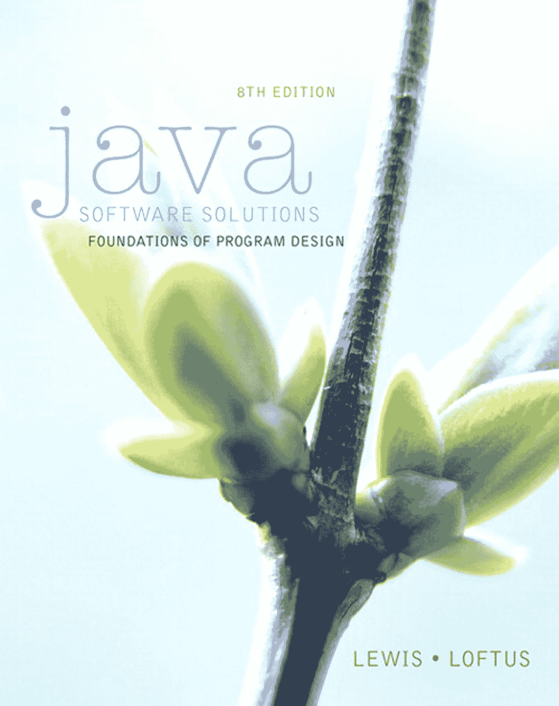

# 在线访问

感谢购买《Java™ Software Solutions: Foundations of Program Design》第八版。您的教科书包含一期配套网站预付费访问权限。此预付费订阅让您拥有以下学生区域的完整权限：

- 视频笔记 (VideoNotes)
- 源代码 (Source Code)
- 实验手册 (Lab Manual)

请注意，此预付费订阅不包括 MyProgrammingLab 的访问权限，该服务可以通过 `http://www.myprogramminglab.com` 购买。

使用硬币刮开涂层以显示您的学生访问代码。不要使用刀或其他锋利物体，以免损坏代码。

要首次访问《Java™ Software Solutions: Foundations of Program Design》第八版配套网站，您需要使用连接互联网并带有浏览器的计算机进行在线注册。注册过程只需几分钟。

1. 访问 `http://www.pearsonhighered.com/`
2. 点击 **Register**（注册）按钮。
3. 在注册页面输入您的学生访问代码。请使用小写或大写。
4. 如果在在线注册过程中需要任何帮助，请点击 **Need Help?**（需要帮助？）图标。
5. 一旦确认您的用户名和密码，您就可以开始使用《Java™ Software Solutions: Foundations of Program Design》第八版配套网站！

**注册后：** 您只需提供用户名和密码即可登录 `http://www.pearsonhighered.com/`。

*重要提示：访问代码只能使用一次。此订阅在激活后有效期一年，且不可转让。如果该代码已失效，您可以访问 `http://www.pearsonhighered.com/` 购买订阅。*

Marcia Horton

Matt Goldstein

Kayla Smith

Christy Lesko

Erin Green

Scott Disanno

Marilyn Lynd

Joyce Cosentino

Susan Raymond

本书献给我们的家人。

Sharon, Justin, Nathan, Samantha Lewis and Veena, Isaac, and Devi Loftus

# 前言

欢迎阅读《Java Software Solutions: Foundations of Program Design》第八版。很高兴这本书多年来一直满足许多学生和教师的需求。本版进一步进行了定制，以改进对计算关键主题的覆盖。

# 本版更新

本版最大的更新包括：

- 更新了所有截图。
- 增加了额外的截图以显示选项。
- 修订了章末练习和编程项目。
- 修订了所有代码间距问题。
- 改进了对 Java 翻译、文件 I/O 以及其他主题的讨论。

教师和学生的反馈持续表明我们在书籍愿景上达到了目标。重点是以清晰且循序渐进的方式呈现核心概念。每章的图形轨迹 (Graphics Track) 部分将分离图形和图形界面的覆盖，为内容的呈现提供了极大的灵活性。轻松的写作和有趣的练习仍然是核心。

基于图形的程序（包括带有图形界面的程序）已全部更新。之前的版本在外观上已经过时。我们根据需要更新了部分内容以改进教学。

在某些图形程序中，我们在不同情况或窗口大小增加了额外的截图。

我们在修订中同样关注章末练习和编程项目。我们添加、删减并修改了这些内容，以提供一套适当且更新的内容。

整本书的示例在空白使用问题上变得不一致。我们仔细检查了每个示例和代码片段，以确保采用一致且适当的风格。

最后，如既往一样，我们改进了全书的讨论，有时是微调，有些处是重大改进。特别是第 1 章及全文对 Java 翻译的讨论已更新，专注于 JVM 而非不太有用的解释器。与翻译过程相关的图形也已更新。文件 I/O 讨论及其示例也已更新。

# 本书基石

本书基于以下基本理念，我们认为这些理念构成了一本良好的入门教材：

**真正的面向对象**。一本真正教授实实面向对象方法的教科书必须使用我们所谓的“对象语言”。也就是说，所有处理过程都应该用面向对象的术语进行讨论。然而，这意味着学生看到的第一个程序就讨论编写多个类和方法。学生在学习编写对象之前应该先学会使用对象。本书采用自然演进的方法，最终达到能够设计面向对象解决方案的能力。

**示例**。学生通过示例学习。书中充满了完整实现的示例，用以演示特定概念。我们将较小、易于理解的示例与更大、更真实的示例交织在一起。图形与图形之间取得了平衡。视频笔记 (VideoNotes) 以现场演示格式提供了额外的示例。

**图形和 GUI**。图形可以是学生的极佳动力，它们的使用是面向对象的极佳范例。因此，我们在书中通过一组定义的章节（我们称之为“图形轨迹” (Graphics Track)）中使用它们。这些涵盖了事件处理和 GUI 的使用。学生通过主题的自然演进，以适当的方法构建 GUI。对于不选择使用图形的人，可以完全避免图形轨迹。

# 章节概览

## 第 11 章（异常）

第 11 章（异常）探索了 Java 标准库中用于定义异常的类层次结构，以及定义自定义异常对象的能力。我们还讨论了处理输入输出时对异常的使用，并检查了一个写入文本文件的示例。

## 第 12 章（递归）

第 12 章（递归）涵盖了递归的概念、实现和正确使用。使用了来自不同领域的示例来演示递归技术如何使某些类型的处理变得优雅。

## 第 13 章（集合）

第 13 章（集合）引入了集合的概念及其底层数据结构。在此背景下重新回顾了抽象，并探索了经典数据结构。还引入了泛型。本章作为 CS2 课程的介绍。

- Java 开发环境的链接

# 教师资源

以下补充材料仅供合的讲师使用。请访问培生教育教师资源中心 (`www.pearsonhighered.com/irc`) 获取如何访问它们的信息：

- 演示幻灯片——PowerPoint 格式。
- 答案——包括练习题和编程项目的答案。
- 带有强大生成软件的题库——包含大量的简答型、多选题和判断型问题。
- 实验手册——实验练习旨在配合文主题。

# 特性

**关键概念。** 贯穿全文，“关键概念”框突出了基本思想和重要准则。这些概念在每章的末尾进行了总结。

**代码列表。** 所有的编程示例都以标记清晰的列表形式呈现，随后根据情况提供程序输出、示例运行或截图显示。代码经过颜色处理，以便在视觉上区分概念和关键字。

**语法图。** 在文中适当的位置，通过带有显示的章节讨论 Java 语言的语法元素，清晰地标识语句或结构的有效形式。整个 Java 语言的语法图见附录 L。

**图形轨道。** 所有涉及图表和图形界面的处理都在每章末尾的一个或两个章节中讨论，统称为“图形轨道”。这些内容可以跳过而不影响连贯性，也可以根据需要专门阅读。任何图形轨道章节的内容在页边缘由棕色边框指示。

**关键概念总结。** 每章中提出的关键概念在章末尾进行了总结。

**自复习题与答案。** 这些简答题复了前节建立的基本思想和术语。它们的设计旨在让学生评估自己对材料的基本掌握程度。这些问题的答案可以在书末的附录 N 中找到。

**练习题。** 这些中等问题需要计算、代码片段的分析以及对章节内容的彻底掌握。虽然练习题涉及代码，但通常不需要任何在线活动。

**编程项目。** 这些问题需要设计和实现 Java 程序。它们的难度差异很大。

**MyProgrammingLab。** 通过练习题和即时反馈，MyProgrammingLab 提高了经常在高级编程语言的基本概念和范式上遇到困难的学生的编程能力。

**VideoNotes。** 由作者演示，VideoNotes 通过易于理解的格式通过视觉化解释主题，为学生理解重要概念提供额外帮助。寻找此 VideoNote 图标以查看章节主题和章末编程项目。

**软件故障。** 章节间的插图讨论了真实世界的软件设计故障，鼓励学生从开始就采用良好的实践。

# 致谢

我非常感谢世界各地对本书以前版本提供反馈的教师和学生。我为教师对学生的深切关注以及学生对知识的渴求感到高兴。欢迎提出任何意见和问题。

我特别感谢杨犹大学 Robert Burton 提供的帮助、见解和对细节的关注。多年来，Robert 一直提供宝贵的反馈，帮助了本教科书的发展和演进。

西蒙菲莎大学的 Brian Fraser 最近提供了优秀的反馈，帮助澄清了本版的一些问题。

我还要感谢 Villanova大学的 Dan Joyce，他开发了自复习题，确保每个相关主题都有足够的复习材料，并提供了每个问题的答案。

# 前言

感谢 Jerilyn Bockor 提供室内设计服务，感谢 Harleen Chopra 提供项目管理服务。我们感谢这些人，他们确保了本书符合最高质量标准。

特别感谢以下人员，他们通过参与焦点小组、访谈和评审，对本书提供了宝贵的建议。他们以及许多其他老师和朋友提供了宝贵的反馈。他们包括：

- Elizabeth Adams
- Hossein Assadipour
- David Atkins
- Lewis Barnett
- Thomas W. Bennet
- Gian Mario Besanza
- Hans-Peter Bischof
- Don Briffitt
- Robert Burton
- John Chandler
- Robert Cohen
- Dodi Coreson
- James H. Cross II
- aman El-Sheikh
- Sherif Elifayoumy
- Christopher Eliot
- Wanda M. Eanes
- Stephanie Elzer
- Matt Evett
- Marj Feoe
- John Gauch
- Chris Haynes
- James Heliosotis
- Larie Henderson
- Mike Higgs
- Stephen Hughes
- Daniel Joyce
- Saroja Kanchi
- Gregory Kapphammer
- Karen Kluge
- Jason Levy
- Peter Mackenzie
- Jerry Marsh
- Blayne Mayfield
- James Madison University
- Rutgers University
- University of Oregon
- University of Richmond
- Mississippi College
- DePaul University
- Rochester Institute of Technology
- Radford University
- Brigham Young University
- University of Massachusetts, Boston
- Linn Benton Community College
- Auburn University
- University of West Florida
- University of North Florida
- University of Massachusetts, Amherst
- Macon State College
- Millersville University
- Eastern Michigan University
- Delaware County Community College, Pennsylvania
- University of Kansas
- Rochester Institute of Technology
- McGill University
- Austin College
- Roanoke College
- Villanova University
- Kettering University
- Allegheny College
- Dartmouth College
- University of Hawaii
- McGill University
- Oakland University
- Oklahoma State University
- Gheorghe Muresan Rutgers University
- Laurie Murphy Pacific Lutheran University
- Dave Muscant Carleton College
- Faye Navi-Tayadon Arizona State University
- Lawrence Osborne Lamar University
- Barry Pollock City College of San Francisco
- B. Ravikar University of Rhode Island
- David Riley University of Wisconsin (The Cross)
- Bob Ross Allegheny College
- Carolyn Rosiene University of Hartford
- Jerry Ross Lane Community College
- Patricia Roth Southeastern Polytechnic University
- Carolyn Schauble Colorado State University
- Arjit Sengupta Georgia State University
- Bennet Setzer Kennesaw State University
- Vijay Srinivasan JavaSoft, Sun Systems, Inc.
- Stuart Steiner Eastern Washington University
- Katherine St. John Lehman College, CUNY
- Alexander Stoychev Iowa State University
- Ed Timmerman University of Maryland, University College
- Shengru Tu University of New Orleans
- Paul Tyrmann Rochester Institute of Technology
- John J. Wegis JavaSoft, Sun Systems, Inc.
- Ken Williams North Carolina Agricultural and Technical University
- Linda Wilson Dartmouth College
- David Wittenberg Brandeis University
- Wang-Chong Wong California State University (Domingues Hills)

还要感谢我在维乡村大学的朋友和前同事，他们提供了许多精彩的反馈。包括 Bob Beck, Cathy Helwig, Ajay Levitin, Nabij Nadi, Beth Taddi 和 Barbara Zimmermann。

特别感谢新泽西学院的 Pete DePasquale 为 PaintBox 项目的设计和演进以及原始类库附录。

许多人以各种方式提供了帮助。他们包括 Ken Arnold, Mike Czempel, John Loftus, Sebastian Niegzoda 和 Saverio Perugini。对于我们遗漏的任何人，深表歉意。

ACM 计算机科学教育特别小组 (SIGCSE) 是一项巨大的资源。他们的会议为所有层次、所有类型教育工作者提供了分享想法和材料的机会。如果你是任何计算领域的教育工作者且没有参与 SIGCSE，你就错过了机会。

前言 v

## 第一章 简介 1

### 1.1 计算机处理 2

软件分类 3

数字计算机 5

二进制数 7

### 1.2 硬件组件 10

体系结构 11

输入输出设备 12

主内存与辅助内存 13

中央处理器 17

### 1.3 网络 20

网络连接 20

局域网和 22

广域网

互联网 23

万维网 24

统一资源定位符 25

### 1.4 Java 编程语言 26

一个 Java 程序 28

注释 30

标识符和保留字 31

空白符 34

### 1.5 程序开发 36

编程语言层次 36

编辑器、编译器和解释器 39

开发环境 40

语法与语义 41

错误 42

### 1.6 面向对象编程 44

问题解决 45

面向对象原则 46

## 第二章 数据与表达式 57

### 2.1 字符字符串 58

print 和 println 方法 58

字符串拼接 60

转义序列 63

### 2.2 变量与赋值 65

变量 65

赋值语句 67

常量 69

### 2.3 原始数据类型 71

整数与浮点数 71

字符 73

布尔值 74

### 2.4 表达式 75

算术运算符 75

运算符优先级 76

自增与自减运算符 80

赋值运算符 81

### 2.5 数据转换 83

转换技术 85

### 2.6 交互式程序 87

Scanner 类 87

### 2.7 图形 92

坐标系 92

表示颜色 94

### 2.8 Applet 95

使用 Web 运行 Applet 98

### 2.9 绘制形状 99

Graphics 类 99

软件失败：

NASA 火星气候轨道飞行器和极地轨道着陆器 111

## 第三章 使用类和对象 113

### 3.1 创建对象 114

别名

### 3.2 String 类 118

### 3.3 包 122

import 声明

### 3.4 Random 类 126

### 3.5 Math 类 129

### 3.6 格式化输出 132

NumberFormat 类

DecimalFormat 类

printf 方法


### 3.7 枚举类型 138

### 3.8 包装类 141

自动装箱

### 3.9 组件与容器 143

框架

### 3.10 面板 148

### 3.11 图像 151

## 第四章 写类 159

### 4.1 类与对象 160

复习

### 4.2 类的结构 162

实例数据

### 4.3 封装 169

访问权限修饰符

### 4.4 方法的结构 172

访问器与修改器

`return` 语句

### 4.5 构造方法 175

复习

### 4.6 图形 181

复习

ML 类图

### 4.7 用户界面 191

### 4.8 字段 192

### 4.9 文本 196

软件失败：

Therac-2 205

## 第五章 条件与循环 207

### 5.1 布尔表达式 208

### 5.2 条件运算符 274

### 5.3 `do` 语句 275

### 5.4 `for` 语句 279

for-each 循环 282

### 5.5 迭代器 241

### 5.6 文本文件 242

### 5.7 事件源 248

### 5.8 复选框 251

### 5.9 单选按钮 255

软件失败：

203 267

## 第六章 更多条件与循环 269

### 6.1 `switch` 语句 270

### 6.5 使用循环和条件绘图 285

### 6.6 对话框 291

## 第七章 面向对象设计 301

### 7.1 软件开发活动 302

### 7.2 识别类和对象 303

### 7.3 类成员 305

### 7.4 类关系 310

### 7.5 接口 322

### 7.6 枚举类型 329

### 7.7 方法设计 332

### 7.8 方法重载 343

### 7.9 测试 345

### 7.10 GUI 设计 349

### 7.11 布局管理器 350

### 7.12 边界 365

### 7.13 包含层次 369

## 第八章 数组 379

### 8.1 数组元素 380

### 8.2 声明和使用数组 381

### 8.3 对象数组 392

### 8.4 命令行参数 402

### 8.5 可变长参数列表 404

### 8.6 二维数组 408

### 8.7 多边形与折线 413

### 多边形类 416

### 8.8 鼠标事件 418

### 8.9 键盘事件 427

软件失败：洛杉矶空交通管制 441

## 第 9 章 继承 443

### 9.1 创建子类 444

`protected` 修饰符 `super` 引用 多重继承 450

### 9.2 重写方法 455

变量遮蔽 457

### 9.3 类层次结构 458

`Object` 抽象类 接口 层次结构 463

### 9.4 可见性 463

### 9.5 针对继承的设计 466

限制继承 467

### 9.6 组件类层次结构 468

### 9.7 扩展适配器类 471

### 9.8 `Timer` 类 475

软件失败：阿里亚娜 5 号 501 号飞行 485

## 第 10 章 多态 487

### 10.1 晚绑定 488

### 10.2 通过继承实现多态 489

### 10.3 通过接口实现多态 502

### 10.4 排序 504

- 选择排序 505
- 插入排序 511
- 排序比较 512

### 10.5 搜索 513

- 线性搜索 513
- 二分查找 515
- 搜索比较 519

### 10.6 针对多态的设计 519

### 10.7 事件处理 521

### 10.8 文件选择器 522

### 10.9 颜色选择器 525

### 10.10 滑块 527

## 第 11 章 异常 537

### 11.1 异常处理 538

### 11.2 未捕获的异常 539

### 11.3 `try-catch` 语句 540

`finally` 子句 544

### 11.4 异常传播 545

### 11.5 异常类层次结构 549

检查异常与未检查异常 552

### 11.6 I/O 异常 553

### 11.7 提示框与助记符 557

### 11.8 组合框 564

### 11.9 滚动面板 569

### 11.10 分裂面板 572

## 第 12 章 递归 583

### 12.1 递归思维 584

无限递归 584

数学中的递归 585

### 12.2 递归编程 586

递归与迭代 589

直接递归与间接递归 589

### 12.3 使用递归 590

遍历迷宫 591

哈诺诺塔 596

### 12.4 图形中的递归 601

平铺图片 601

分形 604

## 第 13 章 集合 617

### 13.1 集合与数据结构 618

接口与实现的分离 618

### 13.2 动态表示 619

动态结构 619

动态链表 620

其他动态列表结构 625

### 13.3 线性数据结构 627

队列 627

栈 628

### 13.4 非线性数据结构 631

树 631

图 632

### 13.5 Java 集合 API 634

泛型 634

附录 A 术表 641

附录 B 数制 665

附录 C Unicode 字符集 673

附录 D Java 运算符 677

附录 E Java 修饰符 683

附录 F Java 编码规范 687

附录 G Java Applets 693

附录 H 正则表达式 695

附录 I Javadoc 文档生成器 697

附录 J PaintBox 项目 703

附录 K GUI 事件 715

附录 L Java 语法 719

附录 M Java 类库 733

附录 N 自测习题答案 735

- Java IDEs 比较。41
- 为 PP 1.2 开发解决方案。54
- 原始数据类型和表达式复习。76
- 使用绘制形状的示例。101
- 创建对象。115
- 使用 frames 和面板的示例。150
- 剖析 `Die` 类。164
- 使用扩展 `JPanel` 的示例。182
- 为 PP 4.2 开发解决方案。202
- 使用 `while` 循环的示例。233
- 为 PP 5.4 开发解决方案。264
- 为 PP 6.2 开发解决方案。296
- 方法重载示例。344
- 为 PP 7.1 开发解决方案。374
- 数组概述。383
- LetterCount 示例讨论。388
- 使用橡皮带（rubberbanding）和数组的示例。423
- 为 PP 8.5 开发解决方案。436
- 继承概述。449
- 使用类层次结构的示例。461
- 使用 `Timer` 类的示例。475
- 为 PP 9.11 开发解决方案。483
- 探索 Firm 程序。490
- Comparable 对象的排序。506
- 为 PP 10.1 开发解决方案。534
- 适当的异常处理。545
- 探索 GUI 设计细节。561
- 为 PP 11.1 开发解决方案。580
- 追踪 MazeSearch 程序。594
- 探索哈诺诺塔。597
- 为 PP 12.1 开发解决方案。613
- 使用链表的示例。620
- 实现队列。628
- 为 PP 13.3 开发解决方案。638

# 致谢

封面：© Peter Carlsson/Etsa/Corbis

01-2 截图经 Apple, Inc. 许可转载。

02-SF 来自 NASA 地球观测系统

03-3 Java API 文档。经 Oracle 法务总顾问许可使用。

04-SF Susan Van E/PhotoEdit

05-SFb David Joel/Stone/Getty Images

07-SF 美国国家海洋和大气管理局

08-SFb MathewVay/Getty Images

09-SF 罗特，《未选择的路》(1916)

10-3 Redux/Redux

11-0 John Lewis, 微软公司

经微软许可使用。微软及其供应商对服务中所包含的信息对于任何用途的适用性不作任何声明。所有此类文档和图形均按“现状”提供，不提供任何保证。在任何情况下，对于使用或执行可用信息而导致的任何特殊、间接或后果性损害，无论是在诉讼、疏忽还是侵权行为中，微软和/或其供应商均不承担责任。此处的文档和图形可能包含技术错误或打印错误。此处的信息会定期更新。部分截图可以在指定的软件版本中查看完整内容。

## 1.1 计算机处理

所有的系统，无论是台式电脑、笔记本电脑、平板电脑、智能手机、游戏机，还是汽车导航系统等特殊设备，都具有某些共同特征。细节虽不同，但它们都以类似的方式处理数据。虽然本书的大部分内容涉及软件开发，但我们首先从计算机处理的概述开始，以建立背景概念。建立一些术语并观察计算机系统中关键部分如何相互作用是非常重要的。

计算机系统由硬件和软件组成。计算机系统的硬件组件是支持计算任务的物理、有形部分。它们包括芯片、机箱、电线、键盘、扬声器、磁盘、内存卡、USB 闪盘（也称为优存盘）、电缆、插头、打印机、鼠标、显示器、路由器等。如果你能物理上接触到它，并且它可以被认为是计算机系统的一部分，那么它就是计算机硬件。

如果没有告诉它们做什么的指令，计算机的硬件组件基本上是没用的。程序是一系列硬件按顺序执行的指令。软件由程序和程序使用的数据组成。软件是物理硬件组件的无形对应物。

它们共同构成了一个我们可以用来解决问题的工具。计算机系统中的关键硬件组件是：

- 中央处理器 (CPU)
- 输入/输出 (I/O) 设备
- 主内存
- 级存储设备

下一节将详细描述这些设备中的每一个。现在，让我们简单地查看它们的基本作用。中央处理器 (CPU) 是执行程序单个指令的设备。输入/输出 (I/O) 设备（如键盘、鼠标和显示器）允许人类与计算机交互。

程序和数据存储在称为主内存和级存储的设备中。主内存是在 CPU 处理软件时存放软件的存储设备。级存储设备以相对永久的方式存储软件。典型计算机系统中最重要的级存储设备是位于主内存机箱内部的硬盘。USB 闪盘也是一种重要的级存储设备。典型的 USB 闪盘存储的信息量远不如硬盘多。USB 闪盘的优点是便携性；可以根据需要从计算机到计算机之间移除或移动。另一种便携式级存储设备是光盘 (CD)。

> 核心概念
>
> 系统由硬件和软件组成，它们协同工作以帮助我们解决问题。

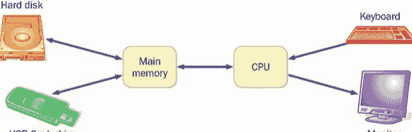

图 1.1 计算机系统的简化视图

图 1.1 显示了信息如何在计算机的基本硬件组件之间移动。假设你有一个想要运行的可执行程序。该程序存储在某些级存储设备（如硬盘）上。当你指示计算机执行你的程序时，程序的副本将从级存储调入并存储在主内存中。CPU 从主内存中读取各个程序指令。CPU 逐条执行指令，直到程序结束。指令使用的数据（例如两个将相加的数字）也存储在主内存中。它们要么是从级存储调入的，要么是从键盘等输入设备调入的。执行期间，程序可能会向显示器等输出设备显示信息。

> 核心概念
>
> CPU 从主内存中读取指令，逐条执行它们，直到程序结束。

执行程序的过程是计算机运行的基础。所有计算机系统基本上都以相同的方式工作。

## 软件分类

可以使用各种标准将软件划分为许多类。此时，我们简单地区分系统程序和应用程序。

操作系统是计算机的核心软件。它执行两个重要功能。首先，它提供了一个用户界面，允许用户与机器交互。操作系统管理计算机资源，如 CPU 和主内存。它决定程序何时允许运行，加载在何处。它通过用户界面来确保计算机易于使用。

许多操作系统在今天非常流行。Windows 操作系统占据了巨大的市场份额。

> 核心概念
>
> 操作系统提供用户界面并管理资源。

## 第 1 章 引言

各种版本的操作系统非常流行，特别是在个人电脑上。1.3 图形地描述了由麦克风捕获声波并表示为电子信号的过程。Linux 是一个 Linux 开发的操作系统，由于这种特性，它在用户中非常受欢迎。Linux 是一个开源项目，这意味着许多开发者贡献了代码。Mac OS X 是苹果开发的桌面操作系统。

现代操作系统通常针对移动设备（如 iPhone、iPad 和 iPod）。iOS 是苹果开发的操作系统。同样，Windows Phone 是微软开发的 Windows 操作系统。Android 是 Google 开发的基于 Linux 的操作系统。

应用程序（在对话中通常缩写为 "app"）是几乎所有软件的通用术语。除了操作系统之外，文字处理器、数据库管理器、Web 浏览器等都属于应用程序。每个应用程序都有允许用户与之交互的界面。

图形化用户界面（GUI，读作 "go-ey"）是现代操作系统的界面，正如其名所示，它使用了图形元素。这些元素包括：

- 窗口：将屏幕分为不同的工作区域
- 图标：代表计算机资源的小图像
- 菜单、复选框和单选按钮
- 滑块：允许用户从范围内选择
- 按钮：可以用鼠标“按下”以指示用户选择

鼠标是 GUI 的主要输入设备；因此 GUI 有时被称为鼠标点击界面。图 1.2 显示了 GUI 的示例。

应用程序或操作系统的界面是软件的重要部分，因为它是用户直接交互的部分。对于用户来说，界面就是程序。

本书的重点是开发高质量的应用程序。我们探索如何设计和编写执行计算、决策并以文本或图形形式结果的软件。我们在全文中使用 Java 编程语言来演示各种计算概念。


## 1.1 计算机处理 5

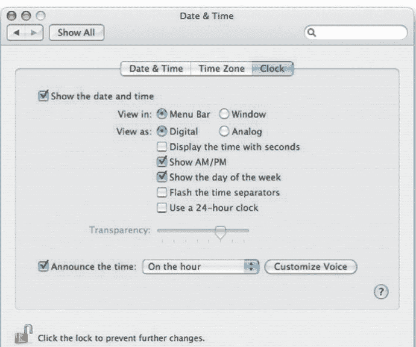

图 1.2 图形化用户界面 (GUI) 示例

## 数字计算机

使用两种基本技术来存储和管理信息：模拟和数字。模拟信息是连续的，与信息的源成正比。例如，模拟温度计是测量温度的模拟设备。酒精在管中的上升与外部温度成正比。模拟信息的另一个例子是用于表示声波振动的电子信号。信号的电压随原始声波成正比。立体声放大器将这种电子信号发送到它的扬声器，扬声器振动以还原声音。我们使用模拟术语是因为信号与其所代表的信息直接对应。

数字技术将信息分解为离散的部分并将这些部分表示为数字。光盘上的音乐是以数字形式存储的，作为一系列数字。每个数字代表了

> 核心概念
>
> 数字计算机通过将信息分解并将每个部分表示为数字来存储信息。


图 1.3 声波和代表录制中某一特定实例波形电压电的电子模拟信号。其中许多测量是在短时间内完成的，每秒进行 44,000 次测量。每秒的测量次数被称为*采样率*。如果采样次数足够，就可以使用离散的电压测量值来生成与原始信号“足够接近”的连续模拟信号。在大多数情况下，目标是创建一个原始信号的复制品，使其足以满足人类感官。

图 1.4 显示了模拟信号的采样。当模拟信息通过分解成片段转换为数字格式时，我们说它已被数字化。

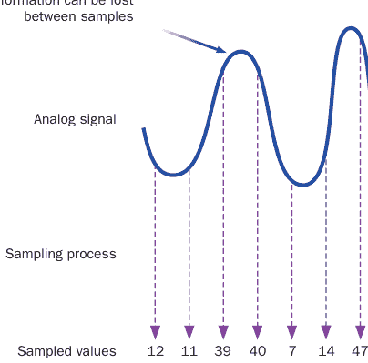

图 1.4 通过采样将模拟信号数字化

## 1.1 计算机处理

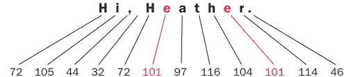

图 1.5 通过将每个字符映射到数字来存储文本

由于采样之间信号发生的变化丢失了，因此采样率必须足够快。

采样只是数字化信息的一种方法。例如，一个句子以一系列数字的形式存储在计算机中，其中每个数字代表句子中的单个字符。每个字母、数字和标点符号都被分配了一个数字。甚至空格字符也被分配了一个数字。考虑以下句子：

Hi, Heather.

句子的字符被表示为一系列 12 个数字，如图 1.5 所示。当字符重复时，请注意作为大写字母 'H'，使用的是相同的表示数字。请注意，字母的大写版本存储的数字与小写版本不同，例如单词 Heather 中的 'h' 和 'w'。它们被认为是两个独立且不同的字符。

现代电子计算机是数字化的。每种信息，包括文本、图像、数字、音频、视频和程序指令，都被拆拆成片段。每个片段都表示为一个数字。信息通过存储这些数字来存储。

## 二进制数字

数字计算机将数字存储信息，但这些数字并不是以十进制值存储的。计算机中的所有信息都以二进制值存储和管理。与拥有 10 个数字（0 到 9）的十进制系统不同，二进制系统只有两个数字（0 和 1）。单个数字被称为位（bit）。

所有的数字系统都按照相同的规则运行。数字系统的基数决定了我们可以处理多少数字，并指示了每个数字在十进制中的位置。十进制系统是基 10，而二进制系统是基 2。附录 B 对数字系统进行了详细讨论。

现代计算机使用二进制是因为如果存储和处理信息的设备只需要表示两个可能值中的一个，它们会更便宜且更可靠。除了这种特性，

> 核心概念
>
> 二进制用于在计算机中存储和移动信息，因为存储和处理二进制数据的设备廉价且可靠。

## 第 1 章 引言

除了这种特性，二进制系统并没有特殊之处。计算机被用来使用其他数字系统来存储和移动信息，但它们并不方便。

某些存储设备（如硬盘）在本质上是磁性的。磁性材料很容易极化为极端一端，而中间水平很难区分。因此，磁性设备可以非常有效地表示二进制值——磁性区域代表二进制 1，去磁化区域代表二进制 0。其他计算机设备由微小的电路制成。如果这些设备需要在两个状态之间切换，它们更容易制造且更不容易故障。与其创建更少、更复杂的设备，我们复制数百万这种简单设备会更好。

二进制值和数字电子学是密不可分的。它们提高了我们通过电线可靠地传输信息的能力。正如我们所看到的，模拟信号具有连续变化的电压和无限多的状态，但数字信号是离散的，这意味着电压在一个极端（如 +5 伏）和另一个极端（如 -5 伏）之间剧烈变化。在任何点，数字信号的电压都被认为是“高”（代表二进制 1）或“低”（代表二进制 0）。图 1.6 对比了这两种信号。

当信号沿着电线移动时，由于环境的影响，它会变弱并衰化。导致原始信号的电压水平发生微变化。模拟信号的问题在于它波动波动会丢失原始信息。由于信息与信号直接对应，信号的任何变化都会改变信息。模拟信号中的变化无法恢复，因为退化的信号与原始信号一样有效。数字信号的退化与模拟信号一样，但因为数字信号最初处于两个极端之一，所以在在任何信息丢失之前可以对其进行增强。电压可能会从其原始值略微变化，但仍然可以被正确地解释为高或低。


# 第 1 章 引言

我们在任何给定情况下使用的位数决定了我们能够表示的唯一项目数量。单个位有两个可能的值，0 和 1，并且

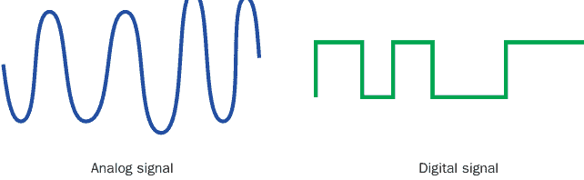

图 1.6 模拟信号对比数字信号

## 1.1 计算机处理

因此，可以表示两个可能的项目或情况。如果我们想表示灯泡的状态（关闭或开启），一个位就足够了，我们可以将 0 解释为灯泡关闭，将 1 解释为灯泡开启。如果我们想表示两个以上的项目，我们需要多于一个位。

两个位在一起可以表示四种可能的项目，因为两个位恰好有四种排列：`00`、`01`、`10` 和 `11`。假设我们想表示汽车中的档位（空档、前进、倒车或中档）。我们只需要两个位，就可以在排列和档位之间建立一种映射。例如，我们可以说 `00` 代表停车，`01` 代表前进，`10` 代表倒车，`11` 代表中档。在这种情况下，是否交换该映射没有关系，但在某些情况下，排列与它们所代表的内容之间的关系是重要的。

三个位可以表示八个唯一项目，因为三个位有八种排列。同样，四位可以表示十六个，五位可以表示三十二个。图 7 显示了所使用的位数与它们所能表示的项目数量之间的关系。通常情况下，N 位可以表示 $2^N$ 个唯一项目。每增加一个位，项目数量就会翻倍。

> **核心概念**
>
> N 位有 $2^N$ 种排列。这里 N 可以表示多达 $2^N$ 个唯一项目。

| 位数 | 1 位 | 2 位 | 3 位 | 4 位 | 5 位 |
| :--- | :--- | :--- | :--- | :--- | :--- |
| 项目数 | 2 个项目 | 4 个项目 | 8 个项目 | 16 个项目 | 32 个项目 |
| 排列 | 0 | 00 | 000 | 0000 | 00000 |
| | 1 | 01 | 001 | 0001 | 00001 |
| | | 10 | 010 | 0010 | 00010 |
| | | 11 | 011 | 0011 | 00011 |
| | | | 100 | 0100 | 00100 |
| | | | 101 | 0101 | 00101 |
| | | | 110 | 0110 | 00110 |
| | | | 111 | 0111 | 00111 |
| | | | | 1000 | 01000 |
| | | | | | 01001 |
| | | | | | 01010 |
| | | | | | 01011 |
| | | | | | 01100 |
| | | | | | 01101 |
| | | | | | 01110 |
| | | | | | 01111 |
| | | | | | 10000 |
| | | | | | 10001 |
| | | | | | 10010 |
| | | | | | 10011 |
| | | | | | 10100 |
| | | | | | 10101 |
| | | | | | 10110 |
| | | | | | 10111 |

图 7 所使用的位数与它们所能表示的项目数量。

我们已经看到如何通过将字符映射到数值在计算机中存储句子。这些数值以二进制数存储。假设我们要表示一种包含 256 个字符和符号的语言。我们需要使用八位来存储每个字符，因为八位有 256 种排列。每个位排列或二进制值都映射到一个特定的字符。

表示世界上 195 个国家需要多少位？$2^7$ 等于 128，不是足够了？但 256 种排列中的某些没有映射到国家。

最终，在计算机上表示信息取决于我们要表示的项目数量以及将这些项目映射到二进制值的方法。

## 自习（答案见附录 N）

+ SR 1.1 什么是硬件？什么是软件？
+ SR 1.2 操作系统的两个主要功能是什么？
+ SR 1.3 CD 音乐使用每秒 44,000 次测量的采样率创建。每次测量存储为一个表示特定电压水平的数字。存储三分钟歌曲需要多少数字？一个小时音乐需要多少数字？
+ SR 1.4 信息数字化存储时发生了什么？
+ SR 1.5 以下位可以表示多少唯一项目？
  - 2 位
  - 4 位
  - 5 位
  - 7 位
+ SR 1.6 假设你想用位的唯一排列来表示美国的 50 个州。存储每个状态表示需要多少位？为什么？

## 1.2 硬件组件

让我们更详细地检查计算机系统的硬件组件。考虑图 1.8 所示的台式计算机。这一切意味着什么？该系统能够运行你想要的软件吗？它与其他系统相比如何？这些术语在本节中都会解释。

### 硬件规格示例

- 3.3 GHz Intel Core i3 处理器
- 4 GB RAM
- 750 GB 硬盘
- 16x 蓝光 / HD DVD-ROM & 16X DVD=±R DVD 刻录机
- 17" LCD 视频显示器，分辨率为 1280 x 1024
- 网卡

图 1.8 特定计算机的硬件规格

### 计算机架构

房屋的结构定义了它的形态。同样，我们使用“计算机架构”一术来描述计算机硬件组件是如何组合在一起的。图 1.9 展示了通用计算机系统的基本架构。信息通过一组称为总线的线在各个组件之间传输。

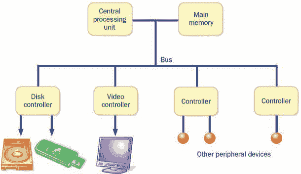

图 1.9 基础计算机架构

> **核心概念**
>
> 计算机的核心由主内存（存储程序和数据）和 CPU（一次执行一条程序指令）组成。

CPU 和主内存构成了计算机的核心。正如我们之前提到的，主内存存储了正在使用的程序和数据，而 CPU 有条理地一次执行一条程序指令。

假设我们有一个计算数字列表平均值的程序。在程序运行时，程序和数字必须留在主内存中。如果某指令需要数据，CPU 会在执行时读取这些信息。这个过程不断重复直到程序结束。计算出的平均值将存储在主内存中，等待处理或在辅助内存中长期存储。

计算机系统中除 CPU 和主内存外的几乎所有设备都是外设设备；它们运行在系统的边缘或外部（尽管它们可能在同一个机箱内）。用户不直接与 CPU 或主内存交互。尽管 CPU 和主内存是机器的本质，但如果没有外设设备，它们将毫无用处。

控制器协调外设设备的活动。在数据格式化和通信方面，控制器的角色之一是处理这些特殊性并将它们与计算机其余硬件隔离开。此外，控制器处理大部分实际的信息传输，使 CPU 能够专注于其他活动。

输入/输出（I/O）设备和辅助内存设备属于外设设备。另一类外设设备由数据传输设备组成，允许在计算机之间发送和接收信息。图 1.8 中指定的计算机包含一个网卡，也称为无线网络接口控制器（WNIC），它连接到基于无线的计算机网络。

在某些方面，辅助内存设备和数据传输设备可以被视为 I/O 设备，因为它们代表了信息的来源（输入）和发送信息的地方（输出）。在我们的讨论中，I/O 设备定义为允许用户与计算机交互的设备。

### 输入/输出设备

让我们详细检查一些 I/O 设备。最常见的输入设备是键盘和鼠标或触摸板。其他的包括：

- 条码器，如零售店收银台使用的
- 麦克风，用于解释语音命令的语音识别系统
- 虚拟现实设备，如解释手部动作的手持设备
- 扫描仪，将文本、照片和图形转换为机器可读格式
- 相机，用于捕捉静态图像和视频，还可以处理 QR 码等特殊输入

显示器和打印机是最常见的输出设备。其他的包括：

- 绘图仪，在大幅纸上移动画笔（或反之）
- 扬声器，用于音频输出
- 眼罩，用于虚拟现实显示

某些设备同时提供输入和输出功能。触摸屏系统可以检测用户在屏幕特定位置的操作。软件随后可以使用屏幕根据用户的触摸显示文本和图形。触摸屏已在便携设备中变得非常普遍。

图 1.8 描述的台式计算机包含带有 17 英寸对角线区域的显示器。它利用液晶显示（LCD）技术，与旧的阴极射线管（CRT）显示器不同，后者需要高电压且不可便携。计算机中的图像通过将其拆分为独立的图像元素或像素来表示。显示器可能会显示一个 1280 比 1024 像素的网格。图形数据的表示和管理将在第 2 章中详细讨论。

### 主内存与辅助内存

> **核心概念**
>
> 地址是一个与内存位置相关的唯一数字。

主内存由一系列微小的、连续的内存位置组成，如图 1.10 所示。每个内存位置关联着一个称为地址的唯一数字。

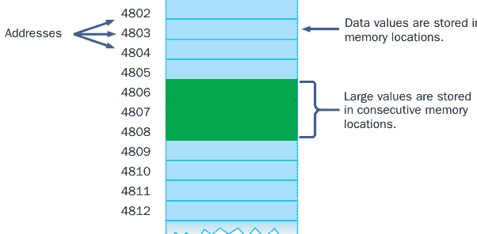

图 1.10 内存位置

| 单位 | 符号 | 字节数 |
| :--- | :--- | :--- |
| 字节 | - | $2^0 = 1$ |
| 千字节 | KB | $2^{10} = 1024$ |
| 兆字节 | MB | $2^{20} = 1,048,576$ |
| 吉字节 | GB | $2^{30} = 1,073,741,824$ |
| 太字节 | TB | $2^{40} = 1,099,511,627,776$ |
| 拍字节 | PB | $2^{50} = 1,125,899,906,842,624$ |

图 1.11 存储单位

> **核心概念**
>
> 主内存是易失的，这意味着只有在供电时存储的信息才会保持。

许多计算机拥有 4 GB 的主内存（或 RAM），如图 1.8 所示的系统。主内存是易失的，这意味着如果断电，存储在其中的信息将会丢失。在电脑上工作时，应该经常将工作保存到辅助内存设备（如硬盘）上，以防断电。辅助内存设备通常是非易失的；即使断电，信息也会被保留。

缓存被中央处理器（CPU）用于减少访问指令和数据的平均访问时间。缓存是一个较小、快速的内存，存储最频繁使用的内存位置。现代 CPU 包含指令缓存以加速可执行指令的获取，以及数据缓存以加速数据获取。

最常见的辅助存储设备是硬盘和 USB 闪存盘。USB 闪存盘存储 1 GB 到 256 GB 之间的信息。个人电脑硬盘的存储容量不相同，容量通常在 120 GB 到 500 GB 之间。某些硬盘可以存储 2 TB。

USB 闪存盘由一个带有电路元件的小型打印电路板和一个 USB 接口组成，接口电绝缘并保护在塑料、金属或橡胶外壳内，例如可以放在口袋里或挂在钥匙扣上。

磁盘是一种磁介质，位在上面以磁化颗粒的形式表示。读写头在旋转的磁盘上方通过，根据需要读取或写入信息。硬盘驱动器实际上可能包含垂直列中的几块磁盘，带有多个读写头，如图 1.12 所示。

为了直观地感受这些设备可以存储多少信息，请考虑本书中的所有信息（包括图片和格式）需要 7 MB 的存储空间。

磁带也曾用作辅助存储，但由于访问方式的原因，它比硬盘和 USB 闪存盘慢得多。硬盘是直接访问设备，因为读写头可以直接移动到所需信息的位置。USB 闪存盘也是直接访问设备。

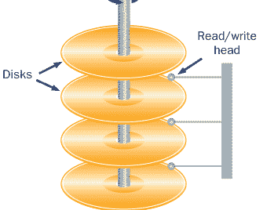

图 1.12 带有多个磁盘和读写头的硬盘驱动器

……设备，但没有任何机械部件在运动。“直接访问”和“随机访问”这两个术语通常互换使用。然而，磁带上的信息只有在先获取中间数据后才能被访问。磁带必须回带或正进到适当的位置。因此，磁带被认为是一种顺序访问设备。由于这些原因，磁带作为计算机存储设备已很大程度上退出了舞台，就像录音磁带被光盘取代一样。

另外两个术语用于描述内存设备：随机存取存储器（RAM）和只读存储器（ROM）。理解这些术语非常重要，因为它们被频繁使用，且名称可能具有误导性。RAM 和主内存基本上是可以互换的，都描述存储活动程序和数据的内存。ROM 可以指计算机主板上的芯片，也可以指光盘等便携式存储设备。ROM 通常存储一种名为 BIOS（基本输入/输出系统）的软件，它提供了计算机启动时所需的初步指令。在典型的计算机使用过程中，信息不会被更改（正如“只读”一词所暗示）。RAM 和 ROM 都是（随机）访问设备。

> **核心概念**
>
> 光盘的表面有光滑区域和微槽。微槽代表二进制 1，光滑区域代表二进制 0。

CD-ROM 是一种二级存储设备。CD 代表紧凑型光盘（compact disc）。它之所以被称为 ROM，是因为信息在创建 CD 时是永久存储的，无法更改。与与其对应的音乐光盘一样，CD-ROM 以二进制格式存储信息。在创建 CD 时，一个微槽被压入光盘中以代表二进制 1，而光盘留处则代表二进制 0。通过将低强度激光束照射到旋转的光盘上读取位（bit）。光束从光滑区域强烈反射，但从微槽区域反射微弱。传感器接收每个比特位是 1 还是 0。一个典型的 CD-ROM 存储容量在 650 到 900 MB 之间。

CD 技术的变体很快涌现。大多数个人电脑都配备了 CD 可刻录光盘（CD-R）驱动器。CD-R 可用于创建音乐或通用存储的 CD。一旦创建，你就可以在标准播放器中使用 CD-R，但一旦 CD-R 被“刻录”，你就无法更改其上的信息。音乐 CD 是通过模具压制的，而 CD-R 则是用激光刻录的。

CD 可擦写光盘（CD-RW）可以擦除并重复使用。它可以重复使用是因为普通 CD 的微槽和平表面是通过在光盘表面覆盖一种材料模拟的，这种材料在加热到特定温度时会变成无定形（因此不反射），在加热到另一个温度时会变成晶态（因此反射）。CD-RW 介质并非在所有播放器有效，但 CD-RW 驱动器可以创建 CD-R 和 CD-RW 光盘。

> **核心概念**
>
> 可重写 CD 通过可以根据需要变为无定形或晶态的涂层模拟普通 CD 的微槽和平区域。

CD 最初是流行的音乐格式；后来演变为通用存储设备。同样，DVD 格式最初是为了视频创建，现在作为计算机数据的通用格式正取得进展。DVD 曾代表数字视频盘（digital video disc），但现在这个缩写已独立存在。DVD 的格式比 CD 更紧密（每平方英寸位更多），可以存储更多信息。DVD 最终完全取代了 CD-ROM，因为存在兼容的迁移路径，这意味着 DVD 驱动器可以读取 CD-ROM。类似于 CD-R 和 CD-RW，还有 DVD-R 和 DVD-RW 光盘。图 1.8 所示的驱动器允许用户读写 CD-RW 光盘并读取 DVD-ROM，包括播放音乐 CD 和观看 DVD 视频的能力。

CD 或 DVD 的速度以 x 的倍数表示，对于 CD，传输速度为每秒 153,600 字节；DVD 为该速度的九倍，或每秒约 1.5 兆字节数据；蓝光光盘为 DVD 的三倍，或每秒 4.5 兆字节数据。图 1.8 描述的光盘最大数据访问速度为 16x，或每秒约 72 MB 数据。双层蓝光光盘容量为 50 GB。

存储容量随技术的进步而变化。行业的一条通用规则建议存储容量大约每 18 个月增加一倍。然而，随着容量接近绝对物理极限，这种进展最终将放缓。

### 中央处理器

中央处理器（CPU）与主内存交互，以执行计算机中的所有基本处理。CPU 在连续循环中一个接一个地解释并执行指令。它由三个重要组件组成，如图 1.13 所示。控制单元协调处理步骤，寄存器在 CPU 内部执行少量的存储空间，算术逻辑单元（arithmetic/logic unit）执行计算和决策。寄存器是系统中最小、最快的缓存。

控制单元协调主内存与 CPU 中寄存器之间数据和指令的传输。它还协调算术逻辑单元电路的执行，对存储在特定寄存器中的数据进行操作。

在大多数 CPU 中，某些寄存器被留作特殊用途。例如，指令寄存器持有当前正在执行的指令。程序计数器是一个持有下一个要执行的指令地址的寄存器。除了这些以及其他特殊用途寄存器外，CPU 还

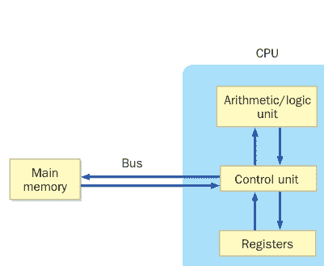

图 1.13 CPU 组件

包含一组通用寄存器，用于临时存储需要的值。将程序指令和数据存储在主内存中的概念是冯·诺依曼架构（von Neumann architecture）的基础，该架构以冯·诺依曼命名，他是一位匈牙利裔美国数学家，他在 1945 年提出了这种编程概念。指令从主内存取出到指令寄存器，遵循图 1.14 所示的取-解码-执行循环。程序计数器增加以准备下一次循环。然后解码指令以确定执行什么操作。最后，控制单元激活电路执行将数据加载到寄存器或将两个值相加。CPU 构建在一个名为微处理器（microprocessor）的芯片上，它是主板的一部分。主板还包含 ROM 芯片

> **核心概念**
>
> 取-解码-执行循环是计算机处理的基础。

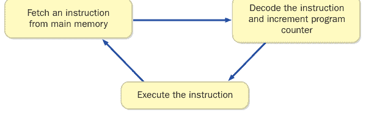

图 1.14 连续的取-解码-执行循环

以及设备控制器，如管理视频显示的控制器可以连接。

主板的另一个关键组件是系统时钟。时钟每隔产生一个电子脉冲，以同步 CPU 的事件。脉冲发生的速率被称为时钟频率，它随处理器变化。图 1.8 描述的计算机包含一个 Intel Core i7 处理器，时钟频率为 3.07 吉赫兹（GHz），约每秒 31 亿次脉冲。时钟速度提供了 CPU 执行指令速度的粗衡量。与存储容量一样，处理器的速度随着技术的进步不断提高。

## 自习题（答案见附录 N）

+ SR 1.7 以下单位各有多少字节？
  - a. 3 KB
  - b. 2 MB
  - c. 4 GB
+ SR 1.8 以下单位各有多少比特？
  - a. 8 字节
  - b. 2 KB
  - c. 4 MB
+ SR 1.9 CD 上的音乐使用每秒 44000 次的采样率创建。每次测量存储为一个代表特定电压水平的数字。假设每个数字需要两个字节存储空间。一小时音乐需要多少 MB？
+ SR 1.10 计算机中的两个主要硬件组件是什么？它们是如何交互的？
+ SR 1.11 什么是内存地址？
+ SR 1.12 什么是易失性（volatile）？哪些内存设备是易失性的，哪些不是？
+ SR 1.13 从下列列表中选择与每个短语最匹配的单词：
  - 控制器、CPU、主内存、网卡、外设、RAM、寄存器、ROM、二级
  - a. 除了 CPU 和主内存之外，计算机系统中几乎所有设备都归类为此。
  - b. 协调外围设备活动的设备。
  - c. 允许信息的发送和接收。
  - d. 这种内存通常是易失的。
  - e. 这种内存通常是非易失的。
  - f. 这个术语基本上可以与“主内存”一语互换使用。
  - g. 计算机进行基础处理的地方。

## 1.3 网络

单台计算机可以完成很多工作，但将计算机连接成网络可以极大地提高效率并促进信息共享。网络由两或多台计算机连接在一起，以便交换信息。使用网络已成为商业计算机操作的常态。每天都涌现出新技术，以利用现代计算机系统的连接环境。

> **核心概念**
>
> 网络由两或多台计算机连接在一起，以便它们交换信息。

图 1.15 显示了一个简单的计算机网络。网络上的设备之一是打印机，它允许任何连接到网络的计算机在打印机上打印文档。网络上的一台计算机被指定为文件服务器，专门存储许多网络用户需要的程序和数据。文件服务器通常拥有大量的辅助存储（内存）。当网络拥有文件服务器时，每台独立的计算机就不需要拥有自己的程序副本。

### 网络连接

如果两台计算机直接连接，它们通信的方式基本上与信息在单台机器内部跨线路移动的方式相同。当


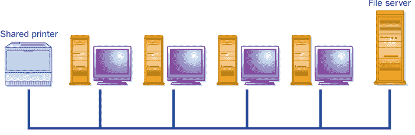

图 1.15 简单的计算机网络

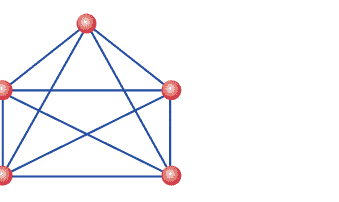

图 1.16 点对点连接

连接两台地理位置靠近的计算机，这种方案效果良好，被称为点对点连接。然而，考虑跨远距离连接许多计算机的任务。如果使用点对点连接，每台计算机都通过线直接连接到网络中的其他所有计算机。为每个连接准备单独的线并不是可行方案，因为每当向网络添加一台新计算机时，必须为网络中已有的每个计算机安装新的通信线。此外，单台计算机只能处理少数量的直接连接。

图 1.16 显示了多个点对点连接。考虑如果向网络增加两或三台额外计算机将需要多少通信线。如今，局域网（如单栋建筑内的网络）使用无线连接，最大限度地减少了布线需求。

比较图 1.15 和图 1.16 中的图表。图 1.15 显示的所有计算机共享单条通信线。网络上的每台计算机都有其网络地址，用于唯一标识。这些地址在概念上类似于主内存中的地址，但它们识别的是网络上的单个计算机，而不是单台计算机内部的单个内存位置。通过指定目标计算机的网络地址，消息从一台计算机发送到另一台计算机。

共享通信线具有成本效益，并使得向网络添加新计算机变得相对容易。然而，共享线路会导致延迟。网络上的计算机不能同时使用通信线。它们必须轮流发送信息，这意味着当线路忙时它们必须等待。

> **核心概念**
>
> 共享通信线会产生延迟，但如果它具有成本效益并简化了向网络添加新计算机。

改进延迟的一种技术是将大消息分成段，称为数据包，然后将各个数据包与其他用户的其他消息片段交织在一起发送到网络。数据包在目的地被收集并重新组装成原始消息。这种情况类似于一群人使用传送带将一组箱子从一个地方移动到另一个地方。如果只允许一个人使用传送带，而这个人有大量的箱子要移动，那么其他人将等待很长时间。

## 局域网与广域网

局域网（LAN）设计用于跨越短距离。广域网（WAN）连接远距离。通常，局域网连接建筑、学校或校园内的计算机。广域网连接跨越国家甚至整个世界的局域网。

> **核心概念**
>
> 局域网（LAN）用于共享资源。广域网（WAN）用于连接远距离的局域网。

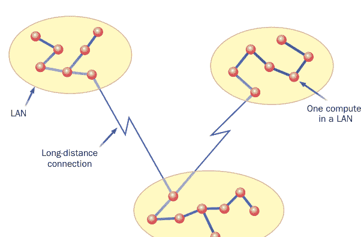

图 1.17 通过 WAN 连接的局域网

## 网络

网络对计算机系统的影响是巨大的。现在计算资源可以在许多用户之间共享。事实上，现在网络的使用已无处不在，以至于计算机需要网络才能运行。

### 互联网

在整个 20 世纪 70 年代，被称为研究计划署（ARPA）的国防部资助了几个项目来探索网络技术。这些努力的结果之一是 ARPANET，一个后来被称为互联网的网络。Internet 一词源于广域网的“网际”概念——将较小的网络连接在一起。

从 20 世纪 80 年代后期至今，互联网增长得惊人。1983 年，连接到互联网的计算机于 600 台。现在，互联网为数十亿用户提供服务。随着越来越多的计算机连接到互联网，巨大的流量变得困难。新技术多次替换了 ARPANET，每次都提供了更大的容量和处理能力。

> **核心概念**
>
> 互联网是一个跨越全球的广域网（WAN）。

协议是规定两个事物如何通信的一组规则。控制在互联网上移动消息的软件必须遵循一套协议 `TCP/IP`（按字母读作 T-C-IP）。`TCP` 代表传输控制协议，`IP` 代表互联网协议。`IP` 软件定义了信息如何从源到目的格式化传输。`TCP` 软件处理诸如信息乱序或信息丢失的问题，这些在大量信息同时汇聚在某处时可能会发生。

每台连接到互联网的计算机都有一个 `IP` 地址，用于在互联网所有其他计算机中唯一标识它。`IP` 地址的示例是 `204.192.116.2`。幸运的是，互联网用户很少处理 `IP` 地址。互联网允许为每台计算机命名。像 `IP` 地址一样，名称必须是唯一的。计算机的名称通常被称为互联网地址。互联网地址的示例是 `hector.edu`。

> **核心概念**
>
> 每台连接到互联网的计算机都有一个 `IP` 地址，用于唯一标识它。

互联网地址的第一部分是特定计算机的本地名称。地址的其余部分是域名，指示计算机所属的组织。例如，`vt.edu` 是弗吉尼亚理工学院网络的域名，而 `hector` 是网络上某台特定计算机的名称。

校园。由于域名是唯一的，许多组织可以拥有一台名为 `hector` 的计算机而不会产生冲突。各个部门可能会被分配子域名，这些子域名被添加到基本名称中，以便在大组织内唯一地区分部门的计算机。例如，`cs.vt.edu` 子域名专门供弗吉尼亚理工大学计算机科学系使用。

每个域名的最后一部分称为顶级域名（TLD），它通常指示计算机所属的组织类型。`edu` TLD 通常表示教育机构。`com` TLD 经常指向商业实体。另一个常见的 TLD 是 `org`，通常用于非营利组织。其他顶级域名还包括 `biz`、`info`、`jobs` 和 `name`。许多计算机（尤其是美国以外的计算机）使用国家顶级域名来表示其原产国，例如英国的 `.uk` 或澳大利亚的 `.au`。

当引用一个地址时，它会被翻译成其对应的 `IP` 地址，并从那时起就一直使用该地址。执行此操作的软件称为域名系统（`DNS`）。每个连接到互联网的本地连接都运行着一个域名服务器，该服务器维护着该组织内所有计算机及其 `IP` 地址的列表。它的工作方式类似于电话辅助：为你提供名称，而服务器返回一个数字。如果本地域名服务器没有该名称的 `IP` 地址，它会联系另一个拥有该地址的服务器。

互联网彻底改变了计算机处理。最初，互联计算机的主要用途是发送电子邮件，但互联网的能力在不断提高。互联网最重要的用途之一是世界维网（The World Wide Web）。

### 世界维网

互联网赋予了我们交换信息的能力。世界维网（也称为 `WWW` 或简单的 Web）让人类的信息交换变得简单。Web 软件提供了一个公共接口，通过点击鼠标即可访问许多不同类型的信息。

> **核心概念**
>
> 世界维网是一种让人们能够轻松跨越网络共享信息的软件。

万维网基于超文本（hypertext）和超多媒体（hypermedia）的概念。超文本一词是由泰德·尼尔森（Ted Nelson）于 1965 年提出的。它描述了一种组织信息的方法，使得思想流不再受线性进展。保罗·奥特莱（Paul Otlet，1868–1944）被某些认为是信息科学之父，他设想这一概念作为管理大量信息的方法。其核心思想是文档可以根据自然关系在各个点进行链接，以便读者能够根据自己的需要遵循适当路径从一个文档跳转到另一个文档。当结合了其他媒体组件（如图形、声音、动画和视频）时，生成的组织被称为超多媒体。

### Internet 与 Web 的区别

`Internet` 和 `Wide Web` 这两个术语有时会被互换使用，但两者之间存在重要的区别。`Internet` 使得通过全球计算机进行通信成为可能。`Web` 让通信变得简单愉快。`Web` 本质上是一种分布式信息服务，基于一组软件应用程序。它本身并不是网络。尽管它与互联网配合得很好，但它本质上并不与互联网绑定。`Web` 可以用于未连接任何其他网络的局域网（`LAN`）上，甚至可以在单台机器上显示 `HTML` 文档。

浏览器是一种加载并格式化 Web 文档以供查看的软件工具。`Mosaic` 作为第一个 Web 图形界面浏览器于 1993 年发布。Web 文档的设计者定义指向其他 Web 信息的链接，这些信息可能位于互联网的任何地方。开发 `Netscape Communications` 并创建 `Netscape Navigator` 浏览器的人就属于其中。目前流行的浏览器包括 `Explorer`、`Firefox`、`Apple Safari`、`Google Chrome` 和 `Opera`。

提供 Web 文档访问的计算机称为 Web 服务器。服务器加载并解释由 Web 服务器提供的文档。许多文档是使用超文本标记语言（`HTML`）格式化的。`Java` 编程语言与 Web 处理有密切的关系，因为指向 `Java` 的链接可以嵌入 `HTML` 文档并通过 Web 浏览器执行。我们将在第 2 章中更详细地探讨这种关系。

### 统一资源定位符

Web 上的信息通过识别统一资源定位符（Uniform Resource Locator，简称 `URL`）来找到。`URL` 的读法是 U-R-L。`URL` 唯一地指定了浏览器获取和显示的文档。以下是一个：

`http://www.google.com`

该 `URL` 的网站是著名的 Google 搜索引擎，它允许你使用特定的单词或短语在 Web 上进行搜索。

`URL` 包含部分信息。第一部分是协议，决定了浏览器传输和处理信息的方式。第二部分是存储文档机器的 Internet 地址。第三部分信息是感兴趣的文件名。如果没有文件名（如 Google `URL` 所示），Web 服务器通常提供一个默认页面（例如 `index.html`）。

> **核心概念**
>
> `URL` 唯一地指定了 Web 上浏览器获取和显示的信息。

让我们来看另一个 `URL` 示例：

`http://www.whitehouse.gov/photos-and-video/photogallery/photo-day`

在这个 `URL` 中，协议是 `http`，代表超文本传输协议。引用的机器是 `www`（Web 服务器的典型引用），位于域名 `whitehouse.gov`。最后，`photos-and-video/photogallery/photo-day` 代表要传输到浏览器的文件（或生成文件的引用）。`URL` 有许多其他形式，但这种是最常见的。

## 自习题（答案见附录 B）

- SR 1.14 什么是文件服务器？
- SR 1.15 需要多少条通信线路？
- SR 1.16 描述拥有计算机的好处。
- SR 1.17 `TCP` 代表什么？
- SR 1.18 `IP` 代表什么？
- SR 1.19 解释以下内容：
  - a. `duke.cs.villanova.edu/js`
  - b. `java.sun.com/products`

# 第 1 章 引言

```
LISTING 1.1
/********************************************************************
// Lincoln.java Author: Lewis/Loftus
//
// Demonstrates the basic structure of a Java application.
/********************************************************************
public class Lincoln
{
    // Prints a presidential quote.
    //
    public static void main(String[] args) {
        System.out.println("A quote by Abraham Lincoln:");

        System.out.println("Whatever you are, be a good one.");
    }
}
```

# 输出

亚伯罕·林肯的一言：

Whatever you are, be a good one.

`Java` 语言带有一个额外的软件库，我们可以在开发程序时使用。这些软件被称为 `Java API`，全称为应用程序编程接口（Application Programmer Interface），或简称标准类库。`Java API` 提供了创建图形、网络通信以及与数据库交互等许多功能。`Java API` 非常庞大且功能强大。虽然我们无法涵盖该库的所有方面，但我们将探索其中的一些内容。

`Java` 被应用于全球的商业环境中。它是史上增长最快的编程技术之一。因此，它现在不仅是一个学习编程概念的好语言，也是一种在未来对你非常有帮助的实用语言。

## 一个 Java 程序

让我们来看一个简单但完整的 `Java` 程序。列表 1.1 中的程序在屏幕上打印两个句子。这个特定的程序打印了亚伯罕·林肯的一言。输出显示在程序列表下方。

### Java 编程语言

所有的 `Java` 应用程序都有相似的结构。尽管这个程序规模小且目的简单，但它包含了几个重要特性。让我们仔细分解并检查它的各个部分。

程序的前几行是注释，它们以 `//` 符号开头并持续到行尾。注释不影响程序的运行，但包含它们是为了让人类更容易理解程序。程序员可以根据需要在整个程序中包含注释，用以清晰地标识程序的目的并描述任何特殊处理。任何书写的注释或文档（包括用户指南和技术参考）都称为文档。程序中包含的注释被称为文档。

> **核心概念**
>
> 注释不会影响程序的处理；相反，它们的作用便于人类理解。

程序的其余部分是一个类定义。这个类名为 `Lincoln`，尽管我们可以给它起任何想要的名字。类定义从第一个大括号 `{` 开始，到程序最后行的最后一个结束大括号 `}` 结束。所有的 `Java` 程序都是使用类定义定义的。


视频笔记：程序元素概述。

类定义内部有一些注释描述了 `main` 方法的作用，该方法直接定义在注释下方。方法是一组被赋予了名的编程语句。在这种情况下，`main` 方法的名字是 `main`，它只包含两个编程语句。类类一样，方法也由大括号分隔。

所有的 `Java` 应用程序都有一个 `main` 方法，这是执行开始的地方。`main` 方法中的每个编程语句都会按顺序逐个执行，直到方法的末尾。程序结束或终止。`Java` 程序中的 `main` 方法定义之前总是会有 `public`、`static`、`void` 这几个词，我们将在后文中检查。这个特定的程序没有使用 `String` 和 `args`。我们稍后会描述这些内容。

执行的代码调用了 `println`，它在程序中并没有定义。`println` 方法是 `System.out` 对象的一部分，而 `System.out` 是 `Java` 标准类库的一部分。它在技术上不属于 `Java` 语言，但在任何 `Java` 程序中始终可用。我们将在第 2 章更详细地探讨 `println` 方法。

## 注释

让我们更详细地检查注释。注释是允许程序员独立于代码编写和交流想法的唯一语言特性。注释应该提供对程序员意图的洞察。一个程序通常会被使用多年，随着时间的推移经常对其进行多次修改。在未来的某个时刻，原始程序员可能不再记得特定程序的细节，而且原始程序员并不总是能出来进行更改；因此，不熟悉程序的人需要理解它。良好的文档是关键的。

对于 `Java` 编程语言而言，注释的内容可以是任何文本。计算机会忽略注释；它们不会影响程序的执行方式。

`Lincoln` 程序中的注释代表了 `Java` 允许的注释类型之一。`Lincoln` 中的注释采用以下形式：

```
// This is a comment.
```

这种类型的注释以双斜杠（`//`）开头并持续到行尾。你不能在双斜杠之间放置任何字符。计算机会忽略双斜杠到行尾的所有文本。注释可以紧跟在同一行的代码之后，如下例所示：

```
System.out.println("Monthly Report"); // always use this title
```

`Java` 注释的第二种形式如下：

```
/* This is another comment. */
```

这种注释不使用行尾来指示注释。起始斜杠星号（`/*`）和结束星号斜杠（`*/`）之间的任何内容注释的一部分，包括代表换行的不可见字符。因此，这种类型的注释可以跨多行。斜杠和星号之间不能有空格。

如果在注释开头的 `/*` 之后有第二个星号，则该内容可以使用名为 `javadoc` 的工具自动生成关于程序的外部文档。关于 `javadoc` 的更多信息见附录 I。这两种基本的注释类型可以创建各种文档样式，例如：

```
// This is a comment on a single line.
// Some comments such as above methods or classes
// deserve to be blocked off to focus special attention
// on a particular aspect of your code. Note that each of
// lines is technically a separate comment.
```

```
/*
 This is one comment
 that spans several lines.
*/
```

程序员把太多精力放在了写代码上，导致他们对文档关注太少。你应该养成良好的注释习惯并习惯性遵守。注释应该写得良好，使用完整的句子。它们不应该是显而易见的，而应该提供对代码意图的适当见解。以下示例不是良好的注释：

```
System.out.println("hello"); // print hello
System.out.println("test"); // change this later
```

第一条注释转述了该行显而易见的目的，没有为语句添加任何价值。与其有一个没用的注释，不如没有。第二条注释具有歧义。以后应该改什么？什么时候改？为什么要改？

> **核心概念**
>
> 内联文档应该提供对代码的洞察。它不应该是歧义的，也不应重复事实。

## 标识符与保留字

编写程序时使用的单词被称为标识符。`Lincoln` 程序中的标识符有 `class`、`Lincoln`、`public`、`static`、`void`、`main`、`String`、`args`、`System`、`out` 和 `println`。它们分为三类：

- 我们编写程序时创建的单词（`Lincoln` 和 `args`）
- 另一个程序选择的单词（`String`、`System`、`out`、`println` 和 `main`）
- 语言中保留用于特殊目的的单词（`class`、`public`、`static` 和 `void`）

编写程序时，我们简单地将类命名为 `Lincoln`，但我们可以使用许多其他可能性之一。例如，我们可以将其命名为 `Quote`、`Abe` 或 `GoodOne`。标识符 `args`（缩写自

# 32 第 1 章 引言


# Java 关键字

```
abstract default goto* package this
assert do if private throw
boolean double implements protected throws
break else import public transient
byte enum instanceof return true
case extends int short try
catch false interface static void
char final long strictfp volatile
class finally native super
const* float new switch
continue for null synchronized
```

`(arguments)` 的使用方式与我们在 `Lincoln` 中使用的方式相同，但我们可以在该位置使用任何其他标识符。

标识符 `String`、`System` 和 `println` 是由其他程序员选择的。这些单词并不是 Java 语言的一部分。它们是 Java 预定义代码库的一部分，这是一组由他人已经为我们编写好的类和方法。这些代码的作者选择了这些代码中的标识符——我们只是在使用它们。

关键字在编程语言中具有特殊含义，只能按照定义的方式使用。关键字不能用于任何其他用途，例如为类或方法命名。在 `Lincoln` 程序中，关键字使用蓝色字体。图 1.18 按字母顺序列出了所有关键字。标记有星号*的单词已被保留，但目前在 Java 中没有意义。

我们为程序创建的标识符可以是字母、数字、下划线 (`_`) 和美元符号 (`$`) 的任意组合，但不能与数字开头。标识符可以是任意长度。因此，`total`、`label1`、`nextStockItem`、`NUM_BOXES` 和 `$amount` 都是有效的标识符，但 `4th_word` 和 `coinValue` 不是有效的。

标识符可以使用大写字母和小写字母，且这种区别至关重要。Java 是区分大小写的，这意味着两个仅在字母大小上不同的名称被视为不同的标识符。因此，`total`、`Total`、`ToTal` 和 `TOTAL` 都是不同的标识符。你可以想象，使用多个仅在大小上不同的标识符并不是一个好主意，因为它们很容易被混淆。

## 1.4 Java 编程语言

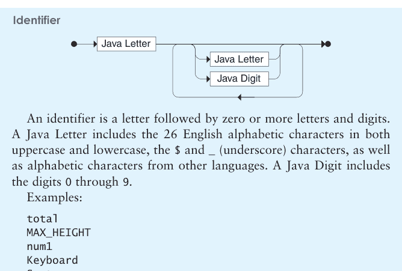

标识符后面跟着零或多个字母和数字。Java 字母包括大写和小写的 26 个英文字母、`$` 和 `_`（下划线）字符，以及其他语言的字母。Java 数字包括数字 0 到 9。

示例：

```
total
MAX_HEIGHT
num1
Keyboard
System
```

尽管 Java 语言没有强制要求，但为每种标识符使用一致的大小写格式会让你的标识符更易理解。关于标识符，有各种 Java 规范应该遵循，尽管从技术上讲它们并非必须。例如，我们对类使用 `titleCase`（每个单词的首字母大写）。在全文中，我们会在第一次遇到每类型的标识符时描述其首选的样式。

> **核心概念**
>
> Java 是区分大小写的。字母的大写和小写版本是不同的。

虽然标识符可以是任意长度，但你应该仔细选择你的名称。它们应该是具有描述性的，但不冗长。你应该避免使用诸如 `a` 或 `x` 这样没有意义的名称。这条规则的例外是如果名称很短但实际上具有描述性，例如使用 `x` 和 `y` 表示二维网格上的 `(x, y)` 坐标。同样，你不应该使用不必要的长名称，因为标识符 `currentItemBeingProcessed` 换成 `currentItem` 效果是一样的。想象一下，使用冗长的标识符比使用不具描述性的名称问题要常见得多。

你应该始终努力让你的程序尽可能具有可读性。因此，在缩写单词时你应该始终小心。你可能认为 `curStVal` 是代表当前股票价值的一个好名称，但另一个试图理解代码的人可能很难弄清楚你的意思。在你写下代码两个月后，你自己可能也对它不清楚了。

> **核心概念**
>
> 标识符名称应该是具有描述性且易读的。

### 列表 1.2

亚伯拉罕·林肯的引言：

无论你成为什么，都要做一个出色的。

### 空格

所有 Java 程序都使用空白字符来分隔程序中使用的单词。空白由空格、制表符（tabs）和换行符组成。“空白”（white space）一词是指，在带有黑色字迹的白色纸上，单词和符号之间的空间是白色的。程序员使用空白很重要，因为可以用它可以强调代码的部分，并使程序更易读。

除非用于分隔单词，否则计算机会忽略空白。它不会影响程序的执行。这一事实为程序员在格式化程序方面提供了极大的灵活性。程序的行应该在逻辑位置划分，某些行应该进行缩进和对齐，以便使程序的底层结构清晰。

由于空白被忽略，我们可以以许多不同的方式编写程序。例如，将空白推向极端，我们可以在每行放置尽可能多的单词。列表 1.2 中的代码 `Lincoln2` 程序的格式化与 `Lincoln` 不同，但打印出的消息相同。

将空白推向另一个极端，我们可以将几乎每个单词和符号写在不同的行上，并带有不同数量的空格，例如列表 1.3 中的 `Lincoln3`。

`Lincoln` 的三个版本在技术上都是有效的，并将以相同的方式执行，但从读者的角度来看，它们截然不同。后两个例子显示了糟糕的样式，并使程序难以理解。

#### 列表 1.3

```
********************************************************************
// Lincoln3.java      作者: Lewis/Loftus
// 展示了另一个格式不良好的有效程序
********************************************************************
    public class
    Lincoln3
    {
        public static void
        main(String[] args)
        {
            System.out.println("亚伯拉罕·林肯的引言：");
            System.out.println(
                "无论你成为什么，都要做一个出色的.");
        }
    }
```

输出

亚伯拉罕·林肯的引言：

无论你成为什么，都要做一个出色的。

当你被要求遵循特定的指南。软件开发公司通常有一个要求程序员遵循的编程风格。任何情况下，你应该采用并一致使用一套指南来提高代码的可读性。

- 复习题（答案见附录 N）

- SR 1.20 Java 语言是什么时候开发的？是谁开发的？什么时候推出的？

- SR 1.21 程序从哪里开始？

- SR 1.22 你预测 Java 程序中这一行的结果是什么？

```
System.out.println("Hello\ // 打印 hello
```

- SR 1.23 你预测 Java 程序中这一行的结果是什么？

```
// 打印 hello System.out.println("Hello");
```

- SR 1.24 以下哪些不是有效的 Java 标识符？为什么？

- a. RESULT

- b. result

- c. 12345

- d. x12345y

- e. black&white

- f. answer_7

- SR 1.25 假设程序需要一个标识符代表一个班的学生成绩总和。对于以下每个名称，说明每个是否是该标识符的好名称。解释你的答案。

- a. x

- b. scoreSum

- c. sumOfTheTestScoresOfTheStudents

- d. smTstsr

## 1.5 程序开发

俄语或意大利语。无论使用哪种语言来解释指令，其方向都是相同的，但表达指令的方式是不同的。朋友必须能够理解所使用的语言才能遵循指令操作。

同样，可以通过许多编程语言之一（如 Java、Ada、C、C++、Pascal 和 Smalltalk）编写程序来解决问题。无论使用哪种语言，程序的目的在本质上都是相同的，但用于表示指令的特定语句以及这些指令的整体结构随每种语言而异。计算机必须能够理解指令才能执行它们。

编程语言可以分为以下四组。这些组大致反映了计算机语言的历史发展过程。

- 机器语言
- 汇编语言
- 高级语言
- 第四代语言

为了让程序在计算机上运行，它必须以该计算机的*机器语言*表示。每个 CPU 都有自己的语言。因此，我们不能将专门为带有 Sparc 处理器的 Sun 工作站编写的程序运行在带有 Intel 处理器的 Dell PC 上。

每条机器语言指令只能完成一个简单的任务。例如，单条机器语言指令可能会将一个值复制到寄存器中，或将 a 与零进行比较。可能需要四条机器语言指令将两个数字相加并存储结果。然而，计算机一秒钟可以执行数百万条指令，通过复杂的任务可以快速执行许多简单命令。

机器语言代码以一系列二进制位表示，对于人类来说，读写它极其困难。最初，程序是使用开关或类似的繁琐方法输入计算机的。早期程序员发现这些技术既耗时又容易出错。

这些问题催生了汇编语言的使用，汇编语言将二进制位替换为*助记符*，即代表命令或数据的短英语类单词。对于程序员来说，处理单词比处理二进制位容易得多。然而，汇编语言程序不能直接在计算机上执行。它必须先翻译成机器语言。

通常，每条汇编语言指令对应一条等效机器语言指令。因此，与机器语言类似，每条汇编指令只完成一个简单的操作。尽管从程序员的角度来看，汇编语言是机器码的改进，但使用起来仍然很麻烦。汇编语言和机器语言都被视为低级语言。

> **核心概念**
>
> 所有程序必须翻译成特定 CPU 的机器语言才能执行。

### 核心概念

高级语言允许程序员忽略机器语言的底层细节。

| 高级语言 | 汇编语言 | 机器语言 |
|---|---|---|
| a + b | 1d [%fp-20], %s0 | ... |
| | 1d [%fp-24], %s1 | 1101 0000 0000 0111 |
| | add %s0, %s1, %s0 | 1011 1111 1110 0111 |
| | | 1101 0000 0000 0111 |
| | | 1011 1111 1110 1000 |
| | | 1001 0000 0000 0000 |

图 1.19 高级表达式及其对应的汇编语言和机器语言等价形式

今天，大多数程序员使用高级语言来编写软件。高级语言用类英语的短语表示，这对于程序员来说更容易读和更容易写。单个高级编程语句可以完成等同于许多——可能——机器语言指令的任务。

“高级”一词是指编程语句的表达方式与直接执行的机器语言相远。Java 是一种高级语言，Ada、C++、Smalltalk 以及许多语言也是如此。

图 1.19 显示了高级语言、汇编语言和机器语言中的等效表达式。该表达式的作用是将两个数字相加。其中的汇编语言和机器语言是针对 Sparc 处理器的。

图 1.19 中的高级表达式对程序员来说是可读且直观的。它类似于代数表达式。汇编表达式具有一定的可读性，但它更冗长，且不那么直观。机器语言基本上是不可读的，而且长度要长得多。事实上，图 1.19 仅显示了相加两个数字的二进制代码的一部分。该特定表达式的完整机器语言代码超过 400 位。

高级语言使程序员不再需要了解他们正在运行的处理器的底层机器语言。但高级代码必须翻译成机器语言才能执行。

某些编程语言被认为运行在比高级语言更高级的水平。它们可能包含用于自动生成报告或与数据库交互的特殊设施。这些语言被称为第四代语言，或简称为 4GL，它们继于计算机编程的前三代：机器语言、汇编语言和高级语言。

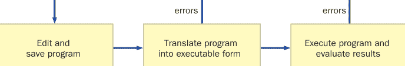

图 1.20 编辑和运行程序

## 编辑器、编译器和解释器

需要几个特殊程序来帮助开发程序的过程。基本工具的示例包括编辑器、编译器和解释器。

最初，你使用编辑器输入程序并将其保存到文件中。有许多具有不同功能的编辑器。图 1.20 显示了程序开发过程的基本视图。

将代码翻译为特定 CPU 的机器语言可以通过多种方式实现。编译器是一个将一种语言翻译成另一种语言的程序。原始代码称为源代码，翻译而成的语言称为目标语言。对于许多编译器来说，翻译发生一次，生成的可执行程序可以在任何需要的时候运行。

解释器与编译器类似，但有一个重要的区别。解释器将翻译和执行活动交织在一起。源代码的一小部分（如一条语句）会被翻译并执行。这种技术的优点之一是它消除了对独立编译阶段的需求。然而，程序运行通常较慢，因为翻译发生在执行期间。

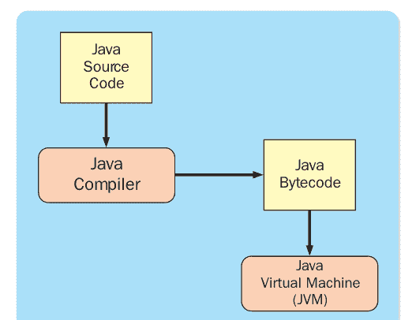

图 1.21 Java 的翻译和执行过程

> **核心概念**
>
> Java 编译器将 Java 源代码翻译成 Java 字节码，这是一种低级的、体系无关的程序表示。

## 开发环境

软件开发环境是用于创建、测试和修改程序的工具集。某些环境免费，而另一些可能具有高级功能的环境必须购买。某些环境被称为集成开发环境（IDEs），因为它们将各种工具集成到一个软件程序中，并提供了方便的图形用户界面。

任何开发环境都会包含某些关键工具，例如 Java 编译器和解释器。有些环境会包含调试器，它可以帮助你发现程序中的错误。其他可能包含的工具还有文档生成器、归档工具以及帮助你可视化程序结构的工具。

Java 标准版（Standard Edition）的开发包含了 Java 开发工具包（SDK），它有时被称为 Java 开发工具包（JDK）。Java SDK 包含了让 Java 程序运行的核心开发工具，但它并不是一个集成环境。编译和解释命令是在命令行上执行的。也就是说，SDK 没有图形用户界面（GUI）。它不包含编辑器；任何可以将文档保存为纯文本的编辑器都可以使用。

最流行的 Java IDE 之一是 Eclipse（访问 [www.eclipse.org](http://www.eclipse.org)）。Eclipse 是一个开源项目，意味着它是由大量的贡献者开发的并且免费提供。其他流行的 Java IDE 还有 jEdit（[www.jedit.org](http://www.jedit.org)）、DrJava、jGRASP（[www.jgrasp.com](http://www.jgrasp.com)）和 Blue（[www.blue.org](http://www.blue.org)）。

还有其他的 Java 开发环境。网络搜索会发现几十种。选择使用什么开发环境是非常重要的。你对开发环境的能力越了解，在程序开发期间效率就越高。

> **核心概念**
>
> 存在许多不同的开发环境来帮助你创建和修改 Java 程序。

## 语法与语义

每种编程语言都有其独特的语法。语言的语法规则规定了语言词汇元素如何组合成术语。创建程序时必须遵循这些规则。我们已经讨论了几种语法规则。例如，标识符不能以数字开头就是一个语法规则。使用大括号来开始和结束类和方法也是语法规则。附录 L 定义了 Java 编程语言的基本语法规则，特定的规则在文中得到了突出显示。

在编译期间，所有的语法规则都会被检查。如果程序在语法上不正确，编译器将发出错误信息并且产生字节码。Java 的语法与 C 和 C++ 编程语言相似，因此代码的外观和感觉对于具有这些语言背景的人来说是熟悉的。

编程语言中语句的语义定义了执行该语句会发生什么。编程语言通常是无歧的，这意味着程序的语义是有良好定义的。也就是说，每个语句都有且仅有一种解释。相反，人类用于通信的自然语言（如英语和意大利语）充满了歧义。一个句子通常有二或多个不同的含义。例如，考虑以下句子：

Time flies like an arrow.（时间光如箭。）

> **核心概念**
>
> 语法规则规定了程序的形式。语义规定了程序语句的含义。

普通人可能会将这句话解释为一种普遍观察：时间移动得很快，箭移动得很快。然而，如果我们将单词 *time* 解释为动词（如“跑第 50 天，我会来计时”），并将单词 *flies* 解释为名词（苍蝇的复数），解释就完全改变了。我们知道箭不会进行“计时”，所以我们不会那样解释这个句子，但它是对句子中词汇的一种有效解释。计算机很难确定想要表达的是哪种含义。此外，这句话还可能描述一种被称为“时间蝇”（time fly）的异常昆虫的偏好，这种昆虫可能出现在箭靶场附近。毕竟，果蝇喜欢香蕉。

这一点在于，一个英语句子可以有多个有效含义。计算机语言不允许此类歧义的存在。如果一种编程语言具有两种不同的含义，计算机将无法确定应该执行哪一个。

## 错误

软件中可能会发生各种问题，特别是在程序开发期间。“计算机错误”（computer error）这个术语经常被误用，其含义根据情况而异。从用户的角度来看，任何与机器交互时出错的现象都可以称为计算机错误。例如，假设你用信用卡支付了一件价值 23 美元的商品，但当你收到账单时，该商品的价格被列为 230 美元（此处原文为 $230$）。在你修复问题后，信用卡公司对“计算机错误”表示歉。计算机随机在数字末尾添加了一个零，或者可能是将数值乘以 10？显然不是。计算机遵循我们给出的命令并根据我们提供的数据进行操作。如果我们的程序或数据不准确，那么我们就不能期望结果是正确的。描述这种情况的一句常用短语是“垃圾进，垃圾出”（garbage in, garbage out）。

> **核心概念**
>
> 程序员对程序的准确性和可靠性负责。

在开发程序时，你会遇到三种类型的错误：

- 编译时错误
- 运行时错误
- 逻辑错误

编译器会检查以确保你使用了正确的语法。如果你有任何不符合语言语法规则的语句，编译器将产生语法错误。编译器还会尝试寻找其他问题，例如不兼容的数据类型。语法在技术上可能是正确的，但你可能正在尝试某些语言在语义上不允许的操作。编译器识别的任何错误被称为编译时错误。如果发生编译时错误，则不会创建程序的可执行版本。

> **核心概念**
>
> Java 程序必须在语法上正确，否则编译器不会产生字节码。


第二种问题发生在执行期间。它被称为运行时错误，会导致程序异常终止。例如，如果我们尝试除以零，程序将“崩溃”并在该点停止执行。由于请求的操作是未定义的，系统将直接放弃继续你程序的尝试。最好的程序应该防范除以零的可能性，并在情况发生时妥善处理。在 Java 中，许多运行时问题被称为异常（`exceptions`），可以被捕获并进行相应的处理。


**视频旁记**

各种错误类型的示例。

第三种问题是逻辑错误。在这种情况下，软件可以编译并运行而没有报错，但它产生了错误的结果。例如，当计算值计算错误或图形按钮没有出现在正确的位置时，就会发生逻辑错误。程序员必须对程序进行彻底测试，将预期结果与实际发生的结果进行比较。发现缺陷后，必须将其追溯到代码中的问题源并进行修正。在程序中发现和修正缺陷的过程被称为调试（`debugging`）。逻辑错误可以以许多方式表现出来，实际根源可能很难发现。

# 自习题（答案见附录 N）

+ SR 1.27 我们只知道计算机被用于执行复杂任务。在这一节中，你学习了计算机的指令只能执行简单任务。请解释这种表面上的矛盾。

+ SR 1.28 高级语言与机器语言之间是什么关系？

+ SR 1.29 什么是 Java 字节码？

+ SR 1.30 从下列列表中选择与每个短语匹配的单词：汇编（`assembly`）、编译器（`compiler`）、高级（`high-level`）、IDE、解释器（`interpreter`）、Java、低级（`low-level`）、机器（`machine`）。
    a. 用这种语言编写的程序可以直接在计算机上运行。

- b. 通常，这种类型语言中的每条语言指令都对应一条等效机器语言指令。

- c. 大多数程序员使用这种语言来编写程序。

- d. Java 是这种语言的一个示例。

- e. 这种程序将代码从一种语言翻译成另一种语言。

- f. 这种程序将代码的翻译和代码的执行交织在一起。

SR 1.31 我们所说的编程语言的语法和语义是指什么？

SR 1.32 将下列每情况分类为编译时错误、运行时错误或逻辑错误。

- a. 拼错了 Java 单词。

- b. 通过将列表中数字之和（为 0）除以列表的大小（也是 0）来计算空数字列表的平均值。

- c. 在应该输出学生平均成绩时，却打印了学生的单次考试成绩。

## 1.6 面向对象的编程

正如在本章开头介绍的，Java 是一种面向对象（OO）的语言。正如名称所示，对象（`object`）是 Java 程序中的基本实体。这种方法侧重于通过定义相互作用的对象来开发软件。

面向对象的软件开发原则已经存在多年了，本质上与高级编程语言的使用历史一样长。20 世纪 60 年代开发的编程语言 Simula 具有许多定义现代面向对象软件开发方法的特征。20 世纪 80 年代和 90 年代，面向对象编程变得流行，这很大程度上归功于 C++ 和 Java 等编程语言的发展。它现在是商业软件开发中使用的主流方法。

面向对象方法最具吸引力的特征之一是，对象可以非常有效地表示现实世界的实体。例如，我们可以使用软件对象来代表公司中的员工。我们为每个员工创建一个对象，每个对象都具有我们需要表示的行为和特征。通过这种方式，面向对象编程允许我们将程序映射到程序所代表的现实情况中。也就是说，面向对象的方法更容易解决问题，而这正是编写程序的初衷。

> **核心概念**
>
> 面向对象编程有助于解决问题，这就是编写程序的目的。

让我们讨论与解决问题相关的通用问题，然后探索面向对象方法帮助我们解决这些问题的特定特征。

## 问题解决

通常情况下，解决问题包含多个步骤：

1. 理解问题。

2. 设计解决方案。

3. 考虑解决方案的替代方案并完善解决方案。

4. 实现解决方案。

5. 测试解决方案并修复任何存在的问题。

尽管这种方法适用于任何类型的问题解决，但在开发软件时尤为有效。这些步骤并不是纯线性的，某些活动会与其他活动重叠。在某个时刻，所有这些步骤都应该被仔细处理。

第一步理解问题听起来可能显而易见，但对这一步的忽视导致了许多软件开发工作的误导。如果我们尝试去解决一个我们并不完全理解的问题，往往会解决一个错误的问题，或者采用不恰的技术。每个问题都有一个问题领域（`problem domain`），即对我们的解决方案关键的现实世界问题。例如，如果我们正在编写一个程序来为保龄比赛评分，问题领域就包含了保龄规则。要开发出良好的解决方案，我们必须彻底理解问题领域。

设计问题解决方案的关键是将拆分解为可管理的部分。任何问题的解决方案都很少能表达为一个巨大的任务。相反，它是一系列相互协作的小任务，通过相互作用来执行更大的任务。在开发软件时，我们不是只写一个程序。我们设计负责解决方案某些部分的独立部分，然后将它们与其他部分集成。

> **核心概念**
>
> 程序设计涉及将解决方案拆分为可管理的部分。

我们对解决方案的第一个倾向可能不是最好的。我们必须始终考虑替代方案，并在必要时完善解决方案。我们越早考虑替代方案，修改我们的方法就越容易。

实现解决方案是将设计并将其转化为可用形式的行为。在为问题开发软件解决方案时，实现阶段是实际编写程序的过程。在很多情况下，编程被认为是编写代码。但在大多数情况下，设计程序的行为应该比在特定编程语言中实现设计的过程要有趣且富有创造性。

在开发过程的许多点，我们应该测试解决方案以发现任何存在的错误，以便我们修复它们。测试不能保证没有尚未被发现的问题，但它可以增强我们对已拥有可行解决方案的信心。

在本文中，我们将探索允许我们设计和实现优雅程序的技术。虽然我们经常沉浸在这些细节中，但永远不应忘记首要目标是解决问题。

## 面向对象软件原则

面向对象编程最终要求对以下术语有深入理解：

- 对象 (`object`)
- 属性 (`attribute`)
- 方法 (`method`)
- 类 (`class`)
- 封装 (`encapsulation`)
- 继承 (`inheritance`)
- 多态 (`polymorphism`)

除了这些术语外，还有许多相关概念允许我们以无数方式定制解决方案。本书的设计旨在帮助你逐渐、自然地进化对这些概念的理解。本节提供了这些思想的高级概述，以建立一些术语并提供全局视角。

我们之前提到过，对象是程序中的基本元素。软件对象通常代表程序领域中的真实对象，例如银行账户。每个对象都有状态（`state`）和一组行为（`behaviors`）。我们所说的“状态”是指——当前定义对象的本质特征。例如，银行账户状态的一部分是其当前余额。对象的行为是与对象相关的活动。与银行相关的行为可能包括存款和取款的能力。

除了对象之外，Java 程序还管理原始类型数据（`primitive data`）。原始类型数据包括数字和字符等基本值。对象通常代表更有趣或更复杂的实体。

对象的属性是它内部存储的值，可以表示为原始类型数据或表示为其他对象。例如，银行账户对象可能会存储一个代表账户价值的浮点数（一个原始值）。它可能包含其他属性，如账户所有者的姓名。对象属性值的总和定义了它的当前状态。

> **核心概念**
>
> 每个对象都有一个由属性定义的状态，以及一组由方法定义的行为。

正如在本章开头提到的，方法是一组被赋予名称的编程语句。当方法被调用时，其语句会被执行。一组方法与对象相关。对象的方法定义了它的潜在行为。为了定义向银行账户存款的能力，我们定义了一个包含编程语句的方法，以相应地更新对象的余额。

对象由类（`class`）定义。类是创建对象的模型或蓝图。考虑建筑师在设计房屋时创建的蓝图。蓝图定义了房屋的重要特征——墙、门、电源插座等。一旦创建了蓝图，就可以用它建造几栋房屋，如图 1.22 所示。

意义上说，从蓝图建造的房屋是不同的。它们位于不同的位置，有不同的地址，家具不同，由不同的人居住。但在许多方面，它们是“同一个”房子。

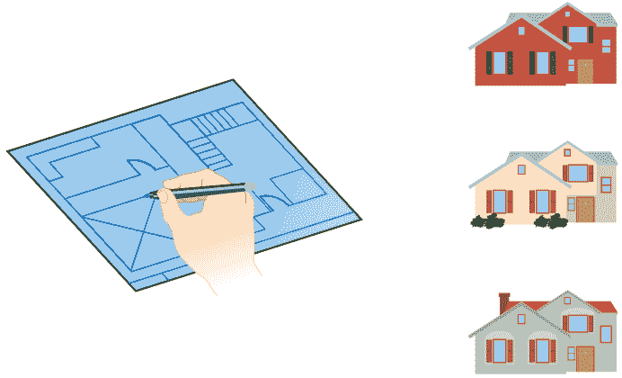

图 1.22 类用于创建对象，就像房屋蓝图用于创建不同但相似的房屋一样。

## 第 1 章 引言

房间的布局和其他关键特征在每个房子中都是相同的。要创建一个不同的房子，我们需要不同的蓝图。

类（`class`）是对象的蓝图。它确定了该类型的对象将包含的数据类型，并定义了代表此类对象行为的方法（`methods`）。然而，类并不等于蓝图中的房子。通常情况下，类不包含存储数据的空间。每个对象都有存储自己数据的空间，这就是为什么每个对象都有自己的状态。

## 核心概念

- 类是对象的蓝图。从一个类定义中可以创建多个对象。

一旦定义了一个类，就可以从该类创建多个对象。例如，如果我们定义一个类来表示银行账户的概念，我们就可以创建多个代表特定、独立账户的对象。每个银行账户对象都将跟踪自己的余额。

对象应该被封装（`encapsulated`），这可以保护它并管理它自己的信息。也就是说，一个对象应该是自管理的。对对象的任何更改都应该通过该对象的方法来实现。我们设计对象时，不应该让其他对象“进入内部”改变它们的状态。

可以使用继承（`inheritance`）从其他类创建新类。也就是说，一个类的定义可以基于已经存在的另一个类。继承是软件复用的形式，利用了各种类之间的相似性。派生类可以进一步用于派生更多的类。这创建了一个类的层次结构，其中在一个类定义的属性和方法会被其子类继承，子类再将其传递给它们的子类，以此此类推。例如，我们可能会创建一个表示各种类型账户的类层次结构。共同特征在高层类中定义，特定的差异在派生类中定义。

多态（`Polymorphism`）的想法是我们可以以一致的方式随时间引用多种类型的相关对象。它使我们能够为处理多个对象的问题设计出强大且优雅的解决方案。

一些核心面向对象概念如图 1.23 所示。我们不指你现在就能完全理解这些概念。本书的大部分内容都是为了阐述这些思想。此概述仅旨在做铺垫。

## 1.6 面向对象编程

类定义了一个概念。

从一个类中可以创建多个封装的对象。

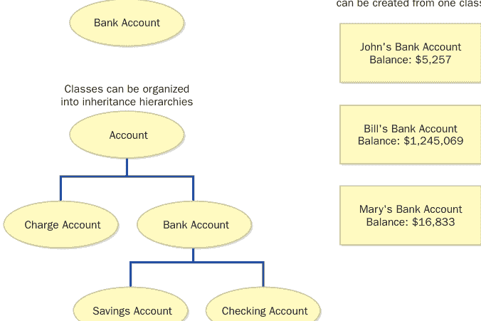

图 1.23 面向软件的各个方面

> **我测习习题（答案见附录 N）**

- SR 1.33 列出解决问题所需的五个通用步骤。

- SR 1.34 为什么考虑多种解决问题的方法很重要？为什么在解决问题的过程中早期考虑备选方案很重要？

- SR 1.35 支持面向对象编程的主要概念有哪些？

## 核心概念总结

- 一个计算机系统由硬件和软件组成，它们协同工作帮助我们解决问题。

- CPU 从主内存中读取程序指令，并逐条执行，直到程序结束。

- 操作系统提供用户界面并管理计算机资源。

- 对于用户来说，界面就是程序。

- 数字计算机通过将信息拆分为部分并将每个部分表示为数字来存储信息。

- 二进制被用于在计算机中存储和移动信息，因为存储和处理二进制数据的设备廉价且可靠。

- N 位恰好有 `2^N` 种排列。因此，N 位可以表示多达 `2^N` 个唯一项目。

- 计算机的核心由主内存（存储程序和数据）和 CPU（逐条执行程序指令）组成。

- 地址是与内存位置相关的一个唯一数字。

- 主内存是易失的，这意味着只有在供电的情况下，存储的信息才会被维持。

- CD 表面既有光滑区域也有小凹槽。凹槽代表二进制 1，光滑区域代表二进制 0。

- 可重写 CD 使用可以根据需要制成非晶态或结晶态的涂层来模拟普通 CD 的凹槽和光滑区域。

- 取指-解码-执行周期构成了计算机处理的基础。

- 网络连接了两个或多个计算机，以便它们交换信息。

- 共享通信线路会产生延迟，但具有成本效益，并简化了向网络添加新计算机的步骤。

- 局域网（LAN）是在整个组织范围内共享信息和资源的有效方法。

- 互联网是跨越的广域网（WAN）。

- 每台连接到互联网的计算机都有一个唯一标识它的 IP 地址。

## 核心概念总结

- 万维网（World Wide Web）是一种让人们更容易在网络上共享信息的软件。

- URL 唯一指定了 Web 上的文档和其他信息，供浏览器获取和显示。

- 本书侧重于面向对象编程的原理。

- 注释不会影响程序的处理；相反，它们是为了方便人类理解。

- 内联文档应该提供对代码的洞察。它不应该是模糊的，也不应该重复显而易见的内容。

- Java 是大小敏感的。字母的大写和小和小写版本是不同的。

- 标识符名称应该是具有描述性且可读的。

- 适当使用空格使程序更易阅读和理解。

- 你应该遵循一套指南，这些指南规定了你格式化和记录程序的方式。

- 所有程序必须翻译成特定 CPU 的机器语言才能执行。

- 高级语言允许程序员员忽略机器语言的底层细节。

- Java 编译器将源代码翻译成字节码（`bytecode`），这是一种低级的、架构无关的程序表示。

- 存在不同的开发环境来帮助你创建和修改程序。

- 语法规则规定了程序的形式。语义规定了程序的含义。

- 程序员对程序的准确性和可靠性负责。

- 程序必须在语法上是正确的，否则编译器不会产生字节码。

- 面向对象编程帮助我们解决问题，这正是编写程序的目的。

- 程序设计涉及将解决方案拆分为可管理的部分。

- 每个对象都有一个状态（由其属性定义）和一组行为（由其方法定义）。

- 类是对象的蓝图。从一个类定义中可以创建多个对象。

## 练习题

EX 1.1 描述你的个人电脑或你所访问的实验室计算机的硬件组件。包括处理器类型和速度、主内存和辅助内存的容量，以及 I/O 设备类型。解释你是如何确定答案的。

EX 1.2 为什么我们使用二进制数制在计算机上存储信息？

EX 1.3 以下每项可以表示多少个唯一项目？

- a. 1 bit

- b. 3 bits

- c. 6 bits

- d. 8 bits

- e. 10 bits

- f. 16 bits

EX 1.4 如果一张图片由 128 种可能的颜色组成，需要多少位（bits）来存储该图片的每个像素？为什么？

EX 1.5 如果一种语言使用 240 个唯一的字母和符号，需要多少位来存储文档中的每个字符？是吗？为什么？

EX 1.6 以下每项中有多少位（bits）？每项中有多少字节（bytes）？

- a. 12 KB

- b. 5 MB

- c. 3 GB

- d. 2 TB

EX 1.7 解释随机存储器（RAM）和只读存储器（ROM）之间的区别。

EX 1.8 磁盘是一种随机访问设备，但不是 RAM（随机内存）。解释。

EX 1.9 确定你的计算机或你所访问的实验室计算机是如何跨网络连接其他计算机的。画一张图来显示你环境中的基础连接。

练习 53

EX 1.10 解释局域网（LAN）和广域网（WAN）之间的区别。它们之间是什么什么关系？

EX 1.11 八台计算机的全连接点对点网络需要多少条通信线？九台计算机呢？十台计算机呢？确定此结果的通用公式是什么？

EX 1.12 解释互联网（Internet）和万维网（World Wide Web）之间的区别。

EX 1.13 列出并解释以下 URL 的组成：

- a. 你的学校

- b. 你们学校的计算机科学系

- c. 你老师的网页

EX 1.14 给出两种 Java 注释的示例，并解释它们之间的区别。

EX 1.15 下列哪些项不是有效的 Java 标识符？为什么？

- a. Factorial

- b. anExtremelyLongIdentifierIfYouAskMe

- c. 2ndlevel

- d. level12

- e. MAX_SIZE$

- f. highest

- g. hook_ladder

EX 1.16 为什么以下有效的 Java 标识符不被认为是良好的标识符？

- a. q

- b. totVal

- c. theNextValueInList

EX 1.17 Java 是区分大小写的。这意味着什么？

EX 1.18 什么是 Java 虚拟机？解释它的作用。

EX 1.19 当我们说英语是歧义的时，是什么意思？给出两个英语歧义的例子（本章使用的示例之外）并解释其歧义性。为什么歧义对编程语言来说是一个问题？

EX 1.20 将以下每种情况分类为编译时错误、运行时错误或逻辑错误。

# 编程项目

PP 1.1 输入、编译并运行以下程序：

```java
public class Test {
    public static void main(String[] args) {
        System.out.println("An Emergency Broadcast");
    }
}
```

PP 1.2 向 PP 1.1 的程序中逐个引入以下错误。记录编译器产生的任何错误信息。在引入新错误之前，每次修复上一个错误。如果没有产生错误信息，请解释原因。在进行每次操作之前，尝试预测会发生什么。

- a. 将 Test 改为 test

- b. 将 Emergency 改为 emergency

- c. 删除字符串中的第一个引号

- d. 删除字符串中的最后一个引号

- e. 将 main 改为 man

- f. 将 println 改为 bogus

- g. 删除 println 语句末尾的分号

- h. 删除程序中的最后一个大括号


# 编程项目

PP 1.3 编写一个程序，分行打印你的名字、生日、你最喜欢的书和最喜欢的电影。在输出中为每项信息标记标签。

PP 1.4 编写一个程序，打印你喜欢的四个或五个网站的列表。同时打印网站名称和 URL。

PP 1.5 编写一个程序，打印一首歌的前几节（任你选择）。标注副歌。

PP 1.6 编写一个程序，使用星号 (`*`) 字符打印一棵树的轮廓。

PP 1.7 编写一个程序，打印你任选小说中的一段段落。

- PP 1.8 编写一个程序打印短语 "Knowledge is Power"：

a. 在一行中

b. 在三行中，每行一个单词，单词彼此居中对齐

c. 在一个由 = 和 | 字符组成的框内

PP 1.9 编写一个程序打印以下菱形。不要打印任何不需要的字符。（也就是说，不要让任何字符比必须的长度。）

```
*
***
*****
*******
********
*****
***
*
```

PP 1.10 编写一个程序，用大号区块字母显示你的字母缩写。


# 数据与表达式

## 章节目标

- 讨论字符串、拼接和转义序列的使用。
- 探索变量的声明和使用。
- 描述 Java 原始数据类型。
- 讨论表达式的语法和处理。
- 定义数据转换的类型以及实现转换的机制。
- 引入 `Scanner` 类以创建交互式程序。
- 探索基础图形概念和绘制形状的技术。
- 引入 Java applet 概念。

本章探索了 Java 程序中使用的基本数据类型以及使用表达式进行计算。它讨论了数据从一种类型到另一种类型的转换，以及如何从运行程序的用户那里交互式地读取输入。本章还开启了书中图形板块，其中我们介绍了图形编程概念，探索了 Java 与 Web 的关系，并深入探讨了 Java 处理颜色和绘制形状的能力。

## 2.1 字符串

在第 1 章中，我们讨论了 Java 程序的 Basic 结构，包括注释、标识符和空白的使用，以 Lincoln 程序为例。第 1 章还概述了涉及面向对象编程的各种概念，如对象、类和方法。如有必要回顾一下这些思想。

字符串是 Java 中的一个对象，由 `String` 类定义。因为字符串对计算机编程至关重要，Java 提供了使用受双引号限制的字符串字面量的能力，正如我们在之前的示例所示。我们将在第 3 章中更详细地探索 `String` 类及其方法。现在，让我们详细探索字符串字面量的使用。

以下是所有字符串字面量的示例：

```
"The quick brown fox jumped over the lazy dog."
"602 Greenbriar Court, Chalfont PA 18914"
"x"
```

字符串字面量可以包含任何有效字符，包括数字、标点符号和其他特殊字符。列表中的最后一个示例不包含任何字符。

### print 和 println 方法

在第 1 章的 Lincoln 程序中，我们如下调用了 `println` 方法：

```java
System.out.println("Whatever you are, be a good one.");
```

这条语句演示了对象的使用。`System.out` 代表一个输出设备，默认是显示器。`println` 方法是 `System.out` 对象为我们提供的一种服务。每当我们请求它时，对象就会将字符串打印到屏幕上。我们发送到方法的每条数据被称为参数。在这种情况下，`println` 方法只接受一个参数：要打印的字符串。

`System.out` 对象提供了另一个我们可以使用的服务：`print` 方法。`print` 和 `println` 之间的区别很小但很重要。`println` 方法打印发送给它的信息，然后移动到下一行的开头。`print` 方法与 `println` 类似，但在完成后不会移动到下一行。

> **核心概念** `print` 和 `println` 方法代表了 `System.out` 对象提供的两种服务。

列表 2.1 所示的程序被称为 Countdown，它同时调用了 `print` 和 `println` 方法。仔细比较程序列表底部显示的 Countdown 程序的输出与代码。注意，Liftoff（起飞）一词被打印在与前几个单词相同的行上，尽管它使用的是 `println` 方法。记住，在 `println` 方法移动到下一行开头之后，传递给它的信息已经打印完毕了。

### 列表 2.1

```java
/********************************************************************
// Countdown.java Author: Lewis/Loctus
//
// 演示了 print 和 println 之间的区别。
********************************************************************
public class Countdown {
    // 打印两行代表火箭倒计时的输出。
    //----------------
    public static void main(String[] args) {
        System.out.print("Three... ");
        System.out.print("Two... ");
        System.out.print("One... ");
        System.out.print("Zero... ");
        System.out.println("Liftoff!"); // 出现在第一行输出
        System.out.println("Houston, we have a problem.");
    }
}
```

### 输出

```
Three... Two... One... Zero... Liftoff!
Houston, we have a problem.
```

### 字符串拼接

在程序中，字符串字面量不能跨行。以下程序语句是错误的语法，在尝试编译时会产生错误：

```java
// 以下语句无法编译
System.out.println("The only stupid question is
the one that is not asked.");
```

当我们想要打印一个长到无法放入程序单行的字符串时，我们可以依靠字符串拼接，将一个字符串附加到另一个字符串的末尾。字符串拼接运算符是加号 (`+`)。下面的表达式将一个字符与另一个字符拼接，产生一个长字符串：

> `"The only stupid question is " + "the one that is not asked."`

列表 2.2 中的程序 `Facts` 包含了几个 `println` 语句。第一个打印了一个句较长的句子，不适合放在程序的一行中。由于字符字面量不能在程序中跨行，我们将字符串分为两部分，并使用字符串拼接将它们连接。第一个 `println` 语句中的字符串拼接操作产生了一个长字符串，并将其传递给方法进行打印。

请注意，我们不需要向 `println` 方法传递任何信息，如程序的第二行所示。此调用不会打印任何字符，但它会移动到输出的下一行。在这种情况下，调用无参数的 `println` 有打印空行的效果。

`Facts` 中最后三次 `println` 调用展示了字符串拼接的另一个有趣之处：字符串可以与数字拼接。请注意，这些行中的数字没有被双引号包含，因此不是字符字符串。在这些情况下，数字会自动转换为字符串，然后两个字符串进行拼接。

由于我们正在打印特定的值，我们完全可以将数值包含在字符串字面量中，例如：

> `"Speed of ketchup: 40 km per year"`

数字是字符，可以根据需要包含在字符串中。我们在 `Facts` 程序中将其分开，是为了演示拼接字符串和数字的能力。这种技术将在后续示例中非常有用。

正如你想象的，`+` 运算符也用于算术加法。因此，`+` 运算符取决于它所操作的数据类型。如果 `+` 运算符的操作数都是字符串，就会执行字符串拼接。

列表 2.3 所示的 `Addition` 程序演示了字符串拼接与算术加法的区别。`Addition` 程序使用了四次 `+` 运算符。在第一次调用 `println` 时，两个 `+` 操作都是字符串拼接，因为运算符是从右向左执行的。第一个运算符将字符串与第一个数字 (24) 拼接，创建一个更大的字符串。然后它又与第二个数字 (45) 拼接，创建一个更大的字符串，并被打印出来。

在第二次调用 `println` 时，我们使用括号将 `+` 操作与两个数值操作数分组。这强制该操作先发生。由于两个操作数都是数字，它们将以算术意义的方式进行相加，产生结果 69。该该数字再与字符串拼接，产生一个更大的字符串并打印出来。

我们将在本章稍后的部分再次回到这种情况，届时我们将形式化定义运算符求值顺序的优先级规则。

### 列表 2.2

```java
//********************************************************************
// Facts.java               Author: LewisLoftus
//
// 演示了字符串拼接运算符的使用以及
// 到字符串的自动转换。
//********************************************************************
public class Facts {
    // -----------------------------------------------------
    // 打印各种事实。
    // -----------------------------------------------------
    public static void main(String[] args) {
        // 字符串可以拼接成一个长字符串
        System.out.println("We present the following facts for your "
            + "extracurricular edification:");

        System.out.println();

        // 字符串可以包含数字数字
        System.out.println("Letters in the Hawaiian alphabet: 12");

        // 数值可以拼接到字符串
        System.out.println("Dialing code for Antarctica: " + 672);

        System.out.println("Year in which Leonardo da Vinci invented "
            + "the parachute: " + 1515);

        System.out.println("Speed of ketchup: " + 40 + " km per year");
    }
}
```

### 输出

```
We present the following facts for your extracurricular edification:

Letters in the Hawaiian alphabet: 12
Dialing code for Antarctica: 672
Year in which Leonardo da Vinci invented the parachute: 1515
Speed of ketchup: 40 km per year
```

### 转义序列

由于 Java 语言中使用双引号字符 (`"`) 来表示字符串的开始和结束，我们必须使用一种特殊技术来打印引号字符。如果我们简单地将其放在字符串中 (`"\""`)，编译器就会感到困惑，因为它认为第二个双引号是字符串的结束，并且不知道该如何处理第三个引号。这会导致编译错误。


为了解决这个问题，Java 定义了几个转义序列来表示特殊字符。转义序列以反斜杠字符 (`\`) 开头，这表示后面的字符或多个字符应该以特殊方式解释。图 2.1 列出了 Java 转义序列。

> **核心概念** 转义序列可以表示一个否则会引起编译问题的字符。

列表 2.4 中的程序 `Roses` 打印了一些类似于诗歌的文本。它只使用了一个 `println` 语句，尽管诗歌有几行。注意整个字符串使用了转义序列。`\n` 转义序列强制输出换行，`\"` 转义序列确保引号被视为字符串的一部分，而不是字符串的结束。

#### 图 2.1 Java 转义序列

| 转义序列 | 含义 |
|---|---|
| `\t` | 制表符 |
| `\n` | 换行 |
| `\r` | 回车 |
| `\"` | 双引号 |
| `\'` | 单引号 |
| `\\` | 反斜杠 |

```
Roses are red,
Violets are blue,
Sugar is sweet,
But I have "commitment issues",
So I'd rather be friends
At this point.
```

#### 复习题（答案见附）

- SR 2.1 什么是字符串字面量？
- SR 2.2 `print` 和 `println` 方法之间的区别是什么？
- SR 2.3 什么是参数？
- SR 2.4 下列代码片段的输出是什么？

```java
System.out.println("One ");
System.out.print("Two ");
System.out.println("Three ");
```

## 2.2 变量与赋值

- SR 2.5 下列代码片段的输出是什么？
- SR 2.6 下列语句的输出是什么？如果移除内部括号会怎样？
- SR 2.7 什么是转义序列？举例说明。
- SR 2.8 编写一个 `println` 语句，精确输出以下内容（包括换行和引号）。

> “我把这封信写得很长，是因为我没有时间把它写得很短。”
> 布莱斯·帕斯卡

我们在程序中管理的大部分信息由变量表示。让我们检查如何在程序中声明和使用它们。

### 变量

变量是内存中用于存储数据值的名称。变量声明指示编译器保留足够容纳特定类型值的内存空间，并通过我们引用的名称指示该位置。

考虑列表 2.5 中的程序 `PianoKeys`。`main` 方法的第一行是声明名为 `keys` 的变量，它持有 `int` 值。该声明还为 `keys` 提供了初始值 88。如果没有为变量指定初始值，则该值是非定义的。如果你在显式赋值之前尝试使用变量，Java 编译器会给出错误或警告。

`keys` 变量及其值可以如下所示：

> **核心概念** 变量是用于存储特定数据类型值的内存位置的名称。

```
keys 88
```

### 局部变量声明

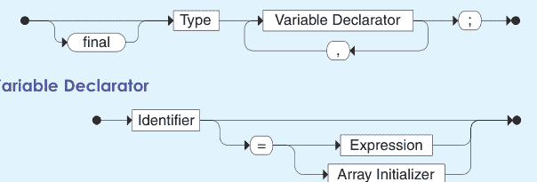

### 变量声明符

一个变量声明由一个类型 (`Type`) 后跟一个变量列表组成。每个变量都可以在声明时初始化为指定表达式 (`Expression`) 的值。如果最后的修饰符位于声明之前，则标识符被声明为命名常量，其值在整个设置范围内不能更改。
示例如下：

- `int total;`
- `double num1, num2 = 4.356, num3;`
- `char letter = 'A', digit = '7';`
- `final int MAX = 45;`

### 列表 2.5

```java
/********************************************************************
// PianoKeys.java      作者: Lewis/Loftus
//
// 展示了整数变量的声明、初始化和使用
// 使用。
********************************************************************
public class PianoKeys {
    //------------------------------------------------------
    // 打印钢琴琴键的数量。
    //------------------------------------------------------
    public static void main(String[] args) {
        int keys = 88;
        System.out.println("A piano has " + keys + " keys.");
    }
}
```

### 输出

```
钢琴有 88 个琴键。
```

在 `PianoKeys` 程序中，调用 `println` 时使用了两个信息。第一个是字符串，第二个是变量 `keys`。当引用变量时，会使用其当前存储在其中的值。因此，当执行 `println` 调用时，获取了 `keys` 的值，即 88。由于该值是一个整数，它会自动转换为字符串并与初始字符串拼接。拼接后的字符串被传递给 `println` 并打印出来。

一个变量声明可以在一行中声明多个相同类型的变量。每个变量都可以带有初始化值声明，也可以不带。例如：

```java
int count, minimum = 0, result;
```

### 赋值语句

让我们来 examine 一个可以改变变量值的程序。列表 2.6 显示了一个名为 Geometry 的程序。该程序首先声明了一个名为 `sides` 的整数变量，并将其初始化为 7。然后打印出 `sides` 的当前值。

`main` 方法中的下一行改变了存储在变量 `sides` 中的值：

```java
sides = 10;
```


这被称为赋值语句，因为它将一个值赋给变量。执行时，会计算赋值运算符（`=`）右侧的表达式，并将结果存储在左侧变量所标识的内存位置中。在这个示例中，表达式仅仅是一个数字 10。我们将在下一节中讨论比这更复杂的表达式。

### 列表 2.6

### 输出

七边形有 7 条边。
十边形有 10 条边。
十二边形有 12 条边。

> **核心概念**
> 访问数据会保持其在内存中完好无损，但赋值语句会覆盖旧数据。

变量只能存储其所声明类型的一个值。新值会覆盖旧值。在这种情况下，当将值 10 赋值给 `sides` 时，原始值 7 被覆盖并永久丢失，如下：

| 状态 | 值 |
| :--- | :--- |
| 初始化后： | 7 |
| 第一次赋值后： | 10 |

## 2.2 变量与赋值

### 基础赋值


基础赋值语句使用赋值运算符（`=`）将表达式（`Expression`）的结果存储到指定的标识符（通常是一个变量）中。
示例：

```
total = 57;

count = count + 1;

value = (min / 2) * lastValue;
```

当引用变量时（例如打印它时），变量的值不会改变。这是计算机内存的本质：访问（读取）数据会留下内存中的值，但写入数据会用新数据替换旧数据。

Java 语言是*强类型*的，这意味着我们不允许将与声明类型不一致的值赋给变量。当你尝试组合不兼容的类型时，在尝试编译程序时将产生错误。因此，赋值语句右侧的表达式求出的值必须与左侧变量的类型兼容。

> **核心概念**
> 我们不能将一种类型的值赋给一个不兼容类型的变量。

### 常量

有时我们使用的数据在整个程序过程中是常数。例如，我们可能会编写一个处理容量不超过 427 人的剧院的程序。给常量值取一个名称（例如 `MAX_OCCUPANCY`）比在整个代码中使用字面量（如 427）通常是有帮助的。像 427 这样的字面量的目的和意义对阅读代码的人来说往往是困惑的。通过给值命名，你解释了它在程序中的作用。

常量是标识符，与变量相似，不同之处在于它们存在期间持有一个特定的值。用英文单词来说，常量不是变量（`variable`）。它们的值不会改变。

> **核心概念**
> 常量在它们存在期间持有一个特定的值。

在 Java 中，如果你在声明之前加上保留字 `final`，则该标识符就是一个常量。按照惯例，命名常量时使用大写字母以将其与普通变量区分开，并用下划线分隔单个单词（注：原文为 individual words，通常指大峰命名法）。例如，常量可以被声明为：

```
final int MAX_OCCUPANCY = 427;
```

使用常量可以防止意外的修改。如果在程序中需要改变某个值，可以使用使用常量。（注：原文此处存在大量重复文本，已按要求处理不重复输出原文）。

### 自测复习题

- 2.9 复习题：什么是类型？
- 2.10 复习题：给出以下声明：

```
int count, total;

double value = 0;
```

- a. 有几个变量？
- b. 变量的类型是什么？
- c. 哪些具有初始值？
- d. 根据上述声明，以下赋值是否合法？

```
count = 10;
```

- e. 2.11 复习题：你的程序需要一个 `int` 类型的变量来存储 5280 英尺的长度。写出该变量的声明。
- 2.12 复习题：简要描述使用常量的三个理由。

## 2.3 基本数据类型

Java 有八种数据类型：四种整数、两种浮点数、一个字符类型和一个布尔类型。其他所有都是对象。让我们详细检查这八种数据类型。

### 整数和浮点数

Java 有两种数值类型：整数（没有小数）和浮点数。有四种整数类型（`byte`、`short`、`int` 和 `long`）和两种浮点类型（`float` 和 `double`）。所有数值类型的区别在于存储它们的大小，这决定了可以表示的范围。所有数值类型都是符号的，这意味着它们可以存储正负值。图 2.2

回顾第 1 章的讨论，位可以是 1 或 0。每个位可以表示两种状态，N 位字符串可以表示 2^N 个不同的值。附录 B 详细描述了数值系统和这些关系。

在设计程序时，我们有时需要选择合适的变量大小以防止浪费内存。这发生在内存空间特别受限的情况下，例如在个人数据助手（PDA）上运行的程序。在这种情况下，我们可以准确地选择变量的数据类型。例如，如果某个特定值不是

| 类型 | 存储 | 最小值 | 最大值 |
| :--- | :--- | :--- | :--- |
| byte | 8 位 | -128 | 127 |
| short | 16 位 | -32,768 | 32,767 |
| int | 32 位 | -2,147,483,648 | 2,147,483,647 |
| long | 64 位 | -9,223,372,036,854,775,808 | 9,223,372,036,854,775,808 |
| float | 32 位 | 约 -3.4E+38，具有 7 位有效数字 | 约 3.4E+38，具有 7 位有效数字 |
| double | 64 位 | 约 -1.7E+308，具有 15 位有效数字 | 约 1.7E+308，具有 15 位有效数字 |

**FIGURE 2.2 数值原始数据类型**

# 72 第 2 章 数据与表达式

如果变化范围在 1 到 1000 之外，那么一个双字节整数（`short`）就足够容纳它了。另一方面，当不确定某个特定值的范围时，我们应该提供一个合理的、甚至是慷慨的空间。在大多数情况下，内存空间并不是严格的限制，我们可以轻松地做出慷慨的假设。

请注意，尽管 `float`（浮点数）值支持非常大（或非常小）的数字，但它只有七位有效数字。因此，为了使用 05341.2077 保持一个值的精确，我们需要使用 `double`。

正如我们已经讨论过的，字面量（`literal`）是程序中使用的显式值。程序中作为 `Facts`、`Addition` 和 `PianoKeys` 使用的各种数字都是整数字面量。Java 假设所有整数字面量都是 `int` 类型，除非在值的末尾附加 `L` 或 `l` 以明其应被视为 `long` 类型字面量，例如 `4L`。

同样，Java 假设所有浮点字面量都是 `double` 类型。如果我们需要将浮点字面量视为 `float`，则在值的末尾加上 `F` 或 `f`，例如 `2.718F` 或 `123.45F`。如果需要，`double` 的数值字面量后面可以跟 `D` 或 `d`。

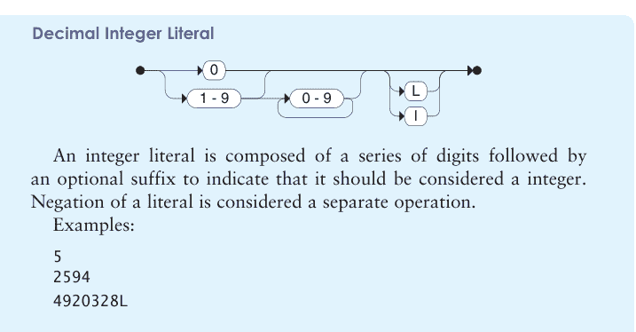

以下是 Java 中变量声明的示例：

```
int answer = 42;

byte smallNumber1, smallNumber2;

long countedSars = 86827263927L;

float ratio = 0.2363F;

double delta = 453.523311903;
```

### 字符 (Characters)

字符是计算机中使用和管理的另一种基础数据类型。单个字符可以被视为单独的数据项，正如我们在几个示例中看到的，它们可以组合成字符字符串。

字符字面量在 Java 程序中用单引号表示，例如 `'b'` 或 `'#'`。你可能记得字符串字面量由双引号界定，而且 `String` 类型不是 Java 中的原生数据类型；它是一个类名。我们将在下一章中详细定义 `String` 类。

作为字符的数字（或字符串的一部分）与数字 602 的区别在于，后者是可以用于算术计算的数值。但在字符串 "602 Greenbriar" 中，6、0 和 2 是字符，与其他构成该字符串的其他字符一样。

我们管理的字符由字符集定义，字符集仅仅是按特定顺序排列的字符列表。每种编程语言都支持特定的字符集，定义了该语言中变量的值。人们已经提出了几种字符集，但只有少数多年来被经常使用。ASCII 字符集是一个流行的选择。ASCII 代表美国信息交换标准代码。基础 ASCII 集每个字符使用七位位，提供了支持 128 个字符的空间，包括：

- 大写字母，例如 `'A'`、`'B'` 和 `'C'`
- 小写字母，例如 `'a'`、`'b'` 和 `'c'`
- 标点符号，如句号（`.`）、分号（`;`）和逗号（`,`）
- 数字 `'0'` 到 `'9'`
- 空格字符，' '`
- 特殊符号，如安培符号（`&`）、竖线（`|`）和反斜杠（`\`）

控制字符有时被称为非打印或不可见字符，因为它们没有代表自己的符号。然而，它们与任何字符一样有效，并以相同的方式存储和使用。许多控制字符对某些软件应用程序具有特殊含义。

随着计算成为全球性事务，用户要求包含其他语言字母表的更灵活的字符集。ASCII 扩展到每个字符八位，集合中的字符数量翻倍到 256 个。扩展 ASCII 包含了英语语言之外使用的许多重音和符号。

> **核心概念**
> Java 使用 16 位 Unicode 字符集来表示字符数据。

# 第 2 章 数据与表达式

然而，即使有 256 个字符，ASCII 字符集也无法表示字母，特别是考虑到各种亚洲字母及其数千个表形字。因此，Java 编程语言的开发者选择了 Unicode 字符集，它每个字符使用 16 位，支持 65,536 个唯一字符（以及允许使用多个字节表示更多字符的技术）。许多语言的字符和符号包含在 Unicode 定义中。ASCII 是 Unicode 字符集的子集，包含前 256 个字符。附录 C 详细讨论了 Unicode 字符集。

字符集为每个字符设置一个特定的数字，因此字符按特定顺序 lexic序排序。在 ASCII 和 Unicode 排序中，数字字符 `'0'` 到 `'9'` 是连续的（没有其他字符介入）且按顺序的，小写字母 `'a'` 到 `'z'` 以及大写字母 `'A'` 到 `'Z'` 也是如此。这些特性使得按字母顺序思考事情变得相对容易。

在 Java 中，`char` 类型表示单个字符。以下是 Java 中字符变量声明的示例：

```
char topGrade = 'A';

char symbol1, symbol2, symbol3;

char terminator = ';', separator = ' ';
```

### 布尔值 (Booleans)

Java 中使用保留字 `boolean` 定义的布尔值只有两个有效值：`true`（真）和 `false`（假）。布尔变量只有这两个值。布尔变量通常用于表示逻辑表达式的真假结果。

布尔值可以用于控制语句，例如 `if` 语句和 `while` 循环。以下是布尔变量声明的示例：

```
boolean flag = true;

boolean tooHigh, tooSmall;

boolean done = false;
```

### 自测问题（答案见附录 N）

什么是原生数据类型？原生数据类型与对象有什么区别？

| 操作 | 结果 |
|---|---|
| 17 % 4 | 1 |
| -20 % 3 | -2 |
| 10 % -5 | 0 |
| 3 % 8 | 3 |

# 第 2 章 数据与表达式

正如你预期的，如果数值运算符的操作数是浮点值，结果就是浮点值。然而，除法结果取决于操作数的类型。如果操作数都是整数，`/` 运算符执行整数除，这意味着丢弃任何小数部分。如果一个或两个操作数都是浮点，`/` 运算符执行浮点除，并保留小数部分。例如，10/4 的结果是 2，但 10.0/4 和 10/4.0 的结果都是 2.5。

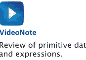

一元运算符只有一个操作数，而二元运算符有两个。`+` 和 `-` 运算符可以是一元的也可以是二元的。二元版本完成加减法，一元版本表示正负数。例如 -1 是使用一元运算符使值为负的示例。一元运算符很少使用。

Java 没有内置的幂运算符。然而，`Math` 类提供了执行幂和其他许多数学函数的方法。`Math` 类将在第三章中讨论。

### 运算符优先级 (Operator Precedence)

运算符可以组合创建更复杂的表达式。例如，考虑以下赋值语句：

```
result = 14 + 8 / 2;
```

计算赋值的右侧，然后将结果存储在变量中。结果是多少？如果执行加法，结果是 11；如果先执行除法，结果是 18。计算顺序影响很大。在这种情况下，除法先于加法，得到结果 18。

> **核心概念**
> Java 遵循一套定义良好的优先级规则，规定了运算符在表达式中的求值顺序。

注意在本以及随后的示例中，我们使用字面量而不是变量来简化表达式。如果操作数是变量或其他任何数据源，运算符的计算顺序是相同的。

所有表达式都根据运算符优先级层次进行求值，这规定了操作执行的顺序。算术运算符通常遵循你在代数中学习的规则。乘法、除法和余数运算符具有相同的优先级，并且在加减法之前执行（优先级更高）。加法和减法具有相同的优先级。

## 2.4 表达式

任何相同优先级的算术运算符都从左到右执行。因此，我们说算术运算符具有从左到右的结合性。

然而，可以使用括号在表达式中强制执行优先级。例如，如果我们真的希望在上例中先执行加法，我们可以这样写表达式：

```
result = (14 + 8) / 2 ;
```

任何括号内的表达式都会求值。在复杂的表达式中，即使不是严格必要的，使用括号也是一种良好的习惯，可以清晰地说明表达式是如何求值的。

括号可以嵌套，最内层的表达式最先求值。考虑以下表达式：

```
result = 3 * (18 - 4) / 2 ;
```

在这个示例中，结果是 21。首先，在内层括号的强制下执行减法。接着，即使乘法和除法的优先级相同且通常从左到右执行，但由于外层括号的影响，除法先执行。最后，执行乘法。

在算术运算完成后，计算结果将存储在赋值运算符 (`=`) 左侧的变量中。换句话说，赋值运算符的优先级低于任何算术运算符。

特定表达式的求值可以使用表达式树来表示，如图 2.3 所示。运算符从底向上执行，产生的值被用于表达式的其他部分。因此，树中位置较低的操作具有高于上方的优先级，或者它们通过括号被强制更早执行。

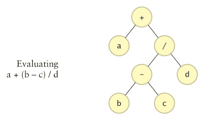

**图 2.3 表达式树**

## 第 2 章 数据与表达式

| 优先级级别 | 运算符 | 操作 | 结合性 |
|---|---|---|---|
| 1 | + | 一元加 | 从右到左 |
| | - | 一元负 | |
| 2 | * | 乘法 | 从左到右 |
| | / | 除法 | |
| | % | 取模 | |
| 3 | + | 加法 | 从左到右 |
| | - | 减法 | |
| | + | 字符串拼接 | |
| 4 | = | 赋值 | 从右到左 |

**图 2.4 部分 Java 运算符之间的优先级**

表达式中使用的括号本身实际上也是运算符。括号的优先级高于任何其他运算符。图 2.4 显示了算术运算符、括号和赋值运算符之间关系的优先级表。附录 D 包含一个显示所有 Java 运算符的完整优先级表。

为了使表达式在语法上正确，左括号的数量必须与右括号的数量匹配，且它们必须正确嵌套。以下示例不是有效的表达式：

```
result = ((19 + 8) % 3) - 4); // 无效

result = ((19 + 8) % 3 - 4); // 无效
```

请记住，当表达式中引用变量时，将使用其当前值进行计算。在下面的赋值语句中，变量 `count` 的当前值将加上变量 `total` 的当前值，并将结果存储在 `sum` 中：

```
sum = count + total;
```

在此赋值之前包含在 `sum` 中的原始值会被计算出的值覆盖。`count` 和 `total` 中存储的值不会改变。

同一个变量可以出现在赋值语句的左侧和右侧。假设在执行以下赋值语句时，变量 `count` 的当前值为 15：

```
count = count + 1;
```

因为右侧表达式先求值，所以获取 `count` 的原始值并对其加 1，产生结果 16。然后将该结果存储在变量 `count` 中，用新值 16 覆盖原始值 15。因此，该赋值语句*递增*了变量 `count`（即对其加 1）。

让我们来看另一个表达式处理的示例。列表 2.7 中的程序名为 `TempConverter`，它使用一个计算公式的表达式，将特定的摄氏温度转换为等值的华氏度值：

Fahrenheit = $\frac{9}{5}$ Celsius + 32

### 代码列表 2.7


# 第 2 章 数据与表达式

## 2.5 数据转换

由于 Java 是一种强类型语言，每个数据值都与特定类型相关联。将一种类型的数据值转换为另一种类型有时是有帮助或必要的，但我们必须小心不要丢失信息。例如，假设将持有数字 100 的 `short` 变量转换为 `byte`。由于 `byte` 没有足够的位来表示该值，某些位将会丢失。基本类型与另一种类型之间的转换分为两类：宽转换和窄转换。宽转换是最安全的，因为它们不会丢失信息。它们被称为宽转换是因为它们从一个类型转换为另一个使用相等或更多空间存储值的类型。所有从一种整数类型到另一种整数类型，或从一种浮点类型到另一种浮点类型的宽转换都会精确地保留数值值。

| 从 | 到 |
| :--- | :--- |
| byte | short, int, float, or double |
| short | int, long, float, or double |
| char | int, long, float, or double |
| int | long, float, or double |
| long | float or double |
| float | double |

应该避免窄转换，因为它们可能会丢失信息。虽然宽转换不会丢失任何关于值大小的信息，但在从 `int` 转换为 `float` 或从 `long` 转换为 `double` 时，结果是浮点值，某些低位数字可能会丢失。在这种情况下，生成的浮点值将是整数值的舍入版本，遵循在 IEEE 754 浮点标准中定义的技巧。窄转换比宽转换更容易丢失信息。它们从一个类型转换为一个使用较少空间存储值的类型，因此某些信息可能会受到损害。窄转换可能会同时丢失数值大小和精度。因此，通常情况下应该避免它们。窄转换中空间收缩情况的一个例外是将 `byte`（8 位）或 `short`（16 位）转换为 `char`（16 位）。这些仍然被认为是窄转换，因为符号位被整合到了新的字符值中。由于字符值是无符号的，负整数将转换为一个与原始整数数值之间没有特定关系的字符。

| 从 | 到 |
| :--- | :--- |
| byte | char |
| short | byte or char |
| char | byte or short |
| int | byte, short, or char |
| long | byte, short, char, or int |
| float | byte, short, char, int, or long |
| double | byte, short, char, int, or double |

注意，宽转换或窄转换中都没有提到布尔值（`boolean`）。布尔值不能转换为任何其他基本类型，反之亦然。

### 转换技术

在 Java 中，转换可以通过三种方式发生：

- 赋值转换
- 提升
- 强制类型转换

当一个值被赋值给另一种类型时，会发生赋值转换。当一种类型的值被赋值给另一种类型的变量时，就会发生赋值转换。只有宽转换可以通过赋值完成。例如，如果 `money` 是 `float` 变量而 `dollars` 是 `int` 变量，赋值语句会自动将 `dollars` 转换为 `float`：

```
money = dollars;
```

因此，如果 `dollars` 包含 25，赋值后 `money` 包含 25.0。

通过提升转换发生在某些运算符需要修改其操作数以执行操作时。例如，当浮点变量 `sum` 除以整数值 `count` 时，`count` 被提升为浮点值，从而产生浮点结果：

```
result = sum / count;
```

类似的转换发生在数字与字符串拼接时。数字首先被转换为（提升为）字符串，然后拼接两个字符串。

强制类型转换是 Java 中最通用的转换形式。如果转换可以在 Java 程序中完成，就可以使用强制类型转换完成。强制转换是一种由类型名称指定的 Java 运算符。它被放在要转换的值前面。例如，为了将 `money` 转换为整数值，可以在它前面加上强制转换：

```
dollars = (int) money;
```

强制转换返回 `money` 的值，并截弃任何小数部分。如果 `money` 包含 84.69，那么赋值后 `dollars` 将包含 84。然而，注意，强制转换不会改变 `money` 的值。赋值完成后，`money` 仍然包含 84.69。

强制类型转换在许多需要将值临时视为另一种类型的情况下非常有帮助。例如，如果我们想将整数值除以整数值 `count` 并得到浮点结果，我们可以这样做：

```
result = (float) total / count;
```

首先，强制转换运算符返回 `total` 的浮点值。此操作不会改变 `total` 的值。然后，`count` 通过算术提升被视为浮点值。现在除法运算符将执行浮点除法并产生预期的结果。如果没有包含强制转换，操作将执行整数除法，并在赋值之前截断答案。还要注意，由于强制转换运算符的优先级高于除法运算符，强制转换作用于 `total` 的值，而不是除法的结果。

### 自测习题（答案见附录 N）

- SR 2.31 为什么宽转换比窄转换更安全？
- SR 2.32 识别以下每个转换是宽转换还是窄转换。
  - int to long
  - int to byte
  - byte to short
  - byte to char
  - short to double
- SR 2.33 假设 `result` 是 `float` 变量而 `value` 是 `int` 变量，在执行以下赋值语句后，`value` 将是什么类型的变量？请解释。
  ```
  result = value;
  ```
- SR 2.34 假设 `result` 是一个浮点型变量，值为 27.32，`value` 是一个整型变量，值为 15，那么在执行以下赋值语句后，变量的值是多少？请解释。
  `value = (int) result;`
- SR 2.35 给定以下声明，每个赋值语句存储了什么种结果。
  ```
  int iResult, num1 = 17, num2 = 5;
  double fResult, vali = 12.0, val2 = 2.34;
  ```
  - a. `iResult = num1 / num2;`
  - b. `fResult = num1 / num2;`
  - c. `fResult = vali / num2;`
  - d. `fResult = (double) num1 / num2;`
  - e. `iResult = (int) vali / num2;`

## 2.6 交互式程序

设计一个程序在执行期间从用户处读取数据通常很有用。这样，程序在每次运行时，都可以根据输入的数据计算出新的结果。

### Scanner 类

`Scanner` 类是 Java API 的一部分，为读取各种类型的输入值提供了方便的方法。输入可以来自各种来源，包括用户交互式输入的数据或存储在文件中的数据。`Scanner` 类还可以用于将字符字符串解析为序列片段。下表列出了 `Scanner` 类提供的一些方法。

> 核心概念：`Scanner` 类提供了从各种来源读取各种类型输入的方法。

我们必须先创建一个 `Scanner` 对象来调用它的方法。Java 中的对象是使用 `new` 操作符创建的。该声明创建了一个从键盘读取输入的 `Scanner` 对象：

```
Scanner scan = new Scanner(System.in);
```

该声明创建了一个变量 `scan`，它代表一个 `Scanner` 对象。对象本身由 `new` 操作符创建，并调用了一个名为构造函数的特殊方法，该方法指示输入的来源。`Scanner` 构造函数接受一个来自输入源的参数。`System.in` 代表标准输入流，默认是键盘。使用 `new` 操作符创建对象将在下一章进一步讨论。

#### Scanner 构造函数与常用方法

| 方法签名 | 说明 |
| :--- | :--- |
| `Scanner(InputStream source)` | 构造函数：设置新的扫描器以从指定的源扫描值。 |
| `Scanner(File source)` | 构造函数：设置新的扫描器以从指定的文件扫描值。 |
| `Scanner(String source)` | 构造函数：设置新的扫描器以从指定的字符串扫描值。 |
| `String next()` | 将下一个输入标记作为字符字符串返回。 |
| `String nextLine()` | 将当前行上剩余的所有输入作为字符字符串返回。 |
| `boolean nextBoolean()`<br>`byte nextByte()`<br>`double nextDouble()`<br>`float nextFloat()`<br>`int nextInt()`<br>`long nextLong()`<br>`short nextShort()` | 将下一个输入标记作为指定的类型返回。如果下一个标记与类型不一致，则抛出 `InputMismatchException`。 |
| `boolean hasNext()` | 如果扫描器在输入中还有另一个标记，则返回 true。 |
| `Scanner useDelimiter(String pattern)`<br>`Scanner useDelimiter(Pattern pattern)` | 设置扫描器的分隔符模式。 |
| `Pattern delimiter()` | 返回扫描器当前用于匹配分隔符的模式。 |
| `String findInLine(String pattern)`<br>`String findInLine(Pattern pattern)` | 尝试查找指定模式的下一次出现，忽略分隔符。 |

除非另有指定，否则 `Scanner` 对象假设空白字符（空格、制表符和换行符）用于分隔输入标记之间的元素。这些字符是输入分隔符，如果输入是由空白以外的字符分隔的，可以更改它们。

`Scanner` 类的 `next()` 方法将下一个输入作为字符串读取并返回。如果输入由一系列由分隔符分隔的单词组成，每次调用将返回下一个单词。`nextLine()` 方法读取所有输入直到发现行尾，并将其作为一个字符串返回。

#### 示例：Echo 程序

位于列表 2.8 显示的 `Echo` 程序只需读取用户输入的一行文本，将其存储在持有字符字符串的变量中，然后将其回显到屏幕。`Echo` 类定义上面的 `import` 语句告诉我们将在该程序中使用 `Scanner` 类。`Scanner` 类是 `java.util` 库的一部分。`import` 语句的使用将在第 3 章进一步讨论。

**列表 2.8 Echo.java**

```
****************************************************************
// Echo.java          作者: Lewis/Loftus
// 展示了如何使用 Scanner 类的 nextLine 方法
// 从用户处读取字符串。
****************************************************************
import java.util.Scanner;

public class Echo {

    // 从用户处读取一个字符字符串并打印。
    public static void main(String[] args) {
        Scanner scan = new Scanner(System.in);
        System.out.print("输入一行文本：");
        String input = scan.nextLine();
        System.out.println("你输入了: \"" + input + "\"");
    }
}
```

**输出**

```
输入一行文本：
Set your name!
你输入了: "Set your name!"
```

#### 示例：GasMileage 程序

提供了各种 `Scanner` 方法（如 `nextInt()` 和 `nextDouble()`）来读取特定类型的数据。列表 2.9 显示的 `GasMileage` 程序读取行驶数为整数，读取消耗的加仑数为双精度浮点数，然后计算油耗。

**列表 2.9 GasMileage.java**

```
****************************************************
// GasMileage.java          作者: Lewis/Loftus
// 展示了使用 Scanner 类读取数值数据。
****************************************************
import java.util.Scanner;

public class GasMileage {
    //--------------------
    // 根据输入的数值计算效率。
    //--------------------
    public static void main(String[] args) {
        int miles;
        double gallons, mpg;

        Scanner scan = new Scanner(System.in);

        System.out.print("输入里程数: ");
        miles = scan.nextInt();

        System.out.print("消耗的加仑数: ");
        gallons = scan.nextDouble();

        mpg = miles / gallons;

        System.out.println("油耗: " + mpg);
    }
}
```

**输出**

```
输入里程数: 35
消耗的加仑数: 1.2
油耗: 29.166666666666668
```

正如你从 `GasMileage` 程序的输出看到的，计算产生了一个精确到几位小数的浮点结果。在下一章中，我们将讨论帮助我们以各种方式格式化输出的类，包括将浮点值舍入到特定的小数位数。

### 自测题（答案见附录 N）

SR 2.36 在 `GasMileage` 程序中哪一行执行了以下操作。


- a. 告诉程序我们将使用 `Scanner` 类。
- b. 创建一个 `Scanner` 对象。
- c. 设置扫描器 `scan` 从标准输入流读取。
- d. 从标准输入流读取整数。

### SR 2.37
假设你的程序已经实例化了一个名为 `myScanner` 的 `Scanner` 对象和一个整型变量 `value`，如下：

```
Scanner myScanner = new Scanner(System.in);
int value = 0;
```

编写程序语句，要求用户输入他们的年龄，并将响应存储在 `value` 中。

## 2.7 图形

图形在计算机系统中起着至关重要的作用。在本书中，我们探索了图形的各个方面并讨论了如何实现。事实上，每章的最后两个部分致力于图形主题。我们将此称为贯穿本书的图形轨道。跳过这些部分不会影响后续内容的连贯性，也可以将其整合到章节的正文中，或者作为一组。

> **核心概念**：图形数据通过将其分为许多像素来表示。

图像与存储在计算机上的所有信息一样，必须通过将信息分解为像素并将这些部分表示为数字来数字化。在图片的情况下，我们将图片分解为像素（元素）。像素是代表图片的一个微小区域。完整图像通过存储每个独立像素的颜色来存储。


**图 2.8** 一张放大了一小部分的数字化图片

编程语言有一个相对简单的坐标系，其中所有可见坐标均为正数。图 2.9 比较了传统坐标系与 Java 坐标系。

Java 坐标系中的每个点都使用 `(x, y)` 数值对表示。任何 Java 绘制区域的左上角坐标均为 `(0, 0)`。向右移动时，x 轴坐标变大；向下移动时，y 轴坐标变大。

> **核心概念**：Java 坐标系的原点位于左上角，且所有可见坐标均为正数。

正如我们在之前的示例中看到的，Java 程序在本质上不必是图形化的。然而，如果是图形化的，那么程序中的每个图形组件都有它自己的坐标 `(0, 0)` 位于左上角。这种一致的方法使得管理各种图形元素变得相对容易。

注意，Java 允许你指定屏幕上不可见的坐标，包括负值。尽管如果你在这些坐标上绘制或放置组件，用户是看不到它们的。

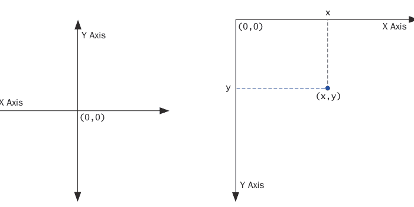

**图 2.9** 传统坐标系与 Java 坐标系

## 表示颜色

彩色图片被分为像素，就像黑色图片一样。然而，每个像素可以是许多可能颜色中的一种，仅用一个位来表示每个像素是不够的。表示像素颜色有多种方法。让我们简要讨论一种流行的技术。

> **核心概念**：Java 中使用 RGB 值表示颜色——即代表红、绿、蓝三种原色贡献的三个数值。

每种颜色都可以表示为三种原色（红、绿、蓝）的混合。在 Java 以及许多其他语言中，颜色由三个数字指定，统称为 RGB 值。RGB 代表红-绿-蓝。每个数字代表一种原色的贡献。使用一个字节（8 位）来存储每个数字，其值范围从 0 到 255。每种原色的水平决定了整体颜色。例如，高值的红色和绿色结合低水平的蓝色，会产生黄色调。

| 颜色 | 对象 | RGB 值 |
| :--- | :--- | :--- |
| 黑色 | `Color.black` | 0, 0, 0 |
| 蓝色 | `Color.blue` | 0, 0, 255 |
| 青色 | `Color.cyan` | 0, 255, 255 |
| 灰色 | `Color.gray` | 128, 128, 128 |
| 深灰色 | `Color.darkGray` | 64, 64, 64 |
| 浅灰色 | `Color.lightGray` | 192, 192, 192 |
| 绿色 | `Color.green` | 0, 255, 0 |
| 品红色 | `Color.magenta` | 255, 0, 255 |
| 橙色 | `Color.orange` | 255, 200, 0 |
| 粉色 | `Color.pink` | 255, 175, 175 |
| 红色 | `Color.red` | 255, 0, 0 |
| 白色 | `Color.white` | 255, 255, 255 |
| 黄色 | `Color.yellow` | 255, 255, 0 |

**图 2.10** `Color` 类中的预定义颜色

在 Java 中，程序员使用 `java.awt.Color` 中的 `Color` 类来定义和管理颜色。`Color` 类的每个对象都表示一种颜色。该类包含了自身的几个实例，以提供一组基本的预定义颜色。图 2.10 列出了 `Color` 类的预定义颜色。它还包含定义和管理其他颜色的方法。

> **核心概念**：`Color` 类包含了几种常用的预定义颜色，可以使用它们来定义其他颜色。

### 自测题（答案见附录 N）

- **SR 2.38** 如何使用 1s 和 0s 表示黑白图片？
- **SR 2.39** 使用 Java 坐标系绘制的矩形的三个角的坐标分别为 `(3, 4)`、`(3, 7)` 和 `(8, 7)`。第四个角的坐标是什么？
- **SR 2.40** 使用 Java 坐标系绘制的正方形的两个角的坐标分别为 `(5, 10)` 和 `(8, 10)`。另外两个角的坐标是什么？
- **SR 2.41** 存储一张宽 300 像素、高 200 像素的彩色图片需要多少位？假设颜色使用本章描述的 RGB 技术表示，且不使用任何压缩技术。

## 2.8 Applet

> **核心概念**：Applet 是通常通过网络传输并使用 Web 浏览器执行的 Java 程序。

有两种类型的 Java 程序：Java applet 和 Java 应用程序。Java applet 是一种旨在嵌入 HTML 文档、通过网络传输并使用 Web 浏览器执行的 Java 程序。Java 应用程序是一个独立的程序。

Java applet 和 Java 应用程序结构之间存在一些重要差异。由于 applet 通常是为了在网络上传输，它们没有执行开始的 `main` 方法。

程序开头的两个 `import` 语句显式指示了所使用的包。在本示例中，我们需要 `JApplet` 以及在定义的各种图形能力。

### 使用 Web 运行 Applet

为了让 applet 能够通过 Web 传输并由浏览器执行，它必须在超文本标记语言（HTML）文档中引用。HTML 文档包含指定格式化指令的标签，并标识想要包含在文档中的特殊媒体类型。Java 程序被视为一种特定的媒体类型，就像文本、图形和声音一样。

HTML 标签被包裹在角括号中。以下是一个 applet 的示例：

```
<applet code="Einstein.class" width="350" height="175">
</applet>
```

该标签规定存储在 `Einstein.class` 文件中的字节码应该通过网络传输，并在查看此特定 HTML 文档的机器上执行。`<applet>` 标签还指明了 applet 的宽度和高度。

其他标签也可以在 HTML 文件中引用 applet，包括 `<object>` 标签和 `<embed>` 标签。根据世界维网联盟（W3C）的规定，实际上应该使用 `<object>` 标签。然而，浏览器对 `<object>` 标签的支持并不一致。目前，最可靠的解决方案是使用 `<applet>` 标签。

注意，applet 引用的是 Einstein applet 的字节码文件，而不是源代码。在通过 Web 传输 applet 之前，必须将其编译成字节码格式。然后，如图 2.11 所示，可以使用 Web 浏览器加载文档，它会自动解释并执行该 applet。

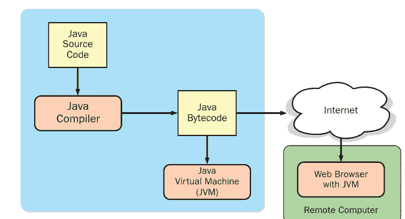

**图 2.11** Java 与执行过程，包括 applets

### 自测习题（答案见附录 N）

- **SR 2.42** Java 和 Java applet 之间有什么区别？
- **SR 2.43** applet 的 `paint` 方法何时被调用？
- **SR 2.44** 下列的 HTML applet 标签有什么错误？请解释。

```
<applet code="DrawHouse.java" width="400" height="300">
</applet>
```

## 2.9 绘制形状

标准类库提供了许多类，让我们能够展示和操作图形信息。`Graphics` 类是所有此类处理的基础。

### Graphics 类

`Graphics` 类定义在 `java.awt` 包中。它包含了各种方法，允许我们绘制形状，包括线、矩形和椭圆。图 2.12 列出了 `Graphics` 类的一些基本绘制方法。注意，这些方法还允许我们绘制圆和方形，它们只是椭圆和矩形的特定类型。我们将在书后的适当位置讨论 `Graphics` 类的其他绘制方法。

> **核心概念**：大多数形状可以填充（不透明）或不填充（作为轮廓）绘制。

`Graphics` 类的方法允许我们指定形状是填充还是未填充的。未填充的形状只显示形状的轮廓，其他部分是透明的（你可以看到任何底层图形）。填充的形状在其边界之间是实心的，并会覆盖任何底层图形。

所有这些都依赖于 Java 坐标系，我们在本章较早讨论过它。记住 `(0,0)` 位于左上角，向右移动 x 值增大，向下移动 y 值增大。在可见区域之外坐标处绘制的任何形状都将不可见。

> **核心概念**：边界矩形用于定义椭圆等曲线形状的位置和大小。

许多 `Graphics` 绘制方法是自显易懂的，但需要进一步的讨论。例如，通过 `drawOval` 方法绘制的椭圆是由左上角的坐标以及指定边界矩形宽度和高度的定义的。带有曲线的形状，椭圆，其形状通常由一个包含其周边的矩形来定义。图 2.13 描了一个椭圆的边界矩形。

弧可以被看作椭圆的一部分。要绘制弧，我们指定该弧所属的椭圆以及我们感兴趣的椭圆部分。弧的起始点由起始角度定义，弧的终点由弧角定义。弧角并不表示弧的结束位置，而是表示它的范围。起始角度和弧角以度为单位。起始角度的原点是穿过椭圆中心的虚拟水平线，可以简称为 0°，如图 2.14 所示。

> **核心概念**：弧是椭圆的一部分，从特定的起始角度开始，按弧角指定的距离延伸。

```
void drawLine(int x1, int y1, int x2, int y2)
从点 (x1, y1) 到点 (x2, y2) 绘制一条线。

void drawRect(int x, int y, int width, int height)
绘制一个左上角为 (x, y)、具有宽度和高度的矩形。

void drawOval(int x, int y, int width, int height)
绘制一个由左上角为 (x, y)、宽度和高度的矩形所边界的椭圆。

void drawString(String str, int x, int y)
在点 (x, y) 处绘制字符字符串，向右延伸。

void drawArc(int x, int y, int width, int height, int startAngle, int arcAngle)
沿着由 x, y, width, 和 height 定义的矩形边界的椭圆绘制一段弧。弧从 startAngle 开始，延伸 arcAngle 距离。

void fillRect(int x, int y, int width, int height)
与其对应的 draw 方法相同，但用当前前景色填充。

void fillOval(int x, int y, int width, int height)

void fillArc(int x, int y, int width, int height, int startAngle, int arcAngle)

Color getColor()
返回此图形上下文的前景色。

void setColor(Color color)
将此图形上下文的前景色设置为指定的颜色。
```

**图 2.12** `Graphics` 类的一些方法

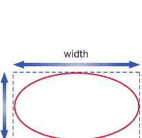

**图 2.13** 椭圆及其边界矩形

每个图形上下文都有一个前景色，在绘制形状或字符串时都会使用。每个可以绘制的表面都有一个背景色。前景色使用 `Graphics` 类的 `setColor` 方法设置，背景色使用我们绘制的组件的 `setBackground` 方法。列表 2.11 展示了一个名为 `Snowman` 的 applet。它使用了各种绘制方法来创建一个冬季场景。仔细查看代码以注意每个形状是如何绘制的。


雪人形象基于两个常量 `MID` 和 `TOP`，定义了雪人的中点（左到右）和顶部。

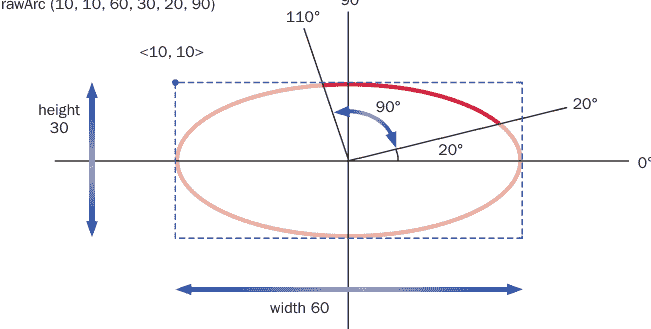

**图 2.14** 由椭圆、起始角度和弧角定义的弧

### 列表 2.11

```
************************************
// Snowman.java      作者: Lewis/Loftus
// 展示了基础方法和颜色的使用。
************************************

import javax.swing.JApplet;
import java.awt.*;

public class Snowman extends JApplet {
    // 绘制雪人。
    //----------------------------------------------------------------
    public void paint(Graphics page) {
        final int MID = 150;
        final int TOP = 50;

        page.setColor(Color.blue);
        page.fillRect(0, 175, 300, 50); // 地面

        page.setColor(Color.yellow);
        page.fillOval(-40, -40, 80, 80); // 太阳

        page.setColor(Color.white);
        page.fillOval(MID-20, TOP, 40, 40); // 头
        page.fillOval(MID-35, TOP+35, 70, 50); // 上身
        page.fillOval(MID-50, TOP+80, 100, 60); // 下身

        page.setColor(Color.black);
        page.fillOval(MID-10, TOP+10, 5, 5); // 左眼
        page.fillOval(MID+5, TOP+10, 5, 5); // 右眼

        page.drawArc(MID-10, TOP+20, 20, 10, 180); // 微笑
        page.drawLine(MID-25, TOP+60, MID-50, TOP+40); // 左臂
        page.drawLine(MID+25, TOP+60, MID+60, TOP+60); // 右臂

        page.drawLine(MID-20, TOP+5, MID+20, TOP+5); // 帽檐
        page.fillRect(MID-15, TOP-20, 30, 25); // 帽子顶
    }
}
```

### 2.9 绘制形状 (续)

```
LISTING 2.11 continued
DISPLAY
```

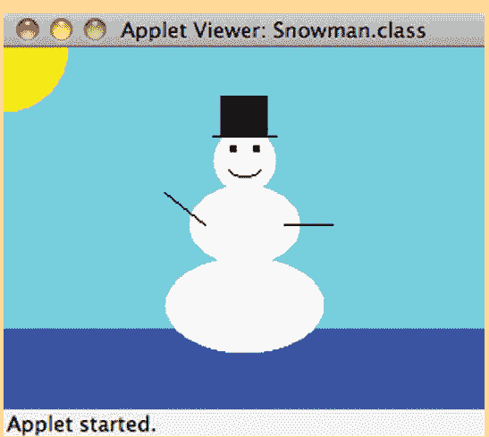

雪人的头部。整个雪人形象是相对于这些值绘制的。使用这样的常量可以更容易创建雪人并在以后进行修改。例如，要将图片中的雪人向右或向左移动，只需要更改一个常量声明。

#### 自习题（答案见附录 N）

- **SR 2.45** 什么是边界矩形？
- **SR 2.46** 假设你有一个名为 `page` 的 `Graphics` 对象，写一条语句画一个边长为 50 的正方形，使其左上角位于点 `(16, 12)`。
- **SR 2.47** 假设你有一个名为 `page` 的 `Graphics` 对象，写一系列语句，画一个高度为 20 宽度为 40 的蓝色矩形，使其左上角位于点 `(30, 35)`。
- **SR 2.48** 分别对雪人程序进行以下每种更改的结果会是什么？你可以进行更改、编译并运行程序，观察并报告结果。简要解释你的观察结果。
  - a. 将 `MID` 的值设置为 120 而不是 150。
  - b. 将 `TOP` 的值设置为 25 而不是 50。
  - c. 在程序的最后两条语句（绘制帽子的语句）之前，我们包含以下语句：
    ```
    page.setColor(Color.blue);
    ```
  - d. 在创建微笑的语句中，将 190 改为 10。
  - e. 在创建上半身的语句之前，将前景色颜色设置为青色（cyan）。在创建完上半身后，立即将其设回白色。

## 核心概念总结

- `print` 和 `println` 方法代表 `System.out` 对象提供的两种服务。
- 转义序列可以表示一个否则会引起编译问题的字符。
- 变量是内存位置的名称，用于存储特定数据类型的值。
- 访问数据会保持其在内存中不变，但赋值会覆盖旧数据。
- 我们不能将一种类型的值赋值给不兼容类型的变量。
- 常量在它们存在期间保持特定的值。
- Java 有两种数值类型：整数和浮点数。共有四种整数数据类型和二种浮点数数据类型。
- Java 使用 16 位的 Unicode 字符集来表示字符数据。
- 表达式是运算符和操作数的组合，用于执行计算。
- Java 遵循一套定义良好的优先级规则，这些规则规定了运算符在表达式中求值的顺序。


- 应该避免窄化转换，因为它们可能会丢失信息。
- `Scanner` 类提供了从各种来源读取输入的方法。
- 图形数据通过将其划分为许多称为像素（pixels）的微小部分来表示。
- Java 的坐标系原点位于左上角，所有坐标均为正值。
- Java 在 Java 使用 RGB 值表示颜色——即代表红、绿、蓝三原色贡献的三个值。
- `Color` 类包含了几个常用的预定义颜色，并可以用于定义许多其他颜色。
- Applet（小程序）是 Java 程序，通常通过网络传输并使用 浏览器执行。
- 大多数形状可以绘制填充（不透明）或不填充（作为轮廓）。
- 边界矩形用于定义曲线形状（如椭圆）的位置和大小。
- 弧是椭圆的一部分，从特定的起始角度开始，并按弧角指定的距离延伸。

## 第 2 章 数据与表达式

### 练习题

- EX 2.1 字面量 `4`、`4.0`、`'4'` 和 `"4"` 之间有什么区别？
- EX 2.2 从对象及其它们提供的服务的角度解释以下编程语句：

```
System.out.println("I gotta be me!");
```

- EX 2.3 下列代码段产生什么输出？解释原因。

```
System.out.print("Here we go!");
System.out.println("12345");
System.out.print("Test this if you are not sure.");
System.out.print("Another.");
System.out.println();
System.out.println("All done.");
```

- EX 2.4 下列程序语句哪里有错？如何修复？

```
System.out.println("To be or not to be, that is the question.");
```

- EX 2.5 下列语句产生什么输出？解释原因。

```
System.out.println("50 plus is " + 50 + 25);
```

- EX 2.6 下列语句产生什么输出？解释原因。

```
System.out.println("He thrusts the fists\ntagainst" +
"the post\stand still insists!\the sees the \"ghost\");
```

- EX 2.7 在执行完以下语句后，整数变量 `size` 包含什么值？

```
size = 18;
size = size + 12;
size = size * 2;
size = size / 4;
```

- EX 2.8 在执行完以下语句后，浮点变量 `depth` 包含什么值？

```
depth = 2.4;
depth = 20 - depth * 4;
depth = depth / 5;
```

- EX 2.9 在执行以下语句后，整数变量 `length` 包含什么值？

```
length = 5;
length *= 2;
length += length;
length /= 100;
```

- EX 2.10 写四种不同的程序语句来增加整数变量 `total` 的值。
- EX 2.11 根据给出的声明，每个列出的赋值语句中都存储了什么结果？

```
int iResult, num1 = 25, num2 = 40, num3 = 17, num4 = 5;
double val1 = 17.0, val2 = 12.78;
```

- a. `iResult = num1 / num4;`
- b. `fResult = num1 / num4;`
- c. `iResult = num3 / num4;`
- d. `fResult = num3 / num4;`
- e. `fResult = val1 / num4;`
- f. `fResult = val1 / val2;`
- g. `iResult = num1 / num2;`
- h. `fResult = (double)num1;`
- i. `fResult = (double)num1;`
- j. `fResult = (double)num1;`
- k. `iResult = (int)val1;`
- l. `fResult = (double)val1;`
- m. `fResult = (double)val1;`
- n. `iResult = (int)num3;`
- o. `iResult = (int)num2;`
- q. `iResult = (int)num2;`

- EX 2.12 对于每个表达式，请在每个运算符下方标出求值顺序：
- a. `a - b + c`
- b. `a + b / c`
- c. `a + b / c`
- d. `d + a / b`
- e. `a / b % c`
- f. `a % b / c`
- g. `a % b % c`
- h. `a - (b - c) - d`
- i. `(a - b) - c`
- j. `a - (b - c) * d`
- k. `a % (b % c) * d`
- l. `a + (b - c) * d`
- m. `(a + b) * c + d`
- n. `(a + b) * (c / d)`

- EX 2.13 解释 Web 在 Java 程序翻译中所起的作用。
- EX 2.14 比较传统坐标系和 Java 图形组件使用的坐标系。
- EX 2.15 存储一张宽 400 像素、高 250 像素的彩色图片需要多少位？假设使用本章描述的 RGB 技术且没有进行特殊处理。
- EX 2.16 假设你有一个名为 `page` 的 `Graphics` 对象，写一条语句从点 (20, 30) 画线到点 (50, 60)。
- EX 2.17 假设你有一个名为 `page` 的 `Graphics` 对象，写一条语句画一个高度为 70 宽度为 35 的矩形，使其左上角位于点 (10, 15)。
- EX 2.18 假设你有一个名为 `page` 的 `Graphics` 对象，写一条语句画以点 (50, 50) 为中心、半径为 20 像素的圆。
- EX 2.19 下列代码在程序中绘制雪人的眼睛。绘制时眼睛看起来位于脸部，但每次调用的第一个参数相对于中点的偏移并不相等。解释原因。

```
page.f110val(MID-10, TOP+10, 5, 5);
page.f110val(MID+5, TOP+10, 5, 5);
```

### 编程项目

#### PP 2.1
创建第一章 `Lincoln` 程序的修订版本，使引用周围带有引号。

#### PP 2.2
写一个程序读取三个整数并打印它们的平均值。

#### PP 2.3
写一个程序读取两个浮点数并打印它们的和、差和积。

#### PP 2.4
编写一个程序，提示并读取一个人的姓名、年龄、大学名称和宠物名称。然后打印以下段落，并插入相应的数据：

> 你好，我的名字是 name，我今年 age 岁了。我很享受在 college 的时光，尽管我很想念我的宠物 petname！

#### PP 2.5
创建一个名为 `TempConverter`（温度转换器）应用程序的版本，用于将华氏度转换为摄氏度。从用户处读取华氏度温度。

#### PP 2.6
编写一个程序，将英里转换为公里。（1 英里等于 1.60935 公里。）从用户处以浮点数读取英里值。

#### PP 2.7
编写一个程序，提示并读取速度和行驶距离的整数值，然后以浮点数结果的形式打印旅行所需的时间。

#### PP 2.8
编写一个程序，读取表示小时、分钟和秒的持续时间值，然后打印等量的总秒数。（例如，1 小时 28 分钟 42 秒等于 5322 秒。）

#### PP 2.9
创建一个前一个项目的版本，反转计算过程。即读取一个表示秒数的值，然后打印以小时、分钟和秒组合的等量时间。（例如，9999 秒等于 2 小时 46 分钟 39 秒。）

#### PP 2.10
编写一个程序，确定罐中硬币的价值，并以美元和分的形式打印总额。读取表示四角硬币、一角硬币、五分硬币和一分硬币数量的整数值。

#### PP 2.11
编写一个程序，提示并读取一个表示金额的 `double` 值。然后确定表示该金额所需的最少数量的钞票和硬币，从最大的开始（假设十美元钞是所需的最大面额）。例如，如果输入的数值是 47.63（47 美元 63 分），则程序应打印等量金额为：

- 4 张十美元钞
- 1 张五美元钞
- 2 张一美元钞
- 2 枚四角硬币
- 1 枚一角硬币
- 0 枚五分硬币
- 3 枚一分硬币

#### PP 2.12
编写一个程序，提示并读取一个表示正方形边长的整数，然后打印正方形的周长和面积。

#### PP 2.13
编写一个程序，提示并读取作为整数的分数分子和分母，然后打印该分数的等值小数。

#### PP 2.14
创建一个修改版的 `Snowman`（雪人）小程序，并进行以下修改：
- 在上半身添加两个红色按钮。
- 让雪人皱眉而不是微笑。
- 将太阳移动到图片的右上角。
- 在图片的左上角显示你的名字。
- 将整个雪人向右移动 20 像素。

#### PP 2.15
编写一个绘制大熊斗座的小程序。在夜空中添加一些额外的星星。

#### PP 2.16
编写一个绘制一些系在绳子上的气球的小程序。让气球呈现各种颜色。

#### PP 2.17
编写一个绘制奥运会标志的小程序。标志中的圆圈应该从左到右涂成蓝、黄、黑、绿、红。

#### PP 2.18
编写一个绘制带有门（和门把手）、窗户和烟囱的房屋的小程序。烟囱里冒出一些烟，天空中画一些云。

#### PP 2.19
编写一个显示你自己设计的名片的小程序。包括图表和文本。

#### PP 2.20
编写一个通过阴影文字显示你名字的小程序，先用黑色绘制你的名字，然后用稍微偏移的较浅颜色再次绘制一次。

#### PP 2.21
编写一个显示带有八个等切片的饼图的小程序，切片颜色各异。

# 软件故障

## NASA 火星气候轨道器与极地着陆器

### 发生了什么？
作为探索火星的一系列任务的一部分，NASA 于 1998 年 12 月发射了火星气候轨道器（Mars Climate Orbiter），并于 1999 年 1 月发射了火星极地着陆器（Mars Polar Lander）。这项双航天器任务旨在通过每个季节观察火星的大气状况。轨道器和着陆器将收集有关温度、尘埃、水蒸气、云以及从火星极地区增加和移除的二氧化碳（CO2）的数据。

在经过九个月的旅程后，轨道器于 1999 年 9 月到达火星，并点燃主引擎建立轨道。轨道器按计划在五分钟后通过该行星（从地球的角度看），但在 NASA 预期其出现后，未能重新与它建立联系。数据审查显示，轨道器进入大气层时的高度仅为 57 公里，而极地高度为 140 公里。最小生存高度在 85 到 100 公里之间。NASA 得结论轨道器被大气摩擦销毁了。

极地着陆器于 1999 年到达火星，但它所有的目标数据采集都未能实现。

### 导致了什么原因？
作为探索火星的一系列任务的一部分，NASA 于 1998 年 12 月发射了火星气候轨道器，并于 1999 年 1 月发射了火星极地着陆器。这项双航天器任务旨在通过每个季节观察火星的大气状况。轨道器和着陆器将收集有关温度、尘埃、水蒸气、云以及从火星极地区增加和移除的二氧化碳（CO2）的数据。

在经过九个月的旅程后，轨道器于 1999 年 9 月到达火星，并点燃主引擎建立轨道。轨道器按计划在五分钟后通过该行星（从地球的角度看），但在 NASA 预期其出现后，未能重新与它建立联系。数据审查显示，轨道器进入大气层时的高度仅为 57 公里，而极地高度为 140 公里。最小生存高度在 85 到 100 公里之间。NASA 得结论轨道器被大气摩擦销毁了。

极地着陆器于 1999 年到达火星，但它所有的目标数据采集都未能实现。

### 经验教训
气候轨道器上的单位不匹配表明，在复杂系统中显而易见的问题会被忽视。调查得出，跟踪和检查相互元素的系统不够稳健。此外，对新成员的培训不一致，且某些沟通线条过于随意。简而言之，任务缺乏一种严谨的系统视角，这本该在太晚之前发现单位问题。

由于原因尚不明确，很难从着陆器的问题中得出强有力的结论。悬而未决的问题强调了在关键情况下进行评估、仿真和测试的必要性。

> 来源：nasa.gov

# 使用类和对象

## 章节目标
- 讨论对象的创建和对象引用变量的使用。
- 探索 `String` 类提供的服务。
- 描述 Java 标准类库是如何组织的。
- 探索 `Random` 和 `Math` 类提供的服务。
- 讨论使用 `NumberFormat` 和 `Decimal` 类格式化输出的方法。
- 引入枚举。
- 讨论包装类和自动装箱概念。
- 介绍用于图形界面的组件和容器。
- 描述标签组件和图像的使用。

## 3.1 创建对象
在第 1 章结束时，我们介绍了面向对象概念的概述，包括类和对象之间的基本关系。接着在第 2 章中，除了讨论原始数据类型外，我们提供了一些使用对象及其提供的服务的示例。本章将进一步探索这些思想。

在之前的示例中，我们多次使用了 `println` 方法。正如我们在第 2 章中提到的，`println` 方法是由 `System.out` 对象提供的服务，该对象代表标准输出流。更准确地说，`out` 是一个存储在 `System` 类中的对象变量。它是作为 Java 标准类库的一部分为我们预定义并设置好的。我们直接使用它即可。

在第 2 章中，我们还使用了 `Scanner` 类，它代表一个允许我们从键盘或文件读取输入的对象。我们使用 `new` 运算符创建了一个 `Scanner` 对象。一旦对象创建完成，我们就可以使用它提供的各种服务。也就是说，我们能够调用它的方法。

让我们仔细检查创建对象的概念。在 Java 中，变量代表代表一个原始值或一个对象。与持有原始类型的变量一样，引用对象的变量也必须声明。用于定义对象的类可以被视为对象的类型。对象变量的声明结构与原始变量的声明结构相似。

考虑以下两个：

```
int num;
String name;
```

第一个声明创建了一个持有整数值的变量，正如我们之前多次看到的那样。第二个声明创建了一个 `String` 变量，它持有对 `String` 对象的引用。对象变量本身并不持有对象，它持有的是对象的地址。

初始状态，上面声明的两个变量不包含任何数据。我们称它们为“未初始化的”，可以用如下方式表示：

| num | |
| name | |

正如我们在第 2 章中指出的，在变量变量之前确保其已初始化是非常关键的。对于对象变量，这意味着我们必须在在使用之前确保它引用的是一个有效对象。在大多数情况下，如果你尝试在初始化之前使用一个变量，编译器将抛出错误。

对象变量也可以被置为 `null`，`null` 是 Java 中的一个关键字。`null` 引用特指变量不引用任何对象。

请注意，尽管我们声明了一个 `String` 引用变量，但实际上还没有任何对象存在。使用 `new` 运算符创建对象的行为被称为**实例化**。一个对象被称为特定类的**实例**。要实例化一个对象，我们可以使用 `new` 运算符，它会返回新对象的地址。以下两个赋值语句为声明的变量赋值：

```
num = 42;
name = new String("James Gosling");
```

在 `new` 运算符创建对象后，会调用一个构造函数来帮助进行初始化。构造函数是一个与对象名称相同的特殊方法。在这个示例中，构造函数的参数是一个字符串字面量，指定了该对象将持有的字符。在执行这些赋值后，变量可以表示为：

| num | 42 |
| name | "James Gosling" |

由于对象引用持有对象的地址，它可以被视为指向存储该对象的内存位置的指针。我们可以显示数字地址，但实际值并不重要——重要的是变量引用了某个特定的对象。

对象被实例化后，我们使用点运算符（`.`）来访问它的方法。我们已经使用过很多点运算符了，例如调用 `System.out.println()`。点运算符直接附加在对象引用之后，随后是被调用的方法。例如，要调用 `String` 类中定义的 `length` 方法，我们可以在变量引用上使用点运算符：

```
count = name.length()
```

`length` 方法不接受任何参数，但括号仍然必要的，用来表示调用了方法。某些方法会在方法完成后产生一个返回值。`length` 方法的目的是确定并返回字符串的长度（其中包含的字符数）。在这个示例中，返回值被赋值给变量 `count`。对于字符串 "James Gosling"，`length` 方法返回 13，这包含了第一个名和最后一个姓之间的空格。某些方法不返回值。其他 `String` 方法将在下一节中讨论。

声明对象引用变量和创建对象本身的行为可以通过在声明时初始化变量合并为一个步骤，就像我们处理原始类型时一样：

```
String title = new String("Java Software Solutions");
```

尽管字符字符串不是原始类型，但它们是如此基础且经常被使用，以至于 Java 定义了双引号分隔的字符串字面量，正如我们在各种示例中看到的。这是一种快捷符号。每当字符串字面量出现时，都会自动创建一个 `String` 对象。因此，以下声明是有效的：

```
String city = "London";
```

也就是说，对于 `String` 对象，显式使用 `new` 运算符和调用构造函数可以被消除。在大多数情况下，我们将使用这种简化的语法。

## 别名
由于对象引用变量存储的是地址，程序员在管理对象时必须非常小心。首先，让我们回顾赋值对原始值的影响。假设我们有两个整数变量 `num1`（初始化为 5）和 `num2`（初始化为 12）：

| num1 | 5 |
| num2 | 12 |


## 第 3 章 使用类和对象

在以下赋值语句中，`num1` 的值覆盖了 `num2`：

```
num2 = num1;
```

`num2` 中的原始值 12 被 5 覆盖了。`num1` 和 `num2` 仍然引用不同的位置，但这两个位置都包含值 5：

| num1 | 5 |
| num2 | 5 |

现在考虑以下对象声明：

```
String name1 = "Ada, Countess of Lovelace";
String name2 = "Grace Hopper";
```

最初，引用 `name1` 和 `name2` 指向不同的字符串：

```
name1 = "Ada, Countess of Lovelace"
name2 = "Grace Hopper"
```

现在假设执行以下赋值语句，将 `name1` 的值拷贝到 `name2`：

```
name2 = name1;
```

这种赋值方式与整数赋值相同——对象变量持有对象的地址，拷贝的是地址。最初，两个引用指向不同的对象。赋值后，`name1` 和 `name2` 包含相同的地址，因此引用了同一个对象：

```
name1 = "Ada, Countess of Lovelace"
name2 = "Ada, Countess of Lovelace"
```

`name1` 和 `name2` 引用变量现在是彼此的**别名**，因为它们是指向同一个对象的两个名称。指向 `name2` 的所有引用已经消失；该对象无法再次被程序使用。

> **核心概念**
>
> 多个引用变量可以引用同一个对象。

别名的一个重要影响是，如果我们使用一个引用更改了对象，另一个引用对象也会随之改变，因为实际上只有一个对象。除非仔细管理，否则别名可能会产生不想要的结果。

与对象的所有交互都通过引用进行，因此只有当我们拥有对象的引用时，才能使用对象。当对象的所有引用都丢失时（例如通过重新赋值），该对象就无法再为程序做出贡献。程序无法再调用它的方法或变量。此时，该对象被称为“垃圾”，因为它没有任何任何用处。

Java 执行自动垃圾回收。当对象的最后一个引用丢失时，该对象就会成为垃圾回收的候选者。偶尔，Java 环境会在后台执行一个方法来“收集”所有的被标记为垃圾回收的对象将其内存返回给系统以供未来使用。程序员不需要担心显式回收已变成垃圾的内存。

### 自我检查问题（答案见附录 N）

| 编号 | 问题 |
| :--- | :--- |
| SR 3.1 | 什么是空引用（null reference）？ |
| SR 3.2 | `new` 算符的作用是什么？ |
| SR 3.3 | 为一个名为 `author` 的 String 变量编写一个声明，并将其初始化为字符串 "Fred Brooks"。为该变量及其值绘制一个图形表示。 |
| SR 3.4 | 写一条代码语句，将一个整数变量的值设置为名为 `name` 的 String 对象的长度。 |
| SR 3.5 | 什么是别名（alias）？它与垃圾回收有什么关系？ |

## 3.2 String 类

让我们更详细地检查 `String` 类。图 3.1 列出了 `String` 类的一些实用方法。

一旦创建了 `String` 对象，它的值就不能延长或缩短，它的任何字符都不能改变。我们说 `String` 对象是不可变的（immutable）。然而，`String` 类中的几个方法会返回新的 `String` 对象，这些对象是修改原始字符串值的结果。

注意，某些 `String` 方法引用了特定字符的索引。字符串中的一个字符可以通过其在字符串中的位置或索引来指定。字符串中第一个字符的索引为 0，因此在字符串 "Hello" 中，字符 'e' 的索引是 1，以此类推。索引 4 的字符是 'o'。

列表 3.1 所示的程序中练习了几个 `String` 方法。

在检查 `Mutation` 程序时，请记住这并不是一个改变其数据的 `String` 对象；该程序使用 `String` 类的各种方法创建了五个 `String` 对象。最初设置了 `phase` 对象：

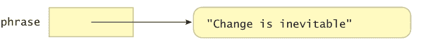

### 图 3.1 String 类的一些方法

| 方法签名 | 说明 |
| :--- | :--- |
| `String(String str)` | 构造函数：创建一个与 `str` 具有相同字符的新字符串对象。 |
| `char charAt(int index)` | 返回指定索引处的字符。 |
| `int compareTo(String str)` | 返回一个整数，用于指示此字符串在字典序上是在（返回负值）之前、等于（返回 0 值）还是在（返回正值）`str` 之后。 |
| `String concat(String str)` | 返回一个由此字符串与 `str` 拼接而成的新字符串。 |
| `boolean equals(String str)` | 如果此字符串包含与 `str` 相同的字符（包括大小写），则返回 `true`，否则返回 `false`。 |
| `boolean equalsIgnoreCase(String str)` | 如果此字符串包含与 `str` 相同的字符（不区分大小写），则返回 `true`，否则返回 `false`。 |
| `int length()` | 返回字符串中字符的数量。 |
| `String replace(char oldChar, char newChar)` | 返回一个与此字符串相同的字符串，但每个 `oldChar` 的出现处都被替换为 `newChar`。 |
| `String substring(int offset, int endIndex)` | 返回一个该字符串的子集，该子集从索引 `offset` 开始并延伸到 `endIndex-1`。 |
| `String toLowerCase()` | 返回一个与此字符串相同的字符串，但所有大写字母都转换为其对应的小写字母。 |
| `String toUpperCase()` | 返回一个与此字符串相同的字符串，但所有小写字母都转换为其对应的大写字母。 |

### 列表 3.1

```
LISTING 3.1
********************************************************************************
// StringMutation.java      作者: Lewis/Loftus
// 演示 String 类及其方法的用法。
********************************************************************************
public class StringMutation {
    //- 打印一个字符串及其各种变体。
    // public static void main(String[] args) {
        String phrase = "Change is inevitable";
        String mutation1, mutation2, mutation3, mutation4;

        System.out.println("Original string: \"" + phrase + "\"");
        System.out.println("Length of string: " + phrase.length());

        mutation1 = phrase.concat(", except from vending machines.");
        mutation2 = mutation1.toUpperCase();
        mutation3 = mutation2.replace('E', 'X');
        mutation4 = mutation3.substring(3, 30);

        // 打印每个变体后的字符串
        System.out.println("Mutation #1: " + mutation1);
        System.out.println("Mutation #2: " + mutation2);
        System.out.println("Mutation #3: " + mutation3);
        System.out.println("Mutation #4: " + mutation4);

        System.out.println("Mutated length: " + mutation4.length());
    }
}
```

### 输出

```
OUTPUT
Original string: "Change is inevitable"
Length of string: 20
Mutation #1: Change is inevitable, except from vending machines.
Mutation #2: CHANGE IS INEVITABLE, EXCEPT FROM VENDING MACHINES.
Mutation #3: CHANGX IS INXVITABL, XXCPT FROM VXNDING MAXINHS.
Mutation #4: NGX IS INXVITABL, XXCPT F
Mutated length: 27
```

在打印原始短句及其长度后，执行了 `concat` 方法来由变量 `mutation1` 引用的新字符串对象：

```
"Change is inevitable, except from vending machines."
```

然后在 `mutation1` 对象上执行了 `toUpperCase` 方法，并将生成的字符串存储在 `mutation2` 中：

```
"CHANGE IS INEVITABLE, EXCEPT FROM VENDING MACHINES"
```

注意长度和 `concat` 方法在 `mutation1` 对象上执行，生成的字符串存储在 `mutation2` 中。某些 `String` 方法引用特定字符的索引。某些 `String` 方法在 `phrase` 对象上执行，而 `toUpperCase` 方法执行 `phrase` 的结果是：


```
"CHANGE IS INXVITABL, XXCPT FROM VXNDING MAXINHS"
```

```
"NGX IS INXVITABL, XXCPT F"
```

### 自我检查问题（答案见附录 N）

- **SR 3.6** 假设 `s1`、`s2` 和 `s3` 分别为 "Foundations"、"Bobby" 和 "Chris"。以下语句改变了哪个字符串变量？
  a. `System.out.println(s1);`
  b. `s2.toLowerCase();`
  c. `System.out.println(s2.replace('B', 'M'));`
  d. `s2.concat(s1);`

- **SR 3.7** 以下代码的输出是什么？
  ```
  String s1 = "Foundations"
  String s2;
  System.out.println(s1.charAt(1));
  s2 = s1.substring(0, 5)
  System.out.println(s2);
  ```

- **SR 3.8** 写一条语句将 `title` 全大写打印。

- **SR 3.9** 为名为 `front` 的 String 编写一个声明，并将其初始化为 `description` 的前 10 个字符。

## 3.3 包

我们之前提到 Java 语言由我们可以使用的 API 标准库支持。让我们检查该特性。


类库是支持程序开发的类集合。编译器或开发环境通常带有类库。类库也可以从第三方单独获得。类库包含许多对程序员来说非常有价值的方法，因为它们提供了特殊的功能。事实上，程序员经常依赖类库中的方法，并开始将它们视为语言的一部分。

例如，`String` 类并不是语言固有的部分。它是任何 Java 开发环境中都可以找到的 Java 标准库的一部分。构成库的类是由创建 Java 语言的员工创建。

类库由几个相关类的簇组成，这些通常被称为 Java API，API 代表应用程序接口。例如，当我们讨论与数据库交互的程序时，可能会提到 Java 数据库 API。另一个例子是 Java Swing API，它指的是用于图形界面的特殊图形组件的类集合。通常整个标准库被泛称为 Java API。


Java 标准类库的类也被分在包（packages）。每个类都属于一个特定的包。例如，`String` 类属于 `java.lang` 包。`System` 类也属于 `java.lang` 包。我们在第 2 章中提到过 `Scanner` 类属于 `java.util` 包。

包的组织结构比 API 名称更基础且基于语言。虽然在包和 API 名称之间存在一般的对应关系，但构成给定 API 的类组可能会跨越多个包。

### 图 3.2 Java API 中的一些包

| 包 | 提供支持 |
| :--- | :--- |
| `java.applet` | 创建可以在 Web 上于传输的程序（applets）。 |
| `java.awt` | 绘制图形并创建图形用户界面；AWT 代表抽象窗口工具包（Abstract Windowing Toolkit）。 |
| `java.beans` | 定义可以轻松组合到应用程序中的软件组件。 |
| `java.io` | 执行各种输入和输出功能。 |
| `java.lang` | 通用支持；它会自动导入到所有 Java 程序中。 |
| `java.math` | 执行任意高精度的计算。 |
| `java.net` | 跨网络通信。 |
| `java.rmi` | 创建可以分布在多台计算机上的程序；RMI 代表远程方法调用（Remote Method Invocation）。 |
| `java.security` | 强制安全限制。 |
| `java.sql` | 与数据库交互；SQL 代表结构化查询语言（Structured Query Language）。 |
| `java.text` | 为输出格式化文本。 |
| `java.util` | 通用实用程序。 |
| `java.swing` | 使用扩展 AWT 能力的组件创建图形用户界面。 |
| `javax.xml.parsers` | 处理 XML 文档；XML 代表可扩展标记语言（Extensible Markup Language）。 |

3.2 节描述了作为 Java API 一部分的一些包。这些包在任何支持 Java 软件开发的平台上都可用。其中某些包支持非常特定的编程技术，在开发基础程序时不会发挥作用。

本书贯穿讨论了 Java API 的各种类。为了方便起见，我们在书籍文档中（如图 3.2 所示）包含了我们使用的类，但对你来说，如何获取有关 Java API 类的更多信息也非常重要。在线 Java API 文档对任何 Java 程序员来说都是无价的资源。它是一个包含标准 Java API 中每个页面信息的网站，列出了描述了每个页面中的方法。

图 3.3 显示了该文档的一页。侧边的链接允许你检查特定的包并跳转到特定的类。花些时间熟悉该网站的导航并学习信息是如何组织的。可以下载整套 Java API 文档，以便你随时拥有本地副本，或者你可以依赖在线版本。

## 第 3 章 使用类和对象

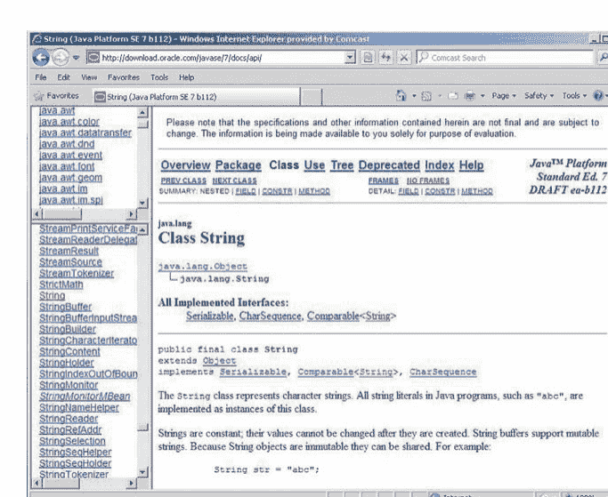

### import 声明

在编写程序时，`java.lang` 包中的类自动可用。要使用来自任何其他包的类，我们必须要么使用完全限定名，要么使用 import 声明。记住，使用 Scanner 类的示例程序包含一个 import 声明。

当你想要在程序中使用类库中的类时，可以在每次引用它时都使用其完全限定名（包括包名）。例如，每当你想要引用定义在 `java.util` 包中的 `Scanner` 类时，你都可以写 `java.util.Scanner`。然而，每次需要时都完全指定包名和类名很快就会变得疲惫。Java 提供了 import 声明来简化这些操作。

import 声明指定了程序将要使用的包和类，这样每次引用时就不需要完全限定名了。正如我们看到的，下面是一个 import 声明的示例：

```
import java.util.Scanner;
```

此声明断言 `java.util` 包中的 `Scanner` 类可以在程序中使用。当执行一个 import 声明后，在程序中引用该类时，使用简单名 `Scanner` 就足够了。

如果来自不同包的两个类具有相同的名称，import 声明是不够的——编译器将无法识别代码流中指的是哪一个类。当出现这种情况时（这种情况很少），应该在代码中使用完全限定名。

import 声明的另一种形式使用星号 (`*`) 表示该包内的任何类都可能在程序中使用。因此，以下声明允许 `java.util` 包中的所有类在程序中被引用，而无需对每次引用进行限定：

```
import java.util.*;
```

如果程序只使用某个包中的一个类，通常在 import 声明中指明该类会更好。然而，如果使用两个或多个类，使用 `*` 符号通常就可以了。

`java.lang` 包中的类被自动导入，因为它们是基础的，可以被认为是语言的基础扩展。因此，`java.lang` 包中的任何类（如 `System` 和 `String`）都可以在没有显式 import 声明的情况下使用。就像所有程序文件都自动包含以下内容一样：

```
import java.lang.*;
```

### 自我检查问题（答案见附录 N）

- **SR 3.10** 什么是 Java 包？


- SR 3.11 `java.net` 包包含什么？`javax.swing` 包包含什么？

- SR 3.12 哪些包包含 `Scanner` 类？`String` 类？`Random` 类？`Math` 类？

- SR 3.13 使用在线 Java API 文档，描述 `Point` 类。

- SR 3.14 `import` 语句实现了什么作用？

- SR 3.15 为什么 `String` 类不需要专门导入到我们的程序中？

> 核心概念 `java.lang` 包中的所有类对每个程序都是自动导入的。

## 3.4 Random 类

在编写软件时，经常需要随机数。游戏通常使用随机数来代表骰子的点数或洗牌。飞行模拟器可能会使用随机数来决定模拟飞行发生发动机故障的频率。随机数在编写开发时经常出现。一个帮助初中生准备 SAT 考试的程序可能会使用随机数来选择题目。

`Random` 类是 `java.util` 包的一部分，代表伪随机数生成器。伪随机数生成器产生数值。虽然它们在技术上不是随机的（因为它们是计算出来的），但伪随机数生成器产生的值在大多数情况下看起来是随机的。下表列出了 `Random` 类的一些方法。

| 方法 | 说明 |
| :--- | :--- |
| `Random()` | 构造函数：创建一个新的伪随机数生成器。 |
| `float nextFloat()` | 返回 0.0（包含）到 1.0（不包含）之间的随机数。 |
| `int nextInt()` | 返回所有 `int` 值（正负）的随机数。 |
| `int nextInt(int num)` | 返回 0 到 `num-1` 之间的随机数。 |

> 核心概念 伪随机数生成器通过复杂的计算产生随机假象。

注意传递给 `nextInt` 方法的值也是我们可以获得的可能值。我们可以通过加或减来调整范围。为了获取 1 到 6 范围内的随机数，我们可以调用 `nextInt(6)` 获取 0 到 5 之间的值，然后加 1。

`nextFloat` 方法返回一个大于等于 0.0 小于 1.0 的浮点数。如果需要，我们可以使用乘法来缩放结果，将其转换为 `int` 以截断小数部分，然后像处理整数那样平移范围。

列表 3.2 所示的程序在范围内产生了几个随机数。

```java
// RandomNumbers.java      作者: Lewis/Loftus
// 使用 Random 类创建伪随机数。
import java.util.Random;

public class RandomNumbers {
    // 在各种范围内生成随机数。
    public static void main(String[] args) {
        Random generator = new Random();
        int num1;
        float num2;

        num1 = generator.nextInt();
        System.out.println("一个随机整数: " + num1);

        num1 = generator.nextInt(10);
        System.out.println("从 0 到 9: " + num1);

        num1 = generator.nextInt(10) + 1;
        System.out.println("从 1 到 10: " + num1);

        num1 = generator.nextInt(15) + 20;
        System.out.println("From 20 to 34: " + num1);

        num1 = generator.nextInt(20) - 10;
        System.out.println("From -10 to 9: " + num1);

        num2 = generator.nextFloat();
        System.out.println("A random float (between 0-1): " + num2);

        num2 = generator.nextFloat() * 6; // 0.0 to 5.999999
        num1 = (int)num2 + 1;
        System.out.println("From 1 to 6: " + num1);
    }
}
```

```
A random integer: 1773351873
From 0 to 9: 8
From 1 to 10: 6
From 20 to 34: 20
From -10 to 9: -6
A random float (between 0-1): 0.71050885
From 1 to 6: 3
```

### 自测习题（答案见附录 N）

- SR 3.16 给定一个名为 `rand` 的 `Random` 对象，调用 `rand.nextInt()` 返回什么？

- SR 3.17 给定一个名为 `rand` 的 `Random` 对象，调用 `rand.nextInt(20)` 返回什么？

- SR 3.18 假设已经创建了一个 `Random` 对象 `generator`，以下每个表达式的结果范围是什么：
  - `generator.nextInt(50)`
  - `generator.nextInt(5) + 10`
  - `generator.nextInt(10) - 5`
  - `generator.nextInt(50) - 25`

- SR 3.19 假设已经创建了一个名为 `generator` 的 `Random` 对象，请写出表达式，以生成以下每个范围的整数（包含端点）。使用接受单个整数参数的 `nextInt` 方法。
  - a. 0 到 30
  - b. 10 到 19
  - c. -5 到 5

## 3.5 Math 类

`Math` 类提供了大量的基础数学函数，这些函数在进行计算时非常有帮助。`Math` 类定义在 Java 标准类库的 `java.lang` 包中。下表列出了它的其中几个方法。

`Math` 类中的所有方法都是静态方法（也称为类方法），这意味着可以通过它们所属的类名直接调用，而不需要先实例化该类的对象。静态方法将在第 6 章中进一步讨论。

`Math` 类的方法返回返回值，这些可以根据需要用于表达式中。例如，以下语句计算存储在 `total` 中的数字的绝对值，将其与 `count` 的四次方值相加，并将结果存储在变量 `value` 中：

> 核心概念 `Math` 类的所有方法都是静态的，这意味着它们通过类名进行调用。

```java
value = Math.abs(total) + Math.pow(count, 4);
```

注意，你可以向接受 `double` 参数的方法传递一个整数。这是赋值转换的一种形式，在第 2 章中讨论过。

代码列表 3.3 所示的 `Quadratic` 程序使用 `Math` 类来计算二元方程的根。回想二元方程具有以下通用形式：

$$ax^2 + bx + c$$

`Quadratic` 程序读取代表二元方程系数（`a`、`b` 和 `c`）的值，并计算求根公式以确定方程的根。求根公式为：

$$roots = \frac{-b \pm \sqrt{b^2 - 4ac}}{2a}$$

| 方法 | 说明 |
| :--- | :--- |
| `static int abs(int num)` | 返回 `num` 的绝对值。 |
| `static double acos(double num)`<br>`static double asin(double num)`<br>`static double atan(double num)` | 返回 `num` 的反余弦、反正弦或反正切。 |
| `static double cos(double angle)`<br>`static double sin(double angle)`<br>`static double tan(double angle)` | 返回角的余弦、正弦或正切值，角度单位为弧度。 |
| `static double ceil(double num)` | 返回 `num` 的向上取整值，即大于或等于 `num` 的最小整数。 |
| `static double exp(double power)` | 返回 $e$ 的 `power` 次幂。 |
| `static double floor(double num)` | 返回 `num` 的向下取整值，即小于或等于 `num` 的最大整数。 |
| `static double pow(double num, double pow)` | 返回 `num` 的 `pow` 次幂。 |
| `static double random()` | 返回 0.0（包含）到 1.0（不包含）之间的随机数。 |
| `static double sqrt(double num)` | 返回 `num` 的平方根，`num` 必须为正。 |

注意，此程序假设判别式（根号下的值）为正。如果不是正数，结果将不是有效数字，Java 将其表示为 `NaN`，代表 Not A Number（不是数字）。在第 5 章中，我们将看到如何优雅地处理这种情况。

### 代码列表 3.3

```java
// Quadratic.java      作者: Lewis/Loftus
// 展示了如何使用 Math 类根据用户输入进行计算。
import java.util.Scanner;

public class Quadratic {
    // 计算二元方程的根
    public static void main(String[] args) {
        int a, b, c; // ax^2 + bx + c
        double discriminant, root1, root2;
        Scanner scan = new Scanner(System.in);
        System.out.print("Enter x^2 的系数: ");
        a = scan.nextInt();
        System.out.print("Enter x 的系数: ");
        b = scan.nextInt();
        System.out.print("Enter 常数: ");
        c = scan.nextInt();
        // 使用求根公式计算根。
        // 假设判别式为正。
        discriminant = b * b - 4 * a * c;
        root1 = (-b + Math.sqrt(discriminant)) / (2 * a);
        root2 = (-b - Math.sqrt(discriminant)) / (2 * a);
        System.out.println("Root #1: " + root1);
        System.out.println("Root #2: " + root2);
    }
}
```

### 自测习题（答案见附录 N）

- SR 3.20 `Math` 类定义在哪个包中？

- SR 3.21 为什么不需要导入 `Math` 类就可以使用它？

- SR 3.22 什么是静态方法？

- SR 3.23 写一条语句打印以弧度为单位角的正弦值。

- SR 3.24 声明一个 `double` 变量 `result` 并将其初始化为 5 的 3 次方。

- SR 3.25 使用在线 Java 文档，列出表 3.5 中未包含的三个 `Math` 类方法。

## 3.6 格式化输出

### NumberFormat 类

`NumberFormat` 类提供了格式化数字的功能。它是一个抽象类，不能直接实例化，而是通过工厂方法获取实例。

### DecimalFormat 类

与 `NumberFormat` 类不同，`DecimalFormat` 类使用 `new` 运算符以传统方式实例化。它的构造函数接收一个字符串，代表引导格式化过程的模式。我们可以使用 `format` 方法来格式化特定值。在稍后的某个点，如果我们想更改格式对象使用的模式，可以调用 `applyPattern` 方法。下表描述了这些方法。

| 方法 | 说明 |
| :--- | :--- |
| `DecimalFormat(String pattern)` | 构造函数：创建一个具有指定模式的新 `DecimalFormat` 对象。 |
| `void applyPattern(String pattern)` | 将指定的模式应用于此 `DecimalFormat` 对象。 |
| `String format(double number)` | 返回一个包含根据当前模式格式化的指定数字的字符串。 |

传递给 `DecimalFormat` 构造函数的字符串所定义的模式可以相当复杂。使用各种符号来表示特定的格式指南。例如，由字符串 `"0.###"` 定义的模式表示小数点左侧至少应打印一个数字，如果值的整数部分为零，则应显示为零。它还表示值的小数部分将保留三位小数。末尾零（例如圆面积 78.340）不会打印。

此模式用于 `CircleStats` 程序（如列表 3.5 所示），该程序从用户处读取圆的半径并计算其面积和周长。

### printf 方法

除了 `print` 和 `println` 之外，`System` 类还有另一个输出方法 `printf`，它允许用户打印包含数据值的格式化字符串。该方法的第一个参数表示格式字符串，其余参数指定插入到格式字符串中的值。

例如，以下行代码打印了一个 ID 号和名称：

```java
System.out.printf("ID: %d Name: %s", id, name);
```

第一个参数指定输出的格式，并包括作为输出值标签的字面字符以及诸如 `\t` 的转义字符。模式 `%5d` 表示相应的数值 (`id`) 应该打印在一个五个字符的字段中。模式 `%s` 匹配字符串参数。

### 列表 3.4

```java
// SalesTax.java      作者: Lewis/Loftus
// 计算销售税并格式化输出。
import java.util.Scanner;
import java.text.NumberFormat;

public class SalesTax {
    public static void main(String[] args) {
        final double TAX_RATE = 0.06; // 6% 销售税
        int quantity;
        double subtotal, tax, totalCost, unitPrice;
        Scanner scan = new Scanner(System.in);
        NumberFormat fmt1 = NumberFormat.getCurrencyInstance();
        NumberFormat fmt2 = NumberFormat.getPercentInstance();
        System.out.print("Enter the quantity: ");
        quantity = scan.nextInt();
        System.out.print("Enter the unit price: ");
        unitPrice = scan.nextDouble();
        subtotal = quantity * unitPrice;
        tax = subtotal * TAX_RATE;
        totalCost = subtotal + tax;
        // 使用适当格式打印输出
        System.out.println("Subtotal: " + fmt1.format(subtotal));
        System.out.println("Tax: " + fmt1.format(tax) + " at " + fmt2.format(TAX_RATE));
        System.out.println("Total: " + fmt1.format(totalCost));
    }
}
```

**输出**

```text
Enter the quantity: 5
Enter the unit price: 3.87
Subtotal: $19.35
Tax: $1.16 at 6%
Total: $20.51
```

### 列表 3.5

```java
// CircleStats.java      作者: Lewis/Loftus
// 使用 DecimalFormat 类格式化输出。
import java.util.Scanner;
import java.text.DecimalFormat;

public class CircleStats {
    public static void main(String[] args) {
        double radius, area, circumference;
        Scanner scan = new Scanner(System.in);
        DecimalFormat fmt = new DecimalFormat("0.###");
        System.out.print("Enter the radius: ");
        radius = scan.nextDouble();
        area = Math.PI * radius * radius;
        circumference = 2 * Math.PI * radius;
        System.out.println("Area: " + fmt.format(area));
        System.out.println("Circumference: " + fmt.format(circumference));
    }
}
```

**输出**

```text
Enter the radius: 5.0
Area: 78.5398
Circumference: 31.4159
```


```java
********************************************************************
// CircleStats.java      作者: Lewis/Loftus
// 演示如何使用 DecimalFormat 类对小数值进行格式化...
********************************************************************

import java.util.Scanner;
import java.text.DecimalFormat;

public class CircleStats {
    // ----------------------------------------------------
    // 根据给定的半径计算圆的面积和周长。
    // ----------------------------------------------------
    public static void main(String[] args) {
        int radius;
        double area, circumference;

        Scanner scan = new Scanner(System.in);

        System.out.print("Enter the circle's radius: ");
        radius = scan.nextInt();

        area = Math.PI * Math.pow(radius, 2);
        circumference = 2 * Math.PI * radius;

        // 将输出保留到三位小数
        DecimalFormat fmt = new DecimalFormat("0.###");

        System.out.println("The circle's area: " + fmt.format(area));
        System.out.println("The circle's circumference: " 
            + fmt.format(circumference));
    }
}
```

输入圆的半径: 5

圆的面积: 78.54

圆的周长: 31.46

`name`。`id` 和 `name` 的值被插入字符串中，产生如下结果：

ID: 24036 Name: Larry Flaghopper

Java 添加 `printf` 方法是为了镜像 C 语言编写的程序中使用的类似函数。这使得程序员更容易将翻译（或迁移）现有的 C 程序到 Java。

旧的软件仍然具有价值，被称为遗留系统。维护遗留系统通常是一项昂贵的工作，因为由于其他原因等。

# 自测习题

- 23. 描述如何使用 `DecimalFormat` 类格式化数字。
- 24. `NumberFormat` 和 `DecimalFormat` 类之间有什么区别？
- 25. 解释什么是枚举类型以及它是如何工作的。
- 26. 编写一个使用枚举类型表示季节的程序。
- 27. 使用枚举类型代替常量的有什么优势？
- 28. 编写一个使用枚举类型表示一周几日的程序。

（注：原始 OCR 中的某些自测习题似乎是碎片化的或被 OCR 损坏了；我已尽可能清理了结构。）

## 3.7 枚举类型

Java 提供了定义*枚举类型*（enumerated type）的能力，该类型可以作为变量的类型。枚举类型通过列出或枚举可能值来建立可能的值。这些值是标识符，可以是任何内容。

例如，以下声明定义了一个枚举类型 `Season`，其可能值为冬、春、夏、秋：

```java
enum Season { winter, spring, summer, fall }
```

枚举类型中列出的值数量没有限制。一旦定义了类型，就可以声明该类型的变量：

```java
Season time;
```

变量 `time` 现在取值受到限制。它可以持有 `Season` 的值，但不能持有其他值。Java 枚举类型被认为是*类型安全的*（type-safe），这意味着任何使用枚举值之外的值的尝试都会导致编译时错误。通过类型名称访问这些值。例如：

```java
time = Season.spring;
```

在内部，枚举类型中的每个值都存储为一个整数，这被称为*序数值*（ordinal value）。枚举类型中的第一个值的序数为 0，第二个值的序数为 1，第三个为 2，依此类推。序数值在内部被使用。你不能将数值值赋值给枚举类型，即使该值对应于有效的序数。

## 3.7 枚举类型（续）

枚举类型是一种特殊的类，枚举类型的变量是对象变量。因此，与所有枚举类型都相关的方法很少。`ordinal()` 方法返回与特定枚举类型值关联的数值。`name()` 方法返回该值的名称，该名称与定义该值的标识符相同。

列表 3.6 显示了一个名为 `IceCream` 的程序，该程序声明了一个枚举类型并练习了它的一些方法。由于枚举类型是特殊类型的类，因此它们不能定义在方法内部。它们既可以定义在类级别（在类内部但在方法之外），如本例所示），也可以定义在最外层。

我们将在第 6 章中进一步探讨枚举类型。

# 列表 3.6

```java
****************************************************************************************************
// IceCream.java 作者: Lewis/Loftus
// 展示了枚举类型的使用。
****************************************************************************************************

public class IceCream {
    enum Flavor {vanilla, chocolate, strawberry, fudgeRipple, rockyRoad, mintChocolateChip, cookieDough}

    // -------------------------------------------------------------
    // 创建并使用 Flavor 类型的变量。
    // -------------------------------------------------------------
    public static void main(String[] args) {
        Flavor cone1, cone2, cone3;

        cone1 = Flavor.rockyRoad;
        cone2 = Flavor.chocolate;

        System.out.println("cone1 value: " + cone1);
        System.out.println("cone1 ordinal: " + cone1.ordinal());
        System.out.println("cone1 name: " + cone1.name());

        System.out.println();
        System.out.println("cone2 value: " + cone2);
        System.out.println("cone2 ordinal: " + cone2.ordinal());
        System.out.println("cone2 name: " + cone2.name());
    }
}
```

# 输出

cone1 value: rockyRoad

cone1 ordinal: 5

cone1 name: rockyRoad

cone2 value: chocolate

cone2 ordinal: 1

cone2 name: chocolate

cone3 value: rockyRoad

cone3 ordinal: 5

cone3 name: rockyRoad

> 自习题（答案见附录 N）

SR 3.29 编写一个表示电影分级的枚举类型的声明。

SR 3.30 假设定义了一个名为 `CardSuit` 的枚举类型如下：

```java
enum CardSuit {clubs, diamonds, hearts, spades}
```

以下代码序列的输出是什么？

```java
CardSuit card1, card2;

card1 = CardSuit.clubs;
card2 = CardSuit.hearts;

System.out.println(card1);
System.out.println(card2.name());
System.out.println(card1.ordinal());
System.out.println(card2.ordinal());
```

SR 3.31 为什么要使用问题中定义的 `CardSuit` 这样的枚举类型？为什么不直接使用 `String` 变量并赋值如 "hearts" 等值？

## 3.8 包装类

正如我们讨论过的，Java 使用基本类型（如 `int`、`double`、`char` 和 `boolean`）以及类和对象来表示数据。管理两类数据（基本值和对象引用）在某些情况下可能会带来挑战。例如，我们可以创建一个对象作为容器来存放各种类型的其他对象。然而，在特定情况下，我们可能需要持有一个简单的整数值。在这些情况下，我们需要将基本值“包装”成一个对象。

包装类表示一个特定的基本类型。例如，`Integer` 类表示一个简单的整数值。从 `Integer` 类创建的对象存储一个简单的 `int` 值。包装类的构造函数接受要存储的基本值。例如：

```java
Integer ageObj = new Integer(40);
```

一旦完成此声明和实例化，`ageObj` 对象就以对象的形式表示整数 `40`。每当程序中需要对象而不是基本类型时，就可以一直使用它。

对于 Java 中的每个基本类型，Java 类库中存在一个对应的包装类。所有的包装类都定义在 `java.lang` 包中。图 3.8 显示了与每个基本类型对应的包装类。

请注意，甚至有一个表示 `void` 类型的包装类。然而，与其它包装类不同，`Void` 类不能被实例化。它仅仅代表 `void` 引用的概念。

| 基本类型 | 包装类 |
|---|---|
| byte | Byte |
| short | Short |
| int | Integer |
| long | Long |
| float | Float |
| double | Double |
| char | Character |
| boolean | Boolean |
| void | Void |

图 3.8 Java API 中的包装类

```java
Integer(int value)
构造函数：创建一个存储指定值的新 Integer 对象。

byte byteValue()
double doubleValue()
float floatValue()
int intValue()
long longValue()
返回此 Integer 对应的基本类型的值。

static int parseInt(String str)
返回与符号字符串中存储的值相对应的 int。

static String toBinaryString(int num)
static String toHexString(int num)
static String toOctalString(int num)
返回指定整数值在相应基数下的字符串表示。
```

图 3.9 Integer 类的一些方法

包装类还提供了与关联基本类型管理相关的各种方法。例如，`Integer` 类包含了返回对象中存储的 `int` 值并将其转换为其他基本类型的方法。图 3.9 列出了这些方法。包装类也有类似的方法。

请注意，包装类还包含不依赖于实例化对象的静态方法。例如，`Integer` 类包含一个静态方法 `parseInt()`，用于将存储在 `String` 中的整数转换为整数。如果 `String` `str` 持有 "987"，以下代码将该字符串转换为整数 `num`：

```java
num = Integer.parseInt(str);
```

Java 包装类通常包含非常有用的静态常量。例如，`Integer` 类包含常量 `MIN_VALUE` 和 `MAX_VALUE`，分别持有最小和最大的 `int` 值。其他包装类对于其类型也有类似的常量。

## 3.9 组件与容器

### 装箱

装箱是指基本值与对应的包装对象之间的自动转换。例如，在以下代码中，一个 `int` 值被赋值给 `Integer` 对象变量：

```java
Integer obj;
int num1 = 69;
obj = num1; // 自动创建一个 Integer 对象
```

反向转换称为拆箱，在需要时也会发生。例如：

```java
Integer obj2 = new Integer(69);
int num2;
num2 = obj2; // 自动提取 int 值
```

基本类型和对象类型之间的赋值通常是不兼容的。装箱功能仅发生在基本类型和包装类之间。在任何其他情况下，尝试将基本值赋值给对象引用变量（或反之）都会导致编译时错误。

> 核心概念
>
> 装箱提供了基本类型与包装对象之间的自动转换。

# 自习题（答案见附录 N）

- SR 3.32 如何将基本值表示为对象？
- SR 3.33 哪些类对应以下基本类型：`byte`、`int`、`double`、`char`、`boolean`？
- SR 3.34 假设已经声明并初始化了一个 `int` 变量 `number`，声明了一个 `Integer` 变量 `holdNumber`。显示 Java 中的两种方法让 `holdNumber` 表示 `number` 中的值。
- SR 3.35 编写一条打印可能的 `int` 最大值的语句。

## 第 3 章 使用类和对象

到目前为止我们看到的示例程序大部分都是 Java 应用程序。具体地说，它们是命令行应用程序，仅通过简单的文本提示与用户交互。Java 应用程序也可以具有图形化组件。在本书的剩余部分，在每章末尾的“图形轨道”（Graphics Tracks）中，我们将探索 Java 创建具有图形用户界面（GUI）程序的能力。在本章中，我们将建立有关图形化应用程序的基本问题。

GUI 组件是一个表示屏幕元素的对象，用于显示信息或允许用户以任何方式与程序交互。GUI 组件包括标签（labels）、按钮、文本字段、滚动条和菜单。

Java 组件和其他 GUI 相关的类主要定义在两个包中：`java.awt` 和 `java.swing`（注意其中的 `swing`）。抽象窗口工具包（AWT）是最初的 Java GUI 包。它包含了许多重要的类，例如我们在第 2 章中使用的 `Color` 类。Swing 包是后来添加的，提供了比 AWT 包更灵活的组件。GUI 开发需要这两个包，但只要有选项，我们都会使用 Swing 组件。

> 核心概念
>
> 容器（Containers）是用于持有和组织其他组件的 GUI 组件。

容器是一种特殊的组件，用于持有和组织其他组件。帧（Frames）和面板（Panels）是 Java 容器的两个例子。让我们详细探索一下。

## 帧和面板

帧（Frame）是一种用于显示基于 GUI 的 Java 应用程序的容器。帧以带有标题栏的独立窗口形式显示。它可以在屏幕上移动，并可以通过鼠标拖动它来调整大小。帧的角处有小按钮，允许帧进行最小化、最大化和关闭。帧由 `JFrame` 类定义。

面板（Panel）也是一种容器。然而，与帧不同，它不能单独显示。面板必须添加到另一个容器中才能显示。通常情况下，除非你移动它所在的容器，否则面板不会移动。它的主要作用是组织 GUI 中的其他组件。面板由 `JPanel` 类定义。

> 核心概念
>
> 帧可以作为独立窗口显示，但面板只能作为另一个容器的一部分进行显示。

我们可以将容器分类为重量级（heavyweight）或轻量级（lightweight）。重量级容器是由程序运行的底层操作系统管理的，而轻量级容器则由 Java 程序本身管理。在我们探索 GUI 开发时，这种区别有时会重要。帧是一个重量级组件，而面板是一个轻量级组件。

## 组件和容器

通常，重量级组件比轻量级组件更复杂。例如，帧有多个窗格，负责帧窗口的各种特性。Java 接口的所有可见元素都显示在帧的内容面板（content pane）中。

通常，我们可以通过创建一个显示程序界面的帧来创建一个基于 GUI 的 Java 应用程序。界面通常被组织在一个主面板上，该主面板被添加到帧的内容面板中。主面板中的组件通常根据需要使用其他面板进行组织。

除非容器能帮助组织和显示其他组件，否则它们通常是没用的。让我们检查另一个基础的 GUI 组件。标签（Label）是一种在 GUI 中显示一行文本的组件。标签还可以显示图像，这是本章中稍后会讨论的话题。通常，标签被用于显示信息或识别 GUI 中的其他组件。在几乎每个基于 GUI 的程序中都能找到标签。

让我们看一个使用帧、面板和标签的示例。当执行列表 3.7 中的程序时，屏幕上会出现一个新窗口，显示一个短语。短语的文本使用两个标签组件显示。标签被组织在一个面板中，而面板显示在帧的内容面板中。

`JFrame` 构造函数接受一个字符串作为参数，用于显示帧的标题栏。对 `setDefaultCloseOperation()` 方法的调用决定了点击帧边角的关闭按钮 (X) 时会发生什么。在大多数情况下，我们只需让该按钮终止程序，如 `EXIT_ON_CLOSE` 常量所示。


# 面板、标签与容器

面板通过实例化 `JPanel` 类创建。面板的背景颜色使用 `setBackground` 方法设置。`setPreferredSize` 方法接受一个 `Dimension` 对象作为参数，用于指定组件以像素为单位的宽度和高度。许多组件的大小可以通过这种方式设置，还可以使用 `setMinimumSize` 和 `setMaxSize` 方法来帮助控制界外观。

标签通过实例化 `JLabel` 类创建，并向其构造函数传递文本。在这个程序中，创建了两个标签组件。

容器有一个 `add` 方法，允许将其他组件添加到它们中。两个标签都被添加到主面板中，从那时起它们被视为该面板的一部分。组件添加到容器的顺序通常很重要。它决定了哪个标签出现在另一个标签之前。

最后，使用 `getContentPane` 方法创建帧的内容面板，紧接着调用内容面板的 `add` 方法来……

## 列表 3.7

```java
************************************************************
// Authority.java      Author: Lewis/Loftus
// 演示了帧、面板和标签的使用。
//************************************************************
import java.awt.*;
import javax.swing.*;
public class Authority {
    //-----------------------------------------------------------
    // 显示一些格言。
    //-----------------------------------------------------------
    public static void main(String[] args) {
        JFrame frame = new JFrame("Authority");
        frame.setDefaultCloseOperation(JFrame.EXIT_ON_CLOSE);
        JPanel primary = new JPanel();
        primary.setBackground(Color.yellow);
        primary.setPreferredSize(new Dimension(250, 75));
        JLabel label1 = new JLabel("Question authority.");
        JLabel label2 = new JLabel("but raise your first.");
        primary.add(label1);
        primary.add(label2);
        frame.getContentPane().add(primary);
        frame.pack();
        frame.setVisible(true);
    }
}
```

| Authority |
| :--- |
| Question authority. |
| but raise your first. |

……面板。帧的 `pack` 方法根据其内容恰当地设置其大小——在这种情况下，帧的大小是为了容纳它所包含的面板。这比显式设置帧的大小要好，因为帧的大小应该随着其内部组件的变化而改变。调用 `setVisible` 方法会导致帧显示在显示器上。

该程序不是交互式的。通常，标签并不允许用户与程序进行交互。我们将在下一章中检查交互式 GUI 组件。

然而，你可以通过各种方式与帧进行交互。你可以通过抓住帧的标题栏并用鼠标拖动，将整个帧移动到桌面的另一个点。你还可以通过拖动帧的右下角来调整帧的大小。注意当帧变宽时发生了什么：每个容器都由一个名为布局管理器（Layout manager）的对象管理，该对象决定了容器中组件的布局。当界面发生重要变化时（例如帧被调整大时），会咨询布局管理器。

除非另指定，否则面板中的组件将尝试在行中相邻排列，只有当面板宽度无法容纳某个组件时，它才会移动到下一行。尝试这个程序，看看当窗口大小变化时，布局管理器如何改变标签的组织。布局管理器将在第 7 章的“图形轨道”部分中详细讨论。

## 自测习题（答案见附录 N）

- SR 3.36 帧和面板之间的区别是什么？

- SR 3.37 从下列列表中选择与以下各项描述最匹配的术语：

  a. container, content pane, frame, heavyweight, label, layout manager, lightweight, panel

  a. 用于持有和组织其他组件的容器。

  b. 在带有标题栏的独立窗口中显示的容器。

  c. 它的主要作用是帮助组织 GUI 中的其他组件；它必须添加到另一个容器中才能显示。

  d. 这种组件由底层操作系统管理。

  e. 这种组件由 Java 程序本身管理。

  f. 帧中显示可见元素的区域。

  g. 一个在 GUI 中显示一行文本的组件。

  h. 决定容器中的组件在屏幕上的排列方式。

3.38 运行 Authority 程序。描述当通过拖动右下角向右调整框架大小时会发生什么。请解释原因。

3.39 下列哪个语句描述了 Authority 程序的 GUI 是构建的？

+ - 将框架添加到面板（panel）中，面板添加到两个标签（label）中。

- 将标签添加到面板中，面板被添加到框架的内容区域（content pane）中。

- 将框架、面板和标签添加到前景层（foreground）。

- 面板向用户显示两个标签。

3.40 分别对 Authority 程序进行以下每种更改的结果是什么？你可以进行更改、编译并运行程序，然后观察并报告结果。简要说明你观察到的现象。

+ a. 传递给 `setPreferredSize` 方法的尺寸变为 (300, 300) 而不是 (25, 75)。

b. 将背景颜色设置为黑色而不是黄色。

c. 两个标签实例化语句的顺序反过了（即：你先创建一个新的 `Label` 并传入字符串 "raise your hand first."，然后创建一个新的 `Label` 并传入字符串 "Question authority."）。

d. 两个主语句的顺序反过了（即：你先将 `label12` 添加到主面板，然后添加 `label1`）。

# 3.10 嵌套面板

在上一节中，我们看到了一个示例，其中两个标签包含在一个面板中，而该面板又包含在一个框架中。这种关系构成了界面的内容层次结构，它可以根据所需的视觉效果具有任意复杂的程度。

> 核心概念
>
> 面板可以嵌套，以创建复杂的组件包含层次结构。

特别是，通常会使用多层嵌套面板来以各种方式组织和分组组件。虽然你不应该在内容层次结构中包含不必要的组件，但不要犹豫在创建界面时添加额外的脚架，以实现你想要的效果。

列表 3.8 中的程序 `NestedPanels` 创建了两个子面板，每个包含一个标签。两个子面板都被放入另一个面板中，该面板随后被添加到框架的内容区域。

## 列表 3.8

```java
************************************************************************************
// NestedPanels.java       作者: Lewis/Loftus
//
// 展示了基本的组件层次结构
//********************************************************************
import java.awt.*;
import javax.swing.*;

public class NestedPanels
{
    //
    // 展示嵌套在第三个面板内的两个彩色面板。
    //
    public static void main(String[] args) {
        JFrame frame = new JFrame("Nested Panels");
        frame.setDefaultCloseOperation(JFrame.EXIT_ON_CLOSE);

        // 设置第一个子面板
        JPanel subpanel1 = new JPanel();
        subpanel1.setPreferredSize(new Dimension(150, 100));
        subpanel1.setBackground(Color.green);
        JLabel label1 = new JLabel("One");
        subpanel1.add(label1);

        // 设置第二个子面板
        JPanel subpanel2 = new JPanel();
        subpanel2.setPreferredSize(new Dimension(150, 100));
        subpanel2.setBackground(Color.red);
        JLabel label2 = new JLabel("Two");
        subpanel2.add(label2);

        // 设置主面板
        JPanel primary = new JPanel();
        primary.setPreferredSize(Color.blue);
        primary.add(subpanel1);
        primary.add(subpanel2);
```

## 第 3 章 使用类和对象

https://sanet.st/blogs/polatebooks/

## 列表 3.8 继续

```java
frame.getContentPane().add(primary);
frame.pack();
frame.setVisible(true);
}
```

## 显示

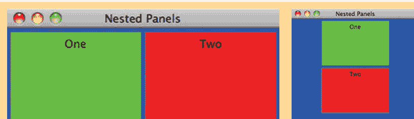

注意，程序中的主面板没有显式设置大小。它会根据需要调整以容纳其中的两个面板。同样注意，子面板周围有一个缓冲区，通过它可以看到主面板的蓝色。这种间距是由管理容器的布局管理器以及为组件设置的特性决定的。这些将在将在布局轨迹”中进一步探讨。

就像你处理上一个示例一样，执行并实验这个程序。调整框架大小观察对组件的影响。注意，面板的大小保持固定的，而两个面板的方向取决于主面板的宽度（主面板随框架的扩展而扩展）。

当你熟悉相互布局的组件后，将所有面板的背景颜色改为相同的颜色（例如，绿色），看看如果界面设计得当，面板之间的区别是否会变得不可见。

> 自测习题（答案见附录 N）

+ - SR 3.41 Java 图形用户界面的包含层次结构是什么？

- SR 3.42 在 `NestedPanel1` 程序中，创建了多少个面板？面板变量名称是什么？

## 3.11 图像

SR 3.43 在 `NestedPanels` 程序中，哪些面板被添加到另一个面板中？它们被添加到哪个面板中？哪个面板被显式地添加到框架的内容区域？

图像在基于图形的软件中经常起着重要作用。Java 能够多种方式使用 JPEG 和 GIF 图像。`Graphics` 类包含一个 `draw` 方法，允许你像绘制形状或字符字符串一样绘制图像。图像也可以整合到标签组件中。让我们详细探讨图像与标签之间的关系。

正如我们在之前的节中所看到的，由 `JLabel` 类定义的标签可以用于向用户提供信息或描述界面中的其他组件。标签也可以包含图像。也就是说，由文本、图像或两者共同组成的标签。

> 核心概念
>
> 标签可以包含文本、图像或两者。

`ImageIcon` 类用于表示包含在标签中的图像。`ImageIcon` 构造函数接收图像文件名并将其加载到对象中`ImageIcon` 对象可以使用 JPEG 或 GIF 图像创建。

标签内部文本和图像的对齐方式可以显式设置，使用 `JLabel` 类或特定方法。同样，我们可以设置文本相对于图像的位置。

## 列表 3.9 继续显示

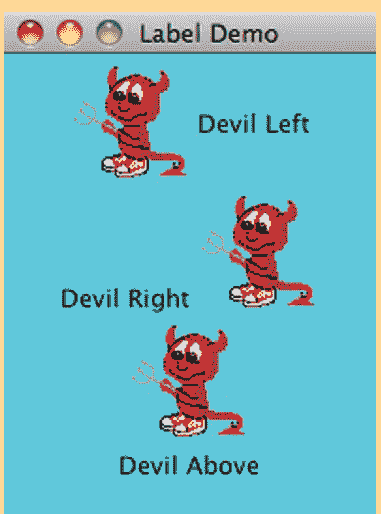

使用 Graphics 类的 `drawImage` 方法，或者使用标签（label）来显示图像。你的选择应该根据程序的具体需求。

+   自测题（答案见附录 N）

SR 3.44 在 LabelDemo 程序中声明了多少个帧（frame）、面板（panel）、图像图标和标签？

SR 3.45 考虑 LabelDemo 程序中的其中一个标签实例化语句：

```
label12 = new JLabel("Devil Right", icon, SwingConstants.CENTER);
```

解释传递给 `JLabel` 构造函数的三个参数的作用。

SR 3.46 分别对 Label1Demo 程序进行以下每项更改，结果分别是什么？你可以进行更改、编译并运行程序，然后观察并报告结果。简要解释你观察到的现象。

+   a. 将三个 `JLabel` 构造函数的第三个参数更改为 `SwingConstants.LEFT`。

b. 将 label12 的水平文本位置从 LEFT 改为 RIGHT。

c. 将 label12 的水平文本位置从 LEFT 改为 BOTTOM。

d. 将 label13 的垂直文本位置从 BOTTOM 改为 CENTER。

# 核心概念总结

-   `new` 运算符返回一个指向新创建对象的引用。

-   多个引用变量可以指向同一个对象。

-   通常在特定对象上执行方法，这会影响结果。

-   类库为开发程序提供了有用的支持。

-   Java 标准类库组织成包（packages）。

-   `java.lang` 包中的所有类对每个程序都会被自动导入。

-   伪随机数生成器通过复杂的计算来营造随机的错觉。

-   `Math` 类的所有方法都是静态的（static），意味着它们通过类名进行调用。

-   Java 添加了 `printf` 方法以支持遗留系统的迁移。

-   枚举类型（Enumerated types）是类型安全的，确保不会使用无效值。

-   包装类（wrapper class）允许将基本类型值作为对象管理。

-   自动装箱（Autoboxing）在基本值和相应的包装对象之间进行自动转换。

-   容器（Containers）是用于包含和组织其他组件的特殊 GUI 组件。

-   帧（frame）作为单独窗口显示，但面板（panel）只能作为另一个容器的一部分显示。

-   每个容器都由布局管理器（layout manager）管理。

-   面板可以嵌套，以创建复杂的组件包含层级结构。

-   标签（label）可以包含文本、图像或两者兼具。

# 练习题

EX 3.1 写一条语句，打印名为 `overview` 的 String 对象的字符数。

EX 3.2 写一条语句，打印名为 `introduction` 的 String 对象的第 8 个字符。

# 第 3 章 使用类和对象

EX 3.3 声明一个名为 `str` 的 String 变量，并初始化为包含与名为 `name` 的 String 对象相同的字符，但全部转换为大写字母。

EX 3.4 为一个名为 `change` 的 String 变量编写声明，并将其初始化为另一个名为 `original1` 的 String 对象中存储的字符，其中将所有的 'e' 都改为 'j'。

EX 3.5 以下代码段产生什么输出？

EX 3.6 下一个 import 语句的作用是什么？

```
import java.awt.*;
```

EX 3.7 假设已经创建了一个名为 `generator` 的 Random 对象，每个以下表达式的结果范围是什么？

+   a. generator.nextInt(20)

b. generator.nextInt(8) + 1

c. generator.nextInt(12) + 2

d. generator.nextInt(35) + 10

e. generator.nextInt(100) - 50

EX 3.8 写代码声明并实例化 Random 类的对象（将对象引用变量命名为 `rand`）。然后列出一个使用 `nextInt` 方法的表达式列表，用于在以下指定范围（包括端点）内生成随机数。使用接受单个整数参数的 `nextInt` 方法版本。

+   a. 0 到 10

b. 0 到 400

c. 1 到 10

d. 1 到 400

e. 25 到 50

f. -10 到 15

EX 3.9 写一条赋值语句，计算 `num1` 和 `num2` 之和的平方根并将结果赋值给 `num3`。

EX 3.10 写一条语句计算并打印 `total` 的绝对值。

EX 3.11 写代码语句创建一个 `DecimalFormat` 对象，将一个格式化后的值舍入到四位小数。然后写一条使用该对象打印正确格式化的 `result` 值的语句。

EX 3.12 写代码语句，提示用户并读取一个 `double` 值，并打印该值四次方的的结果。输出结果保留三位小数。

EX 3.13 为一个表示星期几的枚举类型编写一个声明。

# 编程项目

PP 3.1 写一个程序，提示用户并读取用户的姓和名（分别读取）。打印一个由以下部分组成的字符串：用户姓名的第一个字母，后面是用户姓氏的前五个字符，最后是一个 10 到 99 范围内的随机数。假设姓氏至少有五个字母。有时会使用类似的算法。

PP 3.2 写一个程序，提示并读取两个 `double` 值，并打印它们的立方和。

PP 3.3 写一个程序，生成一个 1 到 100 范围内的随机数并显示。

PP 3.4 写一个程序，提示并读取一个 `double` 值并打印其平方。

PP 3.5 写一个程序，读取两个点的 (x,y) 坐标并使用以下公式计算点之间的距离：


# 第 3 章 使用类和对象

## PP 3.6
写一个程序，读取球的半径并打印其体积和表面积。使用以下公式保留四位小数，$r$ 代表半径。

$$Volume = \frac{4}{3}\pi r^3$$

$$Surface\ Area = 4\pi r^2$$

## PP 3.7
写一个程序，读取三角形边长并计算面积，其中 $s$ 代表周长的一半，$a, b$ 和 $c$ 代表边长。输出保留三位小数。

$$Area = \sqrt{s(s-a)(s-b)(s-c)}$$

## PP 3.8
写一个程序，生成一个 20 到 40 范围内的随机整数，并显示其正弦、余弦和正切。

## PP 3.9
写一个程序，生成 1 到 10 范围内的随机整数半径 ($r$) 和高度 ($h$) 用于圆柱，然后计算其体积和表面积。

$$Volume = \pi r^2h$$

$$Surface\ Area = 2\pi rh$$

## PP 3.10
写一个程序，显示一个包含两个标签的帧，分别显示你的名字和姓氏。调整窗口大小观察标签取向的变化。

## PP 3.11
写一个程序，显示一个包含两个面板的帧。每个面板包含两个图像（四个独特的图像——由你选择）。固定第一个面板的大小，使其图像并排排列。允许另一个面板根据需要调整大小。调整窗口大小观察图像的变化。确保你理解程序为什么那样运行。

## PP 3.12
修改 `LabelDemo` 程序，使其显示第四个标签，标签文本居于图像上方。

# 第 4 章 编写类

## 章节目标

*   讨论类定义的结构和内容。
*   使用实例数据建立对象状态的概念。
*   描述可见性修饰符对方法和数据的影响。
*   探索方法的结构，包括参数和返回值。
*   讨论构造函数的结构和目的。
*   探索图形对象的创建。
*   引入创建交互式图形用户界面所需的概念。
*   探索一些基础 GUI 组件和事件。

在第 3 章中，我们使用了类和对象及其提供的各种服务。也就是说，我们使用了 Java API 提供的预定义类来简化编写程序的过程。在本章中，我们处理面向对象编程的核心：编写自己的类来定义自己的对象。本章探讨了类定义的基础，包括方法的结构以及数据的作用域和封装。本章的图形部分讨论了如何编写图形表示的类，并引入了创建真正的交互式图形用户界面所需的问题。

## 4.1 重新回顾类与对象

在第 1 章中，我们介绍了基本的面向对象概念，包括对对象和类进行了简要概述。在第 3 章中，我们使用了 Java 标准类库中的几个预定义类来创建对象，并使用它们来实现提供的特定功能。

在本章中，我们将注意力转向编写自己的类。虽然现有的类库提供了许多实用的类，但面向对象程序开发的本质是设计和实现我们的类以满足我们的特定需求。

回想对象与类之间的基本关系：类是对象的蓝图。类表示对象的概念，而从该类创建的任何对象都是该概念的实现。

例如，从第 3 章我们知道，`String` 代表字符字符串的概念，而每个 `String` 对象代表包含特定字符的特定字符串。

让我们考虑另一个例子。假设有一个名为 `Student` 的类代表大学里的一名学生。从 `Student` 创建的对象代表一个特定的学生。`Student` 类代表学生的通用概念，而从该类创建的每个对象都代表一个真实的学生。在一个帮助管理大学业务的系统中，我们将有一个 `Student` 类和成千上万个 `Student` 对象。

回想对象具有状态，状态由与其关联的属性的值定义。学生的属性可能包括学生的姓名、地址和平均学分。`Student` 类规定了每个学生都具有这些属性。每个对象存储某个特定学生的这些属性的值。在 Java 中，对象的属性是由类内部声明的变量定义的。

对象具有行为，行为由与其关联的操作定义。学生的操作将包括更新该学生地址的能力以及计算该学生当前平均分的能力。`Student` 类定义了这些操作，例如计算平均分的细节。请注意，对象的行为可能会修改该对象的状态。在 Java 中，对象的操作是由类内部声明的方法定义的。

表 4.1 列出了一些类的示例，并包含了可能为这些类的对象定义的属性和操作。确定需要哪些属性和操作取决于程序设计者，这取决于程序的目的以及特定对象在实现该目的中所扮演的角色。请考虑一下你可能为这些示例包含的其他属性和操作。

| 类 | 属性 | 操作 |
| :--- | :--- | :--- |
| Student | 姓名 Name<br>地址 Address<br>专业 Major<br>学点平均分 Grade point average | 设置地址 Set address<br>设置专业 Set major<br>计算学点平均分 Compute grade point average |
| Rectangle | 长度 Length<br>宽度 Width<br>颜色 Color | 设置长度 Set length<br>设置宽度 Set width<br>设置颜色 Set color |
| Aquarium | 材料 Material<br>长度 Length<br>宽度 Width<br>高度 Height | 设置材料 Set material<br>设置长度 Set length<br>设置宽度 Set width<br>设置高度 Set height<br>计算体积 Compute volume<br>计算填充量 Compute filled |
| Flight | 航空公司 Airline<br>航班号 Flight number<br>起发地 Origin city<br>目的地 Destination city<br>当前状态 Current status | 设置航空公司 Set airline<br>设置航班号 Set flight number<br>确定状态 Determine status |
| Employee | 姓名 Name<br>部门 Department<br>职称 Title<br>薪资 Salary | 设置部门 Set department<br>设置职称 Set title<br>设置薪资 Set salary<br>计算工资 Compute wages<br>计算奖金 Compute bonus<br>计算税费 Compute taxes |

**表 4.1** 类示例以及一些可能的属性和操作

### 自测习题（答案见附录 N）

*   **SR 4.1** 什么是属性？
*   **SR 4.2** 什么是操作？
*   **SR 4.3** 列出可能为代表图书馆中书籍的 `Book` 类定义的某些属性和操作。
*   **SR 4.4** 正确或错误？请解释。
    *   a. 我们编写程序时应该只使用 Java 类库中的类——不需要定义或使用其他类。
    *   b. 对象上的操作可以改变对象的状态。
    *   c. 对象的当前状态会影响该对象的操作结果。
    *   d. 在 Java 中，对象的状态是由它的方法表示的。

## 4.2 类结构

在我们之前的所有示例中，我们编写了一个包含 `main` 方法的单个类。这些类代表了小但完整的程序。这些程序通常使用 Java 类库中的预定义类实例化对象，并使用这些对象提供它们所的服务。这些预定义类是程序的一部分，但除了如何与其交互之外，我们从未真正关心它们。我们只需信任它们会提供承诺的服务。

让我们来看另一个例子。列表 4.1 所示的 `RollingDice` 类包含一个 `main` 方法，该方法实例化两个 `Die` 对象（dice 的单数）。它掷骰子并打印结果。它还调用了 `Die` 类提供的其他方法，例如显式设置和获取骰子当前面值的能力。

### 列表 4.1 `RollingDice.java`

```java
// RollingDice.java      Author: Lewis/Loft
// 展示了用户定义类的创建和使用。
public class RollingDice
{
    // 创建两个 Die 对象并掷它们几次。
    //
    public static void main(String[] args)
    {
        Die die1, die2;
        int sum;

        die1 = new Die();
        die2 = new Die();

        die1.roll();
        die2.roll();
        System.out.println("Die One: " + die1 + ", Die Two: " + die2);

        die1.roll();
        die2.setFaceValue(4);

        System.out.println("Die One: " + die1 + ", Die Two: " + die2);

        sum = die1.getFaceValue() + die2.getFaceValue();
        System.out.println("Sum: " + sum);

        System.out.println("Die One: " + die1 + ", Die Two: " + die2);
        System.out.println("New sum: " + sum);
    }
}
```

**输出**

```
Die One: 5, Die Two: 2
Sum: 7
Die One: 4, Die Two: 2
New sum: 6
```

此示例与之前示例的主要区别在于，`Die` 类不是 Java API 提供的，是我们自己编写的。

> **核心概念**
> 面向对象编程的核心是定义具有定义状态对象的类。

### 列表 4.2 `Die.java`

```java
// Die.java       Author: Lewis/Loftus
//
// 表示一个骰子 (dice的单数)，其面显示值为
// 1到6之间的值。
public class Die
{
    private final int MAX = 6; // 最大点数
    private int faceValue; // 骰子上显示的当前值

    //-----------------------------------------------------------------
    // 构造函数：设置初始点数。
    //-----------------------------------------------------------------
    public Die()
    {
        faceValue = 1;
    }

    //-----------------------------------------------------------------
    // 掷骰子并返回结果。
    //-----------------------------------------------------------------
    public int roll()
    {
        faceValue = (int)(Math.random() * MAX) + 1;
        return faceValue;
    }

    //-----------------------------------------------------------------
    // 点数修改器。
    //-----------------------------------------------------------------
    public void setFaceValue(int value)
    {
        faceValue = value;
    }

    //-----------------------------------------------------------------
    // 点数访问器。
    //-----------------------------------------------------------------
    public int getFaceValue()
    {
        return faceValue;
    }

    //-----------------------------------------------------------------
    // 返回此骰子的字符串表示形式。
    //-----------------------------------------------------------------
    public String toString() {
        String result = Integer.toString(faceValue);
        return result;
    }
}
```

`Die` 类的方法包括掷骰子的能力，即产生一个新的随机面值。`roll()` 方法返回调用方法的新面值，但你也可以随时使用 `getFaceValue()` 方法获取当前面值。`setFaceValue(int)` 方法显式地设置面值，仿佛你伸手过去把骰子转到你想要的任何面。任何对象的 `toString()` 方法每当你将对象传递给 `print()` 或 `println()` 方法以获取对象的字符串描述时都会被自动调用。因此，通常为大多数类定义一个 `toString()` 方法是一个好主意。这些方法的定义包含多个部分，我们将在本章中对它们进行剖析。

对于书中的示例，我们通常将每个类存储在自己的单独文件中。Java 允许在一个文件中存储多个类。如果一个文件包含多个类，则只有其中一个类可以使用保留关键字 `public` 进行声明。此外，公共类的名称必须与文件名对应。例如，类 `Die` 存储在名为 `Die.java` 的文件中。

| 方法 | 描述 |
| :--- | :--- |
| `Die()` | 构造函数：将骰子的初始点数设置为 1。 |
| `int roll()` | 掷骰子，通过将点数设置为适当范围内的随机数。 |
| `void setFaceValue(int value)` | 将骰子的点数设置为指定的值。 |
| `int getFaceValue()` | 返回骰子的当前点数。 |
| `String toString()` | 返回骰子的字符串表示形式，指示其当前点数 |

**表 4.3** `Die` 类的某些方法

### 实例数据

注意，在类中，常量 `MAX` 和变量 `faceValue` 是在类内部声明的，而不是任何方法内部。变量定义其作用域的位置，是程序中该变量可以被引用的区域。通过在类级别声明（而不是在方法内部），这些变量和常量可以在类的任何方法中被引用。

诸如变量 `faceValue` 的属性被称为实例变量，因为在创建该类的实例时，会为该变量留出内存空间。每个 `Die` 对象都有自己的 `faceValue` 变量和自己的数据空间。这意味着每个 `Die` 对象都可以拥有它自己的状态。我们在 `RollingDice` 程序的输出中看到：一个骰子的 `faceValue` 为 5，另一个骰子的点数为 2。这是可能的，因为为每个 `Die` 对象都创建了 `faceValue` 变量的内存空间。

> **概念**
> 变量的作用域决定了它可以在哪里被引用，取决于它声明的位置。

我们可以将这种情况描述为：

| 对象 | 实例变量 | 值 |
| :--- | :--- | :--- |
| `die1` | `faceValue` | 5 |
| `die2` | `faceValue` | 2 |

变量 `die1` 和 `die2` 指向（即包含地址）各自的对象。每个对象都包含一个具有其独立内存空间的 `faceValue` 变量。每个对象可以为它的实例数据存储不同的值。

Java 会自动初始化所有在类级别声明的变量。例如，所有如 `int` 和 `double` 等数值类型的变量都会初始化为零。然而，尽管语言执行了这种自动初始化，但显式初始化变量（通常在构造函数中）是一个良好的习惯，这样阅读代码的人就能清楚地理解意图。

### UML 类图

在本书中，我们使用 UML 图来视觉化类和对象之间的关系。UML 是统一建模语言的缩写，它已成为表示面向对象程序设计的最流行符号。

存在多种类型的 UML 图，每种都旨在展示面向对象程序的特定方面。我们在书中主要关注 UML 类图，以展示类的内容以及它们之间的关系。

**图 4.4** 显示参与 `RollingDice` 程序的类的 UML 类图

```text
+------------------+       +------------------+
|   RollingDice    |       |       Die        |
+------------------+       +------------------+
| - main(args:     |       | - faceValue: int |
|   String[])      |       | - MAX: int       |
|                  |       +------------------+
|                  |       | + Die()          |
|                  |       | + roll(): int    |
|                  |       | + setFaceValue(  |
|                  |       |   int): void     |
|                  |       | + getFaceValue():|
|                  |       |   int            |
|                  |       | + toString():    |
|                  |       |   String         |
+------------------+       +------------------+
```

> **概念**
> UML 类图帮助我们视觉化程序中类的内容以及类之间的关系。


# UML 类图

在 UML 图中，每个类都表示为一个矩形，可能包含三个部分以显示类名、其属性（数据）和操作（方法）。图 4.4 显示了一个包含 `RollingDice` 程序类的类图。

图 4.4 中连接 `RollingDice` 和 `Die` 类的箭头表示类之间存在关系。虚线箭头表示一个类*使用*另一个类。类之间的其他关系通过不同类型的线和箭头来表示。我们将在书中讨论这些关系。

记住，UML 并不是专门为 Java 设计的。它是语言无关的。因此，图中使用的语法与 Java 并不相同。例如，变量的类型在变量名后面显示。

UML 图是多功能的。我们可以根据特定目标包含任何所需的信息，例如，如果这些细节不相关，我们可以省略类的数据和方法部分。

UML 图允许你视觉化程序的设计。随着我们的程序越来越大，包含越来越多的类，这些视觉化工具将变得越来越有用。我们将根据情况探索 UML 图的新方面。

# 复习题（答案见附录 N）

- SR 4.5 对象和类之间有什么区别？
- SR 4.6 描述 `Die` 类的实例数据。
- SR 4.7 `Die` 类中定义的哪些方法可以改变对象的状态——即哪些方法可以为实例数据赋值？

## 4.3 封装

- SR 4.8 当传递对象到打印方法时会发生什么？
- SR 4.9 变量的作用域是什么？
- SR 4.10 UML 图的设计目的是什么？

我们在第 1 章概述面向对象概念时提到，一个对象应该是自管理的。也就是说，对象的实例数据应该只由该对象修改。`Die` 类的方法应该是更改 `face` 变量值的唯一责任。我们应该让类外部难以、甚至无法“进入内部”并修改类内部声明的变量值。这种特性被称为封装。

对象应该与系统的其他部分封装。它应该只通过对象提供的服务的特定方法集与程序的其他部分交互。这些方法定义了该对象与使用它的程序之间的接口。

> **概念** 对象应该是封装的，保护其数据免受不当访问。

封装在图 4.5 中通过图形表示。使用对象的代码（有时被称为对象的客户端）不应允许直接访问变量。客户端应该调用对象的方法，然后由这些方法与对象封装的数据进行交互。例如，`RollingDice` 程序中的 `main` 方法调用了 `Die` 对象的 `roll` 方法。`main` 方法不（实际上无法）访问 `faceValue` 变量。

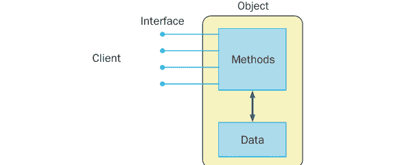

图 4.5 客户端与对象的方法交互

## 第 4 章 编写类

在 Java 中，我们使用修饰符来实现对象的封装。修饰符是 Java 的预留字，用于指定编程语言构造的特定特性。在第 2 章中，我们讨论了 `final` 修饰符，它用于声明常量。Java 有多种可以以各种方式使用的修饰符。某些修饰符可以组合，但某些组合是无效的。我们将在书中适当的位置讨论各种 Java 修饰符，所有修饰符都总结在附录 E 中。

### 可见性修饰符

某些 Java 修饰符被称为可见性修饰符，因为它们控制对类成员的访问。`public` 和 `private` 留字是可见性修饰符，可以应用于类的变量和方法。如果类成员具有 `public` 可见性，则可以从对象外部直接引用。如果类成员具有 `private` 可见性，则可以在类定义的任何地方使用，但不能从外部引用。第三种可见性修饰符 `protected` 只在继承的上下文中相关。我们将在第 9 章讨论这一点。

> **核心概念** 实例变量应该声明为 `private` 可见性以促进封装。

`public` 变量违反了封装。它们允许定义该类的外部代码进入并访问或修改数据的值。因此，实例数据应该定义为 `private` 可见性。声明为 `private` 的数据只能通过类的方法访问。

方法的可见性取决于该方法的目的。为客户端提供服务的方法必须声明为 `public` 可见性，以便客户端调用它们。这些方法有时被称为服务方法。`private` 方法不能从类外部调用。`private` 方法的唯一目的是帮助类的其他方法完成其工作。它们有时被称为支持方法。

图 4.6 中的表格显示了 `public` 和 `private` 可见性对变量和方法的影响。

给常量赋予 `public` 可见性通常是可以接受的，因为尽管可以直接访问它们的值，但由于它们是使用 `final` 修饰符声明的，它们不能被更改。记住，封装意味着数据值不应被代码的任何其他部分更改。由于常量根据定义是不可变的，因此封装在很大程度上没有意义。

UML 类图可以通过在类成员前加上特定的字符来显示类成员的可见性。具有 `public` 可见性的成员前加加号（`+`），具有 `private` 可见性的成员前加减号（`-`）。

### 表 4.6 `public` 和 `private` 可见性的影响

| | `public` | `private` |
|---|---|---|
| 变量 | 违反封装 | 强制封装 |
| 方法 | 为客户端提供服务 | 支持类中的其他方法 |

### 访问器和变异器

由于实例数据通常被声明为 `private` 可见性，类通常提供访问和修改数据值的服务。像 `getValue` 这样的方法被称为访问器方法（accessor method），因为它提供了对特定值的只读访问。同样，像 `setValue` 这样的方法被称为变异器方法（mutator method），因为它改变了该值。

> **核心概念** 大多数对象包含访问器和变异器方法，允许客户端以控制的方式管理数据。

通常，访问器名称采用 `getX` 的形式，其中 `X` 是它提供访问的值。同样，变异器名称具有 `setX` 的形式，其中 `X` 是它们正在设置的值。因此，这些类型的方法有时被称为“getters”和“setters”。

例如，如果一个类包含实例 `height`，它可能还包含方法 `getHeight` 和 `setHeight`。这种命名约定将方法名中使用的变量的首字母大写，这与通常方法的编写方式是一致的。

某些方法可能作为其主要目的的副作用提供访问器和/或变异器方法。例如，`Die` 类的 `roll` 方法更改了骰子的值并返回新值。因此，`roll` 也是一个变异器。

注意，`roll` 方法的代码仔细地将骰子的面值保持在有效范围内（1 到 `MAX`）。服务方法必须仔细设计，仅允许适当的访问和有效的更改。这指出了 `Die` 类设计中的一个缺陷：`setValue` 方法没有限制——客户端可以使用它将骰子值设置为 20 这样的数字，这超出了有效范围。`setValue` 方法的代码应该只允许对骰子的面值进行有效修改。我们将在下一章探讨如何实现这种控制。

## 自测习题（答案见附录 N）

- SR 4.11 对象应该是自管理的。请解释。
- SR 4.12 对象的接口是什么？
- SR 4.13 什么是修饰符？
- SR 4.14 为什么给常量 `public` 可见性？
- SR 4.15 描述以下各项：
    - `public` 方法
    - `private` 变量
    - `private` 变量

## 4.4 方法的解剖

我们已经看到类由数据声明和方法声明组成。让我们更详细地检查方法声明。

如第 1 章所述，方法是一组被命名的编程语言语句。方法声明指定了在调用方法时执行的代码。Java 程序中的每个方法都是特定类的一部分。

当方法被调用时，控制流将转移到该方法。方法的语句被逐条执行。当方法完成后，控制返回到调用发生的位置并继续执行。

被调用的方法（被触发的方法）可能与需要它的调用方法属于同一个类。图 4.7 显示了跟随方法调用的控制流。

### 方法声明


### 参数


一个方法由可选修饰符定义，后面是返回类型（`Type`），然后是确定方法名的标识符（`Identifier`），接着是参数列表，最后是方法体（`Body`）。返回类型指示将返回的值类型，体由大括号表示。异常子句（`Throws Clause`）是可选的，表示方法可能抛出的异常。示例：

```java
public void instructions(int count) {
    System.out.println("Follow all instructions.");
    System.out.println("Use more than " + count + " turns.");
}
```


### return 语句

在方法头中指定的返回类型可以是基本类型、类名或预留字 `void`。当方法不返回值时，使用 `void` 作为返回类型，正如 `main` 方法中总是所做的那样。`Die` 类的 `setFaceValue` 也有 `void` 返回类型。

有返回的方法必须有一个 `return` 语句。控制立即返回到调用方法，处理继续。`return` 语句后面跟着表达式决定了要返回的值。返回表达式必须与方法头中的返回类型一致。

`Die` 类的 `getFaceValue` 方法返回一个 `int`，代表当前值。`roll` 方法也是如此，返回刚刚设置 `faceValue` 的新值。`toString` 方法返回一个 `String` 对象。

不返回值的方法通常不包含 `return` 语句。当到达方法结束时，方法会自动返回到调用方法。此类方法可以包含没有表达式的 `return` 语句。

在方法中使用多个 `return` 语句通常不是良好的做法，尽管这样做是可以的。通常方法应该在最后一行有一个 `return` 语句，除非这会让方法变得过于复杂。

从方法返回的值可以在调用方法中被忽略。例如，在 `RollingDice` 类的 `main` 方法中，`roll` 方法在某些调用中被忽略，而在另一些调用中，其返回值被用于计算。

构造函数没有返回类型（即使是 `void` 也没有），因此不能返回值。我们将在章稍后的部分详细讨论构造函数。

一个 `return` 语句由 `return` 预留字加上一个可选的表达式组成。执行时，控制立即返回到调用方法，由表达式定义的值。示例：

```java
return;
return distance * 4;
```

### 参数

如第 2 节所述，参数是在方法被调用时传递到方法的值。方法头中的参数列表指定了所传递的值的类型，以及被调用方法引用这些值的名称。

方法声明头中的参数名称称为**形式参数**（formal parameters）。在调用时，传递到方法的值称为**实际参数**（actual parameters）。实际参数也称为方法的参数（arguments）。

方法的调用和定义总会在方法后的括号中给出参数列表。如果没有参数，则使用空括号，如 `roll` 和 `getFaceValue` 方法所示。`Die` 构造函数不接受任何参数，尽管构造函数通常接受参数。

形式参数作为方法内部的变量，其初始值来自调用中的实际参数。当方法被调用时，每个实际参数的值会被复制并存储在相应的形式参数中。实际参数可以是字面量、变量或完整的表达式。如果使用表达式作为实际参数，它在方法调用之前会被完全求值，并作为参数传递。

`Die` 类中唯一接受参数的方法是 `setFaceValue` 方法，它接受一个简单的 `int` 形式参数，名称为 `value`。在 `main` 方法中，值 `4` 作为实际参数传递给它。

调用和方法声明中的参数列表必须匹配。例如，第一个实际参数的值被复制到第一个形式参数中，第二个实际参数复制到第二个形式参数，以此类推，如图 4.8 所示。实际参数的类型必须与形式参数指定的类型一致。

关于参数传递的其他细节将在第 7 节中讨论。

> **核心概念** 当方法被调用时，实际参数被复制到形式参数中。

### 本地数据

如本章前面的描述，变量或常量的作用域是程序中可以对其变量进行有效引用的部分。可以在方法内部声明变量，使其成为本地数据而非实例数据。记住，实例数据是在类中声明的，而不是某个特定方法。

局部数据的作用域仅限于其定义所在的方法。在 `Die` 类的 `toString` 方法中声明的变量 `result` 是本地数据。对它的任何引用都不会导致其他错误信息。例如，本地变量和实例数据是在其定义的方法中声明的。另一方面，实例数据的作用域是整个类；类的任何方法都可以引用它。

> **核心概念** 在方法中声明的变量是该方法的局部变量，不能在方法外部使用。

由于本地数据和实例数据在不同的作用域级别运行，因此可以在方法内部声明一个与类级别声明的实例同名的本地变量。在方法中引用该名称将引用该变量的本地版本。这种做法显然可能会误导阅读代码的人，因此应该避免。

方法头中的形式参数名称充当该方法的本地数据。它们在方法被调用之前并不存在，并在方法退出时消失。例如，`setFaceValue` 方法中的形式参数 `value` 在方法被调用时产生，在方法执行完毕时消失。

```java
ch = obj.calc(25, count, "Hello");
```

```java
char calc(int num1, int num2, String message) {
    int sum = num1 + num2;
    char result = message.charAt(sum);
    return result;
}
```

图 4.8 从方法调用到声明的参数传递

## 银行账户示例

让我们看看另一个类及其使用的示例。列表 4.3 显示的 `Transactions` 类包含一个 `main` 方法，该方法创建了几个 `Account` 对象并调用了它们的服务。

### 列表 4.3

```java
// Transactions.java      Author: Lewis/Loftus
//
// 展示多个 Account 对象的创建和使用。
//********************************************************************
public class Transactions {
    //-----------------------------------------------------------------
    // 创建银行账户并请求各种服务。
    //-----------------------------------------------------------------
    public static void main(String[] args) {
        Account acct1 = new Account("Ted Murphy", 72354, 102.56);
        Account acct2 = new Account("Jane Smith", 69713, 40.00);
        Account acct3 = new Account("Edward Demsey", 93757, 759.32);

        acct1.deposit(25.85);

        double smithBalance = acct2.deposit(500.00);
        System.out.println("Smith balance after deposit: " + 
            smithBalance);

        System.out.println("Smith balance after withdrawal: " + 
            acct2.withdraw(430.75, 1.50));

        acct1.addInterest();
        acct2.addInterest();
        acct3.addInterest();
    }
}
```

### 输出

```text
Smith balance after deposit: $540.00
Smith balance after withdrawal: $67.75
```

| acctNumber | 72354 | 69713 | 93757 |
|---|---|---|---|
| balance | 102.56 | 40.00 | 759.32 |
| name | "Ted Murphy" | "Jane Smith" | "Edward Demsey" |
| object | acct1 | acct2 | acct3 |

对账户进行交易，根据参数调整余额。还有一个 `addInterest` 方法，它通过加上赚取的利息来更新余额。这些方法代表了更改余额的有效方式，因此没有提供如 `setBalance` 这样经典的修改器（mutator）。

在 `Transactions` 程序中，三个 `Account` 对象在刚创建后的状态可以描述如上表所示。

更新账户余额的各种方法可以设计得更严谨。应该进行检查以确保参数值有效，例如防止提取负数金额（这本质上是存款）。这一处理将在下一章中讨论。

# 自测习题（答案见附录 N）

- SR 4.16 为什么通过特定对象（或在特定对象上）调用方法？该规则的例外是什么？
- SR 4.17 方法返回一个值意味着什么？


- SR 4.18 `return` 语句的作用是什么？

- SR 4.19 需要 `return` 语句吗？

# 4.5 重温构造函数

- SR 4.20 解释实际参数（actual parameter）和形式参数（formal parameter）之间的区别。

- SR 4.21 为 `Die` 类编写一个名为 `getFaceDown` 的方法，返回骰子当前的“朝下”值。提示：在标准骰子上，任意两个相对面的之和为七。

- SR 4.22 在 Transactions 程序中：
    - a. 创建了多少对象？
    - b. 当在 `acc2` 对象上调用 `withdraw` 方法时，传递了多少参数（实际参数）？
    - c. 当在 `acc3` 对象上调用 `addInterest` 方法时，传递了多少参数（实际参数）？

- SR 4.23 你会将哪些 `Account` 方法归类为访问方法（accessor methods）？修改方法（mutator methods）？服务方法（service methods）？

如第 2 章所述，构造函数类似于在对象实例化时被调用的方法。当我们定义一个类时，通常会定义一个构造函数来帮助设置该类。特别是我们经常使用构造函数来初始化与每个对象相关的变量。

构造函数与普通方法有两不同之处。首先，构造函数的名称与类相同。因此，`Die` 类的构造函数名为 `Die`，`Account` 类的构造函数名为 `Account`。其次，构造函数不能返回值，且在方法头中没有指定返回类型。

> 核心概念
>
> 构造函数不能有任何返回类型，即使是 `void` 行。

程序员犯的一个常见错误是在构造函数上使用 `void` 类型。对于编译器来说，在构造函数上放置任何返回类型（即使是 `void`）都会将其变成一个恰好被当作构造函数调用的普通方法。这会导致有时难以理解的错误信息。

通常，构造函数用于初始化新实例化的对象。例如，`Die` 类的构造函数最初将骰子的面值设为 1。`Account` 类的构造函数将实例变量的值设置为传入构造函数的参数值。

我们不需要为每个类都定义构造函数。每个类都有一个不带参数的默认构造函数。如果我们提供自己的构造函数，就会使用默认构造函数。这个默认构造函数通常对新创建的对象没有影响。

- 自测习题（答案见附录 N）

- SR 4.24 构造函数是做什么的？

- SR 4.25 构造函数是如何定义的？

# 4.6 图形对象

某些对象具有图形表示，这意味着它们的状态和行为包含了关于对象视觉外观的信息。例如，图形对象可能包含关于其尺寸和颜色的数据，并可能包含绘制它的方法。

在第 3 章中，我们实例化并使用了框架（frames）、面板（panels）和图像等图形组件。这些组件确实被认为是图形对象。本节将更详细地检查其中一些对象，以及如何定义具有图形特征的对象。

列表 4.5 中的程序显示了一个笑脸和一个文本标题。然而，`SmileyClass` 中的 `main` 方法并没有处理所有这些对象。`main` 方法设置了程序的框架，并用它显示 `SmileyFacePanel` 类的实例化。

列表 4.6 显示了 `SmileyFacePanel` 类。它定义了两个绘图所需的常量（`BASEX` 和 `BASEY`）、一个设置面板键的构造函数，以及一个名为 `paintComponent` 的方法，用于绘制程序执行时我们看到的脸。在这种情况下，我们不是向面板中添加 GUI 组件，而是在上面绘图。

注意 `SmileyFacePanel` 类继承了 `JPanel` 类。正如我们在第 2 章讨论 applet 时提到的，`extends` 建立了继承关系。`SmileyFacePanel` 类继承了 `JPanel` 类的特性。也就是说，一个 `SmileyFacePanel` 就是一个 `JPanel`。到目前为止，你真正需要了解关于继承的内容将在第 9 章详细讨论。

`SmileyFacePanel` 类的构造函数设置了面板的背景颜色和首选尺寸，还设置了面板的大小。

```java
page.drawArc(BASEX+35, BASEY+40, 15, 10, 180, 180); // 鼻子
page.drawArc(BASEX+20, BASEY+50, 40, 15, 180, 180); // 嘴
```

`paintComponent` 方法接受一个 `Graphics` 对象作为参数，正如第 2 章所讨论，该对象代表组件的图形上下文。通过对面板的图形上下文（即 `page` 参数）调用方法，可以在面板上进行绘图。

每个 `JPanel` 都有一个自动被调用的绘制面板的 `paintComponent` 方法。在这种情况下，我们扩展了 `paintComponent` 的定义——告诉它除了绘制面板背景，还应该绘制由 `paintComponent` 方法中各种调用所定义的脸部和文字。`paintComponent` 方法的第一行是对类 `super.paintComponent` 的调用，它代表了标准的 `JPanel` 版本的 `paintComponent` 方法，负责处理背景绘制。我们几乎总是将其作为 `paintComponent` 方法中的第一行代码。

让我们来看另一个示例。列表 4.7 显示的 `Splat` 类包含一个 `main` 方法，用于创建并显示程序的框架。从视觉上看

# 列表 4.7

```java
********************************************************************************************************************
// Splat.java               Author: Lewis/Loftus
// 演示图形对象的使用。
********************************************************************************************************************

import javax.swing.*;
import java.awt.*;

public class Splat
{
```

# 第 4 章 编写类

# 列表 4.7 续

```java
//
// 展示一组圆。
//
public static void main(String[] args)
{
    JFrame frame = new JFrame("Splat");
    frame.setDefaultCloseOperation(JFrame.EXIT_ON_CLOSE);

    frame.getContentPane().add(new SplatPanel());
    frame.pack();
    frame.setVisible(true);
}
```

# 显示

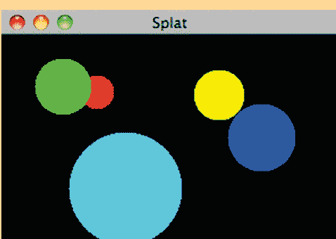

程序只是绘制了几个实心圆。这个程序有趣的地方不在于它做了什么，而在于它是如何实现的——这个程序中绘制的每个圆都由它自己的对象表示。

`main` 方法实例化了一个 `SplatPanel` 对象并将其添加到框架中。`SplatPanel` 类如列表 4.8所示。与上一个示例中的 `SmilingFace` 类一样，`SplatPanel` 类继承自 `JPanel`。它持有五个 `Circle` 对象的实例数据，这些对象是在构造函数中实例化的。

## 4.6 图形对象

# 列表 4.8

```java
****************************************************************
// SplatPanel.java      Author: Lewis/Loft
// 演示图形对象的使用。
****************************************************************

import java.swing.*;
import java.awt.*;

public class SplatPanel extends JPanel
{
    private Circle circle1, circle2, circle3, circle4, circle5;

    // 构造函数：创建五个 Circle 对象。
    public SplatPanel() {
        circle1 = new Circle(30, Color.red, 70, 35);
        circle2 = new Circle(50, Color.green, 30, 20);
        circle3 = new Circle(100, Color.cyan, 60, 85);
        circle4 = new Circle(45, Color.yellow, 170, 30);
        circle5 = new Circle(60, Color.blue, 200, 60);
    }

    setPreferredSize(new Dimension(300, 200));
    setBackground(Color.black);

    // 通过请求每个圆绘制自己来绘制此面板。
    public void paintComponent(Graphics page) {
        super.paintComponent(page);

        circle1.draw(page);
        circle2.draw(page);
        circle3.draw(page);
        circle4.draw(page);
        circle5.draw(page);
    }
}
```

# 第 4 章 编写类

`SplatPanel` 类中的 `paintComponent` 方法通过调用每个圆的 `draw` 方法来绘制面板。本质上，`SplatPanel` 类是每个圆去绘制自己。

`Circle` 类如列表 4.9所示。它定义了实例数据来存储圆的大小、其 (x, y) 位置以及颜色。这些值通过构造函数设置，该类包含了所有适当的访问器（accessor）和修改器（mutator）方法。`Circle` 类的 `draw` 方法根据其实例数据的值（其当前状态）简单绘制圆。

# 列表 4.9

```java
********************************************************************
// Circle.java Author: Lewis/Loftus
// 表示具有特定位置、大小和颜色的圆。
********************************************************************

import java.awt.*;

public class Circle {
    private int diameter, x, y;
    private Color color;

    //-------------------------------------------------------
    // 构造函数：用指定的值初始化此圆。
    //-------------------------------------------------------
    public Circle(int size, Color shade, int upperX, int upperY) {
        diameter = size;
        color = shade;
        x = upperX;
        y = upperY;
    }

    //-------------------------------------------------------
    // 在指定的图形上下文中绘制此圆。
    //-------------------------------------------------------
    public void draw(Graphics page) {
        page.setColor(color);
        page.fillOval(x, y, diameter, diameter);
    }
}
```

# 4.6 图形对象

# 列表 4.9 续

```java
    //-------------------------------------------------------
    // 直径的修改器。
    //-------------------------------------------------------
    public void setDiameter(int diameter) {
        diameter = diameter;
    }

    //-------------------------------------------------------
    // 直径的访问器。
    //-------------------------------------------------------
    public int getDiameter() {
        return diameter;
    }

    //-------------------------------------------------------
    // x 坐标的修改器。
    //-------------------------------------------------------
    public void setX(int x) {
        x = x;
    }

    //-------------------------------------------------------
    // x 坐标的访问器。
    //-------------------------------------------------------
    public int getX() {
        return x;
    }

    //-------------------------------------------------------
    // y 坐标的修改器。
    //-------------------------------------------------------
    public void setY(int y) {
        y = y;
    }

    //-------------------------------------------------------
    // y 坐标的访问器。
    //-------------------------------------------------------
    public int getY() {
        return y;
    }

    //-------------------------------------------------------
    // 颜色的修改器。
    //-------------------------------------------------------
    public void setColor(Color color) {
        color = color;
    }

    //-------------------------------------------------------
    // 颜色的访问器。
    //-------------------------------------------------------
    public Color getColor() {
        return color;
    }
}
```

## 第 4 章 类类

在某些方面，一旦你对事件驱动编程有了基本的理解，剩下的只是细节问题了。你可以使用许多类型的组件，它们会产生许多类型的你可能需要响应的事件。它们的工作原理基本都是相同的。它们之间也具有相同的核心关系。

接下来的章节将介绍更多的组件，并展示允许真实用户交互的基于 GUI 的程序。

+ 自测习题（答案请见附录 N）

SR 4.30 事件与监听器（listener）之间是什么什么关系？

SR 4.31 我们可以向任何组件添加任何类型的监听器吗？请解释。

## 4.8 按钮

列表 4.10 所示的 PushCounter 程序为用户提供了一个推送按钮（标记为“Push Me!”）。每当按钮按下时，计数器就会更新并显示。

### 列表 4.10


```java
// PushCounter.java               Author: Lewis/Loftus
//
// 展示了图形用户界面和事件监听器。

import javax.swing.JFrame;

public class PushCounter {
    // 创建主程序框架。
    public static void main(String[] args) {
        JFrame frame = new JFrame("Push Counter");
        frame.setDefaultCloseOperation(JFrame.EXIT_ON_CLOSE);
        frame.getContentPane().add(new PushCounterPanel());
        frame.pack();
        frame.setVisible(true);
    }
}
```

### 显示


该程序使用的组件包括一个按钮、一个用于显示计数的标签、一个组织 GUI 的面板以及一个用于显示面板的框架。面板由 `PushCounterPanel` 类定义，如列表 4.11 所示。

推送按钮是一种允许用户通过点击鼠标来启动操作的组件。我们将在后面的章节中探索其他类型的按钮组件。推送按钮由 `JButton` 类定义。

### 列表 4.11

```java
// PushCounterPanel.java      Author: Lewis/Loftus
// 展示了图形用户界面和事件监听器。

import java.awt.*;
import java.awt.event.*;
import javax.swing.*;

public class PushCounterPanel extends JPanel {
    private int count;
    private JButton push;
    private JLabel label;

    // 构造函数：设置 GUI。
    public PushCounterPanel() {
        count = 0;

        push = new JButton("Push Me!");
        push.addActionListener(new ButtonListener());

        label = new JLabel("Pushes: " + count);
        add(push);
        add(label);

        setSize(new Dimension(300, 40));
        setBackground(Color.cyan);
    }

    // 代表按钮按下（动作）事件的监听器。
    private class ButtonListener implements ActionListener {
        // 当按钮按下时更新计数器和标签。
        public void actionPerformed(ActionEvent event) {
            count++;
            label.setText("Pushes: " + count);
        }
    }
}
```

`PushCounterPanel` 构造函数设置了 GUI。调用 `JButton` 构造函数接受一个 `String` 参数，指定显示在按钮上的文本。按钮和标签被添加到面板中。

该程序中唯一感兴趣的事件发生在按钮被按下时。为了响应该事件，我们必须为该事件创建一个监听器对象，因此我们必须编写一个表示监听器的类。

`JButton` 在被按下时会产生一个动作事件。因此，我们写的监听器类将是一个动作监听器。在程序中，我们定义了一个名为 `ButtonListener` 的类来表示此事件的监听器。

我们可以将 `ButtonListener` 写在单独的文件中，甚至与 `PushCounterPanel` 类在同一个文件中。然而，我们必须设置一种监听器与监听器要更新的 GUI 组件之间通信的方法。相反，我们将 `ButtonListener` 定义为内部类，即定义在另一个类内部的类。这样，它就可以自动访问其所在类的成员。只有当两个类之间存在紧密关系，且内部类不会被任何其他类访问时，你才创建内部类。监听器与其 GUI 之间的关系是使用内部类的少数适用情况之一。

## 核心概念

监听器通常被定义为内部类，是因为监听器与 GUI 组件之间存在紧密的关系。

监听器类通过实现接口来编写，接口是实现类必须定义的方法列表。Java 标准库包含许多类型事件的接口。动作监听器是通过实现 `ActionListener` 接口创建的；因此我们在 `ButtonListener` 类中包含了 `implements` 子句。接口将在第 7 章进行更详细的讨论。

`ActionListener` 接口中唯一的方法是 `actionPerformed` 方法，因此这是 `ButtonListener` 必须实现的唯一方法。产生动作事件的组件（在本例中为按钮）将调用 `actionPerformed` 方法。

### 自测习题（答案请见附录 N）

**SR 4.32** 推送按钮（`JButton`）产生什么类型的事件？

**SR 4.33** 你如何修改 `PushCounterPanel`，使其不再显示按钮按下的次数计数，而是显示“0”？按下一次后显示“01”，按下两次后显示“02”？

## 4.9 文本字段

让我们看看另一个使用组件的示例：文本字段。列表 4.12 所示的 `Fahrenheit` 程序展示了一个 GUI，其中包含一个文本字段，用户可以在其中输入华氏温度。当用户按下 Enter（或 Return）键时，将显示相应的摄氏度温度。

`Fahrenheit` 程序的接口在 `FahrenheitPanel` 类中设置。文本字段是 `JTextField` 类的对象。`JTextField` 接受一个整数参数，根据当前字体指定字段的大小。

文本字段和各种标签被添加到面板中。记住，面板由一种称为流布局的布局管理器控制，它将组件放置在一行中。因此，如果你调整框架大小，标签和文本字段的布局可能会改变。我们将在第 7 章详细研究布局管理器，为组件布局提供更多选项。

如果光标当前位于文本字段内，当按下 Enter 或 Return 键时会发生动作事件。我们需要设置监听器对象来响应动作事件。正如我们在上一节的 `PushCounter` 程序中所做的那样，我们将监听器定义为实现 `ActionListener` 接口的内部类。

按下 Enter 键时，文本字段组件会调用 `actionPerformed` 方法。该方法通过调用 `getText` 方法从文本字段获取文本，该方法返回一个字符字符串。使用 `Integer` 包装类的 `parseInt` 方法将文本转换为整数。然后方法执行计算以确定相应的摄氏度温度，并将结果设置为相应标签的文本。

注意，推送按钮和文本字段产生相同事件：动作事件。`Fahrenheit` 程序设计的另一种替代方案是在 GUI 中添加一个 `JButton` 对象，当用户使用鼠标点击按钮时触发转换。事实上，同一个监听器对象可以用于同时监听多个组件。因此，监听器可以同时添加到文本字段和按钮上，给用户提供选择。按下按钮或回车键都会执行转换。这些变体被留作编程项目。

### 列表 4.12

```java
// Fahrenheit.java      Author: Lewis/Loftus
// 演示了文本字段的使用。

import javax.swing.JFrame;

public class Fahrenheit {
    // 创建并显示温度转换器 GUI。
    public static void main(String[] args) {
        JFrame frame = new JFrame("Fahrenheit");
        frame.setDefaultCloseOperation(JFrame.EXIT_ON_CLOSE);

        FahrenheitPanel panel = new FahrenheitPanel();
        frame.getContentPane().add(panel);
        frame.pack();
        frame.setVisible(true);
    }
}
```

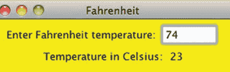

### 列表 4.13

```java
// FahrenheitPanel.java      Author: Lewis/Loftus
//
// 演示了文本字段的使用。

import java.awt.*;
import java.awt.event.*;
import javax.swing.*;

public class FahrenheitPanel extends JPanel {
    private JLabel inputLabel, outputLabel, resultLabel;
    private JTextField fahrenheit;

    // 构造函数：设置主 GUI 组件。
    public FahrenheitPanel() {
        inputLabel = new JLabel("Enter Fahrenheit temperature:");
        outputLabel = new JLabel("Temperature in Celsius: ");
        resultLabel = new JLabel("-----");

        fahrenheit = new JTextField(5);
        fahrenheit.addActionListener(new TempListener());

        add(inputLabel);
        add(fahrenheit);
        add(outputLabel);
        add(resultLabel);

        setPreferredSize(new Dimension(300, 75));
        setBackground(Color.yellow);
    }

    // 代表温度输入字段的动作监听器。
    private class TempListener implements ActionListener {
        // 当在文本字段中按下回车键时执行转换。
        public void actionPerformed(ActionEvent event) {
            int fahrenheitTemp, celsiusTemp;

            String text = fahrenheit.getText();

            fahrenheitTemp = Integer.parseInt(text);
            celsiusTemp = (fahrenheitTemp - 32) * 5 / 9;

            resultLabel.setText(Integer.toString(celsiusTemp));
        }
    }
}
```

### 自测习题（答案见附录 N）

- **SR 4.34** 描述当用户在文本字段中输入数字并按下回车键时，`Fahrenheit` 程序内部发生了什么。

- **SR 4.35** 修改 `FahrenheitPanel` 类，使得当用户在文本字段中输入数字时，文本字段下方会出现类似“X 度华氏度 = Y 度摄氏度”的语句。例如，如果用户输入 223，则显示“223 度华氏度 = 106 度摄氏度”，而不是“Temperature in Celsius: 106”。

## 核心概念总结

- 面向对象编程的核心是表示具有良好状态和行为对象的类。
- 变量的作用域决定了它可以在哪里被引用，取决于它声明的位置。
- UML 类图帮助我们可视化程序中类的内容以及类之间的关系。
- 对象应该被封装，保护其数据免受不当的访问。
- 实例变量应该声明为 `private` 可见性，以促进封装。
- 大多数对象使用访问器和变更器方法来允许客户端以受控的方式管理数据。
- 方法返回的值必须与方法头中指定的返回类型一致。
- 当调用方法时，实际参数会被复制到形式参数中。
- 在方法中声明的变量是该方法的局部变量，不能在外部使用。
- 构造函数不能有任何返回值，即使是 `void`。
- GUI 由组件、代表用户操作的事件以及响应这些事件的监听器组成。
- 监听器通常被定义为内部类，因为监听器与 GUI 组件之间存在紧密的关系。

## 练习题

对于以下每一对，哪一个代表类，哪一个代表该类的对象？

a. `Superhero`, `Superman`
b. `Justin`, `Person`
c. `Rover`, `Pet`
d. `Magazine`, `Time`
e. `Christmas`, `Holiday`

## 编程项目

- **EX 4.2** 为一个表示画框的 `PictureFrame` 类列出可能定义的属性和操作。
- **EX 4.3** 为一个表示业务会议的 `Meeting` 类列出可能定义的属性和操作。
- **EX 4.4** 为一个表示大学课程的 `Course` 类（不是特定的某门课程，只是泛指的课程）列出可能定义的属性和操作。
- **EX 4.5** 编写一个 `lyrics` 方法，在调用时打印歌词。该方法不接受任何参数和返回值。
- **EX 4.6** 编写一个 `lyrics` 方法，在调用时打印歌词。该方法不接受任何参数和返回值。
- **EX 4.7** 编写一个 `cube` 方法，接受一个参数并返回该数值的立方。
- **EX 4.8** 编写一个 `random` 方法，接受两个参数并返回范围内的整数。
- **EX 4.9** 编写一个 `randomColor` 方法，通过三个 RGB 值创建并返回 `Color` 对象。
- **EX 4.10** 假设有一个 `Movie`。编写一个初始化 `title` 和 `director` 实例变量的构造函数。
- **EX 4.11** 假设有一个带有 `age` 数据的 `Child`。为 `age` 编写 getter 和 setter 方法。
- **EX 4.12** 绘制显示 `Transactions` 类之间关系的 UML 图。
- **EX 4.13** 绘制显示 `PushCounter` 类之间关系的 UML 图。
- **EX 4.14** 绘制显示 `Fahrenheit` 程序类关系的 UML 图。

## 编程项目

- **PP 4.1** 编写一个 `Counter` 类，用于计算进入房间的人。`Counter` 类应包含一个整数作为计数。编写一个构造函数将计数初始化为零。编写一个 `click` 方法增加计数，以及另一个 `getCount` 方法返回当前计数。包含一个 `reset` 方法将计数重置为零。最后，创建一个 `CounterTest` 驱动类，创建两个 `Counter` 对象并测试它们的方法。
- **PP 4.2** 编写一个 `Bulb` 类，代表可以开启和关闭的灯泡。创建一个 `Lights` 驱动类，在其 `main` 方法中实例化并开启一些 `Bulb` 对象。


- PP 4.3 编写一个 `Sphere` 类，包含表示球直径的实例数据。定义 `Sphere` 构造函数接受并初始化直径，并包括直径的 getter 和 setter 方法。包含计算并返回球体积和表面积的方法（公式见 PP 3.6）。包含一个 `toString` 方法返回球的单行描述。创建一个 `MultiSphere` 驱动类，在其 `main` 方法中实例化并更新多个 `Sphere` 对象。

- PP 4.4 编写一个 `Dog` 类，包含表示狗的名称和年龄的实例数据。定义构造函数接受并初始化实例数据。为名称和年龄编写 getter 和 setter 方法。包含一个计算并返回狗的“人年”的方法（年龄乘以七）。包含一个 `toString` 方法返回狗的单行描述。创建一个 `Kennel` 驱动类，在其 `main` 方法中实例化并更新多个 `Dog` 对象。

- PP 4.5 编写一个 `Car` 类，包含表示汽车品牌、型号和年份的实例数据。定义 `Car` 构造函数初始化这些值。为所有实例数据编写 getter 和 setter 方法，并包含一个 `toString` 方法返回汽车的单行描述。添加一个 `isAntique` 方法，返回一个布尔值表示汽车是否为古董（如果超过 45 年）。创建一个 `CarTest` 驱动类，在其 `main` 方法中实例化并更新多个 `Car` 对象。

# 编程项目

编写一个 `Box` 类，包含表示箱子高度、宽度和深度的实例数据。还包含一个名为 `full` 的布尔变量作为实例数据，用于表示箱子是否满了。定义 `Box` 构造函数以接受并初始化箱子的高度、宽度和深度。每个新创建的 `Box` 都是空的（构造函数应将 `full` 初始化为 `false`）。为所有实例数据包含 getter 和 setter 方法。包含一个 `toString` 方法，返回对箱子的单行描述。创建一个名为 `BoxTest` 的驱动类，其 `main` 方法将实例化并更新多个 `Box` 对象。

PP 4.6 编写一个 `Book` 类，包含标题、作者、出版商和版权日期的实例数据。定义 `Book` 构造函数以接受并初始化这些数据。为所有实例数据包含 getter 和 setter 方法。包含一个 `toString` 方法，返回一个格式良好的、多行的书的描述。创建一个名为 `Bookshelf` 的驱动类，其 `main` 方法将实例化并更新多个 `Book` 对象。

PP 4.7 编写一个 `Flight` 类，代表一次航空公司航班。它应该包含代表航空公司名称、航班号以及航班起飞地和目的城市的实例数据。定义 `Flight` 构造函数以接受并初始化所有实例数据。为所有实例数据包含 getter 和 setter 方法。包含一个 `toString` 方法，返回对航班的单行描述。创建一个名为 `FlightTest` 的驱动类，其 `main` 方法将实例化并更新多个 `Flight` 对象。

PP 4.8 使用本章定义的 `Die` 类，编写一个由两个 `Die` 组成的 `PairOfDice` 类。包含设置和获取单个骰子值的方法、一个投掷骰子的方法，以及一个返回两个骰子值当前总和的方法。创建一个名为 `RollingDice` 的驱动类来实例化并使用 `PairOfDice`。

PP 4.9 编写一个 `Building` 类，代表建筑的图形化描述。允许构造函数的参数来指定建筑的宽度和高度。每个建筑都应该涂成黑色，并包含几个随机分布的黄色窗户。创建一个绘制随机建筑天际线的程序。

PP 4.10 编写一个显示晚宴座位图的程序。创建一个名为 `Diner` 的类（指就餐的人），用于存储人的姓名、性别和在餐桌上的位置。`Diner` 在图形上表示为一个圆圈，根据性别进行颜色编码，并在圈内打印人的名字。

# 第4章 编写类

PP 4.12 创建一个名为 `Crayon` 的类，代表特定颜色和长度（高度）的蜡笔。编写一个绘制一盒蜡笔的程序。

PP 4.13 创建一个名为 `Star` 的类，代表一个五角星。让构造函数接受星星的宽度和星星顶点的坐标。编写一个绘制包含各种尺寸星星的天空程序。

PP 4.14 修改本章的华氏温度程序，使其显示一个按钮，按下该按钮时也允许进行计算。也就是说，用户现在可以选择在文本字段中按回车键，也可以按下按钮。让已经为文本字段定义的监听器也监听按钮的按下。

PP 4.15 编写一个向用户显示按钮和标签的应用程序。每当按钮被按下时，标签应该显示一个 1 到 100 之间的随机数。

PP 4.16 编写一个向用户展示两个按钮和一个标签的应用程序。标签分别标记为 Increment（增加）和 Decrement（减小）。使用标签显示一个数值（初始值为 50）。每当点击增加按钮时，增加所显示的值。同样，每当点击减小按钮时，减少所显示的值。

PP 4.17 编写一个绘制交通灯并使用按钮来改变灯光状态的应用程序。从 `JPanel` 类派生绘制表面，并使用另一个面板来组织绘制表面和按钮。

PP 4.18 开发一个实现用于编写电子邮件消息的原型用户界面程序。应用程序应该具有用于 To、CC 和 Bcc 地址列表以及主题行的文本字段，以及一个标记为 Send（发送）的消息正文字段。当 Send 按钮被按下时，程序应使用 `println` 语句将所有字段的内容打印到标准输出。

# 软件失败

# 丹佛机场行李处理系统

## 发生了什么？

丹佛国际机场的设计者对自动化行李处理有宏大的计划。凭借长达一英里的航站楼，他们希望开发出一种系统，以最小的人工干预，将行李从值机柜台运送到起飞的飞机，并从到达的飞机运送到行李提取处。他们认为该系统将导致更少的航班延误、更短的行李等待时间以及降低成本。


该系统于 20 世纪 80 年代后期和 90 年代初设计创建。建造了约 26 英里的轨道，在中央计算机的控制下通过灰色推车在坡道移动行李。然而，由于行李系统的故障，计划于 1994 年 3 月开放的机场不断推迟。在测试期间，行李被错载并掉进已经满的推车中，然后被卸到堵塞行李的传送带上。行李因卡在卡下或掉落在混凝土地上而破损。

- 丹佛的自动行李处理系统导致了行李丢失和包裹损坏。

该机场最终于 1995 年 2 月开放营业。到那时，只有一家航空公司——美国航空同意使用该自动系统。这是该系统的精简版本，仅用于离开航班。没有其他航空公司完全使用该系统。他们选择了由人工驾驶行李车。美国航空最终在 2005 年放弃了该系统。

# 原因是什么？

丹佛国际机场的惨剧被认为是历史上最大的软件工程和整体系统设计失败之一。有许多独立问题导致了这些结果，但总的来说，设计者对他们所使用的技术过度信任。单个问题包括软件误读了光电眼，因此没有检测到堆积的行李。当系统重启时，丢失了关于推车状态的信息，不知道哪些是满的。传送带的速度没有被正确考虑，导致推车溢出。一个被称为“舌头”的伸缩式传送带——设计用于进入飞机舱并提取行李而无需人工协助——完全失败了。

# 教训

如此规模的项目不可以在对使用的技术进行多次局部测试的情况下尝试。失败通常由于系统运行时多个变量引起的。

当该系统在 80 年代后期设计时，它依赖于中央主机来控制系统。这种方法在当今分布式处理的世界看来是荒谬的，但它是系统在开发时就过时的典型案例。今天，使用手持扫描仪的人工行李运送员比计划中自动系统的最佳目标更高效、准确的行李交付系统。

> 来源：《国际援报》

# 条件语句与循环

# 章节目标

- 定义通过方法的控制流。
- 探索可以用于决策的布尔表达式。
- 使用 `if` 语句执行基础决策。
- 讨论与某些数据类型比较的问题。
- 使用 `while` 循环重复执行语句。
- 讨论迭代对象的概念并使用它读取文本文件。
- 引入 `ArrayList` 类。
- 探索更多的 GUI 组件和事件。

所有编程语言都有允许你决定下一步做什么的语句。其中某些语句允许你重复执行某些活动。本章讨论了此类关键 Java 语句，并探讨与数据和对象比较相关的问题。它从布尔表达式开始，这是任何决策的基础。图形部分的章节探索了一些新的组件和事件。

## 5.1 布尔表达式

在运行程序中，语句执行的顺序被称为控制流。除非另有规定，程序的执行按线性方式进行。也就是说，运行中的程序从第一条编程语句开始，每次向下移动一条语句，直到程序完成。Java 应用从 `main` 方法的第一行开始，逐步执行，直到到达方法的末尾。

调用方法会改变控制流。当一个方法被调用时，控制将跳转到该方法定义的代码处。当方法完成后，控制返回到调用方法中执行调用的地方，并从那里继续处理。

在给定的方法内部，我们可以通过某些类型的编程语句来改变控制流。控制方法执行流的语句分为两类：条件语句和循环。

条件语句用于选择某条语句，因为它允许我们选择执行哪条语句。Java 中的条件语句包括 `if` 语句、`if-else` 语句和 `switch` 语句。本章将评估 `if` 语句和 `if-else` 语句，并在第6章介绍 `switch` 语句。

每个决策都基于一个布尔表达式（也称为条件），这是一个评估结果为 true 或 false 的表达式。表达式的结果决定了下一步执行哪条语句。以下是一个语句的示例：

```
if (count > 20)
System.out.println("Count exceeded");
```

此处的条件是 `count > 20`。该表达式评估为布尔值（true 或 false）。要么 `count` 中存储的值大于 20，要么不是。如果是，则执行 `println` 语句；如果不是，则跳过 `println` 语句并继续执行后续的任何代码。

在编程情况下，做出这种决策的需求无处不在。例如，人寿保险的成本可能取决于被保险人是否抽烟。如果该人抽烟，我们使用特定公式计算成本；如果不抽烟，我们使用另一个公式。条件语句的作用是评估布尔条件（该人是否抽烟），然后相应地执行相应的计算。

循环或重复语句允许我们反复执行某条编程语句。与条件语句一样，循环也基于布尔表达式，该表达式决定了语句执行的次数。

> 核心概念

循环允许程序多次执行某条语句。

例如，假设我们要计算班级中每个学生的平均绩点。每个学生的计算方法是相同的，但在不同的数据上执行。我们为每个学生的计算设置循环，直到没有更多学生需要处理为止。

Java 有三种类型的循环：`while` 语句、`do` 语句和 `for` 语句。每种语句类型都有与其他语句不同的独特特征。我们在本章中介绍 `while` 语句，并在第6章探索 `do` 循环和 `for` 循环。

条件和循环中的布尔表达式基于相等运算符、关系运算符和逻辑运算符来做出决策。在详细讨论条件和循环语句之前，让我们先探索这些运算符。

## 相等和关系运算符

`==` 和 `!=` 运算符是相等运算符。它们分别测试两个值是否相等。注意，相等运算符由两个相邻等号组成，不应与仅使用一个符号的赋值运算符混淆。

以下 `if` 语句仅在变量 `total` 和 `sum` 包含相同值时才打印句子：

```
if (total == sum)
   System.out.println("total equals sum");
```

同样，以下 `if` 语句仅在变量 `total` 和 `sum` 不包含相同值时才打印句子：

```
if (total != sum)
   System.out.println("total does NOT equal sum");
```

Java 还有几种关系运算符，允许我们决定值之间的顺序。在本节稍早之前，我们使用了大于运算符（`>`）来判断一个值是否大于另一个值。我们可以使用不同的运算符询问类似的问题。在 Java 中，关系运算符有大于 (`>`)、小于 (`<`)、大于等于 (`>=`) 和小于等于 (`<=`)。图 5.1 列出了 Java 的相等运算符和关系运算符。

## 第 5 章 条件语句和循环

| 运算符 | 含义 |
| --- | --- |
| == | 等于 |
| != | 不等于 |
| < | 小于 |
| <= | 小于等于 |
| > | 大于 |
| >= | 大于等于 |

图 5.1 Java 相等和关系运算符

相等和关系运算符的优先级高于算术运算。因此，首先评估算术运算，然后是相等和关系运算。一如既往，可以使用括号来指定评估顺序。

在我们在本章检查条件和循环语句的过程中，我们将看到更多关系运算符的示例。

## 逻辑运算符

除了相等和关系运算符外，Java 还有三种逻辑运算符。它们也接受布尔操作数。图 5.2 列出并描述了逻辑运算符。

`!` 运算符用于执行逻辑非操作，也称为逻辑取反。布尔值的逻辑取反产生相反的值。例如，如果一个名为 `found` 的布尔变量取值为 false，那么 `!found` 结果为 true。同样，如果 `found` 为 true，那么 `!found` 为 false。逻辑操作不会改变存储在 `found` 中的值。

逻辑操作可以通过真值表来描述，真值表列出了表达式中所用变量的所有可能组合。由于逻辑非运算符是一个一元运算符，其操作数只有两种可能的值：true 或 false。图 5.3 显示了描述 `!` 运算符的表格。

| 运算符 | 描述 | 示例 | 结果 |
| --- | --- | --- | --- |
| ! | 逻辑非 | ! a | a 为 false 结果为 true，a 为 true 结果为 false |
| && | 逻辑与 | a && b | a 和 b 均为 true 结果为 true，否则为 false |
| \|\| | 逻辑或 | a \|\| b | a 或 b 至少一个为 true 结果为 true，否则为 false |

图 5.2 Java 逻辑运算符

| a | !a |
|---|---|
| false | true |
| true | false |

图 5.3 逻辑非运算符的真值表

`&&` 运算符执行逻辑与操作。当两个操作数都为 true 时，结果为 true，否则为 false。逻辑或运算符 (`||`) 的结果是，当一个或另一个操作数为 true 时结果为 true，否则为 false。

与和或运算符都是二元运算符，每个使用两个操作数。因此，有四种可能的组合：两个操作数均为 true、均为 false、一个为 true 一个为 false 以及反之亦然。图 5.4 描绘了一个显示 `&&` 和 `||` 运算符的真值表。

逻辑非在三个逻辑运算符中优先级最高，其次是逻辑与，最后是逻辑或。

考虑以下 `if` 语句：

```
if (!done && count > MAX)
System.out.println("Completed.");
```

在什么情况下会执行打印语句？布尔变量 `done` 的值为 true 或 false，非运算符会反转该值。`count` 的值要么大于 `MAX`，要么不是。图 5.5 中的真值表分解了所有可能性。

`&&` 和 `||` 运算符的一个重要特性是它们是“短路的”。也就是说，如果它们的左操作数足以决定操作的布尔结果，则不评估右操作数。这种情况会发生在两种运算符中，并且对于不同的原因。如果 `&&` 运算符的左操作数为假，那么无论右操作数的值是什么，该操作的结果都为假。同样地，如果 `||` 运算符的左操作数为真，无论右操作数的值是什么，该操作的结果都是真。这被称为短路求值。

> 核心概念

逻辑运算符经常用于构建复杂的条件。

| a | b | a && b | a \|\| b |
|---|---|---|---|
| false | false | false | false |
| false | true | false | true |
| true | false | false | true |
| true | true | true | true |

图 5.4 逻辑与和逻辑或运算符的真值表

# 212 第 5 章 条件判断与循环

| done | count > MAX | !done | !done && (count > MAX) |
|---|---|---|---|
| false | false | true | false |
| false | true | true | true |
| true | false | false | false |
| true | true | false | false |

图 5.5 特定条件的真值表

有时，你可以利用操作具有短路特性的事实。例如，以下 `if` 语句中的条件如果左操作数为假，则不会尝试进行除以零的操作。如果 `count` 的值为 0，则 `&&` 运算符的左侧为假；因此，整个表达式为假，且右侧不会被求值。

```
if (count != 0 && total/count > MAX)
System.out.println("Testing.");
```

你应该仔细考虑是否依赖这些细微的编程语言特性。所有的编程语言的工作方式都相同。正如我们之前强调的，你应该优先考虑可读性，而不是巧妙的编程技巧。始终努力让代码的任何读者都能清楚你的程序逻辑是如何运作的。

# 自习题（答案见附录 N）

- SR 5.1 程序中的控制流是什么意思？
- SR 5.2 条件判断和循环是基于什么类型的条件的？
- SR 5.3 什么是相等运算符？什么是关系运算符？什么是逻辑运算符？
- SR 5.4 针对给定的以下声明，列出的每个布尔表达式的值分别是多少？

```
int value1 = 5, value2 = 10;
boolean done = true;
```

- a. `value1 <= value2`
- b. `(value1 + 5) >= value2`
- c. `value1 < value2 / 2`
- d. `value2 != value1`
- e. `!(value1 == value2)`
- f. `(value1 < value2) || done`
- g. `(value1 > value2) || done`
- h. `(value1 < value2) && done`
- i. `done || !done`
- j. `((value1 > value2) || done) && (!done || (value2 > value1))`

- SR 5.5 什么是真值表？
- SR 5.6 假设 `done` 是一个布尔变量，`value` 是一个 int 变量，为表达式创建一个真值表：


# 5.2 if 语句

我们在本章之前的示例中使用了基础的 `if` 语句。让我们详细探讨它。

一个 `if` 语句由单词 `if` 后面跟一个布尔表达式，然后是一个语句组成。条件被包含在括号中，并且必须为真或假。如果条件为真，则执行该语句并继续处理下一个语句。如果条件为假，则跳过该语句，并立即继续处理下一个语句。图 5.6 显示了这一过程。

考虑以下 `if` 语句的示例：

```java
if (total > amount)
    total = total + (amount + 1);
```

在这个示例中，如果 `total` 的值大于 `amount` 的值，则执行赋值语句；否则，跳过赋值语句。

注意，此示例中的赋值语句在 `if` 语句的标题行下缩进了。这传达出赋值语句是 `if` 语句的一部分；它意味着 `if` 语句控制了赋值语句是否会被执行。尽管这种缩进对人类读者来说极其重要，但编译器会忽略它。

> **核心概念**
>
> 适当的缩进对人类可读性非常重要；它显示了语句与语句之间的关系。

列表 5.1 中的示例读取了用户的年龄，并根据输入的年龄决定是否打印特定的句子。程序在所有情况下都会回显所输入的年龄值。如果年龄小于常量 `MINOR` 的值，则打印关于青少年的语句。如果年龄大于或等于 `MINOR` 的值，则跳过打印语句。在任何情况下，最后一句关于年龄是一种心态的句子都会被打印。

### 列表 5.1

```java
//********************************************************************
// Age.java           Author: Lewis/Loftus
// 演示了 if 语句的使用。
//********************************************************************
import java.util.Scanner;

public class Age {
    // --------------------
    // 读取用户的年龄并根据情况打印注释。
    // --------------------
    public static void main(String[] args) {
        final int MINOR = 21;

        Scanner scan = new Scanner(System.in);
        System.out.print("Enter your age: ");
        int age = scan.nextInt();

        System.out.println("You entered: " + age);

        if (age < MINOR)
            System.out.println("You are young.");

        System.out.println("Age is a state of mind.");
    }
}
```

#### 输出

```text
Enter your age: 20
You entered: 20
You are young.
Age is a state of mind.

Enter your age: 25
You entered: 25
Age is a state of mind.
```

### 列表 5.2 续

```java
System.out.println();

// 按“一个半倍”标准支付加班费
if (hours > STANDARD)
    pay = STANDARD * RATE + (hours - STANDARD) * (RATE * 1.5);
else
    pay = hours * RATE;

NumberFormat fmt = NumberFormat.getCurrencyInstance();
System.out.println("Gross earnings: " + fmt.format(pay));
```

#### 输出

```text
输入工作小时数: 46
总收益: $404.25
```

此示例使用了一个名为 `roster` 的对象。即使我们不知道 `roster` 代表什么、是由哪个类创建的，我们也可以看到它至少有三个方法：`getSize()`、`expand()` 和 `addName()`。`if` 语句的条件调用了 `getSize()` 并将结果与常量 `FULL` 进行比较。如果条件成立，则调用 `expand()` 方法（显然是为了扩展 `roster` 的尺寸）。如果 `roster` 尚未满，则会将变量 `name` 作为参数传递给 `addName()` 方法。

列表 5.3 中的程序实例化了一个 `Coin` 对象，通过 `flip()` 方法抛掷硬币，然后使用 `if-else` 语句根据结果决定打印哪句句子。

### 列表 5.3

```java
//************************************************************************************
// CoinFlip.java      作者: Lewis/Loftus
// 展示了 if-else 语句的使用。
//************************************************************************************
public class CoinFlip {
    // 创建一个 Coin 对象，抛掷它并打印结果。
    public static void main(String[] args) {
        Coin myCoin = new Coin();

        myCoin.flip();
        System.out.println(myCoin);

        if (myCoin.isHeads()) {
            System.out.println("You win.");
        } else {
            System.out.println("Better luck next time.");
        }
    }
}
```

#### 输出

```text
Tails
Better luck next time.
```

`Coin` 类在列表 5.4 中。它存储了两个整数常量（`HEADS` 和 `TAILS`），代表硬币的两种可能状态，以及一个名为 `face` 的实例变量，代表硬币当前的状态。`Coin` 构造函数通过调用 `flip()` 方法初始化硬币，该方法通过随机选择一个数字（0 或 1）来确定硬币的状态。`isHeads()` 方法根据硬币当前的正面值返回一个布尔值。`toString()` 方法使用 `if-else` 语句来决定返回哪个描述硬币的字符字符串。当 `myCoin` 对象被传递给 `main` 方法中的 `println()` 时，`toString()` 方法会被调用。

### 列表 5.4

```java
//************************************************************************************
// Coin.java      作者: Lewis/Loftus
// 表示一个有两个面且可以抛掷的硬币。
//************************************************************************************
public class Coin {
    private final int HEADS = 0;
    private final int TAILS = 1;

    private int face;

    //--------------------------------------------------------------------------------
    // 通过初始抛掷来设置硬币。
    //--------------------------------------------------------------------------------
    public Coin() {
        flip();
    }

    //--------------------------------------------------------------------------------
    // 通过随机选择面值来抛掷硬币。
    //--------------------------------------------------------------------------------
    public void flip() {
        face = (int) (Math.random() * 2);
    }

    //--------------------------------------------------------------------------------
    // 如果硬币当前正面是正面，则返回 true。
    //--------------------------------------------------------------------------------
    public boolean isHeads() {
        return (face == HEADS);
    }

    //--------------------------------------------------------------------------------
    // 将硬币的当前正面作为字符串返回。
    //--------------------------------------------------------------------------------
    public String toString() {
        String faceName;
        if (face == HEADS)
            faceName = "Heads";
        else
            faceName = "Tails";

        return faceName;
    }
}
```

## 使用块语句

我们可能希望在评估布尔条件后执行多项操作。在 Java 中，我们可以用块语句替换任何单个语句。

块语句是括在大括号内的语句集合。我们在之前的示例中已经多次使用这些大括号来包裹方法和类定义。

列表 5.5 中名为 `Guessing` 的程序使用了 `if-else` 语句，其中 `else` 子句的语句是一个块语句。

如果用户输入的猜测等于随机选择的答案，则会打印确认信息。如果答案错误，会打印两条语句：一条声明猜测错误，另一条打印实际答案。本章末尾的一个编程项目将此示例的概念扩展到了 Hi-Lo 游戏。

注意，如果不使用块大括号，声明答案错误的句子会被打印，但显示正确答案的句子将在所有情况下都被打印。在这种情况下，只有第一条语句会被视为 `else` 子句的一部分。

记住，缩进对编译器来说没有意义。没有正确分组的语句可能会导致程序员对代码的执行方式产生错误的假设。例如，以下代码具有误导性：

```java
if (depth >= UPPER_LIMIT)
    delta = 100;
else
    System.out.println("WARNING: Delta is being reset to ZERO");
    delta = 0; // 不属于 else 子句的一部分！
```

缩进（更不用说代码逻辑）意味着变量 `delta` 只有在 `depth` 小于 `UPPER_LIMIT` 时才被重置为零。然而，如果不使用块，将 `delta` 重置为零的赋值语句不受 `if-else` 语句的控制。它在任何情况下都会执行，这显然不是意图。

> **视频笔记**
>
> 使用条件判断的示例。

### 列表 5.5

```java
//************************************************************************************
// Guessing.java      作者: Lewis/Loftus
// 展示在 if-else 中使用块语句。
//************************************************************************************
import java.util.*;
public class Guessing {
    //-- 与用户玩一个简单的猜测游戏。
    // ----------------------------------------------------------------------
    public static void main(String[] args) {
        final int MAX = 10;
        int answer, guess;

        Scanner scan = new Scanner(System.in);
        Random generator = new Random();

        answer = generator.nextInt(MAX) + 1;

        System.out.print("我正在想一个 1 到 "
                + MAX + " 之间的数字。你猜是多少: ");

        guess = scan.nextInt();
        if (guess == answer) {
            System.out.println("你猜对了！好棒！");
        } else {
            System.out.println("不对，抱歉。");
            System.out.println("数字是 " + answer);
        }
    }
}
```

#### 输出

```text
我正在想一个 1 到 10 之间的数字。你猜是多少: 7
不对，抱歉。
数字是 5
```

在 Java 语法中任何调用单个语句的地方都可以使用块语句。例如，`if-else` 语句的 `if` 部分可以是一个块，或者 `else` 部分可以是一个块（正如我们在 `Guessing` 程序中看到的），或者两部分都可以是块语句。例如：

```java
if (boxes != warehouse.getCount()) {
    System.out.println("库存与仓库不匹配。");
    System.out.println("重新开始库存流程！");
} else {
    System.out.println("库存与仓库匹配。");
    warehouse.ship();
}
```

## 嵌套 if 语句

作为 `if` 语句结果执行的语句可以是另一个 `if` 语句。这被称为嵌套 `if`。它允许我们在确定了之前决策的结果后做出另一个决定。列表 5.6 中的程序 `MinOfThree` 使用嵌套 `if` 语句来确定用户输入的三个整数值的最小值。

仔细跟踪 `MinOfThree` 程序的逻辑，使用最小值位于所有位置的输入集，查看它是如何确定最小值的。

在嵌套 `if` 语句中会出现一个重要的情况。在嵌套 `if` 之后的 `else` 子句似乎可以适用于任一 `if` 语句。例如：

```java
if (code == 'R') {
    if (height <= 20) {
        System.out.println("情况正常");
    } else {
        System.out.println("好极！");
    }
}
```


# 列表 5.6

```java
// MinOfThree.java      Author: Lewis/Loftus
// 展示嵌套 if 语句的使用。

import java.util.Scanner;

public class MinOfThree
{
    // 从用户读取三个整数并确定最小值。
    public static void main(String[] args) {
        int num1, num2, num3, min = 0;

        Scanner scan = new Scanner(System.in);

        System.out.println("Enter three integers: ");
        num1 = scan.nextInt();
        num2 = scan.nextInt();
        num3 = scan.nextInt();

        if (num1 < num2) {
            if (num1 < num3) {
                min = num1;
            } else {
                min = num3;
            }
        } else {
            if (num2 < num3) {
                min = num2;
            } else {
                min = num3;
            }
        }

        System.out.println("Minimum value: " + min);
    }
}
```

## 输出

```
Enter three integers:
45 22 69
Minimum value: 22
```

## 5.2 语句

`else` 子句匹配的是内部的 `if` 语句还是外部的 `if` 语句？此示例中的缩进暗示了它是内部 `if` 语句的一部分，并且是正确的。`else` 子句总是匹配到在其之前的最邻且未匹配的 `if` 语句。然而，如果我们不小心，很容易在脑海中将它们错配，并导致缩进不整齐。这也是为什么准确、一致的缩进至关重要的另一个原因。

> **核心概念**
>
> 在嵌套语句中，`else` 子句匹配到距离它最近的未匹配的 `if`。

可以使用大括号来指定 `else` 子句所属的 `if` 语句。例如，上一个示例本应该构造为：如果代码不等于 'R' 则打印字符串 "Bravo!"，我们可以强制建立这种关系（并正确缩进）如下：

通过在第一个 `if` 语句中使用块语句（`block statement`），我们确定了 `else` 子句属于它。

# 自我复习题（答案见附录 N）

- **SR 5.8** 在给定假设 `true` 下，以下代码段产生什么输出？

```java
if (num1 < num2)
    System.out.print(" red");
    if ((num1 + 5) < num2)
        System.out.print(" white");
else
    System.out.print(" blue");
    System.out.println(" yellow");
```

a. 假设 `num1` 的值为 2 且 `num2` 的值为 10？

b. 假设 `num1` 的值为 10 且 `num2` 的值为 2？

c. 假设 `num1` 的值为 2 且 `num2` 的值为 2？

- **SR 5.9** 块语句如何帮助我们构建条件判断？

- **SR 5.10** 什么是嵌套 `if` 语句？

- **SR 5.11** 对于每种假设，以下代码段产生什么输出？

> https://sanet.st/blogs/polatebooks/

- a. 假设 `num1` 的值为 5 且 `num2` 的值为 4？

- b. 假设 `num1` 的值为 5 且 `num2` 的值为 12？

- c. 假设 `num1` 的值为 5 且 `num2` 的值为 27？

## 5.12 编写一个表达式，根据名为 `temperature` 的 `int` 变量的值打印消息。如果 `temperature` 等于或小于 50，在一行打印 "It is cool."，在下一行打印 "Dress warmly."。大于 80，在一行打印 "It is warm."，在下一行打印 "Dress coolly."。如果 `temperature` 在 50 到 80 之间，在一行打印 "It is pleasant."，在下一行打印 "Dress pleasantly."

## 5.3 数据比较

当使用布尔表达式比较数据时，理解根据所检查的数据类型而产生的细微差别是重要的。让我们来看一些关键情况。

### 比较浮点数

在比较浮点数据时，会发生一种有趣的情况。根据 `==` 运算符，两个浮点值只有在它们底层表示的所有二进制位都匹配时才相等。如果所比较的值是计算结果，即使它们对于特定情况已经足够接近，它们也不可能完全相等。因此，在比较浮点数时，你应该极少使用相等运算符 (`==`)。

检查浮点数相等性的更好方法是计算两个值差的绝对值，并将结果与某些容差范围（`tolerance level`）进行比较。例如，我们可以选择 0.00001 的容差。如果两个浮点值足够接近，使得它们的差小于容差，那么我们就愿意认为它们相等。比较两个浮点数 `f1` 和 `f2` 可以如下所示完成：

```java
if (Math.abs(f1 - f2) < TOLERANCE)
    System.out.println("Essentially equal.");
```

常量 `TOLERANCE` 的值应该适用于这种情况。

### 比较字符

当我们说一个数字小于另一个时，但说一个字符小于另一个意味着什么？正如我们在第 2 章中讨论的，Java 中的字符基于 Unicode 字符集，该集合定义了所有可用字符的顺序。由于字符 'a' 在字符集中早于字符 'b'，我们可以说 'a' 小于 'b'。

我们可以在字符数据上使用相等运算符和关系运算符。例如，如果两个字符变量 `ch1` 和 `ch2` 持有两个字符，我们通过 `if` 语句确定它们在 Unicode 字符中的相对顺序：

```java
if (ch1 > ch2)
    System.out.println(ch1 + " is greater than " + ch2);
else
    System.out.println(ch1 + " is NOT greater than " + ch2);
```

Unicode 字符集的结构使得所有小写字母（'a' 到 'z'）是连续的并按字母顺序排列的。大写字母字符（'A' 到 'Z'）以及代表数字的字符（'0' 到 '9'）也是如此。数字在大写字母之前，大写字母又在小写字母之前。在这些之前、之后和之间还有其他字符。详情见附录 C 中的图表。

记住，字符和字符字符串是两种不同的信息类型。`char` 是表示一个字符的原始值。字符字符串在 Java 中表示为对象。虽然比较字符串是基于字符的比较，但这种比较遵循比较对象的规则。

> **核心概念**
>
> Java 中字符的相对顺序由 Unicode 字符集定义。

### 比较对象

Unicode 字符之间的关系使得对字符和字符串进行排序变得简单。例如，如果你有一组名称，你可以根据字符内在的关系对它们进行排序。

然而，你不应该使用相等或关系运算符来比较字符串对象。`String` 类包含一个名为 `equals` 的方法，该方法在两个比较的字符串字符完全相同时返回布尔值 `true`，否则返回 `false`。例如：

```java
if (name1.equals(name2))
    System.out.println("The names are the same.");
else
    System.out.println("The names are not the same.");
```

假设 `name1` 和 `name2` 是字符串对象，此条件确定它们包含的字符是否精确匹配。因为这两个对象都是从 `String` 类创建的，它们都能响应 `equals` 消息。因此，条件可以写为 `name2.equals(name1)`，结果将相同。

测试条件 `name1 == name2` 是有效的，但它实际上测试的是引用变量是否指向同一个字符串对象。对于任何对象，该运算符测试引用变量是否为别名（是否包含相同的地址）。这与测试两个不同的字符串对象是否包含相同的字符不同。

记住字符串字面量（例如 "Nathan"）是一种便利方法，实际上是创建字符串对象的简写。与字符串比较相关的有趣点是，Java 仅在需要时为字符串字面量创建唯一对象。也就是说，如果字符串字面量 "Hi" 在方法中使用多次，则只会创建一个 `String` 来表示它。因此，以下代码中两个语句的条件都是真的：

第一次使用字符串字面量 "software" 时，会创建一个 `String` 对象来表示它并将引用变量 `str` 设置为其地址。后续使用该字面量时，将引用原始对象。

## 5.3 比较数据（续）

要确定两个字符串的相对顺序，请使用 `String` 类的 `compareTo` 方法。`compareTo` 方法比 `equals` 方法更通用。它不返回布尔值，而是返回一个整数。如果调用该方法的 `String` 对象小于（less than）作为参数传递的字符串，则返回值为负数。如果两个字符串包含相同的字符，则返回值为 0。如果调用该方法的 `String` 对象大于（greater than）作为参数传入的字符串，则返回值为正数。

```java
int result = name1.compareTo(name2);
if (result < 0)
    System.out.println(name1 + " comes before " + name2);
else
    if (result == 0)
        System.out.println(name1 + " follows " + name2);
```

请记住，字符和字符串的比较基于 Unicode 字符集（参见附录 C）。这被称为字典序（`lexicographic ordering`）。如果所有字母都是相同的大小（大写或小写），则字典序也将是字母顺序。然而，在比较两个字符串时，例如 "able" 和 "Baker"，`compareTo` 方法会认为 "Baker" 在前面，因为在 Unicode 集中，所有大写字母都于所有小写字母。如果一个字符串是较长字符串的前缀，则被认为较短。例如，在比较 "horse" 和 "horsefly" 两个字符串时，`compareTo` 方法会认为 "horse" 在前面。

> **自测题（答案见附录 N）**

- **SR 5.13** 为什么在比较浮点数值是否相等时我们必须小心？

- **SR 5.14** 我们如何比较字符串是否相等？

- **SR 5.15** 为第 4.2 节中的 `Die` 类写一个 `equals` 方法。如果调用该方法的 `Die` 对象与作为参数传递的 `Die` 对象具有相同的点数，返回 `true`，否则返回 `false`。

- **SR 5.16** 假设字符串变量 `s1` 和 `s2` 已初始化。写一个表达式，按字典序分行打印这两个字符串。

## 5.4 while 语句

正如我们在本章引言中所讨论的，重复语句（或循环）允许我们多次执行另一个语句。`while` 语句是一种循环，它像 `if` 语句一样评估一个布尔条件；如果条件为真，则执行该语句（循环体）。然而，与 `if` 语句不同，在执行循环体后，会再次评估条件。如果条件仍然为真，则继续执行循环体，直到条件变为假；然后继续处理 `while` 循环体之后的语句。图 5.7 显示了这一处理过程。

### while 语句

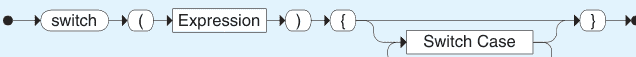

只要布尔表达式（`Expression`）为真，`while` 循环就会重复执行指定的语句（`Statement`）。首先评估表达式；因此，`Statement` 可能完全不执行。在每次执行 `Statement` 后，都会再次评估表达式，直到表达式变为假。

示例：

```java
while (total > max)
{
    total = total / 2;
    System.out.println("Current total: " + total);
}
```

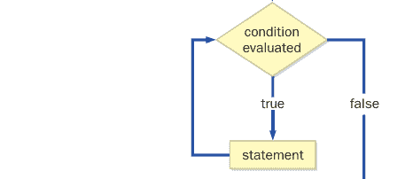

图 5.7 while 循环的逻辑

以下循环打印从 1 到 5 的值。循环的每次迭代都会打印一个值，然后计数器加 1。

> **核心概念**
>
> `while` 语句重复执行同一语句，直到其条件变为假。

```java
int count = 1;
while (count <= 5)
{
    System.out.println(count);
    count++;
}
```

注意，循环体包含两个语句。整个代码块在循环的每次迭代中都会重复。

让我们来看另一个使用 `while` 循环的程序。列表 5.7 所示的 `Average` 程序从用户处读取一系列整数，对它们求和，并计算平均值。

我们不知道用户可能会输入多少个值，因此我们需要一种方法来指示用户已完成数字输入。在程序中，我们将 0 指定为“哨兵值”（`sentinel value`），用来表示输入的结束。`while` 循环继续处理输入值，直到用户输入 0。这假设 0 是在输入范围之外的。

# 列表 5.7

```java
// Average.java 作者: Lewis/Loftus
// 演示了 while 循环、哨兵值和累加和的使用。

import java.text.DecimalFormat;
import java.util.Scanner;

public class Average {
    // 计算用户输入的一组数值的平均值。
    // 在输入数字时打印累加和。
    public static void main(String[] args) {
        int sum = 0, value, count = 0;
        double average;

        Scanner scan = new Scanner(System.in);

        System.out.print("Enter an integer (0 to quit):");
        value = scan.nextInt();

        while (value != 0) // 哨兵值 0 用于终止循环
        {
            count++;

            sum += value;
            System.out.println("The sum so far is " + sum);

            System.out.print("Enter an integer (0 to quit):");
            value = scan.nextInt();
        }

        if (count == 0)
            System.out.println("No values were entered.");
        else
        {
            average = (double)sum / count;
            DecimalFormat fmt = new DecimalFormat("0###");
            System.out.println("The average is " + fmt.format(average));
        }
    }
}
```

## 输出

```
Enter an integer (0 to quit): 10
The sum so far is 10
Enter an integer (0 to quit): 20
The sum so far is 30
Enter an integer (0 to quit): 0
The average is 15
```

注意在 `Average` 程序中，一个名为 `sum` 的变量被用于维护累加和，在输入数字时将其加到 `sum` 中。我们还需要计算输入的个数，因此变量 `count` 被初始化为 0。`while` 循环继续处理输入值，直到用户输入 0。如果用户立即输入 0，则末尾的 `if` 语句会导致除零错误。

让我们检查另一个使用 `while` 循环的程序。列表 5.8 所示的 `WinPercentage` 程序根据获胜次数计算团队胜率。我们使用 `while` 循环在 `WinPercentage` 程序中验证输入，这意味着我们保证用户输入的是有效的。在这个例子中，获胜次数必须大于等于 0 且小于比赛总数。`while` 循环继续执行，反复提示用户输入，直到输入的数字确实有效。

# 列表 5.8

```java
// WinPercentage.java         作者: Lewis/Loftus
// 演示了使用 while 循环进行输入验证。

import java.text.NumberFormat;
import java.util.Scanner;

public class WinPercentage
{
```


// --------------------------------------------

// 计算团队获胜的百分比。

// --------------------------------------------

public static void main(String[] args)

{

    final int NUM_GAMES = 12;

    int won;

    double ratio;

    Scanner scan = new Scanner(System.in);

## CHAPTER 5 条件判断与循环

# 列表 5.8 继续

```
System.out.print("Enter the number of games won (0 to " + NUM_GAMES + "): ");

won = scan.nextInt();

while (won < 0 || won > NUM_GAMES)

{

    System.out.print("Invalid input. Please reenter: ");

    won = scan.nextInt();

}

ratio = (double)won / NUM_GAMES;

NumberFormat fmt = NumberFormat.getPercentInstance();

System.out.println("Winning percentage: " + fmt.format(ratio));
```

OUTPUT
Enter the number of games won (0 to 12): -5
Invalid input. Please reenter: 13
Invalid input. Please reenter: 7

Winning percentage: 58%

## 5.4 while 语句

以下是一个死循环的示例：

```java
int count = 1;
while (count <= 25) // 警告：这是一个死循环！
{
    System.out.println(count);
    count = count - 1;
}
```

如果你执行此循环，应该做好准备中断它。在大多数系统上，按下 `Control-C` 组合键（按住 Control 键并按 C）可以终止正在运行的程序。

在这个示例中，`count` 的初始值为 1，并在循环体中不断递减。只要 `count` 小于等于 25，`while` 循环就会持续执行。由于 `count` 每次迭代都会变小，条件将始终为真，直到 `count` 的值小到发生溢出错误为止。重点在于，代码的逻辑显然是错误的。

让我们来看其他死循环的示例：

```java
int count = 1;
while (count != 50) // 死循环
count += 2;
```

在段代码中，变量 `count` 被初始化为 1，并向正方向移动。但注意，它每次增加 2。这个循环将不会终止，因为 `count` 永远不会等于 50。它从 1 开始，变为 3，然后是 5，以此此类推。它最终会达到 49，然后变为 51、53 等，并永远持续下去。

现在考虑这种情况情况：

```java
double num = 1.0;
while (num != 0.0) // 死循环
num = num - 0.1;
```

再次，循环控制的值似乎在朝着正确的方向移动。事实上，`num` 似乎最终会变成 0.0。然而，这个循环是无限的（至少在大多数系统上），因为 `num` 的值永远不会正好等于 0.0。这种模拟与我们之前在本章中讨论过的类似，当时我们探索了在 `if` 语句条件中比较浮点数的想法。由于值在二进制中的表示方式，内部会产生细微的计算错误，导致比较两个浮点数是否相等变得很有问题。

> 核心概念
>
> 我们必须仔细设计程序以避免死循环。

## 嵌套循环

循环的体内部可以包含另一个循环。这种情况被称为嵌套循环。记住，对于外层循环的每次迭代，内层循环都会完整执行。考虑以下代码段：字符串 "Here again" 被打印了多少次？

```java
int count1, count2;
count1 = 1;
while (count1 <= 10)
{
    count2 = 1;
    while (count2 <= 50)
    {
        System.out.println("Here again");
        count2++;
    }
    count1++;
}
```

打印语句位于内层循环内部。外层循环执行了 10 次，因为 `count1` 在 1 到 10 之间迭代。内层循环执行 50 次，因为 `count2` 在 1 到 50 之间迭代。对于外层循环的每次迭代，内层循环都会完整执行。因此，`println` 语句执行了 500 次。

在任何循环情况下，我们都必须仔细检查循环的条件和变量的初始化。让我们考虑代码的一些细微变化。如果外层循环的条件是 `(count1 < 10)` 而不是 `(count1 <= 10)` 会怎样？这将如何改变打印的总行数？外层循环将执行 9 次而不是 10 次，因此 `println` 语句将执行 450 次。如果外层循环保持原始定义，但在内层循环开始前将 `count2` 初始化为 11 而不是 1 呢？内层循环将执行 40 次而不是 50 次，因此打印的总行数将变为 400。

让我们来看另一个使用嵌套循环的示例。回文（Palindrome）是指正读和反向读都相同的字符字符串。例如，以下字符串都是回文：

- radar
- drab bard
- ab cde xxxx ed ba
- kayak
- deified
- able was I ere I elba

注意，某些回文具有偶数个字符，而另一些则具有奇数个字符。列表 5.9 所示的 `PalindromeTester` 程序用于测试一个字符串是否为回文。用户可以根据需要测试许多字符串。

`PalindromeTester` 的代码包含两个循环，一个在另一个内部。外层循环控制测试多少字符串，内层循环扫描每个字符串。

### 列表 5.9

```java
****************************************************************
// PalindromeTester.java      作者: Lewis/Loftus
// 展示嵌套 while 循环的使用。
****************************************************************

import java.util.Scanner;
public class PalindromeTester {
    //
    // 测试字符串以判断它们是否为回文。
    //
    public static void main(String[] args) {
        String str, another = "y";
        int left, right;

        Scanner scan = new Scanner(System.in);

        while (another.equalsIgnoreCase("y")) { // 允许 y 或 Y
            System.out.println("输入可能的回文:");
            str = scan.nextLine();

            left = 0;
            right = str.length() - 1;

            while (str.charAt(left) == str.charAt(right) && left < right) {
                left++;
                right--;
            }

            if (left < right) {
                System.out.println("字符串不是回文.");
            } else {
                System.out.println("字符串是回文.")
            }
            System.out.print("测试另一个回文 (y/n): ");
            another = scan.nextLine();
        }
    }
}
```

### 输出

```
输入可能的回文:
radar
该字符串是回文。
测试另一个回文 (y/n): y
输入可能的回文:
able was I ere I elba
该字符串是回文。
测试另一个回文 (y/n): y
输入可能的回文:
abcddba
该字符串是回文。
测试另一个回文 (y/n): y
输入可能的回文:
abracabra
该字符串不是回文。
测试另一个回文 (y/n): n
```

## break 和 continue 语句

Java 包含了两个影响条件和循环处理的语句。当执行 `break` 语句时，执行流将立即跳转到控制当前循环的语句之后的语句。例如，如果在循环体内部执行了 `break` 语句，循环的执行将停止并执行循环后的语句。这会“跳出”循环。

在第 6 章中，我们将看到在编写 `switch` 时，`break` 语句通常是必要的。然而，在循环中使用 `break` 语句并不是绝对必要的。因为 `break` 语句会导致程序流从一个地方跳转到另一个地方，所以在循环中使用 `break` 不是良好的做法。你可以并且避免在循环中使用 `break` 语句。

`continue` 语句对循环处理有类似的效果。`continue` 语句与 `break` 相似，但会重新评估条件，如果条件仍然为真，则执行循环体。与 `break` 语句一样，循环中总是可以避免 `continue` 语句，而且出于同样的原因，应该这样做。

# 自测题

（答案见附录 N）

SR 5.17 什么是无限循环？具体而言，是什么导致了无限循环？

SR 5.18 下述代码片段的输出是什么？

```
int low = 0, high = 10;
while (low < high)
{
  System.out.println(low);
  low++;
}
```

SR 5.19 下述代码片段的输出是什么？

```
int low = 10, high = 0;
while (low <= high)
{
  System.out.println(low);
  low++;
}
```

SR 5.20 下述代码片段的输出是什么？

```
int low = 0, high = 10;
while (low <= high)
{
  System.out.println(low);
  high = high - low;
}
```

SR 5.21 下述代码片段的输出是什么？

```
int low = 0, high = 10, mid;
while (low <= high)
{
  mid = low;
  while (mid <= high)
  {
    System.out.print(mid + " ");
    mid++;
  }
  System.out.println();
  low++;
}
```

SR 5.22 假设 int 变量已初始化为一个正整数。编写一个 while 循环，打印该 value 的所有正因子。例如，如果 value 为 28，它将打印 28 的因因子：1 2 4 7 14 28

## 5.5 迭代器

SR 5.23 假设 int 变量已初始化为一个正整数。编写一个 while 循环，打印从 1 到 value 的每个数的所有正因子。例如，如果 value 为 4，它将打印：

- 1 的因因子：1
- 2 的因因子：1 2
- 3 的因因子：1 3
- 4 的因因子：1 2 4

## 5.5 迭代器

迭代器（iterator）是一种对象，它拥有的方法允许你一次处理一个项目集合。也就是说，迭代器让你逐个遍历每个项目并根据需要与其进行交互。例如，你的目标可能是计算俱乐部每个成员的费用，或 URL 的不同部分。关键在于，迭代器提供了一种一致且简单的机制，用于系统地处理一组项目。由于这本质上是一个重复过程，因此它与循环的概念密切相关。

> 核心概念
>
> 迭代器是一个帮助你处理一组相关项目的对象。

从技术上说，Java 中的迭代器对象是通过 `Iterator` 接口定义的，该接口在第 7 章中讨论。目前，了解哪些对象存在以及它们如何实现项目集合的处理是有帮助的。

每个迭代器都有一个名为 `hasNext` 的方法，它返回一个布尔值，表示至少有一个项目待处理。因此，`hasNext` 方法可以作为循环的条件来控制每个项目的处理。迭代器还有一个名为 `next` 的方法，用于获取集合中下一个待处理的项。

Java 标准类库中有几个类定义了迭代器对象。其中之一是 `Scanner`，我们在示例中多次使用这个类来帮助我们从用户那里读取数据。Scanner 的 `hasNext` 方法在有另一个输入待处理时返回 `true`。正如我们之前看到的，它有一个 `next` 方法，可以将下一个输入作为字符串返回。

Scanner 类还具有 `hasNext` 方法的变体，例如 `hasNextInt` 和 `hasNextDouble` 方法它们允许你判断下一个输入是否为特定类型。同样，正如我们看到的，`next` 方法也有变体，例如 `nextInt` 和 `nextDouble`，用于获取特定类型的值。

当从标准输入进行交互式读取时，Scanner 类的 `hasNext` 方法将等待直到可用输入，然后返回 `true`。也就是说，从键盘读取的交互式输入始终被认为有更多数据待处理——在用户输入之前，数据尚未到达。这就是为什么在之前的示例中，我们使用了特殊的哨兵值（sentinel values）来确定交互式输入的结束。

然而，Scanner 对象是一个迭代器这一事实在当用扫描器处理来自具有特定终点的源的输入时特别有用，例如处理数据文件的行或处理字符字符串的部分。让我们来看这种类型处理的示例。

# 读取文本文件

假设我们有一个名为 `urls.inp` 的输入文件，其中包含我们想要以某种方式处理的 URL 列表：

- www.google.com
- www.linux.org/info/gnu.html
- thely.com/calendar/
- cs.vt.edu/undergraduate/about
- youtube.com/watch?v=EHCRimwRGLs

列表 5.10 显示的程序从该文件中读取 URL 并对其进行解剖，显示路径的不同部分。它使用 Scanner 对象来处理输入。事实上，它使用了多个 Scanner 对象——一个用于读取数据行，另一个用于处理每个 URL 字符串。

### 列表 5.10

```java
****************************************************************************************************
// URLDissector.java      作者: Lewis/Loftus
// 展示了如何使用 Scanner 读取文件输入并使用
// 替代分隔符对其进行解析
****************************************************************************************************

import java.util.Scanner;
import java.io.*;

public class URLDissector {
    // 从文件读取 urls 并打印它们的路径组件。
    public static void main(String[] args) throws IOException {
    }
}
```

### 列表 5.10 续

```java
String url;
Scanner fileScan, urlScan;

fileScan = new Scanner(new File("urls.inp"));

// 读取并处理文件的每一行
while (fileScan.hasNext()) {
    url = fileScan.nextLine();
    System.out.println(" " + url);

    urlScan = new Scanner(url);
    urlScan.useDelimiter("/");

    // 打印 url 的每个部分
    while (urlScan.hasNext()) {
        System.out.println(" " + urlScan.next());
    }
    System.out.println();
}
```

输出

```
URL: www.google.com

www.google.com

URL: www.linux.org/info/gnu.html

www.linux.org

info

gnu.html

URL: thelyric.com/calendar/

thelyric.com

calendar

URL: www.cs.vt.edu/undergraduate/

www.cs.vt.edu

undergraduate

about

URL: youtube.com/watch?v=EHCRimwRGLs

youtube.com

watch?v=EHCRimwRGLs
```

程序中有两个 while 循环，一个在另一个内部。外层循环处理文件的每一行，内层循环处理每个每个标记。


变量 `fileScan` 被创建一个在输入文件 `urls.inp` 上操作的扫描器。与其将 `System.in` 传递给 `Scanner` 构造函数，我们实例化了一个表示输入文件的 `File` 对象并将其传递给构造函数。此时，`fileScan` 对象准备好读取并处理来自输入文件的输入。

如果由于原因无法找到或打开文件，创建 `File` 对象的尝试将抛出 `IOException`，正如我们在 `main` 方法头部添加了 `throws IOException`。（处理异常将在第 11 章进一步讨论。）

只要输入文件扫描器的 `hasNext` 方法返回 `true`，外层循环体就会执行——也就是说，只要有更多输入待处理。循环的每次迭代从文件中读取一行（一个 URL）并将其打印。

对于每个 URL，都会创建一个新的 `Scanner` 对象来解析 URL 字符串，该字符串在实例化 `urlScanner` 时传递给构造函数。`while` 循环解析每一个标记。

记住，默认情况下，`Scanner` 对象假设空白（空格、制表符和换行符）被用作分隔输入标记。这对于读取输入文件每一行的示例是有效的。但是，如果分隔符不够（例如在处理 URL 时），可以更改它们。

> **核心概念**
>
> 用于分离 `Scanner` 对象标记的分隔符可以根据需要明确设置。

在这种情况下，我们对由斜杠 `/` 分隔的每个部分感兴趣。向扫描器的 `useDelimiter` 方法传递一个字符可以在处理 URL 字符串之前将分隔符设置为斜杠。

如果你想使用多个一个替代分隔符，或者你想以更复杂的方式解析输入，`Scanner` 可以处理称为正则表达式的模式，正则表达式在附录 H 中讨论。

# 自测题（答案见附录 N）

+ SR 5.24 编写语句创建以下每个 `Scanner` 对象。
+ a. 用于交互式输入，从 `System.in` 读取。
+ b. 一个从文件 "info.data" 读取的。
+ c. 一个从变量 `infoString` 读取的。
+ SR 5.25 假设 `Scanner` 对象 `fileScan` 已初始化为读取文件。编写一个 `while` 循环来计算文件中每行的平均字符数。

## 5.6 ArrayList 类

现在我们已经在编程语句库中拥有了循环，让我们来引入一个用于管理对象集合非常有用的类。`ArrayList` 类是 Java 标准类库中 `java.util` 包的一部分。`ArrayList` 对象存储一个对象列表，并允许你通过索引值引用每一个对象。我们经常会使用循环来扫描列表中的对象，并以某种方式对它们进行处理。

在内部，`ArrayList` 类使用一种称为数组（array）的编程结构（因此得名）来管理该列表。数组将在第 8 章中讨论，但我们不需要了解数组的细节就可以使用该对象。`ArrayList` 是 Java Collections API 的一部分，这是一组用于组织和管理其他对象的类。我们将在第 13 章中进一步讨论类。

> **核心概念**
>
> `ArrayList` 对象存储一个对象列表，并允许你使用整数索引来访问它们。

图 5.8 列出了 `ArrayList` 类的几种方法。你可以以各种方式添加和删除元素，判断列表是否为空，并获取列表中当前的元素数量，以及其他操作。

注意，`ArrayList` 类引用类型为 `E` 的元素。这是一个泛型（E 代表 element，元素），它在创建 `ArrayList` 对象时确定。因此，你不仅仅是创建一个 `ArrayList` 对象，而是创建一个存储特定类型对象的 `ArrayList` 对象。对于给定对象的类型参数写在类名后的括号中。因此，我们可以讨论管理 `String` 对象列表的 `ArrayList<String>`，或者管理 `Book` 对象列表的 `ArrayList<Book>`。

你可以在不指定元素类型的情况下创建一个 `ArrayList`，在这种情况下 `ArrayList` 存储引用，这意味着你可以将任何 `Object` 类型的对象放入列表。这通常不是一个好主意。能够在指定的 `ArrayList` 索引中提交存储某种类型，这有助于编译器检查列表中只存储了适当类型的对象。

`ArrayList` 的索引值从 0 开始而不是 1。因此，从概念上讲，例如，一个 `String` 对象的 `ArrayList` 可能管理着：

- 0 "Bashful"
- 1 "Sleepy"
- 2 "Happy"
- 3 "Dopey"
- 4 "Doc"

> **核心概念**
>
> 创建 `ArrayList` 对象时，指定要存储在列表中的元素类型。

同样注意，`ArrayList` 存储基本类型值（如 `int`）的引用。但正是包装类再次派上用场的地方。例如，你可以适当创建 `ArrayList<Integer>` 或 `ArrayList<Double>`。

## 第 5 章 条件判断与循环

```
ArrayList<E>()
构造函数：创建一个初始空列表。

boolean add(E obj)
    将指定的对象插入此列表的末尾。

void add(int index, E obj)
    将指定的对象插入此列表的指定索引处。

void clear()
    从此列表中移除所有元素。

E remove(int index)
    移除此列表中指定索引处的元素并返回它。

E get(int index)
    返回列表中指定索引处的元素，但不将其移除。

int indexOf(Object obj)
    返回指定对象首次出现的位置索引。

boolean contains(Object obj)
    如果此列表包含指定的对象，则返回 true。

boolean isEmpty()
    如果此列表不包含任何元素，则返回 true。

int size()
    返回列表中的元素数量。
```

图 5.8 `ArrayList<E>` 类的一些方法。

代码 5.11 所示的程序实例化了一个名为 `band` 的 `ArrayList<String>`。使用 `add` 方法按特定顺序将多个 `String` 对象添加到 `ArrayList` 的末尾。一个特定的字符串被删除，另一个被插入到特定索引。对于任何其他对象，`toString` 方法在每次发送到 `println` 方法时都会自动调用，它会打印出由方括号包裹的所有元素。程序末尾的 `while` 循环显式地逐行打印每个元素。

### 代码 5.11

```java
// Beatles.java      作者 Lewis/Loftus
// 演示了 ArrayList 对象的用法。
//************************************************************************************
```

### 代码 5.11 续

```java
import java.util.ArrayList;

public class Beatles {
    //-------------------------------------------------------
    // 存储并修改乐队成员列表。
    //-------------------------------------------------------
    public static void main(String[] args) {
        ArrayList<String> band = new ArrayList<String>();

        band.add("Paul");
        band.add("Pete");
        band.add("John");
        band.add("George");

        System.out.println(band);
        int location = band.indexOf("Pete");
        band.remove(location);

        System.out.println(band);
        System.out.println("At index 1: " + band.get(1));
        band.add(2, "Ringo");

        System.out.println("Size of the band: " + band.size());
        int index = 0;
        while (index < band.size()) {
            System.out.println(band.get(index));
            index++;
        }
    }
}
```

```
输出
[Paul, Pete, John, George]
[Paul, John, George]
At index 1: John
Size of the band: 4
Paul
John
Ringo
George
```

## 第 5 章 条件判断与循环

## 自习题

- SR 5.26 使用 `ArrayList` 对象的优点是什么？
- SR 5.27 `ArrayList` 包含什么类型的元素？
- SR 5.28 为一个名为 `dice` 的变量编写声明，它是一个对象的 `ArrayList`。
- SR 5.29 下列代码段产生什么输出？

```java
ArrayList<String> names = new ArrayList<String>();
names.add("Andy");
names.add("Betty");
names.add(1, "Chet");
names.add(1, "Don");
names.remove(2);
System.out.println(names);
```

## 5.7 确定事件源

在第 4 章中，我们开始探索创建真正图形用户界面 (GUI) 的程序。你可能记得交互式 GUI 需要我们创建监听器对象，并设置监听器与产生感兴趣事件的组件之间的关系。

让我们来看一个示例，其中一个监听器被用于监听两个不同的组件。代码 5.12 中的 `LeftRight` 类程序显示了一个标签和两个按钮。当按下左按钮时，标签显示单词 "Left"，当按下右按钮时，标签显示单词 "Right"。

代码 5.13 中的 `LeftRightPanel` 类创建了一个 `ButtonListener` 对象的实例，然后将监听器添加到两个按钮上。因此，如果按下任一个按钮，`ButtonListener` 的 `actionPerformed` 方法就会被调用。

在每次调用时，`actionPerformed` 方法使用 `if` 语句来确定哪个按钮产生了事件。在按钮传递到 `actionPerformed` 方法的 `ActionEvent` 对象上调用 `getSource` 方法。`getSource` 方法返回产生事件的组件引用。`if` 语句的条件将事件源与左按钮的引用进行比较。如果它们不匹配，则事件是由右按钮产生的。

### 代码 5.12

```java
// LeftRight.java      作者 Lewis/Loftus
// 演示了一个监听器用于多个按钮的用法。
//************************************************************************************

import javax.swing.JFrame;

public class LeftRight {
    //--------------------------------------------------------------------
    // 创建主程序框架。
    //-----------------------------------------------------------------
    public static void main(String[] args) {
        JFrame frame = new JFrame("Left Right");
        frame.setDefaultCloseOperation(JFrame.EXIT_ON_CLOSE);
        frame.getContentPane().add(new LeftRightPanel());
        frame.pack();
        frame.setVisible(true);
    }
}
```

### 代码 5.13

```java
// LeftRightPanel.java
// Author: Lewis/Loftus
// Demonstrates the use of one listener for multiple buttons.
//****************************************************************

import java.awt.*;
import java.awt.event.*;
import javax.swing.*;

public class LeftRightPanel extends JPanel {
    private JButton left, right;
    private JLabel label;
    private JPanel buttonPanel;

    /*
     Constructor: Sets up the GUI.
    */
    public LeftRightPanel() {
        left = new JButton("Left");
        right = new JButton("Right");

        ButtonListener listener = new ButtonListener();
        left.addActionListener(listener);
        right.addActionListener(listener);

        label = new JLabel("Push a button");

        buttonPanel = new JPanel();
        buttonPanel.setPreferredSize(new Dimension(200, 400));
        buttonPanel.setBackground(Color.blue);
        buttonPanel.add(left);
        buttonPanel.add(right);

        setPreferredSize(new Dimension(200, 80));
        setBackground(Color.cyan);
        add(label);
        add(buttonPanel);
    }
}
```

### 代码 5.13 续

```java
/* *********************************************************************
// Represents a listener for both buttons.
/* *********************************************************************/
private class ButtonListener implements ActionListener {
    // Determines which button was pressed and sets the label
    // text accordingly.

    public void actionPerformed(ActionEvent event) {
        if (event.getSource() == left) {
            label.setText("Left");
        } else {
            label.setText("Right");
        }
    }
}
```

我们可以创建两个单独的监听器类，一个监听左侧，另一个监听右侧。在这种情况下，`actionPerformed` 方法就不需要确定事件的源。是使用多个监听器，还是在事件发生时确定事件源，是一个根据具体情况做出的设计决策。

请注意，这两个按钮位于名为 `buttonPanel` 的同一个面板上，该面板与由 `LeftRightPanel` 类表示的面板是分开的。通过将它们都放在一个面板上，我们可以确保即使在以各种方式调整窗口大小时，它们之间的视觉关系也能得到保持。对于标记为“Left”和“Right”的按钮，这可能很重要。

## 5.8 复选框和单选按钮

由 `JButton` 定义的推按钮只是我们在 Java GUI 中可以使用的一种按钮类型。另外两种类型是复选框和单选按钮。让我们详细查看这些。

### 复选框


复选框是一种可以使用鼠标切换开启或关闭的按钮，表示特定的布尔条件是否被设置或取消。例如，一个标记为 `COLLATE`（排序）的复选框可以用于指示打印作业的输出是否应该排序。尽管你可能有一组复选框表示一组选项，但每个复选框都是独立操作的。也就是说，每个复选框都可以设置为开启或关闭，其中一个的状态不会影响其他。

列表 5.14 中的程序显示了两个复选框和一个标签。复选框决定标签的文本是以**粗体**、**斜体**、两者兼顾还是都不以这些形式显示。粗体和斜体的任何组合都是有效的。例如，两个复选框都可以被选中（开启），在这种情况下，文本将以粗体和斜体显示。如果两个都没有被选中，标签的文本将以普通样式显示。

`StyleOptions` 的 GUI 体现在列表 5.15 的 `StyleOptionsPanel` 类中。复选框由 `JCheckBox` 类表示。当复选框从已选中（勾选）变为未选中（未勾选），或反之时，它会产生一个项目事件。`ItemListener` 接口包含一个方法 `itemChanged`。在示例中，我们使用同一个监听器对象来处理复选框。

## 列表 5.14

```java
// StyleOptions.java               Author: Lewis/Loftus
// Demonstrates the use of check boxes.
import javax.swing.JFrame;

public class StyleOptions
{
    // Creates and presents the program frame.
    public static void main(String[] args)
    {
        JFrame frame = new JFrame("Style Options");
        frame.setDefaultCloseOperation(JFrame.EXIT_ON_CLOSE);

        StyleOptionsPanel panel = new StyleOptionsPanel();
        frame.getContentPane().add(panel);

        frame.pack();
        frame.setVisible(true);
    }
}
```

## 列表 5.14 续

显示


## 列表 5.15

```java
// StyleOptionsPanel.java      Author: Lewis/Loftus
// Demonstrates the use of check boxes.
import java.swing.*;
import java.awt.*;
import java.awt.event.*;

public class StyleOptionsPanel extends JPanel {
    private JLabel label;
    private JCheckBox bold, italic;

    // 设置一个包含标签和一些复选框的面板，
    // 这些复选框控制标签字的样式。
    public StyleOptionsPanel() {
        label = new JLabel("Select Style:");
        bold = new JCheckBox("Bold");
        italic = new JCheckBox("Italic");

        JPanel buttonPanel = new JPanel();
        buttonPanel.setPreferredSize(new Dimension(200, 400));
        buttonPanel.setBackground(Color.blue);
        buttonPanel.add(bold);
        buttonPanel.add(italic);

        setPreferredSize(new Dimension(200, 80));
        setBackground(Color.cyan);
        add(label);
        add(buttonPanel);

        ItemListener listener = new ItemListener();
        bold.addItemListener(listener);
        italic.addItemListener(listener);
    }

    private class ItemListener implements ItemListener {
        public void itemChanged(ItemEvent event) {
            int style = Font.PLAIN;
            if (bold.isSelected()) {
                style |= Font.BOLD;
            }
            if (italic.isSelected()) {
                style |= Font.ITALIC;
            }
            label.setFont(new Font("Serif", style, 14));
        }
    }
}
```

## 列表 5.1.6

```java
// QuoteOptions.java      Author: Lewis/Loftus
// Demonstrates the use of radio buttons.
import javax.swing.JFrame;

public class QuoteOptions
{
    // Creates and presents the program frame.
    public static void main(String[] args) {
        JFrame frame = new JFrame("Quote Options");
        frame.setDefaultCloseOperation(JFrame.EXIT_ON_CLOSE);

        QuoteOptionsPanel panel = new QuoteOptionsPanel();
        frame.getContentPane().add(panel);

        frame.pack();
        frame.setVisible(true);
    }
}
```


## 5.8 复选框与单选按钮

列表 5.17 所示的 `QuoteOptionsPanel` 用于设置和显示 GUI 组件。单选按钮由 `JRadioButton` 类表示。因为一组中的单选按钮是协同工作的，所以使用 `ButtonGroup` 类来定义一组相关的单选按钮。

注意，每个按钮都已添加到按钮组中，而且每个按钮也已单独添加到面板中。`ButtonGroup` 对象并不是用于组织和显示组件的容器；它仅仅用于定义一组协同工作以形成一组依赖选项的单选按钮。`ButtonGroup` 对象确保了当选中组中的另一个单选按钮时，当前选中的单选按钮会被关闭。

单选按钮在被选中时会执行操作。第一个监听器的 `actionPerformed` 方法会获取事件源，并将其与三个单选按钮中的每一个进行比较。根据选了哪个按钮，标签的文本将被设置为相应的引言。

## 列表 5.17

```java
// QuoteOptionsPanel.java Author: Lewis/Loft
// Demonstrates the use of radio buttons.
import java.swing.*;
import java.awt.*;
import java.awt.event.*;

public class QuoteOptionsPanel extends JPanel {
    private JLabel quote;
    private JRadioButton comedy, philosophy, carpentry;
    private String comedyQuote, philosophyQuote, carpentryQuote;

    // Sets up a panel with a label and a set of radio buttons
    public QuoteOptionsPanel() {
        comedyQuote = "Take my wife, please.";
        philosophyQuote = "I think, therefore I am.";
        carpentryQuote = "Measure twice. Cut once.";
    }
}
```

258 第 5 章 条件判断与循环

## 列表 5.17 续

```java
quote = new JLabel(comedyQuote);
quote.setFont(new Font("Helvetica", Font.BOLD, 24));

comedy = new JRadioButton("Comedy", true);
comedy.setBackground(Color.green);
philosophy = new JRadioButton("Philosophy");
philosophy.setBackground(Color.green);
carpentry = new JRadioButton("Carpentry");
carpentry.setBackground(Color.green);

ButtonGroup group = new ButtonGroup();
group.add(comedy);
group.add(philosophy);
group.add(carpentry);

QuoteListener listener = new QuoteListener();
comedy.addActionListener(listener);
philosophy.addActionListener(listener);
carpentry.addActionListener(listener);

add(quote);
add(comedy);
add(philosophy);
add(carpentry);

setBackground(Color.green);
setPreferredSize(new Dimension(300, 100));
}

// Represents the listener for all radio buttons.
private class QuoteListener implements ActionListener {
    // Sets the text of the label depending on which radio
    // button was pressed.
    public void actionPerformed(ActionEvent event) {
        Object source = event.getSource();
```

## 列表 5.17 续

```java
if (source == comedy)
    quote.setText(comedyQuote);
else
    if (source == philosophy)
        quote.setText(philosophyQuote);
    else
        quote.setText(carpentryQuote);
```

注意，与推按钮不同，复选框和单选按钮都是切换按钮（toggle buttons），这意味着它们在任何时候都处于开启或关闭状态。区别在于它们的使用方式。独立选项（可以任意组合）由复选框控制。依赖选项（从一组中选择一个）由单选按钮控制。如果只有一个选项需要管理，可以使用单独的复选框。正如我们之前提到的，另一方面，单选按钮只有与一个或多个其他单选按钮配合使用时才有意义。

还要注意，复选框和单选按钮产生不同类型的事件。复选框产生事件项（event item），而单选按钮产生动作事件（action event）。不同事件类型的使用与按钮功能的差异有关。复选框在被选中或取消选择时都会产生事件，监听器可以根据需要进行区分。另一方面，单选按钮仅在被选中时才产生事件（组中当前选中的按钮会自动取消选中）。

## 核心概念总结

- 条件判断和循环允许我们控制方法中的执行流。
- `if` 语句允许程序选择是否执行某特定的语句。
- 循环允许程序多次执行某条语句。
- 逻辑运算符经常用于构建复杂的条件。
- 适当的缩进对于人类可读性至关重要；它显示了语句与语句之间的关系。
- `if-else` 语句允许程序在条件为真时执行一件事，在条件为假时执行另一件事。
- 在 `nested`（嵌套）语句中，`else` 子句与最近的未匹配的 `if` 匹配。
- Java 中字符的相对顺序由 Unicode 集合定义。
- `compareTo` 方法可以确定字符串的相对顺序。
- `while` 语句持续执行同一语句，直到其条件变为假。
- 我们必须仔细设计程序，以避免死循环。
- 迭代器（iterator）是一个帮助你处理一组相关对象的对象。
- `Scanner` 对象中用于分隔标记的边界符（delimiters）可以根据需要明确设置。
- `ArrayList` 对象存储对象列表并允许你使用整数索引访问它们。
- 在创建 `ArrayList` 时，你指定将存储在列表中的元素类型。
- 单选按钮作为一个组运行，提供一组互斥的选项。

## 练习题

**EX 5.1** 在 `MinOfThree` 程序中，如果两个或多个值相等，会发生什么？如果恰好有两个值相等，这两个相等的值比第三个值低还是高是否重要？

**EX 5.2** 下列代码片段有什么错误？重写它以产生正确的输出。

```java
if (total == MAX)
  if (total < sum)
    System.out.println("total == MAX and < sum.");
else
  System.out.println("total is not equal to MAX");
```

**EX 5.3** 下列代码片段有什么错误？如果它不是有效程序的一部分，它会编译吗？解释。

```java
if (length = MIN_LENGTH)
  System.out.println("The length is minimal.");
```

**EX 5.4** 下列代码片段产生什么输出？


# 第 5 章 条件判断与循环

## 练习题

### EX 5.5
下列代码片段产生什么输出？

```java
int limit = 100, num1 = 15, num2 = 40;
if (limit <= num1)
{
  if (num1 == num2)
    System.out.println("lemon");
  System.out.println("lime");
}
```

### EX 5.6
按照 `String` 类的 Unicode 图表方法将以下字符串列表按字典顺序排序。请参考附录 C 中的图表。

```
"Fred"
"Ethel"
"?2-7-2?"
"{[[]]}"
"Lucy"
"ricky"
"book"
"*****"
"12345"
```

### EX 5.7
下述代码片段的输出是什么？

```java
int num = 0, max = 20;
while (num < max)
{
    System.out.println(num);
    num += 4;
}
```

### EX 5.8
下述代码片段的输出是什么？

```java
int num = 1, max = 20;
while (num < max)
{
    if (num % 2 == 0)
        System.out.println(num);
    num++;
}
```

### EX 5.9
下述代码片段存在什么问题？可以通过三种不同的方式进行修改以消除缺陷？

```java
count = 50;
while (count >= 0)
{
    System.out.println(count);
    count = count + 1;
}
```

### EX 5.10
编写一个 `while` 循环，验证用户输入的是正整数值。

### EX 5.11
编写一个代码片段，读取并打印用户输入的整数值，直到输入了特定的哨兵值（`SENTINEL`）。不要打印该哨兵值。

### EX 5.12
编写一个名为 `maxThat` 的方法，接受两个整数参数并返回两者中较大的一个。

### EX 5.13
编写一个名为 `larger` 的方法，接受两个浮点数参数（`double` 类型），如果第一个参数大于第二个参数，则返回 `true`，否则返回 `false`。

## 编程项目

### PP 5.1
编写一个程序，从用户处读取一个代表年份的整数。该程序的目的是判断该年份在格里哥利历中是否为闰年（因此2月有29天）。如果一个年份能被 4 整除，则为闰年，除非它能被 100 整除但不能被 400 整除。例如，2003 年不是闰年，但 2004 年是。1900 年不是闰年，因为它能被 100 整除；但 2000 年是闰年，因为它虽然能被 100 整除，也能被 400 整除。对于任何小于 1582 年（格里哥利历采用的年份）的输入值，产生错误信息。

### PP 5.2
修改上一个项目的解决方案，使用户可以评估多个年份。允许用户使用合适的哨兵值终止程序。验证每个输入值以确保其大于或等于 1582。

### PP 5.3
编写一个程序，确定并打印从键盘读取的整数值中奇数、偶数和零数字的个数。

### PP 5.4
编写一个玩数字“大小猜猜”游戏的程序。程序在 1 到 100（包含）之间随机选择一个数字，然后反复提示用户猜数字。每次猜测时，告诉用户其结果是正确的，或者猜大了或猜小了。继续接受正确的猜测或选择退出。使用哨兵值判断用户是否想要退出。统计猜测次数，并在用户猜对时报告该值。在每局游戏结束时（通过退出或猜对），提示判断用户是否想继续玩。继续玩游戏直到用户选择停止。

### PP 5.5
创建 `PalindromeTester` 程序的修改版本，使得在判断一个字符串是否为回文时，不考虑空格、标点符号以及大小写变化。提示：这些可以通过多种方式处理。仔细构思你的设计。

### PP 5.6
使用本章定义的 `Coin` 类，设计并实现一个名为 `FlipRace` 的驱动类，其主方法创建两个 `Coin` 对象，然后不断地投掷它们，直到两枚硬币都连续三次正面。继续投掷硬币，直到其中一枚硬币赢得比赛，并考虑平局的可能性。打印回合的结果，并在结束时打印胜利者和所需的总投掷次数。

### PP 5.7
编写一个与电脑玩剪刀石头布游戏的程序。在两个人之间玩游戏时，每人选择三个选项之一（通常显示出来）。两人同时选择手势，并决定胜负。在游戏中，剪刀胜石头，石头胜剪刀，布胜石头。继续进行直到用户选择停止，然后打印胜利、失败和平局的数量。

### PP 5.8
编写一个模拟简单老虎机的程序，其中随机选择 0 到 9。如果三个数字相同或两个相同，则打印相应的语句。继续直到用户选择停止。

### PP 5.15
设计并实现一个计算文本中标点符号数量的程序。创建一个表格显示每个符号出现的次数。

### PP 5.16
修改本章的程序，允许用户指定字体大小。使用文本框获取大小。

### PP 5.17
开发一个计算文本段基础统计数据的简单工具。应用程序应包含一个窗口，其中有一个滚动文本框（`TextArea`）和一个统计框。统计框应是一个带边框的面板，包含显示文本框单词数、平均长度以及任何你想添加的统计数据的字段。统计框还应包含一个按钮，按下后将重新计算统计数据。

---

# 软件故障

## Therac-25

### 发生了什么？

`Therac-25` 是一种用于交付电子束或 X 射线以破坏癌症组织的辐射机器。在使用期间，数百患者接受了设备的治疗。但在 1985 年至 1987 年记录的六例中，`Therac-25` 输送了过量辐射，导致严重残疾和死亡。

在典型的治疗中，患者躺下，操作人员调整相应区域。操作人员在机器控制台上设置治疗参数并按下按钮交付辐射。患者被告知会有轻微的皮肤不适。

辐射量以 rad（辐射吸收剂量）测量。标准治疗约为 200 rad。估计事故导致了 20,000 rad 的施加。

### 原因是什么？

操作人员被告诉他们，`Therac-25` 拥有许多安全措施，因此“几乎不可能”导致患者剂量过量。但 `Therac-25` 使用的部分软件重用自早期版本的机器，该版本包含了许多硬件安全措施。因此，硬件功能底层软件掩盖了问题。`Therac-25` 的安全功能主要基于软件，潜伏的问题随之浮现。事实证明，如果操作员误输了参数并以特定方式进行修正，软件将允许机器释放最大剂量而不进行适当扩散。这种错误非常奇怪，以至于测试机器的技术人员无法重现该问题。在某一次，一台明显清除过过载的机器被重新投入使用，但技术人员对其没有发现任何问题。

分析人士表示，软件问题只是所发生事故的一部分。虽然也存在基础性的编程错误，但对安全问题的总体关注也不足。另一个原因是这些机器的使用时间太长，导致对问题的报告没有像应该的那样准确和彻底。

### 经验训

软件安全是本例中的核心问题。当关乎人类生命时，很难想象不采取一切手段来确保你的软件尽可能健壮。这归结为风险分析：你有多大愿意承担你正在开发的特定软件仍然错误的风险？对于许多应用来说，问题可能会给用户带来不便并可能产生业务影响，但其他应用则直接关乎人的生命。

此案例也是隔离问题困难的例子。对于数百名患者来说，`Therac-25` 提供了优秀的治疗。最初的投诉之一在没有经过适当调查或报告的情况下被驳回了。后来，当问题明显发生时，却无法复制。这是一个真正的异常情况——这种情况通常不会在正常情况下发生。

> 来源：computingcases.org, IEEE Computer

---

# 第 6 章 更多条件和循环

## 章节目标

- 使用 `switch` 语句检查条件处理。
- 讨论条件运算符。
- 检查替代的循环语句：`do` 循环和 `for` 循环。
- 在条件语句和循环的帮助下绘制图形。
- 探索对话框的使用。

在第 5 章中，我们检查了用于决策的 `if` 语句和用于循环的 `while` 语句。本章探索了 Java 中执行类似任务的几个附加语句。特别在本章中，我们将探索 `switch` 语句，它允许我们根据特定值在多个执行路径之间进行选择。我们将探索 `do` 和 `for` 循环，它们提供的逻辑处理和/或语法使它们区别于 `while` 循环。这些替代语句在关键细节上有所不同，任何特定情况都可能适合使用其中一种。本章的图形 Track 部分探索了如何使用条件语句和循环来控制图形，并检查了对话框的目的和用途。

## 6.1 switch 语句

Java 中的另一种条件语句称为 `switch` 语句，它导致执行中的程序根据单个值遵循多个路径中的之一。虽然可以使用多个 `if` 语句构建类似的逻辑，但在需要的情况下，`switch` 语句通常会让代码更易读。

`switch` 语句评估一个表达式以确定一个值，并将该值与多个可能的 `case` 匹配。每个 `case` 都有与其相关的语句。评估表达式后，控制跳转到与第一个匹配项关联的语句。考虑以下示例：

```java
switch (idChar)
{
    case 'A':
        aCount = aCount + 1;
        break;
    case 'B':
        bCount = bCount + 1;
        break;
    case 'C':
        cCount = cCount + 1;
        break;
    default:
        System.out.println("Error in Identification Character.");
}
```

首先，评估表达式。在这个示例中，表达式是一个名为 `idChar` 的简单变量。如果值匹配表达式的结果，执行将转移到匹配值后的第一个语句；如果 `idChar` 包含 `'A'`，变量 `aCount` 就会加 1。如果它包含 `'B'`，则跳过 `'A'` 的 `case` 并继续处理，直到 `bCount` 加 1。如果 `idChar` 包含 `'C'`，则处理它。

如果没有值匹配表达式，执行将继续执行 `default` 情况，由保留关键字 `default` 指定。如果不存在 `default` 情况，则 `switch` 语句中的语句都不会被执行，处理将继续执行 `switch` 语句之后的语句。包含一个 `default` 情况通常是一个好主意，即使预计它不会被使用。

当遇到 `break` 语句时，处理跳转到 `switch` 语句之后的语句。`break` 语句通常用于跳出 `switch` 语句的每个 `case`。如果没有 `break` 语句，处理将继续进入 `switch` 的下一个 `case`。因此，如果上一个示例中 `'A'` `case` 结尾没有 `break` 语句，那么当 `idChar` 包含 `'A'` 时，`aCount` 和 `bCount` 都会增加。

> **核心概念**
>
> `break` 语句通常用于 `switch` 语句中每个 `case` 备选项的结尾。

`switch` 语句评估初始值并将其值与 `case` 之一匹配。继续执行与该 `case` 对应的语句。如果没有其他匹配，将执行可选的 `default` 情况。

示例：

```java
switch (numValues)
{
    case 0:
        System.out.println("No values were entered.");
        break;
    case 1:
        System.out.println("One value was entered.");
        break;
    case 2:
        System.out.println("Two values were entered.");
        break;
    default:
        System.out.println("Too many values were entered.");
}
```

在 `switch` 语句开始评估的表达式必须是 `char`、`byte` 或 `int` 类型。从 Java 7 开始，`switch` 也可以对 `String` 执行。但 `switch` 表达式不能是布尔值或浮点值。此外，每个 `case` 的值必须是常量；它不能是变量或其他表达式。这限制了 `switch` 语句适用的情况。但在适用时，它通常会让代码更易读、更容易理解。

同样注意，`switch` 语句的隐式布尔条件是基于相等性的。语句开头的表达式与每个 `case` 值进行比较，以确定它等于哪一个。除非进行了初步处理，否则 `switch` 不能用于确定其他关系操作（例如小于）。例如，列表 6.1 中的 `GradeReport` 程序根据用户输入的数字分值打印注释。

### 列表 6.1

```java
case 7:
    System.out.println("average.");
    break;
case 6:
    System.out.println("below average. You should see the");
    System.out.println("instructor to clarify the material "
    + "presented in class.");
    break;
    System.out.println("not passing.");
```

### 输出

输入数字分数 (0 到 100): 86

该分数高于平均水平。干得好。

在 `GradeReport` 中，分数的类别是通过将分数除以 10（整数除法决定的，结果是一个 0 到 10 之间的整数（假设输入了有效分数）。此结果用作 `switch` 的表达式，它为 60 或更高的分数打印各种消息，并为所有其他值打印默认语句。

请注意，任何 `switch` 语句都可以实现为一组嵌套 `if` 语句。然而，嵌套的 `if` `switch` 语句会迅速变得人类阅读者难以理解，并且容易出现实现和调试。因为 `switch` 只能评估相等性，有时嵌套的 `if` 语句是必要的。这取决于具体情况。

### 自测习题（答案见附录 N）

- **SR 6.1** 当 Java 程序运行时，如果 `switch` 语句的表达式不匹配与语句关联的任何 `case` 值，会发生什么？
- **SR 6.2** 如果 `switch` 语句中的 `case` 不以 `break` 语句结束会发生什么？
- **SR 6.3** 如果用户输入 72，`GradeReport` 程序的输出是什么？如果用户输入 46 呢？如果用户输入 123 呢？
- **SR 6.4** 将以下嵌套 `if` 语句转换为等效的 `switch` 语句。

## 6.2 条件运算符

Java 这种条件运算符在某些方面与 `if-else` 语句相似。它是一个元运算符，因为它需要三个操作数。条件运算符的符号通常写为 `?`，但它不像其他运算符那样由两个总是分开的符号组成。以下是一个包含条件运算符的表达式示例。

```java
(total > MAX) ? total + 1 : total * 2;
```

`?` 之前是一个布尔条件。`?` 之后是两个由 `:` 符号隔开的表达式。如果条件为真，整个条件表达式返回第一个表达式的值；如果条件为假，则返回第二个表达式的值。

> **核心概念**
>
> 条件运算符根据布尔条件评估两个可能值中的其中一个。

请记住，这是一个返回值的表达式。条件运算符仅仅是一个运算符，它是独立的。我们通常想对该值做些什么，例如将其赋值给一个变量：

```java
total = (total > MAX) ? total + 1 : total * 2;
```

条件运算符与条件语句之间的区别可能是微妙的。在许多方面，`?` 让我们简洁地编写逻辑，作为简短的 `if-else` 语句。述语句在功能上与其等价，但有时比下面的语句更方便：

```java
if (total > MAX)
    total = total + 1;
else
    total = total * 2;
```

让我们再看两个例子。考虑以下声明：

```java
int larger = (num1 > num2) ? num1 : num2;
```


# 第 6 章 更多条件和循环

## 6.2 条件运算符

如果 `num1` 大于 `num2`，则返回 `num1` 的值并用于初始化变量 `larger`。如果不是，则返回 `num2` 的值并用于初始化 `larger`。同样，下面的语句打印两个数较小者：

```java
System.out.println("Smaller: " + ((num1 < num2) ? num1 : num2));
```

条件运算符偶尔有助于评估一个短条件并返回结果。然而，它不是 `if-else` 语句的替代品，因为 `?:` 运算符的操作数是表达式，而不是完整的语句。即使条件运算符用于变量赋值，你也应该谨慎使用它，因为它可能比 `if-else` 语句可读性差。

-   自测习题（答案见附录 N）

SR 6.5 条件运算符和条件语句之间有什么区别？

SR 6.6 写一个声明，如果布尔变量为真，则将名为 `to` 的 `char` 变量初始化为 `'A'`，否则初始化为 `'B'`。

SR 6.7 使用条件运算符简洁地解释以下逻辑。

```java
if (val <= 10)
    System.out.println("The value is not greater than 10.");
else
    System.out.println("The value is greater than 10.");
```

## 6.3 do 语句

记得第 5 章提到的，`while` 语句首先检查其条件，如果条件为真则执行。`do` 语句与 `while` 语句相似，但它的终止条件位于循环体的末尾。与 `while` 循环一样，`do` 循环不断执行循环体中的语句，直到条件变为假。条件写在循环的末尾，表示它在执行循环体之前不会被评估。请注意，`do` 循环体至少会被执行一次。图 6.1 显示了这种处理。

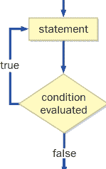

图 6.1 `do` 循环的逻辑

以下代码使用 `do` 循环打印 1 到 5 的数字。将此代码与第 5 章中使用 `while` 循环完成相同任务的示例进行比较。

```java
int count = 0;
do
{
  count++;
  System.out.println(count);
}
while (count < 5);
```

> 核心概念

`do` 语句至少执行一次其循环体。

注意 `do` 循环仅从保留字 `do` 开始。`do` 循环体一直执行，直到确定循环体的 `while` 子句被执行。有时，很难判断某行代码以保留字 `while` 开头是 `while` 循环的开始，还是 `do` 循环的结束。

让我们再看另一个 `do` 循环的例子。列表 6.2 显示的 `ReverseNumber` 程序从用户处读取一个整数并用数学方法反转其数字。

| Do 语句 |
| :--- |
| `do` -> `Statement` -> `while` -> `(` `Expression` `)` -> `;` |

只要布尔表达式为真，`do` 循环就会重复执行指定的 `Statement`。语句至少执行一次，然后评估表达式以决定是否再次执行该语句。

示例：

```java
do {
    System.out.print("Enter a word:");
    word = scan.next();
    System.out.println(word);
} while (!word.equals("quit"));
```

# 列表 6.2

```java
// ReverseNumber.java 作者：Lewis/Loftus
// 展示 do 循环的使用。
// 用数学方法反转整数的数字。

import java.util.Scanner;

public class ReverseNumber {
    public static void main(String[] args) {
        int number, lastDigit, reverse = 0;
        Scanner scan = new Scanner(System.in);
        System.out.print("Enter a positive integer: ");
        number = scan.nextInt();

        do {
            lastDigit = number % 10;
            reverse = (reverse * 10) + lastDigit;
            number = number / 10;
        } while (number > 0);

        System.out.println("That number reversed is " + reverse);
    }
}
```

# 第 6 章 更多条件和循环

列表 6.2 续

输出

输入一个正整数：2896

反转后的数字为 6982

`ReverseNumber` 程序中的 `do` 循环使用余运算确定个位数字，将其添加到反转数字，然后使用整数除法从原始数字中截断。当没有数字可以处理时，`do` 循环终止。仔细跟踪该程序的逻辑以查看其工作原理。

如果你希望至少执行一次循环体，那么你可能想使用 `do` 语句。`do` 循环具有与 `while` 语句许多属性，因此也必须检查终止条件以避免无限循环。

-   自测习题（答案见附录 N）

SR 6.8 比较 `while` 循环和 `do` 循环。

SR 6.9 下面代码片段的输出是什么？

```java
int low = 0, high = 10;

do {

  System.out.println(low);

  low++;

} while (low < high);
```

SR 6.10 下面代码片段的输出是什么？

```java
int low = 10, high = 0;

do {

  System.out.println(low);

  low++;

} while (low <= high);
```

SR 6.11 写一个 `do` 循环从用户处获取一系列正整数，使用零作为哨兵值。程序应该输出这些数字的总和。

## 6.4 for 语句

当你最初不知道想要执行循环体多少次时，使用 `while` 和 `do` 语句是很有帮助的。`for` 语句是另一种重复语句，它特别适用于执行特定次数的循环体，而这个次数可以在循环执行之前确定。

> 核心概念

当循环将执行固定次数的次数时，通常会使用 `for` 语句。

下面的代码使用 `for` 循环打印了 1 到 5，就像我们在之前的示例中对其他循环语句一样：

```java
for (int count=1; count <= 5; count++)
System.out.println(count);
```

`for` 循环的头部包含三个部分，用分号隔开。在循环开始之前，会执行头部的第一部分，称为“初始化”。头部的第二部分是布尔条件，它在执行循环体之前进行评估（类似于 `while` 循环）。如果条件为真，则通过执行头部的第三部分（称为“增量”）来执行循环体。注意，初始化部分只执行一次，而增量部分在循环的每次迭代后都会执行。图 6.2 显示了这一处理过程。

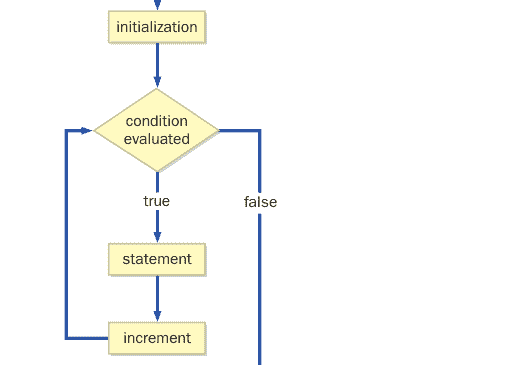

图 6.2 `for` 循环的逻辑

## 第 6 章 更多条件和循环

在习惯之前，`for` 循环可能有些复杂。代码的执行并不遵循“从上到下、从左到右”的阅读顺序。即使增量位于头部，它也在循环体之后执行。

在这个示例中，`for` 循环的初始化部分用于声明变量 `count`。我们并不要求在那里声明变量，但在变量在循环外部不需要的情况下，这种做法很常见。由于 `count` 是在 `for` 循环头部中声明的，它只存在于循环体内部，不能在其他地方被引用。循环控制变量通过循环头部的操作进行设置、检查和修改。它可以在循环体内部被引用，但不应该被循环头部的操作进行修改。

## for 语句

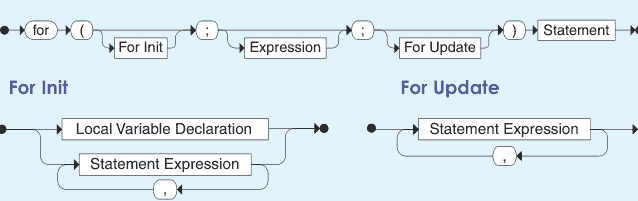

`for` 语句只要布尔表达式为真，就会重复执行指定的 `Statement`。头部的 `For Init`（初始化）部分在循环开始前只执行一次。`For Update`（更新）部分在每次执行 `Statement` 后执行。示例：

```java
for (int value=1; value < 25; value++)
System.out.println(value + " squared is " + value*value);
```

```java
for (int num=40; num > 0; num-=3)
sum = sum + num;
```

`for` 循环的增量部分尽管名为增量，也可以减少一个值而不是增加它。例如，下面的循环打印了从 100 到 1 的整数值：

```java
for (int num = 100; num > 0; num--)
System.out.println(num);
```

## 6.4 语句

事实上，循环的增量部分可以执行任何计算，而不只是简单的加增或减小。考虑列表 6.3 所示的程序，它打印从特定值到特定限制的倍数。

`Multiples` 中循环的增量部分在每次迭代后加上用户输入的值。每行打印的数值通过计算打印的数值以及每当 `count` 能够被 `PER_LINE` 常数整除时移动到下一行来控制。

## 列表 6.3

```java
// Multiples.java      作者: Lewis/Loftus
//
// 展示了 for 循环的使用。
import java.util.Scanner;

public class Multiples
{
    // 打印从用户指定的数字到用户指定的
    // 限制的倍数。
    public static void main(String[] args)
    {
        final int PER_LINE = 5;
        int value, limit, mult, count = 0;

        Scanner scan = new Scanner(System.in);

        System.out.print("Enter a positive value: ");
        value = scan.nextInt();

        System.out.print("Enter an upper limit: ");
        limit = scan.nextInt();

        System.out.println("The multiples of " + value + " between " + value + " and " + limit + " (inclusive) are: ");

        for (int mult = value; mult <= limit; mult += value)
        {
            System.out.print(mult + "\t");
            // 每行输出打印特定数量的数值
            count++;
            if (count % PER_LINE == 0)
                System.out.println();
        }
    }
}
```

## 第 6 章 更多条件和循环

## 列表 6.3 延续

输出

Enter a positive value: 7

Enter an upper limit: 400

The multiples of 7 between 7 and 400 (inclusive) are:

| 7 14 21 28 35 |
| 42 49 56 63 70 |
| 77 84 91 98 105 |
| 112 119 126 133 140 |
| 147 154 161 168 175 |
| 182 189 196 203 210 |
| 217 224 231 238 245 |
| 252 259 266 273 280 |
| 287 294 301 308 315 |
| 322 329 336 343 350 |
| 357 364 371 378 385 |
| 392 399 |

*(注：此处在翻译时根据代码逻辑补全了示例中缺失的输出行，以保持文档完整性)*

## for 循环

`for` 循环在不熟悉它之前读起来可能有点困难。当你知道执行循环的次数时，`for` 

## 列表 6.4

```java
// Stars.java      作者: Lewis/Loftus
//
// 展示了嵌套 for 循环的使用。
public class Stars {
    // 使用星号 (*)字符打印一个三角形形状。
    public static void main(String[] args) {
        final int MAX_ROWS = 10;

        for (int row = 1; row <= MAX_ROWS; row++) {
            for (int star = 1; star <= row; star++) {
                System.out.print("*");
            }
            System.out.println();
        }
    }
}
```

## 输出

```
*
**
***
****
*****
******
*******
********
*********
**********
```

对象被认为是迭代器时，它们具有 `hasNext()` 和 `next()` 方法来处理组项。如果一个对象实现了 `Iterable` 接口，那么我们可以使用 `for` 循环的语法。

## 增强 for 循环

> 核心概念

`for` 循环的版本简化了对 `Iterable` 中元素的处理。

`ArrayList` 对象是一个 `Iterable` 对象。因此，例如，如果 `library` 是一个 `ArrayList<Book>`（即管理 `Book` 对象的集合），我们可以使用 `for` 循环处理每个 `Book`，如下：

```java
for (Book myBook : library)
System.out.println(myBook);
```

这段代码可以读作：对于 `library` 中的每个 `Book`，打印该对象。增强 `for` 循环本质上等同于：

```java
while (bookList.hasNext()) {
    myBook = bookList.next();
    System.out.println(myBook);
}
```

`for` 循环的版本也可以用于数组，数组将在第 8 章中讨论。我们在书的其余部分将在适当的情况下使用增强 for 循环。

## 比较循环

基础循环语句（`while`、`do` 和 `for`）在功能上是等价的。任何使用一种循环类型编写的特定循环都可以使用其他两种类型编写。我们使用哪种类型取决于情况。

正如前面提到的，`while` 和 `do` 循环的主要区别在于评估条件的时间点。如果我们知道至少执行一次循环体，`do` 循环通常是更好的选择。另一方面，如果条件最初为假，`while` 循环的体可能一次也无法执行。因此，我们说 `while` 循环的体执行零次或多次，但 `do` 循环的体执行一次或多次。

> 核心概念

循环语句在功能上是等价的。你使用哪种类型取决于情况。

`for` 循环类似于 `while` 循环，因为条件在执行循环体之前进行评估。当我们想要迭代循环的次数是固定的或可以很容易计算时，我们通常使用 `for` 循环。

# 6.5 使用循环和条件进行绘图

自测题（答案见附录 N）

SR 6.12 我们什么时候会使用 `for` 循环而不是 `while` 循环？

SR 6.13 下述代码段的输出是什么？

```java
int value = 0;
for (int num = 10; num <= 40; num += 10)
{
    value = value + num;
}
System.out.println(value);
```

SR 6.14 下述代码段的输出是什么？

```java
int value = 0;
for (int num = 10; num < 40; num += 10)
{
    value = value + num;
}
System.out.println(value);
```

SR 6.15 下述代码段的输出是什么？


```java
int value = 6;
for (int num = 1; num <= value; num++)
{
    for (int i = 1; i <= (value - num); i++)
        System.out.print(" ");
    for (int i = 1; i < (2 * num) - 1; i++)
        System.out.print("*");
    System.out.println();
}
```

## SR 6.16
假设 `die` 是一个 `Die("")`。编写一个代码段，掷 100 次骰并输出平均值。

# 6.5 使用循环和条件进行绘图

条件语句和循环极大增强了我们生成有趣图形的能力。

列表 6.5 显示的 `Bullseye` 程序绘制了一个靶心。绘图实际上发生在列表 6.6 显示的 `BullseyePanel` 类中。`BullseyePanel` 的 `paintComponent` 使用 `if` 语句在黑白色之间交替颜色。

注意，每个环实际上都是被绘制为一个填充的圆（长宽相等的椭圆）。由于我们将圆相互叠加，内层圆会覆盖大圆的内部部分，从而产生环的效果。最后，会绘制一个最终的红色圆作为靶心。

让我们来看另一个例子。列表 6.7 显示了 `Boxes` 类，它实例化并显示了列表 6.8 中的 `BoxesPanel`。该程序的目的是在某些位置绘制几个随机大小的矩形。如果矩形的宽度小于某个厚度（5 像素），则矩形填充为黄色。如果高度小于最小厚度，则矩形填充为绿色。否则，用白色不填充地绘制矩形。

## 列表 6.5

```java
// Bullseye.java               Author: Lewis/Loftus
// 使用循环进行绘图。
import javax.swing.JFrame;

public class Bullseye {
    //------------------------------------------------------------------------
    // 创建程序的主框架。
    //------------------------------------------------------------------------
    public static void main(String[] args) {
        JFrame frame = new JFrame("Bullseye");
        frame.setDefaultCloseOperation(JFrame.EXIT_ON_CLOSE);

        BullseyePanel panel = new BullseyePanel();
        frame.getContentPane().add(panel);
        frame.pack();
        frame.setVisible(true);
    }
}
```

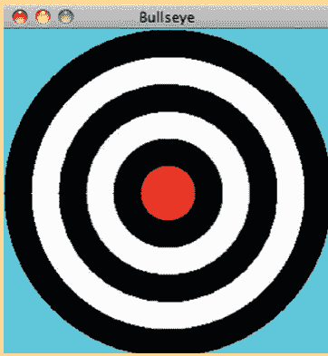

## 列表 6.6

```java
// BullseyePanel.java      Author: Lewis/Loft
//
// 使用条件语句和循环引导绘图。

import javax.swing.JPanel;
import java.awt.*;

public class BullseyePanel extends JPanel {
    private final int MAX_WIDTH = 300, NUM_RINGS = 5, RING_WIDTH = 25;

    //
    // 设置靶心。
    //
    public BullseyePanel() {
        setBackground(Color.cyan);
        setPreferredSize(new Dimension(300,300));
    }

    //
    // 绘制靶心目标。
    //
    public void paintComponent(Graphics page) {
        super.paintComponent(page);
        int x = 0, y = 0, diameter = MAX_WIDTH;
        page.setColor(Color.white);

        for (int count = 0; count < NUM_RINGS; count++) {
            if (page.getColor() == Color.black) // 交替颜色
                page.setColor(Color.white);
            else
                page.setColor(Color.black);
            
            page.fillOval(x, y, diameter, diameter);
            diameter -= (2 * RING_WIDTH);
            x += RING_WIDTH;
            y += RING_WIDTH;
        }

        // 在中心绘制红色的靶心
        page.setColor(Color.red);
        page.fillOval(x, y, diameter, diameter);
    }
}
```

## 列表 6.7

```java
// Boxes.java               Author: Lewis/Loftus
// 使用循环进行绘图。
import javax.swing.JFrame;

public class Boxes {
    //------------------------------------------------------------------------
    // 创建程序的主框架。
    //------------------------------------------------------------------------
    public static void main(String[] args) {
        JFrame frame = new JFrame("Boxes");
        frame.setDefaultCloseOperation(JFrame.EXIT_ON_CLOSE);

        BoxesPanel panel = new BoxesPanel();
        frame.getContentPane().add(panel);
        frame.pack();
        frame.setVisible(true);
    }
}
```


## 列表 6.8

```java
// BoxesPanel.java      Author: Lewis/Loft
//
// 使用条件语句和循环引导绘图。

import javax.swing.JPanel;
import java.awt.*;
import java.util.Random;

public class BoxesPanel extends JPanel {
    private final int MAX_WIDTH = 300, NUM_BOXES = 10, THICKNESS = 5;

    //
    // 设置面板。
    //
    public BoxesPanel() {
        setBackground(Color.cyan);
        setPreferredSize(new Dimension(300,300));
    }

    //
    // 绘制矩形。
    //
    public void paintComponent(Graphics page) {
        super.paintComponent(page);

        Random rand = new Random();
        for (int i = 0; i < NUM_BOXES; i++) {
            int width = rand.nextInt(200);
            int height = rand.nextInt(200);
            int rx = rand.nextInt(100);
            int ry = rand.nextInt(100);

            if (width < THICKNESS) {
                page.setColor(Color.yellow);
                page.fillRect(rx, ry, width, height);
            } else if (height < THICKNESS) {
                page.setColor(Color.green);
                page.fillRect(rx, ry, width, height);
            } else {
                page.setColor(Color.white);
                page.drawRect(rx, ry, width, height);
            }
        }
    }
}
```

# 第 6 章 更多条件语句和循环

`JOptionPane` 对话框的基本格式分为三类。输入对话框仅显示一个输出字符串。单个输入文本框允许用户输入一个字符串数据。确认对话框向用户提出一个简单的“是”或“否”的问题。

让我们来看一个使用这些类型对话框的程序。列表 6.9 显示了一个程序，首先向用户显示一个输入对话框，要求输入一个整数。用户点击输入对话框上的 OK 按钮后，会出现第二个对话框（这次是消息对话框），告知用户输入的数字是偶数还是奇数。在用户关闭该框后，会弹出第三个对话框，确定用户是否想测试另一个数字。如果用户点击标记为“Yes”的按钮，这一系列对话框将重复。否则程序终止。

## 列表 6.9

```java
// EvenOdd.java               Author: Lewis/Loftus
//
// 展示了 JOptionPane 类的使用。

import javax.swing.JOptionPane;

public class EvenOdd {
    public static void main(String[] args) {
        // 判断用户输入的值是偶数还是奇数。
        // 使用多个对话框与用户进行交互。
        //
        String numStr, result;
        int num, again;
        do {
            numStr = JOptionPane.showInputDialog("Enter an integer: ");
            num = Integer.parseInt(numStr);

            result = "That number is " + ((num % 2 == 0) ? "even" : "odd");

            JOptionPane.showMessageDialog(null, result);
            again = JOptionPane.showConfirmDialog(null, "Do Another?");
        }
        while (again == JOptionPane.YES_OPTION);
    }
}
```

## 列表 6.9 延续

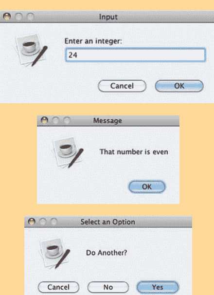

`showMessageDialog` 和 `showConfirmDialog` 方法的第一个参数指定了对话框的父组件。使用 `null` 引用作为此参数将使对话框显示在屏幕中央。

许多 `JOptionPane` 方法允许程序员定制对话框的内容。此外，可以使用 `showOptionDialog` 方法创建结合三种基本格式特征的对话框，以实现更复杂的交互。

# 核心概念总结

- `switch` 语句将字符或整数值匹配到多个可能的情况（case）中的一个。
- `break` 语句通常用于 `switch` 语句每个 `case` 分支的末尾。
- 条件运算符根据布尔条件求得为两个可能值之一。
- `do` 语句至少执行一次其循环体。
- `for` 语句通常用于需要执行固定次数的循环。
- `for-each` 版本的 `for` 循环简化了对 `Iterable` 对象中所有元素的处理。
- 这些循环语句在功能上是等价的。你应该根据情况选择使用哪一个。
- 对话框是一个弹出窗口，允许简短、特定的用户交互，以提供信息或验证操作。

# 练习题

## EX 6.1
以下 `for` 循环将执行多少次迭代？

- a. `for (int i = 0; i < 20; i++) { }`
- b. `for (int i = 1; i <= 20; i++) { }`
- c. `for (int i = 5; i < 20; i++) { }`
- d. `for (int i = 20; i > 0; i--) { }`
- e. `for (int i = 1; i < 20; i = i + 2) {}`
- f. `for (int i = 1; i < 20; i *= 2) { }`

## EX 6.2
下列代码片段的输出是什么？

```java
for (int num = 0; num <= 200; num += 2)
    System.out.println(num);
```

## EX 6.3
下述代码片段的输出是什么？

```java
for (int val = 200; val >= 0; val -= 1)
    if (val % 4 != 0)
        System.out.println(val);
```

## EX 6.4
将下述 `while` 循环转换为等效的 `do` 循环（确保它产生相同的输出）。

```java
int num = 1;
while (num < 20)
{
    num++;
    System.out.println(num);
}
```

## EX 6.5
将上一个练习中的 `while` 循环转换为等效的 `for` 循环。

## EX 6.6
编写一个 `do` 循环验证用户输入的是偶数。

## EX 6.7
编写一个 `for` 循环打印 1 到 99 的数字。

## EX 6.8
编写一个 `for` 循环从 300 开始打印 3 的倍数。

## EX 6.9
编写代码片段读取 10 个值并打印最大值。

## EX 6.10
编写代码打印字符 `'a'` 在字符串中出现的次数。

## EX 6.11
编写代码片段反向打印该字符串。

## EX 6.12
编写代码每隔一个打印一个字符。

## EX 6.13
编写一个名为 `powersOf` 的方法，打印 2 的前 10 次幂。

## EX 6.14
编写一个名为 `alarm` 的方法，打印字符串 "Alarm!" n 次。

## EX 6.15
编写一个名为 `sum` 的方法，返回 1 到 100 的整数之和。


# EX 6.16 编写一个名为 `sumRange` 的方法，接受两个参数并返回和。

# 第 6 章 更多条件和循环

- EX 6.17 编写一个名为 `count` 的方法，返回字符 'A' 在字符串中出现的次数。
- EX 6.18 编写一个名为 `reverse` 的方法，返回反转后的字符串。

# 项目

- PP 6.1 编写一个程序，读取一个整数并打印 2 到输入值之间所有偶数之和。
- PP 6.2 编写一个程序打印一行。
- PP 6.3 编写一个程序生成 1 到 12 的乘法表。
- PP 6.4 编写一个程序打印《百瓶啤酒歌》（Hundred Bottles of Beer）的前几句。从用户处读取要打印的歌句数量。

> 100 bottles on the wall, 100 bottles on the wall,
>
> Take one off and rub it out, and then there are 99 bottles on the wall.
>
> 99 bottles on the wall, 99 bottles on the wall,
>
> Take one off and rub it out, and then there are 98 bottles on the wall.

- PP 6.5 使用 `Pair` 类编写一个程序，掷一对骰子 1000 次并统计出现的六点。
- PP 6.6 使用第 5 章定义的 `Coin` 类编写一个名为 `CountFlips` 的程序，其主方法掷硬币 100 次并统计每个面出现的次数。
- PP 6.7 创建 `Stars` 的修改版本以打印以下模式。为每个模式创建一个独立的程序。提示：b、c、d 部分需要多个循环，其中某些循环打印特定数量的星。

```
a. *
b. **
c. ***
d. ****
****
*****
*****
******
```

- PP 6.8 编写一个程序显示 Unicode 字符子集的及其数值。每行打印五个数字/字符对，并用制表符分隔。打印从 32（空格字符）到 126（~ 字符集）的数值。将你的输出与附录 C 中的表比较。你的表格数值可以随着行的增加。
- PP 6.9 编写一个程序从用户处读取字符串，并打印整个字符串中每个小写元音（a, e, i, o 和 u）出现的次数。为每个元音准备一个计数器。还要计数并打印非元音字符的数量。
- PP 6.10 编写一个程序打印《圣诞》（Twelve Days of Christmas）的歌词，每段增加一行。歌曲的前几段如下：

> On the 1st day of Christmas my true love gave to me
>
> A Partridge in a pear tree.
>
> On the 2nd day of Christmas my true love gave to me
>
> Two turtle doves, and,
>
> A Partridge in a pear tree.

在循环中使用 `switch` 语句来控制打印哪些行。**提示：** 仔细安排 `case` 的顺序并避免使用 `break`。

# 298 第 6 章 更多条件判断和循环

语句。使用一个独立的 `switch` 语句为日期数字加上合适的后缀（1st, 2nd, 3rd, 等）。歌曲的最终结果涉及所有 12 天，如下：

- 在圣诞节的第 12 天，我的真爱送给我
- 十二敲鼓手在敲鼓，
- 十一位笛手在吹奏，
- 十位领主在跳跃，
- 九位女仆在跳，
- 八位女仆在挤奶，
- 七只天鹅在游泳，
- 六只鹅子在下蛋，
- 五个金环，
- 四只鸣叫鸟，
- 三只法国母鸡，
- 两只斑鸠鸽，以及
- 一只在梨树上的寿鹌鸟。

- PP 6.11 写一个程序，绘制 20 条长度随机、间距均匀的水平等平行线。
- PP 6.12 写一个程序，显示一个具有 64 个方格、黑白相间的棋盘。
- PP 6.13 写一个程序，绘制从左下角到右上角的阶梯侧视图。
- PP 6.14 写一个程序，在随机位置绘制 100 个颜色和直径随机的圆。确保每个圆都完全出现在小程序的可见区域内。
- PP 6.15 写一个程序，绘制 10 个半径随机的同心圆。
- PP 6.16 写一个程序，绘制一种砖墙图案，每一行砖相对于其上方和下方的行都有偏移。
- PP 6.17 写一个程序，绘制一个被子，其中简单的图案在正方形网格中重复。
- PP 6.18 修改上一个问题，使用一个名为 `QuillPattern` 的独立类来绘制被子，该类表示特定的图案。允许 `QuillPattern` 的构造函数改变图案的某些特征，例如颜色方案。实例化两个独立的 `QuillPattern` 对象并将它们结合被子的棋盘布局中。

# 编程项目 299

- PP 6.19 写一个程序，绘制一个简单的栅栏，具有垂直等间距的木条，背后有两块水平支撑板。在栅栏背景处显示一个简单的房子。确保房子在栅栏的木条之间可见。
- PP 6.20 写一个程序绘制彩虹。使用紧密的同心圆弧用特定的颜色绘制彩虹的每个部分。
- PP 6.21 写一个程序，在可见区域内的随机位置绘制 20,000 个点。让面板左半部分的点显示为红色，右半部分的点显示为绿色。通过绘制长度仅为像素的线来绘制每个点。
- PP 6.22 写一个程序，在随机位置绘制 10 个半径随机的圆。将最大的圆填充为红色。
- PP 6.23 写一个程序，使用对话框获取两个整数值（每个值使用一个对话框），并显示这两个值的和和乘积。使用另一个对话框查看用户是否想要另一对数值。
- PP 6.24 重新设计并实现 `PalindromeTester` 的版本，使其使用对话框获取输入字符串、显示结果并提示继续。
- PP 6.25 写一个 `Card` 类表示一张标准的扑克牌。每张牌都有花色和点值。创建一个程序来分发五张随机牌。

本页故意留白

# 面向对象设计

## 章节目标

- 建立与面向对象软件设计相关的关键问题。
- 探索识别程序所需的类和对象的技巧。
- 讨论类之间的关系。
- 描述 `static` 修饰符对方法和数据的影响。
- 讨论正式对象接口的创建。
- 进一步探索枚举类型的定义。
- 讨论与方法设计相关的问题，包括方法重载。
- 探索与图形用户界面设计相关的问题，包括布局管理器。

本章扩展了我们对对象软件设计的讨论。我们首先关注软件开发的阶段以及在问题领域中识别类和对象的过程。然后，我们讨论了影响类设计的各种问题，包括静态成员、类关系、接口和枚举类型。我们还探索了方法层面的设计问题，并引入了方法重载的概念。对测试策略的讨论完善了这些问题。在本章的图形轨道（Graphics Track）部分中，我们重点关注 GUI 设计概念，包括布局管理器和包含层次结构。

## 7.1 软件开发活动

创建软件不仅仅是编写代码。随着你处理的问题变得越来越大，解决方案包含更多的类，仔细思考软件的设计就变得至关重要。任何适当的软件开发都由四个基本开发活动组成：

- 建立需求
- 创建设计
- 实现设计
- 测试

如果这些活动按照这种顺序定义了开发软件的步进式方法，那就太好了。然而，尽管它们看起来是顺序的，但在现实中它们几乎从不是线性的。它们相互重叠并相互作用。让我们简要讨论每个开发活动。

软件需求规定了程序必须完成什么。通常是程序应该执行的任务，而不是它如何执行任务。然后，需求被表达在一个称为功能规范（functional specification）的文档中。

我们在第 1 章中讨论过编程就是解决问题的这一前提；我们创建一个程序来解决某个特定问题。需求是该问题的清晰表达。如果我们真正不知道我们正在试图解决什么问题，我们实际上无法解决它。

想要开发软件的人或小组（客户）将提供一组初始需求。然而，这些需求往往是不完全、含糊的，甚至可能是矛盾的。软件开发者必须与客户合作，完善需求，直到对所有内容做出决定。

需求通常涉及输出格式、屏幕布局等图形界面。本质上，需求建立了程序有用的特征。它们还规定了程序如何执行。

建筑工程师在不先设计的情况下绝不会考虑造桥。软件设计同样不可或缺。许多出现的问题直接归因于缺乏设计。事实再次证明，对设计的投入是非常值得的，长期来看。

> 关键概念：投入设计的精力至关重要且具有效益。

## 7.2 识别类和对象

在软件设计期间，需要考虑并探索替代方案。通常，设计的第一次尝试并不是最好的。幸运的是，在设计阶段更改相对容易。

实现是编写解决问题的源码的过程。更准确地说，实现是将设计翻译成特定的编程语言。许多程序员只关注实现，而实现应该是所有活动中最创造性的。重要的决策应该在建立需求和创建设计时做出。

测试是确保程序在规定条件下执行的行为。测试包括使用各种输入运行程序并仔细检查结果。它远不止于此。我们在 7.9 节再次回到测试相关的问题。

# 自习题（答案见附录 N）

- SR 7.1 列出涉及软件开发过程四个基本活动。
- SR 7.2 谁创建软件需求？客户还是开发者？请讨论。
- SR 7.3 将本节提出的四个基本活动与第 1 章（第 1.6 节）提出的五个通用问题解决步骤进行比较。

## 7.2 识别类和对象

面向对象软件设计的一个基本部分是确定做出贡献的类。我们必须仔细考虑我们想要如何表示组成解决方案的各种元素。这些类决定了我们在系统中管理的对象。

识别潜在类的一种方法是识别需求中讨论的对象。对象通常是名词。你实际上可能需要仔细检查问题描述，或者如果有可用的功能规范，以识别其中的名词。例如，图 7.1 显示了问题描述的一部分，并圈出了名词。

> 关键概念：问题描述中的名词可能指示程序所需的某些类和对象。

# 304 第 7 章 对象面向设计

> 必须允许用户指定每个产品的特征，包括其名称和产品编号。如果条形码与产品不匹配，应向消息窗口生成错误并将其记入错误日志。所有交易的摘要报告必须按照第 7.A 节的规定进行结构。

图 7.1 圈出名词的部分问题描述

记住，类表示了一组具有相似行为的对象。规格说明中的复数名词（如 `products` 产品）可能表示需要一个类来代表其中的某一个，例如 `Product`（产品类）。如果系统中只需要一种特定类型的对象，则它可以被表示为一个类。

表示对象的类通常应该使用单数名词进行命名，例如 `Coin`（硬币）、`Student`（学生）和 `Message`（消息）。类代表一个单一项目，我们可以根据需要自由创建任意数量的实例。

另一个关键决策是将某物表示为对象，还是表示为另一个对象的原始类型属性。例如，我们最初可能认为员工的工资应该表示为整数，这对于系统的大部分处理可能是行的。经过进一步反思，我们可能会意识到工资取决于人的职级，而职级有上限和下限工资，必须仔细管理。因此，最终结论是，将所有数据和相关行为表示为一个单独的类更好。

考虑到特定程序的需求，我们希望在过于通用的类和过于具体的类之间取得良好平衡。例如，为房子存在的每种电器创建一个单独的类可能会不必要地增加设计复杂度。一个单一的 `Appliance`（电器）类，并带有一个指示其电器类型的实例数据可能足够了。但也有可能不够。这取决于软件旨在实现什么功能。

除了表示问题领域对象的类外，我们可能还需要支持完成工作所需操作的类。例如，除了 `Member`（成员）对象外，我们可能还需要一个单独的类来帮助管理俱乐部的所有成员。

请记住，在生成真实系统时，我们在设计过程中识别出的某些类可能已经存在。如果没有完全匹配的，可能存在一个足够相似的旧类，可以作为我们新类的基础。现有的类可能是 Java 标准类库的一部分，可能是我们以前解决过的问题的解决方案的一部分，也可能是从第三方购买的类库的一部分。这些都是软件重用的例子。

### 分配责任

识别程序中所需类的过程之一，是为每个类分配责任的过程。每个类代表一个具有特定行为的对象，这些行为由类的方法定义。程序必须完成的任何活动都体现在类的行为某处。因此，每个类都负责执行某些活动，这些责任必须作为设计程序的一部分进行分配。

类的行为执行了构成程序功能的动作。因此，我们通常使用动词作为行为以及实现这些行为的方法名称。

有时，确定哪种方式最适合执行特定责任是挑战性的。考虑多种可能性。有时通过这种分析，你可能会发现通过定义另一个类来承担该责任会让你受益匪浅。

在设计的早期，没有必要识别一个类将包含的所有方法。通常分配主要责任并考虑这些责任如何转换为特定方法就足够了。

# 自测习题（答案见附录 N）

- SR 7.4 识别问题规格说明中的名词如何帮助你为该问题设计一个面向对象的解决方案？
- SR 7.5 在问题解决方案设计的早期，识别并定义一个类将包含的所有方法是否重要？

## 7.3 静态类成员

在书中之前的示例中，我们已经在各种情况下使用了静态方法。例如，`Math` 类的所有方法都是静态的。记住，静态方法是通过它的名称调用的，而不是通过该类的对象调用的。

方法可以是静态的，变量也可以是静态的。我们使用 `static` 修饰符来声明静态类成员。

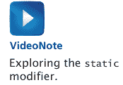

# 第 7 章 对象面向设计

决定将方法或变量声明为静态是类设计中的关键步骤。让我们仔细检查静态变量和方法的影响。

### 静态变量

到目前，我们看到了两类变量：不在方法内部声明的局部变量，以及在类中声明但在方法内部之外的实例变量。使用“实例变量”一术语是因为类的每个实例都有该变量自己的版本。也就是说，每个对象对每个变量都有独立的内存空间。

> 核心概念：静态变量被类的所有实例共享。

静态变量（有时称为类变量）在类的所有实例之间共享。对于类的所有对象，静态变量只有一个副本。因此，一个对象更改了它，所有其他对象都会改变。使用关键字 `static` 作为修饰符来声明静态变量：

```
private static int count = 0;
```

静态变量的内存空间是在程序中第一次引用包含它的类时建立的。在方法内部声明的局部变量不能是静态的。

使用 `final` 修饰符声明的常量通常使用 `static` 修饰符声明。因为常量的值不能更改，在类的所有对象中可能只有该值的唯一副本。

### 静态方法

第 3 章简要介绍了静态方法的概念（也称为类方法）。静态方法可以通过类来调用。我们不需要实例化类的对象就可以调用它们。在第 3 章中，我们注意到 `Math` 类的所有方法都是静态方法。例如，在下面的代码行中，调用了 `sqrt`：

```
System.out.println("Square root of 27: " + Math.sqrt(27));
```

`Math` 类中的方法执行作为参数传递的基本计算。在这些情况下，不需要维护状态；因此，没有正理由创建一个对象来请求这些服务。

通过在方法声明中使用 `static` 修饰符，方法即是静态的。正如我们多次看到的，Java 程序的 `main` 方法必须声明为 `static` 修饰符；这样做是为了让解释器可以在不从包含 `main` 的类实例化对象的情况下执行 `main`。

由于静态方法不在特定对象的上下文中运行，因此它们不能引用实例变量（实例变量只存在于类的实例）。如果静态方法尝试使用非静态变量，编译器将发出错误。然而，静态方法可以引用静态变量，因为静态变量独立于特定对象。因此，`main` 方法可以访问静态或局部变量。

列表 7.1 中的程序实例化了 `Slogan` 类的多个对象并依次打印。在程序结束时，它通过类名调用 `getCount` 方法，该方法返回程序中实例化的 `Slogan` 对象数量。

```
LISTING 7.1
********************************************************************
// SloganCounter.java               Author: Lewis/Loftus
// 展示 static 修饰符的使用。
********************************************************************
public class SloganCounter
{
    //----------------------------------------------------
    // 创建几个 Slogan 对象并打印创建的对象数量。
    //----------------------------------------------------
    public static void main(String[] args) {
        Slogan obj;

        obj = new Slogan("Remember the Alamo.");
        System.out.println(obj);

        obj = new Slogan("Don't Worry. Be Happy.");
        System.out.println(obj);

        obj = new Slogan("Live Free or Die.");
        System.out.println(obj);

        obj = new Slogan("Talk is Cheap.");
        System.out.println(obj);

        obj = new Slogan("Write Once, Run Anywhere.");
        System.out.println(obj);
    }
}
```

# 第7章 面向对象的设计

```
LISTING 7.1 continued
System.out.println(" ");
System.out.println("Slogans created: " + Slogan.getCount());
}
```

OUTPUT

Remember the Alamo.

Don't Worry. Be Happy.

Live Free or Die.

Talk is Cheap.

Write Once, Run Anywhere.

Slogans created: 5

Listing 7.2 显示了 Slogan 类。Slogan 的构造函数会增加一个名为 `count` 的静态变量，该变量在声明时被初始化为零。因此，`count` 用于跟踪创建的 Slogan 实例数量。


Slogan 的 `getCount` 方法也被声明为静态（`static`），这允许在 `main` 方法中通过类名调用它。请注意，`getCount` 方法引用的唯一数据是整数变量 `count`，它是静态的。作为静态方法，`getCount` 不能引用任何非成员数据。

`getCount` 方法可以在不加 `static` 修饰符的情况下声明，但其在 `main` 方法中的调用必须通过 Slogan 类的实例而不是类本身来完成。

```java
// LISTING 7.2
//*************************************************************************************
// Slogan.java      Author: Lewis/Loftos
// 表示单个标语字符串。
//*************************************************************************************

public class Slogan
{
    private String phrase;
    private static int count = 0;
}
```

## 7.3 静态类成员

### LISTING 7.2 continued

```java
// 设置标语并统计创建的对象
// 实例数量。
public Slogan(String str)
{
    phrase = str;
    count++;
}

// 将此标语作为字符串返回。
public String toString()
{
    return phrase;
}

// 返回此类已创建的实例
// 数量。
public static int getCount()
{
    return count;
}
```

## 自测题（答案见附录 N）

- SR 7.6 静态变量与实例变量之间的区别是什么？
- SR 7.7 假设你正在定义一个 BankAccount 类，其对象代表一个独立的银行账户。请为该类的变量编写一个声明，该变量将持有该类所代表的所有银行账户的总余额。
- SR 7.8 假设你正在定义一个 BankAccount 类，其对象代表一个独立的银行账户。请为该类的变量编写一个声明，该变量将持有每个账户必须维持的最低余额。
- SR 7.9 任何程序的 `main` 方法可以引用什么类型的变量？为什么？

## 7.4 类的关系

软件系统中的类之间存在各种类型的关系。最常见的三个关系是依赖（dependency）、聚合（aggregation）和继承（inheritance）。

我们在许多示例中已经见过依赖关系，即一个类“使用”另一个类。本节将回顾依赖关系，并探索类依赖于自身的情况。然后我们探索聚合关系，其中一个类的对象包含另一个类的对象，从而创建了“拥有”（has-a）的关系。我们在第一章中引入的继承在类与类之间建立了“是”（is-a）的关系。我们将对继承的详细检查推到第9章。

### 依赖

在许多示例中，我们见过一个类依赖于另一个类的思想。这意味着一个类在某些方面依赖另一个类。通常，一个类的方法会调用另一个类的方法。这建立了一种“使用”关系。

通常，如果类 A 使用类 B，则类 A 的一个或多个方法会调用类 B 的一个或多个方法。如果调用的方法是静态的，则 A 仅通过名称引用 B。如果方法不是静态的，则 A 必须访问类 B 的特定实例才能调用该方法。也就是说，A 必须拥有类 B 的一个引用。

一个对象获取类对象的方式是一个重要的设计决策。当一个类实例化另一个类的对象时就会发生，但这通常是聚合关系的基础。也可以通过将一个对象作为方法参数传递给另一个对象来实现。

通常，我们希望减少类之间的依赖数量。类之间依赖越少，变化和错误对系统的影响就越小。

### 同类对象之间的依赖

在某些情况下，类依赖于它自己。也就是说，一个类的对象与同类的另一个对象交互。为了实现这一点，类的一个方法可以接受同类的对象作为参数。设计这样的类强化了这样一个观点：类代表一个特定的对象。

String 类的 `concat` 方法就是这种情况的例子。该方法通过一个 String 对象执行，并将另一个 String 对象作为参数传递。例如：

```java
str3 = str1.concat(str2);
```

执行方法的 String 对象 (`str1`) 将其字符附加到作为参数的 String 对象 (`str2`) 之后。返回一个新对象并存储为 `str3`。

Listing 7.3 显示的 RationalTester 程序演示了类似的情况。有理数是可以表示为两个整数之比（分数）的值。RationalTester 程序创建了两个代表有理数的对象，并对它们进行各种操作以产生新的有理数。

```java
// LISTING 7.3
//*************************************************************************************
// RationalTester.java    Author: Lewis/Loftus
// 执行多个 Rational 对象使用的驱动。
//*************************************************************************************

public class RationalTester {
    // 创建一些有理数对象并对它们进行
    // 各种操作。
    public static void main(String[] args) {
        Rational r1 = new Rational(6, 8);
        Rational r2 = new Rational(1, 3);
        Rational r3, r4, r5, r6, r7;

        r4 = r1.add(r2);
        r5 = r1.subtract(r2);
        r6 = r1.multiply(r2);
        r7 = r1.divide(r2);

        System.out.println("First rational number: " + r1);
        System.out.println("Second rational number: " + r2);

        if (r1.isEqual(r2))
            System.out.println("r1 and r2 are equal.");
        else
            System.out.println("r1 and r2 are NOT equal.");

        r3 = r1.reciprocal();
        System.out.println("The reciprocal of r1: " + r3);

        System.out.println("r1 + r2: " + r4);
        System.out.println("r1 - r2: " + r5);
    }
}
```

#### OUTPUT

```
First rational number: 3/4
Second rational number: 1/3
r1 and r2 are NOT equal.
The reciprocal of r1: 4/3
r1 + r2: 11/12
r1 - r2: 5/12
```

`RationalNumber` 类如 Listing 7.4 所示。请记住，从 RationalNumber 类创建的每个对象都代表一个有理数。RationalNumber 类包含了对有理数的各种操作，如加法减法。

### LISTING 7.4

```java
//************************************************
// RationalNumber.java      Author: Lewis/Loftus
//
// 表示一个带有分子和分母的有理数。
//************************************************

public class RationalNumber
{
    private int numerator, denominator;
}
```

### LISTING 7.4 continued

```java
// 构造函数：通过确保分母不为零且仅
// 分子有符号来设置有理数。
//
public RationalNumber(int numer, int denom)
{
    if (denom == 0)
        denom = 1;

    // 让分子“存储”符号
    if (denom < 0)
    {
        numer = numer * -1;
        denom = denom * -1;
    }

    numerator = numer;
    denominator = denom;
    reduce();
}

// 返回此有理数的分子。
//
public int getNumerator()
{
    return numerator;
}

// 返回此有理数的分母。
//
public int getDenominator()
{
    return denominator;
}

// 返回此有理数的倒数。
//
public RationalNumber reciprocal()
{
    return new RationalNumber(denominator, numerator);
}
```

### LISTING 7.4 continued

```java
// + 将此有理数与作为参数的有理数相加。
// 通过相乘各个分母来找到公分母。
public RationalNumber add(RationalNumber op2) {
    int commonDenominator = denominator * op2.getDenominator();
    int numerator1 = numerator * op2.getDenominator();
    int numerator2 = op2.getNumerator() * denominator;
    int sum = numerator1 + numerator2;
    return new RationalNumber(sum, commonDenominator);
}
```

### LISTING 7.4 continued

```java
// - 从此有理数中减去作为参数的有理数。
public RationalNumber subtract(RationalNumber op2) {
    int commonDenominator = denominator * op2.getDenominator();
    int numerator1 = numerator * op2.getDenominator();
    int numerator2 = op2.getNumerator() * denominator;
    int difference = numerator1 - numerator2;
    return new RationalNumber(difference, commonDenominator);
}
```

### LISTING 7.4 continued

```java
// * 将此有理数乘以作为参数的有理数。
public RationalNumber multiply(RationalNumber op2) {
    int numer = numerator * op2.getNumerator();
    int denom = denominator * op2.getDenominator();
    return new RationalNumber(numer, denom);
}
```

### LISTING 7.4 continued

```java
// / 通过乘以第二个有理数的倒数，
// 将此有理数除以作为参数的有理数。
public RationalNumber divide(RationalNumber op2)
{
    return multiply(op2.reciprocal());
}
```

### LISTING 7.4 continued

```java
//
// 确定此有理数是否与作为参数的有理数相等。
// 假设它们都是最简形式的。
//
public boolean isLike(RationalNumber op2)
{
    return (numerator == op2.getNumerator() &&
            denominator == op2.getDenominator());
}
```

### LISTING 7.4 continued

```java
//
// 将此有理数作为字符串返回。
//
public String toString()
{
    String result;
    if (numerator == 0)
        result = "0";
    else
        if (denominator == 1)
            result = numerator + "";
        else
            result = numerator + "/" + denominator;
    return result;
}
```

### LISTING 7.4 continued

```java
//
// 通过将分子和分母除以它们的最大公约数
// 来约化此有理数。
//
private void reduce()
{
    if (numerator != 0)
    {
        int common = gcd(Math.abs(numerator), denominator);
        numerator = numerator / common;
        denominator = denominator / common;
    }
}
```

### LISTING 7.4 continued

```java
//
// 计算并返回两个正数参数的最大公约数。
// 使用欧几里得算法。
//
private int gcd(int num1, int num2)
{
    while (num1 != num2)
        if (num1 > num2)
            num1 = num1 - num2;
        else
            num2 = num2 - num1;
    return num1;
}
```


RationalNumber 类的方法（如 `add`、`subtract`、`multiply` 和 `divide`）使用执行方法的 `RationalNumber` 对象作为第一个（左侧）操作数，并将作为参数传递的 `RationalNumber` 对象作为第二个（右侧）操作数。

`RationalNumber` 类的 `isEqual` 方法用于确定有理数在本质上是否相等。因此，人们想将该方法命名为 `equals`，类似于用于比较字符串的方法（在第 5 章中讨论过）。在第 9 章中，我们将讨论 `equals` 方法由于继承而具有特殊性，以及它应该以特定的方式实现。因此，为了避免混淆，我们将此方法命名为 `isEqual`。

注意，`RationalNumber` 类中的某些方法（包括 `reduce` 和 `gcd`）被声明为私有（`private`）。这些方法之所以是私有的，是因为我们不希望在 `RationalNumber` 对象外部直接执行它们。它们的存在仅是为了支持对象的服务。

## 聚合

某些对象是由其他对象组成的。例如，汽车是由它的引擎、底盘、轮子和其他部分组成的。这些部分中的每一个都可以被视为一个独立的对象。我们就可以说汽车是一个聚合——它至少部分由其他对象组成。聚合有时被描述为一种“拥有”关系。例如，汽车有一个底盘。

> **核心概念**
> 聚合对象由其他对象组成，形成一种“拥有”的关系。

## 7.4 类关系

在软件世界中，我们将聚合对象定义为任何包含其他对象引用作为实例数据的对象。例如，`Account` 对象除了其他内容外，还包含一个代表账户所有者名的 `String` 对象。我们有时忘记字符串也是对象，但从技术上说，这使得每个 `Account` 对象成为聚合对象。

聚合是一种特殊的依赖关系。也就是说，由另一个类定义的类依赖于该类。聚合对象的方法通常会调用它所组成的对象的方法。

让我们考虑另一个例子。列表 7.5 显示的 `StudentBody` 程序创建了两个 `Student` 对象。每个 `Student` 对象由两个 `Address` 对象组成，分别是学生在学校的地址和学生的家庭地址。`main` 方法除了创建 `Student` 对象并打印它们之外没有做任何其他事情。再次，我们将对象传递给 `println` 方法，依靠自动调用 `toString` 方法来创建一个适合打印的对象的表示。

列表 7.6 显示的 `Student` 类代表单个学生。如果该类要代表学生的所有方面，它将被大大扩展。我们现在特意保持其简单，以便清晰地展示对象聚合。`Student` 类的实例数据包含两个对 `Address` 对象的引用。在 `toString` 方法中创建学生的字符串表示时，我们引用了这些对象。通过将一个 `Address` 对象连接到另一个字符串上，`Address` 中的 `toString` 方法会被自动调用。

### 列表 7.5

```java
// StudentBody.java               Author: Lewis/Loftus
// 演示了聚合类的使用。

public class StudentBody
{
    // 创建一些 Address 和 Student 对象并打印它们。
    public static void main(String[] args)
    {
        Address school = new Address("800 Lancaster Ave.", "Villanova", "PA", 19085);
        Address jHome = new Address("21 Jump Street", "Blacksburg", "VA", 24551);
        Student john = new Student("John", "Smith", jHome, school);
        Address mHome = new Address("123 Main Street", "Euclid", "OH", 44132);
        Student marsha = new Student("Marsha", "Jones", mHome, school);
        System.out.println(john);
        System.out.println();
        System.out.println(marsha);
    }
}
```

### 输出

```
John Smith
Home Address:
21 Jump Street
Blacksburg, VA 24551
School Address:
800 Lancaster Ave.
Villanova, PA 19085

Marsha Jones
Home Address:
123 Main Street
Euclid, OH 44132
School Address:
800 Lancaster Ave.
Villanova, PA 19085
```

### 列表 7.6

```java
// Student.java      Author: Lewis/Loftus
// 代表一个大学生。

public class Student {
    private String firstName, lastName;
    private Address homeAddress, schoolAddress;

    // 构造函数：用指定的值设置此学生。
    public Student(String first, String last, Address home, Address school)
    {
        firstName = first;
        lastName = last;
        homeAddress = home;
        schoolAddress = school;
    }

    // 返回此 Student 对象的字符串描述。
    public String toString()
    {
        String result;
        result = firstName + " " + lastName + "\n";
        result += "Home Address:\n" + homeAddress + "\n";
        result += "School Address:\n" + schoolAddress;
        return result;
    }
}
```

`Address` 类见列表 7.7。它代表一个街道地址。注意，`Address` 类中没有任何迹表明它是 `Student` 对象的一部分。`Address` 类在设计上保持了通用性，因此可以用于任何需要街道地址的情况。

### 列表 7.7

```java
// Address.java          Author: Lewis/Loftus
// 代表一个街道地址。

public class Address
{
    private String streetAddress, city, state;
    private long zipCode;

    // 构造函数：使用指定的数据设置此地址。
    public Address(String street, String town, String st, long zip)
    {
        streetAddress = street;
        city = town;
        state = st;
        zipCode = zip;
    }

    // 返回此 Address 对象的描述。
    public String toString()
    {
        String result;
        result = streetAddress + "\n";
        result += city + ", " + state + ", " + zipCode;
        return result;
    }
}
```

一个对象越复杂，就越可能被表示为一个聚合对象。在 UML 中，聚合用两个类之间的连接来表示，在靠近聚合类的类末端有一个空心菱形。图 7.2 显示了 `StudentBody` 程序的 UML 类图。

注意，在之前的 UML 图示例和图 7.2 中，字符串没有被作为具有聚合关系的独立类，尽管从技术上讲它们可以这样做。字符串是编程中的基础，因此它们在 UML 图中通常被表示为原始类型。

### 图 7.2 显示聚合的 UML 类图

| StudentBody |
| :--- |
| + main(args : String[]) : void |

| Student |
| :--- |
| - firstName : String |
| - lastName : String |
| - homeAddress : Address |
| - schoolAddress : Address |
| + toString() : String |

| Address |
| :--- |
| - streetAddress : String |
| - city : String |
| - state : String |
| - zipCode : long |
| + toString() : String |

## this 引用

在离开类之间关系的话题之前，我们应该检查 Java 程序中使用的另一个特殊引用，称为 `this` 引用。`this` 单词是 Java 中的一个保留关键字。它允许对象引用自身。正如我们所讨论过的，非静态方法是通过（或通过）特定的对象或类来调用的。

在该方法内部，`this` 引用可以用来指向当前执行的对象。

例如，在一个名为 `ChessPiece` 的类中，可能会有一个方法 `moved`，它可能包含以下行代码：

```java
if (this.position == piece2.position)
    result = false;
```

在这种情况下，`this` 引用被用来明确引用的是哪一个位置。`this` 引用指向调用方法的对象。因此，当使用以下行代码调用该方法时，`this` 指向 `bishop1`：

```java
bishop1.move();
```

然而，当使用不同的对象来调用方法时，`this` 引用指向该对象。因此，当使用以下调用时，`this` 引用指向 `bishop2`：

```java
bishop2.move();
```

通常，这个 `this` 引用被用来区分构造函数的参数与其具有同名的对应实例变量。例如，`Account` 类的构造函数在第 4 章中介绍如下：

```java
public Account(String owner, long account, double initial)
{
    name = owner;
    acctNumber = account;
    balance = initial;
}
```

在编写该构造函数时，我们特意为参数取了不同的名称，以区分实例变量 `acctNumber` 和 `balance`。这种区分是人为的。构造函数完全可以使用 `this` 引用来编写：

```java
public Account(String name, long acctNumber, double balance)
{
    this.name = name;
    this.acctNumber = acctNumber;
    this.balance = balance;
}
```

在构造函数的这个版本中，`this` 引用特指该对象的实例变量。赋值语句右侧的变量指的是形式参数。这种方法消除了发明不同等效名称的需要。这种情况有时出现在其他方法中，但在构造函数中经常出现。

- 自测习题（答案见附录 N）
- SR 7.10 描述两个类之间的依赖关系。
- SR 7.11 解释一个类如何与自身建立关联关系。
- SR 7.12 什么是聚合对象？
- SR 7.13 `this` 指什么？

## 7.5 接口

我们一直使用“接口”一词来指代我们与对象进行交互的公共方法集合。这个定义与我们在本节中的用法一致，但现在我们将使用 Java 中的一种特定语言结构来完善这一概念。

### 列表 7.8

```java
// Complexity.java      作者: Lewis/Loftus
// 表示一个可以被赋予显式复杂度对象的接口。

public interface Complexity {
    public void setComplexity(int complexity);
    public int getComplexity();
}
```

Java 接口是常量和抽象方法的集合。抽象方法是不具有实现的方法。抽象方法没有定义代码体。方法的标头（包括其参数列表）后面仅跟着一个分号。接口不能被实例化。

> **核心概念**
> 接口是抽象方法的集合，因此不能被实例化。

列表 7.8 显示了一个名为 `Complexity` 的接口。它包含两个抽象方法：`setComplexity` 和 `getComplexity`。

抽象方法前面可以加上 `abstract` 关键字，尽管在接口中通常不需要。实现接口的类必须为所有方法提供实现。列表 7.9 所示的 `Question` 类实现了 `Complexity`。`setComplexity` 和 `getComplexity` 两个方法都在类中定义了。

接口保证了类实现了某些方法。在 `Question` 类中，这些方法的签名与接口中的相同。注意，`Question` 类还实现了与接口无关的方法。

### 列表 7.9

```java
// Question.java      作者: Lewis/Loftus
// 表示一个问题（及其答案）。

public class Question implements Complexity {
    private String question, answer;
    private int complexityLevel;

    // 构造函数：使用默认复杂度设置问题。
    public Question(String query, String result) {
        question = query;
        answer = result;
        complexityLevel = 1;
    }

    // 设置此问题的复杂度级别。
    public void setComplexity(int level) {
        complexityLevel = level;
    }

    // 返回此问题的复杂度级别。
    public int getComplexity() {
        return complexityLevel;
    }
}
```


# 第 7 章 面向对象设计

## 7.5 接口

### 代码示例：Question 类方法

```java
// 返回问题。
public String getQuestion() {
    return question;
}

// 返回此问题的答案。
public String getAnswer() {
    return answer;
}

// 如果候选答案与答案匹配则返回真。
public boolean answerCorrect(String candidateAnswer) {
    return answer.equals(candidateAnswer);
}

// 返回此问题（及其答案）字符串。
public String toString() {
    return question + "\n" + answer;
}
```

### 代码列表 7.9 续

```java
// 返回此问题的答案。
public String getAnswer() {
    return answer;
}

// 如果候选答案与答案匹配则返回真。
public boolean answerCorrect(String candidateAnswer) {
    return answer.equals(candidateAnswer);
}

// 返回此问题（及其答案）字符串。
public String toString() {
    return question + "\n" + answer;
}
```

它并不限制该类拥有额外的接口。实现接口的类通常会有其他方法。

代码列表 7.10 显示了一个名为 `MiniQuiz` 的程序，它使用了一些 `Question` 对象。接口及其与实现类之间的关系可以在 UML 类图中表示，接口的表示方式与类节点相似，只是在接口名称上方插入了 `«interface»` 标记。一条带有实心箭头的虚线从类指向它所实现的接口。图 7.3 显示了 `MiniQuiz` 程序的 UML 类图。

多个类可以实现同一个接口，为这些方法提供替代定义。例如，我们可以实现一个同样实现了 `Complexity` 接口的 `Task` 类。在其中，我们可以选择以不同的方式管理任务的复杂度（尽管它仍然必须实现接口的所有方法）。

一个类可以实现多个接口。在这种情况下，该类必须为所有列出的接口中的所有方法提供实现。

### 代码列表 7.10

```java
// MiniQuiz.java      作者: Lewis/Loftus
// 展示了实现接口的类的用法。
import java.util.Scanner;

public class MiniQuiz {
    // 展示一个简单的问答。
    public static void main(String[] args) {
        Question q1, q2;
        String possible;

        Scanner scan = new Scanner(System.in);

        q1 = new Question("What is the capital of Jamaica?",
            "Kingston");
        q1.setComplexity(4);

        q2 = new Question("Which is worse, ignorance or apathy?",
            "I don't know and I don't care");
        q2.setComplexity(10);

        System.out.println(q1.get());
        System.out.println("Level: " + q1.getComplexity() + ")");
        possible = scan.nextLine();
        if (q1.answerCorrect(possible)) {
            System.out.println("Correct");
        } else {
            System.out.println("No, the answer is " + q1.getAnswer());
        }

        System.out.println(q2.get());
        System.out.println("Level: " + q2.getComplexity() + ")");
        possible = scan.nextLine();
        if (q2.answerCorrect(possible)) {
            System.out.println("Correct");
        } else {
            System.out.println("No, the answer is " + q2.getAnswer());
        }
    }
}
```

### 输出

```text
Which is worse, ignorance or apathy? (Level: 10)
apathy
No, the answer is I don't know and I don't care
```

一个类可以实现多个接口，这些接口列在 `implements` 子句中并用逗号分隔。

```java
class ManyThings implements Interface1, Interface2, Interface3 {
    // 包含所有接口的方法
}
```

除了抽象方法之外（或者代替它们），接口还可以包含常量，使用 `final` 修饰符定义。当一个类实现接口时，它获得了访问其中定义的所有常量的权限。

该结构正式定义了我们与类交互的方式。它还是一种名为**多态**的强大编程技术的基础，我们将在第 10 章中讨论它。

### Comparable 接口

Java 标准类库包含了接口也包含了类。例如，`Comparable` 接口定义在 `java.lang` 包中。`Comparable` 接口只包含一个方法 `compareTo`，它接受一个对象作为参数并返回一个整数。

该接口的意图是提供一个比较对象与其他对象的通用机制。一个对象调用该方法并将另一个对象作为参数传递：

```java
if (obj1.compareTo(obj2) < 0)
    System.out.println("obj1 is less than obj2");
```

正如接口文档所规定，`compareTo` 方法返回的整数如果 `obj1` 小于 `obj2` 则应为负数，如果它们相等则为 0，如果 `obj1` 大于 `obj2` 则为正数。每个类的设计者负责决定该类的某一个对象小于、等于或大于另一个对象具体意味着什么。

在第 5 章中，我们提到过 `String` 类包含一个以这种方式运行的 `compareTo` 方法。现在我们可以明确，`String` 类之所以拥有此方法是因为它实现了 `Comparable` 接口。`String` 类对该方法的实现是基于 Unicode 字符集定义的字典顺序进行比较的。

### Iterator 接口

`Iterator` 接口是另一个定义在 Java 标准类库中的接口。它被表示对象集合的类使用，提供了一种一次移动一个对象以遍历集合的方法。

在第 5 章中，我们定义了迭代器的概念，使用循环来处理集合中的所有元素。大多数迭代器（包括 `Scanner` 类的对象）都是使用 `Iterator` 接口定义的。

`Iterator` 接口中的两个主要方法是 `hasNext`（返回布尔结果）和 `next`（返回一个对象）。这两个方法都不接受任何参数。如果还有剩余元素待处理，`hasNext` 返回 `true`，`next` 返回下一个对象。实现 `Iterator` 的类设计者负责决定该方法返回对象的顺序。

我们应该注意，根据接口的精神，`next` 方法并没有从底层集合中移除对象；它只是简单地返回对象的引用。`Iterator` 还有一个名为 `remove` 的方法，它不接受参数且返回值为 `void`。调用 `remove` 方法会从底层集合中移除最近由 `next` 方法返回的对象。

### 自我复习题（答案见附录 N）

- **SR 7.14** 类和接口之间的区别是什么？
- **SR 7.15** 定义一个名为 `Nameable` 的 Java 接口。实现此接口的类必须提供 `setName` 方法（该方法需要一个 `String` 且无返回值）以及一个 `getName` 方法（该方法无参数且返回一个 `String`）。
- **SR 7.16** 对或错？请解释。
    - a. Java 接口可以只包含抽象方法，其他什么都不包含。
    - b. 抽象方法是一个没有实现的方法。
    - c. Java 接口中的所有方法都必须是抽象。
    - d. 实现接口的类只能定义接口中包含的方法。
    - e. 多个类可以实现同一个接口。
    - f. 一个类可以实现多个接口。
    - g. 实现接口的类必须提供接口中包含方法的精确定义。

## 7.6 枚举类型回顾

在第 3 章中，我们引入了枚举类型的概念，它定义了一种新的数据类型并列出了该类型的所有值。我们给了一个枚举类型 `Season` 的示例，其声明如下：

```java
enum Season {winter, spring, summer, fall}
```

### 代码列表 7.11 续

```java
// 构造函数：为每个值设置关联的字符串
Season(String months) {
    span = months;
}

// 返回此值的跨度消息。
public String getSpan() {
    return span;
}
```

代码列表 7.12 显示的 `SeasonTester` 类的 `main` 方法打印了 `Season` 枚举类型的每个值，以及每个值的跨度语句。每个枚举类型都包含一个名为 `values` 的静态方法，该方法返回该类型所有可能值的列表。这个列表是一个迭代器，因此我们可以使用增强 for 循环来处理每个值。

### 代码列表 7.12

```java
// SeasonTester.java    作者: Lewis/Loftus
// 展示了完整枚举类型的使用方法。

public class SeasonTester {
    // 遍历 Season 枚举类型的值。
    public static void main(String[] args) {
        for (Season time : Season.values())
            System.out.println(time + "\t" + time.getSpan());
    }
}
```

| Season | Span (跨度) |
| :--- | :--- |
| winter | 12月至2月 |
| spring | 3月至5月 |
| summer | 6月至8月 |
| fall | 9月至11月 |

除了每个枚举类型定义的可能值列表外，还可以根据需要包含任意属性或方法。这为创建性的类设计提供了各种机会。

### 自测题（答案见附录 N）

**SR 7.17** 使用本节定义的枚举类型 `Season`，以下代码序列的输出是什么？

```java
Season time1, time2;
time1 = Season.winter;
time2 = Season.summer;
System.out.println(time1);
System.out.println(time2.name());
System.out.println(time1.ordinal());
System.out.println(time2.getSpan());
```

## 7.7 方法设计

一旦确定了类并分配了基本职责，每个方法的设计将决定类具体如何定义其行为。有些方法非常直观，几乎不需要思考。另一些则更有趣，需要仔细的规划。

算法是解决问题的逐步过程。食谱就是算法的一个例子。旅行路线也是算法的例子。每个方法都实现了一个决定其如何实现目标的算法。

算法通常使用伪代码描述，伪代码是代码语句和英语短语的混合。伪代码提供了足够的结构来展示代码将如何运行，而不会陷入特定编程语言的语法细节中，也不会过早地受到特定编程构造结构特征的限制。

本节讨论了方法层面的程序设计的两个重要方面：方法分解以及将对象作为参数传递的影响。

### 方法分解

有时，对象提供的服务非常复杂，以至于无法通过一个方法合理实现。有时我们需要将一个方法分解为多个方法，以创建一个更易理解的设计。例如，让我们来看一个将英语句子翻译成皮格语（Pig Latin）的程序。

> **核心概念**
>
> 对象提供的复杂服务可以分解以利用私有的辅助方法。

皮格语是一种虚构的语言，句子中的每个单词都经过修改，修改方法是将单词的开头音素移到末尾并加上 "ay" 音。例如，`happy` 一词会被写成并生成为 `unhappay`，`birthday` 一词会变成 `irthdaybay`。带有元音的单词只需在末尾加上 "ay" 音，将 `enough` 变成 `enoughay`。单词开头的辅音组合（如 "ch" 和 "st"）在添加 "ay" 音之前移动到末尾。因此，`grapefruit` 变成了 `apefruitgray`。

代码列表 7.13 显示的 `PigLatin` 程序读取一个或多个句子并将其翻译成皮格语。

`PigLatin` 程序背后的核心是代码列表 7.14 所示的 `PigLatinTranslator` 类。该类提供了一个基本服务，一个名为 `translate` 的静态方法，它接受一个字符串并将其翻译成皮格语。注意，`PigLatinTranslator` 类没有构造函数，因为不需要。

### 代码列表 7.13

```java
// PigLatin.java      作者: Lewis/Loftus
// 展示了方法分解的概念。

import java.util.Scanner;

public class PigLatin {
    // 读取句子并将其翻译成皮格语。
    public static void main(String[] args) {
        String sentence, result, another;

        Scanner scan = new Scanner(System.in);
        do {
            System.out.println();
            System.out.println("输入一个句子（无标点符号）：");
            sentence = scan.nextLine();

            System.out.println();
            result = PigLatinTranslator.translate(sentence);
            System.out.println("该句子的皮格语是:");
            System.out.println(result);

            System.out.println();
            System.out.print("再翻译另一个句子吗 (y/n)? ");
            another = scan.nextLine();
        } while (another.equalsIgnoreCase("y"));
    }
}
```

### 输出

```text
输入一个句子（无标点符号）：
Do you speak Pig Latin?

该句子的皮格语是: oay youway ay

再翻译另一个句子吗 (y/n)? y

输入一个句子（无标点符号）：
play again

该句子的皮格语是: it again

再翻译另一个句子吗 (y/n)? n
```

### 代码列表 7.14

```java
// PigLatinTranslator.java      作者: Lewis/Loftus
// 将英语翻译成皮格语。

public class PigLatinTranslator {
    // 将句子翻译成皮格语。
    public static String translate(String sentence) {
        // 实现细节...
    }
}
```


```java
/********************************************************************************************************************
// PigLatinTranslator.java      作者: Lewis/Loftus
//
// 表示英语到皮格语的翻译器。
// 方法分解。
********************************************************************************************************************

import java.util.Scanner;

public class PigLatinTranslator {
    //--------------------------------------------
    // 将一个单词句子翻译成皮格语。
    //--------------------------------------------
    public static String translate(String sentence) {
        String result = "";

        sentence = sentence.toLowerCase();

        Scanner scan = new Scanner(sentence);

        while (scan.hasNext()) {
            result += translateWord(scan.next()) + " ";
        }

        return result;
    }

    // 将一个单词翻译成皮格语。如果单词以
    // 元音开头，则在末尾加上 "yay"。否则，
    // 将第一个或两个字母移到末尾，
    // 并加上 "ay"。
    //************************************************
    private static String translateWord(String word) {
        String result = "";

        if (beginsWithVowel(word)) {
            result = word + "yay";
        } else {
            if (beginsWithBlend(word)) {
                result = word.substring(2) + word.substring(0,2) + "ay";
            } else {
                result = word.substring(1) + word.charAt(0) + "ay";
            }
        }
        return result;
    }

    // 判断指定的单词是否以元音开头
    //
    private static boolean beginsWithVowel(String word) {
        String vowels = "aeiou";
        char letter = word.charAt(0);
        return (vowels.indexOf(letter) != -1);
    }

    // 判断指定的单词是否以特定的
    // 两个字母辅音组合开头。
    private static boolean beginsWithBlend(String word) {
        return (word.startsWith("bl") || word.startsWith("sc") ||
                word.startsWith("br") || word.startsWith("sh") ||
                word.startsWith("ch") || word.startsWith("sk") ||
                word.startsWith("cl") || word.startsWith("s1") ||
                word.startsWith("cr") || word.startsWith("sn") ||
                word.startsWith("dr") || word.startsWith("sm") ||
                word.startsWith("dw") || word.startsWith("sp") ||
                word.startsWith("fl") || word.startsWith("sq") ||
                word.startsWith("fr") || word.startsWith("st") ||
                word.startsWith("gl") || word.startsWith("sw") ||
                word.startsWith("gr") || word.startsWith("th") ||
                word.startsWith("kl") || word.startsWith("tr") ||
                word.startsWith("ph") || word.startsWith("tw") ||
                word.startsWith("pl") || word.startsWith("wh") ||
                word.startsWith("pr") || word.startsWith("wr"));
    }
}
```

## 7.7 方法设计

将整个句子翻译成皮丁语（Pig Latin）并非易事。如果将其写在一个大方法中，它将变得非常长且难以维护。更好的解决方案（如在 `PigLatinTranslator` 类中实现的那样）是分解 `translate` 方法并使用其他辅助方法来协助完成任务。

`translate` 方法使用 `Scanner` 对象将字符串拆分为单词。记住，`Scanner` 类的作用之一（在第 3 章中讨论）是将字符串拆分为更小的元素，即标记（tokens）。在这种情况下，标记是由空格字符分隔的；我们可以使用空白分隔符。皮丁语程序假设输入中不包含标点符号。

`translate` 方法将每个单词传递给辅助方法 `translateWord`。即使是翻译一个单词的工作也相当复杂，因此 `translate` 方法使用了另外两个方法：`startsWithVowel` 和 `startsWithBlend`。

`startsWithVowel` 返回一个布尔值，表示作为参数传递的单词是否以元音开头。注意，该方法的代码并没有检查每个元音，而是返回一个包含所有音元的字符串，然后调用 `String indexOf` 来确定单词的第一个字符是否在该字符串中。如果找不到指定的字符，`indexOf` 将返回值 -1。

`startsWithBlend` 方法也返回一个布尔值。该方法体只包含一个返回语句，其中包含一个大型表达式，该表达式调用 String类的 `startsWith` 方法。如果这些调用中任何一个返回 `true`，那么 `startsWithBlend` 方法也会返回 `true`。

注意，`translateWord`、`startsWithVowel` 和 `startsWithBlend` 方法都声明为 `private`（私有）可见性。它们的设计不是直接为类外的客户端提供服务。相反，它们存在是为了帮助 `translate` 方法（这是该类中唯一真正的方法）完成工作。通过将它们声明为私有，无法从类外部调用它们。例如，如果 `PigLatin` 类的 `main` 方法尝试调用 `translateWord` 方法，编译器将发出错误信息。

7.4 显示了皮丁语程序的 UML 类图。注意显示各种方法可见性的符号。

每当一个方法变得很大时，我们都应该考虑将其分解为多个方法，以创建一个更易理解的类设计。然而，我们必须考虑如何定义其他类和对象以创建更好的整体系统设计。在面向对象的设计中，方法分解必须从于对象分解。

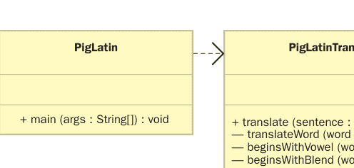

图 7.4 皮丁语程序的 UML 类图

## 重温方法参数

与方法设计相关的另一个重要问题是参数传递方法的方式。在 Java 中，所有参数都是通过值传递（pass by value）的。这意味着实际参数（在调用时）的当前值被复制到方法头中的形式参数中。我们在第 4 章中提到过这个问题；让我们更详细地检查它。

本质上，参数传递类似于赋值语句，将其赋值给实际参数中存储的值的形式参数副本。在方法内部对形式参数进行更改时，必须考虑这个问题。形式参数是传递的值的独立副本，因此所所的任何更改都不会对实际参数产生影响。当控制权返回到调用方法后，实际参数的值将与调用方法之前的值相同。

然而，当我们向方法传递对象时，我们实际上传递的是该对象的引用。被复制的值是对象的地址。如果我们通过方法内部的形式参数引用更改了对象的状态，我们就是在更改实际参数所引用的对象，因为它们引用的是同一个对象。另一方面，如果我们更改形式参数引用本身（例如指向一个新对象），我们还没有更改实际参数。

> 核心概念
>
> 当对象被传递给方法时，实际参数和形式参数变成了别名（aliases）。

列表 7.15 中的程序说明了参数传递的细微差别。该程序记录了以及这些值被输出的原因。`ParameterTester` 类包含一个 `main` 方法，该方法调用 `ParameterModifier` 对象的 `changeValues` 方法。`changeValues` 的两个参数是 `Num` 对象，每个对象简单地存储一个整数值。另一个参数是一个基本类型整数值。

## 7.7 方法设计

### 列表 7.15

```java
//****************************************************************
// ParameterTester.java    作者: Lewis/Loftus
//
// 演示了传递不同类型参数的效果。
//****************************************************************
public class ParameterTester {
//
    // 设置三个变量（一个基本类型和两个对象）
    // 作为 changeValues 方法的实际参数。在调用方法
    // 前后打印它们的值。
    public static void main(String[] args) {
        ParameterModifier modifier = new ParameterModifier();

        int a1 = 111;
        Num a2 = new Num(222);
        Num a3 = new Num(333);

        System.out.println("Before calling changeValues:");
        System.out.println("a1\ta2 " + a2 + "\t" + a3 + "\n");

        modifier.changeValues(a1, a2, a3);

        System.out.println("After calling changeValues:");
        System.out.println("a1\ta2 " + a2 + "\t" + a3 + "\n");
    }
}
```

### 输出

调用 changeValues 前

a1      222     333

调用这些值前：

a1      222     333

调用 changeValues 后：

a1      222     333

更改值后：

a1      222     333

### 列表 7.16

```java
public class ParameterModifier {
    // 修改参数，打印更改
    // 之后的值。
    public void changeValues(int f1, Num f2, Num f3) {
        System.out.println("Before changing the values:");
        System.out.println("f1\tf2 " + f2 + "\t" + f3);
        f1 = 999;
        f2.setValue(888);
    }
}
```

### 列表 7.17

```java
/****************************************************************
// Num.java 作者: Lewis/Loftus
// 对象表示单个整数。
****************************************************************
public class Num {
    private int value; // 注：原文此处应有变量定义，此处根据逻辑补全

    // 设置新的 Num 对象，存储初始值。
    public Num(int update) {
        value = update;
    }

    // 将存储的值设置为新指定的值。
    public void setValue(int update) {
        value = update;
    }

    // 将存储的整数作为字符串返回。
    public String toString() {
        return value + "";
    }
}
```

Num 对象被创建并赋值给第二个参数。这些更改反映在方法结束时打印的输出中。然而，基本类型整数没有从其原始值，因为更改是在方法内部进行的。同样，最后一个参数仍然引用其原始值的对象。这是因为在方法中创建的新 Num 对象仅被形式参数引用。当方法返回时，该形式参数被销毁，所引用的对象被标记为垃圾回收。唯一的更改是第二个参数状态的更改。图 7.5 显示了此程序的逐步处理过程。

步骤 1

调用 changeValues 前

tester.changeValues (a1, a2, a3);

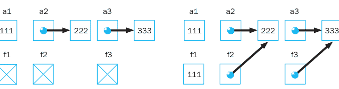

步骤 3

f1 = 999;

f2.setValue(888);

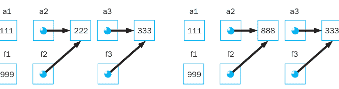

步骤 5

f3 = new Num (777);

从 changeValues 返回后

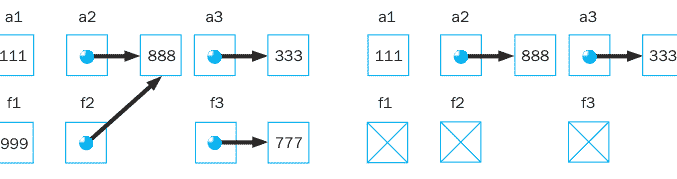

图 7.5 追踪 ParameterTesting 程序的参数

## 7.8 方法重载

自测习题（答案见附录 N）

- SR 7.18 什么是方法分解？

- SR 7.19 针对 `PigLatinTranslator` 类回答以下问题。

  a. 没定义构造方法。为什么不定义？

  b. 定义的一些方法是私有的。为什么？

  c. 在 `translate` 方法中创建了一个 `Scanner` 对象。它被被用来扫描什么？

- SR 7.20 当使用以下实际参数调用 `translate` 方法时，识别 `PigLatinTranslator` 支持方法产生的调用/返回结果序列。

  a. "animal"

  b. "hello"

  c. "We are the champions"

- SR 7.21 对象是如何作为参数传递的？

## 7.8 方法重载

我们已经讨论过，当方法被调用时，控制流转移到定义该方法的代码处。方法执行后，控制流返回到调用位置并继续处理。

通常情况下，方法名就足以指示特定调用执行的是哪个方法。在 Java 中，与其他面向对象的语言一样，你可以对多个方法使用相同的方法名但不同的参数列表。被称为方法重载（method overloading）。当你需要对不同类型的数据执行相似的方法时，这种技术非常有用。

编译器仍然必须能够将每次调用关联到特定的声明。如果两个或多个方法的名称相同，则会使用额外信息来唯一标识正在调用的版本。在 Java 中，只要参数的数量、对象的类型和/或参数的顺序不同，方法名就可以用于多个方法。例如：

> 核心概念
>
> 重载方法的版本通过参数的数量、类型和顺序来区分。

```java
public int sum(int num1, int num2)
{
    return num1 + num2;
}
```

## 344 第 7 章 面向对象设计

然后我们可以在同一个类中声明另一个名为 `sum` 的方法，如下：

```java
public int sum(int num1, int num2, int num3)
    return num1 + num2 + num3;
```

现在，当进行调用时，编译器查看参数的数量来决定调用哪个版本的 `sum` 方法。例如，以下调用将调用 `sum` 方法的第二个版本：

```java
sum(25, 69, 13);
```

方法名同其参数的数量、类型和顺序被称为方法的签名（signature）。编译器使用完整的方法签名将方法调用绑定到适当的定义上。


# 方法重载

编译器必须能够检查方法调用以确定正在调用的是哪个具体方法。如果你尝试指定两个具有相同签名的方法名，编译器将发出适当的错误信息且不会创建可执行程序。不能有任何歧义。

注意，方法的返回类型不是方法签名的一部分。这意味着，重载方法不能通过其返回类型来区分。这是因为方法返回的值可以被调用处忽略。在这种情况下，编译器将无法区分引用的是哪一个重载方法版本。

`println` 方法是一个被重载了多次的示例，每个版本接受单一类型。以下是其各种签名的部分列表：

- `println(String s)`
- `println(int i)`
- `println(double d)`
- `println(char c)`
- `println(boolean b)`

以下代码行实际上调用了具有相同名称的不同方法：

```java
System.out.println("Number of students: ");
System.out.println(count);
```

第一行调用接受字符串的 `println` 版本。第二行（假设 `count` 是一个整数变量）调用接受整数的 `println` 版本。


方法重载的示例。

# 7.9 测试

我们经常使用 `println` 语句来显示几种不同的类型，例如：

`System.out.println("Number of students: " + count);`

记住，在这种情况下，`+` 是字符串拼接运算符。首先，变量 `count` 中的值被转换为字符串表示，然后将两个字符串拼接成一个更长的字符串，并调用接受单一字符串的 `println` 定义。

构造方法可以被重载，而且通常都是这样做。通过提供多个版本的构造方法，我们提供了初始化对象的多种方式。

## 自测习题（答案见附录 N）

- SR 7.22 重载方法是如何彼此区分的？
- SR 7.23 对于以下每一对方法头，说明签名是否是不同的。如果不是，请解释原因。
  - a. `String describe(String name, int count)` / `String describe(int count, String name)`
  - b. `void count()` / `int count()`
  - c. `int howMany(int compareValue)` / `int howMany(int ceiling)`
  - d. `boolean greater(int value1)` / `boolean greater(int value1, int value2)`
- `Null` 类定义在 7.7 节。通过定义第二个不带参数并将 `value` 属性设置为零的构造方法来重载该类的构造方法。

# 7.9 测试（软件测试）

“测试”一词可以应用于软件开发的许多方面。测试无疑包含了它的传统定义：运行程序以发现错误的行为。但它也包含了由人工或机器执行的评估。

测试的目标是发现错误。通过发现修复错误，我们改进了程序的质量。错误越早发现，修复就越容易、越便宜。尽早发现问题是非常值得的。

## 374 第 7 章 面向对象设计

> **核心概念**
>
> 使用特定的输入运行程序并产生正确的结果，只能证明程序在该输入下是有效的。随着更多测试用例的执行，我们对程序的信心会增加，但我们永远无法确定所有错误已被消除。

测试程序永远无法保证没有错误。可以证明程序是正确的，但这种技术对于大型系统来说非常复杂，且证明本身可能会出现错误。因此，我们通常依赖测试来确定程序的质量。

确定存在错误后，我们确定错误原因并修复它。如果修复了问题，我们应该运行之前的测试，以确保我们在修复问题时没有引入另一个错误。这种技术被称为回归测试。

## 评审

评估设计或代码的一种技术被称为评审，它是几个人仔细检查设计文档或代码的会议。向他人展示我们的设计或代码会让我们得得仔细，并允许他人分享建议。参与者讨论优缺点，创建一个必须解决的问题列表。设计评审应该判断需求是否得到了满足。它应该评估系统如何分解为类和对象。代码评审应该判断设计是否忠实于需求，以及实现是否忠实于设计。它应该识别会导致设计或实现失败的具体问题。

有时评审被称为漫游，因为其目标是仔细走过文档并评估每个部分。

## 缺陷测试

由于测试的目标是发现错误，因此通常被称为缺陷测试。考虑到这一目标，一个好的测试是揭示程序任何缺陷的测试。这可能很奇怪，因为我们最终并不希望系统中出现问题。但请记住，错误几乎肯定存在。我们的测试工作应该努力发现它们。

## 7.9 测试（第347页）

通过发现并修复存在的错误来提高我们程序的可靠性，而不是让用户去发现它们。

> **核心概念**
>
> 一个好的测试是能够发现错误的测试。

一个测试用例由一组输入、用户操作或其他初始条件以及预期的输出组成。测试用例应该被妥善记录，以便以后根据需要重复执行。开发者通常会创建一个完整的测试套件，这是一组涵盖程序各个层面的测试用例。

由于程序运行在大量可能的输入上，因此无法为所有可能的输入或用户操作都创建测试用例。没有没有测试每一种情况。两个特定的测试用例可能非常相似，以至于它们没有测试程序的独特方面。这样做将徒劳无功。我们宁愿执行一个以某种新方式对程序施压的测试用例。因此，我们需要仔细选择测试用例。为此，让我们来检查缺陷测试的两种方法：黑盒测试和白盒测试。

> **核心概念**
>
> 对程序对所有可能的输入和用户操作进行穷尽式测试是不可行的。

顾名思义，黑盒测试将测试的对象视为黑盒。在黑盒测试中，开发测试用例时不考虑其内部工作机制。白盒测试基于输入和输出。可以使用提供的信息和用户操作作为按钮点击来对整个程序进行测试。只有当输入产生了预期的输出时，测试用例才是成功的。单个用例也可以使用黑盒技术进行测试，该技术侧重于类的接口（其公共方法）。某些参数被传入，产生产生特定的结果。黑盒测试通常直接源于系统的需求或方法的说明目的。

黑盒测试的输入数据通常通过定义等效类来选择。等效类是一组预期会产生相似输出的输入集合。通常情况下，如果一个方法对某个值有效，我们有理由相信它对其他值也有效。例如，计算整数平方根方法的输入可以分为两个等效类：非负整数和负整数。如果它对一个值工作正常，那么它对所有非负值都会正常良好。同样，如果它对一个负值工作正常，那么它对所有负值都会正常良好。

等效类具有定义的边界。由于等效类中的所有值本质上都在测试程序的相同特征，因此在等效边界内只需要一个测试用例。然而，由于编程会产生“差一”错误，应该对边界上及周围的值进行穷尽测试。对于整数边界，一个好的测试套件至少包含边界的精确值、边界减 1 以及边界加 1。应该定义使用这些情况的测试用例，再加上来自类别通用区域内的至少一个用例。

让我们来看一个例子。考虑一个方法，其目的是验证一个特定的整数值是否在 0 到 99 的范围内（包含边界值）。在这种情况下，有三个等效类：0 以下的值、0 到 99 范围内的值以及 99 以上的值。黑盒测试要求我们使用位于边界和落在边界上的测试值，因此针对这种情况的一组黑盒测试用例可能是：-500, -1, 0, 1, 30, 98, 99 和 100。

白盒测试，也称为玻璃盒测试，考察的是方法的内部结构和实现。白盒测试基于代码的逻辑。目标是确保程序中的每条路径至少执行一次。白盒测试映射了代码中可能的路径，并确保测试用例覆盖了要执行的条路径。这种测试通常被称为语句覆盖。

路径通过控制流语句（如 `if` 语句）控制。为了让程序中的每条路径至少执行一次，测试用例的输入数据值需要控制条件表达式的值。一个或多个测试用例的输入数据应该覆盖 `if` 语句在至少一个情况下评估为真、在至少一个情况下评估为假。覆盖 `if` 语句中的真值和假值可以确保通过 `if` 语句的两条路径都将被执行。对于循环和其他构造结构，也可以创建类似的情况。

在黑盒测试和白盒测试中，每个测试的预期输出应在运行测试之前确定。如果你没有仔细确定结果应该是什么，就很容易被说服测试结果是恰当的。

## 自测习题（答案见附录 N）

SR 7.25 从列表中选择与以下每个短语最匹配的术语：

- 黑盒、缺陷、回归、评审、测试用例、测试套件、步演、白盒

- a. 在做出更改后运行之前的测试用例，以帮助确保更改没有引入错误。
- b. 几个人共同评估一个构件的会议。
- c. 一种仔细查阅文档并评估每个部分的评审。
- d. 测试的目标是发现这些。
- e. 对被测试代码单元的输入和相应预期输出的描述。
- f. 一组涵盖系统各个层面的测试用例。
- g. 在这种测试方法中，测试用例完全基于需求规格书。
- h. 在这种测试方法中，测试用例完全基于程序的内部工作机制。

# 7.10 GUI 设计

当我们专注于允许创建 GUI 的细节时，我们有时会忽视大局。当我们继续探索 GUI 构建时，我们可能会忘记大局。在继续探索 GUI 构建时，通过关注允许创建 GUI 的细节，我们为了解决问题。请记住关于 GUI 设计的基本准则：

- 了解用户。
- 防止用户错误。
- 保持一致。

> **核心概念**
>
> 任何 GUI 设计都遵循一致性和可用性。

## 自测习题（答案见附录 N）

- SR 7.26 本节介绍了哪些 GUI 设计的一般准则？
- SR 7.27 为什么良好的用户界面设计如此重要？

# 7.11 布局管理器

除了构成 GUI 骨架组件、事件和监听器之外，GUI 设计最重要的活动是使用布局管理器。布局管理器是一个管理组件如何排列的对象。它决定了组件的大小和位置，并可能考虑许多因素来实现这一点。每个容器都有默认的布局管理器，如果我们愿意，可以替换它。

每当内容的视觉外观可能需要更改时，布局管理器就会被查询。当容器的大小调整时，布局管理器会被查询，以确定容器中的所有组件应该如何显示。每当向容器添加组件时，布局管理器都会确定添加操作如何影响现有控制。

## 7.11 布局管理器

| 布局管理器 | 说明 |
|---|---|
| 边界布局 | 将组件组织为五个区域（北、南、东、西、中）。 |
| 箱体布局 | 将组件组织为单行或单列。 |
| 卡片布局 | 将组件组织在一个区域，使得任何时候只有一个组件可见。 |
| 流式布局 | 从左到右组织组件，必要时开始新行。 |
| 网格布局 | 将组件组织为行和列的网格。 |
| 网格包布局 | 将组件组织为单元格网格，允许组件跨多个单元格。 |

图 7.6 一些预定义的 Java 布局管理器

`setLayout` 设置 `JPanel` 的布局管理器，`JPanel` 默认使用流式布局，我们可以让它使用边界布局：

```java
JPanel panel = new JPanel();
panel.setLayout(new BorderLayout());
```

让我们更详细地探索一些布局管理器。目前我们将重点关注最流行的布局管理器：流式、边界、箱体和网格。列表 7.18 中的类包含应用程序的 `main()` 方法，该程序演示了这些布局器的用法和效果。

Demo 介绍了标签页面板的使用，这是一种允许用户选择（通过点击标签页）当前可见的多个面板的容器。标签页面板由 `JTabbedPane` 类定义。`add` 方法创建一个标签，指定显示在标签上的名称以及当该标签通过“置于顶层”获得焦点并对用户可见时显示在面板上的组件。

> **核心概念**
>
> 每个容器的布局管理器都可以显式地设置。

有趣的是，标签页面板和卡片布局管理器提供的功能存在重叠。与标签页面板类似，卡片布局允许定义多个层，并在任何给定点显示其中一层。然而，由卡片布局管理的容器只能在用户程序的控制下进行调整，而标签页面板则允许用户直接指示应该显示哪个标签页。

在示例中，标签页面板的每个标签都包含一个由不同布局管理器控制的面板。第一个标签仅包含一个带有介绍性消息的面板，如列表 7.19 所示。当我们更详细地探索每个布局管理器时，将检查定义该对应面板的类，并讨论其视觉效果。

# 列表 7.18

```java
/************************************************************************************
// Author: Lewis/Loftus
// LayoutDemo.java
// 演示了流式、边界、网格和箱体布局的使用。
************************************************************************************
import javax.swing.*;

public class LayoutDemo {
    // // 设置一个包含标签页面板的帧。每个
    // // 标签页上的面板演示了不同的布局管理器。
    //
    public static void main(String[] args) {
        JFrame frame = new JFrame("Layout Manager");
        frame.setDefaultCloseOperation(JFrame.EXIT_ON_CLOSE);
        JTabbedPane tp = new JTabbedPane();
        tp.addTab("Intro", new IntroPanel());
        tp.addTab("Flow", new FlowPanel());
        tp.addTab("Border", new BorderPanel());
        tp.addTab("Grid", new GridPanel());
        tp.addTab("Box", new BoxPanel());

        frame.getContentPane().add(tp);
        frame.pack();
        frame.setVisible(true);
    }
}
```

# 流式布局

流式布局是最容易使用的布局管理器之一。`JPanel` 类默认使用流式布局。流式布局将尽可能多的组件放在同一行中，并采用它们的首选大小。当组件无法放入某行时，它会被放置在下一行。系统会添加所需数量的行以容纳所有已添加到容器的组件。图 7.7 描述了一个由流式布局管理器管理的容器。

列表 7.20 中的类代表了 LayoutDemo 程序中演示流式布局的面板。它显式地将布局设置为流式布局。

# 列表 7.19

```java
/********************************************************************************
// IntroPanel.java      Author: Lewis/Loftus
// 代表 LayoutDemo 程序的介绍面板。
********************************************************************************

import java.awt.*;
import javax.swing.*;

public class IntroPanel extends JPanel {
    //
    // 设置此面板带有两个标签。
    //----------------------------------------------------------------------
    public IntroPanel() {
        setBackground(Color.green);

        JLabel L11 = new JLabel("Layout Manager Demonstration");
        JLabel L12 = new JLabel("Choose a tab to see an example of " + 
            "a layout manager.");

        add(L11);
        add(L12);
    }
}
```

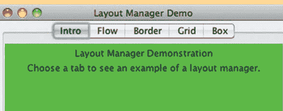

# 第 7 章 面向对象设计

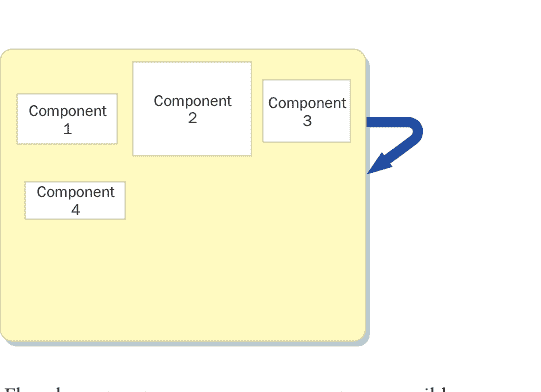

# 列表 7.20


# FlowPanel.java

```java
****************************************************************************************************
// FlowPanel.java      Author: Lewis/Loft
// 代表 LayoutDemo 程序中演示
// 流式布局管理器的面板。
****************************************************************************************************

import java.awt.*;
import javax.swing.*;

public class FlowPanel extends JPanel {
    // ----------------------------------------------------------------
    // 设置面板并带有一些按钮，以显示流式布局
    // 如何影响它们的位置。
    // ----------------------------------------------------------------
    public FlowPanel() {
        setLayout(new FlowLayout());
        setBackground(Color.green);

        JButton b1 = new JButton("BUTTON 1");
        JButton b2 = new JButton("BUTTON 2");
        JButton b3 = new JButton("BUTTON 3");
        JButton b4 = new JButton("BUTTON 4");
        JButton b5 = new JButton("BUTTON 5");

        add(b1);
        add(b2);
        add(b3);
        add(b4);
        add(b5);
    }
}
```

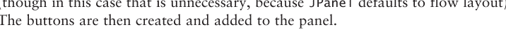

每个按钮的大小都足够大，以容纳其上的标签。正如我们之前提到的，流式布局将尽可能多的按钮放在面板内的同一行中，然后开始在另一行放置组件。当帧的大小变宽（例如，通过鼠标拖动右下角）时，面板也会随之增大，一行可以放入更多按钮。注意，每行的组件默认是居中的。

`FlowLayout` 类构造函数被重载，允许程序定制布局管理器的特性。在每行中，组件可以是居中、左对齐或右对齐。默认居中。在创建布局管理器时也可以指定组件之间的水平和垂直间隙。`FlowLayout` 类还提供了在创建布局管理器后设置对齐间隙的方法。

# 边界布局 (Border Layout)

边界布局有五个可以添加组件的区域：北、南、东、西和中。区域之间存在特定的位置关系，如图 7.8 所示。

四个边界区域将根据需要增大，以容纳它们包含的组件。如果北、南、东、西区域没有添加组件，则这些区域在整个布局中不占用任何空间。中部将填充所有可用空间。

取决于系统的功能，特定的容器可能只使用少数区域。例如，程序可能只使用中部、南部和西部。这种灵活性使得边界布局成为非常有用的布局管理器。

由边界布局管理的容器的 `add` 方法第一个参数是要添加的组件，第二个参数指示要添加的区域。区域使用 `BorderLayout` 类定义的常量指定。列表 7.21 显示了 LayoutDemo 程序中用于演示边界布局的面板。

| 北 | | |
|---|---|---|
| 西 | 中 | 东 |
| 南 | | |

> 图 7.8 边界布局将组件组织在五个区域中

# 代码列表 7.21

```java
********************************************************************************
// BorderPanel.java      Author: Lewis/Loftus
//
// Represents the panel in a button in the LayoutDemo program that demonstrates
// by the border layout manager.
********************************************************************************

import java.awt.*;
import javax.swing.*;

public class BorderPanel extends JPanel {
    //--------------------------------------------------------------------
    // Sets up this panel with a button in each area of a border
    // layout to show how it affects their position, shape, and size.
    //--------------------------------------------------------------------
    public BorderPanel() {
        setLayout(new BorderLayout());

        setBackground(Color.green);

        JButton b1 = new JButton("BUTTON 1");
        JButton b2 = new JButton("BUTTON 2");
        JButton b3 = new JButton("BUTTON 3");
        JButton b4 = new JButton("BUTTON 4");
        JButton b5 = new JButton("BUTTON 5");

        add(b1, BorderLayout.CENTER);
        add(b2, BorderLayout.NORTH);
        add(b3, BorderLayout.SOUTH);
        add(b4, BorderLayout.EAST);
        add(b5, BorderLayout.WEST);
    }
}
```

# 显示


在 `BorderPanel` 类的构造函数中，面板的布局管理器被显式地设置为边界布局（border layout）。随后创建按钮并将它们添加到特定的面板区域。默认情况下，每个按钮的宽度都足够容纳其标签，高度也足够填充其被分配的区域。当框架（以及面板）调整大小时，每个按钮的大小都会根据需要进行调整，其中中心（Center）区域的按钮会填充任何未使用的空间。

边界布局中的每个区域只显示一个组件。也就是说，在给定的边界布局的每个区域只添加一个组件。一个常见的错误是向边界布局的特定区域添加两个组件，在这种情况下，先添加的组件会被第二个组件所取代，并且在显示容器时只能看到第二个。要向边界布局的区域内添加多个组件，我们首先将这些组件添加到另一个容器（例如 `JPanel`），然后将该面板添加到该区域。

## 7.11 布局管理器

注意，尽管用于显示按钮的面板具有绿色背景，但在列表 7.21 的显示中并没有看到绿色。默认情况下，边界布局的区域之间没有水平或垂直间隙。这些间隙可以通过重载构造函数或 `BorderLayout` 类的显式方法来设置。如果增加了间隙，底层的面板将会显示出来。

# 网格布局 (Grid Layout)

网格布局将组件呈现由行和列组成的矩形网格中。每个网格单元格放置一个组件，所有单元格的大小相同。图 7.9 显示了网格布局的总体结构。

网格布局中的行数和列数是在布局管理器时通过构造函数的参数确定的。代码列表 7.22 中的类显示了 LayoutDemo 用于演示网格布局的面板。它指定了面板应该使用二行三列的网格进行管理。

当按钮添加到容器时，它们（默认情况下）从左到右、从上到下填充网格。除了添加到容器的顺序外，没有办法可以显式地将组件分配到网格中的特定位置。

每个单元格的大小由容器的整体大小决定。当容器调整大小时，所有单元格的大小都会按比例变化以填充容器。

如果用于指定行数或列数的值为零，则网格将在该维度上扩展，以容纳添加到容器的组件数量。行数和列数不能同时为零。


> 图 7.9 网格布局创建了一个等大小单元格的矩形网格

# 代码列表 7.22

```java
****************************************************************
// GridPanel.java      Author: Lewis/Loftus
// Represents the panel in the LayoutDemo program that demonstrates
// the grid layout manager.
****************************************************************
import java.awt.*;
import javax.swing.*;

public class GridPanel extends JPanel {
    // Sets up this panel with some buttons to show how grid
    // layout affects their position, shape, and size.
    public GridPanel() {
        setLayout(new GridLayout(2, 3));
        setBackground(Color.green);

        JButton b1 = new JButton("BUTTON 1");
        JButton b2 = new JButton("BUTTON 2");
        JButton b3 = new JButton("BUTTON 3");
        JButton b4 = new JButton("BUTTON 4");
        JButton b5 = new JButton("BUTTON 5");

        add(b1);
        add(b2);
        add(b3);
        add(b4);
        add(b5);
    }
}
```

# 显示


默认情况下，网格单元格之间没有水平和垂直间隙。间隙大小可以使用重载的构造函数或相应的 `GridLayout` 方法来指定。

# 盒子布局 (Box Layout)

盒子布局以垂直或水平方向组织组件，分为单行或单列，如图 7.10 所示。它很容易使用，与其他布局结合时，可以产生复杂的 GUI 设计，类似于使用 `GridBagLayout` 实现的效果，但后者通常更难掌握。当创建一个 `BoxLayout` 对象时，我们指定它将遵循 X 轴（水平）或 Y 轴（垂直），使用 `BoxLayout` 类中定义的常量。


> 图 7.10 盒子布局以垂直或水平组织组件。

`BoxLayout` 构造函数的第一个参数是将被管理的组件。列表 7.23 显示了 LayoutDemo 用于演示盒子布局的面板。

由盒子布局管理的组件按照它们添加到容器的顺序组织（从上到下或从左到右）。盒子布局组件之间没有像之前的布局那样有一个特定的水平或垂直间隙。相反，我们可以向容器添加占据空间的不可见组件。

`Box` 类中的两种不可见组件是刚性组件（rigid），它们具有固定的大小；胶水组件（glue），它们指定多余空间的去向。`Box` 类作为 Java 标准库的一部分，包含了创建这些不可见组件的方法。刚性区域使用 `Box` 类的 `createRigidArea` 方法创建，并接收一个 `Dimension` 对象来定义大小。胶水组件使用 `createHorizontalGlue` 或 `createVerticalGlue` 方法创建，取决于需要。

注意在我们的示例中，由刚性区域分隔的按钮在容器调整大小时保持不变。而胶水组件会根据需要扩展或缩小以填充空间。盒子布局——相对于大多数其他布局管理器——尊重组件的对齐方式以及最小、最大和优先尺寸。因此，设置进入容器的组件特征是定制视觉效果的另一种方法。

# 代码列表 7.23

```java
****************************************************
// BoxPanel.java      Author: Lewis/Loftus
// Represents the panel in the LayoutDemo program that demonstrates
// the box layout manager.
****************************************************

import java.awt.*;
import javax.swing.*;

public class BoxPanel extends JPanel {
    //------------------------------------------------
    // Sets up this panel with some buttons to show how a vertical
    // box layout (and invisible components) affects their position.
    //------------------------------------------------
    public BoxPanel() {
        setLayout(new BoxLayout(this, BoxLayout.Y_AXIS));
        setBackground(Color.green);

        JButton b1 = new JButton("BUTTON 1");
        JButton b2 = new JButton("BUTTON 2");
        JButton b3 = new JButton("BUTTON 3");
        JButton b4 = new JButton("BUTTON 4");
        JButton b5 = new JButton("BUTTON 5");

        add(b1);
        add(Box.createRigidArea(new Dimension(0, 10)));
        add(b2);
        add(Box.createVerticalGlue());
        add(b3);
        add(b4);
        add(Box.createRigidArea(new Dimension(0, 20)));
        add(b5);
    }
}
```

# 显示


## 7.12 边框

自我练习（答案见附录 N）

- SR 7.28 什么时候会咨询布局管理器？
- SR 7.29 流式布局管理器（flow layout manager）是如何工作的？
- SR 7.30 描述边框布局（border layout）的区域。
- SR 7.31 盒模型布局中的胶水组件（glue component）有什么效果？

# 7.12 边框

Java 提供了为任何 Swing 组件添加边框的能力。边框本身不是一个组件，而是定义了任何组件边缘应该如何绘制，并对 GUI 设计有重要影响。边框提供了 GUI 组件如何组织的视觉线索，并可用于为组件添加标题。图 7.11 列出了 Java 类库中预定义的边框。

`BorderFactory` 类对于为组件创建边框非常有用。它有许多方法来创建特定类型的边框。通过使用组件的 `setBorder` 方法可以将边框应用到组件。

> 核心概念
>
> 边框可以应用于 Swing 组件以分组对象并吸引注意力。

列表 7.24 中的程序演示了多种类型的边框。它简单地创建了几个面板，为每个面板设置了不同的边框，然后使用网格布局（grid layout）在一个较大的面板中显示它们。

| 边框 | 说明 |
| :--- | :--- |
| 空边框 (Empty Border) | 在组件边缘留出缓冲区空间，否则没有视觉效果。 |
| 线边框 (Line Border) | 包围组件的简单线条。 |
| 刻蚀边框 (Etched Border) | 在组件周围创建凹槽效果。 |
| 斜角边框 (Bevel Border) | 创建组件高于表面或凹于表面的效果。 |
| 标题边框 (Titled Border) | 在边框上或周围包含文本标题。 |
| 哑光边框 (Matte Border) | 允许指定每个的大小。使用实色或图像。 |


| 复合边框 | 两个边框的组合。 |


# 列表 7.24

```java
/************************************************************************************
// BorderDemo.java      作者: Lewis/Loftus
// 演示各种类型边框的使用。
************************************************************************************/

import java.awt.*;
import javax.swing.*;
import javax.swing.border.*;

public class BorderDemo
{
    // 创建几个带边框的面板并显示它们。

    public static void main(String[] args) {
        JFrame frame = new JFrame("Border Demo");
        frame.setDefaultCloseOperation(JFrame.EXIT_ON_CLOSE);

        JPanel panel1 = new JPanel();
        panel1.setLayout(new GridLayout(0, 2, 5, 10));
        panel1.setBorder(BorderFactory.createEmptyBorder(8, 8, 8, 8));

        JPanel p1 = new JPanel();
        p1.setBorder(BorderFactory.createLineBorder(Color.red, 3));
        panel1.add(new JLabel("Line Border"));
        panel1.add(p1);

        JPanel p2 = new JPanel();
        p2.setBorder(BorderFactory.createEtchedBorder());
        p2.add(new JLabel("Etched Border"));
        panel1.add(p2);

        JPanel p3 = new JPanel();
        p3.setBorder(BorderFactory.createRaisedBevelBorder());
        p3.add(new JLabel("Raised Bevel Border"));
        panel1.add(p3);

        JPanel p4 = new JPanel();
        p4.setBorder(BorderFactory.createLoweredBevelBorder());
        p4.add(new JLabel("Lowered Bevel Border"));
        panel1.add(p4);

        JPanel p5 = new JPanel();
    }
```

# 7.12 边框

## 列表 7.24 延续

```java
p5.setBorder(BorderFactory.createTitledBorder("Title"));
p5.add(new JLabel("Titled Border"));
panel1.add(p5);

JPanel p6 = new JPanel();
TitledBorder tb = BorderFactory.createTitledBorder("Title");
tb.setTitleJustification(TitledBorder.RIGHT);
p6.setBorder(tb);
p6.add(new JLabel("Titled Border (right)"));
panel1.add(p6);

JPanel p7 = new JPanel();
Border b1 = BorderFactory.createLineBorder(Color.blue, 2);
Border b2 = BorderFactory.createEtchedBorder();
p7.setBorder(BorderFactory.createCompoundBorder(b1, b2));
p7.add(new JLabel("Compound Border"));
panel1.add(p7);

JPanel p8 = new JPanel();
Border mb = BorderFactory.createMatteBorder(1, 5, 1, 1, Color.red);

p8.setBorder(mb);
p8.add(new JLabel("Matte Border"));
panel1.add(p8);

frame.getContentPane().add(panel1);
frame.pack();
frame.setVisible(true);
```

让我们逐一查看每一种边框。哑光边框指定了上、下、左、右边缘的大小。复合边框是两个边框的组合，即外边框和内边框。哑光边框允许指定每个边缘的大小，可使用实色或图像。标题边框在边框上或周围包含文本标题。斜角边框创建组件高于表面或凹于表面的效果。刻蚀边框在组件周围创建凹槽效果。线边框是包围组件的简单线条。空边框在组件边缘留出缓冲区空间，否则没有视觉效果。列表 7.24 中的程序演示了多种类型的边框。它简单地创建了几个面板，为每个面板设置了不同的边框，然后使用网格布局在一个较大的面板中显示它们。

### 显示

| 边框 Demo | |
| :--- | :--- |
| Line Border | Etched Border |
| Raised Bevel Border | Lowered Bevel Border |
| Titled Border | Matte Border |
| Compound Border | Title |
| Titled Border (right) | Compound Border |
| Matte Border | Compound Border |

# 7.13 包含层次结构

组件被分组在容器中，而这些容器相互嵌套的方式建立了 GUI 的包含层次结构。我们在第 3 章中引入了这一概念。对于任何 Java 程序，通常有一个主容器，称为顶层容器，例如框架或面板。顶层容器包含一个或多个其他容器，例如面板。这些面板可以包含其他面板以便组织。

每个容器都有自己的布局管理器。GUI 的最终外观是每个容器所选布局以及包含层次结构的函数。许多组合都是可能的，很少有最佳方案。即便如此，我们应该遵循系统目标和通用的 GUI 设计指南。图 7.12 显示了一个带有注释以描述其包含层次结构的应用程序。该程序中的某些组件之前已经讨论过，另一些将在后续章节中讨论。

注意，在许多情况下，仅通过观察 GUI 无法看出某些容器。特别是面板，除非我们以某种方式吸引注意力（例如通过添加边框），否则它是不可见的。我们还可以使用不可见组件为组件提供特定的间距。这些元素都是包含层次结构的一部分，尽管它们对用户是不可见的。

## 自我练习（答案见附录 N）

- SR 7.32 `BorderFactory` 类的作用是什么？
- SR 7.33 列出并简述本节介绍的每种边框类型。


使用边框时应谨慎。它们有助于关注 GUI 的适当部分，并在概念上对分组。然而，如果使用不当，它们可能会损害呈现的美感。边框应该增强界面，而不是与其竞争。

### 图 7.13 包含层次结构树

特定程序的包含层次结构可以表示为树形结构，如图 7.13 所示。树的根节点是顶层容器。树的每一层显示了上一层容器所包含的容器和组件。

当进行可能影响程序中组件视觉布局的更改时，会依次咨询每个容器的布局管理器。一个容器的更改可能会影响另一个。这些更改根据需要会在包含层次结构中级联传递。

## 自习题（答案见附录 N）

- SR 7.34 GUI 的包含层次结构是什么？
- SR 7.35 为第 5 章中展示的 `LeftRight` 应用 GUI 画出其包含层次结构树。

# 核心概念总结

- 设计上的努力投入既至关重要，又具有成本效益。
- 问题描述中的名词可能指示了程序所需的某些类和对象。
- 静态变量在类的所有实例之间共享。
- 聚合对象由其他对象组成，形成“具有……”（has-a）的关系。
- 接口是抽象方法的集合，因此不能实例化。
- 枚举类型的值是该类型的静态变量。
- 可以在枚举类型的定义中添加属性和方法。
- 对象提供的复杂服务可以被分解，以使用私有的辅助方法。
- 当将对象传递给方法时，实际参数和形式参数成为别名。
- 重载方法的版本通过其参数的数量、类型和顺序来区分。
- 测试程序永远无法保证没有错误。
- 一个良好的测试是能够发现错误的测试。
- 对程序的所有可能的输入和用户操作进行穷尽式测试是不行的。
- 任何 GUI 的设计都应遵循关于一致性和可用性的基本指南。
- 容器的布局管理器决定了组件的视觉呈现方式。
- 当发生更改时，容器中的组件会根据布局管理器的策略重新组织。
- 可以显式设置每个容器的布局管理器。
- 边界可以应用于 Swing 组件以对对象分组并吸引注意力。
- GUI 的外观是包含层次结构和每个容器布局管理器的函数。

# 练习

- EX 7.1 编写一个名为 `average` 的方法，接受两个整数参数并返回它们的平均值（浮点值）。
- EX 7.2 重载练习 7.1 中的 `average` 方法，使得如果提供了三个整数作为参数，该方法返回所有三个数的平均值。
- EX 7.3 重载练习 7.1 中的 `average` 方法，接受四个整数参数并返回它们的平均值。
- EX 7.4 编写一个名为 `multiConcat` 的方法，接受一个 `String` 和一个整数作为参数。返回一个由字符串自身拼接 `count` 次组成的字符串，其中 `count` 是整数参数。例如，如果参数值为 "hihihi"。如果参数小于 2，则返回原始字符串。
- EX 7.5 重载练习 7.4 中的 `multiConcat` 方法，使得如果没有提供参数，则该方法返回字符串与自身拼接的字符串。例如，如果参数为 "test"，返回值为 "test"。
- EX 7.6 编写一个名为 `drawCircle` 的方法，根据方法参数绘制一个圆：一个用于画圆的 `Graphics` 对象、两个代表中心 (x, y) 坐标的整数、另一个代表圆半径的整数，以及一个定义圆颜色的 `Color` 对象。该方法不返回任何内容。
- EX 7.7 重载练习 7.6 中的 `drawCircle` 方法，使得如果没有提供 `Color`，则圆的颜色将默认为黑色。
- EX 7.8 重载练习 7.6 中的 `drawCircle` 方法，使得如果没有提供半径，将使用 10 到 100（包含）之间的随机半径。
- EX 7.9 重载练习 7.6 中的 `drawCircle` 方法，使得如果圆的颜色和半径都未提供，则颜色默认为红色，半径默认为 40。
- EX 7.10 讨论 Java 如何向方法传递参数。这种技术对于基本数据类型和对象是一致的？请解释。
- EX 7.11 解释为什么静态方法不能引用实例变量。
- EX 7.12 一个类是否可以实现两个各包含相同方法签名的接口？请解释。
- EX 7.13 创建一个名为 `Visible` 的接口，包含两个方法：`makeVisible` 和 `makeInvisible`。两个方法都应返回布尔结果。描述一个类可能如何实现此接口。
- EX 7.14 画出一幅 UML 类图，显示练习 7.13 中元素之间的关系。
- EX 7.15 想象一个游戏，其中某些元素可以被玩家破坏而另一些不能。创建一个名为 `Breakable` 的接口，它有一个不接受参数的 `break` 方法和另一个 `broken` 方法，后者返回对象当前是否已损坏的布尔值。
- EX 7.16 创建一个名为 `VCR` 的接口，其具有代表视频磁带录放机水平和垂直操作的方法（播放、停止等）。以你喜欢的方式定义方法签名。描述一个类可能如何实现此接口。
- EX 7.17 画出一幅 UML 类图，显示练习 7.16 中元素之间的关系。
- EX 7.18 为 `LayoutDemo` 程序画出包含层次结构。
- EX 7.19 更改 `LayoutDemo` 中的水平和垂直间隙会产生什么视觉效果？通过更改来测试你的答案。
- EX 7.20 为 `LayoutDemo` 程序画出包含层次结构树。使用三个 `ArrayList` 边界。

# 编程项目

- PP 7.1 修改第 4 章中的 `Account` 类，使其允许使用名称和账号打开账户（假设初始余额为零）。修改 `main` 方法以演示此功能。
- PP 7.2 编写一个 `Course` 类，代表学校上的一门课程。使用上一个编程项目中修改过的 `Student` 类表示每个学生。使用 `ArrayList` 存储上该课程的学生。`Course` 类的构造函数应只接受课程名称。提供一个接受一个参数的 `addStudent` 方法。提供一个名为 `average` 的方法，计算并返回所有学生测试成绩的平均值。
- PP 7.4 修改 `Rational` 类以实现 `Comparable` 接口。为了执行比较，为两个 `Rational` 对象从分子和分母计算出等效浮点值，然后使用 0.0001 的容差值对其进行比较。编写一个主驱动程序来测试你的修改。
- PP 7.5 编写一个 Java 接口 `Priority`，包含两个方法：`setPriority` 和 `getPriority`。接口应定义在对象集合之间建立数值优先级的方法。设计并实现一个 `Task` 类，代表一个任务（如待办列表），并实现 `Priority` 接口。创建一个驱动类来练习一些 `Task` 对象。
- PP 7.6 修改 PP 7.5 中的 `Task`，使其也实现本章定义的 `Complexity` 接口。修改驱动类以显示 `Task` 这些新功能。
- PP 7.7 修改 PP 7.5 和 7.6 中的 `Task`，使其也实现 Java 标准类中的 `Comparable` 接口。实现该接口使任务按优先级进行排序。创建一个驱动类，其 `main` 方法显示这些 `Task` 对象的特征。
- PP 7.8 编写一个名为 `Lockable` 的 Java 接口，包含以下方法：`setKey`、`lock`、`unlock` 和 `locked`。`setKey`、`lock` 和 `unlock` 方法接受一个表示密钥的整数参数。`setKey` 方法建立密钥。`lock` 和 `unlock` 方法锁定对象，但仅当传递的密钥正确时有效。`locked` 方法返回一个布尔值，指示对象是否已锁定。`Lockable` 对象表示一个其普通方法受保护的对象：如果对象被锁定，则方法无法被调用；修改第 5 章中 `Coin` 类的一个版本使其实现 `Lockable`。
- PP 7.9 编写第 4 章 `Account` 类的一个版本，使其符合 PP 7.8 定义的 `Lockable` 接口。
- PP 7.10 编写 `PigLatin` 程序的一个新版本，使其使用 GUI。使用文本字段输入句子，并使用标签显示结果。
- PP 7.11 修改 `LayoutDemo` 程序的 `IntroPane` 类，使其使用箱布局管理器。使用不可见组件在两个标签上方和下方胶粘，并在它们之间使用刚性区域。
- PP 7.12 修改第 5 章的 `QuoteOptions` 程序以更改其视觉外观。在引用标签左侧垂直列显示单选按钮，并带有一个边框。
- PP 7.13 编写一个显示手机上数字键盘的程序。在数字键盘按钮上方，显示一个显示所选数字的文本字段。在数字键盘按钮右侧，包含另一个清除显示器的按钮。使用边界布局管理整体呈现，使用网格布局管理数字键盘按钮。数字键盘按钮周围添加边框以便在视觉上分组，并在显示器周围添加边框。
- PP 7.14 编写一个帮助披萨店订餐的程序。使用标签页处理不同类型的食物（披萨、饮料、配菜）。收集有关数量和大小的信息。在收集信息的同时显示订单费用。使用适当的组件收集各种信息。使用包含层次结构和布局管理器仔细地构建界面结构。

# 软件故障

## 2003年东北大停电

### 发生了什么？

2003年8月14日，美国历史上最大规模的停电袭击了美国东北部和加拿大部分地区。多个大都市受到影响，包括纽约、克利夫兰、底特律、多伦多和渥太华。在三分钟内，21 个电厂已经关闭，影响了约 5000 万人。

典型问题出现在了停电区域。交通信号灯缺失导致了交通问题。火车和电梯被困住。机场延迟了航班。依赖电泵的水压失效了。手机使用受到干扰。（有线电话仍可用，但因紧急消息而过载。）由于服务器宕机和尝试获取消息，互联网流量变慢。据报告发生了若干起抢劫事件。

据估计，停电的总财务成本在 40 亿至 80 亿美元之间。有 9 人因与停电相关的各种原因去世。


- 停电前后的美国东北部。

### 是什么导致的？


在停电发生后的几个小时和几天内，许多来源被归咎于这个问题。由于 2001 年 9 月 11 日袭击后意识的提高，当局迅速排除了恐怖主义。整个影响区域的树木倒塌和雷击被认为是祸首。官员甚至考虑过——但很快排除了——当时正在传播的“Blaster”电脑病毒。

在接下来的几个月里，一个工作小组一直在寻找问题所在。最初的案件确定位于俄亥俄州的阿克伦，那里的 FirstEnergy 公司没能妥善修剪电力线附近的树木。2003 年 8 月 14 日，树枝导致三条输电线同时故障。当故障发生时，控制中心的操作员负责保持负载平衡。在这种情况下，他们未能做到，因为本该通知他们该问题的计算机报警系统没有正常运行。负载不平衡迅速蔓延到邻近电厂，导致了连锁停电。

因此，尽管有各种影响因素，但问题的很大一部分是报警系统的故障。这最终追溯到通用电气公司用于监控报警的计算机中的竞态条件（`race condition`）。

计算机程序中的竞态条件发生在两个或多个并发的进程访问某些共享数据时。一个进程在另一个进程读取数据后修改数据，它们在错误的假设下继续处理。在这种情况下，三条输电线同时导致了竞态条件，导致报警系统失效，而操作员并未注意到。导致的问题在不久后导致整个系统崩溃。备份系统由于相同的原因崩溃。发现漏洞后，GE 发布了补丁来修复它。

### 教训

这次事件的问题不在于电力不足，而是无法将电力输送到需要的地方。这次停电凸显了现有电力线基础设施的糟糕，以及依赖自愿规则来维护电网可靠性的危险。

关于软件责任，竞态条件是并发系统中已知的故障源，必须进行彻底测试。在这样利关巨大的情况下，有必要进行形式分析。

> 来源：CNN.com, WashingtonPost.com

## 数组

### 章节目标

- 定义并使用数组进行基础数据组织。
- 描述数组的创建方法。
- 讨论数组的边界检查。
- 讨论数组的语法和用法。
- 讨论多维数组。
- 介绍数组作为参数。
- 探讨鼠标和键盘事件。

在我们的编程工作中，我们经常希望以易于访问和修改的形式组织数据。`ArrayList` 类在第 5 章中探讨过的正是为了这个目的。在本章中我们将探讨数组是大多数高级语言的基础组成部分。

## 8.1 数组元素

数组是一种简单但强大的语言构造，用于分组和组织数据。在编写管理大量信息（如 100 个名字列表）的程序时，为每个数据声明单独的变量是不可能的。数组通过让我们声明一个包含多个单独访问值的变量解决了这个问题。

数组是值的列表。每个值存储在数组的特定编号位置。对应每个位置的数字被称为索引。图 8.1 显示了一个整数数组以及对应每个位置的整数。该数组名为 `height`；它包含整数。

在 Java 中，数组索引从零开始。因此存储在 5 的值实际上是数组中的第六个值。图 8.1 所示数组有 11 个值，索引从 0 到 10。

要访问数组中的值，我们使用数组名称，后跟方括号中的索引。例如，该表达式引用数组中的第九个值：

```
height[8]
```

根据图 8.1，`height[8]`（读作 height-sub-eight）包含值 79。不要混淆索引的值（在此处为 8）与存储在数组索引处的值（在此处为 79）。

| | `height` |
| :--- | :--- |
| 0 | 69 |
| 1 | 61 |
| 2 | 70 |
| 3 | 74 |
| 4 | 62 |
| 5 | 69 | `height[5]` 的值 |
| 6 | 66 |
| 7 | 73 |
| 8 | 79 |
| 9 | 62 |
| 10 | 70 |

FIGURE 8.1 一个名为 `height` 的包含整数的数组

### 核心概念

大小为 N 的数组索引从 0 到 N-1。

## 8.2 声明和使用数组

表达式 `height[8]` 指存储在特定内存位置的单个整数。它可以在任何可以使用整数变量的地方被使用。因此，你可以给它赋值、在计算中使用它、打印它的值等。此外，由于数组索引是整数，你可以使用整数表达式来指定用于访问数组的索引。这些概念在以下代码行中得到了演示：

```
height[2] = 72;
height[count] = height * 12;
average = (height[0] + height[1] + height[2]) / 3;
System.out.println("The middle value is " + height[MAX/2]);
pick = height[rand.nextInt(11)];
```

数组存储在内存中，这意味着元素在内存中的存储方式正如我们在概念上构想的那样是连续的。这使得通过索引访问任何特定元素变得极其高效。在内部，为了确定任何特定元素的地址，会将索引乘以每个元素的大小，并加到数组起始点的内存地址上。数组索引从零而不是从一开始的原因——为了让计算尽可能简单。从效率的角度来看，访问数组中的第 500 个元素与访问第一个元素一样简单。

### 自测习题（答案见附录 N）

- SR 8.1 什么是数组？
- SR 8.2 数组的每个元素是如何引用的？
- SR 8.3 根据图 8.1 中的数组，以下各项分别是什么？
  - a. `height[1]`
  - b. `height[2] + height[5]`
  - c. `height[2 + 5]`
  - d. 存储在数组索引 8 处的值
  - e. 第四个值
  - f. `height.length`

## 8.2 声明和使用数组

在 Java 中，数组是对象。要创建一个数组，必须声明数组的引用。然后可以使用 `new` 运算符实例化数组，该运算符还会分配内存来存储值。以下代码表示图 8.1 所示数组的声明：

```
int[] height = new int[11];
```

### 核心概念

在 Java 中，数组是一种可以实例化的对象。

变量 `height` 被声明为整数数组，其类型写为 `int[]`。数组中存储的所有值具有相同的类型（或至少是兼容的）。例如，我们可以创建一个存储整数的数组，或者创建一个存储字符串的数组，而不能创建一个既能存储整数又能存储字符串的数组。数组可以设置为存储基本类型或任何对象（类）类型。存储在数组中的值有时被称为数组元素，数组所持值的类型称为数组的元素类型。

### 列表 8.1

```
****************************************************
// BasicArray.java      作者: Lewis/Loftus
// 演示数组的基本型声明和使用。
****************************************************
public class BasicArray
{
    // 创建一个数组，用各种整数值填充，
    // 修改一个值，然后将它们打印。
    public static void main(String[] args)
    {
        final int LIMIT = 15, MULTIPLE = 10;

        int[] list = new int[LIMIT];

        // 初始化数组值
        for (int index = 0; index < LIMIT; index++)
            list[index] = index * MULTIPLE;

        list[5] = 999; // 修改一个数组值

        // 打印数组值
        for (int value : list)
            System.out.print(value + " ");
    }
}
```

### 输出

```
0 10 20 30 40 999 60 70 80 90 100 110 120 130 140
```

数组变量 `int[]` 的类型不包含数组的大小。使用 `new` 运算符实例化 `height` 会预留存储从 0 到 10 的 11 个整数的内存空间。一旦数组声明为特定大小，它可以包含的值的数量就无法更改。

列表 8.1 所示示例创建了一个大小为 15 的数组，包含 15 个整数，并以 10 的连续增量加载。然后它打印数组中第六个元素（索引为 5）的值。最后，它打印数组中存储的所有值。

图 8.2 显示了在 BasicArray 程序执行期间数组的变化。

`for` 循环的迭代版本用于打印数组中的值。回第 5 章，这种版本的 `for` 循环会提取数组中的每个值。

| 数组创建了 15 个元素，索引从 0 到 14 | 第一次循环迭代三次后 | 完成第一次循环后 | 修改 `list[5]` 的值后 |
|---|---|---|---|
| 0 | 0 | 0 | 0 |
| 1 | 10 | 10 | 10 |
| 2 | 20 | 20 | 20 |
| 3 | 30 | 30 | 30 |
| 4 | 40 | 40 | 40 |
| 5 | 50 | 50 | 999 |
| 6 | 60 | 60 | 60 |
| 7 | 70 | 70 | 70 |
| 8 | 80 | 80 | 80 |
| 9 | 90 | 90 | 90 |
| 10 | 100 | 100 | 100 |
| 11 | 110 | 110 | 110 |
| 12 | 120 | 120 | 120 |
| 13 | 130 | 130 | 130 |
| 14 | 140 | 140 | 140 |

图 8.2 显示了在 BasicArray 程序执行期间数组的变化

### 核心概念

数组变量 `int[]` 的类型不包含数组的大小。使用 `new` 运算符实例化 `height` 会预留存储从 0 到 10 的 11 个整数的内存空间。一旦数组声明为特定大小，它可以包含的值的数量就无法更改。

列表 8.1 所示示例创建了一个大小为 15 的数组，包含 15 个整数，并以 10 的连续增量加载。然后它打印数组中第六个元素（索引为 5）的值。最后，它打印数组中存储的所有值。

图 8.2 显示了在 BasicArray 程序执行期间数组的变化。（此处下文继续）

`for` 循环的迭代版本用于打印数组中的值。回第 5 章，这种版本的 `for` 循环会提取数组中的每个值。

| 数组创建了 15 个元素，索引从 0 到 14 | 第一次循环迭代三次后 | 完成第一次循环后 | 修改 `list[5]` 的值后 |
|---|---|---|---|
| 0 | 0 | 0 | 0 |
| 1 | 10 | 10 | 10 |
| 2 | 20 | 20 | 20 |
| 3 | 30 | 30 | 30 |
| 4 | 40 | 40 | 40 |
| 5 | 50 | 50 | 999 |
| 6 | 60 | 60 | 60 |
| 7 | 70 | 70 | 70 |
| 8 | 80 | 80 | 80 |
| 9 | 90 | 90 | 90 |
| 10 | 100 | 100 | 100 |
| 11 | 110 | 110 | 110 |
| 12 | 120 | 120 | 120 |
| 13 | 130 | 130 | 130 |
| 14 | 140 | 140 | 140 |

图 8.2 显示了在 BasicArray 程序执行期间数组的变化

## 8.2 数组的声明与使用

### 列表 8.2

```
********************************************************************
// ReverseOrder.java               作者: Lewis/Loftus
//
// 演示数组索引的处理。
********************************************************************

import java.util.Scanner;

public class ReverseOrder {
    //
    // 从用户处读取一组数字，将它们存储在
    // 数组中，然后以相反顺序打印它们。
    //
    public static void main(String[] args) {
        Scanner scan = new Scanner(System.in);

        double[] numbers = new double[10];

        System.out.println("The size of the array: " + numbers.length);

        for (int index = 0; index < numbers.length; index++) {
            System.out.print("Enter number " + (index+1) + ": ");
            numbers[index] = scan.nextDouble();
        }

        System.out.println("The numbers in reverse order: ");

        for (int index = numbers.length-1; index >= 0; index--) {
            System.out.print(numbers[index] + " ");
        }
    }
}
```

### 输出

```
Enter size of the array:
Enter number 1: 18.36
Enter number 2: 48.9
Enter number 3: 53.5
Enter number 4: 29.06
Enter number 5: 72.404
Enter number 6: 34.8
Enter number 7: 63.41
Enter number 8: 45.55
Enter number 9: 69.0
Enter number 10: 99.18
The numbers in reverse order:
99.18 69.0 45.55 63.41 34.8 72.404 29.06 53.5 48.9 18.36
```

示例 8.3 所示的 LetterCount 示例使用了两个数组和一个 String 对象。名为 `upper` 的数组用于存储字符串中每个大写字母出现的次数。`lower` 数组则对小写字母起到相同的作用。

由于英语字母表中有 26 个字母，因此 `upper` 和 `lower` 数组都声明为 26 个元素。每个元素包含一个整数，其初始值为 0。`for` 循环逐个字符地扫描字符串。对于字符串中找到的每个字符，相应数组中对应的计数器都会加 1。


# 第 8 章 数组

## 8.1 数组基础

```java
// LetterCount.java      作者: Lewis/Loftus
// 演示数组与字符串之间的关系。
//************************************************************************************************************************************
import java.util.Scanner;

public class LetterCount {
    //-
    // 从用户处读取一个句子，并统计其中包含的
    // 大和小写字母的数量。
    //-
    public static void main(String[] args) {
        final int NUMCHARS = 26;

        Scanner scan = new Scanner(System.in);

        int[] upper = new int[NUMCHARS];
        int[] lower = new int[NUMCHARS];

        char current; // 当前正在处理的字符
        int other = 0;  // 非字母的计数器

        System.out.println("Enter a sentence:");
        String line = scan.nextLine();

        // 统计每个字母出现的次数
        for (int ch = 0; ch < line.length(); ch++) {
            current = line.charAt(ch);
            if (current >= 'A' && current <= 'Z')
                upper[current - 'A']++;
            else if (current >= 'a' && current <= 'z')
                lower[current - 'a']++;
            else
                other++;
        }

        // 打印结果
        System.out.println();
        for (int letter = 0; letter < upper.length; letter++) {
            System.out.print(" " + (char)(letter + 'A'));
            System.out.print(": " + upper[letter]);
            System.out.print("\t" + (char)(letter + 'a'));
            System.out.println(": " + lower[letter]);
        }

        System.out.println();
        System.out.println("Non-alphabetic characters: " + other);
    }
}
```

### LISTING 8.3 运行结果

输入一个句子:

```text
In Casablanca, Humphrey Bogart never says "Play it again, Sam."
```

```text
A: 0      a: 10
B: 1      b: 1
C: 1      c: 1
D: 0      d: 0
E: 0      e: 3
F: 0      f: 2
G: 0      g: 2
H: 1      h: 1
I: 1      i: 2
J: 0      j: 0
K: 0      k: 0
L: 0      l: 2
M: 0      m: 2
N: 0      n: 4
O: 0      o: 1
P: 1      p: 1
Q: 0      q: 0
R: 0      r: 3
S: 1      s: 3
T: 0      t: 2
U: 0      u: 1
V: 0      v: 0
W: 0      w: 0
X: 0      x: 0
Y: 0      y: 0
Z: 0      z: 0
Non-alphabetic characters: 6
```

> **注**：由于原文文本在截断处导致 LetterCount 示例输出部分不完整且存在乱码，译文根据代码逻辑进行了合理的补全与对齐以保持格式一致性。

## 8.2 声明和使用数组

### LISTING 8.4

```java
// Author: Lewis/Loftus
// Primes.java
// 展示了数组初始化列表的用法。
//************************************************************************************
public class Primes {
    //----------------------------------------------------
    // 在数组中存储一些质数并打印它们。
    //----------------------------------------------------
    public static void main(String[] args) {
        int[] primeNums = {2, 3, 5, 7, 11, 13, 17, 19};
        System.out.println("Array length: " + primeNums.length);
        System.out.println("The first few prime numbers are:");
        for (int prime : primeNums)
            System.out.print(prime + " ");
    }
}
```

**输出**

```text
Array length: 8
The first few prime numbers are:
2 3 5 7 11 13 17 19
```

### 自测习题（答案见附录 N）

- **SR 8.4** 数组的元素类型是什么？
- **SR 8.5** 描述创建数组的过程。内存何时为数组分配内存？
- **SR 8.6** 写一个数组声明，表示参加夏令营的 100 名儿童的年龄。
- **SR 8.7** 写一个数组声明，表示投掷标准六面骰子时，每个面出现的次数。
- **SR 8.8** 解释数组边界检查的概念。当对 Java 数组使用无效值进行索引时会发生什么？
- **SR 8.10** 编写代码，使名为 `values` 的整数数组的每个元素加 1。
- **SR 8.11** 编写代码，计算并打印名为 `values` 的数组的元素之和。
- **SR 8.12** 数组初始化列表实现了什么功能？
- **SR 8.13** 整个数组可以作为参数传递吗？是如何实现的？

## 8.3 对象数组

在本章之前的几个示例中，我们使用数组来存储整数和字符等基本类型。数组也可以将对象的引用作为元素。仅使用数组和其他对象就可以创建部分复杂的信息管理结构。例如，数组可以包含对象，而这些每个对象都可以由几个变量和它们使用的方法组成。变量本身可以是数组，以此类推。程序的设计应该利用组合这些构造来为信息创建最合适的表示。

请记住，数组本身是一个对象。因此，将一个名为 `weight` 的 `int` 值数组想象成如下：


> **核心概念**
> 实例化对象数组仅预留存储引用的空间。存储每个元素中的对象必须单独实例化。

当我们在数组中存储对象时，每个元素都是一个独立的对象。也就是说，对象数组实际上是对象引用数组。考虑以下声明：

```java
String[] words = new String[5];
```

变量 `words` 是一个指向 `String` 对象的数组。声明中的 `new` 运算符实例化了数组并为五个 `String` 引用预留了空间。此声明没有创建任何 `String` 对象；它仅仅创建了一个持有 `String` 对象引用的数组。初始状态下，数组如下：


在创建几个 `String` 对象并放入数组后，它可能看起来像：


数组是一个对象，它所持有的每个字符串都是它自己的对象。数组中的每个对象都必须单独实例化。

请记住 `String` 对象可以表示为字符串字面量。因此，以下声明创建了一个名为 `verbs` 的数组，并使用初始化列表填充了几个 `String` 对象，每个对象都是使用字符串字面量实例化的：

```java
String[] verbs = {"play", "work", "eat", "sleep"};
```

### LISTING 8.5

`GradeRange` 程序创建了一个 `Grade` 对象数组，然后打印它们。`Grade` 对象是在数组初始化中使用多个 `new` 运算符创建的。

```java
//**********************************************************
// GradeRange.java          Author: Lewis/Loft
// 展示了对象数组的用法。
//**********************************************************
public class GradeRange {
    // 创建一个 Grade 对象数组并打印它们。
    //-
    public static void main(String[] args) {
        Grade[] grades = {
            new Grade("A", 95), new Grade("A-", 90),
            new Grade("B+", 87), new Grade("B", 85), new Grade("B-", 80),
            new Grade("C+", 77), new Grade("C", 75), new Grade("C-", 70),
            new Grade("D+", 67), new Grade("D", 65), new Grade("D-", 60),
            new Grade("F", 0)
        };

        for (Grade letterGrade : grades) {
            System.out.println(letterGrade);
        }
    }
}
```

**输出**

| Grade | Lower Bound |
| :--- | :--- |
| A | 95 |
| A- | 90 |
| B+ | 87 |
| B | 85 |
| B- | 80 |
| C+ | 77 |
| C | 75 |
| C- | 70 |
| D+ | 67 |
| D | 65 |
| D- | 60 |
| F | 0 |

### LISTING 8.6

`Grade` 类。每个 `Grade` 对象代表课程的字母成绩，并包含一个数值边界。成绩名称和下限的值可以使用 `Grade` 构造函数或适当的修改器方法（setter）设置。还定义了访问器方法（getter），以及一个返回成绩字符串表示的 `toString` 方法。当在 `main` 方法中打印成绩时，`toString` 方法会被自动调用。

```java
//****************************************************************
// Grade.java      Author: Lewis/Loft
// 代表一个成绩。
//****************************************************************
public class Grade {
    private String name;
    private int lowerBound;

    // 构造函数：设置指定的成绩名称和数值下限。
    public Grade(String grade, int cutoff) {
        name = grade;
        lowerBound = cutoff;
    }

    // 返回成绩的字符串表示。
    public String toString() {
        return name + "\t" + lowerBound;
    }

    // 名称修改器。
    public void setName(String grade) {
        name = grade;
    }

    // 下限修改器。
    public void setLowerBound(int cutoff) {
        lowerBound = cutoff;
    }

    // 名称访问器。
    public String getName() {
        return name;
    }

    // 下限访问器。
    public int getLowerBound() {
        return lowerBound;
    }
}
```

### LISTING 8.7

`Movies` 类，它包含一个 `main` 方法，用于创建、修改和检查 DVD 集合。

```java
//************************************************
// Movies.java      Author: Lewis/Loft
// 展示了对象数组的用法。
//************************************************
public class Movies {
    // 创建一个 DVDCollection 对象并添加一些 DVD。
    // 报告集合的状态。
    //-
    public static void main(String[] args) {
        DVDCollection movies = new DVDCollection();

        movies.add(new DVD("The Godfather", "Francis Coppola", 1972));
        movies.add(new DVD("District 9", "Neill Blomkamp", 2009));
        movies.add(new DVD("Iron Man", "John Favreau", 2008));
        movies.add(new DVD("All About Eve", "Joseph Mankiewicz", 1950));
        movies.add(new DVD("The Matrix", "Andy & Lana Wachowski", 1999));

        movies.print();
        System.out.println(movies);

        movies.add(new DVD("Iron Man 2", "Jon Favre", 2010));
        movies.add(new DVD("Casablanca", "Michael Curtiz", 1942));

        System.out.println(movies);
    }
}
```

添加到集合中的每张 DVD 都由其标题、导演、发行年份、购买价格以及是否为蓝光（Blu-ray）格式指定。

### LISTING 8.8

`DVDCollection` 类。它包含一个表示集合的 `DVD` 对象的数组。它维护集合中 DVD 的计数及其总价值。它还跟踪集合数组的当前大小，以便在向集合中添加许多 DVD 时可以创建一个更大的数组。

```java
//************************************************************************************************
// DVDCollection.java      Author: Lewis/Loftus
// 代表一个 DVD 电影集合。
//************************************************************************************************
import java.text.NumberFormat;

public class DVDCollection {
    private DVD[] collection;
    private int count;
    private double totalCost;

    //-- 构造函数：创建一个初始空的集合。
    //-
    public DVDCollection() {
        collection = new DVD[100];
        count = 0;
    }
}
```


# 第 8 章 数组

```java
totalCost = 0.0;
}

//-- 将 DVD 添加到集合中，必要时增加集合数组的大小。

public void addDVD(String title, String director, int year,
        double cost, boolean bluray) {
    if (count == collection.length)
        increaseSize();
    collection[count] = new DVD(title, director, year, cost, bluray);
    totalCost += cost;
    count++;
}

// 返回一个描述 DVD 集合的报告。
public String toString() {
    NumberFormat fmt = NumberFormat.getCurrencyInstance();
    String report = "~~~~~~~~~~~~~~~~~~~~~~~~~~~~~~~~~~~~~~~~~~~~~~~~~~~~";
    report += "collection[dvd]\n";
    report += "Number of DVDs: " + count + "\n";
    report += "Total cost: " + fmt.format(totalCost) + "\n";
    report += "Average cost: " + fmt.format(totalCost / count) + "\n";
    report += "\nDVD List:\n";
    for (int dvd = 0; dvd < count; dvd++) {
        report += collection[dvd].toString() + "\n";
    }
    return report;
}

// 通过创建一个更大的数组并将现有集合复制到其中来增加集合的容量。
private void increaseSize() {
    DVD[] temp = new DVD[collection.length * 2];
    for (int dvd = 0; dvd < collection.length; dvd++) {
        temp[dvd] = collection[dvd];
    }
    collection = temp;
}
```

集合数组在 `DVDCollection` 构造函数中实例化。每当向集合中添加一个 DVD 时（使用 `addDVD` 方法），就会创建一个新的 `DVD` 对象，并将其引用存储在集合数组中。

每当向集合中添加一个 DVD 时，我们都会检查是否已经达到了集合数组的当前容量。如果我们不进行此检查，当我们尝试在无效索引处存储新 DVD 时，最终会抛出异常。如果达到了当前容量，将调用 `increaseSize` 方法，该方法首先创建一个比当前集合数组大一倍的数组。然后将现有集合中的每个 DVD 复制到新数组中。最后，将集合引用设置为更大的数组。使用这种技术，从理论上说，我们的 DVD 集合永远不会耗尽空间。使用 `DVDCollection` 对象（在本例中为 `main` 方法）不需要担心空间耗尽，因为它在内部已处理。

图 8.3 显示了 `Movies` 程序的 UML 类图。空菱形表示聚合。关系的基数也已注明：一个 `DVDCollection` 对象包含零或多个 `DVD` 对象。

`DVDCollection` 类的 `toString` 方法返回一个总结集合的完整报告。该报告部分使用了存储在集合中的每个 `DVD` 对象的 `toString` 方法创建。列表 8.9 显示了 `DVD` 类。


图 8.3 Movies 程序的 UML 类图

# 列表 8.9

```java
// DVD.java      Author: Lewis/Loftus
// 代表一张 DVD 视频光。

import java.text.NumberFormat;

public class DVD {
    private String title, director;
    private int year;
    private double cost;
    private boolean blurary;

    // 使用指定的信息创建新的 DVD。
    public DVD(String title, String director, int year, double cost, boolean blurary) {
        this.title = title;
        this.director = director;
        this.year = year;
        this.cost = cost;
        this.blurary = blurary;
    }

    // 返回此 DVD 的字符串描述。
    public String toString() {
        NumberFormat fmt = NumberFormat.getCurrencyInstance();
        String description;
        description = fmt.format(cost) + "\t" + year + "\t";
        description += title + "\t" + director;
        if (blurary) {
            description += "\t" + "Blu-ray";
        }
        return description;
    }
}
```

# 第 8 章 数组

# 自测题（答案在附录中）

SR 8.14 数组是如何创建的？

SR 8.15 假设 `team` 是一个持有名字的字符串数组：Amanda、Clare、Emily、Katie、Maria。

SR 8.16 假设 `Book` 是一个代表书籍的类。假设构造函数接受两个参数——书名和页数。

## 8.4 命令行参数

Java 应用程序的 `main` 方法的形式参数始终是字符串对象的数组。我们在之前的示例中忽略了它，但我们可以讨论它有时是否有用。

> 核心概念 命令行参数存储在字符串数组中并传递给 `main` 方法。

Java 运行时在提交参数时调用 `main` 方法。`String[]` 参数（通常称为 `args`）是向解释器提供的命令行参数。解释器调用时的任何额外信息都存储在 `args` 数组中供程序使用。这是输入的另一种方式。

列表 8.10 中的程序使用命令行参数打印标签。假设第一个参数是问候语，第二个是名字。如果命令行没有提供两个字符串，`args` 将没有足够的元素（如果有的话），程序引用将导致抛出 `OutOfBoundsException`。如果命令行包含了额外信息，它们将存储在 `args` 数组中但会被程序忽略。

# 列表 8.10

```java
// NameTag.java               Author: Lewis/Loftus
// 演示命令行参数的使用。

public class NameTag {
    // 使用用户指定的问候语和名字打印一个简单的名字标签。
    public static void main(String[] args) {
        System.out.println();
        System.out.println(" " + args[0]);
        System.out.println("My name is " + args[1]);
    }
}
```

> > java NameTag Howdy John
> Howdy
> My name is John
>
> java NameTag Hello Bill
> Hello
> My name is Bill

# 自测题（见附录 N 中的答案）

SR 8.17 什么是命令行参数？

SR 8.18 为程序编写一个 `main` 方法，输出其前两个命令行参数的字符串长度之和。

SR 8.19 为程序编写一个 `main` 方法，输出其前两个命令行参数（它们为整数）的值之和。

## 8.5 变长参数列表

假设我们想设计一个方法，以便在每次调用时处理不同数量的数据。例如，让我们设计一个名为 `average` 的方法，它接收几个整数值并返回它们的平均值。在方法的任何调用中，我们可能像这样传入三个整数：

```java
mean1 = average(42, 69, 37);
```

在方法的另一个调用中，我们可能会传入更多整数来计算平均值：

```java
mean2 = average(35, 43, 93, 23, 40, 21, 75);
```

为了实现这一点，我们可以定义 `average` 方法的重载版本，但这要求我们知道可能存在的最大参数数量，并为每种可能性编写一个单独的方法版本。或者，我们可以定义该方法接收一个整数数组，这要求在调用方法中将整数封装成数组并传入一个参数。

Java 提供了一种定义接受变长参数列表的方法的方法。通过在方法的形式参数列表中使用某些特殊语法，我们可以定义该方法以接受任意数量的参数。这些参数会被自动放入一个数组中，以便在方法中进行处理。例如，`average` 方法可以写如下：

```java
public double average(int ... list) {
    double result = 0.0;
    if (list.length != 0) {
        int sum = 0;
        for (int num : list) {
            sum += num;
            result = (double) sum / list.length;
        }
    }
    return result;
}
```

注意形式参数的定义方式。省略号（三个连续的点）表示该方法接受任意数量的参数。在这种情况下，方法接受任意数量的 `int` 参数，并自动将它们放入一个名为 `list` 的数组中。在方法中，我们正常地处理该数组。

现在我们可以向 `average` 方法传递任意数量的 `int` 参数，甚至一个都不传。这就是为什么我们在计算平均值之前要检查数组的长度是否为零。

多个参数的类型可以是基本数据类型或对象类型。例如，以下方法接收并打印多个 `Grade` 对象（我们在本章的前面的部分定义了 `Grade` 类）：

```java
public void printGrades(Grade ... grades) {
    for (Grade letterGrade : grades) {
        System.out.println(letterGrade);
    }
}
```

接受变长参数的方法也可以接受其他参数。例如，以下方法接收一个 `int`、一个 `String` 对象，然后是任意数量的 `double` 值，这些值将存储在一个名为 `nums` 的数组中：

```java
public void test(int count, String name, double ... nums) {
    // 任意内容
}
```

变长参数必须位于形式参数列表的最后。一个方法不能接受两组变长参数。

构造函数也可以设置为接受变数量的参数。列表 8.11 所示的程序创建了两个 `Family` 对象，将变数量的字符串（代表家庭成员姓名）传入 `Family` 构造函数。

# 第 8 章 数组

# 列表 8.11

```java
// VariableParameters.java      作者: Lewis/Loftus
// 展示了变长参数列表的使用。

public class VariableParameters {
    // 使用构造函数创建两个 Family 对象，该构造函数
    // 变数量的 String 对象作为参数。
    public static void main(String[] args) {
        Family lewis = new Family("John", "Sharon", "Justin", "Kayla",
            "Nathan", "Samantha");
        Family camden = new Family("Stephen", "Annie", "Matt", "Mary",
            "Simon", "Lucy", "Sam", "David");
        System.out.println(lewis);
        System.out.println();
        System.out.println(camden);
    }
}
```

输出
John
Sharon
Justin
Kayla
Nathan
Samantha

Stephen
Annie
Matt
Mary
Simon
Lucy
Ruthie
Sam
David

# 列表 8.12

```java
// Family.java               作者: Lewis/Loftus
// 展示了变长参数列表的使用。

public class Family {
    private String[] members;

    // 构造函数：通过存储传入参数的（可能的
    // 多个）名称设置此家庭。
    public Family(String ... names) {
        members = names;
    }

    // 返回此家庭的字符串表示。
    public String toString() {
        String result = "";
        for (String name : members) {
            result += name + "\n";
        }
        return result;
    }
}
```


`Family` 类如列表 8.12 所示。构造函数只是存储了数组的引用，直到需要为止。通过对构造函数使用变长参数列表，我们可以轻松创建任意大小的数组。

- 自测题（见附录 N 中的答案）
- SR **20** 数组如何拥有变长参数列表？
- SR **21** 编写一个名为 `distance` 的方法，接收任意数量的整数并返回总和。
- SR **22** 编写一个名为 `travel` 的方法，接收任意数量的整数并返回时间。

## 8.6 二维数组

到目前为止检查的数组都是一维数组。正如名称所示，二维数组具有行和列。使用方括号 `[]` 来表示二维数组。二维数组的类型是 `int[][]`。

列表 8.13 所示的 `TwoArray` 程序实例化了一个二维数组。正如一维数组一样，二维数组的大小是在创建时指定的。嵌套循环在 `TwoArray` 程序中用于填充数组。仔细追踪嵌套循环如何访问二维数组中的每个元素。注意外层循环由 `table.length` 控制（行数），内层循环由 `table[row].length` 控制（列数）。


### 列表 8.13

```java
// TwoArray.java      作者: Lewis/Loft
//
// 展示了二维数组的使用。
//

public class TwoArray
{
    // 创建一个整数二维数组，填充递增的
    // 值，然后打印出来。
    public static void main(String[] args)
    {
        int[][] table = new int[5][10];

        // 填充表格
        for (int row = 0; row < table.length; row++) {
            for (int col = 0; col < table[row].length; col++) {
                table[row][col] = row * 10 + col;
            }
        }

        // 打印表格
        for (int row = 0; row < table.length; row++) {
            for (int col = 0; col < table[row].length; col++) {
                System.out.print(table[row][col] + "\t");
            }
            System.out.println();
        }
    }
}
```

输出

| 0 | 1 | 2 | 3 | 4 | 5 | 6 | 7 | 8 | 9 |
|---|---|---|---|---|---|---|---|---|---|
| 10 | 11 | 12 | 13 | 14 | 15 | 16 | 17 | 18 | 19 |
| 20 | 21 | 22 | 23 | 24 | 25 | 26 | 27 | 28 | 29 |
| 30 | 31 | 32 | 33 | 34 | 35 | 36 | 37 | 38 | 39 |
| 40 | 41 | 42 | 43 | 44 | 45 | 46 | 47 | 48 | 49 |

与一维数组一样，初始化列表也可以用于实例化二维数组，其中每个元素本身都是数组初始化列表。这种技术被用于 `SodaSurvey` 程序中，如列表 8.14 所示。

### 列表 8.14

```java
// SodaSurvey.java               Author: Lewis/Loft
// 展示了二维数组的使用。

import java.text.DecimalFormat;

public class SodaSurvey
{
    // 确定并打印每行（汽水）和每列
    //（受访者）汽水得分的平均值。
    public static void main(String[] args) {
        int[][] scores = { {3, 4, 5, 2, 1, 4, 3, 2, 4},
                          {2, 4, 3, 4, 3, 2, 1, 2},
                          {3, 5, 4, 5, 3, 2, 5, 5},
                          {1, 1, 3, 1, 2, 1, 3, 2, 4} };

        final int SODAS = scores.length;
        final int PEOPLE = scores[0].length;
        int[] sodaSum = new int[SODAS];
        int[] personSum = new int[PEOPLE];

        for (int soda = 0; soda < SODAS; soda++) {
            for (int person = 0; person < PEOPLE; person++) {
                sodaSum[soda] += scores[soda][person];
                personSum[person] += scores[soda][person];
            }
        }

        DecimalFormat fmt = new DecimalFormat("0.#");
        System.out.println("Averages:\n");

        for (int soda = 0; soda < SODAS; soda++)
            System.out.println("Soda #" + (soda + 1) + ": " +
                fmt.format((float) sodaSum[soda] / PEOPLE));

        System.out.println();

        for (int person = 0; person < PEOPLE; person++)
            System.out.println("Person #" + (person + 1) + ": " +
                fmt.format((float) personSum[person] / SODAS));
    }
}
```

输出

平均值：

| 汽水 #1: 3.2 |
| 汽水 #2: 2.6 |
| 汽水 #3: 4.2 |
| 汽水 #4: 1.9 |

| 受访者 #1: 2.2 |
| 受访者 #2: 3.5 |
| 受访者 #3: 3.2 |
| 受访者 #4: 3.5 |
| 受访者 #5: 2.5 |
| 受访者 #6: 3 |
| 受访者 #7: 2 |
| 受访者 #8: 2.8 |
| 受访者 #9: 3.2 |
| 受访者 #10: 3.8 |

假设某汽水制造商对四种新口味进行了口味测试，以查看人们对它们的喜好程度。该制造商让 10 个人尝试每种新口味，并给出 1 到 5 分的评分，其中 1 分很差，5 分优秀。`SodaSurvey` 程序中名为 `scores` 的二维数组存储了该调查的结果。每行对应一种汽水，每行中的每一列对应品尝过该汽水的人。更通俗地说，每行存储了所有测试者对某种特定汽水口味的回答，而每列存储了一个人对所有汽水的回答。

`SodaSurvey` 程序计算并打印了每种汽水和每位受访者的平均响应。每种汽水和每个人的总和首先存储在一维整数数组中。然后计算并打印平均值。

### 多维数组

数组可以有一、二、三甚至更多个维度。任何超过一个维度的数组都称为多维数组。

将二维数组想象成表格是非常容易的。三维数组可以画成立方体。然而，一旦超过三个维度，多维数组可能看起来很难可视化。尽管如此，请考虑后续每个维度仅仅是前一个维度的细分。对于较大的多维数组，这样思考通常是最好的。

例如，假设我们想以一种有意义的方式存储在全美各大学的学生人数。我们可以将其表示为四维整数数组。第一维度代表州。第二个维度代表每个州的大学。第三个维度代表每所大学的学院。最后，第四个维度代表每个学院的系别。每个位置存储的值是特定系别的人数。图 8.5 显示了这些细分。

二维数组相当常见。但在程序中决定创建多维数组时，应该小心。在处理在多个层级上管理的大量数据时，可能还需要额外的信息以及管理这些信息的方法。例如，在之前的例子中，更有可能每个州都由一个对象来表示，该对象可能包含其他内容，如一个存储每所大学信息的数组等等。

Java 数组还有另一个重要的特征需要考虑。正如我们之前确定的那样，Java 不直接支持多维数组。

> 核心概念：后续每个维度仅仅是前一个维度的细分。


## 8.7 多边形与多折线

数组可以有一、二、三甚至更多个维度。任何超过一个维度的数组都称为多维数组。

### 代码列表 8.15 续


### 代码列表 8.16

```java
// RocketPanel.java      作者: Lewis/Loftus
// 展示了多边形和多折线的用法。

import javax.swing.JPanel;
import java.awt.*;

public class RocketPanel extends JPanel
{
    private int[] xRocket = {100, 120, 120, 130, 130, 70, 80, 80};
    private int[] yRocket = {15, 40, 115, 125, 150, 150, 125, 115, 40};
    private int[] xWindow = {95, 105, 110, 90};
    private int[] yWindow = {45, 45, 70, 70};

    private int[] xFlame = {70, 75, 80, 90, 100, 110, 115, 120, 130, 130};
    private int[] yFlame = {155, 170, 165, 190, 170, 175, 160, 185, 160, 175, 155};

    // 构造函数：设置此面板的基本特征。
    public RocketPanel() {
        setBackground(Color.black);
        setPreferredSize(new Dimension(200, 200));
    }

    // 使用多边形和多折线绘制火箭。
    public void paintComponent(Graphics page) {
        super.paintComponent(page);
        page.setColor(Color.cyan);
        page.fillPolygon(xRocket, yRocket, xRocket.length);
        page.setColor(Color.gray);
        page.fillPolygon(xWindow, yWindow, xWindow.length);
        page.setColor(Color.red);
        page.drawPolyline(xFlame, yFlame, xFlame.length);
    }
}
```

`xFlame` 和 `yFlame` 数组定义了多折线的点，用于创建从火箭中喷出的火焰图像。由于它是作为多折线而非多边形绘制的，因此火焰不是闭合或被填充的。

### Polygon 类

多边形也可以使用 `Polygon` 类的对象显式定义，该类定义在 Java 标准类库的 `java.awt` 包中。重载的 `drawPolygon` 和 `fillPolygon` 方法有两个版本，接受单个 `Polygon` 对象作为参数。

| 方法 | 说明 |
| :--- | :--- |
| `Polygon()` | 构造函数：创建一个空的多边形。 |
| `Polygon(int[] xpoints, int[] ypoints, int npoints)` | 构造函数：使用 xpoints 和 ypoints 对应项中的 (x, y) 坐标对创建多边形。 |
| `void addPoint(int x, int y)` | 将指定的点添加到此多边形中。 |
| `boolean contains(int x, int y)` | 如果指定的点包含在此多边形内，则返回 true。 |
| `boolean contains(Point p)` | 如果指定的点包含在此多边形内，则返回 true。 |
| `Rectangle getBounds()` | 获取此多边形的边界矩形。 |
| `void translate(int deltaX, int deltaY)` | 沿 x 轴平移 deltaX，沿 y 轴平移 deltaY 来移动此多边形的顶点。 |

> 图 8.6 Polygon 类的一些方法

`Polygon` 对象封装了多边形各边的坐标。`Polygon` 类的构造函数允许创建一个初始为空的多边形，或者由代表点坐标的整数数组定义的多边形。`Polygon` 类包含向多边形添加点以及判断给定点是否在多边形形状内的方法。它还包含获取多边形边界矩形表示的方法，以及将多边形中的所有点移动到另一个位置的方法。图 8.6 列出了这些方法。

### 自习题（答案见附录 N）

- SR 8.25 什么是多折线？我们如何指定它的形状？
- SR 8.26 多边形和多折线之间有什么区别？
- SR 8.27 对 `RocketPanel` 类分别进行以下每项更改的结果是什么？你可以进行更改、编译并运行程序，然后观察并报告结果。简要说明你是如何观察到的。
    - a. 将 `page.drawPolyline` 方法调用改为 `page.fillPolygon` 方法调用。
    - b. 将 `fillPolygon` 的参数 `xWindow.length` 改为数字字面量 `4`。
    - c. 交换每个数组中的 x 值和 y 值。例如，`yWindow = {95, 105, 110, 90}`。
    - d. 首先绘制一个坐标为 (0, 100), (100, 0), (200, 100) 的新填充黄色多边形。
    - e. 最后绘制一个坐标为 (0, 100), (100, 0), (200, 100) 的新填充黄色多边形。

### 列表 8.18 续

```java
//
// 为使用的事件方法提供空定义。
//---

public void mouseClicked(MouseEvent event) {}

public void mouseReleased(MouseEvent event) {}

public void mouseEntered(MouseEvent event) {}

public void mouseExited(MouseEvent event) {}
```


`DotsPanel` 类维护了一个 `Point` 对象的列表，这些对象表示了用户点击鼠标的所有位置。`Point` 类表示二维空间中给定点的 (x, y) 坐标。它提供了对点的实例变量 `x` 和 `y` 的访问权限。每当面板被重绘时，列表存储的所有点都会被绘制出来。

`Point` 对象的列表以 `ArrayList` 的形式维护。更准确地说，`pointList` 对象的类型是 `ArrayList<Point>`，规定该 `ArrayList` 中只能存储 `Point` 对象。为了绘制这些点，我们使用 `for` 循环遍历列表中的所有点。

鼠标按下（mouse pressed）事件的监听器被定义为一个实现 `MouseListener` 接口的私有内部类。每当用户按下鼠标按钮时，面板都会调用 `mousePressed` 方法，但鼠标事件始终发生在二维空间中的某点，而代表事件的对象会跟踪该位置。在鼠标监听器中，我们可以在需要时获取并使用该位置。在 `Dots` 程序中，每当调用 `mousePressed` 方法时，都会通过 `MouseEvent` 对象的 `getPoint` 方法获取事件的位置。该点被存储在 `ArrayList` 中，然后面板被重绘。

# 核心概念

为了满足接口，监听器可能需要为未处理的事件提供空方法定义。

注意，与我们在之前的示例中使用的每个包含一个方法的监听器接口不同，`MouseListener` 接口包含五个方法。对于这个程序，我们感兴趣的事件只有鼠标按下事件。因此，我们感兴趣的方法只有 `mousePressed` 方法。然而，在实现接口时，我们必须为接口中的所有方法提供定义。因此，我们为其他事件提供了空方法。当这些事件发生时，会调用空方法，但不会执行任何代码。在第 9 章中，我们将使用一种创建监听器的技术来避免创建此类空方法。

让我们来看一个响应鼠标相关事件的示例。列表 8.19 中的 `RubberLines` 程序在两个点之间画一条线。第一个点由鼠标第一次按下的位置决定。第二个点随着鼠标在按住按钮时的拖动而改变。当释放按钮时，线条将固定在第一个点和第二个点之间。当再次按下鼠标按钮时，将开始画一条新线。

绘制线条的面板由列表 8.20 中的 `RubberLinesPanel` 类表示。由于我们需要同时监听鼠标按下事件和鼠标拖动（mouse dragged），我们需要一个能够同时响应这些事件和移动事件的监听器。注意，此示例中的监听器类同时实现了 `MouseListener` 和 `MouseMotionListener` 接口。我们必须实现这两个接口的所有方法。我们感兴趣的两个方法 `mousePressed` 和 `mouseDragged` 被实现以完成我们的目标，而其他方法提供了空定义以满足接口。

当调用 `mousePressed` 方法时，变量 `point1` 被赋值。然后，随着鼠标的拖动，变量 `point2` 被不断赋值，并且面板被重绘。因此，线条在拖动过程中会不断重画，从而产生出一条线在固定点和移动点之间被拉伸的视觉效果。这种效果被称为“橡皮筋效应”（rubberbanding），在图形程序中很常见。

注意，在 `RubberLines` 的构造函数中，监听器对象被两次添加到面板中：一次作为鼠标监听器，一次作为鼠标移动监听器。调用的 `addListener` 方法必须连接到作为参数传递的对象。在这种情况下，我们有一个对象充当这两类事件的监听器。如果需要，我们可以有两个监听器：一个监听鼠标事件，另一个监听鼠标移动事件。组件可以针对各种事件类别拥有多个监听器。

此外注意，`paint` 程序一次绘制一条线。也就是说，当用户通过新的鼠标点击开始画另一条线时，之前的线条会消失。这是因为 `paintComponent` 方法会重绘背景，每次都会消除线条。要看到之前的线条，我们必须跟踪它们，也许像我们在 `Dots` 程序那样使用 `ArrayList`。对 `RubberLines` 程序的这种修改被留作为一个编程项目。

> **核心概念**
> 橡皮筋效应是指当拖动鼠标时，形状似乎在扩大时产生的一种图形效果。


使用橡皮筋效应和数组的示例。

# 列表 8.19

```
****************************************************************************************************
// RubberLines.java      Author: Lewis/Loftus
// 演示鼠标事件和橡皮筋效应。
//****************************************************************************************************
import javax.swing.JFrame;

public class RubberLines
{
    //--创建并显示应用程序框架。
    //----------------------------------------------------------------------
    public static void main(String[] args) {
        JFrame frame = new JFrame("Rubber Lines");
        frame.setDefaultCloseOperation(JFrame.EXIT_ON_CLOSE);
        frame.getContentPane().add(new RubberLinesPanel());
        frame.pack();
        frame.setVisible(true);
    }
}
```


# 8.8 鼠标事件

## 列表 8.20

```
************************************************************************************
// RubberLinesPanel.java      Author: Lewis/Loftus
// 代表 RubberLines 程序的绘图面板。
//************************************************************************************
import java.swing.JPanel;
import java.awt.*;
import java.awt.event.*;

public class RubberLinesPanel extends JPanel {
    private Point point1 = null, point2 = null;

    // 构造函数：设置此面板监听鼠标事件。
    public RubberLinesPanel() {
        LineListener listener = new LineListener();
        addMouseListener(listener);
        addMouseMotionListener(listener);
        setBackground(Color.black);
        setPreferredSize(new Dimension(400, 200));
    }

    // 从初始鼠标按下点到鼠标当前位置绘制当前线条。
    public void paintComponent(Graphics page) {
        super.paintComponent(page);
        page.setColor(Color.yellow);
        if (point1 != null && point2 != null) {
            page.drawLine(point1.x, point1.y, point2.x, point2.y);
        }
    }
}

//************************************************
// 代表所有鼠标事件的监听器。
//************************************************
private class LineListener implements MouseListener,
    MouseMotionListener
{
    // 捕获按下按下时的初始位置。
    public void mousePressed(MouseEvent event) {
        point1 = event.getInput();
    }

    // 获取拖动时的鼠标当前位置并重画线条以创建橡皮筋效应。
    public void mouseDragged(MouseEvent event) {
        point2 = event.getInput();
        repaint();
    }

    // 为使用的事件方法提供空定义。
    public void mouseClicked(MouseEvent event) {}
    public void mouseReleased(MouseEvent event) {}
    public void mouseEntered(MouseEvent event) {}
    public void mouseExited(MouseEvent event) {}
    public void mouseMoved(MouseEvent event) {}
}
}
```

# 自我复习题（答案见附录 N）

- **SR 8.28** 什么是鼠标事件？
- **SR 8.29** 当在 GUI 组件上点击并释放鼠标按钮时，会产生什么鼠标事件？
- **SR 8.30** 当在 GUI 组件上点击鼠标按钮，移动鼠标离开该组件，然后释放鼠标按钮时，会产生什么鼠标事件？

## 8.9 关键事件

- **SR 8.31** 在 Dots 程序中响应哪些鼠标事件？在 RubberLines 程序中响应哪些鼠标事件？
- **SR 8.32** 假设你正在创建一个 GUI 来支持一个与用户对战井字棋的程序。描述你的程序可能如何响应各种鼠标事件。

## 8.9 关键事件

按下键盘按键时，会产生一个键事件（key event）。键事件允许程序在用户打字或按下其他键盘键（如方向键）时立即做出响应。如果正在处理键事件，程序可以在按键按下时立即响应；无需等待 Enter 键被按下或其他组件（如按钮）被激活。

> **核心概念**
> 键事件允许程序立即响应用户按下键盘键。

列表 8.21 所示的 Direction 程序响应键事件。屏幕上显示一个箭头图像，当按下方向键时，该图像会在屏幕上移动。实际上，使用了四个不同的图像，每个图像分别指向主要方向（上、下、右、左）。

列表 8.22 所示的 DirectionPanel 类表示显示图像的面板。构造函数接收四个图像，其中一个始终被认为是当前图像（即显示的图像）。当前图像根据最近按下的按键进行设置。例如，如果按了上方向键，就会显示指向上的箭头图像。如果持续按下方向键，相应的图像就会向相应的方向“移动”。

图像使用 `ImageIcon` 对象进行管理。在这个示例中，每当图像被重绘时，都会使用 `paintIcon` 方法绘制图像。`paintIcon` 方法接受四个参数：作为图像观察者的组件、将绘制图像的图形上下文，以及绘制图像的 (x, y) 坐标。图像观察者是一个管理图像加载的组件；在本例中，我们使用面板作为图像观察者。

设置私有内部类 `DirectionListener` 用于响应键事件。它实现了 `Listener` 接口，该接口定义了三个我们可以用于响应键盘活动的方法。图 8.8 列出了这些方法。

具体而言，Direction 程序响应按键按下（key pressed）事件。由于监听类必须实现接口中定义的所有方法，因此我们为其他事件提供了空方法。

### 列表 8.21

```
************************************************************************************
// Direction.java      Author: Lewis/Loftus
// 演示键事件。
//************************************************************************************
import javax.swing.JFrame;

public class Direction
{
    // 创建并显示应用程序框架。
    //----------------------------------------------------------------------
    public static void main(String[] args)
    {
        JFrame frame = new JFrame("Direction");
        frame.setDefaultCloseOperation(JFrame.EXIT_ON_CLOSE);
        frame.getContentPane().add(new DirectionPanel());
        frame.pack();
        frame.setVisible(true);
    }
}
```


## 8.9 关键事件

### 列表 8.22
```
************************************************************************************
// DirectionPanel.java      Author: Lewis/Loftus
// 代表 Direction 程序的主显示面板。
************************************************************************************
import javax.swing.*;
import java.awt.*;
import java.awt.event.*;

public class DirectionPanel extends JPanel {
    private final int WIDTH = 300, HEIGHT = 200;
    private final int JUMP = 10; // 图像移动的增量
    private final int IMAGE_SIZE = 31;
    private ImageIcon up, down, right, left, currentImage;
    private int x, y;

    // 构造函数：设置面板并加载图像。
    //--------------------------------------------------------------------------------
    public DirectionPanel() {
        addKeyListener(new DirectionListener());
        x = WIDTH / 2;
        y = HEIGHT / 2;
        up = new ImageIcon("arrowUp.gif");
        down = new ImageIcon("arrowDown.gif");
        left = new ImageIcon("arrowLeft.gif");
        right = new ImageIcon("arrowRight.gif");
        setBackground(Color.black);
        setPreferredSize(new Dimension(WIDTH, HEIGHT));
        setFocusable(true);
    }
```

### 列表 8.22 续
```
// 在当前位置绘制图像。
//
public void paintComponent(Graphics page) {
    super.paintComponent(page);
    currentImage.paintIcon(this, page, x, y);
}

// 代表键盘活动的监听器。
//
private class DirectionListener implements KeyListener {
    // 通过相应调整图像和图像位置来响应
    // 用户按下方向键的操作。
//
    public void keyPressed(KeyEvent event) {
        switch (event.getKeyCode()) {
            case KeyEvent.VK_UP:
                currentImage = up;
                y -= JUMP;
                break;
            case KeyEvent.VK_DOWN:
                currentImage = down;
                y += JUMP;


## 8.9 关键事件

### 列表 8.22 续

```java
break;

case KeyEvent.VK_LEFT:

    currentImage = left;

    x -= JUMP;

    break;

case KeyEvent.VK_RIGHT:

    currentImage = right;

    x += JUMP;

    break;

}

repaint();

}
```

//

// 为未使用的事件方法提供空定义。

//

public void keyTyped(KeyEvent event) {}

public void keyReleased(KeyEvent event) {}

}
```

传递给监听器 `keyPressed` 方法的 `KeyEvent` 对象可用于确定按下了哪个键。在示例中，我们调用事件的 `getKeyCode` 方法来获取表示所按按键的数字代码。我们使用 `switch` 语句来确定按下了哪个键并做出相应响应。`KeyEvent` 类包含与 `getKeyCode` 方法返回的方向键对应的常量。如果按下了方向键以外的任何键，它将会被忽略。

| 方法 | 说明 |
|---|---|
| `void keyPressed(KeyEvent event)` | 当键按下时调用。 |
| `void keyReleased(KeyEvent event)` | 当按键释放时调用。 |
| `void keyTyped(KeyEvent event)` | 当按下的键或按键组合产生按键字符时调用。 |

图 8.8 KeyListener 的方法

...

在 Direction 程序中，用户可以按住方向键，并看着图像在屏幕上快速移动。

产生键事件的组件是当前拥有键盘焦点的组件。通常，键盘焦点由主要的“活动”组件持有。当用户用鼠标点击组件时，该组件通常会获得键盘焦点。面板构造函数中对 `setFocus` 方法的调用将键盘焦点设置为面板。

Direction 程序没有为箭头图像设置边界，因此它可以移动到窗口外，也可以根据需要移回。你可以在监听器中添加代码，当图像到达窗口边界之一时停止移动。这一修改被留作为一个编程项目。

## 自测题（答案见附录 N）

- SR 8.33 什么是键事件？
- SR 8.34 回答关于我们 Direction 程序的问题。
  a. 响应哪些按键按下事件？
  b. 不响应哪些按键按下事件？
  c. 上方向键的键码（key code）是什么？
  d. 我们在哪个文件中存储左方向键图像？
  e. 程序启动时显示哪个图像？

# 核心概念总结

- 长度为 N 的数组索引从 0 到 N-1。
- 在 Java 中，数组是一个必须经过实例化的对象。
- 边界检查（Bounds checking）确保了用于引用数组元素的索引在范围内。
- 可以使用初始化列表来实例化数组对象，而无需使用 `new` 运算符。
- 整个数组可以作为参数传递，这使得形式参数成为原始数组的别名。
- 实例化对象数组仅预留了存储引用的空间。每个元素对应的对象必须单独实例化。
- 命令行参数存储在 String 对象数组中并传递给 main 方法。
- 可以定义一个 Java 方法来接受任意数量的参数。
- 在面向对象的系统中，使用超过两个维度的数组并不常见。
- 折线（polyline）与多边形相似，但折线不是闭合形状。
- 移动鼠标和点击鼠标按钮会产生程序可以响应的事件。
- 监听器（listener）可能需要为不需要的事件提供空方法定义以满足接口。
- 橡皮筋效应（Rubberbanding）是指当拖动鼠标时形状似乎在扩大时产生的图形效果
- 键事件（Key events）允许程序立即响应用户按下键盘按的操作。

# 练习题

EX 8.1 下列哪些是有效的声明？哪些声明实例化了数组对象？请解释你的答案。

```java
int primes[] = {2, 3, 4, 5, 7, 11};

float elapsedTimes[] = {11.47, 12.04, 11.72, 13.88};

int[] scores = new int[30];

int[] primes = new int[]{2,3,5,7,11};
```

# 第 8 章 数组

```java
int[] scores = new int[30];

char[] grades = {'a', 'b', 'c', 'd', 'f'};

char[] grades = new char[]; // 根据上下文修正了缺失的大小
```

**EX 8.2** 描述五个如果没有数组将难以实现的程序。

**EX 8.3** 描述如何在内存中访问数组中的元素。例如，`myArray[25]` 存储在内存的什么位置？

**EX 8.4** 描述以下代码中发生了什么问题。应该对其进行哪些修改以消除该问题？

```java
int[] numbers = {3, 2, 3, 6, 9, 10, 12, 32, 3, 6};

for (int count = 1; count < numbers.length; count++)

    System.out.println(numbers[count]);
```


**EX 8.5** 编写一个数组声明和任何必要的辅助类来表示以下语句：

- a. 一个 25 名学生班级的学生姓名
- b. 一个 40 名学生班级的学生测试成绩
- c. 包含交易号、商户名称和费用的信用卡交易
- d. 一个班级的学生姓名以及每个学生的作业成绩
- e. 针对 L&L International 公司的每位员工：员工编号、入职日期以及最后五次加薪的金额

**EX 8.6** 编写代码，将名为 `names` 的数组的每个元素设置为常量 `INITIAL` 的值。

**EX 8.7** 编写代码，反向打印名为 `names` 的数组中的值。

**EX 8.8** 编写代码，将布尔数组 `flags` 的每个元素设置为交替值（索引 0 为 `true`，索引 1 为 `false`，等）。

**EX 8.9** 编写一个名为 `sumArray` 的方法，它接受一个浮点数数组并返回数组中存储的值之和。

**EX 8.10** 编写一个名为 `switchThen` 的方法，它接受两个整数作为参数并交换数组的内容。需要考虑数组的大小可能不同。

**EX 8.11** 描述一个你你会使用 `ArrayList` 而不是数组的程序。描述一个你你会使用数组而不是 `ArrayList` 类的程序。解释你的选择。

**EX 8.12** 如果在 `Dots` 程序中，我们不为一个或多个未使用的鼠标事件提供空定义会发生什么？

**EX 8.13** `Dots` 程序监听鼠标按下事件来画一个点。如果它改为监听鼠标事件，程序的行为会有何不同？如果是监听鼠标点击事件呢？

**EX 8.14** 如果对 `DotsPanel` 类调用 `paintComponent` 会发生什么？删除它并运行程序以测试你的答案。

**EX 8.15** 如果从 `RubberLines` 类的 `paintComponent` 方法中删除对 `paintComponent` 的调用会发生什么？删除它并运行程序以测试你的答案。答案与练习 8.1 相比有何不同？

**EX 8.16** 为该程序创建一个 UML 图。

# 编程项目

- **PP 8.1** 编写一个程序，读取任意数量 0 到 50 之间的整数，并统计每个整数出现的次数。在处理完所有输入后，打印一个范围之外的值来表示输入结束。打印所有出现过一次或更多次的值（带上出现次数）。
- **PP 8.2** 修改 PP 8.1 中的程序，使其适用于 -25 到 25 之间的数字。
- **PP 8.3** 编写一个程序，创建一个直方图，允许你视觉上检查一组数值的频率分布。该程序应从文本文件中读取任意数量 1 到 100 之间的整数；然后产生类似下表的图表，显示落在每个范围内的次数。

| 范围 | 计数 |
| :--- | :--- |
| 1 - 10 | |
| 11 - 20 | |
| 21 - 30 | |
| 31 - 40 | |
| 41 - 50 | |
| 51 - 60 | |
| 61 - 70 | |
| 71 - 80 | |
| 81 - 90 | |
| 91 - 100 | |

# 第 8 章 数组

在面向对象的系统中使用超过两个维度的数组是很少见的。折线（polyline）与多边形相似，但折线不是闭合形状。移动鼠标和点击鼠标按钮会产生程序可以响应的事件。监听器（listener）可能需要为不需要的事件提供空方法定义以满足接口。橡皮筋效应（Rubberbanding）是指当拖动鼠标时形状似乎在扩大时产生的图形效果。键事件（Key events）允许程序立即响应用户按下键盘的操作。

**PP 8.4** 编写一个程序，计算并打印一组整数的平均值和标准差。使用以下公式：

```
μ = (∑ X_i) / n
σ = √(∑ (X_i - μ)² / (n-1))
```

L&L Bank 可以处理 30 个拥有储蓄账户的客户。设计并实现一个管理账户的程序。跟踪存款和取款。为无效交易产生相应的错误消息。提示：你可能希望基于第 4 章的 `Account` 类来你的账户。还要提供一个方法为所有账户添加 3% 的利息。

**PP 8.6** 第 4 章的编程项目讨论了一个代表标准牌的 `Card` 类。创建一个存储 52 个 `Card` 对象的 `DeckOfCards`。包括洗牌、发牌和报告剩余牌数的方法。洗牌方法假设全牌。创建一个带有 main 方法的驱动类，从洗过的牌组中发出每张牌并打印出来。

**PP 8.7** 编写一个程序，读取最多 25 对姓名和邮政编码（ZIP codes）。将数据存储在设计用于存储名（string）、姓（string）和邮政编码（integer）的对象中。假设每行输入包含两个字符串后跟一个整数，每个值由制表符分隔。然后，在读取输入后，以适当格式在屏幕上打印列表。

**PP 8.8** 修改你在 PP 8.7 中创建的程序以完成以下操作：

- 支持存储额外的用户信息：街道（string）、城市（string）、州（string）和10 位电话号码（integer，包含区号且不包含特殊字符如 '' 或 '-'）。
- 将数据存储在 `ArrayList` 对象中。

使用第 7 章的类定义一个 `Quiz` 类。一个测试卷由最多 25 个问题组成。定义 `Quiz` 类的 `add` 方法将问题添加到测试卷中。定义 `Quiz` 类的 `giveQuiz` 方法向用户展示每个问题，接受每个问题的答案并跟踪结果。定义一个名为 `QuizTime` 的类，带有 main 方法，用于填充测试卷、展示它并打印最终结果。

# 第 8 章 数组

- **PP 8.17** 编写一个程序，在不同位置绘制一个带有五个红色棋子和八个黑色棋子的国际棋盘。将棋盘存储在一个二维数组中。
- **PP 8.18** 修改 PP 8.17 中的程序，使程序判断任何黑棋子是否可以跳过任何红棋子。在棋盘下方（使用绘图方式）打印所有可能进行跳跃的黑棋子的行和列位置。
- **PP 8.19** 修改本章中的程序，使其显示所有绘制的线条。只绘制最终的线条（从初始按下到释放鼠标），不绘制用于产生“橡皮筋”效果的中间线条。*提示*：维护一个表示线条的对象的列表，类似于 `Dots` 程序跟踪多个点的方式。
- **PP 8.20** 编写一个程序，统计鼠标点击的次数。在窗口中心显示该数字。
- **PP 8.21** 编写一个程序，使用鼠标点击动态创建一个多折线形状。每次鼠标点击都会从上一个点开始添加一条新线段。在下方包含一个按钮，用于清除当前的多折线并开始另一个。
- **PP 8.22** 编写一个程序，使用橡皮筋技术绘制一个圆。圆的大小由鼠标拖动决定。使用原始鼠标点击位置作为固定中心点。计算鼠标指针当前位置与中心点之间的距离，以确定圆的当前半径。
- **PP 8.23** 编写一个程序作为鼠标里程表，持续显示鼠标移动的距离（像素为单位，鼠标在程序窗口上方）。使用标签显示当前的里程表值。*提示*：随着鼠标的移动，确定当前位置并与鼠标上次的位置进行比较。使用距离公式计算鼠标移动的距离，并累加到运行总距离中。
- **PP 8.24** 编写一个程序，其背景颜色根据鼠标指针的位置改变。如果鼠标指针在程序窗口的左半部分，显示红色；如果在右半部分，显示绿色。
- **PP 8.25** 编写一个表示飞船的类，该类可以在任何特定位置绘制（侧视图）。创建一个程序显示飞船，使其跟随鼠标移动。当按下鼠标键时，让激光束从飞船头部射出（一束连续的光束，而不是移动的物体），直到释放鼠标键。
- **PP 8.26** 编写一个程序，帮助医院分析患者通过急诊室的流量。一个文本输入文件包含整数，代表四周内每天每小时进入急诊室的人数。从命令行数组中获取输入文件名。读取信息并将其存储在三维数组中。然后对其进行分析，比较每周、每天和每小时的患者总数。显示分析结果。
- **PP 8.27** 修改本章中的 `Direction` 程序，使图像不允许移动到面板可视区域之外。忽略任何可能导致这种情况的按键事件。
- **PP 8.28** 修改本章中的 `Direction` 程序，使其除了响应方向键外，还响应另外四个可以让图像对角线方向移动的键。当按下 't' 键时，图像向左上移动。同样，使用 'u' 向右上移动，使用 'g' 向左下移动，使用 'j' 向右下移动。如果图像已到达窗口边界，则不要移动。

# 软件故障

# 洛杉矶交通管制

# 发生了什么？

2004 年 9 月 14 日（星期二）下午 5 点，洛杉矶交通管制中心突然失去了与其正在追踪的美国西南部 400 架飞机的语音联系。由位于佛罗里达州梅尔堡的 Harris 公司设计的语音交换机与控制系统（VSCS）意外关闭。设计用于在该故障发生后一分钟内接管的备份系统被激活。在没有控制员的指导下，飞机开始危险地相互靠近，导致了数次险些碰撞。


碰撞的避免在部分归功于控制员的敏捷反应，他们使用手机提醒了其他交通管制中心和航空公司。但该事件没有演变成灾难的主要原因是现在民客机上配备的机载避撞系统。这些系统跟踪附近飞机的应应，并向飞行员发出紧急指令，在最后时刻爬升或下降。如果该问题发生在 10 年前，那时飞机还没有这样的避障系统，很可能会发生几次空中碰撞。

- 正在工作的空中空交通管制员，使用语音和成像系统。

# 是什么导致了它？

官方将该事件归咎于人为错误。美国联邦航空管理局（FAA）报告说，问题“不是系统可靠性的结果”，如果遵循 FAA 的程序本是可以避免的。此例中的关键程序要求语音交换系统每 30 天重启一次。

根源被追溯到一个软件问题。VSCS 依赖于定期运行测试的子系统。系统中的倒计时器被用于确定何时运行测试。计时器以毫秒倒计时，从系统能处理的最大数值开始：`2^32`。这超过了 40 亿毫秒。计时器只需要 50 天就能从 `2^32` 减到零。不幸的是，当计时器达到零时，测试无法运行，系统就会关闭。通过每 30 天重启一次系统，计时器会在过期前三周被重置。

FAA 最初在对现场系统进行运行测试时发现了该问题。系统运行了 49.7 天，然后崩溃了。重启后，一切看起来都正常。当另一个系统发生类似的崩溃时，FAA 实施了 30 天重启的程序。

在洛杉矶事件发生后，问题被追踪到了，并创建了一个软件补丁来修复该问题。现在系统会定期重置计数器，无需人工干预。

# 经验训

在这种情况下，问题（尽管不是其影响）是预先知的。Harris（制造商）知道计时器过期的可能性，但尚未确定其对系统可能的影响。FAA 在测试中发现了问题——尽管不是根源。他们没有深入研究，而是实施了基于人的解决方案——终极的“疑就重启”方案。

确实，如果遵循了 FAA 的程序本是可以避免问题的，但当软件可以让此类程序变得没有必要时，这安慰不大。同样，如果备份系统没有故障，该事件将微不足道。拥有冗余备份系统会减少完全故障的可能性。

在这种情况下，底线是彻底的测试和调查将发现问题。对于安全关键系统，不应如此。

> 来源：IEEE Spectrum，2004年11月

# 继承

# 目标

- 探索从现有类派生新类。
- 定义方法覆盖的概念和目的。
- 讨论类层次结构。
- 讨论与继承相关的可见性问题。
- 探索从一个接口派生另一个接口的能力。
- 在继承背景下讨论面向对象的设计。
- 描述 GUI 组件的继承结构。
- 探索通过扩展适配器类创建监听器。

本章解释了继承，这是一种组织和创建类的基本技术。这是一个简单但强大的想法，影响了我们设计对象软件的方式，并增强了我们在其他情况和程序重用类的类。在本章中，我们探索了创建子类和类层次结构的技术，并讨论了覆盖继承定义的方法。我们检查了 `protected` 修饰符，并讨论了所有可见性修饰符对继承属性和方法的影响。最后，我们讨论了继承如何影响 Java 图形用户界面（GUI）的各种问题，例如扩展适配器类来创建监听器的能力。

## 9.1 创建子类

在第 1 章对面向对象概念的介绍中，我们提出了一个类比：类之于对象就像蓝图之于房屋。在随后的章节中，我们强化了这一观点，编写了定义了一类相似对象的类。类建立了一个对象的特征和行为，但没有为变量预留内存（除非变量被声明为 `static`）。类是计划，而对象是该计划的体现。

从同一张蓝图可以创建出许多房屋。它们本质上是位于不同位置的相同房屋，由不同的人居住。现在假设你的房子与另一栋房子相似，但具有一些不同或额外的特征。你希望从同一个蓝图开始，但对其进行略微调整以适应你的需求。现在的住宅开发区就是这样创建的。开发区内的房屋具有相同的核心布局，但它们拥有独特的特征。例如，它们可能是分层住宅，具有相同的标准房间配置，但有些房子带有壁炉或地下室，而另一些没有，或者拥有升级版的美式厨房而不是标准版本。

开发商可能会委托一位主控建筑师创建一张主蓝图，以建立开发区内所有房屋的基础设计，然后设计一系列具有变体的新蓝图，以满足不同买家的需求。创建这些蓝图的过程被简化了，因为它们从相同的结构开始，而变体赋予了它们独特的特征，这些特征对潜在所有者可能非常重要。

基于现有蓝图创建新的蓝图，类比于面向对象编程中的**继承**（inheritance）概念，继承是从现有类派生出新类的过程。继承是一项强大的软件开发技术，也是面向对象编程的定义性特征。

通过继承，新类自动包含了原始类中的变量和方法。然后，为了根据需要定制类，程序员可以向派生类添加新的变量和方法，或者修改继承而来的那些。

通常情况下，通过继承创建新类要比从零开始编写它们更快、更廉价。继承是支持软件重用理念的一种方式。通过使用现有的软件组件来创建新组件，我们可以利用现有软件在设计、实现和测试方面所付出的努力。

请记住，“类”（class）这个词源于对具有相似特征的对象组进行分类的想法。分类方案通常使用相互相关的类层级。例如，所有哺乳动物都具有某些：

> **核心概念**
> 继承是从现有类派生出新类的过程。

> **核心概念**
> 继承的目的之一是重用现有软件。

特征：它们是温血动物，身上有毛，并产生牛奶来喂养幼崽。现在考虑哺乳动物的一个子集，例如马。所有的马都是哺乳动物，并具有哺乳动物的所有特征，但它们也具有独特的特征，使它们不同于狗等哺乳动物。

如果我们把这个想法翻译成软件术语，一个名为 `Mammal`（哺乳动物）的现有类将描述哺乳动物状态和行为的变量和方法。`Horse`（马）类可以从现有的 `Mammal` 类派生，自动继承 `Mammal` 中的变量和方法。`Horse` 类引用继承的变量和方法就像它们在该类中局部声明的一样。可以向类添加新的变量和方法，以与其他马类区分开来。

# 核心概念

用于派生新类的原始类被称为父类（parent class）、超类（super class）或基类（base class）。派生类被称为子类（child class）或子类。Java 使用 `extends` 关键字来表示新类派生自现有类。

继承在父类和子类之间建立了“是一个”的关系（is-a relationship）。

继承过程应该在两个类之间建立“是一个”的关系。例如，子类应该是父类的更具体的版本。一个哺乳动物不是马，但所有的马都是哺乳动物。对于任何派生自类 `Y` 的类 `X`，你应该能够说“X 是一个 Y”。如果这样的陈述不通，那么这种关系可能不是继承的适当用法。在 `main` 方法中，在 `Dictionary` 中声明的两个方法通过 `Dictionary` 对象被调用：一个是继承自 `Book` 类的。

我们将这个想法翻译成软件术语，一个名为 `Mammal` 的现有类将拥有描述哺乳动物状态和行为的变量和方法。`Horse` 类可以从现有的 `Mammal` 类派生，自动继承 `Mammal` 中包含的变量和方法。`Horse` 类引用继承的变量和方法就像它们在该类中局部声明的一样。可以向类添加新的变量和方法，以将其与其他马类区分开来。

# 第 9 章 继承

## 列表 9.1

```
****************************************************************
// Words.java      作者: Lewis/Loft
// 展示了继承方法的用法。
****************************************************************

public class Words
{
    // 实例化派生类并调用其继承的方法。
    --------------------------------------------
    public static void main(String[] args) {
        Dictionary webster = new Dictionary();
        System.out.println("页数: " + webster.getPages());
        System.out.println("定义数: " + webster.getDefinitions());
        System.out.println("每页定义数: " + webster.computeRatio());
    }
}
```

```
输出
页数: 1500
定义数: 52500
每页定义数: 35.0
```

具体的。一个字典有页面，因为所有书都有页面；但字典有定义，并不是所有书都有。

继承关系通常在 UML 类图中表示。图 9.1 显示了 `Book` 和 `Dictionary` 类之间的继承关系。带有空心箭头的箭头表示继承，箭头从子类指向父类。

https://sanet.st/blogs/polatebooks

## 9.1 创建子类

## 列表 9.2

```
****************************************************************
// 作者: Lewis/Loft
// Book.java
//
// 代表本书。作为派生类的父类用于
// 展示继承。
****************************************************************

public class Book {
    protected int pages = 1500;
    //---------------------------------------
    // 页面修改器。
```


```java
//---------------------------------------

public void setPages(int numPages) {

    pages = numPages;

}

//---------------------------------------

// 页面访问器。

//---------------------------------------

public int getPages() {

    return pages;

}

}
```

## protected 修饰符

正如我们所见，可见性修饰符用于控制对成员的访问。这种影响也延伸到了继承过程中。父类中的任何公共方法或变量都可以在子类中以及通过该类的对象显式地引用。相反，父类的私有方法和变量无法在子类中或通过子类对象进行引用。

然而，为了让派生类能够引用变量，我们将变量声明为公共（`public`），这违背了封装原则。因此，Java 提供了第三种可见性修饰符：`protected`。注意 `pages` 变量在 `Book` 类中被声明为 `protected` 可见性。当一个变量或方法是使用 `protected`（受保护）可见性声明的派生类可以引用它。而 `protected` 可见性允许类保留某些封装属性。使用 `protected` 可见性的封装不如将变量或方法声明为 `private`（私有）时那么严密，但比声明为 `public`（公共）要好。具体来说，一个使用 `protected` 可见性声明的变量或方法除了可以被任何派生类访问外，还可以被同一个包中的任何类访问。所有 Java 修饰符之间的关系在附录 E 中有完全的解释。

> 核心概念
> `protected` 可见性在允许继承的情况下提供了可能的封装性。

在 UML 图中，可以通过在方法前加一个哈希标记 (`#`) 来表示 `protected` 可见性。图 9.1 中 `Book` 类的 `pages` 变量就具有此标记。

每个变量或方法都保留其原始可见性修饰符的效果。例如，在 `Dictionary` 类中，`setPages` 方法以继承的形式仍被认为是 `public` 的。


让我们明确一下术语。方法和变量（即使是声明为 `private` 可见性的那些）也会被子类继承。也就是说，它们的定义存在，并且为这些变量留有了内存空间。只是它们不能通过名称进行引用。这个问题在 9.4 节中将进行更详细的探讨。

然而，构造函数是不继承的。构造函数是用于设置特定类型对象的特殊方法，因此一个类拥有两个构造函数是没有意义的。但你可以想象子类可能想要引用父类的构造函数，这就是后面描述的 `super` 引用的原因之一。

# 第 9 章 继承

# 列表 9.3

```java
************************************************************************************

// Dictionary.java         Author: Lewis/Loftus

// 表示一个字典，字典是一本书。用于演示示

// 继承。

************************************************************************************

public class Dictionary extends Book {

    private int definitions = 52500;

    // 使用本地和继承的值打印消息。

    public double computeRatio() {

        return (double) definitions/pages;

    }

    // 定义的修改器。

    public void setDefinitions(int numDefinitions) {

        definitions = numDefinitions;

    }

    // 定义的访问器。

    public int getDefinitions() {

        return definitions;

    }

}
```

## 9.1 创建子类 449

| Book |
| :--- |
| # pages : int |
| + setPages(numPages : int) : void |
| + getPages() : int |

| Words | Dictionary |
| :--- | :--- |
| + main(args : String[]) : void | - definitions : int |
| | + computeRatio() : double |
| | + setDefinitions(numDefinitions : int) : void |
| | + getDefinitions() : int |

图 9.1 显示继承关系的 UML 类图


# 第 9 章 继承

# super 引用

> 核心概念
> 使用 `super` 引用可以调用父类的构造函数。

保留的 `super` 可以在类中使用来引用其父类。通过使用 `super` 引用，我们可以访问父类的成员。就像这个引用一样，`super` 指向的内容取决于它所在的类。

使用 `super` 引用的一种是调用父类的构造函数。让我们来看一个例子。列表 9.4 显示了对列表 9.1 中原始 `Words` 程序的修改。与原始版本类似，我们使用了一个名为 `Book2` 的类。

# 列表 9.4

```java
********************************************************************

// Words2.java      Author: Lewis/Loftus

// 演示 super 引用的使用。

********************************************************************

public class Words2 {

    // 实例化派生类并调用其继承的

    // 本地方法。

    // ------------------------------------------------------------

    public static void main(String[] args) {

        Dictionary2 webster = new Dictionary2(1500, 52500);

        System.out.println("Number of pages: " + webster.getPages());

        System.out.println("Number of definitions: " + 

            webster.getDefinitions());

        System.out.println("Definitions per page: " +

            webster.computeRatio());

    }

}
```

输出
Number of pages: 1500
Number of definitions: 52500
Definitions per page: 35.0

## 9.1 创建子类 451

# 列表 9.5

```java
********************************************************************

// Book2.java      Author: Lewis/Loftus

// 表示一本书。作为派生类的父类，用于演示

// 继承和 super 引用的使用。

********************************************************************

public class Book2 {

    protected int pages;

    //----------------------------------------------------

    // 构造函数：设置指定页数的

    // 书。

    //----------------------------------------------------

    public Book2(int numPages) {

        pages = numPages;

    }

    //----------------------------------------------------

    // 页数修改器。

    //----------------------------------------------------

    public void setPages(int numPages) {

        pages = numPages;

    }

    //----------------------------------------------------

    // 页数访问器。

    //----------------------------------------------------

    public int getPages() {

        return pages;

    }

}
```

# 列表 9.6

```java
****************************************************

// Dictionary2.java      Author: Lewis/Loftus

// 表示一个字典，字典是一本书。用于演示

// 继承和 super 引用的使用。

****************************************************

public class Dictionary2 extends Book2 {

    private int definitions;

    //----------------------------------------------------

    // 构造函数：用指定的页数

    // 定义设置字典。

    //----------------------------------------------------

    public Dictionary2(int numPages, int numDefinitions) {

        super(numPages);

        definitions = numDefinitions;

    }

    //----------------------------------------------------

    // 使用本地和继承的值打印消息。

    //----------------------------------------------------

    public double computeRatio() {

        return (double) definitions/pages;

    }

    //----------------------------------------------------

    // 定义的修改器。

    //----------------------------------------------------

    public void setDefinitions(int numDefinitions) {

        definitions = numDefinitions;

    }

    //----------------------------------------------------

    // 定义的访问器。

    //----------------------------------------------------

    public int getDefinitions() {

        return definitions;

    }

}
```

## 9.1 创建子类

`Dictionary2` 构造函数接受两个整数值作为参数，代表页数和定义。由于 `Book2` 类已经有一个执行设置字典页数工作的构造函数，我们依赖该构造函数直接完成此工作。然而，由于构造函数是不继承的，我们无法直接调用它，因此我们使用 `super` 来获取它。

在这种情况下，也可以在 `Dictionary2` 构造函数中显式设置 `pages` 变量，而不是使用 `super`。但良好的做法是让每个类“自负责”。如果我们选择更改 `Book2` 构造函数设置页数的方式，我们也必须记得在 `Dictionary2` 中进行相应的更改。通过使用 `super` 引用，`Book2` 中的更改会自动反映在 `Dictionary2` 中。

子类的构造函数负责调用其父类的构造函数。通常，构造函数的第一行应该使用 `super` 引用来调用父类的构造函数。如果没有这样的调用，Java 会在构造函数的开始处自动调用 `super()`。这一规则确保了父类在子类构造函数执行之前初始化其变量。

使用 `super` 引用调用父类的构造函数只能在子类的构造函数中进行，如果包含，它必须是构造函数的第一行。

# 多继承

Java 的继承方法被称为单继承。这个术语意味着派生类只能有一个父类。一些面向对象的语言允许子类拥有多个父类。这种方法被称为多重继承，有时对于描述介于两个类别或类之间的对象非常有用。例如，假设我们有一个 `Car`（汽车）类和一个 `Truck`（卡车）类，想要创建一个名为 `PickupTruck`（皮卡）的新类。皮卡既像汽车，又像卡车。在单继承中，我们决定是从 `Car` 还是 `Truck` 派生新类更好。而在多重继承中，它可以从两者派生，如图 9.2 所示。


多重继承在某些情况下运行良好，但是有代价的。如果 `Truck` 和 `Car` 都具有同名的方法怎么办？`PickupTruck` 会继承哪一个方法？这个答案是复杂的，取决于支持多重继承的语言规则。

Java 语言的设计者显式地决定不支持多重继承。相反，我们可以依靠接口（`interfaces`）在不增加复杂性的情况下提供多重继承的最佳特性。虽然一个 Java 类只能派生自一个父类，但它可以实现多个接口。因此，我们可以在继承父类核心信息的同时，以特定的方式与特定类交互。

# 自复习题（答案见附录 N）

- SR 9.1 描述父类与子类之间的关系。
- SR 9.2 继承如何支持软件重用？
- SR 9.3 每一个类派生应该表示什么样的关系？
- SR 9.4 `protected` 修饰符起到了什么作用？
- SR 9.5 为什么 `super` 引用对子类非常重要？
- SR 9.6 定义一个 `SchoolBook2` 类，它继承自 `Book2` 并包含一个指示书籍目标年龄（4 到 16 岁）的属性。构造函数接受年龄作为参数。该类还提供了一个 `level1` 方法，其返回的字符串如下：如果目标年龄为 4 到 6 岁，返回“Pre-school”（学前）；如果目标年龄为 7 到 9 岁，返回“Early”（早期）；如果目标年龄为 10 到 12 岁，返回“Middle”（中期）；如果目标年龄为 13 到 16 岁，返回“Upper”（后期）。
- SR 9.7 单继承和多重继承之间的区别是什么？

## 9.2 方法重写

当一个类定义了一个与父类中方法名和签名相同的方法时，注意子类的版本将覆盖父类的版本，优先使用自己的版本。重写需求发生在继承场景中。

> 核心概念
> 子类可以重写（重新定义）父类对继承方法的定义。

列表 9.7 中的程序提供了 Java 中方法重写的简单演示。`Messages` 类包含一个 `main` 方法，该方法实例化了两个对象：一个来自 `Thought` 类，另一个来自 `Advice` 类。`Thought` 类是 `Advice` 类的父类。

# 列表 9.7

```java
********************************************************************

// Messages.java 作者: Lewis/Loftus

// 展示了重写方法的用法。

********************************************************************

public class Messages {

    // ---------------------------------------------------------

    // 创建两个对象并在每个对象中调用 message 方法。

    // ---------------------------------------------------------

    public static void main(String[] args) {

        Thought parked = new Thought();

        Advice dates = new Advice();

        parked.message();

        dates.message(); // 重写

    }

}
```


列表 9.7 继续

输出

我感觉我像是在平行宇宙中斜着停车。

警告：日历中的日期比看起来的要近得多。

我感觉我像是在平行宇宙中斜着停车。

`Thought` 类（见列表 9.8）和 `Advice` 类（列表 9.9）都包含名为 `message` 的方法定义。`Thought` 类中定义的 `message` 版本被 `Advice` 继承，但 `Advice` 用一个替代版本重写了它。该方法的新版本打印出完全不同的消息，然后使用 `super` 引用调用父类的 `message` 方法版本。
用于调用方法的对象决定了实际执行的是方法的哪个版本。当在 `main` 方法中使用 `parked` 对象调用 `message` 时，执行的是 `Thought` 版本的 `message`。当使用 `dates` 对象调用 `message` 时，执行的是 `Advice` 版本的 `message`。

# 列表 9.8

```java
// Thought.java    作者: Lewis/Loftus

// 代表一个杂念。作为派生类的父类，用于演示

// 重写方法的用法。

public class Thought {

    //------------------------------------------------------------

    // 打印消息。

    //------------------------------------------------------------

    public void message() {

        System.out.println("I feel like I'm diagonally parked in a " +

            "parallel universe.");

    }

    System.out.println();

}
```

# 列表 9.9

```java
//************************************************************************************

// Advice.java               作者: Lewis/Loftus

// 代表一些建议。用于展示重写

//方法的用法。

//************************************************************************************

public class Advice extends Thought {

    //

    // 打印消息。此方法重写了父类的版本。

    //----------------------------------------------------------------------

    public void message() {

        System.out.println("Warning: Dates in calendar are closer than they " +

            "appear.");

        System.out.println();

        super.message(); // 显式调用父类的版本

    }

}
```

方法可以被 `final` 修饰符定义。子类无法重写 `final` 方法。

方法重写是面向对象设计中的关键元素。它允许相关的对象以不同的方式完成相同的任务。重写在涉及到多态时变得更加重要，多态将在第10章讨论。

## 变量遮蔽（Shadowing Variables）

可能（但不推荐）子类声明一个与继承自父类的同名变量。请注意重新声明变量与仅仅为继承的变量赋值之间的区别。如果在子类中声明了同名变量，它被称为影子变量。它在概念上与重写方法相似，但不产生淆。

由于继承的变量对子类可用，通常没有理由重新声明它。阅读代码的人会发现两个适用于子类变量的声明。这种混淆会导致问题且没有用处。重新声明特定的变量可以改变其类型，但这通常是没有必要的。通常情况下应该避免变量遮蔽。

# 自复习题（答案见附录 N）

- SR 9.8 为什么子类要重写父类的一个或多个方法？
- SR 9.9 对或错？解释。

   a. 子类可以定义一个与父类方法名相同的方法。
   b. 子类可以重写父类的构造函数。
   c. 子类可以重写父类的 `final` 方法。
   d. 当子类重写父类时被认为是糟糕的设计。
   e. 子类可以定义一个与父类变量名相同的变量。

## 9.3 类层次结构

> 核心概念
> 一个类的子类可以是一个或多个其他类的父类，形成类层次结构。

从一个父类派生的子类可以是其自己的子类的父类。此外，多个类可以派生自同一个父类。因此，继承关系往往会发展成类层次结构。图 9.3 显示了一个类层次结构，包含了哺乳动物类（`Mammal`）和马类（`Horse`）之间继承关系的层次结构。

一个类可以拥有的子类数量没有限制，类层次结构扩展的层数也没有限制。同一个父类的两个子类被称为兄弟。虽然兄弟类共享从共同父类传递的特征，但它们之间没有继承关系，因为其中一个并没有被用来推导出另一个。

在类层次结构中，共同特征应该尽可能合理地保留在层次结构的高层。这样，在子类中显式建立的特征只有那些使该类与其父类及兄弟类化不同的特征。这种方法最大限化利用了类的重用潜力。它也有助于维护工作，因为当对父类进行更改时，更改会自动反映在后代中。在构建类层次结构时，始终要维护“是”（is-relationship）关系。

继承机制是传递的。也就是说，父类将特征传递给子类，该类又将其传递给它的子类，以此此类推。继承的特征可能源于直接父类，也可能源于几层之外更远的祖先类。

对于所有情况，并没有单一的最佳层次结构组织方式。你在设计类层次结构时做出的决策会限制并引导更详细的设计决策和实现方案，因此你必须仔细做出这些决策。

在本章前面，我们讨论了根据动物的主要生物学分类（如哺乳动物、鸟类和爬行动物）组织动物的类层次结构。然而，在不同的情况下，相同的动物在逻辑上可能会以不同的方式组织。例如，如图 9.4 所示，类层次结构可以围绕动物的功能（例如它们的飞行能力）来组织。在这种情况下，鹦鹉类（`Parrot`）和蝙蝠类（`Bat`）是源自通用飞行动物类（`FlyingAnimal`）的兄弟类。这个类层次结构与原始结构一样有效且合理。使用这些类的程序需求将决定哪种方案对于特定情况最佳。

> 核心概念
> 共同特征应该尽可能合理地位于类层次结构中的高层。


图 9.4 组织动物的另一种层次结构

# Object 类

在 Java 中，所有类最终都派生自 `Object` 类。如果类定义没有使用 `extends` 子句显式地派生自另一个类，那么该类默认将自动派生自 `Object` 类。因此，以下两个类定义是等价的：

```java
class Thing {

    // whatever

}
```

和

```java
class Thing extends Object {

    // whatever

}
```

由于所有类都派生自 `Object`，因此 `Object` 的所有公共方法都会被每个 Java 类继承。它们可以通过任何 Java 程序中创建的任何对象被调用。`Object` 类定义在 Java 类库的 `java.lang` 包中。图 9.5 列出了 `Object` 类的一些方法。

事实证明，我们在示例中经常开始使用 `Object` 方法。例如，`toString` 方法定义在 `Object` 类中，因此可以在任何对象上调用 `toString` 方法。正如我们多次看到的，在调用带有对象参数的 `println` 方法时，会调用 `toString` 来确定要打印的内容。

因此，当我们在类中定义一个 `toString` 方法时，我们实际上是在重写一个继承而的定义。`toString` 的定义由 `Object` 类提供，它返回一个包含对象类名并在后跟一个该对象唯一的数值的字符串。

| 方法 | 描述 |
| :--- | :--- |
| `boolean equals(Object obj)` | 如果此对象是指定对象的别名，则返回 true。 |
| `String toString()` | 返回此对象的字符串表示。 |
| `Object clone()` | 创建并返回此对象的副本。 |

图 9.5 Object 类的一些方法

通常，我们会重写 `Object` 版本的 `toString` 以适应我们自己的需求。`String` 类重写了 `toString` 方法，使其返回其存储的字符串值。

当我们定义一个 `equals` 方法时，我们同样在重写一个继承的方法。正如我们讨论过的，`equals` 方法的目的是判断两个对象是否相等。`Object` 类提供的 `equals` 方法定义如果两个对象引用实际上指向同一个对象（即，如果它们是同一个），则返回 true。类通常会重写继承的 `equals` 方法定义，以采用更合适的定义。例如，`String` 类重写了 `equals`，只有当两个字符串以相同的顺序包含相同的字符时，才返回 true。

## 9.3 类层次结构

# 抽象类

抽象类代表类层次结构中的一个通用概念。抽象类不能被实例化，通常包含一个或多个没有定义的抽象方法。我们在第 7 章中讨论过抽象方法，当时它们被用于定义 Java 接口。抽象类类似于接口，但与接口不同的是，抽象类可以包含不是抽象的方法。它还可以包含常量以外的数据声明。

通过在类头中包含 `abstract` 修饰符来声明一个类为抽象。任何包含一个或多个抽象方法的类必须声明为抽象类。对于抽象类（与接口不同），`abstract` 修饰符必须应用于每个抽象方法上。声明为抽象的类并不非包含抽象方法。

抽象类在类层次结构中充当占位符。正如名称所示，抽象类代表一个通常定义不足以使其本身产生用处的实体。相反，抽象类可能包含一个部分描述，该描述被类层次结构中的所有后代类所继承。它的子类更具体，填补了这些空白。

考虑图 9.6 所示的类层次结构。层次结构顶部的 `Vehicle` 类对于特定的应用程序来说可能太通用了。因此，我们可能选择将其实现为抽象类。在 UML 图中，抽象类用斜体命名。

适用于所有车辆的概念可以在 `Vehicle` 类中表示，并被其后类继承。这样，后代类就不需要冗余地定义相同的概念。例如，我们可以说所有车辆都有特定的速度。因此，我们在 `Vehicle` 类中声明一个 `speed` 变量，由于继承，所有后代都有该变量。我们对速度表示的任何更改都会反映在后代类中。同样，我们可能会声明一个名为 `fuelConsumption` 的抽象方法，其目的是计算特定车辆消耗燃料的速度。

> 核心概念
> 抽象类不能被实例化。它代表一个其他类可以在之上构建的概念。


使用类层次结构的示例。

# 第 9 章 继承


图 9.6 车辆类层次结构

某些概念并不适用于所有车辆，因此我们不在车辆级别表示它们。例如，我们不会在 `Vehicle` 类中包含一个名为 `numberOfWheels` 的变量，因为并不是所有车辆都有轮子。适用于轮子的类可以在层次结构中的适当位置添加该内容。对于在类层次结构的何位置定义抽象类，没有限制。通常它们位于类层次结构的高层。然而，可以从非抽象父类派生抽象类。

通常，抽象类的子类会为其从继承的抽象方法提供具体的定义。注意，这是重写方法的一种特殊情况，给出了与父类提供的不同的定义。如果抽象类的子类没有对其从父类继承的每个抽象方法定义定义，则该子类也被视为抽象类。

> 核心概念
> 派生自抽象父类的必须重写其父类的所有抽象方法，否则派生类将被视为抽象类。

注意，将抽象方法修改为 `final` 或 `static` 是自矛盾的。因为 `final` 方法不能在子类中被重写，所以抽象 `final` 方法无办法在子类中成为定义。静态方法可以使用类名直接调用，而无需声明类的对象。由于抽象方法没有实现，抽象静态方法没有任何意义。

## 9.4 可见性

### 接口层级结构

继承（inheritance）的概念可以应用于接口，也可以应用于类。也就是说，一个接口可以从另一个接口派生。这些关系可以形成一个接口层级结构，类似于类的层级结构。接口之间的继承关系在 UML 图中使用与类相同的相同的连接方式（带有空心箭头的箭头）来表示。

> 核心概念
> 继承可以应用于接口，使得一个接口可以从另一个接口派生。

当使用父接口来派生子接口时，子接口继承了父接口的所有抽象方法和常量。实现该接口的类必须实现所有方法。在处理接口之间的继承时，不存在可见性问题（因为类有受保护和私有的成员），因为接口的所有成员都是公共的（public）。

类层级结构和接口层级结构是不重叠的。也就是说，接口不能用于派生类，类也不能用于派生接口。只有当类被设计为实现特定接口时，类和接口之间才会产生交互。

## 自我复习题（答案见附录 N）

- SR 9.10 绘制一个 UML 类图，显示表示不同食物类型的类的继承层级结构。为其中至少两个类显示适当的变量和方法名。
- SR 9.11 `Object` 类的意义是什么？
- SR 9.12 哪一个 Java 类是唯一没有父类的？请解释。
- SR 9.13 抽象类的作用是什么？
- SR 9.14 为什么定义一个 final 的抽象类是矛盾的？
- SR 9.15 什么是接口层级结构？

## 9.4 可见性

正如我们在本章前面部分讨论的，在父类中定义的所有变量和方法（即使是私有成员）都会被子类继承。它们存在于派生类的对象中，尽管不能被直接引用。然而，它们可以被间接引用。

> 核心概念
> 私有成员被子类继承，但不能通过名称直接引用。它们可以被间接使用。

让我们来看一个演示这种情况的示例。列表 9.10 中的程序包含一个 `main` 方法，该方法实例化了一个 `Pizza` 对象，并调用了一个方法根据其脂肪含量确定披萨每份含有多少卡路里。

# 列表 9.10

```java
// FoodAnalyzer.java      Author: Lewis-Loftus

// 展示对继承的私有成员的间接访问。

public class FoodAnalyzer {

    // 实例化 Pizza 对象并打印其每份

    // 卡路里。

    //----------------------------------------------------------------------

    public static void main(String[] args) {

        Pizza special = new Pizza(275);

        System.out.println("Calories per serving: " + 

            special.caloriesPerServing());

    }

}
```

输出

```
Calories per serving: 309
```

列表 9.11 显示的 `FoodItem` 类代表一种通食物。`FoodItem` 的构造函数接受脂肪的克数和该食物的份数。`caloriesPerServing` 方法返回脂肪产生的卡路里数，`caloriesPerServing` 调用它来计算每份脂肪卡路里数。

列表 9.12 中的 `Pizza` 类派生自 `FoodItem` 类，但它没有添加任何特殊的功能或数据。它的构造函数使用 `super` 引用调用 `FoodItem` 的构造函数，断言每个披萨有八份。

在 `main` 方法中调用的 `Pizza` 对象 `special` 用于调用 `caloriesPerServing` 方法，该方法被定义为 `FoodItem` 的公共方法。注意，`caloriesPerServing` 调用了 `calories`，后者被声明为私有可见性。此外，`calories` 引用了变量 `fatGrams` 和常量 `CALORIES_PER_GRAM`，它们也被声明为私有可见性。

# 列表 9.11

```java
// FoodItem.java      Author: Lewis-Loftus

// 展示对继承的私有成员的间接访问。

public class FoodItem {

    private int fatGrams;
    private int servings;
    private static final int CALORIES_PER_GRAM = 9;

    public FoodItem(int fat, int serv) {
        fatGrams = fat;
        servings = serv;
    }

    public int caloriesPerServing() {
        return calories() / servings;
    }

    private int calories() {
        return fatGrams * CALORIES_PER_GRAM;
    }
}
```

# 列表 9.12

```java
// Pizza.java      Author: Lewis-Loftus

// 展示对继承的私有成员的间接访问。

public class Pizza extends FoodItem {

    public Pizza(int fat) {
        super(fat, 8);
    }
}
```


```java
special.caloriesPerServing());
}
}
```

// 展示对继承的私有成员的间接访问。

// FoodItem.java      Author: Lewis-Loftus
// 代表一种通用的食物。

```java
public class FoodItem {
    private final int CALORIES_PER_GRAM = 9;
    private int fatGrams;
    protected int servings;

    // 使用指定的脂肪克数和份数初始化 FoodItem。
    public FoodItem(int fatGrams, int servings) {
        this.fatGrams = fatGrams;
        this.servings = servings;
    }

    // 返回脂肪产生的卡路里数。它是私有可见性的方法。
    private int calories() {
        return fatGrams * CALORIES_PER_GRAM;
    }

    // 计算每份脂肪卡路里数。
    public int caloriesPerServing() {
        return calories() / servings;
    }
}
```

// Pizza.java      Author: Lewis-Loftus
// 代表一个披萨。通过继承展示间接引用。

```java
public class Pizza extends FoodItem {
    // 使用 super 引用父类构造函数初始化披萨。
    public Pizza(int fatGrams) {
        super(fatGrams, 8); // 假设默认份数为8，原文super(fatGrams)需匹配父类构造器
    }

    // 覆盖 calories 方法。
    @Override
    public int calories() {
        return super.calories();
    }
}
```

尽管 `Pizza` 类不能显式地引用 `fatGrams` 或 `CALORIES_PER_GRAM`，但它们被子类继承了。在 `main` 方法中调用的 `Pizza` 对象 `special` 用于调用 `caloriesPerServing` 方法，该方法被定义为 `FoodItem` 的公共方法。注意类可以-

## 自我复习题（答案见附录 N）
- SR 9.16 父类的所有成员都会被子类继承吗？
- SR 9.17 类可以显式地引用 `fatGrams` 吗？关于 `calories` 方法呢？

## 9.5 为继承设计

正如我们在本章前面讨论的，作为面向对象软件的一个主要特征，继承必须在软件设计期间被仔细处理。对继承关系的稍微思考可以带来更优雅的设计，长期来看具有巨大的回报。

> 核心概念
> 软件设计必须仔细处理继承。

在本章中，我们在讨论继承的基础时处理了几个设计问题。以下列表总结了你在程序设计阶段应该记住的一些继承问题：

- 每一个派生都应该是“是”的关系。子类应该是类的更具体版本。
- 设计类层级结构以利用未来的潜在重用。
- 随着领域中类和对象的识别，寻找它们的共性。将共同特征推到类层级结构中适当的位置，以保持一致性和易维护性。
- 在适当的情况下重写方法以定制类的功能。
- 根据需要向子类添加新变量，但不要隐藏（重新定义）任何继承变量。
- 允许每个类管理自己的数据。使用 `super` 引用调用父类的构造函数，并在适当的情况下调用覆盖的方法。
- 使用接口创建一个多角色的类（模拟多重继承）。
- 设计类层级结构以适应应用程序的需求，并注意其对未来是否有用。
- 如果目前没有这些用途，在子类中重写 `toString` 和 `equals` 方法，以防止继承的版本在以后引起意外问题。
- 使用抽象类为层级结构下方的具体类指定公共接口。
- 仔细使用可见性修饰符，以便为派生类提供必要的访问，而不破坏封装。

## 限制继承

我们在声明常量时已经多次看到 `final` 修饰符。`final` 修饰符的其他用法涉及继承，并可能对软件设计产生重大影响。具体来说，`final` 修饰符可以用来限制与继承的能力。

在本章早期，我们提到过方法可以被声明为 `final`，这意味着在任何扩展该类的类中都不能被重写。`final` 方法通常用于强制所有子类都使用特定的功能。

你可能记得 Java 中主要使用了两种 GUI API：抽象窗口工具包（AWT）和 Swing 类。AWT 是 Java 中最初的图形化类集合。Swing 类是后来引入的，它们增加了提供了比 AWT 对应组件丰富功能的组件。我们在本书的示例中使用了 Swing 组件。在组件类层次结构中，某些 Swing 类最终派生自 AWT 类。

## 9.6 组件类层次结构


图 9.7 GUI 组件类层次结构的一部分

`Container` 和 `Component` 都是原始的 AWT 类。`Component` 类包含了适用于所有组件通用功能，例如基本绘制和事件处理。虽然我们可能倾向于使用某些特定的 Swing 组件，但它们基于核心的 AWT 概念，并响应与 AWT 组件相同的事件。从 `Container` 中，许多 Swing 组件可以充当容器，在大多数情况下，这些能力是经过精心挑选的。例如，我们看到 `JLabel` 对象可以包含图像，但它不能用作通用容器来添加任何组件。

适用于所有 Swing 组件的许多功能定义在 `JComponent` 类中，并继承到它的后代中。例如，我们能够为任何 Swing 组件添加边框（正如我们在第 6 章中看到的）。这种能力在 `JComponent` 类中定义一次，并被任何直接或间接派生自它的类继承。

某些组件（如 `JPanel` 和 `JLabel`）直接派生自 `JComponent`。其他组件类嵌套在继承层次结构的更深处。例如，`AbstractButton` 是一个抽象类，定义了所有类型 GUI 按钮的功能。`JButton` 直接派生自它。然而，请注意 `JCheckBox` 和 `JRadioButton` 都派生自一个名为 `JToggleButton` 的类，该类体现了可以在两种状态之间切换的按钮的共同特征。定义 GUI 按钮的类展示了如何将共同特征放在类层次结构中适当的高层，而不是在多个类中重复。

文本组件的世界也证明了这一点。我们在之前的示例中使用过的 `JTextField` 类是支持文本数据管理的许多 GUI 组件之一。它们被组织在一个名为 `JComponent` 的类下。请记住，图 9.7 的图中没有显示许多 GUI 组件类。

在之前的章节中，我们通过使用继承定义了自己的面板和应用类，扩展了类层次结构。通过扩展 `JPanel` 或 `JFrame` 类，我们创建了自己的类，这些类自动具有这些组件的特征。有时我们还会重写方法的定义，例如 `paintComponent` 方法，以便以特定的方式运行。

创建我们自己的面板和应用类是继承的经典用法，它允许父类承担适用于所有后代的责任。例如，`JFrame` 类已经设计好用于处理创建和执行的所有细节。一个应用与浏览器交互，可以通过 HTML 接受参数，并受到安全限制的约束。`JFrame` 类已经以适用于所有应用程序的通用方式处理了这些细节。我们写的应用类（派生自 `JFrame` 的类）准备好关注该特定程序的目的。换句话说，我们在应用代码中解决的唯一问题是使其与其他应用不同的那些问题。

## 自测习题（答案见附录 N）

SR 9.2.3 根据本节显示的 GUI 组件类图，判断对错（错）。

- a. 一个 `JCheckBox` 对象是一个 `JToggleButton`。
- b. 一个 `JButton` 对象是一个 `AbstractButton`。
- c. 一个 `JTextField` 对象是一个 `JLabel`。
- d. 一个 `JComponent` 是一个 `JPanel`。
- e. 一个 `JToggleButton` 对象是一个 `JButton`。
- f. 一个 `JRadioButton` 是一个 `Component`。

SR 9.2.4 让你的应用类扩展 Java 库的 `JApplet` 类可以带来什么好处？

## 9.7 扩展适配器类

在之前的基于事件的示例中，我们通过实现监听器接口来创建监听类。例如，为了创建一个监听鼠标事件的类，我们创建了一个实现 `MouseListener` 接口的监听类。正如我们在第 8 章的“点与橡皮”程序中所看到的，监听器通常包含对特定程序不重要的事件方法，我们在其中方法提供了空定义以满足接口要求。

创建监听器的另一种技术是扩展适配器类（adapter class）。每个包含一个以上方法的监听器接口都有一个对应的适配器类，该适配器类已经包含了接口中所有方法的空定义。要创建它，我们可以从适当的适配器类派生一个新的监听器类，并重写我们感兴趣的任何事件方法。使用这种技术，我们不再需要为未使用的方法提供空定义。

> 核心概念
> 监听器类可以通过派生自事件适配器类来创建。

列表 9.13 中的程序显示了一个响应鼠标点击的面板。当在面板上点击鼠标按钮时，会从鼠标指针的位置到面板的中心画一条线。该线代表的像素距离会被显示出来。

监听器类被实现为列表 9.14 所示 `OffCenterPanel` 类的内部类。我们没有直接实现 `MouseListener` 接口，而是扩展了 `MouseAdapter` 类，它定义在 Java 标准库的 `java.awt` 包中。`MouseAdapter` 类实现了 `MouseListener` 接口并包含了所有鼠标事件方法的空定义。在我们的监听类中，我们重写了 `mouseClicked` 方法的定义以适应需求。由于我们继承了对应其他鼠标事件的方法，因此我们不需要提供自己的空定义。

由于继承，我们在创建事件监听器时现在有了选择。我们可以实现事件监听器接口，也可以扩展适配器类。这是一个应该仔细考虑的设计决策。最好的技术取决于情况。

## 列表 9.13

```java
// OffCenter.java      Author: Lewis/Loftus
// Demonstrates the use of an event adapter class.

import javax.swing.*;

public class OffCenter {
    //-------------------------------------------------------
    // 创建程序的主框架。
    //-------------------------------------------------------
    public static void main(String[] args) {
        JFrame frame = new JFrame("Off Center");
        frame.setDefaultCloseOperation(JFrame.EXIT_ON_CLOSE);
        frame.getContentPane().add(new OffCenterPanel());
        frame.pack();
        frame.setVisible(true);
    }
}
```

# 显示


## 列表 9.14

```java
// OffCenterPanel.java      Author: Lewis/Loftus
// Represents OffCenter 程序的主要绘制面板。

import java.awt.*;
import java.awt.event.*;
import java.text.DecimalFormat;
import javax.swing.*;

public class OffCenterPanel extends JPanel {
    private final int WIDTH = 300, HEIGHT = 300;
    private DecimalFormat fmt;
    private Point current;
    private int centerX, centerY;
    private double length;

    //------------------------------------------------------------------------------------------------
    // 构造函数：设置面板和必要数据。
    //------------------------------------------------------------------------------------------------
    public OffCenterPanel() {
        addMouseListener(new OffCenterListener()); // 修正：原文为 addActionListener，此处应为鼠标监听器
        centerX = WIDTH / 2;
        centerY = HEIGHT / 2;
        fmt = new DecimalFormat("0.##");
        setPreferredSize(new Dimension(WIDTH, HEIGHT));
        setBackground(Color.yellow);
    }

    //------------------------------------------------------------------------------------------------
    // 从鼠标指针到面板中心点画一条线并显示距离。
    //------------------------------------------------------------------------------------------------
    public void paintComponent(Graphics page) {
        super.paintComponent(page);
        page.setColor(Color.black);
        page.drawOval(centerX - 3, centerY - 3, 6, 6);
        if (current != null) {
            page.drawLine(current.x, current.y, centerX, centerY);
            page.drawString("Distance: " + fmt.format(length), 10, 15);
        }
    }
}
```


****************************************************************

// 表示鼠标事件的监听器。它演示了
// 扩展适配器类的能力。

****************************************************************

```java
private class OffCenterListener extends MouseAdapter
```

```java
//
// 计算鼠标指针到 applet
// 中心点的距离。
//
```

```java
public void mouseClicked(MouseEvent event) {
    current = event.getPoint();
    length = Math.sqrt(Math.pow(current.x - centerX, 2) +
                       Math.pow(current.y - centerY, 2));
    repaint();
}
```

自测习题（答案见附录 N）
SR 9.2.5 什么是适配器类？
SR 9.26 一个 `OffCenterPanel` 对象是一个 `JPanel` 还是 `JComponent`？它是一个 `Container` 吗？它是一个 `Object` 吗？请解释原因。
SR 9.27 在第 8 章的 `RubberLines` 类的私有监听器类中，包含了空的鼠标事件方法。为什么在本节定义的私有 `OffCenterListener` 类中没有包含此类方法？

## 9.8 Timer 类（定时器）

从 `javax.swing` 包中的 `Timer` 类创建的定时器对象可以被认为是一个 GUI 组件。然而，与其他组件不同，它没有显示在屏幕上的视觉表示。相反，正如其名称所示，它帮助我们管理一个随时间推移的活动。

> 核心概念 定时器对象以固定的间隔生成动作事件，并用于控制动画。

定时器对象定期生成事件。要执行某项操作，我们设置定时器定期生成动作事件，然后在定时器中更新动画图形。`Timer` 类的方法如图 9.8 所示。

列表 9.15 所示的程序显示了一个笑脸的图像，它似乎以某个角度在程序窗口上滑动，并在窗口边缘反弹。

列表 9.16 所示的 `ReboundPanel` 类的构造函数创建了一个 `Timer` 对象。`Timer` 构造函数的第一个参数是以毫秒为单位的延迟。构造函数的第二个参数是处理定时器动作事件的监听器。构造函数还设置了图像的初始位置以及每次重绘图像时移动的像素数（垂直和水平方向上均如此）。


```java
Timer(int delay, ActionListener listener)
// 构造函数：创建一个按指定的延迟时间以固定间隔生成动作事件的定时器。该事件将由指定的监听器处理。

void addActionListener(ActionListener listener)
// 为定时器添加一个监听器。

boolean isRunning()
// 如果定时器正在运行，则返回 true。

void setDelay(int delay)
// 设置定时器的延迟。

void start()
// 启动定时器，使其生成动作事件。

void stop()
// 停止定时器，使其停止生成动作事件。
```

图 9.8 Timer 类的一些方法

# 第 9 章 继承

### 列表 9.15

```java
/********************************************************************
// Rebound.java      作者: Lewis/Loftus
// 演示了动画和 Timer 类的使用.
********************************************************************/

import java.awt.*;
import java.awt.event.*;
import javax.swing.*;

public class Rebound {
    // ---------------------------------------
    // 显示主框架。
    // ---------------------------------------
    public static void main(String[] args) {
        JFrame frame = new JFrame("Rebound");
        frame.setDefaultCloseOperation(JFrame.EXIT_ON_CLOSE);
        frame.pack();
        frame.getContentPane().add(new ReboundPanel());
        frame.setVisible(true);
    }
}
```


### 列表 9.16

```java
/********************************************************************
// ReboundPanel.java      作者: Lewis/Loftus
// 表示 Rebound 面板.
********************************************************************/

import java.awt.*;
import java.awt.event.*;
import javax.swing.*;

public class ReboundPanel extends JPanel {
    final int WIDTH = 300, HEIGHT = 100;
    final int DELAY = 20;
    final int IMAGE_SIZE = 35;
    private ImageIcon imageIcon;
    private Timer timer;
    private int x, y;

    public ReboundPanel() {
        // ---------------------------------------
        // 设置定时器，包括动画。
        // ---------------------------------------
        imageIcon = new ImageIcon("happyFace.gif");
        x = 0;
        y = 0;
        timer = new Timer(DELAY, new ActionListener() {
            // ****************************************************
            // 表示定时器的监听器。
            // 更新图像的位置。
            // ****************************************************
            public void actionPerformed(ActionEvent event) {
                x += 10;
                y += 10;
                if (x <= 0 || x >= WIDTH - IMAGE_SIZE) {
                    x = -10;
                }
                if (y <= 0 || y >= HEIGHT - IMAGE_SIZE) {
                    y = -10;
                }
                repaint();
            }
        });
        setBackground(Color.black);
        timer.start();
    }

    // ---------------------------------------
    // 绘制图像。
    // ---------------------------------------
    protected void paintComponent(Graphics g) {
        super.paintComponent(g);
        g.drawImage(imageIcon.getImage(), x, y, null);
    }
}
```

# 练习题

EX 9.1 绘制一个 UML 类图，显示一个包含代表不同类型时钟类的继承层次结构。显示其中两个类的变量名和方法名。

EX 9.2 为练习 9.1 节中的层次结构绘制另一种变体图。解释为什么这种方法可能比原始方法更好或更差。

EX 9.3 绘制一个 UML 类图，显示一个按制造商组织的包含代表不同类型时钟类的继承层次结构。为至少两个类显示一些合适的变量名和方法名。

EX 9.4 为练习 9.3 节中的层次结构绘制另一种变体图，其中类是按类型（跑车、轿车、SUV 等）组织的。为至少两个类显示一些合适的变量名和方法名。比较并对比这两种方法。

EX 9.5 绘制一个 UML 类图，显示一个包含代表不同类型飞机的继承层次结构。为至少两个类显示一些合适的变量名和方法名。

EX 9.6 绘制一个 UML 类图，显示一个包含代表不同类型树（橡树、榆树等）的继承层次结构。为至少两个类显示一些合适的变量名和方法名。

EX 9.7 绘制一个 UML 类图，显示一个包含代表商店中不同类型支付交易类（现金、信用卡等）的继承层次结构。为至少两个类显示一些合适的变量名和方法名。

EX 9.8 尝试两个类之间的简单派生关系。在父类和子类的构造函数中使用 `print` 语句。不要在子类中显式调用父类的构造函数。发生了什么？为什么？将子类的构造函数更改为显式调用父类的构造函数。现在发生了什么？

# 编程项目

PP 9.1 编写名为 `MonetaryCoin` 的类，它继承自第 5 节介绍的 `Coin` 类。在 `MonetaryCoin` 中存储一个表示值的整数，并添加一个返回该值的方法。创建一个驱动类来实例化并计算多个 `MonetaryCoin` 对象的和。证明货币币继承了其父类翻转的能力。

PP 9.2 设计并实现一组类，定义医院的医生、护士、行政人员、外科医生、前台、清洁工等员工。在每个类中包含专注于该人员所提供服务的方法并打印适当的消息。创建一个驱动类来实例化并测试其中的几个类。

PP 9.3 设计并实现一组类，定义不同类型的阅读材料：书籍、小说、杂志、技术期刊、教科书等。包含描述材料各种属性的数据，如页数和主要角色的名称。为每个类命名恰当的方法并打印适当的消息。创建一个驱动类来实例化并测试其中的几个类。

PP 9.4 设计并实现一组类，跟踪各种运动统计数据。让每个低层类代表一种特定的运动。为相关类量定制服务，并在适当的情况下将公共属性移动到高层类中。创建一个驱动类来实例化并测试其中的几个类。

PP 9.5 设计并实现一组类，跟踪关于人的人口统计信息，如国籍、职业、收入等。设计每个类以侧重于数据收集的特定方面。创建一个驱动类来实例化并测试其中的几个类。

PP 9.6 设计并实现一组类，定义一系列三维几何形状。对于每种形状，存储关于其尺寸的基础数据，并提供访问和修改这些数据的方法。此外，提供适当的方法来计算每个形状的周长、面积和体积。在你的设计中，考虑形状之间是如何相关的，从而确定在哪里可以实现继承。创建一个驱动类来实例化几种不同类型的形状并执行你提供的行为。

PP 9.7 设计并实现一组类，定义不同类型的电子设备（计算机、手机、传真机、数码相机等）。包含描述电子设备各种属性的数据值，如重量、成本、功耗和制造商名称。为每个类命名恰当的方法并打印适当的消息。创建一个驱动类来实例化并测试其中的几个类。

PP 9.8 设计并实现一组类，定义你课程中的各种课程。包含关于每门课程的信息，如标题、名称、描述和教授该课程的部门。在设计继承结构时，考虑哪些类类别构成了你的课程。创建一个驱动类来实例化并测试其中的几个类。

PP 9.9 修改本章中的 `Rebound` 程序，使得在点击鼠标按钮时动画停止，再次点击时动画继续。

PP 9.10 编写一个程序，显示汽车（侧视图）从左到右横过屏幕的动画。创建一个表示汽车的类（或使用第 8 节编程项目创建的类）。

PP 9.11 编写一个程序，显示水平线段横跨屏幕的动画，最终通过一条垂直线。当通过垂直线时，水平线应该改变颜色。颜色的变化应该发生在水平线穿过垂直线期间；在交叉时，水平线将呈现两种不同的颜色。

PP 9.12 编写一个程序玩“捕捉生物”（Catch-the-Creature）游戏。使用图像代表生物。让生物在随机位置出现并持续随机时间，然后消失并在其他处重新出现。目标是在鼠标指针位于生物图像上时点击鼠标按钮来“捕捉”生物。创建一个单独的类来表示生物，并将其包含在一个确定生物位置的方法中。显示生物被捕捉的次数以及未命中的次数。


视频提示
开发 PP 9.11 的解决方案

PP 9.13 编写一个作为秒表的程序。显示时间，保留一位小数，并每 0.1 秒更新一次。包含允许用户开始、停止计时以及将显示重置为零的按钮。为了呈现良好的界面而安排组件。*提示*：使用 `Timer` 类来控制秒表的计时。

# 软件故障

## 阿箭 5号 501飞行

### 发生了什么？

阿箭 5号是由欧洲空间局（ESA）设计的可回收发射系统，用于将载荷送入轨道。1996年6月4日，该火箭首次首次（501飞行）在起飞37秒后爆炸。

控制系统发生故障，导致火箭偏离航线。强大的气动力力导致火箭主体破碎。车载监控器检测到破碎并启动了自动销毁系统在空中销毁飞行器。


501飞行任务携带了四颗研究地球磁场的无人卫星。火箭的损毁导致了载荷的完全损失，估计成本为3.7亿美元。

- 阿箭 5号火箭在起飞不久后爆炸。

### 原因是什么？

阿箭 5号重用了部分用于控制其前身阿箭 4号的软件。该软件包含一个将浮点数转换为有符号16位整数的段。在501飞行中，此值超出了16位整数表示范围，导致溢出错误。在阿箭 4号中，转换后的值足够小，避免了这个问题。

溢出错误本会被异常处理器捕获，但该部分由于效率原因被禁用了。错误几乎同时发生在主计算机和备份计算机中，导致关闭。这导致了火箭偏离航线并被销毁。

### 教训

阿箭 4号的成功让阿箭 5号的设计者对软件充满信心。因此，对系统的某些部分进行了最少测试。潜在问题在之前的系统中已经存在，但数据（代表测量值）总是很小。新系统的各种参数没有被考虑在内。所以虽然根源是软件漏洞，该失败源于系统及其环境动态的变化。这是一个设计和测试的失败——与其说是一个软件漏洞。对这类问题做出更好的反应也会有所帮助。如果异常处理系统保持运行，它本更优雅地处理该问题，而不是简单地关闭控制计算机。讽刺的是，在这种情况下，相关的测量在起飞后根本是不需要的。

来源：IEEE Software, cnn.com

# 多态

## 章节目标

- 定义多态并探索其益处。
- 讨论动态绑定的概念。
- 使用继承关系创建多态引用。
- 使用接口创建多态引用。
- 探索使用多态实现进行排序和搜索。
- 在多态的语境下讨论面向对象的设计。
- 将事件处理作为多态的一个示例进行讨论。
- 检查更多的 GUI 组件。

本章讨论了多态，这是面向对象软件的另一个基本原则。我们首先探索了绑定的概念，并讨论了它与多态的关系。然后，我们研究了如何使用继承或接口来实现多态引用。文中还检查了与多态相关的设计问题。本章的图形轨道（Graphics Track）讨论了图形用户界面中的事件处理是如何多态的一个示例。我们还检查了几个新的 GUI 组件。

## 10.1 晚绑定

通常，引用变量的类型与它引用的对象类型完全匹配。例如，考虑以下引用：

```java
ChessPiece bishop;
```

`bishop` 变量可以用于指向通过实例化 `ChessPiece` 类创建的对象。然而，它并不一定必须如此。类型变量和它引用的对象必须兼容，但它们的类型并不完全相同。引用变量与其引用的对象之间的关系比此更为灵活。

多态一术语可以定义为“具有多种形式”。多态引用可以在不同时间点引用不同类型对象的引用变量。通过多态引用调用的特定方法可以从一次调用改变到下一次调用。

考虑以下行代码：

```java
obj.doIT();
```


如果引用 `obj` 是多态的，它可以在不同时间引用不同类型的对象。如果这行代码在一个循环中，或者它在一个被调用了多次的方法中，那么这行代码在每次被调用时都可以调用 `doIT` 方法的不同版本。

在某个时刻，程序会做出执行方法调用的承诺。这种承诺被称为将调用绑定到方法定义。在许多情况下，方法调用到方法定义的绑定可以在编译时发生。对于多态引用，该决定可以推迟到运行时。所使用的方法定义基于引用变量当前引用的对象。这种承诺被称为晚绑定或动态绑定。它比编译时绑定效率低，因为必须在程序执行期间做出。考虑到多态引用提供的灵活性，这种开销通常是可以接受的。

我们可以在 Java 中通过两种方式创建多态引用：使用继承和使用接口。让我们依次查看每一个。

## 10.2 通过继承实现多态

### 自测习题（答案见附录 N）

- SR 10.1 什么是多态？
- SR 10.2 为什么认为编译时绑定比动态绑定更有效率？

当我们使用特定的类名声明引用变量时，它可以被用于引用该类的任何对象。此外，它还可以引用任何与该类具有继承关系的类的对象。例如，如果 `Mammal` 类是 `Horse` 类的父类，那么 `Mammal` 引用就可以用于引用 `Horse` 类的任何对象。这种能力在下面的代码段中得到了展示：

```java
Mammal pet;

Horse secretariat = new Horse();

pet = secretariat; // 一个有效的赋值
```

> **核心概念**
> 引用变量可以引用从任何与其具有继承关系的类中创建的对象。

反向操作（将 `Mammal` 对象赋值给 `Horse` 引用）也可以，但它需要显式的强制转换。在这种方向上赋值通常用处较小且更容易引起问题，尽管马具有哺乳动物的所有功能（因为马是一种哺乳动物），反之则不成立。

这种关系在整个类层次中都是有效。如果 `Mammal` 类派自 `Animal` 类，那么下面的赋值也是有效的：

```java
Animal creature = new Horse();
```

推到极致，`Object` 引用可以用于引用任何对象，因为终极所有对象都是 `Object` 类的后代。例如，`ArrayList` 使用了多态，因为它被设计为持有 `Object` 引用。这就是为什么 `ArrayList` 没有规定用于存储任何种对象的特定元素类型。事实上，一个特定的 `ArrayList` 可以同时持有几种不同类型的对象，因为由于继承，它们都是 `Object` 对象。

引用变量 `creature` 可以是多态的因为它在任何时间点都可以引用一个 `Animal` 对象、一个 `Mammal` 对象或一个 `Horse` 对象。假设这三个类都有一个名为 `move` 的方法，并以不同的方式实现（因为子类重写了它继承的定义）。下面的调用调用了 `move` 方法，但它调用的特定版本是在运行时决定的：

```java
creature.move();
```

> **核心概念**
> 对象的类型而不是引用的类型决定了调用哪个版本的方法。

当执行这一行时，如果 `creature` 当前引用一个 `Animal` 对象，则调用 `Animal` 类的 `move` 方法。同样，如果 `creature` 当前引用一个 `Mammal` 对象，则调用 `Mammal` 版本的 `move` 方法。同样，如果它当前引用一个 `Horse` 对象。

当然，由于 `Animal` 和 `Mammal` 代表通用概念，它们可能被定义为抽象类。这种情况并不会消除拥有多态引用的能力。假设 `Mammal` 类中的 `move` 方法是抽象的，并在 `Horse`、`Dog` 和 `Whale` 类中（均派自 `Mammal`）给出了独特的定义。`Mammal` 引用变量可以用于引用从 `Horse`、`Dog` 和 `Whale` 任何一个类创建的对象，并可以用于在另一个身上执行 `move` 方法。

让我们看看另一种情况。考虑图 10.1 所示的类层次。其中的类代表特定公司可能雇用的各种类型的员工。让我们探索一个使用该层次结构支付一组各种类型员工的示例。

列表 10.1 中的 `Firm` 类包含一个主驱动程序，它创建一个员工组（`Staff`）并调用 `payday` 方法支付他们所有人。程序输出包含了关于每个员工的信息以及他们是如何获得薪酬的（如果有的话）。

列表 10.2 中的 `Staff` 类维护了一个对象数组，代表各种类型的单个员工。注意，该数组被声明为持有 `StaffMember` 引用，但它实际上填充了来自几个类的对象，例如 `Executive` 和 `Employee`。这些都是 `StaffMember` 类的后代，因此赋值是有效的。该数组包含的是多态引用。

`Staff` 类的 `payday` 方法扫描员工列表，打印信息并调用它们的 `payday` 方法以确定每个员工应如何获得薪酬。`payday` 方法的调用是多态的，因为每个类都有自己的 `pay` 方法版本。

列表 10.3 所示的 `StaffMember` 类是抽象的。它不代表特定类型的员工，也不打算实例化。相反，它作为所有员工类的祖先，并包含了所有员工共有的信息。每个员工都有姓名、地址和电话号码，因此存储这些值的变量声明在 `StaffMember` 类中，并被所有后代继承。


探索 Firm 程序。


### 列表 10.1

```java
// Firm.java      Author: Lewis/Loftus
// 展示通过继承实现多态。

public class Firm {

    // 为公司创建员工团队并支付工资。
    public static void main(String[] args) {
        Staff personnel = new Staff();
        personnel.payday();
    }
}
```

### 程序输出

```
Name: Sam
Address: 123 Main Lane
Phone: 555-0469
Social Security Number: 123-45-6789
Paid: 2923.07
---------------------------------------------------
Name: Carla
Address: 456 Off Lane
Phone: 555-0101
Social Security Number: 987-65-4321
Paid: 1246.15
---------------------------------------------------
Name: Woody
Address: 789 Off Rocker
Phone: 555-0000
Social Security Number: 010-20-3040
Paid: 1169.23
---------------------------------------------------
Name: Diane
Address: 678 Fifth Ave.
Phone: 555-0690
Social Security Number: 958-47-3625
Current hours: 40
Paid: 422.0
---------------------------------------------------
Name: Norm
Address: 987 Suds Blvd.
Phone: 555-8374
Thanks!
---------------------------------------------------
Name: Cliff
Address: 321 Duds Lane
Phone: 555-7282
Thanks!
---------------------------------------------------
```

### 列表 10.2

```java
// Staff.java             Author: Lewis/Loftus
// 代表特定业务的员工人员。

public class Staff {

    private StaffMember[] staffList;

    // 构造函数：设置员工列表。
    public Staff() {
        staffList = new StaffMember[6];

        staffList[0] = new Executive("Sam", "123 Main Line",
                "555-0469", "123-45-6789", 2423.07);

        staffList[1] = new Employee("Carla", "456 Off Line",
                "555-0101", "987-6542", 1246.15);

        staffList[2] = new Employee("Woody", "789 Off Rocker",
                "555-0000", "010-20-3040", 1169.23);

        staffList[3] = new Hourly("Diane", "678 Fifth Ave.",
                "555-0690", "958-47-3625", 10.55);

        staffList[4] = new Volunteer("Norm", "987 Suds Blvd.",
                "555-8374");

        staffList[5] = new Volunteer("Cliff", "321 Duds Lane",
                "555-7282");

        ((Executive)staffList[0]).awardBonus(500.00);
        ((Hourly)staffList[3]).addHours(40);
    }

    // 给所有员工发放工资。
    public void payday() {
        double amount;
        for (int count = 0; count < staffList.length; count++) {
            System.out.println(staffList[count]);
            amount = staffList[count].pay(); // 多态
            if (amount == 0.0) {
                System.out.println("Thanks!");
            } else {
                System.out.println("Paid: " + amount);
            }
            System.out.println("-------------------------------------------------");
        }
    }
}
```

### 列表 10.3

```java
// StaffMember.java      Author: Lewis/Loftus
// 代表一个泛化的员工。

public abstract class StaffMember {

    protected String name;
    protected String address;
    protected String phone;

    // 构造函数：使用指定的信息设置该员工。
    public StaffMember(String eName, String eAddress, String ePhone) {
        name = eName;
        address = eAddress;
        phone = ePhone;
    }

    // 返回包含基础员工信息的字符串。
    public String toString() {
        String result = "Name: " + name + "\n";
        result += "Address: " + address + "\n";
        result += "Phone: " + phone + "\n";
        return result;
    }

    // 派生类必须为每种员工定义 pay 方法。
    public abstract double pay();
}
```

然而，`StaffMember` 的派生类提供了特定的 `pay` 定义。通过在 `StaffMember` 中抽象定义 `pay`，`Staff` 的 `payday` 方法就可以多态地支付每个员工。

这就是多态的精髓。每个类都最适合处理特定的行为；在本例中是支付员工。从某种意义上说，它们都是相同的行为——员工正在获得工资。多态让我们处理相似的对象。

列表 10.4 所示的 `Volunteer` 类代表志愿工作的员工。

### 列表 10.4

```java
// Volunteer.java       Author: Lewis/Loftus
// 代表一个志愿工作的员工。

public class Volunteer extends StaffMember {

    // 构造函数：使用指定的信息设置该志愿者。
    public Volunteer(String eName, String eAddress, String ePhone) {
        super(eName, eAddress, ePhone);
    }

    // 返回零工资值。
    public double pay() {
        return 0.0;
    }
}
```

重写后，`Volunteer` 类将是抽象的且无法实例化。注意，当志愿者在 `Staff` 的 `payday` 方法中“获得工资”时，会打印一条简单的感谢。在所有其他情况下，即工资值大于零时，都会打印支付金额。

列表 10.5 所示的 `Employee` 类代表按特定费率获得工资的员工。


# Employee.java

```java
// Employee.java      Author: Lewis/Loftus
// 代表一个普通的带薪员工。

public class Employee extends StaffMember {

    protected String socialSecurityNumber;
    protected double payRate;

    // 构造函数：使用指定的信息初始化该员工。
    public Employee(String eName, String eAddress, String ePhone, double rate) {
        super(eName, eAddress, ePhone);
        socialSecurityNumber = socSecNumber;
        payRate = rate;
    }

    // 以字符串形式返回员工信息。
    public String toString() {
        String result = super.toString();
        result += "\nSocial Security Number: " + socialSecurityNumber;
        return result;
    }

    // 返回该员工的薪资率。
    public double pay() {
        return payRate;
    }
}
```

## 10.2 通过继承实现多态

### Executive.java

```java
// Executive.java      Author: Lewis/Loftus
// 代表一名行政管理人员，他可以获得奖金。

public class Executive extends Employee {

    private double bonus;

    // 构造函数：使用指定的信息初始化该管理人员。
    public Executive(String eName, String eAddress, String ePhone, String socNumber, double rate) {
        super(eName, eAddress, ePhone, socNumber, rate);
        bonus = 0; // 奖金尚未发放
    }

    // 为该管理人员发放指定的奖金。
    public void awardBonus(double execBonus) {
        bonus = execBonus;
    }

    // 计算并返回管理人员的薪资，即普通员工的薪资加上一次性奖金。
    public double pay() {
        double payment = super.pay() + bonus;
        bonus = 0;
        return payment;
    }
}
```

### Hourly.java

```java
/************************************************************
// Hourly.java      Author: Lewis/Loftus
// 代表按小时计薪的员工。
 ***********************************************************/

public class Hourly extends Employee {

    private int hoursWorked;

    // 构造函数：使用指定的信息初始化该小时制员工。
    public Hourly(String eName, String eAddress, String ePhone, String socNumber, double rate) {
        super(eName, eAddress, ePhone, socNumber, rate);
        hoursWorked = 0;
    }

    // 将指定的小时数增加该员工累计小时数。
    public void addHours(int moreHours) {
        hoursWorked += moreHours;
    }

    // 计算并返回该小时制员工的薪资。
    public double pay() {
        double payment = payRate * hoursWorked;
        return payment;
    }

    // 以字符串形式返回该小时制员工的信息。
    public String toString() {
        String result = super.toString();
        result += "\nCurrent hours: " + hoursWorked;
        return result;
    }
}
```

## 自测复习题（答案见附录 N）

- SR 10.3 继承是如何支持多态的？
- SR 10.4 假设 `MusicPlayer` 类是 `CDPlayer` 类的父类。以下语句序列合法吗？请解释。
  ```java
  MusicPlayer mplayer = new MusicPlayer();
  CDPlayer cdplayer = new CDPlayer();
  mplayer = cdplayer;
  ```
- SR 10.5 假设 `MusicPlayer` 类是 `CDPlayer` 类的父类。以下语句序列合法吗？请解释。
  ```java
  MusicPlayer mplayer = new MusicPlayer();
  CDPlayer cdplayer = new CDPlayer();
  mplayer = cdplayer;
  ```
- SR 10.6 重写（overriding）与多态之间是什么关系？
- SR 10.7 为什么在 Firm 示例中 `StaffMember` 类被声明为抽象类（abstract）？
- SR 10.8 为什么 `StaffMember` 类中声明了该方法，尽管它是抽象的且在该层级没有方法体？
- SR 10.9 在 `Staff` 类的 `payday` 方法中，执行下面这行代码调用了哪一个方法？
  ```java
  amount = staffList[count].pay();
  ```

## 10.3 通过接口实现多态

现在让我们检查一下如何使用接口来创建多态引用。正如我们多次看到的，类名可以用来声明对象引用变量的类型。同样，接口名称也可以被用作引用变量的类型。接口引用变量可以指向任何实现了该接口的类对象。

> **核心概念**
> 接口名称可以用来声明对象引用变量。

假设我们如下声明一个接口 `Speaker`：

```java
public interface Speaker {
    public void speak();
    public void announce(String str);
}
```

接口名称 `Speaker` 现在可以用来声明对象引用变量：

`Speaker current;`

引用变量 `current` 可以指向任何实现了该接口的类对象。

例如，如果我们定义一个 `Philosopher` 类并实现了 `Speaker` 接口，我们可以将其赋值给 `Speaker` 引用变量：

> **核心概念**
> 接口引用可以指向任何实现了接口的类对象。

```java
current = new Philosopher();
```

这种赋值是有效的，因为 `Philosopher` 是一个 `Speaker`。从这种意义上说，类与其接口之间的关系是“是一个”的关系（is-relationship）。

接口引用允许我们创建多态引用。正如我们在在本章早些看到的，通过继承，我们可以创建多态引用。只要它们存在继承关系，接口就可以让我们创建多态引用。

例如，如果我们创建一个 `Dog` 类它也实现了 `Speaker` 接口，它可以被赋值给 `Speaker` 引用变量。以下代码行说明了这一点：

```java
Speaker guest;
guest = new Philosopher();
guest.speak();
guest = new Dog();
guest.speak();
```

在这段代码中，第一次调用 `speak()` 方法时，调用的是 `Philosopher` 类中定义的 `speak()` 方法。第二次调用时，调用的是 `Dog` 类中的 `speak()` 方法。正如通过继承实现多态一样，决定调用哪种方法的不是引用的类型，而是调用时该引用所指向的对象的类型。

请注意，当我们使用接口引用变量时，我们只能调用接口中定义的方法，即使该对象指向了它可以响应的其他方法。例如，假设 `Philosopher` 类还定义了一个名为 `pontificate` 的公共方法。以下代码的第二行将产生编译错误，尽管该对象实际上可以响应 `pontificate` 方法：

```java
special = new Philosopher();
special.pontificate(); // 编译错误
```

问题在于，编译器只能确定 `special` 是一个 `Speaker`，因此只能保证该对象可以响应 `speak()` 和 `announce()` 方法。由于引用变量 `special` 可能会指向一个 `Dog` 对象（它无法 `pontificate`），因此它不允许进行该调用。如果我们在特定情况下知道这种调用是有效的，我们可以将对象强制转换为相应的引用类型，以便编译器接受它，如下所示：

```java
((Philosopher)special).pontificate();
```

正如基于继承的多态引用一样，接口名称也可以被用作方法参数的类型。在这些情况下，任何实现了该接口的类的对象都可以传递给该方法。例如，以下一个 `Dog` 对象以及一个 `Philosopher` 对象都可以在不同的调用中被传递给它：

> **核心概念**
> 方法的参数可以是多态的，使方法对其参数具有灵活的控制。

```java
public void sayIt(Speaker current) {
    current.speak();
}
```


# 第 10 章 多态

## 504 第 10 章 多态

将多态引用作为方法的形式参数是一项强大的技术。它允许方法控制传递传入的参数的类型，同时赋予了方法接受各种类型参数的灵活性。

### 自测习题（答案见附录 N）

- SR 10.10 如何使用接口实现多态？
- SR 10.11 假设 `Speaker` 接口以及 `Philosopher` 类和 `Dog` 类如本节所述。以下语句序列是否合法？请解释。
    a. `Speaker current = new Speaker();`
    b. `Speaker current = new Dog();`
    c. `Speaker first, second; first = new Dog(); second = new Philosopher(); first.speak(); first = second;`
    d. `Speaker first = new Dog(); Philosopher second = new Philosopher(); second.pontificate(); first = second;`
    e. `Speaker first = new Dog(); Philosopher second = new Philosopher(); first = second; second.pontificate(); first.pontificate();`

## 10.4 排序

让我们来看一个适合多态解决方案的问题。排序是按照定义的顺序排列一组项目的过程。例如，你可能想对一个姓名列表按字母顺序排序，或者将结果列表按数字降序排列。多年来，人们开发并评价了许多排序算法。事实上，排序被认为是计算机科学中的一个经典研究领域。

本节将检查两种排序算法：选择排序和插入排序。各种排序技术的全面介绍超出了本书的范围。相反，我们介绍了该主题并建立了其中涉及的一些基本概念。我们不会深入分析算法，而是关注所涉及的策略和通用特征。

### 选择排序

选择排序算法通过连续地将特定值放在它们最终的排序位置来对值列表进行排序。换句话说，对于列表中的每个位置，算法都会选择应该放在该位置的值并将其放置。让我们考虑将一个数值列表按升序排列的问题。

选择排序的通用策略是：扫描整个列表找到最小值。将其与列表第一个位置的值交换。扫描列表的剩余部分（除第一个值以外的所有值）找到最小值，将其与列表第二个位置的值交换。扫描列表的剩余部分（除前两个值以外的所有值）找到最小值，将其与列表第三个位置的值交换。继续此过程，直到列表的最后一个位置（该位置最终将包含最大值）。当过程完成时，列表就排序了。图 10.2 展示了选择排序算法的使用。

从 3 开始向右扫描。
1 是最小。交换 1 和 3。

从 9 开始向右扫描。
2 是最小。交换 9 和 2。

从 6 开始向右扫描。
3 是最小。交换 6 和 3。

从 6 开始向右扫描。
6 是最小。交换 6 和 6。


### 第 10 章 多态

让我们来看一个示例。列表 10.8 中的程序使用选择排序将 `Contact` 对象列表按升序排列。

列表 10.9 显示了 `Sorting` 类。它包含两个静态排序算法。`PhoneList` 程序仅使用 `selectionSort` 方法。另一个方法将在本节中讨论。

`selectionSort` 方法接收一个 `Comparable` 对象数组进行排序。记住，`Comparable` 是一个接口，它只包含一个方法 `compareTo`，该方法设计用于返回一个整数，如果执行对象小于、等于或大于与之比较的对象，则分别返回小于零、等于零或大于零。

任何实现 `Comparable` 接口的类都必须定义 `compareTo` 方法。任何此类对象都可以与另一个对象进行比较以确定其相对顺序。

`selectionSort` 方法是多态的。注意，它完全没有引用 `Contact` 对象，但却可以排序任何对象数组。`selectionSort` 方法被设定为排序任何对象数组，只要这些对象可以通过比较来确定它们的顺序。你可以多次调用 `selectionSort` 并传递不同类型的对象数组，只要它们实现了 `Comparable` 即可。

每个 `Contact` 对象代表一个有姓、名和电话号码的人。列表 10.10 显示了 `Contact` 类。

`Contact` 类实现了 `Comparable` 接口并提供了 `compareTo` 方法的定义。在这种情况下，联系人按姓排序；如果两个联系人的姓相同，则使用他们的名。

`selectionSort` 方法的实现使用循环对数组进行排序。外层循环控制下一个最小值将存储的位置。内层循环通过扫描所有大于外层循环指定索引的位置来找到列表中的最小值。当确定了最小值后，它将与存储在索引处的值交换。这种交换通过三个赋值语句完成，使用了一个名为 `temp` 的额外变量。这种交换通常被称为“交换”（swapping）。

注意，该算法每次迭代都会找到最小值，结果是一个按升序排序的数组（即从最小到最大）。该算法很容易更改为通过每次找到最大值来按降序排列值。还要注意，我们将排序方法设置为对原始类型数组排序，例如原始类型数组。如果你的目标是排序原始类型数组，它们必须使用包装类来实现 `Comparable` 接口。

#### 列表 10.8

```java
// *********************************
// Author: Lewis/Loft
// PhoneList.java
// 测试算法的驱动程序
// 创建 Contact 对象数组，排序它们，然后打印它们。
// *************************************
public class PhoneList {
    //------------------------------------------------
    public static void main(String[] args) {
        Contact[] friends = new Contact[8];
        friends[0] = new Contact("John", "Smith", "555-7384");
        friends[1] = new Contact("Sarah", "Barnes", "555-3827");
        friends[2] = new Contact("Mark", "Riley", "555-2969");
        friends[3] = new Contact("Laura", "Getz", "555-3984");
        friends[4] = new Contact("Larry", "Smith", "555-3489");
        friends[5] = new Contact("Frank", "Phelps", "555-2284");
        friends[6] = new Contact("Mario", "Guzman", "555-9066");
        friends[7] = new Contact("Marsha", "Grant", "555-2837");
        Sorting.selectionSort(friends);
        for (Contact friend : friends) {
            System.out.println(friend);
        }
    }
}
```

#### 输出

```
Barnes, Sarah, 555-3827
Getz, Laura, 555-3984
Grant, Marsha, 555-2837
Guzman, Mario, 555-9066
Phelps, Frank, 555-2284
Riley, Mark, 555-2969
Smith, John, 555-7384
Smith, Larry, 555-3489
```

#### 列表 10.9

```java
// *********************************
// Author: Lewis/Loft
// Sorting.java
// 展示了选择排序和插入排序算法。
// *************************************
public class Sorting {
    // 使用选择排序算法对指定的对象数组进行排序。
    public static void selectionSort(Comparable[] list) {
        int min;
        Comparable temp;
        for (int index = 0; index < list.length-1; index++) {
            min = index;
            for (int scan = index+1; scan < list.length; scan++) {
                if (list[scan].compareTo(list[min]) < 0)
                    min = scan;
            }
            // 交换值
            temp = list[min];
            list[min] = list[index];
            list[index] = temp;
        }
    }
    // 使用插入排序算法对指定的对象数组进行排序。
    public static void insertionSort(Comparable[] list) {
        for (int index = 1; index < list.length; index++) {
            Comparable key = list[index];
            int position = index;
            while (position > 0 && key.compareTo(list[position-1]) < 0) {
                list[position] = list[position-1];
                position--;
            }
            list[position] = key;
        }
    }
}
```

#### 列表 10.9 续

```java
// 将较大的值右移
while (position > 0 && key.compareTo(list[position-1]) < 0) {
    list[position] = list[position-1];
    position--;
}
list[position] = key;
```

#### 列表 10.10

```java
// **************** ****************
// Contact.java               作者: Lewis/Loftus
//
// 表示一个电话联系人。
// **************** ****************
public class Contact implements Comparable {
    private String firstName, lastName, phone;
    // 构造函数：用指定的数据设置此联系人。
    //
    public Contact(String first, String last, String telephone) {
        firstName = first;
        lastName = last;
        phone = telephone;
    }
    // 以字符串形式返回此联系人的描述。
    //
    public String toString() {
        return lastName + ", " + firstName + "\t" + phone;
    }
    //-- 如果此联系人的姓和名与参数的姓和名匹配，则返回 true
    //-
    public boolean equals(Object other) {
        return lastName.equals(((Contact)other).getLastName()) &&
               firstName.equals(((Contact)other).getFirstName());
    }
    //-- 同时使用姓和名来确定顺序。
    //-
    public int compareTo(Object other) {
        int result;
        String otherFirst = ((Contact)other).getFirstName();
        String otherLast = ((Contact)other).getLastName();
        if (lastName.equals(otherLast)) {
            result = firstName.compareTo(otherFirst);
        } else {
            result = lastName.compareTo(otherLast);
        }
        return result;
    }
    //-- 名的访问器。
    //-
    public String getFirstName() {
        return firstName;
    }
    //-- 姓的访问器。
    //-
    public String getLastName() {
        return lastName;
    }
}
```

### 插入排序

`Sorting` 类还包含一个对 `Comparable` 对象数组执行插入排序的方法。如果将其用于排序 `PhoneList` 程序中的 `Contact` 对象数组，它产生的结果与选择排序相同。然而，用于将对象排序的逻辑是不同的。

插入排序算法通过反复将特定值插入到列表中已经排序的子集中，从而对值列表进行排序。每个未排序的元素逐个被插入到该已排序子集的适当位置，直到列表有序为止。

插入排序的通用策略是：从一个只包含一个值的“已排序”列表开始。对列表的前两个值进行相对排序，在必要时通过交换它们来完成排序。将列表的第三个值插入到相对于列表中前两个（已排序）值的适当位置。每进行一次插入，排序子集中的值数量就会增加一个。继续这个过程，直到所有值都插入到它们正确的位置，此时列表就完全排序了。

插入过程要求数组中的其他值移动，以为插入的元素留出空间。图 10.3 展示了插入排序算法处理整数的行为。


### 第 10 章 多态

与选择排序的实现类似，`insertionSort` 方法使用两个循环对数组进行排序。然而，在插入排序中，外层循环控制待插入下一个值的数组索引。内层循环将当前插入值与存储在较低索引的值（它们构成了整个列表的排序子集）进行比较。如果当前插入值小于位置处的值，则将该值右移。外层循环的每次迭代为列表的排序子集增加一个值，直到整个列表排序完毕。

### 比较排序算法

选择一种排序算法而不是另一种算法有多种原因，包括算法的简单性、效率水平以及它使用的内存量。更容易理解的算法也更容易实现和调试。然而，通常最简单的排序往往是效率最低的。在比较算法时，效率通常被认为是首要标准。通常，一种效率比另一种低的排序会比另一种执行次数的比较。有几种算法比我们检查的两种算法更高效，但它们也更复杂。

选择排序和插入排序在本质上具有相同的效率。它们都有外层循环和内层循环，具有相似的属性（尽管目的不同）。外层循环为列表中的每个值执行一次，内层循环中的值将外层循环的值与列表中大部分（如果不是全部）的值进行比较。因此，两种算法都执行了大约 $n^2$ 次比较，其中 $n$ 是列表中值的数量。我们说选择排序和插入排序都是 $n^2$ 阶算法。更高效的排序执行的比较更少，且阶更小，例如 $n \log n$。

由于选择排序和插入排序具有通用的效率，在它们之间的选择几乎是随机的。然而，还有一些额外需要考虑的问题。选择排序通常更容易理解，在许多情况下也足够了。此外，每个值恰好移动一次到达列表中的最终位置。也就是说，选择排序和插入排序在比较次数上（通常）是等等的，但选择排序的交换次数较少。

### 自测习题（答案见附录 N）

- SR 10.12 描述 `Comparable` 接口。
- SR 10.13 显示选择排序对以下数字列表的变化：5 7 1 8 2 3

## 10.5 搜索

- SR 显示插入排序对以下数字列表的变化：5 7 1 8 2 3
- SR 本章中的排序方法以什么方式体现了多态性？
- SR 选择排序还是插入排序更好？解释。

### 第 10 章 多态


### 代码列表 10.11

```java
// **************** ****************
```


// PhoneList2.java                                 Author: Lewis/Loftus

// 用于测试搜索算法的驱动程序。

********************************************************************************

```java
public class PhoneList2
{
    //-
    // 创建Contact对象的数组，对其进行排序，然后打印
    // 。
    //-
    public static void main(String[] args) {
        Contact test, found;
        Contact[] friends = new Contact[8];
        friends[0] = new Contact("John", "Smith", "610-555-7384");
        friends[1] = new Contact("Sarah", "Barnes", "215-555-3827");
        friends[2] = new Contact("Mark", "Riley", "733-555-2966");
        friends[3] = new Contact("Laura", "Getz", "663-555-3984");
        friends[4] = new Contact("Larry", "Smith", "464-555-3489");
        friends[5] = new Contact("Frank", "Phelps", "322-555-2284");
        friends[6] = new Contact("Mario", "Guzman", "804-555-9066");
        friends[7] = new Contact("Marsha", "Grant", "243-555-2837");
        test = new Contact("Frank", "Phelps", "");
        found = (Contact) Searching.linearSearch(friends, test);
        if (found != null)
            System.out.println("Found: " + found);
        else
            System.out.println("The contact was not found.");
        System.out.println();
        Sorting.selectionSort(friends);
        test = new Contact("Mario", "Guzman", "");
        found = (Contact) Searching.binarySearch(friends, test);
        if (found != null)
            System.out.println(" " + found);
        else
            System.out.println("The contact was not found.");
    }
}
```

## 10.5 搜索 515

# 输出

| 找到：Phelps, Frank | 322-555-2284 |
| 找到：Guzman, Mario | 804-555-9066 |

代码列表 10.12 显示了 `Searching` 类。它包含了两个静态搜索算法。

在 `linearSearch` 中，`while` 循环遍历数组中的元素，在找到目标或到达数组末尾时终止。布尔变量 `found` 初始化为 `false`，只有在找到目标时才会更改为 `true`。

注意，在我们得出目标不存在于数组的结论之前，必须检查每一个元素。平均而言，线性搜索方法在找到数组中存在的目标之前，会遍历一半的数据。

`linearSearch` 方法的实现是用于处理包含 `Comparable` 对象的数组。然而，对于这种仅依赖 `equals` 方法的算法，这种限制并不是必要的。

## 二分查找

如果数组中的元素按升序或降序排序，那么我们的搜索方法可以比线性搜索算法高效得多。二分查找通过利用搜索池是有序的这一事实，在每次比较时都能消除搜索池的大部分。

# 代码列表 10.12

```java
// *********************************************************************
// Searching.java      Author: Lewis/Loftus
// 演示线性搜索和二分查找算法。
// *********************************************************************
public class Searching {
    // 使用线性搜索在指定的对象数组中查找目标。
    // 如果找到，则返回数组中目标对象的引用，
    // 否则返回 null。
    public static Comparable linearSearch(Comparable[] list,
                                          Comparable target) {
        int index = 0;
        boolean found = false;
        while (!found && index < list.length) {
            if (list[index].compareTo(target) == 0)
                found = true;
            else
                index++;
        }
        if (found)
            return list[index];
        else
            return null;
    }
    // 使用二分查找在指定的对象数组中查找目标。
    // 假设传入的数组已经按升序排序。
    // 如果找到，则返回数组中目标对象的引用，
    // 否则返回 null。
    // *********************************************************************
    public static Comparable binarySearch(Comparable[] list,
                                          Comparable target) {
        int min=0, max=list.length-1, mid=0;
        boolean found = false;
        while (!found && min <= max) {
            mid = (min+max) / 2;
            if (list[mid].compareTo(target) == 0)
                found = true;
            else
                if (target.compareTo(list[mid]) < 0)
                    max = mid-1;
                else
                    min = mid+1;
        }
        if (found)
            return list[mid];
        else
            return null;
    }
}
```

## 10.5 搜索 517

考虑以下排序数组：

| 0 | 1 | 2 | 3 | 4 | 5 | 6 | 7 | 8 | 9 | 10 | 11 | 12 | 13 | 14 |
|---|---|---|---|---|---|---|---|---|---|---|---|---|---|---|
| 10 | 12 | 18 | 22 | 31 | 34 | 40 | 46 | 59 | 67 | 69 | 72 | 82 | 84 | 98 |

假设目标。初始 `min=0, max=14, mid=7`。`list[7]` 是 46。由于 67 大于 46，`min` 变为 `mid+1=8`。在下次迭代中，`min=8, max=14, mid=11`。`list[11]` 是 72。由于 67 小于 72，`max` 变为 `mid-1=10`。在下次迭代中，`min=8, max=10, mid=9`。`list[9]` 是 67。由于 67 匹配目标，`found` 变为 `true`，方法返回 `list[9]`。

# 第 10 章 多态

为了搜索剩余的候选，我们再次检查“中间”元素。中间元素是 72，因此我们还没有找到目标。但再次，我们可以消除一半的可行候选（大于 72 的部分），我们留下了：

| 0 | 1 | 2 | 3 | 4 | 5 | 6 | 7 | 8 | 9 | 10 | 11 | 12 | 13 | 14 |
|---|---|---|---|---|---|---|---|---|---|---|---|---|---|---|
| 10 | 12 | 18 | 22 | 31 | 34 | 40 | 46 | 59 | 67 | 69 | 72 | 82 | 84 | 98 |

`Searching` 类中的 `binarySearch` 方法通过循环执行二分查找，直到找到目标元素或可行候选降为零。使用两个整数索引 `min` 和 `max` 来定义仍然认为可行的区域。当 `min` 大于 `max` 时，可行候选已经耗尽。

在循环的每次迭代中，通过将 `min` 和 `max` 之和除以 2 来计算中间值。如果当前存在偶数个可行候选以及两个中间值，该计算会丢弃分数部分并选择其中一个。

如果没有找到目标元素，则修改 `min` 或 `max` 的值以消除相应的可行候选。然后继续搜索。

## 比较搜索

在搜索算法中，毫无疑问，二分查找的方法远比线性搜索高效。然而，二分查找要求数据必须是排序的。再次强调，算法的选择取决于具体情况。

如果保持数据排序相对容易，或者会有大量的搜索操作，那么使用二分查找将合适得多。另一方面，线性搜索的实现非常简单，当长期效率不是考虑因素时，它可能是最佳选择。

## 自习题（答案见附录 N）

SR 10.17 给定以下数字列表，线性搜索算法需要检查列表中的多少元素，才能确定每个指示出的目标元素是否在列表中？

+ 15 21 4 17 8 27 1 22 43 57 7 53 12 16 
a. 17
b. 15
c. 16
d. 45

SR 10.18 描述二分查找的基本概念。

SR 10.19 给定以下数字列表，二分查找算法需要检查列表中的多少元素，才能确定每个指示出的目标元素是否在列表中？

+ 1 4 7 8 12 15 16 17 21 22 25 27 43 53 57 
a. 17
b. 15
c. 57
d. 45

## 10.6 为多态性设计

在本书中，我们一直在不断完善良好软件设计的底层概念。对于面向对象软件的每一个方面，我们都应该有意识且仔细地做出决策，以代码结构良好、灵活且优雅。我们希望定义合适的类和对象，并进行适当的封装。我们希望在类和对象之间定义适当的关系，尽可能利用继承的强大特性。我们可以将多态加入到我们思考软件设计的智工具箱中。

# 第 10 章 多态

> 核心概念
> 多态允许我们用一致的方法来处理不一致的行为。

多态为在软件中创建优雅的灵变性提供了手段。它允许我们用一致的方法来处理不一致但相关的行为。我们应该尝试在软件系统中寻找适合多态解决方案的机会。在开始编写代码之前，我们应该主动并刻意地寻找这些机会。

每当你发现不同类型的对象在执行相同类型的行为时，就有多态解决方案的机会。你积累的经验越多，就越容易检测到此类情况。如果你在以下情况下识别出多态的机会：

- 不同类型的车辆以不同的方式移动。
- 公司所有的业务交易都必须记录。
- 公司生产的所有产品必须符合某些质量标准。
- 酒店需要为每间房间规划装修工作。
- 赌场想要分析其游戏的利润率。
- 调度员必须根据尺寸安排货车和。
- 绘图程序允许用户绘制各种形状。

> 核心概念
> 我们应该磨练设计直感，识别适合多态解决方案的情况。

这些示例的共同主题是：相同的行为适用于多个对象，而行为的实现方式取决于对象的具体类型。每个圆都使用相同的set技术和信息进行绘制，这与绘制矩形所需的信息和步骤不同。然而，这两种形状都绘制了不同但相似的多态性。

绘图程序的示例在附录 J 提供的 PaintBox 案例研究中进行了详细探讨。它有助于大型程序在开发的各个阶段进行精炼。其设计的核心是使用多态方法来处理用户可以绘制的各种形状。

一旦确定了多态情况，就可以处理设计的细节了。特别是，你应该使用继承还是接口作为定义多态引用的机制？该问题的答案在于所涉及的不同类型对象之间的关系。如果这些对象可以通过继承自然地联系起来（具有真正的“isa”关系），那么通过继承实现多态可能是可行的方法。但如果对象的主要共同点是需要以特定的方式进行处理，那么使用接口创建多态引用可能是更好的解决方案。

## 10.7 事件处理

## 自习题（答案见附录 N）

- SR 10.20 假设你正在为一个银行相关的系统设计类。支票账户和储蓄账户都需要存款取款操作。你决定使用多态提供这些行为。哪种多态机制（继承或接口）最适合这种情况？请为你的选择提供理由。

- SR 10.21 假设你正在设计创建水族屏保程序的类。有时，你可能希望某些水族对象从任何地方“浮”到鱼箱的顶部。你决定使用多态提供这种行为。哪种多态机制（继承或接口）最适合这种情况？请为你的选择提供理由。

- SR 10.22 假设你正在设计支持热带雨环境建模的类。动物对象（如蝴蝶和猴子）需要定期增长。你决定使用多态提供这种行为。哪种多态机制（继承或接口）最适合这种情况？请为你的选择提供理由。

## 10.7 事件处理

让我们重新回顾 Java GUI 中事件处理的概念，看看它如何与多态相关联。正如我们多次看到的，为了响应事件，我们必须在监听器和组件之间建立关系。

例如，假设类 `MyListener` 代表一个动作，我们可能会执行操作：

```java
JButton button = new JButton();
button.addActionListener(new MyListener());
```

一旦建立了这种关系，每当按钮触发时，监听器就会做出响应。现在考虑一下写的 `JButton` 类。

# 代码列表 10.13

```java
// *********************************************************************
// DisplayFile.java      作者: Lewis/Loftus
// 展示了文件选择器和文本区域的使用。
// *********************************************************************
import java.util.Scanner;
import java.io.*;
import javax.swing.*;
public class DisplayFile {
    //
    // 打开文件选择对话框，读取选定的文件并
    //将其加载到文本区域中。
    //
    public static void main(String[] args) throws IOException {
        JFrame frame = new JFrame("Display File");
        frame.setDefaultCloseOperation(JFrame.EXIT_ON_CLOSE);
        JTextArea ta = new JTextArea(20, 30);
        JFileChooser chooser = new JFileChooser();
        int status = chooser.showDialog(null);
        if (status != JFileChooser.APPROVE_OPTION) {
            ta.setText("No File Chosen");
        } else {
            File file = chooser.getSelectedFile();
            Scanner scan = new Scanner(file);
            String info = "";
            while (scan.hasNext()) {
                info += scan.nextLine() + "\n";
            }
            ta.setText(info);
        }
        frame.getContentPane().add(ta);
        frame.pack();
        frame.setVisible(true);
    }
}
```


# 第 10 章 多态

## 代码列表 10.13 续

### 显示

| 文件名 | 修改日期 |
|---|---|
| Display.java | 2013年9月8日，星期日 上午8:46 |
| Employee.java | 2013年9月8日，星期日 上午8:47 |
| Executive.java | 2013年9月8日，星期日 上午8:47 |
| File.java | 2013年9月8日，星期日 上午8:49 |
| TestId.java | 2013年10月18日，星期五 上午8:58 |
| Hour.java | 2013年9月8日，星期日 上午8:48 |
| PhoneList.java | 2013年9月8日，星期日 上午8:48 |
| Search.java | 2013年9月8日，星期日 上午8:49 |
| SlideColor.java | 2013年9月8日，星期日 上午8:50 |
| SlidePasswordField.java | 2013年9月8日，星期日 上午8:51 |
| Sorting.java | 2013年9月8日，星期日 上午8:52 |
| Staff.java | 2013年9月8日，星期日 上午8:53 |


当调用 `showOpenDialog` 方法时，会显示文件选择对话框。它会自动呈现出特定目录下的文件列表。用户可以使用对话框上的控件导航到其他目录，并指定要显示的文件类型。

`showOpenDialog` 方法返回一个表示操作状态的整数，该状态可以与 `JFileChooser` 类中定义的常量进行比较。如果用户没有选择文件（可能是按了“取消”按钮），文本区域中将显示默认消息。如果用户选择了一个文件，则会打开该文件并使用 `Scanner` 类读取其内容。注意，此程序假设选定的文件包含文本。它没有捕获任何异常，因此如果用户选择了不适当的文件，程序将会在抛出异常时终止。

文本区域组件由 `JTextArea` 类定义。在程序中，我们向其构造函数传递了两个参数，以字符数（显示的行和列数）来指定文本区域的大小。要显示的文本通过 `setText` 方法设置。

文本组件（如文本字段）可以被设置为可编辑或不可编辑。用户可以通过点击文本区域并在键盘输入来更改可编辑文本区域的内容。如果文本区域不可编辑，则它仅用于显示文本。默认情况下，`JTextArea` 组件是可编辑的。

`JFileChooser` 让用户指定要使用的特定文件变得简单。另一个专门的对话框——允许用户选择颜色的对话框将在下一节中讨论。

## 10.9 颜色选择器

在某些情况下，我们可能希望赋予程序用户选择颜色的能力。我们可以通过多种方式实现这一目标。例如，我们可以使用单选按钮提供颜色列表。然而，由于可用颜色种类众多，如果能有一种更简单、更灵活的技术来完成这项常见任务将更好。通常称为“颜色选择器”的专用对话框是实现此目的的图形化组件。

`ColorChooser` 代表一个颜色选择器。它可以用于显示一个对话框，让用户从为该目的提供的调色板中点击选择的颜色。用户还可以使用 RGB 值或其他颜色表示技术来指定颜色。

代码列表 10.14 所示的程序使用选择对话框来指定显示在独立框架中的面板的颜色。

在选择颜色后，新颜色将显示在主框架中，并使用另一个对话框（此对话框使用了第 6 章中讨论过的 `JOptionPane`）来确定用户是否想要使用该颜色。

### 代码列表 10.14

```java
// DisplayColor.java      作者: Lewis/Loftus
// 展示了颜色选择器的使用。

import javax.swing.*;
import java.awt.*;

public class DisplayColor {

    // 展示一个带有彩色面板的框架，允许用户
    // 使用选择器多次更改颜色。
    public static void main(String[] args) {
        JFrame frame = new JFrame("Display Color");
        frame.setDefaultCloseOperation(JFrame.EXIT_ON_CLOSE);

        JPanel colorPanel = new JPanel();
        colorPanel.setBackground(Color.white);
        colorPanel.setPreferredSize(new Dimension(300, 100));

        frame.getContentPane().add(colorPanel);
        frame.pack();
        frame.setVisible(true);

        Color shade = Color.white;
        int again;

        do {
            shade = JColorChooser.showDialog(frame, "Pick a Color!", shade);
            colorPanel.setBackground(shade);

            again = JOptionPane.showConfirmDialog(null, "Display another color?");
        } while (again == JOptionPane.YES_OPTION);
    }
}
```


## 10.10 滑块

滑块是一种允许用户在限定范围内指定数值的组件。滑块可以预设置为垂直或水平方向，并带有指示数值范围的标记和标签。

代码列表 10.15 显示了一个名为 `SlideColor` 的程序。从某种意义上说，该程序是对上一节的改进因为它允许用户每次使用选择器不断更改显示的颜色。此程序展示了三个控制颜色 RGB 组件的滑块。由滑块值指定的颜色将显示在滑块右侧的正方形中。

> **核心概念**
> 滑块让用户在限定范围内指定数值。

### 代码列表 10.15

```java
// SlideColor.java      作者: Lewis/Loftus
// 演示了滑块组件的使用。

import java.awt.*;
import javax.swing.*;

public class SlideColor {

    // 显示一个包含控制面板和一个面板的框架，
    // 当调整滑块时，该面板会改变颜色。
    public static void main(String[] args) {
        JFrame frame = new JFrame("Slide Colors");
        frame.setDefaultCloseOperation(JFrame.EXIT_ON_CLOSE);
        frame.getContentPane().add(new SlideColorPanel());
        frame.pack();
        frame.setVisible(true);
    }
}
```

### 显示


### 代码列表 10.16

```java
// SlideColorPanel.java      作者: Lewis/Loftus
// 表示 SlideColor 程序的滑块控制面板。

import java.awt.*;
import javax.swing.*;
import javax.swing.event.*;

public class SlideColorPanel extends JPanel {
    private JPanel controls, colorPanel;
    private JSlider rSlider, gSlider, bSlider;
    private JLabel rLabel, gLabel, bLabel;

    //--------------------------------
    // 设置滑块及其标签，使用盒式布局
    // 将它们沿左侧边缘对齐。
    //--------------------------------
    public SlideColorPanel() {
        rSlider = new JSlider(JSlider.HORIZONTAL, 0, 255, 0);
        rSlider.setMajorTickSpacing(50);
        rSlider.setMinorTickSpacing(10);
        rSlider.setPaintTicks(true);
        rSlider.setPaintLabels(true);
        rSlider.setAlignmentX(Component.LEFT_ALIGNMENT);

        gSlider = new JSlider(JSlider.HORIZONTAL, 0, 255, 0);
        gSlider.setMajorTickSpacing(50);
        gSlider.setMinorTickSpacing(10);
        gSlider.setPaintTicks(true);
        gSlider.setPaintLabels(true);
        gSlider.setAlignmentX(Component.LEFT_ALIGNMENT);

        bSlider = new JSlider(JSlider.HORIZONTAL, 0, 255, 0);
        bSlider.setMajorTickSpacing(50);
        bSlider.setMinorTickSpacing(10);
        bSlider.setPaintTicks(true);
        bSlider.setPaintLabels(true);
        bSlider.setAlignmentX(Component.LEFT_ALIGNMENT);

        SliderListener listener = new SliderListener();
        rSlider.addChangeListener(listener);
        gSlider.addChangeListener(listener);
        bSlider.addChangeListener(listener);

        rLabel = new JLabel("Red: 0");
        rLabel.setAlignmentX(Component.LEFT_ALIGNMENT);
        gLabel = new JLabel("Green: 0");
        gLabel.setAlignmentX(Component.LEFT_ALIGNMENT);
        bLabel = new JLabel("Blue: 0");
        bLabel.setAlignmentX(Component.LEFT_ALIGNMENT);

        controls = new JPanel();
        BoxLayout layout = new BoxLayout(controls, BoxLayout.Y_AXIS);
        controls.setLayout(layout);
        controls.add(rLabel);
        controls.add(rSlider);
        controls.add(Box.createRigidArea(new Dimension(0, 20)));
        controls.add(gLabel);
        controls.add(gSlider);
        controls.add(Box.createRigidArea(new Dimension(0, 20)));
        controls.add(bLabel);
        controls.add(bSlider);

        colorPanel = new JPanel();
        colorPanel.setPreferredSize(new Dimension(100, 100));
        colorPanel.setBackground(new Color(0, 0, 0));

        add(controls);
        add(colorPanel);
    }

    // 所有滑块的监听器。
    private class SliderListener implements ChangeListener {
        private int red, green, blue;

        //---
        // 获取滑块的值，然后更新标签和颜色面板。
        //---
        public void stateChanged(ChangeEvent event) {
            red = rSlider.getValue();
            green = gSlider.getValue();
            blue = bSlider.getValue();

            rLabel.setText("Red: " + red);
            gLabel.setText("Green: " + green);
            bLabel.setText("Blue: " + blue);

            colorPanel.setBackground(new Color(red, green, blue));
        }
    }
}
```

构造函数指定了滑块的初始值。`JSlider` 类有几个方法，允许程序员定制滑块的外观。主刻度可以使用 `setMajorTickSpacing` 设置。中间刻度可以使用 `setMinorTickSpacing` 设置。但两者都不会显示，除非调用了 `setPaintTicks` 方法且参数为 `true`。主刻度值通过调用 `setPaintLabels` 显示。注意，在这个用例中，主刻度间距设置为 50。从零开始，每增加 50 都会被标记，尽管滑块值可以达到 255。

滑块产生一个更改事件，指示滑块的位置及其代表的值已更改。`ChangeListener` 接口包含一个方法 `stateChanged`。在 `SlideColor` 程序中，所有滑块都使用同一个监听器对象。在调整任何滑块时调用的 `stateChanged` 方法中，显示面板的背景会被修改。实际上只需要更新一个标签（变化的那一个），但确定哪个滑块被调整的努力是不必要的。更新所有标签更容易且可能更有效。另一种方案是为每个标签设置唯一的监听器。

当值范围很大但在两端严格限制时，滑块通常是一个很好的选择。与文本字段等替代方案相比，滑块向用户传递了更多信息并消除了错误。

## 概念总结

- 多态引用可以引用不同类型的对象。方法调用到定义的绑定是在运行时执行的。
- 引用变量可以通过继承引用从任何类创建的对象。使用对象的类型而不是引用的类型来决定调用哪个版本的方法。
- 接口名称可以用于声明对象引用。
- 接口引用可以引用实现接口的任何类的对象。
- 方法的参数可以是多态的，赋予方法对其参数的灵活控制。
- 以算法方式实现排序允许其对任何可比较的对象进行排序。
- 多态允许我们对不一致的行为应用一致的方法。
- 我们应该提高设计感，识别适用于多态解决方案的情况。
- 监听器与其监听组件之间的关系是通过多态实现的。
- 文件选择允许用户浏览磁盘并选择要处理的文件。
- 颜色选择允许用户从调色板选择颜色或使用 RGB 值。
- 滑块允许用户在边界范围内指定数值。

## 练习题

- **EX 10.1** 绘制并注释一个表示大学不同类型教员的类层次。显示层次结构中的各个类表示了哪些特征。解释多态在为每位教员分配课程的过程中如何发挥作用。
- **EX 10.2** 绘制并注释一个表示动物园不同类型动物的类层次。显示层次结构中的各个类表示了哪些特征。解释多态在引导动物喂养方面如何发挥作用。
- **EX 10.3** 绘制并注释一个表示商店各种类型销售交易（现金、信用卡等）的类层次。显示层次结构中的各个类表示了哪些特征。解释多态在支付处理过程中如何发挥作用。


- EX 10.4 如果 `Firm` 程序中的 `StaffMember` 类没有将 `pay` 方法定义为抽象方法，会发生什么？
- EX 10.5 解释调用 `addMouseListener` 方法如何代表多态情况。
- EX 10.6 绘制 `SlideColor` 程序的包含树。

# 编程项目

- PP 10.1 修改本章的 `Firm` 示例，使其使用名为 `Payable` 的接口来适应多态性。
- PP 10.2 修改本章的 `Firm` 示例，让所有员工根据其分类获得不同的假期选择。提供一个名为 `vacation` 的方法返回个人拥有的假期天数。给所有员工标准的假期天数（14天），然后根据需要在各种员工类中重写该方法。修改驱动程序演示此新功能。
- PP 10.3 实现 10.3 节描述的 `Speaker` 接口，并创建三个各种方式实现 `Speaker` 的类。创建一个驱动类，其 `main` 方法实例化这些对象并测试它们的能力。
- PP 10.4 重写 `Sorting` 类，使排序算法按降序排列。创建一个带有 `main` 方法的驱动类来测试这些修改。
- PP 10.5 修改第 8 章的 `Movies` 程序，使其按标题排序 DVD。
- PP 10.6 编写一个程序，图形化地显示选择排序的过程。使用不同高度的条形表示值。

正在排序。在每次交换后显示条形图集。在排序处理过程中设置延迟，以便人类观察者有机会看到数值顺序的变化。

- PP 10.7 使用插入排序重复执行 PP 10.6。
- PP 10.8 编写一个程序，结合第 5 章中 `Styleoptions` 和 `Quoteoptions` 程序的功能。也就是说，新程序应该呈现适当的引用（使用单选按钮），其样式可以进行更改（使用复选框）。此外，还包含一个用于调节引用字体大小的滑块。仔细设计包含层级结构，并恰当地使用布局管理器创建一个美观的界面。
- PP 10.9 设计并实现一个应用程序，用于绘制方程 ax² + bx + c 的图像，其中 a、b 和 c 的值通过三个滑块进行设置。

异常处理是面向对象软件系统的重要组成部分。异常代表了程序中可能发生的问题或异常情况。Java 提供了在异常发生时处理异常的各种方法。我们探索了 Java 标准库中用于定义异常的类层次结构，以及定义自定义异常对象的能力。本章还讨论了在处理输入和输出时对异常的使用，并研究了一个写入文本文件的示例。本章的“图形轨道”部分探索了 Swing 组件的一些特殊功能，以及一些额外的组件和容器。

# 第 11 章 异常

## 11.1 异常处理

正如我们在书中其他部分简要讨论过的，Java 程序中出现的问题可能会产生异常或错误。异常是一个定义异常或错误情况的对象。异常由程序或运行时环境抛出，如果需要，可以被适当地捕获和处理。错误与异常类似，但不应该被捕获。Java 有一组预定义的异常和错误，它们可能在程序执行期间发生。

问题情况由异常表示，而错误可能有各种根源。以下是导致异常抛出的某些情况：

- 尝试除以零。
- 数组索引越界。
- 找不到指定的文件。
- 无法正常完成的 I/O 操作。
- 尝试跟从空引用。
- 尝试执行违反某种安全措施的操作。

这些只是几个例子。还有几十个针对非常特定情况的例子。

正如这些许多示例所示，异常可以代表一种真正的错误情况。但正如名称所暗示的，它们可能仅仅代表一种异常情况。也就是说，异常可能代表一种在通常情况下不会发生的情况。异常处理被设定为处理此类情况的高效方法，特别是它们并不经常发生。

在处理异常时，我们有几种选择。程序可以设计为以三种方式之一处理异常。它可以：

- 完全不处理异常，
- 在异常发生的地方处理异常，或
- 在程序的另一个点处理异常。

我们将在接下来的章节中探索每种方法。

### 自测习题（答案见附录 N）

- SR 11.1 错误和异常之间有什么区别？
- SR 11.2 抛出的异常可以通过哪些方式进行处理？

## 11.2 未捕获的异常

如果程序完全不处理异常，它将异常终止并产生一条描述发生了什么异常以及在何处产生的信息。与异常相关的信息通常有助于追踪问题的原因。

让我们看看异常的输出。列表 11.1 所示的程序在尝试无效的算术运算时会抛出 `ArithmeticException`。在这种情况下，程序尝试除以零。

由于此程序中没有显式处理异常的代码，它在异常发生时终止，并打印关于异常的特定信息。注意，程序中的最后一个打印语句永远不会执行，因为异常先发生了。

**代码列表 11.1**

```java
// Zero.java          作者: Lewis/Loftus
// 演示一个未被捕获的异常。

class Zero {
    // 刻意除以零以产生异常。
    //
    public static void main(String[] args) {
        int numerator = 10;
        int denominator = 0;

        System.out.println(numerator / denominator);

        System.out.println("This text will not be printed.");
    }
}
```

**输出**

```
Exception in thread "main" java.lang.ArithmeticException: / by zero
    at Zero.main(Zero.java:17)
```

> **核心概念**
>
> 抛出异常时打印的消息提供了方法调用堆栈轨迹（trace）。

异常输出的第一行表示异常已被抛出，并提供了有关为何抛出异常的信息。剩余的行是调用堆栈轨迹；它们指示异常发生在何处。在这种情况下，调用堆栈轨迹中只有一行，但取决于异常的来源，可能会有几行。第一条轨迹行指示方法，以及为了获取产生异常的方法而调用的方法。在这个程序中，只有一个方法，并且它产生了异常；因此轨迹中只有一行。

通过调用正在抛出的异常的方法，也可以获取调用轨迹信息。`getMessage` 返回一个解释异常的字符串。`printStackTrace` 打印堆栈轨迹。

### 自测习题（答案见附录 N）

- SR 11.3 对或错。请解释。
  - a. 异常和错误是同一东西。
  - b. 尝试除以零会导致异常抛出。
  - c. 如果程序不处理引发的异常，它将被忽略。
  - d. 如果程序不处理异常，将产生与异常相关的消息。
  - e. 栈轨迹显示了导致异常发生的方法调用序列。

## 11.3 try-catch 语句

现在让我们检查在异常抛出时如何捕获并处理它。`try` 标识可能抛出异常的语句块。跟在 `try` 块之后的 `catch` 子句定义了如何处理特定类型的异常。每个 `catch` 子句可以关联多个 `catch` 子句。

当执行 `try` 语句时，执行 `try` 块中的语句。如果在执行 `try` 块期间没有抛出异常，处理将继续执行 `try` 语句之后语句（所有 catch 子句）。这种情况是正常执行流，并且大多数情况下都会发生。

如果在执行 `try` 块期间任何时候抛出了异常，控制将立即转移到相应的处理器。也就是说，控制转移到第一个与抛出的异常对应的 `catch` 子句。在执行完 `catch` 子句中的语句后，控制转移到整个 `try-catch` 语句之后的语句。

> **核心概念**
>
> 每个子句处理在 `try` 块中可能抛出的特定类型的异常。

让我们来看一个例子。假设一个虚拟案例使用代码来表示其各种产品。产品代码，除其他信息外，第十位的字符代表制造产品的区域，4 到 7 位的四位整数代表其销售的地区。由于某些重组，来自 R 区域的产品被禁止在编号为 2000 或更高的地区销售。列表 11.2 所示的程序从用户处读取产品代码并计算被禁代码的数量。

**代码列表 11.2**

```java
// ProductCodes.java    作者: Lewis/Loftus
// 展示了 try-catch 块的使用。
import java.util.Scanner;

public class ProductCodes
{
    //-- 统计区域为 R 且地区（district）
    // 大于 2000 的产品代码数量。
    //----------------------------------------------------
    public static void main(String[] args)
    {
        String code;
        char zone;
        int district;
        int valid = 0;
        int banned = 0;
        Scanner scan = new Scanner(System.in);

        System.out.print("输入产品代码 (输入 XXX 退出): ");
        code = scan.nextLine();

        while (!code.equals("XXX"))
        {
            try
            {
                zone = code.charAt(10);
                district = Integer.parseInt(code.substring(3, 7));

                valid++;

                if (zone == 'R' && district >= 2000)
                    banned++;
            }
            catch (StringIndexOutOfBoundsException exception)
            {
                System.out.println("代码长度不正确: " + code);
            }
            catch (NumberFormatException exception)
            {
                System.out.println("地区不是数字: " + code);
            }

            System.out.print("输入产品代码 (输入 XXX 退出): ");
            code = scan.nextLine();
        }

        System.out.println("输入的有效代码数量: " + valid);
        System.out.println("输入的禁用代码数量: " + banned);
    }
}
```

**输出**

```text
输入产品代码 (输入 XXX 退出): TRV2475A5R-14
输入产品代码 (输入 XXX 退出): TRD1704A7R-12
输入产品代码 (输入 XXX 退出): TRL2k74A5R-11
地区不是数字: TRL2k74A5R-11
输入产品代码 (输入 XXX 退出): TRQ294A6M-04
输入产品代码 (输入 XXX 退出): TRV2105A2
代码长度不正确: TRV2105A2
输入产品代码 (输入 XXX 退出): TRQ2778A7R-19
输入产品代码 (输入 XXX 退出): XXX
输入的有效代码数量: 4
输入的禁用代码数量: 2
```

`try` 块中的编程语句尝试提取区域和地区信息，然后判断其是否代表一个禁用的产品代码。如果在提取区域和地区信息时出现任何问题，该产品代码将是无效且不被处理。例如，`charAt` 或 `substring` 方法可能会抛出 `StringIndexOutOfBoundsException`。此外，如果字符串不包含有效的整数，可能会抛出 `NumberFormatException`。程序会根据抛出的异常类型打印特定的消息。无论哪种情况，由于异常被捕获并处理，处理将继续进行。

请注意，对于每个编码的代码，只有在没有抛出异常的情况下，有效计数才会增加。如果抛出异常，控制将立即转移到相应的 `catch` 子句。同样，只有在没有抛出异常的情况下，才会通过 `if` 语句测试区域和地区。

### finally 子句

`try-catch` 语句有一个可选的 `finally` 子句。`finally` 子句定义了一个无论 `try` 块是否执行都会执行的代码段。通常，`finally` 子句用于管理资源或确保算法特定部分的执行。

> **核心概念**
>
> 无论 `try` 块是正常执行还是因为抛出异常而执行，`finally` 子句都会执行。

如果没有生成异常，则执行 `finally` 块中的语句。如果 `try` 块生成了异常，控制首先转移到 `catch` 子句。在执行异常处理代码后，控制转移到 `finally` 子句并执行其语句。如果存在 `finally` 子句，必须列在所有 `catch` 子句之后。

请注意，`try` 块并不一定需要 `catch` 子句。如果没有 `catch` 子句，如果情况允许，可以单独使用 `finally` 子句。

### 自测练习题（参见附录 N 中的答案）

- SR 11.4 什么是 `catch` 子句？
- SR 11.5 什么是 `finally` 子句？
- SR 11.6 在所述种条件下，以下代码段会产生什么输出？

```java
try {
  review.question();
}
catch (Exception1 exception) {
  System.out.println("one caught");
}
catch (Exception2 exception) {
  System.out.println("two caught");
}
finally {
  System.out.println("finally");
}
System.out.println("the end");
```

- a. `review.question()` 方法没有抛出异常。
- b. `review.question()` 方法抛出了 `Exception1` 异常。
- c. `review.question()` 方法抛出了 `Exception2` 异常。
- d. `review.question()` 方法抛出了 `Exception3` 异常。

## 11.4 异常传播

如果异常在发生地没有被捕获和处理，控制将立即返回到产生异常的方法。我们可以设计软件，使异常在这一外层被捕获并处理。如果那里没有被捕获，控制将返回到调用它的方法。这个过程被称为异常传播。这种传播一直持续，直到异常被捕获处理，或者终止程序并产生异常消息。要在外层捕获异常，该方法必须在带有 `catch` 子句的 `try` 块内部被调用。

代码列表 11.3 中的 `Propagation` 程序简洁地演示了异常传播的过程。`main` 方法调用了 `ExceptionScope` 类中的 `level1` 方法（参见代码列表 11.4），该方法调用 `level2`，`level2` 再调用 `level3`，最后产生异常。`level3` 方法没有捕获并处理该异常，因此控制传回 `level2`。`level2` 方法也没有捕获并处理该异常，因此控制传到 `level1`。由于 `level2` 的调用是在 `try` 块（方法 `level1`）内部，表明异常在此处被捕获并处理。

**代码列表 11.3**

```java
// Propagation.java      作者: Lewis/Loftus
// 展示异常传播。

public class Propagation {
    // 调用层级开始异常演示。
    //--------------------
    public static void main(String[] args) {
        ExceptionScope demo = new ExceptionScope();

        System.out.println("Program beginning.");
        demo.level1();
        System.out.println("Program ending.");
    }
}
```

**输出**

```text
Program beginning.
Level 1 beginning.
Level 2 beginning.
Level 3 beginning.

消息是: / by zero

调用堆栈:
java.lang.ArithmeticException: level3(ExceptionScope.java:54)
    at ExceptionScope.level2(ExceptionScope.java:41)
    at ExceptionScope.level1(ExceptionScope.java:18)
    at Propagation.main(Propagation.java:17)

Level 1 ending.
Program ending.
```


```java
// ExceptionScope.java      作者: Lewis/Loftus
//
// 展示异常传播。
public class ExceptionScope {
    // 捕获并处理在 level3 中抛出的异常。
    public void level1() {
        System.out.println("Level 1 beginning.");

        try {
            level2();
        } catch (ArithmeticException problem) {
            System.out.println();
            System.out.println("The exception message is: " +
                problem.getMessage());
            System.out.println();
            System.out.println("The call trace:");
            problem.printStackTrace();
            System.out.println();
        }
        System.out.println("Level 1 ending.");
    }

    // 作为中间层。异常通过此方法
    // 传播回 level1。
    public void level2() {
        System.out.println("Level 2 beginning.");
        level3();
        System.out.println("Level 2 ending.");
    }

    // 执行计算以产生一个异常。该异常在此级别
    // 未被捕获和处理。
    public void level3() {
        int numerator = 10, denominator = 0;

        System.out.println("Level 3 beginning.");
        int result = numerator / denominator;
        System.out.println("Level 3 ending.");
    }
}
```

> 核心概念

程序员必须仔细考虑如何以及在何处处理异常（如果需要的话）。

程序员必须选择最合适的层级来捕获和处理异常。对于这样做没有唯一的标准答案，它取决于具体情况和系统设计。有时，正确的方法是不完全捕获异常，而是让程序终止。

# 自测习题（答案见附录 N）

- SR 11.7 如果异常未被捕获，会发生什么？
- SR 11.8 如果将代码段放在 `level2` 方法中，在调用 `level3` 方法之前，Propagation 程序的结果会如何变化？

```
int num = 10, den = 0;
int res = num / den;
```

- SR 11.9 如果将代码段放在 `level2` 方法中，在调用 `level3` 方法之后，Propagation 程序的结果会如何变化？

```
int num = 10, den = 0;
int res = num / den;
```

# 11.5 异常类体系

定义各种异常的类通过继承关系相关，形成如图 11.1 所示的类层次结构。

`Throwable` 类是 `Error` 类和 `Exception` 类的父类。许多类型的异常派生自 `Exception` 类，而这些类也有许多子类。尽管这些高级类定义在 `java.lang` 包中，但许多定义特定异常的子类属于其他包。继承关系可以跨越包边界。


图 11.1 Error 和 Exception 类层次结构的一部分

# 第 11 章 异常

我们可以通过从 `Exception` 类或其后代类派生新类来定义自己的异常。我们选择哪个类作为父类取决于异常所代表的情况或条件。

列表 11.5 中的程序实例化了一个异常对象并将其抛出。该异常是由 `OutOfRangeException` 类创建的，该类定义在列表 11.6 中。请注意，此异常不是 Java 标准类库的一部分。它的创建是为了表示值超出特定有效范围的情况。

> 核心概念

通过从 `Exception` 类或其后代类派生一个新类来定义新异常。

# 列表 11.5

```java
// CreatingExceptions.java
// Author: Lewis/Loftus
// 展示了通过继承定义异常的能力。

import java.util.Scanner;

public class CreatingExceptions {
    // 创建一个异常对象并可能抛出它。
    public static void main(String[] args) throws OutOfRangeException {
        final int MIN = 25, MAX = 40;

        Scanner scan = new Scanner(System.in);

        OutOfRangeException problem =
            new OutOfRangeException("Input value is out of range.");

        System.out.print("Enter an integer between " + MIN +
            " and " + MAX + ": ");
        int value = scan.nextInt();

        if (value < MIN || value > MAX) {
            throw problem;
        }
    }
}
```

# 列表 11.5 续

```
Enter integer value between 25 and 40, inclusive: 69
Exception in thread "main" OutOfRangeException:
  Input value is out of range.
  at CreatingExceptions.main(CreatingExceptions.java:20)
```

读取输入值后，`main` 方法对其进行评估以判断是否在范围内。如果不在，则执行 `throw` 语句。`throw` 语句用于开始异常传播。由于 `main` 方法没有捕获并处理该异常，如果抛出了异常，程序将终止并打印与异常关联的消息。

我们通过扩展 `Exception` 类来创建 `OutOfRangeException` 类。通常，新异常仅仅是你在示例中看到的：

# 列表 11.6

```java
// OutOfRangeException.java             Author: Lewis/Loftus
// 表示值超出某些
// 特定范围的异常情况。
public class OutOfRangeException extends Exception {
    //----------------------------------------------------------------------
    // 使用特定消息设置异常对象。
    //----------------------------------------------------------------------
    OutOfRangeException(String message) {
        super(message);
    }
}
```

即对某些现有异常类的扩展，并存储一个描述其所代表情况的特定消息。关键点是，该类最终是 `Exception` 类和 `Throwable` 类的后代，这使其具有使用 `throw` 语句进行抛出的能力。

此程序处理的这种情况（值超出范围）并不需要表示为异常。我们之前已经使用条件判断或循环处理过此类情况。是否使用异常来处理某种情况，还是在程序的正常执行流中处理它，是一个重要的设计决策。

# 检查异常与未检查异常

某些异常是受检查的（checked），而其他是未检查的（unchecked）。受检查异常必须被方法捕获，或者必须列在任何可能抛出或传播它的方法的 `throws` 子句中。`throws` 子句附加在方法定义的头部，用以确认如果发生特定异常，该方法可能会抛出或传播该异常。未检查异常不需要 `throws` 子句。

> 核心概念

对于在方法中没有捕获和处理的受检查异常，必须在方法中包含 `throws` 子句。

唯一的未检查异常是 `RuntimeException` 类型或其后代的对象。所有其他异常都是受检查异常。`CreatingExceptions` 程序的 `main` 方法有一个 `throws` 子句，表示它可能抛出 `OutOfRangeException`。此 `throws` 子句之所以是因为 `OutOfRangeException` 派生自 `Exception` 类，使其成为一个受检查异常。

- 自测习题（答案在附录 N）

- SR 11.10 什么是受检查异常？
- SR 11.11 判断对错？

A. `ArithmeticException` 是一个 `Exception`。
B. `ArithmeticException` 是 `Throwable`。
C. `ArithmeticException` 是一个受检查异常。
D. `NoSuchMethodException` 是一个受检查异常。
E. 我们可以通过扩展 `Exception` 类来创建自己的异常。
F. 如果方法可能抛出 `ArithmeticException`，则必须在方法头部附加 `throws` 子句。

- SR 11.12 如果 `CreatingExceptions` 程序的输入是 42，会发生什么？如果是 -3 呢？

# 11.6 I/O 异常

处理输入输出往往会产生意想不到的情况，导致异常的产生。让我们探讨一些 I/O 问题。

流（stream）是有序的字节序列。“流”一词源于类比，当我们读写信息时，数据从源流向目的地。

在程序中，我们将流视为输入流，或者作为输出流（我们写入信息）。程序可以同时处理多个输入和输出流。特定的数据存储（如文件）可以作为输入流或输出流，但通常不能同时进行。

有三个流被称为标准 I/O 流，它们如图 11.2 所示。`System` 类包含三个对象变量（`in`、`out` 和 `err`），代表标准 I/O 流。这些引用被声明为 `public` 且 `static`，允许通过 `System` 类直接访问。

> 核心概念

流是字节的顺序序列；它可以作为输入源或输出目的地。

在本书中，我们一直在使用标准输出流，例如调用 `System.out`。我们还使用标准输入流来创建 `Scanner` 对象，当我们需要与用户交互处理输入时。`Scanner` 以各种方式管理从标准输入读取的内容。它在内部处理各种 I/O 异常，并在需要时创建 `InputMismatchException`。

标准 I/O 流默认代表特定的 I/O 设备。`System.in` 通常代表键盘输入，而 `System.out` 和 `System.err` 通常代表显示器屏幕上的一个特定窗口。默认情况下，`System.out` 和 `System.err` 流将输出写入到同一个窗口，尽管它们可以被设置为写入到不同的地方。`System.err` 流通常是发送错误消息的地方。

除了标准输入流外，Java API 的 `java.io` 包还提供了许多类，允许我们定义具有特定特征的流。某些类处理其他类、内存、以及字符串。某些类假设数据由字符组成，而另一些类则假设数据由原始信息字节组成。

某些类提供了以某种方式处理流中数据的方法，例如缓冲或编号。通过以适当的方式组合类，我们可以创建表示信息流的对象，该流具有我们为特定情况所需的确切特征。

> 核心概念

类库包含许多类用于定义具有各种特征的 I/O 流的类。

I/O 是一个广泛的话题，加上 `java.io` 包中大量的类，使得我们无法在书中对其进行详细介绍。我们目前的关注重点是 I/O 异常。

由 I/O 类执行的许多操作都可能抛出 `IOException`。`IOException` 类是几个异常类的父类，这些异常类表示尝试执行 I/O 时出现的问题。

`IOException` 是一个检查异常（checked exception）。正如本章前面描述的，这意味着该异常必须被捕获，或者所有传播该异常的方法都必须在方法头部的 `throws` 子句中列出它。

由于 I/O 经常涉及外部资源，尝试执行 I/O 操作的程序可能会出现许多问题。例如，我们想要读取的文件不存在；当我们尝试打开该文件时，将抛出一个异常，因为找不到该文件。我们应该尝试设计程序，以便在处理潜在问题时尽可能具有健壮性。

在之前的示例中，我们已经看到如何使用 `Scanner` 类来读取和处理来自文本文件的输入。现在，让我们探索一个将数据写入文本输出文件的示例。

假设我们想测试正在编写的程序，但没有可用的真实数据。我们可以编写一个程序生成包含随机值的测试文件。列表 11.7 显示的程序生成了一个包含特定范围内的随机整数的文件。它写入了一行输出，确认数据文件已写入。

## 列表 11.7

```java
// TestData.java      Author: Lewis/Loftus
// 展示了 I/O 异常和字符文件
// 输出流的使用。

import java.util.Random;
import java.io.*;

public class TestData {
    // 创建一个测试数据文件，每行十行
    // 包含 10 到 99 范围内的十个整数值。
    //----------------------------------------------------------------------
    public static void main(String[] args) throws IOException {
        final int MAX = 10;

        int value;
        String fileName = "test.txt";

        PrintWriter outFile = new PrintWriter(fileName);

        Random rand = new Random();

        for (int line = 1; line <= MAX; line++) {
            for (int num = 1; num <= MAX; num++) {
                value = rand.nextInt(90) + 10;
                outFile.print(value + " ");
            }
            outFile.println();
        }
        outFile.close();
        System.out.println("Output file has been created: " + fileName);
    }
}
```

## 输出

Output file has been created: test.txt

`PrintWriter` 类的构造函数接受一个代表作为文本输出流打开的文件名的字符串。像 `System.out` 对象一样，`PrintWriter` 对象具有 `print` 和 `println` 方法，可以使用它们将数据写入文件。

`TestData` 程序在 `test.txt` 中包含的数据可能如下：

85 90 93 15 82 79 52 71 70 98
74 57 41 66 22 16 67 65 24 84
86 61 91 79 18 81 64 41 68

（注意：稍后提供的 OCR 文本在数据块中包含大量的重复噪声/乱码数字，已根据程序逻辑的上下文进行了清理）。

`TestData` 程序使用嵌套循环计算随机值并将其写入输出文件。在打印所有值后，文件被关闭。

## 提示与助记法

输出文件必须显式关闭以确保数据被保留。通常情况下，在不再需要时关闭所有文件流是一个良好的习惯。

# 自测练习题（答案见附录）

- 13 什么是流？
- 14 什么是标准 I/O 流？
- 15 在此书中我们显式使用过什么对象？


- 16 如果用户输入字母，则程序的 `main` 方法中（见列表 11.5）会发生 I/O 异常 `InputMismatchException`。为什么 `main` 方法没有包含 `throws InputMismatchException`？

- 17 如果 `test.txt` 不可写，则 `TestData` 程序的 `main` 方法中会发生 I/O 异常 `FileNotFound`。为什么 `main` 方法没有包含 `throws FileNotFound`？

- 18 `PrintWriter` 类 `close` 方法的目的是什么？

## 提示与助记法

输出文件必须显式关闭以确保数据被保留。通常情况下，在不再需要时关闭所有文件流是一个良好的习惯。

## 提示与助记法

让我们看看某些可以用于 Swing 组件的特殊功能。

任何 Swing 组件都可以分配工具提示（tooltip），这是一种当鼠标指针短暂悬停在组件上时显示的简短文本。

> 核心概念

工具提示和助记法可以增强用户界面的功能。

可以使用 Swing 组件的 `setToolTip` 方法分配工具提示。例如：

```
JButton button = new JButton("计算");
button.setToolTip("计算曲线下的面积.");
```

# 第 11 章 异常

当按钮被添加到容器并显示时，它正常显示。当用户指针短暂悬停在按钮上方时，工具提示会弹出。当用户将鼠标指针移开时，工具提示消失。

助记法是允许用户在使用鼠标之外通过键盘按下按钮或选择菜单的字符。例如，当按钮定义了助记法，用户可以按住 ALT 键按下助记法字符来激活按钮。使用助记法激活按钮就像使用鼠标点击按钮一样。

助记法应该从按钮或菜单项的标签中选择。一旦使用 `setMnemonic` 方法建立了助记法，标签字符将带有下划线，表示它可以作为快捷键使用。如果选择的字母不在标签中，则没有地方带有下划线，用户将不知道如何使用快捷键。你可以这样设置助记法：

```
JButton button = new JButton("计算");
button.setMnemonic('C');
```

当按钮显示时，“计算”中的 C 带有下划线。当用户按下 ALT-C 时，按钮被激活，就像用鼠标点击它一样。

```
JButton button = new JButton("执行");
button.setEnabled(false);
```

当用户不被允许使用组件的功能时，禁用组件是一个好主意。禁用组件的灰色外观表明该组件在当前是不恰的（实际上是不可能的）。禁用组件不仅可以告诉用户哪些操作是恰当的，还能防止错误情况的发生。

> 核心概念

当组件的使用不恰时，应该将其禁用。

让我们来看一个使用了工具提示、助记法和禁用组件的示例。列表 11.8 中的程序展示了一个灯泡的图像，并提供了一个开启灯和一个关闭灯泡的按钮。

实际上有两个灯泡的图像：一个显示开启状态，另一个显示关闭状态。这些图像被封装在 `ImageIcon` 对象中。显示图像的 `label` 使用 `setIcon` 方法来根据当前状态设置合适的图像。这种处理过程由列表 11.9 所示的 `LightBulbPanel` 控制。

# 列表 11.8

```
****************************************************************
// LightBulb.java         Author: Lewis/Loftus
//
// 演示了助记键和工具提示。
****************************************************************
import javax.swing.*;
import java.awt.*;

public class LightBulb
{
    // 设置一个显示灯泡图像的框架，该图像可以
    // 开启和关闭。
    public static void main(String[] args) {
        JFrame frame = new JFrame("Light Bulb");
        frame.setDefaultCloseOperation(JFrame.EXIT_ON_CLOSE);

        LightBulbPanel bulb = new LightBulbPanel();
        LightBulbControls controls = new LightBulbControls(bulb);

        JPanel panel = new JPanel();
        panel.setBackground(Color.black);
        panel.setLayout(new BoxLayout(panel, BoxLayout.Y_AXIS));
        panel.add(Box.createRigidArea(new Dimension(0, 20)));
        panel.add(bulb);
        panel.add(Box.createRigidArea(new Dimension(0, 10)));
        panel.add(controls);

        frame.getContentPane().add(panel);
        frame.pack();
        frame.setVisible(true);
    }
}
```

# 列表 11.8 延续


# 列表 11.9

```
********************************************************************
// LightBulbPanel.java    Author: Lewis/Loftus
// 代表 LightBulb 程序的图像。
********************************************************************

import javax.swing.*;
import java.awt.*;

public class LightBulbPanel extends JPanel
{
    private boolean on;
    private ImageIcon lightOn, lightOff;
    private JLabel imageLabel;

    //----------------------------------------------------
    // 构造函数：设置图像和初始状态。
    //----------------------------------------------------
    public LightBulbPanel() {
        lightOn = new ImageIcon("lightBulbon.gif");
        lightOff = new ImageIcon("lightBulbOff.gif");
        setBackground(Color.black);
        on = true;
        imageLabel = new JLabel(lightOff);
        add(imageLabel);
    }
    // 使用合适的图像绘制面板。
    //-
    public void paintComponent(Graphics page) {
        super.paintComponent(page);
        if (on)
            imageLabel.setIcon(lightOn);
        else
            imageLabel.setIcon(lightOff);
    }
    // 设置灯泡的状态。
    //-
    public void setOn(boolean lightBulbOn) {
        on = lightBulbOn;
    }
}
```

列表 11.10 所示的 `LightBulbControls` 类是一个包含开启和关闭按钮的面板。这两个按钮都被分配了工具提示（tip），并且都使用了助记键。此外，当其中一个按钮启用时，另一个会被禁用，反之亦然。当灯泡开启时，没有理由让“开启”按钮启用。同样，当灯泡关闭时，没有理由让“关闭”按钮启用。


```
********************************************************************************
// LightBulbControls.java      Author: Lewis/Loftus
// 代表 LightBulb 程序的控制面板。
//********************************************************************************
import javax.swing.*;
import java.awt.*;
import java.awt.event.*;

public class LightBulbControls extends JPanel {
    private LightBulbPanel bulb;
    private JButton isOn, offButton;

    //------------------------------------------------------
    // 设置灯泡控制面板。
    //------------------------------------------------------
    public LightBulbControls(LightBulbPanel bulbPanel) {
        bulb = bulbPanel;

        isOn = new JButton("On");
        isOn.setEnabled(false);
        isOn.setMnemonic('n');
        isOn.setToolTipText("Turn it on!");
        isOn.addActionListener(new OnListener());

        offButton = new JButton("Off");
        offButton.setEnabled(true);
        offButton.setMnemonic('f');
        offButton.setToolTipText("Turn it off!");
        offButton.addActionListener(new OffListener());

        setBackground(Color.black);
        add(isOn);
        add(offButton);
    }

    //********************************************************************************
    // 代表“开启”按钮的监听器。
    //********************************************************************************
    private class OnListener implements ActionListener {
        // 开启灯泡并重绘面板。
        public void actionPerformed(ActionEvent event) {
            bulb.setOn(true);
            isOn.setEnabled(false);
            offButton.setEnabled(true);
        }
    }

    //********************************************************************
    // 代表“关闭”按钮的监听器。
    //********************************************************************
    private class OffListener implements ActionListener {
        // 关闭灯泡并重绘面板。
        public void actionPerformed(ActionEvent event) {
            bulb.setOn(false);
            isOn.setEnabled(true);
            offButton.setEnabled(false);
        }
    }
}
```

每个按钮都有自己的监听器。每个监听器的 `actionPerformed` 方法都会设置灯泡状态、切换按钮状态并导致面板重绘。注意每个按钮使用的助记键字符是。当你运行程序时，工具提示包含了每个的。

## 11.8 组合框

### 列表 11.11

```
********************************************************************
// JukeBox.java          Author: Lewis/Loftus
// Demonstrates the use of a combo box.
//********************************************************************
import javax.swing.*;
public class JukeBox {
    // Creates and displays the controls for a juke box.
    
    public static void main(String[] args) {
        JFrame frame = new JFrame("Juke Box");
        frame.setDefaultCloseOperation(JFrame.EXIT_ON_CLOSE);
        JukeControls controls = new JukeControls();
        frame.getContentPane().add(controls);
        frame.pack();
        frame.setVisible(true);
    }
}
```

### 显示


一旦创建了 URL 对象，就可以使用 `JApplet` 类的静态方法 `newAudioClip` 方法来创建 `AudioClip` 对象。这些音频片段存储在一个数组中。数组中的第一个元素（索引为 0）设置为 `null`。该元素对应于组合框的初始选项，它只是提示用户进行选择。

### 列表 11.12


# JukeBoxControls.java

```java
// JukeBoxControls.java      Author: Lewis and Lofts
// Represents the control panel for the juke box.

import java.awt.*;
import java.awt.event.*;
import javax.swing.*;
import java.applet.AudioClip;
import java.net.URL;

public class JukeBoxControls extends JPanel {
    private JukeBox musicCombo;
    private JButton stopButton, playButton;
    private AudioClip[] music;
    private AudioClip current;

    // 设置点唱播放机的 GUI。
    public JukeBoxControls() {
        URL url1, url2, url3, url14, url15, url16;
        url1 = url2 = url3 = url14 = url15 = url16 = null;

        // 获取并存储要播放的音频片段
        try {
            url1 = new URL("file", "localhost", "westernBeat.wav");
            url2 = new URL("file", "localhost", "classical.wav");
            url3 = new URL("file", "localhost", "jeopardy.wav");
            url14 = new URL("file", "localhost", "newAgeRythm.wav");
            url15 = new URL("file", "localhost", "eightiesJam.wav");
            url16 = new URL("file", "localhost", "hitchcock.wav");
        } catch (Exception exception) {
            // 此处原代码逻辑似有误，保留原样
            music = new AudioClip[7];
            music[0] = null; // 对应“请选择...”
            music[1] = JApplet.newAudioClip(url1);
            music[2] = JApplet.newAudioClip(url2);
            music[3] = JApplet.newAudioClip(url3);
        }

        music[4] = JApplet.newAudioClip(url14);
        music[5] = JApplet.newAudioClip(url15);
        music[6] = JApplet.newAudioClip(url16);

        JLabel titleLabel = new JLabel("Java Juke Box");
        titleLabel.setAlignment(Component.CENTER_ALIGNMENT);

        // 为组合框选项创建字符串数组
        String[] musicNames = {"Make A Selection...", "Western Beat",
            "Classical Melody", "Jeopardy Theme", "New Age Rhythm",
            "Eighties Jam", "Alfred Hitchcock's Theme"};

        musicCombo = new JComboBox(musicNames);
        musicCombo.setAlignment(Component.CENTER_ALIGNMENT);

        // 设置按钮
        playButton = new JButton("Play", new ImageIcon("play.gif"));
        playButton.setBackground(Color.white);
        playButton.setMnemonic('p');
        stopButton = new JButton("Stop", new ImageIcon("stop.gif"));
        stopButton.setBackground(Color.white);
        stopButton.setMnemonic('s');

        JPanel buttons = new JPanel();
        buttons.setLayout(new BoxLayout(buttons, BoxLayout.X_AXIS));
        buttons.add(playButton);
        buttons.add(Box.createRigidArea(new Dimension(5,0)));
        buttons.add(stopButton);
        buttons.setBackground(Color.cyan);

        // 设置此面板
        setPreferredSize(new Dimension(300, 100));
        setBackground(Color.cyan);
        setLayout(new BoxLayout(this, BoxLayout.Y_AXIS));
        add(Box.createRigidArea(new Dimension(0,5)));
        add(titleLabel);
        add(Box.createRigidArea(new Dimension(0,5)));
        add(musicCombo);
        add(Box.createRigidArea(new Dimension(0,5)));
        add(buttons);
        add(Box.createRigidArea(new Dimension(0,5)));

        musicCombo.addActionListener(new ComboListener());
        stopButton.addActionListener(new ButtonListener());
        playButton.addActionListener(new ButtonListener());
        current = null;
    }

    /****************************************************
    // 组合框的动作监听器。
    ****************************************************/
    private class ComboListener implements ActionListener {
        // 停止当前选择（如果有），并将
        // 当前项重置为选中的。
        //------------------------------------------------------
        public void actionPerformed(ActionEvent event) {
            if (current != null) {
                current.stop();
            }

            current = music[musicCombo.getSelectedIndex()];
        }
    }

    /****************************************************
    // 按钮的动作监听器。
    ****************************************************/
    private class ButtonListener implements ActionListener {
        // 在任何情况下都停止当前选择（如果有）。
        // 如果点击了播放按钮，则播放。
        //------------------------------------------------------
        public void actionPerformed(ActionEvent event) {
            if (current != null) {
                current.stop();
            }

            if (event.getSource() == playButton) {
                if (current != null) {
                    current.play();
                }
            }
        }
    }
}
```

# 11.9 滚动面板

显示在组合框中的歌曲列表定义在一个数组中。数组的第一个元素默认显示在组合框中，并通常用于引导用户。我们必须确保程序的其他部分不会将该选项视为有效的字符串。

播放和停止按钮同时显示了文本标签和图像图标。它们还设置了快捷键，使得可以通过键盘部分控制点唱机。

当用户做出选择时，组合框会产生动作事件。点唱程序为组合框使用了一个动作监听器，为两个按钮使用了另一个监听器。它们本可以合并，并使用代码来区分哪个组件触发了事件。

有时我们需要处理大到无法放入合理区域的图像或信息。滚动面板是一个提供组件受限视图的容器，并提供垂直或水平滚动条来更改该视图。在任何时候，只能看到底层组件的一部分，滚动条允许用户导航到组件的任何部分。当 GUI 内部空间有限，或者所查看的组件很大或可以动态调整大小时，滚动条非常有用。

> **核心概念**
>
> 滚动面板对于查看大型对象或大量数据非常有用。

列表 11.13 中的程序显示了一个包含单个滚动面板的框架。该滚动面板用于显示一张相当大的纽约地铁地图。图像被放置在一个标签（`JLabel`）中，并使用 `JScrollPane` 构造函数将标签添加到滚动面板中。

## 列表 11.13 TransitMap.java

```java
// TransitMap.java      Author: Lewis/Loftus
// 展示了滚动面板的使用。

import java.awt.*;
import javax.swing.*;

public class TransitMap {
    // 显示一个包含滚动面板的框架，用于显示
    // 纽约地铁系统的大地图。
    public static void main(String[] args) {
        JFrame frame = new JFrame("New York Transit Map");
        frame.setDefaultCloseOperation(JFrame.EXIT_ON_CLOSE);
        Image image = new ImageIcon("newyork.jpg").getImage();
        JLabel label = new JLabel(image);
        JScrollPane sp = new JScrollPane(label);
        sp.setPreferredSize(new Dimension(450, 400));
        frame.getContentPane().add(sp);
        frame.pack();
        frame.setVisible(true);
    }
}
```

## 显示


滚动面板可以在容器的右侧有一个垂直滚动条，在容器的底部有一个水平滚动条。对于其中每一个，程序员都可以指定滚动条是始终使用、从不使用，或在需要查看底层组件时需要使用。默认情况下，垂直和水平滚动条都根据需要使用。`TransitMap` 程序依赖于这些默认设置，由于图像在高度和宽度上都太大，因此两个滚动条都出现了。

要移动滚动条，用户可以点击并拖动滚动条中称为“滑块”的框，该滑块指示了其当前位置（在该维度上：上/下或左/右）。或者，用户可以点击滑块右侧或左侧的滚动条，或者点击滚动条两端的箭头来调整位置。程序员可以确定这些动作中的每个动作改变视图区域的程度。

注意，没有设置事件监听器来以这种方式使用滚动面板。滚动面板会自动对其滚动条的调整做出响应。

## 自测复习题（答案见附录 N）

- **SR 11.27** 描述滚动面板上滚动条的作用。
- **SR 11.28** 如果你将 `TransitMap` 程序中传递给 `Dimension` 构造函数的第一个参数改为 1000，会发生什么？请解释。

# 11.10 分割面板

拆分面板（split pane）是一种容器，它显示两个由可移动分割条隔开的组件。根据拆分面板的设置，两个组件可以并排显示，也可以一个在另一个上面，如图 11.3 所示。在 Java 中，我们可以使用 `JSplitPane` 类创建一个拆分面板。


**图 11.3** 拆分面板的配置

拆分面板的方向使用 `JSplitPane` 类中的常量设置，并可以在创建容器时设置或稍后显式地设置。常量 `HORIZONTAL_SPLIT` 指定组件并排显示。相比之下，`VERTICAL_SPLIT` 指定组件一个在另一个上面显示。

> **核心概念**
>
> 拆分面板将两个组件并排显示或一个在另一个上面。

分割条的位置决定了拆分面板中每个组件分配了多少可见区域。可以使用鼠标跨越容器区域来拖动分割条。随着它的移动，一个组件的可见空间会增加，另一个组件的可见空间则会减少。只有当拆分面板的大小发生变化时，分配给两个组件的总空间才会改变。

`JSplitPane` 尊重其所显示组件的最小尺寸。因此，分割条可能不允许某部分缩小到特定点以下。为了调整这一点，可以更改组件的最小尺寸。

`JSplitPane` 对象的分割条可以设置成向一个或另一个方向扩展。默认情况下，分割条没有此功能，只能通过拖动来移动。如果开启了此功能，分割条将显示两个指向相反方向的箭头。点击其中任何一个箭头都会导致分割条完全向该方向移动，从而为一个组件分配最大空间。此功能使用 `setToExpandable` 方法设置，该方法接受一个布尔参数。分割条的大小和分割条的初始位置可以显式设置。

`JSplitPane` 上可以设置的另一个功能是组件是否在分割条移动时连续调整并重新排列。如果未设置此功能，则仅在分割条停止移动时才会咨询组件的布局管理器。此功能默认关闭，可以在创建 `JSplitPane` 对象时或使用 `setContinuousLayout` 方法时开启。可以通过将一个拆分面板放入另一个拆分面板来嵌套拆分面板。例如，我们可以通过将一个拆分面板放入另一个拆分面板中，将容器分为三个部分。每个部分的可见区域取决于分割条放置的位置。


```java
private JList list;

//
// 将图像名称列表加载到列表中。
//
public ListPanel(JLabel imageLabel)
{
    label = imageLabel;
    String[] fileNames = { "circuit.gif",
                           "duke.gif",
                           "hammock.gif",
                           "justin.jpg",
                           "kayla.jpg",
                           "tiger.jpg",
                           "toucan.gif",
                           "worldmap.gif" };

    list = new JList(fileNames);
    list.addSelectionListener(new ListSelection());
    list.setSelectionMode(ListSelectionModel.SINGLE_SELECTION);

    add(list);
    setBackground(Color.white);
}

################################################********************
// 代表图像列表的监听器。
################################################********************
private class ListSelectionListener implements ListSelectionListener{
    public void valueChanged(ListSelectionEvent event)
    {
        if (list.isSelectedEmpty())
            label.setIcon(null);
        else
        {
            String fileName = (String)list.getSelectedValue();
            ImageIcon image = new ImageIcon(fileName);
            label.setIcon(image);
        }
    }
}
```

## 11.10 分割面板

通常情况下，`JList` 组件中的所有选项都是可见的。当用户使用鼠标选择一个项目时，该项目会被高亮。当选择一个新项目时，之前选中的项目会自动取消高亮。

`JList` 的内容可以使用传递给构造函数的对象数组来指定。`JList` 类的方法被用于以各种方式管理列表，包括获取当前选中的项目。

请注意组合框（combo box，在第 11.8 节描述）与 `JList` 对象之间的相似之处和差异。两者都允许用户从一组选项中选择一个项目。然而，列表上的选项始终显示的，并高亮当前选中的项目；而组合框仅在用户用鼠标点击它时才显示其选项。组合框中始终显示的唯一项目是

每当列表的当前选择发生变化时，`JList` 对象就会生成一个选择事件。`ListSelectionListener` 接口包含一个方法 `valueChanged()`。在该程序中，私有内部类 `ListListener` 定义了名称列表的监听器。

监听器的 `valueChanged()` 方法调用 `JList` 对象的 `isSelectionEmpty()` 方法来确定是否有任何选中的值。如果没有，列表的图标将设置为 `null`。如果有，则使用 `getSelectedValue()` 方法获取文件名。然后创建相应的图像图标并显示在标签中。

可以设置 `JList` 对象，使其允许选择多个项目。选择模式可以是三个选项之一，如图 11.4 中的表格所示。

选择模式由一个 `ListSelectionModel` 对象定义。默认情况下，列表还允许多个区间选择。通过使用 `ListSelectionModel` 类中定义的常量调用 `setSelectionMode()` 方法，将显式地设置选择模式。

在 `PickImage` 程序中，我们将选择模式设置为单选型，因为一次只能显示一张图像。然而，即使在该程序中允许多项选择，`getSelectedValue()` 方法也会返回第一个选中的项目，因此这将是所显示的图像。一个名为 `getSelectedValues()` 的类似方法返回一个对象数组，代表在允许多次选择时选中的项目。

与其传递 `String` 对象的数组，不如向 `JList` 构造函数传递一个 `ImageIcon` 对象的数组。在这种情况下，图像将显示在列表中。

- **自我复习题**（答案见附录 N）

- **SR 11.29** 描述分割面板上分割线条的作用。

- **SR 11.30** 组合框（第 11.8 节）的显示方式与 `JList` 对象的显示方式有什么区别？

## 核心概念总结

- 错误（Errors）和异常（exceptions）是代表异常或无效处理的对象。

- 抛出异常时打印的消息提供了方法调用的堆栈跟踪信息。

- 每个 `catch` 子句处理 `try` 块内可能抛出的特定类型的异常。

- `finally` 子句无论 `try` 块是正常执行完毕还是由于抛出异常而执行，都会被执行。

- 如果异常在发生处没有被捕获和处理，它将传播到调用者方法。

- 程序员必须仔细考虑应该如何以及何处处理异常（如果需要的话）。

- 新异常是通过派生自 `Exception` 类或其一个后代类来定义的。

- 方法头中的 `throws` 子句必须包含在方法中未被捕获和处理的检查异常（checked exceptions）中。

- 流（stream）是字节的顺序序列；它可以作为输入源或输出目的。

- `System` 类中的三个变量代表输入输出流。

- 输出流应该显式关闭，否则可能无法正确保留数据。

- Java 库包含许多用于 I/O 流的类。

- 提示（Tool tips）和助记（mnemonics）可以增强功能。

- 组件在在使用不当时应被禁用。

- 组合框为用户提供选项。

- 滚动面板（scroll pane）对于查看大量数据很有用。

- 分割面板（split pane）显示两个组件

| 列表选择模式 | 描述 |
| --- | --- |
| 单选 (Single Selection) | 一次只能选择一个项目。 |
| 单区间选择 (Single Interval Selection) | 一次可以选择多个连续的项目。 |
| 多区间选择 (Multiple Interval Selection) | 可以选择任意组合的项目。 |

图 11.4 选择模式

## 第 11 章 异常

### 练习题

EX 11.1 为 `Product` 程序创建一个 UML 图。

EX 11.2 如果删除了 `try` 语句会发生什么？

EX 11.3 如果将 `try` 语句移动到此处会发生什么？

EX 11.4 在 Java API 中查询以下异常类并描述它们的用途：

- a. `ArithmeticException`
- b. `NullPointerException`
- c. `NumberFormatException`
- d. `PatternSyntaxException`

EX 11.5 为 `LightBulb` 程序绘制类图。

EX 11.6 为 `PickImage` 程序绘制类图。

EX 11.7 为 `JukeBox` 程序绘制类图。

EX 11.8 `ListPanel` 类中调用 `selectionMode` 有什么影响？

### 编程项目

PP 11.1 编写一个程序创建一个异常 `StringTooException`，当字符过多时抛出。在程序的驱动中从用户处读取字符串，直到用户输入 "DONE"。如果输入的字符串过多（例如20个字符），则抛出异常。允许抛出的异常终止程序。

PP 11.2 修改 PP 11.1 的解决方案，使其在异常抛出时被捕获和处理。通过打印适当的消息来继续处理。

PP 11.3 假设在特定业务中所有文档都带有 U、C 或 P 开头的双字符标记，分别代表未分类、机密或专利。创建一个异常类 `InvalidDocumentException`，在遇到不标记时抛出。如果标记不符合描述，则抛出异常。


开发 PP11.1 的解决方案。创建一个驱动程序测试异常，允许其终止程序。

PP 11.4 修改 PP 11.3 的解决方案，使其在异常抛出时被捕获和处理。通过打印适当的消息来继续处理。

PP 11.5 修改第 10 章的 `Display1Fte` 程序，在文本区域上方添加标记为 Style 的按钮。当按下按钮时，将内容写回文件。

PP 11.6 修改 `JukeBox` 程序，使其在使用组合框选择歌曲后立即播放歌曲。将两个监听器合并为一个。

PP 11.7 修改第 5 章的 `Style1Options` 程序，使其使用分割面板。调整分割面板，使标签在顶部，样式复选框在底部。为复选框添加提示以解释其用途。

PP 11.8 修改 `PickImage` 程序，使其提供额外的图像选项。将列表显示在始终显示垂直滚动条的滚动面板中。将图像显示在具有水平和垂直滚动条的滚动面板中，但仅在需要时显示。

## 递归

### 章节目标

- 解释递归的底层概念。
- 探索促进递归思维的示例。
- 检查递归方法并揭示其处理步骤。
- 定义无限递归并讨论避免它的方法。
- 解释何时应该以及不应该使用递归。
- 演示如何使用递归解决问题。
- 探索递归在基于图形的程序中的应用。
- 定义分形的概念及其递归的关系。

递归是一种强大的编程技术，为某些问题提供了优雅的解决方案。本章对递归处理的介绍。它包含了对递归基础概念的解释，并探索了递归在编程中的应用。通过递归解决了几个特定问题，展示了它的多功能性、简单性和优雅性。


## 12.1 递归思维

> **核心概念**
>
> 递归是一种方法调用自身的编程技术。能够进行递归编程的关键在于能够以递归的方式思考。

在之前的示例中，我们多次看到一个方法可以调用另一个方法来完成目标。然而，我们还没有看到的是一个方法可以调用它自己。递归是一种方法为了实现其目的而调用自身的编程技术。但在我们进入如何在程序中使用递归的细节之前，我们需要探索递归的通用概念。以递归方式思考的能力对于将递归作为一种编程技术至关重要。

总来说，递归是指根据自身定义某物的过程。例如，考虑单词 *decoration*（装饰）的如下定义：

> decoration: n. 任何用于装饰的装饰品或点缀

单词 *decorate* 被用来定义单词 *decoration*。你可能还记得小学老师告诉过避免使用这种递归定义来解释单词的含义。然而，在许多情况下，递归是表达思想或定义的适当方式。例如，我们想要定义一个由逗号分隔的一个或多个数字的列表。这样的列表可以递归地定义为一个数字，或者一个数字后面跟着一个逗号以及一个列表。该定义如下：

一个 List 是：

- 数字
- 或：数字, 逗号 List

这种对 *List* 的递归定义定义了以下每个数字列表：

24, 88, 40, 37

96, 43

14, 64, 21, 69, 32, 93, 47, 81, 28, 45, 81, 52, 69

无论列表有多长，递归定义都能描述它。单元素列表（如示例所示）完全由定义的第一个（非递归）部分定义。对于任何长度多于一个元素的列表，定义中的递归部分（引用自身的部分）将根据需要使用若干次，直到达到最后一个元素。列表中的最后一个元素始终由定义的非递归部分定义。图 12.1 显示了一个特定列表是如何对应于 *List* 的递归定义的。

### 无限递归

请注意，*List* 的定义包含一个递归选项和一个非递归选项。定义的非递归部分被称为基准情况（base case）。如果所有选项都有递归组件，递归将永远不会结束。例如，如果 List 的定义仅仅是“一个数字后面跟着一个情况再接一个 List”，那么任何列表都无法结束。这个问题被称为无限递归。它类似于无限循环，只不过“循环”发生在定义本身中。

> **核心概念**
>
> 任何递归定义都必须有一个非递归部分，称为基准情况，它允许递归最终结束。

在无限循环问题中，程序员必须小心设计避免无限递归的算法。递归定义必须包含一个不会产生递归选项的基准情况。List 定义的基准情况是一个单一数字，后面没有接任何内容。换句话说，当到达列表中的最后一个数字时，基准情况会终止递归路径。

图 12.1 追踪 List 的递归定义

（此处表示图像内容）

### 数学中的递归

让我们来看一个数学中递归的示例。所谓的 N!（读作阶乘）的值对于任何正整数 N，被定义为从 1 到 N 之间所有整数的乘积。因此，3! 的定义为：

3! = 3*2*1 = 6

而 5! 的定义为：5! = 5*4*3*2*1 = 120。

数学公式通常以递归方式表示。N! 的定义可以递归地表示为：

1! = 1

N! = N * (N-1)! (N > 1)

该定义的基准情况是 1!，它定义为 1。N! 的所有其他值（对于 N > 1）都递归地定义为 N 乘以 (N-1)!。递归就是阶乘的定义。

> **核心概念**
>
> 数学公式通常以递归方式表示。

#### 自习题

- 12.1 什么是递归？
- 12.2 多少次？
- 12.3 什么是无限递归？
- 12.4 基准情况需要多少次？
- 12.5 写一个计算 1 到 n 之和的递归方法。

## 12.2 递归编程

例如，1 到 N 之间数字的和可以递归定义。1 到 N 的和等于 N 加上 1 到 N-1 的和。如图 12.2 所示。问题的递归解决方案由以下递归方法定义：

```java
// 此方法返回 1 到 num 的和
public int sum(int num)
{
    int result;
    if (num == 1)
        result = 1;
    else
        result = num + sum(num-1);
    return result;
}
```

注意，该方法本质上体现了递归定义：1 到 N 之间数字的和等于 N 加上 1 到 N-1 的和。该方法是递归的，因为 `sum` 调用了自身。每次调用 `sum` 时，`sum` 的参数都会递减，直到达到 1 的基准情况。方法始终包含 if-else 语句，其中一个分支代表基准情况，在本例所示。

`main` 方法调用 `sum`，传递初始值 1，其存储在参数 `num` 中。由于 `num` 等于 1，结果 1 返回到 `main`，且不会发生递归。

现在让我们追踪当 `sum` 方法被传递初始值 2 时的执行情况。由于 `num` 不等于 1，将使用参数 `num-1`（即 1）再次调用 `sum`。这是对 `sum` 方法的新一次调用，具有新的参数 `num` 和新的局部变量 `result`。由于在此次调用中此 `num` 等于 1，它返回结果 1 而不再进行进一步的递归调用。控制返回第一个版本。

图 12.2 数字 1 到 N 的和

被调用的 `sum` 的返回值 1 被加到该 `sum` 调用中 `num` 的初始值（2）上。因此，`result` 被赋值为值 3，并返回给 `main` 方法。从 `main` 调用的方法正确地计算了从 1 到 2 的整数的和，并返回结果 3。

> **核心概念**
>
> 对递归过程进行细致追踪可以让我们深入理解它是如何用于解决问题的。

求和示例中的基准情况是 $N$ 等于 1，此时不再进行进一步的递归调用。递归开始回溯到 `sum` 方法的早期版本，每次返回适当的值。每个返回值都对更高层级的和计算做出贡献。如果没有基准情况，会导致无限递归。对方法的每次调用都需要额外的内存空间；因此，递归会导致指示内存已耗尽的运行时错误。

使用不同的 `num` 初始值追踪 `sum` 函数，直到对这种处理变得熟悉为止。图 12.3 展示了当 `main` 调用 `sum` 来确定从 1 到 4 的整数之和时的递归调用。每个框表示方法在调用时的副本，指示了分配空间来存储形式参数和任何局部变量。调用用实线表示，并用虚线返回。返回值 `result` 在每一步中显示。完全遵循递归路径直到到达基准情况；调用开始将其结果沿着链向上返回。

### 递归 vs. 迭代

当然，我们刚刚探索的求和问题有一个非递归的解决方案。一种以迭代方式计算 1 到 `num` 之间数字和的方法如下：

```java
sum = 0;
for (int number = 1; number <= num; number++)
    sum += number;
```

这个解决方案比递归版本更直观。我们使用求和问题来演示递归是因为它简单，但在正常情况下，你可能会使用递归来解决问题。递归具有多次方法调用的开销，在这种情况下，它提供的解决方案比对应的迭代版本更复杂。

程序员必须学会何时使用递归以及何时不使用。确定哪种方法最好取决于正在解决的问题。所有问题都可以以迭代方式解决，但在某些情况下，迭代版本要复杂得多。对于某些问题，递归允许我们创建相对较短、优雅的程序。

### 直接递归 vs. 间接递归


# 第 12 章 递归

## 12.3 使用递归

直接递归发生在方法调用其自身时，例如 `sum` 调用那样。间接递归发生在一个方法调用另一个方法，最终导致原始方法再次被调用。例如，如果方法 `m1` 调用 `m2`，而 `m2` 调用 `m1`，我们可以说 `m1` 是间接递归的。间接的深度可以达到几层，例如 `m1` 调用 `m2`，`m2` 调用 `m3`，`m3` 调用 `m4`，`m4` 调用 `m1`。图 12.4 描绘了间接递归的情况。方法调用用实线表示，返回用虚线表示。遵循整个调用路径，递归按照返回路径展开。

间接递归需要直接递归要求的所有注意。此外，由于存在了中间的方法调用，间接递归可能更难追踪。因此，在设计或评估间接递归方法时需要格外小心。确保间接性是真正必要的并在文档中有清晰的解释。


**图 12.4** 间接递归

### 自测习题（答案见附录 N）

- SR 12.6 递归是必不可少的吗？
- SR 12.7 何时应该避免递归？
- SR 12.8 描述以下递归返回的内容：

```
private static int exercise(int n) {
    if (n < 0)
        return -1;
    else
        if (n < 10)
            return 1;
        else
            return 1 + exercise(n/2);
}
```

- SR 12.9 写一个递归方法，返回 $5 * n$ 的值，其中 $n > 0$。参见自测习题 12.5。解释为什么我们通常可能使用递归来解决这个问题。
- SR 12.10 什么是间接递归？

以下每个节都描述了一个特定的递归问题。对于每一个问题，我们精确地检查递归在解决方案中如何发挥作用，以及如何使用基准情况来终止递归。在检查这些示例时，请考虑每个问题的非递归解决方案会有多复杂。

### 遍历迷宫

解决迷宫涉及大量的尝试和错误：遵循路径、在无法继续前进时回溯、并尝试其他未过的选项。此类活动通常可以使用递归很好地处理。列表 12.1 中的程序创建了一个 `Maze` 对象并尝试遍历它。

**列表 12.1** `MazeSearch.java`

```
public class MazeSearch {
    // 创建一个新的迷宫，打印它的
    // 原始形式，尝试
    // 解决它，并打印它的最终形式。
    public static void main(String[] args) {
        Maze labyrinth = new Maze();

        System.out.println(labyrinth);

        if (labyrinth.traverse(0, 0)) {
            System.out.println("The maze was successfully traversed!");
        } else {
            System.out.println("There is no possible path.");
        }

        System.out.println(labyrinth);
    }
}
```

**输出**

```
111110001111
101111111111
101111111111
101111111111
101111111111
101111111111
100000000000
111111111111
```

列表 12.2 显示的迷宫使用整数二维数组来表示迷宫。目标是从左上角（入口）到右下角（出口）。初始情况下，1 表示通畅路径，0 表示阻塞路径。随着迷宫的解决，1 路径被标记出来。

**列表 12.2** `Maze.java`

```
public class Maze {
    private int[][] grid = {
        {1, 1, 1, 1, 1, 0, 0, 0, 1, 1, 1, 1},
        {1, 0, 1, 1, 1, 1, 1, 1, 1, 1, 1, 1},
        {1, 0, 1, 1, 1, 1, 1, 1, 1, 1, 1, 1},
        {1, 0, 1, 1, 1, 1, 1, 1, 1, 1, 1, 1},
        {1, 0, 1, 1, 1, 1, 1, 1, 1, 1, 1, 1},
        {1, 0, 1, 1, 1, 1, 1, 1, 1, 1, 1, 1},
        {1, 0, 0, 0, 0, 0, 0, 0, 0, 0, 0, 0},
        {1, 1, 1, 1, 1, 1, 1, 1, 1, 1, 1, 1}
    };

    // 尝试递归地遍历迷宫。插入
    // 特殊字符标记尝试过的位置
    // 最终成为解决方案的一部分。
    public boolean traverse(int row, int column) {
        boolean done = false;
        if (valid(row, column)) {
            grid[row][column] = 2; // tried
            if (row == grid.length-1 && column == grid[0].length-1) {
                done = true; // 迷宫已解决
            } else {
                done = traverse(row + 1, column); // 向下
                if (!done)
                    done = traverse(row, column + 1); // 向右
                if (!done)
                    done = traverse(row - 1, column); // 向上
                if (!done)
                    done = traverse(row, column - 1); // 向左
            }
        }
        if (done) // 此位置是最终路径的一部分
            grid[row][column] = 7; // path
        return done;
    }

    // 确定特定位置是否有效。
    private boolean valid(int row, int column) {
        boolean result = false;
        if (row >= 0 && row < grid.length &&
            column >= 0 && column < grid[0].length) {
            if (grid[row][column] == 1) {
                result = true;
            }
        }
        return result;
    }

    @Override
    public String toString() {
        StringBuilder sb = new StringBuilder();
        for (int i = 0; i < grid.length; i++) {
            for (int j = 0; j < grid[i].length; j++) {
                sb.append(grid[i][j]).append(" ");
            }
            sb.append("\n");
        }
        return sb.toString();
    }
}
```

解决迷宫涉及大量的尝试和错误：遵循路径、在无法继续前进时回溯、并尝试其他未过的选项。此类活动通常可以使用递归很好地处理。

穿过迷宫的唯一有效移动是主方向：下、右、上、左。不允许对角线移动。在这个示例中，迷宫为 8 行 13 列，尽管代码设计用于处理任何大小的迷宫。

让我们递归地思考这个问题。如果迷宫可以从位置 (0, 0) 成功通过，那么迷宫就可以成功通过。因此，如果迷宫可以从 (0, 0) 的任何相邻位置成功通过，即位置 (1, 0)、位置 (0, 1)、位置 (-1, 0) 或位置 (0, -1)，那么迷宫就可以成功通过。选择一个潜在的下一步，例如 (1, 0)，我们发现自己处于了与之前相同的情况中。要从新的当前位置成功通过迷宫，我们必须从相邻位置成功通过它。在任何一点，某些相邻位置可能是无效的、被阻塞的，或者可能代表一条可能的成功路径。我们递归地继续这个过程。如果到达基本情况——位置 (7, 12)，则说明迷宫已成功通过。

`Maze` 类中的递归方法被命名为 `traverse`。它返回一个布尔值，指示是否找到了解。首先，该方法确定是否移动到指定的行和列。如果移动留在网格边界内且网格在该位置包含 1，则认为该移动是有效的，这表示对 `traverse` 的调用通过向一个未被阻塞的方向进行移动。`traverse` 的初始调用传入了左上角的层 (0, 0)。

如果移动有效，网格条目将从 1 变为 2，标记此位置，以便我们稍后不会回溯步骤。然后，`traverse` 方法通过是否到达右下角位置来确定迷宫是否已完成。因此，对于这个问题实际上有三类情况会终止任何递归路径：

- 无效移动，因为移动越界
- 无效移动，因为该移动之前尝试过
- 移动到达了最终位置

如果当前位置不是右下角，我们在必要时会在每个主方向上搜索解决方案。首先，我们通过递归调用 `traverse` 方法并传入新位置来向下查找。`traverse` 方法的逻辑将使用这个新位置重新开始。最终通过首先尝试从当前位置移动来找到解，或者未找到解。如果失败了，我们尝试向右移动。如果没找到，我们尝试向上移动。最后，如果没有其他方向产生正确的路径，我们尝试向左移动。如果从当前位置的任何方向都没有产生路径，则说明从该位置没有路径，且 `traverse` 返回 false。

如果从当前位置找到了解，网格条目将改为 7。第一个 7 放置在右下角。下一个 7 放置在通往右下角的位置，此类推，直到最后一个 7 放置在左上角。因此，当打印最终迷宫时，0 表示阻塞的路径，1 表示从未尝试过的路径，2 表示尝试过但未能产生正确解的路径，而 7 表示迷宫最终解决方案的一部分。

注意，在 `traverse` 方法的每次调用中都有多次递归的机会。任何或所有机会都可能被遵循，取决于具体情况。尽管穿过迷宫的路径有很多，但当找到路径时递归就会终止。仔细跟踪代码的执行过程，以查看递归是如何工作的。

### 汉诺塔

汉诺塔由法国数学家埃德华·卢卡斯于 1883 年发明。它的解决方案是递归的极佳演示。该游戏由三个柱子和一组不同直径的圆盘组成。最初，所有圆盘堆叠在一个柱子上，最大的在底部。游戏的目标是按照以下规则将所有圆盘从一个柱移动到另一个：

- 我们一次只能移动一个圆盘。
- 我们不能将较大的圆盘放在较小的圆盘之上。
- 所有圆盘必须移动。

这种策略非常适合递归解决方案。移动 N–1 个圆盘的方法是一个重复的问题。然而，对于这个子任务，圆盘少了一个，而且我们的目标柱就是我们所谓的额外柱。在我们移动最大的圆盘后，会出现类似的情况，我们必须再次移动原始的 N–1 个圆盘。让我们使用这个想法形成一个通用策略。将 N 个圆盘从原始柱移动到目标柱：

- 将顶部的 N–1 个圆盘从原始柱移动到额外柱。
- 将最大的圆盘从原始柱移动到目标柱。
- 将 N–1 个圆盘从额外柱移动到目标柱。


**图 12.5** 汉诺塔初始配置


**图 12.6** 三盘汉诺塔游戏的解决方案

| 步骤 | 移动 |
| :--- | :--- |
| 原始配置 | |
| 第一次移动 | |
| 第二次移动 | |
| 第三次移动 | |
| 第四次移动 | |
| 第五次移动 | |
| 第六次移动 | |
| 最后一次移动 | |

这种策略适用于递归解决方案。移开障碍的方法是一个重复的问题。然而，对于这个子任务，圆盘少了一个，而且我们的目标柱就是我们所谓的额外柱。在我们移动最大的圆盘后，会出现类似的情况，我们必须再次移动原始的 N–1 个圆盘。这个问题的基本情况发生在我们要移动只包含一个圆盘的“堆”时。这种步骤可以直接完成而不需要递归。

列表 12.3 中的程序创建了一个 `TowersOfHanoi` 对象并调用它的 `solve` 方法。输出是一个逐步指令列表，描述了如何移动圆盘来解谜。此示例使用四个圆盘，通过参数传递给 `TowersOfHanoi` 构造函数。

**列表 12.3** `SolveTowers.java`

```
public class SolveTowers {
    // -------------------------------------------------------
    // 创建一个汉诺塔游戏并解决它。
    // -------------------------------------------------------
    public static void main(String[] args) {
        TowersOfHanoi towers = new TowersOfHanoi(4);
        towers.solve();
    }
}
```

**输出**

```
将一个盘子从 1 移动到 2
将一个盘子从 1 移动到 3
将一个盘子从 2 移动到 3
将一个盘子从 1 移动到 2
将一个盘子从 3 移动到 1
将一个盘子从 3 移动到 2
将一个盘子从 1 移动到 2
将一个盘子从 1 移动到 3
将一个盘子从 2 移动到 3
将一个盘子从 2 移动到 1
将一个盘子从 3 移动到 1
将一个盘子从 2 移动到 3
将一个盘子从 1 移动到 2
将一个盘子从 1 移动到 3
将一个盘子从 2 移动到 3
```

列表 12.4 中定义的 `TowersOfHanoi` 类使用 `solve` 方法对递归方法 `moveTower` 进行初始调用。初始调用指示所有圆盘应从 1 号柱移动到 3 号柱，使用 2 号柱作为额外位置。

`moveTower` 方法首先考虑一个圆盘的基本情况（“堆”）。当发生时，它调用 `moveOneDisk` 方法，打印单行描述该特定的移动。如果栈中包含一个以上的盘子，我们再次调用 `moveTower` 来将 N-1 个盘子移开，然后移动最大的盘子，最后通过再次调用 `moveTower` 将 N-1 个盘子移动到它们的最终终点。

**列表 12.4** `TowersOfHanoi.java`

```
public class TowersOfHanoi {
    private int totalDisks;

    public TowersOfHanoi(int disks) {
        totalDisks = disks;
    }

    public void solve() {
        moveTower(totalDisks, 1, 3, 2);
    }

    private void moveTower(int numDisks, int start, int end, int temp) {
        if (numDisks == 1) {
            moveOneDisk(start, end);
        } else {
            moveTower(numDisks - 1, start, temp, end);
            moveOneDisk(start, end);
            moveTower(numDisks - 1, temp, end, start);
        }
    }

    private void moveOneDisk(int start, int end) {
        System.out.println("将一个盘子从 " + start + " 移动到 " + end);
    }
}
```


**视频笔记** 探索汉诺塔。


# TowersOfHanoi.java

```java
public class TowersOfHanoi {
    private int totalDisks;

    // 使用指定的盘子数量设置游戏。
    public TowersOfHanoi(int disks) {
        totalDisks = disks;
    }

    // 执行 moveTower 的初始调用以解决游戏。
    // 使用 2 号塔将盘子从 1 号塔移动到 3 号塔。
    public void solve() {
        moveTower(totalDisks, 1, 3, 2);
    }

    // 将指定数量的盘子从一个塔移动到另一个塔
    // 通过将 n-1 个盘子的子栈移开，移动一个
    // 盘子，然后将子栈移回。基础情况为一个盘子。
    private void moveTower(int numDisks, int start, int end, int temp) {
        if (numDisks == 1) {
            moveOneDisk(start, end);
        } else {
            moveTower(numDisks - 1, start, temp, end);
            moveOneDisk(start, end);
            moveTower(numDisks - 1, temp, end, start);
        }
    }
}
```

# 列表 12.4 继续

```java
//-
// 打印将一个盘子从指定的起始塔
// 移动到指定的终点塔的指令。
//-
private void moveDisk(int start, int end) {
    System.out.println("Move one disk " + start + " to " + end);
}
```

注意，`moveTower` 中描述圆柱的参数会根据移动部分栈的需求进行交换。此代码遵循了我们的通用策略，并使用 `moveTower` 方法移动所有栈。仔细跟踪三个盘子栈的代码执行以理解其处理过程。将处理步骤与图 12.6 进行对比。

## 核心概念

汉诺塔的解决方案具有指数级复杂度，效率非常低。然而，该解决方案的实现却非常短小且优雅。

与其简洁优雅的实现相反，汉诺塔游戏的求解效率极其低效。要解决一个包含 `N` 个盘子的栈的游戏，我们必须进行 $2^{N-1}$ 次单独的盘子移动。这种情况是指数级复杂度的例子。随着盘子数量的增加，所需的移动次数也随之增加。

传说中，梵的盘子在世界中心的一座神庙里的这个游戏上移动着。他们使用 64 个金盘子，在纯钻石制成的圆柱之间移动。缺点是，当祭司们完成游戏时，世界将会终结。优点是，即使他们每天移动一个盘子，也需要超过 584 亿年才能完成。这还只有 64 个盘子！这无疑说明指数级复杂度是多么难以处理。

## 自测习题（答案见附录 N）

- 12.11 `MazeSearch` 程序中的递归在什么情况下停止？
- 12.12 识别 `MazeSearch` 程序中每个以下项提供的位置。

## 12.4 图形学中的递归

- a. 定义了原始迷宫。
- b. 发生了一个检查是否到达目标的测试。
- c. 将某个位置标记为已尝试过。
- d. 发生了一个检查是否已经尝试过某个位置的测试。

SR 12.13 跟踪 `MazeSearch` 程序，确定如果显示原始迷宫会发生的 `valid` 方法调用序列（包括传递的参数值）。

- a. 1 1
- b. 0 0
- c. 1 1

1 1 0 0 1 0

SR 12.14 解释汉诺塔游戏的通用方法。它是如何递归的？

SR 12.15 跟踪 `SolveTowers` 代码，对于一个盘子栈会发生多少次调用？对于两个盘子栈呢？对于三个盘子栈呢？描述与盘子数量增加相关的模式。递归的概念在图像和图形中有许多用处。下节将探索基于图像的递归。

## 瓦贴图形 (Tiled Graphics)

仔细观察 12.5 中显示的 Tiled。实际上，整个区域被分为四个象限。右下象限是世界（带有指示圆圈区域）的图像。左下象限是艾物朗山的图片。右上象限是山羊。

图片的有趣部分是左上象限。它包含了整个拼贴的副本。在这个重复中，你可以看到四个象限中的三个图像。再次，在左上角，图像是重复的。这种重复持续了多个层。它类似于你在镜子中看到反射时所产生的效果。

# 列表 12.5

```java
// TiledPictures.java      作者: Lewis/Loftus
// 展示了递归的使用。
import java.awt.*;
import javax.swing.Applet;

public class TiledPictures extends Applet {
    private final int APPLET_WIDTH = 320;
    private final int APPLET_HEIGHT = 320;
    private final int MIN = 20; // 最小图片尺寸

    private Image world, everest, goat;

    //----------------------------------------------------------------------
    // 加载图像。
    //----------------------------------------------------------------------
    public void init() {
        world = getImage(getDocumentBase(), "world.gif");
        everest = getImage(getDocumentBase(), "everest.gif");
        goat = getImage(getDocumentBase(), "goat.gif");

        setSize(APPLET_WIDTH, APPLET_HEIGHT);
    }

    //----------------------------------------------------------------------
    // 绘制三个图像，然后递归地调用自己。
    //----------------------------------------------------------------------
    public void drawPictures(int size, Graphics page) {
        page.drawImage(everest, 0, size / 2, size / 2, size / 2, size / 2, this);
        page.drawImage(goat, size / 2, 0, size / 2, size / 2, size / 2, this);
        page.drawImage(world, size / 2, size / 2, size / 2, size / 2, size / 2, this);

        if (size > MIN)
            drawPictures(size / 2, page);
    }

    //----------------------------------------------------------------------
    // 执行 drawPictures 方法的初始调用。
    //----------------------------------------------------------------------
    public void paint(Graphics page) {
        drawPictures(APPLET_WIDTH, page);
    }
}
```

# 显示


这种视觉效果可以通过递归轻松地创建。applet 的方法最初加载三个图像。`paint` 方法随后调用了 `drawPictures` 方法，该方法接受一个定义显示区域大小的参数。

方法，其参数将图片缩放到正确的大小和位置。然后递归调用 `drawPictures` 方法来绘制左上象限。

在调用时，如果绘制区域足够大，则会再次调用 `drawPictures` 方法，但使用较小的绘制区域。最终，绘制区域变得非常小，到不再执行递归调用。注意 `drawPictures` 无论图像大小如何，都假设坐标 (0, 0) 为新图像的相对位置。

该问题中递归的基例指定了绘制区域的最小尺寸。由于每次尺寸都会减小，最终会达到基例并停止递归。这就是为什么在拼贴最小的版本中，左上角是空的。

# 分形

## 核心概念

分形是以递归方式定义的几何形状。

分形是由在不同比例和方向上重复的图案组成的几何形状。分形的本质适用于递归定义。近年来，人们对分形的兴趣极大，这在很大程度上归功于1924年出生的波兰数学家贝诺瓦·曼德尔博（Benoit Mandelbrot）。他证明了分形存在于数学和自然的许多地方。计算机使得分形的生成和研究变得容易得多。在过去的一个世纪里，用分形创建的明亮、有趣的图像已被视为一种艺术形式，而不仅仅是数学上的兴趣。

分形的一个特定例子被称为科赫雪花，以瑞典数学家海尔格·冯·科赫（Helge von Koch）命名。它从一个等三角形开始，被认为是1阶科赫分形。高阶科赫分形通过反复修改形状中的所有线段来构建。

要创建下一阶科赫分形，形状中的每个线段都会经过修改，将其中间的三之一替换为两条线组成的尖锐突出部，每条线的长度与被替换的部分相同。相对于整个形状，任何线段上的突出部分始终指向外部。图 12.7 显示了不同阶数的科赫分形。随着阶数的增加，形状开始看起来像雪花。

列表 12.6 所示的小程序绘制了不同阶数的科赫雪花。小程序顶部的按钮允许你增加和减少分形的阶数。每次按下按钮，分形图像都会重绘。该小程序作为按钮的监听器。

# 12.4 图形中的递归


# 列表 12.6

```java
// KochSnowFlake.java      Author: Lewis/Loftus
// 演示递归的使用。
import java.awt.*;
import java.awt.event.*;
import javax.swing.*;

public class KochSnowflake extends JFrame implements ActionListener {
    private final int APPLET_WIDTH = 400;
    private final int APPLET_HEIGHT = 440;

    private final int MIN = 1, MAX = 9;

    private JButton increase;
    private JLabel titleLabel, orderLabel;
    private JPanel drawing;
    private JPanel appletPanel, tools;

    //----------------------------------------------------
    // 设置小程序的组件。
    //----------------------------------------------------
    public void init() {
        tools = new JPanel();
        tools.setLayout(new BoxLayout(tools, BoxLayout.X_AXIS));
        tools.setBackground(Color.yellow);
        tools.setOpaque(true);

        titleLabel = new JLabel("科赫雪花");
        titleLabel.setForeground(Color.black);

        increase = new JButton(new ImageIcon("increase.gif"));
        increase.setPressed(new ImageIcon("increasePressed.gif"));
        increase.setMargin(new Insets(0, 0, 0, 0));
        increase.addActionListener(this);

        decrease = new JButton(new ImageIcon("decrease.gif"));
        decrease.setPressed(new ImageIcon("decreasePressed.gif"));
        decrease.setMargin(new Insets(0, 0, 0, 0));
        decrease.addActionListener(this);

        orderLabel = new JLabel("Order: 1");
        orderLabel.setForeground(Color.black);

        tools.add(titleLabel);
        tools.add(Box.createHorizontalStrut(20));
        tools.add(decrease);
        tools.add(increase);
        tools.add(Box.createHorizontalStrut(20));
        tools.add(orderLabel);

        drawing = new KochPanel(1);
        appletPanel = new JPanel();
        appletPanel.add(tools);
        appletPanel.add(drawing);

        getContent().add(appletPanel);

        setSize(APPLET_WIDTH, APPLET_HEIGHT);
    }

    // 确定哪个按钮被按下，如果在范围内，
    // 设置新的阶数。
    public void actionPerformed(ActionEvent event) {
        int order = drawing.getOrder();

        if (event.getSource() == increase) {
            order++;
        } else {
            order--;
        }

        if (order >= MIN && order <= MAX) {
            orderLabel.setText("Order: " + order);
            drawing.setOrder(order);
            repaint();
        }
    }
}
```

# 显示


分形图像绘制在 `KochPanel` 类定义的画布上。`paint` 方法对 `drawFractal` 进行初始调用。`paint` 方法中的三次 `drawFractal` 调用构成了1阶科赫分形的三角形边。


# 列表 12.7 KochPanel.java

```java
// KochPanel.java               Author: Lewis/Loftus
// 代表绘制科赫雪花的绘制表面。

import java.awt.*;
import javax.swing.JPanel;

public class KochPanel extends JPanel {
    private final int PANEL_WIDTH = 400;
    private final int PANEL_HEIGHT = 500;

    private final double SQ = Math.sqrt(3.0) / 6;

    private final int TOPX = 200, TOPY = 20;
    private final int LEFTX = 60, LEFTY = 300;
    private final int RIGHTX = 340, RIGHTY = 300;

    private int current;

    // 将初始分形阶设置为指定值
    public KochPanel(int currentOrder) {
        current = currentOrder;
        setBackground(Color.black);
        setPreferredSize(new Dimension(PANEL_WIDTH, PANEL_HEIGHT));
    }

    // 递归绘制分形。基例是1阶，
    // 绘制简单的线。否则，计算三个中间点，
    // 并每条线段作为分形绘制。
    public void drawFractal(int order, int x1, int y1, int x5, int y5,
    Graphics page)
    {
        int deltaX, deltaY, x2, y2, x3, x4, y4;

        if (order == 1)
            page.drawLine(x1, y1, x5, y5);
        else {
            deltaX = x5 - x1; // 端点间的距离
            deltaY = y5 - y1;

            x2 = x1 + deltaX / 3; // 三之一
            y2 = y1 + deltaY / 3;

            x3 = (int)((x1 + x5) / 2 + SQ * (y1 - y5)); // 投影顶点
            y3 = (int)((y1 + y5) / 2 + SQ * (x5 - x1));

            x4 = x1 + deltaX * 2 / 3; // 三之二
            y4 = y1 + deltaY * 2 / 3;

            drawFractal(order - 1, x1, y1, x2, y2, page);
            drawFractal(order - 1, x2, y2, x3, y3, page);
            drawFractal(order - 1, x3, y3, x4, y4, page);
            drawFractal(order - 1, x4, y4, x5, y5, page);
        }
    }

    //--------------------------------------
    // 对 drawFractal 方法执行初始调用。
    //--------------------------------------
    public void paintComponent(Graphics page)
    {
        super.paintComponent(page);
        page.setColor(Color.green);

        drawFractal(current, TOPX, TOPY, LEFTX, LEFTY, page);
        drawFractal(current, LEFTX, LEFTY, RIGHTX, RIGHTY, page);
        drawFractal(current, RIGHTX, RIGHTY, TOPX, TOPY, page);
    }
}
```

# 第 12 章 递归

## 列表 12.7 续

```java
//---
// 将分形阶数设置为指定的值。
//---
public void setOrder(int order) {
    current = order;
}
//---
// 返回当前的阶数。
//---
public int getOrder() {
    return current;
}
```

变量 `current` 表示要绘制的分形的阶数。每次对 `drawFractal` 的递归调用都会将阶数减 1。递归的基准情况发生在分形阶数等于 1 时，这会在参数指定的坐标之间产生一条简单的线段。

如果分形的阶数大于 1，则会计算出三个额外的点。这些点与参数结合，构成了修改后分形的四条线段。图 12.8 显示了该变换。

根据原始线段两个端点的位置，计算出它们之间三分之一处和三分之二处的位置。点 `<x2, y2>`（凸起顶点的点）的计算非常复杂，并使用了一个包含了多个几何关系的简化常数。确定三个新点的计算实际上与用于绘制分形的递归技术无关，我们不会讨论这些计算的细节。

科赫雪花的一个有趣特征是它具有无限的周长但有限的面积。随着分形阶数的增加，周长呈指数级增长，数学极限为无穷大。然而，一个足够包围科赫雪花二阶分形的矩形大足以包含所有更高阶的分形。该形状在面积上被永久限制，但它的周长会变得无限长。


**图 12.8** 科赫雪花每条线段的变换

### 自习题（答案见附录 N）

- **SR 12.16** `TiledPictures` 程序的基准情况是什么？

- **SR 12.17** 什么是分形？它与递归有什么关系？

## 核心概念总结

- 递归是一种方法调用自身的编程技术。能够进行递归编程的关键在于能够进行递归的思考。
- 任何递归定义必须包含一个非递归部分，该部分允许基准情况出现，从而允许递归最终结束。
- 数学问题和公式通常以递归形式表示。
- 方法的每次递归调用都会创建新的局部变量和参数。
- 对递归处理进行细致的追踪可以洞察其如何用于解决问题。
- 递归是解决某些问题最优雅、合适的方法，但对于其他问题，它不如迭代解决方案那么直观。
- 汉诺塔具有指数级复杂度，效率非常低。然而，该解决方案的实现却非常短且优雅。
- 分形是以递归方式自然定义的几何形状。

## 练习题

- **EX 12.1** 编写一个有效 Java 标识符的递归定义（见第 1 章）。
- **EX 12.2** 编写 $xy$（$x$ 的 $y$ 次幂）的递归定义，其中 $x$ 和 $y$ 是整数且 $y > 0$。
- **EX 12.3** 编写 $i*j$（整数乘法）的递归定义，其中 $i > 0$。用加法定义乘法过程。例如，$4 * 7$ 等于 7 相加 4 次。
- **EX 12.4** 编写斐波那契数列的递归定义。斐波那契数是一个整数序列，每个数字都是前两个数字之和。序列中的两个数字是 0 和 1。解释为什么你通常不使用递归来解决这个问题。
- **EX 12.5** 修改本章所示计算 1 到 $N$ 之间整数之和的方法。使新版本符合以下递归定义：1 到 $N$ 的和等于加上 $(N/2 + 1)$ 到 $N$ 的和。使用 $N = 7$ 追踪你的解决方案。

## 编程项目

- **EX 12.6** 编写一个递归方法，根据本章给出的定义返回 $N!$（N 的阶乘）的值。解释为什么你通常不使用递归来解决这个问题。
- **EX 12.7** 编写一个反转字符串的递归方法。解释为什么你通常不使用递归来解决这个问题。
- **EX 12.8** 为本章中的 `MazeSearch` 程序设计或生成一个新迷宫并重新运行程序。根据你的新迷宫解释处理过程，给出尝试失败的路径、从未尝试过的路径以及最终解决方案的示例。
- **EX 12.9** 标记本章 `SolveTowers` 程序的输出行以显示递归步骤。
- **EX 12.10** 制作一个表，显示使用以下数量盘子解决汉诺塔谜所需的移动次数：2, 3, 4, 5, 6, 7, 8, 9, 10, 15, 20 和 25。
- **EX 12.11** 构建一个 $N$ 阶科赫雪花需要多少条线段？制作一个表，显示组成 1 到 9 阶科赫雪花的线段。

## 编程项目

- **PP 12.1** 设计并实现第 5 章 `PalindromeTester` 程序的递归版本。
- **PP 12.2** 设计并实现一个程序，使用欧几里得算法寻找两个正整数的最大公约数。最大公约数是能整除两个值而不产生余数的最大整数。该方法的迭代版本是第 7 章的一部分。在 `DivisionCalculator` 中，定义一个名为 `gcd` 的静态方法，接受两个整数 `num1` 和 `num2`。创建一个驱动程序来测试你的实现。递归算法定义为：
  - 如果 `num1` 能整除 `num2`，则 `gcd(num1, num2)` 为 `num1`。
  - 否则，`gcd(num1, num2)` 为 `gcd(num2, num1 % num2)`。
- **PP 12.3** 修改 `Maze` 类，使其在发现最终解决方案时打印路径，而不存储它。


- **PP 12.4** 设计并实现一个遍历迷宫的程序。
- **PP 12.5** 修改 `TiledPictures` 程序，使重复图像出现在右下象限。
- **PP 12.6** 设计并实现一个递归程序来解决皇后问题。即，编写一个程序来确定八个皇后是否都能放置在八八的棋盘上，使得任何一个皇后都不与其他皇后处于同一行、同列或对角线上。
- **PP 12.7** 设计并实现一个生成随机单词的递归程序。在这种外星语言中，所有单词都呈 Blurb 形式。一个 Blurb 是一个 Whozit 后面跟着一个或多个 Whatzit。一个 Whozit 是 'x' 后面跟着零或多个 'y'。一个 Whatzit 是 'q' 后面跟着 'z' 或 'd'。
- **PP 12.8** 设计并实现一个递归程序，确定一个字符串是否为 PP 12.7 中定义的有效单词。
- **PP 12.9** 设计并实现一个递归程序，确定并打印杨辉三角形的第 $N$ 行，该行是上方两个值之和。提示：使用数组存储每行的值。

```
1
1 1
1 2 1
1 3 3 1
1 4 6 4 1
...（依此类推）
```

- **PP 12.10** 设计并实现一个泛化科赫雪花程序的应用程序（applet）。允许用户从菜单项中选择分形设计，并选择背景和绘制颜色。提供增加和减少分形阶数的按钮。除了科赫雪花，包含一个阶数为1的直线曲线。后续每一阶都通过将所有线段替换为两条大小为原来的一半且直角相交的线段来创建。具体来说，从 `<x1, y1>` 到 `<x3, y3>` 的 $N$ 阶曲线被替换为从 `<x2, y2>` 到 `<x3, y3>` 的两条曲线，其中：
  - $x2 = (x1 + x3 + y1 - y3) / 2$
  - $y2 = (x3 + y1 + y3 - x1) / 2$
- **PP 12.11** 谢尔宾基三角形是通过绘制一个三角形，然后使用每边的中点形成另一个三角形形成的分形。这个内部三角形被移除。结果是三个较小的三角形（顶部和每个角落），重复该过程。迭代 $N$ 次后，图像将包含 $3^N$ 个三角形，每个三角形与原始三角形相似。编写一个实现递归算法绘制谢尔宾基三角形的程序。程序的用户界面应包含一个二维滑块，允许用户选择 $N$ 的值。滑块允许用户在 0 到根据程序窗口大小确定的最大值之间进行选择。当窗口调整大小时，最大滑块值应相应改变。
- **PP 12.12** 设计并实现汉诺塔谜题的图形版本。用户可以通过两种方式设置解决谜题所需的盘子数量。可以使用鼠标将盘子从一个移动到另一个，在这种情况下程序应确保每次移动都是合法的。用户还可以观看动画，带有暂停/恢复按钮。允许用户控制动画速度。
- **PP 12.13** 编写一个实现递归搜索排序字符串列表的程序。程序应包含一个递归方法，通过搜索列表逐渐较小的段来确定给定的字符串是否在排序数组（或，如果你选择，在 `ArrayList`）中。包含一个测试驱动程序，提示用户输入要搜索的字符串。用户每行输入一个字符串，空行表示序列的结束。在输入排序字符串列表后，程序提示用户输入搜索字符串。然后程序将打印一条消息，说明搜索字符串是否在列表中，列表中字符串的总数，以及在查找搜索字符串时进行的比较次数。
- **PP 12.14** 编写一个程序，提示用户输入一个城市列表，每个城市都有名称和 x、y 坐标。在输入所有城市后，程序应使用递归算法打印所有可能的路径的长度，这些路径从第一个输入的城市开始，到最后一个输入的城市结束，并访问列表中的每个城市。对于每条路径，程序应打印访问的每个城市的名称，然后是路径的长度。

# 第 13 章 集合

## 本章目标

- 探索集合的概念。
- 强调接口与实现分离的重要性。
- 考察实现与动态实现之间的区别。
- 定义并使用动态链表。
- 介绍队列（`queue`）和栈（`stacks`）等经典线性数据结构。
- 介绍树（`trees`）和图（`graphs`）等经典非线性数据结构。
- 讨论 Java Collections API。
- 定义泛型及其在集合类中的用法。

解决问题通常需要组织和管理信息的技巧。本章将探索存储信息的对象，称为“集合”，以及实现它们的各种方法。多年来，人们开发了许多集合，其中一些已经成为经典。本章将解释如何使用引用将一个对象链接到另一个对象来实现集合。

## 13.1 集合与数据结构

集合是一个作为其他对象存储库的对象。它是一个通用术语，适用于许多情况，但我们通常在讨论一个特定角色是提供添加、删除和其他管理其所包含元素的服务的对象时使用它。例如，`ArrayList` 类（在第 5 章中讨论过）就代表一个集合。它提供了方法向列表末尾添加元素，或根据索引值向特定位置添加元素。它还提供了根据需要移除特定元素的方法。

某些集合按照特定顺序维护元素，而另一些则不然。某些集合是同性的（homogeneous），意味着它们可以包含相同类型的对象；其他集合是异质的（heterogeneous），意味着它们可以包含各种类型的对象。未指定元素类型的 `ArrayList` 可以被认为是异质的，因为它可以持有任何类型的对象。它的异质性源于 `ArrayList` 存储的是 `Object`，这意味着由于继承和多态，它可以存储任何对象。

### 分离接口与实现

集合的一个至关重要的方面是，它们可以用多种方式实现。也就是说，存储对象的底层数据结构可以使用各种技术来实现。例如，Java 标准库中的 `ArrayList` 类是使用数组实现的。对 `ArrayList` 的所有操作都是通过调用在底层数组上执行相应操作的方法完成的。

抽象数据类型（ADT）是数据的集合以及允许在这些数据上执行的特定操作。一个 ADT 有名称、一个值域和一组可以执行的操作。ADT 被认为是抽象的，因为你对其执行的操作与底层实现是分离的。也就是说，ADT 如何存储其数据并完成其方法的细节，与它所体现的概念是分离的。从本质上说，“集合”和“抽象数据类型”这两个术语是可以互换的。

对象非常适合定义集合。根据定义，对象具有定义良好的接口，其实现隐藏在类中。数据被表示出来，管理数据的操作被封装在对象内部。这种类型的对象是可重用且可靠的，因为它与系统的其他交互是受控的。

> **核心概念**
>
> 对象凭借其定义良好的接口是实现集合的完美机制。

### 自测习题（答案见附录 N）

- **SR 13.1** 什么是集合？
- **SR 13.2** `ArrayList` 类提供了抽象数据类型吗？
- **SR 13.3** 为什么对象特别适合实现抽象数据类型？

## 13.2 动态表示

数组只是表示列表的一种方式。数组在某方面是具有局限性的，因为它们在整个存在期间的尺寸是固定的。有时我们不知道数组应该设得多大，因为 `ArrayList` 在需要时通过创建一个更大的数组并复制所有内容来处理这个问题。这并不一定是一种高效的实现。

动态结构是使用列表实现的。通过对象之间的引用，我们可以创建任何适合当前情况的结构。如果实现得当，这种结构在搜索和修改时会非常高效。这种方式创建的结构被认为是动态的，因为它们的大小是在使用过程中动态决定的，而不是通过声明决定的。

> **核心概念**
>
> 动态数据结构的大小根据需要增长和缩小。

### 动态结构

回想一下用于跟踪对象的变量实际上是对象的引用，这意味着它存储了对象的地址。如下声明：

```java
House home = new House("602 Greenbri Court");
```

```java
class Node {
  int info;
  Node next;
}
```

可以实例化该类的两个对象，并通过让一个 `Node` 对象的 `next` 引用指向另一个 `Node` 对象将它们链在一起。第二个对象的 `next` 引用可以指向第三个 `Node` 对象，以此类推，创建一个链表。列表中的最后一个节点可以使用单独的变量引用。列表最后一个节点的 `next` 引用将为空，表示列表的结束。图 13.1 描述了这种情况。

在这个示例中，存储在每个 `Node` 类中的信息是一个简单的整数，但记住我们可以定义一个类来包含任何数量、任何类型的信息。

### 动态链表

列表 13.1 中的程序设置了一个 `Magazine` 对象列表并打印该列表。杂志列表封装在列表 13.2 所示的 `MagazineList` 类中，并作为动态链表维护。


# 第 13 章 集合

## MagazineList 类

`MagazineList` 类代表杂志列表。从外部（外部视图）来看，我们不关注列表是如何实现的。例如，我们并不知道杂志列表是存储在数组中还是链表中。`MagazineList` 类提供了一组方法，允许用户管理杂志列表。这些方法中，特别是 `add` 和 `toString`，定义了 `MagazineList` ADT 的操作。

`MagazineList` 使用内部类 `MagazineNode` 来表示链表中的节点。每个节点包含一个指向一本杂志的引用和一个指向列表中下一个节点的引用。因为 `MagazineNode` 是一个内部类，允许类中的数据值为公有（`public`）是合理的。因此，`MagazineList` 类中的代码直接引用了这些数据值。

列表 13.3 所示的 `Magazine` 类具有良好的封装，所有数据都声明为私有（`private`），并提供了方法来完成任何必要的更新。注意，由于我们使用单独的类来表示列表中的节点，`Magazine` 本身不需要包含指向列表中下一个杂志的链接。这使得 `Magazine` 类不受其包含在列表中的任何问题的影响。


**视频笔记**

使用链表的示例。

## 13.2 动态表示

### 列表 13.1 `MagazineRack.java`

```java
// MagazineRack.java      Author: Lewis/Loftus
//
// 用于练习 MagazineList 集合的驱动程序。
//********************************************************************
public class MagazineRack {
    //
    // 创建 MagazineList 对象，向列表添加几本杂志，
    // 然后将其打印出来。
    //
    public static void main(String[] args) {
        MagazineList rack = new MagazineList();

        rack.add(new Magazine("Time"));
        rack.add(new Magazine("Woodworking Today"));
        rack.add(new Magazine("Communications of the ACM"));
        rack.add(new Magazine("House and Garden"));
        rack.add(new Magazine("GQ"));

        System.out.println(rack);
    }
}
```

**输出**

```
Time
Woodworking Today
Communications of the ACM
House and Garden
GQ
```

`MagazineList` ADT（抽象数据类型）可以包含其他方法。例如，除了提供的 `add` 方法（该方法始终将新杂志添加到列表末尾）之外，还可以定义另一个 `insert` 方法，将节点插入列表的任何位置（例如，为了保持其排序）。`insert` 的参数可以指示新节点应该插入在哪个节点之后。图 13.2 显示了如何更新引用以插入新节点。

> **核心概念**
>
> 插入和删除操作可以通过仔细操作对象引用来实现。

### 列表 13.2 `MagazineList.java`

```java
// MagazineList.java      Author: Lewis/Loftus
// 表示一个杂志集合。
//************************************************************************************
public class MagazineList {
    private MagazineNode list;

    //---------------------------------------------------------
    // 初始化一个空的杂志列表。
    //---------------------------------------------------------
    public MagazineList() {
        list = null;
    }

    //---------------------------------------------------------
    // 创建一个新的 MagazineNode 对象并将其添加到
    // 链表的末尾。
    //---------------------------------------------------------
    public void add(Magazine mag) {
        MagazineNode node = new MagazineNode(mag);
        MagazineNode current;

        if (list == null) {
            list = node;
        } else {
            current = list;
            while (current.next != null) {
                current = current.next;
            }
            current.next = node;
        }
    }

    //---------------------------------------------------------
    // 将此杂志列表作为字符串返回。
    //---------------------------------------------------------
    public String toString() {
        String result = "";
        MagazineNode current = list;

        while (current != null) {
            result += current.magazine + "\n";
            current = current.next;
        }

        return result;
    }

    //************************************************************************************
    // 一个表示杂志列表中节点的内部类。
    // 公有变量由 MagazineList 类访问。
    //************************************************************************************
    private class MagazineNode {
        public Magazine magazine;
        public MagazineNode next;

        // 设置节点
        public MagazineNode(Magazine mag) {
            magazine = mag;
            next = null;
        }
    }
}
```

### 列表 13.3 `Magazine.java`

```java
// Magazine.java       Author: Lewis/Loftus
// 表示单本杂志。
//************************************************************************************
public class Magazine {
    private String title;

    //----------------------------------------------------------------------
    // 使用标题设置新杂志。
    //----------------------------------------------------------------------
    public Magazine(String newTitle) {
        title = newTitle;
    }

    //----------------------------------------------------------------------
    // 将此杂志作为字符串返回。
    //----------------------------------------------------------------------
    public String toString() {
        return title;
    }
}
```


### 删除节点

列表 ADT 中另一个有用的操作是删除特定节点。回想我们在第 3 章中的讨论，当删除节点时，必须更新引用。图 13.3 显示了如何从链表中删除节点。

### 其他动态表示

你可以根据需要使用不同的列表实现。例如，双向链表，每个节点都有指向下一个节点和上一个节点的引用。双向链表可以如下实现：

> **核心概念**
>
> 双向链表定义为：

```java
class Node {
    int info;
    Node next, prev;
}
```


### 带有头部和尾部的列表

列表的另一种实现可以包含一个指向头部和尾部的引头节点。这使得将新节点添加到列表末尾变得更容易。头部节点可以包含其他信息，例如列表中的节点计数：

```java
class List {
    int count;
    Node front, rear;
}
```

注意，头部节点与图 13.5 所示的节点类似。还可以创建其他链表实现，例如排序列表。如果维护复杂的结构可以使常用操作更高效，那么额外的努力就是值得的。

## 自测（答案在附录）

- SR 13.4 什么是动态数据结构？
- SR 13.5 描述图 13.2 中向列表插入节点的步骤。有哪些特殊情况？
- SR 13.6 描述图 13.3 中从列表中删除节点的步骤。有哪些特殊情况？

## 13.3 线性数据结构

- SR 13.7 假设 `first` 是一个 `Node` 对象的引用，并且它指向列表的第一个节点。用伪代码显示计算并返回节点数的步骤。
- SR 13.8 什么是双向链表？
- SR 13.9 什么是链表的头部节点？

除了列表之外，某些数据结构已经成为经典，因为它们代表了计算中常见的通用情况。本节将详细介绍一些线性数据结构。

### 队列

队列类似于列表，但它在放入元素和取出元素方面有限制。具体来说，队列使用先进先出（FIFO）处理。也就是说，第一个放入列表的元素是第一个从列表取出的元素。图 13.6 描述了队列的 FIFO 处理。

> **核心概念**
>
> 队列是一种以先进先出方式管理数据的线性数据结构。

任何等待队列都是队列。想象在银行柜员处等待的人队。客户从队尾进入并随着之前的客户获得服务而向前移动。最终，每个客户都会到达队列前端进行处理。

注意，队列的处理是概念性的。我们可能会谈论人们向前移动直到到达前端，但现实可能是队列前端随着元素的移出而移动。也就是说，我们在此处不考虑客户队列是向柜台员移动，还是在接待客户时随柜台员移动而保持不动。

队列数据结构具有以下操作：

- `enqueue`（入队）——向队列末尾添加一个元素
- `dequeue`（出队）——从队列头部移除一个元素
- `empty`（判空）——如果队列为空则返回 `true`


### 栈

> **核心概念**
>
> 栈是一种线性数据结构，以后进先出（LIFO）的方式管理数据。

栈与队列相似，不同之处在于它的元素从同一端进入和离开。最后进入栈的元素是第一个离开栈的元素，就像储物橱子里的一叠盘子或谷仓里的一堆干草。因此，栈以后进先出（LIFO）的方式处理信息，如图 13.7 所示。

典型的栈 ADT 包含以下操作：

- `push`（入栈）——将元素推入栈顶
- `pop`（出栈）——从栈顶移除一个元素
- `peek`（顶视）——获取栈顶元素的信息但不将其移除
- `empty`（判空）——如果栈为空则返回 `true`

API 的 `java.util` 包中包含一个名为 `Stack` 的类，它实现了一种数据结构。它包含了与标准栈操作对应的方法，以及一个在栈中搜索特定对象的方法。

`Stack` 类有一个 `search` 方法，它返回一个整数，对应于特定对象在栈中的位置。这种类型的搜索通常不应该是经典栈 ADT 的一部分。


**图 13.7 栈数据结构**

与 `ArrayList` 操作一样，`Stack` 操作作用于 `Object` 引用。由于所有对象都派生自 `Object` 类，因此任何对象都可以推入栈。如果要存储基本类型，必须使用相应的包装类将其作为对象处理。与 `Stack` 类不同，Java API 中没有定义实现队列的类。

让我们来看一个使用栈来解决问题的示例。列表 13.4 中的程序接受一个代表秘密消息的字符字符串。程序解码并打印该消息。

### 列表 13.4 `Decode.java`

```java
// Decode.java               Author: Lewis/Loftus
// 演示 Stack 类的用法。
//************************************************************************************
import java.util.*;

public class Decode {
    // 通过反转字符串中的每个单词来解码消息。
    public static void main(String[] args) {
        Scanner scan = new Scanner(System.in);
        Stack word = new Stack();
        String message;
        int index = 0;

        System.out.println("Enter the coded message:");
        message = scan.nextLine();

        System.out.println("The decoded message is:");

        while (index < message.length()) {
            // 将单词推入栈
            while (index < message.length() && message.charAt(index) != ' ') {
                word.push(new Character(message.charAt(index)));
                index++;
            }

            // 倒序打印单词
            while (!word.empty()) {
                System.out.print(((Character) word.pop()).charValue());
            }
            System.out.print(" ");
            index++;
        }
        System.out.println();
    }
}
```

**输出**

```
Enter the coded message:
artxE esehc esaelp
The decoded message is:
Extra cheese please
```

经过编码的消息中，每个独立单词都被反转了。消息中的单词由单个空格隔开。程序使用 `Stack` 类将每个单词的字符推入栈中。当读取完整个单词时，每个字符在从栈中弹出并打印时会反序出现。

## 自测习题（答案见附录 N）

- SR 13.10 队列与列表有何区别？
- SR 13.11 显示执行以下操作后队列的内容。假设队列初始为空。

```
enqueue(5);
enqueue(21);
dequeue();
enqueue(72);
enqueue(37);
```


# 13.4 非线性数据结构

SR 13.12 什么是栈？

SR 13.13 显示执行以下操作后栈的内容。假设栈初始为空。

```
push(5);
push(21);
pop();
push(72);
push(37);
push(15);
pop();
```

SR 13.14 什么是 `Stack` 类？

某些数据结构被认为是非线性数据结构，因为它们的数据不是线性组织的。本节将研究两类非线性结构：树和图。

## 树

树是一种非线性数据结构，由一个根节点和可能的多个层次组成。除根节点以外的所有节点都是内部节点。没有子节点的节点是叶子节点。

> **核心概念**
> 树是一种非线性数据结构，由一个根节点和层次结构组成。

与树一样，图是非线性数据结构，它将数据组织成层次结构。在二叉树中，每个节点最多有两个孩子。注意图 13.8 描绘了一棵“倒过来”的树，根节点位于顶部。

> **核心概念**
> 图是非线性数据结构，用于连接节点。

与树不同，图有一个主入口。在图中，每条边都是双向的。

二叉树是树的一个子集。正如我们在第 9 章提到的，二叉树更容易实现。与树一样，图通常使用动态链接实现，尽管它们也可以数组实现。

## 图

图是非线性数据结构，由一个根节点和可能的多个层次组成。与树一样，图是非线性数据结构。在一般图中，每条边都是双向的。


# 13.5 Java 集合 API

Java 标准类库包含了许多类型的类。这些类通常被称为 *Java Collections API*。

该集合中的大多数类名称都指示了集合类型和底层实现。一个例子是 `ArrayList` 类，它在第 5 章进行了详细讨论。它代表一个列表集合，使用数组实现。同样，`LinkedList` 类代表一个使用动态链接实现的列表集合。

`Vector` 类和 `Stack` 类是从早期的 Java 版本继承来的，因此它们的名称与新的集合类不一致。

使用了多个接口来定义集合操作本身。这些接口包括 `List`、`Set`、`SortedSet`、`Map` 和 `SortedMap`。`Set` 符合其通常解释，即不包含重复元素的集合。`Map` 是一个可以通过键值对引用的元素组。

## 泛型

正如第 5 章在讨论 `ArrayList` 时提到的，Java 集合 API 中的类被实现为*泛型类型*，这意味着集合所管理的对象类型可以在该集合类型的对象实例化时确定。

例如，为了创建一个包含 `String` 对象的 `LinkedList`，我们通过以下方式实例化集合对象：

```
LinkedList<String> myList = new LinkedList<String>();
```

同样，创建一个包含 `Book` 对象的 `LinkedList`，我们按如下方式实例化集合：

```
LinkedList<Book> myBook = new LinkedList<Book>();
```

通过指定存储在集合中的类型，我们获得了两个优势：

- 只有适当类型的对象可以被添加到集合中。
- 当从集合中删除一个对象时，其类型已经确定，避免了将其强制转换为任何适当类型的需要。

> **核心概念**
> Java 集合 API 的类是实现为泛型类型的。

`myList` 对象只能存储 `String` 对象，而 `myBook` 集合只能存储 `Book` 对象。请记住，这些包含了通过继承与指定类型相关的对象。例如，如果 `Dictionary` 类派自 `Book`，那么我们就可以在 `myBook` 集合中存储一个 `Dictionary` 对象。毕竟，如果我们正确地使用继承，那么 `Dictionary` 就是一个 `Book`。

> **核心概念**
> 泛型类确保了集合所存储的对象之间的类型兼容性。

如果在创建集合对象时没有指定特定类型，则集合被定义为包含 `Object` 类的引用，这意味着它们可以存储任何类型的对象。这使得集合的使用与不包含泛型规范之前的 Java 版本保持一致。

集合类的细节以及定义泛型类的技术已超出了本书的范围，因此不再进行进一步探讨。

## 自测习题（答案见附录 N）

SR 13.17 什么是 Java 集合 API？
SR 13.18 什么是泛型类型，它与 Java 集合 API 有什么种关系？

## 核心概念总结

- 对象具有定义良好的接口，是实现集合的完美机制。
- 动态数据结构的大小根据需要增长和缩小。
- 动态链表通过存储和更新对对象的引用来管理。
- 插入和删除操作可以通过仔细地操作对象引用来实现。
- 可以定义动态链表实现上的许多变体。
- 队列（queue）是一种线性数据结构，以先进先出的方式管理数据。
- 栈（stack）是一种线性数据结构，以后进先出的方式管理数据。
- 树（tree）是一种非线性数据结构，将数据组织成层次结构。
- 图（graph）是一种非线性数据结构，使用通用的边连接节点。
- Java 集合 API 定义了若干以各种方式实现的集合类。
- Java 集合 API 的类是实现为泛型类型的。
- 泛型类确保了集合所存储的对象之间的类型兼容性。

## 练习题

EX 13.1 假设 `current` 是一个 `Node` 对象的引用，且它目前指向链表中的某个特定节点。用伪代码显示从链表中删除 `current` 之后节点的步骤。仔细考虑 `current` 指向链表第一个节点和最后一个节点的情况。

EX 13.2 假设列表被设置为双向链表，同时具有 `next` 和 `prev` 引用，修改你对练习 13.1 的答案。

EX 13.3 假设 `current` 和 `newNode` 是 `Node` 对象的引用。假设 `current` 目前指向链表中的某个特定节点，而 `newNode` 指向一个未连接的 `Node` 对象。用伪代码显示在链表中 `current` 之前插入 `newNode` 的步骤。仔细考虑 `current` 指向链表第一个节点和最后一个节点的情况。

EX 13.4 假设列表被设置为双向链表，同时具有 `next` 和 `prev` 引用，修改你对练习 13.3 的答案。

EX 13.5 链表头节点中的 `front` 和 `rear` 引用会指向同一个节点吗？它们会都为 `null` 吗？

EX 13.6 在执行以下操作后，显示队列的内容。假设队列初始为空。

```
enqueue(45);
enqueue(12);
enqueue(28);
dequeue();
dequeue();
enqueue(69);
enqueue(27);
enqueue(89);
dequeue();
enqueue(24);
enqueue(85);
enqueue(16);
dequeue();
```

EX 13.7 从队列的最终状态来看，出队（dequeue）和入队（enqueue）操作交替执行会有影响吗？入队操作之间的交替执行会有影响吗？请举说明。

EX 13.8 在执行以下操作后，显示栈的内容。假设栈初始为空。

```
push(45);
push(12);
push(28);
pop();
pop();
push(69);
push(27);
push(99);
pop();
push(24);
push(85);
push(16);
pop();
```


# 第 13 章 集合

## 练习

**EX 13.9** 从栈的最终状态来看，弹出（`pop`）和推送（`push`）操作交替执行会有影响吗？推送操作之间的交替执行会有影响吗？请举例说明。

**EX 13.10** 树数据结构是表示家族关系的良好选择吗？

**EX 13.11** 什么数据结构是表示关系的良好选择？给出例子。

## 编程项目

- **PP 13.2** 修改 PP 13.3 的解决方案以表示集合。在驱动程序中添加各种插入和删除操作。
- **PP 13.3** 设计并实现一种在链表上操作的选择排序（参考第 10 章）。
- **PP 13.4** 设计并实现一个模拟客户排队的应用程序。使用队列数据结构表示排队。当客户到达银行时，通过入队操作将他们放入队列尾部。当柜员准备好服务另一位客户时，通过出队操作将他们从队列头部移除。每次操作发生时打印一条消息。
- **PP 13.6** 修改 PP 13.5 的解决方案，使其表示八个柜员以及相应的八个队列。确定哪个队列的平均等待时间最短。
- **PP 13.7** 设计并实现一个评估后缀表达式的应用程序，该表达式对整数操作数使用运算符 `+`、`*`、`/`。
- **PP 13.8** 设计并实现一个程序，提示用户输入字符串，然后进行回文测试。第一个使用单个栈来测试字符串是否为回文。第二个使用两个栈，在忽略大小写、空格、标点符号和其他非字母数字字符的情况下测试字符串是否为回文。
- **PP 13.9** 设计并实现一个名为 `StringTree` 的类，这是一种按字母顺序存储 `String` 对象的二叉树。树中的每个节点应该由一个 `Node` 类表示，该类存储字符串值以及指向右、左子节点的指针。对于树中的任何节点值，其左子节点的值应该在该值之前，其右子节点的值应该在该值之后。`StringTree` 类应包含一个向树中添加字符串的方法，以及一个按字母顺序打印树中值的方法。编写一个驱动程序，该程序从文件中读取字符串（每行一个）并将其添加到树中。处理完输入后，打印树中的值。
- **PP 13.10** 设计并实现一个应用程序以支持受控的问答环节，其中观众成员向队列提交问题。队列头部的问题可以由演讲者或专家小组进行回答，并且可以在任何时间检索未回答问题的列表。

该程序应接受以下简单命令：
- `Q`：允许观众成员提交问题并带上其姓名；
- `A`：允许演讲者对当前队列顶部的问题输入答案；
- `P`：允许演讲者跳过某个问题，将其从队列头部移动到末尾；
- `R`：允许演讲者将某个问题标记为拒绝，将其从队列中移除；
- `LA`：将打印已回答问题的编号列表，以及未回答问题的列表；
- `LU`：将打印未回答问题的编号列表；
- `X`：将打印已回答和未回答问题的编号列表，然后退出程序。

你应该创建一个 `Question` 类来存储每个问题、其答案以及任何其他问题状态信息。已回答和未回答的队列应使用 `java.util.LinkedList` 类实现。你必须仅使用该类中提供队列功能的方法：移除第一个元素、在末尾追加元素、获取队列大小以及遍历列表。

# 术语表

**abstract（抽象的）**——Java 保留关键字，用作类、接口和方法的修饰符。抽象类不能实例化，用于指定由派生类定义的抽象方法。接口隐式继承 `abstract`。

**abstract class（抽象类）**——参见 `abstract`。

**abstract data type (ADT)**——数据以及定义在这些数据上的操作的集合。抽象数据类型可以通过多种方式实现，但接口操作是恒定的。

**abstract method（抽象方法）**——参见 `abstract`。

**Abstract Windowing Toolkit (AWT)**——Java API (`java.awt`) 中的包，其中包含与图形和图形用户界面相关的类。另见 `Swing`。

**abstraction（抽象化）**——隐藏细节的概念。如果在正确的时间隐藏了正确的细节，抽象化可以显著控制复杂度并将注意力放在适当的问题上。

**access（访问）**——从声明类的外部引用变量或调用方法的能力。由声明变量或方法时使用的可见性修饰符控制。也称为封装级别。另见 `visibility modifier`。

**access modifier（访问修饰符）**——参见 `visibility modifier`。

**actual parameter（实际参数）**——作为参数传递给方法的值。另见 `formal parameter（形式参数）`。

**adaptor class（适配器类）**——参见 `listener adaptor class（监听器适配器类）`。

**address（地址）**——(1) 唯一标识计算机主内存位置的数值。(2) 在网络上唯一标识计算机的标记。

**ADT**——参见 `abstract data type（抽象数据类型）`。

**aggregate object（聚合对象）**——包含引用其他对象的变量的对象。另见 `has relationship（组合关系）`。

**aggregation（聚合）**——由部分或其他组成的物体。另见 `aggregate object（聚合对象）`。

**algorithm（算法）**——解决问题的逐步过程。程序基于一个或多个算法。

**alias（别名）**——指向当前也被另一个引用指向对象的引用。每个引用都是对方的别名。

**analog（模拟）**——与信息源成直接正比的表示。另见 `digital（数字）`。

**animation（动画）**——在特定速度下显示时产生运动效果的一系列图像或线条。

**API**——参见 `Application Programming Interface（应用程序编程接口）`。

**applet（小程序）**——链接到 HTML 中的 Java 程序。

**applet（小程序）**——在 HTML 文档中解释并显示。

**Application Programming Interface（应用程序编程接口）**——用于服务的 Java 类的集合。

**application（应用程序）**——(1) 任何程序的程序。(2) 运行 Java 程序的程序。

**arc（弧）**——在特定速度下显示时的...（原文此处有残缺）。

**abstract（抽象的）**——设计...（原文此处有残缺）。

**arc（弧）**——在定义弧时使用的距离。另见 `architectural design（架构设计）`。

**architectural design（架构设计）**——不特定于任何平台的设计。

**architecture（架构）**——参见 `architecture`。

**architecture neutral（架构无关的）**——编译成字节码的。

**arithmetic（算术的）**——执行算术运算的运算符。

**arithmetic operator（算术运算符）**——执行加法或乘法的运算符。

**arithmetic promotion（算术提升）**——将一个操作数的类型...（原文此处有残缺）。

**array（数组）**——存储值或对象的有序列表。使用数值索引存储。

**array element（数组元素）**——存储在数组中的值。

**array element type（数组元素类型）**——存储在数组中的值的类型。

**ASCII**——许多编程语言使用的标准字符集。它是...（原文此处有残缺）。

**appletviewer（小程序查看器）**——在 HTML 文档中解释并显示的软件工具。Java 工具包的一部分。

**base case（基本情况）**——允许递归方法返回到其调用点的条件。

**boundary values（边界值）**——对应等价类的输入值。

**base class（基类）**——参见 `superclass`。

**block（块）**——由大括号 `{}` 界定的编程语句组。

**behavior（行为）**——通过方法定义的对象的功能特征。另见 `identity（身份）`、`state（状态）`。

**boolean（布尔）**——表示只能取真或假的原始类型的保留关键字。

**boolean expression（布尔表达式）**——求值为真或假的表达式，主要用于条件和循环。

**binary（二进制的）**——二进制。现代计算机系统以二进制位存储信息。

**binary operator（二元运算符）**——应用于布尔操作数的与 (`&`)、或 (`|`) 或异或 (`^`)。结果与逻辑对应的等效，但不短路。

**binary search（二分查找）**——需要列表排序的搜索算法。反复比较列表的中间元素与目标值，缩小每次搜索的范围。另见 `linear search（线性搜索）`。

**binary string（二进制字符串）**——一组数字（位）。

**border（边界）**——增强外观或分组组件的图形边缘。空边界会在周围创建一个缓冲区。

**binary tree（二叉树）**——每个节点最多有两个孩子的数据结构。

**bounding rectangle（边界矩形）**——定义椭圆或弧区域的矩形。

**binding（绑定）**——将身份与其代表的内容关联的过程。例如，将方法名绑定到其调用的特定实现的过程。

**boundary values（边界值）**——对应等价类边界的输入值。

**bit（位）**——二进制位，0 或 1。

**bounds checking（边界检查）**——确定任何索引是否在范围内的过程，数组的大小。Java 执行自动边界检查。

**bit shifting**——将数据的位向左或向右移动，丢失一端的位并在另一端插入位。

**bps**——参见 `bits per second`。

**bits per second（每秒比特）**——数据传输的速率。

**break（中断）**——用于通过跳出当前循环或 `switch` 语句中断控制流的保留关键字。

**bitwise（位）**——操作数值单个位的运算符，计算或位移。

**browser（浏览器）**——跨网络检索 HTML 文档和其他资源并对其进行格式化的软件。浏览器是访问万维网的主要工具。

**black-box testing（黑盒测试）**——基于组件的输入和预期输出产生并评估用例。测试用例侧重于覆盖等价类。

**bug**——计算机程序中缺陷或错误的俚语。

**build-and-fix approach（构建-修复法）**——一种软件开发方法，即在没有进行任何重大规划或设计的情况下创建程序，并对其进行修改，直到达到某些接受标准。这是一种流行但并不明智的方法。

**bus（总线）**——计算机中的一组导线，用于在 CPU 和主内存等组件之间传输数据。

**button（按钮）**——一种图形用户界面组件，允许用户通过鼠标点击来启动操作、设置条件或进行选择。有多种类型的 GUI 按钮。另见 `click（点击）`、`push button（推送按钮）`、`radio button（单选按钮）`。

**byte（字节）**——(1) 由 8 位组成的二进制存储单位。(2) Java 中的一个关键字，表示一种原始整数类型，使用补码格式存储。

**byte stream（字节流）**——一种管理 8 位原始二进制数据的数据 I/O 流。另见 `character stream（字符流）`。

**bytecode（字节码）**——Java 将源代码编译成的低级格式。字节码由 Java 解释器进行解释和执行，这些过程可能是在通过网络传输之后。

**capacity（容量）**——另见 `storage capacity（存储容量）`。

**case（分支）**——(1) Java 中的一个关键字，用于识别 `switch` 语句中的每个选项。(2) 字母字符的方向（大写或小写）。

**case sensitive（区分大小写）**——区分字母的大写版本和小写版本。Java 是区分大小写的；因此，标识符 `A` 和标识符 `a` 被认为是不同的。

**cast（强制转换）**——一种 Java 操作，通过在括号中使用类型或类名来实现，显式地将一种数据类型的值转换为另一种并返回。

**catch（捕获）**——Java 中的一个关键字，用于指定异常处理器，定义在 `try` 之后。

**CD-Recordable (CD-R)（可刻录光盘）**——一种可以使用适当的光驱在上面存储信息的光盘。另见 `CD-RW`、`CD-ROM`。

**CD-Rewritable (CD-RW)（可重写光盘）**——一种可以使用光驱多次存储和写入信息的光盘。另见 `CD-R`。

**CD-ROM**——一种光学次级介质，以类似于光盘的方式存储二进制信息。

**central processing unit (CPU)（中央处理器）**——控制计算机主要活动的硬件组件，包括信息流和指令执行。

**char（字符）**——Java 中的一个关键字，表示原始类型。所有字符都是 Unicode 字符集的成员，并使用 16 位进行存储。

**character format（字符格式）**——一种定义字符在打印或绘制时独特外观的规范。

**character set（字符集）**——一组有序的字符列表，例如 ASCII 或 Unicode 字符集。每个字符对应于给定字符集中一个特定的数值。编程语言采用特定的字符集用于字符的表示和管理。

**character stream（字符流）**——一种管理 16 位 Unicode 字符的 I/O 流。另见 `byte stream（字节流）`。

**character string（字符字符串）**——一系列有序的字符。在 Java 中使用 `String` 类和字符串字面量表示，如 `"hello"`。

**check box（复选框）**——一种图形界面组件，允许用户通过鼠标点击设置布尔条件。复选框可以单独使用，也可以与其他复选框独立使用。另见 `radio button（单选按钮）`。

**checked exception（已检查异常）**——一种必须被调用方法捕获或显式抛出的异常。另见 `unchecked exception（未检查异常）`。

**child class（子类）**——子类。

**class（类）**——(1) 用于定义类的关键字。(2) 对象的蓝图——定义了对象在实例化时将包含的变量和方法的模型。

**class diagram（类图）**——一种显示类与类之间关系的图，包括继承和使用。另见 `Unified Modeling Language（统一建模语言）`。

**class hierarchy（类层次结构）**——当类通过继承自其他类时创建的树形结构。另见 `hierarchy（层次结构）`。

**class library（类库）**——一组为程序员定义了有用服务的类。另见 `Application Programming Interface（应用程序编程接口）`。

**class method（类方法）**——一种仅通过类即可调用的方法。不需要像实例方法那样需要实例化对象。在 Java 程序中通过 `static` 关键字定义。

**CLASSPATH（类路径）**——一种操作系统设置，决定 Java 解释器在何处搜索类文件。

**class variable（类变量）**——类的所有对象之间共享的变量。它也可以通过类名来访问。在 Java 程序中用 `static` 关键字定义。

**client-server（客户端-服务器模型）**——一种设计方式，描述系统组件之间的交互。

**coupling（耦合）**——软件组件之间的关系强度。另见 `cohesion（内聚性）`。

**computer architecture（计算机架构）**——计算机的结构和交互。

**concatenation（连接）**——另见 `string concatenation（字符串连接）`。

**condition（条件）**——用于确定是否执行选择语句主体的布尔表达式。

**coverage（覆盖率）**——一种白盒测试策略，其中执行所有条件。另见 `statement（语句）`。

**conditional operator（条件运算符）**——一种根据条件评估两个表达式之一的三元运算符。

**conditional statement（条件语句）**——见 `selection（选择）`。

**const**——Java 中未使用的关键字。

**constant（常量）**——一个包含不可修改值的标识符。用于使代码更具可读性。使用 `final` 修饰符定义。

**constructor（构造函数）**——类中的一种特殊方法，在实例化对象时被调用。用于初始化对象。

**container（容器）**——可以包含其他组件的 Java 用户界面组件。另见 `containment hierarchy（包含层次结构）`。

**containment hierarchy（包含层次结构）**——用户界面组件之间的关系。

**content pane（内容面板）**——顶层容器中添加组件的部分。

**control characters（控制字符）**——见 `nonprintable characters（不可打印字符）`。

**controller（控制器）**——控制计算机系统与特定外围交互的硬件设备。

**coupling（耦合）**——两个软件组件之间的关系强度。另见 `cohesion（内聚性）`。

**CPU**——见 `central processing unit（中央处理器）`。

**data stream（数据流）**——一种表示特定数据源或目的（如文件）的 I/O 流。另见 `processing stream（处理流）`。

**data structure（数据结构）**——任何语言定义或程序定义的编程构造，用于方便访问和处理数据。数组、列表和栈可以被视为数据结构。

**data type（数据类型）**——一种值集（可能是无限）的标记。例如，每个变量都有一个数据类型，指定它可以存储的值。

**data transfer device（数据传输设备）**——一种允许计算机之间发送信息的硬件组件，如调制解调器。

**debugger（调试器）**——一种允许程序员逐步执行运行程序并在任何点检查变量值的软件。另见 `decimal（十进制）`。

**decimal（十进制）**——人类在日常生活中使用的系统。

**default**——用于指定 `switch` 语句默认情况的关键字，如果没有其他情况匹配。

**default visibility（默认可见性）**——在未使用修饰符声明类、接口或变量时指定的可见性级别。有时被称为包可见性（`package visibility`）。具有默认可见性的内容仅对同一包中的类可见。

**defect testing（缺陷测试）**——旨在发现程序错误的测试。

**delimiter（分隔符）**——任何用于定义编程语言构造边界的符号或单词，例如用于定义 Java 块的大括号 `{}`。

**deprecated（弃用）**——某些 Java API 中的特定方法被认为过时，不应使用。

**derived class（派生类）**——子类。

**design（设计）**——(1) 实现程序的计划，包括类和对象的规范以及重要程序算法的表达式。(2) 创建设计过程的过程。

**desk check（手工检查）**——开发过程中的一种审查类型，通过仔细检查设计或程序来发现错误。

**detailed design（详细设计）**——(1) 方法的低级算法步骤。(2) 确定低级算法步骤的开发阶段。

**development（开发）**——软件生命周期，在该阶段软件系统首次被创建、执行、维护并最终退役。

**dialog box（对话框）**——弹出的窗口，允许简短的用户交互。

**digital（数字化的）**——将信息分解为碎片并用数字表示的形式。所有现代计算机系统都是数字化的。

**digitize（数字化）**——通过将模拟表示分解为碎片转换为数字的行为。

**digraph（有向图）**——每条边都有特定方向的图结构。

**dimension（维度）**——特定数组的索引层级数。

**direct recursion（直接递归）**——方法调用自身的过程。参见 `indirect recursion（间接递归）`。

**disabled（禁用的）**——使图形界面组件变为无效使其无法使用。禁用的组件显示为灰色以指示其禁用状态。参见 `enabled（启用）`。

**DNS**——参见 `Domain Name System（域名系统）`。

**do**——一个表示循环构造的保留字。`do` 语句执行一次或多次。参见 `for`。

**documentation（文档）**——关于程序的补充信息，包括程序源代码中的注释和作为用户指南的打印报告。

**domain name（域名）**——地址中指定计算机所属组织的部分。

**Domain Name System (DNS)（域名系统）**——使用域名服务器将地址转换为 IP 地址的软件。

**domain server（域名服务器）**——维护地址及其对应 IP 地址列表的服务器。

**double**——一个表示原始浮点数的保留字，使用 IEEE 754 格式的 64 位存储。

**doubly linked（双向链的）**——每个节点都有两个引用的链表：一个指向下一个节点，另一个指向列表中的上一个节点。

**dynamic binding（动态绑定）**——在运行时将标识符与其定义关联起来的过程。参见 `static binding（静态绑定）`。

**dynamic data structure（动态数据结构）**——一组通过引用链接的对象，可以在程序执行期间进行修改。

**editor（编辑器）**——一种允许用户在计算机上输入和存储字符的软件工具。程序员经常用它编辑程序的源代码。

**efficiency（效率）**——算法的特性，规定了完成任务所需的特定操作的次数。例如，排序的效率可以通过排序列表所需的比较次数来衡量。参见 `order（阶）`。

**element（元素）**——存储在另一个对象（如数组）中的值或对象。

**element type（元素类型）**——参见 `array element type（数组元素类型）`。

**else（否则）**——一个保留字，指定 `if` 语句中当条件为假时将执行的代码部分。

**enable（启用）**——使图形界面组件变为有效以便可以使用。参见 `disable（禁用）`。

**encapsulation（封装）**——对象的特性，限制了对其包含的变量和方法的访问。与对象的交互都通过良好的接口进行，该接口支持模块化设计。

**equality operator（等值运算符）**——两个 Java 运算符之一，根据值是否相等 (`==`) 或不相等 (`!=`) 返回布尔结果。

**equivalence category（等价类）**——由软件组件需求指定的范围内等效输入值范围。在开发黑盒测试用例时使用。

**error（错误）**——(1) 设计或程序中的任何缺陷。(2) 可以被特殊块抛出并处理的对象，通常不应该捕获错误。参见 `exception（异常）`、`logical error（逻辑错误）`、`run-time error（运行时错误）`、`syntax error（语法错误）`。

**escape sequence（转义序列）**——以反斜杠 (`\`) 开头的字符序列，用于在打印值时指示特殊序列。例如，`\t` 转义序列指定应打印水平制表符。

**exception（异常）**——(1) 程序执行过程中出现的错误或非常规情况。(2) 可以被特殊块抛出并处理的对象。参见 `error（错误）`。

**exception handler（异常处理器）**——`try` 语句中 `catch` 子句中的代码，当抛出特定类型的异常时执行。

**exception propagation（异常传播）**——抛出异常时发生的过程；控制返回到堆栈跟踪中的每个调用方法，直到异常被捕获并处理，或者异常从主方法中抛出并终止程序。

**exponent（指数）**——浮点数内部表示中指定小数点移动位数的部分。参见 `mantissa（尾数）`。

**expression（表达式）**——运算符和操作数的组合，产生结果。

**extends（继承）**——一个用于在子类定义中指定父类的保留字。

**event（事件）**——(1) 用户操作，如鼠标点击或按键。(2) 代表用户操作的对象，程序可以对此做出响应。参见 `event-driven programming（事件驱动编程）`。

**event-driven programming（事件驱动编程）**——一种软件开发方法，程序被设计为识别事件已发生并采取相应行动。参见 `event（事件）`。

**false（假）**——作为两个布尔字面量（`true` 和 `false`）之一的保留字。

**fetch-decode-execute（取-解码-执行）**——CPU 从主内存获取指令并执行指令的循环。

**FIFO**——参见 `first-in, first-out（先进先出）`。

**file（文件）**——存储在辅助存储设备（磁盘）上的数据集合。参见 `text file（文本文件）`。

**file chooser（文件选择器）**——一种图形界面组件，通常以对话框显示，允许用户从存储设备中选择文件。

**file server（文件服务器）**——网络中的计算机，通常具有较大的辅助存储容量，专门存储网络所需的软件。

**filtering stream（过滤流）**——处理流。

**final（最终的）**——作为类、方法和变量修饰符的保留字。`final` 类不能派生新类。`final` 变量是常量。

**finalize（终结）**——在 `Object` 类中定义的方法，可以被重写。在对象成为垃圾回收候选者并在销毁之前被调用。

**finalizer（终结器）**——在对象销毁后调用的 Java 方法。参见 `finalize（终结）`。

**finally（最后）**——一个保留字，指定在抛出异常后执行的代码块。

**first-in, first-out (FIFO)（先进先出）**——一种数据管理技术，存储在结构中的数据是第一个出来的。参见 `last-in, first-out（后进先出）`、`queue（队列）`。

**float（单精度）**——一个表示浮点数值类型的保留字，使用 IEEE 754 格式的 32 位。

**flushing（刷新）**——强制输出缓冲区的内容显示在输出设备上的过程。

**font（字体）**——参见 `character font（字符字体）`。

**for**——一个表示循环构造的保留字。`for` 语句执行零或多次，通常在已知精确迭代次数时使用。

**foreground（前景）**——任何渲染将渲染的颜色。参见 `background（背景）`。

**formal parameter（形式参数）**——在方法中作为参数名称的标识符。它从实际参数接收初始值。参见 `actual parameter（实际参数）`。

**fourth-generation language（第四代语言）**——一种高级语言，提供了内置功能，如自动报告生成或数据库管理，超越了高级层次的功能。

**function（函数）**——一组可以在需要时调用（执行）的声明和编程语句。类的函数称为方法。Java 没有函数，因为所有代码都是类的一部分。

**garbage（垃圾）**——(1) 内存位置中未指定或未初始化的值。(2) 由于丢失所有有效引用而无法再次访问的对象。

**garbage collection（垃圾回收）**——回收动态分配内存的过程。Java 自动回收不再具有有效引用的对象。

**grammar（语法）**——语言语法的表示，规定了保留字、符号和标识符如何组合成程序值。

**graph（图）**——由节点和连接节点的边组成的非线性数据结构。参见 `digraph（有向图）`。

**graphic user interface (GUI)（图形用户界面）**——通过使用图形图像和点击机制（如按钮和文本框）提供与程序或操作系统交互手段的软件。

**graphics context（图形上下文）**——用于渲染图形或放置图形用户界面组件的绘制表面及相关坐标系。

**HTML**——参见 `HyperText Markup Language（超文本标记语言）`。

**hybrid object-oriented language（混合面向对象语言）**——既可以用过程化方式也可以用面向对象的方式来实现程序的编程语言。另见 `pure object-oriented language（纯面向对象语言）`。

**GUI component（GUI 组件）**——一种视觉元素，如按钮或文本字段，用于构建图形用户界面（GUI）。

**hypermedia（多媒体）**——超文本概念的扩展，包含了图形、音频、视频和程序等其他媒体类型。

**hardware（硬件）**——计算机系统的实体组件，如键盘、显示器和电路板。

**hypertext（超文本）**——一种文档表示形式，允许用户以非线性方式对其进行导航。文档其他部分的链接被嵌入在适当的位置，允许用户从一个部分跳转到另一个部分。另见 `hypermedia（多媒体）`。

**has relationship（包含关系）**——两个对象之间的关系，其中一个对象由一个或多个其他对象组成（作为一部分）。另见 `aggregate object（聚合对象）`、`is-a relationship（继承关系）`。

**HyperText Markup Language (HTML)（超文本标记语言）**——用于定义 Web 页面的标记。另见 `browser（浏览器）`、`World Wide Web（万维网）`。

**hash code（哈希码）**——从任何给定数据值或对象计算出的整数，用于确定该值应存储在哈希表中的位置。也称为哈希值。

**icon（图标）**——较小的、固定尺寸的图片，通常用于装饰图形界面。另见 `image（图像）`。

**hash method（哈希方法）**——从值或对象计算哈希码的方法。相同的数据值或对象将始终产生相同的哈希码。也称为哈希函数。

**identifier（标识符）**——程序员在程序中使用的任何名称，如类名或变量。

**hash table（哈希表）**——一种用于存储值以实现高效检索的数据结构。

**identity（标识）**——对对象的唯一标识，在 Java 中，它是对象的引用名。另见 `state（状态）`、`behavior（行为）`。

**hashing（哈希化）**——一种存储项的技术，以便高效地找到它们。项被存储在哈希表中由哈希码指定的位置。

**IEEE 754**——一种用于表示浮点数的标准。用于 `float` 和 `double` 数据类型。

**if**——一个指定条件结构的保留字。另见 `else`。

**hexadecimal（十六进制）**——16 进制数字计数系统，通常用作二进制的缩写表示。

**image（图像）**——一张图片，通常使用 GIF、JPEG 或 PNG 格式指定。另见 `icon（图标）`。

**hierarchy（层次结构）**——一种组织技术，将项进行分层或分组以降低复杂度。

**immutable（不可变）**——事物不改变的特性。例如，Java 字符串的内容一旦定义就是不可变的。

**high-level language（高级语言）**——一种每条语句都代表多条机器级指令的编程语言。

**implementation（实现）**——(1) 将设计翻译成源代码的过程。(2) 定义方法、抽象数据类型或其他实体的源代码。

**inner class（内部类）**——一个嵌套类。

**input/output buffer（输入/输出缓冲区）**——用于存储数据进入计算机（输入缓冲区）或离开计算机（输出缓冲区）的存储位置。

**implements（实现）**——一个用于类声明的保留字，用于指定该类实现了特定接口中指定的方法。

**input/output devices（输入/输出设备）**——允许人类用户与计算机交互的硬件组件，如键盘、鼠标和显示器。

**import（导入）**——一个用于指定特定源代码中使用的包和类的保留字。

**input/output stream（输入/输出流）**——一个字节序列，表示数据源（输入流）或数据目标（输出流）。

**index（索引）**——用于指定数组中特定元素的整数值。

**insertion sort（插入排序）**——一种排序算法，其中每个值逐个插入到整个集合的已排序子集中。另见 `selection sort（选择排序）`。

**index operator（索引运算符）**——用于指定索引的括号 (`[]`)。

**inspection（检查）**——参见 `walkthrough（走查）`。

**indirect recursion（间接递归）**——调用另一个方法的过程，最终导致原始方法被再次调用。另见 `direct recursion（直接递归）`。

**instance（实例）**——从类创建的对象。

**infinite loop（无限循环）**——一个因为条件从不为假而不终止的循环。

**instance method（实例方法）**——必须通过类的特定实例调用的方法，而不是通过类调用。

**infinite recursion（无限递归）**——一组由于无法到达基本情况而不终止的递归调用序列。

**instance variable（实例变量）**——必须通过类的特定实例引用的变量。

**infix（中缀）**——一种运算符位于操作数之间的表达式。另见 `postfix（后缀）`。

**instanceof（instanceof）**——一个保留字，用于确定变量的类或类型。

**inheritance（继承）**——从现有类派生新类的能力。原始（父）类的继承变量和方法在新的（子）类中可用，就像它们被局部声明的一样。

**int**——一个表示基本整数类型的保留字，使用补码格式的 32 位。

**initialize（初始化）**——给变量赋予一个初始值。

**initializer list（初始化列表）**——一个用逗号分隔的值列表，用大括号 (`{}`) 定界，用于初始化并指定数组的大小。

**integration（集成）**——测试由相互作用组件组成的软件组件的过程。它强调组件之间的通信，而不是单个组件的功能。

**inline documentation（内联文档）**——包含在程序源代码中的注释。

**interface（接口）**——(1) 一个用于定义一组抽象方法的保留字，这些方法将由特定类实现。(2) 对象所响应的消息集，由可以从对象外部调用的方法定义。(3) 用户与程序交互的技术，通常是图形化的。另见 `user interface（用户界面）`。

**ISO-Latin-1**——国际标准组织（ISO）定义的 ASCII 字符集的 128 字符扩展。这些字符在 ASCII 和 Unicode 中对应于 128 到 255 的数值。

**iteration（迭代）**——(1) 重复语句体的一次执行。(2) 一个循环过程的一次通过，例如迭代开发过程。

**interface hierarchy（接口层次结构）**——通过继承定义接口时形成的树状结构。另见 `class hierarchy（类层次结构）`。

**iteration statement（迭代语句）**——参见 `repetition statement（重复语句）`。

**iterative development approach（迭代开发方法）**——一种创建软件的逐步方法，包含一系列迭代阶段。

**Java Virtual Machine (JVM)（Java 虚拟机）**——一个通过软件实现的执行字节码的概念设备。字节码是架构无关的，不运行在特定的硬件平台上，而是运行在 JVM 上。

**Internet（互联网）**——世界上最广泛的网络；它已成为计算机间通信的主要媒介。

**java**——命令行解释器，翻译并执行 Java 字节码。

**Internet address（互联网地址）**——唯一标识互联网上特定计算机或设备的标识。

**Java**——本书用于演示开发概念的语言。其特性描述为面向对象的、健壮的、安全的、架构无关的、可移植的、高性能的、解释的、多线程的、动态的。

**invisible component（不可见组件）**——可以添加到容器中的图形用户界面组件，为其他组件提供缓冲区。

**Java API**——参见 `Application Programming Interface（应用程序编程接口）`。

**Java Development Kit (JDK)（Java 开发工具包）**——用于开发 Java 软件的基础工具集合，包括编译器和解释器。另见 `Software Development Kit（软件开发工具包）`。

**invocation（调用）**——参见 `method invocation（方法调用）`。

**I/O devices（I/O 设备）**——参见 `input/output devices（输入/输出设备）`。

**IP address（IP 地址）**——一组用点 `.` 分隔的整数，唯一标识互联网上特定的计算机或设备。每个互联网地址都有一个对应的 IP 地址。

**javac**——命令行编译器，将 Java 源代码翻译成 Java 字节码。Java 开发工具包的一部分。

**is-a relationship（继承关系）**——通过继承正确派生类时创建的关系。子类是父类的更具体版本。另见 `has relationship（包含关系）`。

**javadoc**——一种以 HTML 格式创建关于 Java 软件系统内容和结构文档的软件工具。Java 开发工具包的一部分。

**ISO-Latin-1**——国际标准定义的 ASCII 字符集的 128 字符扩展。

**javah**——一种生成 C 头文件和源文件的软件，用于实现本地方法。Java 开发工具包（JDK）的一部分。

**javap**——一种将不可读字节码的类文件反汇编为人类可读版本的软件。Java 开发工具包（JDK）的一部分。

**jdb**——一个 Java 命令行调试器。Java 开发工具包（JDK）的一部分。

**JDK**——参见 `Java Development Kit（Java 开发工具包）`。

**JVM**——参见 `Java Virtual Machine（Java 虚拟机）`。

**Kb（千比特）**——一种二进制存储单位，等于 2¹⁰ 或 1024 位。

**KB（千字节）**——一种二进制存储单位，等于 2¹⁰ 或 1024 字节。

**label（标签）**——(1) 显示文本、图像或两者的图形界面组件。(2) 一个 Java 标识符，用于指定特定的代码行。`break` 和 `continue` 语句可以跳转到程序中特定的带有标签的行。

**LAN**——参见 `local-area network（局域网）`。

**last-in, first-out (LIFO)（后进先出）**——一种数据管理技术，其中数据结构中的最后一个值是第一个出来的值。参见 `first-in, first-out（先进先出）`、`stack（栈）`。

**layout manager（布局管理器）**——一个指定图形界面组件呈现方式的对象。每个容器都由特定的布局管理器提供。

**lexicographical ordering（字典排序）**——基于 Unicode 等字符集对字符和字符串进行排序。

**life cycle（生命周期）**——软件产品开发和使用的阶段。

**LIFO**——参见 `last-in, first-out（后进先出）`。

**linear search（线性搜索）**——一种搜索算法，列表中的每个项都与目标值进行比较，直到找到第一个或列表耗尽。参见 `binary search（二分查找）`。

**link（链接）**——(1) 超文本文档中的一种标记，遵循时会“跳转”到一个新文档（或同一份文档的新部分）。(2) 动态链接结构中两个项之间的连接，表示为对象引用。

**linked list（链表）**——一种对象使用引用链接的数据结构。

**list（列表）**——一种呈现项目列表的图形界面组件，用户可以从中进行选择。当前选中的项在列表中高亮显示。参见 `combo box（组合框）`。

**listener（监听器）**——一个在事件发生时准备响应的对象。

**listener adapter（监听器适配器）**——一个类，定义了对应于特定事件发生时被调用的空方法。监听器可以从适配器类派生。参见 `interface（接口）`。

**listener interface（监听器接口）**——一个定义了特定事件发生时被调用方法的 Java 接口。可以通过实现监听器接口来创建监听器。参见 `listener adapter（监听器适配器）`。

**literal（字面量）**——在程序中显式使用的原始类型值，例如数字 `147` 或字符串 `"hello"`。

**local-area network (LAN)（局域网）**——一种设计用于短距离并连接少量计算机的网络。参见 `wide-area network（广域网）`。

**local variable（局部变量）**——定义在方法内部的变量，在方法执行期间存在。

**logical error（逻辑错误）**——源于代码处理不当的问题。它不会导致程序异常终止，但产生错误的结果。参见 `compile-time error（编译时错误）`、`run-time error（运行时错误）`、`syntax error（语法错误）`。

**logical line of code（逻辑代码行）**——源代码中的逻辑编程语句，可能跨越多个物理行。参见 `physical line of code（物理代码行）`。

**MB（兆字节）**——一种二进制存储单位，等于 2²⁰（约 100 万）字节。

**member（成员）**——对象类中的变量或方法。

**logical operator（逻辑运算符）**——执行逻辑非 (`!`)、与 (`&&`) 或或 (`||`) 的运算符之一，返回布尔结果。逻辑运算符具有短路特性，这意味着如果左侧操作数足以确定结果，则不评估右侧操作数。

**memory（内存）**——存储程序和数据的硬件设备。参见 `main memory（主内存）`、`secondary memory（辅存）`。

**memory location（内存位置）**——内存中的一个可寻址单元，可以在其中存储数据。

**long**——Java 关键字，表示一个原始整数，以补码形式存储 64 位。

**memory management（内存管理）**——控制动态分配内存部分的过程，特别是当不再需要内存时返回内存的行为。参见 `garbage collection（垃圾回收）`。

**loop（循环）**——重复语句。

**method（方法）**——一组命名的声明和编程语句，在需要时可以被调用（执行）。方法是类的一部分。

**loop control（循环控制）**——专门用于确定循环执行次数的变量。

**method call conversion（方法调用转换）**——当将一种类型的值传递给另一种类型的形式参数时发生的自动转换。

**low-level language（低级语言）**——机器语言或汇编语言，不像高级语言那样便于构建软件。

**method definition（方法定义）**——指定当方法被调用时执行的代码的规范。定义包含了局部变量和形式参数的声明。

**machine language（机器语言）**——CPU 的原生语言。任何软件必须翻译成其机器语言。

**method invocation（方法调用）**——调用某个方法进行执行的代码行。它指定了作为参数传递给方法的任何值。

**main memory（主内存）**——CPU 正在活动使用时存放程序数据的易失性存储设备。参见 `secondary memory（辅存）`。

**method overloading（方法重载）**——参见 `overloading（重载）`。

**maintenance（维护）**——(1) 对发布的产品进行错误修复或增强的过程。(2) 软件生命周期中的阶段，软件被使用并根据需要对其进行更改。

**mnemonic（助记符）**——(1) 汇编语言中指定命令或数据值的单词或标识符。(2) 用于图形界面组件（如按钮）的键盘字符。

**mantissa（尾数）**——浮点数内部表示中指定数字数量大小的部分。参见 `exponent（指数）`。

**modal（模态）**——具有多种模式（如对话框）的。

**modem（调制解调器）**——允许沿电话线发送信息的数据传输设备。

**modifier（修饰符）**——Java 声明中指定被声明特定特征的标记。

**new**——保留字，也是一种运算符，用于实例化类对象。

**monitor（显示器）**——计算机系统中作为输出设备的屏幕。

**newline（换行）**——表示行结束的打印字符。

**multidimensional array（多维数组）**——使用多个索引来存储值的数组。

**nonprintable（不可打印）**——任何字符（如换行），无法在显示器或打印机上显示。

**multiple inheritance（多重继承）**——从多个父类继承方法和变量。Java 不支持多重继承。

**nonvolatile（非易失性）**——存储设备在掉电后保留存储信息的特性。辅存是非易失性的。参见 `volatile（易失性）`。

**multiplicity（多重性）**——两个对象之间的数值关系，通常在类图中显示。

**null**——保留字，是一种引用字面量，用于表示引用不指向任何内容。

**NaN**——“不是数字”的缩写，用于不适当或未定义值的标记。

**number system（数制）**——由基值定义的数值和运算，基决定了可用数字和每个数字的位置。

**narrowing conversion（窄化转换）**——两个兼容类型之间的转换。转换可能会丢失信息，因为转换后的类型通常比原始存储空间小。参见 `widening conversion（宽化转换）`。

**object（对象）**——(1) 对象范式中的主要软件结构。(2) 数据和方法的集合。(3) 类的实例。

**native（本地）**——保留字，作为方法的修饰符。本地方法在另一种语言中实现。

**object diagram（对象图）**——程序某时刻对象的视觉表示，通常显示实例数据的状态。

**natural language（自然语言）**——人类用于通信的语言，如英语或法语。

**object-oriented programming（面向对象编程）**——一种以对象和类为中心的软件设计实现方法。参见 `procedural programming（过程化编程）`。

**negative infinity（负无穷）**——代表“最低可能”值的特殊浮点值。参见 `positive infinity（正无穷）`。

**octal（八进制）**——八进制系统，有时用于表示二进制字符串。参见 `hexadecimal（十六进制）`。

**nested class（嵌套类）**——在另一个类内部定义的类，以便有助于实现和限制访问。

**off-by-one error（差一错误）**——由于计算或条件偏移一而导致的错误，例如当循环设置为访问过多元素时。

**nested if（嵌套 if）**——主体为另一个 `if` 语句的 `if` 语句。

**network（网络）**——连接的多个计算机，以便交换数据并共享资源。

**network address（网络地址）**——参见 `address（地址）`。

**operand（操作数）**——运算符执行其功能时的值。例如，在表达式 `5 + 2` 中，值 `5` 和 `2` 就是操作数。

**operating system（操作系统）**——为计算机提供主要用户界面并管理其资源（如内存和 CPU）的程序集合。

**operator（运算符）**——编程语言中表示特定操作的符号，例如加法 (`+`)。

**operator associativity（运算符结合性）**——相同优先级水平内的运算符求值顺序，可以从右到左（R to L）或从左到右（L to R）。参见 `operator precedence（运算符优先级）`。

**operator overloading（运算符重载）**——为运算符赋予含义。Java 不支持运算符重载，但支持方法重载（`method overloading`）。

**operator precedence（运算符优先级）**——在由定义层次指定的表达式中运算符求值的顺序。

**order（阶）**——方程中指定算法效率的主导项。例如，选择排序阶为 $n^2$。

**overflow（溢出）**——当值过大而超出存储空间时发生的问题，可能导致算术处理不准确。参见 `underflow（下溢）`。

**overloading（重载）**——为编程结构（如方法或运算符）赋予额外的含义。Java 支持方法重载，但不支持运算符重载。

**overriding（重写）**——修改继承方法的定义以适应子类目的的过程。另见 `shadowing（遮蔽）`。

**package（包）**——用于指定一组相关类的保留字。

**package visibility（包可见性）**——参见 `default visibility（默认可见性）`。

**panel（面板）**——用于存放和组织其他图形用户界面（GUI）组件的容器。

**parameter（参数）**——(1) 从方法调用传递到其定义的值。(2) 方法中在方法被调用时接收传递给它的值的标识符。参见 `actual parameter（实际参数）`、`formal parameter（形式参数）`。

**parameter list（参数列表）**——传递方法的实际参数或形式参数的列表。

**pass class（传递类）**——参见 `subclass（子类）`。

**pass by reference（引用传递）**——将值的引用作为参数传递的过程。在 Java 中，所有对象都使用引用管理，因此对象的形式参数是对象的别名。参见 `pass by value（值传递）`。

**pass by value（值传递）**——制作值的副本并将其传入方法的过程。因此，对值所做的任何更改都不会反映在原始值上。所有的 Java 原生类型都是按值传递。

**PDL**——参见 `Program Design Language（程序设计语言）`。

**peripheral（外设）**——除 CPU 或主内存外的任何硬件。

**persistence（持久性）**——对象在创建它的程序终止后仍然存在的能力。参见 `serialization（序列化）`。

**physical line of code（物理代码行）**——源代码文件中的行，以换行或类似字符结束。另见 `line of code（代码行）`。

**pixel（像素）**——图像元素。数字化图像由许多像素组成。

**place value（位值）**——数字中每个数字位置的值，决定了该数字对数值的整体贡献。参见 `number system（数制）`。

**pointer（指针）**——可以存储内存地址的变量。Java 使用引用代替指针，引用提供了与指针本质相同的功能，但不需要显式的解引用（`dereferencing`）。

**point-to-point connection（点对点连接）**——通过线直接连接的两个网络设备之间的链路。

**polyline（折线）**——由一系列连接的线组成的形状。折线类似于多边形，但形状不是闭合的。

**polymorphism（多态）**——一种面向对象的技术，通过引用，方法可以在不同时间调用不同的方法。所有的 Java 方法调用都可能是多态的，因为它们调用的是对象类型的方法而非引用类型的方法。

**portability（可移植性）**——程序从一种架构移动到另一种架构而无需更改的能力。由于 Java 字节码与任何特定环境无关，Java 程序被认为是可移植的。另见 `architecture neutral（架构中立）`。

**positive infinity（正无穷）**——代表“最大可能”值的特殊浮点值。另见 `negative infinity（负无穷）`。

**postfix expression（后缀表达式）**——运算符位于其处理的操作数之后的表达式。另见 `infix expression（中缀表达式）`。

**postfix operator（后缀运算符）**——在 Java 中，位于单个操作数后面的运算符，其求值为操作执行之前的值。递增 (`++`) 和递减 (`--`) 运算符都作为后缀应用。另见 `prefix operator（前缀运算符）`。

**precedence（优先级）**——参见 `operator precedence（运算符优先级）`。

**prefix operator（前缀运算符）**——在 Java 中，位于单个操作数之前的运算符，其求值为操作执行后的值。递增 (`++`) 和递减 (`--`) 运算符都可以作为前缀应用。另见 `postfix operator（后缀运算符）`。

**primitive data type（基本数据类型）**——在编程语言中定义的类型。

**printable characters（可打印字符）**——任何可以在显示器上或通过打印机显示的符号表示的字符。另见 `nonprintable characters（不可打印字符）`。

**private（私有的）**——一种保留字，作为内部类以及方法和变量的可见性修饰符。私有类仅对声明它的类可见。私有方法和变量仅在声明它们的类中可见。

**procedural programming（过程化编程）**——一种以过程（或函数）及其交互为核心的软件设计和实现方法。另见 `object-oriented programming（面向对象编程）`。

**processing stream（处理流）**——对流中的数据执行某些操作的 I/O 流。另见 `filtered stream（过滤流）`。

**program（程序）**——由硬件顺序执行的一系列指令。

**Program Design Language (PDL)（程序设计语言）**——一种用于表达程序设计和算法的语言。另见 `pseudocode（伪代码）`。

**programming language（编程语言）**——用于创建程序的语句的语法和语义的规范。

**programming language statement（编程语言语句）**——给定编程语言中的某单条指令。

**prompt（提示）**——用于请求用户信息的消息或符号。

**propagation（传播）**——参见 `exception propagation（异常传播）`。

**protected（受保护的）**——一种保留字，作为内部类以及方法和变量的可见性修饰符。受保护的内部类对相同包中的类以及其他包中扩展它的所有类可见。受保护的方法和变量对包中的所有类可见。

**random access（随机访问）**——一种可以直接访问其信息的内存设备。另见 `random access memory（随机访问内存）`、`sequential access device（顺序访问设备）`。

**prototype（原型）**——用于探索想法或证明方法可行性的程序。

**random access memory (RAM)（随机访问内存）**——等同于主内存。应该称为读写内存（`read-write memory`），以区分只读内存。

**pseudocode（伪代码）**——用于探索程序算法步骤的结构化简化语言。参见 `Program Design Language（程序设计语言）`。

**random number generator（随机数生成器）**——通过计算产生随机数的软件。

**random（随机）**——基于计算产生的值。

**register（寄存器）**——计算机 CPU 中的微小存储区域。

**push button（推送按钮）**——允许用户点击启动动作的图形界面组件。另见 `check box（复选框）`、`radio button（单选按钮）`。

**relational operator（关系运算符）**——确定值之间顺序关系的运算符之一：小于 (`<`)、小于等于 (`<=`)、大于 (`>`) 和大于等于 (`>=`)。另见 `equality operator（等值运算符）`。

**queue（队列）**——以先进先出方式管理信息的抽象数据类型。

**release（发布）**——向客户提供的软件版本。

**radio button（单选按钮）**——允许用户点击选择一个选项的图形界面组件。单选按钮只有作为一组其他单选按钮的一部分时才有用。

**recursion（递归）**——直接或间接调用自身的过程。递归算法为问题提供了优雅但可能效率低的解决方案。

**public（公共的）**——保留字，作为类、接口、方法和变量的可见性修饰符。声明为公共的对所有类可见。

**reference（引用）**——持有对象地址的变量。在 Java 中，可以使用引用与对象交互，但无法访问或直接操作其数值地址。

**pure object-oriented language（纯面向对象语言）**——在某种程度上强制使用面向对象方法开发软件的语言。参见 `hybrid object-oriented language（混合面向对象语言）`。

**read-only memory (ROM)（只读内存）**——在创建时就永久存储内容的内存设备。可以读取但不能写入。

**repetition statement（重复语句）**——允许在特定条件为真时重复执行一组语句的编程结构。重复语句体最终应使条件为假。也称为 `iteration statement（迭代语句）` 或 `loop（循环）`。参见 `do`、`for`、`while`。

**RAM**——参见 `random access memory（随机访问内存）`。

**requirements（需求）**——(1) 程序必须满足和不做的规范。(2) 软件开发过程的早期阶段，在此阶段建立程序需求。

**reserved word（保留字）**——在编程语言中具有特殊含义且不能用于任何其他目的的单词。

**retirement（退役）**——程序生命周期中停止使用的阶段。

**return（返回）**——一种保留字，导致程序执行流从方法返回到调用点。

**return type（返回类型）**——方法返回的值的类型，位于方法声明中方法名之前。可以是 `void`，表示不返回任何值。

**reuse（重用）**——使用现有组件创建新组件。

**review（评审）**——对设计或程序进行批判性检查以发现错误的过程。有许多类型的评审。参见 `desk check（手工检查）`、`walkthrough（走查）`。

**RGB value（RGB 值）**——定义颜色的三个数值集合。每个值代表红、绿、蓝三种原色的贡献。

**ROM**——参见 `read-only memory（只读内存）`。

**run-time error（运行时错误）**——在程序执行期间发生的问题，导致程序异常终止。参见 `compile-time error（编译时错误）`、`logical error（逻辑错误）`、`syntax error（语法错误）`。

**scope（作用域）**——程序中标识符（如变量）可以被引用的区域。参见 `visibility（可见性）`。

**scroll pane（滚动面板）**——一种图形用户界面组件，提供组件的有限视图并提供水平和垂直滚动条以更改视图。

**SDK**——参见 `Software Development Kit（软件开发工具包）`。

**searching（搜索）**——在值集中确定目标值是否存在或所在的过程。另见 `binary search（二分查找）`、`linear search（线性查找）`。

**secondary memory（辅助内存）**——硬件设备，如磁盘或磁带，以相对永久的方式存储信息。参见 `memory（内存）`。

**seed value（种子值）**——随机生成器用于计算产生伪随机数的基准值。

**selection sort（选择排序）**——一种排序算法，每个值逐个被放置在其最终的排序位置。参见 `insertion sort（插入排序）`。

**selection statement（选择语句）**——一种编程结构，允许在特定条件为真时执行一组语句。参见 `if`、`switch`。

**semantics（语义）**——对程序或编程构造的解释。

**sentinel value（哨兵值）**——用于指示特殊条件（如输入结束）的特定值。

**serialize（序列化）**——将对象转换为线性字节序列的过程，以便将其发送到文件或跨网络发送。参见 `persistence（持久性）`。

**service methods（服务方法）**——对象中声明为公共可见的方法，定义了客户端可以调用的服务。

**shadowing variables（变量遮蔽）**——在子类中定义变量以取代继承版本的过程。

**short（短整型）**——一种保留字，表示一种原始整数类型，使用补码格式的 16 位。

**sibling（兄弟节点）**——树或层次结构（如类继承层次结构）中具有相同父节点的两个项。

**sign bit（符号位）**——数值中表示该值正负（正或负）的比特位。

**signed numeric（有符号数值）**——存储符号（正或负）的值。所有的 Java 数值都是有符号的。Java 字符被存储为无符号值。

**signature（签名）**——方法的参数的数量、类型和顺序。重载方法必须具有唯一的签名。

**slider（滑块）**——一种图形用户界面组件，允许用户通过将滑块移动到范围内的适当位置来指定边界范围内的数值。

**software（软件）**——(1) 程序和数据。(2) 计算机系统的无形组件。

**software component（软件组件）**——组件。

**Software Development Kit (SDK)（软件开发工具包）**——辅助软件开发的工具集。Java 软件开发工具包是 Java 开发工具包（JDK）的另一个名称。

**software engineering（软件工程）**——计算机科学中的一个学科，解决在实际限制内开发高质量软件的问题。

**sorting（排序）**——将值列表放入定义好的顺序的过程。参见 `insertion sort（插入排序）`、`selection sort（选择排序）`。

**split pane（分栏面板）**——一种图形用户界面容器，显示两个组件，并排或上下堆叠，由可移动的分割线隔开。

**stack（栈）**——以后进先出方式管理数据的抽象数据类型。

**stack trace（栈跟踪）**——到达程序某点所使用的方法序列。当抛出异常时，可以分析栈跟踪以帮助程序员跟踪问题。

**standard I/O stream（标准输入输出流）**——三种常见的 I/O 流之一，分别代表标准输入（通常是键盘）、标准输出（通常是显示器）和标准错误（通常也是显示器）。参见 `error（错误）`。

**start angle（起始角度）**——定义弧时，弧开始的角。参见 `arc angle（弧角）`。

**state（状态）**——对象的状态，由其数据的值定义。参见 `behavior（行为）`。

**statement（语句）**——编程语言语句。

**statement coverage（语句覆盖）**——白盒测试中使用的策略，当程序中的所有语句都被执行时。参见 `condition coverage（条件覆盖）`。

**static（静态）**——一个 Java 保留字，作为方法和变量的修饰符。静态方法称为类方法，可以在没有类实例的情况下引用。静态变量也称为类变量，供类的所有实例共有。

**static data structure（静态数据结构）**——大小固定且不能根据需要增长或收缩的数据结构。参见 `dynamic data structure（动态数据结构）`。

**storage capacity（存储容量）**——特定存储设备中可以存储的字节总数。

**stream（流）**——数据的输入或输出。

**strictfp**——一个 Java 保留字，用于控制浮点运算的某些方面。

**string（字符串）**——参见 `character string（字符字符串）`。

**string concatenation（字符串连接）**——将字符串附加到另一个字符串末尾的过程，产生一个更长的字符串。

**strongly typed language（强类型语言）**——一种编程语言，其中每个变量在它的存在期间都与特定类型关联。不允许变量取与其类型不一致的值或在操作中使用。

**structured programming（结构化编程）**——一种程序开发方法，其中每个软件组件只有一个入口和一个出口，且控制流不会产生不交叉。

**stub（存根）**——模拟特定组件功能的方法。通常用于单元测试。

**subclass（子类）**——通过继承派生的类。也称为 `child class（子类）`。参见 `super`。

**super**——一个 Java 保留字，是对父类的引用。通常用于调用父类的构造函数。

**superclass（父类）**——被派生的类。也称为基类或父类。参见 `subclass（子类）`。

**support methods（支持方法）**——对象中不供外部使用的方法。它们为服务方法提供功能。通常是非公开的。

**swapping（交换）**——交换两个值的过程。

**Swing**——Java API 中的一个包，包含与图形界面相关的类。Swing 提供了替代抽象窗口工具包的组件。

**switch**——一种保留字，指定复合条件结构。

**synchronization（同步）**——确保共享数据一次只由一个线程访问的过程，使其成为互斥资源。参见 `synchronized（同步）`。

**synchronized（同步）**——一个 Java 保留字，作为方法的修饰符。声明为同步的方法在进程中可以并发执行，除非它是同步的。访问共享数据的方法应该是同步的。

**syntax rules（语法规则）**——规定语言元素如何组合成有效语句的规范。

**syntax error（语法错误）**——程序不符合编程语言语法产生的错误。语法错误是编译时错误的子集。参见 `compile-time error（编译时错误）`、`logical error（逻辑错误）` 和 `runtime error（运行时错误）`。

**tabbed pane（标签面板）**——一种图形用户界面容器，包含一组用户从中选择的卡。每个卡包含自己的 GUI 组件。

**target value（目标值）**——对数据集执行搜索时寻找的值。

**TCP/IP**——控制互联网消息移动的软件。全称为传输控制协议/网际协议。

**TB（太字节）**——二进制存储单位，等于 2⁴⁰（约 1 万亿）。

**termination（终止）**——程序停止执行的点。

**ternary operator（三元运算符）**——使用三个操作数的运算符。

**test case（测试用例）**——一组输入值和用户操作，并指定预期输出，用于发现系统中的错误。

**testing（测试）**——(1) 使用各种测试用例运行程序以发现问题的过程。(2) 对设计或程序的批判性评估。

**text area（文本区域）**——一种图形用户界面组件，显示或允许用户输入多行数据。

**text field（文本字段）**——一种图形用户界面组件，用于显示或允许用户输入单行数据。

**text file（文本文件）**——包含 ASCII 或 Unicode 格式数据的文件。

**this**——一个保留字，引用执行该引用的对象。

**thread（线程）**——程序内部的独立进程执行。一个 Java 程序可以同时运行多个线程。

**throw（抛出）**——一个用于启动异常传播的保留字。

**throws（声明抛出）**——一个指定方法可能抛出特定类型异常的保留字。

**timer（定时器）**——间隔生成事件的对象。

**token（标记）**——由一组分隔符定义的字符串部分。

**tool tip（工具提示）**——当鼠标指针悬停在特定组件上方时显示的短行。通常，工具提示用于告知用户组件的作用。

**top-level domain（顶级域名）**——网络域名的最后部分，例如 `edu` 或 `com`。

**transient（瞬态）**——一个作为变量修饰符的保留字。临时变量不属于对象的持久化状态，且不需要保存。参见 `serialization（序列化）`。

**tree（树）**——一种具有源自单个根节点的层次结构的非线性数据结构。

**true（真）**——作为两个布尔字面量（`true` 和 `false`）之一的保留字。

**truth table（真值表）**——布尔表达式中涉及值的完整枚举，以及计算结果。

**try**——一个用于定义在抛出某些异常时处理它们的上下文的保留字。

**two-dimensional array（二维数组）**——使用两个索引来指定元素位置的数组。这两个维度通常被认为是表格的行和列。参见 `multidimensional array（多维数组）`。

**type（类型）**——参见 `data type（数据类型）`。

**UML**——参见 `Unified Modeling Language（统一建模语言）`。

**unary operator（一元运算符）**——仅使用一个操作数的运算符。

**unchecked exception（未检查异常）**——如果程序员选择，则无需捕获的异常。

**underflow（下溢）**——当浮点值太小而无法进行算术处理时发生的问题。参见 `overflow（溢出）`。

**Unicode**——用于定义 Java 字符的国际字符集。每个字符都使用一个 16 位无符号值表示。

**Unified Modeling Language (UML)（统一建模语言）**——一种表示类和对象之间关系的图形表示法。简称为 UML。有许多类型的 UML 图。参见 `class diagrams（类图）`。

**uniform resource locator (URL)（统一资源定位符）**——一种可以通过万维网定位的资源的设计。

**unit test（单元测试）**——测试单个软件组件的过程。可能需要创建存根模块（`stub modules`）来模拟其他系统组件。

**unsigned numeric value（无符号数值）**——不存储符号（正或负）的值。通常用于表示符号的位包含在值中，使存储数字的幅度增加了一倍。Java 字符存储为无符号数值，但没有无符号的原始类型。

**URL**——参见 `uniform resource locator（统一资源定位符）`。

**use relationship（使用关系）**——两个类之间的关系（通常在类图中），建立一个类以某种方式使用另一个类并依赖其服务。参见 `has relationship（包含关系）`。

**user interface（用户界面）**——用户与软件系统交互的方式，通常是图形化的。Java 图形用户界面参见 `GUI`。

**variable（变量）**——程序中的标识符，表示存储数据值的位置。

**visibility modifier（可见性修饰符）**——定义构造可访问范围的 Java 修饰符。可见性修饰符有 `public`、`protected`、`private` 和默认（`default`，无修饰符）。

**void**——一个用于作为方法返回值的保留字，表示不返回任何值。

**volatile（易失性）**——(1) 一个作为变量修饰符的保留字。`volatile` 变量可能会被异步更改，这意味着编译器不会对其进行优化。(2) 存储设备在供电中断时存储信息的特性。主内存是易失性存储设备。参见 `nonvolatile（非易失性）`。

**von Neumann architecture（冯·诺依曼架构）**——以 John von Neumann 命名的计算机架构，程序和数据共同存储在相同的内存设备中。

**walkthrough（走查）**——由开发人员、经理和质量保证人员小组检查设计或程序以发现错误的评审。有时称为 `inspection（检查）`。参见 `desk check（手工检查）`。

**WAN**——参见 `wide-area network（广域网）`。

**waterfall model（瀑布模型）**——最早的软件开发过程之一。它定义了需求、设计、实现和测试阶段之间的线性交互。

**Web**——参见 `World Wide Web（万维网）`。

**while**——一个表示循环构造的保留字。`while` 语句执行零次或多次。参见 `do`、`for`。

**white-box testing（白盒测试）**——基于软件组件的内部逻辑对测试用例进行评估和验证。测试重点是决策点并确保覆盖。参见 `black-box testing（黑盒测试）`、`condition coverage（条件覆盖）`、`statement coverage（语句覆盖）`。

**white space（空白字符）**——用于分隔源代码以使程序更具可读性的空格、制表符和空行。

**wide-area network (WAN)（广域网）**——连接两个或多个局域网的计算机网络。参见 `local-area network（局域网）`。

**widening conversion（宽化转换）**——两个不同兼容类型值之间的转换。宽化转换通常会保持数据完整，因为转换后的类型内部表示等于或大于原始存储空间。参见 `narrowing conversion（窄化转换）`。

**word（字）**——二进制单位。字的大小随计算机而异，通常为二、四或八字节。字长表示了一次性通过机器移动的信息量。

**World Wide Web (WWW or Web)（万维网）**——通过为多种类型的信息提供公共用户界面，使网络信息交换变得更容易的软件。浏览器用于检索和格式化 HTML 文档。

**wrapper class（包装类）**——一种设计用于在对象中存储原始类型的类。通常在需要对象引用而原始类型不适用时使用。

**WWW**——参见 `World Wide Web（万维网）`。

# 附录 B 数制

本附录包含对数制及其底层特征的详细介绍。特别关注二进制系统、其在计算机中的应用以及与其他系统的相似之处。本介绍还涵盖了基之间的转换。

在日常生活中，我们使用十进制系统表示值、进行计数和算术运算。十进制系统也被称为基十系统。我们使用 10 个数字（0 到 9）在十进制系统中表示值。

计算机使用二进制系统来存储和管理信息。二进制系统也称为基二系统，只有两个数字（0 和 1）。每个 0 和 1 被称为位（`binary digit` 的缩写）。一组位被称为二进制字符串。

二进制或十进制系统并没有什么特别之处。很久以前，人类采用十进制系统可能是因为我们有十根手指。如果人类有十二根手指，我们可能会使用十二进制系统，并像现在使用十进制系统一样觉得它简单。

## 位值

在十进制系统中，我们只使用单个数字表示 0 到 9 的值。要表示大于 9 的任何值，必须使用多个数字。每个数字的位置都有一个位值，指示它对总值贡献的量。在十进制系统中，我们称之为个位、十位、百位，以此类推。

### 图 B.1 十进制系统中的位值

| 位值 | $10^3$ | $10^2$ | $10^1$ | $10^0$ |
| :--- | :---: | :---: | :---: | :---: |
| 十进制数 | 8 | 4 | 2 | 7 |
| 计算 | $8 \times 10^3$ | $+ 4 \times 10^2$ | $+ 2 \times 10^1$ | $+ 7 \times 10^0$ |
| 结果 | $8 \times 1000$ | $+ 4 \times 100$ | $+ 2 \times 10$ | $+ 7 \times 1$ |
| 总计 | | | | **= 8427** |

每个数值由数制的基决定，从右向左移动时，幂次随之增加。在十进制系统中，最右侧数字的数值是 $10^0$，即 1。下一个数字的位值是 $10^1$，即 10。从右起第三个数字的位值是 $10^2$，即 100，依此类推。图 B.1 展示了每个数字是如何贡献于该数值的。

二进制系统的工作方式相同，只是我们会更快地用尽可用的数字。我们可以用一个位（bit）表示 0 和 1，但要表示任何大于 1 的值，必须使用多个位。

二进制中的位值是由从右向左移动时基的增加幂决定的，这与十进制系统一样。然而，在二进制中，基是 2。因此，最右侧位的位值是 $2^0$，即 1。下一个位的位值是 $2^1$，即 2。从右起第三个位的位值是 $2^2$，即 4，依此类推。图 B.2 展示了一个二进制数及其位值。

数字 `1101` 是一个有效的二进制数，但它同时也是一个有效的十进制数。有时，明确使用的是哪种数制会有帮助。

### 图 B.2 二进制系统中的位值

| 位值 | $2^3$ | $2^2$ | $2^1$ | $2^0$ |
| :--- | :---: | :---: | :---: | :---: |
| 二进制数 | 1 | 1 | 0 | 1 |
| 计算 | $1 \times 2^3$ | $+ 1 \times 2^2$ | $+ 0 \times 2^1$ | $+ 1 \times 2^0$ |
| 结果 | $1 \times 8$ | $+ 1 \times 4$ | $+ 0 \times 2$ | $+ 1 \times 1$ |
| 总计 | | | | **= 13** |

基值以下标的形式附加在数字后面。因此，你可以区分 $1101_2$（等同于十进制的 13）和 $1101_{10}$（一千一百零一），后者在二进制中表示为 `10001001101`。

基为 N 的数制有 N 个数字（0 到 N-1）。正如我们所看到的，十进制系统有 10 个数字（0 到 9），二进制系统有两个数字（0 和 1）。它们的工作方式是相同的。例如，五进制系统有 5 个数字（0 到 4）。

请注意，在任何数制中，最右侧数字的数值都是 1，因为任何基的 0 次幂都是 1。另外请注意，数值 `10`（在十进制中我们称其为“十”）在任何数制中始终代表该特定的基值。在 10 进制中，`10` 是一个 10 和零个 1。在 2 进制中，`10` 是一个 2 和零个 1。在 5 进制中，`10` 是一个 5 和零个 1。

## 大于 10 的基

由于所有基为 N 的数制都有 N 个数字，因此十六进制有 16 个数字。但它们是什么呢？我们使用 0 到 9 的数字，但对于大于 10 的基，我们需要一个单一数字、一个符号来表示十进制值 10。事实上，在十六进制（也称为十六进制）中，我们需要数字来表示十进制值 10 到 15。

对于大于 10 的数制，我们使用字母作为大于 9 的数值的单一数字。十六进制数字是 0 到 F，其中 0 到 9 代表前 10 个数字，A 代表十进制值 10，B 代表 11，C 代表 12，D 代表 13，E 代表 14，F 代表 15。

因此，数字 `2A8E` 是一个有效的十六进制数。位值的确定方法与十进制和二进制一样，使用基的增加幂。因此在十六进制中，位值是 16 的幂。图 B.3 展示了十六进制数 `2A8E` 的位值是如何贡献于整体值的。

### 图 B.3 十六进制系统中的位值

| 位值 | $16^3$ | $16^2$ | $16^1$ | $16^0$ |
| :--- | :---: | :---: | :---: | :---: |
| 十六进制数 | 2 | A | 8 | E |
| 十进制值 | 2 | 10 | 8 | 14 |
| 计算 | $2 \times 4096$ | $+ 10 \times 256$ | $+ 8 \times 16$ | $+ 14 \times 1$ |
| 结果 | 8192 | + 2560 | + 128 | + 14 |
| 总计 | | | | **= 10894** |

所有基大于 10 的数制都使用字母作为数字。例如，十二进制拥有 0 到 B 的数字，十九进制拥有 0 到 I 的数字。然而，除了拥有数字集合和不同的基之外，控制每个数制的规则是相同的。

请记住，当我们切换数制时，我们只是改变了表示数值的方式，而不是数值本身。如果你有 18 支铅笔，它在二进制中可以写为 `10010`，或者在十六进制中写为 `12`，但它们仍然是相同数量的铅笔。

图 B.4 展示了十进制值 0 到 20 在几种进制（包括八进制）中的表示。请注意，基越大，单个位可以表示的值就越高。

### 图 B.4 各种进制中的计数

| 二进制 (base 2) | 八进制 (base 8) | 十进制 (base 10) | 十六进制 (base 16) |
| :--- | :---: | :---: | :---: |
| 0 | 0 | 0 | 0 |
| 1 | 1 | 1 | 1 |
| 10 | 2 | 2 | 2 |
| 11 | 3 | 3 | 3 |
| 100 | 4 | 4 | 4 |
| 101 | 5 | 5 | 5 |
| 110 | 6 | 6 | 6 |
| 111 | 7 | 7 | 7 |
| 1000 | 10 | 8 | 8 |
| 1001 | 11 | 9 | 9 |
| 1010 | 12 | 10 | A |
| 1011 | 13 | 11 | B |
| 1100 | 14 | 12 | C |
| 1101 | 15 | 13 | D |
| 1110 | 16 | 14 | E |
| 1111 | 17 | 15 | F |
| 10000 | 20 | 16 | 10 |
| 10001 | 21 | 17 | 11 |
| 10010 | 22 | 18 | 12 |
| 10011 | 23 | 19 | 13 |
| 10100 | 24 | 20 | 14 |

## 转换

我们已经看到如何通过确定每个数字的位值并计算结果将另一种进制的数转换为十进制。此过程可以将任何进制的数转换为其十进制值。

现在让我们反过来，将十进制值转换为另一种进制。首先，找到新系统中小于等于原值的最大位值。然后将原值除以该位值，以确定该位置的数字。余数是必须在后续位置中表示的值。逐位继续此过程，直到整个数值被表示。

例如，图 B.5 展示了将十进制值 180 转换为二进制的过程。二进制中小于等于 180 的最大位值是 128（或 $2^7$），它是右起第八位。将 180 除以 128 得到 1 余 52。因此第一位是 1，十进制值 52 由剩余七位表示。将 52 除以 64（下一个位值 $2^6$）得到 0 余 52。所以第二位是 0。将 52 除以 32 得到 1 余 20。所以第三位是 1，剩余五位表示 20。将 20 除以 16 得到 1 余 4。将 4 除以 8 得到 0 余 4。将 4 除以 4 得到 1 余 0。

由于数字已经被完全表示，剩余的位均为 0。因此 $180_{10}$ 等于二进制的 `10110100`。可以通过以下方式确认：

### 图 B.5 将十进制值转换为二进制

| 位值 | 被除数 | 商 | 余数 |
| :--- | :---: | :---: | :---: |
| 128 | 180 | 1 | 52 |
| 64 | 52 | 0 | 52 |
| 32 | 52 | 1 | 20 |
| 16 | 20 | 1 | 4 |
| 8 | 4 | 0 | 4 |
| 4 | 4 | 1 | 0 |
| 2 | 0 | 0 | 0 |
| 1 | 0 | 0 | 0 |

将二进制数 `10110100` 转换回十进制，以确保我们获得原始值。

此过程适用于将任何十进制值转换为任何目标基。对于每个目标基，位值和可能的数字都会改变。如果你从正确的位值开始，每次除法操作都会产生新进制中的有效数字。

在图 B.5 的示例中，每次除法产生的数字只可能是 1 或 0，因为我们正在转换为二进制。然而，当我们转换为其他进制时，新进制中的任何有效数字都可能产生。例如，图 B.6 展示了将十进制值 1967 转换为十六进制的过程。

### 图 B.6 将十进制值转换为十六进制

| 位值 | 被除数 | 商 | 余数 |
| :--- | :---: | :---: | :---: |
| 256 | 1967 | 7 | 175 |
| 16 | 175 | 10 (A) | 15 |
| 1 | 15 | 15 (F) | 0 |

$256$ 是 $16^2$，是小于等于原值的最大位值，因为下一个更大的位值是 $16^3$ 或 4096。将 1967 除以 256 得到 7 余 175。将 175 除以 16 得到 10 余 15。记住，十进制的 10 可以表示为十六进制中的单一数字 `A`。剩余的 15 可以表示为数字 `F`。因此 $1967_{10}$ 等于十六进制的 `7AF`。

### 图 B.7 从二进制到十六进制的快速转换

```
二进制: 101111110110011
分组:   101  1111  1011  0011
十六进制: 5    F     B     3
结果: 101111110110011_2 = 5FB3_16
```

### 图 B.8 从十六进制到二进制的快速转换

```
十六进制: 4    0    C    6
二进制:  0100 0000 1100 0110
结果: 40C6_16 = 1000000110000110_2
```

从十六进制转换为二进制，我们反转这个过程，将每个十六进制数字扩展为四个二进制位。请注意，如果为了凑齐四个二进制位，你可能需要为每个扩展后的十六进制数字的二进制版本添加前导零。图 B.8 显示了十六进制值 `40C6` 转换为二进制的过程。

为什么从二进制转换为十六进制时，我们将位按每四位一组？快速转换适用于二进制和任何 2 的幂次进制之间。由于 $2^4 = 16$，我们将位按四位一组进行分组。

从二进制转换为八进制的过程相同，只是将位按三位一组进行分组，因为 $2^3 = 8$。同样，当从八进制转换为二进制时，我们将每个八进制数字扩展为三位。

现在，在十六进制和八进制之间进行转换将是一个执行两次快速转换的过程。首先将十六进制转换为二进制，然后对该结果执行从二进制到八进制的快速转换。

顺便说一下，这些类型的快速转换可以在任何基数 B 和任何 B 的幂次进制之间进行。例如，三进制和九进制之间的转换可以使用快速分组技术完成，将数字分组或扩展为每两个一组，因为 $3^2 = 9$。

# 附录 C Unicode 字符集

Java 编程语言使用 Unicode 字符集来管理文本。字符集简单来说是字符的有序列表，每个字符对应一个特定的数值。Unicode 是一种国际字符集，包含了世界各国语言的字母、符号和表意文字符。每个字符都表示为一个 16 位无符号数值。因此，Unicode 可以支持超过 65,000 个唯一字符。在这些值中，只有大约一半分配了字符。随着各种语言字符的加入，Unicode 字符集不断完善。

许多编程语言使用 ASCII 字符集。ASCII 代表“美国信息交换标准代码”。8 位扩展 ASCII 字符集非常小，Java 开发者选择使用 Unicode 以支持国际用户。然而，ASCII 本质上是 Unicode 的一个子集，包括相应的数值，因此程序员使用 ASCII 不会产生问题。

图 C.1 显示了常用字符及其 Unicode 值的列表。这些字符恰好也是 ASCII 字符。图 C.1 中的所有字符都是打印字符，因为它们具有可以在显示器上或通过打印机显示的符号表示。其他字符是非打印字符，因为它们没有这样的符号表示。请注意，空格字符（数值 32）被认为是打印字符，尽管在显示时不会打印任何符号。不可打印字符有时是控制字符，因为其中许多字符可以通过按住键盘上的 `Control` 键并按下另一个键生成。

数值从 0 到 31 的 Unicode 字符是非打印字符。此外，数值为 127 的删除字符也是一个不可打印字符。

### 图 C.1 部分 Unicode 字符集 (ASCII 子集)

| Value | Char | Value | Char | Value | Char | Value | Char | Value | Char |
| :--- | :---: | :--- | :---: | :--- | :---: | :--- | :---: | :--- | :---: |
| 32 | space | 51 | 3 | 70 | F | 89 | Y | 108 | l |
| 33 | ! | 52 | 4 | 71 | G | 90 | Z | 109 | m |
| 34 | " | 53 | 5 | 72 | H | 91 | [ | 110 | n |
| 35 | # | 54 | 6 | 73 | I | 92 | \ | 111 | o |
| 36 | $ | 55 | 7 | 74 | J | 93 | ] | 112 | p |
| 37 | % | 56 | 8 | 75 | K | 94 | ^ | 113 | q |
| 38 | & | 57 | 9 | 76 | L | 95 | _ | 114 | r |
| 39 | ' | 58 | : | 77 | M | 96 | ` | 115 | s |
| 40 | ( | 59 | ; | 78 | N | 97 | a | 116 | t |
| 41 | ) | 60 | < | 79 | O | 98 | b | 117 | u |
| 42 | * | 61 | = | 80 | P | 99 | c | 118 | v |
| 43 | + | 62 | > | 81 | Q | 100 | d | 119 | w |
| 44 | , | 63 | ? | 82 | R | 101 | e | 120 | x |
| 45 | - | 64 | @ | 83 | S | 102 | f | 121 | y |
| 46 | . | 65 | A | 84 | T | 103 | g | 122 | z |
| 47 | / | 66 | B | 85 | U | 104 | h | 123 | { |
| 48 | 0 | 67 | C | 86 | V | 105 | i | 124 | \| |
| 49 | 1 | 68 | D | 87 | W | 106 | j | 125 | } |
| 50 | 2 | 69 | E | 88 | X | 107 | k | 126 | ~ |

### 图 C.2 部分不可打印字符

| Value | Char | Value | Char | Value | Char |
| :--- | :---: | :--- | :---: | :--- | :---: |
| 0 | NUL | 11 | VT | 22 | SYN |
| 1 | SOH | 12 | FF | 23 | ETB |
| 2 | STX | 13 | CR | 24 | CAN |
| 3 | ETX | 14 | SO | 25 | EM |
| 4 | EOT | 15 | SI | 26 | SUB |
| 5 | ENQ | 16 | DLE | 27 | ESC |
| 6 | ACK | 17 | DC1 | 28 | FS |
| 7 | BEL | 18 | DC2 | 29 | GS |
| 8 | BS | 19 | DC3 | 30 | RS |
| 9 | HT | 20 | DC4 | 31 | US |
| 10 | LF | 21 | NAK | 127 | DEL |

# 附录 D Java 运算符

Java 运算符根据图 D.1 所示的优先级层次进行评估。高优先级的运算符在低优先级运算符之前评估。相同优先级的运算符根据指定的结合性进行评估，即从右到左（R to L）或从左到右（L to R）。相同优先级的运算符不按任何顺序列出。

即使在不需要的情况下，也可以通过使用括号始终强制运算符的评估顺序，以便人类读者能够明确地知道表达式是如何评估的。

对于某些运算符，如果对两个字符串使用 `+`，则会执行字符串拼接，但如果它应用于两个数值类型，它们将以算术意义进行相加。如果只有一个操作数是字符串，另一个将转换为字符串并执行字符串拼接。同样，`^` 和 `|` 运算符对数值操作数执行位运算，而对布尔操作数执行布尔操作。

布尔运算符 `&` 和 `|` 与逻辑运算符 `&&`、`||` 有微妙的区别。逻辑运算符具有“短路”特性，如果通过评估左操作数就能确定表达式的结果，则右操作数就不会被评估。布尔版本总是评估表达式的两侧。没有逻辑运算符可以执行异或（XOR）操作。

## Java 位运算符

位运算符在原始值内部的单个位上操作。它们仅定义于整数和字符类型。它们在所有 Java 运算符中是独特的，因为它们让我们能够在二进制存储的最低层次进行工作。图 D.2 列出了位运算符。

有三个位运算符与逻辑运算符 `!`、`&&` 和 `||` 相似。位非、位与和位或的操作方式与它们的逻辑对应项基本相同，不同之处在于它们作用于值的单个位。

### 图 D.1 Java 运算符优先级

| 优先级级别 | 运算符 | 操作 | 结合性 |
| :--- | :--- | :--- | :--- |
| 1 | `[]` | 数组索引 | 从左到右 |
| | `.` | 对象成员引用 | |
| | `()` | 方法调用 | |
| | `++` | 后置自增 | |
| | `--` | 后置自减 | |
| 2 | `++` | 前置自增 | 从右到左 |
| | `--` | 前置自减 | |
| | `+` | 一元加 | |
| | `-` | 一元减 | |
| | `~` | 按位取反 | |
| | `!` | 逻辑非 | |
| 3 | `new` | 对象实例化 | 从右到左 |
| | `(type)` | 类型转换 | |
| 4 | `*` | 乘法 | 从左到右 |
| | `/` | 除法 | |
| | `%` | 取余 | |
| 5 | `+` | 加法 | 从左到右 |
| | `-` | 减法 | |
| | `+` | 字符串拼接 | |
| 6 | `<<` | 左移 | 从左到右 |
| | `>>` | 有符号右移 | |
| | `>>>` | 无符号右移 | |
| 7 | `<` | 小于 | 从左到右 |
| | `<=` | 小于等于 | |
| | `>` | 大于 | |
| | `>=` | 大于等于 | |
| | `instanceof` | 类型比较 | |
| 8 | `==` | 等于 | 从左到右 |
| | `!=` | 不等于 | |
| 9 | `&` | 按位与 | 从左到右 |
| | `&` | 布尔与 | |
| 10 | `^` | 按位异或 | 从左到右 |
| | `^` | 布尔异或 | |
| 11 | `\|` | 按位或 | 从左到右 |
| | `\|` | 布尔或 | |
| 12 | `&&` | 逻辑与 | 从左到右 |
| 13 | `\|\|` | 逻辑或 | 从左到右 |
| 14 | `?:` | 条件运算符 | 从右到左 |
| 15 | `=` | 赋值 | 从右到左 |
| | `+=` `-=` `*=` `/=` `%=` | 复合赋值 | |
| | `<<=` `>>=` `>>>=` | 移位赋值 | |
| | `&=` `^=` `\|=` | 位运算赋值 | |

### 图 D.2 Java 按位运算符

| 运算符 | 描述 |
| :--- | :--- |
| `~` | 按位取反 |
| `&` | 按位与 |
| `\|` | 按位或 |
| `^` | 按位异或 |
| `<<` | 左移 |
| `>>` | 有符号右移 |
| `>>>` | 无符号右移 |

### 图 D.3 单个位上的按位操作

| a | b | `~a` | `a & b` | `a \| b` | `a ^ b` |
| :---: | :---: | :---: | :---: | :---: | :---: |
| 0 | 0 | 1 | 0 | 0 | 0 |
| 0 | 1 | 1 | 0 | 1 | 1 |
| 1 | 0 | 0 | 0 | 1 | 1 |
| 1 | 1 | 0 | 1 | 1 | 0 |

如果两个对应的位均为 1，则 `&` 结果为 1。然而，当两个操作数均为 1 时，异或运算符 (`^`) 会产生 0。Java 中没有逻辑异或运算符。当按位运算符应用于整数值时，操作是对每个位逐个执行的。例如，整数变量 `number` 被声明为 `byte` 类型并持有值 45。存储为 8 位字节时，它表示为二进制 `00101101`。当按位取反运算符 (`~`) 应用于 `number` 时，值中的每个位都会被反转，产生 `11010010`。由于整数使用补码表示法存储，该值现在表示为 -46。同样，对于所有按位运算符，操作都是按位应用的，这正是“按位（bitwise）”一词的由来。对于带有两个操作数的按位运算符，操作应用于每个操作数中对应的位上。例如，假设 `num1` 持有值 45，而 `num2` 持有值 14。图 D.4 显示了此类按位操作的结果。运算符 `&`、`\|`、`^` 也可以应用于布尔值，它们与对应的逻辑运算符含义基本相同。与具有“短路”特性的 `&&` 不同，布尔运算符不是短路性的。表达式的两边每次都会被求值。

### 图 D.4 整数值上的按位操作示例 (num1=45, num2=14)

| 操作 | 二进制表示 | 十进制结果 |
| :--- | :--- | :---: |
| `num1` | `0010 1101` | 45 |
| `num2` | `0000 1110` | 14 |
| `num1 & num2` | `0000 1100` | 12 |
| `num1 \| num2` | `0010 1111` | 47 |
| `num1 ^ num2` | `0010 0011` | 35 |
| `~num1` | `1101 0010` | -46 |

# 附录 E Java 修饰符

## 可见性示例

考虑图 E.2 所示的高度构造的情况。类 `P` 是父类，用于派生子类 `C1` 和 `C2`。类 `C1` 与 `P` 位于同一个包中，而 `C2` 则不在。类 `P` 包含四个方法，每个方法都有不同的可见性修饰符。这些类中的任意一个都实例化了一个对象。

`public` 方法 `a()` 在所有地方可见。

`protected` 方法 `b()` 在 `C1` 和 `C2` 中都是可见的。`C1` 中的方法可以调用 `x.b()`，但 `C2` 中的方法不能调用 `x.b()`（注：原文逻辑此处可能有误，protected 允许子类访问，但不同包的子类只能通过继承访问，不能通过实例引用访问。此处保留原文逻辑描述）。此外，包 One 中的任何类的对象都可以调用 `x.b()`，即使是那些与类 `P` 没有继承关系的类（例如从类 `Another` 创建的类对象）。

方法 `c()` 具有默认可见性（包可见性），因此在声明它时没有使用任何可见性修饰符。因此，对象 `y` 可以引用方法 `c()`，就像它是局部声明的一样，但对象 `z` 则不能。对象 `y` 可以调用 `x.c()`，作为一个从包 One 中任何类（例如 `Another1`）实例化的对象。对象 `z` 则不能调用 `x.c()`。

`private` 方法 `d()` 仅在类 `P` 内部可见。

这些规则对于变量也同样通用。可见性规则起初看起来很复杂，但稍加努力就能掌握。

### 图 E.2 展示 Java 可见性修饰符的情况

*(此处原文包含一张图片引用，在纯文本中无法渲染，保留说明)*

## 其他 Java 修饰符

图 E.3 总结了其余 Java 修饰符，解决了各种问题。此外，修饰符对类、接口、方法和变量有不同的影响。某些修饰符不能与特定结构一起使用，因此被列为不适用（N/A）。

`transient` 修饰符用于指示数据不存储在持久（序列化）对象中。当对象被写入序列化流时，对象的表示将包含所有未指定为 `transient` 的数据。

### 图 E.3 其余的 Java 修饰符

| 修饰符 | 类 | 接口 | 方法 | 变量 |
| :--- | :--- | :--- | :--- | :--- |
| `abstract` | 类可以包含抽象方法。不能被实例化。 | 所有接口本质上都是抽象的。该修饰符是可选的。 | 不定义方法体。继承时需要实现。 | N/A |
| `final` | 类不能用于派生新类。 | N/A | 方法不能被重写。 | 变量是常量，一旦初始化值就无法更改。 |
| `native` | N/A | N/A | 方法不需要方法体，而在另一种语言中实现。 | N/A |
| `static` | N/A | N/A | 定义类方法。不需要实例化对象即可使用。它不能引用非静态方法或变量。它隐含是 `final` 的。 | 定义类变量。不需要实例化的对象即可引用。它在类的所有实例之间共享（公共内存空间）。 |
| `synchronized` | N/A | N/A | 方法的执行在所有线程之间是互斥的。 | N/A |
| `transient` | N/A | N/A | N/A | 变量将不会被序列化。 |
| `volatile` | N/A | N/A | N/A | 变量会被异步更改。编译器不应对其进行优化。 |

# 附录 F Java 编码指南

本附录包含了一系列指南，描述了如何组织和格式化 Java 源代码。这些指南旨在使程序更易阅读和维护。然而，拥有一套标准的做法是很重要的，并且可以进行修改。某些指南可以归于个人偏好，并且是合理的，应当仔细遵循它们。这里提出的指南遵循全文中的示例代码，并与 Java 命名规范一致。

一致性是成功的一半。如果你在整个程序中遵循相同的规则，并从一个程序到另一个程序都遵循这些规则，就能为你自己和他人阅读和理解代码节省努力。程序员开发出当时看起来很直接的软件，以后回顾时发现难以记住它是如何工作的，这并不罕见。如果你遵循一致的开发指南，可以大大减少这个问题。

当一个组织采用编码标准时，人们协作变得更容易。一个软件产品通常由一个合作开发的开发者团队创建，每人负责系统的一个部分。如果他们都遵循相同的开发指南，将有助于将这些各个部分整合为一个连贯实体的过程。

你可能需要在某些指南之间进行权衡。例如，你可能被要求让所有的标识符都易于阅读，同时保持合理的长度。请根据具体情况运用常识，尽可能拥抱所有指南的精神。

你可以选择或被要求按照呈现的方式遵循这套指南。如果进行了更改或添加，请确保它们是清晰的，并且代表了使用良好编程实践的自觉努力。这些问题大部分在文中适当的区域进行了进一步讨论，但这里简要地呈现，未作详述。

## 设计指南

### A. 设计准备

1. 终极指南是开发一个简洁的设计。在编码之前思考。一个运行良好的程序并不一定是好程序。
2. 使用一致、简洁的符号表示并记录你的设计。

### B. 结构化编程

1. 不要使用 `continue` 语句。
2. 仅使用 `break` 语句终止 `switch` 语句的情况。
3. 方法的最后一行仅保留 `return` 语句，除非会增加不必要的复杂度。

### C. 类和包

1. 在包含 `main` 方法的类中不要放置额外的方法。
2. 将相关的类组织在包中。
3. 避免使用默认包。

### D. 修饰符

1. 除非有理由不这样做，否则将实例变量声明为 `private`。
2. 如果方法不需要被子类覆盖，将其声明为 `final`。
3. 如果变量的值不应改变，将其声明为 `final`。

### E. 异常

1. 仅对真正的异常情况（如终止性错误）或极其异常的情况使用异常处理。
2. 不要使用异常来隐藏不当的处理。
3. 在适当的层次处理每个异常。

### F. 杂项

1. 在几乎所有情况下使用常量代替字面量。
2. 设计方法使其只执行一个功能。
3. 将代码物理行保持在 80 个字符以内。
4. 仅在必要时将逻辑代码行跨越到两个物理行。在逻辑处断行。

## 风格指南

### A. 标识符命名

1. 给标识符赋予语义含义。例如，除非字母具有语义意义，否则不要使用单个字母 `a` 或 `i` 作为名称。
2. 使标识符易于阅读。例如，使用 `currentValue` 而不是 `curva`。
3. 保持标识符长度合理。
4. 使用下划线字符分隔常量中的单词（如 `MAX_VALUE`）。

### B. 标识符大小写

1. 常量使用大写（如 `MAX_VALUE`）。
2. 类、包和接口名称使用驼峰式大小写（Title Case，如 `MyClass`）。
3. 变量和方法名使用小驼峰式大小写（camelCase，如 `minTaxRate`）。注意所有关键字必须是小写。

### C. 缩进

1. 使用三个或四个空格缩进任何块中的代码（保持一致性）。
2. 如果循环、`if` 语句或 `else` 子句的体是单个语句（而不是块），请将语句单独放在一行并缩进。
3. 将起始新块的左大括号 `{` 放在新行。将结束的右大括号 `}` 与起始左大括号对齐。
4. 在 `switch` 语句中，标签缩进三个空格。与 `case` 关联的代码额外缩进三个空格。

### D. 空格

1. 仔细使用空白字符以关注程序的适当特性。
2. 在参数列表的每个逗号后留一个空格。
3. 在二元运算符的两侧留一个空格。
4. 不要紧跟左括号 `(` 之后或右括号 `)` 之前留空格。
5. 不要在分号 `;` 之前留空格。
6. 在左大括号 `{` 之前留一个空格，除非是空参数列表。
7. 在声明数组时，将方括号 `[]` 与元素类型关联，而不是数组名，这样它可以适用于该行上的所有变量。
   例如：
   ```
   int[] scores, values, max; // 推荐
   int scores[], values, max; // 不推荐
   ```


int[30] `list1`, `list2`;

```

8. 在引用数组类型时，在元素类型和方括号之间不要留任何空格，例如 `int[]`。

## E. 消息与提示

- 1. 不要用高人临下。
- 2. 不要尝试幽默。
- 3. 保持提供丰富的信息，但要简洁。
- 4. 在适当的情况下，在提示中定义特定的输入选项。
- 5. 在适当的情况下，在提示中指定默认选择。

## F. 输出

- 1. 清晰地标记所有输出。
- 2. 以一致的方式向用户呈现信息。

# 文档指南

## A. 读者

- 1. 编写所有文档时，假设读者精通计算机并熟悉 Java 语言。
- 2. 假设读者对程序的预期用途一无所知。
- 3. 记住，你在编写代码时看起来直观的代码段，对于其他读者或你以后的自己来说可能并不直观。因此。

## B. 内容

- 1. 确保注释准确。
- 2. 当代码发生变化时，保持注释更新。
- 3. 简洁但详尽。

## C. 头部块

- 1. 每个源代码文件都应该包含一个文档头部块，提供关于内容和作者的基本信息。
- 2. 每个类、接口以及类中的每个方法，都应该有一个描述其作用的小型头部块。
- 3. 每个文档头部块的顶部和底部都应该有一个不同的分隔符，以便读者可以直观地从一个结构扫描到下一个。例如：

```

****************************************************

// header block

****************************************************

```

## D. 行内注释

- 1. 适当使用行内文档来清晰地描述有趣的处理过程。
- 2. 仅当注释适用于一行代码且可以方便地放入该行时，才将注释与代码放在同一行。否则，将注释放在其适用代码或代码段上方的单独行。

## E. 杂项

- 1. 避免使用 `/* */` 风格的注释，除非是为了符合 javadoc (`/** */`) 的注释规范。
- 2. 不要等到程序完成后再插入文档。当系统的各个部分完成时，请对它们进行适当注释。

# Java Applets

在第 2 章中，我们介绍了了 applet 的基本概念，包括 applet 与应用程序的区别，以及如何在 HTML 页面中引用 applet 以便其在浏览器中执行。第 2 章中的示例 applet 展示了简单的图形。我们在第 9 章中重新回顾了 applet 的概念，探索了 applet 如何作为继承良好的示例。本附录补充了关于 Java applet 的其他细节。

第 2 章中的示例 applet 重写了 `JApplet` 类的 `paint` 方法。applet 还有几个执行特定职责的方法。由于 applet 设计用于与网页配合工作，某些 applet 方法是针对该概念专门设计的。图 G.1 列出了几种 applet 方法。

```
public void init()

初始化 applet。在 applet 加载后立即调用。

public void start()

启动 applet。在 applet 激活后立即调用。

public void stop()

停止 applet。在 applet 变为非活动状态后立即调用。

public void destroy()

销毁 applet。在浏览器退出时调用。

public URL getBase()

返回此 applet 字节码所在的 URL。

public URL getDocumentBase()

返回包含此 applet 的 HTML 文档被加载的 URL。

public AudioClip getAudioClip(URL url, String name)

从指定的 URL 获取音频剪。

public Image getImage(URL url, String name)

从指定的 URL 获取图像。
```

图 G.1 Applet 类的某些方法

`init` 方法在 applet 首次加载时执行一次，当浏览器或 appviewer 首次查看 applet 时一样。因此，`init` 方法是初始化 applet 环境和永久数据的地方。

applet 的 `start` 和 `stop` 方法分别在 applet 变为激活或非活动状态时被调用。例如，在我们用浏览器初始加载一个 applet 后，applet 的 `start` 方法就会被调用。然后我们可能会离开该页面访问另一个页面，此时 applet 变为非活动状态，`stop` 方法将被调用。如果我们返回 applet 所在的页面，applet 将再次变为激活，`start` 方法将再次被调用。

请注意，`init` 方法在 applet 加载时被调用一次，但 `start` 可能在重复访问页面时被调用多次。如果 applet 积极使用 CPU 时间（例如在显示动画时），则为 applet 实现 `start` 和 `stop` 是一种良好的做法，这样 CPU 时间就不会浪费在可见的 applet 上。

另外请注意，在浏览器中重新加载网页并不一定会重新加载 applet。为了强制 applet 重新加载，大多数浏览器提供了某些组合操作。例如，在 Netscape Navigator 中，按住 Shift 键同时用鼠标点击刷新按钮，不仅会重新加载网页，还会重新加载（并重命名）链接到该页的所有 applet。

`getCodeBase` 和 `getDocumentBase` 方法有助于确定 applet 代码或 HTML 文档所在的位置。applet 可以使用适当的 URL 来检索额外资源，例如通过 applet 方法 `getImage` 和 `getAudioClip` 分别检索图像或音频剪。

安全性是 applet 的一个问题。当你浏览网页时，可能会打开一个包含 applet 的页面，然后突然有一个未知程序在你的机器上执行。由于该过程固有的危险性，applet 可以执行的操作类型受到了限制。例如，applet 不能向本地驱动器写入数据。

在本书的各个 Graphics 部分中，我们探索了与使用图形界面（GUI）的程序开发相关的问题。这些部分的示例以 Java 的形式呈现，使用 `JFrame` 作为主要容器。applet 也可以用于展示基于 GUI 的程序。`JFrame` 是一个重量级容器。

Applets 适用于小型、隔离的程序，例如游戏或计算器。由于其安全限制和处理开销，它们并不被频繁用于大型系统。通常，会使用其他技术来支持完全集成的动态网站。

# 正则表达式

在本书中，我们使用 `Scanner` 类来读取用户的交互式输入，并将字符串解析为单个单词标记（tokens）。在第 5 章中，我们还用它从数据文件中读取输入。通常，我们使用默认的空白分隔符作为扫描器输入中的标记。

`Scanner` 类还可以根据正则表达式来解析其输入，正则表达式是表示模式的字符字符串。正则表达式可以在提取标记时，也可以在 `findLine` 等方法中匹配特定字符串。

构建正则表达式的一些通用规则包括：

- 点字符 (`.`) 匹配任何单个字符。
- 星号字符 (`*`) 被称为克莱尼星，匹配零个或多个字符。
- 方括号内的字符字符串 (`[ ]`) 匹配字符串中的任何单个字符。
- 反斜杠字符 `\` 后跟着一个特殊字符（如列表中的字符）将匹配该字符本身。
- 反斜杠字符 `\` 后跟着一个特殊字符将匹配该字符指定的模式（见下表）。

例如，正则表达式 `B.*` 匹配 Bob、Bubba 和 Baby。正则表达式 `T[aeij]**` 匹配 Taking、Tickling 和 Telling。

这些示例只是许多示例中的几个。图 H.1 规定了 Java 正则表达式可以匹配的某些模式，尽管此列表是完整的。请查看 `Pattern` 类的在线文档以获取完整列表。

# 附录 H 正则表达式

| 正则表达式 | 匹配 |
|---|---|
| `x` | 字符 x |
| `.` | 任意字符 |
| `[ abc ]` | a, b 或 c |
| `[abc]` | 除 a、b 或 c 以外的任意字符（否定） |
| `[a-z] [A-Z]` | 从 z 到 z 或 A 到 Z，包含（范围） |
| `[a-d m-p]` | 到 d 或 m 到 p（并集） |
| `[a-z&&[ def]]` | d, e 或 f（交集） |
| `[a-z&&[& ^bc]]` | 从 z 到 z，排除 b 和 c（减法） |
| `[a-z&&[^ m-p]]` | 从 a 到 z，但不包含 m 到 p（减法） |
| `\d` | 数字：`[0-9]` |
| `\D` | 非数字：`[^0-9]` |
| `\s` | 空白字符 |
| `\S` | 非空白字符 |
| `\^` | 行首 |
| `$` | 行尾 |

**图 H.1** Java 正则表达式中可以匹配的某些模式

# Javadoc 文档生成器

`Javadoc` 是从 Java 源代码创建 HTML 格式文档的工具。该实用程序检查源代码，提取文档中特殊标记的信息，然后生成总结软件的 Web 页面。

文档注释（也称为 doc 注）指定了 javadoc 工具处理的注释格式。`Javadoc` 还会解析称为“标签”（tags）的特殊标记。doc 注和标签结合使用，可以构建一个完整的 Java 应用程序编程接口（API）规范。Java API 是关于如何与类工作的规范。

`Javadoc` 可以在包或单个文件（或两者）上运行。它每次都会生成一个结构良好的单文档。然而，`javadoc` 不支持增量添加。

`Javadoc` 是 Java 软件开发工具包（SDK）的标准部分。工具可执行文件 `javadoc.exe` 位于安装目录的 `bin` 文件夹中，与 `javac` 编译器和 java 执行工具一起。因此，如果你能够使用命令行编译并执行代码，那么 `javadoc` 也应该可以正常工作。

使用普通形式的 `javadoc` 非常简单；它非常像编译 java 源文件。例如：

```
javadoc myfile.java
```

`javadoc` 命令还可能指定选项和包名。源文件名必须包含 `.java` 扩展（类似于 `javac` 编译器命令）。

# Doc 注

文档注释分为描述和标签两部分。描述应该提供所解释代码的功能概述。标签则处理功能的具体细节，如代码版本（针对类或接口）或返回类型（针对方法）。

`Javadoc` 处理位于 `/**`（起始标记）和 `*/`（结束标记）之间的注释。注释允许跨多行，前提是行首以 `*` 字符开头，这些行连同其之前的任何空白符会被工具丢弃。这些注释允许包含 HTML 标签。例如：

```
/**

 * 这是一个 <strong>示例</strong>文档注释。

 */
```

应该仔细考虑注释的放置。`Javadoc` 工具会自动将每个 doc 注的第一句复制到 HTML 文档顶部的摘要中。该句子从 `*` 字符之后的任何空白处开始，在第一个句号处结束。随后的描述应该简洁且完整。只有当文档注释放置在类、构造函数、方法、接口或字段声明之前时，才会被识别。

在描述中使用 HTML 的数量应该受到限制，以防止适当的分和显示而非样式设置。`Javadoc` 自动使用某些标签结构化文档——例如标题标签。恰当使用段落或列表（有序/无序）标签可以提供满意的格式化。

# 标签

标签包含在 doc 注中。每个标签必须单独起一行，因此其前面必须有一个 `*` 字符。标签对大小写敏感，并以 `@` 符号开头。

在某些情况下，某些标签是必须的。每个参数都必须提供 `@param` 标签，用于描述参数的作用。对于每个返回 `@author` 以外内容的的方法，必须提供 `@return` 标签；`@author` 和 `@version` 标签仅适用于类和接口。

图 1.1 列出了 javadoc 注释中使用的各种标签。

注意图 1.1 中列出的两种不同标签。以 `@` 符号开头的块标签（例如 `@author`）必须放在标签区域。

# 附录 I Javadoc 文档生成器

| 标签名称 | 描述 |
| --- | --- |
| `@author` | 插入带有指定文本的“作者”条目。 |
| `{@code}` | 与 `<code>{@literal}</code>` 相同。 |
| `@deprecated` | 插入带有指定文本的粗体“已弃”条目。 |
| `{@docRoot}` | 指向文档根的相对链接。 |
| `@exception` | 见 `@throws`。 |
| `{@inheritDoc}` | 从最近继承的类或实现的接口复制文档，允许重用层次结构更高的类的更通用注释。 |
| `{@link}` | 插入指向 HTML 文档的超链接。使用方法：`{@link name url}`。 |
| `{@linkPlain}` | 与 `{@link}` 相同但以纯文本显示。使用方法：`{@linkPlain label}`。 |
| `{@literal}` | 标签中的文本以字面表示，包含任何 HTML。例如，`{@literal}<td>Touchdown` 将显示为 `<td>Touchdown</td>`（不解释为表格单元格）。 |
| `@param` | 插入“参数”部分，列出并描述参数。 |
| `@return` | 插入“返回”部分，列出并描述返回值。 |
| `@see` | 包含指向更多信息的“另请”注释。 |
| `@serial` | 用于序列化文件。 |
| `@serialData` | 用于描述数据。 |
| `@serialField` | 用于字段。 |
| `@since` | 插入“自”标题，用于指示功能首次引入的时间。 |
| `@throws` | 包含“异常”标题。 |
| `{@value}` | 返回其引用的代码元素的值。 |
| `@version` | 使用 `-version` 命令行选项时添加“版本”标题。 |

图 I.1 javadoc 注释中使用的各种标签

跟随主描述。内联标签封装在 `{ }` 分隔符中，可以放在描述部分的任何地方。例如：

```
/**

 * 这是一个 <strong>示例</strong>文档注释。

 * {@link词汇表}提供了类型定义。

 *

 * @author Sebastian Nieoda

 */
```


# 生成的文件

javadoc 工具分析 Java 源文件或包，并为每个类生成一个三部分的 HTML 文档。该 HTML 文件通常被称为文档文件。它包含了从文档注释派生的、组织良好的类信息。

文档的第一部分包含类的概述描述。类名首先出现，随后是继承关系的图形表示。会显示一个通用描述，该描述是从每个 doc 注实体的第一句提取的。

接下来，提供了构造函数和方法列表。源文件中包含的所有构造函数和方法的签名都列出，并带有单句描述。构造函数/方法名是指向第三部分更详细描述的超链接。

最后，提供了方法的完整描述。同样，首先提供签名，但这次没有单句限制，说明是从文档注释中获取的。如果适用，将在相应部分列出参数和返回值列表及其描述。

HTML 文档大量使用超链接提供额外信息（例如使用 `@see` 标签），并用于导航。页面的头部和页脚是导航栏，带有以下链接：

- **Package**：提供包包含的类列表，并带有简短描述和每个类的详细描述。
- **Tree**：展示了包内类的视觉层次结构。每个类名都是指向相应文档 HTML 文件的链接。
- **Deprecated**：列出了包中包含的任何类文件中被认为已弃用的功能。
- **Index**：提供了包中类、构造函数和方法的字母顺序列表。类名还关联了该类的简要目的和描述。类名的每次出现都是指向相应 HTML 文档的链接。每个构造函数和方法的签名都是指向其相应的详细描述的链接。签名旁显示的单句描述将构造函数/方法与相应的文档关联起来。
- **Help**：加载一个包含有关如何使用和导航 HTML 文档的操作说明的页面。

所有页面都可以在不使用框架的情况下查看。每个类摘要都包含链接，可以快速访问文档的任何部分（如上所述）。

输出内容可以通过执行 `javadoc` 工具时使用的命令行选项（见上文）在某种程度上生成。默认情况下，如果没有指定任何选项，返回的输出等同于使用 `-protected` 选项。选项包括：

- `-private`：显示所有类、方法和变量。
- `-public`：仅显示公共类、方法和变量。
- `-protected`：仅显示保护和公共类、方法和变量。
- `-help`：显示在线帮助。
- `-keywords`：在生成的输出文件中包含 HTML 元标签，以辅助搜索。

# 附录 I Javadoc 文档生成器

# PaintBox 项目

在本附录中，我们将研究一个比本文描述的任何其他项目都更大的软件开发项目。我们的示例程序允许用户创建各种形状和颜色的绘图。这类项目涵盖了大型软件开发中常见的各种问题，并为探索我们的开发模型提供了良好的基础。我们将这个示例称为 PaintBox 项目。

# PaintBox 需求

假设客户提供了以下初始需求。程序将：

- 提供一个图形用户界面，所有用户操作主要由鼠标驱动。
- 允许用户绘制线条、椭圆、圆形、矩形和正方形。
- 允许用户更改绘制颜色。
- 显示当前的绘制颜色。
- 允许用户对形状（线条除外）进行填充。
- 允许用户选择形状以便移动、修改颜色或重塑形状。
- 允许用户对绘图中的单个形状进行剪切、复制和粘贴。
- 允许用户将绘图保存到文件中，并从文件中加载之前存储的绘图进行进一步编辑。
- 允许用户随时开始新的绘图。

在检查这些通用需求后，我们可能会与客户坐下来讨论一些细节，以确保没有误解。我们可能会创建一个对涉及问题描述得更多的需求文档。

在与客户的交互期间，我们可能会为系统的用户界面创建一个草图，如图 J.1 所示。该草图作为接口的基本原型，为我们与客户的讨论提供了参考依据。<https://sanet.st/blogs/polatebooks/>

# 附录 J PaintBox 项目


**图 J.1** PaintBox 程序用户界面草图

对于其他系统，程序的每个屏幕都可能有许多这样的草图。

界面草图显示了一个主绘图区域，用户将在那里创建绘图。顶部边缘包含一组按钮，用于选择各种工具，例如用于绘制椭圆或圆形的椭圆工具、用于更改当前绘制颜色的颜色工具，以及用于选择之前绘制的形状以修改或移动它的选择工具。顶部边缘显示了两个菜单标题。文件菜单包含开始新绘图、保存绘图和退出程序的操作。编辑菜单包含剪切、复制、粘贴等编辑操作。

通过与客户的讨论，确定了几个额外的需求问题：

- 无需为圆形或正方形提供独立的用户交互，因为它们分别是椭圆和矩形的子集。
- 用户还应该能够创建多线形状。
- 用于选择绘制工具的按钮应该使用图标而不是文字。
- 系统应该区分形状的笔触颜色（轮廓）和填充颜色（内部）。因此，每个形状将有独立的笔触和填充颜色。线条和多线只有笔触颜色，因为它们无法被填充。
- 应提供以特定名称保存绘图的选项（传统的“另存为”操作）。
- 应包含传统的键盘快捷键。
- 系统应该执行检查，确保用户不会丢失绘图中未保存的更改。
- 系统在集成时应该显示一个初始的“启动屏”来介绍程序。

# PaintBox 架构设计

在与客户澄清需求后，我们可以开始考虑系统高层架构设计的一些元素。例如，用户界面所需的许多类可以来自 Swing 包中的 Java 标准类库。

使用单独的类来表示每种形状类型是合理的。此外，每个绘制的单个形状都可以是相应形状类的实例化。例如，我们可以定义一个 `Oval` 类来表示椭圆，一个 `Line` 类来表示线条，以此类推。每个类都应该负责跟踪其定义所需的信息，并应该提供绘制自身的方法。

一个绘图可能由许多形状组成，因此我们需要一种方法来跟踪所有它们。`ArrayList` 可能是此处很好的选择。当绘制每个新形状时，我们可以将代表它的对象添加到列表中。列表还将固生地定义形状绘制的顺序。某些形状将绘制在其他形状之上，列表还将跟踪形状“堆叠”的顺序。

定义架构设计的过程可能需要一段时间。虽然关键在于做出影响整个系统的最重要、最基本的决策，而不是跳到那些最好留给系统各个细化部分的决策上。

# PaintBox 细化

在经过考虑后，我们可能决定 PaintBox 项目的演进可以分解为以下细化步骤：

- 建立基础用户界面。
- 允许用户使用不同的笔触颜色绘制基本形状。
- 允许用户剪切、复制和粘贴形状。
- 允许用户选择、移动和填充形状。
- 允许用户修改形状的尺寸。
- 允许用户保存和重新加载图。
- 包含最后的完善，如启动屏。

注意，首先，这些细化侧重于分解系统的功能。随着我们进入迭代过程，可能会根据需要进行额外的细化。例如，我们可能决定需要一个细化来解决在之前的细化中发现的问题。

列出的细化可以进一步分解。例如，其中一个细化可以专门用于绘制某种特定类型形状的能力。细化的程度与开发软件系统时的许多其他决策一样，是一种主观判断。开发者必须在任何特定情况下决定最佳方案。

我们处理细化的顺序也很重要。用户界面细化似乎是一个逻辑上的第一步，因为所有活动都依赖于它。我们可能认为为了测试目的，能够保存和重新加载绘图是好的。我们注意到，选择对象对于移动和剪切/复制/粘贴等操作是基础。通过进一步分析，我们得到了图 J.2 所示的细化集。

# PaintBox 细化 #1

用于界面的大多数类来自预定义库。在合理的情况下，我们使用 Swing 技术。例如，我们可以使用 `JPanel` 作为整个界面空间，并使用单独的 `JPanel` 对象组织按钮工具和绘图区域。`JButton` 类将非常适合按钮。`JMenuBar` 和 `JMenuItem` 等类将用于菜单。

图 J.3 显示了一个类图，代表了 PaintBox 项目第一次细化中重要的类。注意，它不包含可能需要的类，也没有解决需求以外的其他问题。

# 附录 J PaintBox 项目 707

| 迭代版本 | 描述 |
| --- | --- |
| 1 | 展示基础图形用户界面，包括主框架、按钮、菜单、菜单项和绘图区域。选择按钮和形状按钮作为单选按钮组工作（一次只能选择一个）。此项中不包含这些界面元素的任何功能。通过框架窗口关闭按钮退出程序。 |
| 2 | 添加对四种基本形状的支持：线条、椭圆、矩形和多边形。形状按钮决定绘制何种形状。描边颜色按钮可用于设置下一个绘制形状的描边颜色。颜色按钮将弹出一个单独的对话框以允许选择颜色。 |
| 3 | 添加对保存和加载绘图的支持。这包括“文件”菜单中“打开”、“保存”和“另存为”菜单项的功能。当选择“打开”、“新建”或“退出”文件菜单项时，检查当前绘图自上次保存以来是否已过修改，如果是，则提示用户是否要保存绘图。 |
| 4 | 提供在绘图表面上选择和移动形状的能力。应在形状轮廓上显示简单的图形选择块，以指示当前选中的实现。一旦选中，可以使用鼠标将形状拖动到绘图表面的另一个位置。 |
| 5 | 添加“编辑”菜单项的剪切、复制和粘贴功能。一旦选中，就可以对形状进行剪切或复制。一旦形状被剪切或复制，可以将其相对于原始位置的固定偏移粘贴到绘图表面（可以粘贴多次）。在任何给定时间无效的编辑菜单项将被禁用。例如，除非选中了形状，否则无法选择“剪切”和“复制”菜单项。 |
| 6 | 添加填充和调整形状大小的功能。一旦选中了形状，可以使用填充颜色按钮确定其填充颜色。“编辑”菜单上的菜单项可用于移除任何已填充对象的填充（使其变为透明）。当前选中的形状现在将有一个重塑句柄，可用于更改形状的尺寸。 |
| 7 | 为程序添加一些额外功能。这些新增内容包括系统初始执行时显示的启动界面、“关于”对话框、所有菜单项的键盘快捷键，以及将应用程序打包成可执行的 JAR 文件。 |

**图 J.2** PaintBox 项目的功能性需求

我们需要其中一个。随着进一步迭代的开发，我们创建额外的绘图来增强我们对系统设计的理解。
界面迭代的详细设计和实现可能与我们在前面的章节中开发的其他图形项目类似。

# 附录 J PaintBox 项目


**图 J.3** PaintBox 项目界面迭代的类图

我们可以根据需要创建监听器对象和方法，但目前不必关注它们的内部工作机制。也就是说，我们这次迭代的关注重点是展示用户界面，而不是创建其背后的任何功能。在这次迭代的开发过程中，我们修改用户界面的细节，直到它完全符合我们的预期。

在第一次迭代结束时，我们得到了一个完全实现的程序，它只展示用户界面。按钮按下时没有任何反应，菜单项被选中时也没有反应。我们还还没有创建绘图的方法。

然而，我们拥有的是一个完整的实体，已经经过了此迭代级别的调试和测试。我们可以在此阶段将其展示给客户并获取进一步的意见。这些讨论产生的任何更改都可以纳入未来的迭代中。图 J.4 显示了第一次迭代完成后的 PaintBox 程序。


**图 J.4** 迭代 #1 后的 PaintBox 应用

# PaintBox 迭代 #2

下一个要处理的迭代是绘制基本形状的能力，因为所有其他操作都以某种方式使用了已绘制的形状。因此，在这次迭代中，我们重点关注为绘制形状和指定颜色的按钮提供后台处理能力。

我们在这次迭代中将使用的部分对象和类并不是像在界面迭代中那样预先定义的。我们可能会考虑使用 Java 标准类库中的 `Rectangle` 类，但通过进一步研究，我们意识到它的角色与我们的目标不一致。此外，我们需要的其他类也没有定义。

所以，正如我们的架构设计所想的那样，我们考虑为每个形状类型设置一个类：线条（`Line`）、椭圆（`Oval`）、矩形（`Rect`）和多边形（`Poly`）。记住，圆形和方形分别是 `Oval` 和 `Rect` 类的特定实例。

现在考虑每个形状为了能够绘制自己而需要存储的信息类型。线条需要两个点：起点和终点。另一方面，多段线需要一个点列表来定义起点和每段的点。椭圆和矩形都由一个边界矩形定义，存储左上角坐标以及形状的宽度和高度。

这种分析得出结论：`Oval` 和 `Rect` 对象具有共同特征，我们可以利用继承来利用这些特征。例如，它们派生自 `BoundShape`。此外，由于所有形状都必须存储在 `ArrayList` 中以跟踪整个绘图，使用一个派生出各种形状的泛型类将简化迭代过程。

`Shape` 和 `BoundShape` 类用于组织目的。我们不打算实例化它们；因此它们应该是抽象类。事实上，如果我们在 `Shape` 类中定义一个名为 `draw` 的抽象方法，我们就可以利用多态来简化绘图区域形状的绘制。循环可以遍历 `ArrayList`，让每个形状（无论是什么）都去绘制自己。

经过考虑，我们实现了图 J.5 所示的类设计。该图专门代表了 PaintBox 项目迭代中重要的类。

选择当前颜色可以委托给 Swing 包提供的 `JColorChooser`。颜色按钮将弹出 `JColorChooser` 对话框并根据用户的选择做出响应。

多个形状堆积在绘图表面上。我们可以定义一个类作为绘制形状对象的集合。它可以使用 `ArrayList` 来跟踪形状列表。每当绘图区域需要刷新时，我们可以遍历形状列表并依次绘制每一个。

图 J.6 显示了前两次迭代完成后的 PaintBox 程序。再次，我们可以在此阶段访问客户，以确定系统的演变是否符合其要求。

# 附录 J PaintBox 项目 711


**图 J.5** PaintBox 项目迭代的类图

# 剩余的 PaintBox 迭代

由于空间原因，文中没有给出各种 PaintBox 迭代的代码。前两次迭代的完整实现可以随书中其他示例一起下载。剩余的迭代作为项目。

PaintBox 程序的迭代将持续，直到所有的需求问题和困难得到解决。这种演进式开发对于中大型的开发工作至关重要。图 J.7 显示了完成全部七次迭代后的 PaintBox 程序。


**图 J.6** 界面和形状迭代后的 PaintBox 程序

## 附录 L Java 语法

### 表达式


### 元表达式


### 主后缀


### 参数


### 分配


### 数组维度


### 语句表达式


### 赋值


### 算术表达式


### 等等表达式


### 关系表达式


### 逻辑表达式


### 位运算表达式


### 条件表达式


### 实例表达式


### 转换表达式


### 一元表达式

### 前缀表达式


### 后缀表达式


### 字面量


### 整数字面量


### 十进制整数字面量


### 进制整数字面量


### 十六进制数字


### 十六进制整数字面量


### 浮点数字面量


### 指数部分

### 浮点后缀


### 字符字面量

### 布尔字面量


### 字符串字面量


### 转义序列


<https://sanet.st/blogs/polatebooks/>

### 标识符


### Java 字母

- “其他字母”类别包含了英语以外的许多字母。

### Java 数字


- “其他数字”类别包含了 Unicode 中定义的额外数字。

### Unicode 转义


- 在某些上下文中，由 Unicode 表示的字符是有限制的。

### Java 类

在本书之前的版本中，本附录包含了关于 Java API 的简要材料。本附录仍然可以在 <http://ftp.aws.com/authors/lewis/> 为任何想要下载并使用它的人提供。不过，更好的解决方案是花时间熟悉 Java API 的组织结构和布局。

## 第 1 章 引言

### 1.1 计算机处理

计算机系统由物理组件组成，如电路板、显示器或键盘。计算机软件由硬件执行的程序以及程序使用的数据组成。硬件是有形的，而软件是无形的。操作系统协调主内存和 CPU 的使用。一小时的音乐需要 7,200,000 字节（40,000 × 60）。信息被分成若干部分，这些部分用数字表示。通常情况下，N 位可以表示：

- 2 位可以表示 4 个项目，因为 2² = 4。
- 4 位可以表示 16 个项目，因为 2⁴ = 16。
- 5 位可以表示 32 个项目，因为 2⁵ = 32。
- 7 位可以表示 128 个项目，因为 2⁷ = 128。

五位是不够的，但六位足够，因为 2⁶ = 64。

### 1.2 硬件组件

千字节（KB）是 2¹⁰ = 1,024 字节，兆字节（MB）是 2²⁰ = 1,048,576 字节，吉字节（GB）是 2³⁰ = 1,073,741,824 字节。因此：

- 8 字节 = 8 * 8 位 = 64 位
- 2 KB = 2 * 1,024 字节 = 2,048 字节 = 2 千字节
- 2 MB = 2 * 1,048,576 字节 = 2,097,152 字节 = 约 2 万字节
- 4 GB = 4 * 1,073,741,824 字节 = 4,294,967,296 字节 = 约 4 十亿字节

在规定的条件下，一小时的音乐需要 288,000,000 字节（40,000 × 60 × 60）。将此数字除以兆字节的字节数（1,048,576），约为 275 MB。一张典型的音频 CD 容量约为 650 MB，可以存储约 70 分钟的音乐。这与每秒 41,000 次实际采样率、每次采样两个字节的存储空间以及存储两条音乐以产生立体效果的需求相一致。

1.9 两个主要的硬件组件是主内存和 CPU。主内存存储当前活跃的程序和数据。CPU 从主内存一次提取一条程序指令并执行它们。

1.10 内存地址是唯一标识存储位置的数字。

1.11 主内存是易失的，这意味着如果关闭计算机电源，存储在其中的信息将会丢失。辅助内存是非易失的；因此，即使断电，存储在上面的信息也会保留。

1.12 最匹配的词是：

- a. 外围设备
- b. 控制器
- c. 调制解调器
- d. 主内存或 RAM
- e. 辅助内存或 ROM
- f. RAM
- g. CPU

### 1.3 网络

1.14 文件服务器是一种网络计算机，专门用于存储和提供许多网络用户所需的程序和数据。

1.15 数图 1.16 中的唯一连接数量，完全连接一个五台计算机的点对点网络需要 10 条通信线。在网络中增加第六台计算机将要求其连接到原始的五台计算机，使总数达到 15 条通信线。

1.16 网络上的计算机共享通信线是具有成本效益的，因为它减少了所需的连接数量，并且更容易向网络中添加新计算机。然而，如果网络忙碌，共享线路可能意味着通信延迟。

1.17 Internet 一词代表网络互联，这是一个与广域网（WANs）相关的的概念。网络将一个网络连接到另一个网络。Internet 是一个广域网。

1.18 TCP 代表传输控制协议。IP 代表互联网协议。协议是规定两个事物如何通信的规则。

1.19 拆解每个 URL 的部分：

a. `duke` 是 `villanova.edu` 域名下 `csc` 子域（计算机科学系）内的一台计算机名称，代表维拉诺瓦大学。`edu` 顶级域名表明它是一个教育机构。该 URL 是请求 `jss` 子目录下的 `examples.html` 文件。
b. `java` 是 `sun.com` 域名下的一台计算机（Web 服务器），代表 Sun Microsystems, Inc.。`com` 顶级域名表明它是一个商业实体。该 URL 是请求 `products` 子目录下的 `index.html` 文件。

## 附录 N 自测题答案

# 附录 N 自测题答案

包含字符 `&`。标识符 `RESULT` 和 `result` 都是有效的，但不应在程序中同时使用，因为它们仅在大小写不同。下划线字符（如 `answer_7`）是标识符的有效部分。

- SR 1.25 列出的任何一个都可作为所需的标识符，唯一“良好”的选择是 `scoreSum`。标识符 `x` 缺乏描述性且毫无意义，标识符 `sumOfTheScoresOfStudents` 过长，而标识符 `smtStScore` 不明确。

- SR 1.26 空白符是指程序中分隔单词和符号的空格、制表符和换行符。编译器忽略空白符；因此，它不影响执行。恰当使用空白符对于使程序人类可读至关重要。

### 1.5 程序开发

- SR 1.27 在最底层，计算机的指令只执行简单任务，例如复制值或比较两个数字。然而，通过每秒执行数百万条这样的简单指令，计算机可以完成复杂的任务。

- SR 1.28 高级语言允许程序员用类似于英语的术语表达一系列程序指令，这些术语相对易读易用。然而，为了执行，程序必须以特定计算机的机器语言表示，它由一系列位组成，基本上对人类来说是不可读的。高级语言程序在运行之前必须翻译成机器语言。

- SR 1.29 Java 字节码是 Java 源程序的低级表示。Java 编译器将源代码翻译成字节码，然后可以使用 Java 解释器执行。字节码在被 Web 浏览器中的 Java 解释器执行之前，可能会在 Web 上传输。

- SR 1.30 与之最匹配的单词是：
  a. 机器
  b. 汇编
  c. 高级
  d. 高级
  e. 编译器
  f. 解释器

- SR 1.31 语法规则定义了编程语言的符号和单词如何组合在一起。编程指令的语义决定了执行该指令时会发生什么。

- SR 1.32
  a. 编译时错误
  b. 运行时错误（你不能除以 0）
  c. 逻辑错误

### 1.6 面向对象编程

- SR 1.33
  1. 理解问题。
  2. 设计解决方案。
  3. 考虑解决方案的替代方案和改进。
  4. 实现解决方案。
  5. 测试解决方案。

- SR 1.34 我们想到的解决问题的第一个方案可能并不是一个好方案。在花费过多精力实现第一个方案之前，通过考虑替代方案，我们通常可以节省时间和精力。

- SR 1.35 支持面向对象编程的主要元素是对象、类、封装和继承。对象由类定义，类包含方法，方法定义了对象的操作（它们执行的服务）。对象被封装，使得它们可以存储和管理自己的数据。继承是一种重用技术，一个类可以派生自另一个类。

# 第 2 章 数据与表达式

## 2.1 字符串

SR 2.1 字符串字面量是由双引号界定的字符序列。

SR 2.2 `System.out` 对象的 `print` 和 `println` 方法都将一个字符字符串写入监视器屏幕。区别在于，在打印字符后，`println` 会执行回车，以便接下来的任何打印内容都出现在下一行。`print` 方法允许顺序输出出现在同一行。

SR 2.3 参数是在调用方法时传递到方法中的数据。方法通常使用这些数据来完成它提供的服务。例如，`println` 方法的参数指示了应该打印哪些字符。

SR 2.4 代码片段产生的输出是：
One
Two Three

SR 2.5 代码片段产生的输出是：
Ready
Set
Go

SR 2.6 语句产生的输出是：
It is good to be 10

- 子表达式 `(5 + 5)` 中的 `+` 运算符表示整数加法，因为它的两个操作数都是整数。如果删除了内部的括号，`+` 运算符表示字符串拼接，并产生如下输出：
  It is good to be 55

SR 2.7 转义序列是以反斜杠 `\` 开头的字符序列，意味着后面的字符应该被视为某些特殊值。例如：`\n` 表示换行符，`\t` 表示制表符，`\"` 表示引号字符（而不是用它来终止字符串）。

## 2.2 变量与赋值

SR 2.9 变量声明建立了变量的名称以及它可以包含的数据类型。声明还可能有一个可选的初始化，为变量提供一个初始值。

SR 2.10 给这些变量声明，答案是：

- a. 声明了五个变量：`count`、`value`、`total`、`MAX_VALUE` 和 `Value`。
- b. 它们都是 `int` 类型。
- c. `count`、`MAX_VALUE` 和 `myValue` 都被给了初始值。
- d. 是的合法的。`myValue` 是 `int` 类型变量，`100` 是 `int` 字面量。
- e. 不合法的。`MAX_VALUE` 被声明为 `final` 变量，因此不能在其初始值之外赋值。

SR 2.11 你选择的变量名应该反映变量的用途。例如：

```


# 2.3 原始数据类型

SR 2.14 原始数据是基本值，如数字或字符。对象是更复杂的实体，它们通常包含帮助定义它们的原始数据。

SR 2.15 整数变量一次只能存储一个值。当给它分配一个新值时，旧值会被覆盖并丢失。

SR 2.16 Java 中的四种整数类型是 `byte`、`short`、`int` 和 `long`。它们的区别在于分配的内存空间大小以及可以存储数字的大小。

SR 2.17 Java 自动将整数字面量分配为 `int` 类型。如果你在整数字面量后面添加 `L` 或 `l`，例如 `1234L`，Java 将其分配为 `long`。

SR 2.18 Java 自动将浮点字面量分配为 `double` 类型。如果你在浮点字面量后面添加 `F` 或 `f`，例如 `12.34f`，Java 将其分配为 `float`。

SR 2.19 字符集是按特定顺序排列的字符列表。字符定义了特定计算机或编程语言支持的值。Java 使用 Unicode 字符集。

SR 2.20 原始 ASCII 字符集支持 2⁷ = 128 个字符，扩展 ASCII 字符集支持 2⁸ = 256 个字符，而 Unicode 字符集支持 2¹⁶ = 65,536 个字符。

# 2.4 表达式

SR 2.21 Java 表达式中 `19%5` 的结果是 4。它是第二个操作数除入第一个操作数后剩余的数。19 除以 5 的余数是 4。

SR 2.22 Java 表达式 `13/4` 的结果是 3（而不是 3.25）。因为两个操作数都是整数，所以结果也是整数。因此，`/` 运算符执行整数除法，结果的小数部分被截断。

# 附录 N 自测题答案

## SR 2.2.3
执行该语句后，`diameter` 的值为 20。首先，将 `diameter` 的当前值（5）乘以 4，然后将结果存回 `diameter`。

## SR 2.2.4
运算符优先级是决定表达式中操作数求值顺序的规则集合。

## SR 2.2.5
表达式的求值结果：

- a. `15 + 7 * 3 = 15 + 21 = 36`
- b. `(15 + 7) * 3 = 22 * 3 = 66`
- c. `3 * 6 / 10 / 5 + 5 = 18 + 2 + 5 = 25`
- d. `27 % 5 + 7 % 3 = 2 + 1 = 3`
- e. `100 / 2 / 2 = 50 / 2 / 2 = 25`
- f. `100 / (2 / 2) / 2 = 100 / 1 / 2 = 50`

## SR 2.2.6
表达式 a 是有效的。表达式 b 是无效的，因为有两个左括号但只有一个右括号。表达式 c 有两个左括号但没有右括号。表达式 d 可能是代数书中的代数表达式，但在 Java 中不是一个有效的表达式。在操作数 2 和 (4) 之间没有运算符。

## SR 2.2.7
执行该语句序列后，`result` 中的值为 8。

## SR 2.2.8
执行该语句序列后，`result` 中的值为 8。注意，虽然 `result` 被赋值为 `base + 3`，但将 `base` 的值改为 7 不会追溯地改变 `result` 的值。

## SR 2.2.9
赋值运算符将操作数与赋值结合。例如，`+=` 运算符执行加法，然后将结果存回左侧的变量中。

## SR 2.3.0
执行该语句后，`weight` 的值为 83。赋值运算符 `-=` 通过先从当前值（100）中减去 17 来修改 `weight`，并将结果存回 `weight`。

# 2.5 数据转换

## SR 2.3.1
宽转换通常是指从存储空间大小来看较小的数据值转换为较大的数据值。窄转换则相反。窄转换中更有可能丢失信息，这就是为什么窄转换被认为比宽转换更**不**安全。

## SR 2.3.2
转换结果为：a. 宽转换，b. 窄转换，c. 宽转换，d. 宽转换，e. 宽转换。

## SR 2.3.3
在语句执行期间，`value` 中存储的值被读取并在复制到 `result` 所代表的内存位置时被转换为 `float`。`value` 变量本身没有被改变，因此在赋值后，`value` 仍然是一个 `int`。

## SR 2.3.4
在语句执行期间，`result` 中存储的值被读取并在复制到 `value` 所代表的内存位置时被转换为 `int`。`result` 变量本身没有被改变，因此它保持为 27.32，而 `value` 变为 27。

## SR 2.3.5
存储的结果为：

- a. 因为两个操作数都是整数，使用了整数除法。
- b. 因为两个操作数都是整数，使用了整数除法，但转换将结果 3 转换为 3.0。
- c. 因为其中一个操作数是浮点数，使用了浮点除法。
- d. `num1` 首先被强制转换为 `double`；因此因为其中一个操作数是浮点数，使用了浮点除法。
- e. 2 首先被强制转换为 `int`；因此因为两个操作数都是整数，使用了整数除法。

# 2.6 交互程序

## SR 2.3.6
`GasMileage` 程序对应的行是：

- a. `import java.util.Scanner;`
- b. `Scanner scan = new Scanner(System.in);`
- c. `Scanner scan = new Scanner(System.in);`
- d. `miles = scan.nextInt();`

## SR 2.3.7
在上述假设下，以下代码将要求用户输入年龄并将响应存储在 `value` 中：

```java
System.out.print("Enter your age in years: ");
value = myScanner.nextInt();
```

# 2.7 图形

## SR 2.3.8
黑白图片可以使用一系列点（称为像素）来绘制。对应于值 0 的像素显示为白色，对应于值 1 的像素显示为黑色。通过使用数千个像素，可以在计算机屏幕上生成真实的黑白照片。

## SR 2.3.9
第四个角的坐标是 (3, 7)，它是右上角。

## SR 2.4.0
我们可以从给定信息看出正方形的边长为 3。因此，另外两个角是 (5, 13) 和 (8, 13)。

## SR 2.4.1
每个数字 8 位，每个像素 3 个数字，300x200 像素得到：

```
8 × 3 × 300 × 200 = 1,440,000 bits
```

# 2.8 Applet

## SR 2.4.2
Java Applet 是一种可以嵌入网页的 Java 程序。（注：原文此处存在大量重复描述，翻译时已保留核心定义）

# 附录 N 复习题答案

## SR 3.17
向 `Random` 对象的 `nextInt` 方法传递正整数参数 `x` 会返回一个 0 到 x-1 之间的随机数。因此，调用 `nextInt(20)` 将返回 0 到 19（包含）之间的随机数。

## SR 3.18
表达式的范围为：

- a. 从 0 到 49
- b. 从 10 到 14
- c. 从 5 到 14
- d. 从 -25 到 24

## SR 3.19
生成给定范围的表达式为：

```java
a. generator.nextInt(31);      // 范围 0 到 30
b. generator.nextInt(10) + 10; // 范围 10 到 19
c. generator.nextInt(11);      // 范围 -5 到 5
```

# 3.5 Math 类

## SR 3.20
类或静态方法可以通过包含它的类名来调用，例如 `Math.abs`。如果一个方法不是静态的，则只能通过该类的实例（对象）来执行。

## SR 3.21
表达式的值为：

- a. 20
- b. 16.0
- c. 160
- d. 243.0
- e. 125.0
- f. 4.0

## SR 3.22
下述语句打印测量 1.23 弧角的正弦值：

```java
System.out.println(Math.sin(1.23));
```

## SR 3.23
下述声明创建了一个 `double` 变量并将其初始化为 5 的 2.5 次方：

```java
double result = Math.pow(5, 2.5);
```

## SR 3.24
图 3.5 中未列出的方法示例：

```java
static int min(int a, int b)
static float max(long a, long b)
static long round(double a)
```

# 3.6 输出格式化

## SR 3.25
为了在程序内部使用 `NumberFormat` 对象，您可以使用 `NumberFormat` 类提供的静态方法之一来请求对象。您调用的方法取决于您对该对象的预期用途。例如，如果您打算将其用于格式化百分比，您可能会编写：

```java
NumberFormat fmt = NumberFormat.getInstance();
```

## SR 3.26
a. 语句为：`NumberFormat moneyFormat = NumberFormat.getCurrencyInstance();` 不要忘记，您还在程序中导入 `java.text.NumberFormat`。
b. 语句为：`System.out.println(moneyFormat.format(cost));`
c. 如果区域是美国，输出将是 $54.89。如果区域是英国，输出将是 £54.89。

## SR 3.27
要将浮点值作为百分比输出，您首先通过调用 `NumberFormat` 类的静态方法 `getPercentageInstance()` 获取 `NumberFormat` 对象。然后，将值传递给格式化器对象的 `format` 方法，该方法会返回一个格式正确的字符串。例如：

```java
NumberFormat fmt = NumberFormat.getPercentageInstance();
System.out.println(fmt.format(value));
```

## SR 3.28
下述代码将提示并从用户读取一个 `double` 值，然后打印输入值绝对值的平方根保留两位小数：

```java
Scanner scan = new Scanner(System.in);
DecimalFormat fmt = new DecimalFormat("0.00");
double value, result;
System.out.print("Enter a double value: ");
value = scan.nextDouble();
result = Math.sqrt(Math.abs(value));
System.out.println(fmt.format(result));
```

# 3.7 枚举类型

## SR 3.29
下面是电影分级枚举类型的声明：
`enum Ratings {G, PG, PG13, R, NC17}`

## SR 3.30
在列出的假设下，输出为：

```
clubs
hearts
0
2
```


- SR 3.31 通过使用枚举类型，您可以保证该类型的变量只会取枚举值。

## 3.8 包装类

SR 3.32 Java 标准类库为每种基本数据类型定义了一个包装类。在需要对象的情况下，由包装类创建的对象可能就了。

SR 3.33 对应的包装类是 `Byte`、`Integer`、`Double`、`Character` 和 `Boolean`。

SR 3.34 `get` 方法是使用 `Integer` 的构造函数，如下：
`holdNumber = new Integer(number);`
另一种方法是利用自动装箱，如下：
`holdNumber = number;`

SR 3.35 下述语句使用 `Integer` 类的 `MAX_VALUE` 常量来打印最大的 `int` 值：
`System.out.println(Integer.MAX_VALUE);`

## 3.9 组件与容器

SR 3.36 帧（frame）和面板（panel）都是可以包含 GUI 元素的容器。然而，帧作为带有标题栏的独立窗口进行显示，而面板不能独立显示。面板通常显示在帧内部。

SR 3.37 术语匹配：

- a. container
- b. frame
- c. panel
- d. lightweight
- e. content pane
- f. label
- g. layout

SR 3.38 如果通过拖动调整面板大小，尺寸从两行变为一行。

SR 3.39 属性用于

SR 3.40 结果为：

- a. 更改标签的水平对齐没有视觉效果。水平对齐仅描述文本和图标在标签内的对齐方式。
- b. 文字的位置会导致“Devil Right”出现在图片的右侧，而不是左侧。
- c. 没有变化。
- d. 文字的位置会导致运行时错误—“Bottom”不是 `setHorizontal` 方法的有效参数。

# 3.10 嵌套面板

SR 3.41 包含层次显示了元素是如何嵌套的。例如，在 GUI 中，某些元素嵌套在面板中。这种层次结构可以表示为树。

SR 3.42 在 `NestedPanels` 程序中有三个：`subPanel1`、`subPanel2` 和 `primary`。

SR 3.43 在 `NestedPanels` 程序中，`subPanel1` 和 `subPanel2` 被添加到 `primary` 中。

SR 3.44 在 `LabelDemo` 程序中，有一个帧、一个面板和三个标签。

SR 3.45 在 `LabelDemo` 的实例化语句中：
`label1 = new JLabel("Devil Right", icon, SwingConstants.CENTER);`
第一个参数提供文本，第二个参数提供图像，第三个参数指示对齐方式。

# 第4章 编写类

## 4.1 重新回顾类与对象

- SR 4.1 属性是存储在对象中的数据值，定义了对象的特定特征。对象属性值的总和决定了对象的当前状态。

- SR 4.4 答案：

- a. 错误 – 识别有助于解决问题的类是面向对象编程的关键步骤。除了识别已存在的类外，我们根据需要识别并实现新类。
- b. 正确 – 我们将此类操作称为修改器。
- c. 正确 – 许多操作的结果取决于所操作对象的当前状态。
- d. 错误 – 在 Java 中，对象的状态由其实例数据表示。

## 4.2 类的结构

- SR 4.5 类是对象的蓝图。它定义了将作为从该类实例化的每个对象一部分的变量和方法。类不为变量保留内存空间。每个对象都有自己的数据空间，因此也有它自己的状态。

- SR 4.6 `Die` 类的实例数据是 `MAX`，一个等于 6 的整数，代表骰子的面数，因此是骰子的最大值；以及 `faceValue`，一个整数变量，代表骰子当前“朝上”的面或面值。

- SR 4.7 为 `Die` 类定义的可以改变对象状态的方法有 `roll()` 和 `setFaceValue()`。

- SR 4.8 当你将对象传递给 `print` 或 `println` 时，会自动调用该对象的 `toString` 方法以获取对象的字符串描述。如果该对象没有定义 `toString` 方法，则将使用默认字符串。因此，在定义类时定义一个 `toString` 方法通常是一个好主意。

- SR 4.9 变量的作用域是程序中可以引用该变量的区域。在类级别声明的实例变量可以在类的任何方法中引用。在特定方法内部声明的局部变量（包括形式参数）只能在该方法内部被引用。

- SR 4.10 UML 图有助于直观化程序中的实体（类和对象）以及它们之间的关系。UML 图是帮助我们在编写程序之前捕获程序设计的一种工具。

## 4.3 封装

- SR 4.11 自管理对象是指控制其自身数据值的对象。封装后的对象不允许外部客户端访问并更改其数据，它们是自管理的。

- SR 4.12 对象的接口是定义在它的一组公共操作（方法）集合。也就是说，接口确立了对象将为系统其他部分执行的服务集。

- SR 4.13 修饰符是 Java 的保留字，可以用于变量或方法的定义，并专门定义了其使用的某些特性。例如，通过声明一个具有 `private` 可见性的变量，该变量将无法在定义它的对象之外被直接访问。

- SR 4.14 常量可以用 `public` 可见性声明，因为这不会违反封装。由于常量的值不能更改，另一个对象直接访问它通常不是问题。

- SR 4.15 修饰符以以下方式影响方法和变量：
    - `public` 方法被称为对象的**服务方法**，因为它定义了对象提供的服务。
    - `private` 方法被称为**支持方法**，因为它不能从外部对象调用，并用于支持类中其他方法的活动。
    - `public` 变量是可以被客户端直接访问和修改的变量。这显式地违反了封装原则，因此应该避免。
    - `private` 变量是只能从方法内部访问和修改的变量。变量几乎总是声明为 `private` 可见性。

## 4.4 方法的结构

SR 4.16 尽管方法是定义在类中的，但它是通过特定的对象调用的，以指示该类的哪一个对象正受到影响。例如，`Student` 类可能定义计算学生平均学分（GPA）的操作，但该操作是通过特定的 `Student` 对象调用的，以计算该学生的 GPA。此规则的例外是调用静态方法（`static`，见第 3 章），它是通过类名执行的，不影响任何特定对象。

SR 4.17 被调用的方法返回一个值，它计算出一个值并将其提供给调用方法。调用方法通常将该调用及其返回值作为较大表达式的一部分。

SR 4.18 显式 `return` 语句用于指定从方法返回的值。返回值的类型必须与方法定义中指定的返回类型匹配。

SR 4.19 返回类型非 `void` 类的方法需要 `return` 语句。不返回值的方法可以使用不带表达式的 `return` 语句，但并非必须。一个方法中应只使用一个 `return` 语句。

SR 4.20 实际参数是方法被调用时发送给方法的值。形式参数是方法声明头部中对应的变量；它获取实际参数的值，以便在方法内部使用。

SR 4.2.1 下面代码实现了要求的 `getFaceDown` 方法：

```java
// Face value 访问器。

public int getFaceDown() {

    return (MAX + 1) - faceValue;

}
```

SR 4.2.2 在 `Transactions` 程序中：
    - a. 创建了三个 `Account` 对象。
    - b. 在 `acct2` 对象上调用 `withdraw` 方法时传递了两个参数（实际参数）。
    - c. 在 `acct3` 对象上调用 `addInterest` 方法时没有传递任何参数（实际参数）。

SR 4.2.3 `getBalance` 方法是一个经典的访问器方法。人们也可以将 `toString` 分类为访问器，因为它返回了关于对象的信息。`deposit`、`withdraw` 和 `addInterest` 方法提供了修改器和访问器功能，因为它们可以被用于更改账户余额，并在更改后返回余额值。上述所有方法都是服务方法——它们都具有 `public` 可见性并为客户端提供服务。

## 4.5 构造函数重温

SR 4.2.4 构造函数是对象的一种特殊方法，用于在实例化时对象。

SR 4.2.5 构造函数的名称与其类名相同，且不返回值。

## 4.6 图形对象

SR 4.2.6 `SmileyFace` 程序中创建的面板“内容”定义在 `SmileyFacePanel` 类中。

SR 4.2.7 在 `SmileyFace` 程序中，当面板对象 `SmileyFacePanel` 被实例化时，其 `paintComponent` 方法会被自动调用。

SR 4.28 有许多方法可以给脸部添加眼镜。在绘制鼻子和嘴的代码之后插入以下代码是一种方法。

```java
page.drawOval(BASEX+17, BASEY+23, 21, 21); // 眼镜

page.drawOval(BASEX+42, BASEY+23, 21, 21);

page.drawLine(BASEX+3, BASEY+27, BASEX+17, BASEY+27);

page.drawLine(BASEX+62, BASEY+27, BASEX+76, BASEY+27);

page.drawLine(BASEX+39, BASEY+29, BASEX+42, BASEY+29);
```

SR 4.2.9 下面代码实现了构造函数：

```java
// 构造函数：用指定的值设置

// 此圆。

public Circle(Color shade, int upperX, int upperY)

{

    int diameter = (int)(Math.random() * 180) + 20;

    color = shade;

    x = upperX;

    y = upperY;

}
```

在 `Circle` 类中定义并使用 180 和 20 的常量可能更好，或者从客户端作为参数将这些值传递给构造函数

## 4.7 图形用户界面

SR 4.30 事件通常代表用户操作。监听器对象被设置为倾听从特定组件生成的特定事件。

SR 4.31 不，我们不能向任何组件添加任何监听器。每个组件产生一组事件，只有相应类型的监听器可以被添加到组件中。

## 4.8 按钮

SR 4.32 `JButton` 对象在被按下时会产生动作事件。当这种情况发生时，与按钮关联的监听器的 `actionPerformed` 方法会被调用。

SR 4.33 修改 `PushCounterPanel` 类，使其不再显示按钮被点击的次数，而是显示一个计数“trail,”，你可以如下所示为 `PushCounterPanel` 类定义一个新的实例变量：

```java
private String display = "0";
```

然后，将 `actionPerformed` 方法中的代码更改为：
count++;
display = display + count;
label.setText("Pushes: " + display);

## 4.9 文本字段

SR 4.34 在华氏温度程序中，当用户在界面的文本框中输入数字并按下回车（Enter）键时，字段组件会生成一个动作事件。监听该事件的 `ActionListener` 类通过从文本框中获取文本、将文本转换为表示给定华氏温度的整数、计算相应的摄氏温度并保存到 `resultLabel` 来做出响应。随后，`resultLabel` 的内容显示在屏幕上。

SR 4.35 要修改 `FahrenheitPanel` 类，请从类中移除 `outputLabel`，因为它不再需要。然后，将设置结果标签的代码改为：

```java
String hold = text + " degrees Fahrenheit = ";

hold += celsiusTemp + " degrees Celsius";

resultLabel.setText(hold);
```

# 第 5 章 条件与循环

## 5.1 布尔表达式

SR 5.1 程序的控制流定义了程序在某次运行时执行的程序语句。

SR 5.2 每个条件和循环都基于一个评估为真或为假的布尔条件。

SR 5.3 等于运算符有等于 (`==`) 和不等于 (`!=`)。关系运算符有小于 (`<`)、小于等于 (`<=`)、大于 (`>`) 和大于等于 (`>=`)。逻辑运算符有非 (`!`) 和逻辑与 (`&&`)。

SR 5.4 假设给定声明，其值为：a. true, b. true, c. false, d. true, e. true, f. true, g. true, h. false, i. true, j. true

SR 5.5 真值表是在给定变量和条件的所有可能组合的情况下，显示布尔表达式所有可能结果的表格。

SR 5.6 真值表为：

| value > 0 | done | !done | (value > 0 \|\| !done) |
|---|---|---|---|
| true | true | false | true |
| true | false | true | true |
| false | true | false | false |
| false | false | true | true |

SR 5.7 真值表为：

| c1 | c2 | !c1 | !c2 | c1 \&\& c2 | !c1 \&\& c2 | !c1 \|\| !c2 |
|---|---|---|---|---|---|---|
| true | true | false | false | true | false | false |
| true | false | false | true | false | false | true |
| false | true | true | false | false | true | true |
| false | false | true | true | false | false | true |

## 5.2 if 语句

SR 5.8 根据给定假设，输出将是：

- a. red white yellow
- b. blue yellow
- c. blue yellow

SR 5.9 块语句将多个语句组合在一起。我们使用它们来定义 if 语句的体，或者当我们想要根据布尔条件重复某些内容时使用。

SR 5.10 当 `if` 或 `else` 子句内部语句是另一个语句时，就会发生嵌套 if。嵌套 if 让程序员能够做出一系列决策。同样，嵌套循环是循环中的循环。

SR 5.11 根据给定假设，输出将是：

- a. red orange white yellow
- b. black blue green
- c. yellow green

```java
SR 5.12 if (temperature <= 50)

{

    System.out.println("It is cool.");

    System.out.println("Dress warmly.");

}

else

    if (temperature > 80)

    {

        System.out.println("It is warm.");

        System.out.println("Dress coolly.");

    }

else

    System.out.println("It is pleasant.");

    System.out.println("Dress pleasantly.");
```

## 5.3 比较数据

SR 5.13 因为浮点值在内部以二进制数存储，比较浮点值的精确相等性只有在它们逐位完全相同时才为真。使用一个合理的容差值并考虑两个值之间的差异更好。

SR 5.14 我们使用 `String` 类的方法来比较字符串的相等性，这些方法返回一个布尔结果。`String` 类的 `compareTo` 方法也可以用于比较字符串。它根据两个字符串之间的关系返回 0 或一个负整数。

```java
SR 5.15

// 如果此 Die 等于 die，则返回 true，否则

// 返回 false。

public boolean equals(Die die)

{

    return (this.faceValue == die.faceValue);

}
```

```java
SR 5.16 if (s1.compareTo(s2) < 0)

    System.out.println(s1 + "\n" + s2);

else

    System.out.println(s2 + "\n" + s1);
```

## 5.4 while 语句

SR 5.17 死循环是一种永远不终止的重复语句。具体而言，循环体从未导致条件变为假。

SR 5.18 循环体从未导致条件变为假。

SR 5.19 循环体从未导致条件变为假。

SR 5.20 循环体从未导致条件变为假。

SR 5.21 输出为：

```
0 1 2 3 4 5 6 7 8 9 10
```

SR 5.22
```java
int count = 1;
while (count <= value) {
    if (count == 0) {
```

## 5.5 迭代器

SR 5.24 a. `Scanner user = new Scanner(System.in);`
b. `Scanner fileScan = new Scanner("info.dat");`
c. `Scanner infoString = new Scanner(infoString);`

SR 5.25 下面代码打印每行的平均字符数：

```java
int numChars = 0;

int numLines = 0;

String holdLine;

while (fileScan.hasNext()) {

    numLines++;

    holdLine = fileScan.next();
```


numChars += holdLine.length();

}

System.out.println((double)numChars/numLines);

```

## 5.6 ArrayList 类

SR 5.26 `ArrayList` 一次存储并管理多个对象。它允许你通过数字索引访问对象，并在添加和删除对象时保持对象索引的连续。`ArrayList` 会根据需要动态增加其容量。

SR 5.27 可以在 `ArrayList` 声明中指定特定类型的元素，以限制可以添加的对象类型，并消除类型转换的需要。

```java
ArrayList<Die> die = new ArrayList<Die>();
```

SR 5.29 [Andy, Don, Betty]

# 附录 N 自测题答案

SR 6.6 `char id = (first) ? 'A' : 'B';`

SR 6.7 `System.out.println("The value is " + ((val <= 10) ? "not" : "") + " greater than 10.");`

## 6.3 do 语句

SR 6.8 `while` 循环先评估条件。如果条件为真，则执行循环体。`do` 循环先执行循环体再评估条件。因此，`while` 循环体执行零次或多次，而 `do` 循环体执行一次或多次。

SR 6.9 输出结果是 0 到 9 的整数，每行打印一个整数。

SR 6.10 代码包含一个无限循环。将一直打印 10、11、12 等数字，直到程序终止或数字大到 `int` 变量无法容纳。

```java
Scanner scan = new Scanner(System.in);

int num, sum = 0;

do {
    System.out.print("enter next number (0 to quit) > ");
    num = scan.nextInt();
    sum += num;
} while (num != 0);

System.out.println(sum);
```

## 6.4 for 语句

SR 6.12 当我们知道或可以计算出想要循环循环体的次数时，通常使用 `for` 循环。`while` 循环处理更通用的情况。

SR 6.13 输出为：100

SR 6.14 输出为：60

SR 6.15 输出为：
***
******
n
n***

```java
final int NUMROLLS = 100;
int sum = 0;

for (int i = 1; i <= NUMROLLS; i++) {
    sum += die.roll();
}

System.out.println((double)sum/NUMROLLS);
```

# 第 7 章 面对象设计

## 7.1 软件开发活动

**SR 7.1** 软件开发的基本活动是需求分析（决定程序应该做什么）、设计（决定怎么做）、实现（用源代码编写解决方案）和测试（验证实现结果）。

**SR 7.2** 通常情况下，客户提供初始需求集或他们需要解决的问题描述。软件开发者的责任是与客户合作，确保需求或问题陈述是正确且无歧的。

**SR 7.3** 软件开发是一项解决问题的活动。因此，本节提出的四个基本开发活动本质上与第 1.6 节提出的五个通用问题解决步骤是相同的，这并不意外。“建立需求”直接对应“理解问题”。“设计解决方案”和“考虑替代设计”通常对应于“创建设计”——在软件领域，设计就是解决方案。最后，在这两种方法中我们都包含了“实现”和“测试”阶段。

## 7.2 识别类和对象

**SR 7.4** 在问题规格说明中识别名词，可以帮助你在为问题开发面向对象的解决方案时识别潜在的类。规格说明中的名词通常对应于解决方案中应该表示的对象。

**SR 7.5** 在问题解决方案设计的早期，识别并定义类将包含的所有方法是至关重要的。识别那些提供类主要职责的方法通常就足够了。当你演进并为设计添加细节时，可以根据需要向类添加额外方法。

## 7.3 静态类成员

SR 7.6 每个从类中实例化的对象都会为实例变量创建内存空间。静态变量由该类的所有对象共享。

SR 7.7 假设你决定使用标识符 `totalBalance`，声明为：`private static int totalBalance = 0;`

SR 7.8 假设最小要求为 100 且你决定使用标识符 `MIN_BALANCE`，声明为：`public static final int MIN_BALANCE = 100;`

SR 7.9 任何程序的 `main` 方法都是静态的，只能引用静态变量或局部变量。因此，`main` 方法不能引用声明在类层的实例变量。

## 7.4 类的关系

SR 7.10 当一个类依赖另一个类的功能时，两个类之间会发生依赖关系。这通常被称为“使用”（uses）关系。

SR 7.11 通过对象执行的方法可能会将另一个从同类创建的对象作为参数。例如，`String` 的 `concat()` 方法通过一个 `String` 对象执行，并接受另一个 `String` 对象作为参数。

SR 7.12 聚合对象是一个拥有其他对象作为实例数据的对象。也就是说，聚合对象是由其他对象组成的。

SR 7.13 `this` 引用始终指向当前执行的对象。类的非静态方法通常是为该类的所有对象编写的，但它是通过特定的对象调用的。该引用指向当前正在执行方法的对象。

## 7.5 接口

SR 7.14 类可以实例化；而接口不能。接口包含了一组抽象方法。

```java
public interface Nameable {
    void setName(String name);
    String getName();
}
```

# 附录 N 自测题答案

SR 7.16 a. 错误 – 接口可以包含常量。
b. 正确 – 接口可以包含常量。
c. 正确 – 接口是抽象方法的集合。
d. 错误 – 尽管类必须定义这些方法。
e. 正确 – 只要类提供了这些方法。
f. 正确 – 只要接口定义了方法。
g. 错误 – 尽管方法的签名必须不同。

## 7.6 枚举类型

SR 7.17 使用本节定义的枚举类型 `Season`，输出为
winter
0
June through August

## 7.7 方法设计

SR 7.18 方法分解是将复杂方法拆分为若干个方法以完成任务的过程。这简化并促进了设计的。

SR 7.19 基于 `PigLatinTranslator` 类：
a. 该类提供的服务（即将字符串翻译成皮格丁语）通过静态方法访问。因此，没有必要创建类的对象。
b. 定义为 `private` 方法的方法不直接为类的客户端提供服务。相反，它们用于支持公共方法。
c. `translate()` 方法中声明的 `Scanner` 用于扫描字符串，该字符串是由客户端传递方法的。

SR 7.20 调用顺序为：
a. `translate()` - `translateWord()` - `beginsVowel()`
b. `translate()` - `translateWord()` - `beginsVowel()` - `beginsWithBlend()`
c. 同上。

SR 7.21 对象通过复制引用（其地址）传递给方法。因此，方法的实际参数和形式参数成为彼此的别名。

## 7.8 方法重载

SR 7.22 重载方法通过具有独特的签名来区分，签名包括参数的数量、顺序和类型。返回类型不是签名的一部分。

SR 7.23 a. 它们是。
b. 不是。方法的返回类型不是签名的一部分。
c. 不是。方法的参数名称不是签名的一部分。
d. 它们是。

```java
// 设置新的 Num 对象，存储默认值
// 为 0。
//------------------------------------
public Num() {
    value = 0;
}
```

## 7.9 测试

SR 7.25 最匹配的词是
a. 回归测试 b. 评审 c. 走查测试 d. 缺陷
e. 测试用例 f. 测试套件 g. 黑盒测试 h. 白盒

## 7.10 GUI 设计

SR 7.26 GUI 设计的通用指南包括：了解用户的需求和特征、尽可能防止用户错误、通过快捷键或其他冗余手段优化用户能力。

为了完成任务，并在 GUI 布局和配色方案上保持一致。

SR 7.27 良好的用户界面设计非常重要，因为对用户来说，界面就是程序。由于这是用户与程序交互的唯一方式，在用户心中，界面代表了整个程序。

## 7.11 布局管理器

SR 7.28 当组件的视觉外观可能受影响时，会咨询布局管理器，例如当调整容器大小或向容器中添加新组件时。

SR 7.29 流式布局（Flow layout）尝试在尽可能多的组件。根据需要创建多行。

SR 7.30 边框布局（Border layout）被分为五个区域：北、南、东、西和中心。北部和南部区域位于容器的顶部和底部，跨越容器的整个宽度。在它们之间，从左到右是西部、中央和东部区域。任何未使用的区域不占用空间，其他区域则根据需要填充。

SR 7.31 盒子布局（Box layout）中的胶水组件（glue component）决定了布局中的额外空间应该去向哪里。它根据需要扩展，但如果没有额外空间，则不占用空间。

## 7.12 边框

SR 7.32 `BorderFactory` 类包含几个方法，用于创建可以应用于组件的边框。

SR 7.33 本节介绍的边框类型包括：空（empty）——仅缓冲空间；线条；蚀刻（etched）——槽；凸凹（bevel）——组件看起来凸起或凹；标题——文本标题；平面（matte）——边缘可能有单独的大小；复合（compound）——两个边框的组合。

## 7.13 包含层级

SR 7.34 GUI 的包含层级是嵌套容器及其包含的其他组件的集合。包含层级可以描述为一棵树。

SR 7.35 第 5 章所示 LeftRight 应用 GUI 的包含层级树是：


# 第 8 章 数组

## 8.1 数组元素

SR 8.1 数组是一个存储值列表的对象。整个列表可以通过其名称进行引用，列表中的每个元素可以根据其在数组中的位置被单独引用。

SR 8.2 数组中的每个元素都可以通过其在数组中的数字位置（称为索引，index）进行引用。在 Java 中，所有数组索引都从零开始。使用方括号指定索引。例如，`nums[5]` 指名为 `nums` 的数组中的第六个元素。

SR 8.3 a. 61, 139, c. 73, d. 79, e. 74, f. 11

## 8.2 声明和使用数组

SR 8.4 数组的元素类型是数组可以包含的值类型。特定数组中的所有值具有相同类型，或者至少是兼容类型。我们可能有一个整数数组、布尔值数组或 `Dog` 对象的数组等。

SR 8.5 数组是对象。因此，和对象一样，为了创建一个数组，我们首先创建一个数组的引用（名称）。然后我们实例化数组本身，为存储数组元素预留内存空间。普通对象实例化与数组实例化之间的唯一区别在于括号语法。

```java
int[] ages = new int[100];
```

```java
int[] faceCounts = new int[6];
```

# 附录 N 自习题答案 769

SR 8.8 每当引用特定的数组元素时，封装下标的索引运算符（方括号）确保索引值大于或等于 0 且小于数组的大小。如果不在有效范围内，则会抛出 `ArrayIndexOutOfBoundsException`。

SR 8.9 当程序的逻辑超出数组（或类似结构）的边界一个单位时，就会发生“差一错误（off-by-one error）”。这些错误包括忘记处理边界元素，以及尝试处理不存在的元素。数组处理容易受到差一错误的影响，因为它们的索引从零开始，运行到数组大小减一。

```java
for (int index = 0; index < values.length; index++) {
    values[index]++;
}
```

```java
int sum = 0;
for (int i = 0; i < values.length; i++) {
    sum += values[i];
}
System.out.println(sum);
```

SR 8.12 数组初始化器用于数组的声明，以设置元素的初始值。数组初始化器会实例化数组对象，因此不需要 `new` 操作符。

SR 8.13 整个数组可以作为参数传递。具体来说，因为数组是一个对象，所以数组的引用被传递给方法。对数组元素所任何更改将反映在方法外部。

## 8.3 对象数组

SR 8.14 对象数组实际上是对象引用的数组。数组本身必须实例化，存储在数组中的对象必须单独创建。

- SR 8.15 a. "Amanda", "Clare", "Emily", "Julie", "Maria"
- SR 8.16 b. "Starship"
- SR 8.17 a. `new String[10]`
- SR 8.18 b. "Troopers"
- SR 8.19 a. `new String[6]`
- SR 8.20 b. 20

## 8.4 命令行参数

SR 8.21 命令行参数是在调用解释器时包含的数据。命令行参数是向程序输入的另一种方式。

## 8.5 变长列表

SR 8.22 通过在形式列表中使用省略号（ellipses），可以定义接受可变数量参数的 Java 方法。当将一组值传递给方法时，它们会自动转换为数组。这使得在编写方法时无需强制调用者创建数组。

## 8.6 二维数组

SR 8.23 多维数组在 Java 中实现为数组对象的数组。外层数组的元素也可以包含数组作为元素。这种嵌套过程可以根据需要无限持续下去。

## 8.7 多边形和折线

SR 8.25 折线由一系列代表其顶点的点定义。`drawPolyline()` 方法接受三个参数来指定其形状。第一个是表示点 x 坐标的整数数组。第二个是表示点 y 坐标的整数数组。第三个是表示从数组中使用多少点数的单个整数。

SR 8.26 多边形总是闭合的，而折线可以是开放的。多边形的第一个和最后一个坐标会自动连接；折线则不然。

# 附录 N 自测题答案

+ c. 火箭和火焰现在呈侧向显示（即水平方向），因为交换所有点的 x 坐标和 y 坐标是将绘图沿 $x = y$ 线进行镜像反射。
+ d. 火箭和火焰被一个黄色菱形包围；因为黄色多边形是先绘制，所以所有内容都显示在它的上方。
+ e. 图片几乎所有的部分都被黄色多边形遮住了；因为黄色多边形是最后绘制，它隐藏了落在其坐标范围内的绘图其他组件。

## 8.8 鼠标事件

SR 8.28 鼠标事件是用户以各种方式操作鼠标时产生的事件。在特定情况下，可能会有几种你感兴趣的鼠标事件，包括鼠标移动、按下鼠标按钮、鼠标进入特定组件以及鼠标拖动。

SR 8.29 事件的顺序是：鼠标按下、鼠标释放和鼠标点击。

SR 8.30 事件的顺序是：鼠标按下、鼠标移出和鼠标点击。还会生成一系列运动事件。

SR 8.31 `Dots` 程序响应的鼠标事件是鼠标按下。`RubberLines` 程序响应的鼠标事件是鼠标按下和鼠标拖动。

SR 8.32 一些可能的响应包括：当鼠标进入某个区域且该区域代表合法移动时，高亮该方格；如果用户在适当的时间点击，则在游戏格中放置一个 X（或 O）；允许用户将 X（或 O）拖动到某个格中。

## 8.9 键事件

SR 8.33 当按下键盘时会产生按键事件，这允许监听程序能够立即对用户输入做出响应。事件对象持有一个代码，指定了按下了哪个按键。

+ a. `keyPressed()`
+ b. `keyTyped()`, `keyReleased()`
+ c. `VK_UP`
+ d. `arrowLeft.gif`
+ d. `arrowRight.gif`

# 第 9 章 继承

## 9.1 创建子类

子类通过继承从父类派生而来。父类的方法和变量自动成为子类的一部分，但受限于声明它们时的可见性修饰符规则限制。

由于可以从现有类派生新类，因此可以重用父类的特性，而无需经历易出错的复制和修改代码的过程。

每个继承派生都应该表示“是一种”（is-a）的关系：每个子类都是父类更具体的版本。如果这种关系不存在，则说明继承的使用不当。

`protected` 修饰符建立了一个考虑继承的可见性级别（类似于 `public` 和 `private`）。用 `protected` 可见性声明的变量或方法可以在派生类通过名称引用，同时保持某种程度的封装。`protected` 可见性允许同一包中的任何类进行访问。

`super` 引用可以调用父类构造函数，构造函数无法直接调用。它还可以用于调用父类被重写的方法。

```java
public class SchoolBook2 extends Book2 {
    private int ageLevel;

    // 构造函数：设置具有指定
    // 页数和年龄段的教科书（假设
    // 在 4 到 16 之间）。
    public SchoolBook2(int numPages, int age) {
        super(numPages);
        ageLevel = age;
    }

    // 返回一个描述年龄段的字符串。
    public String getLevel() {
        if (ageLevel <= 6) {
            return "Pre-school";
        } else if (ageLevel <= 9) {
            return "Early";
        } else if (ageLevel <= 12) {
            return "Middle";
        } else {
            return "Upper";
        }
    }
}
```


# SR 9.7

在单继承中，类仅从一个父类派生；而在多重继承中，类可以从多个父类派生，并继承每个父类的属性。多重继承的问题在于，当两个或多个父类提供了同名的属性或方法时，必须解决冲突。Java 只支持单继承。

## 9.2 重写方法

### SR 9.8

子类可能倾向于使用自己的方法定义，而不是父类提供的定义。在这种情况下，子类用自己的定义来重写（重新定义）父类的定义。

### SR 9.9

答案是：

+   **a. 正确** – 如果两个方法具有相同的签名，子类就会“重写”父类的方法定义。
+   **b. 错误** – 构造函数是一个没有返回类型且名称与其类名相同的特殊方法。如果你尝试重写父类的构造函数，将产生语法错误，因为除构造函数外的所有方法都有返回类型。
+   **c. 错误** – `final` 方法不能被重写（这就是为什么它是“final”的）。
+   **d. 错误** – 相反，在使用继承时，经常会出现重写父类方法的需求。
+   **e. 正确** – 这种变量被称为变量影变量。你可以这样做，但这可能会导致困惑的情况，且不建议这样使用。

# 9.3 类层级结构

### SR 9.10

这个问题有很多潜在的答案。

### SR 9.11

Java 中的所有类都直接或间接地派生自 `Object` 类。因此，`Object` 类的所有公共方法（如 `toString()`）对每个对象都是可用的。

### SR 9.12

没有任何父类的 Java 类只有 `Object` 类。

### SR 9.13

抽象类是通用概念的表示。共同特征应该尽可能在类层次结构中定义，只要这些特征被继承。

### SR 9.14

将一个类同时定义为 `final` 和 `abstract` 是自相矛盾的。抽象类必须被扩展。

### SR 9.15

新类可以从现有类派生，就像它可以实现接口一样。

## 9.4 可见性

### SR 9.16

如果类成员具有 `private` 可见性，则不会被继承，这意味着在派生类中无法通过名称引用。

### SR 9.17

用 `protected` 可见性声明的成员可以被同一包中的任何类访问。

# 9.5 为继承设计

### SR 9.18

当子类是父类更具体的版本时，继承派生表示“是一种”的关系。

### SR 9.19

你可以通过实现多个接口来定义具有多个角色的类。

### SR 9.20

即使不直接调用，你也应该在子类中重写父类的方法。

### SR 9.21

`final` 修饰符可以应用于特定的方法，防止该方法被重写。它也可以应用于整个类，防止该类被扩展。

# 9.6 组件类层级结构

### SR 9.23

a. b, 正确, c. 错误， d. 错误， e. 错误， f. 正确

### SR 9.24

益处包括不需要担心 applet 的创建和执行细节、applet 与浏览器的交互或安全问题。基本上，你不需要担心任何跨 applet 的共同问题；这些问题已经处理过了。你只需要关心让你的 applet 与其他 applet 不同。

## 9.7 扩展适配器类

### SR 9.25

适配器类实现监听接口，为其所有方法提供了空定义。可以通过扩展相应的适配器类并重写感兴趣的方法来创建监听类。

### SR 9.26

`OffCenterPanel` 类派生自 `JPanel` 类。`JPanel` 类继承自所有提到的其他类。因此，一个 `OffCenterPanel` 对象“是一个” `JPanel`、`JComponent`、`Container` 以及 `Object`。

### SR 9.27

`OffCenterListener` 类派生自 `MouseAdapter` 类。由于 `MouseAdapter` 类包含了每个鼠标事件的方法，`OffCenterListener` 继承了这些方法，不需要直接定义它们。

## 9.8 Timer 类

### SR 9.28

由 `Timer` 类创建的对象按定期间隔产生动作事件。它可以用于控制动画的速度。

### SR 9.29

`Timer` 构造函数在 `ReboundPanel` 构造函数中被调用，用于设置初始延迟并将监听器与定时器关联。

### SR 9.30

该方法也被称为 `ReboundPane` 构造函数，用于初始启动计时器倒计时。在 Rebound 程序中，计时器永远不会停止。

- **a.** 如果计时器延迟减少，微笑的脸会移动得更快。
- **b.** 如果增加计时器延迟，微笑的脸移动得更慢。
- **c.** 可以通过调用 `ImageIcon` 构造函数时指定新文件来更改图像。
- **d.** 如果增加 `moveX` 和 `moveY` 的值，微笑的脸跳跃得更大。
- **e.** 如果在 `actionPerformed` 方法中，两个语句中的计时器延迟都减少了，微笑的脸在撞击边缘时会移动得更快。

# 第 10 章 多态

## 10.1 晚绑定

### SR 10.1

多态是指引用变量在不同时刻指向不同类型对象的能力。通过此类引用调用的方法根据所引用对象的类型，在不同时间绑定到不同的方法定义。

### SR 10.2

编译时绑定被认为比动态绑定高效。编译时绑定发生在程序执行之前，不会延迟程序的执行进度。动态绑定发生在程序运行时，因此会影响程序的运行时效率。

## 10.2 通过继承实现多态

### SR 10.3

在 Java 中，使用父类声明的变量可以引用子类对象。如果两个类都包含相同签名的方法，则父类引用可以是多态的。

### SR 10.4

是的，这些语句是合法的。由于 `CDP1` 是一个 `MusicPlayer`，因此将 `CDP1` 的对象赋值给 `MusicPlayer` 类的变量是合法的。

### SR 10.5

不，第三条语句是不合法的。`MusicPlayer` 不一定是 `CDP1`。在不使用显式转换操作的情况下，执行 `cdplayer = mplayer` 是不合法的。考虑 `mplayer` 变量可能代表许多种播放器：CD 播放器、唱片机、mp3 播放器等。假设在赋值语句执行时它代表一个 mp3 播放器，那么你是将一个 mp3 播放器对象赋值给 `CDP1` 类变量。这很没有意义，如果允许这种情况发生，将会导致问题。

### SR 10.6

当一个类重写了父方法的定义时，该方法存在两个版本。如果使用多态引用调用该方法，则调用的方法版本取决于所引用对象的类型，而不是引用变量的类型。

### SR 10.7

`StaffMember` 类是抽象的，因为它不打算被实例化。它在继承层次中作为占位符，用于以多态方式组织和管理对象。

### SR 10.8

`pay` 方法在 `StaffMember` 级别没有意义，因此它被声明为抽象的。通过声明它，我们保证每个子类对象都拥有 `pay` 方法。这允许我们创建一个 `StaffMember` 对象数组，该数组实际上填充了各种类型的员工，并对每个人进行支付。支付的细节由每个类根据情况决定。

### SR 10.9

取决于情况。`pay` 方法的调用是多态的。实际调用的方法在运行时确定，基于员工列表中当前元素（根据 `count` 的值确定）所引用对象的类。

## 10.3 通过接口实现多态

### SR 10.10

接口名称可以作为引用的类型。此类变量可以引用实现该接口的任何类对象。因为所有类都实现同一个接口，它们拥有具有共同签名的方法，这些方法可以进行动态绑定。

### SR 10.11

- **a. 非法** — `Speaker` 是一个接口，接口没有构造函数。
- **b. 合法** — `Dog` 类实现了 `Speaker`。
- **c. 合法** — 注意涉及的所有类都实现了 `Speaker`。
- **d. 合法** — `Philosopher` 实现了 `Speaker`，因此将 `philosopher` 对象赋值给 `speaker` 变量是合法的。
- **e. 非法** — `first` 被声明为 `Speaker`，所以我们不能通过 `first` 调用 `Philosopher` 的 `pontificate` 方法。

## 10.4 排序

### SR 10.12

`Comparable` 接口包含一个名为 `compareTo` 的单方法，该方法应该返回一个整数，该整数分别小于、等于或大于 0，表示执行对象小于、等于或大于与其进行比较的对象。

### SR 10.13

选择排序算法对数字列表所做的更改序列为：

```
5 7 1 8 2 4 3
1 7 5 8 2 4 3
1 2 5 8 7 4 3
1 2 3 8 7 4 5
1 2 3 4 7 8 5
1 2 3 4 5 8 7
1 2 3 4 5 7 8
```

### SR 10.14

插入排序算法对数字列表所做的更改序列为：

```
5 7 1 8 2 4 3
5 7 1 8 2 4 3
1 5 7 8 2 4 3
1 5 7 8 4 3 3
1 2 4 5 7 8 3
1 2 3 4 5 7 8
```

### SR 10.15

选择排序和插入排序在 $n^2$ 次比较上通常是等价的，尽管插入排序的交换次数更少。

### SR 10.16

二分搜索比这些任何一种方法都高效，因为它不需要“知道”对象是可以比较的。

### SR 10.17

二分搜索通过排除一半数据来找到目标。这个过程持续到找到元素或检查完所有候选。

### SR 10.18

二分搜索是 $O(\log n)$，这比 $O(n)$ 快得多。

- **a.** 1
- **b.** 3
- **c.** 15
- **d.** 4

## 10.5 为多态设计

### SR 10.19

多态允许你编写更灵活的代码，尽管它具有挑战性。

### SR 10.20

多态允许通过继承和接口复用代码。

# 第 11 章 异常

## 11.1 异常处理

### SR 11.1

异常是一个定义异常的对象。错误（error）类似，不同在于错误代表不可恢复的情况且不应该被捕获。

## 11.2 未捕获的异常

### SR 11.2

如果异常抛出时没有被立即捕获，它将向上调用的方法传播。异常可以在传播的任何点被捕获并处理。如果它传播出 `main` 方法，程序将终止。

### SR 11.3

如果将产生异常的代码添加到 `level12` 方法中，调用 `level13` 之前，输出将不会包含“Level 3”——因为异常在调用之前就已经抛出了。

### SR 11.4

没有变化。异常仍然在 level 3 中抛出。level 2 中的新代码没有被执行。

## 11.3 try-catch 语句

### SR 11.5

`try` 语句的 `catch` 定义了处理特定类型异常的代码。

### SR 11.6

无论 `try` 块如何退出，`finally` 语句都会执行。如果没有抛出异常，将在 `try` 块完成后执行 `finally` 语句。如果抛出异常，将执行相应的 `catch` 子句；然后执行 `finally` 语句。

### SR 11.7

输出为：

- **a.** finally / the end
- **b.** one caught / finally / the end
- **c.** two caught / finally / the end
- **d.** finally

## 11.4 异常传播

## 11.5 异常类层次结构

### SR 11.10

检查异常是指必须 (1) 捕获并处理或 (2) 在任何可能抛出或传播异常的方法中列出的异常。这建立了一个必须在程序中以某种形式正式确认的异常集。如果需要，可以在代码中完全忽略运行时异常。

- **a.** 是 — 它继承自 `RuntimeException`，后者又继承自 `Exception`。
- **b.** 是 — 它通过 `RuntimeException` 和 `Exception` 继承自 `Throwable`。
- **c.** 否 — 它继承自 `RuntimeException`，所以它是未检查异常。
- **d.** 是 — 它没有继承自 `RuntimeException`。
- **e.** 是 — 例如参见本节定义的 `OutOfRangeException`。
- **f.** 否 — `ArithmeticException` 是未检查异常。

### SR 11.12

如果输入为 42，`main` 方法将抛出类定义的 `OutOfRangeException`，打印消息“输入值超出范围。”并伴随堆栈跟踪，该跟踪仅包含关于 `CreatingExceptions` 的信息，然后程序终止。如果输入为 -3，发生相同的情况。如果输入是字符串 "thirty"，将抛出库定义的 `InputMismatchException`，打印包含五个方法信息的堆栈跟踪，然后程序终止。I/O 异常是本教材下一节的主题。

## 11.6 I/O 异常

### SR 11.13

流（stream）是一个顺序的字节序列，作为输入源或输出目的地。

### SR 11.14

Java 中的标准 I/O 流是 `System.in`（标准输入流）、`System.out`（标准输出流）和 `System.err`（标准错误流）。通常，标准输出和错误显示在屏幕上的默认窗口。

### SR 11.15

我们在整书中显式使用的对象是 `System.out` 对象。我们在打印程序时使用了它。我们还使用了 `System.in` 对象来创建 `Scanner` 对象以从用户读取输入。

### SR 11.16

`CreatingExceptions` 程序的 `main` 方法定义不包含 `InputMismatchException` 类，因为 `Scanner` 类已经处理了——无需在 `main` 方法中重复代码，因为它已经包含在辅助类中了。

### SR 11.17

`TestData` 程序的 `main` 方法定义不包含 `FileNotFoundException` 类，因为 `FileWriter` 类已经处理了——当已包含在辅助类中，无需在 `main` 方法中重复代码。

### SR 11.18

如果传递给 `TestData` 的 `PrintWriter` 构造函数的是 `fw` 对象而不是 `bw` 对象，程序仍然可以运行。区别是程序没有使用 `BufferedWriter` 类的缓冲功能，因此处理效率可能不够高。

## 11.7 提示与助记键

### SR 11.19

工具提示（tool tip）是小段文本，可以当光标停在组件上时设置显示。它通常提供有关该组件的信息。

### SR 11.20

助记键（mnemonic）是一个字符，如果用户使用鼠标操作，可以用于激活控件（如按钮）。用户通过按住 ALT 键按下相应的字符来激活助记键。

### SR 11.21

如果一个组件在给定时间内不是用户的可行选项，则应该禁用它。这不仅可以防止用户错误，还有助于明确当前的有效操作是什么。

### SR 11.22

以下类以及类中的代码行提供了列出的功能：

- **a.** `LightBulb` - `panel.setBackground(Color.black)`
- **b.** `LightBulbControls` - `offButton.setToolTipText("Turn it off!")`
- **c.** `LightBulbControls` - `onButton.setMnemonic('n')` / `OffListener` - `onButton.setEnabled(true)`
- **d.** `OnListener` - `onButton.setEnabled(false)`
- **e.** `LightBulbPanel` - `on = true`

## 11.8 组合框

### SR 11.23

组合框（combo box）允许用户从下拉列表中的选项中进行选择。可编辑的组合框还允许用户输入特定值。

### SR 11.24

`JukeBox` 程序通过将 `music` 数组中的对应项设置为 `null`，确保它不会尝试对 "Make a Selection.." 组合框进行长期的关联。

### SR 11.25

`JukeBox` 程序定义了两个动作监听器。`ComboListener` 监听器用于处理组合框列表的鼠标点击。`ButtonListener` 监听器用于处理两个按钮（播放和停止）之一的鼠标点击。

### SR 11.26

`JukeBox` 程序通过以下方式将用户的组合框选择与特定的音频片段关联：将音频片段存储在数组 `music` 中；以相同的顺序将音乐描述存储在数组 `musicNames` 中；根据 `musicNames` 数组生成组合框以选择音乐；使用组合框选择返回的索引从数组中选择当前音频片段。

## 11.9 滚动面板

### SR 11.27

滚动面板（scroll pane）可以在右侧有一个垂直滚动条，并/或在底部有一个水平条。程序员可以根据何种情况决定滚动条应该是始终出现、靠近出现还是根据需要出现以便查看底层组件。

### SR 11.28

如果你将传递给 `TransitMap` 中 `Dimension` 构造函数的第一个参数改为 1000，当地图出现时，它是一个更宽的容器——地图底部没有水平滚动条，因为地图的整个宽度已经适应了容器。

## 11.10 分割面板

### SR 11.29

分隔条（Divider bars）将面板分为不同的左/右或上/下部分。可以拖动这些条使一部分变大，另一部分变小，以便用户可以控制他们看到的内容。

### SR 11.30

通常，`JList` 对象的所有选项对用户都是可见的，而组合框的用户必须“打开”框才能看到选项。

# 第 12 章 递归

## 12.1 递归思维

### SR 12.1

递归是一种编程技术，其中方法调用自身，每次解决一个较小版本，直到达到终止条件。

### SR 12.2

递归部分使用了九次来定义一个列表。基准情况使用一次。

### SR 12.3

当没有作为终止条件的基准情况或基准情况指定错误时，会发生无限递归。递归路径被无限执行。在递归程序中，无限递归会导致内存耗尽的错误。

### SR 12.4

需要一个基准情况来终止递归并开始返回过程。

### SR 12.5

如果 $n = 1$，返回 5；如果 $n > 1$，返回 $5 \times \dots$

## 12.2 递归编程

### SR 12.6

递归不是必须的。递归算法都可以以迭代方式编写。然而，某些问题的解决方案用递归编写时更加优雅和直接。

### SR 12.7

当迭代方案更简单易于理解和编程时，避免递归。递归具有多次方法调用开销，并不总是直观。

### SR 12.8

如果 $n < 0$ 返回 -1；否则返回整数 $n$ 的位数。

### SR 12.9

递归解决方案比迭代版本复杂，如果通常不会这样做。

```java
// 返回 5 * num，假设 num > 0
private static int multByFive(int num) {
    int result = 5; // 当 num == 1 时
    if (num > 1)
        result = 5 + multByFive(num - 1);
    return result;
}
```


## SR 12.10 间接递归

间接递归发生在一个方法调用另一个方法，后者又调用另一个方法，直到一个被调用的方法调用原始方法。间接递归通常比调用自身的直接递归更难追踪。

## 12.3 使用递归

### SR 12.11 MazeSearch

`MazeSearch` 递归地处理“当前”位置相邻的四个位置，除非（1）当前位置位于网格之外或（2）到达了最终目的地。

### SR 12.12

a. 原始迷宫在 `grid` 数组声明和初始化时定义。  
b. 在 `traverse` 方法的第二个 `if` 语句检查是否已到达目标。  
c. 在 `traverse` 方法第一个块的第一条语句中将一个位置标记为已尝试。  
d. 在 `valid` 方法的第二个 `if` 语句中测试是否已经尝试过某个位置。

### SR 12.13

a. valid 0,0 valid 1,0 valid 2,0 valid 1,1  
b. valid 0,0  
c. valid 0,0 valid 1,0 valid 2,0 valid 1,1 valid 0,0 valid 1,-1  
valid 0,1 valid 1,1 valid 0,2 valid -1,1 valid 0,0  
valid -1,0 valid 0,-1

### SR 12.14 汉诺塔问题

N 个盘片的汉诺塔问题通过将 $N-1$ 个盘子移动到额外的销子上，将最大的移动到目标销子，然后将 N-1 个盘子从额外的钉子上移动到目标钉子上。这种解决方案本质上是递归的，因为为了移动包含 N-1 个盘子的子栈，我们可以使用相同的过程。

### SR 12.15

对于一个包含一个盘子的初始栈，会调用一次 `Tower` 方法。对于一个包含两个盘子的初始栈，有三次调用。对于三个盘子，有七次调用。对于每一个盘子，调用次数的增加为前一次数量的两倍加一。

## 12.4 图形中的递归

### SR 12.16 TiledPictures

`TiledPictures` 程序的基准情况是生成图像的最小尺寸。如果区域尺寸小于预设的最小值，则递归终止。

### SR 12.17 分形

分形是一种几何形状，可以由不同比例和不同方向的多个相同形状的版本组成。递归可以反复绘制这些形状。

# 第 13 章 集合

## 13.1 集合与数据结构

### SR 13.1

集合（collection）是一个对象，其目的是存储和组织原始数据或其他对象。某些集合表示了在特定问题情况下很有帮助的经典数据结构。

### SR 13.2

是的，`ArrayList` 提供了一种抽象数据类型。`ArrayList` 类提供了一个信息集合。它提供了存储和访问信息的操作。实现细节对我们是隐藏的——也就是说，为了使用 `ArrayList` 对象，我们不需要知道任何关于信息是如何存储的或操作是如何实现的。

### SR 13.3

抽象数据类型（ADT）是数据以及可以在该数据上执行的操作的集合。对象本质上是同一种东西，因为我们将相关的变量和方法封装在一个对象中。对象隐藏了 ADT 的底层实现，将接口与底层实现分离，允许在不影响[此处不完整]的情况下更改实现。

## 13.2 动态表示

### SR 13.4

数据结构是使用引用构建的，将各种对象连接起来形成一种特定的组织形式。它是动态的，因为可以根据需要增长或缩小。在运行时，可以通过调整结构中对象之间的引用，向结构中添加新对象并从结构中移除过时的对象。

### SR 13.5

向列表中插入节点，首先找到新节点之前的节点（我们称之为 `beforeNode`）。然后，将新节点的 `next` 指针设置为 `beforeNode` 的 `next` 指针。然后将 `beforeNode` 的 `next` 指针指向新节点。在列表开头插入节点时存在特殊情况。

### SR 13.6

从列表中删除节点，首先找到要删除节点之前的节点（我们称之为 `beforeNode`）。然后，将 `beforeNode` 的 `next` 指针设置为被删除节点的 `next` 指针。在删除列表的第一个节点时存在特殊情况。

```java
set count = 0;

current = first;

while current != null
  count++;
  current = current.next;
```


- SR 13.8 双向链表中的每个节点都有指向列表中其前一个节点和其后一个节点的引用。这种组织允许在列表中轻松地向前和向后移动，并简化了一些操作。

- SR 13.9 链表的头节点（header node）是一个特殊节点，它持有有关列表的信息，例如指向列表头部和尾部的引用，以及一个用于跟踪列表中当前有多少个节点的整数。

## 13.3 线性数据结构

- SR 13.10 队列（queue）是一种类似于列表的线性数据结构，但它的用法有更多限制。通用列表可以通过在列表任何位置插入或删除节点来修改，但队列只在的一端添加节点（入队 enqueue）并在另一端取出节点（出队 dequeue）。因此，队列使用先进先出（FIFO）的方法。

- SR 13.11 队列从队头到尾的内容为：72 37 15

- SR 13.12 栈（stack）是一种线性数据结构，从一端添加（推）和移除（弹出）节点。它使用后进先出（LIFO）的方法管理信息。

- SR 13.13 栈从顶到底的内容为：37 22 5

- SR 13.14 `Stack` 类定义在 Java 类库的 `java.util` 包中。它实现了泛型栈 ADT。`Stack` 类存储 `Object` 引用，因此栈可以存储任何类型的对象。

## 13.4 非线性数据结构

- SR 13.15 树和图都是非线性数据结构，这意味着它们存储的数据不是以线性方式组织的。树创建了节点的层次结构。图中的节点使用通用边连接。

- SR 13.16 a. 树, b. 图, c. 图, d. 树

## 13.5 Java Collections API

- SR 13.17 Java Collections API 是 Java 标准类库中的一组类，代表了各种类型的集合，例如 `ArrayList` 和 `LinkedList`。

- SR 13.18 泛型类型（generic type）是一种集合对象，其实现方式使得在创建集合时就可以确定其管理的对象类型。这允许对添加到集合中的对象类型进行某些编译时控制，并消除了移除对象时进行强制转换的需求。Java Collections API 中的所有集合都已实现为泛型类型。

# 索引

## 符号

| 符号 | 描述 |
| :--- | :--- |
| `+` | 递增运算符，80–81 |
| `'` | 字面量的单引号，73 |
| `-` | 减法运算符，75 |
| `=` | 赋值运算符，209–210 |
| `"` | 字面量的双引号，29, 58, 63 |
| `$` | 美元符号字符，31–32 |
| `%` | 取余运算符，75–277 |
| `%=` | 取余赋值，81–82 |
| `&` | 位与运算符，62–63 |
| `&&` | 逻辑与运算符，210–212 |
| `( )` | 圆括号，62, 75, 77, 86, 113 |
| `*` | 乘法运算符，125, 75 |
| `*=` | 乘法赋值，75 |
| `.*` | 用于访问方法的点运算符 |
| `/` | 除法运算符，75–244 |
| `/* */` | 多行注释 |
| `/=` | 除法赋值，81 |
| `?` | 三元运算符，274 |
| `[ ]` | 数组的中括号，380–381 |
| `\'` | 单引号转义，63 |
| `\"` | 双引号转义，63 |
| `\\` | 反斜杠转义，63 |
| `\r` | 回车符转义，63 |
| `\t` | 制表符转义，63 |
| `^` | 异或运算符，68 |
| `_` | 下划线字符，31–32 |
| `{ }` | 类定义，221–225 |
| `\|` | 位或运算符，210 |
| `~` | 位非运算符，68 |
| `+=` | 加法赋值，75 |
| `++` | 递增运算符，80–81 |
| `<` | 小于运算符，209–210 |
| `<<` | 左移运算符，67–68 |
| `<=` | 小于等于运算符，209–210 |
| `==` | 等于运算符，209–210 |
| `>` | 大于运算符，209–210 |
| `>=` | 大于等于运算符，209–210 |
| `>>` | 右移运算符，68 |
| `>>>` | 无符号右移运算符，68 |

## A

- 抽象类，461–462
- 抽象数据类型 (ADT)，618
- 抽象修饰符 (`abstract`)，323–462
- 窗口工具包 (AWT)，144, 468–469
- 访问器方法，171–172
- 动作事件，195–216
- 扩展 (`extends`)，47
- 添加方法，145
- 地址，13–24
- 高级研究项目，23
- 别名，116–118
- 位运算符 (`&`)，678
- 布尔型原始数据类型，74, 85, 141
- 布尔运算符，643, 680
- 布尔循环，643
- 基准情况，584–585, `value`, 72
- 字节码，95–96
- 二叉树，631
- 绘制形状，99–103
- 二元运算符，76–95
- 二分搜索，515–518
- 二叉树，631

## B

- Applet 工具，101
- 背景颜色，101
- `int[]` 声明，381–382
- 应用比较，35
- 倒角效果，367–368
- 键事件，386
- 字节码用于，99–103
- 递归，601–611
- 实例化，381–382, 392–394, 7, 398–400
- 黑色文本，347–348
- 块元素，219–229
- 布尔表达式，208–229
- 分数，604–611
- 条件语句 `Graphics`，99–103
- 决策，以及 209
- 比较，226–
- HTML 标签 `<`，用于 98
- 导入语句，74, 212–226
- `if` 语句，Java 编程，95–103
- 逻辑运算符，693–694
- 循环执行时间，209
- 方法用于，97, 693–694
- 圆括号 `()`，213,
- 父方法，
- 关系符，
- 短路，211
- 公有声明的，97
- 真值，212

# INDEX

- Applets，95–103, 601–611, 64, 693–694

# 索引

- 整数, 384
- 差一错误 (off-by-one errors), 384
- 盒布局, 361–364
- `break` 语句, 229, 270–271

- 总线, 11
- 按钮, 192–198–259
  - 动作事件, 196–215, 248–251, 257–259
  - 复选框, 251–255
  - 条件语句, `for` 248–259
  - 事件处理程序, 248–251
  - GUI 程序, `for` 192–246, 251
  - 项目事件, 235–252
  - 列表, 251–255
  - 监听器, 199–201, 248–251
  - `push`, 192–196, 248–251
  - 单选框, 225–239
  - 切换, 通过 `value` 参数, 338–342

- `byte` 数据类型, 类型, 71–72, 83–85, 81–142
- 字节码, Java 编程, 39–96
- 字节, 14
- `+ c`, 15
- 调用栈轨迹, 540
- 大小写敏感性, Java 编程, 32–33
- 强制转换为对象, 25–89
- `catch` 类, 540–544
- CD (光盘) 设备, 16–17
- CD-ROM, 设备,
- 中央处理器 (CPU), 2–3, 12–19
  - 算术逻辑单元, 7
  - 缓存, 15
  - 计算机硬件
  - 函数, 2–3, 12–19
  - 控制单元, 17
  - 取指-译码-执行周期, 18
  - 主内存和, 2–3, 12–15
  - 微处理器, 18–19
  - 寄存器, 17
  - 系统时钟, 19
  - 冯·诺依曼架构, 18

- 改变事件, 532
- `char` 数据类型, 74, 84–89, 141
- `char` 字符串, 29, 58–65, 116, 228–229
  - 数据比较, 228–229
  - 转义序列, 63–64
  - `if` 语句, `for` 228–229
  - Java 编程, `for` 59
  - 字面量 (`*`), 29, 58–63,
  - 对象数据和, 56–68, 116, 228–229
  - 参数, 58
  - `print` and `println` 方法, `for` 59
  - `string` 类, 60–63
  - Unicode, 228
- 字符, 73–74, 83–85, 227, 66–69, 673–675
  - 数组索引, 386–389
  - ASCII 类, 73–74, 67–69
  - 赋值, 58
  - 边界检查, 386–389
  - `char`, 74–85
  - 控制变量, 73
  - 转换, 83–86
  - 数据比较, 227
  - `if` 语句, `for` 227
  - 字面量 (`*`), 73
  - 窄转换, `for` 53
  - 不可打印 (类), 657–673–675
  - 原始数据, `as` 73–74
  - 打印的, 653–676
  - Unicode 字符, 67–74
  - 宽转换, `for` 84
- 复选框, GUI 创建, 251
- 检查, 异常, 552
- 子类, 443–453

参见 子类 (subclasses)

- Circle 类, 188
- 类定义 (1), 29
- 类层次结构, 45–86, 462, 468–470, 491, 349–552
  - 抽象类, 465–462
  - 子类, 458–459
  - Component 类, 468–470
  - 异常, 549–552
  - 继承和, 458–462, 468–470
  - Object 类, 460–461
  - 多态和, 491–494
- 类, 27–28, 31–32, 47–113–158, 159–206, 305–343, 443–486, 490–491
  - 抽象类, 461–462
  - 适配器类, 471–474
  - 聚合, 316–320
  - 签名责任, 303
  - 子, 445–458
  - Component, 468–470
  - 构造函数, 181–182
  - DecompFormat, 134–135
  - 依赖, 310–316
  - 封装, 169–172
  - 枚举类型, 138–140, 329–332
  - 事件数组, 461–474
  - 输出格式化, 132–137
  - 图形用户界面 (GUIs), 143–153, 199
  - 对象, 182–190
  - 导入, 303–305
  - 124–125
  - 继承, 和, 443–486
  - 细微数据, 167
  - 接口, 实现, 303, 322–329
  - 47–48
  - Java 编程, 和
  - Java 标准类库, 28, 31–32, 122–125
  - `JButton`, 193–195
  - `JFrame`, 144–147, 185–186
  - `JPanel`, 144–147, 182
  - `JTextField`, 196–199
  - 监听器, 255
  - 主类, 162–163
  - `Math`, 129
  - 方法, 160–166, 169–182, 332–343
  - `NumberFormat`, 132–134
  - `Object`, 460–461
  - 面向对象 (OO) 编程和, 47–49
  - 303–302

# 索引

- 类（续）
  - 对象的和, 47–48, 113–158, 160–161, 169–172, 181–190, 303–305, 310–317, 320–322
  - 包, 122–125
  - 父（基类）, 445, 450–453
  - 多态和, 490–491
  - 限定名, 124

- `Random`, 126–129
- 关系, 310–322
- 返回值, 695–698
- 115–116, 126–127, 129–132
- 软件设计, 302–336
- 静态成员, 305–309
- 子类, 444–447
- `System`, 135–137
- `this` 方法, 302–320
- 使用, 113–158
- 可访问性修饰, 170
- 包装, 141–143
- 客户端, 102
- 时钟速度, 19
- 编码指南, 687–691
- 条件, 690–691, Java 编程, 687–691
- 风格, 689–691
- 集合, 617–640
  - 抽象数据类型 (ADT), 618–623
  - 数据结构, 614–639
  - 动态表示, 619–626
  - 通用类型, 634–636
  - 图形, 632–634
  - 异构, 618
  - 同质, 618–623
  - 实现, 618
  - 接口, 618
  - Java Collections API, 634–636
  - 线性数据结构, 627–630
  - 非线性数据结构, 631–638
  - 队列, 627–628
  - 栈, 628–630
  - 树, 631–632
- 颜色选择器, GUI 程序, 526–527
- `Color` 类, 95
- 颜色表示, Java 程序, 564–569
- 命令行参数, 402–403
- 注释, 301–308, 698–699
- 反序列化, 296, `for` 30
- 内联声明, 297, `for` 30
- javadoc, 306, 698–699, `for` 30
- 标签, 698
- `Comparable` 接口, 328
- 编译器, 30–40
- `Component` 类, 468–470
- 复合构建器, 368
- 中央处理器 (CPU), 2, 17–19
- 开发环境, 40–41
- 错误, 42–43, 45–46
- 重量性组件, 2–3
- 输入/输出 (IO) 设备, 2–13
- Internet, 23–24
- 局域网 (LAN), 22–23
- 网络, 20–26
- 面向对象 (OO) 编程, 26–49
- 语义, 41–42
- Uniform Locators (URL), 25–26
- 广域网 (WAN), 22–23
- 世界维维网 (WWW), 25–26
- 运算符 (`?`), 274–275
- 条件语句, 207, 268–299
  - 布尔表达式, 208, 212
  - `continue`, 229
  - 数据比较, 226–229
  - 对话框, 208, 292–293
  - `do` 循环, 205–278, 291–293
  - 绘图, 285–291
  - 控制流, 208, 279–284
  - `for` 循环, 209, 248–259
  - 图形用户界面 (GUI), 248–251
  - `if`, 208, 216–225
  - `if-else`, 201, 274–275
  - 迭代器, 241, 224–282
  - 嵌套循环, 212–230–239, 241–444
  - 对象管理, 248–251, 274–275
  - 三元运算符 (`?`), 230–239, 241–444
  - `while` 循环, 209, 270

- 连接, 22
- 常量, 数据值, 699–70
- 构造函数, 87–89, 113, 164, 175–181, 190–398, 400–407
  - 数组使用, 398–400, 226–229
  - 默认, 181
  - 特征, 182–190
  - 实例化, 87–89,
  - 调用 (`calling`), 164, 181–182
  - Java 编程使用, 87–89, 181–182
  - 参数, 405–407
  - `void` 修饰符, 175
- 容器, 144–150, 350–365, 369–371
  - GUI 组件, 144, 191, 350–369–371
  - 重量级, 144–145
  - 层次结构, `for` 148–150, 336
  - 标签, 146, 151–153
  - 布局管理器, `for` 147, 355–365
  - 轻量级, `for` 144–145
  - 窗格, 144–150
  - 顶层, 369
- 内容层次结构, 148–150, 369–371
- 内容实例, 239
- 内容流标准, 348
- 控制单元, 17
- 控制器, 12
- 协调系统, Java, 图形, 92–99
- D: 57, 110–138, 163–164, 167, 175–176, 226–229, 270–271, 329–332, 400

- 数据转换, 83–86
  - 赋值, 86
  - 自动装箱, 143
  - 强制转换, 85
  - 收窄, 53
  - 原始数据作为, 73–74
  - 提升, 84
  - 宽转换, 84

- 数据结构, 618–634
  - 集合和, 627–634
  - 双向链表, 620–626
  - 动态表示, 619–626
  - 通用类型, 634–636
  - 图形, 632–634
  - 异构, 618
  - 同质, 618–623
  - 实现, 618
  - 接口, 618
  - Java Collections API, 634–636
  - 线性数据结构, 627–630
  - 非线性数据结构, 631–638
  - 队列, 627–628
  - 栈, 628–630
  - 树, 631–632

- 数据传输设备, 12
- 调试软件, 40–41
- 小数值, 626–628
- `DecimalFormat` 类, 134–135

- 声明, 65–67–70, 87–89, 114–116, 124, 125, 167, 172–173, 175–176, 381–400, 490–502
  - 数组使用, 381–400
  - 星号 (`*`) `for`, 125
  - 块链, 383–389
  - 类, 124–125
  - 常量, 69–70
  - 构造函数和, 89, 115, 181, 398–400
  - 数据, 164–175
  - 导入, 124–125
  - 初始化列表, 389–390
  - 实例类, 67
  - 实例化和, 87–89, 115, 181, 381–382, 392–394
  - `int`, 65, 114, 381–382
  - `java.util` 包, 124

# 794
# 索引

- 声明（续）
  - 对象, 80–89, 114–116, 381–384, 390–391
  - 多态性, 489–490, 502
  - 引用变量, 488–480, 502
  - 方括号 `[]` 用于, 381–386, 389

- `String` 方法用于 114–116, 392–395
- 语法, 389
- 变量, 66–67, 114–116, 175–176, 382–384, 389–390
- 方法的拆解, 333–338
- 递减 (`--`) 用于
- 默认可见性, 646, 683
- 缺陷测试, 346–348
- 依赖性, 310–316
- 进展, 40–44
- 取模运算符 (`%`) 用于, 277–278
- 重复, 276–278
- `while` 子句, 275–276
- 文档, 29–31, 67
- 编码规范, 690–691
- 注释, 29–31, 697
- HTML 文件生成, 700–701
- 内联, 29–31
- javadoc 方法, 30
- 编程语言, 32, 31, 68–70

- 域名系统 (DNS), 24
- 域名, 23–24
- 域名服务器, 24
- 点符号 `.` 用于访问方法, 115
- 双精度浮点数据类型 71–72, 84–85, 142
- 双向链表, 180–190, 285–289, 413–417
- 弧角, 101
- 用于, 413–417
- 背景颜色, 101
- 边界矩形, 90–101
- 全字节, 228–385

- DVD 设备, 17
- 动态结构, 619–626

## E

- Eclipse IDE 软件, 41
- 编辑器, 39
- `else` 子句, 223–225
- 空体, 367–368
- 封装, 48, 169–172 447–449
  - 访问器方法, 171–172
  - 客户端, 14–169
  - 继承和, 447–449
  - 修饰符用于, 170–172
  - 变异器方法, 171–172
  - 对象, 48–169（服务方法）, 170–171
  - 可见性, 170–171, 447–449
- 枚举类型, 138–140, 329–332
- 等值运算符, 200–210
- 等价性, 347–348
- 错误, 40–43, 222–233, 348–354, 388
  - 黑盒测试, 347
  - 调试软件, 40–41, 43
  - 对话, 626–633
- 对话框, 291–293, 522–527
  - 颜色选择, 526–527
  - 条件语句用于, 291–292
  - 确认, 292
  - 创建, 291–293
  - 文件选择, 522–525
  - 输入, 292–295
  - 用于创建的循环, 291–295
  - 多态性用于, 522–527
  - Swing 对, 291
- 数字计算机, 5–10
  - 算法分析比较, 55
  - 二进制, 7–10
  - 数字处理, 6
  - 采样读取, 3–7
- 直接访问存储设备, 15–16
- 直接递归, 589–590
- 直接图, 632–633
- 除以零错误, 233
- `do` 循环语句, 275–278, 292–293
- 有限, 278
- 前景颜色, 101
- 图形对象, 172–180
- 图形类, 99–103
- Java 标准库类用于, 416–417
- 循环用于, 285–291
- 椭圆, 101
- `paintComponent` 方法, 182, 185, 187–188
- 288–288

# 索引 795

- 适配器, 471–474
- 数组用于, 418–432
- 按钮, 192–248–259
- 变更事件, 532
- 组合框, 564–569
- 条件用于, 248–259
- 确定事件源, 242–248
- 图形用户界面 (GUIs), 191–192
- 继承用于, 471–474
- 项目, 225–355
- 按键事件, 427–432
- 列表选择事件, 572–578
- 监听器, 219–248, 251, 422–426, 437, 471–474, 569
- 鼠标事件, 418–437
- 鼠标位置元素, 418–419
- 多态性用于, 523–526, 527–532
- 橡皮筋, 423–569
- 滚动面板, 568–532
- 拆分面板, 575–578
- 事件生成, 715
- 事件处理, 521–522
- 事件源, 248–251
- 异常, 43, 537–581
  - 调用栈跟踪, 540
  - `catch` 子句, 540–547
  - 已检查, 552
  - 类层次结构, 549–552
  - 组合框, 564–569
  - `finally`, 549
  - 继承和赋值, 553–559
  - 输入/输出 (I/O), 555–563
  - 指标, 552–563
  - 传播, 545–548
  - `throw` 语句, 551–552
  - 工具和工具 (`tool and tools`), 557–563
  - `try` 块, 540–544
  - `try-catch` 语句, 540–544
  - 未捕获的, 539–550
- 锁定, 352
- 指数复杂度, 600
- 表达式, 75–83, 209–212, 244, 695
  - 算术运算符, 75–76
  - 赋值运算符, 77–78
  - 递减 (`--`), 80–81
  - 递增 (`++`), 80–81
  - 等值运算符, 209–210
  - 逻辑运算符, 210–212
  - 括号 `()`, 77–78
  - 后置运算符, 80–81
  - 前置运算符, 80–81
  - 关系运算符, 244, 695
- 基本数据类型, 71–72
  - 提升, 84–85
- 流式布局, 352–356
- 字体样式, GUI, 251–355
- `foreach` 循环, 282–284
- 事件驱动, 284–285
- 初始化, 279–282
- 迭代器和, 282–284
- 重复, 270–279
- 二维数组用于, 408–412
- 格式化输出, 132–137
  - `DecimalFormat`, 134–135
  - `NumberFormat`, 132–134
- 分形, 604–611
- 包含层次结构, 148–150
- 内容面板, 145–147
- 功能规范, 302
- 假布尔值, 15
- 取指-译码-执行, 18
- 文件选择, GUI, 524–525
- 文件生成 (HTML), 700–701
- 文件服务器, 27
- `final` 修饰符, 60–70, 170, 467–468, 85
- `finally`, 549
- 浮点数据类型, 71–72, 84–85, 141
- 浮点数据类型, 79–82, 226–227
  - 转换, 83–87
  - 数据比较, 226–227
  - `if` 语句用于, 226–227
  - 字面量, 72
  - 对象引用, 117–118
- 泛型类型, 625–634
- 图数据结构, 632–634
- 图形应用程序, 601–611
- 图形用户界面 (GUIs), 144–146, 193–191, 248–259, 285–293, 349–371, 413–432, 468–478, 521–532, 557–578，另也参见构建窗口工具包 (AWT), 144, 468–469

# G

- 图形用户界面 (GUIs)（继续）
  - 动作事件, 195–259, 248–251, 257
  - 数组用于, 413–432, 574–578
  - 边框, 356–359, 365–369
  - 按钮, 192–196, 248–251
  - 变更事件, 532
  - 类使用的类, 143–153, 191–199
  - 颜色深浅, 526–527
  - 组合框, 564–569
  - 计算机, 355–350, 365–480, 557–563, 715–717
  - 条件语句用于, 248–285, 285–293
  - 容器, 144–150, 151–350, 365–369
  - 包含层次结构, 148–150, 369
  - 调号框, `由` 219–243
  - 禁用组件, 558, 561–564
  - 绘图程序, 285–291, 413–417
  - 事件适配器类, 471–474
  - 事件生成, 715
  - 事件处理, 521–522
  - 源事件, 248–251
  - 异常用于, 577
  - 文件选择, GUI, 524–525
  - 帧, 144–150
  - 继承用于, 471–474
  - 接口的, 193–191
  - 项目事件, 225–355
  - 标签用于, 146–151
  - 布局管理器, 347–369

- 图像，92–95, 151–153, 601–611。另参见绘图
- 颜色表示，94–95
- 坐标系，92–94
- 分形几何，604–616

- 主内存，2, 3–15
- 内存设备，13–47
- 采样率，5–7
- 辅助内存，2–

- 输入对话框，292–293
- 输入/输出 (I/O)，2, 12–13, 553–557

- 星号 (`*`)，用于 92–95
- 标签，151–153
- 图片分辨率，92
- 像素，

- 信号，5–10
- 实例，48, 443–468, 488–509, 542–558
  - 抽象类，461–462
  - 子类，433, 453–458
  - 子类列表，468–470, 468–479, 542

- 计算机设备，2, 12–13
- 异常及，553–557
- Java 标准类库用于，554

- Java 编写，92–95
- 用于，600–611
- 平铺图片，604–611
- 不可变对象，118
- 实现，195, 303, 封装，448–
- 类，323–328
- 集合，618

- `Component` 类，468–470
- 扩展修饰符，467–479
- 事件适配器类，471–474

- 流，553–557
- 输入验证，234
- 桶排序，511–512
- 实例数据，167, 实例化，87–89, 181–382, 392–394, 398–400

- 接口，195, 323–328
- 软件与，303, 323–328
- `implements` 用于，322–328
- `import` 语句，89, 96–97–124

- 数组，381–382, 392–394, 398–400
- 构造，67–89, 398–400

- 星号 (`*`)，用于 92–95
- 类声明，129, `java.util` 包及 96–124, 125
- 对象声明，和 11, 381–382, 392–394, 398–400
- 指令寄存器，12
- `int` 类型数据，65–71–72, 85–141, 143–381–382, 408
  - 数组使用，

- 自增代码，279–281
- 自增运算符 (`++`)，80
- 倍数，448–450, 221, 625, 689
- 编码规范，689
- `if` 语句，213–214, 216, 222–225

- 自动装箱，143
- `for` ，84–85
- 原始数据类型，71–381–382, 408
- 方括号 (`[]`) 用于，107
- 变量声明，65–67

- 嵌套集合集，225
- 索引值，245, 380–384–389
  - `ArrayList` 类，245–247
  - 边界检查，384–386
  - 着色数组，308–311
  - 整数，384–386

- 包装类，用于 141–142
- 数据类型，72–87–386
- 数组值，赋值的，85
- 边界检查，384–386
- 强制转换 (`cast`) 转换，85–86

- 间接递归，589–590
- 无限循环，234–235, 278
- 无限递归，584–585
- 信息语言与管理，3–10,
- 字面量，72
- 收窄转换用于，原始数据类型，71–
- 提升转换的，85
- 拓宽转换用于，84–88

- 模拟，17
- 二进制值，7–10
- 其，9–10
- 设备容量，14–17
- 数字，6–10

- `final` 修饰符，467–470
- 扩展修饰符用于，445
- (GUIs)，468–478
- 接口层级结构，463–466
- `is a` 关系的，444–455
- 倍数，448–450
- `Object` 类，460–461
- 面向对象编程，及，443–486
- 方法重载，
- 父类（基类），445–450–453
- 多态的用于，481–510
- `protected` 修饰符用于，447–479
- 引用变量，488–490
- 保留字用于，443, 447–450, 461–462, 464–467
- 限制，468–479
- 着色数组，308–311
- 洗牌，518–523
- 软件设计用于，466–468
- 复用代码，484–484
- 子类，444–455
- `super` 用于，450–453
- `Timer` 类，445
- UML 图用于，449
- 可见性及，447–499
- 初始化列表，389–390
- 输入数据，89–

# 索引 797

# 索引

- 交互式编程，87–89
- `new` 运算符，87–89, 115, 381–382, 392–394,
- 接口，195, 323–326, 483, 502–504,
  - 图形用户界面 (GUI)
  - `Comparable`，328
  - 层级结构，463
  - 实现用于，195, 323–328
  - 继承和，463
  - `Iterator`，328–329
  - 方法用于，322–328, 502–504
  - 多态通过，502–504
  - 软件设计，及，323–329
- 内部帧，
- 内部节点，651
- Internet，26–23
  - 地址，21–24,
  - 域名名，23–24
  - 域名服务器，24
  - 搜索引擎，25–26
  - 子域名，24
  - 顶级域名 (TLD)，25–26
  - 传输控制协议，23
  - 统一资源定位符 (URL)，25–26
  - 万维网 (WWW)，25–26,
- 互操作性，440–
- 不可见组件，362–366
- 调用（方法），29, 115, 172–173, 343–345
- `is-a` 关系，444–455
- `Iterator`，328–329
- 语句用于，241–244, 282–284,
  - 条件语句，241–244, 282–284,
  - `for-each` 语句，241–244,
  - 读取文本，242–244
- 递归版本，589
- 面向对象 (OO) 语言，27, 46–49,
- 运算符，46–89, 67–781
- 包，122–135
  - `java.util.` 包，124–125
- `java`，95–96, 39–41, 87–91, 117–118, 122–137,
- 迭代器，181–182, 350–365, 677–681, 693–704
  - 应用程序，103–694
  - 应用程序接口 (API)，28–95, 122–123, 634–635
  - 异步运算符，81–82
  - 字节码，39–40,
  - 类 `{ }`，29,
  - 类，47–49, 125–138
  - 颜色表示，94–95
  - 坐标系，92–94
  - 编译器，30–45
  - 构造函数，87, 181–182,
  - 封装，48––
  - 事件处理，117–118
  - 枚举类型，71–
  - 图形，92–103
  - 标识符，31, 63–689
  - 继承，440–455
  - 集成开发环境 (IDEs)，40–45
  - 调用（方法），29,
  - 交互式，87–91
  - 遗留，137
  - 布局管理器，350–365
  - `main` 方法，28–29
  - 方法，27–49, 683–685, 688
  - 标准类库，28, 32, 144–142, 416–417, 460
  - 终止，29
  - 语法，42, 719–731
  - 空白，34–35, 89

- `ArrayList`，245–247
- 格式化数据，123–634
- 声明，124–125,
- `java` 包，124–125, 416–445
- 修饰符，683–685
- `Object` 类，460–461
- `Polygon` 类，416–417
- 可见性修饰符，683–689
- 输入/输出 (I/O) 流，54
- javadoc，30, 697–701
  - 注释，30,
  - 生成，30, 697–701
  - 为文件生成，700–701
  - 标签，698–700

- `JButton`，193–195
- `JColorChooser`，525–527
- `JComboBox` 框，564–569
- `JFileChooser`，522–525
- `JFrame`，144–147, 185–186
- `JList`，575–578, 521–524
- `JOptionPane`，291–294, 182–187
- `JScrollBar`，575–592
- `JSlider`，524, 572–578
- `JTextField`，196–199
- 线框，367–368
- 线性搜索，513–515
- 链表，620–626
- 列表组件，575–578
- 监听器，191–199, 248–251, 422–426, 471–474, 521–524, 527–532
- 扩展适配器类，274–278
- 按钮，192–196, 248–259, 键事件事件，427–431, 鼠标事件，422–426, 521–524, 527–532
- `ListPanel`，574–578
- 字面量类型，72–74, 116–119, 本地网络 (LAN)，22–23
- 本地错误，39, 长整型类型，71, 84
- 循环，201–212, 210–239, 269, 275–279
  - 布尔表达式，209–212, 比较，23, 58
  - 对话框类创建，291–293
  - 程序，213–214
  - 执行时间，22
  - `for-each` 语句，241–244
  - 信息语言，31

# 索引

- `Math` 类，172, 329–345
- 对象行为，47, 160–161, 163
- 对象声明，114–116
- 编程，和，306–309, 322–329，
- 对象引用，47, 114–116
- 操作，和，161
- 重载，343
- 重写，455–457
- 参数，175–176, 342, 404–407
- 参数 `()`,27
- 调用，115
- 编程，和，388–504
- `printf`，135–137
- `printf`，29, 58–59
- 伪随机数生成器，122–129
- `Random` 类，126–129
- 引用值，47, 114–116, 488–490, 502–504
- `return`语句，175
- 转换值，115–116, 126–127, 132
- 签名，344
- 静态，192–206
- `String` 类，114–118, 172
- 终止程序，29
- UML 类图，337–338
- 变长参数列表，404–407
- 其中的变量，47, 114–116, 175–176, 488–490, 502–504
- 包装类，和，142
- 微处理器，18–19
- 助记法，37
- GUI 程序的助记法，557–563
- 修饰符，170–171, 447–452, 463–466, 635–638, 650–685
  - 保留字值封装，和，170–172
  - 实例，和，347–349, 463–474
  - Java 编程，638–653, 170–171, 441–474, 463–466, 663–688
- 显示器分辨率，92
- GUI 程序的鼠标事件，418–424, 471–474
- 多维数组，412–413
- 多重继承，453–454
- 方法方法，封装，171–172
- 收窄转换，84–85
- `native` 修饰符（缩减的词汇），683
- 嵌套面板，148–150
- 嵌套元素，223–225, 236–239, 408–412
  - 布尔表达式，223–225
  - `else` 子句应用，271–272
  - `for` 循环语句，`if` 语句，223–225
  - `for` 的缩进，225
  - `pal` 示例，236–239
  - 多维数组，306–309
  - `while` 循环，236–259
- 网络，20–26
  - 其中的地址，23–24
  - 计算机系统，20–26
  - 文件服务器，202
  - 互联网，23–26
  - 局域网（LAN），22–23
  - 数据包，25–32
  - 点对点连接，20–21
  - 协议，统一资源定位 (URL)，25–26
  - 广域网（WAN），22–23
  - 万维网，25–26
- `new` 操作，115–116, 164, 381–382, 392
  - 数组声明，和，381–392, 392–394
  - 构造函数，和，87–89, 164
  - 实例化，和，87–89, 115, 381–382, 392
  - 对象数据，和，87–89, 152–154
  - `String` 对象，和，115–116, 392
- `nextLine` 方法，309
- 节点，结构，631–632
- 不可打印（内容）字符，673–674
- `NOT` 运算符 (`~`)，68
- 值，115, 625
- 数字体系，665–667
  - 基类，667
  - 层次高于，667–668
  - 位，665
  - 转换，669–671
  - 十进制，644–666
  - 十六进制，667
  - 位值，665–667
- 数字格式，132–134
- 面向对象编程，27, 44–49, 167–168, 301–302, 466–468, 519–520
  - 聚合，和，316–320
  - 组装责任，303
  - 边界，356–359
  - 类，和，304–305
  - 包含层次，369–379
  - 依赖，和，310–316
  - 枚举类型，329–332
  - 图形接口（GUI），349–371
  - 继承，48, 466–468
  - 语言，27
  - 布局管理器，350–365
  - 方法，306–309, 332–345
  - 对象，46, 47–89, 305–317, 320–322
  - 重载方法，343–345
  - 多态，48, 519–520
  - 概率求解，45
  - 软件设计，44, 301–378, 466–518
  - 静态成员，305–309
  - 测试，349–350
  - `this` 关键字，320
  - 统一建模（UML）图，167–168, 446, 449
- 对象，113–118, 228–229, 241–245, 303–310, 317–320, 381–384, 427–428, 617–640
  - 动作事件，395
  - 聚合，316
  - `Array` 类，247
  - 数组作为，381–384, 392
  - 属性，47, 160–161
  - 自动装箱，143
  - 行为，46–67
  - 按钮，192–196
  - `char` 字符串，58–65, 116, 228–229
  - 类和，47–48, 113–158, 160–163, 181–190, 303–310, 317–320
  - 客户端，169
  - 集合，617–640
  - 条件语句，241–259
  - 构造函数，87–89, 115, 181–190, 398–400
  - 容器，144–145
  - 创建，114–118
  - 声明，87–89, 114–115, 381–392
  - 依赖关系，310–316
  - 封装，48–197
  - 枚举类型，138–140
  - 事件驱动程序，191
  - 事件作为，191–199, 248–251
  - 帧，147
  - 帧的，147
  - 图形接口，153–156
  - 基于 UI 的类，144–151, 199–201
  - `has-a` 关系，316–317
  - 识别，303–305
  - 图像，151–153
  - 索引值，247–248
  - 索引和，47–478, 381–384, 392–394, 400
  - 实例化，115, 381
  - 迭代器，244
  - 实验，146–151
  - GUI 接口列表，191–199, 248–251
  - `new` 运算符，87–89, 115–116, 381–392
  - 面向对象编程，46, 47–89, 305–317, 320–325
  - 操作，161
  - 序数值，138–139
  - 调用方法的圆括号 `()`，115
  - 指针，115
  - 返回值，114–118, 126–127, 132
  - 软件设计和，303–317, 320–322
  - 状态，460
  - `String` 类，114, 118–121, 392–397
  - 文本字段，196–199
  - 用于 `this` 的引用，320–322
  - 变量作为，114–118, 138–140
  - 包装类，141–143
- 差一错误，384
- 对象行为和，160–161
- 哪些方法，60–62, 75–82
- 异常用于，559–576
- GUI 程序，用于145–147
- 列表组件，575–578
- 滚动，569–573
- 分割，572–577
- 制页的，351–352
- 实际参数 `()`，175
- 参数标识符，402
- 数组作为，390–391, 402–407
- 按值，338–342
- 字符字符串，58
- 命令行参数，402–403
- 构造函数和，402–405
- 数据作为，453
- 形式参数，175
- 头部规范，176
- 方法和，175, 338–342, 390–391, 402–407
- 多重，338–342
- 嵌套，148–150
- 帧的嵌套示例，236–239
- Java 编程，677–681
- 循环语句和，209–212
- 括号 `()`，75, 81
- 后置形式，62, 72–778
- 前置形式，189–210
- 关系，209–210
- 赋值 (`=`)，67–82
- 二进制，76
- 位运算，643
- 布尔表达式，209–212
- 布尔值，680
- 条件语句和，209–212, 274–275
- 减法 (`-`)，80
- 除法 (`/`)，75–81
- 相等性，209–210
- 加法 (`+`)，75, 81
- 字符串连接 (`+`)，60–62
- 减法，80
- 三元，274–275
- 一元，76
- 或位运算符 (`|`)，678
- 序数值，138–139

# 索引

# 803

- 调用（`call`）方法, 29
- 推按钮, GUI 创建, 192–196, 248–251
- 保留字, 31–33, 69–70, 74, 170–171, 174–175, 181–182, 305–309, 320–328, 447–453, 457, 460–462, 467–468, 659, 683
  - Java, 37–38
  - 机器 37
  - 方法与，助记法

# Q

- 队列, 627–628

- 面向对象 (OO), 27
- 保留字, 31–32
- 语句和，语法, 41–43
- 目标，代码转录，程序, 26–49
- 类定义 (`{ }`), 注释, 30–31
- 计算机硬件和，调试器, 40–41
- 环境，开发, 36–43
- 文档, 29–31
- 编辑器，错误，集成开发环境 (IDEs), 40–41
- 调用（`calling`）方法, 29
- Java, 25–36–43
- 语言, 26–43
- 方法, 27–49
- 面向对象 (OO), 27, 引用, 44–47, 源码工具, 29–31
- 语句，语法, 41–42
- 终止, 29
- 序言, 71
- 提升，数据, 85
- 异常, 54–56
- 受保护方法, 170, 447–449, 683
- 协议, 23
- 伪代码伪随机数生成器, 126–129
- 公共方法, 29, 31–97, 170, 683

# R

- 单选按钮, GUI 创建, 类, 74, 255–255
- 带电数组, 413
- 随机存取存储器 (RAM), 4
- `Random`, 126–129
- 只读存储器 (ROM), 14
- 可重写 CD (CD-RW 设备), 16
- 递归, 583–616
  - 直接递归, 589–590
  - 轨迹与图形, 601–616
  - 抽象, 323, 463–64
  - 布尔, 74
  - 使用...声明的常量, 69–70
  - `extends`, 450
  - `false`, 7
  - `final`, 69–70, 170, 457, 467–468, 328, 649
  - 标识符实现, 322–328
  - 继承使用, 445, 447–453, 460–462, 464, 468
  - 接口, 以及 322–328
  - Java 修饰符, 683–685
  - Java 编程, 32–33
  - 使用面向对象设计, 305–309, 328
  - 私有方法, 170
  - 受保护方法, 170, 447–449, 683
  - 公共方法, 31–72, 170, 683
  - `return`, 174–175, 181
  - `static` 方法, 31–32, 305–309
  - `super`, 450, 464, 467, `this` 是保留字, 320–322
  - `true`, 74
  - 可见性方法, 170–171, 447–449
  - `void`, 31–32, 174–81–182
- `return` 语句, 174–175
- 返回值, 115–116, 126–127, 132
  - `Math` 类, 129–132
  - `Random` 类, 126–129
  - `String` 类, 115–116
- 回顾，通过代码评估, 346
- 可重写 CD [CD-RW] 开发, 16
- RGB (红绿蓝) 值, 94
- 右移运算符 (`>>`), 678
- 在公式中, 589–590
- 迭代版本, 8
- `math` 方法, 585–586
- 问题解决, 590–601
- 编程, 586–
- 重写, 584–586
- `tied` 和 601–604
- 汉诺塔模型, 595–609
- 穿过迷宫, 591–599
- 引用变量, 44–47, 114–148, 490–502–508
  - 垃圾, 117
  - 继承, 以及 480–449
  - 接口, 以及 502–504
  - 对象化, 为, 116
  - 以及 114–116
  - 多态, 488–490, 502–508
  - `string` 方法, 114–116
- 正则表达式, 91, 695–696
- 关系运算符, 209–210
- 取模运算符 (`%`), 75, 81–82, 277–278
- 重复序列, so

# 804

- 无符号右移运算符 (`>>>`), 678
- 健壮程序, 234
- 根节点, 631–632
- 橡皮筋, 423–426
- 运行时错误, 453
- 运行求和, 233
- 软件, 2–4, 24–25, 39–43, 44–49, 466–468, 519–520
  - 对象，以及 46–48, 303–305, 316–317, 320–322
  - 参数映射, 338–342
  - 采样率, 5–7
  - 变量作用域, 167
- 滚动解析, 569–572
- 搜索引擎, 25–26
- 搜索, 513–519
  - 方法的比较, 515–518
  - 二进制, 4
- 编译时错误, 42
- 编译, 39–40
- 计算机系统, 2–4
- 开发环境, 40–41
- 编辑器, 39
- 错误, 40–43
- 原则, 44–49
- 静态类成员, 305–309
- 测试程序, 303, 345–348
- 线性, 513–514
- 多态，以及 513
- 次级方法, 15–17
- 直接访问设备, 15–16
- 磁性存储, 12
- 软件开发包 (SDK),
- 软件失败, 111–112, 205–206, 267–268, 377–378, 441–442, 485–486
- 随机访问存储器 (RAM), 14
- 只读存储器 (ROM), 14
- 顺序访问设备, 14
- 选择语句，语义, 41–42
- 访问存储设备，图形用户界面 (GUI), 4
- 硬件组件，以及
- Java 开发工具包 (JDK),
- 面向对象编程, 44–49
- 程序工具, 39–41
- 运行时错误, 43
- 服务（支持）方法, 301–378, 466–468, 519–520
- 短整型, 71–72, 83–85
- 数字, 6
- 采样率, 5–7
- 签名，方法调用, 344
- 滑动块, GUI 程序, 527–532
- Ariane F, 501
- 485–486
- Denver 车库，洛杉矶交通控制, 441–442
- NASA 气候与极地着陆器, 111–112
- Therac, 25–267
- 2003 东北部停电, 377–378
- 软件复用, 484
- 排序, 504–512
  - 插入, 511
  - 多态，以及 504
  - 选择, 505–507
- 源代码, 59
- 间距，指南, 689
- 聚合，以及 316–320
- 边界, 347–348
- 类和, 303–343
- 包含层次结构, 369–371
- 依赖性，以及 310–316
- 开发活动, 302–303
- 枚举类型, 329–332
- 功能规范, 302
- 图形界面 (GUIs), 349–371
- 对象的识别，类, 303–305
- 实现, 323–328
- 接口化, 466–468
- 接口，以及 322–329
- 布局管理器, 350–365
- 方法, 306–392, 332–345
- 拆分部分，GUI 程序, 572–578
- 栈数据结构, 628–630
- 标准输入流, 89
- 尖角, 101
- 静态存储, 348

# 805

- 字符串拼接, 63
- 字符串字面量 (`""`), 29, 58, 116, 393
- `String` 对象, 114–116, 118–121, 392–403
  - 数组, 392–397, 402–403
  - 命令行参数, 402–403
  - 使用声明, 114–116, 392–397
  - 不可变对象，在实例化时, 115, 402–303
  - `main` 方法和, 402–303
  - 方法, 116–128, 111–9
  - `new` 运算符, 115
  - 参数到, 402–403
  - 引用值, 114–116
- 子类, 448
  - 创建, 444
  - 扩展, 450
  - 多重继承, 445
  - 重写, 447
  - 父类, 445
  - 保护的, 447
  - 影子变量, 457
  - `switch` 用于, 449
- `switch` 语句, 450
  - `default` case, 71
  - 相等值, 74
- `synchronized` 修饰符（保留字）, 685
- 语法错误, 43
- 系统输出到，流, 553–554
- 系统时钟, 15
- 系统错误到，流, 553–554
- 分页表格, 351–352
- 标签，锯齿内容, 698–699
- 目标语言通过, 29
- 测试用例, 402–403
- 测试套件, 347
- 测试程序, 303, 345–348
- 顶盒, 347–348
- 边界, 347–348
- 类和, 303–343
- 包含层次结构, 369–371
- 依赖性，以及 310–316
- 开发活动, 302–303
- 枚举类型, 329–332
- 功能规范, 302
- 图形界面 (GUIs), 349–371
- 对象的识别，类, 303–305
- 实现, 323–328
- 接口化, 466–468
- 接口，以及 322–329
- 布局管理器, 350–365
- 方法, 306–392, 332–345
- 拆分部分，GUI 程序, 572–578
- 栈数据结构, 628–630
- 标准输入流, 89
- 尖角, 101
- 静态存储, 348

# 806 索引

- 变量（续）
  - 初始化列表, 389–390
  - 实例数据, 67
  - 实例化, 115, 167
  - 第一个值声明, 65–67, 114, 381–382, 389–390
  - 接口和, 502–504
  - 用于的接口, 502–504
  - 晚绑定, 488
  - 局部数据, 175–176
  - 方法声明, 175–176, 381–384
  - `new` 运算符, 112–116
  - 空值设置, 115
  - 对象和, 114–118, 138–140
  - 序数值, 138–139
  - 多态和, 488–490, 502–504
  - 引用, 114–116, 488–490, 作用域, 197
  - 遮蔽, 457–458
  - 静态（类）, 300, 306
  - 未初始化, 114
  - 可用性修符, 170–171, 447–449, 463–466, 683–684
  - 默认, 663, 683
  - 封装和, 170–171, 447–449
  - 实例和, 447–449, 463–466
  - Java 编程, 683–684
  - 包, 656
  - 私有, 170, 663
  - 保护, 447–449, 663, 68
  - 公有 170, 663
- `void` 修饰符, 29, 31–32, 141, 175–181
  - Java 编程, 29, 31–34, 182
  - 方法规范, 174–175
  - `return` 语句, 174–181
  - 用于的包装类, 141
- `volatile` 修饰符（保留字）, 685
- 冯·诺依曼架构, 18
- `while` 循环语句, 209, 230–239, 241–244
  - `break` 语句, 239
  - `continue` 语句, 239
  - 除零错误, 232–235
  - 输入验证, 234
  - 使用迭代, 241–244
  - 嵌套, 236–269
  - 遍历, 230
  - 运行与, 233
  - 哨兵值, 231–233
- 白盒（类）测试, 348
- 空格, 35, 89, 663
- 广域网 (WAN), 22–23
- 宽转换, 83–84
- 万维网 (WWW), 25–26, 98
- 包装类, 141–143
- 编写类, 159–206

# W

- 代码评估遍历, 346
- 语句的 `while` 子句, 275–276

# X

- 异或位运算符 (`^`), 678
