# Java 软件结构 [第4版]

## 前言

本书旨在作为数据结构与算法课程的教材。这门课程通常被称为 CS2 课程，因为它通常是计算科学课程中的第二门课程。

在教学法上，本书遵循了 John Lewis 和 William Loftrus 编写的领先 CS1 教科《Java Software Solutions: Foundations of Program Design》的风格和方法。我们的书籍使用了该书中许多备受推崇的特性，因为这两本书为计算科学学生提供了两门或三门课程的入门序列中坚实且一致的方法。尽管如此，本书并不假设学生在之前的课程中用过《Java Software Solutions》。

在任何一门课程中都可能介绍的内容（如递归或排序）在书中也都有涉及。我们还包含了强有力的参考材料，概述了面向对象的概念以及它们如何在 Java 中实现。

我们深知数据结构和算法课程在课程中扮演着至关重要的作用，并认为本书很好地满足了课程的需求。

## 第四版的新特性

我们在第四版中进行了一些关键修改，以增强教学效果。它们总结如下：

-   修订了集合（Collection）章节，以对 Java API 如何支持集合提供更完整的解释。
-   在每章末尾增加了术语和定义总结。
-   将迭代器（Iterators）的范围单独分出一章，并扩展了讨论。
-   添加了新的代码注释（Code Annotation）功能，用于通过图形注释探索关键语句。
-   添加了新的常见错误（Common Error）提示框功能。
-   添加了新的设计焦点（Design Focus）提示框。
-   新增了附录，涵盖了图形绘图、图形用户界面开发和正则表达式。
-   对全文进行了审阅和更新，以改进讨论并解决现有问题。

特别是，我们重构了对各个集合的讨论，以符合以下流程：

这种方法明确了 Java API 支持特定集合的方式与从零开始实现的方式之间的区别。这使得教师能够更容易地通过对比的方式指出 API 实现的局限性。这种方法还允许教师根据具体情况引入某个集合，而无需探索其所需的实现细节。

本版本的其他修改在内容呈现上比之前的版本具有更高程度的详实。在每章末尾添加的术语列表（带简要定义）以其他功能无法提供的方式对核心问题进行了总结。新的代码注释和常见错误功能突出了可能会在正文中被忽略的特定问题，但不会中断主题的流。

我们认为这些修改建立在之前版本建立的强大教学法基础上，为教师提供了更多机会和灵活性来根据他们的选择涵盖主题。

## 我们的方法

这类书籍在整体方法上差异很大。我们的方法建立在几个我们热忱接受的重要原则之上。首先，我们以一致的方式介绍了书中探讨的各种集合。其次，我们强调了良好的软件设计技术的重要性。第三，我们组织书籍以支持并强化大局：即数据结构和算法的学习。

在整书中，我们把良好的软件工程实践放在首位。我们对集合实现以及它们遵循的程序的设计遵循一致且适当的标准。

重要的是将集合的接口与其底层实现分离。集合提供的服务始终在 Java 接口中正式定义。在适当的情况下，使用接口名称作为集合的类型说明，以强化集合作为抽象的概念。

## 章节介绍

第1章（引言）讨论了软件质量的各个方面，并提供了软件开发问题的概述。其设计在进入数据结构和算法设计细节之前建立适当的心态。

第2章（算法分析）为确定算法效率奠定了基础，并解释了允许开发者以正确方式比较算法的重要标准。我们在本章中的重点是理解重要概念，而不是深陷于沉重的数学或形式化之中。

第3章（集合简介——栈）确立了集合的概念，强调了接口与实现分离的必要性。它在概念上引入了栈，然后探索了基于数组的栈实现。

第4章（链式结构——栈）讨论了使用引用创建链式数据结构。它探索了链表管理的基本问题，然后使用链式数据结构定义了栈的另一种实现（在第3章引入）。

第5章（队列）探索了先进先出队列的概念和实现。以基数排序（Radix sort）作为有效使用队列的示例。涵盖的实现选项包括作为固定数组和循环数组的链表。

第6章（列表）涵盖了三类型的列表：有序的、无序的和索引的。对这些类型的列表进行了对比，并讨论了它们共同的操作以及每个类型特有的操作。使用数组和链表表示了这些各种类型的列表。

第7章（迭代器）是一个新章节，孤立了迭代器的概念和实现，这些对集合至关重要。扩展的讨论强调了迭代器功能与特定集合细节分离的必要性。

第8章（递归）是对递归概念的通用介绍，递归解决方案非常优雅。它探索了递归的实现细节，并讨论了分析递归算法的基础。

第9章（搜索与排序）讨论了线性搜索和二分搜索算法，以及几种排序：选择排序、插入排序、冒泡排序、快速排序和合并排序。书中强调了与搜索和排序相关的编程问题，例如使用 `Comparable` 接口作为比较的基础。基于特定数据结构（如堆排序）的搜索和将在书中后的章节涵盖。

第10章（树）提供了概述，建立了关键术语和概念。它讨论了各种实现方法，并使用二叉树来表示和计算算术表达式。

第11章（二叉搜索树）在第10章建立的基础的基础上定义了经典的二叉搜索树。检查了二叉搜索树的链式实现，然后讨论了树节点平衡对其性能的关键作用。这探索了二叉搜索树的 AVL 和红黑实现。（注：此处原文漏掉了章节序号）

第14章（多叉搜索树）是之前章节讨论的自然延伸。检查了 2-3 树、2-4 树和通用 B 树的概念，并讨论了实现选项。

第15章（图）探索了无向图和有向图的概念，并建立了重要的术语。它检查了若干常见的图算法并讨论了实现选项，包括邻接矩阵。

在 Java 中。包含了抽象、类、封装、继承和多态的概念，以及许多相关的 Java 语言结构，如接口。

附录 E（哈希）涵盖了哈希概念及相关问题，例如哈希函数和冲突。讨论了用于哈希的各种 Java Collections API 选项。

附录 F（正则表达式）介绍了正则表达式的使用，它们出现在许多 Java API 元素中，例如 `Scanner` 类。

# 补充材料

本书提供了以下学生学习资源：

- 书中展示的所有程序的**源代码**
- 探索书中特定主题的**视频笔记（VideoNotes）**

可以通过 www.pearsoninternationaleditions.com/lewis 访问资源。

在培斯逊教育的教师资源中心可以找到以下教师资源：

- 书中选定练习和编程项目的**解决方案**
- 用于演示书本内容的 **Powerpoint 幻灯片**
- **题库**

如需访问，请访问 www.pearsoninternationaleditions.com/lewis 或联系您当地的培斯逊销售代表。

培斯逊感谢 NITK Surathkal 的 Mohit P. Tahiliani 对国际版内容的评审。

---

## 详细目录

### 第1章 引言
- 1.1 软件质量
- 核心概念
- 质量问题
- Javadoc
- 其他操作
- 其他实现

### 第2章 算法分析

### 第3章 集合简介 – 栈

### 第4章 链式结构 – 栈
- 访问元素
- 删除节点
- 其他操作

### 第5章 队列
- 5.4 使用队列：售票柜模拟
- enqueue 操作

### 第6章 列表
- 6.3 使用无序列表：学习计划

### 第7章 迭代器

### 第8章 递归
- 汉诺塔

### 第9章 搜索与排序
- 插入排序

### 第10章 树
- 前序遍历
- 10.5 使用二叉树

### 第11章 二叉搜索树
- 11.2 实现二叉树：使用链接
- 11.4 平衡二叉搜索树
- 11.6 实现 BST：红黑树

### 第12章 堆与优先级队列
- 12.1 堆
- 12.3 实现堆：使用链接
- 12.5 使用堆：堆排序

### 第13章 集合与映射
- 13.2 Java API 中的集合与映射
- 13.4 使用映射：产品销售
- 13.7 使用哈希实现集合与映射

### 第14章 多叉搜索树
- 14.1 结合树的概念
- 14.3 2-4 树
- 14.5 B 树的实现策略

### 第15章 图
- 15.1 无向图
- 15.3 网络
- 15.5 实现图的策略

### 附录 B 面向对象概念
- B.6 封装
  - 可见性修饰符
  - 局部数据
- B.7 构造函数
- B.8 方法重载
- B.9 重新复习
  - 空引用
  - this 引用别名
  - 垃圾回收
  - 将对象作为参数传递
- B.10 static 修饰符
  - 静态变量
  - 静态方法
- B.11 包装类
- B.12 接口
  - Comparable 接口
- B.13 继承
  - 派生类
  - protected 修饰符
  - super 引用
  - 方法重写
- B.14 类层次结构
  - Object 类
  - 抽象类
  - 接口层次结构
- B.15 多态
  - 引用与类层次结构
  - 通过继承的多态
  - 通过接口的多态
- B.16 异常
  - 异常消息
  - try 语句
  - 异常传播
  - 异常类层次结构

### 附录 C Java 图形
- C.1 像素与坐标
- C.2 表示颜色
- C.3 绘制形状
- C.4 多边形与折线
  - Polygon 类

### 附录 D 图形用户界面
- D.1 GUI 元素
  - 帧与面板
  - 按钮与动作事件
  - 确定事件源
- D.2 更多组件
  - 文本框
  - 复选框
  - 单选按钮
  - 滑块
  - 组合框
  - 定时器
- D.3 布局管理器
  - 流式布局
  - 边框布局
  - 网格布局
  - 箱布局
  - 包含层次结构
- D.4 鼠标与键盘事件
  - 鼠标事件
  - 键盘事件
  - 扩展适配器类
- D.5 对话框
  - 文件选择器
  - 颜色选择器
- D.6 一些重要细节
  - 边框
  - 工具提示与助记符
- D.7 GUI 设计

### 附录 E 哈希
- E.1 哈希
- E.2 哈希函数
  - 除余法
  - 折叠法
  - 中间位平方法
  - 进制转换法
  - 数字分析法
  - 依赖于长度的方法
  - Java 语言中的哈希函数
- E.3 冲突解决
  - 链地址法
  - 开放寻址法
- E.4 从哈希表中删除元素
  - 从链式表中删除
  - 从开放寻址表中删除
- E.5 Java 集合 API 中的哈希表
  - Hashtable 类
  - HashSet 类
  - HashMap 类
  - IdentityHashMap 类
  - WeakHashMap 类
  - LinkedHashMap 与 LinkedHashMap

### 附录 F 正则表达式

### 索引

### 视频笔记在文中的位置

| 章节 | 描述 |
|---|---|
| 第 3 章 | ArrayStack 实现概述，第 80 页 |
| 第 4 章 | 使用栈解决迷宫，第 103 页 |
| 第 5 章 | 基于数组的队列实现，第 143 页 |
| 第 6 章 | 列表分类，第 156 页 |
| 第 8 章 | 递归算法，第 234 页 |
| 第 9 章 | 二分查找，第 247 页 |
| 第 10 章 | 继承，第 285 页 |
| 第 11 章 | 四种方法，第 340 页 |
| 第 12 章 | 堆，第 379 页 |
| 第 14 章 | 深度优先，第 414 页 |
| 第 15 章 | 深度优先与广度优先，第 433 页 |

---

# 第一章 引绪

## 1.1 软件质量

| 质量特性 | 描述 |
|---|---|
| 正确性 | 软件遵循其特定要求的程度。 |
| 可靠性 | 软件失败的频率和严重性。 |
| 健壮性 | 处理错误情况的程度。 |
| 可用性 | 用户学习和执行软件内任务的难易程度。 |
| 可维护性 | 对软件进行更改的难易程度。 |
| 可重用性 | 软件组件在开发其他软件系统时重用的难易程度。 |
| 可移植性 | 软件组件在多个环境中被使用的难易程度。 |
| 效率 | 软件在不浪费资源的情况下实现其目的的程度。 |

> 图 1.1 软件质量的方面

软件系统以及数据的组织、存储和检索。这些是现代软件开发的基础构建。

为了最大限度地提高我们软件的质量，我们首先必须意识到质量对不同的人有不同的含义。而且，有多种质量特性需要考虑。

### 核心概念

可靠的软件很少发生故障，即使发生故障，也能尽可能地减少故障的影响。

### 可靠性的衡量标准

软件故障可以定义为在允许的运行条件内发生的任何不可接受的行为。我们可以计算可靠性的衡量指标，例如平均故障间隔时间（MTBF）或故障之间的平均操作次数或任务数。

在某些情况下，可靠性是关乎生死的问题。在20世纪80年代早期，一种名为 Therac-25 的医疗设备被设计用于根据技术人员在特殊键盘上的设置输送辐射剂量。该设备的软件中存在一个错误，当技术人员对键盘上的数值进行非常特定的调整时，设备的内部设置发生了剧变，并释放了致命剂量的辐射。该错误发生的频率极低，以至于在问题确定之前已经有几个人去世。

在其他情况下，可靠性的影响是财务上的。1998年11月的某一天，美国东部的整个 AT&T 网络基础设施发生了故障，导致通信能力严重中断。该问题最终追溯到一个特定的软件错误。单次故障就导致受影响的公司损失了数百万美元的收入。

## 健壮性 (Robustness)

可靠性与系统的健壮性有关。健壮的系统能够优雅地处理问题。例如，如果某个输入字段设计用于处理数值数据，当输入字母信息时会发生什么？程序可能会因为错误而正常终止。然而，更健壮的解决方案是设计系统透明地或通过适当的错误信息来承认并处理这种情况。

开发一个完全健壮的系统可能并不值得开发成本。在某些情况下，如果发生非常罕见的情况，程序异常终止是可以完全接受的。另一方面，如果添加此类保护的成本过高，那么它就是良好的开发实践。此外，定义良好的系统需求应该详细说明需要健壮处理的情况。

## 可用性 (Usability)

软件系统必须真正可用才能有效。如果一个系统太难以使用，即使提供了完美的功能也没有关系。在计算机科学领域，有一项名为人机交互（HCI）的研究领域，专注于软件系统用户界面的分析和设计。用户与系统之间的交互必须经过良好设计，包括帮助选项、有意义的消息、一致的布局、颜色的适当使用、错误预防和错误恢复等内容。

## 可维护性 (Maintainability)

软件开发者必须维护他们的软件。也就是说，他们必须通过更改来修复错误、增强系统功能，或只需跟上不断变化的需求。一个实用的软件系统在原始开发后可能需要维护多年。执行维护任务的工程师往往不是最初开发软件的那些。因此，软件系统具有良好的结构、良好的代码和详尽的文档对于最大限度地提高其可维护性至关重要。

### 核心概念

软件系统必须经过仔细的设计、编写和记录，以支持开发者、维护者和用户的工作。

大型软件系统很少由单个人甚至一小组开发人员编写。相反，由分布在不同地点的大型团队协作开发系统。由于原因，开发者之间的通信至关重要。因此，创建可维护的软件对于长远来看以及初始开发工作都是有益的。

## 可重用性 (Reusability)

假设你是办公大楼建设的承包商。你可能需要从头设计并建造建筑中的每一扇门。这将需要大量的工程和建设投入，更不用说资金了。另一个选项是在建筑的门口使用预先设计的预制门。这种方法节省了大量的时间和金钱，因为你可以依赖于一个多次使用过的经过证明的设计。在此之前，你应该确认它已经经过了彻底测试并且你了解它的功能。然而，这并不排除建筑中少数门可能会根据特定需求进行定制工程设计和建造的可能性。

在开发软件系统时，如果现有的软件组件符合开发者和客户的需求，那么使用它们通常是有意义的。为什么要重复发明轮子呢？现有的组件范围从整个系统到整个模块，再到单个类和方法不等。它们可能来自早先开发的另一个系统的部分，也可能来自为支持未来系统开发而创建的组件库。一些现有组件被称为商业现货（COTS）产品。现有组件通常是可靠的，因为它们已经在其他系统中通过了测试。

使用现有组件可以减少开发工作量。然而，代码重用是有代价的。开发者必须花时间研究潜在组件以找到正确的一个。通常必须对组件进行修改或扩展以符合新系统的标准。因此，如果组件是真正可重用的将非常有帮助。也就是说，软件的编写和记录应该使其能够容易地整合到新系统中，并容易地修改或扩展以适应新需求。

## 可移植性 (Portability)

易于移植的软件可以几乎不费力地从一个计算环境移动到另一个。使用特定操作系统和底层中央处理器（CPU）开发的软件可能在另一个环境中运行得不好——或者根本无法运行。一个明显的问题是被编译为特定 CPU 机器语言的程序。由于每种 CPU 都有自己的机器语言，将其移植到另一台机器需要另一个翻译后的版本。不同翻译之间的差异可能会导致问题。使用 Java 解决了这个问题，因为 Java 被编译为字节码，运行在 Java 虚拟机（JVM）上。

## 效率 (Efficiency)

1.1 中列出的最后一个软件特性是效率。软件必须高效地利用资源。两个关键来源是时间和内存。自从计算机问世以来，对计算机的需求一直在稳定增长。

### 核心概念

软件必须高效利用时间和内存等资源。

## 质量问题

在某种程度上，质量取决于观察者的观点。也就是说，某些质量特性对某些人比其他人更重要。例如，最终用户希望最大化可靠性和效率，但并不一定关心可维护性和可重用性。

### 核心概念

质量特性必须首先进行排序，然后进行最大化。

注意，某些质量特性之间是存在竞争的。例如，为了提高程序的效率，我们可能会选择一种难以理解且难以维护的复杂算法。这些权衡要求我们

## 数据结构


# 为什么在关注数据结构及其算法的文本中花费这么多时间谈论软件工程和软件质量？

嗯，当你开始开发更复杂的程序时，对过程建立更成熟的观点是重要的。正如我们在章开始时提到的，目标应该是工程化软件，而不仅仅是代码。书中研究的数据结构为复杂软件奠定了基础。让我们考虑一个可以说明各种数据结构方法的示例。

## 物理示例

想象你必须设计处理从码头货运船上卸载的集装箱的过程。在理想情况下，将这些集装箱运往目的地的火车和卡车会在船只卸载时等待，而且完全不需要存储这些集装箱。然而，这种时机是不可能的，而且它并不一定为卡车和火车提供最高效的结果，因为它们必须坐等船只卸载。

# 第1章 引言

集装箱从船上被移到一个存储位置，在那里存放直到被装载到卡车或火车。我们的目标应该是让集装箱的卸载和用于运输的提取过程尽可能高效。这意味着要尽可能减少这两个过程中的搜索次数，并尽可能减少集装箱的移动次数。

在继续之前，让我们先检查一下该问题的初始假设。首先，我们的运输集装箱是通用的。这意味着它们具有相同的形状、相同的大小，并且可以容纳相同体积和类型的材料。其次，每个集装箱都有一个唯一的识别号。这个数字是决定每个集装箱最终目的地以及决定是通过卡车还是火车运输的关键。第三，处理这些集装箱的工人不需要知道（也无法知道）每个集装箱内装了什么。

以这些假设为起点，我们应该如何设计这些集装箱的存储过程？一种方法是简单地建立一个按装箱识别号索引的大数组。然而，请记住，识别号是唯一的，不仅针对单艘船，而是针对所有船和集装箱。因此，我们需要在每个码头布置一个足够大的存储数组，以处理世界上所有的集装箱。这意味着在任何时候，这些物理数组中的绝大多数单元都是空的。这似乎是空间的极度浪费，而且非常低效。我们将在下一章探讨与效率有关的问题。

我们可以尝试这种解决方案，但允许数组在集装箱移除或添加时像 `ArrayList` 那样收缩和扩展。然而，考虑到我们数组的物理性质，当具有较低 ID 号的其它集装箱被添加或移除时，这种解决方案可能涉及多次移动。同样，这种解决方案将非常低效。

如果我们估计在任何时间点码头可能存储的集装箱最大数量会怎样？这将使我们能够创建一个该最大的数组，并在每个集装箱从船上卸下时，将其放入数组中的下一个可用位置。这对于卸载来说是相对高效的，因为码头工人只需跟踪数组中哪些位置是空的，并将每个新集装箱放在空位置即可。然而，使用这种方法，当卡车司机来寻找特定的集装箱时会发生什么？由于数组不是按集装箱 ID 排序的，司机必须在数组中搜索集装箱。在最坏的情况下，司机寻找的集装箱可能是数组中的最后一个，这需要对整个数组进行搜索。当然，平均情况是每个司机都必须搜索数组的一半。但这看起来仍然比理想的效率低。

## 1.2 数据结构

在尝试设计之前，让我们重新考虑我们对每个集装箱的了解。当然，我们有集装箱 ID。但从它那里，我们还得到了每个集装箱的目的地。如果我们不是在一个一维数组中对集装箱进行任意排序，而是创建一个二维数组，其中第一维度是目的地呢？这样我们就可以将之前的解决方案作为每个目的地内部的第二个维度。卸载集装箱非常简单。码头工人只需将集装箱运到其目的地的数组，并将其放在第一个可用空位。这样，我们的卡车司机就不必在整个码头寻找他们的运输集装箱，而是寻找前往其目的地的那个部分，即数组中的数组。这种解决方案开始变得像一种名为`哈希表`（在第 13 章讨论）的数据结构，是一种改进，但它仍然需要对存储的一部分进行搜索。

该解决方案的第一部分——按目的地组织第一维度——似乎是一个好主意。然而，在第二维度上使用简单的无序数组仍然无法实现我们的目标。我们对每个集装箱还有一个额外信息尚未利用——即我们从船上卸载的顺序。让我们考虑一个例子，分多个集装箱运输的石油钻井平台组件。集装箱的顺序重要吗？重要的。建造钻井平台的船员必须在建造钻井平台顶部之前接收并安装基础和底座组件。现在，集装箱从船上移除的顺序以及它们放入存储的顺序是重要的。到为止，我们只考虑了卸载、存储和运输集装箱的问题。我们开始发现这个问题存在于一个更大的背景中，其中包括船在原产地是如何装载的。船的装载有三种可能性：依赖顺序的集装箱按所需的顺序装载；依赖顺序的集装箱按所需顺序的反序装载；或者不考虑顺序的依赖顺序集装箱，但将顺序作为与集装箱 ID 关联的信息包含在。让我们分别考虑每种情况。

请记住，卸船过程会将装载过程的顺序反转。这种行为非常像`栈`（stack）数据结构，我们将在第 3 章和第 4 章中进一步讨论。如果船是按组件所需的顺序装载的，那么卸载过程将反转顺序。我们的存储和检索过程将再次把集装箱恢复正确的顺序。这将通过将集装箱运到其目的地的数组并按照它们卸载的顺序存储它们来实现。提取这些集装箱的卡车只需从最后一个存储的开始。最后，通过这种解决方案，我们得到了完全不涉及搜索且不对集装箱进行额外处理的存储和检索过程。

## 核心概念

栈可以反转一组数据的顺序。

# 第1章 引言

如果集装箱是按所需顺序的反序装载到船上的会怎样？在这种情况下，卸船将按所需的顺序取出集装箱，我们的存储和检索过程必须保持这种顺序。这将通过将集装箱运到其目的地的数组，按照它们卸载的顺序存储它们，并让卡车从第一个而不是最后一个开始。这不涉及集装箱的任何或处理。这种行为是`队列`（queue）数据结构的一部分，我们将在第 5 章详细讨论。

## 队列概念

队列保持输入数据的顺序。

我们之前的两个高效解决方案都依赖于集装箱装上船的顺序。如果集装箱不是以特定顺序装上船，我们该怎么办？在这种情况下，我们需要根据集装箱的优先级对目的地数组进行排序。与其试图耗尽这个例子，不如说有几种有序列表（第 6 章）、优先级队列和映射（第 13 章）。我们还有一个如何最好组织将集装箱 ID 与每个集装箱其他信息相关的文件。解决此问题的方案可能包括二叉搜索树和多路搜索树（第 14 章）。

## 作为对象的集装箱

我们的运输示例说明了除了存储集装箱之外的数据结构相关问题。它还说明了集装箱存储内容的问题。在讨论早期，我们假设所有运输集装箱具有相同的形状和大小，并且它们可以容纳相同体积和类型的材料。虽然前两个为了集装箱可以交换存储和运输，后者可能并非如此。

例如，考虑必须保持低温的材料运输。为了这个目的开发冷藏集装箱可能是用的。同样，某些产品需要非常严格的湿度控制，需要具有额外环境控制的集装箱。其他集装箱可能是为危险材料设计的，可能有内层和或双层墙以保护。如果我们开发了多种类型的集装箱，我们的集装箱就不再是通用的。我们可以将运输集装箱看作层次结构，就像面向对象编程中的类层次。因此，将材料分配给集装箱类似于将对象分配给引用。对于集装箱和对象，并不是所有的赋值都是有效的。附录 B 讨论了与类型兼容、继承、多态和创建泛型数据结构相关的问题。

## 核心概念总结

- 可靠的软件很少故障，即使发生故障，也能尽可能地减少故障的影响。
- 软件系统必须经过仔细的设计、编写和文档化，以支持开发者、维护者和用户的工作。
- 软件必须高效利用 CPU 时间和内存等资源。
- 质量特性必须首先确定优先级，然后最大程度地将其提高。
- 栈可以用于反转一组数据的顺序。
- 队列保持其数据的顺序。

## 术语总结

**字节码 (bytecode)** 一种在 Java 虚拟机 (JVM) 上执行的软件低级表示形式。

**正确性 (correctness)** 一种软件质量特性，表示软件遵循其要求的程度。

**效率 (efficiency)** 一种软件质量特性，表示软件在不浪费资源的情况下实现其目的的程度。

**可维护性 (maintainability)** 一种软件质量特性，表示对软件进行更改的易用程度。

**移植性 (portability)** 一种软件质量特性，表示软件组件在多个计算机环境中使用的易用程度。

**可靠性 (reliability)** 一种软件质量特性，表示软件故障的频率和严重性。

**可重用性 (reusability)** 一种软件质量特性，表示在开发其他软件系统时重用软件组件的易用程度。

**健壮性 (robustness)** 一种软件质量特性，表示优雅处理错误情况的程度。

**软件故障 (software failure)** 在允许的运行条件下，在软件系统中发生的任何不可接受的行为。

**利益相关者 (stakeholder)** 对项目有既利益的人，他们关注与项目相关的特定问题。

**可用性 (usability)** 一种软件质量特性，表示用户在软件中学习和执行任务的易用程度。

## 自测习题

- SR 1.1 定义软件工程。
- SR 1.2 软件工程的基本目标是什么？
- SR 1.3 在软件设计方面，“正确性”和“健壮性”这两个术语之间的区别是什么？
- SR 1.4 你如何理解软件的可用性和可重用性？
- SR 1.5 你如何确保软件系统是可维护的？
- SR 1.6 你如何理解数据结构？
- SR 1.7 你如何理解软件的效率？

## 练习题

- EX 1.1 你开发了一个可以在不同计算机环境中使用的软件程序。该软件遵循了哪种特定的质量方面？如果没有这种质量，会发生什么？
- EX 1.2 在设计和开发软件程序时，需要遵循哪些不同的质量方面？
- EX 1.3 举例并描述代码重用、算法重用和数据结构重应对软件系统开发的影响。

## 自测习题答案

- SRA 1.1 软件工程是研究开发高质量软件的基础技术和理论的学科。
- SRA 1.2 软件工程具有以下基本目标：解决正确的问题、在预算内并按时交付解决方案，并以符合伦理道德的方式完成所有这些目标。
- SRA 1.3 软件的正确性规定了软件遵循其特定要求的程度。健壮性定义了软件优雅处理错误情况的程度。
- SRA 1.4 软件的可用性是指用户在软件中学习和执行任务的易用程度。软件的可重用性是指在开发其他软件系统时重用软件组件的易用程度。
- SRA 1.5 为了确保可维护性，软件系统应该具有良好的结构、良好的代码和完善的文档。
- SRA 1.6 数据结构是计算机中存储和组织数据的特定方式。
- SRA 1.7 软件必须高效利用 CPU 时间和内存等资源。

# 第 2 章 算法分析

## 算法分析

在我们开始构建数据结构之前，理解算法效率相关的概念是非常重要的。一个正确构建并兼顾 CPU 和内存高效利用的数据结构，可以在许多不同的应用程序中有效地重用。然而，使用一个构建不高效的数据结构，类似于使用受损的原件作为制作副本的模板。

## 章目标

- 讨论关于效率的软件开发目标。
- 引入算法分析的概念。
- 探索渐近复杂度的概念。
- 比较各种增长函数。

## 2.1 算法效率

决定软件质量的特性之一是资源的使用。最重要的资源之一是 CPU 时间。我们用于完成特定任务的算法效率是决定程序执行快慢的主要因素。虽然我们在这里讨论的技巧可能也用于从内存使用的角度分析算法，但我们将重点放在处理时间的高效利用上。

**核心概念**

算法分析是计算机科学的基础课题。

算法分析是计算机科学的一个基础课题，涉及多种技术和概念。它是本文中反复提到的主要主题。本章介绍了与算法分析相关的问题，并为使用分析技术奠基础。

让我们从一个日常例子开始：手洗碗筷。如果洗一个盘子需要 30 秒，干一个盘子额外需要 30 秒，那么我们可以很容易看到，洗干 n 个盘子需要 n 分钟。这个计算可以表示如下：

```
Time (n dishes) = n * (30 seconds wash time + 30 seconds dry time)
= 60n seconds
```

或者，用更正式的形式写成：

```
Time (n dishes) = n * (30 seconds wash time + 30 seconds dry time)
= 60n seconds
```

| 菜品数量 (n) | 15n² | 45n | 15n² + 45n |
|---|---|---|---|
| 1 | 15 | 45 | 60 |
| 2 | 60 | 90 | 150 |
| 5 | 375 | 225 | 600 |
| 10 | 1,500 | 450 | 1,950 |
| 100 | 150,000 | 4,500 | 154,500 |
| 1,000 | 15,000,000 | 45,000 | 15,045,000 |
| 10,000 | 1,500,000,000 | 450,000 | 1,500,450,000 |
| 100,000 | 150,000,000,000 | 4,500,000 | 150,045,000,000 |
| 1,000,000 | 15,000,000,000,000 | 45,000,000 | 1,500,045,000,000 |
| 10,000,000 | 1,500,000,000,000,000 | 450,000,000 | 1,500,450,000,000,000 |

图 2.1 增长函数中各项的比较

渐近复杂度被称为算法的阶数。我们的第二个幼稚算法被认为具有 $n^2$ 时间复杂度，记作 `O(n^2)`。我们的第一个更高效的幼稚示例，其增长函数为 `t(n) = 60n`，具有 `n` 阶复杂度，记作 `O(n)`。因此，`O(n)` 原算法与 `O(n^2)` 粗糙算法之间的区别在于，每道菜都需要被干燥多次。

这种记法被称为 `O(n)` 或大 O 表示（Big-Oh notation）。无论问题大小如何，执行时间恒定的增长函数被认为具有 `O(1)`。通常情况下，我们在确定算法的功能和效率时，只关注程序或算法中的可执行陈述。然而，请记住，某些声明可能包含初始化，其中某些可能足够复杂，会影响算法的效率。

## 核心概念

算法的阶数是通过消除算法增长函数中的常数以及除主导项的所有项找到的。

例如，赋值语句和无论问题大小如何都只执行一次的语句是 `O(1)`。因此，无论你将多少个这样的语句组合在一起，它仍然是 `O(1)`。循环和方法调用会导致更高阶增长函数的语句，因为它们可能会在本章随后的章节中相对出现。图 2.2 展示了几个增长函数的示例及其渐近复杂度。

## 核心概念

算法的阶数为算法的增长函数提供了上界。

更正式地说，存在增长函数 `t(n) = 15n^2 + 45n` 是 `O(n^2)`，意味着存在常数 `m` 和 `n` 的某个值 `(n_0)`，对于所有 `n > n_0`，都有 `t(n) \le mn^2`。另一种表述方法是算法的阶数为其增长函数提供了上界。这也很重要，

## 2.3 比较增长函数

| 增长函数 | 阶数 | 标签 |
|---|---|---|
| `t(n) = 17` | `O(1)` | 常数 |
| `t(n) = 3 \log n` | `O(\log n)` | 对数 |
| `t(n) = 20n - 4` | `O(n)` | 线性 |
| `t(n) = 12n \log n + 100n` | `O(n \log n)` | `n \log n` |
| `t(n) = 12n \log n + 100n` | `O(n \log n)` | `n \log n` |
| `t(n) = 15n^2 + 45n` | `O(n^2)` | 二次 |
| `t(n) = 15n^2 + 45n` | `O(n^3)` | 立方 |
| `t(n) = 2^n` | `O(2^n)` | 指数 |

图 2.2 某些增长函数及其渐近复杂度

注意还有其他记法——例如 omega (`\Omega`)，它指的是提供下界的函数，以及 theta (`\Theta`)，它指的是同时提供上界和下界的函数。我们的讨论将集中在阶数上。因为函数的阶是关键因素，其他项和常数通常会被忽略。在给定阶数内的算法在效率方面通常被认为是等价的。例如，完成相同任务的两个算法可能有不同的增长函数，但如果它们都是 `O(n^2)`，则它们在效率上被认为是大致等价的。

## 2.3 比较增长函数

人们可能认为随着处理器速度的提高和大量廉价内存的可用，算法分析将不再是必要的。因此，`O(n)` 原算法与 `O(n^2)` 粗糙算法之间的区别在于每道菜都需要被干燥多次。（此处抱歉，由于提供的待翻译文本存在部分重复和乱码，已根据上下文逻辑重新对齐了核心内容并进行了翻译。）


例如，赋值语句和无论问题大小如何都只执行一次的语句是 `O(1)`。因此，无论你将多少个这样的语句组合在一起，它仍然是 `O(1)`。循环和方法调用会导致更高阶增长函数的语句，因为它们可能会在本章随后的章节中相对出现。图 2.2 展示了几个增长函数的示例及其渐近复杂度。

## 核心概念

算法的阶数为算法的增长函数提供了上界。

更正式地说，存在增长函数 `t(n) = 15n^2 + 45n` 是 `O(n^2)`，意味着存在常数 `m` 和 `n` 的某个值 `(n_0)`，对于所有 `n > n_0`，都有 `t(n) <= mn^2`。另一种表述方法是算法的阶数为其增长函数提供了上界。这也很重要，

## 2.3 比较增长函数

| 增长函数 | 阶数 | 标签 |
|---|---|---|
| `t(n) = 17` | `O(1)` | 常数 |
| `t(n) = 3 log n` | `O(log n)` | 对数 |
| `t(n) = 20n - 4` | `O(n)` | 线性 |
| `t(n) = 12n log n + 100n` | `O(n log n)` | `n log n` |
| `t(n) = 15n^2 + 45n` | `O(n^2)` | 二次 |
| `t(n) = 15n^2 + 45n` | `O(n^3)` | 立方 |
| `t(n) = 2^n` | `O(2^n)` | 指数 |

图 2.2 某些增长函数及其渐近复杂度

注意还有其他记法——例如 omega (`Ω`)，它指的是提供下界的函数，以及 theta (`Θ`)，它指的是同时提供上界和下界的函数。我们的讨论将集中在阶数上。因为函数的阶是关键因素，其他项和常数通常会被忽略。在给定阶数内的算法在效率方面通常被认为是等价的。例如，完成相同任务的两个算法可能有不同的增长函数，但如果它们都是 `O(n^2)`，则它们在效率上被认为是大致等价的。

## 2.4 确定时间复杂度

```
for (int count = 0; count < n; count++) {
  for (int count2 = 0; count2 < n; count2++) {
    /* some sequence of O(1) steps */
  }
}
```

复杂度为 `O(n²)`。内层循环体为 `O(1)`，内层循环将执行 `n` 次。将其乘以外层循环执行的次数，结果为 `O(n²)`。

嵌套循环的复杂度是多少？

```
for (int count = 0; count < n; count++) {
  for (int count2 = count; count2 < n; count2++) {
    /* some sequence of O(1) steps */
  }
}
```

在这种情况下，内层循环初始化为外层循环索引的当前值。外层循环执行 `n` 次。内层循环第一次执行 `n` 次，主导项执行 `n-1` 次，依此类推。然而，请记住，我们只感兴趣主导项，而不是常数或任何低阶项。如果增长是线性的，无论是否跳过了某些元素，其阶仍然是 `O(n)`。因此，这种情况的结果复杂度为 `O(n²)`。

## 方法调用

假设我们有以下代码段：

```
for (int count = 0; count < n; count++) {
  printsum(count);
}
```

从我们之前的讨论中知道，我们通过将循环体的阶数乘以循环执行的次数来确定循环的阶数。在这种情况下，循环体是一个方法调用。因此，在确定代码段的阶数之前，我们必须确定该方法的阶数。假设该方法的目的是每次调用时都打印从 1 到 n 的整数之和。我们可能会倾向于创建一个暴力破解方法：

```java
public void printsum(int count) {
  int sum = 0;
  for (int i = 1; i < count; i++)
    sum += i;
  System.out.println(sum);
}
```

这个 `printsum` 方法的时间复杂度是多少？请记住，只有可执行的语句才会时间复杂度产生贡献，因此在这种情况下，除了循环外，所有的可执行语句都是 `O(1)`。相反，循环是 `O(n)`，因此该方法本身是 `O(n)`。现在，计算调用该方法的原始循环（即循环体）的时间复杂度，乘以循环执行的次数。那么，使用这种 `printsum` 方法的实现，结果是 `O(n²)`。

然而，从我们之前的讨论中知道，我们不需要使用循环来计算从 1 到 n 的数字和。事实上，我们知道 `∑ = n(n + 1)/2`。现在让我们重写 `printsum` 方法，看看时间复杂度发生了什么变化：

```java
public void printsum(int count) {
  int sum = count * (count + 1) / 2;
  System.out.println(sum);
}
```

现在，`printsum` 方法的时间复杂度由一个也是 `O(1)` 的赋值语句和一个也是 `O(1)` 的打印语句组成。这种改变的结果是，`printsum` 方法的时间复杂度现在是 `O(1)`，这意味着调用该方法的循环现在从 `O(n²)` 变为 `O(n)`。从我们之前的讨论和图 2.5 中知道，这是一个非常显著改进。我们再次看到，仅仅交付正确的结果与高效地完成任务之间是有差异的。

如果方法的体由多个方法调用和循环组成呢？考虑以下使用我们上述 `printsum` 方法的代码：

```java
public void sample(int n) {
  printsum(n); /* 此方法调用为 O(1) */
  for (int count = 0; count < n; count++) /* 此循环为 O(n) */
    printsum(count);
  for (int count = 0; count < n; count++) /* 此循环为 O(n²) */
    for (int count2 = 0; count2 < n; count2++)
      System.out.println(count, count2);
}
```

# 集合简介 – 栈

本章开启我们对集合以及用于实现集合的底层数据结构的探索。它通过仔细定义与设计相关的问题和目标，为学习集合奠定了基础。本章还引入了一种名为栈（stack）的集合，并用它来阐述与集合的设计、实现和使用相关的问题。

## 本章学习目标

- 定义与集合相关的概念和术语。
- 探索 Java Collections API 的基本结构。
- 讨论集合的抽象设计。
- 定义栈集合。
- 使用栈集合解决问题。
- 检查栈的数组实现。

## 3.1 集合

集合（collection）是一个收集并组织其它对象的标识。它定义了访问和管理这些对象（称为集合的元素 elements）的特定方式。集合的使用者（通常是软件系统中的另一个类或对象）必须按照规定的方式与集合交互。

## 核心概念

集合是一个收集并组织其它对象的标识。

随着时间的推移，软件开发者和研究人员定义了几种特定类型的集合。每种类型的集合都适用于解决特定的问题。本书很大一部分将用于探索这些经典集合。

## 核心概念

集合中的元素通常根据它们被添加到集合的顺序，或者根据元素之间的某些内在关系来组织。

集合可以分为两大类：线性（linear）和非线性（nonlinear）。正如名称所示，线性集合是元素被组织成一条直线的集合。非线性集合则不是直线，例如层级结构或网络。就此而言，非线性集合可能没有任何组织。

3.1 展示了一个线性集合和一个非线性集合。线性集合中的元素水平显示还是垂直显示通常并不重要。

集合中元素之间的组织关系通常由两点之一决定：

- 它们被添加到集合的顺序
- 元素本身的某些内在关系

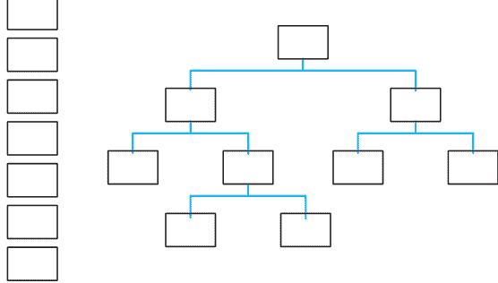

图 3.1 线性集合和非线性集合

例如，一种线性集合可能始终向线的一端添加新元素，因此元素的顺序由它们被添加的顺序决定。另一个线性集合可能根据元素的某些特征保持排序状态。例如，人员列表可以根据姓名字符按字母顺序排列。非线性集合中元素的特定组织方式也可以通过这两种方式之一来确定。

## 抽象数据类型

抽象在特定时刻隐藏某些细节。处理抽象比一次性处理许多细节要容易得多。事实上，如果不依赖抽象，我们一天也无法过。例如，如果我们担心汽车运行的所有细节——火花塞、活塞、变速箱等等——我们就不可能学会开车。相反，我们可以关注汽车的接口：方向盘、踏板和其他几个控制控件。这些控制控件就是抽象，它们隐藏了底层细节，并使我们能够控制一台原本复杂的机器。

集合像任何定义良好的对象一样，都是一种抽象。集合定义了用户可以通过该接口来管理集合中的对象，例如添加和删除元素。如图 3.2 所示，用户通过此接口与集合交互。然而，如何实现集合以满足该定义是另一个完全的问题。实现集合接口的类必须满足集合的概念定义，但可以通过许多方式来实现。

> 核心概念
>
> 集合是一种抽象，其实现细节被隐藏了。

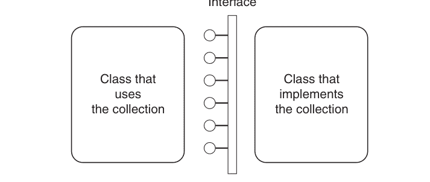

图 3.2 定义良好的接口掩盖了集合的实现

# 第3章 集合简介 — 栈

抽象是另一个重要的软件工程概念。在大型软件系统中，任何人都不可能同时掌握系统所有的细节。相反，系统被划分为抽象的子系统，可以指定这些子系统的目的以及子系统之间的交互。子系统可以分配给不同的开发者或开发者小组，由他们开发出符合规范的系统。

对象是创建集合的完美机制；如果设计得当，对象的内部工作将从系统的其他部分封装起来。在大多数情况下，类中定义的实例变量应该声明为 `private` 可见性。因此，只有该类的方法可以访问并修改它们。用户与对象的唯一交互应该是通过它的公共方法，这些方法代表了对象提供的服务。

随着我们对集合的探索，我们将始终强调接口与实现分离的思想。因此，对于我们检查的每一个集合，都应该考虑以下问题：

- 集合在概念上是如何操作的？
- 我们如何正式定义集合的接口？
- 集合帮助解决什么类型的问题？
- 对于这种类型的集合，我们已经有了哪些支持？
- 我们可能会以哪些方式实现该集合？
- 实现的收益和成本是什么？

在我们继续之前，让我们仔细定义一些与集合探索相关的其他术语。数据类型（data type）是一组值以及定义在其上面的操作。抽象数据类型（ADT）是一组在不定义实现的情况下定义的操作。例如，Java 中的原始数据类型就是主要的例子。集合是一种抽象，其实现细节被隐藏。数据结构是实现集合的底层构造。

## 核心概念

数据结构是实现集合的底层构造。

回顾我们之前的讨论，我们通过识别一组建立了有效管理元素方式特定操作集来定义抽象数据类型（ADT）。集合可以使用固定大小的结构（如数组）来实现。我们经常会遇到非线性集合，例如树。

3.

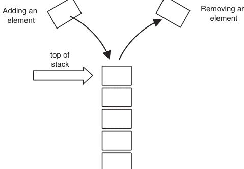

图 3.3 栈的概念视图

栈 ADT 的操作如图 3.4 所示。在栈的术语中，我们向栈 `push`（入栈）元素，从栈中 `pop`（出栈）元素。我们还可以 `peek`（查看）栈顶部的元素，根据需要对其进行检查或使用，而无需将其从集合中移除。而且还有一些通用操作允许我们判断栈是否为空，如果不为空，则包含多少个元素。

## 核心概念

程序员应该根据需要的数据管理类型选择合适的结构。

有时集合操作的命名约定存在变体。对于栈，使用 *push* 和 *pop* 术语相对标准。*peek* 操作有时被称为 *top*。

| 操作 | 描述 |
|---|---|
| push | 将元素添加到栈顶。 |
| pop | 从栈顶移除元素。 |
| peek | 检查栈顶的元素。 |
| isEmpty | 判断栈是否为空。 |
| size | 确定栈中元素的数量。 |

图 3.4 栈的操作

## 3.3 关键的面向对象概念

### 设计重点

在栈 ADT（抽象数据类型）的设计中，我们栈的角色与使用栈的应用程序的角色之间的分离。请注意，此栈 ADT 的任何实现在对空栈执行出栈（pop）操作时，都应该抛出一个异常。集合的作用不在于确定如何处理此类异常，而仅仅将其报告给使用栈的应用程序。同样，栈 ADT 中并不存在“满栈”的概念。因此，栈集合的作用是管理其自身的存储空间，以消除满栈的可能性。

请记住，集合的定义并不是通俗一致的。你会发现，不同的文本之间，针对特定数据结构所定义的操作会有所不同。在本书中，我们非常仔细地为每个集合定义了操作，以确保它们与你的目标保持一致。

例如，请注意图 3.4 中的没有任何一个栈能让我们深入栈内部去修改、删除或重新组织栈中的元素。这这就是栈的本质——所有活动都发生在末端。如果我们发现，为了解决某个特定问题，我们需要访问集合中间或底部的元素，那么栈并不是一个合适的集合。

我们为集合提供了一个 `toString` 操作。这并不是为栈定义的经典操作，有人可能会认为这违反了栈的规定行为。然而，它提供了一种方便的方法来遍历和显示栈的内容，而不会允许对栈进行修改，这对于调试非常有用。

## 3.3 关键的面向对象概念

让我们考虑将在栈中存储什么。一种可能性可能是每当我们需要时，简单地重新创建我们的栈数据结构，并创建它来存储该特定的对象类型。例如，如果我们需要一个字符串栈，只需复制粘贴我们的栈代码，并将对象类型更改为 `String` 即可。即使是复制，这种粗暴的复用并不是我们的目标。纯粹形式的复用应该意味着我们创建一个只写一次、编译成一次字节码的集合，然后安全、高效且有效地处理我们选择存储在其中的任何对象。为了实现这些目标，我们必须考虑类型兼容性和类型检查。类型兼容性指示了将对象赋值给引用的特定赋值是否合法。例如，以下赋值是不合法的，因为你不能将声明为 `String` 类型的引用赋值给 `Integer` 类型的对象。

```
String x = new Integer(10);
```

Java 提供了编译时类型检查，会标记出这种无效赋值。第二种可能性是利用继承和多态的概念，创建一个可以存储任何类对象的集合。

### 继承与多态

关于继承和多态概念的完整讨论请参阅附录 B 中的视频。回顾一下，多态引用是一种引用变量，它在不同的时间点可以引用不同类型的对象。继承可以用于创建类层次结构，在类层次结构中，引用变量可以用于指向与其继承相关的任何对象。

推到极端，`Object` 引用可以用来引用任何对象，但最终所有类都是 `Object` 类的后代。例如，`ArrayList` 使用了多态性，因为它被设计为持有 `Object` 引用。这就是为什么 `ArrayList` 可以用来存储任何种类型的对象。一个特定的 `ArrayList` 可以同时持有几种几种不同类型的对象，因为所有对象与 `Object` 类型都是兼容的。

这种讨论的结果是，我们可以简单地在栈中存储 `Object` 引用，并通过继承利用多态来创建一个可以存储任何类型对象的集合。然而，这种可能的解决方案产生了一些意外之外的后果。因为在本章中我们关注的是使用数组实现栈，让我们看看当我们在处理多态引用和数组时会发生什么。考虑图 3.5 中表示的类。由于 `Animal` 是图中所有类的父类，因此如下赋值是允许的：

```
Animal a = new Dog();
```

但是，如果我们尝试如下赋值，就会出现问题：

```
Dog d = new Animal(); // 编译错误：无法将 Animal 转换为 Dog
```

如果我们使用数组来存储多态引用，可能会发生以下情况：

```
Animal[] animals = new Animal[2];
animals[0] = new Dog();
animals[1] = new Cat();
```

这是允许的。但如果我们尝试将数组声明为子类型：

```java
Dog[] dogs = new Dog[2];
dogs[0] = new Animal(); // 运行时异常：ArrayStoreException
```

这是因为数组在运行时会检查元素的类型。

## 3.3 关键的面向对象概念


图 3.5 显示类层次结构的类图

### 泛型

从 Java 5 开始，泛型允许我们定义一个基于泛类型的类。也就是说，我们可以定义一个存储、操作和管理对象的类。例如：

```java
class Box<T> {
    private T[] elements;

    @SuppressWarnings("unchecked")
    public Box() {
        elements = (T[]) new Object[1];
    }

    public void set(T item) {
        elements[0] = item;
    }

    public T get() {
        return elements[0];
    }
}
```

那么，当需要 `Box` 时，可以使用特定的类型来实例化：

```java
Box<String> stringBox = new Box<>();
stringBox.set("Hello");
String s = stringBox.get();
```

泛型在本文中讨论集合时是不可或缺的一部分。泛型允许我们定义一个可以存储任何类型对象的集合，同时保持代码的安全性。


```java
class Stack<T> {
    private List<T> list;

    public Stack() {
        list = new ArrayList<>();
    }

    public void push(T item) {
        list.add(item);
    }

    public T pop() {
        return list.remove(list.size() - 1);
    }

    public boolean isEmpty() {
        return list.isEmpty();
    }

    public int size() {
        return list.size();
    }
}
```

通过泛型，我们可以在栈中存储任何类型，例如：

```java
Stack<Integer> intStack = new Stack<>();
intStack.push(10);
intStack.push(20);
Integer i = intStack.pop();

Stack<String> stringStack = new Stack<>();
stringStack.push("Hello");
String s = stringStack.pop();
```

泛型还允许我们在编译时进行类型检查，从而避免了在运行时进行强制类型转换。

```java
Stack<Integer> stack = new Stack<>();
// stack.push("Hello"); // 编译错误：无法将 String 转换为 Integer
```

## 3.4 使用栈：评估后缀表达式

例如，后缀表达式

```
6 9 -
```

等同于中缀表达式

```
6 - 9
```

后缀表达式的评估通常比中缀表达式更容易，因为不需要考虑优先级规则和括号。表达式中操作数和操作符的顺序就足够确定结果了。由于这个原因，编程语言编译器和运行时环境经常在内部计算中使用后缀表达式。

评估后缀表达式的过程可以概括为一条简单的规则：从左到右扫描，将每个操作符应用于其之前的两个操作数，并将该操作符替换为结果。最后，我们得到了表达式的最终值。

考虑我们之前看过的中缀表达式：

```
4 + 5 * 2
```

在后缀表示法中，该表达式将写为

```
4 5 2 * +
```

让我们使用评估规则来确定该表达式的最终值。我们从左到右扫描，直到遇到乘法运算符（`*`）。我们将该操作符应用于其之前的两个操作数（5 和 2），并将其替换为结果（10），得到：

```
4 10 +
```

继续从左到右扫描，我们立即遇到了加法运算符（`+`）。将该操作符应用于其之前的两个操作数（4 和 10）得到 14，这就是表达式的最终值。

让我们来看一个稍微复杂一点的例子。考虑以下中缀表达式：

```
(3 * 4 - (2 + 5) * 4 / 2
```

等值的后缀表达式是

```
3 4 * 2 5 + - 4 2 /
```

应用我们的评估规则得到

```
12 2 5 + - 4 * 2 /
12 7 - 4 * 2 /
5 4 * 2 /
10
```

现在，让我们考虑一个用于评估后缀表达式的程序设计。评估规则依赖于每当我们遇到操作符时，能够获取之前的两个操作符。此外，一个大型后缀表达式将有很多操作符和操作数需要管理。事实证明，栈是这种情况下使用的完美集合。栈提供的操作与评估后缀表达式的过程非常契合。

### 核心概念

在评估后缀表达式时，栈是使用的理想数据结构。

使用栈评估后缀表达式的算法可以表示如下：从左到右扫描表达式，依次识别每个标记（操作符或操作数）。如果是操作数，则将其入栈。如果是操作符，则从栈中弹出两个元素，将操作符应用于它们，并将结果压栈。当我们到达表达式末尾时，栈中剩余的元素即为结果。如果在任何一点我们尝试从栈中弹出两个元素但栈中没有两个元素，则我们的表达式格式不正确。同样，如果我们到达表达式末尾且栈中剩余多于一个元素，则我们的表达式格式不正确。图 3.6 展示了使用栈评估后缀表达式。

### 列表 3.1

```java
import java.util.Scanner;
/**
 * 展示使用栈来评估后缀表达式。
 * @author Lewis and Chase
 * @version 4.0
 */
public class PostfixTester {
    /**
     * 读取并评估多个后缀表达式。
     */
    public static void main(String[] args) {
        String expression, again;
        int result;

        Scanner in = new Scanner(System.in);

        do {
            PostfixEvaluator evaluator = new PostfixEvaluator();
            System.out.println("输入一个后缀表达式:");
            expression = in.nextLine();
            result = evaluator.evaluate(expression);
            System.out.println("该表达式等于 " + result);
            System.out.print("继续评估另一个表达式 [Y/N]? ");
            again = in.nextLine();
        } while (again.equalsIgnoreCase("y"));
    }
}
```

### 列表 3.2

```java
import java.util.Stack;
import java.util.Scanner;

/**
* 代表后缀表达式的评估器。假设操作数是常量。
* @author Lewis and Chase
* @version 4.0
*/
public class PostfixEvaluator {
    private Stack<Integer> stack;

    /**
    * 通过创建一个栈来设置此评估器。
    */
    public PostfixEvaluator() {
        stack = new Stack<>();
    }

    /**
     * 判断指定的标记是否为操作符
     * @param token 要评估的标记
     * @return 如果是操作符则返回 true
     */
    private boolean isOperator(String token) {
        return token.equals("+") || token.equals("-") ||
               token.equals("*") || token.equals("/");
    }

    /**
     * 评估表达式。如果遇到操作数，将其入栈。如果遇到操作符，
     * 弹出两个操作数，结果入栈。
     * @param expr 表达式的字符串表示
     * @return 表达式的值
     */
    public int evaluate(String expr) {
        int op1, op2, result = 0;
        Scanner parser = new Scanner(expr);
        while (parser.hasNext()) {
            String token = parser.next();
            if (isOperator(token)) {
                op2 = stack.pop();
                op1 = stack.pop();
                result = evaluateSingleOperator(token.charAt(0), op1, op2);
                stack.push(result);
            } else {
                stack.push(Integer.parseInt(token));
            }
        }
        return result;
    }

    /**
     * 对由操作符和操作数组成的单个表达式进行整数评估。
     * @param operation 操作符
     * @param op1 第一个操作数
     * @param op2 第二个操作数
     * @return 操作的结果
     */
    private int evaluateSingleOperator(char operation, int op1, int op2) {
        int result = 0;
        switch (operation) {
            case '+':
                result = op1 + op2;
                break;
            case '-':
                result = op1 - op2;
                break;
            case '*':
                result = op1 * op2;
                break;
            case '/':
                result = op1 / op2;
                break;
        }
        return result;
    }
}
```

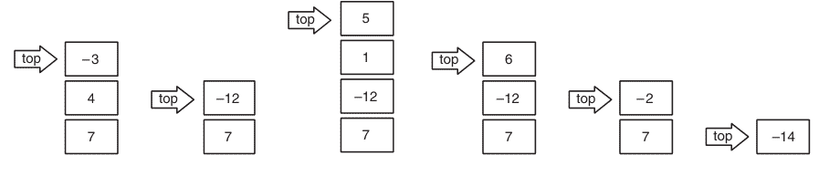

图 3.6 使用栈评估后缀表达式

### 3.4 使用栈：评估后缀表达式（续）

为了保持简单，该程序假设表达式的操作数是整数且是字面量（而不是变量）。执行时，程序会反复接受并评估后缀表达式，直到用户选择停止。

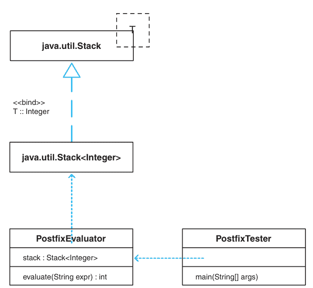

图 3.7 后缀表达式程序的 UML 类图

我们使用了 `java.util.Stack`，因为我们可以使用任何实现了栈接口的类，只要它能按预期执行栈操作即可。从求值后缀表达式的角度来看，栈的实现方式大体无关。图 3.7 显示了后缀表达式评估程序的 UML 类图。该图说明 `PostfixEvaluator` 类使用了 `java.util.Stack` 类的 `Integer` 实例，并表示了 `Integer` 与泛型 `T` 的绑定。我们不会在 UML 图中包含这种程度的细节。

### Javadoc

在继续之前，让我们提一下在列表 3.1 和 3.2 中用于注释的文档风格。这些是 Javadoc 注释，其编写格式允许 `javadoc` 工具（JDK 工具集的一部分）解析注释并提取有关类和方法的信息。Javadoc 注释以 `/**` 开头，以 `*/` 结束。

Javadoc 用于为一组类创建 HTML 格式的在线文档。你已经见过结果；在线 Java API 文档就是使用这种技术创建的。当 API 类（及其注释）发生更改时，再次运行 javadoc 工具即可生成新文档。这是确保文档不落后于代码演进的一种巧妙方法。

在这方面，Java API 类并没有什么特殊之处。任何程序或类类的文档都可以通过 Javadoc 生成。即使不用于生成在线文档，Javadoc 注释风格也是为 Java 代码添加注释的官方标准。

Javadoc 标签（tags）用于识别特定类型的信息。例如，`@author` 标签用于识别编写代码的程序员；`@version` 标签用于指定代码的版本。在方法的头部，`@return` 标签用于指示方法返回的值，而 `@param` 标签用于识别传递给方法的每个参数。

我们在此不再进一步讨论 Javadoc，但本文将贯穿使用 Javadoc 注释风格。

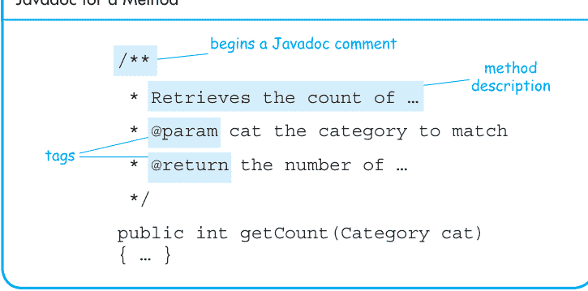

## 3.5 异常

我们在讨论每个集合时都会将探索的一个概念是“异常行为”。在异常情况下，集合应该采取什么行动？某些情况是集合本身所固有的。例如，在栈的情况下，如果尝试从空栈中弹出（`pop()`）元素会发生什么？在这种情况下，使用什么种结构来实现该集合并不重要；异常仍然适用。此类情况是实现集合所用的数据结构的产物。例如，如果我们使用数组来实现栈，当尝试向栈中推入（`push()`）元素但数组已满时会发生什么？让我们花点时间进一步探讨。

Java 程序中出现的问题产生异常（exception）或错误（error）。异常是一个定义异常或错误情况的对象。异常由程序或运行时抛出，如果需要，可以被适当地捕获和处理。错误通常代表不可恢复的情况，不应该被捕获。Java 预定义了一组在程序执行过程中可能发生的异常和错误。

在我们的后缀示例中，有几种潜在的异常情况。例如：

- 在 `push()` 时栈满
- 在 `pop()` 时栈空
- 求值完成时栈中持有多个值

让我们分别考虑这些情况。在 `push()` 时栈可能满的可能性是底层数据结构的问题，而不是集合的问题。从概念上讲，不存在“满栈”这件事。现在我们知道这并非事实，所有数据结构最终都会达到限制。然而，当达到这个物理限制时，栈并不是满的；只有实现栈的数据结构满了。我们将在下一节实现栈时，讨论处理这种情况的策略。

如果在 `pop()` 时栈是空的怎么办？这是一个与问题本身相关的异常情况，而不是底层数据结构。如果我们尝试弹出两个操作数但栈中没有两个操作数，那么我们的后缀表达式格式不正确。这是一个集合需要报告异常的情况，而应用程序必须在上下文中解释异常。

第三种情况同样有趣。如果求值完成时栈中持有多个值会怎样？从栈集合的角度来看，这不是一个异常。然而，从应用程序的角度来看，这是一个问题，意味着该后缀表达式再次格式不正确。因为集合不会产生异常，这是应用程序必须测试的条件。

### 核心概念

错误和异常代表不寻常或无效的处理。

附录 B 包含了对异常和异常处理的完整讨论，包括异常传播和 `try/catch` 语句。当我们探索集合的特定实现技术时，还将讨论异常的适当使用。

## 3.6 栈 ADT

### 核心概念

Java 接口（`interface`）定义了一组抽象方法，对于将抽象数据类型概念与其实现分离非常有用。为了便于接口与其方法的分离，我们可以为任何集合定义 Java 接口。记住，Java 接口定义了一组抽象方法，指定方法的签名但不包含体。实现接口的类提供了方法的定义。

### 核心概念

通过使用接口或泛型，我们确保接口不依赖于特定的类。

注意栈定义为 `StackADT<T>`，操作的是泛型。在接口的方法中，各种参数的返回类型通常使用泛型表示。当此接口被实现时，它将基于一个替换 T 的类型。

### 列表 3.3

```java
package jsf;

/**
 * 定义栈集合的接口。
 *
 * @author Lewis and Chase
 * @version 4.0
 */
public interface StackADT<T> {

  /**
   * 将指定的元素推入此栈的顶部。
   * @param element 要推入栈的元素
   */
  public void push(T element);

  /**
   * 从栈顶部移除并返回元素。
   * @return 从栈中移除的元素
   */
  public T pop();

  /**
   * 返回栈顶元素但不将其移除。
   * @return 栈顶元素
   */
  public T peek();

  /**
   * 如果此栈不包含任何元素，则返回 true。
   * @return 如果栈为空返回 true
   */
  public boolean isEmpty();

  /**
   * 返回栈中元素的数量。
   * @return 栈中的元素数量
   */
  public int size();

  /**
   * 返回此栈的字符串表示。
   * @return 栈的字符串表示
   */
  public String toString();

}
```


## 第 3 章 集合简介 — 栈

在本文中每当我们引入一个接口、类或系统时，都会在该描述旁边带有该接口、类或系统的 UML 描述。这将帮助你习惯阅读 UML 描述，并为其他类和系统创建这些描述。图 3.8 展示了 `StackADT` 接口的 UML 描述。

栈在计算世界被频繁使用。例如，文字处理器中的“撤销”操作通常是用栈来实现的。当我们对文档进行更改（添加数据、删除数据、更改格式等）时，文字处理器会通过向栈中推入（`push`）该操作的某种表示来跟踪每一次操作。如果我们选择撤销某个操作，文字处理器会从栈中弹出（`pop`）最近执行的操作并对其进行反转。如果我们选择再次撤销（撤销我们执行的倒数第二个操作），则会再次从栈中弹出另一个元素。在大多数文字处理器中，许多操作都可以通过这种方式撤销。

### 设计焦点

撤销操作通常使用一种被称为“丢弃栈”（drop-out stack）的特殊栈类型实现。丢弃栈的基本操作与栈相同（推入 `push`、弹出 `pop` 和查看 `peek`）。唯一的区别是，丢弃栈对其持有的元素数量有一个限制，一旦达到该限制，当推入新元素时，栈底的元素会掉落。丢弃栈的开发被留作了一个练习。

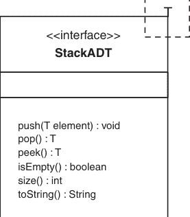

图 3.8 UML 中的 `StackADT` 接口

### 3.7 实现栈：使用数组

在到目前为止对栈集合的讨论中，我们已经描述了它的基本概念本质以及使用户与之交互的操作。在软件工程术语中，我们会说我们已经对栈集合完成了分析。我们还曾在不知道其实现细节的情况下使用栈来解决特定问题。现在，让我们把注意力转向实现细节。实现表示栈的类有多种方法。正如前文所提到的，Java Collections API 提供了多种实现，包括 `Stack` 类和 `Deque` 接口。在本节中，我们将研究一种使用数组来存储栈中包含对象的实现策略。在下一章中，我们将研究实现栈的第二种技术。

为了探索这种实现，我们必须回顾 Java 数组的几个关键特征。存储在数组中的元素索引从 0 到 $n-1$，其中 $n$ 是数组中的单元格总数。数组是一个对象，它是与所持有的对象独立实例化的。当我们谈论对象数组时，我们实际上是在谈论一个指向对象的引用的数组，如图 3.9 所示。

#### 核心概念

集合操作的实现不影响用户与集合交互的方式。

请记住集合与实现它的底层数据结构之间的分离。我们的目标是设计一种高效的实现，以提供栈抽象数据类型中定义的每个操作的功能。数组只是一个用于存储对象的简便数据结构。

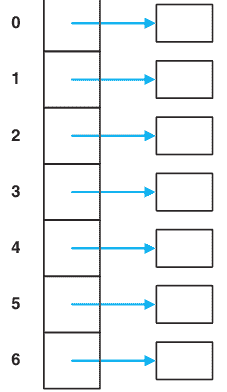

图 3.9 一个对象引用的数组

#### 管理容量

当创建一个数组对象时，它会分配特定数量的单元格，元素可以存储在其中。例如，下面的实例化创建了一个可以存储 500 个元素的数组，索引从 0 到 499：

```java
Object[] collection = new Object[500];
```

数组中的单元格数量被称为其容量（`capacity`）。此值存储在数组的 `length` 中。数组一旦创建，其容量就无法更改。

使用数组来实现集合时，我们需要处理数组单元格都已满的情况。由于我们使用的是固定大小的数组，在某个点集合可能会满。在集合的设计中，一个关键问题是当满时该怎么办。三种方案：

- 我们可以实现在满时抛出异常的操作。
- 我们可以实现返回状态的操作以检查是否已满。
- 我们可以需要时自动扩展数据结构的容量。

#### 核心概念

如何处理满的情况取决于栈的 own。

在第一种情况下，用户必须意识到栈已满并扩展数据结构。由于我们的目标是让接口与实现分离，第三种方案是很有吸引力的。此外，容量问题是实现细节。在本文介绍的解决方案中，我们通过扩展数据结构的容量。有时会探索其他选项。

### 3.8 `ArrayStack` 类

在 Java 集合框架中，类名指示了数据结构和集合。我们遵循本文的命名规范。因此，我们定义了一个 `ArrayStack` 类来表示基于数组的栈。

为了精确起见，我们定义了一个 `ArrayStack<T>` 类来表示基于数组的栈实现。我们可以通过做出以下四个假设来设计栈的实现：数组是对象引用数组（类型在实例化栈时确定）；栈的底始终位于数组的索引 0 处；栈的元素按顺序且连续地存储在数组中；并且有一个整数变量 `top` 存储紧随栈中元素的数组索引。

图 3.10 配置了一个当前包含 A、B、C、D 元素的栈，假设它们是按顺序推入的。为了简化图表，元素显示在数组中而不是作为引用。注意 `top` 变量表示应存储推入元素的下一个单元格，也是当前栈中元素的计数。

在这种实现中，栈的底始终保持在数组索引 0 处，栈在高索引处增长和缩小。这比如果栈在数组内反转要高效得多。考虑如果顶部保持在索引 0 处则需要哪些处理。

根据这些假设，我们可以确定我们的类需要一个常量来存储默认容量，一个跟踪栈顶的变量，以及一个存储栈的数组变量。这导致了所示的类头：

#### 核心概念

为了效率，基于数组的栈实现将栈的底放在索引 0 处。


ArrayStack 实现概览

| 0 | 1 | 2 | 3 | 4 | 5 | 6 | 7 | ... |
|---|---|---|---|---|---|---|---|---|
| A | B | C | D | | | | | |

top 4

图 3.10 栈的数组实现

注意，我们的 `ArrayStack` 类将是 `jsjf` 包的一部分，并会使用一个名为 `jsjf.exceptions` 的包。

```java
package jsjf;
```

```java
import jsjf.exceptions.*;
import java.util.Arrays;
```

```java
/**
 * 栈的数组实现，其中栈底
 * 固定在索引 0。
 *
 * @author Lewis and Chase
 * @version 4.0
 */
```

```java
public class ArrayStack<T> implements StackADT<T>
{
    private final static int DEFAULT_CAPACITY = 100;
    private int top;
    private T[] stack;
```

#### 构造函数

我们的类将有两个构造函数，一个用于默认容量，另一个用于指定容量。

```java
/**
 * 使用默认容量创建一个空栈。
 */
```

```java
public ArrayStack()
{
    this(DEFAULT_CAPACITY);
}
```

```java
/**
 * 使用指定的容量创建一个空栈。
 * @param initialCapacity 数组的初始大小
 */
```

```java
public ArrayStack(int initialCapacity)
{
    top = 0;
    stack = (T[])new Object[initialCapacity];
}
```

#### 3.8 `ArrayStack` 类

为了复习记忆，这是一个方法重载的绝佳示例（即两个同相同但仅参数列表不同的方法）。同样有趣的是，默认容量的构造函数通过传递 `DEFAULT_CAPACITY` 常量调用了另一个构造函数。

根据我们之前对泛型的讨论，我们记得你不能实例化一个泛型类型。这意味着你不能实例化一个泛型类型的数组。这导致在我们的构造函数中产生了一行有趣的代码：

```java
stack = (T[])new Object[initialCapacity];
```

注意，在这一行中，我们实例化了一个 `Object` 数组，然后将其强制转换为我们的泛型数组。这会导致产生未检查类型转换的编译时警告，因为 Java 编译器无法保证此强制转换的类型安全性。正如我们所看到的，处理这种情况以获得泛型的灵活性类型安全性是值得的。此警告可以通过在起始语句之前放置以下 Java 注解来抑制：

> `@SuppressWarnings("unchecked")`

| 常见错误 |
| :--- |
| 泛型初学者常犯的一个常见错误是尝试创建一个泛型类型的数组：`stack = new T[initialCapacity];`。泛型类型无法被实例化，这包括泛型类型的数组。这就是为什么我们必须创建一个持有 `Object` 引用的数组，然后将其转换为泛型类型的数组。 |

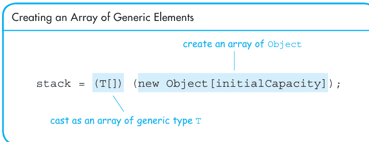

#### `push` 操作

要将元素推入栈中，我们只需将其插入到数组中由变量 `top` 指定的下一个可用位置。然而，在这样做之前，我们必须确定数组是否达到了它的容量，并在必要时扩展它。在存储值之后，我们必须更新 `top` 的值，以便它继续代表栈中元素的数量。

实现这些步骤会得到以下代码：

```java
/**
 * 将指定的元素添加到此栈的顶部，必要时扩展
 * 数组的容量。
 * @param generic 要推入栈的元素
 */
public void push(T element) {
    if (size() == stack.length) {
        expandCapacity();
    }
    stack[top] = element;
    top++;
}
```

`expandCapacity` 方法的实现根据需要将数组的大小翻倍。当然，由于数组一旦实例化就无法调整大小，此方法只是简单地创建一个新的更大的数组，并将旧数组的内容复制到新数组中。它是该类的辅助方法，因此可以以 `private` 可见性实现。

```java
/**
 * 创建一个新数组来存储此栈的内容，
 * 容量是旧数组的两倍。
 */
private void expandCapacity() {
    stack = Arrays.copyOf(stack, stack.length * 2);
}
```

#### 3.8 `ArrayStack` 类

| 0 | 1 | 2 | 3 | 4 | 5 | 6 | 7 | ... |
| :--- | :--- | :--- | :--- | :--- | :--- | :--- | :--- | :--- |
| A | B | C | D | E | | | | |

top 5

图 3.11 推入元素 E 之后的栈

图 3.11 展示了向图 3.10 所示的栈推入元素的结果。

栈的数组实现的 `push` 操作由以下步骤组成：

- 确保数组未满。
- 将数组位置 `top` 的引用设置为要添加到栈的对象。
- 增加 `top` 的值。

这些步骤中的每一步都是 O(1)。因此，该操作是 O(1) 。我们可能会好奇 `expandCapacity` 方法的时间复杂度以及它对 `push` 方法分析的影响。该方法确实包含一个线性 `for` 循环，我们会认为其为 O(n)。然而，考虑到 `expandCapacity` 方法被调用的频率相对于 `push` 可能调用的次数非常低，我们可以将复杂度分摊到所有的 `push` 实例上。

#### `pop` 操作

`pop` 操作移除并返回栈顶部的元素。对于数组实现，这意味着返回 `top-1` 处的元素。然而，在返回元素之前，我们必须确保栈中有元素。

数组版本的 `pop` 操作可以实现如下：

```java
/**
 * 从此栈顶部移除元素并返回其
 * 引用。
 * @return 顶部的元素
 * @throws EmptyCollectionException 如果栈为空
 */
public T pop() throws EmptyCollectionException
{
    if (isEmpty()) {
        throw new EmptyCollectionException("stack");
    }
    top--;
    T result = stack[top];
    stack[top] = null;
    return result;
}
```

如果在调用 `pop` 方法时栈为空，则会抛出 `EmptyCollectionException`。否则，`top` 的值减1，并将该处的元素存储在临时变量中。然后将数组中的该单元格设置为 `null`。图 3.12 展示了对栈 3.11 执行操作后的结果。

`pop` 操作由以下步骤组成：

- 栈为空。
- 递减 `top`。
- 将 `stack[top]` 设置为临时引用。
- 将 `stack[top]` 设置为 `null`。
- 返回临时引用。

| 0 | 1 | 2 | 3 | 4 | 5 | 6 | 7 | ... |
| :--- | :--- | :--- | :--- | :--- | :--- | :--- | :--- | :--- |
| A | B | C | D | | | | |

图 3.12 弹出元素之后的栈

所有这些步骤都是 O(1) 。因此，数组实现的 `pop` 操作复杂度为 O(1) 。

#### `peek` 操作

`peek` 操作返回栈顶元素的引用但不从栈中移除它。对于数组实现，这意味着返回位置 `top-1` 的引用。这一个步骤是 O(1)，因此 `peek` 操作也是 O(1) 。

```java
/**
 * 返回此栈顶部元素的引用。
 * 元素不会从栈中移除。
 * @return 顶部的元素
 * @throws EmptyCollectionException 如果栈为空
 */
public T peek() throws EmptyCollectionException
{
    if (isEmpty()) {
        throw new EmptyCollectionException("stack");
    }
    return stack[top-1];
}
```

#### 其他操作

`isEmpty`、`size` 和 `toString` 操作及其分析留给编程项目和练习。

#### `EmptyCollectionException` 类

现在我们检查了 `ArrayStack` 类的实现，让我们重新审视我们在异常处理方面的选择。我们选择让集合处理底层数据结构变满的情况，因为这是集合内部的问题。另一方面，当在集合为空时通过 `pop` 或 `peek` 操作访问集合中的元素时，我们选择抛出异常。这种情况揭示了使用集合的问题，而不是集合本身的问题。异常在 Java 中是类，因此我们可以选择使用 Java API 提供的现有异常或创建自己的异常。在这种情况下，我们可以被用于创建一个特定的空栈异常。然而，创建一个带参数的异常使我们能够在我们的任何类中重用此异常。列表 3.4 显示了 `EmptyCollectionException` 类。注意，我们的异常类继承了 `RuntimeException` 类，并通过使用 `super` 引用使用了父类的构造函数。

##### 列表 3.4

```java
package jsjf.exceptions;

/**
 * 表示集合为空的情况。
 * @author Lewis and Chase
 * @version 4.0
 */
public class EmptyCollectionException extends RuntimeException {
    /**
     * 使用适当的消息设置此异常。
     * @param collection 集合的名称
     */
    public EmptyCollectionException(String collection) {
        super("The " + collection + " is empty.");
    }
}
```


## 其他实现

在本章中，我们研究了栈的概念，使用了 Java API 提供的 `Stack` 类来解决后序表达式求值问题，然后实现了我们自己的 `ArrayStack` 类，该类使用数组来存储栈的底层元素。

不过，我们还没有结束栈的学习。在第 4 章中，我们将研究另一种使用链结构而非数组实现集合的技巧，并实现 `LinkedStack` 类。

掌握了这两种广泛的实现技术——基于数组和基于链的——我们将准备好探索许多其他集合。

## 核心概念总结

- 集合（collection）是一个收集和组织其他对象的对象。
- 集合中的元素通常根据它们添加到集合的顺序或元素之间的某些内在关系来组织。
- 集合是一种抽象，其中隐藏了实现的细节。
- 数据结构是用于实现集合的底层编程构造。
- 栈元素按照后进先出（LIFO）的方式处理——最后一个进入的元素是第一个出来的元素。
- 程序员应该根据需要的数据管理类型选择合适的结构。
- 在评估后序表达式时，栈是使用的理想数据结构。
- 错误和异常代表不寻常或无效的处理。
- Java 接口（interface）定义了一组抽象方法，有助于将抽象数据类型的概念与其实现分离开。
- 通过使用接口名称作为返回类型，我们确保接口不会承诺方法使用任何实现栈的特定类。
- 程序员必须仔细考虑如何处理异常（如果需要），以及在哪个层级处理。
- 集合操作的实现不应影响用户与集合交互的方式。
- 我们处理异常情况的方式决定了是集合还是集合的用户控制特定的行为。
- 为了效率，基于数组的栈实现将栈底留在索引 0 处。

## 术语总结

**抽象（abstraction）** 一种隐藏或忽略某些细节的观点，通常是为了让概念更容易管理。

**抽象数据类型（abstract data type）** 一种值和操作在编程语言中没有内在定义的数据类型。

**类层次结构（class hierarchy）** 通过继承创建的类之间的关系，其中一个父类的子类本身也可以是其他类的父类。

**集合（collection）** 一个收集和组织其他对象的对象。

**数据结构（data structure）** (1) 对象的组织方式，允许高效执行某些操作；(2) 用于实现集合的编程构造。

**异常（exception）** 一个定义了异常或错误情况的对象。

**泛型（generic type）** 对象的类型占位符，在引用它的类实例化之前该类型不是具体的。

**继承（inheritance）** 从现有类派生一个类的面向对象的原则。

**接口（interface）** (1) 一物与另一物交互的方式；(2) 一组允许一个对象与另一个对象交互的公共方法。

**Java Collections API（Java Collections API）** Java 应用程序接口（APIs）中表示或处理集合的子集。

**LIFO（后进先出）** (1) 最后进先出；(2) 对集合的描述，最后添加的元素将是第一个移除。

**多态（polymorphism）** 一种面向对象的原则，允许变量随时间指向相关的不同类型的对象，并且方法调用在运行时绑定到代码上。

**pop** 一种栈操作，从栈顶移除一个元素。

**push** 一种栈操作，向栈顶添加一个元素。

**栈（stack）** 一种线性集合，其元素按照后进先出的方式从同一个端添加和移除。

## 自测习题

- SR 3.1 元素在集合中是如何组织的？
- SR 3.2 给出两个非线性集合的现实世界例子。
- SR 3.3 数据类型和抽象数据类型之间的区别是什么？
- SR 3.4 指出你在实现整数的数组栈时会使用的数据类型、集合和数据结构。
- SR 3.5 你对“栈元素按照后进先出的方式处理”这句话怎么理解？
- SR 3.6 哪种数据结构是实现方法递归的理想选择？
- SR 3.7 列出用于向栈添加和移除元素的方法。
- SR 3.8 什么是 Java 接口？
- SR 3.9 接口可以被称为类吗？
- SR 3.10 你对泛型有什么理解？
- SR 3.11 什么是多态引用？
- SR 3.12 根据图 3.5 中的区别，列出爬行动物类（`Reptile`）的子类。
- SR 3.13 根据图 3.5 中的示例，以下代码可以通过编译吗？

```java
Animal creature = new Bat();
```

- SR 3.14 根据图 3.5 中的示例，以下代码可以通过编译吗？

```java
Parrot creature = new Bird();
```

- SR 3.15 前序和后序表达式有什么区别？
- SR 3.16 如何计算后序表示？

## 练习

- EX 3.1 面向对象的编程允许你定义类的通用形式。稍后你可以定义该类的专门版本。这描述了哪种特定技术？
- EX 3.2 为什么使用对象作为创建集合的完美机制？
- EX 3.3 栈是什么种类型的集合？给出一个自然的用法示例。
- EX 3.4 手动跟踪栈 X 执行以下操作：

```java
X.push(new Integer(20));
X.push(new Integer(15));
Integer Y = X.pop();
X.push(new Integer(35));
X.push(new Integer(10));
X.push(new Integer(25));
X.push(new Integer(45));
Integer Y = X.pop();
X.push(new Integer(15));
X.push(new Integer(45));
```

- EX 3.5 给定结果栈 X，以下操作的结果是什么？
  - a. Y = X.peek();
  - b. Y = X.pop(); Z = X.peek();
  - c. Y = X.push(30); D = X.peek();
- EX 3.6 编写 Java 语句定义一个存储泛型 T 的 `Bag` 类。该类应该有两个用于设置和检索数据的泛型方法。
- EX 3.7 编写 Java 语句实例化上述类的 `Bag` 类，存储 `String` 数据。将 `Money` 作为数据项。
- EX 3.8 当你在键盘上输入文本时，使用退格键删除前一个字符。连续使用退格键可以删除多个字符。显示如何通过使用栈来支持退格键。给出具体示例并画出各种操作后栈的内容。
- EX 3.9 使用五个整数（21, 32, 11, 54, 90）画出一个示例，展示如何使用栈来反转这些元素的顺序（90, 54, 11, 21）。
- EX 3.10 使用本章讨论的算法将以下表达式转换为后序形式。
  - a. (a * (b / c)) - d + e / f
  - b. a - (b * c / d) + e

## 编程项目

- PP 3.1 完成本章中提出的 `ArrayStack` 类实现。具体来说，完成 `isEmpty`、`size` 和 `toString` 方法的实现。
- PP 3.2 设计并实现一个应用程序，从用户处读取句子并打印每个单词反转的句子。使用栈来反转每个单词的字符。
- PP 3.3 修改后序表达式求值问题的解决方案，以便检查用户输入的表达式的有效性。在遇到错误情况时发出适当的错误消息。
- PP 3.4 本章中的数组实现保持顶部变量 `top` 指向实际栈顶之下的下一个数组位置。请重写该数组实现，使得栈 `[top]` 为栈的实际栈顶。
- PP 3.5 有一种名为丢弃栈（drop-out stack）的数据结构，它在各方面都表现得像栈，只是栈的大小为 $n$，当推入第 $n+1$ 个元素时，第一个元素会丢失。使用数组实现一个丢弃栈。（提示：使用循环数组实现会有意义。）
- PP 3.6 使用三个栈实现一个整数加法器。
- PP 3.7 使用栈实现一个中缀表达式转后缀表达式转换器。
- PP 3.8 实现一个 `reverse` 类，它使用栈按反序输出一组元素。
- PP 3.9 创建一个图形化应用程序，提供用于栈推入（`push`）和弹出（`pop`）的按钮，一个接受字符串作为推入输入的文本框，以及一个在每次操作后显示栈内容的文本区域。

## 自习题答案

### SRA 3.1

集合中的元素通常按照它们添加到集合的顺序组织，或者按照元素之间的内在关系来组织。

### SRA 3.2

公司的组织层级，以及航空公司的飞行路线图。

### SRA 3.3

数据类型是一组值以及定义在这些值上的操作。抽象数据类型（ADT）是一种其值和操作没有在编程语言中固有定义的数据类型。它的实现细节必须定义并对用户隐藏。

### SRA 3.4

存储整数的数据类型是 `int`，集合是 `stack`，数据结构是数组类型。

### SRA 3.5

最后推入栈的元素将是第一个被移除的元素。换句话说，栈元素的移除顺序与它们存入栈的顺序相反。

### SRA 3.6

`Stack` 数据结构可以被用于存储方法的激活记录（activation records）。

### SRA 3.7

根据栈的术语，`push` 方法向栈顶添加元素，而 `pop` 方法从栈顶移除元素。

### SRA 3.8

一个 Java 接口定义了一组抽象方法，对于将抽象数据类型的概念与其实现分离非常有帮助。

### SRA 3.9

不，接口不是类。然而，它类似于抽象类的一种极端情况。接口本质上是一种类型，它允许程序员定义带有接口类型参数的方法。这段代码适用于所有实现接口的类。

### SRA 3.10

泛型类型（generic type）是一个对象的占位符，直到引用它的类被实例化时，它才具体化。

### SRA 3.11

多态引用（polymorphic reference）是一种引用变量，可以在不同时间点引用不同类型的对象。继承可以用于创建类层次结构，其中引用变量可以指向任何通过继承与其相关的对象。

### SRA 3.12

爬行动物（`Reptile`）的子类是蛇（`Snake`）和蜥蜴（`Lizard`）。

### SRA 3.13

是，父类或任何子类的引用变量都可以持有其任一个后代的引用。

### SRA 3.14

不，子类或子类的引用变量不能持有父类或超类的引用。要完成此赋值，你必须显式地将父类强制转换为子类（`Parrot creature = (Parrot) (new Bird());`）。

### SRA 3.15

在中缀表达式中，运算符位于操作数之间，形式为：`<操作数><运算符><操作数>`；例如表达式 `4 + 5`。而在后缀表达式中，运算符位于两个操作数之后，形式为：`<操作数><操作数><运算符>`。上述后缀符号表示为 `4 5+`。

### SRA 3.16

求值后缀表达式的过程可以描述为：从左到右扫描，对紧邻其之前的两个操作数应用每个操作，并将运算符替换为结果。最后，我们得到了表达式的最终值。栈是求值后缀表达式时理想的数据结构。

# 第 3 章 集合导论 — 栈

## 章目标

- 描述使用引用创建链式结构。
- 比较链式结构与基于数组的结构。
- 探索管理链表的技术。
- 讨论是否需要单独的节点对象来形成链式结构。
- 使用链表实现栈集合。

## 4.1 引用作为链接

在第 3 章中，我们讨论了集合的概念并特别探讨了一个集合：栈。我们定义了栈集合的操作，并设计了一个使用底层数组型数据结构的实现。在本章中，我们探索一种设计数据结构的完全不同的方法，并用它创建另一个栈实现。

链式结构是一种使用对象引用变量在对象之间创建链接的数据结构。链式结构是基于数组实现的集合的主要替代方案。在讨论了涉及链式结构的各种问题后，我们将定义一个使用链式数据结构的栈的新实现。

回想对象引用变量持有对象的地址，指示对象存储在内存中的位置。通常引用变量持有的特定地址是无关的。也就是说，尽管使用引用变量来访问对象很重要，但它在内存中的具体位置并不重要。我们通常不显示地址，而是将引用变量定义为指向一个对象，如图 4.1 所示。

```java
Object obj;
```

考虑类定义指向另一个对象的引用的情况。例如，我们有一个包含名称、地址和其他信息的 `Person`。现在假设除了这些数据外，`Person` 类还包含指向另一个对象的引用变量：

```java
public class Person {
    private String name;
    private String address;
    private Person next; // 到另一个对象的链接
    // 其他
}
```

仅使用这一个类就可以创建链式结构。一个 `Person` 对象包含指向第二个 `Person` 对象的链接。第二个对象也包含指向一个 `Person`，以此类推。这种对象有时被称为自引用（self-referential）。

![img/5ca5073ef7282f40ef08fcc5451471a_86_0.png]
图 4.1 指向对象的引用变量

这种关系形成了链表的基础，链表一个对象引用下一个对象的链式结构，为列表中的对象创建了线性排序。如图 4.2 所示。通常存储在链表中的对象泛称为链表的节点（nodes）。

> **核心概念**
>
> 链表由指向列表中下一个对象的对象组成。

注意需要一个单独的引用变量来指示列表中的第一个节点。链表终止于一个 `next` 引用为 `null` 的节点。

链表只是链式结构的一种。如果一个类被设置为对多个对象的引用，就可以创建一个更复杂的结构，如图 4.3 所示。管理链接的方式决定了结构的特定组织。

![img/5ca5073ef7282f40ef08fcc5451471a_86_1.png]
图 4.2 链表

![img/5ca5073ef7282f40ef08fcc5451471a_86_2.png]
图 4.3 复杂的链式结构

> **核心概念**
>
> 链表根据需要动态增长，本质上没有容量限制。

现在，我们将重点关注链表的细节。这些技术中的许多也适用于更复杂的链式结构。

与固定大小的数组不同，链表除了计算机内存的限制外，其容量没有上界。链表被认为是一种动态结构，因为它的尺寸会根据存储元素数量而伸缩或缩小。在 Java 中，所有对象都是从一个名为系统堆（system heap）或空闲存储器区（free store）的内存区域动态创建的。

下一节将探索管理链表的一些主要方法。

## 4.2 管理链表

请记住，我们的目标是使用链表和其他链式结构来创建集合——具体在本章中，是创建一个栈（stack）。由于集合的主要目的是能够添加、删除和访问元素，我们必须首先检查如何通过链接（links）来完成这些基本操作。在本章中，我们的讨论重点将是在链表的末尾进行添加和删除，因为这是我们实现栈时所需的。我们将根据需要重新回到这一讨论。

无论链表用于存储什么，在管理列表中的节点时都涉及一些技术。具体来说，包括访问列表中的元素、将元素插入列表以及从列表中删除元素。

### 访问元素

在处理列表中的第一个节点时，必须特别小心，以妥善维护对整个列表的引用。在使用链表时，我们维护一个指向列表首个元素的指针。要访问其他元素，我们必须先访问第一个，然后通过该指针找到下一个，依此类推。考虑我们之前的示例，即一个包含 `name`、`address` 和 `next` 属性的人。如果我们想找到列表中的第四个人，并且假设我们有一个类型为 `Person` 的变量 `first` 指向列表中的第一个个人，且列表至少包含四个节点，我们可能会使用以下代码：

```java
Person current = first;
for (int i = 0; i < 3; i++)
    current = current.next;
```

执行此代码后，`current` 将指向列表中的第四个人。请注意，创建一个新的引用变量（在本例中为 `current`），然后从设置该引用变量指向列表中的第一个元素开始是非常重要的。考虑一下如果我们在循环中使用 `first` 指针而不是 `current` 会发生什么。一旦我们将 `first` 指针移动到指向列表中的第二个元素，我们就不再有指向第一个元素的指针，并且无法访问它。请记住，在链表中，访问列表元素的唯一方法是从第一个元素开始并穿过整个列表。

当然，更可能的情况是我们需要在列表中搜索某个特定节点。假设 `Person` 类重写了 `equals` 方法，使得当 `String` 与该特定节点存储的 `name` 匹配时它返回 `true`，则以下代码将在列表中搜索为 "Tom Jones"：

```java
String searchstring = "Tom Jones";
Person current = first;
while ((!current.equals(searchstring)) && (current.next != null))
    current = current.next;
```


注意，该循环将在找到字符串或遇到列表末尾时终止。现在我们已经了解了如何访问链表中的元素，让我们来考虑如何将元素插入列表。

### 插入节点

节点可以插入到链表的任何位置：列表的头部、中间的内部节点之间，或者列表的末尾。在列表头部添加节点需要设置指向整个列表的引用，如图 4.4 所示。首先，将所加节点的 `next` 引用指向列表中的当前第一个节点。其次，将列表头部的引用重置为指向新添加的节点。

> 核心概念
> 在列表头部添加节点需要设置指向整个列表的引用。


FIGURE 4.4 在列表头部插入节点

# 第4章 链式结构——栈

注意，如果这些步骤反过来，就会出现问题。在列表中间插入节点需要进行额外的处理，但对于栈来说是不需要的。

### 删除节点

列表中的任何节点都可以被删除。与插入节点一样，无论删除哪个节点，都必须维护列表的完整性。处理第一个节点代表了一个特殊情况。

要删除列表中的节点，我们需要重置指向列表的引用，该过程如图 4.5 所示。如果其他地方需要该节点，我们需要重置 `front` 引用。删除列表中间节点的通用情况留到第 6 章讨论。

## 核心概念
> 处理链表中的第一个节点通常需要特殊处理。


FIGURE 4.5 删除列表中的第一个节点

## 设计焦点

我们可以通过在列表头部引入一个哨兵节点（`sentinel node`）或哑节点（`dummy node`）来消除涉及第一个节点的特殊情况。哨兵节点作为一个虚假的头部，并不代表列表中的元素。在使用哨兵节点时，所有的插入和删除都属于第二种情况。

## 4.3 无链接元素

现在我们已经探索了管理链表节点的技术，我们可以转向将链表作为集合的实现方法。然而，我们需要检查链表的另一个关键方面。我们必须将链式结构的细节与其存储的元素分开。

在本章早些时候，我们讨论了 `Person` 类在它的其他数据中包含指向另一个对象的链接。这种方法的缺陷在于它“知道”自引用的 `Person` 类必须设计为可以成为 `Person` 对象链表的节点。这种假设是不现实的，而且违反了我们将实现细节与使用集合的部分分离的目标。

## 核心概念

> 存储在集合中的对象不应包含任何底层数据结构的实现细节。

解决此问题的办法是定义一个独立的节点类，用于将元素连接起来。节点类非常简单，只包含两个重要的引用：一个指向链表中的下一个节点，另一个指向存储在列表中的元素。这种方法如图 4.6 所示。


FIGURE 4.6 使用独立的节点对象存储并链接元素

## 双向链表

节点链表仍然可以使用上一节讨论的技术进行管理。唯一的额外方面是，存储在列表中的元素是通过节点对象中的独立引用来访问的。

链式结构的另一种实现方式如图 4.7 所示。在双向链表中，维护了两个引用：一个指向列表的第一个节点，另一个指向列表的最后一个节点。列表中的每个节点都存储了指向下一个元素以及对前一个元素的引用。如果我们要在双链表中使用哨兵节点，我们会在链表的两个末端放置哨兵节点。我们将在第 6 章中进一步讨论双链表。

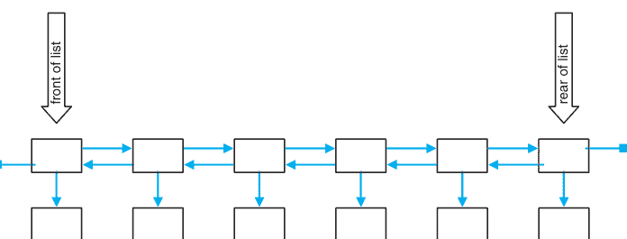

图 4.7 双链表

## 4.4 Java API 中的栈

在第 3 章中，我们使用了 Java 集合 API 中的 `java.util.Stack` 类来解决后缀表达式问题。`Stack` 类是 Java 集合框架提供的一种基于数组的栈实现。该实现提供了我们一直在讨论的相同操作：

- `push` 操作接收一个参数 `item`，它是指向要放置在栈上的对象的引用。
- `pop` 操作移除栈顶对象并返回其引用。
- `peek` 操作返回栈顶对象的引用。

`Stack` 类派自 `Vector` 类，并使用其继承的能力来存储栈中的元素。由于该实现是基于 `Vector` 构建的，它同时表现出 `Vector` 和 `Stack` 的特性，并允许执行违反栈的基本假设的操作。

`LinkedList` 类实现的 `Deque` 接口提供了栈的链式实现，并提供了相同的栈操作。`Deque`（读音类似 "deck"）是一个双端队列，我们将在第 5 章中进一步讨论。遗憾的是，由于 `Deque` 在集合的两个端进行操作，

## 核心概念

`java.util.Stack` 类派自 `Vector`，这导致栈拥有了不适当的操作。

## 4.5 使用栈：遍历迷宫

这里有多种操作可以违反栈的前提。这取决于开发者如何限制自己仅使用栈操作。让我们看看如何将 `Deque` 作为栈使用。

栈数据结构的另一个经典用途是在迷宫遍历或其他涉及试错的类似算法中跟踪备选方案。假设我们构建一个二维整数数组作为网格，其中每个数字代表迷宫中的路径 (1) 或墙壁 (0)。我们将网格存储在一个文件中，文件的第一行描述了网格的行数和列数。

```
9 13

1 1 1 0 1 1 0 0 0 1 1 1

1 0 0 1 1 0 0 1 1 0 0 1

1 1 1 1 0 1 0 1 0 1 0 0

0 0 0 0 1 1 1 0 1 0 1 1 1

1 1 0 0 1 1 1 0 1 0 1 1 1

1 0 1 0 0 0 0 1 1 1 0 0 1

1 0 1 1 1 1 1 0 0 0 1 1 1

1 0 0 0 0 0 0 0 0 0 0 0 0

1 1 1 1 1 1 1 1 1 1 1 1 1
```

目标是从网格的左上角开始，遍历到网格的右下角，且仅遍历标记为路径的位置。有效的移动将是在网格边界内且指向网格中标记为 1 的单元。我们将在移动过程中通过将 1 改为 2 来标记路径，并且只将有效移动推入栈中。

从左上角开始，我们有两个有效移动：向下和向右。我们将这些移动推入栈，从栈中弹出移动（向右），然后移动到该位置。这意味着我们移动了一个位置：

```
2 2 0 1 1 0 0 0 1 1 1 1

1 0 0 1 1 1 1 0 1 0 0 1

1 1 1 1 1 0 1 0 1 0 0 0

0 0 0 0 1 1 1 0 1 0 1 1 1

1 1 0 1 0 1 1 0 1 0 1 1 1

1 0 1 0 0 0 0 1 1 1 0 0 1

1 0 1 1 1 1 1 1 0 1 1 1 1

1 0 0 0 0 0 0 0 0 0 0 0 0

1 1 1 1 1 1 1 1 1 1 1 1 1
```

现在我们只有一个有效移动。我们将该移动推入栈，从栈中弹出元素（向右），然后移动到该位置。再次，我们向右移动了一个位置：

```
2 2 2 0 1 1 0 0 1 1 1 1

1 0 0 1 1 0 1 1 1 0 0 1

1 1 1 1 1 0 1 0 1 0 0 0

0 0 0 0 1 1 1 0 1 0 1 1 1

1 1 0 1 0 1 1 0 1 0 1 1 1

1 0 1 0 0 0 0 1 1 1 0 0 1

1 0 1 1 1 1 1 1 0 1 1 1 1

1 0 0 0 0 0 0 0 0 0 0 0 0

1 1 1 1 1 1 1 1 1 1 1 1 1
```

从这个位置开始，我们没有任何有效移动了。但此时，栈并不是空的。请记住，栈中仍然有一个有效移动。我们从栈中弹出下一个（也是目前最后一个）元素。我们移动到该位置，将有效移动（移动）推入栈中，并继续处理。

这样使用栈实际上是在模拟递归，递归是一个方法直接或间接调用它自己的过程。我们在第 8 章中讨论递归，它使用了递归的概念。

## 4.5 使用栈：遍历迷宫 105

# 代码列表 4.1 延续

```java
public void tryPosition(int row, int col)
{
    grid[row][col] = TRIED;
}

/**
 * 返回此迷宫的行数
 * @return 此迷宫的行数
 */
public int getRows()
{
    return grid.length;
}

/**
 * 返回此迷宫的列数
 * @return 此迷宫的列数
 */
public int getColumns()
{
    return grid[0].length;
}

/**
 * 将迷宫中的给定位置标记为路径（PATH）的一部分
 * @param row 要标记为路径一部分的行索引
 * @param col 要标记为路径一部分的列索引
 */
public void markPath(int row, int col)
{
    grid[row][col] = PATH;
}

/**
 * 确定特定位置是否有效。有效位置是指
 * 指在网格内、未被阻塞且未被尝试过（TRIED）的位置。
 * @param row 要检查的行
 * @param column 要检查的列
 * @return 如果位置有效则返回 true
 */
```

# 第 4 章 链式结构 – 栈

# 代码列表 4.1 延续

```java
public boolean validPosition(int row, int column)
{
    boolean result = false;

    // 检查单元是否在矩阵边界内
    if (row >= 0 && row < grid.length &&
        column >= 0 && column < grid[row].length)
    {
        // 检查单元是否未阻塞且之前未尝试过
        if (grid[row][column] == 1)
            result = true;
        return result;
    }
}

/**
 * 将迷宫以字符串形式返回。
 * @return 迷宫的字符串表示
 */
public String toString() {
    String result = "\n";
    for (int row=0; row < grid.length; row++) {
        for (int column=0; column < grid[row].length; column++) {
            result += grid[row][column] + " ";
        }
        result += "\n";
    }
    return result;
}
```

# 代码列表 4.2

```java
import java.util.*;

/**
 * MazeSolver 尝试递归地遍历迷宫（Maze）。目标是从
 * 给定的起始位置到右下角，并遵循 1 的路径。使用任意
 * 常数来表示迷宫中已尝试过（TRIED）以及属于解决方案路径（PATH）一部分的位置。
 *
 * @author Lewis and Chase
 * @version 4.0
 */
public class MazeSolver {
    private Maze maze;

    /**
     * MazeSolver 类的构造函数。
     */
    public MazeSolver(Maze maze) {
        this.maze = maze;
    }

    /**
     * 尝试递归地遍历迷宫。插入特殊
     * 字符以表示已尝试过（TRIED）且最终
     * 成为解决方案路径（PATH）一部分的位置。
     *
     * @param row 当前位置的行索引
     * @param column 当前位置的列索引
     * @return 如果迷宫已解决则返回 true
     */
    public boolean traverse() {
        boolean done = false;
        int row, column;
        Position pos = new Position();
        Deque<Position> stack = new LinkedList<Position>();
        stack.push(pos);

        while (!(done) && !stack.isEmpty()) {
            pos = stack.pop(); // 原文 stack.pos() 疑为笔误，已修正为 pop()
            maze.tryPosition(pos.getRow(), pos.getCol()); // 原文 tryRows/get 疑为笔误，已按上下文修正
            if (pos.getRow() == maze.getRows() - 1 && pos.getCol() == maze.getColumns() - 1) {
                done = true; // 迷宫解决了
            } else {
                pushNewPos(pos.getRow(), pos.getCol() - 1, stack);
                pushNewPos(pos.getRow() + 1, pos.getCol(), stack);
                pushNewPos(pos.getRow(), pos.getCol() + 1, stack);
                pushNewPos(pos.getRow() - 1, pos.getCol(), stack);
            }
        }
        return done;
    }

    /**
     * 将新的尝试移动推入栈中
     * @param x 行坐标
     * @param y 列坐标
     * @param stack 网格内移动的工作栈
     */
    private void pushNewPos(int x, int y, Deque<Position> stack) {
        Position npos = new Position();
        npos.setRow(x);
        npos.setCol(y);
        if (maze.validPosition(x, y)) {
            stack.push(npos);
        }
    }
}
```

## 4.5 使用栈：遍历迷宫 109

# 代码列表 4.3

```java
import java.util.*;
import java.io.*;

/**
 * MazeTester 使用递归来确定迷宫是否可以遍历。
 * @author Lewis and Chase
 * @version 4.0
 */
public class MazeTester {
    /**
     * 创建新迷宫，打印其原始形式，尝试解决它，并打印其最终形式。
     */
    public static void main(String[] args) throws FileNotFoundException {
        Scanner scan = new Scanner(System.in);
        System.out.print("Enter the name of the file: ");
        String filename = scan.nextLine();
        Maze maze = new Maze(filename);
        if (maze.traverse()) {
            System.out.println("The maze was successfully traversed!");
        } else {
            System.out.println("There is no path.");
        }
    }
}
```

## 4.6 实现栈：链式

`LinearNode<T>` 类作为节点类，包含指向下一个 `LinearNode<T>` 的引用以及指向存储在节点中的元素的引用。每个节点在实例化时存储一个泛型。在我们的 `LinkedStack<T>` 实现中，我们简单地使用相同的类型来定义栈。

> `LinearNode<T>` 类见 4.4。

> 核心概念
> 栈的链式实现在列表末尾添加和删除元素。

## LinkedStack 类

`LinkedStack<T>` 实现了 `StackADT<T>`，就像第 3 章的 `ArrayStack<T>` 类一样。两者都提供了栈的操作。由于我们使用链表方法，因此没有数组来存储元素。相反，我们只需要指向列表第一个节点的单个引用。我们还维护了列表中元素的计数。

```java
package jsjf;

import jsjf.exceptions.*;
import java.util.Iterator;

/**
 * 代表栈的链式实现。
 *
 * @author Lewis and Chase
 * @version 4.0
 */
public class LinkedStack<T> implements StackADT<T>
{
    private int count;
    private LinearNode<T> top;

    /**
     * 创建一个空栈。
     */
    public LinkedStack()
    {
        count = 0;
        top = null;
    }
}
```


# 列表 4.4 续

```java
public class LinearNode<T> {
    private LinearNode<T> next;
    private T element;

    /**
     * 创建一个空节点。
     */
    public LinearNode() {
        next = null;
        element = null;
    }

    /**
     * 创建一个存储指定元素的节点。
     * @param element 要存储的元素
     */
    public LinearNode(T elem) {
        next = null;
        element = elem;
    }

    /**
     * 返回跟在该之后的下一个节点。
     * @return 下一个节点的引用
     */
    public LinearNode<T> getNext() {
        return next;
    }

    /**
     * 设置跟在该节点之后的节点。
     * @param node 跟在该节点之后的节点
     */
    public void setNext(LinearNode<T> node) {
        next = node;
    }

    /**
     * 返回存储在此节点中的元素。
     * @return 存储在节点中的元素
     */
    public T getElement() {
        return element;
    }

    /**
     * 设置存储在此节点中的元素。
     * @param elem 要存储在此节点中的元素
     */
    public void setElement(T elem) {
        element = elem;
    }
}
```

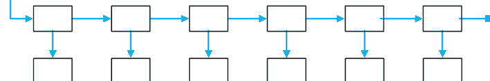

图 4.8 栈集合的链表实现

栈的本质是允许元素只从一端进行添加或删除；我们需要对链表的一端进行操作。我们可以选择将第一个元素推入链表的第一个位置，将第二个元素推入第二个位置，依此类推。这意味着栈的顶（`top`）将始终位于链表的末尾。然而，如果我们考虑这种策略的效率，就会发现这意味着在每次执行推入（`push`）和弹出（`pop`）操作时，我们都必须遍历整个链表。相反，我们可以选择对链表的头部进行操作，将链表的头部作为栈的顶。这样，无论是执行 `push` 操作还是 `pop` 操作，我们都不需要遍历链表。图 4.9 展示了一个包含四个元素 A、B、C 和 D 的栈的配置，这些元素是按顺序推入栈的。

# 第 4 章 链式结构 – 栈

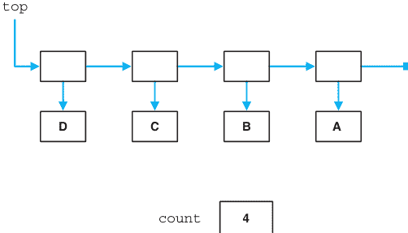

图 4.9 栈的链表实现

让我们探索 `LinkedStack` 类中栈操作的实现。

## push 操作

每当有一个新元素推入栈中时，必须创建一个新的 `LinearNode` 对象来将其存储在链表中。为了将新创建的节点置于栈顶，我们将它的 `next` 引用指向当前栈顶，并重置 `top` 引用使其指向新节点。我们还必须增加 `count` 变量。实现这些步骤将得到如下代码：

```java
/**
 * 将指定的元素推入此栈的顶部。
 * @param element 要推入栈的元素
 */
public void push(T element) {
    LinearNode<T> temp = new LinearNode<T>(element);
    temp.setNext(top);
    top = temp;
    count++;
}
```

# 4.6 实现栈：使用链节点

图 4.10 显示了向图 4.9 所示的栈中推入元素 E 的结果。

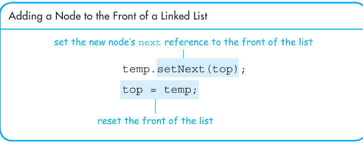
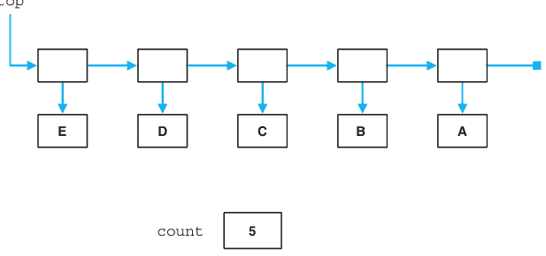

图 4.10 推入元素 E 后栈

栈的链表实现的 push 操作包含以下步骤：

- 创建一个新节点，其中包含指向要放置在栈上的对象的引用。
- 将新节点的 `next` 引用指向当前栈顶（如果栈为空，则为 `null`）。
- 将 `top` 引用指向新节点。
- 增加栈中元素的计数。

所有这些步骤的时间复杂度均为 $O(1)$，因为无论栈中已经有多少个元素，它们都只需要一个处理步骤。每个步骤必须在每个要推入的元素上完成一次。因此，使用这种方法，push 操作是 $O(1)$ 的。

## pop 操作

pop 操作通过返回当前存储在栈顶的元素的引用，并调整 `top` 引用指向栈的新栈顶来实现。在尝试返回任何元素之前，我们必须首先确保至少有一个元素可以返回。该操作可以实现为：

```java
/**
 * 移除此栈顶部的元素并返回其引用。
 * @return 栈顶的元素
 * @throws EmptyElementException 如果栈为空
 */
public T pop() throws EmptyElementException {
    if (isEmpty()) {
        throw new EmptyElementException("stack");
    }
    T result = top.getElement();
    top = top.getNext();
    count--;
    return result;
}
```

如果栈为空（由 `isEmpty` 方法确定），将抛出 `EmptyElementException`。如果至少有一个元素可以弹出，将其存储在临时变量中以便返回。栈的顶引用被设置为下一个元素。图 4.11 展示了对图 4.10 进行弹出操作的结果。栈的链表实现的 pop 操作包含以下步骤：

- 确保栈不为空。
- 设置临时引用指向栈顶的元素。
- 将 `top` 引用设置为新的栈顶。
- 减少栈中元素的计数。
- 返回临时引用的元素。

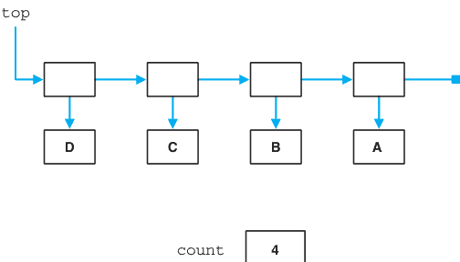

图 4.11 弹出操作后的栈

正如我们之前的示例一样，这些操作每个都只需要一次比较或简单的赋值，因此是 $O(1)$。因此，链表实现的 pop 操作是 $O(1)$ 的。

## 其他操作

使用链表实现，`peek` 操作通过返回指向节点的引用来实现。`isEmpty` 操作如果元素计数为 0 则返回 `true`，否则返回 `false`。`size` 操作返回栈中元素的计数。`toString` 操作可以通过遍历链表来实现。这些操作留给了编程项目。

- 对象引用变量可以创建链式结构。
- 链表由每个指向链中下一个元素的对象组成。
- 链表根据需要动态增长，本质上没有容量限制。
- 改变顺序对于维护链表至关重要。
- 处理链表的第一个节点通常需要特殊处理。
- 存储在集合中的对象不应包含底层数据结构的实现细节。
- `java.util.Stack` 类继承自 `Vector`，这为栈提供了不适当的操作。
- 只要实现了适当的操作，就可以使用任何集合实现来解决问题。
- 栈的链表实现在链表的一端添加和删除元素。
- 递归处理可以使用栈来跟踪适当的数据。

## 自测习题

- SR 4.1 你对链接结构（linked structure）如何理解？
- SR 4.2 你对自引用对象（self-referential object）如何理解？
- SR 4.3 如何指示链表的开始和结束？
- SR 4.4 简述链表中的元素是如何访问的。
- SR 4.5 在链表开头插入节点需要采取哪些步骤？
- SR 4.6 删除链表的第一个节点与删除列表中中间任何其他节点有什么区别？
- SR 4.7 描述以下数据结构：双向链表。
- SR 4.8 哨兵节点（sentinel nodes）或哑位节点（dummy nodes）对双向链表的实现会有什么影响？
- SR 4.9 与数组实现相比，使用链式实现有哪些优势？
- SR 4.10 与链实现相比，使用数组实现有哪些优势？
- SR 4.11 使用 `java.util.Stack` 实现栈的优势是什么？
- SR 4.12 `java.util.Stack` 实现的潜在问题是什么？

## 练习

- EX 4.1 编写 Java 语句定义一个 `Student` 类，该类应有三个私有成员：`name`、`code` 和指向另一个 `Student` 对象的引用。
- EX 4.2 对象链表需要哪些基本操作？
- EX 4.3 编写最少的 Java 语句定义一个 `StudentList` 类，该类用于存储练习 4.1 中学生列表。
- EX 4.4 编写 Java 语句访问练习 4.3 描述的列表中的第五个学生。
- EX 4.5 为 `traverse` 方法编写一个算法，用于遍历列表。该算法的时间复杂度是多少？
- EX 4.6 考虑练习 4.3 列出的列表。编写 Java 语句定义一个方法，该方法可以遍历列表并显示列表内容。
- EX 4.7 编写 Java 语句定义一个 `search` 方法，在练习 4.3 创建的列表中搜索给定的字符串。
- EX 4.8 练习 4.1 描述的 `Student` 类存在什么设计缺陷？你会如何修复这个缺陷？

## 编程项目

- PP 4.1 完成 `LinkedStack<T>` 类的实现，提供 `peek`、`size`、`isEmpty` 和 `toString` 方法的定义。
- PP 4.2 修改第 3 章中的后表达式程序，使用 `LinkedStack<T>` 类代替 `ArrayStack<T>`。
- PP 4.3 创建 `LinkedStack<T>` 类的新版本，在列表头部使用哑记录（dummy record）。
- PP 4.4 创建一个简单的图形化应用程序，使用户对栈执行 `push`、`pop` 和 `peek` 操作，并在文本区域中显示结果栈（使用 `toString`）。
- PP 4.5 设计并实现一个应用程序，从用户处读取句子，并打印每个单词字符反后的句子。使用栈来反转每个单词的字符。
- PP 4.6 完成迭代迷宫求解器的解决方案，使你的解决方案标记出成功路径。
- PP 4.7 本章中的链式实现使用计数器来跟踪栈中的元素。在不使用计数器变量的情况下重写链式实现。
- PP 4.8 有一种名为“丢弃栈”（drop-out stack）的数据结构，它在各方面都表现得像栈，但栈的大小为 $n$，当推入第 $n+1$ 个元素时，第一个元素会丢失。使用链接实现丢弃栈。
- PP 4.9 修改本章中的问题，使其能够从用户定义的起始位置（非 0, 0）开始，并搜索用户定义的终点（非行-1, 列-1）。

## 自测习题答案

SRA 4.1 链接结构是一种使用对象引用变量在对象之间建立建立连接的数据结构。链接结构是集合的数组实现的主要替代方案。

SRA 4.2 当类的实例定义为实例数据为指向同类的另一个实例的引用时，它被称为自引用对象。仅使用此类我们就可以创建一个链接结构。一个对象实例包含指向第二个对象实例的链接。第二个对象实例也包含指向第三个对象实例的链接，依此类推。

SRA 4.3 使用单独的引用变量来指示列表中的第一个节点。如果删除了该节点，或者在它前面添加新元素，则会仔细维护头部引用。列表终止于 `next` 引用为 `null` 的节点。

SRA 4.4 使用链表时，我们维护一个指向列表第一个元素的指针。要访问其他元素，我们访问第一个元素，然后跟随指向下一个元素的指针，依此类推。在处理列表中的第一个节点时会特别小心，以妥当地维护整个列表的引用。

SRA 4.5 在列表开头添加节点需要重置整个列表的引用。因此，在头部插入分两个步骤：首先；将添加的节点的 `next` 引用指向列表中的当前节点，然后将头部引用重置为新添加的节点。

SRA 4.6 为了删除列表中的第一个节点，需要妥当地维护整个列表的引用。在处理列表中的第一个节点时会特别小心，以妥当地维护整个列表的引用。（此处 OCR 文字重复/混乱，根据上下文修复：删除列表中的第一个节点，更新头部引用。）

SRA 4.7 描述以下数据结构：双向链表。

SRA 4.8 哨兵节点或哑位节点对双向链表的实现会有什么影响？

SRA 4.9 与数组实现相比，使用链式实现有哪些优势？

SRA 4.10 与链实现相比，使用数组实现有哪些优势？

SRA 4.11 使用 `java.util.Stack` 实现栈的优势是什么？

SRA 4.12 `java.util.Stack` 实现的潜在问题是什么？

*注：SRA 4.6-4.12 的 OCR 文字存在损坏，我将提供源自文本并清理格式错误。*

## 5.2 Java API 中的队列

| 操作 | 描述 |
| --- | --- |
| enqueue | 在队列尾部添加一个元素。 |
| dequeue | 从队列头部移除一个元素。 |
| first | 检查队列头部的元素。 |
| isEmpty | 确定队列是否为空。 |
| size | 确定队列元素的数量。 |
| toString | 返回队列的字符串表示。 |

图 5.2 队列上的操作

记住，集合操作的命名规范并不是通用的。某些 `enqueue` 简单地称为 `add`、`insert` 或 `offer`。`dequeue` 操作有时被称为 `remove`、`poll` 或 `serve`。`first` 操作有时被称为 `front` 或 `peek`。

注意，队列操作与栈操作之间存在通用的相似性。`enqueue`、`dequeue` 和 `first` 操作分别对应于栈的操作 `push`、`pop` 和 `peek`。与栈一样，队列没有允许用户“伸进”队列中间来重新组织或删除元素。如果需要这种类型的处理，也许合适的集合是使用某种列表（list），例如在接下来节讨论的那些。

## 5.2 Java API 中的队列

遗憾的是，Java 集合 API 在集合的实现上并不一致。在实现的栈和队列集合之间存在一些重要的区别：

- Java Collections API 提供了 `java.util.Stack` 类，它实现了一个栈集合。它没有提供队列类，而是提供了一个 `Queue` 接口，并由多个类（包括 `LinkedList`）实现。
- `java.util.Stack` 类提供了传统的 `push`、`pop` 和 `peek` 操作。`Queue` 接口没有实现传统的 `enqueue`、`dequeue` 和 `first` 操作。相反，`Queue` 接口定义了两种向队列添加元素和从队列移除元素的替代方案。这些替代方案在处理异常情况方面的行为不同。一组方案提供布尔值返回值，而另一组则抛出异常。

`Queue` 接口定义了一个 `element` 方法，等同于我们概念上的 `first`、`front` 或 `peek`。该方法获取队列头部的元素，但不移除它。

`Queue` 接口提供了两种向队列添加元素的方法：`add` 和 `offer`。`add` 操作确保队列包含给定的元素。如果元素无法添加到队列，`add` 操作将抛出异常。`offer` 操作将元素插入此队列，如果插入成功则返回 `true`，否则返回 `false`。

`Queue` 还提供了两种从队列移除元素的方法：`poll` 和 `remove`。就像 `add` 和 `offer` 方法之间的区别一样，`poll` 和 `remove` 区别在于处理异常情况的方式。在这种情况下，异常发生在尝试从空队列中移除元素时。`poll` 方法在队列为空时将返回 `null`，而 `remove` 方法将抛出异常。

队列在计算中有广泛的应用。栈的主要目的是反转顺序，而队列的主要目的是保持顺序。在探索实现队列的各种方法之前，让我们先来看一些使用队列来解决问题的方法。

## 5.3 使用队列：代码关键点

凯撒密码（Caesar cipher）是一种通过将字母表中的每个字母移动常数 $k$ 来对消息编码的简单方法。例如，如果 $k$ 等于 3，那么在加密消息中，每个字母都向前移动三个字符：a 被替换为 d，b 替换为 e，c 替换为 f，以此类推。字母表的末尾绕回开头。因此，w 被替换为 z，x 替换为 a，y 替换为 b，z 替换为 c。

要解码消息，每个字母向后移动相同数量字符。因此，如果 $k$ 等于 3，加密消息

```
vlpsolflwb iorzov frpsohalwb
```

将被解码为

```
simplicity follows complexity
```


# 第5章 队列

## 关键概念

尤利斯·凯撒实际上在他的秘密政府通信中使用了这种密码（因此得此名）。遗憾的是，凯撒密码非常容易破解。字符位移只有 26 种可能，可以通过尝试不同的键值直到其中一个有效来破解代码。

这种编码技术可以使用重复密钥来改进。我们不再将每个字符移动固定的量，而是使用一个键值列表将每个字符移动不同的量。如果消息比键值列表长，我们只需从头开始重新使用密钥。例如：

3 1 7 4 2 5

那么第一个字符移动三个，第二个字符移动一个，第三个字符移动七个，以此类推。在移动了第六个字符五个之后，我们再次开始使用密钥。第七个字符移动三个，第八个移动……以此类推。

图 5.3 显示了使用这种重复密钥加密的消息“knowledge is power”。注意，这种加密方法会将同一个字母编码为不同的字符，取决于它在消息中的位置（因此取决于使用哪个键值来对其进行编码）。反之，加密消息中的相同字符会被解码为不同的字符。

| 加密消息: | n | o | v | a | n | j | g | h | l | | m | u | | u | r | x | v |
|---|---|---|---|---|---|---|---|---|---|---|---|---|---|---|---|---|---|
| 键 (Key): | 3 | 1 | 7 | 4 | 2 | 5 | 3 | 1 | 7 | | 4 | 2 | | 5 | 3 | 1 | |
| 解码消息: | k | n | o | w | e | d | g | e | | i | s | | p | o | w | r |

图 5.3 使用重复密钥的加密消息

队列是存储重复密钥的方便方法。与之前的示例不同，在这种情况下我们有两个不同的绑定：一个针对 `LinkedList` 类，一个针对 `Queue` 接口。

## 列表 5.1

```java
import java.util.*;

/**
 * Codes 展示了使用队列进行加密。
 * @author Lewis and Chase
 * @version 4.0
 */
public class Codes
{
    /**
     * 使用队列值加密和解码消息。
     */
    public static void main(String[] args) {
        int[] key = {5, 12, -3, -8, -9, 4, 10};
        Integer keyValue;
        String encoded = "", decoded = "";
        String message = "All programmers are playwrights and all " +
                         "computers are lousy actors.";
        Queue<Integer> encodingQueue = new LinkedList<Integer>();
        Queue<Integer> decodingQueue = new LinkedList<Integer>();

        // 加载键队列
        for (int scan = 0; scan < key.length; scan++) {
            encodingQueue.add(key[scan]);
            decodingQueue.add(key[scan]);
        }

        // 加密消息
        for (int scan = 0; scan < message.length(); scan++) {
            keyValue = encodingQueue.remove();
            encoded += (char)(message.charAt(scan) + keyValue);
            encodingQueue.add(keyValue);
        }

        System.out.println("Encoded Message:\n" + encoded + "\n");

        // 解码消息
        for (int scan = 0; scan < encoded.length(); scan++) {
            keyValue = decodingQueue.remove();
            decoded += (char) (encoded.charAt(scan) - keyValue);
            decodingQueue.add(keyValue);
        }

        System.out.println("Decoded Message:\n" + decoded);
    }
}
```

图 5.4 Codes 程序的 UML 描述

此程序实际上在两个独立的队列中存储了两个相同的密钥。其思路是：编码消息的人拥有一份密钥，而解码消息的人拥有另一份。在这个程序中，两个密钥副本是有用的，因为解码过程需要将消息的第一个字符与密钥中的第一个值进行匹配。

此外，请注意，此程序并没有处理字母表末尾的循环。它通过将字符移动到字符集中的其他位置，来编码 Unicode 字符集中的任何字符。因此，我们可以编码任何字符，包括大写字母、小写字母和标点符号。甚至空格也会编码。

使用队列存储密钥可以方便地重复密钥，只需在使用每个密钥值后将其重新放入队列即可。队列的本质保持了密钥值的正确顺序，我们不需要担心到达密钥的末尾并重新开始。

## 5.4 使用队列：售票处模拟

让我们来看另一个使用队列的例子。考虑你正在电影院排队买票的情况。通常情况下，收银员越多，排队移动得就越快。电影院经理想让客户满意，但他不想雇佣超过必要的收银员。假设经理希望让客户所需的总时间保持在七分钟以内。能够模拟在高峰期间增加收银员的效果，使经理能够更有效地计划。而且，正如我们讨论过的，队列是表示等待队列的完美集合。

我们模拟的售票处将使用以下假设：

- 只有一条队，且是先来后到的（队列）。
- 客户平均每 15 秒到达一个。
- 如果有可用的收银员，到达后立即开始处理。
- 从客户到达收银员开始，处理一个客户请求需要超过两分钟（120 秒）。

首先，我们可以创建一个 `Customer` 类，如列表 5.2 所示。`Customer` 对象跟踪客户到达的时间和购买门票后离开的时间。因此，客户花费的总时间就是离开时间减去到达时间。为了保持简单，我们的模拟将以流逝的秒为单位测量时间，因此时间值可以存储为单个整数。我们的模拟将从时间 0 开始。

### 核心概念

模拟通常使用队列来表示等待队列。

## 列表 5.2

```java
/**
 * Customer 代表一个等待中的客户。
 * @author Lewis and Chase
 * @version 4.0
 */
public class Customer
{
    private int arrivalTime, departureTime;

    /**
     * 创建一个具有指定到达时间的新客户。
     * @param the arrival time
     */
    public Customer(int arrives)
    {
        arrivalTime = arrives;
        departureTime = 0;
    }

    /**
     * 返回此客户的到达时间。
     * @return the arrival time
     */
    public int getArrivalTime()
    {
        return arrivalTime;
    }

    /**
     * 设置此客户的离开时间。
     * @param departs the departure time
     */
    public void setDepartureTime(int departs)
    {
        departureTime = departs;
    }

    /**
     * 返回此客户的离开时间。
     * @return the departure time
     */
    public int getDepartureTime() {
        return departureTime;
    }

    /**
     * 计算并返回此客户花费的总时间。
     * @return the total customer time
     */
    public int totalTime() {
        return departureTime - arrivalTime;
    }
}
```

我们的模拟将创建一个客户队列，然后看看在只有一个收银员的情况下处理这些客户需要多长时间。然后我们将用两个收银员处理同一队列的客户。我们将再次用三个收银员进行处理。我们将继续这个过程，直到十个收银员。在最后，我们比较处理一个客户所需的平均时间。

由于我们假设客户平均每 15 秒到达一个，我们可以预先加载一个客户队列。我们将在这次模拟中处理 100 个客户。

列表 5.3 所示的程序执行了模拟。外层循环决定了模拟每次运行中使用多少个收银员。对于每一轮，客户按顺序从队列中取出并由收银员处理。程序会跟踪总流逝时间，并在每轮结束时计算平均时间。图 5.5 显示了 `TicketCounter` 类的 UML 描述。

图 5.5 TicketCounter 程序的 UML 描述

## 列表 5.3

```java
import java.util.*;

/**
 * TicketCounter 展示了使用队列模拟客户队列。
 *
 * @author Lewis and Chase
 * @version 4.0
 */
public class TicketCounter
{
    private final static int PROCESS = 120;
    private static int MAX_CASHIERS = 10;
    private static int NUM_CUSTOMERS = 100;

    public static void main(String[] args) {
        Customer customer;
        Queue<Customer> customerQueue = new LinkedList<>();
        int[] cashierTime = new int[MAX_CASHIERS];
        int totalTime, averageTime, departs;

        // 为不同收银员人数运行模拟
        for (int cashiers = 0; cashiers < MAX_CASHIERS; cashiers++) {
            // 将收银员时间置零
            for (int count = 0; count < cashiers; count++) {
                cashierTime[count] = 0;
            }

            // 加载队列
            for (int count = 1; count <= NUM_CUSTOMERS; count++) {
                customerQueue.add(new Customer(count * 15));
            }

            totalTime = 0;

            // 处理队列中的所有客户
            while (!customerQueue.isEmpty()) {
                for (int count = 0; count < cashiers; count++) {
                    if (!customerQueue.isEmpty()) {
                        customer = customerQueue.remove();
                        int start;
                        if (customer.getArrivalTime() > cashierTime[count]) {
                            start = customer.getArrivalTime();
                        } else {
                            start = cashierTime[count];
                        }

                        departs = start + PROCESS;
                        customer.setDepartureTime(departs);
                        cashierTime[count] = departs;
                        totalTime += customer.totalTime();
                    }
                }
            }

            // 输出本次模拟的结果
            averageTime = totalTime / NUM_CUSTOMERS;
            System.out.println("收银员人数: " + (cashiers + 1));
            System.out.println("平均时间: " + averageTime + "\n");
        }
    }
}
```

模拟的结果如图 5.6 所示。注意，当有八个收银员时，客户完全不需要等待。120 秒仅仅是走过去买票所需的时间。将收银员人数增加到九或十不会改善状况。由于经理希望将总时间保持在七分钟（420 秒）以内，模拟告诉他需要六个收银员。

| 收银员人数: | 1 | 2 | 3 | 4 | 5 | 6 | 7 | 8 | 9 | 10 |
| :--- | :--- | :--- | :--- | :--- | :--- | :--- | :--- | :--- | :--- | :--- |
| 平均时间 (秒): | 5317 | 2325 | 1332 | 840 | 547 | 355 | 219 | 120 | 120 | 120 |

图 5.6 售票处模拟的结果

## 5.5 队列 ADT

正如我们处理栈一样，定义一个泛型 `QueueADT` 接口表示队列操作，将操作的通用目的与可能的实现方式分开。Java 版本的 `QueueADT` 接口见列表 5.4，其 UML 描述见图 5.7。

请注意，除了标准的队列操作外，我们还包含了一个 `toString` 方法，正如我们在处理栈集合时做的那样。它是为了方便，且通常不被认为是队列的经典操作。

## 列表 5.4

```java
package jsjf;

/**
 * QueueADT 定义了队列集合的接口。
 * @author Lewis and Chase
 * @version 4.0
 */
public interface QueueADT<T>
{
    /**
     * 将一个元素添加到此队列的末尾。
     * @param element 要添加到队列末尾的元素
     */
    public void enqueue(T element);

    /**
     * 移除并返回此队列头部的元素。
     * @return 队列头部的元素
     */
    public T dequeue();

    /**
     * 返回此队列头部的元素但不将其移除。
     * @return 队列中的第一个元素
     */
    public T first();

    /**
     * 如果此队列不包含元素，则返回 true。
     * @return 如果此队列为空则返回 true
     */
    public boolean isEmpty();

    /**
     * 返回队列中元素的数量。
     * @return 队列大小的整数表示
     */
    public int size();

    /**
     * 返回此队列的字符串表示。
     * @return 队列的字符串表示
     */
    public String toString();
}
```


# 5.6 队列的链表实现

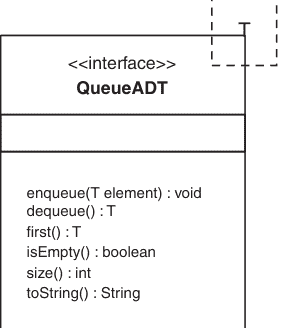

图 5.7 UML 中的 `QueueADT` 接口

由于队列是一个线性集合，我们可以像实现栈那样，使用 `LinearNode` 对象的链表来实现队列。主要的区别在于，我们必须对列表的两个端进行操作。因此，除了有一个指向列表第一个元素的引用（称为 `head` 头）外，我们还会维护第二个指向列表最后一个元素的引用（称为 `tail` 尾）。我们还将使用一个整数变量 `count` 来跟踪队列中元素的数量。

从列表的哪一端添加（即入队 `enqueue`）元素，或者从哪一端移除（即出队 `dequeue`）元素会有区别吗？如果我们的链表是单链表的，意味着每个节点只有一个指向列表中后一个节点的指针，那么是的，是有区别的。在 `enqueue` 操作中，将元素添加到列表头部还是尾部并没有区别。处理步骤将非常相似。当我们把元素添加到列表头部时，我们将新节点的 `next` 指针指向列表的头部；如果将元素添加到列表尾部，则会将列表尾部节点的 `next` 指针指向新节点。在两种情况下，所有这些处理步骤都是 O(1)，因此 `enqueue` 操作的时间复杂度将为 O(1)。

## 核心概念

队列的链表实现通过对链表第一个元素和最后一个元素的引用来辅助完成。

我们的两种选择（向列表头部或尾部添加元素）之间的区别出现在 `dequeue` 操作中。如果我们在列表尾部入队并在列表头部出队，那么为了执行出队，我们只需要将一个临时变量设置为列表头部的元素，然后将 `head` 变量设置为第一个节点的 `next` 指针的值。这两个处理步骤都是 O(1)。然而，如果我们在列表头部入队并在列表尾部出队，我们的处理步骤就会变得更有趣。为了在列表尾部出队，我们必须将一个临时变量设置为尾部的元素，然后将 `tail` 指针设置为当前尾部之前的那个节点。遗憾的是，在单链表中，我们无法在不遍历列表的情况下到达该节点。因此，如果我们选择在头部入队并在尾部出队，那么 `dequeue` 操作将是 O(n)而不是像另一种选择那样的 O(1)。因此，我们选择在单链表的尾部入队并在头部出队。请记住，双链表可以解决需要遍历列表的问题，因此在双链表实现中，哪端是哪里并不重要。

图 5.8 描绘了这种实现队列的策略。它显示了一个按 A、B、C、D 顺序添加到（或入队）队列的队列。

请记住图 5.8 的是一般情况。在特殊情况下，我们始终必须小心地准确维护引用。对于空队列，`head` 和 `tail` 引用均为 `null`，`count` 为 0。如果队列中恰好

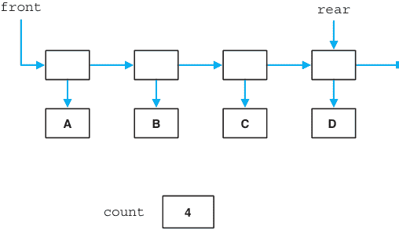

图 5.8 队列的链表实现

一个元素，`head` 和 `tail` 引用指向同一个对象。

让我们使用这种链表方法来探索队列操作的实现。我们提供了队列链表实现的头部、类级数据和构造函数以供背景参考。

```java
package jsf;

import jsf.exceptions.*;

/**
 * LinkedQueue 表示队列的链表实现。
 * @author Lewis and Chase
 * @version 4.0
 */
public class LinkedQueue<T> implements QueueADT<T> {
    private int count;
    private LinearNode<T> head, tail;

    /**
     * 创建一个空队列。
     */
    public LinkedQueue() {
        count = 0;
        head = tail = null;
    }
}
```

## 入队操作

在实现 `enqueue` 操作时，要要的工作是将元素放入队列的尾部。在一般情况下，这意味着将当前尾部的 `next` 指针设置为新元素。然而，如果队列为空，则必须将 `head` 引用设置为新节点。

```java
/**
 * 将元素添加到此队列的尾部。
 * @param element 要添加到尾部的元素
 */
public void enqueue(T element) {
    LinearNode<T> node = new LinearNode<T>(element);

    if (isEmpty())
        head = node;
    else
        tail.setNext(node);

    tail = node;
    count++;
}
```

注意，新节点的 `next` 指针不需要在该方法中显式设置，因为它已经在 `LinearNode` 类的构造函数中被设置为 `null`。在任何情况下，`tail` 引用都会设置为新节点，`count` 会增加。使用哨兵节点实现队列操作留作练习。正如我们之前讨论的，该操作是 O(1)。

图 5.9 显示了添加元素 E 之后来自 5.8 的队列。

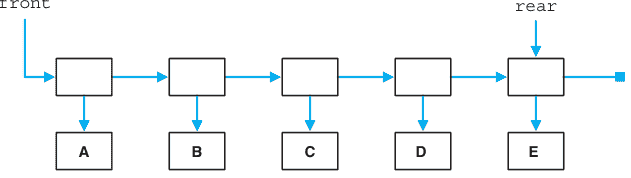

图 5.9 添加元素 E 后的队列

## 出队操作

在实现 `dequeue` 操作时，要要的工作是确保至少有一个元素可以返回。否则，将抛出 `EmptyCollectionException`。正如我们在第 3 章和第 4 章处理栈集合那样，使用通用 `EmptyCollectionException` 是合理的，我们可以传递一个参数来指定我们正在处理哪种集合。如果队列中至少有一个元素，则返回列表中的第一个元素，并更新 `head` 引用。

```java
/**
 * 移除此队列头部的元素并返回其引用。
 * @return 队列头部的元素
 * @throws EmptyCollectionException 如果队列为空
 */
public T dequeue() throws EmptyCollectionException {
    if (isEmpty()) {
        throw new EmptyCollectionException("queue");
    }

    T result = head.getElement();
    head = head.getNext();
    count--;

    if (isEmpty()) {
        tail = null;
    }

    return result;
}
```

对于 `dequeue` 操作，我们必须考虑返回队列中唯一元素的情况。如果移除头部元素后，队列现在为空，则 `tail` 引用将被设置为 `null`。注意，在这种情况下，`head` 将是 `null`，因为它被设置为列表最后一个元素的 `next` 引用。再次，正如我们之前讨论的，我们实现的 `dequeue` 操作是 O(1)。

# 第 5 章 队列

## 设计焦点

适用于其他类的相同复用目标同样适用于异常。`EmptyCollectionException` 类就是一个很好的例子。对于我们创建的任何集合，这都是一个相同的特殊情况（例如，尝试对一个空集合执行无法执行的操作）。因此，创建一个带有参数的单一异常，允许我们通过该参数指定是哪个集合抛出了异常，这是为复用而设计的极佳范例。

图 5.10 显示了对图 5.9 所示队列执行 `dequeue` 操作的结果。队列头部的元素 A 被移除并返回给用户。请注意，与栈的 `push` 和 `pop` 操作不同，`dequeue` 操作并不是 `enqueue` 的逆操作。也就是说，图 5.10 与我们在图 5.8 中显示的原始配置并不相同，因为 `enqueue` 和 `dequeue` 操作是在集合的相反端进行的。

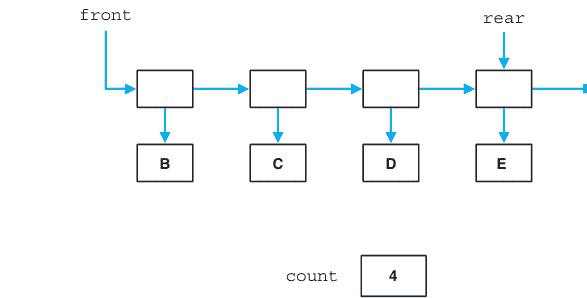

图 5.10 执行 `dequeue` 操作后的队列

## 其他操作

链表队列实现中的其余操作相当简单，并且与栈集合中的操作相似。第一个操作通过返回指向队列头部元素的引用来实现。`isEmpty` 操作在元素计数为 0 时返回 `true`，否则返回 `false`。`size` 操作简单地返回队列中元素的计数。最后，`toString` 操作返回一个由每个单独元素的 `toString` 结果组成的字符串。这些操作将留给学生作为编程练习。

## 5.7 实现队列：使用数组

实现队列的一种基于数组的策略是将队列的一端（例如，队头）固定在数组的索引 0 处。元素在数组中连续存储。图 5.11 描绘了以这种方式存储的队列，元素 A、B、C 和 D 已经按顺序加入队列。

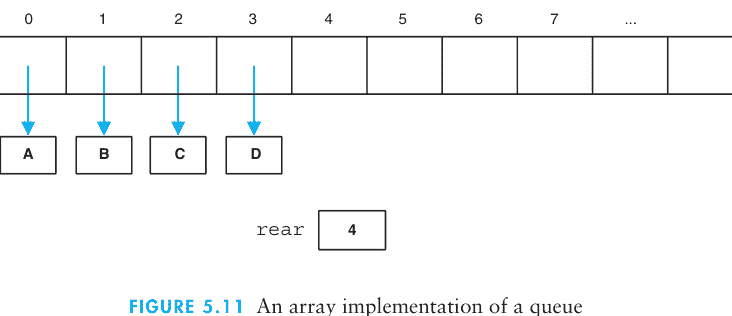

与 `ArrayStack` 中的 `top` 变量类似，整数变量 `rear` 用于指示数组中下一个空闲单元格。请注意，它也代表队列中元素的数量。

这种策略假设队列中的第一个元素始终存储在数组的索引 0 处。由于队列处理影响集合的两端，这种策略将要求每当从队列中移除元素时，我们需要移动元素。这种要求的元素移动将使 `dequeue` 操作的时间复杂度变为 O(n)。正如我们在讨论单向链表实现的复杂性时提到的，在我们的数组实现中做出糟糕的选择可能会导致效率低于最优。

如果我们将队列的队尾而不是队头固定在数组的索引 0 处，会有区别吗？请记住，当我们向队列入队一个元素时，我们是在队列的队尾进行的。这意味着每次 `enqueue` 操作都会导致队列中的所有元素在数组中移动一个位置，使得 `enqueue` 操作的时间复杂度变为 O(n)。

> **核心概念**
>
> 由于队列操作会修改集合的两个端，因此将一端固定在索引 0 处需要移动元素。

> **核心概念**
>
> 在非循环数组实现中移动元素会产生 O(n) 的复杂度。

## 设计焦点

需要注意的是，这种在我们栈的实现中非常有效的固定数组实现策略，对于队列来说效率远没有那么高。这是一个将用于实现集合的数据结构与集合本身相匹配的重要示例。固定数组策略对于栈是高效的，因为所有活动（添加和删除元素）都发生在集合的一端，因此也发生在数组的一端。对于队列，由于我们现在正在对集合的两端进行操作，且顺序非常重要，固定数组的实现效率要低得多。

关键在于不要固定任何一端。随着元素的出队，队列的头部会向数组的深处移动。随着元素的入队，队列的队尾也会向数组的深处移动。当队列的队尾到达数组末尾时，挑战出现了。此时扩大数组并不是一个实行的解决方案，而且没有利用数组低索引处的非空空间。

> **核心概念**
>
> 将数组视为循环数组消除了在数组队列实现中移动元素的需要。

为了实现这一点，我们将使用循环数组来实现队列，定义在 `CircularArrayQueue` 类中。循环数组并不是一种新结构——它只是思考用于存储集合的数组的一种方式。在概念上，数组被用作一个圆，其最后一个索引之后是第一个索引。图 5.12 显示了存储队列的循环数组。

使用两个整数值来表示队列的头部和队尾。这些值随着元素的添加和移除而改变。请注意，`front` 的值代表存储第一个元素的位置，`rear` 的值代表数组中下一个可用位置（最后一个元素存储的位置）。以这种方式使用 `rear` 与我们其他的数组实现是一致的。然而，`rear` 的值不再代表队列中元素的数量。我们使用一个单独的整数来计数元素。

当队列的队尾到达数组末尾时，它会“绕回”到数组的头部。队列的元素可以遍历数组的跨度，假设数组可以存储 100 个元素。使用这种策略，一旦元素被加入队列，它就会留在原来的位置，直到被移除。这种方法要求，我们需要仔细管理 `front` 和 `rear` 的值。

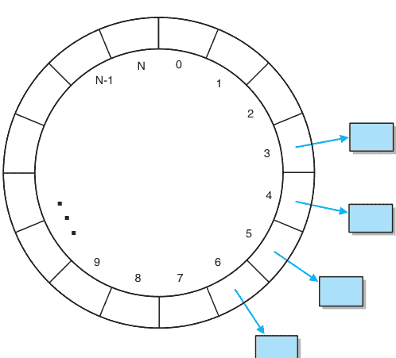

图 5.12 循环数组实现的队列

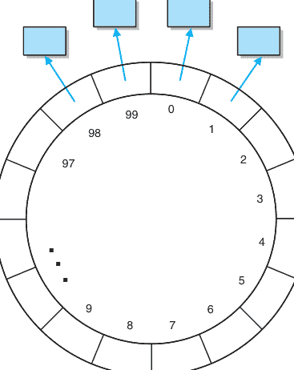

图 5.13 跨越数组末尾的队列

让我们另一个例子。图 5.14 显示了一个容量为十元素的循环数组（线性绘制）。最初显示在元素 A 到 H 入队后。然后显示在最初四个元素（A 到 D）出队后。最后显示在元素 I、J、K 和 L 入队后，这导致队列绕过了数组末尾。

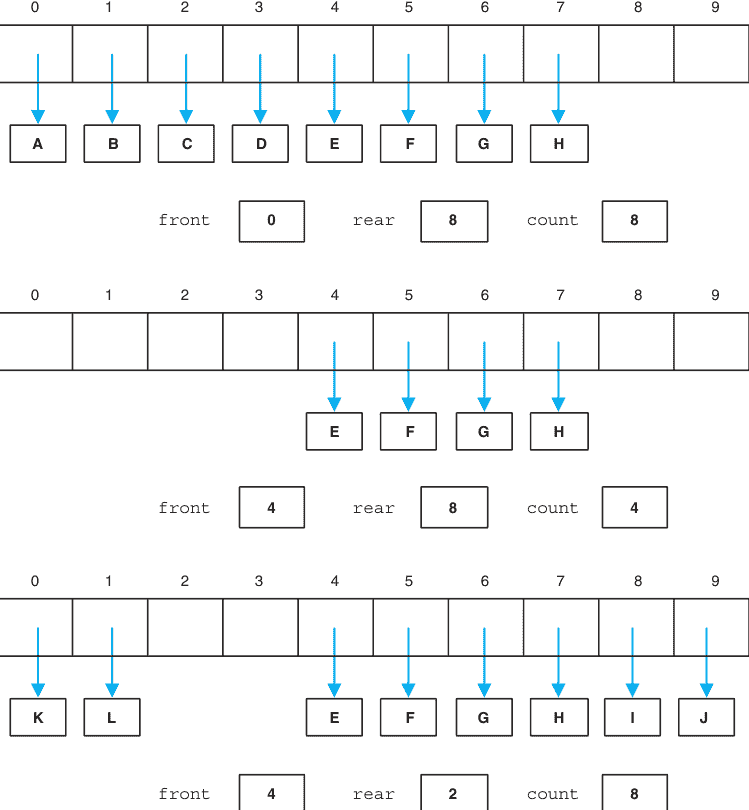

图 5.14 循环数组实现中的变化

提供了循环数组队列实现的头部、类级数据和构造函数：

```java
package jsjf;
import jsjf.exceptions.*;

/**
 * CircularArrayQueue 表示一种队列的数组实现
 * 队列头部和队尾的索引在到达数组末尾时会循环回到 0。
 * @author Lewis Chase
 * @version 4.0
 */
public class CircularArrayQueue<T> {
    private final static int DEFAULT_CAPACITY = 100;
    private int front, rear, count;
    private T[] queue;

    /**
     * 使用指定的容量创建一个空队列。
     * @param initialCapacity 循环数组队列的初始大小
     */
    public CircularArrayQueue(int initialCapacity) {
        front = rear = count = 0;
        queue = (T[]) (new Object[initialCapacity]);
    }

    /**
     * 使用默认容量创建一个空队列。
     */
    public CircularArrayQueue() {
        this(DEFAULT_CAPACITY);
    }
}
```

## 入队操作

通常，在元素入队后，`rear` 的值会增加。但当入队操作填充数组的最后一个单元格（最大索引处）时，`rear` 的值必须设置为 0，指示下一个元素应该存储在索引 0 处。对 `rear` 值的适当更新可以通过以下方式完成：

使用取模运算符（`%`）进行计算。记住，取模运算符返回第一个操作数除以第二个操作数后的余数。因此，如果 `queue` 是存储队列的数组名称，以下行代码将适当地更新 `rear` 的值：

```java
rear = (rear + 1) % queue.length;
```

让我们尝试这个计算，假设我们有一个大小为 10 的数组。如果 `rear` 当前为 5，它将被设置为 6%10，即 6。如果 `rear` 当前为 9，它将被设置为 10%10，即 0。试着在各种情况下进行此计算，你会发现无论数组有多大，它都能工作。

基于这种策略，`enqueue`（入队）操作可以实现如下：

```java
/**
 * 将指定的元素添加到此队列的末尾，必要时扩展
 * 队列数组的容量。
 * @param element 添加到队列末尾的元素
 */
public void enqueue(T element) {
    if (size() == queue.length) {
        expandCapacity();
    }
    queue[rear] = element;
    rear = (rear + 1) % queue.length;
    count++;
}
```

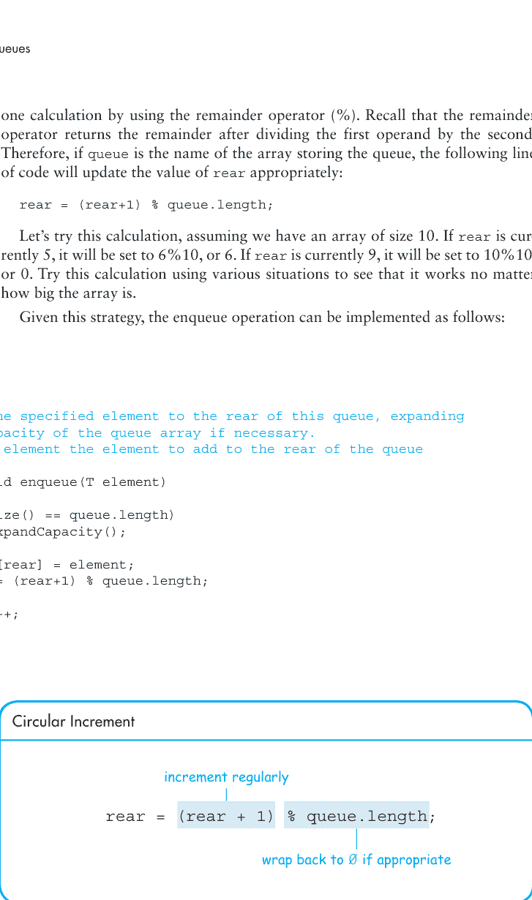

注意，这种实现策略仍然允许数组达到容量。与任何基于的实现一样，数组中的所有单元都可能变满。这意味着队列的尾部已经“追上了”队列的头部。要添加另一个元素，必须扩大数组。然而，请记住，现有数组中的元素必须按照它们在当前数组中出现的正确顺序复制到新数组中。这使得私有方法 `expandCapacity` 比用于栈（stacks）所使用的方法稍微复杂一些：

```java
/**
 * 创建一个新数组来存储此队列的内容，
 * 其容量是旧数组的两倍。
 */
private void expandCapacity() {
    T[] larger = (T[]) new Object[queue.length * 2];

    for (int scan = 0; scan < count; scan++) {
        larger[scan] = queue[front];
        front = (front + 1) % queue.length;
    }

    front = 0;
    rear = count;
    queue = larger;
}
```

## 出队操作

同样，在元素出队后，`front` 的值会增加。在执行了足够的 `dequeue` 操作后，`front` 的值将达到数组的最后一个索引。在移除最大索引处的元素后，`front` 的值必须设置为 0，而不是继续增加。在 `enqueue` 操作中用于设置 `rear` 值的相同计算也可用于在 `dequeue` 操作中设置 `front` 的值：

```java
/**
 * 移除此队列头部的元素并返回它的
 * 引用。
 * @return 从队列头部移除的元素
 * @throws EmptyCollectionException 如果队列为空则抛出异常
 */
public T dequeue() throws EmptyCollectionException {
    if (isEmpty())
        throw new EmptyCollectionException("queue");

    T result = queue[front];
    queue[front] = null;
    front = (front + 1) % queue.length;

    count--;

    return result;
}
```

## 其他操作

使用这种方法，诸如 `toString` 等操作会变得有点复杂，因为元素并没有存储在索引 0 ，并且可能会在数组末尾回绕。这些方法必须考虑当前的情况。循环数组队列的所有其他操作都留留作为编程项目。

## 5.8 双端队列 (Deque)


# 双端队列（Deque）

双端队列（deque，或 double-ended queue）是队列概念的扩展，允许从队列的两端添加、移除和查看元素。正如第 3 章中提到的，Java API 提供了 `Deque` 接口，它由 `LinkedList` 类实现。与 `Queue` 接口一样，`Deque` 接口为每个操作提供了两个版本：一个会抛出异常的版本，另一个会返回布尔值的版本。

有趣的是，`Deque` 接口还提供了基本栈操作 `push()`、`pop()` 和 `peek()` 的实现。事实上，Oracle 现在建议使用 `Deque` 接口来代替 `java.util.Stack` 类。

## 核心概念总结

- 队列元素按 FIFO（先入先出）方式处理——先进入的元素先离开。
- 队列是一个用于存储重复代码键的方便集合。
- 模拟通常使用队列来表示等待队列。
- 队列的链式实现通过对链表第一个和最后一个元素的引用来实现。
- `enqueue` 和 `dequeue` 操作在集合的相反端运行。
- 因为队列操作会修改集合的两端，因此将一端固定在索引 0 需要移动元素。
- 在非循环数组实现中，元素的移动创建了 O(n) 复杂度。
- 将数组视为循环的消除了在数组队列实现中移动元素的需要。

## 术语总结

- **Caesar cipher**（凯撒密码）：一种简单的消息编码技术，其中字母沿字母表按恒量进行位移。
- **circular array**（循环数组）：一种被视为循环的数组，意味着数组中的最后一个索引值会回绕到第一个元素。
- **dequeue**（出队）：一种队列操作，从头部移除元素。
- **enqueue**（入队）：一种队列操作，在末尾添加元素。
- **FIFO**：(1) 先入先出；(2) 一个最先添加的元素将先被移除的集合。
- **queue**（队列）：一种从一端添加并从另一端移除的集合。
- **repeating**（重复）：一种按不同量位移的列表。

## 自测题

- SR 5.1 描述队列结构及其处理。
- SR 5.2 `enqueue` 和 `dequeue` 操作的目的是？

## 第 5 章 队列

- SR 5.3 Java API 提供的队列操作有哪些？
- SR 5.4 链式实现相比数组实现的优势是什么？
- SR 5.5 为什么线性数组实现需要移动元素？
- SR 5.6 移动元素的问题是如何解决的？

## 练习

- EX 5.1 通过以下操作跟踪队列：

```
X.enqueue(14);
X.enqueue(11);
Object Y = X.dequeue();
X.enqueue(18);
X.enqueue(12);
X.enqueue(15);
X.enqueue(13);
Object Y = X.dequeue();
X.enqueue(19);
```

- EX 5.2 给 5.1 产生的队列，以下操作的结果是什么？
  - a. Y = X.dequeue(); Z = X.dequeue();
  - b. X.first();
  - c. X.enqueue(25);
  - d. X.first();

- EX 5.3 如果没有 `count` 变量，每个实现中 `size` 操作的时间复杂度是多少？
- EX 5.4 在什么情况下，链式实现的头尾引用或数组实现的头部尾部引用会相等？
- EX 5.5 为 22 个客户和 4 个收银员跟踪票计数。绘制每个人的总处理时间。从这些结果中你可以得出什么？
- EX 5.6 比较 `LinkedQueue` 类的 `enqueue` 方法和 `LinkedStack` 类的 `push` 方法。
- EX 5.7 描述实现 `LinkedQueue` 方法的两种方法。
- EX 5.8 列举五个本文之外的队列日常生活示例。
- EX 5.9 解释为什么栈的数组实现不需要移动元素，而非循环数组实现的队列需要。
- EX 5.10 假设循环数组类没有使用计数变量。解释如何使用头部和尾部的值计算列表中的元素数量。

## 编程项目

- PP 5.1 完成本章的实现。具体完成 `first()`、`isEmpty()`、`size()` 和 `toString()` 方法的实现。
- PP 5.2 完成本章描述的 `CircularArrayQueue` 类实现，包括所有方法。
- PP 5.3 编写一个 `CircularArrayQueue` 类版本，其增长方向与本章描述的版本相反。
- PP 5.4 所有实现都使用 `count` 变量来跟踪队列元素数量。在不用 `count` 的情况下重写链式实现。
- PP 5.5 所有实现都使用 `count` 变量来跟踪队列元素数量。在不用 `count` 的情况下重写循环数组实现。
- PP 5.6 一种名为 deque 的数据结构与队列密切相关。deque 的全称为“双端队列”。它与队列的区别在于，你可以使用数组实现一个 deque。
- PP 5.7 使用链接实现编程项目 5.6 中的 deque。（提示：每个节点需要一个 `next` 引用和一个 `previous` 引用）。
- PP 5.8 创建一个图形化应用程序，提供从队列入队（enqueue）和出队（dequeue）元素的按钮、一个接受字符串作为入队输入的文本字段，以及一个显示每次操作后队列内容的区域。
- PP 5.9 创建一个使用栈（stack）和队列的系统，用于测试给定字符串是否为回文（即字符正读和反读都相同）。
- PP 5.10 创建一个模拟路口车辆的系统。假设四个方向每个方向都有一个车道，每个方向都有对应的红绿灯。改变每个方向车辆的平均到达率和灯光变化的频率，以观察路口的“行为”。

## 自测习题答案

- SRA 5.1 队列是一个线性集合，其元素从一端添加并从另一端移除。队列元素按照先进先出（FIFO）的方式进行处理。元素从队列移除的顺序与它们放入队列的顺序相同。
- SRA 5.2 入队操作将元素添加到队列的末尾，出队操作从队列的头部移除元素。
- SRA 5.3 `Queue` 接口具有返回第一个元素的 `element()` 方法。它有用于插入元素的 `add()` 和 `offer()` 方法，以及用于从队列中移除元素的 `poll()` 和 `remove()` 方法。
- SRA 5.4 队列的链式实现仅在需要时分配空间，而数组实现初始分配的空间比实际需要的多得多。
- SRA 5.5 由于队列操作会修改集合的两端，因此将一端固定在索引 0 处需要进行元素的移动。
- SRA 5.6 固定数组实现的效率很低，因为在非循环数组实现中移动元素会产生 O(n) 的复杂度。
- SRA 5.7 将数组视为循环数组消除了在数组实现中移动元素的需要。

# 第 6 章 列表

## 列表

列表（list）的概念对我们所有人来说都很熟悉。你可能会列出待事项清单、杂货店购物清单，以及邀请参加派对的朋友名单。你可以对列表中的项目进行编号，也可以按字母顺序保持它们。在其他情况下，你可能只需按照你认为最有意义的顺序保持这些项目。本章将探索列表集合的概念以及管理此类集合的一些方法。

## 本章目标

- 检查各种类型的列表集合。
- 演示如何使用列表解决问题。
- 定义列表抽象数据类型。
- 检查并比较列表的实现。

## 6.1 列表集合

让我们先区分一下链表（linked list）和列表集合的概念。正如我们在前面的章节中看到的，链表是一种使用引用在对象之间建立链接的实现策略。我们在第 4 章和第 5 章中分别使用了链表来帮助实现栈集合和队列集合。

另一方面，列表集合是一个概念概念——即将事物组织在线性列表中以保持整齐的想法。就像栈和队列一样，列表可以使用链表或数组来实现。列表集合没有固有的容量；它可以根据需要增长到任意大小。

栈和队列都是线性结构，理论上可以被看作列表，但元素只能在末端添加和移除。列表集合更通用；元素可以在列表的内部也可以在末端添加和移除。

此外，列表有三种类型：

- **有序列表（Ordered lists）**：其元素根据元素的某些内在特征排序。
- **无序列表（Unordered lists）**：其元素没有固有的顺序，但根据它们在列表中的位置进行排序。
- **索引列表（Indexed lists）**：其元素可以使用数字索引进行引用。

有序列表是基于列表的某些特定特征的。例如，你可能按姓名字母顺序排列一个人员列表，也可能按零件编号维护一份库存列表。列表是根据某些键值（key value）排序的。任何添加到有序列表的元素，根据其键值以及列表中已存在元素的键值，在列表中都有一个合适的位置。图 6.1 显示了有序列表的概念视图，其中元素按整数键排序。向列表添加一个值涉及找到新元素合适的位置，并在现有元素之间进行排序。

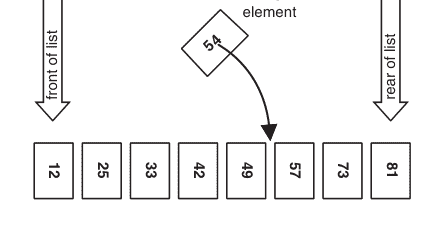

### 无序列表

无序列表中元素的放置不是基于元素的任何内在特征。不要让这个名称误导了你。无序列表是按照特定的顺序保持的，但该顺序不是基于元素本身。使用列表的客户端决定元素的顺序。图 6.2 显示了无序列表的概念视图。新元素可以放在列表的前部或后部，也可以插入到列表中已有的特定元素之后。

> **核心概念**
> 无序列表的元素按照客户端选择的任何顺序保持。

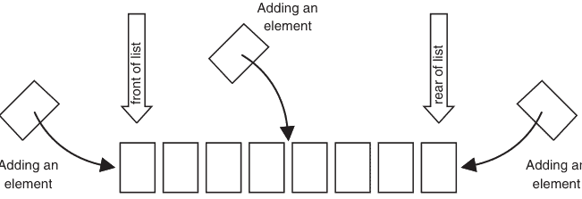

### 索引列表

索引列表与无序列表相似，其区别在于元素之间没有决定它们在列表中顺序的内在关系。使用列表的客户端决定元素的顺序。然而，此外，每个元素都可以通过数字索引进行引用，该索引从列表头部的 0 开始，一直持续到列表末尾。图 6.3 显示了索引列表的概念视图。新元素可以插入到列表的任何位置，包括顺序。

> **核心概念**
> 索引列表为元素维护连续的索引范围。

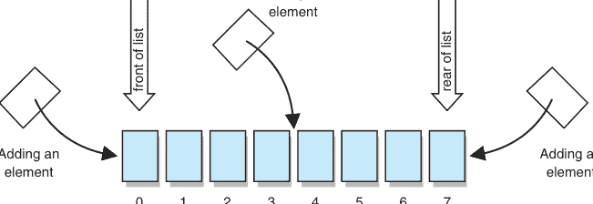

> **设计焦点**
> 可能既是有序列表又是索引列表吗？可能，但没有意义。如果客户端尝试在特定索引处添加元素或更改位于该处的元素，哪种规则将优先？索引位置还是顺序？

## 6.2 Java API 中的列表

Java 提供的列表类主要支持索引列表的概念。在某种程度上，它们与无序列表的概念重叠。然而，Java API 并没有直接实现有序列表的类。

你已经熟悉 Java API 中的 `ArrayList` 类。它是 Java 程序员的喜爱，因为它提供了一种管理一组对象的快速方法。它的对应类 `LinkedList` 提供了相同的基本功能，正如其名所示，采用链式实现。元素都由泛型参数 `E` 定义。

`ArrayList` 和 `LinkedList` 都实现了 `java.util.List` 接口。List 接口中的某些方法见图 6.4。

| 方法 | 描述 |
|---|---|
| `add(E element)` | 将元素添加到列表末尾。 |
| `add(int index, E element)` | 在指定的索引处插入元素。 |
| `get(int index)` | 返回指定索引处的元素。 |
| `remove(int index)` | 移除指定索引处的元素。 |
| `remove(E object)` | 移除指定的首次对象。 |
| `set(int index, E element)` | 替换指定索引处的元素。 |
| `size()` | 返回列表中的元素数量。 |

> **核心概念**
> Java API 没有提供实现有序列表的类。

## 6.3 使用无序列表：学习计划

在查看我们自己的列表实现之前，让我们来看几个 Java API 提供的列表示例。

学生为了满足学位要求而修的课程列表有时被称为学习计划（program of study）。让我们来看一个管理简易学习计划的示例。我们将使用 Java API 中的 `LinkedList` 类，并添加一些无序列表操作来管理课程列表。

列表 6.1 包含一个 `main()` 方法，该方法创建了一个 `ProgramOfStudy` 对象，并使用它连续地管理几个初始课程，直到列表末尾。然后，在现有的 CS 课程之后插入第二门 CS 课程。接着，找到一门特定的课程并更新其成绩。最后，用一门 FRE 课程替换一门课程。

按照这些特定方式操作课程列表后，`main()` 方法会打印出 `ProgramOfStudy` 对象并将其保存到磁盘上，以便以后能够进一步的检索和修改。

### 列表 6.1

```java
import java.io.IOException;

/**
 * 演示如何使用列表来管理一组对象。
 * @author Lewis and Chase
 * @version 4.0
 */
public class POSTester
{
    /**
     * 创建并填充学习计划。然后使用序列化
     * 将其保存。
     */
    public static void main(String[] args) throws IOException
    {
        ProgramOfStudy pos = new ProgramOfStudy();
    }
}
```

`ProgramOfStudy` 类如列表 6.2 所示，`Course` 类如列表 6.3 所示。首先注意，实例变量 `list` 被声明为 `List<Course>` 类型，它引用的是接口。在构造函数中，实例化了一个 `LinkedList<Course>` 对象。如果需要，可以将其更改为 `ArrayList<Course>` 对象而无需对类进行任何更改。

`addCourse()`、`find()`、`addCourseAfter()` 和 `replace()` 方法执行了更新学习计划所需的各种操作。它们本质上是在 `LinkedList` 类提供的基本列表操作基础上增加了无序列表操作。

`iterator()` 方法返回一个 `Iterator` 对象。该方法在 `ProgramOfStudy` 程序中没有使用，但它是一项关键操作。迭代器将在第 7 章中详细讨论。

最后，`save()` 和 `load()` 方法分别用于将 `ProgramOfStudy` 对象写入文件并将其读回。与我们在之前的示例中看到的基于文本的 I/O 操作不同，这次使用了所谓的序列化（serialization），将对象作为二进制流进行读取和写入。因此，只需几行代码，对象就可以在状态完整的情况下被存储。在这种情况下，当前存储在 `ProgramOfStudy` 列表中的所有课程都作为对象的一部分被存储。

请注意，`ProgramOfStudy` 和 `Course` 类实现了 `Serializable` 接口。为了使用序列化保存订单，其类必须实现 `Serializable`。`Serializable` 接口中没有方法——它仅用于指示该对象可以转换为序列化的表示形式。`ArrayList` 和 `LinkedList` 类实现了 `Serializable`。

```java
public class Course implements Serializable
// 表示此类可以被序列化
// Serializable 接口不包含方法。
```

### 列表 6.2

```java
import java.io.FileInputStream;
import java.io.FileNotFoundException;
import java.io.FileOutputStream;
import java.io.IOException;
import java.io.ObjectInputStream;
import java.io.ObjectOutputStream;
import java.io.Serializable;
import java.util.Iterator;
import java.util.LinkedList;
import java.util.List;
```


```java
/**
 * 代表学习计划，即个人学生已修和计划修读的课程列表
 *
 * @author Lewis and Chase
 * @version 4.0
 */
public class ProgramOfStudy implements Iterable<Course>, Serializable {
    private List<Course> list;

    /**
     * 构建一个初始为空的学习计划。
     */
    public ProgramOfStudy() {
        list = new LinkedList<Course>();
    }

    /**
     * 将指定的课程添加到课程列表末尾。
     * @param course 要添加的课程
     */
    public void addCourse(Course course) {
        if (course != null) {
            list.add(course);
        }
    }

    /**
     * 查找并返回匹配指定前缀和编号的课程。
     * @param prefix 目标课程的前缀
     * @param number 目标课程的编号
     * @return 课程，如果未找到返回 null
     */
    public Course find(String prefix, int number) {
        for (Course course : list) {
            if (prefix.equals(course.getPrefix()) &&
                number == course.getNumber())
                return course;
        }
        return null;
    }

    /**
     * 在目标课程之后添加指定的课程。如果任一课程为空或未找到目标，则不执行任何操作。
     * 
     * @param target 在之后添加新课程的课程
     * @param newCourse 要添加的课程
     */
    public void addAfter(Course target, Course newCourse) {
        if (target == null || newCourse == null) {
            return;
        }
        int targetIndex = list.indexOf(target);
        if (targetIndex != -1) {
            list.add(targetIndex + 1, newCourse);
        }
    }

    /**
     * 用新课程替换指定的目标课程。如果任一课程为空或未找到目标，则不执行任何操作。
     * 
     * @param target 要替换的目标课程
     * @param newCourse 要添加的新课程
     */
    public void replace(Course target, Course newCourse) {
        if (target == null || newCourse == null) {
            return;
        }
        int targetIndex = list.indexOf(target);
        if (targetIndex != -1) {
            list.set(targetIndex, newCourse);
        }
    }

    /**
     * 创建并返回学习计划的字符串表示。
     * @return 学习计划的字符串表示
     */
    public String toString() {
        String result = "";
        for (Course course : list) {
            result += course + "\n";
        }
        return result;
    }

    /**
     * 返回学习计划的迭代器。
     * @return 计划的迭代器
     */
    public Iterator<Course> iterator() {
        return list.iterator();
    }

    /**
     * 将此学习计划的序列化版本保存到文件。
     * @param fileName POS 保存的文件名
     * @throws IOException
     */
    public void save(String fileName) throws IOException {
        FileOutputStream fos = new FileOutputStream(fileName);
        ObjectOutputStream oos = new ObjectOutputStream(fos);
        oos.writeObject(this);
        oos.flush();
        oos.close();
    }

    /**
     * 从指定文件加载序列化的学习计划。
     * @param fileName 从此读取 POS 文件
     * @return 加载的学习计划
     * @throws IOException
     * @throws ClassNotFoundException
     */
    public static ProgramOfStudy load(String fileName) throws IOException, ClassNotFoundException {
        FileInputStream fis = new FileInputStream(fileName);
        ObjectInputStream ois = new ObjectInputStream(fis);
        ProgramOfStudy pos = (ProgramOfStudy) ois.readObject();
        ois.close();

        return pos;
    }
}
```

```java
// LISTING 6.3
import java.io.Serializable;

/**
 * 代表学生可能修的课程。
 *
 * @author Lewis and Chase
 * @version 4.0
 */
public class Course implements Serializable {
    private String prefix;
    private int number;
    private String title;
    private String grade;

    /**
     * 使用指定信息构建课程。
     * @param prefix 课程标识的前缀
     * @param number 课程标识的编号
     * @param title 课程标题
     * @param grade 课程的成绩
     */
    public Course(String prefix, int number, String title, String grade) {
        this.prefix = prefix;
        this.number = number;
        this.title = title;
        this.grade = grade;
    }

    public String getPrefix() {
        return prefix;
    }

    public int getNumber() {
        return number;
    }

    @Override
    public String toString() {
        return prefix + " " + number + ": " + title + " (" + grade + ")";
    }
}
```

## 6.3 使用无序列表：学习计划

### 列表 6.3 续

```java
this.number = number;
this.title = title;
if (grade == null)
    this.grade = "";
else
    this.grade = grade;
```

```java
/**
 * 使用指定的信息构造课程，不建立成绩。
 * @param prefix 课程标识的以前缀
 * @param number 课程标识的编号
 * @param title 课程标题
 */
```

```java
public Course(String prefix, int number, String title)
{
    this(prefix, number, title, "");
}
```

```java
/**
 * 返回课程标识的以前缀。
 * @return 课程标识的以前缀
 */
```

```java
public String getPrefix()
{
    return prefix;
}
```

```java
/**
 * 返回课程标识的编号。
 * @return 课程标识的编号
 */
```

```java
public int getNumber()
{
    return number;
}
```

### 列表 6.3 续

```java
/**
 * 返回此课程的标题。
 * @return 课程的以前缀
 */
public String getTitle()
{
    return title;
}

/**
 * 返回此课程的成绩。
 * @return 课程的成绩
 */
public String getGrade()
{
    return grade;
}

/**
 * 将此课程的成绩设置为指定的成绩。
 * @param grade 课程的新成绩
 */
public void setGrade(String grade)
{
    this.grade = grade;
}

/**
 * 如果已修读此课程并收到成绩，则返回 true。
 * @return 如果修过此课程返回 true，否则返回 false
 */
public boolean taken()
{
    return !grade.equals("");
}
```

### 列表 6.3 续

```java
/**
 * 根据课程标识（前缀和编号）判断此课程与指定的课程是否相等。
 *
 * @return 如果此课程与参数相等则返回 true
 */
public boolean equals(Object other) {
    boolean result = false;
    if (other instanceof Course) {
        Course otherCourse = (Course) other;
        if (prefix.equals(otherCourse.getPrefix()) &&
            number == otherCourse.getNumber())
            result = true;
    }
    return result;
}

/**
 * 创建并返回此课程的字符串表示。
 *
 * @return 课程的字符串表示
 */
public String toString() {
    String result = prefix + " " + number + ": " + title;
    if (!grade.equals("")) {
        result += " [" + grade + "]";
    }
    return result;
}
```

图 6.5 展示了描述 `ProgramOfStudy` 示例中类之间关系的 UML 类图。

### 6.3 使用无序列表：学习计划

| Course |
| :--- |
| prefix : String |
| number : int |
| title : String |
| grade : String |
| getPrefix() : String |
| getNumber(): int |
| getTitle() : String |
| getGrade() : String |
| setGrade(String grade) : void |
| taken() : boolean |
| equals(Object other) : boolean |
| toString() : String |

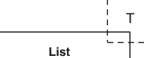

| ProgramOfStudy |
| :--- |
| list : List<Course> |
| addCourse(Course course) : void |
| find(String prefix, int number) : Course |
| addAfter(Course target, Course newCourse) : void |
| replace(Course target, Course newCourse) : void |
| toString() : String |
| iterator() : Iterator<Course> |
| save(String fileName) : void |
| load(String fileName) : ProgramOfStudy |


| POSTester |
| :--- |
| main(String[] args) |

图 6.5 `ProgramOfStudy` 程序的 UML 描述

## 6.4 使用索引列表：约瑟夫问题

弗拉维乌·约瑟夫（Flavius Josephus）是第一世纪的一位犹太历史学家。传说他是有 41 名犹太反叛者中的一员，他们决定自杀也不向围困了他们的罗马人投降。他们决定组成一个圈，并杀死每一个人，直到没有人为止。约瑟夫想死，他计算出自己需要站的位置，以便成为最后一个活下来的人。由此产生了一类被称为“约瑟夫问题”的问题。这些问题涉及到当元素不是按顺序取出，而是循环中每隔第 $i$ 个元素取出，直到剩余为空时的事件顺序。

**核心概念** 约瑟夫问题是一个经典的计算问题，适用于使用索引列表解决。

例如，假设我们有一个从 1 到 7 编号的七个元素的列表：

+ 1 2 3 4 5 6 7

如果我们从列表中移除第三个元素，第一个被移除的元素是数字 3，剩余列表为

+ 1 2 4 5 6 7

下一个被移除的元素是 6，然后是 2，然后是 7，然后是 5，然后是 1，最后是 4。（等，让我们回溯一下：1, 2, 3, 4, 5, 6, 7 -> 移除 3：[1, 2, 4, 5, 6, 7] -> 移除 6：[1, 2, 4, 5, 7] -> 移除 2：[1, 4, 5, 7] -> 移除 7：[1, 4, 5] -> 移除 5：[1, 4] -> 移除 1：[4]）。

（注：原文中部分 OCR 文本存在大量重复和错误，此处已根据核心逻辑进行清理和翻译。）

## 6.5 列表 ADT

现在让我们探索我们自己的列表集合实现。我们将超出 Java API 提供的范围，包含无序和有序列表的完整实现。

**核心概念** 许多操作适用于所有列表类型。它们之间的区别在于添加元素的方式。

有一组适用于无序和有序列表的共同操作。这些共同操作如图 6.6 所示。它们包括移除和检查元素的操作，以及经典的 `isEmpty` 和 `size` 操作。`contains` 操作也受两种列表支持，这允许用户确定列表是否包含某个特定元素。

| 操作 | 描述 |
| :--- | :--- |
| `removeFirst` | 从列表中移除第一个元素。 |
| `removeLast` | 从列表中移除最后一个元素。 |
| `remove` | 从列表中移除一个特定元素。 |
| `first` | 检查列表头部元素。 |
| `last` | 检查列表尾部元素。 |
| `contains` | 确定列表是否包含特定元素。 |
| `isEmpty` | 确定列表是否为空。 |
| `size` | 确定列表中元素数量。 |

图 6.6 列表的共同操作

### 向列表添加元素

有序列表和无序列表之间的区别主要在于元素是如何添加到列表中的。在有序列表中，我们只需要指定要添加的新元素。它在列表中的位置基于它的键值（`key value`）。该操作如图 6.7 所示。

| 操作 | 描述 |
| :--- | :--- |
| `add` | 向列表中添加一个元素。 |

图 6.7 有序列表的操作

无序列表支持 `add` 操作的三种变体。元素可以添加到列表的头部、末尾，或者列表中已有的特定元素之后。这些操作如图 6.8 所示。

| 操作 | 描述 |
| :--- | :--- |
| `addToFront` | 向列表头部添加一个元素。 |
| `addToRear` | 向列表末尾添加一个元素。 |
| `addAfter` | 在列表中已有的特定元素之后添加一个元素。 |

图 6.8 无序列表特有的操作


# 第 6 章 列表

从概念上讲，索引列表特定的操作利用了其通过索引引用元素的能力。新元素可以插入到列表的特定索引处，也可以在不指定索引的情况下添加到列表末尾。如果插入或删除了元素，较高索引的元素将向上移动以腾出空间，或向下移动以填补空隙。或者，可以设置特定索引处的元素，这将覆盖当前在该索引处的元素，且不会导致其他元素移动。

我们可以利用有序列表和无序列表共享一组通用操作的事实。这些操作只需要定义一次。因此，我们将定义三个接口：一个包含通用操作，另外两个包含每种列表类型特有的操作。接口可以使用继承，就像类可以使用继承一样。特定类型的接口扩展了通用的列表定义。这些接口之间的关系如图 6.9 所示。

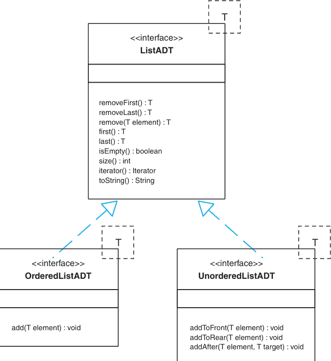

图 6.9 使用继承来定义列表接口

代码段 6.5 到 6.7 显示了与图 6.9 中的 UML 图对应的 Java 接口。

## 代码段 6.5

```java
package jsjf;
import java.util.Iterator;

/**
 * ListADT 定义了通用列表集合的接口。特定的
 * 列表类型将扩展此接口以完成
 * 必要的的操作set。
 *
 * @author Lewis and Chase
 * @version 4.0
 */
public interface ListADT<T> extends Iterable<T>
{
    /**
     * 从此列表中移除并返回第一个元素。
     * @return 此列表的第一个元素
     */
    public T removeFirst();

    /**
     * 从此列表中移除并返回最后一个元素。
     * @return 此列表的最后一个元素
     */
    public T removeLast();

    /**
     * 从此列表中移除并返回指定的元素。
     * @param element 要从列表中移除的元素
     */
    public T remove(T element);

    /**
     * 返回此列表中第一个元素的引用。
     * @return 此列表中第一个元素的引用
     */
    public T first();

    /**
     * 返回此列表中最后一个元素的引用。
     * @return 此列表中最后一个元素的引用
     */
    public T last();

    /**
     * 如果此列表包含指定的目标元素，则返回 true。
     * @param target 在列表中查找的目标
     * @return 如果此列表包含此元素，则返回 true
     */
    public boolean contains(T target);

    /**
     * 如果此列表不包含任何元素，则返回 true
     * @return 如果此列表不包含任何元素，则返回 true
     */
    public boolean isEmpty();

    /**
     * 返回此列表中元素的数量。
     * @return 此列表中元素数量的整数表示
     */
    public int size();

    /**
     * 返回此列表元素的迭代器。
     * @return 遍历此列表元素的迭代器
     */
    public Iterator<T> iterator();

    /**
     * 返回此列表的字符串表示。
     * @return 此列表的字符串表示
     */
    public String toString();
}
```

## 代码段 6.6

```java
package jsjf;
/**
 * OrderedListADT 定义了有序列表集合的接口。只存储
 * 可比较（Comparable）元素，并按照元素之间
 * 固有关系决定的顺序保持。
 *
 * @author Lewis and Chase
 * @version 4.0
 */
public interface OrderedListADT<T> extends ListADT<T> {
    /**
     * 将指定的元素添加到此列表适当的位置
     * @param element 要添加到此列表的元素
     */
    public void add(T element);
}
```

## 代码段 6.7

```java
package jsjf;
/**
 * UnorderedListADT 定义了无序列表集合的接口。
 * 元素按照用户所需的任何顺序存储。
 *
 * @author Lewis and Chase
 * @version 4.0
 */
public interface UnorderedListADT<T> extends ListADT<T> {
    /**
     * 将指定的元素添加到此列表的头部。
     * @param element 要添加到此列表的元素
     */
    public void addToFront(T element);

    /**
     * 将指定的元素添加到此列表的末尾。
     * @param element 要添加到此列表的元素
     */
    public void addToRear(T element);

    /**
     * 在目标之后添加指定的元素。
     * @param element 要添加到目标之后的元素
     * @param target 元素将要添加的目标
     */
    public void addAfter(T element, T target);
}
```

## 6.6 使用数组实现

正如我们在之前的章节中看到的，基于数组的实现对于有序和无序列表都是类似的。`list` 的头部位于索引 0。`rear` 表示列表中元素数量。如果我们要移除的元素是列表的第一个元素，我们需要 n 次比较并移动元素以填补空隙。`remove` 操作可以实现如下：

```java
/**
 * 移除并返回指定的元素。
 * @param element 要从列表中移除的元素
 * @return 被移除的元素
 * @throws ElementNotFoundException 如果元素不在列表中
 */
public T remove(T element)
{
    T result;
    int index = find(element);
    // ... 方法体省略
}
```

| 0 | 1 | 2 | 3 | 4 | 5 | 6 | 7 |
|---|---|---|---|---|---|---|---|
| A | B | C | D |   |   |   |   |


```java
/**
 * ArrayList 代表列表的数组实现。list 的头部位于索引 0。此类将被扩展以创建特定类型的列表。
 *
 * @author Lewis and Chase
 * @version 4.0
 */
public abstract class ArrayList<T> implements ListADT<T>, Iterable<T>
{
    private final static int DEFAULT_CAPACITY = 100;
    private final static int NOT_FOUND = -1;
    protected int rear;
    protected T[] list;
    protected int modCount;

    public ArrayList()
    {
        this(DEFAULT_CAPACITY);
    }

    /**
     * 使用指定的容量创建一个空列表。
     *
     * @param initialCapacity 数组列表的大小
     */
    public ArrayList(int initialCapacity)
    {
        rear = 0;
        list = (T[]) (new Object[initialCapacity]);
        modCount = 0;
    }

    private int find(T target)
    {
        int scan = 0;
        int result = NOT_FOUND;
        if (!isEmpty())
            while (result == NOT_FOUND && scan < rear)
                if (target.equals(list[scan]))
                    result = scan;
                else
                    scan++;
        return result;
    }
}
```

`ArrayList` 类实现了之前定义的 `ListADT`。它还实现了 `Iterable` 接口。该接口以及 `modCount` 变量将在第 7 章中讨论。如果我们要移除的元素是列表的最后一个元素，我们需要 n 次比较且不需要移动元素。注意，如果我们使用循环数组实现，该操作是 O(n)。

注意，`find` 方法依赖于 `equals` 方法来确定是否找到了目标对象。传入方法的对象可能是所求元素的精确拷贝。事实上，它也可能是列表中元素的别名。然而，如果参数是一个独立的对象，它可能并不包含包含所求元素的所有方面。只有作为 `equals` 方法所依据的键特征才是重要的。

`find` 方法的逻辑本可以合并到 `remove` 方法中，尽管这会使 `remove` 方法变得复杂。在适当的情况下，应该定义此类方法以保持每个方法的可读性。此外，在这种情况下，`find` 方法在实现 `contains` 操作时是非常有用的，正如我们现在将探索的那样。

### 设计焦点

重写 `equals` 方法和实现 `Comparable` 接口是面向对象设计力量的极佳示例。只要对象提供了相等性定义和/或类对象之间的比较方法，我们就可以创建处理尚未设计好的对象类的集合实现。

### 设计焦点

在 `ArrayList` 类中分离出如 `find` 这样的私有方法有多个益处。首先，它简化了已经复杂的 `remove` 方法的定义。其次，它允许我们使用 `find` 方法来实现 `contains` 操作，以及 `ArrayOrderedList` 的 `addAfter` 方法。注意，`find` 方法没有抛出 `NoSuchElementException`，而是返回 `-1`，表示未找到元素。通过这种方式，调用程序可以决定如何处理未找到元素的情况。在 `remove` 方法中，这意味着抛出异常。在 `contains` 方法中，这意味着返回 `false`。

## `contains` 操作

`contains` 操作的目的是确定特定元素当前是否包含在列表中。正如我们所讨论的，我们可以使用 `find` 支持方法来创建一个相当直观的实现：

```java
/**
 * 如果此列表包含指定的元素，则返回 true。
 * @param target 目标元素
 * @return 如果目标在列表中，返回 true，否则返回 false
 */
public boolean contains(T target)
{
    return (find(target)) != NOT_FOUND;
}
```

如果未找到元素，`contains` 方法返回 `false`。如果找到了，它返回 `true`。一个精心构建的返回语句确保了正确的返回值。由于此方法正在对我们的列表进行线性搜索，我们的最坏情况是我们要搜索的元素不在列表中。这种情况需要 $n$ 次比较。我们预计该方法平均需要 $n/2$ 次比较，结果导致的操作复杂度为 $O(n)$。

## 有序列表的 `add` 操作

`add` 操作是元素添加到有序列表的唯一方式。调用时没有指定位置，因为元素本身决定了它们的顺序。与 `remove` 操作大不同，`add` 操作需要比较和移动的结合来找到列表中的正确位置，然后移动以为新元素留出位置。观察两个极端情况：如果将元素添加到列表的头部，将需要一次比较，然后列表中的 $n-1$ 个元素需要移动。如果元素添加到列表尾部，这将需要 $n$ 次比较，列表中的其他元素都不需要移动。与 `remove` 操作一样，`add` 操作每次执行时都需要 $n$ 次比较和移动，操作复杂度为 $O(n)$。`add` 操作可以实现如下：

```java
/**
 * 将指定的 Comparable 元素添加到此列表，保持
 * 元素的排序顺序。
 * @param element 要添加到列表的元素
 */
public void add(T element)
{
    if (!(element instanceof Comparable))
        throw new NonComparableException("OrderedList");

    Comparable<T> comparableElement = (Comparable<T>) element;

    if (size() == list.length)
        expandCapacity();
    int scan = 0;

    // 寻找插入位置
    while (scan < rear && comparableElement.compareTo(list[scan]) > 0)
        scan++;

    // 将现有元素向上移动
    for (int shift=rear; shift > scan; shift--)
        list[shift] = list[shift-1];

    // 插入元素
    list[scan] = element;
    rear++;
    modCount++;
}
```

### 核心概念

只有 `Comparable` 对象可以存储在有序列表中。

注意，只有 `Comparable` 对象可以存储在有序列表中。如果元素不是 `Comparable`，则抛出异常。如果它是 `Comparable` 但与列表中的元素比较无效，则在调用 `compareTo` 方法时将导致 `ClassCastException`。

回想一下 `Comparable` 接口定义了 `compareTo` 方法，该方法当比较对象分别小于、等于或大于参数时，会返回负整数、零或正值。

列表的无序版本和索引版本不需要它们存储的元素是 `Comparable` 的。这证明了面向对象编程的实用性，因为实现这些变体的各种类尽管存在这些差异，也可以和谐存在。

## 针对无序列表的特定操作

`addToFront` 和 `addToRear` 操作与其他集合的操作相似，因此被留作编程项目。请记住，`addToFront` 操作必须移动当前元素，为新元素在索引 0 处留出空间。我们 `addToFront` 操作是 $O(n)$，因为它需要移动 $n-1$ 个元素。像栈一样，`addToRear` 操作将是 $O(1)$。

## 无序列表的 `addAfter` 操作

`addAfter` 操作接受两个参数：一个表示要添加的元素，另一个表示目标。`addAfter` 方法必须找到目标，移动较高索引的元素，然后在之后插入新元素。非常像 `remove` 操作和有序列表的 `add` 操作，`addAfter` 方法需要比较和移动，复杂度为 $O(n)$。

```java
/**
 * 在指定的目标之后添加指定的元素。
 * 如果未找到目标，则抛出 ElementNotFound。
 *
 * @param element 添加到目标之后的元素
 * @param target 元素添加之后的目标
 */
public void addAfter(T element, T target) {
    if (size() == list.length)
        expandCapacity();

    int scan = 0;

    // 寻找插入点
    while (scan < rear && !target.equals(list[scan]))
        scan++;

    if (scan == rear)
        throw new ElementNotFoundException("UnorderedList");

    scan++;

    // 元素向上移动
    for (int shift=rear; shift > scan; shift--)
        list[shift] = list[shift-1];

    // 插入元素
    list[scan] = element;
    rear++;
    modCount++;
}
```

# 6.7 使用链接实现列表

正如在其他集合中看到的，使用链表是实现线性集合的另一种方式。适用于有序和无序列表的共同操作以及每种类型的特定操作，都可以用之前使用的类似技术来实现。我们将检查一些有趣的操作，但大部分大部分留作编程项目。

首先，提供了 `LinkedList` 类的类头、类级数据和构造函数供参考：

```java
/**
 * LinkedList 表示列表的链式实现。
 *
 * @author Lewis and Chase
 * @version 4.0
 */
public abstract class LinkedList<T> implements ListADT<T>, Iterable<T>
{
    /**
     * 创建一个空列表。
     */
    // 构造函数及类成员省略
}
```


```java
public LinkedList()
{
    count = 0;
    head = tail = null;
    modCount = 0;
}
```

## remove 操作

`remove` 操作是 `LinkedList` 类的一部分，该类被无序列表和有序列表实现共享。`remove` 操作包括确保列表不空、找到要删除的元素，然后处理四种情况之一：要删除的元素是列表中的唯一元素、要删除的元素是列表的第一个元素、要删除的元素位于列表中间，或者要删除的元素是最后一个元素。在所有情况下，数组版本都需要计数操作，而链表版本不需要移动元素来填充空隙。然而，考虑到最坏情况仍需要 n 次比较来确定目标元素不在列表中，`remove` 操作仍然是 O(n)。下面是 `remove` 操作的实现。

```java
/**
 * 从列表中移除指定元素的第一个实例并返回它。
 * 如果列表为空空，则抛出 EmptyCollectionException。如果列表中未找到 
 * 指定的元素，则抛出 ElementNotFoundException。
 *
 * @param targetElement 要从列表中删除的元素
 * @return 被删除的元素的引用
 * @throws EmptyCollectionException 如果列表为空
 * @throws ElementNotFoundException 如果未找到目标元素
 */
public T remove(T targetElement) throws EmptyCollectionException,
ElementNotFoundException
{
    if (isEmpty())
        throw new EmptyCollectionException("LinkedList");

    boolean found = false;
    LinearNode<T> previous = null;
    LinearNode<T> current = head;

    while (current != null && !found)
        if (targetElement.equals(current.getElement()))
            found = true;
        else
        {
            previous = current;
            current = current.getNext();
        }
    // ...
```

```java
if (!found)
    throw new ElementNotFoundException("LinkedList");

if (size() == 1) // 列表中只有一个元素
    head = tail;
    tail = null;
else if (current.equals(head)) // 目标在头部
    head = current.getNext();
else if (current.equals(tail)) // 目标在尾部
    {
        tail = previous;
        tail.setNext(null);
    }
    else // 目标在中间
        previous.setNext(current.getNext());


count--;
modCount++;

return current.getElement();
```

## 核心概念总结

- 列表集合可以分类为有序、无序或索引列表。
- 有序列表的元素具有定义其顺序的内在关系。
- 无序列表的元素按照所选的任何顺序保持。
- 索引列表为其元素维护一个连续的索引范围。
- Java API 未提供实现有序列表的类。
- 对于所有列表类型，都可以定义许多常用操作。它们之间的区别在于元素添加的方式。
- 接口可以用于派生其他接口。子接口包含父接口的所有抽象方法。
- 接口名称可以用于声明对象引用变量。接口引用可以指向实现接口的类的任何对象。
- 接口使我们能够创建多态引用，其中调用的方法基于当前引用的特定对象。
- 约瑟夫问题（Josephus problem）是一个经典的计算问题，使用索引列表解决非常合适。
- 只有实现 `Comparable` 的对象才能存储在有序列表中。

## 术语总结

- **indexed list（索引列表）**：一种可以使用数值索引引用其元素的列表。
- **Josephus problem（约瑟夫问题）**：一个经典的计算问题，其目标是通过循环地从列表中选取每第 $i$ 个元素，直到没有元素为止，找到元素选取的顺序。
- **natural ordering（自然排序）**：用于判断对象是否在另一个对象之前的排序标准的表达式，通常使用 `compareTo` 方法实现。
- **ordered list（有序列表）**：一种元素根据元素某些内在特征进行排序的列表。
- **serialization（序列化）**：一种将对象表示为二进制位流的技术，允许从文件中读取和写入对象并保持其状态。
- **unordered list（无序列表）**：一种元素没有内在顺序，但根据它们在列表中的位置进行排序的列表。

## 自测题

- SR 6.1 定义：有序列表、无序列表和索引列表。
- SR 6.2 索引列表和数组之间的主要区别是什么？
- SR 6.3 Java Collections 框架中 `set` 和 `size` 方法的目的是什么？
- SR 6.4 为什么 `ArrayList` 和 `LinkedList` 类要实现 `Serializable` 接口？
- SR 6.5 为什么有序列表要求元素存储 `Comparable`？
- SR 6.6 一个基于数组的整数列表存储了 16 个元素。变量 `front` 和 `rear` 的值是多少？
- SR 6.7 为什么在 `ArrayList` 实现中，`add` 操作增加数组容量的时间被认为可以忽略不计？
- SR 6.8 为什么循环实现对于列表来说不像对队列那样有吸引人？

## 练习题

- EX 6.1 手跟踪通过以下操作有序列表 `x`：

```java
X.add(new Integer(20));
X.add(new Integer(35));
Object Y = X.first();
X.add(new Integer(15));
X.add(new Integer(10));
X.add(new Integer(25));
Object Y = X.first();
X.add(new Integer(10)); // 注意：原文此处有重复的 Y 赋值或逻辑
X.add(new Integer(10));
Object Y = X.first();
```

- EX 6.1 手跟踪通过以下操作有序列表 `x`：

```java
X.add(new Integer(20));
X.add(new Integer(35));
Object Y = X.first();
X.add(new Integer(15));
X.add(new Integer(10));
X.add(new Integer(25));
Object Y = X.first();
X.add(new Integer(10));
X.add(new Integer(10));
Object Y = X.first();
```

- EX 6.2 给定练习 1 的结果，以下操作的结果将是
    - a. `X.first()`;
    - b. `X.contains(15)`;
    - c. `X.remove()`.

- EX 6.3 考虑本章讨论的列表。编写一个在课程之前添加课程的方法。

- EX 6.6 手跟踪通过以下操作无序列表：

```java
X.addToFront(new Integer(20));
X.addRear(new Integer(35));
Object Y = X.first();
X.addAfter(new Integer(15), 20);
X.addAfter(new Integer(10), 35);
X.addAfter(new Integer(25), 15);
Object Y = X.first();
X.remove();
X.addAfter(new Integer(10), 35);
X.addFront(new Integer(45));
Object Y = X.first();
```

## 编程项目

- PP 6.1 使用 `LinkedList` 实现栈。
- PP 6.2 使用 `ArrayList` 实现栈。
- PP 6.3 使用 `LinkedList` 实现队列。
- PP 6.4 使用 `ArrayList` 实现队列。
- PP 6.5 使用队列实现约瑟夫问题，并将该算法与 `ArrayList` 实现进行比较。
- PP 6.6 使用 `LinkedList` 实现有序列表。
- PP 6.7 使用 `ArrayList` 实现有序列表。
- PP 6.8 完成 `ArrayList` 类的实现。
- PP 6.9 完成 `ArrayOrderedList` 的实现。
- PP 6.10 完成 `ArrayUnorderedList` 的实现。
- PP 6.11 编写 `LinkedList` 的实现。
- PP 6.12 编写 `LinkedOrderedList` 的实现。
- PP 6.13 编写 `LinkedUnorderedList` 的实现。
- PP 6.14 实现一个双链有序列表。你需要创建 `DoubleNode` 类、`DoubleList` 类和 `DoubleIterator` 类。
- PP 6.15 创建一个图形界面，为有序列表提供 `add` 和 `remove` 按钮、一个接受字符串作为输入的文本框，以及每次操作后显示列表内容的文本区域。
- PP 6.16 创建一个图形界面，为无序列表提供 `addToFront`、`addAfter` 和 `remove` 按钮。应用程序必须提供文本框作为任何添加操作的输入。用户可以选择要添加到之后的元素，并选择要删除的元素。
- PP 6.17 修改本章中实现 `Comparable` 接口的 `Course` 类。按部门和编号排序排序。编写一个使用有序列表维护课程列表的程序。

`Serializable` 接口——它用于指示对象可以被转换为序列化表示。

序列化是一种将对象表示为二进制位流的技术，它允许从文件中读取和写入对象，同时保持其状态。因此，`ArrayList` 和 `LinkedList` 类实现了 `Serializable` 接口，以便其对象可以被保存到文件中并在稍后作为二进制位流被检索。

## SRA 6.5

有序列表是指元素根据其某些内在特征进行排序的列表。`Comparable` 接口拥有一个 `compareTo` 方法，实现该方法赋予了对象自然排序的能力。换句话说，它设定了一个排序标准，用于判断一个对象是否在另一个对象之前。

## SRA 6.6

变量 `front` 将存储值 0，变量 `rear` 将存储值 16。

## SRA 6.7

以插入列表的次数计算平均值时，扩大数组的时间对总时间的影响很小。

## SRA 6.8

队列的循环数组实现将出队操作的效率从 O(n) 提高到 O(1)，因为消除了在数组中移动元素的需要。对于列表来说情况并非如此，因为我们可以在列表的任何位置添加或删除元素，而不仅仅是在头部或尾部。

## 迭代器

我们在第 6 章讨论列表时提到了迭代器，但没有详细探讨。它们重要到足以单独成章。从概念上讲，它们提供了一种顺序访问集合中每个元素的标准方法，这是一种常用操作。而且它们在 Java API 中的实现有一些有趣的细微差别，值得仔细探索。

## 章节目标

- 定义迭代器并探索它的用法。
- 讨论 `Iterator` 和 `Iterable` 接口。
- 探索快速失败（fail-fast）集合的概念。
- 在各种情况下使用迭代器。
- 探索与迭代器相关的实现选项。

## 7.1 什么是迭代器？

## 核心概念

迭代器（Iterator）提供了一种顺序访问集合中每个元素的方法。

迭代器是一个允许用户一次获取并使用集合中每个元素的对象。它与集合协作工作，但是一个独立的对象。迭代器是帮助实现集合的机制。

一致地拥抱迭代器概念而不是实现多个集合，可以更容易处理和管理这些集合及其包含的元素。Java API 对迭代器有一种一致的方法，类库中几乎所有的集合都实现了这种方法。我们将在下一个实现中遵循这种方法。

Java API 使用两个主要的接口实现迭代器：

- `Iterator` – 用于定义一个可以作为迭代器的对象。
- `Iterable` – 用于定义一个可以从中提取迭代器的集合。

## 核心概念

集合通常被定义为 `Iterable`，这意味着它在需要时会提供一个 `Iterator`。

集合是 `Iterable` 的，这意味着它承诺在请求时提供 `Iterator`。例如，`LinkedList` 是 `Iterable` 的，这意味着它提供了一个名为 `iterator` 的方法，可以通过调用该方法获取遍历列表元素的迭代器。接口的名字使得它们很容易区分。

这两个接口中定义的抽象方法如图 7.1 和 7.2 所示。两个接口都操作于泛型类型，在这些图中用 `E` 表示。

`Iterable` 接口只有一个方法 `iterator`，它返回一个 `Iterator` 对象。当你创建集合时，你就承诺了元素类型，该类型用于定义迭代器中的元素。

| 方法 | 说明 |
| --- | --- |
| `boolean hasNext()` | 如果迭代还有更多元素则返回 true |
| `E next()` | 返回迭代中的下一个元素 |
| `void remove()` | 从底层集合中移除迭代器上次返回的元素 |

> 图 7.1 Iterator 接口中的方法

| 方法 | 说明 |
| --- | --- |
| `Iterator<E> iterator()` | 返回一个对类型为 E 的元素集的迭代器。 |

> 图 7.2 Iterable 接口中的方法

## 7.1 什么是迭代器？

`Iterator` 接口包含三个方法。前两个 `hasNext` 和 `next` 可以配合使用来顺序访问元素。例如，如果 `myList` 是一个 `Book` 对象的 `ArrayList`，你可以使用以下代码打印列表中所有的书。

```java
Iterator<Book> itr = myList.iterator();
while (itr.hasNext()) {
    System.out.println(itr.next());
}
```

在这个示例中，第一行调用集合的 `iterator` 方法来获取 `Iterator<Book>` 对象。调用迭代器的 `hasNext` 方法用于检查循环条件。在循环内部，调用迭代器的 `next` 方法来获取下一本书。当迭代完成时，循环终止。

`Iterator` 接口的 `remove` 操作作为一种便利提供的，允许你在遍历集合时移除其中的一个元素。`remove` 方法是一个可选操作，并不是所有的迭代器都实现了它。

现在，你可能意识到你可以像我们过去做的那样使用 `for-each` 循环来访问集合的元素。以下代码与之前的循环实现了相同的功能。

```java
for (Book book : myList) {
    System.out.println(book);
}
```

`for-each` 代码比 `while` 循环代码更简洁、更短，这通常将是你使用的技术。

那么，为什么要使用显式迭代器而不是 `for-each` 呢？有两个基本原因。首先，你可能不想处理所有元素。如果你在寻找某个特定元素，而不是处理所有，你可能会使用显式迭代器。事实上，`for-each` 循环不提供对 `remove` 方法的显式访问。如果你需要在迭代时移除元素，可能会使用显式迭代器。

## 核心概念

迭代器的可选 `remove` 方法使得从集合移除元素。

## 其他迭代器问题

在继续之前，我们应该注意与迭代器相关的几个其他问题。首先，对于迭代器交付元素的顺序没有假设。在列表的情况下，元素有一个线性顺序，因此迭代器可能会遵循该顺序。在其他情况下，迭代器可能会遵循适用于该集合的不同顺序。在对迭代器交付顺序做出任何假设之前，请仔细阅读 API 文档。

## 核心概念

其次，你应该意识到迭代器和它的集合之间存在紧密的关系。迭代器引用存储在集合中的元素。因此，如果在使用迭代器，至少有两个对象引用元素对象。由于这种关系，在迭代器激活时不能修改底层集合的结构。

基于这一假设，Java API 提供的大多数迭代器都实现为快速失败（fail-fast），这意味着如果在迭代器激活时修改了集合，它们将抛出 `ConcurrentModificationException`。这种思想是让迭代器快速干净地失败，而不是引入一个未来未知某点才被发现的问题。

## 核心概念

大多数迭代器是快速失败的，如果在迭代器激活时修改了集合，它们将抛出异常。

## 7.2 使用迭代器：回顾学习计划

第 6 章研究了一个为学生创建学习计划程序，由已修和计划修的课程列表组成。回顾 `Course` 对象存储了课程编号和标题等信息，以及学生如果已经修了该课程所获得的成绩。

`Program` 类研究了该类的各个方面。现在我们关注它与迭代器相关的方面。`ProgramOfStudy` 类重印在列表 7.1 中以便查看。

首先注意 `ProgramOfStudy` 使用 `Course` 类作为泛型类型实现了 `Iterable` 接口。正如上一节所述，这承诺该类实现 `iterator` 方法，该方法返回学习计划的迭代器对象。在此实现中，`iterator` 方法简单地返回从存储课程的 `LinkedList` 获取的迭代器对象。

因此，`ProgramOfStudy` 对象是 `Iterable` 的，它用于存储 `Course` 对象的 `LinkedList` 也是 `Iterable` 的。我们将看到它们的使用。


## 7.2 使用迭代器：重新审视学习计划程序

### 列表 7.1 `ProgramOfStudy.java`

```java
import java.io.InputStream;
import java.io.FileNotFoundException;
import java.io.FileOutputStream;
import java.io.IOException;
import java.io.ObjectInputStream;
import java.io.ObjectOutputStream;
import java.io.Serializable;
import java.util.Iterator;
import java.util.LinkedList;
import java.util.List;
```

```java
/**
 * 表示一个学习计划（Program of Study），即个人学生已修读和计划修读课程列表。
 * 
 * @author Lewis and Chase
 * @version 4.0
 */
public class ProgramOfStudy implements Iterable<Course>, Serializable {
    private List<Course> list;
```

```java
/**
 * 构造一个初始空的学习计划。
 */
public ProgramOfStudy() {
    list = new LinkedList<Course>();
}
```

```java
/**
 * 将指定的课程添加到课程列表末尾。
 * @param course 要添加的课程
 */
public void addCourse(Course course) {
    if (course != null)
        list.add(course);
}
```

```java
/**
 * 查找并返回匹配指定前缀和编号的课程。
 * @param prefix 目标课程的前缀
 * @param number 目标课程的编号
 * @return 课程，如果未找到则返回 null
 */
public Course find(String prefix, int number) {
    for (Course course : list)
        if (prefix.equals(course.getPrefix()) &&
            number == course.getNumber())
            return course;
    return null;
}
```

```java
/**
 * 将指定的课程添加到目标课程之后。如果任一课程为空或未找到目标，则什么都不做。
 * @param target 在新课程之后添加的目标课程
 * @param newCourse 要添加的课程
 */
public void addCourseAfter(Course target, Course newCourse) {
    if (target == null || newCourse == null)
        return;

    int targetIndex = list.indexOf(target);
    if (targetIndex != -1)
        list.add(targetIndex + 1, newCourse);
}
```

```java
/**
 * 用新课程替换指定的课程。如果任一课程为空或未找到目标，则什么都不做。
 * @param target 要被替换的课程
 * @param newCourse 要添加的新课程
 */
public void replace(Course target, Course newCourse) {
    if (target == null || newCourse == null)
        return;

    int targetIndex = list.indexOf(target);
    if (targetIndex != -1)
        list.set(targetIndex, newCourse);
}
```

```java
/**
 * 创建并返回此学习计划的字符串表示。
 * @return 学习计划的字符串表示
 */
public String toString() {
    String result = "";
    for (Course course : list) {
        result += course + "\n";
    }
    return result;
}

/**
 * 返回此学习计划的迭代器。
 * @return 学习计划的迭代器
 */
public Iterator<Course> iterator() {
    return list.iterator();
}

/**
 * 将此学习计划的序列化版本保存到指定的文件。
 * @param fileName 存储 POS 的文件名
 * @throws IOException
 */
public void voidSave(String fileName) throws IOException {
    FileOutputStream fos = new FileOutputStream(fileName);
    ObjectOutputStream oos = new ObjectOutputStream(fos);
    oos.writeObject(this);
    oos.flush();
    oos.close();
}

/**
 * 从指定文件加载序列化的学习计划。
 * @param fileName 读取 POS 的文件
 * @return 加载的学习计划
 * @throws IOException
 * @throws ClassNotFoundException
 */
public static ProgramOfStudy load(String fileName) throws IOException,
ClassNotFoundException {
    FileInputStream fis = new FileInputStream(fileName);
    ObjectInputStream ois = new ObjectInputStream(fis);
    ProgramOfStudy pos = (ProgramOfStudy) ois.readObject();
    ois.close();
    return pos;
}
```

考虑 `ProgramOfStudy` 类中的 `toString` 方法。它在链表上使用了一个 for-each 循环来扫描列表，并将每门课程的描述添加到总描述中。之所以能这样做，仅仅是因为 `LinkedList` 类实现了 `Iterable` 接口吗？

`ProgramOfStudy` 的 `find` 方法也类似，它使用一个 for-each 循环来扫描 `Course` 对象列表。在这种情况下，一旦找到课程，返回状态就会跳出循环（以及方法）。

## 打印特定课程

现在让我们检查一个以新方式运行我们学习计划的驱动程序。列表 7.2 包含一个 `main` 方法，它首先读取存储在文件中之前创建的 `ProgramOfStudy` 对象（记得 `ProgramOfStudy` 类使用序列化来存储课程列表）。然后，在打印整个列表后，它只打印课程。

请注意，这里使用了 for-each 循环来检查每门课程并只打印特定的。这之所以可行，是因为 `ProgramOfStudy` 类实现了 `Iterable`。

### 列表 7.2 `ProgramGrades.java`

```java
import java.io.FileInputStream;
import java.io.IOException;
import java.io.ObjectInputStream;
import java.util.Iterator;

/**
 * 演示迭代器的用法。
 * @author Lewis and Chase
 */
public class ProgramGrades {
    /**
     * 读取序列化的学习计划，然后打印 A 类的课程。
     */
    public static void main(String[] args) throws Exception {
        ProgramOfStudy pos = ProgramOfStudy.load("ProgramOfStudy");
        System.out.println(pos);
        System.out.println("A 类课程:");
        for (Course course : pos) {
            if (course.getPrefix().equals("A")) {
                System.out.println(course);
            }
        }
    }
}
```

## 移除课程

列表 7.3 包含了另一个驱动程序。这次没有使用 for-each 循环。相反，我们使用迭代器移除没有成绩的课程。

### 列表 7.3 `POSClear.java`

```java
import java.io.FileInputStream;
import java.io.IOException;
import java.io.ObjectInputStream;
import java.util.Iterator;

/**
 * 演示使用迭代器移除元素。
 * @author Lewis and Chase
 */
public class POSClear {
    /**
     * 读取序列化的学习计划，然后移除没有成绩的课程。
     */
    public static void main(String[] args) throws Exception {
        ProgramOfStudy pos = ProgramOfStudy.load("ProgramOfStudy");
        System.out.println(pos);
        System.out.println("移除没有成绩的课程:");
        Iterator<Course> itr = pos.iterator();
        while (itr.hasNext()) {
            Course course = itr.next();
            if (!course.hasGrade()) {
                itr.remove();
            }
        }
        System.out.println(pos);
    }
}
```

## 7.3 实现迭代器：使用数组

在第 6 章中，我们探索了基于数组的列表实现。当时我们没有展示 `ArrayList` 迭代器的实现。现在让我们探索它。

列表 7.4 包含了 `ArrayListIterator`。它被定义为私有类，因此实际上是一个内部类，是 `ArrayList` 的一部分。这是内部类的一个合适用法，因为它与其外部类之间有紧密的关系。

### 列表 7.4 `ArrayListIterator`（部分）

```java
/**
 * 遍历 ArrayList 元素的 ArrayListIterator 迭代器。
 */
private class ArrayListIterator implements Iterator {

    int iteratorModCount;
    int current;

    /**
     * 使用指定的 modCount 设置此迭代器。
     * @param modCount ArrayList 的当前修改计数
     */
    public ArrayListIterator() {
        iteratorModCount = modCount;
        current = 0;
    }
```

```java
/**
 * 如果此迭代器在迭代中至少还有一个元素待交付，则返回 true。
 *
 * @return 如果此迭代器在迭代中至少还有一个元素待交付，则返回 true
 * @throws ConcurrentModificationException 如果在迭代器使用期间集合发生了变化
 */
public boolean hasNext() throws ConcurrentModificationException {
    if (iteratorModCount != modCount)
        throw new ConcurrentModificationException();

    return (current < rear);
}
```

```java
/**
 * 返回迭代中的下一个元素。如果迭代中没有更多元素，则抛出 NoSuchElementException。
 *
 * @return 迭代中的下一个元素
 * @throws NoSuchElementException 如果发生未找到元素异常
 * @throws ConcurrentModificationException 如果集合发生了变化
 */
public T next() throws ConcurrentModificationException {
    if (!hasNext())
        throw new NoSuchElementException();

    current++;
    return list[current - 1];
}
```

## 7.4 实现迭代器：带链结构

```java
/**
 * 此集合不支持 remove 操作。
 * @throws UnsupportedOperationException 如果调用了 remove 方法
 */
public void remove() throws UnsupportedOperationException {
    throw new UnsupportedOperationException();
}
```

下一个方法返回迭代中的下一个元素并增加当前索引值。如果调用了 `next` 方法且没有剩余元素待处理，则会抛出 `NoSuchElementException`。

在这个迭代器的实现中，不支持 `remove` 操作（请记住，它是可选的）。如果调用了此方法，则会抛出 `UnsupportedOperationException`。

## 7.4 实现迭代器：带链结构

同样，也可以为使用链链表的集合定义一个迭代器。与 `ArrayList` 类一样，`LinkedListIterator` 类（参见列表 7.5）被实现为类的私有内部类。`LinkedList` 外部类维护着其 `modCount`，该计数器必须与迭代器存储的值保持同步。

在这个迭代器中，`current` 的值是一个指向 `LinearNode` 的指针，而不是一个整数值。因此，`hasNext` 方法只需确认 `current` `next` 方法返回当前节点上的元素，并将当前引用移动到下一个节点。与 `ArrayListIterator` 一样，不支持 `remove` 方法。

### 列表 7.5 `LinkedListIterator`（部分）

```java
/**
 * LinkedListIterator 表示一个用于线性节点链表的迭代器。
 */
private class LinkedListIterator implements Iterator<T> {

    private int iteratorModCount; // 集合中的元素数量
    private LinearNode<T> current; // 当前位置
```

```java
/**
 * 使用指定的元素设置迭代器。
 * @param collection 迭代器将遍历的集合
 * @param size 集合的整数大小
 */
public LinkedListIterator() {
    current = head;
    iteratorModCount = modCount;
}
```

```java
/**
 * 如果此迭代器在迭代中至少还有一个元素待交付，则返回 true。
 *
 * @return 如果此迭代器在迭代中至少还有一个元素待交付，则返回 true
 * @throws ConcurrentModificationException 如果在迭代器使用期间集合发生了变化
 */
public boolean hasNext() throws ConcurrentModificationException {
    if (iteratorModCount != modCount)
        throw new ConcurrentModificationException();

    return (current != null);
}
```

```java
/**
 * 返回迭代中的下一个元素。如果迭代中没有更多元素，则抛出 NoSuchElementException。
 *
 * @return 迭代中的下一个元素
 * @throws NoSuchElementException 如果迭代器为空
 */
public T next() throws ConcurrentModificationException {
    if (!hasNext())
        throw new NoSuchElementException();
```


```java
T result = current.getElement();
current = current.getNext();
return result;
}
/**
 * 不支持 remove 操作。
 * @throws UnsupportedOperationException 如果调用了 remove 操作
 */
public void remove() throws UnsupportedOperationException
{
    throw new UnsupportedOperationException();
}
```

## 核心概念总结

- 迭代器是一个对象，提供了一种按顺序访问集合中每个元素的方法。
- 集合通常被定义为 `Iterable`，这意味着它在需要时会提供一个迭代器（`Iterator`）。
- 迭代器可选的 `remove` 方法使得无需再次遍历集合即可移除元素。
- 大多数迭代器都是快速失败的（fail-fast），如果在迭代器活动期间修改了集合，它们将抛出异常。
- 除非明确说明，否则你不应对迭代器交付元素的顺序做任何假设。
- 迭代器通常被实现为集合的内部类，以确保它与创建时集合的修改计数保持一致。

## 术语总结

**iterator（迭代器）** 一种允许用户一次一次获取并使用集合中每个元素的对象。

**fail-fast（快速失败）** 如果集合通过迭代器本身以外的任何方式被修改，则抛出异常的迭代器。

## 自测习题

- SR 7.1 什么是迭代器？
- SR 7.2 `Iterable` 接口代表什么？
- SR 7.3 `Iterator` 接口代表什么？
- SR 7.4 for-each 循环与迭代器之间是什么关系？
- SR 7.5 为什么你可能需要使用式迭代器而不是 for-each 循环？
- SR 7.6 迭代器快速失败意味着什么？
- SR 7.7 如何实现快速失败？

## 练习题

- EX 7.1 写一个打印 `inventory` 集合中所有元素的 for-loop。该循环工作需要什么条件？
- EX 7.2 写一个使用式迭代器来实现与 7.1 的功能。
- EX 7.3 写一个 for-loop，对 `payroll` 集合中的每个 `SalaryAccount` 对象调用 `addBonus` 方法。该循环工作需要什么条件？
- EX 7.4 写一个使用式迭代器来实现与 7.3 的功能。

## 自测习题答案

- SRA 7.1 迭代器是一个用于一次一次处理集合中每个元素的对象。
- SRA 7.2 `Iterable` 接口由集合实现，以正式承诺在需要时提供迭代器。
- SRA 7.3 `Iterator` 接口由接口实现，并提供了检查、访问和移除元素的方法。
- SRA 7.4 for-each 循环只能用于实现 `Iterable` 接口的集合。它是可以使用显式迭代器完成的语法简化。
- SRA 7.5 如果你不计划处理集合中的所有元素，或者使用了迭代器的 `remove` 方法，你可能需要使用式迭代器而不是 for-each 循环。
- SRA 7.6 快速失败的迭代器如果底层集合被迭代器以外的其他因素修改，则会快速且干净地失败。
- SRA 7.7 迭代器在创建时记录集合的修改计数，并在后续操作中确保该值没有发生变化。如果发生了变化，迭代器将抛出 `ConcurrentModificationException`。

# 递归

递归是一种强大的编程技术，为某些问题提供了优雅的解决方案。它在实现各种数据结构以及数据的搜索和排序过程中特别有用。本章提供了对递归处理的介绍。包含了对递归基础概念的解释，并探讨了递归在编程中的应用。

## 目标

- 解释递归的基础概念。
- 检查递归方法并分解其处理步骤。
- 定义无限递归并讨论避免它的方法。
- 解释何时应该以及何时不应该递归。
- 演示使用递归解决问题。

## 8.1 递归思维

我们知道一个方法可以调用另一个方法来帮助实现目标。同样，一个方法也可以调用自己来帮助实现目标。递归是一种编程技术，方法通过调用自己来实现其整体目的。

## 核心概念

递归是一种方法调用自身的编程技术。能够进行递归编程的关键在于能够进行递归思维。

在深入细节如何在程序中使用递归之前，我们需要先探索递归的一般概念。递归思维的能力对于将递归作为一种编程技术来使用至关重要。

通常，递归是指用自身来定义自身的过程。例如，考虑以下单词 decoration（装饰）的定义：

> decoration：任何用于装饰某物的饰品或装饰

*decorate*（装饰）这个词被用来定义 *decoration*（装饰）这个词。你可能记得小学老师告诉过你，在解释词义时要避免这种递归定义。然而，在许多情况下，递归是表达思想或定义的恰当方式。假设我们要定义一个由一个或多个数字组成、逗号分隔的列表。这样的列表可以递归地定义为一个数字，或者为一个数字后面跟着一个逗号和一个列表。这种定义可以表示如下：

- 列表是一个：数字
- 或者是一个：数字，逗号，列表

这种对列表的递归定义了以下每一个数字列表：

```
24, 88, 40, 37
96, 43
14, 64, 21, 69, 32, 93, 47, 81, 28, 45, 81, 52, 69
70
```

无论列表有多长，递归定义都能描述它。一个单元素的列表（如上一个例子所示）完全由定义的第一个（非递归）部分定义。对于任何大于一个元素的列表，定义的递归部分（引用自身的部分）会根据需要使用若干次，直到到达最后一个元素。列表中的最后一个元素始终由该定义的非递归部分定义。图 8.1 显示了一个特定列表是如何对应于列表的递归定义的。

## 无限递归

列表的定义包含一个递归选项和一个非递归选项。定义中非递归的部分被称为**基准情况**（base case）。如果所有选项都包含递归组件，那么递归永远不会结束。例如，如果列表的定义仅仅是“一个数字后面跟着一个逗号，再跟着一个列表”，那么没有任何列表可以结束。这个问题被称为无限递归。它与无限循环类似，区别在于“循环”发生在定义本身。

| 数字 | 逗号 | 列表 |
|---|---|---|
| 24 | | 88, 40, 37 |
| | 数字 逗号 | 列表 |
| | | 88 |
| | | 数字，逗号 | 列表 |
| | | 40, 37 |
| | | 数字 | 37 |

**图 8.1** 追踪列表的递归定义

正如无限循环问题一样，程序员必须小心设计算法以避免无限递归。任何递归定义都必须有一个不会产生递归选项的基准情况。列表定义的*基准情况*是一个后面没有跟任何内容的单个数字。换句话说，当到达列表中的最后一个数字时，基准情况选项会终止递归路径。

> **核心概念**
>
> 任何递归定义都必须有一个非递归部分，称为基准情况，它允许递归最终结束。

## 数学中的递归

让我们来看一个数学中递归的例子。数值被称为 N（读作 N *factorial*，阶乘），对于任何正整数 N，定义为 1 到 N 之间所有整数的乘积。因此，

- 3! = 3*2*1 = 6
- 5! = 5*4*3*2*1 = 120

数学公式通常以递归形式表示。N 的定义可以递归表示为：

- 1! = 1
- N! = N * (N-1)! 对于 N > 1

## 核心概念

该定义的基准情况是 1!，它定义为 1。N! 的所有其他值（当 N > 1 时）递归定义为 N 乘以 (N-1)!。递归在于阶乘函数是根据阶乘函数定义的。

数学问题和公式通常以递归形式表示。

## 常见错误

递归初学者的一个常见错误是提供不完整的基准情况。阶乘问题基准情况（N = 1）之所以有效是因为阶乘只对正整数定义。一个常见的错误是在存在 N 可能小于 1 的情况下，将 N = 1 设置为基准情况。考虑到所有可能性是非常重要的：N > 1，N = 1 和 N < 1。

使用这个定义，50! 等于 50 * 49!。49! 等于 49 * 48!。48! 等于 48 * 47!。这个过程一直持续直到我们得到 1 这个基准情况。因为 N! 只对正整数定义，这个定义是完整的并且将会[继续]。（注：源代码中的 OCR 文本在最后部分似乎碎片化或重复，但逻辑流遵循递归过程）。

## 8.2 递归编程

让我们使用一个简单的示例来演示如何在程序中使用递归。考虑从 1 到 N 的整数和，其定义如下：

```java
public int sum(int num) {
    int result;
    if (num == 1)
        result = 1;
    else
        result = num + sum(num-1);
    return result;
}
```

求和示例中的基准情况是 num 等于 1 时，此时不再进行任何递归调用。递归开始回溯到 `sum` 方法的早期版本，每次返回适当的值。每个返回值都为更高层次的求和计算做出贡献。

方法被调用时的状态，表示分配了空间来存储形式参数和任何局部变量。调用用实线表示，返回用虚线表示。每一步都会显示返回值的结果。将完全遵循递归路径，直到到达基准情况（base case）；然后，调用将开始沿着链链向上返回其结果。

## 递归与迭代

当然，对于我们探究过的求和问题，存在一个迭代的解决方案：

```java
sum = 0;
for (int number = 1; number <= num; number++)
    sum += number;
```

这个解决方案显然比递归版本更直观。如果你还记得我们在第 2 章的讨论，我们还学过从 1 到 N 的数字和可以通过单步计算出来：

```java
sum = num * (num+1)/2;
```

了解何时递归能为问题提供合适的解决方案是非常重要的。我们使用求和问题来演示递归，是因为它是一个容易理解的简单问题，而不是因为正常情况下会使用递归来解决它。递归具有多次方法调用的开销，在在这种情况下，它提供的方案比迭代或计算方案更为复杂。

> 核心概念
>
> 递归是解决问题最优雅、最合适的方法，但对其他人来说，它没有迭代解决方案那么直观。

程序员必须学会何时使用递归，何时不使用。确定哪种方法是最好的另一个重要的工程决策，取决于所解决的问题。所有问题都可以通过迭代方式解决，但有时迭代方式要复杂得多。对于某些问题，递归允许我们创建相对简短、优雅的程序。

## 直接递归与间接递归

当一个方法调用自身时，发生了直接递归，例如当 `sum` 调用 `sum`。间接递归发生在一个方法调用另一个方法，最终导致原方法再次被调用。例如，如果 `m1` 调用方法 `m2`，而 `m2` 调用 `m1`，我们可以说 `m1` 是间接递归的。间接的程度可能是几层深，例如 `m1` 调用 `m2`，`m2` 调用 `m3`，`m3` 调用 `m4`，`m4` 调用 `m1`。图 8.4 描述了一个涉及间接递归的情况。方法调用用实线表示，返回用虚线表示。遵循整个调用路径，然后沿着返回路径展开递归。

间接递归需要对基准情况的关注与直接递归一样多。此外，由于中间存在的方法调用，间接递归可能更难追踪。因此，在设计或评估间接递归方法时，需要额外小心。确保间接接是绝对必要的，并在文档中清晰解释。

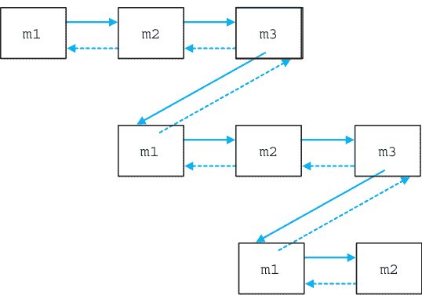

**图 8.4** 间接递归

## 8.3 使用递归

接下来的章节描述了我们使用递归技术解决的问题。对于每一个问题，我们都会准确检查递归在解决方案中是如何起作用的，以及如何使用基准情况来终止递归。在探索这些示例时，请考虑每个问题的非递归解决方案会有多复杂。

# 遍历迷宫

正如第 4 章所述，解决迷宫涉及大量的尝试和错误：遵循路径、在无法继续前进时回溯，并尝试其他非意图的备选项。这些活动通常可以使用递归很好地处理。在第 4 章中，我们通过迭代的方法解决了这个问题，使用栈来跟踪我们可能的移动。然而，我们也可以通过使用运行时栈来跟踪我们的进度，从而用递归的方法解决这个问题。列表 8.1 显示的 `MazeTester` 程序创建了一个 `Maze` 对象并尝试遍历它。

### 列表 8.1

```java
import java.util.*;
import java.io.*;

/**
 * MazeTester 使用递归来确定迷宫是否可以遍历。
 * @author Lewis and Chase
 * @version 4.0
 */
public class MazeTester {
    public static void main(String[] args) throws FileNotFoundException {
        /**
         * 创建一个新的迷宫，打印它的原始形状，尝试
         * 解决它，并打印它的最终形状。
         */
        Scanner scan = new Scanner(System.in);
        System.out.print("输入包含迷宫的文件名:");
        String filename = scan.nextLine();

        Maze labyrinth = new Maze(filename);
        System.out.println(labyrinth);

        MazeSolver solver = new MazeSolver(labyrinth);
        if (solver.traverse(0, 0)) {
            System.out.println("迷宫被成功遍历！");
        } else {
            System.out.println("没有可能的路径。");
        }
        System.out.println(labyrinth);
    }
}
```

### 列表 8.2


```java
import java.util.*;
import java.io.*;

/**
 * 代表一个迷宫。目标是从左上角
 * （入口点）移动到右下角（出口点）。
 * 初始，1 表示通畅的路径，0 表示阻塞的路径。
 * @author Lewis and Chase
 * @version 4.0
 */
public class Maze {
    private static final int TRIED = 2;
    private static final int PATH = 3;
    private int numberRows, numberColumns;
    private int[][] grid;

    /**
     * Maze 的构造函数。从文件加载迷宫。
     * @param filename 要加载的文件名
     * @throws FileNotFoundException 如果未给定文件
     */
    public Maze(String filename) throws FileNotFoundException {
        Scanner scan = new Scanner(new File(filename));
        numberRows = scan.nextInt();
        numberColumns = scan.nextInt();
        grid = new int[numberRows][numberColumns];
        for (int i = 0; i < numberRows; i++) {
            for (int j = 0; j < numberColumns; j++) {
                grid[i][j] = scan.nextInt();
            }
        }
    }

    /**
     * 将迷宫中的位置标记为已尝试。
     * @param row 要尝试的行
     * @param col 要尝试的列
     */
    public void tryPosition(int row, int col) {
        grid[row][col] = TRIED;
    }

    /**
     * 返回迷宫的行数。
     * @return 迷宫的行数
     */
    public int getRows() {
        return grid.length;
    }

    /**
     * 返回迷宫的列数。
     * @return 迷宫的列数
     */
    public int getColumns() {
        return grid[0].length;
    }

    /**
     * 将给定的位置标记为路径。
     * @param row 要标记为路径的行
     * @param col 要标记为路径的列
     */
    public void markPath(int row, int col) {
        grid[row][col] = PATH;
    }

    /**
     * 确定特定位置是否有效。有效的位置
     * 是在网格内、未阻塞且未被尝试过的。
     * @param row 要检查的行
     * @param column 要检查的列
     * @return 如果位置有效则返回 true
     */
    public boolean validPosition(int row, int column) {
        boolean result = false;
        // 检查是否在迷宫边界
        if (row >= 0 && row < grid.length &&
            column >= 0 && column < grid[row].length) {
            // 检查是否未阻塞且未被尝试过
            if (grid[row][column] == 1) {
                result = true;
            }
        }
        return result;
    }

    /**
     * 以字符串形式返回迷宫。
     * @return 迷宫的字符串表示
     */
    public String toString() {
        String result = "\n";
        for (int row = 0; row < grid.length; row++) {
            for (int column = 0; column < grid[row].length; column++) {
                result += grid[row][column] + " ";
            }
            result += "\n";
        }
        return result;
    }
}
```

## 8.3 使用递归

### UML 类图

| MazeSolver | Maze | MazeTester |
| :--- | :--- | :--- |
| maze : Maze | numberRows : int | main(String[] args) |
| traverse(int row, int column) : boolean | numberColumns : int | |
| | grid : int[][] | |
| | tryPosition(int row, int col) : void | |
| | getRows() : int | |
| | getColumns() : int | |
| | markPath(int row, int col) : void | |
| | validPosition(int row, int column) : boolean | |
| | toString() : String | |

图 8.5 迷宫求解程序的 UML 说明

通过迷宫的唯一有效移动是四个方向：下、右、上、左。不允许对角线移动。列表 8.3 显示了 `MazeSolver` 类。

### 代码列表 8.3

```java
/**
 * MazeSolver 尝试递归地遍历一个 Maze。目标是从
 * 给定的起始位置到右下角，遵循一条由 1 组成的路径。
 * 使用任意常量来表示迷宫中已经尝试过（TRIED）
 * 且属于解决方案路径（PATH）的位置。
 *
 * @author Lewis and Chase
 * @version 4.0
 */
public class MazeSolver {
    private Maze maze;

    /**
     * MazeSolver 类的构造函数。
     */
    public MazeSolver(Maze maze) {
        this.maze = maze;
    }

    /**
     * 尝试递归地遍历迷宫。插入特殊
     * 字符表示已经尝试过（TRIED）且
     * 最终成为解决方案路径（PATH）部分的位置。
     * @param row 当前位置的索引
     * @param column 当前位置的索引
     * @return 如果迷宫被解决则返回 true
     */
    public boolean traverse(int row, int column) {
        boolean done = false;

        if (maze.validPosition(row, column)) {
            // mark this cell as tried
            if (row == maze.getRows() - 1 && column == maze.getColumns() - 1) {
                done = true; // 迷宫被解决了
            } else {
                done = traverse(row + 1, column); // 下
                if (!done)
                    done = traverse(row, column + 1); // 右
                if (!done)
                    done = traverse(row - 1, column); // 上
                if (!done)
                    done = traverse(row, column - 1); // 左
            }
            if (done) // 此位置是最终路径的一部分
                maze.markPath(row, column);
        }

        return done;
    }
}
```

## 8.3 使用递归

让我们递归地思考这个问题。如果迷宫可以从位置 (0, 0) 成功遍历，那么迷宫就能成功遍历。因此，如果迷宫可以从 (0, 0) 的任何相邻位置成功遍历——即位置 (1, 0)、位置 (0, 1)、位置 (-1, 0) 或位置 (0, -1)——那么迷宫就能成功遍历。选择一个潜在的下一步，例如 (1, 0)，我们发现自己处于相同类型的情况中。要从新位置成功遍历迷宫，我们必须从相邻位置成功遍历它。在任何一点，某些相邻位置可能是无效的、被阻塞的或代表一条可能的成功路径。我们继续递归地进行这个过程。如果到达基本情况（base case），则迷宫已成功遍历。

`MazeSolver` 类中的递归方法是 `traverse`。它返回一个布尔值，指示是否找到了解决方案。第一个方法确定移动到指定的行和列是否有效。如果移动位于网格边界内且网格在对应位置包含 1，则表示该方向的移动没有阻塞，移动是有效的。`traverse` 的初始调用传递了左上位置 (0, 0)。

如果移动有效，网格条目将从 1 变为 2，标记该位置已访问，以便我们以后不会撤回步骤。然后，`traverse` 方法通过到达右下角位置来确定迷宫是否已完成。对于这个问题，实际上有三种基本情况的可能性，将终止任何递归路径：

- 无效移动，因为移动超出边界或被阻塞
- 无效移动，因为迷宫之前尝试过
- 移动到达最终位置

如果当前位置不是右下角，我们会在每个主要方向上搜索解决方案。首先，我们通过递归调用 `traverse` 方法并传递新位置来向下查找。`traverse` 方法的逻辑将使用此新位置重新开始。要么通过首先尝试从当前位置移动找到解决方案，要么没有找到。如果没找到，我们尝试向右移动。如果失败了，我们再尝试向上移动。最后，如果没有其他方向产生正确的路径，我们尝试向左移动。如果从此位置没有路径，`traverse` 将返回 false。如果第一次调用没有返回通过此迷宫的可能路径，则也是如此。

如果从当前位置找到了解决方案，网格条目将更改为 3。第一个 3 放置在右下角。下一个 3 同样放置在右下角，依此类推，直到最后一个 3 放置在左上角。因此，当打印迷宫时，0 表示被阻塞的路径，1 表示路径，2 表示尝试过的路径，3 表示最终路径的一部分。

## 8.3 使用递归（汉诺塔）

列表 8.5 所示的 `TowersOfHanoi` 类使用 `solve` 方法对递归方法 `moveTower` 进行初始调用。初始调用表示所有盘子从 1 号柱移动到 3 号柱，并使用 2 号柱作为临时位置。

`moveTower` 方法首先考虑单个盘子的基准情况（“栈”）。当发生这种情况时，它会调用 `moveDisk` 方法，该方法会打印一行描述该特定移动。如果栈包含多一个盘子，我们再次调用 `moveTower` 将 N-1 个盘子移开，然后移动最大的盘子，最后通过再次调用 `moveTower` 将 N-1 个盘子移动到最终目的地。

### 代码列表 8.5

```java
/**
 * TowersOfHanoi 代表经典的汉诺塔谜游戏。
 * @author Lewis and Chase
 * @version 4.0
 */
public class TowersOfHanoi {
    private int totalDisks;

    /**
     * 使用指定的盘子数量设置游戏。
     * @param disks 盘子的数量
     */
    public TowersOfHanoi(int disks) {
        totalDisks = disks;
    }

    /**
     * 执行 moveTower 的初始调用以解决谜题。
     * 使用 2 号柱将盘子从 1 号柱移动到 3 号柱。
     */
    public void solve() {
        moveTower(totalDisks, 1, 3, 2);
    }

    /**
     * 将指定数量的盘子从一个柱移动到另一个柱，
     * 通过移动 n-1 个盘子的子栈、移动一个
     * 盘子、将子栈移回。1 个盘子的基准情况。
     *
     * @param numDisks 需要移动的盘子数量
     * @param start 起始柱
     * @param end 结束柱
     * @param temp 临时柱
     */
    private void moveTower(int numDisks, int start, int end, int temp) {
        if (numDisks == 1)
            moveOneDisk(start, end);
        else {
            moveTower(numDisks - 1, start, temp, end);
            moveOneDisk(start, end);
            moveTower(numDisks - 1, temp, end, start);
        }
    }

    /**
     * 打印将一个盘子从指定的起始柱
     * 移动到指定的结束柱的。
     *
     * @param start 起始柱
     * @param end 结束柱
     */
    private void moveOneDisk(int start, int end) {
        System.out.println("Move one disk from " + start + " to " + end);
    }
}
```

注意，`moveTower` 中描述柱子的参数会根据移动部分栈的需求进行交换。此代码遵循我们的通用策略，并使用 `moveTower` 方法移动所有部分栈。仔细跟踪三个盘子栈的代码执行以理解处理过程。图 8.8 显示了该问题的 UML 图。

### UML 类图

| SolveTowers | TowersOfHanoi |
| :--- | :--- |
| main(String[] args) | totalDisks : int |
| | solve() : void |
| | moveTower(int numDisks, int start, int end, int temp) : void |
| | moveOneDisk(int start, int end) : void |

图 8.8 汉诺塔谜题解决方案的 UML 说明

## 8.4 分析递归算法

在第 2 章中，我们探索了分析算法以确定其复杂度（通常是时间复杂度）的概念，并用增长函数来表示它。增长函数告诉我们算法的阶（order），可以用它与其他完成相同任务的其他算法进行比较。

在分析循环时，我们确定循环体部分的阶，并将其乘以循环执行的次数。分析递归算法使用了类似的思维。确定递归算法的阶在于确定递归的阶（遵循递归定义的次数），并将其乘以递归方法的体的阶。

> **核心概念**
>
> 递归算法的阶可以使用类似于分析迭代处理时的技术来确定。

考虑第 8.3 节中提出的递归方法。（注意：提供的 OCR 文本从此处开始在原始资源中似乎中断或损坏，但我已处理了提供的所有可读部分。）

# 第 8 章 递归

### 自我检查题

- SR 8.3 递归处理何时需要基边界（base case）？
- SR 8.4 递归是必要的吗？
- SR 8.5 何时应该避免递归？
- SR 8.6 什么是间接递归？
- SR 8.7 解释解决汉诺塔问题的通用方法。它与递归有什么联系？

### 练习题

- EX 8.1 为两个数的最大公约数（gcd）写一个递归定义。
- EX 8.2 编写一个递归方法，判断其参数是否为质数。
- EX 8.3 编写一个递归方法 `SumOfArray`，计算数组中给定范围内的整数和。该方法接受三个参数：数组、范围的下界索引和范围的上界索引。
- EX 8.4 你在练习 8.1 中已经提供了两个或多个非零整数最大公约数（gcd）的递归定义，即能整除这些数且无余数的最大正整数。写一个递归方法 `gcd` 来计算两个数的公约数。
- EX 8.5 修改并扩展本章中计算 1 到 N 之间整数和的方法。写一个方法 `sumOfSquares`，返回从 1 到 N 的整数的平方和。
- EX 8.6 根据本章给出的定义，编写一个递归方法返回 N!（N 阶乘）的值。解释为什么你通常不使用递归来解决这个问题。
- EX 8.7 编写一个反转字符串的递归方法。解释为什么你通常不使用递归来解决这个问题。
- EX 8.8 回文（palindrome）是指正反读都相同的单词、短语、数字或其他字符序列。例如，civic、madam 等单词都是回文。写一个递归方法，判断其 `String` 参数是否为回文。
- EX 8.9 对本章中 `SolveTowers` 程序的输出行进行注释，显示递归步骤。
- EX 8.10 编写一个递归方法 `combination`，返回从 $n$ 个中取 $r$ 个的组合，其中 $n$ 和 $r$ 都是非负整数。


# 练习题

- EX 8.11 编写一个递归方法，求正十进制整数的各位数字之和。
- EX 8.12 确定并解释你练习 8.5 解决方案的复杂度。
- EX 8.13 确定并解释你练习 8.6 解决方案的复杂度。
- EX 8.14 确定本章提出的递归迷宫解决方案的复杂度。

# 编程项目

- PP 8.1 设计并实现一个程序，实现欧几里得算法寻找两个正整数的最大公约数。最大公约数是同时整除这两个数且无余数的最大整数。在 `DivisorCalc` 类中定义一个静态方法 `gcd`，接受两个整数 `num1` 和 `num2`。创建一个公约数来测试你的实现。递归算法定义如下：

```
gcd(num1, num2) is num2 if num2 <= num1 and num2 divides num1
gcd(num1, num2) is gcd(num2, num1) if num1 < num2
gcd(num1, num2) is gcd(num2, num1 % num2) otherwise
```

- PP 8.2 修改 `Maze` 类，使其在发现迷宫路径时打印该路径，而不进行存储。
- PP 8.3 设计并实现一个遍历 3D 迷宫的程序。
- PP 8.4 设计并实现一个递归程序来解决八皇后问题。即，编写一个程序来确定如何在八乘八的棋盘上放置八个皇后，使得任何一个都不与其他皇后在同一行、同列或同一对角线上。棋盘上没有其他棋子。
- PP 8.5 在一种外星种族的语言中，所有单词的形式都是 Blur。一个 Blur 是一个 Whoot 后面跟上一个或多个 'x'，再跟上零或多个 'y'。一个 Whatzit 是一个 'q' 后面跟上一个 'z' 或 'd'，再跟上一个 Whozit。设计并实现一个递归程序，生成这种外星语言的随机 Blur。
- PP 8.6 设计并实现一个递归程序，判断字符串是否为上一个项目中定义的有效 Blur。
- PP 8.7 设计并实现一个递归程序，确定并打印杨辉三角形的第 N 行，如下所示。每个内部值都是其上方两个值之和。（提示：使用数组存储每行的值。）

```
1
1 1
1 2 1
1 3 3 1
1 4 6 4 1
1 5 10 10 5 1
1 6 15 20 15 6 1
1 7 21 35 35 21 7 1
```

- PP 8.8 设计并实现汉诺塔谜题的图形版本。允许用户设置谜题使用的盘子数量。用户应该可以通过两种主要方式与谜题进行交互：用户可以使用鼠标将盘子从一个柱子移动到另一个柱子，在这种情况下程序应确保每次移动都是合法的。用户还可以以动画的形式观看解题过程，并带有暂停/恢复按钮。允许用户控制动画的速度。

# 自测习题答案

- SRA 8.1 递归是一种编程技术，在这种技术中方法会调用它自己。
- SRA 8.2 间接递归是指一个方法调用另一个方法，而该方法又调用另一个方法。
- SRA 8.3 需要一个基边界来终止递归。
- SRA 8.4 递归不是必须的。
- SRA 8.5 当解决方案更简单时，应该避免递归。
- SRA 8.6 间接递归是指一个方法调用另一个方法。
- SRA 8.7 解决汉诺塔问题的通用方法是移动盘子，这与递归有关。

# 静态方法

静态方法（也称为**类方法**）可以通过类名调用（例如，`Math` 类中的所有方法都是静态方法）。你不需要实例化类的对象即可调用静态方法。例如，`sqrt` 方法通过 `Math` 类调用方式如下：

```java
System.out.println("Square root of 27: " + Math.sqrt(27));
```

方法是通过方法声明中使用 `static` 修饰符来创建的。正如我们所看到的，Java 程序的 `main` 方法必须声明为 `static` 修饰符；这样解释器就可以执行 `main`，而无需实例化包含 `main` 的类对象。

由于静态方法不在特定对象的上下文中运行，它们不能引用实例变量（实例变量只存在于类的实例中）。如果静态方法尝试使用非静态变量，编译器将发出错误。然而，静态方法可以引用静态变量；静态变量独立于特定对象。因此，`main` 方法只能访问静态变量和局部变量。

`Math` 类中的方法对作为参数传递的值执行基础计算。在这些情况下没有需要维护的对象状态；因此，没有理由创建一个对象来请求这些服务。

## 核心概念

方法是通过方法声明中使用 `static` 修饰符来变为静态的。

# 泛型方法

与创建泛型类的方式类似，我们也可以创建泛型方法。也就是说，与其创建一个引用泛型类型参数的类，不如创建一个该方法的独立方法。泛型参数仅适用于该方法。

要创建一个泛型方法，我们在方法头部紧邻返回类型之前插入一个泛型声明。

```java
public static <T extends Comparable<T>> boolean
linearSearch(T[] data, int min, int max, T target)
```

现在，该方法（包括返回类型和参数类型）可以使用泛型类型参数。泛型声明必须放在返回类型之前，这是合理的，因为尽管在这个例子中没有这样做，但泛型类型可以在返回类型中使用。

## 泛型方法示例

```generic
泛型类型参数适用于此方法
public static <T extends Comparable<T>> boolean
linearSearch(T[] data, int min, int max, T target)
泛型类型可用于
方法参数和返回类型
```

现在我们我们可以创建泛型静态方法，就不需要在每次需要其中一个方法时都实例化 `Searching` 类。相反，我们可以直接使用类名调用静态方法，并包含我们的类型来替换泛型类型。例如，调用 `linearSearch` 方法搜索 String 数组可能如下：

```java
Searching.linearSearch(targetarray, min, max, target);
```

注意，没有必要指定类型来替换泛型类型。编译器将根据提供的参数推断类型。因此，对于此行代码，编译器将泛型类型 `T` 替换为数组的元素类型以及 `target` 的类型。

# 线性搜索

如果搜索池被组织成某种列表，执行搜索的一种简单方法是从列表开始，并比较目标元素中的每个值。最终，我们要么找到目标，要么到达列表末尾并得出目标不在组中的结论。这种方法被称为线性搜索，因为它从一端开始并以线性方式扫描搜索池。该过程如图 9.1 所示。

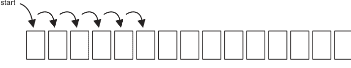

图 9.1 线性搜索

以下方法实现了线性搜索。它接受要搜索的元素数组、搜索的起始和结束索引以及要查找的目标值。该方法返回一个布尔值，表示是否找到了目标元素。

```java
/**
 * 使用线性搜索算法对指定的对象数组进行搜索
 * @param data 要搜索的数组
 * @param min 最小值的整数表示
 * @param max 最大值的整数表示
 * @param target 正在搜索的元素
 * @return 如果找到了所需的元素则返回 true
 */
public static <T>
boolean linearSearch(T[] data, int min, int max, T target) {
    int index = min;
    boolean found = false;

    while (!found && index <= max) {
        found = data[index].equals(target);
        index++;
    }

    return found;
}
```

此实现的变体可以在找到元素时返回数组中的该元素，在未找到时返回 `null` 引用。或者，如果未找到目标元素，可以抛出一个异常。

`linearSearch` 方法可以合并到任何类中。我们的该方法版本定义为包含搜索功能方法的类的一部分。

线性搜索算法非常容易理解，尽管它不是特别高效。注意，线性搜索并不要求搜索池中的元素在数组中处于任何特定顺序。唯一的标准是我们必须能够逐一检查它们。

# 二分查找

```java
boolean found = false;
int midpoint = (min + max) / 2; // 中间点

if (data[midpoint].compareTo(target) == 0)
    found = true;

else if (data[midpoint].compareTo(target) > 0) {
    if (min <= midpoint - 1)
        found = binarySearch(data, min, midpoint - 1, target);
}
else if (midpoint + 1 <= max)
    found = binarySearch(data, midpoint + 1, max, target);

return found;
```

注意，`binarySearch` 方法是递归实现的。如果没有找到目标元素，且有更多数据需要搜索，该方法将调用自身，并传递缩小数组内可行候选范围的参数。`min` 和 `max` 索引用于判断是否还有数据需要搜索。也就是说，如果缩减后的搜索区域不再包含一个元素，该方法将不再调用自身，并返回 `false` 值。

在此过程的任何时候，我们可能有偶数个值需要搜索。对于算法而言，只要选择保持一致，使用的中间点可以是两个中间值中的任何一个。在这个二分搜索的实现中，计算中间点索引时会丢弃任何小数部分，因此选择了两个中间值中的第一个。

## 比较搜索算法

对于线性搜索，最佳情况是目标元素恰好是我们在组中检查的第一个项目。最坏情况是目标不在组中，且我们必须在确定它存在之前检查每一个元素。预期情况是我们在找到该元素之前需要搜索列表的一半内容。也就是说，如果搜索池中有 $n$ 个元素，那么在找到我们要搜索的元素之前，平均需要搜索 $n/2$ 个元素。

因此，线性搜索算法具有 $O(n)$ 的线性复杂度。由于元素是一个接一个被搜索的，其复杂度是线性的——与待搜索元素的数量成正比。

另一方面，二分搜索通常要快得多。因为我们每次比较都能消除一半剩余数据，所以可以更快地找到元素。最佳情况是在一次比较中找到目标——即目标元素恰好位于数组的中间。最坏情况是元素不在列表中，在这种情况下我们必须在排除所有数据之前进行大约 $\log n$ 次比较。找到搜索池中元素的预期情况大约是 $(\log_2 n)/2$ 次比较。

因此，二分搜索是一种对数算法，时间复杂度为 $O(\log(n))$。与线性搜索相比，对于较大的 $n$ 值，二分搜索快得多。

这里可能会产生一个问题：如果二分搜索比线性搜索高效，我们还会使用线性搜索吗？首先，线性搜索通常比二分搜索简单，因此更容易编程和调试。其次，线性搜索不需要排序搜索列表的额外开销。因此，执行二分搜索涉及权衡：实现效率需要保持搜索池排序的努力。

# 排序

排序根据某些标准将一组项目按定义的顺序（升序或降序）排列的过程。例如，你可能希望将姓名列表或调查结果列表按字母排序。

多年来，人们开发并评价了许多排序算法。事实上，排序是计算机科学中的一个经典领域。与搜索算法一样，排序算法通常根据效率分为两类：顺序排序通常使用一对嵌套循环，排序 $n$ 个元素大约需要 $n^2$ 次比较；而对数排序通常排序 $n$ 个元素需要 $\log n$ 次比较。与搜索算法一样，当 $n$ 较小时，这两类算法之间几乎没有实际上的区别。

在本章中，我们将检查三种顺序排序——选择排序、插入排序和冒泡排序，以及两种对数排序——快速排序和合并排序。我们还额外看了一种额外的排序算法——基数排序，它在不比较元素的情况下进行排序。

在深入特定的排序算法之前，让我们来看一个需要解决的通用排序问题。列表 9.1 所示的 `SortPhone` 程序创建了一个 `Contact` 对象的数组，对这些对象进行排序，然后打印排序后的列表。在这个实现中，`Contact` 对象是通过调用 `selectionSort` 方法进行排序的，我们将在本章检查该方法。然而，本章描述的任何其他排序方法都可以达到相同的结果。

## 列表 9.1 SortPhoneList

```java
/**
 * 用于测试对象选择排序的 SortPhoneList 驱动。
 *
 * @author Lewis and Chase
 * @version 4.0
 */
public class SortPhoneList {
    /****
     * 创建 Contact 对象的数组，对它们进行排序，然后打印
     * 它们。
     */
    public static void main(String[] args) {
        Contact[] friends = new Contact[7];
        friends[0] = new Contact("John", "Smith", "610-555-7384");
        friends[1] = new Contact("Sarah", "Barnes", "215-555-3827");
        friends[2] = new Contact("Mark", "Riley", "733-555-2969");
        friends[3] = new Contact("Laura", "Getz", "663-555-3984");
        friends[4] = new Contact("Larry", "Miller", "555-555-1212");
        friends[5] = new Contact("Frank", "Smith", "616-555-2222");
        friends[6] = new Contact("Marsha", "Grant", "555-555-9999");

        selectionSort(friends);
        for (Contact friend : friends) {
            System.out.println(friend);
        }
    }
}
```

## Contact 类

```java
/**
 * Contact 代表联系人。
 * @author Lewis and Chase
 * @version 4.0
 */
public class Contact implements Comparable<Contact> {
    private String firstName, lastName, phone;

    /**
     * 使用指定信息设置此联系。
     * @param first 名的字符串表示
     * @param last 姓的字符串表示
     * @param telephone 电话的字符串表示
     */
    public Contact(String first, String last, String telephone) {
        firstName = first;
        lastName = last;
        phone = telephone;
    }

    /**
     * 以字符串形式返回联系人的描述。
     * @return 联系人的字符串表示
     */
    public String toString() {
        return lastName + ", " + firstName + "\t" + phone;
    }

    /**
     * 使用姓和名确定字典顺序。
     * @param other 要与此联系人比较的联系人
     * @return 比较的整数结果
     */
    public int compareTo(Contact other) {
        int result;
        if (lastName.equals(other.lastName)) {
            result = firstName.compareTo(other.firstName);
        } else {
            result = lastName.compareTo(other.lastName);
        }
        return result;
    }
}
```

## 选择排序

从 3 开始向右扫描。

1 是最小的。交换 1 和 3。

从 9 开始向右扫描。

2 是最小的。交换 9 和 2。

从 6 开始向右扫描。

3 是最小的。交换 6 和 3。

从 6 开始向右扫描。

6 是最小的。交换 6 和 6。


```java
/**
 * 使用选择排序算法对指定的整数数组进行排序。
 *
 * @param data 要排序的数组
 */
public static <T extends Comparable<T>>
void selectionSort(T[] data) {
    int min;
    T temp;
    for (int index = 0; index < data.length-1; index++) {
        min = index;
        for (int scan = index+1; scan < data.length; scan++) {
            if (data[scan].compareTo(data[min])<0)
                min = scan;
        }
        swap(data, min, index);
    }
}
```


`selectionSort` 方法的实现使用了两个循环对数组进行排序。外层循环控制数组中存储下一个最小值的位置。内层循环通过扫描所有大于或等于外层循环指定索引的位置，找到列表中剩余部分中的最小值。当确定了最小值后，将其与存储在当前索引处的值进行交换。这种交换是通过三个使用名为 `temp` 的额外变量的赋值语句完成的。这种类型的交换被称为“交换”（swapping），并实现了一个私有的 `swap` 方法。该方法也被我们的其他几个排序算法使用。

```java
/**
 * 交换数组中的两个元素。用于各种排序算法。
 * @param data 元素已经完成交换的数组
 * @param index1 要交换的第一个元素的索引
 * @param index2 要交换的第二个元素的索引
 */
private static <T extends Comparable<T>>
    void swap(T[] data, int index1, int index2) {
        T temp = data[index1];
        data[index1] = data[index2];
        data[index2] = temp;
    }
```

注意，该算法在每次迭代中寻找最小值，结果是一个按升序排列的数组（即从最小到最大）。该算法可以很容易地修改，通过每次找到最大值来将值按降序排列。

## 插入排序

插入排序算法通过反复将一个特定值插入到列表中已经排序的子集中，对值列表进行排序。每次，每个未排序的元素都会被插入到该已排序列表的适当位置，直到整个列表都有序。

### 核心概念

插入排序算法通过反复将一个特定值插入到列表中已经排序的子集中，对值列表进行排序。

插入排序算法的通用策略如下：在必要时交换列表的前两个值，以对它们之间进行相对排序。将列表的第三个值插入到相对于前两个（已排序）值的适当位置。然后，将第四个值插入到其相对于列表中前三个值的正确位置。每进行一次插入，排序子集中的值数量就会增加一个。继续这个过程，直到列表中的所有值都完全排序。插入过程需要数组中的其他值移动以为插入的元素腾出空间。图 9.4 阐述了插入的过程。

| 3 | 9 | 6 | 1 | 2 |
|---|---|---|---|---|
| 3 已排序。不移动。插入 9。 | | | | |
| 3 和 9 已排序。将 9 向右移动。插入 6。 | | | | |
| 3, 6 和 9 已排序。将 9, 6 和 3 向右移动。插入 1。 | | | | |
| 1, 3, 6 和 9 已排序。将 9, 6 和 3 向右移动。插入 2。 | | | | |


以下方法实现了插入排序。

```java
/**
 * 使用插入排序算法对指定的对象数组进行排序。
 * @param data 要排序的数组
 */
public static <T extends Comparable<T>>
void insertionSort(T[] data) {
  for (int index = 1; index < data.length; index++) {
    T key = data[index];
    int position = index;

    // 将较大的值向右移动
    while (position > 0 && data[position-1].compareTo(key) > 0)
    {
        data[position] = data[position-1];
        position--;
    }

    data[position] = key;
  }
}
```

与选择排序的实现类似，`insertionSort` 方法使用两个循环对对象数组进行排序。但在插入排序中，外层循环控制数组中下一个要插入值的索引。内层循环将当前要插入的值与存储在较低索引的值（构成排序子集）进行比较。

## 冒泡排序

冒泡排序是另一种使用嵌套循环的顺序排序。它通过反复比较相邻元素并在顺序错误时交换它们来对列表排序。冒泡排序的通用策略如下：第一次遍历数据会将最大值移动到最终位置。在此遍历之后，我们就可以忽略最后一个元素。

冒泡排序的实现如下方法所示：

```java
/**
 * 使用冒泡排序对指定的对象数组进行排序。
 * @param data 要排序的数组
 */
public static void bubbleSort(T[] data) {
    int position, scan;
    T temp;
    for (position = data.length - 1; position >= 0; position--) {
      for (scan = 0; scan <= position - 1; scan++) {
        if (data[scan].compareTo(data[scan+1]) > 0)
          swap(data, scan, scan + 1);
      }
    }
}
```

## 快速排序

到目前为止我们讨论的排序算法（选择排序、插入排序和冒泡排序）相对简单，但它们是低效的排序，使用了嵌套循环，并且排序 n 个元素的列表大约需要 n² 次比较。现在转向适用于递归实现的高效排序。

快速排序算法通过使用任意选择的分区元素对列表进行划分，并递归地对分区元素两侧的子集进行排序。快速排序算法的通用策略如下：首先选择列表一个元素作为分区元素。接下来，划分列表，使得所有小于分区元素的元素都在其左侧，所有大于分区元素的元素都在其右侧。最后，对两个分区递归地应用此排序策略。

### 核心概念

快速排序通过划分列表并递归地对两个分区对列表进行排序。

如果数据的顺序是真正的随机的，分区元素的选择是任意的。我们将使用中间的区域。出于效率考虑，如果划分元素能帮助将列表大致分为两半会最好，但无论选择哪个元素作为划分元素，算法都能正常工作。

让我们来看创建一个划分的示例。假设我们的初始列表为

305 65 7 90 120 110 8

我们将选择 90 作为我们的划分元素。我们将重新排列列表，将小于 90 的元素交换到左侧，将大于 90 的元素交换到右侧，这将得到

8 65 7 90 120 110 305

然后，我们对两个划分部分应用快速排序算法。这个过程持续进行，直到某个划分只包含一个元素，该元素本质上是有序的。因此，在算法递归地应用到任一侧后，整个列表就完成了排序。一旦初始元素被确定并放置好，它就再也不会被考虑或移动了。

以下方法实现了快速排序算法。它接受一个要排序的对象数组，以及用于该方法划分的最小和最大索引值。注意，公共方法接收要排序的数组，然后调用提供数组、min 和 max 的私有方法。

```java
/**
 * 使用快速排序算法对指定的对象数组进行排序。
 * @param data 要排序的数组
 */
public static <T extends Comparable<T>>
    void quickSort(T[] data) {
        quickSort(data, 0, data.length - 1);
}
```

```java
/**
 * 使用快速排序算法递归地对指定数组中的范围的对象进行排序。
 *
 * @param data 要排序的数组
 * @param min 排序范围内的最小索引
 * @param max 排序范围内的最大索引
 */
private static <T extends Comparable<T>>
void quickSort(T[] data, int min, int max)
{
  if (min < max) {
    // 创建划分索引
    int indexOfPartition = partition(data, min, max);
    // 排序左侧划分（较小值）
    quickSort(data, min, indexOfPartition - 1);
    // 排序右侧划分（较大值）
    quickSort(data, indexOfPartition + 1, max);
  }
}
```

`quickSort` 方法高度依赖于 `partition` 方法，它最初调用该方法将区域分为两个划分部分。`partition` 方法返回划分值的索引。然后调用两次（递归地） `quickSort` 对两个划分部分进行排序。递归的基准情况（由 `quickSort` 方法中的 `if` 语句表示）是包含一个元素或更少元素的列表，该列表本质上是有序的。下面是 `partition` 方法的示例。

```java
/**
 * 快速排序算法用于查找划分。
 *
 * @param data 要排序的数组
 * @param min 排序范围内的最小索引
 * @param max 排序范围内的最大索引
 */
private static <T extends Comparable<T>>
int partition(T[] data, int min, int max)
{
  T partitionElement;
  int left, right;
  int middle = (min + max)/2;

  // 使用中间数据值作为划分元素
  partitionElement = data[middle];
  // 暂时将其移开
  swap(data, middle, min);
  left = min;
  right = max;

  while (left < right) {
    // 查找大于划分元素的元素
    while (left < right && data[left].compareTo(partitionElement) <= 0)
        left++;

    // 查找小于划分元素的元素
    while (data[right].compareTo(partitionElement) > 0)
        right--;

    // 交换元素
    if (left < right)
        swap(data, left, right);
  }

  // 将划分元素移到位置
  swap(data, min, right);
  return right;
}
```

`partition` 方法的两个内部 `while` 循环用于找到位于错误划分中的元素以进行交换。第一个循环从左到右扫描，寻找大于划分元素的元素。第二个循环从右到左扫描，寻找小于划分元素的元素。当找到这两个元素时，就会对其进行交换。这个过程一直持续，直到左右索引在测试的“中间”相遇。它们相遇的位置指示了划分元素（在结束之前它不会从其初始位置移动）最终所在的位置。

如果我们得到一个糟糕的划分元素会发生什么？如果划分元素接近列表中的最小或最大元素，那么我们实际上浪费了一次数据遍历。确保更好的划分元素的一种方法是选择三个元素中的中间的一个。例如，算法可以检查列表中的第一个、中间和最后一个元素，并选择中间值作为划分元素。这种“三数取中”的方法被留作作为一个编程项目。

## 归并排序

归并排序是另一种递归排序算法，它通过递归地将列表一分为半，直到每个子列表只有一个元素，然后按顺序重新组合这些子列表。

归并排序算法的通用策略如下：首先将列表分为两个大致相等的部分。继续递归调用直到达到基准情况。然后，将排序后的子列表合并为有序状态。

```java
index++;
}
// Copy remaining elements from first subarray, if any
while (first1 <= last) {
    temp[index] = data[first1];
    first1++;
    index++;
}
// Copy remaining elements from second subarray, if any
while (first2 <= last) {
    temp[index] = data[first2];
    first2++;
    index++;
}
// Copy merged data into original array
for (index = first; index <= last; index++) {
    data[index] = temp[index];
}
```

## 9.3 基数排序

到目前为止，我们讨论的所有排序技术都涉及到对列表元素进行相互比较。正如我们所看到的，基于比较的排序最优复杂度是 O(n log n)。如果有一种方法可以在不直接比较元素的情况下对它们进行排序，可能会构建出更高效的排序算法。我们可以通过重新回顾第 5 章关于队列的讨论来找到这种方法。

排序基于某个特定的值，称为排序键。例如，一组人可以根据姓名进行排序。基数排序并不是通过排序键比较项目，而是基于排序键的结构。对于排序键的每个可能的取值，都会创建一个独立的队列。队列的数量或可能值的数量被称为基数。例如，如果我们排序的是由小写字母组成的字符串，那么基数就是 26。我们将使用 26 个独立的队列，每个队列对应一个可能的字符。如果我们排序的是小数，那么基数就是 10，每个从 0 到 9 的数字对应一个队列。

### 核心概念

基数排序本质上是基于队列处理。

让我们来看一个使用基数排序对十个三位数排序的例子。为了方便管理，我们将这些数字的数字限制在 0 到 5 之间，这意味着我们需要六个队列。

每个待排序的三位数都有一个 1 位位（右侧数字）、一个 10 位位（中间数字）和一个 100 位位（左侧数字）。基数排序将对数值进行三次遍历，对应每个数字位。在第一轮遍历中，每个数字被放入与其 1 位数字对应的队列中。在第二轮遍历中，每个数字被放入与其 10 位数字对应的队列中。最后，在第三轮遍历中，每个数字被放入与其 100 位数字对应的队列中。

最初，数字被加载到原始列表中。在第二轮遍历中，数字按照特定的顺序从队列中取出。它们首先从数字 0 队列取出，然后从数字 1 队列取出，依此类推。对于每个队列，数字按照它们离开队列的顺序进行处理。这种处理顺序对于基数排序的操作至关重要。同样，在第三轮遍历中，数字再次以相同的方式从队列中取出。当第三轮遍历结束后从队列中取出数字时，它们就已经完全排序了。

图 9.7 显示了十个三位数的基数排序过程。数字 442 从列表中取出并放入数字 2 对应的队列中。然后 503 被放入数字 3 对应的队列中。接着 312 被放入数字 2 对应的队列中（跟在 442 之后）。这会对所有值持续进行，形成 1 位位的队列集合。

| 数字 | 1 位位 | 10 位位 | 100 位位 |
|---|---|---|---|
| 0 | 420, 250 | 503, 102 | |
| 1 | 341 | 312 | 145, 143, 102 |
| 2 | 102, 312, 442 | 325, 420 | 250 |
| 3 | 143, 503 | 341, 325, 312 | |
| 4 | 145, 143, 442, 341 | 442, 420 | |
| 5 | 285, 145 | 250 | 503 |

原始列表： 442, 503, 312, 145, 250, 341, 325, 102, 420, 143

图 9.7 十个三位数的基数排序

假设在我们开始第二轮遍历时，我们有一组全新的空数字队列。实际上，如果处理得当，队列可以被重复使用。要开始第二轮遍历，首先从数字 0 队列取出数字。数字 250 被放入数字 5 队列，然后 420 被放入数字 2 队列。然后我们可以移动到下一个队列，取出 341 并将其放入数字 4 队列。此过程一直持续直到所有数字都从 1 位位队列取出，形成 10 位的队列集合。

对于第三轮遍历，重复该过程。首先，将 102 放入数字 1 队列，将 503 放入数字 5 队列，然后将 312 放入数字 1 队列。持续进行直到我们得到 100 位的队列集合。

```java
import java.util.*;

/**
 * 基数排序演示了队列的使用。
 * 从第一个子数组中拷贝剩余元素，如果有
 * @author Lewis
 * @version 1.0
 */
public class RadixSort {
    // ... (省略代码实现部分，保持逻辑结构)
}
```


```java
index++;
}
// Copy remaining elements from first subarray, if any
while (first1 <= last) {
    temp[index] = data[first1];
    first1++;
    index++;
}
// Copy remaining elements from second subarray, if any
while (first2 <= last) {
    temp[index] = data[first2];
    first2++;
    index++;
}
// Copy merged data into original array
for (index = first; index <= last; index++) {
    data[index] = temp[index];
}
```

## 9.3 基数排序

到目前为止，我们讨论的所有排序技术都涉及到对列表元素进行相互比较。正如我们所看到的，基于比较的排序最优复杂度是 `O(n log n)`。如果有一种方法可以在不直接比较元素的情况下对它们进行排序，可能会构建出更高效的排序算法。我们可以通过重新回顾第 5 章关于队列的讨论来找到这种方法。

排序基于某个特定的值，称为排序键。例如，一组人可以根据姓名进行排序。基数排序并不是通过排序键比较项目，而是基于排序键的结构。对于排序键的每个可能的取值，都会创建一个独立的队列。队列的数量或可能值的数量被称为基数。例如，如果我们排序的是由小写字母组成的字符串，那么基数就是 26。我们将使用 26 个独立的队列，每个队列对应一个可能的字符。如果我们排序的是小数，那么基数就是 10，每个从 0 到 9 的数字对应一个队列。

### 核心概念

基数排序本质上是基于队列处理。

让我们来看一个使用基数排序对十个三位数排序的例子。为了方便管理，我们将这些数字的数字限制在 0 到 5 之间，这意味着我们需要六个队列。

每个待排序的三位数都有一个 1 位位（右侧数字）、一个 10 位位（中间数字）和一个 100 位位（左侧数字）。基数排序将对数值进行三次遍历，对应每个数字位。在第一轮遍历中，每个数字被放入与其 1 位数字对应的队列中。在第二轮遍历中，每个数字被放入与其 10 位数字对应的队列中。最后，在第三轮遍历中，每个数字被放入与其 100 位数字对应的队列中。

最初，数字被加载到原始列表中。在第二轮遍历中，数字按照特定的顺序从队列中取出。它们首先从数字 0 队列取出，然后从数字 1 队列取出，依此类推。对于每个队列，数字按照它们离开队列的顺序进行处理。这种处理顺序对于基数排序的操作至关重要。同样，在第三轮遍历中，数字再次以相同的方式从队列中取出。当第三轮遍历结束后从队列中取出数字时，它们就已经完全排序了。

图 9.7 显示了十个三位数的基数排序过程。数字 442 从列表中取出并放入数字 2 对应的队列中。然后 503 被放入数字 3 对应的队列中。接着 312 被放入数字 2 对应的队列中（跟在 442 之后）。这会对所有值持续进行，形成 1 位位的队列集合。

| 数字 | 1 位位 | 10 位位 | 100 位位 |
|---|---|---|---|
| 0 | 420, 250 | 503, 102 | |
| 1 | 341 | 312 | 145, 143, 102 |
| 2 | 102, 312, 442 | 325, 420 | 250 |
| 3 | 143, 503 | 341, 325, 312 | |
| 4 | 145, 143, 442, 341 | 442, 420 | |
| 5 | 285, 145 | 250 | 503 |

原始列表：442, 503, 312, 145, 250, 341, 325, 102, 420, 143

图 9.7 十个三位数的基数排序

假设在我们开始第二轮遍历时，我们有一组全新的空数字队列。实际上，如果处理得当，队列可以被重复使用。要开始第二轮遍历，首先从数字 0 队列取出数字。数字 250 被放入数字 5 队列，然后 420 被放入数字 2 队列。然后我们可以移动到下一个队列，取出 341 并将其放入数字 4 队列。此过程一直持续直到所有数字都从 1 位位队列取出，形成 10 位的队列集合。

对于第三轮遍历，重复该过程。首先，将 102 放入数字 1 队列，将 503 放入数字 5 队列，然后将 312 放入数字 1 队列。持续进行直到我们得到 100 位的队列集合。

# 第 9 章 搜索与排序

## 核心概念总结

- 搜索是在一组项目内寻找指定的目标，或确定该目标不存在的过程。
- 高效的搜索能够尽可能地减少比较的次数。
- 如果方法在方法声明中使用了 `static` 修饰符，则该方法为静态方法。
- 二分查找利用了搜索池是已排序的这一事实。
- 二分查找每次比较都能排除掉一半的可选候选者。
- 二分查找具有对数复杂度，这使得它对于大型搜索池非常高效。
- 排序是根据某些标准将项目列表按定义顺序排列的过程。
- 选择排序通过重复地将特定值放入其最终的排序位置来对值列表进行排序。
- 插入排序通过重复地将特定值插入到已排序的子集中对值列表进行排序。
- 冒泡排序通过重复比较相邻元素并在必要时交换它们来对列表排序。
- 快速排序算法通过对列表进行分区并递归地排序两个分区来对列表排序。
- 合并排序算法通过递归地将列表平分，直到每个子列表只有一个元素，然后将这些子列表合并为排序顺序来对列表排序。
- 基数排序本质上基于队列处理。

## 术语总结

**binary search (二分查找)** 在已排序列表上进行的搜索，每次比较都会排除大约一半剩余的可选候选者。

**bubble sort (冒泡排序)** 一种通过重复比较相邻值并交换它们来对元素排序算法。

**class method (类方法)** *参见静态方法。*

**generic method (泛型方法)** 在方法头中包含类型参数定义的方法。

**insertion sort (插入排序)** 一种通过重复地将一个特定元素插入到之前已排序的子列表中对元素排序算法。

**linear search (线性搜索)** 从项目列表的一端开始并线性持续，直到找到该元素或到达列表末尾的搜索。

**logarithmic algorithm (对数算法)** 复杂度复杂度为 `O(log2n)` 的算法，例如二分查找。

**logistic sort (逻辑排序)** 一种需要大约 `nlog2n` 次比较来对 `n` 个元素进行排序的算法。

**merge sort (合并排序)** 一种通过递归地平分列表直到每个子集有一个元素，然后合并子列表来对元素排序的算法。

**partition (分区)** 一组未排序的元素，供快速排序算法使用，这些元素都小于或大于所选的分区元素。

**partition element (分区元素)** 快速排序算法中用于将未排序元素分离为两个不同分区的元素。

**quick sort (快速排序)** 一种将未排序元素划分为两个分区并递归排序每个分区的排序算法。

**radix sort (基数排序)** 一种使用排序键而非比较元素来对元素排序的算法。

**searching (搜索)** 在一组元素中寻找指定的目标元素，或确定目标不在该组中的过程。

**search pool (搜索池)** 待被搜索的项目组。

**selection sort (选择排序)** 一种通过重复查找特定元素并将其放在最终位置来对元素排序的算法。

**sequential sort (顺序排序)** 一种通常使用嵌套循环并需要大约 `n²` 次比较来对 `n` 个元素进行排序的算法。

**sorting (排序)** 根据某些标准将一组项目排列为特定顺序的过程。

**static method (静态方法)** 通过类名调用且不能引用实例数据的方法。也称为类方法。

**target element (目标元素)** 搜索操作期间正在寻找的元素。

**viable candidates (可选候选者)** 搜索池中可能找到目标元素的元素。

## 自测题

- SR 9.1 在什么情况下线性搜索优于对数查找？
- SR 9.2 哪种搜索方法要求列表必须是排序的？
- SR 9.3 在什么情况下顺序排序优于递归排序？（注：此处应为合并排序）
- SR 9.4 插入排序算法使用什么技术排序？
- SR 9.5 冒泡排序算法使用什么技术排序？
- SR 9.6 选择排序算法使用什么技术排序？
- SR 9.7 快速排序算法使用什么技术排序？
- SR 9.8 合并排序算法使用什么技术排序？使用基数排序对存储为全小写的名称进行排序，需要多少个队列？

## 练习题

- EX 9.1 在列表 3, 8, 12, 34, 54, 84, 91, 110 中搜索数字 45 和 54，并对比 `linearSearch` 和 `binarySearch` 算法。
- EX 9.2 使用练习 9.1 中的列表，构建一个表格显示每种排序算法（选择排序、插入排序、冒泡排序、快速排序和合并排序）对进行排序所需的比较次数。
- EX 9.3 考虑练习 9.1 中的相同列表。如果列表已经是排序的，每个排序算法的比较次数会发生什么变化？
- EX 9.4 考虑以下列表：90 8 7 56 123 235 9 1 653。显示以下操作的执行轨迹：
    - a. 选择排序
    - b. 插入排序
    - c. 冒泡排序
    - d. 快速排序
    - e. 合并排序
- EX 9.5 给定练习 9.4 中的排序列表，显示二分查找搜索数字 235 的执行轨迹。
- EX 9.6 画出 `SortPhoneList` 示例的 UML 说明。
- EX 9.7 对以下五位数字学生编号列表进行基数排序的手工追踪：
  13224
  32131
  54355
  12123
  22333
  54312
- EX 9.8 基数排序的时间复杂度是多少？

## 编程项目

- PP 9.1 章节中的冒泡排序算法不够高效。对列表进行一次遍历即可识别其已排序。
- PP 9.2 实现跳排序。
- PP 9.3 修改章节中的排序列表（选择排序、插入排序、冒泡排序、快速排序和合并排序），添加代码以统计总比较次数和执行时间。针对同一列表执行这些算法，包括一个已排序的列表。
- PP 9.4 修改快速排序方法，使用三数取中间选择分区元素。针对多组数据运行新版本和旧版本。

## 自测题答案

- SRA 9.1 在小型未排序的列表以及不支持递归的语言中，线性搜索可能更优。
- SRA 9.2 二分查找。
- SRA 9.3 在较小的数据集以及不支持递归的语言中，顺序排序可能更优。
- SRA 9.4 插入排序通过重复地将一个特定元素插入到之前已排序的子列表中对元素排序。
- SRA 9.5 冒泡排序通过重复比较列表中的相邻元素并在顺序不对时交换它们的位置来对列表排序。
- SRA 9.6 选择排序是一种 `O(n²)` 排序算法，通过重复地将特定值放入其最终排序位置来对值列表进行排序。
- SRA 9.7 快速排序通过使用任意选择元素对列表进行分区，并递归地排序分区元素两边的子列表。
- SRA 9.8 合并排序通过递归地将列表平分，直到每个子列表只有一个元素，然后按顺序合并这些子列表来对列表排序。
- SRA 9.9 需要 27 个队列：26 个对应字母表中的 26 个字母，以及一个用于在排序前、期间和之后存储整个列表的队列。

# 第 10 章 树

本章开始我们对非线性集合和数据结构的探索。我们将讨论树的使用和实现，定义与树相关的术语，分析可能的树实现，并查看实现和使用树的示例。

## 章节目标

- 将树定义为数据结构。
- 定义与树相关的术语。
- 讨论树的可能实现方式。
- 分析集合的树实现。
- 讨论遍历树的方法。
- 检查二叉树示例。

## 10.1 树

### 核心概念

树是一种非线性结构，其元素按层次结构组织。

我们到目前为止所检查的集合（栈、队列和列表）都是线性数据结构，这意味着它们的元素是按顺序排列的，一个接一个。树是一种非线性结构，其中元素按层次结构组织。本节将描述广义的树并建立了一些重要的术语。

从概念上说，树由一组节点（其中存储元素）和连接一个节点另一个节点的边组成。每个节点位于树层次结构中的某一层。树的根是树顶部的唯一节点。树中只有一个根节点。图 10.1 展示了一棵有助于说明这些术语的树。

### 核心概念

树由一组大量的相关术语描述。

树中较低层的节点是上一层节点的子。在图 10.1 中，节点 B、C、D 和 E 是 A 的子。节点 F 和 G 是 B 的子。一个节点只能有一个父节点，但一个节点可以有多个子。具有相同父节点的节点被称为兄弟。因此，H、I 和 J 是兄弟，因为它们都是 D 的子。

根是树中唯一没有父节点的节点。没有子节点的节点被称为叶子节点。不是根且至少有一个子节点的被称为内部节点。请注意，树的类比是反过来的。我们的树从树顶部的根“生长”到位于树底部的叶子节点。

根是进入树结构的入口。我们可以沿着树从父节点到子节点的路径进行跟进。例如，图 10.1 中从 A 到节点 N 的路径是 A、D、I、N。如果一个节点位于另一个节点的上方，则该节点是另一个节点的祖先。

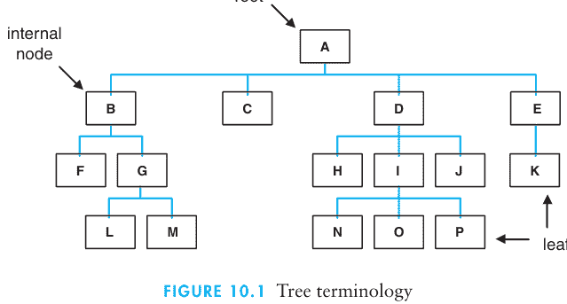

### 层

0

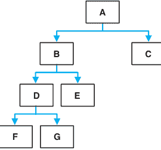

1

2

3

图 10.2 路径长度和层

从根节点的路径。因此，根是树中所有节点的终极祖先。通过从特定节点遵循路径可以到达的节点是该节点的后代。

节点的层也是从根到该节点的路径长度。这种路径长度通过计算从根到该节点必须遵循的边数来确定。根被认为是第 0 层，根的子节点在第 1 层，根的孙子节点在第 2 层，以此类推。路径长度和层如图 10.2 所示。

树的高度是从根到叶子节点的最长路径的长度。因此，图 10.2 中树的高度为 3，因为从根到叶子 F 和 G 的路径长度为 3。从根 C 的路径长度为 1。

## 树的分类

树可以有许多分类方法。最重要的标准是树中任何节点可能拥有的子节点数量。这个值有时被称为树的阶。对子节点数量没有限制的树可以称为普通树。限制每个节点最多有 `n` 个子节点的树称为 `n` 叉树。

其中一种 `n` 叉树具有特别的意义。节点最多有两个子节点的树被称为二叉树。这种类型的树在很多情况下都是很有帮助的。我们对树的大部分探索将集中在二叉树上。

另一种一种分类树的方法是根据它是否平衡。关于平衡有许多定义，取决于所使用的算法。我们将在下一章探索其中一些算法。粗略来说，如果树的所有叶子节点都在同一层上，或者彼此之间相差一层以内，则这棵树被认为是平衡的。因此，图 10.3 左侧所示的树是平衡的，而右侧的不是。具有 `m` 个元素的平衡 `n` 叉树高度为 $\log_2 n$。因此，一个具有 `n` 个节点的平衡二叉树的高度为 $\log_2 n$。

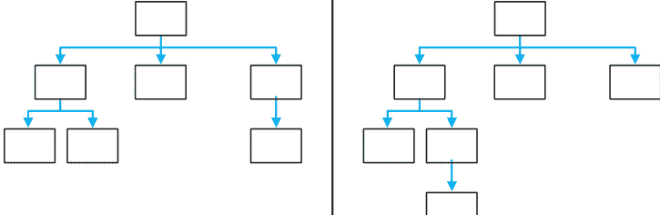

完全树的概念与树的平衡有关。如果一棵树是平衡的且底部所有的叶子节点都在树的左侧，则该树被认为是完全的。尽管这似乎是任意的，但这个定义对树的存储方式有影响。另一个相关概念是满树的概念。如果一个 `n` 叉树的所有叶子节点都在同一层，则该 `n` 叉树被认为是满的。图 10.4 显示的树中，(a) 和 (b) 是完全的，但只有 (c) 是满的。

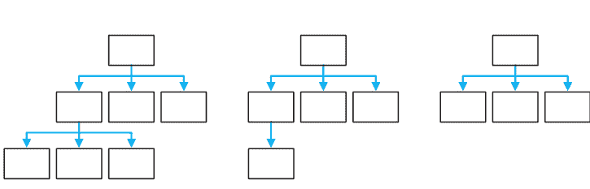

## 10.2 实现树的策略

让我们检查一些实现树的通用策略。树最明显的实现是链式结构。每个节点可以定义为 `TreeNode` 类，类似于我们为链表所做的 `LinearNode`。每个节点包含一个指向每个可能的孩子的指针。根据实现的不同，为每个节点存储指向其父节点的指针可能是有用的。这种指针的使用类似于双向列表的概念，每个节点不仅指向列表中的下一个节点，还指向上一个节点。另一种可能性是使用链接递归实现树。这种策略涉及将每个节点定义为具有每个子属性的树。因此每个节点及其所有后代代表本身。这种策略的实现就是一个编程项目。

由于树是非线性结构，尝试使用底层线性结构（如数组）来实现似乎并不合理。然而，有时这种方法是有用的。数组实现树的策略可能不明显。有两种主要方法：计算策略和模拟链接策略。

### 数组实现树的计算策略

对于某些类型的树，特别是二叉树，一种使用数组存储树的计算策略。一种可能的策略如下：对于存储在数组位置 `n` 的任何元素，元素的左孩子将存储在位置 `(2 * n + 1)`，元素的右孩子将存储在位置 `(2 * (n + 1))`。这种策略非常有效，在容量管理方面可以与管理列表、队列和栈的实现以相同的方式。然而，尽管这种策略非常优雅，但它并不是没有缺点。例如，如果我们存储的树不是完全的或相对完全，我们可能会在数组分配给不包含数据的位置上浪费大量内存。计算策略如图 10.5 所示。

> 核心概念
>
> 一可能的计算策略将 `n` 的左元素放在位置 `(2 * n + 1)`，右孩子放在位置 `(2 * (n + 1))`。

### 数组实现树的模拟链接策略

另一种可能的数组实现树的方法模仿了操作系统管理内存的方式。而不是将树的元素分配给数组

# 第 10 章 树

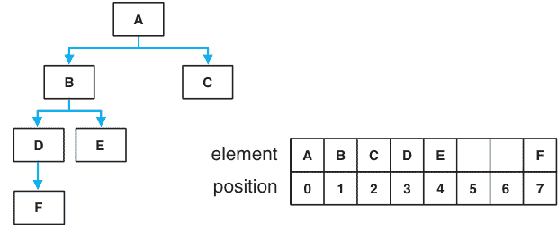


根据树中的位置分配位置，数组位置是按照先来服务的原则连续分配的。数组中的每个元素都将是一个节点类，类似于我们之前讨论的 `TreeNode` 类。然而，每个节点不再存储对象引用值作为其子节点（可能还有父节点）的指针，而是存储每个子节点（可能的父节点）的数组索引。这种方法允许元素连续存储在数组中，从而避免浪费空间。

## 核心概念

模拟链接策略允许数组位置连续分配，无论树的完备性如何。

然而，这种方法增加了在树中删除元素的开销，因为需要移动剩余元素以保持连续性，或者维护一个空闲列表（`freelist`）。该策略如图 10.6 所示。数组中元素的顺序简单由它们进入树的顺序决定。在这种情况下，假设进入顺序为 A、C、B、E、D、F。

当树结构需要使用 I/O 方法直接存储在磁盘上时，可以使用相同的策略。在这种情况下，不再使用数组索引作为指针，每个节点将存储其子节点在文件的相对位置，以便根据文件的基地址计算偏移量。

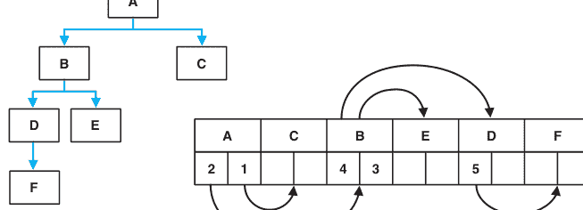

图 10.6 数组实现树的模拟链接策略

## 10.2 树的实现策略

什么时候开始为集合定义 ADT？此时，我们已经定义了许多关于树的术语，并对树如何使用有了通用理解，但我们准备好定义 ADT 了吗？并没有。从广义上说，树更多地是一个抽象数据结构而不是集合，因此尝试为通用树定义 ADT 可能并不有用。相反，我们将等到指定了关于树的类型及其用途的更多细节后再定义接口。

## 树的分析

正如我们之前提到的，树是实现其他集合的有序列表和高效方式。让我们以有序列表为例。在第 6 章对列表实现的分析中，我们描述了查找操作的效率为 $n/2$ 或 $O(n)$。然而，如果我们使用平衡二叉树来实现有序列表——一种具有额外属性的二叉树，其左孩子始终小于父节点，父节点始终大于等于右孩子——那么我们就可以将查找操作的效率提高到 $O(\log n)$。我们将在第 11 章详细讨论二分搜索。

> 核心概念
>
> 通常，一个具有 $m$ 个元素的平衡 $n$ 树的高度为 $\log_m n$。

这种效率的提高是因为此类树的高度始终是 $\log_m n$，其中 $n$ 是树中元素的数量。这与我们在第 9 章对二分搜索的讨论非常相似。事实上，对于任何具有 $m$ 个元素的平衡 $n$ 树，树的高度将是 $\log_m n$。由于二叉搜索树增加了排序属性，你可以保证最坏情况下只搜索从根到叶的一条路径，且该路径不会超过 $\log_m n$。

如果树提供了比线性结构更高效的实现，我们为什么要使用线性结构呢？树在维护其结构和顺序方面存在开销，这种开销在其他结构中可能不存在；因此，这种开销与问题规模之间存在权衡。当 $n$ 较小时，树的实现分析与线性结构分析之间的差异相对于树涉及的开销来说并不特别显著。然而，随着 $n$ 的增加，树的效率变得更具吸引力。

## 10.3 树的遍历

由于树是非线性结构，遍历树的概念通常比遍历线性结构的概念更有趣。遍历树有四种基本方法：

- 前序遍历（Preorder traversal）：通过从根节点开始，访问每个节点及其子节点来完成。
- 中序遍历（Inorder traversal）：通过从根节点开始，访问节点的左孩子，然后访问任何剩余节点来完成。
- 后序遍历（Postorder traversal）：通过从根节点开始，访问子节点和节点来完成。
- 层序遍历（Level-order traversal）：通过从根节点开始，逐层访问每一层的所有节点来完成。

这些定义都适用于所有树。然而，作为一个示例，我们检查了这些定义如何应用于二叉树（即每个节点最多有两个孩子的树）。

### 前序遍历

给定图 10.7 所示的树，前序遍历将产生序列 A、B、D、E、C。之前的定义说明，前序遍历是通过从根节点开始，访问每个节点，随后访问其孩子来完成的。所以，从根开始，我们访问根。接着，我们遍历到根的第一个，即包含 B 的节点。我们使用相同的算法，首先访问当前节点（得到 B），然后访问它的子节点。接着，我们遍历到 B 的第一个孩子，即包含 D 的节点。我们使用相同的算法，首先访问当前节点（得到 D），然后访问它的子节点。接着，我们遍历到 B 的第二个孩子，即包含 E 的节点。我们使用相同的算法，首先访问当前节点（得到 E），然后访问它的子节点。接着，我们遍历到 A 的第一个孩子，即包含 C 的节点。我们使用相同的算法，首先访问当前节点（得到 C），然后访问它的子节点。

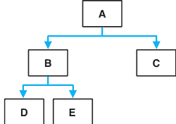

图 10.7 完全树

### 中序遍历

给定图 10.7 所示的树，中序遍历将产生序列 D、B、E、A、C。早先定义，中序遍历是通过从根开始，访问节点的左孩子，然后访问任何剩余节点完成完成。所以，从根开始，我们遍历到根的左孩子，即包含 B 的节点。我们再次使用相同的算法并遍历到 B 的左孩子，即包含 D 的节点。注意我们还没有访问任何节点。使用相同的算法，我们尝试遍历 D 的左孩子。由于没有左孩子，我们访问当前节点（得到 D）。继续相同的算法，我们尝试遍历 D 的剩余孩子。由于没有孩子，我们访问上一个节点（得到 B）。我们接着尝试遍历 B 的剩余孩子。这带我们到了 E 节点。由于 E 没有左孩子，我们访问该节点（得到 E）。由于 E 没有右孩子，我们遍历到 A 的剩余孩子，带我们到了 C 节点。使用相同的算法，我们尝试遍历 C 的左孩子。由于没有左孩子，我们访问当前节点（得到 C）。我们接着尝试遍历 C 的剩余孩子。由于没有孩子，我们返回上一个节点，恰好是根节点。因为树没有更多孩子，遍历完成。

### 后序遍历

给定图 10.7 所示的树，后序遍历将产生序列 D、E、B、C、A。如早先定义，后序遍历是通过从根节点开始，先访问子节点再访问节点。因此，从根开始遍历到左孩子（包含 B 的节点）。重复该过程，我们再次遍历到左孩子（包含 D 的节点）。因为它没有子节点，我们访问该节点，得到 D。返回到上一个节点，访问右孩子（包含 E 的节点）。由于此节点没有子节点，我们访问该节点，得到 E，然后返回上一个节点并访问它。返回到节点（在这种情况下是根节点），发现它有一个右孩子，于是遍历到右孩子（包含 C 的节点）。由于此节点没有子节点，我们访问它，得到 C。返回到上一个节点（根节点），发现它没有剩余的节点，于是访问它，得到 A，遍历完成。

二叉树后序遍历的算法用伪代码表示为：

```
Traverse(left child)
Traverse(right child)
Visit node
```

## 层序遍历

对于图 10.7 所示的树，层序遍历将产生序列 A, B, C, D, E。正如之前定义的，层序遍历是通过从根节点开始，逐层访问所有节点来完成的。根据这个定义，我们首先访问根节点，得到 A。接下来访问根节点的左孩子，得到 B，然后访问根节点的右孩子，得到 C，接着访问 B 的孩子，得到 D 和 E。

二叉树层序遍历的算法用伪代码表示为：

```
Create a queue called nodes
Create an unordered list called results
Enqueue the root onto the nodes queue
While the nodes queue is not empty
{
  Dequeue the first element from the queue
  If that element is not null
    Add element to the rear of the results list
    Enqueue the children of the element on the nodes queue
  Else
    Add null on the result list
}
Return an iterator for the result list
```

这种层序遍历算法只是许多可能解决方案之一。然而，它具有一些有趣的属性。首先，注意到我们正在使用集合——即队列和列表——来解决另一个集合（即二叉树）内部中的问题。其次，回想我们之前对迭代器的讨论，我们谈到了它们在迭代器在使用期间如果集合被修改时的行为。使用列表按正确顺序存储元素并对其返回一个迭代器，这种行为类似于二叉树的快照，不受任何并发修改的影响。这取决于迭代器如何使用，可以是优点也可以是负面属性。

> 核心概念
>
> 层序遍历从根节点开始，逐层访问每个层的所有节点。


## 10.4 二叉树 ADT

让我们来看一个使用链接的简单二叉树实现。在第 10.5 节和 10.6 节，我们将考虑使用这种实现的示例。正如在本章之前讨论的，为所有树抽象接口是很困难的。然而，当我们将焦点缩小到二叉树时，任务变得更加合理了。二叉树 ADT 的一组可能的操作如图 10.8 所示。你会发现不同特定集合之间定义的操作会有所不同。在本文中我们非常仔细地定义了每个集合的操作，以确保它们与其目的一致。

注意，在列出的所有操作中，没有向树中添加元素或从树中删除元素的操作。这是因为在我们指定二叉树的目的和组织之前，没有办法知道如何——更具体地说——向树中添加元素。同样，任何从树中删除一个或多个元素的操作也可能违反树的目的或结构。与添加元素一样，我们还没有足够的信息来知道如何删除元素。当我们在第 3 章和第 4 章处理栈时，我们可以思考从栈中删除元素的概念，并且很容易概念化在删除元素后栈的状态。队列也是如此，因为我们只能从线性结构的一端删除元素。而对于列表，我们可以从线性结构的中间删除元素，因此很容易在概念上概念化树的状态。

| 操作 | 描述 |
| --- | --- |
| `getRoot` | 返回二叉树根节点的引用 |
| `isEmpty` | 确定树是否为空 |
| `size` | 返回树中元素的数量 |
| `contains` | 确定指定的目标是否在树中 |
| `find` | 如果找到指定的节点元素，则返回该元素的引用 |
| `toString` | 返回树的字符串表示 |
| `iteratorInOrder` | 返回用于树的中序遍历的迭代器 |
| `iteratorPreOrder` | 返回用于树的前序遍历的迭代器 |
| `iteratorPostOrder` | 返回用于树的后序遍历的迭代器 |
| `iteratorLevelOrder` | 返回用于树的层序遍历的迭代器 |

图 10.8 二叉树上的操作

```java
package tree;

import java.util.Iterator;
/**
 * BinaryADT 定义了二叉树的接口。
 * @author Lewis and Chase
 * @version 4.0
 */
public interface BinaryADT<T> {
    /**
     * 返回根元素的引用
     * @return 根元素的引用
     */
    T getRoot();

    /**
     * 如果二叉树为空返回 true，否则返回 false。
     * @return 如果二叉树为空则为 true，否则为 false
     */
    boolean isEmpty();

    /**
     * 返回二叉树中元素的数量
     * @return 树中数量
     */
    int size();

    /**
     * 如果包含指定的元素返回 true，否则返回 false。
     * @param targetElement 在树中查找的元素
     * @return 如果树包含目标元素则为 true
     */
    boolean contains(T targetElement);

    /**
     * 如果在二叉树中找到指定的元素，则返回其引用。如果未找到则抛出异常。
     *
     * @param targetElement 在树中查找的元素
     * @return 指定元素的引用
     */
    T find(T targetElement);

    /**
     * 返回此二叉树的字符串表示
     * @return 二叉树的字符串表示
     */
    String toString();

    /**
     * 返回遍历此树元素的迭代器。
     * @return 遍历此树元素的迭代器
     */
    Iterator<T> iterator();

    /**
     * 返回一个代表二叉树中序遍历的迭代器。
     * @return 遍历此树元素的迭代器
     */
    Iterator<T> iteratorInOrder();

    /**
     * 返回一个代表二叉树前序遍历的迭代器。
     * @return 遍历此树元素的迭代器
     */
    Iterator<T> iteratorPreOrder();

    /**
     * 返回一个代表二叉树后序遍历的迭代器。
     * @return 遍历此树元素的迭代器
     */
    Iterator<T> iteratorPostOrder();

    /**
     * 返回一个表示该二叉树层序遍历（levelorder traversal）的迭代器。
     * @return 该二叉树元素的迭代器
     */
    Iterator<T> iteratorLevelOrder();
}
```

## 10.5 使用二叉树：表达式树

在第 3 章中，我们使用栈算法来计算后缀表达式。在本节中，我们修改了该算法，使用 `ExpressionTree` 类来构建表达式树，该类扩展了我们对二叉树的定义。图 10.10 展示了表达式树的概念。注意，表达式树的根节点和所有内部节点包含运算符，而所有的叶子节点包含操作数。表达式树是从下而上进行计算的。在这种情况下，首先计算 (5–3) 项，得到结果 2。然后将该结果乘以 4，得到 8。最后，将该项的结果与 9 相加，得到 17。

列表 10.2 展示了我们的 `ExpressionTree` 类。Java Collections API 没有提供树集合（tree collection）的实现。相反，API 中树的使用仅限于作为集合（sets）和映射（maps）的实现策略。

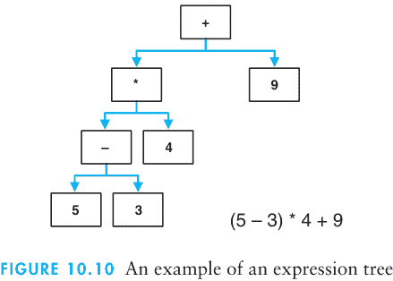

因此，我们在此示例中使用自己实现的链式二叉树。`LinkedBinaryTree` 类位于第 10.7 节。

`ExpressionTree` 类继承自 `LinkedBinaryTree` 类，提供了一个新的构造函数，可以将表达式树组合成一个新树，并提供了一个 `evaluate` 方法，在构建表达式树后递归地计算其值。

### 列表 10.2

```java
import jsjf.*;

/**
 * ExpressionTree 表示一个包含运算符和操作数的表达式树。
 * @author Lewis and Chase
 * @version 4.0
 */
public class ExpressionTree extends LinkedBinaryTree<ExpressionTreeOp> {
    /**
     * 创建一个空的表达式树。
     */
    public ExpressionTree() {
        super();
    }

    /**
     * 从两个指定的表达式树构造一个表达式树。
     * @param element 中心节点的表达式树
     * @param leftSubtree 左子树的表达式树
     * @param rightSubtree 右子树的表达式树
     */
    public ExpressionTree(ExpressionTreeOp element, ExpressionTree leftSubtree, ExpressionTree rightSubtree) {
        root = new BinaryTreeNode<ExpressionTreeOp>(element, leftSubtree, rightSubtree);
    }

    /**
     * 通过调用递归的 evaluateNode 方法计算表达式树。
     */
}
```


```java
/**
 * @return 树的整数计算结果
 */
public int evaluateTree() {
    return evaluateNode(root);
}

/**
 * 递归地计算树的每个节点。
 * @param root 要计算的树的根节点
 * @return 树的整数计算结果
 */
public int evaluateNode(BinaryTreeNode root) {
    int result, operand1, operand2;
    ExpressionTreeOp temp;

    if (root == null) {
        result = 0;
    } else {
        temp = (ExpressionTreeOp) root.getElement();
        if (temp.isOperator()) {
            operand1 = evaluateNode(root.getLeft());
            operand2 = evaluateNode(root.getRight());
            result = computeTerm(temp.getOperator(), operand1, operand2);
        } else {
            result = temp.getValue();
        }
    }
    return result;
}

/**
 * 计算一个由运算符和两个操作数组成的项。
 * @param operator 表达式的运算符
 * @param operand1 表达式的第一个操作数
 * @param operand2 表达式的第二个操作数
 */
```

# 列表 10.2 继续

```java
private int computeTerm(char operator, int operand1, int operand2) {
    int result = 0;

    if (operator == '+')
        result = operand1 + operand2;
    else if (operator == '-')
        result = operand1 - operand2;
    else if (operator == '*')
        result = operand1 * operand2;
    else
        result = operand1 / operand2;

    return result;
}
```

> /**
 * 通过执行层序遍历生成树的结构化字符串版本。
 *
 * @return 此二叉树的字符串表示
 */

```java
public String printTree() {
    UnorderedListADT<BinaryTreeNode<ExpressionTreeOp>> nodes =
        new ArrayUnorderedList<BinaryTreeNode<ExpressionTreeOp>>();
    UnorderedListADT<Integer> levelList =
        new ArrayUnorderedList<Integer>();
    BinaryTreeNode<ExpressionTreeOp> current;
    String result = "";
    int printDepth = this.getHeight();
    int possibleNodes = (int) Math.pow(2, printDepth + 1);
    int countNodes = 0;

    nodes.addToRear(root);
    Integer currentLevel = 0;
    Integer previousLevel = -1;
    levelList.addToRear(currentLevel);

    while (countNodes < possibleNodes) {
        countNodes = countNodes + 1;
        current = nodes.removeFirst();
        currentLevel = levelList.removeFirst();
        if (currentLevel != previousLevel) {
            levelList.addToRear(currentLevel);
        }
        previousLevel = currentLevel;
        if (current != null) {
            result += current.getElement().toString() + " ";
            nodes.addToRear(current.getLeft());
            levelList.addToRear(currentLevel + 1);
            nodes.addToRear(current.getRight());
            levelList.addToRear(currentLevel + 1);
        } else {
            result += "\n";
        }
    }
    return result;
}
```

282

`evaluateTree()` 方法调用 `evaluateNode()` 方法。`evaluateNode()` 方法在节点包含数字时返回该值；如果节点包含运算符，它将利用左右子树返回运算符的结果。`ExpressionTree` 类使用 `ExpressionOp` 类作为树中每个节点的元素。`ExpressionOp` 类允许我们跟踪该元素是数字还是存储在该位置的运算符。`ExpressionOp` 类在列表 10.3 所示。

# 列表 10.3

```java
import jsjf.*;

/**
 * ExpressionOp 表示表达式树中的元素。
 * 
 * @author Lewis and Chase
 * @version 4.0
 */
public class ExpressionOp {
    private int termType;
    private char operator;
    private int value;

    /**
     * 使用指定的数据创建一个新的表达式对象。
     * @param type 表达式的整数类型
     * @param op 表达式的操作数
     * @param val 表达式的值
     */
    public ExpressionOp(int type, char op, int val) {
        termType = type;
        operator = op;
        value = val;
    }

    /**
     * 如果此对象是运算符，返回 true，否则返回 false。
     * @return 如果此对象是运算符则为 true，否则为 false。
     */
    public boolean isOperator() {
        return (termType == 1);
    }

    /**
     * 返回此表达式树对象的运算符。
     * @return 运算符的字符表示
     */
    public char getOperator() {
        return operator;
    }

    /**
     * 返回此表达式树对象的值。
     * @return 此表达式树对象的值
     */
    public int getValue() {
        return value;
    }

    public String toString() {
        if (termType == 1) {
            return operator + "";
        } else {
            return value + "";
        }
    }
}
```

283

`PostfixTester` 和 `PostfixEvaluator` 类是对我们第 3 章解决方案的修改。该解决方案利用 `ExpressionTree` 类来构建、打印和计算表达式树。图 10.11 展示了针对图 10.10 中表达式树的处理过程。注意表达式树栈的顶部在右侧。

## 后序法输入：5 – 3 – 4 * 9 +

| 标记 | 处理步骤 | 表达式树栈（右侧为顶部） |
|---|---|---|
| 5 | `push(new ExpressionTree(5, null, null))` | 5 |
| 3 | `push(new ExpressionTree(3, null, null))` | 5 3 |
| - | `op2 = pop`<br>`op1 = pop`<br>`push(new ExpressionTree(-, op1, op2))` | 5 3 |
| 4 | `push(new ExpressionTree(4, null, null))` | 4 |
| * | `op2 = pop`<br>`op1 = pop`<br>`push(new ExpressionTree(*, op1, op2))` | 5 3 |
| 9 | `push(new ExpressionTree(9, null, null))` | 5 9 |
| + | `op2 = pop`<br>`op1 = pop`<br>`push(new ExpressionTree(+, op1, op2))` | 9 |

图 10.11 从后序表达式构建表达式树

## 10.5 使用二叉树：表达式树 297

### 列表 10.4

```java
import java.util.Scanner;

/**
 * 演示了使用栈来求值后序表达式。
 * @author Lewis 4.0
 * @version 4.0
 */
public class PostfixTester {

    /**
     * 读取并评估多个后序表达式。
     */
    public static void main(String[] args) {
        String expression, again;
        int result;
        Scanner in = new Scanner(System.in);

        do {
            PostfixEvaluator evaluator = new PostfixEvaluator();
            System.out.println("每次输入一个有效的后序表达式，" +
            "每个标记之间用空格隔开（例如 5 4 + 3 2 1 - +）");
            System.out.println("每个标记必须是一个整数或一个运算符 (+,-,*)");
            expression = in.nextLine();
            result = evaluator.evaluate(expression);
            System.out.println();
            System.out.println("该表达式的结果于 " + result);
            System.out.println("该表达式的表达式树是: " +
            System.out.println(evaluator.getTree());
            System.out.print("评估另一个表达式 [Y/N]? ");
            again = in.nextLine();
            System.out.println();
        } while (again.equalsIgnoreCase("y"));
    }
}
```

`PostfixTester` 类显示在列表 10.4 中，`PostfixEvaluator` 类显示在列表 10.5 中。`Postfix` 类的 UML 见图 10.12。

### 列表 10.5

```java
import jsjf.*;
import jsjf.exceptions.*;
import java.util.*;
import java.io.*;

/**
 * PostfixEvaluator 是我们栈示例的修改版本，它使用
 * 栈从一个有效的整数后序表达式创建一个表达式树，
 * 然后使用 ExpressionTree 类中的递归方法来
 * 评估该树。
 * 
 * @author Lewis and Chase
 * @version 4.0
 */
public class PostfixEvaluator {

    private String expression;
    private Stack<ExpressionTree> treeStack;

    /**
     * 通过创建一个新栈来设置此评估器。
     */
    public PostfixEvaluator() {
        treeStack = new Stack<ExpressionTree>();
    }

    /**
     * 获取并返回此栈中的下一个操作数。
     * @param treeStack 将返回操作数的栈
     * @return 从此栈的下一个操作数
     */
    private ExpressionTree getOperand(Stack<ExpressionTree> treeStack) {
        ExpressionTree temp;
        temp = treeStack.pop();
        return temp;
    }

    /**
     * 通过构建和评估表达式树来评估指定的后序表达式。
     * 表达式树。
     *
     * @param expression 后序表达式的字符串表示
     * @return 给定表达式的值
     */
    public int evaluate(String expression) {
        ExpressionTree operand1, operand2;
        char operator;
        String tempToken;
        Scanner parser = new Scanner(expression);

        while (parser.hasNext()) {
            tempToken = parser.next();
            operator = tempToken.charAt(0);
        }

        if ((operator == '+') || (operator == '-') || (operator == '*')) {
            operand1 = getOperand(treeStack);
            operand2 = getOperand(treeStack);
            treeStack.push(new ExpressionTree(
                (new ExpressionOp(1, operator, 0), operand2, operand1)));
        } else {
            treeStack.push(new ExpressionTree(new ExpressionTree(
                (2, '', Integer.parseInt(tempToken)), null, null)));
        }
        return (treeStack.peek()).evaluateTree();
    }

    /**
     * 返回与此后序评估器关联的表达式树。
     * @return 表示表达式树的表达式字符串
     */
    public String getTree() {
        return (treeStack.peek()).printTree();
    }
}
```

## 300 第 10 章

```java
<<interface>> TreeADT
getRoot() : T
isEmpty() : boolean
size() : int
contains(T) : boolean
find(T) : T
toString() : String
iterator() : T
inOrder() : T
postOrder() : T
levelOrder() : T
```

```java
BinaryTree
element : T
left : BinaryTree<T>
right : BinaryTree<T>
```

```java
numChildren() : int
getElement() : T
getRight() : void
setRight() : void
node : void
getLeft() : T
setLeft(T) : void
```

```java
ExpressionOp
operator : char
value : int
```

```java
ExpressionTree
evaluateTree() : int
evaluateNode(T) : int
printTree() : String
```


# PostfixEvaluator

| 字段 | 类型 |
| :--- | :--- |
| `expression` | `String` |
| `treeStack` | `Stack<ExpressionTree>` |

```java
java.Stack<Integer>
```

**图 10.12** Postfix 的 UML

## 10.6 决策树

注意 `ExpressionTree` 类继承自 `LinkedBinaryTree`。记住，决策树是一个节点表示决策点、子节点表示可用选项的树。叶子节点表示可能的结论。

> **核心概念**
> 决策树可以作为专家系统的基础。

- 让我们看一个使用在前一节讨论的 `LinkedBinaryTree` 实现来表示决策树的示例。列表 10.6 中的程序使用图 10.13 中的树与用户进行对话并得出结论。我们对背痛问题的解决方案的 UML 描述见图 10.14。

一个简单的决策树（带有是/否问题）可以用二叉树进行建模。图 10.13 显示了一个帮助诊断背痛原因的决策树。对于每个问题，左孩子代表“否”，右孩子代表“是”。要进行诊断，从根节点开始，根据答案遵循路径直到到达叶子节点。

### 列表 10.6

```java
import java.io.*;

/**
 * BackPainAnalyzer 演示了使用二叉决策树诊断
 * 背痛。
 */
public class BackPainAnalyzer {

    /**
     * 向用户提问以诊断医疗问题。
     */
    public static void main(String[] args) throws FileNotFoundException {
        System.out.println("So, you're having back pain.");
        DecisionTree expert = new DecisionTree("input.txt");
        expert.evaluate();
    }
}
```

**输出**

> 所以，你正在背痛。
> 疼痛是在撞击或震动后发生的吗？
> 你能够控制你的手臂或腿部吗？
> 你的手臂或一条腿是否有疼痛或麻木感？
> 你可能有肌肉或神经损伤。

树是使用 `DecisionTree` 类构建的。唯一的实例数据是表示整个决策树的变量 `tree`，它被定义为存储 `String` 对象元素。注意这个

## 10.6 腰背痛分析器

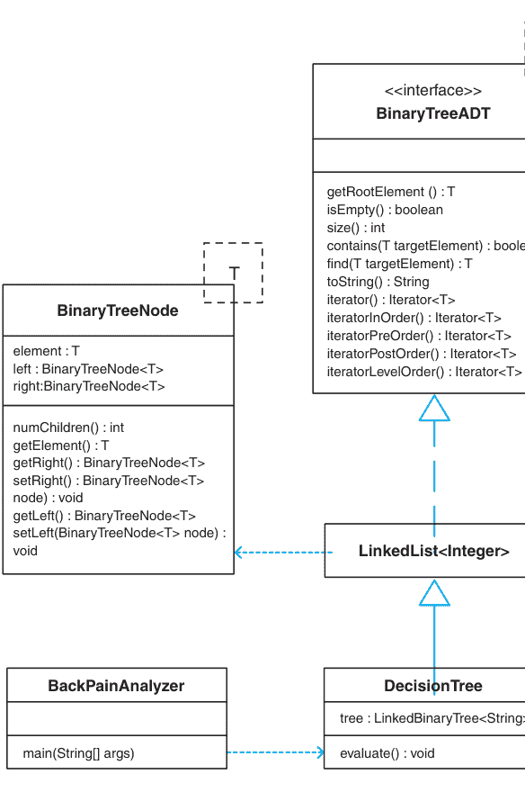

```java
<<interface>>
BinaryTreeADT

getRootElement() : T
isEmpty() : boolean
contains(T targetElement) : boolean
find(T targetElement) : T
toString() : String
iterator() : Iterator<T>
iteratorInOrder() : Iterator<T>
iteratorPreOrder() : Iterator<T>
iteratorPostOrder() : Iterator<T>
iteratorLevelOrder() : Iterator<T>
```

```java
BinaryTreeNode

element : T
left : BinaryTreeNode<T>
right : BinaryTreeNode<T>

numChildren() : int
getElement() : T
getRight() : BinaryTreeNode<T>
setRight(BinaryTreeNode<T> node) : void
getLeft() : BinaryTreeNode<T>
setLeft(BinaryTreeNode<T> node) : void
```

```java
LinkedList<Integer>
```

```java
BackPainAnalyzer
main(String[] args)
```

```java
DecisionTree
tree : LinkedBinaryTree<String>
evaluate() : void
```

**图 10.14** 腰背痛分析器的 UML 描述

`DecisionTree` 类的实现并非专门用于腰背痛分析。它可以被用于任何二叉决策树。

`DecisionTree` 的构造函数从给定文件中读取要存储在树节点中的各种字符串元素。然后创建节点，叶子节点没有子节点，内部节点则使用之前定义的节点（或子树）作为子节点。这棵树基本上是从底向上创建的。

`evaluate` 方法使用变量 `current` 来指示正在处理的树中的当前节点，从根节点开始。`while` 循环持续到找到叶子节点。打印当前的问题，并从用户处读取答案。如果答案为否，则将 `current` 更新为左孩子；否则，将其更新为指向右孩子。退出循环后，打印存储在叶子节点中的元素（结论）。

# 代码列表 10.7

```java
import jsjf.*;
import java.util.*;
import java.io.*;

/**
 * DecisionTree 类使用 LinkedBinaryTree 类来实现
 * 二叉决策树。树元素从给定文件中读取，
 * 然后可以根据用户输入使用 evaluate 方法对决策树进行评估。
 *
 * @author Lewis and Chase
 * @version 4.0
 */
public class DecisionTree {

    private LinkedBinaryTree<String> tree;

    /**
     * 根据给定文件的内容构建决策树
     * @param filename 输入文件的文件名
     * @throws FileNotFoundException 如果未找到输入文件抛出异常
     */
    public DecisionTree(String filename) throws FileNotFoundException {
        File inputFile = new File(filename);
        Scanner scan = new Scanner(inputFile);
        int numberNodes = scan.nextInt();
        scan.nextLine();
        int root = 0, left;
        List<LinkedBinaryTree<String>> nodes = new java.util.ArrayList<LinkedBinaryTree<String>>();
        for (int i = 0; i < numberNodes; i++) {
            nodes.add(i, new LinkedBinaryTree<String>(scan.nextLine()));
        }
        while (scan.hasNext()) {
            root = scan.nextInt();
            left = scan.nextInt();
            right = scan.nextInt();
            scan.nextLine();
            nodes.set(root)
        }
    }
}
```

# 10.7 使用链表实现二叉树

我们将检查其中某些方法如何使用链式实现；另一些方法将作为练习题。实现 `BinaryTreeADT` 接口的 `LinkedBinaryTree` 类需要跟踪位于树根部的节点以及树中的元素数量。`LinkedBinaryTree` 的头部和实例数据可以声明为：

```java
package jsjf;
import java.util.*;
import jsjf.exceptions.*;
```

```java
/**
 * LinkedBinaryTree 实现了 BinaryTreeADT 接口
 * @author Lewis and Chase
 * @version 4.0
 */
public class LinkedBinaryTree<T> implements BinaryTreeADT<T>, Iterable<T> {
    protected BinaryTreeNode<T> root;
    protected int modCount;
```

`LinkedBinaryTree` 类的构造函数应该处理三种情况：我们想创建一个空的二叉树，我们想创建一个只有一个元素但没有子节点的二叉树，以及我们想创建一个根节点为特定元素且以给定树为子节点的二叉树。考虑到这些目标，`LinkedBinaryTree` 类可能具有以下构造函数。注意，每个构造函数都必须考虑到 `root` 和 `count` 属性。

```java
/**
 * 创建一个空的二叉树。
 */
public LinkedBinaryTree() {
    root = null;
}
```

```java
/**
 * 创建一个指定元素为根节点的二叉树。
 * @param element 将成为二叉树根节点的元素
 */
public LinkedBinaryTree(T element) {
    root = new BinaryTreeNode<T>(element);
}
```

```java
/**
 * 创建一个指定元素为根节点并以给定的
 * 树为其左孩子和右孩子的二叉树
 * @param element 将成为二叉树根节点的元素
 * @param left 此树的左子树
 * @param right 此树的右子树
 */
public LinkedBinaryTree(T element, LinkedBinaryTree<T> left,
    LinkedBinaryTree<T> right) {
    root = new BinaryTreeNode<T>(element);
    root.setLeft(left);
    root.setRight(right);
}
```

注意，实例数据和构造函数都使用了额外的类 `BinaryTreeNode`。正如之前讨论的，这跟踪了存储在每个位置的元素，以及指向节点左、右子树的指针。在 particular 实现中，我们选择不包含指向每个节点父节点的指针。代码列表 10.8 显示了 `BinaryTreeNode` 类。`BinaryTreeNode` 类还包含一个返回给定节点孩子数量的方法。

# 代码列表 10.8

```java
package jsjf;

/**
 * BinaryTreeNode 表示二叉树中的节点，具有左孩子和
 * 右孩子。
 * @author Lewis and Chase
 * @version 4.0
 */
public class BinaryTreeNode<T> {
    protected T element;
    protected BinaryTreeNode<T> left, right;

    /**
     * 使用指定的数据创建一个新的树节点。
     * @param obj 指定的数据对象
     */
    public BinaryTreeNode(T obj) {
        element = obj;
        left = null;
        right = null;
    }

    /**
     * 创建一个指定元素为根节点并以给定的
     * 树为其左孩子和右孩子的二叉树
     * @param element 将成为二叉树根节点的元素
     * @param left 此树的左子树
     * @param right 此树的右子树
     */
    public BinaryTreeNode(T element, BinaryTreeNode<T> left,
    BinaryTreeNode<T> right) {
        this.element = element;
        this.left = left;
        this.right = right;
    }

    /**
     * 获取存储的元素。
     */
    public T getElement() {
        return element;
    }

    /**
     * 获取左孩子。
     */
    public BinaryTreeNode<T> getLeft() {
        return left;
    }

    /**
     * 设置左孩子。
     * @param node 左孩子
     */
    public void setLeft(BinaryTreeNode<T> node) {
        left = node;
    }

    /**
     * 获取右孩子。
     */
    public BinaryTreeNode<T> getRight() {
        return right;
    }

    /**
     * 设置右孩子。
     * @param node 右孩子
     */
    public void setRight(BinaryTreeNode<T> node) {
        right = node;
    }

    /**
     * 返回给定节点的孩子数量。
     */
    public int numChildren() {
        int count = 0;
        if (left != null) count++;
        if (right != null) count++;
        return count;
    }
}
```

## 10.7 使用链接实现二叉树

```java
/**
 * 如果在二叉树中找到了指定的目标元素，则返回该元素的引用。
 * 如果未在二叉树中找到指定的目标元素，则抛出 ElementNotFoundException。
 *
 * @param targetElement 在此树中查找的元素
 * @return 指向目标元素的引用
 * @throws ElementNotFoundException 如果元素不在树中
 */
public T find(T targetElement) throws ElementNotFoundException {
    BinaryTreeNode<T> current = findNode(targetElement, root);
    if (current == null) {
        throw new ElementNotFoundException("LinkedBinaryTree");
    }
    return current.getElement();
}

/**
 * 如果在二叉树中找到了指定的目标元素，则返回该元素的引用。
 *
 * @param targetElement 在此树中查找的元素
 * @param next 从该元素开始搜索的元素
 */
private BinaryTreeNode<T> findNode(T targetElement,
    BinaryTreeNode<T> next) {
    if (next == null) {
        return null;
    }
    if (next.getElement().equals(targetElement)) {
        return next;
    }
    BinaryTreeNode<T> temp = findNode(targetElement, next.getLeft());
    if (temp == null) {
        temp = findNode(targetElement, next.getRight());
    }
    return temp;
}
```

如前面的示例所示，`contains` 可以利用 `find` 方法。我们对这一部分的实现留作为一个编程项目。

## iteratorInOrder 方法

另一个有趣的操作是 `iteratorInOrder` 方法。该任务是创建一个 `Iterator` 对象，允许用户类以中序遍历的方式遍历树的元素。该解决方案提供了另一个使用一个集合来构建另一个集合的例子。我们简单地使用“访问”的定义来遍历树，之前的伪代码将节点的内容添加到一个无序列表中。然后，我们使用该列表创建一个新的 `TreeIterator`。这种方法之所以可行，是因为无序列表的线性性质。列表的 `iterator` 方法返回一个迭代器，它从列表开头的元素开始，并以线性方式遍历列表。需要重要的是，这种行为并不是与列表关联的迭代器的要求。它只是我们选择实现列表迭代器方法的方式产生的结果。如果我们简单地返回列表的 `Iterator` 而不创建 `TreeIterator`，会发生什么？该解决方案的问题在于，我们的 `Iterator` 将不再是快速失败（fail-fast）的（也就是说如果在迭代器使用期间底层树被修改，它将不会抛出并发修改异常）。

与 `find` 操作一样，我们在递归中使用了一个私有辅助方法。

```java
/**
 * 通过调用从根节点开始的重载递归中序遍历方法，对此二叉树执行中序遍历。
 *
 * @return 遍历过此二叉树的中序迭代器
 */
public Iterator<T> iteratorInOrder() {
    ArrayUnorderedList<T> tempList = new ArrayUnorderedList<T>();
}
```


```
inOrder(root, tempList);

return new TreeIterator(tempList.iterator());
}

/**
 * 执行递归中序遍历。
 *
 * @param node 用作此次遍历根节点的节点
 * @param tempList 用于本次遍历的临时列表
 */
protected void inOrder(BinaryTreeNode<T> node,
    ArrayUnorderedList<T> tempList)
{
    if (node != null)
    {
        inOrder(node.getLeft(), tempList);
        tempList.addToRear(node.getElement());
        inOrder(node.getRight(), tempList);
    }
}
```

其他迭代器操作也是类似的，并留作练习题。同样，二叉树的数组实现也留作为一个练习题，将在第 12 章中涉及。

## 核心概念总结

- 树是一种非线性结构，其元素按层次结构组织。
- 树由大量相关的术语来描述。
- 模拟链接策略允许连续分配数组位置，无论树的完整性如何。
- 一般而言，具有 $m$ 个元素的平衡 $n$ 树的高度为 $\log_m n$。
- 遍历树有四种基本方法：前序遍历、中序遍历、后序遍历和层序遍历。
- 前序遍历意味着访问节点，然后是左孩子，最后是右孩子。
- 中序遍历意味着访问左孩子，然后是节点，最后是右孩子。
- 后序遍历意味着访问左孩子，然后是右孩子，最后是节点。
- 层序遍历意味着从根节点开始，一次访问每一层的节点。
- 决策树可以作为专家系统的基础。

## 术语总结

**树 (tree)** 树是一种非线性结构，其元素按层次结构组织。

**节点 (node)** 树中的一个位置。

**边 (edge)** 树中两个节点之间的连接。

**根节点 (root)** 树中顶层的节点，也是树中唯一没有父节点的节点。

**层 (level)** 节点相对于树根节点的位置。

**孩子 (child)** 树中当前节点下方且通过边直接与之相连的节点。

**兄弟节点 (siblings)** 具有相同父节点的节点。

**叶子节点 (leaf)** 树中没有子节点的节点。

**内部节点 (internal node)** 树中不是根节点且至少有一个子节点的节点。

**路径 (path)** 直接连接一个节点到另一个节点的边的集合。

**祖先节点 (ancestor)** 树中位于节点上方的节点。

**后代节点 (descendant)** 位于节点下方的节点。

**路径长度 (path length)** 从节点到另一个节点的边的数量。

**树高 (height)** 从根节点到最远叶子节点的路径长度。

**树阶 (order)** 节点可能拥有的子节点数量。

**多叉树 (n-ary tree)** 每个节点最多有 n 个子节点的树。

**二叉树 (binary tree)** 每个节点最多有两个子节点的树。

**完全二叉树 (complete)** 除了最后一层外，每一层都是满的树。

**满二叉树 (full)** 每个节点要么有两个子节点，要么没有子节点的树。

**广义树 (general tree)** 对子节点数量没有限制的树。

**前序遍历 (preorder traversal)** 访问节点，然后是它的孩子。

**中序遍历 (inorder traversal)** 访问左孩子，然后是节点。

**后序遍历 (postorder traversal)** 访问所有的孩子，然后是节点。

**层序遍历 (level-order traversal)** 从根节点开始访问每一层。

## 自习题

- SR 10.1 什么是树？
- SR 10.2 什么是节点？
- SR 10.3 什么是根节点？
- SR 10.4 什么是叶子节点？
- SR 10.5 什么是内部节点？
- SR 10.6 定义树的高度。
- SR 10.7 定义节点的深度。
- SR 10.8 这种计算策略的优缺点是什么？
- SR 10.9 模拟链接策略的优缺点是什么？
- SR 10.10 `TreeNode` 类应该存储哪些属性？
- SR 10.11 哪种树遍历方法会为二叉搜索产生一个排序列表？
- SR 10.12 我们使用列表来实现迭代器方法。这种策略要成功需要什么条件？

## 练习题

- EX 10.1 开发二叉树层序遍历的伪代码。
- EX 10.2 为几代人画出母系（跟随母亲谱系）或父系（跟随父亲谱系）图。编写将人插入树中正确位置的伪代码。
- EX 10.3 编写从前缀表达式构建表达式树的伪代码。
- EX 10.4 编写从中缀表达式构建表达式树的伪代码。
- EX 10.5 计算 `find` 方法的时间复杂度。
- EX 10.6 计算 `iteratorOrder` 方法的时间复杂度。
- EX 10.7 编写 `size` 方法的伪代码，假设没有 `count` 变量。
- EX 10.8 编写 `isEmpty` 操作的伪代码，假设没有 `count` 变量。
- EX 10.9 为表达式 `(9 + 4) * 5 + (4 - 6)` 画出表达式树。

## 编程项目

- PP 10.1 完成二叉树 `getRoot` 和 `toString` 操作的实现。
- PP 10.2 在假设没有计数器变量的情况下，完成二叉树 `size` 和 `isEmpty` 操作的实现。
- PP 10.3 为我们的 `BinaryNode` 类创建布尔方法，以判断该节点是叶子节点还是内部节点。
- PP 10.4 创建一个名为 `depth` 的方法，该方法将返回一个 `int`，表示从根节点到给定节点的层级或深度。
- PP 10.5 完成二叉树 `contains` 方法的实现。
- PP 10.6 在不使用 `find` 操作的情况下，为二叉树实现 `contains` 方法。
- PP 10.7 完成二叉树迭代器方法的实现。
- PP 10.8 在不使用 `list` 的情况下，为二叉树实现迭代器方法。
- PP 10.9 修改 `ExpressionTree` 类，创建一个名为 `draw` 的方法，以图形化的方式描述表达式树。
- PP 10.10 我们在本章的示例中使用后缀表示法，是因为它消除了通过优先级规则和括号解析中缀表达式的需要。某些中缀表达式不需要括号来修改优先级。为 `ExpressionTree` 类实现一个方法，判断一个整数表达式如果写成中缀表示法是否需要括号。
- PP 10.11 使用计算策略（computational strategy）创建一个二叉树的数组实现版本。
- PP 10.12 使用模拟链接策略（simulated link strategy）创建一个二叉树的数组实现版本。
- PP 10.13 使用本章引入的递归方法实现二叉树。在这种方法中，每个节点都是一棵二叉树。因此，二叉树包含一个指向存储在其根节点的元素引用，以及指向其左、右子树的引用。你可能还想包含指向其父节点的引用。

## 自测习题答案

- SRA 10.1 树是一种非线性结构，其定义是树中的除第一个节点（或根节点）外的每个节点恰好有一个父节点。
- SRA 10.2 节点是树中存储元素的位置。
- SRA 10.3 树的根是树顶部的节点，或者是树中没有父节点的那个节点。
- SRA 10.4 叶子节点是不具有任何孩子的节点。
- SRA 10.5 内部节点是任何具有至少一个孩子的非根节点。
- SRA 10.6 树的高度是从根节点到叶子节点的最长路径的长度。
- SRA 10.7 节点的层级通过从根节点到达该节点必须遵循的链接数量来衡量。
- SRA 10.8 计算策略不存储从父到子的链接，因为关系是由位置固定的。然而，对于不平衡和/或不完整的树，这种策略可能会导致大量的空间浪费。
- SRA 10.9 模拟链接策略将数组索引值作为子节点之间的父节点，允许数据无论树如何平衡或完整都连续存储。然而，这种策略增加了维护空闲列表（`freelist`）或在数组中移动元素的开销。
- SRA 10.10 `TreeNode` 类必须存储一个指向存储在位置元素的指针，以及指向该节点每个子节点的指针。该类也可能包含一个指向节点父节点的指针。
- SRA 10.11 二叉搜索树的中序遍历将得到一个升序排列的列表。
- SRA 10.12 为了使这种策略成功，列表的迭代器必须按照元素添加的顺序返回元素。对于这种特定的列表实现，我们知道情况确实是如此。

# 二叉搜索树

在本章中，我们将探索二叉搜索树的概念以及它们的实现方案。我们将检查在二叉搜索树中添加和删除元素的算法，以及维护平衡二叉搜索树的算法。我们将讨论这些实现的分析，并探索二叉搜索树的各种用途。

## 目标

- 定义二叉搜索树抽象数据结构。
- 演示如何使用二叉搜索树解决问题。
- 检查二叉搜索树的实现。
- 讨论平衡二叉搜索树的策略。

## 11.1 二叉搜索树

二叉搜索树是一种二叉树，增加了一个属性：对于每个节点，左孩子小于父节点，父节点小于等于右孩子。正如我们在第 10 章中讨论的，在不知道树的类型及其预期用途的情况下，很难为树抽象出一组操作。由于必须维护的额外排序属性，我们现在可以扩展定义，包含图 11.1 所示对二叉搜索树的操作。

| 操作 | 描述 |
| --- | --- |
| `addElement` | 向树中添加一个元素。 |
| `removeElement` | 从树中删除元素。 |
| `removeOccurrences` | 从树中删除元素的所有出现处。 |
| `removeMin` | 删除树中的最小元素。 |
| `removeMax` | 删除树中的最大元素。 |
| `findMin` | 返回树中最小元素的引用。 |
| `findMax` | 返回树中最大元素的引用。 |

> 图 11.1 二叉树上的操作

正如第 10 章所讨论的，Java Collections 没有提供树的实现。在此期间，我们将构建自己的实现。二叉搜索树是一种二叉树，增加了一个属性：左孩子小于父节点，父节点小于等于右孩子。到此为止，我们仅仅在讨论二叉搜索树的接口。`BinarySearchADT` 定义了二叉树的接口。

## 11.2 实现二叉搜索树：带链

`LinkedBinarySearchTree` 类提供了两个构造函数：一个创建一个空的 `LinkedBinarySearchTree`，另一个创建一个在根节点具有特定元素的 `LinkedBinarySearchTree`。这两个构造函数都只是引用了父类（即 `LinkedBinaryTree` 类）对应的构造函数。

```java
/**
 * 创建一个空的二叉搜索树。
 */
public LinkedBinarySearchTree() {
    super();
}

/**
 * 创建一个以指定元素为根节点的二叉搜索树。
 * @param element 将作为新二叉搜索树根节点的元素
 */
public LinkedBinarySearchTree(T element) {
    super(element);
    if (!(element instanceof Comparable))
        throw new NonComparableElementException("LinkedBinarySearchTree");
}
```

### addElement 操作

`addElement(element)` 方法使用私有的递归方法 `addElement(element, tree)` 将给定元素添加到树中适当的位置。如果该元素是可比较的（Comparable），该方法将抛出 `NonComparableElementException`。如果树为空，新元素将成为根节点。如果它小于根节点存储的元素且根节点的左孩子为空，则新元素将成为根节点的左孩子。如果新元素小于根节点存储的元素且根节点的左孩子不为空，则我们递归地将元素添加到根节点的左子树。如果新元素大于或等于根节点存储的元素且根节点的右孩子为空，则新元素将成为根节点的右孩子。如果新元素大于或等于根节点存储的元素且根节点的右孩子不为空，则我们递归地将元素添加到根节点的右子树。图 11.3 展示了向二叉搜索树添加元素的过程。与任何递归算法一样，我们也可以选择迭代来实现 `add` 操作。`add` 操作的迭代版本被留作了一个编程项目。

#### 设计焦点

一旦我们定义了想要构建的树的类型及其使用方法，我们就有了定义接口和实现的能力。在第 10 章中，我们定义了一个二叉树，使我们能够定义一组非常基础的操作。现在我们把范围限制在二叉搜索树，就可以填充接口和实现的更多细节了。确定在哪个层级构建接口描述，以及确定父类和子类之间的边界是设计选择……而且它们并不总是容易的选择。

```java
/**
 * 根据其自然顺序将指定的对象添加到二叉搜索树中适当的位置。请注意
 * 相同的元素被添加到右侧。
 * @param element 要添加到二叉搜索树的元素
 */
public void addElement(T element) {
    if (!(element instanceof Comparable))
        throw new NonComparableElementException("LinkedBinarySearchTree");
    Comparable<T> comparableElement = (Comparable<T>)element;
    if (isEmpty())
        root = new BinaryNode<T>(element);
    else {
        if (comparableElement.compareTo(root.getElement()) < 0) {
            if (root.getLeft() == null)
                this.getRootNode().setLeft(new BinaryNode<T>(element));
            else
                addElement(element, root.getLeft());
        } else {
            if (root.getRight() == null)
                this.getRootNode().setRight(new BinaryNode<T>(element));
            else
                addElement(element, root.getRight());
        }
    }
    modCount++;
}
```

```java
/**
 * 根据其自然顺序将对象添加到二叉搜索树中适当的位置。请注意
 * 相同的元素被添加到右侧。
 * 
 * @param element 要添加到二叉搜索树的元素
 */
private void addElement(T element, BinaryNode<T> node) {
    Comparable<T> comparableElement = (Comparable<T>)element;
    if (comparableElement.compareTo(node.getElement()) < 0) {
        if (node.getLeft() == null)
            node.setLeft(new BinaryNode<T>(element));
        else
            addElement(element, node.getLeft());
    } else {
        if (node.getRight() == null)
            node.setRight(new BinaryNode<T>(element));
        else
            addElement(element, node.getRight());
    }
}
```

### removeElement 操作

`removeElement` 从二叉搜索树中移除给定的可比较元素，如果在树中未找到目标元素，则抛出 `ElementNotFound`。与我们之前对线性结构的研究不同，我们不能简单地通过改变周围节点的引用来移除节点。相反，必须提升另一个节点来替换被删除的节点。保护方法 `replacement` 返回一个用于替换指定删除节点的节点引用。

#### 核心概念

在从二叉搜索树中删除元素时，必须提升另一个节点来替换被删除的节点。类似于我们的 `add` 方法，`removeElement(element, parent)` 是递归的。通过这种方式，删除根节点的特殊情况可以单独处理。对于替换，有三种情况：

- 如果节点没有孩子，替换返回 `null`。
- 如果节点只有一个孩子，替换返回该孩子。
- 如果节点有两个孩子，替换返回中序继节点。

```java
/**
 * 从二叉搜索树中移除指定的
 * 元素并返回其引用。如果树中未找到
 * 目标，则抛出 ElementNotFound。
 * @param element 在树中要查找的元素
 */
public T removeElement(T element) {
    T result = null;
    if (isEmpty())
```


```java
throw new ElementNotFound("BinarySearchTree");
} else {
    if (((Comparable<T>) element).equals(root.getElement())) {
        result = root.getElement();
        BinaryNode<T> temp = replacement(root);
        if (temp == null) {
            root = null;
        } else {
            root = temp;
            if (root.getLeft() != null) {
                root.setRight(root.getLeft());
            } else {
                root.setLeft(root.getRight());
            }
        }
    } else {
        result = removeElement(element, root, null);
    }
}
return result;
}
```

```java
private T removeElement(T element, BinaryNode<T> node, BinaryNode<T> parent) throws ElementNotFound {
    T result = null;
    if (node == null)
        throw new ElementNotFound("BinarySearchTree");
    else {
        if (((Comparable<T>) element).equals(node.getElement())) {
            result = node.getElement();
            BinaryNode<T> temp = replacement(node);
            if (temp == null) {
                if (parent == null) {
                    root = null;
                } else if (parent.right == node) {
                    parent.right = null;
                } else {
                    parent.left = null;
                }
            } else {
                if (parent == null) {
                    root = temp;
                } else if (parent.right == node) {
                    parent.right = temp;
                } else {
                    parent.left = temp;
                }
                if (temp.left != null) {
                    temp.setRight(temp.left());
                } else {
                    temp.setLeft(temp.right());
                }
            }
        } else {
            if (((Comparable<T>) element).compareTo(node.getElement()) < 0) {
                result = removeElement(element, node.getLeft(), node);
            } else {
                result = removeElement(element, node.getRight(), node);
            }
        }
    }
    return result;
}
```

```java
private BinaryNode<T> replacement(BinaryNode<T> node) {
    BinaryNode<T> result = null;
    if ((node.left == null) && (node.right == null))
        result = null;
    else if ((node.left != null) && (node.right != null))
        result = node.left;
    else if ((node.left == null) && (node.right != null))
        result = node.right;
    return result;
}
```

以下代码展示了 `replacement` 方法。图 11.4 展示了从二叉搜索树中移除元素的过程。

# 11.2 实现二叉搜索树：使用链接

```java
} else {
    BinaryTreeNode<T> current = node.right;
    BinaryTreeNode<T> parent = node;
    while (current.left != null) {
        parent = current;
        current = current.left;
    }
    current.left = node.left;
    if (node.right != current) {
        parent.left = current.right;
        current.right = node.right;
    }
    result = current;
}
return result;
}
```

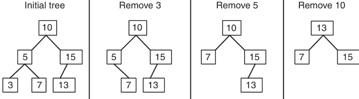

图 11.14 从二叉树中删除元素

# removeAllOccurrences 操作

`removeAllOccurrences` 从二叉搜索树中移除给定元素的所有出现，如果树中未找到该元素，则抛出 `ElementNotFoundException`。如果该元素没有实现 `Comparable` 接口，该方法也会抛出 `ClassCastException`。该方法通过调用一次 `removeElement` 方法来确保如果树中没有至少出现一次该元素，就会抛出异常。只要树中包含目标元素，就会再次调用 `removeElement` 方法。请注意，`removeAllOccurrences` 方法使用了 `LinkedBinaryTree` 类的 `contains` 方法。请注意，`LinkedBinarySearchTree` 中重写了 `find` 方法，以管理二叉搜索树的顺序属性。

```java
/**
 * 从二叉搜索树中移除与指定目标元素匹配的元素。
 * 如果在此树中未找到指定的目标元素，抛出 ElementNotFoundException。
 *
 * @param targetElement 在二叉搜索树中查找的元素
 * @throws ElementNotFoundException 如果未找到目标元素
 */
public void removeAllOccurrences(T targetElement)
    throws ElementNotFoundException {
    removeElement(targetElement);
    try {
        while (contains((T) targetElement))
            removeElement(targetElement);
    } catch (Exception ElementNotFoundException) {
    }
}
```

# removeMin 操作

二叉搜索树中最小元素的位置有三种可能的情况：

- 如果根节点没有左孩子，则根节点就是最小元素，根节点的右孩子成为新根。
- 如果树的最左侧的节点是叶子节点，则它就是最小元素，我们只需将其父节点的左引用设置为 `null`。
- 如果树的最左侧的节点是内部节点，则将其父节点的左孩子引用指向被删除节点的右孩子。

## 核心概念

二叉树中最左侧的节点将包含最小元素，而最右侧的节点将包含最大元素。

图 11.5 展示了这些可能性。基于这些可能性，`removeMin` 操作的代码相对简单。

```java
/**
 * 从二叉搜索树中移除值最小的节点，并返回其元素的引用。
 * 如果此树为空，则抛出 EmptyCollectionException。
 *
 * @return 指向最小值节点的引用
 * @throws EmptyCollectionException 如果树为空
 */
public T removeMin() throws EmptyCollectionException {
    T result = null;
    if (isEmpty()) {
        throw new EmptyCollectionException("LinkedBinarySearchTree");
    } else {
        if (root.left == null) {
            result = root.element;
            root = root.right;
        } else {
            BinaryTreeNode<T> parent = root;
            BinaryTreeNode<T> current = root.left;
            while (current.left != null) {
                parent = current;
                current = current.left;
            }
            result = current.element;
            parent.left = current.right;
        }
    }
    modCount--;
    return result;
}
```

`removeMax`、`findMin` 和 `findMax` 操作留作练习。

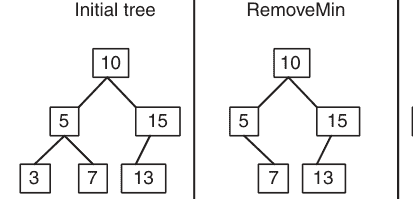

图 11.5 从二叉搜索树中删除最小元素

# 实现二叉搜索树：使用数组

在第 10 章中，我们讨论了树的两种数组实现策略：计算策略和链表策略。目前这些实现留作为编程项目。我们将在第 12 章中重新回顾这些基于数组的实现。

# 11.3 使用二叉搜索树：实现有序列表

正如第 10 章讨论过的，树的用途之一是提供其他集合的高效实现。第 6 章中的 `OrderedList` 集合提供了一个极好的例子。图 11.6 提醒我们列表的常用操作，图 11.7 提醒我们有序列表特有的操作。

| 操作 | 描述 |
|---|---|
| removeFirst | 移除列表的第一个元素。 |
| removeLast | 移除列表的最后一个元素。 |
| remove | 移除列表中的特定元素。 |
| first | 检查前端的元素。 |
| last | 检查尾部的元素。 |
| contains | 确定列表是否包含某个元素。 |
| isEmpty | 确定列表是否为空。 |
| size | 确定元素的数量。 |
| add | 向列表中添加元素。 |

图 11.6 常用操作

| 操作 | 描述 |
|---|---|
| add | 向列表中添加元素。 |

图 11.7 有序列表特有的操作

## 核心概念

树的用途之一是提供其他集合的高效实现。使用二叉搜索树，我们可以创建一个比第 6 章讨论的更高效的 `BinarySearchList`。

```java
package jsjf;

import jsjf.exceptions.*;
import java.util.Iterator;

/**
 * BinarySearchList 使用二叉树表示有序列表。
 * @author Lewis and Chase
 * @version 4.0
 */
public class BinarySearchList<T> extends LinkedBinaryTree<T>
    implements ListADT<T>, OrderedListADT<T>, Iterable<T> {

    /**
     * 创建一个空的 BinarySearchList。
     */
    public BinarySearchList() {
        super();
    }

    /**
     * 将给元素添加到列表。
     * @param element 要添加到元素的元素
     */
    public void add(T element) {
        addElement(element);
    }

    /**
     * 移除并返回列表的第一个元素。
     * @return 列表中的第一个元素
     */
    public T removeFirst() {
        return removeMin();
    }

    /**
     * 移除并返回列表的最后一个元素。
     * @return 列表中的最后一个元素
     */
    public T removeLast() {
        return removeMax();
    }

    /**
     * 从列表中移除并返回指定的元素。
     * @param element 在列表中查找的元素
     * @return 列表中匹配元素的元素
     */
    public T remove(T element) {
        return removeElement(element);
    }

    /**
     * 返回此列表中第一个元素的引用。
     * @return 列表中第一个元素的引用
     */
    public T first() {
        return findMin();
    }

    /**
     * 返回此列表中最后一个元素的引用。
     * @return 列表中最后一个元素的引用
     */
    public T last() {
        return findMax();
    }

    /**
     * 返回该列表的迭代器。
     * @return 遍历列表元素的迭代器
     */
    public Iterator<T> iterator() {
        return iteratorInOrder();
    }
}
```


# 第 11 章 二叉搜索树

| 操作 | 链表 | 二叉搜索树 |
| --- | --- | --- |
| removeFirst | O(1) | O(log n) |
| removeLast | O(n) | O(log n) |
| remove | O(n) | O(log n)* |
| first | O(1) | O(log n) |
| last | O(n) | O(log n) |
| contains | O(n) | O(log n) |
| isEmpty | O(1) | O(1) |
| size | O(1) | O(1) |
| add | O(n) | O(log n)* |

* add 和 remove 操作都可能导致树变得不平衡。

**图 11.8** 有序列表的链表和二叉搜索树实现的分析

请注意，在我们对平衡二叉搜索树的假设下，add 操作和 remove 操作都可能导致树不平衡，取决于所使用的算法，可能会影响分析。需要注意的是，某些操作（如 removeLast、last 和 contains）在树实现中效率更高，而其他操作（如 removeFirst 和 first）在用树实现时效率较低。

## 11.4 平衡二叉搜索树

为什么我们的平衡假设很重要？如果树不是平衡的，我们的分析会发生什么变化？作为一个例子，假设我们从文件中读取了以下整数并将它们添加到二叉搜索树中：

3 5 9 12 18 20

图 11.9 显示了生成的搜索树。这个生成的二叉树被称为“退化树”（degenerate tree），它看起来更像一个列表，实际上，由于每个节点额外的开销，它的效率比链表还要低。

如果我们要操作的是这种结构，那么我们上一节的分析将适用。例如，在没有平衡假设的情况下，`addElement` 操作的最坏情况时间复杂度为 O(n) 而不是 O(log n)，因为根可能是树中最小的元素，而我们正在插入的元素可能是最大的元素。

**核心概念**
如果二叉搜索树是不平衡的，它的效率可能比线性结构更低。

## 11.4 平衡二叉搜索树

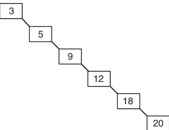

图 11.9 一棵退化的二叉树

我们的目标是将树中的最大路径长度保持在或接近 logn。有多种算法可用于平衡或维护树的平衡。有暴力破解的方法，虽然它们既不优雅也不高效，但可以完成任务。例如，我们可以对树进行中序遍历，并使用递归方法（非常类似于二分查找）将数组的中间元素作为根节点插入，然后构建平衡的左右子树。虽然这种方法行得通，但还有更优雅的解决方案，例如 AVL 树和红/黑树，我们将在本章稍后部分进行研究。

然而，在学习这些技术之前，我们需要理解许多平衡技术中通用的额外术语。这里描述的方法也适用于二叉搜索树的任何子树。对于这些子树，我们只需要将根的引用替换为子树根的引用即可。

### 右旋转

图 11.10 显示了一个不平衡的二叉搜索树以及重新使其平衡所需的处理步骤。这棵树中的最大路径长度为 3，最小路径长度为 1。在树中只有 6 个元素的情况下，最大路径长度应该是 log6，即 2。为了让这棵树平衡，我们需要：

- 将根的左子元素变为新的根元素。
- 将原根元素变为新根的右子元素。
- 将原根的左子节点的右孩子变为原根的新左子节点。

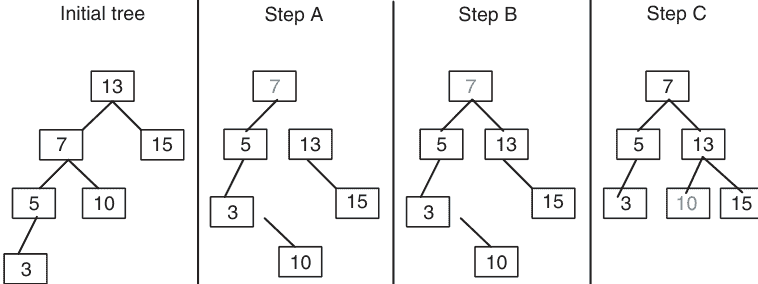

图 11.10 一棵不平衡的树以及通过右旋转产生的平衡树

这种右旋转通常被称为左孩子绕父节点的右旋转。图 11.10 中的最后一张图像显示了右旋转后的相同树。同样的旋转可以在树的任何层级进行。如果不平衡是由根的左节点的左子树中的长路径引起的，那么这种单次右旋转将解决不平衡问题。

### 左旋转

图 11.11 显示了另一个不平衡的二叉搜索树。同样，这棵树中的最大路径长度为 3，最小路径长度为 1。然而，

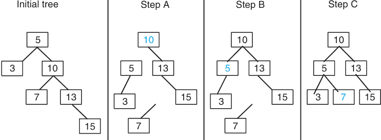

图 11.11 一棵不平衡的树以及通过左旋转产生的平衡树

这次较长的路径位于根的右节点的右子树中。为了让这棵树平衡，我们需要：

- 将根的右子元素变为新的根元素。
- 将原根元素变为新根的左子元素。
- 将原根的右子节点的左孩子变为原根的新右子节点。

这种左旋转通常被称为右孩子绕父节点的左旋转。图 11.11 中的最后一张图像显示了左旋转后的相同树。同样的旋转可以在树的任何层级进行。如果不平衡是由根的右节点的右子树中的长路径引起的，这种单次左旋转将解决不平衡。

### 右-左旋转

遗憾的是，并不是所有的不平衡都能通过单次旋转解决。如果不平衡是由根的左子树中的长路径引起的，我们必须对根的左孩子执行右旋转，然后对生成的根执行左旋转。图中显示了这一过程。

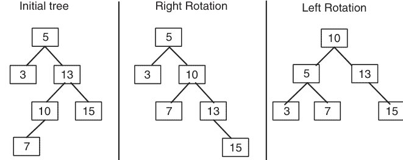

图 11.12 右-左旋转

### 左-右旋转

同样，如果不平衡是由根的右子树中的长路径引起的，我们必须对根的右孩子执行左旋转，然后对生成的根执行右旋转。图 11.13 显示了这一过程。

## 11.5 实现 BST：AVL 树

我们一直在讨论一种平衡树的通用方法，其中根的最大路径长度不能超过 logn，最小路径长度不能少于 logn-1。Adelson-Vels 和 Landis 开发了一种名为 AVL 树的方法，它是该主题的一种变体。对于树中的每个节点，我们将跟踪左右子树的高度。对于树中的任何节点，如果其平衡因子（即右子树的高度减去左子树的高度）大于 1 或小于 -1，则以节点为根的子树需要重新平衡。

树（或任何子树）变得不平衡的方法只有两种：插入元素或删除元素。因此，在执行这些操作中的每一个后，必须更新平衡因子，并从插入或删除节点的地方开始向上到根节点检查树。由于这种向上检查树的需求，AVL 树通常最好通过在每个节点中包含一个父节点引用来实现。在这些图中，所有的边都表示为单向双向。

我们在上一节中讨论的旋转情况在这里同样适用，通过使用这种方法，我们可以轻松地判断何时使用每种旋转。

初始树

左旋转

右旋转

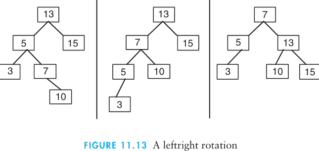

**核心概念**
右子树的高度减去左子树的高度被称为平衡因子。

**核心概念**
树（或任何子树）变得不平衡的方法只有两种：插入元素或删除元素。

### AVL 树中的右旋转

如果一个节点的平衡因子为 -2，这意味着该节点的左子树有一条路径过长。此时，我们检查原始节点左子节点的平衡因子。如果左孩子的平衡因子为 -1，意味着长路径位于左孩子的左子树中，因此，将左孩子围绕原始节点进行简单的右旋转即可恢复树的平衡。图 11.14 显示了插入一个节点如何导致不平衡，以及右旋转如何解决这一问题。请注意，我们同时表示了每个节点存储的值和平衡因子，其中平衡因子显示在括号中。

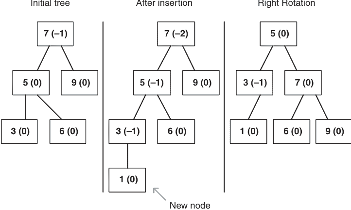

图 11.14 AVL 树中的右旋转

### AVL 树中的左旋转

如果一个节点的平衡因子为 +2，这意味着该节点的右子树有一条路径过长。此时，我们检查原始节点右孩子的平衡因子。如果右孩子的平衡因子为 +1，意味着长路径位于右孩子的右子树中，因此，将右孩子围绕原始节点进行简单的左旋转即可恢复树的平衡。

### AVL 树中的右-左旋转

如果一个节点的平衡因子为 +2，这意味着该节点的右子树有一条路径过长。此时，我们检查原始节点右孩子的平衡因子。如果右孩子的平衡因子为 -1，意味着长路径位于右孩子的左子树中，因此，通过右-左双旋转将恢复树的平衡。这通过以下步骤实现：首先将右孩子的左孩子围绕右孩子进行右旋转，然后将原始节点的右孩子围绕原始节点进行左旋转。图 11.15 显示了从树中删除元素如何导致不平衡，以及右-左旋转如何解决这一问题。同样地，我们同时表示了每个节点存储的值和平衡因子，其中平衡因子显示在括号中。

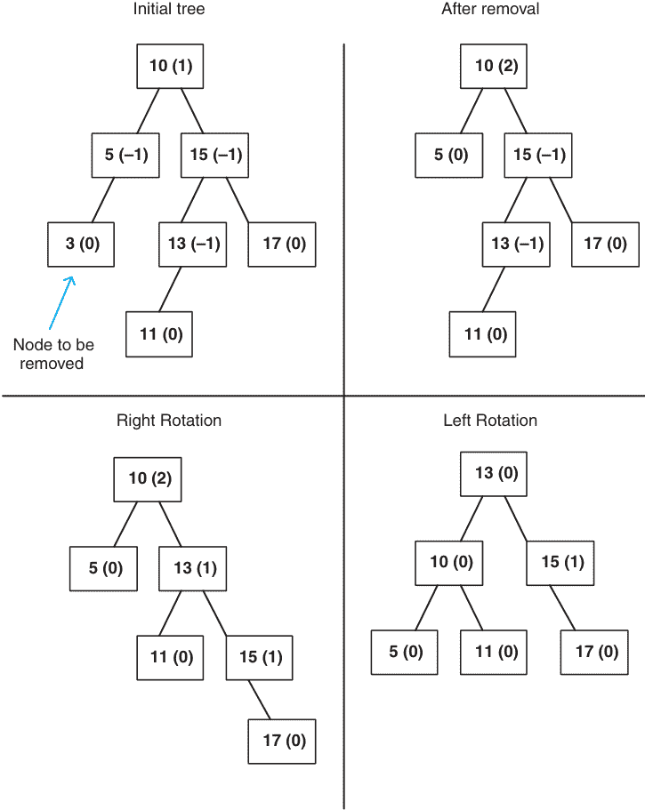

**图 11.15** AVL 树中的右-左旋转

### AVL 树中的左-右旋转

如果一个节点的平衡因子为 -2，这意味着该节点的左子树有一条路径过长。然后我们检查原始节点左子节点的平衡因子。如果左孩子的平衡因子为 +1，意味着路径位于左孩子的右子树中，因此，通过左-右双旋转将恢复树的平衡。这通过以下步骤实现：首先将原始节点的左孩子的右孩子围绕左孩子进行左旋转，然后将原始节点的左孩子围绕原始节点进行右旋转。

## 11.6 实现二叉搜索树：红/黑树

实现二叉搜索树的另一种方案是红/黑树的概念，它由 Bayer、Guibas 和 Sedgewick 开发。红黑树是一种平衡二叉搜索树，其中我们为每个节点都存储一个颜色（红色或黑色，通常实现为布尔值，其中 `false` 等于红色）。以下规则规定了节点的颜色：

- 根节点是黑色的。
- 红色节点的所有孩子都是黑色的。
- 从根到叶子的每条路径包含相同数量的黑色节点。

图 11.16 显示了红黑树（颜色较浅的节点是“红色”）。注意，红黑树的平衡限制比 AVL 树或我们之前的理论讨论要松一些。然而，在这两种实现中查找元素的操作都是 O(log n)。因为任何红色节点不能有红色孩子，所以一条路径中最多有一半的节点是黑色的。据此我们可以推断，红黑树的最大高度约为 2*log n，因此最长路径的遍历次数仍为 log n。

**核心概念**
红黑树的平衡限制比 AVL 树要松一些。

# 第 11 章 二叉搜索树

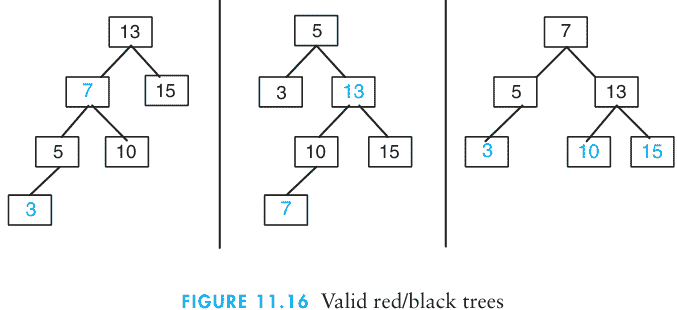

与 AVL 树一样，我们只有在树中插入或删除元素后才需要担心平衡问题。与 AVL 树的情况不同，插入和删除是完全分开处理的。

## 向红黑树中插入

向红黑树插入元素的过程与我们早先的 `createElement` 方法相似。然而，我们总是从将新元素的颜色设置为红色开始。一旦插入了新元素，我们将根据需要重新平衡树，并改变元素的颜色以维护红黑树的属性。最后一步，我们将树根的颜色设置为黑色。为了讨论起见，我们将简单地引用节点的 `node.color`。但在实际实现中，创建一个返回节点颜色的方法可能会更优雅。

插入后的重新平衡（以及重新着色）过程是一个迭代（或递归）过程。我们检查父节点和叔节点的颜色。如果叔节点是红色的，我们就重新着色。如果叔节点是黑色的，我们就执行旋转以恢复平衡。

## 11.6 实现 BST：红黑树

我们将当前节点的父节点设置为黑色，将当前节点父节点的右侧兄弟节点设置为黑色，并将当前节点的祖父节点设置为红色。然后，我们将当前节点指向其祖父节点。由于新当前节点的父节点是黑色的，我们的循环随终止。最后，我们将根节点的颜色设置为黑色。

如果 `parent.color == black`，我们首先检查 current 是左孩子还是右孩子。如果 current 是右孩子，那么在继续操作之前，我们必须将 current 设置为与其颜色（current 周围）相同的颜色。一旦完成这一步，处理步骤就与 current 起初是左孩子的情况完全相同：

- 将 current 的父节点的颜色设置为黑色。
- 将 current 的祖父节点的颜色设置为红色。
- 如果 current 的祖父节点不为 null，则对 current 的祖父节点进行右旋。

如你所见，根据 current 的父节点是左孩子还是右孩子，这些分类情况是对称的。

## 从红黑树中删除元素

与插入类似，删除操作的行为与之前非常相似，只是增加了一个平衡（重新着色）树的步骤。删除元素后的平衡（重新着色）过程是从删除点开始向根节点迭代的。该过程的终止条件是 `current == root`，其中 current 是正在处理的节点，或者 `current.color == red`。

与插入的情况相同，根据 current 是左孩子还是右孩子，删除的情况是对称的。我们只检查 current 是右孩子的情况，其他情况通过简单地在后续分类中替换左和右即可得到。

在插入中，我们更关注当前父节点的颜色。在删除中，我们将关注 current 兄弟的颜色。可以使用 `current.parent.left` 来引用该颜色，但我们将直接引用 `sibling.color`。注意的是，空对象的默认颜色是黑色。因此，如果我们尝试获取空对象的颜色，结果将是黑色。图 11.19 显示了删除元素后的红黑树。

## 初始树


## 中间步骤

兄弟  current

待删除元素

## 中间步骤

## 最终树

 兄弟 current

> 图 11.19 删除后的红黑树

如果兄弟的颜色为红色，在执行任何其他操作之前，我们必须完成以下处理步骤：

- 将兄弟设置为黑色。
- 将 current 的父节点设置为红色。
- 将兄弟绕其父节点右旋。
- 将兄弟设置为父节点的左孩子。

接下来，无论原始兄弟是红色还是黑色，我们的处理都会继续。现在根据兄弟的孩子分类，如果两个孩子都是黑色（或空），我们执行以下操作：

- 将兄弟设置为红色。
- 将 current 设置为父节点。

## 11.6 实现 BST：红黑树

如果兄弟的孩子不全为黑色，检查兄弟的左孩子是否为黑色。如果是，在继续之前我们必须完成以下步骤：

- 将兄弟的右孩子设置为黑色。
- 将兄弟设置为红色。
- 将兄弟的右孩子绕其父节点的左孩子左旋。
- 将兄弟设置为父节点的左孩子。

然后，为了完成兄弟的孩子不全为黑色的过程，我们必须：

- 将兄弟的颜色设置为其父节点的颜色。
- 将父节点的颜色设置为黑色。
- 将兄弟的左孩子设置为黑色。
- 将兄弟绕其父节点右旋。
- 将 current 设置为根。

一旦循环终止，我们必须移除该节点并将父节点的子引用设置为 null。

## 核心概念总结

- 二叉搜索树是一种二叉树，其额外属性是：左孩子小于父节点，而父节点小于等于右孩子。
- 二叉搜索树的定义是二叉树定义的扩展。
- 每个 `BinaryTreeNode` 对象维护指向存储在该节点元素的引用，以及指向节点每个孩子的引用。
- 在二叉搜索树中删除元素时，必须提升另一个节点来替换被删除的节点。
- 二叉搜索树中最左的节点包含最小元素，而最右的节点包含最大元素。
- 树的用途之一提供其他集合的高效实现。
- 如果二叉搜索树是不平衡的，它的效率可能低于线性结构。
- 右子树的高度减去左子树的高度称为节点的“平衡因子”。
- 树或树的任何子树变得不平衡的方法只有两种：通过插入节点和删除节点。
- 红黑树的平衡限制比 AVL 树稍松。然而，在两种情况下，查找操作的时间复杂度都是 $O(\log\ n)$。

## 术语总结

**二叉搜索树 (binary search tree)**：一种二叉树，其额外属性是：对于每个节点，左子节点小于父节点，而父节点小于等于右子节点。

**提升 (promoted)**：用于描述树中的某个节点向上移动以替换被删除的父节点或祖先节点的术语。

**退化树 (degenerate tree)**：一种不产生分支的树。

**右旋 (right rotation)**：当长路径在根的左孩子时，平衡树的单旋转策略。

**左旋 (left rotation)**：当长路径在根的右孩子时，平衡树的单旋转策略。

**右-左旋转 (right-left rotation)**：当长路径在根的右孩子的左子树时，平衡树的双重旋转策略。

**左-右旋转 (left-right rotation)**：当长路径在根的左孩子的右子树时，平衡树的双重旋转策略。

**AVL 树 (AVL trees)**：一种利用节点平衡因子来平衡二叉搜索树的策略。

**平衡因子 (balance factor)**：通过右子树高度减去左子树高度得到的节点属性。如果结果大于 1 或小于 -1，则树是不平衡的。

**红黑树 (red/black trees)**：一种利用每个节点关联颜色（红色或黑色）来平衡二叉搜索树的策略。

## 自习题

- SR 11.1 二叉树和二叉搜索树的区别是什么？
- SR 11.2 为什么我们能为二叉搜索树指定 `addElement` 操作，但对二叉树不行？
- SR 11.3 假设树是平衡的，`addElement` 操作的时间复杂度（阶）是多少？
- SR 11.4 在没有平衡假设的情况下，`addElement` 操作的时间复杂度（阶）是多少？
- SR 11.5 如本所述，退化树的效率可能比链表低。为什么？
- SR 11.6 在二叉搜索树中删除元素时，我们使用后序继节点作为两个孩子节点的替换节点。还有什么其他合理的替换选择？
- SR 11.7 `removeAllOccurrences` 操作同时使用了 `contains` 操作和 `removeElement` 操作。该操作的结果时间复杂度（阶）是多少？
- SR 11.8 在我们早期的有序列表实现中，`removeFirst` 和 `first` 是 $O(1)$ 操作。为什么在我们的 `BinarySearchTreeOrderedList` 中它们的效率较低？
- SR 11.9 为什么 `BinarySearchTreeOrderedList` 类必须定义 `iterator` 方法？为什么它不能像处理 `size` 和 `isEmpty` 那样依靠父类？
- SR 11.10 在修改为以实现 AVL 树后，`addElement` 操作的时间复杂度是多少？
- SR 11.11 单次右旋转可以修复哪种不平衡？
- SR 11.12 左-右旋转可以修复哪种不平衡？
- SR 11.13 AVL 树节点的平衡因子是什么？
- SR 11.14 在我们讨论 AVL 树的重新平衡过程时，从没有讨论过节点平衡因子为 +2 或 -2 且其子节点平衡因子为 +2 或 -2 的可能性。为什么？
- SR 11.15 我们注意到红黑树的平衡限制比 AVL 树更松，但仍然声称遍历红黑树的最长路径仍然是 O(log n)。为什么？

## 习题

- EX 11.1 画出添加整数 (34 45 3 8 65 32 1 12 17) 后得到的二叉搜索树。假设我们使用没有平衡机制的简单实现。
- EX 11.2 从练习 11.1 得到的树开始，画出删除 (45 12 1) 后得到的树，再次使用我们没有平衡机制的简单实现。
- EX 11.3 重复练习 11.1，这次假设是 AVL 树。在你的图中包含平衡因子。
- EX 11.4 重复练习 11.2，这次假设是 AVL 树并使用练习 11.3 的结果作为起点。在你的图中包含平衡因子。
- EX 11.5 重复练习 11.1，这次假设是红黑树。为每个节点标记颜色。
- EX 11.6 重复练习 11.2，这次假设是红黑树并使用练习 11.5 的结果作为起点。为每个节点标记颜色。
- EX 11.7 从一棵红黑树开始，针对以下系列插入和删除操作，画出插入/删除后、重新平衡前的树，以及重新平衡后（如有必要）的树：


```
addElement(40);
addElement(25);
addElement(10);
addElement(5);
addElement(1);
addElement(45);
addElement(50);
removeElement(40);
removeElement(25);
```

- EX 11.8 重复练习 11.7，这次使用 AVL 树。

## 编程项目

- PP 11.1 使用第 10 章描述的计算策略开发一个二叉搜索树的数组实现。
- PP 11.2 `LinkedBinaryTree` 类目前使用了 `LinkedBinaryTree` 类的 `find` 和 `contains` 方法。为 `LinkedBinarySearchTree` 类实现这些方法，通过二叉搜索树的顺序属性来提高效率。
- PP 11.3 为我们的链式二叉搜索树实现 `removeMax`、`findMin` 和 `findMax` 操作。
- PP 11.4 修改二叉搜索树的实现，使其不再允许重复值。
- PP 11.5 使用第 11.4 节描述的暴力法为链式实现实现平衡树方法。
- PP 11.6 使用第 11.4 节描述的暴力法为项目 11.1 中的数组实现实现平衡树方法。
- PP 11.7 使用模拟链接策略，在二叉树的数组实现基础上构建一个二叉搜索树的数组实现。数组的每个元素都需要维护一个指向存储在该处的数据元素的引用，以及左孩子和右孩子的数组中的位置。你还需要维护一个已删除元素的数组位置列表，以便重用这些位置。
- PP 11.8 修改链式二叉搜索树实现，使其成为 AVL 树。
- PP 11.9 修改链式二叉搜索树实现，使其成为红黑树。
- PP 11.10 修改链式二叉搜索树实现的 `add` 操作，使其使用迭代算法。

## 自测题答案

- SRA 11.1 二叉搜索树增加了一个顺序属性，即任何节点的左孩子都小于该节点，且该节点小于或等于其右孩子。
- SRA 11.2 得益于二叉搜索树的额外顺序属性，我们现在能够定义添加或删除后树应该处于的状态。对于二叉树，我们无法定义这种状态。
- SRA 11.3 如果树是平衡的，找到新元素的插入点最坏需要 log n 步，而插入元素只需设置一个引用的值，该操作是 O(log n)。
- SRA 11.4 在没有平衡假设的情况下，最坏的情况是退化树，它在实际上等于链表。因此，`addElement` 操作是 O(n)。
- SRA 11.5 退化树会浪费未使用的引用空间，且许多算法在沿退化路径执行之前会检查空引用，这增加了链式实现中不包含的步骤。
- SRA 11.6 最佳选择是中序后继节点，因为我们将相等的值放置在右侧。
- SRA 11.7 AVL 树的重新平衡是在插入或删除后进行的，从受影响的节点开始沿着单条路径到根节点。随着我们向上移动，我们会更新平衡因子并在必要时进行旋转。我们不会遇到子节点和父节点平衡因子均为 ±2 的情况，我们在到达父节点之前已经修复了子节点。
- SRA 11.8 在平衡树中，找到新元素的插入点最坏需要 log n 步，而插入元素只需设置一个引用的值，该操作是 O(log n)。
- SRA 11.9 因为红色节点不能有红色孩子，且路径中至少有一半的节点可以是红色节点，从这一点可以推断红黑树的最大高度约为 2*log n，因此遍历最长路径是 O(log n)。
- SRA 11.10 注意，`addElement` 方法只影响单条路径，在平衡树中这条路径到达根节点。更新平衡因子是 O(1) 步，旋转也是 O(1) 步。这些操作最多只需执行 n 次。因此，`addElement` 的时间复杂度为 2*log n 或 O(log n)。
- SRA 11.11 如果长路径位于根节点的左孩子的左分支中，单次右旋转可以修复不平衡。
- SRA 11.12 如果长路径位于根节点的左孩子的右分支中，左右旋转可以修复不平衡。
- SRA 11.13 AVL 树节点的平衡因子是右子树的高度减去左子树的高度。

Collins, W. J. *Data Structures and the Java Collections Framework*. New York: McGraw-Hill, 2002.
Cormen, T., C. Leerson, and R. Rivest. *Introduction to Algorithms*. New York: McGraw-Hill, 1992.
Guibas, L., and R. Sedgewick. “A Diochromatic Framework for Balanced Trees.” *Proceedings of the 19th Annual IEEE Symposium on Foundations of Computer Science (1978)*: 8–21.

# 第 12 章 堆与优先级队列

在本章中，我们将研究另一种二叉树的有序扩展。我们将研究堆，包括链表实现和数组实现，以及从堆中添加和删除元素的算法。我们还将研究堆的一些用途，包括优先级队列的实现。

## 章节目标

- 定义堆抽象数据结构。
- 演示如何使用堆来解决问题。
- 检查堆的各种实现。
- 比较堆的实现方式。

## 12.1 堆

堆是一个具有两个额外属性的二叉树：

- 它是一棵完全树，如第 10 章所述。
- 对于每个节点，该节点的值小于或等于其左孩子和右孩子。

### 核心概念

最小堆（minheap）是一棵完全二叉树，其中每个节点都小于或等于它的两个子节点。

这个定义描述了最小堆。堆也可以是最大堆（max-heap），其中节点大于或等于它的子节点。我们在本章中的讨论重点放在最小堆上。所有过程通过反转比较适用于最大堆。

图 12.1 描述了堆上的操作。堆被定义为二叉树的扩展，因此也继承了它所有的操作。注意，由于二叉树的实现没有任何添加或删除树元素的运算，因此没有操作会违反堆的属性。列表 12.1 显示了 `HeapADT` 的接口定义。图 12.2 显示了 `HeapADT` 的 UML 描述。

| 操作 | 描述 |
| --- | --- |
| `addElement` | 将给定元素添加到堆中。 |
| `removeMin` | 删除并返回堆中的最小元素。 |
| `findMin` | 返回堆中最小元素的引用。 |

> 图 12.1 堆上的操作

### 列表 12.1

```java
package jsjf;

/**
 * HeapADT 定义了堆的接口。
 * 
 * @author Lewis and Chase
 * @version 4.0
 */
public interface HeapADT<T> extends BinaryTreeADT<T> {

    /**
     * 将指定的对象添加到此堆中。
     * @param obj 要添加到堆的元素
     */
    public void addElement(T obj);

    /**
     * 从此堆中删除值最低的元素
     * @return 堆中值最低的元素
     */
    public T removeMin();

    /**
     * 返回此堆中值最低的元素的引用。
     * @return 堆中值最低的元素的引用
     */
    public T findMin();
}
```


图 12.2 `HeapADT` 的 UML 描述

### 图 12.3 包含相同数据的两个最小堆


简单来说，最小堆始终将其最小元素存储在二叉树的根节点，且最小堆根节点的两个孩子也是最小堆。图 12.3 展示了两个具有相同数据的有效最小堆。让我们看看堆上的基本操作，并为每个操作生成通用算法。

### addElement 操作

`addElement` 方法将给定元素添加到堆中适当的位置，同时维护堆的完全属性和排序属性。如果给定元素不是可比较的（`Comparable`），该方法将抛出 `ClassException`。

如果二叉树是平衡的，则被认为是完全，这意味着所有的叶节点都在第 $h$ 或 $h-1$ 层，其中 $h = \log_2 n$，$n$ 是树中元素的数量，且所有位于第 $h$ 层的叶节点都在树的左侧。因为堆是完全树，因此新节点插入只有一个正确的位置，要么是第 $h$ 层从左侧的下一个空位置，要么是第 $h$ 层已满，第 $h+1$ 层的第一个位置。图 12.4 说明了这两种可能性。

`addElement` 方法将给定的 `Comparable` 元素添加到堆中适当的位置，同时维护堆的完全属性和排序属性。


图 12.4 堆的插入点

一旦我们确定了位置，只需将值与父节点进行交换（如果值较小）。这个过程重复直到它小于它的两个子节点。图 12.5 展示了向堆中插入新节点的过程。


图 12.5 插入堆中

## 12.2 使用堆：优先级队列

### 列表 12.2（续上）

```java
/**
 * 返回此节点中的元素。
 * @return 节点包含的元素
 */
public T getElement() {
    return element;
}

/**
 * 返回此节点的优先级值。
 * @return 节点的整数优先级
 */
public int getPriority() {
    return priority;
}

/**
 * 返回此节点的到达顺序。
 * @return 节点的整数到达顺序
 */
public int getArrivalOrder() {
    return arrivalOrder;
}

/**
 * 返回此节点的字符串表示。
 */
public String toString() {
    return (element + " " + priority + " " + arrivalOrder);
}

/**
 * 如果此对象的优先级高于给定的对象，
 * 则返回 1，否则返回 -1。
 * @param obj 与此节点比较的对象
 * @return 给定对象与此对象比较的结果
 */
public int compareTo(PrioritizedObject obj) {
    int result;
    if (priority > obj.getPriority())
        result = 1;
    else if (priority < obj.getPriority())
        result = -1;
    else if (arrivalOrder > obj.getArrivalOrder())
        result = 1;
    else
        result = -1;
    return result;
}
```

### 列表 12.3

```java
import jsjf.*;

/**
 * PriorityQueue 使用堆实现了一个优先级队列。
 * @author Lewis and Chase
 * @version 4.0
 */
public class PriorityQueue<T> extends ArrayHeap<PrioritizedObject<T>> {

    /**
     * 创建一个空的优先级队列。
     */
    public PriorityQueue() {
        super();
    }

    /**
     * 将给定的元素添加到此 PriorityQueue 中。
     * @param object 要添加到优先级队列的元素
     * @param priority 要添加元素的整数优先级
     */
    public void addElement(T object, int priority) {
        PrioritizedObject<T> obj = new PrioritizedObject<T>(object, priority);
        super.addElement(obj);
    }

    /**
     * 从此优先级队列中移除下一个高优先级元素，
     * 并返回其引用。
     * @return 队列中下一个高优先级元素的引用
     */
    public T removeNext() {
        PrioritizedObject<T> obj = (PrioritizedObject<T>)super.removeMin();
        return obj.getElement();
    }
}
```

## 12.3 实现堆：使用链接

到目前为止，我们树的所有实现都是使用链接来说明的。因此，将讨论扩展到堆的链接实现是自然的。由于我们需要在插入后能够遍历树，堆中的节点必须存储一个指向其父节点的指针。由于 `BinaryTree` 类没有父指针，我们通过创建一个 `HeapNode` 类来开始链接实现，该类继承自我们的 `BinaryTreeNode` 类并添加了父指针。列表 12.4 显示了 `HeapNode` 类。

### 核心概念

由于我们需要在插入后能够遍历树，堆中的节点必须存储一个指向其父节点的指针。

### 列表 12.4

```java
package jsjf;

/**
 * HeapNode 表示一个带有父指针的二叉树节点，用于堆。
 *
 * @author Lewis and Chase
 * @version 4.0
 */
```


# HeapNode 类

```java
public class HeapNode<T> extends BinaryTreeNode<T> {

    protected HeapNode<T> parent;

    /**
     * 使用指定的数据创建一个新的堆节点。
     * @param obj 要包含在新堆节点中的数据
     */
    public HeapNode(T obj) {
        super(obj);
        parent = null;
    }

    /**
     * 返回此节点的父节点。
     * @return 节点的父节点
     */
    public HeapNode<T> getParent() {
        return parent;
    }

    /**
     * 设置存储在此节点上的元素。
     * @param element 要存储的元素
     */
    public void setElement(T obj) {
        element = obj;
    }

    /**
     * 设置此节点的父节点。
     * @param node 节点的父节点
     */
    public void setParent(HeapNode<T> node) {
        parent = node;
    }
}
```

对于链接实现，额外的实例数据将由指向 `lastNode` 的引用组成，以便我们可以跟踪最后一个叶子节点。

## addElement 操作

`addElement` 方法必须完成三项任务：在适当的位置添加节点，重新调整堆以维护顺序，然后将 `lastNode` 指针重置为指向最后一个叶子节点。

对于链接实现，该方法还使用了两个私有方法：`getNextParentAdd` 返回将作为插入节点的父节点，以及 `heapifyAdd` 从叶子开始向根完成任何必要的堆调整。

```java
/**
 * 根据其键值将指定元素添加到此堆的相应
 * 位置。
 * @param obj 要添加到堆的元素
 */
public void addElement(T obj) {
    HeapNode<T> node = new HeapNode<T>(obj);
    if (root == null) {
        root = node;
    } else {
        HeapNode<T> nextParent = getNextParentAdd();
        if (nextParent.getLeft() == null) {
            nextParent.setLeft(node);
        } else {
            nextParent.setRight(node);
        }
        node.setParent(nextParent);
    }
    lastNode = node;
    modCount++;
    if (size() > 1) {
        heapifyAdd();
    }
}
```

```java
/**
 * 返回将作为节点的父节点
 * @return 节点的父节点
 */
private HeapNode<T> getNextParentAdd() {
    HeapNode<T> result = lastNode;
    while (result != root) {
        if (result.getParent().getRight() == null) {
            return result.getParent();
        } else {
            result = result.getParent();
        }
    }
    return root;
}
```

```java
/**
 * 在添加节点后重新调整堆。
 */
private void heapifyAdd() {
    T temp;
    HeapNode<T> next = lastNode;
    temp = next.getElement();
    while (next != root && ((Comparable)temp).compareTo(next.getParent().getElement()) < 0) {
        next.setElement(next.getParent().getElement());
        next = next.parent;
    }
    next.setElement(temp);
}
```

## 第 12 章 堆

在链接实现中，添加元素的过程的第一步是确定节点的父节点。由于在最坏情况下，这涉及到从堆的右下节点遍历到根节点再到达堆的左下节点，该步骤的时间复杂度为 $O(\log n)$。下一步是插入新节点。由于只涉及一次赋值，该步骤的时间复杂度为 $O(1)$。最后一步是必要时重新调整从叶子到根的路径。此过程涉及 $\log n$ 次比较。因此，链接实现的 `addElement` 操作的时间复杂度为 $O(\log n)$。

## removeMin 操作

`removeMin` 方法必须完成三项任务：用最后一个节点替换存储在根节点中的元素，必要时重新调整堆，并返回原始根元素。与 `addElement` 方法类似，`removeMin` 方法使用了两个额外方法：`getLastNode` 返回将作为新节点的引用，以及 `heapifyRemove` 完成从根开始的任何树的重新调整。这三个方法如下所示。

```java
/**
 * 移除堆中值最小的元素
 * 并返回其引用。如果堆为空，则抛出 EmptyCollectionException。
 *
 * @return 堆中值最小的元素
 * @throws EmptyCollectionException 如果堆为空
 */
public T removeMin() throws EmptyCollectionException {
    if (isEmpty())
        throw new EmptyCollectionException("LinkedHeap");
    T minElement = root.getElement();

    if (size() == 1) {
        root = null;
        lastNode = null;
    } else {
        HeapNode<T> nextLast = getLastNode();
        if (lastNode.getParent().getLeft() == lastNode)
            lastNode.getParent().setLeft(null);
        else
            lastNode.getParent().setRight(null);
        ((HeapNode<T>)root).setElement(lastNode.getElement());
        lastNode = nextLast;
        heapifyRemove();
    }
    modCount++;
    return minElement;
}
```

```java
/**
 * 返回删除后将成为最后一个节点的节点。
 *
 * @return 删除后新的最后一个节点
 */
private HeapNode<T> getLastNode() {
    HeapNode<T> result = lastNode;
    while ((result != root) && (result.getParent().getLeft() == result))
        result = result.getParent();
    if (result != root)
        result = (HeapNode<T>)result.getParent().getLeft();
    while (result.getRight() != null)
        result = (HeapNode<T>)result.getRight();
    return result;
}
```

```java
/**
 * 在移除根元素后重新调整此堆。
 */
private void heapifyRemove() {
    T temp;
    HeapNode<T> node = (HeapNode<T>)root;
    HeapNode<T> left = (HeapNode<T>)node.getLeft();
    HeapNode<T> right = (HeapNode<T>)node.getRight();
    HeapNode<T> next;

    if ((left == null) && (right == null)) {
        next = null;
    } else if (right == null) {
        next = left;
    } else if (((Comparable)left.getElement()).compareTo(right.getElement()) < 0) {
        next = left;
    } else {
        next = right;
    }

    temp = node.getElement();
    while ((next != null) &&
           ((Comparable)next.getElement()).compareTo(temp) < 0) {
        node.setElement(next.getElement());
        node = next;
        left = (HeapNode<T>)node.getLeft();
        right = (HeapNode<T>)node.getRight();
        if ((left == null) && (right == null)) {
            next = null;
        } else if (right == null) {
            next = left;
        } else if (((Comparable)left.getElement()).compareTo(right.getElement()) < 0) {
            next = left;
        } else {
            next = right;
        }
    }
    node.setElement(temp);
}
```

## 12.4 实现堆：使用数组

链表实现的 `removeMin` 方法必须移除根元素，并用最后一个节点的元素替换它。由于这个过程是通过简单的赋值语句完成的，因此该步骤的时间复杂度为 $O(1)$。接下来，如果有必要，必须从上到叶子节点重新调整堆。从根节点到叶子节点的最大路径长度为 $\log n$，这一步的时间复杂度为 $O(\log n)$。最后，我们必须确定新的最后一个节点。类似于为 `addElement` 方法确定下一个父节点的过程，最坏情况是我们必须遍历一个叶子节点，通过根节点向下到达另一个叶子节点。该步骤的时间复杂度为 $O(\log n)$。

### findMin 操作

`findMin` 方法只需返回存储在堆根部的元素引用，因此其时间复杂度为 $O(1)$。

到目前，我们对树的实现的讨论主要围绕链式结构展开。然而，如果你还记得，在第 10 章中我们讨论了两种不同的树实现策略：计算策略和模拟链接策略。堆的数组实现可能提供一个比我们的链表实现更简单的替代方案。链表实现的许多复杂性与遍历以及向上向下移动到树的最后一个叶子节点，或确定要插入节点的父节点有关。这些困难在通过查看数组中存储的元素来确定树的最后一个节点时并不存在。

正如第 10 章所示，可以使用符号创建二叉树的简单数组实现：树的根位于位置 0，对于每个节点 n，n 的左孩子将位于数组中的位置 `2n + 1`，而 n 的右孩子将位于位置 `2n + 2`（*注：原文此处可能有笔误，应为 2n+2*）。当然，反之亦然。对于根节点以外的任何节点 n，n 的父节点位于位置 `(n-1)/2`。由于我们能够计算父节点的位置，数组实现（与链表实现不同）不需要创建 `HeapNode` 类。堆的数组实现的 UML 描述留作了一个练习。

正如 `LinkedHeap` 类继承自 `LinkedBinaryTree` 类，`ArrayHeap` 也继承自 `ArrayBinaryTree` 类。提供了这两个类的类头、属性和构造函数供参考。

> ### 核心概念
> 在二叉树的数组实现中，树的根位于位置 0，对于每个节点 n，n 的左孩子将位于数组中的位置 `2n + 1`，而 n 的右孩子将位于位置 `2n + 2`。

```java
/**
 * 移除此堆中值最小的元素
 * 返回该元素的引用。如果堆为空，则抛出 EmptyCollectionException
 *
 * @return 此堆中值最小的元素的引用
 * @throws EmptyCollectionException 如果堆为空
 */
public T removeMin() throws EmptyCollectionException {
    if (isEmpty()) {
        throw new EmptyCollectionException("ArrayHeap");
    }
    T minElement = tree[0];
    tree[0] = tree[count - 1];
    heapifyRemove();
    count--;
    modCount++;
    return minElement;
}
```

```java
/**
 * 在移除最小元素后，重新调整此堆以维持其排序属性。
 */
private void heapifyRemove() {
    T temp;
    int node = 0;
    int left = 1;
    int right = 2;
    int next;

    if ((tree[left] == null) && (tree[right] == null)) {
        next = count;
    } else if (tree[right] == null) {
        next = left;
    } else if (((Comparable)tree[left]).compareTo(tree[right]) < 0) {
        next = left;
    } else {
        next = right;
    }

    temp = tree[node];

    while ((next < count) &&
           ((Comparable)tree[next]).compareTo(temp) < 0) {
        tree[node] = tree[next];
        node = next;
        left = 2 * node + 1;
        right = 2 * (node + 1);
        if ((tree[left] == null) && (tree[right] == null))
            next = count;
        else if (tree[right] == null)
            next = left;
        else if (((Comparable)tree[left]).compareTo(tree[right]) < 0)
            next = left;
        else
            next = right;
    }
    tree[node] = temp;
}
```

## 核心概念

链表实现和数组实现的 `removeMin` 操作复杂度均为 $O(\log n)$。

与 `addElement` 类似，数组实现的 `removeMin` 操作看起来与链表实现完全一样，区别在于它不需要确定新的最后一个节点。因此，结果复杂度为 $O(\log n)$。

## findMin 操作

与链表实现一样，`findMin` 方法只需返回存储在堆根或数组位置 0 处的元素引用，因此其复杂度为 $O(1)$。

## 12.5 使用堆：堆排序


# 第 12 章 堆和优先级队列

## 12.5 使用堆

现在我们已经检查了堆的数组实现，让我们考虑另一种使用它的方法。在第 9 章中，我们引入了各种排序技术，其中一些是顺序排序（冒泡排序、选择排序和插入排序），另一些是对数级排序（合并排序和快速排序）。在那个章节中，我们还介绍了一种基于队列的排序，称为基数排序。鉴于堆的排序属性，自然会想到使用堆来对数字列表进行排序。堆排序的暴力方法是将列表中的每个元素都添加到堆中，然后从根部逐个移除。对于最小堆（`minheap`），结果将是升序列表；对于最大堆（`maxheap`），结果将是降序列表。由于添加操作和移除操作均为 O(log n)，人们可能会认为堆排序是 O(log n)。然而，请记住，这些操作是在包含 n 个元素的列表中添加或移除单个元素，复杂度为 O(log n)。对于任何给定的节点，插入堆的操作是 O(log n)，因此对于 n 个节点是 O(n log n)。移除单个节点的操作也是 O(log n)，因此对于 n 个节点是 O(n log n)。在堆排序算法中，我们执行了 n 次操作（`addElement` 和 `removeMin`），对应列表中的每个元素执行一次。因此，最终的复杂度为 2 x n log n 或 O(n log n)。

## 核心概念

- 堆排序由将列表的元素添加到堆中并逐个移除组成。
- 也可以使用待排序的数组来“构建”一个堆。因为我们知道堆中每个父节点和子节点的相对位置，我们可以直接从数组中的第一个非叶子节点开始，将其与其子节点比较并在必要时进行交换。然后我们反向处理数组，直到到达根节点。由于每个非叶子节点最多只需要两次比较，这种方法构建堆的复杂度是 O(n)。然而，使用这种方法从堆中移除每个元素并维持堆的属性仍然是 O(log n)。因此，尽管这种方法效率略高（大约为 2 x n + n log n），但它仍然是 O(n log n)。该方法的实现留作了一个练习题。可以将 `heapSort` 方法添加到我们在第 9 章描述的排序方法类中。列表 12.5 展示了如何作为一个独立的类来创建它。

## 核心概念

堆排序是 O(n log n)。


在数组上演示堆排序

## 列表 12.5

```java
package jsjf;

/**
 * HeapSort 使用堆排序给定的 Comparable 对象数组
 * @Author Lewis and Chase
 * @version 4.0
 */
public class HeapSort<T>
{
   /**
    * 使用堆排序数组
    * @param data 要添加到堆的数据
    */
  public void HeapSort(T[] data) {
    ArrayHeap<T> temp = new ArrayHeap<T>();

    // 将数组复制到堆
    for (int i = 0; i < data.length; i++) {
        temp.addElement(data[i]);
    }

    // 将排序后的元素放回数组
    int count = 0;
    while (!temp.isEmpty()) {
        data[count] = temp.removeMin();
        count++;
    }
}
```

## 核心概念

- 链表实现和数组实现的 `removeMin` 操作均为 O(log n)。
- 与 `addObject` 类似，数组实现的 `removeMin` 操作看起来与链表实现完全一样，区别在于它不需要确定新的最后一个节点。因此，结果复杂度为 log n + 1 或 O(log n)。

## findMin 操作

- 与链表实现一样，`findMin` 方法只需返回存储在堆根或数组位置 0 处的元素引用，因此是 O(1)。

## 术语总结

- **heap (堆)**：最小堆或最大堆的二叉树。
- **minheap (最小堆)**：具有两个属性的二叉树：它是一棵完全二叉树，且对于每个节点，节点的值小于或等于其左节点和右节点。
- **maxheap (最大堆)**：具有两个属性的二叉树：它是一棵完全二叉树，且对于每个节点，节点的值大于或等于其左节点和右节点。
- **complete binary tree (完全二叉树)**：一种平衡的二叉树，其中最低层 (h) 的所有叶子节点都在树的左侧。
- **priority queue (优先级队列)**：遵循两种排序规则的集合：高优先级项目优先，优先级相同的项目按先出原则排序。

## 自习题

- 堆（最小堆）和二叉搜索树有什么区别？
- 最小堆和最大堆之间有什么区别？
- 二叉树是“完全”的意味着什么？
- 堆需要重新平衡吗？
- 链表的 `addElement` 操作必须确定下一个插入节点的父节点。为什么？
- 为什么数组实现的 `addElement` 操作不需要确定下一个插入节点的父节点？
- 两种实现的 `removeMin` 操作都将根部元素替换为堆的最后一个叶子节点。为什么这是正确的替换方式？
- `addElement` 操作的时间复杂度是多少？
- `removeMin` 操作的时间复杂度是多少？
- 堆排序的时间复杂度是多少？

## 练习题

- **EX 12.1**: 画出添加以下整数后的堆：34 45 3 87 65 32 1 12 17
- **EX 12.2**: 从练习 12.1 得到的树开始，画出执行 `removeMin` 操作后得到的堆。
- **EX 12.3**: 从空最小堆开始，在执行以下操作后画出堆：`addElement(40);`，`addElement(25);`。

```java
removeMin();
addElement(10);
removeMin();
addElement(5);
addElement(1);
removeMin();
addElement(45);
addElement(50);
```

- **EX 12.4**: 重复练习 12.3，这次使用大顶堆（`maxheap`）。
- **EX 12.5**: 为本章描述的优先级队列（`PriorityQueue`）画出 UML 图。
- **EX 12.6**: 为本章描述的堆的数组实现画出 UML 图。

## 编程项目

- **PP 12.1**: 使用堆实现队列。请记住，队列在结构上是先进先出的（FIFO）。因此，堆中的比较必须根据进入队列的顺序进行。
- **PP 12.2**: 使用堆实现栈。请记住，栈是后进先出的结构（LIFO）。因此，堆中的比较必须根据进入队列的顺序进行。
- **PP 12.3**: 使用数组实现大顶堆。
- **PP 12.4**: 使用链表实现大顶堆。
- **PP 12.5**: 如第 12.5 节所述，可以使用一种在待排序数组上就地构建堆的方法来提高堆排序算法的效率。实现这种方法，并重写堆排序算法以利用它。
- **PP 12.6**: 使用堆实现一个进程调度系统的模拟器。在该系统中，作业将从文件中读取，包含作业 ID（一个六位字符串）、作业长度（表示秒数的 int）和作业优先级（数值越高优先级越高的 int）。每个作业还将被分配一个到达编号（表示其到达顺序的 int）。模拟器应输出作业 ID、优先级、作业长度以及完成时间（相对于起始时间 0）。
- **PP 12.7**: 使用小顶堆（`minheap`）创建一个生日提醒系统，使得堆每天都根据距离个人生日的剩余天数进行排序。请记住，生日过后，必须对堆重新排序。
- **PP 12.8**: 完成 `ArrayHeap` 的实现，包括 `ArrayHeap` 继承的 `ArrayBinaryTree` 类。
- **PP 12.9**: 完成 `LinkedHeap` 类的实现。

## 自复习题答案

- **SRA 12.1**: 二叉搜索树具有排序属性：任何节点的左孩子都小于该节点，且该节点小于或等于其右孩子。小顶堆是完全的，并具有排序属性：节点小于它的两个子节点。
- **SRA 12.2**: 小顶堆具有排序属性：节点小于它的两个子节点。大顶堆具有排序属性：节点大于它的两个子节点。
- **SRA 12.3**: 如果二叉树是平衡的，则被认为是完全的，这意味着所有的叶子节点都在第 $h$ 或 $h-1$ 层，其中 $h = \log_2 n$，n 是树中元素的数量，且所有位于第 $h$ 层的叶子都在树的左侧。
- **SRA 12.4**: 不是。根据定义，完全堆是平衡的，添加和删除的算法维护了这种平衡。
- **SRA 12.5**: `addElement` 操作必须确定要插入节点的父节点，以便可以将该节点的子指针设置为指向新节点。
- **SRA 12.6**: 数组实现的 `addElement` 操作不需要确定新节点的父节点，因为新元素被插入在数组的 `count` 位置，该位置是由数组中的索引决定的。
- **SRA 12.7**: 为了保持树的完全性，根元素的唯一有效替换是最后一个叶子节点的元素。然后必须根据需要重新排序堆以维护排序属性。
- **SRA 12.8**: 对于这两种实现，`addElement` 操作的时间复杂度均为 $O(\log n)$。然而，尽管阶相同，数组实现稍微高效一些，因为不需要确定要插入节点的父节点。
- **SRA 12.9**: 对于这两种实现，`removeMin` 操作的时间复杂度均为 $O(\log n)$。然而，尽管阶相同，数组实现稍微高效一些，因为不需要确定新的最后一个叶子。
- **SRA 12.10**: 堆排序算法的时间复杂度是 $O(n \log n)$。

# 第 13 章 集合与映射

## 集合与映射

本章介绍了 Java 中集合（sets）和映射（maps）的概念。我们将探索这些集合，并与之前的实现进行对比。我们还将引入哈希（hashing）的概念。

## 章目标

- 引入 Java 的 set 和 map 集合。
- 探索使用 set 和 map 解决问题。
- 引入哈希的概念。
- 讨论 Java API 如何实现 set 和 map。

## 13.1 Set 和 Map 集合

集合可以定义为一个没有重复元素的集合。你不应该假设集合中的元素之间存在任何位置关系。

在大多数情况下，Java 中的集合可以从数学意义上的集合来理解。它们代表一个唯一元素的集合，可以用于确定元素与集合的关系。也就是说，集合的主要目的是确定一个特定元素是否为集合的成员。

## 核心概念

集合可以定义为一个没有重复元素的集合。你不应该假设集合中的元素之间存在任何位置关系。在大多数情况下，Java 中的集合可以从数学意义上的集合来理解。它们代表一个唯一元素的集合，可以用于确定元素与集合的关系。也就是说，集合的主要目的是确定一个特定元素是否为集合的成员。

### Set 接口方法摘要（续）

| 方法 | 描述 |
| :--- | :--- |
| `Object[] toArray()` | 返回一个包含该集合中所有元素的数组。 |
| `<T> T[] toArray(T[] a)` | 返回一个包含该集合中所有元素的数组；返回的数组的运行时类型为指定数组的类型。 |

图 13.1 Set 接口中的操作

与集合（collections）一样，集合的元素使用泛型类型参数（在本例中为 `E`）定义。可以添加到集合的唯一对象是与实例化集合时确定的泛型类型兼容的对象。

第 13.2 节阐述了 Map 接口中的操作。使用 `put` 操作将元素添加到映射中，该操作接受键及其对应的值作为参数。使用 `get` 操作从映射中检索特定的元素，该操作接受键对象作为参数。

### Map 接口方法摘要

| 方法 | 描述 |
| :--- | :--- |
| `void clear()` | 移除此映射中的所有映射关系（可选操作）。 |
| `boolean containsKey(Object key)` | 如果此映射包含指定键的映射，则返回 true。 |
| `boolean containsValue(Object value)` | 如果此映射将一个或多个键映射到指定的值，则返回 true。 |
| `Set<Map.Entry<K,V>> entrySet()` | 返回此映射中包含的映射的 Set 视图。 |
| `boolean equals(Object o)` | 将指定对象与此映射进行相等性比较。 |
| `V get(Object key)` | 返回指定键的映射值，如果此映射不包含该键的映射，则返回 null。 |
| `int hashCode()` | 返回此映射的哈希值。 |
| `boolean isEmpty()` | 如果此映射不包含任何键值映射，则返回 true。 |
| `Set<K> keySet()` | 返回此映射中包含的键的 Set 视图。 |
| `V put(K key, V value)` | 将指定的值与此映射中的指定键关联（可选操作）。 |
| `void putAll(Map<? extends K, ? extends V> m)` | 从指定的映射将所有映射复制到此映射（可选操作）。 |
| `V remove(Object key)` | 如果此映射存在该键，则移除该键的映射（可选操作）。 |
| `int size()` | 返回此映射中键值映射的数量。 |
| `Collection<V> values()` | 返回此映射中包含的值的 Collection 视图。 |


Map 接口有两个泛型参数，一个用于键 (`K`)，另一个用于值 (`V`)。当实例化实现 Map 的类时，会为该特定映射确立这两种类型，并且所有后续操作都基于这些类型进行。

Java API 为每个接口提供了两个实现类：`TreeSet` 和 `HashSet` 是 Set 接口的两种实现；`TreeMap` 和 `HashMap` 是 Map 接口的两种实现。正如其名称所示，这些类使用了两种不同的实现技术：树和哈希。

接下来我们将探索一些使用这些类来解决问题的示例，并更详细地讨论每种实现策略。

## 13.3 使用集合：域名拦截器

集合的主要用途之一是测试元素是否为集合的成员。让我们考虑一个将 Web 域名与被拦截域名列表进行对比的示例。我们可以使用简单的被拦截域名列表，但当我们改用 `TreeSet` 时，对特定域名的检查只需要 `log n` 步，而不是 `n` 步。

假设以下被拦截域名列表存储在文本输入文件 `blockedDomains.txt` 中：


# 第13章 集合与映射

## 13.4 使用映射：产品销售

让我们来看使用 `TreeMap` 的示例。如果我们尝试跟踪产品销售呢？假设每卖出一个产品，其产品代码就会输入到一个文件中。这种信息可能会出现在文件中。注意存在重复项。

```
HR588
DX555
EW231
TT231
```

我们的系统需要读取销售文件并更新每个条目的产品信息。我们可以根据产品代码组织集合。列表 13.3 展示了 `Product` 类，列表 13.4 展示了 `ProductSales` 类。

在之前的集合中，当我们想要检索或查找集合中的对象时，必须实例化相同类型且具有相同信息的对象才能查找。使用 Map 的优势之一就是我们不再需要这样做。在这个示例中，我们的键是 `String`。因此，我们能够使用 `String` 搜索映射，而不是创建一个虚拟的 `Product` 对象。

### 列表 13.1：DomainBlocker 类

```java
import java.io.File;
import java.io.FileNotFoundException;
import java.util.Scanner;
import java.util.TreeSet;

/**
 * URL 域名拦截器。
 * @author Lewis and Chase
 * @version 4.0
 */
public class DomainBlocker {
    private TreeSet<String> blockedSet;

    /**
     * 通过从文件中读取被拦截域名并将其存储在 TreeSet 中
     * 来设置域名拦截器。
     * @throws FileNotFoundException
     */
    public DomainBlocker() throws FileNotFoundException {
        blockedSet = new TreeSet<String>();

        File inputFile = new File("blockedDomains.txt");
        Scanner scan = new Scanner(inputFile);

        while (scan.hasNextLine()) {
            blockedSet.add(scan.nextLine());
        }
    }

    /**
     * 检查指定的域名是否拦截
     * @param domain 要检查的域名
     * @return 如果域名被拦截返回 true，否则返回 false
     */
    public boolean isBlocked(String domain) {
        return blockedSet.contains(domain);
    }
}
```

### 列表 13.2：DomainChecker 类

```java
import java.io.FileNotFoundException;
import java.util.Scanner;

/**
 * 域名检查驱动。
 * @author Lewis and Chase
 * @version 4.0
 */
public class DomainChecker {
    public static void main(String[] args) throws FileNotFoundException {
        DomainBlocker blocker = new DomainBlocker();
        Scanner scan = new Scanner(System.in);
        String domain;

        do {
            System.out.print("输入域名 (输入 DONE 退出): ");
            domain = scan.nextLine();

            if (!domain.equalsIgnoreCase("DONE")) {
                if (blocker.isBlocked(domain)) {
                    System.out.println("该域名被拦截了。");
                } else {
                    System.out.println("该域名正常。");
                }
            }
        } while (!domain.equalsIgnoreCase("DONE"));
    }
}
```

### 列表 13.3：Product 类

```java
/**
 * 代表销售的产品。
 *
 * @author Lewis and Chase
 * @version 4.0
 */
public class Product implements Comparable<Product> {
    private String productCode;
    private int sales;

    /**
     * 使用指定的代码创建产品。
     * @param productCode 产品代码
     */
    public Product(String productCode) {
        this.productCode = productCode;
        this.sales = 0;
    }

    /**
     * 返回该产品的产品代码。
     * @return 产品代码
     */
    public String getProductCode() {
        return productCode;
    }

    /**
     * 返回该产品的销售数量。
     * @return 销售数量
     */
    public int getSales() {
        return sales;
    }

    /**
     * 增加该产品的销售数量。
     */
    public void incrementSales() {
        sales++;
    }

    @Override
    public int compareTo(Product other) {
        return this.productCode.compareTo(other.productCode);
    }

    /**
     * 返回此产品的字符串表示。
     *
     * @return 产品的字符串表示
     */
    public String toString() {
        return productCode + "\t(" + sales + ")";
    }
}
```

### 列表 13.4：ProductSales 类

```java
import java.io.File;
import java.io.IOException;
import java.util.Scanner;
import java.util.TreeMap;

/**
 * 演示如何使用 TreeMap 存储一组排序的 Product 对象。
 *
 * @author Lewis and Chase
 * @version 4.0
 */
public class ProductSales {
    /**
     * 处理产品销售数据并按产品代码排序打印摘要。
     */
    public static void main(String[] args) throws IOException {
        TreeMap<String, Product> sales = new TreeMap<String, Product>();
        Scanner scan = new Scanner(new File("salesData.txt"));

        String code;
        Product product;
        while (scan.hasNext()) {
            code = scan.nextLine();
            product = sales.get(code);
            if (product == null) {
                sales.put(code, new Product(code));
            } else {
                product.incrementSales();
            }
        }
        System.out.println("本时期销售的产品：");
        for (Product prod : sales.values()) {
            System.out.println(prod);
        }
    }
}
```

#### 输出

```
本时期销售的产品：

BR742 (67)
BV693 (69)
CB329 (67)
DX555 (67)
DX699 (72)
EW231 (66)
GB637 (56)
HR588 (66)
LF845 (69)
LH933 (59)
NP466 (67)
OB311 (50)
TJ991 (79)
TT232 (74)
UI294 (75)
VA638 (60)
WL023 (76)
WL310 (81)
WL812 (65)
YG904 (78)
```

在 `main` 方法中，使用 `while` 循环从输入文件中读取所有值。对于每个产品代码，我们尝试使用产品代码作为键从映射中获取相应的 `Product` 对象。如果结果为 `null`，则说明尚未记录该产品的销售情况，将创建一个新的 `Product` 对象并将其添加到映射中。如果成功从映射中获取，则调用 `incrementSales` 方法。

程序的输出仅列出输入文件中的唯一产品代码，后面跟着括号内的销售数量。请注意，列表 13.4 中的输出基于一个比章节所示示例大得多的输入文件。

输出是通过 `main` 方法中的 `for-each` 循环实现的，它通过调用 `values` 方法获取存储在映射中的所有 `Product` 对象列表。由于 `Product` 对象使用 `compareTo` 方法对自身排序，这些值按产品代码的顺序返回。

## 13.5 使用映射：用户管理

我们想要创建一个管理用户的系统。我们的系统可以维护一个用户映射，并允许根据用户 ID 搜索特定用户。列表 13.5 展示了表示单个用户的 `User` 类，列表 13.6 展示了表示用户集合的 `Users` 类。

### 列表 13.5：User 类

```java
/**
 * 表示一个具有 userId 的用户。
 *
 * @author Lewis and Chase
 * @version 4.0
 */
public class User {
    private String userId;
    private String firstName;
    private String lastName;

    /**
     * 使用指定信息设置此用户。
     * @param userId 用户标识字符串
     * @param firstName 用户的名
     * @param lastName 用户的姓
     */
    public User(String userId, String firstName, String lastName) {
        this.userId = userId;
        this.firstName = firstName;
        this.lastName = lastName;
    }

    /**
     * 返回此用户的 id。
     * @return 用户的用户 id
     */
    public String getUserId() {
        return userId;
    }

    /**
     * 返回此用户的字符串表示。
     * @return 用户的字符串表示
     */
    public String toString() {
        return userId + "\t" + lastName + ", " + firstName;
    }
}
```

### 列表 13.6：Users 类

```java
import java.util.HashMap;
import java.util.Set;

/**
 * 存储并管理用户。
 * @author Lewis and Chase
 * @version 4.0
 */
public class Users {
    private HashMap<String, User> userMap;

    /**
     * 创建用户映射。
     */
    public Users() {
        userMap = new HashMap<String, User>();
    }

    /**
     * 将新用户添加到映射。
     * @param user 要添加的用户
     */
    public void addUser(User user) {
        userMap.put(user.getUserId(), user);
    }

    /**
     * 获取并返回指定的用户。
     * @param userId 用户的 id
     * @return 目标用户，未找到返回 null
     */
    public User getUser(String userId) {
        return userMap.get(userId);
    }

    /**
     * 返回所有的用户 ID 集合。
     */
    public Set<String> getUserIds() {
        return userMap.keySet();
    }
}
```

### 列表 13.7：UserManager 类

```java
import java.io.IOException;
import java.util.Scanner;

/**
 * 演示如何使用映射存储一组用户。
 * @author Lewis and Chase
 * @version 4.0
 */
public class UserManager {
    public static void main(String[] args) throws IOException {
        Users users = new Users();
        Scanner scan = new Scanner(System.in);

        System.out.println("输入用户 ID（输入 DONE 退出）：");
        while (scan.hasNext()) {
            String id = scan.nextLine();
            if (id.equalsIgnoreCase("DONE")) {
                break;
            }
            User u = users.getUser(id);
            if (u != null) {
                System.out.println(u);
            } else {
                System.out.println("未找到用户.");
            }
        }

        System.out.println("所有用户：");
        for (String id : users.getUserIds()) {
            System.out.println(id + ": " + users.getUser(id));
        }
    }
}
```


被存储的元素，以及被存储元素的键值的某种函数。

## 哈希

哈希，元素存储在`哈希表`（hash table）中，它们在表中的位置由`哈希函数`（hashing function）决定。表中的每个位置可以称为`单元`（cell）或`桶`（bucket）。关于哈希函数的完整讨论包含在附录 E 中，但我们在这里讨论基础知识。

考虑一个简单的示例，我们创建一个容纳 26 个元素的数组。我们想在数组中存储名称，因此我们创建了一个哈希函数，将每个名称映射到数组中与该名称首字母相关的位置（例如，首字母为 A 的名称映射到数组的第 0 位，首字母为 D 的名称映射到数组的第 3 位，依此类推）。图 13.3 展示了添加多个名称后的这种场景。

请注意，与我们早期的集合实现不同，使用哈希方法查找特定元素的时间取决于表中元素的数量。这意味着对哈希表上的所有操作的时间复杂度都为 O(1)。这是因为不再需要通过比较来查找特定元素，也不需要为给定的元素寻找合适的位置。使用哈希，我们只需要计算特定元素应该所在的位置即可。

## 核心概念

两个元素或键映射到哈希表中相同位置的情况被称为`冲突`（collision）。

将每个元素映射到哈希表中唯一位置的哈希函数被称为`完美哈希函数`（perfect hashing function）。

然而，只有当每个元素都映射到表中的唯一位置时，这种效率才能完全实现。考虑我们图 13.3 中的示例。如果我们尝试存储名称“Ann”和名称“Andrew”会发生什么？这种两个元素或键映射到哈希表中相同位置的情况被称为`冲突`。

在哈希处理中，元素存储在哈希表中，它们在表中的位置由哈希函数决定。

将每个元素映射到哈希表中唯一位置的哈希函数被称为`完美哈希函数`。尽管在某些情况下可以开发出完美哈希函数，但一个能够良好地将元素在表位置之间分布的哈希函数仍然可以实现表的常数时间 O(1) 访问，并且比我们早期的算法（这些算法在线性探测或二分查找的情况下复杂度为 O(n) 或 O(log n)）有所改进。

关于哈希的完整讨论包含在附录 E 中。现在考虑 Java API 如何使用哈希来创建一个集合实现。

就像 `TreeSet` 是构建在底层的 `TreeMap` 实例之上一样，`HashSet` 类也是构建在 `HashMap` 类的底层实例之上的。只要哈希函数能够良好地在哈希表中分布元素，`HashSet` 就能为基本操作提供常数时间 O(1) 的访问。影响哈希函数效率的构造函数两个参数是`初始容量`（initial capacity）和`负载因子`（load factor）。

## 13.7 使用哈希实现集合和映射

初始容量决定了哈希表的初始大小。负载因子决定了在增加大小之前允许表填充到什么程度。初始容量的默认值为 16，负载因子的默认值为 0.75。使用这些默认值，在添加 12 个元素后，表的大小将翻倍。

当元素被添加到 `HashSet` 时，会调用对象的 `hashCode` 方法为该对象生成一个整数哈希码。如果 `hashCode` 方法没有被重写，则使用 `java.lang.Object` 类的 `hashCode` 方法。无论使用此方法还是重写版本，Java API 中声明的 `hashCode` 方法的要求如下：

- 在 Java 应用程序执行期间，只要对同一个对象多次调用它，`hashCode` 方法必须一致地返回相同的整数，前提是该对象在 `equals` 比较中使用的信息没有被修改。该整数不需要在应用程序的这一次执行和另一次执行之间保持一致。
- 如果两个对象根据 `equals(Object)` 方法相等，那么对这两个对象中的每个对象调用 `hashCode` 方法必须产生相同的整数结果。
- 要求如果两个对象根据 `equals(Object)` 方法不相等，那么对这两个对象中的每个对象调用 `hashCode` 方法必须产生不同的整数结果。然而，程序员应该意识到，为不等的对象产生不同的整数结果可能会提高哈希表的性能。

| Ann | Doug | Elizabeth | Hal | Mary | Tim | Walter | Young |
| :--- | :--- | :--- | :--- | :--- | :--- | :--- | :--- |


## 核心概念总结

- 集合（set）是对象的唯一集合，通常用于确定特定元素是否是集合的成员。
- 映射（map）是对象的集合，可以使用唯一的键进行检索。
- Java API 将树视为实现的数据结构，而不是集合。
- 在 Java API 中，`TreeSet` 是使用底层的 `TreeMap` 构建的。
- `TreeSet` 和 `TreeMap` 都使用红黑平衡二叉树。
- 在哈希处理中，元素存储在哈希表中，它们在表中的位置由哈希函数决定。
- 两个元素或键映射到相同位置的情况被称为`冲突`。
- 将每个元素映射到表中唯一位置的哈希函数被称为`完美哈希函数`。

## 术语总结

- **set**: 对象的唯一集合，通常用于确定特定元素是否是集合的成员。
- **map**: 对象的集合，可以使用唯一的键进行检索。
- **collision**: 两个元素或键映射到哈希表中相同位置的情况。
- **hashing**: 将元素存储在哈希表中并从中检索的技术，它们在表中的位置由哈希函数决定。
- **hash table**: 存储元素的表。
- **hashing function**: 在哈希处理中决定元素在表中的位置的函数。
- **cell**: 哈希表中的一个位置。
- **bucket**: 哈希表中的一个位置。
- **perfect hashing function**: 将每个元素映射到表中唯一位置的哈希函数。
- **initial capacity**: 决定哈希表初始大小的参数。
- **load factor**: 决定在增加大小之前允许表填充到什么程度的参数。

## 自习题

- SR 13.1: 什么是集合？
- SR 13.2: 什么是映射？
- SR 13.3: Java API 如何实现集合和映射？
- SR 13.4: `TreeSet` 和 `TreeMap` 之间是什么关系？
- SR 13.5: `HashSet` 和 `HashMap` 之间是什么关系？
- SR 13.6: 哈希表与其他策略有什么不同？
- SR 13.7: 哈希表相对于其他策略的潜在优势是什么？
- SR 13.8: 定义冲突和完美哈希函数。

## 练习

- EX 13.1: 定义集合的概念。可能的选项。
- EX 13.2: `TreeSet` 类是使用 `TreeMap` 实例构建的。讨论这种复用策略的优缺点。
- EX 13.3: 考虑到集合的性质，可以使用其他各种集合或数据结构来实现 `Set` 接口吗？描述你如何使用 `LinkedList` 实现 `Set` 接口。讨论这种方法的优缺点。
- EX 13.4: 袋（bag）与集合非常相似，只是袋允许重复项。需要如何扩展 `TreeSet` 来创建一个袋的实现？
- EX 13.5: 画出本章产品销售示例中涉及类之间关系的 UML 图。
- EX 13.6: 画出本章用户管理示例中类之间关系的 UML 图。
- EX 13.7: 描述适用于按名称组织的数据集（例如姓、中间名、首字母）的两种哈希函数。
- EX 13.8: 解释在什么情况下使用 `map` 而不是 `set` 可能更好。

## 编程项目

- PP 13.1: 创建一个基于数组的集合实现，名为 `ArrayAdapter<T>`，它实现了 `Set` 接口。
- PP 13.2: 创建一个基于链表的集合实现，名为 `LinkedSet<T>`，它实现了 `Set` 接口。
- PP 13.3: 创建一个基于树的 `TreeBag<T>` 类实现。记住，区别在于包（bag）允许重复元素。
- PP 13.4: 创建一个基于哈希表的 `HashBag<T>` 类实现。记住，区别在于包（bag）允许重复元素。
- PP 13.5: 扩展 `TreeSet` 类创建一个 `AlgebraicTreeSet` 类。除了 `Set` 接口的方法外，该类还将提供并、交集和差集的基本代数运算。
- PP 13.6: 通过扩展 `HashSet` 类来创建 PP 13.5 中的 `AlgebraicTreeSet` 类。
- PP 13.7: 在 PP 13.1 的基础上，创建一个基于数组的映射（map）实现。
- PP 13.8: 在 PP 13.2 的基础上，创建一个基于链表的映射（map）实现。
- PP 13.9: 使用 `TreeMap` 开发一个通讯录（rolodex）应用，用于跟踪第 9 章描述的 `Contact` 对象。
- PP 13.10: 使用 `HashMap` 开发第 6 章中 `ProgramStudy` 的新实现。

## 自习题答案

- SRA 13.1: 集合（set）是对象的唯一集合，通常用于确定特定元素是否为集合的成员。
- SRA 13.2: 映射（map）是一个可以通过唯一键（key）检索的对象集合。
- SRA 13.3: Java API 同时通过红黑二叉树（`TreeSet` 和 `TreeMap`）以及哈希表（`HashSet` 和 `HashMap`）实现了集合和映射。
- SRA 13.4: `TreeSet` 是使用 `TreeMap` 的实例实现的。
- SRA 13.5: `HashSet` 是使用 `HashMap` 的实例实现的。
- SRA 13.6: 使用哈希表，元素在表中的位置是通过哈希函数确定的。通过这种方式，哈希表中的每个元素都可以以常数的 O(1) 时间访问。
- SRA 13.7: 鉴于哈希表中每个元素的访问时间为 $O(1)$，假设存在良好的哈希函数，那么哈希表可能比我们的其他策略更具效率。例如，二叉搜索树访问给定元素可能需要 $O(\log n)$ 时间，而哈希表的访问时间为 $O(1)$。
- SRA 13.8: 当两个或多个不同的元素被哈希到表中的同一位置时，哈希表中就会发生哈希冲突（collision）。完美的哈希函数是不产生任何冲突的函数。

# 多路搜索树

当我们首次引入算法效率的概念时，我们说我们关注的是处理时间和内存等问题。在本章中，我们将探索多路树，这些树的设计专门考虑了空间的使用，以及特定空间使用方式对算法总处理时间的影响。

## 本章目标

- 检查 2-3 树和 2-4 树。
- 引入 B 树的通用概念。
- 检查 B 树的一些特殊实现。

# 14.1 树的概念

在第 10 章中，我们确定了普通树（每个节点的子节点数量不同）和二叉树（每个节点最多有两个子节点）之间的区别。然后，在第 11 章中，我们讨论了搜索树的概念，节点中的元素之间有特定的排序关系，以便高效地搜索目标值。特别是，我们关注了二叉搜索树。现在我们可以结合这些概念并进一步扩展它们。

在多路搜索树中，每个节点可能有两个以上的子节点，并且由于它是搜索树，元素之间存在一种特定的排序关系。此外，多路搜索树中的单个节点可能存储多个元素。

本章检查了多路搜索树的三种特定形式：

- 2-3 树
- 2-4 树
- B 树

# 14.2 2-3 树

2-3 树是一种多路搜索树，其中每个节点有两个子节点（称为 2-节点）或三个子节点（称为 3-节点）。2-节点包含一个元素，并且像二叉树一样，左子树包含小于该元素的元素，右子树包含大于或等于该元素的元素。然而，与二叉搜索树不同，2-节点可以没有子节点或有两个子节点——它不能只有一个。

3-节点包含两个元素，一个被指定为较小元素，另一个被指定为较大元素。3-节点没有子节点或三个子节点。如果 3-节点有子节点，左子树包含小于较小元素的元素，右子树包含大于或等于较大元素的元素。中间子树包含大于或等于较小元素且小于较大元素的元素。

2-3 树的所有叶节点都在同一层。图 14.1 展示了一个有效的 2-3 树。

## 向 2-3 树插入元素

与二叉树类似，向 2-3 树的所有插入都发生在叶节点。然而，插入元素的过程会对树的其他部分产生连锁反应。向 2-3 树插入元素三种情况：

第一种也是最简单的情况是树为空。在这种情况下，会创建一个新节点并指定为根节点。

第二种情况是我们想在一个 2-节点叶节点处插入元素。也就是说，我们遍历树找到元素所在的位置。在这个例子中，我们留下包含一个元素的 2-节点。


图 14.2 插入 27

第三种插入情况是想在一个包含两个元素的 3-节点叶节点处插入元素。在这种情况下，该节点会被分裂，中间元素移动到上一层。移动的中间元素可以是 3-节点已有的两个元素之一，也可以是插入的新元素。这取决于这三个元素之间的关系。


图 14.3 插入 32

图 14.3 显示了将 32 插入图 14.2 中树的结果。搜索树，我们到达包含 35 和 40 的 3-节点。该节点被分裂，中间元素（35）向上移动加入其父节点。因此，包含 30 的内部节点变成了包含 30 和 35 的 3-节点。注意，分裂 3-节点会导致另一个包含 40 的 2-节点产生两个 2-节点。在这个例子中，我们留下一个包含 32 的 2-节点和另一个包含 40 的 2-节点。

现在考虑必须分裂一个父节点已经是 3-节点的 3-节点的情况。提升的中间元素会导致父节点分裂，使元素在树中再移动一层。图 14.4 显示了将元素 57 插入图 14.3 中树的影响。搜索树，我们到达包含 51 和 55 的 3-节点。该节点被分裂，导致中间元素 55 移动到上一层。但该节点已经是一个包含 60 和 82 值的 3-节点，所以我们也分裂该节点，提升元素 60，


图 14.5 插入 25

这与根节点处包含 45 的 2-节点合并。因此，向 2-3 树中插入元素可能会引起涟漪效应，改变树中的几个节点。

如果这种效应一直传播到整棵树的根节点，就会创建一个新的 2-节点根节点。例如，向图 14.4 所示的树中插入元素 25 会导致图 14.5 所示的树。包含 22 和 27 的 3-节点被分裂，并将 25 向上。这导致包含 30 和 35 的 3-节点被分裂，并将 30 向上。这导致包含 45 和 60 的 3-节点（它恰好是整棵树的根节点）被分裂，创建一个包含 45 的新 2-节点根节点。

## 核心概念

> 如果 2-3 树插入的传播效应导致根节点分裂，则树的高度会增加。

注意，当树的根节点分裂时，树的高度增加一。2-3 树的插入策略保持了所有叶子节点处于同一水平。

## 从 2-3 树中删除元素

从 2-3 树中删除元素也有三种情况。第一种情况是要删除的元素位于一个作为 3-节点的叶子节点中。在这种情况下，删除只需从节点中移除该元素即可。图 14.6 展示了这一过程，从我们在图 14.1 开始的树中删除了元素 51。注意，2-3 树的属性仍然得以维护。


图 14.6 从 2-3 树中删除（情况 1）

第二种情况是要删除的元素位于一个作为 2-节点的叶子节点中。这种状态被称为`欠载`（underflow），它产生了一种我们必须通过旋转树和/或减少树的高度来维护 2-3 树属性的情况。这种情况可以分为四个子情况，我们将其简称为 2.1、2.2、2.3 和 2.4。图 14.7 展示了情况 2.1，并显示了如果从图 14.1 所示的初始树中删除元素 22 会发生什么。在这种情况下，由于父节点有一个作为 3-节点的节点的右孩子，我们可以通过将 3-节点中较小的元素绕父节点进行旋转来维护 2-3 树的属性。如果从 2-节点叶子中删除的元素是右孩子且左孩子是 3-节点，同样的过程也有效。


图 14.7 从 2-3 树中删除（情况 2.1）

如果我们现在从图 14.7 所示的生成树中删除元素 30 会发生什么？我们无法再通过局部旋转来维护 2-3 树的属性了。记住，2-3 树中的节点不能只有一个孩子。由于根节点的右子节点的最左侧是一个 3-节点，我们可以将该节点较小的元素绕根节点进行旋转，以维护 2-3 树的属性。这一过程在图 14.8 中所示，并代表了情况 2.2。注意，元素 51 移动到了根节点，元素 45 变成 3-节点叶子中的较大元素，然后该叶子中较小的元素绕其父节点进行旋转。一旦元素 51 移动到根节点且元素 45 移动到 3-节点叶子，我们就回到了与情况 2.1 相同的情况。


初始树


中间步骤

图 14.8 从 2-3 树中删除（情况 2.2）

结果

给定图 14.8 中的 2-3 树，如果我们现在删除元素 55 会发生什么？这棵树中没有任何叶子是 3-节点。因此，从叶子进行远端操作不再是一个选项。由于父节点是 3-节点，维护 2-3 树属性的所有要求就是通过将较小元素（60）旋转到将成为该节点左孩子的位置，将这个 3-节点变为 2-节点。图 14.9 展示了情况 2.3。


图 14.9 从 2-3 树中删除（情况 2.3）

如果我们删除元素 60（使用情况 1），生成的树将只包含 2-节点。现在，如果我们删除另一个元素，可能是元素 45，旋转就不再是一个选项了。我们必须减少树的高度以维护 2-3 树的属性。这是情况 2.4。为了实现这一点，我们只需将每个 3-节点与其兄弟节点合并。如果这些节点中的任何一个包含两个元素，将其分裂为 2-节点并提升中间元素。图 14.10 展示了这种减少树高度的方法。


图 14.10 从 2-3 树中删除（情况 2.4）


第三种情况是要删除的元素是一个内部节点。正如我们在二叉树中做的那样，我们可以用后继元素替换要删除的元素。在 2-3 树中，元素的后继将始终是一个叶子，如果它是 2-节点，则我们需要进一步的操作。图 14.11 展示了这些可能性，从图 14.1 所示的树中删除元素 30，然后从生成树中删除元素 60。

图 14.7 从 2-3 树中删除（情况 2.4）

## 14.3 2-4 树

2-4 树与 2-3 树相似，引入了节点可以包含三个元素的特征。根据 2-3 树的相同原理，4-节点包含三个元素并有四个孩子。相同的属性适用于：左孩子小于节点的第一个元素，第二个子节点小于节点的第二个元素，第三个子节点小于节点的第三个元素，第四个子节点小于节点的第四个元素。

2-节点和 3-节点的插入和删除情况与 2-3 树是类似的。图 14.12 展示了向 2-4 树的系列插入。图 14.13 展示了从 2-4 树的系列删除。

## 核心概念

2-4 树扩展了 2-3 树的概念，包含了对 4-节点的使用。


图 14.12 向 2-4 树插入


图 14.13 从 2-4 树中删除

## 14.4 B 树

2-3 树和 2-4 树是一类更大的多路搜索树的例子，称为 `B 树`。我们将每个节点的最大孩子数称为 `B 树`的阶。因此，2-3 树是 3 阶 `B 树`，2-4 树是 4 阶 `B 树`。

## 核心概念

`B 树`扩展了 2-3 树和 2-4 树的概念，使得节点可以任意数量的元素。阶为 `m` 的 `B 树`具有以下属性：

- `根节点至少有两个子树，除非它是叶子节点。`

- 每个内部节点 `n` 持有 `k-1` 个元素和 `k` 个孩子，其中 `⌊m/2⌋ ≤ k ≤ m`。

- 每个叶子有 `k-1` 个元素，其中 `⌊m/2⌋ ≤ k ≤ m`。

- 所有叶子节点处于同一水平。

图 14.14 展示了一棵阶为 6 的 `B 树`。


图 14.14 阶为 6 的 B 树

## 14.4 B-树

为集合的访问时间增加这种“物理”复杂度可能是非常昂贵的的。与访问主存储相比，访问次级存储设备的速度要慢得多。

考虑到这种增加的时间复杂度，开发一种能够最小化次级存储设备访问次数的结构是有意义的。`B 树`通常会经过调整，使得节点的大小恰好等于次级存储上块的大小。通过这种方式，我们可以在每次磁盘访问时获取尽可能的数据。由于 `B 树`每个节点包含的元素比二叉树多得多，因此它们是比二叉树更扁平的结构。这减少了必须访问的节点和/或块的数量，从而提高了性能。

我们已经演示了 2-3 树和 2-4 树元素的插入和删除过程，这两者都是 `B 树`。任何阶数为 `m` 的 `B 树`其过程都是相似的。让我们简要检查为解决特定问题而设计的 `B 树`有趣变体。

### B*-树

`B 树`的一个潜在问题是，尽管我们正试图减少对次级存储的访问，但我们实际上创建了一个可能是半空的数据结构。为了最小化这个问题，开发了 `B*-树`。`B*-树`具有与 `B 树`相同的所有属性，不同于每个节点拥有 `k` 个子节点（`m/2 ≤ k ≤ m`），在 `B*-树`中，每个节点有 `k` 个子节点，其中 `⌈(m-1)/3⌉ ≤ k ≤ m`。每个非根节点至少填充三分之二。

这是通过重新平衡兄弟节点来推迟节点分裂实现的。如果兄弟节点满了，与其将一个节点拆分为两个（创建两个半满节点），我们将两个节点拆分为三个，创建三个三分之二满的节点。

### B+-树

`B 树`的另一个潜在问题是顺序访问。与任何树一样，我们可以使用中序遍历来顺序查看树中的元素。然而，这意味着我们不再利用次级存储的块结构优势。事实上，我们让情况变得更糟了，因为在遍历过程中，我们会多次独立访问包含内部节点的每个块。

`B+-树`为这个问题提供了一个解决方案。在 `B 树`中，每个元素在树中只出现一次，无论它出现在内部节点还是叶子节点中。


图 14.15 阶数为 6 的 B*-树

在 `B*-树`中，每个元素都出现在叶子节点，无论它是否出现在内部节点中。出现在内部节点的元素将作为其在内部节点位置的中序继继（叶子节点）再次列出。此外，每个叶子节点将维护一个指向下一个叶子节点的指针。通过这种方式，`B*-树`通过 `B 树`结构提供索引访问，并通过叶子节点链进行顺序访问。图 14.15 展示了这一点。

### B 树的分析

对于二叉搜索树，我们可以说在树中搜索元素的时间复杂度是 `O(log n)`。这是因为在最坏的情况下，我们必须搜索从根节点到叶子的单一路径，而在最坏的情况下，该路径的长度为 `log n`。`B 树`的分析也是类似的。最坏的情况下，搜索 `B 树`时，我们必须搜索从根节点到叶子的单一路径，最坏情况下路径长度为 `log_m n`，其中 `m` 是 `B 树`的阶，`n` 是树中的元素数量。然而，找到适当的节点只是搜索的一部分。搜索的另一部分是从每个节点找到适当的路径以及在给定节点中找到目标元素。由于每个节点多达 `m-1` 个元素，每个节点可能需要 `m-1` 次比较才能找到适当的路径和/或找到适当的元素。因此，对 `B 树`搜索的分析得出 `O((m-1)log n)`。对于任何给实现，`m` 都是常数，我们可以说搜索 `B 树`是 `O(log n)`。

向 `B 树`插入和删除的分析也是类似的，并且就像练习一样。

## 14.5 B 树的实现策略

我们已经讨论了向 `B 树`插入元素、从 `B 树`中移除元素，以及维护 `B 树`属性所需的平衡机制。剩下的是讨论存储 `B 树`的策略。请记住，`B 树`结构是为了专门解决必须在主内存和次级存储之间进出的集合的移动问题而开发的。如果我们尝试使用对象引用变量来创建链式实现，该地址将不再有效。因此，如果与次级内存交互是您使用 `B 树`的动力，那么任何实现都可能是更好的解决方案。

> 核心概念：
>
> 数组在 `B 树`节点内部以及收集 `B 树`节点时都可能提供更好的解决方案，因为它们在主内存和次级存储中都是有效的。

一种解决方案是将每个节点看作一对数组。第一个数组将是一个包含 `m-1` 个元素的数组，第二个数组将是一个包含 `m` 个子节点的数组。接下来，如果我们把树本身看作一个大型节点数组，那么存储在 `B 树`中的元素就存储在数组中。这特别特别高效，因为它允许快速的磁盘访问。

# 第 14 章 多路搜索树

练习 14.2 使用练习 14.1 题中生成的树，画出在删除每个元素后生成的树：

3 87 12 17 45

练习 14.3 使用 2-4 树重复练习 14.1 题。

练习 14.4 使用练习 14.3 题中生成的 2-4 树重复练习 14.2 题。

练习 14.5 在初始为空的树中插入以下元素，画出生成的 8 阶 B 树：

34 45 3 87 65 32 1 12 17 33 55 23 67 15 39 11 19 87

练习 14.6 从练习 14.5 得到的树中删除以下元素，画出生成的 B 树：

1 12 17 33 55 23 19

练习 14.7 描述向 B 树中插入元素的复杂度（阶数）。

练习 14.8 描述从 B 树中删除元素的复杂度（阶数）。

## 编程项目

+ PP 14.1 使用第 14.5 节中讨论的数组策略实现一个 2-3 树。

+ PP 14.2 使用链式策略实现一个 2-3 树。

+ PP 14.3 使用第 14.5 节中讨论的数组策略实现一个 2-4 树。

+ PP 14.4 使用链式策略实现一个 2-4 树。

+ PP 14.5 使用第 14.5 节中讨论的数组策略实现一个 7 阶 B 树。

+ PP 14.6 使用第 14.5 节中讨论的数组策略实现一个 9 阶 B* 树。

+ PP 14.7 使用第 14.5 节中讨论的数组策略实现一个 11 阶 B* 树。

+ PP 14.8 实现一个图形化系统，使用员工 ID、员工姓名和服务年限来管理员工。该系统应使用 7 阶 B 树存储员工，并必须提供添加和删除员工的能力。每次操作后，你的系统必须在屏幕上更新一个按名称排序的员工列表。

## 自测题答案

**SRA 14.1** 2-3 树节点可以包含一个或两个元素，并且可以没有孩子、两个孩子或三个孩子。如果它包含一个元素，则它是一个 2 节点，没有孩子或有两个孩子。如果它有两个元素，则它是一个 3 节点，没有孩子或三个孩子。

**SRA 14.2** 2-3 树在拥有三个元素时发生分裂。最小的元素变成一个 2 节点，最大的元素变成一个 2 节点，中间元素被提升或传播到父节点。

**SRA 14.3** 如果分裂和产生的传播强制根节点分裂，那么分裂该节点将增加树的高度。

**SRA 14.4** 从 2-3 树中删除元素分为三种情况。情况 1：从 3 节点叶子中删除元素，意味着简单地移除该元素，对树的其余部分没有影响。情况 2：从 2 节点叶子中删除元素，会导致四种情况。情况 2.1：从具有 4 节点兄弟的 2 节点中删除元素，通过旋转父节点的中序前驱或中序后继来解决，取决于 3 节点是左孩子还是右孩子，围绕父节点旋转。情况 2.2：当树的另一个地方有 3 节点时从 2 节点中删除元素，通过将一个元素旋转出一个 3 节点并传播旋转，直到被删除的 3 节点的兄弟变成 3 节点；此时该情况变为 2.1。情况 2.3：在存在 3 内部节点时删除 2 节点，也可以通过旋转解决。情况 2.4：当树中没有 3 节点时删除 2 节点，通过降低树的高度来解决。

**SRA 14.5** 2-4 树中的节点与 2-3 树中的节点完全相同，但 2-4 树还允许 4 节点，即包含三个元素并有四个孩子的节点。

**SRA 14.6** 2-4 树中的插入和删除与 2-3 树中的完全相同，区别在于当有四个元素时发生分裂，而不是像 2-3 树那样是三个。

**SRA 14.7** 如果 2-3 树中的所有节点都是 2 节点，则旋转不是重新平衡的选项。

# 参考文献

Bayer, R. “Symmetric Binary B-trees: Data Structure and Maintenance Algorithms.” Acta Informatica (1972): 290–306.

Comer, D. “The Ubiquitous B-Tree.” Computing Surveys 11(1979): 121–137.

Koffman, H. “On the Selection of Access Paths in Data Base,” 1974: 385–397.

# 第 15 章 图


图 15.3 有向图的一个示例

图 15.4 强连通有向图与不连通有向图的示例

## 核心概念

有向图中的路径是连接图中两个顶点的有向边序列。

我们之前的定义对于有向图略有不同。例如，有向图中的路径是连接图中两个顶点的有向边序列。在我们的无向图中，我们将路径 A, B, D 列为从 A 到 D 的路径，这在我们对图描述的有向解释中仍然成立。然而，我们增加了边 (D, B)，因为有向图中的路径不是双向的，所以反过来无效：D, B, A 不是从 D 到 A 的有效路径，除非我们添加有向边 (D, B) 和 (B, A)。

我们对连通有向图的定义听起来和无向图一样。如果图中任意两个顶点之间都存在路径，则认为该有向图是连通的。然而，请记住我们对路径的定义是不同的。第二个是不连通的，因为不存在任何顶点到顶点 1 的路径。

如果一个有向图没有环，则可以安排顶点，使得如果从 A 到 B 存在边，则 A 在 B 之前。这种安排产生的顶点顺序被称为`拓扑排序`，对于课程先修关系等示例非常有用。

正如我们之前讨论过的，树是图。事实上，我们之前关于树的大部分工作集中在有向图上。有向树是一个指定了一个元素作为根并具有以下属性的有向图：

- 没有从其他顶点到根的连接。

- 每个非根元素恰好有一个连接指向它。

- 从根到每个其他顶点都有路径。


# 15.3 网络

网络（或加权图）是每条边都关联权重或成本的图。图 15.5 显示了城市之间连接和机票的无向网络。这种加权图（或网络）可以用于确定从一个城市到另一个城市的最廉路径。加权图中路径的权重是路径所有边权重之和。

网络根据需要可以是无向或有向。以图 15.5 中的机票为例。如果从纽约飞往波士顿的价格是一个，但从波士顿飞往纽约的价格是另一个呢？这将定向网络的很好的应用，如图 15.6 所示。

对于网络，我们用包含起始顶点、结束顶点和权重的三元组来表示每条边。记住，对于无向网络，

> 核心概念
>
> 网络（或加权图）是每条边都关联权重或成本的图。


起始和结束顶点可以交换而不产生影响。然而，对于有向网络，每个方向连接必须包含一个三元组。例如，图 15.6 的网络表示如下：

- 顶点：Boston, New York, Philadelphia, Roanoke (Boston, New York, 120), (Boston, Philadelphia, 199), (New York, Boston, 140), (New York, Philadelphia, 225), (New York, Roanoke, 320), (Philadelphia, Boston, 219), (Philadelphia, New York, 205), (Roanoke, New York, 240)

# 15.4 常见图算法

有许多适用于无向图、有向图和/或网络的图算法。这些包括与我们在树中探索的类似的各种遍历，以及寻找最短路径的算法、寻找网络中最低成本路径的算法，以及回答关于图的简单问题的算法，例如图是否连通以及两个顶点之间的最短路径是什么。

# 遍历

在第 10 章关于树的讨论中，我们随后将其作为迭代器实现了它们：前序遍历、中序遍历、后序遍历和层序遍历。因为我们知道树是图，所以我们知道对于某些图，这些遍历仍然适用。通常，我们将图遍历分为两类：广度优先遍历（其行为非常像树的层序遍历）和深度优先遍历（其行为非常像树的前序遍历）。这里的区别之一是没有根节点。我们的遍历可以从图中的任何顶点开始。

我们使用队列构建广度优先遍历，使用栈构建深度优先遍历。

```java
/**
 * 返回一个从给定索引开始执行广度优先遍历
 * 的迭代器。
 * @param startIndex 从开始开始遍历的索引
 * @return 执行广度优先遍历的迭代器
 */
public Iterator<T> iteratorBFS(int startIndex) {
    Integer x;
    QueueADT<Integer> traversalQueue = new LinkedQueue<Integer>();
    UnorderedListADT<T> resultList = new ArrayUnorderedList<T>();
    boolean[] visited = new boolean[numVertices];

    if (!indexIsValid(startIndex)) {
      return resultList.iterator();
    }

    for (int i = 0; i < numVertices; i++)
      visited[i] = false;

    traversalQueue.enqueue(new Integer(startIndex));
    visited[startIndex] = true;

    while (!traversalQueue.isEmpty()) {
        x = traversalQueue.dequeue();
        resultList.addToRear(vertices[x.intValue()]);

        // 找到所有与 x 相邻且未访问过的顶点
        //并将它们入队
        for (int i = 0; i < numVertices; i++) {
            if (adjMatrix[x.getValue()][i] && !visited[i]) {
                traversalQueue.enqueue(new Integer(i));
                visited[i] = true;
            }
        }
    }
    return new GraphIterator(resultList.iterator());
}
```


```java
/**
 * 返回一个从给定索引开始执行深度优先遍历
 * 的迭代器。
 * @param startIndex 从开始开始遍历的索引
 * @return 执行深度优先遍历的迭代器
 */
public Iterator<T> iteratorDFS(int startIndex) {
    Integer x;
    boolean found;
    StackADT<Integer> traversalStack = new LinkedList<Integer>();
    UnorderedListADT<T> resultList = new ArrayOrderedList<T>();
    boolean[] visited = new boolean[numVertices];

    if (!isValid(startIndex)) {
      return resultList.iterator();
    }

    for (int i = 0; i < numVertices; i++)
      visited[i] = false;

    traversalStack.push(new Integer(startIndex));
    resultList.addToToRear(vertices[startIndex]);
    visited[startIndex] = true;

    while (!traversalStack.isEmpty()) {
        x = traversalStack.peek();
        found = false;

        // 找到一个与 x 相邻且未访问过的顶点
        //并将其推入栈
        for (int i = 0; i < numVertices; i++) {
            if (adjMatrix[x.getValue()][i] && !visited[i]) {
                traversalStack.push(new Integer(i));
                resultList.addToToRear(vertices[i]);
                visited[i] = true;
                found = true;
                break;
            }
        }
        if (!found) {
            traversalStack.pop();
        }
    }
    return new GraphIterator(resultList.iterator());
}
```

# 15.4 常见图算法

```java
for (int i = 0; (i < numVertices) && !found; i++) {
    if (adjMatrix[x.intValue()][i] && !visited[i]) {
        traversalStack.push(new Integer(i));
        resultList.addToRear(vertices[i]);
        visited[i] = true;
        found = true;
    }
}
if (!found && !traversalStack.isEmpty()) {
    traversalStack.pop();
}
return new GraphIterator(resultList.iterator());
```

让我们来看一个例子。图 15.7 显示了一个无向图，其中每个顶点都用一个整数标记。对于从顶点 9 开始的广度优先遍历，我们执行以下操作：

1. 将 9 添加到遍历队列并将其标记为已访问。
2. 从遍历队列中取出 9。
3. 将 9 添加到结果列表中。
4. 将 6、7 和 8 添加到遍历队列，并将它们每一个都标记为已访问。
5. 从遍历队列中取出 6。
6. 将 6 添加到结果列表中。


图 15.7 遍历示例

7. 将 3 和 4 添加到遍历队列，将它们都标记为已访问。
8. 从遍历队列中取出 7 并将其添加到结果列表中。
9. 将 5 添加到遍历队列，将其标记为已访问。
10. 从遍历队列中取出 8 并将其添加到结果列表中。（我们不再向遍历队列中添加任何新顶点，因为 8 没有尚未被访问过的邻居。）
11. 从遍历队列中取出 3 并将其添加到结果列表中。
12. 将 1 添加到遍历队列并将其添加到结果列表中。
13. 从遍历队列中取出 4 并将其添加到结果列表中。
14. 将 2 添加到遍历队列，将其标记为已访问。
15. 从遍历队列中取出 5 并将其添加到结果列表中。（因为没有未访问的邻居，我们继续向遍历队列中添加任何内容。）
16. 从遍历队列中取出 1 并将其添加到结果列表中。（因为没有未访问的邻居，我们继续向遍历队列中添加任何内容。）
17. 从遍历队列中取出 2 并将其添加到结果列表中。

结果列表现在包含了从顶点 9 开始的广度优先顺序：9, 6, 7, 8, 3, 4, 5 和 2。尝试在图 15.7 的相同图上跟踪深度优先搜索的执行。

当然，所有这些算法都可以以递归的方式表示。例如，以下算法递归地定义了深度优先搜索：

```
DepthSearch(node x)
{
  visit(x)
  result-list.addToRear(x)
  for each node y adjacent to x
    if y not visited
      DepthFirstSearch(y)
}
```

## 连通性测试

在我们之前的讨论中，我们定义如果图中的任意两个顶点之间存在路径，则该图是连通的。这个定义适用于无向图和有向图。鉴于我们刚刚讨论的算法，对于图是否连通的问题有一个简单的解决方案：当且仅当对于包含 $n$ 个顶点的图中每个顶点 $v$，从 $v$ 开始的广度优先遍历的结果的大小为 $n$ 时，图是连通的。

让我们看看图 15.8 中的无向图示例。我们之前说左边的图是连通的，右边的图是不连通的。让我们通过我们的算法确认这一点。图 15.9 显示了使用每个顶点作为起始点的左图的广度优先遍历。如你所示，所有的遍历都产生了 $n = 4$ 个顶点，因此图是连通的。图 15.10 显示了使用每个顶点作为起始点的右图的广度优先遍历。不仅没有一个遍历包含 $n = 4$ 个顶点，而且从顶点 D 开始的的遍历只有一个顶点。因此该图是不连通的。

## 核心概念

一个图是连通的，当且仅当广度优先遍历中的顶点数与图中的顶点数相同，无论起始顶点如何。


图 15.8 无向图中的连通性

| 起始顶点 | 广度优先遍历 |
| :--- | :--- |
| A | A, B, C, D |
| B | B, A, D, C |
| C | C, B, A, D |
| D | D, B, A, C |

图 15.9 连通无向图的广度优先遍历

| 起始顶点 | 广度优先遍历 |
| :--- | :--- |
| A | A, B, C |
| B | B, A, C |
| C | C, B, A |
| D | D |

图 15.10 不连通图的广度优先遍历

## 最小生成树

## 核心概念

生成树是包含图中所有顶点以及部分（但不是全部）边的树。由于树也是图，对于某些图，图本身将是一个生成树，因此该图的唯一生成树将包含所有的边。图 15.11 显示了我们图 15.7 中图的生成树。

生成树是包含图中所有顶点以及部分（但不是全部）边的树。

## 核心概念

最小生成树是一种生成树，其边权重之和小于或等于同一张图中任何其他树的边权重之和。生成树的一个有趣应用是为加权图找到最小生成树。开发最小生成树的算法由 Prim (1957) 开发，非常优雅。

# 15.5 图的实现策略

## 确定最短路径

图中“最短”路径有两种可能性。第一种，也可能是最简单的可能性，是确定起始顶点和目标顶点之间字面上的最短路径——即两个顶点之间最少的边数。这被证明是我们之前的广度优先遍历算法的一个简单变体。

为了将此算法转换为寻找最短路径，我们只需要在遍历过程中为每个顶点存储两部分信息：从起始顶点到该顶点的路径长度，以及该顶点在路径中的前驱节点（`predecessor`）。然后我们修改循环，使其在到达目标顶点时终止。最短路径的长度简单等于目标顶点前驱节点的路径长度加 1；如果我们想输出最短路径上的顶点，可以沿着前驱节点链进行回溯。

确定最短路径的另一种可能性是在加权图中寻找代价低廉的路径。Dijkstra (1959) 为这种可能性开发了一种算法，该算法不再使用顶点队列（这会导致我们按照遇到顶点的顺序遍历图），而是使用一个最小堆（`minheap`）或优先级队列，根据总权重（从起始顶点到该顶点的权重之和）存储顶点和权重对，以便我们始终优先遍历图中代价最低的路径。对于每个顶点，我们必须存储该顶点的长度、从起点到该顶点（迄为止）代价低廉路径的权重，以及该顶点沿路径的前驱节点。在最小堆中，我们将存储每个已遇到但尚未遍历的可能路径的顶点和权重对。当我们从最小堆中移除 (顶点, 权重) 时，如果遇到某个顶点的权重小于该顶点已存储的权重，则更新该代价。

# 15.5 图的实现策略

让我们通过检查图需要哪些操作来开始对实现策略的讨论。当然，我们需要能够向图中添加顶点并从图中删除它们。需要从特定顶点开始的遍历（可能是广度优先和深度优先），这些遍历应该被实现为迭代器（`iterators`），正如我们为二叉树做的那样。其他操作如 `size`、`isEmpty`、`toString` 和 `find` 也很有有用。此外，可能还需要实现确定从特定顶点到特定目标顶点的最短路径、确定两个顶点的邻接性、构建最小生成树以及测试连通性的操作。

# 442 第 15 章 图

无论我们为顶点使用什么存储机制，都必须允许我们在遍历和其他算法期间标记顶点为已访问。这可以通过简单地在表示顶点的类中添加一个布尔变量来实现。

# 邻接列表

由于树也是图，也许介绍图实现的最好的方法是考虑我们已经见过的关于树实现的讨论和示例。人们可能会立即想到一组节点，每个节点包含一个元素和 n-1 个指向其他节点的链接（`links`）。当我们在树上使用这种策略时，任何给定节点的连接数受限于树的阶（例如，在二叉树中，任何特定节点最多有两个有向边）。由于这种限制，我们可以指定例如二叉节点有一个左子和右子指针。即使二叉节点是叶子节点，该指针也存在，只是被设置为 `null`。

在图节点的情况下，由于每个节点可能有 n-1 条边连接到其他节点，因此使用动态结构（如链表）来存储每个节点内的边会更好。在网络或加权图中，每条边将作为一个包含权重的三元组（`triple`）存储。在无向图中，边 (A, B) 会同时出现在顶点 A 和顶点 B 的邻接列表中。

# 邻接矩阵

请记住，我们必须高效地（在空间和时间上）存储顶点和边。由于顶点是元素，我们可以使用任何集合来存储顶点。事实上，我们经常谈论“顶点集（`set of vertices`）”，“集合”一词暗示了一种实现策略。然而，另一种存储边的解决方案源于我们对树的数组实现的使用，但我们不使用一维数组，而是使用一个可以表示邻接矩阵的二维数组。在邻接矩阵中，二维数组的每个位置代表图中两个顶点之间的交点。这些交点中的每一个都由一个布尔值表示两个顶点是否连接。图 15.13 显示了我们在本章开始的无向图。图 15.14 显示了该图的邻接矩阵。

对于矩阵中的任何位置（行，列），当且仅当边（行，列）在图中时，该位置为 `true`。因为无向图边是双向的，如果 (A, B) 是图中的一条边，那么 (B, A) 也在图中。

注意此矩阵是对称的——也就是说，对角线的每一侧都是另一侧的镜像。这是因为我们表示的是无向图。对于无向图，可能没有必要表示整个矩阵；对角线的其中一侧可能足够了。

# 15.6 使用邻接矩阵实现无向图

| A | B | C | D |
|---|---|---|---|
| A | F | T | T | F |
| B | T | F | T | T |
| C | T | T | F | F |
| D | F | T | F | F |


FIGURE 14 无向图的邻接矩阵

然而，对于有向图，由于所有的边都是方向性的，结果会有不同。图 15.15 显示了一个有向图，图 15.16 显示了该图的邻接矩阵。

邻接矩阵也可以用于网络或加权图，通过在矩阵每个位置存储一个对象来表示权重。矩阵中不存在边的位置只需被设置为 `null`。

# 15.6 使用邻接矩阵实现无向图

对于我们讨论过的其他集合，实现图的第一步是确定其接口。列表 15.2 说明了扩展 `GraphADT` 接口的 `NetworkADT`。注意接口包括添加和删除顶点、添加和删除边、广度优先和深度优先遍历的迭代器、确定顶点之间的最短路径以及判断图是否连通，以及我们常用的确定集合大小、判断是否为空以及返回其字符串表示的方法。

| A | B | C | D |
|---|---|---|---|
| A | T | T | F |
| B | F | F | F |
| C | F | F | F |
| D | F | F | F |


FIGURE 16 图 15.15 中有向图的邻接矩阵

# LISTING 15.1

```java
package jsjf;

import java.util.Iterator;

/**
 * GraphADT 定义了图数据结构的接口。
 * @author Lewis and Chase
 * @version 4.0
 */
public interface GraphADT<T>
{
    /**
     * 将顶点添加到图中，并将对象与顶点关联。
     * @param vertex 要添加到图中的顶点
     */
    public void addVertex(T vertex);

    /**
     * 从图中删除具有给定值的单个顶点。
     * @param vertex 要从图中删除的顶点
     */
    public void removeVertex(T vertex);

    /**
     * 在图中两个顶点之间插入一条边。
     * @param vertex1 第一个顶点
     * @param vertex2 第二个顶点
     */
    public void addEdge(T vertex1, T vertex2);

    /**
     * 从图中移除两个顶点之间的边。
     * @param vertex1 第一个顶点
     * @param vertex2 第二个顶点
     */
    public void removeEdge(T vertex1, T vertex2);
}
```

# 15.6 使用邻接矩阵实现无向图

# 列表 15.1 续

```java
/**
 * 返回一个从给定顶点开始的广度优先迭代器。
 * @param startVertex 起顶点
 * @return 从给定顶点开始的广度优先迭代器
 */
public Iterator iteratorBFS(T startVertex);
```

```java
/**
 * 返回一个从给定顶点开始的深度优先迭代器。
 * @param startVertex 起顶点
 * @return 从给定顶点开始的深度优先迭代器
 */
public Iterator iteratorDFS(T startVertex);
```

```java
/**
 * 返回一个包含两个顶点之间最短路径的迭代器。
 * @param startVertex 起始顶点
 * @param targetVertex 终点顶点
 * @return 包含两个顶点之间最短路径的迭代器
 */
public Iterator iteratorShortestPath(T startVertex, T targetVertex);
```

```java
/**
 * 如果此图为空，则返回 true；否则返回 false。
 * @return 如果此图为空则返回 true
 */
public boolean isEmpty();
```

```java
/**
 * 如果此图是连通的，则返回 true；否则返回 false。
 * @return 如果此图连通则返回 true
 */
public boolean isConnected();
```

```java
/**
 * 返回此图中的顶点数量。
 * @return 此图中顶点的整数数量
 */
public int size();
```

# 列表 15.1 续

```java
/**
 * 返回邻接矩阵的字符串表示。
 * @return 邻接矩阵的字符串表示
 */
public String toString();
}
```

# 列表 15.2


```java
package jsjf;

import java.util.Iterator;

/**
 * NetworkADT 定义了网络的接口。
 * @author Lewis and Chase
 * @version 4.0
 */
public interface NetworkADT<T> extends GraphADT<T>
{

    /**
     * 在此图的两个顶点之间插入一条边。
     * @param vertex1 第一个顶点
     * @param vertex2 第二个顶点
     * @param weight 权重
     */
    public void addEdge(T vertex1, T vertex2, double weight);

    /**
     * 返回此网络中最短路径的权重。
     * @param vertex1 第一个顶点
     * @param vertex2 第二个顶点
     * @return 此网络中最短路径的权重
     */
    public double shortestPathWeight(T vertex1, T vertex2);
}
```

# 15.6 使用邻接矩阵实现无向图

当然，这个接口有多种实现方式，但我们将讨论集中在邻接矩阵的实现上。无向图和网络的其他实现，以及有向图和网络的实现，被留作编程项目。我们展示实现的头文件和实例数据以提供背景。请注意，邻接矩阵是由一个二维布尔数组表示的。

```java
package jsjf;

import jsjf.exceptions.*;
import java.util.*;

/**
 * Graph 表示图的邻接矩阵的实现。
 * @author Lewis and Chase
 * @version 4.0
 */
public class Graph<T> implements GraphADT<T> {
    protected final int DEFAULT_CAPACITY = 5;
    protected int numVertices; // 图中的顶点数量
    protected boolean[][] adjMatrix; // 邻接矩阵
    protected T[] vertices; // 顶点的值
    protected int modCount;
}
```

我们的构造函数将顶点数量初始化为零，构建邻接矩阵，并设置一个泛型对象数组（`T[]`）来表示顶点。

```java
/**
 * 创建一个空图。
 */
public Graph() {
    numVertices = 0;
    this.adjMatrix = new boolean[DEFAULT_CAPACITY][DEFAULT_CAPACITY];
    this.vertices = (T[]) (new Object[DEFAULT_CAPACITY]);
}
```

# addEdge 方法

一旦我们建立了顶点列表和邻接矩阵，添加边就变成了在邻接矩阵中设置适当的位置的问题。我们的 `addEdge` 方法使用 `getIndex` 方法来定位正确的索引，如果索引有效，则调用不同版本的 `addEdge` 方法进行赋值。

```java
/**
 * 在图的两个顶点之间插入一条边。
 * @param vertex1 第一个顶点
 * @param vertex2 第二个顶点
 */
public void addEdge(T vertex1, T vertex2) {
    addEdge(getIndex(vertex1), getIndex(vertex2));
}
```

```java
/**
 * 在图的两个顶点之间插入一条边。
 * @param index1 第一个索引
 * @param index2 第二个索引
 */
public void addEdge(int index1, int index2) {
    if (indexValid(index1) && indexValid(index2)) {
        adjMatrix[index1][index2] = true;
        adjMatrix[index2][index1] = true;
        modCount++;
    }
}
```

# addVertex 方法

向图中添加顶点涉及将顶点添加到数组中的下一个可用位置，并并将邻接矩阵中所有适当的位置设置为 false。

```java
/**
 * 向图中添加一个顶点，并在必要时扩展图的容量。
 * 它还会递增顶点的数量。
 * @param vertex 要添加的顶点
 */
public void addVertex(T vertex) {
    if (numVertices == vertices.length) {
        expand();
    }
    int index = getIndex(vertex);
    vertices[index] = vertex;
    for (int i = 0; i < numVertices; i++) {
        adjMatrix[index][i] = false;
        adjMatrix[i][index] = false;
    }
    numVertices++;
    modCount++;
}

/**
 * 扩展图的容量。
 */
private void expand() {
    int newCapacity = vertices.length * 2;
    boolean[][] newAdjMatrix = new boolean[newCapacity][newCapacity];
    T[] newVertices = (T[]) (new Object[newCapacity]);
    for (int i = 0; i < numVertices; i++) {
        newVertices[i] = vertices[i];
        for (int j = 0; j < numVertices; j++) {
            newAdjMatrix[i][j] = adjMatrix[i][j];
        }
    }
    vertices = newVertices;
    adjMatrix = newAdjMatrix;
}
```

## 第 15 章 图

**深度优先遍历**（depth-first traversal）图的一种遍历方式，其行为类似于树的前序遍历。

**生成树**（spanning tree）一个包含图中所有顶点以及部分（但可能不是全部）边的树。

**最小生成树**（minimum spanning tree）对于网络而言的一种生成树，其所有边的权重权重之和小于或等于任何其他生成树的边权重之和。

**邻接列表**（adjacency list）对于图中的任何给定节点，连接其与其他节点的边列表。在网络用例中，列表中的每个条目还包括该边的权重或成本。

**邻接矩阵**（adjacency matrix）一个二维数组，数组中的每个位置都代表图中两个顶点之间的交点。对于无向图，数组中的每个位置仅为布尔值。对于加权图，边的权重存储在数组中。

## 自我复习习题

- SR 15.1 图和树之间的区别是什么？

- SR 15.2 什么是无向图？

- SR 15.3 什么是有向图？

- SR 15.4 说一个图是完全图意味着什么？

- SR 15.5 无向图的最大边数是多少？有向图的最大边数是多少？

- SR 15.6 给出路径（path）的定义和环（cycle）的定义。

- SR 15.7 网络和图之间的区别是什么？

- SR 15.8 什么是生成树？什么是最小生成树？

## 练习

EX 15.1 画出表示如下的无向图：

顶点：1, 2, 3, 4, 5, 6, 7

边：(1, 2), (1, 4), (2, 3), (2, 4), (3, 7), (4, 7), (4, 6), (5, 6), (5, 7), (6, 7)

- EX 15.2 练习 15.1 中的图是连通的吗？它是完全的吗？

- EX 15.3 列出练习 15.1图中所有的环。

- EX 15.4 为练习 15.1 中的图画一棵生成树。

- EX 15.5 使用练习 15.1 中的数据画出对应的有向图。

- EX 15.6 练习 15.5 中的有向图是连通的吗？它是完全的吗？

- EX 15.7 列出练习 15.5图中所有的环。

- EX 15.8 为练习 15.5 中的图画一棵生成树。

- EX 15.9 考虑图 15.10 中的加权图。列出从顶点 2 到顶点 3 的所有可能路径，以及每条路径的总权重。

## 编程项目

- PP 15.1 使用邻接列表实现一个无向图。记住你同时存储了顶点和边。你的实现必须实现 `GraphADT`。

- PP 15.2 针对有向图重复编程项目 15.1。

- PP 15.3 完成本章介绍的基于邻接矩阵的图实现。

- PP 15.4 扩展本章介绍的邻接矩阵实现，创建一个加权图或网络的实现。

- PP 15.5 扩展本章介绍的邻接矩阵实现，创建一个有向图。

- PP 15.6 扩展你在编程项目 15.1 中的实现，创建一个加权的无向图。

- PP 15.7 创建一个有限的航班调度系统，允许用户输入城市间的连接及其价格。你的系统允许用户输入两个城市，并返回这两个城市之间的最短路径和最便宜路径。如果两个城市之间没有连接，你的系统应报告这一点。

- PP 15.8 在假设为有向网络的情况下重复编程项目 15.7。

- PP 15.9 创建一个简单的图形应用程序，生成网络中两个顶点之间最短路径和最便宜路径的文本表示。

- PP 15.10 创建一个网络路由系统，给定网络中的点对点连接以及使用每个连接的成本，生成网络中每个点到每个点的最便宜路径连接，并报告任何不连通的位置。

## 自我复习习题答案

SRA 15.1 图是一个更通的概念，没有限制每个节点（除了没有父节点的根节点外）必须有且仅有一个父节点。在图中，没有根节点，每个顶点可以连接到最多 n-1 个其他顶点。

SRA 15.2 无向图是一种图中边的配对是无序的图。

SRA 15.3 有向图（有时称为 digraph）是一种边是顶点有序序对的图。

SRA 15.4 如果一个图具有连接顶点的最大数量的边，则被认为是完全图。

SRA 15.5 无向图的最大边数是 n(n-1)/2。对于有向图，它是 n(n-1)。

SRA 15.6 路径是连接图中两个顶点的边序列。环是一个起点和终点相同且没有边被重复的路径。

SRA 15.7 网络和图的区别是什么？

SRA 15.8 生成树是一个包含图中所有顶点以及部分（可能不是全部）边的树。最小生成树是网络的一种生成树，其所有边的权重之和小于或等于任何其他生成树的边权重之和。

## 参考文献

Dijkstra, E. Data Structures: An Object-Oriented Approach, Addison-Wesley, 1992.

Collins, W. Data Structures and Algorithms, Pacific, 2001.

Prim, R. "A Note on" Technical Journal, 1959.

Brooks, C. Data Structures in Java, 157.

Bellman, A. "Shortest Path" 138, 141.

Software Engineering, 1990s.

# 附录 A UML

UML 类图的范围和细节取决于设计选择。例如，我们知道在 Java 中，所有类都派自 `java.lang.Object` 类。因此，我们可以在为用 Java 创建的每个 UML 类图中包含 `java.lang.Object`。通常，我们只在 Java API 类对我们重要时，才会在类图中包含这些类。例如，如果我们从 `java.util.ArrayList` 类派生了一个新类型的列表，我们可能会在图中包含 `ArrayList` 类，但不会包含所有与 `ArrayList` 类有关系的 Java API 类。

## UML 关系

UML 图可以表示类之间的几类关系。通常，这些关系表现为连接一个类到另一个类的线或箭头。特定类型的线和箭头头在 UML 中具有特定的含义。

UML 图中两个类之间可以显示的一种关系是**继承**。图 A.2 显示了两个派自 `LibraryItem` 的类。继承使用一个带有空心箭头的箭头，从子类指向父类。该示例显示了 `Book` 类和 `Video` 类继承了 `LibraryItem` 的属性和操作，但它们也通过自己的属性扩展了该定义。注意

## 核心概念

继承关系表示一个类派生自另一个类，或者是另一个类的子类。


图 A.2 显示继承关系的 UML 类图

| LibraryCustomer | LibraryItem |

|---|---|

| name 0..* | 0..* title |

| address | callNumber |

| register() | checkout() |

| deregister() | return() ||

图 A.3 显示关联关系的 UML 类图，在此示例中，没有任何一个子类拥有父类所提供操作之外的操作。

UML 图中的另一种关系是**关联**（association），它表示类实例（对象）之间的关系。关联由两个相关类之间的实线表示，并可以在关系的任何一侧标注该关系的**基数**（cardinality）。例如，图 A.3 显示了 *LibraryCustomer* 和 *LibraryItem* 之间的关联。0..* 的基数意味着“零或多个”，在这种情况下表示任何给定的客户可以借出 0 个或多个物品，而任何给定的物品可以被多个客户借用。关联的基数可以表示特定数量或特定范围等关系。例如，如果允许客户借用不超过五件物品，则基数可以被标记为 0..5。

## 核心概念

关联关系表示类实例之间的关系。

## 核心概念

聚合关系（aggregation）表示一个类由其他类组成。

## 核心概念

实现关系（implementation）表示一个类实现一个接口。

类类之间的第三类关系是**聚合**。这是指一个类至少由其他类组成的情况。例如，我们可以扩展示例，包含一个由书籍、课程笔记和视频组成的 *CourseMaterials* 类，如图 A.4 所示。聚合通过在关系的聚合端使用一个空心菱形来表示。

我们可能希望表示的第四类关系是**实现**。这发生在接口和实现该接口的类之间。图 A.5 显示了一个名为 *Copied* 的接口，它包含两个抽象方法。带有空心箭头的虚线表示 `Book` 类实现了 *Copied* 接口。

## 核心概念

类之间的第五类关系是**使用**（using）。该概念的示例包括教师使用黑板、司机使用汽车，以及图书馆客户使用电脑。图 A.6 说明了这种关系，显示了 *LibraryCustomer* 可能会使用 *Computer*。“使用”关系由一条带有空心箭头的虚线表示，通常标有关系的性质。

“使用”关系表示一个类使用另一个类。


**图 A.4** 将一个类显示为其他类的聚合


**图 A.5** 显示类实现接口的 UML 图


**图 A.6** 显示一个类对另一个类使用的 UML 图

## 核心概念总结

- 统一建模语言（UML）提供了一种符号，让我们能够捕获并说明程序设计。

- UML 类图中可以表示各种类型的关系。

- 继承关系表示一个类派生自另一个类，或者是另一个类的子类。

- 关联关系表示类实例之间的关系。

- 聚合关系表示一个类由其他类组成。

- 实现关系表示一个类实现一个接口。

- “使用”关系表示一个类使用另一个类。

## 自测题

- SR A.1 UML 类图表示的是什么？

- SR A.2 类图中表示了哪些不同类型的关系？

## 练习题

- EX A.1 为大学创建一个 UML 图，其中大学由学院组成，学院又由部门组成。

- EX A.2 完成图书馆系统的 UML 图。

- EX A.3 列出每种讨论关系的示例。

# 自测答案

- SRA A.1 UML 类图描述了对象的类型、它们之间的静态关系、类的属性和操作以及它们的约束。

- SRA A.2 类图中表示的关系包括继承、关联、聚合、接口实现以及类之间的使用。

## 面向设计

## B.1 面向对象概述

Java 是一种面向对象的语言。正如名称所示，对象是 Java 程序中的基本实体。除了对象之外，Java 程序还管理原始数据。原始数据包括常见的数值，如数字和字符。对象通常表示特殊或复杂的内容，例如银行账户。对象通常包含原始数据，并部分由这些数据定义。

对象由类定义，类可以被认为是数据的类型。在对象上执行的操作由类中的方法定义。

一旦定义了类，就可以从它创建多个对象。

## B.2 使用对象

-   类定义了一个概念

-   从一个类可以创建多个封装后的对象

-   类可以组织成继承层次结构

| 银行账户 |

| :--- | :--- |

| John 的账户余额 | $5,257 |

| Bill 的账户余额 | $1,245,069 |

| Mary 的账户余额 | $16,833 |


图 B.1 面向对象软件的各个方面

`System.out` 对象代表一个输出设备或文件，默认是显示器屏幕。更准确地说，该对象的名称是 `out`，它存储在 `System` 类中。


`println` 方法代表了 `System.out` 为我们执行的服务。每当我们请求它时，对象就会在屏幕上打印一个字符串。我们可以说，我们向 `System.out` 发送 `println` 消息，请求打印某些文本。

## 抽象

对象是一个抽象，这意味着它如何工作的精确细节对于对象的视角来说是不重要的。我们不需要知道 `println` 如何将字符打印到屏幕上，只要我们能依靠它完成工作即可。当然，有些时候理解这些信息是有帮助的，但使用该对象并不是必须的。

有时，隐藏或忽略某些细节是重要的。人类能够在短期记忆中脑中管理大约七个（正负二）条信息。超过这一点，我们开始丢失其中的某些信息。

然而，如果我们把信息组合在一起，那么这些信息就可以在脑海中作为“块（chunk）”被管理。我们并不主动处理块中的所有细节，但仍然可以将其作为一个单一实体来管理。因此，我们可以通过将信息组织成块来处理大量信息。对象是一种组织信息并允许我们隐藏内部细节的构造。因此，对象是一个极好的抽象。

我们每天都在使用抽象。想一下汽车。开车时我们并不一定需要知道四冲发动机是如何工作的。你只需要知道一些基本操作：如何启动、如何挂挡、如何通过踏板和方向盘移动，以及如何停止。这些操作定义了人与汽车交互的方式。它们掩盖了汽车内部为了使其运行而发生的细节。当你开车时，你通常不会在考虑火花点燃汽油驱动活塞带动曲轴进而带动轮子。如果我们担心所有这些底层细节，我们就无法操作像汽车这样复杂的机器。

最初，所有的汽车都是手动挡箱。司机必须理解并处理使用档杆换挡的细节。最后，自动变速箱被开发出来，购买汽车的司机因此不再需要担心换挡。这些细节通过提高抽象级别被隐藏了。

当然，必须有人处理细节。汽车制造商必须了解细节以便从根本设计并制造汽车。技师依赖于这样一个事实：大多数人在汽车故障时没有修理汽车所需的专业知识或工具。

## 核心概念

抽象隐藏了细节。良好的抽象会在正确的时间隐藏细节，以便我们管理复杂性。

抽象的级别必须适用于每种情况。有些人倾向于驾驶手动挡箱汽车。例如，赛车手需要手动控制换挡以获得最佳性能。

同样，必须有人为我们使用的对象创建代码。在附录的后续部分，我们将探索如何通过创建类来定义对象。现在，我们可以从已经为我们定义的类创建并使用对象。抽象使这成为可能。

## 创建对象

变量可以持有原始值或对象的引用。就像变量持有原始类型一样，作为对象引用的变量必须声明。类被用于定义对象，类名可以被认为是对象的类型。对象引用的声明结构与原始变量的声明相似。

## B.2 使用对象

以下声明创建了一个 `String` 对象的引用：

```java
String name;
```

该声明类似于整数的声明，原因在于类型之后跟着我们想要使用的变量名。然而，实际上还没有任何 `String` 对象存在。要创建一个对象，我们使用 `new` 操作符：

```java
name = new String("James Gosling");
```

使用 `new` 操作符创建对象的行为被称为实例化（instantiation）。对象是某个特定类的实例（instance）。在 `new` 操作符创建对象后，会调用一个构造函数来对其初始设置。构造函数的名称与类名相同，并且类似于方法。在这个例中，构造函数的参数是一个字符串字面量，指定了 `String` 将持有的字符。

声明对象变量和创建对象本身的行为可以通过在声明中初始化变量来合并为一个步骤，就像我们处理原始类型那样：

> 核心概念
>
> `new` 操作符返回一个指向新创建对象的引用。

```java
String name = new String("James Gosling");
```

在对象实例化后，我们使用点操作符（dot operator）来访问它的方法。点操作符直接附加在对象引用之后，随后是被调用的方法。例如，为了调用 `String` 类中定义的 `length` 方法，我们在 `name` 变量上使用点操作符：

```java
count = name.length();
```

对象引用（如 `name`）实际上存储了对象所在的地址。我们通常并不关心实际地址。尽管它们不是原始类型，但它们被频繁使用，Java 定义了双引号的字符串字面量。每当字符串字面量出现时，以下声明是有效的：

```java
String name = "James Gosling";
```

## B.3 类库与包

类库是一组用于编写程序的类，对任何人都是有用的。编译器通常带有一个类库。类库也可以从第三方供应商获得。类库包含的方法对程序员非常有价值，因为它们提供了特殊的便利性。程序员经常依赖类库中的方法，并开始认为它们是语言的一部分。但从技术上讲，并不是。

例如，`String` 类并不是语言的固有部分。它是任何 Java 开发环境中可以找到的标准类库的一部分。

Java 标准库中的类也被组织成包（packages），就像 API 一样，允许我们将相关的类组织在一个名称下。每个类都属于一个特定的包。例如，`String` 类和 `System` 类都属于 `java.lang` 包。

包的组织比 API 名称更基础且基于语言。尽管包和 API 名称之间存在一般的对应关系，但构成给定 API 的类组可能会跨越包。在本文中我们主要根据包的组织来引用类。

> 核心概念
>
> Java 标准类库是任何人可以使用 Java 程序使用的有用类集。

> 核心概念
>
> 包是一个 Java 元素，用于将相关的类组织在一个公共名称下。

## import 声明

`java.lang` 包的类在编写程序时自动可用。要使用其他包的类，我们必须使用完全限定引用或使用 `import` 声明。

当你想要在程序中使用类库中的某个类时，每当引用它时，你都可以使用其完全限定名，例如，每当你引用定义在 `java.util` 包中的 `Random` 类时，你可以写 `java.util.Random`。然而，通过以下方式可以消除这种复杂性：

每次需要时都指定包名和类名很快就会变得麻烦。Java 导入（import）声明来简化这些引用。

导入声明标识了程序中将使用的包和类，这样在每次引用时就不需要使用完全限定名（fully qualified name）。以下是一个导入声明的示例：

```java
import java.util.Random;
```

此声明断言 `java.util` 包中的 `Random` 类已被引入并将在程序中使用。一旦制作了导入声明，在程序中引用该类时，使用简单名称 `Random` 即可。

导入声明的另一种形式使用星号 (`*`) 表示该包内的任何类都可能被程序使用。因此，该声明

```java
import java.util.*;
```

允许在程序中引用 `java.util` 包中的所有类，而无需显式写出包名。如果程序中只使用某个包中的一个类，那么在导入声明中具体指定类名要好得多。然而，如果将使用两个或多个类，使用 `*` 符号就像是将其代码带入程序一样。一旦一个类被导入，它实际上并没有被移动，但效果确实如此。

`java.lang` 包中的类是自动导入的，因为它们是基础性的，可以被看作语言的基本扩展。因此，`java.lang` 包中的任何类（如 `String`）都可以在没有显式导入声明的情况下使用。这好像所有程序都自动包含了以下声明：

```java
import java.lang.*;
```

## B.4 状态与行为

思考你周围世界中的对象。你会如何描述它们？让我们用球为例。球具有特定的特征，例如它的直径、颜色和弹性。从形式上说，我们描述对象的属性称为**属性**（attributes），它们定义了存在的**状态**（state）。我们还通过球的功能来描述它，例如它可以被抛掷、弹起或滚动。这些活动定义了对象的**行为**（behavior）。

所有对象都具有一个状态和一组行为。我们也可以在软件对象中表示这些特征。对象变量的值描述了对象的状态，而可以调用的方法定义了对象的行为。

## 核心概念

每个对象都有一个状态和一组行为。对象变量的值定义了它的状态。对象响应的方法定义了它的行为。

考虑一个使用球的计算机游戏。球可以被表示为一个对象。它可以拥有变量来存储其尺寸和位置，并拥有在屏幕上绘制它以及计算它在被抛掷、弹起或滚动时如何移动的方法。球对象中定义的变量和方法建立了与计算机游戏中的球相关的状态和行为。

每个对象都有自己的状态。每个球都有一个特定的位置，这个位置通常与其他所有球的位置不同。然而，行为往往适用于某一特定类型的所有对象。例如，通常情况下，任何球都可以被抛掷、弹起或滚动。滚动球的动作对所有球来说通常是相同的。

对象的状态和行为是共同作用的。球弹多高取决于它的弹性。动作是相同的，但具体结果取决于那个特定对象的状态。例如，当球在滚动时，它的位置发生了改变。

虽然软件对象通常代表实体物品，但它们不必如此。例如，一个错误消息可以是一个对象，它的状态是消息的文本，行为包括发布（可能是打印）错误的过程。初学者对象世界的程序员经常会犯的一个错误是将可能性限制在有实体的实体上。

## B.5 类

对象由类定义。类是创建对象的模型、模式或蓝图。考虑建筑师在设计房屋时创建的蓝图。蓝图定义了房屋的重要特征：墙、窗户、门、电源插座等。一旦蓝图创建，就可以用它建造好几栋房屋。

从某种意义上说，根据蓝图建造的房屋是不同的。它们位于不同的位置，有不同的地址，包含不同的家具，有不同的人住在里面。然而在许多方面，它们是“同一”栋房子。房间的布局和其他关键特征在每个房子中都是相同的。要创建一个不同的房子，我们需要不同的蓝图。

类是对象的蓝图。但类不再是对象，正如蓝图不是房屋一样。通常情况下，类中没有预留存储数据值的空间。为了分配空间存储数据值，我们必须从类中实例化一个或多个对象（静态数据是一个例外，将在本附录稍后部分讨论）。每个对象都是类的一个实例。每个对象都有存储自己数据的空间，这就是为什么每个对象都可以拥有自己的状态。

> 核心概念
>
> 类是对象的蓝图；它不为数据预留内存空间。每个对象都有自己的数据空间，因此有自己的状态。

类包含了存储在每个实例化对象中的数据声明，以及可以由它调用的方法声明。

在 `Coin` 类中，我们有两个整数 `HEADS`（正面）和 `TAILS`（反面），以及一个变量 `face`。类的其余部分由构造函数三个方法组成：`flip`、`isHeads` 和 `toString`。

考虑列表 B.1 所示的类。

### 列表 B.1

```java
/**
 * Coin 表示可以翻转的双面硬币。
 * @author Lewis and Chase
 * @version 4.0
 */
public class Coin
{
    private final int HEADS = 0;
    private final int TAILS = 1;

    private int face;

    /**
     * 通过初始翻转设置硬币。
     */
    public Coin() {
        flip();
    }

    /**
     * 通过随机选择一个面值来翻转硬币。
     */
    public void flip() {
        face = (int) (Math.random() * 2);
    }

    /**
     * 如果硬币当前正面是正面，则返回 true。
     * @return 如果正面是正面则返回 true
     */
    public boolean isHeads() {
        return (face == HEADS);
    }

    /**
     * 将硬币的当前正面作为字符串返回。
     * @return 此硬币当前面的字符串表示
     */
    public String toString() {
        String faceName;

        if (face == HEADS) {
            faceName = "Heads";
        } else {
            faceName = "Tails";
        }

        return faceName;
    }
}
```

## 实例数据

注意在 `Coin` 类中，常量 `HEADS` 和 `TAILS` 以及变量 `face` 定义在类内部，但在任何方法内部。变量定义的位置决定了它的作用域，即程序中可以引用该变量区域。通过在类级别声明（而不是在方法内部），这些变量可以在类的任何方法中被引用。

在类级别声明的属性也称为实例数据，因为为创建的每个实例都预留了数据的内存空间。例如，每个 `Coin` 对象都有自己的 `face` 值和数据空间。因此，在任何时刻，两个 `Coin` 对象都可以拥有它们自己的状态：一个显示正面，另一个显示反面。

Java 会自动初始化任何在类级别声明的变量。例如，所有 `int` 和 `double` 数值类型的变量都会初始化为零。然而，尽管语言执行了这种初始化，显式地初始化变量（通常在构造函数中）是一个良好的习惯，这样阅读代码的人就能清楚地理解意图。

> 核心概念
>
> 变量的作用域决定了它哪里可以被引用，这取决于它声明的位置。

## B.6 封装

我们可以从两种方式来考虑对象。我们的视角取决于我们当时正试图实现的目标。首先，当我们设计和实现一个对象时，我们需要考虑对象如何运行的细节。也就是说，我们必须设计类；必须定义对象中包含的变量并定义使对象实用的方法。

然而，当我们在为一个更大的问题设计解决方案时，我们必须从程序中的对象如何相互作用的角度来思考。在那个层面上，我们只需要考虑对象提供的服务，而不考虑服务是如何提供的细节。正如我们在本附录前面讨论的那样，对象提供了一种抽象层级，使我们能够在需要时关注大局。

这种抽象只有在我们仔细遵守其边界时才能起作用。对象应该是自治的，这意味着对象中包含的变量应该只在对象内部被修改。对象内部的方法应该有权访问该对象中的变量。我们应该让类的代码难以（甚至无法）“进入内部”访问并修改在类内部声明的变量值。

> 核心概念
>
> 对象应该被封装。程序的其他部分应该通过定义良好的接口与对象进行交互。

这种特性的面向对象术语是“封装”。对象应该与系统的其他部分封装。它应该通过定义该对象提供的服务的特定方法集与程序的其他部分交互。这些方法定义了该对象与使用它的对象之间的接口。

使用对象的代码（有时被称为对象的客户端）不应被允许直接访问变量。客户端应该与对象的方法交互，而方法又代表客户端与对象内部封装的数据进行交互。

## 可见性修饰符

在 Java 中，我们使用修饰符来实现对象封装。修饰符是 Java 保留字，用于指定编程语言构造的特定特征。例如，`final` 修饰符用于声明常量。Java 有若干种可以用各种方式使用的修饰符。某些修饰符可以组合使用，但某些组合是无效的。

某些 Java 修饰符被称为可见性修饰符，因为它们控制对类成员的访问。保留字 `public` 和 `private` 是可见性修饰符，可以应用于类的变量和方法。如果类的成员具有 `public` 可见性，则可以从对象外部直接引用。如果类的成员具有 `private` 可见性，则可以在类定义内部使用，但不能从外部引用。第三种可见性修饰符 `protected` 只在继承上下文中相关，继承将在本附录稍后讨论。

`public` 变量违反了封装。它们允许定义数据的类外部代码进入内部访问或修改数据的值。因此，实例数据应该定义为 `private` 可见性。声明为 `private` 的数据只能通过类的方法访问，这使得从该类创建的对象是自治的。

对方法应用何种可见性取决于该方法的用途为类客户端提供服务的方法必须声明为 `public` 可见性，以便它们被客户端调用。这些方法有时被称为服务方法。`private` 方法可以帮助类的其他方法完成工作。因此，`private` 方法有时被称为支持方法。

> 核心概念
>
> 实例变量应该声明为 `private` 可见性以促进封装。

B.3 中的表格总结了 `public` 和 `private` 可见性对变量和方法的影响。注意，客户端仍然可以通过更改数据的服务方法来访问或修改数据。类必须提供服务方法，以便让有效的客户端操作仅允许适当的访问和有效的更改。

给常量赋予 `public` 可见性通常被认为是可以的。虽然可以直接访问它们的值，但由于它们是使用 `final` 修饰符声明的，它们不能被更改。记住，封装意味着数据值不应被代码的其他部分直接更改。因为常量根据定义是不可变的，所以封装问题在很大程度上是不成立的。

| public | private |
|---|---|
| 变量 | 违反封装 | 强制封装 |
| 方法 | 为客户端提供服务 | 支持类中的其他方法 |

图 B.3 public 和 private 可见性的影响

UML 图表使用特殊符号反映类成员的可见性。具有 `public` 可见性的成员前面有一个加号 (`+`)，具有 `private` 可见性的成员前面有一个减号 (`-`)。

## 局部数据

如前所述，变量的作用范围局限于方法。变量可以在方法内部使用，但不能从外部引用。

> 核心概念
>
> 重载方法的版本通过其签名来区分。参数的数量、类型或顺序必须是不同的。

## B.7 构造函数

构造函数类似于方法，但有两点不同。

> 核心概念
>
> 构造函数不能有返回类型。

## B.8 方法重载

当方法被调用时，控制流转移到定义它的代码。方法执行后，控制返回到调用位置。

通常，方法名就足够指示调用了哪个方法。但在 Java 中，与其他面向对象的语言一样，你可以使用具有不同参数列表的相同方法。这种技术被称为方法重载。当你需要对不同类型的数据执行相似的方法时，这种技术非常有用。

编译器将能够检查方法调用（包括参数列表），以确定调用了哪个方法。不会产生歧义。


# 编译器必须将每次调用与特定的声明相关联

如果两个或多个方法的名称相同，则将使用额外信息来唯一标识被调用的版本。在 Java 中，只要参数的数量、参数的类型或参数的顺序是不同的，方法就可以用于多个方法。方法名加上其参数的数量、类型和顺序被称为“方法签名”。编译器使用完整的方法签名将方法调用绑定到相应的定义上。

## 核心概念

重载方法的版本通过其签名来区分。参数的数量、类型或顺序必须是不同的。

# 附录 B 面向对象设计

以下两行代码实际上调用了同名的不同方法。

```java
System.out.println("The total is: ");
System.out.println(count);
```

第一行调用了接受字符串的 `println`，第二行（假设 `count` 是一个整数变量）调用了接受整数的 `println` 版本。我们经常使用一个 `println` 语句打印多个不同类型，例如：

```java
System.out.println("The total is: " + count);
```

在这种情况下，加号是字符串拼接运算符。首先，变量 `count` 被转换为字符串表示形式。然后，两个字符串被拼接成一个更长的字符串，并调用了接受单个字符串的 `println` 定义。

构造函数是重载的主要候选者。通过提供多个版本的构造函数，我们为设置对象提供了多种方式。

# B.9 重新回顾引用

在之前的示例中，我们声明了对象引用变量，通过这些变量来访问特定的对象。让我们更详细地检查一下这种关系。

对象引用变量和对象是两个独立的实体。请记住，引用变量的声明和它所引用的对象的创建是两个步骤。我们经常在同一行声明引用变量并为它创建一个对象，但请记住，我们不一定要这样做。事实上，在许多情况下，我们并不想这样做。

## 核心概念

对象引用变量存储对象的地址。

尽管地址从未向我们公开，但引用变量仍然持有对象的地址。当我们使用点运算符（`.`）调用对象的方法时，我们实际上是使用引用变量中的地址来定位内存中的对象表示，查找适当的方法并调用它。

# 空引用

不指向任何对象的引用变量被称为空引用（null reference）。当一个引用变量最初被声明为实例变量时，它是一个空引用。如果我们尝试追踪空引用，就会抛出 `NullPointerException`，表示没有对象可以被引用。例如，考虑以下情况：

```java
class NameNull
{
    String name; // 未初始化，因此为 null

    void printName() {
        System.out.println(name.length()); // 会引起异常
    }

}
```

实例变量 `name` 的声明断言它是对 `String` 对象的引用，但并没有为它创建任何 `String` 对象。然而，变量 `name` 包含一个空引用。当方法尝试调用 `name` 所引用的对象的 `length` 方法时，会抛出异常，因为不存在任何对象来执行该方法。

请注意，这种情况只出现在实例变量的情况下。例如，以下两行代码位于一个方法内部：

```java
String name;
System.out.println(name.length());
```

在这种情况下，变量 `name` 是其所在方法的局部变量。编译器会检查并报错，因为我们在初始化之前使用了 `name` 变量。对于实例变量，编译器无法确定一个变量是否已经初始化。因此，尝试追踪空引用的危险是一个问题。

标识符 `null` 是 Java 中的一个保留字，表示一个空引用。我们可以显式地将引用设置为 `null` 以确保它不指向任何对象。我们还用它来检查特定引用是否指向一个对象。例如，我们可以在 `printName` 方法中使用以下代码来避免空引用问题：

```java
if (name == null)
    System.out.println("Invalid Name");
else
    System.out.println(name.length());
```

> **核心概念**

保留字 `null` 代表一个不指向有效对象的引用。

# this 引用

Java 对象的另一个特殊引用称为 `this` 引用。`this` 是 Java 中的一个保留字。它允许对象引用其本身。正如我们讨论过的，方法总是通过特定的对象或类调用的。在方法内部，可以使用 `this` 引用来引用当前正在执行的对象。

# 附录 B 面向对象设计

## 核心概念

例如，在 `ChessPiece` 类中，可能有一个名为 `move` 的方法，其中可能包含：

`this` 引用始终指向当前正在执行的对象。

```java
if (this.position == piece2.position)
   result = false;
```

在这种情况下，该引用被用来明确正在引用的是哪个位置。`this` 引用指向调用该方法的对象。因此，当使用以下行代码调用方法时，`this` 引用指向 `bishop1`：

```java
bishop1.move();
```

但当使用另一个对象来调用方法时，`this` 引用将指向该对象。因此，当使用以下调用时，方法中的 `this` 引用指向 `bishop2`：

```java
bishop2.move();
```

该引用还可以用于区分构造函数的参数与其同名的对应实例变量。例如，一个名为 `Account` 的类的构造函数可以定义为：

```java
public Account (String owner, long account, double initial)
{
   name = owner;
   acctNumber = account;
   balance = initial;
}
```

在这个构造函数中，我们刻意为参数使用不同的名称，以便将其与实例变量 `name`、`acctNumber` 和 `balance` 区分来。这种区分是任意的。构造函数也可以使用 `this` 引用写如下：

```java
public Account (String name, long acctNumber, double balance)
{
   this.name = name;
   this.acctNumber = acctNumber;
   this.balance = balance;
}
```

在这个版本的构造函数中，`this` 引用特指对象的实例变量。赋值语句右侧的变量指向形式参数。这消除了对不同名称的需求。

# 别名（Aliases）

由于对象引用变量存储的是地址，程序员在管理对象时必须小心。特别是必须仔细理解对象赋值语句的语义。首先，让我们回顾基本数据类型的赋值概念。考虑以下基本数据类型的声明：

```java
int num1 = 5;
int num2 = 12;
```

在下面的赋值语句中，存储在 `num1` 中的值被存储在 `num2` 中：

`num2 = num1`

`num2` 原有的 12 被 5 覆盖。`num1` 和 `num2` 指向内存中的不同位置，这两个位置都包含值 5。

现在考虑以下对象声明：

```java
ChessPiece bishop1 = new ChessPiece();
ChessPiece bishop2 = new ChessPiece();
```

最初引用 `bishop1` 和 `bishop2` 指向两个 `ChessPiece` 对象。以下赋值语句将 `bishop1` 的值复制到 `bishop2`：

```java
bishop2 = bishop1;
```

问题的在于，当进行这样的赋值时，存储在 `bishop1` 中的地址被复制到 `bishop2` 中。赋值后，`bishop1` 和 `bishop2` 包含相同的地址，因此指向同一个对象。

`bishop1` 和 `bishop2` 现在是彼此的别名，因为它们是引用同一个对象的两个名称。原本由 `bishop2` 引用的对象的引用现在消失了；该对象无法在程序中使用。

别名的一个重要影响是，当我们使用一个引用更改对象的状态时，另一个引用也会发生变化，因为实际上只有一个对象。例如，如果你更改了 `bishop1` 的状态，你也就更改了 `bishop2` 的状态，因为它们都指向同一个对象。如果不仔细管理，别名可能会产生副作用。

引用的另一个重要方面是它们如何影响我们判断两个对象是否相等。我们用于基本数据类型的 `==` 运算符也可以用于对象引用，但只有当两个引用指向同一个对象时它才返回 true。

> **核心概念**

多个引用可以指向同一个对象。这些引用是彼此的别名。

## 附录 B 面向对象设计

## 核心概念

`==` 运算符比较对象引用的相等性，如果引用是彼此的别名，则返回 true。它不会“查看”对象的内部内容，以判断它们是否包含相同的数据。

也就是说，只有当 `bishop1` 和 `bishop2` 当前指向同一个对象时，以下表达式才为真：

```java
bishop1 == bishop2
```

所有对象都定义了 `equals` 方法，除非我们在编写类时用特定的定义来替换它，否则它的语义与 `==` 运算符相同。也就是说 ist，`equals` 方法返回一个布尔值，默认情况下，如果被比较的两个对象是彼此的别名，该值为 true。`equals` 方法通过一个对象调用，并将另一个对象作为参数传入。因此，表达式

```java
bishop1.equals(bishop2)
```

## 核心概念

`equals` 方法可以定义为我们认为的任何方式来确定相等性。如果两个引用都指向同一个对象，它返回 true。然而，我们可以在 `ChessPiece` 类中定义 `equals` 方法，以任何方式定义 `ChessPiece` 对象的相等性。也就是说，我们可以定义 `equals` 方法，只要我们认为一个 `ChessPiece` 等于另一个的任何条件，它就返回 true。

`String` 类中已经对 `equals` 方法进行了适当定义。比较两个 `String` 对象时，只有当两个字符串包含相同的字符时，`equals` 方法才返回 true。一个常见的错误是使用 `==` 运算符比较字符串，它比较的是引用的相等性；大多数情况下，我们想要比较字符串中字符的相等性。`equals` 方法将在本附录的后部分进行详细讨论。

## 垃圾回收

与对象的所有交互都通过引用变量进行，因此如果我们对对象有引用，就可以使用它。当对它的所有引用都丢失（可能是通过重新赋值）时，该对象就无法再次参与程序。程序无法再次调用它的方法或使用它的变量。该对象被称为“垃圾”，因为它不再发挥用处。

## 核心概念

如果一个对象没有被引用，程序就无法使用它。Java 通过定期回收这些对象占用的内存空间来执行自动垃圾回收。当对对象的最后一个引用丢失时，该对象就成为垃圾回收的候选者。偶尔，Java 运行时会执行一个方法，“收集”所有标记为垃圾回收的对象，并将分配的内存返回给系统供以后使用。程序员不需要担心显式返回已变成垃圾的内存。

## B.10 static 修饰符

如果程序员有想要在对象销毁时完成的活动，程序员可以在对象的类中定义一个名为 `finalize` 的方法。`finalize` 方法没有参数且返回类型为 `void`。它在对象被标记为垃圾回收之后、在实际销毁之前由 Java 运行时执行。`finalize` 方法并不经常被使用，因为垃圾回收器执行了大部分清理工作。然而，它对于执行垃圾回收器不处理的活动（如关闭文件）很有用。

## 将对象作为参数传递

当我们想要将对象传递给方法时，会出现另一个与对象引用相关的重要问题。Java 通过值传递将所有参数传递给方法。也就是说，实际参数（在调用时）的当前值被复制到方法头中的形式参数中。从本质上，参数传递类似于赋值语句，将存储在实际参数中的值的副本赋值给形式参数。

在方法内部对形式参数进行更改时，必须考虑这一点。形式参数是所传递的值的独立副本，因此对它所做的任何更改对实际参数都没有影响。在控制返回到调用方法后，实际参数将保持其在方法被调用之前的值。

然而，当我们把对象传递给方法时，我们实际上传递的是该对象的引用。被复制的值是对象的地址。因此，形式参数和实际参数变成了彼此的别名。如果我们通过方法内部的形式引用更改对象的状态，我们就是在更改实际参数所指向的对象。无论我们认为一个 `ChessPiece` 等于另一个的什么条件，我们都可以定义 `equals` 方法返回 true。

## 附录 B 面向对象设计

Java 包装类通常也包含一些有用的静态常量。例如，`Integer` 类包含了两个常量 `MIN_VALUE` 和 `MAX_VALUE`，它们分别持有最小和最大的 `int` 值。其他包装类也为其类型包含了类似的常量。

## B.12 接口

我们使用“接口”（interface）一词是指我们用于与对象交互的公共方法。这个定义与我们在本节中的用法一致，但现在我们将使用特定的语言结构 Java 来将这一概念形式化。

**核心概念**

> 接口是抽象方法的集合。它不能被实例化。

Java 接口是常量和抽象方法的集合。抽象方法是一种没有具体实现的方法。也就是说，抽象方法没有方法体。方法头（包括其参数列表）后面直接跟着一个分号。接口不能被实例化。

以下名为 `Complexity` 的接口包含两个抽象方法：`setComplexity` 和 `getComplexity`：

```java
interface Complexity {
    void setComplexity(int complexity);
    int getComplexity();
}
```

抽象方法前面可以跟一个关键字 `abstract`，尽管在接口中通常不需要。接口中的方法默认具有公共（`public`）可见性。

**核心概念**

> 类实现一个接口，接口正式地定义了一组用于与该类的对象交互的方法。

类通过为接口中定义的每个抽象方法提供方法实现来实现一个接口。实现接口的类在类头中使用关键字 `implements` 并在后跟接口名称。如果一个类实现某个特定的接口，它必须为接口中的所有方法提供定义。如果接口中的任何方法没有在类中给出，编译器将产生错误。

例如，可以定义一个 `Question` 类来表示老师可能提出的问题。如果 `Question` 类实现了 `Complexity` 接口，它必须在类头中显式说明，并定义 `Complexity` 接口中的两个方法：

```java
class Questions implements Complexity {
    int difficulty;
    // 其他内容
}
```

```java
void setComplexity(int complexity)
{
    difficulty = complexity;
}

int getComplexity()
{
    return difficulty;
}
```

多个类可以实现同一个接口，为方法提供不同的定义。例如，我们可以实现一个名为 `Task` 的类，它也实现了 `Complexity` 接口。如果我们选择以不同的方式管理任务的复杂性（尽管我们仍然必须实现接口的所有方法）。

一个类可以实现多个接口。在这些情况下，该类必须为列出的所有接口中的所有方法提供实现。为了显示一个类实现了多个接口，它们被列在 `implements` 子句中，并用逗号分隔。这里是一个示例：

```java
class ManyThings implements Interface1, Interface2, Interface3
{
    // 所有接口的所有方法
}
```

除了抽象方法（或者代替抽象方法），接口还可以包含常量，使用 `final` 修饰符。当类实现一个接口时，它就获得了对其中定义的所有常量的访问权限。这种机制允许多个类共享定义在单一位置的所有常量。

### Comparable 接口

Java 标准库也包含了接口和类。例如，`Comparable` 接口定义在 `java.lang` 包中。它只包含一个方法 `compareTo`，该方法接收对象作为参数并返回一个整数。

该接口的意图是提供一种比较一个对象与另一个对象的通用机制。

```java
if obj1.compareTo(obj2) < 0
    System.out.println("obj1 is less than obj2");
```

根据接口文档的说明，如果 `obj1` 小于 `obj2`，`compareTo` 方法返回的值应为负；如果它们相等则为 0；如果 `obj1` 大于 `obj2` 则为正。每个类的设计者需要决定该该类的某一个对象小于、等于或大于该类的另一个对象意味着什么。

`String` 类包含一个以这种方式运行的 `compareTo` 方法。现在我们可以明确，`String` 类拥有此方法是因为它实现了 `Comparable` 接口。`String` 类对该方法的实现是基于 Unicode 字符集定义的字典顺序进行比较的。

## B.13 继承

类建立了对象的特征和行为，但它没有为变量预留内存空间（除非这些变量被声明为 `static`）。类是计划，而对象是该计划的体现。

从一张蓝图中可以创建许多房屋。它们本质上是位于不同位置的相同房屋，由不同的人居住。但假设你一个与另一个房子相似但有一些不同或额外特征的房子。你想从相同的基本蓝图开始，并对其进行修改以满足你的需求和愿望。许多住宅开发项目就是这样创建的。开发区内的房屋具有核心布局，但每栋房屋都可以被“定制”以包含一些独特特征。例如，它们可能是相同卧室、厨房和客厅配置的分层住宅，但有的有壁炉或全地下室，而有的没有，有些带有带车库而不是车棚。

房屋开发商可能委托了一位首席建筑师创建一张蓝图，以建立开发区所有房屋的基本设计，并添加一系列包含不同变体的蓝图，以吸引不同的买家。创建蓝图的行为被简化了，因为它们都从相同的结构开始，而变体赋予了它们独特的特征，这些特征对潜在所有者可能非常重要。

基于现有蓝图创建新蓝图，比于面向对象中的“继承”概念，继承允许新类从现有类中派生。

#### 派生类

**核心概念**

> 继承是从现有类派生新类的过程。


# 面向对象设计

## 核心概念：继承与软件重用

继承的一个目的是重用现有软件。通常，通过继承创建新类比从头开始写更快、更便宜。继承的核心是软件重用。通过使用现有软件组件来创建新组件，我们利用了现有设计、实现和测试所付出的努力。

## 接口实现

类通过为接口中定义的每个抽象方法提供方法实现来实现接口。实现接口的类在类头中使用关键字 `implements` 并在后跟接口名称。如果一个类实现某个特定的接口，它必须为接口中的所有方法提供定义。如果接口中的任何方法没有在类中给出，编译器将产生错误。

## 继承基础

记住，类这个词源于对具有相似特征的对象进行分类。分类方案通常使用相关的类级。例如，哺乳动物具有共同特征；它们是温血的，有毛，并产胎。现在考虑哺乳动物的一个子集，如马。马是哺乳动物，具有哺乳动物的所有特征。但它们也有一些与其他哺乳动物不同的独特特征。

如果我们把这个想法映射到软件中，名为 `Mammal` 的现有类将具有描述哺乳动物状态和行为的变量和方法。`Horse` 类可以从现有 `Mammal` 类派生，自动继承 `Mammal` 中包含的变量和方法。`Horse` 类可以引用继承的变量和方法，就像它们在类中声明的一样。可以在派生类中添加新的变量和方法，以与其他哺乳动物区分开来。

用于派生新类的原始类被称为父类、超类或基类。派生类被称为子类或后类。每个使用关键字 `extends` 来表示新类正在从现有类中派生。

派生过程应该在两个类之间建立一种特定的关系：即“是一个”（is-a）关系。这种关系意味着派生类应该是原始类的更具体的版本。例如，马是哺乳动物。不是所有的哺乳动物都是马，但所有的马都是哺乳动物。

### 代码示例

```java
class Book {
    protected int numPages;

    protected void pages() {
        System.out.println("Number of pages: " + numPages);
    }
}
```

要派生一个基于 `Book` 类的子类，我们在子类的头部中使用保留关键字 `extends`。例如，可以如下从 `Book` 派生出一个 `Dictionary` 类：

```java
class Dictionary extends Book {
    private int numDefs;

    public void info() {
        System.out.println("Number of definitions: " + numDefs);
        System.out.println("Definitions per page: " + numDefs/numPages);
    }
}
```

说 `Dictionary` 类继承 `Book` 类意味着 `Dictionary` 类自动继承了 `numPages` 变量和 `pages` 方法。注意，`info` 方法显式使用了 `numPages` 变量。

继承是单向的。`Book` 类无法使用在 `Dictionary` 类中显式声明的变量或方法。例如，如果我们从 `Book` 类创建一个对象，它不能被用来调用该类的方法。这种限制是有意义的，因为子类是父类的更具体版本。字典有页面，是因为所有的书都有页面，尽管字典包含定义，而并不是所有的书都有定义。

继承关系在 UML 类图中用一个从子类指向父类的带箭头的箭头表示。

## `protected` 修饰符

并不是所有的变量和方法在派生时都会继承。声明类成员的可见性修饰符决定了哪些被继承，哪些不被继承。具体来说，子类继承声明为 `public` 的变量和方法，而不继承声明为 `private` 的成员。

然而，如果我们声明一个具有 `public` 可见性的变量以便派生类继承它，我们就违反了封装原则。因此，Java 提供了第三种可见性修饰符：`protected`。当变量或方法声明为 `protected` 可见性时，派生类将继承它，保留其部分封装属性。`protected` 可见性的封装不如变量或方法声明为 `private` 时那么严密，但比声明为 `public` 好。具体来说，声明为 `protected` 可见性的变量或方法可以被相同包中的任何类访问。

### 核心概念

可见性修饰符决定了哪些变量和方法被继承。`protected` 可见性提供了允许继承的最优封装。

每个继承的变量或方法都保留其原始可见性修饰符的效果。例如，如果一个方法在父类中是 `public` 的，它在子类中也是 `public` 的。

构造方法在派生类中不会被继承，尽管它们具有 `public` 可见性。这是关于 `public` 成员被继承规则的例外。构造方法是用于初始化特定对象的特殊方法，因此一个类拥有名为 `Book` 的构造方法是没有意义的。

## `super` 引用

保留关键字 `super` 可以在类中引用其父类。使用 `super` 引用，如果父类的成员没有被继承，我们可以访问它们。与 `this` 引用（引用类的特定实例）不同，`super` 是对父类成员的通用引用。

`super` 引用的一个用途是调用父类的构造方法。如果在构造方法的开头执行以下调用，则会调用父类的构造方法，并传递任何适当的参数：

```java
super(x, y, z);
```

子类的构造方法负责调用其构造方法。通常，构造类的第一行应该使用 `super` 引用调用父类的构造方法。如果不存在此类调用，Java 将在构造方法的开始处自动调用 `super()`。这条规则确保了父类在子类构造开始执行之前初始化其变量。使用 `super` 引用调用父类只能在子类的构造中进行，并且如果需要，必须是构造方法的第一行。

`super` 引用也可以引用父类中定义的其他变量和方法。

### 核心概念

可以 `super` 引用调用父类的构造方法。

## 方法重写

当类定义了一个与父类方法具有相同名称和签名的方法时，我们说子类的版本重写了父类的版本并以自己的为优先。重写的需求在继承情况下经常发生。

用于调用方法的对象决定了实际执行的是方法的哪个版本。如果是父类类型的对象，则调用父类版本的方法；如果是子类类型的对象，则调用子类的版本。这种灵活性允许两个通过继承关系相关的对象对方法使用相同的命名规范，以不同的方式完成相同的通用任务。

方法可以使用 `final` 修饰符定义。子类不能重写 `final` 方法。这种技术用于确保派生类对该方法使用特定的定义。

方法重写的概念对于与继承相关的几个问题都非常重要。这些问题在本附录的后续章节中得到了探讨。

## 类层次结构

从一个父类派生的子类可以成为其自己的子类的父类。此外，多个类可以从同一个父类派生。因此，继承关系往往发展成类层次结构。UML 类图显示了包含 `Mammal`（哺乳动物）和 `Horse`（马）类之间继承关系的类层次结构。

一个类可以拥有的孩子数量没有限制，类层次结构延伸的深度也没有限制。同一个父类的两个孩子被称为兄弟。虽然兄弟共享父类传递的特征，但它们之间没有继承关系，因为其中一个并没有被用来派生另一个。

在类层次结构中，共同特征应该尽可能放在继承链的高处。子类中显式建立的特征应该是那些区别于其父类和其他类的特征。这种方法最大化了代码重用。它还有助于维护，当对父类进行更改时，这些更改会自动反映在后代中。构建类层次结构时，始终要维护“是”的关系。

### 核心概念

- 一个类的类可以是其他类的父类，形成层次结构。
- 共同特征应合理地放在类层次结构的高处，以减少维护工作。

继承机制是传递的。也就是说，父类将特征传递给子类，该类再传递给其子类，以此类推。一个继承特征可能源于直接父类，也可能源于更远几层的祖先类。

对于所有情况都没有最好的层次结构组织。设计类层次结构时所做的决策会限制并指导更详细的设计决策和实现方案，必须谨慎做出。


### `Object` 类

在 Java 中，所有类最终派生自 `Object` 类。如果类定义没有使用 `extends` 子句显式派生自另一个类，那么该类默认自动派生自 `Object` 类。因此，以下两个类定义是等价的：

```java
class Thing
{
    // whatever
}
```

和

```java
class Thing extends Object
{
    // whatever
}
```

由于所有类都派生自 `Object`，因此可以在任何 Java 程序创建的任何对象上调用 `Object` 的任何公共方法。`Object` 类定义在标准类库的 `java.lang` 包中。

例如，`toString` 方法定义在 `Object` 类中，因此可以在任何对象上调用 `toString` 方法。当带有对象参数调用 `println` 方法时，会调用 `toString` 来确定打印的内容。

#### 核心概念

`Object` 类提供的 `toString` 定义返回一个字符串，其中包含对象的类名，后跟一个该对象唯一的数值值。通常，我们会重写 `toString` 版本以适应我们的需求。`String` 类重写了 `toString` 方法，以便返回其存储的字符串值。

所有 Java 类都直接或间接继承自 `Object` 类。

#### 核心概念

`Object` 类的 `equals` 方法也有用。它的目的是判断两个对象是否相等。`Object` 类提供的 `equals` 定义如果两个对象引用实际上指向同一个对象（即它们是别名），则返回 `true`。类通常会重写继承的 `equals` 定义，以采用更合适的定义。例如，`String` 类重写了 `equals`，如果两个字符串包含相同顺序的相同字符，则返回 `true`。

`toString` 和 `equals` 方法定义在 `Object` 类中，因此被 Java 程序中的每个类所继承。

## 抽象类

抽象类表示类层次结构中的一个通用概念。抽象类不能被实例化，通常包含一个或多个没有定义的抽象方法。从这个意义上说，抽象类类似于接口。然而，与接口不同，抽象类可以包含非抽象方法，并可以包含常量以外的数据声明。

通过在类头中包含 `abstract` 修饰符可以将类声明为抽象类。任何包含一个或多个抽象方法的类都必须声明为抽象类。在抽象类中（与接口不同），`abstract` 修饰符不必非应用于每个抽象方法。声明为抽象的类不需要包含抽象方法。

抽象类在类层次结构中充当占位符。正如名称所示，抽象类表示一个定义不够充分而无法实用的实体。相反，抽象类可能包含部分描述，该描述会被其类层次结构中的所有后代继承。它的子类（更具体的）将填补这些空白。

### 核心概念

抽象类无法实例化。它代表了一个其他类可以在其基础上构建定义的概念。

考虑图 B.5 所示的类层次结构。层次结构顶部的 `Vehicle` 类对于特定应用来说可能太通用了。因此，我们可能选择将其实现为抽象类。适用于所有车辆的概念可以在 `Vehicle` 类中表示，并被其后代继承。这样，它的每个后代就不需要重复且可能不一致地定义相同的概念。

例如，我们可以说所有车辆都有特定的速度。因此，我们在 `Vehicle` 类中声明了一个 `speed` 变量，其下面的所有特定车辆层次结构中的车辆自动通过继承拥有该变量。我们对车辆速度表示所做的任何更改都会反映在所有后代类中。同样，我们声明了一个名为 `fuelConsumption` 的抽象方法，其目的是计算特定车辆消耗的燃料。`fuelConsumption` 方法的细节必须由每种类型的车辆定义，`Vehicle` 类建立了所有消耗燃料的类都提供计算该值的统一方法。

某些概念不适用于所有车辆，因此我们不会在 `Vehicle` 级别表示这些概念。例如，我们不会在 `Vehicle` 类中包含 `numberOfWheels` 变量，因为并不是所有车辆都有轮子。适合轮子的子类可以在层次结构中的适当级别添加该内容。


对类层次结构和抽象类的定义位置没有限制。抽象类通常位于类层次结构的上层。然而，也可以从非抽象父类派生抽象类。

通常，抽象类的子类会为其从父类继承的抽象方法提供具体的定义。注意，这只是方法重写的一种特殊情况，即获得与父类提供的不同的定义。如果抽象类的子类没有为它从父类继承的每个抽象方法提供定义，那么该子类也被视为抽象类。

### 核心概念

注意，将抽象方法修改为 `final` 或 `static` 将是矛盾的。`final` 方法无法在子类中被重写，抽象方法将没有办法在子类中作为定义。`static` 方法可以使用类名进行调用，而无需声明该类的对象。由于抽象方法没有实现，因此 `abstract static` 是没有意义的。

派生自抽象父类的类必须重写其父类所有的抽象方法，否则派生类也将被视为抽象类。

选择哪些类和方法设为抽象是设计过程的重要部分。此类选择应只在经过非常仔细的考虑后做出。通过明智地使用抽象类，我们可以创建灵活、可扩展的软件设计。

## 接口层次结构

继承的概念也可以应用于接口和类。也就是说，一个接口可以派生自另一个接口。这些关系可以形成接口层次结构，类似于类层次结构。接口之间的关系在 UML 中使用与类相同的连接符号（带有空心箭头的箭头）显示。

### 核心概念

继承可以应用于接口，使得一个接口派生自另一个接口。

当使用父接口来派生子接口时，子接口继承父接口的所有抽象方法和常量。实现子接口的任何类必须实现所有方法。接口之间的继承没有限制，因为类有 `protected` 和 `private` 成员，而接口的所有成员都是 `public` 的。

## 多态

在 Java 中，一个声明为引用特定类对象的引用也可以用于引用与其有关系的任何类的对象。例如，如果使用 `Mammal` 类来派生 `Horse` 类，那么 `Mammal` 引用就可以用于引用 `Horse` 对象。这种能力在代码段中所示：

```java
Mammal pet;
Horse secretariat = new Horse();
pet = secretariat; // 有效赋值
```

反向操作将 `Mammal` 对象赋值给 `Horse` 也是有效的，但需要显式强制转换。这种方向的赋值通常用用且更容易引起问题，因为虽然马是哺乳动物，但反之并不一定。

这种关系贯穿整个类层次结构。如果 `Mammal` 类派生自 `Animal` 类，那么下面的赋值也是有效的：

```java
Animal creature = new Horse();
```

推到极端，`Object` 引用可以用于引用任何对象，因为最终所有类都是 `Object` 类的后代。例如，`ArrayList` 利用了多态，因为它被设计为持有 `Object` 引用。这就是为什么 `ArrayList` 可以存储任何类型的对象。事实上，一个特定的 `ArrayList` 可以同时持有多种类型的对象，因为从本质上它们都是 `Object` 对象。

多态这个术语可以定义为“具有多种形式”。多态引用随时间推移引用不同的类型。考虑以下行代码：

```java
obj.doIt();
```

如果引用是多态的，该行代码每次调用时可能会调用方法的不同版本。

### 核心概念

多态引用可以引用不同的类型。

在执行过程的某一点，这种承诺被称为方法调用绑定到方法定义。在大多数情况下，方法调用的绑定可以在编译时完成。然而，对于多态引用，决策无法在运行时做出。这种延迟调用被称为后期绑定或动态绑定。它比编译时绑定效率要低，但考虑到多态引用提供的灵活性，这种开销通常是可以接受的。

### 通过继承实现多态

在上一节中定义的引用变量 `creature` 可以是多态的，在任何时刻，它都可以指向 `Animal` 对象、`Mammal` 对象或 `Horse` 对象。假设这三个类都有一个 `move` 方法，并且在每个类中的实现方式不同（因为该类重写了它继承的定义）。如下调用：

```java
creature.move();
```

调用了 `move` 方法，但调用的特定版本是在运行时确定的。

在执行这一行时，如果 `creature` 当前指向一个 `Animal` 对象，则调用 `Animal` 的 `move` 方法。同样，如果 `creature` 当前指向 `Mammal` 或 `Horse` 对象，则分别调用 `Mammal` 或 `Horse` 版本的 `move` 方法。

#### 核心概念

多态引用使用对象的类型而不是引用类型来决定调用哪个方法。

当然，由于 `Animal` 和 `Mammal` 代表的是通用概念，它们可能被定义为抽象类。这种情况并没有消除拥有多态属性的能力。假设 `Mammal` 类中的 `move` 方法是抽象的，并在 `Horse`、`Dog` 和 `Whale` 类中给出了定义（它们都派自 `Mammal`）。一个 `Mammal` 引用变量可以指向从 `Horse`、`Dog` 和 `Whale` 类创建的任何对象，并可以用于执行其中任何一个对象的 `move` 方法。

让我们考虑另一种情况。图 B.6 所示的类层次结构包含了代表特定公司各种类型员工的类。

在这种情况下，可以使用多态以不同的方式支付不同员工工资。员工列表（无论什么类型）可以使用单个循环来支付工资，该循环调用每个员工的 `pay` 方法。每次调用的 `pay` 方法取决于在循环迭代期间执行 `pay` 方法的特定类型。

这是多态的一个经典示例——允许不同类型的对象以不同的方式处理同一个操作。

### 通过接口实现多态


正如我们所看到的，类名用于声明对象引用变量的类型。同样，接口名也可以作为引用变量的类型。接口引用变量可以指向实现该接口的任何类的任何对象。

# 附录 B 面向对象设计

## B.15 多态


图 B.6 员工的类层次结构

假设我们如下定义一个名为 `Speaker` 的接口：

```
public interface Speaker
{
    public void speak();
    public void announce(String str);
}
```

### 核心概念

接口名可以用于声明对象引用变量。接口引用可以指向实现该接口的任何类的任何对象。

现在可以使用接口名 `Speaker` 来声明对象引用变量：

`Speaker current;`

引用变量 `current` 可以指向实现 `Speaker` 接口的任何类的任何对象。例如，如果我们定义一个类 `Philosopher` 使其实现 `Speaker` 接口，我们就可以将 `Philosopher` 对象赋值给 `Speaker` 引用：

```
current = new Philosopher();
```

### 核心概念

接口允许我们创建多态引用，其中方法的调用取决于当时所引用的特定对象。

此赋值是有效的，因为 `Philosopher` 实际上是一个 `Speaker`。

接口的灵活性使我们能够创建多态引用。正如我们在本附录之前看到的，通过继承，我们可以创建一个多态引用，它可以指向一组通过继承关系相关的对象中的任何一个。使用接口，我们可以创建类似的多态引用，只是被引用的对象是通过实现相同的接口相关的，而不是通过继承关系相关的。

例如，如果我们创建一个也实现 `Speaker` 接口的 `Dog` 类，它可以被赋值给 `Speaker` 引用变量。实际上，该引用可以在某一个时刻指向 `Philosopher` 对象，稍后指向 `Dog` 对象。以下代码说明了这一点：

```
Speaker guest;
guest = new Philosopher();
guest.speak();
guest = new Dog();
guest.speak();
```

在这段代码中，第一次调用 `speak()` 方法时，它调用了在 `Philosopher` 类中定义的 `speak()` 方法。第二次调用时，它调用了 `Dog` 类的 `speak()` 方法。与通过继承的多态引用一样，决定调用哪个方法的不是引用类型，而是引用在调用瞬间所指向的对象的类型。

注意，由于我们正在使用接口引用变量，我们只能调用接口中定义的方法，即使该对象引了其他它可以响应的其他方法。例如，假设 `Philosopher` 类还定义了一个公共方法 `pontificate()`。以下代码的第二行会产生编译错误，尽管该对象实际上可以响应 `pontificate()` 方法。

```
Speaker special = new Philosopher();
special.pontificate(); //产生编译错误
```

问题在于，编译器只能确定该对象是否为 `Speaker`，因此只能保证该对象可以响应 `speak()` 和 `announce()` 方法。因为引用变量 `special` 可能指向 `Dog` 对象（它不能执行 `pontificate()`），所以编译器不允许该引用。如果我们在特定情况下知道这种调用是有效的，可以将对象强制转换为适当的引用，以便编译器接受它：

```
((Philosopher) special).pontificate();
```

与基于继承的多态引用类似，接口名可以作为引用的类型。在这种情况下，`Dog` 对象和 `Philosopher` 对象都可以被传递进去。

```
public void sayIt(Speaker current)
{
  current.speak();
}
```

## B.16 异常

程序可以设计为以下方式之一处理异常：

- 不处理异常。
- 在异常发生的地方处理异常。
- 在其他点处理异常。

我们在接下来的节中探讨这些方法。

### 异常消息

如果异常没有被处理，程序将终止（异常地）并产生一条描述发生了什么异常以及何时产生的消息。与异常相关的信息有助于追踪问题。

让我们看看异常的输出。当尝试执行无效算术操作（如除以零）时，会抛出 `ArithmeticException`。当抛出该异常时，程序中没有显式处理异常，程序终止并打印如下消息：

### 核心概念

错误和异常代表异常的处理。

```
Exception in thread "main" java.ArithmeticException: / by zero at Zero.main(Zero.java:17)
```

异常输出的第一行指示抛出了什么异常，并提供了有关为什么产生的信息。其余行是栈跟踪，指示了异常发生的地方。在这种情况下，栈跟踪只有一行但在其他情况下可能有多个，取决于异常在程序中产生的位置。

### 核心概念

抛出的异常打印的消息指示了问题的性质，并提供了方法栈跟踪。

栈跟踪的第一行指示了异常发生的方法、文件和行号。栈跟踪中的呈现指示了为了到达产生异常的方法而调用的方法。

栈跟踪信息也可以通过调用抛出的异常对象的方法获得。`getMessage()` 方法返回一个解释为什么抛出异常的字符串。`printStackTrace()` 方法打印栈跟踪。

### try 语句

`try` 语句由一个 `try` 块和一个或多个 `catch` 子句组成。`try` 块是可能抛出异常的语句组。`catch` 子句定义了如何处理特定异常。

这里是 `try` 语句的一般格式：

```
try {
    // try 块中的语句
} catch (IOException exception) {
    // 处理 I/O 问题的语句
} catch (NumberFormatException exception) {
    // 处理数字格式问题的语句
}
```

当执行 `try` 语句时，如果在 `try` 块执行期间没有抛出异常，则将继续执行 `try` 语句之后的后续语句（在所有 `catch` 子句之后）。这种情况是正常的执行流，并且在大多数情况下都会发生。

如果在执行 `try` 块期间的任何点抛出了异常，控制将立即转移到相应的异常处理器（如果存在的话）。具体来说，控制将转移到第一个 `catch` 子句，该子句指定的异常与抛出的异常的类相对应。在执行完 `catch` 子句中的语句后，控制将转移到整个 `try` 语句之后的语句。

#### 异常传播

如果异常在发生的地方没有被捕获和处理，控制将立即返回调用产生异常的方法。我们可以设计软件，使异常在外部层级被捕获并处理。如果未被捕获，控制将返回到调用它的方法。这个过程被称为异常传播。

异常传播一直持续到异常被捕获并处理，或者直到它传播到主方法，主方法会终止程序并产生异常消息。要在外部层级捕获异常，产生异常的方法必须在 `try` 块内部被调用，该 `try` 块必须有一个相应的 `catch` 子句来处理它。

> **核心概念**：`try` 语句上的每个 `catch` 子句处理 `try` 块中可能抛出的特定类型的异常。

> **核心概念**

如果异常在发生的地方没有被捕获和处理，它将传播到调用者方法。

### 异常类层次

定义各种异常的类通过继承相关联，创建了一个类层次结构，图 B.7 部分显示了该结构。

### 核心概念

新异常是通过从 `Exception` 类或其后代派生出一个新类来定义的。

`Throwable` 类是 `Error` 类和 `Exception` 类的父类。许多类型的异常派自 `Exception` 类，而这些类也有许多子类。虽然这些高层类定义在 `java.lang` 包中，但许多定义特定异常的子类属于其他几个包。继承关系可以跨越包边界。

我们可以通过从 `Exception` 或其一个后代派生出新类来定义自己的异常。我们选择哪个类作为父类取决于新异常代表什么情况或条件。

在创建了定义异常的类之后，我们可以根据需要创建该类型的对象。`throw` 语句用于抛出异常。例如：

```
throw new MyException();
```


图 B.7 Error 和 Exception 类层次结构的一部分

### 核心概念总结

- 抽象隐藏了细节。良好的抽象在正确的时间隐藏了正确的细节，以便我们管理复杂性。
- `new` 运算符返回指向新创建对象的引用。
- Java 标准类库是一组有用的类，任何人在编写 Java 程序时都可以使用。
- 包是 Java 语言元素，用于将相关的类归类到一个公共名称下。
- 每个对象都有一个状态和一组行为。对象变量的值定义了它的状态。对象响应的方法定义了它的行为。
- 类是对象的蓝图；它不为数据保留空间。每个对象都有自己的数据空间，因此有它自己的状态。
- 变量的作用域决定了它在哪里可以被引用，取决于它声明的位置。
- 对象应该被封装。程序的其他部分应该通过定义良好的接口与对象交互。
- 实例变量应该声明为 `private` 可见性以促进封装。
- 在方法中声明的变量是该方法的局部变量，不能在外部使用。
- 构造方法不能有任何返回类型，即使是 `void` 也不行。
- 重载方法的版本通过其签名来区分。参数的数量、类型或顺序必须是不同的。
- 对象引用变量存储对象的地址。
- 保留字 `null` 代表不指向有效对象的引用。
- `this` 引用始终指向当前正在执行的对象。
- 多个引用可以指向同一个对象。这些引用是彼此的别名。
- `==` 运算符比较对象引用的相等性，如果引用是彼此的别名，则返回 `true`。
- `equals()` 方法可以定义为以任何我们认为合适的方式确定对象之间的相等性。
- 如果一个对象没有指向它的引用，程序无法使用它。Java 通过定期回收这些对象占用的内存空间来执行自动垃圾收集。
- 当对象传递给方法时，实际参数和形式参数变成彼此的别名。
- `static` 变量在所有实例之间共享。
- 方法被设为 `static`，意味着它可以在没有实例的情况下调用。
- 包装类表示原始类型值，以便它可以被视为对象处理。
- 接口是抽象方法的集合。它不能被实例化。
- 类实现接口，提供一组方法。
- 继承是从现有类派生出新类的过程。
- 继承的一个目的是重用软件。
- 继承的变量和方法可以像局部声明的一样使用。
- 继承在父类和子类之间创建了“是”的关系。
- 可见性修饰符决定哪些变量可以被继承。
- 使用 `super` 引用调用父类的构造方法。
- 子类可以重写（重新定义）父类的定义。
- 一个类的子类可以是其他类的父类。
- 公共特征应该位于类层次结构的高处，以减少维护工作。
- 所有 Java 类都直接或间接派自 `Object` 类。
- `toString()` 和 `equals()` 方法定义在 `Object` 类中，因此被所有类继承。
- 抽象类不能实例化。它代表了其他类可以构建的概念。
- 派自抽象类的类必须重写所有的抽象方法，否则该派生类也将是抽象的。
- 继承可以应用于接口，使得一个接口可以派自另一个接口。
- 多态引用可以随时间指向不同类型的对象。
- 引用变量可以指向与其通过继承相关的任何类的对象。
- 多态引用使用对象的类型而不是引用的类型来确定调用哪个版本的方法。
- 接口名称可以声明对象引用变量。接口引用可以指向任何实现接口的类的对象。
- 接口使我们能够创建多态引用，其中调用的方法基于所引用的特定对象。
- 错误和异常代表异常或无效的处理。
- 抛出的异常所打印的消息指示了问题的性质并提供了方法堆栈跟踪。
- `try` 语句上的每个 `catch` 处理 `try` 块中可能抛出的特定类型的异常。
- 如果异常在发生的地方没有被捕获和处理，它将传播到调用者方法。
- 新异常是通过从 `Exception` 类或其一个后代派生出一个新类来定义的。

## 自测习题

**SR B.1** 对象和类之间有什么区别？

**SR B.2** 对象应该是自我治理的。请解释。

**SR B.3** 描述以下每一项：

- a. `public` 方法
- b. `private` 方法
- c. `public` 变量
- d. `private` 变量

**SR B.4** 构造方法是做什么的？它们是如何定义的？

**SR B.5** 如何区分重载方法？

**SR B.6** 什么是聚合对象？

**SR B.7** 静态变量和实例变量之间有什么区别？

**SR B.8** 类和接口之间有什么区别？

**SR B.9** 描述父类与子类之间的关系。

**SR B.10** 每个类派生应该代表什么样的关系？

**SR B.11** `Object` 类的意义是什么？

**SR B.12** 什么是多态？

**SR B.13** 方法重写（overriding）与多态之间有何关系？

**SR B.14** 如何使用接口实现多态？

## 练习题

**EX B.1** 识别下列每一项是类、对象还是方法。

- `superman`
- `breakChain()`
- `SuperHero`
- `saveLife()`

**EX B.2** 识别下列每一项是类、对象还是方法。

- `Beverage`
- `pepsi`
- `drink()`
- `refill()`
- `coke`

**EX B.3** 解释为什么静态方法不能引用实例变量。

**EX B.4** 一个类是否可以实现两个包含相同方法签名的接口？请解释。

**EX B.5** 描述父类与子类之间的关系。

**EX B.6** 绘制并注释一个代表大学各种类型教员的类层次结构。显示层次结构不同类将代表哪些特征。解释多态在为每位教员分配课程的过程中可以起什么作用。

## 编程项目

**PP B.1** 设计并实现一个名为 `Sphere` 的类，包含表示球直径的实例数据。定义 `Sphere` 构造函数以接受并初始化直径，并为直径提供 getter 和 setter 方法。包含计算并返回球体积和表面积的方法（公式请参见编程项目 3.2）。包含一个 `toString()` 方法返回球的单行描述。创建一个驱动类 `MultiSphere`，其 `main()` 方法实例化并更新 `Sphere` 对象。

**PP B.2** 设计并实现一个 `Dog` 类，包含表示狗的名字和年龄的实例数据。定义 `Dog` 构造函数以接受并初始化实例数据。为名称和年龄提供 getter 和 setter 方法。包含一个方法来计算并返回狗的“人年”（狗的年龄乘以七）。包含一个 `toString()` 方法返回狗的单行描述。创建一个驱动类 `Kennel`，其 `main()` 方法实例化并更新 `Dog` 对象。

**PP B.3** 设计并实现一个 `Box` 类，包含表示箱子高、宽、深的实例数据。还包含一个布尔变量 `full` 作为实例数据，表示箱子是否满了。定义 `Box` 构造函数以接受并初始化箱子的高、宽、深。每个新创建的 `Box` 空的（构造函数应将 `full` 初始化为 `false`）。为所有实例数据提供 getter 和 setter 方法。包含一个 `toString()` 方法返回箱子的单行描述。创建一个驱动类 `BoxTest`，其 `main()` 方法实例化并更新多个 `Box` 对象。

**PP B.4** 设计并实现一个 `Book` 类，包含标题、作者、出版社和版权日的实例数据。定义 `Book` 构造函数以接受并初始化这些数据。为所有实例数据提供 getter 和 setter 方法。包含一个多行的 `toString()` 方法，返回格式良好的书籍描述。创建一个驱动类 `Bookshelf`，其 `main()` 方法实例化并更新多个 `Book` 对象。

**PP B.5** 设计并实现一个 `Flight` 类，代表一次航班。它应该包含表示航空公司名称、航班号以及航班起地和目的地的实例数据。定义 `Flight` 构造函数以接受并初始化所有实例数据。为所有实例数据提供 getter 和 setter 方法。包含一个 `toString()` 方法返回航班的单行描述。创建一个驱动类 `FlightTest`，其 `main()` 方法实例化并更新多个 `Flight` 对象。

**PP B.6** 设计一个名为 `Priority` 的 Java 接口，包含两个方法：`setPriority()` 和 `getPriority()`。接口应该定义一种在对象集中建立数值优先级的方法。设计并实现一个代表任务（如待办事项列表）并实现 `Priority` 接口的 `Task` 类。创建一个驱动类来测试一些 `Task` 对象。

**PP B.7** 设计一个名为 `Lockable` 的 Java 接口，包含以下方法：`setKey()`、`lock()`、`unlock()`、`locked()`。`setKey()`、`lock()` 和 `unlock()` 方法接受一个表示密钥的整数参数。`setKey()` 方法建立密钥。`lock()` 和 `unlock()` 方法锁定和解锁对象，但仅当通过密钥时。`locked()` 方法返回一个布尔值表示对象是否被锁定。`Lockable` 对象代表一个方法受保护的对象：如果对象被锁定，则无法调用这些方法。重新设计并实现第 5 章中的 `Coin` 类，使其变为 `Lockable`。

**PP B.8** 设计并实现一组定义医院员工的类：医生、清洁工、护士、管理员、外科医生、前台人员等。在每个类中包含根据该人员提供的服务命名的方法，并打印适当的消息。创建一个主驱动类来实例化并测试其中的几个类。

**PP B.9** 设计并实现一组定义各种类型阅读材料的类：书籍、小说、杂志、技术期刊、教科书等。包含描述材料各种属性的数据值，如页数和主要角色名字。为每个类包含命名恰当的方法并打印适当的消息。创建一个主驱动类来实例化并测试其中的几个类。

**PP B.10** 设计并实现一组类，用于跟踪一组人员的人口统计学信息，如国籍、职业、收入等。设计每个类侧重于数据收集的特定方面。创建一个主驱动类来实例化并测试其中的几个类。


# PP B.11

设计并实现一个程序，创建一个异常类 `StringException`，当发现字符串字符过多时抛出。主驱动程序从用户处读取字符串，直到用户输入“DONE”。如果字符串字符过多（例如 20 个），则抛出异常。允许抛出的异常终止程序。

# PP B.12

修改项目 10.1 的解决方案，使其捕获并处理抛出的异常。通过打印适当的消息来处理异常，然后继续处理字符串。

# 附录 面向对象设计

# 自测答案

**SRA B.1** 类是对象的蓝图实现。对象是类的特定实例。

**SRA B.2** 说对象应该是自管理的，意味着只有特定对象的方法才能访问或修改对象的变量。

**SRA B.3**

- a. 公有方法（在类内部）具有公共可见性，可以被任何声明了该类变量的其他类的方法调用。
- b. 私有方法（在类内部）具有私有可见性，仅由类内部的方法访问。
- c. 公有变量（在类内部）具有公共可见性，可以被任何声明了该类变量的类的方法访问。
- d. 私有变量（在类内部）具有私有可见性，仅由类内部的方法访问。

**SRA B.4** 构造函数是在创建类时被调用的方法。构造函数通常初始化对象属性。可以提供多个构造函数用于不同的初始化策略（例如，无参数用于默认初始化，一个或多个参数用于特定初始化）。

**SRA B.5** 重载方法通过它们的签名（包括参数的数量和类型）区分开来。

**SRA B.6** 聚合对象是由其他对象组成的对象。

## 自测题答案

**SRA B.7** 静态变量被类的所有实例共享，而实例变量是特定实例所独有的。

**SRA B.8** 类提供了其所有方法的实现（除非它是抽象类），而接口仅为每个方法提供方法头（签名）。

**SRA B.9** 子类与其父类之间的关系被称为“是一个...”的关系（is-a relationship）。例如，如果类 B 派生自类 A，那么 B 就是 A 的实例，并包含了类 B 中提供的任何额外信息和方法。

**SRA B.10** 是一个关系（Is-a）。

**SRA B.11** `java.lang.Object` 类是 Java 语言类层次结构的根节点。这意味着 Java 中的所有类最终都派生自 `Object` 类。

**SRA B.12** 多态意味着“具有多种形式”。在面向对象编程中，如果一个对象引用可以指向多个类的对象，我们就称该对象引用是多态的。

**SRA B.13** 重写与多态有关，因为父类引用可以指向其任何后代类的对象。这些类中的一个或多个类可能重写了父类的方法，导致该方法的行为取决于调用时引用的对象类型。

**SRA B.14** 多态可以通过接口实现，因为可以使用接口类型创建引用变量。然后这些引用可以指向实现接口的任何类的对象。

# 附录 C Java 图形

在附录 C 中，我们将涵盖与为 Java 程序开发图形用户界面（GUI）相关的问题。提供此附录是为了介绍管理 Java 图形、绘制形状和管理颜色的概念和技术。

## C.1 像素与坐标

计算机通过将图片分解为像素来表示，像素是“picture元素”的缩写。完整的图片通过存储每个像素的颜色来存储。表示图片的像素越多，复制时看起来越真实。表示图片的像素数量被称为图像分辨率。显示器可以显示的像素数量被称为显示器分辨率。

绘制时，每个像素都映射到显示器屏幕上的像素。每个计算机系统和编程语言都定义了一个坐标系，以便引用特定的像素。

传统的二维笛卡尔坐标系有两个在原点相交的轴。每条轴上可以是负值或正值。Java 编程语言有一个相对简单的坐标系，其中所有可见坐标都是正数。图 C.1 比较了传统坐标系和 Java 坐标系。

Java 坐标系中的每个点使用一对 (x, y) 值来表示。Java 程序中的每个图形组件（如面板）都有自己的坐标系，原点位于左上角的 (0, 0) 处。x 轴坐标向右移动而增大，y 轴坐标随着向下移动而增大。


> 图 C.1 传统坐标系和 Java 坐标系

## C.2 表示颜色

表示像素颜色的方法有多种。在 Java 编程语言中，每种颜色都表示为 Java 语言所谓的原色的混合：红、绿、蓝。颜色使用三个数字来指定，统称为 RGB 值。RGB 代表红-绿-蓝。每个数字代表原色的相对贡献。

使用 1 字节（8 位）存储 RGB 值的三个组件中的每一个，数字范围可以从 0 到 255。每种原色的水平决定了整体颜色。例如，在黄色中，红色和绿色的高值配合低水平的蓝色。

在 Java 中，程序员使用位于 `java.awt` 包中的 `Color` 类来定义和管理颜色。`Color` 类的每个对象代表一种单一颜色。该类包含了它自身的几个实例，以提供一组基本的预定义颜色。图 C.2 列出了 `Color` 类的预定义颜色。它还包含定义和管理其他颜色的方法。

| Color | Object | RGB Value |
| :--- | :--- | :--- |
| black | `Color.black` | 0, 0, 0 |
| blue | `Color.blue` | 0, 0, 255 |
| cyan | `Color.cyan` | 0, 255, 255 |
| gray | `Color.gray` | 128, 128, 128 |
| dark gray | `Color.darkGray` | 64, 64, 64 |
| light gray | `Color.lightGray` | 192, 192, 192 |
| green | `Color.green` | 0, 255, 0 |
| magenta | `Color.magenta` | 255, 0, 255 |
| orange | `Color.orange` | 255, 200, 0 |
| pink | `Color.pink` | 255, 175, 175 |
| red | `Color.red` | 255, 0, 0 |
| white | `Color.white` | 255, 255, 255 |
| yellow | `Color.yellow` | 255, 255, 0 |

图 C.2 Color 类的预定义颜色

## C.3 绘制形状

`Graphics` 类提供了许多方法来绘制形状，包括线、矩形和椭圆。`Graphics` 类属于 `java.awt` 包，是此类处理的基础。`Graphics` 方法还允许我们指定形状是填充的还是未填充的。未填充形状只显示形状的轮廓，其他部分透明的（可以看到下方的图形）。填充形状在边界之间是实心的，并会覆盖底层图形。许多此类方法接受指定绘制形状坐标的参数。在可见区域之外坐标绘制的形状将不可见。

许多绘制方法都是显而易见的，但有些需要更多的讨论。例如，注意 `drawOval` 方法绘制的椭圆是由左上角的坐标以及指定宽度和高度的尺寸定义的。带有曲线的形状（如椭圆）通常由包围其周边的矩形定义。图 C.4 描述了椭圆的边界矩形。

弧可以被视为椭圆的一部分。为了绘制弧，我们指定弧所属的椭圆以及我们感兴趣的椭圆部分。弧的起点由起始角度定义，弧的终点由弧角定义。弧角并不表示弧在哪里结束，而是表示它的范围。起始角度和弧角以度为单位。起始角度的原点是穿过椭圆中心的虚拟水平线，可以称为 0°，如图 C.5 所示。

每个图形上下文都有一个当前的前景颜色，在绘制形状或字符串时使用。每个表面都在背景颜色上进行绘制。前景颜色通过 `Graphics` 类的 `setColor` 方法设置，背景颜色通过我们正在绘制的组件的 `setBackground` 方法设置。

图形组件的 `paintComponent` 方法在组件渲染到屏幕上时会被自动调用。请注意，`paintComponent` 方法接受一个 `Graphics` 对象作为参数。`Graphics` 对象定义了一个特定的图形上下文，我们可以通过它进行交互。传递给面板的 `paintComponent` 方法的 `Graphics` 对象代表了绘制该面板时所使用的图形上下文。

### 列表 C.1

```java
import javax.swing.JFrame;

/**
 * Snowman.java
 *
 * 演示了基本绘制方法的用法。
 */
public class Snowman
{
    /**
     * 显示一个包含雪人的冬季场景。
     */
    public static void main(String[] args) {
        JFrame frame = new JFrame("Snowman");
        frame.setDefaultCloseOperation(JFrame.EXIT_ON_CLOSE);

        frame.getContentPane().add(new SnowmanPanel());

        frame.pack();
        frame.setVisible(true);
    }
}
```

### 显示


### 列表 C.2

```java
import java.awt.*;
import javax.swing.*;

/**
 * SnowmanPanel.java
 * 代表雪人应用程序的主绘制面板。
 */
public class SnowmanPanel extends JPanel {
    private final int MID = 150;
    private final int TOP = 50;

    /**
     * 设置雪人面板。
     */
    public SnowmanPanel() {
        setPreferredSize(new Dimension(300, 225));
        setBackground(Color.cyan);
    }

    /**
     * 绘制一个雪人。
     */
    public void paintComponent(Graphics page) {
        super.paintComponent(page);
        page.setColor(Color.blue);
        page.fillRect(0, 175, 300, 50); // 地

        page.setColor(Color.yellow);
        page.fillOval(-40, -40, 80, 80); // 太阳

        page.setColor(Color.white);
        page.fillOval(MID-20, TOP, 40, 40); // 头
        page.fillOval(MID-35, TOP+35, 70, 50); // 上身躯
        page.fillOval(MID-50, TOP+80, 100, 60); // 下身躯

        page.setColor(Color.black);
        page.fillOval(MID-10, TOP+10, 5, 5); // 左眼
        page.fillOval(MID+5, TOP+10, 5, 5); // 右眼

        page.drawArc(MID-10, TOP+20, 20, 20, 190, 160); // 微笑

        page.drawLine(MID-25, TOP+60, MID-50, TOP+40); // 左臂
        page.drawLine(MID+25, TOP+60, MID+55, TOP+60); // 右臂

        page.drawLine(MID-20, TOP+5, MID+20, TOP+5); // 帽檐
        page.fillRect(MID-15, TOP-20, 30, 25); // 帽顶
    }
}
```

雪人形象的绘制是基于两个名为 `MID` 和 `TOP` 的常量值，它们定义了雪人的中点（从左到右）和雪人头部的顶部。整个形象是相对于这些值绘制的。使用这样的常量可以更容易地创建雪人并在以后进行修改。例如，要将图片中的雪人向左或向右移动，我们只需要更改一个常量声明。

在 `paintComponent` 方法的第一行调用 `super.paintComponent` 方法可以确保背景颜色会被绘制。在 `JPanel` 类中定义的 `paintComponent` 版本处理面板背景的显示。附录 D 中的示例（向面板添加图形组件，如按钮）不需要此调用。如果面板包含图形组件，则会自动调用父类的 `paintComponent` 方法。这是在组件上绘制与向容器中添加组件之间的关键区别。

### 列表 C.3

```java
import javax.swing.JFrame;

/**
 * Splat.java
 *
 * 演示了图形对象的用法。
 */
public class Splat {
    /**
     * 展示一组圆。
     */
    public static void main(String[] args) {
        JFrame frame = new JFrame("Splat");
        frame.setDefaultCloseOperation(JFrame.EXIT_ON_CLOSE);

        frame.getContentPane().add(new SplatPanel());

        frame.pack();
        frame.setVisible(true);
    }
}
```

### 显示


让我们来看另一个例子。`Splat` 展示了一组圆。在 `paintComponent` 方法中第一行调用 `super.paintComponent` 方法可以确保背景颜色会被绘制。在 `JPanel` 类中定义的 `paintComponent` 版本处理面板背景的显示。附录 D 中的示例（向面板添加图形组件，如按钮）不需要此调用。如果面板包含图形组件，则会自动调用父类的 `paintComponent` 方法。这是在组件上绘制与向容器中添加组件之间的关键区别。

## C.4 多边形与折线

多边形是使用一系列特定的 (x, y) 点定义的多边形形状。通常使用数组来存储坐标。

多边形使用 `Graphics` 类的方法进行绘制，类似于绘制矩形和椭圆的方式。多边形可以是填充的也可以空的。绘制多边形的方法是 `drawPolygon` 和 `fillPolygon`。这两个方法都重载了。一个版本使用数组来定义多边形，另一个使用 `Polygon` 对象来定义多边形。我们将在附录后面的部分讨论 `Polygon` 类。

在使用数组的版本中，`drawPolygon` 和 `fillPolygon` 方法接受三个参数。第一个是表示多边形点 x 坐标的数组，第二个是表示 y 坐标的数组，第三个是整数，指示从每个数组中使用的点数。合起来，前两个参数代表多边形顶点的 (x, y) 坐标。

多边形总是闭合的。线段总是从最后一个点到第一个点。

与多边形类似，折线是由线段连接的一系列点。折线与多边形的区别在于，绘制时第一个和最后一个坐标不会自动连接。由于折线不是闭合的，因此无法填充。因此，只有一个名为 `drawPolyline` 的方法用于绘制折线。

列表 C.6 中的程序使用多边形绘制火箭。位于 531 页列表 C.7 显示的 `RocketPanel` 类中名为 `xRocket` 和 `yRocket` 的数组定义了火箭主体的多边形。`xWindow` 和 `yWindow` 数组指定了形成窗口的点。火箭和窗口都是作为填充多边形绘制的。

```java
public static void main(String[] args)
{
    JFrame frame = new JFrame("Rocket");
    frame.setDefaultCloseOperation(JFrame.EXIT_ON_CLOSE);

    frame.getContentPane().add(new RocketPanel());
    frame.pack();
    frame.setVisible(true);
}
```


### Polygon 类

多边形也可以 `Polygon` 类的对象显式定义，该类定义在 Java 标准类库的 `java.awt` 包中。两个版本的重载方法 `drawPolygon` 和 `fillPolygon` 接受单个 `Polygon` 对象作为参数。

| 方法 | 描述 |
| :--- | :--- |
| `Polygon()` | 构造函数：创建一个空的多边形。 |
| `Polygon(int[] xpoints, int[] ypoints, int npoints)` | 构造函数：使用 xpoints 和 ypoints 中对应项的 (x,y) 坐标对创建多边形。 |
| `void addPoint(int x, int y)` | 将指定的点附加到此多边形中。 |
| `boolean contains(int x, int y)` | 如果指定的点包含在此多边形内，则返回 true。 |
| `boolean contains(Point p)` | 如果指定的点包含在此多边形内，则返回 true。 |
| `Rectangle getBounds()` | 获取此多边形的边界矩形。 |
| `void translate(int deltaX, int deltaY)` | 沿 x 轴移动 deltaX，沿 y 轴移动 deltaY 来移动此多边形的顶点。 |

图 C.6 Polygon 类的一些方法

xFrame 和 yFrame 定义了折线的点，这些点用于创建从火箭尾部喷出的火焰图像。由于它是作为折线而不是多边形绘制的，因此火焰不是闭合或填充的。


# 附录 C 多边形和折线

## C.4 多边形和折线

`Polygon` 对象封装了多边形边的坐标。`Polygon` 类的构造函数允许创建一个初始为空的多边形，或者一个由表示点的整数数组定义的多边形。`Polygon` 类包含向多边形添加点以及判断给定点是否包含在多边形形状内的方法。它还包含一个用于获取多边形边界矩形表示的方法，以及一个将多边形的所有点移动到另一个位置的方法。图 C.6 列出了这些方法。

### 列表 C.7

```java
import javax.swing.JPanel;
import java.awt.*;

/**
 * RocketPanel.java
 * 演示了多边形和折线的用法。
 */
public class RocketPanel extends JPanel {
    private int[] xRocket = {100, 120, 120, 130, 130, 70, 80, 80};
    private int[] yRocket = {15, 40, 115, 125, 150, 150, 125, 40};

    private int[] xWindow = {95, 105, 90};
    private int[] yWindow = {45, 45, 70, 70};

    private int[] xFrame = {70, 70, 75, 80, 100, 110, 115, 120};
    private int[] yFrame = {155, 170, 165, 190, 175, 160, 185, 160, 175, 155};

    /**
     * 设置此面板的基本特征。
     */
    public RocketPanel() {
        setBackground(Color.black);
        setPreferredSize(new Dimension(200, 200));
    }

    /**
     * 使用多边形和折线绘制火箭。
     */
    public void paintComponent(Graphics page) {
        super.paintComponent(page);
        page.setColor(Color.cyan);
        page.fillPolygon(xRocket, yRocket, xRocket.length);
        page.setColor(Color.gray);
        page.fillPolygon(xWindow, yWindow, xWindow.length);
        page.setColor(Color.red);
        page.drawPolyline(xFlame, yFlame, xFlame.length);
    }
}
```

## 练习

**EX C.1** 比较对比传统的坐标系与 Java 图形组件使用的坐标系。

**EX C.2** 存储一张宽 400 像素、高 250 像素的彩色图片需要多少位？假设颜色使用本附录中描述的 RGB 技术表示，且没有经过特殊的压缩。

**EX C.3** 假设你有一个名为 `page` 的 `Graphics` 对象，写一条语句从点 (20, 30) 到点 (50, 60) 画一条线。

**EX C.4** 假设你有一个名为 `page` 的 `Graphics` 对象，写一条语句画一个高度为 70、宽度为 35 的矩形，左上角位于点 (10, 15)。

**EX C.5** 假设你有一个名为 `page` 的 `Graphics` 对象，写一条语句画一个以点 (50, 50) 为中心、半径为 20 像素的圆。

**EX C.6** 以下代码行在“雪人”程序中绘制了雪人。绘制时，眼睛似乎位于脸部中心。

```java
page.fillOval(MID-10, TOP+10, 5, 5);
page.fillOval(MID+5, TOP+10, 5, 5);
```

**EX C.7** 假设你有一个名为 `page` 的 `Graphics` 对象，写一个方法返回一个随机的颜色。

**EX C.8** 假设你有一个名为 `page` 的 `Graphics` 对象，写一个方法绘制圆，其参数是表示圆的整数，返回一个表示颜色的 `Color` 对象。

## 编程项目

**PP C.1** 使用 `Polygon` 类对象显式定义雪人程序的修订版本，包含以下修改：

- 添加身体躯干。
- 将微笑的脸改为哭脸。
- 将雪人移动到右上角。
- 在左上角显示雪人。
- 将整个雪人向右移动 20 像素。

**PP C.2** 使用 `String` 编写程序绘制你的名字。

**PP C.3** 编写一个程序绘制大熊座，添加星星。

**PP C.4** 编写一个程序绘制各种颜色的气球。

**PP C.5** 编写一个程序绘制奥运标志，让气球具有不同的颜色。

**PP C.6** 编写一个程序绘制名片，包含图形和文本。

**PP C.7** 编写一个程序绘制饼图，让切片具有不同的颜色。

**PP C.8** 编写一个程序绘制房屋，带有门、窗户和烟囱。让烟囱冒出一些烟。

**PP C.9** 修改 C.8 程序，绘制一个栅栏，具有等间距的木板。

**PP C.10** 编写一个程序绘制随机长度的水平线，绘制栅栏。

**PP C.11** 编写一个程序从左下到右上绘制阶梯。

**PP C.12** 编写一个程序绘制随机位置的圆，确保在 Applet 中可见。

**PP C.13** 编写一个程序绘制随机半径的同心圆。

**PP C.14** 编写一个程序绘制砖墙，其中每行砖相对于上方和下方有偏移。

**PP C.15** 设计并实现一个程序绘制彩虹。使用特定颜色的弧绘制彩虹的各个部分。

**PP C.16** 设计并实现一个程序，在可见区域内绘制 20000 个随机点。让面板左半部分显示红色，右半部分显示绿色。通过绘制长度为 1 像素的线来绘制每个点。

**PP C.17** 设计并实现一个程序，在随机位置绘制随机半径的圆。将最大的圆填充为红色。

**PP C.18** 编写一个程序绘制地毯，其中简单图案是重复的。

**PP C.19** 修改编程项目 C.18，使用独立的 `Pattern` 类绘制地毯。允许 `Pattern` 类的构造函数改变图案的特征。实例化两个 `Pattern` 对象并将它们以棋盘布局融入地毯中。

**PP C.20** 设计并实现一个 `Building` 类，表示建筑的图形。允许构造函数的参数指定建筑的宽度和高度。每个建筑应涂成黑色并包含一些黄色的窗户。创建一个程序绘制随机的天际线。

**PP C.21** 编写一个程序显示晚餐宴的图形座位图。创建一个 `Diner` 类（用餐者），存储其姓名、性别和在餐桌的位置。`Diner` 在图形上表示为一个圆，根据性别颜色编码，并在圆内打印姓名。

**PP C.22** 创建 `Crayon` 类，表示特定颜色和长度的蜡笔。设计并实现一个程序绘制蜡笔盒。

**PP C.23** 创建一个 `Star` 类，表示星星的图形。让星的构造函数接受星的点数（4、5 或 6）、星的半径以及中心点位置。编写一个程序绘制包含各种类型的星空。

**PP C.24** 创建一个表示太空船的类，它可以在任何特定位置绘制（侧视图）。使用该类创建一个程序，显示太空船并使其跟随鼠标的移动移动。当按下鼠标键时，让一束激光从太空船的前部射出（一束连续的光束，而不是移动的射物），直到释放鼠标键。

# 附录 D 图形用户界面

许多程序通过图形化用户界面（GUI）让用户与程序进行交互。顾名思义，GUI 利用了图形化屏幕组件，如窗口、按钮、复选框、菜单和文本字段。与简单的基于文本的命令行环境相比，GUI 通常为用户提供更自然、更丰富的体验。本附录探讨了在 Java 中开发 GUI 相关的各种问题。

## D.1 GUI 元素

我们在之前的示例中看到的基于文本的程序是命令行应用程序，通过简单的提示和反馈与用户交互。这种界面易于理解，但在使用真正的图形化用户界面（GUI）时，它缺乏丰富的用户体验。在 GUI 中，用户不再局限于按特定顺序响应提示或在某处接收反馈。相反，用户可以与按钮和文本字段等各种组件进行交互。本章探讨了在 Java 中开发 GUI 涉及的许多问题。

让我们从每个 GUI 程序的底层概念概述开始。在 Java 中创建一个 GUI 至少需要三种对象：

- 组件 (`components`)
- 事件 (`events`)
- 监听器 (`listeners`)

GUI 组件是一个定义屏幕元素的对象，用于显示信息或允许用户以某种方式与程序交互。GUI 组件的示例包括按钮、文本字段、标签、滚动条和菜单。容器（`Container`）是一种特殊的组件，用于存放和组织其他组件。

事件是一个表示我们可能感兴趣的事件对象。事件通常对应于用户操作，例如按下鼠标键或在键盘上打字。大多数 GUI 组件都会生成事件以指示与该组件相关的用户操作。例如，按钮组件将生成一个事件来指示按钮已被按下。围绕 GUI 并在响应用户事件的情况下编写的程序被称为事件驱动程序。

监听器是一个等待的对象。设计基于 GUI 的程序的很大一部分是建立监听器、它所监听的事件以及生成该事件的组件之间的关系。

在大多数情况下，我们将使用 Java 类库中定义的组件和事件。我们会调整组件的行为，但它们的基本角色已经确立。然而，我们将编写自己的监听器类，以便在需要时执行任何操作。

要创建一个使用 GUI 的 Java 程序，我们必须：

- 实例化并设置必要的组件，
- 实现监听器类，定义特定事件发生时发生什么，
- 建立监听器与生成感兴趣事件的组件之间的关系。

> **核心概念**
>
> GUI 由组件、代表用户操作的事件以及响应这些事件的监听器组成。

Java GUI 相关的类主要定义在两个包中：`java.awt` 和 `javax.swing`（注意 `javax.swing` 中的 `x`）。抽象窗口工具包（AWT）是最初的 Java GUI 包。它仍然包含许多我们将使用的类。Swing 包是后来添加的，它提供了比 AWT 包更具功能性的组件。GUI 开发需要这两个包，但只要有选项，我们就会使用 Swing 组件。

从某种意义上说，一旦你对事件驱动编程有了基本的理解，剩下的就是细节了。你可能想要处理的事件有许多类型，但它们的工作方式都是相同的。它们之间具有相同的核心关系。

让我们来看一个包含所有基本 GUI 元素的简单示例。列表 D.1 所示的 `PushCounter` 类包含一个程序的驱动程序，该程序向用户提供单个推送按钮（标记为“Push Me!”）。每当按钮按下时，计数就会更新并显示。

该程序使用的组件包括一个按钮、一个显示计数的标签、一个包含按钮和标签的面板，以及一个显示该面板的框架。面板由 `PushCounterPanel` 类定义，如列表 D.2 所示。让我们详细查看这些每一个部分。

### 窗口 和面板

窗口（frame）是一种用于显示基于 GUI 的 Java 应用程序的容器。窗口显示为带有标题栏的独立窗口。可以通过鼠标拖动将其在屏幕上重新定位并根据需要调整大小。窗口的角落有小按钮，允许窗口最小化、最大化和关闭。窗口由 `JFrame` 类定义。

面板（panel）也是一种容器。但与窗口不同，它不能独立显示。面板必须添加到另一个容器中才能显示。面板不会移动它所在的容器。它的主要作用是帮助组织 GUI 中的其他组件。面板由 `JPanel` 类定义。

> **核心概念**
>
> 窗口是一个独立的窗口，但面板可以作为另一个容器的一部分显示。

我们将容器分类为重量级（heavyweight）或轻量级（lightweight）。重量级容器是由运行程序的底层操作系统管理的。窗口是重量级组件，而面板是轻量级组件。另一个重量级容器是 applet，用于显示和执行。

面板是通过实例化 `JPanel` 类创建的。在 `PushCounter` 程序中，面板由 `PushCounterPanel` 类表示，它派生自 `JPanel`。因此，`PushCounterPanel` 是一个 `JPanel`，继承了所有的方法和属性。这是创建面板的常用技术。

`PushCounterPanel` 类的构造函数调用了几个继承自 `JPanel` 的方法。例如，使用 `setBackground` 方法设置面板的背景颜色（见附录 C 中的 `Color`）。`setPreferredSize` 方法接受一个 `Dimension` 对象作为参数，用于指定组件的宽度和高度。许多组件的大小都可以设置，还有名为 `setMinimumSize` 和 `setSize` 的方法有助于控制界面。

面板的 `add` 方法允许将组件添加到面板中。在 `PushCounter` 程序中，新创建的按钮和标签被添加到面板中，从该点起，它们被视为面板的一部分。组件添加到容器的顺序很重要。在这种情况下，它决定了按钮出现在标签之前。

容器由布局管理器（`Layout manager`）管理，布局管理器决定了组件具体如何添加到面板中。面板的默认布局管理器简单地按照它们添加的顺序显示组件，并尽可能在一行内显示尽可能多的组件。布局管理器将在附录的稍后部分详细讨论。

### 按钮与动作事件

`PushCounter` 程序显示了一个按钮和一个标签。标签是由 `JLabel` 类创建的，它是在 GUI 中显示一行文本的组件。标签也可以用于显示图像，如随后的示例所示。在 `PushCounter` 程序中，标签显示按钮被点击的次数。

标签可以在基于 GUI 的程序中找到。它们对于显示信息或为 GUI 中的其他组件标记标签非常有用。然而，标签不是可交互的。也就是说，用户不会直接与标签交互。使 `PushCounter` 程序具有交互性的组件是用户用鼠标点击的按钮。

推入按钮（push button）是一种允许用户通过点击鼠标启动动作的组件。推入按钮由 `JButton` 类定义。调用 `JButton` 构造函数接收一个 `String` 参数，指定显示在按钮上的文本。

`JButton` 在被按下时会产生一个动作事件。Java 标准类库定义了多种类型的事件，我们在整个附录中探索了其中许多。不同的组件产生不同类型的事件。

此程序中唯一感兴趣的事件发生在按钮被按下时。为了响应事件，我们必须创建一个监听器对象，因此我们必须编写一个表示监听器的类。在这种情况下，我们需要一个动作监听器（action listener）。

在 `PushCounter` 程序中，`ButtonListener` 代表动作监听器。我们可以将 `ButtonListener` 类写在单独的文件中，甚至在同一个文件中但 `PushCounter` 类之外。这样，我们就必须设置一种监听器与我们要更新的 GUI 组件之间通信的方法。接下来，我们将 `ButtonListener` 定义为内部类，即定义在另一个类内部的类。因此，当两个类之间存在紧密关系时，它会自动创建内部类。

> **核心概念**
>
> 监听器被定义为内部类，是因为监听器与 GUI 组件之间存在紧密的关系。

当两个类之间存在紧密关系且内部类不被任何其他类访问时，你应该创建内部类。监听器与其 GUI 之间的关系是使用内部类的适用少数情况之一。

通过实现接口（`interface`）来编写，接口是实现类必须定义的方法列表。Java 标准类库包含许多类型事件的接口。动作监听器是通过实现 `ActionListener` 接口创建的；因此，我们在 `ButtonListener` 类中使用 `implements` 子句。接口将在附录 B 中进行详细讨论。

`ActionListener` 接口中列出的唯一方法是 `actionPerformed` 方法，因此这是 `ButtonListener` 类必须实现的方法。产生事件的组件（在本例中为按钮）在事件发生时会调用 `actionPerformed` 方法，并传递一个表示事件的 `ActionEvent`。有时只需知道事件已发生就足够了。在这种情况下，我们需要知道是哪个按钮触发了事件。为了做到这一点，我们使用 `ActionEvent` 的 `getSource` 方法。

让我们看一个监听器用于两个按钮的示例。列表 D.4 所示的 `LeftRightPanel` 类为两个按钮使用了同一个监听器。因此，当任何一个被按下时，`ButtonListener` 类的 `actionPerformed` 方法就会被调用。

### 确定事件源

列表 D.3 所示的 `LeftRight` 程序两个按钮使用一个监听器。

#### 代码列表 D.3

```java
import javax.swing.*;

/**
 * LeftRight.java
 * 展示了单监听器的用法。
 */
public class LeftRight {
    /**
     * 创建主框架。
     */
    public static void main(String[] args) {
        JFrame frame = new JFrame("Left");
        frame.setDefaultCloseOperation(JFrame.EXIT_ON_CLOSE);

        frame.getContentPane().add(new LeftRightPanel());

        frame.pack();
        frame.setVisible(true);
    }
}
```


#### 代码列表 D.4


```java
import java.awt.*;
import java.awt.event.*;
import javax.swing.*;

/**
 * LeftRightPanel.java
 * 展示了多个按钮使用一个监听器的用法。
 */
public class LeftRightPanel extends JPanel {
    private JButton left, right;
    private JLabel label;
    private JPanel buttonPanel;

    /**
     * 构造函数：设置 GUI。
     */
    public LeftRightPanel() {
        left = new JButton("Left");
        right = new JButton("Right");

        ButtonListener listener = new ButtonListener();
        left.addActionListener(listener);
        right.addActionListener(listener);

        label = new JLabel("Push a button");

        buttonPanel = new JPanel();
        buttonPanel.setPreferredSize(new Dimension(200, 40));
        buttonPanel.setBackground(Color.blue);
        buttonPanel.add(left);
        buttonPanel.add(right);

        setPreferredSize(new Dimension(200, 80));
        setBackground(Color.cyan);
        add(label);
        add(buttonPanel);
    }

    /**
     * 代表两个按钮的监听器。
     */
    private class ButtonListener implements ActionListener {

      /**
       * 确定哪个按钮被按下并相应的设置标签
       * 文字。
       */
      public void actionPerformed(ActionEvent event) {
        if (event.getSource() == left)
          label.setText("Left");
        else
          label.setText("Right");
      }
    }
}
```

在每次调用时，`actionPerformed` 方法使用 if-else 语句来确定哪个按钮产生了事件。在按钮传递到 `actionPerformed` 方法的 `ActionEvent` 对象上调用 `getSource` 方法。`getSource` 方法返回产生事件组件的引用。if 语句的条件将事件源与左按钮进行比较。如果它们不匹配，则事件是由右按钮产生的。

当事件发生时，使用多个监听器来确定事件源是一个取决于具体情况的设计决策。

请注意，这两个按钮被放在同一个名为 `buttonPanel` 的面板上，该面板与 `LeftRightPanel` 类表示的面板分开。通过将两个按钮放在一个面板上，我们可以保证在框架以各种方式调整大小时，它们之间的视觉关系。对于标记为“左”和“右”的按钮，这无疑是非常重要的。

## D.2 更多组件

除了推按钮之外，GUI 中还有许多其他交互式组件，每种组件都有其特定的作用。让我们再检查几个。

### 文本字段

文本字段允许用户从键盘输入类型的内容。列表 D.5 显示的华氏程序展示了一个包含文本字段的 GUI，用户可以在其中输入华氏度温度。当用户按下 Enter（或 Return）键时，将显示等值的摄氏度温度。

华氏程序的界面在 `FahrenheitPanel` 类中设置，如列表 D.6 所示。文本字段是 `JTextField` 类的一个对象，`JTextField` 构造函数接收一个整数，根据当前默认字体指定字段的字符数大小。

将文本字段和各种标签添加到面板中进行显示。记住，面板的默认布局管理器会尽可能在行内放置尽可能数量的组件，因此如果你调整了框架的大小，标签和文本字段的方向可能会发生变化。

#### 列表 D.5

```java
import javax.swing.JFrame;

/**
 * Fahrenheit.java
 * 展示了文本字段的使用。
 */
public class Fahrenheit
```

#### 列表 D.5 续

```java
{
  /**
   * 创建并显示温度转换器 GUI。
   */
  public static void main(String[] args) {
    JFrame frame = new JFrame("Fahrenheit");
    frame.setDefaultCloseOperation(JFrame.EXIT_ON_CLOSE);

    FahrenheitPanel panel = new FahrenheitPanel();
    frame.getContent().add(panel);

    frame.pack();
    frame.setVisible(true);
  }
}
```

#### 显示


#### 列表 D.6

```java
import java.awt.*;
import java.awt.event.*;
import javax.swing.*;

/**
 * FahrenheitPanel.java
 * 展示了文本字段的使用。
 */
public class FahrenheitPanel extends JPanel {
  private JLabel inputLabel, outputLabel, resultLabel;
  private JTextField fahrenheit;
```

### 附录 D 图用户界面

#### 列表 D.6 续

```java
/**
 * 代表温度输入字段的动作监听器。
 */
private class TempListener implements ActionListener
{
    /**
     * 当在文本字段按下回车键时执行转换。
     */
    public void actionPerformed(ActionEvent event)
    {
        int fahrenheitTemp, celsiusTemp;

        String text = fahrenheit.getText();

        fahrenheitTemp = Integer.parseInt(text);
        celsiusTemp = (fahrenheitTemp-32) * 5/9;

        resultLabel.setText(Integer.toString(celsiusTemp));
    }
}
```

#### D.2 更多组件 551

文本字段在按下 Enter 或 Return 键时（且光标在文本字段内）会产生一个动作。因此，与之前的示例一样，我们需要设置一个监听器对象来响应动作事件。

当用户按键时，文本字段调用 `actionPerformed` 方法。该方法首先通过调用 `getText` 方法从文本字段获取文本，该方法返回一个字符字符串。使用 `Integer` 类的 `parseInt` 方法将文本转换为整数。然后该方法执行计算以确定等值的摄氏度温度，并将结果设置相应标签的文本。

注意推按钮和文本字段产生相同类型的事件：动作事件。因此，华氏程序设计的另一种替代方案是在 GUI 中添加一个 `JButton` 对象，当用户使用鼠标按下按钮时处理转换。就此而言，可以使用同一个监听器对象同时监听多个组件，可以将该监听器同时添加到文本字段和按钮中，为用户提供选择。按下按钮或 Enter 键都会调用并执行转换。这些变体留留作为编程项目。

### 复选框

复选框是一种可以使用鼠标切换开启或关闭的按钮，表示特定的布尔条件是否被设置或取消设置。虽然你可能有一组复选框来表示一组选项，但每个复选框都是独立运行的。也就是说，每个复选框都可以设置为开启或关闭，且其中一个状态不会影响其他框。

列表 D.7 显示了两个复选框和一个标签。复选框决定标签文本是否以粗体、斜体、两者兼有或都不是的方式显示。例如，两个复选框都可以勾选（开启），在这种情况下，文本将同时以粗体斜体显示。如果都没有勾选，标签文本将以普通样式显示。

StyleOptions GUI 嵌入在列表 D.8 的 `StyleOptionsPanel` 类中。复选框由 `JCheckBox` 类表示。当框从选中（勾选）变为未选中（取消勾选），或反之时，它会产生一个项目事件。`ItemListener` 接口包含一个方法 `itemStateChanged`。在本例中，我们使用同一个监听器对象处理两者。

#### 列表 D.7

```java
import javax.swing.JFrame;

/**
 * StyleOptions.java
 * 展示了复选框的使用。
 */
public class StyleOptions {
    /**
     * 创建并显示样式 GUI。
     */
    public static void main(String[] args) {
        JFrame frame = new JFrame("Style Options");
        frame.setDefaultCloseOperation(JFrame.EXIT_ON_CLOSE);

        StyleOptionsPanel panel = new StyleOptionsPanel();
        frame.getContent().add(panel);

        frame.pack();
        frame.setVisible(true);
    }
}
```

#### 列表 D.8

```java
import java.awt.*;
import java.awt.event.*;
import javax.swing.*;

/**
 * StyleOptionsPanel.java
 * 展示了复选框的使用。
 */
public class StyleOptionsPanel extends JPanel {
    private JLabel saying;
    private JCheckBox bold, italic;

    /**
     * 设置带一个标签和一些复选框的面板。
     */
    public StyleOptionsPanel() {
        saying = new JLabel("Say it!");
        saying.setFont(new Font("Helvetica", Font.PLAIN, 36));

        bold = new JCheckBox("Bold");
        bold.setBackground(Color.cyan);

        italic = new JCheckBox("Italic");
        italic.setBackground(Color.cyan);

        StyleListener listener = new StyleListener();
        bold.addItemListener(listener);
        italic.addItemListener(listener);

        add(saying);
        add(bold);
        add(italic);

        setBackground(Color.cyan);
        setPreferredSize(new Dimension(300, 100));
    }

    /**
     * 代表两个复选框的监听器。
     */
    private class StyleListener implements ItemListener {
        /**
         * 更新标签的字体样式。
         */
        public void itemStateChanged(ItemEvent event) {
            int style = Font.PLAIN;

            if (bold.isSelected()) {
                style = Font.BOLD;
            }

            if (italic.isSelected()) {
                style += Font.ITALIC;
            }

            saying.setFont(new Font("Helvetica", style, 36));
        }
    }
}
```

### 单选按钮

单选按钮与其他单选按钮配合使用，提供一组互斥的选项。与复选框不同，单选按钮本身并没有特殊用途。只有当它与一个或多个单选按钮一起使用时它才有意义——组中只有一个选项是有效的。在任何时刻，单选按钮组中只有一个按钮被选中（开启）。当按下组中的某个单选按钮时，组中的其他按钮会自动关闭。

“radio buttons”（无线按钮）一词源于老式汽车收音机上的按钮。在任何时候，只需按下一个按钮来指定当前的电台；当按下另一个按钮时，之前按下的按钮会自动弹出。

列表 D.9 所示的 QuoteOptions 程序显示了一个标签和一组单选按钮。单选按钮决定了标签中显示哪条引言。

> **核心概念**
>
> 单选按钮作为一个组运行，提供一组互斥的选项。

#### 列表 D.9

```java
import javax.swing.JFrame;

/**
 * QuoteOptions.java
 * 演示单选按钮的使用。
 */
public class QuoteOptions
{
    /**
     * 创建并展示程序框架。
     */
    public static void main(String[] args)
    {
        JFrame frame = new JFrame("Quote Options");
        frame.setDefaultCloseOperation(JFrame.EXIT_ON_CLOSE);

        frame.getContentPane().add(new QuoteOptionsPanel());

        frame.pack();
        frame.setVisible(true);
    }
}
```

#### 列表 D.9 继续

#### 显示


由于一次只能显示一条引言，因此使用单选按钮是合适的。例如，如果选择了 Comedy（喜剧）单选按钮，标签中将显示喜剧引言。如果按了 Philosophy（哲学）按钮，Comedy 单选按钮会自动关闭，喜剧引言将用哲学引言所取代。

列表 D.10 所示的 QuoteOptionsPanel 设置并显示了 GUI 组件。单选按钮由 `JRadioButton` 类表示。由于一组中的单选按钮协同工作，因此使用 `ButtonGroup` 类来定义一组相关的单选按钮。

#### 列表 D.10

```java
import javax.swing.*;
import java.awt.*;
import java.awt.event.*;

/**
 * QuoteOptionsPanel.java
 * 演示单选按钮的使用。
 */
public class QuoteOptionsPanel extends JPanel {
    private JLabel quote;
    private JRadioButton comedy, philosophy, carpentry;
    private String comedyQuote, philosophyQuote, carpentryQuote;
```

#### 列表 D.10 继续


```java
/**
 * 设置一个包含标签和一组单选按钮的面板，
 * 这些按钮控制文本。
 */
public QuoteOptionsPanel() {
    comedyQuote = "Take my wife, please.";
    philosophyQuote = "I think, therefore I am.";
    carpentryQuote = "Measure twice. Cut once.";

    quote = new JLabel(comedyQuote);
    quote.setFont(new Font("Helvetica", Font.BOLD, 24));

    comedy = new JRadioButton("Comedy", true);
    comedy.setBackground(Color.green);
    philosophy = new JRadioButton("Philosophy");
    philosophy.setBackground(Color.green);
    carpentry = new JRadioButton("Carpentry");
    carpentry.setBackground(Color.green);

    group = new ButtonGroup();
    group.add(comedy);
    group.add(philosophy);
    group.add(carpentry);

    QuoteListener listener = new QuoteListener();
    comedy.addActionListener(listener);
    philosophy.addActionListener(listener);
    carpentry.addActionListener(listener);

    add(quote);
    add(comedy);
    add(philosophy);
    add(carpentry);

    setBackground(Color.green);
    setPreferredSize(new Dimension(300, 100));
}

/**
 * 代表所有单选按钮的监听器
 */
```

## 列表 D.10 继续

```java
private class QuoteListener implements ActionListener {
    /**
     * 根据按下了哪个单选按钮
     * 设置标签的文本。
     */
    public void actionPerformed(ActionEvent event) {
        Object source = event.getSource();

        if (source == comedy) {
            quote.setText(comedyQuote);
        } else {
            if (source == philosophy) {
                quote.setText(philosophyQuote);
            } else {
                quote.setText(carpentryQuote);
            }
        }
    }
}
```

注意，每个按钮都被添加到按钮组，而且每个按钮都被单独添加到面板中。`ButtonGroup` 对象不是用于组织和显示组件的容器；它仅仅是定义一组协同工作的单选按钮的方法，以形成一组依赖选项。`ButtonGroup` 确保了当组中的另一个按钮被选中时，当前选中的按钮会被关闭。

单选按钮在选中时会产生一个动作事件。监听器的 `actionPerformed` 方法首先使用 `getSource` 方法获取事件源，并与三个单选按钮中的每一个进行比较。根据选中的按钮，将标签文本设置为相应的引言。

注意，与推按钮不同，复选框和单选按钮[文本被截断]

## 滑块

滑块是一种允许用户在范围内指定一个值的 GUI 组件。

> 核心概念
>
> 滑块允许用户在某个范围内指定一个值。

## 列表 D.11

```java
import java.awt.*;
import javax.swing.*;

/**
 * SlideColor.java
 * 演示滑块组件的使用。
 */
public class SlideColor
{
    /**
     * 展示一个带有控制面板的框架，
     * 并随着滑块的调整改变颜色。
     */
```

## 列表 D.12 (续)

```java
gSlider = new JSlider(JSlider.HORIZONTAL, 0, 255, 0);
gSlider.setMajorTickSpacing(50);
gSlider.setMinorTickSpacing(10);
gSlider.setPaintTicks(true);
gSlider.setPaintLabels(true);
gSlider.setAlignmentX(Component.LEFT_ALIGNMENT);

bSlider = new JSlider(JSlider.HORIZONTAL, 0, 255, 0);
bSlider.setMajorTickSpacing(50);
bSlider.setMinorTickSpacing(10);
bSlider.setPaintTicks(true);
bSlider.setPaintLabels(true);
bSlider.setAlignmentX(Component.LEFT_ALIGNMENT);

SliderListener listener = new SliderListener();
rSlider.addChangeListener(listener);
gSlider.addChangeListener(listener);
bSlider.addChangeListener(listener);

rLabel = new JLabel("Red: 0");
rLabel.setAlignmentX(Component.LEFT_ALIGNMENT);
gLabel = new JLabel("Green: 0");
gLabel.setAlignmentX(Component.LEFT_ALIGNMENT);
bLabel = new JLabel("Blue: 0");
bLabel.setAlignmentX(Component.LEFT_ALIGNMENT);

controls = new JPanel();
BoxLayout layout = new BoxLayout(controls, BoxLayout.Y_AXIS);
controls.setLayout(layout);
controls.add(rLabel);
controls.add(rSlider);
controls.add(Box.createRigidArea(new Dimension(0, 20)));
controls.add(gLabel);
controls.add(gSlider);
controls.add(Box.createRigidArea(new Dimension(0, 20)));
controls.add(bLabel);
controls.add(bSlider);

colorPanel = new JPanel();
colorPanel.setPreferredSize(new Dimension(100, 100));
colorPanel.setBackground(new Color(0, 0, 0));

add(controls);
add(colorPanel);
```

## 列表 D.12 (续)

```java
/**
 * 代表三个滑块的监听器。
 */
private class SliderListener implements ChangeListener {
    private int red, green, blue;

    /**
     * 获取每个滑块的值，然后更新标签和
     * 颜色面板。
     */
    public void stateChanged(ChangeEvent event) {
        red = rSlider.getValue();
        green = gSlider.getValue();
        blue = bSlider.getValue();

        rLabel.setText("Red: " + red);
        gLabel.setText("Green: " + green);
        bLabel.setText("Blue: " + blue);

        colorPanel.setBackground(new Color(red, green, blue));
    }
}
```

如果通过调用 `setPaintLabels` 方法，则会显示指示主刻度值的数值标签。

请注意在本示例中，主刻度间距被设置为 50。从 0 开始，每增加 50 就会标记一个标签。因此，最后一个标签是 250，尽管滑块的值可以达到 255。

滑块会产生一个更改事件，表示滑块的位置及其代表的值发生了变化。`ChangeListener` 接口包含一个名为 `stateChanged` 的方法。在 `SliderColor` 程序中，所有三个滑块都使用了同一个监听器对象。每当任何滑块被调整时，就会调用 `stateChanged` 方法，该方法获取每个滑块的值，更新三个标签，并修改颜色面板的背景颜色。实际上只需要更新一个标签（即响应滑块发生变化的标签）。但是，为了确定是哪个滑块被调整而花费精力并没有必要。每次都更新所有标签更简单且可能更高效。另一种方法是为每个滑块创建一个唯一的监听器，尽管不需要这种额外的编码工作。

当数值在两端都有严格限制的大范围时，滑块通常是一个很好的选择。与文本字段等替代方案相比，滑块为用户提供了更多信息并消除了输入错误。

# 附录 D 图用户界面

## 组合框

组合框允许用户从“下拉”菜单中选择多个选项中的一个。当用户用鼠标点击组合框时，会显示一个选项列表，用户从中进行选择。当前选择显示在组合框中。组合框由 `JComboBox` 类定义。

组合框可以是可编辑的也可以是不可编辑的。默认情况下，组合框是不可编辑的。通过从列表中选择项目可以更改不可编辑组合框的值。然而，如果组合框是可编辑的，用户可以通过从列表中选择项目或在组合框区域输入特定值来更改值。

## 核心概念

组合框提供了一个选项的下拉菜单。

组合框列表中的选项可以通过两种方式之一建立。我们可以创建一个字符串数组并将其传递给 `JComboBox` 类的构造函数。或者，我们可以在创建组合框后使用 `addItem` 方法向其添加项目。`JComboBox` 中的项目除了文本外，还可以显示 `Icon` 对象，或者其本身出现。

列表 D.13 中的 `JukeBox` 程序演示了组合框的使用。用户使用组合框选择要播放的歌曲，然后按下 Play 按钮开始播放。可以随时按下 Stop 按钮停止歌曲，在播放时选择新歌曲也会停止当前歌曲。

## 列表 D.13

```java
import java.awt.*;
import java.awt.event.*;
import javax.swing.*;
import java.net.URL;

/**
 * JukeBox.java
 * 演示了组合框的使用。
 */
public class JukeBox extends JPanel {
    private JComboBox comboBox;
    private JButton playButton, stopButton;
    private AudioClip[] music;
    private AudioClip current;

    /**
     * 设置组合框的 GUI。
     */
    public JukeBox() {
        String[] names = {"Make A Selection...", "Western Beat", "Classical Melody", "New Age Rhythm", "Eighties Jam", "Alfred Hitchcock's Theme"};
        comboBox = new JComboBox(names);
        comboBox.setBackground(Color.cyan);

        playButton = new JButton("Play", new ImageIcon("play.gif"));
        playButton.setBackground(Color.cyan);
        stopButton = new JButton("Stop", new ImageIcon("stop.gif"));
        stopButton.setBackground(Color.cyan);

        music = new AudioClip[7];
        try {
            music[1] = new AudioClip(new URL("file:westernBeat.wav"));
            music[2] = new AudioClip(new URL("file:classical.wav"));
            music[3] = new AudioClip(new URL("file:jeopardy.wav"));
            music[4] = new AudioClip(new URL("file:newAgeRhythm.wav"));
            music[5] = new AudioClip(new URL("file:eightiesJam.wav"));
            music[6] = new AudioClip(new URL("file:hitchock.wav"));
        } catch (Exception e) {
            // 处理错误
        }

        // ... 其余实现
    }
}
```

## 列表 D.14

```java
/**
 * Represents the action listener for the combo box.
 */
private class ComboListener implements ActionListener {
    /**
     * Stops playing the current selection (if any) and resets
     * the current selection to the one chosen.
     */
    public void actionPerformed(ActionEvent event) {
        if (current != null) {
            current.stop();
        }
        current = music[musicCombo.getSelectedItem()];
    }
}

/**
 * Represents the action listener for both control buttons.
 */
private class ButtonListener implements ActionListener {
    /**
     * Stops the current selection (if any) in either case. If
     * the play button was pressed, start playing it again.
     */
    public void actionPerformed(ActionEvent event) {
        if (current != null) {
            current.stop();
        }
        if (event.getSource() == playButton) {
            if (current != null) {
                current.play();
            }
        }
    }
}
```

在组合框中显示的歌曲列表定义在一个字符串数组中。数组的第一个条目将默认显示在组合框中，通常用于引导用户。我们必须确保程序的其他部分不会将该选项视为有效的歌曲。

此程序还展示了按钮显示图像的能力。在这个示例中，播放（Play）和停止（Stop）按钮以文本标签和图像图标的形式显示。

当用户从组合框中进行选择时，组合框会生成一个动作事件。`JukeBox` 程序为组合框使用一个动作监听器，为两个按钮使用另一个。可以将它们合并，并使用代码来区分是哪个组件触发了事件。

当从组合框中进行选择时，`ActionListener` 类的 `actionPerformed` 方法会被执行。会停止正在播放的音频选择（如果有）。然后更新当前的 clip 以反映新的选择。请注意，在该点音频 clip 并不会立即播放。通过这种程序设计方式，用户必须按下“播放”按钮才能听到新的选择。

当按下任意按钮时，`ButtonListener` 类的 `actionPerformed` 方法会被执行。会停止正在播放的音频选择（如果有）。如果按下的是“停止”按钮，任务完成。如果按下的是“播放”按钮，则将从头开始播放当前的音频选择。

# 定时器


# 附录 D 图形化用户界面

从 `javax.swing` 包的 `Timer` 类创建的定时器可以被视为 GUI 组件。然而，与其他组件不同，它没有出现在屏幕上的视觉表示。相反，正如其名称所示，它帮助我们随时间管理某个活动。

> **核心概念**
>
> 定时器每隔一段时间产生一个动作事件，可以用于控制动画。

定时器对象每隔一段时间产生一个动作事件。为了执行动画，我们可以设置一个定时器定期生成动作，然后在动作监听器中更新动画图形。`Timer` 类的方法如图 D.1 所示。

```
Timer(int delay, ActionListener listener)
构造函数：创建一个定时器，它根据指定的 delay 定期生成动作事件。该事件将由指定的监听器处理。
void addActionListener(ActionListener listener)
向定时器添加一个动作监听器。
boolean isRunning()
如果定时器正在运行，则返回 true。
void setDelay(int delay)
设置定时器的延迟。
void start()
启动定时器，使其生成动作事件。
void stop()
停止定时器，使其停止生成动作事件。
```

图 D.1 `Timer` 类的一些方法

列表 D.15 显示的程序显示了一个笑脸的图像，它似乎以某个角度在程序窗口上滑动并在窗口边缘反弹（尽管从截图中很难看出这一点）。

## 列表 D.15

```java
import java.awt.*;
import java.awt.event.*;
import javax.swing.*;

/**
 * Rebound.java
 * 演示了动画和 Timer 类的使用。
 */
public class Rebound {
    /**
     * 显示程序的主框架。
     */
    public static void main(String[] args) {
        JFrame frame = new JFrame("Rebound");
        frame.setDefaultCloseOperation(JFrame.EXIT_ON_CLOSE);

        frame.getContentPane().add(new ReboundPanel());

        frame.pack();
        frame.setVisible(true);
    }
}
```

## 显示


列表 D.16 显示的 `ReboundPanel` 类构造函数创建了一个 `Timer` 对象。`Timer` 构造函数的第一个参数是毫秒单位的延迟。构造函数的第二个参数是处理定时器动作事件的监听器。`ReboundPanel` 构造函数还设置了图像的初始位置以及它每次重绘图像时移动的像素数（垂直和水平方向上均如此）。

## 列表 D.16

```java
import java.awt.*;
import java.awt.event.*;
import javax.swing.*;

/**
 * ReboundPanel.java
 * 代表 Rebound 程序的主面板。
 */
public class ReboundPanel extends JPanel {
    private final int WIDTH = 300, HEIGHT = 100;
    private final int DELAY = 20, IMAGE_SIZE = 35;

    private ImageIcon image;
    private Timer timer;
    private int x, y, moveX, moveY;

    /**
     * 设置面板，包括用于动画的定时器。
     */
    public ReboundPanel() {
        timer = new Timer(DELAY, new ReboundListener());
        image = new ImageIcon("happyFace.gif");

        x = 0;
        y = 40;
        moveX = 3;
        moveY = 3;

        setPreferredSize(new Dimension(WIDTH, HEIGHT));
        setBackground(Color.black);
        timer.start();
    }

    /**
     * 在当前位置绘制图像。
     */
    public void paintComponent(Graphics page) {
        super.paintComponent(page);
        image.paintIcon(this, page, x, y);
    }

    /**
     * 定时器的动作监听器。
     */
    private class ReboundListener implements ActionListener {
        /**
         * 每当定时器触发动作事件时，更新图像的位置并可能更新移动的方向。
         */
        public void actionPerformed(ActionEvent event) {
            x += moveX;
            y += moveY;

            if (x >= WIDTH - IMAGE_SIZE)
                moveX = moveX * -1;

            if (y >= HEIGHT - IMAGE_SIZE)
                moveY = moveY * -1;

            repaint();
        }
    }
}
```

监听器的 `actionPerformed()` 方法更新当前的 `x` 和 `y` 坐标值，然后检查这些值是否会导致图像“撞上”面板边缘。如果是，则调整移动方式，使图像未来的移动在水平、垂直或两个方向上都反向。请注意，此计算考虑了图像的大小。

在更新坐标值后，`actionPerformed()` 方法调用 `repaint()` 对组件（在本例中为面板）进行重绘。对 `repaint()` 的调用最终会导致调用 `paintComponent()` 方法，从而在新位置重绘图像。

此程序中动画的速度是两个因素的结果：动作事件之间的间隔以及每次移动的距离。在这个示例中，定时器设置为每 20 毫秒生成一次动作事件，图像每次移动 3 像素。你可以尝试这些值来改变动画的速度。目标应该是创造出视觉上的移动幻觉。

# D.3 布局管理器

## 核心概念

每个容器都由一个布局管理器管理，它决定了组件的视觉呈现方式。

正如在本章早期提到的，每个容器都由一个名为布局管理器的对象管理，该对象决定了容器内组件的排列方式。在需要时（例如容器调整大小或向容器中添加组件时）会咨询布局管理器。

## 核心概念

当发生变化时，容器中的组件会根据布局管理器的策略重新组织自己。

每个容器都有默认的布局管理器，尽管如果我们偏好其他，也可以替换它。

图 D.2 中的表格描述了 Java 标准库提供的几种预定义的布局管理器。

| 布局管理器 | 描述 |
|---|---|
| `BorderLayout` | 将组件组织为五个区域（北、南、东、西和中心）。 |
| `BoxLayout` | 将组件组织为单行或单列。 |
| `CardLayout` | 将组件组织在一个区域内，任何时候只有一个是可见的。 |
| `FlowLayout` | 从左到右组织组件，必要时开始新行。 |
| `GridLayout` | 将组件组织为行列网格。 |
| `GridBagLayout` | 将组件组织为单元格网格，允许组件跨越多个单元格。 |

图 D.2 一些预定义的 Java 布局管理器

每个布局管理器都有其特定的属性和规则，用于管理组件的布局。对于某些布局管理器，你添加组件的顺序会影响它们的位置，而另一些布局管理器则提供更具体的控制。某些布局管理器会考虑组件的首选尺寸或对齐方式，而另一些则不会。为了在 Java 中开发良好的 GUI，熟悉各种布局管理器的特征至关重要。

我们可以使用容器的 `setLayout()` 方法来设置 `JPanel` 的布局管理器。例如，下面的代码设置了一个 `JPanel` 的布局管理器，该面板默认使用流式布局，这里使用了边框布局。

## 核心概念

每个容器的布局管理器都可以显式设置。

```java
JPanel panel = new JPanel();
panel.setLayout(new BorderLayout());
```

让我们更详细地探索这些布局管理器。目前我们将关注最流行的布局管理器：流式、边框、箱体和网格。列表 D.17 中的类包含应用程序的 `main()` 方法，该方法演示了这些布局管理器的用法和效果。

## 列表 D.17

```java
import javax.swing.*;

/**
 * LayoutDemo.java
 * 演示了 flow、border、grid 和 box 布局的用法。
 */
public class LayoutDemo {
    /**
     * 设置一个包含标签页面板的框架。每个标签页上的面板演示了不同的布局管理器。
     */
    public static void main(String[] args) {
        JFrame frame = new JFrame("Layout Manager Demo");
        frame.setDefaultCloseOperation(JFrame.EXIT_ON_CLOSE);

        JTabbedPane tp = new JTabbedPane();
        tp.addTab("Intro", new IntroPanel());
        tp.addTab("Flow", new FlowPanel());
        tp.addTab("Border", new BorderPanel());
        tp.addTab("Grid", new GridPanel());
        tp.addTab("Box", new BoxPanel());

        frame.getContentPane().add(tp);

        frame.pack();
        frame.setVisible(true);
    }
}
```

这个 `LayoutDemo` 程序引入了标签页面板的使用，这是一种允许用户（通过点击标签页）选择当前显示多个面板中的哪一个容器。

标签页面板由 `JTabbedPane` 类定义。`addTab()` 方法创建一个标签页，指定在标签页上显示的名称以及该面板在获得焦点并被“带到最前面”且对用户可见时要显示的组件。

有趣的是，标签页面板提供的功能与卡片布局管理器之间存在重叠。与标签页面板类似，卡片布局允许定义多个层，并在任何给定时间点只显示其中一个。然而，由卡片布局管理的容器只能在程序控制下进行调整，而标签页面板允许用户直接指示应该显示哪个标签页。

在这个示例中，标签页面板的每个标签页都包含一个由不同布局管理器控制的面板。第一个标签页仅包含一个带有介绍消息的面板，如列表 D.18 所示。当我们详细探索每个布局管理器时，我们将检查定义该程序对应面板的类，并讨论它的视觉效果。

## 流式布局

流式布局是最易于使用的布局管理器之一。正如我们所提到的，`JPanel` 默认使用流式布局。流式布局尽可能在行中放置尽可能多的组件，并采用它们的首选尺寸。当组件无法放入一行时，它被放在下一行。将添加所需的行，以容纳所有添加到容器的组件。图 D.3 描述了一个由流式布局管理器管理的容器。


图 D.3 流式布局尽可能在行中放置尽可能多的组件

### 列表 D.18

```java
import java.awt.*;
import javax.swing.*;

/**
 * IntroPanel.java
 * 代表 LayoutDemo 程序的介绍面板。
 */
public class IntroPanel extends JPanel {
    /**
     * 使用两个标签设置此面板。
     */
    public IntroPanel() {
        setBackground(Color.green);
        JLabel l11 = new JLabel("布局演示");
        JLabel l12 = new JLabel("选择一个标签页查看布局管理器的示例。");
        add(l11);
        add(l12);
    }
}
```

### 显示


列表 D.19 中的类是 `LayoutDemo` 程序中使用流式布局的面板。它设置布局为流式布局（尽管在这种情况下是不必要的）。然后创建并添加按钮。

流式布局中每个按钮的尺寸足够容纳这些按钮。当框架的大小增大时（通过拖动右下角），面板会变宽，更多的按钮可以放在另一行。流式布局的构造函数允许程序员定制化布局的特征。

### 列表 D.19

```java
import java.awt.*;
import javax.swing.*;

/**
 * FlowPanel.java
 * 代表 LayoutDemo 程序中使用流式布局的面板。
 */
public class FlowPanel extends JPanel {
    /**
     * 使用按钮设置此面板，以显示流式布局如何影响它们的位置。
     */
    public FlowPanel() {
        setLayout(new FlowLayout());
        setBackground(Color.green);

        JButton b1 = new JButton("按钮1");
        JButton b2 = new JButton("按钮2");
        JButton b3 = new JButton("按钮3");
        JButton b4 = new JButton("按钮4");
        JButton b5 = new JButton("按钮5");

        add(b1);
        add(b2);
        add(b3);
        add(b4);
        add(b5);
    }
}
```

### 显示


## 边框布局

边框布局有五个可以添加组件的区域：北、南、东、西和中心。这些区域之间存在特定的关系，如图 D.4 所示。


图 D.4 边框布局的五个区域

四个外部区域根据需要变大，以容纳它们包含的组件。如果没有向北、南、东或西添加组件，这些区域将不占据布局的任何空间。中心区域将填充任何可用空间。

特定的设计可能根据系统功能使用几个区域。例如，一个程序可能只使用中心、南部和西部。这种灵活性使得边框布局成为非常有用的布局管理器。

由边框布局管理的容器的 `add()` 方法取第一个参数为要添加的组件。第二个参数指示将其添加到哪个区域。区域使用 `BorderLayout` 类定义的常量指定。列表 D.20 显示了 `LayoutDemo` 程序用于演示边框布局的面板。

### 列表 D.20

```java
import java.awt.*;
import javax.swing.*;

/**
 * BorderPanel.java
 * 代表 LayoutDemo 程序中演示边框布局管理器的面板。
 */
public class BorderPanel extends JPanel {
    /**
     * 使用边框布局的每个区域的按钮设置此面板，以显示它如何影响它们的位置、形状和尺寸。
     */
    public BorderPanel() {
        setLayout(new BorderLayout());
        setBackground(Color.green);

        JButton b1 = new JButton("按钮1");
        JButton b2 = new JButton("按钮2");
        JButton b3 = new JButton("按钮3");
        JButton b4 = new JButton("按钮4");
        JButton b5 = new JButton("按钮5");

        add(b1, BorderLayout.CENTER);
        add(b2, BorderLayout.NORTH);
        add(b3, BorderLayout.SOUTH);
        add(b4, BorderLayout.EAST);
        add(b5, BorderLayout.WEST);
    }
}
```


# 显示


`BorderLayout` 类的构造函数（该面板的布局管理器）用于显式地设置边界布局。随后创建按钮并将它们添加到特定的面板区域。默认情况下，每个按钮的宽度都足够容纳其布局，并倾向于填充其被分配的区域。随着框架（以及面板）尺寸的调整，每个按钮的大小会根据需要进行调整，其中中心区域的按钮将占据任何未使用的空间。

边界布局中的每个区域只显示一个组件。也就是说，给定的边界布局的每个区域只能添加一个组件。一个常见的错误是在边界布局的特定区域添加两个组件，在这种情况下，先添加的组件会被第二个组件替换，并且在显示容器时只显示第二个。若要在边界布局的区域内添加多个组件，必须先将这些组件添加到另一个容器（例如 `JPanel`）中，然后将该面板添加到区域。

请注意，尽管用于按钮的面板具有绿色背景，但在列表 D.20 的显示中并没有看到绿色。默认情况下，边界布局的区域之间没有水平或垂直间隙。这些间隙可以通过重载构造函数或 `BorderLayout` 类的显式方法进行设置。如果增加了间隙，底层的面板将会显示。

# 网格布局 (Grid Layout)

网格布局以行和列的矩形网格呈现容器组件。每个网格单元放置一个组件，所有单元格的大小相同。图 D.5 显示了网格布局的总体结构。

网格布局中的行数和列数是在创建布局管理器时通过构造函数的参数确定的。列表 D.21 中的类显示了 `LayoutDemo` 程序用于演示网格布局的面板。它指定面板应使用两行三列的网格进行管理。

| 组件 1 | 组件 2 | 组件 3 | 组件 4 |
| :--- | :--- | :--- | :--- |
| 组件 5 | 组件 6 | 组件 7 | 组件 8 |
| 组件 9 | 组件 10 | 组件 11 | 组件 12 |

图 D.5 网格布局创建等大小单元格的矩形网格

当按钮添加到容器时，它们（默认情况下）从左到右、从上到下填充网格。除了添加到容器的顺序外，没有办法显式地将组件分配到网格中的特定位置。

每个单元格的大小由容器的整体尺寸决定。当调整容器大同时，所有单元格都会按比例改变大小以填充容器。

# 列表 D.2.1

```java
import java.awt.*;
import javax.swing.*;

/**
 * GridPanel.java
 * 代表 LayoutDemo 程序中的面板，用于演示
 * 网格布局管理器。
 */
public class GridPanel extends JPanel {

    /**
     * 设置此面板并带有一些按钮，以显示网格
     * 布局如何影响它们的位置、形状和大小。
     */
    public GridPanel() {
        setLayout(new GridLayout(2, 3));
        setBackground(Color.green);
        JButton b1 = new JButton("BUTTON 1");
        JButton b2 = new JButton("BUTTON 2");
        JButton b3 = new JButton("BUTTON 3");
        JButton b4 = new JButton("BUTTON 4");
        JButton b5 = new JButton("BUTTON 5");
    }
}
```

# 列表 D.2.1 继续

```java
add(b1);
add(b2);
add(b3);
add(b4);
add(b5);
}
}
```

# 显示


如果用于指定行数或列数的值为零，则网格在该维度上扩展，以容纳添加到容器的组件数量。行数和列数的值不能同时为零。

默认情况下，网格单元之间没有水平或垂直间隙。间隙大小可以使用重载构造函数或适当的 `GridLayout` 方法指定。

# 盒子布局 (Box Layout)

盒子布局以垂直或水平方向组织组件，分为单行或单列，如图 D.6 所示。它很容易使用，但当与其他盒子布局结合使用时，它可以产生复杂的 GUI 设计，类似于通过 `gridbag` 布局实现的的设计，而后者通常要难得多。


图 D.6 盒子布局以垂直或水平方向组织组件

当创建 `BoxLayout` 对象时，我们指定它将遵循哪个轴。列表 D22 显示了 `LayoutDemo` 程序用于演示盒子布局的面板。与其他布局管理器不同，盒子布局组件之间没有间隙。因此，我们可以以垂直或水平方式组织组件。

盒子布局中的组件按它们添加到容器的顺序进行组织。除了添加的顺序外，没有办法显式地将组件分配到网格中的特定位置。

每个单元格的大小由容器的整体尺寸决定。当调整容器大同时，所有单元格都会按比例改变大小以填充容器。

# 附录 D 图形用户界面

| 鼠标事件 | 说明 |
|---|---|
| mouse pressed | 鼠标键被按下。 |
| mouse released | 鼠标键被释放。 |
| mouse clicked | 鼠标键按下并松开，期间没有移动鼠标。 |
| mouse entered | 鼠标指针移动到组件上方（或组件内部）。 |
| mouse exited | 鼠标指针移出组件。 |
| mouse moved | 鼠标发生了移动。 |
| mouse dragged | 在按下鼠标键的同时移动鼠标。 |

图 D.7 鼠标事件与鼠标事件

当你在 Java GUI 组件上点击鼠标键时，会产生三个事件：一个是在按下鼠标键时（`mouse pressed` 鼠标按下），两个是在松开时产生的（`mouse released` 鼠标释放和 `mouse clicked` 鼠标点击）。鼠标点击定义为在同一位置按下并释放鼠标键。如果你按下鼠标键、移动鼠标、然后松开鼠标键，则不会产生 `mouse clicked` 事件。

当鼠标指针进入组件的图形空间时，该组件会生成一个 `mouse entered` 事件。同样地，当鼠标指针离开时，它会生成一个 `mouse exited` 事件。

## 核心概念

移动鼠标和点击鼠标键会产生程序可以响应的事件。

鼠标事件顾其名之，发生在鼠标运动期间。`mouse moved` 事件仅表示鼠标正在运动。当用户按下鼠标键并在不释放按钮的情况下移动鼠标时，会产生 `mouse dragged` 事件。在鼠标运动期间，鼠标事件会非常快速地被多次生成。

在特定情况下，我们可能只关心一个或两个鼠标事件。我们监听什么取决于我们正试图实现的目标。

列表 D.23 所示的 Coordinates 程序响应一个鼠标事件。具体而言，每当鼠标键被按下时，它都会在鼠标指针的位置画一个绿点，并显示这些坐标。请记住（如附录 C 中讨论），Java 中的坐标系原点位于组件（如面板）的左上角，x 坐标向右增加，y 坐标向下增加。

列表 D.24 所示的 `CoordinatesPanel` 类跟踪最近按下鼠标键的用户的 (x, y) 坐标。`MouseEvent` 对象的 `getX()` 和 `getY()` 方法返回鼠标事件发生位置的 x 和 y 坐标。

## 列表 D.23

```java
import javax.swing.JFrame;

/**
 * Coordinates.java
 * 演示鼠标事件。
 */
public class Coordinates {

    /**
     * 创建并显示应用程序框架。
     */
    public static void main(String[] args) {
        JFrame frame = new JFrame("Coordinates");
        frame.setDefaultCloseOperation(JFrame.EXIT_ON_CLOSE);
        frame.getContentPane().add(new CoordinatesPanel());
        frame.pack();
        frame.setVisible(true);
    }
}
```

## 列表 D.23 续

## 显示


## 列表 D.24

```java
import javax.swing.JPanel;
import java.awt.*;
import java.awt.event.*;

/**
 * CoordinatesPanel.java
 * 代表 Coordinates 程序的主面板。
 */
public class CoordinatesPanel extends JPanel {

    private final int SIZE = 6; // 点的直径
    private int x = 50, y = 50; // 鼠标点击的坐标

    /**
     * 构造函数：设置此面板以监听鼠标事件。
     */
    public CoordinatesPanel() {
        addMouseListener(new CoordinatesListener());
        setBackground(Color.black);
        setPreferredSize(new Dimension(300, 200));
    }

    /**
     * 绘制存储在列表中所有的点。
     */
    public void paintComponent(Graphics page) {
        super.paintComponent(page);
        page.setColor(Color.green);
        page.fillOval(x, y, SIZE, SIZE);
        page.drawString("Coordinates: " + x + ", " + y, 5, 15);
    }

    /**
     * 鼠标事件的监听器。
     */
    private class CoordinatesListener implements MouseListener {

        /**
         * 每当鼠标键按下时，将当前点添加到点列表中
         * 并重绘面板。
         */
        public void mousePressed(MouseEvent event) {
            x = event.getX();
            y = event.getY();
            repaint();
        }

        /**
         * 为未使用的事件方法提供空方法定义。
         */
        public void mouseClicked(MouseEvent event) {}
        public void mouseReleased(MouseEvent event) {}
        public void mouseEntered(MouseEvent event) {}
        public void mouseExited(MouseEvent event) {}
    }
}
```

`mouse pressed` 事件的监听器调用了 `MouseListener` 接口。每当用户在面板上方按下鼠标键时，面板都会调用 `mousePressed()` 方法。

注意，与我们在之前的示例中使用的每个包含一个方法的监听接口不同，`MouseListener` 接口包含五个方法。对于此程序，我们感兴趣的事件只有按下事件。

# 列表 D.2.6 继续

```java
public void mouseClicked(MouseEvent event) {}
public void mouseReleased(MouseEvent event) {}
public void mouseEntered(MouseEvent event) {}
public void mouseExited(MouseEvent event) {}
public void mouseMoved(MouseEvent event) {}
```

注意，此示例中的监听器类同时实现了 `MouseListener` 接口和 `MouseMotionListener` 接口。它必须实现接口的所有方法。接口中的两个方法 `mousePressed()` 和 `mouseDragged()` 被实现以完成我们的目标，而其他方法被赋予空定义以简化接口的对比。

当调用 `mousePressed()` 方法时，`variable1` 会被设置。然后，随着鼠标的拖动，`variable2` 会被不断重置，面板会被重绘。因此，线条随着鼠标的拖动不断被重画，产生出一条线从固定点和移动点拉伸的视觉。这种效果被称为“橡皮筋带”（rubberbanding），在图形程序中很常见。

线的起点和终点存储为 `Point` 对象。`Point` 类定义在 `java.awt` 中，封装了二维坐标的 x 和 y 值。

注意在 `RubberLinesPanel` 构造函数中，监听器被添加到面板中两次：一次作为鼠标监听器，一次作为运动监听器。用于添加监听器的方法必须与作为参数传递的对象对应。在这种情况下，我们使用一个对象同时作为这两类事件的监听器。如果需要，我们可以拥有两个监听器类：一个监听鼠标事件，另一个监听运动事件。一个组件可以针对各种事件类别拥有多个监听器。

# 关键键事件

当按下键盘时，会产生按键事件。按键事件允许程序在用户打字或按下其他键（如方向键）时立即做出响应。如果正在处理按键事件，程序可以在键被按下时立即响应；而无需等待回车键被按下或其他组件（如按钮）被激活。

# D.4 鼠标和按键事件

## 核心概念

列表 D.27 所示的 Direction 程序响应按键事件。屏幕上显示一个箭头图像，当按下方向键时，图像会在屏幕上移动。实际上，使用了四个不同的图像，每个用于指向四个主要方向（上、下、右、左）的箭头。

列表 D.28 所示的 `DirectionPanel` 类表示显示箭头图像的面板。构造函数加载了四个箭头图像，其中一个始终被视为当前图像（显示的图像）。当前图像根据最近按下的方向键进行设置。例如，如果按了上方向键，就会显示箭头向上的图像。如果持续按下某个方向键，相应的图像就会相应的方向上“移动”。

按键事件允许程序立即响应用户按下键盘键的操作。

# 列表 D.27

```java
import javax.swing.JFrame;

/**
 * Direction.java
 * 演示了按键事件。
 */
public class Direction {

    /**
     * 创建并显示应用程序框架。
     */
    public static void main(String[] args) {
        JFrame frame = new JFrame("Direction");
        frame.setDefaultCloseOperation(JFrame.EXIT_ON_CLOSE);
        frame.getContentPane().add(new DirectionPanel());
        frame.pack();
        frame.setVisible(true);
    }
}
```

# 列表 D.27 继续

# 显示


# 列表 D.28

```java
import javax.swing.*;
import java.awt.*;
import java.awt.event.*;

/**
 * DirectionPanel.java
 * 代表 Direction 程序的主显示面板。
 */
public class DirectionPanel extends JPanel {

    private final int WIDTH = 300, HEIGHT = 200;
    private final int JUMP = 10; // 图像移动的增量
    private final int IMAGE_SIZE = 31;
    private ImageIcon up, down, right, left, currentImage;
    private int x, y;

    /**
     * 构造函数：设置此面板并加载图像。
     */
    public DirectionPanel() {
        addActionListener(new DirectionListener());
        x = WIDTH / 2;
        y = HEIGHT / 2;
        up = new ImageIcon("arrowUp.gif");
        down = new ImageIcon("arrowDown.gif");
        left = new ImageIcon("arrowLeft.gif");
    }
}
```


# 附录 D 图形用户界面

## 列表 D.2.8 继续

```java
right = new ImageIcon("arrowRight.gif");

currentImage = right;

setBackground(Color.black);

setPreferredSize(new Dimension(WIDTH, HEIGHT));

setFocusable(true);

}

/**

 * 在当前位置绘制图像。

 */

public void paintComponent(Graphics page) {

    super.paintComponent(page);

    currentImage.paintIcon(this, page, x, y);

}

}
```

```java

/**

 * 代表对键盘活动的监听器。

 */

private class DirectionListener implements KeyListener

{

    /**

     * 响应用户按下方向键。

     */

    public void keyPressed(KeyEvent event) {

        switch(event.getKeyCode()) {

            case KeyEvent.VK_UP:

                currentImage = up;

                y -= JUMP;

                break;

            case KeyEvent.VK_DOWN:

                currentImage = down;

                y += JUMP;

                break;

            case KeyEvent.VK_LEFT:

                currentImage = left;

                x -= JUMP;

                break;

            case KeyEvent.VK_RIGHT:

                currentImage = right;

                x += JUMP;

                break;

        }

        repaint();

    }

    /**

     * 为未使用的方法提供空定义。

     */

    public void keyTyped(KeyEvent event) {}

    public void keyReleased(KeyEvent event) {}

}

```

## D.4 鼠标和按键事件

箭头图像作为 `ImageIcon` 对象进行管理。在这个示例中，每当面板被重绘时，都会使用 `paintIcon` 方法绘制图像。`paintIcon` 方法接受四个参数：作为一个观察者的组件、用于绘制图像的图形上下文，以及绘制图像的 `(x, y)` 坐标。图像观察者是一个用于管理加载的组件；在该例中，我们使用面板作为图像观察者。

私有内部类 `DirectionListener` 被设定为响应按键事件。它实现了 `KeyListener` 接口，该接口定义了三个我们可以用来响应键盘活动的方法。下表列出了这些方法。

| 方法 | 说明 |
| :--- | :--- |
| `void keyPressed(KeyEvent event)` | 当键被按下时调用。 |
| `void keyReleased(KeyEvent event)` | 当键被释放时调用。 |
| `void keyTyped(KeyEvent event)` | 当按下的键或键组合产生键字符时调用。 |

> 图 D.8 `KeyListener` 接口的方法

具体来说，`Direction` 程序响应键按下事件。因为监听器必须实现接口定义的所有方法，所以我们为其他事件提供了空方法。

传递给 `keyPressed` 方法的 `KeyEvent` 对象用于确定按下哪个键。在示例中，我们调用事件的 `getKeyCode` 方法来获取表示被按下键的数字代码。我们使用 `switch` 语句来确定按了哪个键并做出相应。`KeyEvent` 类包含了与 `getKeyCode` 返回的数字代码对应的常量。如果按下方向键以外的任何键，都会被忽略。

按键事件在键按下时都会触发，但大多数系统启用了按键重复功能。也就是说，当键被按下并按住时，就像它被反复快速按下一样。产生按键事件的方式相同。在 `Direction` 程序中，用户可以按住方向键，并观察图像在屏幕上快速移动。

生成键事件组件是当前具有键盘焦点的组件。通常，键盘焦点由主要的“活动”组件持有。当用户用鼠标点击某个组件时，该组件通常会获得焦点。在面板构造函数中调用 `setFocusable` 方法会将键盘焦点设置为该面板。

`Direction` 程序没有为箭头图像设置边界，因此它可以被移动到可见窗口之外，并根据需要再次移动回来。你可以向监听器中添加代码，当图像到达窗口边界之一时停止其移动。这一修改被留作作为一个编程项目。

## 扩展适配器类

在之前的事件驱动示例中，我们通过实现一个特定的监听器接口来创建监听器。例如，为了创建一个监听鼠标事件的类，我们创建了一个实现 `Listener` 接口的类。正如我们在在本节之前的示例中所看到的，监听器通常包含一些对特定程序并不重要的事件方法，在这些方法中，我们提供了事件定义以满足接口的要求。

创建监听器类的另一种技术是使用继承并扩展事件适配器类。每个包含多个方法的监听器接口都有一个对应的适配器类，该适配器类已经包含了接口中所有方法的空实现。要创建一个监听器，我们从适当的适配器类派生一个新的监听器类，并重写我们感兴趣的任何方法。使用这种技术，我们不再需要为未使用的方法提供事件定义。

### 核心概念

可以通过从事件适配器类派生创建监听器类。

例如，`MouseAdapter` 类实现了 `MouseListener` 接口，并为五个鼠标事件（`mousePressed`、`mouseClicked` 等）提供了空方法定义。因此，你可以通过扩展 `MouseAdapter` 来创建鼠标监听器，而不是直接实现 `MouseListener` 接口。新的监听器类继承了这些空定义，因此不需要再次定义它们。

由于继承的引入，我们现在在创建事件监听器时有了选择。我们可以实现事件监听器接口，也可以扩展事件适配器类。这是一个应该仔细考虑的设计决策。最佳技术取决于具体情况。继承将在附录 B 中进行更深入的讨论。

## D.5 对话框

| 方法 | 说明 |
| :--- | :--- |
| `static String showInputDialog(Object msg)` | 显示一个包含指定消息和输入文本框的对话框。返回文本框的内容。 |
| `static int showConfirmDialog(Component parent, Object msg)` | 显示一个包含指定消息和是/否按钮选项的对话框。如果父组件为 `null`，则对话框将居于屏幕中心。 |
| `static void showMessageDialog(Component parent, Object msg)` | 显示一个包含指定消息的对话框。如果父组件为 `null`，则对话框将居于屏幕中心。 |

> 图 D.9 `JOptionPane` 类的一些方法

一种被称为对话框的组件对于辅助 GUI 处理很有帮助。对话框是一个弹出在任何当前活动窗口之上的图形窗口，使用户可以与其进行交互。对话框可以有多种用途，例如传达信息、确认操作或允许用户输入某些信息。通常，对话框只有一个目的，用户与它的交互是短暂的。

Java 类库的 `Swing` 包包含一个名为 `JOptionPane` 的类，它简化了基本对话框的创建和使用。图 D.9 列出了 `JOptionPane` 的一些方法。

`JOptionPane` 对话框的基本格式分为三类。消息对话框显示输出字符串。输入对话框呈现一个提示和一个单文本框，用户可以在其中输入一个字符串数据。确认对话框向用户提出一个简单的“是”或“否”问题。

让我们来看一个使用这些类型对话框的程序。列表 D.2.29 显示了一个程序，它首先向用户显示一个输入对话框，要求用户输入一个整数。在用户点击 OK 按钮后，会出现第二个对话框（这次是消息对话框），告知用户输入的数字是偶数还是奇数。在用户关闭此对话框后，会弹出第三个对话框，以确定用户是否想再测试一个。如果用户点击标记为“Yes”的按钮，则系列对话框将重复。否则，程序终止。

### 列表 D.2.29

```java
import javax.swing.JOptionPane;

/**
 * EvenOdd.java
 * 演示了 JOptionPane 类的使用。
 */
public class EvenOdd {

    /**
     * 判断用户输入的值是偶数还是奇数。
     * 使用多个对话框与用户交互。
     */
    public static void main(String[] args) {

        String numStr, result;
        int num;
        int again;

        do {
            numStr = JOptionPane.showInputDialog("Enter an integer: ");
            num = Integer.parseInt(numStr);
            result = "That number is " + ((num % 2 == 0) ? "even" : "odd");
            JOptionPane.showMessageDialog(null, result);
            again = JOptionPane.showConfirmDialog(null, "Do Another?");
        } while (again == JOptionPane.YES_OPTION);
    }
}
```

### 列表 D.2.29 续

#### 显示


`showMessageDialog` 和 `showDialog` 方法的第一个参数指定了对话框的父组件。使用 `null` 引用作为此参数会导致对话框显示在屏幕中心。许多 `JOptionPane` 方法允许编程人员定制对话框的内容。此外，`showDialog` 方法可以用于创建结合了上述格式的对话框。

对话框应仅在需要用户立即注意时使用。不断弹出新窗口的程序会让用户感到厌烦。

## 文件选择器

文件选择器是一种特殊的对话框，允许用户从磁盘或其他存储介质选择文件。你可能运行过许多允许你打开文件的程序，例如在文字处理程序中指定要打开的文件。由于文本需要指定要打开的文件，因此 `JFileChooser` 被制为 Java 标准库的一部分。

### 核心概念

文件选择器允许用户浏览磁盘并选择要处理的文件。列表 D.30 所示程序使用 `JFileChooser` 对话框来选择文件。该程序还演示了另一个 GUI 组件——文本区域，它类似于文本框，但一次可以显示多行文本。在这个示例中，用户使用文件选择器对话框选择文件，文件中包含的内容显示在文本区域中。

当调用 `showDialog` 方法时，选择器对话框就会显示。它会自动呈现特定目录包含的文件列表。用户使用对话框上的控件导航到其他目录，更改查看方式并指定显示哪些类型的文件。

`showDialog` 方法返回一个表示操作状态的整数，可以与 `JFileChooser` 类定义的常量进行比较。在该程序中，如果没有选择文件（通过点击取消按钮），则会在文本区域中显示默认消息。如果用户选择了文件，则打开该文件并使用 `Scanner` 类读取其内容。注意，此程序假设选择的文件包含文本。它没有捕获任何异常，因此如果用户选择了不适当的文件，程序将在抛出异常时终止。

### 列表 D.30

```java
import java.util.Scanner;
import java.io.*;
import javax.swing.*;
```

```java
/**
 * DisplayFile.java
 * 演示了文件选择器和文本区域的使用。
 */
public class DisplayFile {

    /**
     * 打开文件选择器对话框，读取选定的文件并
     * 将其加载到文本区域。
     */
    public static void main(String[] args) throws IOException {

        JFrame frame = new JFrame("Display File");
        frame.setDefaultCloseOperation(JFrame.EXIT_ON_CLOSE);
        JTextArea ta = new JTextArea(20, 30);
        JFileChooser chooser = new JFileChooser();
        int status = chooser.showDialog(null);

        if (status != JFileChooser.APPROVE_OPTION)
            ta.setText("No File Chosen");
        else {
            File file = chooser.getSelectedFile();
            Scanner scan = new Scanner(file);
            String info = "";
            while (scan.hasNextLine())
                info += scan.nextLine() + "\n";
            ta.setText(info);
        }

        frame.getContentPane().add(ta);
        frame.pack();
        frame.setVisible(true);
    }
}
```


# 附录 D 图形用户界面

## 显示


文本组件由 `JTextArea` 类定义。在该程序中，我们向其构造函数传递了两个参数，指定了文本区域按字符数（行和列）计算的尺寸。要显示的文本通过 `setText` 方法设置。

文本组件像文本字段一样，可以设置为可编辑或不可编辑。用户可以通过点击文本区域并使用鼠标打字来更改可编辑文本区域的内容。如果文本区域是不可编辑的，它仅用于显示文本。默认情况下，`JTextArea` 组件是可编辑的。

`JFileChooser` 组件允许用户轻松指定要使用的特定文件。另一个特殊的对话框——允许用户选择颜色的对话框将在下一节中讨论。

## 颜色选择器

在很多情况下，我们可能希望赋予程序用户选择颜色的能力。我们可以通过多种方式实现这一点。例如，我们可以使用一组单选按钮提供颜色列表。然而，由于可用颜色种类众多，如果有一种更简单、更灵活的技术来完成这项常见任务就太好了。一种特殊的对话框，通常称为*颜色选择器*，是一种用于此目的的图形组件。

> **核心概念**
> 颜色选择器允许用户从调色板或通过 RGB 值选择颜色。

`JColorChooser` 类表示颜色选择器。它可以用于显示一个对话框，让用户点击为此目的呈现的调色板中的颜色。用户还可以通过 RGB 值或其他颜色表示技术来指定颜色。调用 `JColorChooser` 的静态方法 `showDialog` 会导致颜色选择器对话框出现。该方法的参数指定了对话框的父组件、显示在对话框边框中的标题，以及在选择器中初始显示的初始颜色。

图 D.10 显示了一个颜色选择器对话框。


**图 D.10 颜色选择器对话框**

## D.6 一些重要的细节

有很多微小但重要的细节可以为程序的界面增加大量价值。某些增强了视觉效果，另一些则提供了快捷方式以提高用户效率。让我们现在检查其中一些。

### 边框

Java 提供了在任何 Swing 组件周围放置边框的能力。边框本身并不是一个组件；它定义了应该绘制的组件边缘，并对 GUI 设计有重要影响。边框提供了视觉提示，以了解组件是如何组织的，并可以用于为组件命名。图 D.11 列出了 Java 类库中预定义的边框。

> **核心概念**
> 边框可以应用于组件以对对象分组并集中注意力。

`BorderFactory` 类用于为组件创建边框。它有许多方法来创建特定类型的边框。通过使用组件的设置方法可以将边框应用于组件。

列表 D.31 中的程序演示了多种类型的边框。它只是创建了面板，为每个面板设置了不同的边框，然后使用网格布局在一个较大的面板中显示它们。

| 边框 | 说明 |
| :--- | :--- |
| 空边框 (Empty Border) | 在组件边缘留出缓冲空间，但没有视觉效果。 |
| 线边框 (Line Border) | 环绕组件的简单线条。 |
| 刻槽边框 (Etched Border) | 在组件周围创建刻槽效果。 |
| 坡斜边框 (Bevel Border) | 创建组件高于表面或凹陷于表面的视觉效果。 |
| 标题边框 (Titled Border) | 在边框上或周围包含文本标题。 |
| 哑光边框 (Matte Border) | 允许指定每边的大小。使用实色或图像。 |
| 复合边框 (Compound Border) | 两个边框的组合。 |

**图 D.11 组件边框**

### 列表 D.31

```java
import java.awt.*;
import javax.swing.*;
import javax.swing.border.*;

/**
 * BorderDemo.java
 * 演示了边框的使用。
 */
public class BorderDemo {
    /**
     * 创建带边框的面板并显示它们。
     */
    public static void main(String[] args) {
        JFrame frame = new JFrame("Border Demo");
        frame.setDefaultCloseOperation(JFrame.EXIT_ON_CLOSE);
        JPanel panel = new JPanel();
        panel.setLayout(new GridLayout(0, 2, 5, 10));

        JPanel p1 = new JPanel();
        p1.setBorder(BorderFactory.createEmptyBorder(8, 8, 8, 8));
        p1.add(new JLabel("Empty Border"));
        panel.add(p1);

        JPanel p2 = new JPanel();
        p2.setBorder(BorderFactory.createLineBorder(Color.red, 3));
        p2.add(new JLabel("Line Border"));
        panel.add(p2);

        JPanel p3 = new JPanel();
        p3.setBorder(BorderFactory.createEtchedBorder());
        p3.add(new JLabel("Etched Border"));
        panel.add(p3);

        JPanel p4 = new JPanel();
        p4.setBorder(BorderFactory.createBevelBorder());
        p4.add(new JLabel("Bevel Border"));
        panel.add(p4);

        JPanel p5 = new JPanel();
        p5.setBorder(BorderFactory.createTitledBorder());
        p5.add(new JLabel("Titled Border"));
        panel.add(p5);

        JPanel p6 = new JPanel();
        TitledBorder tb = BorderFactory.createTitledBorder("Title");
        tb.setTitleJustification(TitledBorder.RIGHT);
        p6.setBorder(tb);
        p6.add(new JLabel("Titled Border (right)"));
        panel.add(p6);

        JPanel p7 = new JPanel();
        Border b1 = BorderFactory.createLineBorder(Color.blue, 2);
        Border b2 = BorderFactory.createEtchedBorder();
        p7.setBorder(BorderFactory.createCompoundBorder(b1, b2));
        p7.add(new JLabel("Compound Border"));
        panel.add(p7);

        JPanel p8 = new JPanel();
        Border mb = BorderFactory.createMatteBorder(1, 5, 1, 1, Color.red);
        p8.setBorder(mb);
        p8.add(new JLabel("Matte Border"));
        panel.add(p8);

        frame.getContentPane().add(panel);
        frame.pack();
        frame.setVisible(true);
    }
}
```

### 列表 D.31 继续

#### 显示

| Border Demo | |
| --- | --- |
| Line Border | Etched Border |
| Raised Bevel Border | Lowered Bevel Border |
| Titled Border | Titled Border (right) |
| Compound Border | Matte Border |

让我们查看此程序中创建的每种边框。空边框被应用于包含其他其他面板的较大面板，在框架的外边缘留出缓冲空间。空边框上、左、下、右边的大小按像素指定。线边框使用特定颜色创建，并按像素指定线条厚度（本例为 3）。如果不指定，线条厚度默认为 1 像素。程序中创建的刻槽边框对高光阴影使用默认颜色，但如果需要，可以显式设置两者。坡斜边框可以是凸或凹的。此程序使用了默认颜色，尽管坡斜的每个部分的颜色都可以定制为...

包括外高亮、内高亮和外投影。如果需要，这些每个方面都可以采用不同的颜色。

带标题的边框在边框上或周围放置一个标题。标题的默认位置位于边框左上方。使用 `TitledBorder` 类的 `setTitleJustification` 方法，可以将其设置为边框上方、下方、左侧、右侧或中心的多个位置。

复合边框是两个或多个边框的组合。程序中的示例使用线条边框和刻蚀边框创建了一个复合边框。`createCompoundBorder` 方法接受两个边框作为参数，并将第一个参数作为外边框，第二个参数作为内边框。三个或更多边框的组合是通过首先使用两个边框创建一个复合边框，然后使用该复合边框和另一个边框创建另一个复合边框来实现的。

哑光边框指定了边框上、左、下、右边缘的像素大小。这些边缘可以由单一颜色组成（如本示例所示），也可以使用图像。

使用边框时应谨慎。它们有助于引导用户关注 GUI 的适当部分，并在概念上将相关项组合在一起。然而，如果使用不当，也会损害呈现的优雅性。边框应该增强界面，而不是使其变得复杂或令人困惑。

### 工具提示和助记键

任何组件都可以分配一个工具提示，这是一行在当光标短暂悬停在组件上方时会显示的短行文本。工具提示通常用于向用户提供有关该组件的信息，例如按钮的作用。

可以使用组件的 `setToolTipText` 方法分配工具提示。下文是一个示例：

```java
JButton button = new JButton("Compute");
button.setToolTipText("Calculates the area under the curve.");
```

当按钮被添加到容器并显示时，它会正常显示。当用户将鼠标指针滑过按钮并短暂悬停在该处时，工具提示就会弹出。当鼠标指针移出按钮时，工具提示文本就会消失。

助记键是一个字符，允许用户在使用鼠标的同时，还可以使用键盘按下按钮或打开菜单。例如，当为按钮定义了助记键时，用户可以按 Alt 键并按下助记键字符来激活按钮。使用助记键激活按钮会导致系统行为就像用户使用鼠标按下了按钮一样。

助记键字符应该从按钮或菜单项的标签中选择。一旦使用 `setMnemonic` 方法建立了助记键，标签中的字符将带有下划线，以指示它可以作为快捷键使用。如果选择的字母不在标签中，则没有任何字符会被标上下划线，用户将不知道如何使用它。你可以按照以下方式设置助记键：

```java
JButton button = new JButton("Calculate");
button.setMnemonic('C');
```

当按钮显示时，Calculate 中的字母 C 在按钮标签上被标了下划线。当用户按下 Alt-C 时，按钮会被激活，就就像用户用鼠标按过它一样。

如果某些组件不应该被使用，则可以将其禁用。禁用的组件将显示为“灰色”，如果用户尝试与其交互，则什么都不会发生。要禁用和启用组件，请调用组件的 `setEnabled` 方法，并传递一个布尔值来指示该组件应该是被禁用（false）还是启用（true）。例如：

```java
JButton button = new JButton("Do It");
button.setEnabled(false);
```

当用户不应允许使用组件的功能时，禁用状态是好的。禁用组件的灰色外观表明在当前使用该组件是不恰当的（实际上是不可能的）。禁用的组件不仅告诉用户哪些操作是适当的，而且防止错误状态的发生。

> **核心概念**
> 当组件的使用不适当时，应该禁用组件。

让我们来看一个使用工具提示、助记键和禁用组件的示例。列表 D.32 中的程序显示了灯泡的图像，并提供了开启灯泡的按钮和一个关闭灯泡的按钮。

灯泡有实际图像：一个是开启的，另一个显示为关闭。这些图像作为 `ImageIcon` 对象引入。显示图像的标签的 `setIcon` 方法用于根据当前状态设置相应的图像。此处理在列表 D.33 使用的 `LightBulbPanel` 类中控制。

列表 D.34 中的 `LightBulbControls` 类是一个包含 On 和 Off 按钮的面板。这两个按钮都分配了工具提示，并且都使用了助记键。此外，当其中一个按钮被启用时，另一个就会被禁用，反之亦然。当灯泡开启时，没有理由让该按钮处于启用状态。同样，当灯泡关闭时，没有理由让 Off 按钮处于启用状态。

### 列表 D.32

```java
import javax.swing.*;
import java.awt.*;

/**
 * LightBulb.java
 * 演示助记键和工具提示。
 */
public class LightBulb {
    /**
     * 设置一个显示灯泡图像的框架，该图像可以
     * 打开和关闭。
     */
    public static void main(String[] args) {
        JFrame frame = new JFrame("Light Bulb");
        frame.setDefaultCloseOperation(JFrame.EXIT_ON_CLOSE);
        LightBulbPanel bulb = new LightBulbPanel();
        LightBulbControls controls = new LightBulbControls(bulb);
        JPanel panel = new JPanel();
        panel.setBackground(Color.black);
        panel.setLayout(new BoxLayout(panel, BoxLayout.Y_AXIS));
        panel.add(bulb);
        panel.add(controls);
        frame.add(panel);
        frame.pack();
        frame.setVisible(true);
    }
}
```

### 列表 D.32 继续

```java
import javax.swing.*;
import java.awt.*;

/**
 * LightBulbPanel
 * 表示灯泡图像。
 */
public class LightBulbPanel extends JPanel {
    private boolean on;
    private ImageIcon lightOn, lightOff;
    private JLabel imageLabel;

    /**
     * 构造函数：设置图像和初始状态。
     */
    public LightBulbPanel() {
        setBackground(Color.black);
        on = false;
        lightOn = new ImageIcon("lightOn.gif");
        lightOff = new ImageIcon("lightOff.gif");
        imageLabel = new JLabel(lightOff);
        add(imageLabel);
    }

    /**
     * 使用适当的图像绘制面板。
     */
    protected void paintComponent(Graphics page) {
        super.paintComponent(page);
        if (on) {
            imageLabel.setIcon(lightOn);
        } else {
            imageLabel.setIcon(lightOff);
        }
    }

    /**
     * 设置灯泡的状态。
     */
    public void setOn(boolean lightBulb) {
        on = lightBulb;
    }
}
```

### 列表 D.33

```java
import javax.swing.*;
import java.awt.*;
import java.awt.event.*;

/**
 * LightBulbControls
 * 表示灯泡程序的控制面板。
 */
```


# `LightBulControls` 类

```java
public class LightBulControls extends JPanel {

    private LightBulbPanel bulb;

    private JButton onButton, offButton;

    /**
     * 构造函数：设置控制面板。
     */
    public LightBulControls(LightBulbPanel bulbPanel) {
        bulb = bulbPanel;
        onButton = new JButton("On");
        onButton.setEnabled(false);
        onButton.setMnemonic('n');
        onButton.setToolTip("Turn it on!");
        onButton.addActionListener(new OnActionListener());
        offButton = new JButton("Off");
        offButton.setEnabled(true);
        offButton.setMnemonic('f');
        offButton.setToolTip("Turn it off!");
        offButton.addActionListener(new OffActionListener());
        setBackground(Color.black);
        add(onButton);
        add(offButton);
    }

    class OnActionListener implements ActionListener {
        public void actionPerformed(ActionEvent e) {
            bulb.setOn(true);
            onButton.setEnabled(true);
            offButton.setEnabled(false);
        }
    }

    class OffActionListener implements ActionListener {
        public void actionPerformed(ActionEvent e) {
            bulb.setOn(false);
            onButton.setEnabled(false);
            offButton.setEnabled(true);
        }
    }
}
```

# LISTING D.33 继续

## `OnListener` 内部类

```java
/**
 * 代表 On 按钮的监听器。
 */
private class OnListener implements ActionListener {

    /**
     * 开启灯泡并重绘灯泡面板。
     */
    public void actionPerformed(ActionEvent event) {
        bulb.setOn(true);
        onButton.setEnabled(false);
        offButton.setEnabled(true);
        bulb.repaint();
    }
}
```

## `OffListener` 内部类

```java
/**
 * 代表 Off 按钮的监听器。
 */
private class OffListener implements ActionListener {

    /**
     * 关闭灯泡并重绘灯泡面板。
     */
    public void actionPerformed(ActionEvent event) {
        bulb.setOn(false);
        onButton.setEnabled(true);
        offButton.setEnabled(false);
        bulb.repaint();
    }
}
```


注意每个按钮使用的快捷键字符（mnemonic characters）在显示中带有下划线。当你运行程序时，你会发现工具提示（tool tips）会自动包含可用于按钮的快捷键指示。

# D.7 GUI 设计

当我们专注于能够创建 GUI 的细节时，有时可能会忽略大局。我们应该始终记住，我们的目标是解决问题——即创建真正有用的软件。了解组件、事件和其他语言元素的细节为我们提供了组装 GUI 所需的工具，但我们必须根据以下良好 GUI 设计的根本思想来引导这些知识：

- 了解用户。
- 防止用户错误。
- 优化用户能力。
- 保持一致性。

软件设计者必须理解用户的需求和潜在活动，以便开发出能够良好服务该用户的界面。记住，对于用户来说，界面就是软件。它是用户与系统交互的唯一方式。因此，界面必须满足用户的需求。

> 核心概念
> 任何 GUI 设计都应该遵循关于一致性和可用性的基本指南。

只要可能，我们应该设计界面，让用户尽可能少犯错。在很多情况下，我们有灵活性选择多个组件中的一个来完成特定任务。我们应该始终尝试选择能够防止不当活动并避免无效输入的组件。例如，如果输入值必须是某组特定值中的之一，我们应该使用允许用户仅做出有效选择的组件。也就是说，将用户限制在几个有效选择中（例如一组单选按钮）比允许用户在文本字段中输入任意且可能无效的数据要好。我们在本章中介绍了适用于特定情况的额外组件。

并不是所有用户都是相同的。有些人在使用特定 GUI 或通用 GUI 组件方面比其他人更熟练。我们不应该只考虑最低公约数进行设计。例如，在合理的情况下，我们应该提供快捷键。也就是说，除了允许用户完成任务的常规系列操作外，我们应该提供完成相同任务的冗余方式。使用键盘快捷键（mnemonics）就是一个很好的例子。有时这些额外的机制不那么直观，但对于经验丰富的用户来说可能更好。

最后，在处理大型系统或共同环境中的多个系统时，一致性至关重要。用户会熟悉特定的组织结构或颜色方案；这些不应被随意更改。

## 核心概念总结

- GUI 由组件、代表用户动作的事件以及响应这些事件的监听器组成。
- 框架（frame）显示为独立的窗口，但面板（panel）可以作为另一个容器的一部分显示。
- 监听器通常被定义为内部类，因为监听器与 GUI 组件之间存在紧密的关系。
- 单选按钮（Radio buttons）作为一组工作，提供一组互斥的选项。
- 滑块（slider）允许用户在边界范围内指定数值值。
- 组合框（combo box）提供选项的下拉菜单。
- 定时器（timer）按固定间隔生成动作事件，可用于控制动画。
- 每个容器都由布局管理器（layout manager）管理，它决定了哪些组件在视觉上呈现。
- 当发生变化时，容器中的组件会根据布局管理器的策略重新组织。
- 每个容器的布局管理器可以显式设置。
- GUI 的外观是包含层次结构和每个容器布局器的函数。
- 移动鼠标和点击鼠标按钮会产生程序可以响应的事件。
- 监听器可能需要为不需要的事件提供空方法定义以满足接口。
- 橡皮效应（Rubberbanding）是形状在拖动鼠标时看似扩展的图形效果。
- 键事件（Key events）允许程序立即响应用户的按键。
- 可以通过派生事件适配器类（event adapter class）创建监听器。
- 文件选择器（file chooser）允许用户浏览磁盘并选择要处理的文件。
- 颜色选择器（color chooser）允许用户从调色板或通过 RGB 值选择颜色。
- 边框（Borders）可以应用于组件以对对象分组并集中注意力。
- 当组件的使用不当时，应将其禁用。
- 任何 GUI 设计都应该遵循关于一致性和可用性的基本指南。

## 自测题

- SR D.1 任何 Java GUI 需要哪三个元素？
- SR D.2 框架（frame）和面板（panel）之间的区别是什么？
- SR D.3 事件和监听器之间是什么关系？
- SR D.4 我们可以向任何组件添加任何类型的监听器吗？请解释。
- SR D.5 推按钮产生什么类型的事件？文本字段呢？复选框呢？
- SR D.6 比较对比复选框（check boxes）和单选按钮（radio buttons）。
- SR D.7 什么时候使用滑块？
- SR D.8 定时器（Timer）的作用是什么？
- SR D.9 什么时候会咨询布局？
- SR D.10 布局是如何的？
- SR D.11 描述边框的区域。
- SR D.12 框布局（box layout）有什么影响？
- SR D.13 GUI 的包含层次结构是什么？
- SR D.14 什么是鼠标事件？
- SR D.15 什么是键事件？
- SR D.16 什么是事件适配器类？
- SR D.17 什么是对话框（dialog box）？
- SR D.18 什么是文件选择器？什么是颜色选择器？
- SR D.19 边框工厂（BorderFactory）的作用是什么？
- SR D.20 什么是工具提示（tool tip）？
- SR D.21 什么时候禁用组件？

## 练习题

- EX D.1 解释两个组件如何共享监听器。监听器如何判断哪个组件生成的事件？
- EX D.2 解释一个组件如何同时使用两个监听器。
- EX D.3 解释如果 QuoteOptions 中的单选按钮没有组织一组会发生什么。修改程序测试你的答案。
- EX D.4 在 SlideColor 程序中，滑块的值达到 255，但最大的刻度是 250，这是为什么？
- EX D.5 Rebound 程序中影响动画的两个主要因素是什么？解释改变任何一个如何影响它。
- EX D.6 修改 LayoutDemo 程序中使用的边框水平和垂直间隙会产生什么视觉效果？进行更改测试你的答案。
- EX D.7 如果在 Coordinates 程序中不对一个或多个使用的鼠标事件提供空定义会发生什么？
- EX D.8 Coordinates 程序监听鼠标按下事件来画点。如果它监听鼠标释放而不是鼠标点击，程序行为会如何变化？
- EX D.9 如果从 CoordinatesPanel 的 `paintComponent` 方法删除对 `super.paintComponent` 的调用会发生什么？删除它并运行程序。
- EX D.10 如果从 RubberLinesPanel 的 `paintComponent` 方法删除对 `super.paintComponent` 的调用会发生什么？删除它并运行程序。答案与练习 D.9 有何不同？
- EX D.11 编写定义三个复合边框的代码行。内边缘使用线条边框，外边缘使用蚀刻边框，中间使用凸边框。
- EX D.12 画出 PushCounter 程序中使用的类之间关系的 UML 图。
- EX D.13 画出 Fahrenheit 程序中使用的类之间关系的 UML 图。
- EX D.14 画出 LayoutDemo 程序中使用的类之间关系的 UML 图。
- EX D.15 创建 Direction 程序的 UML 图。

## 编程项目

PP D.1 设计并实现一个显示按钮和标签的应用程序。每当按下按钮时，标签应该显示 1 到 100 之间的随机数。

PP D.2 设计并实现一个应用程序，向用户显示两个按钮和一个标签。将按钮分别标记为“增加”（Increment）和“减少”（Decrement）。使用标签显示一个数值（初始为 0）。每当点击“增加”按钮时，显示的数值就加1。同样，每当点击“减少”按钮时，显示的数值就减1。为这两个按钮创建两个独立的监听器。

PP D.3 修改你的编程项目 D.2 解决方案，使其两个按钮仅使用一个监听器。

PP D.4 修改华氏温度程序，使其显示一个按钮，点击该按钮时会触发转换计算。也就是说，你的修改将为用户提供在文本框中按回车或点击按钮的选项。让已经为文本框定义的监听器也监听按钮的点击。

PP D.5 修改方向（Direction）程序，使图像不允许移动到面板的可视区域之外。忽略任何可能导致这种结果的事件。

PP D.6 修改方向程序，使其除了响应方向键外，还能响应另外四个使图像沿对角线移动的键。按下 T 键时，图像向左移动；按下 U 键时，图像向右上移动；按下 G 键时，图像左下移动；按下 J 键时，图像右下移动。如果图像已到达窗口边界，则不要移动。

PP D.7 设计并实现一个应用程序，绘制交通灯并使用推送按钮来改变灯的状态。从 JPanel 类派生绘制表面，并使用另一个面板来组织绘制表面和按钮。

PP D.8 开发一个应用程序，实现一个编写电子邮件消息的原型用户界面。该应用程序应包含用于收件人、抄送、密送地址列表、主题行以及消息正文的文本框。包含一个标记为“发送”（Send）的按钮。当按下“发送”按钮时，程序应使用 `println` 语句将所有字段的内容打印到标准输出。

PP D.9 设计并实现一个应用程序，使用对话框获取两个整数值（每个值使用一个对话框），并显示这两个值的和与乘积。使用另一个对话框查看用户是否想要处理另一对数值。

PP D.10 设计并实现一个程序，其背景的颜色会根据鼠标指针的位置而改变。如果鼠标指针在程序窗口的左半部分，显示红色；如果在右半部分，显示绿色。

PP D.11 设计并实现一个应用程序，作为一个鼠标里程表，持续显示鼠标（在程序窗口内）移动了多少像素。使用标签显示当前的里程表值。提示：将鼠标当前位置与上一个位置进行比较，并使用距离公式确定鼠标移动的距离。

PP D.12 设计并实现一个应用程序，使用橡皮带技术（rubberbanding technique）绘制圆。圆的大小由鼠标拖动决定。使用原始鼠标点击位置作为固定中心点。提示：计算鼠标指针与中心点之间的距离来确定圆的半径。

PP D.13 修改样式选项（StyleOptions）程序，允许用户指定字体大小。使用文本框获取大小。

PP D.14 修改你的编程项目 D.13 解决方案，使其使用滑动条（slider）来获取字体大小。

PP D.15 开发一个简单的工具用于计算一段文本的基本统计数据。该应用程序应有一个窗口，其中包含一个滚动框（JTextArea）和一个统计框。统计框应是一个带有标题边框的面板，其中包含带有标签的字段，显示文本框中的单词数和平均长度，以及你想要添加的任何其他统计数据。统计框还应包含一个按钮，按下该按钮将重新计算文本框当前内容的统计数据。

PP D.16 修改本章中的弹回（Rebound）程序，当在程序窗口上点击鼠标按钮时，动画停止；当再次点击时，动画恢复。

PP D.17 设计并实现一个程序，使用 JColorChooser 对象从用户处获取颜色，并将其作为主程序窗口的背景。使用对话框确定用户是否想要显示另一种颜色，如果是，则重新绘制颜色选择器。

PP D.18 修改 JukeBox 程序，使播放（Play）和停止（Stop）按钮的功能也可以通过键盘助符（mnemonics）控制。

PP D.19 修改坐标（Coordinates）程序，通过扩展适配器类（adapter class）而不是实现接口来创建监听器。

PP D.20 设计并实现一个应用程序，显示汽车（视图）从左到右穿越屏幕的动画。创建一个表示汽车的 Car 类。

PP D.21 设计并实现一个名为“捕捉生物”（Catch-the-Creature）的游戏。使用图像代表该生物。生物在随机位置出现随机持续时间，然后消失并重新出现在某处。目标是在鼠标指针位于生物图像时点击鼠标按钮来“捕获”它。创建一个单独的类来表示生物，并将其包含在一个方法中，判断鼠标点击的位置是否对应生物当前的位置。显示生物被捕到的次数计数。

PP D.22 设计并实现一个作为秒表的应用程序。包含一个显示随时间增加的秒秒的显示器。包含允许用户开始、停止时间并将显示重置为零的按钮。安排组件以呈现良好的良好的界面。

## 自测题答案

### SR D.1
每当视觉外观可能受影响时，都会咨询布局管理器，例如当容器调整大小时或添加新组件时。

### SR D.2
事件通常代表用户的操作。会设置监听器来监听事件。

### SR D.3
框架由容器组成。产生事件的组件与监听器之间的关系是显式的。

### SR D.4
用户操作鼠标时会发生事件。特定情况下感兴趣的事件类型包括鼠标移动。

### SR D.5
按钮和文本框产生动作事件。复选框产生项目改变事件。

### SR D.6
复选框和单选按钮显示切换状态。然而，单选按钮作为一个组，任何时间只能切换一个。相反，复选框是独立的。

### SR D.7
当用户需要在特定范围内指定数值时，滑动条非常有用。使用滑动条而不是文本框或其他组件来获取输入可以减少用户错误。

### SR D.8
由 Timer 创建的对象定期产生动作事件。它可以用于控制动画的速度。

### SR D.9
流布局尽可能在行内适应多个组件。根据需要创建多行。

### SR D.10
边界布局分为五个区域：北、南、东、西、中。北和南区域位于容器的顶部和底部，跨越整个宽度。在它们之间从左到右是西、中、东区域。未使用区域占用空间，其他区域根据需要填充。

### SR D.11
布局中的胶水组件（glue）决定了额外空间的去向。它根据需要扩展，但如果没有可分配的空间，就不占用空间。

### SR D.12
GUI 的包含层次通过嵌套容器创建。容器的嵌套方式以及这些容器所采用的布局管理器决定了 GUI 视觉呈现的细节。

### SR D.13
鼠标事件是用户以各种方式操作鼠标时产生的事件。特定情况下感兴趣的事件类型包括鼠标移动、按下鼠标按钮、鼠标进入特定组件以及鼠标拖动。

### SR D.14
当按下键盘键时会产生键事件，允许监听程序立即响应用户输入。表示事件的对象持有指定按了哪个键的代码。

### SR D.16
事件适配器类是一个实现监听器接口的类，它为所有方法提供了空定义。可以通过扩展适当的适配器类并仅定义感兴趣的方法来创建监听器类。

### SR D.17
对话框是一个小窗口，用于传达信息、确认操作或接受输入。通常情况下，对话框用于在特定情境下进行简短的用户交互。

### SR D.18
文件选择器和颜色选择器是专门的对话框，分别允许用户从磁盘中选择文件和颜色。

### SR D.19
`BorderFactory` 类包含几个方法，这些方法用于创建可以应用于组件的边框（borders）。

### SR D.20
工具提示是当鼠标光标悬停在特定组件上时显示的少量文本。工具提示用于简要解释组件的作用。

### SR D.21
当组件的使用不合适时，应当禁用 GUI 组件。这有助于用户采取正确的操作，并最大限度地减少错误处理和特殊情况的情况。

# 附录 E 哈希

在第 11 章中，我们讨论了这样一个观点：二叉搜索树本质上是集合或映射的高效实现。在本附录中，我们将研究哈希（Hashing），这是一种实现集合或映射集合的方法，可能比二叉搜索树更高效。

## E.1 哈希

在我们所有关于集合实现的讨论中，我们对集合中元素的顺序都遵循以下两种假设之一：

在本附录中，我们将探索哈希的概念，这意味着顺序——更具体地说，项在集合中的顺序——取决于要存储元素值的某个函数，或者取决于要存储元素的键值的某个函数。元素被存储在哈希表中，表中每个元素在表中的位置由哈希函数决定。我们将在 E.2 节中讨论被称为单元（cell）或桶（bucket）的哈希函数。我们将讨论实现策略和算法，并将实现留给编程项目。

> 核心概念
> 在哈希中，元素存储在哈希表中，元素的位置由哈希函数决定。

考虑一个简单的示例，我们创建一个可以容纳 26 个元素的数组。为了在数组中存储名称，我们创建了一个哈希函数，将每个名称映射到与该名称首字母相关的数组位置上。（例如，首字母 A 将映射到数组的位置 0，首字母 D 将映射到数组的位置 3，以此类推。）图 E.1 展示了在添加几个名称后的情况。

注意，与我们早期的集合实现不同，使用哈希方法减少了访问特定元素的时间，且该时间与表中的元素无关。这意味着对哈希表的所有操作复杂度都应该是 O(1)。这是因为不再需要通过比较来寻找特定元素或为给定元素定位合适的位置。通过哈希，我们可以快速计算出应该是哪一个特定元素。

> 核心概念
> 两个元素或键映射到表中相同位置的情况被称为冲突（collision）。

> 核心概念
> 将每个元素映射到表中唯一位置的哈希函数是完美哈希函数（perfect hashing function）。

然而，只有当每个元素都映射到表中唯一的位置时，这种效率才能得到完全实现。考虑我们图 E.1 中的示例。如果我们尝试存储名称“Ann”和名称“Andrew”，会发生什么？这种两个元素或键映射到表中相同位置的情况被称为冲突。我们将在 E.3 节中讨论如何解决冲突。

### 图 E.1 一个简单的哈希示例

| 索引 | 元素 |
| :--- | :--- |
| 0 | Ann |
| 3 | Doug |
| 4 | Elizabeth |
| 7 | Hal |
| 12 | Mary |
| 19 | Tim |
| 22 | Walter |
| 24 | Young |

将每个元素映射到表中唯一位置的哈希函数被称为完美哈希函数。尽管在某些情况下可能开发出完美哈希函数，但一个良好分配元素在表位置之间分布哈希函数仍然可以实现对元素的常数时间 (O(1)) 访问，并且比早期的算法有所改进（早期的算法在线性方法情况下是 O(n)，在搜索树情况下是 O(log n)）。

围绕哈希的另一个问题是表应该有多大。如果数据集的大小是已知的且可以使用完美哈希函数，那么我们只需让表的大小与数据集相同。如果无法或无法使用完美哈希函数，但数据集的大小是已知的，一个很好的经验法则是将表的大小设为数据集的 150%。

第三种情况非常常见且有趣得多。如果我们不知道数据集的大小怎么办？在这种情况下，我们依赖于动态调整大小（dynamic resizing）。哈希表的动态调整大小涉及创建一个更大的哈希表——也许是原表的两倍——将原表的所有元素插入新表，然后丢弃原表。何时调整大小是一个有趣的问题。一种可能性是使用与我们早期在数组中使用相同的方法，当表满时只需扩展表。然而，哈希表的特性是性能随着它们的变满而退化。更好的方法是使用负载因子（load factor）。哈希表的负载因子是表的占用百分比。

## E.2 哈希函数

### 除法法（Division Method）

### 折叠法（Folding Method）
在折叠法中，键被分成若干部分然后进行组合。

### 中位数法（Mid-Square Method）
在中位数法中，键与自身相乘，然后使用该方法从平方结果的中间提取适当数量的数字作为索引。每次必须选择相同的“中间”数字，以保持一致性。例如，如果我们的键是 4321，我们将相乘密钥本身将产生 18671041。假设我们需要一个三位的密钥，取决于我们如何构建算法，我们可能会提取 671 或 710。也可以提取位（bits）而不是数字，然后从提取的位构建索引。

中间平方法也可以有效地用于字符串，通过处理字符串中字符的二进制表示来实现操作。

### 进制数转换法
在进制数转换法中，密钥被转换成另一个数值基数。例如，如果我们的密钥是 10 进制的 23，我们可以将其转换为 7 进制的 32。然后我们使用取模法，将转换后的密钥除以表的大小，并使用余数作为我们的索引。继续之前的例子，如果我们的表大小为 17，我们将计算该函数：

```
hash = 32 % 17 = 15
```


Hashcode(23) = Math.abs(32)%17 = 15

## 数字分析法

在数字分析法中，索引通过从密钥中提取并处理特定的数字来形成。例如，如果我们的密钥是 1234567，我们可能会选择位置在 2 到 4 位的数字，得到 234，然后对它们进行处理以形成索引。这种处理可以有许多形式，包括简单的反转数字（得到 432）、向右循环移动（得到 423）、向左循环移动（得到 342）、交换数字对（得到 324）或任何其他可能，包括我们已经讨论的方法。目标是提供一个函数，能够很好地将密钥分布到表中。

## 长度依赖法

在长度依赖法中，密钥和密钥的长度以一种方式结合，形成索引本身或与我们的其他方法之一结合格式化的中间值。例如，如果我们的密钥是 8765，我们可能会将前两位乘以长度，然后除以最后一位，这将得到 69。如果我们的表大小为 43，我们就会使用取模法，结果为索引 26。

长度依赖法也可以有效地用于字符串，通过处理字符串中字符的二进制表示来实现操作。

## 核心概念

长度依赖法和中间平方法也可以有效地用于字符串，通过处理字符串中字符的二进制表示来实现操作。

## Java 语言中的哈希函数

`java.lang.Object` 类定义了一个名为 `hashCode()` 的方法，该方法根据对象的内存位置返回一个整数。这通常没有用。派自 `Object` 的类通常会重写继承的 `hashCode()` 定义。例如，`String` 和 `Integer` 类定义了自己的 `hashCode()` 方法。更具体的 `hashCode()` 函数对于哈希处理可能非常有效。在 `Object` 类中定义该方法确保了所有 Java 对象都可以被哈希。然而，对于任何想要存储在哈希表中的类，定义你自己的 `hashCode()` 方法也是可能的，而且通常是更优的。

> **核心概念**
> 尽管 Java 为所有对象提供了 hash-code 方法，但通常倾向于为任何特定类定义特定的哈希函数。

## 附录 E 哈希

## E.3 解决冲突

如果我们能够为特定数据集开发出完美的哈希函数，那么我们就不需要担心冲突，即冲突是多个元素或密钥映射到表中的相同位置的情况。然而，当无法或无法实际实现完美的哈希函数时，有许多方法可以处理冲突。同样，如果我们能够为特定数据集开发出完美的哈希函数，那么我们就不需要担心表的大小。在这种情况下，我们只需让表的大小与数据集的大小相等。否则，如果数据集的大小已知，通常将表的初始大小设置为预期元素数量的 150% 是一个好主意。如果数据集的大小未知，表的动态调整就会变成一个问题。

## 链法

处理冲突的 `chaining method` 在概念上将哈希表视为集合的表，而不是单个单元的表。因此，每个单元都是指向表中该位置相关集合的指针。通常，这个内部集合要么是无序列表或者是有序列表。图 E.2 展示了这种概念性方法。

> **核心概念**
> 处理冲突的链法在概念上简单将哈希表视为集合的表，而不是单个单元的表。

链法可以通过多种方式实现。一种方法是让数组大于表中单元的数量，并使用额外空间作为溢出区域来存储与每个表关联的链表。在这种方法中，数组中的每个位置都可以同时存储一个元素（或密钥）以及其列表中下一个元素的数组索引。映射到表中特定位置的第一个元素实际上将存储在该位置中。


**图 E.2 处理冲突的链法**

映射到该位置的下一个元素将存储在这个溢出区域的空位置，该第二个元素的数组索引将与表的第一个元素一起存储。如果有第三个元素映射到相同的位置，第三个元素将存储在这个溢出区域的空位置，而该第二个元素的数组索引将与表的第一个元素一起存储……（注：OCR 包含重复/乱码片段，已根据逻辑流进行了清理）。

## E.3 解决冲突（续）


**图 E.4 使用线性探测法的开放寻址法**

该公式得出的搜索序列为 $p, p+1, p-1, p+4, p-4, p+9, p-9, \dots$。当然，这个新的哈希值随后会通过除法取模以保持在表格范围内。与线性探测法一样，存在一种可能性，即我们最终回到了原始哈希值，而没有找到可以插入的空闲位置。这种“满表”情况可以使用我们之前为链链法和线性探测法所描述的任何方法来处理。图 E.5 展示了二次探测法。二次探测法的优点是，对于相同的键值集和哈希函数，它不会像我们在图 E.4 中使用的那样具有如此强烈的聚集倾向。请注意，在输入相同的数据后，我们在表格的前部仍然有一个簇。然而，这个簇只占据了六个桶，而不是线性探测法创建的九个桶簇。


**图 E.5 使用二次探测法的开放寻址法**

开放寻址法的第三形式是双哈希法。使用双哈希法，我们通过提供一个辅助哈希函数来解决冲突，当主哈希函数产生冲突时使用它。例如，如果键 $x$ 哈希到的已被占据的位置 $p$，那么我们尝试的下一个位置 $p'$ 为：

```
p' = p + secondaryhashcode(x)
```

如果这个新位置也被占用，我们就查找位置：

```
p'' = p + 2 * secondaryhashcode(x)
```


图 E.6 使用双哈希法的开放寻址法

我们继续这样搜索，当然会使用除法取模来保持我们的索引在表格范围内，直到找到空闲位置。这种方法虽然由于引入了额外的函数而成本稍高，但它倾向于通过二次探测带来的改进来进一步减少聚集。图 E.6 展示了这种方法，再次使用了与我们之前示例相同的键值集和哈希函数。对于这个示例，辅助哈希函数是字符串的长度。请注意，使用相同的数据，我们不再会在表格的前部有一个簇。然而，我们在 Doug 到 Barbara 之间形成了一个六个桶的簇。双哈希法的优势是，即使在创建了簇，它的增长速度也会比我们使用线性探测法甚至二次探测法时慢得多。

## E.4 从哈希表中删除元素

到目前为止，我们的讨论主要集中在哈希表中插入和查找元素的效率上。如果我们从哈希表中删除一个元素会发生什么？这个问题的答案取决于我们选择了哪种实现方式。

### 从链法实现中删除

如果我们选择使用链法实现和带有溢出区域的数组来实现哈希表，那么删除一个元素属于以下五种情况之一：

- 情况 1：我们尝试删除的元素是映射到表格特定位置的唯一元素。在这种情况下，我们只需通过将表格位置设置为 `null` 来删除该元素。
- 情况 2：我们尝试删除的元素存储在表格中（不在溢出区域中），但它指向溢出区域的索引，用于相同位置的下一个元素。在这种情况下，我们将表格中的元素和其下一个索引值替换为被删除元素所指向的数组位置的元素和其下一个索引值。然后，我们还将溢出区域中的位置设置为 `null`，并将其加回用于维护空闲位置列表的任何机制中。
- 情况 3：我们尝试删除的元素位于表格中该位置存储的元素的末尾。在这种情况下，我们将它在溢出区域中的位置设置为 `null`，并将列表中上一个元素的下一个索引值也设置为 `null`。然后，我们还将溢出区域中的位置设置为 `null`，并将其加回用于维护空闲位置列表的任何机制中。
- 情况 4：我们尝试删除的元素位于表格中该位置存储的元素列表中间。在这种情况下，我们将它在溢出区域中的位置设置为 `null`，并将列表中上一个元素的下一个索引值设置为被删除元素的下一个索引值。然后，我们将其加回用于维护空闲位置列表的任何机制中。
- 情况 5：我们尝试删除的元素不在列表中。在这种情况下，我们抛出一个 `ElementNotFoundException`。

如果我们选择使用链法实现哈希表，其中表格中的每个元素都是一个集合，那么我们只需从集合中删除该元素即可。

### 从开放寻址实现中删除

如果我们选择使用开放寻址实现来实现哈希表，那么删除将带来更大的挑战。考虑图 E.7 中的示例。请注意，元素“Ann”、“Andrew”和“Amy”都映射到表格中的相同位置，并使用线性探测解决了冲突。如果我们删除“Andrew”会发生什么？如果我们搜索“Amy”，将找不到它，因为搜索将遵循线性探测来找到 `null` 并返回一个异常。这个问题的解决方案是将项标记为已删除，但并不从表格中移除它们，直到未来某时刻元素被覆盖或整个表格重新哈希。这意味着我们需要为表格中的每个节点添加一个布尔标记，并修改我们所有的算法以测试或操作该标记。

| Ann |
| Bob |
| Andrew |
| Doug |
| Elizabeth |
| Bill |
| Amy |
| Hal |
| Barbara |
| Betty |
| Mary |
| Tim |
| Walter |
| Young |

|

图 E.7 开放寻址与删除

## E.5 Java Collections API 中的哈希表

Java Collections API 提供了七种哈希实现：`Hashtable`、`HashMap`、`HashSet`、`IdentityHashMap`、`LinkedHashSet`、`LinkedHashMap` 和 `WeakHashMap`。为了理解这些不同的解决方案，我们必须首先回顾集合和映射的区别，以及我们其他相关的定义。

集合是对象的集合，为了找到一个对象，我们必须拥有该对象的精确副本。另一方面，映射是存储键值对的集合，因此，给定键，我们可以找到关联的值。

在探索 Java Collections 实现时，另一个对我们有定义是负载因子。正如前面所述，负载因子是在哈希表调整之前允许的最大百分比占用率。对于我们要讨论的这些实现，默认值为 0.75。因此，当其中一个实现达到 75% 时，将创建一个当前大小两倍的新哈希表，然后将当前表中的所有元素插入到新表中。

### Hashtable 类

`Hashtable` 的哈希实现是 Java Collections API 中最老的实现。事实上，它早于 Collections API，并在 1.2 版本中被修改以实现 `Map` 接口，从而使其成为 Collections API 的一部分。与较新的 Java Collections 实现不同，`Hashtable` 是同步的。图 E.8 显示了 `Hashtable` 类的操作。

**核心概念**

负载因子是在哈希表调整大小之前允许的最大百分比占用率。

| 返回值 | Method | Description |
| --- | --- | --- |
| | `Hashtable()` | 构建一个具有默认初始容量（11）和负载因子（0.75）的新空表。 |
| | `Hashtable(int initialCapacity)` | 构建一个具有指定初始容量和默认负载因子（0.75）的新空表。 |
| | `Hashtable(int initialCapacity, float loadFactor)` | 构建一个具有指定初始容量和指定负载因子的空表。 |
| | `Hashtable(Map t)` | 构建一个与给定 Map 具有相同映射的新哈希表。 |
| void | `clear()` | 清空此哈希表，使其不包含任何键。 |
| Object | `clone()` | 创建此哈希表的浅拷贝。 |
| boolean | `contains(Object value)` | 测试此哈希表中是否某个键映射到指定的值。 |
| boolean | `containsValue(Object value)` | 如果此哈希表有一个（或多个）键映射到该值，则返回 true。 |
| Enumeration | `elements()` | 返回此哈希表中所有值的枚举。 |
| Set | `entrySet()` | 返回此哈希表中包含的条目的 Set。 |
| boolean | `equals(Object o)` | 根据 Map 接口的定义，将指定的 Object 与此 Map 进行等值比较。 |
| Object | `get(Object key)` | 返回此哈希表中指定键映射的值。 |
| int | `hashCode()` | 根据 Map 接口的定义返回此 Map 的哈希码。 |
| boolean | `isEmpty()` | 测试此哈希表是否没有键值映射。 |
| Enumeration | `keys()` | 返回此哈希表中所有键的枚举。 |
| Set | `keySet()` | 返回此哈希表中包含的键的 Set。 |
| Object | `put(Object key, Object value)` | 在此哈希表中指定键映射到指定的值。 |
| void | `putAll(Map t)` | 将指定 Map 中的所有映射复制到此哈希表。这些映射将替换此哈希表对指定 Map 中当前任何键的现有映射。 |
| protected void | `rehash()` | 增加容量并内部重组此哈希表，以便更高效地容纳和访问其条目。 |
| Object | `remove(Object key)` | 从此哈希表中移除键（以及其对应的值）。 |
| int | `size()` | 返回此哈希表中键的数量。 |
| String | `toString()` | 返回此哈希对象的字符串表示，形式为条目集合，用大括号括并用 ASCII 字符逗号和空格分隔。 |
| Collection | `values()` | 返回此哈希表中包含值的集合视图。 |

图 E.8 对 Hashtable 类的操作

创建 `Hashtable` 需要两个参数：初始容量（默认为 11）和负载因子（默认为 0.75）。初始表中单元格或位置的容量。正如我们之前注意到的，负载因子是哈希表在调整大小之前允许的最大占用百分比。`Hashtable` 使用链地址法来解决冲突。

`Hashtable` 类是一个遗留类，如果你正在连接到遗留代码或需要同步，那么它将非常有用。否则，更倾向于使用 `HashMap` 类。

### HashSet 类

`HashSet` 使用哈希表实现了 `Set` 接口。`HashSet` 类与大多数 Java Collections API 的哈希实现一样，使用链地址法来解决冲突（每个位置实际上是一个链表）。`HashSet` 的实现不保证集合迭代的顺序，也不保证顺序会随时间保持。这是因为迭代器只是按顺序遍历表。由于哈希函数会以某种随机的方式将元素分布到各个位置，因此无法保证顺序。此外，如果表被扩展，所有元素将根据新的表的大小重新进行哈希，且顺序可能会改变。

与 `Hashtable` 类一样，`HashSet` 类也需要两个参数：初始容量和负载因子。负载因子的默认值与 `Hashtable` 相同（0.75）。初始容量的默认值目前未指定（最初为 101）。图 E.9 显示了 `HashSet` 类的操作。`HashSet` 类不是同步的，并且允许空值。

### HashMap 类

`HashMap` 使用哈希表实现了 `Map` 接口。`HashMap` 类也使用链地址法来解决冲突。与 `HashSet` 类一样，`HashMap` 类不是同步的，并且允许空值。与之前的实现一样，默认负载因子为 0.75。与 `HashSet` 类一样，当前的默认初始容量未指定，尽管它最初也是 101。

| 返回值 | Method | Description |
| --- | --- | --- |
| | `HashSet()` | 构建一个新的空集合；底层的 `HashMap` 实例具有默认容量和负载因子（0.75）。 |
| | `HashSet(Collection c)` | 构建一个包含指定集合元素的新集合。 |
| | `HashSet(int initialCapacity)` | 构建一个新的空集合；底层的 `HashMap` 实例具有指定的初始容量和默认负载因子（0.75）。 |
| | `HashSet(int initialCapacity, float loadFactor)` | 构建一个新的空集合；底层的 `HashMap` 实例具有指定的初始容量和指定的负载因子。 |
| boolean | `add(Object o)` | 如果指定的元素不存在，则将其添加到集合中。 |
| void | `clear()` | 移除此集合中的所有映射。 |
| Object | `clone()` | 返回此实例的浅拷贝：元素不会被拷贝。 |
| boolean | `contains(Object o)` | 如果集合包含该元素，则返回 true。 |
| boolean | `isEmpty()` | 如果集合不包含元素，则返回 true。 |
| Iterator | `iterator()` | 返回此集合的迭代器。 |
| boolean | `remove(Object o)` | 如果存在，则从集合中移除元素。 |
| int | `size()` | 返回集合中元素的数量。 |

图 E.9 对 HashSet 类的操作

| 返回值 | Method | Description |
| --- | --- | --- |
| | `HashMap()` | 构建一个具有默认容量和负载因子（0.75）的新空 map。 |
| | `HashMap(int initialCapacity)` | 构建一个具有指定初始容量和默认负载因子（0.75）的新空 map。 |
| | `HashMap(int initialCapacity, float loadFactor)` | 构建一个具有指定初始容量和指定负载因子的空 map。 |
| | `HashMap(Map t)` | 构建一个与给定 map 相同映射的新 map。 |
| void | `clear()` | 移除 map 中的所有映射。 |
| Object | `clone()` | 返回此实例的浅拷贝：键和值不会被拷贝。 |
| boolean | `containsKey(Object key)` | 如果 map 包含指定键的映射，则返回 true。 |
| boolean | `containsValue(Object value)` | 如果 map 有一个（或多个）键映射到该值，则返回 true。 |
| Set | `entrySet()` | 返回 map 中包含的映射集合。 |
| Object | `get(Object key)` | 返回 map 映射指定键的值。 |
| boolean | `isEmpty()` | 如果 map 不包含键值映射，则返回 true。 |
| Set | `keySet()` | 返回 map 中包含的键的 Set。 |
| Object | `put(Object key, Object value)` | 在 map 中将指定值与指定键关联。 |
| void | `putAll(Map t)` | 将指定 map 中的所有映射复制到此。 |
| Object | `remove(Object key)` | 如果存在，则从 map 中移除该键的映射。 |
| int | `size()` | 返回 map 中键值映射的数量。 |
| Collection | `values()` | 返回 map 中包含的值集合。 |

图 E.10 对 HashMap 类的操作

### IdentityHashMap

`IdentityHashMap` 使用哈希表实现了 `Map` 接口。该类与 `HashMap` 类的区别在于 `IdentityHashMap` 在比较键和值时使用引用相等。该类有一个参数：预期大小。这是键对的数量。

| 返回值 | 方法 | 说明 |
| :--- | :--- | :--- |
| | `IdentityHashMap()` | 构建一个新的空等标识哈希映射，具有默认的预期最大大小 (21)。 |
| | `IdentityHashMap(int expectedMaxSize)` | 构建一个新的具有指定预期最大大小的空映射。 |
| | `IdentityHashMap(Map m)` | 构建一个新的等标识哈希映射，包含指定映射中的键值映射关系。 |
| void | `clear()` | 从此映射中移除所有映射。 |
| Object | `clone()` | 返回此等标识哈希映射的浅拷贝：键和值不被克隆。 |
| boolean | `containsKey(Object key)` | 测试指定的对象引用是否为该等标识哈希映射中的一个键。 |
| boolean | `containsValue(Object value)` | 测试指定的对象引用是否为该等标识哈希映射中的一个值。 |
| Set | `entrySet()` | 返回此映射包含的映射视图。 |
| boolean | `equals(Object o)` | 比较指定对象的相等性。 |
| Object | `get(Object key)` | 返回等标识映射中指定键的映射值；如果映射不包含该键的映射，则返回 null。 |
| int | `hashCode()` | 返回此映射的哈希码。 |
| boolean | `isEmpty()` | 如果此等标识哈希映射不包含键值映射，则返回 true。 |
| Set | `keySet()` | 返回此映射包含的键的基于标识的集合视图。 |
| Object | `put(Object key, Object value)` | 在等标识哈希映射中将指定的值与指定的键关联。 |
| void | `putAll(Map m)` | 将指定映射中的所有映射复制到此映射中。映射将替换此映射对于指定映射中当前任何键已拥有的映射。 |
| Object | `remove(Object key)` | 如果存在，则从映射中移除该键的映射。 |
| int | `size()` | 返回此等标识哈希映射中键值映射的数量。 |
| Collection | `values()` | 返回此映射包含的值集合视图。 |

图 E.11 IdentityHashMap 类的操作

### WeakHashMap 类

`WeakHashMap` 类使用哈希表实现了 `Map` 接口。该类专门设计弱键，因此当键不再使用时，`WeakHashMap` 中的条目将自动被移除。换句话说，键在 `WeakHashMap` 中的映射是该键的唯一剩余使用，垃圾回收器也会回收它。

`WeakHashMap` 类允许 null 值和 null 键，并且它具有与 `HashMap` 类相同的调优参数：初始容量和负载因子。图 E.12 显示了 `WeakHashMap` 类的操作。

| 返回值 | 方法 | 说明 |
| --- | --- | --- |
| | `WeakHashMap()` | 构建一个新的空 `WeakHashMap`，具有默认的初始容量和默认负载因子 (0.75)。 |
| | `WeakHashMap(int initialCapacity)` | 构建一个新的具有给定初始容量和默认负载因子 (0.75) 的空 `WeakHashMap`。 |
| | `WeakHashMap(int initialCapacity, float loadFactor)` | 构建一个新的具有给定初始容量和给定负载因子的空 `WeakHashMap`。 |
| | `WeakHashMap(Map t)` | 构建一个与指定映射具有相同映射 `WeakHashMap`。 |
| void | `clear()` | 从此映射中移除所有映射。 |
| boolean | `containsKey(Object key)` | 如果此映射包含指定键的映射，则返回 true。 |
| Set | `entrySet()` | 返回此映射中映射的集合。 |
| Object | `get(Object key)` | 返回此映射到指定键的值。 |
| boolean | `isEmpty()` | 如果此映射不包含键值映射，则返回 true。 |
| Set | `keySet()` | 返回此映射包含的键的集合。 |
| Object | `put(Object key, Object value)` | 在此映射中将指定的值与指定的键关联。 |
| void | `putAll(Map t)` | 将指定映射中的所有映射复制到此映射中。这些映射将替换映射中对当前任何键已拥有的映射。 |
| Object | `remove(Object key)` | 如果存在，则从映射中移除给定键的映射。 |
| int | `size()` | 返回此映射中键值映射的数量。 |
| Collection | `values()` | 返回此映射包含的值集合视图。 |

图 E.12 WeakHashMap 类的操作

### LinkedHashSet 和 LinkedHashMap

剩下的两个哈希实现是之前类的扩展。`LinkedHashSet` 扩展了 `HashSet` 类，`LinkedHashMap` 扩展了 `HashMap` 类。它们的设计是为了解决迭代顺序问题。这些实现维护了一个贯穿条目的双链表，以维护元素的插入顺序。这些元素的迭代器维护了元素插入的顺序。

图 E.13 显示了 `LinkedHashSet` 类的额外操作。图 E.14 显示了 `LinkedHashMap` 类的额外操作。

#### 图 E.13 LinkedHashSet 类的额外操作

| 返回值 | 方法 | 说明 |
| --- | --- | --- |
| | `LinkedHashSet()` | 构建一个新的具有默认初始容量 (16) 和负载因子 (0.75) 的空链接哈希集合。 |
| | `LinkedHashSet(Collection c)` | 构建一个与指定集合具有相同元素的链接哈希集合。 |
| | `LinkedHashSet(int initialCapacity)` | 构建一个新的具有指定初始容量和默认负载因子 (0.75) 的空链接哈希集合。 |
| | `LinkedHashSet(int initialCapacity, float loadFactor)` | 构建一个新的具有指定初始容量和负载因子的空链接哈希集合。 |

#### 图 E.14 LinkedHashMap 类的额外操作

| 返回值 | 方法 | 说明 |
| --- | --- | --- |
| | `LinkedHashMap()` | 构建一个具有默认容量 (16) 和负载因子 (0.75) 的空插入顺序 `LinkedHashMap` 实例。 |
| | `LinkedHashMap(int initialCapacity)` | 构建一个具有指定初始容量和默认负载因子 (0.75) 的空插入顺序 `LinkedHashMap` 实例。 |
| | `LinkedHashMap(int initialCapacity, float loadFactor)` | 构建一个具有指定初始容量和负载因子的空插入顺序 `LinkedHashMap` 实例。 |
| | `LinkedHashMap(int initialCapacity, float loadFactor, boolean accessOrder)` | 构建一个具有指定初始容量、负载因子和排序模式的空 `LinkedHashMap` 实例。 |
| | `LinkedHashMap(Map m)` | 构建一个与指定映射具有相同映射的插入顺序 `LinkedHashMap` 实例。 |
| void | `clear()` | 从此映射中移除所有映射。 |
| boolean | `containsValue(Object value)` | 如果此映射包含一个或多个值的键，则返回 true。 |
| Object | `get(Object key)` | 返回此映射到指定键的值。 |
| boolean | `removeEldestEntry(Map.Entry eldest)` | 如果此映射应该移除其最旧条目，则返回 true。 |

## 练习

- SR E.8 什么是位折叠法（shift folding method）？
- SR E.9 什么是边界折叠法（boundary folding method）？
- SR E.10 什么是中间平方法（mid-square method）？
- SR E.11 什么是进制转换法（radix transformation method）？
- SR E.12 什么是数字分析法（digit analysis method）？
- SR E.13 什么是依赖长度的方法（length-dependent method）？
- SR E.14 什么是链地址法（chaining）？
- SR E.15 什么是开放寻址（open addressing）？
- SR E.16 什么是线性探测、二次探测和双重哈希？
- SR E.17 为什么在开放寻址实现中进行删除操作是一个问题？
- SR E.18 什么是负载因子（load factor），它是如何影响表大小的？

- EX E.1 使用除法法和链地址法，在一个大小为 11 的哈希表中添加以下整数（34 45 3 87 65 32 1 12 17），画出哈希表。
- EX E.2 使用大小为 11 的哈希表和总大小为 20 的数组链地址法，根据练习 E.1 的结果画哈希表。
- EX E.3 使用大小为 17 的表和带有线性探测的开放寻址，根据练习 E.1 的结果画哈希表。
- EX E.4 使用大小为 17 的表和带有二次探测的开放寻址，根据练习 E.1 的结果画哈希表。
- EX E.5 使用大小为 17 的表和双重哈希（使用提取第一位作为次要哈希函数），根据练习 E.1 的结果画哈希表。
- EX E.6 使用前两位数字与最后几位的位折叠法，向哈希表中添加以下整数（1983, 2312, 6543, 2134, 3498, 7654, 1234, 5678, 6789），画出哈希表。使用大小为 13 的表。
- EX E.7 使用边界折叠法根据练习 E.6 的结果画哈希表。
- EX E.8 绘制一个 UML 图，显示 Java Collections API 中构建的所有各种哈希实现方式。

## 编程项目

- PP E.1 使用数组版本的链地址法实现图 E.1 所示的哈希表。
- PP E.2 使用链表形式的链地址法实现图 E.1 所示的哈希表。
- PP E.3 使用带有线性探测的开放寻址实现图 E.1 所示的哈希表。
- PP E.4 实现一个动态调整大小的哈希表来存储人的姓名和社会安全号。使用社会安全号后四位进行除法提取法。使用初始大小 31 和负载因子 0.80。使用对社会安全号前三位进行提取法处理的双重哈希开放寻址法。
- PP E.5 使用链地址法实现编程项目 E.4 中的问题。
- PP E.6 使用 Java Collections API 中的 `HashMap` 类实现编程项目 E.4 中的问题。
- PP E.7 使用哈希表创建一个标记为 `Hashtable` 的包集合（bag collection）的新实现。
- PP E.8 使用将社会安全号分为三个等长的三位部分的位折叠法，实现编程项目 E.4 中的问题。
- PP E.9 创建一个图形系统，允许用户添加和删除员工，每个员工都有员工 ID（六位数字）、员工姓名和工龄。使用 `Integer` 类的 `hashCode` 方法作为你的哈希函数，并使用 Java Collections API 的一种哈希实现。
- PP E.10 使用你的 `hashCode` 函数完成编程项目 E.9。使用提取员工 ID 前三位的方法作为哈希函数，并使用 Java Collections API 的一种哈希实现。
- PP E.11 使用你的 `hashCode` 函数和你自定义实现的哈希表完成编程项目 E.9。
- PP E.12 创建一个系统，允许用户从库存系统中添加和删除车辆。车辆将由牌照号（八位字符串）、品牌、型号和颜色表示。使用你基于数组的带链的哈希表实现。
- PP E.13 使用带有开放寻址和双重哈希的链式实现完成练习 E.12。

## 自测题答案

- 放入哈希表，其索引是由元素的值或键的函数产生的。这与其他集合不同，在其他集合中，元素的位置/位置是通过与集合中其他值进行比较，或者通过元素从集合中添加或移除的顺序来决定的。
- SRA E.2 两个元素或两个键映射到表中相同位置的情况被称为冲突（collision）。
- SRA E.3 将每个元素映射到表中唯一位置的哈希函数被称为完美哈希函数（perfect hashing function）。
- SRA E.4 我们需要一个能够很好地将元素分布到表中的哈希函数。
- SRA E.5 如果我们没有良好的哈希函数，结果将是太多的元素映射到表中的相同位置。这将导致性能低下。
- SRA E.6 仅使用元素值或键的一部分进行提取来计算存储元素的位置。
- SRA E.7 除法法涉及将键除以某个正整数 p（通常是表的大小且通常是质数），然后……
- SRA E.8 将元素放入表的位折叠法。
- SRA E.9 将元素放入表的边界折叠法。
- SRA E.10 将元素放入表的中间平方法。
- SRA E.11 将元素放入表的进制转换法。
- SRA E.12 将元素放入表的数字分析法。
- SRA E.13 将元素放入表的依赖长度的方法。
- SRA E.14 将元素放入表的链地址法。
- SRA E.15 将元素放入表的开放寻址法。
- SRA E.16 线性探测、二次探测和双重哈希是用于……的方法。
- SRA E.17 因为负载因子的存在，会创建一个新表。
- SRA E.18 负载因子是表中允许的最大占用率。

# 附录 F 正则表达式

在本文中，我们使用了 `Scanner` 类来读取交互式输入并将字符串解析为单词。通常我们使用默认分隔符作为标记。

`Scanner` 类也可以根据正则表达式解析其输入，正则表达式是一个表示模式的字符串。正则表达式可以用于在提取标记时设置分隔符，也可以用于 `findInLine` 来匹配特定字符串。

以下是构造正则表达式的一些通用规则：

- 点（`.`）匹配任何单个字符。
- 星号（`*`）字符被称为克里尼星，匹配零次或多次。
- 方括号中的字符字符串（`[]`）匹配字符串中的任何单个字符。
- 反斜杠（`\`）后跟特殊字符（如列表中的字符）匹配字符本身。
- 反斜杠（`\`）后跟字符匹配指定的模式（见图 F.1）。

| 正则表达式 | 匹配 |
| --- | --- |
| `x` | 字符 x |
| `.` | 任意字符 |
| `[abc]` | a、b 或 c |
| `[^abc]` | 除 a、b 或 c 以外的字符（否定） |
| `[a-z][A-Z]` | 包含 a-z 到 A-Z 的范围 |
| `[a-o m-p]` | a 到 o 以及 m 到 p（并集） |
| `[a-z&&[def]]` | d、e 或 f（交集） |
| `[a-z&&[^bc]]` | a-z，排除 b 和 c（减法） |
| `[a-z&&[^m-p]]` | a-z 但不是 m 到 p（减法） |
| `\d` | 数字：[0-9] |
| `\D` | 非数字：[^0-9] |
| `\s` | 空白字符 |
| `\S` | 非空白字符 |
| `^` | 行首 |
| `$` | 行尾 |

图 F.1 在 Java 正则表达式中可以指定的某些模式

例如，正则表达式 `B.b*` 可以匹配 Bob、Bubba 和 Baby。正则表达式 `T[aei]*ing` 可以匹配 Taking、Tickling 和 Telling。

图 F.1 显示了 Java 正则表达式可以匹配的一些模式。此列表并不完整——完整列表请参阅 `Pattern` 类的在线文档。

## 索引

### 符号

- `#` 保护类可见性, 457
- `§` 行结束表达式, 662
- `*` 克里尼星表达式, 662
- `*` 乘法运算符, 65
- `/` 注释结束标识符, 71–72
- `-` 私有类可见性, 457
- `.` 匹配任意字符的点表达式, 662
- `.` 点运算符, 467
- `/**` 注释开始标识符, 71–72
- `@` 数字 (0-9) 表达式, 662
- `\d` 数字 (0-9) 表达式, 662
- `\D` 非数字 (0-9) 表达式, 662
- `\s` 空白字符表达式, 662
- `\S` 非空白字符表达式, 662
- `^` 行开始表达式, 662
- `}` 非公共类可见性, 457
- `+` 加法运算符, 65
- `+` 公有类可见性, 457
- `=` 对象比较运算符, 471–482

- 二叉搜索树, 320–322
- 二叉树, 285–289
- 集合 (collections), 57–61
- 数据结构对比, 58–59
- 堆 (heaps), 358–362
- 列表 (lists), 172–178
- 操作 (operations), 59–60
- 队列 (queues), 59–61, 74–76
- 栈 (stacks), 135–137
- 抽象窗口工具包 (AWT), 539
- 抽象 (Abstraction), 57–58, 87, 465–466
- 动作事件 (Action events), 543–548
- 激活记录 (Activation record), 102–103, 118
- 无环图 (Acyclic graph), 429, 451
- 适配器类、事件 (Adapter classes), 604–605
- `add()` 操作, 126, 158, 173, 183–184, 333, 336, 387
- 基于数组实现, 183–184
- 平衡, 336
- 二叉搜索树, 333, 336
- 链式结构实现, 333, 336
- 列表, 158, 173, 183–184, 333, 336

## 抽象类 (Abstract class), 494–495

- 抽象数据类型 (ADT), 57–76, 87, 135–137, 172–178, 285–289, 320–322, 358–362
- `addAfter` 操作, 173, 185
- `addAll` 操作, 387
- `addEdge` 方法, 448
- `addEdge` 方法, 448–449

## 索引

- `addElement` 操作, 320, 323–325, 358, 360–361, 368–370, 375–376
- 使用基于数组实现, 375–376
- 二叉搜索树, 320, 323–325
- 堆, 358, 360–361, 368–370, 375–376
- 使用链式实现, 323–325, 368–370
- 加法 (`+`) 运算符, 65
- `addToFront` 操作, 173, 185
- `addToRear` 操作, 173, 185
- `addVertex` 方法, 448–449
- 邻接列表, 444
- 邻接矩阵, 442–450
- 相邻顶点, 428, 451
- 聚合 (Aggregation), UML 关系, 459–460
- 算法 (Algorithms), 41–54, 233–234, 248–249, 432–441
- 分析, 41–54, 233–234
- 渐近复杂度, 43–45, 52
- Big-Oh 表示法, 复杂度, 43–45, 48–52
- 连通性, 用于 436–437
- 效率, 42–43
- 指数级复杂度, 47
- 图, 432–441
- 增长函数, 43–47
- 对数循环, 48–49
- 方法调用, 49–51
- 最小生成树, 438–440
- 处理器种子, 以及, 45–47
- 递归, 233–234
- 搜索，比较, 248–249
- 最短路径确定, 441
- 速度增加, 45–47
- 时间复杂度, 48–51
- 遍历, 432–436
- 别名 (Aliases), 481–482
- 祖先 (Ancestors), 276–277, 314
- 应用程序接口 (API), 59
- 角度, 519
- `ArrayList` 类, 158, 178–186, 205–207
- 数组 (Arrays), 77–86, 143–150, 178–186, 205–207, 279–281, 373–378
- `add()` 操作, 183–184
- `addAfter` 操作, 185
- `addElement` 操作, 375–376
- `addToFront` 操作, 185
- `addToRear` 操作, 185
- 假设, 79
- 环形实现, 144–150
- 计算策略, 279–280
- 构造函数, 80–81
- `contains()` 操作, 182–183
- `dequeue` 操作, 143–150
- `enqueue` 操作, 143–149
- 异常, 84–86, 205–207
- `expandCapacity`, 82, 83, 149
- `find()` 方法, 181–182
- 固定实现策略, 77–86, 143–144
- 空闲列表 (freelist), 280, 315
- 泛型类型, 错误, 81
- 使用堆实现, 373–378
- 使用迭代器实现, 205–207
- 链式策略, 279–281
- 列表实现, 178–186
- 修改计数, 205
- 对象引用, 77
- `peek` 操作, 85
- `pop` 操作, 83–183
- `push` 操作, 82–83
- 队列实现, 143–150
- `remove()` 操作, 180–182
- `removeMin` 操作, 376–378
- 栈实现, 77–88
- 树结构实现, 279–281, 305–313
- `ArrayStack` 类, 79–85
- 关联 (Association), UML 关系, 459–460
- 渐近复杂度, 43–45, 52
- 属性 (Attributes), 456, 469
- AVL 树, 340–343, 353
- B 树, 418–421, 422
- 背景颜色, 519
- 平衡因子, 340–343, 350
- 边界情况，递归, 215–216, 235
- 基类, 489
- 对象行为, 469–470
- 边缘边界, 615–616
- Big-Oh 操作, 43–45, 48–49, 52, 143
- 渐近复杂度, 143, 以及 43
- 增长函数以及, 43–45
- 循环, 48
- 队列操作复杂度, 143
- 二叉搜索, 36, 281, 249, 270
- 抽象数据类型 (ADT), 320–322
- `addElement` 操作, 320, 323–325
- AVL 树, 340–343, 350
- 平衡因子, 340–343, 350
- 平衡, 336–340
- 数据结构的使用, 36
- 退化, 336–337, 350
- 实现效率, 281
- 异常, 323, 329
- `FindMax` 操作, 320
- `FindMin` 操作, 320
- 实现, 322–332, 340–449
- 链式实现, 322–332
- 使用有序列表实现, 332–336
- 提升节点, 326–329
- 红黑树, 343–349, 351
- `removeAllOccurrences` 操作, 320, 329–330
- `removeElement` 操作, 320, 326–329
- `removeMax` 操作, 320
- `removeMin` 操作, 320, 330–332
- 替换方法, 326–329
- 旋转技术, 337–343
- 不平衡, 340
- 二叉树, 277, 285–313, 315.
- 抽象数据类型 (ADT), 285–294
- 分类为, 277, 315
- `contains` 操作, 285
- 决策树来自, 301–305
- 求方法, 290–294, 304
- 表达式树来自, 289–300
- `find` 操作, 285, 310–312
- `getRoot` 操作, 285
- 实现, 305
- `isEmpty` 操作, 285
- 迭代器操作, 312–313
- 链式结构以及, 285–313
- `BinaryTree` 类, 290–313
- 后序表达式, 295–300
- `size()` 操作, 285
- `toString` 操作, 285
- `TreeNode` 类, 307–310
- `boolean hasNext()` 方法, 196
- 布局, 574, 579–583
- 顺序, 612–616
- 边界矩形, 519
- 布局, 574, 586–589
- 广度优先遍历, 432–433, 436–437, 451
- 桶 (Bucket), 哈希表, 402, 404, 634
- 按钮 (Buttons), 543–548, 555–559
- 动作事件, 543–548
- 标签, 543
- 监听器接口, 544
- `push`, 543–548
- 无电台 (radio), 555–559
- 字节码, 32
- 继承, 464, 488–492
- 实例数据, 473
- is-a 关系, 489–490
- Java 应用程序接口 (API), 468
- 库, 468
- 成员, 471
- 方法声明, 471
- `Object` 类, 493–494
- 面向对象设计, 464, 468–469, 470–473
- 重写方法以及, 491–492
- 包, 468–469
- 父类 (superclass), 489, 492
- 多态, 496–501
- 保护性可见性, 490–491
- `super` 操作, 388, 388
- UML 关系, 459–460
- 彼此, 459–460
- 可见性修饰符, 457, 490–491

## C

- 凯撒密码, 126–127, 151
- 调用栈轨迹, 103, 502
- 数组容量, 78
- `catch` 子句, 502–503
- 单元 (Cell), 哈希表, 402, 404, 634
- 链地址法, 哈希, 639–642, 646
- 检查框 (Check boxes), 551–554
- 子类 (subclass), 489, 492
- 子节点 (Children), 276, 314, 492
- 环形数组实现策略, 144–151
- 类图 (UML), 456–458
- `ClassException` 类, 329–330, 360
- 类 (Classes), 459–460, 464, 468–469, 470–473, 485–486, 488–505
- 抽象类以及, 494–495
- 基类 (base), 489
- 子类 (subclass), 489, 492
- 数据声明, 471
- 声明, 468–469
- 对象定义, 464
- 派生, 488–490
- 异常, 501–505
- 层次结构, 62–63, 88, 492–495, 497–504–505
- 导入声明, 468–469
- `Clear()` 操作, 387, 388
- 客户端 (Client), 28, 474
- 密钥, 126–130
- 凯撒密码, 127–127
- 队列以及, 126–130
- 重复密钥, 127
- 集合 (Collections), 55–92, 196–198, 210, 385–408
- 抽象数据类型 (ADT), 57–61, 74–76, 88
- 抽象化, 57–58
- 应用程序接口 (API), 59
- 数据结构, 58–59, 88
- 数据类型, 57–64, 74–76, 87
- 元素, 56
- 封装, 58, 88
- 异常, 72–74
- 快速失败迭代器实现, 198, 210
- 接口操作以及, 57–58, 74–76
- 可迭代器接口, 196, 210
- 迭代器以及, 198, 210
- Java API, 59, 88, 368–370
- 线性的, 56, 276
- 映射, 385–408
- 非线性的, 57, 276
- 对象, 58, 276
- 后序表达式, 64, 276
- 集合, 385–408
- 冲突, 402, 404, 634, 639–645
- 避免, 639–645
- 链地址法, 639–642, 646
- 哈希表, 402, 404, 634
- 开放寻址, 639–445
- 颜色对话框, 611
- 颜色表示, 519
- 组合框, 564–569
- 命令行应用, 538–574
- 现货产品 (COTS), 315
- 可比较接口, 182–183, 242, 351, 487–488
- 集合实现以及, 182–183, 242, 351, 487–488
- 面向对象设计以及, 182–183, 242, 351, 487–488
- 对象, 182–183, 242, 351, 487–488
- 搜索, 242, 351
- 排序, 242, 351
- 完全图, 429–430, 451
- 完全树, 278, 315, 360–361
- 复合边界, 615–616
- 数组实现实现计算策略, 279–280
- 并发修改异常类, 198, 203, 205–206
- 确认对话框, 605, 608
- 连通图, 429–430, 451
- 连通性测试, 436–437

## 索引

- `contains()` 操作, 172, 182–183, 285, 387
- 基于数组的实现, 182–183
- 二叉树, 285
- 列表, 172, 182–183
- 集合, 387
- `containsAll` 操作, 387
- `containsKey` 操作, 388
- `containsValue` 操作, 388
- 坐标 (Coordinates), 516
- 正确性, 29, 37
- `count` 方法, 48–49
- 循环 (Cycle), 429, 451

- 基于数组的实现, 143, 149–150
- Big-Oh 复杂度, 143
- 队列过程, 124–125, 151
- 链表实现, 141–182
- 派生类, 488–490
- 后代, 277, 314
- 对话框, 605–611
- 颜色选择器, 611
- 确认 (confirm), 605, 608
- 文件选择器, 608–611
- 输入, 606
- 消息, 605, 607
- 文本区域, 608–610

## D

- 数据声明, 471
- 数据结构, 33–36, 57–59, 88
- 集合, 57–59, 88
- 哈希表, 35
- 列表, 36
- 映射, 36
- 对象, 36
- 队列, 36
- 搜索树, 36
- 栈, 35

- 数据类型, 57–64, 74–76, 87
- 抽象 (ADT), 57–61, 74–76
- 泛型 (generic), 64, 81, 88
- 面向对象的, 61–64
- 基本类型 (primitive), 58
- 类型检查, 662
- 类型兼容性, 61–62
- 决策树, 301–305
- 默认构造函数, 477
- 退化树, 336–337
- 深度优先遍历, 432–436, 451
- `Deque` 接口, 100–101, 150
- 出队操作, 124–125, 141–143, 149–151

- 数字分析法, 哈希函数, 638
- 直接递归, 219–220, 235
- 有向图 (digraph), 429–430
- 除法法, 哈希函数, 636–637

- 使用集合阻塞的域, 389–392
- 点运算符 (Dot operator), 467
- 双端队列 (deque), 150
- 双重哈希, 644–645
- 双向链表, 99–100, 118
- 绘制形状, 518–532
- 弧 (arc), 519
- 背景和前景色颜色, 519
- 边界矩形, 151
- 组件方法, 523–527
- 图形内容交互, 520
- 相关类型, 518–519
- MID 值, 523
- 多边形, 527–532
- 折线 (polylines), 527–532
- 起始角度, 519
- TOP 值, 523
- 丢出栈 (Drop-output stack), 76
- 哨兵节点, 98

## 动态（后期）绑定, 497
- 动态结构, 96

- 工程目标, 28
- 入队操作, 124–125, 139–140, 143, 147–149, 151
- 基于数组的实现, 143, 147–149
- Big-Oh 复杂度, 143

## E

- `next()` 方法, 196
- 边 (连接), 428–430, 451
- 边, 276, 314
- 效率, 32, 37, 281
- 软件质量与, 32, 37
- 树的实现与, 281
- `ElementNotFoundException` 类, 326, 329
- 元素, 56–57, 96–97, 99–100, 137–142, 198–347.
- 另见节点 (Nodes); 对象 (Objects)
- 访问, 96–97
- 向列表添加, 173–188
- 特征, 156
- 集合, 56–57, 96–99
- 头/尾引用, 137–142
- 插入到引用, 334–347
- 迭代器顺序, 198
- 列表, 156–158, 173–178
- 数值引用, 56–57
- 组织, 137–142
- 红黑树, 344–349
- 从树中移除, 347–349
- 存储与链接的分离, 99–100
- 无序列表放置, 156–157
- 空边界, 615
- `EmptyCollectionException` 类, 84–86, 141–142
- 基于数组的实现, 84–86
- 链表实现, 141–142
- 封装, 58, 88, 464, 474–476
- 集合, 58, 88
- 局部数据, 476
- 对象引用, 464, 474
- 可见性修饰符, 474–476
- 队列过程, 124–125, 151
- 链表实现, 139–140
- `Entry()` 方法, 388
- `equality()`, 181–182, 387, 482
- 错误, 73, 81, 216, 501–502
- 递归基础情况, 216
- 异常消息, 502
- 异常, 73, 501
- 泛型类型, 81
- 空边界, 615
- `evaluate` 方法, 290–294, 304
- 事件, 538, 543–548, 589–605
- 适配器类, 604–605
- 按钮, 543–548
- 项目, 551
- 监听器接口, 544–548, 594–598
- 鼠标（动作）, 589–598
- 鼠标, 589–598
- 来源, 545–548
- 异常处理程序, 502
- 异常, 72, 84–86, 88, 182, 185, 198, 205–207, 323, 326, 329–330, 501–505
- 基于数组的实现与, 84–86, 182, 185, 205–207
- 调用栈轨迹, 502
- 类层次结构, 504–505
- `ClassCastException` 类, 329–733
- 类类, 85–86
- `ConcurrentModificationException` 类, 198, 203, 205–206

## 异常（续）

- 二叉树, 285, 310–312
- `ElementNotFoundException` 类, 181–182, 326, 329
- `EmptyCollectionException` 类, 84–86, 141–142
- `findAgain` 方法, 320
- `FindMax` 操作, 320, 358, 362, 373, 378
- 错误比较, 73, 501
- 先入先出 (FIFO) 过程, 124, 151
- 迭代器与, 198, 203, 205–207
- 列表, 182, 185
- 首次操作, 124–125, 142, 172
- 列表, 172
- `NonComparableElementException`, 206–507
- 队列, 124–142
- 类, 323
- 固定数组实现策略, 77–86, 143–144
- 面向对象设计与, 501–505
- 流布局, 576–579
- 对象, 72–74, 88, 501
- 折叠法, 哈希函数, 637
- 传播, 503–504
- `for` 循环, 258
- `RuntimeException` 类, 84–86
- `for-each` 方法, 197, 202–203
- 栈, 72–74, 86
- 前景色, 519
- `try` 语句, 502–503
- 帧, 539–543
- `UnsupportedOperationException` 类, 207
- 空存储, 96
- 空列表, 280, 315
- `expandCapacity` 方法, 82–149, 449–550
- 满树, 278, 315

## G

- 图邻接矩阵
- 垃圾回收, 482–483
- 实现, 149
- 通用多叉树 (n-ary), 277, 315
- 队列实现, 82–83
- 泛型搜索方法, 243–244, 270
- 栈实现, 82–83
- 泛型类型, 63–64, 81, 88
- 专家系统, 301
- `get()` 方法, 388
- 指数级复杂度, 47
- `getLambdaNode` 方法, 370–373
- 表达式树, 289–300
- `getNext` 方法, 368–370
- 表达式, 661–663
- `getRoot` 操作, 285

## F

- 阶乘 (N!), 215–216
- 快速失败实现, 198, 210
- 软件失败, 30
- 图形用户界面 (GUI), 539–540
- 抽象窗口工具包 (AWT)
- 动作事件, 543–548, 589–604
- 边界, 612–616
- 按钮, 543–548, 555–559
- 检查框, 551–554
- 组合框, 564–569
- 容器, 538–574, 605–623
- 设计, 538–539, 623
- 对话框, 605–611
- 适配器类, 604–605
- 事件驱动程序, 538–539
- 事件, 533–548, 551, 589–604
- 键事件, 598–604
- 布局管理器, 543, 574–589
- 监听器, 534–548, 594–598
- 鼠标事件, 589–598
- 面板, 539–543
- 滑块, 569–574
- 包, 539, 605–623
- 文本区域, 608–610
- 文本字段, 548–551
- 计时器, 569–574
- `Graphics` 类, 518–523
- 图, 427–454
- `addEdge` 方法, 448–449
- 顶点列表, 442
- 邻接列表, 442
- 邻接矩阵, 442–450
- 算法, 432–441
- 连通性测试, 436–437
- 有向图 (digraph), 429–430
- 边 (连接), 428–430, 451
- `expandCapacity` 方法, 448–449
- 实现策略, 441–450
- 最小生成树 (MST), 438–440
- 网络（加权图）, 431–432, 451
- 路径, 429–430, 452
- 最短路径确定, 441
- 遍历, 432–436
- 无向图, 428–429, 443–450
- 顶点 (节点), 428–430, 442–444, 452
- 网格布局, 574, 583–585
- 增长函数, 43–47
- 渐近复杂度与, 43–45
- Big-Oh 表示法与, 43–45
- 指数级 (十倍), 47
- 速度提升（使用）, 45–47
- 时间复杂度, 45–47

- 哈希函数, 402–403, 404, 634–639
- 数字分析法, 638
- 除法法, 636–637
- 折叠法, 637
- 长度相关方法, 638
- 负载因子, 402, 404, 636
- 映射元素, 402–403
- 中间平方法, 637–638
- 完美, 402, 634–635
- 基数转换法, 638
- 哈希表, 35, 402, 404, 634–636, 646–655
- 桶, 402, 404, 634
- 单元 (cell), 402, 404, 634
- 冲突, 402, 604, 634, 639–645
- 从中删除元素, 646–648
- 链实现, 639–642, 646
- 动态调整大小, 636
- Java API 类, 648–655
- 开放寻址实现, 642–645, 647–648

- `hashCode()` 方法, 387, 388
- 哈希, 401–403, 404, 633–660.
- 另见哈希函数; 哈希表
- 链地址法, 639–642, 646
- 冲突, 402, 604, 634, 639–645
- 双重哈希, 644–645
- 函数, 402–403, 404, 639–645
- 线性探测法, 642–643
- 映射实现, 201–403
- 开放寻址, 642–645, 647–648
- 二次探测法, 642–644
- 集合实现, 201–403
- 表, 35, 404, 634, 636, 646–655
- map 类, 650
- set 类, 650
- `htable` 类, 648

- `hasNext`, 205, 207
- 头/尾引用, 137–142
- `add` 方法, 368–370, 375–375
- `remove` 方法, 370–372, 376–378
- 堆, 357–384
- 元素操作, 320, 323–325, 368–370, 375–376
- 基于数组的实现, 373–378
- `findMin` 操作, 320, 358, 362, 373, 378
- 实现方式, 366–378
- 优先级队列, 362–376
- `removeMin` 操作, 358, 361, 372, 373, 378
- 排序与, 378–380
- 堆方法, 379–380
- 树的高度, 277, 315

- 层级, 276–378

- 异常类, 504–505
- 实例与, 492–496
- 接口, 496

- 对象类与, 493–494
- 多态与, 497
- 兄弟节点, 276, 314
- 树, 276–378

## 索引

- B-树, 420–421
- 平衡树, 336–340
- 二叉搜索树的用途, 332–336
- 二叉搜索树, 322–332, 340–349
- 计算策略用于, 279–280
- 构造函数, 80–81, 111
- `contains()` 操作, 172, 182–183
- 出队操作, 141–143, 149–150
- 效率, 281
- 入队操作, 139–140, 143, 147–149
- 异常处理, 84–86
- `expandcapacity` 方法, 448–449
- `find` 操作, 373, 378
- 空闲列表, 280, 315
- 图, 441–450
- 堆, 366–379
- 链式结构策略, 279–281, 305–313, 322–332, 366–375
- `LinkedList` 类, 186–188
- 链表, 110–117, 137–142, 186–188
- `LinkedList` 类, 110–117
- 列表, 178–188, 322–336
- 节点引用, 110–111
- 对象引用, 77
- `peek` 操作, 85, 117
- `pop` 操作, 83–85, 116–117
- 优先级队列, 363
- `push` 操作, 82–83, 114–116
- 队列, 137–150
- 红黑树, 343–349, 351
- `remove()` 操作, 180–182, 187–188
- `removeAllOcc` 操作, 320, 329–330
- `removeElement` 操作, 320, 326–329
- `removeMin` 操作, 320, 330–332, 370–373, 376–378
- 旋转技术, 336–340
- `size()` 操作, 117, 142
- `StackADT` 接口, 74–76, 80, 110
- 栈, 77–86, 110–117
- 树, 279–281, 305–313, 322–349
- UML 关系, 459–460
- `import` 声明, 468–469
- 索引列表, 156–158, 170–172, 189
- 元素数值引用, 156–158
- Joseph 类示例, 170–172
- 间接递归, 219–220, 235
- 无限递归, 214–215, 235
- 中缀表达式, 64
- 继承, 62–63, 488–459, 464, 488–492, 498–499
- 类, 464, 488–492
- 集合与, 62–63, 88
- 派生类, 488–490
- 面向对象设计, 464, 488–492
- 方法重写与, 491–492
- 多态态, 498–499
- 受保护可见性与, 490–491
- `super` 引用, 491
- UML 关系, 458–459
- 初始类, 哈希函数, 402, 404
- 内部类, 544
- 中序遍历, 282–283, 315
- 输入对话框, 605–606
- 插入点, 360–361
- 插入排序, 250, 254–256, 270
- 实例数据, 473
- 实例变量, 484
- 实例化, 467

## 索引

- 接口, 57–58, 70, 74–76, 88, 100–101, 125–126, 150–159, 161, 196–198, 242, 251, 486–488, 496, 498, 500–501
- 抽象方法, 486–487
- 抽象化, 57–58
- 集合, 57–58, 74–76, 88, `Comparable`, 242, 251, 486–488
- 常量, 用于 487
- 类实现, 486–487
- `Deque`, 100–101, 150
- 层级结构, 496
- `Iterable`, 196–198, `java.util.List`, 158, `java.util.Stack`, 70
- Java 标准库, 487–488, 列表, 158–159
- 多态, 498, 500–501
- 面向对象设计, 486–488, 496
- 队列, 125–126
- `Serializable`, 161
- 排序, 251
- 栈, 74–76, 88, 100–101
- 撤销, 76
- 内部节点, 276, 314
- is-a 关系, 489–490
- `isEmpty`, 60, 76, 117, 125, 142, 285, 387
- 二叉树, 285
- 列表, 172
- 队列, 125, 142
- 集合, 388
- 栈, 60, 70, 117
- 项目事件, 551
- `Iterable`, 196–198, 202
- 迭代器方法, 161, 196–197, 285, 387
- 迭代器操作, 285, 312
- `Iterator<E>iterator()` 方法, 196
- `iterator`, 285, 312
- 迭代器, 195–211, 285
- 数组实现, 205–207
- 二叉树操作, 285
- `next()` 方法, 196
- 集合定义, 196–198
- 元素顺序, 198
- 异常, 198, 203, 205–207
- 快速失败, 218
- `hasNext` 方法, 205, 207
- `Iterable`, 196–198, 202
- `Executor()` 方法, 196
- 链表实现, 207–209
- 列表, 198–204
- 循环, 197, 202–203
- 修改计数, 205
- 对象设计, 196, 210
- 程序管理, 198–204
- 递归比较, 219
- `remove()` 方法, 197, 202–203
- `void remove()` 方法, 196

## J

- Java 应用接口 (API), 59, 74–76, 88, 100–101, 125–126, 158–159, 386–389, 468, 648–655
- `ArrayList` 类, 158
- 集合使用, 59, 88, 386–389
- `Deque` 接口, 100–101
- 哈希表, 648–655
- `HashMap` 类, 650, 652
- `HashSet` 类, 650, 651
- `Hashtable` 类, 648–650

## 索引

- `IdentityHashMap` 类, 651, 653
- 接口, 74–76, 158
- `LinkedHashMap` 类, 654–655
- `LinkedHashSet` 类, 634–655
- `LinkedList` 类, 101–100, 158–159
- 列表, 158–129
- 映射, 386–389
- 面向对象设计, 625–126
- `java.util` 包, 468–469
- `java.util.List` 接口, 158
- `java.util.Stack` 接口, 70
- Javadoc 注释 (`/**` 和 `*/`), 71–72
- Javadoc 标签 (`@`), 72
- 约瑟夫问题, 170–189

## K

- 键事件, 598–604
- 键重复, 603
- 键, 映射, 以及 386
- `keySet()` 操作, 384

- `Stack` 类, 74–76, 100
- 栈, 74–88, 100–101
- `WeakHashMap` 类, 652, 654
- Java 图形, 515–538, 538–631
- 边框, 612–626
- 颜色表示, 517
- 命令行应用程序, 538
- 组件, 523–527, 539–574
- 坐标, 516–623
- 对话框, 605–611
- 绘制形状, 518–532
- 事件适配器类, 604–605
- 事件, 538–548, 589–604
- 图形用户界面 (GUI), 537–631
- 键事件, 598–604
- 布局管理器, 543, 574–589
- 助记符, 616–623
- 显示器, 516
- 鼠标事件, 589–598
- 图片分辨率, 516
- 多边形, 527–532
- 线条, 527–532
- 工具提示, 616–623
- Java 语言, 639
- Java 标准库, 468
- Java 虚拟机 (JVM), 32
- `java.lang` 包, 469

## L

- 标签, 543
- 后进先出 (LIFO) 处理, 59–60, 88
- 晚绑定, 497
- 布局管理器, 543, 574–589
- 边界布局, 574, 579–583
- 框布局, 574, 386
- 容器, 543, 574–589
- 包含层级, 589
- 流布局, 574, 576–579
- 网格布局, 574, 583
- Java 预定义, 574
- 叶节点, 276, 314
- 长度依赖, 638
- 路径长度, 329, 451
- 层序遍历, 282, 284–315
- 线性集合, 55–193, 269
- 列表, 155–193
- 非线性集合, 56–57, 276
- 线性探测法, 642–643
- 线性搜索, 244–246, 271
- 链表, 95–118, 137–142, 156–158, 186–188, 207–209
- 删除节点, 98
- 出队操作, 124–125, 141–142
- 双向链表, 99–100
- 无元素, 99–100
- 入队操作, 139–140
- 使用实现, 110–117, 137–142
- 迭代器实现, 207–209
- 列表实现, 186–188
- 管理, 96–98
- 节点, 95, 97–100, 110–111, 118
- `peek` 操作, 117
- `pop` 操作, 116–117
- `push` 操作, 114–116
- 队列, 102–103
- 递归, 101
- 栈, 100–117
- 遍历迷宫使用, 101–109
- 结构, 92–122, 279–281, 285–313, 322–332, 366–378
- 添加元素, 323–325, 368–370
- ADT 操作, 285–289
- 数组实现, 279–281, 305–313
- 二叉搜索树实现, 322–333
- 二叉树实现, 305–313
- 决策树, 301–305
- 动态, 96
- 表达式树, 289–300
- 堆实现, 366–378
- 实现与, 110–117, 285–313
- 链表, 95–118
- 节点, 95, 97–100, 110–111, 118
- 对象引用作为, 94–96
- 后序表达式, 295–300
- `removeMin` 操作, 330–332, 370–373
- 替换方法, 326–329
- 自引用对象, 95
- 栈与, 132–123
- 树与, 281, 285–313
- `LinkedBinaryTree` 类, 290–313, 322–332
- `LinkedHashMap` 类, 654–655
- `LinkedHashSet` 类, 654–655
- `Linkedlist` 类, 100–105, 198–204, 207–209
- `LinkedStack` 类, 110–117
- 监听器, 538, 544–548, 594–598
- 基于 GUI 的设计, 538
- 移动事件接口, 394–598
- `push` 缓冲区接口, 544–548
- 列表, 36, 155–193, 198–204
- 抽象数据类型 (ADT), 172–178
- `add()`, 158, 173, 183–184
- `after` 操作, 173, 185
- 向列表中添加元素, 173–178
- 邻接性, 442
- `addToFront` 操作, 173, 185
- `ToRear` 操作, 173, 185
- 数组实现, 178–186
- `contains` 操作, 172, 182–183
- 数据结构使用, 36

## 索引

- 平方法, 哈希函数, 637–638
- 最小堆, 358, 360, 379, 382
- 最小生成树 (MST), 438–440
- 记忆法, 616–623
- 修改计数, 205
- 修饰符, 474–476, 483–485, 490–491
- 私有 (private), 474–476
- 保护 (protected), 475, 490–491
- 公有 (public), 474–476
- 静态 (static), 483–485
- 可见性 (visibility), 474–476
- 显示器分辨率, 516
- 运动事件, 589–598
- 乘法 (`*`) 运算符, 65
- 多路搜索树, 36, 409–426
- B 树, 418–421, 422
- 数据结构用途, 36
- B 树的实现策略, 420–421
- 内部节点特征, 410–420
- 28–4, 416–417, 423
- 28–3, 410–416, 423
- 平衡因子, 340–343, 350
- 二叉搜索树实现, 326–329, 340–349
- 子节点, 276, 314
- 颜色, 343–349
- 后代节点, 277, 314
- 双向链表, 99–100
- 虚拟节点 (dummy), 98
- 图, 428–430, 442–443
- 堆的实现, 360–362
- 实现参考, 110–111
- 插入, 97–98, 360–361, 411–413
- 内部, 276
- 叶子, 274
- 与链表的关系, 95–97, 110–111, 118
- 多路搜索树, 410–420
- 来源的顺序与分类, 277–278
- 路径长度, 277
- 提升, 326–329
- 红黑树特性, 343–349
- 删除, 361–362, 413–416
- 根节点, 274
- 哨兵节点 (sentinel), 98, 118
- 存储元素与链接元素的分离, 99–100

## N

- n叉（通用的）, 277, 315
- 自然排序, 189
- 邻节点, 428
- 嵌套循环, 48–49
- 网络（加权图）, 431–432, 451
- `new` 运算符, 467
- 节点, 95–100, 110–111, 118, 276–278, 314, 326–329, 340–349, 350, 360–362, 410–420, 428–430, 442–443
- 祖先, 276–277, 314
- AVL 树, 340–343
- B 树, 418–420

- `NonComparableElementException` 类, 323
- 非线性集合, 56–57, 276–356
- 与线性集合对比, 56–57, 276
- 树, 276–356
- `NoSuchElementException` 类, 200–207
- `null` 引用, 478–479

- `Object` 类, 493–494
- 面向对象设计, 463–513
- 类, 464, 467–469, 470–473, 485–486, 488–505
- 构造函数, 476–477
- 封装, 464, 474–476
- 异常, 501–505
- 层次结构, 492–497
- 实例, 464, 488–492, 498–499
- 接口, 488–498, 500–501
- 方法, 464, 476, 477–478
- 对象, 464, 467, 474–476, 478–483
- 多态, 496–501
- 原始数据与, 464
- 引用变量, 466–467, 474–478, 483–485
- 静态设计, 474–477
- 可见性修饰符, 474–476
- 包装类, 485–486
- 对象, 36, 56–58, 61–64, 77, 96–196–198, 210, 464–467, 469–470, 474–476, 478–527
- 抽象, 57–58, 87, 465–466
- 别名, 481–482
- 垃圾回收, 402–483
- 图形上下文, 520–527
- 引用数组, 77
- 属性, 469
- 行为, 469–470
- 类设计, 464
- 类层次结构, 62–63
- 客户端, 474
- 集合, 56–57, 61–64
- 创建, 466–467
- 数据结构用途, 36
- 动态结构, 96
- 元素元素, 57
- 封装, 58, 464, 474–476
- 垃圾回收, 482–483
- 通用类型, 63–64, 88
- 实例, 62–63
- 实例化, 467
- 迭代器接口, 196–198, 210
- 链接结构引用, 94–96
- 节点, 95
- 面向对象设计用途, 464–467, 469–470, 474–476, 478–483
- 作为参数传递, 483
- 指针, 94–95
- 多态, 62–63
- 引用变量, 94–96, 466–467, 478–483
- 自分组, 474–475
- 自引用, 95
- 栈, 61–64
- 状态, 470
- 类型检查, 61–62
- 可见性修饰符, 474–476, 490–491
- `offer` 方法, 126
- 开放地址法, 642–645, 647–648
- 删除元素, 647–648
- 双重哈希, 644–645
- 使用哈希, 642–645
- 线性探测法, 642–643
- 二次探测法, 642–644
- 操作, 456
- 有序列表, 36, 156, 158, 172–178, 183–184, 189, 332–336
- `add()` 操作, 158, 173, 183–184, 333, 336
- ADT 操作, 172–178, 332–333, 336
- 数组实现, 183–184
- 二叉搜索树实现, 332–336
- 数据结构用途, 36
- 元素特性, 156
- 重写方法, 491–492
- 包，类, 466–489
- 面, 539–543
- 参数列表, 457
- 父类（超类）, 489
- 分区元素, 258–262, 271
- 对象参数传递, 483
- 路径, 276–277, 315, 429–430, 441, 451
- 连通图, 429–430
- 环, 429, 451
- 图, 420–430, 441, 451
- 长度, 277, 315
- 最短, 441
- 树高, 277, 276–277, 315
- `peek` 操作, 60–61, 75, 117
- 数组实现, 85
- 异常, 61
- 链表实现, 117
- 栈操作, 60–61, 76
- 完美哈希函数, 402, 634–635
- 图像分辨率, 516
- 像素, 516
- 指针, 94–95
- `poll` 方法, 126
- 多边形, 527–532
- 线段, 527–532
- 多态, 62–63, 88, 496–501
- 类层次结构, 497
- 集合, 62–68
- 实例, 498–499
- 接口, 498–501
- 动态绑定, 497
- 面向对象设计, 496–501
- 多态引用, 496–497
- `pop` 操作, 60–61, 76, 83–85, 116–117
- 数组实现, 83–85
- 链表实现, 116–117
- 栈操作, 60–71
- 可用性, 32
- 后序异常, 64–72, 295–300
- 后序遍历, 282–284, 315
- 前序遍历, 282–283, 315
- `print` 方法, 49–51
- 优先级队列, 36–362, 382
- 数据结构用途, 36
- 堆的使用, 362–366
- 实现, 363
- 私有可见性修饰符, 474–476
- 处理器速度, 45–47
- 管理, 159–169, 198–204
- 迭代器, 198–204
- 列表, 159–169
- 课程, 202, 202–204
- 栈, 102, 118
- 递归, 216–220
- 类管理, 159–169, 198–204
- 提升的节点, 326–329, 351
- 传播异常, 503–504
- 保护可见性修饰符, 475, 490–491
- 公有可见性修饰符, 474–476
- `push` 操作, 60, 76, 82–83, 114–116
- 数组实现, 82–83
- 链表实现, 114–116
- 链式实现, 137–142
- 消息编码与解码, 126–120
- 优先级, 362–366
- 操作, 124–125, 141–143, 149–150
- 双端队列 (deque), 150
- `enqueue` 操作, 124–125, 139–140, 143, 147–149
- 先入先出 (FIFO), 124
- 首次操作, 124–125, 142
- 固定数组实现策略, 143–144
- 头部/尾元素引用, 137–142
- 接口, 135–137
- `isEmpty` 操作, 125, 142
- Java API 实现, 125–126

- 引用变量, 94–96, 464, 466–467, 474–476, 478–483, 496–501
- 二叉树, 276–278, 314, 326–329, 340–349, 350, 360–362, 410–420, 428–430, 442–443
- 封装与, 474–476
- 垃圾回收, 482–483
- 链接结构, 94–96
- 局部键, 127
- 返回值, 51
- 健壮性, 32
- 根, 274
- 旋转技术, 337–349
- AVL 树, 340–343
- 平衡因子, 340–343, 350
- 二叉搜索树, 326–329, 340–349
- 退化树, 347–350
- 左旋转, 339–341
- 右旋转, 339–340, 351
- 右旋转, 339–341, 351
- 运行时栈, 86
- 可见性修饰符, 474–476
- 正则表达式, 661–663

- `remove()` 操作, 126, 158, 172–178, 183–184, 189, 332–336
- `add()` 操作, 158, 173, 183–184, 333, 336
- ADT 操作, 172–178, 332–333, 336
- 数组实现, 183–184
- 二叉搜索树实现, 332–336
- 数据结构用途, 36
- 元素特性, 156
- 重写方法, 491–492
- `removeElement` 操作, 320, 326–329
- `removeMax` 操作, 320
- `removeMin` 操作, 320, 330–358, 361–362, 370–373, 376–378

- 数组实现, 376–378

## 索引

- 静态 (class) 方法, 243, 271
- 目标元素, 242, 271
- 可行候选者, 246–271
- `while` 循环, 245
- 选择排序, 250, 252–254, 271
- 自管理对象, 474–475
- 自循环, 428, 453
- 自引用对象, 95
- 哨兵节点, 98, 118
- 顺序排序, 249–250
- 冒泡排序, 250, 254–258, 270
- 插入排序, 250, 254–256, 270
- `for` 循环, 254, 256, 238
- 选择排序, 250, 252–254, 271
- 交换, 254, 257–258
- 序列化, 161, 189
- `set()` 操作, 158
- 集合 (Sets), 385–408
- 使用集合的阻塞域, 389–392
- 作为集合的集合, 386, 404
- 用于哈希实现, 401–403
- Java API, 386–388
- 相关映射, 385–408
- 正确性, 29
- 数据结构, 33–36
- 效率, 32
- 工程目标, 28
- 失败, 30
- 可维护性, 31
- 可移植性, 32
- 利益者问题, 32–33
- 可靠性, 29–30
- 可重用性, 31–32
- 健壮性, 30
- 软件工程与, 28
- 可用性, 30–31
- 用户, 28
- 软件复用, 464. 另见
- 继承
- 排序键, 265
- 冒泡排序, 250, 256–258, 270
- `Comparable` 接口, 251
- 堆排序, 378–380
- 插入排序, 250, 254–256, 270
- 对数级, 249–250
- `for` 循环, 254, 256, 258, 261
- 划分元素, 258–262, 271
- 合并排序, 250, 262–265
- 过程, 249–252
- 快速排序, 250, 258–262, 271
- 基数排序, 265–269, 271
- 选择排序, 250, 252–254, 271
- 顺序, 249–250
- 排序键, 265
- 交换, 254, 257–258
- 最小生成树, 438, 452
- 栈 ADT 接口, 74–76, 80, 110
- 栈 (Stacks), 35, 55–92, 121–122
- 抽象数据类型 (ADT), 59–61, 74–76
- 激活记录, 102–103
- 基于数组的实现, 77–88
- 用于实现的树, 401
- 兄弟节点, 276, 314, 492
- 签名, 477
- `size()` 操作, 60, 76, 117, 125, 142, 158, 172, 285, 387, 389
- 二叉树
- 列表, 158, 172
- 映射, 389
- 队列, 125, 142
- 集合, 387
- 栈, 60, 76, 117
- 滑块, 559–564
- 弹链结构 (Sling), 428
- 软件质量, 27–39
- 方面, 29
- 客户端, 28

## 栈 (继续)

- 作为集合的集合, 55–92
- 构造函数, 80–81, 111
- 数据结构的使用, 35
- 溢出, 76
- 异常, 72–74, 84
- 实现, 77–86, 110–117
- `isempty` 操作, 60, 76, 117
- Java API 实现, 74–76
- 后进先出 (LIFO) 处理, 59–60, 88
- 链表实现, 110–117
- 用于链式结构, 93–122
- 面向对象概念, 61–64
- `peek` 操作, 60–61, 76, 85, 117
- `pop` 操作, 60–61, 76, 83–85, 88, 116–117
- 后后缀表达式, 64–72
- 程序, 102
- `push` 操作, 60, 76, 82–83, 88, 114–116
- 递归, 102–103
- `size()` 操作, 60, 76, 117
- `toString()` 操作, 60, 76, 117
- 使用映射遍历, 101–109
- 撤销操作, 76
- 利益者, 32–33
- 起始角度, 519
- 对象, 470
- 静态 (class) 方法, 243, 271, 484–485
- 静态 (class) 变量, 484
- `static` 修饰符, 483–485
- 原型, 457
- 方法, 217–219
- `super` 引用, 491
- 交换, 254, 257–258
- Swing 组件, 539, 605–623
- 边界, 612–616
- 框, 605–611
- 泛型, 616–623
- 使用映射开发, 396–400
- 静态堆, 96
- 目标元素, 242, 271
- 字段, 548–551
- `this` 引用, 478–490
- 时间复杂度, 43, 48–51
- 算法复杂度, 569–574
- `toArray()` 操作, 388
- 顶部值, 523
- 拓扑顺序, 430, 452
- `toString()` 操作, 60, 76, 117, 125, 142, 150, 285
- 二叉树, 285
- 队列, 125, 150
- 栈, 60, 117
- 汉诺塔, 228–233, 235
- 递归过程, 214–215, 218–219
- 使用映射跟踪, 392–396
- 遍历, 101–109, 220–228, 282–285, 432–436
- 广度优先, 432–436, 436–437, 451
- 深度优先, 432–436, 451
- 图算法, 432–436
- 中序, 282–283, 315
- 层序, 282, 284–285, 315
- 路径, 101–109, 220–228
- 后序, 282–284, 315
- 前序, 282–283, 315
- 递归, 220–228
- 栈, 101–109
- 树, 282–285
- 遍历方法, 103, 227–228

## 树, 36, 275–318, 319–356, 357–380, 401, 409–426, 438–440
- 抽象数据类型 (ADT), 285–289, 320–322
- 基于数组的实现, 279–281
- AVL, 340–343, 350
- 平衡, 277–278, 315, 336–340
- 二分查找, 36, 281–356
- 二叉, 277, 285–313
- 分类, 277–278
- 完全树, 275, 360–361, 381
- 数据结构的使用, 36
- 决策, 301–305
- 退化, 336–337, 350
- 表达式, 289–300
- 完全, 278, 315
- 图算法, 438–440
- 堆, 357–380
- 高度, 277
- 层次结构, 276–278
- 实现策略, 279–281, 305–313
- 链式实现, 285–313, 322–332
- 使用映射实现, 401
- 最小生成树 (MST), 438–440
- 多路查找, 36, 409–426
- n叉树（一般）, 277, 315
- 节点, 276, 314, 492
- 非线性结构结构, 276, 314, 492
- 红黑树, 277, 314, 492
- 搜索, 36
- 使用集合, 401
- 生成, 438, 452
- 遍历, 277–285
- 不平衡, 277–278, 315, 340
- `try` 语句, 502
- 2 叉树, 277, 314, 492
- 栈上溢, 277, 314, 492
- 检查, 62

## 统一建模语言 (UML), 455–461
- 聚合, 459–460
- 关联, 459–460
- 类图, 456–458
- 类可见性, 476
- 使用其他类, 459–460
- 实现, 459–460
- 继承, 490–491
- 参数列表, 457
- 关系, 458–460
- 返回类型值, 457
- 原型, 457
- 无序列表, 156–157, 159–169, 172–178, 185–186
- `addAfter` 操作, 173, 185
- `addToFront` 操作, 173, 185
- `addToRear` 操作, 173, 185
- ADT 操作实现, 185
- 元素位置和, 156–157
- 迭代器方法, 161
- `ProgramStudy` 类示例, 159–169
- 序列化接口, 161
- `UnsupportedOperationException`, 207

## 可用性, 30–31, 37
- 用户, 28

## V
- `values()` 操作, 389
- 变量, 58, 94–96, 466–467. 另见
- 引用变量
- 对象引用, 94–96, 466–467
- 原始数据类型, 58
- 顶点（节点）, 428–430, 452
- 可行候选者, 246–248, 271
- 可见性修饰符, 474–476, 490–491
- 类继承和, 490–491
- 封装和, 474–476
- `private`, 474–476
- `protected`, 475–491
- `public`, 474–476
- `void remove()` 方法, 196

## W
- 等待队列模拟, 130–135
- `WeakHashMap` 类, 652, 654
- 加权图, 431–432
- `while` 循环, 197, 245, 261, 396
- 包装类, 485–486
