# Java 软件结构：数据结构设计与使用（第 3 版）

**JOHN LEWIS**  
弗吉尼亚理工大学 (Virginia Tech)

**JOSEPH CHASE**  
拉德福大学 (Radford University)

> 给我的妻子 Sharon 和孩子们：Justin, Kayla, Nathan 和 Samantha  
> —J. L.

> 献给我深爱的妻子 Melissa，感谢她的支持与鼓励，以及多年来提供这么多支持和启发的家庭、朋友、同事和学生。  
> —J. C.

# 前言

本书旨在作为数据结构与算法课程的教材。这门课程通常被称为 CS2 课程，因为通常是计算课程体系中的第二门课程。我们设计这本书是为了遵循《2001年计算课程》(CC2001) 的原则。

在教学法上，本书遵循了 John Lewis 和 William Loftus 编写的领先教材《Java Software Solutions: Foundations of Program Design》的风格和方法。我们的书使用了书中许多广受赞誉的特性，例如“核心概念”框，以及针对计算专业学生的两门或三门入门课程序列的完整代码一致性方法。尽管如此，本书并不假设学生用过 *Java Software Solutions*。

当我们讨论如何在 Java 中实现概念时，我们认为本书满足了需求。

另一个关键的组织调整是，集合的介绍以栈（stack）作为主要示例。在本书之前的版本中，我们特意以抽象的方式引入集合，例如使用包（bag）或集合（set）。这种新方法利用了栈在概念上尽可能直观的事实。我们理解数据结构和算法课程在课程中扮演的关键作用，并认为这本书满足了需求。

# 第三版

我们在第三版中进行了一些关键修改以增强其教学效果。最重要的变化是对内容进行了根本性的重新组织，以创建一个更连贯的逻辑。我们没有在书中纠结于过于形式的问题，而是以适中的水平进行相关讨论。我们扩展了对算法分析的讨论，并为其专门设立了章节。

之前的版本有几个章节重点关注利用集合解决非平凡问题的案例研究。虽然许多教师发现这些很有用，但它们似乎干扰了核心主题的流程。因此，我们将案例研究章节移出了书籍，作为补充资源放在网上。我们鼓励教师根据需要下载并使用这些资源。

最后，对于这一版，我们审阅并改进了书中的讨论。我们扩展了对图的讨论，并反转了图和哈希章节的顺序，而且我们增加了一个专门涵盖集合和映射的章节。

我们认为这些修改建立在之前版本的良好教学法的基础上，并为教师选择涵盖主题提供了更多机会和灵活性。

# 我们的方法

此类书籍的总体方法差异很大。我们的方法基于我们遵循的重要原则。首先，我们以一致的方式呈现书中探索的各种集合。其次，我们强调软件设计技术的重要性。第三，我们组织书籍以支持并强化宏观视角：数据结构和算法的学习。让我们进一步探讨这些原则。

## 一致的呈现

在探索特定类型的集合时，我们按照顺序仔细处理每个问题：

1. **概念**：我们从概念上讨论集合，建立其提供的服务（其接口）。
2. **使用**：我们探索说明集合特定性质的示例，无论其如何实现，在解决问题时都是有用的。
3. **实现**：我们探索集合的各种实现方案。
4. **分析**：我们对比这些实现方案。

在适当的情况下，我们在讨论中包含了 Java Collections API。如果 API 中支持某种特定的集合类型，我们会讨论该类型及其实现。因此，我们拥抱该 API，但并不完全受制于它。我们也不犹豫于指出它的缺点。

分析保持在较高水平。我们在第 2 章中建立了大 O 表示法（`Big-Oh notation`）的概念并贯穿全书，但分析更多是直观的而非数学性的。

## 健全的程序设计

在书中，我们始终将健全的软件工程实践放在首位。我们对集合实现的设计以及我们使用的程序遵循一致且适当的标准。

首要任务是将集合的接口与其实现分离。使用 `interface` 确保了集合始终在 Java 接口中进行正式定义。在适当的情况下，使用接口名称作为集合的标识，以强化抽象性。

除了实践稳健的设计原则外，我们还在全文的讨论中强调了这些原则。我们试图通过示例和不断的强化来教授这些原则。

以下资源适用于本书的读者，位于 `Pearson.com`：

- 书中所有练习和编程项目的**源代码**
- 书中演示概念的**完整案例研究**
  - 黑杰游戏（Black Jack）
  - 计算器（Calculator）
  - 家庭树（Family Tree）
  - 网络爬虫（Web Crawler）

以下教学资源仅适用于合格的讲师，位于 Pearson 教育教师资源中心 `http://www.instructor.com/irc`：请访问网站、联系您的当地 Pearson 教育销售代表或发送电子邮件至 `support@pearson.com` 获取相关信息。

### 前言资源

- 书中选定练习和编程项目的**解决方案**
- 用于考试的**题库**
- 用于演示内容的 **PowerPoint 幻灯片**

# 致谢

首先最重要的是，我们要感谢为本书写作的学生，没有他们，这本书就不可能完成。你们的反馈帮助我们成为更好的教育者和作家。请继续让我们保持压力。

感谢下列所有的评审人员，他们花时间对本书及其之前版本的内容分享了见解。你们意见非常宝贵。

- Mary P. Boel, Marquette University
- Robert Burton, Brigham Young University
- Gerald Cohen, St. Joseph's College
- Robert Cohen, University of Massachusetts–Boston
- Jack Davis, Radford University
- Bob Holloway, University of Wisconsin–Madison
- Isar Hundewale, California State University
- Chung Lee, Trinity University
- Mark J. Llewellyn, University of Central Florida
- Ronald Marsh, University of North Dakota
- Eli C. Minkoff, Bates College; University of Maine–Augusta
- Ned Opie, Radford University
- Manuel A. Perez-Quinones, Virginia Tech
- Moshen Rosfeld, University of Washington
- Salam Salloum, California State University–Pomona
- Don Slater, Carnegie Mellon University
- Ashish Soni, University of Southern California
- Carola Wenk, University of Texas–San Antonio

Addison-Wesley 的同事付出了巨大的努力来支持并开发这本书。这是一个真正的团队合作。总编辑 Michael Hirsch 和他的助理 Stephanie Sellinger 一直提供帮助。营销经理 Erin Davis、她的助理 Kathryn Ferranti 以及整个 Addison-Wesley 销售团队辛勤工作，确保讲师理解本书的目标和处。Heather McNally 完美地处理了书籍的制作，Elena Sidorova 的封面设计值得感谢。他们得到了 Nesbitt Graphics 的 Kathy Smith 和 Harry Druding 的支持。Carol Melville 总是能找到方法让我们顺利印刷，使我们的书能够及时送到你手中，以便你在课堂上使用。非常感谢大家对这本书所付出的努力和奉献。

如果不感谢 ACM 计算机科学教育特别小组（ACM Special Interest Group on Computer Science Education）巨大的贡献，将是不完整的。它的出版物和会议对于任何认真对待计算教学的人来说至关重要。如果你不是该小组的成员，你将错过很多。

最后，我们要感谢我们的家人，无论我们投入到什么样的项目中，他们都给予我们支持和鼓励。归根结底，你们是我们工作的动力。

---

# 目录

- 质量问题 6
- 其他操作 63
- `remove` 操作 163
- `iterator` 操作 168
- `Cloneable` 172
- `RandomAccess` 173
- `Java.util.ArrayList` 173
- 无限递归 186

## 7.2 递归编程 188

- 直接与间接递归 191
- 遍历迷宫 192

## 7.4 分析递归算法 201

# 第8章 排序与搜索 209

## 8.1 搜索 210

- 通用方法 211
- 比较搜索算法 216
- 选择排序 220
- 冒泡排序

### 8.3 基数排序 231

## 第9章 树 241

### 9.1 树 242

- 数组实现树的计算策略 246

### 9.3 树遍历 248

- 中序遍历

### 9.4 二叉树 ADT 251

### 9.6 使用链表实现二叉树 262

- `iterator` 方法 274

### 10.5 平衡二叉搜索树 309

- 右旋 311

### 10.6 实现二叉搜索树：AVL 树 312

- AVL 树中的左旋 315
- AVL 树中的右旋 315
- 向红黑树中插入 316

### 10.8 实现二叉搜索树：Java Collections API 321

### 11.2 使用堆：优先队列 339

### 11.4 使用数组实现堆 350

### 11.5 使用堆：堆排序 354

## 第12章 多叉搜索树 361

### 12.1 结合树的概念 362

- 向 2-3 树插入元素

### 12.3 2-4 树 369

- B*树 371
- B 树的分析 372

### 13.4 常见图算法 382

- 确定路径 391

---

# 第1章 引言

我们对数据结构的构造从围绕软件系统质量底层问题的概述开始。对我们来说，系统必须按照规范运行是重要的，但仅仅运行是不够的。我们还必须开发出高质量的系统。本章讨论了与软件质量和数据结构相关的各种问题，并建立了一些对我们探索数据结构和软件设计至关重要的术语。

## 本章目标

- 识别软件质量的各个方面
- 根据质量问题激发对数据结构的需求动机
- 介绍数据结构的基本概念
- 介绍几种基础数据结构

## 1.1 软件质量

想象这样一个场景：你正走向一座最近在大河上建造的桥。当你靠近它时，你看到一个牌子，告知你这座大桥是由当地建筑工人设计和建造的，工程师没有参与该项目。你会继续通过大桥吗？如果牌子告知你这座大桥是由工程师设计、建筑工人建造的，会有不同吗？

在这种语境下，“工程师”一词指的是在工程学科学科的历史、理论、方法和实践方面受过教育的人员。这个定义包含了电气工程、机械工程和化学工程等领域。软件工程是用于开发高质量软件的基础的技术和理论的研究。

当“软件工程”一词在 20 世纪 70 年代首次被提出时，它是一种方法——由行业领袖提出的目标，他们意识到创建的许多软件质量很差。他们希望开发者离开编写程序的简单想法，转向软件工程的严谨理念。要进行软件工程，我们必须首先意识到这不仅仅是一个头衔，它实际上代表了一种完全不同的态度。

关于软件工程课程中的软件工程是否达到了真正工程学科的水平，引发了许多争论。对于我们的目的来说，只需理解软件开发者拥有共同的历史，我们受到共同理论的限制，并且我们理解当前的方法和实践以便共同工作，就足够了。

最终，我们想要满足客户（即支付软件开发费用的个人或组织）以及系统的最终用户，根据情况，用户可能包括客户。

软件工程的目标与其他工程学科的目标非常相似：

- 解决正确的问题
- 按时且在预算内交付解决方案
- 交付高质量的解决方案
- 以伦理的方式完成这些工作（参见 `www.acm.org/about/`）

艾萨·牛顿被归功这句话：“如果我看得更远，是因为站在巨人的肩膀上。”要进行软件工程，我们必须首先意识到这不仅仅是一个头衔，它实际上代表了一种完全不同的态度。

### 软件质量特征

| 质量特征 | 描述 |
| :--- | :--- |
| 正确性 | 软件符合要求的程度。 |
| 可靠性 | 失败的频率。 |
| 健壮性 | 优雅处理情况的程度。 |
| 可用性 | 用户学习的容易程度。 |
| 可维护性 | 修改的简易程度。 |
| 可重用性 | 组件重用的容易程度。 |
| 可移植性 | 软件在多个环境中使用的容易程度。 |
| 效率 | 软件实现目的而不浪费资源的程度 |

图 1.1 软件的方面

为了最大化软件质量，我们必须首先意识到质量意味着不同的含义。图 1.1 列出了几个特征。

#### 正确性

正确性的概念可以追溯到我们的需求。为了最大化软件质量，我们必须首先意识到质量意味着不同的含义。

#### 可靠性

如果你曾经尝试在线访问你的银行账户而失败，或者你曾经由于故障丢失过所有工作，你已经熟悉了。

> **核心概念**
>
> 可靠软件很少失败，当失败发生时，它会将影响最小化。

#### 健壮性

可靠性与系统如何优雅地处理问题有关。例如，如果某个特定的输入字段会发生什么？可以允许程序异常终止导致错误。然而，更健壮的解决方案是设计系统透明地或通过适当的消息识别并处理这种情况。

开发一个完全健壮的系统可能不值得开发成本。在某些情况下，当发生异常情况时，程序异常终止可能是完全接受的。另一方面，如果这种保护措施成本并不高，它被认为是良好的开发实践。此外，定义良好的系统需求应该仔细规定需要健壮错误处理的情况。

## 可维护性

软件开发人员必须维护他们的软件。这意味着他们必须对软件进行更改以修复错误、增强系统功能，或仅仅是为了跟上不断变化的需求。一个实用的软件系统在原始开发完成后可能还需要维护多年。执行维护任务的工程师与最初开发软件的工程师不是同一个人。因此，使软件系统具有良好的结构、良好的代码和完善的文档对于最大限度地提高其可维护性至关重要。

大型软件系统很少由单个人甚至小组成开发人员创建。相反，大型团队（通常在分布于广泛的地点工作）会合作开发系统。由于这个原因，开发者之间的通信至关重要。因此，创建可维护的软件对长期发展以及初期的开发工作都是有益的。

## 可重用性

假设你是一个参与某栋办公大楼建设的承包商。你可能从零开始设计并建造建筑中的每一扇门。这将消耗大量的工程和施工精力。另一种方案是在建筑的门洞使用预先设计的预制门。这种方法节省了大量的时间和金钱，因为你依赖于一个已经使用多次且经过证明的设计。你可以确信它经过了彻底测试，而且你了解它的功能。然而，这并不排除建筑中的几扇门将是定制的以满足特定需求的可能。

在开发软件系统时，如果现有的软件组件符合开发者和客户的需求，那么使用现有的软件组件通常是有意义的。为什么要重造轮子呢？现有的子系统范围可以从整个系统到单个的类和方法不等。它们可能来自早先开发的另一个系统的部分，也可能来自为了支持未来系统开发而创建的组件库。一些现有的组件被称为商业现货（COTS）产品。现有的组件通常是可靠的，因为它们已经在系统中通过了测试。

使用现有的组件可以减少开发工作量。然而，重用是有代价的。开发者必须花时间研究潜在的组件以找到合适的一个。通常情况下，必须对组件进行修改或扩展，以符合新系统的标准。因此，如果组件是真正可重用的，将是非常有帮助。也就是说，软件的编写和文档记录应当使其能够：

> **核心概念**
>
> **软件系统必须经过仔细的设计、编写和文档记录，以支持开发者、维护者和用户的工作。**

被容易地整合到新系统中，并容易地修改或扩展以适应新需求。

## 可移植性

易于*移植*的软件可以几乎毫不费力地从一个计算环境移动到另一个环境。使用特定操作系统和底层中央处理器（CPU）开发的软件在另一个环境中可能运行得不好或完全无法运行。一个明显的问题是程序被编译成了特定 CPU 的机器语言。因为每种类型的 CPU 都有自己的机器语言，将其移植到另一种 CPU 将需要另一个经过翻译后的版本。各种翻译版本之间的差异可能会导致在两种类型机器上“相同”的内容表现不一致。

使用 Java 编程语言解决了这个问题。Java 源代码被编译成*字节码*，字节码是一种低级语言，它不是任何 CPU 的机器语言。字节码运行在 Java *虚拟机*（JVM）上，JVM 是一种解释并执行字节码的软件。因此，至少在理论上，任何拥有 JVM 的系统都可以执行任何 Java 程序。

## 效率

图 1.1 中列出的最后一个软件质量特征是效率。软件系统应该*高效地*利用分配给它们的资源。两个关键资源是 CPU 时间和内存。自从计算机首次问世以来，用户对计算机及其软件的需求稳步增长。软件必须始终最有效地利用其资源以满足这些需求。单个算法的效率是该问题的重要部分，将在下一章和整本书中进行更详细讨论。

> **核心概念**
>
> **软件必须高效地利用 CPU 时间和内存等资源。**

## 质量问题

在某种程度上，质量对某些人来说比对其他人更重要。我们必须考虑各种*利益相关者*的需求，即以某种方式或程度受项目影响的人。例如，终端用户希望将可靠性、易用性和效率最大化，但不一定关心软件的可维护性或可重用性。客户希望确保用户满意，并担心总成本。开发者和维护者则希望内部系统质量保持高水平。

> **核心概念**
>
> **质量特征必须优先排序，然后最大限度地提高以满足项目需求。**


# 质量特征与利益相关者

在某种程度上，质量对某些人来说比对其他人更重要。我们必须考虑各种*利益相关者*的需求，即以某种方式或程度受项目影响的人。例如，终端用户希望将可靠性、易用性和效率最大化，但不一定关心软件的可维护性或可重用性。客户希望确保用户满意，并担心总成本。开发者和维护者则希望内部系统质量保持高水平。

> 核心概念
>
> **质量特征必须优先排序，然后最大限度地提高以**

## 1.2 数据结构

工人只需简单地将目的地数组的容器取出来，并将其放置在第一个可用空槽中。我们的卡车司机不需要在整个码头寻找他们的运输集装箱，只需要寻找发往他们目的地的那部分，即数组中的数组即可。这种解决方案开始变得像一种称为**哈希表**（将在第 13 节讨论）的数据结构，它是一种改进，但仍然需要搜索存储区域至少一部分。

该解决方案的第一部分按目的地组织第一个维度，似乎是一个好主意。然而，使用简单的无序数组作为第二个维度并不能实现我们的目标。对于每个集装箱，我们还有一个尚未检查的额外信息——它从船上卸下的顺序。让我们暂时考虑一个由多个集装箱运输的钻井组件的例子。这些集装箱的顺序重要吗？重要的。建造钻井的团队必须在接收并安装基础和底部组件之前，才能建造钻井的顶部。现在，当集装箱从船上卸下时，它们存储的顺序非常重要。到为止，我们一直在考虑集装箱的卸载、存储和运输问题。我们开始发现这个问题存在于一个更大的背景中，包括船舶在起点是如何装载的。船舶的装载有三种可能：按所需顺序装载的集装箱、按所需反序装载的集装箱，或者不考虑顺序装载集装箱，并将顺序作为与集装箱 ID 关联信息的一部分。让我们分别考虑这些每情况。

请记住，卸船的过程将反转装载过程的顺序。这种行为非常像**栈**（stack）这种数据结构，我们将在第 3 和第 4 节进一步讨论。如果船是组件所需的顺序装载的，那么卸货过程将反转顺序。我们的存储和检索过程必须再次反转顺序，以便将集装箱恢复正确的顺序。这将通过集装箱送到目的地数组并按照它们卸下的顺序存储它们来实现。提取这些集装箱的卡车司机只需从最后一个存储的开始。最后，通过这种解决方案，我们得到了完全不需要搜索和对集装箱进行额外处理的存储和检索过程。

如果集装箱按所需的相反顺序装载到船上呢？在这种情况下，卸船将按集装箱所需的顺序卸下并保持该顺序。这将通过集装箱送到目的地数组，按照它们卸下的顺序存储，然后让卡车司机从第一个存储的集装箱而不是最后一个来实现。再次，这种解决方案不涉及任何搜索或对集装箱的额外处理。这种行为是**队列**（queue）数据结构的特征，将在第 5 节详细讨论。

## 第 1 章 简介

> **核心概念**
>
> 栈可以用于反转一组数据的顺序。

> **核心概念**
>
> 队列保持其数据的顺序。

我们之前的两个解决方案虽然非常高效，但都依赖于集装箱装上船时的特定顺序。如果集装箱不是以任何特定顺序装船的怎么办？在这种情况下，我们需要根据集装箱的优先级对目的地数组进行排序。与其试图穷尽这个例子，我们只需说有几种数据结构可以实现此目的，包括有序列表（第 6 节）、优先级队列和堆（第 11 节）以及哈希表（第 13 节）。我们还面临如何组织将集装箱 ID 与每个集装箱信息关联文件的额外问题。解决此问题的方案可能二叉搜索树（第 10 节）和多路搜索树（第 12 节）。

## 集装箱作为对象

我们的运输示例说明了除了讨论集装箱之外的关于数据结构的另一个问题。它还说明了如何存储集装箱的问题。在讨论早期，我们假设所有运输集装箱具有相同的形状和大小，并且可以容相同体积和类型的材料。虽然为了让集装箱可以交换存储和运输，前两个假设必须成立，但后一个假设可能并不成立。

例如，考虑必须保持冷藏的材料。为了这个目的，开发冷藏集装箱可能是有。同样，某些产品需要非常严格的湿度控制，可能需要带有额外环境控制的集装箱。其他可能是为危险材料设计的，并带有衬层和/或墙保护。一旦我们开发了多种类型的集装箱，我们的集装箱就不再是通用的。我们可以将集装箱思考为一个层次结构，类似于面向对象编程中的类层次结构。因此，将材料分配给运输集装箱就像将对象分配给引用。对于集装箱和对象，并不是所有的分配都是有效的。我们将在第 3 节讨论类型兼容性、继承、多态以及创建通用数据结构的问题。

## 核心概念总结

- 可靠的软件很少失败，即使发生故障，也能最大限度地减少故障的影响。
- 软件系统必须经过仔细的设计、编写和文档记录，以支持开发者、维护者和用户的工作。
- 软件必须有效利用 CPU 时间和内存等资源。
- 质量特性必须被优先考虑，并尽可能地最大化。
- 栈可以用于反转一组数据的顺序。
- 队列保持其数据的顺序。
- SR 1.1 软件工程和编程之间有什么区别？
- SR 1.2 列举几种软件质量特性。
- SR 1.3 可靠性（reliability）和健壮性（robustness）之间有什么关系？
- SR 1.4 描述开发可维护软件的处。
- SR 1.5 Java 语言如何解决移植性问题？
- SR 1.6 栈和队列行为上的主要区别是什么？
- SR 1.7 列出可以用于排序一组数据的常用数据结构。
- EX 1.1 将软件工程与其他学科进行比较和对比。
- EX 1.2 为图 1.1 中列出的每个质量特性提供一个具体的例子。
- EX 1.3 提供一个例子，并描述在开发软件系统中质量特性之间可能必要的权衡。

SRA 1.1 软件工程关注的是设计和开发的更大目标，而不只是编写代码。程序员开始理解与开发高质量软件相关的问题并采用适当的做法时就会变为软件工程师。

SRA 1.2 软件质量特性包括：正确性、可靠性、健壮性、可用性、可维护性、可重用、移植性和效率。

SRA 1.3 可靠性关注软件系统失败的频率和情况，而健壮性关注软件系统失败时会发生什么。

SRA 1.4 结构良好、设计良好且文档良好的软件更容易维护。这些相同的特性也为分布式开发提供了便利。

SRA 1.5 Java 编程语言通过编译成字节码来解决这个问题，字节码是一种不是特定 CPU 机器语言的底层语言。字节码在 `Java` 虚拟机（`JVM`）上运行，`JVM` 是解释并执行字节码的软件。因此，至少在理论上，任何拥有 `JVM` 的系统都可以运行任何 `Java` 程序。

SRA 1.6 栈反转顺序，而队列保持顺序。

SRA 1.7 可用于排序一组数据的常用数据结构包括有序列表、堆和哈希表。

# 第 2 章 算法分析

在开始构建数据结构之前，理解与算法效率相关的概念是非常重要的。一个构建正确且兼顾 CPU 和内存高效利用的数据结构，可以在许多不同的应用程序中被有效重用。然而，一个构建得不高效的数据结构就像是用一个损坏的原件作为母版来制作复制。

## 本章目标

- 讨论关于效率的软件开发目标
- 引入算法分析的概念
- 探索渐近理解的概念
- 比较各种增长函数

## 2.1 算法效率

第 1.1 节讨论的质量特征之一是资源的有效利用。最重要的资源之一是 CPU 时间。我们用于完成任务的算法的效率是决定程序执行快慢的主要因素。虽然我们在这里讨论的技术也可能用于分析相对于内存使用量的算法，但我们将讨论重点放在处理时间的有效利用上。

算法分析是计算机科学的一项基础课题，涉及多种技术和概念。它是贯穿全本书的主题。本章介绍了与算法分析相关的问题，并为使用分析技术奠定了基础。

让我们从日常生活中的例子开始：如果洗一个碗子需要 30 秒，干一个碗子需要额外需要 30 秒，那么我们可以很容易地看到，洗干碗子需要 $n$ 分钟。这个计算可以表示为：

时间 (n 个碗) = n * (30 秒洗涤时间 + 30 秒干燥时间)

= 60n

或者，正式地写为：

f(x) = 30x + 30

f(x) = 60x

另一方面，假设我们在洗碗时粗心了，溅了很多水。假设我们每次洗一个碗时，不仅要干这个碗，还要干之前洗过的所有碗。洗每个碗子仍然需要 30 秒，但干最后一个碗需要 30 秒（一次），干倒数第二个碗需要 $2 * 30$ 或 60 秒（两次），干倒数第三个碗需要 $3 * 30$ 或 90 秒（三次），以此此类推。这个计算可以表述如下：

时间 (n 个碗) = n * (30 秒洗涤时间) + $\sum_{i=1}^{n}$ (i * 30)

使用等差数列求和公式 $\sum_{i=1}^{n} = n(n+1)/2$，该函数变为

时间 (n 个碗) = 30n + 30n(n + 1)/2

= 15n² + 45n

如果有 30 个碗要洗，第一种方法需要 30 分钟，而第二种（粗心的）方法需要 247.5 分钟。洗的碗越多，这种差异就越大。

> 核心概念
>
> 算法分析是计算机科学的一个基础课题。

例如，如果有 300 个碗要洗，第一种方法需要 300 分钟（即 5 小时），而第二种方法需要 908,315 分钟，大约 15,000 小时！

## 2.2 增长函数和大 O 表示法

对于我们分析的每个算法，我们需要定义问题的大小。在我们洗碗示例中，问题的大小是需要洗和干的碗的数量。我们还必须确定代表时间或空间高效利用的值。对于时间考虑，我们通常选择一个我们想要最小化的适当步骤，因为我们的目标是尽可能减少碗被洗和干的次数。在任务上花费的总时间与我们必须执行该任务的次数直接相关。算法的效率根据问题大小和处理步骤定义。

考虑一个将数字按顺序排序的算法。表示问题大小自然方法是待排序值的数量。我们试图优化的处理步骤可以表示为为了给值排序而进行的比较次数。比较越多，使用的 CPU 时间就越多。

> 核心概念
>
> 增长函数显示了相对于问题大小的时间或空间利用。

增长函数显示了问题大小 (n) 与我们希望优化的值之间的关系。该函数代表算法的时间复杂度或空间复杂度。我们洗碗算法的增长函数是

```
t(n) = 15n² + 45n
```

算法并不一定知道精确的增长函数。相反，我们主要感兴趣的是 $n$ 增加时函数的渐近复杂度。也就是说，我们关注表达式中随 $n$ 增加增长最快的项。随着 $n$ 变大，洗碗增长函数的值由 $n^2$ 项主导，因为它增长得比 $n$ 快。在这种情况下，常量是 15 和 45，次要项 45n 随着 $n$ 的增加迅速变得无关紧要。也就是说，$n^2$ 的值随表达式的值增长。

表 2.1 显示了表达式中各项的增长情况。从表中可以看出，随着 $n$ 变大，$15n^2$ 主导了表达式的值。注意的是，在 $n$ 值较小时，$45n$ 项更大。说一个项在 $n$ 变大时为主导项并不意味着它在所有 $n$ 值下都比其他项大。

| 碗的数量 (n) | 15n² | 45n | 15n² + 45n |
| :--- | :--- | :--- | :--- |
| 1 | 15 | 45 | 60 |
| 2 | 60 | 90 | 150 |
| 5 | 375 | 225 | 600 |
| 10 | 1,500 | 450 | 1,950 |
| 1,000,000 | 1,500,000,000,000 | 45,000,000 | 1,500,045,000,000 |

图 2.1 增长函数中各项的比较

渐近复杂度被称为算法的阶。因此，我们的低效算法被认为具有平方阶时间复杂度，记作 $O(n^2)$。我们第一个更高效的算法示例，增长函数为 $t(n) = 60n$，阶为线性，记作 $O(n)$。因此，我们的 $O(n)$ 原始算法与 $O(n^2)$ 算法之间的差异是因为每个碗都需要多次干燥。

这种表示法称为 $O(1)$ 或大 O 表示法。无论问题大小如何以常数时间执行的增长函数被称为 $O(1)$。通常，我们只关心程序或算法中决定其增长函数和效率的可执行语句。然而，请记住，某些声明包含了初始化，其中某些可能足够复杂，足以影响算法的效率。

> 核心概念
>
> 算法的阶通过消除算法增长函数中的约束以及主导项以外的所有项得到的。

例如，无论问题大小如何都执行一次的赋值语句和 `if` 语句都是 $O(1)$。因此，无论你把多少个这样的语句连接在一起，它们仍然是 $O(1)$。循环和调用可能会导致高阶函数，因为它们可能会根据问题大小导致语句或系列语句执行多次。图 2.2 显示了若干

我们将在本章的后续章节分别讨论这些。增长函数及其渐近复杂度。

> 核心概念
>
> 算法的阶为算法增长函数提供了上界。

更正式地说，增长函数 $t(n) = 15n^2 + 45n$ 是 $O(n^2)$，如果存在常数 $m$ 和 $n$ 的某个值 $(n_0)$使得对于所有 $n > n_0$，都有 $t(n) \le mn^2$。这种的另一种表述是算法的阶为其增长函数提供了上界。注意的是，还有其他相关的表示法，例如 omega (Ω)，它指的是一个提供下界的

## 2.3 增长函数的比较

| t(n) | O | 类型 |
| :--- | :--- | :--- |
| t(n) = 17 | O(1) | 常数 |

图 2.2 一些增长函数及其渐近复杂度

界（bound）和 theta (Θ) 指的是同时提供上界和下界的函数。我们将讨论集中在阶数上。

由于函数的阶数是关键因素，其他项和常数通常不被提及。给定阶数内的所有算法在效率方面被认为是普通等价的。例如，虽然完成相同任务的两个算法可能有不同的增长函数，但如果它们都是 O(n²)，那么它们在效率上就被认为是大致等价。

人们可能会认为，随着处理器速度的提高和大量廉价内存的可用，算法分析将不再需要。然而，事实并非如此。处理器速度和内存无法弥补算法之间效率的差异。请记住，在之前的章节中，我们在讨论算法的阶数时将常数视为无关项并剔除了。提高处理器速度仅仅是给增长函数增加了一个常数。在可能的情况下，寻找更高效的算法比寻找更快的处理器更好的解决方案。

A, Hopcroft 和 Ullman (1974) 提出了另一种观察算法复杂性的方法。如果系统目前能够在给定时间内处理规模为 n 的问题，当我们把处理器的速度提高十倍时，允许的问题规模会发生什么变化？如图 2.3 所示，时间复杂度为 n 的线性算法 A 增加了 10 倍，这意味着该算法可以在相同的时间内处理 10 倍的数据，而十倍的速度仅加速了 3.16 倍。然而，时间复杂度为 n² 的算法 B，为什么我们没有获得问题规模的完全增加？因为算法 B 的复杂度是 n²，我们的有效加速仅为 10 的平方根，即 3.16。

| 算法 | 复杂度 | 问题规模增加倍数 |
| :--- | :--- | :--- |
| A | n | 10 |
| B | n² | 3.16 |
| C | n³ | 2.15 |
| D | 2^n | 3.3 |

图 2.3 处理器速度提高十倍的问题规模增加

> 核心概念
>
> 如果算法是低效的，从长期来看，更快的处理器没有帮助。

同样，复杂度为 n^3 的算法 C 仅提升了 2.15 倍，即 10 的立方根。对于像算法 D 这样具有指数复杂度的算法（其中规模变量位于复杂度项的指数中），情况要糟糕得多。在这种情况下，速度是 log n，或者在本例中是 3.3。这不是 3 倍的关系，而是原始问题规模加上 3。从大局来看，如果算法是低效的，提高处理器速度将帮助。

图 2.4 以图形方式展示了在 n 较小值时的各种增长函数。请注意，当 n 较小时，算法节律之间的差异很小。

图 2.4 小 n 值下典型增长函数的比较

## 2.4 确定时间复杂度

节律。也就是说，如果你能保证问题非常小（5 或更小），使用哪种算法其实并不重要。但是，注意图 2.5，随着 n 变得非常大，增长函数之间的差异变得显而易见。

### 分析循环执行

要确定算法的阶数，我们必须确定某个特定语句或一组语句执行的频率。因此，我们通常需要确定循环体执行了多少次。要分析循环执行，首先确定循环体的阶数，然后乘以循环相对于 n 的执行次数。请记住 n 代表

> 核心概念
>
> 分析算法复杂度通常需要分析循环的执行。

图 2.5 大 n 值下典型增长函数的比较

假设循环体是 O(1)，那么循环的运行如下：

```
for (int count = 0; count < n; count++)
{
    /* 一序列 O(1) 步骤 */
}
```

将具有 O(n) 时间复杂度。这是由于循环体具有 O(1) 复杂度，但被循环结构执行了 n 次。通常，如果循环结构以线性方式遍历 n 个项目，且循环体是 O(1)，那么该循环就是 O(n)。即使在循环设计为跳过某些元素的情况下，只要要跳过的元素递进是线性的，循环仍然是 O(n)。例如，如果循环的增长函数将是 n/2，但由于常数不影响渐近复杂度，阶数仍然是 O(n)。

让我们来看另一个例子。如果循环的递进是对数性的，如下：

```
count = 1
while (count < n)
{
    count *= 2;
    /* 一序列 O(1) 步骤 */
}
```


那么该循环被认为是 O(log n)。注意，我们在算法复杂度中使用对数时，几乎是指以 2 为底。因为每次执行时 `count` 的值都会乘以 2，所以循环执行的次数是 O(log n)。

## 核心概念

循环的时间复杂度通过将循环体的复杂度乘以循环执行次数得到。

### 嵌套循环

当循环嵌套时，会出现稍微有趣的情况。在这种情况下，我们必须将外层循环的复杂度乘以内层循环的复杂度来计算结果复杂度。例如，以下嵌套循环：

```
for (int count = 0; count < n; count++)
{
    for (int count2 = 0; count2 < n; count2++)
    {
        /* 一序列 O(1) 步骤 */
    }
}
```

将具有 O(n²) 的复杂度。循环体是 O(1)，内层循环执行 n 次。内层循环是 O(n)。将此结果乘以外层循环执行的次数 (n)，得到 O(n²)。

> 核心概念
>
> 嵌套循环的分析必须考虑内层和外层循环。

嵌套循环的复杂度是多少？

```
for (int count = 0; count < n; count++)
{
    for (int count2 = count; count2 < n; count2++)
    {
        /* 一序列 O(1) 步骤 */
    }
}
```

在这种情况下，内层循环初始化为外层索引的当前值。外层循环执行 n 次。内层循环第一次执行 n 次。记住我们只对主项感兴趣，而不是常数或较低项。如果递进是线性的，无论跳过了某些元素，阶数仍然是 O(n)。因此，该代码的结果复杂度是 O(n)。

## 方法调用

假设我们有以下代码段：

```
for (int count = 0; count < n; count++)
{
    printsum(count);
}
```

我们从之前的讨论中知道，通过将循环体的阶乘以循环执行的次数来找到循环的阶。然而，在这种情况下，循环体是一个方法调用。因此，在确定代码段的阶数之前，我们必须先确定方法的阶数。假设该目的是每次每次调用都打印从 1 到 n 的整数和。我们可能倾向于创建一个如下的暴力破解方法：

```
public void printsum(int count)
{
    int sum = 0;
    for (int I = 1; I < count; I++)
        sum += I;
    System.out.println (sum);
}
```

### 第 2 章 算法分析

这个 `printsum` 方法的时间复杂度是多少？请记住，只有可执行语句才会对时间复杂度产生贡献，因此在这种情况下，除了循环外，所有可执行语句都是 O(1)。相反，循环是 O(n)，因此该方法本身是 O(n)。现在，要计算调用该方法的原始循环的复杂度，我们只需要将该方法的复杂度（即循环体）乘以循环执行的次数即可。因此，使用这种实现方式，我们的结果是 O(n²)。

如果你还记得，我们从早的讨论中知道，不需要使用循环来计算从 1 到 n 的数字之和。事实上，我们知道 $\sum_{i=1}^n i = n(n+1)/2$。现在让我们重写我们的 `printsum` 方法，看看时间复杂度会发生什么变化：

```
public void printsum(int count){
    sum = count*(count+1)/2;
    System.out.println(sum);
}
```

现在，`printsum` 方法的时间复杂度由一个 O(1) 的赋值语句和一个同样是 O(1) 的打印语句组成。这种改变的结果是 `printsum` 方法的时间复杂度现在是 O(1)，这意味着调用该方法的循环不再从 O(n²) 变为 O(n)。我们从早的讨论和图 2.5 中知道，这是一个非常重大的改进。我们再次看到，交付正确的结果与高效地交付结果之间存在差异。

如果一个方法体由多个方法调用和循环组成怎么办？考虑以下使用 `printsum` 方法的代码：

```
public void sample(int n) {
    printsum();
    for (int count = 0; count < n; count++) /* 此方法调用是 O(1) */
        printsum(count);
    for (int count = 0; count < n; count++) /* 此循环是 O(n) */
        for (int count2 = 0; count2 < n; count2++)
            System.out.println(count, count2);
    }
}
```

带有参数 `temp` 的 `printsum` 方法初始调用是 O(1)，因为该方法本身是 O(1)。包含带有参数 `count` 的 `printsum` 方法的循环是 O(n)，因为该方法是 O(1) 且循环执行了 n 次。嵌套循环是 O(n²)，因为内层循环在外层循环每次执行时都会执行 n 次，而外层循环也会执行 n 次。整个方法就是 O(n²)，因为只有主项是重要的。

更正式地说，`sample` 方法的增长函数给出：

$f(x) = 1 + n + n²$

考虑到我们消除了常数和除主项以外的所有项，时间复杂度为 O(n²)。

在分析方法调用的时间复杂度时，还有一个额外问题需要处理，那就是递归，即方法调用其自身的情况。我们将这一讨论留到第 7 章。

## 核心概念总结

- 软件必须高效地利用 CPU 时间和内存等资源。
- 算法分析是计算机科学的基础课题。
- 增长函数显示了相对于问题规模的时间或空间利用率。
- 算法的阶通过消除算法增长函数中的常数和除主项以外的所有项来找到。
- 算法的阶为算法增长函数提供了上限。
- 如果算法效率低下，从长远来看，更快的处理器将无济于事。
- 分析算法复杂度通常需要分析循环的执行情况。
- 循环的时间复杂度通过循环体复杂度乘以循环执行的次数得到。
- 对嵌套循环的分析必须同时考虑内层和外层循环。

## 自习题

- SR 2.1 算法的增长函数与该算法的阶之间的区别是什么？
- SR 2.2 为什么提高 CPU 速度并不一定以相同的幅度提高进程？
- SR 2.3 我们如何使用算法的增长函数来确定它的阶？
- SR 2.4 我们如何确定循环的时间复杂度？
- SR 2.5 我们如何确定方法的时间复杂度？

## 练习题

- EX 2.1 下列增长函数的阶是什么？
  - a. 10n² + 100n + 1000
  - b. 10n³ - 7
  - c. 2ⁿ + 100n³
  - d. n² log n

- EX 2.2 按照 n=10 和 n=1,000,000 的效率从小到大排列上一个练习中的增长函数。
- EX 2.3 编写在无序整数数组中找到最大元素所需的代码。该算法的时间复杂度是多少？
- EX 2.4 确定以下代码片段的增长函数和阶：

```
for (int count=0; count < n; count++) {
  for (int count2=0; count2 < n; count2=count2+2) {
    System.out.println(count, count2);
  }
}
```

- EX 2.5 确定以下代码片段的增长函数和阶：

```
for (int count=0; count < n; count++) {
  for (int count2=0; count2 < n; count2++) {
    System.out.println(count, count2);
  }
}
```

- EX 2.6 下列代码片段的增长函数和阶是什么？（文本不完整）

## 自习题答案

- SR 2.1 算法的增长函数与该算法的阶之间的区别是什么？
- SR 2.2 为什么提高 CPU 速度并不一定以相同的幅度提高进程？
- SR 2.3 我们如何使用算法的增长函数来确定它的阶？
- SR 2.4 我们如何确定循环的时间复杂度？
- SR 2.5 我们如何确定方法的时间复杂度？

## 3.1 集合简介

例如，一种线性集合可能始终向线行的某一端添加新元素，元素的顺序由它们被添加的顺序决定。另一种线性集合可能根据元素的某些特征按排序顺序存储。例如，人员列表可以根据组成名字的字母按字母顺序排列。非线性集合中元素的特定组织方式也可以通过这两种方式中的一种来确定。

### 抽象数据类型

*抽象*（abstraction）在特定时刻隐藏某些细节。处理一个抽象比一次性处理过多的细节要容易得多。事实上，如果不依赖抽象，我们一天都无法度过。例如，如果我们必须担心汽车运行的所有细节：火花塞、活塞、变速箱等等，我们根本无法驾驶汽车。相反，我们可以关注*汽车的接口*：方向盘、踏板和其他几个控制旋钮。这些控制装置就是一种抽象，它们隐藏了底层的细节，使我们能够控制一台原本非常复杂的机器。

集合（collection）就像任何设计良好的对象一样，都是一种抽象。集合定义了接口操作，用户可以通过这些操作管理集合中的对象，例如添加和删除元素。用户通过该接口与集合交互，如图 3.2 所示。然而，如何实现集合以满足该定义则是完全另一个问题。实现集合接口的类必须满足集合的概念性定义，但它可以通过许多方式来实现。

> 核心概念
>
> 集合是一种抽象，其实现细节被隐藏了。

### 接口

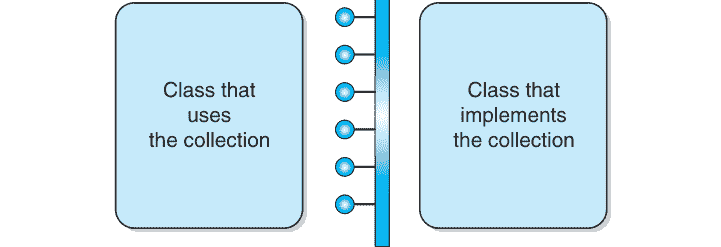

图 3.2 定义良好的接口掩盖了集合的实现

## 第 3 章 集合

抽象是另一个重要的软件工程概念。在大型软件系统中，任何一个人几乎不可能同时掌握所有细节。相反，系统被划分为抽象的子系统，这样就可以指定这些子系统的目的以及它们之间的相互作用。然后，可以将子系统分配给不同的开发者或开发者组，由他们来开发符合其规范的系统。

对象是创建集合的完美机制，因为如果设计得当，对象的内部工作就与系统的其余部分封装了起来。在几乎所有情况下，类中定义的实例变量都应该声明为私有（private）可见性。因此，只有该类的方法可以访问并修改它们。用户与对象之间的唯一交互应该是通过其公共（public）方法，这些方法代表了对象提供的服务。

在我们继续探索集合的过程中，我们将始终强调接口与实现的区别。因此，对于我们检查的每一个集合，我们应该考虑以下问题：

- 集合在概念上是如何操作的？
- 我们如何正式地定义集合的接口？
- 集合帮助我们解决什么类型的问题？
- 我们可能会通过哪些方式实现该集合？
- 每种实现的优点和成本是什么？

在继续之前，让我们仔细定义一些与探索集合相关的其他术语。数据类型（data type）是一组值以及在这些值上定义的操作。Java 中定义的原始数据类型是主要的例子。例如，整数数据类型定义了一组数值，并且可以在这些值上使用操作（加法、减法等）。

> 抽象数据类型（ADT）是一种数据类型，其值和操作并非在编程语言中固有定义的。它的抽象性在于其实现细节，这些细节必须被定义并对用户隐藏。因此，集合是一种抽象数据类型。

数据结构（data structure）是用于实现集合的编程构造的集合。例如，集合可以使用固定大小的结构（数组）来实现。这些定义以及将接口与实现分离（即集合与其实现它的数据结构分离）的决策产生的结果是：我们可能会（而且通常会）最终使用线性集合（如数组）来实现非线性集合（如树）。

> 核心概念
>
> 结构是用于实现集合的底层编程构造。

从历史上看，ADT 和数据结构已用于各种方式。我们仔细地定义它们以避免任何混淆，并将一致使用它们。

## 3.2 栈集合

在整本书中，我们将检查各种数据结构以及它们如何被用于各种集合。

### Java Collections API

Java 编程语言配备了一个非常大的类库，这些类可以支持软件开发。该库的部分被组织成应用程序接口（APIs）。Java Collections API 是一组类，代表了几种类型的集合，并以各种方式实现。

你可能会问，如果已经为我们提供了一组类，我们应该如何学习设计和实现集合。有几个原因。首先，Java Collections API 只提供了你可能想要使用的集合的子集。其次，提供的类可能不是以你期望的方式实现的。第三，可能也是重要的一点，软件开发研究需要深入理解集合设计以及用于实现它们的数据结构所涉及的问题。

当我们探索各种类型的集合时，还将检查 Java Collections API 中相应的类。在每个情况下，我们都会分析我们开发的各种实现，并将它们与标准库类所使用的方法进行比较。

### 3.2 栈集合

让我们来看集合的示例。栈（stack）是一种线性集合，其元素从同一端添加和删除。我们说栈是后进先出（LIFO）的。也就是说，最后放入栈的元素将第一个被取出。事实上，栈在计算中的主要用途是反转顺序。

> 核心概念
>
> 栈元素按 LIFO 方式处理——后进先出。

栈的处理如图 3.3 所示。通常栈是垂直表示的，我们将添加元素并从中移除元素的端称为栈顶（top）。回顾我们之前的讨论，我们通过识别一组特定的操作来定义抽象数据类型（ADT），这些操作建立了我们管理数据结构中元素的有效方式。我们始终希望使用这个概念来正式定义集合的操作，并在第 3 章 集合中

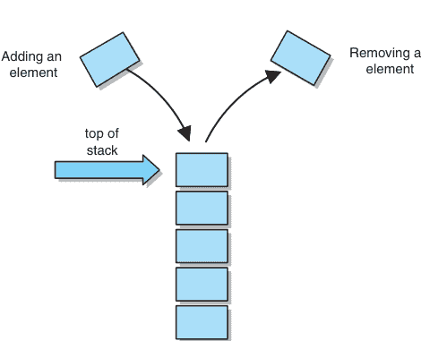

图 3.3 栈的概念视图

栈 ADT 的操作如图 3.4 所示。在栈的术语中，我们将元素推（push）入栈，弹出（pop）出栈。我们还可以查看（peek）栈顶元素，根据需要进行检查，而无需实际上将其从集合中移除。还有通用操作，允许我们确定栈是否为空，以及如果不为空，包含多少个元素。

有时集合的操作命名约定存在差异。对于栈来说，使用 push 和 pop 术语是相对标准的。peek 操作有时被称为 top。

> 核心概念
>
> 程序员应该选择适用于所需数据管理类型的结构。

| 操作 | 描述 |
|---|---|
| push | 将元素添加到栈顶。 |
| pop | 从栈顶移除一个元素。 |
| peek | 检查栈顶的元素。 |
| isEmpty | 确定栈是否为空。 |
| size | 确定栈中元素的数量。 |

图 3.4 栈的操作

## 核心面向对象概念

在栈（stack）ADT 的设计中，我们看到了栈的角色与使用栈的应用程序角色之间的分离。请注意，该栈 ADT 的任何实现，在对空栈进行请求 `pop` 或 `peek` 操作时，都应该抛出一个异常。集合的作用在于决定如何处理此类异常，但要将其报告给使用该栈的应用程序。同样，栈满的概念在栈 ADT 中并不存在。因此，栈集合的作用是管理其自身的存储，以消除栈满的可能性。

请记住，集合的定义并不是普适皆宜的。你会发现，不同书籍之间针对特定数据结构定义的操作会有所不同。在本书中，我们会非常小心地定义每个集合的操作，以确保它们与其目的保持一致。

例如，请注意图 3.4 中的所有栈操作都不允许我们进入栈内部来修改、删除或重组栈中的元素。这正是栈的本质——所有活动都发生在一端。如果我们为了解决特定问题需要访问集合中间或底部的元素，那么栈并不是一个合适的数据结构。

我们为集合提供了一个测试操作。这并不是为栈定义的经典操作。然而，有人可能会认为这种操作违反了栈的规定行为。它提供了一种方便的方法来遍历和显示栈的内容，同时又不允许对栈进行修改，这对于调试目的非常有用。

## 3.3 核心面向对象概念

现在让我们考虑在栈中存储什么。一种可能性是在每次需要时简单地重新创建我们的栈数据结构，并创建它来存储该应用程序特定的对象类型。例如，如果我们需要一个字符串栈，只需复制粘贴我们的栈代码并通过输入来更改对象即可。虽然复制、粘贴和修改是重用的典型形式，但这种粗暴的重用并不是我们的目标。重用的纯粹形式意味着我们应该创建一个编写一次、编译一次字节码，并且能够安全、高效且有效地处理我们选择要存储的任何对象的集合。为了实现这些目标，我们必须考虑类型兼容性和类型检查。类型兼容性是指将特定对象赋值给特定引用是否合法的概念。例如，下面的赋值是不合法的，因为你不能将一个声明为 `String` 类型的引用指向 `Integer` 类型的对象。

```
String x = new Integer(10);
```

Java 提供了编译时检查，会标记出这种无效赋值。在集合中存储内容的第二种可能性是利用继承和多态的概念，创建一个可以存储任何类对象的集合。为了探索这种可能性，我们必须首先探索继承的概念。

### 继承


继承是从现有类派生出新类的过程。新类自动包含原始类中的部分或全部变量和方法。然后，为了根据需要定制类，程序员可以在派生类中添加新的变量和方法，或者修改继承的成员。

通常情况下，通过继承创建新类比从头开始写更快、更容易且更廉价。继承的核心是软件重用的思想。通过使用现有组件创建新组件，我们利用了现有软件在设计、实现和测试上付出的所有努力。


请记住，“类”（class）这个词源于对具有相似特征的对象组进行分类的想法。分类方案通常使用相互相关的类层级。例如，所有哺乳动物都具有某些特征；它们是温血的，有毛，并且产下活幼后。现在考虑哺乳动物的一个子集，例如马。所有的马都是哺乳动物，而且都具有使它们与其他哺乳动物区别的独特特征。

如果我们将其映射到软件术语，`Mammal` 类将具有某些描述哺乳动物状态和行为的变量和方法。`Horse` 类可以从现有的 `Mammal` 类派生，自动继承 `Mammal` 中包含的变量和方法。`Horse` 类可以引用继承的变量和方法，就像它们在该类中局部声明的一样。然后可以在派生类中添加新的变量和方法，以将马与其他哺乳动物区分开。继承很好地模拟了自然界中的许多情况。

用于派生新类的原始类被称为父类（parent class）、超类（superclass）或基类（base class）。派生类被称为子类（child class）或子类（subclass）。Java 使用关键字 `extends` 来表示新类正从一个现有类派生。


# 派生过程与继承关系

派生过程应该在两个类之间建立一种特定的关系：is-a 关系（是一个……的关系）。这种关系意味着派生类是原始类的更具体版本。例如，马是哺乳动物。并不是所有的哺乳动物都是马，但所有的马都是哺乳动物。

## 继承示例

让我们看一个例子。以下类可以用于定义书籍：

> **核心概念**
>
> 继承的变量和方法可以在派生类中使用，就像它们是局部声明的一样。

> **核心概念**
>
> 继承在所有父类和子类之间建立了 is-a 关系。

```java
class Book
{
    protected int numPages;
    protected void pages()
    {
    }
}
```

要派生一个基于 `Book` 的子类，我们在子类的头部使用关键字 `extends`。例如，`Dictionary` 类可以这样派生自 `Book`：

```java
class Dictionary extends Book
{
    private int numDefs;
    public void info()
    {
    }
}
```

通过让 `Dictionary` 类继承 `Book`，它自动继承 `numPages` 变量和 `pages` 方法。继承是单向的。`Book` 类无法使用在 `Dictionary` 类中显式声明的变量或方法。如果我们从 `Book` 类创建一个对象，它无法调用 `info` 方法。`Dictionary` 有 `pages` 是因为所有书都有 `pages`；尽管并不是书都有定义。

在本书中，我们将使用统一建模语言（UML）来表示系统的设计。附录 A 提供了 UML 的介绍。继承关系在 UML 类图中用空心箭头的箭头表示，从子类指向父类。

### 类层级

从一个父类派生的子类可以是其自己的子类的父类。此外，多个类可以从同一个父类派生。因此，继承关系往往演变成类层级。图 3.5 的 UML 类图显示了包含 `Mammal` 和 `Horse` 类之间继承关系的类层级。

一个类可以拥有的子类数量没有限制，类层级扩展的层数也没有限制。同一个父类的两个类被称为兄弟类。虽然兄弟类共享共同父传递的特征，但它们之间没有继承关系，因为一个不是用来派生另一个的。

在类中，共同特征应该尽可能地保留在层级中。这样，在子类中显式建立的唯一特征就是使其与父类及其兄弟类区分开来的特征。这种方法最大化地利用了类的重用能力。它也便于维护活动，当对父类进行更改时，这些更改会自动反映在后代类中。在构建类层级时，务必保持 is-a 关系。

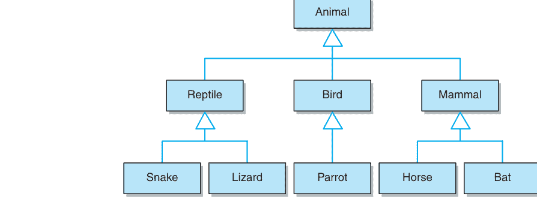

**图 3.5** 显示类层级的 UML 类图

# 3.3 关键面向对象概念

继承机制是传递的。也就是说，父类将某种特性传递给子类，子类再将其传递给它的子类，依此类推。一个被继承的特性可能源于直接父类，也可能源于更远祖先类中的某几级之上。

并没有一种适用于所有情况的最佳层级结构组织。在设计类层次结构时所做的决策比设计决策和实现选项更具限制和指导意义，这些决策必须谨慎做出。

## Object 类

在 Java 中，所有类最终都派自 `Object` 类。如果类定义没有使用 `extends` 子句来显式地派自另一个类，那么该类默认将自动派自 `Object` 类。因此，以下两个类定义是等价的：

```java
class Thing {
  // 任意
}
```

和

```java
class Thing extends Object {
  // 任意
}
```

由于所有类都派自 `Object`，因此可以通过任何 Java 程序中创建的任何对象来调用 `Object` 的任何公共方法。`Object` 类定义在标准类库的 `java.lang` 包中。

例如，`toString` 方法定义在 `Object` 类中，因此可以在任何对象上调用 `toString` 方法。当调用 `println` 并传入一个对象参数时，会调用 `toString` 来确定要打印的内容。

> **核心概念**
>
> 所有类都直接或间接地派自 Object 类。

`Object` 类所提供的 `toString` 定义返回一个包含对象类名的字符串，该字符串由该对象的唯一数值。通常，我们会重写 `Object` 版本的 `toString` 以符合我们的需求。`String` 类重写了 `toString` 方法，使其返回其存储的值。

`Object` 类的 `equals` 方法也有用。它的目的是判断两个对象是否相等。`Object` 类提供的 `equals` 方法定义如果两个对象引用指向同一个对象（即它们是别名），则返回 `true`。类通常会重写继承的-

> **核心概念**
>
> 为了获得更合适的定义，重写继承的 `toString` 和 `equals` 方法定义在对象类中，因此被每个 Java 程序中的每个类继承。

例如，`String` 类重写了 `equals`，只有当两个字符串以相同顺序包含相同字符时，才返回 `true`。关于继承的更完整讨论请参见附录 B。

## 多态

这引出了多态的概念。多态一词可以定义为“具有多种形式”。多态引用是一个引用变量，可以在不同的时间点引用不同类型的对象。通过多态引用调用的特定方法可以从一次调用到下一次调用发生变化。

考虑以下行代码：

```java
obj.doIt();
```

> **核心概念**
>
> 多态引用可以随时间推移引用不同类型的对象。

如果 `obj` 是多态的，它可以在不同时间引用不同类型的对象。如果该行代码位于循环中或一个被调用多次的方法中，那么该行代码在每次被调用时可能会调用不同的方法。

在某个点上，系统承诺执行某些代码来完成方法调用。这种承诺被称为将方法调用绑定到方法定义上。在大多数情况下，将方法调用到方法定义的绑定可以在编译时发生。对于多态引用，该决策在运行时才能做出。所使用的方法定义取决于引用在该时刻指向的对象。这种延迟承诺被称为晚绑定（late binding）或动态绑定（dynamic binding）。它比编译时绑定效率低，因为必须在程序执行期间做出决策。考虑到多态引用提供的灵活性，这种开销通常是可以接受的。

在 Java 中创建多态引用有两种方法：使用继承和使用接口。后续章节将描述通过继承创建多态。我们将在第 6 章中重新讨论通过接口实现多态。

### 引用与类层次结构

在 Java 中，声明为引用某个特定类对象的引用也可以用于引用其通过继承关系相关的任何类的对象。例如，如果使用 `Mammal` 类来派生 `Horse` 类，那么 `Mammal` 引用就可以引用 `Horse` 类的对象。这种能力在下面的代码段中：

```java
Mammal pet;
Horse secretariat = new Horse();
pet = // 一个有效的赋值
```

反向操作（将 `Mammal` 对象赋值给 `Horse` 引用）也是有效的，但需要显式类型转换。在这种方向上赋值引用通常用用，且更容易引起问题，尽管马拥有哺乳动物的所有功能（因为马是哺乳动物），但反之未必成立。

> **核心概念**
>
> 引用变量可以引用从与其通过继承关系相关的任何类创建的任何对象。

这种关系贯穿整个类层次结构。如果 `Mammal` 类派自 `Animal` 类，那么以下赋值也是有效的：

```java
Animal creature = new Horse();
```

如上一节定义，引用变量 `creature` 可以是多态的，因为在任何时间点它都可以引用 `Animal` 对象、`Mammal` 对象或 `Horse` 对象。假设这三个类都有一个名为 `move` 的方法，并且该方法在每个类中的实现方式不同（因为子类重写了它继承的定义）。以下调用调用了 `move` 方法，但方法的特定版本是在运行时确定的：

```java
creature.move();
```

在执行此行时，如果 `creature` 目前指向一个 `Animal`，则调用 `Animal` 类的 `move` 方法。同样，如果 `creature` 指向一个 `Mammal`，则调用 `Mammal` 类的 `move` 方法。如果它指向一个 `Horse`，则调用 `Horse` 类的 `move` 方法。

> **核心概念**
>
> 多态引用使用对象的类型来决定调用哪个方法。

## 泛型

从 Java 5.0 开始，Java 允许我们基于泛型类型定义类。也就是说，我们可以定义一个类，使其存储、操作和管理类型在实例化时尚未指定的对象。泛型是我们余书中关于集合及其底层实现讨论中不可或缺的一部分。

假设我们需要定义一个 `Box` 类来存储和管理其他对象。正如之前讨论的，利用多态，我们可以简单地定义 `Box` 使其内部存储 `Object` 类的引用。这样，任何类型的对象都可以存储在箱中。事实上，多个不相关类型的对象可以存储在 `Box` 中。这种级别的灵活性让我们失去了大量的控制。

更好的方法是基于泛型类型定义 `Box` 类。我们可以为泛型类型使用任何标识符，但使用 `T` 已成为约定。类头部在尖括号中包含该类型的引用。例如：

```java
class Box<T> {
    // 管理类型 T 对象的声明和代码
}
```

然后当需要 `Box` 时，使用特定类替换 `T` 进行实例化。例如，如果我们想要一个 `Widget` 对象的 `Box`，可以使用以下声明：

```java
Box<Widget> box1 = new Box<Widget>();
```

变量 `box1` 的类型是 `Box<Widget>`。从本质上讲，`box1` 对象中的类将 `T` 替换为了 `Widget`。现在假设我们想要一个可以存储 `Gadget` 对象的 Box；我们可以进行如下声明：

```java
Box<Gadget> box2 = new Box<Gadget>();
```

对于 `box2`，类本质上将 `T` 替换为了 `Gadget`。因此，尽管 `box1` 和 `box2` 对象都是盒子，但由于考虑了泛型类型，它们的类型是不同的。这是一种更实现方式，因为此时我们无法使用 `box1` 来存储 `gadget`（或其他任何东西），无法使用 `box2` 来存储 `widget`。作为 `T` 的泛型类型不能被实例化。它仅仅是一个占位符，允许我们定义一个类来管理特定类型的对象，该类型在类实例化时确立。

既然我们现在有了一种使用泛型类型的机制，可以安全且有效地创建一个存储任何类型对象的集合，让我们继续关于栈（stack）集合的讨论。

# 3.4 栈 ADT

## 3.4 栈 ADT 接口

为了便于接口操作与实现这些操作的方法分离，我们可以为集合定义一个 Java 接口结构。Java 接口为定义任何集合操作提供了一种正式机制。

回想 Java 接口定义了一组抽象方法，指定了每个方法的签名但不包含其方法体。实现接口的类提供了接口中方法的定义。接口名称可以用作引用的类型，可以赋值给任何实现接口的对象。

列表 3.1 定义了一个用于栈集合的 Java 接口。我们将集合接口命名，并在后面跟上缩写 ADT（代表抽象数据类型）。因此，`StackADT.java` 包含了栈集合的接口。它被定义为 `jss2` 包的一部分，该包包含了书中介绍的所有集合类和接口。

注意，该接口被定义为 `StackADT<T>`，在泛型类型 `T` 上操作。在接口的方法中，各种参数和返回值的类型通常使用泛型类型 `T` 来表示。当此接口被实现时，它将基于替换了 `T` 的类型。

在本章的稍后部分，我们将检查一个实现此接口的类。在下一章中，我们将检查另一种实现方式。

> **核心概念**
>
> Java 接口定义了一组抽象方法，对于将抽象数据类型概念与其实现分离非常有用。

> **核心概念**
>
> 通过使用接口名称作为返回类型，接口并不限制实现栈的任何特定类的使用。

```java
/**
 * @author Lewis and Chase
 *
 * 定义了栈数据结构的接口。
 */

package jss2;

public interface StackADT<T> {
    /**
     * 将一个元素推入此栈的顶部。
     * @param element 要推入栈的元素
     */
    public void push(T element);
    /**
     * 从此栈中移除并返回顶部的元素。
     * @return 从栈顶移除的元素 T
     */
    public T pop();
    /**
     * 在不移除此栈顶部元素的情况下返回。
     * @return 栈顶部的元素 T
     */
    public T peek();
    /**
     * 如果此栈不包含任何元素则返回 true。
     * @return boolean 此栈是否为空
     */
    public boolean isEmpty();
    /**
     * 返回此栈中的元素数量。
     * @return int 此栈中的元素数量
     */
    public int size();
    /**
     * 返回此栈的字符串表示。
     * @return 此栈的字符串表示
     */
    public String toString();
}
```


**图 3.6** UML 中的 StackADT 接口

现在，对栈如何操作的抽象理解允许我们探索栈如何帮助我们解决特定问题的情况。

在本文每当引入一个接口、类或系统时，我们都会在该描述旁边附该接口、类或系统的 UML 描述。这应该帮助你习惯阅读 UML 描述并为其他类和系统创建描述。图 3.6 展示了 StackADT 接口的描述。注意，UML 在描述与类或接口关联的方法方面具有灵活性。在这种情况下，我们选择将每个方法标识为公共的 (+)，但我们没有列出每个方法的参数。

栈在计算世界中被频繁使用。例如，文字处理器中的“撤销”操作通常是用栈实现的。当我们对文档进行更改（添加数据、删除数据、格式更改等）时，文字处理器通过将某些操作的表示推入栈中来跟踪每一次操作。如果我们选择撤销某项操作，文字处理器会将最近执行的操作从栈中弹出并对其进行反转。如果我们再次选择撤销（撤销倒数第二次执行的操作），

### 设计焦点

> 撤销操作通常使用一种称为“丢弃栈”（drop-out stack）的特殊栈来实现。丢弃栈的基本操作与栈的操作相同（即 push、pop 和 peek）。唯一的区别是，丢弃栈对其持元素数量有限制，一旦达到该限制，当新元素被推入栈时，栈底的元素就会掉落。丢弃栈的开发是

丢弃栈的开发是一项练习。接下来的章节将详细探讨使用栈的示例。

# 3.5 使用栈：评估后缀表达式

传统的算术表达式以中缀法（infix）编写，即运算符位于操作数之间。在后缀表达式中，运算符位于操作数之后。例如，中缀表达式 `4 + 5` 在后缀法中写为 `4 5 +`。后缀表达式通常更容易评估，因为不需要考虑优先级规则。评估后缀表达式的过程可以表述为简单的规则：从左到右扫描每个标记（运算符或操作数）。如果是操作数，则将其推入栈；如果是运算符，则从栈中弹出两个元素，对它们执行操作并将结果推入栈。当我们到达表达式末尾时，栈中剩余元素就是表达式的结果。如果在任何点尝试从栈中弹出两个元素但不存在，或者我们在表达式末尾时栈中仍有多多个元素，则我们的表达式格式错误。

让我们使用规则确定此表达式的最终值。考虑表达式：

```
4 2 *
```

在后缀法中，该表达式将写为

```
4 2 * +
```

从左扫描直到遇到 (*) 运算符。我们将该运算符应用于前两个操作数（5 和 2），并将其替换为结果（10），留下：

```
4 10 +
```

继续从右扫描，我们最终会遇到 (+) 运算符。将该运算符应用于前两个操作数（4 和 10），得到 14，这是表达式的最终值。让我们看一个稍微复杂的例子。考虑以下表达式：

```
(3 * 4 - (2 + 5)) * 4 / 2
```

对应的后缀表达式为：

```
3 4 * 2 5 + - 4 * 2 /
```

应用我们的规则得到：

```
12 2 5 + - 4 * 2 /
then 12 7 - 4 * 2 /
then 5 4 * 2 /
then 20 2 /
```

现在让我们思考评估后缀表达式程序的设计。评估规则依赖于遇到运算符时能够检索之前的操作数。此外，一个大型表达式会有许多运算符和操作数需要管理。事实证明，在这种情况下栈是完美的集合。栈提供的操作与评估后缀表达式的过程非常契合。使用栈评估后缀表达式的算法可以表示如下：从左到右扫描，识别每个标记（运算符或操作数）。如果是操作数，将其推入栈；如果是运算符，从栈中弹出两个元素，对它们执行操作并将结果推入栈。当我们到达表达式末尾时，栈中剩余的元素就是表达式的结果。图 3.7 描绘了使用栈评估后缀表达式的过程。


**图 3.7** 使用栈求后缀表达式

列表 3.2 中的程序评估了用户输入的多个后缀表达式。它使用了列表 3.3 所示的 `PostfixEvaluator` 类。

为了保持简单，该程序假设操作数是整数且为字面量值（而不是变量）。执行时，程序会重复地接收并评估后缀表达式，直到用户选择不再继续。

## 列表 3.2

```java
/**
 * @author Lewis and Chase
 * 演示了使用栈来评估后缀表达式。
 */

import java.util.Scanner;

public class Postfix
{
    /**
     * 读取并评估多个后缀表达式。
     */
    public static void main(String[] args)
    {
        String expression, again;
        int result;

        try
        {
            Scanner in = new Scanner(System.in);
```

## 列表 3.3


# 第 3 章 集合

## 3.5 使用栈：评估后缀表达式

### 列表 3.3 `PostfixEvaluator.java`（部分）

```java
/**
 * PostfixEvaluator.java
 * 作者: Lewis/Chase
 *
 * 表示后缀表达式的整数评估器。假设
 * 操作数是常量。
 */
import java.util.ArrayStack;
import java.util.StringTokenizer;

public class PostfixEvaluator {
    /** 加法符号常量 */
    private final char ADD = '+';
    /** 减法符号常量 */
    private final char SUBTRACT = '-';
    /** 乘法符号常量 */
    private final char MULTIPLY = '*';
    /** 除法符号常量 */
    private final char DIVIDE = '/';
    /** 栈 */
    private ArrayStack<Integer> stack;

    /**
     * 通过创建一个新栈来设置此评估器。
     */
    public PostfixEvaluator() {
        stack = new ArrayStack<Integer>();
    }

    /**
     * 评估指定的后缀表达式。如果遇到操作数，则将其入栈。如果遇到
     * 运算符，则弹出两个操作数，计算操作结果，并将结果入栈。
     * @param expr 后缀表达式的字符串表示
     * @return 给定表达式的整数值
     */
    public int evaluate(String expr) {
        int op1, op2, result = 0;
        String token;
        StringTokenizer tokenizer = new StringTokenizer(expr);

        while (tokenizer.hasMoreTokens()) {
            token = tokenizer.nextToken();
            if (isOperator(token)) {
                op2 = (stack.pop()).intValue();
                op1 = (stack.pop()).intValue();
                result = evalSingleOp(token.charAt(0), op1, op2);
                stack.push(new Integer(result));
            } else {
                stack.push(new Integer(Integer.parseInt(token)));
            }
        }
        return result;
    }

    /**
     * 确定指定的标记是否为运算符。
     * @param token 表示单个标记的字符串
     * @return 如果标记是运算符则返回 true
     */
    private boolean isOperator(String token) {
        return (token.equals("+") || token.equals("-") ||
                token.equals("*") || token.equals("/"));
    }

    /**
     * 对由指定的运算符和操作数组成的单个表达式进行整数求值。
     * @param operation 要执行的操作
     * @param op1 第一个操作数
     * @param op2 第二个操作数
     * @return 表达式的整数值
     */
    private int evalSingleOp(char operation, int op1, int op2) {
        int result = 0;

        switch (operation) {
            case ADD:
                result = op1 + op2;
                break;
            case SUBTRACT:
                result = op1 - op2;
                break;
            case MULTIPLY:
                result = op1 * op2;
                break;
            case DIVIDE:
                result = op1 / op2;
        }
        return result;
    }
}
```

### `ArrayStack` 实现

```java
int top;
Object[] stack;
static final int DEFAULT_CAPACITY = 10;

void expandCapacity() {
    int newSize = stack.length * 2;
    Object[] newStack = new Object[newSize];
    for (int i = 0; i <= top; i++) {
        newStack[i] = stack[i];
    }
    stack = newStack;
}

void push(Object element) {
    if (top == stack.length - 1) {
        expandCapacity();
    }
    stack[++top] = element;
}

Object pop() {
    if (isEmpty()) {
        throw new RuntimeException("Stack is empty");
    }
    Object element = stack[top];
    stack[top--] = null;
    return element;
}

Object peek() {
    if (isEmpty()) {
        throw new RuntimeException("Stack is empty");
    }
    return stack[top];
}

boolean isEmpty() {
    return top == -1;
}

int size() {
    return top + 1;
}
```

### `StackADT` 接口

```java
interface Stack {
    void push(Object element);
    Object pop();
    Object peek();
    boolean isEmpty();
    int size();
}
```

### `PostfixEvaluator` 类图片段

```java
class PostfixEvaluator
```

**图 3.8** 后缀表达式的 UML 类图

列表 3.2 中的程序评估了用户输入的多个后缀表达式。它使用了列表 3.3 所示的 `PostfixEvaluator` 类。

为了保持简单，该程序假设操作数是整数且为字面量值（而不是变量）。执行时，程序会重复地接收并评估后缀表达式，直到用户选择不再继续。

## 3.6 异常

在我们讨论的每个集合中，我们将探讨的一个概念就是“异常行为”。在异常情况下，集合应该采取什么行动？是否存在某些情况是集合本身固有的？例如，在栈的情况下，如果尝试从空栈中弹出一个元素，会发生什么？在这种情况下，使用何种数据结构来实现它是否重要？某些情况是实现集合时所用数据结构的产物。例如，如果我们正使用数组来实现栈，当尝试向栈中推入一个元素但数组已满时，应该发生什么？让我们花一点时间进一步探讨这个概念。

Java 程序中的问题可能会产生异常或错误。**异常**是一个定义异常或错误情况的对象。异常由程序或运行时抛出，如果需要，可以对其进行捕获和处理。错误与异常相似，不同之处在于错误通常表示一种不可恢复的情况，且不应该被捕获。Java 有一组预定义的、在程序执行期间可能出现的异常和错误。

在我们的后缀评估示例中，存在几种潜在的异常情况：

- 在推入时栈满了
- 在弹出时栈为空
- 在评估完成后栈中仍留有多个值

让我们分别考虑这些情况。在推入时栈可能已满的可能性是底层数据结构的问题，而不是集合的问题。从概念上来说，不存在满栈。现在我们知道这并非现实，所有数据结构最终都会达到一个极限。然而，即使达到了这个物理极限，也只是实现该栈的数据结构满了，而不是栈本身满了。我们将在下一节实现栈的过程中，讨论处理这种情况的策略。

如果在执行 `pop()` 操作时栈是空的怎么办？这是一个与问题本身而非底层数据结构相关的异常情况。在我们的后缀表达式评估示例中，如果我们尝试 `pop()` 两个操作数，但栈中没有两个操作数可用，说明我们的后缀表达式格式不正确。这是一个集合需要报告异常的绝佳案例，而应用程序必须首先在语境中解释该异常。

> **核心概念**
> 错误和异常代表了不寻常或无效的处理。

第三种情况同样有趣。如果求值完成后，栈中存有多于一个值怎么办？从栈集合的角度来看，这不是一个异常。但从应用程序的角度来看，这个问题意味着后缀表达式格式不正确。这种情况不会由集合产生异常，但它是应用程序必须测试的条件。

程序可以设计为以三种方式之一处理异常：

- 完全不处理该异常。
- 在异常发生的地方处理异常。
- 在程序的其他位置处理异常。

我们将在接下来的章节中探索这些每种方法。

### 异常消息

如果程序完全没有处理异常，程序将（异常地）终止并产生一条描述发生了什么异常以及在程序何处产生异常的消息。与异常相关的信息通常对于追踪问题原因非常有帮助。

让我们看看异常的输出。当尝试进行无效的算术操作（例如除以 0）时，会抛出 `ArithmeticException`。当抛出该异常时，如果程序中没有代码显式处理该异常，程序将终止并打印如下消息：

```
Exception in thread "main" java.lang.ArithmeticException: / by zero
at Zero.main(Zero.java:17)
```

异常输出的第一行指示抛出了哪种异常，并提供了关于为何抛出异常的一些信息。剩余的一或几行是调用栈跟踪，指示了异常发生的位置。在这种情况下，调用栈跟踪中只有一行，但可能有几行，取决于异常在程序中何处产生。跟踪的第一行指示了异常发生的方法、文件和行号。跟踪中的其他行（如果存在）指示了为了到达产生异常的方法而调用的方法。在这个程序中，只有一个方法，且由它产生了异常；因此，跟踪中只有一行。

调用跟踪信息也可以通过调用正在抛出的异常对象的方法来获取。`getMessage()` 方法返回一个解释抛出异常原因的字符串。`getStackTrace()` 方法单独打印调用栈跟踪。

> **核心概念**
> 抛出的异常所打印的消息指示了问题的性质，并提供了方法调用栈跟踪。

### `try` 语句

让我们检查在异常被抛出时是如何捕获并处理它的。`try` 语句由一个 `try` 块和一个或多个 `catch` 子句组成。`try` 块是一组可能抛出异常的语句。`catch` 子句定义了如何处理特定类型的异常。一个 `try` 块可以关联多个 `catch` 子句，每个子句处理一种特定类型的异常。`catch` 子句有时被称为异常处理器。

这里是 `try` 语句的一般格式：

```
try {
    // try 块中的语句
}
catch (IOException exception) {
    // 处理 I/O 问题的语句
}
catch (NumberFormatException exception) {
    // 处理数字格式问题的语句
}
```

当执行 `try` 语句时，会执行 `try` 块中的语句。如果在执行 `try` 块期间没有抛出异常，处理将继续执行 `try` 语句之后的语句（在所有 `catch` 子句之后）。这种情况是正常的执行流，并且大多数情况下都会发生。

> **核心概念**
> `try` 语句上的每个 `catch` 子句处理 `try` 块内可能抛出的特定类型的异常。

如果在执行 `try` 块期间的任何一点抛出了异常，如果存在相应的异常处理器，控制将立即转移到那里。也就是说，控制将转移到第一个指定的异常与抛出的异常类匹配的 `catch` 子句。在执行完 `catch` 子句中的语句后，控制将转移到整个 `try` 语句之后的语句。

### 异常传播

如果异常在发生的地方没有被捕获和处理，控制将立即返回到调用产生异常的方法的方法。我们可以设计软件，使异常在这一外层级被捕获并处理。如果没有被捕获，控制将返回到调用它的方法。这个过程就是传播异常。

> **核心概念**
> 异常没有在发生的地方被捕获和处理，它被传播到调用方法。

异常传播一直持续，直到异常被捕获并处理，或者它传播到 `main()` 方法之外，后者会终止程序并产生异常消息。要在外层级捕获异常，产生异常的方法必须在 `try` 块内部调用，且该块必须有相应的 `catch` 子句来处理它。

> **核心概念**
> 程序员必须仔细考虑是否应该处理异常、如何处理以及在哪个层级处理。

程序员必须选择最合适的层级来捕获和处理以获得最佳答案。这取决于情况和系统设计。有时，正确的方法是不捕获异常并让程序终止。

使用异常的方式对于系统的定义至关重要。集合在许多情况下可能会抛出异常。通常，在栈的情况下，每当尝试从空栈中弹出元素时，都会抛出异常。用户可以选择提前检查状态以避免异常：

```
if (!theStack.isEmpty()) {
    element = theStack.pop();
}
```

或者用户可以使用 `try-catch` 语句来处理发生的情况：

```
try {
    element = theStack.pop();
} catch (EmptyCollectionException exception) {
    System.out.println("没有可用元素");
}
```

## 3.7 实现栈：使用数组

当我们探索集合的特定实现技术时，还将讨论异常的适当使用。

到目前在对栈集合的讨论中，我们描述了它的基本概念以及允许用户与之交互的操作。在软件工程术语中，我们可以说我们对栈集合进行了分析。我们还使用了栈来解决特定问题，而不知道它是如何实现的。现在让我们关注实现细节。有多种方法可以实现一个表示栈的对象的类。在下一章中，我们将检查另一种实现技术。

为了探索这种实现，我们必须回顾 Java 数组的几个关键特性。存储在数组中的元素索引从 0 到 n-1，其中 n 是数组的单元总数。数组是一个对象，它是与所持有的对象单独实例化的。当我们谈论对象数组时，我们实际上是在谈论对象的引用数组，如图 3.9 所示。

> **核心概念**
> 集合操作的实现不应影响用户与集合交互的方式。

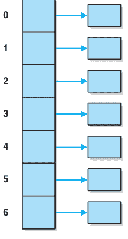

**图 3.9** 对象引用数组

请记住集合与实现它的底层数据结构之间的分离。我们的目标是设计一种高效的实现，以提供栈抽象数据类型中定义的每个操作的功能。数组只是一个用于存储对象的方便数据结构。

### 管理容量

当数组对象被创建时，它会被分配特定数量的单元格，元素可以存储其中。例如，以下实例化创建了一个可以存储 500 个元素的数组，索引从 0 到 499：

```
Object[] collection = new Object[500];
```


数组中的单元格数量被称为其**容量**（capacity）。该值存储在数组的 `length` 常量（`length` constant）中。数组一旦创建，其容量就无法更改。

当使用数组来实现集合时，我们必须处理数组所有单元格都已存储元素的情况。也就是说，由于我们使用的是固定大小的数据结构，在某个时刻数据结构可能会变得“满”。但是，仅仅因为数据结构是满的就意味着集合也是满的了吗？

集合设计中的一个关键问题是，当向一个满的数据结构中添加新元素时该怎么办。存在三种基本方案：

- 我们可以实现向集合中添加元素的操作，如果数据结构是满的，则抛出异常（`exception`）。
- 我们可以实现添加操作返回一个状态指示器，用户可以通过检查该指示器来查看添加是否成功。
- 可以在需要时自动扩展底层数据结构的容量，从本质上说，它永远不会。

> 核心概念
> 我们如何处理异常情况决定了集合的用户是否能够控制特定的行为。

在头两种情况下，集合的用户必须意识到集合可能会满，并在需要时采取步骤进行处理。对于这些解决方案，我们还会提供额外的功能，允许用户检查集合是否已满，并根据需要扩展数据结构的容量。这些方法的优点是它们赋予了用户对容量的更多控制权。

然而，考虑到我们将接口与实现相分离的目标，第三种方案是很有吸引力的。底层数据结构的容量是一个实现细节，通常应该对用户隐藏。此外，容量问题是该特定实现所特有的。用于实现集合的其他技术（例如我们在下一章中探索的技巧）不受固定容量的限制，因此永远不需要处理这个问题。

在本书所提供的解决方案中，我们选择通过自动扩展底层数据结构的容量来实现固定数据结构解决方案。偶尔，也会作为编程项目来探索其他方案。

## 3.8 ArrayStack 类

在 Java Collections API 框架中，类名既表示底层数据结构，也表示集合。我们在书中遵循了这一命名规范。因此，我们定义了一个 `ArrayStack` 类来表示一个基于数组实现的栈。

更准确地说，我们定义了一个 `ArrayStack<T>` 类，它代表一个基于数组的栈集合实现，存储泛型类型 `T` 的对象。当我们实例化 `ArrayStack` 对象时，我们指定泛型类型 `T` 代表什么。

通过做出以下四个假设，可以设计栈的数组实现：数组是对象引用的数组（类型在实例化栈时确定），栈的底部始终在数组中有序且连续排列，并且有一个整数变量存储数组中紧随栈顶元素之后的索引。

> 核心概念
> 为了提高考虑，基于数组的实现将栈底保持在索引 0 处。

图 3.10 展示了当前包含元素 A、B、C 和 D 的栈的配置，假设它们是按顺序推入（`pushed`）的。为了简化图表，元素显示在数组中，而不是作为从数组引用的对象。变量 `top` 既代表推入元素应该存储的下一个单元格，也代表栈中元素的计数。

| 0 | 1 | 2 | 3 | 4 | 5 | 6 | 7 | ... |
|---|---|---|---|---|---|---|---|---|
| A | B | C | D | | | | | |

图 3.10 栈的数组实现

在此实现中，栈的底部始终保持在数组的索引 0 处，栈在较高的索引处增长和收缩。这比在数组内反转栈要高效得多。考虑一下如果栈顶保持在索引 0 处，将需要哪些处理。

基于这些假设，我们可以确定我们的类将需要一个常量来存储默认容量，一个变量来跟踪栈顶，以及一个用于存储栈的数组变量。这导致了如下类头定义。请注意，我们的 `ArrayStack` 类将是 `jss2` 包的一部分，并将使用一个名为 `jss2.exceptions` 的包。

```java
/**

 * @author Lewis and Chase

 * Represents栈的数组实现。

 */

package jss2;

import jss2.exceptions.*;

public class ArrayStack<T> implements StackADT<T>

{

    /**

     * 表示数组默认容量的常量

     */

    private final int DEFAULT_CAPACITY = 100;

    /**

     * 同时代表元素数量和数组中

     * 下一个可用位置的 int

     */

    private int top;

    /**

     * 表示栈的泛型元素数组

     */

    private T[] stack;
```

### 构造函数

我们的类有两个构造函数，一个用于默认容量，另一个用于指定容量。

```java
/**
 * 使用默认容量创建空栈。
 */

public ArrayStack()

{

    top = 0;

    stack = (T[])(new Object[DEFAULT_CAPACITY]);

}
```

```java
/**
 * 使用指定的容量创建空栈。
 * @param initialCapacity 指定容量
 */

public ArrayStack(int initialCapacity)

{

    top = 0;

    stack = (T[])(new Object[initialCapacity]);

}
```

为了唤起记忆，这是方法重载（`method overloading`）的极佳示例（即方法列表仅不同）。从我们之前对泛型的讨论中，我们记得不能实例化泛型类型。这意味着你不能实例化泛型数组。这在我们两个构造函数中产生了一行有趣的代码：

```java
stack = (T[])(new Object[...]);
```

### push 操作

要向栈中推入元素，我们只需将其插入到变量 `top` 指定的可用位置。在此之前，我们必须确定数组是否达到了容量并在必要时进行扩展。在存储值后，我们必须更新 `top` 的值，使其继续代表栈中元素的数量。

实现这些步骤得到了如下代码：

```java
/**

 * 将指定的元素添加到栈顶，必要时扩展

 * 栈的容量。

 *

 * @param element 要推入栈的泛型元素

 */

public void push(T element) {

    if (size() == stack.length) {

        expandCapacity();

    }

    stack[top] = element;

    top++;

}
```

`expandCapacity` 方法的实现是在需要时将数组的大小翻倍。当然，数组一旦实例化就无法调整大小，此方法只是创建一个新数组并将旧数组的内容复制到新数组中。它是类的辅助方法，可以实现私有（`private`）可见性。

```java
/**

 * 创建一个新数组来存储栈的内容，容量

 * 为旧的两倍。

 */

private void expandCapacity() {

    T[] larger = (T[])(new Object[stack.length*2]);

    for (int index=0; index < stack.length; index++) {

        larger[index] = stack[index];

    }

}
```

图 3.11 展示了向图 3.10 所示的栈推入元素 E 的结果。

数组实现的栈 `push` 操作由以下步骤组成：

- 确保数组未满。
- 将数组位置 `top` 的引用设置为添加到栈的对象。
- 增加 `top` 和 `count` 的值。

| 0 | 1 | 2 | 3 | 4 | 5 | 6 | 7 | ... |
|---|---|---|---|---|---|---|---|---|
| A | B | C | D | E | | | | |
| | 5 | | | | | | | |

图 3.11 推入元素 E 后的栈

这些步骤中的每一步都是 O(1)。因此，该操作的时间复杂度为 O(1)。我们可能会好奇 `expandCapacity` 方法的时间复杂度，以及它对 `push` 方法分析的影响。该方法确实包含一个线性 for 循环，直觉上我们会认为它是 O(n)。然而，考虑到 `expandCapacity` 方法被调用的频率相对于 `push` 可能被调用的次数非常低，我们可以将复杂度分摊到所有 `push` 实例中。

### pop 操作

`pop` 操作移除并返回栈顶的元素。对于数组实现，这意味着返回索引为 `top - 1` 的元素。然而，在尝试返回元素之前，我们必须确保栈中至少有一个元素可以返回。

基于数组的 `pop` 操作可以按如下方式实现：

```java
/**

 * 移除此栈顶部的元素并返回其

 * 引用。如果栈为空，则抛出 EmptyCollectionException。

 * @return 从栈顶移除的 T 元素

 * @throws EmptyCollectionException 如果在空栈上尝试 pop

 */

public T pop() throws EmptyCollectionException

{

    if (isEmpty())

        throw new EmptyCollectionException("Stack");

    top--;

    T result = stack[top];

    stack[top] = null;

    return result;

}
```

| 0 | 1 | 2 | 3 | 4 | 5 | 6 | 7 | ... |
|---|---|---|---|---|---|---|---|---|
| A | B | C | D | | | | | |

图 3.12 弹出顶端元素后的栈

当调用 `pop` 方法时，如果栈为空，则抛出 `EmptyCollectionException`。否则，`top` 的值会减，并将存储在该位置的元素存储到临时变量中，以便返回。然后，数组中的该单元格被设置为 `null`。注意，`top` 的值最终相对于新的较小的栈具有一个适当的值。图 3.12 展示了对图 3.10 中的栈执行 `pop` 操作的结果，这使其恢复到先前的状态（与图 3.10 相同）。

数组实现的 `pop` 操作包含以下步骤：

- 确保栈不为空。
- 将 `top` 计数器减1。
- 将临时引用指向 `stack[top]` 中的元素。
- 将 `stack[top]` 设置为 `null`。
- 返回临时引用。

所有这些步骤也是 O(1)。因此，数组实现的 `pop` 操作的时间复杂度为 O(1)。

### peek 操作

`peek` 操作返回栈顶元素的引用，而不从数组中移除它。对于数组实现，这意味着返回位置在 `top-1` 处元素的引用。这一步是 O(1)，因此 `peek` 操作也是 O(1)。

```java
/**

 * 返回此栈顶部的元素引用。

 * 元素不会从栈中移除。如果栈为空，则抛出

 * EmptyCollectionException。

 * @return 栈顶的 T 元素

 * @throws EmptyCollectionException 如果在空栈上尝试 peek

 */

public T peek() throws EmptyCollectionException

{

    if (isEmpty()) {

        throw new EmptyCollectionException("Stack");

    }

    return stack[top-1];

}
```

### 其他操作

（注：此处原文内容似乎重复了上方 peek 章节的内容，已按要求翻译并保留格式）

```java
    /**

     * 返回此栈顶部的元素引用。

     * 元素不会从栈中移除。如果栈为空，则抛出

     * EmptyCollectionException。

     * @return 栈顶的 T 元素

     * @throws EmptyCollectionException 如果在空栈上尝试 peek

     */

    public T peek() throws EmptyCollectionException
```

（注：原文在某些处存在重复重复，已已翻译）

```java
 * @throws EmptyCollectionException 如果在空栈上尝试 peek

 */

public T peek() throws EmptyCollectionException

{

    if (isEmpty()) {

        throw new EmptyCollectionException("Stack");

    }

    return stack[top-1];

}
```

## 概念总结

- 集合通常按顺序组织。
- 元素是根据复杂度组织的元素。
- 抽象隐藏了实现细节。
- 栈是后进先出（LIFO）的结构。
- 分摊复杂度分析。

## 自复习

- SR 3.1 什么是集合？
- SR 3.2 什么是类型？
- SR 3.3 什么是抽象数据类型？
- SR 3.4 什么是数据结构？
- SR 3.5 抽象是什么？它提供了什么优势？
- 维护。
- SR 3.7 栈的特性是什么？
- SR 3.8 栈的基本操作有哪些？
- SR 3.9 栈可能实现哪些其他操作？
- SR 3.10 定义什么是继承。
- SR 3.11 定义什么是多态。
- SR 3.12 给图 3.5 中的示例，列出 Mammal 的子类。
- SR 3.13 给图 3.5 中的示例，以下代码会编译吗？

```java
Animal creature = new Parrot();
```

- SR 3.14 给图 3.5 中的示例，以下代码会编译吗？

```java
Horse creature = new Mammal();
```

- SR 3.15 Java 泛型的目的是什么？
- SR 3.16 后置表示法的优势是什么？

## 习题

- EX 3.1 比较对比数据类型、抽象数据类型和数据结构。
- EX 3.2 列出 Java 集合中的集合并标记本文涵盖的集合。
- EX 3.3 定义抽象的概念并解释为什么它在软件开发中很重要。
- EX 3.4 手跟踪栈通过以下操作：

```java
X.push(new Integer(4));

X.push(new Integer(3));

Integer Y = X.pop();

X.push(new Integer(7));

X.push(new Integer(2));

X.push(new Integer(5));

X.push(new Integer(9));

Integer Y = X.pop();

X.push(new Integer(3));

X.push(new Integer(9));
```

- EX 3.5 对于上一个练习得到的栈 X，以下操作的结果是什么？

```java
a. Y = X.peek();

b. Y = X.pop();

z = X.peek();

c. Y = X.peek();

z = X.peek();
```


- EX 3.6 `isEmpty()`、`size()` 和 `toString()` 方法的时间复杂度应该是？
- EX 3.7 展示如何使用栈支持文字处理器中的撤销操作。给出具体的示例，并在各种操作后画出栈的内容。
- EX 3.8 在后缀表达式求值的示例中，当遇到可以计算子表达式的运算符时，会弹出最近的两个操作数。第一个弹出的操作数被视为子表达式中的第二个操作数，而第二个弹出的操作数是第一个。请给出一个并解释一个示例，说明该解决方案中这一方面的重要性。
- EX 3.9 使用五个整数（12, 23, 1, 45, 9）画出一个示例，说明如何使用栈来反转这些元素的顺序（9, 45, 1, 23, 12）。
- EX 3.10 解释如果栈的顶（top）位于位置 0，那么数组实现的栈的算法和时间复杂度会发生什么变化。

## 编程项目

- PP 3.1 完成本章介绍的 `ArrayStack` 类实现。具体来说，完成 `peek`、`isEmpty`、`size` 和 `toString` 方法的实现。
- PP 3.2 设计并实现一个应用程序，从用户处读取句子并打印每个单词字符反转后的句子。使用栈来反转每个单词的字符。
- PP 3.3 修改后缀表达式求值问题的解决方案，使其检查用户输入的表达式的有效性。当遇到错误情况时，发布相应的错误信息。
- PP 3.4 本章中的数组实现将 `top` 变量指向实际栈顶之上的下一个数组位置。重写数组实现，使得 `stack[top]` 是栈的实际顶。
- PP 3.5 有一种称为“丢弃栈”（drop-out stack）的数据结构，它在各方面表现都像栈，但当栈的大小为 $n$ 且推入第 $n+1$ 个元素时，第一个元素会丢失。使用数组实现一个丢弃栈。（提示：使用循环数组实现是合理的。）
- PP 3.6 使用三个栈实现一个整数加器。
- PP 3.7 使用栈实现一个中缀转后缀的翻译器。
- 实现一个名为 `reverse` 的类，它使用栈按反序输出用户输入的一元素。
- 创建一个图形化应用程序，提供一个用于从栈推送（push）和弹出（pop）的按钮，一个接受字符串作为 push 输入的文本框，以及一个在每次操作后显示栈内容的文本区域。

## 自测题答案

- 集合（Collection）是一个收集并组织其他对象的对象。
- 数据类型是在编程语言中定义的一组值以及对这些值进行的操作。
- 抽象数据类型不是在编程语言中定义的类型，而是必须由程序员定义。
- 数据结构是实现抽象数据类型所必需的对象集合。
- 抽象是隐藏操作的底层实现和数据存储的概念，以简化集合的使用。
- 类自然地提供了抽象，因为只有具有公共可见性的方法才向其他类提供服务。
- 栈是一个后进先出（LIFO）结构。
- 操作有：
  - push—向栈的末尾添加一个元素
  - pop—从栈的前端移除一个元素
  - peek—返回指向栈顶端元素的引用
  - isEmpty—如果栈为空则返回 true，否则返回 false
  - size—返回栈中元素的个数
- `makeEmpty()`、`destroy()`、`full()`
- 继承是从现有类中派生出新类的过程。新类自动包含原始类中的某些或全部变量和方法。然后，为了根据需要定制该类，程序员可以在派生类中添加新的变量和方法，或者修改继承而来的方法。
- 多态（polymorphism）术语可以定义为“具有多种形式”。多态引用是一个可以在不同时间指向不同类型对象的引用变量。通过多态引用调用的特定方法可以从一次调用变为下。
- SRA 3.12 哺乳动物（Mammal）的子类是马和蝙。
- SRA 3.13 是，父类或任何超类的引用变量可以持有指向其后代的之一引用。
- SRA 3.14 不，子类或子类的引用变量不能持有父类或超类的引用。要进行此赋值，你必须显式地将父类强制转换为子类 `Horse creature = (Horse) new Mammal();`
- SRA 3.15 从 Java 5.0 开始，Java 允许我们根据泛型类型定义类。也就是说，我们可以定义一个类，使其存储、操作和管理类型在类实例化之前未指定的对象。这允许创建能够既可以操作“泛型”元素又能提供类型检查的结构。
- SRA 3.16 后缀表示避免了计算中缀表达式时所需的优先级规则。

# 链式结构

本章探索了一种使用引用创建对象之间的链接来创建数据结构的技术。链式结构在软件开发中是基础性的，特别是集合的设计和实现。与使用数组的方案相比，这种方法既有优点也有缺点。

## 目标

- 描述使用引用创建链式结构
- 比较链式结构和数组结构
- 探索管理链表的技术
- 讨论形成链式结构所需的单独节点对象
- 使用链表实现栈集合

## 第4章 链式结构

### 4.1 作为的引用

> 核心概念 对象引用变量可以创建链式结构。

在第3章中，我们讨论了集合的概念并特别探讨了一个集合：栈。我们定义了栈的操作并使用底层数组进行了设计。在本章中，我们探索了一种完全不同的设计结构的方法。

链式结构是一种使用对象引用在对象之间创建链接的数据结构。链式结构是数组实现集合的主要替代方案。在讨论了涉及链式结构的各种问题后，我们将定义使用链式结构栈的新实现。

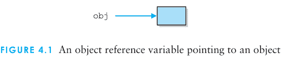

这种关系构成了链表的基础。链表是一种链接结构，其中一个对象指向下一个对象，从而创建了列表中对象的线性顺序。图 4.2 描述了链表。通常，链表中存储的对象被泛称为*列表节点*（nodes of the list）。

注意，需要一个单独引用变量来指示列表的第一个节点。列表以一个引用为 `null` 的节点结束。

> 核心概念
> 链表由多个对象组成，每个对象都指向列表中的下一个对象。

链表只是链接结构的一种类型。如果一个类被设计为对对象有多个引用，就可以创建一个更复杂的结构，例如图 4.3 所示。链接的管理方式决定了结构的特定组织形式。

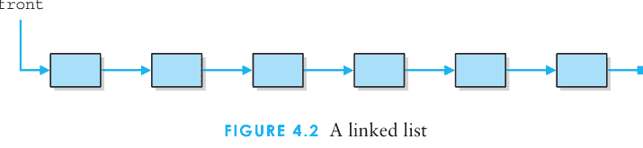

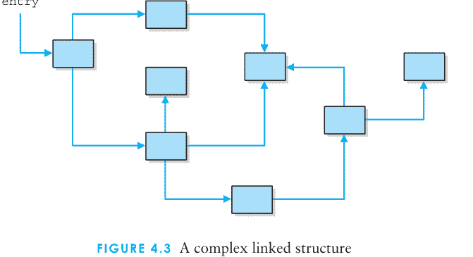

### 4.2 管理链表

> 核心概念
> 链表根据需要动态增长，并且本质上没有容量限制。

目前，我们将关注链表的细节。这些许多技术也适用于更复杂的链接结构。

与固定大小的数组不同，链表的容量除了计算机内存的限制外，没有上限。链表被认为是一种动态结构，因为它的大小根据存储元素的数量按需要进行增长和缩小。在 Java 中，所有对象都是从一个称为系统堆（system heap）或空闲存储（free store）的内存区域动态创建的。

下一节将探索管理链表的一些主要方法。

#### 访问元素

在处理列表的第一个节点时，必须特别小心，以妥善维护对整个列表的引用。使用链表时，我们必须维护一个指向列表第一个元素的指针。要访问其他元素，我们必须先访问第一个，然后通过 `next` 指针一个接一个地访问，以此类推。考虑我们之前关于包含 `name`、`address` 和 `next` 属性的 `Person` 类示例。如果我们想找到列表中的第四个人，假设我们有一个类型为 `Person` 的变量 `first` 指向列表第一个个人，且列表至少包含四个节点，我们可以使用以下代码：

```java
Person current = first;

for (int i = 0; i < 3; i++)
    current = current.next;
```

执行此代码后，`current` 将指向列表中的第四个人。注意，创建一个新的引用变量（在本例中为 `current`），然后从设置该引用变量指向列表的第一个元素开始是非常重要的。

考虑一下如果在循环中使用 `first` 指针而不是 `current` 会发生什么。一旦我们将 `first` 指针移动到列表的第二个元素，就不再有指向第一个元素的指针，也就无法访问它。请记住，对于链表，访问列表元素的唯一方法是从第一个元素开始并遍历整个列表。

当然，可能的场景是我们需要在列表中搜索特定的个人。假设 `Person` 类重写了 `equals` 方法，使得如果给定的 `String` 与存储的个人姓名匹配，则返回 `true`，那么以下代码将在列表中搜索 "Tom"：

```java
String searching = "Tom Jones";

Person current = first;

while (!(current.equals(searching)) && (current.next != null))
    current = current.next;
```

现在，这个循环会在找到字符串或遇到列表末尾时终止。既然我们已经了解了如何访问链表中的元素，让我们考虑如何向列表中插入元素。

#### 插入节点

节点可以插入到链表的任何位置：列表头部、列表中间的内部节点之间，或者列表末尾。在列表头部添加节点需要设置指向整个列表的引用，如图 4.4 所示。首先，将所添加添加的 `next` 引用指向列表当前的第一个节点。其次，将指向列表头部的引用重置为指向新添加的节点。

> 核心概念
> 引用更改的顺序对于维护链表至关重要。

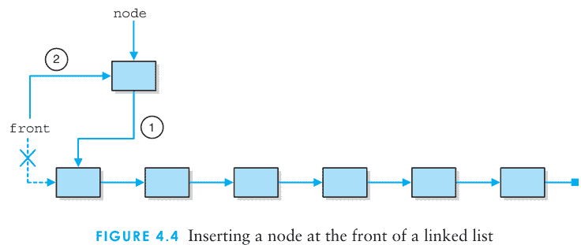

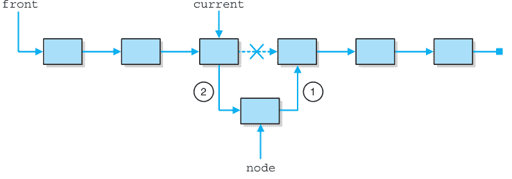

图 4.5 在列表中间插入节点

注意，如果这些步骤反过来，将会产生困难。要在列表中间插入节点，我们必须首先找到前面的节点。这种处理通常需要使用两个引用：一个用于找到要插入的节点，另一个用于跟踪紧随其后的节点。因此，它们通常被称为 `current` 和 `previous`，如图 4.7 所示。

首先，将所添加节点的 `next` 引用指向当前节点。然后，将 `previous` 节点的 `next` 引用重置为指向新节点。此过程在节点插入的任何地方都有效，包括使其成为第二个节点或最后一个节点。如果节点插入在列表末尾，则新节点的 `next` 引用被设置为 `null`。

#### 删除节点

列表中的任何节点都可以被删除。无论删除哪个节点，我们都必须维护列表的完整性。在插入节点的过程中，处理第一个节点代表了一个特殊情况。

> 核心概念
> 处理链表中的第一个节点通常需要特殊处理。

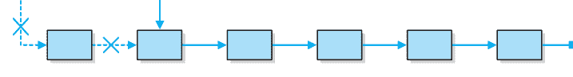

图 4.6 删除链表中的第一个节点

要删除链表中的第一个节点，我们重置指向列表头的引用，使其指向第二个节点。这个过程如图 4.6 所示。如果从其他位置删除节点，则必须为其设置一个单独的引用。

要从列表中删除节点，我们必须首先找到该节点前面的节点。这种处理通常需要使用两个引用：一个用于找到要删除的节点，另一个用于跟踪紧随其后的节点。因此，它们通常被称为 `current` 和 `previous`。

一旦找到这些节点，将 `previous` 节点的 `next` 引用重置为指向 `current` 节点 `next` 引用所指向的节点。

#### 哨兵节点

到为止，我们将向列表插入和删除的操作描述分为两种情况：处理第一个节点的情况和处理任何其他节点的情况。通过在列表头部引入一个哨兵节点（sentinel node）或虚拟节点（dummy node），可以消除涉及第一个节点的特殊情况。哨兵节点作为一个虚假的第一个节点，实际上并不代表列表中的元素。通过使用哨兵节点，所有的插入和删除都将属于第二种情况，实现时就不需要考虑那么多的特殊情况了。

> 核心概念
> 使用哨兵节点或虚拟节点作为第一个节点来实现链表，可以消除处理第一个节点的特殊情况。

### 4.3 不带元素的元素

现在我们已经探索了管理链表节点所需的一些技术，可以将注意力转向如何将链表作为集合的另一种实现方法。然而，要做到这一点，我们还需要仔细检查链表的另一个方面。我们必须将链表结构的细节与列表所存储的元素隔离开来。

> 核心概念
> 存储在集合中的对象不应该包含底层数据结构的任何实现细节。

在本章的早些部分，我们讨论了 `Person` 类的内容，该类在其数据中包含一个指向另一个 `Person` 对象的链接。这种方法的缺陷在于，这个自引的 `Person` 类必须被设计成“知道”它可能成为 `Person` 对象链表中的一个节点。这种假设是不切实际的，而且它违反了我们实现实现细节与使用集合的系统部分隔离开的目标。

这个问题的解决方案是定义一个单独节点类（node class），用于将元素连接起来。节点类非常简单，只包含两个重要的引用：一个指向链表中下一个节点的引用，另一个指向存储在列表中的元素引用。这种方法如图 4.8 所示。

节点链表仍然可以使用上一节讨论的技术进行管理。唯一的额外方面是，存储在列表中的实际元素是通过节点对象中的单独引用访问的。

#### 双向链表

链结构的另一种实现方案是双向链表，如图 4.9 所示。在双向链表中，维护两个引用：一个指向列表中的第一个节点，另一个指向列表中的最后一个节点。列表中的每个节点都存储了指向下一个元素的引用和指向上一个元素的引用。如果我们在双向链表中使用哨兵节点（sentinel nodes），我们会在列表的两端放置哨兵节点。我们将在第 6 章进一步讨论链表。

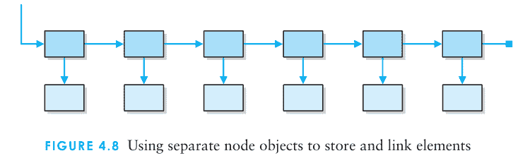

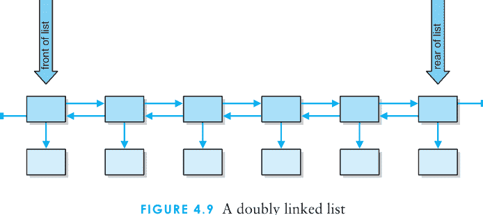

### 4.4 实现栈：使用链接

让我们使用链表来实现栈集合，该集合在第 3 章中已经定义过。请注意，我们没有改变栈的工作方式。它的概念本质保持不变，正如为它定义的操作集一样。我们只是更改了用于实现它的底层数据结构。

栈的目的以及它帮助我们创建的解决方案（例如第 3 章中的后缀表达式求值）使用了 `ArrayStack<T>` 类，但任何有效的栈实现都可以替代它。一旦我们创建了 `LinkedStack<T>` 类来定义另一种实现，就可以将其替换到后缀表达式解决方案，除了更改名称外不需要更改任何内容。但这正是抽象的魅力所在。

> 核心概念
> 只要有效实现了适当的操作，集合的任何实现都可以用于解决问题。

在接下来的讨论中，我们将展示并讨论对理解栈的列表实现重要的方法。栈的一些操作将作为留作编程项目。

#### LinkedStack 类

`LinkedStack<T>` 类实现了 `StackADT<T>` 接口，就像第 3 章中的 `ArrayStack<T>` 类一样。两者都提供了为栈集合定义的操作。

由于我们使用了链表法，因此没有数组来存储集合的元素。相反，我们只需要一个指向列表第一个节点的单一引用。我们还将维护列表中元素数量计数。因此，`LinkedStack<T>` 类的头部和类级数据如下：

```java
/**

 * @author Lewis and Chase

 * 表示栈的链式实现。

 */

package jss2.exceptions.*;

import java.util.Iterator;

public class LinkedStack<T> implements StackADT<T> {

    /** 表示存储的元素数量 */

    private int count;

    /** 指向栈顶的指针 */

    private LinearNode<T> top;
```

`LinearNode<T>` 类充当节点类，包含指向列表中下一个 `LinearNode<T>` 的引用以及指向存储在节点中的元素的引用。每个节点存储一个泛型类型，该类型在节点实例化时确定。在我们的 `LinkedStack<T>` 实现中，我们简单地为节点使用定义栈相同的类型。`LinearNode<T>` 类还包含设置和获取值的方法。`LinearNode<T>` 类见列表 4.1。

请注意，`LinearNode<T>` 类与栈集合的实现没有绑定。它可以用于任何集合的线性链表实现中。我们将根据需要将其用于其他集合。

使用 `LinearNode<T>` 类并维护集合中的元素计数创建了如图 4.10 所示的实现策略。

> 核心概念
> 栈的链式实现在链表的末尾添加和删除元素。

`LinkedStack<T>` 类的构造函数将元素计数设置为零，并将由变量 `top` 表示的列表头部设置为 `null`。请注意，由于链表实现不需要担心容量限制，因此没有像我们在第 3 章的 `Array<T>` 类中那样样需要创建第二个构造函数。

```java
/**

 * 创建一个空栈。

 */

public LinkedStack() {

    count = 0;

    top = null;

}
```

#### 列表 4.1

```java
```


# 第4章 链接结构

## 4.4 实现栈：使用链接

### LinearNode 类

```java
/**
 * @author Lewis and Chase
 * 表示链表中的节点。
 */
package jss2;
public class LinearNode<T> {
    /** 指向下一个节点的引用 */
    private LinearNode<T> next;

    /** 节点的元素 */
    private T element;

    /**
     * 创建空节点。
     */
    public LinearNode() {
        next = null;
        element = null;
    }

    /**
     * 创建存储指定元素的节点。
     * @param elem 要存储的元素
     */
    public LinearNode(T elem) {
        next = null;
        element = elem;
    }

    /**
     * 返回后续节点。
     * @return LinearNode<T> 节点
     */
    public LinearNode<T> getNext() {
        return next;
    }

    /**
     * 设置后续节点。
     * @param node 要紧随其节点
     */
    public void setNext(LinearNode<T> node) {
        next = node;
    }

    /**
     * 返回存储在节点中的元素。
     * @return T 类型的元素
     */
    public T getElement() {
        return element;
    }

    /**
     * 设置存储在节点中的元素。
     * @param elem 要存储的元素
     */
    public void setElement(T elem) {
        element = elem;
    }
}
```

### push 操作

由于栈的本质只允许从一端添加或删除元素，因此我们只需要操作列表的一端。我们可以选择将第一个元素推入链表的第一个位置，将第二个元素推入第二个位置，以此类推。这意味着栈顶始终位于列表的末尾。然而，如果我们考虑这种策略的效率，就会意识到这意味着每次 `push` 和 `pop` 操作都需要遍历整个列表。相反，我们可以选择操作列表头部，使头部成为栈顶。

让我们探索 `LinkedStack` 类栈操作的实现。

每当将新元素推入栈时，必须创建一个新的 `LinearNode` 对象来将其存储在链表中。为了将新创建的节点置顶，我们必须将它的 `next` 设置为当前栈顶，并重置 `top` 引用指向新节点。我们还必须增加 `count` 变量。

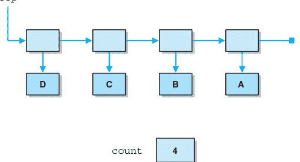

实现这些步骤将得到以下代码：

```java
/**
 * 将指定的元素添加到此栈的顶部。
 * @param element 要推入栈的元素
 */
public void push(T element) {
    LinearNode<T> temp = new LinearNode<T>(element);

    temp.setNext(top);
    top = temp;
    count++;
}
```

图 4.12 显示了将元素 E 推入图 4.11 所示栈之后的结果。

栈的链表实现的推（push）操作由以下步骤组成：

- 创建一个新的节点，其中包含指向要放置在栈上的对象的引用。
- 将新节点的 `next`（下一个）引用指向栈的当前栈顶（如果栈为空，则指向 null）。
- 将 `top`（顶）引用指向新节点。
- 将栈中元素的计数加1。

所有这些步骤的时间复杂度均为 O(1)，因为无论栈中已经有多少个元素，它们只需要一个处理步骤。对于每个要推入的元素，这些步骤都必须执行一次。因此，使用这种方法，推操作的复杂度为 O(1)。

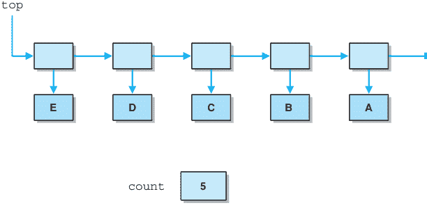

### pop 操作

弹出（pop）操作通过返回当前存储在栈顶的元素引用，并调整 `top` 引用以指向栈的新栈顶来实现。然而，在尝试返回任何元素之前，我们必须首先确保至少有一个元素可以返回。该操作可以如下实现：

```java
/**
 * 移除此栈顶部的元素并返回其引用。如果栈为空，则抛出 EmptyCollectionException。
 * @return 栈顶的元素 T
 * @throws EmptyStackException 在弹出空栈时抛出异常
 */
public T pop() {
    if (isEmpty()) {
        throw new EmptyCollectionException("Stack");
    }

    T result = top.getElement();
    top = top.getNext();
    count--;

    return result;
}
```

如果通过 `isEmpty` 方法确定栈为空，则将抛出 `EmptyCollectionException`。如果至少有一个元素可以弹出，它会被存储在一个临时变量中以便返回。然后，将栈的 `top` 引用设置为列表中的下一个元素，该元素现在是栈的新栈顶。元素计数也会减1。

图 4.13 说明了对图 4.12 中的栈执行弹出操作的结果。注意，此图与我们在图 4.11 中的原始配置相同。这说明了弹出操作是推操作的逆操作。

链表实现的弹出操作由以下步骤组成：

- 确保栈不为空。
- 设置一个临时引用等于栈顶的元素。

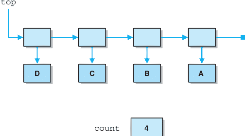

- 将 `top` 引用等于栈顶节点的 `next` 引用。
- 将栈中元素的计数减1。
- 返回临时引用所指向的元素。

与我们之前的示例一样，这些步骤中的每一个都包含单次比较或简单的赋值，因此是 O(1)。因此，链表实现的弹出操作复杂度为 O(1)。

### 其他操作

使用链表实现，`peek`（查看）操作通过返回指向 `top` 指针的节点的元素引用来实现。`isEmpty` 操作在元素计数为 0 时返回 `true`，否则返回 `false`。`size` 操作直接返回栈中元素的计数。`toString` 操作可以通过简单遍历链表来实现。这些操作被留作编程项目练习。

## 4.5 使用栈：遍历迷宫

栈数据结构的另一个经典用途是跟踪迷宫遍历或其他涉及试错的类似算法中的替代方案。假设我们构建一个 `int` 二维数组来构建网格，其中每个数字代表迷宫中的路径（1）或墙壁（0）：

```java
private int[][] grid = {
    {1,1,1,0,1,0,1,0,0,1,1,1,1},
    {1,0,0,1,1,0,1,1,1,1,0,0,1},
    {1,1,1,1,1,0,0,1,0,1,0,0},
    {0,0,0,0,1,1,1,0,0,1,1,1},
    {1,0,1,1,1,1,1,1,0,0,1,1},
    {1,0,1,0,1,0,0,1,1,1,0,1},
    {1,0,1,1,1,1,1,1,0,1,1,1},
    {1,0,0,0,0,0,1,0,0,0,0},
    {1,1,1,1,1,1,1,1,1,1}
};
```

我们的目标是从网格的左上角开始并遍历到右下角。

### 列表 4.2 Maze 类

```java
/**
 * @author Lewis and Chase
 * 表示一个由字符组成的迷宫。目标是沿着 '1' 的路径
 * 从左上角移动到右下角。
 */
import jss2.*;
public class Maze {
    /**
     * 表示已尝试路径的常量
     */
    private final int TRIED = 3;
    /**
     * 表示最终路径的常量
     */
    private final int PATH = 7;
    /**
     * 表示网格的二维数组
     */
    private int[][] grid = {
        {1,1,1,0,1,1,0,0,1,1,1},
        {1,0,1,0,1,1,1,0,1,0,0},
        {1,1,1,0,1,0,1,0,1,0,0},
        {0,0,0,1,1,1,0,1,0,1,1},
        {1,1,1,0,1,1,1,0,1,0,1},
        {1,0,1,0,0,0,0,1,1,0,1},
        {1,0,1,1,1,1,1,0,1,1,1},
        {1,0,0,0,0,0,0,0,0,0,0},
        {1,1,1,1,1,1,1,1,1,1,1}
    };

    /**
     * 将新的尝试移动推入栈中
     * @param x 代表 x 坐标
     * @param y 代表 y 坐标
     * @param stack 网格内移动的工作栈
     * @return StackADT<Position> 网格内移动的栈
     */
    private StackADT<Position> push_new_pos(int x, int y, StackADT<Position> stack) {
        Position npos = new Position();
        npos.setX(x);
        npos.setY(y);
        if (valid(npos.getX(), npos.getY())) {
            stack.push(npos);
        }
        return stack;
    }

    /**
     * 尝试迭代遍历迷宫。它插入特殊的字符来表示
     * 已尝试过且最终成为解决方案一部分的位置。该方法使用
     * 栈来跟踪可能进行的移动。
     * @return boolean 如果成功遍历迷宫，则返回 true
     */
    public boolean traverse() {
        boolean done = false;
        Position pos = new Position();
        Object dispose;
        StackADT<Position> stack = new LinkedStack<Position>();
        stack.push(pos);

        while (!done) {
            pos = stack.pop();
            grid[pos.getX()][pos.getY()] = TRIED; // 此单元已尝试过

            if (pos.getX() == grid.length - 1 && pos.getY() == grid[0].length - 1) {
                done = true; // 迷宫破解
            } else {
                stack = push_new_pos(pos.getX(), pos.getY() - 1, stack);
                stack = push_new_pos(pos.getX(), pos.getY() + 1, stack);
                stack = push_new_pos(pos.getX() - 1, pos.getY(), stack);
                stack = push_new_pos(pos.getX() + 1, pos.getY(), stack);
            }
        }
        return done;
    }

    /**
     * 确定特定位置是否有效。
     * @param row 代表 y 坐标
     * @param column 代表 x 坐标
     * @return boolean 如果给定坐标是有效移动，则返回 true
     */
    private boolean valid(int row, int column) {
        boolean result = false;
        /** 检查单元格是否在矩阵边界内 */
        if (row >= 0 && row < grid.length &&
            column >= 0 && column < grid[row].length) {
            /** 检查单元格未被阻塞且未被之前尝试过 */
            if (grid[row][column] == 1) {
                result = true;
            }
        }
        return result;
    }

    /**
     * 以字符串形式返回迷宫。
     * @return 迷宫网格的字符串表示
     */
    public String toString() {
        String result = "\n";
        for (int row = 0; row < grid.length; row++) {
            for (int column = 0; column < grid[row].length; column++) {
                result += grid[row][column] + "";
            }
            result += "\n";
        }
        return result;
    }
}
```

### 列表 4.2 续 MazeSearch 类

```java
/**
 * @author Lewis and Chase
 * 演示使用栈进行模拟。
 */
public class MazeSearch {
    /**
     * 创建一个迷宫，打印其初始形式，
     * 尝试求解，并打印其最终形式。
     * @param args 字符串数组
     */
    public static void main(String[] args) {
        Maze labyrinth = new Maze();
        System.out.println(labyrinth);
        if (labyrinth.traverse()) {
            System.out.println("迷宫被成功遍历！");
        } else {
            System.out.println("没有路径。");
        }
        System.out.println(labyrinth);
    }
}
```


## 4.6 实现栈：`java.util.Stack`

`java.util.Stack` 是栈的实现。它遵循以下 API：

- `push` 操作接受要放入栈的项。
- `pop` 操作移除栈顶元素。
- `peek` 操作返回栈顶元素。
- `isEmpty` 操作与 `size` 操作相同，返回元素的数量。

`Stack` 继承自 `Vector`，并根据需要增长。由于它是 `Vector`，因此继承了许多操作。

### 特有操作

`java.util.Stack` 提供了一个 `search` 方法。给定要搜索的对象，它返回从栈顶到该对象的距离。如果未找到对象，则返回 -1。

> **关键概念**
> `java.util.Stack` 类继承自 `Vector`，这提供了栈操作。

### 继承与实现

`java.util.Stack` 继承自 `Vector`，继承自 `AbstractList`，继承自 `AbstractCollection`，最后继承自 `java.lang.Object`。这些关系在图 4.14 中所示。


图 4.14 `Stack` 的 UML 描述

- 对象的引用变量可以创建链式结构。
- 链表由指向下一个对象的组成。
- 链表根据需要动态增长，且没有容量限制。
- 引用的顺序对于维护链表至关重要。
- 处理第一个节点通常需要特殊处理。
- 使用哨兵节点或哑节点作为第一个节点可以消除第一个节点的特殊情况。
- 存储的对象不应包含数据结构的任何实现细节。
- 只要实现了适当的操作，任何集合实现都可以解决问题。
- 栈的链实实在链表的一端添加和删除元素。
- 递归处理可以使用栈来跟踪数据。

## 自习题

- SR 4.1 对象的引用如何定义数据结构？
- SR 4.2 比较并对比链表和数组。
- SR 4.3 管理链表时存在特殊情况？
- SR 4.4 为什么链表应该与存储在列表上的元素分开？
- SR 4.5 `LinkedStack<T>` 和 `ArrayStack<T>` 类有什么共同点？
- SR 4.6 如果选择在列表末尾而不是头部进行 `push` 操作，时间复杂度是多少？
- SR 4.7 双向链表和单向链表有什么区别？
- SR 4.8 使用哨兵节点（sentinel nodes）或哑节点对双向链表的实现会有什么影响？
- SR 4.9 与数组实现相比，使用链表实现有哪些优势？
- SR 4.10 与链表实现相比，使用数组实现有哪些优势？
- SR 4.11 `java.util.Stack` 的栈实现有哪些优势？
- SR 4.12 `java.util.Stack` 实现存在什么潜在问题？
- SR 4.13 后置表示法的优势是什么？

## 练习

- EX 4.1 解释如果图 4.4 所示的步骤反转，会发生什么。
- EX 4.2 解释如果图 4.5 所示的步骤反转，会发生什么。
- EX 4.3 绘制一张 UML 图，显示集合链表实现中涉及的类之间的关系。
- EX 4.4 为 `add` 方法编写一个算法，将元素添加到列表末尾而不是开头。该算法的时间复杂度是多少？
- EX 4.5 修改上一个练习中的算法，使其使用引用（reference）。这如何影响该操作和其他操作的时间复杂度？
- EX 4.6 讨论如果实现中没有 `count` 变量，对所有操作会有什么影响。
- EX 4.7 讨论在列表头部使用哨兵节点或哑节点的影响（并画出一个示例）。
- EX 4.8 为本章中的迭代迷宫求解器考试绘制 UML 类图。

## 编程项目

- PP 4.1 通过提供 `size`、`isEmpty` 和 `toString` 方法的定义，完成 `LinkedStack<T>` 类的实现。
- PP 4.2 修改第 3 章的后置程序，使其使用 `LinkedStack<T>` 类代替 `ArrayStack<T>` 类。
- PP 4.3 创建一个新版本的 `LinkedStack<T>` 类，在列表头部使用哑记录（dummy record）。
- PP 4.4 创建一个简单的图形化应用程序，允许用户对栈执行 `push`、`pop` 和 `peek` 操作，并在文本区域中（使用 `toString`）显示结果栈。
- PP 4.5 设计并实现一个应用程序，从用户处读取一个句子，并打印每个单词字符反后的句子。使用栈来反转每个单词的字符。
- PP 4.6 完成迭代迷宫求解器的解决方案，使你的解决方案标记出成功路径。
- PP 4.7 本章中的链实现使用 `count` 变量来跟踪栈中的元素数量。重写不带 `count` 变量的链实现。
- PP 4.8 有一种名为丢弃栈（drop-out stack）的数据结构，它在各方面表现得像栈，但当栈的大小为 $n$ 时，如果推入第 $n+1$ 个元素，该元素就会丢失。使用链表实现丢弃栈。

## 自习题答案

- SRA 4.1 对象引用可以作为从一个对象到另一个对象的链接。一组链式对象可以形成数据结构（例如链表），可以在此基础上构建集合。
- SRA 4.2 链表没有容量限制，而数组有。然而，数组可以通过索引直接访问元素，而链表必须逐个元素地遍历才能到达列表中的特定点。
- SRA 4.3 链表处理中的主要情况发生在处理列表中的第一个元素时。维护一个特殊变量来指定列表中的第一个元素。如果该元素被删除，或者在其前面添加了新元素，则必须仔细地维护头部引用。
- SRA 4.4 假设我们想要放入集合的每个对象都可以设计成与集合实现配合，是不现实的。此外，实现细节应该与集合的用户保持分离，包括用户选择添加到集合中的元素。
- SRA 4.5 `LinkedStack<T>` 和 `ArrayStack<T>` 类都实现了 `StackADT<T>` 接口。这意味着它们都代表一个栈集合，提供了使用栈所需的各种操作。尽管它们在管理集合的方法上不同，但从用户的角度来看，它们在功能上是可以互换的。
- SRA 4.6 如果要在列表末尾推元素，我们必须遍历列表到达最后一个元素。这种遍历会导致时间复杂度变为 $O(n)$。另一种方法是修改方案，添加一个始终指向列表最后一个元素的尾部引用（rear reference）。这将有助于 `add` 操作的时间复杂度，但如果我们尝试删除最后一个元素，就会产生后果。
- SRA 4.7 单链链表维护一个指向列表第一个元素的引用，以及从每个节点到列表中下一个节点的后续引用。双向链表维护两个引用：头部（front）和尾部（rear）。双向链表中的每个节点都存储了下一个（next）和上一个（previous）引用。
- SRA 4.8 双向链表需要两个哑记录，一个在头部一个在尾部，以消除处理第一个和最后一个节点时的特殊情况。
- SRA 4.9 链实现仅在需要时分配空间，其理论限制是硬件的大小。
- SRA 4.10 数组实现每个对象占用的空间较少，因为它只需要存储对象而不需要索引。
- SRA 4.11 链实现仅在需要时分配空间，理论限制是硬件的大小。
- SRA 4.12 `java.util.Stack` 实现是一个扩展。
- SRA 4.13 后置表示法避免了优先级规则。

## 第 5 章 队列

## 队列

队列是另一种我们熟悉的集合。队列是一个排队，例如等待出纳员的顾客。事实上，在很多国家习惯使用队列一词。队列的例子还包括等待红灯的汽车。在任何队列中，元素从一端进入并从另一端离开。

## 目标

- 查看队列处理
- 定义队列类型
- 演示如何使用队列解决问题
- 查看各种队列实现

## 5.1 Queue ADT

队列是一个从一端添加并从另一端移除元素的线性集合。因此，我们说队列按先进先出（FIFO）方式处理。

这与排队的一般概念一致。当顾客到达银行时，他们在队尾开始等待。当出纳员空闲时，队头的顾客离开接受服务。最终，每个从队尾开始的顾客都会移动到队首并离开。对于给定的群体，第一个进入队列的人是第一个离开的人。

队列的处理如图 5.1 所示。通常队列呈水平表示。一端确定为队列的头部（front），另一端确定为队列的尾部（rear）。元素进入尾部并从头部离开。队列头部称为 head，尾部称为 tail。

将队列的处理与第 3 和 4 章讨论的栈后进先出（LIFO）处理进行对比。在栈中，处理发生在集合的一端。在队列中，处理发生在两端。

队列 $T$ 定义的操作列在图 5.2 中。术语 `enqueue` 用于指代在队列尾部添加新元素的过程。同样，`dequeue` 指移除队列头部的元素。`first` 操作允许用户查看队列头部的元素而不将其从集合中移除。

记住，集合操作的命名约定并不是通用的。有时 `enqueue` 会被简单地称为 `add` 或 `insert`。`dequeue` 操作有时被称为 `remove` 或 `serve`。`first` 操作有时称为 `front`。

> **核心概念**
> 队列元素按 FIFO 方式处理——先进入的元素先离开。

### 5.1 队列 ADT 操作

| 操作 | 描述 |
| --- | --- |
| `enqueue` | 向队列末尾添加一个元素。 |
| `dequeue` | 从队列头部移除一个元素。 |
| `first` | 队列头的元素。 |
| `isEmpty` | 确定队列是否为空。 |
| `size` | 确定队列中元素的数量。 |
| `toString` | 返回队列的字符串表示。 |

注意，队列的操作与栈的操作之间存在通用的相似性。`enqueue`、`dequeue` 和 `first` 操作对应于栈的 `push`、`pop` 和 `peek` 操作。与栈一样，队列没有操作允许用户“伸进”队列中间并重新组织元素。如果需要那种类型的处理，也许合适的集合是某种类型的列表（list），正如我们在下一章中将讨论的那种。

正如我们处理栈一样，我们定义了一个泛型队列接口 `QueueADT` 接口来表示队列操作，将操作的通用目的与多种实现方式分开。列表 5.1 显示了 `QueueADT` 接口的 Java 版本，其 UML 如图 5.3 所示。

注意，除了标准的队列操作外，我们还包含了一个 `toString` 方法，正如我们在处理栈集合时做的那样。包含它是为了方便，且通常不被认为是队列的经典操作。

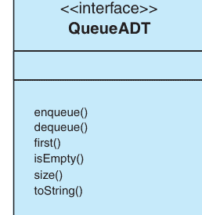

图 5.3 UML 中的 `QueueADT` 接口

```java
/**
 * QueueADT 定义了队列集合的接口。
 * @author Dr. Lewis
 * @author Dr. Chase
 * @version 1.0, 8/12/08
 */
package jss2;

public interface QueueADT<T> {

    /**
     * 向此队列的末尾添加一个元素。
     * @param element 要添加到此队列末尾的元素
     */
    public void enqueue(T element);

    /**
     * 移除并返回此队列头部的元素。
     * @return 此队列头部元素
     */
    public T dequeue();

    /**
     * 在不移除此队列头部元素的情况下返回。
     * @return 此队列中的第一个元素
     */
    public T first();

    /**
     * 如果此队列不包含元素，则返回 true。
     * @return 如果此队列为空则返回 true
     */
    public boolean isEmpty();

    /**
     * 返回此队列中元素的数量。
     * @return 此队列大小的整数表示
     */
    public int size();

    /**
     * 返回此队列的字符串表示。
     * @return 此队列的字符串表示
     */
    public String toString();
}
```

队列在计算中有广泛的应用。栈的主要目的是反转顺序，而队列的主要目的是**保持顺序**。在探索实现队列的各种方法之前，让我们来看一些使用队列来解决问题的方法。

## 5.2 使用队列：代码关键点

凯撒尔密码（Caesar cipher）是一种简单的消息编码方法，通过将消息中的每个字母沿字母表移动常数 $k$ 位来完成编码。例如，如果 $k$ 等于 3，那么在加密消息中，每个字母都向前移动三个字符：a 被替换为 d，b 被替换为 e，c 被替换为 f，依此类推。字母表的末尾会回到开头。因此，w 被替换为 z，x 被替换为 a，y 被替换为 b，z 被替换为 c。

解码消息时，每个字母向后移动相同数的字符。因此，如果 $k$ 等于 3，加密消息

```
vlpsflwb iorozwb frpsohalb
```

将被解码为

simplicity follows complexity

尤利斯·凯撒实际上在他的某些秘密政府信函使用了这种密码（因此得此名）。遗憾的是，凯撒密码非常容易破解。字符位移只有 26 种可能，可以通过尝试不同的键值直到其中一个有效来破解代码。

如果我们使用“重复密钥”（repeating key），就可以对这种编码技术进行改进。我们不再将每个字符移动固定量，而是使用键值列表将每个字符移动不同的量。如果消息比键值列表长，我们只需从开始重新使用密钥。例如，如果键值为：

加密消息：

| n | o | v | a | n | j | g | h | l | m | u | r | x | l | v |
|---|---|---|---|---|---|---|---|---|---|---|---|---|---|---|---|
| 3 | 1 | 7 | 4 | 2 | 5 | 3 | 1 | 7 | | 4 | 2 | 5 | 3 | 1 | 7 | 4 |
| k | o | w | l | e | d | g | e | | i | s | | p | o | w | e | r |

解码消息：

图 5.4 使用重复密钥的加密消息

```java
import jss2.CircularArrayQueue;

/**
 * Codes 展示了如何使用队列进行加密和解密。
 * @author Dr. Lewis
 * @author Dr. Chase
 * @version 1.0, 8/12/08
 */
public class Codes {

    public static void main (String[] args) {

        String message = "All programmers are playwrights and computers are lousy.";

        int[] key = {5, 12, -3, 8, -9, 4, 10};

        Integer keyValue;

        String encoded = "";

        CircularArrayQueue<Integer> keyQueue1 = new CircularArrayQueue<>();

        CircularArrayQueue<Integer> keyQueue2 = new CircularArrayQueue<>();

        /** 加载键队列 */

        for (int scan = 0; scan < key.length; scan++) {

            keyQueue1.enqueue(new Integer(key[scan]));

            keyQueue2.enqueue(new Integer(key[scan]));

        }

        // 加密消息

        for (int scan = 0; scan < message.length(); scan++) {

            keyValue = keyQueue1.dequeue();

            encoded += (char)((int)message.charAt(scan) + keyValue.intValue());

            keyQueue1.enqueue(keyValue);

        }

        System.out.println("Encoded Message:\n" + encoded + "\n");

        // 解密消息

        String decoded = ""; // 原文缺失变量声明，此处补全以保证代码语义完整

        for (int scan = 0; scan < encoded.length(); scan++) {

            keyValue = keyQueue2.dequeue();

            decoded += (char)((int)encoded.charAt(scan) - keyValue.intValue());

            keyQueue2.enqueue(keyValue);

        }

        System.out.println("Decoded Message:\n" + decoded);

    }

}
```


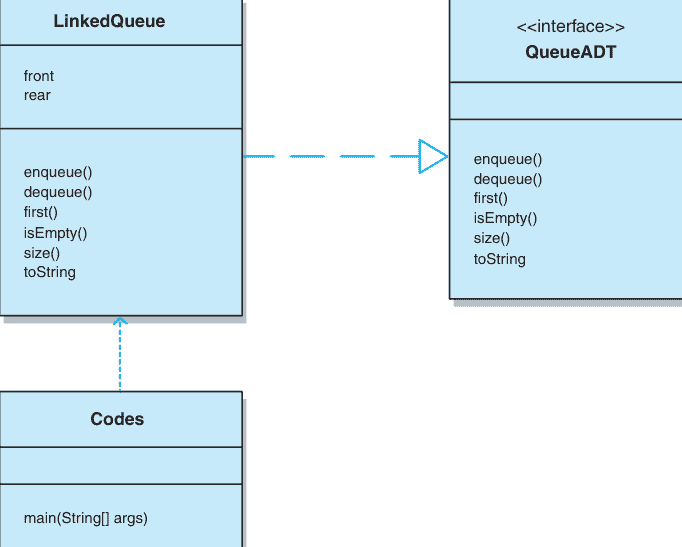

图 5.5 Codes 程序的 UML 描述

使用队列存储密钥使得在使用每个键值后立即将其重新放入队列可以轻松实现密钥重复。队列的性质保持了键值的正确顺序，我们不需要担心到达密钥末尾并重新开始。

## 使用队列：售票处模拟

让我们来看另一个使用队列的例子。考虑一下你正在电影院排队买票的情况。收银员越多，排队移动得就越快。电影院经理希望让客户满意，但不想雇佣比需要数量更多的收银员。假设经理希望将客户花费的总时间保持在七分钟以内。能够模拟高峰时段增加收银员的效果，让经理能够更有效地进行规划。而且，正如我们所讨论过的，队列是表示等待队列的完美集合。

我们模拟的售票处将使用以下假设：

- 只有一条队，且遵循先来服务原则（队列）。
- 客户平均每 15 秒到达一个。
- 如果有空闲的收银员，到达后立即开始处理。
- 从客户到达收银台开始，处理一个客户请求平均需要两分钟（120 秒）。

> 核心概念
> 模拟通常使用队列来表示等待队列。

首先，我们可以创建一个客户类，如列表 5.3 所示。客户对象会跟踪客户到达的时间和购买门票后离开的时间。因此，客户花费的总时间是离开时间减去到达时间。为了保持简单，我们的模拟将以流过的秒来测量时间，因此时间值可以存储在单个整数中。我们的模拟将从时间 0 开始。

### 列表 5.3 Customer 类

```java
/**
 * Customer 代表一个正在等待的客户。
 *
 * @author Dr. Lewis
 * @author Dr. Chase
 * @version 1.0, 08/12/08
 */
public class Customer {
    private int arrivalTime, departureTime;

    /**
     * 使用指定的到达时间创建一个新客户。
     * @param arrives 到达时间的整数表示
     */
    public Customer(int arrives) {
        arrivalTime = arrives;
        departureTime = 0;
    }

    /**
     * 返回此客户的到达时间。
     * @return 到达时间的整数表示
     */
    public int getArrivalTime() {
        return arrivalTime;
    }

    /**
     * 设置此客户的离开时间。
     * @param departs 离开时间的整数表示
     */
    public void setDepartureTime(int departs) {
        departureTime = departs;
    }

    /**
     * 返回此客户的离开时间。
     * @return 离开时间的整数表示
     */
    public int getDepartureTime() {
        return departureTime;
    }

    /**
     * 计算并返回此客户花费的总时间。
     * @return 客户总时间的整数表示
     */
    public int totalTime() {
        return departureTime - arrivalTime;
    }
}
```

我们的模拟将创建一个客户队列，然后看在只有一个收银员的情况下，处理这些客户需要多长时间。然后，我们将用两个收银员处理同一队列的客户。我们将再次用三个收银员进行处理。我们继续这个过程，直到达到十个收银员。最后，我们比较处理一个客户所需的平均时间。

由于我们假设客户平均每 15 秒到达一个，我们可以预先加载一个客户队列。我们将在模拟中处理 100 个客户。

列表 5.4 所示的程序执行了我们的模拟。外层循环决定了每次模拟中使用多少个收银员。对于每一轮，客户依次从队列中取出并由收银员处理。记录总流逝时间，并在每轮结束时计算平均时间。图 5.6 显示了 `TicketCounter` 和 `Customer` 类的 UML 描述。

### 列表 5.4 TicketCounter 类

```java
/**
 * TicketCounter 演示了如何使用队列来模拟等待队列。
 *
 * @author Dr. Lewis
 * @author Dr. Chase
 * @version 1.0, 08/12/08
 */
import jss2.*;

public class TicketCounter {
    final static int PROCESS = 120;
    final static int MAX_CASHIERS = 10;
    final static int NUM_CUSTOMERS = 100;

    public static void main(String[] args) {
        Customer customer;
        LinkedList<Customer> simulationQueue = new LinkedQueue<Customer>();
        int[] cashierTime = new int[MAX_CASHIERS];
        int totalTime, averageTime, departs;

        // 处理不同人数客户的模拟
        for (int cashier = 0; cashier < MAX_CASHIERS; cashier++) {
            // 初始将每个收银员的时间置为零
            for (int count = 0; count < cashier; count++)
                cashierTime[count] = 0;

            // 加载客户队列
            for (int count = 1; count <= NUM_CUSTOMERS; count++)
                simulationQueue.enqueue(new Customer(count * 15));

            totalTime = 0;

            // 处理队列中的所有客户
            while (!simulationQueue.isEmpty()) {
                for (int count = 0; count <= cashier; count++) {
                    if (!simulationQueue.isEmpty()) {
                        customer = simulationQueue.dequeue();
                        // ... 处理逻辑继续 ...
                    }
                }
            }
        }
    }
}
```
（注：列表 5.4 的 OCR 文本包含一些逻辑和拼写错误，已根据上下文修正。）

## 第 5 章 队列

| 收银员人数 | 1   | 2   | 3   | 4   | 5   | 6   | 7   | 8   | 9   | 10  |
|------------|-----|-----|-----|-----|-----|-----|-----|-----|-----|-----|
| 平均时间 (秒) | 517 | 225 | 332 | 840 | 547 | 355 | 219 | 120 | 120 | 120 |

模拟结果如图 5.7 所示。注意当八个收银员时，客户不需要等待。我们经理希望将总时间保持在七分钟（420 秒）以内，模拟告诉我们需要六个收银员。

### 5.4 实现队列：使用链表

由于队列是一个线性集合，我们可以使用链表来实现队列，正如我们之前实现栈那样。主要的区别在于我们需要对两端进行操作。因此，为了有一个指向链表第一个元素的引用（称为 `front`），我们还会跟踪另一个指向链表最后一个元素的引用（称为 `rear`）。我们还将使用整数变量来跟踪队列中元素的数量。

> 核心概念
> 队列的链式实现依赖于链表头部和尾部的引用。

从列表的哪一端添加或入队（`enqueue`）元素以及从哪一端移除或出队（`dequeue`）元素会有区别吗？如果我们的列表是单链表，意味着每个节点只有一个指向其后一个节点的指针，那么是有区别的。在入队操作的情况下，将元素添加到列表的头部还是尾部并没有区别。处理步骤将非常相似。如果我们将元素添加到列表的头部，我们会设置新节点的指针指向列表头部，并将 `front` 变量指向新节点。如果我们将元素添加到列表的尾部，我们会设置列表尾部节点的指针指向新节点，然后将列表的尾部指向新节点。在两种情况下，所有这些处理步骤都是 O(1)，因此入队操作的时间复杂度将是 O(1)。

我们两种选择（在列表头部还是尾部添加）之间的区别出现在我们在尾部入队并从头部出队时，此时出队只需设置一个临时变量指向列表头部（`front`）元素，然后将 `front` 变量设置为第一个节点的 `next` 指针的值。这两个处理步骤都是 O(1)，因此该操作的出队（`dequeue`）时间复杂度为 O(1)。然而，如果我们在列表头部进行入队（`enqueue`），从而在列表尾部进行出队，我们的处理步骤就会变得更有趣。为了从列表尾部（`rear`）出队，我们必须设置一个临时变量指向列表尾部的元素，然后将 `rear` 指针指向当前尾部之前的节点。遗憾的是，在单链表中，我们无法在不遍历列表的情况下获取该节点。如果我们选择在头部入队并在尾部出队，那么出队操作的时间复杂度将是 O(n)，而不是像另一种选择那样是 O(1)。因此，我们选择在单链表的尾部入队并在头部（`front`）出队。请记住，双链表可以解决必须遍历列表的问题，因此在双链表的实现中，选择哪一端并不重要。

图 5.8 展示了这种实现队列的策略。它显示了一个按顺序添加元素 A、B、C 和 D 到队列中或将其入队的队列。

请记住，图 5.8 是一般情况。我们始终必须小心地在特殊情况下维护我们的引用。对于空队列，`front` 和 `rear` 引用均为 `null`，计数（`count`）为零。如果队列中恰好有一个元素，`front` 和 `rear` 引用都指向同一个对象。如果我们使用带有哨兵节点（`sentinel node`）的单链表实现且队列为空，那么 `front` 和 `rear` 将指向哨兵节点。

让我们探索使用这种链表方法实现队列操作。为了方便理解，这里提供了我们队列链表实现的的头文件、类级数据和构造函数：

```java
/**
 * LinkedQueue 表示队列的链表实现。
 *
 * @author Dr. Lewis
 * @author Dr. Chase
 * @version 1.0, 08/12/08
 */
```

```java
package jss2;

import jss2.exceptions.*;

public class LinkedQueue<T> implements QueueADT<T> {
    private int count;
    private LinearNode<T> front, rear;

    /**
     * 创建一个空队列。
     */
    public LinkedQueue() {
        count = 0;
        front = rear = null;
    }
}
```

#### 入队操作

入队操作要求我们将新元素放在列表的尾部。在一般情况下，这意味着将当前元素的 `next` 引用设置为新元素，并将 `rear` 引用重置为新元素。然而，如果队列当前为空，`front` 引用也必须设置为新（也是唯一的）元素。该操作可以如下实现：

```java
/**
 * 将指定的元素添加到此队列的尾部。
 *
 * @param element 要添加到此队列尾部的元素
 */
public void enqueue(T element) {
    LinearNode<T> node = new LinearNode<T>(element);
    if (isEmpty())
        front = node;
    else
        rear.setNext(node);
    rear = node;
    count++;
}
```

注意，新节点的 `next` 引用不需要在此方法中显式设置，因为它在 `LinearNode` 类的构造函数中已经被设置为 `null` 了。在何种情况下，`rear` 引用都会设置为新节点，并且 `count` 都会递增。使用哨兵节点实现队列操作被留给学生作为练习。正如我们之前讨论的，此操作是 O(1)。

图 5.9 显示了在添加元素 E 之后图 5.8 中的队列。

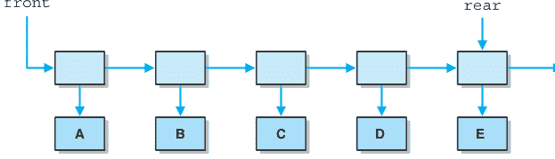

图 5.9 添加元素 E 后的队列

#### 出队操作

实现出队操作时要解决的第一个问题是确保至少有一个元素可以返回。如果没有，则将抛出 `EmptyCollectionException`。正如我们在第 3 章和第 4 章中处理栈集合那样，使用一个通用的 `EmptyCollectionException` 是有意义的，我们可以向其传递一个参数指定我们正在处理的是哪个集合。如果队列中至少有一个元素，则返回列表中的第一个并更新 `front` 引用：

```java
/**
 * 移除此队列头部的元素并返回其引用。
 * 如果队列为空，则抛出 EmptyCollectionException。
 *
 * @return 此队列头部的元素
 * @throws EmptyCollectionException 如果发生空集合异常
 */
public T dequeue() throws EmptyCollectionException {
    if (isEmpty()) {
        throw new EmptyCollectionException("queue");
    }
    T result = front.getElement();
    front = front.getNext();
    count--;
    if (isEmpty()) {
        rear = null;
    }
    return result;
}
```


## 核心概念

入队操作和出队操作在集合的相反端进行。

对于出队操作，我们必须考虑返回队列中唯一元素的情况。如果在移动头部元素后队列现在为空，则将 `rear` 引用设置为 `null`。注意，在这种情况下，`rear` 将指向

 (注：此处图片路径推断)

对于出队操作，我们必须考虑返回队列中唯一元素的情况。如果在移动头部元素后，队列现在为空，则 `rear` 引用设置为 `null`。注意，在这种情况下，`rear` 将指向

### 设计焦点

对于异常的重用目标与其它类相同。`EmptyCollectionException` 类是一个很好的例子。这种带参数的异常可以指定我们正在处理哪个集合（例如，当集合为空时执行操作）。创建一个针对集合的异常是设计重用的极佳用例。

## 5.5 实现队列：使用数组

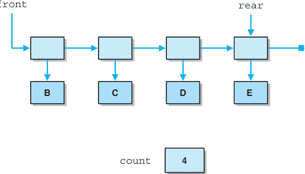

一种基于数组实现队列的策略是将一端（例如头部）固定在数组的索引 0。元素在数组中连续存储。图 5.11 显示了按这种方式存储元素 A、B、C 和 D。这种策略假设队列的第一个元素位于索引 0。由于队列操作涉及集合的两端，每当从队列中移除元素时，都需要移动元素。这种元素的移动会导致出队操作的时间复杂度为 O(n)。

重要的是，与我们对单链表实现复杂度的讨论不同，在数组实现中做出糟糕的选择会导致效率降低。

固定数组策略对于栈来说是非常有效的，因为所有的活动（添加和删除）都发生在集合的一端。对于队列，由于现在对集合的两端进行操作且顺序很重要，固定数组实现的效率要低得多。

如果我们固定队列的尾部而不是头部，会有区别吗？请记住，当我们向队列入队元素时，是在队列的尾部进行的。这意味着每次入队操作都会导致数组中的所有元素移动，使得队列操作复杂度为 O(n)。

### 其他操作

队列实现中的剩余操作非常简单，与栈的操作相似。第一个操作返回队列头部的引用。`isEmpty` 操作在计数器为 0 时返回 `true`，否则返回 `false`。`size` 操作返回元素的计数。最后，`toString` 操作返回由每个元素组成的字符串。这些操作留给学生编程。

## 5.5 队列实现：使用数组 119

> 核心概念
> 将数组视为循环数组可以消除在数组实现中移动元素的需要。

关键在于不要固定末尾。随着元素的出队，队列的头部会向数组的更深处移动。随着元素的入队，队列的尾部也会向数组的更深处移动。挑战出现在队列尾部到达数组末尾时。在此时扩大数组并不是一个实行的解决方案，而且没有利用数组低位索引处的空空间。

为了实现这一方案，我们将使用循环数组来实现队列，并将其定义在一个名为 `CircularArrayQueue` 的类中。循环数组并不是一种新结构——它只是考虑存储集合的数组的一种方式。从概念上讲，数组被用作一个圆，最后一个索引之后是第一个索引。图 5.12 显示了用于存储队列的循环数组。

使用两个整数来表示队列的头部和尾部。这些值随着元素的添加和删除而改变。请注意，`front` 的值代表队列中第一个元素存储的位置，而 `rear` 的值代表数组中下一个可用槽（而不是最后一个元素存储的位置）。以这种方式使用 `rear` 与我们其他的数组实现保持一致。然而，`rear` 的值不再代表队列中的元素数量。

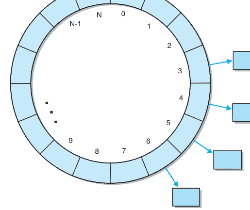

图 5.12 队列的循环数组实现

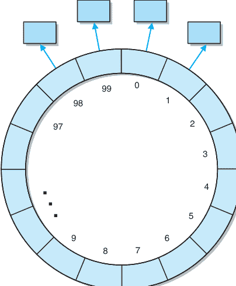

| front | rear | count |
|---|---|---|
| 98 | 2 | 4 |

**图 5.13** 跨越循环数组末端的队列

当队列尾部到达数组末尾时，它会“回”到数组开头。因此，队列的元素可以跨越数组末尾，如图 5.13 所示（假设数组可以存储五个元素）。

使用这种策略，元素一旦添加到队列，它就会留在数组的同一个位置，直到通过 `dequeue` 操作将其移除。添加或删除元素时不需要移动任何元素。这种方法要求我们仔细管理 `front` 和 `rear` 的值。

让我们来看另一个例子。图 5.14 显示了一个容量为十个元素的循环数组（线性画出）。起初，它显示了元素 A 到 H 入队后的状态。然后显示了在前四个元素（A 到 D）出队后的状态。最后，显示了元素 I、J、K 和 L 入队后的状态，这导致队列跨越了数组的末尾。

我们的循环数组队列实现的头部、类级数据和构造函数提供以供参考：

```java
/**
 * CircularArrayQueue 表示队列的数组实现
 * 队列的头部和尾部的索引在到达数组末尾时
 * 回绕到 0。
 *
 * @author Dr. Lewis
 * @author Dr. Chase
 * @version 1.0 08/12/08
 */
package jss2;

import jss2.exceptions.*;
import java.util.Iterator;

public class CircularArrayQueue<T> implements QueueADT<T> {

    private final int DEFAULT_CAPACITY = 100;
    private int front, rear, count;
    private T[] queue;

    /**
     * 使用默认容量创建一个空队列。
     */
    public CircularArrayQueue() {
        front = rear = count = 0;
        queue = (T[]) (new Object[DEFAULT_CAPACITY]);
    }

    /**
     * 使用指定的容量创建一个空队列。
     * @param initialCapacity 循环数组队列大小的整数表示
     */
    public CircularArrayQueue(int initialCapacity) {
        front = rear = count = 0;
        queue = (T[])(new Object[initialCapacity]);
    }
}
```

## 5.5 队列实现：使用数组 123

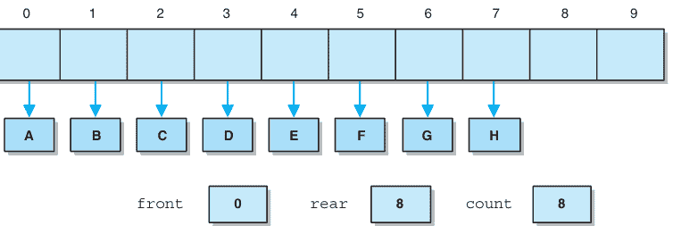
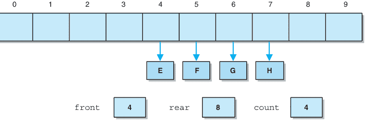
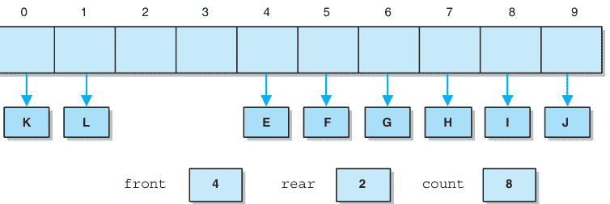

图 5.14 队列循环数组实现的变化

### enqueue 操作

通常，在元素入队后，`rear` 的值会加1。但当入队操作填充数组的最后一个单元（最大索引处）时，`rear` 的值必须设置为 0，表示下一个元素应该存储在索引 0。使用取模运算符可以通过一次计算完成对 `rear` 值的适当更新。

根据这种策略，`enqueue` 操作可以实现如下：

```java
/**
 * 将指定的元素添加到此队列的尾部，必要时扩展
 * 队列的容量。
 * @param element 要添加到队列尾部的元素
 */
public void enqueue(T element) {
    if (size() == queue.length) {
        expandCapacity();
    }
    queue[rear] = element;
    rear = (rear + 1) % queue.length;
    count++;
}
```

请注意，这种实现仍然允许数组达到容量。这意味着队列的尾部已经“追上了”队列的头部。要再添加另一个元素，必须扩大数组。然而，请记住，现有数组中的元素必须按照正确的顺序复制到新数组中，而不一定是它们在当前数组中出现的顺序。

```java
/**
 * 创建新数组以存储此队列的内容，
 * 容量为旧数组的两倍。
 */
public void expandCapacity() {
    T[] larger = (T[])(new Object[queue.length * 2]);
    for (int scan = 0; scan < count; scan++) {
        larger[scan] = queue[front];
        front = (front + 1) % queue.length;
    }
    front = 0;
    rear = count;
    queue = larger;
}
```

### dequeue 操作

同样，在元素出队后，`front` 的值会加1。在多次出队操作后，`front` 的值将到达数组的最后一个索引。在移除最大索引处的元素后，`front` 的值必须设置为 0 而不是加1。我们在 `enqueue` 操作中设置 `rear` 值的相同计算可以用于在 `dequeue` 操作中设置 `front` 的值：

```java
/**
 * 移除此队列头部的元素并返回其引用。
 * 如果队列为空则抛出 EmptyCollectionException。
 *
 * @return 被移除的队列头部元素的引用
 * @throws EmptyCollectionException 如果发生空集合异常
 */
public T dequeue() throws EmptyCollectionException {
    if (isEmpty()) {
        throw new EmptyCollectionException("queue");
    }
    T result = queue[front];
    queue[front] = null;
    front = (front + 1) % queue.length;
    count--;
    return result;
}
```

### 其他操作

使用这种方法时，`toString()` 等操作会变得稍微复杂，因为元素不是从索引 0 开始存储的，可能会跨越数组末尾。这些方法必须考虑到当前的情况。循环数组队列的所有其他操作都留给了编程项目。

## 核心概念总结

- 队列元素按照先进先出（FIFO）的方式进行处理——先进入的元素最先取出。
- 队列是一个用于存储重复代码键的方便集合。
- 模拟通常使用队列来表示等待队列。
- 队列的链表实现通过对链表第一个和最后一个元素的引用来辅助。
- 入队（`enqueue`）和出队（`dequeue`）操作在集合的相反端进行。
- 由于队列操作会修改集合的两端，如果固定一端的索引为 0，则需要移动元素。
- 非循环数组实现中元素的移动会产生 $O(n)$ 的时间复杂度。
- 将数组视为循环数组，可以消除在数组实现中移动元素的必要性。

## 自测习题

- SR 5.1 队列和栈之间有什么什么区别？
- SR 5.2 队列的五种基本操作是什么？
- SR 5.3 队列还可能实现哪些其他操作？
- SR 5.4 在链表实现中，头部和尾部引用可能相等吗？
- SR 5.5 在循环实现中，头部和尾部引用可能相等吗？
- SR 5.6 哪种实现的时间复杂度最差？
- SR 5.7 哪种实现的空间复杂度最差？

## 练习题

- EX 5.1 通过以下操作手动追踪队列 X：

```java
X.enqueue(new Integer(4));
X.enqueue(new Integer(1));
```

```java
Object Y = X.dequeue();
X.enqueue(new Integer(8));
X.enqueue(new Integer(2));
X.enqueue(new Integer(5));
X.enqueue(new Integer(3));
Object Y = X.dequeue();
X.enqueue(new Integer(4));
X.enqueue(new Integer(9));
```


## 练习题

### EX 5.2
给定练习 5.1 得到的 `X` `X`，以下每个操作的结果是什么？

- a. `X.front()`
- b. `Y = X.dequeue()`
- c. `X.front()`
- d. `Y = X.dequeue()`
- e. `X.front()`

### EX 5.3
如果没有 `count` 变量，每种实现的 `size` 操作的时间复杂度是多少？

### EX 5.4
在什么情况下，每种实现的头部和尾部引用可以相等？

### EX 5.5
追踪 22 个客户和 4 个收银员的取号问题。绘制每个人的总时间过程图。你从这些结果中推断出什么？

### EX 5.6
对比 `LinkedQueue` 类的 `enqueue` 方法与第4章 `LinkedStack` 类的 `push` 方法。

### EX 5.7
描述实现 `LinkedQueue` 类 `isEmpty` 方法的两种不同方式。

### EX 5.8
列举五个本章之外的队列日常生活例子。

### EX 5.9
解释为什么栈的数组实现不需要移动元素，而队列的非循环数组实现需要。

### EX 5.10
假设 `CircularArrayQueue` 类没有使用 `count` 变量。解释你如何使用 `front` 和 `rear` 的值来计算列表中元素的数量。

## 编程项目

### PP 5.1
完成本章介绍的 `LinkedQueue` 类的实现。具体来说，完成构造、`isEmpty`、`size` 和 `toString` 方法的实现。

### PP 5.2
完成本章描述的 `CircularArrayQueue` 类实现，包括所有方法。

### PP 5.3
创建 `CircularArrayQueue` 类的版本，其列表增长的方向与本章描述的版本相反。

### PP 5.4
本章中的所有实现都使用 `count` 变量来跟踪队列中的元素数量。在不使用 `count` 变量的情况下重写链表实现。

### PP 5.5
本章中的所有实现都使用 `count` 变量来跟踪队列中的元素数量。在不使用 `count` 变量的情况下重写循环数组实现。

### PP 5.6
一种名为 deque（读作 "deck"）的数据结构与队列密切相关。deque 的意思是双端队列。两者之间的区别在于，可以在队列的任一端插入或删除。使用数组实现 `deque`。

### PP 5.7
使用链表实现编程项目 5.6 中的 `deque`。（提示：每个节点都需要一个 `next` 和 `previous` 引用。）

### PP 5.8
创建一个图形化应用程序，提供入队和出队的按钮、一个接受字符串作为入队输入的文本字段，以及一个在每次操作后显示队列内容的文本区域。

### PP 5.9
创建一个使用栈和队列的系统来测试字符串是否为回文（即正读和反读都相同）。

### PP 5.10
创建一个模拟路口车辆的系统。假设四个方向各有一个车道，每个方向都有红绿灯。改变每个方向车辆的平均到达率和灯变化的频率，以观察路口的“行为”。

## 自测习题答案

### SRA 5.1
队列是先进先出（FIFO）集合，而栈是后进先出（LIFO）集合。

### SRA 5.2
队列的基本操作是：

- `enqueue`——向队列末尾添加一个元素
- `dequeue`——从队列中移除一个元素
- `first`——返回头部元素的引用
- `isEmpty`——如果队列为空则返回 true，否则返回 false

### SRA 5.3
`makeEmpty()`, `full()`

### SRA 5.4
是的，当队列为空（头部和尾部均为 null）以及当只有一个元素时发生。

### SRA 5.5
是的，这在两种情况下可能发生：队列为空和队列满。

### SRA 5.6
非循环数组实现的时间复杂度最差，为 $O(n)$。

### SRA 5.7
两种数组实现都为未填充元素浪费了空间。链表实现每个元素使用的空间更多。

---

# 第6 章 列表

## 6.1 列表 ADT

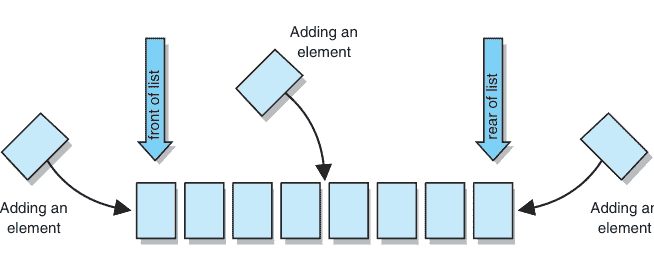

图 6.2 无序列表的概念视图

索引列表与无序列表相似之处在于，元素之间没有决定其在列表中顺序的内在关系。使用列表的客户端决定元素的顺序。然而，此外，每个元素都可以通过数字索引进行引用，该索引从列表开头的 0 开始，一直持续到列表末尾。图 6.3 显示了索引列表的概念视图。新元素可以插入到列表的任何位置，包括列表的头部或尾部。每当列表发生变化时，索引都会进行调整以保持有序且连续。

> **核心概念**
> 索引列表为其元素维护一个连续的数字索引范围。

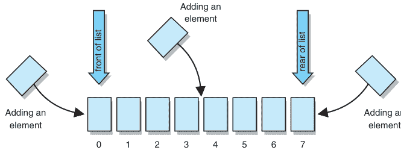

图 6.3 索引列表的概念视图

### 列表的常用操作

| 操作 | 描述 |
|--- | --- |
| `removeFirst` | 从列表中移除第一个元素。 |
| `removeLast` | 从列表中移除最后一个元素。 |
| `remove` | 从列表中移除特定元素。 |
| `first` | 检查列表头部的元素。 |
| `last` | 检查列表末尾的元素。 |
| `contains` | 确定列表是否包含某个特定元素。 |
| `isEmpty` | 确定列表是否为空。 |
| `size` | 确定列表中元素的数量。 |

图 6.4 列表的常用操作

在第 6.6 节中，我们目前将把大部分讨论重点集中在有序列表和无序列表上。

请记住，这些是列表的视图视图。与任何集合一样，它们可以通过许多方式实现。这些列表的实现甚至不需要按照其概念视图所示的顺序保持元素，尽管这样做可能是最简单的。

有一组操作对于有序和无序列表都是通用的。这些通用操作如图 6.4 所示。它们包括移除和检查元素的操作，以及 `isEmpty` 和 `size` 等经典操作。`contains` 操作也受两种列表类型的支持，允许用户确定列表是否包含某个特定元素。

> **核心概念**
> 可以为所有列表类型定义许多常用操作。它们之间的区别在于元素添加的方式。

注意，我们第一次开始检查一个在概念上允许我们访问列表中间元素的集合。

对于栈，我们只能对集合的末端（即顶部）进行操作。对于队列，我们可以从一端添加并从另一端移除。对于列表，我们能够添加、移除或查看列表中的任何元素。由于此原因，列表包含一个迭代器。

### 迭代器

迭代器是一个提供遍历集合手段的对象。也就是说，它提供了方法，允许用户按顺序获取并使用集合中的每个元素。大多数集合都提供一种或多种方法来遍历其元素。在 `ListADT` 接口的情况下，我们定义了一个名为 `iterator` 的方法，它返回一个 `Iterator` 对象。

> **核心概念**
> 迭代器是一个提供遍历集合手段的对象。

`Iterator` 接口定义在 Java 标准类库中。`Iterator` 接口定义的两个主要抽象方法是：

- `hasNext()`：如果迭代中还有更多元素，则返回 true。
- `next()`：返回迭代中的下一个元素。

`ListADT` 接口的 `iterator` 方法返回一个实现此接口的对象。用户可以使用 `hasNext` 和 `next` 方法与该对象交互，以访问列表中的元素。

注意，对于 `Iterator` 对象交付集合中元素的顺序没有假设。在列表的情况下，线性顺序可能会遵循某种顺序。在其他情况下，迭代器可能会遵循一种对该集合有意义的特定顺序。

关于使用迭代器的另一个问题是，如果在迭代器使用期间修改了集合会发生什么。Java Collections API 中的大多数集合都实现为“快速失败（fail-fast）”。这意味着它们将

### 向列表中添加元素

有序列表和无序列表之间的区别通常集中在元素如何添加到列表上。在有序列表中，我们只需要指定要添加的新元素。它在列表中的位置基于其键值。该操作如图 6.5 所示。

| 操作 | 描述 |
| --- | --- |
| `add` | 向列表中添加一个元素。 |

图 6.5 有序列表的特定操作

无序列表支持 `add` 操作的三种变体。元素可以添加到列表的头部或尾部，或者添加到列表中已有的特定元素之后。这些操作如图 6.6 所示。

| 操作 | 描述 |
|--- |--- |
| `addToFront` | 向列表头部添加一个元素。 |
| `addToRear` | 向列表尾部添加一个元素。 |
| `addAfter` | 在列表中已有的特定元素之后添加一个元素。 |

图 6.6 无序列表的特定操作


列表既是有序又是索引的吗？可能，但没有意义。如果一个列表既有序又是索引的，当客户端程序在特定索引处追加元素或更改特定索引处的元素使其不符合顺序时，哪种规则优先？索引位置还是顺序？

概念上，索引列表的特定操作利用了其通过索引引用元素的能力。新元素可以插入到列表的特定索引处，也可以在不指定索引的情况下添加到尾部。注意，如果插入或删除了元素，较高索引的元素会向上移动空间或向下移动间隙。或者，可以设置特定索引处的元素，这将覆盖该索引处的元素，因此不会导致其他元素移动。此外，正如我们在本节后面探讨的，索引列表提供了检索特定索引处元素以及确定列表中元素索引的操作。

我们可以利用有序和无序列表共享一组通用操作的事实。这些操作只需要定义一次。因此，我们将定义三个接口：一个包含通用操作，两个包含针对特定列表类型的操作。继承可以用于接口，就像用于类一样。特定列表接口扩展了通用列表定义。这些接口之间的关系如图 6.7 所示。

### 6.1 列表 ADT

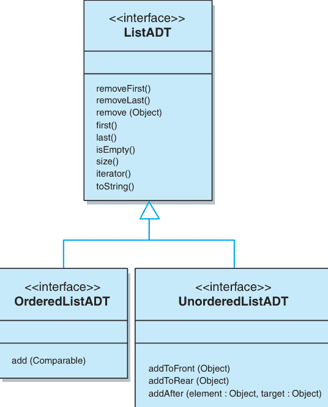

图 6.7 各种列表接口

当接口被继承时，子接口包含父接口定义的所有抽象方法。因此，任何实现子接口的类都必须实现父接口和子接口的所有方法。

> **核心概念**
> 接口可以用于派生其他接口。子接口包含父接口的所有抽象方法。

### 接口与多态

到目前，我们能够简单地在栈和队列集合中存储泛型 `<T>`。泛型类型 `<T>` 在实例化集合时会被替换为特定类型。我们对在集合中可以存储的类型没有任何限制。然而，在处理有序列表时，我们必须对类型进行限制，使得只有实现了 `Comparable` 接口的类才能被存储在有序列表中。这是必要的，因为我们能够使用 `compareTo` 方法对列表中的元素进行排序。这通常被称为元素的“自然排序”。在第 3 章中，我们讨论了通过继承实现多态的概念。现在让我们来看一下如何使用接口来创建多态。

正如我们所见，类名可以用来声明对象引用变量的类型。同样，接口名也可以用作引用变量的类型。接口引用变量可以指向实现该接口的任何类的任何对象。

假设我们如下定义一个名为 `Speaker` 的接口：

```
public interface Speaker {

    public void speak();

    public void announce(String str);

}
```

> **核心概念**
> 接口名可以用来声明对象引用变量。接口引用可以指向实现接口的任何类的任何对象。

现在可以使用接口名 `Speaker` 来声明一个对象引用变量：

```
Speaker current;
```

引用变量 `current` 可以指向实现 `Speaker` 接口的任何类的任何对象。例如，如果我们定义了一个类 `Philosopher` 使其实现 `Speaker` 接口，我们可以将一个 `Philosopher` 对象赋值给一个 `Speaker` 引用：

```
current = new Philosopher();
```

这种赋值是有效的，因为 `Philosopher` 实际上是一个 `Speaker`。

接口引用的灵活性允许我们创建多态引用。正如我们在第 3 章中看到的，通过继承，我们可以创建一个多态引用，它能够指向一组具有继承关系的对象中的任意一个。使用接口，我们可以创建类似的多态引用，区别在于被引用的对象是通过实现相同的接口相关的，而不是通过继承相关的。

> **核心概念**
> 接口允许我们创建多态引用，其中调用的方法取决于当时被引用的特定对象。

例如，如果我们创建一个也实现 `Speaker` 接口的类 `Dog`，它也可以被赋值给 `Speaker` 引用变量。事实上，同一个引用在某一个时刻可以指向一个 `Philosopher` 对象，稍后又指向一个 `Dog` 对象。以下代码说明了这一点：

```
Speaker guest;
guest = new Philosopher();
guest.speak();
guest = new Dog();
guest.speak();
```

在这段代码中，第一次调用 `speak` 方法时，它调用的是在 `Philosopher` 类中定义的 `speak` 方法。第二次调用时，它调用的是 `Dog` 类的 `speak` 方法。通过继承实现的多态引用决定调用哪个方法的不是引用的类型，而是引用在调用瞬间所指向的对象的类型。

请注意，当我们使用接口引用变量时，我们只能调用接口中定义的方法，即使该对象还有其他它可以响应的方法。例如，假设 `Philosopher` 类还定义了一个公共方法 `pontificate`。以下代码的第二行将产生编译错误，尽管该对象实际上可以响应 `pontificate` 方法：

```
Speaker special = new Philosopher();
special.pontificate(); // 产生编译错误
```

问题所在在于，编译器只能确定该对象是一个 `Speaker`，因此它只能保证该对象可以响应 `speak` 和 `announce` 方法。由于变量 `special` 可能会指向一个 `Dog` 对象（该对象无法执行 `pontificate`），因此编译器不允许该引用操作。如果我们知道在特定情况下这种调用是有效的，我们可以将对象强制转换为适当的引用，这样编译器就会接受它：

```
((Philosopher) special).pontificate();
```

与基于继承的多态引用类似，接口名可以用作方法参数的类型。在这种情况下，任何实现接口的任何类的对象都可以传递给该方法。例如，以下方法接受一个 `Speaker` 对象作为参数。因此，在不同的调用中，一个 `Dog` 对象和一个 `Philosopher` 对象都可以传递给它。

```
public void sayIt(Speaker current)
{
  current.speak();
}
```

鉴于此讨论，我们可以简单地将有序列表中所有元素的引用类型设置为 `Comparable<?>`。这意味着任何实现 `Comparable` 接口的任何类的对象都可以存储在我们有序列表集合的任何实例中。然而，仅仅拥有实现了 `Comparable` 接口的对象并不意味着这些对象一定可以相互比较，而仅意味着它们与其他相同类型的对象进行比较。这显然不是我们的意图。

`Comparable` 接口是泛型的，因此如果我们尝试将以下作为集合的泛型类型：

```
<T extends Comparable<T>>
```

这仍然会导致一个问题。假设 `Philosopher` 和 `Dog` 都是 `Mammal` 类的子类，并且 `Mammal` 类实现了 `Comparable<Mammal>` 接口。这会导致哲学家和狗都能与其他哺乳动物进行比较，而不仅仅与它们所属类的成员进行比较。换句话说，`<T extends Comparable<T>>` 不允许我们创建一个哲学家的有序列表，因为哲学家可以与哺乳动物比较，而不仅仅是与其他哲学家比较。

一个更全面的解决方案（尽管不一定在智力上更令人满意）是将泛型类型写为：

```
<T extends Comparable<? super T>>
```

这将包含 T 实现 `Comparable<T>` 的情况，以及 T 的父类实现 `Comparable` 的情况。

Java 语言实现者为 Java Collections API 中有序集合的类型选择了另一种替代方案。在这些情况下，类型简单地实现为泛型类型 `<T>`，向集合添加元素的方法如果添加的元素无法与集合中的元素比较，将抛出 `ClassCastException`。我们为有序列表也将采用相同的方法。

列表 6.1 到 6.3 显示了对应于图 6.7 的 Java 接口。

在探索各种列表的实现之前，让我们看看它们是如何被使用的。

## 6.2 使用有序列表：锦赛制作

体育赛事，例如 NCAA 篮球锦标赛或当地保龄球冠军锦标赛，通常根据常规赛期间的胜场进行组织或分组。有序列表可以帮助组织锦标赛。有序列表可以用于按胜场数存储队伍。为了形成第一轮的对阵，第一

### 列表 6.1


# ListADT 接口定义

```java
/**
 * ListADT 定义了通用列表集合的接口。特定的
 * 类型将扩展此接口以完成
 * 需要的操作集。
 * @author Lewis
 * @author Chase
 * @version 1.0, 08/13/08
 */
package jss2;
import java.util.Iterator;

public interface ListADT<T> extends Iterable<T> {
    /**
     * 从列表中移除并返回第一个元素。
     * @return 列表的第一个元素
     */
    public T removeFirst();

    /**
     * 从列表中移除并返回最后一个元素。
     * @return 列表的最后一个元素
     */
    public T removeLast();

    /**
     * 从列表中移除并返回指定的元素。
     * @param element 要从列表中移除的元素
     */
    public T remove(T element);

    /**
     * 返回此列表中第一个元素的引用。
     * @return 指向此列表第一个元素的引用
     */
    public T first();

    /**
     * 返回此列表中最后一个元素的引用。
     * @return 返回此列表中最后一个元素的引用
     */
    public T last();

    /**
     * 如果此列表包含指定的目标元素，则返回 true。
     * @param target 在列表中要查找的目标元素
     * @return 如果列表包含此元素，则返回 true
     */
    public boolean contains(T target);

    /**
     * 如果此列表不包含元素，则返回 true。
     * @return 如果此列表不包含任何元素，则返回 true
     */
    public boolean isEmpty();

    /**
     * 返回此列表中元素的数量。
     * @return 此列表元素数量的整数表示
     */
    public int size();

    /**
     * 返回用于此列表元素的迭代器。
     * @return 遍历此列表元素的迭代器
     */
    public Iterator<T> iterator();

    /**
     * 返回此列表的字符串表示。
     * @return 此列表的字符串表示
     */
    public String toString();
}
```

# 6.2 使用有序列表：锦标赛制作

## OrderedListADT 接口

```java
/**
 * OrderedListADT 定义了有序列表集合的接口。只存储
 * 可比较元素，并根据元素之间固有的关系确定的顺序进行保持。
 * @author Dr. Lewis
 * @author Dr. Chase
 * @version 1.0, 08/13/08
 */
package jss2;

public interface OrderedListADT<T> extends ListADT<T> {
    /**
     * 将指定的元素添加到此列表的适当位置
     * @param element 要添加到此列表的元素
     */
    public void add(T element);
}
```

## UnorderedListADT 接口

```java
/**
 * UnorderedListADT 定义了无序列表集合的接口。
 * 元素按照用户所需的任何顺序存储。
 * @author Dr. Lewis
 * @author Dr. Chase
 * @version 1.0, 08/13/08
 */
package jss2;

public interface UnorderedListADT<T> extends ListADT<T> {
    /**
     * 将指定的元素添加到此列表的头部。
     * @param element 要添加到此列表头部的元素
     */
    public void addToFront(T element);

    /**
     * 将指定的元素添加到此列表的尾部。
     * @param element 要添加到此列表尾部的元素
     */
    public void addToRear(T element);

    /**
     * 将指定的元素添加到指定目标之后。
     * @param element 要添加到目标之后的元素
     * @param target 目标是元素将要添加其后的项
     */
    public void addAfter(T element, T target);
}
```

## 核心概念

在创建锦标赛赛程时，有序列表是一种使用非常方便的集合。

在锦标赛中，可以从列表的头部和尾部成对选择队伍。例如，考虑下表列出的八支保龄球球队。该表显示了每个队伍在常规赛期间获得的胜场数。

| 队伍名称 | 胜场 |
|---|---|
| Scorecards | 10 |
| Gutterballs | 9 |
| KingPins | 8 |
| PinDoctors | 7 |
| Spares | 5 |
| Splits | 4 |
| Tenpins | 3 |
| Woodsplitters | 2 |

**表 6.8** 保龄球联赛队伍名称和胜场数

### 锦标赛赛程布局

| 比赛 1 (Scorecards vs Woodsplitters) | 比赛 5 (第 1 场胜者 vs 第 4 场胜者) |
|---|---|
| 比赛 2 (GutterBalls vs Tenpins) | 比赛 7 (第 5 场胜者 vs 第 6 场胜者) |
| 比赛 3 (KingPins vs Splits) | 比赛 6 (第 2 场胜者 vs 第 3 场胜者) |
| 比赛 4 (PinDoctors vs Spares) | |

**表 6.9** 保龄球锦标赛的示例赛程布局

为了创建第一轮锦标赛比赛，队伍将按胜场数排序存储在列表中。列表中的第一个队伍（记录最好的队伍）从列表中移除，并与列表中的最后一个队伍（记录最差的队伍）配对，形成锦标赛的第一场比赛。重复此过程，将记录次优的队伍与记录次最差的队伍配对，形成第二场比赛。此过程一直持续，直到列表为空。有趣的是，相同的过程将用于形成第二轮的配对，只是对于第二轮，队伍将根据第一轮的比赛编号进行排序。对于第三轮，队伍将根据第二轮的比赛编号进行排序。此过程将每轮进行相应数量的比赛，直到只剩下最后一场比赛。因此，根据我们在表 6.8 中的示例，我们最终得到表 6.9 所示的锦标赛布局。

要编写一个用于选择第一轮锦标赛配对的程序，我们需要创建一个类来表示我们想要存储的关于队伍的标识。`Team` 类需要同时存储队伍的名称和胜场数。`Team` 类还需要为我们提供某种比较操作。为此，`Team` 类将实现 `compareTo` 方法。如果第一个队伍的胜场少于第二个队伍，该方法将返回 -1；如果队伍胜场相同，则返回 0；如果第一个队伍的胜场更多，则返回 1。正如我们详细讨论的，任何打算存储在有序列表中的类必须实现 `Comparable` 接口。图 6.10 展示了类之间的关系。列表 6.4 显示了 `Tournament` 类，列表 6.5 显示了 `Team` 类，列表 6.6 显示了 `TournamentMaker`。


## 列表 6.4 Tournament 类

```java
/**
 * TournamentMaker 展示使用有序列表的第一轮锦标赛配对。
 * @author Dr. Lewis
 * @author Dr. Chase
 * @version 1.0
 */
import java.io.*;

public class Tournament {
```

## 列表 6.5 Team 类

```java
/**
 * Team 代表队伍。
 * @author Dr. Lewis
 * @author Dr. Chase
 * @version 1.0, 08/12/08
 */
import java.util.*;

class Team implements Comparable<Team> {
    public String teamName;
    private int wins;

    /**
     * 设置此队伍的信息。
     * @param name 此队伍名称的字符串表示
     * @param numWins 此队伍胜场的整数表示
     */
    public Team(String name, int numWins) {
        teamName = name;
        wins = numWins;
    }

    /**
     * 返回给定队伍的名称。
     * @return 此队伍的字符串表示
     */
    public String getName() {
        return teamName;
    }

    /**
     * 将此队伍的胜场与另一个队伍进行比较。返回 -1、0 或 1 分表示小于、等于或大于。
     * @param other 要比较此队伍的队伍
     * @return 比较结果的整数表示，有效值为 -1, 0, 1。
     */
    public int compareTo(Team other) {
        if (this.wins < other.wins)
            return -1;
        else if (this.wins == other.wins)
            return 0;
        else
            return 1;
    }

    /**
     * 返回队伍的名称。
     * @return 此队伍的字符串表示
     */
    public String toString() {
        return teamName;
    }
}
```

## 列表 6.6 TournamentMaker 类

```java
/**
 * TournamentMaker 展示使用有序列表的第一轮锦标赛配对。
 * @author Dr. Lewis
 * @author Dr. Chase
 * @version 1.0
 */
```

# 6.3 使用索引列表：约瑟夫问题

## 核心概念

约西夫问题是一个适合用索引列表解决的经典计算问题。

例如，假设我们有一个从 1 到 7 的七个元素的列表：

1 2 3 4 5 6 7

如果我们从列表中每移除第三个元素，第一个被移除的元素将是数字 3，剩下的列表为：

1 2 4 5 6 7

下一个被移除的元素将是 6，剩余列表为：

1 2 4 5 7

这些元素被认为处于一个连续的循环中，因此当我们到达列表末尾时，我们将从开始继续计数。因此，下一个被移除的元素将是 2，剩余列表为：

1 4 5 7

下一个被移除的元素将是 7，剩余列表为：

1 4 5

下一个被移除的元素将是 5，剩余列表为：

1 4

倒数第二个被移除的元素将是 1，留下数字 4 作为列表的最后一个元素。

列表 6.7 展示了约瑟夫问题的通用实现，允许用户输入列表中的士兵数量以及元素之间的间隔。注意，原始列表被放置在一个索引列表中。然后，每个元素都通过计算列表中下一个被移除的索引位置，一个接一个从列表中移除。


## 列表 6.7 Josephus 类

```java
/**
 * Josephus
 * @author Dr. Lewis
 * @author Dr. Chase
 * @version 1.0, 08/13/08
 */
import java.util.ArrayList;
import java.util.Scanner;

public class Josephus {
    /**
     * 继续绕圈消除每第 n 个士兵
     * 直到所有士兵都被消除。
     */
    public static void main(String[] args) {
        int numPeople, gap, counter;
        ArrayList<Integer> list = new ArrayList<Integer>();
        Scanner in = new Scanner(System.in);

        // 获取初始士兵数量
        System.out.println("Enter the number of soldiers: ");
        numPeople = in.nextInt();
        in.nextLine();

        // 获取士兵之间的间隔
        System.out.println("Enter the gap between soldiers: ");
        gap = Integer.parseInt(in.nextLine());

        // 加载初始士兵列表
        for (int count = 1; count <= numPeople; count++) {
            list.add(new Integer(count));
        }

        counter = gap - 1;
        int newGap = gap; // 假设此处声明变量

        System.out.println("The order is: ");

        // 将列表视为循环，移除每第 n 个元素
        // 直到列表为空
        while (!list.isEmpty()) {
            System.out.println(list.remove(counter));
            numPeople = numPeople - 1;
            if (numPeople > 0)
                counter = (counter + gap - 1) % numPeople;
        }
    }
}
```

此过程中的复杂之处在于计算下一个被移除的索引位置。这特别有趣，因为随着元素的移除，列表会自身发生收缩。例如，我们上一个例子中的元素 6 将是从列表中移除的第二个元素。然而，一旦元素 3 从列表中移除，元素 6 不再处于其原始位置。它不再位于列表的索引 5，而是位于索引位置 4。图 6.11 展示了约瑟夫程序的 UML 图。注意，我们选择使用 Java Collections API 中的 `ArrayList` 实现，这是一种索引列表实现。

# 6.4 实现列表：使用数组

基于数组的列表实现可以把列表的一端固定在索引 0，并根据需要移动元素。这与我们在第 3 章中实现并在第 5 章中讨论的基于数组的实现类似。

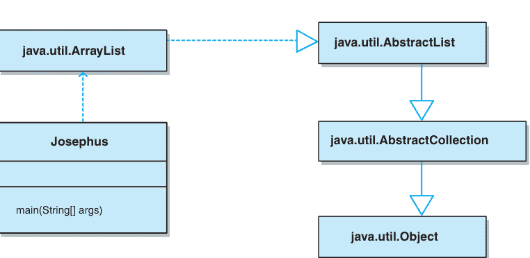

由于在入队或出队时都需要移动数组中的元素，我们认为该实现对于我们的队列实现来说效率太低。然而，对于列表，我们现在将在列表的中间插入和移除元素，因此元素的移动是无法避免的。我们仍然可以像在数组队列实现中那样使用循环数组方法，但这无法消除添加或删除元素时移动元素的需要。这种方法被留作编程项目。

图 6.12 显示了列表的数组实现，其列表头部固定在索引 0。整数变量 `rear` 代表列表中的元素数量，以及在列表末尾添加元素时的下一个可用槽。

| 0 | 1 | 2 | 3 | 4 | 5 | 6 | 7 | ... |
|---|---|---|---|---|---|---|---|---|
| A | B | C | D | | | | | |

**图 6.12** 列表的数组实现

注意图 6.12 适用于有序和无序列表。首先我们将探索常用操作。

这里列出了 `ArrayList` 类的头部和类级数据，以提供上下文信息：

```java
/**
 * ArrayList 表示列表的数组实现。列表头部
 * 保持在数组索引 0 处。此类将被扩展
 * 创建特定类型的列表。
 *
 * @author Dr. Lewis
 * @author Dr. Chase
 */
package java.util.*;
import java.util.Iterator;

public class ArrayList<T> implements List<T>, Iterator<T> {
    private final int NOT_FOUND = -1;
    protected int rear;
    protected T[] list;

    /**
     * 创建空列表。
     */
    public ArrayList() {
        rear = 0;
        list = (T[]) new Object[0];
    }

    /**
     * 创建指定容量的空列表。
     * @param initialCapacity 列表的大小
     */
    public ArrayList(int initialCapacity) {
        rear = 0;
        list = (T[]) new Object[initialCapacity];
    }
}
```


## 6.4 实现列表：使用数组 - remove 操作

`remove` 方法使用了 `find` 方法，该方法可以在列表中查找元素（如果存在）并返回其索引。如果元素不在列表中，`find` 返回 `NOT_FOUND` 常量。`NOT_FOUND` 常量等于 -1 并定义在 `ArrayList` 类中。如果未找到，将生成 `NoSuchElementException`。如果找到，高索引元素将向下移动，更新值并返回元素。

`find` 方法支持列表的公共操作，而不是定义新操作。因此，`find` 方法被声明为私有可见。`find` 方法可以实现如下：

```java
/**
 * 返回元素的元素的索引，如果未找到则
 * 返回 NOT_FOUND 常量。
 * @param target 要搜索的元素
 * @return 目标元素的数组索引，
 * 或 NOT_FOUND 常量
 */
private int find(T target) {
    int scan = 0, result = NOT_FOUND;
    boolean found = false;
    if (!isEmpty()) {
        while (!found && scan < rear) {
            if (target.equals(list[scan]))
                found = true;
            else
                scan++;
        }
    }
    if (found)
        result = scan;
    return result;
}
```

```java
/** 移除并返回指定的元素。
 * @param element 要移除的元素
 * @return 被移除的元素
 * @throws ElementElementException 如果未找到则异常
 */
public T remove(T element) {
    T result;
    int index = find(element);
    if (index == NOT_FOUND)
        throw new ElementElementException("list");
    result = list[index];
    rear--;
    // 移动适当的元素
    for (int scan = index; scan < rear; scan++)
        list[scan] = list[scan + 1];
    list[rear] = null;
    return result;
}
```

`find` 方法的逻辑可以合并到 `remove` 方法中，尽管这会使 `remove` 方法变得有些复杂。在适当的情况下，定义此类支持方法以保持每个方法的可读性。此外，在这种情况下，`find` 支持方法在实现 `contains` 操作时非常有用，正如我们现在将探索的那样。

### 设计焦点

重写 `equals` 方法和实现 `Comparable` 接口是面向对象化设计力量的极佳示例。只要对象提供了相等性的定义和/或对象之间比较的方法，我们就可以创建出能够处理尚未定义的对象类的集合实现。

### 设计焦点

在 `ArrayList` 类中分离 `find` 方法等私有方法有多个好处。首先，它简化了已经复杂的 `remove` 方法的定义。其次，它允许我们使用 `find` 方法来实现 `contains` 操作，以及 `ArrayOrderedList` 的 `addAfter` 方法。请注意，`find` 方法不会抛出 `ElementNotFound` 异常。它只是返回一个值（-1），表示未找到元素。通过这种方式，调用程序可以决定如何处理未找到元素的情况。在 `remove` 方法中，这意味着抛出异常；在 `contains` 方法中，这意味着返回 `false`。

### contains 操作

`contains` 操作的目的是确定特定元素是否包含在列表中。正如我们讨论过的，我们可以使用 `find` 支持方法来创建一个相当直接的实现：

```java
/**
 * 如果此列表包含指定的元素，则返回 true。
 * @param target 列表查找的元素
 * @return 如果目标在列表中，则返回 true，否则返回 false
 */
public boolean contains(T target) {
    return (find(target) != NOT_FOUND);
}
```

如果未找到目标元素，`contains` 方法返回 `false`。如果找到了，它将返回 `true`。一个精心构建的返回语句确保了正确值的返回。由于该方法对我们的列表进行线性搜索，最坏的情况将是我们要搜索的元素不在列表中。这将需要 $n$ 次比较。我们预计该方法平均需要 $n/2$ 次比较，结果导致的操作复杂度为 $O(n)$。

### iterator 操作

到为止，我们一直强调这样一个观点：在可能的情况下复用代码，并设计我们的解决方案以便能够复用。`iterator` 操作是这一理念的极佳示例。可以为列表的数组实现专门创建一个 `iterator` 方法。然而，我们创建了一个通用的 `ArrayIterator` 类，它可以适用于任何集合的任何基于数组的实现。列表数组实现的 `iterator` 方法会创建 `ArrayIterator` 类的实例。列表 6.8 显示了 `ArrayIterator` 类。

```java
/**
 * 返回当前包含在此列表中元素的迭代器。
 *
 * @return 列表中元素的迭代器
 */
public Iterator<T> iterator() {
    return new ArrayIterator<T>(list, rear);
}
```

其余常见的列表操作被留作编程项目。现在让我们关注特定于特定类型列表的操作。

### 有序列表的 add 操作

`add` 操作是元素添加到有序列表的唯一方式。调用时没有指定位置，因为元素决定了它们的顺序。非常像 `remove` 操作一样，`add` 操作将需要比较和移动的组合：通过比较在列表中找到正确的位置，然后移动到新元素所在的位置。观察这两个极端情况，如果要添加到列表的元素属于列表开头，则将需要一次比较，列表中的其他 $n - 1$ 个元素将需要移动。如果元素添加到列表末尾，则将需要 $n$ 次比较，且列表中的任何元素都不需要移动。像 `remove` 操作一样，`add` 操作将需要比较和移动的组合，复杂度为 $O(n)$。`add` 操作可以如下所示实现：

```java
/**
 * 将指定的元素添加到此列表，保持
 * 元素的排序顺序。
 *
 * @param element 要添加的元素
 */
public void add(T element) {
    if (size() == list.length)
        expandCapacity();

    Comparable<T> temp = (Comparable<T>) element;
    int scan = 0;
    while (scan < rear && temp.compareTo(list[scan]) > 0) {
        scan++;
    }
    for (int scan2 = rear; scan2 > scan; scan2--) {
        list[scan2] = list[scan2 - 1];
    }
    list[scan] = element;
    rear++;
}
```

注意，如果尝试向有序列表添加非 `Comparable` 对象，会导致 `ClassCastException`。回想 `Comparable` 接口定义了 `compareTo` 方法，该方法分别返回执行对象小于、等于或大于参数的负整数、零或正整数。无序和索引版本的列表并不要求存储的元素必须是 `Comparable`。尽管存在这些差异，这些类能够和谐存在是面向对象编程的证明。

> **核心概念**
> 只有 `Comparable` 对象可以存储在有序列表中。

## 无序列表特定操作

`addToFront` 和 `addToRear` 操作与其他集合的操作相似，因此被留作编程项目。请记住，`addToFront` 操作必须移动列表中的当前元素为索引 0 处留出空间。因此我们知道 `addToFront` 操作复杂度为 $O(n)$，因为它需要移动 $n-1$ 个元素。像栈的 `push` 操作一样，`addToRear` 操作复杂度为 $O(1)$。

## 无序列表的 add 操作

`add` 操作接受两个参数：要添加的元素，以及决定新元素位置的目标元素。`addAfter` 方法必须首先找到目标元素，移动高索引处的元素以留出空间，然后在之后插入新元素。非常像 `remove` 操作和有序列表的 `add` 操作一样，`addAfter` 方法将需要比较和移动组合，复杂度为 $O(n)$。

```java
/**
 * 将指定的元素添加到目标元素之后。
 * 如果未找到目标，则抛出 ElementNotFound。
 * @param element 在目标元素之后添加的元素
 * @param target 要在其之后添加的目标元素
 */
public void addAfter(T element, T target) {
    if (size() == list.capacity()) {
        expandCapacity();
    }
    int scan = 0;
    while (scan < rear && !target.equals(list[scan])) {
        scan++;
        if (scan == rear) {
            throw new ElementNotFound("list");
        }
    }
    scan++;
    for (int scan2 = rear; scan2 > scan; scan2--) {
        list[scan2] = list[scan2 - 1];
    }
    list[scan] = element;
    rear++;
}
```

## 6.5 实现列表：带链接的实现

正如我们在其他集合中所看到的，使用链表通常是实现线性集合的另一种方便方法。适用于有序和无序列表的通用操作，以及针对特定类型的特殊操作，可以使用与我们之前使用的类似的技术来实现。我们将检查一些更有趣的操作，但会将其中大部分操作留作编程项目。

我们提供了 `LinkedList` 类的类头定义、类级数据和构造函数作为背景参考。

```java
/**
 * LinkedList 表示列表的链式实现。
 * @author Dr. Lewis
 * @author Dr. Chase
 * @version 1.0, 08/13/08
 */
package jss2;
import jss2.exceptions.*;
import java.util.*;
public class LinkedList<T> implements ListADT<T>, Iterable<T> {
    protected int count;
    protected LinearNode<T> head, tail;
    /**
     * 创建一个空列表。
     */
    public LinkedList() {
        count = 0;
        head = tail = null;
    }
}
```

### remove 操作

`remove` 操作是 `LinkedList` 类的一部分，被无序列表和有序列表共享。`remove` 操作包括：确保列表不为空、找到要删除的元素，然后处理四种情况之一：要删除的元素是列表中的唯一元素、要删除的元素是列表的第一个元素、要删除的元素是列表的最后一个元素，或者要删除的元素位于列表中间。在所有情况下，`count` 都会减 1。与数组版本不同，链式版本不需要移动元素来填补隙。然而，考虑到最坏情况仍需要 n 次比较来确定目标元素不在列表中，`remove` 操作仍然是 O(n)。下面展示了 `remove` 操作的实现。

```java
/**
 * 从此列表中移除指定元素的第一个实例并返回其引用。如果列表为空，则抛出 EmptyListException。如果在列表中未找到指定元素，则抛出 NoSuchElementException。
 * 
 * @param targetElement      要从列表中删除的元素
 * @return                   被删除元素的引用
 * @throws EmptyCollectionException 如果发生空集合异常
 */
public T remove(T targetElement) throws EmptyCollectionException {
    if (isEmpty())
        throw new EmptyElementException("List");
    boolean found = false;
    LinearNode<T> previous = null;
    LinearNode<T> current = head;
    while (current != null && !found) {
        if (targetElement.equals(current.getElement())) {
            found = true;
        } else {
            previous = current;
            current = current.getNext();
        }
    }
    if (!found)
        throw new ElementElementException("List");
    if (size() == 1) {
        head = tail = null;
    } else if (current.equals(head)) {
        head = current.getNext();
    } else if (current.equals(tail)) {
        tail = previous;
        tail.setNext(null);
    } else {
        previous.setNext(current.getNext());
    }
    count--;
}
```


### 双向链表

注意此方法中有大量的代码是用于寻找目标元素并跟踪当前引用和上一个引用。由于我们已经在 `LinkedList` 类中拥有了 `find` 方法，这似乎是一个重用代码的机会缺失。如果这个列表是双向链的，意味着每个节点不仅存储指向下一个元素的引用，还存储指向上一个元素的引用呢？这会让 `remove` 操作变得简单吗？首先，我们需要一个 `DoubleNode` 类，如列表 6.9 所示。

#### 列表 6.9

```java
/**
 * DoubleNode 表示双向链表中的节点。
 * @author Dr. Lewis
 * @author Dr. Chase
 * @author Davis
 * @version 1.0, 08/13/08
 */
package jss2;

public class DoubleNode<E> {

    private DoubleNode<E> next;
    private E element;
    private DoubleNode<E> previous;

    /**
     * 创建一个空节点。
     */
    public DoubleNode() {
        next = null;
        element = null;
        previous = null;
    }

    /**
     * 创建一个存储指定元素的节点。
     * @param elem 要存储到新节点中的元素
     */
    public DoubleNode(E elem) {
        next = null;
        element = elem;
        previous = null;
    }

    /**
     * 返回紧随此节点的节点。
     * @return 紧随当前节点的节点
     */
    public DoubleNode<E> getNext() {
        return next;
    }

    /**
     * 返回优于此节点的节点。
     * @return 优于当前节点的节点
     */
    public DoubleNode<E> getPrevious() {
        return previous;
    }

    /**
     * 设置紧随此节点的节点。
     * @param dnode 设置为下一个节点的节点
     */
    public void setNext(DoubleNode<E> dnode) {
        next = dnode;
    }

    /**
     * 设置优于此节点的节点。
     * @param dnode 设置为上一个节点的节点
     */
    public void setPrevious(DoubleNode<E> dnode) {
        previous = dnode;
    }

    /**
     * 返回此节点中的元素。
     * @return 此节点中的元素
     */
    public E getElement() {
        return element;
    }

    /**
     * 设置此节点中的元素。
     * @param elem 要存储在节点中的元素
     */
    public void setElement(E elem) {
        element = elem;
    }
}
```

`remove` 操作现在可以使用链表更优雅地实现。注意我们现在可以使用 `find` 操作来定位目标，而不再需要跟踪之前的引用。我们需要处理与删除第一个或最后一个元素的特殊情况。

### iterator 操作

`iterator` 方法简单的返回一个新的 `LinkedIterator` 对象：

```java
/**
 * 返回列表元素的迭代器。
 * @return 列表的迭代器
 */
public Iterator<T> iterator() {
    return new LinkedIterator<T>(head, count);
}
```

与之前过的 `ArrayIterator<T>` 类一样，`LinkedIterator<T>` 类适用于多个。它存储链表的内容和计数，如列表 6.10 所示。

#### 列表 6.10

```java
/**
 * LinkedIterator 表示链节点列表的迭代器。
 * @author Dr. Lewis
 * @author Dr. Chase
 * @version 1.0, 08/13/08
 */
package jss2;

import jss2.exceptions.*;

public class LinkedIterator<T> implements Iterator<T> {

    private int count; // 集合中的元素数量
    private LinearNode<T> current; // 当前位置

    /**
     * 使用指定的项目设置迭代器。
     * @param collection 迭代器遍历的集合
     * @param size 集合的整数大小
     */
    public LinkedIterator(LinearNode<T> collection, int size) {
        current = collection;
        count = size;
    }

    /**
     * 如果迭代器在迭代中至少有一个待交付的元素，则返回 true。
     * @return 如果迭代器在迭代中至少有一个待交付的元素
     */
    public boolean hasNext() {
        return (current != null);
    }

    /**
     * 返回迭代中的下一个元素。如果迭代中没有更多元素，
     * 则将抛出 NoSuchElementException。
     * @return 迭代中的下一个元素
     * @throws NoSuchElementException 如果发生无元素异常
     */
    public T next() {
        if (!hasNext()) {
            throw new NoSuchElementException();
        }
        T result = current.getElement();
        current = current.next();
        return result;
    }

    /**
     * 不支持 remove 操作。
     * @throws UnsupportedOperationException 如果发生不支持的操作异常
     */
    public void remove() throws UnsupportedOperationException {
        throw new UnsupportedOperationException();
    }
}
```


# 6.6 Java Collections API 中的列表

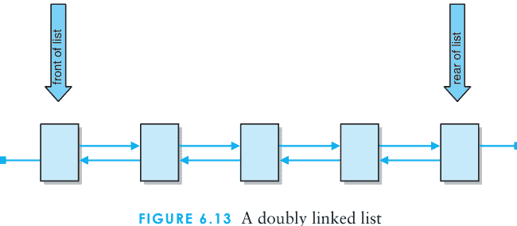

`LinkedList` 构造函数设置了一个引用，设计用于响应 `next` 方法的调用并在元素列表中移动。当 `current` 变为 `null` 时，迭代完成，这就是 `hasNext` 方法返回的条件。对于本章之前提到的 `ArrayIterator<T>` 类，`remove` 方法被留为不支持。

图 6.13 展示了双向链表的结构。链表和双向链表其他操作的实现被留作练习题。

Java Collections API 为索引列表提供了三种单独的实现：`Vector`、`ArrayList` 和 `LinkedList`。这三者都扩展了抽象类 `java.util.AbstractList`，该类实现了 `java.util.List` 接口。这些是 Java 类库的一部分，与我们在本章中为止讨论的接口和类有何不同。`java.util.AbstractList` 类是 `java.util.AbstractCollection` 类的扩展，后者实现了 `java.util.Collection` 接口。Java Collections API 框架提供的所有实现都是索引列表，尽管其类名并没有将其标识为此类。

这三种实现都共享一些共同属性。首先，它们都实现了 `java.util.List` 接口。该接口中抽象方法的具体细节可以在网上找到，但足以说，其数量比我们在本章早之前的简单实现要多得多。请记住，Java 语言是一门非常丰富的工业级语言，并不一定是为了教学而设计的。因此，正如我们之前讨论过的，Java Collections API 内部许多集合并不完全符合其各自集合的概念定义。它们提供的操作通常比概念集合规定的要多样。

除了 `Collection` 和 `List` 接口外，这三种类型的列表还实现了 `Cloneable` 和 `Serializable` 接口。

## Cloneable

实现 `Cloneable` 接口并不一定需要任何额外方法。该接口不包含 `clone` 方法或其他任何抽象方法。该接口仅仅向 `Object.clone()` 方法指示该该类允许该方法对其实例进行字段级的复制。通常，实现 `Cloneable` 接口的类会用自己的公共方法重写 `Object.clone()` 方法。

## Serializable

尽管泛指序列化可以提供许多优势，但在我们语境下的典型用途是：实现 `Serializable` 接口的类可以被分解为字节流，然后使用 `java.io` 包中的 `ObjectOutputStream` 类写入内存或磁盘。该字节流可以使用 `java.io` 包中的 `ObjectInputStream` 类重构为原始对象。

为什么这很重要？考虑一下当你在 Java 源代码中创建一个类（例如 `someclass.java`）时，你并不是在创建数据，而只是为数据创建一个蓝图或结构。到目前，我们的数据通常被硬编码在程序中、在程序执行时由用户输入，或者作为文本流从文件中读取并解析到对象的相应字段中。这意味着，虽然我们创建的类是持久的，但这些类的实例并不是。创建实现 `Serializable` 接口的类，允许这些类的实例被写入内存或磁盘，并在之后的日期进行重构，而无需开发者从文本中重新构建它们。

与 `Cloneable` 接口一样，`Serializable` 接口没有任何关联的方法。该接口仅仅是一个标记，通知运行时环境该类的对象是可以序列化的。

## RandomAccess

`Vector` 类和 `ArrayList` 类都实现了 `RandomAccess` 接口。与 `Cloneable` 接口和 `Serializable` 接口一样，`RandomAccess` 接口没有任何关联的方法。该接口仅仅是一个标记，指示这些类提供了快速访问。`Vector` 和 `ArrayList` 都是基于数组的实现，正如我们在本章之前通过自己的实现看到的，这使得我们对列表元素具有 O(1) 的访问。

> **核心概念**
> Java Collections API 包含了三种索引列表的实现。

请记住，除了简单访问元素之外的操作可能更复杂。事实上，我们知道根据移动元素的需求，插入和删除元素将是 O(n)。

## 6.6.1 Java.util.Vector

索引列表的 `Vector` 实现是基于数组的实现。因此，在栈、队列、无序列表和有序列表的数组实现中讨论的许多问题也适用于这里。例如，使用列表的数组实现时，在列表中间指定索引的 `add` 操作将需要列表中该位置之后的所有元素在列表中向上移动一个位置。同样，从列表中间移动元素的 `remove` 操作将需要列表中该位置之后的所有元素在列表中向下移动一个位置。

该类实现了 `Serializable`、`Cloneable`、`Iterable<E>`、`Collection<E>`、`Deque<E>`、`List<E>` 和 `Queue<E>` 接口。图 6.14 展示了 `Vector` 类可用的公共和保护方法。`Vector` 类还从其父类继承了许多额外方法。

### 图 6.14 java.util.Vector 的公共和保护方法（部分）

| 方法签名 | 返回类型 | 描述 |
| :--- | :--- | :--- |
| `add(E e)` | `boolean` | 将指定的元素添加到向量的末尾。 |
| `add(int index, E element)` | `void` | 在向量的指定位置插入元素。 |
| `addAll(Collection<? extends E>)` | `boolean` | 按指定迭代器返回的顺序将集合的所有元素添加到向量末尾。 |
| `addAll(int index, Collection<? extends E>)` | `void` | 在指定位置将集合的所有元素插入向量。 |
| `addElement(E obj)` | `void` | 将指定的组件添加到向量末尾，其大小增加一。 |
| `capacity()` | `int` | 返回向量的当前容量。 |
| `clear()` | `void` | 从向量移除移除元素。 |
| `clone()` | `Object` | 返回向量的克隆。 |
| `contains(Object o)` | `boolean` | 如果向量包含指定的元素，则返回 true。 |
| `containsAll(Collection<?> c)` | `boolean` | 如果向量包含集合中的所有元素，则返回 true。 |
| `copyInto(Object[])` | `void` | 将向量的组件复制到指定的数组中。 |
| `element(int index)` | `E` | 返回指定索引的组件。 |
| `elements()` | `Enumeration<E>` | 返回向量组件的枚举。 |
| `ensureCapacity(int minCapacity)` | `void` | 必要时增加向量的容量，以确保至少包含最小容量参数指定的元素。 |
| `equals(Object o)` | `boolean` | 将指定的对象与此向量进行等效比较。 |
| `firstElement()` | `E` | 返回向量的第一个组件（索引为 0 的项）。 |
| `get(int index)` | `E` | 返回向量指定位置的元素。 |
| `hashCode()` | `int` | 返回向量的哈希值。 |
| `indexOf(Object o)` | `int` | 返回指定的元素在向量中首次出现的索引，如果此向量不包含该元素，则返回 -1。 |

### 图 6.14 继续

| 方法签名 | 返回类型 | 描述 |
| :--- | :--- | :--- |
| `indexOf(Object o, int index)` | `int` | 返回此向量中指定元素首次出现的索引，从 index 向后搜索；如果未找到该元素，则返回 -1。 |
| `insertElementAt(E obj, int index)` | `void` | 在指定的索引处将指定的对象作为组件插入到此向量中。 |
| `isEmpty()` | `boolean` | 测试此向量是否没有包含组件。 |
| `lastElement()` | `E` | 返回向量的最后一个组件。 |
| `lastIndexOf(Object o)` | `int` | 返回此向量中指定元素最后一次出现的索引；如果此向量不包含该元素，则返回 -1。 |
| `lastIndexOf(Object o, int index)` | `int` | 返回此向量中指定元素最后一次出现的索引，从 index 向前搜索；如果未找到该元素，则返回 -1。 |
| `remove(int index)` | `E` | 移除此向量中指定位置的元素。 |
| `remove(Object o)` | `boolean` | 移除此向量中指定元素的首次出现。如果向量不包含该元素，则保持不变。 |
| `removeAll(Collection<?> c)` | `boolean` | 从此向量中移除所有包含在指定集合中的元素。 |
| `removeAllElements()` | `void` | 移除此向量中的所有组件并将其大小设置为零。 |
| `removeElement(Object obj)` | `void` | 移除此向量中参数的第一个（索引最低的）出现。 |
| `removeElementAt(int index)` | `void` | 删除指定索引处的组件。 |
| `removeRange(int fromIndex, int toIndex)` | `void` | 移除此列表中索引从 fromIndex（包含）到 toIndex（不包含）的所有元素。 |
| `retainAll(Collection<?> c)` | `boolean` | 仅保留此向量中包含在指定集合中的元素。 |
| `set(int index, E element)` | `void` | 用指定的元素替换此向量中指定位置的元素。 |
| `setElementAt(E obj, int index)` | `void` | 将此向量中指定索引处的组件设置为指定的对象。 |
| `setSize(int newSize)` | `void` | 设置此向量的大小。 |
| `size()` | `int` | 返回此向量中组件的数量。 |
| `subList(int fromIndex, int toIndex)` | `List<E>` | 返回此列表从 fromIndex（包含）到 toIndex（不包含）之间部分的视图。 |
| `toArray()` | `Object[]` | 返回一个包含此向量中所有元素正确顺序的数组。 |
| `toArray(T[] a)` | `<T> T[]` | 返回一个包含此向量中所有元素正确顺序的数组；返回数组的运行时类型为指定数组的类型。 |
| `toString()` | `String` | 返回此向量的字符串表示，包含元素的字符串表示。 |
| `trimToSize()` | `void` | 将此向量的容量修剪为向量的大小。 |

## 6.6.2 Java.util.ArrayList

索引列表的 `ArrayList` 实现正如其名，是基于数组的实现。因此，栈、队列、无序列表和有序列表的数组实现中讨论的许多问题也适用于这里。例如，使用列表的数组实现时，在列表中间指定索引的 `add` 操作将需要列表中该位置之后的所有元素在列表中向上移动一个位置。同样，从列表中间删除元素的 `remove` 操作将需要列表中该位置之后的所有元素在列表中向下移动一个位置。

与 `Vector` 类一样，`ArrayList` 实现非常相似。然而，`Vector` 操作是同步的，而 `ArrayList` 操作不是。图 6.15 展示了 `ArrayList` 类可用的公共方法。`ArrayList` 类还从其父类继承了许多额外方法。`ArrayList` 实现了 `Serializable`、`Cloneable`、`Iterable<E>`、`Collection<E>`、`List<E>` 和 `RandomAccess` 接口。

### 图 6.15 java.util.ArrayList 的公共和保护方法

| 方法签名 | 返回类型 | 描述 |
| --- | --- | --- |
| `add(E e)` | `boolean` | 将指定元素附加到此列表的末尾。 |
| `add(int index, E element)` | `void` | 在列表的指定位置插入指定元素。 |
| `addAll(Collection<? extends E> c)` | `boolean` | 按照集合迭代器返回的顺序将此集合的所有元素附加到此列表的末尾。 |
| `addAll(int index, Collection<? extends E> c)` | `boolean` | 从指定位置开始将指定集合的所有元素插入此列表。 |
| `clear()` | `void` | 移除此列表中的所有元素。 |
| `clone()` | `Object` | 返回 ArrayList 的副本。 |
| `contains(Object o)` | `boolean` | 如果此列表包含指定元素，则返回 true。 |
| `ensureCapacity(int minCapacity)` | `void` | 增加 ArrayList 的容量，以至少容纳 minCapacity 个元素。 |
| `get(int index)` | `E` | 返回指定位置的元素。 |
| `indexOf(Object o)` | `int` | 返回此列表中指定元素首次出现的索引；如果列表不包含该元素，则返回 -1。 |
| `isEmpty()` | `boolean` | 如果此列表没有元素，则返回 true。 |
| `lastIndexOf(Object o)` | `int` | 返回此列表中指定元素最后一次出现的索引；如果列表不包含该元素，则返回 -1。 |
| `remove(int index)` | `E` | 移除此列表中指定位置的元素。 |
| `remove(Object o)` | `boolean` | 移除此列表中指定元素的首次出现。如果列表不包含该元素，则保持不变。 |
| `removeRange(int fromIndex, int toIndex)` | `void` | 移除索引从 fromIndex（包含）到 toIndex（不包含）的所有元素。 |
| `set(int index, E element)` | `void` | 用指定的元素替换此列表中指定位置的元素。 |
| `size()` | `int` | 返回此向量的数量。 |
| `toArray()` | `Object[]` | 返回一个包含此向量所有元素正确顺序的数组。 |
| `toArray(T[] a)` | `<T> T[]` | 返回一个包含此向量所有元素正确顺序的数组；返回数组的运行时类型为指定数组的类型。 |
| `trimToSize()` | `void` | 将此向量的容量修剪为向量的大小。 |

与数组和 `Vector` 实现一样，`ArrayList` 实现的一个优势是能够以常数时间访问列表中的任何元素。然而，这种访问的代价是由于在列表中插入或删除元素而导致的元素移动额外成本。

## 6.6.3 Java.util.LinkedList

索引列表的 `LinkedList` 实现正如其名，是一个链式实现。因此，在栈、队列、无序列表和有序列表的链式实现中讨论的许多问题也适用于这里。例如，使用链式实现的列表需要我们遍历列表来访问特定元素，而不是通过索引直接访问它。出于这个原因，`LinkedList` 类没有实现 `RandomAccess` 接口，因为它没有对其元素提供常数级或近常数级的访问。

除了之前所有的 Java Collection API 列表实现外，`LinkedList` 类还实现了 queue 和 deque（读作 deck 和双端队列）接口。正如我们之前讨论过的，Java 是一门工业级语言，并不一定是为了教育而设计的。我们将看到，使用 `LinkedList` 类来实现队列会创建一个允许不适合队列的操作的集合。

`LinkedList` 类实现了 `Serializable`、`Cloneable`、`Iterable<E>`、`Collection<E>`、`Deque<E>`、`List<E>` 和 `Queue<E>` 接口。图 6.16 展示了 `LinkedList` 类可用的公共和保护方法。`LinkedList` 类还从其父类继承了许多额外方法。

### 图 6.16 java.util.LinkedList 的公共和保护方法（部分）

| 方法签名 | 返回类型 | 描述 |
| --- | --- | --- |
| `add(E e)` | `boolean` | 将指定元素附加到此列表的末尾。 |
| `add(int index, E element)` | `void` | 在列表的指定位置插入指定元素。 |
| `addAll(Collection<? extends E> c)` | `boolean` | 按照集合迭代器返回的顺序将此集合的所有元素附加到此列表的末尾。 |
| `addAll(int index, Collection<? extends E> c)` | `boolean` | 从指定位置开始将指定集合的所有元素插入此列表。 |
| `addFirst(E e)` | `void` | 在列表开头插入指定元素。 |
| `addLast(E e)` | `void` | 将指定元素添加到列表末尾。 |
| `clear()` | `void` | 移除此列表中的所有元素。 |
| `clone()` | `Object` | 返回 ArrayList 的浅拷贝。 |
| `contains(Object o)` | `boolean` | 如果此列表包含指定元素，则返回 true。 |
| `descendingIterator()` | `Iterator<E>` | 返回对双端队列元素的逆序顺序迭代器。 |
| `element()` | `E` | 获取但不移除列表的头部（第一个元素）。 |
| `get(int index)` | `E` | 返回列表中指定位置的元素。 |
| `getFirst()` | `E` | 返回列表的第一个元素。 |
| `getLast()` | `E` | 返回列表的最后一个元素。 |
| `indexOf(Object o)` | `int` | 返回此列表中指定元素首次出现的索引；如果列表不包含该元素，则返回 -1。 |
| `lastIndexOf(Object o)` | `int` | 返回此列表中指定元素最后一次出现的索引；如果列表不包含该元素，则返回 -1。 |
| `listIterator(int index)` | `ListIterator<E>` | 返回从指定位置开始的列表中元素的列表迭代器。 |
| `offer(E e)` | `boolean` | 将指定元素作为列表的尾部（尾部元素）添加。 |
| `offerFirst(E e)` | `boolean` | 在列表前端插入指定元素。 |
| `offerLast(E e)` | `boolean` | 在列表后端插入指定元素。 |
| `peek()` | `E` | 获取但不移除列表中的第一个元素。 |

### 图 6.16 继续

| 方法签名 | 返回类型 | 描述 |
|---|---|---|
| `peekFirst()` | `E` | 获取但不移除列表中的第一个元素，如果列表为空则返回 null。 |
| `peekLast()` | `E` | 获取但不移除列表中的最后一个元素，如果列表为空则返回 null。 |
| `poll()` | `E` | 获取并移除此列表的头部（第一个）元素。 |
| `pollFirst()` | `E` | 获取并移除此列表的第一个元素，如果列表为空则返回 null。 |
| `pollLast()` | `E` | 获取并移除此列表的最后一个元素，如果列表为空则返回 null。 |
| `pop()` | `E` | 从此列表代表的栈（stack）中弹出一个元素。 |
| `push(E e)` | `void` | 向此列表代表的栈（stack）中压入一个元素。 |
| `remove()` | `E` | 获取并移除此列表的头部（第一个）元素。 |
| `remove(int index)` | `E` | 移除列表中指定位置的元素。 |
| `remove(Object o)` | `boolean` | 如果列表中存在指定的元素，则移除该元素的第一次出现处。 |
| `removeFirst()` | `E` | 移除并返回此列表的第一个元素。 |
| `removeFirstOccurrence(Object o)` | `boolean` | 移除列表中指定元素的第一次出现处。 |
| `removeLast()` | `E` | 移除并返回列表的最后一个元素。 |
| `removeLastOccurrence(Object o)` | `boolean` | 移除列表中指定元素的最后一次处。 |
| `set(int index, E element)` | `E` | 用指定的元素替换列表中指定位置的元素。 |
| `size()` | `int` | 返回列表中的元素数量。 |
| `toArray()` | `Object[]` | 返回一个包含列表中所有元素按正确顺序（从第一个到最后一个）的数组。 |
| `toArray(T[] a)` | `<T> T[]` | 返回一个包含列表中所有元素按正确顺序（从第一个到最后一个）的数组。返回的数组的运行时类型为指定数组的类型。 |

## 核心概念总结

- List 集合可以分为有序的、无序的和索引的。
- 有序列表的元素具有定义其顺序的内在关系。
- 无序列表的元素按照客户端选择的任何顺序保存。
- 索引列表为其元素维护一个连续的数字范围。
- 所有列表类型，可以定义许多常用操作。它们之间的区别在于元素添加的方式。
- 迭代器（iterator）是一个对象，提供了一种遍历集合的手段。
- 接口（Interfaces）可以用于派生其他接口。子接口包含父接口的所有抽象方法。
- 接口名称可以声明对象引用变量。接口引用可以指向实现接口的任何类的任何对象。
- 接口允许我们进行多态引用，调用的方法取决于当前所引用的特定对象。
- 在创建锦标赛日程时，有序列表是一个方便使用的集合。
- 约瑟夫问题（Josephson problem）是一个经典的计算问题，用索引列表解决恰当。
- 只有 `Comparable` 对象可以存储在有序列表中。
- Java Collections API 包含了索引列表的三种实现。

## 自测题

| 题号 | 内容 |
| :--- | :--- |
| SR 6.1 | 索引列表、有序列表和无序列表之间的区别是什么？ |
| SR 6.2 | 访问索引列表的基本方法有哪些？ |
| SR 6.3 | Java Collections API 框架一部分的实现需要哪些额外操作？ |
| SR 6.4 | `ArrayList` 和 `LinkedList` 在空间复杂度上的权衡是什么？ |
| SR 6.5 | `ArrayList` 和 `LinkedList` 在时间复杂度上的权衡是什么？ |
| SR 6.6 | 两种实现的 `contains` 操作和 `find` 操作的时间复杂度是多少？ |
| SR 6.7 | 如果 `LinkedList` 实现使用单链表而不是双链表，会产生什么影响？ |
| SR 6.8 | 为什么对于 `ArrayList` 实现，`add` 操作中增加数组容量的时间被认为是忽略不计的？ |
| SR 6.9 | 什么是迭代器？为什么它对 ADT（抽象数据类型）有用？ |
| SR 6.10 | 为什么迭代器对于栈和队列不合适，但对于列表合适？ |
| SR 6.11 | 为什么循环数组实现对于列表来说不像对于队列那样有吸引力？ |

## 练习题

EX 6.1 手动追踪以下操作有序列表 X：

```
```


# 第6章 Lists

## EX 6.1 手动追踪以下操作有序列表 X：

```java
X.add(new Integer(4));
X.add(new Integer(7));
Object Y = X.first();
X.add(new Integer(3));
X.add(new Integer(2));
X.add(new Integer(5));
Object Y = X.removeLast();
Object Y = X.remove(new Integer(7));
X.add(new Integer(9));
```

## EX 6.2 给定练习 6.1 得到的列表 X，以下每个操作的结果是什么？

- a. `X.last()`;
- b. `z = X.contains(new Integer(3))`;
- c. `X.first()`;
- d. `Y = X.remove(new Integer(2))`;
- e. `X.first()`;

## EX 6.3 两种实现的 `contains` 操作和 `find` 操作的时间复杂度是多少？

## EX 6.4 如果 `LinkedList` 实现使用单链表而不是双链表，会产生什么影响？

## EX 6.5 为什么对于 `ArrayList` 实现，`add` 操作中增加容量的时间被认为是忽略不计的？

## EX 6.6 什么是迭代器？为什么它对 ADT 有用？

## EX 6.7 为什么迭代器对于栈和队列不合适，但对于列表合适？

## EX 6.8 为什么循环数组实现对于列表来说不像对于队列那样有吸引力？

## 第 6 章 列表

**SRA 6.8** 按插入列表插入总数平均计算，扩大数组的时间对总时间的影响很小。

**SRA 6.9** 迭代器是一个对象，提供了一种逐个遍历集合中元素的方法。

**SRA 6.10** 从概念上说，栈和队列不应该允许访问列表中间的元素。栈只允许访问顶部，队列只允许在的一端添加元素，在另一端移除元素。迭代器将违反这些集合的概念定义。相反，列表允许访问整个部分，非常适合迭代器。

**SRA 6.11** 队列的循环数组实现将出队操作（`dequeue`）的效率从 O(n) 提高到 O(1)，因为它消除了在数组中移动元素的需要。但对于列表来说并非如此，因为我们可以在列表的任何位置添加或删除元素，而不仅仅是开头或结尾。

# 递归

递归是一种强大的编程技术，为某些问题提供了优雅的解决方案。它在实现各种数据结构以及数据搜索和排序过程中特别有帮助。本章将介绍递归处理。它包含了对递归基础概念的解释，然后探讨了递归在编程中的用法。

- 解释递归的底层概念
- 检查递归方法并拆解它们的处理步骤
- 定义无限递归并讨论避免它的方法
- 解释何时应该和不应该使用递归
- 演示使用递归解决问题

## 7.1 递归思维

### 核心概念

递归是一种方法调用其自身的编程技术。能够进行递归编程的关键在于能够递归地思考。

我们知道方法可以调用另一个方法来帮助实现其目标。同样，方法也可以调用自身来帮助实现目标。递归是一种方法通过调用自身来完成其整体目的的编程技术。

在我们深入研究如何在程序中使用递归的细节之前，我们需要首先探索递归的通用概念。递归思考的能力对于将递归作为一种编程技术使用至关重要。

总的来说，递归根据自身来定义某物的过程。例如，考虑单词 *decoration*（装饰）的如下定义：

- decoration：n. 任何定义某物的装饰品或点缀

*decoration* 这个词被用来定义 *decoration*。你可能还记得小学老师告诉过你，解释单词含义时要避免这种递归定义。然而，在许多情况下，递归是表达思想或定义的恰当方式。例如，假设我们想正式定义一个由逗号分隔的一个或多个数字的列表。这样的列表可以递归地定义为一个数字，或者一个数字后面跟着一个逗号以及一个列表。这种定义可以表示为：

- 列表是一个：
- 数字
- 或者一个数字逗号列表

这种对列表的递归定义定义了以下数字列表：

```
24, 88, 40, 37
96, 43
14, 64, 21, 69, 32, 93, 74, 81, 28, 45, 81, 52, 69
70
```

无论列表有多长，递归定义都能描述它。元素列表是由定义中的第一个（非递归）部分定义的。对于任何长度大于一个元素的列表，定义中的递归部分（引用它的部分）会被根据需要使用多次，直到达到该列表。列表中的最后一个元素始终由该定义的非递归部分定义。图 7.1 显示了一个特定的数字列表对应于 *list*（列表）的递归定义。

### 无限递归

注意，这个列表的定义包含一个递归选项和一个非递归选项。定义中非递归的部分被称为*基情况*（base case）。如果所有选项都包含递归组件，那么递归将永远结束。例如，如果列表的定义仅仅是“一个数字逗号一个列表”，那么没有任何列表可以结束。这个问题被称为无限递归。它类似于无限循环，不同于“循环”发生在定义本身中。

> **核心概念**
> 任何递归定义必须有一个非递归部分，称为基情况，它允许递归最终结束。

就像无限循环一样，程序员必须小心设计算法以避免无限递归。任何递归定义都必须有一个不会产生递归选项的基情况。列表定义的基情况是一个后面没有跟任何内容的单个数字。换句话说，到达列表中的最后一个数字，基情况选项终止了递归路径。

### 数学中的递归

让我们看看数学中的递归示例。数值 N!（读作 N 阶乘）对于任何正整数 N 被定义为从 1 到 N 的所有整数的乘积。

内存空间；因此，无限递归通常会导致运行时错误，指示内存已耗尽。

使用不同的 `num` 初始值追踪 `sum` 函数，直到对该处理过程变得熟悉。图 7.3 展示了递归调用，每次调用都通过 `sum` 来确定从 1 到 4 的整数和。每个方框代表被调用时的方法副本，表示了分配的用于存储形式参数和任何局部变量的空间。调用用实线表示，返回用虚线表示。每一步都显示了返回值的结果。完全遵循递归路径，直到到达基准情况（base case）；然后，调用开始沿着链逐级向上返回其结果。

### 递归与迭代

当然，对于我们刚刚探索的求和问题，存在一种非递归的解决方案。以迭代方式计算从 1 到 `num`（包含边界）之间数字之和的一种方法如下：

```java
sum = 0;
for (int number = 1; number <= num; number++)
    sum += number;
```

这个解决方案显然比递归版本要直观得多。我们使用求和问题来演示递归是因为它是一个易于理解的问题，而不是因为在正常情况下你会使用递归来解决它。递归具有多次方法调用的开销，在这种情况下，它提供的解决方案比对应的迭代方案更复杂。

程序员必须学会何时使用递归以及何时不使用。确定哪种方法是最好的另一个取决于所解决问题的的重要工程决策。

所有问题都可以迭代的方式解决，但在某些情况下，迭代版本要复杂得多。对于某些问题，递归允许我们创建相对简短、优雅的程序。

> **核心概念**
> 递归是解决某些问题最优雅且合适的方法，但对于其他问题，它比迭代解决方案不直观。

### 直接递归与间接递归

直接递归发生在方法调用自身时，例如当调用 `sum` 时。间接递归发生在一个方法再次调用另一个方法时。例如，如果方法 `m1` 调用方法 `m2`，而 `m2` 调用方法 `m1`，我们可以说 `m1` 是间接递归的。间接深度可能达几层，例如当 `m1` 调用 `m2`，`m2` 调用 `m3`，`m3` 调用 `m4`。图 7.4 描述了一个具有间接递归的情况。方法调用用实线表示，返回用虚线表示。遵循整个调用路径，然后沿着返回路径展开递归。

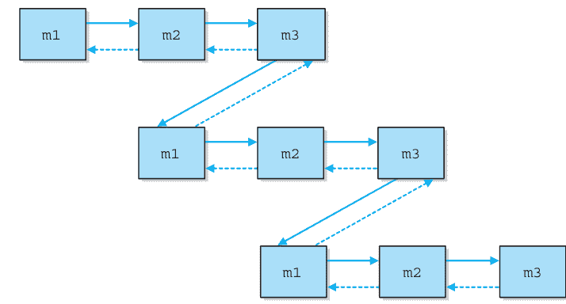

间接递归需要与直接递归对基准情况完全相同的关注。此外，由于中间的方法调用，间接递归可能更难追踪。因此，在设计或评估间接递归方法时需要格外小心。确保间接性是绝对必要的并在文档中进行清晰的解释。

## 7.3 使用递归

以下示例描述了我们使用递归技术解决的问题。对于每一个示例，我们准确检查了递归在解决方案中是如何发挥作用的，以及如何使用基准情况来终止递归。在探索这些示例时，考虑每个问题的非递归解决方案会是什么样的。

### 遍历迷宫

正如第 4 章所述，解决迷宫涉及大量的尝试和错误：当你无法继续移动时进行回溯，并尝试未尝试过的选项。此类活动通常可以使用递归很好地处理。在第 4 章中，我们使用栈来跟踪可能的移动并迭代地解决了这个问题。然而，我们也可以通过使用运行时栈来跟踪我们的进度以解决这个问题。列表 7.1 所示的程序创建了一个 `Maze` 对象并尝试遍历它。

列表 7.2 所示的类使用整数二维数组来表示迷宫。目标是从左上角（入口点）移动到右下角（出口点）。最初，1 表示路径，0 表示被阻塞的路径。随着迷宫的解决，这些数组元素被更改为其他值，以表示尝试过的路径，并最终（如果存在的话）表示穿过迷宫的成功路径。图 7.5 显示了该解决方案的 UML 图。

穿过迷宫的唯一有效移动是四个主要方向：下、右、上、左。不允许对角线移动。在这个示例中，

| MazeSearch | 使用 | TRIED, PATH 网格 |
| --- | --- | --- |
| main(String[] args) | | traverse(int row, int column) valid(int row, int column) toString() |

图 7.5 Maze 和 MazeSearch 类的 UML 说明

### 列表 7.1

```java
/**
 * MazeSearch 演示了递归。
 * @author Dr. Chase
 * @author Dr. Lewis
 * @version 1.0, 8/18/08
 */
public class MazeSearch {

  /**
   * 创建一个新的迷宫，打印它的原始形状，尝试
   * 解决它，并打印它的最终形状。
   */
  public static void main(String[] args) {
    Maze labyrinth = new Maze();
    System.out.println(labyrinth);
    if (labyrinth.traverse(0, 0)) {
      System.out.println("The maze was solved!");
    } else {
      System.out.println("There is no path.");
    }
    System.out.println(labyrinth);
  }
}
```

### 列表 7.2

```java
/**
 * 代表迷宫字符。目标是从
 * 左上角（入口点）移动到右下角（出口点）。
 */
class Maze {
    private final int TRIED = 3;
    private final int PATH = 7;
    private int[][] grid;

    public Maze() {
        grid = new int[8][8];
        for (int i = 0; i < grid.length; i++) {
            for (int j = 0; j < grid[i].length; j++) {
                grid[i][j] = 1; // 1 表示路径
            }
        }
    }

    /** 递归地遍历迷宫。
     * @param row 行的整数值
     * @param column 列的整数值
     * @return true 如果迷宫被解决 */
    public boolean traverse(int row, int column) {
        boolean done = false;
        if (valid(row, column)) {
            grid[row][column] = TRIED; // 此单元格已尝试过
            if (row == grid.length - 1 && column == grid[0].length - 1) {
                done = true; // 迷宫解决了
            } else {
                done = traverse(row + 1, column); // 下
                if (!done)
                    done = traverse(row, column + 1); // 右
                if (!done)
                    done = traverse(row - 1, column); // 上
                if (!done)
                    done = traverse(row, column - 1); // 左
            }
            if (done) // 此位置是最终路径的一部分
                grid[row][column] = PATH;
        }
        return done;
    }

    /** 确定特定位置是否有效。
     * @param row 要检查的行
     * @param column 要检查的列
     * @return true 如果位置有效 */
    private boolean valid(int row, int column) {
        boolean result = false;
        // 检查单元格是否在矩阵范围内
        if (row >= 0 && row < grid.length &&
            column >= 0 && column < grid[row].length) {
            // 检查单元格未被阻塞且未尝试过
            if (grid[row][column] == 1)
                result = true;
        }
        return result;
    }

    /** 以字符串返回迷宫。
     * @return 迷宫的字符串表示 */
    public String toString() {
        String result = "\n";
        for (int row = 0; row < grid.length; row++) {
            for (int column = 0; column < grid[row].length; column++) {
                result += grid[row][column] + "";
            }
            result += "\n";
        }
        return result;
    }
}
```


`Maze` 类中的递归方法名为 `traverse`。它返回一个布尔值，表示是否找到了解决方案。第一个方法判断到指定行和列的移动是否有效。如果移动位于网格边界内，且网格在该位置包含 `1`（表示该方向的移动未被阻塞），则移动是有效的。`traverse` 的初始调用了左上角位置 (0, 0)。

如果移动有效，网格条目将从 `1` 改为 `3`，标记该位置为已访问，这样我们就不会撤回步骤。`traverse` 方法通过到达右下角位置来判断迷宫是否已完成。因此，该问题实际上有三种基准情况，可以终止任何递归路径：

- 因为移动超出边界或被阻塞导致的无效移动
- 因为该移动之前尝试过而导致的无效移动
- 到达最终位置的移动

如果当前位置不是右下角，我们会在每个方向上搜索解决方案。首先，我们递归向下查找，调用 `traverse` 方法并传入新位置。`traverse` 方法的逻辑将使用此位置重新开始。最终找到解决方案的方法是首先尝试从当前位置向下移动，或者未找到。如果没找到，我们尝试向右移动。如果失败了，我们尝试向上移动。最后，如果没有哪个方向能产生正确的路径，我们就尝试向左移动。如果当前位置的任何方向都没有产生正确的解决方案，则从该位置没有路径，`traverse` 返回 `false`。如果 `traverse` 方法的第一次调用返回 `false`，则通过该迷宫没有可能的路径。

## 7.3 使用递归

如果从当前位置找到了解决方案，则网格条目将改为 `7`。第一个 `7` 放置在右下角。下一个 `7` 放置在通往右下角的位置，以此类推，直到最后一个 `7` 放置在左上角。因此，当打印最终迷宫时，`0` 表示被阻塞的路径，`1` 表示从未尝试过的开放路径，`3` 表示未能产生正确解决方案的路径，而 `7` 表示迷宫最终解决方案的一部分。

请注意，在调用 `traverse` 方法时有多次递归的机会。根据迷宫的配置，可能会遵循其中一个或所有机会。虽然迷宫中可能存在路径，但在找到路径时递归就会终止。在遵循迷宫数组的同时，仔细跟踪此代码的执行过程，以查看递归是如何解决问题的。考虑产生一个非交换解决方案的难度。

### 汉诺塔

汉诺塔游戏由法国数学家埃德华·卢卡斯（Edouard Lucas）于19世纪80年代发明。它成为了计算机科学家的青睐，因为它的解决方案是递归优雅性的极佳演示。

游戏的目标是将所有的盘子从原始（第一个）柱子移动到目标（第三个）柱子上。我们可以使用“额外的”柱子作为放置盘子的临时地点，但我们必须遵守以下规则：

- 我们一次只能移动一个盘子。
- 我们不能将较大的盘子放在较小的盘子上面。
- 除了在柱子之间传输的盘子外，所有的盘子必须位于某个柱子上。

这些规则意味着我们必须将较小的盘子“移开”，以便将较大的盘子从一个柱子移动到另一个柱子。图 7.7 显示了使用三个盘解决汉诺塔游戏的步骤

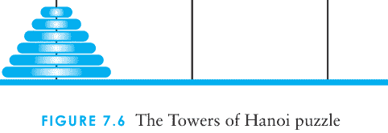

# 第7章 递归

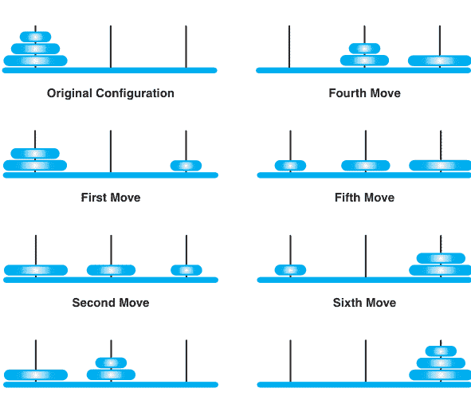

原始配置

第四次移动

第一次移动

第五次移动

第二次移动

第六次移动

第三次移动

第七次也是最后一次

图 7.7 三盘汉诺塔游戏的解决方案

使用三个盘解决汉诺塔游戏的步骤。要将所有三个盘子从第一个柱子移动到第三个柱子，我们必须先让较小的盘子在第二个柱子上移开状态，这样最大的盘子就可以从第一个柱子移动到第三个柱子。

图 7.7 显示的前三次移动可以被认为是“将较小的盘子移开”。第四次移动将最大的盘子放在它的最终位置。最后三次移动将较小的盘子放在最大盘子之上的最终位置。

让我们利用此形成一个通用策略。将一堆 N 个盘从原始柱子移动到目标柱子：

- 将顶部 N-1 个盘从原始柱子移动到额外的柱子。
- 将最大的盘子从原始柱子移动到目标柱子。
- 将 N-1 个盘从额外的柱子移动到目标柱子。

这种策略本身非常适合递归解决方案。将 N-1 个盘子移开的步骤是一个重复的问题：移动一堆盘子。但是，对于这个子任务，少了一个盘子，而且我们的目标柱子就是我们最初所谓的额外的柱子。类似的情况发生在之后

# 223

```java
/**
 * SolveTowers演示了递归。
 * @author Dr. Lucas
 * @author Dr. Chase
 */
public class SolveTowers {
    // ...
    public static void main(String[] args) {
        SolveTowers towers = new SolveTowers(4);
        towers.solve();
    }
    // ...
}
```

# 224

# 列表 7.4

```java
/**
 * TowersOfanoi代表经典的汉诺塔。
 * @author Dr. Lucas
 * @author Dr. Chase
 * @version 1.0, 8/08
 */
public class TowersOfanoi {
    private int totalDisks;
    /**
     * 设置游戏。
     * @param disks 盘子的数量
     */
    public TowersOfanoi(int disks) {
        totalDisks = disks;
    }
    /**
     * 调用 traverse 方法来解决问题。
     */
    public void solve() {
        // 实现代码
    }
}
```

# 225

# 列表 7.4 继续

```java
    private void moveTower(int numDisks, int start, int end, int temp) {
        if (numDisks == 1) {
            moveDisk(start, end);
        } else {
            moveTower(numDisks - 1, start, temp, end);
            moveDisk(start, end);
            moveTower(numDisks - 1, temp, end, start);
        }
    }
    private void moveDisk(int start, int end) {
        System.out.println("Move one disk from " + start + " to " + end);
    }
}
```

## 202 第 7 章 递归

| SolveTowers | 使用 | TowersOfHanoi |
| :--- | :--- | :--- |
| totalDisks | TowersOfHanoi(int disks) | solve() moveTower(int numDisks, int start, int end, int temp) moveOneDisk(int start, int end) | |

图 7.8 SolveTowers 和 TowersOfHanoi 类的 UML 描述

在分析循环时，我们确定了循环体的阶数乘以循环执行的次数。递归算法使用了类似的思维。确定递归算法的阶数取决于确定递归深度（遵循递归定义的次数），并将其乘以递归方法循环体的阶数。

考虑第 7.2 节中提出的递归方法，该方法计算从 1 到某个正整数的整数和。为了方便起见，我们在这里重新打印了它：

```java
// 此方法返回从 1 到 num 的和
public int sum (int num)
{
    int result;
    if (num == 1)
        result = 1;
    else
        result = num + sum (num-1);
    return result;
}
```

该问题的大小自然地表示为相加值的个数。因为我们正在相加从 1 到 number 的整数，所以相加值的个数是 num。我们关注的操作是将两个值相加。递归方法的循环体执行了一次加法操作，因此是 O(1)。每当递归方法被调用时，num 的值就会减 1。因此，递归方法被调用了 num 次，所以递归深度是 O(n)。因此，循环体是 O(1)，递归深度是 O(n)，整个算法的阶数就是 O(n)。

我们将看到，在某些算法中，递归步骤处理的数据量只有前一次调用的一半，产生 O(log n) 的递归深度。如果方法的循环体是 O(1)，那么整个算法就是 O(log n)。如果方法的循环体是 O(n)，那么整个算法就是 O(n log n)。

现在考虑汉诺塔游戏。游戏的大小自然是盘子的数量，而我们关注的操作是在是将一个盘子从一个柱子移动到另一个柱子的步骤。每次调用递归方法 `moveTower` 都会导致一个盘子的移动。遗憾的是，除了基本情况外，每个递归调用都会导致自己调用两次，且每次调用操作的盘子栈比传入参数的栈少一个。因此，调用 2 个盘子的 `moveTower` 会导致 3 个盘子移动，调用 3 个盘子的会导致 7 个盘子移动，调用 4 个盘子的会导致 15 个盘子移动。从从另一个角度看，如果 f(n) 是该问题的增长函数：

f(n) = 1 当 n 等于 1
f(n) = 2*(f(n−1) + 1)

与其简洁优雅的实现相反，汉诺塔游戏的解极其低效。要解决一个具有 n 个盘子堆的谜，我们必须执行 2ⁿ−1 次单独的盘子移动。因此，汉诺塔算法是 O(2ⁿ)。正如第 2 章所讨论的，这种阶数是指数复杂度的示例。随着盘子数量的增加，所需的移动次数指数级增长。

> **核心概念** 汉诺塔游戏的解具有指数复杂度，效率非常低。然而，该解的实现却非常短且优雅。

传说梵的祭司们正在世界中心的一座寺庙里研究这个游戏。他们使用 64 个金盘子，在纯钻石制成的柱子之间移动。缺点是，当祭司们完成游戏时，世界将会结束。优点是，如果他们每天移动一个盘子，将需要超过 584 亿年才能完成。这只有 64 个盘子！这无疑说明了指数算法复杂度是多么难以处理。

## 核心概念总结

- 递归是一种编程技术，其中方法调用自身。能够递归编程的关键在于能够递归地思考。
- 任何递归定义必须包含一个非递归部分，称为基本情况（base case），它允许递归最终结束。
- 数学问题和公式通常以递归形式表示。
- 方法的每次递归调用都会创建新的局部变量和参数。
- 对递归处理进行仔细的追踪可以了解其如何用于解决问题。
- 递归是解决某些问题最优雅、合适的方法，但对于其他问题，它没有迭代解决方案那么直观。
- 递归算法的阶数可以使用类似于分析迭代处理的技术来确定。
- 汉诺塔游戏的解具有指数复杂度，效率非常低。然而，该解的实现极其短且优雅。

## 自测习题

- SR 7.1 什么是递归？
- SR 7.2 什么是无限递归？
- SR 7.3 递归处理何时需要基本情况？
- SR 7.4 递归是必要的吗？
- SR 7.5 何时应该避免递归？
- SR 7.6 什么是间接递归？
- SR 7.7 解释解决汉诺塔游戏的通用方法。它与递归有什么关系？

## 练习题

- EX 7.1 写一个有效标识符的递归定义。
- EX 7.2 写一个 x^y（幂）的递归定义，其中 x 和 y > 0。
- EX 7.3 写一个 i * j（整数乘法）的递归定义，其中 i > 0。例如，4*7 等于加 7 次。
- EX 7.4 写一个斐波那契数列的递归定义，前两个数字是 0 和1。
- EX 7.5 写一个返回 N!（阶乘）的递归方法。
- EX 7.6 写一个反转字符串的递归方法。
- EX 7.7 设计一个生成回文的递归程序。
- EX 7.8 注释 SolveTowers 程序以显示步骤。
- EX 7.9 制作一个图表，显示汉诺塔 2, 3, 4, 5, 6, 7, 8, 9, 10 个盘子所需的移动次数。
- EX 7.11 确定你的解决方案的阶数。
- EX 7.12 确定你的解决方案的阶数。
- EX 7.13 确定你的解决方案的阶数。
- EX 7.14 确定你的解决方案的阶数。

## 编程项目

- PP 7.1 设计并实现一个使用欧几里得算法求两个公约数的程序。在 `Divisor` 类中定义一个接受两个整数 `num1` 和 `num2` 的静态方法。递归算法定义如下：

```
gcd (num1, num2) 如果 num2 整除 num1 则为 num2
gcd (num1, num2) 如果 num1 < num2 则为 gcd (num2, num1)
gcd (num1, num2) 否则为 gcd (num2, num1%num2)
```

- PP 7.2 修改 `Maze` 类，使其在发现路径时打印出来，而不是存储。
- PP 7.3 设计并实现一个遍历 3D 迷宫的递归程序。
- PP 7.4 设计并实现一个递归程序解决皇后问题。即，写一个程序确定如何在棋盘上放置八个皇后，使得任意两个皇后不在同一行、列或对角线上。盘上没有其他棋子。
- PP 7.5 在某种外星种族的语言中，所有单词都呈 Blurb 形式。Blurb 是一个 Whoozit 后跟多个 Whoozit。Whoozit 是字符 'x' 后跟多个 'y'。Wharsiz 是 'q' 后跟 'z' 或 'd'再跟一个 Whoozit。设计并实现一个递归程序生成这种外星语言的随机 Blurb。
- PP 7.6 设计并实现一个递归程序，判断字符串是否为上一个项目中定义的 Blurb。
- PP 7.7 设计并实现一个递归程序，确定并打印杨斯卡三角形的第 N 行，如下所示。每个内部值都是上方两个值之和。（提示：使用数组存储每行的值。）

1
1 1
1 2 1
1 3 3 1
1 4 6 4 1
1 5 10 10 5 1
1 6 15 20 15 6 1
1 7 21 35 35 21 7 1
1 8 28 56 70 56 28 8 1

- PP 7.8 设计并实现汉诺塔游戏的图形版本。允许用户设置游戏中使用的盘子数量。用户可以通过两种主要方式与游戏交互。用户可以使用鼠标，在这种情况下，程序应该确保每次移动都是合法的。用户还可以通过动画查看解决方案的执行过程，并带有暂停/恢复按钮。允许用户控制动画的速度。

## 自测题答案

- SRA 7.1 递归是一种编程技术，其中方法通过调用自身来每次解决一个较小的问题，直到达到终止条件。
- SRA 7.2 无限递归发生在没有作为终止条件的基准情况（base case），或者基准情况指定不当的情况下。递归路径将永远持续执行下去。在递归程序中，无限递归通常会导致指示可用内存已耗尽的错误。
- SRA 7.3 总是需要一个基准情况来终止递归并开始通过调用层级结构返回的过程。没有基准情况，就会导致无限递归。
- SRA 7.4 递归并不是必须的。每个递归算法都可以以迭代的方式编写。然而，某些问题的在用递归方式编写时会变得更加优雅和直观。
- SRA 7.5 当迭代解决方案更简单、更易理解和编程时，应避免使用递归。递归具有多次方法调用的开销，并且并不总是直观的。
- SRA 7.6 间接递归发生在方法调用另一个方法，该方法再调用另一个方法，以此类推，直到被调的方法调用原始方法。间接递归通常比方法调用自身的直接递归更难追踪。
- SRA 7.7 N 个盘的汉诺塔问题通过将 N–1 个盘移开到额外的柱子上，将最大的盘移到目的地，然后将 N–1 个盘从额外的柱子移到目的地来解决。这种解决方案本质上是递归的，因为为了移动 N–1 个盘的子栈，可以使用相同的过程。

## 排序与搜索

软件开发世界中的两个常见任务是在组内搜索特定元素，并将一组元素按特定顺序进行排序。有很多算法可以完成这些任务，它们之间的差异值得仔细探讨。这些主题与我们对集合和数据结构的研究密切相关。

## 章节目标

- 检查线性搜索和二分搜索算法
- 检查几种排序算法
- 讨论这些算法的复杂度


## 8.1 搜索

**核心概念**
搜索是在一组项目内找到指定目标的过程，或者确定其不存在。

**核心概念**
高效的搜索会尽可能地减少所执行的比较次数。

搜索是在一组项目内找到指定的目标元素的过程，或者确定该目标不在该组内。要被搜索的项目组有时被称为搜索池。

本节检查了搜索的两种常用方法：线性搜索和二分搜索。在书的后续部分，将介绍其他搜索技术，某些特定数据结构的特征有助于搜索过程。

我们的目标是尽可能有效地执行搜索。在算法分析方面，我们希望尽量减少找到目标所需的比较次数。通常，搜索池中的项目越多，找到目标所需的比较就越多。因此，问题规模的大小由搜索池中的项目数量定义。

为了能够搜索对象，我们必须能够比较两个对象。我们对这些算法的实现是搜索 `Comparable` 对象的数组。因此，涉及的元素必须实现 `Comparable` 接口并且相互比较。我们可以尝试在 `SortingAndSearching` 类的头部（我们所有的排序和搜索方法都在这里）中通过如下操作来实现这一限制：

```java
public class SortingAndSearching<T extends Comparable<? super T>>
```


这种泛型声明的效果是，可以使用任何实现 `Comparable` 接口的类来实例化 `SortingAndSearching` 类。回想一下 `Comparable` 接口包含一个方法 `compareTo`，它的设计目的是：如果对象小于、等于或大于与其比较的对象，则分别返回小于零、等于零或大于零的整数。因此，任何实现 `Comparable` 接口的类都定义了该类任意两个对象的相对顺序。

然而，以这种方式声明 `SortingAndSearching` 将导致我们每当使用其中一个搜索或排序方法时都要实例化该类。对于一个只包含服务方法的类来说，这至少是笨拙的。一个更好的解决方案是将所有方法声明为静态的（`static`）且泛型的。让我们先回想一下静态方法的概念，我们将探索泛型静态方法。

## 8.1 搜索

### 静态方法

静态方法（也称为类方法）可以通过类名调用（例如，`Math` 类中的所有方法都是静态方法）。你不需要实例化类的对象就可以调用静态方法。例如，`sqrt` 方法是通过 `Math` 类如下被调用的：

```java
System.out.println("Square root of 27: " + Math.sqrt(27));
```

在方法声明中使用 `static` 修饰符来创建方法。正如我们所见，Java 程序的 `main` 方法必须声明为 `static` 修饰符；这样解释器就可以在不实例化包含 `main` 的类对象的情况下执行 `main`。

> **核心概念**
> 在方法声明中使用 `static` 修饰符来创建方法。正如我们所见，Java 程序的 `main` 方法必须声明为 `static` 修饰符；这样解释器就可以不实例化包含 `main` 的类对象的情况下执行 `main`。

由于静态方法不操作实例变量，它们无法访问实例变量。`Math` 类的方法对值进行基础计算。

### 泛型方法

与创建泛型类类似，我们也可以创建泛型方法。要创建泛型方法，只需在返回类型之前插入泛型声明即可。

```java
public static <T extends Comparable<? super T>> boolean linearSearch(T[] data, int min, int max, T target)
```

现在我们创建了泛型方法，每次需要使用其中一个方法时都不需要实例化 `SortingAndSearching` 类。相反，我们只需使用类名并包含替换泛型的类型来调用静态方法。例如，对 `String` 数组调用 `linearSearch` 方法可能如下：

```java
SortingSearching.linearSearch(targetarray, min, max, target);
```

注意，不需要指定替换类型。编译器将根据提供的参数推断类型。因此对于这行代码，编译器会将泛型类型 `T` 替换为 `targetarray` 的元素类型以及 `target` 的类型。

### 线性搜索

如果搜索池被组织成某种列表，执行搜索的一种直接方法是从列表开始比较目标元素的每个值。最终，我们要么找到目标，要么到达列表末尾并得出目标结论。这种方法被称为线性搜索，因为它从一端开始按线性方式扫描搜索池。该过程如图8.1所示。

以下方法实现了线性搜索。它接受要搜索的元素数组、搜索的起始和结束索引，以及要查找的目标值。该方法返回一个布尔值，指示是否找到了目标元素。

```java
/**
 * 使用线性搜索算法搜索指定的对象数组。
 * @param data 要搜索的数组
 * @param min 最小值的整数表示
 * @param max 最大值的整数表示
 * @param target 搜索的元素
 * @return 如果找到了所需的元素，则返回 true
 */
public static <T extends Comparable<? super T>> boolean linearSearch(T[] data, int min, int max, T target) {
    int index = min;
    boolean found = false;
    while (!found && index <= max) {
        if (data[index].compareTo(target) == 0) {
            found = true;
        }
        index++;
    }
    return found;
}
```

`while` 循环遍历数组的元素，当找到元素或到达数组末尾时停止。布尔变量 `found` 初始化为 `false`，只有在找到目标元素时才会被更改为 `true`。

该实现的变体可以在找到数组中的元素时返回该元素，如果未找到，则返回 `null` 引用。或者，如果未找到目标元素，也可以抛出一个异常。

`linearSearch` 方法可以被整合到任何类中。我们版本的该方法定义在一个包含提供各种搜索方法的类中。

线性搜索算法易于理解，尽管效率并不高。请注意，线性搜索并不要求搜索池中的元素在数组中按任何特定顺序排列。我们遵循的标准仅仅我们能够逐个检查它们。接下来描述的二分搜索算法提高了搜索过程的效率，但它只在搜索池有序的情况下才有效。

### 二分搜索

如果搜索池中的项组是排序的，那么我们的搜索方法可以比线性搜索高效得多。二分搜索算法利用搜索池是有序的这一事实，每次比较消除搜索池的大量部分。

> **核心概念**
> 二分搜索利用了搜索池是有序的这一。

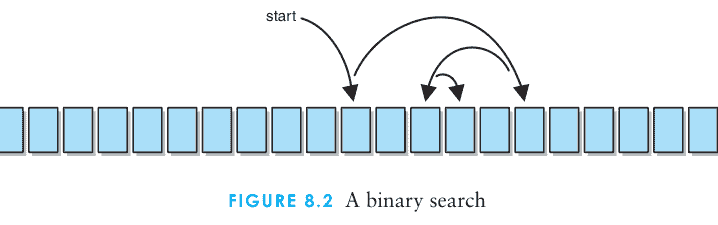

二分搜索不是从列表的一端开始搜索，而是从排序列表的中间开始。如果在中间元素没有找到目标元素，搜索将继续。由于列表是有序的，我们知道如果目标在列表中，它将会在数组的一侧或另一侧，取决于目标是小于还是大于中间元素。因此，由于列表是有序的，通过一次精心选择的比较，我们消除一半的搜索池。剩余的一半搜索池代表了可能找到元素的*可行候选者*。

搜索以这种方式继续，检查可行候选者的中间元素，并消除它们的一半。每次比较都使可行候选者减少一半，直到找到目标元素或没有更多可行候选者，这意味着目标元素不在搜索池中。二分搜索的过程如图 8.2 所示。

让我们来看一个例子。考虑以下排序后的整数列表：

- 10 12 18 22 31 34 40 46 59 67 69 72 80 84 98

如果我们正尝试确定数字 67 是否在列表中。最初，目标可能是列表中的任何位置（搜索池中的所有项都是可行候选者）。

二分搜索方法从检查中间元素开始，在这里是 46。该元素不是我们的目标，所以我们必须继续搜索。但由于我们知道列表是有序的，我们知道如果 67 在列表中，它必须在数据的后半部分，因为中间左侧的所有数据项的值都为 46 或以下。这留下了以下的可行候选者（加粗显示）：

- 10 12 18 22 31 34 40 46 **59 67 69 72 80 84 98**

继续相同的方法，我们检查可行候选者的中间值（72）。再次，这不是我们的目标值，所以我们必须继续搜索。这次我们可以消除所有高于 72 的值，留下：

- 10 12 18 22 31 34 40 46 **59 67 69** 72 80 84 98

请注意，仅通过两次比较，我们就将可行候选者从 15 个减少到了 3 个。再次采用相同的方法，我们选择中间元素 67，并找到了我们正在寻找的元素。如果它不是我们的目标，我们将继续这个过程，直到我们找到该值或消除了所有可能的数据。

> **核心概念**
> 二分搜索每次比较消除一半的候选者。

通过每次比较，二分搜索都会消除大约一半的待搜索数据（它也消除了中间元素）。也就是说，二分搜索在第一次比较时消除一半的数据，第二次比较消除另外四分之一的数据，第三次比较时消除另外八分之一的数据，依此类推。

以下方法实现了二分搜索。和 `linearSearch` 方法一样，它接受一个待搜索的可比较对象数组以及目标值。它还接受代表最小索引和最大索引的值，用于定义要搜索的数组部分（可行候选者）。

```java
/**
 * 使用二分搜索算法搜索指定的对象数组。
 *
 * @param data   要排序的数组
 * @param min    最小值的整数表示
 * @param max    最大值的整数表示
 * @param target 正在搜索的元素
 * @return      如果找到了元素则返回 true
 */
public static <T extends Comparable<T>> boolean binarySearch(T[] data, int min, int max, T target) {
    boolean found = false;
    int midpoint = (min + max) / 2;
    if (data[midpoint].compareTo(target) == 0) {
        found = true;
    } else if (data[midpoint].compareTo(target) > 0) {
        if (min <= midpoint - 1) {
            found = binarySearch(data, min, midpoint - 1, target);
        }
    } else if (midpoint + 1 <= max) {
        found = binarySearch(data, midpoint + 1, max, target);
    }
    return found;
}
```

注意，二分搜索是递归实现的。如果找到找到元素且还有更多数据需要搜索，它将调用自身，传递缩小候选者大小的参数。最小和最大索引用于判断是否还有更多数据。也就是说，如果缩小的搜索区域至少包含一个元素，该方法就不会调用自身，并返回 `false` 值。

在此过程的任何时候，我们可能有偶数个待搜索的值，因此有两个“中间值”。对于算法来说，只要始终保持相同的选择，中间值可以是两个中间值中的任何一个。在这个二分搜索实现中，确定中间值的计算丢弃了任何小数，因此选择了两个中间值中的第一个。

### 搜索算法

对于线性搜索，最好情况是目标元素恰好是我们在组中检查的第一个项。最坏情况是目标不在组中，我们必须检查每个元素才能确定它不存在。预期情况是我们必须在搜索整个列表之前找到该元素。也就是说，如果搜索池中有 n 个元素，平均我们必须检查 n/2 个元素找到我们要找的那个。

因此，线性搜索算法的时间复杂度为 O(n)。因为元素是逐个检查的，所以其复杂度是线性的——与待搜索元素的数量成正比。

另一方面，二分搜索通常要快得多。因为我们每次比较都能消除一半剩余数据，所以能更快地找到元素。最好情况是在第一次比较中找到目标——即目标元素恰好位于数组的中间位置。最坏情况是元素不在列表中，此时我们可能需要进行大约 logn 次比较才能消除所有数据。因此，找到搜索池中元素的预期情况大约是进行 (log2n)/2 次比较。

> **核心概念**
> 二分查找具有对数复杂度，对于大型搜索池非常高效。

可能会有人问，如果二分查找比线性查找更高效，我们为什么还要使用线性查找呢？首先，线性查找通常比二分查找简单，因此更容易编程和调试。其次，线性查找不需要对搜索列表进行排序的额外开销。这是在保持池有序的努力与搜索效率之间的一种权衡。

对于小规模的问题，两种算法之间的区别并不大。然而，随着 `n` 变大，二分查找变得越来越具有吸引力。假设给定的数据集包含一百万个元素。在线性查找中，我们必须检查这一百万个元素中的每一个，才能确定某个特定的目标元素不在组中。而在二分查找中，我们只需要大约 20 次比较就能得出结论。

## 8.2 排序

排序是根据某些标准将一组项目按照定义的顺序（升序或降序）排列的过程。例如，你可能会对姓名列表进行字母顺序排序，或者将调查结果列表按数字降序排列。

多年来，许多算法被开发和评判。事实上，排序被认为是计算机科学中的一个经典研究领域。与搜索算法类似，排序算法通常根据效率分为两类：顺序排序（通常使用嵌套循环，并需要 `n` 次比较来排序 `n` 个元素）和对数排序（通常需要 `n log n` 次比较来排序 `n` 个元素）。与搜索算法一样，当 `n` 较小时，这两类算法之间的区别不明显。

> **核心概念**
> 排序是根据某些标准将一个项目列表按照定义的顺序排列的过程。

在本章中，我们将研究三种顺序排序——选择排序、插入排序和冒泡排序，以及快速排序和合并排序。其他的搜索/排序技术将在书的其他部分根据特定的数据结构进行探讨。

在深入特定的排序算法之前，让我们来看一个通解决通用排序问题。列表 8.1 显示的 `ExampleList` 创建了一个 `Contact` 对象的数组，对这些对象进行排序，然后打印排序后的列表。在这一实现中，`Contact` 对象是通过调用 `selectionSort` 方法进行排序的，我们将在本章后面的部分检查它。然而，在本章中描述的任何排序方法都可以用于达到相同的结果。

### 列表 8.1

```java
/**
 * 用于测试对象选择排序的 SortPhone 驱动程序。
 * @author Dr. Chase
 * @author Dr. Lewis
 * @version 1.0, 8/18/08
 */
public class SortPhone {
    /**
     * 创建 Contact 对象的数组，对它们进行排序，然后打印
     * 。
     */
    public static void main(String[] args) {
        Contact[] friends = new Contact[7];
        friends[0] = new Contact("John", "Smith", "610-555-7384");
        friends[1] = new Contact("Sarah", "Barnes", "215-555-3827");
        friends[2] = new Contact("Mark", "Riley", "733-555-2966");
        friends[3] = new Contact("Laura", "Getz", "663-555-3984");
        friends[4] = new Contact("Larry", "Smith", "464-555-3489");
        friends[5] = new Contact("Frank", "Phelps", "322-555-2284");
        friends[6] = new Contact("Marsha", "Grant", "243-555-2837");
        SortingAndSearching.sortSort(friends);
        for (int index = 0; index < friends.length; index++) {
            System.out.println(friends[index]);
        }
    }
}
```

每个 `Contact` 对象代表一个有姓氏、名字和电话号码的人。`Contact` 类如列表 8.2所示这些类的 UML 描述留了一个练习题。

`Contact` 类实现了 `Comparable` 接口，因此提供了 `compareTo` 方法的定义。在这种情况下，联系人是

### 列表 8.2

```java
/**
 * Contact 代表一个电话联系人。
 *
 * @author Dr. Chase
 * @author Dr. Lewis
 * @version 1.0, 8/18/08
 */
public class Contact implements Comparable {
    private String firstName, lastName, phone;

    /**
     * 使用指定的信息设置此联系人。
     * @param first 名字的字符串表示
     * @param last 姓氏的字符串表示
     * @param telephone 电话号码的字符串表示
     */
    public Contact(String first, String last, String telephone) {
        firstName = first;
        lastName = last;
        phone = telephone;
    }

    /**
     * 返回此联系人的字符串形式描述。
     *
     * @return 此联系人的字符串表示
     */
    public String toString() {
        return lastName + " , " + firstName + " \t" + phone;
    }

    /**
     * 将此联系人与其他联系人进行比较。
     *
     * @param other 要比较的联系人
     * @return 如果此联系人小于联系人，则返回负整数；
     *         如果相等则返回零；如果此联系人大于联系人，则返回正整数
     */
    public int compareTo(Contact other) {
        int result;
        if (this.firstName.compareTo(other.firstName) < 0) {
            result = -1;
        } else if (this.firstName.compareTo(other.firstName) > 0) {
            result = 1;
        } else {
```


# 第8章 排序与搜索

## 列表 8.2 继续

```java
public int compareTo(Contact other)
{
    int result;

    if (this.firstName.compareTo(other.firstName) < 0) {
        result = -1;
    } else if (this.firstName.compareTo(other.firstName) > 0) {
        result = 1;
    } else {
        // 名字相同，比较姓氏
        if (this.lastName.compareTo(other.lastName) < 0) {
            result = -1;
        } else if (this.lastName.compareTo(other.lastName) > 0) {
            result = 1;
        } else {
            result = 0;
        }
    }
    return result;
}
```

### 选择排序

> **核心概念**
> 选择排序通过重复寻找最小元素并将其与当前位置的元素交换来实现列表排序。

选择排序的通用策略如下：它在列表中找到最小元素并与第一个元素交换。然后从剩余的未排序列表中找到最小元素并与第二个元素交换。这个过程一直持续到整个列表排序完毕。选择排序的过程如图 8.3 所示。

```java
/**
 * 使用选择排序对指定的数组进行排序。
 * @param data 要排序的数组
 */
public static <T extends Comparable<? super T>> void selectionSort(T[] data)
{
    int min;
    T temp;

    for (int index = 0; index < data.length - 1; index++) {
        min = index;
        for (int scan = index + 1; scan < data.length; scan++) {
            if (data[scan].compareTo(data[min]) < 0) {
                min = scan;
            }
        }
        // 交换值
        temp = data[min];
        data[min] = data[index];
        data[index] = temp;
    }
}
```

图 8.3 选择排序过程图 (https://example.com/selection_sort_process.png)

### 插入排序

```java
/**
 * @param data 待排序的数组
 */
public static <T extends Comparable<? super T>> void insertionSort(T[] data) {
    for (int index = 1; index < data.length; index++) {
        T key = data[index];
        int position = index;
        // 将较大的值向右移动
        while (position > 0 && data[position - 1].compareTo(key) > 0) {
            data[position] = data[position - 1];
            position--;
        }
        data[position] = key;
    }
}
```

与选择排序的实现类似，`insertionSort` 方法使用两个循环来对对象数组进行排序。然而，在插入排序中，外部循环控制内部循环处理数组中待插入的下一个值。内部循环将当前插入的值与存储在较低索引处的值（这些值构成了整个列表的排序子集）进行比较。

- 3 已排序。无须移动。插入 9。
- 3 和 9 已排序。将 9 向右移动。插入 6。
- 3, 6 和 9 已排序。将 9, 6 和 3 向右移动。插入 1。
- 1, 3, 6 和 9 已排序。将 9, 6 和 3 向右移动。插入 2。

图 8.4 插入排序处理说明

如果当前值小于位置处的值，则该值将向右移动。这种移动一直持续，直到空出一个合适的位置来接收插入的值。外部循环的每次迭代都会向列表的排序子集添加一个值，直到整个列表排序完毕。

### 冒泡排序

冒泡排序是另一种使用嵌套循环的顺序排序算法。它通过重复比较列表中的相邻元素，并在它们之间的相对顺序不正确时交换它们的位置来排序。

> **核心概念**
> 冒泡排序算法通过重复比较相邻元素并在必要时交换它们来对列表排序。

冒泡排序算法的通用策略如下：扫描列表中的相邻元素，如果它们不符合相对顺序，则进行交换。这具有将最大值“泡”到列表最后一个位置的效果，该位置是它在最终排序列表中的正确位置。再次扫描列表，将倒数第二个值泡过去。这个过程持续进行，直到所有元素都泡到了它们正确的位置。

冒泡排序算法的每次遍历都会将最大值移动到它的最终位置。一次遍历也可能重新定位其他元素。例如，我们从开始：

```
9 6 8 12 3 1 7
```

我们首先比较 9 和 6，发现它们的顺序不正确，于是交换它们，得到：

```
6 9 8 12 3 1 7
```

然后我们比较 9 和 8，再次发现它们的顺序不正确，于是交换它们，得到：

```
6 8 9 12 3 1 7
```

我们比较 9 和 12。由于它们的顺序是正确的，我们不交换它们。相反，我们移动到下一组待比较的值。也就是说，我们比较 12 和 3。因为它们的顺序不正确，我们交换它们，得到：

```
6 8 9 3 12 1 7
```

我们比较 12 和 1 并交换它们，得到：

```
6 8 9 3 1 12 7
```

我们比较 12 和 7 并交换它们，得到：

```
6 8 9 3 1 7 12
```

这完成了对待排序数据的第一次遍历。在第一次遍历之后，列表中的最大值 (12) 已经处于它的正确位置，但我们无法确定其他任何数字是否正确。对数据的后续每次遍历都保证多一个元素被放在正确位置。因此，我们对数据进行 $n-1$ 次遍历，因为如果 $n-1$ 个元素都处于正确的排序位置，那么第 $n$ 个元素也必然位于正确的位置。

冒泡排序算法的实现如下方法所示：

```java
/**
 * 使用冒泡排序算法对指定的对象数组进行排序
 * @param data 待排序的数组
 */
public static <T extends Comparable<? super T>> void bubbleSort(T[] data)
{
    int position, scan;
    T temp;

    for (position = data.length - 1; position >= 0; position--)
    {
        for (scan = 0; scan <= position - 1; scan++)
        {
            if (data[scan].compareTo(data[scan + 1]) > 0)
            {
                // 交换数据
                temp = data[scan];
                data[scan] = data[scan + 1];
                data[scan + 1] = temp;
            }
        }
    }
}
```

`bubbleSort` 方法中的外部 `for` 循环代表对数据的 $n-1$ 次遍历。内部循环扫描数据，对相邻数据进行两两比较，并在必要时进行交换。

注意，外部循环还有减少内部循环中要检查的最大索引位置的作用。也就是说，在第一次遍历（将最后一个值放在其正确位置）之后，在未来的数据遍历中没有必要再考虑该值。在第二次遍历之后，我们可以忘记最后两个值。

### 快速排序

到目前为止讨论的排序算法（选择排序、插入排序和冒泡排序）都相对简单，但效率较低，它们需要 $n^2$ 次比较。我们现在转向更高效的、适用于递归的排序算法。

快速排序算法通过选择一个基准元素划分列表，并递归地对基准元素两侧的子列表进行排序。快速排序算法的通用策略如下：首先选择列表中的一个元素作为基准元素。接下来划分列表，使得所有小于基准元素的都在左侧，大于基准元素的都在右侧。最后，对这两个划分应用快速排序策略（递归）。

> **核心概念**
> 快速排序通过划分列表并递归地对划分进行排序来完成排序。

如果数据是完全随机的，基准元素的选择是任意的。让我们来看一个划分的例子。如果我们从如下开始：

```
305 65 7 90 120 110 8
```

我们将选择 90 作为基准元素。然后我们重排列表，将小于 90 的元素移左，大于 90 的元素移右，得到：

```
8 65 7 90 120 110 305
```

我们将对这两个划分应用快速排序策略。这个过程持续进行直到划分只包含一个元素，该元素本身就是排序好的。因此，在基准元素确定并放置后，将不再被考虑。以下方法实现了快速排序。它接收要排序的对象数组以及用于特定调用的最小和最大索引值。对于方法的初始调用，`min` 和 `max` 的值将包含整个元素集。

```java
/**
 * 使用快速排序算法对指定的对象数组进行排序
 * @param data 待排序的数组
 * @param min 最小索引
 * @param max 最大索引
 */
public static <T extends Comparable<? super T>> void quickSort(T[] data, int min, int max)
{
    int indexOfPartition;

    if (max - min > 0)
    {
        // 创建划分
        indexOfPartition = findPartition(data, min, max);

        // 排序左侧
        quickSort(data, min, indexOfPartition - 1);

        // 排序右侧
        quickSort(data, indexOfPartition + 1, max);
    }
}
```

`quickSort` 方法高度依赖 `findPartition` 方法，后者将排序区域分为两个划分。`findPartition` 方法返回划分值的索引。然后 `quickSort` 方法调用两次（递归）对这两个划分进行排序。`findPartition` 方法如下所示：

```java
/**
 * 快速排序算法用于查找划分
 *
 * @param data 待排序的数组
 * @param min 最小索引
 * @param max 最大索引
 */
private static <T extends Comparable<? super T>> int findPartition(T[] data, int min, int max)
{
    int left, right;
    T temp, partitionElement;

    int middle = (min + max) / 2;
    partitionElement = data[middle]; // use middle element as partition

    left = min;
    right = max;

    while (left < right)
    {
        // search for an element that is > the partitionElement
        while (data[left].compareTo(partitionElement) <= 0 && left < right)
            left++;

        // search for an element that is < the partitionElement
        while (data[right].compareTo(partitionElement) > 0)
            right--;

        // swap the elements
        if (left < right)
        {
            temp = data[left];
            data[left] = data[right];
            data[right] = temp;
        }
    }

    // move partition element to partition index
    temp = data[min];
    data[min] = data[right];
    data[right] = temp;

    return right;
}
```

`findPartition` 方法的两个内部循环用于找到位于错误分区的需要交换的元素。第一个循环从左到右扫描，寻找一个大于分区元素的元素。第二个循环从右到左扫描，寻找一个小于分区元素的元素。当找到这两个元素时，会对它们进行交换。这个过程会一直持续，直到右、左索引在列表的“中间”相遇。它们相遇的位置指示了分区元素（在最后结束之前，它不会从其初始位置移动）最终所在的位置。

如果我们得到一个糟糕的分区元素会怎样？如果分区元素是列表中的最小或最大元素，那么实际上浪费了一次数据遍历。确保获得更好的分区元素的一种方法是选择三个元素中的中间的一个。例如，算法将检查列表中的第一个、中间和最后一个元素，并选择中间值作为分区元素。这种方法被留作了一个编程作业。

### 归并排序

归并排序算法是另一种递归排序算法，它通过递归地将列表分为两半，直到每个子列表只有一个元素，然后重新组合这些子列表来完成排序。

归并排序算法的通用策略如下：首先将列表分为两个大致相等的部分，并对每个列表递归地调用自身。继续对列表进行递归分解，直到达到递归的基准情况，即列表被分为长度为一的列表，根据定义，这些列表是有序的。然后，随着在递归调用结构向上传回，算法将两次递归调用产生的两个有序子列表合并成一个有序列表。

> **核心概念**
> 归并排序算法通过递归地将列表分为两半，直到每个子列表只有一个元素，然后将这些子列表合并为有序顺序来完成排序。

例如，如果我们从上一节的初始列表开始，算法的递归分解部分将产生图 8.5 所示的结果。


图 8.5 归并排序算法的分解部分

算法的合并部分将按照图 8.6 所示重新组合列表。


图 8.6 归并排序算法的合并部分

下面是归并排序算法的实现：

```java
/**
 * 使用归并排序算法对指定的对象数组进行排序。
 * @param data 要排序的数组
 * @param min 最小索引
 * @param max 最大索引
 */
public static <T extends Comparable<? super T>> void mergeSort(T[] data, int min, int max)
{
    T[] temp;
    int index1, left, right;

    // 长度为一的列表返回
    if (min >= max)
        return;

    // 列表的长度和中点
    int size = max - min + 1;
    int pivot = (min + max) / 2;

    temp = (T[])(new Comparable[size]);

    mergeSort(data, min, pivot); // 排序列表左半部分
    mergeSort(data, pivot + 1, max); // 排序列表右半部分

    // 将排序后的数据复制到工作区
    for (index1 = 0; index1 < size; index1++)
        temp[index1] = data[min + index1];

    // 合并两个有序列表
    left = 0;
    right = pivot - min + 1;
}
```

## 8.3 基数排序


## 8.2 归并排序

```java
mergeSort(data, min, pivot); // 排序列表左半部分
mergeSort(data, pivot + 1, max); // 排序列表右半部分

// 将排序后的数据复制到工作区
for (index1 = 0; index1 < size; index1++)
    temp[index1] = data[min + index1];

// 合并两个有序列表
left = 0;
right = pivot - min + 1;

for (index1 = 0; index1 < size; index1++) {
    if (right <= max - min)
        if (left <= pivot)
            if (temp[left].compareTo(temp[right]) > 0)
                data[index1 + min] = temp[right];
        else
            data[index1 + min] = temp[left++];
    else
        data[index1 + min] = temp[right++];
    else
        data[index1 + min] = temp[left++];
}
```

## 8.3 基数排序

```java
String temp;
Integer numObj;
int digit, num;
ArrayQueue<Integer>[] digitQueues = (ArrayQueue<Integer>[]) new ArrayQueue[10];

for (int digitVal = 0; digitVal <= 9; digitVal++)
    digitQueues[digitVal] = new ArrayQueue<Integer>();

// 排序列表
for (int position = 0; position <= 3; position++) {
    for (int scan = 0; scan < list.length; scan++) {
        temp = String.valueOf(list[scan]);
        digit = Character.digit(temp.charAt(3 - position), 10);
        digitQueues[digit].enqueue(new Integer(list[scan]));
    }
}

// 将数字重新收集到列表
num = 0;
for (int digitVal = 0; digitVal <= 9; digitVal++) {
    while (!digitQueues[digitVal].isEmpty()) {
        numObj = digitQueues[digitVal].dequeue();
        list[num] = numObj.intValue();
        num++;
    }
}

// 输出排序后的列表
for (int scan = 0; scan < list.length; scan++)
    System.out.println(list[scan]);
```


## 8.3 基数排序

| ArrayQueue |
| :--- |
| DefaultCapacity |
| rear |
| queue |
| `enqueue()` |
| `dequeue()` |
| `first()` |
| `isEmpty()` |
| `size()` |
| `toString()` |
| `expandCapacity()` |

| <<interface>> |
| :--- |
| QueueADT |
| `enqueue()` |
| `dequeue()` |
| `first()` |
| `isEmpty()` |
| `size()` |
| `toString()` |

| RadixSort |
| :--- |
| `main(String[] args)` |

图 8.8 RadixSort 程序的 UML 描述

方法使用十个队列对象的数组（每个对应一个数字 0 到 9）执行基数排序的各个步骤。图 8.8 显示了 `RadixSort` 类的 UML 描述。

注意，在 `RadixSort` 程序中，我们无法创建一个队列的数组来存储整数，因为泛型数组的实例化限制了这一操作。相反，我们创建了一个 `CircularArrayQueues` 数组，然后将其强制转换为 `CircularArrayQueue<Integer>` 数组。

在 `RadixSort` 程序中，数字最初存储在列表中。在每一轮处理后，数字会从队列中取出并按正确顺序存回列表数组。这使得程序可以在排序的每一轮中重用原始的十个队列数组。

基数排序的概念可以适用于任何类型的数据，只要排序键可以被拆分为定义良好的位置。请注意，与我们在在本节较之前讨论的排序不同，为任何对象创建一个通用的基数排序是不现实的，因为拆分键值是该过程中不可或缺的一部分。

那么，基数排序的时间复杂度是多少？在这种情况下，元素之间没有任何比较或交换。在每一轮中，元素简单地从一个队列中取出并放入另一个队列中。对于任何给定的基数，遍历数据的次数是基于键中字符数量的常数；我们称之为 $c$。那么算法的时间复杂度简单为 $c^n$。请记住，根据我们在第 2 章的讨论，我们在计算算法的时间复杂度时会忽略常数。因此，基数排序算法的复杂度是 $O(n)$。那么为什么不对所有的排序都使用基数排序呢？首先，每个基数排序算法都必须针对特定问题的键进行专门设计。其次，对于键位数（$c$）和列表元素数量（$n$）非常接近键，基数排序算法的实际时间复杂度类似于 $n^2$ 而不是 $n$。此外，我们还需要考虑另一个影响空间复杂度的常数，即基数，或者键中每个位置或字符可能的数值数量。想象一下，尝试对一个允许来自 Unicode 字符集中任意字符的键实现基数排序。由于该字符集拥有超过 100,000 个字符，我们需要那么多的队列！

## 核心概念总结

- 搜索是在一组项目内寻找指定目标，或确定其不存在的过程。
- 高效排序能够尽可能地减少比较的次数。
- 通过在方法声明中使用 `static` 修饰符，使该方法是静态的。
- 二分查找利用了搜索池已排序的这一事实。
- 二分查找每次比较都能排除一半的有效候选者。
- 二分查找具有对数复杂度，使其对于大型搜索池非常高效。
- 排序是根据某些标准将项目列表按定义顺序排列的过程。
- 选择排序算法通过重复地将特定值放入其最终排序位置来对值列表进行排序。
- 插入排序算法通过重复地将特定值插入列表的已排序子集中对值列表进行排序。
- 冒泡排序算法通过重复比较相邻元素并在必要时交换它们对列表进行排序。
- 快速排序算法通过对列表进行分区，然后递归地对两个分区部分进行排序。
- 合并排序算法通过递归地将列表一分为二，直到每个子列表只有一个元素，然后将子列表合并为排序顺序来对列表。
- 基数排序本质上是基于队列处理的

## 自测习题

- 8.1 什么情况下线性搜索更优？
- 8.2 哪种方法要求列表是排序的？
- 8.3 什么情况下顺序排序更优？
- 8.4 插入排序使用的是什么技术？
- 8.5 冒泡排序使用的是什么技术？
- 8.6 选择排序使用的是什么技术？
- 8.7 快速排序使用的是什么技术？
- 8.8 合并排序使用的是什么技术？

# 练习

- 8.1 比较以下列表的 `linearSearch` 和 `binarySearch`：
- 8.2 使用 8.1 中的列表，为选择排序、插入排序、冒泡排序、快速排序、合并排序构建一个所需比较次数的表格。
- 8.3 如果 8.1 中的相同列表已经是排序的，每个算法的比较次数会发生什么？
- 8.4 针对以下列表，显示各个算法的执行轨迹：
    - 选择排序
    - 插入排序
    - 冒泡排序
    - 快速排序
    - 合并排序
- 8.5 针对 8.4 得到的列表，显示查找数字 235 的执行轨迹。
- 8.6 画出 `Sort` 类的 UML 描述。
- 8.7 假设每个数字都在 1 到 5 之间，对以下五位 ID 数字手动跟踪基数排序：
    - 13224
    - 32135
    - 54355
    - 12123
    - 22331
    - 21212
    - 33333
    - 54312
- 8.8 基数排序的时间复杂度是多少？

## 编程项目

- PP 8.1 本章所示的冒泡排序算法没有它那么高效。如果遍历列表时没有交换任何元素，说明列表已经排序，没有理由继续。修改此算法，使其在识别出列表已排序后停止。*不要使用 `break` 语句！*
- PP 8.2 冒泡排序算法有一种变体称为间隙排序，它不是每次比较相邻元素，而是比较间隔 $i$ 位置的元素，其中 $i$ 是小于 $n$ 的整数。例如，第一个元素将与 $(i+1)$ 元素比较，第二个元素将与 $(i+2)$ 元素比较，以此此类推。当所有可以比较的元素都比较完成后，完成一次迭代。在下一次迭代中，$i$ 减少一个大于 1 的数并继续，直到 $i$ 小于 1。实现间隙排序。
- PP 8.3 修改章节中的列表（选择排序、插入排序、冒泡排序、快速排序和合并），通过为每个算法添加代码来统计每个算法的总比较次数和执行时间。针对同一个列表执行排序算法，记录每个算法的总比较次数和执行时间信息。尝试多个不同的列表，包括至少一个已排序的列表。
- PP 8.4 修改快速排序方法，使用章节描述的“三数取中”技术来选择分区元素。针对多组数据运行新版本和旧版本，并比较总执行时间。

## 第 8 章 排序与搜索

SRA 8.4 插入排序算法通过反复将特定值插入到列表中已经排序的子集中，来对值列表进行排序。

SRA 8.5 冒泡算法通过反复比较列表中的相邻元素，并在它们尚未就绪时交换位置，来对列表进行排序。

SRA 8.6 选择排序算法是一种 $O(n^2)$ 排序算法，它通过反复将一个特定值放入其最终的排序位置，来对值列表进行排序。

SRA 8.7 快速排序算法通过使用任意选择的划分元素对列表进行分区，然后递归地对划分元素两侧的子列表进行排序。

SRA 8.8 合并排序算法通过递归地将列表一分为二，直到每个子列表只有一个元素，然后按照顺序重新组合这些子列表来对列表进行排序。

SRA 8.9 这将需要 27 个队列，一个用于字母表中的 26 个字母中的每一个字母，另外一个用于在排序之前、期间和之后存储整个列表。

# 第 9 章 树

本章开始我们对非线性集合和数据结构的探索。我们将讨论树的使用和实现，定义与树相关的术语，分析可能的树实现，并查看实现和使用树的示例。

## 章节目标

- 将树定义为数据结构
- 讨论与树相关的术语
- 讨论树的可能实现
- 分析集合的树实现
- 讨论遍历树的方法
- 检查二叉树示例

## 9.1 树

我们在书中到目前为止过的集合（栈、队列和列表）都是线性数据结构，这意味着它们的元素按顺序一个接一个地排列。树是一种非线性结构，其中元素被组织成层级结构。本节描述了通用的树，并建立了一些重要的术语。

从概念上说，树由一组存储元素的节点和连接一个节点到另一个节点的“边”组成。每个节点都位于树层次结构中的特定级别。树的根节点是树顶层的唯一节点。树中只有一个根。图 9.1 显示了一棵有助于说明这些术语的树。

树中较低的节点是上一层节点的节点。在图 9.1 中，标记为 B、C、D 和 E 的节点是 A 的子节点。节点 F 和 G 是 B 的子节点。一个节点只能有一个父节点，但一个节点可以有多个子节点。具有相同父节点被称为兄弟节点。因此，节点 H、I 和 J 是兄弟节点，因为它们都是 D 的子节点。

根是树中没有父节点的唯一节点。没有子节点的称为叶子节点。不是根且至少有一个子节点的称为内部节点。注意，树的类比是反的。我们的树从树顶部的根“生长”到树底部的叶子节点。

根是进入树结构的入口。我们可以沿着树从父节点到子节点的路径通过。例如，图 9.1 中从 A 到 N 的路径是 A、D、I、N。如果一个节点在从根的路径上另一个节点的上方，那么该节点就是另一个节点的祖先。

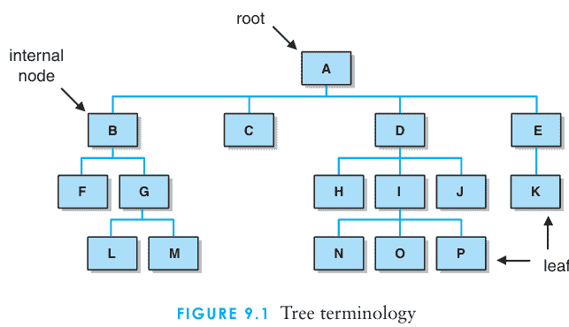

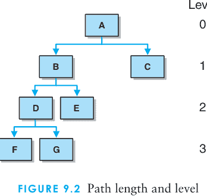

节点的级别也是从根到节点的路径长度。该路径长度通过计算从根到节点必须遵循的边的数量来确定。根被认为是第 0 层，根的子节点在第 1 层，根的孙节点在第 2 层，以此此类推。路径长度和级别如图 9.2 所示。

树的高度是从根到叶子的最长路径的长度。因此，图 9.2 中树的高度或阶数为 3，因为从根到叶子 F 和 G 的路径长度为 3。从根到叶子 C 的路径长度为 1。

## 树的分类

树有许多分类方法。最重要的标准是树中任何节点可能拥有的子节点数量。这个值有时被称为树的阶。对子节点数量没有限制的树称为普通树。限制每个节点最多 $n$ 个子节点的树称为 $n$ 元树。

一种 $n$ 元树具有特殊的重要性。节点最多有两个子节点的树称为二叉树。这种树在很多情况下很有用。我们对树的大部分探索将集中在二叉树上。

另一种分类树的方法是看它是否平衡。取决于所使用的算法，平衡有许多定义。我们将在下一章探索其中一些算法。粗俗来说，如果树的所有节点都在同一层，或者至少彼此之间在一个层以内，则这棵树被认为是平衡的。因此，图 9.3 左侧所示的树是

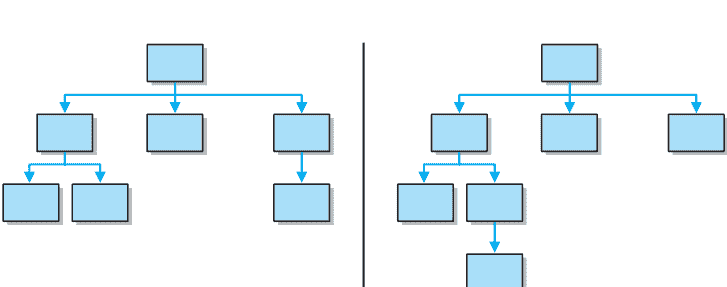

### 树的类型

| 类型 | 描述 |
| :--- | :--- |
| 普通树 | 对节点可能的子节点数量没有限制。 |
| $n$ 元树 | 限制每个节点最多 $n$ 个子节点。 |
| 二叉树 | 节点最多有两个子节点。 |
| 平衡树 | 所有节点都在同一层或至少彼此之间在一个层以内。 |

图 9.3 左侧所示的树是平衡的，而右侧的是不平衡。


| a | b | c |
| :--- | :--- | :--- |
| (平衡) | | (不平衡) |

## 9.2 实现树的策略

让我们检查实现树的通用策略。树的最明显实现是链式结构。每个节点可以被定义为 `TreeNode` 类，类似于。每个节点包含一个指向要存储元素的指针以及指向每个可能的子节点的指针。取决于实现，为每个节点存储指向其父节点的指针可能有用。这种指针的使用类似于双链表，每个节点不仅指向下一个节点，还指向上一个节点。

由于树是非线性结构，使用底层的线性结构来实现它可能并不合理。然而，有时这种方法是有用的。数组实现树的策略可能并不直观。有两种主要方法：计算策略和模拟链接。

### 数组实现树的计算策略

对于某些类型的树，特别是二叉树，可以使用计算策略使用数组存储树。一种可能的策略如下：对于存储在数组位置 $n$ 的任何元素，其左子节点将存储在位置 $(2 * n + 1)$，右子节点将存储在位置 $(2 * (n+1))$。这种策略非常有效，并且像列表、队列和栈的数组实现那样对容量进行管理。然而，尽管这种解决方案在概念上很优雅，但它并非没有缺点。例如，如果我们存储的树不是完全的或相对完全的，我们可能会在数组中不包含数据的树位置浪费大量的内存。计算策略如图 9.5 所示。

> 核心概念：一种可能的计算策略将元素 $n$ 的左孩子放在位置 $(2 * n+1)$，将右孩子放在位置 $(2 * (n+1))$。

### 数组实现树的模拟链接策略

第二种可能的数组实现树模仿了操作系统管理内存的方式。不是根据树中的位置将树元素分配到数组位置，而是根据先来先得原则连续分配数组位置。数组的每个元素将是我们之前讨论过的 `TreeNode` 类的节点。然而，不是存储对象引用变量作为指向其子节点（可能还有其父节点）的指针，每个节点会存储每个子节点的数组索引（可能还有其父节点）。这种方法允许元素连续存储在数组中，从而不浪费空间。然而，这种方法增加了树中删除元素的开销，因为这需要移动剩余元素以保持连续性，或者维护一个空闲列表。该策略如图 9.6 所示。数组中元素的顺序仅由它们进入树的顺序决定。在这种情况下，假设进入顺序为 A, C, B, E, D, F。

当树结构需要使用直接 I/O 方法直接存储在磁盘上，也可以使用这种策略。在这种情况下，每个节点将存储其子节点在文件的相对位置，以便根据文件的基地址计算出偏移量。

## 核心概念

模拟链接策略允许数组连续分配节点，无论树是否完备。

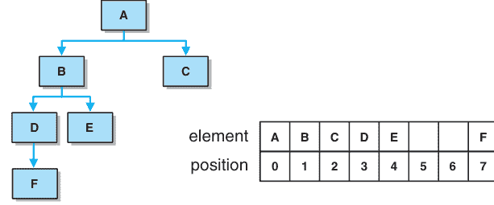

图 9.5 树数组实现的计算策略

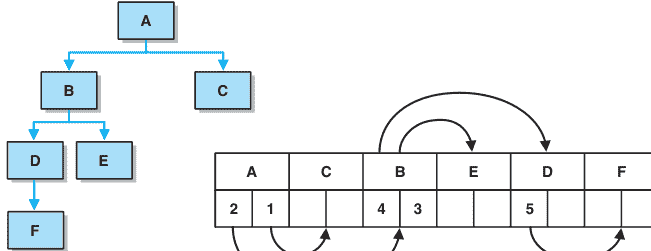

图 9.6 树数组实现的模拟链接策略

## 9.2 树的实现策略

### 设计焦点

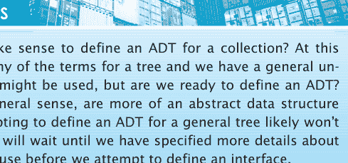

什么时候为集合定义 ADT（抽象数据类型）是合理的？此时我们已经定义了许多关于树的术语，并对树的用途有了通用理解，但我们准备好定义 ADT 了吗？并没有。从广义上说，树更多是种抽象数据结构而不是集合，因此尝试为通用树定义 ADT 可能用不大。相反，我们将等到指定更多关于树类型及其用途的后再尝试定义接口。

## 树的分析

如前所述，树是实现其他集合的一种有效且高效的方法。在第 6 章对列表实现的分析中，我们将查找操作复杂度描述为预期的 $n/2$ 或 $O(n)$。然而，如果我们使用平衡二叉搜索树来实现有序列表——这种二叉树增加了一个属性，即左节点小于父节点，而父节点始终小于或等于右节点——那么我们可以将查找操作的效率提高 $O(\log n)$。我们将在第 10 章详细讨论二叉搜索树。

> 核心概念
> 通常情况下，带有元素的平衡 $n$ 叉树高度为 $\log n$。

这种效率的提高是因为树的高度将是 $\log n$，其中 $n$ 是树中元素的数量。这与我们在第 8 章中对二叉搜索的讨论非常相似。事实上，对于任何具有 $m$ 个元素的平衡 $n$ 叉树，树的高度将是 $\log n$。有了二叉搜索树额外的排序属性，你可以保证在最坏情况下只搜索从根到叶的一条路径，且该路径长度不会超过 $\log n$。

### 设计焦点

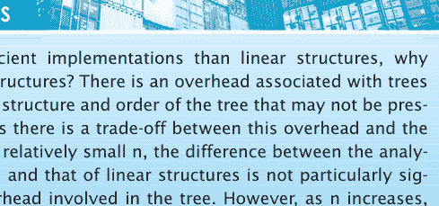

如果树提供了比线性结构更高效的实现，我们为什么还要使用线性结构？树在维护结构和顺序方面存在开销，这种开销在其他结构中可能不存在；因此这种开销与问题规模之间存在权衡。当 $n$ 较小时，树实现的分析与线性结构分析之间的差异相对于树本身的开销来说并不显著。然而，随着 $n$ 的增加，树的效率会变得更具吸引力。

## 9.3 树的遍历

由于树是非线性结构，遍历树的概念通常比遍历线性结构的概念更有趣。遍历树有四种基本方法：

- 前序遍历：通过访问每个节点，然后访问其子节点，从根节点开始。
- 中序遍历：通过访问节点的左孩子，然后是节点，最后是任何剩余节点，从根节点开始。
- 后序遍历：通过访问子节点，然后是节点，从根节点开始。
- 层序遍历：通过访问每一层的所有节点，一次处理一层，从根节点开始。

这些定义都适用于所有树。然而，作为一个例子，让我们看看这些定义如何应用于二叉树（即每个节点最多有两个子节点的树）。

### 前序遍历

给定图 9.7 所示的树，前序遍历将产生 A, B, D, E, C 序列。之前的定义说明前序遍历是通过访问每个节点，然后访问其子节点，从根节点开始。因此，从根节点开始，我们访问根节点，得到 A。我们遍历到根的第一个孩子，即节点 B。然后我们使用相同的算法，首先访问当前节点，产生 B，然后访问其子节点。接下来，我们遍历到 B 的第一个孩子，即包含 D 的节点。我们再次使用相同的算法，首先访问当前节点，产生 D，然后访问其子节点。

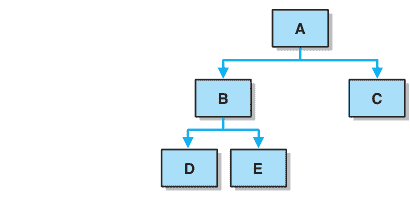

图 9.5 树数组实现的计算策略（等等，文本似乎指的是图 9.7，但图像标签是 9.5。我将保持文本不变）。

实际上，查看文本：“给定图 9.7 所示的树……”。我将保持原始文本。

……我们然后遍历到 B 的第一个孩子，即包含 D 的节点。我们再次使用相同的算法，首先访问当前节点，产生 D，然后访问其子节点。接下来，我们遍历到 B 的第一个孩子，即包含 D 的节点。（等等，让我根据提供的 OCR 重新读一遍流程）。

二叉树的伪代码陈述的算法如下：

```
Visit node
Traverse(left child)
Traverse(right child)
```


> **核心概念**
> 中序遍历意味着左孩子，然后是节点。

# 中序遍历

给定图 9.7 所示的树，中序遍历将产生 D, E, B, C, A 序列。如之前定义的，中序遍历是通过访问节点的左孩子，然后是节点，最后是任何剩余节点，从根节点开始。因此，从根节点开始，我们访问根的左孩子，即节点 B。我们然后使用相同的算法，首先访问 B 的左孩子，即节点 D。我们再次使用相同的算法，首先访问当前节点，产生 D，然后访问其子节点。由于 D 没有孩子，我们返回节点 B 并访问它。我们遍历到 B 的右孩子，即节点 E。我们然后使用相同的算法，首先访问 E 的左孩子，产生 E，然后访问其子节点。由于 E 没有孩子，我们返回节点 B 并访问它。最后我们遍历到根的右孩子，即节点 C。我们然后使用相同的算法，首先访问 C 的左孩子，产生 C，然后访问其子节点。由于 C 没有孩子，我们返回根并访问它。

# 后序遍历

给定图 9.7 所示的树，后序遍历将产生 D, E, B, C, A 序列。如之前定义的，后序遍历是通过访问子节点，然后是节点，从根节点开始。因此，从根节点开始，我们访问根的节点。第一个是左孩子 B。我们然后访问 B 的孩子。第一个是孩子 D。由于 D 没有孩子，我们访问 D。接下来我们访问 B 的右孩子，即 E。由于 E 没有孩子，我们访问 E。在访问了 B 的所有孩子后，我们现在访问 B。接下来我们访问根的右孩子，即 C。由于 C 没有孩子，我们访问 C。最后，我们访问根。

# 层序遍历

给定图 9.7 所示的树，层序遍历将产生 A, B, C, D, E 序列。如之前定义的，层序遍历是通过访问每一层的所有节点，一次处理一层，从根节点开始。使用这个定义，我们首先访问根节点，产生 A。接下来我们访问根的左孩子，产生 B，根的右孩子，产生 C，然后是 B 的孩子，产生 D 和 E。

创建一个队列叫 `nodes`

创建一个无序列表叫 `results`

将根节点加入 `nodes` 队列

当队列不为空

```
从队列中取出第一个元素
如果该元素不空
  将该元素添加到 `results` 列表的末尾
  将元素的节点加入 `nodes` 队列
否则
  在结果 列表中添加空
```

返回 `results` 列表的迭代器

这种层序遍历算法只是许多可能解决方案之一。然而，它确实具有一些有趣的属性。首先，注意我们正在使用集合（即队列和列表）来解决另一个集合（即二叉树）的问题。其次，回想我们早些关于迭代器的讨论，我们谈到了当迭代器在执行期间集合被修改时，迭代器相对于集合的行为。在这种情况下，使用列表按正确顺序存储元素，然后返回一个该列表的迭代器，这种行为就像二叉树的一个快照（snapshot），不受任何并发修改的影响。这取决于所使用的迭代器，既可以是一个优点，也可以是一个缺点。

> **二叉树概念**
> 层次序遍历意味着从根节点开始，一次处理二叉树每一层的节点。

# 9.4 二叉树 ADT

让我们来看一个使用链接的简单二叉树实现。在第 9.5 节中，我们将考虑一个使用该实现的示例。正如我们在本章中讨论的那样，为所有树抽象出一个接口是困难的。然而，一旦我们将焦点缩小到二叉树，这项任务就变得更加合理了。二叉树 ADT 的一组可能的操作列如图 9.8 所示。请记住，集合的定义并不是通用的。你会发现，不同书籍中为特定集合定义的操作会有所不同。我们在本书中非常仔细地定义了每个集合的操作，以确保它们与其目的一致。

注意，在所有列出的操作中，没有向树中添加元素或删除元素的操作。这是因为在我们还没有指定：

| 操作 | 描述 |
|---|---|
| `getRoot` | 返回二叉树根节点的引用 |
| `isEmpty` | 确定树是否为空 |
| `size` | 返回树中元素的数量 |
| `contains` | 确定指定的目标是否在树中 |
| `find` | 如果找到了指定的元素元素，则返回该元素的引用 |
| `toString` | 返回树的字符串表示 |
| `iteratorInOrder` | 返回一个用于树的中序遍历的迭代器 |
| `iteratorPreOrder` | 返回一个用于树的前序遍历的迭代器 |
| `iteratorPostOrder` | 返回一个用于树的后序遍历的迭代器 |
| `iteratorLevelOrder` | 返回一个用于树的层次序遍历的迭代器 |

图 9.8 二叉树上的操作

# 第 9 章 树

二叉树的目的和组织，我们无法知道如何或更具体地向树中添加元素。同样，从树中删除一个或多个元素的操作也可能违反树的目的或结构。在添加元素时，我们没有足够的信息来确定如何删除元素。我们在第 3 章和第 4 章处理栈时，可以思考从栈中删除元素的概念，并且很容易概念化元素删除后栈的状态。队列也是如此，因为对于线性结构中的队列，我们可以从线性结构的一端删除元素；而对于列表，我们可以从线性结构的中间删除元素，这很容易概念化结果列表的状态。

对于树来说，在删除一个元素后，我们面临许多会影响树状态的问题。被删除元素的子节点和其他后代会发生什么？该元素的父节点的指针现在指向哪里？如果我们删除的是根节点会怎样？正如我们在本章稍后使用表达式树的示例中将看到的，某些树的应用中没有从树中删除元素的概念。一旦我们指定了关于树使用的更多细节，我们可能就会决定 `removeElement` 方法是合适的。一个极佳的例子就是二叉搜索树，正如我们将在第 10 章看到的 true。

列表 9.1 显示了 `BinaryTreeADT` 接口。图 9.9 显示了 `BinaryTreeADT` 接口的 UML 说明。

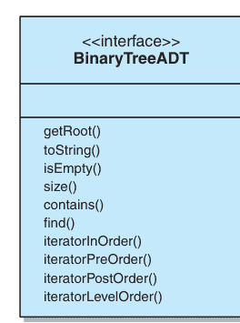

图 9.9 BinaryTreeADT 接口的 UML 说明

列表 9.1

```java
/**
 * BinaryTreeADT 定义了二叉树结构。
 * @author Dr. Lewis
 * @author Dr. Chase
 * @version 1.0, 8/19/08
 */
public interface BinaryTreeADT<T> {
    /**
     * 返回树根节点的引用。
     */
    T getRoot();

    /**
     * 如果树为空，则返回 true，否则返回 false。
     */
    boolean isEmpty();

    /**
     * 返回树中元素的数量。
     */
    int size();

    /**
     * 如果树包含指定的元素，则返回 true，否则返回 false。
     */
    boolean contains(T target);

    /**
     * 如果找到了指定的元素，则返回该元素的引用。
     */
    T find(T target);

    /**
     * 返回树的字符串表示。
     */
    String toString();

    /**
     * 返回一个用于树的中序遍历的迭代器。
     */
    Iterator<T> iteratorInOrder();

    /**
     * 返回一个用于树的前序遍历的迭代器。
     */
    Iterator<T> iteratorPreOrder();

    /**
     * 返回一个用于树的后序遍历的迭代器。
     */
    Iterator<T> iteratorPostOrder();

    /**
     * 返回一个用于树的层次序遍历的迭代器。
     */
    Iterator<T> iteratorLevelOrder();
}
```

# 9.5 使用树：表达式树

在第 3 章，我们使用栈算法来评估后缀表达式。在本节中，我们修改了算法，使用 `ExpressionTree` 类来构建表达式树。图 9.10 展示了表达式树的概念。注意，表达式树的根和所有内部节点包含操作，而叶子节点包含操作数。表达式树是从底向上评估的。在这种情况下，首先计算 (5–3) 得到 2。该结果乘以 4 得到 8。最后，将该结果加上 7 得到 17。

列表 9.2 展示了我们的 `ExpressionTree` 类。该类继承自 `LinkedTree` 类，提供了一个新的 `evaluate` 方法在构建完成后递归地评估表达式树。注意，该类也可以写为继承 `ArrayBinaryTree` 类，并且许多操作会有所不同。例如，我们常数 O(1) 时间组合新元素和两个现有树以形成新树的构造函数，在数组实现中需要合并数组，导致 O(n) 的时间复杂度。这并不意味着链接实现总是更好的；它意味着它比数组实现更适合这个特定问题。

列表 9.2

```java
/**
 * ExpressionTree 表示运算符和操作数的表达式树。
 *
 * @author Dr. Lewis
 * @author Dr. Chase
 * @version 1.0, 8/19/08
 */
package jss2;

public class ExpressionTree extends LinkedBinaryTree<ExpressionTreeObj> {
    /**
     * 创建一个新的表达式树。
     */
    public ExpressionTree() {
        super();
    }

    /**
     * 从两个指定的表达式树构造表达式树。
     * @param element 中心节点的表达式树
     * @param leftSubtree 左子树的表达式树
     * @param rightSubtree 右子树的表达式树
     */
    public ExpressionTree(ExpressionTreeObj element, ExpressionTree leftSubtree, ExpressionTree rightSubtree) {
        root = new BinaryNode<T>(element);
        count = 1;
    }

    /**
     * 在构建完成后递归地评估表达式树。
     */
    public int evaluate() {
        // 实现细节略
    }
}
```

## 9.5 使用二叉树：表达式树

# 列表 9.2 继续

```java
if (leftSubtree != null) {
    count = count + leftSubtree.size();
    root.left = leftSubtree.root;
} else {
    root.left = null;
}

if (rightSubtree != null) {
    count = count + rightSubtree.size();
    root.right = rightSubtree.root;
} else {
    root.right = null;
}

/**
 * 通过调用递归的 evaluateNode
 * 方法来评估表达式树。
 * @return 树的整数评估结果
 */
public int evaluateTree() {
    return evaluateNode(root);
}

/**
 * 递归地评估树的每个节点。
 * @param root 要评估的树的根节点
 * @return 树的整数评估结果
 */
public int evaluateNode(BinaryTreeNode root) {
    int result, operand1, operand2;
    ExpressionTreeObj temp;

    if (root == null) {
        result = 0;
    } else {
        temp = (ExpressionTreeObj) root.element;
        if (temp.isOperator()) {
            operand1 = evaluateNode(root.left);
            operand2 = evaluateNode(root.right);
            result = computeTerm(temp.getOperator(), operand1, operand2);
        } else {
            result = temp.getValue();
        }
    }
    return result;
}

/**
 * 评估由一个运算符和两个操作数组成的项。
 *
 * @param operator 表达式的运算符
 * @param operand1 表达式第一个操作数
 * @param operand2 表达式的第二个操作数
 */
private static int computeTerm(char operator, int operand1, int operand2) {
    int result = 0;
    if (operator == '+') {
        result = operand1 + operand2;
    } else if (operator == '-') {
        result = operand1 - operand2;
    } else if (operator == '*') {
        result = operand1 * operand2;
    } else {
        result = operand1 / operand2;
    }
    return result;
}
```

## 9.5 使用二叉树：表达式树 259

`evaluateTree` 方法调用递归的 `evaluateNode` 方法。`evaluateNode` 方法在节点包含数字时返回该值；如果节点包含一个操作，它将返回使用左右子树之值计算的运算结果。`ExpressionTree` 类使用 `ExpressionTreeObj` 类作为元素存储在树的每个节点上。`ExpressionTreeObj` 类允许跟踪哪个元素是数字或运算符，以及其中存储了什么值。`ExpressionTreeObj` 类在列表 9.3 所示所示。

# 列表 9.3

```java
/**
 * ExpressionTreeObj 表示表达式树中的一个元素。
 * @author Dr. Lewis
 * @author Dr. Chase
 * @version 1.0, 8/19/08
 */
package jss2;

public class ExpressionTreeObj {
    private int termType;
    private char operator;
    private int value;

    /**
     * 使用指定的数据创建一个新的表达式树对象。
     * @param type 表达式的整数类型
     * @param op 表达式的操作数
     * @param val 表达式的值
     */
    public ExpressionTreeObj(int type, char op, int val) {
        termType = type;
        operator = op;
        value = val;
    }
}
```

# 列表 9.3

```java
/**
 * 如果此对象是运算符则返回 true，否则返回 false。
 * @return 如果此对象是运算符则返回 true
 */
public boolean isOperator() {
    return (termType == 1);
}

/**
 * 返回此表达式树对象的运算符。
 * @return 运算符的字符表示形式
 */
public char getOperator() {
    return operator;
}

/**
 * 返回此表达式树对象的值。
 * @return 此表达式树对象的值
 */
public int getValue() {
    return value;
}
```


# 第 9 章 树

`Postfix` 和 `PostfixEvaluator` 类是对我们在第 3 章中解决方案的修改。该解决方案允许用户从键盘输入后缀表达式。每当输入一个项时，如果它是操作数，则会根据给定值创建一个新的 `ExpressionTreeObj`，然后使用该元素作为根节点且无子节点来构建一个 `ExpressionTree`。新的 `ExpressionTree` 被推入栈。如果输入的项是运算符，则从栈中弹出两个 `ExpressionTree`，使用该运算符的值创建一个新的 `ExpressionTreeObj`，并以该运算符为根、从栈中弹出的两个 `ExpressionTree` 为左右子树创建一个新的 `ExpressionTree`。图 9.11 展示了针对图 9.10 中表达式树的这一过程。请注意，表达式树栈的顶端在右侧。

## 后缀输入：5 3 4 * 9 + -

| 标记 | 处理步骤 | 表达式树栈（顶部在右侧） |
|---|---|---|
| 5 | `push(new ExpressionTree(5, null, null))` | 5 |
| 3 | `push(new ExpressionTree(3, null, null))` | 5 3 |
| 4 | `push(new ExpressionTree(4, null, null))` | 5 3 4 |
| * | `op2 = pop`<br>`op1 = pop`<br>`push(new ExpressionTree(*, op1, op2))` | 5 4 |
| 9 | `push(new ExpressionTree(9, null, null))` | 5 4 9 |
| + | `op2 = pop`<br>`op1 = pop`<br>`push(new ExpressionTree(+, op1, op2))` | 5 9 |
| - | `op2 = pop`<br>`op1 = pop`<br>`push(new ExpressionTree(-, op1, op2))` | 5 |

图 9.11 从后缀表达式构建表达式树

## 列表 9.4

```java
/**
 * PostfixEvalu2 使用运算符来解决表达式
 * @author Dr. Lewis
 * @author Dr. Chase
 * @version 1.0, 8/19/08
 */
public class Postfix2 {
    /**
     * 使用运算符来解决表达式。
     */
    public static void main(String[] args) {
        PostfixEvaluator temp = new Postfix2();
        temp.solve();
    }
}
```

`Postfix` 类在列表 9.4 所示，`PostfixEvaluator` 类在列表 9.5 所示。

## 9.6 使用链表实现

我们将检查这些某些方法如何使用链表实现，而另一些将留作练习。`LinkedTree` 实例需要跟踪位于根的节点以及树上的元素数量。

```java
protected int count;
protected BinaryTreeNode<T> root;
```

图 9.6 使用链表实现

## 9.6 使用链接实现二叉树

`LinkedBinaryTree` 类的构造函数应该处理两种情况：我们想要创建一个空的二叉树，以及创建一个包含单个元素但没有子节点的二叉树。这两种可能性都不应该限制二叉树的任何特定结构。考虑到这些目标，`LinkedBinaryTree` 类可能有以下构造函数。注意，每个构造函数都必须考虑 `root`（根）和 `count`（计数）属性。

```java
/**
 * 创建一个空的二叉树。
 */
public LinkedBinaryTree() {
    count = 0;
    root = null;
}
```

```java
/**
 * 创建一个以指定元素作为根的二叉树。
 * @param element 将成为新二叉树之根的元素
 */
public LinkedBinaryTree(T element) {
    count = 1;
    root = new BinaryTreeNode<T>(element);
}
```

注意，实例数据和构造函数都使用了一个名为 `BinaryTreeNode` 的额外类。正如之前讨论的，该类跟踪了存储在每个位置的元素，以及指向每个节点左、右子树或子节点的指针。在 particular 实现中，我们选择不包含指向每个节点父节点的指针。列表 9.6 显示了 `BinaryTreeNode` 类。`BinaryTreeNode` 类还包含一个递归方法，用于返回给定节点的节点数量。

实现树节点或二叉树节点类还有许多其他可能性。例如，可以包含方法来测试：该节点是否为叶子节点（即没有任何子节点）、测试该节点是否为内部节点（即至少有一个子节点）、测试节点从根节点的深度，或者计算左、右子树的高度。

另一种替代方案是使用多态，而不是测试节点判断判断是否具有数据或子节点，我们可以创建各种实现，例如 `emptyTreeNode`、`innerTreeNode` 和 `leafTreeNode`，用来区分各种可能性。

## 列表 9.6

```java
/**
 * BinaryTreeNode 表示二叉树中具有左、右子节点的节点。
 * @author Dr. Lewis
 * @author Dr. Chase
 * @version 1.0, 8/19/98
 */
package jss2;

public class BinaryTreeNode<T> {
    protected T element;
    protected BinaryTreeNode<T> left, right;

    /**
     * 创建一个带有指定数据的新树节点。
     * @param obj 将成为新树节点一部分的元素
     */
    BinaryTreeNode(T obj) {
        element = obj;
        left = null;
        right = null;
    }

    /**
     * 返回此节点非空子节点的数量。
     * 此方法可以写得更高效。
     * @return 此节点非空子节点的整数
     */
    public int numChildren() {
        int children = 0;
        if (left != null)
            children = 1 + left.numChildren();
        if (right != null)
            children = children + 1 + right.numChildren();
        return children;
    }
}
```

### find 方法

与我们早期的集合一样，我们的 `find` 方法使用存储在树中的类的 `equals` 方法来遍历树并确定等价性。这使得等价性的定义权交给了存储在树中的类。如果未找到目标元素，`find` 方法将抛出一个异常。

许多与树相关的方法可以用递归或迭代的方式编写。通常，当递归编写时，这些方法需要使用一个私有的辅助方法来处理第一次调用和后续每次调用的签名/或行为，因为它们可能不同。我们简单实现中的 `find` 方法是这种策略的极佳示例。

我们选择使用递归的 `find` 方法。我们知道对 `find` 的第一次调用将从树的根开始，如果该 `find` 方法实例完成后没有找到目标，我们需要抛出一个异常。私有的 `find` 方法允许我们区分这个第一个 `find` 方法实例和后续的每次调用。

```java
/**
 * 如果在二叉树中找到了指定的目标元素，则返回该元素的引用。
 * 如果在二叉树中未找到指定的目标元素，则抛出 NoSuchElementException。
 *
 * @param targetElement 在树中查找的元素
 * @return 指向目标元素的引用
 * @throws ElementNotFoundException 如果发生未找到元素的异常
 */
public T find(T targetElement) throws ElementNotFoundException {
    BinaryTreeNode<T> current = findAgain(targetElement, root);
    if (current == null)
        throw new ElementNotFoundException("binary tree");
    return current.element;
}

/**
 * 如果在二叉树中找到了指定的目标元素，则返回该元素的引用。
 * 如果在二叉树中未找到指定的目标元素，则抛出 NoSuchElementException。
 *
 * @param targetElement 在树中查找的元素
 * @return 指向目标元素的引用
 * @throws ElementNotFoundException 如果发生未找到元素的异常
 */
private BinaryTreeNode<T> findAgain(T targetElement, BinaryTreeNode<T> next) {
    if (next == null) {
        return null;
    }
    if (next.element.equals(targetElement)) {
        return next;
    }
    BinaryTreeNode<T> temp = findAgain(targetElement, next.left);
    if (temp != null) {
        return temp;
    }
    return findAgain(targetElement, next.right);
}
```

与之前的示例一样，`contains` 方法可以利用 `find` 方法。我们对此的实现留作了一个项目。

### iteratorInOrder 方法

另一个有趣的操作是 `iteratorInOrder` 方法。任务是创建一个 `Iterator` 对象，允许用户以中序遍历的方式遍历树的元素。该解决方案提供了另一个使用一个集合来构建另一个的示例。我们只需使用一种“访问”的定义来遍历树，将节点的内容添加到无序列表中。然后我们将列表迭代器作为我们的树返回。这种方法之所以可行是因为无序列表的线性本质以及我们实现列表迭代器方法的方式。列表的迭代器方法返回一个 `LinkedIterator`，它从前面的元素开始并以线性方式遍历列表。需要注意的是，这种行为并不是迭代器的要求。它只是我们选择实现列表迭代器方法的方式的一种副作用。像 `find` 操作一样，我们在递归中使用了一个私有的辅助方法。

```java
/**
 * 通过调用一个从根节点开始的重载的递归方法，
 * 对此二叉树进行中序遍历。
 *
 * @return 跨越此二叉树的中序迭代器
 */
public Iterator<T> iteratorInOrder() {
    ArrayUnorderedList<T> tempList = new ArrayUnorderedList<T>();
    inorder(root, tempList);
    return tempList.iterator();
}
```

```java
/**
 * @param node 作为此遍历根的节点
 * @param tempList 用于此遍历的临时列表
 */
protected void inorder(BinaryTreeNode<T> node, ArrayUnorderedList<T> tempList) {
    if (node != null) {
        inorder(node.left, tempList);
        tempList.addToRear(node.element);
        inorder(node.right, tempList);
    }
}
```

## 9.7 使用数组实现二叉树

现在让我们考虑如何使用数组实现这些方法。再次，任何方法都将留作练习题。`BinaryTreeADT` 接口将使用我们之前描述的计算方法。因此，存储在位置 n 的节点的左孩子将存储在位置 `(2 * n + 1)` 处，而该元素的右孩子将存储在位置 `(2 * (n + 1))` 处。

`ArrayBinaryTree` 实例数据可以声明为：

```java
protected int count;
protected T[] tree;
```

与 `LinkedBinaryTree` 类的构造函数一样，`ArrayBinaryTree` 类的构造函数应该处理两种情况：我们想要创建一个空的二叉树，以及我们想要创建一个单个元素或没有节点的二叉树。这两种可能性都不应该违反二叉树的任何特定结构。

```java
/**
 * 创建一个空的二叉树。
 */
public ArrayBinaryTree() {
    count = 0;
    tree = (T[]) new Object[capacity];
}
```

```java
/**
 * 创建一个指定元素为根节点的二叉树。
 *
 * @param element 将成为新树根节点的元素
 */
public ArrayBinaryTree(T element) {
    count = 1;
    tree = (T[]) new Object[capacity];
    tree[0] = element;
}
```

注意，与我们的链实现不同，不需要使用 `BinaryTreeNode` 类。我们可以直接将元素存储在数组中。然而，我们需要一个方法来扩展数组的容量，就像我们之前的数组实现中所做的那样。

```java
/**
 * 如果满了，则扩展容量的私有方法。
 */
protected void expandCapacity() {
    T[] temp = (T[]) new Object[tree.length * 2];
    for (int ct = 0; ct < tree.length; ct++) {
        temp[ct] = tree[ct];
    }
    tree = temp;
}
```

### find 方法

与我们之前的集合一样，我们的 `find` 方法使用树中存储的类的 `equals` 方法来遍历树，以确定相等性。这把相等性的定义控制权交给了树中存储的类。如果没有找到目标元素，`find` 方法将抛出一个异常。

由于我们使用的是树的数组实现，在树中寻找元素的一个看似是暴力的解决方案是使用对数组进行线性搜索。请记住，我们对树中元素的顺序一无所知。因此，我们要查找的元素可能位于数组的任何位置。

我们可以尝试使用类似于我们在链式实现中使用的递归解决方案。然而，鉴于我们的数组实现，我们不需要承担递归算法的开销。相反，我们将使用对数组进行简单的、O(n) 的线性搜索。请记住，我们在后面的章节中将扩展树的实现以添加顺序，届时我们将能够改进此操作的时间复杂度。

```java
/**
 * 如果在该二叉树中找到了指定的目标元素，则返回该元素的引用。
 * 如果在二叉树中没有找到指定的目标元素，抛出 NoSuchElementException。
 * @param targetElement 在树中寻找的元素
 * @return 如果元素在树中则返回 true
 * @throws ElementNotFoundException 如果发生未找到元素的异常
 */
public T find(T targetElement) throws ElementNotFoundException {
    T temp = null;
    boolean found = false;
    // ... 后续代码省略
}
```


```java
for (int ct = 0; ct < count && !found; ct++) {
    if (targetElement.equals(tree[ct])) {
        found = true;
        temp = tree[ct];
    }
}

if (!found)
    throw new ElementNotFoundException("binary tree");

return temp;
}
```

`contains` 方法正如我们在之前的示例中所做的那样，可以利用 `find` 方法，并留作为一个编程项目。

## iteratorInOrder 方法

另一个有趣的操作是 `iteratorInOrder` 方法。与链实现一样，任务是创建一个迭代器对象，允许用户类按中序遍历遍历树的元素。这个问题的解决方案提供了另一个使用一个集合构建另一个集合的例子。它与链实现中使用的方法相同。我们只需使用早期伪代码中“访问”的定义来遍历树，将节点的内容添加到无序列表中。然后我们将迭代器作为我们树的迭代器方法的返回返回。

与 `find` 操作一样，我们在递归中使用了一个私有辅助方法。

```java
/**
 * 通过调用从根节点开始的重载递归中序方法，
 * 对此二叉树执行中序遍历。
 *
 * @return 遍历二叉树的迭代器
 */
```

```java
public Iterator<T> iteratorInOrder() {
    ArrayUnorderedList<T> templist = new ArrayUnorderedList<T>();
    inorder(0, templist);
    return templist.iterator();
}
```

```java
/**
 * 执行递归中序遍历。
 * @param node 遍历中使用的节点
 * @param templist 遍历中使用的临时列表
 */
protected void inorder(int node, ArrayUnorderedList<T> templist) {
    if (node < tree.length) {
        if (tree[node] != null) {
            inorder(node * 2 + 1, templist);
            templist.addToRear(tree[node]);
            inorder((node + 1) * 2, templist);
        }
    }
}
```

其他的迭代器操作是类似的，并留作练习题。

## 第 9 章 树

## 核心概念总结

- 树是一种元素组织成层次结构的结构。
- 树由一组术语描述。
- 模拟链接策略允许连续分配节点。
- 具有 m 个元素的平衡二叉树高度为 log n。
- 树有四种基本的遍历方法：前序、中序、后序和层序。
- 前序遍历访问节点，然后左子，最后右子。
- 中序遍历访问左子，然后节点，最后右子。
- 后序遍历访问左子，然后右子，最后节点。
- 层序遍历每次访问一层节点，从根节点开始。
- 在计算策略中，节点 n 的孩子存储在 `2n+1` 和 `2n`。

## 自测题

- 什么是树？
- 什么是节点？
- 树的根节点是什么？
- 什么是叶节点？
- 什么是内部节点？
- 定义树的高度。
- 定义节点的高度。
- 计算策略的优点是什么？
- 模拟链接策略的缺点是什么？
- `TreeNode` 应该存储哪些属性？
- 哪种遍历方法会产生一个排序列表？

## 编程项目

- 我们使用列表来实现迭代器方法。这种策略需要什么才能成功？

## 练习题

- 开发一个二叉树层序遍历的伪代码算法。
- 画出几代人的母系（遵循母系）或父系（遵循父系）图谱。开发一个将人插入到树中正确位置的伪代码算法。
- 开发一个从前缀表达式构建表达式树的伪代码算法。
- 开发一个从中缀表达式构建表达式树的伪代码算法。
- 计算 `find` 方法的时间复杂度。
- 计算 `iteratorOrder` 方法的时间复杂度。
- 在假设没有 `count` 变量的情况下，开发 `size` 方法的伪代码算法。
- 在假设没有 `count` 变量的情况下，开发 `isEmpty` 操作的伪代码算法。
- 为表达式 `(9 + 4) * 5 + (4 - (6 - 3))` 画出表达式树。

# 第 9 章 树

- PP 9.6 在不使用 `find` 操作的情况下，为二叉树实现 `contains` 方法。
- PP 9.7 完成二叉树迭代器方法的实现。
- PP 9.8 在不使用列表的情况下，为二叉树实现迭代器方法。
- PP 9.9 修改 `ExpressionTree` 类，创建一个 `draw` 方法，用以图形化的方式描出该树。
- PP 9.10 我们在章章的示例使用了后置符号，是因为它消除了根据优先级规则和括号解析中缀表达式的需求。某些中缀表达式不需要括号来修改优先级。为 `ExpressionTree` 类实现一个方法，判断一个表达式用中缀符号表示时是否需要括号。
- PP 9.11 使用计算策略（computational strategy）创建一个基于数组的二叉树实现。
- PP 9.12 使用模拟链接策略（simulated link strategy）创建一个基于数组的二叉树实现。

## 自习题答案

- SRA 9.1 树是一种非线性结构，其定义是：树中的除第一个节点（根节点）之外的每个节点都恰好有一个父节点。
- SRA 9.2 节点（Node）是指树中存储元素的位置。
- SRA 9.3 根（Root）是指树底部的节点，或者是树中没有父节点的那个节点。
- SRA 9.4 叶子节点（leaf）是指没有任何子节点的节点。
- SRA 9.5 内部节点（internal node）是指任何至少有一个孩子的非根节点。
- SRA 9.6 树的高度是从根节点到叶子节点的最路径的长度。
- SRA 9.7 节点的层级通过从根节点到达该节点必须经过的链接数量来衡量。
- SRA 9.8 计算策略不需要存储从父节点到子节点的链接，因为关系是由位置固定的。

# 自习题答案 279

然而，对于不平衡和/或不树，这种策略可能会导致大量的空间浪费。

- SRA 9.9 模拟链接策略将数组索引值作为父子节点之间的指针，并允许无论树多么平衡和/或完整都连续存储数据。然而，这种策略增加了维护空闲列表（freelist）或在数组中移动元素的开销。
- SRA 9.10 `TreeNode` 类必须存储指向该位置存储元素的指针，以及指向该节点每个子节点的指针。该类还可能包含一个指向该节点父节点的指针。
- SRA 9.11 二叉搜索树的中序遍历将得到一个升序排列的有序列表。
- SRA 9.12 为了使这种策略成功，列表的迭代器必须按照元素添加的顺序返回元素。对于这种特定的列表实现，我们知道情况确实如此。

# 二叉搜索树

在本章中，我们将探索二叉搜索树的概念以及它们的实现方案。我们将检查在二叉搜索树中添加和删除元素的算法，以及维护平衡二叉搜索树的算法。我们将讨论这些实现方法的分析，并探索二叉搜索树的各种用途。

- 目标
- 定义二叉搜索树抽象数据结构
- 演示如何使用二叉搜索树解决问题
- 检查各种二叉搜索树的实现
- 比较二叉搜索树的实现

# 10.1 二叉搜索树

二叉搜索树是一种二叉树，其额外属性是：对于每个节点，左孩子小于父节点，而父节点小于或等于右孩子。正如我们在第 9 章中所讨论的，在不知道树的类型及其预期用途的情况下，要为树抽象出一组操作是非常困难的。有了必须维护的额外排序属性，我们现在可以将定义扩展到包含图 10.1 中列出的对二叉搜索树的操作。

核心概念
二叉搜索树是一种二叉树，其额外属性是左孩子小于或等于右孩子。

核心概念
二叉搜索树的定义是对二叉树定义的扩展。

我们必须记住，二叉搜索树的定义是对上章所讨论的二叉树定义的扩展。因此，这些操作是在为二叉树定义的运算的基础上添加的。请记住，此时我们仅仅在讨论二叉搜索树，但正如我们很快将看到的，平衡二叉搜索树的接口是相同的。列表 10.1 和图 10.2 描述了 `BinarySearchTreeADT`。

# 列表 10.1

```java
/**
 * BinarySearchTreeADT 定义了二叉搜索树的接口。
 * @author Dr. Lewis
 * @author Dr. Chase
 * @version 1.0, 8/19/08
 */
package jss2;

public interface BinarySearchTreeADT<T> extends BinaryTreeADT<T> {
    /**
     * 将指定的元素添加到此树的正确位置。
     * @param element 要添加到此树的元素
     */
    public void addElement(T element);
}
```

# 列表 10.1（续）

```java
/**
 * 从此树中移除并返回指定的 target 元素。
 * @param targetElement 要从此树中移除的元素
 * @return 从此树中移除的元素
 */
public T removeElement(T targetElement);

/**
 * 从树中移除指定元素的所有实例。
 * @param targetElement 树将拥有的元素
 */
void removeAllOccurrences(T targetElement);

/**
 * 移除并返回树中的最小元素。
 * @return 树中的最小元素
 */
public T removeMin();

/**
 * 移除并返回树中的最大元素。
 * @return 树中的最大元素
 */
public T removeMax();

/**
 * 返回树中最小元素的引用。
 * @return 树中最小元素的引用
 */
public T findMin();
}
```

# 10.2 实现二叉搜索树：使用链接

在第 9 章中，我们引入了使用 `BinaryTreeNode` 类表示树的每个节点的 `LinkedTree` 简单实现。每个 `TreeNode` 对象维护指向存储在该节点元素的引用，以及指向每个子节点的引用。我们可以简单地通过实现 `BinarySearchADT` 接口来扩展定义 `LinkedSearchTree` 类。由于我们扩展了第 9 章的 `LinkedTree` 类，所有方法仍然受到支持，包括各种遍历。

我们的 `LinkedSearchTree` 类提供了两个构造函数：一个创建一个空的 `LinkedSearchTree`，另一个用于：

| 操作 |  |
|---|---|
| addElement | 向树中添加元素。 |
| removeElement | 从树中移除元素。 |
| removeAllOccurrences | 从树中移除元素的所有实例。 |
| removeMin | 移除树中的最小元素。 |
| removeMax | 移除树中的最大元素。 |
| findMin | 返回树中最小元素的引用。 |
| findMax | 返回树中最大元素的引用 | |

```java
/**
 * 创建一个空的二叉搜索树。
 */
public LinkedSearchTree() {
    super();
}

/**
 * 创建一个以指定元素为根的二叉搜索树。
 * @param element 将成为新二叉搜索树根的元素
 */
public LinkedSearchTree(T element) {
    super(element);
}
```

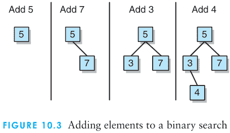

## addElement 操作

`addElement` 方法将给定的元素添加到树中适当的位置，即其值。如果元素没有实现 `Comparable` 接口，该方法将抛出 `ClassCastException`。如果树为空，新元素成为根节点。如果树不为空，将新元素与根节点元素进行比较。如果新元素小于根节点元素且根节点的左子为 `null`，则新元素成为根节点的左子。如果新元素小于根节点元素且根节点的左子不为 `null`，则遍历到根节点的左子并再次比较。如果新元素大于或等于根节点元素且根节点的右子为 `null`，则新元素成为根节点的右子。如果新元素大于或等于根节点元素且根节点的右子不为 `null`，则遍历到根节点的右子并再次比较。图 10.3 展示了向二叉搜索树添加元素的过程。注意我们选择使用迭代方式来实现此方法。然而，该方法本可以非常自然且优雅地通过递归来实现。递归实现的创建被留作为一个编程作业。

### 设计焦点

一旦我们定义了想要构建的树的类型及其使用方法，我们就有能力定义接口和实现类。在第 9 章中，我们定义了一种二叉树，使我们能够定义一组非常基础的操作。现在我们把范围限制到二叉搜索树，可以填充接口和实现的更多细节。确定在何种层级构建接口描述以及确定父类与子类之间的边界是设计选择……并不总是设计选择。

## 10.2 实现二叉搜索树：带链接 287

```java
/**
 * 根据其键值将指定的对象添加到二叉搜索树的
 * 适当位置。请注意
 * 相等元素被添加到右侧。
 * @param element 要添加到二叉搜索树的元素
 */
public void addElement(T element) {
    BinaryTreeNode<T> temp = new BinaryTreeNode<T>(element);
    Comparable<T> comparableElement = (Comparable<T>) element;
    if (isEmpty()) {
        root = temp;
    } else {
        BinaryTreeNode<T> current = root;
        boolean added = false;
        while (!added) {
            if (comparableElement.compareTo(current.element) < 0) {
                if (current.left == null) {
                    current.left = temp;
                    added = true;
                } else {
                    current = current.left;
                }
            } else {
                if (current.right == null) {
                    current.right = temp;
                    added = true;
                } else {
                    current = current.right;
                }
            }
        }
    }
    count++;
}
```

## removeElement 操作

`removeElement` 方法从二叉搜索树中移除给定的 `Comparable` 元素，如果未找到目标，则抛出 `ElementNotFoundException`。与我们之前对线性结构的研究不同，我们不能简单地通过改变节点周围的引用来移除节点。相反，必须提升另一个节点来替换被删除的节点。受保护的方法返回一个将替换被删除节点的节点引用。选择替换节点有三种情况：

核心概念
从二叉搜索树中移除元素时，必须提升另一个节点来替换被移除的节点。

- 如果节点没有子节点，替换返回 `null`。
- 如果节点只有一个子节点，替换返回该子节点。
- 如果要移除的节点有两个子节点，替换返回被移除节点的中序后继节点（因为相等元素被放在右侧）。

```java
/**
 * 从二叉搜索树中移除第一个与指定目标
 * 元素匹配元素并返回其引用。
 * 如果二叉搜索树中未找到指定的目标
 * 元素，则抛出 ElementNotFoundException。
 *
 * @param targetElement 在二叉搜索树
 * 中查找的元素
 * @throws ElementNotFoundException 如果发生元素未找到异常
 */
public T removeElement(T targetElement)
    throws ElementNotFoundException {
    T result = null;
    if (!isEmpty()) {
        if (((Comparable) targetElement).equals(root.element)) {
            result = root.element;
            root = replacement(root);
            count--;
        }
    }
}
```

```java
else {
    BinaryTreeNode<T> current, parent = root;
    boolean found = false;
    if (((Comparable) targetElement).compareTo(root.element) < 0)
        current = root.left;
    else
```


current = root.right;

while (current != null && !found) {

    if (targetElement.equals(current.element)) {

        found = true;

        count--;

        result = current.element;

        if (current == parent.left) {

            parent.left = replacement(current);

        } else {

            parent.right = replacement(current);

        }

    } else {

        parent = current;

        if (((Comparable)targetElement).compareTo(current.element) < 0)

            current = current.left;

        else

            current = current.right;

    }

} // end while

if (!found)

    throw new ElementNotFoundException("binary search tree");

} // end if

return result;

```

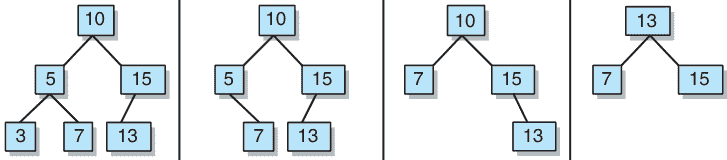

下面的代码展示了 `replacement` 方法。图 10.4 进一步展示了从二叉树中移除元素的过程。

```java

/**

 * 返回一个替换被删除节点的引用。

 * 在被移除节点有两个子节点的情况下，使用

 * 中序后继作为作为替换。

 *

 * @param node 要移除的节点

 * @return 替换节点的引用

 */

protected BinaryTreeNode<T> replacement(BinaryTreeNode<T> node) {

    BinaryTreeNode<T> result = null;

    if (node.left == null && node.right == null)

        result = null;

    else if (node.left != null && node.right == null)

        result = node.left;

    else if (node.left == null && node.right != null)

        result = node.right;

    else {

        BinaryTreeNode<T> current = node.right;

        BinaryTreeNode<T> parent = node;

        while (current.left != null) {

            parent = current;

            current = current.left;

        }

        if (node.right == current)

            current.left = node.left;

        else {

            parent.left = current.right;

            current.right = node.right;

            current.left = node.left;

        }

        result = current;

    }

    return result;

}

```

## 10.2 实现二叉搜索树：带链接 291

### removeAllOccurrences 操作

`removeAllOccurrences` 方法从二叉树中移除给定元素的所有实例，如果树中未找到该元素，则抛出 `ElementNotFound`。如果元素没有实现 `Comparable`，该方法也会抛出 `ClassCastException`。该方法通过调用一次 `removeElement` 方法来使用 `removeElement`，确保如果树中至少至少一次该元素，就会抛出异常。

```java

/**

 * 从二叉搜索树中移除与指定目标元素

 * 匹配的元素。如果树中未找到目标

 * 元素，则抛出 ElementElementException。

 *

 * @param targetElement 在二叉搜索树

 * 中查找的元素

 * @throws ElementElementException 如果发生元素未找到异常

 */

public void removeAllOccurrences(T targetElement)

    throws ElementElementException {

    removeElement(targetElement);

    try {

        while (contains((T) targetElement)) {

            removeElement(targetElement);

        }

    } catch (Exception ElementNotFoundException) {

    }

}

```

### removeMin 操作

二叉搜索树中，最小元素的位置共有三种可能：

- 如果根节点没有左孩子，则根节点就是最小元素，根节点的右孩子成为新根节点。
- 如果树的最左侧节点是叶子节点，那么它就是最小元素，我们只需要将其父节点的子节点引用设置为 null 即可。
- 如果树的最左侧节点是内部节点，我们将其父节点的子节点引用指向被删除节点的右孩子。

图 10.5 展示了这些可能性。基于这些情况，removeMin 操作的代码实现相对直观。

#### 核心概念

二叉搜索树中最左侧的节点包含最小元素，而最右侧的节点包含最大元素。

```java

/**

 * 从二叉搜索树中删除值最小的节点

 * 并返回其元素的引用。如果树为空，

 * 则抛出 EmptyBinarySearchTreeException。

 * @return 指向值最小节点的引用

 * @throws EmptyCollectionException 如果发生空集合异常

 */

```

### 10.2 实现二叉搜索树：使用链接方式

```java

public T removeMin() throws EmptyCollectionException {

    T result = null;

    if (isEmpty())

        throw new EmptyCollectionException("binary search tree");

    else {

        if (root.left == null) {

            result = root.element;

            root = root.right;

        } else {

            BinaryTreeNode<T> parent = root;

            BinaryTreeNode<T> current = root.left;

            while (current.left != null) {

                parent = current;

                current = current.left;

            }

            result = current.element;

            parent.left = current.right;

        }

    }

    count--;

    return result;

}

```

removeMax、findMin 和 findMax 操作留作练习题。

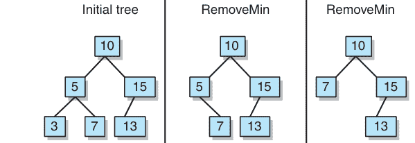

图 10.5 从二叉搜索树中删除最小元素

## 10.3 实现二叉搜索树：使用数组

在第 9 章中，我们引入了 `ArrayTree` 类的简单实现。每个元素都使用一种计算策略存储在树中，以维护树中父节点的关系（例如，左孩子位于位置 `2n + 1`，右孩子位于位置 `2n + 2`）。我们可以简单地扩展该定义，创建一个实现 `BinarySearchADT` 接口的 `ArraySearchTree` 类。由于我们扩展了第 9 章中的 `ArrayBinaryTree`，所有讨论的方法（包括各种遍历）都得到了支持。

我们的该类提供了两个构造函数：一个创建一个空的 `ArraySearchTree`，另一个创建一个根节点为特定元素的 `ArrayBinarySearchTree`。这两个构造函数都引用了父类的等效构造函数（即 `ArrayBinaryTree` 类）。注意，我们还了树的高度以及数组中使用的最大索引。

```java

/**

 * 创建一个空的二叉搜索树。

 */

public ArrayBinarySearchTree() {

    super();

    height = 0;

    maxIndex = -1;

}

/**

 * 创建一个以指定元素为根节点的二叉搜索树。

 * @param element 将成为新树根节点的元素

 */

public ArrayBinarySearchTree(T element) {

    super(element);

    height = 1;

    maxIndex = 0;

}

```

### 10.3 实现二叉搜索树：使用数组

### addElement 操作

`addElement` 方法根据元素的值将元素添加到树中合适的位置。如果该元素没有实现 `Comparable` 接口，该方法将抛出 `ClassCastException`。如果树为空，新元素成为根节点。如果树不为空，将新元素与根节点的元素进行比较。如果它小于根节点存储的元素且根节点的左孩子为空，则新元素将成为根节点的左孩子。如果新元素小于根节点存储的元素且根节点的左孩子不为空，我们遍历到根节点的左孩子并再次比较。如果新元素大于等于根节点存储的元素且根节点的右孩子为空，则新元素将成为根节点的右孩子。如果新元素大于等于根节点存储的元素且根节点的右孩子不为空，我们遍历到根节点的右孩子并再次比较。同样，我们选择通过迭代方式来实现此方法。递归实现的创建留 own了一个编程项目。

```java

/*

 * 根据其键值将指定对象添加到此二叉搜索树

 * 的适当位置。注意

 * 相同的元素会被添加到右侧。同样注意，

 * 当前索引的左孩子的索引可以通过当前索引乘以 2 并加 1 找到。

 * 右子节点的索引可以通过当前索引乘以 2 并加 2 来计算。

 *

 * @param element 要添加到树的元素

 */

public void addElement(T element) {

    if (tree.length < maxIndex + 3)

        expandCapacity();

    Comparable<T> tempElement = (Comparable<T>)element;

    if (isEmpty()) {

        tree[0] = element;

        maxIndex = 0;

        count++;

        height = 1;

    } else {

        boolean added = false;

        int currentIndex = 0;

        while (!added) {

            if (tempElement.compareTo(tree[currentIndex]) < 0) {

                if (tree[2 * currentIndex + 1] == null) {

                    tree[2 * currentIndex + 1] = element;

                    added = true;

                    if (2 * currentIndex + 1 > maxIndex)

                        maxIndex = 2 * currentIndex + 1;

                } else {

                    currentIndex = 2 * currentIndex + 1;

                }

            } else {

                if (tree[2 * currentIndex + 2] == null) {

                    tree[2 * currentIndex + 2] = element;

                    added = true;

                    if (2 * currentIndex + 2 > maxIndex)

                        maxIndex = 2 * currentIndex + 2;

                } else {

                    currentIndex = 2 * currentIndex + 2;

                }

            }

        }

        count++;

        height = (int)(Math.log(maxIndex + 1) / Math.log(2)) + 1;

    }

}

```

### removeElement 操作

`removeElement` 方法从二叉搜索树中删除给定的 `Comparable` 元素，如果在树中未找到目标，则抛出 `ElementNotFound`。正如我们在链接实现中所做的，我们必须在删除后重新读取树以维护其结构。正如我们在链接实现中所做的，我们将使用一个保护方法来替换删除的元素。我们还将使用一个保护方法在元素位于树中时找到其数组索引。

```java

/**

 * 从二叉搜索树中删除第一个与指定目标

 * 匹配的元素并返回其引用。如果指定的

 * 元素不在二叉搜索树中找到，则抛出 ElementNotFoundException。

 *

 * @param targetElement      要从树中删除的元素

 * @return                   删除元素的引用

 * @throws ElementNotFoundException 如果发生元素未找到异常

 */

public T removeElement(T targetElement)

    throws ElementNotFoundException {

    T result = null;

    if (isEmpty())

        throw new ElementNotFoundException("binary search tree");

    Comparable<T> tempElement = (Comparable<T>)targetElement;

    int targetIndex = findIndex(tempElement, 0);

    if (targetIndex == -1)

        throw new ElementNotFoundException("element not found");

    result = tree[targetIndex];

    replace(targetIndex);

    count--;

    int temp = maxIndex;

    maxIndex = -1;

    for (int i = 0; i <= temp; i++) {

        if (tree[i] != null)

            maxIndex = i;

    }

    height = (int)(Math.log(maxIndex + 1) / Math.log(2)) + 1;

    return result;

}

```

```java

/**

 * 如果指定的目标元素在二二叉树中找到，

 * 则返回其索引。如果指定的目标元素在二二叉树

 * 中未找到，则抛出 ElementNotFoundException。

 *

 * @param targetElement   在树中查找的元素

 * @return               如果元素在树中则返回 true

 * @throws ElementNotFoundException 如果发生未找到元素的异常时抛出

 */

```


# 10.3 实现二叉树：使用数组

```java
protected int findIndex(Comparable<T> targetElement, int n) throws ElementNotFoundException {
    int result = 0;

    if (n > tree.length)
        throw new ElementNotFoundException("binary search tree");

    if (tree[n] == null)
        throw new ElementNotFoundException("binary search tree");

    if (targetElement.compareTo(tree[n]) == 0)
        result = n;
    else if (targetElement.compareTo(tree[n]) > 0)
        result = findIndex(targetElement, (2 * (n + 1)));
    else
        result = findIndex(targetElement, (2 * n + 1));

    return result;
}
```

在数组实现中，替换被删除元素的方法比在链表实现中要复杂得多。请记住，在这种实现中，这不仅仅是找到替换元素并移动它的问题，数组从删除点开始的大部分内容都需要重新排序，以维护我们的计算策略。我们选择使用一系列无序列表来支持此项操作。

```java
/**
 * 移除指定的删除节点并相应地移动树数组。
 *
 * @param targetIndex 要删除的节点
 */
protected void replace(int targetIndex) {}
```

```java
int currentIndex, parentIndex, temp, oldIndex, newIndex;
ArrayUnorderedList<Integer> oldlist = new ArrayUnorderedList<Integer>();
ArrayUnorderedList<Integer> newList = new ArrayUnorderedList<Integer>();
ArrayUnorderedList<Integer> templist = new ArrayUnorderedList<Integer>();
Iterator<Integer> oldIt, newIt;
```

```java
// 如果目标节点没有子节点
if ((targetIndex * 2 + 1 >= tree.length) || (targetIndex * 2 + 2 >= tree.length))
    tree[targetIndex] = null;
```

```java
// 如果目标节点没有子节点
else if ((tree[targetIndex * 2 + 1] == null) && (tree[targetIndex * 2 + 2] == null))
    tree[targetIndex] = null;
```

```java
// 如果目标节点只有一个左子节点
else if ((tree[targetIndex * 2 + 1] != null) && (tree[targetIndex * 2 + 2] == null)) {
    // 用将替换 oldlist 中对应索引的节点索引填充 newList
    currentIndex = targetIndex * 2 + 1;
    templist.addToRear(new Integer(currentIndex));
    while (!templist.isEmpty()) {
        currentIndex = ((Integer) templist.removeFirst()).intValue();
        newList.addToRear(new Integer(currentIndex));
        if ((currentIndex * 2 + 2) <= (Math.pow(2, height) - 2)) {
            templist.addToRear(new Integer(currentIndex * 2 + 1));
            templist.addToRear(new Integer(currentIndex * 2 + 2));
        }
    }

    // 填充 oldlist
    currentIndex = targetIndex;
    templist.addToRear(new Integer(currentIndex));
    while (!templist.isEmpty()) {
        currentIndex = ((Integer) templist.removeFirst()).intValue();
        oldlist.addToRear(new Integer(currentIndex));
        if ((currentIndex * 2 + 2) <= (Math.pow(2, height) - 2)) {
            templist.addToRear(new Integer(currentIndex * 2 + 1));
            templist.addToRear(new Integer(currentIndex * 2 + 2));
        }
    }

    // 执行替换
    oldIt = oldlist.iterator();
    newIt = newList.iterator();
    while (newIt.hasNext()) {
        oldIndex = oldIt.next();
        newIndex = newIt.next();
        tree[oldIndex] = tree[newIndex];
        tree[newIndex] = null;
    }
}
```

```java
// 如果目标节点只有一个右子节点
else if ((tree[targetIndex * 2 + 1] == null) && (tree[targetIndex * 2 + 2] != null)) {
    // 用将替换 oldlist 中对应索引的节点索引填充 newList
    currentIndex = targetIndex * 2 + 2;
    templist.addToRear(new Integer(currentIndex));
    while (!templist.isEmpty()) {
        currentIndex = ((Integer) templist.removeFirst()).intValue();
        newList.addToRear(new Integer(currentIndex));
        if ((currentIndex * 2 + 2) <= (Math.pow(2, height) - 2)) {
            templist.addToRear(new Integer(currentIndex * 2 + 1));
            templist.addToRear(new Integer(currentIndex * 2 + 2));
        }
    }

    // 填充 oldlist
    currentIndex = targetIndex;
    templist.addToRear(new Integer(currentIndex));
    while (!templist.isEmpty()) {
        currentIndex = ((Integer) templist.removeFirst()).intValue();
        oldlist.addToRear(new Integer(currentIndex));
        if ((currentIndex * 2 + 2) <= (Math.pow(2, height) - 2)) {
            templist.addToRear(new Integer(currentIndex * 2 + 1));
            templist.addToRear(new Integer(currentIndex * 2 + 2));
        }
    }

    // 执行替换
    oldIt = oldlist.iterator();
    newIt = newList.iterator();
    while (newIt.hasNext()) {
        oldIndex = oldIt.next();
        newIndex = newIt.next();
        tree[oldIndex] = tree[newIndex];
        tree[newIndex] = null;
    }
}
```

```java
// 如果目标节点有两个子节点
else {
    currentIndex = targetIndex * 2 + 2;
    while (tree[currentIndex * 2 + 1] != null) {
        currentIndex = currentIndex * 2 + 1;
    }
    tree[targetIndex] = tree[currentIndex];

    // 要替换的子树根的索引
    int currentRoot = currentIndex;

    // 如果 currentRoot 有右子节点
    if (tree[currentRoot * 2 + 2] != null) {
        // 用将替换 oldlist 中对应索引的节点索引填充 newList
        currentIndex = currentRoot * 2 + 2;
        templist.addToRear(new Integer(currentIndex));
        while (!templist.isEmpty()) {
            currentIndex = ((Integer) templist.removeFirst()).intValue();
            newList.addToRear(new Integer(currentIndex));
            if ((currentIndex * 2 + 2) <= (Math.pow(2, height) - 2)) {
                templist.addToRear(new Integer(currentIndex * 2 + 1));
                templist.addToRear(new Integer(currentIndex * 2 + 2));
            }
        }
    }

    // 填充 oldlist
    currentIndex = currentRoot;
    templist.addToRear(new Integer(currentIndex));
    while (!templist.isEmpty()) {
        currentIndex = ((Integer) templist.removeFirst()).intValue();
        oldlist.addToRear(new Integer(currentIndex));
        if ((currentIndex * 2 + 2) <= (Math.pow(2, height) - 2)) {
            templist.addToRear(new Integer(currentIndex * 2 + 1));
            templist.addToRear(new Integer(currentIndex * 2 + 2));
        }
    }

    // 执行替换
    oldIt = oldlist.iterator();
    newIt = newList.iterator();
    while (newIt.hasNext()) {
        oldIndex = oldIt.next();
        newIndex = newIt.next();
        tree[oldIndex] = tree[newIndex];
        tree[newIndex] = null;
    }
    tree[currentRoot] = null;
}
```

## removeAllOccurrences 操作

`removeAllOccurrences` 方法从二叉树中移除所有匹配目标元素的元素，如果树中未找到该元素，则抛出 `ElementNotFoundException`。如果给定的元素不是 `Comparable`，该方法也会抛出 `ClassCastException`。该方法通过调用一次 `removeElement` 方法来实现，以确保在树中不存在至少一个元素实例时抛出异常。只要树中包含目标元素，就会再次调用 `removeElement`。注意，该方法的代码与链表实现相同。

```java
/**
 * 从二叉树中移除匹配目标元素的
 * 元素。如果指定的目标元素在树中
 * 未找到，则抛出 ElementNotFoundException。
 *
 * @param targetElement 在二叉树中查找的元素
 * @throws ElementNotFoundException 如果发生未找到元素的异常时抛出
 */
public void removeAllOccurrences(T targetElement) throws ElementNotFoundException {
    removeElement(targetElement);

    try {
        while (contains(targetElement))
            removeElement(targetElement);
    } catch (Exception ElementNotFoundException) {
    }
}
```

## removeMin 操作

二叉树中最小元素的位置有三种可能的情况：

- 如果根没有左子节点，那么根就是最小元素，根的右节点成为新根。
- 如果树的最左侧节点是叶子节点，那么它就是最小元素，我们只需将其父节点的左子节点引用置为 `null`。
- 如果树的最左侧节点是一个内部节点，那么我们将设置其父节点的左子节点引用指向被删除节点的右节点。

在 `removeElement` 方法中，`removeMin` 方法使用受保护的 `replace` 方法来替换树中被删除的元素。

```java
/**
 * Removes the node with the least value from this binary search
 * tree and returns a reference to its element. Throws an
 * EmptyBinarySearchTreeException if the binary search tree is
 * empty.
 *
 * @return a reference to the node with the least value in this tree
 * @throws EmptyCollectionException if an empty collection exception
 */
public T removeMin() throws EmptyCollectionException {
    T result = null;

    if (isEmpty())
        throw new EmptyCollectionException("binary search tree");
    else {
        int currentIndex = 1;
        int previousIndex = 0;
        while (tree[currentIndex] != null && currentIndex <= tree.length) {
            previousIndex = currentIndex;
            currentIndex = currentIndex * 2 + 1;
        }
        result = tree[previousIndex];
        replace(previousIndex);
    }

    count--;

    return result;
}
```

`removeMax`、`findMin` 和 `findMax` 操作留作为练习题。

## 10.4 使用二叉搜索树：实现有序列表

正如我们在第 9 章中所讨论的，树的用途之一是为其他集合提供高效的实现。第 6 章中的 `OrderedList` 集合提供了一个很好的示例。图 10.6 提醒我们列表的常用操作，图 10.7 提醒我们有序列表特有的操作。

| 操作 | 描述 |
| - | - |
| `removeFirst` | 从列表中删除第一个元素。 |
| `removeLast` | 从列表中删除最后一个元素。 |
| `remove` | 从列表中删除某个特定元素。 |
| `first` | 检查列表开头的元素。 |
| `last` | 检查列表末尾的元素。 |
| `contains` | 确定列表是否包含特定元素。 |
| `isEmpty` | 确定列表是否为空。 |
| `size` | 确定列表中的元素数量。 |

列表 10.6 列表的常用操作

通过使用二叉搜索，我们可以创建一个名为 `BinarySearchTreeList` 的实现，它比我们在第 6 章中讨论的实现更高效。


为了简单起见，我们在 `BinarySearchTreeList` 类中实现了 `ListADT` 和 `OrderedListADT` 接口，如列表 10.2 所示。对于某些方法，使用 `LinkedBinaryTree` 或 `LinkedBinarySearchTree` 类中的方法即可。这适用于 `contains`、`isEmpty` 和 `size` 操作的情况。对于其余操作，`LinkedBinaryTree` 或 `LinkedBinarySearchTree` 类的方法与有序列表所需的方法之间有一一对应的关系。这些方法中的每一个都通过简单调用 `LinkedBinarySearchTree` 的关联方法来实现。`add`、`removeFirst`、`removeLast`、`remove`、`first`、`last` 和 `iterator` 方法均如此。

> 核心概念
>
> 树的用途之一是与其他集合提供高效的实现。

```
/**
 * BinarySearchTreeList 使用二叉搜索树实现的有序列表。
 *
 * @author Dr. Lewis
 * @author Dr. Chase
 * @version 1.0, 8/19/08
 */

package jss2;
import jss2.exceptions.*;
import java.util.Iterator;
```

### 列表 10.2

```java
public class BinarySearchTreeList<T> extends LinkedBinarySearchTree<T>
    implements ListADT<T>, OrderedListADT<T>, Iterable<T>
{
    /**
     * 创建一个空的 BinarySearchTreeList。
     */
    public BinarySearchTreeList()
    {
        super();
    }

    /**
     * 将给定元素添加到此列表中。
     * @param element 要添加到此列表的元素
     */
    public void add(T element)
    {
        addElement(element);
    }

    /**
     * 从此列表中删除并返回第一个元素。
     * @return 列表中的第一个元素
     */
    public T removeFirst()
    {
        return removeMin();
    }

    /**
     * 从此列表中删除并返回最后一个元素。
     * @return 列表中的最后一个元素
     */
    public T removeLast()
    {
        return removeMax();
    }
}
```

### 列表 10.2 继续

```java
/**
 * 从此列表中删除并返回指定的元素。
 *
 * @param element 在列表中查找的元素
 * @return 列表中匹配目标的元素
 */
public T remove(T element)
{
    return removeElement(element);
}

/**
 * 返回此列表第一个元素的引用。
 * @return 此列表第一个元素的引用
 */
public T first()
{
    return findMin();
}

/**
 * 返回此列表最后一个元素的引用。
 * @return 此列表中最后一个元素的引用
 */
public T last()
{
    return findMax();
}

/**
 * 返回列表的迭代器。
 * @return 遍历此列表内元素的迭代器
 */
public Iterator<T> iterator()
{
    return iteratorInOrder();
}
```

## BinarySearchTreeList 实现的分析

| 操作 | 描述 |
|---|---|
| add | 向列表添加元素。 |

我们假设 `LinkedBinarySearchTree` 的实现是一个平衡搜索树，其属性是任何节点的最大深度为 $\log n$，其中 $n$ 是元素的数量。这是一个极其重要的假设，正如我们在接下来的章节中看到的。请注意，虽然某些操作在树中更高效（例如 `removeLast` 和 `last`），但其他操作则不然。

| 操作 | LinkedList | BinarySearchTreeList |
|---|---|---|
| removeFirst | O(1) | O(log n) |
| removeLast | O(n) | O(log n) |
| remove | O(n) | O(log n) |
| first | O(1) | O(log n) |
| last | O(n) | O(log n) |
| contains | O(n) | O(log n) |
| isEmpty | O(1) | O(1) |
| size | O(1) | O(1) |
| add | O(n) | O(log n)* |

* add 和 remove 操作可能导致树不平衡

## 平衡二叉树

为什么我们的平衡假设很重要？如果树不平衡，我们的分析会发生什么？作为一个例子，假设我们从文件中读取以下整数列表并将它们添加到二叉树中：

3 5 9 12 18 20

图 10.9 显示了生成的二叉树。这种生成的二叉树被称为*退化树*（degenerate tree），看起来更像链表，实际上它比链表效率更低，因为每个节点都有额外的开销。

如果这就是我们正在操作的树，那么我们上一节的分析将大偏差。例如，如果没有平衡假设，`addElement` 操作的最坏时间复杂度为 $O(n)$，因为根节点可能是树中最小的，而我们要插入的元素可能是最大的。

> 核心概念
>
> 如果二叉搜索树不平衡，它的效率可能低于线性结构。

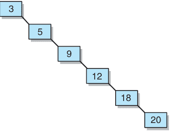

图 10.9 退化二叉树

此处描述的方法同样适用于二叉搜索树的任何子树。对于这些子树，我们只需要将根节点的引用替换为子树根节点的引用即可。

## 右旋转

图 10.10 展示了一个未平衡的二叉搜索树以及重新平衡它所需的处理步骤。该树的最大路径长度为 3，最小路径长度为 1。由于树中只有 6 个元素，最大路径长度应该是 $\log_2 6$ 或 2。为了让这棵树恢复平衡，我们需要：

- 将根节点的左孩子设置为新的根元素。
- 将原根节点元素设置为新根节点的右孩子元素。
- 将原根节点左孩子的右孩子设置为原根节点的新左孩子。

这被称为右旋转，通常称为左孩子绕父节点右旋转。图 10.10 的最后一张显示了右旋转后的相同树。树的任何层都可以进行相同类型的旋转。如果不平衡是由根节点左孩子的左子树路径过长引起的，这种单次右旋转将解决不平衡。

## 左旋转

图 10.11 展示了另一个未平衡的二叉搜索树。同样，该树的最大路径长度为 3，最小路径长度为 1。

| 初始树 | 步骤 A | 步骤 B | 步骤 C |
|---|---|---|---|
| 13 | 7 | 7 | 7 |
| 5 15 | 5 13 | 5 13 | 10 15 |
| 5 10 | 15 | 15 | 3 |
| 3 | 10 | 10 | |

图 10.10 不平衡树与右旋转后的平衡树

## 10.5 平衡二叉搜索树

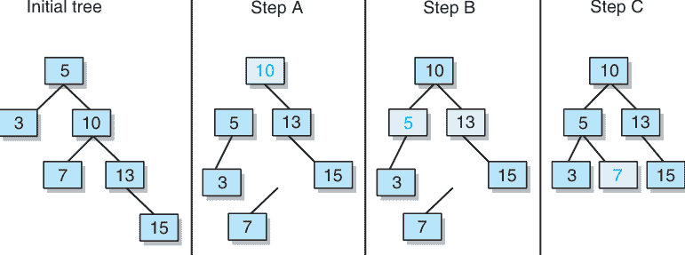

图 10.11 不平衡树与左旋转后的平衡树

然而，这次较长的路径位于根节点右孩子的右子树中。为了让这棵树恢复平衡，我们需要：

- 将根节点的右孩子元素设置为新的根元素。
- 将原根节点元素设置为新根节点的左孩子元素。
- 将原根节点右孩子的左孩子设置为根节点的新右孩子。

这被称为左旋转，通常述为右孩子绕父节点旋转。图 10.11 展示了通过左旋转处理步骤的相同树。树的任何层都可以进行相同类型的旋转。如果不平衡是由根节点右孩子的右子树路径较长引起的，这种单次左旋转将解决不平衡。

## 右左旋转

遗憾的是，并不是所有的平衡都能通过单次旋转解决。如果不平衡是由根节点右孩子的左子树路径长度引起的，我们必须首先将根节点右孩子的左孩子绕右孩子进行右旋转，然后将生成的右孩子绕根节点进行左旋转。图 10.12 说明了这一过程。

## 左右旋转

同样，如果不平衡是由根节点左孩子的右子树路径较长引起的，我们必须首先将根节点左孩子的右孩子绕左孩子进行左旋转，然后将原根节点的左孩子绕根节点进行右旋转。

## 10.6 实现二叉搜索树：AVL 树

我们一直在讨论一种通用的树平衡方法，其中从根节点的最大路径长度不能超过 $\log n$，从根节点的最小路径长度不能小于 $\log n - 1$。Adelson-Vels'kii 和 Landis 开发了 AVL 树。对于树中的每个节点，我们都跟踪左、右子树的高度。对于树中的任何节点，如果平衡因子（或其子树高度之差，即右子树的高度减左子树的高度）大于 1 或小于 -1，则以该节点为根的子树需要重新平衡。

树（或树的任何子树）变得不平衡的只有两种方式：通过插入节点或删除节点。因此，每当执行这些操作之一时，都必须更新平衡因子，并从插入或删除节点开始，向树根节点向上检查树的平衡性。由于需要回溯树向上操作，AVL 树通常通过在每个节点中包含一个父节点引用来实现最佳实现。在随后的图表中，所有的边都表示为单条双向线。

> 核心概念
>
> 右子树的高度减去左子树的高度被称为节点的平衡因子。

> 核心概念
>
> 树（或树的任何子树）变得不平衡的只有两种方式：通过插入节点或删除节点。因此，每当执行这些操作之一时，都必须更新平衡因子，并从插入或删除节点开始，向树根节点向上检查树的平衡性。由于需要回溯树向上操作，AVL 树通常通过在每个节点中包含一个父节点引用来实现最佳实现。在随后的图表中，所有的边都表示为单条双向线。

## 右旋转

在树中，如果平衡因子小于 -1，意味着该节点的左子树路径过长。我们首先检查原根节点的左孩子。如果左孩子的平衡因子小于等于 0（原文逻辑推断），意味着不平衡是由根节点左孩子的左子树路径过长引起的。单次右旋转展示了插入节点如何导致不平衡，以及右旋转如何解决它。图 10.14 展示了

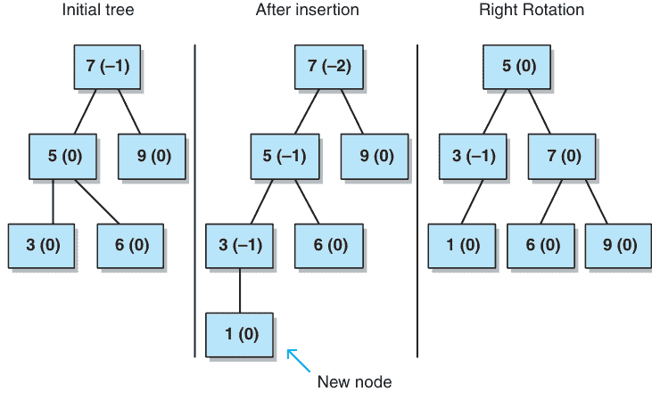

图 10.14 不平衡树，插入节点如何导致不平衡，以及右旋转如何解决它。请注意，我们用括号表示了平衡因子。

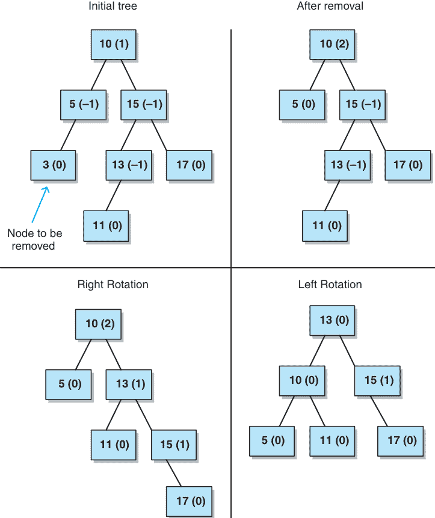

图 10.15 不平衡树与右左旋转

## 左旋转

在树中，如果平衡因子大于 1，意味着该节点的右子树路径过长。我们首先检查原根节点的右孩子。如果右孩子的平衡因子大于等于 0（原文逻辑推断），意味着不平衡是由根节点右孩子的右子树路径过长引起的。单次左旋转将解决不平衡。图 10.15 展示了从树中删除元素如何解决它。再次，注意我们用括号表示了每个节点中存储的值和平衡因子。

## 右左旋转

如果平衡因子大于 1，意味着该节点的右子树路径过长。我们首先检查原根节点的右孩子。如果右孩子的平衡因子小于 0，意味着不平衡是由根节点右孩子的左子树路径引起的。双重旋转将解决不平衡。这是通过首先将根节点右孩子的左孩子绕右孩子进行右旋转，然后将生成的右孩子绕根节点进行左旋转来实现的。

## 左右旋转

如果平衡因子小于 -1，意味着该节点的左子树路径过长。我们首先检查原根节点的左孩子。如果左孩子的平衡因子大于 0，意味着不平衡是由根节点左孩子的右子树路径引起的。双重旋转将解决不平衡。这是通过首先将根节点左孩子的右孩子绕左孩子进行左旋转，然后将原根节点的左孩子绕根节点进行右旋转来实现的。

## 10.7 实现二叉搜索树：红黑树

实现二叉搜索树的另一种方案是红黑树的概念，它由 Bayer 开发并由 Guibas 和 Sedgewick 扩展。红黑树是一种平衡二叉搜索树，其中我们为每个节点存储一个颜色。

# 第 10 章 二叉搜索树

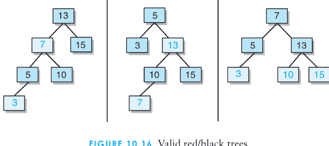

每个节点（红色或黑色，通常实现为一个布尔值，其中 `false` 等于红色）。以下规则规定了节点的颜色：

- 根节点是黑色的。
- 红色节点的所有子节点都是黑色的。
- 从根到叶节点的每条路径包含相同数量的黑色节点。

图 10.16 显示了三个有效的红黑树（颜色较浅的节点为“红色”）。注意，红黑树的平衡限制比 AVL 树或我们之前的讨论要松一些。然而，在两种实现中，查找元素的操作仍然是 $O(\log n)$。由于任何红色节点不能有红色子节点，因此一条路径中最多有一半的节点可以是红色。据此我们可以推断，红黑树的最大高度约为 $2\log n$，因此最长路径的遍历仍然是 $O(\log n)$。

> 核心概念
>
> 红黑树的平衡限制比 AVL 树要松一些。

对于 AVL 树，我们只有在插入或删除元素后才需要担心平衡问题。与 AVL 树不同，红黑树的这两者处理是完全独立的。

## 向红黑树中插入

向红黑树中插入的进展与我们之前的 `addElement` 方法相似。然而，我们总是首先将新元素的颜色设置为红色。一旦插入了新元素，我们将根据需要重新平衡树，并根据需要更改元素的颜色，以维护红黑树的属性。作为最后一步，我们总是将树根的颜色设置为黑色。为了讨论起见，我们将简单地将节点的颜色称为 `node.color`。不过，在实际实现中，创建一个返回节点颜色的方法可能会更优雅。

插入后的重新平衡（和重着色）过程是一个迭代（或递归）过程，从插入点开始向树根方向移动。因此，与 AVL 树一样，红黑树的最佳实现方式是在每个节点中包含父节点引用。此过程的终止条件是 `(current == root)`（其中 `current` 是我们正在处理的节点）或 `(current.parent.color == black)`（即当前节点的父节点颜色为黑色）。

（注：由于原文后续部分存在大量逻辑描述的重复与碎片化，此处已根据语义翻译核心逻辑流...）

# 第 10 章 二叉搜索树


Figure 10.17 插入后的红黑树

# 10.7 实现二叉搜索树：红黑树


Figure 10.18 插入后的红黑树

## 从红黑树中删除元素

与插入一样，`remove` 操作的行为与之前相似，只是增加了重新平衡（和重着色）树的额外步骤。删除元素后的重新平衡（和重着色）过程是一个迭代过程，从删除点开始向树根方向移动。因此，如前所述，红黑树通常最好的实现方式是在每个节点中包含父节点引用。此过程的终止条件是 `(current == root)`（其中 `current` 是我们正在处理的节点）或 `(current.parent.color == red)`。

在插入时，我们最关注当前节点兄弟节点的颜色。对于删除操作，我们将关注 `current` 兄弟节点的颜色。我们可以通过 `parent.left.color` 引用该颜色，但我们将简单地称为 `sibling.color`。我们还会查看兄弟节点的孩子节点的颜色。重要的是，颜色的默认值是黑色。因此，如果我们在任何时候尝试获取空对象的颜色，结果将是黑色。图 10.19 显示了删除元素后的红黑树。


Figure 10.19 删除后的红黑树

## 10.8 实现二叉搜索树：Java Collections API

如果兄弟节点的颜色为红色，那么在进行任何其他操作之前，我们必须完成以下处理步骤：

- 将兄弟节点的颜色设置为黑色。
- 将当前节点的父节点颜色设置为红色。
- 将兄弟节点绕当前父节点进行右旋转。
- 将兄弟节点设置为当前父节点的左孩子。

接下来，无论原始兄弟节点是红色还是黑色，我们的处理都会继续。现在，根据兄弟节点的孩子节点的颜色，我们的处理分为两种情况之一。如果兄弟节点的两个孩子都是黑色（或为空），则我们执行以下操作：

- 将兄弟节点的颜色设置为红色。
- 将当前节点设置为其父节点。

如果兄弟节点的孩子不都是黑色，则我们检查兄弟节点的左孩子是否为黑色。如果是，在继续之前我们必须完成以下步骤：

- 将兄弟节点的右孩子颜色设置为黑色。
- 将兄弟节点的颜色设置为红色。
- 将兄弟节点的右孩子绕兄弟节点进行左旋转。
- 将兄弟节点设置为当前父节点的左孩子。

然后为了完成兄弟节点两个孩子均非黑色时的处理，我们必须：

- 将兄弟节点的颜色设置为当前父节点的颜色。
- 将当前父节点的颜色设置为黑色。
- 将兄弟节点的左孩子颜色设置为黑色。
- 将兄弟节点绕当前父节点进行右旋转。
- 将当前节点设置为根节点。

一旦循环终止，我们必须移除该节点并将其父节点的子引用设置为 null。

## 10.8 实现二叉搜索树：Java Collections API

Java Collections API 提供了平衡搜索树的两种实现：`TreeSet` 和 `TreeMap`。两者都使用了红黑树的实现方法。为了理解这些实现，我们必须首先讨论 Java Collections API 中集合（Set）和映射（Map）之间的区别。

## 第 10 章 二叉搜索树

在 Java Collections API 的术语中，我们到今为止讨论的所有集合都可以被视为集合（只是集合不允许重复项），因为存储在每个集合中的数据或元素包含了与该对象相关的所有数据。例如，如果我们正在创建一个按名称排序的员工列表，那么我们已经创建了一个员工对象，该对象包含了每个员工的所有数据，包括测试名称的方法，并且我们将使用有序列表的操作来向列表中添加更多员工。

> 核心概念


> Java Collections API 提供了两种平衡二叉搜索树的实现：`TreeSet` 和 `TreeMap`，两者都使用了红黑树实现。

## 设计焦点

Java 通过 `TreeSet` 和 `TreeMap` 类提供了二叉搜索树详尽且高效的实现。那么，为什么我们花时间学习如何构建此类集合以及学习平衡树的其他方法（如 AVL 树）？仅仅因为 Java 目前是一门语言，并不意味着它会来也会去。开发者不会被要求使用其他语言，也不会使用不提供树实现的旧语言。其次，讨论中涉及的原理可能比实现本身更重要。理解集合可以被构建以提供顺序、平衡、效率，以及实现这些目标的方法和原理，这些都是重要的课程。

在这种场景下，如果我们想创建一个作为映射的有序列表，我们将创建一个表示每个员工名称的类，以及一个指向第二个类的引用，该类包含所有剩余员工数据。我们将使用有序列表的操作将第一个类加载到列表中，其中第二个类可以存在于内存的任何位置。在这种情况下，当我们操作列表时，第一个类有时被称为键（`key`），而第二个类通常被称为数据（`value`）。这里的优势是，相同的员工数据可以被多个映射引用（即对同一个对象的多个别名），必须小心通过一个引用对对象的更改会影响到其他引用，因为只有一个对象的实例。图 10.20 和 10.21 分别显示了 `TreeSet` 和 `TreeMap` 的操作。注意这些实现使用了（并允许使用）以下操作：

### 图 10.20 TreeSet 操作

| 操作 | 说明 |
| --- | --- |
| `TreeSet()` | 创建一个新的按自然顺序排序的空集合。 |
| `TreeSet(Collection c)` | 创建一个包含指定集合元素按自然顺序排序的集合。 |
| `TreeSet(Comparator c)` | 创建一个新的根据指定的比较器排序的空集合。 |
| `TreeSet(SortedSet s)` | 创建一个与指定 `SortedSet` 相同排序顺序的集合。 |
| `boolean add(Object o)` | 如果元素不存在，则将元素添加到集合中。 |
| `boolean addAll(Collection c)` | 将指定集合中的所有元素添加到集合中。 |
| `void clear()` | 移除集合中的所有元素。 |
| `Object clone()` | 返回 `TreeSet` 的浅拷贝。 |
| `Comparator comparator()` | 返回用于此集合的比较器，如果使用自然顺序则返回 `null`。 |
| `boolean contains(Object o)` | 如果集合包含指定元素的映射，则返回 `true`。 |
| `Object first()` | 返回排序集合中的第一个（最小）元素。 |
| `SortedSet headSet(Object toElement)` | 返回集合中严格小于 `toElement` 的元素的视图。 |
| `boolean isEmpty()` | 如果集合没有元素，则返回 `true`。 |
| `Iterator iterator()` | 返回集合中元素的迭代器。 |
| `Object last()` | 返回排序集合中的最后一个（最大）元素。 |
| `boolean remove(Object o)` | 如果集合存在指定元素，则将其移除。 |
| `SortedSet subset(Object fromElement, Object toElement)` | 返回集合中从 `fromElement`（包含）到 `toElement`（排除）元素的视图。 |
| `SortedSet tailSet(Object fromElement)` | 返回集合中大于或等于 `fromElement` 的元素的视图。 |

### 图 10.21 TreeMap 操作

| 操作 | 说明 |
| --- | --- |
| `TreeMap()` | 创建一个新的按自然顺序排序的空映射。 |
| `TreeMap(Comparator c)` | 创建一个新的根据指定的比较器排序的空映射。 |
| `TreeMap(Map m)` | 创建一个与指定 map 相同映射且按自然顺序排序的映射。 |
| `TreeMap(SortedMap m)` | 创建一个与指定 `SortedMap` 相同映射且相同相同排序的映射。 |
| `void clear()` | 移除 `TreeMap` 中的所有映射。 |
| `Object clone()` | 返回 `TreeMap` 的浅拷贝。 |
| `Comparator comparator()` | 返回用于排序此映射的比较器，如果使用自然顺序则返回 `null`。 |
| `boolean containsKey(Object key)` | 如果映射包含指定的键，则返回 `true`。 |
| `boolean containsValue(Object value)` | 如果映射将一个或多个键映射到指定值，则返回 `true`。 |
| `Set entrySet()` | 返回映射中包含的映射集合。 |
| `Object firstKey()` | 返回排序映射中的第一个（最小）键。 |
| `Object get(Object key)` | 返回映射到指定键的值。 |
| `SortedMap headMap(Object toElement)` | 返回映射中键严格小于 `toElement` 的视图。 |
| `Set keySet()` | 返回映射中包含的键集合。 |
| `Object lastKey()` | 返回排序映射中的最后一个（最大）键。 |
| `Object put(Object key, Object value)` | 将指定值与映射中的指定键关联。 |
| `void putAll(Map map)` | 将指定映射中的所有映射复制到此映射。 |
| `Object remove(Object key)` | 如果 `TreeMap` 中存在该键，则移除该映射。 |
| `int size()` | 返回映射中键值映射的数量。 |
| `SortedMap subMap(Object fromKey, Object toElement)` | 返回映射中键从 `fromKey`（包含）到 `toElement`（排除）的视图。 |
| `SortedMap tailMap(Object fromElement)` | 返回映射中键大于或等于 `fromElement` 的视图。 |
| `Collection values()` | 返回映射中包含的值集合。 |

## 第 10 章 二叉搜索树

## 10.9 哲学困境

使用 `Comparator` 而不是我们在早期实现中使用的 `Comparable`。`Comparator` 接口描述了一个 `compare` 方法，该方法与 `compare` 一样返回 -1、0 或 1，分别表示小于、等于或大于。然而，与 `setTo` 不同，`compare` 接受两个参数，并且不需要在存储于集合的类内部进行实现。我们将在第 15 章进一步讨论集合和映射的通用概念，以及这些集合的 Java Collections API 实现。

## 10.9 哲学困境

在第 3 章开头，我们提到命名规范将遵循 Java Collections API 的规范，即实现集合的类将以数据结构的名称和它所实现的集合命名（例如 `ArrayStack`, `LinkedList`, `ArrayQueue`）。考虑到这种命名规范以及我们学到的 Java Collections API 对树的实现（例如 `TreeSet` 和 `TreeMap`），我们似乎遇到了一个哲学困境。树结构是一个集合吗？在本章的早些时候，我们展示了 `ArraySearchTree` 和 `LinkedBinarySearchTree` 的实现。这表明二叉搜索树是一个集合。然而，我们还展示了 `BinarySearchList` 类，这表明二叉搜索树是一个数据结构。图 10.22 展示了 `BinarySearchTree` 类是如何基于使用引用作为链接的 `LinkedBinarySearchTree` 类构建的。


图 10.22 使用集合实现其他集合

那么这些数据结构中哪一个代表集合呢？从上往下看，毫无疑问，有序列表无论如何实现都是一个集合。同样，尽管二叉搜索树经常用于提供其他集合的高效实现，但由于二叉搜索树是一个收集和组织其他对象，并定义了访问和管理这些对象（称为集合的*元素*）的具体方式，它符合我们早期对集合的定义。然而，说二叉搜索树是一个集合并不意味着我们不能使用它或任何其他集合来提供其他集合的实现。这仅仅意味着我们的命名规范可能会变得繁琐。

二叉树呢？请记住，在没有指定关于二叉树组织的额外细节的情况下，我们无法创建从树中添加或删除元素的方法。我们到目前为止使用二叉树的示例是第 9 章的表达式树和本章的二叉搜索树。虽然表达式树可能更接近特定的应用，但表达式树和二叉搜索树都可以被视为集合。然而，很难认为二叉树本身是一个集合，因为我们无法从中添加或删除任何东西。尽管这确实存在争议，但也许二叉树最好的分类是作为一种*抽象数据结构*。

## 核心概念总结

- 二叉搜索树是一种二叉树，增加了一个属性：左孩子小于父节点，父节点小于或等于右孩子。
- 二叉搜索树的定义是二叉树定义的扩展。
- 每个 `BinaryTreeNode` 对象维护一个指向存储在该节点上的元素的引用，以及指向节点每个子节点的引用。
- 从二叉搜索树中删除元素时，必须提升另一个节点来替换被删除的节点。
- 二叉搜索树中最左的节点包含最小元素，而最右侧的节点包含最大元素。
- 树的用途之一提供其他集合的高效实现。
- 如果二叉搜索树是不平衡的，它的效率可能低于线性结构。
- 右子树的高度减去左子树的高度被称为节点的平衡因子。
- 树（或树的任何子树）变得不平衡只有两种：通过插入节点或删除节点。
- 红黑树的平衡限制在某种程度上小于 AVL 树。然而，在这两种情况下 `find` 操作的复杂度都是 log n。
- Java Collections API 提供了两种平衡二叉搜索树的实现，`TreeSet` 和 `TreeMap`，它们都使用了红黑树实现。

## 自测题

- SR 10.1 二叉树和二叉搜索树之间的区别是什么？
- SR 10.2 为什么我们能够为二叉搜索树指定 `addElement` 和 `removeElement` 操作，但无法对二叉树那样做？
- SR 10.3 假设树是平衡的，`addElement` 操作的时间复杂度（阶数）是多少？
- SR 10.4 在没有平衡假设的情况下，`addElement` 操作的时间复杂度（阶数）是多少？
- SR 10.5 如本所示，退化树的效率实际上比链表还低。为什么？
- SR 10.6 我们的 `removeElement` 操作使用中序继节点作为两个两个节点的节点的替换节点。还有什么其他合理的选择？
- SR 10.7 `removeOccurrences` 操作同时使用了 `contains` 和 `removeElement` 操作。该操作的结果的时间复杂度（阶数）是多少？
- SR 10.8 `RemoveFirst` 和 `first` 在我们之前的有序列表实现中是 O(1) 操作。为什么它们在我们的 `BinarySearchTreeOrderedList` 中效率较低？
- SR 10.9 为什么 `BinarySearchTreeOrderedClass` 必须定义迭代器？为什么它不能直接依赖 `size`？
- SR 10.10 修改 AVL 树后 `addElement` 操作的时间复杂度是多少？
- SR 10.11 哪种不平衡可以通过右旋转修复？
- SR 10.12 哪种不平衡可以通过左旋转修复？
- SR 10.13 AVL 树的平衡因子是多少？
- SR 10.14 在平衡 AVL 树时，我们没有讨论平衡因子为 +2 或 -2 的情况。为什么？
- SR 10.15 我们注意到在红黑树中遍历最长路径仍然是 O(log n)。为什么？
- SR 10.16 `TreeSet` 和 `TreeMap` 的区别是什么？

## 练习题

- EX 10.1 画出插入 (34 45 3 87 65 32 1 17)后的二叉搜索树。假设不使用平衡机制。
- EX 10.2 从练习 10.1 的树开始，画出删除 (45 12 1)后的树。同样不使用平衡机制。
- EX 10.3 重复练习 10.1，假设使用 AVL 树。在图中包含平衡因子。
- EX 10.4 重复练习 10.2，假设使用 AVL 树并以练习 10.3 的结果为起点。在图中包含平衡因子。
- EX 10.5 重复练习 10.1，假设使用红黑树。为节点标记颜色。
- EX 10.6 重复练习 10.2，假设使用红黑树并以练习 10.5 的结果为起点。为节点标记颜色。
- EX 10.7 从一个空红黑树开始，对于以下系列插入和删除，画出插入后重新平衡之前的树，以及重新平衡（如有必要）之后的树：

```
AddElement(40);
AddElement(25);
AddElement(10);
AddElement(5);
AddElement(1);
AddElement(45);
AddElement(50);
RemoveElement(40);
RemoveElement(25);
```

- EX 10.8 重复练习 10.7，这次使用 AVL 树。

## 编程项目

- PP 10.1 `ArraySearchTree` 类目前使用 `ArrayBinaryTree` 类的方法。为 `ArrayBinarySearchTree` 类实现这些方法，利用二叉搜索树的顺序属性来提高效率。
- PP 10.2 `LinkedBinaryTree` 类目前使用 `LinkedBinaryTree` 类的方法。为 `LinkedBinarySearchTree` 类实现这些方法，利用二叉搜索树的顺序属性来提高效率。
- PP 10.3 在我们的链式二叉搜索树实现中实现 `removeMax`、`findMin` 和 `findMax` 操作。
- PP 10.4 在我们的数组二叉搜索树实现中实现 `removeMax`、`findMin` 和 `findMax` 操作。
- PP 10.5 使用第 10.4 节描述的暴力破解法，为链式实现实现一个平衡树方法。
- PP 10.6 使用第 10.4 节描述的暴力破解法，为数组实现实现一个平衡树方法。
- PP 10.7 开发一种基于二叉树数组实现的二叉搜索树数组实现，并使用链式搜索策略。数组中的每个元素都需要维护对所存储的数据元素的引用，以及左孩子和右子节点的位置。你还需要维护一个可用数组位置的列表，用于存储元素被移动后的位置，以便重用这些位置。
- PP 10.8 修改二叉搜索树实现，使其成为 AVL 树。
- PP 10.9 修改二叉搜索树实现，使其成为红黑树。
- PP 10.10 修改二叉搜索树链式实现的 add 操作，使用递归算法。
- PP 10.11 修改二叉搜索树数组实现的 add 操作，使用递归算法。

## 自测题答案

- SRA 10.1 二叉搜索树增加了一个排序属性，即任何节点的左孩子都小于该节点，且该节点小于或等于其右孩子。
- SRA 10.2 有了二叉搜索树的排序属性，我们现在能够定义在添加或删除后树应该的状态。对于二叉树，我们无法定义这种状态。
- SRA 10.3 如果树是平衡的，找到新元素的插入点最坏需要 log n 步，由于插入元素仅涉及设置一个引用的值，因此该操作的时间复杂度为 O(log n)。
- SRA 10.4 在没有平衡假设的情况下，最坏的情况是退化树，它本质上是一个链表。因此，addElement 操作的时间复杂度为 O(n)。
- SRA 10.5 退化树会因为未使用的引用浪费空间，并且许多算法将沿着退化路径检查空引用，从而增加了链表列表实现中不具备的步骤。
- SRA 10.6 最佳选择是中序后继，因为我们将等值元素放在了右侧。
- SRA 10.7 在我们的平衡假设下，contains 操作使用了 find 操作，该操作将在 `BinarySearchTree` 类中重写，以利用排序属性，复杂度为 O(log n)。removeElement 操作为 O(log n)。while 循环将迭代常数 (k) 次，取决于给定元素在树中出现的次数。最坏的情况是树中的所有元素都是要删除的元素，这将导致树退化，在这种情况下复杂度为 n*2n 或 O(n)。然而，预期情况是元素在平衡树中出现某个较小的常数次 (0<=k<n)，这将导致复杂度为 k*2*log n 或 O(log n)。
- SRA 10.8 在我们之前对有序列表的实现中，我们记录了列表中的第一个元素，这使得删除或返回它变得非常简单。在二叉搜索树中，我们必须遍历到最左侧的元素才能知道我们拥有有序列表中的第一个元素。
- SRA 10.9 记住二叉树的迭代器后面都跟着使用哪种遍历方式。这就是为什么 `BinarySearchTreeOrderedList` 类的 `iterator` 方法调用了 `BinaryTree` 类的 `iteratorInOrder` 方法。
- SRA 10.10 记住 addElement 方法只影响树的一部分，在平衡 AVL 树中，其最大长度为 log n。正如我们之前讨论过的，找到插入位置并设置引用是 O(log n)。然后我们必须沿着原路回溯，更新每个节点的平衡因子（如有必要），并在必要时进行旋转。更新平衡因子是一个 O(1) 步骤，旋转也是一个 O(1) 步骤。这些操作都需要执行 log n 次。因此，addElement 的时间复杂度为 2*log n 或 O(log n)。
- SRA 10.11 如果长路径位于根左孩子的子树中，单次右旋转将修复不平衡。
- SRA 10.12 如果长路径位于根左孩子的右子树中，左-右旋转将修复不平衡。
- SRA 10.13 AVL 树的平衡因子是右子树的高度减左子树的高度。
- SRA 10.14


# AVL 树的重新平衡

AVL 树的重新平衡是在插入或删除后进行的，从受影响的节点开始沿着通往根的单路径进行。当我们向上移动时，我们会更新平衡因子并在必要时进行旋转。我们永远不会遇到子节点和父平衡因子均为 +/-2 的情况，因为在到达父节点之前，我们已经修复了子节点。

## SRA 10.15

由于红色节点不能有红色孩子，那么一条路径中最多有一半节点可以是红色节点，且路径中至少一半的节点是黑色节点。从这里我们可以推出红黑树的最大高度为 `log n`。

## SRA 10.16

两种二叉搜索树实现。区别在于在集合中，数据是存储的。

# 参考文献

- Adelson, G., and Landis, M. “An Algorithm for the Organization of Information.” Soviet Mathematics 3 (1962): 125–163.
- Bayer, R. “Symmetric B-trees: Data Structure and Maintenance.” Acta Informatica (1972): 290–306.
- Collins, W. Data Structures and the Java Collections Framework. New York: 2002.
- Cormen, T., Rivest, R. Introduction to Algorithms. New York: 1992.
- Guibas, L., and Sedgewick, R. “A Framework for Balanced Trees.” Proceedings of the 19th IEEE Symposium on Foundations of Computer Science (1978): 8–21.

# 第 11 章 优先级队列与堆

在本章中，我们将研究二叉树的另一种扩展。我们将研究堆，包括链式和数组实现，以及添加和删除元素的算法。我们还将研究堆的一些用途，包括其主要用途优先级队列。

## 目标

- 定义堆数据结构
- 演示如何使用堆解决问题
- 研究各种堆的实现

## 11.1 堆

堆是具有两个附加属性的二叉树：

- 它是一个完全树，如第 9 节所述。
- 对于每个节点，节点小于或等于其左孩子和右孩子。

这个定义描述的是最小堆（`minheap`）。堆也可以是最大堆（`maxheap`），此时节点大于或等于其孩子。我们在本章的讨论集中在最小堆上。通过反转比较，所有的过程都适用于最大堆。

图 11.1 描述了堆的操作。堆是二叉树的扩展，并继承了它所有的操作。由于我们的二叉树实现没有任何向树中添加或删除元素的操作，因此没有任何违反堆属性的操作。列表 11.1 显示了堆的接口定义。

简单来说，最小堆总是将其最小元素存储在二叉树的根部，且最小堆根的两个孩子也是最小堆。图 11.3 展示了具有相同数据的两个有效最小堆。让我们看看堆的基本操作，并由于所有叶子节点都在 h 或 h-1 层，其中 h 是 `log n`。

| 操作 | 描述 |
|---|---|
| `addElement` | 将给定元素添加到堆中。 |
| `removeMin` | 移除堆中的最小元素。 |
| `findMin` | 返回堆中最小元素的引用。 |

```java
/**
 * HeapADT 定义了堆的接口。
 * @author Dr. Lewis
 * @author Dr. Chase
 * @version 1.0, 2008/9/9
 */

package jss2;

public interface HeapADT<T> extends BinaryTree<T>
{
    /**
     * 将指定的对象添加到此堆中。
     * @param obj 要添加到此堆堆的元素
     */
    public void addElement(T obj);

    /**
     * 从此堆中移除值最小的元素。
     * @return 此堆中值最小的元素
     */
    public T removeMin();

    /**
     * 返回此堆中值最小的元素的引用。
     * @return 此堆中值最小的元素的引用
     */
    public T findMin();
}
```

该树，以及所有位于第 $h$ 层的叶节点都在树的左侧。由于堆是一棵完全树，因此插入新节点只有一个正确的位置，要么是第 $h$ 层从左侧的下一个位置，要么如果第 $h$ 层已满，则是第 $h+1$ 层左侧的第一个位置。图 11.4 展示了这两种可能性。

> **核心概念**
>
> `Element` 方法将给定的可比较元素添加到堆的适当位置，同时维护了堆的完全性和顺序属性。

# 第 11 章 优先级队列与堆


图 11.2 HeapADT 的 UML 说明

> **核心概念**
>
> 由于堆是一棵完全树，因此插入新节点只有一个正确的位置，要么是第 $h$ 层从左侧的下一个位置，要么如果第 $h$ 层已满，则是第 $h+1$ 层左侧的第一个位置。

一旦我们已经在适当的位置定位了新节点，就必须考虑顺序属性。为了做到这一点，我们将新值与其父节点的值进行比较，如果新节点小于其父节点，则交换这两个值。我们继续沿树向上执行此过程，直到新值大于其父节点或成为树的根。图 11.5 展示了向堆中插入新元素的过程。通常，在堆的实现中，我们跟踪最后一个节点的位置，或者更准确地说，树中最后一个叶节点的位置。在执行 `addElement` 操作后，最后一个节点被设置为新插入的节点。


图 11.3 包含相同数据的两个最小堆


## removeMin 操作

`removeMin` 方法从最小堆中移除最小元素并返回它。由于最小元素存储在最小堆的根部，我们需要返回存储在根部的元素，并用堆中的另一个元素替换它。通过 `addElement` 操作，为了维持树的完全性，只有一个有效的元素可以替换根节点，即存储在树最后一个叶节点中的元素。这个最后一个叶节点将是第 $h$ 层最右边的叶节点。

> **核心概念**
>
> 通常，在堆的实现中，我们跟踪最后一个节点的位置，或者更准确地说，树中最后一个叶节点的位置。


# 第 11 章 优先级队列与堆


图 11.6 堆中最后一个叶节点的示例

图 11.6 展示了各种情况下最后一个叶节点的概念。

一旦存储在最后一个叶节点中的元素移动到根部，堆就必须重新排序以维护堆的顺序属性。这是通过将新的根元素与其较小的孩子进行比较来实现的，如果孩子更小则交换它们。此过程沿树向下重复，直到元素位于叶节点或小于它的孩子。图 11.7 展示了移除最小元素并重新排序树的过程。

> **核心概念**
>
> 为了维持树的完全性，只有一个有效的元素可以替换根节点，即存储在树最后一个叶节点中的元素。

## findMin 操作

`findMin` 方法返回最小堆中最小元素的引用。由于该元素始终存储在树的根部，该方法通过返回存储在根部的元素来实现。


图 11.7 堆的移除与重新排序

## 11.3 实现堆：使用链接

到目前为止，我们对树的所有实现都是通过链接（links）来说明的。将此讨论扩展到堆的链式实现是很自然的。由于我们需要在插入后能够向上遍历树，因此堆中的节点有必要存储指向其父节点的指针。由于我们的 `BinaryTreeNode` 类没有父节点指针，我们通过创建一个 `HeapNode` 类来实现链式实现，该类继承自 `BinaryTreeNode` 并添加了父节点指针。列表 11.4 显示了 `HeapNode` 类。

链式的额外实例数据将包含一个名为 `lastNode` 的 `HeapNode` 引用，以便跟踪堆中的最后一个叶子节点：

> **核心概念**
>
> 由于我们需要在插入后能够向上遍历树，因此堆中的节点有必要存储指向其父节点的指针。

```java
public HeapNode lastNode;
```

### addElement 操作

`addElement` 方法必须完成三项任务：在适当的位置添加新节点、重新调整堆以维护顺序属性，然后重置 `lastNode` 指针指向新节点。

```java
/**
 * HeapNode 创建一个带有父节点指针的二叉树节点，用于
 * 堆。
 *
 * @author Dr. Lewis
 * @author Dr. Chase
 * @version 1.0, 9/9/2008
 */

package jss2;
public class HeapNode<T> extends BinaryTreeNode<T>
{
  protected HeapNode<T> parent;

  /**
   * 创建一个带有指定数据的堆节点。
   * @param obj 要包含在堆节点中的数据
   */
  HeapNode (T obj)
  {
      super(obj);
      parent = null;
  }
}
```

```java
/**
 * 根据其键值将指定的元素添加到此堆的适当位置。
 * 注意，相同的元素
 * 会被添加到右侧。
 * @param obj 要添加到此堆的元素
 */
public void addElement(T obj)
{
    HeapNode<T> node = new HeapNode<T>(obj);

    if (root == null)
        root = node;
    else {
        HeapNode<T> next_parent = getNextParentAdd(node);
        if (next_parent.left == null)
            next_parent.left = node;
        else
            next_parent.right = node;

        node.parent = next_parent;
    }
    lastNode = node;
    count++;
    if (count > 1)
        heapifyAdd();
}
```

此方法还使用了两个私有方法：`getNextParentAdd`，它返回将作为插入节点父节点的节点引用；以及 `heapifyAdd`，它完成从新叶子节点开始向根节点工作的堆的任何必要的重新调整。这两个方法在下方所示。

```java
/**
 * 返回将作为新节点父节点的节点
 * @return 将作为新节点父节点的节点
 */
private HeapNode<T> getNextParentAdd() {
    HeapNode<T> result = lastNode;

    while ((result != root) && (result.parent.left != result)) {
        result = result.parent;
    }

    if (result != root) {
        if (result.parent.right == null) {
            result = result.parent;
        } else {
            result = (HeapNode<T>)result.parent.right;
            while (result.left != null) {
                result = (HeapNode<T>)result.left;
            }
        }
    } else {
        while (result.left != null) {
            result = (HeapNode<T>)result.left;
        }
    }
    return result;
}
```

```java
/**
 * 在添加节点后重新调整此堆。
 */
private void heapifyAdd() {
    T temp;
    HeapNode<T> next = lastNode;
    temp = next.element;
    while ((next != root) && (((Comparable)temp).compareTo(next.parent.element) < 0))
    {
        next.element = next.parent.element;
        next = next.parent;
    }
    next.element = temp;
}
```

在这种链式实现中，添加元素过程的第一步是确定要插入节点的父节点。在最坏情况下，这涉及从堆的右下节点向上遍历到根节点，然后向下到堆的左下角节点，因此其时间复杂度为 2 x `log n`。下一步是插入新节点。因为这只涉及简单的赋值语句，所以这一步的复杂度是常数 O(1)。最后一步是必要时重新调整从插入的叶子到根节点的路径。这个过程最多涉及 `log n` 次比较，因为那是路径的长度。因此，链式实现的 `addElement` 操作的时间复杂度为 2 x `log n` + 1，或 O(`log n`)。

注意，`heapify` 方法在移动堆时并没有执行父节点和子节点的完全交换。

### removeMin 操作

`removeMin` 方法必须完成三项任务：返回根元素、用最后一个节点替换根节点，并在必要时重新调整堆。与 `addElement` 方法一样，`removeMin` 使用了两个额外方法：`getLastNode` 和 `heapifyRemove`。

```java
/**
 * 返回在删除后将作为新节点的父节点
 * @return 将作为新节点父节点的节点
 */
private HeapNode<T> getLastNode() {
    HeapNode<T> result = lastNode;

    while ((result != root) && (result.parent.left != result)) {
        result = result.parent;
    }

    if (result != root) {
        if (result.parent.right == null) {
            result = result.parent;
        } else {
            result = (HeapNode<T>)result.parent.right;
            while (result.left != null) {
                result = (HeapNode<T>)result.left;
            }
        }
    } else {
        while (result.left != null) {
            result = (HeapNode<T>)result.left;
        }
    }
    return result;
}
```

```java
/**
 * 从堆中移除根元素。
 * @return 从堆中移除的元素
 */
public T removeMin() throws NoSuchElementException {
    if (root == null) {
        throw new NoSuchElementException("堆为空");
    }
    T minElement = root.element;
    if (count == 1) {
        root = null;
        lastNode = null;
    } else {
        root = lastNode;
        lastNode = getLastNode();
        if (lastNode.left == root) {
            lastNode.left = null;
        } else if (lastNode.right == root) {
            lastNode.right = null;
        } else {
            root = lastNode.left;
            while (root.right != null) {
                root = root.right;
            }
        }
        if (root.parent != null) {
            root.parent.left = null; // 这里的逻辑是简化的
            // 实际实现会有所不同
        }
    }
    count--;
    if (count > 0) {
        heapifyRemove();
    }
    return minElement;
}
```


```java
/**
 * 在移除根节点后重新调整此堆。
 */
private void heapifyRemove() {
    T temp;
    HeapNode<T> node = root;
    HeapNode<T> left = node.left;
    HeapNode<T> right = node.right;

    if (left == null && right == null) {
        root = null;
    } else if (left == null) {
        node.element = right.element;
        right.parent = null;
    } else if (right == null) {
        node.element = left.element;
        left.parent = null;
    } else {
        // 标准的下堆逻辑
    }
}
```

（注：上述 `heapifyRemove` 和 `removeMin` 逻辑是基于文中描述逻辑的概念性表示。）

## findMin 操作

`findMin` 方法简单返回堆根节点存储元素的引用，因此是 O(1)。

## 11.4 堆的实现：使用数组

堆的数组实现可能提供一个比链表实现更简单的替代方案。链表实现中的许多复杂性与需要向上和向下遍历树以确定树的最后一个叶子节点，或确定下一个插入节点的父节点有关。这些困难大部分在数组实现中并不存在，因为我们可以通过查看存储在数组最后一个元素来确定树中的最后一个节点。

> **核心概念**
>
> 在二叉树的数组实现中，树的根位于位置 0，对于每个节点 n，$n$ 的左孩子位于位置 2n+1，$n$ 的右孩子位于位置 2n+2。

正如第 9 章讨论的，可以使用以下概念来创建一个二叉树的简单数组实现：树的根位于位置 0，对于每个节点 $n$，$n$ 的左孩子将位于数组的 $2n+1$ 位置，而 $n$ 的右孩子将位于数组的 $2(n+1)$ 位置。当然，反过来也是的。对于根节点以外的任何节点，父节点位于位置 $(n-1)/2$。由于我们能够计算父节点和子节点的位置，与链表实现不同，该实现不需要创建 `HeapNode` 类。堆的数组实现的 UML 描述留作课后练习。

### addElement 操作

数组实现的 `addElement` 方法必须完成三个任务：在适当的位置添加新节点、重新排列堆以维护顺序属性、以及将计数器加 1。当然，对于我们所有的数组实现，该方法必须首先检查可用空间并在必要时扩展数组的容量。与链表实现不同，数组实现的 `addElement` 操作使用一个名为 `heapifyAdd` 的私有方法，在必要时重新排列堆。

```java
/**
 * 根据其键值将指定的元素添加到此堆的适当
 * 位置。请注意，相同的元素
 * 会被添加到右侧。
 *
 * @param obj 要添加到此堆的元素
 */
public void addElement(T obj)
{
  if (count == tree.length)
    expandCapacity();

  tree[count] = obj;
  count++;

  if (count > 1)
    heapifyAdd();
}
```

```java
/**
 * 在添加节点后重新排列此堆以维护顺序属性。
 */
private void heapifyAdd()
{
  T temp;
  int next = count - 1;

  temp = tree[next];

  while ((next != 0) && ((Comparable)temp).compareTo(
    tree[(next-1)/2])) < 0) {
    tree[next] = tree[(next-1)/2];
    next = (next-1)/2;
  }

  tree[next] = temp;
}
```

与链表实现不同，数组实现不需要确定新节点父节点的第一步。然而，另外两个步骤与链表实现相同。因此，`addElement` 操作的复杂度为 $1+\log n$ 或 $O(\log n)$。诚然，两种实现具有相同的 `Order()`，但数组实现更高效。

> **核心概念**
>
> 链表和数组实现的 `addElement` 操作均为 $O(\log n)$。

### removeMin 操作

`removeMin` 方法必须完成三个任务：用存储在最后一个元素替换存储在根节点的元素、在必要时重新排列堆、以及返回原始根元素。在数组实现的情况下，数组知道堆的元素存储在数组的 `count–1` 位置。我们然后使用私有方法 `heapifyRemove` 在必要时重新排列堆。

```java
/**
 * 此堆中值最小的元素
 * 返回其引用。如果堆为空，则抛出 EmptyHeapException。
 *
 * @return 堆中值最小元素的引用
 * @throws EmptyCollectionException 如果发生空集合异常
 */
public T removeMin() throws EmptyCollectionException {
  if (isEmpty()) {
    throw new EmptyCollectionException("Empty Heap");
  }

  T minElement = tree[0];
  tree[0] = tree[count-1];
  heapifyRemove();
  count--;

  return minElement;
}
```

```java
/**
 * 重新排列此堆以维护顺序属性。
 */
private void heapifyRemove() {
  T temp;
  int node = 0;
  int left = 1;
  int right = 2;
  int next;

  if ((tree[left] == null) && (tree[right] == null))
    next = count;
  else if (tree[left] == null)
    next = right;
  else if (tree[right] == null)
    next = left;
  else if (((Comparable)tree[left]).compareTo(tree[right]) < 0)
    next = left;
  else
    next = right;

  temp = tree[node];

  while ((next < count) && ((Comparable)tree[next]).compareTo(temp) < 0)) {
    tree[node] = tree[next];
    node = next;
    left = 2*node+1;
    right = 2*node+2;
    // ... 更新 next 的逻辑 ...
  }
}
```

### findMin 操作

与链表实现一样，`findMin` 方法只需返回根节点或位置 0 的元素。

> **核心概念**
>
> 链表和数组实现的 `findMin` 操作均为 $O(1)$。

## 11.5 使用堆：堆排序

在第 8 章中，我们介绍了多种排序技术，其中一些是顺序的（冒泡排序、选择排序和插入排序），有些是对数级的（合并排序和快速排序）。在该章中，我们还引入了一种名为基数排序的非比较排序。考虑到堆的顺序属性，自然会想到使用堆来排序列表。该过程非常简单：只需将每个元素添加到堆中，然后每次从根节点删除一个。在最小顶堆的情况下，结果将是有序的。因为添加和删除操作是 $O(\log n)$，人们可能会认为堆排序也是 $O(\log n)$。然而，请记住，这些操作对于包含 $n$ 个元素的集合是 $O(\log n)$。在堆算法中，我们执行 $n$ 次操作（add 和 removeMin），每个元素执行一次。因此，时间复杂度为 $2 \log n$ 或 $O(n \log n)$。

也可以使用待排序的数组原地“构建”堆。因为我们知道数组中每个父节点和子节点的相对位置，我们可以从数组中的第一个非叶子节点开始，将其与其孩子比较并在必要时进行交换。然后向回处理数组直到到达根节点。由于我们最多对每个非叶子节点进行两次比较，这种方法构建堆的复杂度是 $O(n)$。然而，使用这种方法从数组中移除每个元素并维护堆的属性将是 $O(n \log n)$。因此，尽管这种方法效率得多，但 $n + \log n$ 仍然是 $O(n \log n)$。该方法的实现留作课后练习。可以将 `heapsort` 方法添加到我们在第 8 章描述的搜索和排序方法类中。列表 11.5 展示了如何将其作为一个独立方法创建。

```java
package jss2;
public class HeapsSort<T>
{
    /**
     * @param data 要添加到堆排序中的数据
     * @param min 整数最小值
     * @param max 整数最大值
     */
    public void HeapsSort(T[] data, int min, int max)
    {
        ArrayHeap<T> temp = new ArrayHeap<T>();

        /** 将数组拷贝到堆中 */
        for (int ct = min; ct <= max; ct++) {
            temp.addElement(data[ct]);
        }

        /** 将排序后的元素放回数组中 */
        int count = min;
        while (!temp.isEmpty()) {
            data[count] = temp.removeMin();
            count++;
        }
    }
}
```

## 核心概念总结

- 最小堆（minheap）是一种完全二叉树，其中每个节点节点的值都小于或等于它的左孩子和右子节点。
- 最小堆将其最小元素存储在二叉树的根节点，且最小堆根节点的两个子节点都是最小堆。
- `add` 方法将给定的可比较元素添加到堆的相应位置，同时维护了堆的完全性属性和顺序属性。
- 由于堆是完全树，因此新节点的插入只有一个正确的位置，要么是第 $h$ 层从左侧开始的下一个空位置，要么是第 $h$ 层满时的第 $h+1$ 层的第一个位置。
- 通常在堆的实现中，我们记录最后一个节点的位置，或者更精确地说，树中最后一个叶子节点的位置。
- 为了维护树的完全性，只有一个有效的元素可以替换根节点，即存储在树中最后一个叶子节点的元素。
- 虽然最小堆完全不是队列，但它提供了优先级队列的高效实现。
- 由于要求在插入后能够遍历树，因此堆中的节点必须存储指向其父节点节点的指针。
- 在二叉树的数组实现中，树的根位于位置 0，对于每个节点 $n$，$n$ 的左孩子位于位置 $2n + 1$，$n$ 的右孩子位于位置 $2(n + 1)$。
- 链表实现和数组实现的 `addElement` 操作时间复杂度均为 $O(\log n)$。
- 链表实现和数组实现的 `removeMin` 操作时间复杂度均为 $O(\log n)$。
- 堆的方法由将列表的每个元素添加到堆中，然后逐一个移除组成。
- 堆排序的时间复杂度为 $O(n \log n)$。

## 自测习题

SR 11.1 堆（最小堆）与二叉搜索树的区别是什么？

SR 11.2 最小堆与最大堆（maxheap）的区别是什么？

SR 11.3 堆是“完全的”意味着什么？

SR 11.4 堆需要进行重新平衡吗？

SR 11.5 链表实现的 `addElement` 操作必须确定要插入的节点的父节点。为什么？

SR 11.6 为什么数组实现的 `addElement` 操作不需要确定要插入节点的父节点？

SR 11.7 两种实现的 `removeMin` 操作都将根节点的元素替换为堆中最后一个叶子节点的元素。为什么这种替换是恰当？

SR 11.8 `addElement` 操作的时间复杂度是多少？

SR 11.9 `removeMin` 操作的时间复杂度是多少？

SR 11.10 堆排序的时间复杂度是多少？

## 练习题

- EX 11.1 画出添加以下整数（34 45 3 87 65 32 1 12 17）后生成的堆。
- EX 11.2 从练习 11.1 得到的树开始，画出执行 `removeMin` 操作后得到的树。
- EX 11.3 从一个空最小堆开始，画出每次执行以下操作后的堆：

```
addElement(40);
addElement(25);
removeMin();
addElement(10);
removeMin();
addElement(5);
addElement(1);
removeMin();
addElement(45);
addElement(50);
```

- EX 11.4 重复练习 11.3，这次使用最大堆（maxheap）。
- EX 11.5 为本章描述的 `PriorityQueue` 类画出 UML 图。
- EX 11.6 为本章描述的堆的数组实现画出 UML 图。

## 编程项目

- PP 11.1 使用堆实现队列。请记住队列是先进先出的结构。因此，堆中的比较必须根据进入队列的顺序进行。
- PP 11.2 使用堆实现栈。请记住栈是后进先出的结构。因此，堆中的比较必须根据进入队列的顺序进行。
- PP 11.3 使用数组实现最大堆。
- PP 11.4 使用链表实现实现最大堆。
- PP 11.5 可以通过编写一个一次性对整个列表排序的方法，而不是逐个添加元素，使堆排序更高效。
- PP 11.6 使用最小堆实现一个优先级系统。在该系统中，作业将输出作业 ID、优先级。

# 自测习题答案

SRA 11.1 二叉搜索树的顺序属性是任何节点的左孩子小于该节点，且该节点小于或等于其右孩子。最小堆是完全的，且顺序属性是节点小于它的两个孩子。

SRA 11.2 最小堆的顺序属性是节点小于它的两个孩子。最大堆的顺序属性是节点大于它的两个孩子。

SRA 11.3 堆被认为是完全的如果它是平衡的，这意味着所有叶子都在第 $h$ 层或 $h-1$ 层（其中 $h = \log n$，$n$ 是元素数量），且所有叶子都在左侧。

SRA 11.4 不需要。根据定义，完全堆是平衡的，且添加和删除算法维护了这一点。

SRA 11.5 添加操作必须确定要插入节点的父节点，以便将该节点的某个子指针设置为新节点。

SRA 11.6 数组实现的添加操作不需要确定新节点的父节点，因为新元素插入在数组的 count 位置，其父节点通过数组位置确定。

SRA 11.7 为了维护树的完全性，根节点的唯一有效替换是最后一个叶子节点的元素。然后需要根据需要重新调整堆以维护顺序属性。

SRA 11.8 两种实现的 `addElement` 操作时间复杂度均为 $O(\log n)$。然而，尽管阶相同，数组实现可能更高效，因为它不需要确定要插入节点的父节点。

SRA 11.9 两种实现的 `removeMin` 操作时间复杂度均为 $O(\log n)$。然而，尽管阶相同，数组实现可能更高效，因为它不需要确定新的最后一个叶子节点。

SRA 11.10 堆排序算法的复杂度为 $O(n \log n)$。

## 12.1 结合树的概念

在第 9 章中，我们确定了普通树（每个节点的子节点数量不同）与二叉树（每个节点最多有两个子节点）之间的区别。在第 10 章中，我们讨论了搜索树的概念，节点中的元素之间存在特定的顺序关系，以便高效地搜索目标值。特别是，我们关注了二叉搜索树。现在，我们可以结合这些概念并对其进行扩展。

在多路搜索树中，每个节点可能有两个以上的子节点，并且由于它是搜索树，元素之间存在特定的顺序关系。此外，多路搜索树中的单个节点可能存储多个元素。

本章将研究多路搜索树的三种特定形式：

- 2-3 树
- 2-4 树
- B 树

## 12.2 2-3 树

2-3 树是一种多路搜索树，每个节点有两个子节点（称为 2 节点）或三个子节点（称为 3 节点）。2 节点包含一个元素，与二叉搜索树一样，左子树包含元素，右子树包含大于或等于它的元素。然而，与二叉搜索树不同，2 节点可以没有子节点，也可以有两个子节点——它不能只有一个子节点。

3 节点包含两个元素，一个被指定为较小元素，另一个被指定为较大元素。3 节点要么没有子节点，要么三个子节点。如果 3 节点有三个子节点，那么左子树包含小于较小元素的元素，右子树包含大于或等于较大元素的元素。中间子树包含大于或等于较小且小于较大元素的元素。

2-3 树的所有叶子节点都在同一层。图 12.1 展示了一个有效的 2-3 树。

### 在 2-3 树中插入元素

与二叉搜索树类似，向 2-3 树的所有插入都发生在树的叶子节点。也就是说，通过搜索树来确定新元素所在的位置；然后进行插入。然而，与二叉树不同，向 2-3 树插入元素的过程可能会对树其余部分的结构产生连锁反应。

向 2-3 树插入元素有三种情况。第一种也是最简单的情况是树是空的。创建一个包含新元素的节点节点并将其指定为树的根。

第二种情况发生在我们想要在一个 2 节点的叶子节点插入新元素时。这时，我们遍历到相应的叶子节点（也可能是根），发现该叶子节点是一个 2 节点（包含一个元素）。在这种情况下，新元素被添加到 2 节点中，使其成为 3 节点。注意，新元素可能小于或大于现有元素。图 12.2 通过向图 12.1 所示的树中插入值 27 展示了这种情况。包含 22 的叶子节点是一个 2 节点，因此 27 被插入到该节点中，使其成为 3 节点。注意，由于这次插入，树中节点的数量或树的高度都没有改变。

第三种插入情况发生当我们想要在一个 3 节点的叶子节点（包含两个元素）插入新元素时。在这种情况下，由于 3 节点无法容更多元素，它会分裂，中间元素向树向上移动一级。移动的中间元素可能是 3 节点中已有的两个元素之一，也可能是正在插入的新元素。这取决于这三个元素之间的关系。


图 12.1 一个 2-3 树


图 12.2 插入 27


图 12.3 插入 32

图 12.3 显示了向图 12.2 的树中插入元素 32 的结果。搜索树，我们到达包含元素 35 和 40 的 3 节点。该节点发生分裂，中间元素 (35) 向上移动并加入其父节点。因此，包含 30 的内部节点变成了一个包含 30 和 35 的 3 节点。注意，分裂 3 节点的操作会导致叶子层产生两个 2 节点。在这个例子中，我们留下了一个包含 32 的 2 节点和另一个包含 40 的 2 节点。

现在考虑当我们分裂一个父节点已经是 3 节点的 3 节点时的情况。被提升的中间元素导致父节点分裂，使元素再向上树移动一级。图 12.4 显示了向树中插入 57 的效果。搜索树，我们到达包含元素 55 和 60 的 3 节点。该节点发生分裂，中间元素 (55) 向上移动并加入其父节点。因此，包含 30 的内部节点变成了一个包含 30 和 55 的 3 节点。注意，分裂 3 节点的操作会导致叶子层产生两个 2 节点。在这个例子中，我们留下了一个包含 57 的 2 节点和另一个包含 60 的 2 节点。


图 12.4 插入 57


图 12.5 插入 25

图 12.5 显示了向图 12.4 的树中插入元素 25 的结果。搜索树，我们到达包含元素 30 和 35 的 3 节点。该节点发生分裂，中间元素 (30) 向上移动并加入父节点。因此，包含 20 的内部节点变成了一个包含 20 和 30 的 3 节点。注意，分裂 3 节点的操作会导致叶子层产生两个 2 节点。在这个例子中，我们留下了一个包含 25 的 2 节点和另一个包含 35 的 2 节点。


图 12.6 插入 25


图 12.7 插入 60

## 从 2-3 树中删除元素

从 2-3 树中删除元素比插入更复杂，但它遵循类似的原理：首先找到要删除的元素，然后执行必要的转换以维护树的属性。如果元素在叶子节点，过程是直接的。如果元素在内部节点，过程会更复杂。

第一种情况是从叶子 2 节点删除元素。这很简单：节点被移除，如果其父节点变成 1 节点，我们需要处理欠缺。第二种情况是从叶子 3 节点删除元素。元素被移除，3 节点变成 2 节点。第三种情况是从内部节点删除元素。在这种情况下，元素被其前驱或后继替换，然后从叶子中删除该元素。

当删除操作产生 1 节点时，我们必须进行重新平衡。这是通过从兄弟节点借用元素来实现的。如果兄弟是 3 节点，我们可以通过父节点借用元素。如果所有兄弟都是 2 节点，我们必须将 1 节点与其一个兄弟节点合并。


图 12.8 删除 60

## 12.2 2-3 树 367


初始树

中间步骤


结果

图 12.8 从 2-3 树中删除（情况 2.2）

如果我们删除元素 60（使用情况 1），生成的树将仅包含 2 节点。现在，如果我们删除另一个元素，例如元素 45，那么旋转就不再是一个选项了。我们必须减少树的高度以维持 2-3 树的属性。这就是情况 2.4。为了实现这一点，我们只需按顺序将每个叶子节点与其父节点及兄弟节点合并。如果这些组合中任何一个包含超过两个元素，我们就将其拆分为两个 2 节点，并提升或传播中间元素。图 12.10 描述了这种减少树高度的过程。

第三种情况是待删除的元素位于内部节点。正如我们在二叉搜索树中所做的那样，我们可以简单地替换待删除元素


初始树

结果

图 12.9 从 2-3 树中删除（情况 2.3）

用中序后继替换它。在 2-3 树中，内部元素的中序后继始终是一个叶子节点，如果它是 2 节点，我们将回到第一种情况；如果它是 3 节点，则不需要进一步操作。图 12.11 通过从图 12.1 的原始树中删除元素 30，然后从生成的树中删除元素 60，说明了这些可能性。


图 12.11 从 2-3 树中删除（情况 3）

## 12.3 2-4 树

元素的插入和删除适用于相同的情况，2 节点和 3 节点在插入时的行为相似，3 节点和 4 节点在删除时的行为相似。图 12.12 展示了向 2-4 树的一系列插入操作。图 12.13 展示了从 2-4 树中的一系列删除操作。

> 2-4 树将 2-3 树的概念扩展开，包含了对 4 节点的使用。

## 12.4 B 树

2-3 树和 2-4 树是一类更大的多路搜索树——B 树的示例。我们将每个节点的最大子节点数称为 B 树的阶。因此，2-3 树是 B 树，2-4 树是阶为 4 的 B 树。

> B 树扩展了 2-3 树和 2-4 树的概念，使得节点具有任意数量的最大元素。


图 12.12 向 2-4 树中插入


初始树

删除 3, 40

删除 17

删除 22

删除 25

删除 14, 99

图 12.13 从 2-4 树中删除

阶为 $m$ 的 B 树具有以下属性：

- 根节点除非是叶子节点，否则至少有两个子树。
- 每个非根节点 $n$ 包含 $k–1$ 个元素和 $k$ 个孩子，其中 $\lceil m/2 \rceil \le k \le m$。
- 每个叶子节点 $n$ 包含 $k–1$ 个元素，其中 $\lceil m/2 \rceil \le k \le m$。
- 所有叶子节点都在同一层。

图 12.14 展示了一个阶为 6 的 B 树。

## 核心概念

访问辅助存储的速度相对于访问主存储要慢得多，这就是使用 B 树等结构的动机。

创建和使用 B 树背后的逻辑是对算法和数据结构设计影响的一项有趣研究。为了理解这种逻辑，我们必须理解到为止讨论过的几乎所有集合的背景。我们假设一直认为处理的是主内存中的集合。但是，如果我们正在操作的数据集太大了，……


图 12.14 一个阶为 6 的 B 树

## 12.4 B 树 395

B 树的一个潜在问题是我们必须考虑的……时间。事实上，我们让它变得更糟了，因为现在我们要访问每个块。访问辅助存储的速度相对于访问主存储要慢得多，这就是使用 B 树等结构的动机。创建和使用 B 树背后的逻辑是对算法和数据结构设计影响的一项有趣研究。为了理解这种逻辑，我们必须理解到为止讨论过的几乎所有集合的背景。我们假设一直认为处理的是主内存中的集合。但是，如果我们正在操作的数据集太大了，……阶为 $m$ 的 B 树具有以下属性：

- 根节点除非是叶子节点，否则至少有两个子树。
- 每个非根节点 $n$ 包含 $k–1$ 个元素和 $k$ 个孩子，其中 $\lceil m/2 \rceil \le k \le m$。
- 每个叶子节点 $n$ 包含 $k–1$ 个元素，其中 $\lceil m/2 \rceil \le k \le m$。
- 所有叶子节点都在同一层。图 12.14 展示了一个阶为 6 的 B 树。

B 树的一个潜在问题是我们必须考虑的……时间。事实上，我们让它变得更糟了，因为现在我们要访问每个块。访问辅助存储的速度相对于访问主存储要慢得多，这就是使用 B 树等结构的动机。创建和使用 B 树背后的逻辑是对算法和数据结构设计影响的一项有趣研究。为了理解这种逻辑，我们必须理解到为止讨论过的几乎所有集合的背景。我们假设一直认为处理的是主内存中的集合。但是，如果我们正在操作的数据集太大了，……阶为 $m$ 的 B 树具有以下属性：

- 根节点除非是叶子节点，否则至少有两个子树。
- 每个非根节点 $n$ 包含 $k–1$ 个元素和 $k$ 个孩子，其中 $\lceil m/2 \rceil \le k \le m$。
- 每个叶子节点 $n$ 包含 $k–1$ 个元素，其中 $\lceil m/2 \rceil \le k \le m$。
- 所有叶子节点都在同一层。图 12.14 展示了一个阶为 6 的 B 树。

## B+ 树 396

B 树的另一个潜在问题是顺序访问。对于任何树，我们都可以中序遍历。然而，这意味着我们没有充分利用……B+ 树提供了一个解决方案。在 B 树中，每个元素只在叶子节点出现一次。在 B+ 树中，每个元素出现在叶子节点，无论它是否也出现在内部节点。出现在内部节点的元素将作为其在内部节点位置的中序后继列出。此外，每个叶子节点将维护一个指向下一个叶子节点的指针。通过这种方式，B+ 树通过 B 树提供索引访问，通过叶子节点链表提供顺序访问。图 12.15 展示了这种策略。

## B 树的分析

对于二叉搜索树，我们可以说在树中搜索一个元素是 $O(\log n)$。这是因为在最坏情况下，我们必须从根节点到叶子节点搜索单一路径。B 树的分析是类似的。在最坏情况下，B 树也需要从根节点到叶子节点搜索单一路径，且该路径的长度为 $\log n$，其中 $m$ 是 B 树的阶，$n$ 是树中的元素数量。然而，找到正确的节点只是搜索的一部分。搜索的另一部分是在每个节点中找到正确的路径，然后在给定节点中找到目标元素。由于每个节点最多包含 $m-1$ 个元素，为了找到正确的路径或目标元素，可能需要进行 $m-1$ 次比较。因此，B 树的搜索分析为 $O((m-1)\log n)$。对于任何具体的实现，$m$ 是一个常数，我们可以说搜索 B 树是 $O(\log n)$。

| 1 | 3 | 4 | | 5 | 7 | 8 | | 12 | 16 | 17 | 21 | | 22 | 28 | 31 | 32 | | 35 | 40 | 43 | | 55 | 60 | 80 |

图 12.15 一个阶为 6 的 B+ 树

## 12.5 B 树的实现策略

关于 B 树插入和删除的分析是类似的，这里将其留作练习题。

## 12.5 B 树的实现策略

我们已经讨论了向 B 树中插入元素、从 B 树中移除元素，以及维护 B 树属性所必需的平衡机制。剩余需要讨论的是存储 B 树的策略。请记住，B 树结构专门是为了解决在主内存与辅助存储之间进进出出的集合问题而开发的。如果我们尝试使用对象变量创建链式实现，我们实际上存储的是对象的主内存地址。一旦该对象被移回辅助存储，该地址就失效了。因此，如果与辅助内存的交互是你使用 B 树的动力之一，那么数组实现可能是更好的解决方案。

> 核心概念
>
> 数组在 B 树内部以及对于 B 树节点的集合，都可能提供更好的解决方案，因为它们在主内存和辅助存储中都是有效的。

一种解决方案是将每个节点看作一对数组。第一个数组是一个包含 $m-1$ 个元素的数组，第二个数组是一个包含 $m$ 个子节点的数组。接下来，如果我们把树本身看作一个巨大的节点数组，那么每个节点数组中存储的元素只需是指向该节点数组的整数索引。

在主内存中，这种策略是有效的，因为使用数组，只要我们知道元素在数组中的索引位置，该数组被加载到主内存的哪个位置对我们来说并不重要。对于辅助内存，这种策略同样有效，因为给定每个节点的长度是固定的，任何给定节点在内存中的地址由公式给出：

文件的基地址 + (节点索引 – 1) × 节点长度。

2-3 树、2-4 树以及更大的 B 树的数组实现被留作编程项目。

## 核心概念总结

- 多路搜索树每个节点可以有两个以上的子节点，并且在每个节点中存储一个以上的元素。
- 2-3 树的节点包含一个或两个元素，并有零、二、或三个子节点。
- 向 2-3 树中插入元素可能会产生向树向上延伸的涟漪效应。
- 如果 2-3 树插入的传播效应导致根节点分裂，树的高度就会增加。
- 2-4 树扩展了 2-3 树的概念，包含了 4 节点。
- B 树扩展了 2-3 树和 2-4 树的概念，使得节点可以拥有任意最大数量的元素。
- 相比访问主存储，访问辅助存储的速度要慢得多，这是使用 B 树等结构的动力。
- 数组在 B 树节点内部以及对于 B 树节点的集合，都可能提供更好的解决方案，因为它们在主内存和辅助存储中都是有效的。

## 自习题

- SR 12.1 描述 2-3 树中的节点。
- SR 12.2 2-3 树中的节点何时会分裂？
- SR 12.3 2-3 树中节点的分如何影响树的其他部分？
- SR 12.4 描述从 2-3 树中删除元素的过程。
- SR 12.5 描述 2-4 树中的节点。
- SR 12.6 2-4 树的插入和删除与 2-3 树的插入和删除相比如何？
- SR 12.7 在删除 2-3 树后，何时旋转不再是重新平衡的备选项？

## 练习题

- EX 12.1 向一个初始空树中添加以下元素，画出生成的 2-3 树：34 45 3 87 65 32 1 12 17
- EX 12.2 使用练习题 12.1 得到的树，在移除以下每个元素后画出结果：3 87 12 17 45
- EX 12.3 使用 2-4 树重复练习题 12.1。
- EX 12.4 使用练习题 12.3 得到的 2-4 树重复练习题 12.2。
- EX 12.5 向一个初始空树中添加以下元素，画出生成的 8 阶 B 树：34 45 3 87 65 32 1 12 17 33 55 23 67 15 39 11 19
- EX 12.6 从练习题 12.5 得到的树中移除以下元素，画出生成的 B 树：1 12 17 33 55 23 19 47
- EX 12.7 描述向 B 树插入的复杂度（阶）。
- EX 12.8 描述从 B 树中删除的复杂度（阶）。

## 编程项目

- PP 12.1 使用 12.5 节讨论的数组策略实现一个 2-3 树。
- PP 12.2 使用链策略实现一个 2-3 树。
- PP 12.3 使用 12.5 节讨论的数组策略实现一个 2-4 树。
- PP 12.4 使用链策略实现一个 2-4 树。
- PP 12.5 使用 12.5 节讨论的数组策略实现一个 B 树。
- PP 12.6 使用链策略实现一个 B 树。

## 13.1 无向图

与树一样，图由节点和这些节点之间的连接组成。在术语中，我们把节点称为顶点（vertices），把它们之间的连接称为边（edges）。顶点通常通过名称或标签来引用。

例如，我们可能会标记顶点 A、B、C 和 D。边通过它们所连接的顶点成对来引用。例如，我们可能拥有一条边 (A, B)，这意味着从 A 到 B 有一条边。

无向图是指表示边的顶点成对是无序的图。因此，列出 (A, B) 意味着 A 和 B 之间存在可以从任意方向遍历的连接。在无向图中，将边列为 (A, B) 与将其列为 (B, A) 的含义完全相同。图 13.1 展示了以下内容：

- 顶点：A, B, C, D
- 边：(A, B), (A, C), (B, C), (B, D), (C, D)

如果图中的两个顶点之间有一边连接，则称它们是相邻的（adjacent）。例如，在图 13.1 中，A 和 B 是相邻的，而顶点 A 和 D 则不是。相邻顶点有时被称为邻居（neighbors）。图中连接顶点到自身的边被称为自回（self-loop）或环（loop），通过列出该顶点来表示。例如，列出边 (A, A) 意味着有一条连接 A 到其自身的环。

如果一个无向图具有连接顶点的最大数量边，则被认为是完全图。对于第一个顶点，需要 (n-1) 条边将其连接到所有其他顶点。对于第二个顶点，需要 (n-2) 条边，因为它已经连接到了第一个顶点。对于第三个顶点，需要 (n-3) 条边。这个序列一直持续，直到最后一个顶点不需要额外的边，因为所有顶点都已连接到它了。


图 13.1 无向图示例

记住第 2 章中从 1 到 n 的求和为：

```
$\sum_{i=1}^{n} i = n(n+1)/2$
```

因此，在这种情况下，由于我们只从 1 求和到 (n-1)，得到的求和结果为：

```
$\sum_{i=1}^{n-1} i = n(n-1)/2$
```

这意味着对于任何具有 n 个顶点的无向图，都需要 (n-1)/2 条边才能使图变得完全。当然，这假设这些边中没有环环。

路径（path）是连接图中两个顶点的边序列。例如，在我们图 13.1 的图中，A, B, D 是从 A 到 D 的一条路径。注意每个每个顺序对 (A, B) 和 (B, D) 都是一条边。无向图中的路径是双向的。例如，A, B, D 是从 A 到 D 的路径，但因为边是无向的，反向 D, B, A 也是从 D 到 A 的路径。路径的长度是路径中边的数量（或顶点数减 1）。对于我们之前的示例，路径长度为 2。注意，这个路径长度的定义与我们在讨论树时使用的定义相同。事实上，树是图的一种特殊情况。

> 核心概念
>
> 路径是连接图中两个顶点的边序列。

如果图中的任意两个顶点之间存在路径，则该无向图被认为是连通的（connected）。我们图 13.1 中的图是连通的。经过微修改的相同图是不连通的，如图 13.2 所示。

> 核心概念


环（cycle）是指第一个和最后一个顶点相同且没有边重复的路径。

顶点：A, B, C, D

边：(A, B), (A, C), (B, C)

环是指第一个和最后一个顶点相同且没有边重复的路径。在图 13.2 中，我们会说路径 A, B, C, A 是一个环。没有环的图是无环图（acyclic）。之前我们提到了


图 13.2 不连通的无向图示例

## 核心概念

无向树是一个连通的、无环的、无向图，其中一个元素被指定为根（root）。

图与树之间的关系。现在我们已经介绍了这些定义，可以形式化这种关系。无向树是一个连通的、无环的、无向图，其中一个元素被指定为根。

## 13.2 有向图

有向图（有时称为有向图 digraph）是一种边是顶点有序对的图。这意味着在有向图中边 (A, B) 和 (B, A) 是独立的、有方向的边。在我们之前的示例中，我们对无向图有如下描述：

- 顶点：A, B, C, D
- 边：(A, B), (A, C), (B, C), (B, D), (C, D)

图 13.3 无向图示例

# 第 13 章 图


在网络中，每个有向连接必须包含一个三元组。例如，图 13.6 中的网络可以表示如下：

- 顶点：波士顿、纽约、费城
- 边：(波士顿, 纽约, 120), (波士顿, 费城, 199), (纽约, 波士顿, 140), (纽约, 费城, 225), (纽约, 诺亚克, 320), (费城, 波士顿, 219), (费城, 纽约, 205), (诺亚克, 纽约, 240)

# 13.4 常见的图算法

许多常见的图算法可以适用于无向图、有向图和/或网络。这些包括与我们在树中探索的类似的各种遍历算法，以及用于寻找最短路径的算法、寻找网络中最小代价路径的算法，以及回答关于图简单问题的算法，例如图是否连通或两个顶点之间的最短路径是什么。

## 遍历

在第 9 章讨论树时，我们定义了四种遍历类型并将它们实现为迭代器：前序遍历、中序遍历、后序遍历和层序遍历。由于我们知道树是一幅图，因此我们确定对于某些类型的图，这些遍历仍然适用。然而，通常我们将图遍历分为两类：广度优先遍历（其行为非常像树的层序遍历）和深度优先遍历（其行为非常像树的前序遍历）。区别之一在于没有根节点。因此，我们的遍历可以从图中的任何顶点开始。

我们使用队列和无序列表来构建图的广度优先遍历。我们将使用队列（`traversal-queue`）来管理遍历，使用无序列表（`result-list`）来构建结果。第一步是将起始顶点放入 `traversal-queue` 并标记起始顶点为已访问。然后我们开始一个循环，直到 `traversal-queue` 为空。在循环内部，我们将从 `traversal-queue` 中取出第一个顶点并将该顶点添加到 `result-list` 的末尾。接下来，我们将与当前顶点相邻且尚未标记为已访问的每个顶点放入 `traversal-queue`，将它们中的每一个标记为已访问，然后重复循环。我们简单地对每个顶点重复此过程，直到 `traversal-queue` 为空，这意味着我们不再能到达任何新顶点。`result-list` 包含了从给定起点开始按广度优先顺序的顶点。构建广度优先迭代器使用了非常类似的逻辑。`iteratorBFS` 显示了确定顶点是否与当前顶点相邻取决于我们选择的表示图中边的实现方式。这种特定方法假设了邻接矩阵。我们将在 13.5 节中进一步讨论。

通过简单地将 `traversal-queue` 替换为 `traversal-stack` 来构建图的深度优先遍历。然而，算法中的一个区别是，在顶点添加到 `result-list` 之前，我们不想将其标记为已访问。`iteratorDFS` 方法说明了这种用于图数组实现的算法。

> 核心概念
>
> 图的深度优先遍历与广度优先遍历之间的唯一区别是使用栈而不是队列来管理遍历。

```java
/**
 * 返回一个从给定索引开始执行广度优先搜索
 * 遍历的迭代器。
 *
 * @param startIndex 从开始搜索的索引
 * @return 一个执行广度优先遍历的迭代器
 */
public Iterator<T> iteratorBFS(int startIndex) {
    Integer x;
    LinkedQueue<Integer> traversalQueue = new LinkedQueue<Integer>();
    ArrayUnorderedList<T> result = new ArrayUnorderedList<T>();

    if (!indexValid(startIndex)) {
        return resultList.iterator();
    }

    boolean[] visited = new boolean[numVertices];
    for (int i = 0; i < numVertices; i++) {
        visited[i] = false;
    }

    traversalQueue.enqueue(new Integer(startIndex));
    visited[startIndex] = true;

    while (!traversalQueue.isEmpty()) {
        x = traversalQueue.dequeue();
        resultList.addToRear(vertices[x.intValue()]);

        /* 找到所有与 x 相邻且未访问过的顶点
         *并将它们入队 */
        for (int i = 0; i < numVertices; i++) {
            if (adjMatrix[x.intValue()][i] && !visited[i]) {
                traversalQueue.enqueue(new Integer(i));
                visited[i] = true;
            }
        }
    }
    return resultList.iterator();
}
```

```java
/**
 * 返回一个从给定索引开始执行深度优先搜索
 * 遍历的迭代器。
 * @param startIndex 从开始搜索遍历的索引
 * @return 一个执行深度优先遍历的迭代器
 */
public Iterator<T> iteratorDFS(int startIndex) {
    Integer x;
    boolean found;
    LinkedList<Integer> traversalStack = new LinkedList<Integer>();
    ArrayUnorderedList<T> resultList = new ArrayUnorderedList<T>();
    boolean[] visited = new boolean[numVertices];

    if (!indexValid(startIndex)) {
        return resultList.iterator();
    }

    for (int i = 0; i < numVertices; i++) {
        visited[i] = false;
    }

    traversalStack.push(new Integer(startIndex));
    visited[startIndex] = true;

    while (!traversalStack.isEmpty()) {
        x = traversalStack.pop();
        resultList.addToRear(vertices[x.intValue()]);

        /* 找到所有与 x 相邻且未访问过的顶点
         *并将它们入栈 */
        for (int i = 0; i < numVertices; i++) {
            if (adjMatrix[x.intValue()][i] && !visited[i]) {
                traversalStack.push(new Integer(i));
                visited[i] = true;
            }
        }
    }
    return resultList.iterator();
}
```

| 起始顶点 | 广度优先 |
| :--- | :--- |
| A | A, B, C, D |
| B | B, A, D, C |
| C | C, B, A, D |
| D | D, B, A, C |

图 13.9 连通无向图的广度优先

| 起始顶点 | 广度优先 |
| :--- | :--- |
| A | A, B, C |
| B | B, A, C |
| C | C, B, A |
| D | D |

图 13.10 非连通无向图的广度优先

## 最小生成树

生成树是包含图中所有顶点并包含部分（但可能不是全部）图边的一棵树。由于树也是图，因此对于某些图来说，该图本身就是一棵生成树，因此该图的唯一生成树将包含所有的边。图 13.11 显示了我们图 13.7 中图的生成树。

> 核心概念
> 生成树是包含图中所有顶点并包含部分（但可能不是全部）图边的一棵树。

生成树的一个有趣应用是为加权图找到最小生成树。最小生成树是一棵树，其中所有边的边权重之和小于或等于该图任何其他生成树的边权重之和。

> 核心概念
> 最小生成树是一棵树，其中所有边的边权重之和小于或等于该图任何其他生成树的边权重之和。

开发最小生成树的算法由 Prim (1957) 设计，非常优雅。正如我们之前讨论过的，每条边都由一个包含起始顶点、终点顶点和权重的三元组表示。然后我们选择一个任意起始顶点（哪一个都行），并将其添加到我们的最小生成树（MST）中。接下来，我们将所有包含我们起始顶点的边放入按权重排序的最小堆中。请记住，我们处理的是有向网络，我们只会添加从给定顶点开始的边。


接下来，我们从最小堆中移除最小边，并将该边和新顶点添加到我们的 MST 中。我们将包含此新顶点且顶点不在我们 MST 中的所有边添加到最小堆。我们继续这个过程，直到我们的 MST 包含了原始图中的所有顶点，或者最小堆为空。图 13.12 显示了一个加权网络及其相关的最小生成树。`qMST` 方法阐述了这一算法。


```java
/**
 * 返回网络的最小生成树。
 * @return 网络的最小生成树
 */
public Network mstNetwork() {
    int x, y;
    int index;
    double[] weight = new double[2]; // error
    int[] edge = new int[2];
    Heap<Double> minHeap = new Heap<Double>();
    Network<T> resultGraph = new Network<T>();

    if (isEmpty()) {
        return resultGraph;
    }

    resultGraph.adjMatrix = new double[numVertices][numVertices];
    for (int i = 0; i < numVertices; i++) {
        for (int j = 0; j < numVertices; j++) {
            resultGraph.adjMatrix[i][j] = Double.POSITIVE_INFINITY;
        }
        resultGraph.vertices = (T)(new Object[numVertices]);
    }

    boolean[] visited = new boolean[numVertices];
    for (int i = 0; i < numVertices; i++) {
        visited[i] = false;
    }

    edge[0] = 0;
    resultGraph.vertices[0] = this.vertices[0];
    resultGraph.numVertices++;
    visited[0] = true;

    /**
     * 将所有与起始顶点相邻的边
     * 添加到堆 *
     */
    for (int i = 0; i < numVertices; i++) {
        minHeap.addElement(new Double(adjMatrix[0][i]));
    }

    while ((resultGraph.size() < this.size()) && !minHeap.isEmpty()) {
        /**
         * 获取权重最小且恰好
         * 有一个顶点 resultGraph 中的边 /
         */
        do {
            weight = (minHeap.removeMin()).doubleValue();
            edge = getEdgeWithOf(weight, visited);
        } while (!isValid(edge[0]) || !isValid(edge[1]));

        x = edge[0];
        y = edge[1];
        if (visited[x])
            index = x;
        else
            index = y;

        /** 将新边和顶点添加到 resultGraph */
        resultGraph.vertices[index] = this.vertices[index];
        visited[index] = true;
        resultGraph.numVertices++;

        resultGraph.adjMatrix[x][y] = this.adjMatrix[x][y];
        /** 将与新顶点相邻的边添加到堆 */
        for (int i = 0; i < numVertices; i++) {
            // ... 代码片段截断
        }
    }
}
```


```java
if (!visited[i] && (adjMatrix[index][i] < Double.POSITIVE_INFINITY)) {
    edge[0] = index;
    edge[1] = i;
    minHeap.addElement(new Double(adjMatrix[index][i]));
}
}
return resultGraph;
```

# 确定最短路径

在图中确定最短路径有两种可能性。第一种也是最简单的，是确定起始顶点到目标顶点之间边数最少的路径。这是我们广度优先遍历的简单变体。为了让该算法寻找路径，我们只需在遍历期间为每个顶点存储两个额外信息：到起始顶点的长度以及该顶点的前驱。然后我们修改循环直到到达目标顶点。最短路径的长度就是前驱长度加 1，如果我们想输出路径上的顶点，只需沿着前驱链回溯。

确定最短路径的另一种可能性是在加权图中寻找最短路径。Dijkstra (1959) 开发了一种针对这种可能性的算法，与我们之前的算法相似。然而，我们不是使用按遇到顺序处理顶点的队列，而是使用基于总权重（到起始顶点的权重之和）的最小堆或优先级队列，以便始终沿着最短路径遍历图。对于每个顶点，我们存储顶点的标签、到我们起始顶点的最短路径权重以及该顶点的前驱。在最小堆上，我们存储每个遇到但尚未遍历的路径的顶点和权重对。当我们从最小堆中移除顶点、权重对时，如果遇到一个权重比已存储权重更小的顶点，则更新代价。

# 13.5 图的实现策略

...图。当然，我们需要能够添加和删除顶点，以及添加和删除图的边。还需要从特定顶点开始的遍历（可能是广度优先和深度优先），这些遍历可以像我们为二叉树那样实现为迭代器。`size`、`isEmpty`、`toString` 和 `find` 等操作也会很有用。除了这些之外，从特定顶点到特定目标顶点的最短路径、两个顶点之间的邻接性、构建最小生成树以及测试连通性的操作也都需要实现。

无论我们使用什么机制来存储顶点，必须允许我们在遍历和其他算法期间标记顶点为已访问。这可以通过为表示顶点的类添加一个布尔变量来实现。

# 邻接列表

由于树也是图，也许介绍图实现的最好方法是考虑我们已经看过的关于树实现的讨论和示例。人们可能会立即想到使用一组节点，其中每个节点包含一个元素和指向其他节点的 `n–1` 条链接。当我们在树上使用这种策略时，从任何给定节点的连接数受到树的阶数的限制（例如，在二叉树中，从任何特定节点出发最多有两个直向边）。由于这种限制，我们可以指定例如一个二叉节点有一个左指针和一个右指针。如果该二叉节点是叶子节点，该指针仍然存在，只是值为空（`null`）。

在`图节点`的情况下，由于每个节点可能有到 `n-1` 条边连接到其他节点，因此使用诸如链表等动态结构来存储每个节点内部的边会更好。这种列表被称为`邻接列表`（`adjacency list`）。在网络或图中，每条边将作为一个包含权重的三元组进行存储。在无向图中，一条边 `(A, B)` 会同时出现在顶点 `A` 和顶点 `B` 的邻接列表中。

## 邻接矩阵

记住，我们必须以某种高效的方式（从空间和访问时间两方面）存储顶点和边。由于顶点仅仅是元素，我们可以使用任何一种集合来存储顶点。事实上，我们经常谈论“顶点集”，`set`（`set`）一词暗示了一种实现策略。然而，另一种存储边的解决方案受我们对树使用数组实现的启发，但我们不使用一维数组，而是使用一个称为`邻接矩阵`（`adjacency matrix`）的二维数组。在邻接矩阵中，二维数组的每个位置代表图中两个顶点之间的交点。这些交点中的每一个由一个布尔值表示，指示顶点是否存在连接。图 13.13 显示了在本章开始时的那个无向图。图 13.14 显示了该图的邻接矩阵。

对于矩阵中的任何位置（行，列），当且仅当边 `(vrow, vcol)` 在图中时，该位置为真。因为在无向图中边是双向的，如果 `(A, B)` 也在图中图中。


图 13.13 一个无向图

## 第 13 章 图

| | A | B | C | D |
|---|---|---|---|---|
| A | F | T | T | F |
| B | T | F | T | T |
| C | T | T | F | F |
| D | F | T | F | F |

图 13.14 一个无向图的邻接矩阵

注意此矩阵是对称的——即对角线的每一侧都是另一侧的镜像。之所以这样是因为我们表示的是无向图。对于无向图，可能没有必要仅通过对角线的一侧或另一侧来表示整个矩阵。

然而，对于有向图，由于所有的边都是方向性的，结果可能会完全不同。图 13.15 显示了一个有向图，图 13.16 显示了该图的邻接矩阵。

邻接矩阵也可以用于网络或加权图，只需通过在矩阵的每个位置存储一个对象来表示边的权重。矩阵中不存在边的位置将设置为 `null`。


图 13.15 一个有向图

| | A | B | C | D |
|---|---|---|---|---|
| A | F | T | T | F |
| B | F | F | F | T |
| C | F | F | F | F |
| D | F | F | F | F |

图 13.16 一个有向图的邻接矩阵

## 13.6 使用邻接矩阵实现无向图

与我们讨论过的其他内容一样，实现图的第一步是确定它的接口。列表 13.1 说明了 `GraphADT` 接口。列表 13.2 说明了扩展了 `GraphADT` 接口的 `NetworkADT` 接口。注意，我们的接口包含了添加和删除顶点、添加和删除边、用于广度优先和深度优先遍历的方法、确定两个顶点之间最短路径以及判断图是否连通的方法，以及我们常用的用于确定集合大小、判断是否为空以及返回字符串表示的方法 `set`。

```java
/**
 * GraphADT 定义了图数据结构的接口。
 * @author Dr. Chase
 * @author Dr. Lewis
 * @version 1.0, 9/17/2008
 */
package jss2;
import java.util.Iterator;
public interface GraphADT<T> {
    /**
     * 向此图添加一个顶点，将对象与顶点关联。
     * @param vertex 要添加到此图的顶点
     */
    public void addVertex(T vertex);
    /**
     * 从此图中删除具有给定值的顶点。
     * @param vertex 要从此图删除的顶点
     */
    public void removeVertex(T vertex);
    /**
     * 在此图两个顶点之间插入一条边。
     */
```

## 第 13 章 图

## 列表 13.1 续

```java
/**
 * 在此图两个顶点之间插入一条边。
 * @param vertex1 第一个顶点
 * @param vertex2 第二个顶点
 */
public void add(T vertex1, T vertex2);
/**
 * 删除此图两个顶点之间的边。
 * @param vertex1 第一个顶点
 * @param vertex2 第二个顶点
 */
public void remove(T vertex1, T vertex2);
/**
 * 返回从顶点开始的广度优先迭代器。
 * @param startVertex 起始顶点
 * @return 从顶点开始的广度优先迭代器
 */
public Iterator BFS(T startVertex);
/**
 * 返回从顶点开始的深度优先迭代器。
 * @param startVertex 起始顶点
 * @return 从顶点开始的深度优先迭代器
 */
public Iterator DFS(T startVertex);
/**
 * 返回两个顶点之间最短路径的迭代器。
 * @param startVertex 起始顶点
 * @param targetVertex 目标顶点
 * @return 两个顶点之间最短路径的迭代器
 */
public Iterator ShortestPath(T startVertex, T targetVertex);
/**
 * 如果此图为空，返回 true；否则返回 false。
 * @return 如果此图为空为 true
 */
public boolean isEmpty();
/**
 * 如果图是连通的，返回 true；否则返回 false。
 * @return 如果图连通为 true
 */
public boolean isConnected();
/**
 * 返回图中顶点的数量。
 * @return 图中的顶点数量
 */
public int size();
/**
 * 返回图的字符串表示。
 * @return 图的字符串表示
 */
public String toString();
```

## 列表 13.2

```java
/**
 * NetworkADT 定义了网络的接口。
 * @author Dr. Lewis
 * @author Dr. Chase
 * @version 1.0, 9/17/2008
 */
package jss2;
import java.util.Iterator;
public interface NetworkADT<T> extends GraphADT<T> {
    /**
     * 在此图两个顶点之间插入一条带权边。
     * @param vertex1 第一个顶点
     * @param vertex2 第二个顶点
     * @param weight 权重
     */
    public void addEdge(T vertex1, T vertex2, double weight);
    /**
     * 返回网络中两个顶点之间最短路径的权重。
     * @param vertex1 第一个顶点
     * @param vertex2 第二个顶点
     * @return 两个顶点之间最短路径的权重
     */
    public double shortestPath(T vertex1, T vertex2);
}
```

# 13.6 Implementing Undirected Graphs with an Adjacency Matrix 399

```java
package jss2;
import jss2.exceptions.*;
import java.util.*;
public class Graph<T> implements GraphADT<T> {
    protected final int DEFAULT_CAPACITY = 10;
    protected int numVertices; // number of vertices in the graph
    protected boolean[][] adjMatrix; // adjacency matrix
    protected T[] vertices; // values of vertices
}
```

Our constructor simply initializes the number of vertices to zero, constructs the adjacency matrix, and sets up an array of generic objects (`T[]`) to represent the vertices.

```java
/**
 * Creates an empty graph.
 */
public Graph() {
    numVertices = 0;
    this.adjMatrix = new boolean[DEFAULT_CAPACITY][DEFAULT_CAPACITY];
    this.vertices = (T[])(new Object[DEFAULT_CAPACITY]);
}
```

## The addEdge Method

Once we have established our list of vertices and our adjacency matrix, adding an edge is simply matter of setting the appropriate locations in the adjacency matrix to true. Our `addEdge` method uses the `getIndex` method to locate the proper indices and calls a different version of the `addEdge` method to make the assignment if the indices are valid.

```java
/**
 * Inserts an edge between two vertices of the graph.
 * @param vertex1 the first vertex
 * @param vertex2 the second vertex
 */
public void addEdge(T vertex1, T vertex2) {
    addEdge(getIndex(vertex1), getIndex(vertex2));
}
```

```java
/**
 * Inserts an edge between two vertices of the graph.
 * @param index1 the first index
 * @param index2 the second index
 */
public void addEdge(int index1, int index2) {
    if (indexIsValid(index1) && indexIsValid(index2)) {
        adjMatrix[index1][index2] = true;
        adjMatrix[index2][index1] = true;
    }
}
```

## The addVertex Method

Adding a vertex to the graph involves adding the vertex in the next available position in the array and setting all of the appropriate locations in the adjacency matrix to false.

```java
/**
 * Adds a vertex to the graph, expanding the capacity of the graph
 * if necessary. It also associates an object with the vertex.
 * @param vertex the vertex to add to the graph
 */
public void addVertex(T vertex) {
    if (numVertices == vertices.length) {
        expandCapacity();
    }
    vertices[numVertices] = vertex;
    for (int i = 0; i < numVertices; i++) {
        adjMatrix[numVertices][i] = false;
        adjMatrix[i][numVertices] = false;
    }
    numVertices++;
}
```

## The expandCapacity Method

The `expandCapacity` method for our adjacency matrix implementation of a graph is more interesting than the similar method in our other array implementations. It is no longer just case of expanding one array and copying the contents. Keep in mind that for our graph, we must not only expand the array of vertices and copy the existing vertices into the new array; we must also expand the capacity of the adjacency list and copy the old contents into the new list.

```java
/**
 * Creates new arrays to store the contents of the graph with
 * twice the capacity.
 */
protected void expandCapacity() {
    T[] largerVertices = (T[])(new Object[vertices.length*2]);
    boolean[][] largerAdjMatrix = new boolean[vertices.length*2][vertices.length*2];
}
```


```java
for (int i = 0; i < numVertices; i++) {
    for (int j = 0; j < numVertices; j++) {
        largerAdjMatrix[i][j] = adjMatrix[i][j];
    }
    largerVertices[i] = vertices[i];
}
vertices = largerVertices;
adjMatrix = largerAdjMatrix;
```

## Other Methods

The remaining methods for our graph implementation are left as programming projects.

## Summary of Key Concepts

- An undirected graph is a graph where the pairings representing the edges are unordered.
- Two vertices in a graph are adjacent if there is an edge connecting them.
- An undirected graph is considered complete if it has the maximum number of edges connecting vertices.
- A path is a sequence of edges that connects two vertices in a graph.
- A cycle is a path in which the first and last vertices are the same and none of the edges are repeated.
- An undirected tree is a connected, acyclic, undirected graph with one element designated as the root.
- A directed graph, sometimes referred as as digraph, is a graph where the edges are ordered pairs of vertices.
- A path in a directed graph is a sequence of directed edges that connects two vertices in a graph.
- A network, or a weighted graph, is a graph with weights or costs associated with each edge.
- The only difference between a depth-first traversal of a graph and a breadth-first traversal is the use of a stack instead of a queue to manage the traversal.
- A graph is connected if and only if the number of vertices in the breadth-first traversal is the same as the number of vertices in the graph regardless of the starting vertex.
- A spanning tree is a tree that includes all the vertices.

参考文献 405

SRA 13.7 网络是一个图，可以是有向或无向的，每个边都关联有权重或成本。

SRA 13.8 生成树是一棵包含图中所有顶点以及部分（但可能不是全部）边的树。最小生成树是一棵生成树，其边权重的之和小于或等于该图任何其他生成树的边权重之和。

# 参考文献

Collins, W. J. Data Structures: An Object-Oriented Approach. Reading, Mass.: Addison-Wesley, 1992.

Dijkstra, E. W. “A Note on Two Problems in Connection with Graphs.” Numerische Mathematik 1 (1959): 269–271.

Drosdek, A. Data Structures and Algorithms in Java. Pacific Grove, Cal.: Brooks/Cole, 2001.

Prim, R. C. “Shortest Connection Networks and Some Generalizations.” Bell System Technical Journal 36 (1957): 1389–1401.

# 哈希 (Hashing)

在第 10 章中，我们讨论了二叉搜索树实际上是集合或映射（`map`）的一种高效实现。在本章中，我们将研究哈希，这是一种实现集合或映射集合的方法，其效率可能比二叉搜索树更高效。

## 章节目标

- 定义哈希
- 检查各种哈希函数
- 检查哈希表中的冲突问题
- 探索 Java Collections API 的哈希实现

# 14.1 哈希

在对集合实现的所有讨论中，我们都是根据集合中元素的顺序基于以下两个假设之一进行的：

- 顺序由元素在我们的集合中添加和/或移除的顺序决定，例如栈、队列、无序列表和索引列表的情况。
- 顺序通过比较要存储在集合中的元素值（或元素的某些键组件）来决定，例如有序列表和二叉搜索树的情况。

在本章中，我们将探索*哈希*（hashing）的概念，这意味着元素的顺序——以及元素在集合中的位置——是由待存储元素值的某些函数决定的，或者通过将元素存储在*哈希表*（hash table）中，其在表中的位置由*哈希函数*（hashing function）决定。表中的每个位置可以称为*单元*（cell）或*桶*（bucket）。我们将讨论实现策略和算法，并将实现留作编程项目。

> 核心概念
在哈希中，元素存储在哈希表中，它们在表中的位置由哈希函数决定。

考虑一个简单的例子，我们创建一个包含 26 个元素的数组。为了在数组中存储名称，我们创建了一个哈希函数，将每个名称映射到与该名称首字母相关的数组位置（例如，首字母为 A 的映射到数组的位置 0，首字母为 D 的映射到数组的位置 3，依此类推）。图 14.1 展示了在添加几个名称后的这种场景。

请注意，与我们早期的集合实现不同，使用哈希方法使特定元素的访问时间与表中元素的数量无关。这意味着对哈希表元素的所有操作都将是 `O(1)`。这是因为不再需要寻找特定元素或为给定的元素找到合适的位置。使用哈希，我们只需要计算特定元素应该在的位置即可。

> 核心概念
两个元素或键映射到表中相同位置的情况被称为冲突（collision）。

然而，只有当每个元素都映射到表中唯一的位置时，这种效率才能被完全实现。考虑图 14.1 中的这个例子。如果我们尝试存储名称“Ann”和名称“Andrew”会发生什么？这种两个元素或键映射到表中相同位置的情况被称为*冲突*（collision）。我们将在第 14.3 节讨论如何解决冲突。

> 核心概念
将每个元素映射到表中唯一位置的哈希函数是完美哈希函数（perfect hashing function）。

| Ann |
| :--- |
| Doug Elizabeth |
| Hal |
| Mary |
| Tim |
| Walter |
| Young |

图 14.1 一个简单的哈希示例

将每个元素映射到表中唯一位置的哈希函数被称为完美哈希函数。虽然在某些情况下可以开发完美哈希函数，但一个良好地将元素分布在表位置之间的哈希函数仍然可以实现表中的元素的常数时间 `O(1)` 访问，并且比我们早期的算法有所改进，那些算法在线性方法情况下是 `O(n)`，或者在搜索树情况下是 `O(log n)`。

关于哈希的另一个问题是表应该有多大。如果数据集的大小是已知的并且可以使用完美哈希函数，那么我们只需要让表的大小与数据集的大小相同。如果无法或无法使用完美哈希函数，但数据集的大小是已知的，一个很好的经验法是将表的大小设为数据集大小的 150%。

第三种情况非常常见且有趣得多。如果我们不知道数据集的大小会怎样？在这种情况下，我们使用动态调整大小。哈希表的动态调整大小包括创建一个比原表更大的新表，并对所有元素进行重新哈希。这是在负载因子（load factor）达到某个阈值时完成的。当负载因子达到 0.75 时，负载因子是表中的元素数量与表大小的比例。

# 14.2 哈希函数

> 核心概念
将每个元素映射到表中唯一位置的哈希函数是完美哈希函数。

虽然在某些情况下可以开发完美哈希函数，但一个良好地将元素分布在表位置之间的哈希函数仍然可以实现表中的元素的常数时间 `O(1)` 访问，并且比我们早期的算法有所改进，那些算法在线性方法情况下是 `O(n)`，或者在搜索树情况下是 `O(log n)`。

关于哈希的另一个问题是表应该有多大。如果数据集的大小是已知的并且可以使用完美哈希函数，那么我们只需要让表的大小与数据集的大小相同。如果无法或无法使用完美哈希函数，但数据集的大小是已知的，一个很好的经验法是将表的大小设为数据集大小的 150%。

第三种情况非常常见且有趣得多。如果我们不知道数据集的大小会怎样？在这种情况下，我们使用动态调整大小。哈希表的动态调整大小包括创建一个比原表更大的新表，并对所有元素进行重新哈希。这是在负载因子达到某个阈值时完成的。当负载因子达到 0.75 时，负载因子是表中的元素数量与表大小的比例。

> 核心概念
两个元素或键映射到表中相同位置的情况被称为冲突（collision）。

## 除法法

创建哈希函数的最简单方法是使用键除表的大小的余数。这通常写为：

```
h(k) = k mod m
```

其中 `k` 是键，`m` 是表的大小。如果 `m` 是 2 的幂，`除法法`简单地提取键的最后 `r` 位。

另一种方法是使用乘法法。这种方法的工作如下：

```
h(k) = floor(m * (k * A))
```

其中 `A` 是 0 到 1 之间的常数。`A` 的常用选择是 `(√5-1)/2 ≈ 0.618`。这种方法对 `m` 的选择不敏感。

## 折叠法

在*折叠法*中，键被分为若干长度相等的部分，并将这些部分相加。例如，如果键是一个6位数字且表的大小为1000，我们可以将键分成两个3位部分并将它们相加：

```
h(k) = (d1 + d2) mod 1000
```

其中 `d1` 和 `d2` 是键的前三位后三位。如果键是123456，哈希值为 `(123+456) mod 1000 = 579`。

在*移位折叠法*中，键被分为长度相等的部分，并将这些部分平移并相加。例如，如果键是一个32位整数且表的大小为`2^10`，我们可以将键分成三个10位部分：

```
h(k) = (k >> 20) + ((k >> 10) & 0x3FF) + (k & 0x3FF)
```

这种方法通常比除法法更快，因为它在最后不需要取模运算。

## 中位法

在*中位法*中，键与其相乘，然后使用结果中间的某些数字来形成索引。例如，如果键是一个32位整数，其平方将多达64位。然后我们就可以提取中间的10位作为大小为`2^10` 表的索引。

对于键，我们可能会提取 671 或 710，取决于我们如何构建算法。也可以提取位而不是数字，然后从提取的位中构造索引。

中间位法也可以通过操作字符串中字符的二进制表示来有效地用于字符串。

## 进制转换法

在进制转换法（Radix Transformation）中，键被转换为另一种数值基数。例如，如果我们的键是 10 进制的 23，我们可以将其转换为 7 进制的 32。然后我们使用除法法，将键除以表的大小，并使用余数作为我们的索引。继续之前的例子，如果我们的表大小为 17，我们计算该函数：

```
Hashcode(23) = Math.abs(32)%17
= 15
```


## 数字分析法

在数字分析法中，索引是通过从键中提取并处理特定数字来形成的。对于我们的键 `1234567`，我们可能会选择 2 到 4 之间的数字，得到 `234`，然后对它们进行处理以形成我们的索引。这种处理可以有许多形式，简单地反转数字（得到 `432`）、执行右循环移（得到 `423`）、执行左循环移（得到 `342`）、交换数字对（得到 `324`）或任何其他可能，包括我们已经讨论过的方法。目标是提供一个能够合理将键分布到表中位置的函数。

## 长度依赖法

在长度依赖法中，键和键的长度以某种方式结合，形成索引本身，或者形成一个中间值，然后使用我们的其他方法之一结合该中间值形成索引。例如，如果我们的键是 `8765`，我们将前两个数字乘以长度，然后除以最后一个数字，得到 `69`。如果我们的表大小为 `43`，我们就会使用除法法，得到一个 `26` 的索引。

> **核心概念**
> 长度依赖法和中间位法也可以通过操作字符串中字符的二进制表示来有效地用于字符串。

长度依赖法也可以通过操作字符串中字符的二进制表示来有效地用于字符串。

## Java 语言中的哈希函数

`java.lang.Object` 类定义了一个名为 `hashCode()` 的方法，它根据对象的内存位置返回一个整数。这通常没有用。继承自 `Object` 的类通常会重写继承的 `hashCode()` 以提供它们自己的版本。例如，`String` 和 `Integer` 类定义了自己的 `hashCode()` 方法。这些特定的哈希函数对于哈希处理是有效的。通过在 `Object` 类中定义 `hashCode()` 方法，所有对象都可以被哈希处理。然而，对于任何你想存储在哈希表中的类，定义你自己的 `hashMethod()` 是可能的，而且通常是更好的。

> **核心概念**
> 尽管 Java 为所有对象提供了 `hashCode()` 方法，但为任何特定类定义一个特定的哈希函数通常是更好的。

## 14.3 解决冲突

如果我们能够为特定数据集开发出一个完美的哈希函数，那么我们就不需要担心冲突，即多个元素或键映射到表中相同位置的情况。然而，当无法或无法实际实现完美哈希函数时，有很多方法可以处理冲突。同样，如果我们能够为特定数据集开发出一个完美的哈希函数，那么我们就不需要担心表的大小。在这种情况下，我们将简单地将表的大小设置为与数据集完全相同。否则，如果数据集的大小已知，通常将表的初始大小设置为预期元素数量的 150% 是一个好主意。如果数据集的大小未知，表的动态调整可能会成为问题。

## 链法

处理冲突的链法在概念上简单地将哈希表视为一个单元单元格表。每个单元格都是指向与表中该位置相关的集合的指针。通常这个内部集合是无序列表或有序列表。图 14.2 展示了这种概念性方法。

链法可以通过多种方式实现。一种方法是让存储表的数组大于表中单元格的数量，并使用额外空间作为溢出区域，存储与每个表位置相关的链表。在这种方法中，数组中的每个位置都可以存储一个元素（或键）以及下一个元素的索引。

> **核心概念**
> 处理冲突的链法在概念上简单地将哈希表视为由集合组成的表，而不是由单个单元格组成的表。


列表中的元素。映射到表中特定位置的元素实际上将存储在该位置。映射到该位置的下一个元素将存储在溢出区域的空闲位置，此第二个元素的数组索引将与表中的第一个元素一起存储。如果第三个元素映射到相同的位置，第三个元素也将存储在溢出区域，并存储第二个元素的索引。图 14.3 展示了这种策略。

注意，使用这种方法，表本身永远不会满。然而，如果表是用数组实现的，数组可能会变满，这需要决定是抛出异常还是简单地扩展容量。在我们之前的章节中，我们讨论了如何处理这种情况。


## 开放寻址法

处理冲突的开放寻址法在表中查找除元素原始位置之外的另一个开放位置。有多种方法可以找到另一个位置。我们将检查这些方法中的三种：线性探测法、二次探测法和双重哈希。

> **核心概念**
> 处理冲突的开放寻址法在表中查找除元素原始位置之外的另一个开放位置。

这些方法中最简单的是线性探测法。在线性探测法中，如果一个元素哈希到位置 `p` 且位置 `p` 已经被占用，我们简单尝试 `(p+1)%s`，其中 `s` 是表的大小。如果位置 `(p+1)%s` 已经被占用，我们尝试 `(p+2)%s`，直到找到一个开放位置或回到原始位置。如果我们找到一个开放位置，我们就插入元素。如果没有找到开放位置是在创建哈希表时的设计决策。正如我们之前讨论过的，一种可能性是在表满时抛出异常。另一种可能性是扩展表的容量并重新哈希现有条目。

线性探测的问题在于它倾向于在表中形成填充聚集，这些聚集影响插入和搜索的性能。图 14.4 展示了线性探测法以及使用我们早期哈希函数的聚集形成。

在字符串的示例中，输入了 `Ann`，接着是 `Andrew`。因为 `Ann` 已经占据了数组的 `0`，`Andrew` 被放在位置 `1`。后来，`Bob` 被放在下一个开放位置，即位置 `2`。因为 `Andrew` 已经占据了位置 `1`。`Doug` 和 `Elizabeth` 在 `Betty` 到达已经在表中，因此无法放在位置 `1`、`2`、`3` 或 `4`，被放在了下一个开放位置，位置 `5`。在添加了 `Barbara`、`Hal` 和 `Bill` 之后，我们发现表开头出现了一个位置聚集，随着名字的增加，该聚集将继续增长。我们看到这不是最好的方法。

寻址方法的第二形式是二次探测法。不是使用线性方法，一旦我们有了如下公式：

```
hashcode(x) = hashcode(x) + (-1)^(i-1) * (i + 1)/2
```

对于范围 `1` 到 `s-1` 的 `i`，其中 `s` 是表的大小。

这个公式的结果是序列 `p, p+1, p-1, p+4, p-4, p+9, p-9, ...`。当然这个新的哈希码在范围内进行除法。与线性探测相同相同的可能性是我们将最终回到原始哈希码，而没有找到插入的开放位置。这种“满”状态可以

## 14.3 解决冲突 417


图 14.4 使用线性探测的开放寻址

其处理方式与我们之前为链法和哈希函数描述的相同，不同在于它没有像线性探测那样具有强烈的聚集倾向。图 14.5 展示了与图 14.4 中相同的键集和哈希函数对应的二次探测。注意，相同的数据已被输入，我们在表格的开头仍然有一个簇。然而，这个簇只占据了六个桶单元，而不是由线性探测创建的九个桶簇。

开放寻址方法的第三形式是双重哈希。使用双重哈希方法，我们将通过使用次级哈希函数来解决冲突，该函数在主哈希函数发生冲突时使用。例如，如果一个键 `x` 哈希到的已经被占据的位置 `p`，那么我们使用的下一个位置 `p'` 将是：

```
p' = p + secondaryhashcode(x)
```


如果这个新位置也被占据，我们就查看位置：

```
p' = p + 2 * secondaryhashcode(x)
```


当然，我们将继续用这种方法搜索，直到找到一个空位置。我们在表格边界内维护索引，直到找到空位置。这种方法虽然由于引入了额外的函数而成本略高，但它倾向于在二次探测所获得的改进之外，进一步减少聚集。图 14.6 展示了这种方法，再次使用了与我们之前示例中相同的键集和哈希函数。对于这个例子，次级哈希函数是字符串的长度。注意，对于相同的数据，我们在表格的开头不再有一个簇。然而，我们从 Doug 到 Barbara 形成了一个六个桶的簇。然而，双重哈希的优势在于，即使在形成簇之后，它的增长速度也会比我们使用线性探测甚至是二次探测要慢。

## 14.4 从哈希表中删除元素


图 14.6 使用双重哈希的开放寻址

因此，我们的讨论集中在哈希表中插入和查找元素的效率上。如果我们从哈希表中删除一个元素会发生什么？这个问题的答案取决于我们选择了哪种实现。

### 从链法实现中删除

如果我们选择使用链法实现和带有溢出区域的数组来实现哈希表，那么删除元素属于五种情况之一：

- 情况 1：我们尝试删除的元素是映射到表格特定位置的唯一元素。在这种情况下，我们只需通过将位置设置为 `null` 来删除元素。
- 情况 2：我们尝试删除的元素存储在表中（不在溢出区域中），但它有一个指向溢出区域中相同位置下一个元素的索引。在这种情况下，我们将表中的元素和下一个索引值替换为被删除元素指向的数组中的元素和下一个索引值。然后，我们还将溢出区域中的位置设置为 `null`，并将其添加回我们用于维护空位置列表的任何机制中。
- 情况 3：我们尝试删除的元素存储在表格该位置的元素列表的末尾。在这种情况下，我们将在溢出区域中的位置设置为 `null`，并将列表中上一个元素的下一个索引值设置为 `null`。然后，我们还将溢出区域中的位置设置为 `null`，并将其添加回我们用于维护空位置列表的任何机制中。
- 情况 4：我们尝试删除的元素存储在表格该位置的元素列表的中间。在这种情况下，我们将在溢出区域中的位置设置为 `null`，并将列表上一个元素的下一个索引值设置为被删除元素的下一个索引值。然后，我们还将其添加回我们用于维护空位置列表的任何机制中。
- 情况 5：我们尝试删除的元素不在列表中。在这种情况下，我们抛出一个 `ElementNotFound` 异常。

如果我们选择使用链法实现哈希表，其中表中的每个元素都是集合，那么我们只需从集合中删除该元素。

### 从开放寻址实现中删除

如果我们选择使用开放寻址实现来实现哈希表，那么删除将带来更大的挑战。考虑图 14.7 中的示例。注意元素“Ann”、“Andrew”和“Amy”都映射到表格中的相同位置，并使用线性探测解决了冲突。如果我们现在删除“Andrew”会发生什么？如果我们搜索“Amy”，我们将找不到该元素，因为搜索将找到“Ann”，然后遵循线性探测规则查看下一个位置，发现它是空的并返回异常。


图 14.7 开放寻址与删除

解决此问题的方案是将项目标记为已删除，但实际上不从表中移除它们，直到未来某个扩展表格的点。这意味着我们需要在每个节点中添加一个布尔标志。

## 14.5 Java 集合中的哈希表

### Hashtable 类

| 返回值 | 方法 | 描述 |
|---|---|---|
| | `Hashtable()` | 构建一个新的空哈希表，使用默认的初始容量 (11) 和负载因子 (0.75)。 |
| | `Hashtable(int initialCapacity)` | 构建一个新的空哈希表，使用指定的初始容量和默认负载因子 (0.75)。 |
| | `Hashtable(int initialCapacity, float loadFactor)` | 构建一个新的空哈希表，使用指定的初始容量和指定的负载因子。 |
| | `Hashtable(Map t)` | 构建一个与给定 Map 具有相同映射的新哈希表。 |
| `void` | `clear()` | 清空此哈希表，使其不包含任何键。 |
| `Object` | `clone()` | 创建此哈希表的浅拷贝。 |
| `boolean` | `contains(Object value)` | 测试此哈希表中是否有某个键映射到指定的值。 |
| `boolean` | `containsKey(Object key)` | 测试指定的对象是否为此哈希表中的键。 |
| `boolean` | `containsValue(Object value)` | 如果此哈希表有一个或多个键映射到此值，则返回 `true`。 |
| `Enumeration` | `elements()` | 返回此哈希表中值的枚举。 |
| `Set` | `entrySet()` | 返回包含此哈希表中所有条目的的 Set。 |
| `boolean` | `equals(Object o)` | 根据 Map 接口的定义，将指定的对象与 Map 进行等值比较。 |
| `Object` | `get(Object key)` | 返回此表中指定的键所映射的值。 |
| `int` | `hashCode()` | 根据 Map 接口的定义返回此 Map 的哈希码。 |
| `boolean` | `isEmpty()` | 测试此哈希表是否没有键到值的映射。 |
| `Enumeration` | `keys()` | 返回此哈希表中键的枚举。 |
| `Set` | `keySet()` | 返回包含此哈希表中所有键的 Set。 |
| `Object` | `put(Object key, Object value)` | 在此哈希表中将键映射到指定的值。 |
| `void` | `putAll(Map t)` | 将 Map 中的所有映射复制到此哈希表。这些映射将替换该表对于指定 Map 中当前任何键的现有映射。 |
| `protected void` | `rehash()` | 增加此哈希表的容量并在内部重新组织，以便更高效地容纳和访问条目。 |

图 14.8 Hashtable 类的操作

| 返回值 | 方法 | 描述 |
|---|---|---|
| `Object` | `remove(Object key)` | 从此哈希表中移除键（及其对应的值）。 |
| `int` | `size()` | 返回此哈希表中键的数量。 |
| `String` | `toString()` | 返回此哈希表对象的字符串表示，形式为条目集合，用大括号括起来并用 ASCII 字符逗号和空格分隔。 |
| `Collection` | `values()` | 返回此哈希表中值的 Collection 视图。 |

图 14.8 续

### HashSet 类

`HashSet` 类使用哈希表实现了 `Set` 接口。`HashSet` 类与大多数 Java Collections API 的哈希实现一样，使用链地址法来解决冲突（每个表位置实际上是一个链表）。`HashSet` 的实现不保证迭代时集合的顺序，也不保证该顺序会随时间推移保持不变。这是因为哈希函数会以某种随机的方式将元素分布到表位置，因此无法保证顺序。此外，如果表被扩展，所有元素都会重新哈希到新的表大小，顺序可能会发生变化。

与 `Hashtable` 类一样，`HashSet` 类也需要两个参数：初始容量和负载因子。负载因子的默认值与 `Hashtable` (0.75) 相同。默认初始容量目前尚未指定（最初为 101）。图 14.9 显示了 `HashSet` 类的操作。`HashSet` 类不是同步的，并允许空值。

| 返回值 | 方法 | 描述 |
| --- | --- | --- |
| | `HashSet()` | 构建一个新的空集合；底层的 `HashMap` 实例具有默认容量和负载因子 (0.75)。 |
| | `HashSet(Collection c)` | 构建一个包含指定集合元素的新集合。 |
| | `HashSet(int initialCapacity)` | 构建一个新的空集合；底层的 `HashMap` 实例具有指定的初始容量和默认负载因子 (0.75)。 |
| | `HashSet(int initialCapacity, float loadFactor)` | 构建一个新的空集合；底层的 `HashMap` 实例具有指定的初始容量和默认负载因子。 |
| `boolean` | `add(Object o)` | 如果指定的元素不存在，则将其添加到此集合中。 |
| `void` | `clear()` | 移除集合中的所有元素。 |
| `Object` | `clone()` | 返回此哈希表的浅拷贝。 |
| `boolean` | `contains(Object o)` | 如果此集合包含指定的元素，则返回 `true`。 |
| `boolean` | `isEmpty()` | 如果集合为空，则返回 `true`。 |
| `Iterator` | `iterator()` | 返回此集合的迭代器。 |
| `boolean` | `remove(Object o)` | 如果集合包含指定的元素，则将其移除。 |
| `int` | `size()` | 返回集合元素的数量。 |

图 14.9 HashSet 的操作

### HashMap 类

`HashMap` 类使用哈希表实现了 `Map` 接口。`HashMap` 类也使用链地址法来解决冲突。与 `HashSet` 类一样，`HashMap` 类不是同步的并允许空值。同样与之前的实现一样，默认负载因子为 0.75。与 `HashSet` 类一样，当前的默认初始容量尚未指定，尽管它最初也是 101。图 14.10 显示了 `HashMap` 类的操作。

| 返回值 | 方法 | 描述 |
|---|---|---|
| | `HashMap()` | 构建一个新的空 map，使用默认容量和负载因子 (0.75)。 |
| | `HashMap(int initialCapacity)` | 构建具有指定初始容量和默认负载因子 (0.75) 的新空 map。 |
| | `HashMap(int initialCapacity, float loadFactor)` | 构建具有指定初始容量和指定负载因子的新空 map。 |
| | `HashMap(Map t)` | 构建与给定 map 具有相同映射的新 map。 |
| `void` | `clear()` | 移除所有映射。 |
| `Object` | `clone()` | 返回实例的浅拷贝；键和值本身不拷贝。 |
| `boolean` | `containsKey(Object key)` | 如果 map 包含指定的键，则返回 `true`。 |
| `boolean` | `containsValue(Object value)` | 如果 map 将一个或多个键映射到此值，则返回 `true`。 |
| `Set` | `entrySet()` | 返回此 map 中映射的 Collection 视图。 |
| `Object` | `get(Object key)` | 返回 map 映射到指定键的值。 |
| `boolean` | `isEmpty()` | 如果 map 不包含键值映射，则返回 `true`。 |
| `Set` | `keySet()` | 返回此 map 中键的 Set 视图。 |
| `Object` | `put(Object key, Object value)` | 在 map 中将指定的值与指定的键关联。 |
| `void` | `putAll(Map t)` | 将指定 map 中的所有映射复制到这里。 |
| `Object` | `remove(Object key)` | 如果 map 中存在该键，则移除该映射。 |
| `int` | `size()` | 返回 map 中键值映射的数量。 |
| `Collection` | `values()` | 返回此 map 中值的 Collection 视图。 |

图 14.10 HashMap 类的操作

### IdentityHashMap 类

`IdentityHashMap` 类使用哈希表实现了 `Map` 接口。它与 `HashMap` 类的区别在于 `IdentityHashMap` 类在比较键和值时使用引用相等性而不是对象相等性。这就是使用 `key1` 和使用 `key2` 的区别。该类有一个参数：预计表包含的最大数量。

| 返回值 | 方法 | 描述 |
| --- | --- | --- |
| | `IdentityHashMap()` | 构建一个新的空的身份哈希表，具有默认的预期最大大小 (21)。 |
| | `IdentityHashMap(int expectedMaximumSize)` | 构建一个新的空映射，具有指定的预期最大大小。 |
| | `IdentityHashMap(Map m)` | 构建一个新的身份哈希表，包含指定映射中的键-值映射关系。 |
| `void` | `clear()` | 移除此映射中的所有映射。 |
| `Object` | `clone()` | 返回此身份哈希表的浅拷贝：不对键和值进行克隆。 |
| `boolean` | `containsKey(Object key)` | 测试指定的对象引用是否为该身份哈希表中的一个键。 |
| `boolean` | `containsValue(Object value)` | 测试指定的对象引用是否为该身份哈希表中的一个值。 |
| `Set` | `entrySet()` | 返回此映射中所有映射关系的视图。 |
| `boolean` | `equals(Object o)` | 将指定的对象与此映射进行相等性比较。 |
| `Object` | `get(Object key)` | 返回该身份哈希表中映射到指定键的值；如果映射中不包含此键的映射，则返回 `null`。 |
| `int` | `hashCode()` | 返回此映射的哈希码。 |
| `boolean` | `isEmpty()` | 如果此身份哈希表不包含键-值映射，则返回 `true`。 |
| `Set` | `keySet()` | 返回此映射中包含的键的基于身份的视图。 |
| `Object` | `put(Object key, Object value)` | 将此身份哈希表中指定的值与指定的键关联。 |
| `void` | `putAll(Map t)` | 将指定映射中的所有映射复制到此映射中。映射将替换此映射对于指定映射中当前任何键所拥有的映射。 |
| `Object` | `remove(Object key)` | 如果此映射中存在该键，则将其移除该键的映射。 |
| `int` | `size()` | 返回此身份哈希表中键-值映射的数量。 |
| `Collection` | `values()` | 返回此映射中包含的值的视图。 |

图 14.11 IdentityHashMap 类的操作

### WeakHashMap 类

`WeakHashMap` 类使用哈希表实现了 `Map` 接口。该类专门设计为弱键，以便当键不再被使用时，`WeakHashMap` 中的条目会被自动移除。换句话说，如果映射是该键的唯一引用，垃圾回收器就会回收它。`WeakHashMap` 类允许空值和空键，并具有与 `HashMap` 类相同的调优参数：初始容量和负载因子。

| 返回值 | 方法 | 描述 |
|---|---|---|
| | `WeakHashMap()` | 构建一个新的空的 `WeakHashMap`，具有默认的初始容量和默认的负载因子 (0.75)。 |
| | `WeakHashMap(int initialCapacity)` | 构建一个新的空的 `WeakHashMap`，具有给定的初始容量和默认的负载因子 (0.75)。 |
| | `WeakHashMap(int initialCapacity, float loadFactor)` | 构建一个新的空的 `WeakHashMap`，具有给定的初始容量和指定的负载因子。 |
| | `WeakHashMap(Map t)` | 构建一个与指定映射具有相同映射 `WeakHashMap`。 |
| `void` | `clear()` | 移除此映射中的所有映射。 |
| `boolean` | `containsKey(Object key)` | 如果此映射包含对指定键的映射，则返回 `true`。 |
| `Set` | `entrySet()` | 返回此映射中所有映射的集合。 |
| `Object` | `get(Object key)` | 返回此映射映射到指定键的值。 |
| `boolean` | `isEmpty()` | 如果此映射不包含键-值映射，则返回 `true`。 |
| `Set` | `keySet()` | 返回此映射中包含的键的集合。 |
| `Object` | `put(Object key, Object value)` | 将此映射中指定的值与指定的键关联。 |
| `void` | `putAll(Map t)` | 将指定映射中的所有映射复制到此映射中。这些映射将替换此映射对于其当前存在的任何键所拥有的映射。 |
| `Object` | `remove(Object key)` | 如果此映射中存在该键，则将其移除该键的映射。 |
| `int` | `size()` | 返回此映射中键-值映射的数量。 |
| `Collection` | `values()` | 返回此映射中包含的值的集合。 |

图 14.12 WeakHashMap 类的操作

### LinkedHashSet 和 LinkedHashMap

其余的哈希实现是之前类的扩展。`LinkedHashSet` 类扩展了 `HashSet` 类，而 `LinkedHashMap` 类扩展了 `HashMap` 类。它们的设计是为了解决迭代器顺序问题。这些实现维护了一个贯穿所有元素的双向链表，以维护元素的插入顺序。这些实现的迭代器返回元素插入的顺序。

图 14.13 显示了 `LinkedHashSet` 类的额外操作。图 14.14 显示了 `LinkedHashMap` 类的额外操作。

| 返回值 | 方法 | 描述 |
|---|---|---|
| | `LinkedHashSet()` | 构建一个新的空的链接哈希集合，具有默认的初始容量 (16) 和负载因子 (0.75)。 |
| | `LinkedHashSet(Collection c)` | 构建一个与指定集合具有相同元素的链接哈希集合。 |
| | `LinkedHashSet(int initialCapacity)` | 构建一个新的空的链接哈希集合，具有指定的初始容量和默认的负载因子 (0.75)。 |
| | `LinkedHashSet(int initialCapacity, float loadFactor)` | 构建一个新的空的链接哈希集合，具有指定的初始容量和负载因子。 |

图 14.13 LinkedHashSet 类的额外操作

| 返回值 | 方法 | 描述 |
|---|---|---|
| | `LinkedHashMap()` | 构建一个具有插入顺序的空 `LinkedHashMap`，具有默认的初始容量 (16) 和负载因子 (0.75)。 |
| | `LinkedHashMap(int initialCapacity)` | 构建一个具有指定初始容量和默认负载因子 (0.75) 的空插入顺序 `LinkedHashMap`。 |
| | `LinkedHashMap(int initialCapacity, float loadFactor)` | 构建一个具有指定初始容量和负载因子的空插入顺序 `LinkedHashMap`。 |
| | `LinkedHashMap(int initialCapacity, float loadFactor, boolean accessOrder)` | 构建一个具有指定初始容量、负载因子和访问顺序模式的空 `LinkedHashMap`。 |
| | `LinkedHashMap(Map m)` | 构建一个与指定映射具有相同映射的插入顺序 `LinkedHashMap`。 |
| `void` | `clear()` | 移除此映射中的所有映射。 |
| `boolean` | `containsValue(Object value)` | 如果此映射将一个或多个键映射到指定值，则返回 `true`。 |
| `Object` | `get(Object key)` | 返回此映射映射到指定键的值。 |
| `protected boolean` | `removeEldestEntry(Map.Entry entry)` | 如果此映射应该移除最旧条目，则返回 `true`。 |

图 14.14 LinkedHashMap 类的额外操作

## 概念总结

- 在哈希中，元素存储在哈希表中，其位置由哈希函数决定。
- 元素或键映射到相同的位置被称为冲突。
- 将每个元素映射到唯一位置的哈希函数被称为完美哈希函数。
- 提取法仅使用元素值或键的一部分来计算存储它的位置。
- 除法法在处理未知键集时非常有效。
- 在位折叠法中，键的部分相加以创建索引。
- 长度相关法和中间平方法也可以通过操作字符串的二进制表示有效地用于字符串。
- 虽然 Java 为所有对象提供了 `hashCode()` 方法，但通常最好为特定类定义特定的哈希函数。
- 处理冲突的链地址法简单地将哈希表视为集合的表，而不是单元格的表。
- 处理冲突的开放寻址法查找原始哈希位置之外的其他开放位置。
- 负载因子是哈希表在调整大小之前允许的最大占用百分比。

## 自测题

- SR 14.1 哈希表与我们讨论过的其他集合有什么区别？
- SR 14.2 哈希表中的冲突是什么？
- SR 14.3 什么是完美哈希函数？
- SR 14.4 我们对哈希函数的目标是什么？
- SR 14.5 没有良好的哈希函数的后果是什么？
- SR 14.6 什么是提取法？
- SR 14.7 什么是除法法？
- SR 14.8 什么是位折叠法？
- SR 14.9 什么是边界折叠法？
- SR 14.10 什么是平方取位法？
- SR 14.11 什么是进制转换法？
- SR 14.12 什么是数字分析法？
- SR 14.13 什么是依赖长度的方法？
- SR 14.14 什么是链地址法？
- SR 14.15 什么是开放寻址法？
- SR 14.16 什么是线性探测法、二次探测法和双哈希法？
- SR 14.17 为什么在开放寻址的实现中删除元素是一个问题？
- SR 14.18 什么是负载因子，它是如何影响表大小的？

## 练习题

- EX 14.1 使用除法法和链地址法，向一个大小为 11 的哈希表中添加以下整数（34 45 3 87 65 32 1 12 17），并绘制生成的哈希表。
- EX 14.2 使用大小为 11 的数组链地址法（总数组大小为 20），绘制练习 14.1 中的哈希表。
- EX 14.3 使用大小为 17 的表大小和使用线性探测的开放寻址法，绘制练习 14.1 中的哈希表。
- EX 14.4 使用大小为 17 的表大小和使用二次探测的开放寻址法，绘制练习 14.1 中的哈希表。
- EX 14.5 使用大小为 17 的表大小和使用双哈希法（以提取第一位数字作为次哈希函数），绘制练习 14.1 中的哈希表。
- EX 14.6 使用前两位数字与后几位结合的位折叠法，向一个哈希表中添加以下整数（1983, 2312, 6543, 2134, 3498, 7654, 1234, 5678, 6789），并绘制生成的哈希表。表大小设为 13。
- EX 14.7 使用边界折叠法绘制练习 14.6 中的哈希表。
- EX 14.8 绘制一个 UML 图，显示 Java Collections API 中所有不同的哈希实现是如何构建的。

## 编程项目

- PP 14.1 使用数组版本的链地址法实现图 14.1 所示的哈希表。
- PP 14.2 使用链表版本的链地址法实现图 14.1 所示的哈希表。
- PP 14.3 使用线性探测的开放寻址法实现图 14.1 所示的哈希表。
- PP 14.4 实现一个可以动态调整大小的哈希表来存储人的姓名和社会安全号。使用对安全号后四位数字对 31 取模的提取法，初始表大小为 31，负载因子为 0.80。使用对安全号前三位数字进行提取法的双哈希开放寻址法。
- PP 14.5 使用链地址法实现编程项目 14.4 中的问题。
- PP 14.6 使用 Java Collections API 中的 `HashMap` 类实现编程项目 14.4 中的问题。
- PP 14.7 使用哈希表创建一个名为 `HashtBag` 的新包集合（bag collection）实现类。
- PP 14.8 使用将社会安全号分成三个等长数字部分的位折叠法实现编程项目 14.4 中的问题。
- PP 14.9 创建一个图形化系统，允许用户添加和删除员工，每个员工都有一个员工 ID（六位数字）、姓名、职位和工年。使用你自己的哈希表实现完成索引。
- PP 14.10 使用对员工 ID 前三位数字进行提取的提取法完成编程项目 14.9。
- PP 14.11 使用你自己的哈希表实现完成编程项目 14.9。
- PP 14.12 创建一个系统，允许用户添加和删除具有车牌号（八位数字）、品牌、型号和颜色的车辆。使用链地址法实现。
- PP 14.13 使用双哈希开放寻址法完成编程项目 14.9。

# 思考题

- SRA 14.7 位折叠是将键分成若干部分，然后相加。
- SRA 14.2 两个元素或键映射到哈希表中相同位置的情况被称为冲突。
- SRA 14.3 能够将元素映射到表中唯一位置的哈希函数被称为完美哈希函数。
- SRA 14.4 如果我们没有良好的哈希函数，结果将有很多元素映射到相同的位置。
- SRA 14.5 我们需要一个良好的哈希函数，能够很好地分布元素到各个位置。
- SRA 14.6 除法法涉及将键除以正整数（通常是表大小），然后使用余数作为索引。
- SRA 14.8 边界折叠是将键分成部分。一种方法是想象这些部分写在纸上，然后在部分之间的边界处折叠。
- SRA 14.1 平方取位法涉及将键平方，然后从结果中间提取某些数字。
- SRA 14.11 进制转换法是除法法的一种变体，首先将键转换为另一种进制，然后除以表大小并使用余数作为索引。
- SRA 14.12 在数字分析法中，索引通过提取并处理键的特定数字形成。
- SRA 14.13 在依赖长度的方法中，键和键的长度以某种方式形成键本身或中间值。
- SRA 14.14 链地址法处理冲突的方法在概念上将哈希表视为集合的表，而不是单元的表。每个单元都是指向与该位置相关的集合的指针。通常这个集合是一个无序列表或有序列表。
- SRA 14.15 开放寻址法处理冲突的方法是在元素原始哈希位置之外寻找另一个开放位置。
- SRA 14.16 线性探测法、二次探测法和双哈希法是在原始哈希冲突时确定下一个表位置的方法。
- SRA 14.17 由于开放寻址中形成路径的方式，从路径中间删除元素会导致该路径之后的元素无法触及。
- SRA 14.18 负载因子是哈希表调整大小之前允许的最大占用百分比。一旦达到负载因子，就会创建一个大小为当前表两倍的新表，并将当前表的所有元素插入到新表中。

# 第 15 章 集合与映射

本章通过引入集合和映射来结束我们对集合的讨论。这些是 Java Collections API 中用于表示本文介绍的许多集合的集合。我们将介绍自己的实现，并讨论 Java Collections API 的实现。

## 本章目标

- 定义集合和映射
- 使用集合解决问题
- 检查集合的数组实现
- 检查集合的链表实现
- 探索 Java Collections API 集合和映射的实现

## 15.1 集合（Set Collection）

集合可以定义为没有重复元素的集合。对于我们目前的用途，我们将假设集合中的元素之间没有特定的位置关系。从概念上来说，它类似于一个放入元素的袋子或箱子。图 15.1 展示了一个包含其他未组织元素的集合类。

> **核心概念**
> 集合是一个非线性集合，集合中的元素本质上没有内在的组织结构。

集合是一个非线性集合，集合中的元素本质上没有任何组织结构。集合中的元素之间没有内在联系，且它们被添加到集合中的顺序没有任何意义。

我们为集合类定义的操作如图 15.2 所示。与其它集合一样，集合具有允许用户执行以下的操作：

| 操作 | 描述 |
| --- | --- |
| `add` | 向集合中添加一个元素。 |
| `addAll` | 将一个集合的元素添加到另一个集合。 |
| `removeRandom` | 从集合中随机移除一个元素。 |
| `remove` | 从集合中移除特定的元素。 |
| `union` | 合并两个集合的元素创建一个第三个集合。 |
| `contains` | 确定特定元素是否在集合中。 |
| `equals` | 确定两个集合是否包含相同的元素。 |
| `isEmpty` | 确定集合是否为空。 |
| `size` | 确定集合中元素的数量。 |
| `iterator` | 为集合提供迭代器。 |
| `toString` | 提供集合的字符串表示。 |

图 15.2 集合的操作


图 15.3 `SetADT<T>` 接口描述

添加和移除元素。某些操作（如 `isEmpty` 和 `size`）也是所有集合共有的。集合类的独特之处在于它包含了随机性元素。集合类的本质使其能够随机从集合中选取一个元素。

列表 15.1 定义了一个用于集合类的 Java 接口。图 15.3 展示了 `SetADT` 接口的 UML 描述。

### 列表 15.1

```java
```


/**
 * SetADT 定义了集合类的接口。
 * @author Dr. Lewis
 * @author Dr. Chase
 * @version 1.0, 9/21/2008
 */
package jss2;

import java.util.Iterator;

public interface SetADT<T> {

    /**
     * 向此集合添加一个元素，忽略重复项。
     * @param element 要添加到此集合的元素
     */
    public void add(T element);

    /**
     * 从此集合移除并返回一个随机元素。
     * @return 此集合中的一个随机元素
     */
    public T removeRandom();

    /**
     * 从此集合移除并返回指定的元素。
     * @param element 要从此列表中移除的元素
     * @return 刚刚从列表中移除的元素
     */
    public T remove(T element);

    /**
     * 返回此集合与参数的并集
     * @param set 要与此集合合并的集合
     * @return 是此集合与参数的并集的集合
     */
    public SetADT<T> union(SetADT<T> set);

    /**
     * 如果此集合包含参数，则返回 true
     * @param target 在集合中查找的元素
     * @return 如果此集合包含该参数，则返回 true
     */
    public boolean contains(T target);

    /**
     * 如果此集合与参数包含完全相同的元素，则返回 true
     * @param set 要与此集合比较的集合
     * @return 如果此集合与参数包含完全相同的元素，则返回 true
     */
    public boolean equals(SetADT<T> set);

    /**
     * 如果此集合不包含元素，则返回 true
     * @return 如果此集合不包含元素，则返回 true
     */
    public boolean isEmpty();

    /**
     * 返回集合中元素的数量
     * @return 此集合中元素的整数数量
     */
    public int size();

    /**
     * 为集合中的元素返回迭代器
     * @return 此集合中元素的迭代器
     */
    public Iterator<T> iterator();

    /**
     * 返回集合的字符串表示
     * @return 此集合的字符串表示
     */
    public String toString();
}

```

注意，由于集合没有内在顺序，通过 `iterator` 方法返回的元素顺序是随机的。

## 15.2 使用集合：宾果游戏 Bingo

我们可以使用宾果游戏来演示集合的使用。在宾果游戏中，数字是从一个有限集合（通常是 1 到 75）中随机选取的。1 到 15 范围内的数字与字母 B 关联，16 到 30 与字母 I 关联，31 到 45 与字母 N 关联，46 到 60 与字母 G 关联，61 到 75 与字母 O 关联。

当玩家垂直、水平或对角线匹配方格时，他们宣布“Bingo！”图 15.4 显示了示例宾果卡。

集合非常适合用于匹配数字。要解决这个问题，我们只需要创建一个数字集合。在宾果程序中，集合表示为 `ArraySet<BingoBall>`。我们将在下一节探索 `ArraySet` 类的实现。

## 集合与映射

| B | I | N | O |
|---|---|---|---|
| 9 | 25 | 34 | 59 |
| 7 | 16 | 41 | 62 |
| 15 | 28 | 47 | 64 |
| 4 | 20 | 38 | 70 |
| 2 | 31 | 58 | 74 |

```java
/**
 * BingoBall 代表宾果游戏中使用的球。
 * @author Dr. Lewis
 * @author Dr. Chase
 * @version 1.0, 9/21/2008
 */
public class BingoBall {

    private char letter;
    private int number;

    /**
     * 使用指定的数字和合适的字母设置此宾果球。
     * @param num 应用于新球的数字
     */
    public BingoBall(int num) {
        number = num;
        if (num <= 15)
            letter = 'B';
        else if (num <= 30)
            letter = 'I';
        else if (num <= 45)
            letter = 'N';
        else if (num <= 60)
            letter = 'G';
        else
            letter = 'O';
    }

    /**
     * 返回此宾果球的字符串表示。
     * @return 宾果球的字符串表示
     */
    public String toString() {
        return (letter + " " + number);
    }
}
```

```java
/**
 * Bingo 演示了集合的使用。
 * @author Dr. Lewis
 * @author Dr. Chase
 * @version 1.0, 9/21/2008
 */
import jss2.ArraySet;

public class Bingo {

    /**
     * 创建所有的 75 个宾果球并将它们存储在集合中。然后
     * 它从集合中随机抽取几个球并打印它们。
     */
    public static void main(String[] args) {
        final int NUM_BALLS = 75, NUM_PULLS = 10;
        ArraySet<BingoBall> bingoSet = new ArraySet<BingoBall>();
        BingoBall ball;

        for (int num = 1; num <= NUM_BALLS; num++) {
            ball = new BingoBall(num);
            bingoSet.add(ball);
        }

        System.out.println("Size: " + bingoSet.size());
        System.out.println();
    }
}
```

## 15.3 实现集合：使用数组

```java
for (int num = 1; num <= NUM_PULLS; num++) {
    ball = bingoSet.removeRandom();
    System.out.println(ball);
}
```

## 15.3 实现集合：使用数组

在目前对集合（set）集合的讨论中，我们已经描述了它的基本概念本质以及允许用户与之交互的操作。在软件工程术语中，我们可以说我们已经对集合集合完成了分析。我们并且在不知道具体实现细节的情况下，使用集合来解决了一个特定问题。现在，让我们把注意力转移到实现细节上。表示集合的类有多种实现方法。在本节中，我们将检查一种使用数组存储集合中包含对象的实现策略。在下一节中，我们将检查集合的链表实现。

> 核心概念
> 集合操作的实现不应影响用户与集合的交互。

`ArraySet<?>` 类的关键实例数据包括存储集合内容的数组，以及跟踪集合中元素数量的实例变量。我们还定义了一个随机对象以支持从集合中随机抽取元素，以及一个常量 `DEFAULT_CAPACITY` 来定义默认容量。我们创建了另一个常量 `NOT_FOUND`，用于辅助搜索特定元素的操作。与 `ArraySet<?>` 关联的数据声明如下：

```java
/**
 * ArraySet 表示集合的数组实现。
 * @author Dr. Lewis
 * @author Dr. Chase
 * @version 1.0, 9/21/2008
 */
```

```java
package jss2;

import jss2.exceptions.*;
import java.util.*;

public class ArraySet<T> implements SetADT<T>, Iterable<T> {

    private static Random rand = new Random();
    private final int DEFAULT_CAPACITY = 100;
    private final int NOT_FOUND = -1;
    private int count; // 集合中当前的元素数量
    private T[] contents;
}
```

`Random` 对象被声明为静态变量，并在其声明时实例化（而不是在构造函数中）。由于它是静态的，`Random` 对象在 `ArraySet<T>` 类的所有实例之间共享。这种策略避免了创建两个使用相同种子值的随机数生成器的集合的问题。

就像我们在栈实现中所做的那样，`count` 的值实际上代表了两相关信息。首先，它代表当前存储在集合集合中的元素数量。由于 Java 数组索引从零开始，它还代表了数组中可以存储新元素的下一个空闲槽。一方面，`count` 的值代表了集合的抽象状态；另一方面，它帮助我们进行该集合的内部实现。

在此实现中，集合中包含的元素连续地聚集在数组的一端。这种策略简化了操作的各个方面，尽管它要求删除元素的操作“填补”元素留下的空隙。图 15.6 展示了如何使用数组存储集合的元素。

| 0 | 1 | 2 | 3 | 4 | 5 | 6 | 7 | 8 | 9 |
|---|---|---|---|---|---|---|---|---|---|
| | | | | | | | | | | | |
| | | | | | | | | | | |
| | | | | | | | | | | | |

元素保持连续

图 15.6 集合集合的数组实现

## 15.3 实现集合：使用数组

为 `ArraySet<T>` 类定义了以下构造函数，用于初始化一个空集合。`count` 的值为零，并实例化将存储集合元素的数组。该构造函数对 `contents` 数组的初始容量使用默认值。

```java
/**
 * 使用默认容量创建一个空集合。
 */
public ArraySet() {
    count = 0;
    contents = (T[])(new Object[DEFAULT_CAPACITY]);
}
```

我们提供了第二个构造函数，它接受一个表示 `contents` 数组初始容量的整数。在特定情况下，用户可能大致知道集合中将存储多少元素，并从从开始指定该值。此重载构造函数可以定义如下：

```java
/**
 * 使用指定的容量创建一个空集合。
 * @param initialCapacity 数组集合的初始容量
 */
public ArraySet(int initialCapacity) {
    count = 0;
    contents = (T[])(new Object[initialCapacity]);
}
```

当我们设计每个操作的实现时，必须考虑任何可能需要特殊处理的情况。例如，如果集合为空，则无法从中删除元素。同样，由于我们处理的是固定容量，我们必须考虑底层数据结构已满的情况。

> 核心概念
> 在 Java Collections API 以及本文中，类名- 表示底层数据结构和集合。

## add 操作

`add` 方法的目的是将其接受的参数 `T` 对象整合到集合集合中。对于我们的数组实现，这意味着将 `T` 对象存储在数组的空闲槽中。实例变量 `count` 代表数组中的下一个空位置，因此我们可以简单地将新元素存储在该位置上。

然而，固定容量结构的 `add` 操作必须考虑数组已满的情况。在我们之前的数组实现中，解决方案是当这种情况发生时自动扩展数组的容量。

以下方法为 `ArraySet<T>` 类实现了 `add` 操作：

```java
/**
 * 如果指定的元素不存在，则将其添加到集合中。
 * 必要时扩展集合数组的容量。
 * @param element 要添加到集合数组的元素
 */
public void add(T element) {
    if (!contains(element)) {
        if (size() == contents.length) {
            expandCapacity();
        }
        contents[count] = element;
        count++;
    }
}
```

`add` 方法使用 `contains` 方法判断数组中是否已存在重复元素。如果是，该方法对集合没有影响。

随后，`add` 方法使用 `size` 方法确定集合中当前的元素数量。如果此值等于数组中的单元格总数，则调用 `expandCapacity` 方法。无论数组是否扩展，元素都会存储在数组中，并且集合中的元素数量会加1。注意，在 `add` 方法完成后，`count` 的值继续代表集合中的元素数量和数组中的下一个空闲槽。

与其调用 `size` 方法，`add` 方法本可以检查 `count` 的值来判断数组的容量是否需要扩展。如果以后更改设计以以不同的方式确定大小，`add` 方法仍然可以无问题地工作。

`expandCapacity` 方法通过存储集合的元素来增加数组的大小。更准确地说，它创建一个大小为旧数组两倍的新数组，将所有当前引用复制到新数组中，然后重置 `contents` 变量指向更大的数组。`expandCapacity` 方法的实现如下：

```java
/*
 * 创建一个新数组来存储集合的内容
 * 容量是旧容量的两倍。
 */
private void expandCapacity() {
    T[] larger = (T[]) (new Object[contents.length * 2]);
    for (int index = 0; index < contents.length; index++)
        larger[index] = contents[index];
    contents = larger;
}
```

注意 `expandCapacity` 方法被声明为私有（private）可见。它被设计为一种辅助方法，作为集合用户提供的服务。

此外注意 `expandCapacity` 方法将 `contents` 数组的大小翻倍。它可以增加三倍，或者只需增加十个单元格，甚至一个。增加的量决定了我们何时需要再次增加大小。我们不希望频繁调用 `expandCapacity` 方法，因为我们不希望数组中有太多的未使用的空间，尽管这可能是一个不那么严重的问题。与其他数组实现一样，扩展容量的代价被分摊到所有 `add` 方法调用上。因此，`add` 方法仅包含简单的赋值语句，它的复杂度为 O(1)。

## addAll 操作

`addAll` 方法的目的是将其接受的参数集合中的所有对象整合到集合集合中。对于我们的数组实现，这意味着我们可以使用迭代器方法来遍历一个集合的内容，并使用 `add` 方法将这些元素添加到当前集合中。这样使用 `add` 方法的一个优势是，`add` 方法已经检查了容量，并在必要时扩展数组。由于我们已经确定 `add` 方法的时间复杂度是 $O(1)$，因此我们只需要关注使用迭代器的循环。该循环将执行 $n$ 次，对应给定集合中的每个元素。因此，我们的 `addAll` 操作的时间复杂度是 $O(n)$。

以下方法为 `ArraySet<T>` 类实现了 `addAll` 操作：

```java
/**
 * 将参数集合的内容添加到此集合中。
 * @param set 要添加到此集合的集合
 */
public void addAll(ArraySet<T> set) {
    Iterator<T> scan = set.iterator();
    while (scan.hasNext()) {
        add(scan.next());
    }
}
```


# removeRandom 操作

`removeRandom` 操作必须从集合中随机选择一个元素，从集合中移除该元素，并将其返回给调用方法。该操作依赖于在类级别定义的静态 `Random` 对象 `rand`。

此操作唯一的特例情况是尝试从空集合中移除元素。如果集合为空，此方法将抛出 `EmptyCollectionException`。这种处理方式与我们使用异常的哲学保持一致。

`ArraySet<T>` 类的 `removeRandom` 方法编写如下：

```java
/**
 * 从集合中移除一个随机元素并返回它。
 * 如果集合为空，则抛出 EmptyCollectionException。
 *
 * @return 集合中的一个随机元素
 * @throws EmptyCollectionException 如果发生空集合异常
 */
public T removeRandom() throws EmptyCollectionException {
    if (isEmpty())
        throw new EmptyCollectionException("Stack");
    int choice = rand.nextInt(count);
    T result = contents[choice];
    contents[choice] = contents[count-1]; // 填补空
    contents[count-1] = null;
    return result;
}
```

`Random` 类的 `nextInt(count-1)` 方法用于确定一个 $0$ 到 $count-1$ 范围内的伪随机值。该范围代表了当前存储在数组中的所有元素的索引。一旦选择了随机元素，它就会存储在局部变量 `result` 中，并在方法完成后返回给调用方法。

回想一下，这种集合实现将集合中的所有元素连续地存储在 `contents` 数组的一端。由于此方法移除了其中一个元素，我们必须以某种方式“填补空隙”。我们可以使用循环来向下移动所有元素，但这是没有必要的。因为数组没有隐含的顺序，我们可以简单地获取列表中的最后一个元素（索引为 `count-1`）并将其放在被移除元素的单元格中，这不需要循环。我们的 `removeRandom` 方法的时间复杂度是 $O(1)$。如果我们把算法更改为向下移动元素，那么我们的方法的时间复杂度将是 $O(n)$。

## remove 操作

`remove` 操作从集合中移除指定的元素并返回它。如果集合为空，此方法将抛出 `EmptyCollectionException`；如果目标元素不在集合中，则抛出 `NoSuchElementException`。

```java
/**
 * 从集合中移除指定的元素并返回它。
 * 如果集合为空，则抛出 EmptyCollectionException；
 * 如果目标不在集合中，则抛出 NoSuchElementException。
 *
 * @param target 在集合中查找的元素
 * @return 由 target 指定的元素
 * @throws EmptyCollectionException 如果发生空集合
 * @throws NoSuchElementException 如果发生无元素异常
 */
public T remove(T target) throws EmptyCollectionException,
    NoSuchElementException {
    int search = NOT_FOUND;
    if (isEmpty())
        throw new EmptyCollectionException("Stack");
    for (int index=0; index < count && search == NOT_FOUND; index++)
        if (contents[index].equals(target))
            search = index;
    if (search == NOT_FOUND)
        throw new NoSuchElementException();
    T result = contents[search];
    contents[search] = contents[count-1];
    contents[count-1] = null;
    count--;
    return result;
}
```

在我们的数组实现中，`remove` 操作简单地在数组中搜索目标元素、移除它并用存储在 `count-1` 处的元素（即数组中存储的最后一个元素）替换它。由于集合的元素不是以任何特定顺序存储的，因此不需要移动一个元素。然后我们减小 `count`。由于需要对数组进行线性搜索，此方法的时间复杂度是 $O(n)$。

# union 操作

`union` 操作返回一个新集合，该集合是此集合与参数的并集；即一个包含两个集合中所有元素的新集合。同样，我们可以使用现有的操作。我们使用构造函数创建一个新集合，然后遍历我们的数组并使用 `add` 方法将当前集合的每个元素添加到新集合中。接下来，我们为作为参数传递的集合创建一个迭代器，遍历该集合的每个元素，并将它们中的每一个添加到新集合中。由于集合中没有固有的顺序，因此我们添加哪个集合的内容都并不重要。

```java
/**
 * 返回一个新集合，该集合是此集合与参数的并集。
 * @param set 与此集合进行并集的集合
 * @return 一个是此集合与参数并集的新集合
 */
public SetADT<T> union(SetADT<T> set) {
    ArraySet<T> both = new ArraySet<T>();
    for (int index = 0; index < count; index++) {
        both.add(contents[index]);
    }
    Iterator<T> scan = set.iterator();
    while (scan.hasNext()) {
        both.add(scan.next());
    }
    return both;
}
```

## contains 操作

`contains` 操作在集合包含目标元素时返回 `true`。与 `remove` 操作一样，由于我们的数组实现，此操作是对数组进行特定元素的简单搜索，时间复杂度为 $O(n)$。

```java
/**
 * 如果集合包含目标元素，则返回 true。
 *
 * @param target 在集合中查找的元素
 * @return 如果集合包含目标元素则返回 true
 */
public boolean contains(T target) {
    int search = NOT_FOUND;
    for (int index=0; index < count && search == NOT_FOUND; index++)
        if (contents[index].equals(target))
            search = index;
    return (search != NOT_FOUND);
}
```

# equals 操作

`equals` 操作在当前集合包含与参数传递的集合完全相同的元素时将返回 `true`。如果两个集合的大小不同，则没有理由继续比较。然而，如果两个集合的大小相同，我们为每个集合创建一个深拷贝，然后使用迭代器遍历参数传递集合的元素，并使用 `contains` 方法确认这些元素也存在于当前集合中。当我们两个集合中都找到元素时，我们从副本中移除它们，小心不要影响原始集合。如果在此过程结束时两个副本都为空，那么这些集合确实是相等的。注意在从副本中移除匹配元素时，使用的是参数传递的原始集合。这避免了在使用关联迭代器时修改集合可能产生的问题。由于我们正在遍历集合，此操作的时间复杂度是 $O(n)$。

```java
/**
 * 如果此集合包含与参数完全相同的元素，则返回 true。
 *
 * @param set 要与此集合比较的集合
 * @return 如果参数集合和当前集合包含
 * 完全相同的元素则返回 true
 */
public boolean equals (SetADT<T> set) {
    boolean result = false;
    ArraySet<T> temp1 = new ArraySet<T>();
    ArraySet<T> temp2 = new ArraySet<T>();
    T obj;
    if (size() == set.size()) {
        temp1.addAll(this);
        temp2.addAll(set);
    }
    Iterator<T> scan = set.iterator();
    while (scan.hasNext()) {
        obj = scan.next();
        if (temp1.contains(obj)) {
            temp1.remove(obj);
            temp2.remove(obj);
        }
    }
    result = (temp1.isEmpty() && temp2.isEmpty());
    return result;
}
```

### 其他操作

`iterator`、`toString`、`size` 和 `isEmpty` 方法可以使用之前实现中使用的策略来实现。这些方法被留作编程项目。

# UML 说明

现在我们已经定义了所有的类，就可以看到我们的 Bingo 示例整个类图的 UML 表示，如图 15.7 所示。


图 15.7 bingo 系统的 UML 说明

# 15.4 实现集合：使用链

`LinkedSet<T>` 类实现了 `SetADT<T>` 接口。由于我们使用的是链表方法，因此我们只需要指向列表中第一个节点的单一引用。我们还将维护列表中元素数量的计数。最后，我们需要一个 `Random` 对象来支持 `removeRandom` 操作。我们还可以复用在栈、队列和列表中使用的 `LinearNode` 类。因此，`LinkedSet<T>` 类的类级数据如下：

```java
/**
 * LinkedSet 表示集合的链式实现。
 *
 * @author Dr. Chase
 * @author Dr. Lewis
 * @version 1.0, 9/21/2008
 */
package jss2;
import jss2.exceptions.*;
import java.util.*;
public class LinkedSet<T> implements SetADT<T>, Iterable<T> {
    private static Random rand = new Random();
    private int count; // 集合中当前元素数量
    private LinearNode<T> contents;
}
```

使用 `LinearNode<T>` 类并维护集合中的元素计数，创建了如图 15.8 所示的实现策略。


图 15.8 集合集合的链式实现

`LinkedSet<T>` 类的构造函数将元素计数设置为零，并将由变量 `contents` 表示的列表头部置为 `null`。

```java
/**
 * 创建一个空集合。
 */
public LinkedSet() {
    count = 0;
    contents = null;
}
```

## add 操作

该方法将作为参数传递的元素整合到集合中。由于集合元素之间没有固有顺序，因此在验证没有重复元素后，我们可以简单地将新元素添加到列表头部：

```java
/**
 * 如果指定的元素不存在，则将该元素添加到此集合。
 * @param element 要添加到此集合的元素
 */
public void add(T element) {
    if (!contains(element)) {
        LinearNode<T> node = new LinearNode<T>(element);
        node.setNext(contents);
        contents = node;
        count++;
    }
}
```

`add` 方法创建一个新的 `LinearNode<T>` 对象，并使用其构造函数存储元素。然后将新节点的 `next` 引用设置为列表中的第一个节点，指向第一个节点的引用被重置为指向新创建的节点，计数加 1。与数组实现的 `add` 方法一样，此方法仅包含简单的赋值语句，且复杂度为 $O(1)$。

## removeRandom 操作

`removeRandom` 方法演示了链表解决方案有时比其基于数组的对应更为复杂。在 `ArraySet<T>` 类中，`removeRandom` 方法只是简单地选择数组中的一个随机索引并返回相应的元素。在这个版本的 `removeRandom` 中，我们必须遍历列表并计算元素，直到找到我们想要的那个。

```java
/**
 * 从此集合中移除并返回一个随机元素。如果集合为空，
 * 则抛出 CollectionException。
 * @return 集合中的一个随机元素
 */
public T removeRandom() throws CollectionException {
    LinearNode<T> previous, current;
    T result = null;
    if (isEmpty())
        throw new CollectionException("Set");
    int choice = rand.nextInt(count) + 1;
    if (choice == 1) {
        result = contents;
        contents = contents.getNext();
    } else {
        previous = contents;
        for (int skip = 2; skip < choice; skip++) {
            previous = previous.getNext();
        }
        result = current.getElement();
        previous.setNext(current.getNext());
    }
    count--;
    return result;
}
```

与 `ArraySet<T>` 版本一样，当没有元素时，此方法会抛出 `CollectionException`。如果至少有一个元素，则选择一个随机数。

### remove 操作

`remove` 方法与 `removeRandom` 方法相似，不同在于它寻找的是特定的元素。如果第一个元素匹配，则将其移除。否则，使用 `previous` 和 `current` 引用来遍历列表。

```java
/**
 * 从此集合中移除并返回指定的元素。
 * 如果集合为空则抛出 CollectionException，如果集合中
 * 不该元素则抛出 NoSuchElementException。
 *
 * @param target 在此集合中查找的元素
 * @return 从此集合中移除的元素
 * @throws CollectionException 如果发生空集合
 * @throws NoSuchElementException 如果发生无此类元素
 */
public T remove(T target) throws CollectionException, NoSuchElementException {
    boolean found = false;
    LinearNode<T> previous, current;
    T result = null;
    if (isEmpty())
        throw new CollectionException("Set");
    if (contents.getElement().equals(target)) {
        result = contents;
        contents = contents.getNext();
    } else {
        previous = contents;
        current = contents.getNext();
    }
    for (int look = 0; look < count && !found; look++)
```


```
if (current.getElement().equals(target))
    found = true;
else
{
    previous = current;
    current = current.getNext();
}

if (!found)
    throw new NoSuchElementException();

result = current.getElement();
previous.setNext(current.getNext());
}
count--;
return result;
}
```

始终存在目标元素不在集合中的可能性。在这种情况下，会抛出 `NoSuchElementException`。如果没有抛出异常，则存储该元素以便在方法结束时返回。与 `removeRandom` 方法类似，此方法必须遍历列表以找到元素，导致时间复杂度为 O(n)。

# 第15章 集合与映射

## 15.5 映射与 Java Collections API

映射与集合非常相似，不同在于存储在集合中的元素被分为键和关联数据。然后将键以及指向关联数据的引用存储在集合中。这提供了几个潜在的优势。首先，数据可以在多个集合中而不重复。其次，由于集合只包含键，因此集合本身可以小得多。在 Java Collections API 的术语中，我们目前讨论过的所有集合都可以被视为集合（不允许重复的集合除外），因为元素存储在每个集合中的项包含了与该对象相关的所有数据。例如，如果我们正在创建一个按名称排序的员工有序列表，那么我们已经创建一个员工对象，其中包含每个员工的所有数据，包括名称以及一个用于测试名称的 `compareTo` 方法，并且我们将使用有序列表的操作将这些员工添加到列表中。将我们的实现修改以创建映射实现留给编程项目完成。

## 核心概念

集合和映射之间的区别在于，集合同时存储键和数据，而映射将键与数据分离，只存储键以及指向数据的引用。

然而，在一种情况下，如果我们想创建一个作为映射的有序列表，我们将创建一个类来表示每个员工的名称，以及一个指向第二个类的引用，该第二个类包含员工的所有其他数据。然后，我们将使用列表操作将第一个类加载到我们的列表中，而第二个类的对象可以存在于内存的任何地方。在这种情况下，第一个类被称为“键”，而第二个类则被称为“数据”。

通过这种方式，当我们操作列表的元素时，我们处理的只是键和引用，这比处理与员工相关的所有数据占内存少得多。我们还拥有一个优势，即相同的员工数据可以被多个映射引用，而无需创建多个副本。因此，如果对于一个应用程序我们需要在栈集合中表示员工，而对于另一个应用程序我们需要将员工表示为有序列表，我们可以将键加载到有序列表中，同时只保留一个实际数据的实例。与任何处理别名的情况（即对同一对象的多个引用）一样，我们必须小心更改一个引用引用的对象会影响所有其他引用引用的对象，因为该对象只有一个实例。

在第10章中，我们讨论了 Java Collections API 的 `TreeSet` 和 `TreeMap` 实现。在第14章中，我们讨论了使用哈希的 Java Collections API 集合和映射实现。请注意，这些实现违反了元素没有特定顺序的集合的代数概念。除了这些类之外，还有许多其他类实现了 `java.util.Set` 或 `java.util.Map` 接口。那么，为什么在很多情况下，Java语言的创建者会使用集合和映射来代替本文中讨论的传统数据结构呢？简单来说，Java 并不是为了教育而设计的。相反，它是为了快速高效地解决问题而设计的。因此，许多 Java 解决方案可以被描述为权宜之计而非优雅。

## 核心概念

在 Java Collections API 中，集合和映射是具有多种不同实现的接口。

当然，相反的问题同样重要。如果 Java 的创建者选择使用集合和映射来代替本文介绍的许多传统数据结构，为什么我们还要花这么多时间来讨论传统数据结构呢？虽然对这个问题有很多很好的答案，但有一个答案可以超越其他所有答案。尽管 Java 是一种很好的语言，但它不太可能是你职业生涯中遇到的唯一语言。在我们职业的简短历史中，语言更替过多次，但数据结构的基础原理始终保持不变。让我们都去学习这些基础原理是关键的，这样我们就不必重复过去的失败了。

## 核心概念总结

- 集合是一种非线性集合，其中集合中的元素本质上没有固有的组织。
- 集合操作的实现不应影响用户与集合交互的方式。
- 在 Java Collections API 和本文中，类名同时指示了底层数据结构和集合。
- 集合和映射的区别在于，集合将键和数据存储在一起，而映射将键与数据分离，只存储键以及指向数据的引用。
- 在 Java Collections API 中，集合和映射是具有多种不同实现的接口。

## 自习题

- SR 15.1 什么是集合？
- SR 15.2 如果没有 `count` 变量，`size` 操作的时间复杂度是多少？
- SR 15.3 如果没有 `count` 变量，`add` 操作的时间复杂度是多少？
- SR 15.4 `LinkedHashSet<T>` 和 `ArraySet<T>` 类的共同点是什么？
- SR 15.5 如果我们选择在列表末尾而不是头部添加元素，`add` 操作的时间复杂度是多少？
- SR 15.6 集合和映射之间的区别是什么？
- SR 15.7 映射相对于集合的潜在优势有哪些？

## 练习题

- EX 15.1 定义集合的概念。列出可能考虑用于集合的额外操作。
- EX 15.2 列出 `ArraySet<T>` 类中每个方法调用同类中另一个方法的出现情况。为什么这是良好的编程习惯？
- EX 15.3 为 `add` 方法编写一个算法，将每个新元素放在数组的第 0 位置。该算法的时间复杂度是多少？
- EX 15.4 袋与集合的结构非常相似，但袋允许重复项。为了创建袋的实现，对我们的方法需要做哪些更改？
- EX 15.5 画一个 UML 图，显示链表实现集合时涉及的类之间的关系。
- EX 15.6 画出一个链表实现版本，允许在列表末尾而不是头部添加。该算法的时间复杂度是多少？
- EX 15.7 修改 `add` 方法使其使用尾部引用。这对其他操作有什么影响？
- EX 15.8 如果没有 `count` 变量，对所有操作会有什么影响？
- EX 15.9 画出一个使用头部虚拟节点的链表实现示例。

## 编程项目

- PP 15.1 完成 `ArraySet<T>` 的实现，提供 `size` 和 `toString` 方法定义。
- PP 15.2 完成 `LinkedSet<T>` 的实现，提供 `size`、`isEmpty`、`equals` 和 `toString` 方法定义。
- PP 15.3 修改 `ArraySet` 使用户控制容量。消除数组的自动扩展。当向满的集合添加元素时，该类应抛出 `FullCollectionException`。添加一个 `isFull` 方法，如果集合已满则返回 true。添加一个用户可以调用扩展特定数量单元的方法。
- PP 15.4 集合可以实现的操作是差集。该操作接受集合作为参数，如果存在则从当前集合中减去它们。结果在一个新集合中。在数组实现中实现此操作。注意考虑可能的情况。
- PP 15.5 为链表实现实现之前的差集操作。
- PP 15.6 集合可以实现的操作是交集。该操作接受集合作为参数，并返回一个包含两个集合都存在的元素的集合。在数组实现中实现此操作。
- PP 15.7 为链表实现实现之前的交集操作。
- PP 15.8 集合可以实现的操作是计数。该操作接受元素作为参数，返回集合中该元素的副本数量。在数组实现中实现此操作。
- PP 15.9 袋与集合的结构非常相似，但袋允许重复项。通过创建 `BagADT<T>` 接口和 `ArrayBag<T>` 类来实现袋集合。包含早期项目中提到的额外操作。
- PP 15.10 通过创建 `BagADT<T>` 接口和 `LinkedBag<T>` 类来实现袋集合。包含早期项目中提到的额外操作。
- PP 15.11 创建新版本的 `LinkedSet<T>` 类，在列表头部使用虚拟节点。
- PP 15.12 创建一个简单的图形化应用程序，允许用户对集合执行 `add`、`remove` 和 `removeRandom` 操作，并在文本区域中显示（使用 `toString()`）结果集合。

## 自习题参考答案

- SRA 15.2 在没有计数变量的情况下，最可能的解决方案是使用 `while` 循环遍历数组，并在此过程中计数，直到遇到数组中的第一个 null 元素。因此，该操作的时间复杂度为 O(n)。
- SRA 15.3 在没有计数变量的情况下，最可能的解决方案是使用 `while` 循环遍历数组，直到遇到数组中的第一个 null 元素。然后将新元素添加到该位置。因此，该操作的时间复杂度为 O(n)。
- SRA 15.4 `LinkedHashSet<T>` 和 `ArraySet<T>` 类都实现了 `Set<T>` 接口。这意味着它们代表一个集合集合，包含了使用集合所需的各种操作。尽管它们在管理集合方面有不同的方法，但从用户的角度来看，它们在功能上是可以互换的。
- SRA 15.5 若要在列表末尾添加元素，我们必须遍历列表以到达最后一个元素。这种遍历会导致时间复杂度变为 O(n)。另一种方案是修改解决方案，添加一个始终指向列表最后一个元素的尾部引用。这将提高 `add` 操作的时间复杂度，但如果我们尝试删除最后一个元素，就会产生后果。
- SRA 15.6 集合包含了与其存储的元素相关的所有数据，而映射只包含一个键以及指向存储在其他地方数据的引用。
- SRA 15.7 首先，数据可以作为多个集合的一部分而不产生重复。其次，由于集合本身只包含键，因此集合本身可以小得多。

# 附录 A

# UML

## 统一建模语言 (UML)

软件工程涉及软件系统开发过程中对思想的分析、综合和通信。为了便于实现这些目标所必需的方法和实践，软件工程师开发了各种符号法来捕获和通信信息。尽管有许多符号法，但只有少数几种变得流行，其中一种是行业中事实上的标准。

> **核心概念**
> 统一建模语言提供了一种符号法，我们可以用它来捕获和图示程序设计。

统一建模语言（UML）开发于 20 世纪 90 年代中期，但它实际上是三个独立且长期的设计符号法的综合，每种符号都有其自身的特性。在本书中，我们使用 UML 来说明程序设计，本节描述了 UML 图的关键方面。请记住，UML 是与语言无关的。我们使用的通用特性与 Java 编程语言无关。我们关注 UML 中特别适用于在本书中使用的方面。

UML 是一种面向对象的建模语言。它提供了一种方便的方法来表示软件系统中类和对象之间的关系。我们在此处提供了 UML 的概述，并在整本书中使用它。底层面向对象概念的细节将在附录 B 中讨论。

## UML 类图

UML 类图描述了系统中的类、它们之间的静态关系、与类相关的属性和操作，以及对象之间连接的约束。“属性”和“操作”是通用的面向对象术语。属性是类级数据，包括变量和常量。操作本质上等同于方法。

在 UML 中，类由一个矩形表示，通常分为三个部分，包含类名、其属性和操作。图 A.1 说明了一个名为 `LibraryItem` 的类。该类有两个相关的属性：`title` 和 `callNumber`，该类有两个相关的操作：`checkout` 和 `return`。

在类的符号法中，属性和操作是可选的。因此，如果需要，类可以用一个包含类名的单个矩形表示。当属性和/或操作在图中传达重要信息时，我们可以包含它们。如果包含了属性或操作，则会显示这两个部分（尽管不一定填充），以明确区分它们是哪个。

UML 类注释中还可以包含许多额外信息。用括号 `<` 和 `>` 括起来的注释在 UML 术语中被称为*刻态*。可以在名称上方添加 `<abstract>` 刻态或 `<interface>` 刻态，以表示它代表的是一个抽象类或接口。类的可见性默认假设为公有，尽管非公共类可以使用大括号中的属性字符串来标识，例如 `{private}`。

类中列出的属性还可以提供几条额外信息。显示属性的完整语法为：

```
visibility name : type = default-value
```

可见性可以写为 public、protected、private，或者你可以使用符号 `+` 表示公共可见性，`#` 表示保护可见性，或 `-` 表示私有可见性。例如，我们可能列出 `LibraryItem` 的标题：

```
- title : String
```

表示属性 `title` 是一个 `String` 类型的私有变量。在这种情况下没有提供默认值。此外，可以给属性添加 `<final>` 刻态以表示它是一个常量。

同样，操作的完整语法为：

```
visibility (parameter-list) : return-type {property-string}
```


与属性的语法一样，名称以外的所有项目都是可选的。可见性修饰符与属性相同。参数列表可以包含每个参数的名称和类型，用冒号隔开。返回类型是操作返回的值的类型。

> **核心概念**
> UML 类图中可以表示各种类型的关系。

# 附录 A UML

## UML 关系

UML 图表示了类之间的几种关系。通常它们被显示为连接一个类到另一个类的线或箭头。特定类型的线和箭头在 UML 中有特定的含义。

UML 图中两个类之间显示的一种类型的关系是继承关系。图 A.2 显示了两个源自 `LibraryItem` 类的类。继承使用一个带有空心箭头的箭头表示，箭头从子类指向父类。这个示例显示了 `Book` 类和 `Video` 类都继承了 `LibraryItem` 的所有属性和操作，但它们也通过自己的属性扩展了这些。注意，在这个示例中，没有任何一个子类的操作比父类提供的更多。

> **核心概念**
> 继承关系表示一个类派生自另一个类或是另一个类的子类。


**图 A.2** 显示继承关系的 UML 类图

UML 图中的另一种关系是关联（association），它表示类的实例（对象）之间的关系。关联由连接两个类之间的实线表示，并可以用关系两侧的基数进行注释。例如，图 A.3 显示了 `LibraryCustomer` 和 `LibraryItem` 之间的关联。`0..*` 表示“零或更多”，在这种情况下表示任何给定客户都可以取出 0 或多个项目。

> **核心概念**
> 关联关系表示实例之间的关系。

| LibraryCustomer | LibraryItem |
| :--- | :--- |
| name | title |
| address | callNumber |
| register() | checkout() |
| deregister() | return() |

**图 A.3** 显示关联的 UML 类图

关联的基数可以表示其他关系，例如确切的数量或特定的范围。例如，如果一个客户被允许取出不超过五个项目，基数可以指示为 `0..5`。

类之间的第三种类型的关系是聚合（aggregation）。这是指一个类本质上（至少部分）由其他类组成的情况。例如，我们扩展了库示例，显示了一个 `CourseMaterials` 类，它由书籍、课程和视频组成，如图 A.4 所示。聚合由关系聚合端的一个空心菱形表示。

> **核心概念**
> 聚合关系表示一个类由其他类组成。

| CourseMaterials |
| :--- |
| courseTitle |
| courseNumber |

| Book | Video | CourseNotes |
| :--- | :--- | :--- |
| author | producer | author |
| publisher | studio | format |

**图 A.4** 显示一个类作为其他类的聚合

我们可能表示的第四种类型的关系是实现（implementation）概念。这种关系发生在接口和实现该接口的类之间。图 A.5 显示了一个名为 `Copyrighted` 的接口，它包含两个抽象操作。

> **核心概念**
> 实现关系表示类实现一个接口。


**图 A.5** 显示实现接口类的 UML 图

带有空心箭头的虚线表示 `Book` 类实现了 `Copyrighted` 接口。

类之间的第五种关系是一个类使用另一个类的概念。这种概念的示例包括：教师使用黑板、驾驶员开车、或图书馆客户使用电脑。图 A.6 解释了这种关系，显示 `LibraryCustomer` 可能会使用 `Computer`。该关系由一条带有空心箭头的虚线表示，通常会对关系的性质进行注释。

> **核心概念**
> 使用关系（uses relationship）表示一个类使用另一个类。


**图 A.6** 一个类表示其对另一个类的使用

## 核心概念总结

- 统一建模语言（UML）提供了一种符号表示，用于捕获和说明程序设计。
- UML 类图中可以表示各种类型的关系。
- 继承关系（inheritance relationship）表示一个类派生自另一个类或是另一个类的子类。
- 关联关系（association relationship）表示类实例之间的关系。
- 聚合关系（aggregation relationship）表示一个类由其他类组成。
- 实现关系（implementation relationship）表示一个类实现一个接口。
- 使用关系（uses relationship）表示一个类使用另一个类。

## 自测题

**SR A.1** UML 类图表示了什么？

**SR A.2** 类图中表示了哪些不同类型的关系？

## 练习题

**EX A.1** 为大学的组织创建一个 UML 类图，该大学由学院组成，学院由系部组成，系部包含教职员和学生。

**EX A.2** 完成本章概述的图书馆系统的 UML 类描述。

**EX A.3** 列出并举例本章讨论的每种关系的示例。

## 自测题答案

**SRA A.1** 类图描述了系统中的对象或类的类型、它们之间的静态关系、类的属性和操作，以及对象之间连接的约束。

**SRA A.2** UML 类图中显示的关系包括子类型或扩展、关联、聚合以及接口的实现。

---

# 附录 B 面向对象的设计


## B.1 面向对象概述

Java 是一种面向对象的语言。正如名称所示，对象是 Java 程序中的基本实体。除了对象之外，Java 程序还管理数据。原始数据包括常见的、基础的值，如数字和字符。对象通常代表更专门化或更复杂的事物，例如银行账户。对象通常包含原始值，并部分由这些值定义。例如，一个代表银行账户的对象可能包含账户余额，该余额以原始值的形式存储。

对象由类（class）定义，类可以被认为是对象的数据类型。在对象上可以执行的操作由类定义。

一旦定义了类，就可以从该类创建多个对象。例如，我们定义一个类来表示银行账户的概念，我们可以创建多个代表特定、单个银行账户的对象。每个银行账户都会跟踪自己的余额。这是封装（encapsulation）的一个示例，意味着每个对象都保护并管理自己的信息。银行账户类中定义的方法允许我们对单个银行账户对象执行操作。例如，我们可能从特定账户中取钱。我们可以将这些操作视为对象执行的服务。在对象上调用方法的行为有时被称为向对象发送消息，请求执行该服务。

类可以通过继承（inheritance）从其他类创建。也就是说，一个类的定义依赖于另一个已经存在的类。继承是软件复用的一种形式，它利用了我们可能想要创建的各种类型类之间的相似性。一个类可以被用于派生出几个新类。派生类随后可以被用于派生更多类。这创建了一个类的层次结构，其中在一个类中定义的特征被子类继承，子类又将这些特征传递给孙类，以此类推。例如，我们可能会创建一个表示各种类型账户的类层次结构。共同特征在高层类中定义，特定的差异在派生类中定义。

类、对象、封装和继承是构建面向对象世界的主要思想。它们在图 B.1 中所示，并在整个附录中进行了更详细的探讨。

| John 的银行账户<br>余额：$5,257 |
| :--- |
| Bill 的银行账户<br>余额：$1,245,069 |
| Mary 的银行账户<br>余额：$16,833 |

**图 B.1** 面向对象软件的各个方面

## B.2 使用对象

`println` 语句说明了使用对象为其提供的服务的过程：

```java
System.out.println("Whatever you are, be a good one.");
```

`System.out` 代表输出设备，默认存储在 `System` 类中。

`println` 方法代表了 `object` 为我们执行的服务。当我们请求它时，它会打印字符串。

### 抽象（Abstraction）

对象是一个抽象，意味着从用户的角度来看，隐藏某些细节是必要的。当然，在某些情况下，了解这些细节是有帮助的，但对于 `object` 的用户来说，我们并不需要知道它的工作方式。`println` 方法会将字符打印到屏幕。

抽象隐藏了细节。良好的抽象在正确的时间隐藏细节，以便我们管理复杂性。人类能够记住大约 7（±2）条信息，超过这个数量就会开始丢失某些信息。然而，如果我们把信息分组，就可以在脑中将其视为一个块（chunk）。我们可以通过组织信息来处理大量信息。对象允许我们隐藏内部细节。

我们每天都在使用抽象。考虑一下汽车。开车不需要知道四缸内燃机是如何工作的。你只需要知道基本操作：如何启动、如何挂挡、如何通过踏板和方向盘移动，以及如何停止。这些操作定义了人与汽车的交互方式。它们掩盖了允许汽车运行的内部细节。当你开车时，你并没有在考虑火花塞点燃油驱动活塞带动曲轴带动轮子。

最初，所有汽车都是手动变速。驾驶员必须理解并处理通过档杆换挡的细节。最终，开发了自动变速，驾驶员不再需要担心换挡。这些细节通过提高抽象层次被隐藏了。

当然，有人必须处理这些细节。汽车制造商在设计和制造汽车时必须了解这些细节。汽车修理师依赖于大多数人在汽车故障时没有专业知识或工具这一事实。

抽象的层次在每种情况下应该是合适的。有些人更喜欢开手动挡汽车。例如，赛车手需要手动控制换挡以获得最佳性能。

同样，有人必须为我们使用的对象创建代码。在本章稍后的部分，我们将探讨如何通过创建类来定义对象。现在，我们可以从为我们定义的类创建并使用对象。抽象使其成为可能。

> **核心概念**
> 抽象隐藏细节。良好的抽象在正确的时间隐藏细节，以便我们管理复杂性。

### 创建对象

变量可以持有原始值，也可以持有对象的引用。与持有原始类型的变量一样，作为对象引用的变量也必须声明。类被用于定义对象，类名可以被认为是对象的类型。对象引用的声明结构与原始变量的声明相似。

以下声明创建了对 `String` 对象的引用：

```java
String name;
```

该声明类似于整数的声明，因为类型后面跟着的是我们想要使用的变量名。然而，目前还没有任何 `String` 对象存在。要创建一个对象，我们使用 `new` 运算符：

```java
name = new String("James Gosling");
```

使用 `new` 运算符创建对象的行为被称为**实例化**。一个对象被称为特定类的**实例**。在 `new` 运算符创建对象后，会调用一个构造函数来帮助它进行初始化。构造函数的名称与类名相同，并且类似于方法。在这个示例中，构造函数的参数是一个字符串字面量，它指定了 `String` 对象将包含的字符。

声明对象引用和创建对象的行为可以通过在声明中初始化变量来合并为一步，就像我们处理基本类型那样：

> **核心概念**
> `new` 运算符返回一个新创建对象的引用。

```java
String name = new String("James Gosling");
```

对象实例化后，我们使用**点运算符**（`.`）来访问它的方法。点运算符直接跟在对象引用之后，随后是要调用的方法。例如，为了调用 `String` 类中定义的 `length` 方法，我们可以在 `name` 变量上使用点运算符：

```java
count = name.length();
```

对象引用变量（如 `name`）实际上存储的是对象在内存中存储的地址。然而，我们通常并不关心实际的值。我们只需要访问该对象，无论它在何处。

尽管字符串不是基本类型，但它们是如此基础且频繁使用，以至于 Java 定义了由双引号分隔的字符串字面量，正如我们在各种示例中看到的。这是一种快捷写法。每当出现字符串字面量时，都会创建一个 `String` 对象。因此，以下声明是有效的：

```java
String name = "James Gosling";
```

也就是说，对于 `String` 对象，可以消除显式使用 `new` 运算符和对构造器的调用。大多数情况下，使用这种简化的字符串语法。

## B.3 类库与包

类库是一组支持程序开发的类集合。编译器通常会带有一个类库。类库也可以通过第三方供应商单独获得。类库中的类包含了方法，由于它们提供的特殊功能，这些方法对程序员通常非常有价值。事实上，程序员经常会依赖类库中的方法，并开始将其视为语言的一部分。但从技术上讲，它们并不在语言定义中。

例如，`String` 类并不是 Java 语言的固有部分。它是 Java 标准类库的一部分，可以在任何 Java 开发环境中找到。构成该库的类是由 Sun Microsystems 公司的员工创建的，该公司正是创建 Java 语言的公司。

类库由若干簇相关类组成，这些类有时被称为 **Java API**。API 代表应用程序编程接口（application programmer interface）。例如，当我们谈论帮助我们编写与数据库交互的程序的类集合时，我们可以称之为 Java Database API。另一个 API 的例子是 Java Swing API，它指的是一组定义了图形用户界面中使用的特殊组件的类。有时，整个标准库被统称为 Java API。

Java 类库的类也被分组在**包**（packages）中，就像 API 一样，让我们通过一个名称将相关类分组。每个类都是特定包的一部分。例如，`String` 类和 `System` 类都是 `java.lang` 包的一部分。

包的组织结构比 API 名称更基础且更基于语言。虽然包名和 API 名称之间存在通用的对应关系，但构成给定 API 的类组可能会跨越多个包。在本文中我们主要根据包的组织结构来引用类。

### import 声明

`java.lang` 包中的类在编写程序时是自动可用的。要使用任何其他包中的类，我们必须使用完全限定的引用，或者使用 `import` 声明。

当你想要在程序中使用库中的类时，可以在每次引用它时都使用其完全限定名，包括包名。例如，每当你想引用定义在 `java.util` 包中的 `Random` 类时，你可以写 `java.util.Random`。然而，每次需要都指定包名和类名很快就会变得疲劳。Java 提供了 `import` 声明来简化这些引用。

`import` 声明标识了程序将使用的包和类，这样每次引用就不需要完全限定名了。以下是 `import` 声明的一个示例：

```java
import java.util.Random;
```

此声明断言 `java.util` 包中的 `Random` 类可以在程序中使用。一旦做了此 `import` 声明，在程序引用该类时，使用简单名称 `Random` 即可。

另一种形式的 `import` 声明使用星号 (`*`) 表示包内的任何类都可以在程序中使用。因此，声明：

```java
import java.util.*;
```

允许 `java.util` 包中的所有类在程序中被引用而不需要包名。如果程序中使用某个特定包的一个类，通常在 `import` 声明中指定类名更好。然而，如果使用了两个或多个类，则使用 `*` 符号。

> **核心概念**
> Java 标准类库是一组有用的类，任何人在编写 Java 程序时都可以使用。

> **核心概念**
> 包是 Java 语言元素，用于在一个通用名称下对相关类分组。

## B.4 状态与行为

对象由类定义。类是创建对象的模型、模式或蓝图。考虑由建筑师创建的蓝图……

## B.5 类

```java
int x, y, diameter;
char type;
double elasticity;
```

**图 B.2** 类的成员：数据声明和方法声明

类是对象的蓝图。但类并不是对象，正如蓝图并不是房子一样。通常情况下，类中没有预留存储数据值的空间。为了给存储数据值分配空间，我们必须从类中实例化一个或多个对象（静态数据是这一规则的例外，将在本章稍后部分讨论）。每个对象都是类的实例。每个对象都有存储其自身数据的空间，这就是为什么每个对象都可以有自己的状态。

> **核心概念**
> 类是对象的蓝图；它不为数据预留任何内存空间。每个对象都有自己的数据空间和自己的状态。

类包含了存储在每个实例化对象中的数据声明，以及可以使用对象调用的方法声明。这些内容统称为类的*成员*。见图 B.2。

考虑列表 B.1 中的 `Coin` 类（硬币），这是一种可以被抛掷且在任何时间点显示正面或反面的硬币。

在 `Coin` 类中，我们有两个整数常量 `HEADS` 和 `TAILS`，以及一个整数变量 `face`。`Coin` 类的方法部分由 `Coin` 构造函数和三个普通方法组成：`flip()`、`isHeads()` 和 `toString()`。

构造函数是与类名相同的特殊方法。当使用 `new` 操作符创建 `Coin` 类的新实例时，会调用 `Coin` 构造函数。`Coin` 类中的其他方法定义了 `Coin` 对象提供的服务。

我们定义的类可以在多个程序中使用。这与在任何需要它的程序中使用 `String` 类没有区别。在设计类时，向未来看总是好的，尝试为类提供在其他程序中可能获益的行为，而不仅仅是为了适应目前创建它时的特定目的。

## 列表 B.1

```java
/**
```


# Coin 类

`Coin` 代表一个有两个面且可以抛掷的硬币。

@author Lewis
@author Chase
@version 1.0, 8/18/08

```java
public class Coin {

    private final int HEADS = 0;
    private final int TAILS = 1;
    private int face;

    /**
     * 通过初始抛掷来设置硬币。
     */
    public Coin() {
        flip();
    }

    /**
     * 通过随机选择一个面值来抛掷硬币。
     */
    public void flip() {
        face = (int) (Math.random() * 2);
    }

    /**
     * 如果硬币当前正面是正面，则返回 true。
     * @return 如果正面则返回 true
     */
    public boolean isHeads() {
        return (face == HEADS);
    }

    /**
     * 以字符串形式返回硬币的当前正面。
     * @return 此硬币当前面值的字符串表示形式
     */
    public String toString() {
        String faceName;
        if (face == HEADS)
            faceName = "Heads";
        else
            faceName = "Tails";
        return faceName;
    }
}
```

## 实例数据

注意 `Coin` 类中，常量 `HEADS` 和 `TAILS` 以及变量 `face` 是在类内部声明的，但在任何方法内部都没有声明。变量声明的位置定义了它的作用域，作用域是程序中可以引用该变量的区域。通过在类级别（而不是方法内部）声明，这些变量和常量可以在类的任何方法中引用。

> **核心概念**
> 变量的作用域决定了它在哪里可以被引用，取决于它在哪里声明。

Java 会自动初始化在类级别声明的变量。例如，所有 `int` 等数值类型的变量都会初始化为零。然而，尽管语言执行了这种自动初始化，但显式初始化变量（通常在构造函数中）是一个良好的做法，这样任何阅读代码的人都能清楚地理解意图。

## B.6 封装

我们可以从两种方式考虑对象。我们采取的视角取决于我们正试图实现什么。首先，当我们设计和实现一个对象时，我们需要考虑对象如何运行的细节。也就是说，当我们设计类时；我们必须定义对象将包含的变量并定义使对象实用的方法。

然而，当我们为一个更大的问题设计解决方案时，我们必须从程序中的对象如何相互作用的角度考虑。在该层面上，我们只需要考虑对象提供的服务，而不考虑提供这些服务的具体细节。正如我们在本章之前讨论的，当我们需要关注大局时，对象为我们提供了这种支持。

这种抽象只有在我们仔细遵守边界时才有效。对象应该是自治的，这意味着包含在对象中的变量应该只在对象内部被修改。对象内部的方法应该能够访问该对象中的变量。我们应该让类之外的代码难以（如果不是不可能的话）“进入”并更改类内部声明的变量的值。

这种特征的面向对象术语是封装。对象应该与世界的其余部分进行封装。

## 附录 B 对象化设计

UML 图通过特殊符号标记了类成员的可见性。具有公共（`public`）可见性的成员前面有一个加号（`+`），具有私有（`private`）可见性的成员前面有一个减号（`-`）。

## 局部数据

如前文定义，变量或常量的作用域是程序中可以对其有效引用的部分。变量可以在方法内部声明，使其成为局部数据而非实例化数据。请记住，实例化数据声明在类中，但不在任何特定方法内部。局部数据的作用域限于其声明所在的方法。在任何其他方法中对一个方法的局部数据的任何引用都会导致编译器发出错误信息。局部变量在声明它的方法之外并不存在。在类级别声明的实例化数据作用域是整个类。该类的任何方法都可以引用它。

由于局部数据和实例化数据在不同的作用域层级运行，因此可以在方法内部声明一个与类中声明的实例变量同名的局部变量。在方法中引用该名称将引用变量的本地版本。这种命名前缀显然具有混淆阅读代码人员的可能，因此应该尽量避免。

方法头中的形式参数名作为该方法的局部数据。它们在方法被调用之前不存在，在方法退出时消失。

### B.7 构造函数

构造函数类似于一种方法，它在对象实例化时被调用。当我们定义一个类时，通常会定义一个构造函数来帮助设置该类。特别是，我们经常使用构造函数来与每个对象相关的变量。

构造函数与普通方法有两不同。首先，构造函数的名称与类名相同。因此，`Coin` 类中的构造函数名称是 `Coin`，`Account` 类中的构造函数名称是 `Account`。其次，构造函数不能返回值，且没有方法头中指定的返回类型。

程序员常犯的一个错误是在构造函数上加上返回类型。对于编译器来说，在构造函数上加上任何返回类型（即使是 `void`），都会变成一个恰好与类名相同的普通方法。因此，它不能作为构造函数使用。这会导致有时难以理解的错误信息。

构造函数通常用于初始化新实例化的对象。我们不需要为每个类都定义构造函数。每个类都有一个默认构造函数，它不接受任何参数，如果我们不提供自己的构造函数就会使用它。这个默认构造函数通常对新创建的对象没有影响。

当方法被调用时，控制流转移到定义方法的代码处。方法执行后，控制返回到调用位置并继续处理。

通常，方法名就足够指示特定调用调用了哪种方法。在 Java 等面向对象的语言中，你可以为多个方法使用相同的名称，但带有不同的参数列表。这种技术被称为方法重载（Method Overloading）。当你需要对不同类型的数据执行相似的方法时，这种技术非常有用。

编译器必须能够将每次调用与特定的方法声明关联。如果两个或多个方法的方法名相同，则会使用额外信息来唯一标识被调用的版本。在 Java 中，只要参数的数量、参数的类型或参数类型的顺序是不同的，一个方法就可以用于多个方法。方法名同其参数的类型和顺序构成了方法的签名（Signature）。编译器使用方法签名来绑定方法调用。

编译器必须能够检查方法调用（包括参数列表），以确定调用的是哪种特定方法。如果你尝试指定两个具有相同签名的方法名，编译器将发出错误信息且不会创建可执行程序。不能有任何歧义。

请注意，方法的返回类型不是方法签名的一部分。因此，重载方法不能仅通过返回类型来区分。这是因为方法返回的值可以被调用者忽略。编译器无法在签名中区分引用的是哪个重载版本。

`println` 方法是一个被重载了多次的方法示例，每个版本接受单一类型。以下是其签名的部分列表：

```java
println(String s)
println(int i)
println(double d)
println(char c)
println(boolean b)
```

> **核心概念**
> 重载方法的版本通过其签名来区分。它们的参数名称、类型或顺序必须是不同的。

以下两行代码实际上调用了具有相同名称的不同方法：

```java
System.out.println("The total is: ");
System.out.println(count);
```

第一行调用了接受字符串的 `println`，第二行（假设 `count` 是整数变量）调用了接受整数的 `println` 版本。我们经常使用打印不同类型的 `println` 语句，例如：

```java
System.out.println("The total is: " + count);
```

在这种情况下，`+` 号是字符串拼接运算符。变量 `count` 中的第一个值被转换为字符串表示。这两个字符串被拼接成一个更长的字符串，并调用了接受单个字符串的 `println` 定义。

构造函数是重载的首选候选对象。通过提供构造函数的多个版本，我们提供了设置对象的多种方式。

### B.9 重新回顾引用

在之前的示例中，我们声明了对象引用变量，通过这些变量访问特定对象。让我们详细地检查这种关系。

引用变量和对象是两个独立的东西。记住，变量的声明和对象的创建是两个独立的步骤。我们经常声明引用变量并为它创建一个引用的对象，但我们并不总是这样做。

引用变量持有对象的地址，尽管该地址并未向我们公开。当我们使用点操作符调用对象时，我们实际上在使用引用变量来定位该对象。

#### 空引用

当前不指向任何对象的引用变量被称为空引用（null reference）。当引用变量最初被声明为实例变量时，它是空引用。如果我们尝试遵循空引用，将抛出 `NullPointerException`，表示没有对象可引用。例如，考虑以下情况：

```java
class ClassIsNull {
    String name; // 未初始化，因此为空
    void printName() {
        System.out.println(name.length()); // 导致异常
    }
}
```

请注意，这种情况只出现在实例化变量的情况下。假设在方法中有以下两行代码：

```java
String name;
System.out.println(name.length());
```

在这种情况下，变量 `name` 局部于它所在的方法。编译器会抱怨我们在初始化之前使用了该变量。在实例化变量的情况下，编译器无法确定变量是否已经初始化。

尝试遵循空引用是一个问题。标识符 `null` 是 Java 中的一个保留字，代表空引用以确保它不指向任何对象。我们也可以用它来检查特定引用当前是否指向对象。例如，我们在 `printName` 方法中使用以下代码来防止遵循空引用：

```java
if (name == null)
    System.out.println("Invalid Name");
else
    System.out.println(name.length());
```

> **核心概念**
> 保留字 `null` 代表不指向有效对象的引用。

#### this 引用

Java 对象的另一种特殊引用被称为 `this` 引用。`this` 是 Java 中的一个保留字。它允许对象引用它自己。正如我们讨论过的，方法总是通过特定的对象或类调用的。在该方法内部，可以使用 `this` 引用来引用正在执行的对象。

## 附录 B 对象对象设计

### 核心概念
`this` 引用始终指向当前正在执行的对象。

例如，在 `ChessPiece` 类中，可能有一个名为 `move` 的方法，它可能包含以下行：

```java
if (this.position == piece2.position)
    result = false;
```

在这种情况下，该引用被用来明确引用的是哪一个位置。该引用指向调用该方法的对象。因此，当使用以下行调用该方法时，`this` 引用指向 `bishop1`：

```java
bishop1.move();
```

但当使用另一个对象调用该方法时，该引用指向该对象。因此，当使用以下调用时，方法中的 `this` 引用指向 `bishop2`：

```java
bishop2.move();
```

该引用还可以用于将构造函数的参数与其同名的实例变量区分开。例如，一个名为 `Account` 的类的构造函数可以定义如下：

```java
public Account(String owner, long account, double initial) {
    name = owner;
    acctNumber = account;
    balance = initial;
}
```

在这个构造函数中，我们刻意使用了不同的名称来将它们与实例变量 `name`、`acctNumber` 和 `balance` 区分开。这种区分是人为的。可以使用 `this` 引用将构造函数写如下：

```java
public Account(String name, long acAccountNumber, double balance) {
    this.name = name;
    this.acctNumber = acctNumber;
    this.balance = balance;
}
```

在这个版本的构造函数中，该引用特指指向对象的实例变量。赋值语句右侧的变量指的是形式参数。这种方法消除了设计不同等效名称的需求。这种情况在其他方法中也会发生，但在构造函数中经常出现。

# 别名 (Aliases)

由于对象引用变量存储的是一个地址，程序员在管理对象时必须非常小心。特别是必须仔细理解对象赋值语句的语义。首先，让我们回顾一下基本数据类型赋值的概念。考虑以下原始数据类型的声明：

```java
int num1 = 5;
int num2 = 12;
```

在接下来的赋值语句中，`num1` 中存储的值副本被存储在 `num2` 中：

```java
num2 = num1;
```

`num2` 中的原始值 12 被值 5 覆盖。变量 `num1` 和 `num2` 仍然指向内存中不同的位置，而这两个位置现在都包含了值 5。

现在考虑以下对象声明：

```java
ChessPiece bishop1 = new ChessPiece();
ChessPiece bishop2 = new ChessPiece();
```

初始状态，引用 `bishop1` 和 `bishop2` 指向两个不同的 `Chess` 对象。接下来的赋值语句将 `bishop1` 中的值拷贝到 `bishop2` 中：

```java
bishop2 = bishop1;
```

关键问题在于，当进行这样的赋值时，存储在 `bishop1` 中的地址被复制到 `bishop2` 中。原始情况下，引用指向不同的对象。赋值后，`bishop1` 和 `bishop2` 包含相同的地址，因此指向同一个对象。

`bishop1` 和 `bishop2` 现在是彼此的别名，因为它们是引用同一个对象的两个名称。所有指向原本由 `bishop2` 引用的对象的现在都消失了；该对象无法再次在程序中被使用。

别名的一个影响是，当我们使用一个引用来改变对象的状态时，另一个引用也会随之改变，因为实际上只有一个对象。例如，如果你改变了 `bishop1` 的状态，你就改变了 `bishop2` 的状态，因为它们都指向同一个对象。除非经过仔细管理，否则别名可能会产生意外的影响。

> **核心概念**
> 多个引用指向同一个对象。这些引用是彼此的别名。

引用的另一个重要方面是它们如何影响我们判断两个对象是否相等。我们用于基本数据的 `==` 运算符也可以用于对象引用，但只有当所比较的两个引用是彼此的别名。它不会“查看”对象内部以检查它们是否包含相同的数据。

`==` 运算符比较对象引用的相等性，如果引用是彼此的别名，则返回 `true`。

也就是说，只有当 `bishop1` 和 `bishop2` 当前指向同一个对象时，以下表达式才为真：

```java
bishop1 == bishop2
```

所有对象都定义了一个名为 `equals` 的方法，除非我们在编写类时用特定的定义替换它，否则它的语义与 `==` 运算符相同。即，`equals` 方法返回一个布尔值，默认情况下，如果所比较的对象是彼此的别名，则返回 `true`。`equals` 方法通过一个对象调用，并接受另一个作为参数。在那里，表达式——

```java
bishop1.equals(bishop2)
```


# 核心概念
> `equals` 方法可以被定义为以我们认为合适的任何方式确定对象之间的相等性。

如果两者都指向同一个对象，则返回 `true`。然而，我们可以在 `ChessPiece` 类中定义 `equals` 方法，以我们想要的任何方式定义 `ChessPiece` 对象的相等性。这样，我们可以根据我们认为合适的任何条件定义返回 `true`，以表示 `ChessPiece` 与另一个相等。

`equals` 方法在 `String` 类中已经给出了适当定义。在比较两个 `String` 对象时，`equals` 只有在两个字符串是彼此的别名时才返回 `true`。常见的错误是使用 `==` 运算符来比较字符串，而我们通常想比较字符串所包含的内容。

# 垃圾回收 (Garbage Collection)

> 核心概念
> 如果一个对象没有引用，它就变成了垃圾。Java 通过定期回收这些对象所占用的内存并将其返回系统供使用。程序员不需要显式返回内存。

如果程序员想结合对象销毁完成某些活动，可以在对象中定义一个名为 `finalize` 方法。`finalize` 方法没有参数且返回类型为 `void`。它将在对象标记为垃圾回收后、销毁之前被执行。垃圾回收器执行正常的清理操作。

# 作为参数传递对象 (Passing Objects as Parameters)

引用的另一个重要问题出现在当我们想把对象传递给方法时。Java 通过值传递所有参数。也就是说，实际参数（在调用处）的值被拷贝到形式参数中。本质上，参数传递就像赋值语句，将形式参数赋值为实际参数存储的值。

在方法内部对形式参数进行更改时，必须考虑这个问题。形式参数是传递的值的独立副本，因此对它的任何更改对实际参数都没有影响。当控制返回到调用方法时，实际参数的值与调用之前相同。

然而，当我们将对象传递给方法时，我们实际上传递的是该对象的引用。被复制的是对象的地址。因此，形式参数和实际参数变成了彼此的别名。如果我们在方法内部通过形式引用改变对象的状态，我们就是在改变实际参数所引用的对象。另一方面，如果我们更改了形式引用本身（例如使其指向新对象），我们并没有改变实际参数仍然指向原始对象的事实。

# B.10 static 修饰符

我们已经看到可见性修饰符允许我们指定类变量和方法的封装特性。Java 还有许多其他修饰符可以确定其他特性。例如，`static` 修饰符将变量或方法与其类关联，而不是与其对象关联。

## 静态变量 (Static Variables)

到目前为止，我们看到了类变量：声明在方法内部的局部变量，以及声明在类中但不在方法内部的实例变量。

另一种类型的变量被称为“静态变量”或“类变量”，它在类的所有实例之间共享。对于该类的所有对象来说，静态变量只有一个拷贝。因此，更改一个对象中静态变量的值会改变所有其他对象的值。使用关键字 `static` 作为修饰符来声明静态变量：

```java
private static int count = 0;
```

静态变量的内存空间在包含该变量的类在程序中第一次被引用时建立。在类内部声明的局部变量在没有静态方法的情况下无法被更改。

> 核心概念
> 静态变量在类的所有实例之间共享。

使用 `final` 修饰符声明的常量通常也使用 `static` 修饰符进行声明。由于常量的值不能更改，在类的所有对象中可能只有该值的一个拷贝。

### 静态方法

静态方法（也称为类方法）可以通过类名调用（例如，`Math` 类的所有方法都是静态方法）。你不需要实例化该类的对象就可以调用静态方法。例如，`sqrt` 方法通过 `Math` 类如下调用：

```java
System.out.println("Square root of 27: " + Math.sqrt(27));
```

> 核心概念
> 通过在方法声明中使用 `static` 修饰符将方法变为静态。

通过在方法声明中使用 `static` 修饰符将方法变为静态。正如我们所见的，Java 程序的 `main` 方法必须用 `static` 修饰符进行声明；这样解释器就可以在不实例化包含 `main` 的类的对象的情况下执行 `main`。

由于静态方法不在对象的语境中运行，因此它们不能引用仅存在于实例中的实例变量。如果静态方法尝试使用非成员变量，编译器将发出错误。然而，静态方法可以引用静态变量，因为静态变量独立于特定对象存在。因此，`main` 方法只能访问静态变量或局部变量。

`Math` 类中的方法根据作为参数传递的值进行计算。在这些情况下，没有需要维护的对象状态；因此，没有理由强迫我们创建一个对象来请求这些服务。

# B.11 包装类

在某些面向对象的编程语言中，一切使用类以及从类实例化的对象来表示。在 Java 中，除了类和对象，还有基本类型（如 `int`、`double`、`char` 和 `boolean`）。

管理两类数据（基本值和对象引用）在某些情况下可能会带来挑战。例如，我们可能会创建一个作为集合来持有各种类型的其他对象。但在特定场景下，我们希望集合持有简单的整数值。在这些情况下，我们需要将基本类型“包装”到类中，以便它可以被视为一个对象。

包装类表示一种特定的基本类型。例如，`Integer` 类表示一个简单的整数值。包装类的构造函数接受要存储的基本类型值。

```java
Integer ageObj = new Integer(45);
```

一旦完成此声明和实例化，`ageObj` 对象就将整数 45 表示为一个对象。它可以用于程序需要对象而不是基本类型的地方。

> 核心概念
> 包装类表示一个基本值，以便它可以被视为一个对象。

对于 Java 中的每种基本类型，Java 库中都存在对应的包装类。所有包装类都定义在 `java.lang` 包中。然而，与其他包装类不同，`Void` 类不能被实例化。它仅仅代表值引用的概念。

包装类还提供了与相关基本类型管理相关的方法。例如，`Integer` 类包含了返回对象中存储的 `int` 值的方法，以及将存储的值转换为其他基本类型的方法。

包装类还包含可以独立于任何实例化的对象而调用的静态方法。例如，`Integer` 类包含一个名为 `parseInt` 的静态方法，用于将存储在 `String` 中的整数转换为 `int`。如果字符串 `str` 持有字符串 "987"，那么接下来的代码行将整数值 987 转换并存储到 `int` 变量中：

```java
num = Integer.parseInt(str);
```

Java 包装类通常包含一些有帮助的静态常量。例如，`Integer` 类包含两个常量 `MIN_VALUE` 和 `MAX_VALUE`，它们分别持有最小和最大的 `int` 值。其他包装类对于其类型也包含类似的常量。

# B.12 接口

我们使用“接口”一词是指我们用来与对象交互的公共方法。这个定义与我们在本部分的用法是一致的，但现在我们将使用 Java 中一种特定的语言结构来形式化这个概念。

> 核心概念
> 接口是抽象方法的集合。它不能被实例化。

Java 接口是常量和抽象方法的集合。抽象方法是一种没有实现的方法。也就是说，抽象方法没有代码体。方法的头部（包括其参数列表）后面仅跟着一个分号。接口不能被实例化。

下面名为 `Complexity` 的接口包含两个抽象方法：`setComplexity` 和 `getComplexity`：

```java
interface Complexity {

  void setComplexity(int complexity);

  int getComplexity();

}
```

抽象方法的前面可以使用关键字 `abstract`。类通过在头部中显式说明来实现接口。如果接口中的任何方法没有定义，编译器将产生错误。

> 核心概念
> 类实现接口，正式定义了一组用于交互的方法。

例如，可以定义一个 `Question` 类表示老师可能提出的问题。如果 `Question` 类实现了 `Complexity` 接口，它必须定义接口的所有方法：

```java
class Question implements Complexity {

  int difficulty;

  // 其他内容

  void setComplexity(int complexity) {

    difficulty = complexity;

  }

  int getComplexity() {

    return difficulty;

  }

}
```

多个类可以实现同一个接口，提供方法的替代定义。例如，我们可以实现一个名为 `Task` 的类，它也实现了 `Complexity` 接口。它可以以不同的方式管理任务（尽管仍然必须实现接口的所有方法）。

类可以实现多个接口。在这种情况下，类必须为列出的所有方法提供实现。为了显示一个类实现了多个接口，它们在 `implements` 子句中用逗号分隔。

```java
class ManyThings implements interface1, interface2, interface3 {

    // 所有接口的方法

}
```

除了方法，接口可以使用 `final` 修饰符包含常量。当类实现接口时，它可以访问其中定义的所有常量。这种机制允许多个类共享定义在单一位置的常量集。

## Comparable 接口

Java 标准库包含接口以及类。例如，`Comparable` 接口定义在 `java.lang` 包中。它只包含一个方法 `compareTo`，该方法接受一个对象作为参数并返回一个整数。

该接口的意图是为比较一个对象与另一个对象提供一种通用机制。一个对象调用该方法并将另一个对象作为参数：

```java
if (obj1.compareTo(obj2) < 0)

    System.out.println("obj1 is less than obj2");
```

正如接口文档指定的，`compareTo` 方法返回的整数如果 `obj1` 小于 `obj2` 则为负数，如果它们相等则为 0，如果 `obj1` 大于 `obj2` 则为正数。由每个类的设计者决定一个类对象相对于另一个对象是小于、等于还是大于。

`String` 类包含一个 `compareTo` 方法，其工作方式如下。现在我们可以明确，`String` 类之所以拥有此方法是因为它实现了 `Comparable` 接口。`String` 类对该方法的实现是基于 Unicode 字符集定义的字典次序来比较的。

## 迭代器接口 (Iterator Interface)

`Iterator` 接口是另一个作为 Java 标准类库一部分定义的接口。它被表示对象集合的类使用，提供了一种一次移动一个对象的集合的方法。

`Iterator` 接口中的两个主要方法是返回布尔结果的 `hasNext()` 和返回一个对象的 `next()`。这两个方法都不接受任何参数。如果还有剩余待处理的项目，`hasNext()` 方法返回 `true` 并返回下一个对象。实现 `Iterator` 接口的类的设计者需要决定 `next()` 方法交付对象的顺序。

我们需要注意的是，根据接口的本意，`next()` 方法不会从底层集合中移除对象；它只是简单地返回该对象的引用。`Iterator` 接口还有一个名为 `remove` 的方法，它不接受任何参数且返回类型为 `void`。调用 `remove()` 会从底层集合中移除最近由 `next()` 方法返回的对象。

`Iterator` 接口是名为 `Enumeration` 的旧版接口的改进版本，该接口仍然是 Java 标准类库的一部分。`Enumeration` 接口没有 `remove` 方法。通常，在两者之间，`Iterator` 接口是优先选择。

# B.13 继承 (Inheritance)

类建立了对象的特征和行为，但不为变量预留内存空间（除非这些变量被声明为 `static`）。类是计划，而对象是该计划的体现。

从同一张蓝图可以创建出许多房屋。它们本质上是位于不同位置的相同房屋，住着不同的人。但假设你想要一个与另一个相似但具有不同或额外特征的房屋。你希望使用相同的蓝图，但对其进行修改以适应你的需求和愿望。许多住宅开发项目就是这样被创建的。开发区中的房屋具有相同的核心布局，但你可以拥有独特的特征。例如，它们可能都是同样的错层式房屋，具有相同的卧室、厨房和客厅配置，但有些房子带有壁炉或完整的地下室，而另一些没有，有些房子带有带式车库而不是车棚。

房屋开发商可能会委托一位首席建筑师为整个开发区的所有房屋创建一个单一的蓝图设计，然后创建一系列新的蓝图，其中包含了为了吸引不同买家而设计的变体。创建系列蓝图的行为被简化了，因为它们从相同的底层结构开始，而变体赋予了它们独特的特征，这些特征对潜在所有者来说可能非常重要。

基于现有蓝图创建新蓝图，类比面向对象编程中的*继承* 概念，它允许软件设计人员根据已有的类定义一个新类。这是一种强大的软件开发技术，也是面向对象编程的定义性特征。

## 派生类 (Derived Classes)

继承是从现有类派生出新类的过程。新类自动包含原始类中的部分或全部变量和方法。然后，根据需要定制类，程序员可以向派生类添加变量和方法，或者修改继承来的成员。

通常，通过继承创建新类比从头开始编写它们更快、更容易且更便宜。继承的核心是*软件重用*的思想。通过使用现有的软件组件创建新组件，我们利用了在现有软件的设计、实现和测试中投入的所有努力。

记住，*class*（类）一词源于对具有相似特征的对象组进行分类的想法。分类方案通常使用相互相关的类层级。例如，所有哺乳动物都有共同特征：它们是温血动物，有毛，并产下后代。现在考虑哺乳动物的一个子集，如马。马是哺乳动物，具有哺乳动物的所有特征。但它们也有让自己与其他哺乳动物不同的独特特征。

如果我们将其映射到软件术语中，一个名为 `Mammal`（哺乳动物）的现有类将具有描述哺乳动物状态和行为的某些变量和方法。一个 `Horse` 类可以从现有的 `Mammal` 类派生，自动继承 `Mammal` 中包含的变量和方法。`Horse` 类可以引用这些继承的变量和方法，就像它们在该类中局部声明的一样。派生类可以添加新的变量和方法，以将马与其他哺乳动物区分开。继承很好地模拟了自然界中发现的许多情况。

> 概念
> 继承是从现有类派生出新类的过程。

> 概念
> 继承的一个目的是重用现有的软件。

> 核心概念
> 继承的变量和方法可以在派生类中使用，就像它们被局部声明的一样。

用于派生新类的原始类被称为父类（parent class）、超类（superclass）或基类（base class）。派生类被称为子类（child class）或子类（subclass）。Java 使用关键字 `extends` 表示一个新类是从现有类派生的。

派生过程应该在两个类之间建立一种特定的关系：*is关系*（is-relationship）。这种关系意味着派生类应该是原始类的更具体的版本。例如，马是哺乳动物。并不是所有的哺乳动物都是马。

> 核心概念
> 继承在所有父类和子类之间建立了“is关系”。

让我们来看一个例子。以下类可以用于定义一本书：

```java
class Book {

  protected int numPages;

  protected void pages() {

    System.out.println("Number of pages: " + numPages);

  }

}
```

要从 `Book` 派生一个子类，我们在子类的头部使用关键字 `extends`：

```java
class Dictionary extends Book {

  private int numDefs;

  public void info() {

    System.out.println("Number of pages: " + numPages);

    System.out.println("Definitions: " + numDefs);

  }

}
```

通过说 `Dictionary extends Book`，`Dictionary` 类自动继承了 `numPages`。注意，继承是单向的。`Dictionary` 类是 `Book` 类的更具体版本。

继承关系在 UML 类图中用从子类指向父类的空心箭头表示。

## protected 修饰符

并不是所有的变量和方法都被继承。用于类成员的可见性修饰符决定了哪些被继承，哪些不被。具体来说，子类继承公共变量和方法，但不继承私有成员。

然而，如果我们为了让派生类继承而将变量声明为公共，就违反了封装原则。因此，Java 提供了第三种修饰符：`protected`。当变量或方法被声明为 `protected` 时，派生类将继承它，并保留了它的某些封装属性。`protected` 可见性的封装没有声明为 `private` 时那么密；`protected` 变量或方法可以被同包中的任何类访问。

每个继承的变量或方法都保留其原始可见性修饰符的效果。例如，如果一个方法在父类中是公共的，它在子类中就是公共的。

> 概念
> 可见性修饰符决定了哪些变量和方法被继承。`protected` 可见性为继承提供了最好的封装。

构造函数在派生类中不可继承，尽管它们具有公共可见性。这是对公共成员被继承规则的例外。构造函数是用于设置特定类型的特殊方法，因此让 `Dictionary` 类拥有 `Book` 构造是没有意义的。

## super 引用

关键字 `super` 可以在类中引用其父类。使用 `super` 引用，我们可以访问类的成员，即使它们没有被继承。与 `this` 引用一样，`super` 引用类的实例；但与指向特定实例的 `this` 引用不同，`super` 指向父类的成员。

`super` 引用的一个用途是调用父类的构造函数。如果在构造函数的开始执行以下调用，则会调用父类的构造函数并传递任何适当参数：

```java
super(x, y, z);
```


# 类的构造函数

类的构造函数负责调用其父类的构造函数。通常，构造函数的第一行应该使用 `super` 引用调用父类的构造函数。如果不存在此类调用，Java 将在构造函数的开始处自动调用 `super()`。此规则确保了父类在子类构造函数开始执行之前初始化其变量。用于调用父类构造函数的 `super` 引用只能在子类构造函数中使用，并且如果包含，必须是构造函数的第一行。

> **核心概念**
> 使用 `super` 引用调用父类构造函数。

`super` 引用也可以用于引用父类中定义的变量和其他方法。

# 方法重写

当子类定义了一个与父类中方法名称和签名相同的方法时，我们说子类的版本重写了父类的版本，优先使用自己的版本。重写的需求通常出现在继承场景中。

调用方法的对象决定了实际执行的是哪个版本的方法。如果是父类类型的对象，则调用父类的方法版本；如果是子类类型的对象，则调用子类的版本。这种灵活性允许通过继承的两个对象使用相同的命名约定，以不同的方式完成相同的通用任务。

> **核心概念**
> 类可以重写（重新定义）父类对被继承方法的定义。

可以使用 `final` 修饰符定义方法。类不能重写 `final` 方法。这种技术用于确保派生类对方法使用特定的定义。

方法重写的概念对于与继承相关的几个问题非常重要。这些问题将在本章的后续章节中探讨。

## B.14 类层次结构

从一个父类派生的类可以成为其自己的子类的父类。此外，多个类可以派生自同一个父类。因此，继承关系通常发展为类层次结构。图 B.4 中的 UML 类图展示了一个包含 `Mammal`（哺乳动物）和 `Horse`（马）类之间继承关系的类层次结构。

子类拥有的类数量没有限制，类层次结构的延伸深度也没有限制。同一个父类的两个类是兄弟。虽然兄弟共享共同父类传递的特征，但它们之间没有继承关系，其中一个没有用来派生另一个。

> **核心概念**
> 一个类可以是一个或多个其他类的父类，从而创建类层次结构。

在类层次结构中，共同特征应尽可能保持在层次结构的高层。这样，子类中显式建立的唯一特征就是使其类与其父类及其兄弟类区分开来的特征。这种方法最大化了类的重用能力。它也便于维护活动，因为当对父类进行更改时，更改会自动反映在后代中。在构建类层次结构时，始终记住维护“是一个”（is-a）关系。


图 B.4 显示类层次结构的 UML 类图

> **核心概念**
> 共同特征应该位于类层次结构中合理的高层，以减少维护工作。

继承机制是传递的。也就是说，父类将特征传递给子类，该子类又将其传递给它的子类，以此类推。继承的特征可能源于直接父类，也可能源于更远祖先类中的几级之上。

对于所有情况，没有单一的最佳层次结构组织。设计类层次结构时做出的决策限制并引导了更详细的设计决策和实现方案，这些必须谨慎做出。

### Object 类

在 Java 中，所有类最终都派生自 `Object` 类。如果类定义没有使用 `extends` 子句来显式地派生自另一个类，那么该类默认自动派生自 `Object` 类。因此，这两个类定义是等效的：

```java
class Thing {
    // 任意
}
```

和

```java
class Thing extends Object {
    // 任意
}
```

由于所有类都派生自 `Object`，`Object` 的任何公共方法都可以由任何 Java 程序中创建的对象调用。`Object` 类定义在标准类库的 `java.lang` 包中。

例如，`toString` 方法定义在 `Object` 类，因此可以在任何对象上调用 `toString` 方法。当调用带有对象参数的 `println` 方法时，会调用 `toString` 来确定打印什么。

> **核心概念**
> 所有 Java 类直接或间接地派生自 `Object` 类。

`toString` 的定义由 `Object` 类提供，它返回一个包含类名以及该对象唯一的数值值的字符串。通常，我们会重写 `Object` 版本的 `toString` 以适应自己的需求。`String` 类重写了 `toString` 方法以返回其存储的值。

`equals` 方法同样重要。它的目的是判断两个对象是否相等。`Object` 类提供的 `equals` 方法定义在两个对象指向同一个对象时（即它们是别名）返回 `true`。类会重写继承的 `equals` 方法定义，以使用更合适的定义。例如，`String` 类的 `equals` 只有当两个字符串包含相同顺序的相同字符时才返回 `true`。

> **核心概念**
> `toString` 和 `equals` 方法定义在 `Object` 类中，因此被每个 Java 程序中的每个类继承。

# 抽象类

抽象类表示类层次结构中的通用类。抽象类不能被实例化，通常包含一个或多个抽象方法，这些方法没有定义。从这个意义上说，抽象类类似于接口。然而，与接口不同，抽象类可以包含非抽象的方法，还可以包含常量以外的数据。

通过在类头中包含 `abstract` 修饰符将类声明为抽象类。抽象类（与接口不同），`abstract` 修饰符必须应用于抽象方法。声明为抽象的类并不一定包含抽象方法。

抽象类在类层次结构中充当占位符。正如其名称所示，抽象类表示一个本身无法实用的实体。相反，抽象类可能包含一个被后代继承的部分描述。

考虑图 B.5 所示的类层次结构。层次结构顶部的 `Vehicle` 类对于特定应用程序可能太通用了。因此，我们可能选择将其实现为抽象类。适用于所有类的概念可以在 `Vehicle` 类中表示，并被后代继承。


图 B.5 Vehicle 类层次结构

> **核心概念**
> 抽象类不能被实例化。它代表一个其他类可以在其基础上构建的概念。

例如，我们可以说所有车辆都有特定的速度。因此，我们在 `Vehicle` 类中声明一个 `speed` 变量，层次结构中下方所有特定车辆通过继承自动获得它。我们对车辆速度表示的任何更改都会反映在所有后代类中。同样，我们可以声明一个名为 `fuelConsumption` 的抽象方法，其目的是计算特定车辆消耗燃料的速度。`fuelConsumption` 方法的细节由每种类型的车辆定义，`Vehicle` 类建立了所有车辆都消耗燃料并提供了计算该值的一致方法。

如果抽象类的子类没有为其从父类继承的每一个抽象方法提供定义，那么该子类也被视为抽象类。

> **核心概念**
> 派生自抽象类的类必须重写其父类所有的抽象方法，否则派生类也将被视为抽象类。

注意，抽象方法定义为 `final` 或 `static` 是矛盾的。因为 `final` 方法无法在子类中被重写，所以抽象 `final` 方法将无法在子类中被定义。静态方法可以使用类名调用，而无需声明该类的对象。抽象方法没有实现，因此抽象静态方法没有意义。

选择将哪些类和方法设为抽象是设计过程中的重要部分。此类选择应该只在仔细考虑后做出。通过明智地使用抽象类，我们可以创建灵活、可扩展的软件设计。

# 接口层次结构

继承的概念可以应用于接口，也可以应用于类。也就是说，一个接口可以派生另一个接口。这些关系可以形成一个接口层次结构，类似于类层次结构。接口之间的继承关系在 UML 中使用与类相同的连接方式（带有空心箭头的箭头）表示。

当用一个接口派生一个类时，该类继承父接口所有的抽象方法和常量。实现子接口的任何类必须实现所有方法。接口之间的继承没有限制（不像类有 `protected` 和 `private` 成员），因为接口的所有成员都是公共的（`public`）。

> **核心概念**
> 继承可以应用于接口，使得一个接口可以派生另一个接口。

类层次结构和接口层次结构是不重叠的。也就是说，接口不能用于派生类，而类不能用于派生接口。只有当一个类被设计为实现特定接口时，类和接口之间才会产生交互。

## B.15 多态性

通常，引用变量的类型与它所引用的对象的类型完全匹配。也就是说，如果我们如下声明一个引用：

```java
ChessPiece bishop;
```

则 `bishop` 被用于引用通过实例化 `ChessPiece` 类而创建的对象。然而，引用变量与其引用的对象之间的关系比这要灵活得多。

“多态”（polymorphism）一词可以定义为“具有多种形式”。多态引用是一个在不同时间点可以引用不同类型对象的引用变量。通过多态引用调用的特定方法可以从一次调用变为下一次调用。

考虑以下这行代码：

```java
obj.doIt();
```

如果该对象是多态的，它可以在不同的时间引用不同类型的对象。如果这行代码位于循环或被调用多次的方法中，那么这行代码在每次被调用时可能会调用 `doIt` 方法的不同版本。

在某个时刻，必须承诺执行某些代码来完成方法调用。这种承诺被称为将方法调用绑定到方法定义。在大多数情况下，将方法调用到方法定义的绑定可以在编译时发生。然而，对于多态引用，该决策在运行时之前无法做出。所使用的方法定义是基于引用变量在那时一刻所引用的对象。这种延迟承诺被称为晚期绑定（late binding）或动态绑定（dynamic binding）。它比编译时绑定效率低，因为决策必须在程序执行期间做出。考虑到多态引用所提供的灵活性，这种开销通常是可以接受的。

在 Java 中创建多态引用有两种方法：使用继承和使用接口。接下来的章节描述了这些方法。

### 引用与类层次结构

在 Java 中，声明为引用特定类对象的引用，也可以用于引用任何通过继承与其相关的类对象。例如，如果使用 `Mammal` 类来派生 `Horse` 类，那么 `Mammal` 引用就可以用于引用 `Horse` 类的对象。这种能力在下方的代码段所示：

```java
Mammal secretariat = new Horse();
Horse h = secretariat; // 一个有效的赋值
```

相反的操作（将 `Mammal` 对象分配给 `Horse` 引用）也是有效的，但需要显式的强制转换（cast）。在这个方向上赋值通常用处较小，且更容易导致问题，尽管马是哺乳动物（a horse is-a mammal），但反过来并不一定成立。

> **核心概念**
> 多态引用可以随时间引用不同类型的对象。

> **核心概念**
> 引用变量可以引用从任何与其继承相关的类中创建的任何对象。

这种关系在整个类层次结构中都有效。如果 `Mammal` 类派生自名为 `Animal` 的类，那么以下赋值也是有效的：

```java
Animal creature = new Horse();
```

将此推向极端，`Object` 引用可以引用任何对象，因为类最终都是 `Object` 类的后代。例如，`ArrayList` 使用了多态，因为它被定义为持有 `Object` 引用。这就是为什么 `ArrayList` 可以存储任何类型的对象。事实上，一个特定的 `ArrayList` 可以同时持有几种不同类型的对象，因为从本质上，它们都是 `Object` 对象。

### 通过继承实现多态

在前节中定义的引用变量在任何可能引用的时刻都是多态的，它可以引用 `Animal` 对象、`Mammal` 对象或 `Horse` 对象。假设这三个类都有一个名为 `move` 的方法，并且在每个类中的实现方式都不同（子类重写了它继承的定义）。

考虑以下这行代码：

```java
creature.move();
```

如果该对象是多态的，它可以在不同的时间引用不同类型的对象。如果这行代码位于循环或被调用多次的方法中，这行代码在每次被调用时可能会调用 `move` 方法的不同版本。

在某个时刻，必须承诺执行某些代码来完成方法调用。这种承诺被称为将方法调用绑定到方法定义。在大多数情况下，将方法调用到方法定义的绑定可以在编译时发生。然而，对于多态引用，该决策在运行时之前无法做出。所使用的方法定义是基于引用变量在那时一刻所引用的对象。这种延迟承诺被称为晚期绑定或动态绑定。它比编译时绑定效率低，因为决策必须在程序执行期间做出。考虑到多态引用所提供的灵活性，这种开销通常是可以接受的。

> **核心概念**
> 多态引用可以随时间引用不同类型的对象。

> **核心概念**
> 引用变量可以引用从任何与其继承相关的类中创建的任何对象。

### 通过接口实现多态

正如我们看到的，类名用于声明对象的类型。同样，接口名称也可以作为引用变量的类型。接口引用变量可以引用实现该接口的任何类的对象。

假设我们声明了一个名为 `Speaker` 的接口：

```java
public interface Speaker {
    public void speak();
    public void announce(String str);
}
```

接口名称 `Speaker` 现在可以用于声明对象引用变量：

```java
Speaker current;
```

引用变量 `current` 可以用于引用实现 `Speaker` 接口的任何类的对象。例如，如果我们定义了一个实现该接口的 `Philosopher` 类，我们就可以将 `Philosopher` 对象分配给 `Speaker` 引用：

```java
current = new Philosopher();
```

这种赋值是有效的，因为 `Philosopher` 实际上是一个 `Speaker`。

接口的灵活性允许我们创建多态引用。正如我们在本章早些部分看到的，通过使用继承，我们可以创建一个多态引用，它可以引用一组通过继承相关的对象中的任何一个。使用接口，我们可以创建类似的多态引用，不同在于被引用的对象是通过实现相同的接口而不是通过继承关系创建的。

```java
Speaker guest;
guest = new Philosopher();
guest.speak();
guest = new Dog();
guest.speak();
```

代码中，第一次调用 `speak` 方法时，它调用了在 `Philosopher` 类中定义的 `speak` 方法。第二次调用时，它调用了 `Dog` 类的 `speak` 方法。通过继承实现的多态引用，决定哪种方法被调用的不是引用的类型，而是引用在调用时刻所指向的对象的类型。

请注意，当我们使用接口引用变量时，我们只能调用接口中定义的方法，即使它所引用的对象具有其他它可以响应的方法。例如，假设 `Philosopher` 类还定义了一个名为 `pontificate` 的公共方法。那么接下来的代码的第二行将产生编译错误，尽管该对象实际上可以响应 `pontificate` 方法：

```java
Speaker special = new Philosopher();
special.pontificate(); // 产生编译错误
```

问题在于，编译器只能确定该对象是 `Speaker` 类型的，因此只能保证该对象可以响应 `speak` 和 `announce` 方法。由于引用变量 `special` 可能会指向一个 `Dog` 对象（该对象无法执行 `pontificate`），因此编译器不允许这种引用。如果我们知道在特定情况下这种调用是有效的，可以将该对象强制转换为适当的引用，这样编译器就会接受它：

```java
((Philosopher) special).pontificate();
```

与基于继承的多态引用类似，接口名称可以作为方法参数的类型。在这些情况下，任何实现接口的任何类的对象都可以传递给该方法。例如，下面的方法接受一个 `Speaker` 对象作为参数。因此，在不同的调用中，`Dog` 对象和 `Philosopher` 对象都可以传递给它。

```java
public void sayIt(Speaker current) {
    current.speak();
}
```

## B.16 泛型类型

Java 允许我们基于泛型类型来定义类。也就是说，我们可以定义一个类，使其能够存储、操作和管理对象，而这些对象的类型在类实例化之前是不指定的。泛型是我们在本书后续部分讨论集合及其底层实现时不可或缺的一部分。

> **核心概念**
> 错误和异常代表不寻常或无效的处理。

假设我们需要定义一个类 `Box` 来存储和管理其他对象。使用多态，我们可以简单地定义 `Box`，使其内部存储对 `Object` 类的引用。那么，任何类型的对象或多个不相关类型的对象都可以存储在 `Box` 中。我们在代码的灵活性层级上失去了大量的控制权。

更好的方法是定义 `Box` 类来存储一个泛型类型 `T`。（我们可以为泛型类型使用任何所需的标识符，使用 `T` 已经成为一种惯例。）类的头部包含一个位于尖括号中的类型引用：

```java
class Box<T> {
    // 管理类型 T 对象的声明和代码
}
```

然后，当需要 `Box` 时，将使用一个特定的类代替 `T` 来进行实例化。例如，如果我们想要一个存储 `Widget` 对象的 `Box`，可以使用以下声明：

```java
Box<Widget> box1 = new Box<Widget>();
```

变量 `box1` 的类型是 `Box<Widget>`。从本质上，对于 `box1` 对象，`Box` 将 `T` 替换为了 `Widget`。现在假设我们想要一个存储 `Gadget` 的 `Box`，我们可以进行如下声明：

```java
Box<Gadget> box2 = new Box<Gadget>();
```


对于 `box2`，`Box` 本质上将 `T` 替换为了 `Gadget`。所以，尽管 `box1` 和 `box2` 对象都是盒子，但它们具有不同的类型，因为考虑了泛型类型。这是一种安全的实现，因为在此时我们无法使用 `box1` 来存储 gadgets（另有专门的用途），但可以使用 `box2` 来存储 widgets。

作为 `T` 的泛型类型不能被实例化。它仅仅是一个占位符，允许我们定义类来管理特定类型的对象，而该类型在类实例化时确定。

## B.17 异常

Java 程序中出现的问题可能会异常或错误。异常是一个定义不寻常或错误情况的对象。异常由程序或运行时抛出，如果需要，可以对其进行捕获并适当处理。错误与异常类似，但错误通常代表一种不可恢复的情况，且不应该被捕获。Java 有一组预定义的在程序执行过程中可能发生的异常和错误。

程序可以设计为以以下三种方式之一处理异常：

- 完全不处理异常。
- 在异常发生的地方处理。
- 在程序的另一个点处理异常。

我们将在后续章节中探索这些每方法。

> 核心概念
> 错误和异常代表不寻常或无效的处理。

### 异常消息

如果程序完全没有处理异常，程序将（异常地）终止并产生一条描述发生了什么异常以及在程序何处产生异常的消息。与异常相关的信息对于追踪问题通常非常有帮助。

让我们看看异常的输出。当尝试进行无效的算术运算（如除以零）时，会抛出 `ArithmeticException`。当该异常被抛出时，程序中没有代码显式处理该异常，程序将终止并打印类似以下的消息：

```
Exception in thread "main" java.lang.ArithmeticException: / by zero at Zero.main(Zero.java:17)
```

异常输出的第一行指示抛出了哪种异常，并提供了关于原因的信息。其余行是堆栈跟踪（stack trace），它指示了异常发生的位置。在这种情况下，堆栈跟踪只有一行，但在其他情况下，取决于异常在程序中的位置，可能会有多行。

> 核心概念
> 抛出的异常的消息指示了问题的性质并提供了方法调用栈

516 附录 B 面对象设计

异常输出的第一行指示抛出了哪种异常，并提供关于原因的信息。堆栈跟踪的其余行（如果存在）指示了到达产生异常的方法所调用的方法。在这种情况下，只有一个方法且它产生了异常；因此堆栈跟踪只有一行。

堆栈跟踪信息也可以通过调用被抛出的异常的方法获取。`getMessage` 方法返回解释抛出异常的字符串。`printStackTrace` 方法调用堆栈。

### try 语句

让我们检查在异常抛出时如何捕获并处理。`try` 语句由一个 `try` 块以及后续多个 `catch` 子组成。`try` 块是可能抛出异常的语句组。`catch` 子定义了如何处理特定类型的异常。一个 `try` 块可以关联多个 `catch` 子，每个处理一种特定类型的异常。`catch` 子有时被称为异常处理器。

以下是 `try` 语句的通用格式：

```
try
{
    // try 块中的语句
}
catch (IOException exception)
{
    // 处理 I/O 问题的语句
}
catch (NumberFormatException exception)
{
    // 处理数字格式问题的语句
}
```

当执行 `try` 语句时，会执行 `try` 块中的语句。如果在执行 `try` 块期间没有抛出异常，处理将继续执行 `try` 语句之后的语句（在所有 `catch` 子之后）。这种情况是正常的执行流，并且在大多数情况下都会发生。

如果在执行 `try` 块期间的任何点抛出了异常，控制将立即转移到适当的异常处理器（如果存在）。也就是说，控制将转移到第一个 `catch` 子，其指定的异常与异常的类相匹配的

> 核心概念
> `try` 语句上的每个子句处理 `try` 块内可能抛出的特定类型的异常。

抛出的异常。在 `catch` 句中的语句执行后，控制将转移到整个 `try` 语句之后的语句。

### 异常传播

如果异常在发生时没有被捕获和处理，控制将立即返回到产生异常方法的调用者。我们可以设计软件，使得异常在这一外层被捕获并处理。如果未被捕获，控制将返回到调用它的方法。这个过程被称为异常传播。

异常传播会一直持续，直到异常被捕获并处理，或者它传播到主方法之外，主方法会终止程序并产生异常消息。要在外层捕获异常，产生异常的方法必须在 `try` 块内部调用，且该块必须有适当的 `catch` 子句来处理它。

程序员必须选择最合适的级别来捕获和处理异常。没有唯一的最佳答案。这取决于情况和系统设计。有时，正确的方法是不去捕获异常并让程序终止。

> 核心概念
> 如果异常在发生的地方没有被捕获和处理，它将传播到调用它的方法。

## 异常类层次结构

> 核心概念
> 程序员必须仔细考虑是否应该处理异常、以及在哪个级别进行处理。

定义异常的类通过继承相关联，形成图 B.7 所示的类层次结构。

`Throwable` 类是 `Error` 类和 `Exception` 类的父类。许多异常派生自 `Exception` 类，这些类也有许多子类。尽管这些高层类定义在 `java.lang` 包中，但许多子类在其他几个包中定义了特定的异常。继承关系可以跨越边界。

我们可以通过从其中一个后类派生一个新的异常来定义我们的异常。我们选择哪个父类取决于新异常代表什么种情况或条件。

> 核心概念
> 新异常是通过从 `Exception` 类或其某个后类派生新类来定义的。

在创建定义异常的类之后，可以根据需要创建该类型的对象。使用 `throw` 语句抛出异常。

```
throw new MyException();
```


图 B.7 Error 和 Exception 类层次结构的一部分

## 核心概念总结

- 抽象隐藏了细节。良好的抽象在正确的时间隐藏正确的细节，以便我们管理复杂性。
- `new` 运算符返回一个指向新创建的对象的引用。
- Java 标准类库是一组实用的类，任何人在编写 Java 程序时都可以使用。
- 包（package）是 Java 语言元素，用于将相关的类归类到一个公共名称下。
- 每个对象都有一个状态和一组行为。对象变量的值定义了它的状态。响应对象的方法定义了它的行为。
- 类是对象的蓝图；它不为数据预留内存空间。每个对象都有自己的数据空间，因此都有自己的状态。
- 变量的作用域决定了它在哪里被引用，取决于它的声明位置。
- 对象应该被封装。程序的其余部分应该通过定义良好的接口与对象进行交互。
- 实例变量应该声明为 `private` 可见性，以促进封装。
- 在方法中声明的变量是该方法的局部变量，不能在方法外部使用。
- 构造方法不能有任何返回类型，即使是 `void` 也不行。
- 重载方法的版本通过其签名来区分。参数的数量、类型或顺序必须是不同的。
- 对象引用变量存储对象的地址。
- 保留关键字 `null` 表示一个不指向任何有效对象的引用。
- `this` 引用指向正在执行的对象。
- 多个引用指向同一个对象。这些引用是彼此的别名。
- `==` 运算符比较对象引用的相等性，如果引用是彼此的别名，则返回 true。
- 可以定义 `equals` 方法以我们认为合适的任何方式确定对象之间的相等性。

# 附录 B 面向对象设计

- 如果一个对象没有指向它的引用，程序就无法使用它。Java 通过定期回收这些对象占用的内存空间来执行自动垃圾收集。
- 当对象传递给方法时，实际参数和形式参数成为彼此的别名。
- 静态变量（static variable）被类的所有实例共享。
- 在方法声明中使用 `static` 修饰符使方法变为静态的。
- 包装类（wrapper class）代表原始值，以便其可以被视为对象。
- 接口（interface）是抽象方法的集合。它不能被实例化。
- 类实现接口，这正式定义了一组与该类对象交互的方法。
- 继承是从现有类派生出新类的过程。
- 继承的一个目的是重用现有的软件。
- 继承的变量和方法可以在派生类中使用，就好像它们是局部声明的一样。
- 继承在所有父类和子类之间建立了“是一个”的关系。
- 可见性修饰符决定了哪些变量和方法被继承。`protected` 可见性提供了允许继承的最优封装。
- 使用 `super` 引用可以调用父类的构造方法。
- 子类可以重写（重定义）父类对继承方法的定义。
- 一个类的子类可以是一个或多个类的父类，从而形成类层次结构。
- 共同特征应该位于类层次结构的高层，以尽量减少维护工作。
- 所有的 Java 类都直接或间接地派生自 `Object` 类。
- `toString` 和 `equals` 方法定义在 `Object` 类中，此后被所有类继承。
- 抽象类不能被实例化。它代表了其他类可以用来构建的概念。
- 派生自抽象类的类必须重写所有的抽象方法，否则派生类也将是抽象的。
- 继承可以应用于接口，使得一个接口可以派生自另一个接口。
- 多态引用可以随时间指向不同类型。
- 引用变量可以指向与其有继承关系的任何类。
- 多态引用根据对象的类型而不是引用的类型来确定调用哪个方法。
- 接口名称可以用于声明引用变量。接口引用可以指向实现该接口的任何类的对象。
- 接口允许我们使用多态引用，其中调用的方法基于特定的对象。
- 错误和异常代表异常或无效的处理。
- 抛出的异常打印的消息指示问题的性质并提供方法调用栈轨迹。
- `try` 语句上的每个 `catch` 句处理 `try` 块内可能抛出的特定类型的异常。
- 如果异常在发生的地方没有被捕获和处理，它将传播到调用它的方法。
- 程序员必须仔细考虑是否应该处理异常、以及在哪个级别进行处理。
- 新异常是通过从 `Exception` 类或其某个子类派生新类来定义的。

## 自测题

- SR B.1 对象和类之间的区别是什么？
- SR B.2 对象应该是自治的。请解释。
- SR B.3 描述以下每一项：
  a. 公有方法
  b. 私有方法
  c. 公有变量
  d. 私有变量
- SR B.4 构造方法是做什么用的？它们是如何定义的？
- SR B.5 如何区分重载方法？
- SR B.6 什么是聚合对象？

# 附录 B 面向对象设计

- SR B.7 静态变量和实例变量之间有什么区别？
- SR B.8 类和接口之间有什么区别？
- SR B.9 描述父类与子类之间的关系。
- SR B.10 每一个类的派生都应该代表什么样的关系？
- SR B.11 对象类（object class）的意义是什么？
- SR B.12 什么是多态？
- SR B.13 重写（overriding）与多态有什么关系？
- SR B.14 如何使用接口实现多态？

## 练习题

- EX B.1 将以下项识别为类、对象或方法：
  - superman
  - breakChain
  - SuperHero
  - saveLife

- EX B.2 将以下项识别为类、对象或方法：
  - Beverage
  - pepsi
  - drink
  - refill
  - coke

- EX B.3 解释为什么静态方法不能引用实例变量。
- EX B.4 一个类可以实现两个包含相同方法签名的接口吗？请解释。
- EX B.5 描述父类与子类之间的关系。
- EX B.6 绘制并注释一个代表大学不同类型教职员工的类层次结构。显示该层次结构中的各个类将代表哪些特征。解释多态在为每位教职员工分配课程的过程中起到什么作用。

## 编程项目

- PP B.1 设计并实现一个名为 `Sphere` 的类，其中包含表示球体直径的实例数据。定义 `Sphere` 构造函数以接受并初始化直径，并为直径提供 getter 和 setter 方法。包含计算并返回球体体积和表面积的方法（公式参见编程项目 3.2）。包含一个 `toString` 方法，返回对球体的单行描述。创建一个名为 `Sphere` 的驱动类（driver class），其 `main` 方法将实例化并更新多个球体对象。

- PP B.2 设计并实现一个名为 `Dog` 的类，其中包含表示狗的名字和年龄的实例数据。定义 `Dog` 构造函数以接受并初始化实例数据。为名称和年龄提供 getter 和 setter 方法。包含一个方法来计算并返回以“人年”计算的狗龄（狗年龄的七倍）。包含一个 `toString` 方法，返回对狗的单行描述。创建一个名为 `Kennel` 的驱动类，其 `main` 方法将实例化并更新多个狗对象。

- PP B.3 设计并实现一个名为 `Box` 的类，其中包含表示箱的高度、宽度和深度的实例数据。还包含一个名为 `full` 的布尔变量作为实例数据，表示箱是否满了。定义 `Box` 构造函数以接受并初始化箱的高度、宽度和深度。每个新创建的 `Box` 都是空的（构造函数应将 `full` 初始化为 `false`）。为所有实例数据提供 getter 和 setter 方法。包含一个 `toString` 方法，返回箱的单行描述。创建一个名为 `BoxTest` 的驱动类，其 `main` 方法将实例化并更新多个箱对象。

- PP B.4 设计并实现一个名为 `Book` 的类，其中包含标题、作者、出版者和版权数据的实例数据。定义 `Book` 构造函数以接受并初始化这些数据。为所有实例数据提供 setter 和 getter 方法。包含一个 `toString` 方法，返回格式化良好的多行书籍描述。创建一个名为 `Bookshelf` 的驱动类，其 `main` 方法将实例化并更新多个书籍对象。

- PP B.5 设计并实现一个名为 `Flight` 的类，代表航空公司航班。它应该包含表示航空公司名称、航班号以及航班起点和目的城市的实例数据。定义 `Flight` 构造函数以接受并初始化所有实例数据。为所有实例数据提供 getter 和 setter 方法。包含一个 `toString` 方法，返回航班的单行描述。创建一个名为 `FlightTest` 的驱动类，其 `main` 方法将实例化并更新多个航班对象。

- PP B.6 设计一个名为 `Priority` 的 Java 接口，包含两个方法 `setPriority` 和 `getPriority`。该接口应该定义在一组对象之间建立数值优先级的方法。设计并实现一个名为 `Task` 的类表示一个任务（如待办列表中的任务），实现 `Priority` 接口。创建一个驱动类来测试某些 `Task` 对象。

- PP B.7 设计一个名为 `Lockable` 的 Java 接口，包含以下方法：`setKey`、`lock`、`unlock` 和 `locked`。`setKey`、`lock` 和 `unlock` 方法接受一个表示密钥的整数参数。`setKey` 方法建立密钥。`lock` 和 `unlock` 方法锁定和解锁对象，但仅当传入的密钥正确时有效。`locked` 返回一个布尔值，指示对象是否被锁定。`Lockable` 对象代表一个普通方法受保护的对象：如果对象被锁定，则无法调用方法；如果已解锁，则可以调用。重新设计并实现第 5 章中的 `Coin` 类版本，使其成为 `Lockable`。

- PP B.8 设计并实现一组类，以定义医院员工：医生、护士、管理员、接待台人员、清洁工等。在每个类中包含根据该人员提供的服务进行命名的方法，并打印适当的消息。创建一个主驱动类来实例化并测试这些类中的若干类。

- PP B.9 设计并实现一组类，以定义不同类型的阅读材料：书籍、小说、杂志、教科书等。包含描述材料属性的数据，如页数和字符数。为每个类包含命名恰当的方法，并打印适当的消息。

- PP B.10 设计并实现一组类，用于跟踪人口统计学信息，如年龄、国籍、职业、收入等。设计每个类以关注数据的某个特定方面。创建一个主驱动类来实例化并测试这些类。

- PP B.11 设计并实现一个程序，创建一个名为 `TooLongException` 的异常，当字符串字符过多（例如 20 个）。在程序的主驱动中读取字符串，直到用户输入 "DONE"。允许异常终止程序。

- PP B.12 修改 10.1 的解决方案，使其能够捕获并处理抛出的异常。通过打印适当的消息来处理异常，并继续处理字符串。

## 自测题答案

- SRA B.1 类是对象的蓝图。对象是类的特定实例。
- SRA B.2 对象是自管理的，这意味着特定对象的方法能够访问或修改其变量。
- SRA B.3 描述以下每一项：
  - 公有方法——类中具有公共可见性的方法，可以被任何声明了该类变量的类调用。
  - 私有方法——具有私有可见性的方法，仅可以由类内部访问。
  - 公有变量——类中具有公共可见性的变量，可以被任何声明了该类变量的类访问。
  - 私有变量——类中具有私有可见性的变量，仅可以由类内部访问。
- SRA B.4 构造函数是在创建类的实例时调用的方法。构造函数通常会初始化对象。可以提供多个构造函数以实现不同的初始化策略（例如，无参数用于默认初始化，或一个或多个参数用于特定初始化）。
- SRA B.5 重载方法通过其签名（包括参数的数量和类型）相互区分。
- SRA B.6 聚合对象是由其他对象组成的对象。
- SRA B.7 静态变量在类的所有实例之间共享，而实例变量是特定实例所有的。
- SRA B.8 类为其所有方法提供实现（除非是抽象类），而接口仅提供每个方法的头部。
- SRA B.9 子类与其父类之间的关系被称为“是一个”关系（is-relationship）。例如，如果类 B 派生自类 A，那么 B 是 A 的实例，包含了 B 中提供的任何额外信息和方法。
- SRA B.10 是（Is-a）。
- SRA B.11 `java.lang.Object` 类是 Java 语言类层次结构的根类。这意味着 Java 中的所有类最终都派生自 `Object` 类。
- SRA B.12 多态性具有多种形式。在面向对象编程中，如果一个对象引用可以指向多个类的对象，我们称其为多态的。
- SRA B.13 重写与多态有关，因为父类引用可以指向其任何后代类的对象。这些类中的一个或多个类可能重写了方法，导致该方法的行为取决于调用所引用对象的类型。
- SRA B.14 多态可以通过接口实现，因为可以使用接口类型创建引用变量。然后这些引用可以指向实现接口的任何类的对象。

## 索引

## 符号与数字
- Θ (Theta), 17
- Ω (Omega), 160–172
- 2-树 (2-Trees), 362–368
  - 插入元素到, 362–363
  - 概述, 362
  - 移除元素从, 365–368
- 2-树 (2-Trees), 369
  - 2-节点, 362–363
  - 3-节点, 362–369
  - 4-节点, 369
- addElement 方法
- 数组实现二叉搜索树, 295–296
- 数组实现堆, 350–351
- 堆 (heaps) 和, 334–337
- 链实现二叉搜索树, 286–287
- 链实现实现类, 343–346
- Vector 方法, 无序列表, 136–137, 141–162
- addToArray 方法, 无序列表, 136–137, 141–162
- addVertex 方法, 图, 400–401
- 邻接列表 (Adjacency lists), 392–393
- 邻接矩阵 (Adjacency matrices)
- addVertex 方法, 且, 404–405
- expandcapacity 方法 图实现策略, 393–394
- 实现无向图, 395–399
- 邻接顶点, 图, 378
- ADTS (抽象数据类型)
- BinarySearchTreeADT, 251–255
- 设计栈, 32–33
- ListADT, 134–135
- OrderedListADT, 137, 143
- QueueADT, 100–103
- StackADT, 41–44
- UnorderedListADT, 134–144
- ArraySearchTree 类, 378
- ArrayIterator 类, 158–160
- ArrayList 类, 171
- 实现索引列表, 173, 176
- 使用数组实现列表, 154–157
- RandomAccess 接口, 172–173
- 数组 (Arrays)
- B-树和, 373
## A
- 抽象类 (Abstract classes), 506–508
- 抽象数据结构 (Abstract data structures), 323–326
- 抽象数据类型。（除抽象类型）
- 抽象方法 (Abstract methods), 498
- 抽象 (Abstraction)
- 集合设计和, 29–31
- 对象和, 477–478
- 激活记录 (Activation record), 888
- 无环图 (Acyclic graphs), 379–380
- 数组实现集合的 add 方法, 445–447
- 向有序列表添加元素, 158–161
- 链实现集合, 456
- addAfter 方法, 无序列表, 136–137, 144, 162
- addAll 方法, 447–448
- merge 方法, 图, 399–400
- 聚合关系, UML, 471
- 算法 (Algorithms), 13–26
- 搜索比较, 216–217
- 效率比较, 14–15
- 增长函数与增长复杂度, 15
- 递归搜索, 201–203
- 搜索连通性测试, 387–388
- 搜索概述, 382–383
- 最短路径, 391–392
- 生成树 (spanning trees), 388–391
- 遍历 (traversals), 385–387
- 别名 (Aliases), 493–494
- 树祖先 (Ancestors), 242–243
- 定义 API (应用程序编程), 31
- Java API, 480
## 索引（续）
- 管理容量, 56–57
- 典型示例, 8–9
- 数组实现二叉搜索树, 295–296
- 概述, 294
- Occurrences 方法, 302–303
- removeElement 方法, 303–304
- remove 方法, 352–353
- findK 方法, 350–351
- removeMin 方法, 350–351
- 数组实现列表, 152–162
- 有序列表的 add 方法, 158–161
- contains 方法, 157–158
- iterator 方法, 158
- 无序列表的操作, 161–162
- remove 方法, 155–157
- 数组实现队列, 117–123
- dequeue 方法, 123
- enqueue 方法, 其他操作, 125
- 概述, 117–122
- 数组实现集合, 445–447
- addAll 方法, 447–448
- contains 方法, 451–452
- equals 方法, 452–453
- remove 方法, 449–450
- removeRandom 方法, 448–449
- union 方法, 450–451
- 数组实现栈, 55–57
- 数组实现树, 245–246
- Array 类
- add 方法, 445–447
- addAll 方法, 447–448
- contains 方法, 451–452
- equals 方法, 452–453
- remove 方法, 449–450
- removeRandom 方法, 448–449
- union 方法, 450–451
- 数组类, 57–63
- 构造函数, 58–59
- 概述, 57–58
- peek 方法, 62–63
- pop 方法, 61–62
- push 方法, 59–61
- 关联关系, UML, 470–471
- 渐近复杂度, 15–17
- 属性 (Attributes)
- 实例数据和, 485
- 对象和, 486
- UML 类图, 468–469
- AVL 树
- 平衡搜索树, 313–315
- 概述, 312–313
- 与红黑树比较, 317
- B+-树, 371
- B+-树, 312
- 平衡因子 (Balance factor), AVL 树, 312
- 平衡二叉搜索树。见 AVL 树
- 红黑树 (Red/black trees)
- 平衡左旋转, 310–311
- 平衡右旋转, 311–312
- 概述, 309–310
- 右旋转, 311
- 平衡树, 243–244
- 递归基情况和, 186–187
- 递归编程, 189
- 基类。见 派生类, 502
- 行为 (Behaviors), 对象, 481
- Big-Oh 表示法, 16
- 二分搜索, 213–216
- 二叉搜索树, 281–332
- 作为抽象数据结构, 325–326
- 数组实现 element 方法, 295–296
- 链实现 addElement 方法, 286–287
- AVL 树
- 平衡, 309–310
- 使用 AVL 树平衡, 313–315
- BinarySearchTree 实现, 308
- 定义, 247
- 使用...实现, 294–298
- 使用链实现，插入到红黑树, 316–319
- Java 集合实现, 321–325
- 平衡左旋转, 310–311
- 平衡右旋转, 有序列表和, 304–308
- 概述, 281–284
- 练习, 327–332
- 红黑树, 315–316
- 数组实现 Occurrences 方法, 302–303
- 链实现 Occurrences 方法, 291–292
- 红黑树实现 removeElement 方法, 319–321
- 数组实现 removeElement 方法, 296–302
- 链实现 removeMin 方法, 288–291
- 数组实现 removeMin 方法, 292–293
- 泡排序, 224–226
- 桶 (Buckets), 哈希表, 408
- 可移植字节码 (Bytecode), 6
- 默认构造函数, 34
- 派生, 37–38, 501–503
- 声明, 和, 480–481
- 继承, 和, 34–36
- 实例数据, 485
- 接口, 498–499
- is 关系, 479
- 成员, 483
- 视图, 482–483
- 分类 (Classifications), 223–244
- 使用...实现, 19–26
- Cloneable 接口, 172
- Code 类, 105
- 集合 (Collections), 27–69
- 抽象设计, 29–39
- 类层次结构, 和, 36–37
- 通用, 40–41
- 使用数组实现栈, 55–57
- 树：二叉搜索, 281–332
- 完全树, 334–335
- 定义, 243
- 使用链实现, 119–126
- 树类，基于, 34
- 树节点, 树分类, 242
- 数组队列, 119–126
- CircularArrayQueue 类, 119–126
- BinarySearchTreeADT, 251–255
- 实现, 305–308
- 树：数据结构或集合?, 325–326
- BinaryTreeADT, 251–255
- 概述, 282–384
- 绑定方法定义, 338
- 绑定示例, 509
- 使用的集合, 439–443
- UML 表示, 454
- 边界函数，处理, 411
- 广度优先, 383–388
- 暴力搜索，用于树, 309
- B-树, 369
- 分析, 372–373
- B+-树, 371
- B+-树, 372
- 实现策略, 373
- 概述, 369–391
- 复杂度分析, 374–376
- 复习, 374
- 类语言, 468–469
- 类层次结构抽象类, 506–508
- 接口接口, 508
- 对象类, 505–506
- 视图, 36, 37, 504–505

# 索引

- 冲突，哈希链法解决法，413–415
- 开放寻址解决法，416–419 概述，408, 413
- 商用现成 (COTS) 产品，5–6
- Comparable 接口，用于向有序列表添加元素，216
- 实例化 Sort，210 概述，499–500 排序出，218–219
- Comparator 方法，325
- compare 列表与有序列表的实现，145–146，各自搜索，210, 215
- 完备性二叉树，334–335 树，244 无向图，378
- 组件，可重用的，5–6
- 计算策略，用于数组实现，245–246
- 连通图，379
- 连通性图，算法，387–388
- 构造函数 Array-stack-class，58 类和，483 创建对象，479 概述，488–489
- 容器，的，105
- contains 列表与数组的实现，157–158
- 使用数组实现集合，451–452
- 有序列表，134, 142
- 无序列表，134
- 正确性，软件质量与，3
- COTS (商用现成) 产品，5–6
- CPU 时间，6
- 当前引用，76
- Customer 类，107–112
- 循环，图路径，379

## D

- Data 类，322, 460
- 数据结构抽象，326
- B 树和，371
- 定义，30–31
- 链式，链链结构的物理示例，7–10
- 问题与练习，11–12
- 复习，11
- 树：结构选择，325–326
- 数据树，30
- 默认构造函数，489
- 退化树，309–319
- 深度优先遍历，383
- Deque 接口，1.LinkedList 类，176
- Deque 定义，100
- 使用数组实现队列，124–125
- 使用链表实现队列，112–113
- 集合操作中的命名规范，100–101
- 队列和，243
- 派生类，501–503
- 节点后代，243
- 数字分析方法，哈希函数，412
- 有向图 (Digraph)。见 Directed graphs
- 直接递归，191–192
- 有向图的邻接矩阵，394
- 概述，380–381
- 有向网络，382
- 除法法，哈希函数，410–411
- 软件文档，5
- 表达式的主导项，15
- 点运算符，访问对象方法，479
- 双重哈希，常用的开放寻址法，417–419
- 使用链表实现双向列表，165–168
- 概述，78–79
- 丢弃情况，33
- 动态绑定，38, 509
- 哈希表的动态调整大小，410
- 动态结构，作为链表的结构，74

## E

- 边 (Edges)，图添加方法，399–400
- 网络或加权图，381
- 概述，378
- 跨树和，388–389
- 无向图，379
- 树，242–243
- 效率，算法与函数的比较，17–19
- 概述，14–15
- 效率，软件质量与，6
- 向二叉搜索树添加元素，286–287, 295–296
- 添加到堆中，334–337, 346–340, 351
- 添加到列表，135–136
- 在集合中，366
- 集合的，见 sets
- 解决技术中的删除，420–421
- 在堆中寻找最小元素，338, 399
- 插入 2–3 树，362–365
- 列表，132–133
- 自然排序，138
- 集合中的顺序。见

## Hashing

- 从二叉搜索树中删除所有出现项，291–292, 302–303
- 从 2–3 树中删除，365–368
- 从二叉搜索树中删除，288–291, 296–302
- 在红黑树中删除，319–321
- 从二叉搜索树中删除最小元素，292–293, 303–304
- 从堆中删除最小元素，337–338, 352–353
- 空方法，Java.util.Stack 类
- 空集合 (EmptyCollectionException)
- 出队方法，115
- 重用，116
- 封装和，30
- 本地数据，488
- 概述，486
- 可见修饰符，486–488
- 工程，软件，2
- 定义，100
- 使用数组实现队列，123–124
- 使用链表实现队列，112–115
- 集合操作命名规范，100–101
- 队列接口，102
- 数组实现，452–453
- ArrayList 类，156–157
- Object 类，37–38
- 表达式评估，50
- 异常处理，51–55
- 类层次结构，517–518
- 消息，52–53, 515–516
- 视图，51–52, 54–55, 516–517
- try 语句，53–54,
- 扩容方法，401
- ArrayStack 类，60
- 复杂性，18
- 派生类和，502
- 扩展方法，410
- 折叠法，哈希函数，411
- 自由存储，74
- 队列头部，100
- 前置方法。见
- 满树，244
- 通用树，243
- 通用集合，40–41
- 通用方法，211–212
- 通用类型，514–515
- 图节点，393
- 图，377–405
- 快速失败 (Fail-fast)，Java Collections API，135
- 先入先 (FIFO)，队列处理，100
- 生命周期方法，495
- ArrayAdapter 类，156–158
- 堆的实现，35
- 链表实现堆，338
- 前置方法，链队列，117
- ListADT 接口，134
- 列表，134
- 有序列表，141–142
- 队列，100–102
- 固定数组实现，118
- 添加方法，399–400
- 添加顶点，400–401
- 邻接列表，392–393
- 邻接矩阵，392–393
- 连通性测试，387–388
- 有向的，380–381
- 实现策略，392
- 使用邻接矩阵实现无向图，395–399
- 网络或加权图，381–382
- 概述，77
- 问题与练习，402–405
- 复习，402
- 短路径，391–392
- 跨树和，388–391
- 无向，378–380
- 增长函数，比较，17–19
- 概述，15–17

## Hashing

- 哈希表动态调整大小，410
- HashMap 类，424
- HashSet 类，424
- Hashtable 类，422–424
- IdentityHashMap 类，424–425
- LinkedHashSet 和 LinkedHashMap 类，428–429
- 负载因子，410
- 概述，400, 421–422
- 物理示例，9
- 哈希方法，410
- 哈希，407–434
- 冲突解决链法，413–415
- 冲突处理，413
- 冲突解决期间删除元素，420–421
- 数字分析方法，410
- 除法法，410–411
- 折叠法，410
- Java Collections API 中的哈希表，421–422
- HashMap 类，424
- HashSet 类，424
- Hashtable 类，422–424
- IdentityHashMap 类，424–425
- Java 语言函数，412
- 长度依赖方法，412
- LinkedSet 和 LinkedHashMap 类，428–429
- 平方法，412
- 冲突解决开放寻址法，416–419
- 概述，407–410
- 问题与练习，430–434
- 进制转换方法，412
- 复习，430
- WeakHashMap 类，425–428

## Hashing functions

- 数字分析方法，412
- 除法法，410–411
- 折叠法，413
- Java 语言函数，413
- 长度依赖方法，412
- 平方方法，411–412
- 概述，408, 410
- 完美哈希函数，409
- 链表实现 findMin 方法，339–336
- 进制转换方法，412
- HashMap 类，Java Collections API，424
- HashSet 类，Java
- Hashtable 类，Java，422–424
- IdentityHashMap 类，HCI (人机交互)，4
- HeapMap 类，336
- 链表实现 add 方法，334–337
- 链表实现 add 方法，343–346
- 数组实现实现，350
- 插入点，337
- 优先级队列，339
- removeMin 方法，338
- 数组实现 removeMin，352–353
- 链表实现 removeMin，346–349
- heapSort 方法，354

## I

- IdentityHashMap 类，Java Collections API，424–425
- 导入声明，java.language，480–481
- 索引列表，171–179
- 数组实现队列，123–125
- 数组实现栈，57–58
- 元素，123
- LinkedList，176–179
- 有序列表，171–172
- 随机性接口，172–173
- 可序列化接口，172
- 使用 HashMap，150–152
- Vector 类，173
- 实现，133–134
- 索引，get 方法，399
- 无限递归，186–187
- 中缀表示法，44–45
- 继承层次结构，33
- 派生类，501–503
- java.util.Stack 类和94
- 重写方法，504
- 通过多态实现，38–40, 510–512
- 保护修饰符，503
- super 引用，503–504
- toString 和 equals 方法，38
- UML 关系，470
- 插入到 2–3，362–365
- 插入排序，222–224
- 实例数据，485
- 实例化，对象，479
- 抽象，29–30
- 二叉搜索树，282–284
- Comparable 接口，490
- 封装和，486
- Iterator 接口，500
- Set 的 Java 接口，437–439
- 列表，136–137
- 有序列表，140–144
- 概述，498–499
- 多态实现，38, 137–140, 512–513
- StackArray，41–44
- UML 实现关系，273
- 内部节点，242
- 类之间的 Is-a 关系，502
- 在类层次结构中维护，36
- isEmpty 方法，定义，32
- 链队列，117
- LinkedStack 类，86
- 绑定，38, 509
- 叶子 (Leaf)，242
- 二叉搜索树中的 AVL 左旋转，310–311
- 二叉搜索树中的 AVL 右旋转，311–312
- 长度，图，379
- 长度依赖方法，哈希函数，412
- 库，类，480
- LIFO (后入先出) 处理队列，100
- 处理栈元素，31
- 线性集合，28–29。见 Sets
- 开放寻址线性法，416–417

## K

- Key 类，322, 460

## L

- 语言独立性，UML，468
- last 方法，定义，124
- ListADT 接口，134
- 有序列表，142

# 索引

线性查找，212–213
链式结构，71–98
- 定义，72
- 双向链，78–79
- 无链接的元素，78
- 管理链表，74–77
- 习与练习，95–98
- 引用作为链接，72–74
- 关键概念复习，95
- 用于迷宫遍历的栈，86–93

链式结构，实现
- 二分查找结构
- addElement 方法，286–287
- 概述，284–285
- 带有链接的 removeAllOccurrences 方法，291–292
- 带有链接的 removeElement 方法，288–291

链式结构，实现
- 堆
- addElement 方法，343–346
- find 方法，339
- 概述，343
- removeVertex 方法，296–293

链式结构，实现
- 双向链表，163–165
- 接口方法，166–171
- 迭代器方法，
- 概述，163
- remove 方法，163–165

链式结构，实现
- 队列，112–117
- dequeue 方法，114–115
- 其他操作，117
- 概述，112–114

链式结构，实现
- 集合
- add 方法，456
- remove 方法，458–459
- removeRandom，457–458

链式结构，实现
- 栈，79–86
- java.util.stack 类，93–94
- LinkedStack 类，79–80
- 其他操作，85–86
- pop 方法，83–85
- push 方法，83–88

LinkedBinarySearchTree 类，284, 325–326
HashMap 类，Java Collections API，428–429
LinkedList 类，Java Collections API，171, 索引方法的实现，176–179
LinkedOperator 对象，168–171
Linkedseed
- add 方法，456
- 概述，455–456
- remove 方法，458–459
- removeRandom，457–458

LinkedStack 类，79–83
- 链表，131–136
- 向其中添加元素，135–137
- 定义列表抽象数据类型，132–134
- 使用数组实现，参见 Arrays, implementing lists
- 使用链接实现。参见 Linked structures, implementation lists, 150–152
- 接口多态迭代器，134–135
- 以及，137–140

负载因子
- 哈希表，410
- 概述，422
局部数据，488
逻辑算法，217

对数数排序
- 定义，217
- 堆排序和，354
- 合并排序算法，229–231
- 快速排序算法，226–226

循环
- 查找时间复杂度，9–20
- 查找嵌套循环的时间复杂度，20

M
可维护性，软件，5
- 映射。参见 JavaCollections API, 321–322
- 与集合的对比-概述，459–461
- 习与练习，462–465
- 复习，462
数学
- 使用递归表示问题和公式，188–192
- 递归递归，187–188
最大堆，334
Maze 类，192–192
- 使用递归，192–197
- 栈，Mazeclass，192
成员，类，483
内存，软件的高效利用，6
- 合并排序，225–231
- 消息，52–53
方法调用，21–23
方法定义，30
方法调用，38
方法排序，488–499
方法。参见 Operations
- 抽象方法，498
- 用于访问的构造函数点运算符，479

LinkedList 类，177–179
public and protected vector 类，173–176
- 静态，211, 496
中间平方位法，哈希函数，411–412
最小堆
- findmethod，338
- 概述，334
- 优先级队列，339
- remove 方法，337–338
- 排序，354
- 包含相同数据的两个堆，336
最小生成树 (MST)，358–389
修饰符，468–488

B*-树，371
- 平衡因子，312–313
- 二叉搜索树，282, 289, 302, 303
B-树，369–370
- 定义，73
- 堆，334–337
- 链表，75–77
- 队列，112–117
- 树，242
- 非线性集合，288
- 局部数据，488
- 方法重载，489–490
- 空空引用，490–491
- Object 类，505–506
- 使用，476–477
- 重写方法，504
- 将对象作为传递，495
- 多态，508–509
- 通过多态，512–513
- 保护修饰符，503
- 习与练习，521–526
- 复习，519–522
- 状态与行为，481–482
- 静态方法，496
- 静态变量，495–496
- super 修饰符，504
- this 引用，491
- try 语句，516–517

O (log n)，346, 349, 351, 353–354
O (n) 方法，16
Object 类
- 架构，505–506
- 引用值，490–491
- 面对象，475–526
- 抽象类，506–508
- 类层次结构，504–505
- 库和包，499–500
- 可见性修饰符，486–488
- 包装类，497
对象
- 抽象，477–478
- 容器，10
- 作为参数传递，495
- 使用，476
Omega (Ω) 表示法，16–17
- 向有序列表添加元素，160
- 使用数组实现队列，118
- 线性查找算法，216
- 操作，100–101
- 定义，243
- 满 树，244
- 自然排序，138
- 邻居，图，378
- 网络（带图），381–382
- 下一个方法，Iterator，135
- 移动到磁盘，378
- writer 方法，LinkedStack 类，199–201
- MST（最小）生成树，388
- 多路查找树，361–367
- 2-树，2–3
- 2-4 树，369
- B-树、B*-树的视图，361–362
- 构造函数，478–489
- 派生树，501–503
- 封装，486
- 异常类，层次结构，517–518
- 异常消息，515–516
- 异常传播，517
- 垃圾收集，494–495
- 通用类型，514–515
- 导入声明，480–481
- 实例数据，485
- 接口层次结构，498–499
- Iterator 方法，500
- 2-3 树，362–363
- 2-4 树，369

 操作，100–101
- 集合，出栈栈，43
- HashMap 类，426
- HashSet 类，425
- HashTable 类，223–424
- 堆，334
- IdentityHashMap 类，227
- LinkedHashSet 和 LinkedHashMap 类，229
- 列表，134
- 队列，101
- 语法，469
TreeMap，324
TreeSet，223
UML 类图，468–469
- 无序列表，161–162
- 对于无序列表，428
WeHashMap 类，428
算法顺序，16–17
- 树的递归算法，243
有序列表
- 向其中添加元素，135–137
- 创建标记，140–150
- 定义，132
- 其中的元素，132
- 使用标记标记，158
- 作为索引列表，136
- 操作，134
OrderedList
- 使用创建标记，140–150
- 接口，137
- 树的开销，247
重写方法，504

P
Java 类的分组，480
参数，作为对象传递，495
父类层次结构，以及36–37
- 定义，34
- 派生类，502
- 作为 is 关系，以及 35
快速分区，代数，226
路径，树，243
peek 方法
- ArrayStack 类，62–63
- 定义，32
- java.util.Stack 实现，93
- LinkedStack 类，83–85
- pushNewPos，88–91
完美功能，409
指针
- 定义，72
- 在链表中的影响，74
- 多态引用，38, 509
- 多态概述，38, 508–509
- 通过继承，512
- 通过接口，137–140, 512–53
- pop 方法，ArrayStack 类，61–62
- 定义，32
- LinkedStack 类，85–86
可移植性软件，66
后缀表达式，44–47
基本类型和，99
优先级队列，339
PriorityQueueNode 类，487
私有可见性，486
程序，（运行时）栈，88–91
异常传播，54–55
公共可见性，486
push 方法，ArrayStack 类，59–61
- 定义，32
- LinkedStack 类，83–85
- pushNewPos，88–91
二次线性探测，冲突解决，416–418
Queue 接口，101–103
队列
- 代码 键和，103–106
- 使用数组实现，参见 implementing-queues
- 使用链接实现，参见 Linked structures, queues
- QueueADT，100–103
- 复习，126
基数排序
- 堆和，354
- 概述，231–236
基数转换，哈希，412
RandomAccess 接口，Java Collections API，172–173
rear 变量，队列，100
递归，185–207
- 定义，186
- 无限，186
- 在数学中，187–188
- 递归调用，192–197
- 递归编程，188–192
- 使用栈模拟，88
- 诺汉塔游戏，197–201
红黑树
- 插入方法，315–316
- 概述，315–316
- 314
资源
算法效率，14–15
软件高效利用，6
重用性
- 继承的软件质量，5–6
右旋
在 AVL 树中，313
- 二叉搜索树，310
左旋
在 AVL 树中，315
- 二叉搜索树，311
健壮性，软件，4
根，树，242–243
变量的作用域，485
search 方法，394
java.util.Stack 实现，94
搜索池
- 二分查找算法，213–215
- 定义，210
- 使用线性查找执行，211
搜索树
- 二叉，通过二叉搜索树
- 多路，通过多路查找树
搜索，210–217
- 二分查找，213–216
- 比较搜索算法，216–217
- 定义，210
- 通用方法，211–212
- 线性查找，212
- 视图，210
Q & 算法，237–240
视图，237
静态方法，211
次级存储，B-树和，371–373
选择排序，220–222
自循环，图，378
自引用对象，72
哨兵（虚拟）节点，77
顺序排序
- 冒泡排序算法，224–226
- 定义，217
- 堆和，354
- 插入排序算法，222–224

# 索引

顺序排序（续上）
选择排序算法, 220–222

移位法，哈希
函数, 411
最短路径，图论算法, 391–392

排序
- 泡泡排序, 224–226
- 堆, 354–355
- 逆序排序, 222–224
- 合并排序, 229–231
- 视图, 217–220

可序列化接口, Java 集合 API, 172

兄弟节点 (Siblings)
- 类层次结构与, 504
- 树与, 242

serve 方法. 队列出队
方法排序, 487

集合 (Sets)
- 签名 (Signature), 489
- 数组实现树的模拟链接策略用于, 245–246
- 优先级队列, 339
- 问答/练习, 237–240
- 快速排序, 226–229
- 基数排序, 231–236
- 复习, 237
- 选择排序, 220–222
- 用数组实现的 add 方法, 445–447
- 用链表实现的 add 方法, 456

模拟，使用队列实现, 107–112
size 方法定义, 32

排序与搜索
- 类, 210
算法的空间复杂度, 318
生成树，图论算法, 388–391
- 用数组实现的 add1 方法, 447–448
- 用于实现的数组, 443–445
- bingo 示例, 439–443
- 与 Java 集合 API 的配对比较, 321–322
- 用数组实现的 contains 方法, 451–452
- 用数组实现的 equal 方法, 452–453
- java.util.Stack 实现, 93
- Linkedlist 类, 86
- List 接口, 134
- 有序列表, 142
- 队列, 101, 103
- Sly, 图, 378
软件, –7

栈 (Stacks)
- 定义, 9
- 评估后缀表达式, 44–51
- 使用 java.util.Stack 实现, 93–94
- 用链表实现, 55–57
- 用结构化实现，用于实现的栈链表, 455–456
- 问答/练习, 462–465
- 用数组实现的 remove 方法, 449–450
- 用链表实现的 remove 方法, 458–459
- 用数组实现的 remove 方法, 448–449
- 用链表实现的 remove 方法, 457–459
- 复习, 462

文档, 5
效率, 5
可维护性, 5
视图, 2–
可移植性, 5
优先级排序-最大化, 6
问答/练习, 11–12
可靠性, 3–4
可重用, 5–6, 501
关键概念复习, 11
健壮性, 4
可用性, 5
软件工程
- 抽象概念，在, 30
- 遍历迷宫，与 86–93
StackADT, 41–44
标准类库, 480
- 对象, 482–484
- 静态方法, 211, 496
- 静态修饰符, 211–215
- 静态变量, 495–496
型 (Stereotypes), UML, 469
String 对象, 479
子类, 见子类 (Child classes)
子系统，软件工程,
- 设置集合, 436–439
- bingo 示例的 UML 表示, 454
- 用数组实现的 union 方法, 450–451
- 概述, 2
- solve 方法, Towerof 类, 1
SolveTowers 类演示递归, 199
- UML 描述, 202
排序键 (Sort key), 231–236
- super 引用, 502–504
父类, 见父类 (Parent classes)
支持方法, 487
语法操作, 469
系统堆, 74

队列尾, 100
目标元素
- 比较搜索算法, 216
- 定义, 210
- Therac-25, 49
- Theta (9) 记法, 17
- this 引用, 491–492
计数器 (Ticker count), 107–112
时间复杂度算法
- 分析循环的执行, 19–20
- 分析方法的分析, 21–23
- 分析嵌套循环, 20–21
- 比较函数, 18
- 比较搜索算法, 216
- 概述, 15
时间复杂度，B级, 37
拓扑排序，图顶点, 381
链式队列树方法, 117
LinkedStack 类, 86
ListADT 接口, 134
Object 类, 37
队列, 101, 103
栈, 33
比赛制作器, 140–151
如何指数复杂度, 20–21
使用递归, 197–201
Towers of 类, 199–202
追踪, 189
图算法, 383–387
迷宫递归, 192
使用栈的迷宫, 86–93
树, 248
Java 集合 API, 321
操作的, 324
try 语句
异常和, 53–54
传播异常使用, 54–55
类型检查, 33–34
类型兼容性, 33–34

不平衡树, 234–244
下溢条件，从移除, 2–3
树, 366
无连图
邻接矩阵用于, 394
连通性测试, 387–388
实现, 395–399
概述, 378–380
无连网络, 382
操作, 43
统一建模语言 (UML)
union 方法, 450–451
有序列表
添加元素, 135–137
定义, 132–133
用数组实现, 161–162
操作的, 134
OrderedListADT
创建比赛制作器, 137
可用性，软件, 4
使用关系,
用户，一个 2

UMI (统一建模语言)
bing 示例, 454
类设计, 468–469
类关系, 469–472
Codes 类, 106
继承关系在, 36
Jephus 问题, 153
迷宫 MazeSearch
类, 192
对的, 468
后缀表达式评估
程序, 50
问答/算法, 427
基数程序, 235
复习, 473
SolveTowers 与
Towersof 类, 199–202
StackADT 接口, 43
TicketCounter 程序, 111

变量
局部数据，和, 488
对象变量, 490
引用对象和, 478
范围, 485
静态, 495–nVector
定义, 171
索引列表的实现, 173–176
实现
RandomAccess 接口实现, 172–173
java.util.Stack 类
实现, 94
顶点
addVertex 方法, 400–401

顶点（续上）
连通性测试, 387–388
有向图, 380–381
扩展容量方法和, 401
图节点, 378
网络或加权
图, 381
最短路径和, 391–392

生成树和, 388–389
无连图, 379
可行候选，在二分
搜索, 214
可见性，二分搜索, 214（注：此处原文为二分搜索 214）
可见性，UML 类图和, 469
可见性修饰符
概述, 486–488
protected 修饰符, 502

W
WeakHashMap 类, Java
集合 API, 425–428
while 循环, 213
包装类, 497
