# Java Spring Boot：使用 Spring Boot 增强微服务和 RESTful API 的中级指南

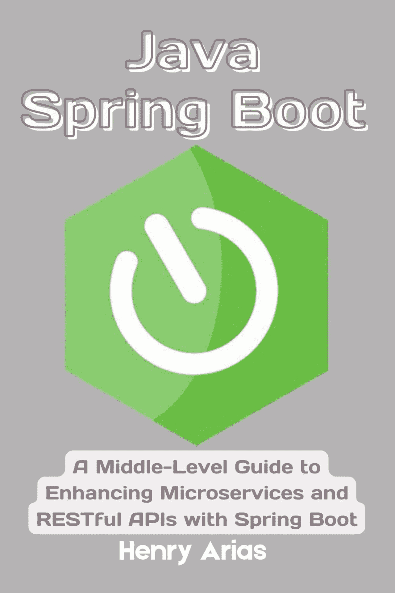

## 引言

### Web 应用开发不断演变的格局

Web 应用开发领域经历了巨大的变革，从原始的静态网页演变为能够处理复杂用户交互和精细美学的复杂动态应用程序。这种转变是由技术的飞速进步和用户需求的不断驱动的，要求开发者跟上这一格局，其特点是：尖端技术创新、对移动优化设计的迫切需求，以及对运行稳健并与各种外部系统无缝集成应用程序的需求。

### Web 开发中的技术进步

重大的技术跨越是 Web 应用开发演变的核心。`HTML5`、`CSS3` 和高级 `JavaScript` 版本的推出极大地扩展了 Web 应用的能力，允许在不牺牲性能的情况下增强交互性视觉吸引力。

例如，`HTML5` 通过原生支持音频和视频内容，消除了对外部插件进行媒体播放的需求。`CSS3` 引入了动画和过渡等高级样式选项，使开发者能够创建更具吸引力和响应式的设计。`JavaScript` 已经进化成为一种强大的语言，在 `React`、`Angular` 和 `Vue.js` 等框架和库的支持下能够广泛的功能。

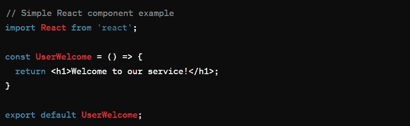

此示例展示了一个基础 `React` 组件，强调了现代 JavaScript 框架如何简化动态和模块化用户界面的创建。

### 强调移动优先和自适应设计

随着移动设备在互联网访问中的主导地位，采用移动优先和响应式设计原则变得日益至关。应用程序的设计必须确保在各种设备上无缝运行，并根据不同的屏幕尺寸和用户情况定制其布局和功能。

响应式设计利用 `CSS` 媒体查询根据设备的屏幕尺寸动态调整应用程序的布局，确保在不同设备上的最佳可用性和一致性。


此 `CSS` 代码演示了如何使用媒体查询更改布局元素，以实现在移动设备上的最佳显示，通过适应较小屏幕来增强界面的可用性。

### 优化应用程序性能

鉴于对快速加载速度和流畅交互的高预期，增强 Web 应用的性能是至关重要的。开发者利用懒加载、代码分割和高级缓存等策略来提高响应和操作效率。

像 `Webpack` 这样的框架和工具通过自动化代码分割等任务促进这些优化，允许对应用程序部分进行选择性加载，从而缩短初始加载时间。

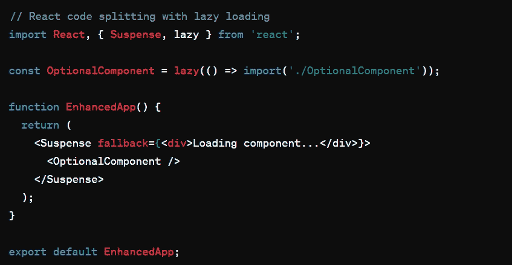

此 `React` 示例展示了结合 `Suspense` 使用懒加载进行代码分割，通过仅在需要时获取组件，有效地优化了初始加载时间。

### 与多种外部系统的集成

现代 Web 应用通常与多个外部服务和 API 集成——从金融交易平台到社交媒体接口——这需要健全的 API 管理和无缝集成能力。此外，向微服务架构的转变以及 `Docker` 和 `Kubernetes` 等技术重新定义了应用程序的开发、部署和扩展性。

### 结论

Web 应用开发的格局不断演变，带来了挑战与机遇。开发者必须致力于持续学习，以掌握新技术和方法。随着预计与人工智能、机器学习和沉浸式体验的进一步集成，开发者必须准备好不断创新并适应其技能。保持敏锐和见解可以使开发者能够创建不仅满足当前技术需求，还能塑造技术领域未来趋势的应用程序。

## 微服务架构

相比之下，微服务架构将应用程序拆分为一组较小的、相互独立的服务，每个服务都旨在执行特定的业务功能。这些服务自主运行，并且可以相互独立地开发、部署和扩展。这种分离增强了开发流程的敏捷性，简化了更新，并改进了故障隔离。

### 战略转型规划

转向微服务需要周全的规划和执行：

1. **业务能力分析**：首先勾勒现有应用程序的业务功能，根据业务角色而非技术层来识别逻辑服务边界。

2. **增量式迁移**：针对单体架构中能够从微服务中获益最大的特定组件，例如那些需要频繁更新或具有独立扩展能力的组件。

3. **技术考量**：考虑兼容性和性能需求等因素，为每个服务选择合适的技术栈。决定服务之间的通信方法，例如通过 `REST APIs`、消息系统等。

### 克服技术挑战

**单体拆解**：将单体应用程序拆分为微服务涉及定义清晰的服务边界，并管理以前在单体内部相互交织在一起的依赖关系。

**单体代码重构示例：**

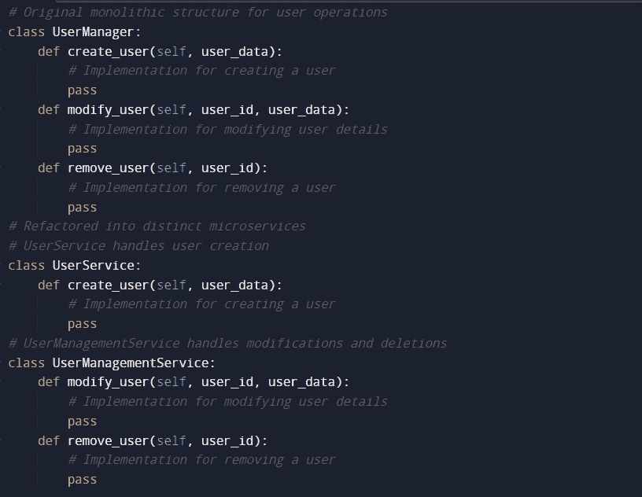

在此重构中，职责在不同的服务之间被明确划分，符合微服务的最佳实践。

**数据一致性与通信**：在分布式服务之间维护数据一致性变得具有挑战性。实施事件驱动通信或命令查询职责分离 (`CQRS`) 等策略可以有效帮助管理这些问题。

**构建韧性交互**：确保微服务之间稳健且安全的交互至关重要。实施断路器和回退机制等可靠性模式以维护系统的完整性。

### 文化与组织调整

采用微服务还需要组织内部的文化变革：

* **团队重组**：转向跨功能团队，负责从开发到部署管理特定的微服务，从而增强问责制和交付速度。

* **DevOps 实践**：整合 DevOps 方法论以促进持续集成和持续部署 (`CI/CD`)，这在微服务设置中对于简化更新和减少停机时间关重要。

### 系统监控与管理

有效管理由众多微服务组成的分布式系统需要强大的监控和编排工具。利用 `Kubernetes` 进行编排、利用 `Docker` 进行容器化以及利用 `Istio` 管理服务交互可以简化这些任务。像 `Prometheus` 和 `Grafana` 这样的监控解决方案对于实时健康和性能评估至关重要。

### 结论

转向微服务架构虽然复杂，但在扩展性、敏捷性和系统可维护性方面提供了巨大的收益。这一过程需要一种战略性的方法来重新设计应用程序架构、采用新的技术解决方案并培养适应性的组织文化。通过有条理地处理这些方面，组织可以显著增强它们的软件开发实践和基础设施的韧性。

## 使用 Spring Boot 进行 RESTful API 开发的概述

使用 `Spring Boot` 开发 RESTful API 是许多软件开发者的首选，因为它具有健壮性、简单性以及 Spring 生态提供的丰富功能。`Spring Boot` 增强了 `Spring` 框架的能力，有助于以最少的初始设置快速开发和部署生产级 Web 服务。

### RESTful API 的核心概念

`REST`（表述状态转移）是一种架构风格，规定使用标准的 HTTP 方法与资源交互，资源通常用 `JSON` 或 `XML` 表示，并通过直观的 `URIs`（统一资源标识符）访问。这种架构为可扩展的、无状态的交互而构建，是现代 Web 环境的关键。

### Spring Boot 简介

`Spring Boot` 通过其约定优于配置的方法简化了配置过程，扩展了 `Spring` 框架。它为项目配置提供了预定义的设置，减少了手动设置的工作。`Spring Boot` 配备嵌入式服务器选项（如 `Tomcat` 或 `Jetty`），并配置为随应用程序自动启动，简化了部署过程。

### 使用 Spring Boot 构建 RESTful API

在 `Spring Boot` 中创建 RESTful API 通过 `Spring Initializr` 等工具变得简单。以下是典型的开发工作流：

1. **启动项目**：`Spring Initializr` 通过选择依赖项（如 `'Spring Web'`、`'Spring Data JPA'` 以及根据项目规范用于临时内存数据库功能的可选组件 `'H2 Database'`）来促进 `Spring Boot` 项目的设置。

2. **定义数据模型**：RESTful 服务中的资源被定义为 `DTOs`（数据传输对象），例如：

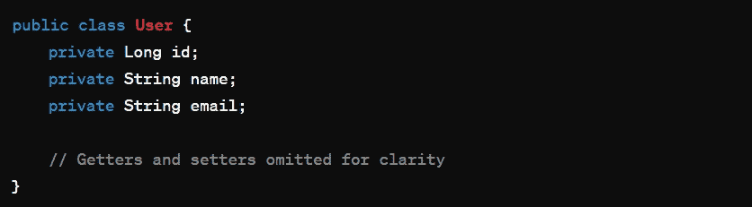

3. **配置仓库**：使用 `Spring Data JPA` 创建仓库接口，`Spring` 会自动配置这些接口以管理数据操作：

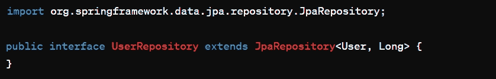

4. **服务层开发**：服务层负责业务逻辑，利用仓库进行数据库交互：

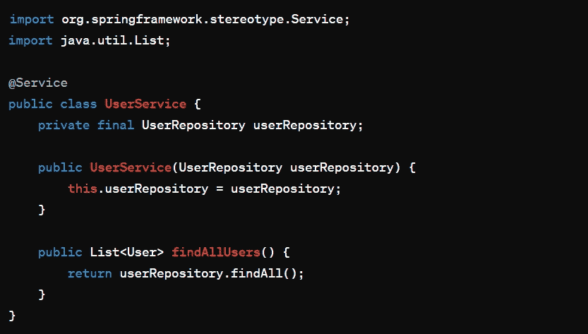

5. **设置控制器**：控制器处理 HTTP 请求和响应。通过 `@RestController` 注解，它们简化了 Web 端点的创建：

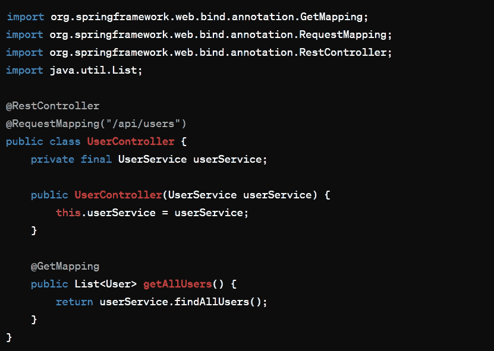

该端点提供了获取所有用户的方法，并由 `Spring Boot` 自动处理 `JSON` 转换。

### Spring 对 API 开发的优势

由于几个关键特性，`Spring Boot` 对 RESTful API 开发特别有利：

* **简化配置**：`Spring Boot` 根据所选依赖项自动配置，减轻了应用程序的初始设置。

* **提升生产力**：该平台通过提供即插用的功能和库，减少了大量编码的需求。

* **运营效率**：嵌入式服务器和全面的监控工具使得部署和管理 `Spring Boot` 变得简单。

### 结论

`Spring Boot` 通过减少与传统 `Spring` 应用程序相关的复杂性，成为开发 RESTful API 的卓越框架。其“约定优于配置”的设计原则，结合 Spring 生态系统的丰富功能，使其成为构建高效、可扩展和可维护 Web 服务开发者的理想选择。

### 概览

### 2. Spring Boot 的全面探索

为了介绍 Spring Boot 的广泛采用及其功能，本书投入了大量内容来深入探讨这一框架。它涵盖了从初始化到复杂配置的所有内容，为构建可扩展且高效的应用提供了详尽的指南。

### 3. 动手开发指南

除了理论解释外，本书还引导读者使用 Spring Boot 构建一个演示性应用程序。这种实用的方法通过展示这些概念在现实世界背景中的应用，帮助巩固所讨论的概念。

### 4. 编码最佳实践与模式

本书向读者介绍了编码、应用设计和性能优化的方面的最佳实践，结合了理论知识和资深丰富的经验。

### 5. 高级主题

对于已经熟悉基础概念的读者，本书还探讨了更复杂的话题，例如微服务架构、`Docker` 等容器技术的集成，以及与数据库和缓存解决方案的交互。

### 本书范围

本书范围经过精心设计，旨在提供关于使用 Spring Boot 开发应用程序的详细且集中的指南，涵盖了几个关键领域：

1. **Spring 框架与 Spring Boot 简介**：从回顾 Spring 框架的演变开始，为介绍 Spring Boot 及其相比于传统 Spring 开发的优势奠定了背景。

2. **配置与设置**：提供了关于设置 Spring Boot 项目的详细说明，包括配置开发环境以及理解项目结构和注解。

3. **构建初始应用程序**：创建 Spring Boot 应用程序的逐步指南，包括：

    * 使用 `Spring Initializr` 设置项目。

    * 开发 RESTful 控制器。

    * 使用 `Spring Data JPA` 管理数据。

    * 使用 `Spring Security` 保护应用程序。

4. **高级开发概念**：本书引入了更复杂的开发概念，例如：

    * 异步编程。

    * API 的构建与消费。

    * 使用 Spring Boot 实现微服务。

    * 使用 `Docker` 进行容器化。

5. **案例研究**：一个整合了所有讨论概念的综合项目，让读者看到如何将 Spring Boot 的各种元素集成到一个连贯的应用程序中。

6. **额外资源**：附录提供了额外的资源、故障排除提示以及供进一步阅读和在线材料的参考文献。

### 示例代码片段

这里是书中一个典型的代码片段，展示了如何在 Spring Boot 中设置基础的 RESTful 控制器：

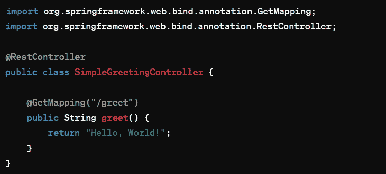

此示例展示了在 Spring Boot 中设置 RESTful 终点的简单性（访问路径为 `/greet`），它是书中提供的实用示例的典型代表，用于演示应用程序设置和端点的创建。

### 结论

本书旨在不仅向初学者介绍 Spring Boot，还加深经验丰富的开发人员对这一强大框架的理解。通过涵盖从基础设置到复杂实现的各个方面，本书是任何想要精通 Spring Boot 并提升软件开发能力的人的必备资源。通过详细的解释、实践示例和对高级主题的全面覆盖，本书是掌握现代软件开发技术的不可或缺的指南。

# 第一章

# 深入研究 Spring Boot

### 高级 Spring Boot 特性与配置

Spring Boot 以其简化设置和开发新 Spring 应用程序的方法而闻名，提供了开箱即用的配置，帮助微服务和 Web 应用程序快速启动。然而，Spring Boot 也包含了许多高级功能和配置，允许开发者精细地调整其应用程序，以满足对性能、安全和可扩展性的特定需求。这项探索深入了 Spring Boot 的一些复杂能力，突显了开发者如何利用这些工具来熟练地管理复杂的应用需求。

### 外部化配置

Spring Boot 的一个特点是对外部化配置的强大支持，允许开发者在实际代码库之外管理应用程序设置。此功能允许在无需重新编译的情况下调整应用程序的行为，通过属性文件、YAML 文件、环境变量和命令行参数等各种通道支持配置，并定义了覆盖值的层次结构以适应不同的环境。

例如，开发者可以通过 `application.properties` 外部管理数据库配置，并在运行时选择特定配置（profile）的配置：

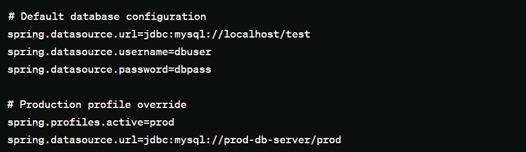

### 高级网络配置

Spring Boot 还通过 `application.properties` 或 `application.yml` 中的设置简化了服务器端口和地址等网络配置的管理。当在需要特定网络设置的不同环境中部署时，此功能证明非常有价值。

例如，配置服务器端口和上下文路径（context-path）非常简单：


这些设置指示 Spring Boot 在端口 8080 上提供应用程序服务，所有控制器映射都通过基础 URI `/api` 访问。

### 自定义 Spring Boot Actuators

Spring Boot Actuators 提供了必要的开箱即用、生产就绪的功能，如健康检查、指标以及对应用程序运行的洞察。自定义 Actuators 允许开发者增强对应用程序的监控和管理，这对于维护健壮的生产环境至关重要。开发者可以保护敏感端点并决定暴露哪些 Actuators 用于全面的监控。

在 `application.properties` 中对 Actuators 的自定义可能包括：


此设置暴露了指定的端点并将基础路径更改为 `/manage`，增强了应用程序管理的安全性和控制。

### 异步执行

Spring Boot 支持异步执行，允许在不阻塞应用程序主流程的情况下处理长时间运行的任务。通过使用 `@Async` 注解并通过 `@EnableAsync` 启用异步操作，任务可以并行运行，由 Spring 的任务执行器管理。

以下是设置方法：

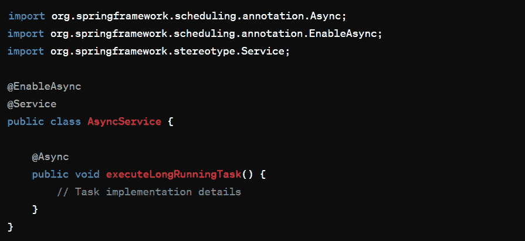

此配置允许 `executeLongRunningTask()` 异步运行，从而增强了应用程序的响应和效率。

### 高级安全配置

Spring Boot 与 Spring Security 的无缝集成为身份验证和授权提供了稳健的安全机制。高级配置可能包括方法级安全增强、CORS（跨源资源共享）设置以及 CSRF（跨站请求伪造）保护自定义。

一个典型的启用方法级安全的配置可能如下：

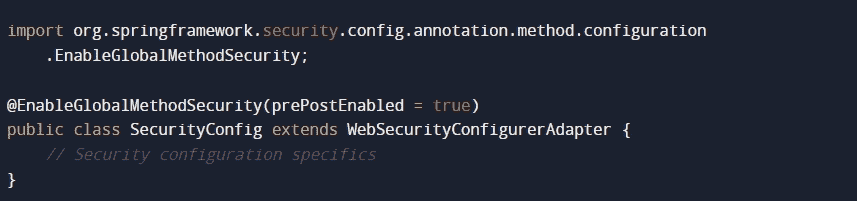

这允许在控制器方法级别使用如 `@PreAuthorize` 等注解进行细粒度的访问控制。

### 结论

Spring Boot 的高级功能和配置为开发者提供了全面的工具，用于构建高度定制、安全且高效管理的应用程序。从外部化配置和复杂的网络设置，到增强的 Actuator 自定义和异步处理能力，Spring Boot 为开发者配备了丰富的工具箱来应对复杂的开发挑战，确保应用程序不仅能够高效启动，还能在生产环境中保持良好的性能和扩展性。

### 自定义自动配置

Spring Boot 以其自动配置能力而闻名，该功能通过自动安排 Spring bean 和设置，实现了新 Spring 应用程序快速设置和部署。这种自动化是基于项目的依赖和环境特征的，使开发者能够快速运行应用程序。然而，特定场景可能需要特定的配置来满足独特的运行需求或增强性能。

### 自动配置的基础知识

Spring Boot 中的自动配置旨在消除大部分的手动配置过程。它会根据类路径中检测到的库和开发者指定的属性，智能地配置设置和 bean。例如，如果在类路径中发现了 H2 数据库库，Spring Boot 默认会配置一个内存数据库。

虽然自动配置提供了一种非常高效的应用程序设置方式，但它并不总是能完美契合每个项目的特定需求，因此通常需要进行定制的调整或个性化。

### 自定义自动配置的方法

在 Spring Boot 中，自定义自动配置可以通过多种方法实现，从覆盖属性到创建定制的配置类。

1. **属性覆盖**：最简单的自定义方法是在 `application.properties` 或 `application.yml` 文件中覆盖默认属性。例如，数据库连接设置可以如下进行自定义：


此更改明确设置了数据库 URL 和访问凭据，取代了默认的自动配置设置。

2. **排除自动配置**：Spring Boot 允许使用 `@SpringBootApplication` 注解的 `exclude` 属性排除不需要的自动配置。

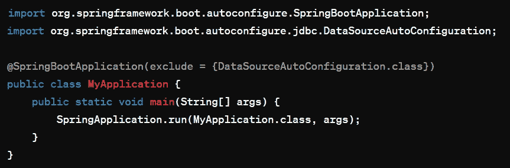

在这里，排除了 `DataSourceAutoConfiguration`，允许在没有 Spring Boot 干扰的情况下自定义数据源配置。

3. **实现自定义配置类**：通过定义自定义的 `@Configuration` 类可以实现更复杂的定制。这些类可以指定修改或替换默认配置 bean 的 bean。

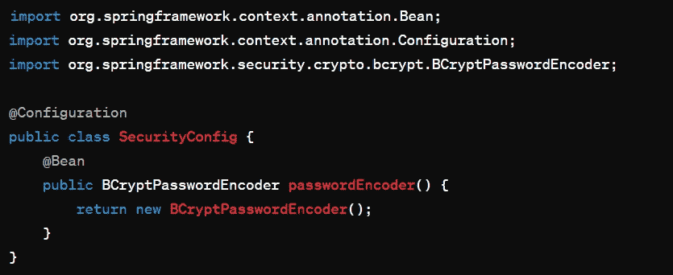


此配置引入了自定义的 `BCryptPasswordEncoder` bean，Spring Boot 用它代替了默认的安全配置。

4. **使用条件注解**：如 `@ConditionalOnClass` 和 `@ConditionalOnMissingBean` 等条件注解提供了一种高级方法，根据某些类或 bean 是否存在来条件地加载 bean。

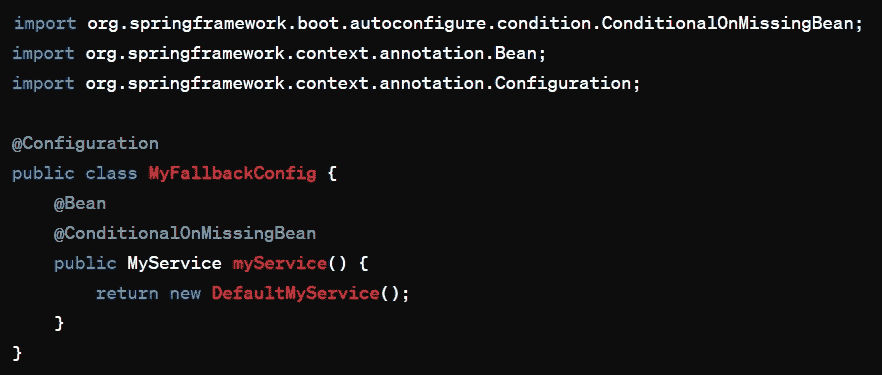

在此设置中，只有在没有配置其他 `MyService` bean 时，才会实例化 `DefaultMyService`，确保了在不覆盖任何自定义配置的情况下有一个默认值。

### 结论

在 Spring Boot 中定制自动配置允许开发者精炼框架的配置方式，以更好地对齐特定的业务需求并优化性能。通过利用属性覆盖、排除特定的自动配置、编写自定义配置类以及使用条件注解，开发者对他们的 Spring Boot 应用程序获得了精确的控制。这种定制能力确保了 Spring Boot 能够适应支持各种应用程序和企业需求，从而保持其在应用程序设置中的效率和有效性。

### 跨环境的配置属性外部化

在现代软件开发中，熟练处理跨环境的配置属性至关重要，以确保应用程序保持可扩展和适应性。Spring Boot 在提供健壮的配置设置外部化方面表现出色，允许在应用程序打包产物之外调整这些设置。这种能力是区分开发、测试和生产环境之间设置的关键，有助于在无需更改代码或重新构建应用程序的情况下实现无缝的环境切换。

### 外部化配置的原理

随着应用程序从开发过渡到生产，通常需要不同的设置来适应每个环境的各种条件。例如，数据库连接、API 密钥和用于凭据的配置通常需要在环境之间发生变化。将这些设置直接嵌入代码中不仅限制了灵活性，而且如果敏感数据暴露在版本控制中，还会带来安全风险。

通过外部化配置，开发者可以简化部署过程并增强安全性，因为配置更改不需要直接修改代码库。

### Spring Boot 中外部化配置的技巧

Spring Boot 支持多种外部化配置的方法，优先考虑跨不同部署环境的灵活性安全性。

1. **特定 Profile 的配置文件**：Spring Boot 可以使用专用的配置文件管理特定环境设置，例如位于 `/src/main/resources` 目录下的 `application-dev.properties`、`application-test.properties` 和 `application-prod.properties`。


开发者可以使用 `spring.profiles.active` 属性激活特定的配置，既可以在这些文件内部，也可以作为命令行选项，例如 `--spring.profiles.active=prod`。

2. **使用环境变量**：环境变量提供了一种管理设置的安全方式，防止敏感信息被硬编码在应用程序中。Spring Boot 通过允许环境变量直接映射到配置属性来实现这一点，遵循一种约定，即属性名转为大写，并将点替换为下划线。


3. **命令行参数**：命令行参数是临时或在开发期间覆盖配置设置的理想选择，提供了高度的灵活性。


4. **通过 Spring Cloud Config 进行集中配置**：对于在分布式或微服务架构中运行的应用程序，`Spring Cloud Config` 提供了一种集中管理配置的方法。配置存储在版本控制的仓库中，允许更改传播到所有客户端应用程序，而无需重新部署。

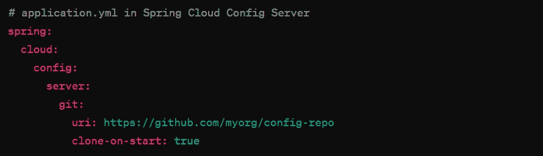

### 配置管理的最佳实践

* **安全实践**：避免在版本控制的配置文件中存储敏感信息。相反，请使用环境变量或安全的密钥管理服务。

* **清晰的组织**：为不同的环境维护不同的、组织良好的配置文件，以防止配置错误。

* **文档**：确保所有属性都有详尽的文档，突出它们的用途和允许的值，特别是对于那些在部署期间可以被覆盖的属性。

### 结论

在各种环境中有效管理配置属性对于部署灵活且安全的应用程序至关重要。Spring Boot 的外部化能力有助于根据不同环境调整配置设置，从而支持高效的 CI/CD 流程。这种方法不仅增强了应用程序的运行管理，而且符合在多样化的 IT 环境中维护安全、健壮和灵活软件系统的最佳实践。

# 第二章：使用 Spring Boot 构建微服务

## 微服务架构原理

微服务架构通过提倡将应用程序分割为更小、离散的单元，改变了传统的软件开发方法。这种现代方法与传统的单体架构形成了鲜明对比，它支持独立的组件，每个组件都负责特定的功能。这种结构增强了应用程序的扩展能力、快速适应以及维持运营韧性，这对于需要跟上快速技术进步和市场需求的企业至关重要。

### 去中心化

微服务哲学的核心是去中心化概念。微服务不再维护一个凝聚的单一应用程序结构，而是将功能分布在多个自主单元中。每个微服务都是自给自足的，管理自己独特的数据和依赖，从而增强了数据隔离和完整性。例如，在电子商务平台中，不同的微服务可以独立地处理用户配置、库存管理和交易处理，并通过定义的 API 进行连接。

### 自主性

微服务的特点是其运行的独立性，这便于进行独立的开发、部署和扩展活动。这种独立性与敏捷开发实践高度契合，特别是持续集成和持续部署方法，允许更频繁的更新和更稳健的服务提供。自主性还确保了单个服务的修改或扩展可以在不影响更广泛服务网络的情况下发生。

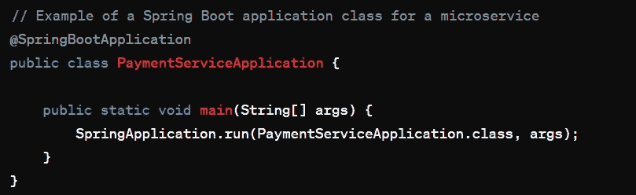

### 故障隔离与韧性

微服务架构通过将故障限制在特定服务内部来增强系统韧性，从而防止广泛的系统中断。`Circuit Breaker`（断路器）等韧性策略可以降低故障传播的风险。在 `Spring Boot` 框架中，`Resilience4j` 等工具提供了有效增强服务可靠性的机制。

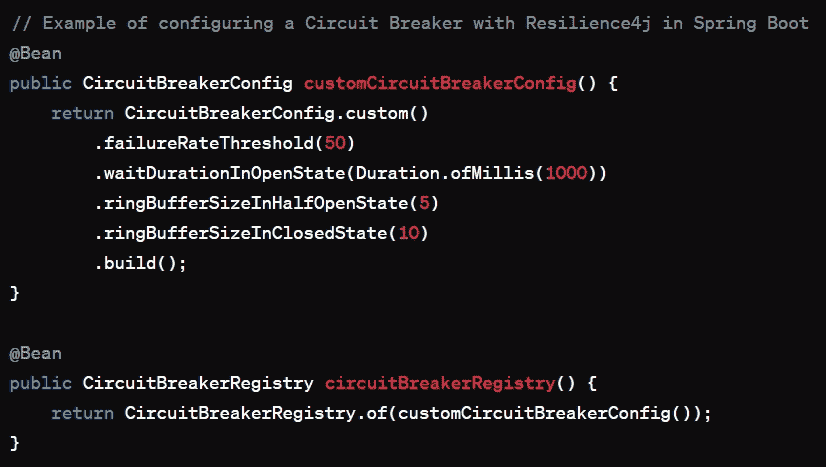

### 可扩展性

微服务由于其独立性在扩展性方面表现出色。这一特性允许每个服务根据其特定需求进行扩展，而单体应用需要对整个系统进行扩展。例如，在高峰期间，处理用户交易的服务可以与其他服务进行独立扩展。

### 模块化

微服务内在的模块化有助于更容易的更新和更好的系统可维护性。每个微服务都是围绕特定的业务需求开发的，使得在不需要深入了解整个系统运作的情况下，管理和更新变得更加简单。

### 技术多样性

微服务允许在不同服务中使用不同的技术栈，使开发者能够根据服务的需求选择最合适的技术。这种灵活性通常会带来优化的性能和更易于维护的系统。

### 持续交付

微服务的结构通过允许单个服务独立相互更新来支持持续交付实践。这种能力促进了更频繁的发布，对于快速适应用户反馈或业务策略的变化至关重要。

### 挑战与考虑

采用微服务带来了一系列挑战，包括管理多个服务的复杂性增加，以及确保跨系统的数据一致性。这些问题通常会导致更高的运营开销，并需要复杂的事务管理策略，例如用于分布式事务的 `Saga` 模式实现。

结论，向微服务架构的转变涉及周密的规划和对其原则的深刻理解。如果实施成功，它将提供一个能够支持扩展、灵活且具韧性的应用程序的稳健框架。组织必须采取全面的策略，不仅包括部署和管理，还包括服务能力的持续增强，以充分利用微服务的优势。

## 在 Spring Boot 生态系统中设计和构建微服务

转向微服务架构标志着应用程序开发的重大演进，使公司能够更动态地扩展、维护高可用性并快速适应新的业务挑战。`Spring Boot` 以其在构建 Java 应用程序方面的简单高效而闻名，是部署微服务的优秀平台。本探索涵盖了在 `Spring Boot` 框架内有效组织和管理微服务的关键策略。

### 识别服务边界

微服务架构的关键是清晰界定服务边界，确保功能得到适当的隔离和管理。`Spring Boot` 通过支持创建界限上下文来实现这一点，每个服务都作为一个独立的应用程序运行，独立于生态系统中的其他服务。

`领域驱动设计 (DDD)` 在此过程中起着重要作用，它关注于根据业务相关性划分系统，有助于保持服务之间整洁的分离和最小的重叠。这种方法确保了服务具有高内聚低耦合的特性，增强了可维护性和韧性。

### 架构蓝图

`Spring Boot` 中的每个微服务通常被设计成一个独立的应用程序。这种结构允许模块化开发和部署，对于服务必须独立运行的微服务方法至关重要。

这是一个演示在 `Spring Boot` 中设置微服务的简单示例：

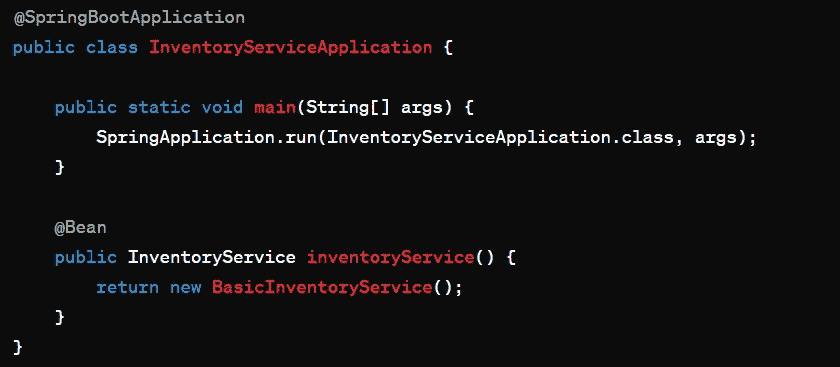

在此设置中，`InventoryServiceApplication` 作为入口点，封装了服务操作、配置和依赖，从而确保了服务的隔离。

### 配置管理

在分布式环境中，在不将配置硬编码到服务本身的情况下管理服务配置至关重要。`Spring Boot` 支持外部配置，允许通过属性文件或 YAML 文件从外部配置服务，这些配置可以在运行时动态加载。

`Spring Cloud Config` 扩展了这些功能，提供了一个中央服务器来管理跨环境的所有配置，简化了配置处理并通过将配置与代码分离提高了安全性。

### 通信策略

服务之间的通信是任何微服务架构的关键组成部分。`Spring Boot` 支持多种通信方法，从通过 `Spring MVC` 实现的同步 RESTful API，到通过集成 `RabbitMQ` 或 `Apache Kafka` 等平台支持的异步消息。

例如，这是 `Spring Boot` 中 REST 控制器的可能样式：

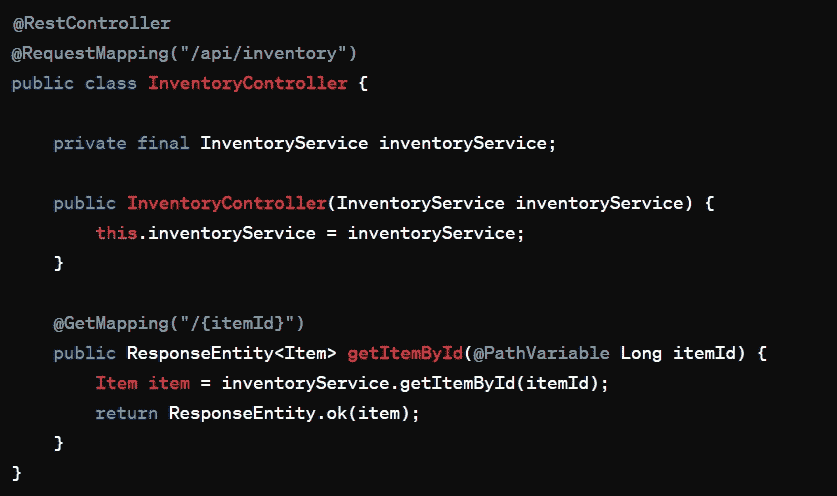

对于异步交互，像 `Spring Cloud Stream` 这样的框架提供了对消息系统的抽象，实现了可扩展且易于管理的事件驱动通信。

### 独立的数据管理

为了确保微服务解耦，每个服务都应该控制自己的数据库。可以在每个微服务中利用 `Spring Data JPA` 来与其相应数据库的交互，为实现数据访问层提供了简单的方法，而无需大量的样板代码。

### 部署考虑

微服务的部署策略通常包括使用 `Docker` 进行容器化，这会将微服务及其环境封装到容器中，简化了部署和扩展。像 `Kubernetes` 这样的编排平台可以管理这些容器，为自动扩展、负载均衡和服务发现提供强稳健的解决方案。

总而言之，Spring Boot 环境下的微服务设计和结构需要周全的规划，并在开发和部署方面采取战略性方法。通过遵循建立的设计原则、利用 Spring Boot 丰富的工具集并考虑运行动态，开发者可以创建出高效、可扩展且具健壮性的微服务架构。

## 服务间通信策略

在微服务架构领域，构建服务之间的通信协议对于系统的性能和健壮性至关重要。这涉及选择正确的交互方法、建立有效的通信框架以及选择能够增强连接性的技术。本探索侧重于 Spring Boot 设置中促进服务间通信的各种方法，目标是增强应用程序的可扩展性、提高系统可靠性并简化管理。

### 同步通信 vs. 异步通信

微服务之间的通信可以分为两种基本类型：同步和异步。每种类型满足不同的运行需求，并以独特的方式影响架构。

`Synchronous Communication` 通常采用 `REST` 或 `gRPC` 进行实时交互，其中服务在发出请求后会等待即时响应。虽然这种方法对于直接服务交互简单且有效，但可能会导致高耦合和延迟增加，可能影响系统的整体容错能力。

例如，以下是在 Spring Boot 中构建同步 `REST` 控制器的方法：

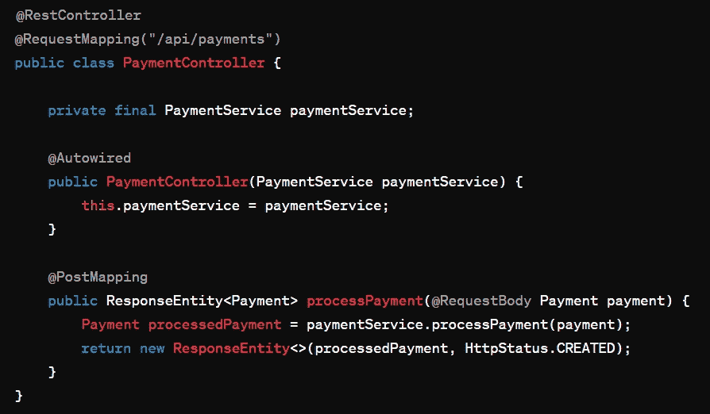

当需要尽可能减少服务间依赖时，优选 `Asynchronous Communication`。如 `RabbitMQ` 或 `Apache Kafka` 等技术有助于此类通信，允许在没有即时响应的情况下发送和接收消息，从而显著提高性能和系统健壮性。

在 Spring Boot 服务中使用 `Kafka` 的实现可能如下：

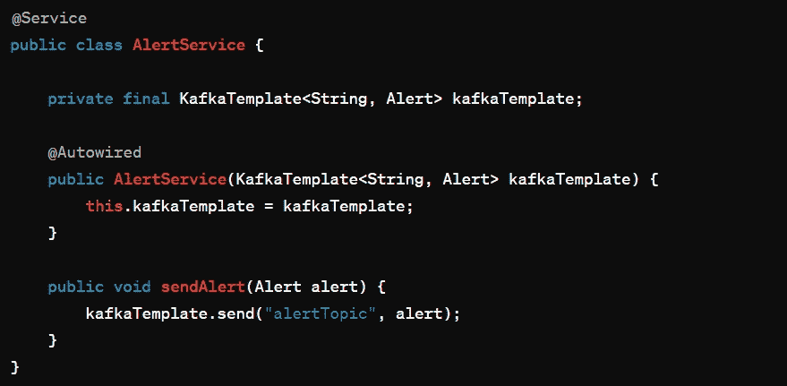

### 选择通信模式

微服务交互的效率还取决于所选的通信模式：

* `Request/Response`：这种同步模式通常用于直接、即时的交换，且需要即时获得响应。

* `Publish/Subscribe`：这种异步模式适用于以下场景：一个服务广播了许多其他服务可能感兴趣的消息，它支持了可扩展性和灵活性。

* `Event-Driven`：这种模式涉及服务响应事件而非直接调用，通过确保服务仅通过共享事件进行交互，从而促进了高程度的解耦。

### 故障管理与增强可靠性

健壮的通信需要处理故障和维护可靠性的机制。实施如 `Circuit Breakers`（断路器）等故障保护策略可以大幅降低与单点故障相关的风险。

以下是在 `Spring Cloud` 中配置断路器的方法：

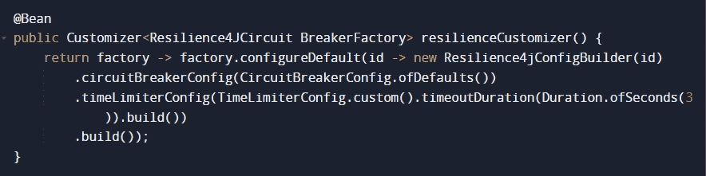

### 服务交互的安全保障

安全性至关重要，特别是当敏感数据在服务之间传输时。利用 `OAuth2`、`JWT` 和 `TLS` 等安全框架可以确保通信既安全又经过身份验证，从而保护数据的完整性和机密性。

### 结论

开发复杂的服务间通信策略是微服务架构成功的要素。通过熟练地在同步和异步通信之间做出选择，采用健壮的通信模式，并专注于这些交互的安全保障与可靠性维护，开发者可以创建出不仅功能上有效，而且安全且健壮的系统。这种方法确保了充分利用 Spring Boot 的架构优势，形成更稳定、更高效的服务网络。

# 第三章：高级 RESTful API 开发

## 为可扩展性和可维护性设计 RESTful API

RESTful API 的创建构成了现代 Web 和移动平台通信的基础，需要支持大规模增长和易于管理的设计。这涉及一种经过计算的方法，利用最佳实践并采用特定的设计原则，以确保这些 API 在复杂性增加时能够有效扩展并保持可管理性。

### RESTful API 的核心设计原则

1. **遵循 HTTP 方法**：REST-ful API 必须根据其定义的用途使用 HTTP 方法，以保持清晰性和一致性。`GET`、`POST`、`PUT`、`DELETE` 和 `PATCH` 方法应谨慎使用——`GET` 用于检索数据，`POST` 用于创建资源，`PUT` 和 `PATCH` 用于更新，`DELETE` 用于删除资源。

2. **资源中心 URL**：有效的 REST API 以资源构建端点，使用名词描述资源实体而非动作。端点可能类似于 `/users`（访问用户）或 `/users/{id}`（涉及特定用户的操作）。

3. **拥抱无状态性**：每个 API 请求都应该是自包含的，携带服务器理解和响应请求所需的所有必要信息。这一原则有助于负载均衡和容错，对于扩展性至关重要，因为它允许任何可用服务器对每个请求进行独立处理。

4. **子资源利用**：分层的数据关系关系应通过子资源进行导航，例如，通过 `/users/{userId}/orders` 访问用户的订单。这种设计保持了直观且逻辑性的结构。

### 可扩展性技术

可以通过以下方式实现高效的可扩展性：

1. **实现缓存**：临时数据存储（或缓存）通过避免重复的数据处理和获取来减少服务器负载。有效的缓存可以涉及多个层，包括数据库级、应用级或分布式 HTTP 缓存。

2. **限流与节流**：保护 API 不被单一源的请求淹没至关重要。节流限制了用户在指定时间内可以请求的数量，确保公平使用并防止服务滥用。

3. **使用负载均衡器**：通过负载均衡器将传入的 API 流量分布到多个服务器实例，可以显著提高性能和可用性。

4. **异步进程**：将不需要立即处理的任务卸载到异步工作流中有助于保持 API 的响应。这可能涉及使用 `Kafka` 或 `RabbitMQ` 等队列系统进行后台处理。

### 增强维护性的实践

为了确保 API 易于更新和管理：

1. **版本控制**：API 的更改应通过 URL 路径、查询参数或 Header 等方法进行版本控制。这可以防止在进行更新时破坏旧版本的 API 使用。

2. **完善文档**：利用 `Swagger` 或 `OpenAPI` 等工具对 API 进行文档有助于保持清晰性和可用性，为实时测试和交互提供活动界面。

3. **一致的规范**：在整个 API 中标准化端点命名和结构规范可以提高可预测性和易用性，简化开发者的交互。

4. **系统化的错误处理**：提供一致且信息丰富的错误响应可以增强用户体验和调试过程。响应应包含 HTTP 状态码和错误消息，引导用户了解发生了什么以及可能的修复方法。

5. **优先安全性**：安全措施（包括 `HTTPS`、通过 `JWT` 等令牌进行身份验证以及严格的输入验证）可以防止漏洞和未经授权的访问。

### 良好的 API 端点示例

这是一个展示了有效 RESTful API 设计实践的示例：

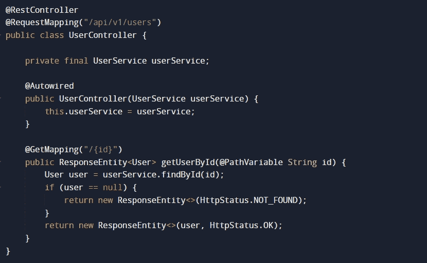

本示例演示了如何使用 HTTP 方法、面向资源的 URL 设计以及适当的响应处理，来创建一个清晰、直观的 API。

总而言之，构建具有可扩展性和可维护性的 RESTful API 要求遵循经过验证的设计原则、战略性地使用技术，并在 API 的整个生命周期内一致地应用最佳实践。这些策略确保了 API 足够健壮以应对增长，并足够灵活以便随时间进行高效管理和调整。

## HTTP 动词和状态码的高级使用

RESTful API 设计中的有效通信取决于对 HTTP 动词的精确利用以及状态码的策略性实施。这些组件对于遵循 REST 原则、优化 API 性能以及促进错误管理至关重要。本文将探讨使用 HTTP 动词和状态码的精细技术，展示它们在构建更健壮、直观且高效的 API 方面的潜力。

### 精细的 HTTP 动词实现

虽然常用的 HTTP 方法有 `GET`、`POST`、`PUT`、`DELETE` 和 `PATCH`，但优化它们的使用可以极大增强 API 功能：

1. `PUT` 与 `PATCH`：这些方法对于更新是必不可少的，但其功能不同。`PUT` 用于完全替换资源，而 `PATCH` 应用部分修改，通过仅传输更改，其效率更高。

使用 `PATCH` 更新资源特定部分的示例：

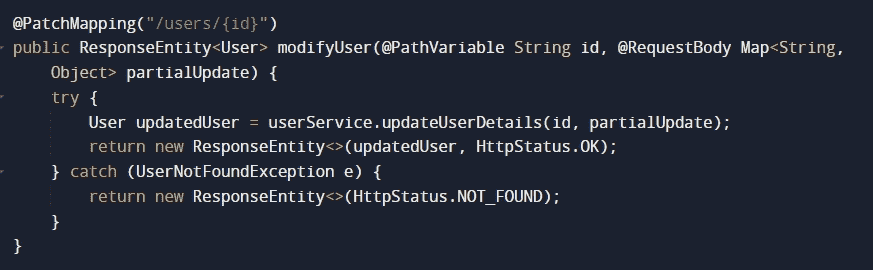


## 2. `OPTIONS`

`OPTIONS` 方法经常未被充分利用，但它对于描述端点的能力至关重要，特别是在可用操作可能会发生变化的动态环境中非常有用。

### `OPTIONS` 的实现示例

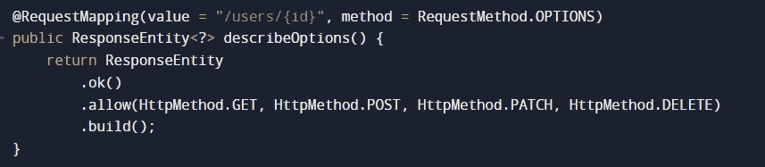

## 复杂的状态码用法

仔细选择 HTTP 状态码可以显著增强 API 通信操作结果的方式：

1. `201 Created`：对于指示通过 `POST` 成功创建资源非常重要，通常带有一个指向新资源 URL 的 `Location` 头部。
2. `204 No Content`：适用于 `DELETE` 方法，以及在不需要响应体时的 `PUT` 或 `PATCH` 方法，表示请求已成功但无任何内容可供显示。
3. `422 Unprocessable Entity`：此状态适用于请求格式正确但由于语义错误（如验证失败）而无法处理的情况。

### 创建用户时使用 `422` 的示例

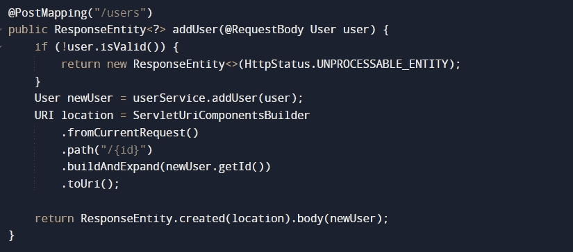

4. `207 Multi-Status`：适用于批量操作，其中请求的不同部分可能有不同的结果，允许为每个部分提供详细的响应。
5. `429 Too Many Requests`：对于具有速率限制的 API 至关重要，此状态警告客户端已超过在给定时间内允许的请求数。

## 高级状态码场景

1. **优化网络使用**：结合 `ETags` 或最后修改日期使用 `304 Not Modified`，通过告知客户端缓存数据仍保持更新来减少数据传输。
2. **有效的重定向**：使用 `301`（永久移动）和 `302`（找到）有助于在 API 资源迁移或端点重构时，平滑地管理客户端的交互。
3. **处理服务停机**：`503 Service Unavailable` 状态可以在服务器停机期间管理预期，可能通过 `Retry-After` 头部指示何时重试。

结论是，HTTP 动词和状态码的高级应用在提升 RESTful API 功能和改进客户端体验方面起着至关重要的作用。通过整合这些精细的方法，开发者可以确保他们的 API 不仅更有效，而且提供更清晰、更高效的通信和交互。这增强了 API 的集成、可靠性和整体性能，有助于提高扩展性和可维护性。

## 为可发现的 API 实现 HATEOAS

“超媒体作为应用程序状态的引擎”（HATEOAS）是 RESTful 设计的基础组件，它将 API 功能从静态提升到动态。通过引入 HATEOAS，API 允许客户端通过响应中包含的超链接与其服务进行交互，就像导航浏览器一样。这种实现不仅提高了 API 的可发现性，还通过引导客户端在无需预先了解架构的情况下探索应用程序的可能性，促进了更易于维护的升级。

### HATEOAS 的概念概览

HATEOAS 要求 API 响应不仅要提供数据，还应根据应用程序当前状态提供指向下一个潜在操作的链接。这种设计原理有助于为 API 模拟自发现的用户界面，客户端可以使用 API 响应中提供的链接动态地导航并交互资源，而不是依赖带外信息。

### 实现 HATEOAS 的优势

1. **客户端与服务器解耦**：客户端根据响应中动态提供的超媒体与 API 交互，减少了硬编码 URL 的需求，并允许 API 结构独立于客户端实现而演进。
2. **可发现性**：HATEOAS 增加了 API 功能的可发现性，允许客户端从当前状态探索其他可用操作和资源，无需预配置路由。
3. **API 演进**：有了 HATEOAS，API 可以发生更改而不会对现有客户端产生重大影响。客户端通过遵循超媒体响应中动态呈现的新链接和操作来适应 API 的修改。

### 实现 HATEOAS 的步骤

HATEOAS 的实现涉及在 API 响应中嵌入可操作的链接，引导客户端完成其操作：

#### 1. 超媒体格式选择

选择用于在 API 响应中嵌入超媒体的格式至关重要。如 `HAL`（超文本应用语言）、`JSON-LD` 或 `Siren` 等格式定义了链接的结构，使得客户端应用程序更容易动态地解释和导航 API。

一个 `HAL` 响应的示例可能如下：

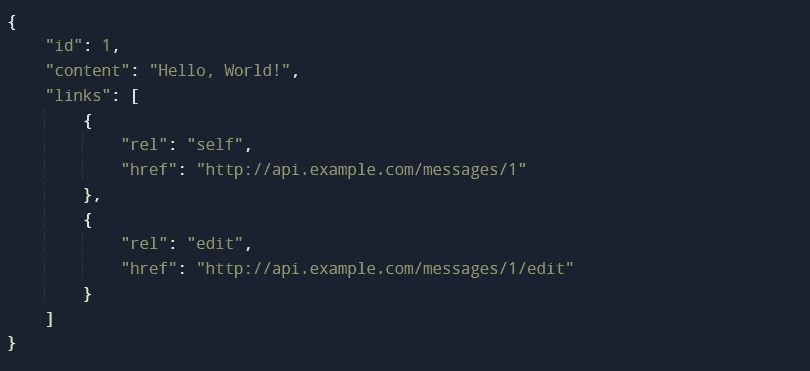

#### 2. 在服务器上生成链接

在 `Spring Boot` 应用中使用如 `Spring HATEOAS` 等框架可以简化向 API 响应添加链接的过程。以下是代码示例：

```
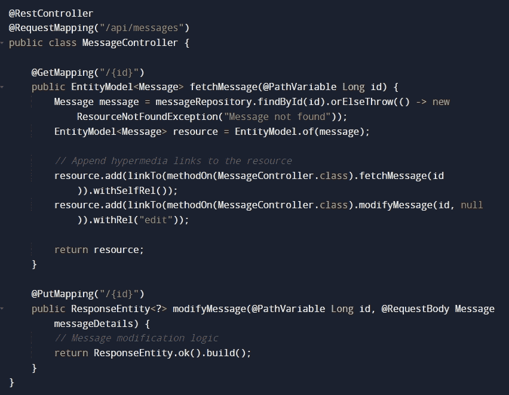
```

#### 3. 动态客户端适应

客户端的设计应当理解并利用响应中的超媒体链接。通过动态处理这些链接，客户端可以适应 API 的变化而无需手动更新。

### 应对挑战

采用 HATEOAS 会引入 API 和客户端设计的复杂性，需要详细的方法来确保超媒体控件一致地呈现并被客户端正确解释。健壮的测试和清晰的文档对于帮助导航和使用 API 至关重要。

结论，将 HATEOAS 集成到您的 REST API 中改变了客户端与服务交互的方式，促进了自引导、可扩展和适应的 API 环境。通过使用标准的超媒体格式和 `Spring HATEOAS` 等工具，开发者可以创建出对变化具有韧性并提供丰富动态体验的 API。

## Spring Data JPA 简介

作为更广泛的 Spring Data 家族子集，Spring Data JPA 减轻了与应用程序数据持久化相关的常见复杂性。它提供了全面的存储库支持并促进了动态查询执行，允许开发者专注于业务逻辑而非数据库的内部细节。

### 管理复杂关系

处理复杂的数据关系（例如一对多、多对一和多对多）是企业级应用的标准需求。Spring Data JPA 使用 `@OneToMany`、`@ManyToOne` 和 `@ManyToMany` 等注解来高效地映射这些关系，确保数据完整性并优化查询性能。

### 多对多关系映射示例

考虑一个涉及 `Student` 和 `Course` 实体的场景，它们之间存在多对多关系。以下是你如何使用 Spring Data JPA 配置这些内容：

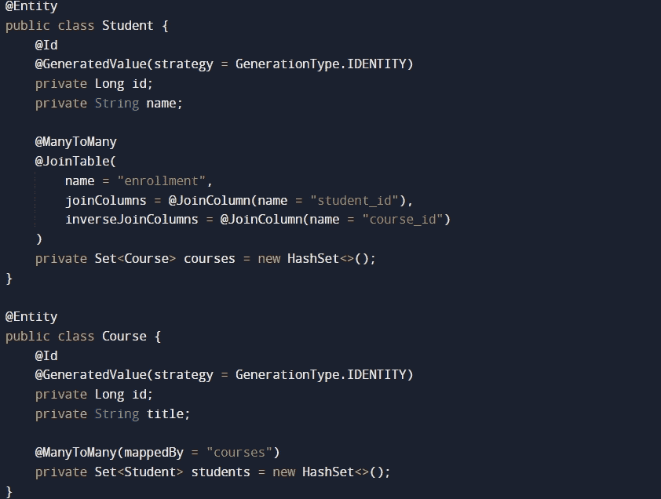

此示例利用连接表 `enrollment` 来处理关联，有效地管理了 `Students` 和 `Courses` 之间的多对多链接。

### 高级查询能力

Spring Data JPA 支持通过 JPQL（Java Persistence 查询语言）或原生 SQL 进行自定义查询，以满足基本 CRUD 操作之外更复杂的查询需求。

### 自定义 JPQL 使用示例


存储库中的此方法演示了如何定义自定义查询通过课程标题检索学生，展示了 `JPQL` 在复杂查询需求中的灵活性。

### 规范与 Criteria API

对于在运行时根据变量标准动态构建查询，Spring Data JPA 的 Criteria API 和 Specifications 是无价之宝。它们能够以编程方式构建类型安全的查询，特别在具有高度动态查询参数的场景下非常有用。

### Specifications 实现示例

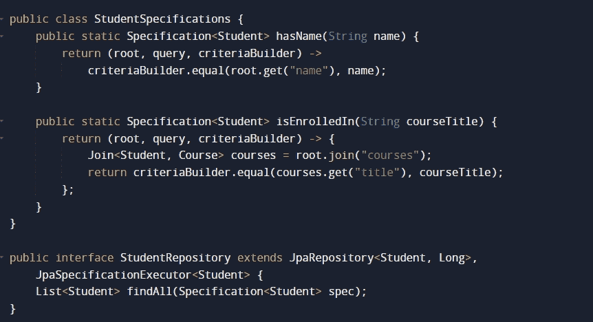

此代码阐明了如何动态组合不同的 `Specification` 实例来处理查询中的复杂过滤。

### 性能优化

使用 Spring Data JPA 进行有效的数据处理还涉及考虑潜在的性能影响，特别是在处理大量数据量或复杂实体关系时。在饿加载和懒加载之间进行选择、优化查询结构以及利用投影等策略对于增强性能至关重要。

### 饿加载与懒加载的考量

- `Eager Loading`（饿加载）如果不仔细管理，通过同时加载整个相关数据集可能会导致性能瓶颈。
- `Lazy Loading`（懒加载）通过仅在显式访问时加载相关数据来节省资源，但必须进行管理以避免过度的数据库调用。

如 `@Fetch(FetchMode.JOIN)` 或 `@BatchSize(size = 10)` 等注解有助于管理数据获取策略以有效优化性能。

### 结论

使用 Spring Data JPA 高效处理复杂数据需要对其能力有深入理解并深思应用其特性。通过熟练地管理实体关系、利用高级查询技术并优化性能，开发者可以为复杂的应用需求创建健壮、高效且可扩展的数据访问层。

## 实现事务管理

在软件开发领域，管理事务对于确保可靠且一致的数据操作至关重要。对于必须将多个相关数据更改作为单个单元执行的应用程序，事务管理是不可或缺的一部分。本文提供了事务管理的全面概述，详细说明了其重要性并提供了有效部署的策略。

### 事务管理的核心概念

事务管理控制一系列动作，使其要么全部成功完成，要么完全不执行，从而保持跨过程的数据完整性。事务受 ACID 属性约束：

- **原子性 (Atomicity)**：该属性确保事务中的所有步骤被视为一个单一操作，要么完全成功，要么完全失败。
- **一致性 (Consistency)**：事务必须使数据库从一个有效状态转换到另一个状态，强制执行所有数据规则。
- **隔离性 (Isolation)**：确保事务内的操作在事务完成之前对其他并发事务隐藏。
- **持久性 (Durability)**：保证即使在发生系统故障的情况下，事务的结果也是永久的。

### Spring 框架中的事务管理

Spring 框架提供了先进的事务管理能力，可以通过声明式或编程式方式进行实现，适用于各种应用程序环境。

### 声明式事务管理

大多数开发者更倾向于这种方法，因为其简单且与业务逻辑分离。它利用注解或 XML 配置来管理事务。`@Transactional` 注解常用于定义事务边界。

### 声明式事务管理示例

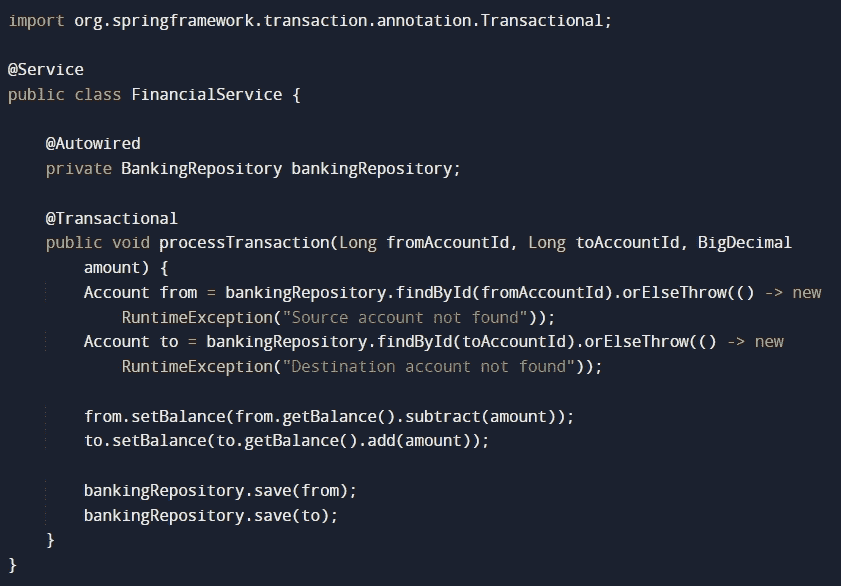

标记有 `@Transactional` 的方法中，所有操作都是单个事务的一部分。如果任何操作失败，Spring 将自动回滚整个事务，维护数据一致性。

### 编程式事务管理

对于需要对事务进行更多控制的场景，Spring 支持编程式事务管理。这种方法涉及使用 `TransactionTemplate` 或 `PlatformTransactionManager` 手动管理事务状态。

### 编程式事务管理示例

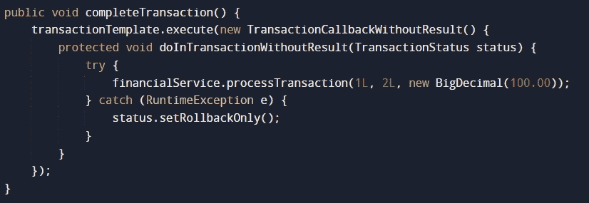

此示例演示了对事务的手动控制。可以根据特定条件编程地设置事务回滚，为处理事务结果提供了灵活性。

### 事务管理最佳实践

- **定义显式事务边界**：在应用程序逻辑中定义事务何时开始和结束至关重要。
- **缩短事务长度**：减少事务持续时间可以降低数据库锁的概率并提高应用程序的响应。
- **选择正确的隔离级别**：不同的隔离级别在并发性和数据准确性之间提供了权衡。选择合适的级别是优化性能的关键。
- **有效管理异常**：在事务中妥善处理异常对于避免数据处于不确定状态至关重要。

### 结论

有效的事务管理对于依赖准确且可靠数据操作的应用程序至关重要。Spring 框架提供了管理事务的健壮工具，确保能够保持高水平的数据完整性和稳定性。通过实施良好的事务管理实践，开发者可以保护应用程序免受数据异常的影响，并确保各种情况下顺利运行。

## 分布式数据库和数据一致性策略

有效管理分布式数据库并确保跨各个节点的数据一致性是现代数据密集型应用的核心关注点。分布式数据库增强了可扩展性，实现了更好的容错性并促进了更快的数据检索，但由于其去中心化的本质，也为实现统一的数据一致性带来了挑战。本文探讨了处理分布式数据库并在不同的地理和系统边界维护一致数据的稳健策略。

### 分布式数据库的基础要素

分布式数据库系统将数据分散在多个物理位置，这些位置通过网络相互连接。在此配置中，每个站点均独立运行，并能够对数据进行读写操作。虽然这种设置在韧性和数据可用性方面具有显著优势，但它使跨网络的同步过程变得复杂，为维护一致的数据状态带来了挑战。

### 探究 CAP 定理

CAP 定理为理解分布式系统中三个关键属性之间的权衡：一致性（Consistency）、可用性（Availability）和分区容错（Partition Tolerance）提供了一个框架。它指出分布式系统在任何时刻只能保证以下三个属性中的两个：

- `Consistency`：所有节点同时反映相同的数据。
- `Availability`：即使某些组件发生故障，系统仍保持运行并做出响应。
- `Partition Tolerance`：尽管网络中发生任意数量的消息丢失或故障，系统也能继续运行。

决定优先考虑哪些属性取决于应用程序的具体需求；金融系统可能需要优先考虑一致性，而内容交付网络可能更优先考虑 `availability`。

### 维护数据一致性的策略

1. **复制方法**：
    - `Synchronous Replication`（同步复制）通过确保所有节点同时更新来维护数据的统一性。尽管它保证了强一致性，但可能会由于延迟问题减慢系统速度。
    - `Asynchronous Replication`（异步复制）通过允许数据同步存在延迟来提高系统性能，这可能导致临时的不一致。

2. **冲突解决技术**：
    - 使用高级方法如 `Last Write Wins (LWW)`（最后写入胜）、`Vector Clocks`（向量钟）和自定义 `Merge Functions`（合并函数）来解决并发更新引起的数据冲突。
    - 向量钟的使用示例：
    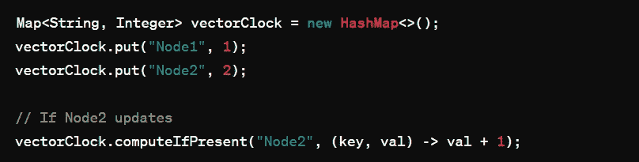

3. **共识算法**：
    - 实现 `Raft` 或 `Paxos` 等协议，确保数据库的所有更改在应用之前都大多数节点的共识，从而增强系统的一致性。

4. **有效的数据分区**：
    - `Sharding`（分片）策略根据某些键将数据分布到各个节点，最大限度地减少事务冲突并简化整体数据管理。

5. **实施缓存**：
    - `Caching`（缓存）可以显著减少读取延迟，但需要机制来确保在底层数据变化时缓存数据能保持最新。

### 实际应用

在实践中，实现分布式数据库中的数据一致性通常涉及这些策略的结合。系统可能对要求高一致性的关键操作采用 `replication`，而对允许最终一致性的过程采用 `asynchronous replication`。有效的监控和主动的异常检测对于确保系统可靠运行也至关重要。

### 结论

精通分布式数据库的管理和维护数据一致性需要一种针对部署环境特定需求而定制的策略性方法。通过明智地选择合适的复制技术、冲突解决方法以及 `sharding` 和 `caching` 等额外策略，组织可以确保其分布式系统既有效又可靠。随着数据库越来越多地分布在不同的环境中，这些策略对于确保稳健的数据完整性和操作性能至关重要。

## 第五章：构建韧性微服务

### 微服务架构中的错误处理与一致性

在微服务的动态领域中，有效管理错误和确保分布式系统之间数据的一致性是核心挑战。这些元素对于系统可靠性和用户体验至关重要。本文探讨了健壮错误管理的复杂方法，以及在微服务架构中维护数据一致性的策略。

### 微服务中错误管理的原则

微服务架构中的错误处理涉及识别和纠正发生于服务交互期间的问题。错误可以分为内部错误（发生于单个服务内部）或外部错误（影响服务之间的通信）。有效的错误管理不仅能稳定系统，还能促进快速恢复和解决。

### 微服务中的常见错误类型

1. **瞬态错误 (Transient Errors)**：这些临时问题可能由于网络延迟或服务的短期不可用而发生。实施带有指数退避的 `retries`（重试）以及 `circuit breakers`（熔断器）等策略对于管理这些错误是有效的。
2. **持久性错误 (Permanent Errors)**：这些是由于底层系统故障（如 Bug 或数据处理错误）引起的重复性错误，通常需要重大的纠正措施。

### 有效错误处理的策略

1. **优雅降级 (Graceful Degradation)**：设计服务能够优雅故障，有助于在发生错误时维持部分功能。例如，回退到个性化较少的体验。
2. **实施超时和重试**：对于瞬态错误，定义严格的 `timeouts` 和 `retries` 可以缓解临时服务故障的影响。这需要仔细的调整，以防止重复请求导致服务过载。

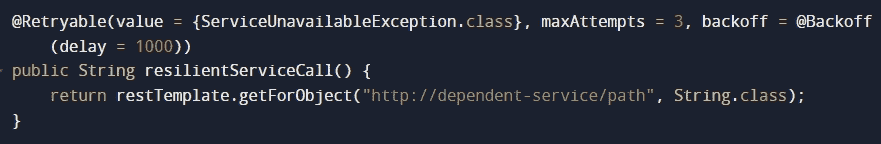

3. **熔断模式 (Circuit Breaker Pattern)**：该模式帮助根据最近的失败情况防止服务尝试可能会失败的操作。当故障达到特定阈值时，熔断器跳闸，操作临时停止。

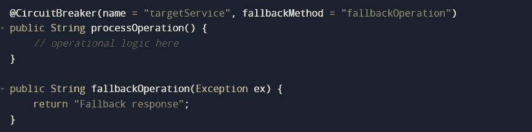

4. **详细的错误反馈**：提供详细的错误日志并引入 `correlation IDs`（关联 ID）可以有助于诊断跨服务的问题，缩短错误解决时间。

### 确保分布式系统的数据一致性

在微服务架构中，每个服务都可能管理自己的数据库，维护数据一致性本质是复杂的。实现一致性的有效策略包括：

1. **数据库事务**：在单个服务内部，传统的数据库事务可以确保原子性和一致性。
2. **SAGA 模式**：这种方法将事务划分为多个本地事务，每个事务由不同的服务管理。每个服务执行其事务部分并通过事件或消息与其他通信，从而确保整体数据完整性。
3. **最终一致性 (Eventual Consistency)**：该模型允许系统随时间实现一致性，而不是立即实现。这在绝对一致性并非立即迫切的环境下特别有用。
4. **两阶段提交 (2PC)**：对于需要严格一致性的场景，`2PC` 确保涉及事务的所有部分要么提交要么回滚，尽管这会降低性能。
5. **补偿事务 (Compensating Transactions)**：这些本质上是撤销操作，当部分操作已提交后事务部分失败时，撤销更改。

### 示例场景：实现 SAGA

以下是 `SAGA` 在电子商务系统中的可能实现方式，在该系统中，下单会触发多个后续操作：

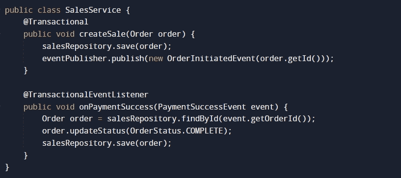

在此场景中，`SalesService` 处理订单的创建，并监听成功的支付事件以完成订单状态，展示了通过本地事务在不同服务之间的协作。

有效的错误处理和数据一致性对于微服务架构的成功至关重要。通过采用重试、断路器和详细日志等高级错误处理技术，结合 SAGA 或最终一致性等一致性模式，微服务可以实现必要的可靠性和完整性。这些策略是构建韧性系统的基础，能够提供稳健的服务操作，并在跨分布式平台时保持一致、可靠的数据管理。


### 使用 Resilience4J 实现断路器模式

在现代软件架构的版图中，特别是对于那些使用微服务的架构，有效管理故障对于确保系统的韧性和可用性至关重要。断路器模式提供了一种策略方法，用于控制系统部分故障如何防止整个系统的崩溃。Resilience4J 是一个专为构建容错系统设计的 Java 库，为实现这种模式提供了广泛的支持。本文将深入探讨如何使用 Resilience4J 应用断路器模式来增强系统的健壮性。

### 断路器模式的基础

断路器模式的设计是为了防止错误的持续返回，这可能会导致系统部分发生更大的故障。它通过监控随时间推移的故障数量来工作，如果错误达到预设阈值则“触发”电路，从而防止故障进一步发生。在设定的冷却期后，电路会尝试通过允许有限数量测试请求通过来重新关闭。如果这些请求成功，则恢复正常运行。如果失败，电路将保持开启状态直到另一个冷却期。

### Resilience4J 断路器的关键组件

Resilience4J 提供了一种轻量级、灵活的方法来构建韧性应用程序，并带有专门用于断路的模块。Resilience4J 断路器的关键可配置参数包括：

* 故障率阈值（Failure Rate Threshold）：触发断路器前必须发生的故障百分比。
* 开启状态下的等待时长（Wait Duration in Open State）：断路器切换到半开状态之前保持开启状态的时间。
* 环形缓冲区大小（Ring Buffer Sizes）：定义了在关闭和半开状态下计算故障率时考虑的调用次数。

### 使用 Resilience4J 实现断路器的步骤

要在你的 Java 应用中使用 Resilience4J 的断路器，首先要在你的项目管理工具（如 Maven）中集成必要的依赖：

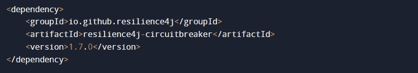

接下来，配置并实例化断路器：

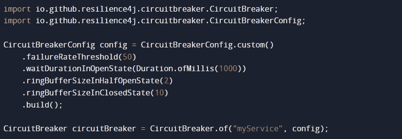

要将断路器应用于特定方法，请使用 Resilience4J 的函数式装饰器：

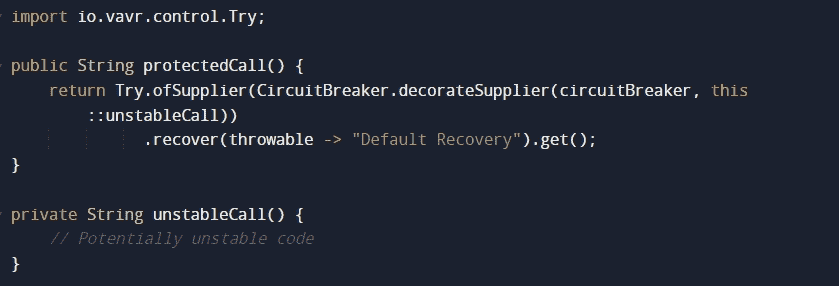

在这里，`unstableCall` 被封装在断路器中，因此所有调用都会被监控。如果 `unstableCall` 方法频繁失败，断路器就会触发，恢复逻辑将返回默认值。

### 监控与状态管理

Resilience4J 允许通过事件发布器有效地监控和管理断路器状态：

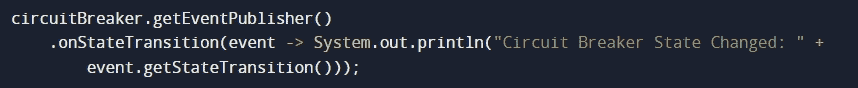

### 最佳实践

* 监控集成：将 Resilience4J 与 Prometheus 等监控系统结合，以跟踪断路器的行为。
* 全面测试：确保系统经过充分测试，以了解其在不同故障场景下的表现。
* 增量实现：在系统的关键点上逐步引入断路器，以便在不干扰现有功能的前提下理解其影响。

### 结论

在微服务架构中通过 Resilience4J 实现断路器模式可以显著增强系统的容错能力。通过正确配置断路器并采用策略性的监控和测试，开发者可以确保其系统能够抵抗各种故障，从而维持稳定性和服务可靠性。

### 使用 Eureka 进行服务注册与发现

在现代软件架构中，特别是那些采用微服务的架构，有效的服务发现至关重要。这确保了服务可以动态地发现并相互交互，而无需预先知道彼此的位置。Netflix 的 Eureka 提供了一个可靠的服务注册和发现解决方案，这对于处理此类动态交互是必不可少的。本文将探讨 Eureka 如何运行、其配置过程以及它为微服务架构带来的收益。

### Eureka 基础

Eureka 在微服务生态系统中承担着双重目的——既作为服务注册表又是发现代理。作为服务注册表，Eureka 允许系统中的每个服务宣布其存在并维护心跳以确保可用性。作为一种发现机制，它允许服务查询注册表，以便高效与其他服务通信。

* Eureka Server：此组件是服务注册表的核心。它记录了所有服务实例及其状态。服务必须在该服务器上注册，并定期发送心跳以信号其运行状态。
* Eureka Client：每个服务都包含一个 Eureka Client，负责处理注册、注销和发现职责。它定期向服务器发送心跳以确认服务的可用性。

### 配置 Eureka Server

使用 Eureka 的第一步是设置并配置 Eureka 服务器。这涉及下面详细说明的几个步骤：

1. 依赖管理：使用 Maven 或 Gradle 在你的项目中引入 Eureka Server。以下是使用 Maven 设置的方法：

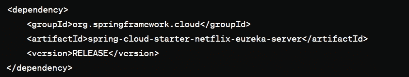

2. 服务器初始化：使用 Spring Boot 设置并运行 Eureka 服务器。在主应用类上使用 `@EnableEurekaServer` 注解来激活 Eureka 的服务器功能。

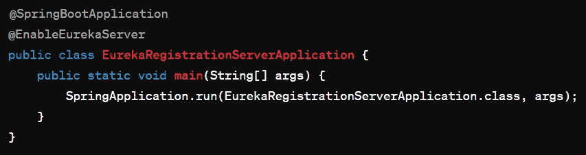

在 `application.properties` 或 `application.yml` 中配置服务器的操作参数，如端口和注册设置：

### Eureka Client 集成

将 Eureka Client 集成到微服务中可以使其向 Eureka 服务器注册并发现其他服务。以下是集成方法：

1. 添加客户端依赖：通过添加必要的 Maven 依赖为每个微服务配备 Eureka Client。

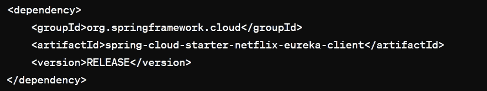

2. 启用发现：在服务的主应用类上添加 `@EnableEurekaClient` 注解以激活发现能力。

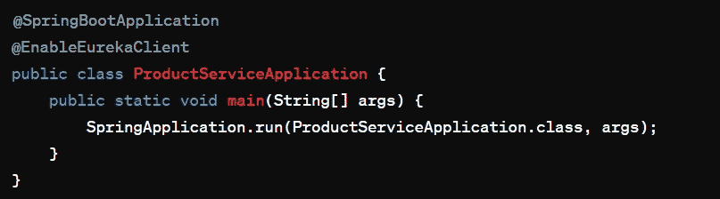

在服务的配置文件提供 Eureka 服务器的 URL，以确保其能够定位并向服务器注册：


### Eureka 的优势

在微服务架构中使用 Eureka 进行服务发现具有许多益处：

* 可靠性：Eureka 内置的韧性机制确保服务注册和发现的持续可用，增强了整体可靠性。
* 负载均衡：通过 Eureka，服务可以根据注册表中可用的活动服务实例信息进行客户端负载均衡。
* 简单性：Eureka 直观的设置和与 Spring Cloud 应用的集成使其成为寻求稳健服务发现解决方案开发者的易于选择。

### 结论

Eureka 为分布式系统（特别是基于微服务的系统）的服务注册和发现提供了坚实的基础。它跟踪服务实例和健康状态的能力确保了服务能够无缝地运行和交互，适应环境中的变化和故障。通过实现 Eureka，开发者可以显著提高应用程序的效率和韧性。

## 使用 Spring Security 和 JWT 保护微服务

在微服务的分布式框架中，实现稳健的安全性至关重要。使用 Spring Security 结合 JSON Web Tokens（JWT）可以为服务请求的验证和授权提供一个有效的框架。这种组合支持一种安全、无状态的通信协议，这对于微服务架构是必不可少的。本文将探讨如何部署带有 JWT 的 Spring Security 来增强微服务的安全性。

### JWT 在微服务中的重要性

JWT 是一种简洁且 Web 安全的令牌，便于服务之间安全地传输声明（claims），例如身份验证和授权详情。它们以紧凑格式封装了用户身份和权限。每个 JWT 都包含经过编码的 JSON 声明，包括令牌颁发者、主体（subject）和过期时间，并通过加密签名进行保护，以防篡改。

### 集成 Spring Security 和 JWT

在 Spring Security 中配置 JWT 涉及一系列定义良好的步骤，从依赖管理到身份过滤器的设置。以下是有效实现这些配置的方法：

### 1. 引入必要的依赖

首先将 Spring Security 和 JWT 集成到你项目的依赖管理工具中。对于 Maven 用户，依赖项看起来如下：

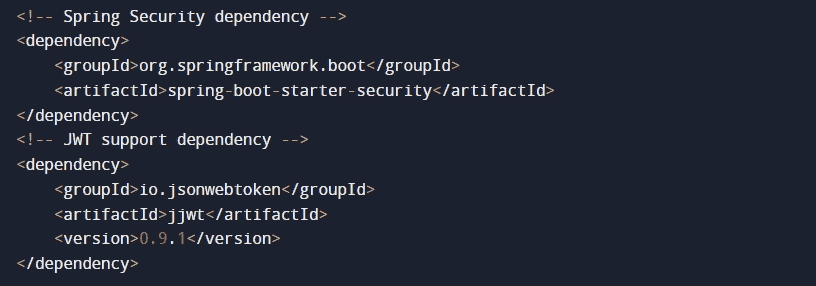

### 2. 配置 Spring Security

通过扩展 `WebSecurityConfigurerAdapter` 调整应用程序的安全配置以集成 JWT：

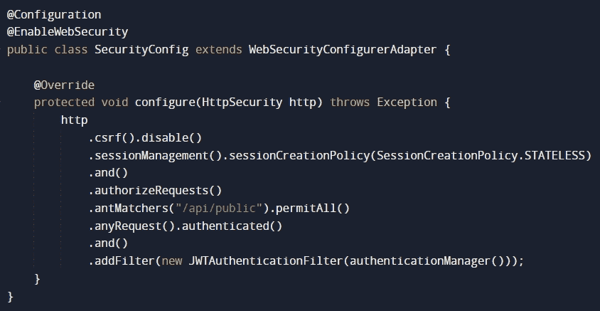

此配置确保禁用了 API 端点的 CSRF 保护，会话是无状态的，并且所有非公共请求都需要身份验证。

### 3. 实现 JWT 验证过滤器

创建一个自定义过滤器来处理使用 JWT 的验证逻辑：

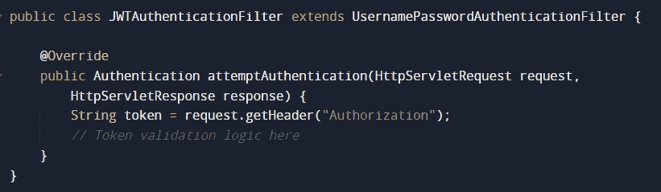

### 4. 令牌管理工具类

通过专门的工具类管理 JWT 的生命周期——创建和验证：

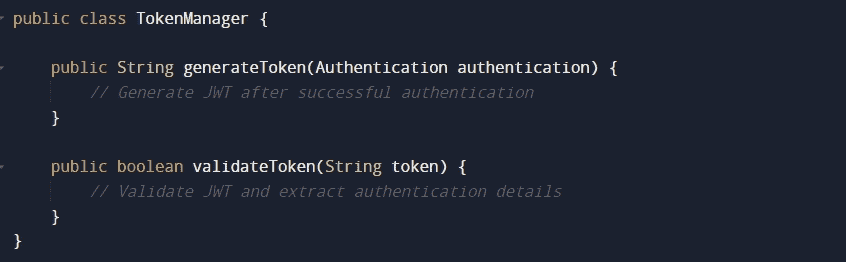

### 推荐的安全实践

* **安全传输**：确保 JWT 通过 HTTPS 传输以防止被截获。
* **令牌过期管理**：使用短寿命的 JWT 以降低令牌被滥用的风险，并在必要时提供令牌刷新机制。
* **密钥安全**：安全地管理用于签名 JWT 的密钥，理想情况下使用自动化密钥轮换和存储解决方案。

### 结论

利用 Spring Security 和 JWT 为微服务安全提供了一种全面的方法。该方法支持在分布式系统中以一种可扩展且可管理的方式对用户请求进行验证和授权。通过遵循令牌管理和系统配置的最佳实践，组织可以有效保护微服务免受未经授权的访问，并确保操作环境的安全。

## 实现 OAuth2 以安全 API 访问

在应用程序开发不断发展的版图中，保护 API 访问至关重要，特别是在跨外部应用程序利用用户数据的环境中。OAuth2 作为一种稳健的授权框架脱颖而出，它允许代表用户安全且受控地访问服务器资源，而无需暴露其凭据。本文深入探究了如何利用 OAuth2（特别是结合 Spring Security）来保护微服务及其他分布式系统中的 API 交互。

### OAuth2 的机制

OAuth2 协调了授权过程中四个关键参与者之间的安全交互：

* **资源所有者 (Resource Owner)**：通常是控制其账户数据的用户。
* **客户端 (Client)**：寻求访问用户账户的应用程序。
* **授权服务器 (Authorization Server)**：验证用户身份并向客户端颁发令牌。
* **资源服务器 (Resource Server)**：托管受保护的用户数据，并接受客户端的令牌以授予访问权限。

### OAuth2 的组件

该框架使用几个关键组件来确保安全的资源访问：

1. **访问令牌 (Access Token)**：客户端用于访问服务器资源的凭据。它受范围（scope）和持续时间的限制。
2. **刷新令牌 (Refresh Token)**：用于刷新访问令牌，而无需用户再次进行身份验证，适用于长时间会话。
3. **范围 (Scopes)**：定义了授予客户端的访问范围，限制了代表用户执行的操作。

### OAuth2 中的授权流

OAuth2 支持多种流模式以适应不同的应用程序需求：

* **授权码许可模式 (Authorization Code Grant)**：最适合可以安全存储凭据的客户端。通常用于服务端应用程序。
* **隐式许可 (Implicit Grant)**：为无法安全存储凭据的客户端（如移动端应用）设计。
* **资源所有者密码凭据许可 (Resource Owner Password Credentials Grant)**：适用于高度信任的应用程序，例如由服务商开发的程序。
* **客户端凭据许可 (Client Credentials Grant)**：当访问请求针对客户端自身的账户而非代表用户时使用。

## 使用 Spring Security 实现 OAuth2

Spring Security 为 OAuth2 全面支持，简化了其在 Java 应用程序中的实现。以下是分步骤指南：

### 1. 添加所需的依赖

在构建配置中包含 OAuth2 所需的 Spring Boot starter：

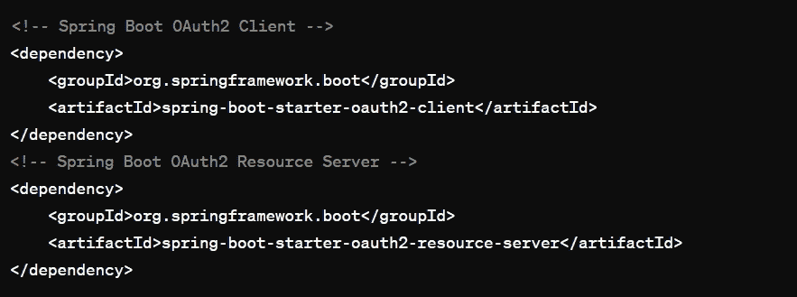

### 2. 设置授权服务器

配置授权服务器以验证用户身份并颁发令牌。


### 3. 配置资源服务器

确保你的资源服务器可以接收并验证 OAuth2 令牌。


### 4. 客户端配置

管理客户端安全以启用 OAuth2 登录，并确保适当的用户验证和授权。


### OAuth2 安全的最佳实践

* **安全令牌处理**：令牌应使用加密安全地存储和传输，以防止截获。
* **定期更新密钥**：频繁轮换客户端密钥和刷新令牌以增强安全性。
* **严格的重定向 URI 验证**：确保所有重定向 URI 都已在授权服务器注册，以防止未经授权的使用。

### 结论

将 OAuth2 与 Spring Security 集成为分布式应用程序的 API 访问提供了稳健的解决方案。通过设置详细的客户端和服务器配置并遵循最佳实践，开发者可以有效保护用户数据，并确保只有授权的客户端才能访问敏感资源。该框架不仅增强了安全性，还为跨应用程序管理身份验证和授权提供了灵活性和扩展性。

## 管理 API 密钥和访问令牌

在数字应用程序开发领域，保护 API 访问是一项基本关注。API 密钥和访问令牌是验证和授权用户与服务交互的重要工具。妥善管理这些标识对于确保应用程序安全至关重要。本文讨论了有效管理 API 密钥和访问令牌的关键实践，提供了保护应用程序免受未经授权访问和安全漏洞的策略见解。

### API 密钥和访问令牌概述

API 密钥是用于验证 API 用户或应用程序的唯一字符串。它们主要用于监控和控制 API 使用方式，确保正确的用户拥有访问权限，并相应提供或限制功能。

访问令牌用于授予访问特定资源，通常在身份验证成功后提供。这些令牌通常包含服务器可用于确认权限级别和用户身份的编码数据。

### API 密钥管理最佳实践

1. **安全存储**：避免将 API 密钥硬编码在源代码中。使用环境变量或安全的密钥管理服务（如 HashiCorp Vault 或 AWS Secrets Manager）来存储和访问密钥。
2. **限制性使用控制**：对 API 密钥的使用实施限制以防止滥用。这可以包括通过 IP 地址限制密钥的范围、设置请求数上限，或指定可访问的端点。
3. **定期密钥轮换**：定期更新 API 密钥以降低与潜在泄露相关的风险。建立通知用户密钥轮换的协议并自动化更新以最大限度地减少服务中断。
4. **使用监控**：持续监控 API 密钥的使用情况以检测异常活动。实施告警系统以标记异常的使用模式，并使用审计轨迹来跟踪密钥访问历史。

### 访问令牌管理最佳实践

1. **遵循标准格式**：使用广泛认可的令牌格式，如 `JWT`（JSON Web Tokens），这些格式允许自包含的信息存储和直观的验证过程。以下如何在 Java 中生成 `JWT` 的示例：


2. **短生命周期**：设计访问令牌具有较短的有效期，以在发生未经授权访问时最小化潜在的暴露窗口。
3. **安全令牌传输**：确保令牌始终通过安全连接（HTTPS）传输，以防止恶意实体的拦截。
4. **严格令牌验证**：在每次使用时系统地验证令牌的真实性和完整性。检查有效签名、过期时间以及相关声明的正确性。

### 结论

对 API 密钥和访问令牌进行细管理对于维护应用程序的安全至关重要。通过实施稳健的管理策略，开发者可以保护其 API 免受未经授权的使用和潜在的安全威胁。跟踪安全最佳实践并定期完善管理流程是有效保障 API 基础设施的关键步骤。

# 第章

## Spring Boot 测试策略

### Spring Boot 的高级测试技术

Spring Boot 以其“约定优于配置”的哲学简化复杂应用程序的开发而闻名。然而，随着应用程序的扩展和变得复杂，高级测试对于保证功能和性能变得至关重要。本文概述了为 Spring Boot 定制的复杂测试方法，包括集成测试、性能测试和合约测试，并附带实际应用的示例。

### Spring Boot 中的集成测试

集成测试验证应用程序的各个组件是否协同工作。Spring Boot 通过专用工具和注解简化了这一过程。

#### 1. `@SpringBootTest` 注解

`@SpringBootTest` 注解有助于加载完整的应用程序上下文以模拟真实的测试环境，这对于检查组件之间的交互非常理想。

使用 `@SpringBootTest` 的集成测试示例：


此测试确保 `ProductService` 在应用程序环境中按预期运行，并与其依赖项正确交互。

#### 2. 测试切片 (Test Slices)

Spring Boot 还提供了测试切片，如 `@WebMvcTest`、`@DataJpaTest` 和 `@JsonTest`，它们仅加载应用程序上下文的相关部分，使测试专注于特定层。

* `@WebMvcTest`：专注于 Spring MVC 控制器。
* `@DataJpaTest`：测试 JPA 仓库。
* `@JsonTest`：检查 JSON 序列化和反序列化。

使用 `@WebMvcTest` 的示例：


此示例通过模拟 `ProductService` 并断言器的响应来测试 `ProductController`。

### 性能测试

性能测试确保您的应用程序在预期负载下运行性能良好。

#### 1. 使用 Gatling 进行负载测试

Gatling 是模拟高用户负载以测试应用程序性能的有效工具。

Spring Boot 的 Gatling 示例：


该脚本使用 Gatling 模拟 100 用户同时访问产品详情页。

### 合约测试

合约测试验证微服务之间的交互是否符合预定义的协议。Spring Cloud Contract 是 Spring Boot 应用中实现合约测试的流行选择。

#### 1. 使用 Spring Cloud Contract

Spring Cloud Contract 允许开发者定义自动生成测试的 API 合约。

Groovy 中的合约定义：


该合约规定对 `/products/1` 的 GET 请求应成功返回代表“笔记本”的 JSON 对象。

### 结论


采用高级测试技术对于开发可靠且可扩展的 Spring Boot 至关重要。集成测试、性能测试和合约测试等技术确保应用程序不仅符合开发标准，还为实际操作做好了准备。通过整合这些测试策略，开发者可以显著提高软件产品的韧性和质量。

## 编写有效的单元测试、集成测试和端到端测试

全面的测试是确保应用程序健壮、安全和高效的基础。完善的测试策略通常包括单元测试、集成测试和端到端测试，每种测试针对软件功能和交互的特定方面。本文重点介绍如何在 Spring Boot 项目中有效实施这些测试方法，提供通过结构化测试增强软件质量的指南。

### 单元测试

单元测试涉及隔离测试单个组件，这对于确认应用程序的每个部分都按设计执行且不受外部依赖至关重要。

**最佳实践：**

* **隔离**：利用 `Mockito` 等模拟框架在测试期间隔离组件，确保没有外部系统影响结果。
* **覆盖率**：专注于实现针对业务关键路径和复杂算法的有意义的测试覆盖。
* **清晰与简单**：确保测试直观且易于理解，这有助于未来的维护。

Java 单元测试示例：


在此示例中，测试了 `ProductService` 以确认其能够正确获取并返回产品。模拟了 `ProductRepository` 以确保测试与其他组件隔离。

### 集成测试

集成测试检查集成单元之间的连接和数据交换，以检测其交互中的故障。这种形式的测试对于验证必须无缝协作的复杂系统至关重要。

**最佳实践：**

* **使用真实数据**：使用与生产环境处理的数据相似的数据进行测试。
* **环境相似性**：确保测试环境镜像生产环境，以减少不一致。
* **关注通信点**：将测试集中在组件交互的区域。

Spring Boot 集成测试：


该脚本通过模拟 Spring Boot 提供的环境内的交互，验证 `UserController` 是否正确处理请求。

### 端到端测试

端到端测试检查系统从开始到结束的操作，确保所有集成组件都能正常工作，模拟真实的使用场景。

**最佳实践：**

* **用户交互模拟**：使用 `Selenium` 等工具实现系统内用户交互自动化。
* **全面场景测试**：测试常见的用户工作流以及潜在的边缘情况。
* **类生产环境**：在尽可能复制上线设置的环境中测试。

使用 Selenium 的端到端测试：


此测试模拟了用户登录应用程序的过程，以验证端端功能和用户界面交互，展示了真实用户体验的应用程序行为。

### 结论

实施多样化的测试——单元测试、集成测试和端端测试——对于开发可靠且适用于实际部署的 Spring Boot 应用程序至关重要。这些测试确保了应用程序的各个方面都经过了审查和验证，从而提高了软件质量并改进了用户体验。

## 微服务的隔离测试与整体测试

微服务架构将复杂的应用程序分解为较小的、独立的单元，每个单元处理不同的功能。这种方法增强了可扩展性和灵活性，但也引入了特定的测试挑战。有效的测试必须同时解决单个服务的功能隔离测试以及这些服务在整个系统中的相互作用。本文概述了对微服务进行单独和整体彻底测试的策略性方法，并辅以说明性示例。

### 单独测试微服务

微服务的隔离测试侧重于独立于其他服务来验证每个服务的功能。这种测试策略集中在服务的内部操作以及它在各种变化条件下处理预期任务的能力。

### 最佳实践：

- **模拟外部依赖项**：利用 `Java` 中的 `Mockito` 等工具模拟外部服务或数据库，确保受测的微服务在受控环境中运行。
- **强调单元测试和集成测试**：将测试重点直接转向验证服务的核心功能和内部集成，而不涉及外部微服务的交互。
- **自动化回归测试**：实施自动化测试，以根据其规范持续验证服务，特别是在修改之后。

### Spring Boot 单元测试示例：


此单元测试隔离了 `ProductService`，使用 `Mockito` 模拟了 `ProductRepository` 的交互，并验证了服务正确地处理并响应了预期的产品。

### 微服务的全面系统测试

微服务的系统级测试或端端测试确保了组装服务按照预期方式进行交互，并紧密地满足系统需求。

### 最佳实践：

- **利用端端测试工具**：利用 `Selenium` 或 `Cucumber` 等测试框架模拟跨多个服务的、涵盖系统的全面用户交互。
- **契约测试**：使用 `Pact` 等工具验证服务交互是否符合预定义的协议，确保 API 的消费者和提供者在接口上保持一致。
- **执行性能测试**：使用 `JMeter` 或 `Gatling` 等工具评估系统在典型和峰值负载下的性能，以衡量其容量和恢复能力。

### 使用 Selenium 进行端端测试示例：


此 `Selenium` 脚本演示了从头到尾的用户注册流程测试，评估了服务如何协作完成用户旅程。

### 结论

对每个微服务进行隔离测试以及作为整个系统的一部分进行测试对于开发健壮的微服务架构至关重要。通过有效采用这些测试策略，开发者可以确保每个微服务正确执行其指定的功能，并且整个系统无缝运行。这种彻底的测试实践使部署的应用程序具有更高的可靠性和用户满意。

# 第八章

## 使用 Swagger 和 Springfox 进行 API 文档

### 使用 Swagger 自动生成 API 文档

在现代软件开发中，维护精确且最新的 API 文档对于跨服务的高效通信是必要的。`Swagger` 作为 `OpenAPI Specification` 规范件的一部分，擅长自动生成 API 文档。该系统会自动更新文档以反映 API 的修改，这有助于更好的团队协作和理解。本文解释了实现 `Swagger` 以自动增强 API 文档的过程。

### Swagger 概述

`Swagger` 是一个具有影响力的开源项目，帮助开发者创建、文档化和消费 RESTful Web 服务。它包含了自动化文档生成、客户端 SDK 制作和测试程序的工具。`Swagger` 的核心功能围绕其规范文件展开，该文件以 `JSON` 或 `YAML` 格式描述 API 的端点、操作和相关参数。

### 使用 Swagger 的优势

1. **自动化文档**：通过从 API 的规范文件生成文档，`Swagger` 确保文档与 API 的当前版本持续同步。
2. **交互式文档**：`Swagger UI` 为开发者和用户提供了一个动态界面，可以直接从浏览器与 API 功能进行交互。
3. **遵循标准**：`Swagger` 符合 `OpenAPI Specification`，确保了与其他广泛开发工具和系统的兼容性，增强了互操作性。

### 将 Swagger 集成到 Spring Boot

将 `Swagger` 集成到 `Spring Boot` 应用程序中可以 API 的可见性和用户交互。以下是如何有效集成 `Swagger` 的指南：

1. **引入 Swagger 依赖**

通过添加必要的依赖将 `Swagger` 集成到你的 `Spring Boot` 项目中。对于 `Maven` 项目，`pom.xml` 中的所需依赖为：


2. **Swagger 配置**

设置一个配置类来在应用程序中激活并配置 `Swagger`：


此设置告诉 `Swagger` 记录你应用程序中的每个控制器和路由。

3. **访问 Swagger 文档**

设置完成后，在浏览器中导航 `http://localhost:8080/swagger-ui.html` 访问自动生成的文档。该 URL 提供了交互式的 `Swagger UI`，所有的 API 端点可以在那里直接查看和测试。

### 结论

`Swagger` 简化了开发者的文档流程，确保 API 文档与实际 API 实现一致。对于使用 `Spring Boot` 的开发者，集成 `Swagger` 简化了文档的生成和更新，改进了标准遵循情况并增强了交互性。这使得 `Swagger` 成为专注于创建清晰交互式 API 文档的者的必备工具。

### 使用注解自定义 API 文档

在当今的技术驱动的环境中，有效的 API 文档对于软件服务的正确利用和集成至关重要。注解对于自定义此类文档起着关键作用，允许直接在代码库中嵌入详细元数据。这种方法显著增强了文档的清晰度和实用性，帮助开发者高效地导航和集成 API。本文讨论了使用注解丰富 API 文档，强调了 `Swagger` (`OpenAPI`) 工具的实际应用。

### 注解在 API 文档中的重要性

注解作为元数据通过提供不改变代码执行方式的额外细节来丰富源代码。它们在 API 文档对于提供 API 元素功能的见解至关重要。`Swagger` 等工具利用这些注解来自动生成丰富、全面的 API 文档。

### 增强 API 文档的核心注解

1. **Operation 注解**：这涉及使用注解详细说明 API 端点的功能、它支持的 HTTP 方法以及它产生什么响应，使 API 的功能显式且易于理解。

2. **参数文档**

注解有助于阐明 API 端点接受的参数，包括它们的类型、必要格式和用法。

3. **请求与响应详情**

使用注解来描述预期的请求格式和可能的响应，有助于为 API 消费者建立清晰的预期，准确展示应发送什么数据以及可能的结果是什么。

### 在 Spring Boot 中部署 Swagger 注解

`Swagger` 是一个著名的框架，支持 `OpenAPI` 规范并有助于集成注解以自动生成详细的 API 文档。以下是在 `Spring Boot` 环境中实现 `Swagger` 注解的方法：

#### 1. 初始化 Swagger 设置

要引入 `Swagger`，首先开始将其依赖项添加到到你的 `Spring Boot` 项目中。对于 `Maven` 项目，这需要在你的 `pom.xml` 中添加以下内容：


#### 2. 利用 Swagger 注解

配置完成后，可以在你的控制器类（`controller classes`）中使用 `Swagger` 注解来丰富你的 API 文档：


这段代码演示了 `@Api`、`@ApiOperation` 和 `@ApiParam` 注解的使用，为 API 端点提供了详细描述和预期的交互。

### 基于注解的 API 文档的优势

利用注解进行 API 文档带来了多个关键优势：

- **提高文档质量**：注解确保文档是精确、详细并与 API 功能直接一致的。
- **提高开发效率**：准确的文档减少了开发者理解和使用 API 所花费的时间。
- **团队间的一性**：详细且清晰的注解有助于保持一致的理解，防止在解释 API 功能时出现差异。

### 结论

注解是自定义 API 文档的强大手段，它将详细描述无缝集成到代码中，从而增强了准确性和可用性。当与 `Swagger` 等工具结合使用时，注解提供了一种生成和维护 API 文档的动态方法。这种策略不仅优化了文档过程，还通过确保 API 易于理解和正确使用，提升了整体开发者体验。

## 集成 Springfox 实现无缝 Spring Boot 集成

在现代软件开发中，拥有详细且实时的 API 文档对于最大化 Web 效率和互操作性至关重要。`Springfox` 是一个旨在与 `Spring Boot` 无缝集成工具，能够自动生成符合 `Swagger` 规范的 API 文档。这种自动化确保了开发者可以访问实时的交互式文档，这与 API 的操作完美契合。本文详细介绍了如何在 `Spring Boot` 环境中实现 `Springfox`，以有效地简化 API 文档工作。

### 了解 Springfox

`Springfox` 允许使用 `Swagger 2` 规范为 `Spring Boot` 自动生成 API 文档。它从你的 `Spring` 控制器和模型读取注解，并生成 `JSON` 或 `YAML` 文档。该文档随后被 `Swagger UI` 用于渲染一个全面且交互式的文档界面，这简化了 API 文档的创建和维护。

### Springfox 与 Spring Boot 集成的优势

`Springfox` 与 `Spring Boot` 的集成提供了显著的优势：

- **自动文档化**：`Springfox` 直接从应用程序代码库生成最新的文档，反映 API 的最新更改。
- **文档增强**：开发者可以使用注解来丰富自动生成的文档，提供额外的细节、示例和描述。
- **轻而于集成**：`Springfox` 专为 `Spring Boot` 设计，仅需极少配置即可集成到应用程序中，提高了开发者生产力。

### 如何将 Springfox 集成到 Spring Boot

将 `Springfox` 集成到 `Spring Boot` 应用程序涉及以下几个简单的步骤：

1. **引入 Springfox 依赖**：将所需的 `Springfox` 依赖项添加到项目中以启用 `Swagger` 文档。对于 `Maven` 用户，在项目的 `pom.xml` 中包含这些内容：


2. **创建 Swagger 配置**：通过在你的 `Spring Boot` 应用程序中配置 `Springfox` 来设置它。这涉及创建一个新的配置类，指定如何生成 `Swagger` 文档：


此配置告诉 `Springfox` 记录指定包内的 API，使得控制哪些内容被记录变得简单。

3. **访问 Swagger UI**：在应用程序配置并运行后，通过在浏览器中访问 `http://localhost:8080/swagger-ui.html` 来访问 `Swagger UI`。该 URL 提供 `Swagger UI`，你可以在其中与已文档的 API 端点进行交互。

### 使用 Swagger 注解进行详细文档

为了进一步改进文档，可以在整个 API 代码中广泛应用 `Swagger` 注解：

- 使用 `@ApiOperation` 和 `@ApiResponses` 描述方法及其可能的 HTTP 响应。
- 使用 `@ApiParam` 详细说明方法参数。

使用 Swagger 注解增强的 API 文档示例：


### 结论

将 `Springfox` 与 `Spring Boot` 集成通过自动化生成过程和提供交互式文档界面简化了 API 文档任务。这种无缝集成确保了文档既可访问又与当前 API 保持，极大地增强了可用性和开发者体验。通过详细的注解和极少的设置，`Springfox` 是现代 API 开发环境中不可或缺的工具。

# 第九章

## 异步通信与消息

### 微服务中的异步通信简介

异步通信是增强微服务架构可扩展性和功能的关键技术。它允许服务在不等待直接响应的情况下交换消息，促进不同服务之间的独立和并行操作。这种方法与每次交互都要等待响应后继续的同步通信形成对比。本文研究了异步通信在微服务中的作用、优势、潜在陷阱以及常见的实现方法。

### 异步通信的基础

异步通信允许微服务发送消息而不需要接收者立即响应。这种方法减少了服务之间的依赖关系，允许每个服务自主运行并继续操作，而不被其他服务阻塞，这在服务响应速度可能变化的分布式系统中特别有益。

### 异步通信的优势

在微服务中实现异步通信具有多处好处：

- **可扩展性**：它便于服务的扩展，因为它们没有与其他服务的响应时间紧密耦合。
- **韧性**：系统更加健壮，并能够更好地处理单个服务的故障，因为整个系统不依赖于同步响应。
- **运营效率**：服务无需空闲地等待响应并可以执行其他任务，从而提高了资源利用率。

### 异步通信的挑战

然而，异步通信也引入了需要仔细处理的特定挑战：

- **维护数据一致性**：由于服务独立运行，确保系统范围内的数据一致性变得更加复杂。
- **监控的复杂性**：异步性质使得追踪请求和响应的完整路径变得困难，增加了调试和监控的难度。
- **基础设施需求**：建立一个可靠的消息传递基础设施以支持异步通信会增加系统的复杂性和开销。

### 异步通信中的关键模式

通过满足微服务架构中不同需求的模式模式可以实现有效的异步通信：

1. **事件驱动架构**：服务基于事件而非直接调用进行运行，减少了直接依赖并增强了解耦。
2. **消息队列**：如 `RabbitMQ` 和 `Apache Kafka` 等技术负责管理服务之间的消息，确保在高负载或故障期间保持通信的畅通。
3. **命令查询职责分离 (CQRS)**：该模式将读、写操作分离到不同的组件中，便于对数据进行异步高效处理。

### 使用 RabbitMQ 和 Spring Boot 实现异步通信

在 `Spring Boot` 应用中使用 `RabbitMQ` 设置异步消息传递是非常简单的。以下是消息监听器可能的一种实现示例：


此代码段在 `Spring Boot` 中设置了 `RabbitMQ` 监听器，允许服务异步地接收和处理告警消息。

### 结论

异步通信通过提高可扩展性、韧性和效率，为微服务带来了实质性的收益。虽然它引入了数据一致性和系统复杂性增加等挑战，但可以通过适当的架构模式和技术进行有效管理。理解并利用异步通信策略允许开发者构建更具动态且更健壮的微服务架构。

## 使用 RabbitMQ 和 Kafka 实现消息队列

在现代分布式系统领域，采用消息队列技术可以增强服务的健壮性和响应能力。`RabbitMQ` 和 `Apache Kafka` 是该领域的两个主流平台，每个平台都带来了专门的能力以满足多样化的需求。本文将重点介绍 `RabbitMQ` 和 `Kafka` 如何促进有效的消息队列实现，并关注它们的独特优势、配置步骤和适用用例。

### 消息系统中的 RabbitMQ

`RabbitMQ` 是一个开源消息代理，因其在处理复杂消息场景时的健壮性和多功能而受推誉。

### 核心特性：


# 复杂的路由机制与可靠的消息处理

* **复杂的路由机制**：它支持多种路由配置，包括直接（direct）、主题（topic）、头（headers）和扇出，能够实现复杂的消息分配策略。
* **可靠的消息处理**：通过确认功能确保消息被可靠地发送和接收。
* **支持持久化消息**：确保消息在系统重启后安全存储，防止数据丢失。

## Spring Boot 与 RabbitMQ 的集成

以下是将 `RabbitMQ` 集成到 `Spring Boot` 应用的方法：

1. **在 `pom.xml` 中设置依赖**：
   

2. **在 `application.properties` 中配置 RabbitMQ**：
   

3. **实现消息发布者**：
   

4. **设置消息消费者**：
   

## 用于事件流的 Kafka

`Apache Kafka` 以其处理海量数据流的能力闻名，使其成为高吞吐需求的选择。

### 主要特性

* **卓越的吞吐量**：`Kafka` 能够每秒管理数百万消息，支持大规模数据流。
* **水平可扩展性**：可以进行水平扩展以适应增加的流量而无需停机。
* **全面的数据保留**：允许对数据保留策略进行详细配置，以适应长期存储需求。

## Kafka 与 Spring Boot 的集成

通过 `Spring Kafka` 库可以在 `Spring Boot` 设置中方便地配置 `Kafka`。

1. **在 `pom.xml` 中添加 Kafka 依赖**：
   

2. **在 `application.properties` 中设置 Kafka**：
   

3. **Kafka 生产者配置**：
   

4. **Kafka 消费者设置**：
   

## 结论

`RabbitMQ` 和 `Kafka` 为微服务和服务环境中构建高级消息队列系统提供了关键能力。`RabbitMQ` 适用于需要详细消息路由和交付保证的应用，而 `Kafka` 在需要高吞吐量和健壮数据保留的场景中表现优异。将这些平台正确集成到 `Spring Boot` 应用中可以显著增强服务的性能和可扩展性，符合现代企业系统的需求。

# 使用 Spring Boot 配合异步消息系统

`Spring Boot` 简化了基于 `Spring` 的应用开发，特别是通过异步消息能力增强了微服务架构。这种消息机制允许服务在无需同步等待的情况下进行通信，从而提高了系统效率和可扩展性。本文提供了将 `Spring Boot` 与 `RabbitMQ` 和 `Apache Kafka` 等知名消息系统集成的见解，并附带实现示例。

## Spring Boot 中的异步消息概述

在异步消息框架中，服务发送消息时不等待立即响应，允许它们同时继续其他处理。这种模型对于提高吞吐量和降低延迟至关重要。`Spring Boot` 通过对 `RabbitMQ` 和 `Kafka` 的无缝集成实现了这一点，适用于各种消息需求。

## RabbitMQ 与 Spring Boot 的集成

`RabbitMQ` 是一种灵活的开源消息代理，因其可靠性和多样化的消息功能而深受好评。

### RabbitMQ Spring Boot 配置

要将 `RabbitMQ` 引入 `Spring Boot`，需要添加特定的依赖并连接属性。

1. **包含 Spring AMQP 依赖**：`Spring Boot` 使用 `Spring AMQP` 启动包与 `RabbitMQ` 集成。这可以添加到 Maven 配置中：
   

2. **RabbitMQ 配置设置**：在应用的属性文件中配置 `RabbitMQ` 设置：
   

3. **创建消息发布者**：开发一个使用 `RabbitMQ` 发布消息的服务：
   

4. **实现消息接收器**：设置一个异步接收消息的组件：
   

## Kafka 集成 Spring Boot

`Apache Kafka` 擅长处理高量数据流，适用于实时数据处理。

### Spring Boot 的 Kafka 设置

`Spring Boot` 对 Kafka 的支持通过 `Spring Kafka` 项目管理，方便了生产者和消费者的配置。

1. **Kafka 依赖**：在项目中包含 `Spring Kafka` 依赖：
   

2. **Kafka 配置**：在配置文件中定义 `Kafka` 连接设置：
   

3. **Kafka 生产者服务**：建立一个向指定 `Kafka` 主题发送数据的服务：
   

4. **Kafka 消费者组件**：创建一个处理 `Kafka` 消息的监听器：
   

## 结论

将 `Spring Boot` 与 `RabbitMQ` 和 `Kafka` 等异步消息系统相结合，增强了微服务高效运行和动态扩展的能力。这些系统促进了非阻塞通信，这对于处理大量数据或需要高响应的应用至关重要。`Spring Boot` 简化的配置和管理工具使得集成这些强大的消息解决方案变得更加简单，开发者能够专注于创建有价值的功能，同时保持应用程序的高性能和可靠性。

# Docker 与容器化详解

Docker 通过利用容器化的力量，显著重塑了软件部署的方法。这种方法将应用程序及其所有依赖项封装在一个统一、可移植的容器中，确保在各种计算环境中具有一致的行为。本文将深入探讨 Docker 的基本原理，探索其优势，并审视其在现代软件开发周期中的应用。

Docker 是一个开创性的开源平台，通过使用容器来增强应用的部署、运行和扩展。容器将应用程序及其所有先决条件打包在一起，从而在任何机器上实现运行环境的标准化。

容器化与传统的虚拟化的区别之处在于，它是在操作系统层面进行隔离，而不是模拟整个硬件堆栈。这允许容器共享宿主机的 OS 内核，与虚拟化硬件资源的完整虚拟机相比，它提高了效率并减少了资源开销。

## Docker 核心组件

Docker 包含几个关键元素，有助于容器的流式管理：

* `Docker Engine`：Docker 的核心，该运行时组件负责容器的创建和运行。
* `Docker Images`：这些是启动 Docker 容器的静态模板，包含了所有必要的可执行应用程序内容和库。
* `Docker Containers`：这些是运行封装在 Docker 镜像中的应用程序的活跃环境，确保跨系统的一致运行。

## Docker 的优势

1. **环境间的统一性**：Docker 标准化了开发、测试和生产环境之间的应用程序环境，有效地解决了“在我的机器上可以运行”的问题。
2. **部署速度**：容器轻量级且启动速度比传统方法更快，实现了快速部署和扩展。
3. **可扩展与模块化**：Docker 通过将容器作为独立的实体管理，支持有效的扩展策略，简化了应用的更新和模块化。
4. **资源效率**：由于容器共享宿主机 OS，因此它们比需要独立 OS 实例的虚拟机更节省资源。

## 基本 Docker 命令

处理 Docker 通常涉及几条命令行指令。基本命令包括：

* **拉取镜像**：
  
  这从 Docker Hub 获取 Redis 镜像。

* **运行容器**：
  
  以后台模式启动 Redis 容器。

* **列出容器**：
  
  列出所有容器，包括运行中和停止的。

* **停止容器**：
  
  停止指定的容器。

* **移除容器**：
  
  从系统中删除未运行的容器。

* **构建 Docker 镜像**：
  
  从当前目录下的 `Dockerfile` 构建名为 `your-app-name` 的 Docker 镜像。

## 开发流程中的 Docker

Docker 是现代开发运维中不可或缺的一部分，特别是在持续集成/持续部署（CI/CD）环境中。它还与 Kubernetes 等编排平台有效配合，用于管理大规模容器化应用。Docker 的可靠性确保开发者可以专注于创建软件，而不受可能导致意外问题的环境差异的影响。

### 结论

Docker 和容器化改变了软件部署和管理的范式，促进了运营格局中的效率和一致性。随着 Docker 的不断演进，它与云服务和微服务架构的深度集成可能会增强其在现代 IT 基础设施中的关键作用。

# Spring Boot 应用的容器化

容器化显著改变了应用程序开发和部署的方式，确保了在不同环境中的功能一致性。Docker 对于 Spring Boot 应用特别有效，允许它们将所有必要的组件打包成一个可部署的单元。本文概述了如何使用 Docker 将 Spring Boot 应用容器化，详细介绍了从创建 `Dockerfile` 到在容器内执行应用程序的每个步骤。

## Spring Boot 容器化的基础

Spring Boot 通过简化配置和部署过程促进了 Spring 应用的快速开发。将 Docker 与 Spring Boot 集成进一步增强了这一点，提供了一个从开发到生产无缝过渡的统一环境，从而解决了环境之间差异的常见困境。

## Spring Boot 应用容器化的先决条件

要开始容器化过程，你需要：

* 一个现有的 Spring Boot 应用：需要一个功能完备 Spring Boot 应用。
* 安装 Docker：必须在你的系统中正确安装 Docker。可以在 Docker 官方网站上找到安装说明。
* 熟悉 `Dockerfile`：了解 `Dockerfile` 语法至关重要，因为这些文件指导 Docker 如何构建应用镜像。

## 为 Spring Boot 开发 Dockerfile

`Dockerfile` 包含了用户可以在命令行调用的命令，用于组装镜像。以下是一个 Spring Boot 应用的 `Dockerfile` 示例：


此 `Dockerfile` 执行了以下操作：

* `FROM`：为后续指令建立基础镜像。
* `WORKDIR`：设置执行 `CMD` 或 `ENTRYPOINT` 命令的目录。
* `COPY`：将文件从本地文件系统放置到容器中。
* `EXPOSE`：标记容器监听连接的端口。
* `ENV`：设置环境变量。
* `ENTRYPOINT`：指定容器启动时执行的可执行命令。

## 构建并运行 Docker 容器

准备好 `Dockerfile` 后，继续构建并运行容器：

1. **构建 Docker 镜像**：在存放 `Dockerfile` 的项目目录中执行以下命令：
   
   该命令创建一个名为 `my-springboot-app` 的 Docker 镜像。

2. **启动 Docker 容器**：使用以下命令启动容器：
   
   这会将容器的 `8080` 端口映射到宿主机的 `8080` 端口，使得可以通过 `localhost:8080` 访问应用程序。

## 容器化的最佳实践

* **优化构建上下文**：将 `Dockerfile` 置于项目根目录，并利用 `.dockerignore` 排除不需要的文件。
* **实施多阶段构建**：通过分离构建阶段来实现更精简的最终镜像。
* **定期更新**：通过更新到最新的基础镜像来包含安全补丁，确保安全性。

### 结论

使用 Docker 对 Spring Boot 应用容器化不仅简化了部署过程，还确保了应用程序在所有开发阶段的一致性。通过遵循上述步骤，开发者可以有效利用 Docker 的功能来增强 Spring Boot 应用的可移植性和可靠性。

# Dockerfile 和 docker-compose 的最佳实践

Docker 是容器应用部署和管理的重要工具，提供了一个简化从开发到生产过程的框架。`Dockerfile` 和 `Docker Compose` 文件是有效使用 Docker 的核心，有助于自动化和简化容器配置。本文将概述编写 `Dockerfile` 和 `Docker Compose` 文件的关键最佳实践，以确保你的容器构建高效且易于维护。

## 优化 Dockerfile

`Dockerfile` 本质上是一个由命令和参数组成的脚本，定义了创建 Docker 容器镜像的步骤。以下是优化 `Dockerfile` 效率的一些关键指南：

1. **精确指定基础镜像**：在引用基础镜像时，始终使用特定的标签（tag）或摘要（digest），以避免 `latest` 标签带来的歧义，确保跨构建过程的一致性。
   

2. **减少镜像层**：将相关的命令合并到单个 `RUN` 语句中，以减少镜像层数，提高构建性能并减小镜像大小。
   

3. **利用 .dockerignore**：使用 `.dockerignore` 文件将不需要的文件排除在 Docker 上下文之外（类似于 `.gitignore`），可以提高构建速度和效率。
   

4. **最小化安装包**：通过仅安装必要的包来保持镜像精简，减少漏洞暴露风险并最大限度地减少资源消耗。

5. **智能使用构建缓存**：Docker 会对之前构建中未更改的步骤重用中间层。合理构建你的 `Dockerfile`，将经常更改的步骤放在最后以利用这一特性。

6. **使用 ARG 和 ENV 增加灵活性**：使用 `ARG` 参数化构建变量，使用 `ENV` 配置运行时，以增加 `Dockerfile` 的灵活性和可用性。
   

## Docker Compose 最佳实践

`Docker Compose` 是管理多容器 Docker 应用程序的重要工具。YAML 文件配置了所有应用程序服务，这对于简化操作至关重要。

1. **指定 Compose 文件版本**：始终声明 Compose 文件版本，以避免与 Docker 引擎出现兼容性问题。
   

2. **环境分离配置**：为不同的环境（开发、测试、生产）维护不同的 `Docker Compose` 文件，以自定义配置并有效管理扩展。
   

3. **管理卷和日志**：在必要时配置卷以实现数据持久化，并设置合适的日志驱动以满足运维需求。
   

4. **部署策略**：在 Compose 文件中实现策略，管理更新和回滚对运行中服务的影响，确保最短停机时间。
   

5. **非根用户**：尽可能以非根用户运行服务以增强安全性。
   

### 结论

遵循这些 `Dockerfile` 和 `Docker Compose` 的最佳实践可以极大增强 Docker 应用的开发、部署和维护。高效的 `Dockerfile` 和 `Docker Compose` 设置不仅能简化容器管理过程，还能增强整个部署的安全性和性能。通过实施这些策略，开发者可以构建更健壮、更易管理的容器化环境。

# 第十一章：将微服务部署到云端

## 云部署选项概述 (AWS, Azure, GCP)

随着数字时代的不断扩大，云计算已成为寻求增强扩展性、敏捷性和技术进步的组织的必选。云服务市场主要由三大平台主导：亚马逊云服务 (AWS)、微软 Azure 和谷歌云平台 (GCP)。每个平台都提供了针对不同业务需求定制的独特功能。本文将深入探讨这些平台，介绍它们的关键服务、优势以及在优化应用部署时需要考虑的重点。

### 亚马逊云服务 (AWS)

#### 概述与服务

AWS 由亚马逊于 2006 年发起，是一个全面且被广泛采用的云平台，在众多全球区域提供涵盖计算、存储、网络、数据库等广泛的服务。它旨在服务从初创公司到大型企业的各种规模的业务。

**主要服务：**

* `EC2` (弹性计算云)：可扩展的虚拟服务器。
* `S3` (简单存储服务)：高持久性的对象存储。
* `RDS` (关系型数据库服务)：托管关系型数据库服务。
* `Lambda`：无服务器计算服务。

**优势：**

* 服务种类丰富。
* 庞大的全球布局和高可用性。
* 强大的安全功能。
* 完善合作伙伴和第三方工具生态系统。

**考虑因素：**

* 服务数量之大可能让人无从下手。
* 有效管理成本需要勤勉工作和对定价模型的理解。

### 微软 Azure

#### 概述与服务

微软 Azure 于 2010 年推出，是微软的云计算解决方案，提供广泛云服务，包括计算、分析、存储和网络服务。其集成能力使其特别受植于微软环境的企业青睐。

**核心服务：**

* `Azure Virtual Machines`：部署虚拟机器。
* `Azure SQL Database`：托管数据库服务。
* `App Services`：开发和托管 Web 应用。


# 云平台对比

## Azure

* `Azure Kubernetes Service (AKS)`：管理 Kubernetes 环境。

**优势：**

* 与微软产品无缝集成。
* 针对混合云部署的全面解决方案。
* 为开发者提供丰富的工具。

**考虑因素：**

* 复杂的服务配置。
* 混合云解决方案成本可能较高。

## 谷歌云平台 (GCP)

### 概述与服务

GCP 由谷歌于 2008 年推出，提供的服务基于支持 YouTube 和 Gmail 等谷歌终端用户产品的相同基础架构。它主要提供计算、数据存储和机器学习领域的服务。

**知名服务：**

* `Google Compute Engine`：可定制的虚拟机。
* `Google App Engine`：构建可扩展应用的平台。
* `Google Cloud Storage`：可靠的数据存储解决方案。
* `Google Kubernetes Engine (GKE)`：托管 Kubernetes 服务。

**优势：**

* 在大数据和机器学习方面实力强劲。
* 对开放和可移植性的承诺。
* 高性能的全球基础架构。

**考虑因素：**

* 与竞争对手相比，市场规模较小。
* 对于不熟悉谷歌平台的人来说，界面和工具的学习曲线可能更陡峭。

### AWS 部署示例

这是一个使用 `EC2` 在 AWS 上部署 Web 应用的简单示例：


### 结论

选择云平台需要仔细考虑组织的特定需求、现有基础设施和未来目标。AWS 提供了具有全球影响的广泛服务，Azure 提供了与微软技术的强大集成和混合能力，而 GCP 在数据密集型和机器学习应用方面表现出色。每个平台都有其优势和挑战，因此选择对于长期成功至关重要。

# 将容器化应用部署到 Kubernetes

## Kubernetes 简介

Kubernetes（或 `K8s`）被公认为编排容器化应用的黄金标准，允许对集群的部署、扩展和操作控制进行高效管理。本指南深入探讨了在 Kubernetes 生态系统中有效部署应用的基础程序和策略。

## Kubernetes 必要组件

为了有效利用 Kubernetes 进行部署，理解其核心组件至关重要：

* `Pods`：Kubernetes 的基本操作单元，Pod 封装了一个或多个容器、其存储资源以及唯一的网络 IP。
* `Services`：定义了一组逻辑 Pod 及其访问策略。服务允许将应用程序 URL 暴露到互联网或集群内的其他服务。
* `Deployments`：管理一组 Pod 的部署和扩展，并维护应用程序的期望状态。

## 使用 Kubernetes 部署

在 Kubernetes 上进行部署始于适当的容器化，通常通过 `Docker` 实现。以下是为 Kubernetes 准备应用程序的流程：

1. 构建 `Dockerfile`：此文件提供了构建你的应用程序 `Docker image` 的指令。

   

2. 构建并发布 Docker 镜像：从 `Dockerfile` 编译你的 `Docker image` 并将其上传到 Kubernetes 可以访问的容器存储库。

   

## Kubernetes 部署流程

在准备好并将 `Docker image` 存储在存储库后，你可以继续在 Kubernetes 上对其进行部署：

1. 开发部署 YAML 文件：使用 YAML 配置文件定义你的应用程序部署方案。

   

2. 使用 `kubectl` 实现部署：将部署配置应用于你的 Kubernetes 集群。

   

3. 监控部署状态：确保部署成功执行且 Pod 正在运行。

   

4. 通过服务暴露部署：创建一个 Kubernetes 服务将你的应用程序暴露给外部流量。

   

   部署此服务配置：

   

5. 应用程序：一旦服务运行，Kubernetes 将提供一个外部 IP 来访问你的应用程序。

## Kubernetes 部署最佳实践

* **资源分配**：为 Pod 定义资源请求（`requests`）和限制（`limits`），以优化资源利用。
* **健康监控**：设置就绪探针（`readiness probes`）和存活探针（`liveness probes`），以维护应用程序的健康和可用性。
* **一致的镜像标记**：为 `Docker images` 使用特定的版本标签，以确保部署的一致性和可靠性。

### 结论

在 Kubernetes 上部署应用程序为管理复杂的应用程序提供了一个可扩展且高效的框架。通过遵循这些步骤和最佳实践，组织可以确保部署成功，并在 Kubernetes 环境中实现卓越的运营和稳健的应用程序管理。

# 云环境中的配置与密钥管理

在云计算领域，配置和密钥的管理对于保护应用程序及其数据至关重要。有效的处理可以确保敏感信息的安全，同时支持在不同部署环境中保持一致的应用程序性能。本文讨论了在云环境中有效管理配置和密钥的策略性方法，强调了最佳实践和实际方法论。

## 配置与密钥的定义

配置包含了应用程序可能用于更改其行为的可调外部参数，这些参数本身并不敏感。这些可能包括服务端点的 URL、数据库连接（不含凭据）或超时设置等运行参数。

密钥（`Secrets`）涉及高度敏感的数据，绝不能直接暴露或包含在源代码中。此类数据通常包括密码、令牌凭据、私加密密钥以及必须严格控制以防止未经授权访问和泄露的访问密钥。

## 配置管理的最佳实践

1. **使用环境变量**：将配置设置存储在环境变量中是一种标准做法，可以将它们与应用程序代码库隔离开，从而增强安全性和灵活性。

   

2. **配置文件**：建议为不同的部署阶段（开发、生产等）维护不同的配置文件，这有助于防止跨环境的设置混用。

   

3. **自动化配置工具**：使用 `Terraform` 或 `Ansible` 等工具可以实现配置的自动化部署和管理，确保一致性并减少人为错误。

## 密钥管理的最佳实践

1. **专用密钥管理工具**：使用专为密钥管理设计的工具如 `Azure Key Vault`、`AWS Secrets Manager` 或 `HashiCorp Vault` 来安全地处理敏感信息。这些工具提供了加密存储、访问控制和审计日志。

   使用 `Azure Key Vault` 的示例：

   

2. **加密实践**：始终对静态和传输中的密钥进行加密。利用云提供商提供的内置加密解决方案，或使用 `Google Cloud KMS` 等密钥管理服务来管理你的密钥。

3. **严格的访问控制**：通过执行严格权限和使用基于角色的访问控制限制对密钥的访问。确保只有应用程序的必要部分或授权人员才能检索密钥。

4. **定期轮换密钥**：建立自动化流程定期轮换密钥，降低随着时间推移密钥泄露或误用的风险。

   

5. **审计与监控**：持续监控密钥的访问和使用。实施日志记录以跟踪访问模式并定期审查以检测潜在的未经授权访问尝试。

## 将密钥和配置管理集成到 CI/CD 工作流中

将配置和密钥管理嵌入到持续集成/持续部署（CI/CD）流水线中，可以确保安全考量贯穿整个开发和部署过程：

* **动态密钥和配置注入**：利用与密钥管理系统集成的插件，将密钥动态注入到部署工作流中，而不进行硬编码。
* **环境特定密钥**：为每个部署阶段维护不同组的密钥和配置，确保它们得到适当的隔离。
* **CI/CD 流水线中的安全参数传递**：将特定环境的配置和密钥作为参数传递给 CI/CD 任务，以避免在流水线配置文件暴露它们。

### 结论

有效的配置和密钥管理对于云环境至关重要，可以保护敏感信息并确保应用程序的一致运行。通过实施稳健的管理实践、利用适当的工具并将这些过程集成到 CI/CD 工作流中，组织可以在保持云部署灵活性和扩展性的同时，增强其安全态势。这种整体方法不仅保护了数据，还促进了弹性且适应性强的云基础设施的构建。

# 十二、微服务的监控与日志

## 使用 ELK Stack 实现集中式日志

集中式日志是微服务架构中有效管理日志的关键组件，ELK Stack——由 Elasticsearch、Logstash 和 Kibana 组成——提供了一套卓越工具，用于实时汇总、分析和可视化来自多个源的数据。

### ELK Stack 简介

ELK Stack 代表三个强大的开源工具的组合：Elasticsearch、Logstash 和 Kibana。Elasticsearch 是一个高性能的搜索和分析引擎。Logstash 作为数据处理器，在将数据发送到 Elasticsearch 之前进行采集和转换。Kibana 是 Elasticsearch 之上的可视化界面，为复杂的查询和数据可视化提供了工具。

### ELK Stack 的配置

* **Elasticsearch**：这是所有日志数据的存储中心，针对快速检索进行了优化，并能够高效处理海量数据。你可以从在本地下载并运行 Elasticsearch 开始，通常在端口 `9200` 上。请确保你的设置是安全的，并且仅在你的安全网络环境中可访问。
* **Logstash**：该工具对于收集、增强并将数据传输到 Elasticsearch 至关重要。安装 Logstash 后，配置它在日志转发到 Elasticsearch 之前对其进行解析和修改。例如，处理 JSON 日志时，配置可能如下：

  

  此设置指示 Logstash 从特定路径读取日志文件，将其解析为 JSON，然后发送到 Elasticsearch，日志在其中按天进行索引。
* **Kibana**：该工具提供了存储在 Elasticsearch 中的数据的前端可视化。通过在 Web 服务器上设置 Kibana 并将其链接到 Elasticsearch，用户可以创建并自定义符合其监控偏好的仪表板。

### 日志集中化

随着每个微服务生成自己的日志，当这些日志分散在许多服务器或容器时，管理这些日志可能会变得复杂。将日志集中在一个地方可以简化诊断和分析跨服务数据的任务。

使用 ELK Stack 实现日志集中化涉及配置每个微服务将其日志发送到 Logstash，这可以使用与 Logstash 的特定日志驱动程序或代理来实现，甚至可以直接发送到 Elasticsearch。对于 Docker 用户，设置 `GELF` 驱动程序将日志直接路由到 Logstash 可能如下：


### 数据分析与可视化

一旦日志集中在 Elasticsearch 中，就可以通过 Kibana 对数据进行可视化分析。Kibana 支持仪表板实时更新，并允许使用图表、图形和地图进行全面的视觉表示，能够对响应时间和错误率等指标进行详细监控。

### 安全与维护

通过加密数据传输和使用强身份验证与授权协议保护访问，确保集中日志系统的安全至关重要。定期维护和监控 ELK Stack 对于防止数据丢失以及保持系统性能和可用性也是必需的。

### 结论

在微服务基础设施中使用 ELK Stack 实现集中日志记录可以显著提升洞察力和运营效率。它增强了及时识别和解决问题的能力，从而减少系统停机时间并提高可靠性。

## 使用 Prometheus 和 Grafana 监控微服务

为了确保微服务架构稳健高效运行，部署有效的监控系统是必不可少的。Prometheus 和 Grafana 在这方面是核心，提供了指标收集和数据可视化的全面工具。这些能力对于实时运营监控和历史性能分析都至关重要。

### Prometheus 和 Grafana 基础

Prometheus 是一个复杂的开源监控框架，旨在管理现代分布式架构（如微服务）的复杂性。它通过以时间序列格式收集数据来运行，非常适合观察微服务操作中的时间变化和趋势。Prometheus 持续从其负责监控的微服务上定义的 HTTP 端点获取指标。

Grafana 旨在增强 Prometheus 的数据处理能力。作为一个开源分析平台，Grafana 允许创建复杂且交互式的仪表板，显示由 Prometheus 收集的数据，便于直观地理解详细指标。

### 实现 Prometheus 进行微服务监控

使用 Prometheus 进行有效的数据收集需要每个微服务都暴露一个 `/metrics` 端点以供 Prometheus 抓取。这通常通过引入与微服务开发框架兼容的客户端来实现。

例如，在 Java 编写的微服务中，利用 Prometheus Java 客户端库可以暴露 JVM 指标以及特定应用程序的定制指标：


此设置便于 Prometheus 通过 Spring Boot 的 `/metrics` 端点访问指标。

Prometheus 必须经过正确配置以识别它应该从哪里收集指标，如 `prometheus.yml` 配置文件所示：


此配置强制 Prometheus 定期从托管在本地的 Java 应用程序的 `/metrics` 端点抓取指标。

### 利用 Grafana 进行指标可视化

在设置 Prometheus 之后，使用 Grafana 对收集的指标进行可视化。Grafana 可以作为数据源链接到 Prometheus，允许开发丰富的仪表板，提供对各种指标的洞察。

配置 Grafana 与 Prometheus 工作涉及：

1. 进入 Grafana 中的“Configuration > Data Sources”（配置 > 数据源）。
2. 选择“Add data source”（添加数据源）。
3. 类型选择“Prometheus”。
4. 输入 Prometheus 服务器的 URL（例如 `http://localhost:9090`）。
5. 保存并测试配置以确保功能正常。

一旦配置完成，Grafana 允许创建图表和图形等可视化工具，显示资源消耗、流量数据和独特的业务指标等关键指标。

### 高级监控技术

为了提升 Prometheus 和 Grafana 的监控功能，可以考虑以下增强措施：

* **告警**：在 Prometheus 中设置告警规则，根据特定的指标阈值通过多种通道（包括电子邮件或 Slack）触发通知。
* **高可用性**：以高可用方案配置 Prometheus，确保监控持续运行。
* **增强的数据留存**：由于 Prometheus 在长期数据留存方面不足，与 `Thanos` 或 `Cortex` 等系统集成可以扩展其功能，允许更详细的数据存储和复杂的查询。

### 结论

利用 Prometheus 和 Grafana 监控微服务不仅增强了对系统功能的可见性，还有助于主动的基础设施管理。这些工具对于维护运营健康和优化响应措施起着关键作用，从而确保服务流畅高效。

## 使用 Zipkin 追踪请求

在应用程序分布在多个服务的环境中，追踪请求对于定位性能问题和优化系统操作至关重要。Zipkin 是一个著名的开源分布式追踪工具，它的优势在于能够全面监控和分析请求如何在应用程序中移动，从而识别出任何性能瓶颈。

### Zipkin 概览

Zipkin 旨在捕获和分析时间信息，有助于识别系统架构中的延迟问题。它以 Google 的 Dapper 为模型，由多个简化追踪过程的组件组成：

1. **Instrumentation（实例化）**：从应用程序收集计时数据的库。
2. **Collector（收集器）**：汇总来自服务的组件。
3. **Storage（存储）**：存储追踪数据的设施，兼容 `In-Memory`、`MySQL`、`Cassandra` 和 `Elasticsearch` 在内的多个系统。
4. **Web UI**：可视化和调查追踪的界面，用于理解服务延迟。

### Zipkin 如何工作

Zipkin 使用 trace ID 监控通过系统的每个请求，记录请求路径中每个段的详细信息，并标记为 `spans`。这些 spans 记录了执行的操作、持续时间和其他相关的元数据。

在微服务中集成 Zipkin 通常通过为 Java 应用程序使用 `Brave` 或 `Spring Cloud Sleuth` 等库来实现。为了说明，在 `Spring Boot` 应用中设置 Zipkin 涉及添加特定的依赖来管理追踪：


这些库便于追踪收集的自动配置以及与 Zipkin 的交互。应用程序配置可能如下所示：


在这里，应用程序配置将追踪数据发送到本地托管的 Zipkin 服务器，并对指定比例的请求进行追踪。

### 使用 Zipkin 分析追踪

Zipkin 的 Web UI 允许基于 `trace IDs`、服务名称或注释进行查询，从而实现追踪分析。它为每个追踪提供了时间轴视图，显示了 span 的顺序和持续时间。这种可视化对于快速定位服务链中的延迟位置至关重要，有助于更快的故障排除和优化。

### 使用 Zipkin 的优势

1. **可见性**：提供跨服务请求流的透明视图，更容易诊断问题。
2. **性能优化**：识别系统中的慢点，允许进行针对性的性能改进。
3. **错误检测**：有助于快速确定错误的根源，增强系统可靠性。
4. **可扩展性**：通过各种存储后端选项有效处理不断增长的系统复杂度。

### 结论

使用 Zipkin 进行分布式系统中的请求追踪，为微服务的性能和运行动态提供了详细且可操作的视图。对于寻求增强应用程序性能和可靠性的开发者和系统管理员来说，这是一个不可或缺的工具。随着系统的扩展和复杂性的增加，Zipkin 的功能变得更加关键，确保性能问题能够被快速检测和解决。

# 十三、微服务的扩展

## 微服务水平扩展和垂直扩展的策略


# 微服务扩展策略

在微服务领域，随着用户需求的演变，确保稳健的性能和持续的可用至关重要。这需要实施扩展策略，主要分为水平扩展和垂直扩展。每种方法都有特定的用途并引入了不同的复杂性。

## 水平扩展

水平扩展也称为向外扩展（scaling out），涉及增加服务实例的数量，以便更有效地分布到更广泛的范围内。由于其固有的灵性和对分布式系统原则的遵循，这种策略在微服务架构中特别有利。

### 核心优势

* **容错能力**：通过运行多个实例，减轻单个实例故障的影响，确保服务的连续性。
* **负载均衡**：将工作负载分发到各个实例，防止任何单一服务过载，提高系统的整体性能。

### 技术实现

使用负载均衡器对于水平扩展至关重要，因为它可以将入入的流量公平地重定向到所有服务实例。通常会使用 `NGINX` 或 `HAProxy` 等技术，或者像 `AWS Elastic Load Balancing` 等云服务。以下是 `NGINX` 的配置示例，用于跨三个实例实现负载均衡：


### 挑战

* **状态管理**：在多个实例之间管理状态会引入复杂性，特别是在维护一致性方面。理想情况下，服务应该是无状态的，但有状态配置可能需要会话亲性或使用 `Redis` 等分布式缓存。
* **服务发现**：有效的扩展需要动态服务发现，以管理实例在上线或离线时的注册和注销。`Eureka` 或 `Kubernetes` 等服务发现机制提供了管理这些动态的核心能力。

## 垂直扩展

垂直扩展被称为向向上扩展（scaling up），涉及增加现有实例的计算资源（`CPU`、`RAM`）。与水平扩展相比，这种方法更简单但灵活性较低。

### 核心优势

* **简单性**：需要监控和管理的实例减少，降低了操作复杂性。
* **即时影响**：升级资源可以快速解决性能瓶颈，提供服务性能的快速提升。

### 技术考虑

垂直扩展调整通常通过直接修改服务设置来管理，特别是在云环境中。例如，通过以下命令可以将 `AWS EC2` 实例调整为更稳健的配置：


### 挑战

* **硬件限制**：物理限制限制了单个实例的可扩展性。
* **潜在的停机时间**：资源升级可能需要重启服务，尽管某些现代云服务支持在不停机的情况下进行资源调整。

## 在水平扩展和垂直扩展之间进行选择

采用水平扩展还是垂直扩展取决于应用程序的特定需求、预期的容错水平以及组织准备承担的管理复杂性。水平扩展通常更适用于长期增长和可扩展性，而垂直扩展可以为资源限制提供快速（尽管是暂时的）缓解。

在许多情况下，组合方法是有效的，首先从垂直扩展开始优化单个实例的性能，然后通过添加更多实例来实现水平扩展。这种策略利用了垂直扩展的便利性以及水平扩展的广泛益处。

## 结论

实施适当的扩展策略对于微服务高效处理增加的需求并确保稳健性能至关重要。水平扩展和垂直扩展都是完善的可扩展策略不可或缺的一部分，受应用程序特定需求和组织运营策略的影响。系统架构师和开发者审慎评估其可扩展需求以部署最有效的解决方案至关重要。

# 负载均衡技术

负载均衡是管理分布式系统的基本技术，特别是在微服务架构中，它关键地将网络流量或客户端请求重新分配到多个服务器上。这种分布确保了没有单一服务器被过载，从而提高了响应速度并提升了可用可用，提供了更可靠的用户体验。

## 负载均衡在微服务中的关键作用

在微服务架构中，服务通常运行多个实例以增加可靠性和性能。在这里，负载均衡变得不可或缺，因为它将流量均匀地分散在所有可用实例上。这不仅优化了资源利用，还通过增加冗余提高了系统的整体可靠性。

## 负载均衡器的分类

负载均衡器通常分为两种主要类型：基于硬件和软件。硬件负载均衡器是管理网络流量的物理设备，以其稳健的性能和可靠性而闻名。然而，它们比软件负载均衡器更贵且灵活性较低。相反，软件负载均衡器提供了更大的灵活性成本效益，可以无缝集成到应用程序环境中并允许广泛自定义。

## 有效的负载均衡算法

负载均衡器的有效性受其所采用算法的影响很大。这些包括：

* `Round Robin`（轮询）：这种基础算法将请求均匀分配到所有服务器，而不考虑每台服务器的当前负载，如果服务器容量差异很大，可能会导致效率低下。
* `Least Connections`（最少连接）：这种算法更具动态性，将流量引导活动连接最少的服务器，从而更好地适应服务器负载的变化。
* `IP Hash`（IP 哈希）：此方法使用客户端的 IP 地址将其始终重定向到同一台服务器，有助于保持会话的连续性。

这里是一个演示简单轮询算法的 Python 代码段：


## 基于软件的负载均衡方案

`NGINX` 和 `HAProxy` 等软件解决方案因其多功能和全面的特性集而闻名。

### NGINX

`NGINX` 通常用 Web 服务器，也能有效充当负载均衡器。它因性能效率和稳定性深受赞誉。以下是负载均衡的示例 `NGINX` 配置：


该配置演示了 `NGINX` 如何管理跨多个服务器的流量，通过 `weight` 参数允许根据服务器容量进行调整。

### HAProxy

以其健壮性著称，`HAProxy` 是一个可靠的开源选项，用于平衡和代理 TCP 和 HTTP 流量，适用于流量巨大的环境。

## 负载均衡的挑战

虽然负载均衡提供了许多优势，但它带来了挑战，例如配置的复杂性，特别是在大型或动态环境中。有效的健康检查对于防止路由到功能故障的服务器至关重要，这增加了管理工作的复杂。此外，随着服务的扩展或修改，保持负载均衡器配置的更新需要持续的警惕。

### 结论

负载均衡对于微服务等分布式系统的有效管理至关重要，能够显著提高运营效率和系统可靠性。选择合适的负载均衡解决方案并关注新进展可以极地提高组织的应用程序性能和稳定性。随着领域的演进，系统管理员必须不断更新实践并拥抱新技术。

# 云环境中的自动伸缩

云环境中的自动伸缩是一项基本功能，它能够根据波动的工作负载动态调整计算资源的分配。这种能力通过根据实时需求自动扩展或缩小资源，显著增强了应用的响应能力，优化了资源利用，并降低了运营成本。

## 自动伸缩的作用

托管在云平台上的应用程序通常面临不可预测的需求波动，这些波动源于用户交互、计划性活动或突发流量峰值。旨在满足峰值需求的传统资源配置通常会导致容量过剩和利用不足，反之，在意外激增期间可能会失败。自动伸缩通过提供一种随应用程序需求自动扩展的动态资源管理解决方案，智能地回避了这些问题。

## 自动伸缩的原理

自动伸缩持续监控指定的性能指标，例如 `CPU` 使用率、内存需求或网络流量。它根据设定的规则或通过智能算法运行，决定何时扩展或缩小。例如，`CPU` 利用率增加到 70% 以上可能会触发系统启动额外的实例以平衡负载，而下降到 20% 以下则可能减少活动实例的数量以降低成本。

## 自动伸缩的基础要素

自动伸缩架构通常由几个组件组成：

* `Launch Configurations`（启动配置）：定义由自动伸缩器启动的每个实例的配置，包括实例类型、使用的镜像、安全组配置和关联存储等设置。
* `Autoscaling Groups`（自动伸缩组）：这些作为单元管理的实例集群，指定了最小和最大实例数量、所需的运行容量以及首选部署区域。
* `Scaling Policies`（伸缩策略）：这些规则或指南根据特定触发器或指标规定伸缩动作。这些可以是基于历史数据的预测性的、对当前指标的反应性的，或者是根据已知流量模式计划的。

例如，在 `AWS` 环境中，设置自动伸缩涉及通过 `AWS Management Console`、`AWS CLI` 或 `SDKs` 创建启动配置和自动伸缩组。以下是使用 `AWS CLI` 命令建立这些组件的示例：


## 自动伸缩的优势

自动伸缩提供了几个关键优势：

* `降低成本`：通过调整资源水平以匹配实际使用来确保成本效益，避免在不需要的容量上过度支出。
* `维持性能`：通过根据当前需求分配资源来保护最佳应用程序性能。
* `提高可用性和容错性`：通过将实例分布在多个区域并调整资源数量，自动伸缩增强了应用程序基础设施的健壮性。
* `对流量波动的响应`：自动伸缩迅速适应应用程序负载的变化，这对于有效处理用高峰高峰至关重要。

## 与自动伸缩相关的挑战

尽管具有优势，自动伸缩也带来了某些挑战：

* `复杂的设置`：确定有效的伸缩阈值和参数可能是复杂的，通常需要深入理解应用程序在各种负载下的行为。
* `运营成本`：虽然它通常会减少整体成本，但自动伸缩可能会产生与伸缩过程相关的费用，例如 API 调用以及启动新实例的成本。
* `响应时间`：系统对伸缩需求的响应可能会有延迟，影响新资源完全功能并集成的速度。

### 结论

云环境中的自动伸缩在现代 IT 战略中起着至关重要的作用，通过将资源配置与应用程序需求直接对齐，确保运营效率、成本效益和高性能。随着云技术的进步，有效管理自动伸缩策略的重要性日益增加，促使组织不断优化资源管理方法，以保持与不断变化的应用程序和业务需求。这种自适应资源管理工具需要细密的规划和持续调整，以有效满足云托管应用程序的动态需求。

# 第十四章 维护与演进微服务

## 维护增长中的微服务生态系统的策略

应对不断发展的微服务生态系统的复杂性需要策略性的方法，以确保稳定性、效率和可扩展性。随着生态系统的增长，与管理依赖关系、管理开销和潜在故障相关的挑战也会增加。实施有效的策略对于维护一个弹性且自适应的系统至关重要。

### 关注设计基础

在不断扩展的微服务架构中，健壮的设计原则至关重要。确保服务之间松耦合允许每个服务独立地运行和演进，最大限度地减少大范围中断的风险，并简化更新和维护。此外，每个服务应该通过具有明确的角色和职责表现出高内聚性，减少不必要的服务间依赖。

采用领域驱动设计 (`DDD`) 可以促进围绕业务领域组织服务，使架构更有效地与业务目标和流程对齐。这种方法不仅能带来设计更好的服务，还能通过使用镜像业务领域的一致语言来增强团队之间的沟通。

### 推进自动化

在不断增长的微服务生态系统中，自动化是关键。自动化持续集成（`CI`）和持续部署（`CD`）过程有助于最大限度地减少人为错误，并加速快速更新或修复服务的能力。

`Jenkins` 或 `GitLab CI` 等工具对于实现这些自动化过程至关重要。以下是一个如何在 `GitLab CI` 中配置 CI 流水线的示例，以便在代码更新时自动管理测试和部署：


这种设置允许在 `main` 分支发生变化时通过 `run_tests` 任务进行自动化测试，而 `deploy_service` 任务可以手动触发，从而对部署活动进行控制。

### 增强监控与可观测性

随着微服务数量增加，有效的监控和可观测性对于早期检测和解决潜在问题至关重要。先进的监控工具和技术可以为微服务的性能及其交互提供深度洞察。

整合大量的日志、分布式追踪和性能指标是必不可少的。使用 `Prometheus` 进行监控，使用 `Grafana` 进行可视化，使用 `Jaeger` 或 `Zipkin` 进行追踪，有助于创建系统健康和功能的视图。以下是一个设置 `Prometheus` 监控多个微服务的示例：


### 促进 DevOps 文化

建立 DevOps 文化对于促进开发和运维团队之间的协作至关重要，这在微服务环境中是关键的。这种转向共享全生命周期（从设计到维护）文化的转变增强了决策和解决问题的能力。

赋予团队必要的工具和权限，使其从头到尾监督他们开发的服务，有助于简化流程并减少瓶颈。

### 强化安全措施

随着微服务数量以及随之而来的潜在漏洞数量的增加，安全考虑变得更加关键。开发一个包含服务间安全通信、定期安全审计以及遵循最佳实践的全面安全框架至关重要。

利用互向 TLS (`mTLS`) 技术进行加密通信，使用 `Istio` 等服务网格管理安全策略，并在 CI/CD 流水线中引入安全门，可以有效增强安全性。部署 API 网关来处理身份验证和授权也可以集中并简化安全管理。

### 结论

有效管理不断增长的微服务生态系统涉及采用稳固的设计原则、利用自动化、实施复杂的监控、培养 DevOps 文化以及确保强大的安全实践。这些策略对于处理扩展性的复杂性、维护系统可靠性以及确保架构演进时的敏捷性是基础。不断完善这些策略并整合新技术对于维持稳健且动态的系统至关重要。

## 实现持续集成/持续部署 (CI/CD)

在现代软件开发领域，采用持续集成和持续部署 (`CI/CD`) 至关重要，它使团队能够提高交付产品增强时的速度和适应能力。`CI/CD` 有效地自动化了软件交付过程中的关键步骤，通过让开发人员专注于功能开发而不是手动操作，显著提升了软件质量。

### CI/CD 基础

持续集成 (`CI`) 涉及开发者持续地将代码更改集成到中央存储库中，通常每天几次。每次集成都会触发自动化构建和测试，确保快速识别集成问题。这种方法有助于尽早检测缺陷，简化解决并降低修复成本。

持续部署 (`CD`) 在 `CI` 的基础上扩展，在测试成功后，将代码库的每次更改自动部署到测试或生产环境。这种自动化不仅包括测试还包括部署过程，确保新功能能够快速运行并供用户使用，同时减少与手动部署过程相关的错误。

### CI/CD 的优势

过渡到 `CI/CD` 提供了多项重大的优势：

* **增加部署频率**：自动化促进了更快的集成和部署，导致更高的发布率。
* **提高开发者生产力**：消除手动任务允许开发人员专注于通过新功能增加价值。
* **卓越的软件质量**：频繁的测试和集成有助于尽早发现问题，提高最终产品的质量。
* **降低部署风险**：定期的增量更新意味着每次部署都更小且更受控，使过程更加可靠。
* **快速纳入反馈**：持续部署能够从用户处获得来自真实的反馈，这些反馈可以快速整合到开发周期中。

### 实现 CI/CD

实现 `CI/CD` 需要建立 CI/CD 流水线，即软件达到生产就绪状态而经历的定义系列阶段。通常用于促进流水线的工具包括 `Jenkins`、`GitLab CI` 和 `CircleCI`。

这是一个使用 `Jenkins` 的简单示例：

1. **代码**：开发者将代码更改推送到共享存储库。
2. **构建**：`Jenkins` 检测到这些更改，拉取最新版本并开始构建过程。
3. **测试**：如果构建成功，`Jenkins` 将继续运行一组预定义的测试来验证代码。
4. **部署**：测试成功后自动部署到暂存环境，并在那里验证成功后部署到生产环境。

一个 `Jenkins` 流水线通常定义在 `Jenkinsfile` 中，它清晰地列出了必要的步骤：


该文件指定了 `Build`、`Test` 和 `Deploy` 阶段，包括 `Jenkins` 在每个阶段执行的命令。

### CI/CD 最佳实践

为了有效利用 `CI/CD`，应该遵循以下最佳实践：

* **有效的代码存储库管理**：使用 `Git` 等版本控制解决方案来管理和维护处于部署状态的代码库。
* **自动化测试**：开发一套全面的自动化测试套件以确保软件的功能和性能。
* **快速构建过程**：优化构建过程以为开发者维持快速的反馈循环。
* **一致的部署**：频繁部署更改以降低风险并快速适应用户反馈。
* **主动监控与验证**：在生产环境中持续监控应用程序性能，以确保部署成功和功能正常。

### 结论

集成 `CI/CD` 彻底了传统的软件开发和部署方法，创建了高效、自动化的工作流，提升了软件交付的质量和速度。这种方法允许组织迅速适应市场和用户偏好的。随着复杂性和团队规模的增加，`CI/CD` 的重要性变得更加关键，证明了其在竞争性软件开发中不可或缺的作用。

## 管理技术债与重构

### 引言

有效处理技术债并进行系统性的重构对于维护软件项目在整个生命周期内的完整性和可扩展性至关重要。技术债代表了当选择快捷方便的代码解决方案，而不是虽然费力但从长远来看更有回报的方法时所产生的额外工作。这种债务如果不加管理，就会积累，并使未来的更改变得更加困难和昂贵。

### 技术债概述

技术债可能源于多个方面，包括仓促的开发周期、开发者之间不一致的编码实践或项目需求的不断变化。它通常分为两类：有意的和无意的。有意的技术债是在知情的情况下承担的，并有修复计划；而无意的债务则是由于欠佳的实践或过时的方法，在没有立即察觉的情况下积累的。

妥善管理技术债涉及识别其起源并部署策略来有效控制和减少债务。定期的代码审查、维护详尽文档以及遵守编码标准有助于减少意外技术债的产生。

### 有效管理技术

1. **持续性重构**：重构是在不改变现有功能的情况下修改现有代码，以提高软件的非功能属性。将重构集成到开发日常工作中可以显著提高代码质量。考虑这个 Java 代码重构的简单示例：

重构前：


重构后：


修改后的代码利用 Java 的 `Stream API`，通过消除手动迭代提高了可读性并减少了潜在的错误。

2. **债务优先级排序**：根据技术债对项目的影响来识别并对其进行优先级排序至关重要。优先关注解决影响核心功能的高影响债务。

3. **分配时间进行减少**：就像为功能开发留出时间一样，也应该为减少技术债分配时间。这可以构建到开发周期中，例如 Agile 框架中的冲刺（sprints）。

4. **自动化工具**：自动化测试和持续集成工具可以防止小问题演变成重大债务。像 `SonarQube` 等工具有助于持续监控代码质量和技术债。

5. **开发者教育**：定期向开发者普及最佳编码实践以及最小化技术债的重要性至关重要。工作讨会和持续培训可以使开发者具备必要的技能，从一开始就维护高代码质量。

### 领导层的角色

领导层在技术债的管理中起着至关重要的作用。领导者必须确保团队理解处理技术债的重要性，并为他们提供必要的资源和时间来有效解决。他们必须在即时功能开发的需求与减少债务的收益之间取得平衡，做出对软件项目长期有利的智决策。

### 结论


处理技术债和执行定期重构是维持软件项目健康和敏捷性的战略性实践。通过优先考虑这些实践，组织可以确保其软件保持健壮、灵活且具有成本效益。忽视技术债可能导致代码库脆弱、难以适应且维护成本高昂。因此，积极主动的技术债管理和重构方法对于软件开发的成功至关重要。

# 所涵盖的高级概念回顾

## 高级概念

本回顾侧重于复杂的软件开发实践，详细介绍了提升开发团队专业知识水平和效能的核心概念。这些高级主题对于当代开发框架至关重要，涵盖了各种简化开发流程并提高效率的策略和技术。

## 微服务架构

微服务架构将应用程序分解为更小的、自包含的单元，每个单元管理一个不同的功能。这种方法增强了灵活性和可扩展性，这在云环境中特别有利，允许每个服务组件的独立部署。通常，微服务使用轻量级协议如 `HTTP/REST` 或异步消息系统如 `AMQP` 进行通信。

### 容器化与 Docker

容器化涉及将应用程序及其依赖隔离在容器中，容器可以在任何计算环境中提供一致性。`Docker` 是该领域的著名工具，通过将应用程序容器化来促进其部署和扩展。例如，以下 Docker 命令运行了一个容器化应用程序：

```
docker run -d -p 8080:80 myapp
```

此命令告诉 `Docker` 以离线模式（detached mode）执行 `myapp`，同时将容器内部的端口 `80` 映射到主机的端口 `8080`，从而使应用程序可以外部访问。

### 持续集成与持续部署 (CI/CD)

CI/CD 将自动化集成到应用程序开发的各个阶段（从集成到部署），通过 `CI/CD pipeline` 确保交付的一致性和高效。通过利用 `Jenkins`、`CircleCI` 和 `GitLab CI` 等工具，这种实践在整个生命周期内持续集成并监控应用程序，促进快速可靠的交付。

### 云服务管理

云服务的高级管理涉及有效编排和管理云资源，以部署、扩展和维护应用程序。`Kubernetes` 是编排容器化应用程序的核心，实现其跨主机集群的自动化部署和扩展，从而提升了运营效率。

### DevOps 实践

DevOps 将软件开发（Dev）和 IT 运营（Ops）合并，旨在缩短开发周期并实现高质量软件的持续交付。DevOps 源于敏捷方法论，强调参与开发过程各个阶段的团队之间增强的协作与集成。

### 高级编程概念

采用异步编程、响应式扩展和函数式编程等复杂的编程技术可以显著增强应用程序的响应能力和性能。`JavaScript` 或 `C#` 中的异步编程等技术优化了不阻塞线程的操作处理。

### 安全与合规

安全考量至关重要，并贯穿于从设计到部署的整个开发过程。确保符合数据保护的 `GDPR` 和支付安全的 `PCI DSS` 等标准至关重要。使用 `OAuth` 进行身份验证、实施基于角色的访问控制以及对静态和传输中的数据进行加密等安全实践构成了稳健安全策略的基石。

## 总结

本总结强调了软件开发中关键的高级概念，这些概念有助于营造活力且高效的开发环境。从微服务的模块化到 `Kubernetes` 和 `CI/CD pipeline` 的全面自动化能力，这些实践促进了创新和健壮性。随着技术的不断演进，掌握这些高级方法论使开发团队能够有效应对现在和未来的挑战。采用这些实践确保团队准备好应对现代软件开发领域的复杂性。

## 微服务与 API 开发中的挑战与解决方案

微服务架构的实现和 API 开发彻底改变了软件开发，引入了灵活性和对复杂应用程序的高效管理。然而，这些创新方法也带来了独特的挑战，必须仔细管理这些挑战，才能充分发挥它们的潜力。

## 微服务架构挑战

1. **管理复杂性**：管理大量的微服务，每个微服务都可能使用不同的技术开发并运行在不同的环境中，这引入了显著的复杂性。

   **解决方案**：利用如 `Kubernetes` 等编排平台，通过自动化跨集群的微服务部署、扩展和操作，来简化相关的复杂性，从而实现更易于的管理和更高的可靠性。

2. **数据一致性问题**：在独立管理的微服务数据库之间确保数据一致性是一项共同挑战，特别是在需要高事务完整性的环境中。

   **解决方案**：采用基于 `Apache Kafka` 等技术的事件驱动方法，使服务能够即时通信变更，并维护整个生态系统的数据完整性。

3. **网络延迟与服务韧性**：微服务的分布式特性可能导致延迟增加和更高的失败风险增加。

   **解决方案**：实施断路器等韧性模式可以有效管理故障。使用像 `Hystrix` 这样的断路器框架，可以隔离故障点并防止系统级的级联故障。

   **实现 Hystrix 的示例**：

   ```
   @HystrixCommand(fallbackMethod = "fallback")
   public String serviceCall() {
       // 服务调用逻辑
   }
   ```

4. **复杂的服务交互**：随着微服务数量的增加，它们之间的交互复杂度也随之增加，这会影响性能。

   **解决方案**：`API Gateway` 可以通过处理请求路由、组合和协议转换来简化复杂的服务交互，使服务更容易高效地通信。

## API 开发挑战

1. **确保安全性**：API 暴露了关键的业务逻辑和数据，使其成为安全漏洞的目标。

   **解决方案**：实施全面的安全措施，如使用 `OAuth 2.0` 确保安全访问，并应用速率限制以防止滥用，确保稳健的 API 安全。

2. **有效的版本控制**：API 随着时间不断演进，需要有效的版本控制来管理变更，同时不影响现有客户端。

   **解决方案**：应用语义化版本控制有助于透明地管理变更，并在维护旧版本的同时新版本，允许客户端按照自己的节奏进行迁移。

3. **保持文档更新**：准确的文档对于方便开发者的易用性和集成至关重要。

   **解决方案**：使用 `Swagger` 或 `OpenAPI` 等工具自动生成和更新 API 文档，确保开发者拥有可靠的指南，增强易用性和开发者体验。

### 结论

采用微服务和 API 开发策略为软件项目带来了显著收益，增强了可扩展性、灵活性性能。然而，这些优势也伴随着自身的挑战，当有效管理这些挑战时，允许组织充分利用这些先进的技术框架。通过实施战略解决方案来应对这些挑战，公司可以在快速演变的数字格局中创新并保持竞争优势。

## 进一步精通 Spring Boot 和微服务的路径

深入研究高级 Spring Boot 和微服务涉及一种专注的方法来提升灵活性、可扩展性并促进云原生应用程序的开发。渴望在这些领域深化专业知识的开发者和组织可以遵循几条路径来增强他们的知识和技能。

### Spring Boot 高级专家知识

`Spring Boot` 简化了 Spring 应用的设置和部署，最大限度地减少了传统所需的许多手动配置。它提供了许多适用于后端应用程序的现用功能，如嵌入式服务器、指标、健康检查和外部配置能力。

1. **高级配置与定制**：理解 `Spring Boot` 自动配置的细微之处至关重要。开发者应该学习如何修改和定制这些配置以满足特定需求，掌握 `Spring Boot` 如何决定某些配置以及在需要时如何覆盖它们。

   例如，编写自定义启动器（starter）可以显著简化通用模式：

   ```
   @Configuration
   @ConditionalOnClass(MyService.class)
   @EnableConfigurationProperties(MyProperties.class)
   public class MyServiceAutoConfiguration {
       @Bean
       @ConditionalOnMissingBean
       public MyService myService(MyProperties properties) {
           return new MyService(properties);
       }
   }
   ```

   此示例演示了一个自定义的 `Spring Boot` 启动器，它根据 `MyService` Bean 是否存在来条件创建，从而在不同的应用程序中进行定制。

2. **增强监控和分析技能**：利用 `Spring Boot Actuator` 可以为开发者提供强大的监控工具，这些工具可以自定义以获得对应用程序运行的深度洞察。将这些工具与 `Prometheus` 或 `Grafana` 等外部系统连接可以极大提高应用程序的可观测性。

3. **精通响应式编程**：`Spring WebFlux` 促进了 `Spring Boot` 中的响应式编程，适应异步数据流和大量的并发连接，这对于高性能应用程序是理想的。

### 精通微服务架构

微服务架构将应用程序拆分为更小的、独立的服务，这些服务通过定义良好的 API 进行通信。精通这种架构既需要技术敏锐度也需要战略规划。

1. **利用设计模式**：了解 `API Gateways`、`Circuit Breakers`、`Service Registries` 和 `Config Servers` 等关键微服务模式至关重要。这些模式有助于解决系统中常见的问题。

   例如，使用 `Resilience4j` 实现断路器模式可以保护服务免受级联故障：

   ```
   @Bean
   public CircuitBreaker circuitBreaker() {
       return CircuitBreaker.ofDefaults("myService");
   }
   ```

   此配置演示了如何有效管理服务依赖，防止单点故障影响整个系统。

2. **有效的扩展策略**：开发者还应该如何有效地扩展微服务以应对增加的负载，这涉及到掌握负载均衡、动态扩展和缓存技术。

3. **跨服务的安全性**：分布式微服务环境中的安全性至关重要。开发者需要实施如 `OAuth` 和 `JWTs` 等全面的安全协议，保护服务通信并确保所有数据交易受到保护。

## 持续教育与社区参与

跟上 `Spring Boot` 和微服务快速演变的技术至关重要。积极参与技术社区、贡献开源项目、参加行业会议以及通过最新的文献保持关注，都是跟进最新趋势和实践的有效方法。

### 结论

精通 `Spring Boot` 和微服务的路径是多样的，但需要对持续学习和实践的承诺。通过深化对复杂配置的理解、积极参与技术社区并关注最新进展，开发者可以显著增强自己的能力，并对现代软件开发领域做出重大贡献。
