# Java Spring Boot：专家级 Spring Boot 性能调优与高级配置高级指南

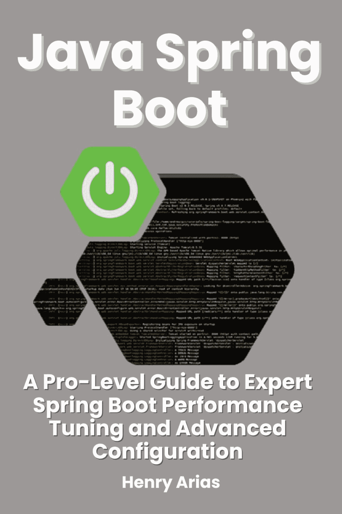

© Copyright 2023 - 版权所有

未经作者直接书面许可，不得再制、复制或传输本书内容。

在任何情况下，出版商对因本文包含的信息直接或间接导致的任何赔偿、损害或资金损失不承担任何法律责任或指责。

## 法律声明

本书受版权保护。本书仅供个人使用。未经作者同意，您不得修改、分发、销售、使用、引用或转述本书的任何部分或内容。

## 免责声明

请注意，本文档中包含的信息仅供教育和娱乐目的。我们已尽一切提供准确、最新、可靠且完整的信息。读者承认，作者并未提供法律、财务、医疗或专业建议。本书的内容源自各种来源。在尝试本书中概述的任何技术之前，请咨询执业专业人士。

通过阅读本文档，读者同意在任何情况下，作者对因使用本文档包含的信息而导致的任何直接或间接损失均不承担责任。

# 引言

## 性能在企业级应用中的关键作用

在企业级软件领域，性能是一项基础支柱，而不仅仅是一个可选特性。大型应用的有效性关键取决于其高效管理大量工作负载、处理海量数据以及在不损害服务质量的情况下容纳大量并发用户的能力。这一关键方面强调了一个核心观点：性能对于软件的重要性与其功能能力同等重要。

## 性能在企业级应用中的核心作用

1. **用户体验与满意度**：性能重要性的核心在于它对用户体验的影响。对于通常支持高量用户的企业级应用，性能不佳会导致响应变慢以及与系统的交互变得枯燥。这直接影响用户满意度，并可能显著阻碍整个组织的效率，导致显著的经济影响。

2. **可扩展性**：企业级应用被要求能够高效扩展；它们必须能够应对数据、用户活动和交易量的增长而不崩溃。优化性能是关键，因为它确保了应用可以扩展其能力以满足日益的需求，而无需进行大规模的基础设施重新。

3. **竞争优势**：在竞争激烈的市场中，企业通过提供更快、更可靠的服务可以获得显著优势。卓越的性能可以将公司的软件解决方案与竞争对手区分开来，特别是在功能相当的情况下。系统速度的提升可以提高客户留存、减少用户流失并吸引新用户。

4. **成本效益**：性能还会影响成本效益。高效运行的应用消耗资源少（`CPU`、`内存`、`带宽`），这可以大幅降低成本，特别是在按使用量计量和计费的环境中。

5. **合规与 SLA**：许多企业级应用受服务水平协议（`SLAs`）中规定的特定性能指标约束。不合规可能会导致罚款和业务损失，因此性能不仅是效率问题，也是合同合规性问题。

## 克服性能挑战

在企业环境中实现最佳性能涉及应对多种挑战，从稳健的数据管理到可扩展的基础设施解决方案。以下是有效应对这些挑战的方法：

1. **处理海量数据**：企业级应用通常处理庞大的数据集，如果管理不当，会降低性能。

   *解决方案*：有效的数据管理策略（如智能数据分区、索引和实现缓存机制）可以显著提高系统响应速度。跨多个服务器的数据分区可以加速数据的访问和检索，大幅提升性能。

2. **确保高可用性与容错性**：企业级应用停机或数据丢失的高昂成本需要稳健的容错能力和高可用性。

   *解决方案*：负载均衡和冗余系统配置等技术可以确保即使单个组件故障，服务也能保持可用和运行。例如，服务器集群允许无缝故障转移，极大地减少服务中断。

3. **缓解网络问题**：分布式应用的性能会受到网络问题的严重影响，特别是延迟和带宽限制。

   *解决方案*：利用内容分发网络（`CDNs`）、优化数据传输协议以及实施数据压缩是缓解这些问题的有效方法，可以增强数据流并降低延迟。

4. **优化应用性能**：软件架构或代码中的固有问题也会导致性能瓶颈。

   *解决方案*：可以使用应用分析工具来识别缓慢环节并优化代码。采用异步编程方法也可以提高应用的响应能力。例如：

   ```
   // 示例代码：非阻塞异步调用
   CompletableFuture.supplyAsync(() -> fetchDataFromDB())
       .thenAccept(data -> processData(data));
   ```

   这种非阻塞方法允许应用在等待数据库数据时保持响应并处理其他任务，从而显著提升了用户交互。

## 结论

企业级应用的性能是一个关键因素，它不仅影响运营效率，还影响用户满意度、竞争地位、成本管理以及对行业标准的合规性。持续投入于性能优化并拥抱技术进步，可以确保应用满足并超过预期的性能标准。对性能的持续关注对于维护关键企业系统在未来的生命力和成功至关重要。

# Spring Boot 性能调优与高级配置概述

在企业级软件领域，性能不仅仅是一个特性——它是开发的基石。使用 `Spring Boot` 构建的应用程序在经过正确优化后，不仅能够方便开发，还能通过高效处理高负载在运行环境中表现出色。对 `Spring Boot` 进行调优以获得最佳性能，涉及调整不影响功能的配置以增强应用程序有效性。

## Spring Boot 性能调优的关键方面

`Spring Boot` 的性能调优对于确保应用程序在生产环境中高效运行至关重要。它主要关注优化数据库连接、内存管理、服务器设置以及实现有效的缓存机制。

### 1. 优化数据库连接

数据库连接的管理显著影响应用程序的性能。`Spring Boot` 的默认设置并不总是满足生产需求的。配置调整的示例包括：

```
spring.datasource.hikari.maximum-pool-size=20
spring.datasource.hikari.minimum-idle=5
spring.datasource.hikari.idle-timeout=30000
```

使用 `Spring Boot` 默认连接池 `HikariCP`，这些属性有助于管理连接池大小以匹配应用程序的需求，确保高效的数据库连接性。

### 2. 内存管理增强

调整 `JVM` 设置对于管理应用程序使用内存至关重要，这对于在各种负载下维持性能至关重要。关键 `JVM` 参数包括：

- `-Xmx`：最大堆内存
- `-Xms`：初始堆内存
- `-XX:+UseG1GC`：启用现代垃圾回收

示例 `JVM` 启动命令：

```
java -Xmx4g -Xms4g -XX:+UseG1GC -jar application.jar
```

### 3. Web 服务器调优

直接配置嵌入式服务器设置可以显著改进应用程序处理请求的方式。例如：

```
server.tomcat.max-threads=200
server.tomcat.min-spare-threads=10
server.tomcat.accept-count=100
```

这些设置调整了 `Tomcat` 服务器处理更多并发请求的能力，增强了吞吐量和响应时间。

### 4. 有效的缓存策略

实现缓存可以通过临时存储频繁访问的数据，大幅减少数据库的负载并提高响应时间。

```
spring.cache.type=caffeine
spring.cache.caffeine.spec=maximumSize=500,expireAfterWrite=5m
```

## Spring Boot 高级配置

除了性能调优，`Spring Boot` 的高级配置涉及利用配置文件（Profiles）、条件设置以及创建自定义自动配置，以增强跨应用程序的活性和重用性。

### 1. 利用 Profiles

Profiles 允许开发者定义特定环境配置，以分离开发、测试和生产环境的设置。开发环境配置设置示例：

```
spring.profiles.active=dev
spring.datasource.url=jdbc:h2:mem:devdb
```

### 2. 条件配置

`Spring Boot` 支持条件配置，允许开发者根据某些条件包含或排除 Bean。

```
@Configuration
@ConditionalOnProperty(name = "feature.enabled", havingValue = "true")
public class FeatureConfig {
    @Bean
    public MyService myService() {
        return new MyServiceImpl();
    }
}
```

这种方法确保了根据环境属性激活特定的配置。

### 3. 创建自定义自动配置

开发者可以创建自己的自动配置，以封装并重用多个 `Spring Boot` 应用程序中的通用模式或设置。

```
@Configuration
@ConditionalOnClass(MyService.class)
@EnableConfigurationProperties(MyProperties.class)
public class MyAutoConfiguration {
    @Bean
    @ConditionalOnMissingBean
    public MyService myService(MyProperties properties) {
        return new MyServiceImpl(properties);
    }
}
```

此自动配置检查 `MyService` 类是否存在并据此定义 Bean。

## 结论

增强 `Spring Boot` 性能和配置高级设置对于部署健壮、高效的应用程序至关重要。精通数据库调优、内存管理、服务器配置和缓存策略可确保 `Spring Boot` 应用程序运行。此外，利用 profiles 和自定义自动配置等高级配置功能提高了灵活性和维护性，这对现代软件开发至关重要。

# 使用 Spring Boot 为高性能计算奠定

`Spring Boot` 改变了开发者构建和部署企业应用的方式，提供了一个精简框架，在不牺牲性能的情况下简化了 Java 开发。通过正确的策略和配置，`Spring Boot` 可以为高性能计算进行定制，使应用程序能够高效管理大型数据集、复杂事务系统和大量的用户负载。

## 利用 Spring Boot 实现高性能计算

### 1. 定制配置

`Spring Boot` 通过其“约定优于配置”的范式简化了设置，但高性能计算需要对系统和应用程序设置进行精细调整。调整可能包括优化垃圾回收、`JIT` 编译以及特定的参数，如数据库连接和线程管理。例如，为了增强服务器处理更多并发连接的能力，你可以调整 `application.properties` 中的 `Tomcat` 设置：

```
server.tomcat.max-connections=10000
server.tomcat.max-http-form-post-size=10MB
```

这些配置通过允许更多同时连接帮助服务器管理更高的负载。

### 2. 有效的资源利用

高效的资源管理在高性能环境中至关重要。`Spring Boot` 的 `actuator` 模块提供了性能的关键洞察，实现了实时监控和优化。此外，利用 `Spring Boot` 对外部化配置的支持，确保应用程序根据部署特定需求进行调优。

### 3. 高级 JVM 优化

`Spring Boot` 应用的核心是 Java 虚拟机 (`JVM`)。对于高性能场景，高级 `JVM` 调优至关重要。配置可能涉及设置堆大小、选择合适的垃圾回收算法以及优化 `JIT` 编译器。例如，为了针对使用 Garbage First 垃圾回收器 (`G1GC`) 的高负载环境进行优化，`JVM` 设置如下：

```
java -Xmx4g -Xms4g -XX:+UseG1GC -XX:MaxGCPauseMillis=200 -jar app.jar
```

此设置指定使用 4 GB 堆的 `G1GC`，旨在增强显著负载下的性能。

### 4. 拥抱响应式编程

`Spring Boot` 与 `Spring WebFlux` 集成以支持响应式编程，这对于在高性能环境中高效管理 I/O 密集型操作非常理想。响应式编程实现了非阻塞 I/O，节省资源并允许应用程序并发执行其他任务。这是一个使用 `Spring WebFlux` 的非阻塞 REST 端点的示例：

```
@RestController
@RequestMapping("/api")
public class ReactiveController {
    @GetMapping("/data")
    public Flux<Data> getData() {
        return dataRepository.findAll();
    }
}
```

该控制器利用响应式原理来提高吞吐量和响应能力。

### 5. 实现异步处理

`Spring Boot` 对异步处理的原生支持高性能计算至关重要，允许任务并行执行或在不中断主流程的情况下执行。这是通过 `Spring` 的异步方法和调度功能实现的。例如，一个异步服务如下：

```
@Service
public class AsyncService {
    @Async
    public CompletableFuture<String> processTask() {
        // 耗时操作
        return CompletableFuture.completedFuture("Result");
    }
}
```

该方法异步地处理任务，提高了应用程序的吞吐量和可扩展性。

## 结论

`Spring Boot` 通过允许详细的配置调整、高效的资源管理和高级优化为需要高性能的应用程序提供了稳健的基础。引入响应式编程和异步操作等现代编程技术，进一步赋予了开发者构建不仅快速、迅速且可扩展的应用程序的能力。通过精调这些元素，`Spring Boot` 成为企业领域高性能计算的强大平台。

# 外部配置与 Profiles

外部配置允许 Spring Boot 应用在无需重新编译代码的情况下，无缝地适应不同的运行环境。当开发、测试和生产环境需要不同的设置时（这些环境在数据库连接、API 端点和其他运行参数上可能存在差异），此项功能就变得至关重要。

Spring Boot 支持多种外部化配置的方法，包括使用属性文件、YAML 文件、环境变量和命令行参数。这允许开发者根据其部署策略或个人偏好选择最合适的方法。

## 属性文件

Spring Boot 会自动识别并从类路径中加载 `application.properties` 或 `application.yml` 文件。开发者可以为不同的环境创建单独配置文件，例如用于开发环境的 `application-dev.properties` 和用于生产环境的 `application-prod.properties`。

以下是如何为不同环境配置数据库 URL：

```
# application-dev.properties
spring.datasource.url=jdbc:h2:mem:devdb

# application-prod.properties
spring.datasource.url=jdbc:mysql://prod-db:3306/proddb
```

## 环境变量和命令行参数

这些在云部署或其他不便于修改文件的环境中特别有用。例如：

```
# 环境变量
export SPRING_DATASOURCE_URL=jdbc:mysql://prod-db:3306/proddb

# 命令行参数
java -jar app.jar --spring.datasource.url=jdbc:mysql://prod-db:3306/proddb
```

## 在 Spring Boot 中利用 Profiles

Profiles 是 Spring Boot 的一项基础功能，允许指定特定环境的配置，便于根据环境进行条件设置和 Bean 注册。这种能力对于隔离应用程序配置至关重要，以确保它们只在合适的上下文中激活。

可以通过在配置文件指定 `spring.profiles.active` 属性、作为环境变量或通过命令行参数来激活 Profiles。

使用示例：

```
spring:
  profiles:
    active: dev
  datasource:
    url: jdbc:h2:mem:devdb
---
spring:
  config:
    activate:
      on-profile: prod
  datasource:
    url: jdbc:mysql://prod-db:3306/proddb
```

此 YAML 配置根据激活的 profile 启用不同的数据源设置，允许应用程序根据环境调整其数据库连接。

## 探索 Spring Boot 中的高级配置技术

Spring Boot 还为旨在进一步精炼应用程序的开发者提供了复杂的配置技术。

### @ConfigurationProperties

此注解将外部配置绑定到 POJO（普通 Java 对象），提供了一种类型安全的方式来配置属性，特别对于合并相关的配置属性特别有用：

```
@ConfigurationProperties(prefix = "mail")
@Component
public class MailProperties {
    private String host;
    private int port;
    // getters and setters
}
```

外部配置中以 `mail` 为前缀的属性将映射到此对象，然后该对象可以在整个应用程序中使用。

### @Profile 结合 @Configuration

将 `@Profile` 与 `@Configuration` 结合，可以定义特定环境的配置类，封装仅在某些 profile 激活时才注册的 Bean：

```
@Configuration
@Profile("development")
public class DevConfig {
    @Bean
    public DataSource dataSource() {
        return new EmbeddedDatabaseBuilder()
            .setType(EmbeddedDatabaseType.H2)
            .build();
    }
}
```

该配置类仅在 "development" profile 环境下激活，并使用嵌入式数据库。

## 结论

有效利用 Spring Boot 中的外部配置和 profiles 对于开发者在多样化的环境中有效管理应用程序至关重要。通过外部化配置和策略性地部署 profiles，开发者可以确保应用程序在每个环境中都能获得最佳性能，简化部署流程，并保持更整洁、更有组织的代码库。这些实践对于任何在动态部署环境中使用 Spring Boot 的专业人员来说都是不可或缺的。

# 自定义 Spring Boot Starters 和自动配置

Spring Boot 通过其“约定优于配置”的策略简化了应用程序开发而脱颖而出，这很大程度上是因为利用了 starters 和自动配置。这些机制旨在通过合理的默认值快速建立 Spring 应用程序。然而，随着应用程序复杂性和运行需求的增加，自定义这些配置是至关重要的。适配 Spring Boot starters 和自动配置不仅增强了应用程序的适应性，还能定制性能以满足特定的业务需求。

## 深入研究 Spring Boot Starters 和自动配置

Spring Boot starters 将核心依赖封装在一起，以为您的应用程序添加特定功能（例如 Web 能力或安全身份验证），确保这些依赖项和谐工作并进行定期维护。示例包括用于 Web 应用的 `spring-boot-starter-web` 和用于安全应用程序的 `spring-boot-starter-security`。

Spring Boot 中的自动配置旨在根据类路径中检测到的库自动定制您的应用程序。它通过根据检测到的环境进行自动调整，减少了手动配置的需求。

## 自定义 Spring Boot Starters

自定义或创建新的 starters 涉及理解它们的结构，通常包括：

*   一个指定所需依赖的 `pom.xml` 文件。
*   辅助绑定属性的配置属性类。
*   带有 `@Configuration` 标记的自动配置类，这些类根据条件进行配置。

按照以下步骤自定义 Spring Boot Starters：

1. **定义 Starter 依赖**：通过创建一个新的 Maven 项目并添加必要的依赖。例如，`spring-boot-starter-payment` 将包含支付处理相关的库。

2. **开发自动配置**：创建在特定条件下定义 Bean 的配置类。使用 `@ConditionalOnClass` 和 `@ConditionalOnBean` 等注解确保兼容性并避免冲突。

3. **配置属性**：如果您的 starter 需要配置选项，使用 `@ConfigurationProperties` 注解设置属性类。

考虑此自动配置类的示例：

```
@Configuration
@ConditionalOnClass(PaymentService.class)
@EnableConfigurationProperties(PaymentProperties.class)
public class PaymentAutoConfiguration {
    @Bean
    @ConditionalOnMissingBean
    public PaymentService paymentService(PaymentProperties properties) {
        return new PaymentServiceImpl(properties);
    }
}
```

此配置确保只有在类路径上可用 `PaymentService` 且没有定义其他 `PaymentService` Bean 时，才会设置 `PaymentService` Bean。

## 高级配置策略

为了更详细的自定义，需要深入了解 Spring Boot 如何管理自动配置：

*   **覆盖自动配置**：有时需要覆盖默认的自动配置。可以通过在 `application.yml` 或 `application.properties` 中通过 `spring.autoconfigure.exclude` 属性，或直接在 `@SpringBootApplication` 注解中使用 `exclude` 属性来实现。

*   **管理自动配置顺序**：自动配置的生效顺序会显著影响功能。使用 `@AutoConfigureOrder`、`@AutoConfigureBefore` 或 `@AutoConfigureAfter` 注解来控制其相对于其他配置的顺序。

## 结论

自定义 Spring Boot starters 和自动配置对于旨在使框架与特定应用程序需求更紧密结合的开发者至关重要。通过创建新的 starters、修改现有的或管理自动配置的顺序，这些自定义可以显著增强 Spring Boot 应用程序的功能和效率。这种灵活性对于开发满足特定业务目标的复杂、高性能应用程序是必不可少的。

# 环境特定调优

通过调整特定部署环境的配置来优化 Spring Boot 应用，是增强性能、安全资源管理的关键策略。不同的环境（如开发、测试和生产环境）由于其独特的资源可用性、安全需求和其他运行参数不同，通常需要不同的设置。利用 Spring Boot 外部化配置和设置环境特定参数的能力，可以显著提高应用程序的效率和有效性。

## 环境特定调优的重要性

针对特定环境优化应用程序具有许多益处：

*   **性能优化**：根据每个环境的可用资源调整 `JVM` 设置和数据库连接等配置，可以提升应用程序性能。


## 安全性增强与资源管理

*   **安全性增强**：安全配置在不同环境之间差异很大，生产环境通常比开发设置需要更严格的安全控制。
*   **资源管理**：根据环境定制资源使用情况和服务集成，可以节省成本并增强系统可靠性。

## 在 Spring Boot 中实现环境特定配置

Spring Boot 主要通过使用 profiles（配置描述）来辅助环境特定配置，这允许开发者根据环境定义并激活一组配置。

### 利用 Profiles

Spring Boot profiles 允许对配置进行分组并仅在指定的环境中激活。这通常通过配置文件（如 `application.properties` 或 `application.yml`）中的 `spring.profiles.active` 属性管理，也可以在运行时通过编程或命令行选项指定。

例如，在 `application.yml` 中为 `dev` 和 `prod` profiles 定义不同的数据库设置如下：

```
spring:
  profiles:
    active: dev
---
spring:
  config:
    activate:
      on-profile: dev
  datasource:
    url: jdbc:h2:mem:devdb
    username: sa
    password:
---
spring:
  config:
    activate:
      on-profile: prod
  datasource:
    url: jdbc:postgresql://prod-db:5432/proddb
    username: prod_user
    password: ${DB_PASSWORD}
```

此配置确保应用程序根据其处于开发模式还是生产模式连接到相应的数据库。

### 外部化配置

Spring Boot 中的配置可以通过以下方式外部化：

*   **属性文件**：profiles 可以关联的 `application-{profile}.properties` 或 `.yml` 文件，其中包含环境特定的设置。
*   **环境变量**：在云部署或使用 `Docker`/`Kubernetes` 时非常有用，允许在不更改代码的情况下传递设置。
*   **命令行参数**：这些可以覆盖现有配置，并便于传递敏感或关键的最后时刻调整。

例如，为了在启动时覆盖活动 profile 和数据库 URL，可以使用：

```
java -jar myapp.jar --spring.profiles.active=prod --spring.datasource.url=jdbc:postgresql://prod-db:5432/proddb
```

### 用于细微调优的配置属性

Spring Boot 的 `@ConfigurationProperties` 注解有助于在结构化对象中定义分组属性，增强类型安全和集中化管理。

```
@ConfigurationProperties(prefix = "app")
public class AppProperties {
    private String name;
    private int maxConnections;
    // getters and setters
}
```

此类属性可以在环境特定文件或其他外部源中进行自定义，从而调整不同部署场景下的行为。

## 结论

为每个环境量身定制特定参数的 Spring Boot 应用对于确保最佳运行、安全和资源利用至关重要。通过利用 profiles 和外部化配置，开发者可以创建能够无缝适应不同部署环境的多种功能应用程序。这种适应性不仅确保了一致的性能，还简化了持续的应用程序维护和生命周期管理。

# 第二章 JVM 性能优化

## 理解 JVM 内部及其对 Spring Boot 的影响

Java 虚拟机 (`JVM`) 是 Java 应用程序（包括在 Spring Boot 平台上开发的程序）性能和效率的基础。深入理解 JVM 内部对于增强和稳定 Spring Boot 应用至关重要。这种深层见解允许开发者策略性地调整应用程序的行为，以有效适应各种运行环境。

## 影响 Spring Boot 应用的关键 JVM 元素

### 1. 内存管理

`JVM` 管理跨越堆（heap）、栈（stack）和方法区（method areas）的系统内存。堆存储运行时数据，如对象和 Java 运行时环境 (`JRE`) 类表示，并由垃圾回收器管理。栈持有执行方法所需的局部变量和方法调用，而方法区存储类结构，包括常量、字段和方法数据，以及方法和构造函数的代码。

对于 Spring Boot 应用，特别是多个服务实例可能运行在各种容器中的微服务，熟练的内存管理至关重要。恰当地配置堆大小和垃圾回收设置可以防止内存溢出并保持响应良好的应用程序性能。

示例 JVM 内存管理配置：

```
java -Xms512m -Xmx2g -XX:+UseG1GC -jar app.jar
```

此命令配置了初始 (`-Xms`) 和最大 (`-Xmx`) 堆大小，并使用了 G1 垃圾回收器 (`-XX:+UseG1GC`)，它因在处理大内存空间时具有最小停顿时间而青睐。

### 2. 即时编译 (JIT)

`JIT` 编译器通过在运行时将字节码转换为原生机器码来增强 Java 应用的性能。理解和管理 JIT 编译对于优化 Spring Boot 应用中计算密集型部分至关重要。

通过特定的 JVM 工具和标志可以描勒方法的编译频率和行为，从而有助于对 JIT 编译过程的洞察。

### 3. 类加载

`JVM` 的类加载器是不可或缺的一部分，它在首次访问时将类加载到内存中。考虑到 Spring Boot 海量的类和依赖项，高效的类加载对于缩短启动时间和优化内存使用非常重要。

你可以使用 JVM 诊断命令监控类加载活动：

```
java -XX:+TraceClassLoading -jar app.jar
```

### 4. 线程管理

`JVM` 处理执行 Java 应用中并发任务的关键线程。Spring Boot 使用线程池来高效管理请求处理。恰当配置这些池对于在各种负载条件下维持性能至关重要。

示例 Spring Boot 线程池配置：

```
@Configuration
@EnableAsync
public class ThreadPoolConfig {
    @Bean
    public TaskExecutor taskExecutor() {
        ThreadPoolTaskExecutor executor = new ThreadPoolTaskExecutor();
        executor.setCorePoolSize(10);
        executor.setMaxPoolSize(20);
        executor.setQueueCapacity(500);
        executor.setThreadNamePrefix("AppThread-");
        executor.initialize();
        return executor;
    }
}
```

### 5. 垃圾回收 (GC)

垃圾回收是影响应用程序性能的重要 JVM 功能。有效的垃圾回收在 Web 和微服务环境中尤为关键，应用程序频繁创建并丢弃大量短命对象。选择并调优正确的垃圾回收器可以显著减少干扰性停顿并增强应用程序的流畅性。

以下是如何指定垃圾回收器：

```
java -XX:+UseG1GC -jar app.jar
```

在此示例中，激活了 G1 垃圾回收器，它以对堆空间的有效管理和可预测的垃圾回收停顿而闻名。

## 结论

深入理解 JVM 内部对于有效优化 Spring Boot 应用至关重要。通过细致的内存管理、利用 JIT 编译、优化类加载、有效管理线程以及选择合适的垃圾回收策略，开发者可以显著提高其 Spring Boot 应用的性能和稳健性。这种全面的知识有助于对应用程序进行精细调整，确保与 JVM 操作匹配并满足特定的应用程序需求。

## 适用于 Spring Boot 应用的 JVM 和垃圾回收调优

优化 Java 虚拟机 (JVM) 设置对于最大化 Spring Boot 应用的效率和性能至关重要。调整 JVM 选项，特别是控制垃圾回收（GC）的选项在资源管理中起着至关重要的作用，并显著影响应用程序的吞吐量和响应能力。

## 影响 Spring Boot 的关键 JVM 选项

JVM 提供了多种影响其行为的选项，许多涉及内存管理和垃圾回收。正确配置这些选项可以提高应用程序的响应时间，提升吞吐量并确保资源的高效利用。

### 重要 JVM 参数

1. **堆内存选项**：适当设置 `-Xms` 和 `-Xmx` 参数分别定义初始堆大小和最大堆大小。这些设置至关重要，因为它们决定了 JVM 分配多少内存，从而影响性能和资源消耗。

```
java -Xms512m -Xmx2g -jar app.jar
```

此行代码将初始堆大小设置为 512 MB，最大大小设置为 2 GB，为应用程序的需求优化了内存使用。

2. **线程栈大小**：配置 `-Xss` 选项可以调整每个线程的栈大小，这对于控制内存分配以及避免具有深度递归或高并发特性的应用程序出现栈溢出错误至关重要。

```
java -Xss256k -jar app.jar
```

此命令将每个线程的栈大小设置为 256 KB，这对于中等复杂的应用程序通常足够。

## Spring Boot 的垃圾回收优化

调优垃圾回收过程对于产生大量短寿命对象的应用程序是关键，这是 Spring Boot 构建的 Web 应用常见的场景。

### 选择合适的垃圾回收器

选择正确的垃圾回收器取决于应用程序的需求：

1. **吞吐量收集器 (Parallel GC)**：适用于优先考虑吞吐量的应用程序，可以接受较长的 GC 停顿。通过 `-XX:+UseParallelGC` 启用。
2. **并发标记清除 (CMS)**：适用于低延迟要求的应用程序，使用额外的 CPU 资源来最小化暂停时间。使用 `-XX:+UseConcMarkSweepGC` 启用。
3. **G1 垃圾回收器**：适用于具有大内存的多核系统，需要扩展性和可预测的停顿。通过 `-XX:+UseG1GC` 激活。

G1 GC 的使用示例：

```
java -XX:+UseG1GC -Xms4g -Xmx4g -jar app.jar
```

### 细调垃圾回收参数

优化 GC 涉及调整特定参数以精炼垃圾回收行为：

1. **新生代大小**：由 `-Xmn` 或 `-XX:NewRatio` 管理，调整此会影响 Minor GC 频率。
2. **目标 GC 停顿时间**：`-XX:MaxGCPauseMillis` 设置有助于建立最大 GC 停顿时间的目标，影响 JVM 尝试满足这些目标。
3. **自适应大小策略**：使用 `-XX:+UseAdaptiveSizePolicy` 让 JVM 根据应用程序的行为动态调整新生代和老年代的大小。

## 监控与诊断

监控 JVM 配置对 Spring Boot 应用的影响至关重要。如 VisualVM、JConsole 以及如 `jstat` 等命令行工具可以提供有关内存消耗和垃圾回收效率的洞察。

使用 `jstat` 进行 GC 监控的示例：

```
jstat -gc <pid> 1000
```

该工具实时监控垃圾回收指标，每秒输出数据，以帮助识别当前 GC 设置的潜在问题。

## 结论

细调 JVM 选项和垃圾回收设置是增强 Spring Boot 应用性能和稳定性不可或缺的一部分。通过深思熟虑地选择和配置这些选项，开发者可以显著提高应用程序的效率和响应能力。根据实际性能数据进行持续监控和自适应调整，对于在应用需求演变时维持最佳设置至关重要。

# 分析与监控 JVM 以获得最佳性能

分析和监控 Java 虚拟机 (JVM) 是增强 Java 应用程序性能的关键技术，特别是对于使用 Spring Boot 构建的应用程序。这些方法允许开发者识别性能问题、优化资源分配并确保应用程序在不同的运行条件下顺畅运行。

## JVM 性能分析与监控重要性

通过 JVM 性能分析和监控收集详细运行数据至关重要。它允许开发者实时观察 CPU 用率、内存消耗、线程行为和垃圾回收过程。这些洞察能够精炼应用程序性能，确保主动的优化和维护。

## 用于 JVM 性能分析和监控的有效工具

有一系列工具可对 JVM 进行详细分析和监控，提供的功能涵盖了从基础到高级范围，满足开发或生产环境的不同需求。

### 1. VisualVM

VisualVM 将多个命令行 JDK 工具集成到单个图形界面中，为 JVM 提供了一个全面的监控工具。

*   **功能**：它跟踪内存和 CPU 使用情况，提供线程转储（thread dumps），分析堆内容，监控垃圾回收活动并分析应用程序性能。
*   **如何使用**：

```
jvisualvm
```

启动 VisualVM 并将其连接到 JVM 实例以启动详细的监控和分析。

### 2. JConsole

JConsole 是另一个包含在 Java 开发包 (JDK) 中的图形监控工具，它利用 Java 管理扩展 (JMX) 收集 Java 应用程序性能数据。

*   **功能**：它监控内存使用、线程信息、类加载统计和长期 JVM 行为。
*   **如何使用**：

```
jconsole
```

启动 JConsole 并连接到本地或远程运行的任何 Java 进程。

### 3. jStat

jStat 是一个专注于 JVM 性能统计的命令行工具，适用于不方便使用 GUI 工具的环境。

*   **功能**：它专门用于跟踪垃圾回收和 JVM 堆统计数据。
*   **如何使用**：

```
jstat -gc <pid> 1000
```

运行 `jstat` 持续监控指定 JVM 进程的垃圾回收指标，每秒更新一次。

## JVM 分析与监控的最佳实践

在 JVM 性能分析和监控中实施最佳实践可以显著提高 Java 应用程序的效率：

*   **持续监控**：定期监控应该是系统运行中不可或缺的一部分，以便快速发现和解决性能问题并评估任何更改的影响。
*   **开发与测试分析**：在开发和测试阶段进行频繁分析，在影响生产环境之前识别并修复性能问题。
*   **垃圾回收细调**：根据分析结果调整垃圾回收设置，以减少中断并增强应用程序响应。
*   **基于数据的资源配置**：根据实时数据修改 JVM 配置（如堆大小和线程设置），以确保性能和资源利用。
*   **自动告警**：针对关键 JVM 指标（如高内存占用或线程激增）设置告警，以便及时处理偏离预期性能的情况。

## 结论

定期分析和监控 JVM 是维护 Java 应用程序最佳性能和稳定的关键。利用 VisualVM、JConsole 和 `jstat` 等工具为开发者提供了有效管理资源所需的详细洞察。系统地应用这些监控和分析技术可以确保 Java 应用程序是健壮、高效并能够应对各种环境挑战的。

# 第三章 Spring Boot 应用调优

## 优化 Spring 框架核心组件 (IoC, AOP)

精炼 Spring 框架的核心组件——控制反转（IoC）和面向切面编程（AOP），对于增强使用 Spring 开发的应用的功能、性能和可扩展性至关重要。对这些组件进行适当的调整和微调可以极大提高开发效率和应用执行效率。

## 微调控制反转 (IoC)

IoC 容器是 Spring 框架不可或缺的一部分，负责管理应用组件的生命周期配置。这种功能支持松耦合并简化了测试过程。优化 IoC 容器的使用方式可以加速应用程序启动并提高运行效率。

1. **适当的 Bean 范围**：Spring 提供了多种 Bean 范围——`singleton`、`prototype`、`request`、`session` 和 `global session`。选择正确的范围对于优化资源使用和减少开销至关重要。通常，默认的 `singleton` 范围通过限制创建 Bean 实例的数量来优化性能。然而，需要按用户或请求维护状态的 Bean 可能更适合 `request` 或 `session` 范围。

```
@Scope("prototype")
@Component
public class PrototypeBean { }
```

2. **实现懒加载**：Spring 默认在应用启动时实例化所有的 `singleton` Bean。为某些 Bean 启用懒加载可以将 Bean 的创建推迟到第一次需要它们时，从而减少初始加载时间。

```
@Lazy
@Component
public class LazyBean { }
```

3. **优先使用构造器注入**：使用构造器注入代替字段注入可以提高测试性，支持不可变性，并确保在构造时存在必要的依赖，这简化了应用上下文的管理。

```
@Component
public class MyService {
    private final Dependency dep;
    public MyService(Dependency dep) { this.dep = dep; }
}
```

## 优化面向切面编程 (AOP)

AOP 将日志、安全和事务管理等关注点从业务逻辑中分离，提高了代码的模块化清晰度。然而，AOP 需要精细的管理以防止其成为性能开销的来源。

1. **高效的切点表达式**：编写精确且最小的切点表达式可以防止不必要的建议执行，这会阻碍性能。

```
@Pointcut("execution(* com.example.service.*.*(..))")
public void serviceLayer() {}
```

2. **选择代理类型**：Spring AOP 支持针对接口的 JDK 动态代理和针对类的 CGLIB 代理。在可能的情况下，优先选择基于接口的代理，因为它们通常更快且消耗资源更少。

```
@EnableAspectJAutoProxy(proxyTargetClass = false)
```

3. **条件建议应用**：有条件地应用 AOP 建议（特别是针对资源密集型操作）可以优化性能并防止生产环境中的变慢。

```
@Around("serviceLayer() && @annotation(com.example.Monitor)")
public Object monitor(ProceedingJoinPoint pjp) throws Throwable { ... }
```

## 结论

在 Spring 框架内有效优化 IoC 和 AOP 可以显著提高 Spring 应用的性能和可管理性。通过采用正确设置 Bean 范围、启用懒加载和精确应用 AOP 等策略，开发者可以确保他们的应用不仅高效，而且健壮且可扩展。根据性能反馈进行持续改进，对于随着需求演变维持最佳应用功能至关重要。

## 高效数据库交互与连接池

简化数据库交互和有效管理连接池是增强数据库驱动应用性能的关键。适当处理这些元素可以减少管理数据库连接和执行 SQL 命令的开销，显著降低延迟、提高吞吐量并高效地扩展应用。

### 连接池的重要性

连接池是一种用于管理和重用一组固定数据库连接对象的技术，而不是反复打开和关闭新连接。这种方法有益于以下几个原因：

### 连接池的优势：

1. **降低延迟**：重用现有连接消除了建立新连接的耗时过程，这在高流量场景下尤为宝贵。
2. **控制资源使用**：连接池限制了到数据库的打开连接数量，防止过度使用导致数据库变慢或失败。
3. **可扩展性提升**：通过高效管理连接，应用程序可以同时处理更多事务或用户，而无需按比例增加资源消耗。

### 数据库交互与连接池的实践实践

1. **选择连接池库**：如 `HikariCP`、`Apache Commons DBCP` 和 `C3P0` 等多种库提供了连接池功能。`HikariCP` 通常因其卓越的性能和极简配置开销而受到青睐。选择与您的应用程序特定需求和性能标准的库。

在 Spring Boot 中 `HikariCP` 的配置示例：

```
spring:
  datasource:
    hikari:
      maximum-pool-size: 20
      minimum-idle: 5
      idle-timeout: 300000
      connection-timeout: 20000
```

2. **优化 SQL 执行**：提高 SQL 命令效率并使用预编译语句（Prepared Statements）可以减轻数据库服务器压力并提高应用吞吐量。

   *   **预编译语句**：它们对于性能和安全至关重要。它们实现了 SQL 语句的预编译和高效重用。

```
String sql = "SELECT * FROM users WHERE id = ?";
try (PreparedStatement ps = conn.prepareStatement(sql)) {
    ps.setLong(1, userId);
    ResultSet rs = ps.executeQuery();
}
```

3. **调优连接池设置**：定期调整连接池参数对于匹配应用需求并确保最佳性能至关重要：

   *   **池大小**：根据峰值负载观察和数据库能力调整池大小。
   *   **连接超时**：为连接获取配置合适的超时时间，以有效管理需求峰值。
   *   **空闲连接管理**：优化空闲连接的处理，以平衡资源效率与即时可用性。

4. **高效管理事务**：有效的事务管理有助于减少数据库锁时间和资源竞争，从而提高应用的整体响应能力。使用适当的隔离级别并策略性地管理事务超时，以避免可能降低性能的长时间锁定。

## 结论

精通数据库交互和连接池是优化高度依赖数据库的应用程序性能的基础。通过实施有效的连接池策略、优化 SQL 交互并持续精炼这些配置，开发者可以确保他们的应用是健壮、响应且能够有效扩展的。根据应用变化和负载波动定期更新和调优，对于维持最佳性能水平至关重要。


## 应用上下文和 Bean 管理的最佳实践

在 Spring 框架开发的世界中，熟练管理应用上下文和 Bean 对于构建高效、可扩展且可维护的应用至关重要。应用上下文是 Spring 强大的依赖注入能力的骨干，而 Bean 代表在这些上下文中管理的对象。下面我们深入探讨概述这些关键组件的最佳实践。

### 理解应用上下文和 Bean

在 Spring 中，应用上下文充当复杂的工厂，维护着各种 Bean 及其依赖的注册。通过使用应用上下文，Spring 可以处理 Bean 的生命周期、配置 Bean 并促进依赖注入等功能。

### 应用上下文管理的首要实践

1. **拥抱配置类**：在现代 Spring 应用中，倾向于使用 Java 配置，与 XML 配置相比，它具有更好的类型安全性和重构便利。带有 `@Configuration` 注解的配置类作为定义和组合 Bean 的逻辑空间。

   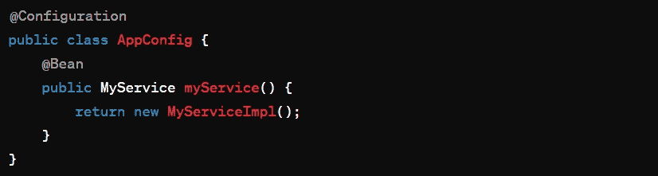

   这种方法提供了清晰简洁的 Bean 定义管理，对于需要模块化配置的大型应用非常有益。

2. **利用组件扫描**：为了尽量减少手动注册 Bean 操作，Spring 可以通过 `@ComponentScan` 自动检测并注册 Bean。这通常与 `@Component`、`@Service`、`@Repository` 和 `@Controller` 等立体注解配合使用，有助于在语义上区分应用程序中每个 Bean 的角色。

   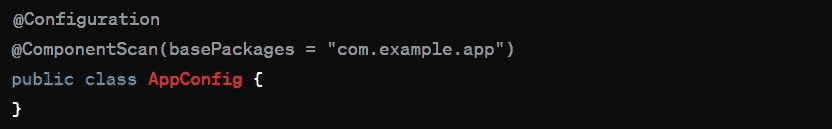

   此设置引导 Spring 扫描指定的包并自动注册所有相应注释的类，简化了配置。

3. **实现懒初始化**：为了加快应用程序启动时间，可以采用懒初始化，使得 Bean 只在第一次被请求时实例化，而不是在启动时实例化。

   

   在配置级别应用 `@Lazy` 可以确保此配置中定义的所有 Bean 默认都是懒加载的，从而带来显著的性能提升，特别是在大型应用中。

## Bean 管理的最佳实践

1. **合理设置范围**：Spring 管理 Bean 的作用范围（`scope`）以决定如何共享 Bean 实例。虽然默认范围是 `singleton`（单例），但根据用例，`prototype`、`request`、`session` 和 `application` 等范围可能更合适。

   

   选择合适的范围可以确保应用程序按预期运行，并优化资源利用。

2. **优先使用构造函数注入**：相比于字段注入，优先使用构造函数注入可以增强代码的可测试性，并保证所需的依赖不为空。它还促进了不可变并简化了应用程序调试。

   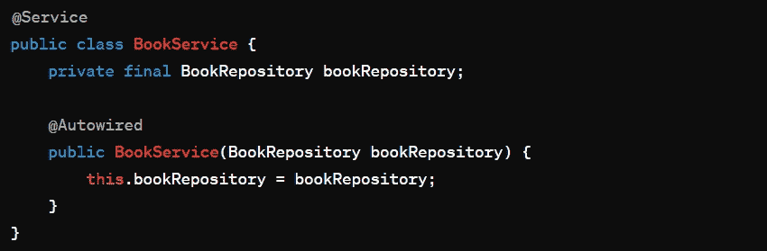

   这种模式被高度推荐，因为它清晰地定义了强制性依赖，并符合控制反转原则。

3. **使用 Profile 驱动的 Bean**：对于在不同环境下运行的应用程序，使用 Profiles 有条件地注册 Bean 是一种良好的实践。这允许开发者定义仅在特定环境中可访问 Bean。

   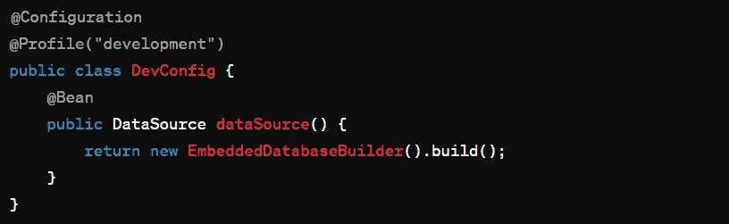

   Profiles 有助于维护开发、测试和生产配置之间清晰的分离，降低跨环境配置错误的风险。

## 结论

有效管理应用上下文和 Bean 对于充分利用 Spring 框架的至关重要。通过遵循最佳实践，例如使用配置类、实现懒初始化、合理设置 Bean 范围、优先使用构造函数注入以及利用 Profiles，开发者可以创建高性能且易于维护的 Spring 应用程序。这些策略确保了应用程序不仅健壮，而且能够适应变化的业务需求。

# 第四章

## 高性能 RESTful 服务

### 优化 RESTful 服务性能的技巧

在需要高效和快速响应的现代 Web 应用程序开发中，增强 RESTful 服务性能至关重要。RESTful 服务基于表述状态转换原理运行，是无缝 Web 交互的基础。本文概述了提高其性能的关键策略，这对于提升用户体验和应用程序扩展性至关重要。

### 1. 正当使用 HTTP 方法

RESTful 服务依赖标准的 HTTP 方法进行操作，每个方法都有特定的功能。正确地使用这些方法不仅可以明确 API 操作，还能通过有效的缓存和精简的数据处理来性能：

* `GET` 用于检索资源。
* `POST` 用于创建新资源。
* `PUT` 用于更新现有资源。
* `DELETE` 用于移除资源。

使用正确的方法有助于优化缓存和高效检索数据，减少服务器负载。

### 2. 实现缓存机制

缓存是提升 RESTful 服务性能的一种强大技术。通过存储之前获取的数据，缓存减少了冗余的服务器请求并加快了响应速度。

* 客户端缓存可以使用 HTTP 缓存头（如 `Cache-Control`、`ETag` 和 `Last-Modified`）来实现，有助于管理缓存的新度和重新验证。

  

* 服务端缓存涉及使用 `Redis` 或 `Memcached` 等内存存储临时存储数据或计算结果，减少了频繁重新计算或获取数据的需要。

### 3. 数据库交互优化

数据库操作的效率对于 RESTful API 至关重要，特别是那些管理大量数据集的 API。可以通过以下方式增强性能：

* `索引`：对频繁查询的字段应用索引以缩短查找时间。
* `查询优化`：精简 `SQL` 查询以避免不的数据处理和昂贵的连接（`join`）。
* `连接池`：利用连接池管理数据库连接，最小化了重复打开和关闭连接的开销。

### 4. 异步操作

异步处理操作可以显著提高 RESTful 服务的吞吐量，特别是对于无法瞬时完成的过程。

* 异步请求：如 `Spring WebFlux` 等框架和 `Node.js` 等技术允许非阻塞请求处理，使其他进程能够在无需等待当前进程完成的情况下执行。
* 消息队列：对于延迟或耗时的任务，使用 `RabbitMQ` 或 `Kafka` 等消息队列有助于将这些任务从请求-响应周期中卸载。

### 5. 负载均衡技术

利用负载均衡通过将传入的网络流量分布到多个服务器上，提高服务的可用性和响应速度。

* 策略包括：
    * `Round-Robin`——轮询——将请求均匀分布到所有服务器。
    * `Least Connections`——最少连接——将请求发送到活动连接最少的服务器。
    * `IP Hash`——根据 IP 哈希将用户请求一致地定向到同一台服务器。

  如 `NGINX` 或 `AWS Elastic Load Balancing` 等云服务可以促进有效的负载均衡。

### 6. 减小有效负载大小

最小化请求和响应中传输的数据大小可以实现更快传输，特别是在较慢的网络下。

* 压缩：实现 `gzip` 压缩可以减少数据大小，促进更快的数据传输。
* 字段选择：通过 `GraphQL` 或 RESTful 稀疏字段集等技术允许客户端指定所需字段，从而最小化传输的数据。

  

### 7. 持续监控与分析

对 RESTful 服务进行定期监控和分析（Profiling）对于识别和解决性能瓶颈是必要的。使用 `New Relic` 或 `Prometheus` 等性能监控工具可以提供有关响应时间、错误率和服务器资源利用率的价值指标。

## 结论

优化 RESTful 服务性能涉及多种策略，从有效使用 HTTP 方法到复杂的缓存和负载均衡。通过采用这些技术，开发者可以确保他们的 RESTful API 不仅功能完备，而且在各种负载条件下性能良好。持续的监控和基于使用数据的迭代改进对于维持卓越性能至关重要。

## 内容协商与 API 版本控制

内容协商允许 Web 服务器根据客户端在 HTTP 头部中表达的偏好，在响应客户端请求时选择最合适的内容格式。在内容协商中使用高级技术可以增强 Web 服务的适应性和用户体验。

### 1. 利用 Accept 头部

HTTP 请求中的 `Accept` 头部允许客户端指示它们准备从服务器接受的媒体类型。服务器使用此信息来确定响应的最优格式。例如，服务器可以根据客户端通过 `Accept` 头部表达的偏好，选择返回 HTML 或 JSON 格式的数据。


### 2. 定义自定义媒体类型

一种更高级的方法是使用自定义媒体类型。这不仅指定了媒体类型，还嵌入了版本信息，实现了对内容格式的精确控制。


这告诉服务器，客户端期望按照 `"myapp"` 特定格式的版本 `1` 获取 JSON 格式数据。

### 3. 基于 URL 或参数的协商

某些 API 直接在 URL 路径中或通过查询参数提供格式选项。这种方法对客户端来说非常简单，但会增加服务器逻辑的复杂度。

URL 后缀示例：


查询参数示例：


## API 版本控制策略

适当的版本控制对于 API 在不破坏现有客户端集成的情况下演进增长至关重要。几种策略可以有效管理不同的 API 版本：

### 1. URI 版本控制

在 URI 中包含版本号是一种常见方法，它可以清晰地传达 API 版本，简化路由和维护。


### 2. 头部版本控制

版本也可以通过自定义头部进行管理。这种方法保持了 URL 的整洁和不变，但可能会让某些客户端认为版本管理不够透明且可能更加复杂。


### 3. 查询参数版本控制

使用查询参数进行版本控制是一种直观的方法，但将资源标识与请求的元属性混合在一起。


## 有效版本控制与协商的关键考虑

实施复杂的的内容协商和版本控制策略涉及几个重要的考虑：

- **清晰的文档**：确保内容协商和版本控制机制有良好的文档记录，包括所有可用的媒体类型和版本标识符。
- **结构化的弃用策略**：制定一种结构化的政策，用于逐步淘汰旧版本的 API 和媒体类型，为客户端迁移提供足够的通知和指导。
- **全面的测试**：对所有 API 版本进行全面测试，以确认更新不会对现有客户端集成产生负面影响。

## 结论

精通高级内容协商和版本控制是现代 API 架构的基础，使 API 能够高效地满足各种客户端需求并在更新过程中平稳过渡。通过仔细地实现和记录这些功能，开发者可以创建出既强大又易于使用的 API，确保在引入新功能时保持兼容性。策略的选择应符合应用程序的特定需求及其用户需求，在灵活性、简单性和健壮性之间取得平衡。

# 为 API 响应实现缓存和压缩

通过缓存和压缩优化 API 响应可以显著提升 Web 服务的性能和可扩展性。这些方法减少了服务器和网络的压力，导致更快的响应时间和更高效的数据传输，最终提升用户体验。

## 缓存机制概述

缓存是一种临时存储数据的技术，以便于快速检索，而无需重复处理或从后端获取，从而有效减少服务器负载和延迟。

### 1. 服务器端缓存

这涉及将常用请求的数据存储在服务器或中间缓存服务器上。这种安排允许快速提供数据，避免频繁访问数据库或进行计算。实现此类缓存层通常涉及使用 `Redis` 或 `Memcached` 等技术。

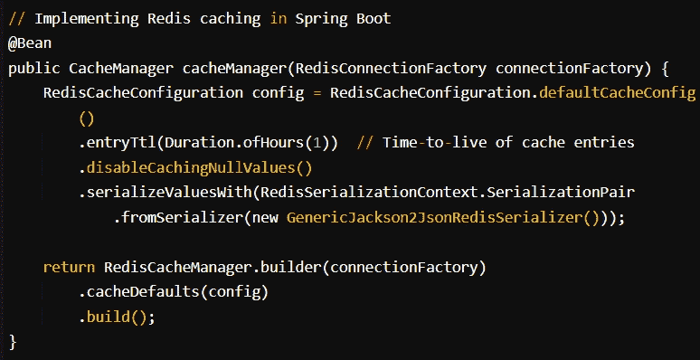

### 2. 客户端缓存

客户端缓存利用 HTTP 头部来指示客户端浏览器或应用程序如何存储响应数据。使用如 `Cache-Control`、`Expires` 和 `ETag` 等头部有助于控制客户端的缓存行为。


## 利用压缩技术

压缩涉及在跨网络发送之前缩小 API 响应的大小，这可以加速传输，对于网络连接较慢的客户端尤为重要。

### 1. GZIP 压缩

GZIP 常用于 Web 通中的数据压缩。像 `Apache` 和 `Nginx` 等 Web 服务器以及 `Spring Boot` 等应用程序框架都可以配置为自动压缩 API 响应。

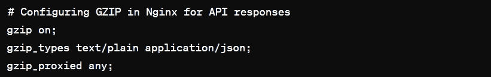

### 2. 在应用服务器中启用压缩

在基于 Java 的应用程序中（特别是使用 `Spring Boot` 的程序），可以通过简单的属性设置启用响应压缩。

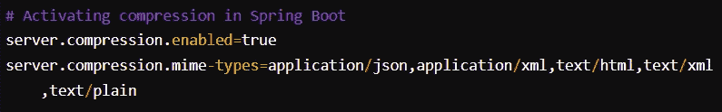

## 缓存与压缩的最佳实践

### 1. 区分性缓存

识别哪些数据受益于缓存至关重要。静态或很少更改的数据非常适合缓存，而动态或个性化的数据通常不应缓存，以防止提供过时信息。

### 2. 缓存失效策略

创建有效的技术，在底层数据更改时更新或失效缓存数据。这可能涉及设置过期时间、使用版本标记和主动清除缓存等策略。

### 3. 监控系统性能

定期监控缓存和压缩对系统性能的影响。`Google Lighthouse` 和 `Chrome Dev Tools` 等工具对于评估对响应时间和整体系统负载的影响。

### 4. 安全注意事项

注意缓存和压缩对安全的影响，特别是在处理敏感信息时。采取措施缓解诸如压缩技术可能导致潜在数据泄露等风险。

## 结论

为 API 响应实现缓存和压缩是优化 Web 服务性能的一项策略。这些方法增强了数据处理的效率并减轻了服务器负载，从而改进了用户界面。

## 响应式编程

- `Subscription`：此连接管理可观测对象与观察者之间的交互，控制数据流并处理生命周期事件。
- `Operators`：这些是允许对数据流进行操作和转换的方法或函数，实现了复杂的数据处理策略。

### 响应式编程的优势

1. **增强的扩展性与效率**：

   响应式编程的异步和非阻塞特性允许显著的扩展性和资源利用率。这种能力对于高事务量或高用户并发的应用至关重要，能够在不消耗大量硬件资源的情况下实现高效性能。

2. **在实时应用中的有效性**：

   响应式编程对于依赖数据及时更新的应用非常有益，例如金融监控系统、即时消息应用或交互式游戏。它确保了数据流无缝且高效的管理。

3. **改进的错误处理与韧性**：

   响应式编程的优势之一是其健壮的错误管理方法。它允许应用程序的单个组件出现故障而不影响整个系统，从而增强了系统的可靠性和运行时间。

4. **简化代码与维护**：

   响应式编程通过将数据视为流，解决了传统上与异步数据处理相关的复杂性。这种方法简化了这些数据流上的操作和转换，产生更整洁、更易维护的代码。

### RxJava

`RxJava` 是 Java 生态系统中支持响应式编程的著名库，为管理数据流提供了全面的工具包。

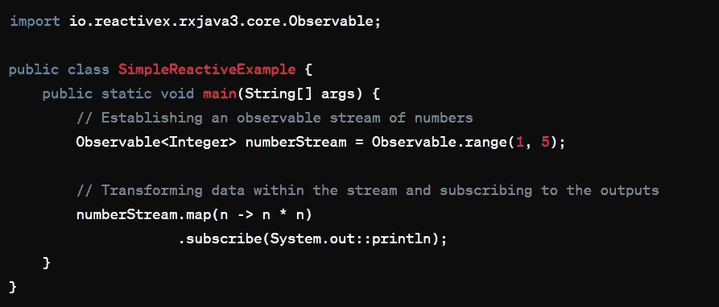

在此示例中，可观测对象发布了一个简单的整数序列，然后对其进行平方处理并打印。这演示了响应式编程如何方便地处理和操作异步数据流。

## 结论

响应式编程是创建需要高效管理动态数据流的应用有效范式。它提供了增强响应能力、更好的错误韧性以及简化代码架构的工具，使其成为现代交互式应用不可或缺。随着软件对实时处理和复杂交互模型的需求不断增长，响应式编程的原则变得越来越至重要。采用这种范式允许开发者构建出不仅高性能而且更易于管理和扩展的应用程序，从而应对当代软件开发挑战的需求。

## 使用 Spring WebFlux 构建响应式 API

`Spring WebFlux` 旨在支持创建非阻塞、异步的 Web 应用，这些能够在有效处理海量并发用户和密集数据传输的同时，优化资源使用。作为 Spring 5 的核心组件，WebFlux 使用 `Reactive Streams API` 集成了响应式编程原则，该 API 擅长管理背压并高效编排响应式流。

### Spring WebFlux 概述

`Spring WebFlux` 提供了一个传统 Spring MVC 的响应式框架替代。WebFlux 与 MVC 依赖 servlet API 和每个请求一个线程的策略不同，采用基于非阻塞 I/O 的事件模型。这种方法需要更少的线程来管理 Web 请求，从而增强了扩展性并最小化了运行开销。

### Spring WebFlux 的显著特性

- **非阻塞操作**：WebFlux 促进了完全非阻塞的 I/O 操作，适用于涉及连续数据交互或用户参与的场景。
- **背压处理**：它结合 `Reactive Streams API` 来有效管理数据流，确保下游消费者不会被数据涌入所淹没。
- **灵活的路由机制**：WebFlux 同时支持传统的 MVC 风格注解控制器和函数式路由方法，为开发者提供了处理 Web 请求的灵活性。

### 使用 Spring WebFlux 构建 API

要开始使用 `Spring WebFlux`，设置一个带有响应式编程必要依赖的 Spring Boot 应用，主要引入 `spring-boot-starter-webflux`。


### 编写响应式 API：示例

以下是一个使用 `Spring WebFlux` 开发响应式 API 的简单示例，涉及与响应式数据库的交互以及 RESTful 服务的设置。

#### 第 1 步：定义数据模型

假设一个基础的 `Product` 实体：

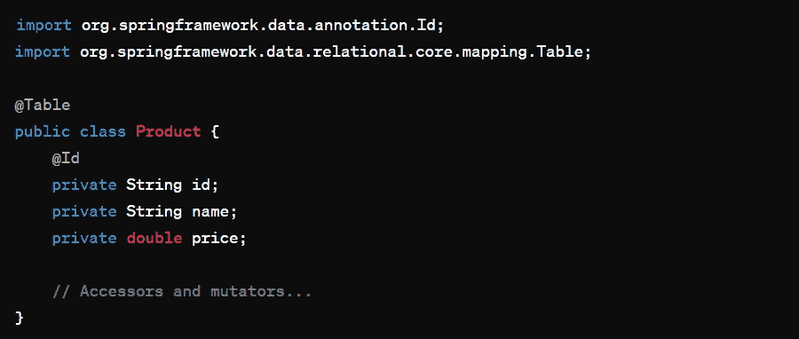

#### 第 2 步：创建响应式 Repository

Spring Data 通过简单的仓库接口支持响应式 CRUD 操作：

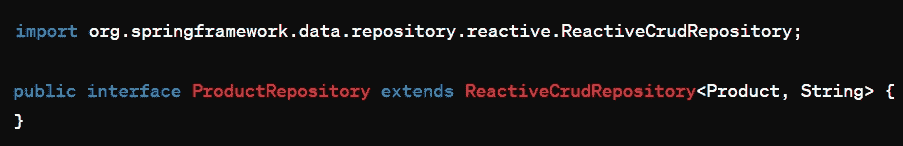

#### 第 3 步：配置 RESTful 端点

使用 `@RestController` 设置 RESTful 端点，其中使用 `Mono` 或 `Flux` 等返回类型来处理单个或多个项目：

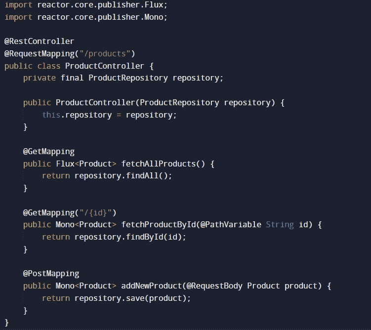

### 使用 Spring WebFlux 的优势

- **扩展性**：WebFlux 的事件驱动和非阻塞模型增强了在重负载下的扩展扩展能力。
- **资源节省**：线程使用的减少显著降低了对计算资源的需求，在成本敏感的环境中非常有益。
- **响应式用户交互**：WebFlux 特别适用于需要实时更新的应用，提供及时的响应并促进动态的用户交互。

## 结论


# Spring WebFlux 是一个强大的框架，用于开发满足现代性能、可扩展性和资源效率要求的响应式 API

通过应用响应式编程原则，开发者可以构建出具有韧性、响应迅速的应用程序，非常适合当今交互式和实时 Web 环境。随着 Web 开发格局继续向更复杂、更交互性的功能演进，精通 `Spring WebFlux` 对于希望在该领域进步并引领技术创新的开发者来说变得越来越本质重要。

## 响应式流中的背压及其管理

背压（Backpressure）是响应式编程中的核心概念，作为调节数据生产者（发布者）和消费者（订阅者）之间数据流的关键机制。这种控制确保数据消费过程不会被数据生产过程所淹没，从而维持系统稳定性并防止性能下降。Java 的 `Project Reactor` 和 `RxJava` 等库采用的 Reactive Streams 建立了内置背压支持的异步数据流处理指南。

### 背压的本质

背压作为一种控制机制运行，订阅者告知发布者它们在不被淹没的情况下能处理多少数据。这种策略防止了快速产生源过载较慢消费目的地的情况，这可能导致系统崩溃或效率降低。有效管理背压对于响应式系统的顺运行和可靠性至关重要。

### 响应式流在背压中的作用

Reactive Streams 提供了一个框架，用于构建非阻塞、感知背压的组件，以便高效编排异步系统内部的数据流。该架构包含几个核心组件：

- `Publisher`：向订阅者发布数据。
- `Subscriber`：处理从发布者接收的数据。
- `Subscription`：作为订阅者和发布者之间的通道，管理数据事务并允许取消流。
- `Processor`：同时担任订阅者和发布者，方便数据转换和传播。

### 通过响应式流实现背压

在 Reactive Streams 中，背压（backpressure）通过允许订阅者显式向发布者请求特定数量的数据来实现。这一功能使订阅者能够根据当前的处理能力调节数据流入，防止潜在的过载。

## 使用 Project Reactor 进行演示

以下是一个利用 `Project Reactor` 展示背压管理的实际示例：

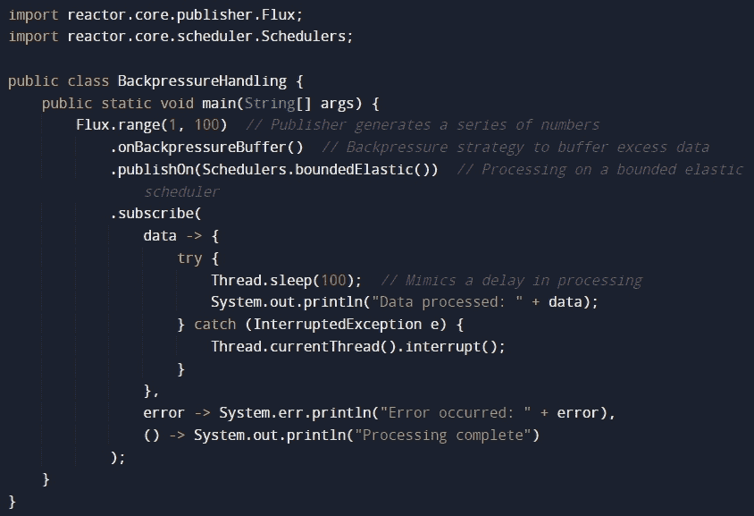

此代码段使用 `.onBackpressureBuffer()` 方法在无法立即处理时对数据进行缓冲，从而保护订阅者不被传入的数据流淹没。

## 管理背压的策略

Reactive Streams 存在多种有效管理背压的策略：

- **缓冲（Buffering）**：临时存储尚未处理的消息。
- **丢弃（Dropping）**：当输入速率超过处理能力时丢弃消息。
- **最新（Latest）**：仅保留最新的消息，移除之前的消息。
- **错误（Error）**：如果订阅者无法足够地处理数据，则发出错误信号。

策略的选择应符合特定的应用需求，并考虑数据重要可用系统资源等因素。

## 熟练管理背压的优势

适当管理背压对于开发健壮的响应式系统至关重要。它可以防止资源耗尽，使应用程序在各种负载条件下保持响应能力，并确保异步操作的平衡。此外，它还能增强系统的韧性，允许应用程序更优雅地处理极端情况。

## 结论

背压是 Reactive Streams 规范中的一项基础功能，能够在异步和事件驱动架构中实现高效、稳定的数据处理。通过应用有效的背压技术，开发者可以提高应用程序的性能和可靠性，确保系统保持响应并能够动态管理不同的数据量。掌握背压对于旨在优化现代软件应用性能和扩展性的开发者至关重要。

# 第六章 数据库性能优化

## Advanced JPA 和 Hibernate 调优技术

增强 Java Persistence API (`JPA`) 及其广泛使用的对应 `Hibernate` 的效率需要对其细微差别后端数据库系统有深入的理解。虽然 `JPA` 和 `Hibernate` 为数据库交互提供了方便的抽象，但不当的使用或低效配置会导致性能瓶颈。高级调优方法提供了解决这些问题并优化数据库操作效能的方案。

### 完善实体映射

简化实体映射对于提升 `JPA` 和 `Hibernate` 性能至关重要。一种优化策略是对实体关联使用懒加载（lazy loading），特别是对于包含大量数据集的关系。这种方法仅在需要时获取关联的实体，减少了不必要的数据库查询并最小化了内存占用。此外，根据应用需求和访问模式在急加载（eager loading）和懒加载策略之间仔细选择，可以显著影响性能。

### 查询增强

增强 `JPA` 和 `Hibernate` 查询对于精炼数据库性能至关重要。查询批、缓存和分页等技术有助于减少数据库往返次数并缩短查询执行时间。例如，批量获取（Batch fetching）允许在单个数据库查询中获取多个实体，减少了重复获取操作的开销。同样，缓存查询结果或实体可以通过消除冗余的数据库访问来提高响应速度。

### 数据库架构简化

适当的数据库架构设计和优化是实现 `JPA` 和 `Hibernate` 性能的基础。对频繁查询的列建立索引、避免多余的连接（joins）以及在适用对数据进行反规范化可以显著提升性能。此外，利用数据库特定的功能（如存储过程和数据库触发器）可以将计算从应用程序转移到数据库服务器，从而增强性能。

### 连接池与事务管理

配置连接池和事务管理设置对于优化 `JPA` 和 `Hibernate` 性能必不可少。连接池有助于高效管理数据库连接，减少连接开销并增强可扩展性。同样，微调事务隔离级别和批处理配置可以缓解冲突问题并提高数据库吞吐量。

### 监控与分析

对 `JPA` 和 `Hibernate` 应用进行定期监控和分析对于定位性能瓶颈和优化资源使用至关重要。诸如 `Hibernate Profiler` 和 `JPA` 性能监控库等工具提供了数据库交互、查询执行时间和对象关系映射开销的见解。通过仔细检查性能指标并识别改进区域，开发者可以调优应用程序以获得最佳性能。

### Advanced Hibernate 属性

`Hibernate` 提供了许多高级特性和优化来进一步丰富性能。二级缓存、乐观锁和自定义 SQL 查询执行等功能提供了对数据库交互和并发管理的精细控制。此外，利用 `Hibernate` 特有的注解和配置选项可以针对特定场景优化实体映射和查询执行策略。

## 结论

增强 `JPA` 和 `Hibernate` 性能需要对它们的特性、配置底层数据库系统有全面的理解。通过采用高级调优方法，如实体映射完善、查询优化、数据库架构简化、连接池和事务管理，开发者可以大幅提升应用程序的性能和可扩展性。定期的监控、分析以及对高级 `Hibernate` 属性的使用有助于最大化性能并确保数据库资源的高效利用。

## 优化查询性能和管理事务

增强数据库查询的效率和熟练管理事务是优化软件应用的关键方面。在 Java Persistence API (`JPA`) 和 `Hibernate` 领域，采用高级技术来提高查询性能并熟练处理事务可以显著增强应用程序的可扩展性和有效性。让我们深入一些精炼查询性能和熟练管理事务的高级策略。

### 增强查询性能的策略

1. **优化技术**：
   - **策略性索引**：在频繁访问的列上实现索引可以通过从数据库中快速检索数据来加速查询执行。
   - **精炼查询方法**：利用查询重写、缓存和提示（hints）可以优化查询执行计划并最小化资源消耗。

2. **获取策略**：
   - **选择性加载**：使用懒加载确保仅在需要时检索相关实体，减少获取不必要数据的开销。
   - **及时加载**：当需要急加载时，确保选择性加载以防止检索大量数据集。

3. **批量操作**：
   - **合并事务**：将多个数据库操作捆成批处理可以减少数据库往返次数，从而优化性能。
   - **批量事务**：利用 `JPA` 和 `Hibernate` 提供的批量操作进行大规模数据处理，可以显著提升性能。

### 事务管理的最佳实践

1. **事务控制**：
   - **最优事务定义**：清晰地定义事务边界以平衡粒度与粗糙度，从而优化数据库资源的使用。
   - **隔离级别选择**：根据并发需求选择隔离级别，在不牺牲性能的情况下维护数据一致性。

2. **连接处理**：
   - **高效池化**：实现连接池以高效管理数据库连接，并减轻连接开销。
   - **及时释放**：在使用后及时释放连接，以防止资源耗尽并确保后续请求的可用性。

3. **事务传播**：
   - **传播策略**：利用 `JPA` 和 `Hibernate` 提供的不同事务传播属性，有效控制跨方法调用的事务流。

## 监控与性能分析

### 1. 性能监控
- **分析工具**：利用数据库分析工具监控查询执行时间，识别慢查询并发现优化空间。
- **应用分析器**：使用应用剖析器仔细审查 `JPA` 和 `Hibernate` 的性能，定位瓶颈并优化资源分配。

### 2. 查询分析
- **执行计划评估**：分析数据库执行计划（Explain Plan）以理解查询执行机制并识别优化机会。
- **优化指导**：使用数据库管理系统提供的查询优化建议，为增强查询性能提供可行的见解。

## 结论

掌握 `JPA` 和 `Hibernate` 应用中优化查询性能和事务管理的艺术，对于实现卓越性能和可扩展性至关重要。通过采用高级查询调优方法、完善事务处理方法并利用性能监控和分析工具，开发者可以提高应用的效率和资源利用率。持续对数据库交互进行警觉、分析和改进，对于长期维持最优性能和扩展性的关键。

## 利用 Spring Data 仓库优化性能

增强应用程序性能是开发的一个环节，特别是在处理大量数据和复杂查询时。`Spring Data` 仓库为 Spring 应用中的数据访问提供了强大的抽象层，提供了多种增强性能的特性和策略。让我们深入探讨如何有效利用 Spring Data 仓库来优化应用程序性能。

### 1. 利用查询方法和 QueryDSL

`Spring Data` 仓库允许开发者使用方法命名约定定义查询方法。这些方法会被自动转换为数据库查询，最大限度地减少了手动编写 SQL 查询的需求并简化了开发。此外，开发者可以使用 `QueryDSL`（查询领域特定语言）通过编程动态构建查询，从而对查询构建提供更高的灵活性和控制力。

示例：

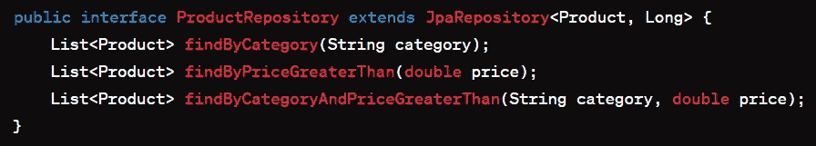

### 2. 结合分页和排序

`Spring Data` 仓库支持分页和排序功能，允许开发者以可管理的部分检索数据并指定排序标准。这种优化减少了从数据库获取的数据量，从而提升了响应时间，特别是在处理大规模数据集时。

示例：


### 3. 利用缓存

`Spring Data` 仓库促进了如 `Spring Cache Abstraction` 等缓存机制，与仓库无缝集成以缓存查询结果。通过缓存频繁访问的数据，开发者可以通过提供缓存数据而非重复执行数据库查询来减轻数据库负载并提高应用程序性能。

示例：


### 4. 查询优化

开发者可以利用 `Spring Data` 仓库提供的高级特性（如 `QueryHints` 和 `Query Annotations`）进一步优化查询性能。这些特性允许开发者定制查询行为、优化执行计划并微调性能参数，以适应特定的用例和需求。

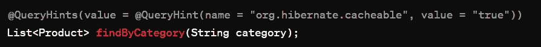

### 5. 实现批量操作

`Spring Data` 仓库支持用于批量处理处理的操作，允许开发者高效地对多个实体执行操作。批量操作最小化了数据库往返并优化了资源利用，从而提高了性能和可扩展性。

示例：

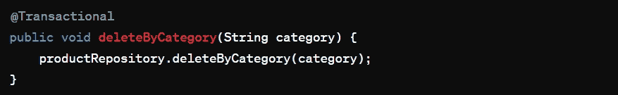

## 结论

有效利用 `Spring Data` 仓库对于优化 Spring 应用的性能起着关键性作用。通过利用查询方法、分页、排序、缓存、查询优化技术和批量操作，开发者可以简化数据访问、减少数据库开销并增强应用程序的响应能力。凭借 `Spring Data` 强大的特性和抽象，开发者可以在专注于构建健壮高效的应用程序的同时，确保在各种用例和工作负载下获得最优性能。

# 第七章 扩展 Spring Boot 应用

## 水平扩展与垂直扩展策略

在软件部署和管理的动态领域，掌握可扩展性的艺术至关重要。可扩展性策略根本上分为两种形式：水平扩展和垂直扩展。每种方法都针对特定的操作需求，并提供独特的优势和复杂性，因此恰当地应用这些方法对于最优性能管理至关重要。

### 水平扩展：扩大系统容量

水平扩展（也称为外扩展）通过向基础架构添加更多节点来增加系统容量。这种方法并不增强单台机器的容量，而是通过增加活动机器的数量来放大整个系统处理增加负载的能力。这种策略在可以无缝编排硬件添加的云环境中特别有效。

技术细节：水平扩展最适用于无状态应用程序——即每台服务器都独立处理请求，而不依赖跨会话的共享状态。这种独立性至关重要，因为它避开了在分布式网络中同步数据的复杂性，这种复杂性会严重损害系统性能。

Spring Boot 示例：考虑一种场景，一个 `Spring Boot` 应用需要适应增加的网络流量。可以通过增加实例数量来高效实现水平扩展，所有实例都由负载均衡器管理。以下 `Docker Compose` 配置演示了如何部署多个 `Spring Boot` 应用实例以有效分担：

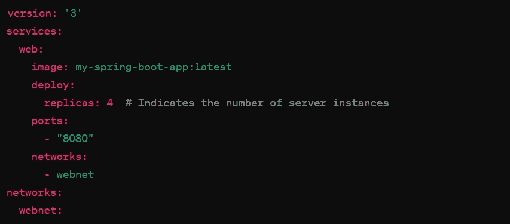

此配置展示了跨多个服务器有效分配负载的部署策略。

水平扩展的优势：

- **可扩展缩放**：随着资源需求的增加，提供近乎无限扩展的能力。
- **增强容错性**：减少单个节点故障对整个系统性能的影响。
- **灵活调整**：允许根据实时需求进行扩展性调整，在不中断系统的情况下提供高适应性。

### 垂直扩展：增强单节点容量

垂直扩展（或称为内扩展）涉及通过升级硬件资源（如 CPU、内存或存储容量）来增强现有服务器的能力。这种方法增加了服务器同时处理更多任务的能力。

技术细节：垂直扩展通常比水平扩展更容易实现，因为它涉及升级现有资源。然而，它受限于硬件增强的最大潜力，且这些升级通常需要停机。

#### Java 应用示例

对于 Java 应用程序（包括使用 `Spring Boot` 开发的应用），可以通过修改 `JVM` 设置来增加内存分配，从而实现垂直扩展：


此命令调整了 `JVM` 的堆设置以允许更大的内存容量，从而增强应用程序的性能能力。

## 垂直扩展的优势

- **实施简单**：通常更容易升级，因为它涉及对现有设备进行修改。
- **成本效益**：短期内更具成本效益，因为不涉及复杂的多系统配置。
- **即时性能提升**：对硬件的直接升级可以带来性能指标的快速改进。

## 选择最佳策略

在水平扩展和垂直扩展之间进行选择取决于多个因素，包括应用程序架构、负载变化性、预算限制以及战略增长目标。虽然水平扩展提供了长期的活性和健壮性，但对于即时的、成本效益的性能提升，垂直扩展可能是首选。

通常，一种被称为对角线扩展（diagonal scaling）的混合方法提供了最佳解决方案。这种策略将初始的垂直增强与向水平扩展的战略转变相结合，确保在满足即时性能需求的同时，为未来的可扩展增长奠定基础。这种平衡的方法最大化了资源利用率，并在不同的需求水平下保持最佳性能。

## 分布式系统中的状态管理

在分布式系统中处理状态管理对于确保操作效率、可靠性和可扩展性至关重要。在处理和数据存储在各个节点之间去中心化（可能分布在不同位置）的环境中，管理可变状态变成了一个关键挑战。本文讨论深入探讨了分布式架构中管理状态的基本要素、有效技术和既有实践，突出了常见障碍并提供了实用的解决方案。

### 分布式背景下定义状态

在分布式架构中，“状态”一词涵盖了跨用户交互和事务维护的所有动态信息，例如会话详情、配置设置、用户偏好和历史事务数据。与集中化系统相比（由于本地化数据存储和处理，状态管理可能更简单），分布式系统需要在多个服务器和数据库之间进行状态同步。这种同步需要解决以下几个关键方面：

- **一致性**：确保系统内的所有节点同时反映相同的状态。
- **可用性**：尽管出现部分系统故障或网络中断，仍能保持操作功能。
- **分区容错性**：确保即使系统部分由于网络分区被临时分割，系统仍能有效运行。

### 状态管理的挑战

分布式状态管理中的一个重大挑战源于 `CAP` 定理的影响，该定理认为分布式系统最多只能提供三种保证中的两种：一致性、可用性和分区容错性。该定理要求架构师根据应用程序的操作需求在这些元素中优先考虑两个。

网络延迟和故障使状态同步复杂化，导致潜在的不一致性。例如，如果一个节点更新了状态但在更改传播到其他节点之前崩溃了，系统必须实施稳健的机制来恢复或还原到一致状态。

## 最佳状态管理策略

### 优先考虑无状态

在可能的情况下，采用无状态架构可以极大简化系统设计并增强可扩展性。在无状态设置中，每个客户端请求都包含执行所需的所有信息，从而消除了对服务器端状态保留的需求。这种模型在无状态 `RESTful APIs` 中尤为明显，其旨在促进 Web 服务的大规模扩展。

### 实现分布式缓存

当无状态不可行时，分布式缓存是状态管理的一种高效替代方案。分布式缓存临时存储状态数据并在多个节点之间进行复制，增强了数据可用性和系统韧性。`Redis` 和 `Memcached` 等技术是实现此类缓存的热门选择。以下是在 `Spring Boot` 应用中配置 `Redis` 缓存的示例：

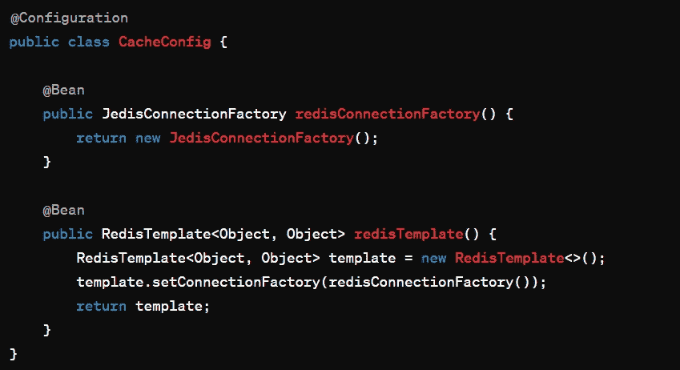

此配置有助于应用程序组件与 `Redis` 分布式缓存之间的无缝交互，确保了高效且灵活的数据管理。

### 使用共识协议

为了实现分布式节点之间的一致性，`Raft`、`Paxos` 或来自 `Apache ZooKeeper` 的 `ZAB` 协议是必要的。这些协议有助于节点就当前状态或操作序列达成共识，确保系统在潜在干扰的情况下保持协调性。

### 拥抱最终一致性

对于不需要即时一致性的非关键应用，最终一致性模型可能。。这种方法容忍节点之间暂时的状态差异，预计所有节点最终将同步。

## 状态管理的推荐实践

1. **一致状态验证**：实施定期对所有节点状态进行验证和对账的机制，以确保持续一致性。
2. **事务完整性**：利用事务过程维护原子操作，并确保系统在关键活动期间保持一致状态。


### 3. 详细监控

建立全面的日志记录和实时监控协议，以快速检测并解决状态管理中的任何差异。

## 结论

有效的状态管理对于分布式系统可靠且高效地运行至关重要。理解固有的挑战并应用无状态、分布式缓存、共识协议和最终一致性等策略，有助于在一致性、可用性和分区容错性之间保持平衡。通过战略性地实施这些原则，分布式系统可以有效管理状态，支持复杂且高可用的架构。

# 实现和优化会话集群

会话集群（`Session clustering`）是分布式 Web 应用中的一项关键技术，增强了故障允许以及服务器故障或停机期间用户会话的无缝连续性。该方法涉及在多个服务器之间同步用户会话数据，以便集群中的任何服务器都能处理带有共享会话信息的任何请求，从而提高应用程序的可靠性和可扩展性。

## 会话集群概述

会话集群涉及在几个服务器实例之间复制会话状态，以在会话期间保留用户特定信息，如登录详情、购物车内容和用户偏好。在这种环境中，跨服务器同步会话数据确保了如果一个服务器失败，另一台可以继续会话而不会丢失任何数据，从而维持连续的用户体验。

## 实现会话集群的技术

有效实现会话集群需要对应用程序架构和涉及的具体会话管理技术有深入理解。许多 Web 应用框架开箱支持会话集群，可以利用这些来促进实现。例如，在 `Apache Tomcat` 等平台上的应用程序可以利用用于跨集群会话管理的内置功能。

考虑以下 `Apache Tomcat` 中会话集群的简化配置示例，它已添加到 `server.xml` 文件中：

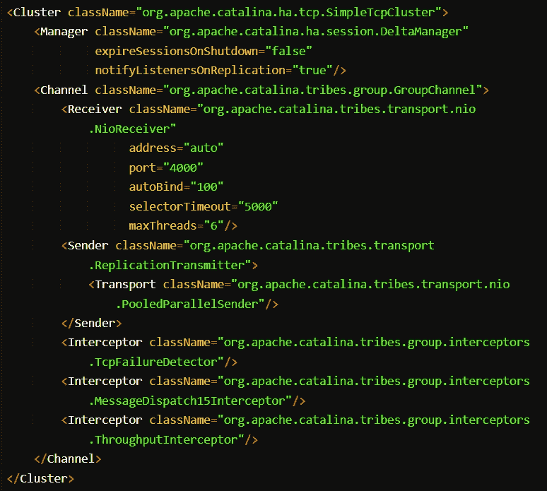

此配置建立了一个基于 TCP 的集群机制，利用 `DeltaManager` 通过仅传输会话数据的更改来高效地管理会话复制，从而减少网络负载。

## 会话集群的优化策略

虽然会话集群可以显著提高应用的韧性，但优化该策略对于缓解网络负载过大和潜在数据冲突等问题至关重要。以下是几种优化策略：

1. **最小化会话数据**：将会话中存储的信息限制在必要数据。数据过多会降低复制速度并增加网络流量。非必要信息应持久或缓存层中。

2. **采用粘性会话 (`Sticky Sessions`)**：使用粘性会话减少频繁复制的需求。通过将用户的会话绑定到特定的服务器并仅在需要时进行复制，可以最大限度地减少网络流量。这可以通过配置支持会话亲和性的负载均衡来实现。

3. **实现异步复制**：选择会话数据的异步复制以提高应用的响应速度。异步复制允许应用在会话数据更新传播时继续操作，从而增强吞吐量和用户体验。

4. **采用细粒度复制**：不要复制整个会话对象，仅复制修改后的属性。这种选择性方法减少了数据占用并增强了数据传输的效率。

5. **利用高级分布式缓存**：考虑使用如 `Redis` 或 `Hazelcast` 等高级分布式缓存解决方案。这些平台为跨分布式网络进行数据管理提供了强大的性能支持，并具有自动数据分区和快速复制等功能。

## 结论

实施和微调会话集群对于致力于提供稳健且无缝用户体验的分布式应用程序至关重要。通过策略性管理会话数据、最小化其足迹并利用先进技术进行数据同步，组织可以确保其应用程序在各种运行条件下保持可扩展性和韧性。这种方法不仅保护了用户数据的完整性，还增强了应用的整体性能。

# 第八章

## 微服务性能模式

用于高性能微服务的设计模式

在构建微服务架构时，确保最佳性能是一个首要任务，这需要细致的设计和深思熟虑的实施策略。设计模式是解决微服务相关常见问题的关键方法论，例如高效管理服务拆分、优化数据库交互以及促进有效的服务间通信。这些框架对于增强微服务的可扩展性、健壮性和可管理性至关重要。本文讨论强调了几种显著提升微服务基础设施性能的关键设计模式。

### 高效服务拆分的模式

1. **按业务功能拆分**：根据离散的业务功能组织微服务，有利于服务的集中化开发、部署和扩展。每个微服务都为特定的操作功能（如支付处理或客户支持）量身定制，这简化了架构并最小化了开销。这种分离有助于通过隔离和专用处理来增强服务性能。

示例设置：

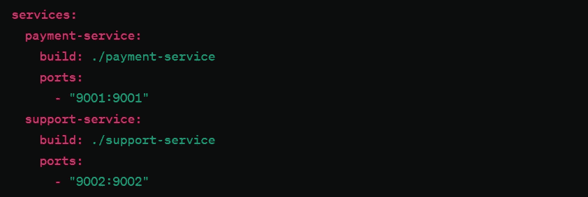

此 `Docker Compose` 文件展示了支付和客户支持的独立服务，突出了服务如何被独立地管理和扩展。

2. **领域驱动设计 (`DDD`)**：`DDD` 塑造软件设计以反映业务领域的复杂性和行为，便于将微服务组织成逻辑连贯的单元。围绕核心领域实体（如 `Orders` 或 `Accounts`）建模的服务确保了清晰的边界和最小的跨服务依赖，从而优化了性能并简化了维护。

### 数据库优化模式

3. **服务特定数据库**：为每个微服务分配唯一的数据库，以防止操作冲突和相互依赖，允许每个服务针对特定任务优化其数据库模式。这种方法可以实现更高效的数据处理和更快的响应时间。

示例数据库配置：

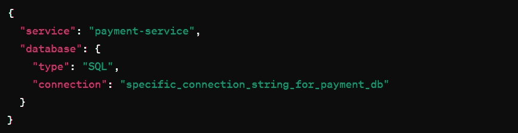

在此，支付服务使用其专用的 `SQL` 数据库，确保所有数据库操作都针对支付处理任务进行了优化。

4. **命令查询职责分离 (`CQRS`)**：将更新（命令）和检索（查询）数据的机制分离，可以显著提高这些操作的效率。`CQRS` 允许针对速度和响应能力优化读查询，而写命令则可以针对准确性和进行加固。

### 通信集成模式

5. **利用 `API 网关`**：`API Gateway` 作为所有客户端请求的主要接触点，将它们路由到相应的微服务。它可以高效地处理身份验证和请求路由等常见任务，将这些责任从单个服务卸载，以提高响应速度并简化操作。

示例路由逻辑：

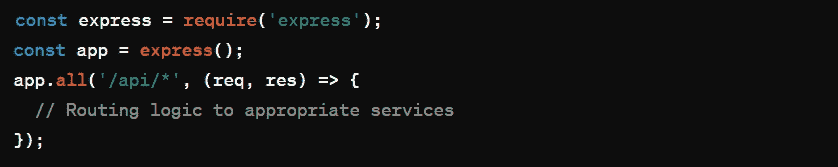

在此 `Express.js` 设置中，`API Gateway` 管理传入的请求，确保它们根据 API 路径被定向到正确的服务。

6. **用于服务通信的异步消息**：为服务之间的通信实现消息队列，可以实现异步交互，允许服务独立运行，而无需等待同步响应。这种非阻塞通信方式增强了可扩展性和整体服务性能。

使用 `RabbitMQ` 的异步通信示例：

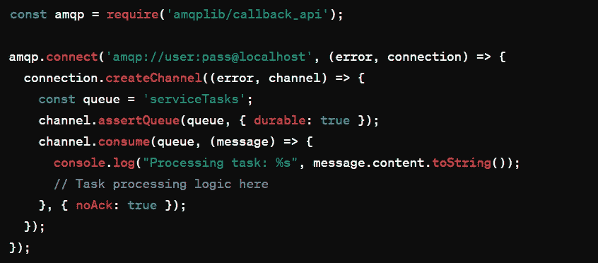

该脚本展示了服务如何从 `RabbitMQ` 队列中消费消息，并对其进行异步处理以保持效率和响应能力。

## 结论

应用特定的设计模式对于开发有效且可扩展的微服务架构至关重要。通过审慎利用业务功能拆分、`DDD`、服务特定数据库、`CQRS`、`API 网关`和异步消息等模式，开发者可以创建能够高效处理复杂操作和高用户流量的动态微服务系统。

## 隔离、分区和限流策略

在微服务架构中，确保稳健的性能和系统稳定性需要策略性的资源管理和有效的服务交互控制。隔离、分区和限流是构建韧性且可扩展的微服务系统的关键策略，有助于解决服务过载、延迟和级联故障等问题，以维护可靠的应用程序框架。

### 隔离策略

隔离意味着分离服务和资源，以防止系统性故障影响整个网络。这种方法增加了容错能力，并确保服务在负载变化或基础设施部分故障时保持运行。

1. **服务实例隔离**：将每个微服务实例放置在各自的隔离环境中（如虚拟机或容器），可以确保一个实例的问题不会影响其他实例。`Docker` 等容器技术和 `Kubernetes` 等编排系统非常擅长提供此类隔离环境。

用于隔离服务的 `Dockerfile` 示例：

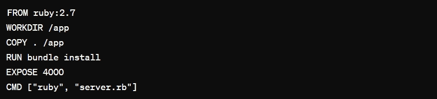

此 `Dockerfile` 概述了 Ruby 应用程序的设置，将其及其依赖封装在隔离的环境中，从而增强了其安全性和稳定性。

2. **数据库隔离**

为每个微服务分配独立的数据库有助于避免冲突并优化性能，因为每个服务都可以独立地管理其数据。

微服务特定数据库的示例配置：

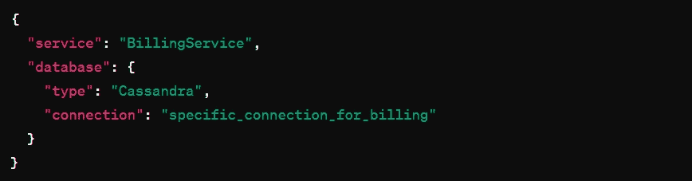

此配置确保 `Billing Service`（账单服务）在其专用的 `Cassandra` 数据库上运行，将其与其他服务隔离。

### 分区策略

分区将系统数据或工作负载分布在多个服务或节点上，增强了可维护性和性能。这种技术对于减少响应时间以及均衡分布系统负载至关重要。

#### 1. 数据分区（分片）

将数据库拆分为更易管理的部分或分片（`shards`），并分布在多个服务器上。这种安排有助于更高效地处理海量数据。

数据分区的 SQL 示例：

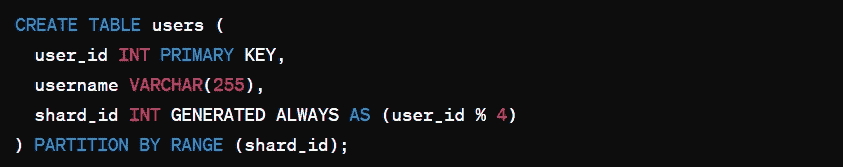

此 SQL 命令设置了一个分区用户表，数据根据 `user_id` 的模进行分布，便于跨分片进行平衡的数据管理。

#### 2. 服务分区

在不同的服务器或区域运行同一服务的多个实例，可以分担工作负载并增强服务可用性。

分区服务的 `Kubernetes` 部署示例：

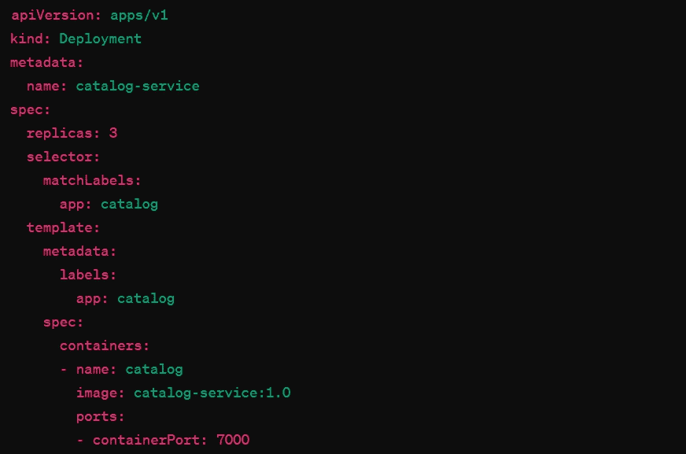

此部署配置了三个 `catalog-service` 实例，将其运行负载分散开，以提高性能和可靠性。

### 限流策略

限流控制传入请求的速率或数据吞吐量，以防止过载并确保所有用户之间的资源公平分配，这对于在峰值负载期间维持系统稳定性至关重要。

#### 1. 速率限制

对用户在特定时间范围内向服务发送的请求数量实施限制，有助于防止资源被占用。

API 速率限制的配置：


此 `NGINX` 设置限制了处理请求的速率，允许最多 20 次请求的突发流量，有效管理流量的激增。

#### 2. 负载卸载（`Load Shedding`）

当系统达到最大容量时主动拒绝请求，可以保护服务功能和用户体验。

负载卸载的服务代码：

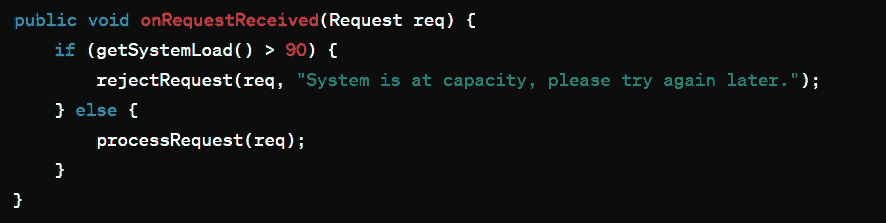

此 Java 方法监控系统负载，并在超过负载阈值时拒绝传入的请求，有助于在高需求期间稳定服务。

## 结论

隔离、分区和限流是微服务架构工具箱中不可或缺的策略，对于增强资源效率、管理流量激增以及确保服务的持久性至关重要。通过采用这些策略，开发者可以确保其微服务基础设施既具有可扩展性又具有健壮性，能够在各种运行条件下维持高性能。

## 同步与异步通信优化

在微服务架构中，有效管理通信对于系统性能和可靠性至关重要。两种主要的通信类型——同步和异步——都起着至关重要的作用，但各自带有优势和操作考虑因素。适当优化这些通信类型是确保服务高效稳定运行的关键。

### 同步通信的洞察

同步通信涉及直接、即时的交换，请求者在继续操作之前会等待回复。这种方法非常直观，镜像了传统软件开发中的函数调用，并提供了实时性和简单性。

**优势：**

- 集成简单：相对易于使用和集成，特别是对于那些熟悉传统软件架构的人来说。
- 数据完整性与即时性：提供实时处理，这对于依赖于即时数据一致性的事务至关重要。

**劣势：**

- 服务间依赖：请求服务的性能可能会受到其调用的服务响应能力的影响，可能引入延迟。
- 资源效率问题：在等待响应时资源可能无法被充分利用，导致效率低下，尤其在负载较高时。

**优化策略：**

1. **连接池**：此技术重用现有连接处理多个请求，减少与打开新连接相关的开销。
2. **实施超时**：通过建立超时机制，服务可以避免无限等待响应，从而防止资源浪费和潜在的死锁。

演示带超时同步调用的 Python 示例：

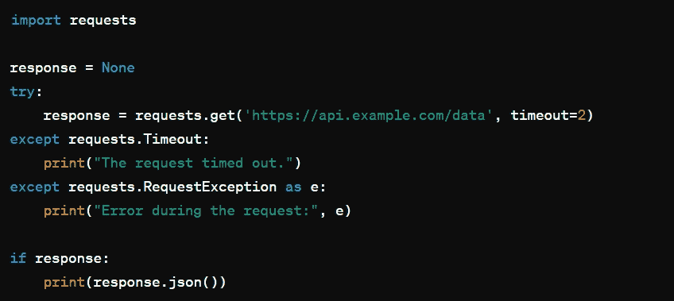

此代码段显示了如何发送带超时的同步 HTTP 请求，确保应用程序能够优雅地处理延迟。

### 异步通信的洞察

异步通信允许服务发出请求并继续其操作，无需等待响应。这种方法通过解耦服务增强了可扩展性和资源效率。

**优势：**

- 降低耦合：服务独立运行，增强了系统的韧性和可扩展性。
- 增强资源利用率：通过不阻塞资源等待响应，服务可以处理更多操作，提高整体吞吐量。

**劣势：**

- 管理复杂：异步操作会增加系统的复杂性，并需要更复杂的管理策略。
- 确保一致性的挑战：由于缺乏即时响应，跨服务的数据一致性维护变得复杂。

**优化策略：**

1. **采用消息队列**：通过使用消息队列，服务无需立即响应即可可靠通信，从而实现有效的解耦。
2. **采用事件驱动方法**：这涉及通过事件触发操作，有助于更有效地管理复杂的交互。

使用 `RabbitMQ` 进行异步消息的 Node.js 示例：

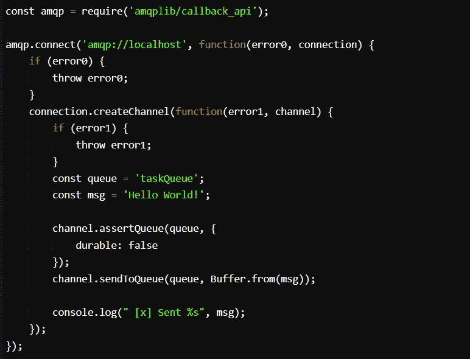

此脚本设置了一个简单的 `RabbitMQ` 消息队列，消息被发送到队列并在以后处理，展示了异步通信如何独立于发送者的进程。

## 结论

优化同步和异步通信对于微服务架构至关重要，可以在利用其优势的同时最小化相关风险。在同步场景中实施连接池和超时策略，结合异步场景中的消息队列和事件驱动架构，可以确保微服务的健壮性、可扩展性和高效性。这些方法使微服务能够有效地处理多样化动态的工作负载，维持高性能和系统可靠性。

# 第九章

## 缓存策略

在 Spring Boot 中实现有效的缓存

缓存是应用开发中一种重要的优化策略，特别是在减少重复数据库查询可以显著提高响应时间和系统性能的环境中非常有价值。Spring Boot 通过简单的设置提供了强大的缓存支持，并与流行的缓存技术（如 `Redis`、`EhCache` 和 `Caffeine`）无缝集成。本文讨论了如何在 Spring Boot 应用中有效实施和管理缓存策略，详细说明了设置配置、最佳实践以及需要避免的常见陷阱。

Spring Boot 缓存旨在通过在快速访问层中临时存储频繁请求的数据来缩短响应时间，从而尽量减少对昂贵数据检索过程的需求。Spring Boot 通过简单的配置设置和注解支持缓存，使得增强和管理应用程序性能变得更容易。

### 在 Spring Boot 中配置缓存

要在 Spring Boot 应用中启动缓存，必须首先通过在配置类上添加 `@EnableCaching` 注解来启用它，这将激活 Spring Boot 的缓存功能。

#### 激活缓存示例：

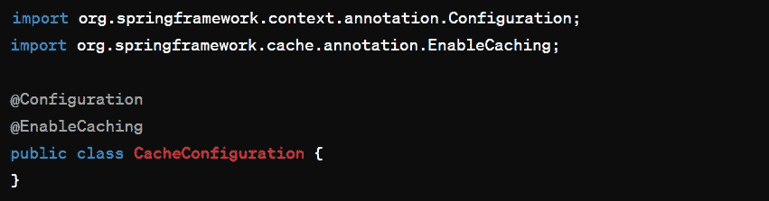

此配置片段激活了缓存，为后续的缓存相关操作做好准备。

#### 选择缓存提供者

Spring Boot 兼容多种第三方缓存解决方案，每种都提供了适用于各种应用程序需求的特性，例如分布式操作、持久化或内存缓存。

1. `Redis`：为分布式环境提供卓越支持，并包含持久化能力。
2. `EhCache`：提供强大的内存缓存，并带有持久化存储的选项。
3. `Caffeine`：以其高性能内存缓存著称，是本地缓存场景的理想选择。

#### Spring Boot 中 Redis 配置示例：

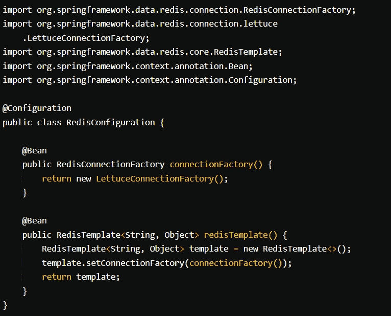

此设置演示了使用 `Lettuce` 将 `Redis` 配置为缓存提供者，`Lettuce` 以其扩展性和异步能力而闻名。

### 使用注解缓存

Spring Boot 通过在方法级别指定缓存操作来简化缓存，自动处理存储、更新和删除条目等缓存管理任务。

- `@Cacheable`：缓存方法的返回值并使用它来处理具有相同参数的后续调用。
- `@CacheEvict`：清除缓存条目，用于移除过时或未使用的数据。
- `@CachePut`：用方法调用的结果更新缓存，确保后续调用反映最新数据。

#### 使用 `@Cacheable` 示例：

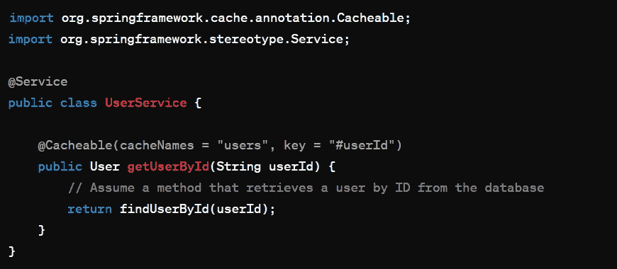

此示例缓存了 `getUserById` 的结果，通过为具有相同 `userId` 的后续请求提供缓存数据，显著减少了数据库负载。

### 有效缓存的最佳实践

- 实现周全缓存驱逐：定期定义和修订何时应驱逐缓存条目的策略，以避免提供过时的信息。
- 自定义缓存键：当默认策略无法满足应用程序特定需求时，自定义缓存键。
- 监控缓存性能：持续监控缓存的使用情况和效果，根据需要调整配置以优化性能。

## 结论

在 Spring Boot 中有效缓存可以通过减轻后端压力和增强用户响应体验，显著提升应用程序性能。通过精细配置缓存机制、选择正确的缓存提供者并使用 Spring Boot 的缓存注解，开发者可以实现高效且可扩展的应用程序架构。

---

# 缓存配置与驱逐策略

在软件开发中，特别是在涉及微服务等高频数据事务的架构中，高效的缓存管理至关重要。这涉及复杂的缓存配置和驱逐策略的策略性使用，以提高数据检索速度和整体系统性能。本指南探索了设置缓存配置和管理驱逐协议的有效实践，以优化资源利用和应用程序响应速度。

## 缓存配置的基础

缓存配置定义了影响缓存在应用程序中行为的运行参数。关键配置设置通常包括缓存大小、数据保留时长以及用于管理缓存容量的驱逐策略。优化这些设置对于减少对较慢的后端数据检索过程的依赖以及提高用户体验至关重要。

选择正确的缓存解决方案取决于应用程序的具体需求。流行的缓存系统如 `Redis`、`Memcached` 和 `EhCache` 每种都提供了独特的特性，以满足从高速内存缓存到持久化磁盘存储的各种场景。

### Spring Boot Redis 缓存配置示例：

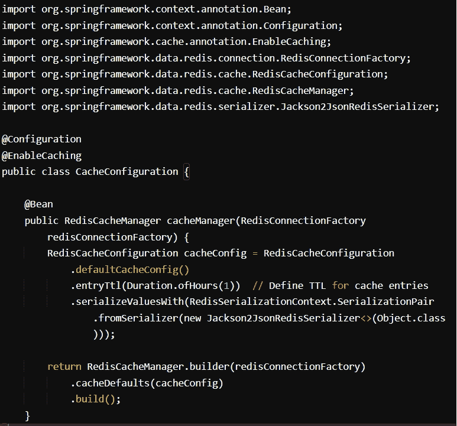

此设置在 Spring Boot 应用中将 `Redis` 配置为缓存提供者，为缓存条目指定了一小时的生存时间 (`TTL`)，并使用 JSON 序列化存储在缓存中的值以确保数据完整性并增强可维护性。

### 实现驱逐策略

驱逐策略是决定如何以及何时移除或替换缓存条目的规则，以便有效管理内存并确保缓存不提供过时信息。有效的驱逐是维持缓存效率和实用性的关键。

流行的驱逐策略包括：

1. 最近最未使用算法 (`LRU`)：优先将最近访问的数据保留在缓存中，首先驱逐最久未访问的项目。
2. 先进先出 (`FIFO`)：按照添加顺序驱逐项目，适用于数据新旧程度决定其相关性的场景。
3. 生存时间 (`TTL`)：为缓存数据设置固定的寿命，到期后自动删除，适用于具有预测过期时间的数据，如会话令牌或临时活动详情。

### LRU 策略的 Redis 连接工厂示例：

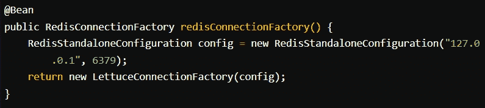

虽然此配置主要建立了连接设置，但 `Redis` 内部根据其配置参数实现了 `LRU` 驱逐机制，在无需代码中显式命令的情况下有效管理内存。

## 缓存管理最佳实践

- 配置以匹配数据访问模式：根据特定的访问模式和负载条件调整缓存大小、`TTL` 和驱逐策略。
- 监控缓存性能指标：定期监控缓存命中率、未命中率和加载时间，指导缓存配置的调优。
- 记录缓存活动：详细记录缓存行为有助于诊断问题并优化缓存性能。

## 结论


# 缓存配置与驱逐策略

设置有效的缓存配置和驱逐策略是增强数据密集型环境中应用程序性能的基础。通过仔细选择缓存机制并配置以符合应用程序的运行需求，开发者可以显著缩短数据检索时间并提高系统响应速度。基于真实性能数据的持续监控和迭代改进，确保了缓存策略与不断演变的应用程序需求保持一致，随着应用程序扩展持续提供最佳支持。

---

# 在可扩展应用程序中使用分布式缓存

分布式缓存是一种通过在多个互连的服务器上管理数据，以提升应用程序可扩展性和性能的关键策略。该技术显著减轻了后端数据库的负载并降低了延迟，能够从内存而非较慢的磁盘存储中快速检索数据。本文探讨了分布式缓存的机制、其对高流量应用的优势以及有效的实现策略。

## 分布式缓存的基础

分布式缓存涉及数据分布在缓存服务器网络中，通过允许从最近或最优节点访问来提高数据检索时间。`Redis`、`Hazelcast` 和 `Memcached` 等工具被广泛用于实现分布式缓存。这些系统无缝集成到各种应用程序结构中，从简单的 Web 应用到复杂的分布式微服务架构。

1. **减轻数据库负载**：将频繁查询的数据存储在缓存中，这减少了与数据库的直接交互，为关键操作保留资源并消除性能瓶颈。

2. **加速数据访问**：由于内存访问速度远于磁盘访问，在内存中缓存数据可以降低延迟并提高应用程序的整体响应速度。

3. **可扩展性**：分布式缓存支持水平扩展，这意味着随着需求的增加，可以向缓存添加更多服务器，从而在用户群和数据需求增长时实现平滑的扩展。

4. **可靠性与可用性**：通过在多个节点之间复制数据，分布式缓存确保了即使某个节点发生故障，应用程序仍然可以从其他节点获取数据，从而维持数据可用性和应用程序运行时间。

## 分布式缓存的部署策略

设置分布式缓存需要对缓存参数的配置、缓存技术的选择以及针对应用程序特定需求的维护策略进行周全的规划。

### 分布式缓存的 Redis 配置示例

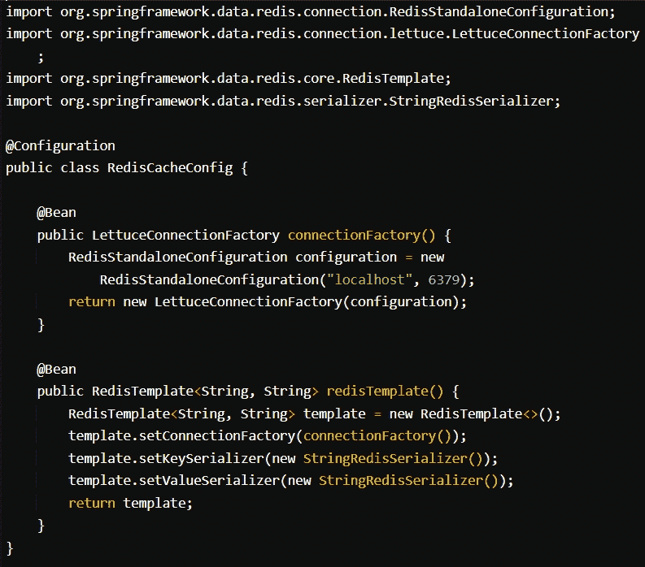

此配置使用 `Lettuce` 客户端设置了 `Redis`，它在 `Spring Boot` 环境中支持异步、非阻塞通信。它详细介绍了对于高效缓存至关重要的连接设置和数据序列化过程。

## 分布式缓存最佳实践

1. **平衡数据分布**：确保数据均匀分布在缓存集群的所有节点上，防止任何单个节点成为性能瓶颈，导致性能下降。

2. **动态缓存失效**：建立一种机制移除过时或访问频率较低的数据，保持缓存的有效性和相关性。利用 `Time-to-Live` (`TTL`) 策略实现数据自动过期。

3. **调整以数据一致性**：决定应用程序所需的适当一致性水平——是强一致性还是最终一致性——并据此配置缓存以在准确性和速度之间取得平衡。

4. **监控与调整**：持续监控命中率、未命中率和整体负载等缓存指标。根据这些指标调整设置以优化性能和资源使用。

5. **增强安全措施**：实施安全协议以保护缓存中的敏感数据，包括加密和安全访问控制。

## 结论

实施分布式缓存是增强应用程序扩展性和效率的强大方法。通过在服务器网络中缓存数据，应用程序可以减少对慢数据库查询的依赖，处理更高流量的流量，并通过更快的响应时间提升用户体验。周全的实施、持续的监控和定期的调整对于任何高性能计算环境中充分利用分布式缓存的潜力至关重要。

# 第十章 安全性能考量

## 在不损害性能的安全最佳实践

在保持最佳性能的同时有效保护软件应用程序是现代软件开发中的一项关键挑战。在开发生命周期早期集成健壮的安全框架并采用高效的策略，是在不降低运营效率的前提下保护系统的关键。本讨论概述了无缝结合能够保持性能的安全实践措施的多种方法。

### 安全措施的早期集成

从系统设计的初始阶段引入安全措施（通常称为“设计安全”）至关重要。这种方法不仅使安全成为架构不可或缺的一部分，还避免了后期进行高成本且低效率的安全措施后置改造的需求。

#### 主动安全集成的原则

* **最小化数据暴露**：系统的设计应限制敏感数据的暴露，从而最大限度地减少潜在的攻击面。

* **默认安全设置**：配置系统使其从开始就是安全的，这需要刻意的行动来降低安全性，这有助于防止因配置错误导致的意外漏洞。

### 优化身份验证与授权

开发精简的身份验证和授权流程对于在不影响用户体验或系统响应速度的情况下保护应用程序至关重要。

* **有效使用 JWT（JSON Web Tokens）**：`JWTs` 促进了双方之间的安全交互，对于分布式系统中的无状态验证特别有用。

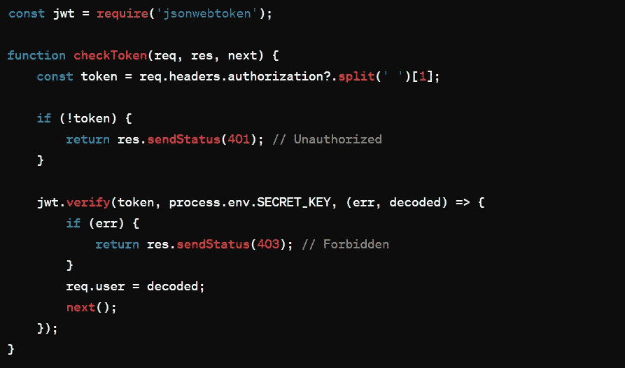

此 `Node.js` 代码段说明了如何使用 `JWT` 对请求进行身份验证，减少了用户身份验证对数据库查询的需求，从而增强了性能。

### 专注于数据加密

仅对关键数据实施选择性加密有助于在保持安全性的同时，不产生不必要的性能开销。

* **选择性加密方法**：仅对泄露后可能造成重大损害的数据进行加密，例如个人用户信息或财务细节。

* **硬件辅助加密**：现代处理器通常支持 `AES-NI` 等加密加速技术，这可以显著加快加密操作，而不影响整体系统性能。

### 遵循安全编码规范

安全编码是防止 `SQL 注入` 和跨站脚本 (`XSS`) 等常见安全缺陷的基础，这些措施也能优化应用程序的数据处理。

#### 使用安全实践防止 SQL 注入

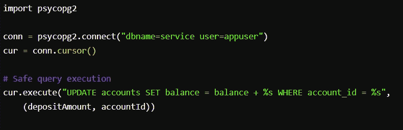

此 `Python` 代码使用参数化查询，有效防止了 `SQL 注入`，同时通过减少重复解析和编译 `SQL` 语句的需求，优化了查询执行时间。

### 定期安全审计与更新

持续执行安全审计和更新软件组件对于缓解新兴威胁至关重要。这些自动化确保了持续的安全维护，而不会产生重大的手动开销。

* **自动化安全工具**：利用自动化安全扫描工具和依赖管理解决方案定期更新并修补漏洞，高效地保持系统安全和最新。

## 结论

有效平衡安全与性能，需要在设计过程早期采用安全措施、利用高效的身份验证机制、实施针对性的加密实践、遵循安全编码指南，并持续监控和更新安全措施。这些实践确保了应用程序不仅不受威胁，还能高效运行以满足用户和业务需求。

## 优化身份验证与授权机制

在数字领域，在不损害系统性能的前提下确保健壮的安全措施至关重要。有效的身份验证和授权是保护敏感信息和高效管理用户访问不可或缺的一部分。本讨论强调了完善这些安全措施的先进策略，以便在增强系统性能的同时维持稳固的保护。

### 身份验证与授权概述

身份验证通过密码、令牌或生物识别数据等凭据验证用户的身份，确保他们确实是其声称的。授权发生在身份验证之后，用于确定用户是否有权访问系统内的特定资源或功能。

优设计的身份验证和授权流程对于安全高效的操作至关重要。实施不当可能会引入安全漏洞并减慢系统。

### 高级身份验证增强

精简身份验证对于在确保访问的同时减少对用户体验和系统负载的影响至关重要。以下是几种方法：

#### 身份验证方法

1. **多因素身份验证 (`MFA`)**：MFA 通过要求多次身份证明来增强安全性，极大降低了未经授权访问的风险。


此 Python 示例使用 `TOTP` 生成动态一次性密码，这是实现 MFA 的一种有效方式，在对性能影响最小的同时增强了安全性。

2. **单点登录 (`SSO`)**：SSO 允许用户验证一次即可访问多个系统，无需重复登录，减轻了系统的身份验证负担。

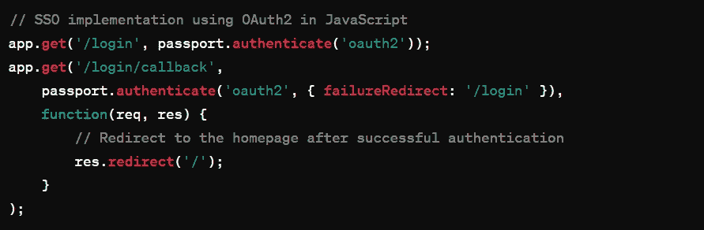

此 JavaScript 设置演示了使用 `OAuth2` 的 SSO 功能，简化了跨多个服务或应用程序的用户身份验证。

### 优化的授权实践

高效的授权设置可确保适当的访问控制，在不产生不延迟的情况下维护安全性。

1. **基于角色的访问控制 (`RBAC`)**：RBAC 通过为用户分配角色来促进权限管理，简化了对资源的访问控制。


此 Java 代码段利用 `RBAC` 根据预定义的用户角色授予访问权限，高效地管理系统内的用户权限。

2. **基于属性的访问控制 (`ABAC`)**：ABAC 通过评估用户和资源的各种属性来做出授权决策，实现了细致的访问控制。

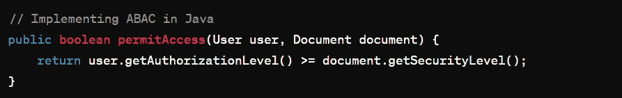

在此示例中，访问决策基于用户和文档安全级别的比较，为授权提供了一种更细致入微的方法。

## 增强系统性能

为了优化身份验证和授权的性能：

* **缓存决策**：通过缓存安全检查的结果，系统可以快速检索并应用决策而无需重新处理，从而加快重复请求的访问速度。

* **高效的数据处理**：简化数据访问和存储（特别是在复杂系统中），可以缩短执行安全检查所需的时间。

### 持续的安全管理

对安全机制进行定期更新和持续监控，对于适应新威胁以及维持安全性和性能至关重要。

## 结论

整合如 `MFA` 和 `SSO` 等复杂的身份验证方法，结合 `RBAC` 和 `ABAC` 等强有力的访问控制技术，可以确保系统全面的安全性，且不降低性能。有效实施这些策略需要周密的规划和定期优化，以跟上不断变化的安全需求和技术进步。

# 敏感数据的安全、高效处理

在当今以数据为中心的环境中，处理安全协议与系统性能之间复杂的相互作用至关重要。组织在管理敏感数据（从个人标识符到财务和健康记录）时，不仅要遵守 `GDPR` 和 `HIPAA` 等监管标准，还要确保这些措施不会损害系统的响应能力。本文讨论强调了在不牺牲系统性能的情况下维持高安全性的有效方法论。

## 数据保护的核心安全措施

敏感信息的保护始于稳健的安全策略，包括高级加密、完善的访问控制和有效的数据管理策略。

### 核心安全方法

* **高级加密**：使用 `AES`（高级加密标准）对存储和传输中的数据进行加密，对于防止未经授权的访问至关重要。

* **严格的访问控制**：使用基于角色的访问控制 (`RBAC`) 和基于属性的访问控制 (`ABAC`) 等系统，有助于确保只有授权用户根据其角色或特定属性访问某些数据。

* **最小化数据保留**：减少存储的敏感数据量可以降低风险，并通过减轻数据处理和存储资源的负载来提高系统性能。

## 为性能优化安全操作

实施不对系统性能产生负面影响的安全措施至关重要。以下策略可以帮助实现这种平衡：

* **高效的加密过程**：利用 CPU 中的 `AES-NI` 等硬件加速功能可以促进更快的加密解密活动，减少性能开销。

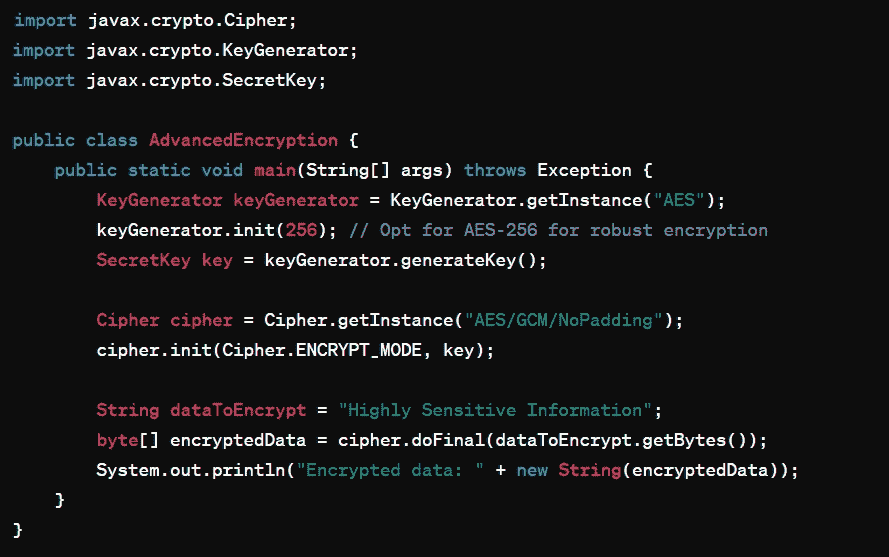

此 Java 示例展示了 `AES-256` 加密的应用，证明了使用特定的 CPU 能力如何高效地增强数据安全。

* **智能数据缓存**：缓存非敏感数据可以减少频繁访问和处理敏感数据的需求，从而提高性能。

## 高效数据存储和检索策略

选择正确的存储解决方案并优化数据检索机制是有效管理敏感数据的关键。

* **增强数据库安全设置**：安全的数据库配置应强制加密连接和严格的访问限制。对敏感字段建立索引可以提高查询操作的效率，而不牺牲数据安全。

* **数据脱敏实施**：对输出中的敏感信息进行数据脱敏，可以确保完整数据值不被不必要的暴露，在保留功能的同时保护隐私。


此 SQL 示例演示了一种掩码敏感数据（在本例中为社会安全号码）的技术，以防止在数据处理过程中完全暴露。

## 持续的安全审查与合规性保证

定期更新安全措施并持续监控合规性对于适应新兴威胁和变化的法规至关重要。

## 结论

通过严格的安全措施有效管理敏感数据，同时确保系统性能，可以通过仔细应用高级加密、高效数据处理和定期的合规检查来实现。通过遵循这些实践，组织可以保护数据免受潜在威胁，而不损害其运营的效率和有效性。这些策略确保了对法律标准的遵守，并维护了利益者对安全、高性能环境的信任。

# 第十一章 高级应用监控与指标

## Spring Boot 应用的自定义指标

在当今的软件开发领域，有效监控应用的性能和健康状况是不可缺的。Spring Boot 因其构建 Java 应用程序的方便高效而被广泛使用，通过其 `Actuator` 模块在这方面尤为擅长。自定义指标是 Spring Boot 默认指标的扩展，允许人员根据特定的运行需求定制监控，为应用程序的动态和性能提供细粒度的洞察。

### Spring Boot 指标的要素

Spring Boot `Actuator` 提供了生产就绪的功能，例如通过 HTTP 端点或 `JMX` 进行监控，并提供了几个内置的指标。然而，应用程序通常有独特的监控需求，需要自定义指标来捕获对其运行至关重要的数据点。

自定义指标是定制的测量工具，旨在跟踪特定的应用程序操作，例如事务量或详细的操作统计。这些指标对于识别异常模式、理解应用程序随时间的趋势以及做出数据驱动的决策至关重要。

### 与 Micrometer 集成自定义指标

Micrometer 提供指标收集 facade，支持多种监控系统，包括 `Prometheus`、`Graphite` 和 `Dynatrace`。它简化了 Spring Boot 应用中自定义指标的集成，允许对这些指标进行动态注册和管理。

#### 步骤 1：配置 Micrometer

要利用 Micrometer 实现自定义指标，请在项目的构建配置中包含必要的依赖项。对于 Maven 用户，这需要在 `pom.xml` 文件中添加条目：

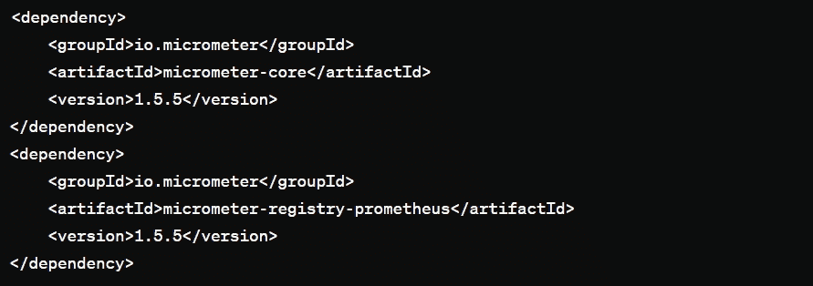

此配置设置了 Micrometer，并支持将 Prometheus 作为数据监控系统。

#### 步骤 2：创建自定义指标

可以使用 `MeterRegistry` 定义自定义指标。以下是在 Spring Boot 服务中创建计数器（counter）指标的方法：

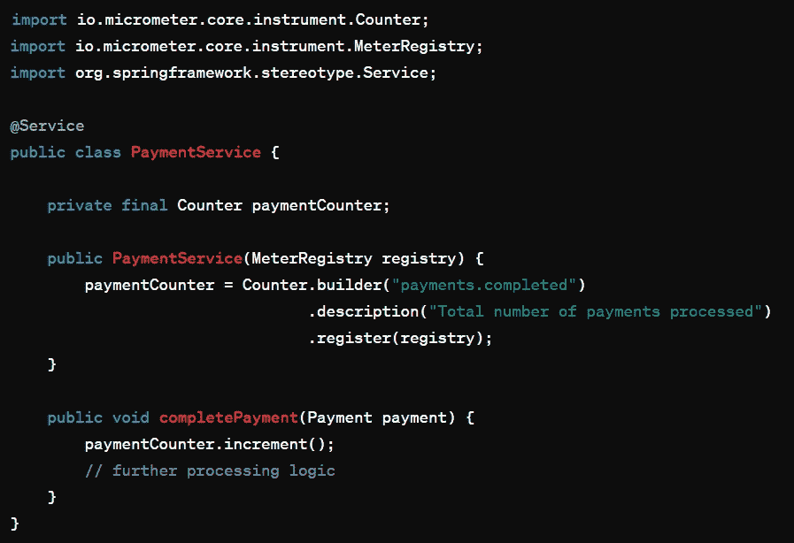

这段代码段设置了一个计数器，用于监控已处理的支付数量，并使用 `MeterRegistry` 注册此自定义指标。

#### 步骤 3：导出指标

为了使指标具有价值，必须能够为了监控目的访问。例如，在使用 Prometheus 时，可以通过控制器端点（endpoint）暴露指标：

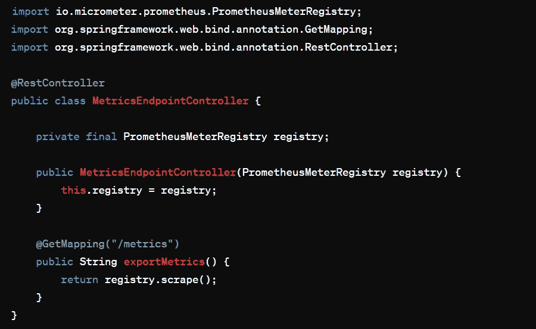

该控制器为 Prometheus 提供了一个用于抓取（scrape）的端点，以它可以解释的格式显示指标，从而便于通过 Grafana 等工具进行数据可视化。

### 自定义指标的最佳实践

在部署自定义指标时，请考虑以下最佳实践，以确保它们能够提供有意义的见解，且不对应用性能产生负面影响：

* **有目的测量**：专注于提供重要见解的指标。过量的数据可能会变得繁琐并分散重要的发现。

* **优化标签使用**：虽然标签对详细分析很有帮助，但过度标记会导致高基数（high cardinality）问题，可能降低数据库性能。

* **持续评估指标**：定期重新评估和完善指标，以适应不断变化的应用功能和业务目标。

## 结论

由 Micrometer 驱动的 Spring Boot 自定义指标允许开发者密切监控应用程序的特定方面，增强观测性和决策能力。对这些指标进行深思熟虑的实施和持续管理，可以确保它们成为维护和提高应用性能及可靠性的价值资产。

## Spring Boot Actuator 和 Micrometer 的高级用法

在激烈的软件开发环境中，有效管理和监控生产环境中的应用至关重要。Spring Boot Actuator 配合 Micrometer 提供了一个强大的框架，能够深入洞察应用的状况和指标。这种能力允许开发者增强默认监控功能以满足特定需求，同时提高应用程序的可观测性和控制力。

### 使用 Spring Boot Actuator 自定义监控

Spring Boot Actuator 提供了基本的管理功能，可以通过 HTTP 端点或 JMX 访问，涵盖了指标、健康和配置等各种应用方面。通过扩展这些端点，开发者可以对其进行定制，更精确地监控特定的应用指标和健康状况。

**增强端点功能**：开发者可以修改并扩展 Actuator 端点以集成额外的指标或健康状况，增强针对应用运行背景的监控能力。

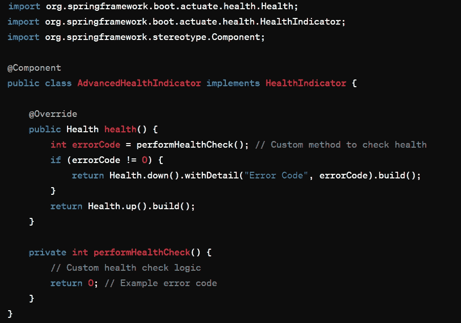

这段 Java 代码说明了如何实现自定义健康指示器来评估应用程序的特定方面，提供定制的健康信息。

### 使用 Micrometer 获取详细指标

Micrometer 是一个指标库，提供了多维度监控能力，支持广泛的监控系统。它能够对 JVM、应用和自定义指标进行精确跟踪。

**自定义指标实现**：可以专门定制自定义指标，以捕获应用程序独特的运行数据，为开发者提供跟踪最重要内容的灵活性。

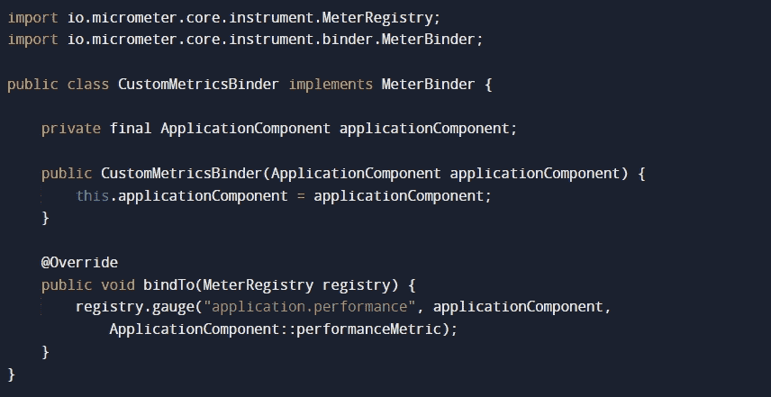

在此示例中，创建了一个自定义仪表盘（gauge）指标来监控应用组件的特定性能指标，将深度见解直接集成到监控框架中。

**应用动态指标标签**：Micrometer 支持指标的动态标记，提供详细的分段，增强了数据分析能力。

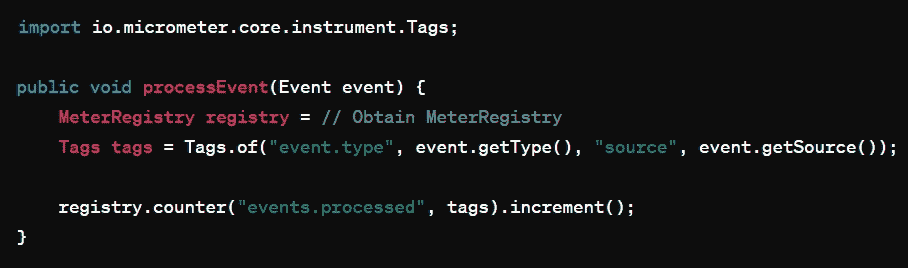

此部分显示了如何根据类型和来源对事件进行标记，允许对处理过的事件进行详细跟踪和分析。

### 集成 Actuator 和 Micrometer 以增强监控

结合 Spring Boot Actuator 与 Micrometer 允许开发者通过 Actuator 端点暴露详细的自定义指标，简化监控流程。

1. **统一指标暴露**：集成允许所有指标（包括通过 Micrometer 定义的自定义指标）通过 Actuator 端点进行访问。

2. **端点安全措施**：由于其暴露数据的敏感性，确保 Actuator 端点的安全性至关重要。

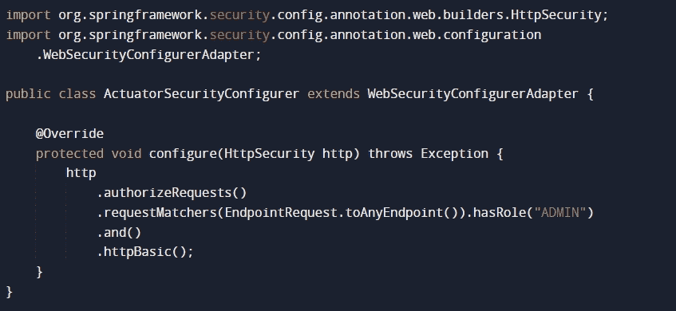

此配置确保了 Actuator 端点是安全的，需要 `ADMIN` 角色权限才能访问，从而保护了敏感的应用指标和健康数据。

## 结论

Spring Boot Actuator 和 Micrometer 的高级使用为开发者提供了深度应用监控和管理的全面工具。通过定制和利用这些工具的功能，开发者可以保持高水平的应用性能和可靠性，确保他们的系统在实时运行环境中既健壮又具洞察力。

### 与 Prometheus 和 Grafana 等监控工具集成

在当今数字环境中，有效的应用监控对于维持最佳性能和可靠性至关重要。Prometheus 和 Grafana 作为监控领域的领先工具，提供了跟踪和可视化运行数据的卓越能力。本指南探讨了将这些高级工具集成到应用程序中的步骤，以提高监控效率并获得更深层次的见解。


# 深入 Prometheus 和 Grafana

Prometheus 是一个为监控和报警设计的开源解决方案，将各种指标作为时间序列数据进行采集。它具有强大的查询语言，能够实现分析所需的精确数据检索。

Grafana 是一个强大的可视化工具，与 Prometheus 等其他数据源接口，允许用户创建详细的仪表板，通过图表、图形和告警显示指标。这增强了有效解释大量数据的能力。

将 Prometheus 用于指标收集并结合 Grafana 用于可视化，提供了一个全面的监控框架，可以将数据转换为可操作的见解。

# 为您的应用配置 Prometheus

集成 Prometheus 涉及设置应用程序，以 Prometheus 能够高效抓取的方式暴露指标。这一过程通常由 Spring Boot 应用中的 Micrometer 等库提供便利，这些库提供了与 Prometheus 的无缝兼容。

## 1. 引入所需库

确保项目中包含了 Micrometer Prometheus 库：

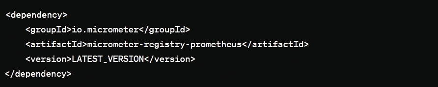

## 2. 在 Spring Boot 中启用指标端点

Micrometer 简化了 Spring Boot 指标的暴露，通常通过 `/actuator/prometheus` 端点，使 Prometheus 能有效抓取：

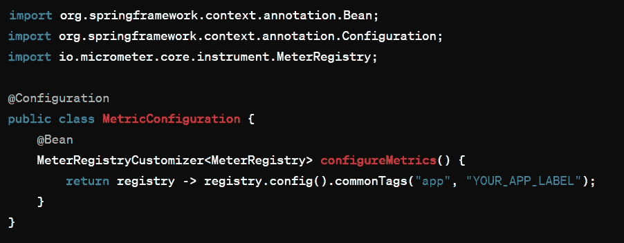

此配置片段确保指标被整齐标记，便于管理和分析。

## 3. 设置 Prometheus 抓取指标

调整 Prometheus 设置，定期从您的应用程序获取数据：


此设置引导 Prometheus 定期从您配置的端点收集指标。

# 利用 Grafana 进行数据可视化

在 Prometheus 配置聚合指标后，可以使用 Grafana 对这些数据进行可视化。

## 1. 链接 Grafana 到 Prometheus

配置 Grafana 将 Prometheus 识别为数据源，在 Grafana 设置中指定 Prometheus 的 URL。

## 2. 开发信息丰富的仪表板

在 `Grafana` 中，构建仪表板以可视化 `Prometheus` 收集的数据。利用 `Grafana` 的查询编辑器使用 `PromQL` 编写查询，以实现定制化的视觉表示：


此 `PromQL` 示例计算了每个路由的 HTTP 请求速率（过去五分钟的平均值），为了解流量模式和潜在问题提供了洞察。

# 有效集成的建议

- **定期审查指标**：通过持续评估和调整，保持你的指标具有关联性。
- **实施稳健的安全措施**：保护你的 `Prometheus` 和 `Grafana` 设置，特别是在暴露到网上时，通过实施身份验证和使用加密连接。
- **设置主动告警**：利用 `Grafana` 和 `Prometheus` 的告警功能监控关键指标，并对异常做出快速响应。

# 结论

将 `Prometheus` 和 `Grafana` 集成到你的应用程序基础设施中，为监控提供了一个稳健的解决方案，不仅收集详细的运行数据，还能对其进行有效可视化。通过遵循概述的步骤并遵守推荐的实践，你可以建立一个先进的监控设置，实现明智决策并增强应用程序的性能和稳定性。

# 第十二章

## Spring Boot 的 CI/CD 与 DevOps

### 在 CI/CD 流水线中实现性能测试自动化

在现代软件开发中，使用持续集成/持续部署 (`CI/CD`) 流水线是快速、一致地交付高质量软件的基础。将性能测试集成到这些流水线中，对于确保应用程序在部署之前不仅按预期运行而且符合预定义的性能标准至关重要。

#### 性能测试在 CI/CD 中的意义

`CI/CD` 流水线中的性能测试对于在软件开发周期早期识别潜在的回归和性能问题至关重要。这种方法有助于在风险影响生产系统之前降低风险，显著减少修复所需的时间和资源。

这些测试的自动化保证了在多个代码库和部署环境中进行一致且彻底的性能评估，与强调速度和效率的敏捷方法高度契合。

#### 实现自动化性能测试

1. **选择正确的工具**：选择与你的 `CI/CD` 设置无缝集成的适当工具是自动化性能测试的第一步。如 `JMeter`、`Gatling` 和 `LoadRunner` 等工具非常适合模拟用户行为并衡量负载下的各种性能指标。

   使用 `Jenkins` 和 `JMeter` 的示例：

   

   此示例展示了如何配置 `Jenkins` 流水线来执行 `JMeter` 测试计划、保存结果并进行分析，以跟踪随时间变化的性能。

2. **设置性能基准**：为性能建立基准指标至关重要。这些基准源于历史数据，提供了一个衡量标准，确保新更改不会降低性能。

3. **反馈集成**：纳入对性能测试结果的即时反馈机制至关重要。如果性能低于可接受水平，结果应触发告警，并应提供详细报告进行深度分析，以便及时采取纠正措施。

4. **测试维护与扩展性**：持续更新和扩展你的性能测试以适应新的应用程序功能和用户场景至关重要。这确保了随着应用程序的演进，测试在发现潜在问题方面保持有效。

#### 性能测试自动化的最佳实践

1. **尽早且频繁测试**：在软件开发过程早期引入性能测试并频繁执行这些测试。早期测试有助于尽早发现问题，此时问题通常更简单且解决成本较低。

2. **确保广泛的测试覆盖**：开发全面覆盖应用程序各个方面的性能测试。广泛的覆盖有助于发现不同组件在压力和各种运行条件下的表现。

3. **模拟真实的使用模式**：性能测试应紧密模拟真实的用户行为和负载条件，确保结果准确反映潜在的生产操作。这包括使用真实数据和用户交互模式。

4. **持续监控与改进**：持续监控新功能和优化的性能影响。对性能数据的定期分析应指导应用程序和测试策略的持续改进。

## 结论

将自动化性能测试集成到 `CI/CD` 流水线中对于开发高质量、稳健且高效的软件至关重要。这种策略性的结合确保了性能考虑在整个开发阶段得到系统性的处理。结果是组织可以实现更可靠的软件部署、更高的产品质量和卓越的用户满意度，在市场中保持竞争优势。

## 使用 Docker 和 Kubernetes 进行容器化和编排

在如今技术驱动的格局下，精通容器化和编排对于简化应用程序部署和确保跨环境的一致性能至关重要。`Docker` 和 `Kubernetes` 领导着这些工作，提供了简化复杂应用程序管理的稳健框架。

### 利用 Docker 实现有效容器化

`Docker` 在现代开发中至关重要，它允许将应用程序及其依赖封装成容器。这种封装确保了应用程序无论部署环境如何都能可靠运行。

**使用 Docker 的优势：**

- **跨环境的一致性**：`Docker` 确保容器在任何系统上的运行方式相同，消除了常见的“在我机器上可以运行”的问题。
- **资源效率**：容器运行在同一台机器上并共享操作系统内核，与运行完整的虚拟机相比，显著减少了开销。
- **隔离与安全**：每个容器都在隔离状态下运行，防止系统故障并提供稳健的安全。

**Docker 使用示例：**


此命令演示了部署一个 `Nginx` 容器，将主机的 80 端口映射到容器的 80 端口，并在后台分离运行。

### 使用 Kubernetes 进行编排

虽然 `Docker` 专注于容器化，但 `Kubernetes` 擅长编排这些容器，特别是在分布式系统中。

**Kubernetes 的基础概念：**

- **Pods**：`Kubernetes` 中的基本单元，包含一个或多个应该共同管理的容器。
- **Services**：定义应用程序如何访问 pod 提供的服务，提供一致的接口。
- **Deployments**：帮助管理应用程序的更新和扩展，提供自动发布和回滚的机制。

**Kubernetes 配置示例：**


此脚本配置 `Kubernetes` 使用 `Nginx` 服务器管理三个 Web 应用程序实例，确保高可用性和负载均衡。

#### 将 Docker 与 Kubernetes 集成

`Docker` 和 `Kubernetes` 结合提供了跨各种环境容器生命周期的简化管理。`Docker` 封装应用程序，而 `Kubernetes` 处理部署和扩展，创建一个高效的编排系统。

**Docker Compose 对比 Kubernetes**：`Docker Compose` 适用于管理单个主机上的多个容器，而 `Kubernetes` 跨集群扩展，提供了较大部署所需的稳健性。

#### 优化的最佳实践

1. **最优容器构建**：
   - 选择经过验证的镜像以增强安全性。
   - 将容器设计为瞬态，以降低管理的复杂性。

2. **有效管理配置**：
   - 使用 `Kubernetes` 的 `ConfigMaps` 和 `Secrets` 实现动态特定环境设置。

3. **资源规范**：
   - 在 `Kubernetes` 中清晰定义每个容器应使用的资源，以防止资源竞争并确保高效运行。

4. **实现高级监控**：
   - 使用如 `Prometheus` 等全面工具进行系统监控，并使用 `EFK` 栈进行日志记录，以保持对操作的可见性和控制。

## 结论

`Docker` 和 `Kubernetes` 的协同重新定义了应用的部署和管理，提供了可扩展的解决方案，增强了应用的开发周期和运行稳定性。拥抱这些工具使组织具备了高效管理复杂基础设施的能力，并在快速演变的技术格局中保持竞争优势。

# 用于一致环境的基础设施即代码 (IaC)

基础设施即代码（`IaC`）是现代 IT 策略的基石，为通过代码自动化和管理基础设施提供了蓝图。这种方法与软件开发中的最佳实践（如版本控制和自动化测试）紧密结合，提高了运营效率并最大限度地减少了差异。

## IaC 的角色

在 IT 领域中采用 `IaC` 带来了变革性的益处：

- **部署效率**：通过 `IaC` 实现自动化允许按需快速配置复杂基础设施。
- **增强可靠性**：通过标准化基础设施配置消除不确定性，降低人为错误的风险。
- **可追溯性与控制**：基础设施的变化经过版本控制并可审计，确保任何修改都是可追溯和可逆的。
- **降低运营成本**：`IaC` 减少了手动配置涉及的人力和可能的错误，从而节省了成本。

## 关键 IaC 技术

`IaC` 领域有几个关键工具，每种工具旨在解决基础设施管理中的特定需求：

- **Terraform**：因强大的声明式方法以及处理跨提供商复杂部署的能力而受到推崇。
- **Ansible**：以在自动化部署和配置管理中简单、无代理的设置而闻名。
- **AWS CloudFormation**：与 `AWS` 深度集成的服务，使用声明式模板定义并配置 `AWS` 基础设施。
- **Azure Resource Manager (ARM)**：使用声明式 JSON 模板一致地管理和配置 `Azure` 资源。

### 使用 Terraform 部署基础设施

以下是一个使用 `Terraform` 部署基础设施组件的示例，展示了其实际应用：

### 使用 Terraform 部署 AWS EC2 实例


此 `Terraform` 脚本配置了 `AWS` 俄勒冈地区的 `EC2` 实例，强调了指定和管理基础设施的便利与精确。

## 有效实现 IaC

为了优化实现 `IaC`，应遵循以下最佳实践：

1. **基础设施代码模块化**：将代码组织成独立的模块，以简化更新并增强重用性。
2. **完善基础设施代码化**：确保基础设施的所有元素都代码化，便于全面的治理和控制。
3. **与 CI/CD 流水线集成**：在 `CI/CD` 流水线中定期集成并测试您的基础设施代码，以便尽早发现问题并降低风险。
4. **利用不可变基础设施**：采用通过替换资源而非更改现有配置来执行更新的模型，提高预测性和回滚能力。

## 结论

基础设施即代码彻底改变了传统的 IT 管理方法，使其与系统化、可预测和可扩展的实践保持一致。通过利用 `Terraform` 和 `Ansible` 等高级工具，并采用彻底的模块化和测试策略，组织可以确保其基础设施符合严格的可靠性和效率。这种结构化的基础设施管理方法不仅减少了开销，还增强了整体服务交付，为企业未来的增长和适应奠定了基础。

# 第十三章

## 高性能问题的排除与调试

### 诊断和解决性能瓶颈的高级技术

性能瓶颈会严重影响应用的有效性和响应时间。为了确保应用的最佳功能，必须采用复杂的诊断技术和精确的仪器测量来准确识别并解决这些问题。

### 评估性能瓶颈

性能瓶颈通常出现在系统的特定区域，由于编码实践不佳、资源分配不足或系统配置欠优而限制整体效率。这些问题通常会导致响应时间延长、吞吐量减少或延迟增加，特别是在特定的负载条件下。

### 识别性能瓶颈

1. **性能分析 (Profiling)**：该技术涉及实时分析应用的资源使用情况以识别低效操作。

   - **使用 Python cProfile 的示例**：

     

     此代码段说明了使用 `Python` 的 `cProfile` 来跟踪应用性能并保存结果供后续评估。

2. **追踪 (Tracing)**：这种方法记录应用过程的详细信息，对于剖析复杂系统中的行为至关重要。

   - **使用 OpenTelemetry 进行高级追踪**：`OpenTelemetry` 提供了全面的工具和 API 用于详细追踪和指标，增强了应用性能分析能力。

3. **负载测试**：利用模拟需求来评估应用在压力下的表现。使用 `JMeter` 和 `LoadRunner` 等工具生成用户流量并评估应用的韧性。

4. **基准测试 (Benchmarking)**：将当前应用性能与既有标准或之前的指标进行比较，以识别性能下降。

### 解决性能瓶颈

可以实施几种策略来有效缓解识别出的瓶颈：

1. **代码优化**：改进或重写低效代码部分可以显著提升性能。

   - **优化 SQL 查询**：

     

     此 `SQL` 优化通过完善连接或索引，可以大幅提高查询性能。

2. **资源增强**：增加服务器或网络等资源的容量，可以缓解由物理限制产生的瓶颈。

3. **并发增强**：调整应用程序以并发处理任务，可以优化资源使用并提高性能。

   - **使用 Python asyncio 增强并发**：

     

     此示例演示了如何使用 `Python` 的 `asyncio` 更好地处理异步任务，特别是在 I/O 密集型操作中。

4. **缓存技术**：实现缓存机制以存储并快速检索频繁访问的数据，可以显著缩短加载时间并减轻关键资源的负担。

### 利用全面监控工具

如 `Dynatrace`、`New Relic` 和 `AppDynamics` 等高级监控解决方案提供了应用性能的深度洞察，并具有自动异常检测和详细因果分析的能力。这些工具对于快速定位和解决性能差异至关重要。

## 结论

有效解决性能瓶颈需要详细的诊断和针对性的干预。性能分析、追踪、负载测试和基准测试等技术对于识别底层性能问题至关重要。补救措施包括代码优化、资源扩展、并发改进和策略缓存，对于增强应用程序性能至关重要。此外，先进的监控工具在持续性能优化中发挥着至关重要的作用，确保应用程序保持高运行标准。

# Spring Boot 应用的性能分析与内存泄漏检测

Spring Boot 促进了微服务和全面软件应用的快速开发。然而，内存泄漏等性能问题可能会阻碍其有效性并降低用户体验。彻底的性能分析和及时的内存泄漏检测对于维持 Spring Boot 应用的最佳运行至关重要。

### 性能分析在 Spring Boot 中的重要性

性能分析通过跟踪资源消耗和行为模式，对 Spring Boot 应用进行检查。这种分析方法对于识别应用程序内部性能变慢、内存过度消耗以及代码执行低效的区域至关重要。

1. **应用程序性能监控 (APM) 工具**：如 `AppDynamics`、`Dynatrace` 和 `New Relic` 等工具对于监控 Java 应用（包括基于 Spring Boot 构建的应用）的性能至关重要。它们提供了有关资源使用、执行计时和方法效率的实时见解。

2. **Java 性能分析工具**：对于详细的 JVM 分析，`YourKit`、`VisualVM` 和 `JProfiler` 等工具是不可或缺的。它们提供了对 JVM 关键方面（如垃圾回收、堆使用和线程管理）的洞察，这些对于发现性能异常至关重要。

## Spring Boot 的有效性能分析技术

有效地分析 Spring Boot 应用通常包括以下几个重要实践：

1. **APM 工具的集成**：在 Spring Boot 应用中嵌入 APM 解决方案通常涉及添加特定的依赖并配置应用程序属性。大多数 APM 工具利用与 JVM 无缝集成的 Java agent。

   * **APM 集成示例**：

   

   设置包括配置 `newrelic.yml` 并将其附加到 JVM：

   

2. **利用 JVM 性能分析工具**：将 `VisualVM` 等工具连接到正在运行的 Spring Boot 应用无需修改代码。这些工具能够对内存进行持续监控，并促进堆转储（heap dump）分析。

   * **如何连接 VisualVM**：打开 `VisualVM`，找到 Spring Boot 应用的进程 ID (PID)，开始监控关键性能指标和线程。

## Spring Boot 中内存泄漏的检测与处理

Spring Boot 中的内存泄漏发生在不再使用的对象继续占用 JVM 堆内存空间时，可能导致内存过度消耗和 `OutOfMemoryError`。识别和管理这些泄漏涉及：


# 堆转储分析

## 生成堆转储

可以使用 `jmap` 实现：

```
jmap -dump:live,format=b,file=heapdump.hprof <PID>
```

将 `<PID>` 替换为应用程序的进程 ID。

## 垃圾回收日志分析

启用垃圾回收日志有助于识别可能暗示内存泄漏的低效垃圾回收过程。

### 设置 GC 日志

```
-Xlog:gc*:file=gc.log:time,uptime,level,tags
```

该命令记录了详细的垃圾回收数据，对于定位低效或频繁的垃圾回收周期至关重要。

## 跟踪对象留存

性能分析工具可以监控 JVM 堆中的对象留存，突出显示异常消耗内存的类或 Bean。

## 结论

对 Spring Boot 应用进行性能分析并快速识别内存泄漏是确保这些系统有效运行的关键。通过结合 APM 工具、使用 JVM 性能分析工具并系统地分析内存利用，开发者可以显著增强 Spring Boot 应用的稳定性能。定期且主动的分析有助于预防潜在问题，确保应用程序持续提供高性能和良好的用户体验。

# 用于深度性能洞察的日志分析与追踪

在现代软件开发中，最优应用程序性能至关重要。日志分析和追踪等技术为开发者和 IT 专业人员提供了有关应用程序在各种条件下运行和性能的深度见解。通过仔细检查日志文件和追踪应用程序执行，团队可以识别并解决性能问题，更好地理解系统行为，并在问题发生前减轻其对终端用户的潜在影响。

## 日志分析概览

日志分析意味着对应用程序运行期间生成的日志进行检查。这些日志记录了广泛的事件、错误和事务，作为应用程序活动的详细时间顺序记录。当分析有效时，日志可以发现隐藏的错误、跟踪系统健康并监控应用程序性能。高级工具如 `Splunk`、`ELK Stack`（`Elasticsearch`、`Logstash`、`Kibana`）和 `Graylog` 通过启用强大的数据可视化、实时处理和复杂查询增强了日志分析的能力。

## 日志分析的核心优势

* **错误检测**：快速定位并解决通过其他监控技术可能无法发现的错误。
* **模式识别**：识别随时间演变的趋势或反复出现的问题，更好地理解应用程序行为。
* **安全监控**：日志提供了有关访问和系统操作的关键信息，有助于安全评估和合规报告。

## 示例日志条目

```
2023-10-27 10:00:00 INFO  [UserService] User login successful - userId=12345
```

此日志条目示例记录了用户的成功登录，包括准确的时间和用户 ID，对于性能监控和安全目的都有价值。

## 追踪的作用

追踪记录请求通过应用程序各个组件的历程，特别是在分布式系统中。它对于诊断请求如何被处理、可能在哪里发生延迟以及组件在负载下如何相互作用至关重要。

通过追踪获得的见解包括：

* **识别性能瓶颈**：确定请求变慢的具体点，从而引导重点优化工作。
* **理解服务交互**：可视化不同服务或组件之间如何交互，这对于调试和性能调整至关重要。
* **追踪错误源**：跟踪导致错误的请求执行过程，简化故障排除过程。

## 使用 OpenTelemetry 实现追踪

`OpenTelemetry` 提供了一个健壮的框架，用于从应用程序收集追踪和指标，促进广泛的可观测性。以下是 Java 应用中实现追踪的示例代码：

```java
@GetMapping("/users/{id}")
public User getUser(@PathVariable Long id) {
    return tracer.spanBuilder("getUser")
        .setAttribute("user.id", id)
        .startScopedSpan()
        .end();
}
```

此代码段演示了如何创建一个跨（span）来监控方法的持续时间和成功情况，并在该上下文中处理异常。

## 日志分析与追踪的集成

当日志分析与追踪相结合时，可以获得应用程序性能和健康的更完整、更细致的视图。日志提供了粒度的事件数据，而追踪则提供了应用程序过程中事件流的宏观视图。这种集成方法对于全面理解应用程序性能至关重要，能够更快、更有效地解决问题。

## 最佳实践

* **关联日志与链路**：通过在日志条目中包含 trace ID 来增强诊断能力，将详细的事件数据与广泛的事务流相关联。
* **利用自动化**：利用工具对日志和链路进行定期和自动分析，帮助主动检测并解决问题。
* **维护集中化数据管理**：确保日志和链路数据是集中的，特别是在分布式环境中，以便于访问和分析。

## 结论

日志分析和链路对于深入了解应用程序性能至关重要。这些技术有助于识别和解决性能问题，提供应用程序交互的清晰视图，并确保系统高效、安全地运行。通过利用高级工具并遵循既定的最佳实践，开发团队可以提高应用程序的可靠性和用户体验。

# 第十四章：针对高可用性与韧性进行设计

## 使用 Spring Boot 构建容错系统

在数字服务领域，应用程序的韧性至关重要。确保系统能够承受并从组件故障中恢复而不丢失功能，是至关重要的。Spring Boot 提供了一系列功能，帮助开发者构建此类容错系统，使他们能够在压力下仍保持无缝运行。

### Spring Boot 容错的关键方面

使用 Spring Boot 创建容错应用程序涉及构建系统结构，以有效处理并从故障中恢复，从而确保持续运行和一致的用户体验。

### 增强 Spring Boot 的容错性

#### 1. 统一异常管理

利用 Spring Boot 的 `@ControllerAdvice` 允许开发者全局处理异常，通过集中管理潜在错误来维护系统稳定性。

```java
@ControllerAdvice
public class GlobalExceptionHandler {
    @ExceptionHandler(Exception.class)
    public ResponseEntity<String> handleException(Exception ex) {
        return ResponseEntity.status(HttpStatus.INTERNAL_SERVER_ERROR).body("An error occurred");
    }
}
```

此示例演示了如何实现全局异常处理，为用户提供一致的响应并在意外问题发生后稳定应用程序。

#### 2. 可配置动态设置

Spring Boot 的 `@ConfigurationProperties` 和 `Spring Cloud Config` 促进应用程序设置的外部管理，允许在不停机的情况下调整系统。

#### 3. 服务发现实现

利用 `Spring Cloud Netflix Eureka` 可以实现自动的服务注册和发现，确保应用程序能够可靠地相互定位和通信。

```yaml
eureka:
  client:
    serviceUrl:
      defaultZone: http://localhost:8761/eureka/
```

此配置演示了 Spring Boot 应用程序如何与 `Eureka` 集成进行动态服务发现，这对于运行韧性至关重要。

#### 4. 负载均衡与断路

`Spring Cloud LoadBalancer` 将传入的流量分布到多个实例上，防止过载。同时，使用 `Resilience4j` 实现断路器可以防止故障跨系统发生级联。

```java
@Bean
public CircuitBreaker circuitBreaker() {
    return CircuitBreaker.ofDefaults("myService");
}
```

此设置显示了断路器如何通过在系统部分故障时防止完全关闭来保护系统。

#### 5. 促进异步操作

采用 `@Async` 或集成如 `Kafka` 或 `RabbitMQ` 等消息代理，可以使系统独立于应用程序主流执行操作，提高可扩展性和响应速度。

```java
@Async
public CompletableFuture<String> processAsync() {
    // 后台处理逻辑
    return CompletableFuture.completedFuture("Result");
}
```

此方法突显了如何实现异步处理，通过在后台管理任务来增强系统性能和容错性。

## 结论

使用 Spring Boot 构建容错系统涉及利用其强大的功能来为故障做好准备并有效管理故障。通过全面的错误处理、动态配置、具有韧性的服务发现、策略性负载均衡和异步通信，开发者可以构建出确保高可用性和运行连续性的健壮应用程序。这些实践对于创建不仅能够抵抗故障还能确保用户体验不中断的系统非常重要。

## 灾难恢复与零停机部署的策略

在当今竞争激烈的数字服务环境中，确保业务不中断和 IT 系统的稳健韧性是必不可少的。采取策略性的灾难恢复和零停机部署方法是减少服务中断风险和确保持续服务交付的关键。本文概述了先进的方法和最佳实践，旨在于计划内的升级和意外的系统故障期间加固系统并维持运行。

### 灾难恢复的核心原则

灾难恢复计划侧重于准备和减轻重大 IT 中断的影响。该策略涵盖稳健的数据备份实践、自动故障转移系统和快速恢复协议，以缩短停机时间并保护数据完整性。

灾难恢复的关键方面包括：

* **地理数据冗余**：在多个位置实施备份，以降低与局部故障相关的风险。
* **自动故障转移系统**：开发在主配置遇到问题时能够自动切换到备用模式的系统。
* **定期恢复演练**：一致地进行恢复程序测试，以确认其有效性并与组织的恢复基准保持一致。

### 实现零停机部署

零停机部署对于需要持续可用性的行业（如在线零售）至关重要，任何停机都会直接影响收入和客户满意度。实现此点的有效策略包括：

#### 1. 蓝绿部署

采用双生产环境允许其中一个环境处理实时流量，同时在另一个环境中部署和验证更新。测试后，流量将无缝切换到更新后的环境，对服务的影响降至最低。

示例：使用 `Kubernetes` 等编排平台管理这些环境，通过在它们之间路由流量来促进平滑过渡。

#### 2. 金丝雀发布

该技术涉及最初向有限用户群推出更改，一旦更新被验证为稳定，就扩展到整个用户群。这使得潜在缺陷的暴露限制在受控组内，从而最小化了整体风险。

示例：通过负载均衡逐渐向更新的应用程序导向流量，允许在不产生重大中断的情况下进行性能观察和问题解决。

#### 3. 功能开关

在功能开关后部署新代码，允许团队在不向所有用户暴露的情况下将更改交付到生产环境，从而允许更受控和可逆的功能发布过程。

```java
if (featureFlagService.isEnabled("newFeature")) {
    // 新功能逻辑
}
```

示例：这种条件功能检查允许无缝的功能管理，在不破坏更广泛应用程序稳定的情况下启用或禁用功能。

#### 4. 数据库架构版本控制

将数据库架构更改与应用程序更新对齐对于部署的顺畅至关重要。`Liquibase` 和 `Flyway` 等版本工具管理数据库迁移，确保与应用程序的生命周期一致。

示例：在部署流水线中集成 `Flyway` 可实现数据库迁移，维护数据库和应用程序架构的一致性。

### 将灾难恢复与零停机部署实践集成

将灾难恢复与零停机部署策略相结合，可以为预计划的升级和意外停机提供全面的保护。这种结合方法确保了更新的无缝集成以及对潜在故障的稳健准备。

集成的最佳实践包括：

* **自动数据备份和多地复制**：确保数据在多个位置自动备份并复制。
* **主动系统监控和告警**：实施先进的监控系统，以快速检测并解决异常。
* **持续更新与安全补丁**：定期的更新和补丁可以增强系统安全性和功能，降低故障的脆弱性。

## 结论

实施有效的灾难恢复和零停机部署策略对于任何依赖持续数字服务可用性的组织都是至关重要的。通过蓝绿部署、金丝雀发布、功能开关和数据库版本控制等策略方法，组织可以确保业务连续性并提高服务可靠性。结合全面的灾难恢复计划，这些实践有助于维持系统韧性，确保持续可用性和优化的用户体验。

## 断路器、限流器和降级方法

在软件开发领域，特别是在微服务架构中，维护系统韧性并有效管理故障至关重要。断路器、限流器和降级方法等技术在确保系统即使在不利条件下也能保持功能和响应能力方面起着关键作用。这些机制旨在防止系统过载，高效管理入站请求，并在主路径失败时提供备份操作。

### 断路器

断路器模式防止网络或服务反复尝试可能失败的操作，从而保护整个系统的稳定性。在多个服务相互作用的分布式系统中，这一点尤为重要；一个组件的故障不应导致系统范围的故障。

#### 断路器的运行阶段

1. **关闭状态**：在正常状态下，请求自由流动，但会监控失败率。超过失败阈值将触发进入开启状态。
2. **开启状态**：执行操作尝试将在一段时间内自动阻塞，减少故障服务的负载并防止进一步故障的发生。
3. **半开状态**：允许有限数量的测试请求以确定底层问题是否已解决。成功将关闭电路，而失败则重新开启。

#### 使用 Resilience4j 的实现示例

```java
CircuitBreakerConfig config = CircuitBreakerConfig.custom()
    .failureRateThreshold(50)
    .waitDurationInOpenState(Duration.ofMillis(1000))
    .permittedNumberOfCallsInHalfOpenState(10)
    .build();
```

此 `Resilience4j` 中的配置设置了具有特定参数的断路器，以有效处理故障。

### 限流器

限流对于控制流入或流出网络或应用的流量至关重要，确保资源在容量限制范围内使用，以防止服务下降。

#### 限流的优势

* **缓解 API 过载**：保护 API 不受接收超过其处理能力的流量的影响。
* **控制流量突发**：有助于管理和平滑入站流量高峰，以保持一致的服务质量。

#### 使用 Bucket4j 的实现示例

```java
Bandwidth limit = Bandwidth.classic(100, Refill.greedy(100, Duration.ofMinutes(1)));
Bucket bucket = Bucket.builder().addLimit(limit).build();

if (bucket.tryConsume(1)) {
    // 处理请求
} else {
    // 拒绝请求
}
```

此代码段显示了如何利用 `Bucket4j` 实现限流，管理每分钟允许的请求数。

### 降级方法

降级方法在主服务调用失败时提供替代运行路径。它们确保应用程序在部分故障期间能够继续提供功能并保持良好的用户体验。

#### 使用 Hystrix 进行降级的示例

```java
@HystrixCommand(fallbackMethod = "defaultCustomer")
public Customer getCustomer(Long id) {
    return customerService.findById(id);
}

public Customer defaultCustomer(Long id) {
    return new Customer("Default User");
}
```

在此 `Hystrix` 示例中，`getCustomer` 尝试检索客户详情；如果失败，`defaultCustomer` 将提供一个降级客户对象。

## 结论

采用断路器、限流器和降级方法对于设计能够优雅地处理意外负载和故障的韧性系统至关重要。这些策略有助于维持服务连续性、高效管理资源，并确保用户即使在系统中断期间也能获得无缝体验。将这些模式和技术集成到软件系统中，对于依赖高可用性和稳健性能的企业至关重要。

# 第十五章：性能测试与基准测试

## 实现全面的性能测试策略

在当今技术时代，在不同条件下的最佳应用程序性能对于成功至关重要。一个精心设计的性能测试策略对于识别系统低效之处、理解不同场景下的性能以及确保应用程序符合预定的性能标准至关重要。此类策略涵盖了一系列先进的测试方法、工具和程序，旨在全面评估系统的性能表现。

### 性能测试的核心要素

性能测试涉及分析系统在特定负载下的速度、响应和稳定性。它与功能测试的区别在于，它侧重于性能问题而非软件功能，旨在揭示系统处理预期和峰值用户负载的能力。

### 性能测试的主要目标

* **负载测试**：观察正常情况下的系统性能。
* **压力测试**：通过测试超出正常操作范围的负载直到系统崩溃来确定系统容量，识别其崩溃点。
* **扩展性测试**：评估系统伸缩的能力，并检查这些变化对性能的影响。
* **稳定性测试（浸泡测试）**：确认系统能够长时间承受预期负载而不产生性能或功能退化。

### 开发性能测试策略

健壮的性能测试策略包括几个关键阶段，从设置到执行和持续分析：

#### 1. 确定性能指标

指定明确的可量化目标，例如响应时间、吞吐量、事务错误率和系统资源使用情况。

#### 2. 选择合适的工具

选择与应用程序技术栈对齐并满足测试要求的工具。为此目的常用的工具包括 `Apache JMeter`、`LoadRunner` 和 `Gatling`，它们可以模拟用户行为并衡量压力下的系统性能。

#### 3. 使用 Apache JMeter 的示例

```xml
<HTTPSamplerProxy guiclass="HttpTestSampleGui" testclass="HTTPSamplerProxy" testname="API Test" enabled="true">
    <stringProp name="HTTPSampler.domain">localhost</stringProp>
    <stringProp name="HTTPSampler.port">8080</stringProp>
    <stringProp name="HTTPSampler.path">/api/endpoint</stringProp>
    <stringProp name="HTTPSampler.method">GET</stringProp>
</HTTPSamplerProxy>
```

此 `JMeter` 示例配置了一项测试，通过评估其响应时间并确保其返回成功的响应码来监控 API 端点的性能。

#### 4. 创建真实的测试场景

制定模拟实际用户与系统交互的测试用例，确保其能够高效处理常见操作和潜在的边缘情况。

#### 5. 模拟真实用户环境

在复制生产环境的环境中进行测试，包括网络变化、用户并发水平和地理分布。

#### 6. 将测试集成到开发流水线中

将性能测试嵌入到持续集成/持续部署（CI/CD）流水线中，以持续评估更改的影响。

#### 7. CI 配置示例

```yaml
stages:
  - performance_test
performance_test:
  stage: performance_test
  script:
    - jmeter -n -t test_plan.jmx -l results.jtl
  only:
    - main
```

此 CI 工具的配置在主分支发生更改时启动性能测试，确保及时评估性能影响。

#### 8. 深入分析测试结果

利用 `Grafana` 或 `Kibana` 等高级数据可视化工具仔细审视性能测试数据，识别趋势并找出需要优化的区域。

## 结论

实施有效的性能测试策略对于交付在各种场景下表现良好的高质量软件至关重要。通过建立精确的性能指标、使用合适的测试工具、设计有效的测试场景并将测试集成到开发生命周期中，团队可以确保应用程序是健壮、响应迅速且能够应对现实条件的。这种策略性方法不仅提高了软件质量，还通过确保可靠高效的应用程序性能显著提升了用户体验。

## 用于 Spring Boot 应用基准测试的工具和框架

基准测试在 Spring Boot 应用的开发周期中起着至关重要的作用，能够提供引导性能优化的关键见解。通过利用专门的工具和框架，开发者可以检测出现性能问题的区域，优化资源使用，并确保应用程序在预期的运行场景下表现良好。

### Spring Boot 基准测试的价值

Spring Boot 的设计旨在加速微服务和 Web 应用程序的开发与部署。为了确保这些应用程序在各种环境中都能提供最佳性能，彻底的基准测试是不可缺的。它允许开发者模拟预期负载并衡量关键性能指标，确保应用程序能够处理真实的流量和处理需求。

### Spring Boot 基准测试主流工具与框架

有几种工具和框架在 Spring Boot 应用基准测试中脱颖而出，它们为全面的性能分析提供了独特的特性：

#### 1. Apache JMeter

* **描述**：`Apache JMeter` 是一种用于负载测试和 Web 应用程序性能量的开源工具。它支持多种协议并可以模拟高负载以评估应用程序在压力下的响应情况。
* **在 Spring Boot 中的应用**：`JMeter` 有效于创建涉及 Spring Boot 端点的各种 `HTTP` 请求的复杂测试计划，适用于分析典型和极端条件下的性能。
* **示例配置**：

```
jmeter -n -t test_plan.jmx -l result.jtl
```

#### 2. Gatling

* **概述**：`Gatling` 是一种基于 Scala 的强大负载测试工具，以其高性能能力闻名。它允许开发者编写复杂的用户行为，并提供丰富的分析来评估应用程序性能。
* **在 Spring Boot 中的用法**：`Gatling` 允许对与 Spring Boot 应用程序的用户交互进行建模，通过性能指标和数据可视化提供详细见解。
* **示例用法**：

```scala
class SpringBootSimulation extends Simulation {
  val httpConf = http.baseUrl("http://localhost:8080")
  val scn = scenario("Test Scenario").exec(http("Request").get("/api"))
  setUp(scn.inject(atOnceUsers(100))).protocols(httpConf)
}
```

#### 3. Spring Boot Actuator

* **概述**：`Actuator` 集成于 Spring Boot 框架，通过 `HTTP` 端点或 `JMX` 提供管理和监控功能，提供内置指标和运行信息。


- 在 Spring Boot 中的实现：它允许激活性能指标，对于开发和生产环境中的持续监控和基准测试至关重要。

- 设置示例：

  

4. **VisualVM**

   - 概述：`VisualVM` 是一项综合性可视化工具，集成了各种 `JDK` 命令行实用程序用于 Java 应用程序的分析，适用于开发和生产环境。

   - 在 Spring Boot 中的用法：它对于对运行中的 Spring Boot 应用进行实时监控具有极高价值，有助于跟踪 `CPU` 使用率、内存占用和线程活动，以准确定位性能优化点。

## 结论

为 Spring Boot 应用选择正确的基准测试工具对于确保它们准备好应对现代软件环境的需求至关重要。`Apache JMeter`、`Gatling`、`Spring Boot Actuator` 和 `VisualVM` 各提供独特的功能，让开发者能够彻底理解并增强应用程序性能。定期将这些工具集成到开发过程中，可以确保 Spring Boot 应用高效、健壮，并能够提供卓越性能。

## 分析与解释性能测试结果

在软件开发中，执行性能测试对于确保应用程序在各种压力和用户场景下优化运行至关重要。然而，这些测试的有效性不仅取决于它们的执行，很大程度上取决于对结果的细致分析和解释。这种分析使开发团队能够做出关键改进，提升应用程序的性能、可扩展性并最终提高用户满意度。

### 解读性能测试数据

性能测试数据提供了丰富的指标，如响应时间、吞吐量、错误率和各种系统资源使用情况。为了有效解释这些数据，必须考虑测试条件、预期行为以及应用程序的运行上下文。

1. **响应时间与延迟**：这些是关键的，因为它们直接影响用户体验。在分析响应时间时，不仅要看平均值，还要考虑百分位数（如第 95 和第 99 百分位数），以理解峰值负载下的性能。

2. **吞吐量**：该指标表示单位时间内处理的事务或请求数，对于评估应用程序容量和识别性能下降点至关重要。

3. **资源利用率**：监控 `CPU`、内存和 `disk I/O` 等资源对于识别性能瓶颈至关重要。这些指标有助于将问题追溯到潜在的效率低下或基础设施限制。

### 分析工具与技术

多种工具可以协助对性能测试数据进行可视化和分析检查。`Grafana` 和 `Prometheus` 等平台因其强大的可视化能力而发挥简化数据分析的作用。

使用 Grafana 可视化数据示例：


这些工具使团队能够更深入地研究指标，更高效地识别趋势和异常。

### 解释测试结果

性能测试结果的解释必须符合业务目标和用户预期。这涉及几个关键动作：

1. **基线与基准对比**：根据已建立的基线或行业基准衡量性能是重要的。显著偏差可能意味着性能问题或需要增强的领域。

2. **模式与异常检测**：识别数据模式有助于定位系统性问题，如内存泄漏或由于数据库瓶颈导致的响应时间波动。

3. **可扩展性见解**：了解应用程序性能指标如何随负载增加而扩展，提供了关于其扩展性和容量需求的关键信息。

4. **将见解转化为行动**：分析性能测试数据的最终目标是得出可操作的见解，以实现性能优化，无论是通过代码重构、基础设施升级还是查询优化。

### 最佳实践

1. **持续监控**：部署后持续监控应用程序性能对于检测和解决初始测试期间未发现的问题至关重要。

2. **自动化性能回归测试**：自动化这些测试以定期运行并与历史性能数据进行比较，有助于快速识别回归。

3. **协作评审**：在评审过程中让各种利益相关者参与，可确保对性能数据的全面理解，从而做出全面的决策。

## 结论

对性能测试结果的彻底分析和解释对于主动应用程序性能管理至关重要。通过采用先进的可视化工具和系统化的分析方法，团队可以确保其应用程序不仅满足当前的性能标准，还准备好应对未来的需求。这一持续过程有助于在不断的技术格局中保持软件的竞争力和相关性。

# 高级性能调优与配置概述

性能调优与配置涉及一系列针对性的调整和设置，旨在增强软件与其硬件及网络环境的交互。这些调整涵盖了从代码优化、服务器优化到复杂的数据库配置和网络设置，所有目标都是为了提升效率。

## 性能优化的关键高级技术

要在性能调优方面达到专家级精通，需要对系统架构有深入的理解以及解决问题的策略方法。以下是资深人士采用的几种高级技术：

### 1. 代码优化

* **精简算法**：实现更高效的算法以减少计算开销。

* **增强并发性**：利用现代并发模型提高多线程应用程序的性能。

Java 示例：

```

```

### 2. 数据库性能增强

* **有效索引**：通过创建索引来加速数据检索过程。
* **查询优化**：优化 `SQL` 查询以实现更快的执行速度和更低的资源消耗。

SQL 示例：

```

```

### 3. 缓存机制

* **本地与应用级缓存**：实现缓存解决方案以存储频繁访问的数据，从而最大限度地减少对数据库的访问。

* **分布式缓存解决方案**：利用 `Redis` 或 `Memcached` 等技术有效管理跨服务器的缓存。

使用 `Redis` 的示例（伪代码）：

```

```

### 4. 网络增强

* **协议调整**：调优网络协议以优化数据交付。
* **复杂的负载均衡**：实施高级负载均衡，将流量均匀分布到各个服务器。

### 5. 资源管理

* **内存优化**：配置内存使用以确保高效的内存分配。
* **CPU 负载管理**：设置 `CPU` 优先级以优化处理能力的使用。

Linux 示例命令：

```

```

### 6. 分析与持续监控工具

* **应用分析**：使用 `VisualVM` 或 `New Relic` 等工具定期对应用程序进行分析以寻找瓶颈。

* **实时监控**：设置 `Prometheus` 和 `Grafana` 进行持续的系统监控和告警。

监控设置示例（伪代码）：

```

```

## 性能调优的最佳实践

* **系统化方法**：在应用性能增强时要考虑整个系统，以确保所有组件都得到平衡的改进。
* **迭代式优化**：将性能调优视为一个迭代过程——定期分析结果、调整配置并衡量其影响。
* **完善的文档**：详尽记录调优活动，以跟踪随时间推移的变化，并为可能的回滚或增量调整提供便利。

## 结论

精通专家级的性能调优和配置技术对于负责管理高性能应用程序的开发者和系统管理员至关重要。通过应用复杂的编码技术、优化数据库、实施有效的缓存策略以及利用用于系统监控和分析的前沿工具，专业人士可以确保他们的应用程序不仅能够满足当前需求，还能为未来需求提供可扩展性。这种对性能管理的主动立场确保了应用程序在不断变化的技术格局中保持高效、响应迅速且具有竞争力。

## 强调持续性能优化的重要性

在当今快速的技术环境中，持续的性能优化对于维持和提高软件应用程序的运行效率至关重要。随着软件复杂性的增加和用户期望的提高，对性能进行持续增强变得至关重要。这一持续过程确保了应用程序能够有效应对不断变化的挑战和技术转变，从而维持高服务质量。

### 持续性能优化的必要性

性能优化不应被视为孤立的事件，而是软件开发周期中关键且持续的一部分。随着应用程序的扩展、与新系统的集成或更新，可能会出现新的性能问题。通过采用持续优化策略，组织可以及时解决这些问题，确保在各种运行条件下具有稳健、响应和高效的性能。

1. **不断变化的用户预期**：用户持续期待更快、响应更好的应用程序。定期的性能优化对于满足和超越这些预期至关重要。
2. **新兴技术的集成**：随着技术的不断进步，集成新工具和框架可以显著提升性能和能力。
3. **解决扩展性问题**：随着用户群的增长，应用程序必须有效扩展。持续优化在保持性能完整性的同时确保了扩展性。
4. **避免性能衰减**：软件可能会因为微小变化的累积而导致性能下降。持续的优化努力对于识别和纠正这些下降至关重要。

### 持续性能优化的方法

有效的持续性能优化涉及多种策略的结合，这些策略有助于持续改进应用程序性能：

1. **分析与持续监控**：利用分析工具和持续监控解决方案对于跟踪应用程序性能和确定优化需求至关重要。

应用性能监控工具的示例：

```

```

2. **在 CI/CD 中集成性能测试**：将性能测试嵌入 `CI/CD` 流水线中，可以确保更新不对性能产生不利影响，维持跨更新的标准。

`CI/CD` 流水线集成示例：

```

```

3. **迭代增强**：迭代方法允许实现持续、增量的性能改进，减少与重大重构相关的风险。
4. **数据驱动优化**：利用来自用户行为和系统性能的分析结果，为优化工作提供具体的数据支持。

数据驱动洞察的示例：

```

```

5. **创建反馈循环**：将用户反馈和实时监控纳入开发过程中，确保性能调优解决实际的用户场景。

### 持续性能优化的益处

持续关注性能优化的优势是深远的：

* **提升用户体验**：定期的性能更新可以增强用户满意度和参与度，带来更高的留存率。

* **更高的系统可靠性**：通过持续解决潜在性能问题，系统变得更加可靠且不易发生故障。

* **成本效益**：通过性能优化实现高效资源利用可以显著降低运营成本。

* **持续的竞争优势**：性能的持续增强使应用程序处于技术前沿，在市场中保持竞争优势。

## 结论

持续性能优化对于旨在交付卓越软件解决方案的现代软件开发团队来说必不可少的。通过将持续监控、迭代改进和主动调整嵌入开发生命周期中，团队可以确保他们的应用程序不仅满足当前的性能标准，还能为未来需求做好准备。在技术进步和用户预期不断增长的背景下，这种主动方法至关重要。

# Spring Boot 与性能工程的未来趋势

Spring Boot 极大地简化了现代 Web 应用的开发与管理，在不牺牲 `Spring Framework` 提供的健壮性的前提下促进了简单性。展望未来，受云原生环境中对更动态、可扩展且具韧性的系统需求的驱动，某些趋势将显著影响 Spring Boot 和性能工程的未来轨迹。

## Spring Boot 的未来发展

Spring Boot 正在不断演进，以更好地帮助开发者创建高效的应用程序。以下是 Spring Boot 的一些预期进展：

1. **深度的云原生集成**：随着部署格局持续偏向云环境，预计与 `Kubernetes` 等云原生技术的集成将更加深入。Spring Boot 的未来版本可能会带有增强的功能，以便更易于云管理和扩展。

   *集成示例*：未来版本可能提供内置机制，用于在 `Kubernetes` 中进行更无缝的服务扩展和管理，在无需大量自定义配置的情况下简化微服务的编排。

2. **响应式编程的扩展**：对能够高响应地处理实时数据的应用程序的需求日益增长。随着开发者寻求解决这些需求，Spring Boot 通过 `WebFlux` 模块提供的响应式编程能力可能会变得更加主流。

   

3. **增强的性能监控工具**：为了帮助持续监控和优化性能，Spring Boot 可能直接集成更复杂的诊断工具，使开发者能够主动管理和优化应用程序性能。

## 性能工程的兴起趋势

性能工程是交付不仅功能正确而且在各种条件下运行高效软件的组成部分。该领域的新兴趋势包括：

1. **AI 驱动的性能优化**：利用 AI 和机器学习算法来自动识别性能瓶颈并应用优化正变得越来越流行。这些技术基于全面的数据分析提供预测性见解和自动化优化策略。

   *用例*：未来的性能优化工具可能会自动分析性能指标和日志，建议或实施增强以提高效率。

2. **DevOps 中的性能集成**：将性能管理深度集成到 DevOps 工作流中，可确保性能标准在整个软件开发过程中得到持续评估。

   

3. **Serverless 架构优化**：随着 Serverless 计算的兴起，优化这些环境中的性能变得至关重要。这包括增强 serverless 函数启动的速度以及高效管理资源分配。

## Spring Boot 与性能工程趋势的融合

未来可能会看到 Spring Boot 开发与性能工程实践的融合，并将更多重点放在于创建不仅具有高性能、而且对变化条件具有高度适应性的系统。

* **性能即代码 (Performance-as-Code)**：遵循基础设施即代码的范式，性能设置和优化可能开始直接在应用程序代码库中进行定义。

* **自适应性能策略**：我们可能会看到应用程序根据实时性能数据调整其性能配置，动态利用云扩展性特性来处理不同的负载。

## 结论

随着我们不断前进，Spring Boot 和性能工程将日益聚焦于集成先进、智能的解决方案，在简化高性能应用程序开发的同时，确保它们能够适应未来的需求。这种持续的演进将使性能优化成为开发过程的不可或缺的一部分，确保应用程序在部署时是有效的，并随着扩展和演进能够持续保持最佳性能。
