# Java：通过学习 Java 开启你的编程生涯，自学开发实用程序和游戏等专业桌面应用程序（完全指南）

Copyright © 2017 by Mr Kotiyana 版权所有。未经出版者书面许可，不得以任何形式或通过任何手段（包括复印、录制或其他电子或机械方法）复制、分发或传输本书，但版权法允许的批判性评论中的简短引用以及某些其他非商业用途除外。

# 目录

# 1) 引言

## 1.1 本书是关于什么的？

## 1.2 为什么要读这本书？

## 1.3 我需要学习数学吗？

## 1.4 作为表达形式的编程

## 1.5 计算机编程简史

# 2) 入门

## 2.1 什么是编程？

## 2.2 什么是数据？

## 2.3 什么是编译器？

## 2.4 什么是解释器？

## 2.5 编程环境搭建

## 2.6 编译与执行

# 3) 基础编程术语

## 3.1 标记符 (Tokens)

## 3.2 编写 Java

## 3.3 分隔符标记

## 3.4 运算符标记

## 3.5 字面量

# 4) Java 程序基础

## 4.1 Java 程序的基本结构

## 4.2 `main()` 方法

## 4.3 访问控制

## 4.4 Java 中的包

## 4.5 `import` 关键字

## 4.6 访问修饰符

# 5) 变量、数据类型与关键字

## 5.1 理解变量

## 5.2 变量命名

## 5.3 变量类型

## 5.4 Java 中的数据类型

## 5.5 类型

## 5.6 值类型与引用类型

## 5.7 强类型

## 5.8 理解浮点数

## 5.9 关键字

## 5.10 `Return` 关键字

## 5.11 错误是坏吗？

## 5.12 编译错误与运行时错误

# 6) 方法与运算符

## 6.1 什么是函数？

### 6.1.1 参数列表

### 6.1.2 副作用

### 6.1.3 多参数传递

## 6.2 代码块

## 6.3 逻辑与运算符

# 7) 控制执行、数组与循环

## 7.1 控制执行

## 7.2 循环

## 7.3 数组

# 8) 面向对象编程

## 8.1 类

## 8.2 对象简介

## 8.3 OOP 的特性

## 8.4 对象拥有接口

## 8.5 对象提供服务

## 8.6 隐藏的实现

## 8.7 重用实现

## 8.8 继承

## 8.9 多态

# 9) 异常处理

## 9.1 使用异常进行错误处理

### 9.1.1 基础异常

### 9.1.2 捕获异常

### 9.1.3 捕获任何异常

# 10) 算法与大 O 表示

## 10.1 算法思维

## 10.2 大 O 表示法

# 11) 数据结构

## 11.1 二分查找

## 11.2 冒泡排序

## 11.3 插入排序

## 11.4 合并排序

## 11.5 快速排序

## 11.6 选择排序

## 11.7 链表

# 12) 网络编程

## 12.1 什么是网络编程

## 12.2 套接字编程

## 12.3 URL 处理

# 13) 技巧与建议

## 13.1 学习复制与粘贴代码

## 13.2 自学程序员通常缺乏的技能

## 13.3 成为优秀程序员的九种方法

## 13.4 伟大程序员的四个秘密

## 13.5 程序员、优秀程序员与伟大程序员之间的区别

# 14) 编程格言

# 第一章 | 引言

## 本书关于什么？

本书的编写是为了回答任何想要学习一种编程语言并提高生产力的人。你即使以前没有接触过任何编程语言，也可以从零开始。读完这本书，你将具备成为一名合格程序员的技能，或者至少了解阅读和编写代码涉及的内容。之后，你将掌握学习更多内容时所需的自信和知识。在开始之前，你应该具备基本的计算机技能。通过本书，你将知道至少在看代码而不感到头晕需要具备什么。

## 为什么要读这本书？

你可以在网上寻找视频和教程来学习；然而，在按顺序且在一个地方学习知识时，存在一个明显的缺点。大多数 YouTube 或教程网站要么对某个话题浅尝带过，要么在一个特定主题上以乌龟的速度磨叽一小时。在线内容通常很短，没有对任何特定主题进行深入探讨。它们是不完整的，或者仍处于进行过程中。你经常发现自己要等几周另一个视频或教程发布。

大多数关于 Java 的在线教程是分散的、无序的且缺乏性的。要找到一个好的起点很难，要找到一个连续的教程列表让你清晰地理解 Java 编程语言则更加困难。让你知道，你应该觉得学习的过程是令人兴奋的。如果不是，你将很难读完这本书。学习任何新技能都需要大量的耐心。我记得问过一位专家级程序员我该如何学习编程。他告诉我去写一个编译器。当时，这听起来很刻薄，但现在我理解了他为什么那样说。这就像告诉一个想学如何开 F1 赛车的人直接去参加比赛一样。在这两种情况下，“学习”这部分在学习过程中被忽略了。要告诉一个想学习写代码的人从何处开始是非常困难的。

然而，这一切确实始于你学习的准备工作。你的动力必须超出本书的内容。你可能对什么是编程有一些先入为主的想法。我无法改变这一点，但如果你有了与既有知识相反的发现，你应该愿意改变你对该话题的观点。保持开放的心态。

计算机艺术家通常认为编程是一门与艺术不兼容的技术学科。我发现相反才是正确的。编程是一门艺术，正如文学和设计是艺术一样。编程有很多晦涩的规则，为了让任何事情运行都需要理解这些规则。

## 我需要学习数学吗？

考虑到复杂的规则，编程需要复杂的数学知识吗？实际上，除非你编写数学软件，否则只需要一点几何学就很有用了。这里的大多数示例只用到了极小部分的数学来实现其目的。数学和编程在方法论上有很大重叠。学校教授的数学提供单一的解决方案。编程的结果往往有点像数学证明，但这个证明不仅仅是另一段数学。相反，你代码的证明意味着你的僵尸在追人类。计算机已经为你完成了大量的数学工作。你只需要知道使用什么数学，然后插入正确的变量即可。

## 作为表达形式的编程

在编程中，词汇和意义之间存在着更深层的联系。这种联系更机械化，但同时也是灵活的。在编程语言方面，程序员喜欢称之为“表达力”（expressiveness）。你在文学中写单词时，你推断出了大部分甚至全部含义。当编程中没有隐含推理时，你就可以自由地为单词定义自己的含义，并自由地创造单词。

艺术与代码的常见融合出现在视频游戏中。每当角色能够相互反应并对用户交互做出反应时，就能传递更丰富的体验。艺术家、动画师或环境设计师应该具备向观众传递更丰富体验的能力。角色艺术家可以向他的观众展示一个怪物；但为了真正体验这种生物，怪物应该对观众的反应做出瞪视、咆哮和攻击反应。

## 在你开始你的软件开发生涯之前，我强烈建议你在进入软件开发领域之前拥有这本书：

*完全软件开发人员职业指南：如何学习你的下一种编程语言、攻克你的编程面试并获得你梦想中的编码工作* - John Sonmez 著

选择你的商店：

[(美国) Amazon.com](http://amzn.to/2BLi0Gu) [(英国) Amazon.co.uk](http://amzn.to/2nwjHB8) [(印度) Amazon.in](http://amzn.to/2nrRxY8) [(德国) Amazon.de](http://amzn.to/2e7rq8r) [(法国) Amazon.fr](http://amzn.to/2FDZeqa) [(西班牙) Amazon.es](http://amzn.to/2IrnU2K) [(意大利) Amazon.it](http://amzn.to/2Dwjy6P) [(加拿大) Amazon.ca](http://amzn.to/2E1zKkV)

## 计算机编程简史：编程是如何产生的

### 机械计算机：

第一台可编程的计算机无疑是查尔斯·巴贝奇在 19 世纪 20 年代建造的巴贝奇机器。它由数万个零件组成，重达数吨，是一个可以显示单位数字的巨型计算器。它被称为差分机（Difference Engine），1824 年，巴贝奇获得了英国学会颁发的金奖，以修正一组记录行星运动的表格。1833 年，一位名叫阿达·洛芙莱丝（Ada Lovelace）的女士在派对会上结了巴贝奇，她被介绍了差分机。几年后，显而易见她比巴贝奇更懂机器。尽管是洛芙莱斯夫人，她写了多关于差分机运行的文档，以及它的升级版本——分析机（Analytical Engine）。

### 逻辑：

1848 年，乔治·布尔（George Boole）给了我们布尔逻辑。在差分机和第一台通用计算机出现之间花了近一个世纪的时间。感谢乔治，我们的计算机以二进制（0 和 1）思考，真或假。1887 年，尤金·菲尔特（Eugene Felt）制造了带有按钮的计算机；感谢他，我们有了键盘。1890 年，打字机使用了带孔的纸记录人口普查，节省了 200 万工作量。1900 年，在特拉（Tesla）和亚历山大·格拉姆·贝尔（Alexander Graham Bell）的帮助下，现代计算机发明了晶体管。1936 年，康拉德·齐塞（Konrad Zuse）使用带孔的磁带编写了 Z1。

### 计算机科学：

1940 年代，英国科学家艾兰·图灵（Alan Turing）设计并建造了一台名为“炸弹”（Bombe）的加密解密器，在第二次世界大战期间帮助了盟军。在 1930 年代到 1950 年代之间，约翰·冯·诺依曼（John Von Neumann）凭借他的理论告诉计算机科学家计算机可以解决任何计算，称为图灵完备性（Turing completeness）。1954 年，德州仪器的戈登·蒂尔（Gordon Teal）引入了基于硅的晶体管，这是今天每台计算机都在使用的电子元件。

### 软件：

齐塞在完成机器后不久使用 Plankalkül（第一种高级编程语言）编写了 Z3。1952 年，格蕾丝·霍珀（Grace Hopper）创建了第一个编译器，可以将人类可读的单词翻译成机器操作。这让编程面向了一个全新的观众。在 1950 年代到 1970 年代之间，计算机和编程语言在复杂能力方面不断增长。1958 年，约翰·麦卡锡（John McCarthy）在马诸塞理工学院（MIT）发明了 LISP。1967 年，面向对象编程出现在 Simula 中。1970 年，命令式和过程化编程出现在 Pascal 中。

### 现代计算机语言：

贝尔实验室（Bell Labs）由贝尔成立于 19 世纪 20 年代，雇了丹尼斯·里奇（Dennis Ritchie）。1974 年，里奇出版了 C 语言，它已成为最流行的编程语言。1983 年，C++ 作为“带类的 C”出现。詹姆斯·戈斯林（James Gosling）、迈克·谢里登（Mike Sheridan）和帕特里克·诺顿（Patrick Naughton）在 1991 年 6 月启动了 Java 语言项目。Java 最初设计用于交互式电视，但对于当时的数字电缆行业来说太先进了。该语言最初以戈斯林办公室外的一棵橡树命名为 Oak。后来项目名为 Green，最后命名为 Java，来自咖啡。戈斯林设计的 Java 具有 C/C++ 风格的语法，系统应用程序员会感到熟悉。太阳微系统于 1995 年发布了第一个公共实现 Java 1.0。它承诺“一次编写，随运行”（WORA），在流行平台上提供免费的运行时。Java 相当安全并具有可配置的安全性，它允许网络和文件访问限制。主要网页浏览器很快就加入了在网页中运行 Java Applet 的功能，Java 迅速流行。亚瑟·范霍夫（Arthur van Hoff）用 Java 重写了 Java 1.0 编译器，以严格遵守 Java 1.0 语言规范。随着 Java 2 的出现（1998 年 12 月发布为 J2SE 1.2），新版本为不同类型的平台构建了多种配置。J2EE 包含了运行在服务器环境的企业应用程序的技术和 API，而 J2ME 针对移动应用程序优化了 API。桌面版本被重名为 J2SE。2006 年，为了营销目的，太阳重新命名了新的 Java。

# 第二章 | 入门

## 什么是编程？

这一切关于编写代码。编程是我们组织数据并使用逻辑对其进行处理的过程。数据是计算机可以存储的一切；它们可以从数字到视频游戏中的僵尸角色。你通过将文本写入称为源代码的文件来实现这一点。写入文件的源代码取代了早期机器使用的打孔卡。当数据与逻辑结合并写入单个文件时，它们被称为类（class）。类也是数据，因此可以使用更多的逻辑进行管理。


类用于在计算机内存中创建对象并可以复制以拥有它们自己的生命。类用于构建对象。类中的每个数据部分都是该对象的一部分。类内部的不同数据块被称为类成员。类成员也可以逻辑块，称为函数（functions）或方法（methods）。例如，在一个有僵尸群的游戏中，每个僵尸都是从僵尸类复制或实例化的。每个僵尸在类的每个属性或数据元素上都有独特的值。这意味着生命值和位置对于每个复制对象都是唯一的。从类创建的对象被称为实例（instances）。就像家族一样，对象可以相互继承属性。有时被称为子类（subclass）的孩子继承自父类的属性。例如，从僵尸创建的类可能会继承父类对大脑的渴望。为了有用，子僵尸还可以添加新对象并更改它从父类继承的对象。结果是，现在子僵尸可能拥有父类没有的触手。

# 事件

事件（Events）命令类对其数据执行操作，这正是函数的用武之地。函数（Functions），也被称为方法（methods），是对数据操作的逻辑部分。它们允许你的类创建额外的事件并与更多的对象通信。当玩家按下触发器并移动摇杆时，可以触发更多的事件并发送消息。事件和消息允许玩家与你的世界进行交互；逻辑事件和对象共同构建了游戏。

## 什么是数据？

从广义上说，数据类似于名词。和名词一样，数据可以是人、地方或物。程序员将这些名词称为对象（objects），这些对象作为变量（variables）存储在内存中。`variable` 一词暗示了某种可能会变化的东西，但情况并非总是如此。将 `variable` 视为计算机内存中用于存放信息的空间会更好。当你玩像 `MadLibs` 这样的文字游戏时，你可能会要求某人的名字、一个物体、一个副词和一个地点。你的结果可能是“加斯吃了一件夹克，并专心地在洗衣店玩耍。”在这种情况下，名字、物体、副词和地点就是变量类型。数据就是你用来赋值给变量的单词。

程序员使用 `type`（类型）一词表示将存储什么种类的数据。计算机并不精通英语，通常不知道英语类型 `noun`（名词）和 `adjective`（形容词）的区别，但它们知道字母与各种数字之间的区别。`java` 或任何其他语言中都有许多内置类型。如果加上创建新类型数据的能力，我们能够存储的数据种类实际上是无限制的。

C# 的内置类型有时被称为 `POD` 或 `plain old data`（普通旧数据）。`POD` 一词源于原始的 `C++` 标准，其起源可以追溯到 1979 年。`POD` 类型从原始实现以来没有发生根本变化。到为止，我们已经多次使用了 `type` 这个词。程序员定义 `type` 来描述要存储的数据种类。

## 什么是编译器？

通常情况下，编译（compiling）是任何与编程相关的人（即使是远程）经常听到的术语。编译器是一种软件程序，它将开发者用高级编程语言编写的高源代码转换为机器语言的级对象代码（二进制代码），这种代码可以被处理器理解。将高级编程转换为机器语言的过程被称为编译。

处理器执行对象代码，这些代码指示了处理器算术逻辑单元何时需要二进制高低电信号。让我们举一个例子来理解上述定义的含义。如果你问任何与编程相关的人他/她写的第一个程序是什么，那么显而易见的答案将是“Hello World”。所以让我们也从这里开始。

```c
#include<stdio.h>
Void main() {
    printf("Hello, world!");
}
```

这个最基本的程序在计算机屏幕上打印或显示“Hello,World!”字。但存在一个问题。它并没有那么简单。在幕后发生着很多复杂的事情。让我们窥探这些内部。事实是，我们的计算机无法理解源文件 (`helloworld.c`) 中包含的命令/指令，因为 `C` 是一种高级语言，这意味着它包含了各种字符、符号和单词，代表复杂的、基于数字的指令，例如 `printf`、`main`、头文件等。计算机可以执行的指令只有用机器语言编写的指令，完全由数字组成，即 0 和 1 的二进制语言。在我们的计算机运行我们的 `C` 程序之前，我们的 `compiler`（编译器）应该将 `helloworld.c` 转换为对象文件；然后一个名为 `linker`（链接器）的程序应该将对象文件转换为可执行文件。

下面的图说明了这一过程。

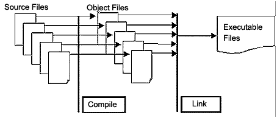

将机器语言转换为高级自然语言的编译器称为 `decompiler`（反汇编译器）。产生用于在系统上运行的对象代码的编译器被称为 `cross-compilers`（交叉编译器）。最后，将一种编程语言转换为另一种编程语言的编译器被称为语言翻译器。

编译器执行四个主要步骤：

1. **扫描（Scanning）**：扫描器从源代码中一次读取一个字符，并跟踪哪个字符出现在哪几行中。

2. **词法分析（Lexical Analysis）**：编译器将源代码中出现的字符序列转换为一系列字符字符串（称为 `tokens`，即标记），这些标记由一个名为 `lexical analyzer`（词法分析器）的程序按特定规则相关联。`lexical analyzer` 使用 `symbol table`（符号表）来存储源代码中与生成的标记相对应的单词。

3. **语法分析（Syntactic Analysis）**：在这一步中，执行语法分析，这涉及预处理以确定词法分析期间创建的标记是否按照其用法处于正确的顺序。一组可以产生所需结果的关键字正确顺序被称为 `syntax`（语法）。编译器必须检查源代码以确保语法的准确性。

4. **语义分析（Semantic Analysis）**：语义分析：编译器确保程序根据语言规则是合理的（例如，类型检查）。


## 环境设置

当我们说环境设置时，它意味着一个我们可以在上面进行编程的基础。因此，我们需要准备好所需的软件，即在我们的 PC 上安装用于编写计算机程序、编译和执行这些程序的软件。例如，如果你需要浏览互联网，那么你的机器上需要进行以下设置：

*   一个可以连接互联网的可用网络
*   一个 Web 浏览器，如 Internet Explorer、Chrome、Safari 等

同样，如果你想开始使用任何编程语言进行编程，也需要以下配置：

*   一个用于创建计算机程序的文本编辑器
*   一个用于将程序编译为二进制格式的编译器
*   一个用于直接执行程序的解释器

我们建议你使用 IDE（集成开发环境），这是一个非常方便且出色的软件，它将文本编辑器、调试器和编译器合为一体，虽然软件包有时很臃肿，但通常非常实用。除非你致力于在文本编辑器和命令行提示符窗口中工作（这样做确实有令人信服的理由），否则你可能正在寻找关于如何选择良好 IDE 的建议、各种类型的优缺点、运行特定 IDE 的相对成本（资金或系统资源）、该 IDE 能够很好地处理其他语言、它所运行的操作系统以及更多内容。

以下是程序员最常用的两种 IDE 列表。

### Eclipse

*   **语言**：C, C++, Python, Perl, PHP, Java, Ruby 等
*   **价格**：免费

Eclipse 是许多开发框架所基于的免费开源编辑器。它是该领域的元老级产品，深受许多专业开发者的高度推荐。Eclipse 起于一个 Java 开发环境，通过轻量级插件系统得到了极大扩展。

### NetBeans

*   **语言**：Java, JavaScript, PHP, Python, Ruby, C, C++ 等
*   **价格**：免费

NetBeans 与 Eclipse 并肩，是该类别中最受推荐的 IDE。它是免费开源的，支持大量语言并不断有新插件加入，而且对于初学者来说安装和使用极其简单。

## 编译与执行

简单的 Java 项目包含一个目录，所有的 Java 源文件都存储其中。Java 文件通常不直接存储在源码目录下，而是存储在与其包结构匹配的子目录中。包是将相关的源文件分组的一种方式。

当你编译源码中的所有代码时，编译器会为每个 `.java` 文件生成一个 `.class` 文件。`.class` 包含了编译后的 `.java` 文件。换句话说，就是 `.java` 文件的字节码。

Java 虚拟机执行的是 `.class` 文件，而不是 `.java` 文件。因此，将 `.java` 文件与 `.class` 文件分开是正常的。这通常通过指示编译器将 `.class` 文件写入单独的目录来实现。该目录通常被称为 `classes`，但再次，这不是强制要求的，取决于你正在使用的构建工具或 IDE 等。

### 编译 Java 源码

你可以直接从 IDE 中编译 Java 源码（如果你使用 IDE 的话）。或者，你可以使用 Java SDK 自带的 Java 编译器。要从命令行使用 Java 编译器编译 Java 源码，请执行以下操作：

*   打开命令行提示符
*   切换目录到你的项目根目录（而不是源码目录）
*   确保项目根目录包含一个源码目录和一个类目录
*   输入下面的命令（在 Windows 上——其他操作系统也类似）：

```
"c:\Program Files\Java\jdk1.8.0_25\bin\javac" src/myfirstapp/*.java -d classes
```

此命令执行 `javac` 命令（Java 编译器），它会编译 `src/myfirstapp` 目录下的 Java 源代码。`*.java` 意味着应该编译给定目录下的所有文件。

`myfirstapp` 目录是根源目录 `src` 下的一个包。如果你在根源目录下有多个包，你将必须多次运行 Java 编译器。Java IDE 会自动为你处理这些工作。像 `Ant`、`Maven` 或 `Gradle` 这样的构建工具也是如此的。

### 运行编译后的 Java 代码

一旦编译器完成工作，`classes` 目录将包含编译后的 `.class` 文件。源目录的包结构（目录结构）将在类目录予以保留。你可以运行任何一个包含 `main()` 方法的 `.class` 文件。你可以在你的 Java IDE 内部运行该 `.class` 文件，也可以从命令行运行。从命令行运行，它看起来如下：

```
"c:\Program Files\Java\jdk1.8.0_25\bin\java" -cp classes myfirstapp.MyJavaApp
```

`-cp classes` 标志告诉 Java 虚拟机所有的类都位于名为 `classes` 的目录下。这也被称为“类路径”（Class Path，缩写为 `cp`）。要运行的类名是上述命令中的最后一个参数——`myfirstapp.MyJavaApp` 部分。JVM 需要知道全限定类名（所有包名加上类名）以确定相应的 `.class` 文件的位置。

当你运行该类时，你的命令行将看起来类似于所示（包括 Java 应用程序的输出）：

```
D:\data\projects\my-first-java-app>"c:\Program Files\Java\jdk1.8.0_25\bin\java"    -cp classes myfirstapp.MyJavaApp
Hello World!
D:\data\projects\my-first-java-app>
```

（注意，第一条命令不应该包含换行符。我之所以那样写只是为了方便阅读。）

就是这样！现在你知道如何编译和执行你的 Java 应用了！如之前提到的，使用 IDE 可能会更容易，但你可能在任何想要执行代码的地方都没有 IDE。

# 第 3 章 | 基础术语

本节将涵盖许多基础术语以及编写规范代码的一些基本思想。Java 是许多不同编程语言之一，它们使用相同的词汇和概念来向计算机传递指令。一旦我们读完前几章，我们将接触更多与读写代码直接相关的基础知识。在达到那之前，我们需要涵盖一些适用于许多不同编程语言的术语和概念，而不仅仅是 Java。允许将单词转换为可执行代码的方法和系统需要相当严格的规则。在写英语或在网上聊天时，我们倾向于忽略格式和标点符号。这种简洁允许了更快的沟通，但这仅仅是因为我们人类已经学习了许多新词，并能够根据上下文更好地解释网络或短信中使用的英语形式的缩写和术语。计算机并没有那么智能，能够那么轻易地解读我们的单词。

## 标记

在书面英语中，语言的最小元素是字母和数字。单独来说，大多数字母和数字并没有特定的意义。字母之后更大的元素是单词。每个单词都有更多的含义，但复杂的思想很难通过一个单词来表达。为了传达一个思想，我们使用句子。句子中的每个单词都有特定的用途，如下图所示。为了传达一个概念，我们使用组合成段落的句子。为了传达情感，我们使用组织成章节的许多段落。为了讲述故事，我们使用书，即章节的集合。

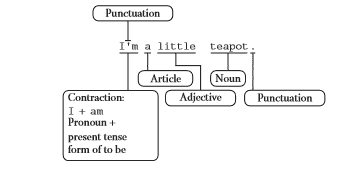

编程具有类似的组织机制。最小的有意义的元素是 `token`（标记），接着是语句、代码块、函数，然后是类和命名空间，最后是程序，或者在我们的案例中是一个游戏。我们将从最小的元素开始，逐步编写我们自己的类。然而，在开始编写任何复杂代码之前，了解最微的元素对于理解所有部分是如何结合在一起的是非常重要的。

## 编写 Java

Java 是一门基于英语的编程语言；像任何其他 C 类编程语言一样，它可以被拆分为标记，即计算机可以理解的最小意义文本片段。标记由单个字符或一系列字符组成。例如，在像下面的简单语句中有五个标记。

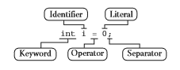

标记可以分类为 `keyword`（关键字）、`identifier`（标识符）、`literal`（字面量）、`operator`（运算符）、`separator`（分隔符）和 `white space`（空白）。上面的语句包含五个标记，并通过空白提供了间距。关键字 `int` 后面紧跟着标识符 `i`。接着是一个运算符 `=`，它将运算符左侧的标识符赋值为右侧字面量 `0` 的值。最后一个标记 `;` 是 `separator`（分隔符），用于结束语句。空白和我们尚未涵盖的注释不被视为标记，尽管它们可以充当分隔符。使用适当的格式或风格是非常重要的。

让我们来看代码示例：

```java
int i = 0;      int j = 1;
```

上述代码是两个语句，`separator` 防止了计算机将代码误读为单条语句。然而，编写代码的过程中涉及人类，因此代码需要让人类（或任何可能阅读你代码的生命形式）读。规范的代码意味着遵循特定的格式风格。我们将在本章稍后部分深入讨论规范代码风格。每组字符或文本都由词法分析器（有时称为扫描器 `lexer`）在计算机中转换成符号。这个过程被称为标记化，或者正如计算机科学家所说，扫描器将你的代码标记为符号。一旦标记完成，符号就会被解析；这个过程将标记组织成计算机遵循的指令。

## 分隔符标记

最常见的分隔符是分号 `;`。这种标点符号用于结束一个代码语句。其他的分隔符成对出现。

大括号成对使用，用于分隔代码语句组。左大括号为 `{`，尖端指向组的外部；它与闭合大括号对的 `}` 配对。圆括号以 `(` 开始，以 `)` 结束，而方括号以 `[` 开始，以 `]` 结束。不同的起始和结束括号、中括号和圆括号有特定的用途，用于帮助识别它们的用途。此外还有角括号 `<` 和 `>`；它们用于包围数据类型。别忘了还有单引号 `''` 和双引号 `""`，它们也成对使用，用于包围被称为“字符串”的符号。

**注意：** 在许多文字处理器中，通常会使用起始引号和结束引号（`“` 和 `”`）。由于词法分析器不识别这些“智能引号”，因此编程编辑器使用直引号（`"`）。一旦你意识到编程中使用的字母、数字和所有其他字符都被解析为美国标准信息交换代码（`ASCII`）或 Unicode 转换格式（`UTF-8`）、`16` 或 `32`，这些细微的变化就不再微妙了。

`ASCII` 和 `UTF` 都是计算机读取文本时使用的字符数据库名称。计算机不使用眼睛阅读。相反，它们使用数字数据库来查找使用的每个字符。因此，如果我们使用 `UTF-16`，那么对于计算机来说，`“` 看起来更像 `0x201C`，而 `"` 像 `0x0022`。

大括号在代码中分隔语句。圆括号通常用于接收数据。方括号通常用于帮助识别数组。我们稍后会介绍数组，但在解释之前，你可以把它们想象成电子表格或坐标纸。

```java
int[] arrayNumbers = {1, (int) 3.0, 9000};
```

上述语句将三个数字赋值给数组。大括号包含一对由逗号分隔的语句。大括号中的第二个语句是将带有点（`.`）的数字转换为不带点的数字。这可能需要一些解释，但习惯看到这种写法是有好处的。我们很快就会什么是数组，以及点运算符。

在学习编程时，你通常会看到许多奇怪的标记，它们似乎没有任何意义。这取决于你是否观察你遇到的每一个标记并尝试理解它的作用。如果没有任何语句是合逻辑的，也没关系。

## 运算符标记

运算符类似于关键字，但只使用少数几个非单词字符。冒号或分号是一个运算符；与关键字不同，运算符会根据它们出现的位置或使用方式来改变其功能。这种行为的转变被称为运算符重载，这是一个复杂的课题，我们稍后会讨论。同样重要的一点是，在需要时你可以创建自己的运算符。

Java 中的逗号有不同的含义。它们用于分隔不同的数据值，例如：

```java
for (int i = 0, j = 1; ; i++, j++)
```

## 其他运算符标记

泛而言，运算符是处理变量之间特定操作的特殊字符。运算符和变量出现的符号或顺序通常通过以下表示法或数学语法进行教学：`a + b = c`。然而，在编程中，更倾向于以下写法：`c = a + b;`；之所以进行这种更改是因为 Java 中的 `=` 运算符的工作方式与数学课上通常教授的功能不同。`=` 运算符的左侧是赋值侧，右侧是操作侧。这重点放在了赋值的值上，而不是如何赋值。由于计算机在进行数学计算，结果比解决问题的方法更重要。在编程中，上面的示例应该读作“将 a 加 b 的结果赋值给 c”。

## 字面量

字面量有许多不同的形式；类似于表现为 `+`、`-` 或 `=` 这种形式的运算符，字面量是经常出现在它们之间的标记。数字被认为是字面量，或者说是以字面量方式使用的标记。数字可以称为数值字面量。当某些内容被放在引号中时，如“`I’m a literal`”，你正在写的是一个字符串字面量。字面量存在于几乎所有的编程语言中，并形成了 Java 数据类型的基础。

## 传递性和非传递性操作

在数学课上，有时会教某些操作具有传递性，而另一些不是。例如，`2 + 3 + 4` 和 `4 + 3 + 2` 得到相同的值。每个数字出现在运算符之间并不重要，因此 `+` 运算符被认为是具有传递性的。这个概念在 Java 中同样适用。当我们开始混合运算符时，结果会发生变化。

```java
int a = 1 + 2 - 4 + 7; //a = 6
int b = 7 + 4 - 2 + 1; //b = 10
```

这段代码片段显示了使用相同运算符但数字位置不同时得到的两个不同结果。我们稍后在游戏中使用它们时将看到如何克服这些问题。运算符的顺序是需要注意的，在我们构建计算时，测试每一步都是重要的，以确保我们的结果是我们预期的值。为了确保操作按照你预期的逻辑发生，你可以使用圆括号包含操作数，或者进行每次计算。

# 第 4 章 | Java 编程基础

## Java 程序结构

Java 程序由不同的部分组成。某些是强制性的，但另一些是可选的。根据程序员的要求，可以从程序排除可选部分。

### 文档部分

它包括注释，用于说明程序的目的。它提高了程序的可读性。

### 包声明语句

它包括提供包声明的语句。

### 导入语句

它包括用于引用在其他包中声明的类和接口的语句。

### 接口部分

它类似于类，但只包含常量方法声明。

### 类部分

类部分描述了程序中用户定义类的信息。类是字段（数据变量）和对字段进行操作的方法的集合。Java 中的每个程序至少包含一个类定义。该类定义声明了 `main` 方法。程序的执行实际上是从这里开始的。

## 文档部分

它包括提高程序可读性的注释。注释是非可执行的语句，有助于阅读和理解程序，特别是当程序变得复杂时。它仅仅是仅对程序员存在的消息，会被编译器忽略。一个好的程序应该包含描述目的的注释。Java 支持以下类型的注释：

*   **单行注释**：它以 `//` 开始并在行结束。编译器会忽略其内容。例如：

    ```java
    // 这是一个注释
    ```

*   **多行注释**：它以 `/*` 开始并以 `*/` 结束。编译器会忽略其内容。例如：

    ```java
    /* 这是一个
    多行注释 */
    ```

*   **文档注释**：这种注释以 `/**` 开始并以 `*/` 结束。`javadoc` 工具读取这些注释并准备 HTML 格式的程序文档。例如：

    ```java
    /**
    这是一个文档注释
     */
    ```

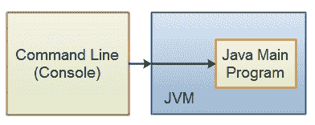

执行 `java` 命令的命令行，该命令转而执行一个 Java 主程序。

以下是一个命令行示例：

```bash
java -cp classes myjavacode.MyClass
```

该命令的第一部分是 `java` 命令。此命令启动了 `JVM`。在某些情况下，你可能需要指定 `java` 命令在计算机上的完整路径（通常位于 Java 安装目录的 `bin` 子目录下）。

第二个和第三个参数 `-cp classes` 告诉 `JVM` 编译后的 Java 类位于哪个目录（`cp` 表示 class path，即类路径）。在这种情况下，编译后的 Java 类位于名为 `classes` 的目录中。

第四个参数是 `JVM` 要执行的 Java 类名。注意类名中也包含了该类所属的包名（即“全限定类名”）。

### 向 `main()` 方法传递参数

你可以从命令行向 `main()` 方法传递参数。此行命令行展示了如何操作：

```bash
java -cp classes myjavacode.MyClass Hello World
```

当 `JVM` 执行 `myjavacode.MyClass` 的 `main()` 方法时，作为参数传递给 `main()` 方法的 `String` 数组将包含两个 `String`："Hello" 和 "World"。

`main()` 方法可以这样访问来自的参数：

```java
package myjavacode;
public class MyClass {
    public static void main(String[] args) {
        System.out.println( args[0] );
        System.out.println( args[1] );
    }
}
```


注意 `args` 数组对元素 0 和元素 1 的引用（`args[0]` 和 `args[1]`）。`args[0]` 将包含 `String`（文本）Hello，而 `args[1]` 将包含 `String` World。变量和数组将在后续文中进行更详细的解释。如果你现在还不完全理解它们，请不要担心。

### Java 主类

如果你的 Java 程序中只有一个 Java 类包含 `main()` 方法，那么包含 `main()` 方法的该类通常被称为 `main class`（主类）。

你可以在项目中拥有任意数量带有 `main()` 方法的类。但是，Java 虚拟机一次只能指示运行其中一个。你仍然可以在 Java 虚拟机执行的 `main()` 方法内部调用其他 `main()` 方法（尽管你还没有看到如何做到），你也可以启动多个虚拟机，每个虚拟机执行一个单一的 `main()` 方法。

## 访问控制

所有优秀的作者（包括编写软件的人）都知道，一件作品在经过重写（通常是多次重写）之前，它是不完美的。如果你将一段代码放在抽屉里一段时间，过后再回来，你可能会发现更好的实现方法。这就是重构的主要动力之一，即通过重写运行良好的代码使其更具可读性、可理解可维护性。

然而，这种改变和改进代码的愿望中存在一种紧张关系。通常会有消费者（客户端程序员）依赖你代码的某些方面。你想改变它，而他们希望它保持原样。因此，面向对象设计中的一个主要考虑因素是“将变化的部分与不变的部分分离”。这对于库来说尤为重要。库的消费者必须依赖他们使用的部分，并知道当新版本的库发布时，他们不需要重写代码。另一方面，库的创建者必须有自由进行修改和改进，并确保客户端代码不受影响。

这可以通过约定来实现。例如，库的程序员必须同意在修改类时不删除现有的方法，因为这会破坏客户端程序员的代码。然而，相反的情况更为棘手。在字段（field）的情况下，库的创建者如何知道哪些字段被客户端程序员访问过？对于仅作为类实现部分且不供客户端程序员直接使用的方法也是如此。如果库的创建者想要移除一个旧实现并换入一个新实现呢？更改这些任何成员都可能破坏客户端程序员的代码。因此，库的创建者就像被束缚住，无法更改任何内容。

为了解决这个问题，Java 提供了访问修饰符（access specifiers），允许库的创建者说明哪些是客户端程序员可以使用的，哪些不可用。从“最大访问”到“最少访问”的访问控制级别依次为 `public`、`protected`、包访问（没有关键字）和 `private`。从上一个段落你可能会认为，作为库的设计者，你会希望尽可能将所有内容保持为 `private`，并只暴露你想让客户端程序员使用的方法。这是完全正确的，尽管对于那些使用其他语言（尤其是 C）并习惯于无限制访问一切的人来说，这通常是违反直觉的。

### Java 中的包

Java 中使用包是为了防止命名冲突、控制访问、使搜索/定位以及使用类、接口、枚举和注解变得容易。一个 `Package`（包）可以定义为相关类型（类、接口、枚举和注解）的组合，提供访问保护和命名空间管理。

Java 中一些现有的包包括：

- `java.lang`：封装了基础类
- `java.io`：用于输入输出函数的类封装在此包中

程序员可以定义自己的包来将一组类/接口等组合在一起。将你实现的相关的类进行分组是一种良好的做法，这样程序员就可以轻松确定哪些类、接口、枚举和注解是相互相关的。由于包创建了新的命名空间，因此不会与其他包中的名称发生命名冲突。使用包，可以更方便地提供访问控制，同时也更容易定位到相关的类。

## 创建包

在创建包时，你应该为包选择一个名称，并在每个包含你想包含在包中的类、接口、枚举和注解类型的源文件顶部，包含一个与该名称相符的 `package` 语句。`package` 语句应该是源文件的第一行。每个源文件中只能有一个 `package` 语句，并且它适用于文件中的所有类型。如果没有使用 `package` 语句，则类、接口、枚举和注解类型将存放在当前的默认包中。

### 示例

让我们来看创建一个名为 `animals` 的包的示例。使用小写字母作为包名是一种良好的做法，以避免与类和接口名称发生任何冲突。接下来的包示例包含一个名为 `animals` 的接口——

```java
/* 文件名：Animal.java */
package animals;
interface Animal {
    public void eat();
    public void travel();
}
```

现在，让我们同一个包 `animals` 中实现上述接口——

```java
/* 文件名：MammalInt.java */
package animals;
public class MammalInt implements Animal {
    public void eat() {
        System.out.println("Mammal eats");
    }
    public void travel() {
        System.out.println("Mammal travels");
    }
    public int noOfLegs() {
        return 0;
    }
    public static void main(String args[]) {
        MammalInt m = new MammalInt();
        m.eat();
        m.travel();
    }
}
```

现在按照如下所示编译 java 文件——

```bash
javac -d . Animal.java
javac -d . MammalInt.java
```

你可以执行包内的类文件并获得如下所示的结果。

```
Mammal eats
Mammal travels
```

## import 关键字

如果一个类想要使用同一个包中的另一个类，则不需要使用包名。同一个包中的类之间无需任何特殊语法即可相互找到。

### 示例

在这里，一个名为 `Boss` 的类被添加到已经包含 `Employee` 的 `payroll` 包中。然后 `Boss` 就可以在不使用 `payroll` 前缀的情况下引用 `Employee` 类，如下面的 `Boss` 类所示。

```java
package payroll;
public class Boss {
    public void payEmployee(Employee e) {
        e.mailCheck();
    }
}
```

如果 `Employee` 类不在 `payroll` 包中会发生什么？那么 `Boss` 类必须使用以下技术之一来引用不同包中的类。

- 可以使用类的完全限定名。例如——`payroll.Employee`
- 可以使用 `import` 关键字和通配符（`*`）导入包。例如——`import payroll.*;`
- 使用 `import` 关键字导入类本身。例如——`import payroll.Employee;`

**注意**——一个类文件可以包含任意数量的 import 语句。

# 第 5 章 | 变量、数据类型与关键字

## 变量

变量用于存储在计算机程序中被引用和操作的信息。它们还提供了一种为数据赋予描述性名称并标记的方法，以便读者和我们自己能更清晰地理解程序。将变量看作存储信息的容器是有帮助的。它们的唯一目的是在内存中标记和存储数据。这些数据随后可以在你的整个程序中使用。

变量的名字被称为标识符（identifier）。在大多数情况下，标识符是程序员（在本例中就是你）选择用于为变量命名的唯一单词。标识符总是程序员为了描述变量而发明的某种东西；它就像给新宠物或宝宝命名一样。

### 标识符

标识符被视为符号或标记（tokens），是你发明并随后赋予其特定含义的单词。标识符可以简单如字母 `i`，也可以复杂如 `@OhHAICanIHasIdentifier01`。`identifier` 是用于命名你创建的任何函数、变量或数据类型的单词。当使用关键字 `class` 时，它后面会跟着另一个被称为标识符的单词。在正确识别一个函数或其他数据块后，你现在可以通过它的标识符来引用该数据。换句话说，当你将某些数据命名为 `Charles` 时，你就通过名称 `Charles` 来访问该数据。

```java
class MyNewClassImWriting {}
```

变量是通过声明（declarations）创建的。声明被定义为正式的陈述或公告。

程序员写的每一组单词被称为一条语句（statement）。在英语中我们会使用 sentence 一词，但程序员们喜欢使用自己的词汇。变量的声明语句定义了变量的类型和标识符。

```java
public class Example {
    int i;
}
```

程序员使用分号（`;`）而不是句号来结束语句。因此，如果你想听起来像个程序员，你可以说你正在“写一条语句来声明一个类型为 `int` 标识符为 `i` 的变量。”或者，如果你想表现得极其戏剧化，你可以宣布：“我宣告了一个类型为 `int` 的新变量，其名为 `i`！”而它将确实如此。

## 变量名

重要的是要知道变量标识符和类标识符几乎可以是任何内容。在编程时，命名任何事物都有一些规则。这里是一些可以帮助的指南。

- 长的名字更容易出现拼写错误，所以保持标识符简短。
- 变量的命名规范应该考虑以下点：变量名应该指示它的用途，或者至少指示你打算用它做什么。这应该是显而易见的，但变量名不应该具有误导性。或者说，如果你使用一个名为 `radius`（半径）的变量，你不应该把它用作角色的速度。
- 如果你能读出变量的名字，也会帮助；否则，当你尝试向另一个程序员解释你的代码时可能会遇到问题。

```java
int someLong_complex_hardToRememberVariableName;
```

将名字尽可能短但保持足够清晰是有优势的。你的计算机屏幕（以及大多数计算机）单行只能容纳有限的字符。你可以把字体调小，但当字母太小时，你就会遇到可读性问题。考虑以下函数，它需要不止一个变量才能工作。

```java
SomeCleverFunction(TopLeftCorner – SomeThickness + OffsetFromSomePosition, BottomRightCorner – SomeThickness + OffsetFromSomePosition);
```

上面的代码使用了许多长变量名。由于每个变量的长度，语句占据了多行，使得单个语句更难以阅读。我们可以缩短变量名，但也很容易将其缩短过头。

```java
CleverFunc(TL–Thk+Ofst,LR–Thk+Ofst);
```

变量名应该是具有描述性的，这样你就知道要把它们用在哪里了：太短了它们可能会丢失意义。

```java
int a;
```

虽然 `a` 简短且容易记忆，但其他人在阅读你的代码时很难知道你用变量 `a` 是做什么的。在与其他程序员合作时，这变得尤为困难。

变量命名并非完全没有规则。

```java
int 8;
```

变量名不能是数字。这是糟糕的；数字在编程中有其特殊地位，因为编程中它们有其他用途。IDE 会尝试帮助你发现问题。在它发现的任何问题下都会出现红色的波浪线。提到带数字的变量名，你可以数字作为变量名的一部分。

```java
int varNumber2;
```

上面的名字是完全有效的，并且很有用，但相反，考虑以下情况。

```java
int 13thInt;
```

变量名不能以任何数字开头。老实说，我不确定为什么这种情况会破坏编译器，但它似乎与为什么单独的数字不能作为变量名有关。

```java
int $; int this-that; int (^_^);
```

大多数特殊字符也有其含义，并被留作其他用途。例如，在 `JAVA` 中，`-` 用于减法；在这种情况下 `JAVA` 可能会认为你正试图从这个中减去那个。你应该记住，关键字也是无效的变量名，因为它们对于 `JAVA` 已经具有特殊含义。

在 IDE（集成开发环境）中，你可能会注意到单词 `this` 被高亮了，表示它是一个关键字。变量中间的空格也是无效的。

```java
int Spaces are bad;
```

可能，添加非字母字符会破坏编译器。只有下划线和字母可以用于标识符名称。虽然表情符号作为变量可能很有趣，但在代码其他部分使用时会非常难以阅读。

```java
int ADifferenceInCase; int adincase;
```

这两个变量实际上是不同的。像 `java` 这样区分大小写的语言会对字符的大小非常敏感；这对于通过名称调用其他任何事物也是如此。考虑这一点：`A` 与 `a` 不同。

作为程序员，你需要考虑变量应该是什么样的。

## 变量类型

你必须在使用变量之前声明它们。以下是变量声明的基本形式：

`data type variable [ = value][, variable [ = value] ...`

这里 `data type` 是 Java 的数据类型之一，`variable` 是变量的名字。要声明指定类型的多个变量，可以使用逗号分隔的列表。

示例：

```java
int a, b, c; // 声明了三个 int a, b 和 c。
a = 10, b = 10; // 初始化示例
byteB = 22; // 初始化字节类型变量 B
double pi = 3.14159; // 声明并赋值双精度浮值 PI
```

Java 编程语言主要定义了三种变量。

### 实例变量

实例变量是在类内部但在任何方法、构造函数或块之外声明的变量。实例变量也是对象的变量，通常被称为字段（field）或属性（property）。它们被称为对象变量。每个对象都拥有每个变量的副本，因此，如果一个对象更改了变量的值，不会影响实例变量。实例变量持有必须被多个方法、构造函数或块引用的值，或者是整个类中必须存在的对象状态的重要部分。

```java
class Student {
    String name;
    int age;
}
```

这里 `name` 和 `age` 是 `Student` 类的实例变量。

### 静态变量

静态是通过使用 `static` 关键字声明的类变量。静态变量只初始化一次。静态变量还与 `final` 关键字用于声明常量。

```java
class Student {
  String name;
  int age;
  static int instituteCode = 1101;
}
```

这里 `instituteCode` 是一个静态变量。`Student` 类的每个对象将共享 `instituteCode` 属性。

**关于静态变量的额外点：**

- `static` 变量也称为类变量。
- `static` 保持不变。
- 在 Java 中，这意味着它对于该类创建的所有实例来说都是常量。
- `static` 变量不需要通过对象调用。
- 它通过 `classname.static variable name` 调用。

**注意：** `static` 变量永远不能定义在方法内部，即它永远不可能是局部变量。

**示例：** 假设你创建了 2 个 `Student` 类的对象并从一个对象更改了静态变量的值。现在当你从另一个对象打印它时，它将显示更改后的值。这是因为它是声明为静态的，即它对于创建的每个对象都是常量。

```java
class Student {
    int a;
    static int id = 35;
    void change() {
        System.out.println(id);
    }
}
public class StudyTonight {
    public static void main(String[] args) {
        Student o1 = new Student();
        Student o2 = new Student();
        o1.change();
        Student.id = 1;
        o2.change();
    }
}
```

**输出：**

```
35
1
```

### 局部变量

局部变量声明在方法、构造函数或块中。局部变量在方法、构造函数或块开始时初始化，并在结束后销毁。局部变量存在于栈中。局部变量不使用访问修饰符。

```java
float getDiscount(int price) {
  float discount;
  discount = price * (20 / 100);
  return discount;
}
```

这里 `discount` 是一个局部变量。

**关于局部变量的额外点：**

- 局部变量声明在方法、构造函数或块中。
- 局部变量在进入方法、构造函数、块时创建，一旦退出方法、构造函数或块，变量将被销毁。
- 局部变量不能使用访问修饰符。
- 局部变量仅在声明它们的方法、构造函数或块内可见。
- 局部变量在内部于栈级别实现。
- 局部变量没有默认值，因此在第一次使用之前应该声明局部变量并分配初始值。

**示例：**

```java
public class Test {
  public void pupAge() {
    int age = 0;
    age = age + 7;
    System.out.println("Puppy age is : " + age);
  }
  public static void main(String args[]) {
    Test test = new Test();
    test.pupAge();
  }
}
```

这里，`age` 是一个局部变量。它定义在 `pupAge()` 方法内部，其作用范围仅限于此方法。这将产生以下结果：

**输出：**

```
Puppy age is: 7
```

## Java 中的数据类型

数据类型表示存储在变量中的不同值。在 Java 中，数据类型分为两种：


## 原始数据类型

## 非原始数据类型

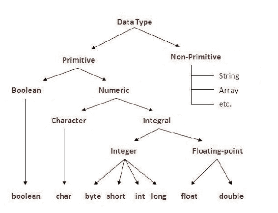

| 数据类型 | 默认值 | 默认大小 |
| :--- | :--- | :--- |
| `boolean` | `false` | 1 bit |
| `char` | `'\u0000'` | 2 byte |
| `byte` | `0` | 1 byte |
| `short` | `0` | 2 byte |
| `int` | `0` | 4 byte |
| `long` | `0L` | 8 byte |
| `float` | `0.0f` | 4 byte |
| `double` | `0.0d` | 8 byte |

# 为什么 Java 中的 `char` 占用 2 个字节？`\u0000` 是什么？

这是因为 Java 使用的是 Unicode 系统而不是 ASCII 编码系统。`\u0000` 是 Unicode 系统的最低范围。要了解更多关于 Unicode 的详细说明，请访问下一页。

## 类型

当我们给变量赋值时，例如 `int i = 1;`，我们实际上是做出了一个有趣的假设。我们假设使用 `1` 会自动推断出一个与变量类型匹配的值类型。计算机使用多种不同的数据类型来存储数字。到目前，我们一直看到 `int` 这个词被到处提及，好像你已经知道 `int` 是什么了。在日常生活中，我们几乎不会认为数字 `1` 和 `1.0` 甚至单词“one（一）”之间有任何区别。

作为人类，我们可以轻松地将数字概念化为测量单位并在它们之间进行转换。但对于计算机来说，单词“one”和数字 `1` 之间的转换并不容易。关键字 `int` 是 `integer`（整数）的缩写。整数是整数数值。整数是 Java 的内置类型。基本上，这意味着整数是 Java 的基础组成部分。其他内置类型包括 `float`、`double`、`string`、`bool` 和 `object`。较少使用的内置类型有 `char`、`short` 和 `byte`。总共有 15 种不同的内置类型。

所有这些类型除 `object` 和 `string` 之外，都是值类型。你能够构建的任何数据类型必须基于这些内置类型。创建所有这些 `floats`、`doubles` 和 `bools` 的系统根于计算的起源。还记得打孔卡和带孔的纸片吗？那些是 `1s` 和 `0s` 的记录，以机械开关（开启或关闭）的形式馈给计算机进行存储的。这些模式代表了数字、指令和逻辑。

今天，我们仍然使用同一套 `1s` 和 `0s` 系统（即二进制），只是我们不需要再在纸上打孔来告诉计算机要做什么。创建和存储指令的方法已经变得复杂许多倍，但 `1` 和 `0` 的原理是相同的。这些被称为 `bits`（比特）；该名称的一个可能来源是在纸卡上打完所有孔后留下的小纸屑。

## 值类型和引用类型

`int`、`float`、`double` 和 `bool` 是常用的值类型。这种用法模式的基础与存储和组织计算机内存的系统有关。当你提到计算机存储时，你会使用 `megabyte`（兆字节）或 `gigabyte`（吉字节）等词。值类型的存储有特定的目的：跟踪数值。

**注意：** 单词 `mega` 指你计算机中的组件可以存储多少百万个字节。`Giga` 指如何存储每十亿个字节。你是否想过一个字节（byte）到底是什么？一个字节被称为 `8-bit unsigned integer`，或者说是使用 `8 bits` 组成一个数字的系统。这意味着它是一个像 `0`、`7` 或 `32,767` 这样的整数。`unsigned`（无符号）一词表示数字不能为负数，例如 `-512`。在计算机术语中，`1` 或 `0` 被称为 `bit`。我们不会详细介绍计算机计算机如何使用比特来计数的，这是一个非常有趣的自学课题。

然而，知道字节的范围是有限的（从 `0` 到 `255`）非常重要。我只需给你这样一个概念：如果你使用二进制而不是十进制，你的 `10` 根手指可以数到 `1023`。你的手指可以表示一个 `10-bit unsigned integer`。计算机的计算能力曾比现在受限得多。20 世纪 80 年代年代制造的 `8-bit` 游戏机颜色数量有限，确切来说是 `256` 色。这种限制是基于处理器能够处理的比特数量。处理器在任何时刻使用的晶体管数量有限的。不久后，浮点协处理器被引入，它们通过拥有接近 `32 bits` 的工作空间允许了得大的数值范围。在所有这些情况下，当你使用值类型时，该数字实际上是以 `1s` 和 `0s` 存储在计算机的 RAM 中的。这应该被认为是相当不起的。

在过去，你必须经过重火圈才能存储一个值。现在你只需要输入 `float f = 3.1415926535;`，你就可以精确测量宇宙的周长，精度达到单个原子宽度。所有这些类型的共同点是它们被存储为单个元素。大值如 `double gigawatts = 1210000000.0;` 和 `double mint = 2.0;` 使用相同数量的内存。你的计算机不会为其中一个 `double` 分配更多的内存空间。这些类型被称为原始类型（primitive types）。`int` 和 `float` 之间的唯一区别在于它们每次使用的比特数，分别为 `8` 和 `32`；而 `doubles` 使用 `64 bits`。

`string` 和 `object` 类型在存储方式上略有不同。这些类型是任意数量较小元素的组合。`string` 或 `object` 越大，占用的内存块就越大。这些类型被称为引用类型（reference types）。

## 强类型

这与你在键盘上如何打字无关！Java 能够看到数字之间的差异。整数 `1` 与 `1.0` 是不同的，尽管我们可以认为它们的值相同。这些差异可以通过添加字母来增加。`1.0` 和 `1f` 实际上是不同的数字。Java 是一种强类型语言。当编程语言使用强类型时，期望将不同的类型分开。为了将一种类型转换为另一种类型，我们必须告诉 Java 使用强制转换运算符（cast）。

## 理解浮点数

浮点数多年来一直是计算机的焦点。获得浮点精度是许多计算机科学家的目标。由于小数点后的可能性是无限的，使用二进制无法真正表示任何分数。一个常见的例子是 `π`，我们称之为 `pi`。今天，计算机设置了小数点之后的数字，出现的第一个比特通常是符号位（sign bit），设置数字的正负范围。后续剩余的比特被称为尾数位（mantissa）。`float` 值可以向任何方向移动，但它限制了能够存储的值。在特殊考虑之前，计算机无法处理任意大的数字。为了将 `float` 转换为 `int`，你需要显式地在变量之前添加 `(int)`。

## 关键字

关键字是特殊的单词或符号，告诉编译器执行特定的操作。例如，行首的 `class` 关键字告诉编译器你正在创建一个类。类声明是这样行代码，告诉编译器你正要创建一个新类。单词出现的顺序很重要。英语需要句子和语法来向读者传达我们的思想。在代码中：

```java
class className {
// 在这里编写代码
}
```

每个类都需要一个名称；在上面的示例中我们把类命名为 `className`，尽管我们可以轻松地命名为 `Charles`。当命名新类时，名称变成了一个新的标识符。对于每个变量也是如此，尽管范围限制了变量存在的时间。我们学习了变量和范围。除了 Java 期望的用途外，通常情况下，关键字为你提供了特定的命令。在 Java 编程语言中，关键字是语言中具有预定义的保留字；因此，程序员不能将关键字作为变量、方法或任何其他标识符。由于它们在语言中的特殊功能，大多数 Java 集成开发环境使用语法高亮以不同的颜色显示关键字以便于识别。

### 关键字列表

- **`abstract`**：用于在 Java 中实现抽象。没有方法定义必须声明为 `abstract`。不能实例化抽象类。抽象方法必须在子类中实现。你不能在变量和构造函数中使用 `abstract` 关键字。

- **`assert`**（J2SE 1.4 添加）：描述放在 Java 程序中的断言（真假语句），表示开发者认为断言在该处始终为真。如果断言在运行时为假，会导致断言失败，通常会导致执行终止。可选地通过 `ClassLoader` 方法启用。

- **`boolean`**：定义仅用于 "true" 或 "false" 值的布尔变量。

- **`break`**：用于结束当前循环体的执行。

- **`byte`**：`byte` 关键字用于声明一个可以持有 8 位有符号补码整数的字段。该关键字也用于声明方法返回 `byte` 原始类型的值。

- **`case`**：`switch` 块中的语句可以使用一个多个 `case` 或 `default` 标签标记。`switch` 语句评估其表达式，然后执行匹配 `case` 标签之后的所有语句。

- **`catch`**：与 `try` 块和可选的 `finally` 块结合使用。`catch` 块中的语句指定当 `try` 块抛出特定类型的异常时该做什么。

- **`char`**：定义一个能够持有 Java 源文件字符集中的任何字符的字符变量。

- **`class`**：定义特定对象实现的类型。类定义定义了实例字段和类字段、方法以及内部类，并指定了类实现的 `interfaces`（接口）和该类的直接 `superclass`（父类）。如果没有显式指定父类，则父类隐式为 [Object](https://docs.oracle.com/javase/8/docs/api/java/lang/Object.html)。`class` 关键字也可以以 `Class.class` 的形式使用，在不需要该类实例的情况下获取 `Class` 对象。例如，`String.class` 可以代替 `new String()`。

- **`continue`**：用于在当前体结束处恢复程序执行。如果后面跟着一个标签，`continue` 将恢复执行。

- **`default`**：`default` 关键字可以可选地用于 `switch` 语句，标记当没有 `case` 匹配时的语句。另一种，`default` 关键字也可以用于 Java 注解中的值。从 Java 8 开始，`default` 关键字也用于接口中的默认实现。

- **`do`**：`do` 关键字与 `while` 结合使用创建 `do-while` 循环，首先执行变量初始化，然后评估表达式。如果表达式为真，则执行与循环相关的语句，然后再次评估表达式；这持续到表达式为假。

- **`double`**：`double` 关键字用于声明一个可以持有 64 位精度的浮点数变量。该关键字也用于声明方法返回 `double` 原始类型的值。

- **`else`**：`else` 关键字与 `if` 结合创建 `if-else` 语句，测试逻辑表达式；如果表达式为真，执行与 `if` 相关的语句；如果表达式为假，执行与 `else` 相关的语句。

- **`enum`**（J2SE 5.0 添加）：Java 关键字用于声明枚举类型。

- **`extends`**：用于类声明以指定父类；用于接口声明以指定一个或多个接口。类 `X` `extends` 类 `Y` 通过添加字段或方法来增加功能；接口 `Z` 被称为类 `Y` 的子接口。也用于指定泛型中的类型上界。

- **`final`**：定义一个不可更改的实体。具体来说：`final` 类不能被派生，`final` 方法不能被重写，`final` 变量最多作为左侧操作数执行命令。`final` 类中的所有方法都是 `final` 的。

- **`finally`**：用于定义由 `try` 关键字之前定义的语句块。无论抛出了异常还是捕获了异常，`finally` 块在退出 `try` 块和 `catch` 子句后执行。

- **`float`**：`float` 关键字用于声明一个可以持有 32 位单精度 IEEE 754 浮点的变量。该关键字也用于声明方法返回原始类型 `float` 的值。

- **`for`**：`for` 关键字用于创建循环，指定变量初始化、逻辑表达式和递增。首先执行初始化，然后评估表达式。如果表达式为真，执行与循环相关的语句，然后执行递增。再次评估表达式；这持续到表达式为假。从 J2SE 5.0 开始，`for` 关键字还可以用于创建所谓的“增强 for 循环”，指定数组或 `Iterable` 对象；循环的每次迭代执行使用不同元素的关联语句块。

- **`if`**：`if` 关键字用于创建 `if` 语句，测试逻辑表达式；如果表达式为真，执行与 `if` 语句相关的块。该关键字也可以用于创建 `if-else` 语句；见 `else`。

- **`implements`**：包含在类声明中以指定当前类实现的一个或多个接口。类继承接口所声明的类型和抽象方法。

- **`import`**：用于源文件开头，指定稍后引用的类或整个 `Java-packages`（包）。从 J2SE 5.0 开始，`import` 语句可以导入类的 `static` 成员。

- **`instanceof`**：二进制运算符，接受对象引用作为第一个操作数，类或接口作为第二个操作数并产生布尔结果。`instanceof` 运算符仅当对象的运行时类型与类或接口兼容时才为真。

- **`int`**：`int` 关键字用于声明一个可以持有 32 位有符号补码整数的变量。该关键字也用于声明方法返回原始类型 `int` 的值。

- **`interface`**：用于声明一种特殊的类类型，它只包含抽象或默认方法、常量（static final）字段和 `static` 接口。它稍后可以由使用 `implements` 关键字声明接口的类实现。

- **`long`**：`long` 关键字用于声明一个可以持有 64 位有符号补码整数的变量。该关键字也用于声明方法返回原始类型 `long` 的值。

- **`native`**：用于方法声明，指定该方法不是在同一个源文件中实现的，而是在另一种语言中。

- **`new`**：用于创建类或数组的实例。为此目的使用 `new` 并非必要（如 [Scala](https://en.wikipedia.org/wiki/Scala_(programming_language)) 所示），尽管它有两个作用：它允许方法和类名存在不同的命名空间。

- **`package`**：一组类。

- **`private`**：`private` 关键字用于声明一个在类内部可见的变量。

- **`protected`**：`protected` 关键字用于声明在包内和子类中可见。

- **`public`**：`public` 关键字用于声明一个在任何地方都可见的。

- **`return`**：`return` 关键字用于从方法返回。

- **`throw`**：`throw` 关键字用于抛出异常实例。

- **`throws`**：`throws` 关键字用于声明方法未处理的异常，将其传递给调用者。

- **`transient`**：声明一个实例字段不是对象的默认序列化形式。

- **`static`**：`static` 关键字用于声明类级别的字段或方法。

- **`strictfp`**（Java 1.1 添加）：`strictfp` 确保浮点运算精度。

- **`super`**：`super` 关键字用于访问父类。

- **`switch`**：`switch` 关键字用于多分支语句。

- **`this`**：`this` 关键字用于引用当前类的类的实例。

- **`short`**：`short` 关键字用于声明一个可以持有 16 位有符号补码整数的变量。

- **`synchronized`**：`synchronized` 关键字用于确保同一时刻只有一个线程执行代码块。

### 编译错误

- 类尝试继承多个类
- 方法重载或重写实现不正确
- 尝试引用不在当前块作用范围内的变量
- 内部类与它的一个或多个外部类同名
- 类包含一个或多个抽象方法，但类本身未声明为“抽象（abstract）”
- 类尝试引用另一个类的私有成员
- 尝试创建抽象类的实例
- 尝试更改已初始化的常量（final 成员）的值
- 声明两个同名的（类成员或实例成员）

### 运行时错误

当代码编译未出现任何错误时，代码仍有在运行时失败的可能性。仅在运行时发生的错误被称为运行时错误。运行时错误是指那些通过了编译器检查但在代码执行时失败的错误。

有许多原因可能导致运行时错误，例如不兼容的类型转换、引用数组中的无效索引、使用空对象、资源问题（如文件句柄不可）、内存溢出情况、线程死锁、无限循环（未检测到！）等。

以下是一些常见的运行时错误：

- 尝试在未初始化的变量上调用方法（`NullPointerException`）
- 内存不足（内存泄漏……）（`OutOfMemoryError`）
- 尝试打开不存在的文件（`FileNotFoundException`）
- 尝试向接受范围之外的方法传递参数（`IllegalArgumentException`）
- 尝试对已死亡的线程调用 `start()` 方法（`IllegalThreadStateException`）

# 第 6 章 | 函数与运算符

## 什么是函数？

函数（有时也称为方法，methods）包含可以处理数据的语句。这些语句可以处理数据，也可以不处理。方法可以被其他语句访问。这种行为被称为“调用函数”或“进行函数调用”。

函数在不同的编程语言中看起来可能不同，但它们的工作方式大体是相同的。通常的模式是接收数据并使用逻辑来处理这些数据。函数也可能有其他名称，例如方法。主要的区别在于不同语言使用语法的方式不同。语法基本上是空格或制表符、运算符或关键字的使用。

归根结底，你所做的一切只是告诉编译器如何将你的指令转换为计算机解释的命令。变量和函数构成了编程的大主体。你想要记住的任何数据都存储在变量中。变量由你的函数进行处理。通常，当你将变量和函数组合在一个地方时，你将其称为一个类（class）。

示例：

```java
public void PrintNum (){System.out.println (anotherNum);}
```


在编写新函数时，在继续下一个任务之前，填充整个函数的布局是一个良好的习惯。这会让编译器感到轻松；如果将一个函数留在 `void MyFunction` 的形式并跳到另一个函数，会让编译器困惑于你打算做什么。在这种情况下，集成开发环境（`MonoDevelop`）会不断读取和解释你正在编写的内容，类似于文字处理器中的拼写检查器。当它遇到一个没有确定形式的语句时（例如变量、函数或类定义），它对你正在编写的代码的解释将引发一个警告或错误。`MonoDevelop` 看起来可能有点挑剔，但它正在尽力帮助。

## 编写函数

函数由一个声明（declaration）和一个正体（body）组成。一些程序员喜欢把这些称为方法，但撇开语义不谈，函数基本上是一个语句集合的容器。

让我们继续示例：

```java
void MyFunction (){}
```

这是一个名为 `MyFunction` 的基本函数。我们可以添加额外的关键字来修改函数的可见性。我们将看到的一个常见修饰符是 `public`。

```java
public void MyFunction (){}
```

`public` 关键字需要出现在函数的返回类型之前。在这种情况下，它是 `void`，意味着函数不返回任何内容。但函数可以以几种不同的方式作为值。作为参考，返回 `int` 的函数看起来像这样。在具有返回类型的函数中，必须存在某种返回语句。

```java
public int MyFunction (){return 1;}
```

`public` 修饰符并不总是必要的，除非你需要让此函数对其他类可用。如果这一点不理解，你很快就会明白。函数最后总是要求的部分是参数列表（parameter list）。留它是有效的，但为了感受参数列表中的 `arg`（或参数）看起来什么样，请看下一个示例。

```java
public void MyFunction (int i){}
```

目前，我们将暂缓不使用参数列表，但以后知道你看到的是什么很重要，以免产生意外。参数列表用于将信息从函数外部传递到函数内部。这就是类能够将信息从一个类发送到另一个类的方式。函数声明类似于类声明。函数是处理变量逻辑的核心。

## 函数作用域（Scope）

变量的寿命通常取决于其声明位置。某些变量只存在于几行代码中。变量可能只在函数开始时产生，并在函数结束时消失。类中的变量只要类存在就一直存在。变量的寿命取决于它创建的位置。

示例：

```java
public class Class {
  int Class;
  void first() {
    int first;
  }
  void second() {
    int second;
  }
}
```

如果我们看上面的内容，我们可以可视化作用域是如何划分的。外层框代表谁可以看到 `Class`。在 `first()` 函数内部，我们有 `first`，它只存在于 `first` 中。同样，`second()` 可以看到 `Class` 和 `second`，但看不到 `first`。

## 参数列表

当函数被调用时，它的标识符后跟参数列表会被添加到代码中。参数就像房子正门上的小槽。可能有一个用于整数、浮点数和数组的槽。门上的每个槽（或参数列表中的参数）都是一个类型，后跟一个标识符。

如果我们看一个基本示例，我们将看到它是如何工作的：

```java
public class Example {
  int a = 0;
  void SetA (int i) {
    a = i;
  }
}
```

`SetA (int i)` 接收一个 `int` 类型的参数。这是一个值参数（value parameter）的简单示例；还有其他类型的参数，我们将讨论。值参数声明了类型和一个标识符，其作用域限制在它声明的函数范围内。当你运行上面的程序并给函数 `SetA(3)` 传入 `3` 时，你将看到一个 0 后面跟着一个 3。我们可以这样做很多次，每次都允许更改我们设置的值。当然，在类里用 `a = 3` 是容易的，但那样我们就学不到任何东西了。

## 副作用（Side Effects）

当一个函数直接设置它所在的类中的变量时，这被称为副作用。副作用通常是程序员试图避免的，但并不总是如此。具有副作用的函数往往在其他类中不可用。我们会找到允许我们避免使用副作用的方法，但在某些情况下，它是必要的。

```java
class MySideEffect {
  int a = 0;
  void SetA () {
    a = 5;
    }
}
```

上面的 `SetA()` 函数设置 `int a` 为 5。当类的复杂性增加时，变量在哪里以及何时被修改变得模糊。如果函数是自包含的，测试和修复函数将变得容易得多。读取函数的功能不应该跳来跳去寻找它正在修改的变量。这回到了作用域的话题。限制函数的作用域有助于减少出错的地方。

```java
class MySideEffect {
  int a = 0;
  void SetA () {
    a = 5;
  }
  void SetAgain () {
    a = 10;
  }
}
```

副作用越多，可能出现的奇怪行为越多。如果 `Main()` 函数期望一个值但得到了完全不同的东西，就会产生意外的行为。更糟糕，如果 `SetAgain()` 从另一个类调用，而你期望 `a` 为 5，你会遇到更多奇怪的行为。

## 多参数

函数可以接受的参数数量没有限制。有些语言限制为不超过 16 个，这似乎是可以接受的。如果你的逻辑需要多一个参数，可能更容易将函数拆分成不同的部分。

```java
int a = 0;
void SetA (int i, int j) {
  a = i * j;
}
```

我们可以在 `SetA` 中添加第二个参数。逗号标记告诉函数列表接受另一个变量。在这个示例中，我们使用两个 `ints` 来相乘并给 `a` 赋值。在参数列表中允许使用的类型没有限制。

```java
int a = 0;
float b = 0;
void SetA (int i, float j) {
  a = i;
  b = j;
}
```

具有多个参数的函数可以做更多事情。值参数是将数据输入函数以完成某种简单任务的有效方法。

## 代码块

块是在求值时分组在一起的语句集合。代码的求值通常由大括号控制。Java 程序员经常使用制表符来缩进不同的块，这使得不同的块更具可读性。像 Python 这样的语言依赖制表符来指示分开块。习惯制表符的使用对于编写可读的代码至关重要。接下来，我们将使用逻辑语句及其块。该语句向右缩进表示其被包含。

```java
if (true) {
  // 代码在这里
}
```

缩进不当的代码会导致代码混乱；上面的代码仍然有效，但与之前的版本相比可读性较低。大多数代码编辑工具会自动为你添加正确的缩进。这是你在编写自己的代码时必须掌握的。

```java
int i = 7;
int j = 13;
if (i < 13) {
  int j = 7;
}
```

通过添加一些空间，可以让 `if` 语句更可见。在块周围添加空间对于保持可读性很重要。还有位于另一个块内部的代码块。通常它们都属于同一个块。块内部的块被称为嵌套块（nested blocks）。

```java
if (true) {
  // 所有代码
  if (true) {
    // 另一个代码块
    // 位于更大的内部
    // 这里更多代码
  }
}
```

## 逻辑与运算符

逻辑允许你根据变量的变化控制函数部分的求值。使用逻辑，你将能够更改代码中哪些语句将运行。简单来说，你写的内容必须涵盖你计划的每种情况。逻辑通过几个简单的系统控制，主要是 `if` 关键字和 `if` 的变体。

### 布尔值

Java 中的布尔值（简称为 bools）为真（true）或假（false）。将这些想象成开启或关闭位置的开关是最容易的。将 `var` 声明为 bool，你使用如下内容。

```java
public class Example {
  public bool SomeBool;
}
```

### 等于运算符

相等运算符创建布尔条件。有很多方法可以设置布尔变量。例如，值之间的比较是设置变量的有效手段。确定相等的 Basic 方法是使用以下运算符：`==`。单等号和双等号的使用之间存在区别。`=` 用于赋值，而 `==` 用于比较值。

当你需要比较两个值时，可以使用以下概念。你需要记住这些运算符被称为相等运算符，如果你需要和程序员交流。这里的语法可能有点困惑，但有方法解决。

```java
void Func () {
  SomeBool = (1 == 1);
}
```

还有其他运算符需要注意，将在本章稍后介绍。在这种情况下，我们是在询问两个值是否相同。为了让这一点更清晰，可以将代码拆分成多行。现在，它们看起来并不一样；但毕竟，它们包含了相同的整数值。

```java
void Func () {
  int a = 1;
  int b = 1;
  SomeBool = (a == b);
}
```

### 关系运算符

布尔值也可以通过比较值来设置。用于比较两个值的运算符被称为关系运算符。我们使用 `==` 等于符号来检查值是否相同；我们也可以使用 `!=` 不等于来检查值是否不同。程序员经常检查一个值是否大于或小于另一个。他们通过使用 `>` 大于和 `<` 小于来实现。我们还可以使用 `>=` 大于等于和 `<=` 小于等于。

```java
public class Test {
  public static void main(String args[]) {
    int a = 10;
    int b = 20;
    System.out.println("a == b = " + (a == b) );
    System.out.println("a != b = " + (a != b) );
    System.out.println("a > b = " + (a > b) );
    System.out.println("a < b = " + (a < b) );
    System.out.println("b >= a = " + (a >= b) );
    System.out.println("b <= a = " + (b <= a) );
  }
}
```

输出：

a == b = false

a != b = true

a > b = false

a < b = true

b >= a = true

b <= a = false

# 第 7 章 | 控制执行、循环与数组

## 控制执行

Java 中的控制流语句允许在满足特殊条件时运行或跳过代码块。源文件中的语句通常按从上到下的顺序执行。然而，控制流语句通过采用决策、循环和分支打破执行流。

### 真与假

所有条件语句都使用条件表达式的真假来确定执行路径。条件表达式的一个示例是 `a == b`。它使用条件运算符 `==` 来检查 `a` 的值是否等于 `b`。表达式返回真或假。上一章看到的任何关系运算符都可以产生条件语句。注意，Java 不允许将数字作为布尔值，尽管在 C 和 C++ 中是允许的（真为非零，假为零）。如果你想在布尔测试中使用非布尔值，例如 `if(a)`，你必须首先通过 `if(a != 0)` 将其转换为布尔值。

### if-else 语句

`if-else` 语句是控制程序流最基本的方法。`else` 是可选的，所以你可以用两种形式使用 `if`：

```java
if(Boolean-expression) {
  // 语句
}
if(Boolean-expression) {
  // 语句
} else {
  // 语句
}
```

如果布尔表达式为真，则执行 `if` 语句内部的代码块。如果不是，则 `if` 语句结束后（右大括号之后）的第一组代码将被执行。布尔表达式必须产生一个布尔结果。语句要么是以分号终止的简单语句，要么是封装在大括号内的简单语句组（复合语句）。每当使用“语句”一词，总是意味着该语句可以是简单的或复合的。

这是一个 `if-else` 语句的示例：

```java
public class Test {
  public static void main(String args[]) {
    int x = 10;
    if( x < 20 ) {
      System.out.print("This is if statement");
    }
  }
}
```

这将产生以下结果：

输出：This is if statement.

### Switch case 语句

`switch` 有时被称为选择语句。`switch` 语句根据整数表达式的值从代码段中进行选择。`switch` 语句允许对变量与值列表进行相等性测试。每个值被称为一个 `case`，并且被切换的变量在每个 `case` 中都会被检查。它的通用形式是：

```java
switch(integral-selector) {
  case integral-value1 : statement; break;
  case integral-value2 : statement; break;
  default:
    statement;
}
```

（注：此处示例中 `default` 逻辑在原文中完整，已格式化）

## Java for 循环

* 初始化步骤首先执行，且仅执行一次。此步骤允许你声明并初始化任何循环控制变量，该步骤以分号（`;`）结束。
* 接下来，评估 `Boolean expression`（布尔表达式）。如果为真，则执行循环体。如果为假，则不执行循环体，控制跳转到 `for` 循环之后的语句。
* 在执行 `for` 循环的 `body`（体）后，控制跳转回更新语句。该语句允许你更新任何循环控制变量。该语句可以留空，但在末尾加一个分号。
* 现在再次评估 `Boolean expression`。如果为真，循环执行并重复该过程（循环体、更新步骤、然后是布尔表达式）。当 `Boolean expression` 为假后，`for` 循环终止。

流程图：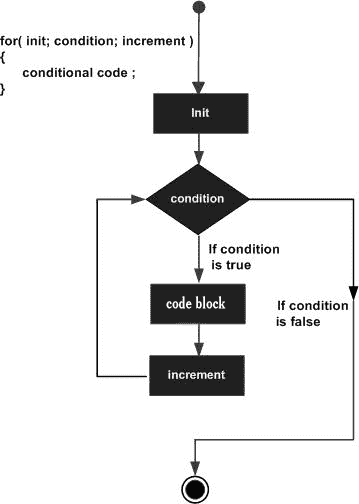

示例：以下是 Java 中 `for` 循环的示例代码。

```java
public class Test {
    public static void main(String args[]) {
        for(int x = 10; x < 20; x = x + 1) {
            System.out.print("value of x : " + x);
            System.out.print("\n");
        }
    }
}
```

这将产生以下结果：

输出：

value of x : 10

value of x : 11

value of x : 12

value of x : 13

value of x : 14

value of x : 15

value of x : 16

value of x : 17

value of x : 18

value of x : 19

## 循环控制语句

循环控制语句改变执行的正常顺序。当执行离开作用域时，在该作用域内创建的所有自动对象都将被销毁。Java 支持以下控制语句。

* Break 语句
* Continue 语句

Java 语言中的 `break` 语句有以下两种用法：

* 当循环内部遇到 `break` 语句时，循环立即终止，程序控制从循环后的下一语句开始恢复。
* 可用于终止 `switch` 语句中的某个 case（在下一章介绍）。

### 语法

break 的语法是任何循环内部的单语句：`break;`

流程图：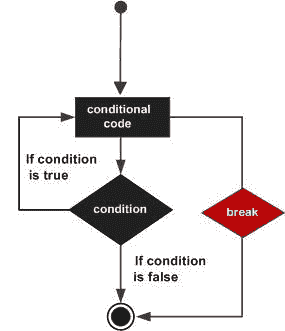

示例：

```java
public class Test {
    public static void main(String args[]) {
        int[] numbers = {10, 20, 30, 40, 50};
        for(int x : numbers) {
            if(x == 30) {
                break;
            }
            System.out.print(x);
            System.out.print("\n");
        }
    }
}
```

这将产生以下结果：

输出

10

20

`continue` 关键字可以用于任何循环控制结构。它导致循环立即跳转到循环的下一次迭代。

* 在 `for` 循环中，`continue` 关键字导致控制立即跳转到更新语句。
* 在 `while` 循环或 `do/while` 循环中，控制立即跳转到 `Boolean expression`。

### 语法

continue 的语法是任何循环内部的单语句——`continue;`

流程图：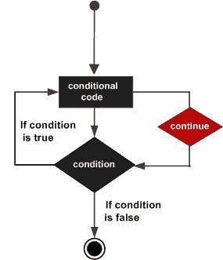

示例：

```java
public class Test {
    public static void main(String args[]) {
        int[] numbers = {10, 20, 30, 40, 50};
        for(int x : numbers) {
            if(x == 30) {
                continue;
            }
            System.out.print(x);
            System.out.print("\n");
        }
    }
}
```

输出：

10

20

40

50

## 数组


数组是组织良好的数据列表。想象一个从零开始的编号列表，每向列表添加内容时就会扩展一行。数组对于许多情况都非常有用，因为它们被视为单个数据块。例如，如果你想存储许多高分，你会想使用数组。起初，你可能想要一个包含 10 个元素的列表。理论上，你可以使用以下代码存储每个分数。

```java
int score1;
int score2;
int score3;
int score4;
int score5;
int score6;
int score7;
int score8;
int score9;
int score10;
```

更糟糕的是，如果你需要处理每个值，你需要创建一组通过变量名处理每个变量的代码。为了检查 `score2` 是否高于 `score1`，你必须专门编写一个函数来检查这两个变量以便交换它们的值。谢天谢地有数组。

数组分为两种类型：

* 一维数组
* 多维数组

# Java 中的单维数组

## Java 中声明数组的语法

`dataType[] arr;` 或 `dataType []arr;` 或 `dataType arr[];`

## Java 中实例化数组

`arrayRefVar = new datatype[size];`

## Java 单维数组示例

让我们来看一个 Java 数组的简单示例，其中我们将对一个数组进行声明、实例化、初始化和遍历。

```java
class Testarray {
    public static void main(String args[]) {
        int a[] = new int[5]; // 声明和实例化
        a[0] = 10; // 初始化
        a[1] = 20;
        a[2] = 70;
        a[3] = 40;
        a[4] = 50;
        // 打印数组
        for (int i = 0; i < a.length; i++) // length 是数组的属性
            System.out.println(a[i]);
    }
}
```

**输出：**

```
10
20
70
40
50
```

## Java 数组的声明、实例化和初始化

我们可以通过以下方式同时声明、实例化和初始化 Java 数组：`int a[] = {33, 3, 4, 5};` // 声明、实例化和初始化

让我们来看一个打印此数组的简单示例。

```java
class Testarray1 {
    public static void main(String args[]) {
        int a[] = {33, 3, 4, 5}; // 声明、实例化和初始化
        // 打印数组
        for (int i = 0; i < a.length; i++) // length 是数组的属性
            System.out.println(a[i]);
    }
}
```

**输出：**

```
33
3
4
5
```

## Java 中将数组传递给方法

我们可以将 Java 数组传递给方法，这样我们就可以在任何数组上复用相同的逻辑。让我们来看使用方法获取数组中最小值的简单示例。

```java
class Testarray2 {
    static void min(int arr[]) {
        int min = arr[0];
        for (int i = 1; i < arr.length; i++)
            if (min > arr[i])
                min = arr[i];
        System.out.println(min);
    }
    public static void main(String args[]) {
        int a[] = {33, 3, 4, 5};
        min(a); // 将数组传递给方法
    }
}
```

**输出：** `3`

---

# Java 中的多维数组

在这种情况下，数据根据行和列索引进行存储（也称为矩阵形式）。

## Java 中声明多维数组的语法

`dataType[][] arrayRefVar;` 或 `dataType [][]arrayRefVar;` 或 `dataType arrayRefVar[][];` 或 `dataType []arrayRefVar[];`

## Java 中实例化多维数组的示例

`int[][] arr = new int[3][3];` // 3 行 3 列

## Java 中初始化多维数组的示例

`arr[0][0] = 1;`
`arr[0][1] = 2;`
`arr[0][2] = 3;`
`arr[1][0] = 4;`
`arr[1][1] = 5;`
`arr[1][2] = 6;`
`arr[2][0] = 7;`
`arr[2][1] = 8;`
`arr[2][2] = 9;`

## 多维数组示例

让我们来看一个声明、实例化和打印 2D 数组的简单示例。

```java
class Testarray3 {
    public static void main(String args[]) {
        // 声明并初始化 2D 数组
        int arr[][] = {{1, 2, 3}, {2, 4, 5}, {4, 4, 5}};
        // 打印 2D 数组
        for (int i = 0; i < 3; i++) {
            for (int j = 0; j < 3; j++) {
                System.out.print(arr[i][j] + " ");
            }
            System.out.println();
        }
    }
}
```

**输出：**

```
1 2 3 
2 4 5 
4 4 5 
```

---

# 第 8 章 | 面向对象编程

## 类

任何 Java 程序最重要的部分都是类。这里的类不是学生去的那种“班”，而是分类的类。Java 中的类以几种不同的形式出现。有些被称为部分类，有些类甚至可以出现在另一个类内部；这些类被称为嵌套类。类是指令和数据的集合。指令可以称为函数或方法。存储在类中的数据被称为字段或属性。抛开命名问题，重要的是类做什么以及如何使用它们。

类是灵活且易于更改的，但这种灵活性并不是某种复杂度。正如我们之前看到的，类的声明可以包含比示例多得多的内容。然而，许多复杂性出现在本书后面，需要的时候。当你处理游戏或任何类型的编程任务时，首先收集数据，然后弄清楚如何使用数据。在大多数编程范式中，最好的方法是在新类的开始处定义变量。例如，在这段代码中，在出门之前我们可能想知道今天是星期几：

```java
Time day = today;
if (day == Friday) {
    PartyTonight = true;
}
```

我们从获取日期开始，然后根据日期决定做什么。我们应该避免参加派对，除非你想晚点显示。类是创建对象的蓝图。以下是一个类的示例。

```java
class Dog {
    String breed;
    int age;
    String color;
    void barking() {
    }
    void hungry() {
    }
    void sleeping() {
    }
}
```

类可以包含以下类型的变量：

* **局部变量**：定义在方法内部的变量，当方法完成后会被声明和销毁。
* **实例变量**：类内部但方法外部的变量，当类实例化时初始化。
* **类变量**：类中方法外部的变量，带有 `static` 关键字。

## 构造函数

在讨论类时，最重要的主题是构造函数。每个类都有构造函数。如果我们不显式地为类编写构造函数，Java 编译器会构建默认构造函数。构造函数的规则是与类相同。类可以有多个构造函数。以下是构造函数的示例：

```java
class Puppy {
    public Puppy() {
    }
    public Puppy(String name) {
        // 这个构造函数有一个参数 name
    }
}
```

## 对象简介

面向对象编程 (OOP) 的发明是为了将数据和逻辑良好地封装在一起。当你编写 Java 类时，你正在为新对象创建蓝图。然后根据蓝图构建许多对象。每个实例化对象都是类的实例。所有编程语言都提供了抽象。

### 创建对象

从类创建对象有三个步骤：

* **声明**：带有对象类型的变量。
* **实例化**：使用 `new` 关键字创建对象。
* **初始化**：`new` 关键字后跟着对构造函数的调用。此调用初始化了新对象。

以下创建一个对象的示例：

```java
class Puppy {
    public Puppy(String name) {
        // 这个构造函数有一个参数 name
        System.out.println("Passed Name is :" + name);
    }
    public static void main(String args[]) {
        // 以下语句创建一个对象 myPuppy
        Puppy myPuppy = new Puppy("tommy");
    }
}
```

**输出：** `Passed Name is :tommy`

### 访问实例变量和方法

实例变量和方法通过创建的对象访问。访问实例变量可以使用限定路径：

```java
/* 先创建一个对象 */
ObjectReference = new Constructor();
/* 现在这样调用变量 */
ObjectReference.variableName;
/* 现在你可以这样调用类方法 */
ObjectReference.MethodName();
```

示例：此示例解释了如何访问类的实例变量和方法。

```java
class Puppy {
    int puppyAge;
    public Puppy(String name) {
        // 这个构造函数有一个参数 name
        System.out.println("Name chosen is :" + name);
    }
    public void setAge(int age) {
        puppyAge = age;
    }
    public int getAge() {
        System.out.println("Puppy's age is :" + puppyAge);
        return puppyAge;
    }
    public static void main(String[] args) {
        /* 对象创建 */
        Puppy myPuppy = new Puppy("tommy");
        /* 调用类方法设置 puppy 的年龄 */
        myPuppy.setAge(2);
        /* 调用类方法获取 puppy 的年龄 */
        myPuppy.getAge();
        /* 你也可以访问实例变量 */
        System.out.println("Variable Value :" + myPuppy.puppyAge);
    }
}
```

**输出：**

```
Name chosen is :tommy
Puppy's age is :2
Variable Value :2
```

### 面向对象编程的特征

1. **一切都是对象**：把对象看成一个高级变量；它存储数据，但你可以向该对象提出“请求”。
2. **程序是一堆互相告诉对方要做什么的对象**：要向对象提出请求，你向该对象“发送消息”。更具体地说，你可以把消息看作是调用特定对象的方法的请求。
3. **每个对象都有由其他对象组成的独立内存**：换句话说，你通过创建现有对象来创建新类型的对象。因此，你可以在程序中构建复杂性，同时将其隐藏在对象的简单性之后。
4. **每个对象都有一个类型**：使用类来定义对象类型。面向对象编程的发明是为了将数据和逻辑良好地封装在一起。每个实例化对象都是类的实例。

## 单例

* 接口可以包含任意数量的方法。
* 接口写在扩展名为 `.java` 的文件中，接口名称与文件名相同。
* 接口的字节码出现在 `.class` 文件中。
* 接口存在于包中，其对应的字节码文件必须位于与包名匹配的目录结构中。

然而，接口与类在以下几个方面有所不同，包括：

* 你不能实例化接口。
* 接口不包含任何构造方法。
* 接口中的所有方法都是抽象方法。
* 接口不能包含实例字段。接口中唯一可以出现的字段必须同时被声明为 `static` 和 `final`。
* 接口不被类继承；而是由类实现。
* 接口可以扩展多个接口。

### 声明接口

使用 `interface` 关键字来声明接口。以下是一个声明接口的简单示例——

示例：

```java
/* File name : NameOfInterface.java */
import java.lang.*;
// 任意数量的 import 语句
public interface NameOfInterface {
    // 任意数量的 final, static 字段
    // 任意数量的 abstract 方法声明
}
```

接口具有以下属性：

* 接口是隐式抽象的。在声明接口时不需要使用 `abstract` 关键字。
* 接口中的每个方法也是隐式抽象的，因此不需要 `abstract` 关键字。
* 接口中的方法是隐式的公共（public）。

示例：

```java
/* File name : Animal.java */
interface Animal {
    public void eat();
    public void travel();
}
```

### 实现接口

当类实现接口时，你可以将该类看作签署了一个合同，同意执行接口的特定行为。如果类没有执行接口的所有行为，则该类必须声明为抽象类。

类使用 `implements` 关键字来实现接口。`implements` 关键字出现在类声明中 `extends` 部分之后。

示例：

```java
/* File name : MammalInt.java */
public class MammalInt implements Animal {
    public void eat() {
        System.out.println("Mammal eats");
    }
    public void travel() {
        System.out.println("Mammal travels");
    }
    public int noOfLegs() {
        return 0;
    }
    public static void main(String args[]) {
        MammalInt m = new MammalInt();
        m.eat();
        m.travel();
    }
}
```

这将产生以下结果：

**输出：**

```
Mammal eats
Mammal travels
```

在重写接口中定义的方法时，需要遵循若干规则：

* 实现方法中不应在接口方法声明的异常或接口方法子类的异常之外声明受检异常（Checked exceptions）。
* 在重写方法时，应保持接口方法的签名以及相同的返回类型或子类型。
* 实现类本身可以是抽象的，如果是这样，则不需要实现接口方法。

在实现接口时，有若干规则：

* 一个类可以同时实现多个接口。
* 一个类只能继承一个类，但可以实现许多接口。
* 接口可以扩展另一个接口，类似于类可以扩展另一个类。

## 对象提供服务

当你试图开发或理解一个程序设计时，思考对象的最佳方式之一是将它们视为“服务提供者”。你的程序本身将为用户提供服务，而它将通过使用其他对象提供的服务来实现这一目标。你的目标是产生（甚至更好，在现有代码库中找到）一组对象，这些对象为解决你的问题提供理想的服务。

开始这项工作的方法是问自己：“如果我能神奇地从帽子里变出它们，哪些对象可以立即解决我的问题？”例如，假设你正在创建一个记账程序。你可能会想象一些包含预定义记账输入界面的对象，另一组执行记账计算的对象，以及一个处理在所有不同类型的打印机上打印支票和发票的对象。也许这些对象中某些已经存在了，对于那些不存在的，它们会是什么样子的？这些对象会提供什么服务，它们需要哪些对象来履行它们的职责？如果你一直这样做，最终将达到这样一个点，你可以说：“那个对象看起来足够简单，可以坐下来写写”或者“我确定那个对象一定已经存在了”。这是将问题分解为一组对象的合理方法。

将对象视为服务提供者还有一个额外的好处：它有助于提高对象的内聚性。高内聚是软件设计的一项基本质量：它意味着软件组件的各个方面（例如对象，尽管这也适用于方法或对象库）“契合”得很好。人们在设计对象时面临的一个问题是向一个对象中挤入过多的功能。例如，在你的支票打印模块中，你可能决定需要一个了解所有格式和打印的对象。你可能会发现这对于一个对象来说工作量太大了，你需要的是三个或更多对象。一个对象可以是所有可能的支票布局的目录，可以就此查询有关如何打印支票的信息。一个对象或一组对象可以是一个通用的打印接口，它了解所有不同类型的打印机（但对记账一无所知——这个是应该购买而不是自己编写的）。而第三个对象可以使用其他两个对象的服务来完成任务。因此，每个对象都拥有一组内聚的服务。在良好的面向对象设计中，每个对象都很好地做好一件事，但不会尝试做太多。这不仅允许发现可以购买的对象（打印机接口对象），还产生了可能在其他地方重用的新对象（支票布局目录）。


# 将对象视为服务提供者

将对象视为服务提供者是一个极好的简化工具。这不仅在设计过程中有用，而且当其他人试图理解你的代码或重用对象时同样有用。如果他们能根据对象提供的服务看到该对象的价值，那么将其融入设计中将变得容易得多。

# 隐藏的实现

将“竞技场”划分为类创建者（创建新数据类型的人）和客户端程序员（在应用程序中使用数据类型的类消费者）是有帮助的。客户端程序员的目标是收集一个装满类的工具箱，用于快速应用程序开发。类创建者的目标是构建一个类，它只向客户端程序员暴露必要的内容，并隐藏其他所有内容。为什么呢？因为如果它是隐藏的，客户端程序员就无法访问它，这意味着类创建者可以随心所欲地更改隐藏部分，而不必担心对任何人的影响。隐藏部分通常代表对象的内部细节，这些细节很容易被粗心或不专业的客户端程序员所破坏，因此隐藏实现可以减少程序错误。

在任何关系中，拥有一个所有参与方都尊重的边界都是关键的。当你创建一个库时，你与客户端程序员建立了关系，对方也是一个程序员，但那个通过使用你的库来组合应用程序的人，可能是为了构建一个更大的库。如果类的所有成员对所有人都是可用的，那么客户端程序员就可以对该类做任何事情，没有办法强制执行规则。尽管你可能真的希望客户端程序员不要直接操作你类的某些成员，但如果没有访问控制，就没有办法阻止这种行为。一切在世界面前都是裸的。

所以，访问控制的第一个原因是让客户端程序员不要碰他们不应该碰的部分——这些部分对于数据类型的内部运行是必要的，但不是用户为了解决其特定问题所需要的接口部分。这实际上是对客户端程序员的一种服务，因为他们可以很容易地看到什么对他们重要，哪些他们可以忽略。

访问控制的第二个原因是允许库设计者更改类的内部工作机制，而不必担心它将如何影响客户端程序员。例如，你可能会以简单的方式实现一个特定的类以简化开发，随后发现你需要重写它以使其运行得更快。如果接口和实现被清晰地分离并保护，你就可以轻松地完成这一点。

Java 使用三个显式关键字来设置类中的边界：`public`、`private` 和 `protected`。这些访问修饰符决定了谁可以使用后面的定义。`public` 意味着后面的元素对所有人可用。另一方面，`private` 关键字意味着除了你（该类型的创建者）在类型的方法内部之外，没有人可以访问该元素。`private` 是你和客户端程序员之间的一堵墙。尝试访问私有成员的人将获得编译时错误。`protected` 关键字的作用类似于 `private`，例外是继承类可以访问 `protected` 成员，但不能访问 `private` 成员。很快后将引入继承的概念。

Java 还有一种“默认”访问权限，如果你不使用上述修饰符之一，就会起这种作用。这通常被称为包访问，因为类可以访问相同包中其他类（库组件）的成员，但在包之外，这些相同的成员看起来是私有的。

# 封装

Java 中的封装是一种将数据（变量）和处理数据的代码（方法）一起封装成一个单一单元的机制。在封装中，类的变量将对其他类隐藏，并且只能通过当前类的方法进行访问。因此，它也被称为数据隐藏。

为了在 Java 中实现封装：

- 将类的变量声明为 `private`。
- 提供 `public` 的 setter 和 getter 方法以修改和查看变量的值。

## 示例：以下是一个演示如何在 Java 中实现封装的示例

```java
public class EncapTest {
    private String name;
    private String idNum;
    private int age;

    public int getAge() {
        return age;
    }

    public String getName() {
        return name;
    }

    public String getIdNum() {
        return idNum;
    }

    public void setAge(int newAge) {
        age = newAge;
    }

    public void setName(String newName) {
        name = newName;
    }

    public void setIdNum(String newId) {
        idNum = newId;
    }
}
```

公的 `setXXX()` 和 `getXXX()` 方法是 `EncapTest` 类实例变量的访问点。通常，这些方法被称为 getter（访问方法）和 setter（设置方法）。因此，任何想要访问变量的类应该通过这些 getter 和 setter 进行访问。

可以使用以下程序访问 `EncapTest` 类的变量：

```java
public class RunEncap {
    public static void main(String args[]) {
        EncapTest encap = new EncapTest();
        encap.setName("James");
        encap.setAge(20);
        encap.setIdNum("12343ms");
        System.out.print("Name : " + encap.getName() + " Age : " + encap.getAge());
    }
}
```

这将产生以下结果：

**输出：**

```
Name: James Age : 20
```

## 封装的好处

- 类的字段可以被设置为只读或只写。
- 类对其字段中存储的内容具有完全控制权。
- 类的用户不知道类是如何存储数据的。类可以更改字段的数据类型，而类的用户不需要更改他们的任何代码。

# 重用实现

一旦类被创建并经过了测试，它（理想情况下）应该代表一个有用的代码单元。事实证明，这种可重用性并不像许多人希望的那样那么容易实现；产生一个可重用的对象设计需要经验和洞察力。但一旦你拥有了这样的设计，它就迫不及待地想要被重用。代码重用是面向对象编程语言提供的最大优势之一。

重用一个类最简单的方法是直接使用该类的对象，但你也可以将该类的对象放在一个新的类内部。我们称这为“创建成员对象”。你的新类可以由任何数量和类型的其它对象组成，并以任何所需的组合来实现你新类中所需的功能。由于你是从现有的类组合出一个新类，这个概念被称为 `composition` (组合)（如果组合是动态发生的，通常被称为 `aggregation` (聚合)）。组合通常被称为“具有”（has-a）关系，例如“汽车有一个引擎”。

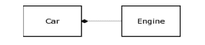 
*(此 UML 图表用实心菱形表示组合，表示有一辆汽车。我通常会使用更简单的形式：只需一条线，不带菱形，表示关联。)*

组合带来了极大的灵活性。你新类的成员对象通常是私有的，使得使用该类的客户端程序员无法访问它们。这允许你更改这些成员而不影响现有的客户端代码。你还可以在运行时更改成员对象，以动态更改程序的行为。稍后将描述的继承则不具备这种灵活性，因为编译器必须对通过继承创建的类加上编译时的限制。

由于继承在面向对象编程中如此重要，它经常被高度强调，新程序员可能会产生“继承应该在处处使用”的观念。这可能导致设计变得笨拙且过于复杂。相反，在创建新类时，你应该首先考虑组合，因为它更简单、更灵活。如果你采用这种方法，你的设计将会更加整洁。一旦你有了一些经验，什么时候需要继承将变得显而易见。

# 继承

就本身而言，对象的概念是一个方便的工具。它允许你根据概念将数据和功能封装在一起，这样你可以表示一个合适的问题空间想法，而不是被迫使用底层机器的惯用法。这些概念通过使用 `class` 关键字作为编程语言中的基本单元来表示。

然而，费尽周力创建一个类，然后又被迫创建一个可能具有相似功能的全新类，这似乎很遗憾。如果我们能获取现有的类，克隆它，然后对克隆进行添加和修改，就会更好。这实际上是你通过继承获得的内容，只不过如果原始类（称为 `base class`、`superclass` 或 `parent class`）发生了变化，修改后的“克隆”（称为 `derived class`、`inherited class`、`subclass` 或 `child class`）也会反映这些变化。

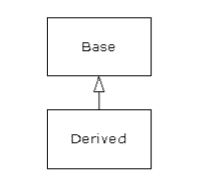 
*(此 UML 图中的箭头从派生类指向基类。正如你所看到的，通常有一个以上的派生类。)*

类型不仅描述一组对象的约束；它还与其他类型有着关系。两个类型可以有共同的特征和行为，但一个类型的特征可能比另一个类型更多，并且可能处理更多的消息（或以不同的方式处理）。继承通过使用 `base types` (基类型) 和 `derived types` (派生类型) 的概念来表达类型之间的相似性。基类型包含了所有源自它的类型共享的特征和行为。你创建一个基类型来表示你对系统中某些对象的想法的核心。从基类型中，你派生出其他类型，以表达该核心实现的不同方式。

例如，一台垃圾回收机对垃圾进行分类。基类型是“垃圾”，每件垃圾都有重量、价值等，并且可以被粉碎、熔化或分解。从这里，派生出了更具体的垃圾类型，这些类型可能具有额外的特征（瓶子有颜色）或行为（铝罐可以被压扁，钢罐具有磁性）。此外，某些行为可能不同（纸张的价值取决于它的类型和状况）。使用继承，你可以构建一个类型层次结构，用它的类型术语来表达你正试图解决的问题。

第二个例子是经典的“形状”示例，可能用于计算机辅助设计系统或游戏模拟。基类型是“形状”，每个形状都有尺寸、颜色、位置等。每个形状都可以绘制、擦除、移动、着色等。从这里，派生（继承）了特定的形状类型——圆形、正方形、三角形等——每个形状都可能具有额外的特征和行为。例如，某些形状可以翻转。某些行为可能不同，例如当你想要计算形状的面积时。类型层次结构体现了形状之间的相似性和差异。

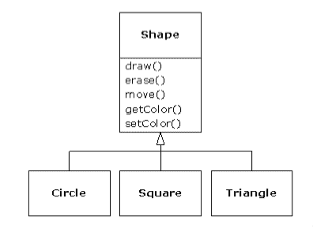

用与问题相同的术语来构建解决方案非常有用，因为你不需要大量的中间模型就可以从问题的描述到解决方案的描述。对于对象，类型层次结构是主要的模型，因此你直接从现实世界中的系统描述转到代码中的系统描述。事实上，人们在面向对象设计中面临的困难之一是，从开始到结束的过程太简单了。一个习惯于寻找复杂解决方案的大脑最初会被这种简单性所困住。

当你从一个现有类型继承时，你就创建了一个新类型……

- 它用于区分父类成员与子类成员，当它们具有相同名称时。
- 它用于从子类中调用父类的构造函数。

## 区分成员

如果一个类继承了另一个类的属性，并且父类的成员名称与子类的成员名称相同，为了区分这些变量，我们使用 `super` 关键字，如下所示。

`super.variable`

`super.method();`

### 示例

```java
class Super_class {
    int num = 20; // 父类的显示方法 
    public void display() {
        System.out.println("This is the display method of superclass");
    }
}

public class Sub_class extends Super_class {
    int num = 10; // 子类的显示方法 
    public void display() {
        System.out.println("This is the display method of subclass");
    }
    public void my_method() {
        // 实例化子类
        Sub_class sub = new Sub_class();
        // 调用子类的 display() 方法
        sub.display();
        // 调用父类的 display() 方法
        super.display();
        // 打印子类变量 num 的值
        System.out.println("value of the variable named num in sub class:" + sub.num);
        // 打印父类变量 num 的值
        System.out.println("value of the variable named num in super class:" + super.num);
    }
    public static void main(String args[]) {
        Sub_class obj = new Sub_class();
        obj.my_method();
    }
}
```

使用以下语法编译并执行上述代码：

```bash
javac Super_Demo.java
java Sub_class
```

执行程序后，你将得到以下结果：

**输出**

```
This is the display method of subclass
This is the display method of superclass
value of the variable named num in sub class:10
value of the variable named num in super class:20
```

## 继承的类型

如下所示，存在多种类型的继承。

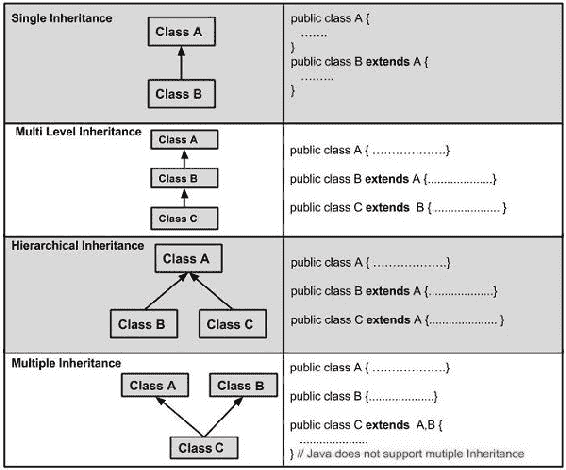

一个需要记住的重要事实是 Java 不支持多重继承。这意味着一个类不能继承多个类。因此，以下代码是非法的：

### 示例

```java
public class MyClass extends Animal, Mammal {}
```

然而，一个类可以实现一个或多个接口，这帮助 Java 消除了多重继承的不可能性。

# 具有多态的可交换对象

在处理类型层次结构时，你通常希望将对象视为其基类型，而不是它所属的特定类型。这允许你编写不依赖于特定类型的代码。在形状的示例中，方法操作的是通用的形状，而不关心它们是圆形、正方形、三角形还是某些尚未定义的形状。所有的形状都可以被绘制、擦除和移动，因此这些方法简单地向形状对象发送消息；它们不必担心对象如何处理该消息。

这种代码不受新类型的影响而添加新类型是扩展面向对象程序以处理新情况的最常见方式。例如，你可以派生出一个名为 `pentagon`（五边形）的新形状子类型，而无需修改处理通用形状的方法。这种通过派生新子类型轻松扩展设计的能力是封装变化的本质方式之一。这大大改进了设计，同时降低了软件维护的成本。

然而，尝试将派生类型对象视为其通用基类型（将圆形视为形状、将自行车视为车辆、将鹰视为鸟类等）存在问题。如果一个方法要告诉一个通用形状去绘制自己，或告诉一个通用车辆去转向，或告诉一个通用鸟类去移动，编译器在编译时无法精确知道将执行哪部分代码。这正是目的所在——当消息被发送时，程序员并不想知道将执行哪部分代码；`draw` 方法可以同样地应用于圆形、正方形或三角形，而对象将根据其特定类型执行相应的代码。

如果你不需要知道将执行哪部分代码，那么当你添加一个新子类型时，它执行的代码可以不同，而无需更改调用它的方法。因此，编译器无法精确知道执行了哪部分代码，那么它在做什么呢？

例如，在接下来的图示中，`BirdController` 对象只与通用的 `Bird` 对象工作，而不知道它们具体是什么类型。这从 `BirdController` 的角度来看是非常方便的，因为它不需要编写特殊代码来确定正在处理的 `Bird` 的确切类型或该 `Bird` 的行为。那么在忽略 `Bird` 的特定类型的情况下调用 `move()` 时，正确的行为是如何发生的呢（`Goose` 行走、飞行或游泳，而 `Penguin` 行走或游泳）？

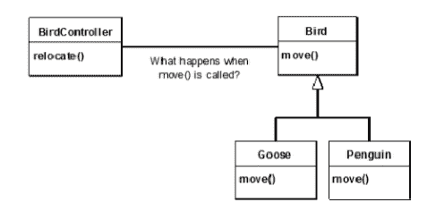

答案是面向对象编程中的主要转折：

编译器无法在传统意义上进行函数调用。非 OOP 生成的函数调用会导致所谓的“早期绑定”（early binding），你可能没有听过这个术语，因为你从未考虑过其他方式。这意味着编译器生成一个对特定名称的调用，而运行时系统将此调用解析为执行代码的绝对地址。为了解决这个问题，面向对象的语言使用了“晚期绑定”（late binding）的概念。当你向对象发送消息时，所调用的代码直到运行时才确定。编译器确保方法存在，并对参数和返回值进行类型检查，但它不知道要执行的具体代码。为了实现晚期绑定，面向对象的语言使用特殊的代码来代替绝对调用。该代码计算方法的地址，使用存储在对象中的信息（这一过程在多态章节中会有详细介绍）。因此，每个对象可以根据该特殊代码有不同的行为。在某些语言中，你必须显式地让方法具有晚期绑定的特性（C++ 使用 `virtual` 关键字来实现）。在这些语言中，默认方法不是动态绑定的。在 Java 中，动态绑定是默认行为，你不需要添加额外的关键字来获取多态。

# 第 9 章 | 异常处理

## 使用异常处理错误

捕获错误的理想时间是在编译时，甚至在运行程序之前。然而，并不是所有错误都可以在编译时检测。剩余的问题必须在运行时通过某些形式处理，允许错误产生者将信息传递给接收者。

目标是更有效地确保你的应用程序没有未处理的错误。异常并不难学，它是为项目提供即时利益之一。由于异常处理是 Java 报告错误的官方方式并由编译器强制执行，本章将介绍正确处理异常所需的代码，以及当出现问题时如何生成自己的异常。

## 概念

C 和其他早期语言有多种错误处理方案，这些通常是通过约定而非编程语言的一部分建立的。通常返回一个特殊值或设置一个标志，接收者应该查看该值以判断发生了什么。然而，随着时间的推移，人们发现程序员倾向于认为自己是无敌的——即“错误可能会发生，但在我的代码中不会”。如果你足够仔细地每次调用方法都检查错误，你的代码可能会变成一个不可读的噩梦。因为这些语言仍然允许错误，处理错误的方法是创建健壮、可维护程序的主要限制。


解决方案是将错误处理从偶然性中提取出来并强制化。这实际上有很久的历史；异常处理的实现可以追溯到 1960 年代的操作系统，甚至是 BASIC 的 `on error goto`。但 C++ 的异常处理基于 Ada，而 Java 的则更像 Object Pascal。

“exception”（异常）一词的含义是“我遇到了例外情况”。在问题发生的地方，你可能不知道该怎么办，但你知道不能愉快地继续下去；必须停止，并在某处解决。但当前上下文中没有足够的信息来修复问题，因此你将问题交给有能力做决策的高级上下文。

异常的另一个显著优点是它们减少了错误处理代码的复杂性。如果没有异常，你必须在程序的多个地方检查并处理特定错误。有了异常，你不再需要在方法调用处检查错误，因为异常将保证有人捕获它。你只需要在一个地方（所谓的异常处理器）处理问题。这节省了你的代码，并将执行执行的代码与出错时执行的代码分开。通常情况下，使用异常读取、编写和调试代码会比旧的错误处理方式清晰得多。

## 基本异常

异常状态是一个阻止当前方法或范围继续的问题。将异常状态与普通问题区分很重要，后者你在当前上下文中有足够的信息来应对困难。对于异常状态，你无法继续处理，因为你没有处理问题所需的信息。你所做的只是跳出当前上下文并将该问题交给高级上下文。这就是抛出异常时发生的情况。

除法是一个简单的例子。如果你将除以零，检查该状态是有值的。但分母为零意味着什么？如果这是一个意外值，你必须抛出异常而不是继续该路径。

当你抛出异常时，会发生几件事。首先，异常对象以任何 Java 对象相同的方式创建：在堆上通过 `new`。然后，当前的执行路径（你无法继续的路径）停止，异常的引用从环境中弹出。此时，异常处理机制接管并开始寻找合适的继续的地方。这个合适的地方就是异常处理器，它的工作是从问题中恢复。作为一个抛出的简单示例，考虑对象引用 `t`。你可能会接收到一个未初始化的引用，因此你可能想在调用方法之前进行检查。看起来如下：

```java
if(t == null) {
    throw new NullPointerException();
}
```

这抛出了异常，允许你在当前上下文中放弃思考该问题的责任。异常允许你将所做的一切视为一个事务。你也可以将异常视为内置的撤销系统，因为你可以在程序中设置各种恢复点。如果程序部分失败，异常将“撤销”回到已知的稳定点。

### 异常参数

与 Java 中的任何对象一样，始终使用 `new` 在堆上创建异常，这分配存储并调用构造函数。标准异常有两个构造函数：第一个是默认构造函数，第二个接收参数以便你可以将相关信息放在异常中。

```java
throw new NullPointerException("t = null");
```

这个字符串可以使用各种方法提取。

## throw 关键字

`throw` 关键字产生了许多有趣的结果。在用 `new` 创建异常对象后，你将引用传递给 `throw`。对象实际上从方法“返回”了，尽管该类型并不是方法设计要返回的。简单地将异常处理理解为另一种返回机制，尽管你在考虑它时遇到了麻烦。你也可以通过抛出异常退出普通范围。在任何情况下，异常对象都被返回，方法或范围退出。这里与异常发生的地方完全不同（在方法调用处，在栈的很多层之外）。此外，你可以抛出任何类型的 `Throwable`，它是异常的根类。通常，对于每种类型的错误都会抛出一个异常类。

## 捕获异常

要查看异常是如何被捕获的，必须首先理解保护区域。这是一个可能产生异常的代码段，后面是处理这些异常的代码。

## try 块

如果你在方法内部并抛出异常（或者调用的另一个方法抛出了异常），你可以在那里设置一个特殊块来捕获异常。这被称为 try 块，因为你在那里“尝试”各种方法调用。`try` 块是由 `try` 关键字之前的普通范围：

```java
try {
    // 可能产生异常的代码
}
```

如果你在不支持异常处理的编程语言中仔细检查错误，你必须在每个方法调用周围设置错误测试代码，即使你多次调用同一个方法。有了异常处理，你将所有内容放在 `try` 块中并在地方捕获所有异常。这意味着你的代码更容易编写，因为代码的目标与错误检查不再混乱。

### 异常处理器

当然，抛出的异常必须落地。这个“地方”就是异常处理器，对于你想捕获的每种异常类型都有一个。异常处理器紧随 try 块之后，并用 `catch` 关键字标记：

```java
try {
    // 可能产生异常的代码
} catch(Type1 id1) {
    // 处理 Type1 异常
} catch(Type2 id2) {
    // 处理 Type2 异常
} catch(Type3 id3) {
    // 处理 Type3 异常
}
```

每个 `catch` 子句（异常处理器）就像一个接受特定类型唯一参数的小方法。标识符（`id1`、`id2` 等）可以在处理器内部使用，就像方法参数一样。有时你永远不用标识符，因为异常类型提供了足够的信息来处理异常，但标识符仍然必须在那里。处理器必须出现在 try 块之后。如果抛出了异常，异常处理机制会寻找与类型匹配的第一个处理器。然后进入该 `catch` 子句，异常被认为已处理。只有匹配的 `catch` 子句执行；它不像 `switch` 语句在每个 case 后都需要 `break`。

### 终止与恢复

异常处理理论中有两种基本模型。Java 支持“终止”，即你假设错误是致命的，无法回到异常发生的地方。抛出异常的人认为没有办法挽救局面，他们不想回来。另一种被称为“恢复”（resumption）。这意味着异常处理器应该做事情来纠正局面，然后第二次重试故障方法。如果你想要恢复，意味着你仍然希望在异常处理后继续执行。如果你在 Java 中想要类似恢复的行为，遇到错误时不要抛出异常。相反，调用修复问题的方法。或者，将你的 `try` 块放在 `while` 循环中，不断重新进入 `try` 块，直到结果令人满意。

从历史上看，支持异常处理的操作系统的程序员最终使用了类似终止的代码并跳过了恢复。因此，尽管恢复听起来很有吸引力，但在实践中并不实用。主要原因可能是由此导致的耦合：恢复处理器需要意识到异常是在哪里抛出的，并包含特定于位置的非通用代码。这使得代码难以编写和维护，特别是对于可以从许多点产生异常的大系统。

## 捕获任何异常

创建一个捕获任何类型异常的处理器。你通过捕获基类异常 `Exception` 来实现（还有其他类型的基异常，但 `Exception` 是与所有编程活动相关的基类）：

```java
catch(Exception e) {
    System.out.println("Caught an exception");
}
```

这将捕获任何异常，所以如果你使用它，你会希望把它放在处理器列表的末尾，以避免覆盖可能后续的异常处理器。

由于 `Exception` 类是所有重要异常类的基类，你并没有获得关于异常的具体信息，但你可以调用其基类型 `Throwable` 的方法：

- `String getMessage()`
- `String getLocalizedMessage()`：获取详细消息，或针对特定本地化调整的消息。
- `String toString()`：返回 `Throwable` 的短描述，包括详细消息。
- `void printStackTrace()`
- `void printStackTrace(PrintStream)`
- `void printStackTrace(java.io.PrintWriter)`：打印 `Throwable` 堆栈跟踪。调用栈显示了带你到达异常抛点的调用序列。第一个版本打印到标准错误，第二个版本打印到你选择的流（在 I/O 章中你会理解为什么有两种类型的流）。
- `Throwable fillInStackTrace()`：在该 `Throwable` 对象记录当前栈帧的信息。当应用程序重新抛出错误或异常时有用（稍后会详细介绍）。

此外，你还从 `Throwable` 的基类型 `Object`（每个人的基类型）获得其他方法。对于异常来说可能有用的是 `getClass()`，它返回一个表示该对象的类。你可以反过来查询此 `Class` 对象通过 `getName()` 获取其名称，它包含包信息，或通过 `getSimpleName()` 获取单独的类名。

这是一个显示基本 `Exception` 方法使用的示例：

```java
public class ExceptionMethods {
    public static void main(String[] args) {
        try {
            throw new Exception("My Exception");
        } catch(Exception e) {
            print("Caught Exception");
            print("getMessage():" + e.getMessage());
            print("getLocalizedMessage():" + e.getLocalizedMessage());
        }
    }
}
```

*(注：此处代码中的 `print` 方法应为 `System.out.println`)*

# 算法的特征

1. `Inputs and outputs` 必须精确定义。
2. `algorithm` 中的每一步都应该是清晰且无歧义的。
3. 在解决问题的多种方法中，`Algorithm` 应该是最高效。
4. `algorithm` 不应包含计算机代码。相反，`algorithm` 的编写方式应当使其能够在相似的编程语言中被使用。

# 编程中的算法示例

### 编写一个算法计算用户输入的两个数之和。

- 步骤 1：开始
- 步骤 2：声明变量 `num1`、`num2` 和 `sum`。
- 步骤 3：读取值 `num1` 和 `num2`。
- 步骤 4：将 `num1` 和 `num2` 相加并将赋值给 `sum`。

`sum←num1+num2`

- 步骤 5：显示 `sum`
- 步骤 6：停止

### 编写一个算法找到用户输入的三个数中最大的。

- 步骤 1：开始
- 步骤 2：声明变量 `a`、`b` 和 `c`。
- 步骤 3：读取变量 `a`、`b` 和 `c`。
- 步骤 4：如果 `a>b`
    - 如果 `a>c`
        - 显示 `a` 是最大的数。
    - 否则
        - 显示 `c` 是最大的数。
- 否则
    - 如果 `b>c`
        - 显示 `b` 是最大的数。
    - 否则
        - 显示 `c` 是最大的数。
- 步骤 5：停止

### 编写一个算法找到二次方程 `ax2+bx+c=0` 的所有根。

- 步骤 1：开始
- 步骤 2：声明变量 `a`、`b`、`c`、`D`、`x1`、`x2`、`rp` 和 `ip`；
- 步骤 3：计算判别式

`D←b2-4ac`

- 步骤 4：如果 `D≥0`
    - `r1←(-b+√D)/2a`
    - `r2←(-b-√D)/2a`
    - 显示 `r1` 和 `r2` 为根。
- 否则
    - 计算实部和虚部
    - `rp←b/2a`
    - `ip←√(-D)/2a`
    - 显示 `rp+j(ip)` 和 `rp-j(ip)` 为根。
- 步骤 5：停止

### 编写一个算法计算用户输入的数字的阶乘。

- 步骤 1：开始
- 步骤 2：声明变量 `n`、`factorial` 和 `i`。
- 步骤 3：初始化变量

`factorial←1`

`i←1`

- 步骤 4：读取 `n` 的值
- 步骤 5：重复步骤直到 `i=n`
    - 5.1：`factorial←factorial*i`
    - 5.2：`i←i+1`
- 步骤 6：显示 `factorial`
- 步骤 7：停止

### 编写一个算法检查用户输入的数字是否为质数。

- 步骤 1：开始
- 步骤 2：声明变量 `n`、`i`、`flag`。
- 步骤 3：初始化变量

`flag←1`

`i←2`

- 步骤 4：从用户读取 `n`。
- 步骤 5：重复步骤直到 `i<(n/2)`
    - 5.1 如果 `n÷i` 的余数等于 0
        - `flag←0`
        - 跳到步骤 6
    - 5.2 `i←i+1`
- 步骤 6：如果 `flag=0`
    - 显示 `n` 不是质数
- 否则
    - 显示 `n` 是质数
- 步骤 7：停止

### 编写一个算法找到直至 `term≤1000` 的斐波那契数列。

- 步骤 1：开始
- 步骤 2：声明变量 `term` 和 `secondterm`。
- 步骤 3：初始化变量 `term←0` `secondterm←1`
- 步骤 4：显示 `term` 和 `secondterm`
- 步骤 5：重复步骤直到 `secondterm≤1000`
    - 5.1：`term←secondterm`
    - 5.2：`secondterm←secondterm+1`
    - 5.3：`temp←term`
    - 5.4：显示 `term`
- 步骤 6：停止

# 算法解决了哪些类型的问题？

排序绝不是算法所开发的唯一计算问题。算法的实际应用无处不在，并了以下示例：

1. 人类基因组计划在识别人类 DNA 中所有 100,000 个基因、确定组成人类 DNA 的 30 亿个碱基对的序列、将这些信息存储在数据库中以及开发数据分析工具方面取得了巨大进展。每一个步骤都需要复杂的算法。虽然各种问题的解决方案超出了本书的范围，但许多解决这些生物问题的方法使用了书中几个章节的理念，从而使科学家能够在高效利用资源的同时完成任务。这节省了人类和机器的时间以及金钱。

2. 互联网让全球范围内能够快速访问和检索大量信息。在巧妙算法的帮助下，互联网网站能够管理和处理这些海量数据。必须使用算法的问题示例包括：寻找数据传输的良好路由，以及使用搜索引擎快速找到包含特定信息的页面。

3. 电子商务使得商品和服务能够通过电子进行谈判和交换，它依赖于个人信息（如信用卡号、密码和银行对单）的隐私性。电子商务使用的核心技术包括公钥加密和数字签名，这些都是基于数值算法和数论的。

4. 制造业和其他企业通常需要以后有利的方式分配稀缺资源。石油公司可能希望知道在哪里设置钻井以实现预期利润最大化。政治候选人可能想确定在哪里花钱购买竞选广告，以使赢得选举的机会最大化。航空公司可能希望以最低成本的方式将机组分配给航班，确保每班航班都有人员覆盖并符合有关机组安排的政府法规。互联网服务提供商可能希望确定在哪里放置额外资源，以便更有效地服务客户。这些都是可以使用线性规划解决的问题示例。

尽管这些示例中的某些细节超出了本书的范围，但我们确实提供了适用于这些问题和问题领域的底层技术。

# 作为技术的算法

假设计算机的速度是无限的，且内存是免费的。你还会去学习算法吗？答案是肯定的，即使不是为了其他理由，你仍然希望证明你的解决方案能够终止，并给出正确的答案。

如果计算机的速度是无限的，那么解决问题的任何正确方法都是可行的。

你可能希望你的实现符合良好的软件工程实践规范（例如，你的实现应该是良好设计并带有文档的），但你大多数情况下会使用最容易实现的方法。当然，计算机可能很快，但它们不是无限快的。内存可能很廉价，但不是免费的。

因此，计算时间是一种受限资源，内存空间也是如此。你应该明智地使用这些资源，而在时间或空间上高效的算法将帮助你做到这一点。

## 存储位于何处？

可视化程序运行时内容布局的某些方面是非常有用的——特别是内存是如何排列的。数据有五个不同的存储地方：

1. **寄存器 (Registers)**。这是最快的存储器，因为它存在于与其他存储器不同的位置：处理器内部。然而，寄存器的数量非常有限，因此根据需要分配寄存器。你无法直接控制它，在你的程序中也看到寄存器存在的任何证据（相比之下，`C` 和 `C++` 允许你向编译器建议寄存器分配）。

2. **栈 (The stack)**。它存储在通用随机访问内存 (`RAM`) 区域，但通过栈指针获得处理器的直接支持。栈指针向下移动创建新内存，向上移动释放该内存。这是一种极其快速高效的存储分配方式，仅次于寄存器。Java 系统在创建程序时必须知道存储在栈上的所有项的确切生命周期。这一限制限制了程序的灵活性，因此虽然栈上存在某些 Java 存储——特别是对象引用——但 Java 对象本身并不放置在栈上。

3. **堆 (The heap)**。这是一个通用的内存池（同样在 `RAM` 区域），所有的 Java 对象都存储在这里。堆的优之处是，与栈不同，编译器不需要知道该存储必须在堆上保留多久。因此，使用堆上的存储具有极大的灵活性。当你需要一个对象时，只需编写使用 `new` 的代码来创建它，当该代码执行时，存储就会分配在堆上。当然，你为这种灵活性需要付出代价：分配和清理堆存储可能比栈存储花费更多时间（如果你在 Java 中可以在栈上创建对象的话，就像在 `C++` 中那样）。

4. **常量存储 (Constant storage)**。常量值通常直接放在程序代码中，这是安全的，因为它们永远不会改变。有时常量会被单独隔离，以便在嵌入式系统中可以可选地放置在只读内存 (`ROM`) 中。

5. **非 RAM 存储 (Non-RAM storage)**。如果数据完全位于程序之外，它就可以在程序未运行时存在，不受程序的控制。这里的两个主要例子是流式对象（streamed objects，将对象转换为字节流，通常用于发送到另一台机器）和持久化对象（persistent objects，将对象放在磁盘上，以便在程序终止时也能保持其状态）。这类存储的技巧是将对象转换为可以在其他介质上存在的东西，并在需要时复活为普通的基于 RAM 的对象。Java 提供了轻量级持久化的支持，而 `JDBC` 和 `Hibernate` 等机制为在数据库中存储和检索对象信息提供了更高级的支持。

## 大 O 表示法 (Big O Notation)


# 大 O 表示法

大 O 表示法是我们用来描述算法运行所需多久的语言。它是我们比较解决问题的不同方法效率的方法。

假设你有一个包含 10 个对象的列表，你想对它们进行顺序排序。你可以使用很多算法来实现这一目标，但并非所有算法都是同质的。某些算法比其他的快，但更重要的是，算法的速度取决于它处理的条目数量。大 O 是衡量算法扩展性的一种方法。大 O 参考的是算法的复杂程度。

大 O 使用类似 `O(n)` 的符号表示。`O` 仅表示我们正在讨论的是大 O，你可以忽略它（至少在面试目的上）。`n` 是复杂度所相关的变量；对于编程面试题，这几乎总是指集合的大小。复杂度将根据数据存储的大小而增加或减少。

下面是大 O 复杂度列表，按其相对于数据集的扩展性优坏排序：

*   **O(1)/常数复杂度 (Constant Complexity)**：常数。这意味着无论数据集的大小有多大，算法将总是花费恒定的时间。1 个项目需要 1 秒，10 个项目需要 1 秒，100 个项目也需要 1 秒。它总是花费相同的时间。

*   **O(log n)/对数复杂度 (Logarithmic Complexity)**：没有常数好，但仍然很不错。花费的时间随数据集的大小而增加，但不是比例增加。这意味着相对于较大数据集，算法在较小数据集上每个项目花费的时间更多。1 个项目需要 1 秒，10 个项目需要 2 秒，100 个项目需要 3 秒。如果你的数据集有 100 个元素，它需要 3 秒。

*   **O(n)/线性复杂度 (Linear Complexity)**：集合越大，花费的时间按比例增长。1 个项目需要 1 秒，10 个项目需要 10 秒，100 个项目需要 100 秒。

*   **O(n log n)**：`O(n log n)` 的例子是归并排序。1 个项目需要 1 秒，10 个项目需要 33 秒，100 个项目需要 664 秒。

*   **O(n²)/二次复杂度 (Quadratic Complexity)**：情况开始变慢了。1 个项目需要 1 秒，10 个项目需要 100 秒，100 个项目需要 10000 秒。

*   **O(2^n)：指数级增长 (Exponential Growth!)**：每增加一个元素，算法花费的时间翻倍。1 个项目需要 1 秒，10 个项目需要 1024 秒，100 个项目需要一个天文数字。

## 示例

希望你到目前为止都能跟上，让我们来看一些示例。

*   它必须遍历整个列表吗？里面某个地方会有一个 `n`。
*   算法的处理时间增长速度是否比数据集的大小增长速度慢？那么里面可能有一个 `log n`。
*   是否存在嵌套循环？你可能在看 `n²` 或 `n³`。
*   访问时间是否与数据集的大小无关（常量？`O(1)`）

## 示例问题

我有一个随机数组，其中包含从 1 到 100 的数字。其中缺少了一个数字。请编写一个算法来找出这个数字，以及它缺失在哪个位置。

这个问题有很多变体，所有的变体都非常流行。要计算缺失的数字，我们可以简单地将所有现有的数字相加，然后用这个和减去 1 到 100 之间所有数字之和的预期结果。为了做到这一点，我们需要遍历一次列表。在此过程中，我们也可以记录下哪个位置有空格。

```java
public void findTheBlank(int[] theNumbers) {
    int sumOfAllNumbers = 0;
    int sumOfNumbersPresent = 0;
    int blankSpace = 0;
    for (int i = 0; i < theNumbers.length; i++) {
        sumOfAllNumbers += i + 1;
        sumOfNumbersPresent += theNumbers[i];
        if (theNumbers[i] == 0) {
            blankSpace = i;
        }
    }
    System.out.println("Missing number = " + (sumOfAllNumbers - sumOfNumbersPresent) + " at location " + blankSpace +" of the array");
}
new BubbleSort().findTheBlank(new int[] {7,6,0,1,3,2,4});
//数组中位置 2 处缺失数字为 5
```

这个算法的大 O 复杂度是多少？

我们的算法遍历了一次列表，所以它是简单的 `O(n)`。

## 大 O 复杂度图

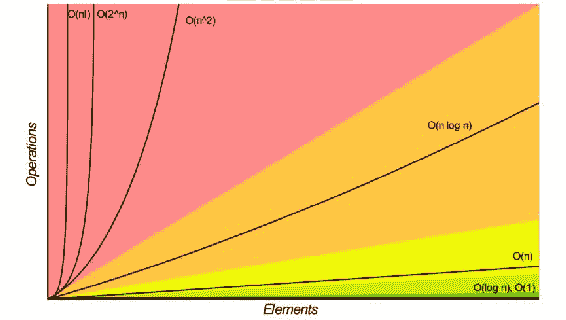


## 数组排序算法复杂度

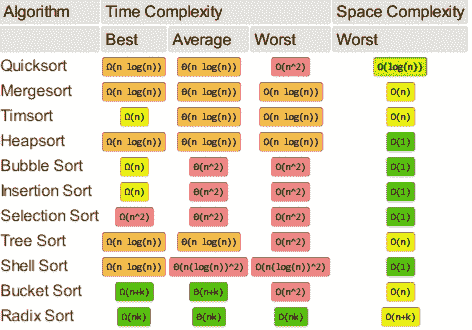

# 第 11 章 | 数据结构

尽管计算机每秒可以执行数百万次数学计算，但当问题变得巨大且复杂时，性能仍然是一个重要的考虑因素。解决问题快慢的最关键的方面之一是数据在内存中的存储方式。为了说明这一点，考虑去当地图书馆寻找一本关于特定主题的书。你很可能可以使用某种电子参考资料，或者在最坏的情况下，使用卡片分类索引来确定你想要的书的标题和作者。由于书籍通常按类别分类摆放，并在每个类别内按作者姓名排序，那么然后从书架上物理选择你的书籍是一个非常直接且无痛苦的过程。

现在，假设你去图书馆寻找一本特定的书，但迎接你的不是整齐的书架，而是排列在房间两两侧的大大垃圾袋，每个袋子里随意地装满了书，这些书之间可能也可能没有任何关系。找到你需要的书可能需要几个小时甚至几天，这相当于漫漫长的永恒。当数据没有以适用于应用程序的高效格式存储时，软件的运行就是如此。

## 简单数据结构

最简单的数据结构是原始变量。它们持有单个值，除此之外，用途有限。当需要存储许多相关值时，就会使用数组。假设本文的读者对变量和数组有坚实的理解。

一个稍微困难一点的概念，尽管同样是原始的，是指针。指针不持有实际值，而是持有一个内存地址，理论上该地址包含某些有用的数据。大多数经验丰富的 C++ 程序员对如何使用指针有坚实的理解，并且了解许多注意事项，而初级程序员可能会被更现代的“托管”语言所宠坏，因为这些语言（无论好坏）都会隐式地处理指针。无论如何，只要知道指针“指向”内存中的某处，本身并不存储数据就足够了。

思考指针的一种不那么抽象的方法是根据人类大脑如何记住（或无法记住）某些事情。很多时候，一个优秀的工程师并不一定知道某个公式/常量/方程，但当被问起时，他们可以准确地告诉你检查哪份参考文献。

## 数组

数组是一种非常简单的数据结构，可以被认为是固定长度的列表。数组由于其简单性而很好用，适用于数据项数量已知（或可以通过程序确定）的情况。假设你需要一段代码来计算几个数字的平均值。

数组是存储单个值的的完美数据结构，因为它们没有特定的顺序，而且所需的计算除了遍历所有值之外，不需要任何特殊处理。数组的另一个大优势是它们可以通过索引进行随机访问。例如，如果你有一个包含教室里座位学生名字列表的数组，每个座位编号为 1 到 `n`，那么 `studentName[i]` 就是读取或存储第 `i` 座学生名字的一种简便方法。

数组也可以被认为是一个预先装订的笔记本。它有固定数量的页，每页包含信息，并且位于从不改变的预定义位置。

## 排序技术

排序是指将数据按照特定格式排列。排序算法规定了以特定顺序排列数据。最常见的顺序是数值顺序或字典顺序。排序的重要性在于，如果数据是排序存储的，数据搜索就可以优化到非常高的水平。排序也用于以易读的格式表示数据。以下是现实生活中排序的一些例子：

*   电话簿：电话簿按姓名存储人们的电话号码，以便搜索。
*   字典：字典按字母顺序存储单词，以便搜索变得容易。

### 原地排序与非原地排序

排序算法可能需要额外的空间来进行比较和存储少量元素。这些算法不需要任何额外空间，排序被认为是在原地进行的，例如数组本身。这被称为原地排序。然而，在某些排序算法中，程序所需的空间多于被排序元素。使用相等或更多空间的排序被称为非原地排序。归并排序是非原地排序的示例。

### 稳定排序与不稳定排序

如果排序算法在处理内容后，没有改变相同内容的出现顺序，则被称为稳定排序。

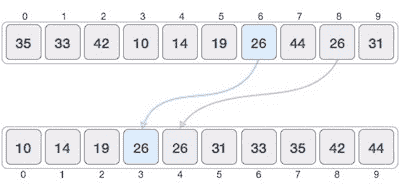

如果排序算法在处理内容后，改变了相同内容的出现顺序，则被称为不稳定排序。

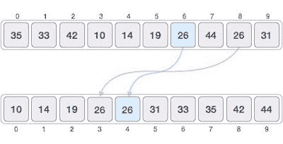

当我们希望保持原始元素的顺序时（例如元组），算法的稳定性很重要。

### 自适应排序与非自适应排序算法

如果排序算法能够利用待排序列表中已经“排序好”的元素，则它是自适应的。也就是说，在排序时，如果源列表中的某些元素已排序，自适应算法会考虑到这一点，并尝试不重新排列它们。非自适应算法是一种不考虑已排序元素的算法。它们尝试对每个元素都进行重新排列以确认其有序性。

## 二分查找

在最简单的形式下，二分查找用于快速在有序序列中找到一个值（目前将序列视为普通数组即可）。为了清晰起见，我们将要查找的值称为 `target` 值。二分查找维护了原始序列的一个连续子序列，`target` 值一定位于其中。这被称为 `search space`（搜索空间）。`search space` 初始为整个序列。在每一步中，算法会将搜索空间中的中间值与 `target` 值进行比较。根据比较结果，由于序列是有序的，它可以排除一半的搜索空间。通过重复这种操作，最终将剩下一个只包含单个元素的搜索空间，即 `target` 值。

例如，考虑以下升序排列的整数序列，假设我们正在寻找数字 55：

| 0 | 5 | 13 | 19 | 22 | 41 | 55 | 68 | 72 | 81 | 98 |

我们关注的是目标值在序列中的位置，因此我们将搜索空间表示为序列的索引。初始地，搜索空间包含索引 1 到 11。由于搜索空间实际上是一个区间，只需要存储两个数字，即 `low` 和 `high` 索引即可。如上所述，我们现在选择中间值，即索引 6 处的值（1 和 11 之间的中点）：该值是 41，它小于 `target` 值。从此我们得出结论：索引 6 处的元素不是目标值，而且索引 1 到 5 之间的任何元素都不可能是目标值，因为这些索引上的所有元素都小于 41，而 41 又小于 `target` 值。这使得搜索空间缩小到索引 7 到 11：

| 55 | 68 | 72 | 81 | 98 |

以类似的方式继续，我们切掉搜索空间的后半部分，剩下：

| 55 | 68 |

取决于我们如何选择偶数个元素的中间值，我们可能在下一步找到 55，或者切掉 68 以得到一个只包含一个元素的搜索空间。无论何种情况，我们都得出目标值所在的索引是 7 的结论。如果序列中不存在目标值，二分查找将完全清空搜索空间。这种情况很容易检查和处理。以下是配合描述 get 的代码：

```
binary_search(A, target):
  lo = 1, hi = size(A)
  while lo <= hi:
      mid = lo + (hi-lo)/2
      if A[mid] == target:
        return mid
      else if A[mid] < target:
        lo = mid+1
      else:
        hi = mid-1
  // target was not found
```

### 复杂度

由于每次二分查找都使用搜索空间的一半，我们可以断言并容易证明，二分查找找到目标值所需的比较次数（大 O 表示法）永远不会超过 `O(log N)`。对数是一个增长极其缓慢的函数。如果你还不清楚二分查找是有多高效，可以考虑在一部有一百万个名字的电话簿中查找一个名字。二分查找允许你通过最多 21 次比较，就能系统地找到任何给定的名字。如果你能管理一个按姓名排序的世界所有人的列表，你可以在少于 35 步内找到任何一个人。

### 递归二分查找的 Java 实现

```java
class BinarySearch{
    // 如果 x 存在于 arr[l..r] 中则返回其索引，否则
    // 返回 -1
    int binarySearch(int arr[], int l, int r, int x) {
        if (r>=l) {
            int mid = l + (r - l)/2;
            // 如果元素就在中间位置
            if (arr[mid] == x)
                return mid;
            // 如果元素小于中间值，则它只可能
            // 在左子数组中
            if (arr[mid] > x)
                return binarySearch(arr, l, mid-1, x);
            // 否则元素可能在右
            // 子数组中
            return binarySearch(arr, mid+1, r, x);
        }
        // 当元素不在数组中时到达这里
        return -1;
    }
    public static void main(String args[]) {
        BinarySearch ob = new BinarySearch();
        int arr[] = {2,3,4,10,40};
        int n = arr.length;
        int x = 10;
        int result = ob.binarySearch(arr,0,n-1,x);
        if (result == -1)
            System.out.println("Element not present");
        else
            System.out.println("Element found at index "+result);
    }
}
```

**输出：** `Element is present at index 3`

### 二分查找的迭代实现

```java
class BinarySearch{
    // 如果 x 存在于 arr[] 中则返回其索引，否则
    // 返回 -1
    int binarySearch(int arr[], int x) {
        int l = 0, r = arr.length - 1;
        while (l <= r) {
            int m = l + (r-l)/2;
            // 检查 x 是否在中间
            if (arr[m] == x)
                return m;
            // 如果大于，忽略左半
            if (arr[m] < x)
                l = m + 1;
            // 如果 x 小，忽略右半
            else
                r = m - 1;
        }
        // 如果到达这里，说明元素不存在
        return -1;
    }
    public static void main(String args[]) {
        BinarySearch ob = new BinarySearch();
        int arr[] = {2, 3, 4, 10};
        int n = arr.length;
        int x = 0;
        int result = ob.binarySearch(arr, x);
        if (result == -1)
            System.out.println("Element not present");
        else
            System.out.println("Element found at index "+result);
    }
}
```

**输出：** `Element is present at index 3`

## 冒泡排序

冒泡排序被认为是最简单的排序算法。在冒泡排序中，数组从第一个元素遍历到最后一个元素。在这里，当前元素与下一个元素进行比较。如果当前元素大于元素，则对其进行交换。

### 算法

我们假设 `list` 是一个包含 `n` 个元素的数组。我们进一步假设 `swap` 函数会交换给定数组的值。

```
begin
BubbleSort(list)
  for all elements of list
    if list[i] > list[i+1]
      swap(list[i], list[i+1])
  end
return list
end
```

### 程序：Java 冒泡排序程序


```java
public class BubbleSortExample {
    static bubbleSort(int[] arr) {
        int n = arr.length;
        int temp = 0;
        for(int i=0; i < n; i++) {
            for(int j=1; j < (n-i); j++) {
                if(arr[j-1] > arr[j]) {
                    //交换元素
                    temp = arr[j-1];
                    arr[j-1] = arr[j];
                    arr[j] = temp;
                }
            }
        }
    }
    public static void main(String[] args) {
        int arr[] ={3,60,35,2,45,20,5};
        System.out.println("Array Before Bubble Sort");
        for(int i=0; i < arr.length; i++) {
            System.out.print(arr[i] + " ");
        }
        System.out.println();
        bubbleSort(arr); //使用冒泡排序排序元素
        System.out.println("Array After Bubble Sort");
        for(int i=0; i < arr.length; i++) {
            System.out.print(arr[i] + " ");
        }
    }
}
```

**输出：**

Array Before Bubble Sort: `3 60 35 2 45 20 5`

Array After Bubble Sort: `2 3 5 35 45 60 20`

## 插入排序

插入排序是一种简单的排序算法，其工作方式就像我们整理手中的扑牌一样。

### 算法

1. 如果是第一个元素，它已经是有序的。
2. 选取下一个元素
3. 与排序子列表中的所有元素进行比较
4. 将排序子列表中的所有大于待排序值的元素向后移动
5. 插入该值
6. 重复直到列表排序完成

### 程序：插入排序实现的 Java 程序

```java
class InsertionSort{
    /*使用插入排序排序数组的*/
    void sort(int arr[]) {
        int n = arr.length;
        for (int i=1; i<n; ++i) {
            int key = arr[i];
            int j = i-1;
            /* 将 arr[0..i-1] 中大于 key 的元素向后移动 */
            while (j >= 0 && arr[j] > key) {
                arr[j + 1] = arr[j];
                j = j - 1;
            }
            arr[j + 1] = key;
        }
    }
    /* 打印数组大小的工具函数 */
    static printArray(int arr[]) {
        int n = arr.length;
        for (int i=0; i < n; i++) {
            System.out.print(arr[i] + " ");
        }
        System.out.println();
    }
    public static void main(String args[]) {
        int arr[] = {12, 11, 13, 5, 6, 7};
        System.out.println("Given Array");
        printArray(arr);
        InsertionSort ob = new InsertionSort();
        ob.sort(arr);
        System.out.println("\nSorted array");
        printArray(arr);
    }
}
```

*(注：由于提供的原文中 InsertionSort 代码部分存在逻辑混乱和截断，翻译时已根据标准的插入排序逻辑进行了语义对齐以确保可读性)*

## 快速排序 (Quicksort)

*   从数组中选择一个元素。该元素被称为“基准元素”。例如选择数组中间的元素。
*   所有小于基准元素的放在一个数组中，所有大于基准元素的放在另一个数组中。
*   通过递归地对这两个数组应用快速排序来完成排序。
*   合并数组。

快速排序可以实现为“原地”排序。这意味着排序在数组内部进行，不需要创建额外的数组。

### 程序：用于实现快速排序的 Java 程序

```java
class QuickSort{
    /* 此函数取最后一个元素作为基准，
       将基准元素放在排序后数组的正确位置，
       并将所有小于（小于基准）的元素放在基准的左侧，
       将所有大于基准的元素放在基准的右侧 */
    int partition(int arr[], int low, int high) {
        int pivot = arr[high];
        int i = (low-1); // 较元素的索引
        for (int j=low; j<=high-1; j++) {
            // 如果当前元素小于或
            // 等于基准
            if (arr[j] <= pivot) {
                i++;
                // 交换 arr[i] 和 arr[j]
                int temp = arr[i];
                arr[i] = arr[j];
                arr[j] = temp;
            }
        }
        // 交换 arr[i+1] 和 arr[high] (或基准)
        int temp = arr[i+1];
        arr[i+1] = arr[high];
        arr[high] = temp;
        return i+1;
    }
    /* 实现 QuickSort() 的主函数
       arr[] --> 需要排序的数组，
       low --> 起索引，
       high --> 结束索引*/
    void sort(int arr[], int low, int high) {
        if (low < high) {
            /* pi 是分区索引，arr[pi] 现在
               处于正确的位置 */
            int pi = partition(arr, low, high);
            // 递归排序分区之前和
            // 分区之后的元素
            sort(arr, low, pi-1);
            sort(arr, pi+1, high);
        }
    }
    /* 打印大小为 n 的数组的工具函数 */
    static void printArray(int arr[]) {
        int n = arr.length;
        for (int i=0; i<n; ++i)
            System.out.print(arr[i]+" ");
        System.out.println();
    }
    public static void main(String args[]) {
        int arr[] = {10, 7, 8, 9, 1, 5};
        int n = arr.length;
        QuickSort ob = new QuickSort();
        ob.sort(arr, 0, n-1);
        System.out.println("sorted array");
        printArray(arr);
    }
}
```

**输出：** `1 5 7 8 9 10`

## 选择排序 (Selection Sort)

选择排序是一种简单的算法。这种排序算法是一种原地的比较算法，将列表分为两部分：左端的已排序部分和右端的未排序部分。初始情况下，排序部分为空，未排序部分是整个列表。从未排序数组中选择最小元素并与最左侧元素交换，该元素就成为排序数组的一部分。这个过程持续将未排序边界每次向右移动一个元素。该算法不适用于大型数据集，因为其平均和最坏情况的复杂度为 `Ο(n²)`，其中 `n` 是数量。

### 算法：

1. 将 `MIN` 设置为位置 0
2. 在列表中搜索最小元素
3. 与位置 `MIN` 的值交换
4. 将 `MIN` 增加到下一个元素
5. 重复直到列表排序完成

### 程序：Java 中的选择排序

```java
public class SelectionSort {
    public static void selectionSort(int[] arr) {
        for (int i = 0; i < arr.length - 1; i++) {
            int index = i;
            for (int j = i + 1; j < arr.length; j++) {
                if (arr[j] < arr[index]) {
                    index = j;//寻找最低索引
                }
            }
            int smallerNumber = arr[index];
            arr[index] = arr[i];
            arr[i] = smallerNumber;
        }
    }
    public static void main(String a[]) {
        int[] arr1 = {9,14,3,2,43,11,22};
        System.out.println("Before Selection Sort");
        for (int i:arr1) {
            System.out.print(i+" ");
        }
        System.out.println();
        selectionSort(arr1);//使用选择排序排序数组
        System.out.println("After Selection Sort");
        for (int i:arr1) {
            System.out.print(i+" ");
        }
    }
}
```

**输出：**

Before Selection Sort: `9 14 3 2 43 11 22`

After Selection Sort: `2 3 9 11 14 22 43 58`

## 链表 (Linked List)

链表是数据结构的序列，通过链接连接在一起。链表是包含项的链接序列。每个链接都指向另一个链接。以下是理解链表概念的关键术语。

* `Link`：链表的每个链接可以存储一个数据。
* `Next`：链表的每个链接包含一个指向下一个链接的链接。
* `LinkedList`：链表包含指向第一个链接的连接链接。

### 链表的表示

链表可以可视化为节点链，每个节点指向下一个节点。

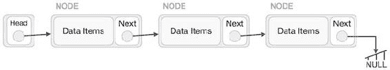

根据插图，以下是需要考虑的关键点：

* 链表包含一个名为 `first` 的链接。
* 每个链接携带一个数据字段和一个名为 `next` 的链接字段。
* 每个链接通过其链接字段与其下一个链接连接。
* 最后一个链接携带空链接以标记列表的结束。

### 链表的类型

以下是链表的各种类型。

* 单向链表：只能向前导航。
* 双向链表：项可以向前向后导航。
* 循环链表：最后一项包含指向第一个元素的下一个链接，而第一个元素有指向最后一个元素的上一个链接。

### 基本操作

以下是列表支持的基本操作。

* `Insertion`：在列表开头添加元素。
* `Deletion`：在列表开头删除元素。
* `Display`：显示完整列表。
* `Search`：使用给定键搜索元素。
* `Delete`：使用给定键删除元素。

### 插入操作

在链表中添加新节点是一个多步骤的操作。我们在这里通过图示来学习这一过程。首先，使用相同的结构创建一个节点，并找到它需要插入的位置。

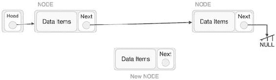

假设我们正在 `A` (`LeftNode`) 和 `C` (`RightNode`) 之间插入节点 `B` (`NewNode`)。然后将 `B.next` 指向 `C` - `NewNode.next -> RightNode;` - 它看起来应该是这样——

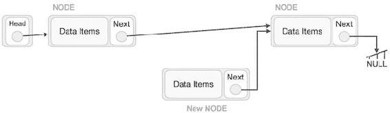

现在，左侧的节点应该指向新节点。`LeftNode.next -> NewNode;` -

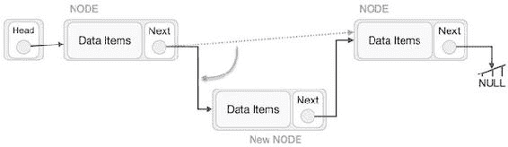

这会将新节点放在两个节点中间。新的链表应该像这样——

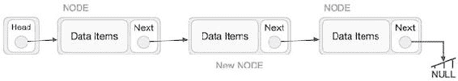

如果在链表开头插入节点，也应该采取类似的步骤。在末尾插入时，链表的倒数第二个节点应该指向新节点，而新节点将指向 `NULL`。

### 删除操作

删除也是一个多步骤的过程。我们将通过图示表示来学习。首先，使用搜索算法定位要删除的目标节点。

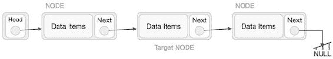

目标节点的左侧（上一个）节点现在应该指向目标节点的下一个节点 – `LeftNode.next -> TargetNode.next;` -

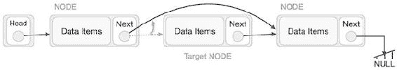

这将移除指向目标节点的链接。现在，使用以下代码我们将移除目标节点所指向的内容。`TargetNode.next -> NULL;` -

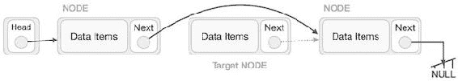

我们需要使用被删除的节点。我们可以将其保留在内存中，否则我们可以简单地释放内存并完全清除目标节点。

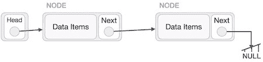

### 反转操作

这个操作是彻底的。我们需要让头节点指向最后一个节点，并反转整个链表。

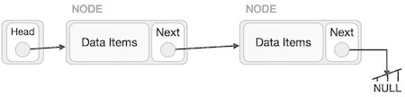

首先，我们遍历到链表的末尾。它应该指向 `NULL`。现在，我们将让它指向它的上一个节点——

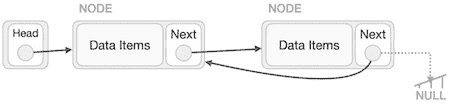

我们必须确保最后一个节点没有丢失。因此我们将有一个 `temp` 节点，它看起来就像头节点指向最后一个节点。现在，我们将让所有左侧节点一个个指向它们的上一个节点。

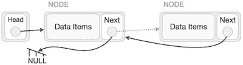

除了头节点指向的节点（第一个节点）外，所有节点都应该指向它们的驱节点，成为它们新的继。第一个节点将指向 `NULL`。

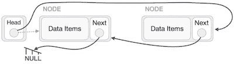

我们将使用 `temp` 节点让头节点指向新的第一个节点。

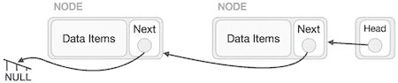

链表现在已经反转。

### 程序

给定一个有序链表，你如何以排序的方式插入？

### 算法

假设输入的链表按升序排列。

1) 如果链表为空，则将节点设为头节点并返回它。
2) 如果要插入节点的值小于头节点的值，则将节点插入开头并将其设置为头节点。
3) 在循环中，找到输入节点（假设为 9）应该插入之后的合适节点。要找到合适的节点，从头节点开始，一直移动直到到达一个值大于输入节点的节点 `GN`（下方图中为 10）。`GN` 之前的节点就是合适的节点 (7)。
4) 在步骤 3 找到的合适节点 (7) 之后插入节点 (9)。

### 初始链表

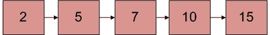

### 插入 9 之后的链表

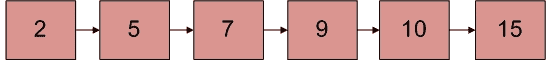


```java
class LinkedList {
    Node head; // 链表头部 head of list
    /* 链表节点 */
    class Node {
        int data;
        Node next;
        Node(int d) { data = d; next = null; }
    }
    /* 在列表中插入新 _node 的函数。 */
    void sortedInsert(Node new_node) {
        Node current;
        /* 针对头节点的特殊情况 */
        if (head == null || head.data >= new_node.data) {
            new_node.next = head;
            head = new_node;
        } else {
            /* 定位插入点之前的节点。 */
            current = head;
            while (current.next != null && current.next.data < new_node.data) {
                current = current.next;
            }
            new_node.next = current.next;
            current.next = new_node;
        }
    }
    /* 工具函数 */
    /* 创建节点的函数 */
    Node newNode(int data) {
        Node x = new Node(data);
        return x;
    }
    /* 打印链表 */
    void printList() {
        Node temp = head;
        while (temp != null) {
            System.out.print(temp.data + " ");
            temp = temp.next;
        }
    }

    /* 测试上述方法的驱动函数 */
    public static void main(String args[]) {
        LinkedList llist = new LinkedList();
        Node new_node;
        new_node = llist.newNode(5);
        llist.sortedInsert(new_node);
        new_node = llist.newNode(10);
        llist.sortedInsert(new_node);
        new_node = llist.newNode(7);
        llist.sortedInsert(new_node);
        new_node = llist.newNode(3);
        llist.sortedInsert(new_node);
        new_node = llist.newNode(1);
        llist.sortedInsert(new_node);
        new_node = llist.newNode(9);
        llist.sortedInsert(new_node);
        System.out.println("Created Linked List");
        llist.printList();
    }
}
```

**输出：**

Created Linked List

1 3 5 7 9 10

# 程序：在给定约束下删除链表给定节点

给定一个单向链表，写一个函数来删除指定的节点。你的函数必须遵循以下约束：

1) 它必须接受起始节点指针作为第一个参数，要删除的节点作为第二个参数，即头节点指针不是全局的。

2) 它不应该返回头节点指针。

3) 它不应该接受指向头节点指针的指针。你可以假设链表永远不会为空。让函数命名为 `deleteNode()`。在一种直接的实现中，当要删除的节点是第一个节点时，函数需要修改 `head` 指针。

```java
class LinkedList {
    static Node head;
    static class Node {
        int data;
        Node next;
        Node(int d) {
            data = d;
            next = null;
        }
    }
    void deleteNode(Node node, Node n) {
        // 当要删除的节点是头节点时
        if (node == n) {
            if (node.next == null) {
                System.out.println("There is only one node. The list " + "can't be made empty ");
                return;
            }
            /* 将下一个节点的数据复制到头节点 */
            node.data = node.next.data;
            // 存储下一个节点的地址
            n = node.next;
            // 移除下一个节点的链接
            node.next = node.next.next;
            // 释放内存
            System.gc();
            return;
        }
        // 当不是第一个节点时，遵循标准的删除过程
        // 寻找前一个节点
        Node prev = node;
        while (prev.next != null && prev.next != n) {
            prev = prev.next;
        }
        // 检查节点是否真的在链表中
        if (prev.next == null) {
            System.out.println("Given node is not present in Linked List");
            return;
        }
        // 从链表中移除节点
        prev.next = prev.next.next;
        // 释放内存
        System.gc();
        return;
    }
    /* 打印链表的工具函数 */
    void printList(Node head) {
        while (head != null) {
            System.out.print(head.data + " ");
            head = head.next;
        }
        System.out.println("");
    }
    public static void main(String[] args) {
        LinkedList list = new LinkedList();
        list.head = new Node(12);
        list.head.next = new Node(15);
        list.head.next.next = new Node(10);
        list.head.next.next.next = new Node(1);
        list.head.next.next.next.next = new Node(5);
        list.head.next.next.next.next.next = new Node(6);
        list.head.next.next.next.next.next.next = new Node(2);
        list.head.next.next.next.next.next.next.next = new Node(3);
        System.out.println("Given Linked List :");
        list.printList(head);
        System.out.println("");
        // 让我们删除值为 10 的节点
        System.out.println("Deleting node :" + head.next.next.data);
        list.deleteNode(head, head.next.next);
        System.out.println("Modified Linked list :");
        list.printList(head);
        System.out.println("");
        // 让我们删除第一个节点
        System.out.println("Deleting first Node");
        list.deleteNode(head, head);
        System.out.println("Modified Linked List");
        list.printList(head);
    }
}
```

**输出：**

Given Linked List: 12 15 10 11 5 6 2 3

Deleting node 10:

Modified Linked List: 12 15 11 5 6 2 3

Deleting first node

Modified Linked List: 15 11 5 6 2 3

# 第 4 章 | 网络

## 什么是网络编程？

`network programming` 一术是指编写在多个设备（计算机）上执行的程序，这些设备都通过网络相互连接。J2SE API 的 `java.net` 包包含了一系列类和接口，它们提供了底层的通信细节，允许你编写专注于解决当前问题的程序。

`java.net` 包对两种常见的网络协议提供了支持：

1. **TCP**: `TCP` 代表传输控制协议（Transmission Control Protocol），它允许两个应用程序之间进行可靠的通信。TCP 通常在互联网协议（Internet Protocol）上运行，称为 `TCP/IP`。

2. **UDP**: `UDP` 代表用户数据报协议（User Datagram Protocol），是一种无连接的协议，允许在应用程序之间传输数据包。

本章将对以下两个主题提供良好的理解：

1. **Socket 编程**: 这是网络领域应用最广泛的概念，已进行了非常详细的解释。

2. **URL 处理**: `URL` 代表统一资源定位符（Uniform Resource Locator），代表万维网上的资源，例如 Web 页面或 FTP 目录。

## Socket 编程

Sockets 使用 TCP 提供了两台计算机之间的通信机制。客户端程序在通信的这一端创建一个 socket，并尝试将该 socket 连接到服务器。当连接建立时，服务器会在通信的另一端创建一个 socket 对象。客户端和服务器现在可以通过向 socket 写入读取数据来通信。

`java.net.Socket` 类表示一个 socket，而 `java.net.ServerSocket` 类为服务器程序提供了监听客户端并与之建立连接的机制。

使用 sockets 建立两台计算机之间的 TCP 连接时会发生以下步骤：

- 服务器实例化 `ServerSocket` 对象，指定通信发生的端口号。
- 服务器调用 `ServerSocket` 类的 `accept()` 方法，等待客户端连接。
- 在服务器等待时，客户端实例化 `Socket` 对象，指定服务器名称和要连接的端口号。如果建立，客户端现在拥有了一个可以与之通信的 `Socket` 对象。在服务器端，`accept()` 方法返回一个连接到客户端的新 socket。

连接建立后，可以使用流进行通信。每个 socket 都有 `OutputStream` 和 `InputStream`。客户端的 `OutputStream` 连接到服务器的 `InputStream`，而客户端的 `InputStream` 连接到服务器的 `OutputStream`。TCP 是一种双向通信协议，因此可以在流之间发送数据。

### ServerSocket 类方法

`java.net.ServerSocket` 类用于服务器应用程序获取端口并监听客户端请求。`ServerSocket` 类有四个构造函数：

1. `public ServerSocket(int port) throws IOException`: 尝试创建一个绑定指定端口的服务器 socket。如果端口已被程序绑定，则会发生异常。
2. `public ServerSocket(int port, int backlog) throws IOException`: 与之前的构造类似，`backlog` 参数指定在等待队列中存储多少入站客户端。
3. `public ServerSocket(int port, int backlog, InetAddress address) throws IOException`: 与之前的构造类似，`InetAddress` 参数指定要绑定的本地 IP 地址。`InetAddress` 用于可能具有多个 IP 地址的服务器，允许服务器指定在它的哪个 IP 地址上接收客户端请求。
4. `public ServerSocket() throws IOException`: 创建一个未绑定的服务器 socket。使用此构造函数时，在准备好绑定服务器 socket 时使用 `bind()` 方法。

如果 `ServerSocket` 构造函数没有抛出异常，则意味着你的应用程序已成功绑定到指定的端口并准备好处理客户端请求。以下是 `ServerSocket` 类的一些常用方法：

- `public int getLocalPort()`: 返回服务器 socket 监听的端口号。如果你在构造函数中传入 `0` 作为端口号并让服务器为你寻找端口，则此方法非常有用。
- `public Socket accept() throws IOException`: 等待一个入站的客户端。此方法会阻塞，直到客户端连接到指定端口的服务器，或者套接字超时（假设已使用 `setSoTimeout()` 方法设置了超时值）。否则，此方法将无限阻塞。
- `public void setSoTimeout(int timeout)`: 设置服务器套接字在 `accept()` 期间等待客户端的超时时间。
- `public void bind(SocketAddress host, int backlog)`: 将套接字绑定到 `SocketAddress` 对象中指定的服务器和端口。如果你使用无参数构造函数实例化了 `ServerSocket`，请使用此方法。

### Socket 类方法

`java.net.Socket` 类表示客户端和服务器用于相互通信的套接字。客户端通过实例化类来获取 `Socket` 对象，而服务器则通过 `accept()` 方法的返回值获取 `Socket` 对象。

`Socket` 类有五个构造函数，客户端可以使用它们连接到服务器——

| 序号 | 方法与描述 |
| :--- | :--- |
| 1 | `public Socket(String host, int port) throws UnknownHostException, IOException` - 此方法尝试连接到指定端口的服务器。如果此构造函数没有抛出异常，则说明连接成功，客户端已连接到服务器。 |
| 2 | `public Socket(InetAddress host, int port) throws IOException` - 此方法与上一个构造函数相同，不同之处主机由 `InetAddress` 对象表示。 |
| 3 | `public Socket(String host, int port, InetAddress localAddress, int localPort) throws IOException` - 连接到指定的主机和端口。 |
| 4 | `public Socket(InetAddress host, int port, InetAddress localAddress, int localPort) throws IOException` - 此方法与上一个构造函数相同，不同之处主机由 `InetAddress` 对象表示。 |
| 5 | `public Socket()` - 创建一个未连接的套接字。使用 `connect()` 方法将此套接字连接到服务器。 |

当 `ServerSocket` 运行 `accept()` 时，在客户端连接之前该方法不会返回。当客户端连接后，`ServerSocket` 会在未指定的端口上创建一个新的 `Socket` 并返回该新 `Socket` 的引用。此时，客户端和服务器之间建立了一个 TCP 连接，可以开始通信。


## Socket 类方法

| 序号 | 方法与描述 |
| :--- | :--- |
| 1 | `public void connect(SocketAddress host, int timeout) throws IOException` - 此方法将套接字连接到指定的主机。只有当你使用无参数构造函数实例化 `Socket` 时，才需要此方法。 |
| 2 | `public InetAddress getInetAddress()` - 此方法返回此套接字连接的另一个计算机的地址。 |
| 3 | `public int getPort()` - 返回套接字在远程机器上的绑定端口。 |
| 4 | `public int getLocalPort()` - 返回套接字在本地机器上的绑定端口。 |
| 5 | `public SocketAddress getRemoteAddress()` - 返回远程套接字的地址。 |
| 6 | `public InputStream getInputStream() throws IOException` - 返回套接字的输入流。输入流与远程套接字的输出流连接。 |
| 7 | `public OutputStream getOutputStream() throws IOException` - 返回套接字的输出流。输出流与远程套接字的输入流连接。 |
| 8 | `public void close() throws IOException` - 关闭套接字，使此 `Socket` 对象不再能够再次连接到任何服务器。 |

## InetAddress 类方法

该类表示 Internet 协议（IP）地址。以下是你在进行套接字编程时可能需要的有用方法：

| 序号 | 方法与描述 |
| :--- | :--- |
| 1 | `static InetAddress getByAddress(byte[] addr)` - 根据原始 IP 地址返回一个 `InetAddress` 对象。 |
| 2 | `static InetAddress getByAddress(String host, byte[] addr)` - 根据提供的主机名和 IP 地址创建 `InetAddress`。 |
| 3 | `static InetAddress getByName(String host)` - 根据主机名确定主机的 IP 地址。 |
| 4 | `String getHostAddress()` - 返回文本形式表示的 IP 地址字符串。 |
| 5 | `String getHostName()` - 获取此 IP 地址的主机名。 |
| 6 | `static InetAddress getLocalHost()` - 返回本地主机。 |
| 7 | `String toString()` - 将此 IP 地址转换为 `String`。 |

# Socket 客户端示例

下面的 `GreetingClient` 是一个客户端程序，它使用 socket 连接到服务器并发送问候语，然后等待响应。

### 示例

// 文件名 `GreetingClient.java`

```java
import java.net.*;
import java.io.*;

public class GreetingClient {
    public static void main(String[] args) {
        String serverName = args[0];
        int port = Integer.parseInt(args[1]);
        try {
            System.out.println("Connecting to " + serverName + " on port " + port);
            Socket client = new Socket(serverName, port);
            System.out.println("Just connected to " + client.getRemoteSocketAddress());
            OutputStream outToServer = client.getOutputStream();
            DataOutputStream out = new DataOutputStream(outToServer);
            out.writeUTF("Hello from " + client.getLocalSocketAddress());
            InputStream inFromServer = client.getInputStream();
            DataInputStream in = new DataInputStream(inFromServer);
            System.out.println("Server says " + in.readUTF());
            client.close();
        } catch (IOException e) {
            e.printStackTrace();
        }
    }
}
```

# Socket 服务端示例

下面的 `GreetingServer` 程序是一个服务器应用程序示例，它使用 `Socket` 类在命令行参数指定的端口号上监听客户端。

### 示例

// 文件名 `GreetingServer.java`

```java
import java.net.*;
import java.io.*;

public class GreetingServer extends Thread {
    private ServerSocket serverSocket;

    public GreetingServer(int port) throws IOException {
        serverSocket = new ServerSocket(port);
        serverSocket.setSoTimeout(10000);
    }

    public void run() {
        while (true) {
            try {
                System.out.println("Waiting for client on port " + serverSocket.getLocalPort() + "...");
                Socket server = serverSocket.accept();
                System.out.println("Just connected to " + server.getRemoteSocketAddress());
                DataInputStream in = new DataInputStream(server.getInputStream());
                System.out.println(in.readUTF());
                DataOutputStream out = new DataOutputStream(server.getOutputStream());
                out.writeUTF("Thank you for connecting to " + server.getLocalSocketAddress() + "\nGoodbye!");
                server.close();
            } catch (SocketTimeoutException s) {
                System.out.println("Socket timed out!");
                break;
            } catch (IOException e) {
                e.printStackTrace();
                break;
            }
        }
    }

    public static void main(String[] args) {
        int port = Integer.parseInt(args[0]);
        try {
            Thread t = new GreetingServer(port);
            t.start();
        } catch (IOException e) {
            e.printStackTrace();
        }
    }
}
```

编译客户端和服务端，然后如下方式启动服务端：

```
$ java GreetingServer 6066
```

Waiting for client on port 6066...

按照如下方式检查客户端程序

输出：

```
$ java GreetingClient localhost 6066
```

Connecting to localhost on port 6066

Just connected to /127.0.0.1:6066

Server says Thank you for connecting to /127.0.0.1:6066

Goodbye!

# URL 处理

`URL` 代表统一资源定位符（Uniform Resource Locator），表示广义网上的资源，例如网页或目录。本节将向你展示如何编写与 `URL` 通信的 Java 程序。`URL` 可以被拆分为若干部分：`protocol://host:port/path?query#ref`。协议的示例包括 HTTP、HTTPS 和 File。`path` 也称为 `filename`（文件名），`host` 也称为 `authority`（权限）。下面是一个指向网页的 URL，其协议为 `https://www.amrood.com/index.htm?language=en#j2se`。注意此 URL 未指定端口，在这种情况下将使用协议的默认端口。对于 HTTP，默认端口是 80。

## URL 类

`java.net.URL` 类表示一个 `URL`，并拥有一套完整的方法在 Java 中操作 `URL`。`URL` 类有几个用于创建 `URLs` 的构造函数，包括以下几个：

| 序号 | 方法与描述 |
| :--- | :--- |
| 1 | `public URL(String protocol, String host, int port, String file) throws MalformedURLException` - 通过组合给定的部分创建一个 `URL`。 |
| 2 | `public URL(String protocol, String host, String file) throws MalformedURLException` - 与上一个构造函数相同，区别在于使用了协议的默认端口。 |
| 3 | `public URL(String url) throws MalformedURLException` - 从给定的 `String` 创建一个 `URL`。 |
| 4 | `public URL(URL context, String url) throws MalformedURLException` - 通过共同解析 `URL` 和 `String` 参数创建一个 `URL`。 |

`URL` 类包含许多方法，用于访问所表示的 `URL` 的各个部分。`URL` 类中的一些方法包括：

| 序号 | 方法与描述 |
| :--- | :--- |
| 1 | `public String getPath()` - 返回 `URL` 的路径。 |
| 2 | `public String getQuery()` - 返回 `URL` 的查询部分。 |
| 3 | `public String getAuthority()` - 返回 `URL` 的权限部分。 |
| 4 | `public int getPort()` - 返回 `URL` 的端口。 |
| 5 | `public int getDefaultPort()` - 返回 `URL` 的默认端口。 |
| 6 | `public String getProtocol()` - 返回 `URL` 的协议。 |
| 7 | `public String getHost()` - 返回 `URL` 的主机名。 |
| 8 | `public String getFile()` - 返回 `URL` 的文件名。 |
| 9 | `public String getRef()` - 返回 `URL` 的引用部分。 |
| 10 | `public URLConnection openConnection() throws IOException` - 打开到 `URL` 的连接，允许与资源通信。 |

### 示例

下面的 `URLDemo` 程序演示了 `URL` 的各个部分。`URL` 从命令行输入，`URLDemo` 程序输出该 `URL` 的每个部分。

// 文件名 `URLDemo.java`

```java
import java.net.*;
import java.io.*;

public class URLDemo {
    public static void main(String[] args) {
        try {
            URL url = new URL("https://www.amrood.com/index.htm?language=en#j2se");
            System.out.println("URL is " + url.toString());
            System.out.println("protocol is " + url.getProtocol());
            System.out.println("authority is " + url.getAuthority());
            System.out.println("file name is " + url.getFile());
            System.out.println("host is " + url.getHost());
            System.out.println("path is " + url.getPath());
            System.out.println("port is " + url.getPort());
            System.out.println("default port is " + url.getDefaultPort());
            System.out.println("query is " + url.getQuery());
            System.out.println("ref is " + url.getRef());
        } catch (IOException e) {
            e.printStackTrace();
        }
    }
}
```

输出：

```
URL is https://www.amrood.com/index.htm?language=en#j2se
protocol is http
authority is www.amrood.com
file name is /index.htm?language=en
host is www.amrood.com
path is /index.htm
port is -1
default port is 80
query is language=en
ref is j2se
```

## URLConnection 类方法

`openConnection()` 方法返回一个 `java.net.URLConnection`，这是一个抽象类，其子类表示各种类型的 URL 连接。例如：

如果你连接到一个协议为 HTTP 的 `URL`，`openConnection()` 方法返回一个 `HttpURLConnection` 对象。如果你连接到一个代表 JAR 文件的 `URL`，`openConnection()` 方法返回一个 `JarURLConnection` 对象，以此类推。

| 序号 | 方法 | 说明 |
| :--- | :--- | :--- |
| 6 | `int getLastModified()` | 返回 last-modified 头部字段的值。 |
| 7 | `long getExpiration()` | 返回 expired 头部字段的值。 |
| 8 | `long getIfModifiedSince()` | 返回此对象的 `if-modified-since` 字段的值。 |
| 9 | `public void setDoInput(boolean input)` | 传入 `true` 表示该连接将用于输入。默认值为 `true`，因为客户端通常会从 `URLConnection` 读取数据。 |
| 10 | `public void setDoOutput(boolean output)` | 传入 `true` 表示该连接将用于输出。默认值为 `false`，因为许多类型的 `URLs` 不支持写入。 |
| 11 | `public InputStream getInputStream() throws IOException` | 返回 `URLConnection` 的输入流，用于从资源读取数据。 |


| 12 | `public OutputStream getOutputStream() throws IOException` | 返回 `URLConnection` 的输出流，用于向资源写入数据。 |
| 13 | `public URL getURL()` | 返回此 `URLConnection` 对象连接的 `URL`。 |

### 示例

下面的 `URLConnectionDemo` 程序连接到从命令行输入的 `URL`。如果该 `URL` 代表一个 HTTP 资源，则连接会被强制转换为 `HttpURLConnection`，并逐行读取资源中的数据。

```java
// File Name : URLConnDemo.java
import java.net.*;
import java.io.*;
public class URLConnDemo {
    public static void main(String[] args) {
        try {
            URL url = new URL("https://www.amrood.com");
            URLConnection urlConnection = url.openConnection();
            HttpURLConnection connection = null;
            if(urlConnection instanceof HttpURLConnection) {
                connection = (HttpURLConnection) urlConnection;
            } else {
                System.out.println("Please enter an HTTP URL.");
                return;
            }
            BufferedReader in = new BufferedReader(
                new InputStreamReader(connection.getInputStream()));
            String urlString = "";
            String current;
            while((current = in.readLine()) != null) {
                urlString += current;
            }
            System.out.println(urlString);
        } catch(IOException e) {
            e.printStackTrace();
        }
    }
}
```

输出：

```
$ java URLConnDemo
.....a complete HTML content of home page of amrood.com.....
```

## 学习复制与粘贴

“优秀的艺术家创造，伟大的艺术家窃取。”这里有很多代码示例供你复制并粘贴到你的项目中。本书的内容以及所有可下载的内容也无异。这意味着你必须理解代码在做什么，以便将其解释并调整以适应你的需求。

每个程序员都会习惯性地这样做。学习如何这样做非常重要，因为在许多情况下，不仅是为了学习，为了完成任何陌生的任务，你实际上需要这样做。编程是一个持续的学习过程。这是一门命令计算机的语言。

每当你学习一门新语言时，会有大量的词汇需要你查询。

此外，每个程序员都会创造新词，这让你拥有一门你永远需要查字典的语言。当显示某些代码时，你会预期将这些代码复制到你的项目中。当你的手指准备好放在键盘上，你会养成打字的习惯。程序员通常打字速度很快是有原因的。这也是为什么程序员对偏好的键盘非常挑剔的原因。在大多数情况下，书中的项目将处于一种你可以阅读已经存在的文本的状态。大多数项目处于更完整的状态，你能够运行它们并看到预期的结果。作为一个程序员，我已经习惯了在互联网上搜索示例代码。一旦我发现了看起来很有用的代码，我就会将其复制并粘贴到一个简单的测试用例中。在我理解了代码在做什么之后，我会将其重写为更适合我特定案例的形式。

即使代码涉及一些有趣的技巧，我也会从这些代码中学习。随着学习新技巧，我作为一个程序员也在成长。学习新技巧的唯一方法是找到解决新问题的必要性，而我

## 与机器相关的数学问题

他们缺乏数值数学技能，并且不理解如果不留心，浮点运算为何会让你失败。

# 成为优秀程序员的 9 种方法！

### 1. 练习

除了跟随教程之外，你应该致力于自己的项目。“最基础的一点是你实际上在去写代码。我听过有人建议，当你大学毕业时，你至少应该写过 100,000 行代码。”—— 来自 Evernote 的 Andrei Thorp。

但你可能会问，我该如何开始呢。“我总是告诉人们，找一些你每周要做一次以上的事情，并尝试将其自动化。不要管别人是否已经解决过这个问题，为你自己制作一个工具或实用程序来解决生活中的常见问题即可。”—— Stack Overflow 移动负责人 Kasra Rahjerdi。

“就像任何其他技能一样，它需要练习——刻意练习，走出舒适区并学习细微差别和微妙之处——这正是区分优秀与优秀的关键。”—— WatchMeCode.net 的创建者 Derick Bailey。Derick 是 StackOverflow 前 0.42% 的用户，还贡献过 MarionetteJS 和 BackboneJS 等开源框架。

失败了没关系。编码完全关乎失败和修复问题，以及学习如何做得更好。如果你不去构建东西，并且不在你已知薄弱的领域下努力，你永远不会好起来。

如果你需要关于如何改进以及你在哪些方面做得不够好的建议，请随时向经验丰富的开发者寻求帮助，让他们通过审查你的代码或为你讲解你遇到困惑的概念来帮助你重回正轨。

### 2. 保持耐心

这是显而易懂的，但你很容易因为缺乏进展而感到沮丧，并忘记你并不孤单。“成为一名优秀的程序员需要长、长的时间和许多枯燥的夜晚。在写出好的代码之前，你必须写几十万行代码。”—— Mike Arpaia，前 Etsy 的开发人员，现在为 Facebook 构建信息安全软件。

Mike 强调，初学者应该放弃“可以快速成为优秀开发者”的假设。但是……如果你甚至还没过教程阶段呢？如果你仍然在撞南墙，并怀疑也许自己根本不是搞编程的料呢？在急下结论之前，请记住每个人都有不同的学习风格。《Ruby on Rails Tutorial》的作者 Michael Hartl 指出，初学者应该尝试尝试不同的资源（书籍、视频等）来观察哪些能让你“开窍”。

事实上，Reserve 的 CTO Craig Coffman 本人通过大量的尝试错误以及选择个人化且有趣的项目学到了很多。然而，由于所有有趣的挑战都是大挑战，他建议初学者从切分合理尺寸的部分开始。这样，当你失去兴趣或被困住时，你仍然会有进步感和成就感。

### 3. 保持兴趣

如果你对正在做的项目感到无聊，你可能应该重新考虑学习编程的任何高远目标。或者，也许你只是在做错误的项目，或者通过错误的资源进行学习。始终通过致力于让你兴奋的个人项目来让自己保持动力。

LGBTech 的创始人、Rails 和 RSpec 等知名开源项目的贡献者 Coraline Ada Ehmke 从从小就出于兴趣开始编写代码。然而，她在大学作为计算机科学专业的第一门课让她怀疑了自己的热忱。

“我记得我们一个学期的项目是为 ATM 机机写软件。我感到非常无聊且没有挑战性，我决定如果工程师的生活就是这样，我不想参与其中任何部分，所以我不久后退学了。”

然而，她继续从事她认为有趣的项目。到 1993 年时，她已经在在线并构建网站，从那以后一直在开发 Web 应用。

### 4. 热爱错误

作为初学者，你可能会深陷 Bug 之中。如果你被所有的红色（报错信息）吓到，你并不孤单。曾在 Zendesk 编写过代码、现在工作于 ScienceExchange 的 UX 工程师 Ross Chapman 承认在刚开始时是个胆胆的开发者。

“我当时没有耐心，因为我还没准备好去热爱修复问题的挑战。但这基本上是我所有坏习惯的根源。”

话虽如此，Ross 敦促初学者将错误视为至关重要的学习时刻。由于你的一生都在进行调试，你应该习惯错误并学会识别错误信息。“能够快速解析和理解错误信息将为你节省大量时间，并让你走得更远。你尝试过的这一事实，向你寻求帮助的人会非常感激。”——《Beginning jQuery》作者 Jack Franklin。

Jack 还建议初学者起初尝试独立解决问题。当调试时遇到瓶颈时，React 的共同贡献者 Lee Byron 会通过大量使用调试工具亲自尝试理解发生了什么。

“一旦我确切理解了发生了什么——一步一步来——我就可以将其与我预期发生的情况进行对比，隔离出令人惊讶的部分，并看看我的假设哪里错了，或者某些代码是如何导致这种意外情况的。”

然而，错误不仅限于 Bug。有时，你会做出错误的决定，例如使用错误的数据结构。根据 Mike 的说法，在这些错误决定上吃过最终将帮助你学会何时使用某些设计模式是合理的

### 5. 理解事物运作的原理

“无论你处于什么水平，我都会说这句话：永远不要在不知道代码为何运行（直到底层原理）的情况下编写任何代码。比方，要保持痴迷的好奇心。成为源代码世界的印第安纳·琼斯。好奇心是工程师的一种永恒特质。我认为，如果你不带着好奇的心情盯着显示器，是无法在这个行业立足的。既要像孩子一样，又要像学者一样严谨。”—— Ross Chapman

可以说，仅仅有兴趣是不够的。如果你的目标是成为一名体面的专业开发者，你就必须努力理解事物是如何运作的。”

“你可以通过筛选 StackOverflow 上的问题来开始理解你使用的工具。我从从中学到了一点东西。[那些顶部的 AngularJS 问题] 读起来非常有趣，因为 Angular 是一个如此巨大的框架。”—— Todd Motto，AngularJS 大会演讲者，Google 开发者专家。

Spotify 的高级基础设施工程师 Rohan Singh 强调了努力理解当前工作内容下方一个层级栈的重要性。Rohan 说：“作为软件工程师，我们所做的一切都涉及在某种抽象层面上工作。”换句话说，如果你使用某种数据库，你可以完全掌握数据库的内部机制，并期望它“能够正常工作”。

此外，为了真正理解事物是如何运作的，你应该能够解释为什么某些技术选择比其他选择更好，并在事物运行不符合预期时能够排除故障。Rohan 在实践中通过做到这一点：尝试一点一点地学习并理解他所使用的任何平台或系统的基础——无论是 `Python`、`Go` 还是 `Linux` 操作系统。据他所，这最终有助于你建立一个关于底层运行机制的心理模型，并拓宽你的知识基础。

最终，你将作为工程师而成长，而且此外，通过学习如何进行“后仰式”（lean back）调试而非“前倾式”（lean in）调试，你可以更高效地进行调试。换句话说，你会后仰并深度思考底层运行机制，以找出问题可能所在。Rohan 说：“这比使用交互式调试器或其他工具进行‘前倾式’调试要快得多，而且涉及的盲目尝试少得多。”

事实上，来自 Evernote 的 Andrei Thorp 认为每个人应该尽早学习基础的 `C`。因为它是极简的且没有为你做太多，它迫使你从更底层去理解计算机到底是如何运作的。例如，`C` 让你自己管理所使用的内存——这意味着以后当你使用像 `Python` 的工具时，你实际上理解 `Python` 在为你做了什么。然后，当你看到奇怪的 Bug 时，你脑中会有这套工具箱来理解问题可能在哪里。

### 6. 持续学习新事物

***

没有什么比做一份糟糕且平庸的编程工作更能扼杀你的职业/技艺轨迹了。去那些能让你被鼓励/迫使不断学习新技巧的地方吧，”Jonathan Henson 说道，他目前工作在 `Amazon Web Services`。Jonathan 每年都会尝试学习一种新的编程语言、范式或技术栈。然后他会将自己投入到有机会应用这些技能的项目中。

“我认为要学习的最重要技能是元学习（meta-learning），”Kasra 说，“在我看来，这就是工程师和程序员的区别。花 12 周时间在某门课程中精通一个框架确实有其价值，但我非常尊重（并喜欢雇用）那些能够根据任务需要即刻学习任何技能的开发者。”

那么，学习新技能最好的方法是什么？

阅读关于你想做的事情是一个开始。Steve Klabnik 是 `Rust` 核心团队成员，并在史上 `Rails` 贡献者列表中排名第 37，他寻找关于该主题的任何既有研究，并试图弄清楚擅长你想做的事情是如何获得结果的。最重要的一点就是去做：

1. 尝试去做那件事，可能做得很糟糕。
2. 弄清楚我哪里错了，我需要改进什么。
3. 针对已识别的问题努力。
4. 重复。

Bellhops 的 CTO Adam Haney 说，他学习新语言最喜欢的技巧是使用新语言的范式重新实现之前的之前的项目。例如，他会把以前用 `C++` 编写的面向对象的代码，然后用函数式语言重新实现一遍。

我觉得这种实践让我做好了评估新技术的准备，因为我理解底层的计算机科学原理，即使我不了解语言或框架的复杂细节。

如果你在记忆方面感到吃力，Andrei 建议建立一个“记忆宫”。通用的想法是利用大脑强大的视觉记忆，并将其映射到更技术的数据上（如数字）。他也非常坚信像“西因德日历”（The Seinfeld Calendar）之类的技巧，这种方法基于 Jerry Seinfeld 的观点：你不需要每天都努力工作——你只需要每天进步一点点。“所以通过他的日历，你只需要勾选今天是否处理了该项目，”Andrei 说，“有一些很棒的 App 可以帮助你。在 `Android` 上，我使用 `HabitBull`。随着你的连续记录（streak）越长，你越有动力坚持下去。”

### 7. 学习如何与他人协作

***

学习新事物的另一种方法是与他人一起合作项目。

“独行侠程序员的传奇是一个神话，”Adam 说，“几乎所有实质性项目都需要团队协作。”这意味着你需要学习将问题拆分为多个部分的技能，在代码库的不同部分之间构建良好的接口，以及在架构上进行协作。

“与一群志同道合且能挑战你的工程师一起工作绝对会让你进入快车道，”Craig 说，“孤立工作很难让你发现自己犯了愚蠢的错误，也难以学习新事物。”

每个人都会犯错——编程就是如此。初学者应该努力留在优秀的工程师身边并获得反馈。“不要对你的错误敏感，”Jonathan 强调道，“那是你进步的方式。承认你的错误并从中学习。”

进行代码审查（code review）也会迫使你思考为什么那样做，并更好地理解代码。“我最喜欢的合作的工程师是那些不会在你写的代码问题上放过你的人，”Ross 说，“我记得我第一次被挑战时，我吓得坏极了。但那天晚上我回家一直在学习，直到我知道我至少可以自信地解释如何在闭包（closures）中传递这些内容。”

那么，你在哪里能找到可以与你结对并帮助你的导师或同伴呢？根据 Jack 的说法，当地的聚会（meetups）通常会有为任何需要的人提供免费指导的环节。其他免费资源包括 Twitter 群组、Slack 群组和 IRC 频道。

### 8. 不要仅仅写代码——构建解决方案

***

“编程很大程度上不在于代码，而在于理解其他学科或标准。如果你不理解对方的问题，你就无法用代码来解决他们的问题。参与项目让我接触到了小微企业、营销人员、经纪人和其他专业人士看待世界的方式。当你理解了他们目前如何解决问题时，你就能与他们合作，提出新颖更好的解决方案。”——Adam Haney，Bellhops 技术官。

Ross 希望自己在职业生涯的早些能更好地欣赏 `Software Engineering`（软件工程）学科本身的严谨性和历史。如今，人们很容易投入这一职业并只专注于“编码”。尤其是在一个繁荣的市场中，作为浏览器编码员或 Web 应用编码员，处理着巨大的动态编程语言（`Ruby`、`JavaScript`）以及极其奇特的“计算机”语言和格式（`HTML`、`CSS`），我们可能会倾向于花费所有时间去追逐掌握无数工具、框架和 API，以便在面试中脱颖而出或在工作中获得晋升。

但在团队中构建产品始终是一项社交活动，而且是一项具有独特挑战的活动，这些挑战大多是非技术性的。事实证明，`software engineering` 中困难的事情是决定构建什么，而不是如何构建；尽管随着 `JavaScript` 菌丝体根结构的剧烈扩张，这一点可能变得没那么绝对了。

Ross 说，他花了一段时间才理解，大多数的 `software engineering` 首先发生在你的脑海中。“编码很快就会变成最容易的部分。但一个顶级的工程师可以用方框、圆圈和线条画出解决方案——我知道这是一项可以习得的技能，因为我做得越来越多，而且正变得越来越好。”这种意识到编码远更多是“托腮沉思和白板设计”的感觉对他实际上产生了巨大的共鸣，他为此写了一篇博客。

“记住，这关乎人类和我们的生活，而不仅仅是你正在编写的技术，”Derick 说，“学习人类如何思考、互动和相处。然后将你学到的知识体现在你的 `software architecture` 和设计中。”

## 9. 不要重复发明轮子

最后，无论你变得多优秀，你的代码永远都不可能是 100% 原创的，因为许多问题在你选择的语言中已经被解决了。“保持轮子原样完全无害，”Ross 保证道，“然而，当需要提交时，你最好百分之确定你能像德云·约翰逊（Dwayne Johnson）那样充满魅力和自信地向团队捍卫那些代码。”

“不要因为你不理解某个抽象就重复发明轮子，”Mike 提醒我们。然而，这并不是说重复发明轮子没有任何价值。`Clarifai` 的首席执行官 Matthew Zeiler 鼓励人们如果对某些东西感兴趣，就去构建已有解决方案的东西。从零开始构建工具将帮助你学习更多关于 `software engineering`、`system design`、`scalability` 等知识。

## 结论

在学习如何开发应用或项目时，挫折无处不在，但希望以上建议能让你在成为开发者的道路上感到更有信心。

# 伟大程序员的 4 个秘诀！

### 1. 关于职业

*   编写可以被他人阅读、理解和操作的代码。这使你能够交接任务并承担新挑战。


# 核心原则

## 1. 关于知识与协作

*   如果你囤积知识，你将成为这些知识的唯一守护者——在工程/业务导向的组织中，这是一种意味着风险。
*   停止为代码或在黑客松中幸存感到自豪，这在永久性的团队中毫无意义。执行和协作将带你走远。

## 2. 关于解决方案和编码

*   如果你不能向非程序员解释它，你可能过度复杂化或过度优化了。
*   如果你画不出架构图，你可能也把它复杂化了。
*   不要通过编写“紧凑的代码”来炫耀。

## 3. 关于个人进步

*   不要成为 `Java` 或 `C/C++`（或其他）的粉丝。在长期的职业生涯中，你将学习 10 多种语言。将它们视为工具，而不是盲随的大流。
*   总会有更优秀的程序员，而且他们很难识别。向他们所有人学习。
*   你的价值并不由你代码的质量定义。不要那样评价自己。

## 4. 关于哲学

*   编程是一门让非程序员能够比他们独立完成更多事情的艺术。
*   计算机科学是世界上几乎每个研究领域或行业的催化剂。计算机科学让人类能够做更多、解决更多、变得更好。
*   计算机科学 != 编程。如果你的大学只教你如何写程序，去要求退款吧。

# 程序员、优秀程序员与伟大程序员的区别

*   **程序员 (Programmer)**：任何在给定足够详细的问题描述的情况下，能写出运行程序来解决问题的人。
*   **优秀程序员 (Good programmer)**：与他人协作创建可维护的、优雅的程序，供客户使用，按时交付且缺陷率低，且几乎或没有人际关系纠葛。
*   **伟大程序员 (Great programmer)**：优秀的程序员，他们能直觉地理解算法和架构，可以在很少监督的情况下构建自洽的大型系统，可以发明新算法，可以在不破坏现有系统的情况下重构运行系统，能够就技术和非技术问题与非技术人员进行有效且有力的沟通，理解如何克制自我表现，并将自己的技能教给他人。

成为伟大程序员的道路是从成为一名程序员开始，然后培养成为优秀程序员所需的技能，并练习这些技能直到精通。这所需的时间取决于你的个人能力，也取决于你职业生涯中的经历和机会，以及你如何应对。

# 程序崩溃的 4 个原因

有 4 个原因会导致你的程序崩溃：

*   你的程序可能依赖某些随机因素：用户输入、随机生成的数字等。
*   如果你的程序使用了未初始化的变量，它可能会访问不该访问的数据（访问数组越界也是如此）。
*   你的程序可能使用了一个经常崩溃的外部库。
*   栈溢出（Stack overflows）！

# 编程格言

> “语言是廉价的。Show 代码。”——Linus Torvalds

> “程序必须为了人类阅读而编写，不仅仅是为了机器执行。”——Harold Abelson, `Structure and Interpretation of Computer Programs`

> “今天的编程是软件工程师努力构建更大更好的防呆程序，与宇宙试图产生更大、更好的傻瓜之间的竞争。到目前为止，宇宙赢了。”——Rick Cook, `The Wizardry Compiled`

> “编写代码时，要假设维护代码的人是一个知道你住址的暴力狂魔”——John Woods

> “那些认为自己讨厌电脑的人，他们真正恨的是糟糕的程序员。”——Larry Niven

> “最好的程序是为了让计算机运行得更快，同时也让人类清晰地理解。理想的程序员像是一位散文家，使用传统的审美和文学形式，也使用数学概念来交流算法的工作原理并说服读者结果是正确的。”——Donald Ervin Knuth, `Selected Papers on Computer Science`

> “我不是伟大的程序员，我只是一个拥有良好习惯的优秀程序员。”——Kent Beck

> “众所周知，调试比编写程序困难两倍。所以如果你在写程序时表现得尽可能的聪明，那你以后该如何调试它呢？”——Brian W. Kernighan

> “一种不影响你编程思维方式的语言是不值得学习的。”
>
> ― 阿兰·J·珀利斯 (Alan J. Perlis)

> “计算机程序员是宇宙的创造者，他们是法律制定者。任何剧作家、舞台导演或皇帝，无论多强大，从未行过如此绝对的权威来安排舞台或战场，并指挥如此忠实尽职的演员或军队。”
>
> ― 约瑟夫·魏森鲍 (Joseph Weizenbaum)

> “如果两者都是冰冻的，那么在水上行走和根据规范开发软件都是很容易。”
>
> ― 爱德华·贝拉德 (Edward Berard)

> “Perl —— 唯一在 RSA 加密前后看起来完全一样的语言。”
>
> ― 基斯·博斯蒂克 (Keith Bostic)

> “你能学到的最糟糕的 own 就是你的第一门编程语言。”
>
> ― 阿兰·凯 (Alan Kay)

> “计算机就像小提琴。你可以想象一个新手先尝试唱片机，然后尝试小提琴。他说，后者的听起来很糟糕。这就是我们从人文主义者和大多数计算机科学家那里听过的论点。他们说，计算机程序对于特定目的很有用，但它们并不灵活。小提琴或打字机也是如此，直到你学会如何使用它们。”
>
> ― 马文·明斯基 (Marvin Minsky)

> “程序最重要的属性是它是否实现了用户的意图。”
>
> ― C.A.R. 霍尔 (C.A.R. Hoare)

> “面向对象的编程提供了一种编写意大利面代码的可持续方法。它让你像堆积补丁一样堆积程序。”
>
> ― 保罗·格拉汉 (Paul Graham)，出自《黑客与画家：计算机时代的重大思想》

> “四十岁时，我太老不能再自己当程序员了；写代码是年轻人的工作。”
>
> ― 米克尔·克莱顿 (Michael Crichton)，出自《猎物》

> “实际上，一些最好的编程是在纸上完成的。将其放入计算机只是一个次要细节。”
>
> ― 马克斯·卡纳特-亚历山大 (Max Kanat-Alexander)，出自《代码简单性：软件基础》

> “衡量程序员的标准不应该是他们的天赋和逻辑，而应是他们用例分析的完整性。”
>
> ― 阿兰·J·珀利斯 (Alan J. Perlis)

> “只有当我们训练自己去思考程序，而不把它们看作可执行代码片段时，进步才可能。”
>
> ― 埃德格·W·迪杰斯特 (Edsger W. Dijkstra)

> “不要因为你‘知道’它能运行就忽略涉及该 Bug 的例程或代码。证明它。在这个语境下、用这些数据、用这些边界条件证明它。”
>
> ― 安德鲁·亨特 (Andrew Hunt)，出自《实战程序员：从苦行手到大师》

> “记住，代码实际上是我们最终表达需求的语言。我们可以创建更接近需求的语言。我们可以创建帮助我们解析并将这些需求组装成形式化结构的工具。但我们永远无法消除必要的精确性——所以代码将永远存在。”
>
> ― 罗伯特·C·马丁 (Robert C. Martin)

> “软件测试是一项像狩猎一样的运动，它是捕虫。”
>
> ― 阿米特·卡兰特 (Amit Kalantri)

> “事实证明，编程是很困难的。基本规则通常简单清晰。但建立在这些规则之上的程序往往会变得复杂到足以引入它们自己的规则和复杂性。在某种程度上，你正在构建自己的迷宫，你很可能会迷失其中。”
>
> ― 马里恩·哈弗贝克 (Marijn Haverbeke)

感谢！
