# Java 入门指南 第一部分

序言：Daniel Jebaraj


# 第1章 引言

本电子书提供了 Java 编程介绍。它涵盖了该语言的基础构建模块，专为几乎或没有编程背景的读者设计。第二本电子书《简明 Java 系列 2》将用更高级的术语涵盖该语言，包括 GUI 和多线程等主题。代码示例可以在[此处]()找到。

Java 是一种高级、跨平台、面向对象的编程语言。Java 的主要目标是允许编写一次并运行在多种设备上。Java 通过使用名为 Java 虚拟机（JVM）的虚拟机架构实现了其跨平台特性。Java 应用程序无处不在，该语言一直被认为是世界上最受欢迎和主导地位的语言之一。从手机、Web 应用程序到桌面应用程序无处可见。

## 计算机编程简介

计算机是向内存的不同区域读取和写入数据的机器。当我们看到视频游戏或复杂的统计软件时，计算机看起来非常复杂。实际上，计算机极其简单。它们只能做两件事：读取和写入数字。当我们为计算机编程时，我们精确地指定计算机应该读取什么以及写入什么。

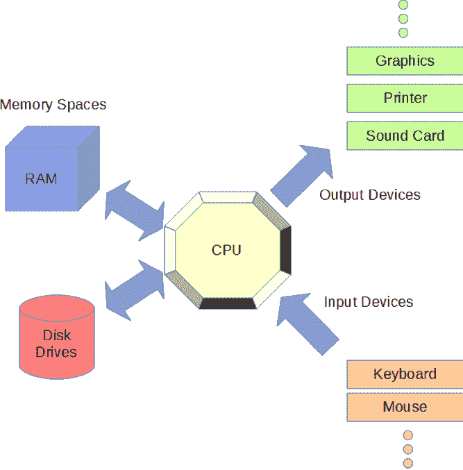

### 图 1：计算机结构图

图 1 展示了计算机的基本特征。在中心，我们有一个非常重要的硬件——中央处理单元（CPU），它是机器的大脑。它从键盘、鼠标或其他输入设备读取数字字符串形式的输入。它将数据写入显卡、打印机和音频设备。它还负责读写 RAM 和硬盘等内存空间的数据。

CPU 通过执行一系列指令来工作。计算机中的一切皆都是数字，甚至指令本身也是如此。指令通常非常简单——它们指示 CPU 应该执行某些任务，例如相两个数字或创建一个数字的副本。CPU 的语言——汇编语言是计算机编程的最低层级。使用汇编语言为 CPU 是繁琐的，因为每条指令几乎什么都不做，在我们的应用程序有用之前，我们需要成千上万条指令。每个 CPU 都有自己的汇编语言。如果我们编写了一个运行在桌面级 PC 上的应用程序，该代码无法被 iPhone 或三星平板电脑识别。

由于用 CPU 自身的语言进行非常困难，人们发明了更接近人类语言（如英语和算术）的高级语言。Java 就是其中一种高级语言。我们不再指定一系列单独的指令，而是可以使用诸如 `a = a + b` 这样的数学表达式。这节省了大量时间，原因有两个：

- 它更容易编程。
- 它更容易阅读和维护。

### 代码列表 1.0：高级语言 vs 低级语言

```
; 汇编语言：低级语言
mov rax, a; 读取 a 的值
add rax, b; 将 b 的值加到 a
mov a, rax; 将结果写入 a

// Java: 高级语言
a = a + b;
```

代码列表 1.0 显示了高级语言（如 Java）与低级语言（如汇编语言）之间的明确区别。在低级语言中，两个值 `a` 和 `b` 的相加以及将结果存回 `a` 需要三个步骤。必须指令计算机执行操作的每一个特定细微末节，从将值移动到内部寄存器（如 `RAX`）到加法运算本身。在 Java 中，我们可以将整个操作表示为单行易于读的代码，它看起来完全就像初中代数：`a = a + b`。这行代码的意思是：取变量 `a` 中的值，将其加上 `b` 的值，并将结果赋值回该变量。

代码 1.0 显示了 Java 中的一个简单表达式，这个表达式在许多其他基于 C 的语言中看起来也是那样的。然而，与 C 或 C++ 相比，用 Java 编写应用程序还有一个额外的优势。Java 程序被设计为运行在虚拟机上。图 2 展示了原生应用程序与 Java 应用程序的对比图。当我们编写原生应用程序时，必须为程序运行所需的每种系统类型编译代码。这意味着如果我们想让应用程序运行在桌面电脑和笔记本电脑上，我们需要为 ARM CPU 创建一个版本，并为 x86 创建另一个版本的程序代码。

在这一方面，Java 的工作方式不像 C 和 C++。在 Java 中，我们只编写一个版本的应用程序。不同的 CPU（ARM、x86 等）都运行虚拟机，再由虚拟机运行我们的应用程序。虚拟机仅仅是一个用于模拟假设的 Java 计算机硬件的程序。这意味着我们可以编写一次程序，任何带有 Java 虚拟机模拟器（即安装了 Java）的设备都能运行我们的应用程序。这是 Java 的巨大优势——这意味着我们的应用程序可以在大量设备上运行，而无需专门为它们进行设计。

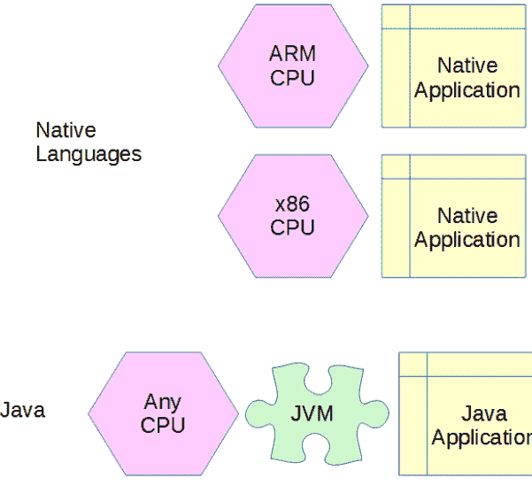

图 2：Java虚拟机

## 第 2 章：入门

在本节中，我们将学习如何安装 Eclipse 集成开发环境（IDE）。Eclipse 是用于编程、维护、调试和编译 Java 应用程序的工具。Java 与许多语言一样，只需要控制台和一个文本编辑器（如记事本）就可以编程。然而，使用记事本作为 IDE 是费力的且可能导致错误。任何功能性的 IDE 都可以减少在某种语言中解决问题的时间。Eclipse 提供语法高亮、错误修复建议、应用程序的一键测试和调试，以及其他数以千计的帮助使编程更简单的选项。

### 下载并安装 Eclipse

要获取最新版本的 Eclipse，请访问 https://eclipse.org/downloads/。


图 3：Eclipse 下载页面

有多个版本的 Eclipse 可供下载（以及多种可用于 Eclipse 的语言）。我在本本书中使用适用于 Java 开发人员的 Eclipse IDE，版本是 Mars.1 Release (4.5.1)。旧版本或新版本的 Eclipse 也可以。在编写时，主 Eclipse 下载页面的顶部还提供了 Eclipse 安装程序，这是一个旨在使安装 Eclipse 变得简单的安装向导。如果你在使用本文描述的手动方法安装 Eclipse 时遇到困难，可以尝试使用安装向导。

在图 4 高亮区域的右侧，你有两个选项：32 位和 64 位。除非你确定你的机器是 32 位的，否则我建议使用 64 位版本的 Eclipse。

### Eclipse 下载 - 选择镜像


选择不同的镜像可能会改变下载所需的时间，通常情况下，镜像离你的地理位置越近，下载越快。

选择镜像后，你将进入一个允许你下载 Eclipse 基础的页面。下载应该开始。系统会询问你想保存文件的位置。具体机制取决于你的浏览器，但请确保知道下载到了哪里，因为下载完成后我们需要提取该文件。下载完成后，我们将得到一个类似于 `eclipse-java-mars-win32-x64.zip` 的文件，这是一个压缩包。你将其放置的位置完全取决于你，但现在我们将其放在如 `C:\Program Files` 的文件夹中。在使用“解压所有”或某些专用解压工具提取 Zip 文件内容后，我们将得到一个名为 `eclipse` 的子文件夹（见图 5 和图 6）。

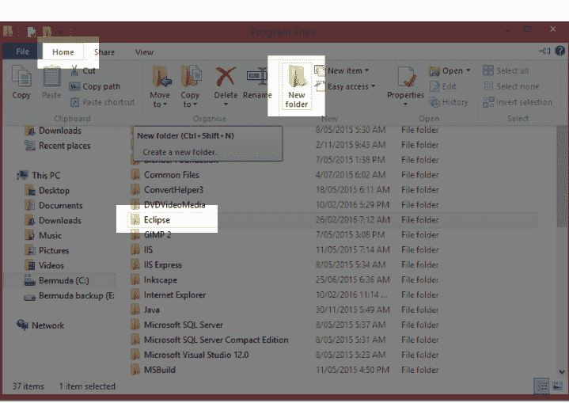

图 5：创建 Eclipse 文件夹

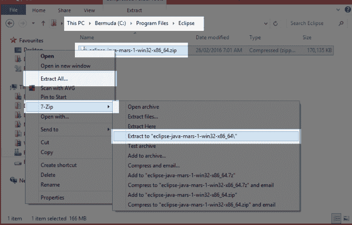

图 6：解压 Zip 文件

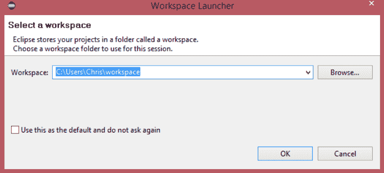

选择“将此作为默认设置并不再询问”选项将导致你之后创建的所有项目都在同一个工作空间中创建。这是一个好主意，例外是最终你可能会有数百个项目，定位你需要工作的项目可能会变得繁琐。

### 项目

为了编写 Java 程序，我们需要创建一个 Java 项目。项目简单来说就是形成应用程序的相关文件、文件夹和资源的集合。要开始新项目，点击文件（File）菜单中的 **New**（新建），然后按照图 9 所示选择 **Java Project**。

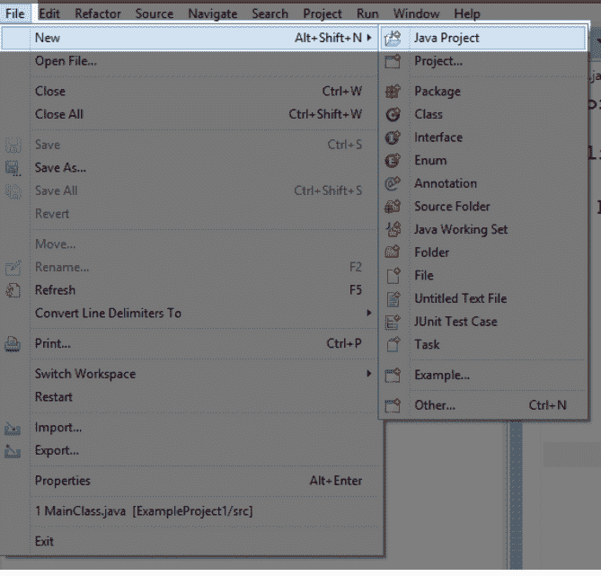

### 图 9：创建一个项目

创建一个新项目时，Eclipse 会显示新建项目向导（图 10）。

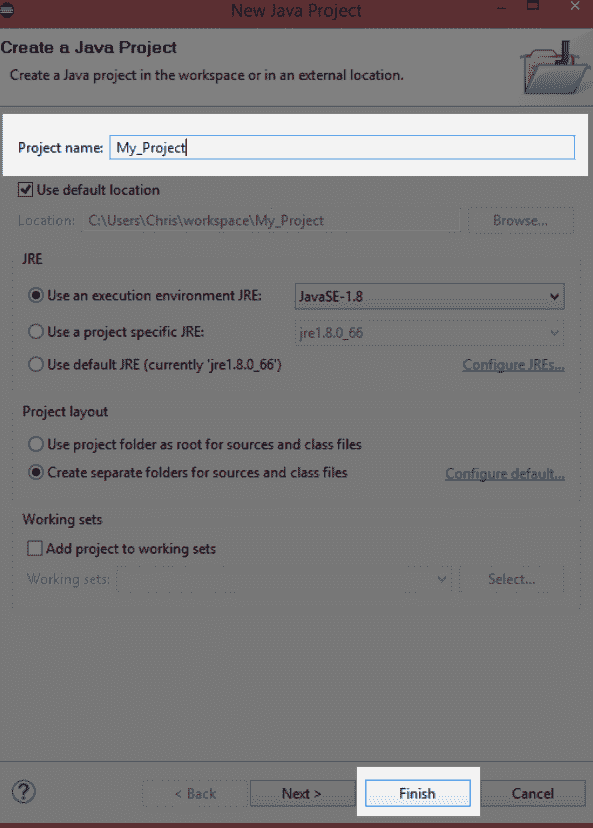

在新建 Java 项目向导对话框中，为你的项目命名并点击 Finish（完成）（每个项目的名称在工作空间内必须是唯一的——我在图 10 中将项目命名为 My_Project）。如果你点击 Next（下一步）而不是点击 Finish，你可以更改项目的几个更高级的功能，例如输出文件夹，以及你是否希望引用其他已存在的项目。

### 包管理器 (Package explorer)

在新建 Java 项目向导中选择 Finish 后，Eclipse 将为你创建一个基础项目，其中包含一个用于存储 Java 源文件的 `src` 文件夹以及一组默认引用的系统库。JRE System Libraries（JRE 系统库）具有许多功能，可以让你无需自己编写这些程序。我们稍后会检查这些。

包管理器（图 11）包含了当前工作空间中所有项目的树状。目前，它只包含一个名为 My_Project 的项目。可以通过点击左侧的小三角形来展开或折叠树视图的节点。

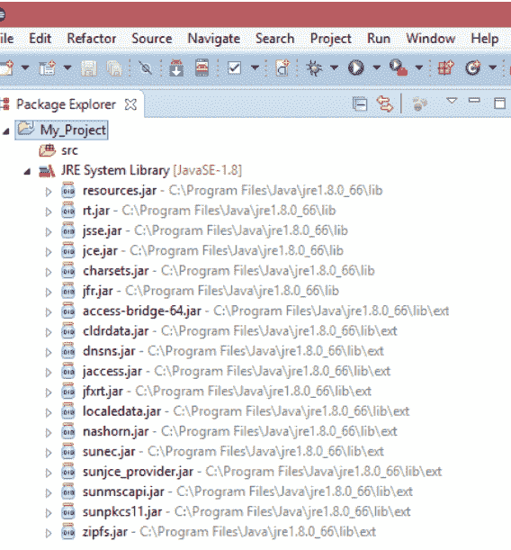

> 图 11：包管理器

### Java 源代码

源代码是指某种特定计算机编程语言文本的术语。Java 源代码被输入到纯文本文件中，并将其作为类添加到我们的项目中。Java 编译器（在安装 Eclipse 后，随 Java SDK 安装了一个一个名为 `javac` 的程序）读取项目中的源代码文件并将其转换为机器码。这些机器码可以被 JVM 理解并作为应用程序执行。

在进行任何其他操作之前，我们想向项目中添加一个新的 Java 类。当我们学习面向对象编程时，将探探索“类（class）”这一术语的含义。现在，我们的类将为我们的应用程序提供一个起点。在包管理器中，右键点击 `src` 文件夹，从打开的上下文菜单中选择 New（新建）和 Class（类），如图 12 所示。`src` 文件夹是存储我们源代码文件的主文件夹。

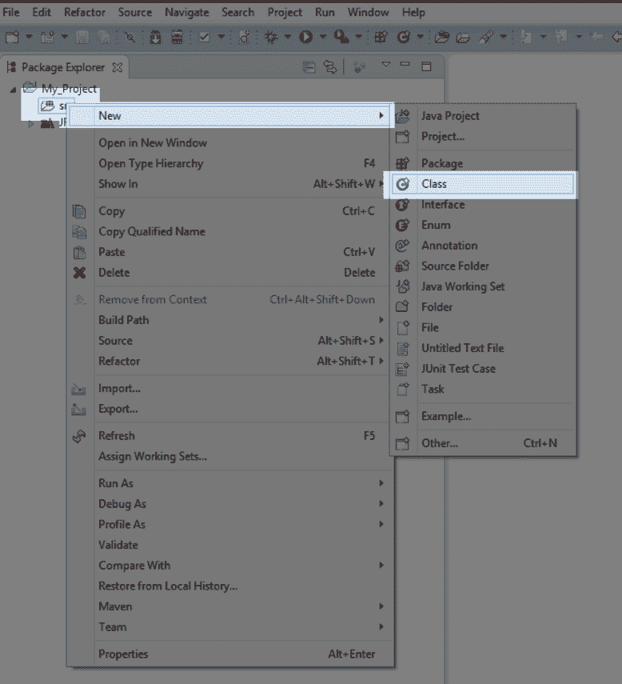

图 12：添加新类

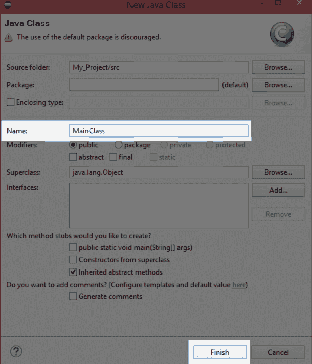

图 13：新建 Java 类向导

在新建 Java 类窗口中，为你的新类输入名称（例如 MainClass），然后点击 **Finish** 继续。Eclipse 将为你创建一个新的源代码并填充 Java 类的基础骨架。

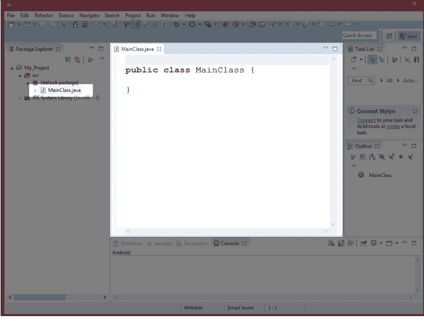

图 14：代码窗口

在图 14 中，代码窗口显示了第一个程序的开头。我们将 Java 源代码输入到此窗口中。目前，它只有我们请求的类声明，除此之外别无一物。如果你在源代码窗口中看不到 MainClass.java 代码，请尝试在包管理器中找到该文件——展开 `src` 节点并双击名为 **MainClass.java** 的文件。

在随后的章节中，我们将向项目中添加许多类。添加类的方法总是相同的——在包管理器中右键点击 `src` 文件夹，选择 **New** 和 **Java class**，并给类类一个唯一的名称。

### 空运行程序

目前，我们有一个项目，但它没有入口点。JVM 没有开始执行我们代码的地方。Java 应用程序的默认入口点称为 main 方法（主方法）。它由一个公共的、静态的 main 方法组成，该方法接受字符串数组作为参数。我们稍后将具体查看这意味着什么。现在，为了包含 main 方法，我们需要在 MainClass 中输入方法的声明并添加大括号作为内部的主体（见代码列表 2.0）。

```java
public class MainClass {
    public static void main(String[] args) {
    }
}
```

代码列表 2.0 显示了最简单的 Java 应用程序。它是一个在运行时什么都不做的应用程序。JVM 被要求加载应用程序（无论是通过调试我们的程序还是直接运行）。

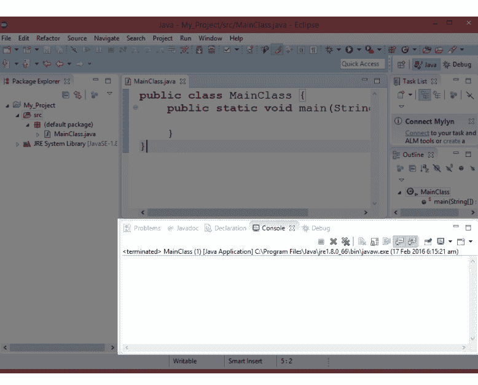

### 图 17：输出控制台

当我们运行或调试应用程序时，应用程序的输出将出现在 Eclipse 屏幕下部的窗口中。请注意图 17 中有一组标签页，其中包含名为 Console（控制台）的标签页。我们目前的程序没有执行任何操作，因此在从代码列表 2.0 调试或运行应用程序后，Console 标签页是空白，但在未来的章节中，我们将向此控制台打印文本并从键盘读取数据。

既然我们已经学习了如何启动新应用程序、如何添加类，以及如何将 main 方法作为程序的入口，我们就可以开始编写 Java 程序来为我们执行任务了。

## 第 3 章：编写输出

代码列表 3.0 显示了一个基础“Hello, World!”应用程序的代码。该程序向控制台打印一些文本，然后退出。左侧的数字是为了参考而设置索引，不应输入到你的代码中。请将此代码输入或粘贴到我们之前创建的 MainClass.java 代码中。

### 代码列表 3.0：打印输出

```java
1: public class MainClass { // MainClass 的定义
2: public static void main(String[] args) { // main 方法入口点
3:     System.out.println("This is a test application!");
4: } // main 方法的结束括号
5: } // MainClass 的结束括号
```

当我们使用调试或运行执行此代码（使用快捷键 F11 或 Ctrl+F11，或点击调试或运行按钮）时，程序将向系统输出打印“This is a test application!”。

**第 1 行**：`public class MainClass`。这一行声明了一个名为 MainClass 的类。该类被标记为 `public` 修饰符，这意味着它对应用程序中的所有其他实体和包都是可见的。在 `public` 修饰符之后，我们使用关键字 `class`，然后为我们的类提供一个名称——例如 MainClass。紧接着是一个大括号 `{`，它表示类的开始。第 5 行包含匹配的右括号 `}`，它标记了该类主体的结束。

**第 2 行**：在第 2 行，我们声明了一个名为 `main` 的静态方法。该方法被标记为 `public`，以便该类外部类可以调用它。方法被标记为 `static`，意味着它属于类而不是类的任何特定实例。该方法不向调用者返回任何值，因此返回类型为 `void`。在括号中，`String[] args` 是参数名。这意味着在调用此方法时，将传递一个字符串数组。这些字符串是命令行参数——当我们从命令行运行程序时，可以选择性提供额外的参数。当我们使用命令行时，这个数组在示例程序中是空的。在参数列表之后，我们使用一个左括号 `{`，它标记了方法主体的开始。main 方法匹配的右括号在第 4 行。

**第 3 行**：这一行调用了 `println` 方法，该方法属于 `System.out` 类。`System` 是一个类，而 `println` 是属于该类的公共静态方法。该方法接受一个 `String` 参数并将字符串打印到控制台输出。字符串被包含在括号中，表示它是方法调用的参数。该参数是 `String`，因为它被包含在双引号中。该行以分号 `;` 结尾，表示语句已结束。Java 中的所有语句都有分号。

**第 4 行**：这是 main 方法匹配的右括号。左括号出现在第 2 行。此括号表示我们已经完成了对方法的描述。

**第 5 行**：这是 MainClass 类匹配的右括号。左括号出现在第 1 行。此括号表示对 MainClass 的描述已经结束。

如果上述之前的描述中有些有些过于简短，请不要担心。随着本书的不断进行，我们将进一步研究每个关键字和其他机制。起初，Java 的学习曲线相当陡峭。为了开始进行 Java 编程，即使是最基础的程序也包含大量的语法（语法是编程语言的文法——规则、拼写和标点符号）。

类名可以是任何有效的标识符。有效的标识符名称包含字母和数字，但不能以数字开头。标识符必须是一个单词（不允许有空格、制表符或任何种的标点符号），但你可以使用下划线字符，例如 `Main_Class` 是合法的标识符，但 "Main Class" 则不是，因为它包含空格。

当你运行或调试代码列表 3.0 中的应用程序时，你会注意到消息打印到 Eclipse 下部分的 Console 面板上，如图 18 所示。

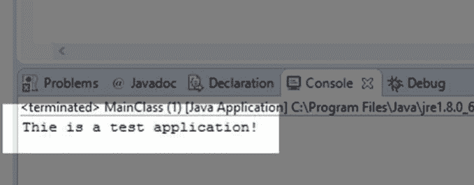

> 图 18：代码列表 3.0 输出

# Java 基础

在本节中，我们将简要查看 Java 编程的几个方面，随着你越来越熟悉这种语言，这些将成为你的本能。

## 空格

空白字符是指代码中空间的使用。这包括换行、空格和制表符。通常情况下，Java 编译器会忽略空白字符，程序员可以按照意愿布局代码。这一规则也有例外——例如，在字符串（Strings）中，编译器会保留空格，因为两者之间存在差异。

### 代码列表 3.1：空白字符

```java
System.out.println("This is a test application!");
```

将函数命名为 `computeMedianOfHouses` 比将其命名为 `Doing` 或 `cabbagesWithwhippedCream` 要好（假设该函数计算房屋的位数）。如果我们不使用逻辑且易于的名称来命名标识符，其他程序员可能在理解和维护我们的代码时遇到困难。更糟的是——我们也无法理解自己的代码。令人惊讶的是，如果我们不仔细并智能地命名标识符，我们的代码变成乱码所需的时间是短得令人不可指。


> 注意：使用逻辑且描述性的名称命名标识符有少数例外。例如，在循环中将迭代器（计数变量）称为单字母名称如 `i`、`j`、`x`、`y` 或 `z` 是常见的。这并没有说明该变量的含义，但其他程序员仍然能够理解它们的用途。此外，某些算法在描述中有特定的变量名，在编写算法实现时通常会使用这些变量的通用名称，例如 A* 路径查找算法就使用了名称 `t` 和 `h`。

## 关键字

与英语等人类语言相比，计算机编程语言非常简单。Java 拥有一组很小的图形符号（如 `{ }` 大括号）和一组很小的称为关键字的非本地术语。Java 拥有一系列关于如何使用这些元素的规则（即它有一套语法）。在 Eclipse 中，我们可以识别代码中的关键字，因为它们被高亮为深紫色，并且是**粗体**的，如代码列表 3.1 中的 `class` 和 `public`。

关键字构成了 Java 作品的主骨干。关键字在 Java 中被保留用于特定用途，不能作为标识符名称使用。请参阅附录获取可用关键字的参考。以下是我们目前为止遇到的关键字列表：

- `public`：`public` 关键字是一个访问修饰符。它意味着外部对象（不是正在定义的类部分的对象）可以访问方法或成员变量。
- `class`：`class` 关键字用于指示随后的代码块是类的描述。
- `static`：`static` 关键字将成员方法和变量标记为属于整个类，而不是类的特定对象或实例。这意味着我们可以在不创建类对象的情况下访问静态成员。
- `void`：`void` 关键字在方法不返回任何数据时用作返回类型的占位符。所有方法必须有一个返回类型，或者返回类型必须为 `void`。该规则的唯一例外是没有返回类型且与类同名的构造函数。

## 点操作符

在代码列表 3.1 中，第 3 行如下：`System.out.println("This is a test application!");`。这一行包含了几个点（或句号）。这就是点操作符（有时称为作用域运算符）。它是连接类与方法成员变量的运算符。`System` 是一个类，`out` 是属于 `System` 类的实体。当我们提供通过点操作符连接的术语 `System.out` 时，我们是在说：“out 实体属于 `System` 类”，或者简而言之，“System 的 `out`”。

`println` 方法属于 `out` 实体。当我们通过指定其名称 `System.out.println` 和参数列表 `("This is a test application!")` 调用该方法时，我们实际上是在说：执行名为 `println` 的方法指定的代码，该方法属于 `out` 实体，而该实体属于 `System` 类。现在看点如何指示从左到右的方向性——`System out`，并且拥有 `println`。

我们将在后面的面向对象编程中详细说明，但面向对象编程的主要目标是定义对象的层级结构，每个对象都拥有并可能拥有其他对象，并且每个对象都能通过一组成员变量执行方法。不同的类可以包含相同名的变量和方法。例如，我们可能有多个名为 `cost` 的变量，一个属于 `House` 类，另一个属于 `Vehicle` 类。我们可以通过代码 `House.cost` 对比 `Vehicle.cost` 来区分这些变量。

## 注释

代码列表 3.2 显示了几个注释，注释是给程序员的备注。当程序执行时，计算机将忽略所有注释。注释有许多应用，每个程序员都有其对其代码注释的独特风格。虽然注释不会改变程序的运行方式，但培养良好的注释技巧是非常关重要的。注释允许程序员精确地描述代码应该在做什么。这意味着任何其他程序员都应该能够阅读注释并一眼理解复杂代码的含义。

在 Java 中，有两种类型的注释——单行注释和多行（或块）注释（参见代码列表 3.2）。

### 代码列表 3.2：注释

```java
// This is a single-line comment!
System.out.println("Press a key to continue..."); // Single-line comment!
/*
This is a multiline comment. It extends from the opening symbol of a slash and
star to the closing symbol, a star followed by a slash!
*/
```

代码列表 3.2 显示了不同类型的注释。第一个是单行注释。它们以两个斜杠 `//` 开头。`//` 右侧的所有文本会被计算机忽略。如果一行代码以 `//` 开头，整行都会被忽略，但你也可以将 `//` 放在某些语句之后，例如 `println`。

多行注释以 `/*` 开头并延伸到 `*/`。程序员可以在 `/*` 和 `*/` 之间放置任何文本，包括换行。这有时被称为块注释，因为它允许程序员编写一段文本或注释掉一段代码。

在接下来的代码示例中，我们将看到许多注释，以帮助读者识别不同行代码的作用。

## 挑战

**挑战 3.0:** 将标识符 `args` 更改为 `arguments`。程序可以编译并运行吗？

**挑战 3.1:** 将标识符 `args` 更改为 `arguments`。程序可以编译并运行吗？

**挑战 3.2:** 将打印到屏幕的消息更改为 "Hello"。

**挑战 3.3:** 将类名 `MainClass` 更改为 `MyClass`。

# 解决方案

### 挑战 3.0

将标识符 `args` 更改为 `arguments` 后，程序可以编译并运行。

### 挑战 3.1

我们将 `main` 方法的名字更改为 `mainMethod`，程序将无法编译并运行。

### 挑战 3.2

我们将打印到屏幕的消息更改为 "Hello"。

### 挑战 3.3

将类名 `MainClass` 更改为 `MyClass`。

第 7 行打印字符串 "Nice to meet you, Chris!"，其中 Chris 被替换为用户在提示符处输入的任何名称。注意字符串 "Nice to meet you," 是如何通过关闭双引号并使用字符串拼接运算符将变量 `str` 添加到中间的。这是我们如何连接或拼接两个或多个字符串的示例。

第 8 行是 `main` 方法代码块的匹配大括号。此时，对象 `scanner` 和变量 `str` 离开了作用范围（这意味着它们不再存在）。程序从 `main` 方法的开始运行，并在 `main` 方法的右括号处结束。这一行实际上是我们应用程序的结束。我们也可以在 `main` 方法体中使用 `return` 关键字来从方法返回，尽管这也会终止应用程序。我们将在学习定义方法时更详细地查看 `return` 关键字。

第 9 行是 `MainClass` 类的匹配大括号。

为了运行程序，我们可以使用 `Debug` 或 `Run` 按钮。我们将看到程序在打印消息 "what is your name?" 后停止。要输入字符串，请点击控制台中的提示符。输入你的名字（或任何其他字符串）并按回车。按下回车后，`scanner` 对象有一行文本要读取，在我们将其赋值给变量 `str` 时，它将返回此调用者。（图 19 显示了与代码列表 4.0 中程序的交互示例，绿色文本是我在提示符处输入的内容）

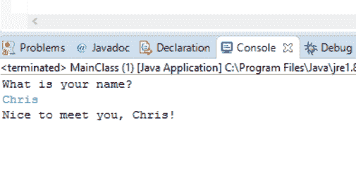

图 19：代码列表 4.0 输出

在本部电子书《Java Succinctly Part 1》中，我们将专注于 Java 语言的核心机制，并将限制在控制台进行输入和输出。我们可以用 Java 创建完全图形化的用户界面，在《Java Succinctly Part 2》中我们将学习如何实现这一点。

## 警告与错误

当我们调试或运行代码列表 4.0 中的程序时，我们会看到 Eclipse 给我们提供了一个警告。警告是我们代码中的一个潜在问题，但它不会阻止代码执行。Eclipse 可以检测出代码中两种类型的问题：警告（不会阻止代码运行，但可能应该修复）、错误（阻止代码运行的问题）。

通常，如果我们的程序中有任何警告，我们应该修复它们，因为如果不进行检查，稍后可能会意外之外的行为。在下一个程序中，我们将看到额外的两行代码，用于关闭 `scanner` 并修复 Eclipse 高亮显示的警告。

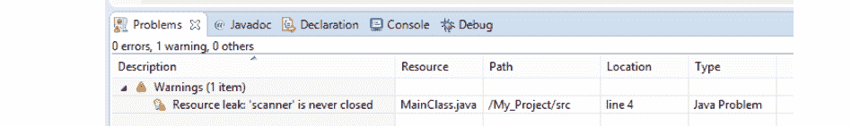

图 20：警告

图 20 显示了我们生成的警告。当我们尝试调试或运行程序时，该警告将可见。警告 'scanner' is never closed 告诉我们问题出现在 `MainClass.java` 文件中，位于第 4 行。如果在“问题（Problems）”面板中双击此处，Eclipse 将带我们进入 `MainClass.java` 文件的第 4 行，以便我们修复问题或了解产生的原因。图 21 显示了一个示例。

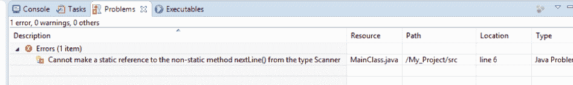

图 21：错误

为了修复此错误（图 21），我故意将代码列表 4 的第 6 行改为 `String scanner.nextLine()`。`Scanner` 中的大写 `S`。这个小变化是一个错误，意味着程序将无法编译和运行。查看“问题”面板，我们得到一个晦涩的错误信息，解释 `nextLine` 不是静态的，而我们正尝试像静态的一样使用它。错误信息通常很难理解，但如果有坚实的 Java 基础，它们将帮助你理解它们。本质上，这个错误说明如果我们想调用 `nextLine()` 方法，我们需要使用对象 `scanner` 而不是类 `Scanner`。否则，程序将无法编译和运行。

## Eclipse 视图

透视图是 Eclipse 中窗口和面板的布局。默认情况下，Eclipse 设置为 Java 视图（图 22）。但当我们调试代码或当程序编译失败出现错误时，Eclipse 将切换到调试视图（图 23）。调试视图提供了额外的信息面板，可能帮助我们追踪并修复错误（我们稍后将在调试视图中观察变量并单步执行代码）。

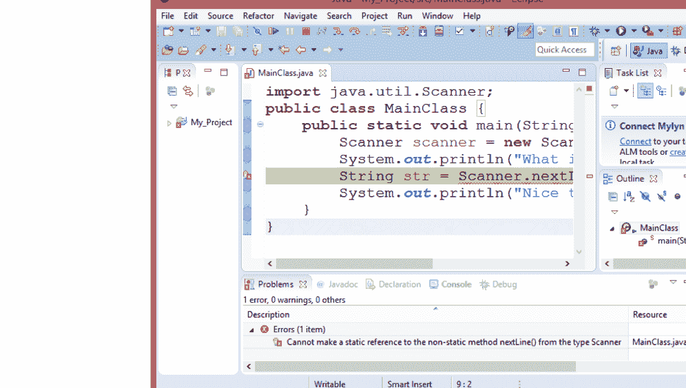

图 22：Java 视图

Debug - My_Project/src/MainClass.java - Eclipse

文件 编辑 源 重构 导航 项目 运行 窗口 帮助

快速访问 Java 调试

+ - MainClass [Java Application]

- MainClass at localhost:4999

- 线程 [main] (运行中)

- 程序 [MainClass.java:8,60] /bin/MainClass.class (27 Feb 20)

- MainClass at localhost:4999

- MainClass [Java Application]

- 线程 [main] (挂起) (无法进行静态引用)

- MainClass.main(String[] args)

```java
import java.util.Scanner;
public class MainClass {
    public static void main(String[] args) {
        Scanner scanner = new Scanner(System.in);
        System.out.println("What is your");
        String str = scanner.nextLine();
        System.out.println("Nice to meet");
    }
}
```

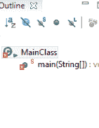

日志 Cat 保存 过滤器 搜索消息 详细信息 任务 可执行文件

| 时间 | PID | Td | 智能插入 9:2 |

|---|---|---|---|

| 可写 | 0 错误, 0 其他 | 说明 | |

图 23：调试视图

为了在两个视图之间切换，我们使用 Eclipse 右角的两个按钮（标记为 Java 和 Debug，如图 24 所示）。

重构 导航 项目 运行 窗口 帮助

快速访问 Java 调试

+ - MainClass [Java Application]

- MainClass at localhost:4999

- 线程 [main] (运行中)

- 程序 [MainClass.java:8,60] /bin/MainClass.class (27 Feb 20)

- MainClass at localhost:4999

- MainClass [Java Application]

- 线程 [main] (挂起) (无法进行静态引用)

图 24：Java 和调试

### 代码列表 4.2：代码块

```java
public class MainClass {
// 返回整数 x 的最小质因数的方法。
    private static int getLowestFactor(int x) {
        int sqrt = (int)Math.sqrt(x);
        if(x % 2 == 0) {
            return 2;
        }
        for(int q = 3; q <= sqrt; q+=2) {
            if(x % q == 0) {
                return q;
            }
        }
        return x;
    }
// 通过检查 x 是否等于其最小因数来判断 x 是否为质数。
    private static boolean IsPrimeFactor(int x) {
        return getLowestFactor(x) == x;
}
// 此程序列出 1 到 1000 之间的数字。
public static void main(String[] args) {
    // 局部变量。
    int i = 2, count = 0, countPerLine = 10;
    System.out.println("Prime numbers from 1 to 1000 are: ");
    // 寻找质数的循环。
    while(i <= 1000) {
        // 如果 i 是质数...
        if(isPrime(i)) {
            // 添加到列表...
            System.out.print(i + ", ");
            // 增加计数。
            count++;
            // 如果这一行有 countPerLine 个元素，
            // 打印新行。
            if(count % countPerLine == 0) {
                System.out.println();
            }
        }
    }
}
// 将 i 加到下一个数字。
i++;
}
```

如果你将代码列表 4.2 中的代码复制并粘贴到 Eclipse 中，你应该会得到 1 到 1000 之间的质数列表。在代码列表 4.2 中，每一对匹配的大括号都用不同的颜色高亮显示。注意代码块嵌套在其他代码块内部。这意味着——较小的代码块在外部代码块的大括号内开始并结束。黄色的大括号包围了 MainClass 的主体，而 MainClass 包含了几个方法的代码块，每个方法又包含它自己的代码块。

同样注意，代码块可以为许多不同的机制创建——类、循环、If 语句和方法在代码列表 4.2 中都有相关的代码块描绘。

我们现在将进入一个完全不同但非常实用的编程方面——调试代码。

### 旁插：调试代码

调试和维护代码的能力是程序员可以拥有的最重要的属性之一。基于此考虑，当你第一次在 Eclipse 中测试你的程序时，请选择调试（Debug）图标，而不是运行（Run）图标。

### 打印值

在程序运行时，我们经常需要知道变量的值。识别变量值最基本的形式是将该值输出到屏幕。我们可以使用 `System.out.println` 来实现这一点，例如使用 `System.out.println("The value of i is " + i);`。这是一种非常原始的调试方法，但在许多情况下，这就是我们所需要的。通常情况下，最好按照后续节所述，在变量上设置断点（breakpoint）和监视（watch）。

### 设置断点

断点是代码中的一个位置，我们希望程序在该处暂停并将控制权给我们，这样当程序在断点处暂停时，我们可以检查变量的值并逐行执行代码——一次一行。要设置断点，请在 Eclipse 代码视图的侧边栏处右键点击。这将弹出一个上下文菜单，其中包含“切换断点（Toggle Breakpoint）”选项，如图 27 所示。

### 图 27：切换断点

当断点处于激活状态时（即如果程序到达断点时将暂停），你将在代码窗口的侧边栏看到一个小小的断点符号，如图 28 所示。

### 图 28：激活断点

当图 28 中的断点指示器为蓝色时，意味着断点是激活的。你可以通过右键点击断点符号并从上下文菜单中选择禁用断点（Disable Breakpoint）来禁用断点。当断点被禁用时，圆圈是白色的，程序在到达断点时不会暂停。

### Eclipse 中的调试视图


当程序到达激活的断点时，它会暂停并将控制权给我们。第一次在 Eclipse 中中断时，你可能会收到一个对话框，如图 29 所示。Eclipse 设计用于提供几个专门用于调试的额外工具，并建议切换到调试视图。点击标记为“记住我的决定”的框并选择“是”以进入调试视图。

这种启动配置为在挂起时支持调试视图。

此调试视图旨在支持应用程序调试。它包含了显示调试栈、变量和断点管理的视图。

你想打开此视图吗？

- 记住我的决定

图 29：确认切换视图

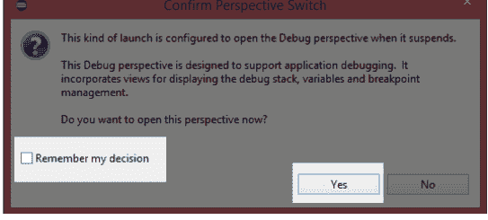

调试视图如图 30 所示。

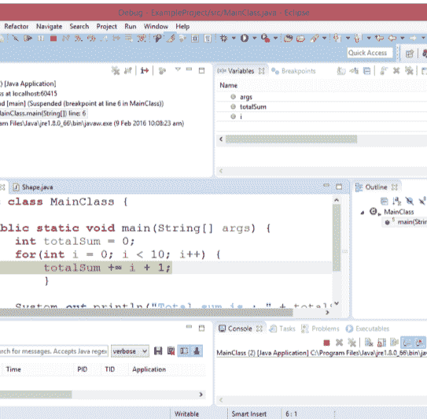

图 30：调试视图

注意图 30 中高亮的行。Eclipse 场景准备好执行。在 Eclipse 顶部，你会看到播放按钮、暂停按钮和停止按钮。为了停止程序执行，点击停止。为了恢复正常执行（即直到程序找到下一个断点），点击播放。如果程序正在执行而没有遇到断点，你可以通过暂停按钮来暂停它（见图 31）。在某些情况下，这些按钮中的某些可能是灰色的（例如，如果程序已在断点暂停，暂停按钮是不可用的）。

（注：此处原文未提供图31，根据上下文引用）

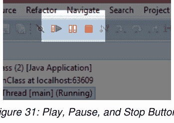

> **提示**：点击图 29 中播放按钮左侧的按钮可以跳过断点。这对于设置了很多断点非常有用。

你可以通过点击 Eclipse 右角的按钮在 Java 视图和调试视图之间切换，如图 32 所示。

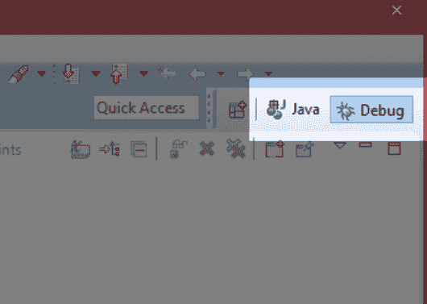

图 32：切换视图

### 逐行执行代码

逐行执行代码可以通过两种方式进行：

- 逐过程
- 逐入

当程序暂停时，我们可以通过查看变量来非常仔细地观察正在发生的情况。我们通过使用逐过程和逐入按钮来实现这一点（见图 33）。你可以在 Eclipse 顶部找到这些按钮。

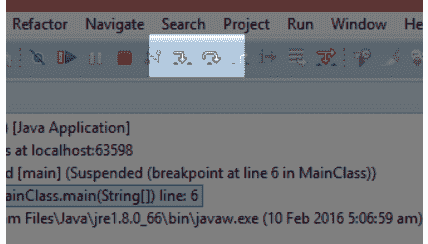

图 33：逐过程和逐入按钮

逐过程意味着程序执行当前行，然后再次暂停。它不会进入方法调用。逐入意味着程序将执行下一行，但如果该行是方法调用，它将进入方法体并暂停。逐入的快捷键是 `F5`，逐过程快捷键是 `F6`。

### 监视变量

当我们逐过程和逐入代码时，可以通过查看变量视图来确切看到变量包含哪些值，如图 34 所示。

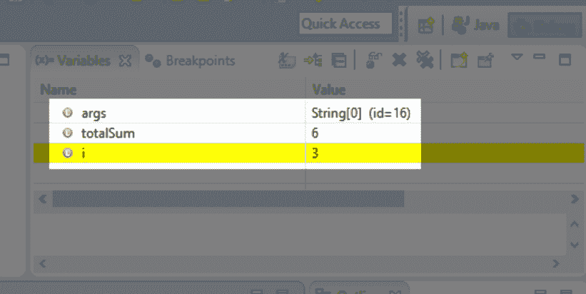

图 34：变量视图

当应用程序暂停时，变量视图显示了当前作用范围内的所有变量。黄色高亮的变量在上次的逐过程或逐入期间发生了变化。

程序并逐行执行代码，观察程序分支和执行循环的方式。没有比逐行查看代码更能让你直观了解 Java 是如何运行的了。

## 挑战

**挑战 4.0**：修改代码列表 4.0 中的程序，让它询问用户的年龄而不是名称。

**挑战 4.1**：修改代码列表 4.1 中的程序。让它询问第三个名为 `website` 的字符串，即用户在使用用户名和密码时使用的网站地址。在读取用户名和密码后，要求用户输入网站地址。

**挑战 4.2**：代码列表 4.2 打印从 1 到 1000 的质数，每行打印 10 个。在不知道该程序工作原理细节的情况下，你是否可以修改程序以打印出从 1 到 50 的质数，并且每行打印两个质数，而不是 10 个？

### 挑战答案

### 挑战 4.0

代码列表 4.3：挑战 4.0

```
import java.util.Scanner;
public class MainClass {
    public static void main(String[] args) {
        Scanner scanner = new Scanner(System.in);
        System.out.println("What is your age?");
        String age = scanner.nextLine();
        System.out.println("You are " + age + " years old!");
    }
}
```

### 挑战 4.1

代码列表 4.4：挑战 4.1

```
import java.util.Scanner;
public class MainClass {
    public static void main(String[] args) {
        // 声明所有变量。
        String userName;
        String password;
        String website;
        Scanner scanner = new Scanner(System.in);

        // 请求用户姓名。
        System.out.print("What is your name?");
        userName = scanner.nextLine();

        // 请求用户密码。
        System.out.print("OK, and what is your password?");
        String userPassword = scanner.nextLine();
        System.out.print("And what website is this the password for?");
        website = scanner.nextLine();

        // 打印消息：
        System.out.println("OK, gotta go. I have to quickly check " + 
        website + ".");

        // 关闭扫描器以避免内存泄漏。
        if(scanner != null) {
            scanner.close();
        }
    }
}
```

### 挑战 4.2

我在这里列表中仅包含了相关的部分，并用黄色标出了我们需要做出的更改。

代码列表 4.5：挑战 4.2

```
int i = 2, count = 0, countPerLine = 2;
// 显示程序的描述。
System.out.println("Prime numbers from 1 to 50 are as follows: ");
// 寻找质数的循环
while(i <= 50) {
    // 如果 1 是质数...
    if(IsPrime(i)) {
```

## 第 5 章 数据类型和变量

## 内存

在 Java 中，与其他所有计算机编程语言一样，我们可以向不同的内存空间读写数据。内存空间简单来说就是我们可以保存和检索信息的区域。我们可以读写的最实用的内存空间之一被称为 RAM。随机存取存储是一种用于临时存储的易失性内存（易失性意味着它在系统重启时会被清空）。

RAM 仅仅是一串 0 和 1。这些 0 和 1 被组织成每个 8 位的字节（bit 是二进制 digit binary digit 的缩写——它是单个 0 或 1）：请参见图 35 关于 RAM 中几个字节的插图。

| 02AC | 02AB | 02AA | 02A9 | 02A8 | 02A7 | 02A6 |
|---|---|---|---|---|---|---|
| 14 | 26 | 200 | 117 | 17 | 4 | 91 |


图 35 显示了 RAM 中的七个字节。RAM 中的每个字节框上方写有一个地址（现代计算机上的真实地址是 16 位十六进制数字，而不是我在图中使用的四个）。地址是连续的数字，随着我们从左到右遍历 RAM 而递增。地址以十六进制写入（所以我们使用 `02A8` 而不是 `680`——十六进制目前并不重要）。

> **注意**：在 Java 中，我们无法访问 RAM 中的地址。这是 Java 与相关语言 C 和 C++ 之间最大的差异之一。直接通过地址访问 RAM 可能是危险的——很容易不小心访问错误的字节并导致程序出现 Bug。因此，Java 这样设计。

浮点类型用于表示近似值。Java 中的 `float` 和 `double` 遵循 IEEE 754 标准。

### 原始类型

原始数据类型是 Java 的构建块。只有两类原始类型：整数和浮点型。

表 1：原始数据类型

| 名称 | 类型 | 大小（字节） | 大小（位） | 最小值 | 最大值 |
|---|---|---|---|---|---|
| `byte` | 整数 | 1 | 8 | -128 | 127 |
| `short` | 整数 | 2 | 16 | -32768 | 32767 |
| `int` | 整数 | 4 | 32 | -2147483648 | 2147483647 |
| `long` | 整数 | 8 | 64 | -9223372036854775808 | 9223372036854775807 |
| `float` | 浮点型 | 4 | 32 | -3.4E+38 | 3.4E+38 |
| `double` | 浮点型 | 8 | 64 | -1.7E+308 | 1.7E+308 |
| `boolean` | 布尔 | 1 | 8 | false | true |

`boolean` 类型是独特的，因为它只有两个值：`true` 或 `false`。当我们打印布尔值时，我们会得到 `true` 或 `false`，而不是 `1` 或 `0`（尽管底层数据是整数）。`char` 类型用于存储 Unicode 字符，当我们打印一个 `char` 时，Java 会打印与整数值对应的符号。

图 36：原始数据类型大小

| 名称 | 类型 | 大小（字节） | 大小（位） |
|---|---|---|---|
| `char` | 字符 | 2 | 16 |

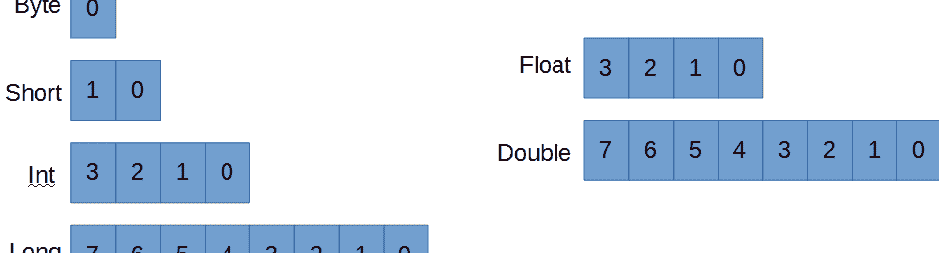

第四列显示了每个原始类型在 RAM 中占据多少位（二进制数字）。这始终是 8 的倍数，因为 RAM 是字节的序列，而字节是 8 位。二进制的确切原理目前并不重要（在我们查看位运算符时会查看二进制的一些细节），但用二进制表示任何十进制中可以表示的数字都是容易的。例如，二进制中的数字 `219` 与二进制中的 `11011011` 相同。

最后两列显示了原始数据类型的可用范围——即每个原始类型可以存储的最小值和最大值。

程序员应该熟悉所有的原始数据类型，但在实践中，我们倾向于使用某些类型多于其他类型。大多数程序员会使用 `int` 处理所有的数值型、整数变量。较小的整数数据类型 `byte` 和 `short` 用于在已知存储值范围在 `byte` 或 `short` 大小得多的范围内时，通过它们来节省 RAM 空间。除非程序员有特殊理由，否则通常不使用 `long` 数据类型——例如，如果程序员需要存储大于 $2^{15}$ 亿的值。

> **注意**：如果你需要超过 `long` 能够容纳的范围，有一个名为 `BigInteger` 的标准，它可以提供任意大小的整数。`BigInteger` 并不是原始类型，而是一个由原始类型构建的类，它允许对非常大的值进行计算（例如用于加密算法）。这种计算是需要代价的，JVM 执行 `BigInteger` 计算的速度比执行 `int` 或 `long` 计算慢得多。要使用 `BigInteger`，我们需要导入 `java.math.BigInteger` 并声明一个 `BigInteger` 对象。

程序员在需要表示浮点值时通常使用 `double` 作为默认数据类型。`double` 的大小是 `float` 的两倍（`double` 为 64 位，`float` 为 32 位），这意味着如果你有一个值列表（例如包含一百万元素的数组），将元素存储为 `float` 将使数组占用大约四兆字节的 RAM，而不是八兆。`float` 的缺点是它的准确性低得多。`double` 提供的精度可能非常重要，因为我们对浮点变量（`double` 和 `float`）执行的每一个操作都有可能引入舍入误差。

`boolean` 类型只有两种可能的状态——`true` 和 `false`。当我们知道变量只有两种状态，且这些状态并不一定是 `true` 和 `false` 时，我们使用 `boolean` 变量。例如，`boolean` 变量可以代表人的性别、灯开关的开启或关闭，或者数字 `0` 和 `1`。`boolean` 变量常用于创建、逻辑或关系表达式。我们可以在不实际定义变量的情况下使用逻辑表达式，但每个逻辑表达式都会创建并评估 `boolean` 值（我们将在控制结构部分看到许多逻辑和条件表达式）。

`char` 数据类型用于存储字母、数字、标点符号和许多其他符号（`char` 使用 Unicode 编码方案表示字符）。`char` 数据类型实际上只是 `short`，但 JVM 将其视为 16 位。例如，如果你将一个 `int` 设置为 `65` 并使用 `println` 打印结果，程序将看到 `65`。如果你使用 `char` 变量，将其设置为 `65` 并使用 `println` 打印结果将输出 `'A'`。这个 `println` 函数设计用于将 `char` 数据类型视为 Unicode 字符的引用。Unicode 表中位置 `65` 处的符号是 `A`，因此当 `println` 看到数据类型是 `char` 时，它会在屏幕上打印 `A` 而不是 `65`。


`char` 变量类型被连接在一起形成字符字符串（Strings）。字符串不仅仅是文本，它们不是原始类型，我们稍后会介绍它们。

> 注意：原始数据类型无论存储什么值，其大小始终相同。所有的 `int` 变量都消耗四个字节，无论它们存储的值是什么。例如，数字 3 理论上可以使用二进制的两个位 `11` 来存储。但如果我们在 `int` 中存储 3：`00000000 00000000 00000000 00000011`，它将填充许多零以占据剩余的位。

## 变量

变量是一个命名的原始数据类型。每个变量都是字节的集合，充当表 1 中的某种原始数据类型之一，并且我们为它赋予了名称。我们通过变量名（而不是它们在 RAM 中的地址）来引用变量，并可以使用变量名作为引用在 RAM 中读取或更改值。变量存储信息，例如数字 3 或名字 Jane。

### 变量的声明与定义

声明一个变量是说明它的存在。我们给出一个数据类型和一个名称——即标识符。定义一个变量是为它指定一个值。变量在使用之前必须先声明并定义。

当我们第一次定义变量的值时，就发生了初始化。一个已声明但未定义的变量称为未初始化变量，该变量在初始化之前不能在计算中使用。在 Java 中，我们可以使用赋值运算符 `=` 在单行代码中声明并初始化变量（有关赋值运算符的更多信息，请参见运算符部分）。

代码列表 5.0 显示了变量的各种声明和定义。

#### 代码列表 5.0：变量的声明与定义

```java
public class MainClass {
    public static void main(String[] args) {
        int i = 100; // 声明并初始化一个 int。
        int b = 10, c = 5;// 声明并初始化两个变量。
        boolean mb = false; // 声明并定义一个 Boolean。

        char myLetter; // 声明一个字符。
        myLetter = 'h'; // 定义/设置字符为 'h'。
        byte hp, bp, sp; // 声明 3 个字节变量。
        hp = bp = sp = 0; // 将所有 3 个字节设置为 0。
        short ss = 189; // 声明并定义一个短整数。
        long p = ss; // 声明并定义一个值为 ss 的 long。
        double myDouble = 100.0; // 声明并定义一个 double。
        float f = 0.1f; // 声明并定义一个 float。
    }
}
```

声明变量时，数据类型在前，随后是变量名，可选的是变量的初始值。变量可以在声明的同一行（例如代码列表 5.0 中的 `int` 变量 `b` 和 `c`），也可以单独占一行（例如代码列表 5.0 中的 `char myLetter`）。你可以通过逗号声明并定义多个相同类型的变量。代码列表 5.0 中的数字（如 189 和 0）以及字符 `'h'` 和布尔值 `false` 被称为字面量。我们稍后会检查它们。

你还可以使用数学和逻辑语句来初始化变量。例如：`int Integer = 10+1`。这将变量 `Integer` 设置为 11。

> 提示：清晰地命名变量可以极大提高代码的可读性。通常情况下，程序员应该简洁地命名变量。考虑使用变量 `s` 来存储薪水，或者使用更合适的 `employeeSalary`。使用 `employeeSalary` 比字母 `s` 描述性得多。

> 注意：如所述，许多程序员在 Java（以及其他语言）中使用称为驼峰命名（Camel Case）的技术来命名标识符。成员方法或变量名的第一个单词小写，所有随后的单词均以大字母开头。例如，`myVariable` 和 `vehiclesPerHour`。但类名以大字母开头——`MyClass` 和 `UserInformation`。

### 旁游：字符串

在我们继续描述字面量之前，让我们临时旁游检查一个不是原始类型的数据类型。`String` 不是原始类型，但由于其使用非常频繁，可以与其他数据类型一起介绍。`String` 是一个数组（参见数组部分）或字符序列，一个接。`String` 可用于表示文本、数字或 Unicode 符号序列（`String` 实际上是一串 `char` 变量的字符串）。我们用双引号包裹文本以表示这是一个 `String`。

```java
String str = "This is a string variable"
```

我们可以使用 `+` 运算符连接多个 String 来多行定义 String（代码列表 5.1）。

#### 代码列表 5.1：多行字符串

```java
String description = "Strings can " + 
"be defined on multiple " + 
"lines with the + operator!";
```

String（字符串）与如 `int` 和 `float` 等数值数据类型之间存在非常重要的区别。String 与数据类型之间不可互换的，即使它们的值相同。虽然可以使用函数调用 `Integer.parseInt` 将 String 解析为整数，但在正常方式下，无法将 String 赋值给整数。代码列表 5.2 的第二行是违法的：

#### 代码列表 5.2：字符串与数值数据类型不可互换

```java
String str = "100";
int j = 10 + str;
```

String 是字符数组，每个字符都有一个或或多的任意数值值（即 Unicode 字符值）。如果我们给字符 7 加上 10，得到的不是 17，而是 65！这是因为字符 7 等同于整数 7。字符 7 的 Unicode 值为 55。由于这个原因，在不调用诸如 `Integer.parseInt` 这样的辅助函数的情况下，我们无法转换如 1278 这样的数值字符串。

代码列表 5.3 展示了如何将 String 解析为 `int` 并与整数相加，以便这些操作能够得到正常且预期的结果。我们将介绍函数调用、装箱/拆箱以及 `Integer` 类。简单来说，`Integer.parseInt(str)` 将返回 String 中字符的整数数值值。

#### 代码列表 5.3：解析字符串与字符

```java
public class Main {
    public static void main(String[] args) {
        // 将 str 设置为字符串 "7"
        String str = "7";

        // 将 j 设置为整数 10 加上解析为 int 的 "7"。
        int j = 10 + Integer.parseInt(str);

        // 将 c 设置为字符 '7'
        char c = '7';

        // 将 i 设置为 10 + 7，注意我们从 '7' 中减去字符 '0'
        // 从而从字符 '7' 得到整数 7，而不是通过解析。
        int i = 10 + c - '0';

        // j 和 i 都被设置为 17。
        System.out.println(": " + j);
        System.out.println(": " + i);
    }
}
```

代码列表 5.4 展示了一个将整数加到 String 的示例。

#### 代码列表 5.4：将整数加到字符串

```java
int idNumber = 26771;

String desc = "The ID number is " + idNumber + ".";
```

在代码列表 5.4 中，我们使用拼接运算符 `+` 将 26771 放在字符串的中间。Java 将创建值 "The ID number is 26771" 并将其存储在 String `desc` 中。需要注意的是，整数 `idNumber` 已经自动转换为普通的十进制字符串。

## 类型转换 (Casting)

在 Java 中类型转换意味着将变量或字面量的值更改另一种原始数据类型的值。要从一种类型转换为另一种类型，我们在括号中使用原始类型进行转换。代码列表 5.5 显示了数值数据类型转换的一些示例。

#### 代码列表 5.5：类型转换

```java
int i = (int) 7.8;               // 将 7.8 转换为整数，存储在 i 中
double d = (double) 89.7f; // 将 float 89.7f 转换为 double，存储在 d 中
short q = (short) (i * d); // 将整数 i*d 转换为 short 并存储在 q 中
```

将浮点值转换为整数类型会导致截断，因此 7.8 在存储到整数 `i` 时会变成 7。

此示例展示了另一个有趣点。表达式 `(i*d)` 的结果是 `double`。当我们执行操作并混合整数或双精度浮点数时，整数会被临时转换为双精度浮点数。

## 字面量 (Literals)

字面量是直接在代码中编写的值。例如，`10` 是一个整数字面量，`3.14` 是一个双精度浮点数字面量，`'A'` 是一个字符字面量，而 `"hello"` 是一个字符串字面量。

代码列表 5.8 显示了一些布尔字面量和字符字面量的示例。只有两种布尔字面量——`true` 和 `false`。字符字面量几乎都被单引号括围，例如 `'h'`，但也可以使用整数字面量来设置字符（请在 http://www.unicode-table.com/en/ 查看 Unicode 字符表及其对应的整数值，并注意该表是以十六进制形式布局的）。

> 注意：对于整数字面量，使用十六进制、八进制或二进制来表示 `char` 的值是完全有效的。这非常罕见，通常情况下，如果我们需要使用数字来指定该值时，我们应该使用 `short` 而不是 `char`。

### 字符串字面量

字符串字面量用双引号括围。

#### 代码列表 5.9：字符串字面量

```java
String m = "This is a string literal";
String j = "If your string literal is too long, you can " + 
"use the + operator and continue on the next line!"
```

### 旁插：数组

数组是项的集合，其中所有项都具有相同的数据类型。例如，包含 10 个 `int` 的集合或包含 1000 个 `double` 的集合。也可以创建数组来存储用户类型的集合，例如类和枚举（我们在这书中不介绍 `enum`，但它是一种用于存储系列常量的特殊类）。数组的元素从 0 开始编号。我们可以使用数组名配合方括号 `[]` 中的索引，以指定我们想要读取或写入的元素。

| | 3 | 2 | 1 | 0 |
|---|---|---|---|---|
| myArray = 600 | 500 | 400 | 300 |

图 37：整数数组

图 37 显示了一个名为 `myArray` 的四个整数组成的数组。数组中的每个元素由两个数字表示。框内的数字是元素的值，框外的数字是该元素在数组中的索引。注意，第一个框（右侧的）的索引为 0，而不是 1。最后一个框（左侧的）索引为 3 而不是 4。这非常重要，可能需要一些时间来适应——Java 从 0 1 开始计数。因此，如果我们创建一个包含 10 个整数的数组，元素将从 0 到 9 编号。数组中仍有 10 个项——0, 1, 2, 3, 4, 5, 6, 7, 8 和 9，但它们并不是按照计数顺序编号的。

#### 代码列表 5.10：声明和定义数组

```java
public class MainClass {
    public static void main(String[] args) {
        int[] myArray = new int[4];
        myArray[0] = 300;
        myArray[1] = 400;
        myArray[2] = 500;
        myArray[3] = 600;
        System.out.println("Element 0 is: " + myArray[0]);
        System.out.println("Element 3 is: " + myArray[3]);
    }
}
```

代码列表 5.10 展示了我们如何设置图 37 所示的数组示例。数组的声明是 `int[] myArray = new int[4];`。注意数据类型旁边的 `[]`。这些位于数据类型旁边的括号意味着我们声明的不是单个整数，而是数组。然后，在数组名 `myArray` 之后，我们使用赋值运算符和 `new` 关键字来指定数组应该持有哪些元素。`new` 关键字也用于构造对象，正如我们将看到的那样。代码列表 5.10 还显示了我们如何设置数组的单个元素。我们使用数组名，后跟方括号 `[]` 中的元素索引。

当我们想要读取数组元素的值时，我们再次使用方括号，如代码列表 5.10 中的 `System.out.println` 调用所示。注意，在第二个 `println` 中，我们在方括号中使用了一个表达式 `[10-7]`，而不是简单的索引。我们可以在方括号中使用表达式来索引数组元素，但该表达式必须是整数——我们不能引用位置为 25 的元素，因为数组中的所有元素都有数字索引（我们将在稍后的某些章节中详细介绍算术表达式）。这意味着我们可能可以使用变量来索引数组元素，例如 `myArray[i]`，其中 `i` 可能是一个整数变量。

我们必须小心，确保绝不访问数组范围之外的索引。代码列表 5.10 中的数组元素编号为 0, 1, 2 和 3。我们无法索引元素 `element[-1]` 或 `myArray[2367]`，因为这些元素不存在。与 C 等语言相比，在 Java 中访问数组边界是安全的，但它会抛出一个可能导致应用程序崩溃的异常。

#### 代码列表 5.11：数组初始化语法

```java
public class MainClass {
    public static void main(String[] args) {
        int[] myArray = {
            300,
            400,
            500,
            600
        };
        System.out.println("Element 0 is: " + myArray[0]);
        System.out.println("Element 3 is: " + myArray[3]);
    }
}
```

### 多维数组

多维数组是项的集合，其中所有项都具有相同的数据类型。例如，包含 10 个 `int` 的集合或包含 1000 个 `double` 的集合。也可以创建数组来存储用户类型的集合，例如类和枚举（我们在这书中不介绍 `enum`，但它是一种用于存储系列常量的特殊类）。数组的元素从 0 开始编号。我们可以使用数组名配合方括号 `[]` 中的索引，以指定我们想要读取或写入的元素。

> 注意：在 Java 中，我们声明数组时，整数数据类型的元素值初始化为 0，浮点类型初始化为 0.0 或 0.0f，布尔类型初始化为 false。

接下来来看循环。我的目标是演示如何正确地遍历（遍历每一个元素）二维数组，而不是解释循环本身的语法。

#### 代码列表 5.13：使用嵌套循环遍历二维数组

```java
public class MainClass {
    public static void main(String[] args) {
        float[][] array2 = new float[7][5];

        for(int y = 0; y < 5; y++) {
            for(int x = 0; x < 7; x++) {
                array2[x][y] = x * y;
            }
        }
    }
}
```

代码列表 5.13 展示了如何遍历一个二维数组。它使用了嵌套循环，外层 `for` 循环从 0 计数到 5（即 0, 1, 2, 3, 4）。每当这个计数器（代码中的 `y`）增加时，另一个计数器 `x` 就会从 0 运行到 7（即 0, 1, 2, 3, 4, 5 和 6）。这两个循环的内部体将运行 7x5 次，每次 `x` 和 `y` 迭代器都能访问 7x5 数组的不同元素。在循环体中，我们将数组元素设置为其索引的乘积。图 39 显示了执行这些循环后数组中的结果。

| | 0 | 1 | 2 | 3 | 4 | 5 | 6 |
|---|---|---|---|---|---|---|---|
| 0 | 0.0 | 0.0 | 0.0 | 0.0 | 0.0 | 0.0 | 0.0 |
| 1 | 1.0 | 1.0 | 2.0 | 3.0 | 4.0 | 5.0 | 6.0 |
| 2 | 0.0 | 2.0 | 4.0 | 6.0 | 8.0 | 10.0 | 12.0 |
| 3 | 0.0 | 3.0 | 6.0 | 9.0 | 12.0 | 15.0 | 18.0 |
| 4 | 0.0 | 4.0 | 8.0 | 12.0 | 16.0 | 20.0 | 24.0 |

图 39：循环后的二维数组

对于新编程学者来说，二维数组通常是 Java 中令人生望畏的方面之一。然而，我希望说明这些数据结构完全并不困难——这只是每次按照正确的顺序获取索引。本章的最后一个示例展示了如何声明和遍历四维数组，通过几个嵌套循环将整个数组中的每个元素设置为 1729（再次，我们将在控制结构部分详细地介绍 `for` 循环，阅读该章节并返回此示例是一个非常好的主意）。

#### 代码列表 5.14：创建和遍历四维数组


```java
public class Main {
    public static void main(String[] args) {
        // 声明四维数组。
        int[][][][] arr4D = new int[3][4][5][6];

        // 将所有元素设置为 1729。
        for (int a = 0; a < 3; a++) {
            for (int b = 0; b < 4; b++) {
                for (int c = 0; c < 5; c++) {
                    for (int d = 0; d < 6; d++) {
                        arr4D[a][b][c][d] = 1729;
                    }
                }
            }
        }
    }
}
```

无法想象四维形状看起来什么样。我们无法在纸上画出代码列表 5.14 中的数组。然而，操作和遍历这种形状就像 `3.14159` 一样简单。当我们想要遍历大小分别为 3, 4, 5 和 6 的四个维度时，我们可以嵌套四个循环，每个循环分别计数到 3, 4, 5 和 6。我们可以通过像 `arr4D[1][3][2][5] = 8753939;` 这样的语句来设置单个元素；但我们必须小心，确保任何索引都不会超出其所引用特定维度的范围。

此外，嵌套循环的顺序并不重要。在代码列表 5.14 中，计数器恰好在外层循环中，但我们可能将此循环放在最内层。唯一重要的是计数器正在计算 0, 1 和 2，而我们正使用它来访问索引为 0, 1 和 2 的维度。

## 第 6 章 运算符和表达式

计算机可以快速地加、减、乘、除数字。但基础算术只是计算机执行的计算类型之一。在本节中，我们将查看使用运算符计算结果和变量值的一些方法。我们将查看计算机执行算术的方式与数学算术之间的一些重要区别。

### 运算符与操作数

运算符用于指示一个或两个操作数之间的操作（在 Java 中）。每个运算符都有某些预定义的优先级。例如，加法需要两个数字，如 `5+6`。操作数可以是变量或字面量（取决于运算符是什么）。运算符指定了所操作的数据。操作数和运算符与括号结合形成表达式，这与基础算术相似，但在 Java 中我们有更大的灵活性。每个运算符都有优先级，规定了在组合组合时的执行顺序。我们在算术和编程中使用的通用系统称为中置法（Infix Notation）。在该系统中，高优先运算符先执行，然后是低优先运算符。例如，`(4+5)*3`，乘法运算符的优先级高于加法运算符。在中置法中，括号内的任何操作先执行，无论运算符的优先级如何。由于括号，`4+5` 先执行，最终结果是 `2`。

### 算术运算符

| 名称 | 符号 | 操作数 | 优先级 |
|---|---|---|---|
| 加法 | `+` | 2 | 1 |
| 减法 | `-` | 2 | 1 |
| 后置自增 | `++` | 1 | 1 |
| 后置自减 | `--` | 1 | 1 |
| 乘法 | `*` | 2 | 2 |
| 除法 | `/` | 2 | 2 |
| 取模 | `%` | 2 | 2 |
| 一元负数 | `-i` | 1 | 3 |
| 一元正数 | `+i` | 1 | 3 |
| 前置自增 | `++i` | 1 | 4 |
| 前置自减 | `--i` | 1 | 4 |

表 2 显示了 Java 中可用的算术运算符。许多人熟悉普通算术，但某些需要更多解释。首先，对于需要变量的运算符，我包含了一个哑变量 `i`（例如后置自减 `i--`）。表 2 还显示了算术运算符的相对优先级。这不是编译器在解析表达式时使用的真实优先级，而是相对优先级，以便了解哪些操作先发生。你应该使用括号直接指定复杂表达式中的操作顺序。加法、减法、乘法和除法的行为与其对应的算术相似。Java 的运算符与其对应的算术之间存在重要差异——所有的 Java 算术都是有限的。后置自增自减只接受单个参数。增是加一，减是减一。这些运算符只能与变量一起使用——不能对字面量进行增减。运算符操作变量的值并相应地设置变量（它们实际上是赋值运算符）。例如，如果 `j` 是值为 5 的整数，`j++` 会导致 `j` 变为 6。后置自增和前置自增仅在优先级上不同。后置自增因为优先级高而在其他操作之前发生，前置自增因为优先级发生在之后。代码列表 6.0 展示了后置和前置之间的区别。

### 代码列表 6.0：后置自增与前置自增

```java
int j = 10;
int b = ++j; // j 增加到 11。
             // b 被设置为 11。
```

一元和一元正数与标准的数学定义不同。在此背景下，一元简单意味着“单个操作数”，二元意味着“两个操作数”。

- 一元负数用于单个数字或变量旁的减号，例如 `-9`。在数学中，一元 `-7` 和二元 `5-6` 的优先级没有明显区别，后者可以读作 `-5-6` 的简写。在编程语言中，通常实现为一元版本的优先级大于二元版本。这是因为 Java 等编程语言具有负数概念，而不是应用具有预定义优先级的负运算符。当编译器读取 `-7` 时，它并不是取 `7` 并减去 `0`。它将该值读取为负整数。

此外提到取模运算符：`%`。取模返回除法后的余数。例如，`67%5` 等于 `2`，因为当我们用 `67` 除以 `5` 时余 `2`。取模是一个非常重要的运算符。如果变量 `j` 可以被任何 `k` 整除，则 `j%k=0`。也就是说，如果 `j` 除尽 `k`，则 `j%k` 没有余数。

代码列表 6.1 展示了使用算术运算符的一些示例。我包含了在行执行时描述变量值的注释。

### 代码列表 6.1：算术运算符

```java
public class MainClass {
    public static void main(String[] args) {
        int j = 190; // j 获得 190
        j++; // j 获得 191
        j = j - 89; // j 获得 102
        int b = 78 * j; // b 获得 7956
        int c = b + (9*j) / 12; // c 获得 8032
        b--; // b 获得 7955
        c = c % b + (j / 2); // c 获得 128
        c = --b; // c 和 b 获得 7954
        int h = (j + b) % 210; // h 获得 76
    }
}
```

### 整数算术：溢出

在 Java 中，整数的大小并不是无限的。当结果的绝对值大到无法放入指定的变量时，它们会发生回绕（wrap around）。这是计算机使用的算术与现实世界数学之间一个非常重要的区别。如果我们不小心，可能会导致一些奇怪的结果。

```java
public class Main {
    public static void main(String[] args) {
        // 导致 byte 溢出
        byte myByte = 127;
        myByte++; // 结果为 -128
        System.out.println("Byte says 127+=" + myByte);
        myByte = -128;
        myByte++; // 结果为 127
        System.out.println("Byte says -128=" + myByte);

        // 导致 short 溢出
        short myShort = 32767; // 这是 short 的最大值！
        System.out.println("Short is " + myShort + " before ++.");
        myShort++;
        System.out.println("Short is " + myShort + " after ++.");
        myShort--;
        System.out.println("Short is " + myShort + " after --.");
    }
}
```

> 代码列表 6.2：溢出示例

在代码列表 6.2 中，我们将变量 `myByte` 设置为 `127`，这是 `byte` 能够容纳的最大正值。在下一行中，我们使用 `++` 运算符对变量进行增。将变量增加到 `127` 将导致结果为 `128`。但值 `128` 超出了 `byte` 的范围（`-128` 到 `127`）。因此，结果实际上会发生回绕，我们得到 `127+1=-128`。如果我们没有意识到这种回绕行为，当我们对正整数递计数时，它突然变成一个非常大的负值，这会迅速导致代码中出现 Bug。

同样，在下一行中，我们将 `myByte` 的值设置为 `-128`，然后尝试从该变量中减 `1`。同样，结果通常会是 `-129`，但 `-129` 并不在 `byte` 的范围内，结果将回绕到正数 `127`。

代码列表 6.2 的输出如下：

```text
Byte says 127+1=-128
Byte says -128-1=127
Short is 32767 before ++.
Short is -32768 after ++.
Short is 32767 after --.
```

`byte` 的范围非常有限，这意味着它很容易说明。但我们必须记住，当我们使用任何整数类型（即使是 `long`）时都会发生这种回绕。`int` 的范围远大于 `byte`，但它并不是无限的。

### 整数算术：截断

除了溢出外，两个整数的除法结果在存储之前总是会向零舍入。初看起来这似乎是一个糟糕的选择，但比普通的四舍五入（即舍入最近的数字），这是一种更实用的算术方法。基本的舍入规则是直接丢弃小数点后的任何数字，这意味着 `6.7` 变成 `6`，`89.23678` 变成 `89`，而 `-2773.223` 就是这种类型的截断舍。

> 代码 6.3：整数舍入

```java
int a = 24/5;      // 结果为 4
int b = -24/5;     // 结果为 -4
```

代码 6.3 展示了 `24` 和 `-24` 除以 `5` 的情况。在第一行中，我们将 `24` 除以 `5` 并将结果存储在变量 `a` 中。`24/5` 的结果实际上是 `4.8`——或者 `4` 和 `4/5`。因为整数就是整数，`4/5` 被丢弃了。注意 `4.8` 没有向上舍入到 `5`，而是向 `0` 位。小数点后的数字直接被切掉了。

同样，在代码 6.3 的第二行，我们看到 `-24` 除以 `5` 的结果是 `-4`。通常情况下，结果应该是 `-4.8`，但同样，整数只能存储整数，小数点后的数字被切掉（或截断）。

截断在除法整数时特别有用，因为我们有取模运算符配合除法使用。如果我们想确切地知道 `24/5` 是多少，不能使用浮点数，因为浮点数只能精确表示少数几个理数，而 `4.8` 并不其中。但我们可以使用除法和取模来保持整数除法的精确结果。代码 6.4 展示了我们如何保持这种短示例：

> 代码 6.4：整数算术与分数

```java
public class Main {
    public static void main(String[] args) {
        int numerator = 24;
        int denominator = 5;

        int wholeResult = numerator / denominator;
        int fractionalResult = numerator % denominator;
        System.out.println("The result is " + wholeResult + " " + fractionalResult + " /" + denominator);
    }
}
```

### 浮点算术：舍误差

浮点变量（`double` 和 `float`）看起来是无限的，因为它们的范围很大，并且似乎可以表示非常精确的小数。但浮点变量和整数一样受限，与此，你应该注意关于浮点算术的几点注意事项。使用浮点算术时最重要的一点是——对浮点值执行的操作越多，结果中的误差就越大。

浮点变量只能存储一组特定的理数。我们假设任何实数都可以存储在 `float` 或 `double` 中，但事实并非如此。`float` 或 `double` 能够存储的数字只有 2 的幂的和以及零 (`0`)。像 `256`、`1/4` 或 `4096.175` 等数字在浮点变量中都可以存储得完美，没有舍入。其他数字，例如 `1/5` 或 `0.3333...`，会被舍入为其真实值的近似值。这意味着我们对 `1/5` 和 `1/3` 等数字计算得越多，最终结果引入的误差就越多。

记住，浮点变量（`float` 和 `double`）在另一个方面也受到精度限制。浮点数越大，计算精确结果的精度就越低。六位以内的整数是安全的。`int` 的范围远大于 `byte`，但它不是无限的。浮点变量的范围同样受限。使用浮点算术时最重要的一点是——对浮点值执行的操作越多，结果中的误差就越大。

## 赋值运算符

赋值运算符用于修改或设置变量的值。最常用的赋值运算符是赋值运算符本身，它在 Java 中用单个等号 `=` 表示。这与双等号 `==` 有很大区别，双等号 是一个条件运算符，用于判断两个值是否相等。如果我们想将一个名为 `someVariable` 的变量设置为整数 `78`，我们应该使用 `someVariable = 78`；

在等号运算符之后，还提供了剩余的赋值运算符（`+=`、`-=`、`*=`、`/=`、`&=`、`^=` 和 `<<=`）以备之用。它们有时被称为复合赋值运算符，是某种特别常见的表达式形式的简写。当我们有一个变量时，需要对它执行某些操作，并将结果存储回该变量中。这在数学上似乎没有意义，但在编程语言中是完全正常的。这是一个复合赋值运算符的示例：

```
Var1 += 1;
```

上述语句可以展开为：

```
Var1 = Var1 + 1;
```

因此，`Var1` 的值加了 `1`。如果 `Var1` 的初始值为 `25`，那么之后它将被设置为 `26`。其他赋值运算符也类似，只是操作对于每个运算符是特定的。不是加法，`-=` 从变量中减去，`^=` 执行位异或，类等。代码列表 6.7 显示了复合赋值运算符的若干示例。

> 代码列表 6.7：复合运算符

| 表达式 | 含义 |
| :--- | :--- |
| `Var1 -= 7;` | 意味着 `Var1 = Var1 - 7` |
| `Var1 ^= 7;` | 意味着 `Var1 = Var1 ^ 7` |
| `Var1 /= 7;` | 意味着 `Var1 = Var1 / 7` |

我们将查看这些运算符的未赋值版本的精确含义（例如，`^` 与赋值版本的 `^=`相对）。我们也可以在表达式上使用复合赋值运算符：

```
Var1 += 5 + (2*Var2);
```

上述代码行将展开为 `Var1 = Var1 + 5 + (2* Var2)`。如果 `Var1` 是 `10` 且 `Var2` 是 `5`，那么 `Var1` 将变为 `10+5+(2*5)` 或 `25`。

### 插曲：二进制数

在查看位运算符之前，我们将简短地插一段曲，看看计算机存储整数的方式。计算机在 `0` 和 `1` 的集合上进行所有计算。计算机中最小的内存是位（bit），它可以设置为 `0` 或 `1`，构成二进制中的单个数字。变量（如 `int` 和 `byte`，甚至是 `double` 和 `float`）由二进制位集合组成。

二进制中包含进制数字 50 的字节

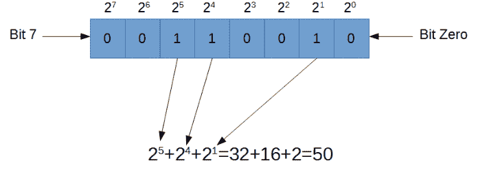

图 40：包含 50 的字节

图 40 展示了一个包含进制整数 `50` 的字节。位是蓝框，每个位被设置为 `1` 或 `0`（蓝框内部的值）。每个位都有一个索引。左侧的位 `7` 是最高位，右侧的位 `0` 是最低位。这与十进制完全相同——如果我们有一个如 `345` 这样的十进制数，左边的 `3` 比右边的 `5` 更重要。

为了计算出二进制数的确切数值，你必须相加每个位置对应于 `1` 的 `2` 的幂次。在图 40 中，`2^5` 位置上有一个 `1`，`2^4` 位置上有一个，`2^1` 位置上也有一个。因此，这个位序列表示 `50`，这是幂次相加的结果：`2^5+2^4+2^1=50`。这在十进制中也是相似的，只是十进制中幂次的基数是 `10` 而不是 `2`。

负数比正数稍微复杂一点。Java 使用补码（2 补码）。这意味着如果最左侧的位设置为 `1`，该数就是负数。负数的值是位取反 `1`——例如，字节中的位序列 `10000011` 通常来说是 `2^7+2^1`，但因为位 `7` 是字节中的符号位，且由于它被设置为 `1`，实际值是 `-1`。补码是翻转了每一个位的字符串（使用 `~` 运算符）。因此，`10000011` 是 `01111100`，或十进制中的 `-125`。由于此原因，每个整数类型中最左侧的位被称为符号位。对于 `byte`，这个左侧位是位 `7`；对于 `int`，它是位 `31`；对于 `long`，它是位 `63`。

## 位运算符


# Java 运算符与控制结构

## 位运算符

Java 中的几个运算符设计用于直接操作位。这些运算符通常被组合在一起，称为**位运算符**。位运算符借用自逻辑数学（我们从那里获得了用于真假变量的“Boolean”以及我们很快将看到的布尔运算符）。布尔代数由变量组成（就像普通代数一样），我们可以使用括号来覆盖运算符的正常优先级。在布尔代数中，变量只能是真或假；即 `1` 或 `0`。在许多方面，布尔代数比算术简单得多，但很容易低估它的力量。

| 表达式 | 含义 |
| :--- | :--- |
| `Var1 -= 7;` | 意味着 `Var1 = Var1 - 7` |
| `Var1 ^= 7;` | 意味着 `Var1 = Var1 ^ 7` |
| `Var1 /= 7;` | 意味着 `Var1 = Var1 / 7` |

```
a = 48 >> 4; // 将 48 除以 2 的 4 次，即 16，a 将变为 00000011
```

对于计算机而言，位移比除法和乘法容易得多，因此它被用于优化代码（即使其运行更快）。

当我们向右位移时，随着位从右侧移出，新的位必须从左侧进入。当使用普通右移（`>>`）时，从左侧进入的位将是符号位的复制（即最左侧的位保持不变）。这使得我们能够使用上述位移技术来定义负数，并保持负数结果。而右移无符号填充运算符（`>>>`）则会在左侧填充 `0`。当我们不把 Java 数字视为有符号的数时，这种右移无符号填充运算符就很有用。

## 关系运算符

关系运算符允许我们将数值变量的值与其他变量或字面量进行比较。例如，我们可能会测试整数变量 `A` 的值是否小于 `100`。或者，我们可以测试变量 `B` 和 `C` 是否相等（`B == C`）。

关系运算符每个接受两个操作数。它们比较操作数并返回 `true` 或 `false` 的布尔结果。关系运算符通常用于条件语句，如 `if` 语句和循环（将在“控制结构”章节中介绍）。我们可以将许多关系运算符与逻辑运算符结合起来形成复杂的表达式（逻辑运算符的描述见下一节）。

表 3 显示了 Java 中可用的关系运算符。注意双等号 `==` 用于判断两个变量是否具有相同的值。而单等号 `=` 是赋值运算符。

| 运算符 | 名称 | 示例 |
| :--- | :--- | :--- |
| `==` | 等于 | `A == B; // A 等于 B 吗？` |
| `!=` | 不等于 | `A != B; // A 与 B 不同吗？` |
| `<` | 小于 | `A < B; // A 小于 B 吗？` |
| `>` | 大于 | `A > B; // A 大于 B 吗？` |
| `<=` | 小于等于 | `A <= B; // A 小于等于 B 吗？` |
| `>=` | 大于等于 | `A >= B; // A 大于等于 B 吗？` |

**代码列表 6.9：关系运算符**

```java
int var1 = 100, var2 = 30;

boolean ans1 = var1 == var2; // ans1 变为 false，100 不等于 30
boolean ans2 = var1 > var2;  // ans2 变为 true，100 大于 30
boolean ans3 = var2 <= var1; // ans3 变为 true，30 小于等于 100
boolean ans4 = var2 != var1; // ans4 变为 true，30 不等于 100
boolean ans5 = (var1 < var2) || (var1 > var2); // 使用或逻辑
```

## 逻辑运算符

逻辑运算符（有时称为布尔运算符）与布尔参数一起工作。它们用于构建逻辑语句。每个逻辑运算符接受两个操作数，且两个操作数都是布尔值。我们通常在 `if` 语句、循环以及需要条件的情况下配合逻辑运算符。

三个逻辑运算符是 AND（与），用符号 `&&` 表示；OR（或），用符号 `||` 表示；以及 NOT（非），用感叹号 `!` 表示。逻辑运算符用于连接简单条件以创建复杂的表达式。逻辑运算符与位运算符之间的唯一区别在于，逻辑运算符专门用于布尔参数，而位运算符设计用于处理 `int`、`short` 或 `long`。

下面是我们使用逻辑运算符的示例，假设我们有几个变量：

```java
boolean doorClosed;
boolean nightTime;
boolean raining;
```

为了确定门是否应该关闭，我们可能会说类似 `doorOpen = nightTime || raining` 的语句。这意味着变量 `doorClosed` 将被设置为 `nightTime` 和 `raining` 变量执行 OR 操作的结果。如果是深夜，`doorClosed` 变量将为 `true`，否则为 `false`。如果正在下雨，`doorClosed` 变量将为 `true`，否则为 `false`。我们还可以再添加另一个条件：当灯开着时，也许 `doorOpen = nightTime || lightOn`。前面的语句完美符合我们的条件，`doorOpen` 变量将按照上述方式设置。如果将文本转换为布尔表达式看起来很费解，请记住，在数学或计算机科学中没有简单的方法可以将文本转换为简单的布尔表达式，逻辑语句可以变得任意复杂，很难准确且高效地描述最佳方法。

## 其他运算符

现在我们将检查两个运算符，当我们在面向对象的章节中查看控制结构和继承层次结构时，这两个运算符将更有意义。简而言之，条件运算符是一种常用的 `if` 语句的简写；而 `instanceof` 运算符是一种用于测试对象是否是特定类的实例的机制。

### 条件运算符

条件运算符（有时称为三元运算符）是编写具有两种可能结果的条件的简写方式。在“控制结构”章节中，我们将看到如何编写与条件运算符功能相同的 `if` 语句。但现在请注意，条件运算符的代码更少。

**代码列表 6.11：条件运算符**

```java
public class Main {
    public static void main(String[] args) {
        int a = 25, b = 60;
        int larger = (a > b) ? a : b;
        System.out.println(larger);
    }
}
```

代码列表 6.11 显示了条件运算符的使用。`int larger = (a > b) ? a : b;` 是该运算符的调用。

### 字符串拼接

当两个字符串之间使用 `+` 时，意味着连接它们。这个术语称为拼接。

**代码列表 6.10：字符串拼接**

```java
String s1 = "This is";
String s2 = " a string";
String s3 = "";
String concatenated = s1 + s2 + s3;
String str1 = "Concatenating integers is fine! " + 27;
String str2 = "And floats/doubles too!" + 45.67;
System.out.println(concatenated);
System.out.println(str1);
System.out.println(str2);
```

代码列表 6.10 显示将整数、浮点变量和字面量拼接到字符串只需要使用 `+` 运算符。整数或浮点字面量将转换为字符字符串，然后添加到字符串中。同样的方法可以将字符（如 `'A'`）或布尔字面量（如 `false`）拼接到字符串中。

但是，小心！如果不调用 `Integer.parseInt()` 方法，无法将字符串转换为整数！

### instanceof 操作符

Java 中的最后一个操作符是 `instanceof` 运算符。当我们设计类层级结构时，测试某个对象是否属于某个类通常会很有用。例如，如果我们在屏幕上有一个控件，用户点击了该控件，我们可能想知道该控件是否为按钮。

该运算符接受两个属于某个类层级的操作数，并判断左操作数是否是右操作数所指定类的实例。

**代码列表 6.13：instanceof 示例**

```java
public class Main {
    public static void main(String[] args) {
        MyClass someInstance = new MyClass();
        if (someInstance instanceof MyClass) {
            System.out.println("someInstance is of MyClass!");
        } else {
            System.out.println("someInstance is not of MyClass...");
        }
    }
}
```

代码列表 6.13 展示了如何测试对象 `someInstance` 是否是特定类 `MyClass` 实例的基本示例。注意，这段代码无法作为独立应用程序运行，因为我没有包含 `MyClass` 类的声明。

> **提示**：尽可能避免使用 `instanceof` 运算符。有更好的方法来编写原本可能使用 `instanceof` 运算符的结构。假设我们需要编写一个此类请求的方法：如果对象类型为 `t`，则执行某些操作；否则，如果对象类型为 `q`，则执行其他操作。在这种情况下，我们可以更高效地使用多态。编译器和 JVM 能够检测并维护对象类型，因此我们永远不需要询问对象 `t` 是否是类 `c` 的实例。我们将在面向对象编程章节检查类层级结构。

## 挑战

### 挑战 6.0

一位农民从农场的鸡身上收集了 792,671 个鸡蛋，并希望以盒的形式出售给昆士兰北部地区的商业购物场所和超市。农民有多少整盒鸡蛋（一盒装一个鸡蛋）？他剩下多少鸡蛋供自己早餐吃（提示：使用取模运算符）？

### 挑战 6.1

从数字四开始。减去二。将结果乘以 12。将答案加 1。将答案自相加。除以七并舍弃余数。将答案乘以自身。计算答案的立方（即三次方）。将答案减 1。最终结果是什么？你留下的数字不能被以下质数之一整除——是哪一个？

- A) 2
- B) 3
- C) 17
- D) 19
- E) 43

## 挑战解决方案

### 挑战 6.0

> **代码列表 6.14：挑战 6.0 的答案**

### 挑战 6.1

> **代码列表 6.15：挑战 6.1 的答案**

```java
public class MainClass {
    public static void main(String[] args) {
        int result = 4;
        result = result - 2;
        result = result * 12;
        result++;
        result = result + result;
        result = result / 7;
        result = result * result;
        result = result * result;
        result--;
        // 计算一个数字是否能整除另一个数字，使用 mod；
        int mod2 = result % 2;
        int mod3 = result % 3;
        int mod17 = result % 17;
        int mod19 = result % 19;
        int mod43 = result % 43;
        System.out.println("The final result is " + result);
        System.out.println("Division by 2 leaves: " + mod2 + " remainder.");
        System.out.println("Division by 3 leaves: " + mod3 + " remainder.");
        System.out.println("Division by 17 leaves: " + mod17 + " remainder.");
        System.out.println("Division by 19 leaves: " + mod19 + " remainder.");
        System.out.println("Division by 43 leaves: " + mod43 + " remainder.");
    }
}
```

代码列表 6.15 在运行时会产生以下输出：

```
最终结果是 17648。
除以 2 余：0。
除以 3 余：0。
除以 17 余：8。
除以 19 余：0。
除以 43 余：0。
```

我们可以从这个输出看出，最终结果除以 17 余 8，但能被 2、3、19 和 43 整除。在编程中，通常有很多方法可以解决任何特定问题。计算挑战 6.1 的结果也可以作为一个单一表达式，只留下字面量。

### 代码列表 6.16：计算的其他解决方案

# 控制结构

通常，控制结构允许我们根据某些条件做出决策。最常见的控制结构是 `if` 语句，它允许代码中进行分支。如果条件为真，`if` 语句中的代码块将执行。如果为假，则跳过。

其他控制结构包括循环，允许我们多次执行代码块。最常见的循环有 `for` 循环、`while` 循环和 `do-while` 循环。`for` 循环通常用于已知迭代次数。`while` 循环取决于条件是否真。`do-while` 循环与 `while` 循环相似，但会在检查条件之前至少执行一次代码块。

另一个控制结构是 `switch` 语句，允许根据单个值执行多个分支。`switch` 语句通常比一系列 `if-else` 语句更具可读性。

## If 语句

`if` 语句是 Java 中最基本的控制结构。它由一个 `if` 关键字后跟一个为真或假的条件组成。如果条件为真，`if` 语句后面的代码将执行。如果为假，则跳过。

`if` 语句的语法为：

```java
if (condition) {
    // 如果条件为真执行代码
}
```

你也可以为 `if` 语句包含 `else` 子句，以便在条件为假时执行代码。

```java
if (condition) {
    // 如果条件为真执行代码
} else {
    // 如果条件为假执行代码
}
```

你还可以包含多个 `else if` 子句来处理不同的条件。

```java
if (condition1) {
    // 如果第一个条件为真执行代码
} else if (condition2) {
    // 如果第二个条件为真执行代码
} else {
    // 如果没有任何条件成立
}
```

`if` 语句可以用于各种类型的条件，包括关系运算符（如 `<`、`>`、`==`、`>=`）和逻辑运算符（如 `&&`、`||`、`!`）。

这里是一个使用关系运算符的 `if` 语句示例：

```java
int age = 18;
if (age >= 18) {
    System.out.println("You are an adult.");
} else {
    System.out.println("You are not an adult.");
}
```

这是一个使用逻辑运算符的 `if` 语句示例：

```java
boolean hasLicense = true;
boolean hasCar = false;
if (hasLicense && hasCar) {
    System.out.println("You can drive.");
} else {
    System.out.println("You cannot drive.");
}
```

## 循环

循环用于多次执行代码块。Java 中有三种循环：`for` 循环、`while` 循环和 `do-while` 循环。

`for` 循环通常用于已知迭代次数。它由三部分组成：初始化、条件和增/减。

```java
for (initialization; condition; increment/decrement) {
    // 重复代码
}
```

这里是一个 `for` 循环的示例：


# Java 控制流语句

## 循环

### for 循环

`for` 循环允许执行指定次数的代码块。我们通常使用计数器并一直执行代码，直到计数器达到某个值。其语法如下：

```java
for ([init]; [condition]; [increment]) {
    // 循环体
}
```

**Init（初始化）：** 初始化是声明计数器变量并设置其初始值的地方。

**Condition（条件）：** 条件是一个布尔表达式，就像 `if` 语句一样。`for` 循环的代码块将重复直到条件求值为真。

**Increment（递增）：** 递增部分允许我们增加或减少计数器。

#### 代码列表 7.5：从 0 到 9 的 For 循环计数

```java
for (int j = 0; j < 10; j++) {
    System.out.println(j);
}
```

代码列表 7.5 显示了一个从 0 到 9 的 `for` 循环。初始化声明了整数变量 `j` 并将其设置为 0。条件是 `j < 10`，这意味着循环将当条件为真时执行。递增部分 `j++` 在每次迭代后增加 `j` 的值。循环的主体是 `System.out.println(j)`。

#### 代码列表 7.6：使用 For 循环倒序计数

```java
for (int j = 10; j > 0; j--) {
    System.out.println(j);
}
```

代码列表 7.6 从 10 开始倒序计数。初始值为 10，条件是 `j > 0`，递增是 `j--`，它会减少 `j`。

> **注意：** 有一种特殊的 `for` 循环用于迭代集合，例如数组。这种循环通常被称为 each 循环。关于 each 循环的信息，请访问 <http://docs.oracle.com/java/1.5.0/docs/language/foreach.html>。

#### 嵌套循环

我们可以将循环放在另一个循环的体内。这对于遍历多维数组非常有用。

##### 代码列表 7.7：嵌套 For 循环

```java
for (int outerCounter = 0; outerCounter < 5; outerCounter++) {
    for (int innerCounter = 0; innerCounter < 3; innerCounter++) {
        System.out.println("Outer Counter: " + outerCounter +
              " Inner Counter: " + innerCounter);
    }
}
```

代码列表 7.7 显示了嵌套的 `for` 循环。外部计数器从 0 计数到 4。在外部循环体内，内部循环从 0 计数到 2。外部循环将执行五次，每次执行时内部循环都会执行三次。因此，内部循环体总共将执行 3*5 次，即 15 次。代码的输出如下：

```text
Outer Counter: 0 Inner Counter: 0
Outer Counter: 0 Inner Counter: 1
Outer Counter: 0 Inner Counter: 2
Outer Counter: 1 Inner Counter: 0
Outer Counter: 1 Inner Counter: 1
Outer Counter: 1 Inner Counter: 2
Outer Counter: 2 Inner Counter: 0
Outer Counter: 2 Inner Counter: 1
Outer Counter: 2 Inner Counter: 2
Outer Counter: 3 Inner Counter: 0
Outer Counter: 3 Inner Counter: 1
Outer Counter: 3 Inner Counter: 2
Outer Counter: 4 Inner Counter: 0
Outer Counter: 4 Inner Counter: 1
Outer Counter: 4 Inner Counter: 2
```

注意 `outerCounter` 在内部循环的精确三次迭代中保持不变。然后它增加一次，即 `outerCounter`，`innerCounter` 计数 0、1，然后是 2。你可以任意深度地嵌套循环。

### while 和 do-while 循环

`while` 循环有两种——`while` 循环本身和 `do-while` 循环。唯一的区别是 `do-while` 循环在执行循环体后检查条件，因此可以保证循环体至少运行一次。而 `while` 循环在运行循环体之前检查条件，如果条件一开始为假，则循环体将完全不会执行。

#### while 循环

`while` 循环用于迭代次数取决于条件是否真的情况。在执行代码块之前检查条件。

```java
while (condition) {
    // 重复代码
}
```

这里是一个 `while` 循环的示例：

```java
int i = 0;
while (i < 5) {
    System.out.println("Iteration: " + i);
    i++;
}
```

#### do-while 循环

`do-while` 循环与 `while` 循环相似，但它检查条件之前至少执行一次代码块。

```java
do {
    // 重复代码
} while (condition);
```

这里是一个 `do-while` 循环的示例：

```java
int i = 0;
do {
    System.out.println("Iteration: " + i);
    i++;
} while (i < 5);
```

#### 代码列表 7.9：While 和 Do 循环

```java
int counter = 0;
while (counter < 10) {
    System.out.println("Counter in while: " + counter);
    counter++;
}
do {
    System.out.println("Counter in do ... while: " + counter);
    counter++;
} while (counter < 10);
```

代码列表 7.9 展示了使用 `while` 和 `do-while` 循环的示例。首先，在 `while` 循环中，变量 `counter` 将从 0 增加到 9。当变量 `counter` 达到 10 时，`while` 循环的条件失效。这个特定的 `while` 循环与 `for` 循环非常相似，事实上，没有 `while` 循环不能写成 `for` 循环，反之亦然。

`do-while` 循环与 `while` 循环具有相同的条件。在程序执行 `while` 循环后，会将变量 `counter` 增加到 10。此时 `do-while` 循环的条件为假（`counter` 不小于 10）。但 `do` 循环在终止循环之前仍会执行其循环体，因为它是在最后才检查条件。

### Break 和 Continue 关键字

`break` 关键字用于多个控制结构（`for`、`while`、`do-while` 以及 `switch`）的体内。它导致程序立即跳转到控制结构体之外的下一个语句。这对于停止无限循环（例如 `while(true)`，它通常永远不会终止）以及提前终止循环非常有用。

`continue` 关键字用于跳转到循环顶部。当你不希望在某些特定迭代中执行循环体的剩余部分代码时，它非常有用。

当存在嵌套循环时，`break` 和 `continue` 始终作用于最内层的循环。

## 条件语句

### if 语句与逻辑运算符

```java
if (age == 50 || 60) { ... // 这是错误的！

if (age == 50 || age == 60) { ... // 这是正确的！
```

第一个示例读起来很正常：如果 age 为 50 或 60……然而，这个表达式会被求值为 Java 代码。计算机将使用 `||` 运算符读取它，程序将锁定到下一个条件。下一个条件由整数字面量 `60` 本身组成。但 60 并不是一个条件，程序将不会运行。检查 `age` 变量多个设置的正确方法在示例所示——我们使用 `"age == 60"` 而不是 60 本身。

### 嵌套 if 语句

我们可以将 `if` 语句放在其他语句的代码块中。这些被称为嵌套 `if` 语句。

#### 代码列表 7.3：嵌套 if 语句

```java
int age = 190, price = 14;
if (age > 50 && age < 100) {
    if (price > 20) {
        System.out.println("Age: " + age + " Price: " + price);
    }
}
```

代码列表 7.3 包含一个嵌套语句。第一个条件测试变量 `"age"` 并确定它是否在 51 到 100 之间（不包含边界）。由于 `&&` 运算符，条件必须为真。因此，如果 `age` 在 51 到 99 的范围内，`if` 语句的代码块将执行。内部的 `if` 语句测试价格是否大于 20。这意味着，如果 `age` 不在 51 到 99 的范围内，计算机将不会考虑第二个语句，因为第二个语句存在于第一个语句的代码块中。

### Else 和 Else If

我们可以在一个 `if` 后面跟上任意数量的 `else if` 语句。我们还可以用最终的 `else` 语句结束一组 `if/else if` 结构。在一组 `if/else if` 中，只有一个代码块会被执行。执行的代码块始终将是第一个条件求值为真的代码块。

如果 `if` 或 `else` 的条件为假，程序将寻找下一个 `else if` 或 `else`。当发现其中一个条件为真时，计算机将执行该条件对应的代码块，然后它将跳过整个 `if/else if/else` 块，并在条件集之后恢复执行。我们使用 `else if` 来提供额外的条件。`if` 关键字后面跟着一个括号内的条件——与 `if` 语句完全相同。区别在于，`else` 之前必须有一个 `if` 语句。`else` 不能独立存在。

`else` 关键字始终是最后的备选。当计算机读取到 `else` 块时，如果之前没有一个条件求值为真，则 `else` 块将始终执行。`else` 块始终放在末尾，它没有条件。

#### 代码列表 7.4：If / Else If / Else 块

```java
int i = 25;
if (i % 2 == 0) {
    System.out.println("i is even");
} else if (i % 3 == 0) {
    System.out.println("i is odd, but divisible by 3");
} else if (i % 5 == 0) {
    System.out.println("i is divisible by 5");
} else {
    System.out.println("i is not divisible by 2, 3, or 5");
}
```

代码列表 7.4 显示了一系列简单的 `if/else`。只有其中一个条件的代码会被执行。计算机将从上到下检查 `if` 和 `else`。变量被设置为 25，它是一个奇数，但不能被 5 整除。因此，第二个 `else` 将打印 `"i is divisible by 5"`。此后不会有其他块执行。

相反，如果我们把变量设置为 22 而不是 25，第一个代码块将执行，程序将在屏幕上打印 `"i is even"`。而且，如果我们将变量 `i` 设置为 17，注意 17 不是偶数，所以第一个条件失败了。17 不能被 3 整除，所以第二个条件失败了。17 不能被 5 整除，所以第三个条件失败了。此时，程序遇到了 `else`。如果程序遇到 `else`，`else` 块将始终执行，因此当 `i` 设置为 17 时，程序将打印 `"i is not divisible by..."`。

### Switch 语句

`switch` 语句允许根据单个值执行多个分支。`switch` 语句通常比一系列 `if-else` 语句更具可读性。

`switch` 语句的语法为：

```java
switch (expression) {
    case value1:
        // 如果 expression == value1 则执行代码
        break;
    case value2:
        // 如果 expression == value2 则执行代码
        break;
    default:
        // 如果没有任何匹配匹配则执行代码
        break;
}
```

`break` 语句用于退出 `switch` 语句。如果没有 `break` 语句，程序将继续执行后续 case，无论条件是否满足。

#### 代码列表 7.11：使用 Switch 的计算器

```java
int day = 3;
switch (day) {
    case 1:
        System.out.println("Monday");
        break;
    case 2:
        System.out.println("Tuesday");
        break;
    case 3:
        System.out.println("Wednesday");
        break;
    default:
        System.out.println("Invalid day");
}
```

`switch` 语句可以用于基本类型如 `byte`、`short`、`char` 和 `int`，以及 `String` 和 `enum` 类型。它不能用于 `double` 或 `float` 类型。

`switch` 语句只是编写一组 `if` 语句的另一种方式。为了将一组 `if` 语句转换为 `switch`，`if` 和 `else if` 语句中的条件必须指向同一个变量。在接下来的示例（代码列表 7.10）中，所有条件都指向变量 `i`，因此这一系列 `if` 语句可以转换为 `switch`。下面显示了 `if/else` 组合与执行功能完全相同的 `switch` 语句的对比（注意 `switch` 示例并非实际代码，不会运行）。

#### 代码列表 7.10：If 块 vs. Switch

```text
if (i == 0) // Do something
 if (i == 1) // Do somethingElse
 if (i == 2) // Do somethingElse
else // Do the default

switch (i) {
  case 0: { Do something; break; }
  case 1: { Do somethingElse; break; }
  case 2: { Do somethingElse; break; }
  default: { Do the default; break; }
};
```

在 `switch` 语句中，`switch` 关键字后跟着一个变量（上例中的 `i`）。接下来，在代码块内部，我们提供一系列 `case`，每个都用关键字标记。当匹配某个特定 `case` 时，执行该 `case` 的代码块。

在 `switch` 示例中，每个 `case` 代码都以 `break` 关键字结束。这意味着一旦执行了某个特定的 `case`，程序将跳出 `switch`。如果之前的 `case` 都没有执行，程序最终会找到用 `default` 关键字标记的 `case`。只有在之前的 `case` 都未执行时，才会执行 `default` 情况。`default` 情况是可选的。

> **提示：** `switch` 中的 `break` 关键字不是强制的。如果你不在 `case` 中放置 `break`，程序将继续运行并找到额外的 `case` 来执行。这种功能很少使用，我建议你在每个 `switch` 语句中始终使用 `break`，以避免其他程序员（或你）阅读代码时产生混淆。


```java
import java.util.Scanner;

public class MainClass {
    public static void main(String[] args) {
        Scanner s = new Scanner(System.in);
        // Parameters for the operation.
        double parameterA = 0.0, parameterB = 0.0;

        // Index of the operation.
        int operation = 0;

        System.out.println("Welcome to Calculator");
        do {
            // Ask the user for two numbers and an operator:
            System.out.print("Type a number: ");
            parameterA = Double.parseDouble(s.nextLine());
            System.out.print("Type another number: ");
            parameterB = Double.parseDouble(s.nextLine());
            System.out.println("Select an option: ");
            System.out.println("1. Add\n2. Subtract\n3. Multiply\n4. Divide\n0. Quit");
            System.out.print(": ");
            operation = Integer.parseInt(s.nextLine());

            // Perform the operation using switch.
            switch (operation) {
                case 1: { // If 1, add the parameters.
                    System.out.println(parameterA + "+" + parameterB);
                    break;
                }
                case 2: { // If 2, subtract the parameters.
                    System.out.println(parameterA + "-" + parameterB);
                    break;
                }
                case 3: { // If 3, multiply the parameters.
                    System.out.println(parameterA + "*" + parameterB);
                    break;
                }
                case 4: { // If 4, divide the parameters.
                    System.out.println(parameterA + "/" + parameterB);
                    break;
                }
                case 0: { // If 0, do nothing, they are quitting.
                    System.out.println("Bye, bye!");
                    break;
                }
                default: { // Default prints an error message.
                    System.out.println("That wasn't one of the options.");
                }
            }
        } while (operation != 0);

        // The user has quit.
        if(s != null) {
            s.close();
        }
    }
}
```

在 `Scanner` 类的 `nextFloat()` 方法中，它会检查用户输入的值是否为浮点数。如果用户输入字符串，例如“ninety four”，`nextFloat()` 方法将创建并抛出一个新的 `InputMismatchException`。请注意，`InputMismatchException` 需要导入——它是属于 `java.util` 包的类类。

在 `try` 块之后，我们可以包含任意数量的 `catch` 块。每个 `catch` 块都可以专门用于捕获特定类型的异常。在 `catch` 块列表中，最具体的异常应该放在最前面的位置中，因为只有一个 `catch` 块会被执行。在列表 7.12 中，有三个 `catch` 块分别用于捕获 `InputMismatchException`、`IllegalArgumentException` 以及任何其他 `Exception` 对象。第一个 `catch` 块捕获用户未输入浮点数时 `s.nextFloat()` 抛出的异常。第二个 `catch` 块捕获用户尝试除以零时我们抛出的 `IllegalArgumentException`。第三个 `catch` 块将捕获代码抛出的任何未被之前的 `catch` 块捕获的异常。

在每个 `catch` 块的体内，我们可以选择检查已抛出的异常。在最后一个块中，我通过调用 `e.getMessage()` 方法打印了异常。所有异常都有一个 `getMessage()` 方法，可以向用户显示关于发生错误的额外信息。

`finally` 块是可选的。如果使用，它将位于所有 `catch` 块之后。无论是否抛出并捕获了异常，`finally` 块始终执行——`finally` 块的代码将被执行。我使用了 `finally` 块来关闭扫描。如果方法可能会抛出特定异常，而我们没有提供任何捕获和响应异常的机会，我们应该用关键字 `throws` 标记该方法，以指示潜在的其他替代代码：该方法仅意味着抛出异常而不提供处理它们的 `try/catch`。列表 7.13 显示了一个示例。

### 代码列表 7.13: Throws 关键字

```java
import java.util.Scanner;
import java.util.InputMismatchException;

public class MainClass {
    public static void main(String[] args) 
        throws InputMismatchException, IllegalArgumentException {
        float numerator = 0.0f;
        float denominator = 0.0f;
        Scanner s = new Scanner(System.in);
        System.out.println("Enter a numerator: ");
        numerator = s.nextFloat();
        System.out.println("Enter a denominator: ");
        denominator = s.nextFloat();
        if(denominator == 0.0f)
            throw new IllegalArgumentException(numerator + " divided by " + denominator +);
        System.out.println(numerator + " divided by " + denominator + " is equal to " + (numerator / denominator));
        System.out.println("Thank you for your time.");
    }
}
```

在代码 7.13 中，重要的行用黄色高亮。我们声明我们的方法可能会抛出这两个异常。这样，任何调用此方法的都可以都可以它们自己的 `try/catch` 块进行响应。恰好，这是 `main` 方法，是 JVM 本身调用了我们的应用程序的。如果此方法抛出异常，程序将会崩溃。

- **提示**：如果你想使用 Java 库提供的方法（如 `Scanner.nextFloat()`），你可以在 Eclipse 中悬停在 `nextFloat` 之上，将会显示该方法的描述。该描述的一部分包括该方法可能抛出的异常，当你调用该方法时你可能想要为它们包含 `catch` 块。

### 列表：蒙特霍尔问题程序

代码 7.14 显示了一个简单猜游戏的示例。我包含了这段代码，以便让编程初学者看到控制结构、变量和 Java 的其他机制是如何共同工作创建一个小游戏的。这个程序引入了一些新概念，例如 `Random` 类（来自 `math` 包），但该程序的大部分内容已经详细介绍。

> 代码 7.14：蒙特霍尔游戏

```java
// 从 java.util 导入所有类。
import java.util.*;

public class MainClass {
    public static void main(String[] args) {
        // 声明一个名为 r 的伪随机数生成器。
        Random r = new Random();

        // 一个名为 scanner 的新 Scanner。
        Scanner scanner = new Scanner(System.in);

        // 从 1, 2 或 3 中选择一个随机数。
        int doorWithCar = r.nextInt(3) + 1;
        System.out.println("There are three doors before you. " + 
            "Behind two doors, you will find a goat, but " + 
            "behind the third, there is a brand new car!\n");

// 声明存储用户选择的门的变量。
        int selectedDoor = 0;

// 循环，直到他们猜中正确的门：
        while (selectedDoor != doorWithCar) {
            System.out.println("Which door would you like to open?");

            // 从用户处读取一个门。
            selectedDoor = scanner.nextInt();
            if (selectedDoor < 1 || selectedDoor > 3) {
                System.out.println("The doors are 1, 2 or 3...");
                selectedDoor = 0;
            } else if (selectedDoor == doorWithCar) {
                System.out.println("Yes, you won a car!!!");
            } else {
                System.out.println("Nope, that's a goat...");
                selectedDoor = 0;
            }
        }

        if (scanner == null) {
            scanner.close();
        }
    }
}
```

1 展示了如何使用单个导入语句导入多个类。星号（或星号）`*` 用作通配符，意味着导入 `java.util` 中的所有类。这非常方便，因为在代码中我们使用了 `Scanner` 和 `Random` 对象。如果我们愿意，我们也可以使用两个语句。`Random` 对象用于生成随机数，我在代码列表 7.14 中使用它来隐藏在三个门中的一个后面的汽车。`Random` 实际上并不生成随机数——计算机无法生成随机数——但它们可以生成一组看起来是随机的数字序列（有时是伪随机数）。

以下是与蒙特霍尔程序交互的示例。

你面前有三扇门。在两扇门后面，你会找到一只羊，而在第三扇门后面，有一辆新汽车！你想打开哪扇门？

门是 1, 2 或 3...

你想打开哪扇门？

1

不，那是一只羊...

你想打开哪扇门？

2

不，那是一只羊...

你想打开哪扇门？

3

是的，你赢了一辆汽车!!!!

这个蒙特霍尔程序比上一个复杂得多，但它是创建小游戏的良好示例。仅使用我们目前学过的知识，我们可以制作其他应用程序。我使用了一些注释，将帮助你理解它之所以这样做。

## 挑战 7.0：Fizz Buzz

Fizz Buzz 是一个常见的编程面试题。了解语言的不同部分很容易，例如 `for` 循环和 `if` 语句。但这个挑战旨在测试程序员是否能够将这些机制组合。。挑战的目标是使用 `print` 打印从 1 到 100 的数字，但：

- 如果数字能被 3 整除，我们应该打印“Fizz”而不是数字。

- 如果数字能被 5 整除，我们应该打印“Buzz”而不是数字。

你程序的输出应该如下：

```
1 2 4 Fizz! 7 8 Fizz! Buzz! 11 13 14 Fizz!Buzz! 16 17 Fizz! 19 Buzz Fizz! 22 23 Fizz! Buzz! 26 Fizz! 28 29 Fizz!Buzz! 31 32 Fizz! 34 Buzz! Fizz! 37 38 Fizz! 41 Fizz! 44 Buzz! Fizz! 46 47 Fizz! 49 Buzz! 52 53 Fizz! Buzz! 56 Fizz! 58 59 Fizz! 61 62 Fizz! 64 Buzz! Fizz! 67 68 Fizz! 71 Fizz! 73 74 Fizz!Buzz! 76 77 Fizz! 79 Buzz! Fizz! 82 83 Fizz! Buzz! 86 Fizz! 88 89 Fizz!Buzz! 91 92 Fizz! 94 Buzz! Fizz! 97 98 Buzz!
```

> **提示**：为了发现一个整数 j 是否能被另一个整数 q 整除，使用模运算符检查除法后的余数是否为 0。如果 `j%q` 的结果等于 0，意味着 j 可以被 q 整除。例如，`20%4=0`， 20 可以被 4 整除，但 `81%6=3`，且 3 不是 0，这意味着 81 不能被 6 整除。

## 挑战解决方案

### 挑战 7.0

代码列表 7.15：Fizz Buzz 解决方案

```java
public class MainClass {
    public static void main(String[] args) {
    // 使用 for 循环从 1 计数到 100。
    for(int i = 1; i <= 100; i++) {
        // 如果数字能被 3 和 5 整除，打印 FizzBuzz！
        if(i % 15 == 0) System.out.print("FizzBuzz!");
        // 否则，如果数字能被 3 整除，打印 Fizz!
        else if(i % 3 == 0) System.out.print("Fizz!");
        // 否则，如果数字能被 5 整除，打印 Buzz!
        else if(i % 5 == 0) System.out.print("Buzz!");
        // 否则，直接打印数字本身。
        else System.out.print(i + " ");
    }
}
}
```

## 第 8 章 面向对象编程

## 类与对象

Java 是一种面向对象的语言。它包含了一些机制，允许我们程序化自己的数据类型层次结构，这些类型被称为“类”。类是一个蓝图——它是对对象类型的描述，描述了对象拥有的变量以及对象能够执行的方法（函数）。我们可以从这些类蓝图中创建对象——这些对象被称为类的“实例”。对象是变量的集合（称为成员变量）和方法的集合（称为成员方法）。例如，你可以创建一个以 `radius` 为变量的 `Circle` 类。而方法可以计算诸如 `computePerimeter()` 和 `computeArea()` 等内容。

理解 Java 中类和对象基础的三个关键概念：

- 成员变量：描述对象或类**拥有**什么。

- 成员方法：描述对象或类**能做**什么。

- 继承：描述对象**是什么**；它从父类中继承了什么。

### class 关键字


## 挑战解决方案

### 挑战 7.0

> 代码列表 7.15：Fizz Buzz 解决方案

```java
public class MainClass {
    public static void main(String[] args) {
        // 使用 for 循环从 1 计数到 100。
        for (int i = 1; i <= 100; i++) {
            // 如果数字能被 3 和 5 整除，打印 FizzBuzz!
            if (i % 15 == 0) System.out.print("FizzBuzz!");
            // 否则，如果数字能被 3 整除，打印 Fizz!
            else if (i % 3 == 0) System.out.print("Fizz!");
            // 否则，如果数字能被 5 整除，打印 Buzz!
            else if (i % 5 == 0) System.out.print("Buzz!");
            // 否则，直接打印数字本身。
            else System.out.print(i + " ");
        }
    }
}
```

## 第 8 章 面向对象编程

## 类与对象

Java 是一种面向对象的语言。它包含了一些机制，允许我们程序化自己的数据类型层次结构，这些类型被称为“类”。类是一个蓝图——它是对对象类型的描述，描述了对象拥有的变量以及对象能够执行的方法（函数）。我们可以从这些类蓝图中创建对象——这些对象被称为类的“实例”。对象是变量的集合（称为成员变量）和方法的集合（称为成员方法）。

理解 Java 中类和对象基础的三个关键概念是：

- 成员变量：描述对象或类**拥有**什么。
- 成员方法：描述对象或类**能做**什么。
- 继承：描述对象**是什么**；它从父类中继承了什么。

### class 关键字

为了开始描述一个新类，请按照我们将 `MainClass` 添加到你的第一个项目的方式，将其添加到你的项目中（点击 File > New > Class）。你必须在“New Java Class”对话框中为你的类指定一个唯一的名称。我们将首先构建一个简单的圆形类，我在代码列表 8.0 中将类命名为 `Circle`。注意，类的名称应与文件名称匹配，这意味着该类的文件是 `Circle.java`（当我们使用类向导将类添加到项目时，这将会是完成的）。

> 代码列表 8.0：空的 Circle 类

```java
public class Circle {
}
```

### 局部变量与成员变量

我们已经定义了很多变量，但在每种情况下，我们都是定义在方法内部的（具体是在 `main` 方法内部）。此类变量的作用域（或可见性）仅持续到方法中的代码块。定义在方法内部且作用域仅持续方法执行期间的变量被称为局部变量。与局部变量相反，成员变量的作用域持续整个对象的生命周期。

### 成员变量

每个在类体内部但在任何访问修饰符之外从类成员构建的对象都具有这些。除了具有数据类型和名称，成员变量还可以有访问修饰符。访问修饰符描述了成员变量对外部的可见性，即它们定义了对象是否可以访问此成员变量，或者它是私有的。

> 代码列表 8.1：Circle 类成员变量

```java
public class Circle {
    public float radius;
    private String name;
    protected float lineWidth;
    private static int setCount;
}
```

在代码列表 8.1 中，为我们的 `Circle` 类定义了四个成员变量。注意数据类型旁边有 `public`、`private`、`protected` 和 `static` 等术语。这些是访问修饰符。它们放置在数据类型的左侧。

**public:** 所有类都可以访问被标记为 `public` 的成员变量和方法。

**protected:** 属于同一个包的类和对象允许访问 `protected` 成员变量。

**private:** 被标记为 `private` 的成员变量仅可由类本身访问——即由该类创建的对象。

**static:** 成员被标记为属于类而不是从该类创建的对象。如果我们把成员变量标记为 `static`，则将有一份被类中所有对象共享的变量副本。标记为 `static` 的成员也可以通过类而不是对象来引用，正如我们将看到的。

> 注意：关键字 `final` 是另一个访问修饰符。被标记为 `final` 的成员和局部变量的值可以被指定一次。`final` 关键字常用于定义常量，例如数学常数 PI 和 E。变量通常用全大写字母命名，例如 `PI` 和 `DAYS_JUNE`。有关 `final` 关键字的更多信息，请访问：https://docs.oracle.com/javase/tutorial/java/javaOO/classvars.html。

### 实例化对象

我们定义了一个 `Circle` 类，现在可以从它构造对象了。回到项目中的 `MainClass.java` 文件。代码列表 8.2 显示了如何从类构造对象。

> 代码列表 8.2：实例化对象

```java
public class MainClass {
    public static void main(String[] args) {
        Circle c = new Circle();
        c.radius = 100.0f;
        System.out.println("Radius of c: " + c.radius);
    }
}
```


```java
this.lineWidth = 0.0f;
circleCount++;
}
// 双参数构造函数
public Circle(String name, float radius) {
    this.radius = radius;
    this.name = name;
    this.lineWidth = 0.0f;
    circleCount++;
}

// 方法
public void setRadius(float radius) {
    this.radius = radius;
}
public float getRadius() {
    return radius;
}
public void print() {
    System.out.println("Circle: " + name + " Rad: " + radius);
}
protected void setLineWidth(float newWidth) {
    this.lineWidth = newWidth;
}
public static void zeroCount() {
    circleCount = 0;
}
public static int getCount() {
    return circleCount;
}
```

成员方法以 `public`、`private` 和 `static` 等访问修饰符开头。这些访问修饰符的行为与我们标记成员变量的方式完全相同。`public` 意味着所有外部对象都可以调用该方法，而 `private` 意味着只有该类的成员可以调用该方法，依此类推。在访问修饰符之后，我们提供名称的标识符，然后是方法所需的参数。

代码列表 8.5 中的前两个是构造函数。构造函数没有返回类型，并且它们与类名相同。当我们从类中创建对象时，我们使用 `new` 关键字并调用构造函数。代码列表 8.5 中指定的第一个构造函数没有参数，这被称为默认构造函数。第二个构造函数接受两个参数（一个名称和一个半径），并根据这些参数的值设置对象的成员变量。

> **注意：** 注意类方法中对 `this` 关键字的使用。该关键字意味着“当前对象”。我们可以使用 `this` 关键字来区分传递给方法的参数与同名的成员变量。代码列表 8.5 中的第二个构造函数展示了这一个示例——我们传递了一个名为 `name` 的参数，并使用它来设置 `this.name` 的值，而后者是名为 `name` 的成员变量。

> **注意：** 当成员方法或构造函数接受多个参数时，我们用逗号分隔参数列表中的参数。这在代码列表 8.5 的第二个构造函数中可以看到，它接受两个参数——一个名为 `name` 的字符串和一个名为 `radius` 的浮点数。

`setRadius`、`getRadius` 和 `setLineWidth` 方法被称为 getter（获取）和 setter（设置）。它们是允许外部对象更改相应私有变量值的成员方法。getter 用于返回变量的值。getter 不接受参数，并且它们返回变量实际的类型。getter 通常只包含一行返回变量值的单行代码。setter 用于设置私有成员变量的值。setter 通常接受一个与要设置的变量同名且同类型的参数。setter 通常由一行代码组成，用于将新值分配给成员。

### 调用成员方法

在为类提供成员方法后，我们可以创建一个对象并使用实例调用这些方法。代码列表 8.6 显示了如何创建一个 `Circle` 对象并调用指定的方法。

#### 代码列表 8.6：调用成员方法

```java
public class MainClass {
    public static void main(String[] args) {
        // 使用默认构造函数创建一个圆。
        Circle c = new Circle();

        // 使用 (String, radius) 构造函数创建一个圆。
        Circle b = new Circle("Dennis", 55.0f);

        // 查看通过 getCount 统计了多少个圆。
        System.out.println("Number of circles created: " + 
Circle.getCount());
        b.print();

        // 调用 b 的 print 方法。
        c.setRadius(27.0f); // 将 c.radius 设置为 27.0f。
        c.setLineWidth(100.6f); // 将 c.lineWidth 设置为 100.6f。
        System.out.println("Radius of C: " + c.getRadius());

        Circle.zeroCount(); // 调用静态方法。
        System.out.println("Number of circles created: " + Circle.getCount());

    }
}
```

要调用成员方法，我们提供对象的名称，后面跟着点运算符，然后是方法的名称。

> **注意：** 当成员方法或构造函数接受多个参数时，我们用逗号分隔参数列表中的参数。这在代码列表 8.5 的第二个构造函数中可以看到，它接受两个参数——一个名为 `name` 的字符串和一个名为 `radius` 的浮点数。

## 继承

继承允许我们重用代码并创建层级关系。在 Java 中，一个类可以继承另一个类的字段和方法。被继承的类称为父类（superclass），继承的类称为子类（subclass）。

要创建子类，我们使用 `extends` 关键字。这表示子类派生自父类。子类继承父类所有的 `public` 和 `protected` 成员，但也可以添加自己的方法并重写现有的方法。

> **注意：** 子类可以使用 `super()` 关键字调用父类的构造函数。该调用必须是子类构造函数中的语句。如果父类没有默认构造函数，子类必须显式地调用父类的某个构造函数。

#### 代码列表 8.7：Animal 父类

```java
public class Animal {
    public boolean voluntaryMotion;
    public boolean requiresFood;

    public Animal() {
        voluntaryMotion = true;
        requiresFood = true;
    }
}
```

昆虫是一种动物。

#### 代码列表 8.8：Insect 子类

```java
public class Insect extends Animal {
    public boolean antennas;
    public String skeleton;
    public int numberOfLegs;
    public boolean wings;

    public Insect() {
        super();
        antennas = true;
        skeleton = "Exoskeleton";
        numberOfLegs = 6;
        wings = true;
    }

    public void print() {
        System.out.println("Antennas: " + antennas +
            "Skeleton: " + skeleton +
            "Number of Legs: " + numberOfLegs +
            "Wings: " + wings +
            "Voluntary Motion: " + voluntaryMotion +
            "Requires Food: " + requiresFood);
    }
}
```

#### 代码列表 8.9：使用 Insect 类

```java
public class MainClass {
    public static void main(String[] args) {
        // 创建名为 i 的 Insect 实例。
        Insect i = new Insect();
        i.print();
    }
}
```

```java
// 更改昆虫类的成员：
i.antennas = false;
i.numberOfLegs = 100;
// 调用 Insect 的 Print 方法：
i.print();
// 更改父类的 requiresFood 成员：
i.requiresFood = false;
```

代码列表 8.9 展示了创建一个 Insect 对象并调用其某些成员的示例。

我们接着可以定义一个 Ant（蚂蚁）类。蚂蚁因此有六条腿、外骨骼和触角，但它们没有翅膀（至少通常不是的）。因此，我们可以创建一个继承自 Insect 父类的新子类 Ant，但将其中的 `wings` 布尔值设为 `false`，如代码列表 8.10 所示。

#### 代码列表 8.10：Ant 子类

```java
public class Ant extends Insect {
    public Ant() {
        super();
        wings = false;
    }
}
```

在代码列表 8.10 中，注意我们在将 `wings` 设置为 `false` 之前，使用 `super()` 调用了父类构造函数。父类构造函数必须作为子类构造器的第一条语句被调用。然而，父类构造函数会将 `wings` 布尔值设为 true，而我们希望蚂蚁没有翅膀。

我们可以轻松地向此层次结构添加更多类，例如哺乳动物（Mammals）和大象（Elephants）。每当我们添加一个新的派生类时，只需要指定它与父类或超类的不同之处（图 42 是示例层次结构）。


图 42：动物类层次结构

面向对象编程还有很多——例如抽象类、接口和多态。这些都是高级主题，我们将在下一本书《Java 精要 Part 2》中介绍。

## 第 9 章 示例程序与总结

我们的最后一章提供了两个案例研究——Nim（尼姆游戏）和 3x+1。每个案例都包含完整、有用且有趣的程序，我们通过对 Java 的极少理解就能创建这些程序。学习计算机语言的主要困难在于获得将语言的机制组合成一个连贯程序的技能。要找到仅使用语言机制中最小子集的完整且有效的程序并不是容易的。但本章中的两个示例表明，我们不需要比目前所见内容之外的任何东西——我们可以轻松地创建实用的程序。

事实上，虽然 Nim 游戏有点趣，但 3x+1 程序说明我们已经有能力探索数学和计算机科学中一些最困难的未解决问题。我们可能只知道 Java 的极小部分，但这种语言带给我们的力量是完全非寻常的。

我特意略过了上一章中看过的面向对象机制。当我们使用多态时，面向对象编程就会发挥其作用，我们将在《Java 精要 Part 2》中涵盖这一点。

### Nim 游戏

这里介绍的游戏是一种简单且流行的策略游戏—— Nim 的一个版本（如需了解更多 Nim 的变体，请访问 https://en.wikipedia.org/wiki/Nim）。你会发现一堆棒子（程序中的数量从 37 开始），玩家轮流（从人类玩家开始）从棒子中拿走一根、两根或三根，从而减少下一位玩家面对的棒子数量。游戏的目标是拿走最后一根棒子。

一个有趣的问题可能是——是否存在一种每次都能击败电脑的策略？

（提示：是的，有的！通过仔细观察电脑如何选择移动，你可能会发现如何每次都战胜电脑。）

#### 代码列表 9.0：Nim 源代码

```java
import java.util.Scanner;

public class MainClass {
    public static void main(String[] args) {

        // 声明局部变量。
        Scanner scanner = new Scanner(System.in); // 用于读取输入。
        String playerInput = ""; // 用于读取玩家输入的变量。
        int sticks = 37; // 当前剩余的棒子数量。
```

```java
// 打印一些指令：
System.out.println("Remove 1
```

```java
// 打印玩家和电脑的移动。
System.out.println("Ok, you take " + playerInput + ", I'll take " + take + ".");

// 从堆中减去电脑移动的数量：
sticks=take;

// 如果电脑刚刚拿走了最后一根棒子，玩家就输了！
if(sticks == 0) {
    System.out.println("I took the last stick, I win!");
    break;
}
```

程序使用了我们之前见过的许多思想，包括 `Math.random()`。记得 `Math.random()` 产生一个 0.0 到不包括 1.0 范围内的伪随机数。生成的数字是 `double` 类型，所以它可能是类似 0.266787623 或 0.89989276。如果我们将其乘以 3.0，将得到一个 0.0 到（包括）3.0 范围内的随机数。并记住，当我们把 `double` 强制转换为整数时，小数点右侧的数字会被直接丢弃。因此，当将 `double` 转换为 `int` 时，我们将得到一个随机整数 0、1 或 2。当在这个值加上 1 时，我们的整数将是 1、2 或 3。因此，当轮到电脑回合且电脑判断自己已经输了时，它将选择一个随机数量的棒子试图扰乱玩家。

### 3x+1 程序

Java 是一门大语言，我们只触及了一角，但事实是——即使是初级计算机程序员，指尖也拥有着罕见的力量。在这一节中，我们将看一个数学家可能用来写期刊论文的小程序。我们将探索数学中许多未解决问题之一，并研究用最少的 Java 语法来探索迷人的思想世界是多么容易。

3x+1 是一个著名的未解决数学猜想。它是一个涉及整数的简单游戏的问题。游戏如下：

从一个正整数 x 开始，我们必须执行以下操作：

- 如果 x 是偶数，将其除以 2。
- 如果 x 是奇数，将其乘以 3 并加 1。

重复上述步骤，直到 x 达到数字 1。

例如，如果 x 初始为 7：

- 7 是奇数，乘以 3 并加 1 得到 x = 22。
- 22 是偶数，除以 2 得到 x = 11。
- 11 是奇数，乘以 3 并加 1 得到 x = 34。
- 34 是偶数，除以 2 得到 x = 17。
- 17 是奇数，乘以 3 并加 1 得到 x = 52。
- 52 是偶数，除以 2 得到 x = 26。
- 26 是偶数，除以 2 得到 x = 13。
- 13 是奇数，乘以 3 并加 1 得到 x = 40。
- 40 是偶数，除以 2 得到 x = 20。
- 20 是偶数，除以 2 得到 x = 10。
- 10 是偶数，除以 2 得到 x = 5。
- 5 是奇数，乘以 3 并加 1 得到 x = 16。
- 16 是偶数，除以 2 得到 x = 8。
- 8 是偶数，除以 2 得到 x = 4。
- 4 是偶数，除以 2 得到 x = 2。
- 2 是偶数，除以 2 得到 x = 1。

目前，这个答案是未知的。数学家将其陈述为一个猜想（即，未被证明的）：没有任何起始值不会导致 1。欲了解更多信息，请访问 Collatz 猜想百科页面：https://en.wikipedia.org/wiki/Collatz_conjecture)。

后续程序要求用户输入整数。它进行 3x+1 游戏直到达到 1。此时，它告诉用户需要多少次迭代达到 1，还会打印最大值。

#### 代码列表 9.1：3x+1 程序


```java
import java.util.Scanner;

public class MainClass {
    public static void main(String[] args) {
        Scanner scanner = new Scanner(System.in);
        String userInput = ""; // 用户输入的字符串。
        int x; // userInput 转换为 int。
        int iterations = 0; // 达到 1 的迭代次数。
        int largest = 0; // 计算中的最大值。
        while(true) {
            System.out.println("输入数字，或输入 'Q' 退出：");
            userInput = scanner.nextLine().toLowerCase();
            // 允许用户退出：
            if(userInput.equals("Q"))
                break;
            x = Integer.parseInt(userInput);

            largest = 0;
            for(iterations = 0; iterations++; ) {
                // 如果 x 是偶数，将其减半：
                if(x % 2 == 0)
                    x /= 2;

                // 否则，x 是奇数，乘以 3 并加 1。
                else
                    x = (3 * x) + 1;

                // 确保我们没有溢出 int：
                if(x < 0) {
                    System.out.println("检测到溢出，使用 long 获取更大的范围...");
                    break;
                }

                // 如果 x 大于 largest，记录新纪录：
                if(largest < x)
                    largest = x;

                // 如果找到 1，我们就完成了：
                if(x == 1)
                    break;
            }
            System.out.println("经过 " + iterations + " 次迭代达到 1。");
        }
    }
}
```

```
" iterations. Largest point reached: " + largest + ".");
}
```

在代码列表 9.1 中，我选择使用 `int` 作为变量 `x` 的主数据类型。如果我们想要，可以使用 `long` 甚至 `BigInteger` 来扩展我们程序的范围。由于我使用了 `int`，我们能够测试的范围非常小（限制在大约 $2^{31}/3$），但它很好地演示了创建一个真正实用且有趣的应用程序是多么的简单。

## 挑战

**挑战 9.0** 是否存在任何无法到达 1 的 `x` 值？

**挑战 9.1** 随着 `x` 的增加，迭代次数的规律是什么样的？

**挑战 9.2** 是否存在某种简单的公式，可以在不实际运行 3x+1 游戏的情况下，预测某个 `x` 值达到 1 之前所需的迭代次数？

**挑战 9.3** 为什么这个简单的游戏会导致如此困难的问题？

这些问题的答案目前仍未知的。尽情探索吧！

# 结

本电子书的信息涵盖了 Java 语言的基础知识。我们学习了原始数据类型、变量、方法、创建类、实例化对象，并简要地介绍了继承的开头。我们涵盖了控制结构、关键字以及许多其他主题。但所有这些主题仅是浅尝，暗示了 Java 真正的力量，而它比我们目前所看到的要有趣和灵活得多。在下一本电子书中，我们将涵盖该语言的更多实际方面，例如抽象类、接口、多态、创建图形用户界面、多线程等。

我希望你喜欢这本电子书，希望你会关注即将出版的续集《Java 精要：第二部分》（Part 2）。

感谢阅读。祝你有美好的一天！

Christopher Rose

# 附录：关键字参考

下表列出了编写时 Java 中保留的大多数关键字。Java 的未来版本偶尔会实现新的关键字。某些关键字被保留但没有用途，我没有将它们包含列表中。

### 表 4：Java 关键字

| abstract | else | interface | switch |
| --- | --- | --- | --- |
| assert | enum | long | synchronized |
| boolean | extends | native | this |
| break | false | new | throw |
| byte | final | null | throws |
| case | finally | package | transient |
| catch | float | private | true |
| char | for | protected | try |
| class | | public | void |
| continue | implements | short | volatile |
| default | import | static | while |
| do | instanceof | strictfp | |
| double | int | super | |

这里的大多数关键字都被频繁使用，以下是每个关键字功能的简要总结。某些关键字，如 `volatile`、`abstract` 和 `interface`，将在接下来的《Java 精要：第二部分》电子书中进行详细探讨。

**abstract:** 这是一个修饰符。它表示类中的类或方法是抽象的。这意味着该类不能被实例化对象，但可以作为父类使用。任何带有一个或多个标记为抽象方法的类本身也被标记为抽象。

**assert:** 这是一个用于测试条件的调试关键字。该关键字后面跟着一个布尔表达式。如果该布尔表达式的值为 `false`，程序在执行 `assert` 时将终止。这允许我们测试可能会导致代码出现错误的特定条件。

**boolean:** `boolean` 是一种原始数据类型。该关键字用于声明布尔变量并转换为布尔类型。布尔数据类型可以设置为两个值之一——`true` 或 `false`。

**break:** `break` 关键字用于跳出循环（`for` 循环、`while` 循环、`do` 循环），程序将立即跳转到循环块之外的下一可执行代码。

**byte:** 这是一种原始数据类型。该关键字用于声明 `byte` 变量并转换为 `byte` 类型。`byte` 数据类型用于 -128 到 127 范围的小整数。

**case:** `case` 是一种选择机制。它与 `switch` 关键字一起使用，创建一个程序可能执行的可能情况列表。switch/case 块中的每个 `case` 通常与 `break` 配对，这意味着程序只执行一系列可能情况中的单个情况。

**catch:** `catch` 与 `try` 关键字结合使用，指定当 `try` 块抛出异常时应该执行的代码块。

**char:** `char` 是一种原始数据类型。此关键字用于声明变量并转换为 `char` 类型。`char` 类型用于字符——例如 A 和 &。

**class:** `class` 关键字表示后续代码块是类的声明。

**continue:** `continue` 关键字用于循环内部。当程序遇到 `continue` 时，它将立即跳转到循环顶部，而不执行代码块中的任何剩余代码。

**default:** `default` 关键字用于替代 switch/case 块中的最后情况。如果之前的没有任何 `case` 块都没有执行，并且提供了了最后的 `default` 块，则 `default` 块将始终执行。

**do:** `do` 用于表示 `do` 循环。`while` 循环后面通常跟着一个代码块，形成循环中执行的代码。`while` 循环的代码以 "while" 术结束，后面跟着一个条件。`while` 循环与保证执行一次的循环相同。

**double:** `double` 是一种原始数据类型。该关键字用于声明 `double` 变量并转换为 `double` 类型。

**enum:** `enum` 是一种特殊的类类型。它用于定义一组常量。

**extends:** `extends` 关键字用于指示一个类继承另一个类。

**false:** `false` 是一个表示逻辑假状态的字面量值。

**final:** `final` 关键字用于定义常量、不能被重写的方法或不能被继承的类。

**finally:** `finally` 关键字与 `try/catch` 结合使用，指定无论是否抛出异常始终执行的代码块。

**for:** `for` 关键字用于指定一个 `for` 循环。

**if:** `if` 关键字用于指定执行后续代码块的条件。

**implements:** `implements` 关键字用于指定一个类实现一个接口。

**import:** `import` 关键字用于从外部包导入类。

**instanceof:** `instanceof` 关键字用于测试对象是否是某个特定类的实例。

**int:** `int` 是一种原始数据类型。该关键字用于声明 `int` 变量并转换为 `int` 类型。

**interface:** `interface` 关键字表示后续代码块声明了一个接口。

**long:** `long` 是一种原始数据类型。该关键字用于声明 `long` 变量并转换为 `long` 类型。

**native:** `native` 关键字用于将 Java 程序连接到外部原生代码。

**new:** `new` 关键字用于从类创建对象。

**null:** `null` 关键字用于在不创建对象的情况下设置对象。

**package:** `package` 关键字用于定义包。

**private:** `private` 关键字用于将成员的访问限制在类本身。

**protected:** `protected` 关键字用于限制对类及其子类的访问。

**super:** `super` 关键字用于引用父类对象。

**switch:** `switch` 关键字用于创建一个可能的情况列表。

**try:** `try` 关键字用于指定可能抛出异常的代码块。

**throw:** `throw` 关键字用于显式抛出异常。

**throws:** `throws` 关键字用于方法签名，指示该方法可能会抛出异常。

**this:** `this` 关键字用于引用类的当前实例。

**true:** `true` 是一个表示逻辑真状态的字面量值。

**volatile:** `volatile` 关键字用于指示变量可能会被不同的线程修改。

**while:** `while` 关键字用于指定一个 `while` 循环。

- `package`: `package` 关键字用于创建命名空间。包是一种分组机制。它允许我们将类组合在一起，以形成某些连贯的工具集合。

- `private`: `private` 关键字是一种访问修饰符。它将成员变量或方法标记为该类私有。这意味着外部对象无法访问该成员。

- `protected`: `protected` 关键字是一种访问修饰符。它将成员变量或方法标记为受保护的。这意味着只允许同一包内的对象访问该成员。这与其他面向对象的语言非常不同，在那些语言中，受保护的成员通常意味着子类可以访问这些成员。

- `public`: `public` 关键字是一种访问修饰符。它将成员变量或方法标记为公共。这意味着外部对象可以访问该成员。

- `return`: `return` 关键字用于将控制权交回方法。`return` 关键字后面可以跟一个参数，在这种情况下该参数将成为方法的返回值。当方法不返回值时，也可以单独使用 `return` 关键字。

- `short`: `short` 原始数据类型。该关键字用于声明 `short` 变量并转换为 `short` 类型。`short` 数据类型是一个 16 位数字。有关 `short` 的更多信息，请参见变量和数据类型章节。

- `static`: `static` 关键字用于将成员变量和方法声明为属于类而非类。标记为 `static` 的成员可以通过类直接访问，而无需实例化。

- `strictfp`: `strictfp` 关键字用于标记方法或类使用严格版本的浮点算术。这一功能旨在让程序员确保，无论应用程序运行在何种机器上，其浮点计算结果都完全相等。`strictfp` 关键字很少使用。

- `super`: `super` 关键字用于引用子类的父类。父类被称为 super，在子类中，我们可以通过 `super()` 调用父类的构造函数。

- `switch`: `switch` 关键字用于引入 `switch` 块。它是一种控制结构，允许从一系列可能性中选择单个选项，类似于一组 `if/else if` 语句。

- `synchronized`: `synchronized` 关键字用于标记方法一次只允许一个线程执行。执行 `synchronized` 方法的对象将始终一次执行该方法，而不是让所有线程通过多线程同时执行代码。

- `this`: `this` 关键字用于方法内部，允许对象引用自己。该关键字通常用于区分方法的参数与具有相同名的对象成员变量。

- `throw`: `throw` 关键字导致异常的产生。程序将寻找相关的 `catch` 块，如果异常未被处理，可能会带有错误信息退出应用程序。

- `throws`: `throws` 关键字用于指示某个方法可能会抛出特定异常。这允许方法的调用者安全地用 `try/catch` 块包围方法调用。

- `transient`: `transient` 关键字用于对象序列化。序列化一个对象是指将其转换为字节流。当我们将一个成员变量标记为 `transient` 时，它不会被序列化。

- `true`: `true` 关键字和 `false` 关键字是布尔变量和表达式的两个选项。

- `try`: `try` 关键字用于包裹可能抛出异常的代码。我们结合 `catch` 和 `finally` 使用 `try`，在程序执行运行时处理可能的问题。

- `void`: `void` 关键字用于标记方法不返回任何数据类型。所有方法都需要返回类型（构造函数除外），如果方法不返回任何数据，则返回类型必须标记为 `void`。

- `volatile`: `volatile` 关键字用于标记成员变量可能被多个线程修改。该关键字确保通过一次阻塞多个线程，使多线程对变量的所有访问得到安全的协调。

- `while`: `while` 关键字用于指定 `while` 循环。这些循环是代码块，在某个特定条件为假之前会无限重复执行。
