# Java 精简指南 2

作者：Christopher Rose

序言：Daniel Jebaraj


**技术审核员：** James McCaffery

**编辑：** John Elder

**采购协调员：** Hillary Bowling，Syncfusion, Inc. 在线经理

**校对员：** Jacqueline Bieringer，Syncfusion, Inc. 内容制作人

# 《Succinctly》系列书籍背后的故事

Daniel Jebaraj，Syncfusion, Inc. 副总裁

## 站在最前沿

正如许多人可能所知，Syncfusion 是微软平台软件组件的供应商。这使我们处于一个既兴奋又充满挑战的地位：始终处于最前沿。

每当有平台或工具从微软发布时（如今这似乎每周都有一次），我们都必须快速地进行自我教育。

## 信息丰富，但难以消化

在现实中，这意味着大量的书籍订单、博客搜索和 Twitter 扫描。

虽然互联网上的可用信息越来越多，出版的书籍也日益增加（即使是针对较新的话题），但持续阻碍我们的一个方面是无法找到简洁的技术概览书籍。

我们通常面临两种选择：要么读几本 500 页以上的书，要么在网络上搜索相关的博客帖子和文章。由于每个人都有自己的工作和客户要服务，我们发现这非常令人沮丧。

## 《Succinctly》系列

这种挫败感转化为一种强烈的愿望：创作一系列简洁的技术书籍，面向在微软平台上工作的开发者。

我们坚信，考虑到这些开发者已有的背景知识，大多数主题都可以被转化成 50 到 100 页之间的书籍。

这正是我们通过《Succinctly》系列想要解决的问题。从想要改变事物变得更好的深切愿望出发，一切不是都很美好吗？

## 最好的作者，最好的内容

每位作者都是从才华横溢的专家中精心挑选出来的，他们与我们有着共同愿景。你手中的这本书以及该系列中的其他书籍，都是作者们不懈努力的结果。你将发现原创内容，这些内容保证让你在喝几杯咖啡的时间内快速上手。

## 永久免费

Syncfusion 将致力于编写多个主题的书籍。这些书籍将始终是免费的。我们发布的任何更新也将是免费的。

## 免费？有什么猫腻？

这里没有猫腻。Syncfusion 在这项工作中有切利益。

作为组件供应商，我们独特的主张一直是：我们提供的框架比市场上任何其他提供的都更深、更广。开发者教育极大地帮助我们进行市场并对抗那些承诺“一键开启 AJAX 支持”或“把月亮变成奶酪！”的竞争对手。

## 告诉我们你的想法

如果你有任何感兴趣的话题、想法或反馈，请随时发送邮件至 `succinctly-series@syncfusion.com` 联系我们。

我们诚挚地希望你喜欢这本书，希望它能帮你更好地理解所学主题。感谢阅读。

请在 Twitter 上关注我们，并在 Facebook 上“点赞”，以帮助我们传播《Succinctly》系列的名声！


## 关于作者

Christopher Rose 是一位澳大利亚软件工程师。他的背景主要是数据挖掘和用于医学研究的图表软件。他还开发过桌面和移动应用，并为 YouTube 上的教育频道制作了一系列编程视频。他也是一名音乐家，经常在昆兰州波马纳的帝国剧院为默电影伴奏。

## 引言

这是《Java Succinctly》两部系列中的第二本电子书。如果你还没有读过第一本《Java Succinctly 第 1 部分》，而且你不熟悉 Java 语言的基础知识，我强烈建议你先读那本电子书。在本卷中，我们将专注于 Java 的更高级特性，包括多线程、构建 GUI 应用程序以及二维图形/游戏编程。代码示例可以在此处找到。

编程计算机需要大量的练习，这意味着我们不可避免地会出错，并无意中导致程序崩溃、挂机或以其他方式运行，这会让你变成终端用户。我建议你复制代码示例以了解工作原理。然后，继续添加功能和特性（记得 100 年前，地球上没有人能要求这一点）。

## 包

包提供了一种组织类的方式。它们允许我们避免命名冲突，因为同名的类可以存在不同的包中。同样，一个包可以包含多个文件。

## 手动添加包

为了将类放在包中，你必须在文件顶部使用包声明。

```java
package MainPackage;

public class MainClass {
    public static void main(String[] args) {
        System.out.println("Hello, World!");
    }
}
```

如果你将文件放在与包声明不匹配的文件夹中，IDE 会划线该行。这是因为 IDE 期望文件夹与包名匹配。

## 使用 Eclipse 建议添加包

当出现错误或警告时，Eclipse 会划线出错的代码部分。我们可以将光标悬停在上面，Eclipse 会弹出建议。

```java
package MainPackage;
// 声明的包 "MainPackage" 与预期的 "" 不匹配
// 可快速修复：
// 将 'MainClass.java' 移动到包 'MainPackage'
// 删除包声明 'package MainPackage'
}
```

图 3 显示了修复 `package MainPackage` 一行的 Eclipse 建议。第一个建议是将 `MainClass.java` 移动到包 `MainPackage`。这正是我们想要的，所以点击此建议，Eclipse 就会在包管理器中创建文件夹。

## 创建多个包

让我们在不同的包中添加另一个类，并看看如何使用 `import` 关键字进行导入。

```java
package OtherPackage;

import MainPackage.MainClass;

public class OtherClass {
    public static void main(String[] args) {
        MainClass mc = new MainClass();
    }
}
```

### 代码列表 1.1: The OtherClass

```java
package OtherPackage;

public class OtherClass {
    public void sayHello() {
        System.out.println("No, say it yourself!");
    }
}
```

### 代码列表 1.2: MainClass.java

```java
package MainPackage;
// Import OtherPackage.*;
import OtherPackage.OtherClass;

public class MainClass {
    public static void main(String[] args) {
        OtherClass o = new OtherClass();
        o.sayHello();
    }
}
```

代码列表 1.2 展示了我们如何将 `OtherPackage` 包导入到 `MainClass` 中，创建该类的对象并调用 `sayHello` 方法。导入包的行是 `import OtherPackage.OtherClass;`。我们也可以使用通配符符号 (`*`)，通过注释掉的行 `import OtherPackage.*;` 来导入在 `OtherPackage` 包中定义的所有类。

我们可以将程序的所有代码写在单个包中，或者完全不指定包（这意味着我们项目中的所有类都属于默认包）。随着项目的扩大，我们通常会将算法和有用的代码收集到一个包中，以便在项目之间重复使用。

## 断言

`assert` 是一种非常有用的调试机制。在 Java 中**断言**一个条件是为了确保它为 `true`。当我们进行断言时，我们是在说：如果某个语句为假，则终止应用程序并通知我们（`assert` 是用于调试，而不是为最终用户或生产环境代码设计的）。我们使用 `assert` 在程序中包含测试。如果我们在整个应用程序开发过程中仔细地设计了测试，`assert` 可以让我们知道出了什么问题，并能够提高我们维护和调试项目的能力。对于后续内容，我创建了一个名为 `AssertTesting` 的新项目并添加了 `MainClass`。新类的代码列在代码列表 1.3 中。

### 代码列表 1.3: 使用 Assert

```java
import java.util.Scanner;

public class MainClass {
    public static void main(String[] args) {
        int numerator; // 我们分数的分子。
        int denominator; // 我们分数的分母。
        Scanner scanner = new Scanner(System.in);

        // 读取分子。
        System.out.println("Please enter a numerator: ");
        numerator = Integer.parseInt(scanner.nextLine());

        // 读取分母。
        System.out.println("Please enter a denominator: ");
        denominator = Integer.parseInt(scanner.nextLine());

        // 确保分母不为 0！
        assert (denominator != 0);

        // 如果通过断言，使用打印一些信息
        System.out.println(numerator + " / " + denominator + " = " +
            (numerator / denominator) + " remainder " +
            (numerator % denominator));
    }
}
```

代码列表 1.3 中的程序从用户处读取两个整数，分子和分母。它的设计是用分子除以分母，并输出除法的结果和余数。然而，如果用户输入 0 作为分母，程序将无法进行，因为除以 0 是未定义的。程序使用 `assert (denominator != 0)` 来确保分母不为零。

注意，断言在括号中有一个关联的布尔表达式。如果该布尔表达式为真，则断言通过，程序继续正常执行。如果表达式为假（即用户输入了 0 作为分母），则断言失败，程序将退出。默认情况下，Eclipse 设置为忽略断言，在运行应用程序并输入分母 0 时，它会导致我们的程序崩溃。我们需要提供 `-ea` 作为 JVM 的命令行选项（`-ea` 是 `enable assertions` 的缩写）。为了向程序提供命令行参数，请从菜单中选择 **Run**，然后选择 **Run Configurations**。这将打开 Run Configurations 对话框，如图 5 所示。

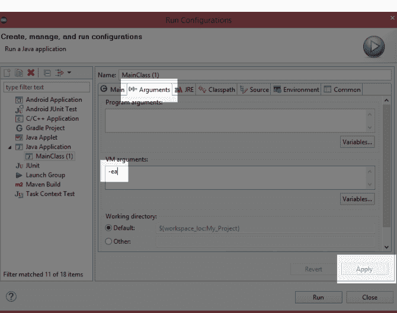

为了开启断言，选择 Arguments 选项卡并在 VM arguments 框中输入 `-ea`。完成此操作后不要忘记点击 Apply。在将 `-ea` 参数传递给 VM 之后，我们就可以使用断言了。

如果由于某种原因无法打开，`PrintWriter` 构造函数将抛出 `FileNotFoundException`。出于这个原因，我导入了 `java.io.FileNotFoundException` 并在 `main` 方法中添加了 `throws` 声明。

下一行使用写入器的 `println` 方法写入一行文本。`println` 方法接受一个字符串作为参数，并将字符写入文件，在末尾添加一个换行符。

最后，在最后一行使用 `writer.close()` 关闭写入器。我们必须确保关闭每个打开的文件，因为让应用程序同时读写文件是非常难以协调的，而且操作系统将不允许多个程序访问同一个文件。关闭你的文件，以便其他程序（或你程序的其他实例）访问该文件。

运行应用程序后，看起来好像什么都没有发生。但如果你在 Package Explorer（包管理器）中右键点击你的项目并选择“Refresh（刷新）”，在图 7 中，你会发现 Eclipse 现在在我们的包中包含了 "Example.txt" 文件。双击该文件即可查看我们想要打印的文本。

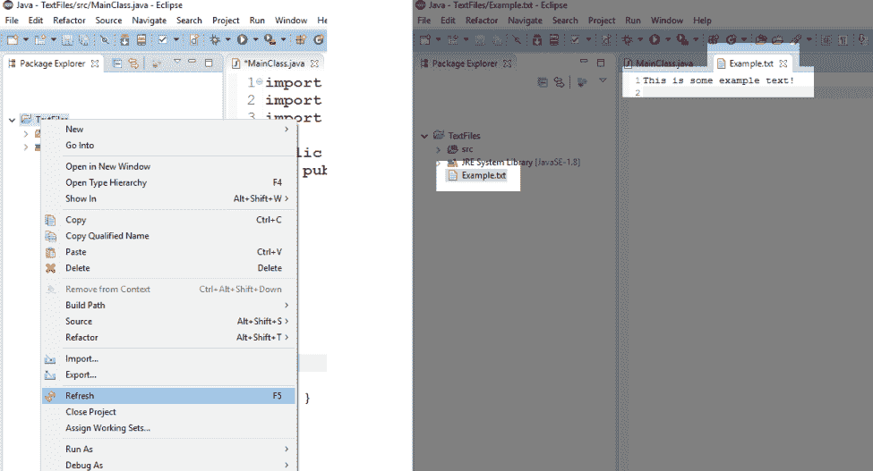

图 7：刷新以显示 Example.txt 文件

我们不希望在发生错误时关闭应用程序，与其在 `main` 方法中使用 `throws` 声明，通常做法是用 `try/catch` 包裹任何处理打开和保存文件的代码。代码列表 2.1 显示了与上面相同的程序，只不过它使用了 `try/catch` 来优雅地响应 `FileNotFoundException`。

### 代码列表 2.1：使用 Try/Catch 包裹

```java
import java.io.File;
import java.io.FileNotFoundException;
import java.io.PrintWriter;

public class MainClass {
    public static void main(String[] args) {
        // 创建文件。
        File myfile = new File("Example.txt");

        // 使用 try/catch 包裹文件操作。
        try {
            // 使用文件创建一个写入器。
            PrintWriter writer = new PrintWriter(myfile);

            // 向文件写入一行文本。
            writer.println("This is some text!");

            // 关闭写入器。
            writer.close();
        } catch (FileNotFoundException e) {
            // 如果文件无法打开，显示错误信息。
            System.out.println("The file could not be opened.");
        }
    }
}
```

你可能注意到，每次运行列表 2.1 中的代码时，文件中的数据都会被覆盖。我们也可以使用 `FileWriter` 类并在打开文件时将 `append` 参数设置为 `true` 来向文件中追加新数据（参见列表 2.2 中向文件追加文本的示例）。这在我们不希望覆盖日志数据时的日志记录非常有用。

### 代码列表 2.2：向文件追加文本

```java
import java.io.FileWriter;
import java.io.IOException;
import java.io.PrintWriter;

public class MainClass {
    public static void main(String[] args) {
        try {
            // 使用 "append" 参数为 "true" 创建文件写入器：
            FileWriter file = new FileWriter("Example.txt", true);

            // 从文件创建写入器对象：
            PrintWriter writer = new PrintWriter(file);

            // 写入一些新文本：
            writer.println("This text will be added to the end!");

            // 关闭写入器：
            writer.close();
        } catch (IOException e) {
            e.printStackTrace();
        }
    }
}
```

我们可以将数据和变量写入文本文件，但必须意识到，当我们读取数据时必须对其进行解析。代码列表 2.3 显示了序列化部分中向文本文件写入数据的示例。

### 代码列表 2.3：向文本文件写入数据/变量


```java
import java.io.File;
import java.io.FileNotFoundException;
import java.io.PrintWriter;

public class Main {
    public static void main(String[] args) {
        try {
            File file = new File("test.txt");
            PrintWriter out = new PrintWriter(file);
            // 写入文本
            out.println("Be good. If can't be good, lucky!");

            // 字符/布尔/双精度都是人类可读的：
            out.println(129); // 整数
            out.println(2.713f); // 浮点数
            out.println(true); // 布尔
            out.println(1.6834); // 双精度
            // 使用后关闭写入器以便其他程序使用：
            out.close();
        } catch (FileNotFoundException e) {
            System.out.println("File not found: " + e.getMessage());
        }
    }
}
```

注意，运行应用程序后，当你刷新项目并打开 `test.txt` 时，文件将包含以下：

Be good. If can't be good, lucky!

129

2.713f

true

1.6834

Alan Davis

这些数字是人类可读的，例如 `2.713f` 看起来和代码中基本一样。这与计算机实际存储 `float` 的方式非常不同。注意插入到文件的 `\n\t`。这些符号被称为转义序列。

- **提示**：如果你想找到文件在计算机上的位置，请导航到项目文件夹。你可以通过在 Package Explorer 中右键点击项目并选择 Properties（属性），这将显示属性对话框。或者，你可以在 Package Explorer 中右键点击文件并选择 Show In（显示），这将在 Windows Explorer 中打开文件位置。

## 转义序列

在继续之前，让我们简要了解一下转义序列。我们在屏幕上打印文本时，有时我们需要使用特殊符号来添加换行、制表符或字符。转义序列可以用于 Java 中任何写入字符串到屏幕或文件的。这包括 `System.out` 和 `PrintWriter.println`。表 1 显示了 Java 中的转义序列。

> **注意**：转义序列并不是字符串固有的。没有任何关于 `\t` 能让 JVM 自动打印制表符。转义序列是处理字符串的方法（如 `println`）中的程序行为。

表 1：转义序列

| 转义序列 | 含义 |
| :--- | :--- |
| `\t` | 制表符 |
| `\b` | 退格 |
| `\n` | 换行 |
| `\r` | 回车 |
| `\f` | 换页 |
| `\'` | 单引号 |
| `\"` | 双引号 |
| `\\` | 反斜杠 |

### 代码 2.4：转义序列示例

```java
// \n 导致换行：
System.out.println("First line\nSecondline!");
```

我们读取文件的顺序必须与写入的顺序匹配。当从文件中读取数值字符时，它必须匹配数据类型，否则将抛出异常（例如，我们无法读取 "one" 或 "1" 并期望 Java 自动将此文本转换为整数 1）。重要的是，数据到数值变量的读取和转换非常慢。我们通常不这样写入变量，而是更多地使用文本文件进行字符串。

## 从文件读取

我们可以使用 scanner 从文件中读取。这与从控制台读取类似，只不过不是创建 scanner 并传递 `System.in`，而是传递我们的文件。代码 2.5 显示了从列表 2.3 读取文本的示例。

### 代码 2.5：从文本文件读取

```java
import java.io.File;
import java.io.FileNotFoundException;
import java.util.Scanner;

public class MainClass {
    public static void main(String[] args) {
        File file = new File("test.txt");

        try {
            // 从文件创建一个 scanner：
            Scanner in = new Scanner(file);

            // 将前两行读取到一个字符串：
            String s = in.nextLine() + in.nextLine();

            // 读取变量：
            int i = in.nextInt();
            float f = in.nextFloat();
            boolean b = in.nextBoolean();
            double d = in.nextDouble();

            // 关闭 scanner：
            in.close();

            // 打印结果：
            System.out.println(
                "String: " + s + "\n" + 
                "int: " + i + "\n" + 
                "float: " + f + "\n" + 
                "boolean: " + b + "\n" + 
                "double: " + d
            );
        } catch (FileNotFoundException e) {
            e.printStackTrace();
        }
    }
}
```

## 序列化

我们经常想要保存对象以便在机器关闭并重新启动后恢复它们。将对象转换为机器保存到磁盘格式的行为被称为序列化。我们可以采用前面的文本读取/写入方法和指定每个成员变量以保存到文本文件中，但这种技术很慢，并且要求我们在类中指定每个要保存的成员变量，还要确保读取成员的顺序与我们写入顺序完全一致。

与其对对象编辑文本文件，我们可以将其序列化并读写到二进制文件中。为了让我们的对象可序列化，我们必须实现 `Serializable` 接口。该接口需要导入 `java.io.Serializable`。代码列表 2.6 显示了一个实现 `Serializable` 的基础类。

## 对象序列化

有很多方法可以将数据保存到磁盘。当我们序列化一个对象时，通常使用 `ObjectOutputStream`，它是一个接收对象并将对象从内存中的表示转换为磁盘表示的类（即序列化对象）。当我们需要反序列化或将对象从磁盘读取到程序中时，我们通常使用 `ObjectInputStream` 来执行从磁盘表示回内存表示的转换。

### 代码列表 2.6：实现 Serializable 接口

```java
public class Animal implements Serializable {
    // 成员变量
    float height;
    String name;
    boolean extinct;

    // 构造函数
    public Animal(String name, float height, boolean extinct) {
        this.name = name;
        this.height = height;
        this.extinct = extinct;
    }

    // 输出方法
    public void print() {
        System.out.println("Name: " + name + "\n" +
            "Height: " + height + "\n" +
            "Extinct: " + extinct + "\n");
    }
}
```

在代码列表 2.6 中，我们必须向类添加的唯一内容就是 `implements Serializable`（我们将在下一章详细介绍接口和 `implements` 关键字）。Java 会为我们处理其余工作。现在我们有了一个可序列化的类，我们需要创建一些对象，然后它们保存到磁盘。代码列表 2.7 显示了如何使用序列化将一个 `Animal` 对象写入磁盘。

### 代码列表 2.7：序列化对象

```java
import java.io.File;
import java.io.FileNotFoundException;
import java.io.FileOutputStream;
import java.io.IOException;
import java.io.ObjectOutputStream;
import java.io.Serializable;

public class Main implements Serializable {
    public static void main(String[] args) throws FileNotFoundException, IOException {

        // 从我们的 Serializable 类创建一些动物：
        Animal stego = new Animal("Stegosaurus", 12.5f, true);
        Animal croc = new Animal("Croccodile", 3.2f, false);
        Animal mozzle = new Animal("Mosquito", 0.2f, false);

        // 输出到控制台：
        stego.print();
        croc.print();
        mozzle.print();

        // 指定我们的文件名：
        File file = new File("animals.dat");

        // 创建用于写入文件的 FileOutputStream：
        FileOutputStream fileOutput = new FileOutputStream(file);

        // 创建用于写入序列化对象的输出流
        ObjectOutputStream objectOutput = new ObjectOutputStream(fileOutput);

        // 将我们的对象写入流：
        objectOutput.writeObject(stego);
        objectOutput.writeObject(croc);
        objectOutput.writeObject(mozzle);

        // 关闭流：
        objectOutput.close();
        fileOutput.close();
    }
}
```

代码列表 2.7 显示了从类创建可序列化对象、打开文件流和对象流的步骤。

如果我们运行代码列表 2.7 中的程序，然后检查文件内容（在 Package Explorer 中刷新项目，双击文件打开其内容），我们将看到它不再包含人类可读的数据，而是二进制数据（见图 8）。


图 8：序列化对象

显示了三个对象序列化后 `animals.dat` 文件的内容。文件内容不可读，虽然有一些散乱的单词，但文件的大部分由乱码（对人类而言）组成。当我们需要恢复对象的精确值时，该文件目前包含了非常快速且易于计算的数据。

```java
// 反序列化未知数量的对象：

// 声明一个数组来存储读取的动物：
ArrayList<Animal> animals = new ArrayList<Animal>();

// 创建一个文件和一个对象输入流：
FileInputStream fileInput = new FileInputStream(file);

ObjectInputStream objectInput = new
ObjectInputStream(fileInput);
try {
    // 读取文件中指定的所有动物，
    // 将它们存储在列表中：
    for(;;) {
        animals.add((Animal) objectInput.readObject());
    }
} catch (EOFException e) {
    // 我们在这里不需要做任何事情；当所有对象都
    // 读取完毕时，这是上述循环的正常结束。
}

// 关闭流：
objectInput.close();
fileInput.close();
for(Animal a: animals) {
    a.print();
}
```

# 第3章 多态

多态（Polymorphism）是一个术语，指的是代码在每次执行时可能表现出不同的行为。在 Java 中有许多类型的多态，但该术语通常指面向对象编程中的一种特定机制。我们的目标是定义一个带有某些方法或多个方法的父类，然后定义多个继承并为方法定义不同代码的类。然后，当使用子类执行该方法时，子类将执行它们自己特定版本的方法。

为了说明相同代码如何表现出不同的行为，想象一下我们正在创建一个游戏（我们将在本电子书的最后一章实现一个游戏）。在游戏中，通常有一个由对象、非玩家角色（NPC）和玩家组成的虚拟世界。游戏中的每个对象都能移动，这意味着我们可以创建一个带有抽象方法 `move` 的通用 `GameObject` 类（如代码列表15所示）。

## 抽象类

### 代码 3.0: GameObject 类

```java
// 抽象父类：
public abstract class GameObject {
    // 抽象方法：
    public abstract void move();
}
```

注意 `GameObject` 类被标记了 `abstract`（抽象）关键字。这是一种安全措施——我们不想从通用的 `GameObject` 类创建任何实例，因此我们将其标记为抽象以防止实例的创建。任何带有一个或多个抽象方法的类都必须被标记为抽象。该类拥有 `move` 方法，它是抽象的，因此整个类必须是抽象的。如果你尝试创建 `GameObject` 类的实例，Eclipse 将给出一个错误：无法创建，因为我们无法在 `GameObject` 中为 `move` 定义方法体并完全移除抽象关键字，但这样做可能并不明智——为了让我们我们游戏中的对象有用，它必须是某种特定类型，而不仅仅是通用的“无名”。

注意 `move` 方法没有方法体。它只包含一个带有分号的声明。我们表示存在另一个类（或多个类）能够执行 `move` 功能。我们可能想将这些其他类的实例称为 `GameObject` 对象，但它们必须指定 `move` 方法的作用，或者它们本身是抽象的。

现在让我们定义一些继承自 `GameObject` 类的类。当 NPC 移动时，我们在玩家移动时必须执行不同的代码。NPC 由计算机控制，它们通常采用某种人工智能（AI）的形式来与玩家交流或在城镇里闲逛。相反，玩家不受计算机控制。玩家需要用户的输入。因此，我们可以从 `GameObject` 类创建两个派生类，称为 `NPC` 和 `Player`，如代码列表 3.1 和 3.2 所示。

### 代码列表 3.1: NPC 类

```java
public class NPC extends GameObject {
    public void move() {
        System.out.println("店主在无目的地地闲逛...");
    }
}
```

### 代码列表 3.2: Player 类

```java
public class Player extends GameObject {
    public void move() {
        System.out.println("轮到玩家移动...");
        // 轮询键盘或读取鼠标移动等。
    }
}
```

在代码列表 3.1 和 3.2 中，我们使用 `extends` 关键字定义了继承自 `GameObject` 类的子类。`extends` 关键字意味着 `GameObject` 类中的所有的成员变量和成员方法也属于这个类。我们创建的被称为类层次结构（class hierarchy），类似于家族树。父类位于顶部，定义了下级类继承的所有元素（见图9）。下级类描述比父类更具体的项目。在我们的案例中，父类描述了一个通用方法，而子类定义了它的含义。

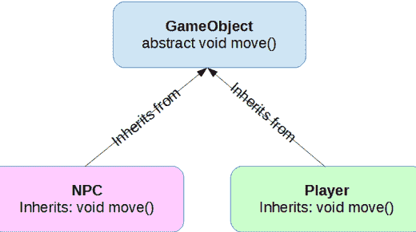

图9: GameObject 类层次结构

现在我们可以将游戏中的所有对象存储在一个集合中，并可以通过遍历集合调用 `move` 方法——这两种都是源自类层次结构的优势。

我们可以创建 `NPC` 和 `Player` 的实例并将它们存储在 `GameObject` 集合中。所有的 NPC 都是 `GameObject`，所有的 `Player` 类实例也是 `GameObject`。代码列表 3.3 显示了一个示例方法，它使用了 `GameObject` 集合，但利用多态来调用两个不同版本的 `move`。


### 代码列表 3.3: 多态

```java
public class MainClass {
    public static void main(String[] args) {
        // 在我们的游戏中创建5个对象。
        GameObject[] gameObjects = new GameObject[5];

        // 第一个对象是玩家。
        gameObjects[0] = new Player();

        // 其他对象是 NPC。
        for(int i = 1; i < 5; i++) {
            gameObjects[i] = new NPC();
        }

        // 调用游戏中所有对象的 move。
        for(int i = 0; i < 5; i++) {
            gameObjects[i].move();
        }
    }
}
```

代码 3.3 中的高亮行是多态的示例。当循环第一次迭代时，局部变量 `i` 将设置为 0，这将调用 `Player.move()`。运行代码 3.3 的应用程序，输出如下：

轮到玩家移动...

店主在无目的地地闲逛...

店主在无目的地地闲逛...

店主在无目的地地闲逛...

店主在无目的地地闲逛...

注意：在 Java 中，子类只能有一个父类。某些语言允许多个父类（多重继承），但 Java 只允许一个。然而，Java 允许子类实现多个接口。

## 方法覆盖

抽象父类可以包含成员方法。在之前的示例中，`GameObject` 类可能包含指定对象位置的 `x` 和 `y` 变量。我们可以定义一个输出对象信息的方法（代码列表 3.4）。

### 代码列表 3.4: 非抽象父类方法

```java
// 抽象父类：
public abstract class GameObject {
    // 成员变量：
    int x, y;

    // 非抽象方法：
    public void print() {
        System.out.println("Position: " + x + ", " + y);
    }

    // 抽象方法：
    public abstract void move();
}
```

继承代码 3.4 中 `GameObject` 类的类将自动拥有父类的 `x` 和 `y` 变量。它们还会继承 `print` 方法，该方法不是抽象的。如果我们在主方法中添加一个循环为我们的五个对象调用 `print`（代码列表 3.5），每个对象将使用目前为止定义的唯一 `print` 方法——父类的 `print` 方法。

### 代码列表 3.5: 调用父类的 print 方法

```java
public class MainClass {
    public static void main(String[] args) {
        // 与之前的代码相同

        // 调用游戏中所有对象的 print。
        for(int i = 0; i < 5; i++) {
            gameObjects[i].print();
        }
    }
}
```

代码列表 3.5 的输出如下：

```
Position: 0, 0
Position: 0, 0
Position: 0, 0
Position: 0, 0
```

然而，如果我们在其中一个子类中定义了一个与父类方法签名完全相同的 `print` 方法，我们会发现子类可以重写父类的方法。代码列表 3.6 显示了与原始 `Player` 类相同的代码，但这次我重写了父类的 `print` 方法。

### 代码列表 3.6: 重写父类方法

```java
public class Player extends GameObject {
    public void move() {
        System.out.println("It is the player's move...");
        // 轮询键盘或读取鼠标移动等等
    }

    @Override
    public void print() {
        System.out.println("Player position: " + x + ", " + y);
    }
}
```

首先，注意到 `@Override` 注解是可选的。代码列表 3.6 中 `Player` 类的 `print` 方法名称与父类的 `print` 方法完全相同，参数和返回类型也完全相同。现在，当我们运行 `main` 方法时，我们会看到 `Player` 对象调用了它自己的 `print` 版本，而 `NPC` 对象（没有定义特定的 `print` 函数）则调用父类的 `print`。我们说 `Player` 类重写了 `print` 方法。

## 构造函数

构造函数是用于创建对象新实例的方法。抽象类可以提供构造函数，尽管我们不允许创建它的实例。在代码列表 3.7 中，`GameObject` 类定义了一个构造函数，将 `x` 和 `y` 值设置为 -1。

### 代码列表 3.7: 抽象父类中的构造函数

```java
public abstract class GameObject {
    int x, y;

    public GameObject() {
        x = y = -1;
    }

    public void print() {
        System.out.println("Position: " + x + ", " + y);
    }

    public abstract void move();
}
```

如果我们不更改其他内容并运行程序，我们将看到每个子对象都会自动调用父类的构造函数：

Player position: -1, -1

Position: -1, -1

Position: -1, -1

Position: -1, -1

Position: -1, -1

然而，我们也可以为子类指定构造函数。代码列表 3.8 显示了拥有自己的构造函数的 `Player` 类。

### 代码列表 3.8: Player 类的构造函数

```java
public class Player extends GameObject {

    // 构造函数
    public Player() {
        x = y = 100; // 让玩家从 100x100 开始
    }

    public void move() {
        System.out.println("It is the player's move...");
        // 轮询键盘或读取鼠标移动等等。
    }

    @Override
    public void print() {
        System.out.println("Player position: " + x + ", " + y);
    }
}
```

运行应用程序将显示调用 `Player` 构造函数来实例化 `Player` 对象，而所有的 `NPC` 都调用父类构造函数，因为它们没有定义自己的构造函数。

## super 关键字

当我们需要在子类内部引用父类时，我们使用 `super` 关键字。例如，代码列表 3.9 显示了如何在 `Player` 构造函数内部调用 `GameObject` 构造函数。

### 代码列表 3.9: 子类构造函数调用父类构造函数

```java
// 构造函数
public Player() {
    // 调用父类的构造函数。
    super();

    x = y = 100; // 让玩家从 100x100 开始。
}
```

当我们使用 `super()` 调用父类构造函数时，它必须是子类构造函数中的第一个语句。这在调用父类构造函数时才有效。如果你想调用父类的其他方法版本，可以在子类重写方法的任何一点。

## instanceof 关键字

在继续接口之前，可以使用 `instanceof` 关键字来测试对象的类型。代码列表 3.10 中的 `main` 方法使用了与之前相同的类层次结构。

### 代码列表 3.10: 使用 instanceof 测试

```java
public class MainClass {
    public static void main(String[] args) {
        // 定义一些对象：
        GameObject someObject = new Player();

        // 测试第一个对象是否为 GameObject。
        if (someObject instanceof GameObject) {
            System.out.println("It is a GameObject");
        } else {
            System.out.println("It is not a GameObject");
        }

        // 测试第一个对象是否为 Player
        if (someObject instanceof Player) {
            System.out.println("It is a Player");
        } else {
            System.out.println("It is not a Player");
        }

        // 测试第一个对象是否为 NPC
        if (someObject instanceof NPC) {
            System.out.println("It is an NPC");
        } else {
            System.out.println("It is not an NPC");
        }
    }
}
```

同样，我们返回 0。对于每个实现 `Comparable` 接口的类，我们需要定义实例之间相互大于和小于的含义。我选择的含义是基于点的绝对幅值（即到二维平面上 0 点的距离，即 `(x*x+y*y)` 的平方根）。你会注意到我使用了包装类 `Double`，因为原生的 `double` 没有实现 `Comparable` 接口，而包装后的版本 `Double` 实现了。在计算出此点与 `o` 之间的距离后，我们调用 `Double.compareTo` 并返回结果。我还在代码末尾包含了一段注释，粗要说明了 `Double.compareTo` 方法的行为。

现在我们已经有一个实现了 `Comparable` 接口的类，可以从我们的 `Point` 类创建一个实例集合，并使用标准的 Java 排序对其进行排序。接下来，让我们创建一个名为 `MainClass` 的新类。该类的代码如代码列表 3.12 所示。

### 代码列表 3.12: Comparable对象的排序

```java
import java.util.ArrayList;
import java.util.Collections;

public class MainClass {
    public static void main(String[] args) {
        // 演示中的点总数：
        int numberOfPoints = 5;

        // 创建随机点列表：
        ArrayList<Point> points = new ArrayList<Point>();
        for(int i = 0; i < numberOfPoints; i++)
            points.add(new Point(Math.random() * 100));

        // 打印未排序的点：
        System.out.println("Unsorted: ");
        for(int i = 0; i < numberOfPoints; i++)
            points.get(i).print();

        // 对 Comparable 对象集合排序：
        Collections.sort(points);

        // 打印排序后的点：
        System.out.println("Sorted: ");
        for(int i = 0; i < numberOfPoints; i++)
            points.get(i).print();
    }
}
```

```java
// 按反序排序项（从大到小）：
points.sort(Collections.reverseOrder());

// 打印反序排序的点：
System.out.println("Sorted in Reverse: ");
for(int i = 0; i < numberOfPoints; i++)
    points.get(i).print();
```

在代码列表 3.12 中，我们使用 `Collections.sort` 和 `points.sort(Collections.reverseOrder)` 来对点进行排序，并进行反序排序。这些排序方法设计用于任何实现 `Comparable` 接口的对象。这意味着我们不需要编写快速排序（或其他算法），也不需要费费精力在数组中交换元素以及在 `ArrayList` 中高效地比较它们。相反，我们只需要实现 `Comparable` 接口，我们的任何对象列表都可以被排序！

# 第 4 章 匿名类

匿名函数和类直接出现在代码中。它们不是声明在调用函数的体外部，而是内联在代码中的，并且它们没有名称（因此被称为“匿名”）。它们通常用于定义仅在代码中某处需要一次的功能或类。为了使用匿名类，我们必须实现一个接口或扩展一个现有类。匿名类是一个子类；它是一个未命派生类，用于实现或扩展父类的的功能。我们将在第 7 章的计算器应用程序事件处理中大量使用匿名类。

### 代码列表 4.0: 匿名内部类与类实例

```java
public class MainClass {
    // 父类
    static class OutputLyrics {
        public void output() {
            System.out.println("No lyrics supplied...");
        }
    }

    public static void main(String[] args) {
        // 从 OutputLyrics 类创建一个普通实例。
        OutputLyrics regularInstance = new OutputLyrics();

        // 匿名内部类
        OutputLyrics anonymousClass = new OutputLyrics() {
            public void output() {
                System.out.println("Desmond has a barrow in the market place.");
            }
        };

        // 调用输出方法：
        regularInstance.output();

        // 使用匿名类：
        anonymousClass.output();
    }
}
```

代码列表 4.0 展示了匿名内部类的基础示例。首先，我们定义了一个父类，称为 `OutputLyrics`。该类包含一个方法，可以将字符串文本打印到屏幕输出。在 `main` 方法内部，我们创建了 `OutputLyrics` 类的实例。注意下一行用注释 `// Anonymous Inner Class` 标记的部分非常重要——我们定义并声明了一个派自 `OutputLyrics` 类的新类，并定义了自己的 `output` 方法。注意，我们正在从一个派生类创建实例，该实例被称为 `anonymousClass`，但类本身没有名称。匿名类的语法与从现有父类创建实例的语法相同，不同在于定义之后紧跟着一个定义该类的代码块。代码列表 4.1 显示了代码列表 4.0 中的重要行。

### 代码列表 4.1: 匿名类

```java
// 匿名内部类
OutputLyrics anonymousClass = new OutputLyrics() {
    public void output() {
        System.out.println(
            "Desmond has a barrow in the market place.");
    }
}
```

代码列表 4.1 的第一行没有以分号结尾，不像典型的对象定义那样。相反，我们开启了一个代码块并重写了 `output` 方法。以这种方式声明匿名内部类是一个语句，分号实际上位于代码块关闭之后。

当我们调用 `regularInstance` 的 `output` 方法时，程序将在输出中打印 "No lyrics supplied..."。这是 `OutputLyrics` 对象的正常行为。然而，当我们调用匿名类的 `output` 方法时，它将输出歌词 "Desmond has a barrow in the market place."

## 将匿名类作为参数

代码列表 4.0 的示例是非常浅显的——它展示了使用匿名类的基本语法，但并不是我们为什么要使用这种机制的良好示例。当我们需要将功能作为参数传递给方法时，经常会使用匿名类。例如，如果我们知道要在两个整数之间执行某些操作并返回结果，我们可以使用派自操作类的匿名类，如代码列表 4.2 所示。

### 代码列表 4.2: 将匿名内部类作为参数


# 匿名内部类示例

```java
public class MainClass {
    // 父类
    public static abstract class Operation {
        public abstract int execute(int a, int b);
    }

    public static void main(String[] args) {
        int x = 10;
        int y = 20;

        // 使用匿名类进行加法
        Operation addition = new Operation() {
            @Override
            public int execute(int a, int b) {
                return a + b;
            }
        };
        System.out.println("Addition: " + addition.execute(x, y));

        // 使用匿名类进行减法
        Operation subtraction = new Operation() {
            @Override
            public int execute(int a, int b) {
                return a - b;
            }
        };
        System.out.println("Subtraction: " + subtraction.execute(x, y));
    }
}
```

```java
interface MathOperation {
    public int operation(int a, int b);
}
```

// 接收 `MathOperation` 对象作为参数的方法。

```java
static int performOperation(int a, int b, MathOperation op) {
    return op.operation(a, b);
}
```

```java
public static void main(String[] args) {
    // 一些变量
    int x = 100;
    int y = 97;

    // 使用加法调用 `performOperation` 函数：
    int resultOfAddition = performOperation(x, y, new MathOperation() {
        public int operation(int a, int b) {
            return a + b;
        }
    });

    // 使用减法调用 `performOperation` 函数：
    int resultOfSubtraction = performOperation(x, y, new MathOperation() {
        public int operation(int a, int b) {
            return a - b;
        }
    });

    // 输出加法结果: 197
    System.out.println("Addition: " + resultOfAddition);

    // 输出减法结果: 3
    System.out.println("Subtraction: " + resultOfSubtraction);
}
```

在列表 4.4 中，相关的更改已用黄色标出。接口完全由抽象方法组成，因此 `MathOperation` 接口中定义的 `operation` 方法不再有方法体。

到目前为止我们看到的示例展示了匿名内部类的基本语法——它们并没有说明这种机制最常见的用法。内部类最常用的用途是为事件驱动编程中的回调提供功能。我们将在第 7 章的 GUI 事件部分中看到内部类的广泛使用。其基本目标是节省代码。我们不需要声明一个类并创建一个实例来说明当用户点击鼠标或按下键盘按键时应该发生什么。相反，我们声明并定义一个匿名内部类，指定当这些事件发生时要采取的动作。这使得我们的代码更易读、更短，因为我们在需要该功能的地方（即事件创建的地方）定义了功能，而不是在某个外部类中定义该功能。

# 第 5 章 多线程

多线程是一种同时对多个执行单元进行编程的技术。传统上，计算机通过单个 CPU 执行代码运行。CPU 顺序执行指令，跳转到各种方法。CPU 执行代码的速度非常快，但任何 CPU 的执行速度都是限制的。现代 CPU 每秒可以执行数十亿条指令，但增加这种执行速度的代价非常高——硬件开始需要极端措施来防止 CPU 熔化或起火（例如，已经使用水甚至液氮来冷却速度极快的 CPU）。

幸运的是，我们可以在不增加单元时钟频率的情况下大幅提高 CPU 的性能。相反，制造商在单个晶片（die）上制作了多个执行单元（die 只是计算机内部用于刻蚀 CPU 的物理对象的术语）。这些单元被称为核心（cores），每个核心都可以被看作是一个独立的 CPU。

| 单核 | 双核 | 四核 |
| :--- | :--- | :--- |
| 任务 A: 5 秒 | 任务 A 前部分: 2.5 秒 | 任务 A 后部分: 2.5 秒 |
| | 任务 B 前部分: 2.5 秒 | 任务 B 后部分: 2.5 秒 |
| | 任务 A: 5 秒 | 任务 B: 5 秒 |
| | 任务 B: 5 秒 | |
| 执行时间: 10 秒 | 执行时间: 5 秒 | 执行时间: 2.5 秒 |

图 10: 多线程

图 10 显示了多核 CPU 的假设性最佳情况。在左侧，我们看到单核正在执行两个任务。单核首先执行任务 A，当任务 A 完成后，它执行任务 B。两个任务都需要五秒钟的 CPU 执行，因此总执行时间为 10 秒。

在图 10 的中间，双核 CPU 通过允许每个任务由其两个核心中的一个执行，从而同时执行任务 A 和 B。每个任务需要五秒钟进行计算，但任务是同时执行的，因此它们将同时完成，耗时五秒钟（加上少量的开销时间）。

最后，图 10 的右侧显示了四核 CPU。有时可以将任务拆分成几部分，在图中，我们分配了四核 CPU 的其中一个核心来执行任务 A 或 B 的一半。执行任务的一半需要 2.5 秒，所有四个核心在约 2.5 秒后完成。这种速度代表单核 CPU 性能的四倍。

图 10 显示了一个假设的情况。这是最好的情况，在实践中，任务往往不会容易地对半。然而，你可以看到随着核心数量的增加，核心共享工作负载的能力变得非常有用。通过采用多线程并巧妙地将工作负载分配到不同的核心，将应用程序的性能提高 20% 甚至 400% 通常是可行的。正如我们将看到的，特别是核心需要相互通信和协调彼此的操作，而且通常当我们添加另一个核心时，往往无法获得直接 100% 的速度提升。

## 线程 (Threads)

线程是一个执行单元。在 Java 中，线程是资源密集型的。创建和运行新线程需要时间，创建新线程会导致其他资源的分配（如栈内存）。我们不应该在循环中尝试创建和销毁线程。线程创建很慢，受限于硬件（例如核心数量、内存大小、CPU 速度等）。Java 有多种方法可以创建线程，我们将查看两种：实现 `Runnable` 接口和扩展 `Thread` 类。

## 调用堆栈 (Call stack)

当我们创建一个新线程时，它通常会在新的核心上执行。然而，核心和线程并不总是直接关联的。通常，操作系统会在核心之间切换线程的负载，给每个线程分配少量的时间（称为时间片）来执行部分代码。即使是单核 CPU 也可以通过快速切换线程、为每个线程在物理核心上分配一些时间片来模拟多线程。

### 图 11: 调试窗口

Eclipse 显示了运行应用程序的截图。展示的信息是调用堆栈。线程悬在 `Animal` 类的 18 行。程序已经执行了 `Animal.method`。

## 实现 Runnable

为了使用多线程，我们可以创建一个实现 `Runnable` 接口的类。这允许我们创建一个带有私有成员线程的类。`Runnable` 接口定义了一个抽象方法 `run()`，我们必须在派生类中实现它。当我们创建一个新线程时，它将执行此方法（可能使用与执行 `main` 方法的不同的核心）。注意，即使硬件只有双核 CPU，我们也可以创建四个或八个线程。

```java
public class MainClass {
    public static void main(String[] args) {
        // 定义线程对象：
        Thread t1 = new Thread("Ned");
        Thread t2 = new Thread("Kelly");

        // 启动线程
        t1.initThread();
        t2.initThread();
    }
}
```

代码列表 5.1：`Thread` 类

```java
public class Thread implements Runnable {

    // 私有成员变量:
    private Thread thread;
    private String name;

    // 构造函数:
    public Thread(String name) {
        this.name = name;
        System.out.println("Created thread: " + name);
    }

    // 初始化并启动线程:
    public void initThread() {
        System.out.println("Initializing thread: " + name);
        thread = new Thread(this, name);
        thread.start();
    }

    // 重写的 run 方法:
    public void run() {
        // 打印初始消息:
        System.out.println("Running thread: " + name);

        // 数到 10:
        for(int i = 0; i < 10; i++) {
            System.out.println("Thread " + name + " counted " + i);
        }

        try {
            // 等待 1 秒:
            Thread.sleep(1000);
        } catch (Exception e) {
            System.out.println("Error: " + e.getMessage());
        }
    }
}
```

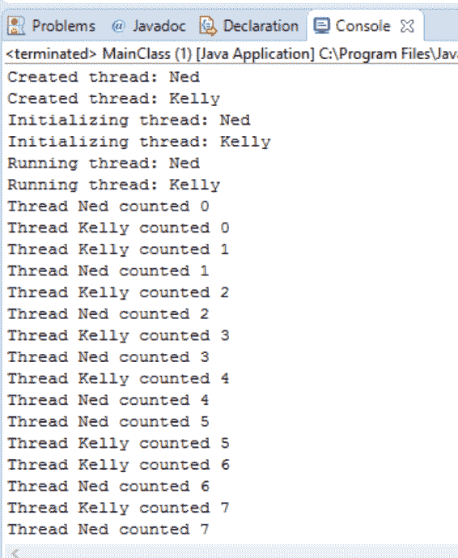

图 12：Ned 和 Kelly 的输出

图 12 显示了代码列表 5.0 和 5.1 中程序的一种可能输出。代码列表 5.1 显示了实现 `Runnable` 接口的 `Thread` 类，它定义了实现 `Runnable` 必需的 `run()` 方法。该类定义了一个名为 `thread` 的 `Thread` 对象，我们在 `initThread()` 方法中实例化它。当我们调用 `Thread` 对象的 `start()` 方法时，它反过来又会调用 `Runnable` 接口的 `run()` 方法。在 `run()` 方法中，我们从 0 数到九，每个数字之间暂停一秒。运行应用程序时，你将看到两个线程（在代码列表 5.0 的 `MainClass` 中创建）缓慢地数到九。

关于代码列表 5.0 和 5.1 中的程序，有几个重要的事实：

- 线程同时计数，因此程序执行仅需 10 秒。
- 线程计数的精确时机和顺序我们是不可知的（Ned 可能会莫名其妙地比 Kelly 数得快，反之亦然）。
- 如果你在多核桌面级 PC 上运行此应用程序，极有可能是 Ned 和 Kelly（我们的线程）将运行在机器内部的不同核心上。

## 并发

上述关于不确定精确执行顺序的这一点非常重要！当我们查看代码列表 5.0 和 5.1 中的代码时，我们无法判断会发生什么。Ned 可能数得更快，或者 Kelly 可能数得更快（两者大约每秒数一个数字，但在纳秒级层上，总会有一个线程胜过另一个）。

两个线程可能会随机计数——它们可以在每个数字处交换领先者，这样我们每次执行应用程序时都会得到不同的输出。Ned 和 Kelly 被称为“并发的”。如果你仅仅通过查看代码就能确定线程执行的顺序，那么这段代码就是并发的。假设并发线程的执行顺序永远是不安全的（事实上，并发意味着我们无法假设顺序！）。在协调并发线程时我们必须小心。我们无法通过代码判断会发生什么，因为 CPU 是如此复杂——它正在执行操作系统和数百个后台任务。它执行每个线程的时间片，并在物理核心上切换后台进程的开启和关闭。在这些指令的杂乱中某处，我们谦卑的 Ned 和 Kelly 线程将获得在核心上执行一段时间的时间。

```java
// 创建三个线程：
Thready t1 = new Thready("Ned");
Thready t2 = new Thready("Kelly");
Thready t3 = new Thready("Pole");
```

```java
// 初始化并运行线程。
t1.initThread();
t2.initThread();
t3.initThread();
```

```java
// 等待线程完成：
while(t1.isRunning()) {
}

while(t2.isRunning()) {
}

while(t3.isRunning()) {
}
```

```java
// 检查计数器的值：
System.out.println("All done!" + Thready.getJ());
```

现在让我们来看 `Thready` 类的三个版本，每个版本的 `run()` 方法都略有不同。

我只会在第一个示例中包含完整类的代码，因为代码列表 5.3 显示了 `Thready` 类的完整代码，尽管在这些代码中我刻意设计了这个类，使得线程容易发生竞态条件。

### 代码列表 5.3: 具有竞态条件的 Thready 类

```java
public class Thready implements Runnable {

    // 共享资源：
    public class Counter {
        private int j;

        public Counter() {
            j = 0;
        }

        public int getJ() {
            return j;
        }
    }

    // Thready 成员变量
    private Thread thread;
    private String name;
    private boolean running = true;

    // 静态共享资源：
    private static Counter counter = null;

    // Getter：
    public static int getJ() {
        return counter.getJ();
    }

    public boolean isRunning() {
        return running;
    }

    // 构造函数
    public Thready(String name) {
        // 创建共享资源
        if(counter == null) {
            counter = new Counter();
        }

        // 赋值名称
        this.name = name;

        // 打印消息
        System.out.println("Created thread: " + name);
    }

    public void initThread() {
        // 打印消息
        System.out.println("Initializing thread: " + name);

        // 创建线程
        thread = new Thread(this, name);

        // 调用 run
        thread.start();
    }

    public void run() {
        for(int q = 0; q < 10000; q++) {
            counter.j++; // 竞态条件！！！
        }

        running = false;
    }
}
```

代码列表 5.3 中标记有“RACE CONDITION!!!”注释的行。代码列表 5.2 中的主方法创建了三个线程：Ned、Kelly 和 Pole。所有三个线程都试图在它们的 `run()` 方法中增加共享计数器 `j` 值，但它们是在没有协调的情况下同时进行的。竞态条件是灾难性的，为了证明它们的影响远超我们的预期，请运行程序几次，并见证主方法报告的最终值。主方法几乎不会计数到预期的 30,000（即我们期望每个线程增加 10,000 次时所得到的值）。它报告的可能是 12,672 或 13,722。它似乎会报告任何数字，我们知道为什么——线程在增加它们自己的共享资源副本，并且偶尔才会写入成功的更新！让我们花点时间实现一个互斥锁（mutex），看看是否可以修复对共享资源的访问。

### 代码列表 5.4: 使用互斥锁 1（慢速方法）

```java
public void run() {
    for(int q = 0; q < 10000; q++) {
        synchronized (counter) {
            counter.j++;
        }
    }

    running = false;
}
```


`run` 方法的第二个版本稍微好一些（代码列表 5.4）。我们使用了 `synchronized` 关键字，以共享资源为键来锁定内部循环（这个锁就是一个互斥锁）。`synchronized` 关键字接受一个资源进行同步，其后面跟着一个代码块。一次时间只有一个线程可以执行 `synchronized` 代码块，因此 `counter.j++` 这一行是临界区。线程将等待锁（互斥锁）释放，然后进入临界区，增加 `counter.j`，最后释放锁。

获取和释放锁需要时间。最终，我们希望线程在同步之前尽可能地独立工作。如果你使用新的 `run` 方法版本运行应用程序（请不要这样做），你可能需要等待很长时间，让线程释放大约 30,000 次锁并增加 `counter.j`。它们最终会完成，但可能需要 10 分钟或一小时。代码列表 5.5 显示了更好的方法。

> **注意**：你也可以用 `synchronized` 关键字标记方法。当我们把方法标记为 `synchronized` 时，意味着该方法一次只能由一个线程使用。然而，我们必须非常小心，因为 `synchronized` 方法实际上是以 `this` 关键字作为锁对象进行同步的。如果在类中有一个 `synchronized` 方法并尝试创建该类的多个线程，线程将不会进行同步，因为它们都将使用自己作为锁。

## 代码列表 5.5：使用互斥锁 2（快速方法）

```java
public void run() {
    for(int q = 0; q < 10000; q++) {
        synchronized (counter) {
            counter.j++;
        }
    }

    running = false;
}
```

# 第 6 章 GUI 编程简介

在本章中，我们将介绍 Java 提供的一些机制，这些机制允许我们设计和实现图形用户界面（GUI）。在下一章中，我们将使用窗口生成器创建一个带有 GUI 的应用程序，但为了让代码具有意义，我们必须学习如何手动构建 GUI。

在 Java 中，我们可以使用两个包之一为用户提供 GUI——抽象窗口工具包（AWT）或 Swing。AWT 已经在很大程度上被 Swing 取代，本章将介绍如何使用 Swing 进行 GUI 编程。Swing 工具包是 AWT 的封装，这意味着在使用 Swing 工具包进行编程时，我们需要同时导入 Swing 和 AWT。

GUI 是通过在窗口上放置控件（如按钮、图片框、组合框等）创建的。用户使用鼠标或键盘与控件交互。Swing 控件的名称以字母 J 开头，例如 `JFrame` 和 `JButton`。

从创建一个新项目开始。我将我的项目命名为 GUITesting。如代码列表 6.0 所示，添加一个继承 `JFrame` 类的类。`JFrame` 是窗口——它在右上角有一个控制框，允许用户关闭窗口，并且窗口可以像普通窗口一样在用户的桌面上调整大小和移动。

> **代码列表 6.0：MainWindow.java**

```java
import java.awt.*;
import javax.swing.*;

public class MainClass extends JFrame{
    // Main 方法
    public static void main(String[] args) {
        MainClass mainWindow = new MainClass();
    }

    // 构造函数
    public MainClass() {
        // 设置窗口的大小。
        this.setSize(640, 480);

        // 设置窗口关闭时应用程序关闭。
        this.setDefaultCloseOperation(EXIT_ON_CLOSE);

        // 设置窗口为可见。
        this.setVisible(true);
    }
}
```

代码列表 6.0 显示了一个名为 `MainClass` 的简单类，它创建并显示了一个空白窗口（见图 14）。该类包含 `main` 方法，该方法的作用除了创建一个名为 `mainWindow` 的新 `MainClass` 对象外没有其他作用。在构造函数中，我们将窗口的大小设置为 640x480 像素，并将可见性设置为 `true`。注意该类继承（`extends`）`JFrame` 类。`setDefaultCloseOperation` 方法导致我们在关闭窗口时关闭应用程序。如果没有调用 `setDefaultCloseOperation`，即使用户关闭了窗口，应用程序也会继续在后台运行。


图 14：空白 JFrame

为了添加控件，我们可以创建一个新的 `JPanel` 对象。`JPanel` 是包含其他控件的控件。你也可以通过创建一个 `Container` 对象并调用 `this.getContent()` 方法直接将控件添加到 `JFrame` 本身，但我们将使用 `JPanel`。代码列表 6.1 显示了如何向项目中创建并添加新的 `JPanel` 以及一些控件。

## 代码列表 6.1：向 JPanel 添加控件

```java
// 构造函数
public MainClass() {
    // 创建一个 JPanel
    JPanel panel = new JPanel(new FlowLayout());

    // 添加一些控件。
    panel.add(new JLabel("Test Button: "));
    panel.add(new JButton("Click me!"));

    // 将当前内容面板设置为该面板。
    this.setContentPane(panel);

    // 设置窗口的大小。
    this.setSize(640, 480);

    // 设置窗口关闭时应用程序关闭。
    this.setDefaultCloseOperation(EXIT_ON_CLOSE);

    // 设置窗口为可见。
    this.setVisible(true);
}
```

为了在代码列表 6.1 中添加标签和按钮，我们使用了 `JPanel` 的 `add` 方法。该方法需要一个控件，而每个控件都有一个接收 `String` 的构造函数。该 `String` 通常用作控件在屏幕上显示时的标题。图 15 显示了代码列表 6.1 中的标签和按钮。

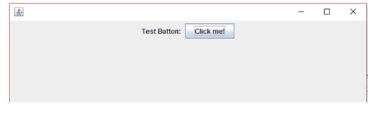

注意在代码列表 6.1 中，我们在构造函数中创建了 `JPanel` 并指定了布局。当我们向 `JPanel` 添加控件时，`JPanel` 会根据布局进行组织。`FlowLayout` 实际上是 `JPanel` 的默认布局。使用 `FlowLayout`，所有控件将以单行方式添加。表 2 包含了所有的布局以及对各种布局的简要描述。如需更多信息，请访问 https://docs.oracle.com/java/tutorial/Swing/layout/visual.html。

## 表 2：布局

| 布局 | 描述 |
|---|---|
| BorderLayout | 面板被分为顶、底、左和中间。 |
| BoxLayout | 将控件置于单行或单列。 |
| CardLayout | 允许我们在几组控件之间切换。 |
| FlowLayout | 将控件排列在单行中。 |
| GridBagLayout | 在网格中排列控件，其中控件可以占据多个单元格。 |
| GridLayout | 在网格中排列控件。 |
| GroupLayout | 分别提供水平和垂直布局；为 GUI 生成器设计。 |
| SpringLayout | 根据位置之间的关系布局控件；为 GUI 生成器设计。 |

控件是 GUI 的核心。每种控件类型都有特殊用途。类通常为控件提供特定方法，但许多方法适用于所有控件，如代码列表 6.2 所示。

## 代码列表 6.2：有用的控件方法

```java
JButton btn = new JButton("Initial Text");

// 有用的控件方法：
btn.setText("New text"); // 设置按钮上的文本。
String text = btn.getText(); // 读取当前文本。
btn.setVisible(false); // 从视图隐藏控件。
btn.setVisible(true); // 显示控件。
btn.setMargin(new Insets(100, 100, 100, 100)); // 设置边距。
Dimension dim = btn.getSize(); // 读取控件的大小。
btn.setBackground(Color.BLUE); // 设置背景颜色。
btn.setForeground(Color.WHITE); // 设置前景颜色（文本颜色）。
btn.setEnabled(false); // 禁用控件的交互。
btn.setEnabled(true); // 启用控件的交互。
```

## 代码列表 6.3：为按钮添加 ActionListener

```java
import java.awt.*;
import java.awt.event.ActionEvent;
import java.awt.event.ActionListener;
import javax.swing.*;

public class MainActivity extends JFrame implements ActionListener {
    // 主方法
    public static void main(String[] args) {
        MainActivity mainwindow = new MainActivity();
    }

    // 构造函数
    public MainActivity() {
        // 创建一个 JPanel
        JPanel panel = new JPanel(new FlowLayout());

        // 添加一些控件。
        panel.add(new JLabel("测试按钮: "));
        JButton btnClickMe = new JButton("点击我!");
        panel.add(btnClickMe);

        // 将当前内容面板设置为面板。
        this.setContentPane(panel);

        // 将 ActionListener 添加到按钮。
        btnClickMe.addActionListener(this);

        // 设置窗口大小。
        this.setSize(640, 480);

        // 设置窗口关闭时关闭应用程序。
        this.setDefaultCloseOperation(EXIT_ON_CLOSE);

        // 设置窗口可见。
        this.setVisible(true);
    }

    // 实现 ActionListener 接口的方法。
    public void actionPerformed(ActionEvent e) {
        // 显示一个对话框：
        JOptionPane.showMessageDialog(null,
            "你点击了按钮!"); // 翻译了内容
    }
}
```

在代码列表 6.3 中，我将按钮更改为一个名为 `btnClickMe` 的局部变量。我们实现了 `ActionListener` 接口并将其提供此处，因为 `ActionListener` 接口定义了 `actionPerformed` 函数，当用户点击按钮时，将执行该方法的代码。运行程序后，您应该能够点击按钮并看到弹出一个对话框。

使用匿名类来提供事件时发生的代码，通常比在某些现有类中实现 `ActionListener` 接口更具实用性。代码列表 6.4 显示了该示例，这一次我使用匿名类以便在按钮被点击时向用户显示对话框。请注意，在代码列表 6.4 中，`MainActivity` 不再实现 `ActionListener` 接口。这种指定事件的方法除了窗口生成器之外，我们将在下一章中看到。

## 代码列表 6.4：带有匿名类的 ActionListener

```java
import java.awt.*;
import java.awt.event.ActionEvent;
import java.awt.event.ActionListener;
import javax.swing.*;

public class MainActivity extends JFrame {
    // 主方法
    public static void main(String[] args) {
        MainActivity mainwindow = new MainActivity();
    }

    // 构造函数
    public MainActivity() {
        // 创建一个 JPanel
        JPanel panel = new JPanel(new FlowLayout());

        // 添加一些控件。
        panel.add(new JLabel("测试按钮: "));
        JButton btnClickMe = new JButton("点击我!");
        panel.add(btnClickMe);

        // 将当前内容面板设置为面板。
        this.setContentPane(panel);

        // 作为匿名类使用 ActionListener。
        btnClickMe.addActionListener(new ActionListener() {
            public void actionPerformed(ActionEvent e) {
                // 显示一个对话框。
                JOptionPane.showMessageDialog(null, "你点击了按钮!");
            }
        });

        // 设置窗口大小。
        this.setSize(640, 480);

        // 设置窗口关闭时关闭应用程序。
        this.setDefaultCloseOperation(EXIT_ON_CLOSE);

        // 设置窗口可见。
        this.setVisible(true);
    }
}
```

## 布局 BorderLayout 示例

作为手动构建 GUI 的最后一个示例，在本节中，我们将探索 `BorderLayout`，向单个项目中添加多个 `ActionListener`，并通过更改 `TextArea` 的状态来响应事件。本节旨在在我们转向窗口生成器之前，提供一个额外的、稍微复杂的手动编码 GUI 示例。练习至少手动 GUI 编程是有帮助的，因为手动修复在使用窗口生成器时产生的问题通常更快，而且它可以帮助我们理解生成器提供的代码。`BorderLayout` 允许我们向面板的五个区域添加控件——`PAGE_START`、`PAGE_END`、`LINE_START`、`LINE_END` 和 `CENTER`。图 16 显示了一个带有这些颜色标记和标签区域的示例面板。

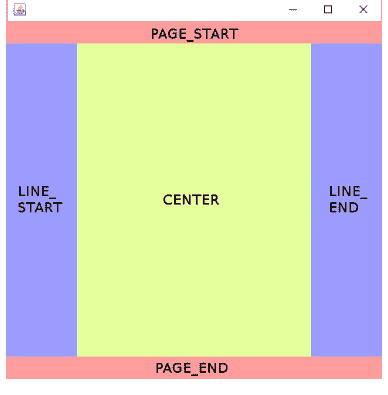

图 16：BorderLayout 区域

当我们在 `BorderLayout` 中添加控件时，我们会指定控件的位置（`NORTH` 或 `CENTER` 等），布局管理器将负责调整控件的大小，使其填充整个区域，并在每个区域周围留有可选的间隙。

## 代码列表 6.5：使用 BorderLayout

```java
import java.awt.*;
import java.awt.event.ActionEvent;
import java.awt.event.ActionListener;
import javax.swing.*;

public class MainClass extends JFrame implements ActionListener {
    public static void main(String[] args) {
        MainClass m = new MainClass();
        m.run();
    }

    // 声明 TextInput。
    private JTextField txtInput;

    private void run() {
        // 创建一个新的边界布局和主面板。
        BorderLayout layoutManager = new BorderLayout();
        JPanel mainPanel = new JPanel(layoutManager);
        this.setDefaultCloseOperation(EXIT_ON_CLOSE);
        this.setSize(500, 500);
        this.setContentPane(mainPanel);
        this.setVisible(true);

        // 设置布局间距。
        layoutManager.setHgap(25);
        layoutManager.setVgap(25);

        // 创建按钮。
        JButton btnTop = new JButton("页面开始");
        JButton btnBottom = new JButton("页面结束");
        JButton btnLeft = new JButton("行开始");
        JButton btnRight = new JButton("行结束");

        // 将按钮添加到面板。
        mainPanel.add(btnTop, BorderLayout.PAGE_START);
        mainPanel.add(btnBottom, BorderLayout.PAGE_END);
        mainPanel.add(btnLeft, BorderLayout.LINE_START);
        mainPanel.add(btnRight, BorderLayout.LINE_END);

        // 创建并添加文本区域。
        txtInput = new JTextArea(5, 10);
        txtInput.setText("点击按钮！");
        JScrollPane jsp = new JScrollPane(txtInput);
        txtInput.setEditable(false);
        mainPanel.add(jsp, BorderLayout.CENTER);

        // 添加监听器响应点击。
        btnTop.addActionListener(this);
        btnBottom.addActionListener(this);
        btnLeft.addActionListener(this);
        btnRight.addActionListener(this);

        // 刷新所有控件。
        this.validate();
    }

    // Action 将按钮文本输出到 txtOutput。
    public void actionPerformed(ActionEvent arg0) {
        txtInput.append("你点击了" + 
        ((JButton)arg0.getSource()).getText() + "\n");
    }
}
```

# 第 7 章 GUI 生成器


在本节中，我们将使用 Eclipse 的 WindowBuilder 通过所见即所得（WYSIWYG）拖放系统构建复杂的 GUI。这大大提高了 GUI 开发的速度。我们将构建一个简单的计算器应用程序。我将包含算术运算，但我们将看到为计算器添加新功能是快速且方便的。

> 注意：我在本书中使用了 Eclipse，但还有其他的 IDE，某些带有自己的 GUI 工具——例如 IntelliJ 有 IDEA。也可以使用 JFormDesigner 等 GUI 生成器，它们是为多种 IDE 设计的。

## 添加窗口

接下来，让我们像之前的那样创建一个新的 Java 项目。我将其命名为 Calculator。当新项目创建后，右键点击包管理器中的 `src` 文件夹并点击 `New > Other`，如图 18 所示，添加主窗口。

Eclipse IDE 没有预装 WindowBuilder 软件包，这意味着你必须单独安装它们。关于如何进行此的详细说明超出了本书的范围，但可以通过互联网搜索找到。简而言之，你选择 Eclipse 工具栏上的 `Help | Install New Software` 菜单，然后使用分步向导安装用于使用 WindowBuilder/Swing 创建 GUI 应用程序的四个左右软件包（某些，如 Documentation，是可选的）。

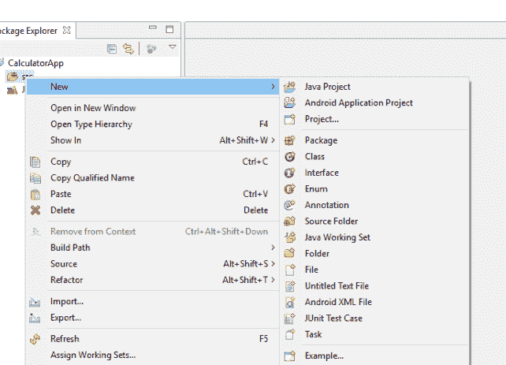

图 18：添加窗口步骤 1

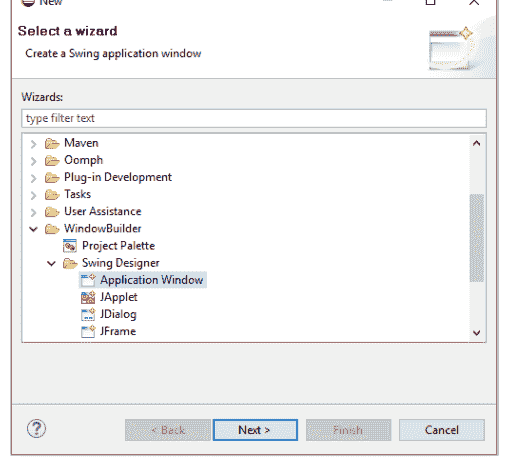

图 19：添加窗口步骤 2

在选择新组件后，找到 `WindowBuilder > Swing Designer` 文件夹和 `Application Window` 子文件夹。点击该子文件夹并点击 **Next**，如图 19 所示。这将打开 New Swing Application 窗口。

你也可以这种方式从文件菜单创建新项目，而不是像之前那样创建一个 Java 应用程序。

注意：存在多种窗口构建工具。如果你对 IBM 的 SWT 感兴趣，也可以使用 SWT 框架创建窗口。这允许你向项目中添加多个窗口，并在应用程序运行时打开和关闭它们。

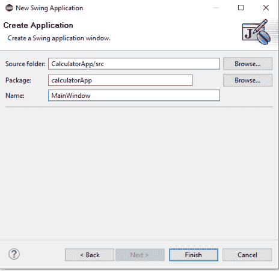

图 20：新的 Swing 应用程序窗口

在“新建 Swing 应用程序”窗口中，为你的主类和包输入名称。我使用 `calculatorApp` 作为我的包名，使用 `MainWindow` 作为主类的名称（见图 20）。在给出包名和项目名称后，点击“完成（Finish）”。

Eclipse 将使用 WindowBuilder 创建一个新的空白窗口。当我们使用 Swing 构建器添加窗口时，它会自动为我们编写一个主方法，该方法将使用与上一章类似的代码来创建并显示窗口。代码列表 7.0 是由 Swing WindowBuilder 生成的。我们可以按照意愿编辑代码，但要小心——这是自动生成的代码，为了让 WindowBuilder 能够继续操作并添加新代码，这些代码必须保持与构建器偏好的格式相似。通常情况下，我们不修改程序生成的代码，而是在其基础上添加内容并在其周围编程。

代码列表 7.0：Swing WindowBuilder 生成的代码

```java
package calculatorApp;

import java.awt.EventQueue;

import javax.swing.JFrame;

public class MainWindow {

    private JFrame frame;

    /**
    /* 启动应用程序。
    */
    public static void main(String[] args) {
        EventQueue.invokeLater(new Runnable(){
            public void run() {
                try {
                    MainWindow window = new MainWindow();
                    window.frame.setVisible(true);
                } catch (Exception e) {
                    e.printStackTrace();
                }
            }
        });
    }
}
```

```java
/** 创建应用程序。
 */
public MainWindow() {
    initialize();
}
```

```java
/**
* 初始化框架的内容。
 */
private void initialize() {
    frame = new JFrame();
    frame.setBounds(100, 100, 450, 300);
    frame.setDefaultCloseOperation(JFrame.EXIT_ON_CLOSE);
}
```

### 在设计视图中设计 GUI

代码列表 7.0 中的代码仅仅是提供了一个主方法并创建且显示了一个空白窗口。在 Eclipse 中，主代码窗口底部有“源（Source）”和“设计（Design）”标签页。这些是我们应用程序的两种视图，而源视图是普通的代码窗口。选择“设计”标签页，Eclipse 将打开使用 Swing WindowBuilder 进行编辑的窗口（见图 21）。


GUI 设计是一个非常大的话题，也是一门专业。但通常，我们应该尝试遵循通用惯例。我们的用户对日常生活中的成千上种布局非常熟悉——口袋计算器、食品标签、应用程序等。用户理解这些布局，如果我们希望新用户能够毫不费力地理解我们的应用程序，我们应该遵循这些布局的原则。新应用程序的黄金标准是新用户能够在没有任何说明书或手册的情况下使用它。这虽然是不可能的，但是一个非常值得追求的标准，也是我们在设计软件时应该记住的。

尝试在纸上画出布局或使用设计程序和手写笔绘制。即使是像计算器这样简单的项目，对于我们如何布局控件也提供了许多选择。为 GUI 标签勾勒几种可能的布局，并问问自己为什么布局中的某些模式有效而另一些则无效。在图 22 中，我从卡西（CASIO）fx 系列口袋计算器的布局中汲取了灵感，它非常受欢迎且知名——很多人对它都很熟悉。我们不需要完全匹配布局，我预留了一个“特殊功能”空间，允许我们的计算器功能在我们思考新功能时扩展。我还决定将算术功能放在一列中以节省空间，并增大了等号（Equals）按钮的大小，因为我相信这特别重要，而且它的使用频率任何任何按钮都高。

> 注意：我们不会编写表达式解析。我们的计算器将计算表达式。

现在我们已经有了一个 `GridLayout`，点击 `JButton` 控件并将鼠标悬停在布局上。你将看到一个显示 `GridBagLayout` 的行和列的指南，如图 27 所示。请放置你的按钮使其与图 28 一致（你的计算器控件精确位置与它们不同没有关系）。

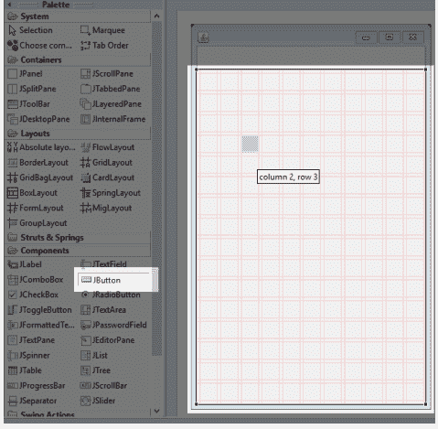

图 28：GridBagLayout 南

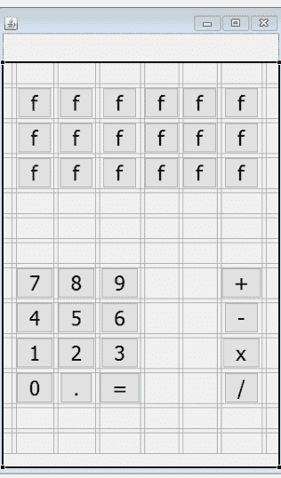

图 29：添加按钮

图 29 显示了所有按钮的布局。你可以在放置按钮时更改其文本，也可以在属性窗口中进行更改。我在图 29 中添加了十二个标记为“F”的按钮，它们将作为特殊功能按钮，例如平方根和三角函数（“f” 只是一个占位符）。将这些按钮的字体大小全部更改为 24。你可以在设计器中点击时按住 shift 键（使用 control 键也可以）来选择多个控件。一次性选择所有按钮，将它们的字体大小全部更改为 24，而不是一个一个地更改。点击等号（Equals）按钮并抓住右侧的控制点。在 `GridBagLayout` 中将控制框向右移动。这将导致按钮占据三个水平框的空间，如图 30 所示。

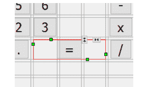

图 30：调整控件大小

等号按钮在 `GridBagLayout` 中占据三个框格的空间，但目前该空间尚未被填充。当选中一个控件时，我们在 Eclipse 顶部的工具栏中有几个布局选项。确保你的按钮已选中并点击 Fill（填充）。这将导致 Eclipse 调整控件的大小，以填满 `GridBagLayout` 中的全部三个框格空间（见图 31）。

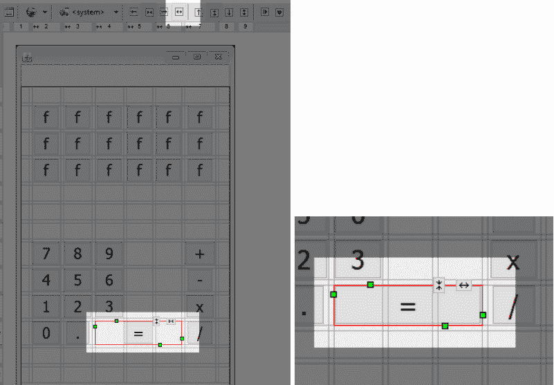

图 31：填充控件区域

### 快速更改多个控件

我们的表单有很多按钮。为了快速选择它们，我们可以使用 Eclipse 中的 Components（组件）框。点击第一个按钮的名称并按住 shift 键，然后按键盘上的方向键，直到所有按钮都被选中，如图 32 所示。

当所有控件都被选中后，像我们之前处理等号按钮一样点击 Fill。这将导致我们的所有控件都被调整为完全相同的大小。注意，在点击 Fill 之前，我们的一些控件大小略有不同，但默认按钮的大小是根据其文本内容进行调整的（这并不是所有布局都如此），而且在文本中它们的宽度并不完全相同。

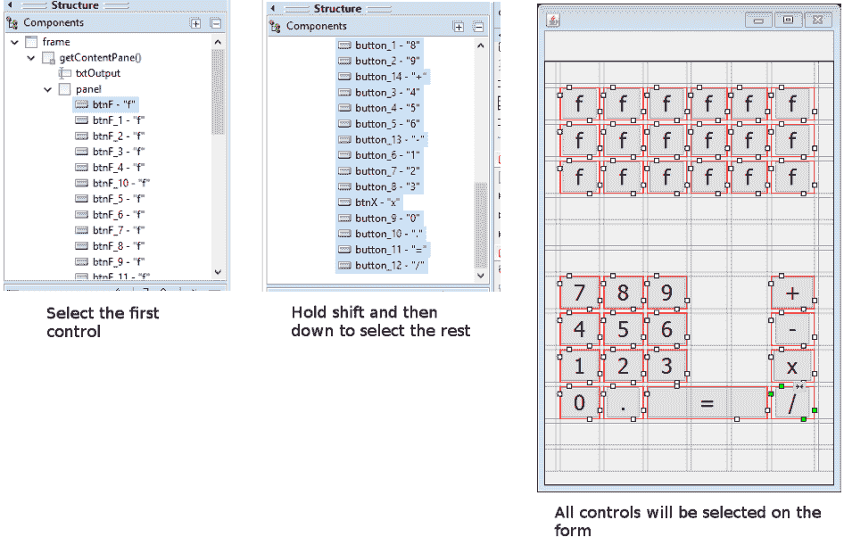

选择第一个控件

按住 shift 然后向下移动选择剩余部分

图 32：在组件窗口中选择多个控件

### 控件间距

当我们运行程序时，我们会发现控件之间的间隙非常小，尽管它们在设计器中看起来是那样（见图 33）。我们希望在 `txtoutput` 和我们的特殊功能之间留一个小边距，并且希望在特殊功能按钮与数字及运算符按钮之间留一个小间隙。

为了在 `GridBagLayout` 中包含间隙和边距，我们可以设置行和列的大小。在 System（系统）面板中点击 Selection（选择）工具，然后点击表单上不包含任何按钮任意区域：选中 GridLayout。你会看到网格在设计器的顶部和左侧有编号的列标题和行标题（见图 34）。

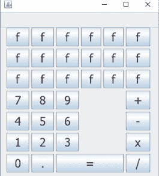

图 33：没有间距的计算器

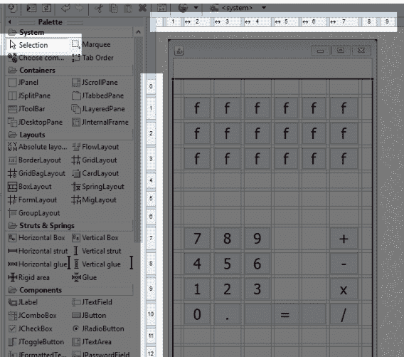

图 34：GridBagLayout 行和列标题

如果你选中了 `GridBagLayout`，可以右键点击相应的行或列并执行一些非常有用的功能。我们可以轻松添加新行或列、删除现有的行或列，并更改任何现有行或列的属性。我们想要更改几行的最小尺寸，以便我们的控件间距更合理。右键点击行 0 的按钮，从右键菜单中选择 properties（属性）（如图 35 所示）。

### 图 35：行属性

在 Row Properties（行属性）框中，将最小尺寸更改为 50 并点击 Apply（应用），如图 35 所示。这确保了 `txtOutput` 控件与我们的特殊功能按钮之间有 50 像素的间隙。接下来，同样地更改第 5 行的最小间隙。这将我们的特殊功能按钮与数字及运算符按钮之间添加至少 50 像素的间隙。注意，我们的计算器的间距在图 36 中看起来稍微好了。

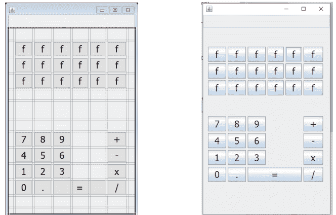

图 36：有间距的控件

现在我们对控件的整体布局满意了，可以继续为计算器添加功能。

## 添加功能

许多数学运算符需要两个操作数，例如 1+4。我们将维护一个状态变量来记录我们正在读取哪个数字（即运算符的左操作操作数）。我们将保留一个变量来指示用户最初选择了哪个操作数，并指示计算器读取第一个数字（运算符的左操作数）。我们将构建两种类型的操作——需要两个操作数的（例如加法和减法），以及需要单个操作数的（例如自然对数和平方根）。

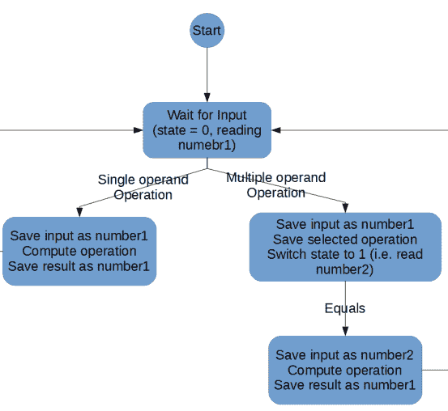

图 37：状态图

图 37 显示了一个基础状态图。图 37 显示了一个基础状态图，描述了操作流程。初始，状态将设置为 0，意味着第一个数字。当用户点击运算符时，我们将状态设置为 1，意味着第二个数字。当用户点击等号时，我们存储结果，将其输出到 `txtOutput` 并重新开始。

打开代码视图，滚动代码到指定所有成员变量的位置（这些应该是类中定义的第一个变量）。添加新的状态变量，如下：

```java
// 状态变量
private int state = 0; // 0 表示第一个数字，1 表示第二个。
private int operator = 0; // 0 表示未知。
private double number1 = 0.0; // 用于解析第一个操作数。
private double number2 = 0.0; // 用于解析第二个操作数。
private double[] memory = new double[5]; // 用于内存功能。
```

### 代码列表 7.2：点击数字 7

```java
button = new JButton("7");
button.addActionListener(new ActionListener() {
    public void actionPerformed(ActionEvent arg) {
        txtOutput.setText(txtOutput.getText() + "7");
    }
});
```

当用户点击数字时，我们像列表 7.2 所示将该数字添加到 `txtOutput` 文本框中。其他九个数字的操作都是相同的——区别在于它们添加到 `txtOutput` 字符串中的数字不同。为了节省空间，我将不再列出所有 10 个数字的列表代码，但你可以以与数字 7 相同的方式实现所有 10 个数字。此外，小数点按钮 `"."` 与数字按钮是相同的，这意味着它也可以用相同的方式进行实现。如果我们正在制作一个更完整的计算器，我们需要一个检查来确保我们输入了有效数字，并且我们需要确保只使用一个小数点，以避免诸如 `7.64` 这样的数字。

双操作符可以输入当前选择的运算符并重置 `txtOutput`，以便用户输入另一个数字。在设计中，双击加运算符，并在列表 7.3 的代码中高亮显示。

### 代码列表 7.3：加法代码

```java
button_14 = new JButton("+");
button_14.addActionListener(new ActionListener() {
    public void actionPerformed(ActionEvent e) {
        operator = 0;
        number1 = Double.parseDouble(txtOutput.getText());
        txtOutput.setText("");
    }
});
```

三个算术运算符可以用相同的方式添加，只需将 `operator` 变量设置为不同的值。使用 0 表示加法，1 表示减法，3 表示除法。我没有包含乘法或除法的代码，但你可以以与加法相同的方式进行这些操作，只需为 `operator` 变量分配 1、2 和 3。这会让代码更清晰。

当用户点击等号按钮时，我们需要读取 `number2` 的数字，检查当前运算符并使用读取到的两个数字执行操作。然后我们将结果作为字符串存储在 `txtOutput` 中。代码列表 7.4 显示了等号按钮的代码。

### 代码列表 7.4：等号按钮

```java
button_11 = new JButton("=");
button_11.addActionListener(new ActionListener() {
    public void actionPerformed(ActionEvent e) {
        // 数字 2
        number2 = Double.parseDouble(txtOutput.getText());

        // 结果变量
        double result = 0.0;

        // 根据运算符计算结果
        switch (operator) {
            case 0: result = number1 + number2; break;
            case 1: result = number1 - number2; break;
            case 2: result = number1 * number2; break;
            case 3: result = number1 / number2; break;
        }

        default: result = 0.0;

        // 将结果保存到输出
        txtOutput.setText("" + result);
    }
});
```

> 提示：注意 `txtOutput.setText` 调用中使用 `""`。这会将 double 转换为字符串。如果我们尝试直接设置或打印一个 double（例如 `println(2.5)`），我们的代码将无法编译。然而，加法运算符定义在字符串和 double 之间，它会自动将 double 转换为字符串，因此我们使用 `"" + 2.5` 来打印 double，而不是 `println(2.5)`。

## 特殊函数

### 工具提示和清除按钮


我们在计算器中包含了许多特殊功能按钮，但我只会指定几个，让读者自己设计其他功能。首先，我们需要清除输出的能力。通过使用文本 "C"，我将右角的特殊功能按钮变成了清除按钮。字母 C 具有歧义，因此我也为此按钮使用了工具提示。工具提示是当用户光标悬停在控件上时显示的消息。将按钮文本改为 C 并添加工具提示，如图 38 所示。双击清除按钮以让 Eclipse 编写处理事件的代码。代码列表 7.5 显示了代码。


### 代码列表 7.5：清除按钮

```java
JButton btnF_17 = new JButton("C");
btnF_17.addActionListener(new ActionListener() {
    public void actionPerformed(ActionEvent arg0) {
        txtOutput.setText("");
        operator = -1;
    }
});
```

## 三角函数

三角函数对计算器来说非常有用。我将正弦、余弦和正切函数作为左上三个按钮。在设计器中，我添加了工具提示并更改了按钮的字体，以便 SIN、COS 和 TAN 单词能够适应我们的小按钮（见图 39）。我在设计器之后还点击了"垂直填充（Fill Vertical）"按钮，使按钮调整大小以填充垂直区域。


图 39：Sin, Cos, 和 Tan 设计器

### 代码列表 7.6：正弦函数

```java
btnF = new JButton("SIN")
btnF.setToolText("计算角度的正弦")
btnF.addActionListener(new ActionListener() {
    public void actionPerformed(ActionEvent e) {
        number1 = Double.parseDouble(txtOutput.getText());
        number1 = Math.sin(number1);
        txtOutput.setText("" + number1);
    }
});
```

代码列表 7.6 显示了计算角度正弦的代码。高亮的代码显示了实际计算。类似于，对于余弦我们调用了 `Math.cos`，对于正切我们调用了 `Math.tan`。注意，计算这些三角函数只需要一个数字，这意味着我们读取 `txtOutput` 的文本并计算函数，而不需要对输入的第二个数字进行幂运算。

## 数字的幂

我们可以用添加原始算术运算符相同的方法，轻松地向计算器添加双操作数函数。这里是如何添加一个接受两个参数并将第一个数字提升为幂的函数的示例。

### 代码列表 7.7：幂按钮

```java
button_11 = new JButton("^")
button_11.addActionListener(new ActionListener() {
    public void actionPerformed(ActionEvent e) {
        // 数字 2
        number2 = Double.parseDouble(txtOutput.getText());

        // 结果变量
        double result = 0.0;

        // 根据运算符计算
        switch (operator) {
            case 0: result = number1 + number2; break;
            case 1: result = number1 - number2; break;
            case 2: result = number1 * number2; break;
            case 3: result = number1 / number2; break;
        }

        default: result = 0.0;

        // 特殊函数
        if(operator == 4)
            result = Math.pow(number1, number2);

        // 将结果保存到输出
        txtOutput.setText("" + result);
    }
});
```

### 代码列表 7.8：等号按钮与运算符

```java
button_11 = new JButton("=")
button_11.addActionListener(new ActionListener() {
    public void actionPerformed(ActionEvent e) {
        // 数字 2
        number2 = Double.parseDouble(txtOutput.getText());

        // 结果变量
        double result = 0.0;

        // 根据运算符计算
        switch (operator) {
            case 0: result = number1 + number2; break;
            case 1: result = number1 - number2; break;
            case 2: result = number1 * number2; break;
            case 3: result = number1 / number2; break;
        }

        default: result = 0.0;

        // 特殊函数
        if(operator == 4)
            result = Math.pow(number1, number2);

        // 将结果保存到输出
        txtOutput.setText("" + result);
    }
});
```

## 内存按钮

内存按钮对计算器非常有用。首先，当我们点击内存按钮时，我们需要知道用户是想存储还是提取。默认情况下，我们假设他们是在提取。我们将添加带有 STR 和 M1, M2, M3, M4 文字的按钮（见图 40）。


图 40：内存按钮

当用户点击 STR 函数时，我们将当前运算符设置为某些。我们的最后一个运算符是幂，我们将其保存为 4，因此我在列表 7.9 中使用了 5 作为存储。每个内存按钮的代码几乎相同，区别在于每个按钮访问数组中的不同元素。我在列表 7.10 中包含了 M0 的代码。

### 代码列表 7.9：存储按钮代码

```java
btnF_5 = new JButton("STR");
btnF_5.addActionListener(new ActionListener() {
    public void actionPerformed(ActionEvent e) {
        operator = 5;
        number1 = Double.parseDouble(txtOutput.getText());
    }
});
```

### 代码列表 7.10：M0按钮代码

```java
btnF_12 = new JButton("M0");
btnF_12.addActionListener(new ActionListener() {
    public void actionPerformed(ActionEvent e) {
        if(operator == 5)
            memory[0] = number1;
        else
            txtOutput.setText("" + memory[0]);
    }
});
```

在此处，我将停止并允许您根据需要扩展功能。在本章中，我们查看了如何使用 Eclipse 中的窗口设计器工具来实现简单的界面。我们简陋的计算器非常直接，但这些 GUI 设计工具的力量和灵活性是无限的。如果你是 GUI 设计的新手，我鼓励你深入探索工具箱，以找到最适合应用程序的控件。

在本电子书的剩余部分，我们将注意力转向一种完全不同的编程类型——二维图形和游戏编程。

# 第 8 章 二维游戏编程

Java 经常被用于二维游戏编程。在本节中，我们将介绍使用 Java 创建二维游戏的基础知识。游戏编程是一个极其广泛且复杂的话题，因此我们在这里只介绍一些核心概念。实践是关键——你应该利用最后一章的内容进行实践，创建一个平台跳跃游戏或无尽跑酷游戏，并探索三维游戏开发和物理引擎。

在本章中，我将使用较长的代码列表，并只提供相对少量的解释。任何程序员能培养的最优秀技能之一，就是阅读其他程序员代码并发现他们错误之处（或可以改进之处）的能力。我鼓励所有编程初学者在互联网上搜索实用的技术。当你发现一个实用的技术或代码段时，请确保原作者已允许你将其用于自己的项目，并始终记录代码的来源——这样如果你在生产环境编程中使用该代码，就可以注明原作者。你可以随时根据自己的需要，出于任何目的使用本电子书中的任何代码！

## MainClass

搭建二维游戏编程的基础有许多方法。我们希望代码是可维护的、易理解的且能够快速实现功能的。编程的难度不在于语法——丰富的程序员可以相对容易地学习新语言的语法。难度在于如何实现结构，使得我们的项目在规模扩大时保持稳定。我们将创建一个基础的 `MainClass`，它的作用无非是实例化另一个类——游戏引擎，将其命名为 `Engine2D`。引擎将通过一个简单的渲染/更新循环运行，我们将使用 Java 的功能和事件处理器来创建实时幻觉并响应键盘。

你应该创建一个新项目。我将我的项目命名为 Graphics2D。按照之前的做法添加一个 `MainClass`。`MainClass` 仅仅是引擎类的实例。`MainClass` 的代码见代码列表 8.0（请注意，由于代码目前无法运行，因为我们还没有构建 `Engine2D` 类！）。

> 代码列表 8.0: MainClass

```java
import java.awt.EventQueue;
import javax.swing.JFrame;

public class MainClass extends JFrame {
    public static void main(String[] args) {
        EventQueue.invokeLater(new Runnable() {
            @Override
            public void run() {
                MainClass m = new MainClass(640, 480);
            }
        
        ));
    }
    private MainClass(int windowWidth, int windowHeight) {
        setSize(windowWidth, windowHeight); // 设置窗口大小
        setLocationRelativeTo(null); // 默认位置
        setDefaultCloseOperation(JFrame.EXIT_ON_CLOSE); // 关闭时退出
        setVisible(true);
        // 创建并添加 JPanel
        final Engine2D engine = new Engine2D(windowWidth, windowHeight);
        add(engine);
    }
}
```

`MainClass` 继承自 `JFrame` 并作为应用程序窗口。`MainClass` 包含一个方法，该方法创建一个新的 `MainClass m` 实例，并使用 `EventQueue.invokeLater` 使用新线程执行该实例。这意味着我们的游戏将拥有自己的线程和事件队列。`MainClass` 的构造函数接收 `windowWidth` 和 `windowHeight` 参数，这将是我们的窗口的大小。设置窗口后，`MainClass` 创建了一个 `Engine2D` 实例，该实例本质上是一个自定义的 `JPanel` 对象，并将其添加到面板中。

## 二维引擎骨架

接下来，我们将实现 `update` 和 `render` 方法。我们使用 `Engine2D` 类。方法 8.1 显示了 `Engine2D`。

> 代码列表 8.1: Engine2D

```java
import java.awt.Color;
import java.awt.Graphics;
import java.awt.Graphics2D;
import java.awt.event.ActionEvent;
import java.awt.event.ActionListener;
import javax.swing.JPanel;
import javax.swing.Timer;

public class Engine2D extends JPanel implements ActionListener {
    private int width, height;

    // 构造函数
    public Engine2D(int windowWidth, int windowHeight) {
        width = windowWidth;
        height = windowHeight;
        Timer timer = new Timer(1000/fps, this);
        timer.start();
    }

    // 此事件
    public void actionPerformed(ActionEvent e) {
        repaint();
    }

    @Override
    protected void paintComponent(Graphics g) {
        // 清除屏幕
        g.setBackground(Color.DARK_GRAY);
        g.clearRect(0, 0, width, height);
    }

    private void update(double timeTotal, double timeDelta) {
    }

    private void render(Graphics2D g) {
    }
}
```

为了使用实时循环，我们希望 `update` 和 `render` 方法在某些间隔内被重复调用。这个间隔被称为每秒帧（FPS）。较高的帧率（60 或 100 FPS）看起来会更流畅，但会消耗更多功率。如果帧率过高，由于处理器无法跟上并导致跳帧，动画可能会变得卡顿。较低的帧率（12 或 16 FPS）看起来不流畅，但它消耗的电较少。很大概率处理器可以在不跳帧的情况下渲染较低的帧率。`Engine2D` 构造函数的参数之一是帧率。我使用了 30 FPS 作为该值，这看起来应该是流畅的且不会在便携设备上消耗过多的电量。

我们使用定时器每帧调用一次 `actionPerformed` 方法，并实现了 `ActionListener` 类。每当定时器跳动时，都会调用 `actionPerformed` 方法，然后调用 `update`，随后是 `paintComponent`（调用 `super.paintComponent` 刷新窗口），以及 `render`。

> 注意：单靠帧率并不能让动画变得流畅。即使在很帧率下，动画物体在人类看来也并不流畅。创建流畅动画的关键在于使用一种称为运动模糊的技术。该主题超出了本电子书的范围，但你应该访问页面 http://www.testudio.com 查看关于运动模糊工作原理以及正确实现动画效果的绝佳示例。

目前，`update` 方法有两个参数 `timeTotal` 和 `timeDelta`，但没有执行任何操作。而 `render` 方法只是将屏幕清除为 `DARK_GRAY`。在添加 `Engine2D` 类后，你应该能够测试你的应用程序。如果你没有看到深灰色屏幕（如图 42 所示），说明出现了问题。

## 精灵图类 (Sprite sheet class)

当我们制作动画时，会连续快速绘制对象的图像，这些图像之间略有不同。例如，玩家走走的动画可能包含八帧图像，每一帧都与上一帧略有不同。我们可以将动画的每个图像存储在单独的文件中，但将动画的所有图像存储在单个文件中通常更方便。这类图像被称为精灵图（sprite sheets）或精灵图集（sprite atlases）。

有很多图像格式——BMP、PNG、JPG、TIFF 等。每种格式都为特定用途设计。PNG 是精灵的首选格式，因为它经过压缩，通常比位图小，并且允许 Alpha 透明通道。与 JPG（也是压缩格式）不同，PNG 图像的压缩是无损的，这意味着我们保留了绘制的每个像素的精确值。

### 代码列表 8.2：精灵图类


```java
import java.awt.Graphics2D;
import java.awt.image.BufferedImage;
import java.io.File;
import java.io.IOException;
import javax.imageio.ImageIO;

public class SpriteSheet {
    private BufferedImage bmp; // 加载的图像。
    private int spritesAcross = -1; // 图像水平方向精灵的数量。
    private int totalSprites; // 图像中精灵的总数。
    private int spriteWidth, spriteHeight; // 每个精灵的宽度/高度。

    // 构造函数
    public SpriteSheet(String filename, int spriteWidth, int spriteHeight) {
        // 加载位图。
        try {
            bmp = ImageIO.read(new File(filename));
        } catch (IOException e) {
            // 未找到文件。
            spritesAcross = -1;
            return;
        }
        // 保存精灵的宽度和高度。
        this.spriteWidth = spriteWidth;
        this.spriteHeight = spriteHeight;
        // spritesAcross 用于在渲染时计算源矩形。
        spritesAcross = bmp.getWidth() / this.spriteWidth;
        // totalSprites 用于确保我们不是尝试渲染不存在的精灵。
        totalSprites = spritesAcross * (bmp.getHeight() / spriteHeight);

        // 此方法可以测试精灵是否已加载。
    }

    public Boolean isValid() {
        return spritesAcross != -1;
    }

    public void render(Graphics2D g, int spriteIndex, int x, int y) {
        // 确保精灵确实在我们的精灵图上。
        if (spriteIndex >= totalSprites) return;
        // 计算 x 和 y。
        int srcX = (spriteIndex % spritesAcross) * spriteWidth;
        int srcY = (spriteIndex / spritesAcross) * spriteWidth;
        // 绘制图像。
        g.drawImage(bmp,
            x, // 目标 x1
            y, // 目标 y1
            x + spriteWidth, // 目标 x2
            y + spriteHeight, // 目标 y2
            srcX, // 源 x1
            srcY, // 源 y1
            srcX + spriteWidth, // 源 x2
            srcY + spriteHeight, // 源 y2
            null); // 观察者
    }
}
```

### 代码列表 8.2：SpriteSheet 类

代码列表 8.2 显示了一个简单的精灵图类。成员变量是一个缓冲图像（它只是从磁盘加载到 RAM 中以便快速访问的图像存储器）以及几个简单的记录——`spriteWidth`、`spriteHeight`、`totalSprites` 和 `spritesAcross`。该类在构造函数中接收一个文件名以及精灵的宽度和高度。该文件可以是任何 2D 图像格式，但我们将使用 PNG。

### GNU 图像处理程序 (Gimp)

我使用 Gimp 为我们的测试应用程序创建了精灵图（Gimp 是一个非常强大的绘画和照片处理程序，可以从 <https://www.gimp.org/> 免费获取）。图 43 中的精灵显示了一个飞船、一个看起来像陨石坑、一个子弹、一个绿墙、一些星形和一个小型爆炸。

> **注意**：我使用 Gimp 创建本文中的精灵是因为它强大、跨平台且功能丰富。读者可能感兴趣的许多应用程序也可用：Piskel 是从 <http://www.piskel.com/> 获取的在线精灵工具。Aseprite 是从 <http://www.aseprite.org/> 获取的优秀桌面精灵编辑器。SpriteRing 是从 <https://brushmonkey.com/> 获取的免费和付费版精灵编辑器。

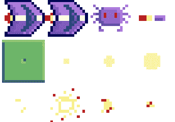

**图 43：精灵**

> **提示**：我们在 Gimp（或其他图像编辑器）中绘制图像时，我们不希望丢失任何精度——我们想要每个像素的精确颜色。出于这个原因，我建议你在 Gimp 中处理图像，并将其保存为专用格式（包含层、像素颜色、路径等额外信息）。当我们在游戏中使用该图像时，将其导出为 PNG 图像（PNG 不包含层、路径等）。通过这种方式，如果你需要编辑图像，Gimp 中的层和选择信息将被保留，并且最终导出图像将具有 PNG 的灵活性。

右键点击图 43 并点击复制，然后将图像作为新图像粘贴到 Gimp 中（取决于使用的 PDF 阅读器，操作细节可能不同）。打开 Gimp（或你选择的其他图像编辑器），在 `粘贴为 (Paste as)` 下选择 `新建图像 (New Image)`，如图 44 所示。

| 编辑 (Edit) | 选择 (Select) | 查看 (View) | 图像 (Image) | 图 (Layer) | 颜色 (Color) | 过滤器 (Filters) | 窗口 (Windows) | 帮助 (Help) |
|---|---|---|---|---|---|---|---|---|
| 新建 (New) | | | | | | `Ctrl+N` | |
| 打开 (Open) | | | | | | `Ctrl+O` | |
| 保存 (Save) | | | | | | `Ctrl+S` | |
| 导出 (Export) | | | | | | `Ctrl+E` | |
| 关闭 (Close) | | | | | | | |
| 剪切 (Cut) | | | | | | `Ctrl+X` | |
| 复制 (Copy) | | | | | | `Ctrl+C` | |
| 复制 (Duplicate) | | | | | | `Ctrl+D` | |
| 粘贴 (Paste) | | | | | | `Ctrl+V` | |
| 插入 (Insert) | | | | | | `Shift+I` | |
| 删除 (Delete) | | | | | | | |
| 清除 (Clear) | | | | | | | |
| 用前景色填充 (Fill with Foreground) | | | | | | | |
| 用背景填充 (Fill with Background) | | | | | | | |
| 用图案填充 (Fill with Pattern) | | | | | | | |

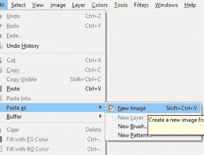

**图 44：粘贴为**

复制并粘贴的图像看起来与图 43 相似，但原本应该是透明的地方是黑色的。


**图 45：黑色背景的精灵**

为了将背景改为透明，我们需要打开几个窗口。从菜单中选择 `窗口 (Windows)`、`工具箱 (Toolbox)`、`工具选项 (Tool Options)` 和 `层 (Layers)`，如图 46 所示。

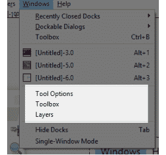

**图 46：Gimp 窗口**

接下来，我们将为图像添加 Alpha 通道。在层框中右键点击层，并从右键菜单中选择 `Alpha 通道`（图 47）。Alpha 通道用于透明度——这样每个精灵周围就没有白色或黑色框。

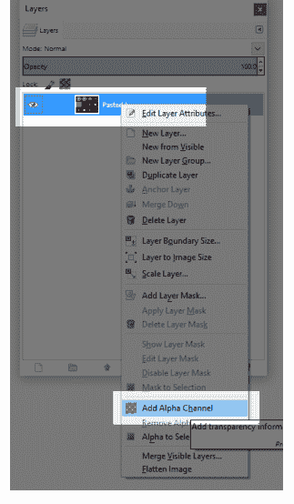

**图 47：添加 Alpha 通道**

接下来，选择整个黑色区域以移除黑色框。有几种方法可以实现，我将使用图 48 所示的 `颜色选择工具 (Select by Color)`。

当你按颜色选择时，工具选项窗口会更新，包含操作如何选择的控件。在工具选项框中关闭 `抗锯齿 (Anti-aliasing)` 和 `羽化 (Feather Edges)`——我们不需要这些。确保 `阈值 (Threshold)` 为 0，这样我们就可以选择所有黑色区域而不会意外选中非黑色但深色的区域。设置好颜色选择工具后，点击颜色选择工具将选择所有黑色像素。按下键盘上的 `delete` 键删除黑色像素——这样做会将它们替换为透明像素（Alpha 值为 0 的像素），如图 49 所示。

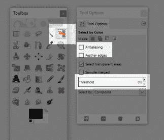

**图 48：颜色选择**

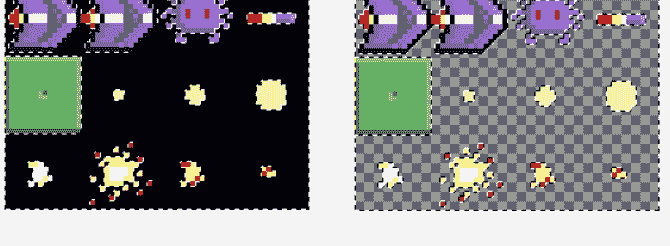

**图 49：颜色选择**

### 在 Java 中引入图像

我们想在 Java 中包含此导出的 PNG 表，在包管理器中右键点击你的项目并选择 `新建 > 文件夹 (New > Folder)`，如图 50 所示。

确保选择了正确的父文件夹（在我的情况下是 `Graphics2D`），将文件夹命名为 `graphics`，并点击 `完成 (Finish)`，如图 51 所示。

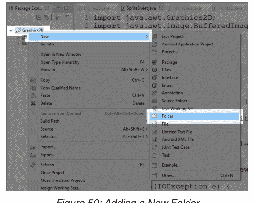

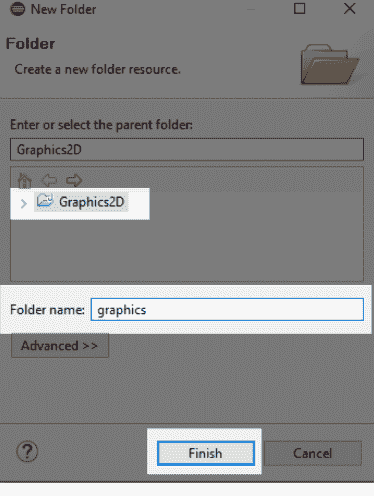

**图 51：新文件夹**

Eclipse 将在你的项目中创建一个新文件夹。将我们之前导出的 `spacer.png` 文件复制到此文件夹中，这样当我们的应用程序运行时就可以打开它。要将文件复制到项目文件夹，我们需要在系统资源管理器中打开该文件夹（这只是普通的 Windows 文件资源管理器）。我们可以使用系统资源管理器找到该文件夹，但 Eclipse 提供了一种快速打开项目文件夹的方法。如图 52 所示，在包资源管理器中右键点击该文件夹，选择 `显示在 (Show In) > 系统资源管理器 (System Explorer)`。

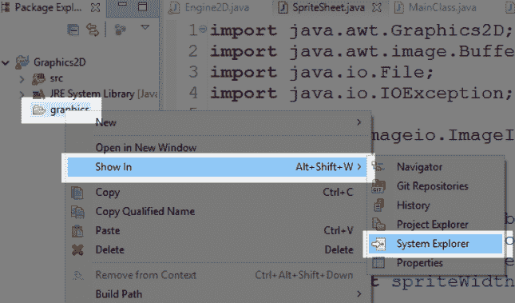

**图 52：在系统资源管理器中显示**

桌面上（或你添加透明度后导出的地方）有 `spacer.png` 文件。如图 53 所示，将此文件复制并粘贴到系统资源管理器中的 `graphics` 文件夹。关闭系统资源管理器窗口并返回 Eclipse。

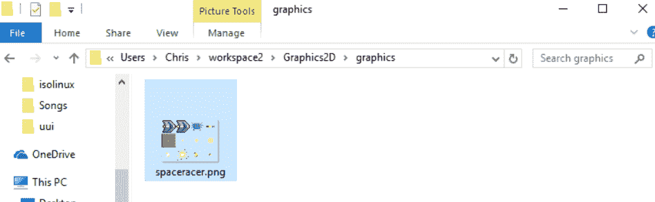

**图 53：图形文件夹，但目前 Eclipse 尚未感知。**

我们的 PNG 图片未包含在包资源管理器中的 `graphics` 文件夹中，如图 54 所示，右键点击 `graphics` 文件夹并选择 `刷新 (Refresh)`。这将使 Eclipse 包含我们在应用程序中找到的任何文件。每当你更新精灵或向文件夹中添加文件时，都应该在 Eclipse 中刷新这些文件夹。

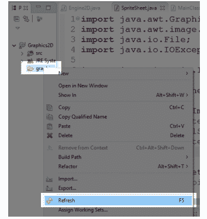

**图 54：刷新图形文件夹**

### 加载和渲染精灵

代码 8.3 显示了在我们的 `Engine2D` 构造函数中将精灵加载为 `SpriteSheet` 实例的代码。在复制和粘贴这段代码时请务小心——我只包含了 `Engine2D` 的重要代码行，因此这不是整个 `Engine2D` 类。

#### 代码 8.3：加载 spacer.png

```java
// 窗口的宽度和高度。
private int width, height;
private SpriteSheet sprites;

// 构造函数
public Engine2D(int windowWidth, int windowHeight, int fps) {
    width = windowWidth;
    height = windowHeight;
    // 加载精灵：
    sprites = new SpriteSheet("graphics/spacer.png", 16, 16);

    // 启动渲染/更新循环。
    Timer timer = new Timer(1000 / fps, this);
    timer.start();
}
```

注意，精灵宽度和高度的参数为 16，这是因为 `spacer.png` 图像在绘制时每个独立帧都在一个 16x16 像素的框内。当我们渲染精灵表时，可以选择只渲染它的某部分（我们稍后会看到）。如果你的精灵表上有不同尺寸的精灵，你需要知道每个精灵在精灵表中的起始和结束位置（用 x 和 y 坐标确定），以便正确渲染精灵表的部分。由于所有精灵的大小相同，我们可以通过简单的计算来正确渲染图像的所需部分。当所有精灵都制成完全相同的大小，并且在 PNG 文件中的网格上正确间距时，这是包含精灵表的一种快速方法。当我们加载 `SpriteSheet` 对象时，我们可以在 `Engine2D` 的 `render` 方法中渲染一个测试精灵以确保一切运行顺利，如列表 8.4 所示。

#### 代码列表 8.4：渲染测试精灵

```java
// 临时测试，在确保程序动画正常后删除此行：
static int x = 0;

private void render(Graphics2D g) {
    // 将屏幕背景设为蓝色
    g.setBackground(Color.DARK_GRAY);
    g.clearRect(0, 0, width, height);

    // 临时测试：
    sprites.render(g, x % 2, 0);
    x++;
}
```

在代码 8.4 中，我包含了一个 `x` 变量并在 `update` 方法中每帧对其递增。在 `render` 方法中，我在位置 `x` 渲染了编号为 `x % 2` 的精灵。这将导致精灵表的第一帧被绘制，使其从左到右跨越屏幕，如图 55 所示。


**图 55：小飞船（裁剪）**

### 缩放精灵

我们的飞船非常小。作为一种风格选择，我们可能希望精灵看起来更大且具有像素感，类似于 90 年代的游戏。这样玩家更容易看到精灵，我们的游戏将具有复古的美学风格。我们可以通过在 `render` 方法中乘以目标坐标来缩放精灵。当你实现代码 8.5 中的更改并运行测试应用程序后，你应该能看到一个大很多的飞船。

#### 代码列表 8.5：缩放精灵

```java
public void render(Graphics2D g, int spriteIndex, int x, int y) {
    // 确保精灵确实存在
    // ... 缩放逻辑
}
```

### 帧跳过与计时

代码 8.6 显示了我们计时器的类。随着应用程序的开发，如果你发现计时器不够精确，你可能想尝试取消纳秒时间行的注释，以便使用 `System.nanoTime()` 代替毫秒。该类不仅仅是在每次 `update` 方法调用时读取毫秒，它还提供了 `timeTotal()` 和 `timeDelta()` 方法，返回从计时器开始的总时间，以及自上次调用 `update` 以来经过的时间。我们可以通过这种帧跳过的技术来实现。

#### 代码列表 8.6：HPTimer 类


## HPTimer 类

```java
public class HPTimer {
    // 成员变量
    long startTime, lastTime, currentTime;

    // 设置起始时间
    public void reset() {
        startTime = System.currentTimeMillis();
        // 如果使用纳秒时间：
        // startTime = System.nanoTime();
    }

    // 启动计时器
    public void start() {
        lastTime = System.currentTimeMillis();
        // 如果使用纳秒时间：
        // lastTime = System.nanoTime();
    }

    // 当前时间
    public void update() {
        lastTime = currentTime;
        currentTime = System.currentTimeMillis();
        // 如果使用纳秒时间：
        // currentTime = System.nanoTime();
    }

    // 返回自上次 update 以来的时间
    public double timeDelta() {
        return (double) (currentTime - lastTime) / 1000000.0; 
    }

    // 返回从开始开始的总时间
    public double timeTotal() {
        return (double) (currentTime - startTime) / 1000000.0;
    }
}
```

在 `actionPerformed` 方法中，我们想要通过调用 `hpTimer.update()` 将 `timeTotal` 和 `timeDelta` 参数传递给我们的更新函数，以确保 `hpTimer` 读取了最新的时间，然后我们将总时间和增量时间传递给 `Engine2D.update` 方法，如代码列表 8.8 所示。

### 代码列表 8.8：更新计时器并传递时间

```java
// 当计时器按指定的 fps 触发时会调用此事件。
public void actionPerformed(ActionEvent e) {
    // 读取最新的时间：
    hpTimer.update();

    // 将 HPimer 的时间传递给我们的更新方法：
    update(hpTimer.timeTotal(), hpTimer.timeDelta());

    repaint();
}
```

我们现在可以再次渲染飞船，但这次我们将根据 `timeDelta` 缩放飞船的移动。代码列表 8.9 显示修改后的代码。当我们运行应用程序时，船将以每秒一像素的速度移动。我们应该注意，硬件性能在这里并不重要。如果一台非常慢的电脑运行此程序，到达屏幕右边缘所需的时间与高性能计算机完全相同——即使慢电脑只能渲染三帧，飞船的速度也将是完全一样的。通常，在创建动画时，我们总是想要通过 `timeDelta` 进行缩放（即自上次调用 `update` 以来经过的时间）。

### 代码列表 8.9：非常缓慢的飞船

```java
// 临时测试，在确保程序有动画后删除此行：
static double x = 0;
private void render(Graphics2D g) {
    // 将屏幕清除为蓝色。
    g.setBackground(Color.DARK_GRAY);
    g.clearRect(0, 0, width, height);

    // 临时测试：
    sprites.render(g, (int)x % 2, (int)x, 0);
    x += hpTimer.timeDelta();
}
```

## Animation 类

我们游戏中的许多对象将使用重复动画进行渲染。这些动画将由精灵表上连续的帧组成，例如代表飞船的前两个帧。动画对帧有特定的时间以及开始时间。代码列表 6.8 显示了 `Animation` 类的代码。

### 代码列表 8.10：Animation 类

```java
public class Animation {
    private double speed, startTime;
    private int firstFrame, frameCount;
    private int currentFrame;
    private boolean isComplete = false;
    private boolean looping;

    // 循环/多帧动画的构造函数。
    public Animation(double speed, double startTime, int firstFrame, boolean looping) {
        this.speed = speed;
        this.startTime = startTime;
        this.firstFrame = firstFrame;
        this.frameCount = frameCount;

        // 重置
        currentFrame = firstFrame;
        isComplete = false;
        this.looping = looping;
    }

    // 单帧动画的构造函数。
    public Animation(int frame) {
        speed = 1.0;
        startTime = 0.0;
        firstFrame = frame;
        frameCount = 1;
        // 重置
        currentFrame = firstFrame;
        isComplete = false;
        this.looping = true;
    }

    // 计算当前帧和
    // isComplete 布尔值。
    public void update(double timeTotal) {
        double elapsedTime = timeTotal - startTime;
        currentFrame = (int)(elapsedTime / speed);

        if(currentFrame < 0) currentFrame = 0;
    }
}
```

```java
// 如果帧超过了动画的结束，
// 将其设置为最后一帧。
if(currentFrame >= frameCount) {
    // 如果动画不循环，则将其无限地
    // 设置为最后一帧。
    if(!looping) {
        currentFrame = firstFrame + frameCount - 1;
        // 如果动画是循环的，
        // 设置回第一帧。
    } else {
        currentFrame = firstFrame;
        startTime = timeTotal;
    }
    isComplete = true;
}
// 否则，当前帧为第一帧加上
// 我们到为止播放的帧数：
else {
    // currentFrame 计算隐含的逻辑
}

// 返回当前帧。
public int getCurrentFrame() {
    return currentFrame;
}

// 确定动画是否已播放。
public boolean isComplete() {
    return isComplete;
}
```

（注：原文中包含大量重复的 OCR 错误文本，此处已根据要求仅输出唯一内容。）

```java
// 创建100 颗恒星
for(int i = 0; i < 100; i++) {
    Star s = new Star();
    s.setName(new Animation(Math.random() * 2 + 0.2,
    Math.random(), 5, 3, true));
    gameObjects.add(s);
}
```

现在我们已经有了一个包含游戏中所有对象的列表（ArrayList），我们希望在 `Engine2D` 类的 `update` 和 `render` 方法中调用更新并渲染数组中的元素。请注意，我删除了之前渲染测试飞船时的测试代码——我们稍后会再次添加飞船，但它它将由键盘控制。

### 代码清单 8.14：更新和渲染 GameObjects

```java
private void update(double timeTotal, double timeDelta) {
    // 更新游戏对象：
    for(GameObject o : gameObjects) {
        o.update(timeTotal, timeDelta);
    }
}
private void render(Graphics2D g) {
    // 将背景设为深灰色。
    g.setBackground(Color.DARK_GRAY);
    g.clearRect(0, 0, width, height);

    // 渲染游戏对象：
    for(GameObject o : gameObjects) {
        o.render(g, sprites);
    }
}
```

你应该能够运行该程序并看到一个滚动的动画恒星背景。这里使用的技术是名为“视差滚动”（parallax scrolling）的技术的简单版本。我们创建了一系列背景图像（恒星），将它们层叠渲染，并让靠近摄像机的物体比远离摄像机的物体滚动得更快。图 56 显示了我们目前为止的游戏截图。

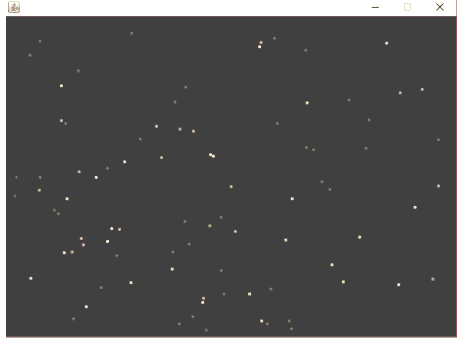

## 墙

恒星旨在作为背景。我们的游戏将由一系列滚动的墙组成，玩家必须避开这些墙，并避开或射击坏蛋。墙与恒星类似，不同之处在于我们会在屏幕右边缘动态生成它们，并在它们到达屏幕左侧时从 `gameObjects` 列表中删除它们。代码清单 8.15 显示了新的墙类。注意，该类还包含一个名为 `collisionWithShip` 的方法，我们稍后将用它来判断飞船是否与墙碰撞。

### 代码清单 8.15：Wall 类

```java
import java.awt.Graphics2D;
public class Wall extends GameObject {
    public Wall(double x, double y) {
        this.x = x;
        this.y = y;
        this.setAnimation(new Animation(4));
    }
    // 使墙向左移动。
    public void update(double timeTotal, double timeDelta) {
        super.update(timeTotal, timeDelta);
        x -= 80 * timeDelta;
    }
}
```

为了使用这个类，我们将在 `Engine2D` 类中实现几个新变量（参见代码清单 8.16）。一个有趣的说明是——如果你向 `Random()` 构造函数传递一个参数（例如 `Random(1238)`），则墙每次将以完全相同的模式生成。你还需要在 `Engine2D` 类的顶部导入 `java.util.Random`。

### 代码清单 8.16：Engine2D 中的墙变量

```java
// GameObjects 列表：
ArrayList<GameObject> gameObjects = new ArrayList<GameObject>();

// 墙的变量
double nextWallGenerationTime = 1.0;
Random wallRNG = new Random(); // 任何参数都
// 导致墙每次都以相同的模式生成
// 生成！
```

接下来，我们在 `Engine2D` 的 `update` 方法中生成墙，并在它们离开屏幕左边缘时删除它们（参见代码清单 8.17）。请注意，为了从 `ArrayList` 中删除元素，使用普通的 `for` 循环不再是安全的（我们绝不应该在使用 `for` 循环遍历集合时通过添加或删除项来修改它），因此我使用增强的 `for` 循环重写了 `Engine2D` 的 `update` 方法。图 57 显示了带有恒星和墙的游戏截图。

### 代码清单 8.17：生成和删除墙

```java
private void update(double timeTotal, double deltaTime) {
    // 生成新墙：
    if(timeTotal >= nextWallGenerationTime) {
        nextWallGenerationTime += 0.5;
        for(int i = 0; i < 14; i++) {
            if(wallRNG.nextInt(3) == 0) {
                gameObjects.add(new Wall(640, 32));
            }
        }
    }

    for(int i = 0; i < gameObjects.size(); i++) {
        GameObject o = gameObjects.get(i);
        o.update(timeTotal, deltaTime);

        // 如果对象是墙：
        if(o instanceof Wall) {
            if(o.isOffScreenLeft()) {
                // 当它们离开左侧屏幕时删除
                gameObjects.remove(i);
                i--;
            }
        }
    }
}
```

## 坏蛋

接下来，我们将添加一些坏蛋。坏蛋本质上与墙相同，不同在于玩家可以射击它们，并且它们以正弦波模式移动。坏蛋类的代码见代码清单 8.18。

### 代码清单 8.18：Baddie 类

```java
import java.awt.Graphics2D;
import java.util.Random;

public class Baddie extends GameObject {
    private double startY;
    private double frequency;
    private double amplitude;

    // 构造函数
    public Baddie(double x, double y) {
        this.x = x;
        this.y = y;
        startY = y;

        // 创建随机频率和幅度
        Random r = new Random();
        frequency = r.nextDouble() * 2.0 + 0.0;
        amplitude = r.nextDouble() * 45.0;
    }

    // 使坏蛋向左移动。
    public void update(double timeTotal, double deltaTime) {
        super.update(timeTotal, deltaTime);
        y = startY + Math.sin(timeTotal * frequency) * amplitude;
    }
}
```

### 代码清单 19：Engine2D 变量

```java
// GameObjects 列表：
ArrayList<GameObject> gameObjects = new ArrayList<GameObject>();

// 墙的变量
double nextWallGenerationTime = 1.0;
Random wallRNG = new Random();

// 坏蛋的变量
double nextBaddieGenerationTime = 2.0;
Random baddieRNG = new Random();
```

### 代码清单 8.20：生成和更新坏蛋


```java
private void update(double timeTotal, double deltaTime) {
    // 生成新墙：
    if(timeTotal >= nextWallGenerationTime) {
        nextWallGenerationTime += 0.5;
        for(int i = 0; i < 14; i++) {
            if(wallRNG.nextInt(3) == 0) {
                gameObjects.add(new Wall(640, 32));
            }
        }
    }

    // 生成新坏蛋：
    if(timeTotal >= nextBaddieGenerationTime) {
        nextBaddieGenerationTime += 0.7;
        for(int i = 0; i < 10; i++) {
            if(baddieRNG.nextInt(2) == 0) {
                gameObjects.add(new Baddie(640, baddieRNG.nextInt(280) + 40));
            }
        }
    }

    for(int i = 0; i < gameObjects.size(); i++) {
        GameObject o = gameObjects.get(i);
        o.update(timeTotal, deltaTime);

        // 如果对象是墙：
        if(o instanceof Wall) {
            if(o.isOffScreenLeft()) {
                // 当它们离开左侧屏幕时删除
                gameObjects.remove(i);
                i--;
            }
        }
        // 如果对象是坏蛋：
        else if(o instanceof Baddie) {
            if(o.isOffScreenLeft()) {
                // 当它们离开左侧屏幕时删除
                gameObjects.remove(i);
                i--;
            }
        }
    }
}
```

高碰撞检测——如果不允许物体每帧移动超过 16 像素，碰撞检测将最为准确。

图 8.17 显示了我们游戏的截图，其中有恒星、墙壁和敌人。这实际上是“死亡之浪”（Death Wave）的一个快照。如果没有死亡之浪，敌人的生成速度将导致屏幕上同时只出现一两个敌人。

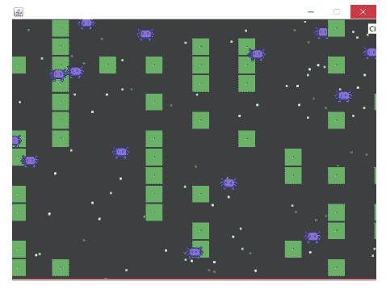

图 8.17：恒星、墙壁和敌人

## 读取键盘

在添加英雄的飞船之前，我们需要实现一个控制它的方法。现在让我们来看看如何响应由用户按下并按住键盘按键引起的事件。为了让我们的应用程序响应键盘输入，请添加一个名为 `Keyboard` 的新类，该类实现了 `KeyListener` 接口。

代码列表 8.21 中的 `Keyboard` 类是单例的示例。这意味着我们将设计一个类，并且永远不会从该类创建多个实例。在 Java 中有很多种方法设计单例类。我将构造函数标记为 `private`，这防止了该类实例的创建（相反，我们将调用 `Keyboard.init` 来初始化单例——这种方法有时被称为工厂模式）。还要注意——该类的方法和按键数组都是静态的（`static`）。它们属于类而不是类的实例。这实际上意味着 `Keyboard` 类作为一个单一的静态对象存在。我们无法创建它，也无法与其交互，我们直接与类本身进行交互。

> 代码列表 8.21：Keyboard 类

```java
import java.awt.event.KeyEvent;
import java.awt.event.KeyListener;

public class Keyboard implements KeyListener {
    // 256 个按键状态：true 表示按键被按下
    // false 表示按键被松开。
    private boolean[] keyStates = null;

    // 此类的唯一实例是以下这个
    // 私有的、静态的实例：
    private static Keyboard staticInstance = null;

    // 私有构造函数：
    private Keyboard() {
        keyStates = new boolean[256];
    }

    // 公有 init 方法，如果静态键不存在则创建它们。
    public static void init() {
        staticInstance = new Keyboard();
        reset();
    }

    public static Keyboard getInstance() {
        return staticInstance;
    }

    // 将所有按键状态设置为 false。
    public static void reset() {
        for(int i = 0; i < 256; i++)
            staticInstance.keyStates[i] = false;
    }

    // 测试按键是否被按下。
    public static boolean isKeyDown(int keyCode) {
        return staticInstance.keyStates[keyCode] & 255;
    }

    // 将按键设置为按下；true。
    public void keyPressed(KeyEvent e) {
        staticInstance.keyStates[e.getKeyCode() & 255] = true;
    }

    // 将按键设置为松开；false。
    public void keyReleased(KeyEvent e) {
        staticInstance.keyStates[e.getKeyCode() & 255] = false;
    }

    // 来自 KeyListener 接口的额外未用方法。
    public void keyTyped(KeyEvent e) { }
}
```

`Keyboard` 由一个静态的布尔变量数组组成。我们将使用该数组中的一个元素对应 256 个可能的按键之一。值为 `true` 表示某个特定按键被按下，值为 `false` 表示未被按下。实际上，现代键盘上（考虑到英语以外的语言）有超过 256 个可能的按下状态按键。在游戏编程中，我们通常只感兴趣跟踪字母 A 到 Z、数字 0 到 9、方向键、空格键等按键。因此，我们最多只存储包含 256 个不同键的数组，并且只读取用户击中的任何键的最低字节（而不是读取 Unicode 短整数——这需要一个包含 2^16 不同状态的数组）。当在 `init` 方法中创建数组时，我们将重置清除所有按键状态为 `false`，并确保键盘的初始状态没有键被按下。

`keyDown` 方法返回指定 `keyCode` 的当前状态。因此，如果按键已按下，此方法将返回 `false`。在 `keyPressed` 事件中，我们读取用户刚刚按下的键，通过位运算将按键范围限制在 0 到 255 之间，并将相应的状态清除为 `true`，这意味着按键正被按下。`keyReleased` 与 `keyPressed` 类似，不同在于我们将按键的状态清除为 `false`，这意味着它不再被按下。当用户按下按键时，会发生 `keyPressed` 事件。当用户松开按键时，会发生 `keyReleased` 事件。当用户输入按键时，会发生 `keyTyped` 事件。注意，如果用户按住按键，`keyTyped` 会重复响应，但我们的游戏并不需要此事件。接下来，我们需要为我们的 `MainClass` 添加一个监听器。`MainClass` 更新后的构造函数列在代码 8.22 所示。监听器是任何实现了 `KeyListener` 接口的类。

> 代码 8.22：在 MainClass 中初始化键盘

```java
private MainClass(int windowwidth, int windowHeight) {
    setSize(windowwidth, windowHeight);// 设置窗口大小。
    setLocationRelativeTo(null); // 默认位置。
    setDefaultCloseOperation(JFrame.EXIT_CLOSE); // 关闭时退出。
    setVisible(true);

    // 初始化静态单例：
    Keyboard.init();

    // 添加监听器。
    addKeyListener(Keyboard.getInstance());

    // 创建并添加引擎
    final Engine2D engine = new Engine2D(windowWidth, windowHeight);
}
```

`Keyboard` 包含一个静态的布尔变量数组。我们将使用该数组中的一个元素对应 256 个可能的按键之一。值为 `true` 表示某个特定按键被按下，值为 `false` 表示未被按下。实际上，现代键盘上（考虑到英语以外的语言）有超过 256 个可能的按下状态按键。在游戏编程中，我们通常只感兴趣跟踪字母 A 到 Z、数字 0 到 9、方向键、空格键等按键。因此，我们最多只存储包含 256 个不同键的数组，并且只读取用户击中的任何键的最低字节（而不是读取 Unicode 短整数——这需要一个包含 2^16 不同状态的数组）。当在 `init` 方法中创建数组时，我们将重置清除所有按键状态为 `false`，并确保键盘的初始状态没有键被按下。

`keyDown` 方法返回指定 `keyCode` 的当前状态。因此，如果按键已按下，此方法将返回 `false`。在 `keyPressed` 事件中，我们读取用户刚刚按下的键，通过位运算将按键范围限制在 0 到 255 之间，并将相应的状态清除为 `true`，这意味着按键正被按下。`keyReleased` 与 `keyPressed` 类似，不同在于我们将按键的状态清除为 `false`，这意味着它不再被按下。当用户按下按键时，会发生 `keyPressed` 事件。当用户松开按键时，会发生 `keyReleased` 事件。当用户输入按键时，会发生 `keyTyped` 事件。注意，如果用户按住按键，`keyTyped` 会重复响应，但我们的游戏并不需要此事件。接下来，我们需要为我们的 `MainClass` 添加一个监听器。`MainClass` 更新后的构造函数列在代码 8.22 所示。监听器是任何实现了 `KeyListener` 接口的类。

`Engine2D` 的更新方法已在代码列表 8.25 中高亮显示。我包含了整个 `Engine2D` 更新方法。

### 代码列表 8.25: 带有爆炸飞机的更新方法

```java
private void update(double timeTotal, double timeDelta) {
    // 生成新的墙。
    if(timeTotal >= nextWallGenerationTime) {
        nextWallGenerationTime += 0.5; // 为生成时间增加 0.5 秒。
        generation time.
    }

    for(int i = 0; i < 14; i++) {
        if(wallRNG.nextInt(3) == 0) {
            gameObjects.add(new Wall(320, i * 32));
        }
    }

    // 生成敌人。
    if(timeTotal >= nextBaddieGenerationTime) {
        // 死亡波：
        nextBaddieGenerationTime += baddieRNG.nextDouble() * 0.2 + 0.1;
        // 正常波：
        nextBaddieGenerationTime += baddieRNG.nextDouble() * 0.4;
        gameObjects.add(new Baddie(320, baddieRNG.nextInt(280)));
    }

    for(int i = 0; i < gameObjects.size(); i++) {
        GameObject o = gameObjects.get(i);
        o.update(timeTotal, timeDelta);

        // 如果对象是墙或敌人：
        if(o instanceof Wall || o instanceof Baddie) {
            // 测试墙/敌人是否击中了玩家。
            if(o.getDistance(player) < 14 && !playerExploded) {
                player.setAnimation(new Animation(0.5, hpTimer.timeTotal(8, 4, false)));
                playerExploded = true;
            }
        }
        if(o.isOffScreenLeft()) {
            // 如果它们离开屏幕左侧，则删除。
            gameObjects.remove(i);
            i--;
        }
    }
}

// 当玩家的爆炸动画完成后，
// 销毁所有的墙和敌人
// 并重置玩家。
if(playerExploded && player.getAnimation().getIsComplete()) {
    player.x = 16;
    player.y = 100;
    playerExploded = false;
    player.setAnimation(new Animation(0.1, 0.0, 0, 2, true));
    for(int i = 0; i < gameObjects.size(); i++) {
        if(gameObjects.get(i) instanceof Wall || gameObjects.get(i) instanceof Baddie) {
            gameObjects.remove(i);
            i--;
        }
    }
}
```

## 玩家子弹

目前，我们的游戏看起来并不特别公平（或有趣），因此允许玩家发射子弹。这些子弹会摧毁敌人但不会摧毁墙。代码列表 8.26 显示了新的 `Bullet` 类。

### 代码列表 8.26: Bullet 类

```java
import java.awt.Graphics2D;

public class Bullet extends GameObject {

    // 构造函数
    public Bullet(double x, double y) {
        this.x = x;
        this.y = y;

        // 设置动画。
        this.setAnimation(new Animation(3));
    }

    // 将子弹向右移动。
    public void update(double timeTotal, double deltaTime) {
        super.update(timeTotal, timeDelta);
        x += 800 * timeDelta;
    }
}
```

当玩家按住空格键时，我们想要创建子弹并向右发射。我们不希望玩家拥有过强的火力，因此通过向 `Engine2D` 类中添加几个变量来限制子弹生成的频率。代码列表 8.27 显示了将添加到类中的新变量。

### 代码列表 8.27: 子弹变量

```java
boolean playerExploded = false;

// 子弹变量
double lastBulletTime = 0.0;
double bulletCreationSpeed = 0.25; // 每秒 4 弹

// 构造函数
public Engine2D(int windowWidth, int windowHeight, int fps) {
```

代码列表 8.28 显示了在按住空格键时每 0.25 秒创建一个一个子弹的代码。这段代码应该放在 `Engine2D` 的 update 方法中。

### 代码列表 8.28: 创建子弹

```java
// 创建子弹
if(Keyboard.isKeyDown(32) &&
    htimer.timeTotal() - lastBulletTime > bulletCreationSpeed && !playerExploded) {
    gameObjects.add(new Bullet(player.x, player.y));
    lastBulletTime = htimer.timeTotal();
}
```

// 当玩家的爆炸动画完成后，销毁所有的墙和边界。

最后，我们应该测试所有子弹类型对象与所有敌人类型对象之间的碰撞。如果任何敌人相互碰撞，我们将简单地将敌人从 `gameObjects` 列表中移除。让它们爆炸会更有意义。列表 8.29 中的程序是新的，它突显了碰撞检测的困难——如果有 1000 个对象，会有很多可能的碰撞。由于这个原因，我包含了一个快速而粗的碰撞检测。


```java
for(int i = 0; i < gameObjects.size(); i++) {
    GameObject o = gameObjects.get(i);
    o.update(timeTotal, timeDelta);

    // 如果对象是墙或敌人：
    if(o instanceof Wall || o instanceof Baddie) {
        // 测试墙/敌人是否击中了玩家。
        if(o.getDistance(player) < 14 && !playerExploded) {
            player.setAnimation(new Animation(0.5, hpTimer.timeTotal(8, 4, false)));
            playerExploded = true;
        }
    }
    if(o.isOffScreenLeft()) {
        // 如果它们离开屏幕左侧，则删除。
        gameObjects.remove(i);
        i--;
    }
}

for(int j = 0; j < gameObjects.size(); j++) {
    GameObject b = gameObjects.get(j);
    if(b instanceof Bullet) {
        for(int k = 0; k < gameObjects.size(); k++) {
            GameObject bad = gameObjects.get(k);
            if(bad instanceof Baddie) {
                if(b.getDistance(bad) < 14) {
                    gameObjects.remove(k);
                    k--;
                    break;
                }
            }
        }
    }
}
```
