# Java Swing 教程 - Herong 的教程示例

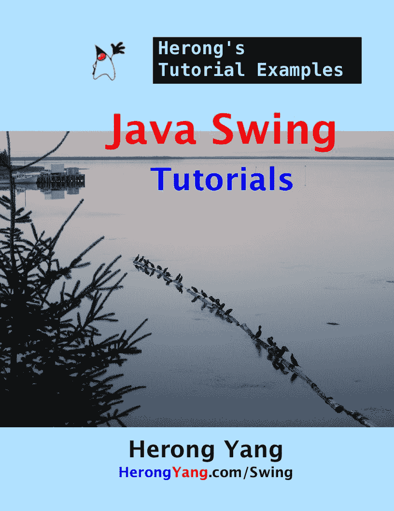


本教程书籍是作者在学习 Java Swing 和 AWT 过程中写的笔记和示例代码。主题包括 Swing 和 AWT（抽象窗口工具包）类库；图形组件：`JButton`、`JCheckbox`、`JComboBox`、`JFrame`、`JLabel`、`JRadioButton`、`JTextField`；框架布局；菜单；对话框；编辑器面板；Unicode 和中文。2022 年使用 `JDK 17` 更新（版本 `v4.31`）。需最新更新和免费示例章节，请访问 https://www.herongyang.com/Swing。

## 关于本书

本节提供了关于本书的某些详细信息 - Java Swing 教程 - Herong 的教程示例。

**标题：** Java Swing 教程 - Herong 的教程示例

**作者：** Herong Yang - 通过电子邮件 herong_yang@yahoo.com 络。

**类别：** Java 与 图形

**版本/编辑：** v4.31, 2022

**页数：** 265 页

**描述：** 这本教程书是作者在自己学习 Java Swing 和 AWT 过程中编写的笔记和示例代码集合。主题包括 Swing 和 AWT（抽象窗口工具包）类库；图形组件：`JButton`、`JCheckbox`、`JComboBox`、`JFrame`、`JLabel`、`JMenu`、`JRadioButton`、`JTextField`；框架布局；菜单；对话框；编辑器面板；Unicode 和中文。于 2022 年（版本 v4.31）针对 JDK 17 进行更新。

**关键词：** Swing, AWT, Java, 图形, 用户界面。

- 本书中的材料不得以任何形式出版、广播、重写或重新分发。
- 示例代码按现状提供，不提供任何形式的保证。

**修订历史：**

- 版本 4.31，2022。针对 JDK 17 更新。
- 版本 4.10，2014。针对 JDK 8 更新。
- 版本 4.00，2009。针对 JDK 6 更新。
- 版本 3.00，2002。针对 JDK 1.4 更新。
- 版本 2.00，1999。增加了 Swing 教程。
- 版本 1.00，1997。从 AWT 教程开始。

**网页版本：** [`www.herongyang.com/Swing`](https://www.herongyang.com/Swing) - 提供免费示例章节、最新更新和读者评论。本书的网页版总访问次数为：

- 截至 2021 年 12 月为 1,593,681 次。
- 截至 2020 年 12 月为 1,504,792 次。
- 截至 2019 年 12 月为 1,428,454 次。
- 截至 2018 年 12 月为 1,360,716 次。
- 截至 2017 年 12 月为 1,303,085 次。
- 截至 2016 年 12 月为 1,237,845 次。
- 截至 2015 年 12 月为 1,150,507 次。
- 截至 2014 年 12 月为 1,019,129 次。
- 截至 2013 年 12 月为 841,839 次。
- 截至 2012 年 12 月为 679,173 次。
- 截至 2011 年 12 月为 502,432 次。
- 截至 2010 年 12 月为 340,928 次。
- 截至 2009 年 12 月为 294,916 次。
- 截至 2008 年 12 月为 170,832 次。
- 截至 2007 年 12 月为 139,491 次。
- 截至 2006 年 12 月为 116,463 次。

**PDF/EPUB 版本：** [`www.herongyang.com/Swing/PDF-Version.html`](https://www.herongyang.com/Swing/PDF-Version.html) - 提供如何获取本书的 PDF、EPUB 版本的信息。

## JDK (Java 开发包)

本章提供了 JDK（Java 开发包）。主题包括 JDK 简介；下载和安装 JDK；创建简单的 Java 程序。

- 什么是 JDK
- 下载并安装 JDK 15
- 编写 Java 程序
- 将 JDK "bin" 目录添加到 Path
- JDK 文档

### 结论

- JDK（Java 开发包）用于使用 Java 语言构建软件组件的开发环境。
- JDK 免费。你可以从 Oracle 网站下载。
- JDK 提供 JRE（Java 运行时）、Java 类库以及一组包含 Java 编译器的工具。
- 本书提供了 JDK 中的 Swing 和 AWT 教程。

### 什么是 JDK

本节描述了 JDK（Java 开发包）——使用 Java 语言构建软件组件的开发环境。

JDK（Java 开发包）是 Oracle 开发的 Java 标准版开发包（JDK™）的简称。它是使用 Java 语言构建软件组件的开发环境。

JDK 包含以下组件：

- JRE（Java 运行时环境）：JRE 允许你运行 Java 程序。JRE 使用实现 JVM 规范的 HotSpot 作为 JVM（虚拟机）。访问 herongyang.com/JVM 了解更多关于 JRE 的教程。
- JCL（Java 类库）：JCL 是一组 Java 程序可以在运行时调用的可加载库。JCL 被组织成 Java 包。某些包是访问 `java.io.*`、`java.net.*`、`java.awt` 等原生系统 API 的封装。本书提供了 JCL 教程。
- Java 开发工具：工具包括 Java 编译器、JAR 工具、类文件反汇编器、调试器、JRE 构建器等。访问 herongyang.com/Java-Tools 了解更多关于 Java 工具的教程。

JDK 版本和发布日期：

```
JDK (Java SE) 17，2021 年 9 月
JDK (Java SE) 16，2021 年 3 月
JDK (Java SE) 15，2020 年 9 月
JDK (Java SE) 14，2020 年 3 月
JDK (Java SE) 13，2019 年 9 月
JDK (Java SE) 12，2019 年 3 月 19 日
JDK (Java SE) 11，2018 年 9 月
JDK (Java SE) 10，2018 年 3 月 20 日
JDK (Java SE) 9，2017 年 9 月 21 日
JDK (Java SE) 8，2014 年 3 月 18 日
JDK (Java SE) 7，2011 年 7 月 28 日
JDK (Java SE) 6，2006 年 12 月
JDK (J2SE) 5.0，2004 年 9 月
JDK (J2SE) 1.4，2002 年 2 月
JDK (J2SE) 1.3，2000 年 5 月
JDK (J2SE) 1.2，1998 年 12 月
JDK 1.1，1997 年 2 月
JDK 1.0，1996 年 1 月
```

### 下载并安装 JDK 15

本节描述了如何在 macOS 上下载和安装 JDK 15。

JDK 15 也称为 Java SE（标准版）15。以下是我在 macOS 上下载和安装 JDK 15 的步骤。

- 使用此 URL 访问 Java SE 下载页面：[`www.oracle.com/technetwork/java/javase/downloads/`](https://www.oracle.com/technetwork/java/javase/downloads/)
- 点击 "Java SE 15" 下的 "JDK Download"。你会看到一个新页面，列出了“Java SE 开发包 15 下载”的不同下载文件。
- 点击“macOS Installer - 179.31 MB”旁边的 `jdk-15_osx-x64_bin.dmg` 超链接。
- 接受许可协议并完成下载。下载文件 `jdk-15_osx-x64_bin.dmg` 将保存在你的 `~/Downloads` 文件夹中。
- 双击 `jdk-15_osx-x64_bin.dmg` 打开安装包。
- 双击 `JDK 15.pkg` 启动安装向导。
- 安装向导将引导你完成安装。

下面的图片显示了 JDK 15 安装界面的外观：

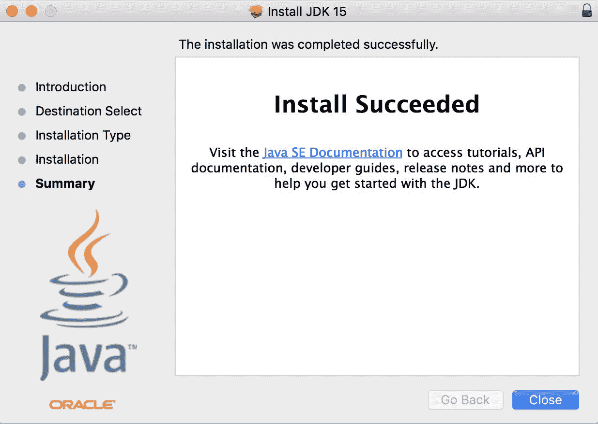

# JDK 12 安装界面

要测试安装，请打开命令行窗口并尝试 `java` 命令。如果你得到以下输出，说明你的安装是成功的：

```
herong> java -version 

java version "15" 2020-09-15
Java(TM) SE Runtime Environment (build 15+36-1562)
Java HotSpot(TM) 64-Bit Server VM (build 15+36-1562, mixed mode, sharing)
```

### 编写我的第一个 Java 程序

本节提供了一个如何使用 JDK 1.8.0 编写、编译和执行第一个 Java 程序的教程示例。

当你的机器上安装了 JDK 后，它提供了两个命令供你编译和运行 Java 程序。

- `javac class_name.java` - 编译存储在以程序类同名文件中的 Java 程序。
- `java -classpath . class_name` - 运行编译后的 Java 程序。`-classpath .` 指定当前目录为类路径。

让我们用一个非常简单的 Java 程序来尝试这些命令。使用记事本将以下 Java 程序输入到名为 `Hello.java` 的文件中：

```
class Hello {
   public static void main(String[] a) {
      System.out.println("Hello world!"); 
   }
}
```

然后在命令行窗口中使用 `javac` 命令编译此程序：

```
herong> javac Hello.java
```

要执行该程序，请使用 `java` 命令：

```
herong> java Hello
Hello world!
```

恭喜，你已成功地输入、编译并执行了你的第一个 Java 程序。

### 将 JDK 的 "bin" 目录添加到 Path 设置

本节提供了关于如何将 JDK 的 'bin' 目录添加到系统环境变量 'path' 中的教程。

如果你正在使用 Windows 电脑，并希望通过输入程序文件名（无需目录路径）来运行 Java 编译器和 JVM，你可能需要更新 Windows 电脑上的 "path" 环境变量：

- 打开“控制面板 > 系统和安全 > 系统”。
- 点击“高级系统设置”。
- 点击“环境变量”。
- 选择“系统变量 > Path”并点击“编辑”。
- 将 `C:\Progra~1\java\jdk-17.0.1\bin;` 添加到当前路径列表的开头。
- 点击“确定”保存更改。

然后我在新的命令行窗口中运行了 `echo %path%` 命令来确认更改：

```
herong> echo %path%

   C:\Progra~1\java\jdk-17.0.1\bin;
   C:\WINDOWS\system32;C:\WINDOWS;
   ...
```

现在我应该可以在不需要目录路径名的情况下运行 Java 命令了：

```
herong> java -version
java version "17.0.1" 2021-10-19 LTS

herong> javac hello.java

herong> java Hello
Hello world!
```

现在我准备好玩 Oracle JDK 包中包含的 Java Swing 功能了！

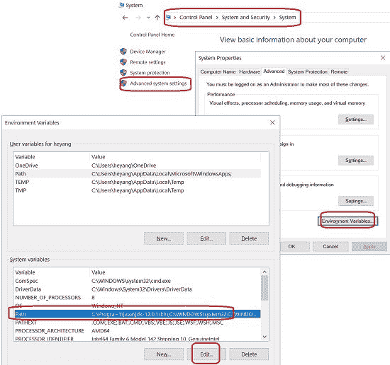

#### 设置 java_home

你也可以设置名为 `java_home` 的新环境变量，以避免输入完整路径来访问 Java 工具程序文件：

```
herong> set java_home=C:\Progra~1\java\jdk-17.0.1

herong> %java_home%\bin\java -version
java version "17.0.1" 2021-10-19 LTS
```

### JDK 文档安装

本节描述了如何在自己的机器上安装 JDK 文档。

为了更有效地学习 JDK，你绝对需要在本地机器安装一份 JDK 文档。JDK 文档提供了 JDK 中使用的所有类和方法的详细信息。以下是我在本地机器上下载并安装 JDK 17 文档的操作：

- 使用此 URL 访问 Java 下载主页：`https://www.oracle.com/java/technologies/downloads/`。
- 点击页面底部的“Documentation Download”按钮。你会看到出现“Java SE Development Kit 17 Documentation”页面。
- 点击 `jdk-17.0.1_doc-all.zip` 的超链接。
- 将下载文件 `jdk-17.0.1_doc-all.zip` 保存到临时目录。
- 双击 `jdk-17.0.1_doc-all.zip` 将所有文件提取到 `C:\Program Files\Java\jdk-17.0.1 directory`。

要验证安装，请用浏览器打开 `C:\Program Files\Java\jdk-17.0.1\docs\index.html`。

JDK 文档提供了 JDK 中使用的所有类和方法的详细信息。Swing 文档提供了 `java.logging` 模块。

## Swing 包介绍

### 什么是 Swing

本节描述了 Swing —— 一个用于构建图形界面 (GUI) 并为 Java 程序添加丰富功能和交互性的 Java 包。

**什么是 Swing？** Swing 是一个 Java 包 `javax.swing`，位于 J2SDK（Java 2 Software Kit）。它对现有的图形包 AWT（Abstract Windows Toolkit）`java.awt` 提供了许多增强。

`javax.swing` 和 `java.awt` 共同为 Java 程序操作图形设备和创建 GUI 提供了 API。

JDK 文档对 Swing 有另一种描述：“Swing 类（Java 基础类 JFC 软件的一部分）实现了一用于构建图形界面 (GUI) 并为 Java 程序添加丰富功能和交互性的组件。Swing 组件完全用 Java 语言实现。可插的外观和感觉（look and feel）允许你创建跨平台外观相同的 GUI，也可以采用操作系统的外观（如 Microsoft Windows、Solaris 或 Linux）。”

Swing 包包含以下子包：

- `javax.swing` - 提供一组“轻量级”（用 Java 编写，无原生代码）组件，这些组件在最大程度上在所有平台上运行相同。
- `javax.swing.border` - 提供为 Swing 组件绘制特殊边框的类和接口。
- `javax.swing.colorchooser` - 包含 `JColorChooser` 组件使用的类和接口。
- `javax.swing.event` - 提供对 Swing 组件触发的事件的支持。
- `javax.swing.filechooser` - 包含 `JFileChooser` 组件使用的类和接口。
- `javax.swing.plaf` - 提供 Swing 用于提供可插拔外观和感觉的一个接口和许多抽象类。
- `javax.swing.plaf.basic` - 提供根据基础外观感觉构建的用户界面对象。
- `javax.swing.plaf.metal` - 提供根据 Java 外观感觉（以前称为 Metal）构建的用户界面对象，这是默认的外观感觉。
- `javax.swing.plaf.multi` - 提供结合两个或多个外观感觉的用户界面对象。
- `javax.swing.plaf.synth` - 提供可皮肤外观和感觉的用户界面对象，其中所有绘制操作都委托出去。
- `javax.swing.table` - 提供用于处理 `JTable` 的类和接口。
- `javax.swing.text` - 提供处理可编辑和不可编辑文本组件的类和接口。
- `javax.swing.text.html` - 提供用于创建 HTML 编辑器的 `HTMLEditorKit` 类及支持类。
- `javax.swing.text.html.parser` - 提供默认 HTML 解析器及支持类。
- `javax.swing.text.rtf` - 提供用于创建富文本格式（Rich Text Format）编辑器的类 (`RTFEditorKit`)。
- `javax.swing.tree` - 提供用于处理 `JTree` 的类和接口。
- `javax.swing.undo` - 允许开发者为文本编辑器等应用程序提供撤销/重做支持。


# Java Swing 教程 - Herong 的教程示例

## Java Swing 包介绍

### SwingHello.java - 我的第一个 Swing 程序

本节提供了一个关于如何编写简单 Java Swing 程序的教程示例。`SwingHello.java` 是我的第一个 Swing 程序，它会显示一个空白窗口，并在标题栏中显示 'Hello world!'。

以下是我的第一个 Swing 程序，`SwingHello.java`：

```java
import javax.swing.*;
public class SwingHello {
   public static void main(String[] a) {
      JFrame f = new JFrame("Hello world!");
      f.setVisible(true);
   }
}
```

如果你的系统中安装了 `JDK`，你可以在命令行窗口编译并运行此程序：

```bash
herong> javac SwingHello.java
herong> java SwingHello
```

一旦程序运行，你将看到屏幕上出现一个小的新窗口。如果你使用鼠标指针拖动它的边缘将其放大，你可以像图片所示在标题区域看到 hello 文本：


第一个 Swing（Windows 上）- Hello World!

新窗口将一直留在屏幕上，直到你在命令行窗口中按 `Ctrl-C` 终止运行中的程序。

如果你使用的是 macOS 计算机，Java Swing 窗口看起来会有所不同：


第一个 Swing（macOS 上）- Hello World!

## 本地系统的图形环境

本章提供了关于本地图形环境的教程笔记和示例代码。主题包括：`java.awt.GraphicsEnvironment` 类的描述和示例；`java.awt.Toolkit` 类的描述和示例；使用默认的 `Toolkit` 对象计算屏幕分辨率。

> `java.awt.GraphicsEnvironment` - 图形环境类
>
> `java.awt.Toolkit` - AWT 基类
>
> 测试屏幕分辨率

结论：

* `java.awt.GraphicsEnvironment.getLocalGraphicsEnvironment()` 返回本地图形环境对象。
* `java.awt.Toolkit.getDefaultToolkit()` 返回默认的 `Toolkit` 对象。

本章列出的示例程序已在 Windows 和 macOS 计算机上的 `JDK 1.3.1` 到 `JDK 17` 通过测试。

### java.awt.GraphicsEnvironment - 图形环境类

本节描述了 `java.awt.GraphicsEnvironment` - 图形环境类。你可以使用此类获取关于你的本地图形设备（实际上你的电脑屏幕）的大量信息。

`java.awt.GraphicsEnvironment` 是一个 `AWT` 类，代表由本地操作系统访问的图形环境。该类还提供了一个静态方法 `getLocalGraphicsEnvironment()`，返回一个表示本地默认图形环境的对象。

你可以使用这个本地图形环境对象来获取关于本地系统的大量信息。例如，你可以发现可用哪些文本字体，以及屏幕上图形绘制区域的最大尺寸是多少。

为了向你展示如何使用 `getLocalGraphicsEnvironment()` 方法，我编写了以下示例程序：

```java
/* LocalGraphicsEnvironment.java
 */
import java.awt.*;
public class LocalGraphicsEnvironment {
   public static void main(String[] a) {
      GraphicsEnvironment e 
         = GraphicsEnvironment.getLocalGraphicsEnvironment();
      String n[] = e.getAvailableFontFamilyNames();
      System.out.println("Font families:");
      for (int i=0; i<n.length; i++) {
         System.out.println("   "+n[i]);
      }
      Point p = e.getCenterPoint();
      System.out.println("Window center point: "+p.x+", "+p.y);
      Rectangle r = e.getMaximumWindowBounds();
      System.out.println("Maximum window bounds: "+r.x+", "+r.y
         +", "+r.width+", "+r.height);
      GraphicsDevice g = e.getDefaultScreenDevice();
      System.out.println("Device ID: "+g.getIDstring());
   }
}
```

输出：

```text
herong> java LocalGraphicsEnvironment.java

Font families:
   Albertus Extra Bold
   Albertus Medium
   Antique Olive
   Arial
   Arial Black
   Arial Narrow
   ......
Window center point: 512, 296
Maximum window bounds: 0, 0, 1024, 592
Device ID: Display0
```

### java.awt.Toolkit - AWT 基类

本节提供了一个关于如何使用 `java.awt.Toolkit` 类获取默认 `Toolkit` 对象的教程示例，该对象也可以提供关于默认图形环境的信息。

`java.awt.Toolkit` 是一个 `AWT` 类，作为 AWT 实现的基类。该类还提供了一个静态方法 `getDefaultToolkit()`，返回一个代表默认 `AWT` 实现的对象。

为了向你展示如何使用 `getDefaultToolkit()` 方法，我编写了以下程序：

```java
/* DefaultToolkit.java
 * Copyright (c) 1997-2018 HerongYang.com. All Rights Reserved.
 */
import java.awt.*;
public class DefaultToolkit {
   public static void main(String[] a) {
      Toolkit t = Toolkit.getDefaultToolkit();
      Dimension d = t.getScreenSize();
      System.out.println("Screen size: "+d.width+", "+d.height);
      System.out.println("Screen resolution: "+t.getScreenResolution());
   }
}
```

输出：

```text
herong> java DefaultToolkit.java 

Screen size: 1024, 640
Screen resolution: 120
```

将 `DefaultToolkit.java` 的输出与 `LocalGraphicsEnvironment.java` 进行比较，toolkit 的屏幕尺寸与环境边界并不匹配。我不知道为什么。我也不知道如何读取屏幕分辨率值。它是 120 DPI（每英寸点数）吗？

为了回答我在上一节中提出的问题，我编写了以下程序并进行了一些测试：

```java
/* ScreenResolution.java
 * Copyright (c) 1997-2018 HerongYang.com. All Rights Reserved.
 */
import java.awt.*;
import javax.swing.*;
public class ScreenResolution {
   static int dpi;
   static int width, height;
   public static void main(String[] a) {
      Toolkit t = Toolkit.getDefaultToolkit();
      dpi = t.getScreenResolution();
      width = t.getScreenSize().width;
      height = t.getScreenSize().height;
      System.out.println("Width = "+width);
      System.out.println("Height = "+height);
      System.out.println("DPI = "+dpi);
      JFrame f = new JFrame("Screen Size and Resolution");
      f.setDefaultCloseOperation(JFrame.EXIT_ON_CLOSE);
      f.setContentPane(new MyComponent());
      f.setExtendedState(Frame.MAXIMIZED_BOTH);
      f.setVisible(true);
   }
   static class MyComponent extends JComponent {
      public void paint(Graphics g) {
         g.drawString("100 pixel boxes",0,20);
         for (int i=0; i<width/100+1; i++) {
            g.drawRect(i*100,20,100,100);
         }
         g.drawString("One inch ("+dpi+" pixel) boxes",0,140);
         for (int i=0; i<width/dpi+1; i++) {
            g.drawRect(i*dpi,140,dpi,dpi);
         }
      }
   }
}
```

在第一次测试中，我将 Windows 屏幕设置（控制面板 / 显示 / 设置 / 屏幕区域）更改为 `1024 x 786`，并运行了程序。它显示了大约 `10.*` 个 100 像素框和 `10.*` 个英寸框：

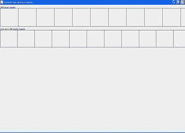

#### 屏幕分辨率

示例程序在控制台窗口中也给出了以下数字：

```text
Width = 1024
Height = 768
DPI = 96
```

在第二次测试中，我将 Windows 屏幕设置（控制面板 / 显示 / 设置 / 屏幕区域）更改为 `800 x 600`，并运行了程序。它显示了大约 `8` 个 100 像素框和 `8.*` 个英寸框，并在控制台窗口中给出了以下结果：

```text
Width = 800
Height = 600
DPI = 96
```

结果告诉我，如果你在屏幕上测量，我的英寸框的大小实际上并不是一英寸。我从默认工具包获取的屏幕分辨率并没有遵循屏幕设置。换句话说，我没有得到屏幕的真实分辨率。如果有人知道如何获取真实分辨率，请告诉我。

## JFrame - 主帧类

本章提供了 `JFrame` 类的教程笔记和示例代码。主题包括：创建指定大小和位置的帧；关闭帧时终止程序；列出 AWT 线程；在帧上显示中文字；在帧上绘制图形。

- 创建指定大小和位置的帧
- 关闭帧并终止应用程序
- 列出和中断 AWT 线程
- JDK 1.6 中的 "AWT blocker activation interrupted" 错误
- JDK 8 到 12 中的 JFrame 线程行为
- 在帧标题中显示中文字符
- 绘制图形 - 在帧上使用 paint()
- 绘制图形 - 在组件上使用 paint()
- 绘制图形 - 在内容面板上使用 paint()
- 在帧上绘制中文字符

### 结论

- `JFrame.setVisible()` 启动 AWT 线程并在屏幕上显示帧。
- `JFrame.setDefaultCloseOperation()` 可在帧关闭时终止程序。
- `JFrame.setContentPane()` 可用于你自己的组件替换内容面板。
- 在帧上绘制图形的最佳方法是在其内容面板组件上绘制图形。
- `JComponent.setFont()` 可用于设置中文字并绘制中文字符。

本章列出的示例程序已在 Windows 和 macOS 电脑上通过了 `JDK 1.3.1` 到 `JDK 17` 的测试。

### 创建指定大小和位置的帧

本节提供了一个教程示例，介绍如何使用 `setBounds()` 和 `setVisible()` 方法创建一个指定大小和位置的帧。

**问题**：我想创建一个特定大小的帧窗口，并将其显示在屏幕上的特定位置。

**解决方案**：你可以使用 `JFrame.setBounds()` 方法定义帧的位置和大小。然后使用 `setVisible()` 方法使帧可见。

```java
import javax.swing.*;
public class JFrameTest {
   public static void main(String[] a) {
      JFrame f = new JFrame("Frame");
      f.setBounds(50,50,150,150);
      f.setVisible(true);
   }
}
```

如果你运行此示例，你将得到：


### JFrame 测试

笔记 1：`JFrame.setVisible()` 启动 AWT 线程并在屏幕上显示帧。

笔记 2：`JFrame.setDefaultCloseOperation()` 可在帧关闭时终止程序。

笔记 3：`JFrame.setContentPane()` 可用于你自己的组件替换内容面板。

### 解决方案 3

你可以创建一个新的窗口事件监听器类，并将该类的对象添加到 `JFrame` 对象中。在新的窗口事件监听器中，你可以实现自定义的 `windowClosing()` 处理器方法。当然，创建新窗口事件监听类最快的方法是扩展 `WindowAdapter` 类。下面的示例代码 `JFrameClose3.java` 展示了如何实现。

```java
/* JFrameClose3.java
 * Copyright (c) 1997-2018 HerongYang.com. All Rights Reserved.
 */
import java.awt.event.*;
import javax.swing.*;
public class JFrameClose3  {
   public static void main(String[] a) {
      JFrame f = new JFrame();
      f.setTitle("Closing Frame with Window Listener");
      f.setBounds(100,50,500,300);
      f.addWindowListener(new MyWindowListener());
      f.setVisible(true);
   }
   static class MyWindowListener extends WindowAdapter {
      public void windowClosing(WindowEvent e) {
         System.exit(0);
      }
   }
}
```

## 列出和中断 AWT 线程

本节提供了一个关于如何列出 AWT 线程以及如何使用 `interrupt()` 方法中断 AWT 线程的教程示例。

**问题**：我想知道由 `Swing` 包和 `AWT` 包共创建了多少线程。如果我向所有这些线程发送中断信号，会发生什么？

**解决方案**：这很简单。只需获取当前线程组的所有线程列表，然后一个一个地中断它们。这里有一个示例程序展示如何操作：


```java
/* FrameThreads.java
 * Copyright (c) 1997-2018 HerongYang.com. All Rights Reserved.
 */
import java.awt.*;
import javax.swing.*;
public class FrameThreads {
   public static void main(String[] a) {
      JFrame f = new JFrame("Frame 1");
      f.setBounds(0,0,100,100);
      f.setVisible(true);
      f = new JFrame("Frame 2");
      f.setBounds(50,50,100,100);
      f.setVisible(true);
      f = new JFrame("Frame 3");
      f.setBounds(100,100,100,100);
      f.setVisible(true);
      Thread[] l = new Thread[100];
      int n = Thread.enumerate(l);
      Thread g = null;
      for (int i=0; i<n; i++) {
         System.out.println("Active thread = "+l[i].getName());
      }
      Thread t = Thread.currentThread();
      for (int i=0; i<n; i++) {
         try {
            Thread.sleep(1000*30);
         } catch (Exception e) {
            System.out.println("Interrupted.");
         }
         if (t != l[i]) {
            System.out.println("Interrupting thread = "
               +l[i].getName());
            l[i].interrupt();
         }
      }
   }
}
```

如果你使用 `JDK 1.5 或更高版本` 运行此程序，你将看到屏幕上出现 3 个窗口。每隔 30 秒，我的程序就会向每个线程发送一个中断信号。当中断信号到达“Java2D Disposer”线程时，会发生运行时异常并强制应用程序终止。以下列表显示了我程序的输出：

```
herong> \Progra~1\Java\jdk1.5.0_09\bin\java FrameThreads

Active thread = main
Active thread = AWT-Windows
Active thread = AWT-Shutdown
Active thread = AWT-EventQueue-0
Active thread = Java2D Disposer
Interrupting thread = AWT-Windows
Interrupting thread = AWT-Shutdown
Interrupting thread = AWT-EventQueue-0
Interrupting thread = Java2D Disposer
Exception while removing reference: java.lang.InterruptedException
java.lang.InterruptedException
   at java.lang.Object.wait(Native Method)
   at java.lang.ref.ReferenceQueue.remove(ReferenceQueue.java:111)
   at java.lang.ref.ReferenceQueue.remove(ReferenceQueue.java:127)
   at sun.java2d.Disposer.run(Disposer.java:100)
   at java.lang.Thread.run(Thread.java:534)
AWT blocker activation interrupted:
java.lang.InterruptedException
   at java.lang.Object.wait(Native Method)
   at java.lang.Object.wait(Object.java:429)
   at sun.awt.AWTAutoShutdown.activateBlockerThread(AWTAutoShut...
   at sun.awt.AWTAutoShutdown.setToolkitBusy(AWTAutoShutdown.ja...
   at sun.awt.AWTAutoShutdown.notifyToolkitThreadBusy(AWTAutoSh...
   at sun.awt.windows.WToolkit.eventLoop(Native Method)
   at sun.awt.windows.WToolkit.run(WToolkit.java:534)
```

# Java Swing 教程 - Herong 示例

## JFrame - 主框架类

### 在框架标题栏中显示中文

本节提供了一个教程示例，介绍如何使用指定的中文字体在框架窗口的标题栏中显示中文。

**问题**：我想框架窗口的标题中显示中文。

**解决方案 1**：如果你在较新的电脑上使用 `JDK` 9 或更高版本，你可以在 Java 源代码中包含中文字符并以 `UTF-8` 编码保存，这是大多数编程编辑器的默认行为。不需要指定 `SimSun` 字体名称，系统将选取默认字体来支持中文字符。仍然可以使用 Unicode `/uxxxx` ASCII 格式提供中文字符，但 `UTF-8` 编码是一个更好的选项。

```java
/*
import java.awt.*;
import javax.swing.*;
public class JFrameChinese2 {
   public static void main(String[] a) {
      JFrame f = new JFrame();
//    f.setFont(new Font("SimSun",Font.PLAIN, 12));
//    f.setTitle("Hello world! - \u7535\u8111\u4F60\u597D\uFF01");
      f.setTitle("Hello world! - 电脑你好！");
      f.setBounds(100,50,500,300);
      f.setDefaultCloseOperation(JFrame.EXIT_ON_CLOSE);
      f.setVisible(true);
   }
}
```

**解决方案 2**：如果你在旧电脑上仍使用旧版本的 `JDK`，你可能需要自己安装中文字体。在我下面列出的示例代码中，我使用了字体 `SimSun`，它是作为 Windows 多语言支持的一部分安装的。你可能还需要 Java 源代码中使用 `/uxxxx` ASCII 格式输入中文字符。

```java
/* JFrameChinese.java
 * Copyright (c) 2014-2018 HerongYang.com All Rights Reserved.
 */
import java.awt.*;
import javax.swing.*;
public class JFrameChinese {
   public static void main(String[] a) {
      JFrame f = new JFrame();
      f.setFont(new Font("SimSun",Font.PLAIN, 12));
      f.setTitle("Hello world! - \u7535\u8111\u4F60\u597D\uFF01");
      f.setBounds(100,50,500,300);
      f.setDefaultCloseOperation(JFrame.EXIT_ON_CLOSE);
      f.setVisible(true);
   }
}
```

如果你运行这两个示例，将得到相同的结果：

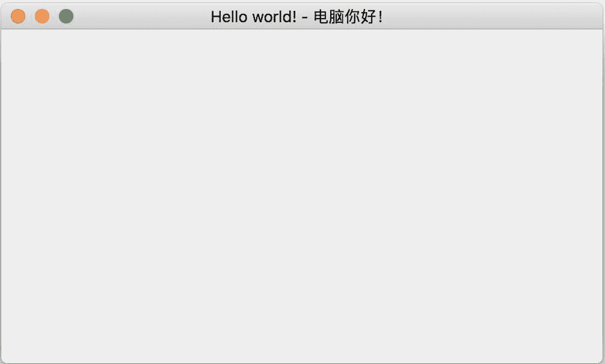

### 标题栏中的中文

**注意 1**：使用 `JDK` 1.4.1 或更低版本，字符将显示为 `?`。我没有办法。如果你有任何建议，请与我分享。

**注意 2**：要检查 Windows 电脑是否安装了 `SimSun` 字体，可以在系统目录树中查找 `%windir%\fonts\simsun.ttc` 文件。

## 绘制图形 - 在框架上使用 paint()

本节提供了一个教程示例，介绍如何重写 `javax.swing.JFrame` 类中的 `paint()` 方法以在框架窗口上绘制图形（矩形）。不推荐这种解决方案。

**问题**：我想在框架中绘制一些图形。

**解决方案 1**：你可以通过扩展 `JFrame` 类创建你自己的框架类来轻松实现这一点，这样就可以重写 `paint()` 方法。`paint()` 方法提供了一个 `Graphics` 对象，该对象将为你提供绘制各种类型图形的实用方法。下面的示例代码 `JFramePaint1.java` 展示了如何操作。

```java
/* JFramePaint1.java
 * Copyright (c) 1997-2018 HerongYang.com. All Rights Reserved.
 */
import java.awt.*;
import javax.swing.*;
public class JFramePaint1 {
   public static void main(String[] a) {
      MyJFrame f = new MyJFrame();
      f.setTitle("Drawing Graphics in Frames");
      f.setBounds(100,50,500,300);
      f.setDefaultCloseOperation(JFrame.EXIT_ON_CLOSE);
      f.setVisible(true);
   }
   static class MyJFrame extends JFrame {
      public void paint(Graphics g) {
         g.drawRect(20,10,100,60);
      }
   }
}
```

如果你运行此示例，将得到：

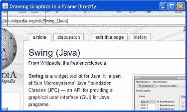

### 在框架上使用 paint()

**注意 1**：`paint()` 方法是 `JFrame` 类从 `Component` 类继承的。每当该组件应该绘制时，它就会被调用。

**注意 2**：如果你查看框架上显示的矩形，你会发现绘制坐标的原点位于整个框架的左上角，包括标题栏。

**注意 3**：默认情况下，`paint()` 方法提供透明背景。

**注意 4**：在 `JDK` 7 及更高版本中，`paint()` 方法不提供背景。

## 在组件上使用 paint()

本节提供了一个教程示例，介绍如何重写 `javax.swing.JFrame` 类中的 `paint()` 方法以在框架窗口上绘制图形（矩形）。

**问题**：我想在框架中绘制一些图形。

**解决方案 2**：解决方案 1 并不理想，因为我们需要添加另一个组件。为了在框架中绘制，我们创建一个新组件并将其添加到内容区域。

```java
/* JFramePaint2.java
 * Copyright (c) 2014-2018 HerongYang.com All Rights Reserved.
 */
import java.awt.*;
import javax.swing.*;
public class JFramePaint2 {
   public static void main(String[] a) {
      JFrame f = new JFrame();
      f.setTitle("Drawing Graphics in Frames"
         +" by Adding Component");
      f.setBounds(100,50,500,300);
      f.setDefaultCloseOperation(JFrame.EXIT_ON_CLOSE);
      f.getContentPane().add(new MyComponent());
      f.setVisible(true);
   }
   static class MyComponent extends JComponent {
      public void paint(Graphics g) {
         g.drawRect(20,10,100,60);
      }
   }
}
```

如果你运行此示例，将得到：

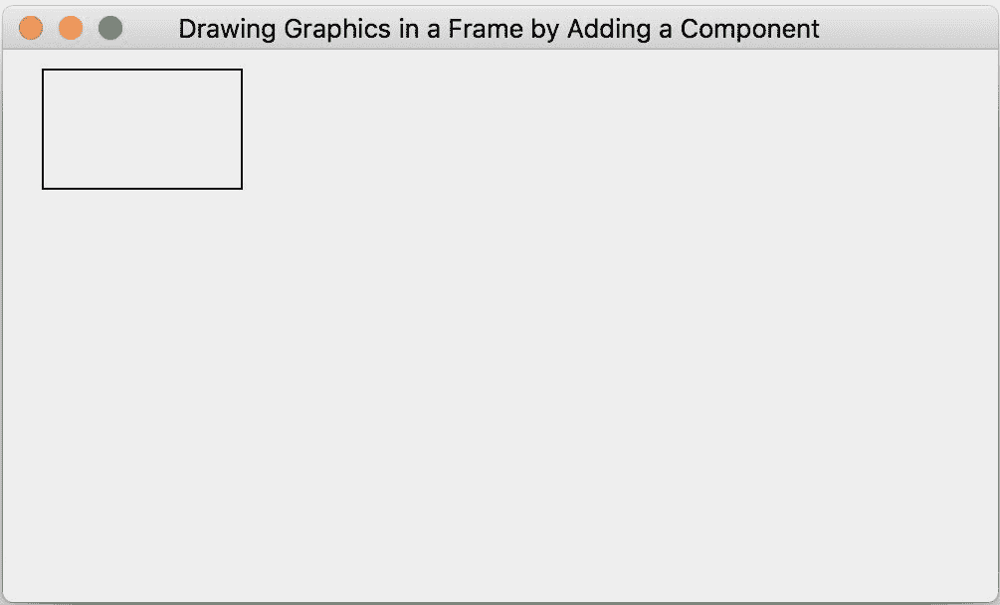

**注意 1**：由于没有给新组件指定大小，它占据了整个内容区域，即整个框架区域。

**注意 2**：现在绘制坐标的原点在左上角，比解决方案 1 好得多。

## 在内容区域上使用 paint()

本节提供了一个教程示例，介绍如何重写 `javax.swing.JFrame` 类中的 `paint()` 方法以绘制图形（矩形）并将其作为框架的内容区域。

**问题**：我想在框架中绘制一些图形。

**解决方案 3**：解决方案 2 还不够完美。我们为什么需要为绘制添加另一个组件？我们可以直接在内容区域上绘制图形吗？答案是肯定的，我们可以直接在内容区域上绘制。下面的示例代码 `JFramePaint3.java` 展示了如何操作。

```java
/* JFramePaint3.java
 * Copyright (c) 1997-2018 HerongYang.com. All Rights Reserved.
 */
import java.awt.*;
import javax.swing.*
public class JFramePaint3 {
   public static void main(String[] a) {
      JFrame f = new JFrame();
      f.setTitle("Drawing Graphics in Frame"
         +" by Replacing the Content Pane");
      f.setBounds(100,50,500,300);
      f.setDefaultCloseOperation(JFrame.EXIT_ON_CLOSE);
      f.setContentPane(new MyComponent());
      f.setVisible(true);
   }
   static class MyComponent extends JComponent {
      public void paint(Graphics g) {
         g.drawRect(20,10,100,60);
      }
   }
}
```

如果你运行此示例，将得到：

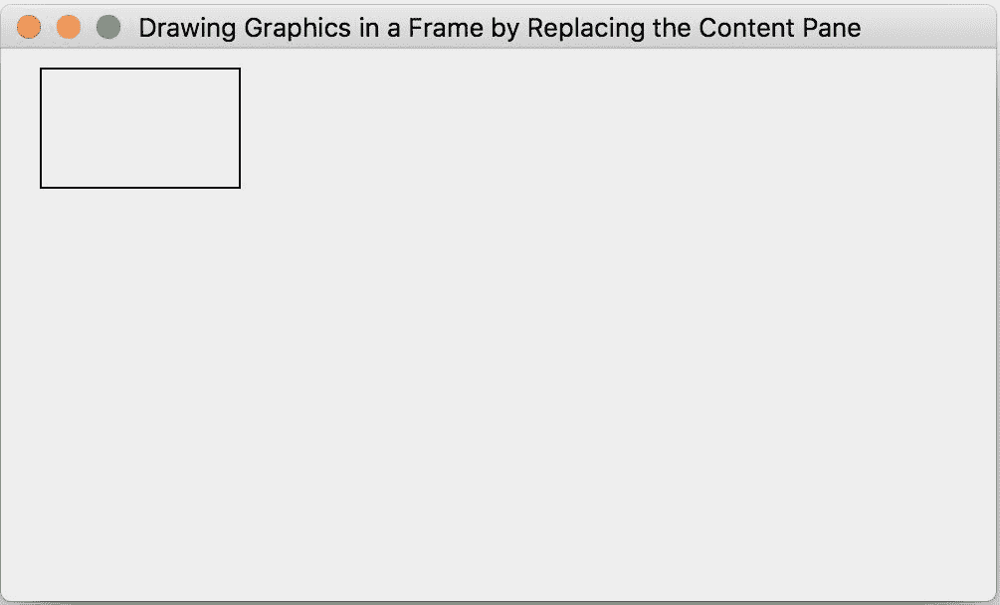

注意：内容面板被我们创建的、带有自定义 `paint()` 方法的新组件对象所取代。

## 在框架上绘制中文字符

本节内容提供了一个教程示例，演示了如何使用 `drawString()` 方法并选择中文字体在框架上绘制中文字符。

**问题**：我想在框架中绘制一些中文字符。

**解决方案**：你可以按照上一个问题解决方案中的描述进行操作。在 `paint()` 方法中，首先将 `Graphics` 对象的字体更改为支持中文字符的 Unicode 字体。然后使用 `drawString()` 工具方法绘制带有中文字符的字符串。以下示例代码 `JFramePaintChinese.java` 展示了如何实现这一点。

```java
/* JFramePaintChinese.java
 */
import java.awt.*;
import javax.swing.*
public class JFramePaintChinese {
   public static void main(String[] a) {
      JFrame f = new JFrame();
      f.setTitle("Drawing Graphics in Frames");
      f.setBounds(100,50,500,300);
      f.setDefaultCloseOperation(JFrame.EXIT_ON_CLOSE);
      f.setContentPane(new MyComponent());
      f.setVisible(true);
   }
   static class MyComponent extends JComponent {
      public void paint(Graphics g) {
         g.setFont(new Font("SimSun",Font.PLAIN, 12));
         g.drawString("Hello world! - \u7535\u8111\u4F60\u597D\uFF01",
            100,50);
      }
   }
}
```

运行此示例，你将得到：


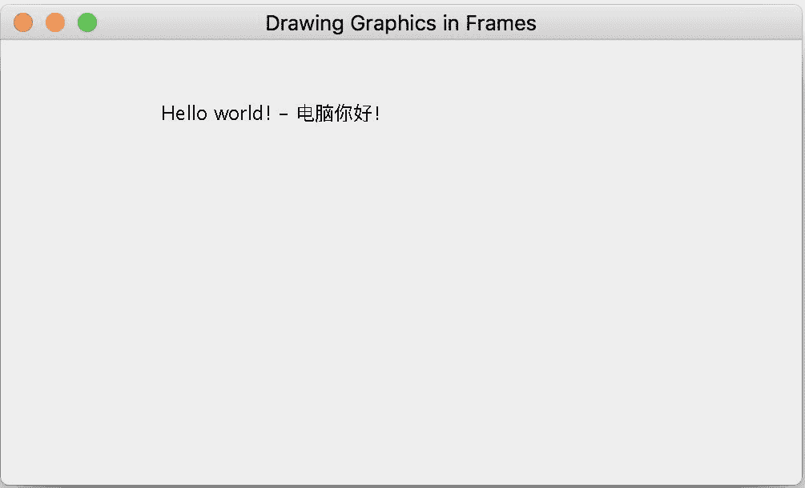

# 在框架上绘制中文

## JLabel - Swing 标签类

本章提供了关于 `JLabel` 类的教程笔记和示例代码。主题包括使用 `javax.swing.JLabel` 类创建标签组件；使用中文字符创建标签。

- 使用 `javax.swing.JLabel` 类创建标签
- 使用中文字符创建标签

### 结论

- `javax.swing.JLabel` 类表示一个 UI 标签。
- 只要有支持的字体文件，标签就可以包含任何语言的 Unicode 字符。

本章列出的示例程序已在 Windows 和 macOS 电脑上通过了 JDK 1.3.1 到 JDK 17 的测试。

## 使用 javax.swing.JLabel 类创建标签

本节内容提供了一个教程示例，演示如何使用 `javax.swing.JLabel` 类创建一个标签。

**问题**：我想创建一个带有文本字符串的标签。

**解决方案**：这很简单，只需实例化 `javax.swing.JLabel` 对象并将其添加到任何容器中。这里有一个示例程序向你展示如何操作：

```java
/* JLabelHello.java */
import java.awt.*;
import javax.swing.*;

public class JLabelHello {
    public static void main(String[] a) {
        JFrame f = new JFrame();
        f.setDefaultCloseOperation(JFrame.EXIT_ON_CLOSE);
        JLabel l = new JLabel("Hello world!");
        f.getContentPane().add(l);
        f.pack();
        f.setVisible(true);
    }
}
```

运行此示例，你将得到：


JLabel 测试

> **注意**：`pack()` 方法会导致窗口调整大小以适应其子组件的优选布局。

## 使用中文字符创建标签

本节内容提供了一个教程示例，演示如何使用 `javax.swing.JLabel` 类创建一个带有中文字符的标签。

**问题**：我想创建一个带有中文字符的标签。

**解决方案**：并不难。请看以下示例程序：

```java
/* JLabelChinese.java
 * Copyright (c) 2014-2018 HerongYang.com All Rights Reserved.
 */
import java.awt.*;
import javax.swing.*;

public class JLabelChinese {
    public static void main(String[] a) {
        JLabel l = new JLabel();
        l.setFont(new Font("SimSun", Font.PLAIN, 12));
        l.setText("Hello world! - \u7535\u8111\u4F60\u597D\uFF01");
        JFrame f = new JFrame();
        f.setDefaultCloseOperation(JFrame.EXIT_ON_CLOSE);
        f.getContentPane().add(l);
        f.pack();
        f.setVisible(true);
    }
}
```

运行此示例，你将得到：


中文 JLabel 测试

# JButton - Swing 按钮类

本章提供了关于 `JButton` 类的教程笔记和示例代码。主题包括使用 `JButton` 类创建按钮组件；带图标的按钮；在组件级和框架级添加按钮点击器。

- 使用 `JButton` 类创建按钮
- 创建带图标的按钮
- 组件级按钮处理器
- 框架级按钮处理器
- 框架级鼠标点击处理器

### 结论

- `JButton` 类表示一个 UI 按钮。
- 按钮可以使用文本标签或图标来创建。
- `ActionListener` 接口可以处理按钮的动作。
- `MouseAdapter` 接口可以处理按钮的鼠标点击。

本章列出的程序已在 Windows 和 macOS 电脑上通过测试。

## 使用 javax.swing.JButton 创建按钮

本节内容提供了一个教程示例，演示如何使用 `javax.swing.JButton` 类创建一个按钮。

使用 `javax.swing.JButton` 类创建按钮非常简单。这里有一个示例程序：

```java
/* JButtonOk.java
 * Copyright (c) 1997-2018 HerongYang.com. All Rights Reserved.
 */
import java.awt.*;
import javax.swing.*;

public class JButtonOk {
    public static void main(String[] a) {
        JFrame f = new JFrame("My First Button");
        f.setDefaultCloseOperation(JFrame.EXIT_ON_CLOSE);
        JButton b = new JButton("OK");
        f.getContentPane().add(b);
        f.pack();
        f.setVisible(true);
    }
}
```

运行此示例，你将得到：

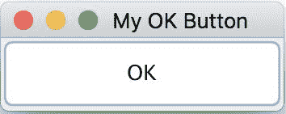

> **注意**：点击 OK 按钮不会触发任何动作，因为没有在按钮上添加事件监听器。

## 使用 javax.swing.JButton 创建图标按钮

本节内容提供了一个教程示例，演示如何使用 `JButton` 类和 `ImageIcon` 类创建一个图标按钮。

你也可以使用自己的图片创建按钮。这里有一个示例程序：

```java
/* JButtonIcon.java */
import java.awt.*;
import javax.swing.*;

public class JButtonIcon {
    public static void main(String[] a) {
        JFrame f = new JFrame("My Icon Button");
        f.setDefaultCloseOperation(JFrame.EXIT_ON_CLOSE);
        JButton b = new JButton(new ImageIcon("java.gif"));
        f.getContentPane().add(b);
        f.pack();
        f.setVisible(true);
    }
}
```

运行此示例，你将得到：

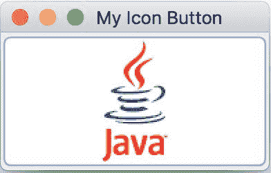

JLabel 图标按钮

## 组件级的按钮动作处理器

本节提供了一个教程示例，介绍如何通过向按钮组件添加 `ActionListener` 接口来创建一个按钮以处理动作。

处理按钮动作的一种方法是在按钮对象上添加动作监听器。动作监听器是实现了 `ActionListener` 接口的任意对象。

以下程序展示了如何扩展 `JButton` 类来实现 `ActionListener` 类：

```java
/* JButtonAction1.java
 * Copyright (c) 1997-2018 HerongYang.com. All Rights Reserved.
 */
import java.awt.*;
import java.awt.event.*;
import javax.swing.*;

public class JButtonAction1 {
    public static void main(String[] a) {
        JFrame f = new JFrame("My Switch Button");
        f.setDefaultCloseOperation(JFrame.EXIT_ON_CLOSE);
        JButton b = new MyButton();
        f.getContentPane().add(b);
        f.pack();
        f.setVisible(true);
    }

    private static class MyButton extends JButton implements ActionListener {
        String text = "On";

        public MyButton() {
            super();
            setText(text);
            addActionListener(this);
        }

        public void actionPerformed(ActionEvent e) {
            if (text.equals("On")) text = "Off";
            else text = "On";
            setText(text);
        }
    }
}
```

如果你运行此示例，你将得到：

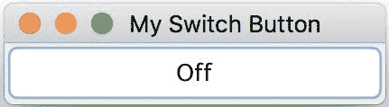

按钮工作正常。如果你点击按钮，按钮标签文本将从 "On" 变为 "Off"；如果你再次点击它，它将从 "Off" 变为 "On"。

## 帧级别的按钮动作处理器

本节提供了一个教程示例，介绍如何通过向包含按钮组件的帧添加 `ActionListener` 接口来创建一个按钮以处理动作。

在上一节中，我们扩展了按钮来处理其自身的动作。如果动作只需要修改同一个按钮的行为，那么这种方法运行良好。

但如果动作需要修改其他组件的行为，你需要在更高级别实现动作监听器。以下程序展示了如何使用动作处理器修改标签组件的文本：

```java
/* JButtonAction2.java
 * Copyright (c) 1997-2018 HerongYang.com. All Rights Reserved.
 */
import java.awt.*;
import java.awt.event.*;
import javax.swing.*;

public class JButtonAction2 implements ActionListener {
    JButton myButton = null;
    JLabel myLabel = null;
    String text = null;

    public static void main(String[] a) {
        JButtonAction2 myTest = new JButtonAction2();
        myTest.createFrame();
    }

    public void createFrame() {
        JFrame f = new JFrame("My Switch Button");
        f.setDefaultCloseOperation(JFrame.EXIT_ON_CLOSE);
        Container c = f.getContentPane();
        c.setLayout(new GridLayout(2, 1));
        text = "On";
        myButton = new JButton(text);
        myButton.addActionListener(this);
        c.add(myButton);
        myLabel = new JLabel(text, SwingConstants.CENTER);
        c.add(myLabel);
        f.pack();
        f.setVisible(true);
    }

    public void actionPerformed(ActionEvent e) {
        if (text.equals("On")) text = "Off";
        else text = "On";
        myButton.setText(text);
        myLabel.setText(text);
    }
}
```

如果你运行此示例，你将得到：

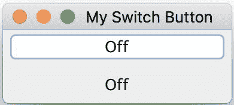

### 帧上的按钮动作处理器

按钮工作得很好。如果你点击按钮，按钮标签文本将从 "On" 变为 "Off"，且标签组件的文本也会发生改变。

## 帧级别的鼠标点击处理器

本节提供了一个教程示例，介绍如何通过向包含按钮组件的帧添加 `MouseAdapter` 接口来创建一个按钮以处理动作。

当然，使用 `ActionListeners` 不是处理用户点击按钮的唯一方法。你也可以使用 `MouseListeners` 来处理用户点击。这是一个示例程序：

```java
/* JButtonAction3.java */
import java.awt.*;
import java.awt.event.*;
import javax.swing.*;

public class JButtonAction3 extends MouseAdapter {
    JButton myButton = null;
    JLabel myLabel = null;
    String text = null;

    public static void main(String[] a) {
        JButtonAction3 myTest = new JButtonAction3();
        myTest.createFrame();
    }

    public void createFrame() {
        JFrame f = new JFrame("My Switch Button");
        f.setDefaultCloseOperation(JFrame.EXIT_ON_CLOSE);
        Container c = f.getContentPane();
        c.setLayout(new GridLayout(2, 1));
        text = "On";
        myButton = new JButton(text);
        myButton.addMouseListener(this);
        c.add(myButton);
        myLabel = new JLabel(text, SwingConstants.CENTER);
        c.add(myLabel);
        f.pack();
        f.setVisible(true);
    }

    public void mouseClicked(MouseEvent e) {
        if (text.equals("On")) text = "Off";
        else text = "On";
        myButton.setText(text);
        myLabel.setText(text);
    }
}
```

如果你运行此示例，你将得到：

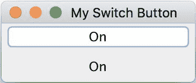

### 使用鼠标适配器的按钮

按钮工作正常。如果你点击按钮，按钮标签文本将从 "On" 变为 "Off"。

# JCheckBox - Swing 复选框类

本章提供了 `JCheckBox` 类的注释和示例代码。主题包括 `javax.swing.JCheckBox` 类的描述；创建复选框和事件监听器的示例程序。

- JCheckBox 及相关方法
- ActionListener, ChangeListener 和 ItemListener
- isSelected() - 获取复选框状态

## 结论

- `javax.swing.JCheckBox` 类表示复选框。
- `ActionListener`、`ChangeListener` 或 `ItemListener` 接口可用于复选框上的动作。
- `isSelected()` 方法用于检测复选框的状态。

本章列出的示例程序已在 Windows 和 macOS 上通过了 JDK 1.3.1 到 17 的测试。

## javax.swing.JCheckBox 相关方法

本节介绍了 `javax.swing.JCheckBox` 类及其常用方法。


# `javax.swing.JCheckBox` - Swing 复选框类

`javax.swing.JCheckBox` 代表 UI 复选框的 Swing 类。一些有趣的方法包括：

- `JCheckBox(String)` - 创建带有指定字符串的复选框的构造函数。复选框默认未选中。
- `addActionListener(ActionListener)` - 为此复选框添加动作监听器以处理动作事件。点击此复选框将触发一次动作事件。
- `addChangeListener(ChangeListener)` - 为此复选框添加变化监听器以处理变化事件。点击此复选框将触发多次变化事件。
- `addItemListener(ItemListener)` - 为此复选框添加项目监听器以处理项目事件。点击此复选框将触发一次项目事件。
- `setActionCommand(String)` - 为此复选框设置动作命令字符串的方法。
- `isSelected()` - 返回复选框状态的方法。

## ActionListener、ChangeListener 和 ItemListener

本节提供了一个教程示例，介绍如何使用 `ActionListener`、`ChangeListener` 和 `ItemListener` 接口来处理复选框上产生的不同类型的事件。

如你从上一节所示，复选框可以具有 3 种监听器：`ActionListener`、`ChangeListener` 和 `ItemListener`。下面的示例程序展示了这些监听器何时被调用以及被调用多少次：

```java
/* JCheckBoxTest.java
 * Copyright (c) 1997-2018 HerongYang.com. All Rights Reserved.
 */
import java.awt.*;
import java.awt.event.*;
import javax.swing.*;
import javax.swing.event.*;

public class JCheckBoxTest {
    public static void main(String[] a) {
        JFrame f = new JFrame("My Check Boxes");
        f.setDefaultCloseOperation(JFrame.EXIT_ON_CLOSE);

        MyCheckBox red = new MyCheckBox("Red");
        f.getContentPane().add(red, BorderLayout.NORTH);

        MyCheckBox green = new MyCheckBox("Green");
        f.getContentPane().add(green, BorderLayout.CENTER);

        MyCheckBox blue = new MyCheckBox("Blue");
        f.getContentPane().add(blue, BorderLayout.SOUTH);

        f.pack();
        f.setVisible(true);
    }

    private static class MyCheckBox extends JCheckBox 
            implements ActionListener, ChangeListener, ItemListener {
        static int count = 0;
        String text = null;

        public MyCheckBox(String t) {
            super(t);
            text = t;
            addActionListener(this);
            addChangeListener(this);
            addItemListener(this);
        }

        public void actionPerformed(ActionEvent e) {
            count++;
            System.out.println(count + ": Action performed - " + text);
        }

        public void stateChanged(ChangeEvent e) {
            count++;
            System.out.println(count + ": State changed - " + text);
        }

        public void itemStateChanged(ItemEvent e) {
            count++;
            System.out.println(count + ": Item state changed - " + text);
        }
    }
}
```

此示例程序创建了 3 个复选框。每个按钮都有 3 个监听器来处理 3 种不同的事件。监听器类中使用了一个计数器来帮助识别事件的顺序。

如果你运行这个程序，将看到 3 个复选框：“Red”、“Green” 和 “Blue”：

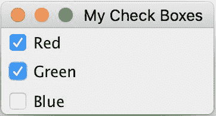

### JCheckBox 监听器

如果你将鼠标移动到“Red”复选框上，你会看到 1 条“State changed”消息。当你按下“Red”复选框时，你会看到额外的 2 条“State changed”消息。当你松开“Red”复选框时，你会看到额外的 5 条消息。当你把鼠标离开“Red”复选框时，你会看到额外的 1 条“State changed”消息。

```
1: State changed - Red

2: State changed - Red
3: State changed - Red

4: State changed on - Red
5: Item state changed - Red
6: State changed on - Red
7: Action performed - Red
8: State changed on - Red

9: State changed on - Red

10: State changed on - Green

11: State changed on - Green
12: State changed on - Green

13: State changed on - Green
14: Item state changed - Green
15: State changed on - Green
16: Action performed - Green

17: State changed on - Green

18: State changed on - Green
```

注意：

- Action event（动作事件）仅在你松开复选框时触发一次。
- Item event（项目事件，`itemStateChanged` 方法调用）仅在你松开复选框时触发一次。
- Change event（改变事件，`stateChanged` 方法调用）会触发多次，当鼠标移入或移出复选框、按下和松开复选框时。

---

# `isSelected()` - 获取复选框状态

本节提供了一个关于如何使用 `isSelected()` 方法获取复选框状态的教程示例。

如果你正在使用多个复选框，你需要跟踪它们并使用 `isSelected()` 方法获取每个框的状态。这里有一个示例程序：

```java
/* JRadioButtonAction.java
 * Copyright (c) 1997-2018 HerongYang.com. All Rights Reserved.
 */
import java.awt.*;
import java.awt.event.*;
import javax.swing.*;

public class JCheckBoxAction implements ActionListener {
    JCheckBox red;
    JCheckBox green;
    JCheckBox blue;
    JLabel myLabel = null;

    public static void main(String[] a) {
        JCheckBoxAction myTest = new JCheckBoxAction();
        myTest.createFrame();
    }

    public void createFrame() {
        JFrame f = new JFrame("My Check Boxes");
        f.setDefaultCloseOperation(JFrame.EXIT_ON_CLOSE);
        Container c = f.getContentPane();
        c.setLayout(new BoxLayout(c, BoxLayout.Y_AXIS));
        JPanel p = new JPanel();
        p.setLayout(new GridLayout(3, 1));

        red = new JCheckBox("Red");
        green = new JCheckBox("Green");
        blue = new JCheckBox("Blue");
        p.add(red);
        p.add(green);
        p.add(blue);

        c.add(p);
        JButton b = new JButton("Done");
        b.addActionListener(this);
        c.add(b);
        myLabel = new JLabel("Please select", SwingConstants.CENTER);
        c.add(myLabel);
        f.pack();
        f.setVisible(true);
    }

    public void actionPerformed(ActionEvent e) {
        String t = "";
        if (red.isSelected()) t += "Red ";
        if (green.isSelected()) t += "Green ";
        if (blue.isSelected()) t += "Blue ";
        if (t.equals("")) t = "Nothing selected";
        myLabel.setText(t);
    }
}
```

如果你运行这个程序，最初没有任何复选框被选中。如果你点击“Done”，你会得到“Nothing selected”消息。如果你选择了一些复选框然后点击“Done”，你会得到所有选中的项目：


---

# `javax.swing.JRadioButton` - Swing 单选按钮类

本章提供了 `JRadioButton` 的教程笔记和示例代码。主题包括 `JRadioButton` 类描述；创建单选按钮和监听器的示例程序；识别组中被选中按钮的示例程序。

> `javax.swing.JRadioButton` and Related Classes
>
> `ActionListener`, `ChangeListener` and `ItemListener`
>
> `getSelection()` - Getting Selected Button

## 结论

- `JRadioButton` 类表示单选按钮。
- `ActionListener`、`ChangeListener` 或 `ItemListener` 接口可处理单选按钮上的用户操作。
- `getSelection()` 方法可检测 `ButtonGroup` 中的被选中选项。

本章列出的示例程序已在 Windows 和 macOS 电脑上的 JDK 1.3.1 到 17 进行过测试。

## `javax.swing.JToggleButton.ToggleButtonModel`

`ToggleButtonModel`：一个 Swing 类，表示切换按钮数据模型的默认实现。`ToggleButtonModel` 是嵌套在 `javax.swing.JToggleButton` 内部的内部类，而后者是 `JRadioButton` 的基类。

- `getActionCommand()` - 用于返回关联按钮的动作命令字符串的方法。

## ActionListener、ChangeListener 和 ItemListener

本节提供了一个教程示例，展示了如何使用 `ActionListener`、`ChangeListener` 和 `ItemListener` 接口来处理单选按钮上生成的不同类型的事件。

正如前一节所示，单选按钮可以有 3 种事件监听器：`ActionListener`、`ChangeListener` 和 `ItemListener`。下面的示例程序向你展示了这些监听器何时被调用以及调用几次：

```java
/* JRadioButtonTest.java
 * Copyright (c) 1997-2018 HerongYang.com. All Rights Reserved.
 */
import java.awt.*;
import java.awt.event.*;
import javax.swing.*;
import javax.swing.event.*;

public class JRadioButtonTest {
    public static void main(String[] a) {
        JFrame f = new JFrame("My Radio Buttons");
        f.setDefaultCloseOperation(JFrame.EXIT_ON_CLOSE);
        ButtonGroup g = new ButtonGroup();
        MyRadioButton b1 = new MyRadioButton("On");
        g.add(b1);
        f.getContentPane().add(b1, BorderLayout.NORTH);
        MyRadioButton b2 = new MyRadioButton("Off");
        g.add(b2);
        f.getContentPane().add(b2, BorderLayout.SOUTH);
        f.pack();
        f.setVisible(true);
    }

    private static class MyRadioButton extends JRadioButton 
            implements ActionListener, ChangeListener, ItemListener {
        static int count = 0;
        String text = null;

        public MyRadioButton(String t) {
            super(t);
            text = t;
            addActionListener(this);
            addChangeListener(this);
            addItemListener(this);
        }

        public void actionPerformed(ActionEvent e) {
            count++;
            System.out.println(count + ": Action performed - " + text);
        }

        public void stateChanged(ChangeEvent e) {
            count++;
            System.out.println(count + ": State changed on - " + text);
        }

        public void itemStateChanged(ItemEvent e) {
            count++;
            System.out.println(count + ": Item state changed - " + text);
        }
    }
}
```

此示例程序创建两个单选按钮并将它们放入同一个按钮组中。每个按钮都有 3 个监听器来处理 3 种不同类型的事件。监听器类中使用计数器来帮助识别事件的顺序。

如果你运行此程序，将看到两个单选按钮：一个标记为 "On"，另一个标记为 "Off"：

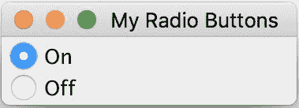

### JRadioButton 监听器

如果你按下并按住 "On" 按钮，将在命令行窗口看到 2 条消息。如果你松开 "On" 按钮，将看到额外的 5 条新消息。如果你继续按下并按住 "Off" 按钮，将看到额外的 2 条消息。如果你松开 "Off" 按钮，将看到额外的 7 条消息。以下是所有消息列表：


# Java Swing 教程 - Herong 的教程示例

## JRadioButton - Swing 单选按钮类

### `getSelection()` - 获取选中的按钮

本节提供了一个教程示例，展示了如何使用 `getSelection()` 方法来确定按钮组中哪个按钮被选中了。

如果按钮组中有许多单选按钮，你如何找到当前选中的那个？一种方法是使用 `ButtonGroup` 类的 `getSelection()` 方法。这里有一个示例程序：

```java
/* JRadioButtonAction.java
 * Copyright (c) 1997-2018 HerongYang.com. All Rights Reserved.
 */
import java.awt.*;
import java.awt.event.*;
import javax.swing.*;

public class JRadioButtonAction implements ActionListener {
    ButtonGroup myGroup = null;
    JLabel myLabel = null;

    public static void main(String[] a) {
        JRadioButtonAction myTest = new JRadioButtonAction();
        myTest.createFrame();
    }

    public void createFrame() {
        JFrame f = new JFrame("My Radio Buttons");
        f.setDefaultCloseOperation(JFrame.EXIT_ON_CLOSE);
        Container c = f.getContentPane();
        c.setLayout(new BoxLayout(c, AXIS));
        myGroup = new ButtonGroup();
        JPanel p = new JPanel();
        c.setLayout(new GridLayout(3, 1));
        addOption(p, myGroup, "Red");
        addOption(p, myGroup, "Green");
        addOption(p, myGroup, "Blue");
        c.add(p);
        JButton b = new JButton("Select");
        b.addActionListener(this);
        c.add(b);
        myLabel = new JLabel("Please select", SwingConstants.CENTER);
        c.add(myLabel);
        f.pack();
        f.setVisible(true);
    }

    public void addOption(JPanel p, ButtonGroup g, String t) {
        JRadioButton b = new JRadioButton(t);
        b.setActionCommand(t);
        p.add(b);
        g.add(b);
    }

    public void actionPerformed(ActionEvent e) {
        ButtonModel b = myGroup.getSelection();
        String t = "Not selected";
        if (b != null) t = b.getActionCommand();
        myLabel.setText(t);
    }
}
```

如果你运行此程序，你会看到没有任何单选按钮被选中。点击 "Select"，你会得到 "Not selected" 消息。如果你选择任何单选按钮，然后点击 "Select"，将得到正确的消息：


#### JRadioButton 按钮事件分析

```
 1: State changed on - On
 2: State changed on - On     - "On" pressed
 3: State changed on - On
 4: Item state changed - On
 5: State changed on - On
 6: Action performed - On
 7: State changed on - On     - "On" released
 8: State changed on - Off
 9: State changed on - Off    - "Off" pressed
10: State changed on - On
11: Item state changed - On
12: State changed on - Off
13: Item state changed - Off
14: State changed on - Off
15: Action performed - Off
16: State changed on - Off   - "Off" released
```

注意：

*   当你松开按钮时，动作事件仅触发一次。
*   改变事件（`stateChanged` 方法调用）在按下按钮时触发 2 次；在松开按钮时再次触发 2 次。这告诉我们按钮有多于 2 个状态：选中和未选中。
*   项目事件（`itemStateChanged` 方法调用）在松开按钮时仅触发一次。
*   在按钮组中，如果一个按钮被选中，其他被选中的按钮将取消选中。事件 #10 和 #11 显示，当 "Off" 被选中时，“On" 会被取消选中。

## JTextField - Swing 文本框类

本章提供了 `JTextField` 类的教程笔记和示例代码。主题包括 `javax.swing.JTextField` 类的描述及其方法；带有事件监听器的文本框示例程序。

> `javax.swing.JTextField` 相关类
>
> `ActionListener` 和 `DocumentListener`

结论：

*   `javax.swing.JTextField` 类表示 UI 文本输入框。
*   `java.awt.event.ActionListener` 接口允许你创建自己的处理器来响应键盘输入。

本章列出的示例程序已在 Windows 和 macOS 上通过 JDK 1.3.1 到 JDK 17 的测试。

### `javax.swing.JTextField` 类及相关类描述

本节描述了 `javax.swing.JTextField` 类、`javax.swing.text.PlainDocument` 类以及 `javax.swing.event.DocumentListener` 类。

`javax.swing.JTextField` - 一个表示 UI 文本框的 Swing 类。一些有趣的方法包括：

*   `JTextField(int)` - 创建具有指定列数的文本框的构造函数。
*   `JTextField(String)` - 创建以指定字符串作为初始文本的文本框的构造函数。

#### 方法参考

*   `addActionListener(ActionListener)` - 向此文本字段添加动作监听器的方法，用于处理动作事件。在此字段中按“回车”键将触发一个动作事件。
*   `getDocument()` - 返回用于持有此字段文本的文档对象的方法。
*   `getText()` - 以字符串对象形式返回此字段文本的方法。

`javax.swing.text.PlainDocument` - 一个表示纯文本文档的 Swing 类。`PlainDocument` 被用作 `JTextField` 的默认文档以存储其文本。包含的方法有：

*   `addDocumentListener(DocumentListener)` - 向此文档添加文档监听器的方法。

`javax.swing.event.DocumentListener` - 一个 Swing 接口，供实现类使用用以处理文档事件。包含的方法有：

*   `changeUpdate(DocumentEvent)` - 当文档的任何属性发生变化时被调用的方法。
*   `insertUpdate(DocumentEvent)` - 当文本插入到文档中时被调用的方法。
*   `removeUpdate(DocumentEvent)` - 当文本从文档中移除时被调用的方法。

### ActionListener 和 DocumentListener 示例

本节提供了一个教程示例，介绍如何创建一个既实现了 `ActionListener` 监听器又实现了 `DocumentListener` 监听器的事件处理器的文本字段。

正如你在上一节中看到的，文本字段可以直接触发动作事件。它也可以通过其关联的文档间接触发文档事件。这里有一个示例程序，向你展示这些事件是如何以及何时被触发的：

```java
/* JTextFieldTest.java
 * Copyright (c) 1997-2018 HerongYang.com. All Rights Reserved.
 */
import java.awt.*;
import java.awt.event.*;
import javax.swing.*;
import javax.swing.event.*;
import javax.swing.text.*;

public class JTextFieldTest {
    public static void main(String[] a) {
        JFrame f = new JFrame("Text Field Test");
        f.setDefaultCloseOperation(JFrame.EXIT_ON_CLOSE);
        MyTextField t = new MyTextField(16);
        f.getContentPane().add(t, BorderLayout.CENTER);
        f.pack();
        f.setVisible(true);
    }

    private static class MyTextField extends JTextField implements ActionListener, DocumentListener {
        static int count = 0;

        public MyTextField(int l) {
            Document doc = this.getDocument();
            System.out.println("The document object: " + doc);
            doc.addDocumentListener(this);
        }

        public void actionPerformed(ActionEvent e) {
            count++;
            System.out.println(count + ": Action performed - " + getText());
        }

        public void insertUpdate(DocumentEvent e) {
            count++;
            System.out.println(count + ": Insert update - " + getText());
        }

        public void removeUpdate(DocumentEvent e) {
            count++;
            System.out.println(count + ": Remove update - " + getText());
        }

        public void changedUpdate(DocumentEvent e) {
            count++;
            System.out.println(count + ": Change update - " + getText());
        }
    }
}
```

运行此程序并在文本字段中执行以下操作：

*   输入 "h"。
*   输入 "i"。
*   按退格键删除 "i"。
*   输入 "e"。
*   按回车键。

文本字段看起来应该像这样：

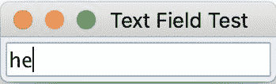

#### JTextField 监听器输出分析

你应该会在控制台窗口看到以下输出：

```
The document object: javax.swing.text.PlainDocument@79
1: Insert update - h
2: Insert update - i
3: Remove update - h
4: Insert update - e
5: Action performed - e
```

输出确认：

*   `TextField` 类使用 `PlainDocument` 作为文档。
*   `ActionListener` 在按下回车键时被调用。
*   `changeUpdate()` 未被调用。

## JComboBox - Swing 组合框类

本章提供了关于 `JComboBox` 类的教程说明和代码。主题包括 `JComboBox` 类的描述、创建组合框、从组合框中获取选项以及将组合框用作文本字段。

> `javax.swing.JComboBox` 相关方法
>
> `ActionListener` 和 `ItemListener`
>
> `getSelectedItem()` - 组合框的选中项
>
> `setEditable()` - 将组合框作为文本字段

### 结论

*   `javax.swing.JComboBox` 类表示一个组合框。
*   `ActionListener`、`ChangeListener` 或 `ItemListener` 接口可以处理组合框的操作。
*   `getSelectedItem()` 方法可以从组合框中获取选中或输入的项。
*   `setEditable()` 方法可以开启或关闭组合框的文本输入部分。

本章列出的示例已在 Windows 和 macOS 计算机上通过 JDK 1.3.1 到 17 的测试。

### `javax.swing.JComboBox` 相关方法

本节描述了 `javax.swing.JComboBox` 类及其常用的方法。

`javax.swing.JComboBox` - 一个表示 UI 下拉按钮的 Swing 类，也称为组合框。一些有趣的方法：

*   `JComboBox(String[])` - 创建在组合框旁边显示指定字符串的组合框的构造函数。默认未选中。
*   `addActionListener(ActionListener)` - 向此组合框添加动作监听器的方法，用于处理动作事件。点击此组合框将触发一个动作事件。
*   `addItemListener(ItemListener)` - 向此组合框添加项目监听器的方法，用于处理项目事件。点击此组合框将触发一个项目事件。
*   `setSelectedIndex(index)` - 将选择设置为给定索引的选项的方法。如果 `index` 为 -1，则未选中任何选项。
*   `getSelectedItem()` - 返回组合框中第一个选中项的方法。如果没有选中项，则返回 `null`。
*   `getSelectedObjects()` - 返回组合框中所有选中项的方法。
*   `setEditable()` - 将组合框设置为可编辑的方法，以便用户可以像文本字段一样向组合框中输入文本。


```java
/* JComboBoxTest.java
 * Copyright (c) 1997-2018 HerongYang.com. All Rights Reserved.
 */
import java.awt.*;
import java.awt.event.*;
import javax.swing.*;
import javax.swing.event.*;
public class JComboBoxTest {
   public static void main(String[] a) {
      JFrame f = new JFrame("My Combo Box");
      f.setDefaultCloseOperation(JFrame.EXIT_ON_CLOSE);

      JLabel color = new JLabel("Colors:");
      f.getContentPane().add(color, BorderLayout.NORTH);
      String[] options = {"Red", "Green", "Blue"};
      MyComboBox list = new MyComboBox(options);
      list.setSelectedIndex(-1);
      f.getContentPane().add(list, BorderLayout.SOUTH);

      f.pack();
      f.setVisible(true);
   }
   private static class MyComboBox extends JComboBox<String>
      implements ActionListener, ItemListener {
      static int count = 0;
      public MyComboBox(String[] l) {
         super(l);
         addActionListener(this);
         addItemListener(this);
         this.setSelectedIndex(-1);
      }
      public void actionPerformed(ActionEvent e) {
         count++;
         System.out.println(count + ": Action performed - ");
      }
      public void itemStateChanged(ItemEvent e) {
         count++;
         System.out.println(count + ": Item state changed - ");
      }
   }
}
```

此示例程序创建一个包含 3 个选项的组合框。它有 2 个监听器来处理 2 种不同的事件。监听器类中使用计数器来帮助识别事件发生的顺序。

如果你运行此程序，你将看到一个带有 3 个选项的组合框：“Red”、“Green”和“Blue”。默认情况下，第一个选项会被选中。但我调用了 `setSelectedIndex(-1)` 来移除选择。

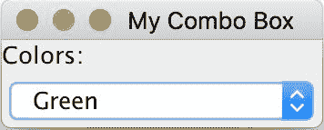

## JComboBox 监听器

如果你打开下拉列表，你会看到消息 1 和 2。如果你选择“Red”选项，你会看到消息 3 和 4。如果你将选择更改为“Green”，你将看到消息 5、6 和 7。

```
1: Item state changed -
2: Action performed -

3: Item state changed -
4: Action performed -

5: Item state changed -
6: Item state changed -
7: Action performed -
```

注意：

- 当你选择一个选项时，动作事件（Action event）仅触发一次。
- 当组合框上发生更改时，会触发项事件（`itemStateChanged` 方法调用）。

## getSelectedItem() 方法

本节提供了一个教程示例，介绍了如何使用 `getSelectedItem()` 方法来获取组合框中选中的哪个选项。

如果你正在使用带有多个选项的组合框，可以使用 `getSelectedItem()` 方法来查找哪个选项被选中了。这里有一个示例程序：

```java
/* JComboBoxAction.java
 */
import java.awt.*;
import java.awt.event.*;
import javax.swing.*;
public class JComboBoxAction implements ActionListener {
   JComboBox<String> combo;
   JLabel myLabel = null;
   public static void main(String[] a) {
      JComboBoxAction myTest = new JComboBoxAction();
      myTest.createFrame();
   }
   public void createFrame() {
      JFrame f = new JFrame("My Combo Box");
      f.setDefaultCloseOperation(JFrame.EXIT_ON_CLOSE);
      Container c = f.getContentPane();
      c.setLayout(new BoxLayout(c, BoxLayout.Y_AXIS));

      JLabel color = new JLabel("Colors:");
      c.add(color);

      String[] options = {"Red", "Green", "Blue"};
      combo = new JComboBox<String>(options);
      combo.setSelectedIndex(-1);
      c.add(combo);

      JButton b = new JButton("Done");
      b.addActionListener(this);
      c.add(b);

      myLabel = new JLabel("Please select");
      c.add(myLabel);
      f.pack();
      f.setVisible(true);
   }
   public void actionPerformed(ActionEvent e) {
      String t = (String) combo.getSelectedItem();
      if (t == null) t = "Nothing selected";
      myLabel.setText(t);
   }
}
```

如果你运行此程序，你会发现最初没有任何选项被选中。如果你点击“Done”，你会得到“Nothing selected”消息。如果你选择一个选项然后点击“Done”，你将得到选中的颜色：

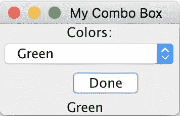

## setEditable() 方法

本节提供了一个教程示例，介绍了如何调用 `setEditable(true)` 方法将组合框同时作为下拉列表和文本字段使用。

如果你想将组合框既作为下拉列表又作为文本字段，可以在组合框上调用 `setEditable(true)` 方法。这里是一个示例程序：

```java
/* JComboBoxAction.java
 */
import java.awt.*;
import java.awt.event.*;
import javax.swing.*;
public class JComboBoxAction implements ActionListener {
   JComboBox<String> combo;
   JLabel myLabel = null;
   public static void main(String[] a) {
      JComboBoxAction myTest = new JComboBoxAction();
      myTest.createFrame();
   }
   public void createFrame() {
      JFrame f = new JFrame("My Combo Box");
      f.setDefaultCloseOperation(JFrame.EXIT_ON_CLOSE);
      Container c = f.getContentPane();
      c.setLayout(new BoxLayout(c, BoxLayout.Y_AXIS));

      JLabel color = new JLabel("Colors:");
      c.add(color);

      String[] options = {"Red", "Green", "Blue"};
      combo = new JComboBox<String>(options);
      combo.setSelectedIndex(-1);
      c.add(combo);

      JButton b = new JButton("Done");
      b.addActionListener(this);
      c.add(b);

      myLabel = new JLabel("Please select");
      c.add(myLabel);
      f.pack();
      f.setVisible(true);
   }
   public void actionPerformed(ActionEvent e) {
      String t = (String) combo.getSelectedItem();
      if (t == null) t = "Nothing selected";
      myLabel.setText(t);
   }
}
```

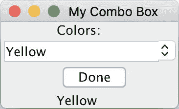

## 菜单栏、菜单、菜单项和监听器

本章提供了关于菜单栏、菜单和项目的教程笔记和示例代码。包括 `JMenuBar`、`JMenu` 和 `JMenuItem` 类介绍；菜单栏、菜单和项目的测试程序；单选框和复选框项目；使用菜单、项目和动作监听器；快捷键和加速键。

- `JMenuBarTest.java` - 菜单栏测试程序
- `JMenuTest.java` - 菜单测试程序
- `JMenuItemTest.java` - 项目测试程序
- `JRadioButtonMenuItemTest.java` - 单选框项目测试程序
- `JCheckBoxMenuItemTest.java` - 复选框项目测试程序
- `javax.swing.event.MenuListener` - 菜单监听器接口
- `JMenuItemActionListenerTest.java` - 项目动作监听器测试程序
- 单选框项目项监听器
- 复选框项目项监听器
- `javax.swing.event.MenuKeyListener` - 菜单键盘监听器接口
- `setMnemonic()` - 为项目设置快捷键
- `setAccelerator()` - 为项目设置加速键
- `setMnemonic()` - 为菜单设置快捷键

结论：

- `javax.swing.JMenuBar` 类允许你在主窗框上创建和管理菜单栏。
- `javax.swing.JMenu` 类允许你创建和管理与菜单栏关联的单个菜单。
- `javax.swing.JMenuItem` 类允许你创建和管理与菜单关联的标准菜单项。
- `javax.swing.JRadioButtonMenuItem` 类允许你创建和管理单选按钮菜单项。
- `javax.swing.JCheckBoxMenuItem` 类允许你创建和管理复选框菜单项。
- `javax.swing.event.MenuListener` Swing 接口允许你实现自己的菜单事件处理器方法。
- `java.awt.event.ActionListener` AWT 接口允许你实现自己的事件处理器方法。
- `javax.swing.event.MenuKeyListener` Swing 接口允许你为键盘输入实现自己的处理器。

本章列出的示例程序已在 `JDK 1.6.0` 到 `JDK 15` 环境下经过测试。

## JMenuBar, JMenu 和 JMenuItem 类

此节描述了 3 种 Swing 类：`JMenuBar`、`JMenu` 和 `JMenuItem`，用于为窗框窗口构建菜单界面。典型的菜单界面具有一个包含多个菜单或菜单项的菜单栏。菜单可以有多个子菜单或菜单项。

### `javax.swing.JMenuBar`

代表主窗框上菜单栏的 Swing 类。添加到 `JMenuBar` 对象的 `JMenu` 对象将水平显示。`JMenuBar` 的一些有趣方法包括：

- `JMenuBar()` - 构造函数，用于创建一个可以添加到窗框窗口的菜单栏。
- `add(JMenu)` - 向菜单列表的末尾添加新 `JMenu` 对象的方法。
- `getMenuCount()` - 返回此菜单栏中菜单数量的方法。
- `getMenu(int)` - 返回指定位置索引位置的 `JMenu` 对象的方法。当然，索引 `0` 是第一个菜单。
- `getSubElements()` - 返回 `MenuElement` 对象数组的方法。
- `isSelected()` - 如果菜单栏中当前选中了某个元素，则返回 true。

### `javax.swing.JMenu`

代表用户界面菜单的 Swing 类。`JMenu` 对象可以添加到 `JMenuBar` 或另一个 `JMenu` 对象中，以形成菜单树结构。`JMenu` 对象实际上有两个图形组件：显示在父级 `JMenu` 或 `JMenuBar` 中的可点击按钮以及一个弹出窗口。当它的按钮被点击时，它的弹出窗口将显示。`JMenu` 的一些有趣方法包括：

- `JMenu(String)` - 构造函数，使用指定的字符串作为按钮文本来创建菜单。
- `add(JMenuItem)` - 向当前菜单项列表的末尾添加 `JMenuItem` 对象的方法。
- `addSeparator()` - 向当前菜单项列表的末尾添加菜单分隔符的方法。
- `getItemCount()` - 返回其菜单项数量的方法。
- `getItem(int pos)` - 返回指定位置索引位置的 `JMenuItem` 对象的方法。当然，索引 `0` 是第一个菜单项。
- `isSelected()` - 如果此菜单被选中，则返回 true。
- `isTopLevelMenu()` - 如果此菜单是顶级菜单，则返回 true。顶级菜单是添加到菜单栏的菜单，而不是添加到另一个菜单中的。
- `doClick(int)` - 模拟用户点击此菜单的方法。

### `javax.swing.JMenuItem`

代表用户界面菜单项的 Swing 类。`JMenuItem` 对象可以按菜单树结构添加到 `JMenuBar` 或另一个 `JMenu` 对象中。`JMenuItem` 应该与 `MenuKeyListener` 对象关联，以便在点击菜单项时可以执行相应任务。`JMenuItem` 的有趣方法包括：

- `JMenuItem(String)` - 构造函数，使用指定的字符串作为按钮文本来创建菜单项。
- `addMenuKeyListener(MenuKeyListener)` - 为此菜单项添加 `MenuKeyListener` 对象的方法。
- `setEnabled(boolean)` - 根据指定的布尔值设置此菜单项为启用或禁用。

## `JMenuBarTest.java` - 菜单栏测试程序

此节提供了一个教程示例，说明如何使用 `javax.swing.JMenuBar` 类在窗框窗口中创建菜单栏。添加到菜单栏的菜单和菜单项将水平排列。

以下我编写的用于测试 `JMenuBar` 类的示例程序：


/* JMenuBarTest.java
 * Copyright (c) 1997-2018 HerongYang.com. All Rights Reserved.
 */
import java.awt.event.*;
import javax.swing.*;
public class JMenuBarTest {
   public static void main(String[] a) {
      JFrame f = new JFrame("JMenuBar Test");
      f.setDefaultCloseOperation(JFrame.EXIT_ON_CLOSE);
      f.setBounds(50,50,250,150);

      JMenuBar mb = new JMenuBar();      
      mb.add(new JMenu("Tools")); 
      mb.add(new JMenu("Options")); 
      mb.add(new JMenuItem("Save")); 
      mb.add(new JMenuItem("Quit")); 
      mb.add(new JButton("Stop")); 

      f.setJMenuBar(mb);
      f.getContentPane().add(new MyButton());
      f.setVisible(true);
   }
   private static class MyButton extends JButton
      implements ActionListener {
      public MyButton() {
         super("Check");
         addActionListener(this);
      }
      public void actionPerformed(ActionEvent e) {
         System.out.println("Check button clicked");
         JFrame myFrame = (JFrame)
            (this.getParent().getParent()).getParent();
         JMenuBar myMenuBar = myFrame.getJMenuBar();
         System.out.println("# of elements in the menu bar: "
            +myMenuBar.getMenuCount());
         System.out.println("Is the menu bar selected: "
            +myMenuBar.isSelected());
      }
   }
}

如果你运行此示例，你将看到窗框显示如下：


## 菜单栏监听器

如果你点击“Check”按钮，点击菜单栏中的“Options”菜单，再次点击按钮，你将在控制台看到输出：

```
Check button clicked
# of elements in the menu bar: 5
Is the menu bar selected: false
Check button clicked
# of elements in the menu bar: 5
Is the menu bar selected: true
```

### 关于此教程示例的一些有趣说明

* `JMenuItem` 对象可以以与 `JMenu` 对象相同的方式添加到菜单栏。
* 其他组件也可以添加到菜单栏。参见程序中添加的“Stop” `JButton`。
* 添加到内容区的“Check” `JButton` 是窗框的孙孙孙子。因此内容区有 3 层组件，因为我必须使用 `this.getParent().getParent()).getParent()` 从按钮对象获取窗框对象。
* `getMenuCount()` 和 `isSelected()` 方法按预期工作。

# Java Swing 教程 - Herong 的 教程示例

## 菜单栏、菜单、菜单项和监听器

### `JMenuTest.java` - 菜单测试程序

此节提供了一个教程示例，说明如何使用 `javax.swing.JMenu` 类创建多个菜单以及如何将它们添加到菜单栏。添加到菜单的子菜单和菜单项在菜单被选中时将垂直列表显示。

```
/* JMenuTest.java
 * Copyright (c) 1997-2018 HerongYang.com. All Rights Reserved.
 */
import javax.swing.*;
public class JMenuTest {
   JFrame myFrame = null;
   public static void main(String[] a) {
      (new JMenuTest()).test();
   }
   private void test() {
      myFrame = new JFrame("Menu Test");
      myFrame.setDefaultCloseOperation(JFrame.EXIT_ON_CLOSE);
      myFrame.setBounds(50,50,250,150);
      myFrame.setContentPane(new JDesktopPane());

      JMenuBar myMenuBar = new JMenuBar();
      JMenu myMenu = getFileMenu();
      myMenuBar.add(myMenu);
      myMenu = getColorMenu();
      myMenuBar.add(myMenu);

      myFrame.setJMenuBar(myMenuBar);
      myFrame.setVisible(true);
   }
   private JMenu getFileMenu() {
      JMenu myMenu = new JMenu("File");
      JMenu mySubMenu = getOpenMenu();
      myMenu.add(mySubMenu);
      JMenuItem myItem = new JMenuItem("Close");
      myMenu.add(myItem);
      myMenu.addSeparator();
      myItem = new JMenuItem("Exit");
      myMenu.add(myItem);
      return myMenu;
   }
   private JMenu getColorMenu() {
      JMenu myMenu = new JMenu("Color");
      JMenuItem myItem = new JMenuItem("Red");
      myMenu.add(myItem);
      myItem = new JMenuItem("Green");
      myMenu.add(myItem);
      myItem = new JMenuItem("Blue");
      myMenu.add(myItem);
      return myMenu;
   }
   private JMenu getOpenMenu() {
      JMenu myMenu = new JMenu("Open");
      JMenuItem myItem = new JMenuItem("Java");
      myMenu.add(myItem);
      myItem = new JMenuItem("HTML");
      myMenu.add(myItem);
      myItem = new JMenuItem("GIF");
      myMenu.add(myItem);
      return myMenu;
   }
}
```

如果你运行此示例，你将看到窗口显示出如下的菜单栏：

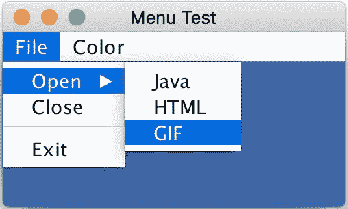

### 具有两层级的菜单

关于此教程示例的一些有趣说明：

* 菜单栏中可以添加多个菜单。在这个示例中，“File”菜单和“Color”菜单被添加到了菜单栏中。
* 菜单可以像菜单项一样包含一个子菜单。在这个示例中，“Open”菜单作为子菜单被添加到“File”菜单中。
* 在 `JMenu` 对象上调用 `addSeparator()` 方法会在菜单元素列表中添加一条分割线。

# Java Swing 教程 - Herong's 教程示例

## 菜单栏、菜单、菜单项和监听器

### `JMenuItemTest.java` - 菜单项测试程序

本节提供了一个关于如何使用 `javax.swing.JMenuItem` 类创建菜单项并将其添加到不同的菜单、子菜单或菜单栏的教程示例。当选中菜单时，添加到菜单中的子菜单和菜单项将垂直列出。

这里是我编写的一个用于测试 `JMenuItem` 类的示例程序：

```
/* JMenuItemTest.java
 * Copyright (c) 1997-2018 HerongYang.com. All Rights Reserved.
 */
import javax.swing.*;
public class JMenuItemTest {
   JFrame myFrame = null;
   public static void main(String[] a) {
      (new JMenuItemTest()).test();
   }
   private void test() {
      myFrame = new JFrame("Menu Item Test");
      myFrame.setDefaultCloseOperation(JFrame.EXIT_ON_CLOSE);
      myFrame.setBounds(50,50,250,150);
      myFrame.setContentPane(new JDesktopPane());

      JMenuBar myMenuBar = new JMenuBar();
      JMenu myMenu = getFileMenu();
      myMenuBar.add(myMenu);
      myMenu = getColorMenu();
      myMenuBar.add(myMenu);
      myMenu = getOptionMenu();
      myMenuBar.add(myMenu);
      JMenuItem myItem = new JMenuItem("Help");
      myMenuBar.add(myItem);

      myFrame.setJMenuBar(myMenuBar);
      myFrame.setVisible(true);
   }
   private JMenu getFileMenu() {
      JMenu myMenu = new JMenu("File");
      JMenuItem myItem = new JMenuItem("Open");
      myMenu.add(myItem);
      myItem = new JMenuItem("Close");
      myItem.setEnabled(false);
      myMenu.add(myItem);
      myMenu.addSeparator();
      myItem = new JMenuItem("Exit");
      myMenu.add(myItem);
      return myMenu;
   }
   private JMenu getColorMenu() {
      JMenu myMenu = new JMenu("Color");
      JMenuItem myItem = new JMenuItem("Red");
      myMenu.add(myItem);
      myItem = new JMenuItem("Green");
      myMenu.add(myItem);
      myItem = new JMenuItem("Blue");
      myMenu.add(myItem);
      return myMenu;
   }
   private JMenu getOptionMenu() {
      JMenu myMenu = new JMenu("Option");
      JMenu mySubMenu = getOnOffMenu("Sound");
      myMenu.add(mySubMenu);
      JMenu mySubMenu = getOnOffMenu("Auto save");
      mySubMenu.setEnabled(false);
      myMenu.add(mySubMenu);
      return myMenu;
   }
   private JMenu getOnOffMenu(String title) {
      JMenu myMenu = new JMenu(title);
      JMenuItem myItem = new JMenuItem("On");
      myMenu.add(myItem);
      myItem = new JMenuItem("Off");
      myMenu.add(myItem);
      return myMenu;
   }
}
```

如果你运行此示例，你将看到窗口带有如下菜单栏：


### 菜单项

关于此教程示例的一些有趣说明：

* 菜单项可以直接添加到菜单栏。在这个示例中，“Help”菜单项被添加到菜单栏中。但强烈建议使用方向键在菜单栏中导航，而不是直接添加。
* 可以通过调用 `setEnabled(false)` 函数禁用菜单项。禁用的菜单项将灰色显示且无法点击。在这个示例中，“Close”菜单项被禁用了。
* 同样可以通过调用 `setEnabled(false)` 函数禁用菜单。禁用的菜单将灰色显示且无法点击。在这个示例中，“Auto save”菜单项被禁用了。

# Java Swing 教程 - Herong's 教程示例

## 菜单栏、菜单、菜单项和监听器

### `JMenuItemTest.java` - 单选菜单测试

本节提供了一个如何使用 `javax.swing.JRadioButtonMenuItem` 类创建单选菜单项并将其添加到按钮组的教程示例。如果组中的一个单选菜单项被选中，其他的将取消选中。

普通的菜单项类 `javax.swing.JMenuItem` 与特殊菜单项类 `javax.swing.JRadioButtonMenuItem` 具有以下特性：

* 单选菜单项将带有单选图标列出。
* 当单选菜单项被选中时，其图标将显示为选中状态。
* 当单选菜单项未被选中时，其图标将显示为未选中状态。
* 将多个单选菜单项添加到 `ButtonGroup` 对象中形成按钮组。
* 如果按钮组中的一个单选菜单项被选中，所有其他单选菜单项将取消选中。

这里是我编写的测试 `JRadioButtonMenuItem` 类的示例程序：

（代码如下）


```java
 */
import javax.swing.*;
public class JMenuItemTest {
   JFrame myFrame = null;
   public static void main(String[] a) {
      (new JMenuItemTest()).test();
   }
   private void test() {
      myFrame = new JFrame("Radio Button Menu Test");
      myFrame.setDefaultCloseOperation(JFrame.EXIT_ON_CLOSE);
      myFrame.setBounds(50,50,250,150);
      myFrame.setContentPane(new JDesktopPane());

      JMenuBar myMenuBar = new JMenuBar();
      JMenu myMenu = getFileMenu();
      myMenuBar.add(myMenu);
      myMenu = getColorMenu();
      myMenu = getOptionMenu();
      myMenuBar.add(myMenu);

      myFrame.setJMenuBar(myMenuBar);
      myFrame.setVisible(true);
   }
   private JMenu getFileMenu() {
      JMenu myMenu = new JMenu("File");
      JRadioButtonMenuItem myItem = new JRadioButtonMenuItem("Open");
      myMenu.add(myItem);
      myItem = new JRadioButtonMenuItem("Close");
      myItem.setEnabled(false);
      myMenu.add(myItem);
      return myMenu;
   }
   private JMenu getColorMenu() {
      JMenu myMenu = new JMenu("Color");
      ButtonGroup group = new ButtonGroup();
      JRadioButtonMenuItem myItem = new JRadioButtonMenuItem("Red");
      myMenu.add(myItem);
      group.add(myItem);
      myItem = new JRadioButtonMenuItem("Green");
      myMenu.add(myItem);
      group.add(myItem);
      return myMenu;
   }
   private JMenu getOptionMenu() {
      JMenu myMenu = new JMenu("Option");
      ButtonGroup group = new ButtonGroup();
      JRadioButtonMenuItem myItem = new JRadioButtonMenuItem("Sound");
      myMenu.add(myItem);
      group.add(myItem);
      myItem = new JRadioButtonMenuItem("Auto save");
      myMenu.add(myItem);
      group.add(myItem);
      myItem.setEnabled(false);
      return myMenu;
   }
}
```

* Copyright (c) 1997-2018 HerongYang.com. All Rights Reserved.

*/

import javax.swing.*;

public class JRadioButtonMenuItemTest {

   JFrame myFrame = null;

   public static void main(String[] a) {

      (new JRadioButtonMenuItemTest()).test();

   }

   private void test() {

      myFrame = new JFrame("Radio Button Menu Item Test");

      myFrame.setDefaultCloseOperation(JFrame.EXIT_ON_CLOSE);

      myFrame.setBounds(50,50,250,150);

      myFrame.setContentPane(new JDesktopPane());

      JMenuBar myMenuBar = new JMenuBar();

      JMenu myMenu = getFileMenu();

      myMenuBar.add(myMenu);

      myMenu = getColorMenu();

      myMenuBar.add(myMenu);

      myMenu = getOptionMenu();

      myMenuBar.add(myMenu);

      JMenuItem myItem = new JMenuItem("Help");

      myMenuBar.add(myItem);

      myFrame.setJMenuBar(myMenuBar);

      myFrame.setVisible(true);

   }

   private JMenu getFileMenu() {

      JMenu myMenu = new JMenu("File");

      JMenuItem myItem = new JMenuItem("Open");

      myMenu.add(myItem);

      myItem = new JMenuItem("Close");

      myItem.setEnabled(false);

      myMenu.add(myItem);

      myMenu.addSeparator();

      myItem = new JMenuItem("Exit");

      myMenu.add(myItem);

      return myMenu;

   }

   private JMenu getColorMenu() {

      JMenu myMenu = new JMenu("Color");

      ButtonGroup myGroup = new ButtonGroup();

      JRadioButtonMenuItem myItem = new JRadioButtonMenuItem("Red");

      myItem.setSelected(true);

      myGroup.add(myItem);

      myMenu.add(myItem);

      myItem = new JRadioButtonMenuItem("Green");

      myGroup.add(myItem);

      myMenu.add(myItem);

      myItem = new JRadioButtonMenuItem("Blue");

      myGroup.add(myItem);

      myMenu.add(myItem);

      return myMenu;

   }

   private JMenu getOptionMenu() {

      JMenu myMenu = new JMenu("Option");

      JMenuItem myItem = new JMenuItem("Sound");

      myMenu.add(myItem);

      myItem = new JMenuItem("Auto save");

      myMenu.add(myItem);

      return myMenu;

   }

}

```

如果你运行此示例，你将看到窗口显示出如下所示菜单栏：

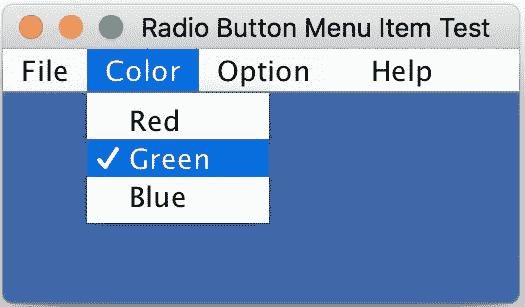

### 作为菜单项的单选按钮（在 macOS）

关于此教程示例的一些有趣说明：

- 如果对项目项调用了 `setSelected(true)` 方法，则单选按钮菜单项可以被列为默认选中状态。在本示例中，“Red（红色）”单选按钮菜单项默认是被选中的。

在 macOS 电脑上的单选按钮菜单项似乎存在问题。它们显示时不带单选按钮图标。如果你在 Windows 电脑上运行相同的程序，将看到如下所示的单选按钮图标。

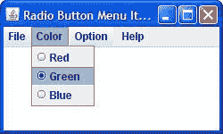

### 单选按钮菜单测试（在 Windows）

Java Swing 教程 - Herong's Tutorial Examples

菜单栏、菜单、菜单项和监听器

### JCheckBoxMenuItemTest.java - 复选框项测试

本节提供了一个教程示例，演示了如何使用 `javax.swing.JCheckBoxMenuItem` 创建复选框项。如果复选框项被选中，其复选框图标将有一个标记。Swing 还支持特殊的菜单项类 `javax.swing.JCheckBoxMenuItem`，它代表具有以下特征的复选框项：

- 复选框项将带有复选框图标列出。
- 如果复选框项被选中，图标将显示为已选中。
- 如果复选框项未被选中，图标将显示为未勾选。

这里有一个我编写的测试 `JCheckBoxMenuItem` 类的示例程序：

```java

 */

import javax.swing.*;

public class JCheckBoxMenuItemTest {

   JFrame myFrame = null;

   public static void main(String[] a) {

      (new JCheckBoxMenuItemTest()).test();

   }

   private void test() {

      myFrame = new JFrame("Check Box Item Test");

      myFrame.setDefaultCloseOperation(JFrame.EXIT_ON_CLOSE);

      myFrame.setBounds(50,50,250,150);

      myFrame.setContentPane(new JDesktopPane());

      JMenuBar myMenuBar = new JMenuBar();

      JMenu myMenu = getFileMenu();

      myMenuBar.add(myMenu);

      myMenu = getColorMenu();

      myMenuBar.add(myMenu);

      myMenu = getOptionMenu();

      myMenuBar.add(myMenu);

      JMenuItem myItem = new JMenuItem("Help");

      myMenuBar.add(myItem);

      myFrame.setJMenuBar(myMenuBar);

      myFrame.setVisible(true);

   }

   private JMenu getFileMenu() {

      JMenu myMenu = new JMenu("File");

      JMenuItem myItem = new JMenuItem("Open");

      myMenu.add(myItem);

      myItem = new JMenuItem("Close");

      myItem.setEnabled(false);

      myMenu.add(myItem);

      myMenu.addSeparator();

      myItem = new JMenuItem("Exit");

      myMenu.add(myItem);

      return myMenu;

   }

   private JMenu getColorMenu() {

      JMenu myMenu = new JMenu("Color");

      JMenuItem myItem = new JMenuItem("Red");

      myMenu.add(myItem);

      myItem = new JMenuItem("Green");

      myMenu.add(myItem);

      myItem = new JMenuItem("Blue");

      myMenu.add(myItem);

      return myMenu;

   }

   private JMenu getOptionMenu() {

      JMenu myMenu = new JMenu("Option");

      JCheckBoxMenuItem myItem = new JCheckBoxMenuItem("Sound");

      myItem.setSelected(true);

      myItem = new JCheckBoxMenuItem("Auto save");

      myMenu.add(myItem);

      return myMenu;

   }

}

```

如果你运行此示例，你将看到窗口显示出如下所示菜单栏：

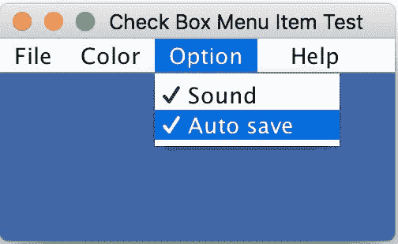

### 作为菜单项的复选框（在 macOS）

关于此教程示例的一些有趣说明：

- 如果对项目项调用了 `setSelected(true)` 方法，则复选框项可以被列为默认选中状态。在本示例中，“Sound（声音）”复选框项默认是被选中的。

在 macOS 电脑上的复选框菜单项似乎存在问题。它们显示时不带复选框图标。如果你在 Windows 电脑上运行相同的程序，将看到如下所示的复选框图标。


### 复选框项测试（在 Windows）

Java Swing 教程 - Herong's Tutorial Examples

菜单栏、菜单、菜单项和监听器

### javax.swing.event.MenuListener - 监听器接口

本节提供了一个教程示例，演示了如何使用监听器接口 `javax.swing.event.MenuListener` 来捕获由 `JMenu` 对象触发的事件。

与其他任何用户界面组件一样，`JMenu` 对象在用户与之交互时会触发事件。如果你想在 `JMenu` 对象发生事件时执行任务，你需要为该 `JMenu` 对象添加事件监听器。为了实现这一点，你需要了解这些 Swing 类、接口和方法：

`javax.swing.event.MenuListener` - 一个允许你实现自己的菜单事件处理方法的 Swing 接口：

- `menuSelected(MenuEvent)` - 当菜单被选中时调用的事件处理方法。你需要实现此方法来执行自己的任务。
- `menuDeselected(MenuEvent)` - 当菜单取消选中时调用的事件处理方法。你需要实现此方法来执行自己的任务。
- `menuCanceled(MenuEvent)` - 当菜单被取消时调用的事件处理方法。你需要实现此方法来执行自己的任务。

`javax.swing.event.MenuEvent` - 一个代表菜单上发生事件的 Swing 类。该类最重要的方法是：

- `getSource()` - 方法返回发生事件的 `JMenu` 对象。

```java

 */

import javax.swing.*;

import javax.swing.event.*;

public class MenuListenerTest implements MenuListener {

   JFrame myFrame = null;

   public static void main(String[] a) {

      (new MenuListenerTest()).test();

   }

   private void test() {

      myFrame = new JFrame("Menu Listener Test");

      myFrame.setDefaultCloseOperation(JFrame.EXIT_ON_CLOSE);

      myFrame.setBounds(50,50,250,150);

      myFrame.setContentPane(new JDesktopPane());

      JMenuBar myMenuBar = new JMenuBar();

      JMenu myMenu = getFileMenu();

      myMenu.addMenuListener(this);

      myMenuBar.add(myMenu);

      myMenu = getColorMenu();

      myMenu.addMenuListener(this);

      myMenuBar.add(myMenu);
```


myMenu = getOptionMenu();

myMenu.addMenuListener(this);

myMenuBar.add(myMenu);

JMenuItem myItem = new JMenuItem("Help");

myMenuBar.add(myItem);

myFrame.setJMenuBar(myMenuBar);

myFrame.setVisible(true);

}

private JMenu getFileMenu() {

JMenu myMenu = new JMenu("File");

JMenuItem myItem = new JMenuItem("Open");

myMenu.add(myItem);

myItem = new JMenuItem("Close");

myMenu.add(myItem);

myMenu.addSeparator();

myItem = new JMenuItem("Exit");

myMenu.add(myItem);

return myMenu;

}

private JMenu getColorMenu() {

JMenu myMenu = new JMenu("Color");

JMenuItem myItem = new JMenuItem("Red");

myMenu.add(myItem);

myItem = new JMenuItem("Green");

myMenu.add(myItem);

myItem = new JMenuItem("Blue");

myMenu.add(myItem);

return myMenu;

}

private JMenu getOptionMenu() {

JMenu myMenu = new JMenu("Option");

JMenuItem myItem = new JMenuItem("Sound");

myMenu.add(myItem);

myItem = new JMenuItem("Auto save");

myMenu.add(myItem);

return myMenu;

}

public void menuSelected(MenuEvent e) {

JMenu myMenu = (JMenu) e.getSource();

System.out.println("Menu Selected: " + myMenu.getText());

}

public void menuDeselected(MenuEvent e) {

JMenu myMenu = (JMenu) e.getSource();

System.out.println("Menu deselected: " + myMenu.getText());

}

public void menuCanceled(MenuEvent e) {

JMenu myMenu = (JMenu) e.getSource();

System.out.println("Menu canceled: " + myMenu.getText());

}

}

```

如果你运行这个示例，你将看到框架窗口显示出如下所示的菜单栏：

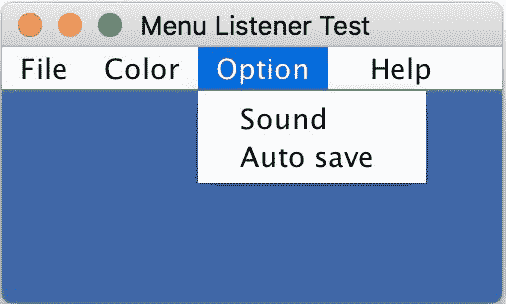

### 菜单监听器测试

如果你点击“File”（文件）菜单，移动到“Color”（颜色）菜单，然后移动到“Option”（选项）菜单，你会在 Java 控制台窗口上看到一些消息：

```
Menu Selected: File
Menu deselected: File
Menu Selected: Color
Menu deselected: Color
Menu Selected: Option
```

关于此教程示例的一些趣味说明：

* `public class MenuListenerTest implements MenuListener` 声明用于使我的 `MenuListenerTest` 对象成为一个 `MenuListener` 对象。
* `myMenu.addMenuListener(this);` 语句用于将 `MenuListener` 对象添加到 `JMenu` 对象中。
* `JMenu myMenu = (JMenu) e.getSource();` 语句用于获取触发事件的 `JMenu` 对象。
* `myMenu.getText()` 表达式用于获取菜单按钮的文本。

## Java Swing 教程 - Herong's 教程示例

### 菜单栏、菜单、菜单项和监听器

### JMenuItemActionListenerTest.java - 菜单项动作监听器测试

此节提供了一个教程示例，演示了如何使用 `java.awt.event.ActionListener`（按钮动作监听器接口）来捕获由 `JMenuItem` 对象触发的事件。

与任何其他用户界面组件一样，`JMenuItem` 对象在用户与其交互时也会触发事件。如果你想在 `JMenuItem` 对象上发生事件时执行某个任务，你需要为该 `JMenuItem` 项对象添加一个事件监听器。由于 `JMenuItem` 是 `AbstractButton` 的子类，它与 `AbstractButton` 共享监听器接口和事件类：

`java.awt.event.ActionListener` - 一个 AWT 接口，允许你实现自己的事件处理方法：

* `actionPerformed(ActionEvent)` - 当关联的组件被点击时被调用的事件处理方法。你需要实现此方法来执行自己的任务。

`java.awt.event.ActionEvent` - 一个 AWT 类，表示在组件上发生的事件。该类中最重要的方法是：

* `getActionCommand()` - 返回动作命令字符串的方法。

这里我写了一个测试 `ActionListener` 接口的示例程序：

```java
/* JMenuItemActionListenerTest.java
 * Copyright (c) 1997-2018 HerongYang.com. All Rights Reserved.
 */

import javax.swing.*;
import javax.swing.event.*;

public class MenuListenerTest implements MenuListener {

   JFrame myFrame = null;

   public static void main(String[] a) {

      (new MenuListenerTest()).test();

   }

   private void test() {

      myFrame = new JFrame("Menu Listener Test");

      myFrame.setContentPane(new JDesktopPane());

      JMenuBar myMenuBar = new JMenuBar();

      JMenu myMenu = getFileMenu();

      myMenu.addMenuListener(this);

      myMenuBar.add(myMenu);

      myMenu = getColorMenu();

      myMenu.addMenuListener(this);

      myMenuBar.add(myMenu);

      myMenu = getOptionMenu();

      myMenu.addMenuListener(this);

      myMenuBar.add(myMenu);

      JMenuItem myItem = new JMenuItem("Help");

      myMenuBar.add(myItem);

      myFrame.setJMenuBar(myMenuBar);

      myFrame.setVisible(true);

   }

   private JMenu getFileMenu() {

      JMenu myMenu = new JMenu("File");

      JMenuItem myItem = new JMenuItem("Open");

      myMenu.add(myItem);

      myItem = new JMenuItem("Close");

      myMenu.add(myItem);

      myMenu.addSeparator();

      myItem = new JMenuItem("Exit");

      myMenu.add(myItem);

      return myMenu;

   }

   private JMenu getColorMenu() {

      JMenu myMenu = new JMenu("Color");

      JMenuItem myItem = new JMenuItem("Red");

      myMenu.add(myItem);

      myItem = new JMenuItem("Green");

      myMenu.add(myItem);

      myItem = new JMenuItem("Blue");

      myMenu.add(myItem);

      return myMenu;

   }

   private JMenu getOptionMenu() {

      JMenu myMenu = new JMenu("Option");

      JMenuItem myItem = new JMenuItem("Sound");

      myMenu.add(myItem);

      myItem = new JMenuItem("Auto save");

      myMenu.add(myItem);

      return myMenu;

   }

   public void menuSelected(MenuEvent e) {

      JMenu myMenu = (JMenu) e.getSource();

      System.out.println("Menu Selected: " + myMenu.getText());

   }

   public void menuDeselected(MenuEvent e) {

      JMenu myMenu = (JMenu) e.getSource();

      System.out.println("Menu deselected: " + myMenu.getText());

   }

   public void menuCanceled(MenuEvent e) {

      JMenu myMenu = (JMenu) e.getSource();

      System.out.println("Menu canceled: " + myMenu.getText());

   }

}
```

本节提供了一个教程示例，介绍如何使用 `java.awt.event.ItemListener`（单选按钮和复选框项目监听器接口）来捕获单选按钮菜单项对象的状态改变项目事件。

由于 `JRadioButtonMenuItem` 类是一个特殊的菜单项类，它支持另一个事件监听器 `ItemListener`，这允许你捕获单选按钮的状态改变事件：

`java.awt.event.ItemListener` - 一个 AWT 接口，允许你实现自己的单选按钮状态改变事件处理方法：

- `itemStateChanged(ItemEvent)` - 当关联按钮的状态发生改变时调用的事件处理方法。你需要实现此方法来执行你自己的任务。

`java.awt.event.ItemEvent` - 一个代表在单选按钮上发生的事件的 AWT 类。该类中最重要的方法是：

- `getStateChange()` - 该方法返回一个整数：如果状态变为“已选中”则返回 1，如果状态变为“未选中”则返回 2。

这里有一个我编写的用于测试 `ItemListener` 接口的示例程序：

```java
/* JRadioButtonMenuItemListenerTest.java
 * Copyright (c) 1997-2018 HerongYang.com. All Rights Reserved.
 */

import java.awt.event.*;
import javax.swing.*;

public class JRadioButtonMenuItemListenerTest {

   JFrame myFrame = null;

   public static void main(String[] a) {

      (new JRadioButtonMenuItemListenerTest()).test();

   }

   private void test() {

      myFrame = new JFrame("Menu Listener Test");

      myFrame.setDefaultCloseOperation(JFrame.EXIT_ON_CLOSE);

      myFrame.setBounds(50, 50, 250, 150);

      myFrame.setContentPane(new JDesktopPane());

      JMenuBar myMenuBar = new JMenuBar();

      JMenu myMenu = getFileMenu();

      myMenuBar.add(myMenu);

      myMenu = getColorMenu();

      myMenuBar.add(myMenu);

      MyMenuItem myItem = new MyMenuItem("Help");

      myMenuBar.add(myItem);

      myFrame.setJMenuBar(myMenuBar);

      myFrame.setVisible(true);

   }

   private JMenu getFileMenu() {

      JMenu myMenu = new JMenu("File");

      MyMenuItem myItem = new MyMenuItem("Open");

      myMenu.add(myItem);

      myItem = new MyMenuItem("Close");

      myMenu.add(myItem);

      myMenu.addSeparator();

      myItem = new MyMenuItem("Exit");

      myMenu.add(myItem);

      return myMenu;

   }

   private JMenu getColorMenu() {

      JMenu myMenu = new JMenu("Color");

      ButtonGroup myGroup = new ButtonGroup();

      MyRadioButtonMenuItem myItem = new MyRadioButtonMenuItem("Red");

      myItem.setSelected(true);

      myGroup.add(myItem);

      myMenu.add(myItem);

      myItem = new MyRadioButtonMenuItem("Green");

      myGroup.add(myItem);

      myMenu.add(myItem);

      myItem = new MyRadioButtonMenuItem("Blue");

      myGroup.add(myItem);

      myMenu.add(myItem);

      return myMenu;

   }

   private class MyMenuItem extends JMenuItem implements ActionListener {

      public MyMenuItem(String text) {

         super(text);

         addActionListener(this);

      }

      public void actionPerformed(ActionEvent e) {

         System.out.println("Item clicked: " + e.getActionCommand());

      }

   }

   private class MyRadioButtonMenuItem extends JRadioButtonMenuItem implements ActionListener, ItemListener {
```


```java
public MyRadioButtonMenuItem(String text) {
   super(text);
   addActionListener(this);
   addItemListener(this);
}

public void actionPerformed(ActionEvent e) {
   System.out.println("Item clicked: " + e.getActionCommand());
}

public void itemStateChanged(ItemEvent e) {
   System.out.println("State changed: " + e.getStateChange()
      + " on " + ((MyRadioButtonMenuItem) e.getItem()).getText());
}
```

如果你运行这个示例，你将看到显示带有所示菜单栏的窗口：

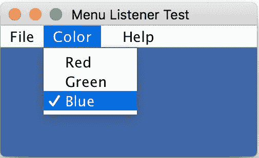

单选按钮菜单项监听器测试

如果你点击“Help”菜单项并点击“Color”菜单中的菜单项，你将看到 Java 控制台窗口上打印了一些消息：

```
State changed: 1 on Red
Item clicked: Help
Item clicked: Red
Item clicked: Red
State changed: 2 on Red
State changed: 1 on Green
Item clicked: Green
State changed: 2 on Green
State changed: 1 on Blue
Item clicked: Blue
```

关于此教程示例的一些有趣说明：

- 我使用了内部类 `MyRadioButtonMenuItem` 来创建单选按钮菜单项，该内部类同时实现了 `ActionListener` 和 `ItemListener` 接口。
- 使用 `e.getActionCommand()` 表达式来获取操作命令字符串，在这种情况下即菜单项按钮的文本。
- 使用 `e.getStateChange()` 表达式来获取状态改变信号。
- 点击已选中的单选按钮不会触发任何项目事件。

# Java Swing 教程 - Herong 的教程示例

## 菜单栏、菜单、菜单项和监听器

### 复选框菜单项上的项目监听器

如果你点击“Help”菜单项并点击“Option”菜单中的菜单项，你将在 Java 控制台窗口上看到打印的一些消息：

```
State changed: 1 on Sound
Item clicked: Help
State changed: 1 on Auto save
Item clicked: Auto save
State changed: 2 on Sound
Item clicked: Sound
State changed: 2 on Auto save
Item clicked: Auto save
State changed: 1 on Auto save
Item clicked: Auto save
```

关于此教程示例的一些有趣说明：

- 我使用了内部类 `MyCheckBoxMenuItem` 来创建复选框菜单项，并在内部类中同时实现了 `ActionListener` 和 `ItemListener` 接口。
- `e.getActionCommand()` 表达式用于获取命令字符串，在此情况下即菜单项按钮的文本。
- `e.getStateChange()` 表达式用于获取状态改变信号。

# Java Swing 教程 - Herong's 教程示例

## 菜单栏、菜单、菜单项和监听器

### `javax.swing.event.MenuKeyListener` - 菜单按键监听器接口

本节提供了一个教程示例，介绍如何使用 `javax.swing.event.MenuKeyListener` 菜单按键监听器接口，来捕捉在键盘上输入时由 `JMenuItem` 对象触发的事件。

`JMenuItem` 对象在用户通过在键盘上输入键与其交互时也会触发事件。如果你想在 `JMenuItem` 对象发生事件时执行某些任务，你需要为该 `JMenuItem` 对象添加一个事件监听器。要做到这一点，你需要了解以下 Swing 类、接口和方法：

`javax.swing.event.MenuKeyListener` - 一个 Swing 接口，允许你实现自己的菜单项事件处理方法：

- `menuKeyTyped(MenuKeyEvent)` - 当在菜单项按钮上输入按键时调用的事件处理方法。你需要实现此方法来执行自己的任务。
- `menuKeyPressed(MenuKeyEvent)` - 当在菜单项按钮上按下按键时调用的事件处理方法。你需要实现此方法来执行自己的任务。
- `menuKeyReleased(MenuKeyEvent)` - 当在菜单项按钮上释放按键时调用的事件处理方法。你需要实现此方法来执行自己的任务。

`javax.swing.event.MenuKeyEvent` - 一个表示在菜单项上发生事件的 Swing 类。该类中最重要的方法是：

- `getSource()` - 返回发生事件的 `JRootPane` 对象。没有太大用。
- `getKeyChar()` - 返回触发事件的按键所代表的字符。
- `getKeyCode()` - 返回触发事件的按键所代表的代码值。
- `getKeyText()` - 返回给定按键代码值的文本名称。
- `getPath()` - 返回一个菜单对象列表，表示菜单树中的一条路径。最后一个对象是触发事件的 `JMenuItem` 对象。

这里我写的一个用于测试 `MenuKeyListener` 接口的示例程序：

```java
/* MenuKeyListenerTest.java
 * Copyright (c) 1997-2018 HerongYang.com. All Rights Reserved.
 */

import javax.swing.*;
import javax.swing.event.*;

public class MenuKeyListenerTest implements MenuKeyListener {

   JFrame myFrame = null;

   public static void main(String[] a) {
      (new MenuKeyListenerTest()).test();
   }

   private void test() {
      myFrame = new JFrame("Menu Listener Test");
      myFrame.setDefaultCloseOperation(JFrame.EXIT_ON_CLOSE);
      myFrame.setBounds(50, 50, 250, 150);
      myFrame.setContentPane(new JDesktopPane());

      JMenuBar myMenuBar = new JMenuBar();
      JMenu myMenu = getFileMenu();
      myMenuBar.add(myMenu);
      myMenu = getColorMenu();
      myMenuBar.add(myMenu);
      myMenu = getOptionMenu();
      myMenuBar.add(myMenu);

      JMenuItem myItem = new JMenuItem("Help");
      myItem.addMenuKeyListener(this);
      myMenuBar.add(myItem);

      myFrame.setJMenuBar(myMenuBar);
      myFrame.setVisible(true);
   }

   private JMenu getFileMenu() {
      JMenu myMenu = new JMenu("File");
      JMenuItem myItem = new JMenuItem("Open");
      myItem.addMenuKeyListener(this);
      myMenu.add(myItem);
      myItem = new JMenuItem("Close");
      myItem.addMenuKeyListener(this);
      myMenu.add(myItem);
      myMenu.addSeparator();
      myItem = new JMenuItem("Exit");
      myItem.addMenuKeyListener(this);
      myMenu.add(myItem);
      return myMenu;
   }

   private JMenu getColorMenu() {
      JMenu myMenu = new JMenu("Color");
      ButtonGroup myGroup = new ButtonGroup();
      JRadioButtonMenuItem myItem = new JRadioButtonMenuItem("Red");
      myItem.setSelected(true);
      myItem.addMenuKeyListener(this);
      myGroup.add(myItem);
      myMenu.add(myItem);
      myItem = new JRadioButtonMenuItem("Green");
      myItem.addMenuKeyListener(this);
      myGroup.add(myItem);
      myMenu.add(myItem);
      myItem = new JRadioButtonMenuItem("Blue");
      myItem.addMenuKeyListener(this);
      myGroup.add(myItem);
      myMenu.add(myItem);
      return myMenu;
   }

   private JMenu getOptionMenu() {
      JMenu myMenu = new JMenu("Option");
      JMenuItem myItem = new JMenuItem("Sound");
      myItem.addMenuKeyListener(this);
      myMenu.add(myItem);
      myItem = new JMenuItem("Auto save");
      myItem.addMenuKeyListener(this);
      myMenu.add(myItem);
      return myMenu;
   }

   public void menuKeyTyped(MenuKeyEvent e) {
      MenuElement[] path = e.getPath();
      JMenuItem item = (JMenuItem) path[path.length - 1];
      System.out.println("Key typed: " + e.getKeyChar()
         + ", " + e.getKeyText(e.getKeyCode())
         + " on " + item.getText());
   }

   public void menuKeyPressed(MenuKeyEvent e) {
      MenuElement[] path = e.getPath();
      JMenuItem item = (JMenuItem) path[path.length - 1];
      System.out.println("Key pressed: " + e.getKeyChar()
         + ", " + e.getKeyText(e.getKeyCode())
         + " on " + item.getText());
   }

   public void menuKeyReleased(MenuKeyEvent e) {
      MenuElement[] path = e.getPath();
      JMenuItem item = (JMenuItem) path[path.length - 1];
      System.out.println("Key released: " + e.getKeyChar()
         + ", " + e.getKeyText(e.getKeyCode())
         + " on " + item.getText());
   }
}
```

如果你运行此示例，你将看到显示如下菜单栏的框架：


Menu Listener Test

如果你点击“Color”菜单保持打开状态，然后在键盘上输入“b” 键和“Shift” 键，你将在 Java 控制台窗口上看到打印的消息：

```
State changed: 1 on Sound
Item clicked: Help
State changed: 1 on Auto save
Item clicked: Auto save
State changed: 2 on Sound
Item clicked: Sound
State changed: 2 on Auto save
Item clicked: Auto save
```

- 由 "b" 键触发的 "key typed" 事件无法返回键键代码，这很奇怪。
- 当按下 "Shift" 键时，没有触发 "key typed" 事件。这也很奇怪。

# Java Swing 教程 - Herong 的教程示例

## 菜单栏、菜单、菜单项和监听器

### setMnemonic() - 为菜单项设置键盘快捷键（助记）

本节提供了一个教程示例，演示了如何使用 `setMnemonic()` 方法将助记（mnemonics）与菜单项关联联。助记允许用户使用键盘上的按键与菜单项进行交互。

正如你在上一节看到的，要使用菜单键监听器来捕获菜单键事件以支持用户在菜单项上输入按键是非常困难的。因为当一个按键触发时，所有激活的菜单项都会触发菜单键事件。

另一种允许用户使用键盘按键与菜单项交互的方法是使用 `setMnemonic()` 方法为菜单项设置快捷键（键盘键）。以下是其工作原理：

1. 为不同的菜单项分配不同的代表键盘不同按键的助记。
2. 为每个菜单项添加动作监听器（action listener）。
3. 当菜单项显示时，菜单文本中与助记匹配的字符将带有下划线。
4. 当按下键盘上的按键时，只有助记与所按按键匹配的菜单项才会触发动作事件（action event）。

这里我编写了一个测试 `setMnemonic()` 方法的示例程序：

```java
/* JMenuItemSetMnemonicTest.java
 * Copyright (c) 1997-2018 HerongYang.com. All Rights Reserved.
 */

import java.awt.event.*;
import javax.swing.*;
import javax.swing.event.*;

public class JMenuItemSetMnemonicTest implements ActionListener, MenuKeyListener {

   JFrame myFrame = null;

   public static void main(String[] a) {
      (new JMenuItemSetMnemonicTest()).test();
   }

   private void test() {
      myFrame = new JFrame("Menu Item Mnemonic Test");
      myFrame.setDefaultCloseOperation(JFrame.EXIT_ON_CLOSE);
      myFrame.setBounds(50, 50, 250, 150);
      myFrame.setContentPane(new JDesktopPane());

      JMenuBar myMenuBar = new JMenuBar();
      JMenu myMenu = getFileMenu();
      myMenuBar.add(myMenu);
      myMenu = getColorMenu();
      myMenuBar.add(myMenu);
      myMenu = getOptionMenu();
      myMenuBar.add(myMenu);

      JMenuItem myItem = new JMenuItem("Help");
      myItem.setMnemonic(KeyEvent.VK_H);
      myItem.addActionListener(this);
```


这是一个我编写的用于测试 `setMnemonic()` 方法的示例程序：

```java
/* JMenuItemSetMnemonicTest.java
 * Copyright (c) 1997-2018 HerongYang.com. All Rights Reserved.
 */

import java.awt.event.*;
import javax.swing.*;
import javax.swing.event.*;

public class JMenuItemSetMnemonicTest 
   implements ActionListener, MenuKeyListener {

   JFrame myFrame = null;

   public static void main(String[] a) {
      (new JMenuItemSetMnemonicTest()).test();
   }

   private void test() {
      myFrame = new JFrame("Menu Item Mnemonic Test");
      myFrame.setDefaultCloseOperation(JFrame.EXIT_ON_CLOSE);
      myFrame.setBounds(50, 50, 250, 150);
      myFrame.setContentPane(new JDesktopPane());

      JMenuBar myMenuBar = new JMenuBar();

      JMenu myMenu = getFileMenu();
      myMenuBar.add(myMenu);

      myMenu = getColorMenu();
      myMenuBar.add(myMenu);

      myMenu = getOptionMenu();
      myMenuBar.add(myMenu);

      JMenuItem myItem = new JMenuItem("Help");
      myItem.setMnemonic(KeyEvent.VK_H);
      myItem.addActionListener(this);
      myItem.addMenuKeyListener(this);
      myMenuBar.add(myItem);

      myFrame.setJMenuBar(myMenuBar);
      myFrame.setVisible(true);
   }

   private JMenu getFileMenu() {
      JMenu myMenu = new JMenu("File");

      JMenuItem myItem = new JMenuItem("Open");
      myMenu.add(myItem);

      myItem = new JMenuItem("Close");
      myMenu.add(myItem);

      myMenu.addSeparator();

      myItem = new JMenuItem("Exit");
      myMenu.add(myItem);

      return myMenu;
   }

   private JMenu getColorMenu() {
      JMenu myMenu = new JMenu("Color");
      ButtonGroup myGroup = new ButtonGroup();

      JRadioButtonMenuItem myItem = new JRadioButtonMenuItem("Red");
      myItem.setSelected(true);
      myItem.setMnemonic(KeyEvent.VK_R);
      myItem.addActionListener(this);
      myItem.addMenuKeyListener(this);
      myGroup.add(myItem);
      myMenu.add(myItem);

      myItem = new JRadioButtonMenuItem("Green");
      myItem.setMnemonic(KeyEvent.VK_G);
      myItem.addActionListener(this);
      myItem.addMenuKeyListener(this);
      myGroup.add(myItem);
      myMenu.add(myItem);

      myItem = new JRadioButtonMenuItem("Blue");
      myItem.setMnemonic(KeyEvent.VK_B);
      myItem.addActionListener(this);
      myItem.addMenuKeyListener(this);
      myGroup.add(myItem);
      myMenu.add(myItem);

      return myMenu;
   }

   private JMenu getOptionMenu() {
      JMenu myMenu = new JMenu("Option");

      JMenuItem myItem = new JMenuItem("Sound");
      myMenu.add(myItem);

      myItem = new JMenuItem("Auto save");
      myMenu.add(myItem);

      return myMenu;
   }

   public void actionPerformed(ActionEvent e) {
      System.out.println("Item clicked: " + e.getActionCommand());
   }

   public void menuKeyTyped(MenuKeyEvent e) {
      Object[] path = e.getPath();
      JMenuItem item = (JMenuItem) path[path.length - 1];
      System.out.println("Key typed: " + e.getKeyChar() + " for " + e.getKeyCode() + 
         " matching " + item.getMnemonic() + " on " + item.getText());
   }

   public void menuKeyPressed(MenuKeyEvent e) {
      Object[] path = e.getPath();
      JMenuItem item = (JMenuItem) path[path.length - 1];
      System.out.println("Key pressed: " + e.getKeyCode() + " for " + e.getKeyChar() + 
         " matching " + item.getMnemonic() + " on " + item.getText());
   }

   public void menuKeyReleased(MenuKeyEvent e) {
      Object[] path = e.getPath();
      JMenuItem item = (JMenuItem) path[path.length - 1];
      System.out.println("Key released: " + e.getKeyCode() + " for " + e.getKeyChar() + 
         " matching " + item.getMnemonic() + " on " + item.getText());
   }
}
```

关于此示例的有趣说明：

* 我在主类中实现了接口：`ActionListener` 和 `MenuKeyListener`。
* `myItem.setMnemonic(KeyEvent.VK_*)` 语句用于为菜单项分配助记符。
* 当输入 "b" 键时，"Red"、"Green" 和 "Blue" 菜单项触发了菜单按下事件。"Blue" 菜单项触发了动作事件，因为它匹配了助记符。
* 当动作事件触发时，它停止了 "b" 键的类型输入和释放事件。
* 当输入 "s" 键时，没有触发动作事件，因为它与菜单项上定义的任何助记符都不匹配。

为了让用户在不弹出菜单的情况下调用菜单项，我们需要使用 `setAccelerator()` 方法为该菜单项分配一个加速键（按键组合）。

```java
/* JMenuItemSetAcceleratorTest.java
 * Copyright (c) 1997-2018 HerongYang.com. All Rights Reserved.
 */

import java.awt.event.*;
import javax.swing.*;
import javax.swing.event.*;

public class JMenuItemSetAcceleratorTest implements ActionListener {

   JFrame myFrame = null;

   public static void main(String[] a) {
      (new JMenuItemSetAcceleratorTest()).test();
   }

   private void test() {
      myFrame = new JFrame("Menu Item Accelerator Test");
      myFrame.setDefaultCloseOperation(JFrame.EXIT_ON_CLOSE);
      myFrame.setBounds(50, 50, 250, 150);
      myFrame.setContentPane(new JDesktopPane());

      JMenuBar myMenuBar = new JMenuBar();

      JMenu myMenu = getFileMenu();
      myMenuBar.add(myMenu);

      myMenu = getColorMenu();
      myMenuBar.add(myMenu);

      myMenu = getOptionMenu();
      myMenuBar.add(myMenu);

      JMenuItem myItem = new JMenuItem("Help");
      myItem.setMnemonic(KeyEvent.VK_H);
      myItem.setAccelerator(
         KeyStroke.getKeyStroke(KeyEvent.VK_P, ActionEvent.CTRL_MASK));
   }
}
```


```java
myItem.addActionListener(this);

myMenuBar.add(myItem);

myFrame.setJMenuBar(myMenuBar);

myFrame.setVisible(true);

}

private JMenu getFileMenu() {

   JMenu myMenu = new JMenu("File");

   JMenuItem myItem = new JMenuItem("Open");

   myMenu.add(myItem);

   myItem = new JMenuItem("Close");

   myMenu.add(myItem);

   myMenu.addSeparator();

   myItem = new JMenuItem("Exit");

   myMenu.add(myItem);

   return myMenu;

}

private JMenu getColorMenu() {

   JMenu myMenu = new JMenu("Color");

   ButtonGroup myGroup = new ButtonGroup();

   JRadioButtonMenuItem myItem = new JRadioButtonMenuItem("Red");

   myItem.setSelected(true);

   myItem.setMnemonic(KeyEvent.VK_R);

   myItem.setAccelerator(
      KeyStroke.getKeyStroke(KeyEvent.VK_D, ActionEvent.CTRL_MASK));

   myItem.addActionListener(this);

   myGroup.add(myItem);

   myMenu.add(myItem);

   myItem = new JRadioButtonMenuItem("Green");

   myItem.setMnemonic(KeyEvent.VK_G);

   myItem.setAccelerator(
      KeyStroke.getKeyStroke(KeyEvent.VK_N, ActionEvent.CTRL_MASK));

   myItem.addActionListener(this);

   myGroup.add(myItem);

   myMenu.add(myItem);

   myItem = new JRadioButtonMenuItem("Blue");

   myItem.setMnemonic(KeyEvent.VK_B);

   myItem.setAccelerator(
      KeyStroke.getKeyStroke(KeyEvent.VK_E, ActionEvent.CTRL_MASK));

   myItem.addActionListener(this);

   myGroup.add(myItem);

   myMenu.add(myItem);

   return myMenu;

}

private JMenu getOptionMenu() {

   JMenu myMenu = new JMenu("Option");

   JMenuItem myItem = new JMenuItem("Sound");

   myMenu.add(myItem);

   myItem = new JMenuItem("Auto save");

   return myMenu;

}

public void actionPerformed(ActionEvent e) {

   System.out.println("Item clicked: "+e.getActionCommand());

}

}
```

如果你运行此示例，你将看到框架窗口显示出如下的菜单栏：

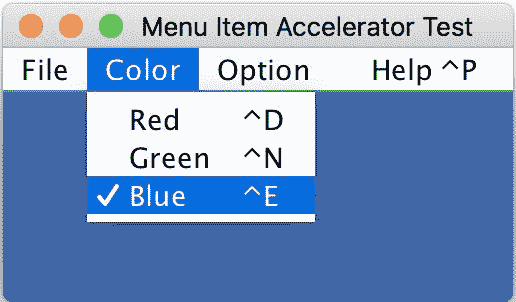

### 菜单项快捷键测试

不要打开“Color（颜色）”菜单，按下 `<Ctrl>-d`、`<Ctrl>-n` 和 `<Ctrl>-e`。然后在打开“Color（颜色）”菜单的情况下重复测试。也尝试 `<Ctrl>-p`。你会看到 Java 控制台窗口上打印了一些消息：

```
Item clicked: Red
Item clicked: Green
Item clicked: Blue
Item clicked: Red
Item clicked: Green
Item clicked: Blue
Item clicked: Help
```

### 关于此教程示例的有趣说明：

* 我在主类上只实现了一个接口：`ActionListener`。
* 使用语句 `myItem.setAccelerator(KeyStroke.getKeyStroke(KeyEvent.VK_*, ActionEvent.CTRL_MASK));` 来为菜单项分配特定的快捷键。
* 大多数 GUI 都遵循使用 `<Ctrl>` 作为菜单项快捷键修饰键的惯例。
* 当按下快捷键 `<Ctrl>-d` 时，“Red（红色）”菜单项触发了一个动作事件（action event），因为它分配了匹配的快捷键。
* 菜单栏中列出的“Help（帮助）”菜单项的快捷键也能正常工作。

---

Java Swing 教程 - Herong's Tutorial Examples

∟ 菜单栏、菜单、菜单项和监听器

∟ `setMnemonic()` - 在菜单上设置键盘助记键

本节提供了一个教程示例，演示了如何使用 `setMnemonic()` 方法将助记键与菜单关联。助记键允许用户使用键盘上的按键与菜单进行交互。

键盘助记键也可以用于菜单栏中列出的菜单。但它们的行为与菜单项上的助记键不同。

1. 为菜单栏中的菜单分配不同的助记键。
2. 为每个菜单调用 `setMnemonic()` 方法。
3. 使用 `setMnemonic()` 方法后，菜单项中的文本将带有下划线。
4. 按下 `setMnemonic()` 设置的字符将触发一个菜单事件。

如果你按下 `<Alt>-f`、`<Alt>-c`、`<Alt>-o` 和 `<Alt>-h`，你将在 Java 控制台窗口中看到一些消息：

```
Menu Selected: File
Menu deselected: File
Menu Selected: Color
Menu deselected: Color
Menu Selected: Option
Menu deselected: Option
Menu Selected: Help
Menu deselected: Help
```

---

Java Swing 教程 - Herong 示例

# 在主框架中创建内部帧

本章节提供了关于内部帧（internal frames）的教程笔记和示例代码。主题包括 `javax.swing.JInternalFrame` 类和 `javax.swing.JInternalFrameListener` 接口的快速介绍；在主框架内部内部帧的示例；添加内部帧监听器的示例。

> * `javax.swing.JInternalFrame` - 内部帧类
> * `JInternalFrameTest.java` - 内部帧类测试
> * `javax.swing.InternalFrameListener` - 内部帧监听器接口

#### 结论

* `javax.swing.JInternalFrame` 类对象代表主框架内部的内部帧。
* 创建实现 `javax.swing.JInternalFrameListener` 接口的类允许你添加逻辑来响应由内部帧生成的事件。

本章列出的示例程序已经在 Windows 和 macOS 电脑上的 JDK 1.3.1 到 JDK 17 上进行了测试。

---

Java Swing 教程 - Herong 示例

## 在主框架中创建内部帧

### `javax.swing.JInternalFrame` - 内部帧类

本节描述了 `javax.swing.JInternalFrame` - 内部帧类，代表普通框架内部的 UI 内部帧。

`javax.swing.JInternalFrame` - 代表普通框架内部 UI 内部帧的 Swing 类。内部帧支持普通框架几乎的所有功能。将内部帧添加到普通框架中，应该先将内部帧添加到桌面面板（desktop pane），然后将桌面面板作为普通框架的内容面板（content pane）。`JInternalFrame` 的有趣方法包括：

* `JInternalFrame(String)` - 构造函数，使用指定的字符串作为帧标题创建内部帧。
* `setResizable(boolean)` - 设置此帧是否可调整大小的方法。
* `setClosable(boolean)` - 设置此帧是否可关闭的方法。
* `setMaximizable(boolean)` - 设置此帧是否可最大化的方法。
* `setIconifiable(boolean)` - 设置此帧是否可最小化为图标的方法。
* `setSize(int, int)` - 设置此帧大小的方法。如果不设置，内部帧的大小将为 0 且不可见。
* `setVisible(boolean)` - 设置此帧是否可见的方法。默认设置为不可见，你必须调用 `setVisible(true)` 来显示内部帧。
* `addInternalFrameListener(InternalFrameListener)` - 向此内部帧添加内部帧监听器的方法。

`javax.swing.JDesktopPane` - 代表托管内部帧的容器的 Swing 类。

* `getSelectedFrame()` - 返回被选中的内部帧的方法。

`javax.swing.event.InternalFrameListener` - 用于让实现类处理内部帧事件的 Swing 接口。方法包括：

* `internalFrameActivated(InternalFrameEvent)` - 当内部帧被激活时调用的方法。
* `internalFrameClosed(InternalFrameEvent)` - 当内部帧被关闭时调用的方法。
* `internalFrameClosing(InternalFrameEvent)` - 当内部帧处于关闭过程中调用的方法。
* `internalFrameDeactivated(InternalFrameEvent)` - 当内部帧被取消激活时调用的方法。
* `internalFrameDeiconified(InternalFrameEvent)` - 当内部帧恢复图标时调用的方法。
* `internalFrameIconified(InternalFrameEvent)` - 当内部帧最小化为图标时调用的方法。
* `internalFrameOpened(InternalFrameEvent)` - 当内部帧打开时调用的方法。

---

Java Swing 教程 - Herong 示例

## 在主框架中创建内部帧

### `JInternalFrameTest.java` - 内部帧类测试

本节提供了关于如何使用 `javax.swing.JInternalFrame` 类在主框架中创建 2 个内部帧的教程示例。

以下程序展示了如何创建内部帧：

```java
/* JInternalFrameTest.java
 * Copyright (c) 1997-2018 HerongYang.com. All Rights Reserved.
 */

import java.awt.*;
import javax.swing.*;

public class JInternalFrameTest {

   public static void main(String[] a) {
      JFrame myFrame = new JFrame("Internal Frames");
      myFrame.setDefaultCloseOperation(JFrame.EXIT_ON_CLOSE);
      myFrame.setSize(300,300);
      JDesktopPane myDesktop = new JDesktopPane();
      myFrame.setContentPane(myDesktop);
      JInternalFrame f = createFrame("Frame 1");
      f.setLocation(10,10);
      myDesktop.add(f);
      f = createFrame("Frame 2");
      f.setLocation(60,60);
      myDesktop.add(f);
      myFrame.setVisible(true);
   }

   private static JInternalFrame createFrame(String t) {
      JInternalFrame f = new JInternalFrame(t);
      f.setResizable(true);
      f.setClosable(true);
      f.setMaximizable(true);
      f.setIconifiable(true);
      f.setSize(200,200);
      f.setVisible(true);
      return f;
   }
}
```

运行此程序，你应该看到两个内部帧。你可以调整大小、关闭、最大化和最小化内部帧：

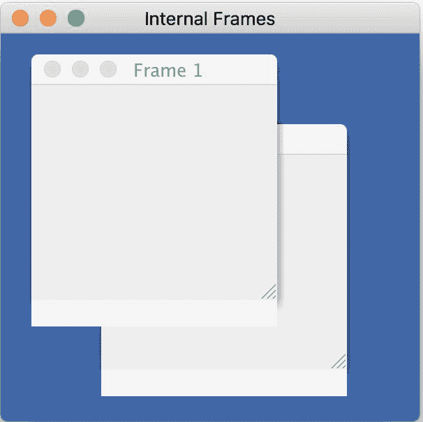

内部测试

---

Java Swing 教程 - Herong 示例

## 在主框架中创建内部帧

### `javax.swing.InternalFrameListener` - 内部帧监听器接口

本节提供了关于如何使用 `javax.swing.InternalFrameListener` 接口的教程示例，该接口允许实现类处理内部帧事件。

以下程序展示了如何创建内部帧监听器：

```java
/* JInternalFrameListenerTest.java
 * Copyright (c) 1997-2018 HerongYang.com. All Rights Reserved.
 */

import java.awt.*;
import java.awt.event.*;
import javax.swing.*;
import javax.swing.event.*;

public class JInternalFrameListenerTest 
   implements InternalFrameListener, ActionListener {

   JFrame myFrame = null;
   int count = 0;

   public static void main(String[] a) {
      (new JInternalFrameListenerTest()).test();
   }

   private void test() {
      myFrame = new JFrame("Internal Frame Listener Test");
      myFrame.setDefaultCloseOperation(JFrame.EXIT_ON_CLOSE);
      myFrame.setSize(300,300);
      myFrame.setContentPane(new JDesktopPane());
      JMenuBar myMenuBar = new JMenuBar();
      JMenu myMenu = new JMenu("Frame");
      JMenuItem myMenuItem = new JMenuItem("New");
      myMenuItem.addActionListener(this);
      myMenu.add(myMenuItem);
      myMenuBar.add(myMenu);
      myFrame.setJMenuBar(myMenuBar);
      myFrame.setVisible(true);
   }

   public void actionPerformed(ActionEvent e) {
      count++;
      JInternalFrame f = new JInternalFrame("Frame "+count);
      f.setResizable(true);
      f.setClosable(true);
      f.setMaximizable(true);
      f.setIconifiable(true);
      f.setSize(200,200);
      f.setLocation(count*10,count*10);
      f.addInternalFrameListener(this);
      f.setVisible(true);
      myFrame.getContentPane().add(f);
   }

   public void internalFrameActivated(InternalFrameEvent e) {
```


```java
System.out.println("Internal frame activated");

}

public void internalFrameClosed(InternalFrameEvent e) {

   System.out.println("Internal frame closed");

}

public void internalFrameClosing(InternalFrameEvent e) {

   System.out.println("Internal frame closing");

}

public void internalFrameDeactivated(InternalFrameEvent e) {

   System.out.println("Internal frame deactivated");

}

public void internalFrameDeiconified(InternalFrameEvent e) {

   System.out.println("Internal frame deiconified");

}

public void internalFrameIconified(InternalFrameEvent e) {

   System.out.println("Internal frame iconified");

}

public void internalFrameOpened(InternalFrameEvent e) {

   System.out.println("Internal frame opened");

}

}
```

运行此程序，你将看到一个带有一个“Frame”菜单的空白框架。如果你：

*   点击“Frame”菜单和“New”菜单项来创建第一个内部帧。
*   点击“Frame”菜单和“New”菜单项来创建第二个内部帧。
*   点击第一个内部帧上的关闭图标。
*   点击第二个内部帧上的最大化图标。
*   点击第二个内部帧上的最小化图标。
*   点击第二个内部帧的最小化图像。

你将看到由内部帧监听器方法生成的以下消息。

```
Action performed              - Clicked "New" menu item

Internal frame opened

Action performed              - Clicked "New" menu item

Internal frame opened

Internal frame closing        - Clicked the close icon

Internal frame closed

Internal frame activated      - Clicked the maximize icon

Internal frame deactivated    - Clicked the minimize icon

Internal frame iconified

Internal frame activated      - Clicked the minimized image

Internal frame deiconified
```

在测试结束时，主框架看起来如下：

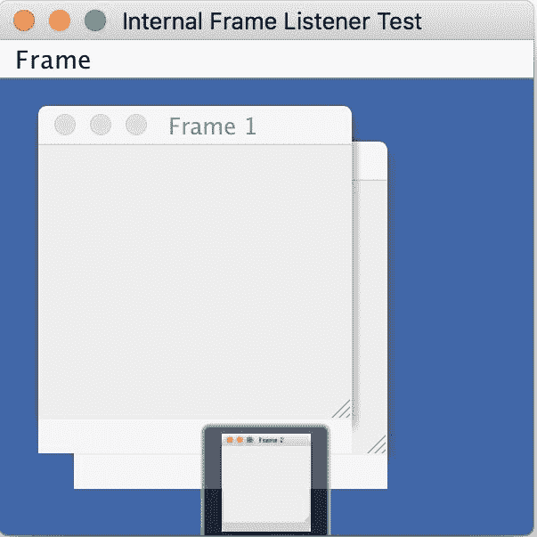

# 内部帧监听器

Java Swing 教程 - Herong 的教程示例

## 容器中组件的布局

本章提供了关于组件布局的教程笔记和示例代码。主题包括组件布局的介绍；`BorderLayout`、`FlowLayout`、`BoxLayout`、`GridLayout` 和 `GridBagLayout` 的教程示例。

> 什么是布局？
> `java.awt.BorderLayout` - 边界布局
> `java.awt.FlowLayout` - 流式布局
> `java.awt.BoxLayout` - 盒子布局
> `java.awt.GridLayout` - 网格布局
> `java.awt.GridBagLayout` - 网格袋布局

## 结论

*   布局是一组规则，定义了图形组件应该如何在容器中进行对齐。
*   Java 提供了 5 种内置布局：Border、Flow、Box、Grid 和 Grid Bag 布局。
*   `java.awt.BorderLayout` 类允许你管理边界布局，该布局在东、南、西、北和中心五个区域显示 5 个组件。
*   `java.awt.FlowLayout` 类允许你管理流式布局，该布局在水平方向上顺序显示无限数量的组件并在容器的右边缘换行。
*   `java.awt.BoxLayout` 类允许你管理盒子布局，该布局在水平或垂直方向上顺序显示无限数量的组件。组件调整大小以适应容器宽度。
*   `java.awt.GridLayout` 类允许你管理网格布局，该布局按行和列显示无限数量的组件。组件会调整大小以适应容器。
*   `java.awt.GridBagLayout` 类允许你管理网格袋布局，该布局按行和列显示组件。

示例程序在 Windows 和 macOS 上通过了测试。

Java Swing 教程 - Herong 的教程示例

## 容器中组件的布局

### 什么是布局？

布局是一组定义了图形组件应该如何在容器中进行对齐的规则。

在容器中放置组件有两种方法：

*   使用预定义布局并允许布局决定放置位置。这是一种软性放置方法。如果容器更改大小，组件的位置将被调整。但你可能无法精确地达到想要的位置。
*   使用容器坐标指定组件的位置。这是一种硬性放置方法。你可以精确地达到想要的位置。但如果容器更改大小，组件的位置将不会调整。

AWT 提供了许多预定义布局供你使用：

*   `java.awt.BorderLayout` - 将容器划分为东、南、西、北和中心五个区域，并每个区域分配一个组件。
*   `java.awt.FlowLayout` - 取无限数量的组件，让它们自然地水平流动，然后垂直流动。
*   `java.awt.BoxLayout` - 取无限数量的组件，让它们在一个方向上水平或垂直流动。
*   `java.awt.GridLayout` - 将容器划分为行和列，并每个单元格分配一个组件。
*   `java.awt.GridBagLayout` - 将容器划分为行和列，并为大小不等的单元格分配一个组件。

### 边界布局

本节提供了一个教程示例，说明如何创建 `BorderLayout` 来在容器中布局组件。`BorderLayout` 有 5 个固定部分：北、南、西、东和中心。

**`java.awt.BorderLayout`** - 一个非常简单的布局，其功能如下：

*   将容器划分为五个区域：东、南、西、北和中心。
*   最多只接受 5 个组件，每个区域一个。
*   调整每个组件的大小以匹配其区域的大小。
*   作为容器的默认布局。
*   当容器调整大小时，调整每个区域的大小。

```java
/* BorderLayoutTest.java
 * Copyright (c) 1997-2018 HerongYang.com. All Rights Reserved.
 */

import java.awt.*;
import javax.swing.*;

public class BorderLayoutTest {

   public static void main(String[] a) {

      JFrame myFrame = new JFrame("FlowLayout Test");
      myFrame.setDefaultCloseOperation(JFrame.EXIT_ON_CLOSE);

      Container myPane = myFrame.getContentPane();
      myPane.setLayout(new BorderLayout());

      myPane.add(new JButton("North"), BorderLayout.NORTH);
      myPane.add(new JButton("South"), BorderLayout.SOUTH);
      myPane.add(new JButton("East"), BorderLayout.EAST);
      myPane.add(new JButton("West"), BorderLayout.WEST);
      myPane.add(new JButton(new ImageIcon("java.gif")), 
         BorderLayout.CENTER);

      myFrame.pack();
      myFrame.setVisible(true);
   }
}
```

如果你运行这个示例，你将得到：

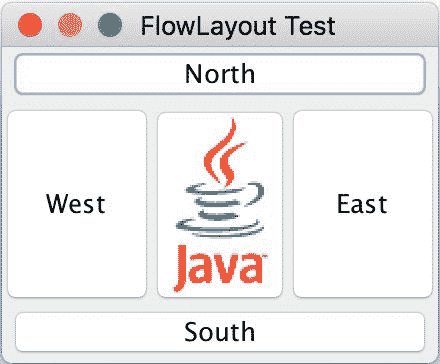

### 布局 - BorderLayout

Java Swing 教程 - Herong 的教程示例

∟ 容器中组件的布局

∟ `java.awt.FlowLayout` - 流布局布局

本节提供了一个教程示例，介绍如何创建一个 `FlowLayout` 来在容器中布局组件。`FlowLayout` 可以包含许多元素，先水平排列，然后垂直排列。

`java.awt.FlowLayout` - 另一种非常简单的布局，它：

*   接受无限数量的组件。
*   使用每个组件的默认尺寸。
*   将每个组件在行中相邻排列。如果当前行空间不足，组件将放置在下一行的开头。
*   当容器调整大小时，会重新排列流布局。

我没有看到这种布局的任何潜在用途。但我很有兴趣看当容器调整大小时它是如何重新排列流的。因此，我决定使用 `FlowLayout` 来布局包含几种不同类型组件的窗口。我希望窗口看起来像这样：

```
 - Details ----------------

|     Name: Text         |||   System: Radio button |

| Language: Check box    |

|     Year: Dropdown     |

--------------------------

        OK  Cancel
```

这里我编写的用 `FlowLayout` 实现此目的的示例程序：

```java
/* FlowLayoutTest2.java
 * Copyright (c) 1997-2018 HerongYang.com. All Rights Reserved.
 */

import java.awt.*;
import javax.swing.*;

public class FlowLayoutTest2 {

   public static void main(String[] a) {

      JFrame myFrame = new JFrame("FlowLayout Test");
      myFrame.setDefaultCloseOperation(JFrame.EXIT_ON_CLOSE);

      Container myPane = myFrame.getContentPane();
      myPane.setLayout(new FlowLayout(FlowLayout.CENTER));

      myPane.add(getFieldPanel());
      myPane.add(getButtonPanel());

      myFrame.pack();
      myFrame.setVisible(true);
   }

   private static JPanel getFieldPanel() {

      JPanel p = new JPanel(new FlowLayout());
      p.setBorder(BorderFactory.createTitledBorder("Details"));

      p.add(new JLabel("Name:"));
      p.add(new JTextField(16));

      p.add(new JLabel("System:"));
      p.add(getSystemPanel());

      p.add(new JLabel("Language:"));
      p.add(getLanguagePanel());

      p.add(new JLabel("Year:"));
      p.add(new JComboBox<String>(
         new String[] {"2021","2022","2023"}));

      return p;
   }

   private static JPanel getButtonPanel() {

      JPanel p = new JPanel(new FlowLayout());
      p.add(new JButton("OK"));
      p.add(new JButton("Cancel"));
      return p;
   }

   private static JPanel getSystemPanel() {

      JRadioButton unixButton = new JRadioButton("Unix", true);
      JRadioButton winButton = new JRadioButton("Window", false);
      ButtonGroup systemGroup = new ButtonGroup();

      systemGroup.add(unixButton);
      systemGroup.add(winButton);

      JPanel p = new JPanel(new FlowLayout());
      p.add(unixButton);
      p.add(winButton);
      return p;
   }

   private static JPanel getLanguagePanel() {

      JPanel p = new JPanel(new FlowLayout());
      p.add(new JCheckBox("Java", true));
      p.add(new JCheckBox("C++", true));
      p.add(new JCheckBox("Perl", false));
      return p;
   }
}
```

运行它。你觉得结果如何？看起来很糟糕，对吧？

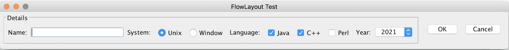

### 布局 - FlowLayout

最初所有组件都排列在单行中。如果你收窄窗口，“OK”和“Cancel”按钮将换行到下一行。如果进一步收窄，位置不会发生变化。因为顶层容器（窗口）实际上只包含两个组件：字段面板和按钮面板。

所以，`FlowLayout` 并不适合我的示例。

Java Swing 教程 - Herong 的教程示例

∟ 容器中组件的布局

∟ `java.awt.BoxLayout` - 盒子布局

本节提供了一个教程示例，介绍如何创建一个 `BoxLayout` 来在容器中布局组件。`BoxLayout` 可以包含许多仅在一个方向排列的元素：水平或垂直。

`java.awt.BoxLayout` - 一种布局，它：

*   接受无限数量的组件。
*   仅在一个方向（水平或垂直）上相邻排列每个组件。
*   调整可调整组件的大小以填充整个容器。
*   当容器调整大小时调整可调整组件的大小。

为了测试 `BoxLayout`，我写写了另一个程序来尝试用 `BoxLayout` 显示我的窗口：

```java
/* BoxLayoutTest2.java
 * Copyright (c) 1997-2018 HerongYang.com. All Rights Reserved.
 */

import java.awt.*;
import javax.swing.*;

public class BoxLayoutTest2 {

   public static void main(String[] a) {

      JFrame myFrame = new JFrame("BoxLayout Test");
      myFrame.setDefaultCloseOperation(JFrame.EXIT_ON_CLOSE);

      Container myPane = myFrame.getContentPane();
      myPane.setLayout(new BoxLayout(myPane, BoxLayout.Y_AXIS));

      myPane.add(getFieldPanel());
      myPane.add(getButtonPanel());

      myFrame.pack();
      myFrame.setVisible(true);
   }

   private static JPanel getFieldPanel() {

      JPanel p = new JPanel();
      p.setLayout(new BoxLayout(p, BoxLayout.X_AXIS));
      p.setBorder(BorderFactory.createTitledBorder("Details"));

      p.add(getLabelPanel());
      p.add(getValuePanel());

      return p;
   }
```


## 布局 - BoxLayout

```java
private static JPanel getButtonPanel() {
    JPanel p = new JPanel();
    p.setLayout(new BoxLayout(p, BoxLayout.X_AXIS));
    p.add(new JButton("OK"));
    p.add(new JButton("Cancel"));
    return p;
}

private static JPanel getLabelPanel() {
    JPanel p = new JPanel();
    p.setLayout(new BoxLayout(p, BoxLayout.Y_AXIS));
    JLabel l = new JLabel("Name:");
    l.setAlignmentX(Component.RIGHT_ALIGNMENT);
    p.add(l);
    l = new JLabel("System:");
    l.setAlignmentX(Component.RIGHT_ALIGNMENT);
    p.add(l);
    l = new JLabel("Language:");
    l.setAlignmentX(Component.RIGHT_ALIGNMENT);
    p.add(l);
    l = new JLabel("Year:");
    l.setAlignmentX(Component.RIGHT_ALIGNMENT);
    p.add(l);
    return p;
}

private static JPanel getValuePanel() {
    JPanel p = new JPanel();
    p.setLayout(new BoxLayout(p, BoxLayout.Y_AXIS));
    JComponent c = new JTextField(16);
    c.setAlignmentX(Component.LEFT_ALIGNMENT);
    p.add(c);
    JPanel s = getSystemPanel();
    s.setAlignmentX(Component.LEFT_ALIGNMENT);
    p.add(s);
    s = getLanguagePanel();
    s.setAlignmentX(Component.LEFT_ALIGNMENT);
    p.add(s);
    JComboBox<String> b = new JComboBox<String>(new String[] {"2021","2022","2023"});
    b.setAlignmentX(Component.LEFT_ALIGNMENT);
    p.add(b);
    return p;
}

private static JPanel getSystemPanel() {
    JRadioButton unixButton = new JRadioButton("Unix", true);
    JRadioButton winButton = new JRadioButton("Window", false);
    ButtonGroup systemGroup = new ButtonGroup();
    systemGroup.add(unixButton);
    systemGroup.add(winButton);
    JPanel p = new JPanel();
    p.setLayout(new BoxLayout(p, BoxLayout.X_AXIS));
    p.add(unixButton);
    p.add(winButton);
    return p;
}

private static JPanel getLanguagePanel() {
    JPanel p = new JPanel();
    p.setLayout(new BoxLayout(p, BoxLayout.X_AXIS));
    p.add(new JCheckBox("Java", true));
    p.add(new JCheckBox("C++", true));
    p.add(new JCheckBox("Perl", false));
    return p;
}
```

运行它。你觉得结果怎么样？好得多，不是吗？

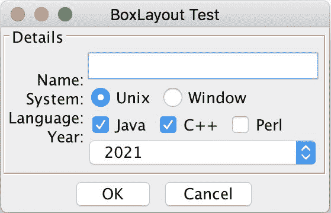

但如果你仔细观察，值组件并没有与对应的标签组件对齐。几乎不可能让它们对齐的，因为它们在两个不同的面板中。

所以，`BoxLayout` 对于我的例子仍然不够好。

关于 `BoxLayout` 的另一个问题是，为什么构造函数需要容器作为输入。其他布局的构造函数不需要容器。这使得语句看起来非常奇怪：`p.setLayout(new BoxLayout(p,...))`。

## 布局 - GridLayout

### `java.awt.GridLayout` - 一种具有以下特征的布局：

*   将容器分为行和列。行数和列数是可以配置的。行和列等等划分。
*   将组件放置在指定的单元格中。
*   调整每个组件的大小以匹配其单元格的大小。
*   当容器调整大小时，所有组件都会随之调整大小。

再次，我写了另一个程序来尝试使用 `GridLayout` 显示我的窗口：

```java
/* GridLayoutTest2.java
 * Copyright (c) 1997-2018 HerongYang.com. All Rights Reserved.
 */

import java.awt.*;
import javax.swing.*;

public class GridLayoutTest2 {
    public static void main(String[] a) {
        JFrame myFrame = new JFrame("GridLayout Test");
        myFrame.setDefaultCloseOperation(JFrame.EXIT_ON_CLOSE);
        Container myPane = myFrame.getContentPane();
        myPane.setLayout(new GridLayout(2,1));
        myPane.add(getFieldPanel());
        myPane.add(getButtonPanel());
        myFrame.pack();
        myFrame.setVisible(true);
    }

    private static JPanel getFieldPanel() {
        JPanel p = new JPanel();
        p.setLayout(new GridLayout(4,2));
        p.setBorder(BorderFactory.createTitledBorder("Details"));
        p.add(new JLabel("Name:"));
        p.add(new JTextField(16));
        p.add(new JLabel("System:"));
        p.add(getSystemPanel());
        p.add(new JLabel("Language:"));
        p.add(getLanguagePanel());
        p.add(new JLabel("Year:"));
        p.add(new JComboBox<String>(new String[] {"2021","2022","2023"}));
        return p;
    }

    private static JPanel getButtonPanel() {
        JPanel p = new JPanel();
        p.setLayout(new GridLayout(1,2));
        p.add(new JButton("OK"));
        p.add(new JButton("Cancel"));
        return p;
    }

    private static JPanel getSystemPanel() {
        JPanel p = new JPanel();
        p.setLayout(new GridLayout(1,2));
        JRadioButton unixButton = new JRadioButton("Unix", true);
        JRadioButton winButton = new JRadioButton("Window", false);
        ButtonGroup systemGroup = new ButtonGroup();
        systemGroup.add(unixButton);
        systemGroup.add(winButton);
        p.add(unixButton);
        p.add(winButton);
        return p;
    }

    private static JPanel getLanguagePanel() {
        JPanel p = new JPanel();
        p.setLayout(new GridLayout(1,3));
        p.add(new JCheckBox("Java", true));
        p.add(new JCheckBox("C++", true));
        p.add(new JCheckBox("Perl", false));
        return p;
    }
}
```

运行它。你觉得结果怎么样？你不喜欢，对吧？


所有组件在两个方向上都正确对齐了。但所有组件的大小都是错误的。

所以，`GridLayout` 对于我的例子仍然不够好。

## 布局 - GridBagLayout

本节提供了一个教程示例，演示了如何创建一个 `GridBagLayout` 来布局容器中的组件。`GridBagLayout` 可以将许多元素按预定义的行和列进行排列，且大小不相等。

```java
/* GridBagLayoutTest2.java
 * Copyright (c) 1997-2018 HerongYang.com. All Rights Reserved.
 */

import java.awt.*;
import javax.swing.*;

public class GridBagLayoutTest2 {
    public static void main(String[] a) {
        JFrame myFrame = new JFrame("GridBagLayout 测试");
        myFrame.setDefaultCloseOperation(JFrame.EXIT_ON_CLOSE);
        Container myPane = myFrame.getContentPane();
        myPane.setLayout(new GridBagLayout());
        GridBagConstraints c = new GridBagConstraints();
        setMyConstraints(c, 0, 0, GridBagConstraints.CENTER);
        myPane.add(getFieldPanel(), c);
        setMyConstraints(c, 0, 1, GridBagConstraints.CENTER);
        myPane.add(getButtonPanel(), c);
        myFrame.pack();
        myFrame.setVisible(true);
    }

    private static JPanel getFieldPanel() {
        JPanel p = new JPanel(new GridBagLayout());
        p.setBorder(BorderFactory.createTitledBorder("Details"));
        GridBagConstraints c = new GridBagConstraints();
        setMyConstraints(c, 0, 0, GridBagConstraints.EAST);
        p.add(new JLabel("Name:"), c);
        setMyConstraints(c, 1, 0, GridBagConstraints.WEST);
        p.add(new JTextField(16), c);
        setMyConstraints(c, 0, 1, GridBagConstraints.EAST);
        p.add(new JLabel("System:"), c);
        setMyConstraints(c, 1, 1, GridBagConstraints.WEST);
        p.add(getSystemPanel(), c);
        setMyConstraints(c, 0, 2, GridBagConstraints.EAST);
        p.add(new JLabel("Language:"), c);
        setMyConstraints(c, 1, 2, GridBagConstraints.WEST);
        p.add(getLanguagePanel(), c);
        setMyConstraints(c, 0, 3, GridBagConstraints.EAST);
        p.add(new JLabel("Year:"), c);
        setMyConstraints(c, 1, 3, GridBagConstraints.WEST);
        p.add(new JComboBox<String>(new String[] {"2021","2022","2023"}), c);
        return p;
    }

    private static JPanel getButtonPanel() {
        JPanel p = new JPanel(new GridBagLayout());
        p.add(new JButton("OK"));
        p.add(new JButton("Cancel"));
        return p;
    }

    private static JPanel getSystemPanel() {
        JRadioButton unixButton = new JRadioButton("Unix", true);
        JRadioButton winButton = new JRadioButton("Window", false);
        ButtonGroup systemGroup = new ButtonGroup();
        systemGroup.add(unixButton);
        systemGroup.add(winButton);
        JPanel p = new JPanel(new GridBagLayout());
        p.add(unixButton);
        p.add(winButton);
        return p;
    }

    private static JPanel getLanguagePanel() {
        JPanel p = new JPanel(new GridBagLayout());
        p.add(new JCheckBox("Java", true));
        p.add(new JCheckBox("C++", true));
        p.add(new JCheckBox("Perl", false));
        return p;
    }

    private static void setMyConstraints(GridBagConstraints c, int gridx, int gridy, int anchor) {
        c.gridx = gridx;
        c.gridy = gridy;
        c.anchor = anchor;
    }
}
```

运行它。你觉得结果如何？几乎完美，对吧？

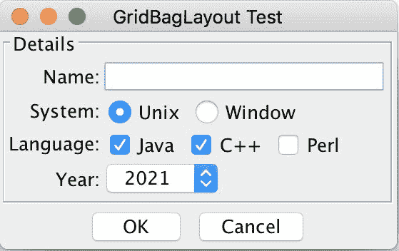


# 布局 - GridBagLayout

现在所有组件在两个方向上都对齐了。而且所有组件的大小都很合适。

`GridBagLayout` 似乎足够用于我的示例了。

Java Swing 教程 - Herong 的教程示例

## LookName 和 UIManager

本章提供了关于 UI 外观（look and feel）的教程笔记和示例代码。主题包括 `javax.swing.LookAndFeel` 和 `javax.swing.UIManager` 类的介绍；关于如何管理 UI 外观的示例程序。

`javax.swing.LookAndFeel` - 一个 Swing 类，代表一组定义了每种图形组件应该具有的外观和感觉的规则。

`javax.swing.UIManager` - 一个管理当前外观（LookAndFeel）的 Swing 类。

要查找你的本地系统上可用哪些 LookAndFeel，以及从一种 LookAndFeel 切换到另一种，我编写了以下示例程序：

```
 /* LookAndFeelTest2.java
 * Copyright (c) 1997-2018 HerongYang.com. All Rights Reserved.
 */
import java.awt.*;
import javax.swing.*;
public class LookAndFeelTest2 {
   public static void main(String[] a) {
      try {
         showFrame("Default LookAndFeel", 1);
         String cn = UIManager.getSystemLookAndFeelClassName();
         UIManager.setLookAndFeel(cn);
         showFrame("System LookAndFeel", 2);
         cn = UIManager.getCrossPlatformLookAndFeelClassName();
         UIManager.setLookAndFeel(cn);
         showFrame("Cross Platform LookAndFeel", 3);
         cn = "com.sun.java.swing.plaf.motif.MotifLookAndFeel";
         UIManager.setLookAndFeel(cn);
         showFrame("Motif LookAndFeel", 4);
      } catch (Exception e) {
         System.out.println(e);
      }
   }
   private static void showFrame(String t, int i) {
      LookAndFeel laf = UIManager.getLookAndFeel();
      JFrame myFrame = new JFrame(t);
      myFrame.setDefaultCloseOperation(JFrame.EXIT_ON_CLOSE);
      Container myPane = myFrame.getContentPane();
      myPane.setLayout(new GridBagLayout());
      GridBagConstraints c = new GridBagConstraints();
      setMyConstraints(c,0,0,GridBagConstraints.CENTER);
      myPane.add(getFieldPanel(),c);
      setMyConstraints(c,0,1,GridBagConstraints.CENTER);
      myPane.add(getButtonPanel(),c);
      myFrame.pack();
      myFrame.setVisible(true);
   }
   private static JPanel getFieldPanel() {
      JPanel p = new JPanel(new GridBagLayout());
      p.setBorder(BorderFactory.createTitledBorder("Details"));
      GridBagConstraints c = new GridBagConstraints();
      setMyConstraints(c,0,0,GridBagConstraints.EAST);
      p.add(new JLabel("Name:"),c);
      setMyConstraints(c,1,0,GridBagConstraints.WEST);
      p.add(new JTextField(16),c);
      setMyConstraints(c,0,1,GridBagConstraints.EAST);
      p.add(new JLabel("System:"),c);
      setMyConstraints(c,1,1,GridBagConstraints.WEST);
      p.add(getSystemPanel(),c);
      setMyConstraints(c,0,2,GridBagConstraints.EAST);
      p.add(new JLabel("Language:"),c);
      setMyConstraints(c,1,2,GridBagConstraints.WEST);
      p.add(getLanguagePanel(),c);
      setMyConstraints(c,0,3,GridBagConstraints.EAST);
      p.add(new JLabel("Year:"),c);
      setMyConstraints(c,1,3,GridBagConstraints.WEST);
      p.add(new JComboBox<String>(
         new String[] {"2021","2022","2023"}),c);
      return p;
   }
   private static JPanel getButtonPanel() {
      JPanel p = new JPanel(new GridBagLayout());
      p.add(new JButton("OK"));
      p.add(new JButton("Cancel"));
      return p;
   }
   private static JPanel getSystemPanel() {
      JRadioButton unixButton = new JRadioButton("Unix",true);
      JRadioButton winButton = new JRadioButton("Window",false);
      ButtonGroup systemGroup = new ButtonGroup();
      systemGroup.add(unixButton);
      systemGroup.add(winButton);
      JPanel p = new JPanel(new GridBagLayout());
      p.add(unixButton);
      p.add(winButton);
      return p;
   }
   private static JPanel getLanguagePanel() {
      JPanel p = new JPanel(new GridBagLayout());
      p.add(new JCheckBox("Java",true));
      p.add(new JCheckBox("C++",true));
      p.add(new JCheckBox("Perl",false));
      return p;
   }
   private static void setMyConstraints(GridBagConstraints c, 
      int gridx, int gridy, int anchor) {
      c.gridx = gridx;
      c.gridy = gridy;
      c.anchor = anchor;
   }
}
```

运行它。你应该得到 4 个窗口，分别代表 JDK 默认 LookAndFeel、本地系统默认 LookAndFeel、跨平台 LookAndFeel 以及 Motif LookAndFeel。

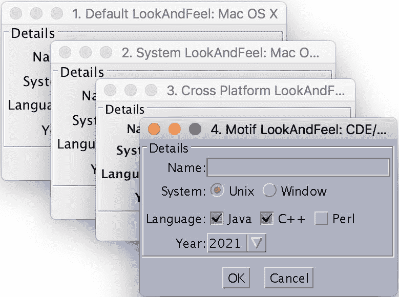

本章提供了关于选项对话框（option dialog box）的教程笔记和示例代码。主题包括创建和显示消息、确认、输入和选项对话框；从选项对话框接收输入值；创建和显示内部对话框；直接创建选项对话框。

> `javax.swing.JOptionPane` - 创建和显示选项对话框

> `showMessageDialog()` - 显示消息对话框

> `showConfirmDialog()` - 显示确认对话框

> 从确认对话框接收输入

> `showInputDialog()` - 显示输入对话框

> `showOptionDialog()` - 显示选项对话框

> `showInternal*Dialog()` - 显示内部对话框

> `createDialog()` - 直接创建对话框

### 结论

*   可以使用 `javax.swing.JOptionPane` 类通过 `showMessageDialog()`、`showConfirmDialog()`、`showInputDialog()` 和 `showOptionDialog()` 方法显示不同类型的简单对话框。

*   `showMessageDialog()` 方法显示一个仅带有文本消息的对话框。

*   `showConfirmDialog()` 方法显示一个带有文本消息的对话框，并提示用户点击确认按钮。

*   `showInputDialog()` 方法显示一个仅带有文本消息的对话框，并提示用户输入文本内容。

*   `showOptionDialog()` 方法显示一个包含选项列表的对话框，供用户选择。

*   默认情况下，对话框被创建为悬浮在父面板之外的独立窗口。如果你想创建限制在父面板内部的对话框，需要使用 `showInternal*Dialog()` 方法。

本章列出的示例程序已在 Windows 和 macOS 计算机的 JDK 1.3.1 到 JDK 17 上通过测试。

Java Swing 教程 - Herong 的 教程示例

∟选项对话框

## javax.swing.JOptionPane - 创建和显示选项对话框

本节描述了 `JOptionPane` 类中的一些静态方法，这些方法用于创建和显示不同类型的选项对话框。

`javax.swing.JOptionPane` - 一个允许你创建和显示选项对话框的 Swing 类。`JOptionPane` 的常用方法包括：

*   `showMessageDialog()` - 用于创建并显示消息对话框，以展示普通、警告或错误消息。

*   `showConfirmDialog()` - 用于创建并显示带有“是”、“否”和“取消”按钮的确认对话框。

*   `showInputDialog()` - 用于创建并显示输入对话框，以提示某些输入。

*   `showOptionDialog()` - 用于创建并显示通用对话框，以展示消息、获取确认或获取某些输入。

*   `showInternal*Dialog()` - 用于创建并显示内部对话框，显示在主框架内部。

使用 `JOptionPane` 类创建的所有对话框都是模态的（modal），会禁用其他帧上的所有其他用户界面组件。每次调用 `show*Dialog()` 方法都会阻塞执行，直到对话框关闭。

所有对话框都必须带有父帧创建。

选项对话框的消息类型（message type）控制在消息文本左侧使用的图标。

选项对话框的选项类型（option type）控制显示哪些选项按钮。

可以使用你自己的选项字符串来自定义选项按钮。

Java Swing 教程 - Herong 的 教程示例

∟选项对话框

## showMessageDialog() - 显示消息对话框

本节提供了一个教程示例，说明如何使用静态方法 `showMessageDialog()` 创建并显示用于 4 种不同类型消息的消息框：信息、警告、错误和普通。

使用 `javax.swing.JOptionPane` 类创建和显示的最简单的对话框是消息对话框。可以通过静态方法实现：`showMessageDialog(frame, message, title, type)`，其中：

*   "frame" 是作为父帧使用的帧对象。

*   "message" 是要在对话框上显示的消息字符串。

*   "title" 是用于对话框标题的标题字符串。

*   "type" 是表示特定消息对话框类型的整数代码。有效的类型代码被预定义为 `JOptionPane` 类中的常量：`INFORMATION_MESSAGE`、`WARNING_MESSAGE`、`ERROR_MESSAGE` 和 `PLAIN_MESSAGE`。

这里我写了一个用于测试 `showMessageDialog()` 方法的示例程序：


# JOptionPaneShowMessageDialog.java 示例

```java
/* JOptionPaneShowMessageDialog.java
 * Copyright (c) 1997-2018 HerongYang.com. All Rights Reserved.
 */
import java.awt.event.*;
import javax.swing.*;
import javax.swing.event.*;

public class JOptionPaneShowMessageDialog implements ActionListener {
   JFrame myFrame = null;

   public static void main(String[] a) {
      (new JOptionPaneShowMessageDialog()).test();
   }

   private void test() {
      myFrame = new JFrame("showMessageDialog Test");
      myFrame.setDefaultCloseOperation(JFrame.EXIT_ON_CLOSE);
      myFrame.setBounds(50, 50, 250, 150);
      myFrame.setContentPane(new JDesktopPane());

      JMenuBar myMenuBar = new JMenuBar();
      JMenu myMenu = getDialogMenu();
      myMenuBar.add(myMenu);
      myFrame.setJMenuBar(myMenuBar);
      myFrame.setVisible(true);
   }

   private JMenu getDialogMenu() {
      JMenu myMenu = new JMenu("Dialogs");
      JMenuItem myItem = new JMenuItem("Information");
      myItem.addActionListener(this);
      myMenu.add(myItem);

      myItem = new JMenuItem("Warning");
      myItem.addActionListener(this);
      myMenu.add(myItem);

      myItem = new JMenuItem("Error");
      myItem.addActionListener(this);
      myMenu.add(myItem);

      myItem = new JMenuItem("Plain");
      myItem.addActionListener(this);
      myMenu.add(myItem);

      return myMenu;
   }

   public void actionPerformed(ActionEvent e) {
      String menuText = ((JMenuItem) e.getSource()).getText();
      int messageType = JOptionPane.INFORMATION_MESSAGE;

      if (menuText.equals("Information")) {
         messageType = JOptionPane.INFORMATION_MESSAGE;
      } else if (menuText.equals("Warning")) {
         messageType = JOptionPane.WARNING_MESSAGE;
      } else if (menuText.equals("Error")) {
         messageType = JOptionPane.ERROR_MESSAGE;
      } else if (menuText.equals("Plain")) {
         messageType = JOptionPane.PLAIN_MESSAGE;
      }

      System.out.println("Before displaying the dialog: " + menuText);
      JOptionPane.showMessageDialog(myFrame,
         "This is message dialog box of type: " + menuText,
         menuText + " Message", messageType);
      System.out.println("After displaying the dialog: " + menuText);
   }
}
```

如果你运行这个示例，打开“Dialogs”菜单并点击“Information”、“Warning”或“Error”菜单项，你将看到这样一个消息对话框：

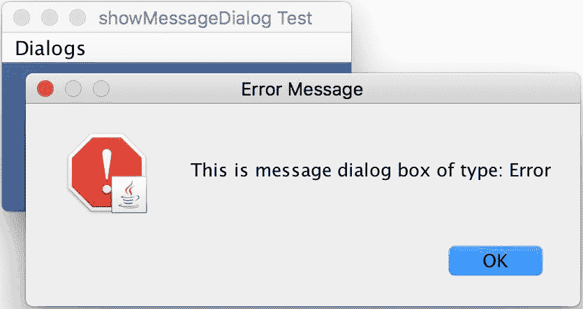

> 消息对话框

---

# showConfirmDialog() - 显示确认对话框

本节提供了一个教程示例，说明如何使用静态方法 `showConfirmDialog()` 创建并显示用于 3 种不同选项和 4 种不同类型消息的确认对话框：信息、警告、错误和普通。

*   `"option"` 是一个整数代码，表示特定的确认选项类型。有效的类型代码在 `JOptionPane` 类中预定义的常量：`YES_NO_OPTION`、`YES_NO_CANCEL_OPTION` 和 `OK_CANCEL_OPTION`。
*   `"type"` 是一个整数代码，表示特定的消息对话框类型。有效的类型代码在 `JOptionPane` 类中预定义的常量：`INFORMATION_MESSAGE`、`WARNING_MESSAGE`、`ERROR_MESSAGE` 和 `PLAIN_MESSAGE`。

这里我写的一个用于测试 `showConfirmDialog()` 方法的示例程序：

```java
/* JOptionPaneShowConfirmDialog.java
 * Copyright (c) 1997-2018 HerongYang.com. All Rights Reserved.
 */
import java.awt.*;
import java.awt.event.*;
import javax.swing.*;
import javax.swing.event.*;

public class JOptionPaneShowConfirmDialog implements ActionListener {
   JFrame myFrame = null;
   int optionType = JOptionPane.YES_NO_OPTION;
   int messageType = JOptionPane.INFORMATION_MESSAGE;

   public static void main(String[] a) {
      (new JOptionPaneShowConfirmDialog()).test();
   }

   private void test() {
      myFrame = new JFrame("showConfirmDialog() Test");
      myFrame.setDefaultCloseOperation(JFrame.EXIT_ON_CLOSE);
      Container myPane = myFrame.getContentPane();
      myPane.setLayout(new GridBagLayout());
      GridBagConstraints c = new GridBagConstraints();

      setMyConstraints(c, 0, 0, GridBagConstraints.CENTER);
      myPane.add(getFieldPanel(), c);

      setMyConstraints(c, 0, 1, GridBagConstraints.CENTER);
      myPane.add(getButtonPanel(), c);

      myFrame.pack();
      myFrame.setVisible(true);
   }

   private JPanel getFieldPanel() {
      JPanel p = new JPanel(new GridBagLayout());
      p.setBorder(BorderFactory.createTitledBorder("Settings"));
      GridBagConstraints c = new GridBagConstraints();

      setMyConstraints(c, 0, 0, GridBagConstraints.EAST);
      p.add(new JLabel("Option Type:"), c);

      setMyConstraints(c, 1, 0, GridBagConstraints.WEST);
      p.add(getOptionPanel(), c);

      setMyConstraints(c, 0, 1, GridBagConstraints.EAST);
      p.add(new JLabel("Message type:"), c);

      setMyConstraints(c, 1, 1, GridBagConstraints.WEST);
      p.add(getMessagePanel(), c);

      return p;
   }

   private JPanel getOptionPanel() {
      JPanel myPanel = new JPanel(new GridBagLayout());
      ButtonGroup myGroup = new ButtonGroup();

      JRadioButton myButton = new JRadioButton("Yes-No", true);
      myButton.addActionListener(this);
      myGroup.add(myButton);
      myPanel.add(myButton);

      myButton = new JRadioButton("Yes-No-Cancel", false);
      myButton.addActionListener(this);
      myGroup.add(myButton);
      myPanel.add(myButton);

      myButton = new JRadioButton("Ok-Cancel", false);
      myButton.addActionListener(this);
      myGroup.add(myButton);
      myPanel.add(myButton);

      return myPanel;
   }

   private JPanel getMessagePanel() {
      JPanel myPanel = new JPanel(new GridBagLayout());
      ButtonGroup myGroup = new ButtonGroup();

      JRadioButton myButton = new JRadioButton("Information", true);
      myButton.addActionListener(this);
      myGroup.add(myButton);
      myPanel.add(myButton);

      myButton = new JRadioButton("Warning", false);
      myButton.addActionListener(this);
      myGroup.add(myButton);
      myPanel.add(myButton);

      myButton = new JRadioButton("Error", false);
      myButton.addActionListener(this);
      myGroup.add(myButton);
      myPanel.add(myButton);

      myButton = new JRadioButton("Plain", false);
      myButton.addActionListener(this);
      myGroup.add(myButton);
      myPanel.add(myButton);

      return myPanel;
   }

   private JPanel getButtonPanel() {
      JPanel p = new JPanel(new GridBagLayout());
      JButton myButton = new JButton("Show");
      myButton.addActionListener(this);
      p.add(myButton);
      return p;
   }

   public void actionPerformed(ActionEvent e) {
      String cmd = ((AbstractButton) e.getSource()).getText();
      System.out.println("Button clicked: " + cmd);

      if (cmd.equals("Information")) {
         messageType = JOptionPane.INFORMATION_MESSAGE;
      } else if (cmd.equals("Warning")) {
         messageType = JOptionPane.WARNING_MESSAGE;
      } else if (cmd.equals("Error")) {
         messageType = JOptionPane.ERROR_MESSAGE;
      } else if (cmd.equals("Plain")) {
         messageType = JOptionPane.PLAIN_MESSAGE;
      } else if (cmd.equals("Yes-No")) {
         optionType = JOptionPane.YES_NO_OPTION;
      } else if (cmd.equals("Yes-No-Cancel")) {
         optionType = JOptionPane.YES_NO_CANCEL_OPTION;
      } else if (cmd.equals("Ok-Cancel")) {
         optionType = JOptionPane.OK_CANCEL_OPTION;
      } else if (cmd.equals("Show")) {
         JOptionPane.showConfirmDialog(myFrame,
            "Confirmation dialog text message.",
            "Confirmation Dialog Box", optionType, messageType);
      }
   }

   private void setMyConstraints(GridBagConstraints c,
      int gridx, int gridy, int anchor) {
      c.gridx = gridx;
      c.gridy = gridy;
      c.anchor = anchor;
   }
}
```

如果你运行这个示例，选择一个选项类型和一个消息类型，然后点击“Show”按钮，你将看到如下所示的确认对话框：


## 确认对话框

关于这个教程示例的几个有趣的说明：

*   我使用了几个面板和布局来组织设置区域。
*   为所有的单选按钮和“Show”按钮都添加了动作监听器（action listener）。
*   监听器中的 `actionPerformed()` 方法已实现以处理所有更改。
*   这个示例缺失的是如何捕获确认对话框上选项按钮的输入。

---

# 接收确认对话框的输入

本节提供了一个教程示例，介绍如何使用静态方法 `showConfirmDialog()` 创建并显示确认对话框，并接收输入以知道点击了哪个按钮。

在之前的教程示例中，当用户点击确认对话框上的 Ok、Yes、No 或 Cancel 等选项按钮时，`showConfirmDialog()` 方法实际上返回一个表示所点击按钮的整数代码。有效的类型代码在 `JOptionPane` 类中预定义的常量：

*   `JOptionPane.OK_OPTION` - 用户点击了 Ok 按钮。
*   `JOptionPane.YES_OPTION` - 用户点击了 Yes 按钮。
*   `JOptionPane.NO_OPTION` - 用户点击了 No 按钮。


* `JOptionPane.CANCEL_OPTION` - 用户点击了 Cancel 按钮。
* `JOptionPane.CLOSED_OPTION` - 用户关闭了确认对话框。

```
 /* JOptionPaneConfirmDialogInput.java
 * Copyright (c) 1997-2018 HerongYang.com. All Rights Reserved.
 */
import java.awt.*;
import java.awt.event.*;
import javax.swing.*;
import javax.swing.event.*;
public class JOptionPaneConfirmDialogInput implements ActionListener {
   JFrame myFrame = null;
   public static void main(String[] a) {
      (new JOptionPaneConfirmDialogInput()).test();
   }
   private void test() {
      myFrame = new JFrame("showConfirmDialog() Input Test");
      myFrame.setDefaultCloseOperation(JFrame.EXIT_ON_CLOSE);
      Container myPane = myFrame.getContentPane();
      JButton myButton = new JButton("Show");
      myButton.addActionListener(this);
      myPane.add(myButton);
      myFrame.pack();
      myFrame.setVisible(true);
   }
   public void actionPerformed(ActionEvent e) {
      int messageType = JOptionPane.INFORMATION_MESSAGE;
      int optionType = JOptionPane.YES_NO_CANCEL_OPTION;
      int code = JOptionPane.showConfirmDialog(myFrame, 
         "Do you want to continue?", 
         "Confirmation Dialog Box", optionType, messageType);

      String answer = "Unknown";
      if (code == JOptionPane.OK_OPTION) {
         answer = "Ok";
      } else if (code == JOptionPane.YES_OPTION) {
         answer = "Yes";
      } else if (code == JOptionPane.NO_OPTION) {
         answer = "No";
      } else if (code == JOptionPane.CANCEL_OPTION) {
         answer = "Cancel";
      } else if (code == JOptionPane.CLOSED_OPTION) {
         answer = "Closed";
      }
      System.out.println("Answer: "+answer);
   }
}
```

如果你运行此示例并点击 Show 按钮，你将看到一个如下所示的确认对话框：


### 确认对话框输入

点击确认对话框上的 Yes 按钮。点击主窗口上的 Show 按钮，然后再次点击确认对话框上的 No 按钮。用 Cancel 按钮和关闭对话框图标重复测试。你将看到 Java 控制台窗口打印出一些消息：

```
Answer: Ok
Answer: No
Answer: Cancel
Answer: Closed
```

### 关于此教程示例的有趣说明：

* Yes 按钮返回的代码是 `JOptionPane.OK_OPTION`，而不是 `JOptionPane.YES_OPTION`。我不知道为什么。

## Java Swing 教程 - Herong 的教程示例

### 选项对话框

#### `showInputDialog()` - 显示输入对话框

本节提供了一个教程示例，演示了如何使用静态方法 `showInputDialog()` 来创建并显示输入对话框，以获取用户的文本字符串输入。

你可以使用 `javax.swing.JOptionPane` 类创建并显示的第三种类型的对话框是输入对话框。可以通过静态方法实现：`answer = showInputDialog(frame, message, title, type)`，其中：

* `"frame"` 是用作父帧的帧对象。
* `"message"` 是要显示在对话框上的消息字符串。
* `"title"` 是用作对话框标题的字符串。
* `"type"` 是一个表示特定消息对话框类型的整数代码。有效的类型代码被定义为 `JOptionPane` 类中的常量：`INFORMATION_MESSAGE`、`WARNING_MESSAGE`、`ERROR_MESSAGE` 和 `PLAIN_MESSAGE`。
* `"answer"` 是用户在输入对话框上输入的返回字符串。如果没有输入内容，则将返回 `null`。

这里我编写的用于测试 `showInputDialog()` 方法的示例程序：

```
 /* JOptionPaneInputDialog.java
 * Copyright (c) 1997-2018 HerongYang.com. All Rights Reserved.
 */
import java.awt.*;
import java.awt.event.*;
import javax.swing.*;
import javax.swing.event.*;
public class JOptionPaneInputDialog implements ActionListener {
   JFrame myFrame = null;
   public static void main(String[] a) {
      (new JOptionPaneInputDialog()).test();
   }
   private void test() {
      myFrame = new JFrame("showInputDialog() Test");
      myFrame.setDefaultCloseOperation(JFrame.EXIT_ON_CLOSE);
      Container myPane = myFrame.getContentPane();
      JButton myButton = new JButton("Show");
      myButton.addActionListener(this);
      myPane.add(myButton);
      myFrame.pack();
      myFrame.setVisible(true);
   }
   public void actionPerformed(ActionEvent e) {
      int messageType = JOptionPane.INFORMATION_MESSAGE;
      String answer = JOptionPane.showInputDialog(myFrame, 
         "What's you name?", 
         "Input Dialog Box", messageType);
      System.out.println("Answer: "+answer);
   }
}
```

如果你运行此示例并点击 Show 按钮，你将看到一个如下所示的输入对话框：

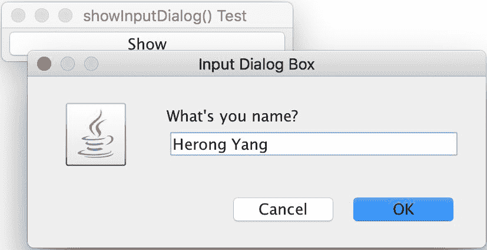

#### 确认对话框输入

在输入对话框的输入字段中输入 "Herong Yang" 并点击 OK。用 Cancel 按钮和关闭对话框图标重复测试。你将看到 Java 控制台窗口打印出一些消息：

```
Answer: Herong Yang
Answer: null
Answer: null
```

在选项对话框上选择“Perl”。重复使用“Java”选项按钮和关闭对话框图标进行测试。你将看到在 Java 控制台窗口上打印了一些消息：

```
Answer: 4
Answer: 0
Answer: -1
```

关于此教程示例的一些有趣说明：

* 如果关闭选项对话框，`showOptionDialog()` 将返回 `JOptionPane.CLOSED_OPTION`，其值为 -1。

## Java Swing 教程 - Herong 的教程示例

### 选项对话框

#### `showInternalDialog()` - 显示内部对话框

本节提供了一个教程示例，阐述如何使用静态方法 `showInternal*Dialog()` 在父级容器内部创建并显示内部对话框。

对话框也可以在面板内部创建并显示。要实现这一点，你需要调用 `show*Dialog()` 方法的“Internal”版本：

* `showInternalMessageDialog()` - 用于创建并显示内部消息对话框的方法，以展示普通消息、警告或错误消息。
* `showInternalConfirmDialog()` - 用于创建并显示带有“是”、“否”、“取消”按钮的内部确认对话框的方法。
* `showInternalInputDialog()` - 用于创建并显示内部输入对话框的方法，以提示进行某些输入。
* `showInternalOptionDialog()` - 用于创建并显示内部通用对话框的方法，以展示消息、获取确认或获取某些输入。

注意，你不能直接使用 `JFrame` 对象作为内部对话框的“父级”。如果你这样做，将得到类似所示的运行时异常：

```
Exception in thread "AWT-EventQueue-0" java.lang.RuntimeException: 
JOptionPane: parentComponent does not have a valid parent
   at javax.swing.JOptionPane.createInternalFrame(
      JOptionPane.java:1486)
   ...
```

“parent”输入参数应该是内容面板或其他容器。

这是一个我编写的用于测试 `showInternalOptionDialog()` 方法的示例程序：

```
 /* JOptionPaneInternalOptionDialog.java
 * Copyright (c) 1997-2018 HerongYang.com. All Rights Reserved.
 */
import java.awt.*;
import java.awt.event.*;
import javax.swing.*;
import javax.swing.event.*;
public class JOptionPaneInternalOptionDialog 
   implements ActionListener {
   JFrame myFrame = null;
   public static void main(String[] a) {
      (new JOptionPaneInternalOptionDialog()).test();
   }
   private void test() {
      myFrame = new JFrame("showInternalOptionDialog() Test");
      myFrame.setDefaultCloseOperation(JFrame.EXIT_ON_CLOSE);
      myFrame.setSize(300,200);      
      Container myPane = myFrame.getContentPane();
      JButton myButton = new JButton("Show");
      myButton.addActionListener(this);
      myPane.add(myButton);
      myFrame.setVisible(true);
   }
   public void actionPerformed(ActionEvent e) {
      int messageType = JOptionPane.QUESTION_MESSAGE;
      String[] options = {"Java", "C++", "VB", "PHP", "Perl"};
      int code = JOptionPane.showInternalOptionDialog(
         myFrame.getContentPane(), 
         "What language do you prefer?", 
         "Option Dialog Box", 0, messageType, 
         null, options, "PHP");
      System.out.println("Answer: "+code);
   }
}
```

如果你运行此示例并点击“Show”按钮，你将看到一个如下所示输入对话框：

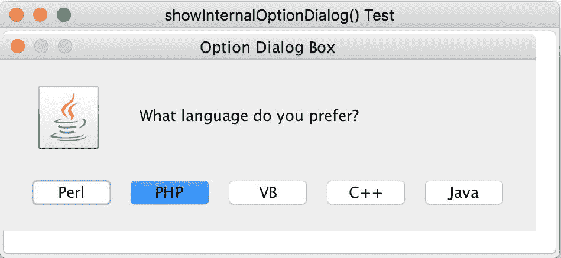

内部对话框

## Java Swing 教程 - Herong 的教程示例

### 选项对话框

#### `createDialog()` - 直接创建对话框

本节提供了一个教程示例，阐述如何使用静态方法 `showInputDialog()` 创建并显示输入对话框，以从用户获取文本字符串输入。

如果你不想使用 `show*Dialog()` 方法自动创建和显示对话框，可以使用 `createDialog()` 方法手动创建对话框。

1. 使用 `myPane = new JOptionPane()` 创建一个空的选项面板对象，该对象代表对话框的内容面板。
2. 使用 `myPane.setMessageType(type)` 使用类型代码 `INFORMATION_MESSAGE`、`WARNING_MESSAGE`、`ERROR_MESSAGE`、`PLAIN_MESSAGE` 或 `QUESTION_MESSAGE` 在选项面板上设置消息类型。
3. 使用 `myPane.setMessage(message)` 使用字符串在选项面板上设置消息文本。
4. 使用 `myPane.setOptionType(type)` 使用选项代码 `YES_NO_OPTION`、`YES_NO_CANCEL_OPTION` 或 `OK_CANCEL_OPTION` 在选项面板上设置选项类型。如果你正在设置自己的选项，则不需要此操作。
5. 使用 `myPane.setOptions(options)` 使用字符串数组在选项面板上设置选项。这将覆盖由选项类型创建的选项。
6. 使用 `myPane.setInitialValue(default)` 使用字符串在选项面板上设置默认选项。
7. 使用 `myDialog = myPane.createDialog(parent, title)` 使用父级框架和标题字符串创建最终的对话框。
8. 使用 `myDialog.setVisible(true)` 设置最终对话框可见。
9. 使用 `answer = myPane.getValue()` 获取用户在对话框上选择/输入的答案。

这是一个我编写的用于测试 `createDialog()` 方法的示例程序：


/* JOptionPaneCreateDialog.java
 * Copyright (c) 1997-2018 HerongYang.com. All Rights Reserved.
 */
import java.awt.*;
import java.awt.event.*;
import javax.swing.*;
import javax.swing.event.*;
public class JOptionPaneCreateDialog 
   implements ActionListener {
   JFrame myFrame = null;
   public static void main(String[] a) {
      (new JOptionPaneCreateDialog()).test();
   }
   private void test() {
      myFrame = new JFrame("createDialog() Test");
      myFrame.setDefaultCloseOperation(JFrame.EXIT_ON_CLOSE);
      Container myPane = myFrame.getContentPane();
      JButton myButton = new JButton("Create");
      myButton.addActionListener(this);
      myPane.add(myButton);
      myFrame.pack();
      myFrame.setVisible(true);
   }
   public void actionPerformed(ActionEvent e) {
      String[] options = {"Java", "C++", "VB", "PHP", "Perl"};
      JOptionPane myPane = new JOptionPane();
      myPane.setMessageType(JOptionPane.QUESTION_MESSAGE);
      myPane.setMessage("What language do you prefer?");
      myPane.setOptions(options);
      myPane.setInitialValue("PHP");
      JDialog myDialog = myPane.createDialog(myFrame, "Option Dialog Box");
      myDialog.setVisible(true);
      Object answer = myPane.getValue();
      System.out.println("Answer: "+answer);
   }
}
```

如果你运行此示例并点击“Create”按钮，你将看到一个如下所示输入对话框：


在选项对话框上选择“Perl”。重复使用“Java”选项按钮和关闭对话框图标进行测试。你将看到在 Java 控制台窗口上打印了一些消息：

```
Answer: Perl
Answer: Java
Answer: null
```

关于此教程示例的一些有趣说明：

*   在此示例中创建的对话框与 `JOptionPaneOptionDialog.java` 示例中 `showOptionDialog()` 方法创建的对话框相同。
*   但 `showOptionDialog()` 方法返回数组的整数索引。而 `myPane.getValue()` 返回数组的字符串元素。

# Java Swing 教程 - Herong 的教程示例

## JEditorPane - 编辑器面板类

本章提供了关于编辑器面板类的教程说明和示例代码。主题包括简单的文本编辑器面板；从编辑器面板保存文本到文件；在编辑器面板中编辑 HTML 内容和中文；使用文件选择对话框。

> 创建简单的纯文本编辑器面板
> 
> 从编辑器面板保存文本
> 
> 在编辑器面板中编辑 HTML
> 
> 在编辑器面板中编辑 Unicode 字符
> 
> `javax.swing.JFileChooser` - 文件选择对话框

结论：

* `javax.swing.JEditorPane` 类可以用于创建一个简单的文本编辑器窗口。
* `setText()` 和 `getText()` 方法可以用于交换 `JEditorPane` 窗口的文本内容。
* `setContentType()` 方法可以用于在 `JEditorPane` 窗口的 `text/html` 和 `text/plain` 显示模式之间进行切换。
* `javax.swing.JFileChooser` 类可以用于显示一个对话框，以便在本地计算机上选择文件。

本章列出的示例程序已在 Windows 和 macOS 计算机上通过 JDK `1.3.1` 到 JDK `17` 的测试。

# Java Swing 教程 - Herong's 教程示例

## JEditorPane - 编辑器面板类

### 创建一个简单的纯文本编辑器面板

本节提供了一个教程示例，介绍如何通过调用 `setText()` 设置初始文本内容来创建一个简单的纯文本编辑器面板。

`javax.swing.JEditorPane` 类可以通过两个方法调用来创建一个简单的文本编辑器窗口：

* `setContentType("text/plain")` - 将内容类型设置为纯文本。
* `setText(text)` - 设置初始文本内容。

这里我编写的测试 `JEditorPane` 类的示例程序：

```java
 /* JEditorPaneTest.java
 * Copyright (c) 1997-2018 HerongYang.com. All Rights Reserved.
 */
import javax.swing.*;
public class JEditorPaneTest {
   JFrame myFrame = null;
   public static void main(String[] a) {
      (new JEditorPaneTest()).test();
   }
   private void test() {
      myFrame = new JFrame("JEditorPane Test");
      myFrame.setDefaultCloseOperation(JFrame.EXIT_ON_CLOSE);
      myFrame.setSize(300,200);

      JEditorPane myPane = new JEditorPane();
      myPane.setContentType("text/plain");
      myPane.setText(
         "JEditorPane is a text component to edit various kinds of"
         +" content.\n\nThis component uses implementations of the"
         +" EditorKit to accomplish its behavior.");

      myFrame.setContentPane(myPane);
      myFrame.setVisible(true);
   }
}
```

如果你运行此示例，你将看到一个显示初始文本内容的文本编辑器面板。

你可以编辑初始文本或添加更多文本。你也可以像下面的图片所示选择文本的一部分：

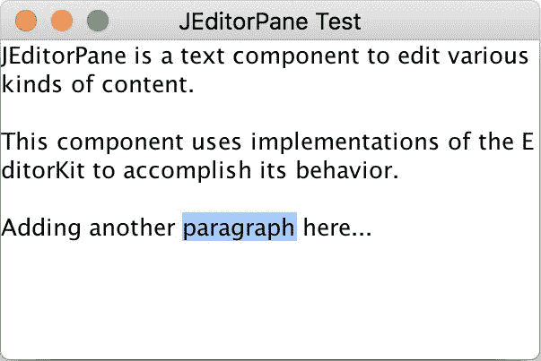

编辑器面板测试

# Java Swing 教程 - Herong's 教程示例

## JEditorPane - 编辑器面板类

### 从编辑器面板保存文本

本节提供了一个教程示例，介绍如何使用 `javax.swing.JEditorPane` 类的 `getText()` 方法来实现保存文件的功能。

在下一个教程示例中，我想向展示如何使用 `javax.swing.JEditorPane` 类的 `setText()` 方法和 `getText()` 方法来实现我的文本编辑器的“打开”功能和“保存”功能。

```java
 /* JEditorPaneSave.java
 * Copyright (c) 1997-2018 HerongYang.com. All Rights Reserved.
 */
import java.io.*;
import java.nio.*;
import java.awt.event.*;
import javax.swing.*;
public class JEditorPaneSave implements ActionListener {
   JFrame myFrame = null;
   JEditorPane myPane = null;
   public static void main(String[] a) {
      (new JEditorPaneSave()).test();
   }
   private void test() {
      myFrame = new JFrame("JEditorPane Save");
      myFrame.setDefaultCloseOperation(JFrame.EXIT_ON_CLOSE);
      myFrame.setSize(300,200);

      myPane = new JEditorPane();
      myPane.setContentType("text/plain");
      myPane.setText(
         "JEditorPane is a text component to edit various kinds of"
         +" content.\n\nThis component uses implementations of the"
         +" EditorKit to accomplish its behavior.");
      myFrame.setContentPane(myPane);

      JMenuBar myBar = new JMenuBar();
      JMenu myMenu = getFileMenu();
      myBar.add(myMenu); 
      myFrame.setJMenuBar(myBar);
      myFrame.setVisible(true);
   }
   private JMenu getFileMenu() {
      JMenu myMenu = new JMenu("File");
      JMenuItem myItem = new JMenuItem("Open");
      myItem.addActionListener(this);
      myMenu.add(myItem);

      myItem = new JMenuItem("Save");
      myItem.addActionListener(this);
      myMenu.add(myItem);
      return myMenu;
   }
   public void actionPerformed(ActionEvent e) {
      String cmd = ((AbstractButton) e.getSource()).getText();
      try {
         if (cmd.equals("Open")) {
            FileReader in = new FileReader("JEditorPane.txt");
            char[] buffer = new char[1024];
            int n = in.read(buffer);
            String text = new String(buffer, 0, n);
            myPane.setText(text);
            in.close();
         } else if (cmd.equals("Save")) {
            FileWriter out = new FileWriter("JEditorPane.txt");
            out.write(myPane.getText());
            out.close();
         }
      } catch (Exception f) {
         f.printStackTrace();
      }
   }
}
```

如果你运行此示例，你将看到一个显示初始文本内容的文本编辑器面板，以及一个带有“文件”菜单的菜单栏。

你可以编辑编辑器面板中的文本，使用菜单保存更改，并再次打开。查看下面的图片：

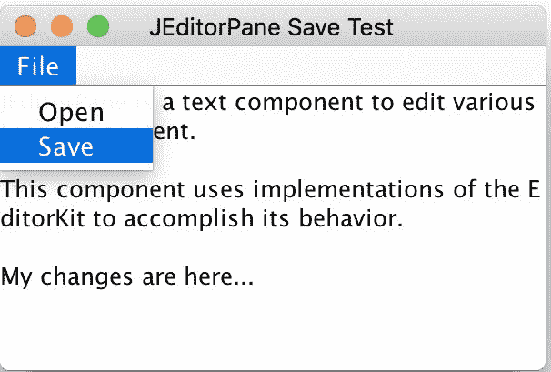

编辑器面板 - 保存更改

# Java Swing 教程 - Herong's 教程示例

## JEditorPane - 编辑器面板类

### 在编辑器面板中编辑 HTML

本节提供了一个教程示例，介绍如何使用 `javax.swing.JEditorPane` 类的 `setContentType()` 方法强制编辑器面板以 HTML 格式显示内容。

现在我想尝试用 `javax.swing.JEditorPane` 类使用 `text/html` 内容类型。在这个教程示例中，我想添加一个新的菜单“视图”，它包含两个功能：“HTML”和“纯文本”（Plain）。如果你点击 HTML，编辑器面板中的文本将以 HTML 格式显示。如果你点击纯文本，编辑器面板中的文本将以纯文本格式显示。当然，这是通过使用 `JEditorPane` 类的 `setContentType()` 实现的。

### 在编辑器面板中编辑 HTML


/* JEditorPaneHtml.java
 * Copyright (c) 1997-2018 HerongYang.com. All Rights Reserved.
 */
import java.io.*;
import java.nio.*;
import java.awt.event.*;
import javax.swing.*;
public class JEditorPaneHtml implements ActionListener {
   JFrame myFrame = null;
   JEditorPane myPane = null;
   public static void main(String[] a) {
      (new JEditorPaneHtml()).test();
   }
   private void test() {
      myFrame = new JFrame("JEditorPane HTML Test");
      myFrame.setDefaultCloseOperation(JFrame.EXIT_ON_CLOSE);
      myFrame.setSize(300,300);

      myPane = new JEditorPane();
      myPane.setContentType("text/html");
      myPane.setText(
         "<p><b>JEditorPane</b> is a text component to edit various"
         +" kinds of content.\n\nThis component uses implementations"
         +" of the EditorKit to accomplish its behavior.</p>");
      myFrame.setContentPane(myPane);

      JMenuBar myBar = new JMenuBar();
      JMenu myMenu = getFileMenu();
      myBar.add(myMenu); 
      myMenu = getViewMenu();
      myBar.add(myMenu); 
      myFrame.setJMenuBar(myBar);
      myFrame.setVisible(true);
   }
   private JMenu getFileMenu() {
      JMenu myMenu = new JMenu("File");
      JMenuItem myItem = new JMenuItem("Open");
      myItem.addActionListener(this);
      myMenu.add(myItem);

      myItem = new JMenuItem("Save");
      myItem.addActionListener(this);
      myMenu.add(myItem);
      return myMenu;
   }
   private JMenu getViewMenu() {
      JMenu myMenu = new JMenu("View");
      ButtonGroup myGroup = new ButtonGroup();
      JMenuItem myItem = new JRadioButtonMenuItem("HTML");
      myItem.setSelected(true);
      myItem.addActionListener(this);
      myMenu.add(myItem);
      myGroup.add(myItem);

      myItem = new JRadioButtonMenuItem("Plain");
      myItem.addActionListener(this);
      myMenu.add(myItem);
      myGroup.add(myItem);

      return myMenu;
   }
   public void actionPerformed(ActionEvent e) {
      String cmd = ((AbstractButton) e.getSource()).getText();
      String text = null;
      try {
         if (cmd.equals("Open")) {
            FileReader in = new FileReader("JEditorPane.txt");
            char[] buffer = new char[1024];
            int n = in.read(buffer);
            text = new String(buffer, 0, n);
            myPane.setText(text);
            in.close();
         } else if (cmd.equals("Save")) {
            FileWriter out = new FileWriter("JEditorPane.txt");
            out.write(myPane.getText());
            out.close();
         } else if (cmd.equals("HTML")) {
            text = myPane.getText();
            myPane.setContentType("text/html");
            myPane.setText(text);
         } else if (cmd.equals("Plain")) {
            text = myPane.getText();
            myPane.setContentType("text/plain");
            myPane.setText(text);
         }
      } catch (Exception f) {
         f.printStackTrace();
      }
   }
}

如果你运行此示例，你将看到一个文本编辑器面板，其中显示了初始文本内容以及一个带有“文件”菜单和“视图”菜单的菜单栏。

最初，内容以 HTML 格式显示。`<b>` 标签被正确处理。你可以在末尾添加 `<b>结束</b>`。

如果你点击“视图”菜单中的“Plain”（纯文本）命令，内容将以纯文本形式显示，原始的 HTML 源代码如下图所示：

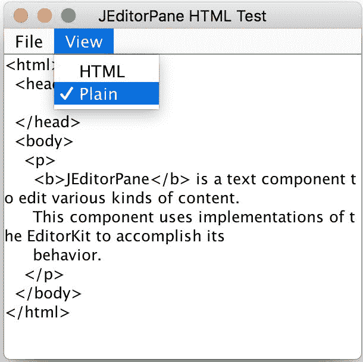

### 编辑器面板 - HTML 文档

### 关于此教程示例的一些有趣说明：

* `setContentType()` 方法实际上会移除编辑器面板中的当前文本内容。这就是为什么我先将内容保存到变量中。

Java Swing 教程 - Herong 的教程示例

∟ JEditorPane - 编辑器面板类

∟ 在编辑器面板中编辑 Unicode 字符

本节提供了一个关于如何使用 `ALTER TABLE` 语句来添加、删除、修改列和索引的教程示例。

如果你尝试编辑中文字符或其他非 ASCII 字符，必须更改写入函数和读取函数，以支持 UTF-8 编码的 Unicode 字符。

/* JEditorPaneUnicode.java
 * Copyright (c) 1997-2018 HerongYang.com. All Rights Reserved.
 */
import java.io.*;
import java.nio.*;
import java.nio.charset.*;
import java.awt.event.*;
import javax.swing.*;
public class JEditorPaneUnicode implements ActionListener {
   JFrame myFrame = null;
   JEditorPane myPane = null;
   public static void main(String[] a) {
      (new JEditorPaneUnicode()).test();
   }
   private void test() {
      myFrame = new JFrame("JEditorPane Unicode Test");
      myFrame.setDefaultCloseOperation(JFrame.EXIT_ON_CLOSE);
      myFrame.setSize(300,300);

      myPane = new JEditorPane();
      myPane.setContentType("text/html");
      myPane.setText(
         "Hello! - Welcome to Herong's"
         +" Website.www.com");
      myFrame.setContentPane(myPane);

      JMenuBar myBar = new JMenuBar();
      JMenu myMenu = getFileMenu();
      myBar.add(myMenu); 
      myMenu = getViewMenu();
      myBar.add(myMenu); 
      myFrame.setJMenuBar(myBar);
      myFrame.setVisible(true);
   }
   private JMenu getFileMenu() {
      JMenu myMenu = new JMenu("File");
      JMenuItem myItem = new JMenuItem("Open");
      myItem.addActionListener(this);
      myMenu.add(myItem);

      myItem = new JMenuItem("Save");
      myItem.addActionListener(this);
      myMenu.add(myItem);
      return myMenu;
   }
   private JMenu getViewMenu() {
      JMenu myMenu = new JMenu("View");
      ButtonGroup myGroup = new ButtonGroup();
      JMenuItem myItem = new JRadioButtonMenuItem("HTML");
      myItem.setSelected(true);
      myItem.addActionListener(this);
      myMenu.add(myItem);
      myGroup.add(myItem);

      myItem = new JRadioButtonMenuItem("Plain");
      myItem.addActionListener(this);
      myMenu.add(myItem);
      myGroup.add(myItem);

      return myMenu;
   }
   public void actionPerformed(ActionEvent e) {
      String cmd = ((AbstractButton) e.getSource()).getText();
      String text = null;
      try {
         if (cmd.equals("Open")) {
            FileInputStream fis = new FileInputStream("JEditorPane.txt");
            InputStreamReader in = 
               new InputStreamReader(fis, Charset.forName("UTF-8")); 
            char[] buffer = new char[1024];
            int n = in.read(buffer);
            text = new String(buffer, 0, n);
            myPane.setText(text);
            in.close();
         } else if (cmd.equals("Save")) {
            FileOutputStream fos = new FileOutputStream("JEditorPane.txt");
            OutputStreamWriter out = 
               new OutputStreamWriter(fos, Charset.forName("UTF-8")); 
            out.write(myPane.getText());
            out.close();
         }
      } catch (Exception f) {
         f.printStackTrace();
      }
   }
}

如果你运行此示例，你将看到一个文本编辑器面板，其中显示了包含中文字符的初始文本内容。

你可以输入更多的中文或其他语言字符，点击“文件”菜单中的保存链接，中文字符将被正确保存，见下图：


### 编辑器面板 - Unicode 文本

### 关于此教程示例的一些有趣说明：

* 我必须使用 `OutputStreamWriter` 代替 `FileWriter` 来向文件保存 Unicode 字符。`OutputStreamWriter` 允许我使用 `UTF-8` 编码。

* 我必须使用 `InputStreamReader` 代替 `FileReader` 来从文件中读取 Unicode 字符。`InputStreamReader` 允许我使用 `UTF-8` 编码。

## JFileChooser 方法

- `setFileSelectionMode(int)` - 用于设置选择模式的方法，共有 3 种选项：`FILES_ONLY`、`DIRECTORIES_ONLY` 和 `FILES_AND_DIRECTORIES`。

- `getSelectedFile()` - 将选定的文件以 `File` 对象的形式返回的方法。

- `showOpenDialog(Component)` - 显示文件选择器对话框、等待用户输入，并返回一个整数代码：`CANCEL_OPTION`、`APPROVE_OPTION` 或 `ERROR_OPTION`。

## 示例程序

这是一个我编写的用于测试 `JFileChooser` 类的示例程序：


```java
/* JEditorPaneFileChooser.java
 * Copyright (c) 1997-2018 HerongYang.com. All Rights Reserved.
 */
import java.io.*;
import java.nio.*;
import java.nio.charset.*;
import java.awt.event.*;
import javax.swing.*;
import javax.swing.filechooser.*;
public class JEditorPaneFileChooser implements ActionListener {
   JFrame myFrame = null;
   JEditorPane myPane = null;
   JMenuItem cmdOpen = null;
   JMenuItem cmdSave = null;
   String dirName = "\\herong\\swing\\";
   String fileName = "JEditorPane.txt";

   public static void main(String[] a) {
      (new JEditorPaneFileChooser()).test();
   }
   private void test() {
      myFrame = new JFrame("JEditorPane JFileChooser Test");
      myFrame.setDefaultCloseOperation(JFrame.EXIT_ON_CLOSE);
      myFrame.setSize(300,200);

      myPane = new JEditorPane();
      myPane.setContentType("text/plain");
      myPane.setText(
         "Hello computer! - \u7535\u8111\u4F60\u597D\uFF01\n"
         + "Welcome to Herong's Website!\n"
         + "\u6B22\u8FCE\u4F60\u8BBF\u95EE\u548C\u8363\u7F51\u7AD9"
         + "\uFF01\nwww.herongyang.com");
      myFrame.setContentPane(myPane);

      JMenuBar myBar = new JMenuBar();
      JMenu myMenu = getFileMenu();
      myBar.add(myMenu); 
      myFrame.setJMenuBar(myBar);

      myFrame.setVisible(true);
   }
   private JMenu getFileMenu() {
      JMenu myMenu = new JMenu("File");
      cmdOpen = new JMenuItem("Open");
      cmdOpen.addActionListener(this);
      myMenu.add(cmdOpen);

      cmdSave = new JMenuItem("Save");
      cmdSave.addActionListener(this);
      myMenu.add(cmdSave);
      return myMenu;
   }
   public void actionPerformed(ActionEvent e) {
      JFileChooser chooser = new JFileChooser();
      chooser.setCurrentDirectory(new File(dirName));
      chooser.setSelectedFile(new File(fileName));
      chooser.setFileSelectionMode(JFileChooser.FILES_ONLY);

      FileNameExtensionFilter filter = new FileNameExtensionFilter(
        ".txt and .java files", "txt", "java");
      chooser.setFileFilter(filter);

      Object cmd = e.getSource();
      try {
         if (cmd == cmdOpen) {
            int code = chooser.showOpenDialog(myPane);
            if (code == JFileChooser.APPROVE_OPTION) {
               File selectedFile = chooser.getSelectedFile();
               fileName = selectedFile.getName();
               FileInputStream fis = 
                  new FileInputStream(selectedFile);
               InputStreamReader in = 
                  new InputStreamReader(fis, Charset.forName("UTF-8")); 
               char[] buffer = new char[1024];
               int n = in.read(buffer);
               String text = new String(buffer, 0, n);
               myPane.setText(text);
               in.close();
            }
         } else if (cmd == cmdSave) {
            int code = chooser.showOpenDialog(myPane);
            if (code == JFileChooser.APPROVE_OPTION) {
               File selectedFile = chooser.getSelectedFile();
               fileName = selectedFile.getName();
               FileOutputStream fos = 
                  new FileOutputStream(selectedFile);
               OutputStreamWriter out = 
                  new OutputStreamWriter(fos, Charset.forName("UTF-8")); 
               out.write(myPane.getText());
               out.close();
            }
         }
      } catch (Exception f) {
         f.printStackTrace();
      }
   }
}
```

如果你运行这个示例，你将看到一个显示出来的文本编辑器面板，其初始文本内容包含一些中文字符。

如果你点击 `File` 菜单中的 `Open` 命令，将显示一个文件选择器对话框。你可以点击 `Details` 图标来更改带有详细信息的列表列表。你可以点击 `Date Modified` 列头来对文件列表进行排序，如下图所示：

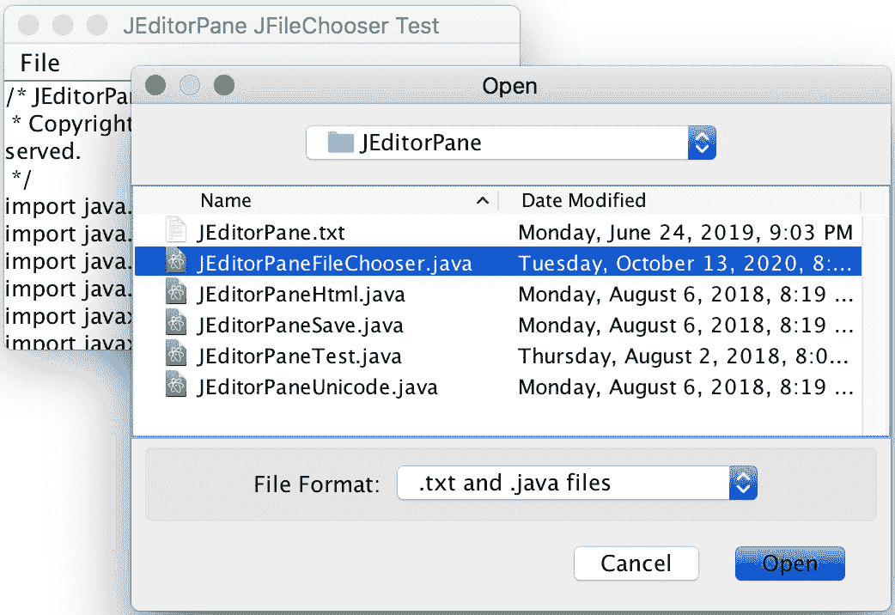

编辑器面板 - 文件选择器

## 关于此示例的趣味笔记

- `chooser.setCurrentDirectory(new File(dirName));` 语句用于将默认目录设置为 `\herong\swing\`。
- `chooser.setSelectedFile(new File(fileName));` 语句用于将默认文件设置为 `JEditorPane.txt`。
- `chooser.setFileSelectionMode(JFileChooser.FILES_ONLY);` 语句用于设置选择模式。
- `chooser.setFileFilter(filter);` 语句用于设置 `.txt` 和 `.java` 文件的过滤器。
- `Launching thread`（启动线程）：创建 `SwingWorker` 实例并在该实例上调用 `execute()` 的线程。
- `Worker thread`（工作线程）：通过执行 `doInBackground()` 方法实际执行任务的线程。
- `Dispatch thread`（分发线程）：`Worker thread` 用于发送信息的线程。

扩展 `SwingWorker` 类时，你需要考虑以下几点：

- 实现 `doInBackground()` 方法以执行实际任务。
- 实现 `done()` 方法，如果你在任务完成后执行某些操作。
- 在 `SwingWorker` 实例上调用 `get()` 方法，如果你想检索 `doInBackground()` 方法返回的结果。请注意，你应该在任务完成后调用 `get()` 方法。如果调用得太早，它将等待任务完成。
- 在 `doInBackground()` 方法中执行计算时，在任何你想发布中间值的时间点调用 `publish()` 方法。当然，你需要实现 `process()` 方法来接收这些中间值。
- 在 `doInBackground()` 方法中将任务分为多个相等的单元，并在每个单元完成后调用 `setProgress()` 方法用百分比值更新“进度”属性。当然，你需要实现一个 `java.beans.PropertyChangeListener` 类来获取“进度”值变化的通知。
- 实现一个 `java.beans.PropertyChangeListener` 类，以获取 `SwingWorker` 实例“状态”值变化的通知，从 `PENDING` 变为 `STARTED` 再到 `DONE`。

# Java Swing 教程 - Herong 的教程示例

## SwingWorker - 后台任务工作人员

### 使用 done() 方法的 SwingWorker 示例

本节提供了一个如何使用 `java.swing.SwingWorker` 类配合 `done()` 方法将计算结果通信到分发线程的教程示例。

有几种方法可以使用 `SwingWorker` 类。让我们从最简单的开始。

#### 示例 1：在任务完成后接收通知并检索结果

此示例展示了使用 `SwingWorker` 类的简单方法，只需启动 `Worker thread` `Dispatch thread` 中捕获结果。只需要实现两个方法：

- `T doInBackground()` - 需要实现的实例方法，用于执行任务。`doInBackground()` 方法将在 `Worker thread` 中执行。
- `void done()` - 需要实现的实例方法，如果你想在任务完成后执行某些操作。`done()` 方法将在 `Dispatch thread` 中执行。

以下是示例程序的源代码，`SwingWorkerUsingDone.java`：

```java
/* SwingWorkerUsingDone.java
 * Copyright (c) 1997-2018 HerongYang.com. All Rights Reserved.
 */
import javax.swing.SwingWorker;
import java.util.List;
import java.util.Random;
import java.time.LocalTime;
public class SwingWorkerUsingDone 
   extends SwingWorker<Integer[], Object> {
   int total = 100;
   int wait = 10;

// Extending the SwingWorker class
   protected Integer[] doInBackground() {
      logMessage("doInBackground() started");
      int i = 0;
      Integer[] l = new Integer[total];
      Random r = new Random();
      try {
         while (i<total) {
            Thread.sleep(wait);
            Integer n = Integer.valueOf(r.nextInt());
            l[i] = n;
            i++;
         }
      } catch (Exception e) {
         e.printStackTrace();
      }
      logMessage("doInBackground() ended");
      return l;
   }

   protected void done() {
      logMessage("done() started");
      try {
        Integer[] r = get();
        System.out.println("# of element in the result: "+r.length);
      System.out.println("First element: "+r[0]);
      System.out.println("Last element: "+r[total-1]);
      } catch (Exception e) {
         e.printStackTrace();
      }
      logMessage("done() ended");
   }

// Launching my extended SwingWorker class
   public static void main(String[] a) {
      try {
         SwingWorker<Integer[], Object> worker 
            = new SwingWorkerUsingDone();
         dumpThreads();
         worker.execute();
         while (true) {
            dumpThreads();
            Thread.sleep(200);
         }
      } catch (Exception e) {
         e.printStackTrace();
      }
   }
   public static void dumpThreads() {
      System.out.println(LocalTime.now()+" Thread dump:");
      Thread.currentThread().getThreadGroup().list();
   }
   public static void logMessage(String s) {
      System.out.println(LocalTime.now()+" "
         +Thread.currentThread().getName()+": "+s);
   }
}
```

关于示例程序的说明：

- 本示例中的类类 `SwingWorkerUsingDone` 承担了双重角色，既作为 `java.swing.SwingWorker` 的扩展类，又作为启动应用程序的主类。
- 注意，`SwingWorker` 类是一个泛型类，它接受两个类型参数 `<T,V>`，其中 `T` 是 `doInBackground()` 方法返回的结果的数据类型；`V` 是由 `doInBackground()` 方法发布的中间值的数据类型。在本示例中，我将 `T` 设置为 `Integer[]` 以以 Integer 数组的形式返回结果；并将 `V` 设置为 `Object` 以发布中间值。
- 实现 `Integer[] doInBackground()` 用于生成一些数字。
- 实现 `void done()` 用于检索 `Integer[]` 数组。
- 实现 `void main()` 方法以便 `SwingWorkerUsingDone` 可以启动应用程序。


## 程序运行输出

```
herong> \progra~1\java\jdk-8.0.1\bin\java SwingWorkerUsingDone

21:59:22.601 Thread dump:
java.lang.ThreadGroup[name=main,maxpri=10]
    Thread[main,5,main]

21:59:22.683 Thread dump:
java.lang.ThreadGroup[name=main,maxpri=10]
    Thread[main,5,main]
    Thread[SwingWorker-pool-1-thread-1,5,main]
21:59:22.695 SwingWorker-pool-1-thread-1: doInBackground() started

21:59:22.884 Thread dump:
java.lang.ThreadGroup[name=main,maxpri=10]
    Thread[main,5,main]
    Thread[SwingWorker-pool-1-thread-1,5,main]
    Thread[AWT-Shutdown,5,main]
    Thread[AWT-Windows,6,main]
    Thread[AWT-EventQueue-0,6,main]

21:59:23.091 Thread dump:
java.lang.ThreadGroup[name=main,maxpri=10]
    Thread[main,5,main]
    Thread[SwingWorker-pool-1-thread-1,5,main]
    Thread[AWT-Shutdown,5,main]
    Thread[AWT-Windows,6,main]
    Thread[AWT-EventQueue-0,6,main]

21:59:23.299 Thread dump:
java.lang.ThreadGroup[name=main,maxpri=10]
    Thread[main,5,main]
    Thread[SwingWorker-pool-1-thread-1,5,main]
    Thread[AWT-Shutdown,5,main]
    Thread[AWT-Windows,6,main]
    Thread[AWT-EventQueue-0,6,main]

21:59:23.507 Thread dump:
java.lang.ThreadGroup[name=main,maxpri=10]
    Thread[main,5,main]
    Thread[SwingWorker-pool-1-thread-1,5,main]
    Thread[AWT-Shutdown,5,main]
    Thread[AWT-Windows,6,main]
    Thread[AWT-EventQueue-0,6,main]
21:59:23.695 SwingWorker-pool-1-thread-1: doInBackground() ended

21:59:23.714 Thread dump:
java.lang.ThreadGroup[name=main,maxpri=10]
    Thread[main,5,main]
    Thread[SwingWorker-pool-1-thread-1,5,main]
    Thread[AWT-Shutdown,5,main]
    Thread[AWT-Windows,6,main]
    Thread[AWT-EventQueue-0,6,main]
21:59:23.730 AWT-EventQueue-0: done() started

# 结果中的元素数量: 100
第一个元素: 1278389322
最后一个元素: 1363500147
21:59:23.731 AWT-EventQueue-0: done() ended

21:59:23.918 Thread dump:
java.lang.ThreadGroup[name=main,maxpri=10]
    Thread[main,5,main]
    Thread[SwingWorker-pool-1-thread-1,5,main]
    Thread[AWT-Windows,6,main]
    Thread[AWT-EventQueue-0,6,main]
...
```

## 关于输出的一些有趣的注意点

- **21:59:22.601** 的第一次线程转储显示，在应用程序启动后，只有一个 1 个应用程序线程在运行：`main`。

- **21:59:22.683** 的第二次线程转储显示，在刚调用 `worker.execute()` 之后，有 2 个应用程序线程在运行：`main` 和 `SwingWorker-pool-1-thread-1`。

- 输出中的日志信息：`21:59:22.695 SwingWorker-pool-1-thread-1: doInBackground() started` 证实了 `SwingWorker-pool-1-thread-1` 是由 `worker.execute()` 调用创建的用于运行后台任务的工作线程。

- **21:59:22.884** 的第三次线程转储显示，有 5 个应用程序线程在运行：`main`、`SwingWorker-pool-1-thread-1`、`AWT-Shutdown`、`AWT-Windows` 和 `AWT-EventQueue-0`。因此 `SwingWorker-pool-1-thread-1` 又创建了 3 个线程。

- 输出中的日志信息：`21:59:23.695 SwingWorker-pool-1-thread-1: doInBackground() ended` 证实 `SwingWorker-pool-1-thread-1` 完成了后台任务。

- 日志信息 `21:59:23.730 AWT-EventQueue-0: done() started` 表示 `done()` 方法被调用。

- 日志信息 `21:59:23.731 AWT-EventQueue-0: done() ended` 表示 `done()` 方法执行完毕。

## 源代码：SwingWorkerUsingDone

```java
/* SwingWorkerUsing.java
 * 版权所有 (c) 1997-2018 Herong.com. 保留所有权利 */
import javax.swing.SwingWorker;
import java.util.List;
import java.util.Random;
import java.time.LocalTime;

public class SwingWorkerUsingDone extends SwingWorker<Object, Integer> {
    int total = 100;
    int wait = 10;

    // SwingWorker 类
    protected Object doInBackground() {
        logMessage("doInBackground() started");
        int i = 0;
        Random r = new Random();
        try {
            while (i < total) {
                Thread.sleep(wait);
                Integer n = Integer.valueOf(r.nextInt());
                publish(n);
                i++;
            }
        } catch (Exception e) {
            e.printStackTrace();
        }
        logMessage("doInBackground() ended");
        return null;
    }

    protected void process(List<Integer> v) {
        logMessage("process() receiving values: " + v.size());
    }

    // 启动我扩展的 SwingWorker 类
    public static void main(String[] a) {
        try {
            SwingWorker<Object, Integer> worker = new SwingWorkerUsingDone();
            dumpThreads();
            worker.execute();
            while (true) {
                dumpThreads();
                Thread.sleep(200);
            }
        } catch (Exception e) {
            e.printStackTrace();
        }
    }

    public static void dumpThreads() {
        System.out.println(LocalTime.now() + " Thread dump:");
        Thread.currentThread().getThreadGroup().list();
    }

    public static void logMessage(String s) {
        System.out.println(LocalTime.now() + " " + Thread.currentThread().getName() + ": " + s);
    }
}
```

## JDK 10 或更高版本运行输出示例

如果你使用 `JDK` 10 或更高版本编译并运行此示例，你将得到类似这些输出消息：

```
herong> java SwingWorkerUsingPublish

20:38:25.885114100 Thread dump:
java.lang.ThreadGroup[name=main,maxpri=10]
    Thread[main,5,main]
20:38:25.900714100 Thread dump:
java.lang.ThreadGroup[name=main,maxpri=10]
    Thread[main,5,main]
    Thread[SwingWorker-pool-1-thread-1,5,main]
20:38:25.947514100 SwingWorker-pool-1-thread-1: doInBackground() started
20:38:25.994314100 AWT-EventQueue-0: process() receiving values: 2
20:38:26.056714100 AWT-EventQueue-0: process() receiving values: 4
20:38:26.103514100 Thread dump:
java.lang.ThreadGroup[name=main,maxpri=10]
    Thread[main,5,main]
    Thread[SwingWorker-pool-1-thread-1,5,main]
    Thread[AWT-EventQueue-0,6,main]
20:38:26.119114100 AWT-EventQueue-0: process() receiving values: 4
20:38:26.181514100 AWT-EventQueue-0: process() receiving values: 4
20:38:26.243914100 AWT-EventQueue-0: process() receiving values: 4
20:38:26.306314100 Thread dump:
20:38:26.306314100 AWT-EventQueue-0: process() receiving values: 4
java.lang.ThreadGroup[name=main,maxpri=10]
    Thread[main,5,main]
    Thread[SwingWorker-pool-1-thread-1,5,main]
    Thread[AWT-EventQueue-0,6,main]
...
```

## JDK 1.8 运行输出示例

如果你使用 `JDK` 1.8 编译并运行此示例，你应该得到类似下面的输出消息：

```
herong> \progra~1\java\jdk-8.0.1\bin\java SwingWorkerUsingPublish

22:50:44.146 Thread dump:
java.lang.ThreadGroup[name=main,maxpri=10]
    Thread[main,5,main]

22:50:44.186 Thread dump:
java.lang.ThreadGroup[name=main,maxpri=10]
    Thread[main,5,main]
    Thread[SwingWorker-pool-1-thread-1,5,main]

22:50:44.196 SwingWorker-pool-1-thread-1: doInBackground() started

22:50:44.236 AWT-EventQueue-0: process() receiving values: 4

22:50:44.286 AWT-EventQueue-0: process() receiving values: 5

22:50:44.336 AWT-EventQueue-0: process() receiving values: 5

22:50:44.386 Thread dump:
java.lang.ThreadGroup[name=main,maxpri=10]
    Thread[main,5,main]
    22:50:44.386 AWT-EventQueue-0: process() receiving values: 5
Thread[SwingWorker-pool-1-thread-1,5,main]
    Thread[AWT-Shutdown,5,main]
    Thread[AWT-Windows,6,main]
    Thread[AWT-EventQueue-0,6,main]

22:50:44.436 AWT-EventQueue-0: process() receiving values: 5

22:50:44.486 AWT-EventQueue-0: process() receiving values: 5

22:50:44.536 AWT-EventQueue-0: process() receiving values: 5

22:50:44.586 AWT-EventQueue-0: process() receiving values: 5

22:50:44.596 Thread dump:
java.lang.ThreadGroup[name=main,maxpri=10]
    Thread[main,5,main]
    Thread[SwingWorker-pool-1-thread-1,5,main]
    Thread[AWT-Shutdown,5,main]
    Thread[AWT-Windows,6,main]
    Thread[AWT-EventQueue-0,6,main]

22:50:44.636 AWT-EventQueue-0: process() receiving values: 5

22:50:44.686 AWT-EventQueue-0: process() receiving values: 5

22:50:44.736 AWT-EventQueue-0: process() receiving values: 5

22:50:44.786 AWT-EventQueue-0: process() receiving values: 5

22:50:44.796 Thread dump:
java.lang.ThreadGroup[name=main,maxpri=10]
    Thread[main,5,main]
    Thread[SwingWorker-pool-1-thread-1,5,main]
    Thread[AWT-Shutdown,5,main]
    Thread[AWT-Windows,6,main]
    Thread[AWT-EventQueue-0,6,main]

22:50:44.836 AWT-EventQueue-0: process() receiving values: 5

22:50:44.886 AWT-EventQueue-0: process() receiving values: 5

22:50:44.936 AWT-EventQueue-0: process() receiving values: 5

22:50:44.986 AWT-EventQueue-0: process() receiving values: 5

22:50:44.996 Thread dump:
java.lang.ThreadGroup[name=main,maxpri=10]
    Thread[main,5,main]
    Thread[SwingWorker-pool-1-thread-1,5,main]
    Thread[AWT-Shutdown,5,main]
    Thread[AWT-Windows,6,main]
    Thread[AWT-EventQueue-0,6,main]
```


## 使用 `publish()` 方法的 SwingWorker 线程

### 日志输出示例

```
22:50:45.036 AWT-EventQueue-0: process() receiving values: 5
22:50:45.086 AWT-EventQueue-0: process() receiving values: 5
22:50:45.136 AWT-EventQueue-0: process() receiving values: 5
22:50:45.186 AWT-EventQueue-0: process() receiving values: 5
22:50:45.196 Thread dump:
java.lang.ThreadGroup[name=main,maxpri=10]
    Thread[main,5,main]
    Thread[SwingWorker-pool-1-thread-1,5,main]
    Thread[AWT-Shutdown,5,main]
    Thread[AWT-Windows,6,main]
    Thread[AWT-EventQueue-0,6,main]
22:50:45.236 AWT-EventQueue-0: process() receiving values: 1
22:50:45.406 Thread dump:
java.lang.ThreadGroup[name=main,maxpri=10]
    Thread[main,5,main]
    Thread[SwingWorker-pool-1-thread-1,5,main]
    Thread[AWT-Shutdown,5,main]
    Thread[AWT-Windows,6,main]
    Thread[AWT-EventQueue-0,6,main]
22:50:45.606 Thread dump:
java.lang.ThreadGroup[name=main,maxpri=10]
    Thread[main,5,main]
    Thread[SwingWorker-pool-1-thread-1,5,main]
    Thread[AWT-Shutdown,5,main]
    Thread[AWT-Windows,6,main]
    Thread[AWT-EventQueue-0,6,main]
```

### 关于输出的一些有趣的注意事项

- 输出中的日志消息“22:50:44.236 AWT-EventQueue-0: process() receiving values: 4”显示 `process()` 方法是在“AWT-EventQueue-0”线程中调用的。因此，“AWT-EventQueue-0”是示例中的调度线程（Dispatch thread）。
- 输出中的日志消息“22:50:44.236 AWT-EventQueue-0: process() receiving values: 4”同样显示在调用 4 次 `publish()` 后，`process()` 方法仅被调用一次，因为 4 个中间值作为参数传递了。
- 输出中的日志消息“22:50:45.236”显示 `process()` 的最后一次调用发生在 `doInBackground()` 结束后。

下面的图片让你了解启动线程（Launching thread）、工作线程（Worker thread）和调度线程是如何协作工作的。在这个示例中，我在 `doInBackground()` 方法中反复发布中间值，并使用 `process()` 方法获取它们：


### 相关链接

- Java Swing 教程 - Herong 的教程示例
- SwingWorker - 后台任务线程

## 使用 "progress" 属性的 SwingWorker 示例

本节提供了一个教程示例，介绍如何使用 `java.swing.SwingWorker` 类配合 `setProgress()` 方法从 `doInBackground()` 方法更新 'progress' 属性值。必须实现 `PropertyChangeListener` 类来捕获调度线程中 'progress' 属性的更新值。

### 示例 3：更新 "progress" 属性并使用它显示进度

此示例展示了如何向调度线程通信后台任务的“进度”。只需要实现 1 个方法和 1 个监听器类：

- `T doInBackground()` - 要实现的实例方法以执行任务。在 `doInBackground()` 中，多次调用 `setProgress(int)` 方法来发布一个整数，用百分比表示后台任务的进度。
- `class ... implements PropertyChangeListener {}` - 监听器类，实现 `propertyChange()` 方法以捕获更新的百分比值。

以下是示例程序的源代码，`SwingWorkerUsingProgress.java`：

```java
/* SwingWorkerUsingProgress.java
 * Copyright (c) 1997-2018 HerongYang.com. All Rights Reserved.
 */

import javax.swing.SwingWorker;
import java.util.Random;
import java.time.LocalTime;
import java.beans.*;

public class SwingWorkerUsingProgress 
   extends SwingWorker<Object, Object> {

   int total = 100;
   int wait = 10;

   // 扩展 SwingWorker 类
   protected Object doInBackground() {
      logMessage("doInBackground() started");
      int i = 0;
      Random r = new Random();
      try {
         while (i < total) {
            Thread.sleep(wait);
            Integer n = Integer.valueOf(r.nextInt());
            setProgress((100 * (i + 1)) / total);
            i++;
         }
      } catch (Exception e) {
         e.printStackTrace();
      }
      logMessage("doInBackground() ended");
      return null;
   }

   // 启动我的扩展 SwingWorker 类
   public static void main(String[] a) {
      try {
         SwingWorker<Object, Object> worker 
            = new SwingWorkerUsingProgress();
         dumpThreads();
         worker.addPropertyChangeListener(new myListener());
         worker.execute();
         while (true) {
            dumpThreads();
            Thread.sleep(200);
         }
      } catch (Exception e) {
         e.printStackTrace();
      }
   }

   public static void dumpThreads() {
      System.out.println(LocalTime.now() + " Thread dump:");
      Thread.currentThread().getThreadGroup().list();
   }

   public static void logMessage(String s) {
      System.out.println(LocalTime.now() + " "
         + Thread.currentThread().getName() + ": " + s);
   }

   static class myListener implements PropertyChangeListener {
      public void propertyChange(PropertyChangeEvent e) {
         if ("progress".equals(e.getPropertyName())) {
            logMessage("propertyChange() " + e.getNewValue() + "%");
         }
      }
   }
}
```

### 示例程序的说明

- 当扩展 `SwingWorker<T,V>` 时，我将 `T` 设置为 `Object`，因为我没有返回任何结果；将 `V` 设置为 `Object`，因为我没有发布任何中间值。
- `Object doInBackground()` 的实现用于生成一些随机数。每当生成一个随机数时，我调用 `setProgress()` 方法来更新名为 `"progress"` 的属性，使用一个 0 到 100 之间的整数来表示任务进度的百分比。
- `class myListener {}` 使用 `java.beans.PropertyChangeListener` 接口实现，并挂载到我的 `SwingWorker` 实例上，以监听 `"progress"` 属性的值变化事件。
- `void propertyChange()` 在 `myListener{}` 内部实现，用于捕获更新后的 `"progress"` 属性值。

如果你使用 JDK 10 或更高版本编译并运行此示例，你应该得到类似下面的输出消息：

```
herong> java SwingWorkerUsingProgress
20:45:52.387317 Thread dump:
java.lang.ThreadGroup[name=main,maxpri=10]
Thread[main,5]
20:45:52.402917 Thread dump:
java.lang.ThreadGroup[name=main,maxpri=10]
Thread[main,5]
Thread[SwingWorker-pool-1-thread-1,5]
20:45:52.449717 SwingWorker-pool-1-thread-1: doInBackground() started
20:45:52.51217 AWT-EventQueue-0: propertyChange() 4%
20:45:52.574517 AWT-EventQueue-0: propertyChange() 7%
20:45:52.60571 Thread dump:
java.lang.ThreadGroup[name=main,maxpri=10]
Thread[main,5]
Thread[SwingWorker-pool-1-thread-1,5]
Thread[AWT-EventQueue-0,6]
20:45:52.636917 AWT-EventQueue-0: propertyChange() 11%
20:45:52.69937 AWT-EventQueue-0: propertyChange() 15%
20:45:52.76171 AWT-EventQueue-0: propertyChange() 19%
20:45:52.80857 Thread dump:
java.lang.ThreadGroup[name=main,maxpri=10]
Thread[main,5]
Thread[SwingWorker-pool-1-thread-1,5]
Thread[AWT-EventQueue-0,6]
20:45:52.82417 AWT-EventQueue-0: propertyChange() 23%
```

如果你使用 JDK 1.8 编译并运行此示例，你应该得到类似下面的输出消息：

```
herong> \progra1\java-8.0.1\java SwingWorkerUsingProgress
23:02:46.481 Thread dump:
java.lang.ThreadGroup[name=main,maxpri=10]
Thread[main,5]
23:02:46.521 Thread dump:
java.lang.ThreadGroup[name=main,maxpri=10]
Thread[main,5]
Thread[SwingWorker-pool-1-thread-1,5]
23:02:46.531 SwingWorker-pool-1-thread-1: doInBackground() started
23:02:46.571 AWT-EventQueue-0: propertyChange() 4%
23:02:46.621 AWT-EventQueue-0: propertyChange() 9%
23:02:46.671 AWT-EventQueue-0: propertyChange() 14%
23:02:46.721 Thread dump:
java.lang.ThreadGroup[name=main,maxpri=10]
Thread[main,5]
Thread[SwingWorker-pool-1-thread-1,5]
Thread[AWT-Shutdown,5,main]
Thread[AWT-Windows,6,main]
Thread[AWT-EventQueue-0,6]
23:02:46.771 AWT-EventQueue-0: propertyChange() 24%
23:02:46.821 AWT-EventQueue-0: propertyChange() 29%
23:02:46.871 AWT-EventQueue-0: propertyChange() 34%
23:02:46.921 AWT-EventQueue-0: propertyChange() 39%
23:02:46.921 Thread dump:
java.lang.ThreadGroup[name=main,maxpri=10]
Thread[main,5]
Thread[SwingWorker-pool-1-thread-1,5]
Thread[AWT-Shutdown,5,main]
Thread[AWT-Windows,6,main]
Thread[AWT-EventQueue-0,6]
23:02:46.971 AWT-EventQueue-0: propertyChange() 44%
23:02:47.021 AWT-EventQueue-0: propertyChange() 49%
23:02:47.071 AWT-EventQueue-0: propertyChange() 54%
23:02:47.121 AWT-EventQueue-0: propertyChange() 59%
23:02:47.121 Thread dump:
java.lang.ThreadGroup[name=main,maxpri=10]
Thread[main,5]
Thread[SwingWorker-pool-1-thread-1,5]
Thread[AWT-Shutdown,5,main]
Thread[AWT-Windows,6,main]
Thread[AWT-EventQueue-0,6]
23:02:47.171 AWT-EventQueue-0: propertyChange() 64%
23:02:47.221 AWT-EventQueue-0: propertyChange() 69%
23:02:47.271 AWT-EventQueue-0: propertyChange() 74%
23:02:47.321 AWT-EventQueue-0: propertyChange() 79%
23:02:47.331 Thread dump:
java.lang.ThreadGroup[name=main,maxpri=10]
Thread[main,5]
Thread[SwingWorker-pool-1-thread-1,5]
Thread[AWT-Shutdown,5,main]
Thread[AWT-Windows,6,main]
Thread[AWT-EventQueue-0,6]
23:02:47.371 AWT-EventQueue-0: propertyChange() 84%
23:02:47.421 AWT-EventQueue-0: propertyChange() 89%
23:02:47.471 AWT-EventQueue-0: propertyChange() 94%
23:02:47.521 AWT-EventQueue-0: propertyChange() 99%
23:02:47.531 SwingWorker-pool-1-thread-1: doInBackground() ended
23:02:47.531 Thread dump:
```


# 使用进度属性的 SwingWorker 线程

Java Swing 教程 - Herong 的教程示例

## SwingWorker - 后台任务工作器

### 使用 JProgressBar 的 SwingWorker 示例

本节提供了一个关于如何在 UI 上使用 `java.swing.SwingWorker` 类和 `JProgressBar` 组件的教程示例。该示例中演示了 `SwingWorker` 类的所有主要功能。

**示例 4：整合所有功能** - 此示例向你展示了如何结合使用 `SwingWorker` 类的所有功能，创建一个更真实的 Swing GUI 应用程序，用于作为后台任务生成随机数。

以下是示例程序的源代码，`SwingWorkerUsingProgress.java`：

```java
/* SwingWorkerUsingProgressBar.java
 * Copyright (c) 1997-2018 HerongYang.com. All Rights Reserved.
 */

import java.beans.*;
import java.awt.*;
import java.awt.event.*;
import java.util.*;
import javax.swing.*;

public class SwingWorkerUsingProgressBar {

   static JButton myButton;
   static JProgressBar myProgressBar;
   static JLabel myUpdate;
   static JTextArea myTextArea;

   public static void main(String[] a) {
      JFrame myFrame = new JFrame("Random Number Generator");
      myFrame.setDefaultCloseOperation(JFrame.EXIT_ON_CLOSE);
      Container myPane = myFrame.getContentPane();
      myPane.setLayout(new GridBagLayout());
      GridBagConstraints c = new GridBagConstraints();
      setMyConstraints(c, 0, 0, GridBagConstraints.CENTER);
      myPane.add(getFieldPanel(), c);
      setMyConstraints(c, 0, 1, GridBagConstraints.CENTER);
      myPane.add(getButtonPanel(), c);
      JMenuBar myMenuBar = new JMenuBar();
      myMenuBar.add(getFileMenu());
      myMenuBar.add(getColorMenu());
      JMenuItem myItem = new JMenuItem("Help");
      myMenuBar.add(myItem);
      myFrame.setJMenuBar(myMenuBar);
      myFrame.pack();
      myFrame.setVisible(true);
   }

   private static JMenu getFileMenu() {
      JMenu myMenu = new JMenu("File");
      JMenuItem myItem = new JMenuItem("Open");
      myMenu.add(myItem);
      myItem = new JMenuItem("Close");
      myItem.setEnabled(false);
      myMenu.add(myItem);
      myMenu.addSeparator();
      myItem = new JMenuItem("Exit");
      myMenu.add(myItem);
      return myMenu;
   }

   private static JMenu getColorMenu() {
      JMenu myMenu = new JMenu("Color");
      JMenuItem myItem = new JMenuItem("Red");
      myMenu.add(myItem);
      myItem = new JMenuItem("Green");
      myMenu.add(myItem);
      myItem = new JMenuItem("Blue");
      myMenu.add(myItem);
      return myMenu;
   }

   private static JPanel getFieldPanel() {
      JPanel p = new JPanel(new GridBagLayout());
      p.setBorder(BorderFactory.createTitledBorder(""));
      GridBagConstraints c = new GridBagConstraints();
      setMyConstraints(c, 0, 0, GridBagConstraints.EAST);
      p.add(new JLabel("Progress:"), c);
      setMyConstraints(c, 1, 0, GridBagConstraints.WEST);
      myProgressBar = new JProgressBar(0, 100);
      p.add(myProgressBar, c);
      setMyConstraints(c, 0, 1, GridBagConstraints.EAST);
      p.add(new JLabel("Last number:"), c);
      setMyConstraints(c, 1, 1, GridBagConstraints.WEST);
      myUpdate = new JLabel("");
      p.add(myUpdate, c);
      setMyConstraints(c, 0, 2, GridBagConstraints.EAST);
      p.add(new JLabel("All numbers:"), c);
      setMyConstraints(c, 1, 2, GridBagConstraints.WEST);
      myTextArea = new JTextArea(10, 40);
      myTextArea.setLineWrap(true);
      myTextArea.setFont(new Font("Courier", Font.PLAIN, 12));
      p.add(myTextArea, c);
      return p;
   }

   private static JPanel getButtonPanel() {
      JPanel p = new JPanel(new GridBagLayout());
      myButton = new JButton("Run");
      myButton.addActionListener(new MyButtonListener());
      p.add(myButton);
      return p;
   }

   private static void setMyConstraints(GridBagConstraints c,
      int gridx, int gridy, int anchor) {
      c.gridx = gridx;
      c.gridy = gridy;
      c.anchor = anchor;
   }

   // 用于启动任务的 My ActionListener 类
   static class MyButtonListener implements ActionListener {
      public void actionPerformed(ActionEvent e) {
         myButton.setText("Wait");
         myButton.setEnabled(false);
         myTextArea.setText("");
         MySwingWorker worker = new MySwingWorker();
         worker.addPropertyChangeListener(new MyProgressListener());
         worker.execute();
      }
   }

   // 用于执行任务的 MySwingWorker 类
   static class MySwingWorker extends SwingWorker<Integer[], Integer> {
      int total = 100;
      int wait = 100;

      protected Integer[] doInBackground() {
         Integer[] l = new Integer[total];
         Random r = new Random();
         try {
            for (int i = 0; i < total; i++) {
               Thread.sleep(wait);
               l[i] = r.nextInt(100);
               publish(l[i]);
               setProgress(i + 1);
            }
         } catch (Exception e) {
            e.printStackTrace();
         }
         return l;
      }

      protected void process(java.util.List<Integer> v) {
         String s = "";
         for (Integer n : v) {
            s += n + " ";
         }
         myTextArea.setText(s);
      }

      protected void done() {
         try {
            Integer n = get();
            myUpdate.setText(n.toString());
            myButton.setText("Run");
            myButton.setEnabled(true);
         } catch (Exception e) {
            e.printStackTrace();
         }
      }
   }

   // 监听属性变化的 PropertyChangeListener
   static class MyProgressListener implements PropertyChangeListener {
      public void propertyChange(PropertyChangeEvent e) {
         if ("progress".equals(e.getPropertyName())) {
            myProgressBar.setValue((Integer) e.getValue());
         }
      }
   }
}
```

### 输出中一些有趣的说明：

- 输出消息 `23:02:46.571 AWT-EventQueue-0: propertyChange() 4%` 显示 `propertyChange()` 方法是在 `AWT-EventQueue-0` 线程中被调用的。因此 `AWT-EventQueue-0` 是我们示例中的分发线程。

- 输出消息 `23:02:46.571 AWT-EventQueue-0: propertyChange() 4%` 也显示，在调用 4 次 `setProgress()` 后，`process()` 方法仅被调用一次，因为我没有在输出中看到 1%、2% 和 3% 的 `"progress"` 属性值。

下图让你直观地了解在这个示例中，启动线程、工作线程和分发线程是如何协作的，在这个示例中，我们在 `doInBackground()` 方法内部反复更新 `"progress"` 属性值，并使用 `PropertyChangeListener` 类来捕获它：

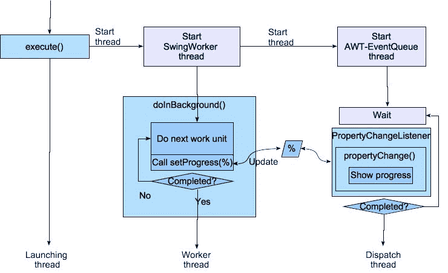

### 线程转储输出

```
java.lang.ThreadGroup[name=main,maxpri=10]
Thread[main,5]
Thread[SwingWorker-pool-1-thread-1,5]
Thread[AWT-Shutdown,5,main]
Thread[AWT-Windows,6,main]
Thread[AWT-EventQueue-0,6]
23:02:47.571 AWT-EventQueue-0: propertyChange() 100%
23:02:47.731 Thread dump:
java.lang.ThreadGroup[name=main,maxpri=10]
Thread[main,5]
Thread[SwingWorker-pool-1-thread-1,5]
Thread[AWT-Shutdown,5,main]
Thread[AWT-Windows,6,main]
Thread[AWT-EventQueue-0,6]
23:02:47.931 Thread dump:
java.lang.ThreadGroup[name=main,maxpri=10]
Thread[main,5]
Thread[SwingWorker-pool-1-thread-1,5]
Thread[AWT-Shutdown,5,main]
Thread[AWT-Windows,6,main]
Thread[AWT-EventQueue-0,6]
```


如果你编译并运行此示例，将看到一个 Swing 窗口。点击“Run”按钮启动后台任务，你会看到进度条随着随机数的生成而变化。如下：


注意，在后台生成随机数时，你仍然点击菜单执行其他功能。这向我们展示了使用 `SwingWorker` 类的优势，即在后台启动耗时任务并保持 UI 响应性。

## AWT（抽象窗口工具包）

本章提供了 AWT（抽象窗口工具包）教程。包括 AWT 类介绍；创建和关闭 AWT 窗口；在组件上绘制图形；创建标签和按钮；文本字段和监听器；使用菜单栏、菜单和菜单。

### 什么是 AWT (抽象窗口工具包)

本节介绍了什么是 AWT（抽象窗口工具包）——一个 Java 包，`java.awt.*`，允许 Java 应用程序操作图形设备并创建 GUI（图形用户界面）。

**什么是 AWT (Abstract Windows Toolkit)？** `AWT` 是一个 Java 包，`java.awt.*`，允许 Java 应用程序操作图形设备并创建 GUI（图形用户界面）。

`JDK` 文档提供了 `AWT` 的另一种描述：“AWT 包含了所有用于创建用户界面以及绘制图形和图像的类。在 AWT 术语中，按钮或滚动条等用户界面对象被称为组件（component）。`Component` 类是所有 AWT 组件的根。请参见 `Component` 以获取关于所有 AWT 组件共享的属性的详细描述。”

`AWT` 包 `java.awt.*` 引入于 `JDK 1.0`。随后在 `JDK 1.2` 中，引入了 `Swing` 包 `javax.swing.*`，以提供更丰富的 API 并通过封装层隐藏 `AWT`。

`AWT` 包包含以下主要类：

* `java.awt.AWTEvent` - 所有 SWT 事件类的根类。
* `java.awt.Button` - 表示一个带标签的按钮。
* `java.awt.Canvas` - 表示屏幕上的一个空白矩形区域，应用程序可以在其上绘制，或从该区域捕获来自用户的输入事件。
* `java.awt.Checkbox` - 表示一个具有“开启”（true）或“关闭”（false）状态的图形组件。
* `java.awt.Color` - 封装默认 sRGB 颜色空间中的颜色。
* `java.awt.Component` - 可以在显示在屏幕上并与用户交互的图形化表示。
* `java.awt.Container` - 一个可以作为一组包含其他组件的逻辑组件。
* `java.awt.Desktop` - 允许应用程序与各种桌面功能交互。
* `java.awt.Dialog` - 表示一个带有标题和边框的顶层窗口，通常用于从用户处获取某种形式的输入。
* `java.awt.Event` - 表示一个带标签的按钮（注：此处原文可能描述误，此处按原文翻译）。
* `java.awt.FlowLayout` - 将组件按方向流排列，类似于段落中的文本行。
* `java.awt.Font` - 表示字体，用于以可见的方式渲染文本。
* `java.awt.Frame` - 表示一个带有标题和边框的顶层窗口。
* `java.awt.Graphics` - 所有图形上下文的抽象基类，允许应用程序在位于各种设备上实现的组件上以及在离屏图像上进行绘制。
* `java.awt.GraphicsEnvironment` - 描述特定平台上供 Java(tm) 应用程序使用的 `GraphicsDevice` 对象集合和 `Font` 对象集合。
* `java.awt.GridBagLayout` - 一种灵活的布局管理器，可以垂直、水平或沿基线对齐组件，而不需要组件大小相同。
* `java.awt.GridLayout` - 一种在矩形网格中布局容器组件的布局管理器。
* `java.awt.Image` - 作为所有表示图形的类的父类的抽象类。
* `java.awt.Label` - 用于在容器中放置文本的组件。
* `java.awt.List` - 向用户提供滚动文本项列表的组件。
* `java.awt.Menu` - 从菜单栏部署的拉式菜单组件。
* `java.awt.MenuBar` - 封装了平台绑定到框架的菜单栏概念。
* `java.awt.MenuItem` - 与 `MenuBar` 关联的项。
* `java.awt.MouseInfo` - 提供获取鼠标信息的方法，如鼠标指针位置和鼠标按钮数量。
* `java.awt.Panel` - 最简单的容器类。
* `java.awt.Point` - 表示 (x,y) 坐标空间中的一个位置，以整数精度标出。
* `java.awt.Polygon` - 封装坐标空间内一个闭合二维区域的描述。
* `java.awt.Rectangle` - 指定坐标空间中的一个区域，由 `Rectangle` 对象的左上点 (x,y) 围成。
* `java.awt.Robot` - 用于测试自动化、演示以及需要控制鼠标和键盘的应用程序生成原生系统事件。
* `java.awt.Scrollbar` - 体现滚动条的熟悉用户界面。
* `java.awt.ScrollPane` - 实现水平和垂直滚动的容器类。
* `java.awt.SystemTray` - 代表系统托盘。
* `java.awt.Taskbar` - 允许 Java 应用程序与任务区域（任务栏等）交互。
* `java.awt.TextArea` - 显示文本的多行区域。
* `java.awt.TextField` - 允许编辑单行文本的文本组件。
* `java.awt.Toolkit` - 所有抽象窗口工具包实现的抽象父类。
* `java.awt.TrayIcon` - 表示可以添加到系统托盘的托盘图标。
* `java.awt.Window` - 一个没有边框和菜单栏的顶层窗口。

### HelloAWT.java - 我的第一个 AWT 程序

本节提供了关于如何编写简单 AWT 程序的教程示例。`HelloAWT.java` 是我的第一个 AWT 程序，显示窗口标题栏显示“Hello world!”的空白窗口。

下面是我的第一个 AWT 程序，`HelloAWT.java`：

```java
import java.awt.Frame;

public class HelloAWT {

   public static void main(String[] a) {

      Frame f = new Frame("Hello world!");

      f.setVisible(true);

   }

}
```

如果你的系统中安装了 `JDK`，你可以在命令行窗口中编译并运行此程序：

```
herong> javac HelloAWT.java
herong> java HelloAWT
```

一旦程序运行，你将看到屏幕上弹出一个小新窗口。如果使用鼠标指针拖动它的边缘使其变大，你可以像图片所示看到标题区域的文本：


第一个 AWT - Hello World!

新窗口一直留在屏幕上，直到你在命令行窗口中按下 `Ctrl-C` 来终止运行的程序。

### 关闭 AWT 框架并终止应用程序

**问题**：我在屏幕上显示了一个框架窗口，当用户从窗口的系统菜单调用关闭命令，或点击窗口系统图标列表中的关闭图标时，我想关闭该框架并终止应用程序。

**解决方案**：你可以创建一个新的窗口事件监听器类，并将该监听器类的对象添加到 `Frame` 对象中。在新的窗口事件监听器中，你可以实现你自己的版本的 `windowClosing()` 处理器方法。当然，创建新窗口事件监听器类最快的方法是扩展 `WindowAdapter` 类。

下面的示例代码 `FrameClose.java` 展示了如何实现这一点。

```java
/* FrameClose.java
 * Copyright (c) 1997-2018 HerongYang.com. All Rights Reserved.
 */

import java.awt.Frame;
import java.awt.event.WindowAdapter;
import java.awt.event.WindowEvent;

public class FrameClose  {

   public static void main(String[] a) {

      Frame f = new Frame();

      f.setTitle("Closing Frame with Window Listener");

      f.setBounds(100,50,500,300);

      f.addWindowListener(new MyWindowListener());

      f.setVisible(true);

   }

   static class MyWindowListener extends WindowAdapter {

      public void windowClosing(WindowEvent e) {

         System.exit(0);

      }

   }

}
```

### 绘制图形 - 在 Frame 或 Component 上使用 `paint()`

本节提供了一个教程示例，介绍如何重写 `javax.awt.Frame` 类中的 `paint()` 方法在帧窗口上绘制图形（矩形），或者重写 `java.awt.Component` 类中的 `paint()` 方法来绘制图形并将组件添加到帧窗口中。

#### 问题：我想在在帧中绘制一些图形。

#### 解决方案 1：你可以通过扩展 Frame 类来创建你自己的帧类，从而重写 `paint()` 方法，非常容易地实现这一点。`paint()` 方法提供了一个 `Graphics` 对象，它将为你提供绘制各种类型图形的实用方法。下面的示例代码 `FramePaint1.java` 展示了如何实现这一点。

```java
/* FramePaint1.java
 * Copyright (c) 1997-2018 HerongYang.com. All Rights Reserved.
 */

import java.awt.Frame;
import java.awt.Graphics;

public class FramePaint1 {

   public static void main(String[] a) {

      MyFrame f = new MyFrame();

      f.setTitle("Drawing Graphics in a Frame Directly");

      f.setBounds(100,50,500,300);

      f.setVisible(true);

   }

   static class MyFrame extends Frame {

      public void paint(Graphics g) {

         g.drawRect(20,10,100,60);

      }

   }

}
```

如果你运行这个示例，你将得到：


在 Frame 上使用 `paint()`

注意 1：`paint()` 方法是 `Frame` 类继承自 `Component` 类的。每当该组件需要绘制时，它就会被调用。

注意 2：如果你查看帧上显示的矩形，你会发现绘制坐标的原点位于整个帧的左上角，包括标题栏。

注意 3：在默认情况下，在 JDK 1.4、1.5 和 1.6 中，`paint()` 方法提供透明背景。这就是为什么你在图片中看到了一个网页。

注意 4：在 JDK 7 及更高版本中，`paint()` 方法不再提供透明背景。

不推荐使用这种解决方案。我们不想在帧的标题栏区域绘制图形。

#### 解决方案 2：显然，解决方案 1 并不理想，因为我们是在帧本身的 UI 元素上绘制图形。为了只在帧的内容区域绘制图形，我们可以创建一个带有其自己的 `paint()` 方法的新组件，并将其添加到帧中。下面的示例代码 `FramePaint2.java` 展示了如何实现这一点。

```java
/* FramePaint2.java
 * Copyright (c) 1997-2018 HerongYang.com. All Rights Reserved.
 */

import java.awt.Frame;
import java.awt.Graphics;
import java.awt.Component;

public class FramePaint2 {

   public static void main(String[] a) {

      Frame f = new Frame();

      f.setTitle("Drawing Graphics in a Frame"
         +" by Adding a Component");

      f.setBounds(100,50,500,300);

      f.add(new MyComponent());

      f.setVisible(true);

   }

   static class MyComponent extends Component {

      public void paint(Graphics g) {

         g.drawRect(20,10,100,60);

      }

   }

}
```

如果你运行这个示例，你将得到：

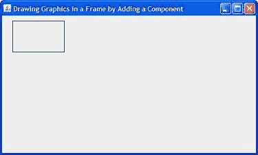

在 Component 上使用 `paint()`

注意 1：由于新添加的组件没有尺寸和位置，它占据了内容面板的整个区域，即不包含标题栏在内的整个区域。

注意 2：现在绘制坐标的原点位于内容面板的左上角，比解决方案 1 好得多。

### 带有 java.awt.Label

本节提供了一个教程示例，介绍如何通过 `java.awt.Label` 来创建一个标签。

**问题**：我想在帧中创建一个标签。

**解决方案**：通过扩展 Frame 类来创建你自己的帧类，从而重写 `paint()` 方法，非常容易地实现这一点。`paint()` 方法提供了一个 `Graphics` 对象，它将为你提供绘制各种类型图形的实用方法。这里有一个示例程序：

```java
/* LabelHello.java
 * Copyright (c) 1997-2018 HerongYang.com. All Rights Reserved.
 */

import java.awt.Frame;
import java.awt.Label;

public class LabelHello {

   public static void main(String[] a) {

      Frame f = new Frame("Label");

      Label l = new Label("Hello!");

      f.add(l);

      f.pack();

      f.setVisible(true);

   }

}
```


如果你运行这个示例，你将得到：


### AWT 测试

注意：`pack()` 方法使窗口大小适应其子组件。

按钮工作正常。如果你点击按钮，按钮的标签文本将从“On”变为“Off”；如果你再次点击它，它将从“Off”变为“On”。

Java Swing Tutorials - Herong's Tutorial Examples

∟AWT (Abstract Windows Toolkit)

### 窗口层面的 AWT 按钮动作处理器

本节提供了一个教程示例，展示了如何创建一个 AWT 按钮，通过在包含该按钮组件的窗口上添加 `ActionListener` 接口来处理动作。

在上一节中，我们扩展了按钮以处理其自身的动作。如果动作只需要修改按钮本身的行为，这种方法运行良好。

但如果动作需要修改其他组件的行为，你需要在更高层级实现动作监听器。以下程序展示了如何使用动作处理器来修改标签组件的文本：

```java
/* ButtonAction2.java
 * Copyright (c) 1997-2018 HerongYang.com. All Rights Reserved.
 */

import java.awt.Frame;
import java.awt.Button;
import java.awt.Label;
import java.awt.GridLayout;
import java.awt.event.ActionEvent;
import java.awt.event.ActionListener;

public class ButtonAction2 implements ActionListener {
   Button myButton = null;
   Label myLabel = null;
   String text = null;

   public static void main(String[] a) {
      ButtonAction2 myTest = new ButtonAction2();
      myTest.createFrame();
   }

   public void createFrame() {
      Frame f = new Frame("My Switch Button");
      f.setLayout(new GridLayout(2,1));
      text = "On";
      myButton = new Button(text);
      myButton.addActionListener(this);
      f.add(myButton);
      myLabel = new Label(text);
      f.add(myLabel);
      f.pack();
      f.setVisible(true);
   }

   public void actionPerformed(ActionEvent e) {
      if (text.equals("On")) text = "Off";
      else text = "On"; 
      myButton.setLabel(text);
      myLabel.setText(text);
   }
}
```

如果你运行此示例，你将得到：

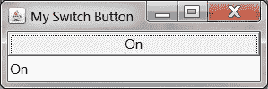

#### AWT 按钮动作处理器

按钮工作良好。如果你点击按钮，按钮的标签文本将从“On”变为“Off”，标签组件的文本也会随之改变。

Java Swing Tutorials - Herong's Tutorial Examples

∟AWT (Abstract Windows Toolkit)

### 窗口层面的 AWT 按钮鼠标点击处理器

本节提供了一个教程示例，展示了如何创建一个 AWT 按钮，通过在包含该按钮组件的窗口上添加 `MouseAdapter` 接口来处理动作。

当然，使用 `ActionListeners` 并不是处理用户点击按钮唯一的方法。你也可以使用 `MouseListeners` 来处理用户点击。这是一个示例程序：

```java
/* ButtonAction3.java
 * Copyright (c) 1997-2018 HerongYang.com. All Rights Reserved.
 */

import java.awt.Frame;
import java.awt.Button;
import java.awt.Label;
import java.awt.GridLayout;
import java.awt.event.MouseEvent;
import java.awt.event.MouseAdapter;

public class ButtonAction3 extends MouseAdapter {
   Button myButton = null;
   Label myLabel = null;
   String text = null;

   public static void main(String[] a) {
      ButtonAction3 myTest = new ButtonAction3();
      myTest.createFrame();
   }

   public void createFrame() {
      Frame f = new Frame("My Switch Button");
      f.setLayout(new GridLayout(2,1));
      text = "On";
      myButton = new Button(text);
      myButton.addMouseListener(this);
      f.add(myButton);
      myLabel = new Label(text);
      f.add(myLabel);
      f.pack();
      f.setVisible(true);
   }

   public void mouseClicked(MouseEvent e) {
      if (text.equals("On")) text = "Off";
      else text = "On"; 
      myButton.setLabel(text);
      myLabel.setText(text);
   }
}
```

如果你运行此示例，你将得到：

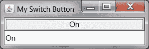

#### AWT 按钮鼠标适配器

按钮工作良好。如果你点击按钮，按钮的标签文本将从“On”变为“Off”，标签组件的文本也会随之改变。

Java Swing Tutorials - Herong's Tutorial Examples

∟AWT (Abstract Windows Toolkit)

### AWT 文本字段和 ActionListener

本节提供了一个教程示例，展示了如何创建一个 AWT 文本字段，并实现 `ActionListener` 监听器作为事件处理器。

AWT `TextField` 组件可以直接触发 `ActionEvent`。这是一个示例程序，向你展示 `TextField` 的 `ActionEvent` 是如何工作的：

```java
/* TextFieldTest.java
 * Copyright (c) 1997-2018 HerongYang.com. All Rights Reserved.
 */

import java.awt.Frame;
import java.awt.TextField;
import java.awt.event.ActionEvent;
import java.awt.event.ActionListener;

public class TextFieldTest {
   public static void main(String[] a) {
      Frame f = new Frame("Text Test");
      TextField t = new TextField(16);
      f.add(t);
      f.pack();
      f.setVisible(true);
   }

   private static class MyTextField extends TextField implements ActionListener {
      static int count = 0;

      public MyTextField(int l) {
         super(l);
         addActionListener(this);
      }

      public void actionPerformed(ActionEvent e) {
         count++;
         System.out.println(count + ": Action performed - " + getText());
      }
   }
}
```

运行此程序并在文本字段执行以下操作：

* 输入“Hello”。
* 按回键。
* 输入“World!”.
* 按回键。

文本字段看起来应该是：


#### AWT 文本字段 ActionListener

你会在控制台中得到以下输出：

```
1: Action performed - Hello
2: Action performed - World!
```

输出确认了：

* 当按下按键时会调用 `ActionListener`。

Java Swing Tutorials - Herong's Tutorial Examples

∟AWT (Abstract Windows Toolkit)

### MenuTest.java - AWT 菜单程序

本节提供了一个教程示例，介绍如何使用 `java.awt.Menu` 类创建多个菜单，以及如何将它们添加到菜单栏中。当选中菜单时，添加到菜单中的子菜单和菜单项将垂直列出。

以下我编写的一个用于测试 `java.awt.Menu` 类的示例程序：

```java
/* MenuTest.java
 * Copyright (c) 1997-2018 HerongYang.com. All Rights Reserved.
 */

import java.awt.Frame; 
import java.awt.MenuBar; 
import java.awt.Menu; 
import java.awt.MenuItem; 

public class MenuTest {
   Frame myFrame = null;

   public static void main(String[] a) {
      (new MenuTest()).test();
   }

   private void test() {
      myFrame = new Frame("Menu Test");
      myFrame.setBounds(50,50,250,150);
      MenuBar myMenuBar = new MenuBar();
      Menu myMenu = getFileMenu();
      myMenuBar.add(myMenu);
      myMenu = getColorMenu();
      myMenuBar.add(myMenu);
      myFrame.setMenuBar(myMenuBar);
      myFrame.setVisible(true);
   }

   private Menu getFileMenu() {
      Menu myMenu = new Menu("File");
      Menu mySubMenu = getOpenMenu();
      myMenu.add(mySubMenu);
      MenuItem myItem = new MenuItem("Close");
      myMenu.add(myItem);
      myMenu.addSeparator();
      myItem = new MenuItem("Exit");
      myMenu.add(myItem);
      return myMenu;
   }

   private Menu getColorMenu() {
      Menu myMenu = new Menu("Color");
      MenuItem myItem = new MenuItem("Red");
      myMenu.add(myItem);
      myItem = new MenuItem("Green");
      myMenu.add(myItem);
      myItem = new MenuItem("Blue");
      myMenu.add(myItem);
      return myMenu;
   }

   private Menu getOpenMenu() {
      Menu myMenu = new Menu("Open");
      MenuItem myItem = new MenuItem("Java");
      myMenu.add(myItem);
      myItem = new MenuItem("HTML");
      myMenu.add(myItem);
      myItem = new MenuItem("GIF");
      myMenu.add(myItem);
      return myMenu;
   }
}
```

如果你运行此示例，你将看到一个带有如下菜单栏的窗口：


#### AWT 菜单测试

关于此教程示例的有趣说明：

- 多个菜单可以添加到菜单栏中。在本示例中，“文件”（File）菜单和“颜色”（Color）菜单被添加到菜单栏。
- 菜单可以像菜单项一样包含一个子菜单。在本示例中，“打开”（Open）菜单作为子菜单被添加到“文件”菜单中。
- 在 `Menu` 对象上调用 `addSeparator()` 方法会在菜单元素中添加一条线。

### MenuItemTest.java - AWT 菜单项程序

本节提供了一个教程示例，介绍如何使用 `java.awt.MenuItem` 类创建菜单项，并将它们添加到不同的菜单、子菜单或菜单栏中。当选中菜单时，添加到菜单中的子菜单和菜单项将垂直列出。

以下我编写的一个用于测试 `java.awt.MenuItem` 类的示例程序：

```java
/* MenuItemTest.java
 * Copyright (c) 1997-2018 HerongYang.com. All Rights Reserved.
 */

import java.awt.Frame;
import java.awt.MenuBar;
import java.awt.Menu;
import java.awt.MenuItem;

public class MenuItemTest {
   Frame myFrame = null;

   public static void main(String[] a) {
      (new MenuItemTest()).test();
   }

   private void test() {
      myFrame = new Frame("Menu Item Test");
      myFrame.setBounds(50,50,250,150);
      MenuBar myMenuBar = new MenuBar();
      Menu myMenu = getFileMenu();
      myMenuBar.add(myMenu);
      myMenu = getColorMenu();
      myMenuBar.add(myMenu);
      myMenu = getOptionMenu();
      myMenuBar.add(myMenu);
      myFrame.setMenuBar(myMenuBar);
      myFrame.setVisible(true);
   }

   private Menu getFileMenu() {
      Menu myMenu = new Menu("File");
      MenuItem myItem = new MenuItem("Open");
      myMenu.add(myItem);
      myItem = new MenuItem("Close");
      myItem.setEnabled(false);
      myMenu.add(myItem);
      myMenu.addSeparator();
      myItem = new MenuItem("Exit");
      myMenu.add(myItem);
      return myMenu;
   }

   private Menu getColorMenu() {
      Menu myMenu = new Menu("Color");
      MenuItem myItem = new MenuItem("Red");


```java
myMenu.add(myItem);

myItem = new MenuItem("Green");

myMenu.add(myItem);

myItem = new MenuItem("Blue");

myMenu.add(myItem);

return myMenu;

}

private Menu getOptionMenu() {

Menu myMenu = new Menu("Option");

Menu mySubMenu = getOnOffMenu("Sound");

myMenu.add(mySubMenu);

mySubMenu = getOnOffMenu("Auto save");

mySubMenu.setEnabled(false);

myMenu.add(mySubMenu);

return myMenu;

}

private Menu getOnOffMenu(String title) {

Menu myMenu = new Menu(title);

MenuItem myItem = new MenuItem("On");

myMenu.add(myItem);

myItem = new MenuItem("Off");

myMenu.add(myItem);

return myMenu;

}

}
```

如果你运行此示例，你将看到一个带有如下菜单栏的窗口：


## AWT 菜单项测试

关于此教程示例的有趣说明：

- 菜单项可以通过调用 `setEnabled(false)` 方法来禁用。禁用的菜单项将以灰色显示且不可点击。在本示例中，“关闭”（Close）菜单项是被禁用的。
- 菜单也可以通过调用 `setEnabled(false)` 方法来禁用。禁用的菜单将以灰色显示且不可点击。在本示例中，“自动保存”（Auto save）菜单项是被禁用的。

# MenuItemActionListenerTest.java - AWT 菜单项动作监听器

本节提供了一个教程示例，介绍如何使用 `java.awt.event.ActionListener`（按钮动作监听器接口）来捕获 `MenuItem` 对象触发的事件。

与其他任何用户界面组件一样，`MenuItem` 对象在用户交互时也会触发事件。如果你希望在 `MenuItem` 对象发生事件时执行任务，你需要为该 `MenuItem` 对象添加一个事件监听器。由于 `MenuItem` 是 `AbstractButton` 的子类，它与 `AbstractButton` 共享监听器接口和事件类：

`java.awt.event.ActionListener` - 一个 AWT 接口，允许你实现自己的事件处理方法：

- `actionPerformed(ActionEvent)` - 当关联的组件被点击时调用的事件处理方法。你需要实现此方法来执行你自己的任务。

`java.awt.event.ActionEvent` - 一个表示组件上发生事件的 AWT 类。该类中最重要的方法是：

- `getActionCommand()` - 返回动作命令字符串。

以下我编写的一个用于测试 ActionListener 接口的示例程序：

```java
/* MenuItemActionListenerTest.java
 * Copyright (c) 1997-2018 HerongYang.com. All Rights Reserved.
 */

import java.awt.Frame;
import java.awt.MenuBar;
import java.awt.Menu;
import java.awt.MenuItem;
import java.awt.event.ActionEvent;
import java.awt.event.ActionListener;

public class MenuItemActionListenerTest {

   Frame myFrame = null;

   public static void main(String[] a) {
      (new MenuItemActionListenerTest()).test();
   }

   private void test() {
      myFrame = new Frame("Menu Listener Test");
      myFrame.setBounds(50, 50, 250, 150);
      MenuBar myMenuBar = new MenuBar();
      Menu myMenu = getFileMenu();
      myMenuBar.add(myMenu);
      myMenu = getColorMenu();
      myMenuBar.add(myMenu);
      myMenu = getOptionMenu();
      myMenuBar.add(myMenu);
      myFrame.setMenuBar(myMenuBar);
      myFrame.setVisible(true);
   }

   private Menu getFileMenu() {
      Menu myMenu = new Menu("File");
      MyMenuItem myItem = new MyMenuItem("Open");
      myMenu.add(myItem);
      myItem = new MyMenuItem("Close");
      myMenu.add(myItem);
      myMenu.addSeparator();
      myItem = new MyMenuItem("Exit");
      myMenu.add(myItem);
      return myMenu;
   }

   private Menu getColorMenu() {
      Menu myMenu = new Menu("Color");
      MenuItem myItem = new MyMenuItem("Red");
      myMenu.add(myItem);
      myItem = new MyMenuItem("Green");
      myMenu.add(myItem);
      myItem = new MyMenuItem("Blue");
      myMenu.add(myItem);
      return myMenu;
   }

   private Menu getOptionMenu() {
      Menu myMenu = new Menu("Option");
      MenuItem myItem = new MyMenuItem("Sound");
      myMenu.add(myItem);
      myItem = new MyMenuItem("Auto save");
      myMenu.add(myItem);
      return myMenu;
   }

   private class MyMenuItem extends MenuItem implements ActionListener {
      public MyMenuItem(String text) {
         super(text);
         addActionListener(this);
      }

      public void actionPerformed(ActionEvent e) {
         System.out.println("Item clicked: " + e.getActionCommand());
      }
   }
}
```

如果你运行这个示例，你将看到窗口显示出如下的菜单栏：

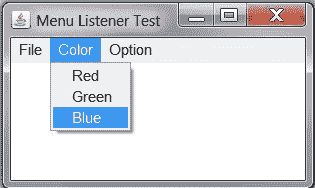

## AWT 菜单项监听器测试

如果你点击“Help”菜单项，在“File”菜单中点击“Open”和“Close”，然后在“Color”菜单中点击“Red”、“Green”和“Blue”，你会在 Java 控制台窗口上看到打印的一些消息：

```
Item clicked: Help
Item clicked: Open
Item clicked: Close
Item clicked: Red
Item clicked: Green
Item clicked: Blue
```

### 关于此教程示例的一些有趣说明：

* `private class MyMenuItem extends MenuItem implements ActionListener` 声明用于创建一个内部类 `MyMenuItem`，该类继承自 `MenuItem`，实现 `ActionListener`，并将自身添加以处理动作事件。
* `addActionListener(this);` 语句用于将我的内部类 `MyMenuItem` 自身添加以处理动作事件。
* `e.getActionCommand()` 表达式用于获取动作命令字符串，在此情况下为菜单项的按钮文本。

# Java Swing 教程 - Herong 的教程示例

## 与桌面系统的集成

本章提供了关于与本地桌面系统集成的教程笔记和示例代码。主题包括 `javax.awt.Desktop` 类及其方法的描述；启动默认浏览器、电子邮件程序和本地桌面系统文件编辑器的示例程序。

### javax.awt.Desktop 及相关方法

- `browse()` - 启动默认浏览器
- `mail()` - 启动默认电子邮件程序
- `edit()` - 启动给定文件的默认编辑器

## 结论：

* `javax.awt.Desktop` 类代表本地桌面系统。
* `getDesktop()` 方法可以用于获取当前本地桌面系统的实例。
* `browse(URI)` 方法可以用于使用给定的 `URI` 启动默认浏览器。
* `mail(URI)` 方法可以用于使用给定的 `mailto` `URI` 启动默认电子邮件程序。
* `edit(File)` 方法可以用于启动给定文件的默认编辑器。

本章列出的示例程序已通过 JDK 1.6 到 JDK 12 的测试。

## javax.awt.Desktop 及相关方法

本节描述了 `javax.awt.Desktop` 类及其常用的方法。

`java.awt.Desktop` - 一个 AWT 类，有助于将 Java GUI 应用程序与操作系统的桌面功能集成。它提供了以下有趣的方法：

* `getDesktop()` - 返回代表操作系统当前桌面的 `Desktop` 对象的方法。
* `browse(URI)` - 使用给定的 `URI` 启动默认浏览器的方法。
* `mail(URI)` - 使用给定的 `mailto` `URI` 启动默认电子邮件程序的方法。
* `edit(File)` - 使用给定文件启动默认编辑器的方法。

## browse() - 启动默认浏览器

本节提供了如何使用 `Desktop.browse()` 方法在桌面启动默认浏览器的教程示例。要启动默认浏览器，你可以获取 `Desktop` 对象。这是一个示例程序：

```java
/* DesktopBrowser.java
 * Copyright (c) 1997-2018 HerongYang.com. All Rights Reserved.
 */

import java.awt.*;
import java.awt.event.*;
import javax.swing.*;
import javax.swing.event.*;
import java.net.URI;

public class DesktopBrowser {

   public static void main(String[] a) {
      try {
         URI uri = new URI("https://www.herongyang.com");
         Desktop desktop = Desktop.getDesktop();
         if (desktop != null) {
            desktop.browse(uri);
         }
      } catch (Exception e) {
        e.printStackTrace();
      }
   }
}
```

如果你运行这个程序，你将看到默认浏览器启动。在我的 Windows 10 电脑上，我看到 Edge 启动了。

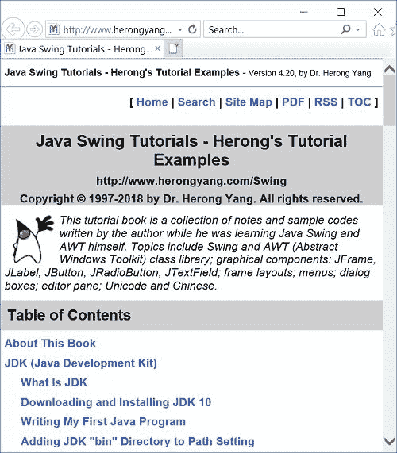

## mail() - 启动默认电子邮件程序

本节提供了如何使用 `Desktop.mail()` 方法在桌面启动默认电子邮件程序的教程示例。要启动默认电子邮件程序，你可以获取 `Desktop` 对象。这是一个示例程序：

```java
/* DesktopSendEmail.java
 * Copyright (c) 1997-2018 HerongYang.com. All Rights Reserved.
 */

import java.awt.*;
import java.awt.event.*;
import javax.swing.*;
import javax.swing.event.*;
import java.net.URI;

public class DesktopSendEmail {

   public static void main(String[] a) {
      try {
         String address = "herong_yang@yahoo.com";
         String subject = "Java%20Swing%20Tutorials";
         String body = "I%20like%20your%20tutorial%20book!";
         URI uri = new URI("mailto:" + address + "?subject=" + subject + "&body=" + body);
         Desktop desktop = Desktop.getDesktop();
         if (desktop != null) {
            desktop.mail(uri);
         }
      } catch (Exception e) {
        e.printStackTrace();
      }
   }
}
```

注意我在 `mailto` `URI` 字符串中对电子邮件地址、主题和消息主体进行了编码。如果你运行这个程序，你将看到默认电子邮件程序带有给定的电子邮件内容启动。在我的 Windows 10 电脑上，我看到 Outlook 应用启动了。

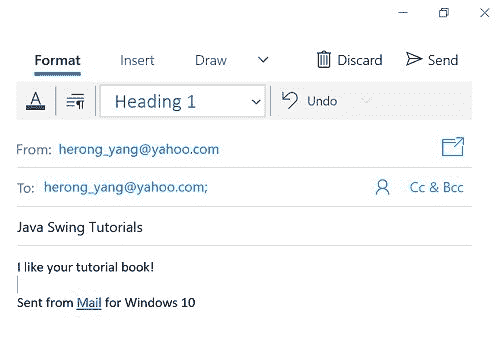

## edit() - 为指定文件启动默认编辑器

本节提供了一个教程示例，演示了如何使用 `Desktop.edit()` 方法根据文件类型为指定的文件启动默认编辑器。

如果你有一个文件，并想在操作系统的当前桌面上启动与其关联的默认编辑器，可以获取默认 `Desktop` 对象并调用它的 `edit()` 方法。以下是一个示例程序：

```java
/* DesktopEditFile.java
 * Copyright (c) 1997-2018 HerongYang.com. All Rights Reserved.
 */

import java.awt.*;
import java.awt.event.*;
import javax.swing.*;
import javax.swing.event.*;
import java.io.File;

public class DesktopEditFile {

   public static void main(String[] a) {
      try {
         File file = new File("Swing.jpg");
         Desktop desktop = Desktop.getDesktop();
         if (desktop != null) desktop.edit(file);
      } catch (Exception e) {
        e.printStackTrace();
      }
   }
}
```


确保你的工作目录下有一个名为 `Swing.jpg` 的图像文件。然后运行此程序，你将看到默认图像编辑器启动并打开指定的图像文件。在我的 Windows 10 电脑上，启动的是“画图”程序。

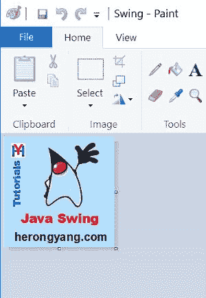

# 在桌面上启动文件编辑器

Java Swing 教程 - Herong 的教程示例

# 归档教程

本章包含了本书以前版本中的一些过时教程笔记和示例代码。

> 归档：下载并安装 JDK 12
>
> 归档：下载并安装 JDK 10

Java Swing 教程 - Herong 的教程示例

归档教程

## 归档：下载并安装 JDK 12

本节描述了如何在 Windows 系统上下载和安装 JDK 12。

JDK 的当前版本是 `JDK 12`，也称为 Java SE (标准版) 12。以下是我在 Windows 机器上下载和安装 JDK 12 的步骤。

*   使用此 URL 打开 Java SE 下载页面：[`www.oracle.com/technetwork/java/javase/downloads/`](https://www.oracle.com/technetwork/java/javase/downloads/)。
*   点击 "Java Platform (JDK) 12" 旁的下载按钮。你将看到一个新页面，列出了 JDK 12 的不同下载文件。
*   接受许可协议。
*   点击 "Windows 158.49 MB" 旁 `jdk-12.0.1_windows-x64_bin.exe` 的超链接。
*   将 `jdk-12.0.1_windows-x64_bin.exe` 保存到临时目录。
*   双击 `jdk-12.0.1_windows-x64_bin.exe` 启动安装向导。
*   安装向导将引导你完成安装。

下图显示了 JDK 12 安装界面的样子：

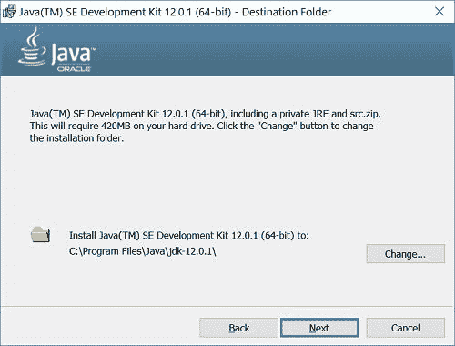 JDK 12 安装界面

要测试安装，打开命令行并尝试 `java` 命令。如果得到以下输出，说明安装成功：

```
herong> \progra~1\java -version

java version "12" 2019-04-16

Java(TM) SE Runtime Environment (build 12+4)

Java Hot(TM) 64-Bit Server VM (build 12+4, mixed mode)
```

Java Swing 教程 - Herong 的教程示例

归档教程

## 归档：下载并安装 JDK 10

本节描述了如何在 Windows 系统上下载和安装 JDK 10。

以下在我 Windows 机器上下载和安装 JDK 10 的步骤。

*   使用此 URL 打开 Java SE 下载页面：[`www.oracle.com/technetwork/java/javase/downloads/`](https://www.oracle.com/technetwork/java/javase/downloads/)。
*   点击 "Java Platform (JDK) 10" 旁的下载按钮。你将看到一个新页面，列出了 JDK 10 的不同下载文件。
*   接受许可协议。
*   点击 "Windows 390.19 MB" 旁 `jdk-10.0.1_windows-x64_bin.exe` 的超链接。
*   将 `jdk-10.0.1_windows-x64_bin.exe` 保存到临时目录。
*   双击 `jdk-10.0.1_windows-x64_bin.exe` 启动安装向导。
*   安装向导将引导你完成安装。

要测试安装，打开命令行并尝试 `java` 命令。如果得到以下输出，说明安装成功：

```
herong> \progra~1\java -version

java version "10.0.1" 2018-04-17

Java(TM) SE Runtime Environment (build 10.0.1+10-3)

Java Hot(TM) 64-Bit Server VM (build 10.0.1+10-3, mixed mode)
```
