# Java 技术入门

# 关于编辑

## Gerard Ian Prudhomme

Gerard I. Prudhomme 拥有伦敦大学学院（UCL）的计算机科学硕士学位（M.S.）。他曾在多家财富500强企业担任软件程序员和技术作家，并在伦敦大学学院、哈佛大学和牛津大学学习过。

# 贡献者列表

孙勇梅 (Yongmei Sun)

李星 (Xing Li)

信息与学院，北京邮电大学，北京，中国

吴迪 (Di Wu)

信息与学院，北京邮电大学，北京，中国

潘齐 (Qi Pan)

传染疾病分子生物学关键实验室（教育部），病毒肝炎研究所，重庆医科大学附属第二医院传染病科，重庆，中国

J跃峰 (Yuefeng J)

信息与学院，北京邮电大学，北京，中国

任洪 (Hong Ren)

传染疾病分子生物学关键实验室（教育部），病毒肝炎研究所，重庆医科大学附属第二医院传染病科，重庆，中国

邓凯 (Kye Deng) 

传染疾病分子生物学关键实验室（教育部），病毒肝炎研究所，重庆医科大学附属第二医院传染病科，重庆，中国

罗伯特·G·鲁特利奇 (Robert G. Routledge)

加拿大资源部，加拿大森林局，魁北克，加拿大

Philipp Kainz

格拉茨生物物理学研究所，生理医学中心，格拉茨医科大学，格拉茨，奥地利

迈克尔·迈罗费尔-莱因哈特贝尔 (Michael Mayrhofer-Reinhartsuber)

生物物理学研究所，生理医学中心，格拉茨医科大学，格拉茨，奥地利

赫尔穆·阿哈默 (Helmut Aahammer)

生物物理学研究所，生理医学中心，格拉茨医科大学，格拉茨，奥地利

埃里克·丹尼尔森 (Eric Danielson)

药理学与毒学系，威斯康星医学院，密尔沃基，威斯康星州，美国

神经科学研究中心，威斯康星医学院，密尔沃基，威斯康星州，美国

弗吉尼亚理工大学 (Virginia Tech)

卡里隆学院，美国

李桑 (Sang H Lee)

药理学与毒学系，威斯康星医学院，密尔沃基，威斯康星州，美国

Rden DL

伦敦大学学院医学系，伦敦，英国

Sewell GW

伦敦大学学院医学系，伦敦，英国

Labley A

伦敦大学学院医学系，伦敦，英国

Levine AP

伦敦大学学院医学系，伦敦，英国

Smith AM

伦敦大学学院医学系，伦敦，英国

Segal AW

伦敦大学学院医学系，伦敦，英国

托马斯·W·舒伯特 (Thomas W. Schubert)

心理学系，奥斯陆科学大学，奥斯陆，挪威

社会科学、政策与干预系，里斯本大学学院 (ISCTE-IUL)，里斯本，葡萄牙

卡拉·穆尔泰拉 (Carla Murteira)

社会科学、政策与干预系，里斯本大学学院 (ISCTE-IUL)，里斯本，葡萄牙

伊莉莎白·C·柯林斯 (Elizabeth C. Collins)

社会科学、政策与干预系，里斯本大学学院 (ISCTE-IUL)，里斯本，葡萄牙

迪尼兹·洛佩斯 (Diniz Lopes)

社会科学、政策与干预系，里斯本大学学院 (ISCTE-IUL)，里斯本，葡萄牙

大卫·K·特亨 (David K. Teheng)

伊利诺伊信息学学院，伊利诺伊大学，厄巴纳，伊利诺伊州，美国

阿什温·K·纳亚克 (Ashwin K. Nayak)

整合生物学学院，伊利诺伊大学，厄巴纳，伊利诺伊州，美国

查尔斯·C·福克斯 (Charless C. Fowkes)

计算机科学系，加利福尼亚大学欧尔文分校，加利福尼亚州，美国

苏兰吉·W· 普尼亚森 (Surangi W. Punyasen)

植物生物学系，整合生物学学院，伊利诺伊大学，伊利诺伊州，美国

德拉加纳·米尔科维奇 (Dragana Miljkovic)

知识技术系，约泽夫·斯特凡研究所，卢布尔雅那，斯洛文尼亚

约泽夫·斯特凡国际研究生学校，卢布尔雅那，斯洛文尼亚

Tjas'a St (Tjas'a St)

生物技术与系统生物学系，国家生物学研究所，卢布尔雅那，斯洛文尼亚

伊戈·莫泽蒂奇 (Igor Mozetic)

知识技术系，约泽夫·斯特凡研究所，卢布尔雅那，斯洛文尼亚

维德·莫泽蒂奇 (Vid Mozetic)

知识技术系，约泽夫·斯特凡研究所，卢布尔雅那，斯洛文尼亚

约泽夫·斯特凡国际研究生学校，卢布尔雅那，斯洛文尼亚

马尔科·佩泰 (Marko Petek)

生物技术与系统生物学系，国家生物学研究所，卢布尔雅那，斯洛文尼亚

卡米尔·维泰克 (Kamil Witek)

生物技术与系统生物学系，国家生物学研究所，卢布尔雅那，斯洛文尼亚

伊戈·莫泽蒂奇 (Igor Mozetic)

知识技术系，约泽夫·斯特凡研究所，卢布尔雅那，斯洛文尼亚

约泽夫·斯特凡国际研究生学校，卢布尔雅那，斯洛文尼亚

维德·莫泽蒂奇 (Vid Mozetic)

知识技术系，约泽夫·斯特凡研究所，卢布尔雅那，斯洛文尼亚

约泽夫·斯特凡国际研究生学校，卢布尔雅那，斯洛文尼亚

马尔科·佩泰 (Marko Petek)

生物技术与系统生物学系，国家生物学研究所，卢布尔雅那，斯洛文尼亚

卡米尔·维泰克 (Kamil Witek)

生物技术与系统生物学系，国家生物学研究所，卢布尔雅那，斯洛文尼亚

Maria I Morasso

皮肤生物学实验室，内部研究计划，国立关节炎和肌肉骨疾病和皮肤研究所，贝塞斯达，马里兰州，美国

Rasiah Logananthanaraj

生物信息学实验室，高级计算机研究中心，路易斯安那大学拉法叶分校，拉法叶特，路易斯安那州，美国

Hong-Wei Sun

生物数据挖掘与发现部门，科学技术办公室，内部研究计划，国立关节炎和肌肉骨疾病和皮肤研究所，贝塞斯达，马里兰州，美国

Wei-Chun Chun

中央研究院信息科学研究所，台北，台湾

国立台湾大学资讯工程学系，台北，台湾

中央研究院信息技术创新研究中心，台北，台湾

Chien-Chih Chen

中央研究院信息科学研究所，台北，台湾

国立台湾大学资讯工程学系，台北，台湾

Jan-Ming Ho

中央研究院信息科学研究所，台北，台湾

中央研究院信息技术创新研究中心，台北，台湾

Chung-Yen Lin

中央研究院信息科学研究所，台北，台湾

Wen-Lian Hsu

中央研究院信息科学研究所，台北，台湾

Yuchun Wang

中央研究院信息科学研究所，台北，台湾

D. T. Lee

中央研究院信息科学研究所，台北，台湾

国立台湾大学资讯工程学系，台北，台湾

国立中兴大学资讯工程学系，台中，台湾

Feifei Lai

国立台湾大学资讯工程学系，台北，台湾

Chih-Wei Huang

中央研究院信息科学研究所，台北，台湾

Yu-Jing Chang

中央研究院信息科学研究所，台北，台湾

Gustavo A. Salazar

计算生物学小组，临床实验室科学系，开普敦大学，开普敦，南非

Leyla J. Garcia

欧洲生物信息学研究所，辛克斯顿，英国

Philip Jones

欧洲生物信息学研究所，辛克斯顿，英国

Rafael C. Jimenez

欧洲生物信息学研究所，辛克斯顿，英国

Antony F. Quinn

欧洲生物信息学研究所，辛克斯顿，英国

Andrew M. Jenkinson

欧洲生物信息学研究所，辛克斯顿，英国

Nicola Mulder

计算生物学小组，临床实验室科学系，开普敦大学，开普敦，南非

Maria Martin

生物信息学研究所，辛克斯顿，英国

Sarah Hunter

欧洲生物信息学研究所，辛克斯顿，英国

Henning Hermijakob

欧洲生物信息学研究所，辛克斯顿，英国

Muhammad Shoaib Farooq

计算机科学系，阿杜阿里汗大学，马尔丹，巴基斯坦

信息技术学院，中普贾大学，拉霍尔，巴基斯坦

Sher Afzal Khan

信息技术学院，中普贾大学，拉霍尔，巴基斯坦

Farooq Ahmed

数学系，阿杜阿里汗大学，马尔丹，巴基斯坦

Saced Islam

信息技术学院，中普贾大学，拉霍尔，巴基斯坦

Adnan Abid

信息技术学院，中普贾大学，拉霍尔，巴基斯坦

Andrew Morin

生物化学与分子药学系，哈佛医学院，波士顿，马萨诸塞州，美国

Jennifer Urban

Samelson法律、技术与公共政策诊所，加州大学伯克利分校，伯克利，加利福尼亚州，美国

Piotr Salz

生物化学与分子药学系，哈佛医学院，波士顿，马萨诸塞州，美国

Greg Wilson

软件木工 (Software Carpentry)

D.A. Arullah

安大略理工大学

C. Titus Brown

密歇根州立大学

Neil P. Chue Hong

软件可持续性研究所

Matt Davis

太空望远镜科学研究所

Richard T. Guy

多伦多大学

Steven I.D. Haddock

蒙特雷湾水族研究所

Kathryn D. Huff

加州大学

Ian M. Mitchell

不列颠哥伦比亚大学

伦敦皇后玛丽大学

Ben Waugh

伦敦大学学院

Ethan P. White

犹他州大学

Paul Wilson

威斯康星州大学

Ralph Pethica

布里斯托大学计算机科学系，布里斯托尔，英国

Gary Barker

布里斯托大学生物科学学院，布里斯托尔，英国

Tim Kovacs

布里斯托大学计算机科学系，布里斯托尔，英国

Julian Gough

布里斯托大学计算机科学系，布里斯托尔，英国

Rachel M. Berquist

加州大学圣迭戈分校成像科学计算中心，拉霍亚，加州，美国

Kristen M. Gledhild

加州大学圣迭戈分校成像科学计算中心，拉霍亚，加州，美国

Matthew W. Peterson

加州大学圣迭戈分校成像科学计算中心，拉霍亚，加州，美国

Allison H. Doan

加州大学圣迭戈分校成像科学计算中心，拉霍亚，加州，美国

Gregory T. Baxter

加州大学圣迭戈分校成像科学计算中心，拉霍亚，加州，美国

Kara E. Yopak

加州大学圣迭戈分校成像科学计算中心，拉霍亚，加州，美国

Ning Kang

加州大学圣迭戈分校成像科学计算中心，拉霍亚，加州，美国

H. J. Walker

海洋脊椎动物采集与海洋生物学部门，斯克里普斯海洋研究所，加州大学圣迭戈分校，拉霍亚，加州，美国

Philip A. Hastings

海洋脊椎动物采集与海洋生物学部门，斯克里普斯海洋研究所，加州大学圣迭戈分校，拉霍亚，加州，美国

Lawrence R. Frank

加州大学圣迭戈分校成像科学计算中心，拉霍亚，加州，美国

Garaizar P

德乌斯理工学院，毕尔鄂，西班牙

Vadillo MA

伦敦大学学院实验心理学系，伦敦，英国

López-depiñea

德乌斯理工学院，毕尔鄂，西班牙

# 前言

Java 是一种由太阳微系统公司设计的编程语言。一个被称为“绿色小组”的小型设计团队在 1991 年创建了这种语言。Java 曾被称为 OAK，是为手持产品和顶置显示盒而设计的。由于 OAK 遭遇了失败，太阳公司在 1995 年将其命名为 Java，并对语言进行了定制，以利用快速扩张的互联网带来的收益。Java 的语法类似于 C++，但基于面向对象编程。

与 JDK 的 Java API 讨论了其每个元素的功能。例如，所有的 Java 方法都属于类，并分配给各个类。在 Java 编程中，某些元素作为频繁使用的项被预创建。然而，函数以及变量需要被明确标识。第一章评估了 Java-MySQL 软件。第 2 章分析了使用 NetBeans IDE 准备的 LRE 分析器。第 3 章评估了 Java 中的图像及评估。第 4 章评估了利用 Java 软件创建的自包含量化软件。第 5 章讨论了使用 R 语言和 Java 的软件。第 6 章评估了收集在线科学研究中个体反应的软件。第 7 章将 Java 软件用于动态图像分类。第 8 章分析了用于 DNA 构建和 RNA 分析的软件。第 9 章展示了用于简单人类群体 LD 分层的图形化软件。第 11 章概述了 OSS 现象的研究。第 12 章分析了用于能源系统控制的零成本应用的性能。第 13 章介绍了一个具有分布式布局的系统，它合并了合并内容分析。第 14 章介绍了一个用于部署到桌面的便捷设备。第 15 章介绍了一个用于分发注释的在线托管服务器。由于第 16 章评估了著名的早期编程语言。第 17 章为科学家程序员提供了软件程序手册。第 18 章涉及科学计算。第 19 章解释了系统发育树渲染。第 20 章分析了形态学数据的在线存档。第 21 章评估了基于 HTML5 的多媒体刺激。

夏威夷，美国

# RED：一种基于规则和统计过滤器的识别与可视化 RNA 编辑位点的 Java-MySQL 软件

孙勇美¹, 李星¹, 吴迪¹, 潘齐², 纪叶峰¹, 仁红², 丁可越²²

1 北京邮电大学信息与学院，中国，北京。

2 重庆医科大学第二附属医院传染病科，病毒肝炎研究所，教育部传染性疾病分子生物学重点实验室，重庆

## 摘要

RNA 编辑是转录后或共转录过程之一，它会导致蛋白质序列中的氨基酸替换、前体 mRNA 可变剪接以及表达水平的变化。尽管已有多种方法被用于识别 RNA 编辑位点，但在区分 RNA 编辑位点与其基因组及文本伪迹位点方面仍面临诸多挑战待解决。此外，目前缺乏一个用于识别和可视化潜在 RNA 编辑位点的软件框架。在此，我们介绍了一种“RED”（RNA 编辑位点检测器）的软件，通过图形用户界面（GUI）对 RED 位点进行验证和可视化。为了提高性能，我们使用了 MySQL 数据库管理系统（DBMS）进行高通量数据存储和查询。在对包含 28 个实验验证的 C–RNA 编辑位点的样本数据集进行分析时，RED 的敏感性和特异性分别为 0.64 和 0.65。相比之下，REDTools 具有更高的敏感性（0.75），但特异性相似（0.5）。RED 是一种易用、跨平台的 Java 软件，可应用于 RNA-seq 数据或在没有测序数据的情况下。该软件包根据 GPL3 许可证免费提供，地址为 `http://github.com/sourceforge/red/projects/rededitor`。

# 引言

RNA 编辑是根据基因组序列对 RNA 核苷酸进行修饰的转录后或共转录过程。在人类中，主要的 RNA 编辑类型是脱氨基（A→I）编辑和尿嘧啶编辑（C→U），分别由 ADAR 酶和 APOBEC1 脱氨基酶介导。在剪接和翻译过程中，I 和 U 被解释为鸟嘌呤（G），编码序列中的这些变化会导致密码子改变并改变蛋白质的功能特性 [2]。此外，内含子的 RNA 编辑可能会影响可变剪接，而非翻译区（UTR）的编辑可能导致 mRNA 在细胞核内保留。

RNA 编辑与广泛的人类疾病有关，包括癌症、神经系统疾病、代谢性疾病、病毒感染和自身免疫性疾病 [3]。

引用：Sun Y, Li X, Du D, Pan Q, Ji R, Ren H, et al. (2016) A Java-MySQL for Identifying and Visualizing RNA Editing Sites Using Rule-Based and Statistical Tools. PLoS ONE 11(3):e0150465, doi:10.1371/journal.pone.0150465 *Wei*

Yaeow 等人认为 A–RNA 编辑可能提供一种额外的表观遗传机制来逆转癌症的发展和进展。在最近的一份报告中，Chen [5] 发现肝细胞癌样本中，AZIN1 在非同义替换（ser367gly）处的 A–RNA 编辑增加。值得注意的是，AZIN1 的编辑在进展过程中会增加，并可能促进肝细胞癌的复发和转移 [5]。AZIN1 的编辑形式对抗聚合物具有更强的亲和力，其结果抑制了细胞增殖。Sharma [6] 鉴定了数百个基因的转录本，这些基因在响应缺氧时发生了特定的 C–U 编辑。


# RNA 编辑检测工具综述与 RED 软件设计实现

## 背景与挑战

RNA 事件可以通过位点特异性 RNA 测序、基因组 DNA 与 RNA 的比较 [7] 以及 `RNA-seq` [8, 9] 进行。随着二代测序的出现，通过比较七个个人的 DNA 序列已发现了数百个 RNA 位点 [10]。仅使用 `RNA-seq` 数据即可以高置信度识别 RNA 位点。然而，在识别真实的 RNA 编辑位点方面仍存在挑战，必须将其与其来源以及技术伪迹（例如测序或比对错误）区分开来 [12, 13]。

## 现有工具概述

已设计了多种工具来检测高通量 RNA 编辑：

- **RedTools**：Picardi 等 [14] 提供了一套脚本，利用 DNA 测序数据识别 RNA 编辑。`RedTools` 需要命令行工具，要求输入格式为二进制序列（`BAM`），通过预对齐的 `RNA-seq` 和 DNA 测序 `reads` 检测 RNA 编辑候选位点，通过观察聚类探索 RNA 实验的 RNA 编辑潜力，并使用 RNA 数据进行 RNA 编辑候选位点的检测。
- **VIRGO**：Dizenzo 等人 [15] 使用基于 Web 的工具 `VIRGO` 将基因组和实验序列标签之间的 A–G 匹配映射为 A 候选编辑位点。
- **RDDchecker**：`RDDchecker` (https://github.com/joshsoftware/rdchecker/) 是一个 Perl 工具，用于预测可能由 RNA 后翻译编辑引起的 RNA-DNA 差异。分析短读以检测变异位点和多种过滤器（如已知 SNP）。该程序同时处理 `RNA-seq` 和 DNA 测序数据，但仅通过 `RNA-seq` 无法识别潜在的 RNA 编辑位点。
- **RCARE**：`RCARE` [16] 是一个基于 Web 的工具，根据已知的 RNA 编辑知识搜索、注释和可视化 RNA-DNA 差异，并为提高 RDD 位点的可靠性提供了证据。然而，`RCARE` 不能识别潜在的新型 RNA 编辑位点。
- **GIREM**：Zheng、Zhang 和 Xiao [17] 提出一种方法（`GIREM`），通过催化 `RNA-seq` 中错配对的互信息来区分 RNA 编辑位点和 SNP，并训练了一个广义线性模型（`GML`）以增强使用 `RNA-seq` 数据识别 RNA 编辑位点的预测能力。然而，仅使用 `RNA-seq` 数据识别真实的 RNA 编辑位点仍面临挑战，由于技术伪迹（例如测序或比对错误），必须进行解卷积 [12, 13]。

## 设计与实现

### 核心架构

`RED` 工具通过图形用户界面（`GUI`）对 RED 位点进行验证和可视化。为了提高性能，我们使用了 `MySQL` 数据库管理系统（`DBMS`）进行高通量数据存储和查询。

### 性能指标

在对包含 28 个实验验证的 C–RNA 编辑位点的样本数据集进行分析时，`RED` 的敏感性和特异性分别为 0.64 和 0.65。相比之下，`REDTools` 具有更高的敏感性（0.75）但特异性相似（0.5）。

### 软件特性

`RED` 是一种易用、跨平台的 `Java` 软件，可应用于 `RNA-seq` 数据或在没有测序数据的情况下应用。该软件包根据 `GPL3` 许可证免费提供，地址为 `http://github.com/sourceforge/red/projects/rededitor`。

### 统计学方法

定义为：`LLR = log10(P(D)/P(N))`。排除 `LLR < m` 的变异集，其中 `m` 是定义的，且建议 `m = 4`。`LLR > 4` 表示编辑事件的概率是非编辑事件的 10 倍。

使用 `Benjamini & Hochberg` 方法 [26] 计算假性发现率 (`FDR`)。

此外，我们通过比较编辑水平测量了给定 RNA 位点的显著性。根据 `DARNED` 和 RNA 数据库 [21] 中已知的 RNA 编辑位点计算了给定位点的预期 `n(A)` 和 `n(G)` 数量。随后，这些（预期）值通过 `Fisher` 精确检验来计算给定 RNA 编辑位点的 `p` 值。为了进行多重假设校正，所有 `p` 值都经过调整。

### 界面设计

`RED` 旨在通过 `GUI` 在位点水平上可视化和探索 RNA 编辑位点（图 2）。所有潜在 RNA 编辑位点的分布可以在核型图概述显示。利用强大的工具整合基因组查看器 `IGV` [27] 中的思路，可以在带有注释的 `RNA-seq reads` 区域高亮显示潜在的 RNA 编辑位点。如果有 DNA 测序数据，可以将其与基因组上的对应部分进行比较。

`RED` 的主窗口由五个面板组成：

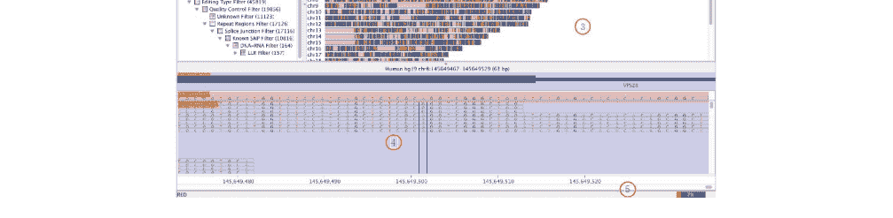

- **工具栏面板**：提供常用函数的便捷访问，可以通过主菜单或键盘快捷键访问。
- **目录面板**：对观察到的位点提供快速概述，包括注释集、数据集和位点列表。此列表包含每个过滤步骤后剩余的变异，以分级树结构显示。
- **基因组面板**：提供人类编辑位点的概述（例如，`chr1-22, X, Y, MJ`）。所有潜在 RNA 编辑位点均已过滤，显示在核型图概述中。
- **染色体面板**：显示来自 `NCBI RefSeq` 的注释、基因轨道以及序列。数据轨道展示了 `BAM` 文件中的所有 `RNA-seq reads`，分为两种类型：基因组和区间碱基。
- **状态面板**：当鼠标悬停在染色体或特征上时，显示相关信息，并显示内存使用情况。

### 技术栈

`RED` 主要使用 `Java` 编程语言开发，使用 `MySQL` 进行数据管理以及 `R` (http://www.r-project.org/) 进行统计分析。所有与 `MySQL` 和 `R` 相关的函数在 `Windows`、`Linux` 和 `Mac` 等主流计算平台上都在 `RED` 中自动执行。

为了使计算更高效且更节省空间，实现了广泛使用的数据库管理系统 (`RDBMS`) `MySQL` 来管理数据（通过 `RNA-VCF` 文件和如果可用的 `DNA VCF` 文件），作为过滤所需的文件。`RED` 可以加速数据库引擎对过滤结果（即某个位点）的查询。使用 `Java` 数据库连接 (`JDBC`) 连接到本地或远程数据库。

`RED` 同样使用 `R` 这一执行语言来执行统计分析，包括 `FDR`。使用一个简单的 `Java` `Caller` 来调用 `R` 中的表格和脚本。

### 导出功能

`RED` 提供图像和文本的灵活导出功能。从 `RED` 生成的图像可以导出为文本或 `SVG` 格式。按编辑类型和染色体呈现 RNA 编辑位点分布以图表呈现。有关所有潜在 RNA 编辑位点的信息可以导出到制表符分隔的文件，包括染色体、位置、ID、参考碱基、基线、质量、编辑水平、`p` 值和 `FDR`。此外，`RED` 项目文件（包括潜在 RNA 编辑位点、数据集信息、注释软件以及软件偏好）可以保存在用户的偏好设置中。

## 结果

### 实验验证

`RED` 采用了多种技术实现，包括：1) 使用 `GATK` 指南通过高通量二代测序数据实现快速数据存储/检索和低内存占用。`RED in novo` 模式（使用 `MySQL` (版本 5.1.173)、`Java` (版本 1.8.0_25) 和 `R` (版本 3.2.2)）检测到 27 个潜在 RNA 编辑位点 (`P < 0.05`)，`Fisher` 精确检验。`RED in novo` 模式（版本 2.6.6）识别出 171 个位点 (`P < 0.05`)，其中 121 个位点 (55%) 在两个程序中被识别。我们随后测试了影响氨基酸的 30 个潜在 RNA 编辑位点。在这 30 个位点中，有 28 个通过体外 RNA 新测序验证（见 Sharma 等人 [6] 中的表 1）。我们确认除了两个假性 RNA 编辑位点中的一个外，每个位点都被两个程序识别了。`RED in novo` 模式和 `REDTools` 中的 `de novo` 模式在识别 RNA 编辑位点的两种方法中识别了 21 个（如图 3 所示的敏感性和特异性）。

Sharma 等人 [6] 在缺氧但非单细胞富集的外周单核细胞 (`MEFs`，每组样本数) 中识别并实验验证了 `C→U` RNA 编辑位点。我们使用这些已通过验证的 `C→U` RNA 编辑位点验证了 `RED` 和 `REDTools` (1.0.3)。从 `NCBI` 搜索存档下载了访问号为 `SRP0408006` 的六个位点的 RNA 测序。用于 `RNA-seq` 调用变异的 `GATK` 工作流 (https://www.broadinstitute.org/gatk/guide/variant-calling-rna-seq) 使用默认设置（最大 256 GB 内存和 4 核 CPU，40 核 `Intel(R) Xeon(R) CPU E7-8850 @ 2.0GHz`）进行计算。软件细节见文。

### 对比分析

我们首先测试了 220 个 `C→U`（以及 `G→A`）Sharma 等人 [6]。在 220 个潜在 RNA 编辑位点中，调用了 167 个变异。韦恩图（图 3）显示 17 个位点 (60.7%) 被两个软件识别。RNA 编辑位点（`TMEM131` 中的 `chr2:98409343`）的变异调用识别结果如图 4 所示。

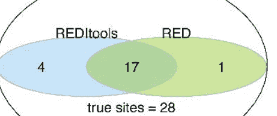

| 过程 | TP | FN | 敏感性 | 特异性 |


| RED | 18 | 1 | 0.64 | 0.5 |
|---|---|---|---|---|
| REDTools | 21 | 7 | 0.75 | 0.5 |

RNA 编辑位点（`TMEM131` 中的 `chr2:98409343`）的识别结果在图 4 中所示。

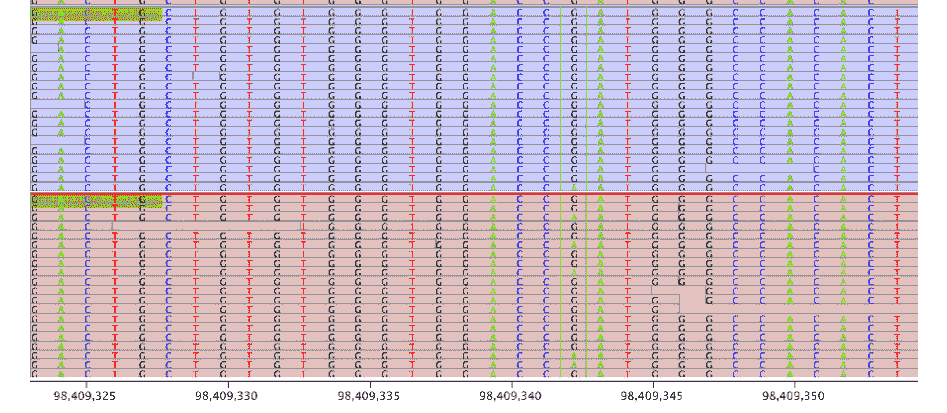

4. Pac-Yazov N, Levanov N, Levon E, Kinar H, Yarmin A, Jacob-Hirsch J, 等. 腺苷变肌苷的 RNA 编辑塑造了灵长类动物的转录组多样性。Nat Acad Sci U 2010;107(22):12714–12719; doi:10.1073/nas.100681803.

5. Chen L, Li Y, Lin CH, Cham EW, Chow S, Yong Y, 等. 识别肝细胞癌中 ADNI 过程的 RNA 编辑。Nat Med 2013;19(2):219–220; doi:10.1038/nmed3343; pmid:2229163

6. Sharma S, Panig K, Skagger T, Takart RT, Kamisto E, Ernridge SN, Gollnick P, 等. ALTOBEC3A 循环诱导单核细胞和巨噬细胞中的 RNA 编辑。Communications 2015;6:68811; doi:10.1038/ncomms7881

7. Cirulli IT, Sheng A, Shianna KV, Ge D, Smith JP, Maio, 等. 通过基因组和转录组测序寻找编辑组。J Biol 2010;11(5):577–585; doi:10.1186/1471-2107-11-577; pmid:2095139

8. Li M, Wang W, Li J, Richards AL, Archibald AJ, 等. 转录组中广泛的 RNA 和 DNA 差异。Science. 2011;333(6039):532–538; doi:10.1126/science.120718.

9. Park E, Williams B, Boyd JL, Bortvazi A. 人类 ENCODE RNA-seq 数据中的 RNA 编辑位点。Genome Biol. 2002;9(6):S229; doi:10.1186/10.1031/gb:41947; pmid:22990575

10. Li B, Levanov E, Yoon JK, Aach J, Xie B, Lepeut E, 等. 并行测序的全基因组 RNA 编辑识别与癌症检测。Science 2009;324(5931):1210–1212; doi:10.1126/science.1157095; pmid:19478186

12. Eisenstein B, A-to-I 编辑位点的生物信息学分析。J. Virol Microbiol. 2012;106(15):3142–3155; doi:10.1004/jvi.021915-12.

13. Ramawasi G, Lin P, Riskol TN, Han MH, Davis C, 等. A-to-I RNA 编辑位点的识别。Nat Met. 2012;9(6):579–581. doi:10.1038/nmet.1982.

14. Picard E, Eells J, Richards DL: 高通量 RNA 编辑检测变得简单。Bioinformatics 2013;29(14):1811–1814. doi:10.1093/bioinformatics/bts2749; pmid:23729438

15. Deifano R, Nigita G, Macca V, Lugagna A, Pulverini A, 等. VIRGO: 基因物种中 A-to-I RNA 编辑位点的可视化。BMC Biol. 2013;7:S55; doi:10.1186/1471-2105-14-S7-S55.

16. Lee SY, Joung J, Park CH, Park JH, Kim JH RCARE: 用于 RNA 编辑的 RNA 序列比较和注释。BMC Genomics Med. 2015;8(1):S8. doi:10.1186/1755-8794-8-S2; pmid:26043358

17. Xiao X, 依赖基因组序列的 RNA 编辑位点识别。Methods. Bioinformatics. 2010;26(14):1772–1776; doi:10.1093/bioinformatics/btq257; pmid:2048789

18. DePristo M, Bash E, Polkinin R. 从 RNA-seq 数据中可靠地识别变异编辑。AJ Human Genet. 2013;93(4):641–651. doi:10.1001/ajhg.22418; pmid:23080515

19. Kiran A, Baranov V. 人类 RNA 编辑数据库。Bioinformatics. 2010;26(14):1858–1867; doi:10.1093/bioinformatics/btq57

20. Jenkins J, Li RB. 严格注释的 A-to-I 数据库。Nucleic Acids. 2014;42(1):D109–D13. doi:10.1093/nar; pmid:2631423

21. Levanov E, Eisenstein B, Yirin N, Mesh R, 等. 全基因组测序识别 RNA 编辑。Nat Genet. 2004;36(8):701–705. doi:10.1038/ng0123

22. Batista M, Dezinger N. 基因组中的 RNA 编辑。Nat Gen Rev. 2002;3(5):537–540.

23. Peng J, Chen Y, Yang D, Lin L, 等. 高高量测序的人的 RNA 编辑。Nat Biotechnol. 2012;33(5):255–260. doi:10.1038/nbt2122

24. Ding K, Wu S, Yang D. 证明概念。Sci Rep. 2015;6:7564. doi:10.1038/srep7564; pmid:2663154

25. Benjamin Y, Hochberg Y. 控制错误率。J Stat Soc. 2009;15:279–309.

26. Robinson J, Thor S, Winkler G. 集成视图。Nat Biotechnol. 2011;29(1):24–26. doi:10.1038/nbt1754

## 摘要

基因组中 RNA 编辑的重要性已有广泛报道。然而，使用高通量测序识别 RNA 编辑位点仍然是一项挑战。在本研究中，我们介绍了 `LRE`，一种用于 RNA 编辑分析的工具。`LRE` 的开发是为了提供一种从 RNA-seq 数据中定量 RNA 编辑的方法。该程序采用模块化架构并兼容各种操作系统。

# 背景

实时 qPCR 已证明定量 RNA 编辑的潜力。然而，手动构建标准曲线非常耗时。引入 `LRE` 是为了给标准曲线构建提供替代方案。`LRE` 的重要性在于其处理复杂数据的能力。

# 发现

`LRE` 分析器能够以高精度定量 RNA 编辑。通过对技术重复进行平均，可以显著提高结果的准确性，这对于某些样本是关键的。该程序使用了模块化架构。

## 方法

`LRE` 分析器使用 `Java` 编写，利用了 `NetBeans` 提供的模块化架构和窗口系统。数据库对象用于数据存储，`Excel` 用于实时 qPCR 的分析。

## 结果

RNA 提取和转录按照之前的方法进行。演示数据库中的数据是使用 `Applied TaqMan` 在 `7500` 上生成的。在 `200 nl` 反应体积下使用 `96` 孔板（`Agilent` 配备 `MicroAmp`）进行 PCR，并通过 `95°C 15 分钟`，随后进行 `50` 次 `95°C - 65°C - 12 分钟` 的循环进行放大。

## 结论

`LRE` 分析器能够以高精度定量 RNA 编辑。通过对技术重复进行平均，可以显著提高结果的准确性，这对于某些样本是关键的。该程序使用了模块化架构。

图 1。`LRE` 数据库。

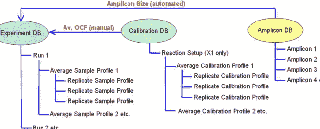

# 一种用于大规模绝对定量的 LRE 实时 qPCR Java 程序

## 三种 LRE 数据集

`LRE` 定量的另一个概念被称为“反应体系”，它涵盖了所有影响检测光学特性的因素。这些包括反应容器和酶配方、仪器的光学特性，它们共同决定了检测的荧光强度。绝对定量的一个关键方面是对检测荧光强度进行校准，这通过对已知量的 `lambda DNA` 进行扩增来定量，通常被称为绝对校准因子（`ACF`），该因子是特定反应体系所有的 [5], [7]。

用户界面由三个面板组成，每个面板包含用于查看和/或编辑三种 `LRE` 数据库类型的窗口（图 2）。资源管理器面板（`explorer panel`）窗口允许创建、打开和关闭数据库。一旦打开文件，数据将以树或运行中的配置文件（`profiles`）的形式呈现，并显示有关数据元素及其标签的信息（图 3）。当选择一个数据元素时，相应的编辑器窗口将显示该数据元素并允许进行编辑（图 4）。排序面板允许对跨多次运行的配置文件进行组织，以便作为一个组进行查看/编辑或导出（图 5）。

注意，`LRE` 帮助集提供了有关如何进行 `LRE` 定量的描述，以及如何实施基于 `LRE` 检测的指南。还提供了演示数据库文件，以帮助说明 `LRE` 分析器的功能，并提供对 `LRE` 定量能力的见解。

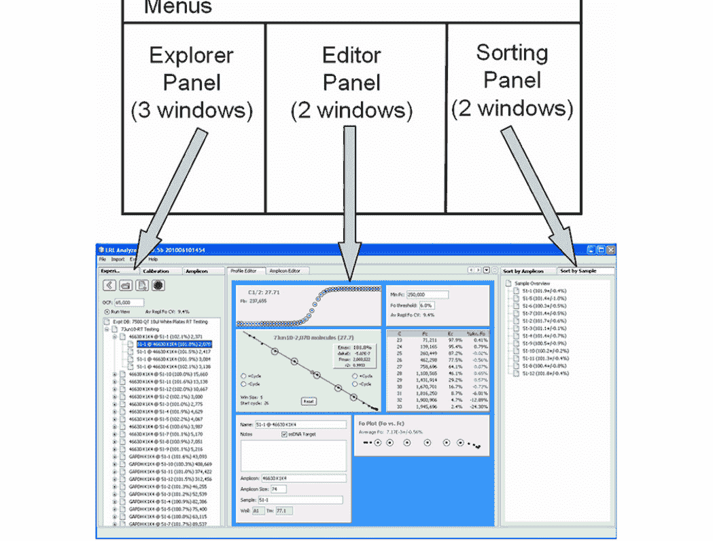

| 实验 | 校准 | 扩增子 |
|---|---|---|
| 运行视图 | Av. OCF (FU(ng)): 129,000 | |
| - 15Sep10-Run 1 | | |
| - 12240 K1K4@COL1 QT (101.0%) 1,919 | | |
| - 12240 K1K4@COL2 QT (100.6%) 1,409 | | |
| - 12240 K1K4@COL3 QT (100.4%) 1,318 | | |
| - 46630 K1K4@COL1 QT (103.7%) 4,328 | | |
| - 46630 K1K4@COL2 QT (101.8%) 3,323 | | |
| - GAPH K1K4@COL1 QT (102.3%) 110,399 | | |
| - GAPH K1K4@COL2 QT (101.2%) 85,512 | | |
| - GAPH K1K4@COL3 QT (101.1%) 77,269 | | |
| - 15Sep10-Run 2 | | |
| - 15Sep10-Run 3 | | |

图 3 资源管理器面板包含三个用于查看 `LRE` 数据库中数据的窗口。

| 配置文件编辑器 | 扩增子编辑器 |
|---|---|
| C1/2: 27.41 | |
| Fc: 254,224 | |
| LRE 窗口选择参数 | |
| Min Fc: 250,000 | |
| Fo threshold: 6.5% | |
| Av Rep-Fo Ci: 6.3% | |
| | Ec | %Av.Fo | | |
|---|---|---|---|---|
| 23 | 119,191 | 97.0% | 2.57% |
| 24 | 226,166 | 90.2% | 1.35% |
| 25 | 418,165 | 81.3% | 0.12% |
| 26 | 717,637 | 72.8% | -0.16% |
| 27 | 1,132,927 | 57.9% | 0.12% |
| 28 | 1,594,526 | 46.7% | 0.99% |
| 29 | 1,985,457 | 24.5% | 0.4% |
| 30 | 2,327,611 | 14.2% | -0.11% |
| 31 | 2,435,500 | 7.4% | -0.8% |
| 32 | 2,531,125 | 3.9% | 1.08% |
| 33 | 2,588,362 | 2.3% | 9.99% |

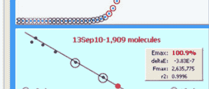

```
13Sep10-1909 molecules
+Cycle
-Cycle
Win Size: 7
Start cycle: 2k
```

| Name: 12240 K1K4@COL1 | |
|---|---|
| Fo Plot (Fo vs Fc) | |
| Average Fo: 1.31E-2+/-0.99% | |


| Notes | |
|---|---|
| DNA Target | |
| Amplicon: 12240 K1K4 | |
| Amplicon Size: 110 | |
| Sample: COL1 | |

图 4 编辑面板包含编辑配置文件和扩增子的窗口。一种用于大规模绝对定量的 `LRE` 实时 qPCR 程序

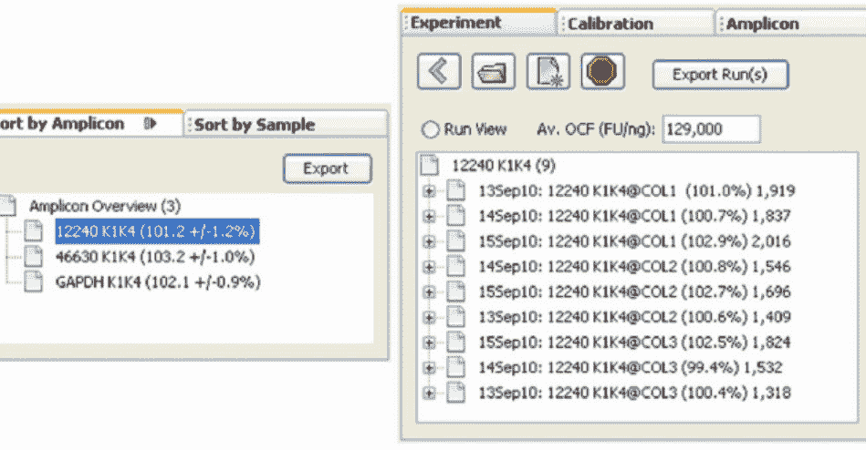

排序面板允许按扩增子或样本组织配置文件。

## 工作流

运行完成后，荧光读数被编辑到 `Excel` 工作格中。`LRE` 分析器为 `Applied Biosystems 7500` 和 `Stratagene MX3000` 仪器提供了手动导入模板。主要要求是将每个配置文件链接到 `LRE` 分析器，对每个配置文件进行分析，包括扩增子大小的自动检索。结果可以导出到 `Excel` 工作格中（图 7）。

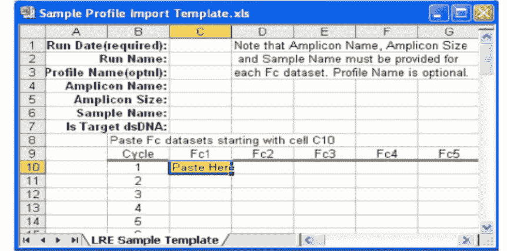

图 6 `LRE` 分析器提供的 `Excel` 模板。

| A | B | C | D | E | F | G | H | I | J | K | L | OCF | Notes |
|---|---|---|---|---|---|---|---|---|---|---|---|---|---|
| | Name: GAPDH_K1K4 | | | | | | | | | | | | |
| | Date | No | 110,390 | 102.36% | 0.97 | 2,969,110 | 79.30 | | 121 | 129,000 | | |
| E13Sample | GAPDH_K1K4 | CCL1 | 101,340 | 101.97% | 0.67 | 2.68 | 2,905,071 | 79.20 | | 121 | 129,000 | | |
| E14Sample | GAPDH_K1K4 | CCL1 | 101,152 | 103.34% | 1.16 | 2.64 | 2,784,113 | 79.12 | | 121 | 129,000 | | |
| E15Sample | GAPDH_K1K4 | CCL1 | 101,489 | 101.89% | 1.10 | 2.73 | 2,759,543 | 79.20 | | 121 | 129,000 | | |
| E13Sample | GAPDH_K1K4 | CCL2 | 86,512 | 102.56% | 1.07 | 2.93 | 2,931,142 | 79.37 | | 121 | 129,000 | | |
| E15Sample | GAPDH_K1K4 | CCL2 | 101,992 | 103.00% | 0.77 | 2.61 | 2,759,543 | 79.20 | | 121 | 129,000 | | |
| E12Sample | GAPDH_K1K4 | CCL3 | 103,039 | 103.07% | 0.37 | 2.63 | 2,747,969 | 79.43 | | 121 | 129,000 | | |
| E15Sample | GAPDH_K1K4 | CCL3 | 99,534 | 103.03% | 0.37 | 2.63 | 2,747,969 | 81.20 | | 121 | 129,000 | | |
| E14Sample | GAPDH_K1K4 | CCL3 | 97,580 | 101.57% | 0.97 | 2.83 | 2,784,113 | 79.12 | | 121 | 129,000 | | |

图 7 `LRE` 窗口示例。

## 实现 LRE 窗口参数

设置 `LRE` 窗口下限的一个重要目标是包含异常循环。目标方法是从 `LRE` 生成的循环开始，并与 `LRE` 内循环生成的平均 `$F_G$` 值进行比较。如果差异小于指定值（定义为 `$F_L$` 阈值，图 9），则包含 `LRE` 窗口。重复此过程直到遇到超过 `$F_L$` 阈值的循环。

## 定义 LRE 窗口顶部

在早期尝试使用非线性回归（S 形拟合）将数学方法应用于 PCR 时，遇到的主要误差来源是区域内的畸变。为了最大化定量准确性，我们使用从分析中排除异常循环的方法。`LRE` 的递归性质提供了一种识别异常循环的简单方法，这些在 `F` 图和 `L` 图均可见（图 10）。

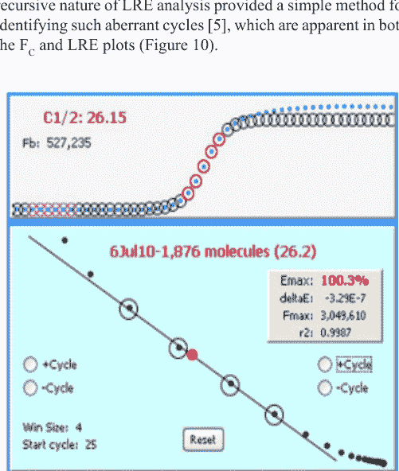

| LRE 窗口选择参数 | | |
|---|---|---|
| Min Fc: 250,000 | | |
| Fo threshold: 6.0% | | |
| Av Rep-Fo Ci: 6.3% | | |
| LRE 窗口选择参数 | | |
| Min Fc: 225,000 | | |
| Fo threshold: 6.0% | | |
| Av Rep-Fo Ci: 25.2% | | |

## Java 技术

| C | Fc | Ec | %Av, Fo |
|---|---|---|---|
| 22 | 150,651 | 117.4% | -6.91% |
| 23 | 301,698 | 100.3% | -1.80% |
| 24 | 558,142 | 85.0% | 0.04% |
| 25 | 947,754 | 69.6% | 0.54% |
| 26 | 1,440,172 | 52.0% | -0.38% |
| 27 | 1,955,701 | 35.8% | -0.62% |


| 28 | 2,399,238 | 22.2% | 0.43% |
| 29 | 2,699,466 | 13.0% | 6.84% |
| 30 | 2,911,936 | 7.9% | 46.35% |
| 31 | 3,153,149 | 3.3% | -3.080,9... |

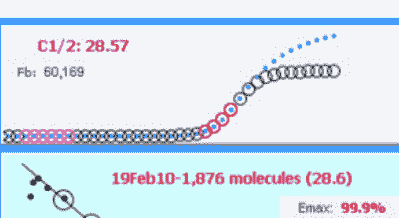

图 11 表格摘要为定义周期的三个参数提供了数值。

虽然通常发现 6% 的 Fc 阈值是有效的，但需要注意的是 Fc 可能会导致对动力学失真缺失的敏感性，这被称为“谱图崩塌”（图 12）。与可能导致 Emin 低估的基漂移不同，包含崩塌的周期会高估 Emin，这在生成审计方面...

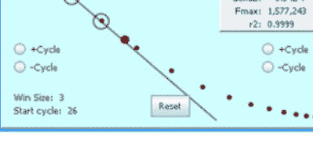

图 13 酶形成产生的极端谱图示例。

# 取自演示数据库的一个示例

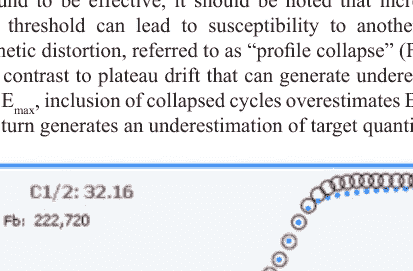

该数据是在一项研究 LRE 定量谱图分析可重复性的研究期间生成的，演示数据库中提供的细节侧重于评估方差的可重复性以及运行之间的定量方差的可重复性。在三天内生成的三个构建体，三个拟南芥参考基因（12240、46630 和 GAPDH）在每次相同的运行（循环）中通过三个重复（反应）进行定量分析。图 14 显示了这三者的定量结果，它们产生了整体运行到平均循环的 +9.5%（跨越三个），这远低于之前报道的（±15-30%）[5][7]。这可能是由于 Applied Biosystems 7500 仪器为了执行而产生的异常谱图...

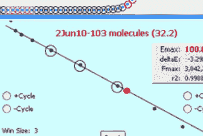

图 12 通过线循环偏移点识别出的谱图崩塌示例。

# 另一种动力学失真形式

发现另一种动力学失真的形式是由于商业酶形成引起的，被称为“谱图稀疏”（图 13）。这些谱图与模型不相符，因此可能导致不准确的定量。被发现对 LRE 分析有效的酶形成包括 Qiagen QuantIT、Agile Brilliant II 和 Invitogen SYBR，尽管其他产品也可能是有效的。需要注意的是，尽管广泛的已表明 SYBR Green 对基于 LRE 的绝对定量是有效的，但其他检测化学剂可能没有那么有效：

| RT1 (COL) | RT2 (COL) | RT3 (COL) | sRT Av, COL |
|---|---|---|---|
| Run 1 | 1829 | 1732 | 1936 | 19.2% |
| Run 2 | 1937 | 1546 | 1532 | 10.51% |
| Run 3 | 1551 | 1550 | 1587 | 13.66% |
| sFR CV | 4.20 | 9.84 | | -11.0% |

| RT1 (COL) | RT2 (COL) | RT3 (COL) | sRT Av, COL |
|---|---|---|---|
| Run 1 | 4228 | 3983 | 3952 | 10.02% |
| Run 2 | 4224 | 3756 | 3555 | 10.1% |
| Run 3 | 4163 | 4062 | 3968 | | |
| sFR CV | 5.07% | 8.79% | | | |

| RT1 (COL) | RT2 (COL) | RT3 (COL) | sRT Av, COL |
|---|---|---|---|
| Run 1 | 10255 | 9565 | 9993 | 3.2% |
| Run 2 | 9852 | 9652 | | |
| Run 3 | 10255 | 9565 | 9993 | 3.2% |
| sFR CV | | | | |

图 14 运行之间的定量。

# 基于 LRE 的定量方法

该数据是在一项研究 LRE 定量谱图分析可重复性的研究期间生成的，演示数据库中提供的细节侧重于评估方差的可重复性以及运行之间的定量方差的可重复性。在三天内生成的三个构建体，三个拟南芥参考基因（12240、46630 和 GAPDH）在每次相同的运行（循环）中通过三个重复（反应）进行定量分析。图 14 显示了这三者的定量结果...

## 讨论

LRE 的一个显著特征是由于 LRE 能够直接跨实验进行比较，这减少了对数据归一化的需求。LRE 能够实现基于 LRE 的绝对定定量，结果分别为 13.0% 和10.3%。LRE 提供的可以消除分子数量的谱图崩塌，这在生成审计方面是有关重要的。LRE 提供的数据可以极大地增强实验的可重复性。LRE 能够直接跨实验进行比较，这减少了对数据归一化的需求。

绝对定量提供的通用视角也为 qPCR 的有效标准化提供了基础，例如，可以通过建立基准 [5][7]来实现。

# IQM: 一个基于 Java 的可扩展且移植的图像与信号分析开源应用程序

Philipp Kainz, Michael Mayrrhofer-Reinhartshuber, Helmut Amhammer

奥格拉茨医大学，生理医学生物物理学研究所，奥地利茨，奥格拉茨

## 摘要

图像和信号分析应用在科学研究中具有至关重要的作用。开源和商业软件包为图像和信号分析提供了广泛的功能，这些功能有时得到了相应领域社区的良好支持。商业软件软件包的主要缺点是价格昂贵且源代码不公开，如果没有插件接口或类似的选项，将阻碍功能的扩展。然而，这两种都涵盖了可能的用例，且定制开发是不可避免的，因此需要开源应用程序。在本文中我们描述了 IQM，这是一个用纯 Java 编写的完全免费、移植且开源（GPU+PL3）的图像和信号分析工具包。IQM 不依赖于任何本地安装的库，目前已经足够。目前，已有 50 种图像分析和 16 种信号分析算法可用。其模块化架构旨在比竞争对手更灵活地开发大多数复杂的工作。通过 Gro 脚本在原理验证方法中演示了 IQM 的图像和信号处理能力，并提供了示例来说明框架和脚本接口。IQM 与流行的 ImageJ 处理软件集成，旨在补充功能而非与现有的开源软件竞争。机器学习也可以通过 WEKA 软件包集成到更复杂的算法中，从而能够为和信号分析开发透明且稳健的方法。

# 引言

研究人员经常面临这样的情况：现有的软件软件包在开箱即用的配置可能无法满足当前需求、不可用，或者许可费用太贵。此外，源代码通常不公开，没有机会更改或调整其他应用程序。这是一个众周知的问题，研究人员为每个特定问题编写自己的代码 [1]。

由于商业软件的缺点，开源用户数量在过去十年中有所增加。更宽松的许可和跨平台兼容性的优势促进了开源用户普及度的提高，他们现在可以从更广泛的软件中选择以适应特定的用例并增强其研究成果 [2]。

> 引用：Kainz P., Mayrrhofer-Reinhartshuber, M Amhammer H (2015) IQM: Extensible and Portable Open Source Application for Image and Signal Analysis in Java. PLoS ONE 10(6):e116329. doi:10.1371/journal.pone.016329

## Java 技术

提高生产力的重要方面是拥有一个现有框架，为加载和保存相关文件等常见操作提供功能。然而，这些任务与科学或算法问题没有直接关系，可能会极大阻碍进度。

# 相关工作

在本节中，我们描述了几个用于图像和信号分析的免费开源软件包。我们的重点是能够应用于类似于 ImageJ 任务的软件，ImageJ 经常用于生命科学，并在当代文献中被引用。我们不声称以下内容的完整性，更详尽的列表可以在 Rlicei 等人的论文 [1] 或在 rs-imageinfo.nih.gov/ij 中找到。列表中还包含了开源图像处理库如 OpenCV[6]、图像分割与注册工具包 (ITK) [7]，但在在此背景下应注意这些的特性。

这些事实促成了 ImageJ 的开发，该软件最初由作者之一于 2004 年使用 IDL（交互式数据语言，Elvis Vis, 科罗拉多州博尔德）Java 编程语言开发。图像处理算法已实现，并在 2009 年迁移到 Java 平台 [3]。特别是使用分形维 [4] 进行图像分析时——多维复杂分析算法的可视化和绘图是在 2012 年完成的。在过去的几个月里，几位贡献者审查并测试了 IQ 框架中的图像和信号分析算法。目前状态为 3.2，项目根据 GNU 通用许可证第3 版在开源平台sourceforge.net 上构建。

- ImageJ, rs-imageinfo.nih.gov/ij: 流行的图像处理 IQ 框架（当前版本：1.4）。它可以通过开发新插件和记录机制进行扩展，这对于内置的编辑器来说都是可能的。此外，ImageJ 不仅可以作为 Java 虚拟机上的应用程序运行，还可以作为一个插件 [9] 运行。应用领域包括生命科学、医学科学和数字病理学 [12]。目前，一个重写的版本 ImageJ2 正在开发中 (developer.image.net)。开源软件对科学研究具有优势：它是免费的，经过社区审查，并且大多数时候对客户需求是详尽的。有几个用于图像分析的开源应用程序将在下一节列出。IQJ 为图像和信号分析提供了一些独特的特性，这些在本文得到了介绍。

- Fiji, fiji.org: Fiji（当前版本：Madison, Java）是 ImageJ 的一个发行版，专门为生命科学特别地为显微镜图像分析进行了优化。它提供了所包含算法的详细描述、文档和教程，旨在增强科学与生物社区之间的协作 [13]。

开源软件对科学研究具有优势：它是免费的，经过社区审查，并且大多数时候对客户需求是详尽的。IQJ 为图像和信号分析提供了一些独特的特性，这些在本文中介绍。

# 本文结构

在介绍开源研究软件领域并说明开发 IQ 的理由后，本文其余部分的结构如下：

- 我们在当前节中回顾了图像分析的开源应用程序以及本文的预期用途。此外，还提供了简要的安装指南。后续章节提供了 IQ 关键组件的概述，描述了功能以及系统功能架构。展示了先进分析，说明了用户如何从单一移植开源工具的图像和信号分析独特特性中受益。

- CellProfiler: cellprofiler.org: CellProfiler 框架（当前版本：2.0, Python）在生物学中有许多应用，并关注照片的用户自动化方法，以从生物图像中提取定量信息 [16-19]。此外，免费开源软件 CellProfiler（版本 2.0）可用于此类大型高维数据的探索和分析，包含了机器学习技术 [20]。

我们演示了如何通过插件扩展 IQ 框架，以及它如何与开源处理和机器学习集成。通过图像插件示例解释了插件的结构。然后介绍了 IQ 的脚本接口并演示了其工作流。最后我们将讨论 IQ 和开源软件工具可能的未来发展。

本文由实验和示例使用的源代码以及脚本的语法高亮版本支持。有关各章节的更多细节，我们请读者参考补充信息以及从项目网站 http://sf.net/projects/iqm/files/3.2/IQ3.2_userguide.pdf 获取详细的用户指南。

- OpenCV, endocr.org: 图像分析插件（当前版本：2.3.2, Java）可用于光镜和荧光显微镜的图像采集以及后处理。主要功能是支持高维显微镜数据以及处理高达 100 GB 的大型数据集 [22]。

# IQM：一种用于 Java 图像和信号分析的可扩展可移植源应用程序

- BioImageXD，对应 bioimagexd.net：BioImageXD 软件（版本：1.0，基于 Python 和 C++）是根据显微镜专家和细胞生物学者的需求开发的。它可以专门用于多维图像的可视化，使用虚拟相机飞行路径创建 3D 渲染动画，以及基于对象和体素的分析 [24]。

- TMARKER，对应 comp-path.inh.edu.ch：该软件工具版本为 1.20614，实现了免疫组化染色组织的自动化的分析，它使用了基于随机检测和支持向量机的机器学习算法 [25]。

- VioBio，对应 luci.edu/software/viobio：VioBio 软件（当前版本 3.40J1）用于高维图像数据的可视化及其分析。它的重点是处理大型复杂数据集，这些数据是由生物学中新开发的激光扫描显微技术产生的 [27]。

像 ImageJ [11] 这样成熟的公共图像程序包含了分形分析、二值盒计数法的基本方法，但用于更高级分形和信号分析的免费工具非常稀少。然而，研究小组已经在在线发布了它们的算法。以下列出了最流行的分形分析插件的概述：

- FracLac(ImageJ)，imagej.net/nih/plugins/FracLac：作为 ImageJ 的插件开发，用于计算质量和盒计数维度，并对黑白图像及彩色图像进行多分形和稀隙分析。来自医学、神经科学和工程社区的图像已包含在它的开发中 [18]。

- Fractayscale，对应 fratt.org：Fractayscale 软件插件用于黑白图像的分形分析。除了盒计数维度外，还实现了相关性、膨胀或高斯卷积方法 [29]。

- FDim，对应 reuter.mit.edu/software：可以通过 FDim 估算灰值图像的分形维度，它支持容量维度、信息维度、相关维度概率维度的计算。

- Gydion，对应 gydion.net：开源软件 Gydion 为扫描显微镜开发，也提供了图像的分形分析。它包含一个用于盒计数的工具，以及三角法、方差或功率谱法来估计分形维度 [30]。

所有提到的软件应用程序都可以在没有高级图形用户界面的情况下使用。其中一些提供了命令行接口，以便集成到外部工具和任务中。IQM 表达了上述软件应用程序不具备的几个特性，我们将在本文强调这些特性：

- 在一个工具中通过高级 GUI 实现图像和信号的分析
- 在清晰的图形用户界面 (GUI) 中方便地管理图像和信号
- 对数据序列或并行的图像进行高级且多功能的栈处理
- 在“预览”模式下对图像和信号处理算法进行交互式评估
- 集成的综合分形和信号分析
- 我们并没有提供所有上述产品的图像处理算法库，而是在用户友好的环境中对算法进行简单探索，并在该环境中保持结果的可重复性。

# 目标读者

通过本文，我们面向生命科学、医学、计算机科学和自然科学领域的研究人员和软件工程师。我们提供了一个免费、可扩展且跨平台的应用程序，用于图像和信号处理算法的开发和探索。

此外，IQM 可用于教育课程，可视化并演示从简单到复杂的算法基础。学生可以使用他们的 Java 编程技能来测试这些算法。它还为基本原理的探索提供了适当的工具。为每个任务开发单独的应用程序更好，而且大多数情况下人们必须为商业产品支付昂贵的许可费用。

通过 IQM，我们通过在一种领先的应用开发语言中提供开源且跨平台的软件来解决这些问题。IQM 的进一步优势在于，它是免费提供的，并且该软件提供了一个集成图像和信号分析的框架。

# 安装

IQM 用 Java 编写的，它在所有运行 Java 虚拟机 (JVM) 的操作系统上都具有可移植性。编译后的 IQM 软件包的安装在所有操作系统上都是通用且非常简单的。然而，存在 JVM 是前提。IQM 的每个二进制发行版本都可以从针对不同操作系统的项目下载，其中 Java 已在 Windows、Linux 和 Mac OS 的系统中集成可用。下载后，不需要显式安装，即可在标准配置下启动应用程序。更多的安装信息请参阅用户指南。

# 概述与功能

## 用户界面和主要组件

为了建立对使用 IQM 的共识，我们开始描述主要部分。主窗口包含关键元素：(i) Tank（容器）、(ii) Manager（管理器）、(iii) Viewport（视口）和 (iv) Controls（控件），见图 1。


图 1 窗口和组件。

主要组件 Tank、Manager、Viewport 和 Controls 被高亮显示。Tank 托管所有项目（图像、信号、表格）并作为历史记录。Manager 显示所选 Tank 中的项目缩略图，并允许用户选择要在 Viewport 中显示的项目。Controls 负责将应用程序设置为“虚拟模式”、监控 JVM 以及确定处理栈。

IQM 中的每一步都开始从 Tank 获取项目或栈。项目可以是用于处理的图像或信号，也可以用于可视化的数据。它们从文件系统解析并处理，或内存中生成图像和信号。Tank 包含所有加载的项目并作为处理历史的关键。之前执行的运算符的结果保留在列表中，用户可以探索其他算法或比较结果。

项目由运算符调度处理，允许对特定项目进行灵活且选择的处理。Tank 和 Manager 还可以合并项目并将栈拆分为单个项目，或从两个管理器列表中进行配对导出。

Viewport 提供四个标签页，分别用于图像、信号、表格和文本的可视化。当项目被选中时，它们会立即显示在相应的标签页中。可以查看运算符的预览结果，随后可以批准并添加到 Tank 中进行进一步处理。每个标签页提供特定数据类型的工具，用于编辑视图或制作动画。

在主窗口的 Controls 中，用户可以批准运算符的结果，或启动 Manager 中项目的并行处理栈。

# 数字图像分析

数字图像分析涉及图像增强、各种颜色和采样方法之间的转换，以及重采样和注释。在本节中，我们总结了 IQM 用于数字图像分析最重要的功能和特性。所有实现的图像处理运算符列于表 1，并按主要类别分组。

Manager 提供两个列表用于协调和选择单个项目或项目栈。只有同类型的栈（例如图像）允许加载到管理器列表中。列表顶部的单选按钮指示当前活动列表，以及启动运算符时的主要项目来源。在本文语境下，“运算符”一词是算法的同义词。

# IQM: 一个基于 Java 的扩展且可移植的图像与信号分析开源应用程序

**表 1. 已实现的图像处理操作。**

| 主要大类 | 操作名称 |
|---|---|


# IQM: 一个基于 Java 的扩展且可移植的图像与信号分析开源应用程序

## 图像增强、处理与配准

如果需要特定的图像计算或验证算法，也可以生成图像。内置方法可以根据随机灰度、高斯分布、常数值以及正弦余弦函数创建自定义尺寸的图像。

IQM 提供了用于线性非线性平滑去噪的图像增强、边缘检测算法以及用于锐化图像的标准差 [32]。对于扫描获取的图像数据，如果噪声和光谱失真损害了图像，可以使用白平衡和色彩平衡来校正强度值。此外，还可以修改图像直方图，并使用二值操作实现标准及仿射变换。

通过算术和逻辑运算符实现恒定位移的强度谱线性变换。使用二值掩码或两个图像组合的物体分割，可以通过预处理步骤（如边缘检测器和形态学算子侵蚀、膨胀……）结合各种卷积核来准备。掩码和原始图像随后可以使用二值图像上的算术或逻辑运算符结合。

属性对齐本身是图像栈的关键需求，当在图像序列上跟踪对象、为 3D 体渲染或跨模态配准准备 MRI 或 CT 扫描时。配准是寻找有效的全局（刚性）或局部变化（非刚性）变换以便将一张图像拟合另一幅图像的过程 [33]。栈中的简单变换可以通过重心配准进行修正，通过扭曲或其他更复杂的算法进行。Imagen 已经提供了一个配准插件，IQM 在其框架中集成了此功能。

## 文件输入输出

方便的文件输入输出对任何应用程序都非常重要，且支持日常计算中的标准图像文件格式。此外，IQM 还支持（生物/医学）成像中常用的文件格式。因此，它通过使用 OME-Bio Libraries [31] 的功能和图像插件来读取这些格式。

## 兴趣区域与注释层

图像是多维信息源，但当内容高度取决于解释时，仅凭图像可能存在局限性。通过给图像添加自定义注释可以克服这一障碍。用于绘制和修改兴趣区域（ROI）的工具对于图像注释非常有价值。IQM 提供了各种几何形状，用于独立的注释层。见图 2。每层都可能包含注释实例。我们并没有将 ROI 添加到每个层，而是添加到每个图像画布上。当用户更改密度时，ROI 不会消失。移动和滚动允许在不同层上检查相同位置的图像。层层相互堆叠，可以进行重新排序、重命名、显示或隐藏。

注释层可以导出到文件并加载。这种自动化工作流有助于文档记录并提高结果的可重复性，这些是科学研究的关键需求。在图像导出时，层可以叠加，见图 2(a)。

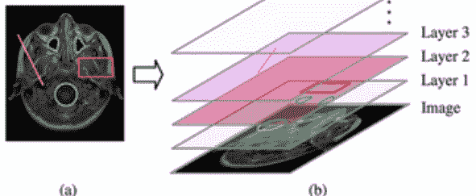

## 分割与纹理分析

分割是图像分析中最重要的部分之一。IQM 提供了基于标识和区域的分割算法。这些算法可以局部或全局应用于图像。

可以使用灰度共生矩阵（GLCM）检查全局纹理参数。

## 信号处理

除了图像，IQM 允许处理二维数据的信号。在 IQM 内部，信号被视为序列。

**表 1. 已实现的图像处理操作**

| 分析 | 生成器 | 物检测处理 |
|---|---|---|
| 盒维度* [1, 2] | | 边缘检测 |
| 复合逻辑深度* [3] | | 模糊均值聚类 |
| 快速变换* [4] | | KMeans 聚类 |
| 分形扫描 [2] | | 数学形态 |
| 广义维度* [5] | | 兴趣区域分割 |
| Higuchi 维度* [6] | | RGB 相关 |
| 空隙* [7] | | 种子区域生长 |
| 最小维度* [8] | | 统计区域合并 |
| 金字塔维度 | | 阈值* [15] |
| 离散傅叶变换 | | 水岭 |
| 梯度向量场 | | |
| 直方图计算 | | |
| 强度统计 | | |
| 数值计算 | | |
| 分形表面* [9] | | |
| 迭代函数系统* [10] | | |
| 图像生成器 | | |
| 拓扑匹配 | | |
| 分形代理* [11] | | |
| 仿射变换 | | |
| 自相关函数 | | |
| 边界扩展 | | |
| 颜色匹配 | | |
| 色彩空间转换 | | |
| 距离变换* [12] | | |
| 几何变换 | | |
| 图像裁剪 | | |
| 强度反转 | | |
| 邻域像素扫描滤波器 | | |
| 缩放 | | |
| 平滑 | | |
| 锐化掩模 | | |
| 边界 [13] | | |
| 重心估计 | | |
| 图像稳定器 | | |
| TurboReg* [14] | | |

**表 2. 已实现的信号处理操作**

| 主要大类 | 操作名称 |
|---|---|
| 分析 | 原子缩放* |
| | 分形维度* |
| | 自相关* |
| | 快速变换* |
| | 周期* |
| | 熵* |
| | 聚合* |
| | 分形维度* |
| | 混沌映射 |
| | 信号生成器 |
| | 分形代理* |
| | 滤波器 |
| | 数学运算 |
| | 信号提取器 |

## 图像与信号的分形分析

IQM 包含大量的扩展，用于处理二值以及灰度图像的非线性分析。这些纹理的主要目的是纹理分析，对于通常具有特征的图像特别有用 [34,35]。除了全局，它具有估计局部描述符的快速技术。为了测试目的，可以生成具有已知维度的图像和信号。

所有图像和信号的分形算子都在表 1 和表 2 中启用，按主要大类分组。

## 高级栈处理

在本文语境下，我们将一组项（特征或图像）称为“栈”。特别是在处理过程中，许多项可能需要归一化或范围映射等并行步骤。除非操作适用于每个项，否则必须调整参数。为了找到合适的参数，可以通过算子设置对多个项的响应进行检查，这是 IQM 的另一个特性。

其他开源图像分析库如 IQM 及其衍生品 [11] 也提供了栈处理。但在参数确定后，这些方法的区别在于串行或并行处理利用了多个 CPU 核心将工作负载分配给线程。另一方面，作为先进先队列处理栈的研究人员可以高效地将算法应用于每个项。IQM 的高级栈处理允许分析人员在级 GUI 上通过实时反馈搜索算法。

## 系统架构与功能组件

IQM 的内部软件架构可以从层视图（水平）和功能视图（垂直）来看，见图 3。在本节中，我们将简要介绍系统架构和功能组件，并让读者了解组件是如何连接的，以及插槽和插口的位置。

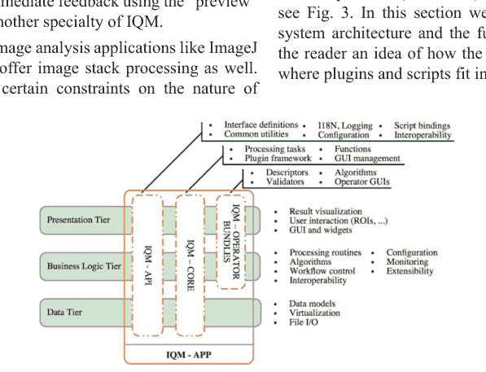

### 三层架构

IQM 遵循软件架构的经典三层模型 [36]。数据管理与业务逻辑及表示组件分离，有助于开发过程中的灵活性和扩展性。该软件被设计为面向过程的。

#### 数据层

在正在运行的 IQM 实例中，所有持久化和瞬态数据（例如，单个图像、信号集或其他标签）都由属于数据层的软件组件管理。数据项是执行操作的基本单元。它们可能存储在临时目录中，以便为处理程序留出内存。因此，数据层在文件访问方面起着重要作用，提供了解码和编码内容的功能。数据被加载并解析到灵活的数据模型中，该模型管理原始数据项及其名称、路径等低级属性。

#### 业务逻辑层

业务逻辑层实现软件应用程序的使用并汇总数据用于表示。它控制应用程序在运行时的行为，确保数据项到算子的一致性，并处理处理算法。图像和信号处理算法是 IQM 算子框架的核心。工作流是单次或多个算子执行的组合，旨在确保应用程序的成功。

IQM 中使用了抽象设计模式 [37] 来创建处理任务和算子。它便于在没有具体应用上下文的情况下创建对象，并实现了更具模块化的架构。基于特定的声明或签名，即算法接收多少输入参数，它是接收图像还是结果，或者是否将它们作为后续处理步骤的输入。算法的部署便于模块的交换以进行更新。

#### 表示层

GUI 通常比简单的命令行界面更有吸引力，并能获得更高的用户接受度 [38]。视觉表示对数字处理至关重要，特别是在比较方法评估不同算法时。用户界面设计往往受到软件工程中大量工作的影响。可用性差是导致最佳应用程序在实践中失败的原因之一。具体地在（生物）医学成像中，由于视觉数据可能变得极其复杂，人们预见会有糟糕的可用性 [39]。

在内存中保留与当前计算无关的项是不高效的，因为它们会占用内存。加载项集合也可能非常消耗内存。因此，我们使用了按需序列化或“虚拟化”，这是 IQM 的一个独特特性。在虚拟框架下，每个标记为“虚拟”的数据项都会与其元数据一起序列化到临时目录中，并保持可访问。如果应用程序需要访问，它将被序列化并反序列化到内存中。操作完成后且不再需要时，它会被保存回文件系统并由 JVM 的垃圾回收器释放。应用程序在中间可能会关联虚拟实体，或者在算子执行过程中关联或不需要。

如今，无论什么种类型的操作系统（这些系统通常要求其层级之间具有功能性），用户也使用有效的软件与其操作系统的外观完全集成。Java Swing API 为构建 GUI 提供了一个全面的工具包，且无需安装。IQM 的 GUI 构建在 Swing 之上，并适用于任何运行 Java 虚拟机 (JVM) 的系统。可以在 Swing 上开发自定义组件和小部件，保持整个应用程序的灵活性。

表示层处理 GUI 上的用户交互和帧的显示。此外，它在算子执行后在相应的 UI 元素触发业务逻辑和可视化结果。

### 功能架构

功能架构是为特定用例实现功能的概念。功能组件并不完全局限于单一层；它们可能跨越多个层，见图 3。

大多数架构都提供了不断添加的灵活性。模块化架构实现了新功能开发和管理的前先进设计。IQM 的功能架构由五个模块组成：

- API
- APP (启动)
- CORE
- PLOT-OF-BUNDLE
- IMG-GUI-BUNDLE

所有这些功能都由下一个业务逻辑层执行，不应由表示层使用。

#### IQM API

IQM 的编程接口 (API) 包含了所有必要的接口、抽象实现以及事件、发射器和器接口，这些对于开发新功能和插件是所需的。该模块包含数据模型以及使主工作流元素 `Task`（任务）和 `Manager`（管理器）的接口。此外，API 指定了用于扩展的接口。这一属性使得该模块成为整个 IQM 框架中最重要的模块。API 的扩展是可选的，用于新功能，并保持了向下的可维护性。

## 可扩展性

由于完全重新部署整个应用程序对于添加新功能是不实际的，现代软件架构支持模块组件。插件是在无需重新编码的情况下扩展应用程序的最常见方法。

IQM 提供了一个插件框架，用于在运行时定位、加载和集成图像和信号处理的操作。

## 操作插件框架

本节涵盖了以下方面：(i) IQM 插件框架的结构，(ii) 图像和信号操作的通用结构。我们使用插件的一个示例说明了操作的结构，但我们首先介绍了接口，它将在运行时托管插件。

IQM 操作框架由四个主要部分组成：插件、注册表（Registry）、操作以及插件本身。插件可以作为插件框架的核心枢纽，负责递归定位和加载插件目录到 JVM 类。此外，它调用插件接口的初始化方法，然后在注册表中执行插件的自注册。

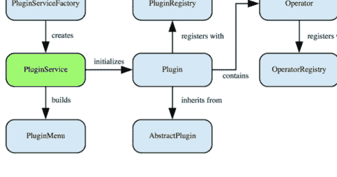

操作框架允许将自定义图像和信号处理操作作为插件添加。`PluginService` 管理插件到逻辑和表示层的集成。插件注册到注册表，注册表注册到操作。操作工厂通过查询注册表创建操作实例。

每个插件都继承自抽象实现的属性管理器，负责从 XML 属性文件读取插件数据并定位指定位置的资源。

### 操作插件示例

标准操作与应用程序一起发布。关于开发插件的信息可以在 `https://sf.net/p/lbp/wiki` 的 Wiki 页面找到。该插件的完整实现可以通过公共代码获取。我们将介绍算法如何工作以及它产生什么结果。在活检的（生物）医学组织图像中也存在高纹理区域，我们可以使用 LBP 方式进行描述。

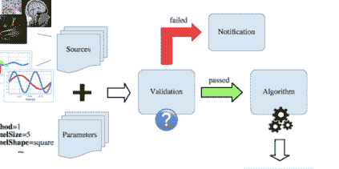

每个操作（算法）可以接受异源作为输入并产生多维结果。结果可能包含多个图像、信号或表格。此外，自定义输出也可以由任何操作返回。数量 (0...n) 表示结果可以产生每种类型的元素。根据定义，每个操作能够产生多维结果：多个图像、信号或表格，见图 8。

**表 3. LBP 操作的默认参数和值**

| 参数名称 | 类型 | 默认值 | 有效范围 |
|---|---|---|---|
| 邻域 P | INT | 8 | Valid_={P ∈ Z⁺ \| P ≤ 32} |
| 半径 R | FLOAT | 1 | Valid_={R ∈ R⁺ \| R ≥ 1} |
| 平滑 (高斯) | BOOLEAN | false | (true \| false) |
| 卷积大小 | INT | 3 | Valid_={(2 + 1 ∈ Z⁺ \| N¹, I ≤50} |
| 细胞 C | INT | 1 | Valid_={C ∈ Z⁺ \| C ≤ max(M,N)}, 其中 M 是图像的宽 |

默认参数在操作创建时设置。描述符检查定义集中的实例化范围，见最后一列。

描述符列出了启动内容。选项可能包含操作/注册表，其中包括描述符类名、验证器属性、运行时对应类的 GUI。

验证器。操作验证器负责检查传递给操作的完整性。LBP 操作要求源向量位置 0 为单带灰度图像。第一个验证器检查是否有可用图像。自定义验证器随后...

## 原理分析

在这一原理分析中，选择了一个显示细胞运动和增殖的延时视频进行展示。由于 IQM 是感兴趣的应用程序，仅提供了有关细胞、其处理和视频记录的基本信息。从市售的人类癌细胞系中识别出的细胞。

从 1.0 版本开始，引入了指向动态对象脚本语言 Go 的接口。有了这个新功能，用户能够在 IQM 内开发可重用的处理程序。

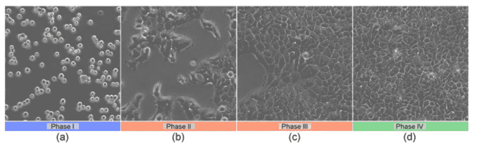

用于原理分析的视频选定帧。在视频的第一部分（a, I 阶段），记录的表皮癌细胞 A431 细胞在溶液中自由移动，直到它们粘附在视镜上。在第二阶段，由于细胞增殖，更多的可见区域被占据（b, II 阶段）。帧的某部分保持模糊（c, III 阶段），这部分也被占据，且记录区域被多个无核细胞的副本占据（d, IV 阶段）。

为了消除照明差异，随后计算了绝对差分图像 `J_{ij} = |I_i - I_j|`。

从所得图像 `J` 的直方图中，计算了鲁棒统计参数熵、偏度和峰度，并相对于图像 `j` 绘制了图表。作为示例，它们在 I 阶段、II 阶段以及合并的 III 和 IV 阶段表现出明显的特征差异。观察到的偏度如图 5 所示，包含了 I 阶段、II 阶段、III 阶段（绿色）、IV 阶段的不同直方图。偏度在上升，在 II 阶段开始之前（约 #200）达到最大值，随后下降，直到从 III 阶段到 IV 阶段的过渡处观察到显著变化。然而，熵和偏度的表现有所不同。对四个信号应用了中值滤波以消除离群值，然后识别了局部极大值和极值的位置。计算了平均值和相应的标准误差以获得阶段长度 `t_i = (10 ± 25)` 分钟。在此时间之后，细胞开始粘附在视镜上。用相同的方法发现 II 阶段的长度为 `t_i = (920 ± 35)` 分钟。

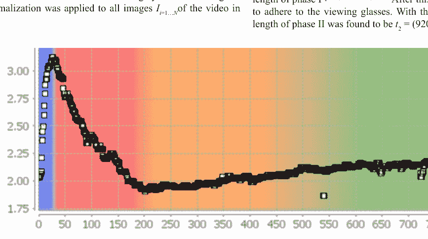

从绝对差分图像的直方图中确定了能量、熵、偏度和峰度等统计参数。图中显示了从 IQM 视口提取的偏度图。I 阶段（蓝色和红色）可以明显区分：在 I 阶段，偏度陡峭上升，在向 II 阶段过渡时（约 #20）达到最大值。在 II 阶段，偏度下降，并在过渡到 III 阶段（橙色）时（约第 #200 帧）达到最小值。这种方法无法检测从 III 阶段到 IV 阶段（绿色）的过渡。

II 阶段和 III 阶段的合并时间（即在研究区域形成单层细胞的时间）并不重要。时间是在从 III 阶段到 IV 阶段发生过渡时确定的。区域增长用于测量随帧数 `L` 变化的原始图像 `I` 中空隙区域的大小。在应用中值滤波器获得信号后，识别了观察区域被单层细胞占据的帧。信号如图 I 所示。因此，确定了研究区域被单层细胞完全占据的时间。找到的值 `t_{i+1}=(2560 ± 25)` 分钟，细胞从粘附到形成单层细胞的时间段确定为 `t_2-t_1 = (2455 ± 50)` 分钟 `(41 ± 1)` 小时。

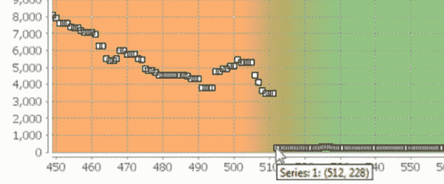

使用区域增长来确定未被细胞区域的大小。图中以像素随帧数的形式给出，如在 IQ 视口中显示所示。从 III 阶段（橙色）到 IV 阶段（绿色）的过渡可以识别为斑点大小达到并保持在最大值的帧（#512 帧）。


# IQM: 一种用于 Java 的可扩展的图像与信号分析应用程序

对于噪声，我们也可以增强其他算子的鲁棒性。通过调用实例上的 `process()`，IQM 在后台创建并执行任务。

标准的 LBP（局部二值模式）在中心像素处提出，在 $3\times3$ 网格邻域（半径=1）内计算相邻像素的强度。$M \times N$ 可能被划分为 $C \times C$ 个单元格，每个单元格的直方图计算值 [23]。如果 $C=1$，默认情况下，我们对单元格的原始二值代码感兴趣，将其存储在表中以便后续。

```
$LBP_{P,R} = \sum_{i=0}^{P-1} s(I_{p_i} - I_c)$
```

其中 $sign(s)$ 指定符号函数：

```
$sign(I_{p_i}, I_c) = \begin{cases} 1 & \text{if } I_{p_i} \geq I_c \\ 0 & \text{otherwise} \end{cases}$
```

LBP 可应用于描述病理学数据，用于区分恶性与良性组织。监督学习被用于学习区域的内容，以区分可能存在恶性的样本 [44]。

IQM 中的二值代码可以取 0 到 255 之间的值（8位），并被视为虚拟或灰度。LBP 算法已扩展到使用二值代码 [42]，从而推广到 $2^n$ 二值代码。为了显示代码，我们将 0 和 255 之间的强度缩放。$P$ 点采样自 $R$ 定义的圆形区域。双线性插值用于计算位置之间的强度。

为区域中的每个像素计算旋转不变性量。在图像边界处，使用反射边界编码图像后计算了 LBP 代码 $[R]$。LBP 代码的直方图形成了区域的最终描述符，图像由直方图描述。描述符现在可以用于纹理或对象分类。

```
$LBP_{P,R}^* = \min\{LBP_{P,R,i} \mid i=0, \dots, P-1\}$
```

算子和结果 GUI 用于配置算法的参数空间并以交互方式控制响应。滑块和复选框等控件用于设置参数，见图 9(a)。通过点击按钮执行算子。在这个示例中，我们让算法根据单元格数量计算一组图像、直方图和表格。完成后在多结果显示，其中每个标签包含对应的数据类型列表，见图 9(b)。

其中 `rot()` 用于位右移最小化二值代码，使最高位为 0。我们的实现提供了使用高斯平滑图像的可选项，以便在计算描述符之前过滤噪声，这最可能


(a) (b) (c) (d)

图 9. 局部二值模式的 GUI 和多结果描述符。

(a) 中实现的 LBP 算子 GUI 用于设置参数，并在描述符定义的有效范围进行完整性检查。计算选项指示结果对象的维度。“自动预览”允许设置参数时进行快速检查。输出图像可以反转，算子可以在执行前显式设置为“虚拟”。多结果 (b-d) 显示算子的预览结果，并允许用户选择是否保留选定结果以进一步处理。

## 通过脚本自动化

某些处理任务通常需要频繁进行。由于设置参数可能很无趣，脚本有助于链接频繁使用的操作。脚本的设计允许使用动态高级语言开发更复杂的工作流，例如执行序列。IQM 3.1 版本提供了使用 Groovy 语言开发自定义脚本的能力。


图 10(a) 描述了脚本编辑器的 GUI，一个文本编辑器，当编写脚本时，结果输出到控制台（图 10(b)），它最终可以保存到文件。IQM 中的脚本提供了图像处理、信号处理以及机器学习的方法。IQM 提供了一个多标签语法高亮编辑器 (a)，用于在 IQM 内创建、编辑和运行 Groovy 脚本。控制台窗口 (b) 显示脚本运行期间的所有输出，并提供了保存脚本到主文件的方法。

脚本示例。我们可以用一个短示例演示脚本功能。我们定位并加载图像，执行一些图像操作并将结果保存到目录，其中应用程序被设置为虚拟化每个刚加载处理并位于磁盘上的图像。自定义文件类型定位了要加载到池中的文件索引。脚本不仅限于 IQM 软件的纯编排，而是允许用户整合其他库和插件。第一个算子通过高斯平滑图像进行去噪，以便在计算描述符之前过滤噪声，这最可能

## 兼容性与互操作性

### Java 技术

11. Schneider, RS, Bansard RS, Weiss KW (2012) 图像到图像: 25年年龄分析。Nature Methods: 671-675. doi: 10.1038/nmeth.2089 PMID: 22930834

12. Gering E, Atkinson CT (2004) 通过数字图像分析对血涂片中有核红细胞数量的快速方法。Journal of Digital Imaging: 9:879-881. doi: 10.1061/JI.GEE-2002.15357006

13. Bardak, JP, Ao Yu, YG, MacFac JR (2005) 使用 Kaivig 创建 DICOM 图像。Journal of Digital Imaging: 14:1-7. doi: 10.1007/s01278-004-1879-4 PMID: 15827831

14. Elcuiri, RW (2005) 使用逼真特征可视化多维图像的工具。Photochemistry and Biology: 11: 116-122. doi: 10.1562/2004-11-22-377 PMID: 15807634

15. Schindelaar, A, Garcia V, Langer M, et al. (2012) Fiji: 一个用于生物图像分析的开源平台。Nature Methods: 9: 676-682. doi: 10.1038/nmeth.2012 PMID: 2243772

16. Carpenter, AE, Jones TR, Lamprech MR, Clarke C, Kang IH, et al. (2006) 用于识别和量化增殖细胞的细胞图像分析软件。Genome Biology: 7(1):R106. doi: 10.1186/gbome.2006-7-106 PMID: 16708967

17. Lamprech RS, Stamati DM, Carpenter AE (2007) CellProfiler: 一种用于生物图像分析的多功能软件。Bioanalysis: 42: 71-75. doi: 10.21440/00011225 PMID: 17264947

18. Vos, Mercer, Carpenter AE (2008) 用于生物结构自动识别和监测的 CellProfiler。In Current Protocols in Biology, Wiley & Sons, Inc., ch 14, pp. 1-12.

19. Kamensky L, Jones TR, Davis JL, et al. (2007) 改进 CellProfiler 的和能力：多维高通量图像分析。Bioinformatics: 23: 1179-1180. doi: 10.1093/bioinformatics/btm061 PMID: 17363961

20. Jones TR, Carpenter AE, Lamprech MR, Moffat J, Silver SJ, et al. (2009) 在带有交互反馈和学习的基于图像的工作表中对增殖细胞进行评分。Proceedings of the National Academy of Sciences 106: 1826-1831. doi: 10.1073/pnas.091988506 PMID: 11988593

21. de Chaumont F, Gallandville S, Servant N, Herv P, et al. (2012) IcyC: 一个用于可扩展重复性的开源生物图像平台。Nature Methods: 9: 690-696. doi: 10.1038/nmeth.2075 PMID: 2243774

22. Henrickson J, Chen T, Yong Y, Johansson A, Johansson D, et al. (2013) Endrov: 一个用于图像分析的集成平台。Nature Methods: 10: 456-454. doi: 10.1038/nmeth.2748 PMID: 2372223

24. Kankapaa P, Pavolainen L, Titta S, Karjalainen M, Pirtainen J, et al. (2012) BioImage: 一个开放、通用且高通量的图像处理平台。Nature Methods: 9: 683-689. doi: 10.1038/nmeth.2247 PMID: 2274733

25. Schiffer P, Futs TJ, Ong CS, Wild JP, Rupp RJ, et al. (2013) TERSKLER: 一个用于组织学细胞计数和应变估计的免费软件工具。Journal of Pathology Informatics: 4: 2. doi: 10.2307/JPI.4.2 PMID: 23347733

26. Hibard B (2003) VisBio: 用于可视化和分析的工具。ACM SIGGRAPH Graphics: 37: 5-10. doi: 10.1141/10693.763940 PMID: 2376938

28. Kepler A (2009) 用于图像的 FracLac。在线。可可用：http://resb.org/ij-nhf/plugins/FracLac/HelpInfo.html。访问于2014年6月24日。

29. TheMA (2014) Fracyse–分形分析。在线。可可用：http://www.fracyse.org。访问于2014年6月23日。

30. Nečas D, Poláček P (2012) Widgown: 一个用于 DNA 数据分析的开源软件。Central European Journal of Biology: 101: 2048-2055. doi: 10.1848/1231-154X-001-96

31. Linden R, Carpenter CT, Allen C, Bernal JM, Moore W, et al. (2013) 元数据标签：访问真实世界的数据。The Journal of Cell Biology 189: 777-782. doi: 10.1083/jcb.201004104 PMID: 20551764


# 参考文献

32. Gonzalez RC, Woods RE (2008) 数字图像处理。Upper Saddle River, NJ: Prentice Hall.

33. Hajiv, JL, Hawkes DJ, et al. (2001) 医学图像注册。Biomedical Engineering. CRC Press.

34. Barnett MF (1993) 几何学。更新与增强：New W。

35. Eckerson W (1999) 三层架构：扩展性、性能和效率。Open Information Systems 14: 46-50.

36. Gamma E, Helm R, Johnson R, Vissliss J (1994) 设计模式：重用对象。

37. Carpenter K, Kamensky L, Elcuiri RW (2012) 生物信息学调用。Nature Methods: 9: 666-670. doi: 10.1038/nmeth.2073 PMID: 2274371

40. Koemer D, King P, LaForge G (2007) Groovy实战。Manning.

51. Lahti T, Pietikinen M, Harwood D (1996) 基于测试的特征研究。Pattern Recognition 29: 51-59. doi: 10.1016/0031

52. Ojala T, Pietikinen M, Maena (2002) 二进制模式分类。IEEE Transactions on Pattern Analysis and Machine Intelligence 24: 97–981. doi: 10.1109/TPAMI

57. Jin X, S, Jayaso (1995) 估计分形维度的实用方法。Pattern Recognition Letters 16: 457-464. doi: 10.1016/0757(95)

58. Zenith H, Delilah J, Gauthier C (2012) 物理复杂性表征。Complexity 17: 26–42. doi: 10.1002/cpl.20384

3. Ahomen T, Hadid A, Pietikinen M (2004) 局部模式的面部识别。在Computer Vision–ECCV 2004, Springer, pp. 461–488. doi: 10.1007/978-3-5470-24604

4. Fuchs TJ (2010) 计算病理学：机器学习方法。博士论文，瑞士联邦理工学院。

5. Anguine E, Mular A (1993) 频率分析分形分析。II。Journal of Microscopy 172: 233–238. doi: 10.1111/j365-2818.1993.tb03414

6. Bishop C (2006) 模式识别与机器学习。New York: Springer.

61. Sthelmer M (2000) 物理学中的非线性动力学。World Scientific

62. The WEKA数据挖掘软件：更新。SIGMOD 18: 80–81. doi: 10.1145/1562764.1562286

63. Argonza-Iánchez, Sarceg CO, Maratini R, Caraz JM, Ortiz-de-Solorzano C, et al. (2006) 使用线性回归对组织进行一致性和弹性注册。International Journal of Medical Imaging: 85–95. doi: 10.1016/S0947-848X(04)00544

7. Hammer H, Harvey TJ (2004) 边缘检测算法对分形维度的影响。Medical Physics 31: 183–188. doi: 10.1063/S0278-437X(04)0594

8. Hammer H, Deaney TJ (2005) 噪声对泛化簇的影响。Fractals and Chaos 26: 707–717. doi: 10.1016/j.fractcha.2005.01.050

65. Ost N (1997) 从分形度量选择阈值方法。IEEE Transactions on Systems and Networks, 6: 62–69.

49. Hammer H, Geiger D, Hoff C, Weiss-U H (2008) 腺癌细胞图像的分形维度。Physics and Biology 32: 446–453. doi: 10.1016/j.physbio.2007.09.105

50. Hammer H, Kroeep JM, Hall C, Sedicky R (2011) 视网膜病变的分形维度和图像统计。Cells, Chaos & Fractals 44: 86–92. doi: 10.1016/j.fractcha.2010.12.004

64. Lu W, Young M, Mular A (2001) 短变异时间序列熵的准确估计：心室设备中的房颤检测问题。American Journal of Physiology–Heart and Circulation Physiology 280: H325–H325. doi. 10.1152/ajcp.00561;2001

66. Théven P, Prumutt U, Unser M (1998) 基于强度的金字塔金刚性配方法。IEEE Transactions on Image Processing 7: 227–41. doi: 10.1109/3856848.2103727

67. Richards JM, Mayerhof-Reinhhauser (2012) 箱维数的计数分类。Image Patterns 20: 281–293. doi: 10.1016/S0218-34X(12)00506

7. Lake DE (2009) 心率变异性的剩余熵。Biomedical Engineering 53: 21–27. doi: 10.1109/TBE.2005.859782

53. Janamanika B, Castakas A, Raghupathi G, Wao (2009) 医疗和健康行业开源软件的现状和未来。International Journal of Medical Informatics 78: 457–472. doi: 10.1016/j.ijmedinf.2009.02.003

54. Bonacelli A, Rossi C (2003) 为什么开源软件可以成功。Research Policy 32: 1243–1258. doi: 10.1016/S0047-2573(03)00051-9

55. Liebovich LS, Toth T (1998) 一种通过框计数确定分形维度的长期算法。Physics Letters 141: 386–390. doi: 10.1016/0375-9601(98)0985-4

56. Sarkar N, Chaudhuri B (1995) 数字图像的多分形和广义维度分类。

70. Bandit C, Pompe B (2002) 排序熵：其序列的自然复杂度度量。Physical Review Letters 88: 174102; doi: 10.1103/PhysRevLett.88.174102 PMID: 12007599

- 71. Flanagan MT (2012), Michael Thomas Flanagan's Java Library. Online. Available: `http://www.ee.ucl.ac.uk/~mflanaga/java`. 于2014年12月11日访问。

- 72. Kumar N, Lolla N, Keogh E, Lonardi S, Ratanahatana CA (2005) 时间序列位图：一种处理大型时间序列数据库的实用可视化工具。SIAM 2005 Data Mining Conference, SIAM, pp 531–535。

- 73. Caccia DC, Percival D, Cannon MJ, Raymond G, Bassingthwaite JB (1997) 分析精确分形时间序列：评估色散分析和重标范围方法。Physics A: Statistical Mechanics and its Applications 246: 609–632. doi: 10.1016/S0378-4371(97)00363-4 PMID: 2204251

- 74. May RM (1976) 具有复杂动力学的简单数学模型。Nature 246: 459–467. doi: 10.1038/2614950 PMID: 934280

- 75. Hénon M (1976) 具有奇异吸引子的二维映射。Communications in Mathematical Physics 50: 69–77. doi: 10.1007/BF01608556

- 76. Sprott JC, Sprott JC (2003) 混沌与时间序列分析，卷 69。Oxford University Press Oxford。

# SYNPANEL：用于荧光显微镜图像快速定量神经蛋白点密度和强度的软件

**Eric Danielson¹，以及 Sang H. Lee¹²**

¹威斯康星州医学院药理学与毒理学系，威斯康星州密尔沃基，美国

²威斯康星州医学院神经科学研究中心，威斯康星州密尔沃基，美国

弗吉尼亚理工研究所

## 摘要

突触处蛋白质成分的持续变化是突触强度塑性变化的动力，并为大脑突触可塑性和信息存储提供了基本的分子机制。研究蛋白质周转不仅有助于理解学习和记忆，对衰老、神经退行性疾病和精神障碍等病理状态也有直接意义。参与突触传递和突触可塑性的蛋白通常聚集在神经元突触处，并在荧光显微图像中以点（簇）的形式出现。对突触密度、强度大小变化的定量测量，为其在突触传递和发育中的功能提供了有价值信息。遗憾的是，点的定量分析非常耗力且耗时。在本文，我们描述了一种软件工具，用于从共聚焦扫描显微镜生成的二维免疫荧光图像中快速半自动检测和定量突触点。该软件命名为 `SynPanel`（突触点分析），简化了点密度和强度的数据定量，因此与现有方法相比增加了数据分析的吞吐量。`SynPanel` 是用 `Java` 语言编写的独立软件，具有可移植性且跨平台。

## 引言

人类大脑由数十亿相互连接的神经元组成，它们与其他神经元形成数千个连接（突触）[1–3]。认知、情感、学习和记忆等能力源于神经元之间复杂的互连性 [2], [4], [5]。

目前模型显示，突触的信息存储是通过突触的结构和分子重组实现的，伴有倍数的蛋白质添加或移除 [6–8]。因此，研究突触蛋白的动态周转是分子生物学和神经科学领域最热门的话题之一，与理解学习和记忆直接相关，对突触/回路发育、老年性智力、神经退行性疾病以及精神疾病的病理基础具有重要意义 [9]–[12]。

**引用**：Daniel E, Lee SH SynPanel: 用于荧光显微镜图像快速定量蛋白点密度和强度的软件。PLoS ONE 9:e115298; doi:10.1371/journal.pone.0115298

免疫荧光显微镜是研究假设以及与突触事件相关蛋白的广泛方法之一。通过测量大小和点状等属性的变化，研究人员能够研究亚细胞分布和分子局部水平在突触处如何变化。例如，`PSD-95` 是一种经常用作兴奋性突触标记物的后突触蛋白，点状性的变化与突触和突触强度有关 [12]。因此，分析是理解突触功能分子组织的关键工具。定量分析非常困难。属性的测量必须通过手动计数和追踪沿着神经结构（如树突和树突棘）来完成。

图像分析软件，如 `MetaMorph`（分子检测与测量），被用于这些测量。这些程序是图像分析的强大工具，但也设计用于多功能，因此在执行点等专门任务时可能很繁琐，因为某些类型的测量必须重新组织并手动分析。例如，另一个问题是软件自动颗粒检测算法经常会将相邻的簇识别为单个对象，强制用户干预或手动检测。

在本文报告中，我们介绍了新软件 `SynPanel`，用于快速分析从共聚焦显微镜获取的神经元。该软件的主要功能是点属性的自动定量，此外，软件还允许对神经元进行额外的形态学分析，如树突长度、棘密度。

## 材料与方法

### 分离神经元细胞与免疫细胞化学

本研究中使用脊椎动物已获得威斯康星州医学院动物实验委员会（`IACUC`）的批准。大鼠的处死使用了气体给药，并通过开胸这一次要方法确保死亡。20 只大鼠使用 `Lipofectamine 2000` 转染了 $\beta$-半乳糖酶 (`B-Gal`)，并在转染后两天进行免疫细胞化学固定。

### 图像采集

使用共聚焦扫描显微镜（`Nano-D Eclipse C1`）获取图像。扫描了十一个典型切片，宽度为 0.33 $\mu$m。每个通道的增益经过调整，使信号优化至小于所有点的20%。根据实验方案获取的所有图像的增益设置保持不变。

### 图像转换

从 `Nano-D Eclipse C1` 获取的图像产生 `IDS` 文件，其中包含48 位 RGB 格式的数据和一个用于图像管理和堆叠的 `ICS` 描述文件。3D 堆叠首先通过最大投影转换为二维 RGB 格式。

### 软件要求

`SynPanel` 是一个跨平台的基于 `Java` 的应用程序，因此与操作系统无关。软件（`SynPanel-installation`）可以从 `http://dropbox.com/s/zive55fd229/SynPanel` 下载。使用 `SynPanel` 必须从 `http://www.java.com/en/download/index.jsp` 安装 `Java` 运行时环境。软件的安装和运行说明在 `SynPanel` 用户手册中描述。该软件设计用于处理高达 3 GB 的未压缩 `TIFF` 或 `GIF` 的文件。由于 `Java` 没有内存限制，`SynPanel` 对所有图像使用 `Java Advanced Imaging API`。

### 原理验证数据分析

为了比较点的手动定量，使用了八张经 `PSD-95` 和 `B-gal` 染色的神经元图像。对于树突棘，使用了来自十二个 `EGFP` 转染的海马体神经元的图像。

为每个树突都绘制了树突区域，以确保树突段同时通过两种方法进行分析。使用 `SynPanel` 对斑点密度和强度进行了真实的定量。手动斑点定量使用 `MetaMorph` (`Molecular Devices, Inc.`) 完成。统计学显著性通过 Student's t 检验（非配对、双尾、假设方差不等）进行证明。p<0.05 被认为具有显著性。

部分斑点强度可以使用 `SynD` 等自动化软件进行圈选，但在某些情况下，必须在细胞填充标记的神经元中使用 `SynD` 进行。此外，有时需要分析来自特定区域（如胞体、近端或远端树突）的数据，自动化软件可能无法完成这些工作。因此，我们开发了一种不依赖于细胞填充标记的方法，并允许我们决定定量发生的位置。

## 结果与讨论

手动分析突触蛋白每张图像可能需要 10 分钟，每个条件的宽度为 5-15 微米。对于涉及多个条件的实验，分析一组数据可能需要几个小时。因此，我们需要更高效的分析方法。`SynPanel` 设计用于处理伴随手动定量的重复性任务和职责，同时允许用户控制哪些区域生成数据以及包含哪些数据。

### 半自动斑点检测

`Image` 和 `MetaMorph` 效率降低的一个主要问题是需要计数和追踪斑点。手动斑点计数是通过定位阈值之上的 4 个或更多相邻斑点的独特聚类来实现的。阈值被调整到特定值，以便在排除背景的同时尽可能减少荧光信号的丢失。`Image` 和 `MetaMorph` 只能发现颗粒密度，因为它们无法计算密度，且每次只能应用于单个感兴趣区域。此外，斑点的大小和荧光强度取决于所分析的蛋白以及所用抗体的质量，具有高度变异性。当阈值较低时，会将相互临近的斑点识别为一个大的点聚类，从而人为地降低了斑点密度（图 1）。`Image` 和 `MetaMorph` 中的颗粒检测算法经常会将相邻斑点合并为一个聚簇，从而人为地夸大了斑点密度。为了纠正这一点，可以确定较大的斑点密度值。重新检查大斑点的时间会增加分析图像所需的时间。

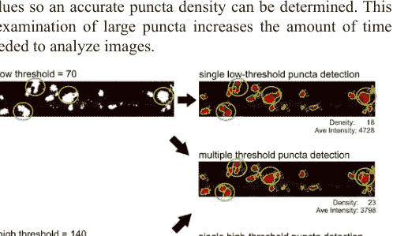

**图 1** `SynPanel` 改进的斑点检测方法。

### 数据输出

在 `MetaMorph` 和 `Image` 中，单张图像测量的所有数据都以电子表格的形式存在。在分析神经元时，在多种情况下这会变得不方便。首先是必须以特定方式使用不同类型测量的数据。例如，为了定量神经元的斑点密度，必须进行两种测量：多个树突段的长度以及相应段中的斑点数量。在 `Image` 和 `MetaMorph` 中，这并不容易。

识别并重新组合原始数据然后进行必要的计算是用户的责任。这种重新组合的过程可能是非常费体力的，并可能引入额外的错误机会。我们发现，当需要同时分析同一张图像的两个不同属性时，效率会降低。当数据混合时，用户必须分别进行每项分析或跟踪每个数据代表什么。这在尝试同时测量棘密度、斑点密度和斑点强度时尤为明显。

为了避免这些问题，`SynPanel` 包含了各种归一化的数字对象，执行特定类型的神经元分析以组织数据并使分析过程简单化。例如，如果用户想要进行三类分析：斑点分析、棘分析和荧光强度分析。第一个对象是“通用”对象，允许用户从图像中选择计算荧光强度的区域（图 2A, a）。这些对象会自动计算区域的积分强度或该区域的平均荧光强度。第二个对象是“树突”对象（图 2A, b）。树突允许用户指定一个待分析的短树突区域。树突对象有两种：第一种自动生成一个包围树突的矩形（图 2A, b），第二种允许用户以“手画”方式指定周围区域。


除了利用斑点对象的信息计算斑点和棘触密度、平均棘触宽度、棘触长度以及按棘触类型分类的密度外，树触还利用棘触和斑点对象的信息来计算每个棘触的斑点数量。我们意识到，对于树触，每个单独对象的数据可能需要进行平均处理，或者需要对整个神经元的值进行平均处理。`SynPanel` 自动执行所有这些计算，用户指定如何写入从荧光强度测量将发生的地方（图 2A, b'）。这些对象用于计算包含区域内的长度、总荧光强度和平均强度。此外，树触对象作为“斑点”和“棘触”对象的第三和第四类对象（图 2B, c）。斑点对象会自动生成并整合每个斑点的强度区域。棘触是手动放置的，也可以用于测量棘触宽度、棘触长度和棘颈宽度。此外，棘触将使用棘触测量值自动分类棘触类型：蘑菇型、细或短 [22]。或者，用户可以指定斑点类型。树触利用其斑点对象的信息来计算斑点和棘触密度、平均斑点强度、斑点数量以及单位长度的总斑点强度。


斑点对象

棘触对象

图 2 带有对象的 `SynPanel` 界面。

当测量单张图像的多个属性时，数据管理可能会出现问题。为了改进数据管理，软件允许用户创建类别，以便每个数字对象可以使用不同类型的数据。通常在同一张图像内测量转染和非转染细胞。在 `SynPanel` 中，用户可以创建组：一组用于转染数据，一组用于非转染数据，然后在每个组中添加树触对象，以同时测量转染和非转染神经元的密度。

# 用于密度和强度快速定量的 `SynPal` 软件

`Syn` 的数字对象减少了所需的时间，因为大部分计算已经完成。数字对象的使用允许同时分析两个。最后，创建不同类别的能力允许用户同时分析不同细胞群的相同属性。

# 大数据分析

为了提高 `SynPanel` 的效率，之前图像的阈值设置将应用到打开的图像，所有数字对象会自动保存和加载，数据将导出，因此用户只需专注于分析图像。

## 原分析

为了测试 `SynPal` 的准确性和效率，将其与 `MetaMorph` 手动分析以及 `SynD` 程序全自动分析的结果进行比较。为了这种比较，我们使用了一组来自海马神经元的荧光图像，这些神经元转染了 $\beta$-半乳糖酶并进行了免疫染色

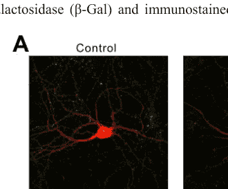

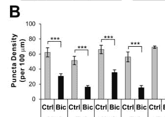

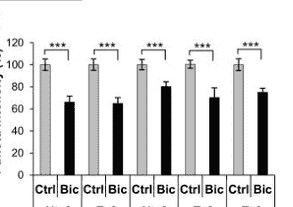

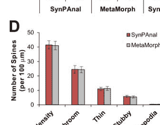

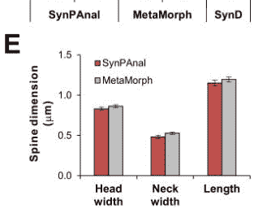

图 3 使用 `SynPanel` 和 `MetaMorph` 进行斑点和树突棘触定量的结果对比。

## 未来方向

`SynPanel` 的当前功能仅限于突触斑点检测、荧光强度分析以及 24 位 RGB 图像的维尺寸分析。我们打算通过增强 `SynPanel` 的功能和图像兼容性来继续改进该软件。新功能如共定位测量、通用区域内斑点方向的定量化、粒子追踪以及微管分类正在开发中。此外，该软件已开源；我们欢迎科学界对其提出任何建议和修改意见。

## 结论

准确测量突触处的蛋白水平是理解突触蛋白如何贡献信号传导的关键工具。我们的软件旨在提高分析的效率和可靠性，并提供额外的优势。首先，该软件基于 `Java` 开发，因此可以安装在 `Windows`、`Mac` 或 `Linux` 系统上。其次，该软件体积很小（约 5 MB），易于携带。最后，该软件免费供学术实验室任何用途使用。

## 参考文献

- 1. Hebb DB (2002) 行为组织：一种神经心理学理论. Mahwah, N.J.: Libbaum Associates.
- 2. Kandel ER, Schwarz JH, Bessel TM (2000) 神经科学原理. New York: McGraw-Grill, Health Professions. Edition, 1414 p.
- 5. Kewels H, Malnow R (2009) 突触 AMPA 受体塑性与结合. Neuron 59:340–350.
- 6. Bliss TV, Colridge GL (1993) 记忆的突触模型：海马体的长时程增强. Nature 363:51–55.
- 7. Okabe S (2007) 后突触密度的分子解剖. Mol Cell 29:5403–518.
- 8. Yi JJ, Ehl MD (2005) 突触中的泛素和蛋白周转. Neuron 47:629–632.
- 9. Ting TJ, Pena J, Feng G (2012) 后突触支架蛋白突变的功能性与精神疾病的相关性. Annu Rev Neurosci 35:49–71.
- Pozarta J, Lerner L, Shermans ML (2012) 阿尔茨海默病及其模型中的突触变化. Neuroscience.
- Morrison J, Baxter MG (2012) 老龄化的突触：认知下降的特征与诱因: Nat Rev Neurosci 13:240–250.
- Penzuz P, Patel ME, Jones KA, VanLeeuwen JE, Wood KM (2011) 神经精神疾病中的树突棘塑性. Nat Neurosci 14:285–293.
- El-Hussaini AE, Scheft CH, Domichev MC, Nicola A, Bredd SD (2000) 兴奋性突触的活体测量. Science 290:1364–1368.
- Collins TJ (2007) 显微镜成像. Biophysics 43:25–30.
- Koh IV, Linjung WB, Zheng K, Kimsky AE, Eijgerenaar S, et al. (2011) 树突棘的图像分析. Nat Curr 14:1283–1310.
- Zhang Y, Wo X, Ramirt S, Balaj AB, Johnston D, et al. (2007) 使用单元分割和 LDA 分类器检测树突棘. Class Microscopy 3:356–360.
- Cheng J, Xu X, Miller E, Rmu J, et al. (2007) 双光子激光扫描显微镜树突棘的新型计算方法. J Methods 105:183–184.
- Rodriguez A, Elenberger DB, Dickstein LH, Hor PR, Wearne SL (2008) 荧光显微镜树突棘自动三维检测和形状分类. J PLoS One 3:e1997.
- Schmitt SC, Hjorth J, Joemal RM, Wijntjes R, Eijgerenaar S, et al (2011) 树突棘、突触塑性与招募的自动分析. J Neurosci 195:185–195.
- Danielson E, Zhang N, Metalo J, Jaleka K, Shin SM, et al. (2012) SCAM/MAG1-2 是 AMPA 受体必需后突触支架分子. Neuroscience 32:6967–6980.
- Shin SH, Zhang N, Hansen J, Gerges NJ, Park DT, et al. (2015) RIM4 协调活动依赖性后突触蛋白重塑和稳态缩放. Nat Neurosci 15:1655–1666.
- Hering H, Sheng M (2001) 树突棘：动力学与调节. Nat Rev Neurosci 2:880–888.

# ZODET：用于微阵表达数据中异常基因识别、分析和可视化的软件

Roden DL¹, Sewell GW¹, Lobley A¹, Levine AP¹, Smith AM¹, Segal AW¹.

¹伦敦大学学院医学部，伦敦，英国。

## 摘要

### 总结

复杂的人类疾病在相同表型疾病的患者之间可能表现出显著的异质性。我们的异常检测策略旨在识别在基因转录水平上的 [missing text] 变异。……

# ZODET: 用于微阵列基因表达中离群值识别、分析和可视化的软件...

使用了两个调节阈值（必须满足）来识别离群值：(i) 实验样本标准化表达水平与对照组平均（均值）表达水平相比显著性水平；以及 (ii) 实验样本与对照组表达水平之间的（对数）倍数变化（fold change）。此外，应注意确保数据的正态性，特别是当样本量较小时（例如少于 30）。

- 火山图（图 2B），在横轴和纵轴分别用倍数变化和 log-(p值) 突出离群探针。上表达和下表达的离群值分别用绿色和红色标记。
- 每个个体的离群探针热图（图 2B）：探针在离群表达数据中聚类，使用了 `ggplot` 包（https://ggplot2.tidyverse.org/reference/heatmap/）中的 `heatmapfunction` 函数进行层次聚类；
- 基因列表：包含识别出的值、探针 ID 以及所识别基因的名称。

为了评估实验样本值偏离对照组的标准偏差，为微阵列上的每个探针（或组）计算 Z-Score：

```
Z = (E - μ) / σ
```

其中：E 是实验样本中基因的表达水平；μ 和 σ 是对照组基因表达的均值和标准差。根据 Z-score，参考正态分布计算 p 值，其中 p 值是对照组分布落在对照组分布范围内的概率。可以使用经过 Bonferroni 校正对每组进行多重假设检验调整后的 p 值。默认的 p 值阈值为 0.01，可以在每次分析运行后进行修改。

实验样本表达水平与对照组表达水平之间的倍数变化（fold-change）通过以下公式为阵列上的每个探针计算：

```
foldC = E / μ
```

这提供了实验组和对照组表达水平差异的额外衡量标准，并确定了潜在的离群值相对于对照组是过高还是过低。在方程 (2) 中：foldC 是倍数变化；E 是样本的表达水平，μ 是对照组的平均表达水平。为了准确估计探针，所有作为软件输入的分类基因都应处于标准格式。该软件设计为不需要任何特定的微阵列平台，可用于任何转换后的微阵列表达数据（例如来自 `Affymetrix` 或其他阵列）。默认的倍数变化阈值为 1，可以在每次分析运行前进行修改。

为了解释结果的可视化，软件分析生成了若干格式清晰的图表，包括：每个个体的（图 2B）：

- 个体值与对照组均值值之间相关性的散点图，上表达的离群探针分别用绿色和红色标记（图 2B）；

# 患者招募

这些研究由 `UCL/UCLH` 人类研究伦理联合委员会设计（项目编号 023024）。患者从伦敦大学学院医院（`UCHL`）/伦敦大学学院（`UCL`）招募。已获得所有患者的知情同意。

# 单核细胞的分离与培养

从受试者处采集外周静脉血并注入到含有 1 mL 肝素的注射器中。通过 `Ficoll` 密度梯度离心（800 g, 30 min, 20°C）分离出单核细胞，并用磷酸盐缓冲液（`PBS`; `PBS`, UK）在 5 g 下洗涤。细胞重悬于 10 mL `RPMI`（培养基）中，并添加 100 IU/mL 青霉素（`GBC`）、100 µ/mL 胎牛血清（`FBS`）和 200 µ/mL `HEPES` pH 7.4 (`Saline`)，然后以 5×10⁶ cells/mL 的密度置于 `Ncmuron` 培养皿（`N`, Roskilde, 丹麦）中培养，37°C。

# RNA 提取与分析

外周血采集……

## 上调探针

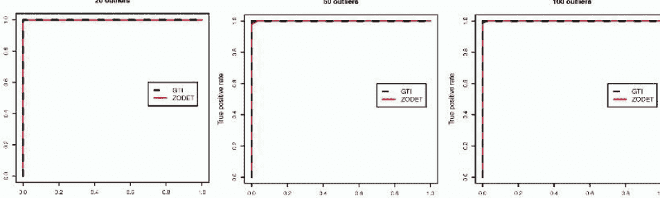

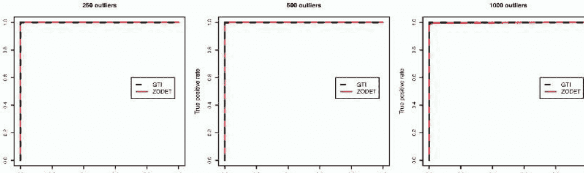

## 下调探针

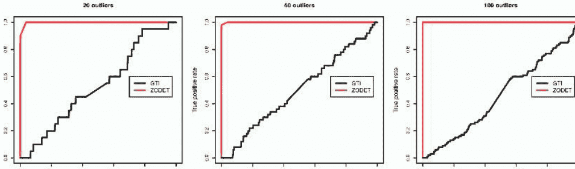

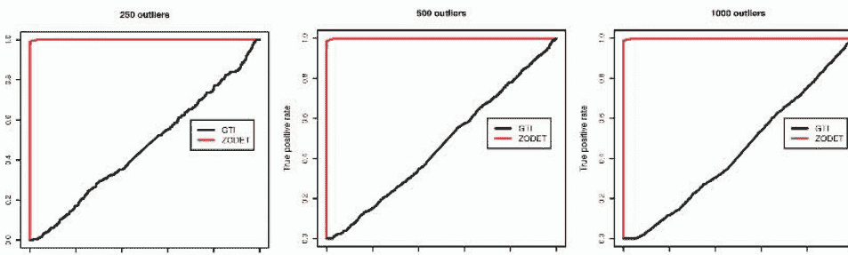

3. ZODET 和 GTI 异常值检测的受者工作特征（ROC）曲线。

ROC 曲线是基于 20,000 个探针中一系列上调和下调探针的模拟数据绘制的。

有趣的是，在识别模拟数据集中的上调真阳性时，大多数方法均表现良好，导致 ROC 曲线下面积（AUC）达到 1.0（图 3）。在识别下调探针时，`ZODET` 明显优于 `GTI` 方法，平均 AUC 分别为 0.99 和 0.98。虽然 `GTI` 方法专门设计用于识别相对于对照组过表达的探针，但 `ZODET` 能够等等地检测出低表达和过表达的异常值。

总而言之，两种方法在识别模拟数据集中的上调异常值时表现相同，而 `ZODET` 还能以很高的准确性检测下调异常值。

## 单细胞微阵列数据集中异常基因的鉴定

我们的网页上了一个示例微阵列数据集（http://www.ucl.ac.uk/molecular-medicine/publications/outlier-analysis）。该数据集由两个文件组成：(1) 包含表达数据的“EXPERIMENT DATA”文件，这些收集自 40 个样本的微阵列数据，样本被标记为对照组（A1 到 20）和实验组（B1 到 20）；以及(2) 包含相关实验特征的“EXPERIMENT INFORMATION”文件。这些输入文件的技术规范在补充材料中提供。

使用倍数变化 >1.75 且 p<0.0001 的阈值进行了 `ZODET` 分析。结合从 B1 到 B20 的 `ZODET` 分析结果，在该群体中发现了上调和 14 个下调探针（表 1）。三个与基因对应的探针在实验组中的更多个体中被显著鉴定。发现三个个体相对于对照组 E128 过表达（`GPR128` (ENSG0123595)18078）或趋化因子（`Ccl3`）基序 样 3（`CCL3.1`） (ENSG1177352）。这些探针在实验人群的三个或更多个体中表现为下调。2-5-寡聚腺苷酸合成酶 1 (`OAS1` (ENSG0158822)) 和 `RPS23` (`RPS23` (ENSG1174599)) 分别在三次测试中的三次和两次中被显著鉴定。然而，`ZODET` (ENSG0174018) 被发现是一个已知的单核苷酸态性 (`SNP`) rs337383，它解释了实验组中鉴定的三个下调异常值。该 `SNP` 导致探针极化，而非基因表达真实降低。应对所有鉴定的探针进行 `PCR` 验证，以排除探针极化导致的假阳性。

表 1 实验受者的合并 `ZODET` 分析与相应的 `GTI` 结果。

| 探针 ID | 符号 | 计数 | GTI | GTI 排名 |
|---|---|---|---|---|
| EL_2123595 | GPR128 | 3 | 4.889 | 1 |
| EL_1800878 | GPR128 | 3 | 4.455 | 2 |
| EL_1177354 | CCL3 | 3 | 2.460 | 12 |
| EL_1732518 | UTL2 | 2 | 3.862 | 3 |
| EL_1661861 | CSF2 | 5 | -0.062 | 57 |
| EL_1654391 | GBM | 1 | 1.653 | 52 |
| EL_1618178 | UTL2 | 3 | 3.223 | 6 |
| EL_1672656 | TSBSA1 | 1 | 1.453 | 70 |
| EL_1622775 | EDN | 1 | 1.299 | 70 |
| EL_1688423 | FCER1A | 1 | 0.446 | 185 |
| EL_1693669 | GNBP | 1 | 0.644 | 76 |
| EL_1710186 | CCL17 | 1 | 1.170 | 143 |
| EL_1740278 | CYP2B1 | 1 | 1.081 | 171 |
| EL_1725965 | GREM1 | 1 | 2.261 | 11 |
| EL_2100299 | CCA21 | 1 | 2.985 | 8 |
| EL_2200419 | CCL4 | 1 | 1.610 | 51 |
| EL_2298593 | FTY24 | 1 | 1.279 | 111 |
| EL_2294762 | AMY1 | 1 | 0.727 | 599 |


# ZODET：用于微阵列中离群基因识别、分析和可视化的软件

## 结果

下调（`p<0.0001, fc<1.75`）。GTI 排名基于 25 个受者。ZODET 结果设置为 `p=0.001` 且倍数>1.75。所有鉴定的探针均列于表 1，并带有它们的计数、GTI 分和 GTI 排名。“计数”显示了被 ZODET 分类为异常值的实验组个体数量。“GTI 分”显示了 GTI 鉴定的每个探针的分数。下方显示了 19 个上调探针和 4 个下调探针。与 ZODET 输出（表 1）相比，对同一数据集进行了 GTI 分析。与模拟数据一致，GTI 能够识别上调探针，并对两个被 ZODET 鉴定的 `GPR28` 探针给出了最高排名。为了确定基因表达是否源于遗传突变，鉴定了 `GPR128` 和 `OAS1` 基因为异常值。在过表达 `GPR128` 的任何个体中均未发现突变（数据未显示）。然而，之前的报告《ZODET: 微卫星序列中异常基因的鉴定、分析与可视化》鉴定了 `GPR28` 和 `TFG` 基因的染色易位，导致了框内 `TFG-GPR128` 融合。该转录本在所有组织中均组成型表达，是组织中 `GPR28` 过表达的可能原因。对三个异常受者进行 PCR 分析和测序（图 4A）确认了其 `GPR28` 基因的易位。对剩余的 17 个实验受者和 2 个对照进行了进一步的 PCR 分析。发现额外的实验受者携带易位，并从表达数据可以看到 `GPR128` 水平增加。ZODET 分析中应用的抗体意味着该个体未被鉴定为异常值（图 4b，绿色箭头）。对照受者均未携带易位。ZODET 分析鉴定出四个实验受者中的三个为 `TFG-GPR128` 易位的携带者。常见的低调异常基因是 `OAS1`，在六个实验个体中发现。该基因的测序结果在

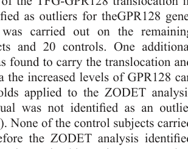
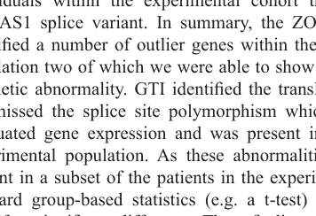
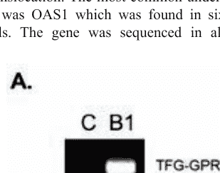
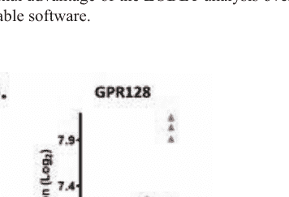

**图 4. ZODET 鉴定的两个基因的实验验证。**

**A.** 对使用 ZODET 分析鉴定为异常值的个体 B1 进行 `TFG-GPR128` 易位的 PCR 验证。**B.** 对照组和实验受者 `GPR28` 基因（`ILMN, 2122359`）的表达谱。携带 `TFG-GPR128` 易位个体的绿色表达显示 `GPR128` 水平升高，但使用 `p<0.0001` 且倍数>1.75 阈值的 ZODET 分析未将其鉴定。**C.** 对 `OAS1` 基因的基因组 DNA 测序显示，ZODET 分析鉴定为异常值的所有个体中存在剪接位多态性 `A>(rs107461)`。所有六个个体均显示为多态性纯合子。**B.** 对照组和实验受者 `OAS1` 探针（`ILMN, 1165828`）的表达谱。绿色表达鉴定出一个携带剪接位多态性的个体，显示 `OAS1` 水平降低，但使用 `p<0.0001` 且倍数>1.75 阈值的 ZODET 分析未将其鉴定。

## 讨论

我们描述了一种通过用户友好图形界面（GUI）对微阵列数据中的基因和单个样本进行鉴定、分析和可视化的软件。该方法根据特定基因单个样本表达水平相对于对照样本的正态分布计算 z 分。这与 GTI 方法不同，后者根据样本组中具有基因表达的样本比例为每个基因计算分数。ZODET 的优势在于灵活实现了基于 z 分数的异常值方法，该方法通过 GUI 为生物信息学知识有限的人员提供了规范。

由于 GTI 方法此前已被证明可以与其他异常值检测方法比较，我们对其进行了性能基准测试。ZODET 结果设置为 `p=0.001` 且倍数>1.75。所有鉴定的探针均列于表 1，并带有计数、GTI 分和 GTI 排名。“计数”显示了被 ZODET 分类为异常值的实验组个体数量。“GTI 分”显示了 GTI 鉴定的每个探针的分数。下方显示了 19 个上调探针和 4 个下调探针。与 ZODET 输出（表 1）相比，对同一数据集进行了 GTI 分析。与模拟数据一致，GTI 仅能够识别上调探针，并对两个被 ZODET 鉴定的 `GPR28` 探针给出了最高排名。为了确定基因表达是否源于遗传突变，鉴定了 `GPR128` 和 `OAS1` 基因为异常值。在过表达 `GPR128` 的任何个体中均未发现突变（数据未显示）。然而，之前的报告《ZODET: 微卫星序列中异常基因的鉴定、分析与可视化》鉴定了 `GPR28` 和 `TFG` 基因的染色易位，导致了框内 `TFG-GPR128` 融合。该转录本在所有组织中均组成型表达，是组织中 `GPR28` 过表达的可能原因。对三个异常受者进行 PCR 分析和测序（图 4A）确认了其 `GPR28` 基因的易位。对剩余的 17 个实验受者和 2 个对照进行了进一步的 PCR 分析。发现额外的实验受者携带易位，并从表达数据可以看到 `GPR128` 水平增加。ZODET 分析中应用的抗体意味着该个体未被鉴定为异常值（图 4b，绿色箭头）。对照受者均未携带易位。ZODET 分析鉴定出四个实验受者中的三个为 `TFG-GPR128` 易位的携带者。常见的低调异常基因是 `OAS1`，在六个实验个体中发现。该基因的测序结果在

## 参考文献

- 9. Store JD, Tibshirani R (2003) DNA微阵中差异表达基因识别的统计方法。分子生物学 (Clifton, NJ) 224: 149-157 可：http://www.nlm.nih.gov/pubmed/12670762 访问于 2013年7月31日。
- 10. Dall GE, Wilkinson L (1986) 正态性 Lille 检验统计量分布的近似。美国统计师: 60: 294-294 可：http://www.tandfonline.com/doi/abs/10.1080/00031303.1986.10754199 访问于 2013年7月31日。
- 11. Bonneau-Nielsen V, Field LL, Su Z, Zheng L, et al. (2005) `OAS` 基因中抗病毒 2,5'-寡腺苷酸合成酶 (2AS) 单核苷酸多态性活性受剪接位点受体控制。美国医学遗传学 76: 623-633 可：http://www.ncbi.nlm.nih.gov/pubmed/15916003 访问于 2013年7月31日。
- 12. Tibshirani R, Hastie T (2007) 用于差异基因表达分析的离群和。生物统计学 (Oxford, England) 8: 2-8 可：http://biostatistics.ox.ac.uk/publications/articles/08/12 访问于 2012年7月27日。
- 13. Chase A, Ernst T, Fiegbig A, Collins A, Grand F, et al. (2010) 淋巴瘤和软组织瘤中染色体翻译的目标 `TGF` 在健康个体中与 `GPR128` 融合。血液学 95: 20–26。
- 14. Ho JWF, Tibshirani M, dos Remedios CG, Charles MA (2008) 基因表达差异差异分析及其在人类疾病中的。生物信息学 (Oxford, England) 24: 1390-8 可：http://www.nlm.nih.gov/articlender.cgi?id=2805370&tool=pmcenterrendertype=abstract 访问于 2013年7月31日。
- 15. Hulse AM, Cai JJ (2013) 遗传变异对人类基因表达变性的贡献。遗传学 193: 95–108 可：http://www.nlm.nih.gov/pubmed/23513067 访问于 2013年7月31日。
- 16. Li J, Liu Y, Kim R, Zhang Z (2010) 人类群体间的基因表达变异以及对疾病易感性的。PLOS 计算生物学 6: 10 可：http://dx.plos.org/10.1371/journal.pc.1000910 访问于 2013年7月31日。
- 17. Mar JC, Itijan NA, Mackay-Sim A, Melick GD, CM, et al. (2011) 基因表达方差识别神经退行性疾病中改变的网络。PLOS 遗传学 7: e1002207 可：http://dx.plos.org/10.1371/journal.pgen.1002207 访问于 2013年7月31日。

---

# 第 6 章 SCRIPTRT：一种用于认知研究收集反应时间的软件库

**Thomas W. Schubert¹, Carla Murteira², Elizabeth C. Collins², Diniz Lopes²**

1. 奥斯陆大学心理学系，奥斯陆，挪威
2. 里斯本大学社会交互中心 (ISCTE-IUL)，里斯本

## 摘要

ScriptingRT 是一种用于认知研究中收集反应时间的新开源工具。ScriptingRT 提供了认知研究的构建模块，这些与通用编程相结合。六项研究评估了 ScriptingRT 的性能。研究 1–3 使用专用硬件来测量反应时间和刺激呈现。研究 4–6 在线和实验室实施了 Stroop 范式。总而言，使用 ScriptingRT 开发的研究显示了较小的延迟和增加的测量变异。我们得出结论，ScriptingRT 可用于实验。

## 引言

心理学研究收集数据存在普遍趋势：一种是利用互联网通过各种方法收集数据，特别是在线问卷。这些方法可以更容易获取难以触及的样本。另一种长期趋势是使用反应时间作为认知处理的指标。这些指标用于检查受试者之间的差异和实验操控 [1–3]。然而，除少数例外外，这两者尚未结合：在线测量持续一秒或更短的反应时间，原因是技术性的。

在本文工作中，我们为这个问题提供了一种新方法。我们设计并实现了一种基于开源或免费技术（即 Adobe Flash [4–6]）的方法。我们开发的软件是开源且模块化的，欢迎其他实验室和研究人员贡献。引用：Schubert WT, Murteira C, Collins EC, Lopes D (2013) ScriptingRT: 一种用于认知研究收集反应时间的软件库。PLOS ONE 8(6):e769. doi:10.1371/journal.pone.0769

## 在线反应时间量的现有方法

设计了两个原始基于 PC 的软件包来收集反应时间，它们具有扩展数据收集的方法。商业软件 Insight 支持在线研究。一种典型的反应时间研究向受试者提供 50 到 300 个之间的试验，并要求尽可能快速回答。在基于在线的调查中，只需要受试者具有稳定的网络连接。此类研究中计算机除了回答问题并将答案传回服务器。然而，为了收集反应时间，需要在计算机上执行许多试验（即客户端）。这是因为客户端和服务器之间的通信在时间和数量上存在差异，会引入过多噪声。因此，要在在线运行反应研究，需要一个运行在受试者计算机上的程序，呈现试验并收集反应时间。多种技术被用于创建此类程序：JavaScript、HTML 和下载的原生（Windows PC 或 Mac）。我们简要回顾了某些方法，

### Java 程序

大多数在在线研究中测量反应时间的方法都是基于 Java 的。Adeaco, Eichardt [6] 评估了 Java 测量时间的性能。Nosek, Banaji, 和 Greenwald [7] 报告了内隐注意力测试 (IAT)，这是一种稳健的筛选工具。报告的九项 IAT 中，关键区块之间的反应时间差异在 95 到 301 ms 之间，标准差小于 22 ms。Cohen 与 Mayo, Greco [8] 使用 Java 实现了一项心理语言学研究。使用自读范式产生 1000 到 2000 ms 之间的延迟，他们研究了以前在实验室运行的任务。他们观察到具有检测 185 ms 以上延迟差异的能力。与 Barton, Locke, Berlin [9] 实现了 javato，一种基于 Java 的心理学研究开源程序，但对其测量精度未进行评估。

### Flash 程序

值得注意的是，最近所有的在线 IAT 都是由“Project Impl” [10] 用 Flash 替代 Java。Reimers 和 Reiter [11] 研究了受试者是在实验室中使用 C++ 测试完成包含 30 个试验的二项选择范式，还是在外部使用 Flash 运行相同的程序。他们发现 Flash 增加了约 30 ms 的延迟，且对延迟的分布没有标准差。

### 脚本程序：JavaScript 和 HTML

Mason [12] 已使用 JavaScript 和 HTML 实现了 IAT 的现代开源版本。该实施的评估由 Tyler 和 Peck [13] 发表，他们依赖 JavaScript 测量反应时间，并显示了值的中位数平均（此处原文可能有误）。Currell, Crpton, 和 Gurek [14] 使用 JavaScript 程序报告了真实的反应时间，招募的受试者发现了 Amazon Turk [15] 的复制。他们发现了几种范式（Stop、任务切换、侧抑制任务、Simon、Posner kuy）。他们观察到跨刺激的精度可以达到 80 ms，但无法更低。

### 原生 Windows 程序

设计了两个原始基于 PC 的软件包来收集反应时间，它们具有扩展数据收集的方法。商业软件 Insight 支持在线研究。要运行研究，必须下载一个可执行文件或 Java Web 语言的可执行程序。同样，免费软件包 DMDK5 [16] 提供了一种在客户端机器上执行的测试方法。优点是，在客户端执行性能良好的代码实际上与用于桌面测试的代码相同，运行代码的机器会有更好管理的延迟，避免错误 [17]。缺点是因为安全考虑、防病毒软件和浏览器限制变得困难，并可能将这些应用限制在受试者熟悉构建者的范围内。

### 比较与总结

总来说，JavaScript 和 Flash 已用于测量反应时间。发布的评估显示三者都可以成功使用，但与 PC 上的原生编程相比，延迟可能会增加。在原生程序中最好的方法由 Nash [18] 发表，显示了这种

## ScriptingRT

我们开发了一个支持在 Flash 中编写响应延迟的软件库，名为 ScriptingRT（在线地址：http://reactions.scriptrt.com/）。ScriptingRT 以插件形式或在浏览器中运行。它使用 Apache Flash 编写，然后编译成 Flash 页面，这些页面可以在线和 HTML 页面中分发。

Flash 是基于 XML 的标记语言 (XML) 和脚本语言 (ActionScript) 的结合。Flash 由 Adobe 发起，但现在由 Apache 基金会维护。ScriptingRT 同样根据 Apache 许可证发布。ScriptingRT 基于开源免费软件。为了开发 ScriptingRT，研究人员需要实现 Flash SDK（适用于 OS X 和 Windows）、ScriptingRT 库 [19]、文本编辑器、支持 Flash 的浏览器，以及在其之上的脚本引擎。

ScriptingRT 的哲学是允许在 XML 文件中使用一组简单的标记标签来编写响应延迟，同时允许编写额外功能。ScriptingRT 的标记标签及其功能在 ScriptingRT 库中定义，该库用于将研究编译成 Flash。

标记的概念灵感源于（但不限于）自由软件 DMX。研究被编写为块（blocks）的组合，块由项目（items）组成，而项目又由帧（frames）组成。一个帧代表单次屏幕显示的内容。一个项目可以由一个或多个帧组成。例如，一个项目可能包含一个空白帧、一个带有星号的帧（用于指示下次试验）、一个带有框架的帧以及一个带有计时器的帧。帧在项目内的顺序可以改变。同样，一个块可以由一个或多个项目组成。然而，块内的项目顺序可以改变（随机化）。在这种情况下，属性会影响用户的感知。

这些结构中的都是通过 XML 标签创建的：帧通过 `<Frame>...</Frame>` 创建，项目通过 `<Item>...</Item>` 创建，块通过 `<TestPart>...</TestPart>` 创建。不收集响应延迟的块（例如指令）通过 `<Part>...</Part>` 创建。

这些 XML 标签由 ScriptingRT 库定义。结合 ScriptingRT 特有的标签，`<Text>...</Text>` 标签可在帧中显示文本。因此，每段 ScriptingRT 代码都是 ScriptingRT 库标签与标准 Flash 标签的混合。一个 Test 类型的项目可以是：

```
<Frame response="Time.2000" protocol="false">
<mx:Text verticalCenter="0" horizontalCenter="0" fontSize="44" text="+ />
</Frame>
<Item id="true" id="test100">
<mx:Text verticalCenter="0" horizontalCenter="0" fontSize="34" color="#0ffff00" text="red"/>
</Item>
<TestPart>
```


在这个示例中，`<TestPart>` 设置了此块的默认值，包括项目（问题 Q 和 P）的随机化、背景和文本的随机化。通过此块创建了两个项目。项目类型用加号标记，这意味着如果计为正面，则答案将是正确的。第一次试验在星号出现 2000 ms 后开始，这是用户对常规 Flash 库的预期。第二个帧显示在屏幕上，直到给出答案为止。在这个示例中，所有类似 `<Text>` 的 XML 标签都由 ScriptRT 定义（这就是为什么示例指向的是起始 `<Application>` 标签中的属性定义，而不是在这里）。图 1 显示了一个复杂元素结构的示例。

```
<Application version="1.0" encoding="utf-8">
xmlns:mx="http://www.adobe.com/flash/mx">
<TestPart>
<Part />
<Instruction />
</Part>
<TestPart>
<Frame>
<mx:Text color="#0ffff00" text="red"/>
</Frame>
<Item>
<Frame>
<mx:Text color="#000000" text="blue"/>
</Frame>
</Item>
</TestPart>
</Application>
```

图 1. 在 ScriptRT 中实现的 Stroop 任务大纲。

实现 Stroop 任务的 ScriptRT 源代码摘。它显示了偏好集（1–2）、创建指令屏幕和指令屏幕（3–5），以及一个带有帧的实验试验（6–12）。标签 1 和 12 是 Apache Flash 标签。文本在 `Application` 标签中带有 `mx:` 前缀定义。所有其他标签都是 ScriptRT 库的一部分（在 `Application` 部分）。

ScriptRT 研究的其他块是用于指令、反馈和分支的标签。表 1 提供了一个列表。在每个分支中，可以在不编写额外 ActionScript 的情况下使用这些元素元素。有关 ScriptRT 库的信息可以在手册 [19] 中找到。

## Java 技术

ScriptRT 库中没有标准的额外功能可以通过其他 Flex 库或通过嵌入在 XML 文件中的 ActionScript 程序来添加。ScriptRT 可以包含任何对象，如文本、HTML 编码的矢量图形、图像或声音。

表 1. ScriptRT 引入的标签和属性概述。

| 标签 | 解释 |
| :--- | :--- |
| `<TestPart>` | 创建一个项目块。 |
| `<Part>` | 创建块中不收集响应延迟的区域。 |
| `<Instruction>` | 显示指令。 |
| `<Frame>` | 代表单个屏幕的显示内容。 |
| `<Item>` | 由一个或多个帧组成。 |
| `<mx:Text>` | 用于在帧中显示文本。 |
| `<Back/>` | 允许返回上一个屏幕。 |
| `<correct/>` | 标记响应是否正确。 |
| `<incorrect/>` | 标记响应是否错误。 |
| `<Branch/>` | 允许试验之间进行分支。 |


# ScriptingRT：一种用于在线研究中响应延迟的软件库

## 表 2. 研究概览

| 研究 | 数据收集 | 硬件与软件 |
|---|---|---|
| 1 | 使用外部微控制器进行测试 | 连接到 PC 和 Yano-Dev 电脑的 Arduino 板，在浏览器中运行 `ScriptingRT`，如 [1] 中 |
| 2 | 使用外部微控制器和电磁铁进行测试 | 与 Chrome-Dev 电脑通信的 Arduino 板，`ScriptingRT` 和 Chrome 扩展包 |
| 3 | 使用处理时间的外部微控制器进行测试 | Arduino 板监控，Yano-Dev 笔记本电脑，Android 浏览器中运行 `ScriptingRT` |
| 4 | 人类参与者的在线数据收集 | 参与者使用的各种硬件和软件；例如，Yano-Dev 笔记本电脑，在 Firefox 中配合 Adobe Flash 运行 `ScriptingRT` |
| 5 | 人类参与者的实验室数据收集 | 参与者使用的各种硬件 |
| 6 | 人类参与者的在线数据收集 | |

## 伦理声明

仅进行了 4 项涉及人类参与者的研究。这些研究遵循了 2012 年由主办机构葡萄牙里斯本社会干预研究中心（CI-IUL）科学委员会（Comissão Científica）发布的伦理指南。这些伦理指南提供了一个清晰的清单，用于判断是否需要进行审查流程。这表明当前研究免于正式审查，因为：1 数据是匿名收集的且无完整响应；2 不涉及引起反愿的参与者；3 不涉及来自关注人群的参与者；4 不涉及欺骗；5 未收集敏感信息（如姓名、身份 ID、电话号码或电子邮件地址）或地址；以及 8 未收集可能危及危险的信息。

所有实验均为非侵入性，未提供任何信息，且结果经过匿名分析。我们仅对抽样参与者收集数据。研究通过网络进行，其中研究 5 和 6 是在葡萄牙的一所大学招募的（面对面超过 5 小时或持续 5 个月）。因此，所有数据均在主办机构所在地葡萄牙境内收集。在所有研究中，参与者都阅读了研究的描述和目的，并被告知他们正在同意参与，但可以在研究的任何阶段退出。在研究 5 中，最后一点通过口头进行了重复。

## 研究 1：使用模拟键盘的自动响应比较 ScriptingRT 与其他软件

我们首先测量了软件 `ScriptingRT` 和 Flash 引入的响应时间。因此，在研究 1 中，我们通过对单个刺激进行自动响应，将由于人类个体差异和试验间差异导致的方差降至最低。为此，我们使用一个 Arduino 微控制器，通过光敏传感器检测刺激的开始，并向电脑发送“按键”，模拟参与者的键盘击键操作。我们测量了板卡“反应”的延迟。

### 方法

我们使用一个 Arduino 微控制器通过 USB 控制电脑。该板可以模拟键盘并向电脑发送按键，这些按键被识别为来自普通键盘的信号。带有 Tinker 光敏电阻（LDR）的 Arduino 放置在 Vano 笔记本电脑的表面。笔记本电脑被编程为通过感知压力（此处压力大于某一阈值）来检测按键是否完成。Arduino 通过 USB 连接并触发一个 `SPACE` 键，这表现为压力条上的普通压力信号。

我们编写了一个简单的实验，在 `ScriptingRT` 和 `DMDX` 中各包含 100 次试验。本研究及另外两项研究中的试验次数遵循认知科学的需求，即需要 50 到 300 次试验。在每次试验中，刺激会在黑屏的间隔期之间显示一个白屏，白屏会持续到压力条释放为止。当 LDR 检测到它时，白屏消失。我们测量了白屏持续的时间。我们在同一台笔记本电脑上运行了三次 `ScriptingRT` 任务：

### 结果

`DMDX` 软件检测到了这项基准研究。它记录了 Arduino 在 6.86 ms 到 8.21 ms 之间的响应时间。

### 讨论

在研究 1 中，我们使用 Arduino 结合光传感器检测刺激的开始，以模拟人类响应。`DMDX` 这种响应的标准差很小。出乎意料的是，`ScriptingRT` 的精度较低。三种浏览器的范围在 18 ms 到 47 ms 之间，且平均值存在差异。相反，`ScriptingRT` 的响应在所有情况下均在 7 ms 左右，标准差为 7 ms。此外，`ScriptingRT` 增加的常数很大。这表明，在解释绝对延迟时，使用 `ScriptingRT` 应主要关注 RT 之间的差异。对于研究人员来说，了解 `ScriptingRT` 的尺寸是有用的。正如所料，`ScriptingRT` 的精度不够。我们认为 `ScriptingRT` 是可以接受的。

## 研究 2：使用键盘的自动响应比较 ScriptingRT 与其他软件

在研究 2 中，我们使用 Arduino 微控制器和电磁铁检测刺激并模拟人类响应。目标是比较不同的软件包。通过此，我们发现 Arduino 和响应框的方差较小。`E-Prime` 测量的时间约为 50 ms。

### 方法

在 `ScriptingRT`、`E-Prime 2.10`、`Inquisit` 和 `DMDX` 中进行了简单测试。区块中的每次试验显示 2000 ms，随后是一个白屏，代表需要响应的刺激。作为响应，我们使用了微软键盘（型号 104-0459）或 PS 串口响应框（后者用于刺激组成的情况）。我们每个实验重复了三次。该设备使用一个光二极管产生刺激，使用电磁铁按下按钮，并通过 Arduino 微控制器连接两者。Arduino 被编程为持续性读取来自光二极管的输入。当两次连续读取检测到亮度变化时，电磁铁触发按下下方的按钮，然后在每次测试后关闭。实验期间，设备仅连接到电源；运行程序的电脑与设备之间没有通信。

### 结果

表 3 总结了使用设备时各种软件和外围获取的延迟。这里的基准是使用 `E-Prime` 响应框（`PreRelease=0`，我们在 `PreRelease<200` 时运行测试，这导致了性能。在 `E-Prime` 中，`PreRelease` 指令电脑在使用当前显示器的同时呈现下一张幻灯片）。理论上，使用 `PreRelease` 延迟当前屏幕，其性能应该与最新版本的 `E-Prime` 不同。我们不知道 `E-Prime` 出现这一意外结果的原因。这里的数据与 Schubert [21] 中的数据相同。

**表 3. 各软件（研究 2）的响应时间（ms）平均值和标准差**

| 描述性 | 比较对象 | | | |
|---|---|---|---|---|
| | M | SD | F(1,98) | p |
| `ScriptingRT` | | | | |
| `E-Prime` (PR=0) | 92.80 | 4.21 | 131.89 | <.001 |
| `E-Prime` (PR=50) | 56.91 | 1.85 | 1.026 | <.001 |
| `E-Prime` (PR=0) | 84.58 | 6.25 | 12.84 | <.001 |
| `E-Prime` (PR=50) | 70.96 | 3.37 | 0.706 | |
| `DMDX` | 68.24 | 31.8 | 10.75 | |
| `Superlab` | 99.18 | 4.17 | .822 | |
| `Inquisit` | 56.62 | 24.04 | | <.001 |

注。两列显示了由 `ScriptingRT` 测量的每个值的比较（第一行）。所有测量均使用键盘，除 `DMDX` 和 Labeling Serial Response Box 外。PR = `E-Prime` 中的 Pre=2000。

`E-Prime` 结合键盘（且 `PreRelease=2000`）、`Inquisit`，以及 `Inquisit` 的某个版本，在考虑其他持续时间时，其总体时长最长。

我们通过将结果提交到带有固定因子的混合模型来分析这些结果（本例中使用的注释在数学上等同于广义线性模型）。该模型显示对平均延迟有极显著的影响，F(276)=2374, p<.001。我们使用估计均值来比较 `ScriptingRT` 测量的平均延迟与其他每种软件（包括 SID 修正）。`ScriptingRT` 测量的效果与所有其他软件均有显著差异，p<.001 除外；即，它显著快于所有软件。我们还通过比较 Levent 的 RT 观察到 `ScriptingRT` 测量值的标准差与其他软件包产生的 SD 有差异。表 3 的最后两行显示，`ScriptingRT` 的 SD 显著大于 `Superlab` 和 `E-Prime` 以外的每一个其他程序。

### 讨论

我们与其他软件包相比，评估了 `ScriptingRT` 反应时间的测量情况。为了这一点，我们创建了一种通过按下按钮来响应刺激的方法。之前的测试证实，在精密的硬件和软件下，该机器可以产生低于 1.5 ms 的标准差 [21]。

`ScriptingRT` 的结果是，除 `Superlab` 和 `E-Prime` 之外的所有软件包相比，它导致了更长的响应延迟和更大的偏差。在其他情况下，SD 的术语与基于键盘的时间标准是相当的 [21]。在这种情况下，任何测试脚本都将具有足够的效能，以较大的效应量来评估优先级。同时，其他结果之间的差异表明，不同软件包之间（例如 `Superlab` vs. `DMDX`）以及硬件（例如响应盒）之间存在差异。因此，研究人员应该意识到，对软件、编程和硬件的选择会导致大量的误差方差，这种方差通常只能通过经验测试来评估。

## 实验 3：在 ScriptingRT 中测量刷新率

除了 `ScriptingRT` 的性能测量外，了解呈现时间的准确性也是很有用的。为了这一点，我们在 `ScriptingRT` 和 `DMDX` 中都编写了各种快速变化的内容，并使用外部光二极管测量了每次呈现的持续时间。我们预计 `ScriptingRT` 将不会用于毫秒级精确或亚意识的呈现，但对于至少 100 ms 的呈现，这是我们最短的呈现时间。

### 方法

我们编写了 `ScriptingRT` 和 `DMDX`（作为脚本），让它们闪烁 250 次白屏和黑屏，持续时间各异。我们在 Flasher 插件以及 Firefox 的脉冲模式下运行了它们。我们测量了所谓的“刻度”（ticks）的持续时间——即屏幕的单词刷新。我们使用刷新率为 60 Hz 的屏幕，得到的时间为 16.66 ms。每个屏幕显示 1, 2, 3, 4, 5 或 10 刻。所有使用的测试都在 Vaio 5 iLap 上进行。`ScriptingRT` 任务以 1360*768 像素的分率运行。

为了测量每个黑白帧的持续时间，我们使用了实验 2 中用机器的光二极管组件。光二极管中使用的 Arduino 连接到 PC，记录了连续的变化，并将持续时间保存在内部内存中。它处理了 250 次变化，然后通过 USB 连接将所有测量值发送到连接 PC。

### 结果

表 4 汇总了结果。前六行证实了设备测量的持续时间精确且偏差较低：我们获得的测量值差异在 0.03 到 0.21 ms 之间，SD 介于数值之间。

**表 4. DMDX 与 ScriptingRT 的呈现时间（实验 3）**

| | 目标 | M | SD |
|---|---|---|---|
| `DMDX` | 16.6 (刻) | 16.3 | 1.1 |
| | 33.3 (刻) | 32.0 | 2.6 |
| | 49.9 (刻) | 47.8 | 2.7 |
| | 66.5 (刻) | 64.2 | 2.2 |
| | 83.2 (刻) | 81.0 | 1.5 |
| | 166.4 (刻) | 164.3 | 2.8 |
| Flash Standalone, 60 Hz刷新率 | 124.5 | 10.8 | |
| | 200 (刻) | 322.6 | 10.4 |
| Flash Plugin, 24 Hz刷新率 | 128.8 | 11.5 | |

注。黑白之间的测量值（实验 3）。该因素没有影响。doi:10.1371/journal.pone.06794 结果。总计 60 次试。此外，试验顺序是随机的。

### 分析策略

Jostmann & Keele (2003) 发现了史鲁普效应，即不一致试验之间的。我们决定将分析重点放在促进和干扰效应（不一致试验的成分），因为我们假设刺激之间没有干扰。我们通过将数据提交模型（也称为混合效应模型）报告统计检验、95% 置信区间和效应量。在我们的实验中，促进效应小得多且不显著，而干扰效应是显著的。不一致试验之间的差异是显著的，我们因此没有发现方差。混合模型由于更保守且具有更强大的建模选项，最近被推荐用于其他模型 [28], [29]。然而，效应量的估计是困难的。因此，在报告模型估计的效应量后，我们在此处报告了。

`ScriptingRT` 在呈现中产生了 24 ms 的固定延迟。这种延迟与程序的呈现时间无关。同样，存在 11 ms 标准差，这并不取决于程序，且独立播放器没有这一点。

## 实验 4-6：斯特鲁普测试

实验 1-3 利用了 `ScriptingRT` 的基本功能，得出的结论是它可以轻松替代不需要短时间呈现的范式。第一个实验使用一种范式来验证并对比 `ScriptingRT` 与各种软件包。

为了评估目的，我们采用了标准的斯特鲁普测试 [25]。这是认知心理学中最稳健的发现之一 [26]。我们使用了 Jostmann 和 Keele 的实现 [21]。

### 方法

我们创建了一个葡萄牙语版的斯特鲁普任务。刺激是单词（红色和蓝色）或中性字符串（XXXX），在白色背景上以红色或蓝色字体出现。每个颜色单词呈现在...

#### 概述与设计

实验 4 是单独进行的。参与者执行了在 `ScriptingRT` 中编写的斯特鲁普任务，带有...

设计：(目标词：蓝色 vs. 红色 vs. 中性, >2) (颜色：红色 vs. 蓝色，内受试设计)。

分析中剔除了 `ms`（共占所有试验的 5%）的样本。

我们将延迟数据提交到混合模型，以一致性作为固定效应，参与者作为变异变量。一致试实验的速度（M=57.32, SD=19.58）快于不一致试实验（M=62.59, SD=24.26），显示了斯特鲁普效应。这一差异在统计学上是显著的，F(1,202)=18.1, p<.001。

#### 参与者

所有参与者均为自愿参加实验。招募是通过 Facebook 葡萄牙语社区进行的。在移除缺失值案例后，剩余 19 名参与者（年龄：M=28.3, SD=6.3）。

#### 材料与程序

#### 结果

##### 反应延迟

所有参与者在开展的 60 次试验中回答了超过 48 次。错误回答以及高于 1600 ms 或低于 300 ms 的延迟被剔除。实验要求参与者对不同颜色的字母序列在 60 次试验中做出反应。结果显示，不一致试实验比一致试实验慢约 60 ms，且 `ScriptingRT` 的测量足够精确，足以在 19 名参与者中达到显著性。

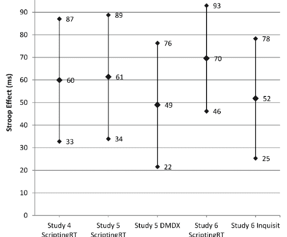

#### 讨论

研究 4 的目标是通过著名的范式——斯特鲁普效应来验证 `ScriptingRT`。参与者必须判断字母序列是用什么颜色书写的。

## 研究 5：实验室环境下 ScriptingRT 与 DMDX 的比较

研究 5 通过在受控实验室环境下于同一台电脑上运行 `ScriptingRT` 和 `DMDX` [5] 进行比较，测试了 `ScriptingRT` 的精度。

### 方法

#### 概述与设计

所有参与者在同一台 PC 上完成了两次斯特鲁普任务，分别使用 `ScriptingRT` 和 `DMDX`。软件的执行顺序进行了交叉平衡处理。实验设计采用 3（目标物，单词）× 2（颜色，内受试设计）× 2（软件：`ScriptingRT` vs. `DMDX`）× 2（第一个任务：`DMDX` vs. `ScriptingRT`）。

转向估计均值差异的置信区间，我们发现 `ScriptingRT` 中由一致性引起的差异为 61.35，范围从 33.96 到 88.75（图 2）。`DMDX` 的反应产生的差异较小，为 48.96，范围从 21.59 到 76.3。

分别对每个参与者、软件和一致性进行延迟平均处理后的效应量。`ScriptingRT` 中一致性的效应量为 η=.37，`DMDX` 中为 η=.24。

#### 参与者

19 名来自葡萄牙某大学的本科生参加了实验，并获得了 5 欧元的报酬（年龄：M=25.3, SD=9.1）。由于一名参与者有 27 次回答为错误或在反应窗口之外，因此必须排除其数据。因此，利用了 18 名参与者的数据。

### 讨论

研究 5 比较了 `ScriptingRT` 和 `DMDX`，再次使用了经典效应。所有参与者都在同一台电脑的程序中执行任务。我们发现，斯特鲁普效应的大小不受软件影响。`DMDX` 和 `ScriptingRT` 报告的显著性更长的反应时间之间完全没有差异。这一差异与研究 1 和研究 2 中观察到的差异一致。目前无法准确说明使用 `ScriptingRT` 在刷新时的合并操作为延迟增加了多少常数值，因为这似乎取决于不同的浏览器（研究 1），并且可能取决于硬件。

## 研究 6：在线运行的 ScriptingRT 与 Inquisit Web 的比较

### 方法

#### 概述与设计

研究 6 通过比较 `ScriptingRT` 与目前可用的在线收集商业解决方案（即 `Inquisit Web`）遵循了之前的研究。我们随后进行了这项在线实验，邀请志愿者参与者访问网站，并将他们随机分配到我们使用的同一斯特鲁普任务的 `ScriptingRT` 版本或 `Inquisit Web` 版本。本研究中的软件随参与者而异。

#### 材料与程序

参与者需要测试多个软件包，因此他们必须执行两次任务。两个版本的任务之间留有短时间休息。参与者通过在线招募，并使用葡萄牙语进行实验。斯特鲁普任务在 `DMDX` 中执行。在 `ScriptingRT` 中，浏览器中显示的闪烁窗口大小为 1366×768 像素，帧率为 24，在带有 Adobe 插件的 Firefox 中运行。`DMDX` 使用标准分辨率，但帧率为 60 Hz。我们在实验室中使用运行 Windows 7 (64位) 的 Sony Vaio Core i5 笔记本电脑。所有笔记本电脑均有 13 寸屏幕，刷新率为 60 Hz。

### 结果

#### 参与者

我们首先移除了错误试验以及 1600 ms 到 300 ms 之间的延迟（总计占 4.03%）。我们将包含的延迟提交到一个模型，将一致性、软件、软件顺序以及所有交互作用作为固定效应，分组作为变量。葡萄牙某大学的本科生通过电子邮件邀请参加实验。邮件包含对实验目标的简要说明（未提及兴趣）以及一个指向网页的链接。每个参与者被分配到 `ScriptingRT` 或 `Inquisit`。从 43 名参与者中收集了数据，但一人存在技术问题，最终研究剩余 42 人：年龄：M=25.8, SD=7.7。

在 `ScriptingRT`（M=62.96, SD=23.17）和 `Inquisit`（M=52.04, SD=30.44）中，一致试验均快于不一致试验。一致性在模型中是显著的（F(1,358)=8.21, p<.001）。此外，存在软件效应（F(1,358)=8.47, p<.001）。`DMDX` 反应更快（M=51.98, SD=20.38），而 `ScriptingRT`（M=61.39）的一致性未被软件所改变。此外，还存在一些效应，最可能是随机化产生的。

#### 材料与程序

`ScriptingRT` 使用 600×800 像素的分辨率。任务在 `Inquisit` 中编程并使用网页版本。实验在参与者的电脑上运行，使用其自身的分辨率和帧率。

## Java 技术

`ScriptingRT` 目前的形式已用于实现许多范式，并正在进一步开发中。其源代码可用，我们欢迎对其进行贡献。我们将继续开发它，在线发布增强程序，并对其进行实证测试。

## 作者贡献

构思并设计实验：TWS CMC DL。执行实验：TWS CMC。分析数据：TWS CMC。贡献试剂/材料/分析工具：TWS。撰写论文：TWS CMC DL。

## 结论

`ScriptingRT` 是一个软件库，允许使用 Apache Flex 和 Adobe Flash 编写响应延迟。`ScriptingRT` 为 XML 中的响应模式匹配提供了构建模块，同时可以使用编程语言添加额外功能。本文中的测试报告表明，它在目前的形式下是用于标准响应延迟模式的可行软件。我们的证据表明，对于像斯特鲁普这样稳健的范式，`ScriptingRT` 与所有其他选项（即 Java 和 JavaScript）相当。

未来的研究将在各种环境中使用软件进行真实研究，利用 Flash 和 JavaScript 获取更精确的测量结果，在桌面电脑上进行，并使用精密设备在实验室中进行重复。Flash 和 `ScriptingRT` 作为这种组合中的任何组件都是完全可访问的，因此使我们能够进行大型研究。

## 参考文献

我们认为响应延迟研究考虑了许多可能困扰当前心理学研究的问题：首先，许多研究效力较低。每个实验都可能受到思维力量产生的额外噪声影响，而这与原生 PC 软件相比可能有所不同。其次，许多研究通过从西方、工业化、富裕和现代社会中抽取人员来进行 [31]。使用自然资源将研究限制在习惯于使用计算机和互联网的人，但它可能有助于在认知和社会科学中引入更多文化变异。最后，现实中增加的延迟模式由于自然局限性而特别难以复制 [32], [33]。

`ScriptingRT` 正被各种研究人员用于他们的需求。对于普通研究人员来说，它足够良好且易于。由于 `ScriptingRT` 是一个与其他开源程序配合开源框架，我们期待在许多方向上扩大它的优点，实现广泛的应用。本文中获得并报告的结果以及软件开源性质允许的扩展可能性，让我们确信 `ScriptingRT` 将赢得研究者的兴趣，我们希望它的使用将得到广泛。

1. Kraut L, Janaj B, Bannuck M, Cohen J, et al. (2004) Psychological research online: Report of Scientific Affairs' Open Group on the conduct of Internet use. Am Psych: 59: 105-115. doi:10.1037/0006X-59.2.105.
2. Fray RC (2007) Using the Internet for personality research: What we have done, how to do it, and some concerns. In: Rubin RW, Farley RF, Krueger RF, editors. Handbook of methods in psychological research. York, NY: Guild Press: 133-148.
3. Sangis SG, Skita LJ (2012) The Internet as psychological laboratory research: Best practices, challenges, and solutions. In: Amichamber-Yuler, Editor. The Internet as psychological laboratory research: Best practices, challenges, and solutions (2nd ed.). Oxford University: 253-270 (Available): http://flex.app.org/ Accessed 2013 May 1.
4. Foster KI, Foster JC (2003) `DMDX`: A video display program with minority accessibility. Behav Res Methods Instrum Comput 35: 116-124. doi: 10.1037/b0319503.315
5. Eichtardt J (2001) An inaccurate-filter for reaction time measurement using JAVA Implementing-based Experiments. Behav Res Methods Instrum Comput 33: 179-180. doi: 10.1023/A:0127333
6. Nasek B, Bajnai M, Greenwald AG (2002) Implementing group attitudes and beliefs from a demonstration web site. Psych Group: 6: 101-115. doi:10.1037/s1096-6.1.1
7. Keller F, Ganasakthan S, Mayo N, Corey M (2009) Testing effectiveness of experiments: A case study using the Webex software package. Behav Res Methods: 41: 1-12. doi:10.3578/BRM.41.1.12.
8. Van Bastian C, Locher A, Ruflin M (2013) `Tatool`: A Java-based-open source framework for psychological studies. Behav Res Methods 48: 105-118. doi:10.3578/s1348-0112-0224-9
9. Project Implicit (2011). Available: http://implicit.harvard.edu. Accessed 2013 May 1.
10. Riemann S, Stewart N (2007) Adobe Flash as a method for online experiments: A test of reaction time measurement capabilities. Behav Res Methods 39: 365-370. doi:10.3578/bf03193004
11. Mason W (2011) Open-Web, Based-based IAT. Available: http://github.com/winter/iat. Accessed 2013 May 1.
12. Zwaan RA, Pecher D (2012) Revisiting method simulation in language:
13. Crump MC, McDonnell JV, Gurecki TM (2013) Evaluating Analog Touch as a tool for experimental research. PLoS ONE 8: e5741 doi:10.1371/journal.pone.05410
14. Burmeister M, Kwang T, Solomon SD (2011) Assessing Mechanical Touch: A source of inexpensive, high-quality data, Psych Sci 6: 30 doi:10.1177/1548590610398
15. Plant RR, Turner G (2007) Millisecond precision in behavioural research in a world of chemistry: Beh Res Methods 41: 598–614. doi:10.1016/BRM.59
16. Plant RR, Hammond N, Whitehouse T (2003) How mouse affect timing in psychological studies. Beh Res Methods 25: 27–28. doi:10.1007/s0015-003-255
17. Early A, Hickey D, Suprem AM (2011) Response time accuracy in Apple computers. Beh Res Methods 43: 355–362. doi:10.1378/s13428-016-9
18. Schubert TW (2012) `ScriptingRT`. Available: http://reactiontimes.wordpress.com/scriptingrt/. Accessed 2013 May
19. Forster JC (2012) `DMDX`. Available: http://www.arizona.edu/~forster/dmdx/dmdx.htm. Accessed 2013 Aug
20. Schubert TW, D'Ausilio A, Canto R (2013) Using Arduino microcontroller boards to measure latencies. Beh Res Methods. doi:10.3578/s13428-013-036-z
21. `E-Prime` (2012) Computer software. Pittsburgh, PA: Psychology Software Tools.
22. `Inquisit` (2011) Computer software. Seattle, WA: Millisecond Software.
23. `SuperLab` (2011) Computer software. San Pedro, CA: Cedrus Research.
24. Stroop JR (1935) Studies of influence in verbal reactions. J Exp Psych 18: 643–662. doi:10.1037/h005461
25. Hoffman LR, Ryan MJ (2007) Multilevel models for the experimental psychologist: foundations and illustrative evaluation. Beh Res Methods 39: 101–117. doi:10.1007/s11420-006-0738-x
26. Jud CM, Westphal J, Kenny DA (2012) Testing stimuli as a random factor in perception or language: A new approach to pervasive problems I Pers Psych Sci 103: 54–69. doi:10.1037/a028347
27. Mason W, Sury S (2013) Conducting behavioral research on Amazon's Mechanical Task. Beh Res Methods 44: 1–23. doi:10.3578/s13428-011-0124-6
28. Hendrick J, Lee SJ, Normayen A (2010) The weirdest people in the world? Beh Brain Sci 33: 61–135. doi:10.1017/S0007-4850991152X
29. Asendorff JB, Kramer C, De Fey F, Houwer J, Jenissen JA, et al. (2013) Recommendations for increasing reliability in psychology. Eur J Pers 27: 108–119. doi:10.1002/per1919
30. Pashler H, Wagmaykers EJ (2012) Introduction to the Special Section on Replicability in Psychological Science: Crisis of Confidence? Perspective Psych Sci 7: 528–530. doi:10.1177/174569112462653
31. Schubert TW (2012) Electro-Mechanical Turk. Available: http://reactiontimes.wordpress.com/electro-mechanical-turk/. Accessed 22 Oct 2013.

## 致谢

我们感谢 Franklin 编程 `ScriptingRT`, Goncalo Paulo, Pedro Antunes 提供光二极管和电磁硬件帮助，以及 Yoav Bar 对本文的帮助。

---

# 用于二分类的视觉识别软件及其在云杉花粉识别中的应用

David K. Tcheng,¹ Ashwin K. Nayak,² Charles C. Fowlkes,³ and Surangi G. Punyasasana⁴

¹伊利诺伊大学信息学院，厄巴纳，伊利诺州
²伊利诺伊大学整合生物学院，厄巴纳，伊利诺州
³加州大学欧文分校计算机系，加州
⁴伊利诺伊大学植物生物系，厄巴纳，伊利诺州

## 摘要

区分黑云杉和白云杉（`Picea mariana` 和 `Picea glauca`）是一个困难的问题，如果解决，将为古气候提供宝贵数据。我们开发了一种开源视觉识别软件（`ARLO`，分层优化的自动识别），能够以人类专家的水平区分这些物种。该系统应用简单的模式识别和机器学习来分类和发现花粉特征，这些特征由不同维度、颜色和分辨率的线条和像素定义。结果提供了一个强大灵活的图像分类框架。我们使用了自动扫描仪获取图像。首先应用了基于哈的“花粉检测”技术从切片中分割出花粉。接着测试了 `ARLO` 使用已知比例的人工切片重建黑云杉和白云杉的能力。

## 引言

密切相关物种（通常为同属）的形态区分是花粉分析中的一个基础问题，导致了花粉和孢子记录的分类分辨率较低 [1–4]。一个关键例子是黑云杉和白云杉（`Picea mariana` 和 `Picea glauca`）的区分，自北美地质学发展以来一直挑战着研究者 [3, 5–8]。虽然花粉颗粒的方法是通用的，但这两个物种占据不同的生态位。

## Java 技术

我们开发了开源 `ARLO`（基于层优化的自动识别），用于分类图像分类问题，例如黑白核的识别。该程序将模式识别和机器学习应用于细胞的识别和计数。在病理学领域，分析往往受限于数据收集的速度 [12]。自动化具有增加样本量和速度的潜力，从而让病理研究人员能够专注于模式的分析和解释 [13]。

自动模式识别自 20 世纪 90 年代诞生以来一直是机器学习的主题 [14]。随着时间的推移，构建用于图像识别的机器学习系统演化出了三种通用方法。这些方法基于系统中嵌入的背景知识量，呈现出连续性。其中一个极端是演绎法系统，它们由人类专业知识引导。这些模型通常被称为“专家系统”，开发这类系统需要专家知识的投入。在病理学背景下，识别源于形状、大小、取向、末端和厚度等图像特征 [15, 16]。演绎法系统会识别这些特征并执行专家规则。由于系统应用的是预定义的逻辑（即通过人类规则），因此会避免学习。与归纳法系统不同，归纳法系统由人类知识（以专家特征或规则的形式）引导来解决问题 [17]，它仅被给定分类示例（即已的真值）。系统利用分类示例和学习函数创建自己的规则来分类细胞物种。许多归纳法系统还会选取某些图像，由专家识别特征，然后系统通过归纳学习学习这些特征在产生分类时的相对重要性（例如，[3, 18]）。

本文提出的病理分类方法不涉及任何形式的人类专家规则或特征的开放性问题分类。系统被给定黑白核的分类示例，并导出用于分类的特征。在这方面，系统从之前的示例中学习核的行为 [3, 19, 20]。关键困难在于学习系统和用特征的选择。系统发现的特征并不是病学家会识别的病理相关特征。相反，它使用简单的像素网格表示来泛化到问题分类之外的广泛视觉识别问题。然而，这种泛化是有代价的。从示例中学习这些特征花费了大量的计算资源。

我们开发的两级（或两步）方法利用机器学习从背景切片中学习分选颗粒、分类像素并报告比例。我们使用 `ARLO` 进行了使用了两组算法和优化程序的实验。第一个实验是计算密集型的，侧重于重建黑白核。我们没有对单个颗粒进行分割，而是在模型层面进行训练和测试分类。这允许我们直接将自动计数与人工计数进行比较。为了获得可比的结果，我们使用了密集的优化技术，由于我们使用了基于实例且具有 N 复杂度的机器学习（N 是样本数量），这种技术不可扩展。即使是处理有限数量的样本，成本也太高了。我们的第二个分析专注于最大化颗粒层级的分类准确率。我们没有报告比例，而是在给定的窗口内表示每个物种。我们的分析更具扩展性，因为我们使用了基于哈希的机器学习算法。

在我们的工作中，我们采用了一种归纳方法来创建机器学习模型，以准确识别聚焦花粉颗粒的特征。这种方法的缺点是我们没有对分类准确率的绝对衡量标准。我们的训练样本分析了由人类专家分类的示例。然而，我们没有验证专家识别结果准确性的机制。相比之下，对于比例法，我们拥有真值，这应该是显而易见的，因为用于学习（或训练）的花粉切片是由人工计数创建的，每个物种都有已知计数。这种方法消除了训练数据中的误差，允许我们比在工作中可能的程度更严谨地评估我们的分类系统。

## 材料与方法

### 伦理声明

花粉是在获得许可从明尼苏达州陆地上树木的雄锥上采集的。据我们所知，这些采集不需要额外的许可，且已完成。黑云杉（`Picea mariana`）和蓝云杉（`Picea glauca`）均不受保护。

### 样本切片准备

花粉于 2011 年 5 月从明尼苏达州杜鲁斯（Duluth）和格兰德拉皮德（Grand Rapids）的三棵黑云杉和白云杉（`Picea stroba`*）的多个球果中采集，坐标为 46.6368°N, -92.9038°W, 47.0953°N, -93.5701°W, 48.6251°N, -93.52611°W。从该地点采集了树木，我们创建了 12 张参考切片（包含单棵树颗粒的玻片）。每个物种代表两个个体；每个个体有三个重复切片。这些玻片提供了平衡的机器学习训练。

## 用于二分类分类的视觉识别软件及其在云杉花粉识别中的应用

### 计算工作

我们开发 `ARLO` 的目标是建立一个能够对生物图像进行高阶分析的机器学习框架。由于我们的方法是计算密集型的，我们打算利用美国国家基金会极端科学与工程发现网络（`XDE`）提供的计算资源。具有高磁盘 IO 的 `XDE` 超级计算机的某些节点可以同时处理图像数据。我们从他们的下一代超级计算机“Lonesdale”集群上获得了了 50,000 CPU 小时的启动配额。

我们手动构建了 22 张带有黑白花粉颗粒的玻片以测试系统性能（表 1）。我们排除了使用固在探针上的睫毛放在玻片上的单个颗粒。使用了六个独特的个体（未包含在参考集中）来构建玻片，每个物种三个个体。使用独特的个体允许我们考虑到变异性。这种设计可以识别来自未见物种的花粉。在第一轮处理中，`ARLO` 提取了专家标记为“花粉”或“非花粉”的图像窗口。通过这种实现，“花粉点检测”用于将花粉像素与图像背景区分开。在第二轮处理中，`ARLO` 将这些像素分类为其中一个物种。`ARLO` 的代码可以通过 SourceForge 获取：`https://sourceforge.net/projects/arlo/files/`

**表 1. 构建的玻片比例**

| 玻片 | mariana 比例 | glauca 比例 |
| :--- | :--- | :--- |
| 1 | 0% | 100% |
| 3 | 10% | 90% |
| 5 | 20% | 80% |
| 7 | 30% | 70% |
| 9 | 40% | 60% |
| 11 | 52% | 50% |
| 13 | 64% | 40% |
| 15 | 70% | 30% |
| 17 | 80% | 20% |
| 19 | 90% | 10% |
| 21 | 100% | 0% |

### 学习系统概述

### 玻片扫描与映射

我们使用滨松 NanoZoom 显微镜在最高放大率下（400x，0.23 um/像素）扫描花粉玻片。这是使用光学显微镜分析花粉的标准。我们手动设置扫描区域以便扫描每张玻片上的花粉。对于每张玻片，以 1 um 为间隔扫描 6 个轴（z）平面，产生整个样本的光学 3D 表示。图像数据以每分钟 100 MB 的速度从显微镜获取。通过 RMW 的合作，我们开发了 Java 代码，使用 2D 数组字节将 `NanoZoom` 图像转换为图像对象。原始和格式化图像的图像存储高达 5 TB。

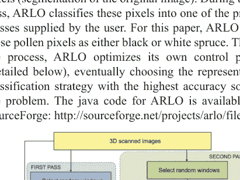

## Java 技术

我们使用了 `ARLO` 的两部分分析法来开展独立但相互相关的分类实验。第一个实验侧重于重构测试玻片上的花粉比例，使用一组 12 张纯参考（训练）玻片；而第二个实验则在相同的“花粉点检测”方法论基础上，旨在最大化分类准确率。

像素（图 3）。例如，使用 1 像素间距的 8 x 8 网格意味着所有 64 个像素都被考虑在内。使用 2 像素间距的 8 x 8 网格意味着每隔一个像素就会考虑一个像素。使用 12 像素网格间距的 8 x 8 网格意味着其有效尺寸大于所有感兴趣的花粉颗粒。我们考虑了多达 128 像素的尺寸。

### 花粉点检测（分割）

**花粉点检测**：为了从背景中识别花粉像素，这源于致谢中 11 位学生的帮助，他们标注了 637 个 1000 x 1000 像素的窗口。我们对所有 30 张玻片和 61 个 z 平面进行了随机采样。窗口包含了对焦和未对焦的。专家通过多种哈希方法将每个“段”提取为花粉像素和非花粉像素。花粉分类器使用哈希像素（网格）来区分花粉和背景图像。在许多情况下，随机生成的窗口不包含花粉颗粒，因此某些窗口在网格层面上是“非花粉像素”，共有 7,007,000,000 个标注示例。平均而言，9%（637,000 个）的标注像素被标记为“花粉”。

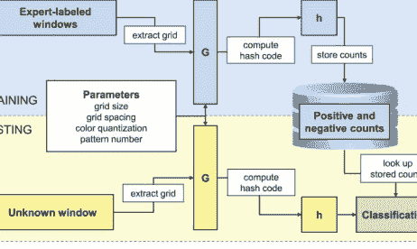

#### 花粉点检测：算法

我们使用了一种基于哈希的机器学习算法，该算法根据像素的邻域特征为每个像素计算一个数值特征——“哈希码”[24, 25]。每个哈希码识别像素所属的“形状类别”或类别，它是一个从 1 到 N 的整数，其中 `N` 是一个待优化的参数。算法能够识别的最优形状类别数量取决于分类问题的复杂性以及可用训练示例的数量。为了高准确率，使用了更多不同的形状类别，或证明了更复杂的哈希码（形状类别）。连接用于学习个体的感兴趣哈希码涉及：（1) 识别像素，（2) 降低像素分辨率（量化），（3) 计算随机排序的 64 位哈希码，以及 （4) 通过取模运算确定哈希码的范围。

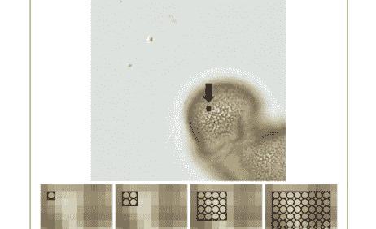

为了识别感兴趣的像素，我们查看图像中的每个像素 (`p`) 并创建了一个“网格示例”（如图 2 所示）。网格由一组以感兴趣像素 (`p`) 为中心的像素组成。像素的大小和它们之间的距离分别是网格尺寸和间距。网格尺寸可以小到 1 x 1（单个像素），也可以大到 1000 x 1000（整个图像）。对于最小尺寸，网格仅包含感兴趣的像素 (`p`)，但随着网格尺寸的增大，包含了相邻像素。我们考虑了 2 x 2、4 x 4、8 x 8、16 x 16、32 x 32、64 x 64 和 128 x 128 的网格。网格尺寸决定了分离部分之间的间隔。

顶部是一个未知窗口图像（1000 x 1000 像素，0.23 μm/像素）。下方是具有不同网格尺寸和间距的 10x10 网格。所示的行显示了从 1x1 到 2x2、4x4 和 8x8 的网格。1x1 是单个像素，仅能检测颜色。较大的网格可以检测复杂的纹理。我们探索了多达 128 x 128 像素的网格。第三行显示了 252 网格，带有不同的网格间距（1x, 2x, 4x, 8x）施加。我们探索了高达 128 的间距。

## 二分类视觉识别软件及其在云杉识别中的应用

为了量可能的网格示例数量，我们对像素强度值进行了量化。原始像素强度值从 0 到 127 通过整数除法通过 1 到 127 之间的量化因子缩小，为每个颜色通道产生 `Q` 个强度级（图 4）。`N` 个像素量化为 `K` 种可能颜色的采样网格可以出现 `N^K` 种配置，因此通过较小的网格和量化因子，我们可以拥有超过 `10^6` 个可能的网格示例。例如，对于 `N=8 x 8`、`K=4` 的表格，我们将拥有超过 `10^6` 个可能的网格示例。

训练期间，未知窗口图像发生了相同的过程。一旦对未知窗口中的像素计算出哈希码，就会在计数数据库中查找以生成分类。详情见正文。

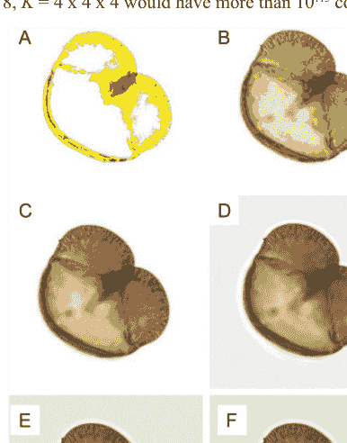

云杉的图像显示了以下量化方案：A) 128x，B) 64x, C) 32x, D) 16x, E) 8x 以及 (F) 1x。量化将强度值降低。这种花粉密度为 -80m。

为了将组合数量减少到可处理范围内，我们为每个网格计算了 64 位哈希码。为此，我们使用了一个固定矩阵，维度 `N` 为网格中的像素数，`Q` 为强度级。对于每个网格示例（如上所述），我们汇总网格中的随机数和模式以产生哈希。然后通过对 `B`（累积类统计的桶数）取模得出哈希。在实验中，`B=2048000`，这意味着我们统计了200万个形状类别以及与目标类别（花粉或非花粉）的正负关联。

### 花粉物种：优化

构建网格示例的优化直接影响分类器检测的模式类型。网格化决定了模式的尺度。网格尺寸和颜色量化决定了可能的哈希数量，从而影响分类器的复杂性。为了实现高准确率，我们使用自动方法通过交叉验证调整这些花粉模型。对于一组参数，从训练生成模型并在验证数据上测试系统性能。通过搜索产生最高准确识别的参数估计范围。

为了限制搜索，一次优化一个维度的计数这主要限制了优化的复杂性。例如，我们从 1x 的尺寸、1x 的网格间距和 1x 的颜色量化开始。对于其他参数，我们将网格尺寸从 1x 增加到 2x，然后从 2x 增加到 4x 等。准确率通过训练留法交叉验证进行测量，系统使用 637 个训练窗口中的 636 个，并重复 6 折交叉验证。准确率在所有 677 次迭代中取平均。

## Java 技术

使用所有训练样本对最终分类方法产生最高准确率的参数。

# 实验：物种重建

我们第一个实验的目标是预测训练期间提供的灯片（参考灯片）的花粉物种。该训练是在测试集中未出现的个体花粉材料上完成的。由于生物和季节性变化，不同个体和样本的花粉存在的形态变化 [21, 23–29]，使得训练过程比大多数之前报道机器学习花粉实验更具挑战性。

## 物种：算法

为了从训练样本中学习，花粉分类器必须确定训练集中的哪些轮廓区分花粉物种最有效。为了实现这一点，我们从每个训练集中随机选择一个进行评估。这个选定的轮廓可以被认为是一种“规则”，可以根据其与“近规则”的接近程度来分类其他轮廓。例如，计算了每个花粉轮廓与规则之间的曼哈顿距离。如果距离小于阈值（称为“近远”阈值，下文定义优化），则这些轮廓被视为“近”轮廓，而更远的轮廓则被视为“远”轮廓。规则做出的预测仅基于落入近或远区域的每个物种训练样本。

## 物种：训练样本

我们没有像在花粉点检测中那样使用网格来训练分类器，而是使用了像素行。在我们之前的工作中，我们发现这些特征的简化版本在区分两个物种之间最有效 [3]。我们的方法基于单一类型的特征，我们称之为“轮廓”。轮廓是满足两个约束条件的像素行：（1) 它被我们的物种分类器识别为所有花粉像素；（2) 它被识别为信息内容大于给定阈值。我们将信息内容定义为：

```


`IC = \sum_{i=1}^{n} |x_i - x_{i-1}|`


其中 `n` = 轮廓中的像素数，`x` = 位置 `i` 处像素的强度值。该指标与聚焦或高对比度区域良好相关。其原理是将机器的注意力集中在感兴趣的区域上。如果一个轮廓的信息内容大于或等于每个轮廓 0.5 个强度单位的阈值，则该轮廓被视为高对比度（或聚焦）。这些选定的轮廓被用作分类的训练样本。

对于报告的实验，我们使用了像素行。为了降低计算复杂性和算法时间，我们采取了以下措施：(1) 仅使用每个红色通道（而非所有 RGB 颜色），(2) 仅考虑垂直线（不考虑方向），以及 (3) 仅每隔 5 个 z 平用于训练和测试。选定 z 平后，方向就固定了。在我们之前的工作中，我们使用了正向和反向的垂直、水平和对角线 [3]。由于内存中的像素布局，读取垂直像素行的效率最高。将分析限制在这些 z 平，如果分析所有颜色带、线条方向和 z 平，将产生更高的系统准确率，但我们受到 CPU 时间的限制。训练样本仅从 12 张训练灯片生成。使用这种方法生成了 205,407,234 个训练样本。

# 物种：优化

模型准确性取决于我们为了最大化而变化的几个参数。它们包括：(1) 像素长度，(2) “信息内容”，(3) “近远”阈值，以及 (4) 用于决策的轮廓数量。

像素长度的优化方法是从长度 1 开始，每次增加 2，直到找到最高准确率。像素行的“信息内容”通过测量相邻像素强度值之差的绝对值来测量的。“信息内容”通过用不同阈值划分线长度来定性确定。优化的“信息内容”在生成样本之前与所有图像进行比较，且仅使用花粉颗粒的内部区域。“近远”阈值针对每个学习器进行了优化，在 1 和轮廓之间最大可能距离之间搜索阈值。如果像素线长度为 2，两个像素之间的最大跨度距离为 510 个强度单位（8 位图像格式中 255 的两倍），两个像素之间的最大可能距离为 32,640 个强度单位。为了确定分类的最佳轮廓数量，我们根据错误率进行排序。首先在测试数据上使用顶级学习器，然后是前两个、前 3 个，依此类推，直到确定顶级表现者的数量。这些学习者的分类权重相等。

为了提高计算速度，在每次迭代中随机对空间进行采样，而不是通过 2 的幂搜索整个空间。我们有足够的资源来生成并尝试 637 个随机字符点。每个点都通过所得系统预测准确性进行测试，最高分的结果基于交叉验证。该系统在前 12 张灯片的图像上进行训练，并在剩余 2 张灯片上进行测试。这对 10 组随机采样的 10 张训练灯片重复进行。

# 实验 2：可扩展的颗粒级物种分类

我们分类实验的目标是使用更有效的方法采样分类准确率。不再使用行池化，而在第二次处理中，将上述“花粉点检测”中描述的基于原始像素的池化算法应用于第一张灯片的像素上。这种方法比实验 1 中使用的行分类器更具扩展性。

## 结果

### 花粉点检测

尽管人类专家在颗粒级上对图像中不存在的内容达成共识，但大多数专家与以下内容一致。花粉点检测的结果更贴近花粉颗粒的轮廓（图 5D）。

### 颗粒级分类：算法

在第二次处理中（图 5），使用了从 10 张训练灯片中采样的 256 x 256 窗口。只有那些花粉比例超过 50% 的窗口被选为样本。应用于前 12 张灯片像素的像素分类器被允许。置信度定义为黑白像素比例的差异。如果像素分类器分类了一个包含 100% 黑色或白色空间的窗口，则置信度将为 100%。如果是 50% 花粉空间和 50% 白色空间，则置信度为 0。我们防止分类器忽略全的窗口。

### 颗粒级分类：优化

优化过程与第一次处理（“花粉点检测”）期间使用的过程类似，但有两个修改。首先，包含了两个额外的优化参数：最小置信度和数量。

列 (A) 显示了两个随机训练的带有花粉的图像，取自原始分类集。每张图像为 1000 x 1000 像素，0.23 uj/像素。顶部图像 (A1) 未聚焦，底部图像 (A2) 聚焦。(B) 和 (C) 是显示在 (A) 中的效果的结果。两个不同的专家通过从原始图像中移除制作了花粉像素。列 (D) 显示了像素分类器的花粉预测（红色），这是在它在 11 张灯片中每张提供的 637 个字符样本上训练后。


图 5。花粉点检测。

### 实验 1：花粉比例结果

为了对物种分类结果进行基准比较，我们使用了了一位人类专家的数据。为了衡量人类专家和机器（准确率最高的单学习器剖面）的性能，我们计算了黑云杉（black spruce）预测比例与实际比例之间的线性回归，并利用最小二乘法回归的决定系数 (`r²`) 作为准确性的衡量指标（图 6）。机器（`r² = 0.67`）的表现优于人类专家（`r² = 0.49`）。然而，由于该模型过拟合了我们使用测试数据优化的剖面，因此这些关于机器学习器的结果是高度乐观的。

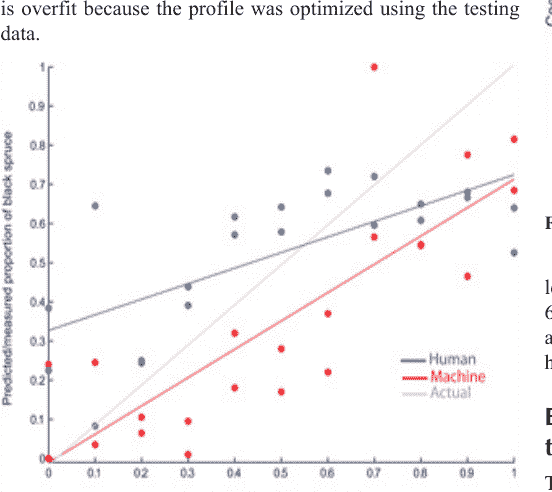
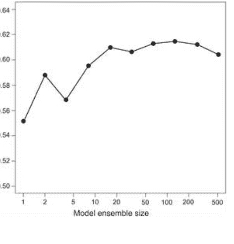

该图展示了在模型集成中使用 1, 2, 4, 8, 16, 64, 128, 256 和 512 个剖面进行模型测试时机器学习的预测准确率。结果来自第一次实验。测试了 11,969 种模式。在 128 个剖面处达到了最高准确率。

图 7。数量与预测性能。

图 6。花粉比例结果。

第一次实验中机器分类器（红色）和人类专家（蓝色）在重建手动构建的测试集（表 1）时的性能，以及各自的最小二乘回归线。像素花粉比例线如图 6 所示。

当我们在训练切片上进行训练并衡量学习器剖面相对于测试示例的性能时，使用在数据上获得较高准确率的规则实现了 `r² = 0.55` 的性能。当我们把前两个训练切片合并时，与测试示例相比，获得了 `r² = 0.61` 的性能。从最小到最大，每个集成模型的性能都更好。然而，随着更多低质量规则被加入集成模型中（性能从 128 条规则下降到 512 条），机器学习的性能似乎变差了（图 7）。产生最高分类准确率的像素线长度为 128 像素。最高准确率内容阈值是每像素 5.0 像素单位。

### 实验 2：颗粒级分类结果

分类器第二次通过使用的机器模型网格大小为 3 x 3，网格间距为 10，着色度为 14.24，最低置信度为 43.61%，每个切片的最小分类数量为 1。该模型的准确率为 85.85%。然而，由于怀疑准确率过于乐观，我们只使用了 10 次验证试验。为了估计模型的准确率，我们使用 10 次交叉验证试验中准确率最高的参数点对 271 次交叉验证结果取平均值，该点使用的切片分类准确率为 85.61%。我们将机器与人类专家的性能进行了比较；人类专家在四个测试切片上的准确率为 79.59%（100% Maria，或 100% P. glauca）。这说明了系统准确率如何随纯切片数量和每个切片绘图数量的变化的变化（图 8）。通过 5 张训练图像和 14,784 张训练图像，系统能够持续优于我们的人类专家。

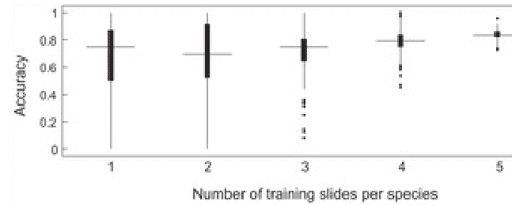
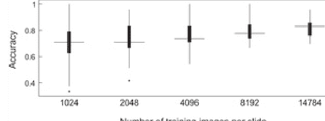

**图 8.** 学习曲线。

总结第二次实验中训练切片数量（顶部）和每个训练切片图像数量（底部）对物种分类准确率影响的箱线图。中位数由水平线表示。箱的边缘代表第 25 和第 75 百分位数。须线代表 ±2.7 SD，即 99% 的数据。离群值以单点形式绘制。

ARLO 数据驱动方法的局限性在于它需要大量的数据和图像处理。对于黑、白花粉之间的颗粒分类（实验 2），系统需要 14,784 张图像。可以使用专家定义的特征来实现一个达到相同准确率的系统，但需要更多的标注输入。

## 讨论

我们的结果证明了 ARLO 利用自适应机器学习解决困难分类问题的能力。将分类问题分解为前景/背景分类问题以及 ARLO 提供的独立分类问题，允许通用的表示（像素线）并根据给定的复杂性和示例中描述的方法进行参数适应，这应该很容易被推广。我们系统发现的特征不是花粉学家能够识别的传统形态特征。相反，使用的是低级基于图像的特征，例如简单的像素表示。其中一种表示是颜色，系统决定颜色的影响程度。如果颜色没有信息量，它就不会具有权重。我们第一次实验的结果表明，ARLO 能够在参考标本上进行训练，这些标本代表了不需要高水平专业知识即可获得的数据。在我们的实验中，低级专业知识是必要的。

# 参考文献

14. Lighthill J. 人工智能：快速。Science Research Council, 2013.

23. Birks J, Poglar SM. 北美晚第四纪云杉属的鉴定：一种数值方法。Can Bot 1980 1(5):1904-58; doi: 10.1111/j1439-880-237

15. Feiberg K, Kaland PE, Krzewinski K. 花粉分析教科书 第4版。Chichester, New York; Wiley; 1998, 199, p. 328.

24. Indyk P, Motwani R. 用于社区多样性的适当近邻算法。第三届 ACM 计算理论年度会议论文集：美国，纽约; ACM; 1998, 604: 13-24.

16. Punt W, Hoen PP, Blackmore S, Lincoln L, Thomas A. 花粉和孢子术语表。Review Palynol. 2007; 134(1-2):1-81. doi: 10.1016/j.rapyn.2006.06.006

25. Deer W, Segal M, Shlens J, Vijayarajasan S, Yagin, J. 单台机器上100000个对象的自动检测。在计算机视觉与模式识别 (CVPR)，2013 IEEE Conference on 2013 6月23日 (pp. 1814-1821), IEEE.

17. Russell S, Norvig P. 人工智能：现代方法。第3版。(2015)。 可用：http://arxiv.org/

18. Muster L, Li M, Wo Y, Folkes CC, Punayas SW. 通过表面纹饰和纹的定量分析对花粉进行分类。R Soc Biol Sci. 2013; 280(1770):201905; doi: 10.1098/rsb.2012.1905

26. Kaland PE, Krzewinski K. 花粉分析教科书 第4版。

19. Holt A, Ekin G, Hodgson R, Ransley F. 向孢粉实验室自动化花粉颗粒和分类系统迈进。Review Palynol 2011年5月; 36(1):175-83. doi: 10.1016/j.revpolyn.2011.08.006

27. Freedman E. 机器学习。第3版。MIT Press, 2014, 640 p.

28. Reima S. 不同处理下花粉颗粒的变化。Review Palynol. 1969; 39(3):175-202. doi: 10.1016/0034-6667(69)90003-7

20. Kaya Y, Erez M, Karabacak O, Kayi L, Fidan M. 使用 GLCM 特征和神经网络进行植物和花粉分类的自动鉴定方法。Grana; 2013; 52(1):171-7. doi: 10.1080/00073134.2012.754050

29. Praglawski J. 花粉颗粒形状的预处理和嵌入方法。Review Palynol. 1970; 10(3):203-8. doi: 10.1016/0034-6667(70)90005-3

21. Cain SA. I湖的孢粉学研究：化石云杉花粉的大小-频率研究。1948; 108(2796): 115-117. pmid: 17808732 doi: 10.1126/science.108.279115

30. Benjamin Y. 基于学生的超参数优化。Neural Comput. 2000;12(8):1888-909. pmid:10953234 doi: 10.1162/097666300015187

22. Hansen BC, Engstrom DR. 分离花粉和白云杉的数值与定性方法比较。Can Bot 1985; 65(12):2159-63. doi: 10.1139/b85-305

31. Richtá P, Takáč M. 大数据优化的并行坐标下降法。Math Prog. 2012; pp. 1-52. doi: 10.1007/s10107-015-6

# 植物防御响应建模信号网络构建

Dragana Miljković, Tja Stare, Igor Mocetic, Marko Petek, Karnil Witek, Marina Dermastia, Nada Lavrac, Kristina Grudena

植物和病原体可以建立各种不一定损害宿主的关系。在抗性相互作用中，植物细胞感知病原体信号，或通过抗性（R）与病原体因子之间的相互作用。这种相互作用启动了复杂的信号，被称为植物防御响应或植物信号（PTI），协调多个转录调节器的活性，导致基因表达的变化和细胞膜的重编程。植物响应的激活可能是快速、高效且特定的[2]。水杨酸（SA）、茉莉酸（JA）和乙烯在植物防御响应中起着至关重要的作用[3]。SA 通常涉及防御杀死宿主的生物营养体和死坏体病原体，而受食昆虫受影响受 JA/ET 因素[4]-[5]。虽然大多数报告表明 SA 和 JA 之间存在拮抗作用，但依赖 JA 的协同作用也有描述[6]。乙烯通常起到调节作用[9–11]，使植物能够高效地适应生物环境，利用有限资源进行生长和生存[12]。当植物暴露于多个攻击者时，这一点尤为重要[13]。系统生物学已被证明成功建模复杂过程[14]。在分析网络动态之前，必须理解其结构[5]。植物生物学中有多种网络表示方法，包括 Le Novré 等通过系统生物学图谱形成的有向图[16]，或 Raza 等提供的改进 Petri (mpn) 方案[17]。信号网络拓扑、不同的信息源（如 KEGG Pathway 等通路数据库）、知识源（如 OND [21] 和 Bio [22]）以及科学文献本身。由于大多数人类生物知识仍然存储在孤立的生物文献中，从文献中检索信息受到信号瓶颈的限制。科学文献可以手动提取或自然语言处理和信息提取进行分析。有许多基于深度调查构建的生物模型，例如 Raza 等开发的巨噬细胞激活模型[24]。另一方面，尖端技术基于生物文本自然语言处理（NLP）的进展，通过文本处理技术从科学文中自动地提取信息（例如，新兴 bionlp 社区的研究有助于 http://www.bionlp.org/）。与工作工作涉及从生物文本中提取一组“组件(1)、反应、组件(2)”三元组，多种 NLP 工具能够提取实体之间的相互作用（例如，Aney 等人所示[25]）。最常见的方法在 [26] 中标识：基于规则的方法、机器学习和基于共现的方法。基于规则系统的示例包括 GeneWays [27]、Chibit [28]、NLP2 [29] 以及等人使用的方法[30]。基于共现的方法（如 [31] 中提出的以及 Cor 等人在 BioRat 系统中升级的方法）对于生物系统来说不太合适，因为检索的信息是不完全，无法直接转换为图格式进行信号网络建模。在大多数系统中，信息仅从

## 表 1. 生物学与计算机科学术语对照

| 生物学 | 计算机科学 |
| :--- | :--- |
| 生物系统 | 计算机模型，网络 |
| 通路 | 子网络 |
| 分子、反应 | 节点、顶点 |
| 反应、相互作用 | 关系、边 |

由于这对于不同领域的科学家有用，表 1 代表了使用的方法。

# 手动构建的 MDS 模型拓扑

在构建 MDS 拓扑时，我们关注代谢、信号和网络生成 sa, JA 等。在识别生物反应和组件类型时，我们发现方法需要高度适应。考虑了以下反应和组件类型。考虑了三组生物（图 1A）：某些化合物或代谢物（水杨酸、亚油酸、等）、基因/蛋白质（CHS合成酶、PDA4、等）以及组件（JA-Ile/COH1/sc、等）。以下反应类型（定义了 mepn 节点；蛋白质-蛋白质结合、蛋白质磷酸化、蛋白质去磷酸化、蛋白质激活、易位、蛋白质抑制、基因表达、催化、蛋白质-基因结合和基因调节 (1B)。为了降低 PDS 网络的复杂度，未引入降解作为特定的反应类型。如果文献中规定了这种规律性（例如，COH1 结合到 SCF 复合物导致 JAZ 受体降解 [37–39]），则将降解建模为一种结合反应。

激活。(B) 定义为至少两个组件之间的紧密相互作用，从而产生活性复合物（图 2B）。结合既是指蛋白质-蛋白质复合物的形成，也是蛋白质结合 DNA 启动子区域以调节其表达。结合会导致特定目标、基因或蛋白质的激活或抑制。抑制 (I) 定义为一个组件阻阻另一个组件执行的过程（图 2C）。抑制组包含了所有如蛋白质抑制、基因表抑制和蛋白质去磷酸化的反应组。

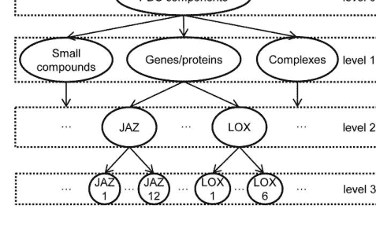
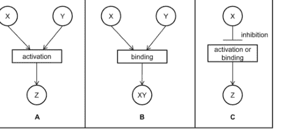

图 2. 反应类型。

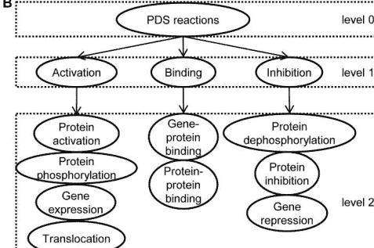

图 1. PDS 组件和反应。

共有三组反应。激活 (A) 直接激活影响产生 Z 的 X 和 Y 的反应；Z 的浓度取决于其他组件的浓度。结合 (B) 导致蛋白质-蛋白质复合物的形成或蛋白质结合到 DNA 启动子区域以调节其表达。抑制 (I) 是一个组件阻止另一个组件执行的过程。

在第 1 层将抽象为三种反应（激活、抑制和结合）对于使 PDS 模型足够简单是必要的。激活定义了激活下一个组件（或其丰度）的过程。在酶促反应的情况下，蛋白质的磷酸化导致激活（因此人们会将其视为抑制），它被归类为反应而非激活。当磷磷酸化蛋白的浓度增加时，蛋白质的去磷酸化（在这种情况下是非活性的但被磷酸化的蛋白）也会发生。组件的易位或降解也是如此。当蛋白质的活性形式是其磷酸化形式时，注意非磷酸化的蛋白质是自由的，并被认为是蛋白质的生物活性形式，这与其他节点没有连接。

A) 在 PDS 组件中有四种表示层级。最高层（第 0 层）最抽象，而最低层（第 1 层）代表简单的组件。B) 在 PDS 相互作用中，反应在最低层（第 2 层）表示，并根据其功能在第 1 层被归类为三组：激活（激活、结合和抑制）。

为了简化拓扑结构，具有相似相似的组件被归类到第 2 层（见图 2A）。整个 JAZ 蛋白家族（JAZ1-JAZ12）。反应在更高抽象层上也被归类为第 1 层的三组：激活、结合和抑制。激活表示遵循以下原则的反应：当组件 X 和 Y 直接参与 Z 的产生时，Z 的浓度取决于其他组件的浓度（图 2A）。激活、蛋白质磷酸化、易位、基因表达和催化等反应被归类。

在手动构建的 PDS 模型中，反应被引入图 2B 的第 1 层。组件被引入图 2A 的第 2 层。手动构建的 PDS 网络由三个子模型组成，这些模型由中心生物组件辅助，用于拟南芥的防御响应，即 SA、JA 和 ET 模块。SA 子模型包含 24 个生物组件和 33 个生物反应，而 ET 子模型包含 24 个生物组件和 17 个生物反应。手动 PDS 模型拓扑结构，包括 4 种交叉反应，共有 99 个生物组件和 68 个反应。在手动构建的 68 个反应中，19 个来自 KEGG 和 AraCyc，其余的在方法部分中找到。各个子模型以及手动构建的 PD 拓扑结构的详细数字见表 2 和表 3。

带有它们的交叉连接。通路组件 SA、JA 和 ET 的边界节点标记为红色。http://doi.org/10.1371/journal.pone.0015822.g003

图 3 的图形通过将第 2 层 PD 拓扑构建为扩展的第 3 层 PD 拓扑（边标签图）来实现。这是根据方法部分和图 4 中概述的转换原理进行的。图 3 所示的扩展标签图包含 175 个节点（31 个小组件、135 个基因/蛋白和 9 个复合物）和 387 条边， 49 个结合、62 个抑制和 45 个从结合到其蛋白质的反应。只要浏览器的 Java 插件已安装并启用，读者就可以打开并探索图 3 的交互版本：http://root.ijrs.org

表 2. 手动构建的 SA、JA 和 ET 所有组件汇总，位于图 1 的第 2 层。

| 组件类型 | SA | JA | ET |
| :--- | :--- | :--- | :--- |
| 小组件 | 12 | 6 | 31 |
| 基因/蛋白 | 27 | 5 | 59 |
| 复合物 | 4 | 3 | 9 |
| 所有组件 | 32 | 24 | 99 |

表 3. 手动构建的 SA、JA 和 ET 子模型所有反应汇总，包括交叉。位于第 1 层。

| 反应类型 | SA | JA | ET | 交叉 |
| :--- | :--- | :--- | :--- | :--- |
| 激活 | 16 | 11 | 1 | 52 |
| 结合 | 3 | 2 | 0 | 6 |
| 抑制 | 2 | 1 | 4 | 10 |
| 所有反应 | 20 | 17 | 4 | 68 |

# 用于 Mullett 植物防御建模的信号网络

是细胞内的区室。随着 SA 在叶绿体和细胞质中积累，代表细胞质中 SA 的模型 NA 以及代表叶绿体中 SA 的模型 SA-ch 由未包含在 SCF 复合物词汇表中的复合物表示。该词汇表涵盖了检测到的反应类型：激活、抑制和结合。

使用了 Orange4WS [43] 工作流构建和执行环境 (5B)。BioGraph 工作流的输入是生物学全文集合，这些文本通过基于用户关键词搜索 PubMed Central 数据库（访问地址为 www.ncbi.nlm.nih.gov/）获取的。工作流的输入是一个三元组网络，自动从文章中提取。该三元组算法在 153 个三元组中发现了 129 个关系。如果 Web 站点已托管并启用，用户可以在此处探索 BioGraph 5c 的交互式版本：http://report.biograph.org/prepareVisualization.php?file=media/supplement/models/Mullett_5.png。

BioGraph 方法论由一系列挖掘、信息提取、图谱构建和图谱可视化步骤组成，提供了可读性和重复性，并带有额外的组件（图 5A）。BioGraph 的命名反映了其主要功能：“Bio”代表生物学三元组提取，“graph”代表从提取的三元组构建图谱。

# BioGraph 结果的评估

BioGraph 的性能在 50 篇手动标注了正确三元组的全文上进行了评估。信息提取的性能通过如下计算精确率（Precision）和召回率（Recall）进行评估：Recall=TP/(TP+N)，Precision=TP/(TP+FP)，其中 TP 为真阳性，TN 为阴性，FP 为假阳性，TP+FP 是 BioGraph 提取的三元组总数（无论是否正确）。BioGraph 在标注三元组上实现的结果如表 4 所示，显示了全文的平均精确率和召回率。

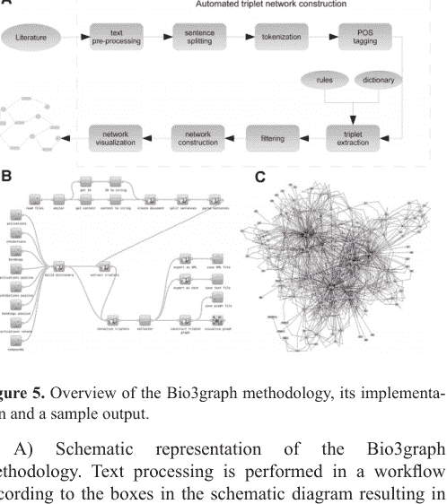

图 5. BioGraph 方法论、其实现及输出样本。

| 反应类型 | TP | TP+TN | FP | 精确率 (%) | 召回率 (%) |
|---|---|---|---|---|---|
| 激活 | 142 | 223 | 31 | 81.7 | 63.7 |
| 抑制 | 67 | 90 | 56 | 51.4 | 74.4 |
| 所有反应 | 199 | 312 | 47 | 80.6 | 62.3 |

表 4. 50 篇全文的召回率和精确率分析。

A) BioGraph 方法论的示意图。文本处理根据示意图中的方框在工作流中进行，方框代表组件网络（component1, component2）。BioGraph 在 OrangeWS 中实现。(C) BioGraph 提取并构建的三元组。

- 该方法论的第一部分（称为三元组提取算法）涉及在主语、谓语、对象中提取关系，并将组件之间的关系以三元组（component, component2）的形式进行搜索。
- 该方法论的第二部分是从提取的三元组进行图谱构建和图谱可视化。
- BioGraph 方法论的细节及其实现详见“材料与方法”部分。该方法论以工作流的形式实现在

用于自动化信息提取的系统已经在文献中被开发并报道。这些方法中的大多数从全文本或经过过滤的文本中提取，后者仅考虑了某些关键词。例如，Chibolot 系统对通用蛋白质相互作用提取的精确率为 74.4% 到 97.1%，召回率为 91.2%。Suseki 的召回率为 70%，准确率在 80% 左右，这是最优定义。Development [30] 提取了酵母生物的蛋白质相互作用，其中“关联关系”的精确率范围从 90.2% 到 97.1%，该酵母的召回率亦如此。在提取大肠杆菌中蛋白质蛋白质相互作用的研究中，对于“复合物关系”，提取的关联关系从 77.3% 到 85.2%。

我们能够实现 BioGraph RAT 的系统。BioRAT 系统实现了 51.25 的精确率和 43.6% 的召回率。我们系统的平均精确率为 46.2，低于 BioRAT 的精确率。另一方面，BioGraph 的召回率为 62.3%，比 BioRAT 系统的召回率高出几乎 20%。由于 BioGraph 是在全文而非其他范围内验证，我们对 62% 的召回率感到满意。

共提取了 4204 个三元组。为了评估提取三元组的正确性，我们手动检查了提取三元组的句子。由于 1132 个三元组中的一些出现在多个句子中，我们按以下方式定义“正确三元组”：如果在文本语料库的至少一个句子中为真，则被认为是正确三元组。

在本文中，我们选择以较低的精确率为代价来获得高召回率，因为开发 BioGraph 的目标是识别在手动处理信息时遗漏的手工构建相互作用。这意味着当在系列中使用时，这种人工审查产生了更多的假阳性，表明某些信息……召回率并不意味着我们没有检测到 37.7% 的相互作用，当相互作用的组件是

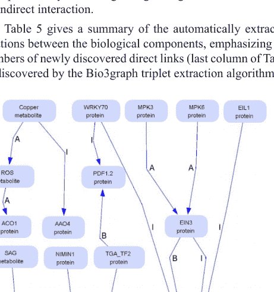

# BioGraph 提取的 PSD 模型拓扑

使用以下关键词组："Arabidopsis thaliana" AND ("defence" or "defense" or "ethylene" or "jasmonate" or "jasmonic acid" or "salicylate" or "salicylic acid" or "pathogen" or "virus")，在 2011 年 4 月 4 日检索了 9586 篇 PubMed 摘要。使用 PubMed 医学数据库确保我们可以免费获取全文而不仅仅是摘要。这些文章与提供的信息相关，并从中提取了三元组。选择关键词是为了识别大多数与 IA、ET 和 SA 信号通路相关的 PSD 相关文献。由于 PubMed 是一个交互式数据库且不包含某些科学期刊，可能会遗漏一些相关文章。尽管如此，PubMed 代表了所有科学论文的可靠来源，为我们的工作提供了相关基础。

图 6. 从生物文献中提取的新直接关系。

来自 BioGraph 处理 9586 篇摘要的新直接关系结果。BioGraph 在组件之间提取了 14 条新的直接关系，这些关系在手动构建的 PSD 模型拓扑中未被识别。注意，这些三元组中的两个是平凡的（SAG_metabolite, SA_metabolite）和（NIMIN1_protein, inhibits, NPR1_protein）。

使用 BioGraph 三元组提取算法的结果是 1132 个三元组的集合，这些三元组识别自

http://dx.doi.org/10.1371/journal.pone.0051822_g006

表 5. Bio3graph 三元组算法从 9586 篇 PubMed Central 文章中提取的 EDS 相关三元组摘要。

| 关系类型 | 三元组总数 | 错误三元组 | 正确链接 | 手动间接链接 | 手动直接链接 | 新直接链接 |
|---|---|---|---|---|---|---|
| 激活 (Activation) | 736 | 446 | 290 | 158 | 41 | 86 | 5 |
| 抑制 (Inhibition) | 352 | 289 | 63 | 18 | 1 | 37 | 7 |
| 结合 (Binding) | 44 | 20 | 24 | 20 | 2 | 0 | 2 |
| 所有反应 | 1,132 | 755 | 377 | 196 | 44 | 123 | 14 |

每个子类对于 PSD 模型都有其特定的意义。通过手动直接链接，我们证实了 Bio3graph 方法的适用性。此外，在构建 PSD 模型时尚未识别出的相互作用（即新的直接和间接链接扩展了我们对该主题的认知）具有高度性。间接关系作为信号传递知识的数据库。根据观察这些相互作用的实验设置，某些关系可能是冗余的。在生物学范围内，这可以应用于植物以研究感兴趣基因的表达。例如，可以将 JA（来自 MeA）应用于植物，并识别经 JA 处理的植物中过氧化物酶（LOX）或氧合合酶（AOS）基因的表达。这两个基因均显示基因表达增加，两个三元组 (JA, activation) 和 (JA, activates) 显示出冗余。如果 AOS 也被 LOX 激活，则 AOS 水平的增加可能是 JA 诱导的 LOX 激活。在这种情况下，需要进行更多的实验和生物学验证，以使用 PSD 模型和系统解释结果。ICS1 是参与 SA 生生的酶之一。SA 的减少会导致介导的信号传导，这种传导在病原体攻击下被高度诱导 [44]。这项研究是在拟南芥菌上进行的。我们在构建信号网络时识别了这种相互作用，此类链接对于研究人员来说特别难以发现。由于自动化提取，这种“跳出框架”的搜索导致发现了额外的知识。

Bio3graph 识别的另一组关系与 WRKY 家族转录因子（MAPKs）有关。两者都是具有非常特定功能的大蛋白家族。它们代表了 PSD 构建中的一个重大挑战。根据专家的说法，Bio3graph 识别了多种机制。众周知 WRKY70 抑制 ISOCHORATE SYNTHASE（也称为 ICS1），尽管详细描述尚不为人知 [44]。WRKY70 转录因子还会抑制 PDF2 的表达 [45]，这显示了它在植物通信中的重要作用。我们的实验表明，MPK3 和 MPK6 都是拟南芥中特征化最好的 MAPKs [46]，因此被包含在文献中。通过新的直接链接，我们识别了 MPK6 对 EIN3 的激活 [47]。MPK3 和 MPK6 都是 EIN3 的正调节因子。使用 Bio3graph，我们识别了新的直接链接，其中一些未被包含在主模型中，因为我们将自己限制在植物防御最重要的部分（SA、代谢产物）和 (NIN1)。在前者中，包含了反向关系 (SA, activation)，而在后者中，提及被指定为识别的间接链接 (NIN1, binding to NPR1)。这一结果还识别了与关系相关的组件，其中一个是另一个的子集。ETHYLENE INSENSITIVE-3-LIKE (EIN3) 和 ISOCHORATE SYNTHASE (ICS1) 就是这种情况，它是通过两种关系被识别的组件之一：（结合和抑制）（图 6）。这种生物现象被解释为 EIN3 的激活。

Bio3graph 识别的另一个新关系是 EIN3 与 IAA1 的相互作用。这证实了 IAA4 的减少。这种精细的验证也是与我们的模型拓扑结构相关的额外关系，可以在进一步的研究中解释。ETHYLENE INSENSITIVE-3-LIKE (EIN3) 是识别的最感兴趣的关系，因为它受到 ET 通路的调节。在对 ET 介导响应的研究中，Bio3graph 识别了 EIN3 和 EIN1，它们是 ICS1 的负调节因子。在提取这些三元组的情况下，确实显示这两个转录因子抑制 NPR1 的基因表达。

植物模型拓扑结构和从其提取出的新三元组合并成一个由 175 个组件和 524 个反应组成的图。该图使用 Biomile 可视化引擎可视化，如图 7A 所示。只要安装了 Web 插件，读者就可以打开并探索 7A 的交互版本。

SA 信号通过正反馈回路进行精细调节。负反馈回路减慢信号过程，而正反馈回路则加速过程。植物最终产物通过激活或抑制合成中的基因来调节其浓度。NPR1 抑制 SA 的表达，参与 SA 产生的两个基因抑制自身的产生，从而形成负反馈回路。

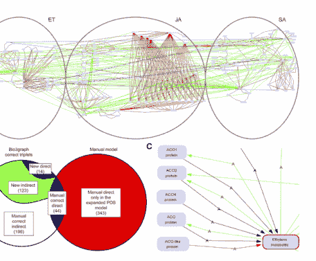

JA 的主要生物合成途径是生长素途径，亚麻脂酸是 JA 的前体。茉莉酸亮氨酸 (JA-Ile) 是已证明生物活性的结合物 [57]。在 JA-Ile 存在的情况下，由 SCF1（亚基蛋白 1）和 RING 蛋白（RBX1/HBT1/COI1）组成的 SCF 复合物结合 F-box 蛋白 [58]–[59]。

图 7。通过合并手动和 Biograph 构建的 PSD 拓扑结构。

- A) 代表手动 PSD 模型的图
- B) 维恩图。文献中提取的正确关系以黑色显示。

手动模型中的关系以红色显示。Biograph 在手动模型拓扑结构中发现了 44 种不同关系，而新的关系为蓝色。这种重叠率较低的原因是 Biograph 不处理表格或图像，而手动 PSD 模型包含这些内容。由于它一次处理一个实体，因此不处理引用。共引用可以提高三元组提取的结果，是我们研究的一个可能方向，以及 NPR1 的激活，随后触发 SA 依赖蛋白的激活 [54]–[55]。

JA 的主要生物合成途径是生长素途径，亚麻脂酸是 JA 的前体。茉莉酸亮氨酸 (JA-Ile) 是已证明生物活性的结合物 [57]。在 JA-Ile 存在的情况下，由 SCF1（亚基蛋白 1）和 RING 蛋白（RBX1/HBT1/COI1）组成的 SCF 复合物结合 F-box 蛋白 [58]–[59]。当 JA 被泛泛化时，会导致 JAZ 蛋白螺旋转录因子被 MYC2 和其他 bHLH 转录因子分解 [60]，从而激活 JA 依赖的 PR 基因表达。

## 用于植物防御响应建模的信号通路网络构建

涉及其中。添加来自 Bio3 的 ET 子路经交叉可以改进该模型，以准确预测敲除植物中 SA 浓度的变化。

可视化。我们方法的主要优势是其有效性和可达性。我们已经实现了基础词汇表，并在精确率和召回率方面取得了成果。

Bio3graph 也用于提取有关蛋白质家族的详细信息。同一家族的多个成员可以参与反应。例如，作为 Aracade，有五个成员 ACO-1、ACO-2、ACO-3 和 ACO-4，它们通过其 1-氨基环烷-1-羧酸活性催化生物合成的第一步步 [62]。

我们可以轻松地设计 Bio3 的布局，将其转换为标准的系统建模形式。

可以从实验数据或计算预测中获得，而后者通常很稀缺。通过 Bio3graph，我们可以提取所有成员的数据，分析并评估它们对模型的重要性。

所述方法可能是耗时的，因为我们最初从手动构建初始网络开始，这通过对数据库和文献中的信息进行耗时的获取和分析，需要大量的人类专家参与。注意，开发的 Bio3graph 信息提取工具可以从零构建，

在图 7 中，我们展示了所有 ACO 家族成员在 ACO 链接后激活了 ET 的产生。在检查模式时，我们确定了哪些关系代表生物化学知识并仅在特定数据集上相互作用，用于进一步的动态建模。

这种方法将少那么耗时，并在检查全文本文档时，用人工代替研究人员和专家花费手动构建网络的时间。这些算法

如图 7 所示，属于 ACO 家族的蛋白质在模型中具有手动激活的激活链接。三元组提取 Bio3graph 已确认了 ACO 家族与 ET 之间链接在结构中的作用（从第 2 层扩展到第 3 层 - 图 1A），并且未发现协助研究人员的工具，这些工具可以替代人工专业知识。然而，这些总是需要一定程度的努力设置和定义，如 BioRAFT [32] 所示，而专家将

要么与家族的其他成员具有不同的功能，要么未被 Bio3graph 估计为文献中的生物合成酶。为了确定 ACO-like 的真实功能，应该使用报告……的方法进行物理实验

将信息提取算法引入新的感兴趣领域，在自动生成结果后，专家将不得不检查所有结果以确保其正确性并独立解决问题。

或增加或减少 ACO-like 基因的表达。例如，降低拟南芥敲除植物中的 ET 浓度将确认 ACO-like 在 Bio3graph 中的参与。

来自 Bio3graph 的直接链接也可以引导研究人员进行模型引导的发现假设和实验。例如，间接链接意味着尚不确切 SA 是否激活了 EDS1，或者它是否激活了……的生物合成。

我们实现了 43.6% 的精确率和 51.2% 的召回率。与以前的方法相比，我们的方法为信号网络提供了更全面的视图。我们方法的优势在于能够整合多个数据源并为分析提供一个统一的框架。

所述方法可能是耗时的，但它为研究人员提供了一个强大的工具。

## 结论

本文介绍了一种用于植物信号网络构建的新框架。我们证明了 Bio3graph 在从文献提取信息和构建复杂模型方面的实用性。虽然手动过程是耗时的，但自动化和进一步数据集成的潜力是。未来的工作将重点关注改进提取算法并将模型扩展到其他生物过程。

## 材料与方法

### 手动模型构建

用于手动模型构建的文献是由领域专家选择的。我们专注于与 PSD 领域相关的科学论文。理想情况下，将信息纳入图谱需要一或两篇科学论文中的引用。如果信息在网上可用，我们在将其纳入模型之前，检查了其出版质量（例如：高影响力、作者在该领域的相关性）。有关生物合成途径和其他数据获取自不同的数据库，如 KEGG [18] 和 TAIR [41]。KEGG 用于构建代谢途径、激素生物合成以及该过程中涉及的代谢物骨架。其他的反应和基因根据 Aracycle 数据库实现。TAIR 基因信息，同义名称获取自 iHOOP [42] 和 TAIR [41]。

### PSD 拓扑到边标记图的主要转换

从文献中自动提取知识的三元组方法产生一个三元组图（组件、反应、三元组），我们的目标是使用自动提取的三元组增强手动构建的 PSD 模型拓扑，以将流形拓扑转换为格式。这是边标记图格式，节点表示组件，边表示反应。这种转换通过将两个组件产生共同点的反应分解为两个关系（每个组件一个连接到产物）来实现。

图 8。转换为边标记图格式的原理。

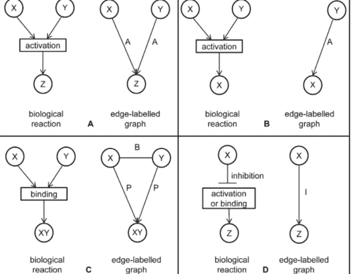

# 词性标记与标注

词性（POS）标记是将句子中的单词标记为名词、动词、形容词、副词的过程；分句（chunking）是将句法上连贯的词单元（如名词短语 NP 和动词短语 VP）进行分组的过程。生物文本的词性标记和分句过程被用于 GENIA 标记器。其输出是短语块，例如名词短语（NP）和动词短语（VP）。每个块根据预算指南对短语层级进行标记。项目公开的短语层级标记类型：http://biontology.stanford.edu/PennTreeTags.html。块标记的句子是三元组提取模块的输入。

A) 两个组件之间的激活（标记的）反应转换为反应物和产物节点 B。
B) 转录水平的激活（标记的）是一种特殊的激活类型，当 Y 诱导基因 X 的激活产生 X 时。我们将基因转录水平考虑为将拓扑转换为边标记。
C) 两个节点 X 和 Y 之间的结合（标记的）反应转换为产物以及反应物与产物之间的额外反应（标记为 P）。后者被引入用于二分关系中的蛋白质结合，该关系由被省略的其他部分组成。
D) 抑制（标记的）是指通过一个产生 Z 的组件来阻塞组件之间的激活或反应。

此外，为了维持由（组件，反应）三元组组成的人工和自动提取图的可维护性，需要对代表单个组件的节点进行分解。反应解耦为关系如图 4 所示。该家族成员是从植物数据库 Aracyc 和 TAIR 以及添加相关的论文中选出的，并列出了功能类似物。

# 三元组提取

三元组提取的目标是寻找（主语，谓语，宾语）形式的三元组。如果谓语是主动形式，则主语是名词短语（NP）的一部分，宾语是谓语后的名词短语（NP）部分。被动形式则相反。三元组提取是一种从提取块的句子中标记 VP（或）三元组并关联 PubMed 中心 ID 的方法。三元组提取是利用人工开发的组件和反应通过规则执行的：

# BioGraph 方法论

- 组件词汇表包含人工开发模型拓扑中所有组件的列表。
- 反应性词汇由三种不同类型的反应（激活、抑制和结合）及其同义词和短语组成。例如，图 1B 中的激活有一个同义词，但短语也显示了在……存在时水平增加

对于自然语言，我们使用了自然语言包 (NLTK)[67] 进行处理。此外，使用了用于生物数据的 GENIA 标记器 [68] 执行词性标记和解析。数据是通过网络访问从 PubMed Central 提取的。图5 所示的 BioGraph 方法论部分在下文中详细描述。

我们将三元组规则分为三类：单单词谓语规则，以及用于交换的多单词谓语规则。我们在下文中描述了每种规则。

# 文本预处理

单单词谓语规则处理谓语为单个单词的情况，如激活、刺激、诱导。该规则的三元组提取示例如图 9 所示。句子用 Genia 标记器分成分块后，我们首先通过反应词汇找到所有组件（步骤9 中的第 2 步）。如果至少有一个谓语，我们就将其定义为谓语。我们在谓语前后的短语中搜索主语和宾语。首先执行检测到的 VP 与组件词汇表的比较（步骤9 中的第 3 步）。此匹配提供了主语，接着是检测到的 VP 之后的 NP 与组件词汇表之间的匹配（步骤9 中的第 4 步）。如果匹配，则下一个 NP 与组件词汇表之间的匹配（步骤9 中的第 5 步）。如果匹配，则检测到宾语并分词

这是将句子拆分为短语或有意义元素的过程。分词使用分词器执行。输出用于词性标记，如图 9。

多单词谓语规则处理谓语为多个单词的情况，例如……调节因子、抑制剂，……显示了增加的累积。三元组以类似的方式在……中搜索。对于单单词谓语规则，如果谓语是被动形式或……。交换规则应用于……词汇文件。在这些情况下，主语和宾语被交换。

## Java 技术

语料。BioGraph 工具已在 http://roget.ijs.sij/biograph/ 公开放。

## 参考文献

- 1. Carr, J, Lewley MG, P (2010) 诱导共振中的信号：见 Carr, J, Loebstein, G, 编辑, 植物病毒的天然与工程抗, PT II. Academic Press. 76: 57–71.
- 2. Moore JW, Luke GJ, Noel SP (2011) 植物免疫中的动力学, Cell 23(8): 2880–2892.
- 3. Reynold P, Farmer EE (1998) 茉莉酸和水杨酸作为基因表达的全局信号。Curr Plant Biol 1(5): 401–414.
- 4. Glasabrook J (2005) 抗生物质和病原微生物防御的对比机制。Annu Rev Pathathol 42: 21–35.
- 5. Howe GA, Gander J (2008) 水杨酸介导的植物抗虫免疫。Annu Rev Plant 59: 41–66.
- 6. Schenk PM, Kazan Wilson I, Anderson JP, Richman T, et al (2000) 水杨酸信号激活的拟南芥协调防御反应。Proc Natl Acad Sci U 97(11): 1655–1660.
- 7. van Wees SW, Darts EAM, Van JL, van Loon M (2000) 水杨酸和茉莉酸依赖途径增强拟南芥的诱导防御抗性。Proc Natl Acad Sci 97(17): 7712–7716.
- 8. Mason LA, Kent PT, Astrom R, West M, Caffenstock C (2006) 水杨酸与茉莉酸信号相互作用的结果，包括协同、拮抗和氧化应激导致细胞死亡。Functional Plant Biol 149(2): 249–262.
- 9. Reyes-Lopez A, Spittel SH, De Lang E, Abe, Heb K, et al (2009) 乙烯调节在茉莉酸和水杨酸杂交中病原体相关发生抑制因子 (PRG) 的作用。Functional Plant Biol 49(4): 797–1008.
- 10. Reyes-Audes, Du Y, Koornheer A, Proiets S, Kobes AP, et al (2010) 乙烯信号调节对功能性水杨酸不敏感的茉莉酸响应。Mol Plant Interact 23(2): 189–197.
- 11. Zander M, Da Corte, Lamer A, Metraux JP, Jax C (2010) 拟南芥 call-II TGA 因子是水杨酸/乙烯诱导反应的必需激活因子。Plant 6(2): 200–210.
- 12. Somsich IE, Hallbæk K (2008) 生物复杂性范式中的交叉对话。Current Science Plant 36: 86–90.
- 13. Koornheer A, Pietiet S (2008) 信号响应中的交叉对话。Plant Signal 146(3): 839–844.
- 14. Kessler HA, Wara A, Bacher K, Wohl M (2008) 信号转导的网络建模：建立全局视图。Bioinformation 30(11-12): 1110–1125.
- 15. Hitano K (2002) 系统信号：概述。Science 295(5560): 1662–1664.
- 16. Le Ne W, Hack M IM, Moodie S, Sereiber F, et al (2009) 系统图形符号表示法。Biotechnology 27(8): 735–741.
- 17. Razasa S, Jackson KA, Page D, Enright AJ, et al (2008) 巨噬细胞激活信号通路的逻辑化描述。MAPK Syst Biol 2: 36–43.
- 18. Kaneisha M, Goto S (2000) KEEG: 基因和核的乙烯响应。Nucleic Acids 28(1): 27–30.
- 19. Tsetmez N, Couchman M, Higgins J, Smith A D, Johnston JH, et al (2008) 拟南芥响应：植物系统生物学的功能性知识库。Plant Cell 20(5): 899–908.
- 20. Krunmacker P, Jalmier B, Jaubert J, Mueller L, Van T Y, Karp PD (2005) 使用 BioC 数据库查询。Bioinformatics 21(6): 3454–3455.
- 21. Ko’her J, Baumakh J, Taubert J, Skusa A, et al (2006) 使用 OxMethods 对实验结果进行基于类的分析和验证。Bioinformatics 22(11): 2881–2886.
- 22. Severin P, Lainen, Hintanen P, Kuviainen T, Toonen H (2006) 从生物数据库衍生的图中的链接发现。Proc. 3rd. Workshop on DILTS, 2005:37–45.
- 23. Eron L, Tivonen H (2012) 使用异构数据库预测生物实体之间的链接。Bioinformatics 13: 119–124.
- 24. Raza S, McDermott N, Lopez JA, Wattson S (2010) 构建针对病原微生物识别的防御机制。System Biol 4: 13.
- 25. Ania S, Pysalo G, Stuy J, Kell KB (2010) 水杨酸介导的植物抗虫免疫进化。Trends in Plant 14(7): 381–390.
- 26. Cohen H, Hunter S (2008) 基于系统的水杨酸信号起始研究。
- 27. Zhetkhy A, Ios T, Krauth M, et al (2005) 交叉对话在信号响应中的分子水平。Nature J Sci 7(1): 43–53.
- 28. Chen H, Sharp M (2004) 利用文献分析交叉对话的分子水平。Nature 25: 7–14.
- 29. Kralliger A, Rodriguez G, Andalucia A (2009) 自动提取全长水杨酸信号的框架。Nucleic Acids 37: 160–165.
- 30. One T, Hishig K, Tanigami A (2001) 蛋白质相互作用的自动提取。Bioinformatics 17(2): 155–161.
- 31. Somsich IE, Hallbæk K (2008) 生物复杂性范式中的交叉对话。Current Science Plant 36: 86.
- 32. Corney PA, Buxton BF, Jones DT (2004) 拟南芥防御的数值模拟。Plant Phys 126(4): 1430–1437.
- 33. Blaschke C, Valencia A (2017) 乙烯信号的分子水平。Trends in Plant 12(6): 66–75.
- 34. Olmedo G, Chang C, Gorsky B (2009) 茉莉酸信号的受体和核心模块。Curr Opin Biol 12(5): 539–547.
- 35. Wilmuth MD, Dempsey Y, Wu GA (2001) 合成水杨酸的乙烯信号。Nature 414(6863): 562–565.
- 36. Fonseca S, Jim MC, Solono R (2009) 茉莉酸信号的受体和核心模块。Curr Opin Biol 12:.
- 37. Stasswick, PE, Triyaki I (2008) 由一种酶激活的水杨酸增强拟南芥的抗性。Plant J 28: 218–227.
- 38. Devoto A, Turner G (2005) 茉莉酸调节的应激信号。Plant J 126(2): 161–172.
- 39. Vlot AC, Dempsey DA, Klass DF (2009) 水杨酸的分子水平。Annu Rev Physiol Research 47(1): 176–207.

65. Mueller LA, Zhang PF, Rhee SY (2003) AraCyc: 一种用于拟芥的生化通路数据库。Plant Physiol 132(2): 453–460.

66. Blaschke C, Valencia A (2001) SUiSEK 作为蛋白质相互作用发现工具的潜在用途。Genome Inform 12: 123–34.

67. Bird S, Loper E, Klein E (2009) 基于 Python 的自然语言处理。O'Reilly Media Inc. 504 页。

68. Tsuruoka Y, Tateishi Y, Kim JD, Ohta T, McNaught J, et al. (2005) 为生物医学文本开发一种稳健的词性标记器。Advances in Informatics, Proceedings 3746: 382–392.

69. Tsuruoka Y, Tsuji J (2005) 基于最简单优先策略的双向推理，用于序列数据标记，Proceedings of HLT/EMNLP, 467–474.

70. Barnes JE, Hut P (1986) 一种层次级 O(N log N) 力计算算法。Nature 324, 446–449.

71. Kiss T, Struck J (2006) 无监督多语言句子边界检测。Computational Linguistics 32(4): 485–525.

# S-SMART，一个辅助 RNA-Seq 数据分析的软件工具箱

Zytnicki M¹, Quesneville H.¹

¹URGI, INRA, 法国凡赛。

# 引言

通过二代测序技术的高通量测序极大地扩展了测序实验的数量。今天，几乎所有领域都受到了这些发展的影响。最新的测序仪现在可以提供超过 100Gb 的数据用于运行计算机辅助分析。目前已经开发了多个软件包将读取段（reads）比对到参考基因组（例如 Q [1], BWA [2], [3], SOAP [4], BowTie [5] 或 Musak [6]）。然而，实验通常并不遵循一套严格的生物信息学任务，且用户需要一组基因组坐标来决定分析的比对方式。

目前已经开发了用于 RNA-Seq 数据分析的流水线以发现基因 [7]、miRNA [8] 或 piRNA [9]。然而，实验通常会根据结果调整分析。在这种情况下，生物学应用通常需要生物信息学家协助分析。

S-SMART 是一个多功能工具箱，可以执行 RNA-Seq 分析，尽管它本身并不是一个流水线。S-SMART 执行两类任务：数据处理和可视化。比对包括：(i) 选择/排除与某些参考集重叠的读取段，(ii) 读取段聚类，以及 (iii) 差异表达分析。可视化包括 (i) 读取段大小分布，(ii) 核苷酸组成，(iii) 染色体定位等。

我们为计算机科学背景较少的生物学家做了专门的工作。图形用户界面允许通过简单的点击按钮来启动每个工具。S-SMART 支持 Windows、Mac 和 Linux 平台。

S-SMART 相比其他工具的主要优势在于，整个 RNA-Seq 分析可以在任何操作系统上（即使是资源有限的笔记本电脑）进行，并且可以在任何操作系统上运行（某些如 BowTie 等比对工具可在任何操作系统上使用）。对于没有计算机背景的人来说，S-SMART 直观且易用。

最后，S-SMART 提供了一列表用于 RNA-Seq 分析的常用工具。S-SMART 提供的所有工具在其他软件包中都有，S-SMART 为 RNA-Seq 数据分析提供了一个统一、简单且综合的框架。我们预计许多涉及 RNA-seq 数据的问题可以通过特定版本的 S-SMART 得到解答。软件将不断增强。

## 结果

S-SMART 执行不同类别的任务。首先，它可以 (i) 过滤并选择最感兴趣的数据，(ii) 对信息聚类以获取视图，或 (iii) 将数据从一个文件转换为另一个文件。其次，它可以 (i) 产生高质量图表以可视化来自读取段信息的某些方面，或 (ii) 绘制某些分布图。第三，S-SMART 可以区分差异表达基因（或任何注释）。

S-SMART 默认生成标准的 GFF3 文件，但它可以以 BED 格式 [11] 导出数据以便 UCSC 基因组浏览器，或通过 GBrowse [12] 使用其特定的注释格式导出数据。用户可以通过任何浏览器可视化其数据。

S-SMART 已经使用了 Illumina 和 Roche 数据。它能够无缝处理大数据（如 Illumina）和长读段（如 Roche），并成功应用于我们自己的 Illumina 分析仪和 Roche 基因测序仪。

### 与表观遗传 ChIP-Seq数据的比较

S-SMART 还可以对比 RNA-Seq 数据产生表观遗传数据 ChIP-Seq 或 MNase-Seq 数据（如核小体定位、组蛋白修饰、甲基化）。例如，S-SMART 可以绘制给定基因组蛋白修饰的平均水平，或转录位点周围的修饰平均水平。

### 操作

#### 过滤

S-SMART 可以读取许多比对工具的输出文件。它可以根据不同标准选择比对：无错、在主题上仅有一个或几个匹配。

#### 差异表达

许多用户使用 RNA-Seq 数据识别野生型和突变条件之间的差异表达基因（或区域）。统计学方法是比较这两种情况的一种现有方法。

#### 标准化

提供了标准化和调整。第一种最简单：每个条件中的读取数归一化为读取的平均值。Bullard 等人表明，当大多数基因呈差异表达时，这种归一化是有问题的。然而，如果表达基因没有差异表达，则四分位距（第一分位数和第三分位数之间的差）具有相同的读取数。

#### 聚类

S-SMART 可以使用定义的窗口将比对的读取段合并为聚类。重叠的数据可以合并以发现更“奇特”的模式，例如链双向启动子。

#### 转换

S-SMART 包含了几个可能帮助用户的工具：文件格式转换、基因组坐标等。

### 可视化

#### 读取段信息

可以在 PNG 文件中生成不同的图表，显示 (i) 序列被获取的次数，(ii) 每个聚类的读取段大小，(iii) 外显子数量以及 (iv) 核苷酸组成。

#### 分布

可以从比对的读取段或任何基因组坐标集提取出几种分布。这些包括 (i) 染色体上的密度，(ii) 相对于参考集（例如 RefSeq 数据）的读取段距离，或 (iii) 其他相关性。

### 流水线示例

为了说明 S-SMART 的用处，我们展示了如何结合这些工具进行分析，如图 1 所示。

# S-SMART，一个辅助 RNA-Seq 数据分析的软件工具箱。


**图 1**

## 参考文献

2. Li H, Durhin R. Fast and accurate short alignment with Burrows-Wheeler alignment transform. Bioinformatics.2009:25:1754-1760.

3. Li H, Durhin R. Fast and accurate long-read alignment with Burrows-Wheeler transform. Bioinformatics.2009:25:589-595.

4. Li R, Yu C, Li Y, Lam TW, Yiu SM, et al. SOAP2: an improved ultrafast for short read alignment. Bioinformatics.2009:25:1966-1967.

5. Langmead B, Trapnell C, Pop M, Salzberg SL. Ultrafast and memory-efficient alignment of DNA sequences to a reference genome. Genome.2009:10.

6. The Mosaic Web page, http://bioinformatics.bc.edu/matlab/Mosaic.

7. Nagaklshmi U, Wang Z, Waern K, Shou C, Raha D, et al. The transcriptional landscape of the yeast genome defined by RNA sequencing. Science. 2006;312:1244-1349.

8. Friedländer M, Chen W, Adamic C, Maaskola J, Einspainer R, et al. Discovering RNAs from deep sequencing data using miRep. Biotechnology. 2008;26:407-415.

9. Brennecke J, Aravin A, Stark A, Dus M, Kellis M, et al. Discrete RNA-generating class regulators of transposon activity in drosophila. Cell. 2007;128:1089-1103.

10. Blankenberg D, Taylor J, Schenck I, Ha J, Zhang Y, et al. A framework for collaborative analysis of ENCODE: data making large-scale analyses biologist-friendly. Genome Research. 2007;17:960-964.

11. Kent W, Sugnet C, Fury T, Roskin K, Pringle E, et al. The human genome browser at UCSC. Genome Research.2002;12:996-1006.

12. Stein LD, Mughall C, Caudy M, Mangone M, et al. The generic genome browser: a building block for model system database. Genome Research.1999;10:1010.

13. Bullard J, Purdom E, Hansen K, Dudoit S. Evaluation of statistical methods for normalization and differential expression in mRNA-Seq experiments. BMC Bioinformatics. 2010:11.

14. Oshlak, Wakefield MJ. Transcript length bias in RNA-seq data confounds systems biology. Biology Direct.2009,4.

15. S-SMART website. Available: http://urgi.versailles.inra.fr/tools/S-SMART. Accessed 2011 September 19.

# 第10章 ArchILD：人类人群中连锁不平衡的层级可视化

Rossella Melchiotti,¹² Olaf Rötzschke,¹ and Michael Poidinger¹

¹新加坡免疫学网络 (SiGN), 科学技术与研究局 (ASTAR), 新加坡, 新加坡

²翻译与分子医学博士学院 (DIMET), 米兰博卡大学, 意大利, 米兰

## 摘要

连锁不平衡 (LD) 是遗传学研究中选择单核苷酸多态性 (SNP) 以及从显著标签 SNP 中识别因果变异的关键指标。商业阵列现在可以检测基因型的多态性数量爆炸式增长，使得通常用于 LD 可视化的三角形相关图的解释变得极其困难，特别是当需要考虑大规模基因组学数据或完美 LD 的 SNP 不仅仅散布在某个基因组区域时。我们开发了 ArchILD，这是一种用户友好的图形应用程序，用于人类人群中 LD 的层级可视化。该软件提供了一个强大的模式链接框架，特别关注由 $r^2$ 定义的完美连锁 SNP 块。得益于与 UCSC 基因组浏览器的集成，LD 图可以轻松地与调控、保守和表达的额外数据进行叠加。ArchILD 是大型或高度多态性基因组区域 LD 可视化的直观解决方案。它的使用以及与 UCSC 的集成有助于关联结果的解释，并为遗传学研究提供了更具针对性的 SNP 选择。

## 引言

高通量技术（如商业阵列上的单核苷酸多态性 (SNP) 和二代测序）的发展和融合，导致了对连锁不平衡 (LD) 分析的需求。连锁不平衡 (LD) 是遗传学研究中选择单核苷酸多态性 (SNP) 以及从显著标签 SNP 中识别因果变异的关键指标。商业阵列现在可以检测基因型的多态性数量爆炸式增长，使得通常用于 LD 可视化的三角形相关图的解释变得极其困难，特别是当需要考虑大规模基因组学数据或完美 LD 的 SNP 不仅仅散布在某个基因组区域时。我们开发了 ArchILD，这是一种用户友好的图形应用程序，用于人类人群中 LD 的层级可视化。该软件提供了一个强大的模式链接框架，特别关注由 $r^2$ 定义的完美连锁 SNP 块。得益于与 UCSC 基因组浏览器的集成，LD 图可以轻松地与调控、保守和表达的额外数据进行叠加。ArchILD 是大型或高度多态性基因组区域 LD 可视化的直观解决方案。它的使用以及与 UCSC 的集成有助于关联结果的解释，并为遗传学研究提供了更具针对性的 SNP 选择。

## 实现

ArchILD 有两个版本：
- 客户端-服务器应用程序 (ArchLD)
- 独立应用程序 (ArchDCustom)

该软件使用：
- Java (1.6)
- 千10 基因组计划 (CEU, CHB, JPT)
- PLINK
- MySQL v5.7
- R v2.15.1

LD 块的聚类是基于 [12] 的聚合方法进行的。分析的距离矩阵由 LD 矩阵定义为 $1-r$。

## 结果

### LD 结构

LD 集合（完美 LD (r=1) 的 SNP 聚类）可以通过四种不同的元素构建：
- 基因
- SNP
- 染色体 (仅限 ArchLD)
- 基因组区域 (ArchDCustom)

基因-染色体簇由至少包含一个位于内部或附近的 SNP 的 LD 块组成。用户需要在分析中包含基因起始/结束点与 SNP 之间的最大距离。该工具对基因使用三种标识符：Name Ent、Ref IDs 和 HU 基因符号。

SNP-染色体簇包含位于特定区域的所有 LD 块。以区域为中心的架构关注用户导入的基因组数据集。只有文件中导入的 SNP 才用于构建聚类。

无论进行何种类型的分析，请选择一个等位位基因频率阈值以从分析中排除稀有 SNP，并选择基因组版本（hg18/hg19）。

以基因为中心的架构由不同的轨道（tracks）表示，包含单个 SNP 的名称、位置以及该区域内的所有区块。簇通过其第一个 SNP 的名称进行识别（图 1）。所有用户都可以决定识别属于某个簇的 SNP 还是区域内的所有 SNP。如果没有 SNP 属于某个轨道，则会在可视化中添加一个新轨道。

### 可视化

LD 架构在 UCSC 基因组浏览器的集成界面中自定义 BED 文件的形式可视化；完美 LD（r*=1）的 SNP 由水平线表示，该线构成一个簇。


图 1 以基因为中心的架构示例。

还可以构建跨越整个基因组的簇分层树。完美 LD 的 SNP 根据其位置 r* 进行聚类。分层图显示在基因组浏览器窗口旁边，以便于解释 LD 模式。当选择此选项时，每个簇由一个不同的树表示，轨道的顺序遵循分层树中簇的顺序（图 2）。


图 2 分层聚类的示例。

以区域为中心的架构以类似的方式进行可视化，但仅包含在用于分析的基因型数据集中的 SNP。

以 SNP 为中心的架构由多个轨道表示。第一个轨道包含 SNP 名称。第二个轨道显示参考 SNP 及其所有关联的 SNP。所有其他轨道均按 r* 值递减顺序排列（相应的 r* 包含在轨道名称中，图 3）。单等位点（Singletons）可以被包含并添加到相应 r* 值的轨道中。


图 3 以 SNP 为中心的架构示例。

对于以基因为中心、以 SNP 为中心和以区域为中心的架构，用户可以选择根据等位位基因频率选择 SNP 和 LD 区块。这简化了具有多种分布的连锁平衡 SNP 簇的识别。

对于以染色体为中心的架构，所有内容都添加到同一个轨道中（图 4）。如果包含单等位点，则仅这些 SNP 会添加到可视化中。


图 4 以染色体为中心的架构示例。

可以使用导航树轻松导出包含特定案例 SNP ID 的 BED 轨道和文件名。可以同时加载多个图作为 UCSC 轨道，以便比较不同位置的 LD 模式。

在 ArchILD 中，通过点击导航树中的相应项目，可以将基因为中心和 SNP 为中心的架构自动加载到浏览器中。由于其体巨大，染色体中心架构除非先导出再手动导入，否则无法自动加载：ArchLDCustom 要求用户

## 讨论

ArchiLD 是一款强大的软件，用于生成高度可解释的图表，可用于关联研究中标记 SNP，或为功能研究中的 SNP 优先级排序。它与 UCSC 基因组浏览器 [9] 的集成使用户能够叠加有关调节、保守策略、表型和疾病关联的额外信息，帮助用户解释结果。

生成以 SNP 为中心的架构需要几秒钟。对于以基因为中心的架构，根据选择的上游/下游区域的长度和大小，过程可能需要几秒到几分钟不等。

## 可用性

ArchILDk 和 ArchILDcustom 的预编译二进制文件（适用于 Windows、Linux 和 Mac OS）可以从项目网站（http://archild.sign-a-star.edu）下载。ArchILD 以 zip 文件的形式发布，包含一个运行时环境及其所需的所有库。ArchILDcustom 以 zip 文件的形式发布，包含一个运行时环境以及两个用于测试的示例数据集。这两个数据集是使用 1000 基因组计划 [6] 中第 7 号染色前 500 kb (CEU) 和第 1 号染色 (CHB+JPT) 的基因型数据生成的。ArchILD 还可以作为 MySQL 数据库的形式提供。

关于如何在不同操作系统下使用该工具以及如何使用 ArchILD 不同功能的说明已在手册中描述，手册可以在网站上获取。文件也可以从网站获取，并轻松地作为 Java 项目导入适用于 Java 开发者的 Eclipse IDE 中。该软件根据 GNU 公用许可证 (GPL) 第 3 版获得许可。

## 结论

ArchILD 是一个用于人类群体连锁不平衡可视化的友好界面。该软件的开发旨在帮助识别遗传研究中的 SNP 并识别因果 SNP 变异。其易用性和可解释性使 ArchILD 成为每个遗传学家工具箱中强力的补充。

## 致谢

我们感谢 Solomon Razlin (SiGN)、Young Hain 和 Tak Kok Kim (HO*) 提供的技术协助以及虚拟机服务器的设置。

## 作者贡献

构思并设计实验：RM 或 MR。执行实验：RM。撰写论文：RM。实现软件：RM。批判性审稿：OR

## 参考文献

- 1. Kof R, Schötter C (2012) Govinda: 用于全基因关联研究的基因集的无偏分析。Bioinformatics 28: 2084–2085
- 2. 国际 HapCons Consortium (2003). 国际 HapMap 项目。Nature 426: 789–796
- 3. 国际 HapCons Consortium (2005). 人类基因组单倍型图。Nature 439:1299–1320
- 4. 国际 HapCons Consortium (2007) 包含超过 310 万个 SNP 的第二代人类单倍型图。Nature 449: 851–861
- 5. 国际 HapCons Consortium(2010) 在不同人类群体中整合常见和罕见变异。Nature 467: 52–58
- 6. 1000 基因组计划 (2010) 基于特定人群研究的人类基因组图。Science 327: 1061–1073
- 7. Barrett CJ, Fry B, Maler J, Daly MJ (2005) LD 和单倍型图的单倍型分析。Bioinformatics 21: 263–265
- 8. Bush W, Duck SM, Ritchie MD (2010) 使用 LD-Plus 在连锁不平衡背景下的 SNP 统计分析。Bioinformatics 26: 578–579
- 9. Kent KW, Su G, Furys TS, Tomlin MK, Prime TH, et al. UCSC 上的人类基因组。Nature 12: 996–1006
- 10. Johnson AD, Saunders PL, Nizzari MM, O'Connell CI, et al (2008) 用于识别和分析 HapMap 代理 SNP 的 Web 工具。Bioinformatics 24: 2938–2939
- 11. 1000 基因组计划联盟 (2012) 来自 1092 个人类基因组的遗传变异整合图。Science 337: 55–60
- 12. R Development Consortium (2012) R: 统计计算的语言和环境。Computing, Vienna, Austria.
- 13. UCB Bioinformatics Consortium (2013). 可访问地址：http://ucb.bio.edu/FAQ/format.html 访问日期：2013 年 12 月 20 日。
- 14. Meyer LR, Zhai S, Ahirsash AC, Karolovich D, Kahn RM, et al (2013) UCSC 基因组浏览器：变异的扩展与更新。2013。Nucleic Acids Res 41: D64–D69
- 15. Ahirsash AC, Karolovich D, Baertich R, Barber JP, Beirano G, et al (2006) UCSC 基因组数据库：更新。2006。Nucleic Acids Res 34: D590–D595
- 16. Purnell S, Searle D, Bott K, Thomas F, Lander MAR, et al (2007) PLINK: 用于全基因组关联和基于人群映射的工具。Am J Hum Gen 15: 559–565
- 17. Qtambi (2004). 可访问地址：http://qt-jmap.org/ 访问日期：2013 年 12 月 20 日。
- 18. Pruim RJ, Welch PR, Sanna S, Teslovich TM, Chines PS, et al (2010):LocusZoom.org: 全基因组关联研究的区域性可视化。Bioinformatics 26: 2336–2377
- 19. Ricopoli (2010). 可访问地址：http://www.biostribute.org/mpg/ricopoli/2013). 访问日期：2013 年 12 月 20 日。
- 20. ArchILD (2013). 可访问地址：http://archild.sign-a-star.edu/. 访问日期：2013 年 12 月 20 日。

# 开源软件中的不平等：Apache 基金会项目贡献者提交分析

Tadeusz Chelkowski,¹ Peter Gloor,² and Dariusz Jmielniak³
¹Kozminski 大学，华沙，波兰
²马萨诸塞理工学院，认知智能中心，剑桥市，马萨诸塞州，美国
³Kozminski 大学，数字社会新研究 (NeRDS) 组，华沙，波兰

## 引言

在过去的十年中，开放协作社区一直是组织和信息系统的关注焦点 [1]。原则上，开放协作是一种通过自下而上的方式共同开发产品的方法。

## 样本选择

开源软件“运动”由协作程序员的网络所代表。然而，并没有一个单一的场所整合所有的开源项目。开源项目存在于各种社会、技术和许可语境中。云原生软件和像 GitHub 这样的整合了 2690 万个仓库和 1.09 亿人（见 https://github.com/about/）。

对于本次分析，我们选择了来自 Apache 软件基金会（Apache Software Foundation）的项目。Apache 基金会是最古老的开源开发组织之一。自 1999 年以来，Apache 基金会为其项目提供技术指导、法律建议和许可支持（贡献者是获得访问 Apache 项目权限的开发者）。为了协作代码开发，Apache 项目使用版本控制系统。Apache 基金会的成立原因如下（见 https://apache.org/foundation）：它包含了 350 多个具有统一方法论的成熟项目。

其次，大多数项目是多年来开发的，这为我们提供了分析其随时间演变结构的机会（例如，Apache HTTP Server 创立于 1995 年）。多样性包括一些最著名的开源项目，如 Apache HTTP Server 和 Apache Open。无论 Apache 软件基金会的历史和地位如何，本研究的结果都不应推广到 Apache 基金会项目之外。

当我们分析一个 Apache 项目时，它是开放的。Apache 基金会在某些文档中列出 262 个项目，在另一些数据中为350 个或“~300+”（在同一页面上也提到了 278 个项目）。这包括 Apache 阶段的项目，以及其他可能导致结果出现明显偏差的项目。我们决定排除单独合并的项目或仅一次提交的项目，因为在我们看来它们不符合条件。我们的方法对于这类研究是典型的做法 [44]。

## 提交 (COMMIT)

为了分析贡献者的活动分布，我们衡量了个人贡献者提交的提交次数。集体开源开发过程由提交到源代码控制系统支持的统一仓库的提交组成。一次提交代表与远程仓库的代码同步/交换，以及程序员更改的提交。简单的软件修改，例如添加、修改或删除代码行，添加或删除文档文件文件，都是提交的典型示例。由于软件仓库的性质及其可访问性，提交已成为许多软件开发研究的对象 [32-43]。虽然许多研究人员声称通过提交的大小或收到的提交数量来分类提交的价值，但我们打算仅衡量贡献者的活动，而不是他们工作的价值 [45,46]。

## 数据来源

我们使用了来自 OpenHub.net（原 OpenHub）开源项目注册表的数据。本文基于 2014 年 6 月的 Apache 数据库快照，其中包含超过66.4 万个开源项目。OpenHub 提供项目信息，包括名称、主要编程语言、创建日期。此外，注册表还提供有关个人贡献者和提交的信息。OpenHub 使用 Git、SVN、Mercurial 和 Bitbucket 等最流行的版本控制系统直接从开源仓库检索项目。

## 数据收集

为了收集 Apache 软件基金会的项目，我们开发了一个基于 Java 的程序，通过基于 REST-API 查询 OpenHub。我们的程序使用 "apache" 作为项目标识符查询 OpenHub，然后遍历唯一的项目 ID。使用项目 ID，程序执行查询并收集有关个人贡献者的详细信息。初始查询返回不仅是匹配 apache 的开源项目，还有所有可能扩展或使用 Apache 项目的相关项目。对于最终分析，我们决定创建一个统一的标准以准备一个干净的数据集。

### 过滤标准：

- 项目必须是 http://projects.apache.org 官方 Apache 基金会项目。只有被 Apache 基金会注册并认定为“Apache 项目”的项目符合条件。
- 项目不能处于 Apache 软件基金会的“孵化”状态，且主页不在 incubator.apache.org 中。孵化计划是为希望成为 Apache 基金会一部分的项目创建。它是验证外部组织捐赠的地方，确保其遵循 Apache 基金会的法律标准。捐赠的项目包含有限且未经证实的信息。列为孵化部分的项目没有此条目的可靠日期。孵化过程可能导致拒绝，项目可能无法建立为 Apache 基金会项目。
- 项目不能被 Apache 软件基金会认定为已停止（“移动到阁楼”）。Apache 基金会引入了“阁楼”项目类别来管理项目生命终结的问题。它旨在提供一个受控的过程，在没有活跃贡献者或无法履行职责的提交的情况下关闭项目。归类为“阁楼”的项目通常会被合并到其他项目中，它们的提交必须包含在其他项目中。“root”用户，例如代表用于项目迁移过程的技术账户。
- 此外，我们删除了 72 个没有正确名称的提交。对于某些情况，对删除案例的详细审查表明其属于“匿名”、“无”、“用户名”或“未知”。

最后，收集的数据包含 1,348,405 次提交。10,045,099 行代码，源自 263 个 Apache 项目，4,661 个唯一的提交账户（一个贡献者可以提交到多个项目——见表 1 和图 1）。

表 1 从 OpenHub 获取的样本提交

| 项目名称 | 贡献者 | 提交数 |
| :--- | :--- | :--- |
| Apache Jackrabbit | Angela Schreiber | 1499 |


图 1 以代码行衡量的项目提交和贡献者数量（见表 2）。

表 2 分析数据集的基础统计数据

| 属性 | 总代码行 | 总提交数 | 贡献者 |
| :--- | :--- | :--- | :--- |
| 最小值 | 822 | 16 | 3 |
| 平均值 | 399,411.02 | 5,127.02 | 38 |
| 中位数 | 97,753 | 1,993 | 19 |
| 下四分位数 | 28,459 | 639 | 11 |
| 上四分位数 | 300,162 | 5,509 | 35 |
| 最大值 | 14,625,904 | 94,585 | 527 |
| 标准差 | 1,237,915.25 | 9,710.75 | 35 |

## 数据与验证

为了验证源（OpenHub），我们选择了一组项目并对 OpenHub 数据进行了手动验证。自动收集的数据与 OpenHub 项目中的提交记录进行了对比。发现唯一的不一致之处是，此外，为了验证，我们检索了官方项目列表，以确保所收集数据的准确性。开源开发中的不平等性：我们访谈了三位开发者，在访谈期间，所有开发者都确认了记录。描述性分析（表 3）显示了提交的高度分布。此外，偏度指标确认了大部分分布集中在左侧（图 2）。

## 结果

表 3 贡献者提交的描述性分析

| 聚类编号 | 聚类中心 | 贡献者 | 提交占比 |
| :--- | :--- | :--- | :--- |
| 1 | 56 | 4,000 | 85.82% |
| 2 | 737 | 924 | 19.1% |
| 3 | 1,921 | 131 | 2.8% |
| 4 | 3,560.8 | 65 | 1.39% |
| 5 | 6,199.8 | 30 | 0.64% |
| 6 | 9,336 | 3 | 0.06% |
| 7 | 12,269 | 2 | 0.04% |
| 8 | 14,230 | 5 | 0.11% |
| 9 | 15,053 | 1 | 0.02% |

| | | |
| 最小值 | 1 |
| 最大值 | 19,053 |
| 总和 | 1,348,405 |
| 平均值 | 289,295 |
| 标准差 | 968.641 |
| 偏度 | 8.428 |

为了更清晰，我们使用了专家法（访谈开源贡献者）对提交贡献进行分类。如表 5 和图 3 所示，156 名贡献者（前两个贡献者的和）占分析人口的 39.35%，贡献了所有提交的 50.13%。另一方面，2,786 次提交（最后 1-50 名的和）占了 59.77% 的人数，仅贡献了总提交的 2.27%。图 4 显示了所选类别中贡献者的指数级下降和提交的增加。

为了以无监督的方式理解数据分布和相似组数据，我们使用 k-means 聚类和 JENKS 算法进行了聚类分析。两种方法提供了相似的结果。

表 5 使用专家法的提交聚合

| 类别 | 贡献者 | 提交占比 | 贡献者占比 |
| :--- | :--- | :--- | :--- |
| 1 到 10 | 5,942 | 0.441% | 39.383% |
| 11 到 50 | 24,085 | 1.8% | 19.91% |
| 51 到 100 | 33,018 | 2.446% | 9.633% |
| 101 到 200 | 58,829 | 4.365% | 8.638% |
| 201 到 500 | 146,814 | 10.888% | 9.869% |
| 501 到 1000 | 178,262 | 13.6% | 5.278% |
| 1001 到 2000 | 225,521 | 15.672% | 3.411% |
| 2001 到 5000 | 357,141 | 117 | 24.685% |
| 5000 以上 | 318,793 | 23.624% | 2.51% |

图 2 贡献者之间的提交直方图。

图 3 使用专家法的提交聚合。

## Java 技术


图 4 各类别中的提交和提交者分布。

### GINI 指数分析

我们观察到（图 5、表 6 和表 7）项目层面提交者活动存在不平等性，通过 Gini 指数进行衡量。在分析的 263 个案例中，100 个（38.2%）落在 0.7-0.8 范围内，分析总体中的 234 个（88.97%）处于 0.6 到 0.9 之间。此外，9.5% 的项目 Gini 值低于 0.6，1.52% 处于 0.9 到 1.0 范围内。需要注意的是，Gini 指数值高度集中在平均值附近。Apache Camel（Gini 指数 0.919）是提交不平等程度最高的项目，而 Portal JSF Bridge（Gini 指数 0.301）在所有项目中的提交分布最为均匀。Gini 指数分析证实了列联表中的发现。我们未能发现 Gini 指数与以总代码行数衡量的项目规模之间存在任何特定相关性（r = -0.118）。Gini 指数与项目规模显示出相关性（r = 0.1255），随着项目规模的增加，参与贡献者的数量也随增加。Gini 指数的分布及其与项目规模的关系如图 6、7 和 8 所示。

图 6 Gini 指数的属性。

| 属性 | 分析的 263 个项目的 Gini 指数 |
|---|---|
| 最小值 | 0.301587253 |
| 平均值 | 0.759581683 |
| 中位数 | 0.7457343403 |
| 第一四分位数 | 0.667283523 |
| 第三四分位数 | 0.815860311 |
| 最大值 | 0.91917141 |
| 标准差 | 0.106680995 |
| 方差 | 0.011334864 |

图 7 Gini 指数的分布。

| Gini 指数值 | 项目数量 | 项目百分比 | 累计项目数量 | 项目累计百分百分比 |
|---|---|---|---|---|
| 0.0 ≤ x < 0.4 | 3 | 1.14% | | 1.141% |
| 0.4 ≤ x < 0.5 | 9 | 3.42% | 12 | 4.563% |
| 0.5 ≤ x < 0.6 | 13 | 4.94% | 25 | 9.506% |
| 0.6 ≤ x < 0.7 | 66 | 25.10% | 91 | 34.601% |
| 0.7 ≤ x < 0.8 | 100 | 38.02% | 191 | 72.621% |
| 0.8 ≤ x < 0.9 | 68 | 25.86% | 259 | 98.481% |
| 0.9 ≤ x ≤ 1.0 | 4 | 1.52% | 263 | 100.00% |

# 开源开发中的不平等：Apache... 贡献者提交分析


**图 5** Gini 指数的排序分布。


**图 6** Gini 指数与项目规模。


**图 7** Gini 指数与提交者数量。

### 社会网络分析

我们通过构建二部图（图 9）对贡献者和项目进行了社交网络分析。二部图展示了 461 名开发者和 263 个项目之间的所有链接。在这个二部图中，我们计算了介数性（Freeman 1977）作为项目重要性的指标。我们发现具有最高介数性的项目是成熟且建立良好的开源项目，第一行代码提交于 15 年前。


多前的 2000 年 9 月。多年来，有 52 位贡献者开发了它。Apache Taglibs Java Server Pages (JSP)。JSP 是一种简化 Java 编程中 Web 开发的流行技术，近年来已成为基于 Java 的 Web 应用的标准。Apache Tags 是一个自定义的 JSP 库项目，这使得其他开发者更容易加入协作，因为他们的提交易于分离且是模块化的。我们认为，上述三个特征的结合——成熟且建立良好的项目、流行的技术以及 Apache Taglibs 的模块化数量——是贡献者人数之高的原因，也是在所有项目之间具有最高中心性的原因。在将图与行数、提交次数和提交次数进行相关性分析时，我们发现行数与项目开放性之间存在显著相关性（r=0.907, p<023），提交次数与介数性之间相关性（r=0.471, p<001），而行数与介数性之间相关性（r=0.168, p=005）。这并不意外，因为我们根据每个项目的开发者人数来构建网络，参与的人越多，项目的影响就越大。从这项分析中可以获得洞察，代码质量比行数或提交次数更能影响项目。


图 9 展示贡献者和项目的二部图（492 名开发者，263 个项目）。

# 开源开发中的不平等：贡献者的提交

介数性排名前 8 的项目：

| 介数性 | 项目名称 | 行数 | 提交数 | 贡献者 |
|---|---|---|---|---|
| 1,234,578 | Apache Tag | 77,397 | 68,170 | 527 |
| 1,333,454 | Apache Framework | 85,645 | 9,163 | 461 |
| 1,239,350 | Apache Cloudstack | 1,540 | 23,520 | 279 |
| 1,223,927 | Apache Spark | 109,532 | 7,655 | 295 |
| 1,155,106 | Apache Commons | 14,720 | 12,713 | 447 |
| 1,134,737 | Apache Jooms | 546,572 | 11,012 | 166 |
| 1,089,739 | Corvo-Android | 25,617 | 2,552 | 222 |
| 1,075,273 | Apache Launcher | 2,992 | 7,954 | 406 |
| 1,073,539 | Apache Modeler | 7,981 | 7,945 | 405 |
| 790,400 | Apache Maven 2 | 1,065,693 | 46,620 | 165 |
| 783,372 | Apache Libversion | 123,591 | 5,448 | 91 |
| 761,382 | Apache Tomcat | 599,069 | 19,945 | 170 |
| 627,619 | Apache Camel | 959,665 | 19,945 | 87 |
| 593,614 | Apache Gump | 36,250 | 14,181 | 137 |
| 566,023 | Apache Traffic Server | 536,615 | 7,408 | 111 |

介数性排名前 9 的项目：

| 项目名称 | 介数性 | |
|---|---|---|
| juka | 1,386,506,632 | 6,345 |
| peos | 916,998,183 | 474 |
| gendroid | 823,953,550 | 287 |
| beysand | 2,987,997 | 648 |
| joe sather | 611,604,026 | 948 |
| geovmod | 507,723,969 | 1,468 |
| bodernetaz | 470,430,078 | 2,476 |
| beim | 437,528,014 | 3,584 |
| nlj | 398,758,948 | 1,728 |
| niq | 317,995,235 | 929 |
| eshukh | 265,769,440 | 1,238 |
| beid | 255,735,137 | 2,728 |
| bayse | 244,234,779 | 3,118 |
| isote | 222,974,211 | 1,091 |
| hasholm | 201,361,959 | 642 |

## 讨论

我们通过构建二部图（图 9）对贡献者和项目进行了社交网络分析。在这个二部图中，我们计算了介数性（Freeman 1977）作为项目重要性的指标。我们发现具有最高介数性的项目是成熟且建立良好的开源项目，第一行代码提交于 15 年前。

对于开发的社交网络分析，我们发现“juka”拥有 6,345 次提交，是介数性最高的记录。我们发现“juka”有 3208 次提交，“Jukka Spring”有 3313 次提交，而“Jukka Laurie”有 4 次提交，我们将其识别为同一个人的账号。

我们的发现反驳了开源开发是一个高度协作运动的理想化。相反，我们发现被分析的软件基金会项目是由少数非常活跃的开发者创建的，彼此分离。

我们得出，被分析的 Apache 项目在贡献者活动（以提交衡量）方面存在高度不平等性。列联表显示，一少数贡献者负责了大部分提交，这在分析的项目规模和提交参与度的高 Gini 指数中得到了证实。

我们分析的一个优势是研究了小组项目。选定的 263 个案例代表了在广受尊敬的 Apache 基金会品牌下的一的一的 Apache 基金会项目。

我们方法论的一个潜在问题是提交与个人程序员项目贡献之间的语义关联。虽然提交已被广泛应用于类似的分析，并且是开源开发的一个基本元素，但并非所有人都通过诸如接触和回答用户支持问题等技术活动参与开源开发。

文档，或在会议上演讲。有人认为，提交（commits）可能无法代表开发人员对项目的实际贡献。然而，通过计算代码行来衡量项目贡献的另一种已知方法也存在缺陷，并且无法提供有关向项目分支添加代码行的价值的信息，这被等同于对项目进行微小修改的贡献。做出贡献的另一种方式——不仅是本文所介绍的活动——是一个重要的问题。

我们的发现证实了通过提交次数（commits）衡量的贡献者之间存在不平等。在对 263 个补丁的分析中，一个少数但非常活跃的核心开发者小组提交了大部分提交。在我们的用户社区中，也观察到了关系和用户内容生成类似的平行律分布 [51]。

## 结论

我们的结果并非适用于更广泛的开源软件开发背景。在其他非营利开源协作 [52, 53] 场景下，参与的益处没有商业环境中那么明确。虽然软件是无关的，但它们并不是我们观察到的现象 [10, 54]：开发者参与一种礼物文化，建立自己的人脉，获得技能的认可，并花时间与他人一起工作。

这种组合模型正变得越来越流行 [55, 56]。因此，声誉是推动人们开发开源的主要因素 [57, 59]。为了构建这样的现实，人们并不需要具备团队合作或领导力技能。

事实上，成为一个“英雄”可能是构建作品集（portfolio building）对于网络实验室（cyber-labs）的最优策略。虽然网络实验室有集体工作的机会 [60, 61]，但市场中的开源协作，特别是开源开发，吸引了那些重视诚实并倾向于个人工作的人们 [62, 63, 64]。

## 参考文献

- 1. Forte A, Lampe C (2013) 定义、理解和支持协作。《行为科学》57: 335–547。
- 2. Riehelle D, Ellenberg J, Menenhem T, Mikhailovsky B, Navechi Y, et al. (2009) 使用各种软件的开源。《纽约：大学出版社》xii: 5–15。
- 3. Gababiani, A, Seth S, Volgate C (2013) 虚拟论坛：社区成员想要帮助吗？心理学、行为与社会》16: 285–292. [PMC]
- 4. Roth S, Kaivo-Oja J., Hirschmann T (2013) 区域众包。《创业与小企业杂志》20: 272–285。
- 5. Crowston K, Weison J, Wiggins A (2012) 自由开源开发：我们知道和不知道的。《ACM Survey》(CSUR)44: 1–35。
- 6. Moon J, Sproull L (2002) 分布式工作的本质：Linux 内核的任务。《周一》5. 可用：http://firstmonday.org/oj/index.php/view/811–715。
- 7. Cheong K (2002) 这种精精神的新解释和推导。《经济杂志》13: 391–402。
- 8. Shait H (1985) 计算个体不平等指数。《牛津经济与统计公报》47: 175–189。
- 9. Lerman R, Yitzaki S (1989) 提高吉精系数的准确性。《经济杂志》42: 43–47。
- 10. De Ma G (2007) 收入不平等。《流行病学杂志》61: 849–852. [PMC]
- 11. Deniemiak D (2009) 知识工作的复杂度。《信息与组织》19: 277–293。
- 12. Howson J, Crowston K (2004) 挖掘软件存储库的危险与精神。《挖掘软件存储库国际研讨会》(MSR)。2004. http://files.uas.edu/sites/crowston.org/2004%20perils%20and%20spirits%20of..pdf.
- 13. Matelan Oliva V (2003) 使用可用数据研究自由项目的演变。《开源工程第三次研讨会》。可用：http://babilla.leunie.unsm.es/html/1096/112/116–115.
- 14. Arafat O, Riele D (2009) 开源的提交分布。《IEEE 系统国际会议》1–8。
- 15. German D, Mockus A (2003) 开源项目的自动化测量。《开源工程第三次研讨会》66。
- 16. Hb D (1994) 恐惧的本质。《心理评论》53: 259 [PubMed]
- 17. Koch S, Schneider G (2000) 从软件工程到开源开发项目的结果。《关于活动的讨论论文》。
- 18. Hassler M, Koch S (2009) 大型项目的开发。《HICS’05 第 38 届国际系统会议论文》。
- 19. Fielding RT (1999) Apache 项目中的共享现实。《ACM通信》42: 43–48。
- 20. Krishnamurthy S (2002) 谁？什么？100 个开源项目的实证分析。
- 21. Bird C, Nagg N (2002) 检查两个大型开源项目的嵌入式开发。《第 9 届 IEEE 挖掘存储库会议》237–246。
- 22. Johnson SL, Farid, Sudarajan V (2014) 在线社区的权力赋能：社会机制和个人情感的作用。《ACM Quarterly》38: 795–808。
- 23. Oliva G, Santana F, de Oliveira KC, de Souza R, GARCIA MA (2012) 关键开发者特征描述：一项协作与技术的案例研究；Springer, pp. 97–112。
- 24. Hargittai E, Walega G (2008) 参与：数字时代的创造与共享。《信息、社区与社会》11: 239–256。
- 25. MacLean AC, Knutson (2013) Neoj4j 中的 Apache 项目历史。
- 26. Jeminiak D (2004) 共同知识？维基百科民族志。斯坦福， CA：大学出版社。
- 27. Gala-Perez S, Robles G, Gonzalez-Barajona JM, Herraiz I (2013) 研究开源项目的密集指标：Apache软件基金会的案例研究。《GSR *13 Proceedings》
- 28. McCandless M, Hatcher E, Gospodicic C (2010) 行动中：敏捷项目 3.0。Greenwich, CT: Manning Publications Co.
- 54. Bitzer J, Schretti W, Schröder PJ (2007) 开源软件开发中的内在动机。Journal of Comparative Economics 35: 160–169.
- 55. Fitzgerald B (2006) 开源软件的转型。MIS Quarterly 30: 587–598.
- 56. Riehle D (2012) 单供应商商业化开源业务模式。Information Systems and e-Business Management 10: 5–17.
- 57. Wasko MM, Faraj S (2005) 我为什么要分享？电子实践实践网络中社会资本与知识贡献的研究。MIS Quarterly 29: 35.
- 58. Von Hippel E, Von Krug G (2003) 开源软件与“私有-集体”创新模型：组织科学面临的问题。Organization Science: 209–223。
- 59. Weber S (2004) 开源的成功。Cambridge: 哈佛大学出版社。
- 60. Gloor PA (2005) 群体创意：通过协作创新网络获得竞争优势。Oxford: 牛津大学出版社。
- 61. Gloor PA, Cooper SM (2007) 群体业务的新准则。MIT Sloan Management Review: 81–84。
- 62. Jemielniak D (2015) 自然涌的监管与对传统领导力的去合法化：以维基百科为例。见 Bradbury H 编辑。英国伦敦–印度新德里–加州奥克斯：Sage。
- 63. Crowston K, Howison J (2006) 自由开源软件团队通信中的等级制与中心化。Knowledge, Technology & Policy: 18: 65–85。
- 64. Demil B, Lecocq X (2006) 既不是市场等级也不是网络：集市治理的出现。Organization Studies 27: 1447–1466。

# GEDAE-LAB：一种用于计算运动期间能量系统贡献的免费软件

Rômulo Bertuzzi,$^1$ Jorge Melegati,$^2$ Salomão Bueno,$^1$ Thaysa Ghiarone,$^2$ Leonardo A. Pasqua,$^1$ Arthur Fernandes Gáspari,$^1$ Adriano E. Lima-Silva,$^2$ 和 Alfredo Goldman

$^1$ 耐力性能研究小组 (GEDAE-USP)，圣保罗大学体育与运动学院，圣保罗，巴西

$^2$ 运动科学研究小组，体育教育与运动科学系 (CAV)，佩尔南布科联邦大学，佩尔南布科，巴西

$^3$ 系统与软件小组，圣保罗大学计算机科学，圣保罗，巴西

## 摘要

### 目的

本研究的目的是描述一种为计算运动期间能量系统贡献能量消耗开发的免费软件的功能，即 GEDAE-Lab。

## 方法

11名参与者执行了以下测试：1) 最大增量测试，以测量通气阈值和最大摄氧量 (`VO$_2$,max`)；2) 中等强度（90% 通气阈值）的恒定负荷自行车测试；3) 中等强度（110% `VO$_2$,max`）的恒定负荷自行车测试。在测试期间测量了摄氧量和血浆乳酸。根据运动期间摄氧量、乳酸积累提供的能量当量以及运动后耗氧的快速成分，计算了有氧系统 (`A$_{MET}$`)、无氧乳酸系统 (`AL$_{MET}$`) 和无氧乳酸 `al$_{MET}$`) 的贡献。为了减少研究者之间的差异，四位不同的研究人员独立使用 GEDAE-Lab 进行分析。

## 结果

所有受试者完成了10分钟的中等强度运动，而在剧烈强度下的力竭时间为 144 $\pm$ 6 分钟。中等强度下 `A$_{MET}$` 和 `AL$_{MET}$` 的贡献约为93%、2%和5%。在在中等和剧烈强度下，发现通过 GEDAE-Lab 和商业软件获得的能量系统贡献与能量消耗之间存在 `A$_{MET}$`-`AL$_{MET}$` 的相关性 (r=0.85)。ICC 显示，这些估计在研究人员之间具有高度可靠性 (所有 ICC $\ge$ .94)。

> 引用：Bertuzzi R, Melegati J, Bueno S, et al. GEDAE-Lab:一种用于计算运动期间能量系统贡献的免费软件。Peterson J, 编辑。PLOS ONE.2016;11(1):014573. doi:10.1371/journal.pone.0145733。

## 结论

这些发现表明，GDAE-Lab 可以被熟悉运动期间利用摄氧量乳酸计算能量概况采用程序的的用户轻松增强。通过提供软件和我们的源代码，我们希望促进未来的结果。

## 引言

确定运动期间能量消耗的量被认为是对健康 [1] 和竞技表现 [2] 策略制定的至关重要的。在过去的一个世纪里，文献中报道了许多方法来评估动态运动期间的能量概况 [3.4]。有人认为全身摄氧量 (`VO$_2$`) 被认为代表有氧系统 (`AT$_{max}$`)。另一方面，还没有一种公认的标准无偏方法来估计无氧系统的构建 [5]。有人提议，测量血乳酸可以提供生物物理上的相关性，尽管这是一种侵入性程序，但样本量太小，无法通过活检来确定估计的最大 ATP 量，且估计是不准确的 [6]。因此，已经提出了使用全身生理变量的替代方法来估计无氧系统 (`AT$_{max}$` 和 `LT$_{max}$` 运动期间)。

### 实验设计

在利用全身生理变量估计 `AT$_{max}$` 和 `LT$_{max}$` 的许多方法中，运动后 VO₂ 和乳酸积累可能被广泛使用 [2,8]。当 `AT$_{max}$` 通过运动后耗氧的快速成分评估时 [10,11]，`LT$_{max}$` 通过计算无氧阈值进行评估 [12]。此外，之前的研究证明这种非侵入性方法与最大累氧 [8] 和 Wingate 测试 [9] 等传统方法相比。此外，这种方法的优点是允许使用便携式代谢系统 [22]、跑步机 [13] 和自行车 [14] 能量概况。这种方法的便利性特别重要，因为对现实生活中能量系统贡献的知识增加可能会……

## 材料与方法

### 参与者

11名体育教育男性（25.1 $\pm$ 6岁；身高 175.3 $\pm$ 8 cm；体重 74.1 $\pm$ 6 kg），习惯运动的人自愿参加本研究。参与者已参加一年国家运动（足球、自行车）。参与者在数据收集期间没有神经肌肉和心血管疾病，且未服用任何药物。他们在参加研究前收到了有关潜在收益、风险的口头说明并签署了同意书。研究根据1975年赫尔辛基宣言进行，并获得了佩尔南布科大学人类研究伦理委员会的批准（编号0394123）。

### 实验设计

参与者在三个单独的小节访问实验室：1) 最大增量测试，以确定通气阈值和最大摄氧量 (`VO,max`);2) 中等需求（90% 通气阈值）的恒定负荷自行车测试；3) 剧烈强度（110% `VO,max`）的恒定负荷自行车测试。这些负荷测试以平衡顺序进行。每个测试在不同的阶段中进行，至少间隔48小时。

在同一天进行，以避免任何昼夜节干扰 [19]。通过 GEDAE-LAB 测量恒定负荷测试期间的摄氧量和血浆乳酸积累，以确定能量消耗特征。参与者被要求在测试阶段前 24 小时避免力竭性运动和咖啡因，并在测试前约 2 小时避免，以维持整个研究期间相同的饮食习惯。所有测试均在不同的环境中进行（20.6±1.8 °C 和 54.2±3.7% 湿度）。为了评估研究之间的差异，四位不同的研究人员遵循了 GEDAE-LAB。在采用的能量消耗计算过程中，只有一名研究人员在场，他不熟悉这些程序，且不熟悉仅根据 GEDAE-LAB 中包含的信息来执行计算的每个阶段。结果在所使用的研究人员之间进行了盲法。

气体分析仪。在单车恒定负荷测试期间，在休息时、运动后立即以及三、五分钟后从耳垂采集血样（2 µl），如之前所述 [20]，使用分光光度计中的酶反应确定峰值血浆乳酸浓度 ([La]⁻)。

## GEDAE-LAB 的开发

在此版本中，GEDAE-LAB 允许通过运动期间摄氧量以及血液或血浆乳酸积累来确定每个运动系统的贡献。它是一款免费软件，旨在促进运动分析。GEDAE-LAB 在线可用，无需下载或注册。可以通过 http://www.gedaeelab.org 访问。详细的统计来源将由 Google Analytics 生成。

## 最大增量测试

最大增量测试在电磁式单车功率计上（Ergo Fit 167, Pmersany）进行。在进行 25 分钟的自由热身后，参与者以 60 rpm 的踏频和 50 W 的强度进行运动，功率输出直至力竭 [10]。为了达到最大值，主观疲劳感应尽可能长时间持续。最大心率 (HRmax) 定义为测试结束时获得的最高值。最大摄氧量 (`VO2max`) 定义为测试最后 30 秒测得氧量的平均值 [20]。最大功率输出按以下方式耗尽。如之前所述 [21]，第一个速度由两名独立研究人员确定，即达到 VCO2 对 VO2 的拐点（VCO2 非线性增加的点，该点在 PETCO 中测量时保持稳定）。当研究人员意见不一致时，将咨询第三名研究人员。

该软件使用运动软件方法论 [22] 开发，该方法关注客户满意度。这一目标通过多个过程实现，包括开发周期和日工作会议期间的会议。程序员的疑问可以得到快速解答，核心功能得到了有效实现，避免了不必要的重复工作。在运动编程方面，团队还针对存储库的每次更改创建并接受了记录测试，这能够更快地响应编程错误。真实性允许持续集成的使用，即代码发生变化，新软件版本被放在服务器上。该软件由团队共同开发，任何版本的 GEDAE-LAB 允许通过网站进行访问。一切都通过使用基于 JavaScript 的工具完成，例如 Internet Explorer、Google Chrome 和 Safari。能量消耗的计算是在服务器上完成的。该软件使用 JavaScript MVC 框架开发。通过 JUnit (unit) 测试，并在 Selunium (https://www.selunium.org/) (acceptance tests) 进行测试。通过 Jenkins (jenkins-ci.org) 实现。在 GitHub (https://github.com/physphus/physphus) 上可用。该应用程序在 Linux 操作系统上运行。

## 恒定负荷测试

使用相同的功率计和气体分析仪进行最大增量测试。在增量测试之前，参与者要求休息 5 分钟，以测量 VO2 值。随后，他们运动了 10 分钟或不同的强度（或更剧烈的运动）。力竭定义为无法维持 60 rpm 的踏频。恢复时间用于获得过量氧量的快速部分，10 分钟。

## 生理测量

通过气体分析仪测量气体交换，由（Cortex Metabolic 3B, Bioptix, Leipzig, Germany）。心率使用心率传输器 (Polar Electro) ，连接到。重要的是，对于大量用户，GEDAE-LAB 是使用英语描述开发的。生理数据测量为功能性点和小数。运动期间的持续时间必须以秒 (s) 或 hh:mm 格式表示。此外，`VO2` 和乳酸浓度必须以 ml-min 表示。

## Java 技术

以及 mmol⁻¹（或 mM）分别。这些生理数据可以从他们的电子表格复制并粘贴。

[La]⁺ 浓度以差值 [La]⁺Δ 表示。1 mmol⁻¹ [La]⁺ 被认为等同于 3 mL O₂⁻¹ 体，用于获取 MET_ₓ 贡献。用户必须包含 [La]⁺ 和 [MET]ₓ 以及体重。


MET_ = A₁ · τ₁

(1)


其中 `MET` 是基于过量氧耗恒定因子的有无氧系统，`VO₂` 是 t 时的摄氧量，`VO₂baseline` 是基线摄氧量，`τ` 是时间常数，`A` 分别代表快速和慢组成。

## 统计分析

使用 `Shapiro-Wilk` 分析生理数据的分布，结果显示为正态高斯分布。数据以均值±标准差报告。使用重复测量方差分析 (`ANOVA`) 计算恢复时间对耗氧的影响。使用 `t` 检验比较使用 `GEDAE-Lab` 和计算机程序值的计算结果。使用组相关系数 (`ICC`) 评估测试者变异性。统计分析使用 `SPSS 13.0` 版本。统计学显著性设定为 `P < 0.05`。

## GEDAE-LAB：一种用于计算运动期间 GEDAE系统贡献的免费软件

图1显示了 `GEDAE-LAB` 的模板，包含典型的输入生理数据以及高强度区间下运动量和能量消耗的输出。本研究结果显示，在中等强度和高强度区间内，使用不同的恢复时间对 `LAB` 进行计算的结果之间没有统计学差异（`P > 0.05`，表2）。表3显示了使用 `GEDAE-coral` 和相关软件计算的能量系统贡献和总能量消耗。两种软件所得的参数在中等强度和高强度区间内未发现统计学差异（`P > 0.05`）。表4和表5分别显示了在中等强度和高强度区间内估计的能量消耗和能量系统贡献的内部变异性。`ICC` 显示，这些估计值在两个区间内均具有高度可靠性（所有 `ICC < 0.95`）。


这些模板用于计算高强度区间内有氧（图A）、无氧乳酸（图B）和无氧磷酸（图C）系统的贡献，以及能量剖面输出和能量消耗量（图D）。

| 中等强度区间 | 6 min | 8 min | 10 min |
|---|---|---|---|
| `KO2` | 2.9 ± 0.5 | 2.9 ± 0.6 | 2.9 ± 0.6 |
| `KJ` | 12.2 ± 2.4 | 12.2 ± 2.8 | 12.2 ± 2.8 |
| `LO2` | 0.5 ± 0.1 | 0.5 ± 0.1 | 0.5 ± 0.1 |
| 高强度区间 | | | |
| `KO2` | 4.2 ± 2.4 | 3.3 ± 2.1 | 4.8 ± 2.5 |
| `KJ` | 17.8 ± 10.2 | 13.8 ± 9.1 | 18.9 ± 11.3 |
| `LO2` | 0.8 ± 0.4 | 0.6 ± 0.4 | 0.9 ± 0.5 |

表2. 不同恢复时间下在中等强度和高强度区间内无氧乳酸系统贡献的比较。

`doi:10.1371/journal.pone.014573.i002`

| 有氧 | 研究者 1 | 研究者 2 | 研究者 3 | 研究者 4 | `ICC` |
|---|---|---|---|---|---|
| `KO2` | 53.2 ± 0.6 | 53.2 ± 0.6 | 53.2 ± 0.6 | 53.2 ± 0.6 | 1.00 |
| `KJ` | 223.8 ± 5.5 | 223.8 ± 5.5 | 223.8 ± 5.5 | 223.8 ± 5.5 | 1.00 |
| `LO2` | 10.6 ± 1.2 | 10.6 ± 1.2 | 10.6 ± 1.2 | 10.6 ± 1.2 | 1.00 |
| `%` | 50 | 50 | 50 | 50 | |
| 无氧乳酸 | | | | | |
| `KO2` | 39.3 ± 1.0 | 39.3 ± 1.0 | 39.3 ± 1.0 | 39.3 ± 1.0 | 1.00 |
| `KJ` | 39.4 ± 4.4 | 39.4 ± 4.4 | 38.3 ± 4.0 | 38.3 ± 4.0 | 1.00 |
| `LO2` | 10.2 ± 0.1 | 10.2 ± 0.1 | 10.1 ± 0.1 | 10.1 ± 0.1 | 1.00 |
| `%` | 2 | 2 | 2 | 2 | |
| 无氧乳酸 | | | | | |
| `KO2` | 28.8 ± 2.2 | 28.8 ± 2.2 | 29.8 ± 2.0 | 29.8 ± 2.0 | 1.00 |
| `KJ` | 9.5 ± 0.1 | 9.5 ± 0.1 | 9.5 ± 0.1 | 9.5 ± 0.1 | 1.00 |
| `LO2` | 5.2 ± 0.5 | 5.2 ± 0.5 | 5.1 ± 0.5 | 5.1 ± 0.5 | 1.00 |
| `%` | 1 | 1 | 1 | 1 | |
| 总能量消耗 | | | | | |
| `KO2` | 57.0 ± 2.5 | 57.0 ± 2.5 | 57.0 ± 2.5 | 57.0 ± 2.5 | 1.00 |
| `KJ` | 238.9 ± 10.7 | 238.9 ± 10.7 | 238.9 ± 10.7 | 238.9 ± 10.7 | 1.00 |
| `LO2` | 11.2 ± 0.5 | 11.2 ± 0.5 | 11.2 ± 0.5 | 11.2 ± 0.5 | 1.00 |

表3. `GEDAE-LAB` 与软件计算的能量系统贡献和总能量消耗比较（`n = 11`）。

数据为平均值 ± 标准差。`ICC`：组内相关系数。
`doi:10.1371/journal.pone.014573.i004`

图4. 中等强度和高强度区间内估计的能量消耗和能量系统的内部变异性（`n = 11`）。

| | 研究者 1 | 研究者 2 | 研究者 3 | 研究者 4 | `ICC` |
|---|---|---|---|---|---|
| 有氧 | | | | | |
| `K_max` | 53.2 | 53.2 | 53.2 | 53.2 | 1.00 |
| `VO2max` | 220.9 | 220.5 | 223.1 | 220.1 | 1.00 |
| `LO2` | 16.6 | 16.2 | 10.6 | 16.2 | 1.00 |
| `%` | 90.4 | 91.4 | 91.4 | 91.4 | 0.99 |
| 无氧 | | | | | |
| `K_max` | 0.9 | 0.9 | 0.9 | 0.9 | 1.00 |
| `VO2max` | 3.4 | 3.4 | 3.8 | 3.8 | 0.93 |
| `LO2` | 0.1 | 0.1 | 0.1 | 0.1 | 1.00 |
| `%` | 2.2 | 2.2 | 2.2 | 2.2 | 1.00 |
| 无氧 | | | | | |
| `K_max` | 2.9 | 2.8 | 2.9 | 2.9 | 0.98 |
| `VO2max` | 12.9 | 12.8 | 12.7 | 12.8 | 0.99 |
| `LO2` | 0.5 | 0.5 | 0.5 | 0.5 | 1.00 |
| `%` | 9.2 | 9.2 | 9.2 | 9.2 | 1.00 |
| 总能量消耗 | | | | | |
| `K_max` | 57.0 | 57.0 | 57.0 | 57.0 | 1.00 |
| `VO2max` | 238.9 | 238.8 | 238.9 | 238.7 | 1.00 |
| `%` | 11.2 | 11.2 | 11.2 | 11.2 | 1.00 |

表5. 高强度需求下估计的能量消耗和能量系统的变异性（`n = 11`）。

数据为平均值 ± 标准差。`ICC`：组内相关系数。
`doi:10.1016/j.jpe.2017.0403`

| | 研究者 1 | 研究者 2 | 研究者 3 | 研究者 4 | `ICC` |
|---|---|---|---|---|---|
| 有氧 | | | | | |
| `K_max` | 23.5 | 23.5 | 23.5 | 23.5 | 1.00 |
| `VO2max` | 97.8 | 97.8 | 97.5 | 97.5 | 1.00 |
| `LO2` | 6.9 | 6.9 | 6.8 | 6.8 | 1.00 |
| `%` | 65.9 | 65.9 | 68.0 | 68.0 | 0.93 |
| 无氧 | | | | | |
| `K_max` | 6.8 | 6.8 | 6.8 | 6.8 | 1.00 |
| `VO2max` | 29.7 | 29.7 | 29.7 | 29.7 | 1.00 |
| `LO2` | 1.3 | 1.3 | 1.3 | 1.3 | 1.00 |
| `%` | 23.4 | 23.4 | 22.0 | 27.5 | 0.92 |
| 无氧 | | | | | |
| `K_max` | 4.8 | 4.8 | 4.8 | 4.8 | 0.99 |
| `VO2max` | 18.9 | 18.9 | 18.3 | 18.9 | 0.99 |
| `LO2` | 16.1 | 16.1 | 16.1 | 16.1 | 1.00 |
| `%` | 13.3 | 13.3 | 11.4 | 11.8 | 0.94 |
| 总能量消耗 | | | | | |
| `K_max` | 34.9 | 34.7 | 33.9 | 33.4 | 0.99 |
| `VO2max` | 146.9 | 146.9 | 146.6 | 146.7 | 1.00 |
| `LO2` | 6.9 | 6.8 | 6.7 | 6.7 | 0.99 |

数据为平均值 ± 标准差。`ICC`：组内相关系数。
`doi:10.1016/j.jpe.2017.0403`

## 讨论

能量消耗的估计对于评估运动运动表现的急性和慢性影响很有用。理解运动赛事或日常活动涉及的能量代谢对于正确构建针对健康和表现的策略至关重要。然而，能量剖面的确定通常需要使用复杂的生理方法。对于运动生理学家来说，研究通过双参数或多参数模型利用 `VO2max` 来确定运动期间的 `A_MET` [8,16]。这导致了一个更复杂的过程，通过拟合商业软件提供的运动强度方程和每个参数的参考值来估计 `A_MET`。考虑到可用软件并非免费，且不是专门为确定能量消耗而设计的，在建立能量剖面期间的生理数据可能昂贵且容易出错。因此，本研究引入了 `GEDAE-Lab`，该软件旨在估计影响能量消耗的运动期间能量剖面，包括年龄和性别 [1]。在这些方法中，有氧和无氧系统与总能量消耗之间有许多区分。另一方面，`VO2` 和乳酸的测量已积累成为估计运动期间能量消耗的主要方法之一 [2,9]，它们具有在实验室测试中建立能量剖面的优势 [13,14]。`Hall` 等人最近的一份报告侧重于技术方面，以提供数据驱动的相关能量消耗，并得出文献缺乏对年轻和老年人能量消耗的报告。然而，对于科学界而言，使用制单位（`kg·min⁻¹` 或 `kcal`）的作者是至关重要的。考虑到这些问题，`GEDAE-Lab` 的开发是为了通过使用能量单位（`kg`）表达能量消耗系统，以及实地测量的单位（例如 `O2` 单位）。文献中报道有很多确定运动相关能量消耗的方法，包括问卷 [25] 和等效方法 [21]。然而，这些间接方法可能会受到已知持续的影响，因为 `ATP` 由有氧和无氧系统重新合成以维持所需的功率输出 [5,7]。

- 27. McMahon J, Jenkins D. 剧烈运动后磷酸酸重合成速率的影响因素。Sports Med. 2002; 32(2):761-768. doi: 10.2165/00002756-200232(2)00002-D
- 28. Piper J, Spiller P. 狗腓肠肌中氧债的偿还和高能磷酸的重合成。J Appl Physiol. 1970; 28(5):657-62. pmid:5442264
- 29. Ready CR, Childibek PD, Marsh GD, Patterson DH, Cunningham DA, Thompson RT. 中等强度小腿运动期间肺部氧摄取和肌肉磷酸的动力学。J Appl Physiol. 1996; 81(3):1331-8. pmid:8889771. doi: 10.1113/exphysysiol.1998.sp004087
- 30. Currel K, Jeukendus AE. 运动表现测量的有效性、可靠性和敏感性。Sports Med. 2008; 36: 529-545. doi: 10.2165/00007256-200838040-0003
- 31. Hunter GR, Sehorst D, Snyder S. 慢速与传统阻力训练对代谢和热率反应的比较。J Strength Cond Res. 2003; 17(1):76-81. pmid:12586060 doi: 10.1019/1553-4287(2003)017<0076:comhr-2.0:2
- 32. Mazzatti S, Douglas M, Youm A, Harber M. 爆发性与慢速收缩以及运动强度对能量消耗的影响。Med Sci Sports Exerc. 2007; 39(8):1291-301. pmid:17762362 doi: 10.1249/ms.08013c31805a603

# 第 13 章 PAPST：一个用于 ChIP-Seq 峰共定位分析及扩展的易于使用且强大的 Java 平台

Paul W. Bible,1 Yuka Kano,2 Lei Wei,3 Stephen R. Brooks,4 John J. O'Shea,2 Maria I. Morasso,1 Rasiah Logananthanaraj,5, and Hong-Wei Sun*4

1 皮肤生物学实验室，内部研究计划，国立关节炎和骨骼疾病和皮肤疾病研究所，马里兰州贝塞斯达，美国
2 分子免疫与炎症分支，内部研究计划，国立关节炎和骨骼疾病和皮肤疾病研究所，马里兰州贝塞斯达，美国
3 眼科国家重点实验室，中山大学中山眼科中心，中国广州
4 生物信息制图与发现部门，科技，内部研究计划，国立关节炎和骨骼疾病和皮肤疾病研究所，马里兰州贝塞斯达，美国
5 生物信息学实验室，高级计算机研究中心，路易斯安州大学拉法叶分校，路易斯安州，美国

# 引言

`ChIP-Seq` 作为二代测序（`NGS`）技术最强大的研究应用之一，是研究转录因子（`TF`）与DNA相互作用和组蛋白修饰的基础。`ChIP-Seq` 数据分析流程包括：a) 将 `reads` 比对到基因组，b) 识别显著峰（`peaks`），以及 c) 对峰进行流分析，包括共定位分析以及将峰分配到其他基因组区域。目前已有成熟的比对程序 [1–3] 以及许多具有稳健归一化特征的专业峰检测器 `ChIP-seq` 程序 [4–8][9]。然而，用于峰检测后处理和分析的易于使用且强大的平台非常有限。对于在许多情况下负责解释数据生物学意义的科学家来说，增加此类平台尤为重要。`Chonovicki` 等人 [10] 最近强调了缺乏峰检测后处理的软件包，并需要更易于使用的软件来赋能社区更多的研究人员。他们的程序 `ChIPP` 是唯一一个具有跨平台图形界面的下游 `ChIP` 分析包。该程序侧重于原始数据的直方图可视化以及查看质量检查信息。最近开发的两个工具——`MACS2` [11] 和 `ChIP-viewer` [12]——是基于网页的。前者仅以峰为中心，后者引入了一些流行的 `Linux` 命令工具（如 `HOMER` [13] 和 `BEDTools` [14]）的功能。此类在线工具的优势是易于使用并支持更多设备，但这种优势是以灵活性、服务器响应时间延长以及更少的自定义功能为代价的。相比之下，独立工具为用户提供了更多的自定义和控制权，正如 `Java` 平台 `GCV` [15] 所示。

我们开发了 `PAPST`（一种 `ChIP` 评估和分析工具），其初衷是作为一个易于使用且强大的后处理平台，专注于因子和组蛋白修饰的共定位分析，这是集成 `ChIP-Seq` 数据分析的关键组成（图 1A）。`PAPST` 已……

引用：Bible PW, Kanno Y, Wei L, 等. PAPST, a User Friendly and Powerful Java Platform for ChIP-Seq Peak Co-localization Analysis and Beyond. PLoS ONE. 2015;10(5):e12785. doi:10.1371/journal.pone.012785

## 结果

`PAPST` 快速且交互地执行下游 `ChIPSeq` 分析

某些基础任务是所有峰检测下游 `ChIP-Seq` 分析共有的。从根本上说，`ChIP-Seq` 数据可以表示为一组基因组坐标，而几乎所有的分析方法都依赖于确定峰与已知基因特征（基因中心）或特定 `TF` 实验基因特征（峰中心）的关系。

多个实验的显著 `ChIP-Seq` 峰集是后续章节介绍 `PAPST` 功能的一个示例。本节使用的所有数据作为工具的在线部分提供，并提供了示例的步骤说明。详细的用户指南也包含在 `PAPST` 的在线发行包中

# 基于位置的分布分析

在全局范围内，蛋白质结合的分布提供了结合行为的有意义的描述。`PAPST` 分析了峰与启动子、基因体、外显子、内含子和基因间区已知特征的关系。汇总信息以总峰的百分比以及落在基因区域的峰数量报告。使用 `PAPST` 计算了四个 `TF` 的结合分布。图 1a 的 `PAPST` 结果显示

接下来的章节描述了最通用的 `ChIP-Seq` 分析。`PAPST` 针对大量基因组位置的解决方案，用于距离和重叠区域。共定位分析，通过执行多个

# PAPST，一个用于 ChIP-Seq 共定位分析的易用且强大的 Java 平台以及...

图 1B 显示了使用 500 bp 启动子对 `Oct4`、`c-Mye` 和 `Klf4` 进行分布分析，均使用了 500 bp 启动子。大多数分析软件包使用“一刀切”的启动子方法，而本工具允许用户独立地考虑多种设置。与 `PAPST` 的大多数功能一样，这种分析可以同时对多组 `ChIP-Seq` 序列进行。

# 稳健的峰搜索和基于通用间隔的搜索功能

这一强大功能与 `PAPST` 不同之处，它将基于标准的搜索函数泛化到任何基因组区域集，从而实现了以峰为中心的共定位分析。在之前的示例中，进行了一项搜索以寻找满足来自不同实验标准的基因。“追踪到碱基（`Track to Base`）”搜索方法允许搜索连接到用户定义过滤器的基因组位置。该功能允许将标准应用于任何任意基因组区域集，例如增强子或当前的基因调控区域（这些区域正变得越来越重要）。`PAPST` 使用这些功能来探索任何用户定义的基因组区域集的共定位模式。“应用程序”部分描述了该功能如何用于检测增强子的案例。另一个基于峰的搜索功能示例可在教程 `https://github.com/paulb/papst` 中找到。

# 基因组区域的峰评估

转录因子（`TF`）的 `ChIP-Seq` 调用后分析通过将峰分配给最近的基因转录起始位（`TSS`）来定义其行为。许多转录因子通过与目标基因的上游启动子相互作用来驱动基因调控。尽管目前对基因调控的理解已发展到包含 `TF-靶标基因` 的调控，但分配给最近的 `TSS` 提供了基础分析，为理解 `TF` 结合情况提供了见解。此功能允许 `PAPST` 将峰分配给最近的基因，并在可排序的表格中显示结果（见图 1）。`PAPST` 允许将任何结果导出到电子表格。`PAPST` 还提供了基因分配功能，可以计算多个峰集的基因并将结果置于单独文件中。

# 稳健的基于基因的搜索功能

研究转录因子的实验室对哪些基因可能是调控靶感兴趣。`PAPST` 提供了搜索能力，允许用户识别哪些基因包含合适的 `TF` 结合位点。这些功能允许用户指定感兴趣区域的标准。简单的搜索即可找到是否存在某个特定的 `TF`。为了实现这一点，`PAPST` 用户只需创建一个筛选器，选择启动子选项（如果需要），并运行搜索。图 1 显示了此类搜索结果的示例。基因为

# 性能与易用性

高效的性能和易用性是 `PAPST` 的两个主要设计原则。所有功能都可以通过图形用户界面进行鼠标点击选择并执行，结果在几秒内返回。此外，我们实现了若干功能以提高其数据处理的效率和易用性：

1) `PAPST` 的易用性功能包括自定义的解析器，可用于从各种类型的文件导入数据；
2) 大量的峰集可以保存为一个文件，以便以后与同事再次查看，而无需重新加载单个数据集；
3) 分析结果可以保存为 `csv` 文件以便分析；
4) 特定条目可以轻松复制并粘贴到 `UCS` 浏览器中查看，以及
5) 结果在 `PAPST` 中被高亮，并作为下一轮共定位分析的新输入，无缝整合分析。

为了演示性能和易用性，我们制作了一项列表分析，其中使用了 `Oct4`、`Sox2` 和 `Nanog` 区域。使用文献和超区域对三个因子进行共定位，通过算法使用 `PAPST` 导出的区域进行计算，在 19 秒（时钟时间）内完成了从数据加载到结果的七步分析窗口。计算的数据如表 1 所示，包括特定区域和发现的峰数量。我们还使用笔记本电脑（`IBM ThinkPad`, 64位 `Windows 7`, 8 GB RAM, `Intel Core i7-22620 CPU @ 2.7 GHz`）在包含 50 个基因的假设性数据集（26,261 个峰，每个 1.3 MB）上测试了 `PAPST`，从数据加载到结果，针对基因组区域的共定位分析在 1.54 秒内完成（针对基因组区域集）。

## Java 技术

## 讨论

# HOMER

# PAPST


我们通过将 `PAPST` 应用两个公开的胚胎干细胞 `ChIP-Seq` 数据集 [16, 17]，展示了 `PAPST` 的主要功能。我们的结果通过 `PAPST` 在秒级尺度上获得，与原始研究出版物中呈现的结果高度一致，验证了 `PAPST` 中实现的特定计算算法。

`PAPST` 的开发基于我们在 `ChIP-Seq` 数据分析方面的丰富经验 [18–21]，这些经验帮助我们意识到需要一种既易用又强大的软件工具，用于 `ChIP-Seq` 数据的峰值（`peak-calling`）分析，并使其对于该领域的研究人员（即实验科学家）来说更容易上手。因此，`PAPST` 的设计提供了一系列强大且方便的功能，对于无论是否具备计算知识的研究人员来说都非常易用。

`PAPST` 的两个独特特性是：(1) 能够对大量的 `TF`（转录因子）和 `EMS`（增强子基元件）进行同时共定位分析（仅通过计算机内存）；以及 (2) 结果分析在秒级尺度上运行极快。对 50 个因素进行共定位计算，以峰为中心（`peak-centric`）的分别仅需 1.39 秒和 1.54 秒。`TF` 和 `EMS` 的功能分析像点击鼠标一样快（表 1），且分析结果可以轻松转换为输入文件，我们将其封装用于新一轮分析。`PAPST` 可以作为数据驱动探索性研究的强大且高效的工具。特别是当与 `PAPST` 的全功能集结合时，该功能集允许对基因组数据进行轻松可视化。

# Hnisz 等人 2013

图 5 与 `HOMER` 和文献相比，`PAPST` 对超级增强子的基因分配。

# 峰值重叠聚类并揭示已知 ESC 转录因子关系

`PAPST` 实现了一种新的峰值重叠计算算法，只需点击即可确定所有 `TF` 和 `EMS` 配对组合的重叠峰值数量（见“方法”）。统计重叠关系可用于基于结合谱图的聚类。我们使用发表的 `ChIP-Seq` 数据集 [17] 分析了 78 个组织特异性因子的峰。结果用于对这些因素进行聚类。使用 `PAPST` 生成的数据产生的聚类模式（图 6）与使用一组不同的命令行工具和算法产生的结果 [19] 几乎相同。


`PAPST` 在单个软件包中同时提供以基因为中心（`gene centric`）和以峰为中心（`peak centric`）的功能，能够分析定义的基因组区域（启动子、外显子、内含子、基因体）和定义的基因组区域上的 `ChIP-seq` 峰，使其成为一个全基因组数据分析平台。以峰为中心和以基因为中心的功能允许对任何用户定义的感兴趣基因组区域进行自定义，例如序列的调控位置 [22] 或非编码区域 [24]。`PAPST` 可用于解决 `ChIP-seq` 数据分析中的两类通用问题：哪些基因具有特定的 `TF` 和 `EMS` 细胞图谱？感兴趣的基因是否位于一组 `TF` 和 `EMS` 的共定位区域？

通过 `PAPST` 识别出的有趣基因可以与其他类型的数据（如 `RNA-seq`）结合进一步分析，并通过通路分析。`PAPST` 识别的这些区域可用于共定位分析，也可用于进一步的下游分析（如 `motif` 分析和内容分析）。此外，`PAPST` 执行的核心分析是基于区间的，并由基因或峰定义，使得利用整体定量统计方法（如 `PCA`、`K-means` 和层次聚类）以及学习建模来研究表观遗传和调控数据成为可能。

图 6 13 个 `ESC` 转录因子的重叠聚类。

# PAPST，一种易于使用且强大的 ChIP-Seq 平台

## 材料与方法

# 数据、读取和调用

原始数据从 `GEO` 获取 `GSE4268` 和 `GSE11431`。使用 `Bowtie 0.1` 映射数据。对于聚类，使用 `UCSC` 基因组进行提升。使用 `MACS` 提取峰值。

### 传统重叠方法

| 集合 A | 集合 B |
| :--- | :--- |
| `Overlap(A,B) = 3` | |

### 对称重叠

| 集合 A | 集合 B |
| :--- | :--- |
| `Overlap(A,B) = Overlap(B,A) = 3` | |

图 7 对称重叠

## 设计与实现

## 致谢

`PAPST` 基于 `Java` 构建，在 `github.com/papst` 获取。作者感谢 `Jian Jiang` 的帮助。我们还感谢匿名审稿人对改进方法的建议。这项工作得到了内部研究计划和 `NIH` 的支持。

# 资助声明

# 数据可用性

# 峰重叠聚类

大多数 `ChIP-Seq` 程序以非对称方式计算的重叠。当一个峰区域与另一个集合中的多个峰重叠时会出现问题。例如，使用对称重叠进行聚类是理想的。`PAPST` 生成一个适用于聚类的重叠矩阵（当一个峰与多个峰重叠时）。使用 `R` 执行了聚类，在聚类之前，数据已归一化为均值为零、方差为一。细节详见补充材料和教程。

软件和测试数据可以从 `github.com` 下载。

## 参考文献

- 1. Langmead, B, Salzberg, SL. Fast-ged alignment with `Bowtie 2`. Nature methods: 2012(9):357-9. doi: 10.1038/nmeth.2523.
- 2. Langmead, B, Trappell C, Pop M, Salzberg SL. Ultrafast and memory-efficient alignment of DNA sequences to the human genome. Genome biology: 2009;9(10):R105-5. doi: 10.1186/gbbio.2009-10-r25.
- 3. Li, H, Dubin R. Fast and accurate short read alignment with `Whitower-tool`. Bioinformatics. 2009;25(14):1712-17. doi: 10.1093/bioinformatics/bt332
- 4. Ji, H, Jiang H, Ma W, Williams DS, Myers RW. An integrated software system for `ChIP-chip` and `ChIP-seq` data. Nature biology: 2008;26(11):1299-1300. doi: 10.1038/nbt.519.
- 5. Roth, J, Cuddapash S, Barski A, Cui K, Zhang K. Genome-wide identification of protein-DNA binding sites from `ChIPseq`. Nucleic acids research: 2008;36(16):5221-31. doi: 10.1093/nar/gkn488;

# Java 技术

6. Rozovsky J, Eukirchen G, Auerbach RK, Zhang ZD, Gibson T, Bjornson R, et al. `Peakseq`识别`ChIP-seq`实验以控制噪声。Nature. 2009;461(66-67). doi:10.1038/n518.

7. Cang, S, Cenberg D, Zeng C, Kuo K, Zhang P, W. 一种用于组蛋白基序 `ChIP-seq`富集区域的聚类算法。Bioinformatics. 2009;25(15):1952-8. doi:10.1093/bioinformatics/btp340.

8. Zhang Y, Liu T, Meyer CA, Eukirchen G, Johnson RS, Benjamin BE, et al. 基于模型的 `ChIP-seq`分析 (`MACS`)。 Genomics. 2009;8(9):R137. doi:10.1186/genomics/2008-9-137.

9. Aspoor H, Heralit A, Kamoun A, Radvani F, Bajic VB, et al. 使用`ChIP-seq`数据检测转录因子的方法。 Bioinformatics. 2013;29(23):2979-86. doi:10.1093/bioinformatics/bts524.

10. Chojnovska J, Karvka R, Winkler T, Mikula M, Michlek JJ. 一种用于`ChIP-seq`分析的基因探索工具。Nature methods. 2014;7:676.

11. Huan W, Weissman R, Schneider B, Fardo LI. `PAVIS`：一种用于峰注释和可视化的工具。 Bioinformatics. 2013;29(3):29. doi:10.1093/bioinformatics/bt299.

12. Chen W, Li H, Lee CC, Gan RC, Huang PJ, Wu WT, et al. `ChIPseq`，一种用于`ChIP-seq`数据的Web分析工具。 Genomics. 2014;15:539. doi:10.1186/1471-21.

13. Heinz S, Benner C, Spann N, Berlin E, Lin Y, Laslo P, et al. 巨噬细胞和B细胞身份的谱系决定转录因子顺式调节元件。Molecular cell. 2010;38(4):574-86. doi:10.1016/j.molcel.2009.04.

14. Quarles AR, Hill EM. `TOOLS`：一组用于比较基因特征的实用程序。 Bioinformatics. 2015;26(6):841-2. doi:10.1093/bioinformatics/btq033.

15. Robertson J, Thorvoldsson R, Winkler W, Mutter LD, Getz G, et al. 生物技术的整合基因组学。Nature. 2011;29(1):24-6. doi:10.1038/nbt174.

16. Hnisz D, Drahman RJ, Lee T, Lau A, Saint-Andre V, Sidorov AA, et al. 超增强子在细胞身份和疾病控制中的作用。Cell. 2013;155(4):934-47. doi:10.1016/j.cell.2013.09.053.

17. Chen X, Hu Y, Pang F, Huss M, Vega VB, et al. 胚胎细胞中外部信号通路与核心转录网络的整合。Cell. 2008;133(6):1106-17. doi:10.1016/j.cell.2008.04.043.

18. Kanno T, Leroy J, Campos ES, Han W, Brooks SR, et al. 通过与乙酰化蛋白相互对编码和增强RNA进行`BRD4`分析。Natural structure & molecular biology. 2015;23:557-64. doi:10.1038/nmb4110.5.

19. Darbyby FJ, Farrell RB, Long N, Malwanoishi A, Chen HT, et al. 贡献细胞身份的调控因子位点的识别。Cell. 2013;156(3):602-10. doi:10.1016/j.cell.2013.01.066.

20. Vadihi G, Takahashi K, Nakayama S, Sun H, Yamamoto Y, et al. `STAT`增强了T细胞分化的景观。Cell. 2012;15(5):951-98. doi:10.1016/j.cell.2012.06.994.

21. Wei L, Wang F, Han WT, Ramos H, et al. `STAT`转录因子在T细胞发育过程中诱导修饰的离散作用。Immunity. 2010;32(6):840-50. doi:10.1016/j.imm.2010.064.

22. Rosenbloom KR, Sloan CA, Malladi VD, Dserer TR, Kirkwood K, Kimrup Y, et al. `USC`基因数据库中的`ENCODE`。Nucleic acids research. 2006;34(issue):D590-8. doi:10.1093/nar/dkl340.

23. Hu G, Tang S, Shu Y, Escobar SA, et al. 间区非编码RNA的表达和调控。Nature. 2013;14(11):1190-98. doi:10.1038/nmi.2712.

24. Beljiro AS, Karolich D, Baert R, Gijenson C, Glasgow W, et al. `USC`基因数据库。Nucleic acids research. 2006.

25. Alexeychenko AV, Lee CJ, 嵌套列表 (`NCList`)：一种加速基因间隔分析的新算法。Bioinformatics. 2007;23(11):1386-93.

# 第14章 CLOUDOE：一种部署HADOOP云和通过MAPREDUCE分析高通量数据的用户友好工具

Wei-Chun Chung¹², Chien-Chih Chen¹², Jan-Min Ho¹³, Wen-Lian Hsu¹¹, D. T. Lee¹², Feipei Lai²，Chih-Wei Chang¹¹

¹中央研究院信息科学，台北
²国立台湾大学计算机科学与工程系，台北
³中央研究院信息创新中心，台北
⁴国立台中大学计算机科学与工程系，台中

# 引言

在过去的几十年里，计算机科学和技术的进步在很大程度上促进了遗传学研究的发展。下二代测序（`NGS`）是基因组学和计算生物学研究的一项特别显著的技术。`NGS`数据的爆炸式增长已经在数据管理、计算资源和执行时间方面暴露了许多问题。为了解决与处理大规模数据集相关的问题，引入了`MapReduce` [2]及其实现。`MapReduce`是一个通过大量集群并行处理海量数据集的框架，其中可扩展性是可以动态分配的。在`MapReduce`编程模型中，开发者只需关注实现具有适当`mapper`和`reducer`功能的程序。因此，越来越多的适用于`MapReduce`编程模型的生物信息学工具出现，以处理高通量技术产生的生物学数据，例如将`reads`映射到人类基因组[5]、计算`DNA`表达[6]、进行从头基因组组装[8]以及实现`reads`纠错。一些生物信息学工具也是为了`Hadoop`生态系统[10][12]开发的，以克服云计算的障碍。运行`MapReduce`程序的前提条件（包括在集群计算机上部署`Hadoop`环境以及通过一系列技术命令执行程序）对适应`MapReduce`的生物学实验室带来了挑战。

开发了多种现有方法来解决部署和管理`Hadoop`云的负担。`cloud-hadoop` [14]项目专注于在`Hadoop`集群上自动部署`Hadoop`环境[15]。`Apache Whirl` [16]为用户从提供者处启动云服务提供了统一的应用框架，例如`Amazon EC2` [17]和`Java`技术。云服务器[18]: `Amazon EMR` [19]是一种按需租用`MapReduce`计算资源的著名服务。`Puppet` [20]设计为一种帮助系统管理员在大规模服务器上管理和快速部署集群的软件。`CloudManager` [21]针对企业级要求的`Hadoop`生态系统，包括云环境管理。`Apache Ambari` [22]旨在简化`Hadoop`管理。尽管这些工具和服务有用，但使用`Hadoop`集群（称为`Hadoop`云）的一些功能对于没有计算机技能的科学家来说并不友好。在实验室的空闲电脑上构建`Hadoop`集群并集成用于`Hadoop`云的`MapReduce`工具。

## 结果

`CloudDOE`旨在为生物学/生物信息学实验室提供一个开放集成的平台，通过`Hadoop/MapReduce`计算分析大数据（图1）。`CloudDOE`提供了直观友好的图形界面，涵盖了用户需要面对的大多数复杂的、技术性的命令行操作。我们的实验`MapReduce`程序已集成到`CloudDOE`中（表1）。由于`CloudDOE`是用`Java`实现的，用户可以在任何安装了运行环境的操作系统（例如`Windows`、`Linux`和`Mac OS`）上运行。

| 生物信息学MapReduce应用 |
| :--- |
| **部署 (Deploy)** | **操作 (Operate)** | **扩展 (Extend)** |
| `Hadoop`云 | `MapReduce`程序 | 新工具 |
| **通用运行时库** | **SSHadoop** | |
| `PC`、服务器、虚拟机和云 | | |

**图1.** `CloudDOE`的解决方案。

用户可以部署`Hadoop`集群，操作指定的生物信息学`MapReduce`程序，并通过安装新工具来扩展云功能。


**图2.** `CloudDOE`与传统方法的对比。

# CloudDOE: 一种用于部署 Hadoop 云和分析高吞吐量...的用户友好工具

`CloudDOE` 将传统方法中的复杂步骤封装在图形化的用户友好界面中。与传统方法相比，操作步骤减少了近 50%。

表 1. 目前集成的 `MapReduce` 程序。

| 名称 | 描述 |
| --- | --- |
| `CloudBurst` | 高度敏感的排序-读取映射。 |
| `CloudBrush` | 一种从头基因组组装。 |
| `CloudRS` | 测序的错误纠正。 |
| `Hadoop-Examples` | `Hadoop` 示例，包括 `WordCount` 和 `Greg` 程序。也支持 `WordCount` 的流式模式。 |

# 部署 Hadoop 云

`Hadoop` 部署过程涉及安装运行时环境和配置系统参数。`Java` 环境环境和 `Hadoop` 分发版是构建 `Hadoop` 的基本要求。为了提高易用性并简化安装过程，我们开发了 `Deploy`，它引导用户通过三个步骤部署他们的 `Hadoop` 云。用户在安装云时，只需提供每台计算机的凭据和网络连接设置。一旦完成，任何复杂的程序都将自动执行。

配置 `Hadoop` 云需要计算机科学背景和相关技能，不当的参数设置可能会影响云性能，错误的系统设置可能导致系统故障。

为了降低配置 `Hadoop` 云的复杂性，我们在 `Deploy` 中设计了一种自动算法。该算法为内部通信生成 `Shell` (`SSH`) 证书和一组云设置。这些信息存储在分发到云节点以及每个用户本地 `PC` 的文件中，例如用于修改设置和访问云。

一个 `Hadoop` 云由一个主节点和一个从节点组成（步骤 3A）。建议用户填写主节点（步骤 3B）和云节点（步骤 3C）的 `IP` 地址和账户/密码。部署过程通常需要 10-15 分钟（步骤 3D）。用户也可以通过 `CloudDOE` 部署 `Hadoop` 云，并接受 `Deploy` 向导的指示。为了方便用户理解该过程，用户可以查看 `Deploy` 向导的辅助视频以获取分步指导和实用技巧。


图 3. `Deploy` 向导的截图。

(A) 简要说明，解释了 `Deploy` 向导将执行的系统要求和步骤。用户提示 (B) 提供本地 `PC` 与 `Hadoop` 云之间的连接信息 (C) 以设置信息和用户名/密码。(D) 自动生成目标云的设置和配置。还可以在向导上监控安装过程和日志。

我们没有使用命令行界面，而是提出了图形化向导操作。用户可以使用由程序或高级用户根据配置文件中的必要信息生成的自定义界面进行操作（步骤 4）。我们还引入了隔离方法，以创建一个专门的工作空间来存储实验数据，例如：程序、输入文件和实验结果。用户将受益于 `MapReduce` 程序的图形化界面、处理输入输出数据和设置程序参数的流化方法，以及 (3) 用于执行的状态跟踪器和进度监控器。

# 使用现有的 MapReduce 程序

几种 `NGS` 数据分析工具已在 `MapReduce` 框架上实现。为了克服使用复杂的...操作 `MapReduce` 程序的障碍。

## Java 技术

```xml
```


```xml
<xml version="1.0" encoding="UTF-8"?>
<cloudDoe xmlns="http://clouddoe.io">
  <name>CloudBrush</name>
  <jarfile>CloudBrush.jar</jarfile>
  <version>20120228</version>
  <author>Chien-Chih Chen</author>
  <lastupdated>2014-02/11</lastupdated>
  <url>http://github.com/</url>
  <argformat>$output $work</argformat>
</program>
<parameters>
  <parameter>
    <label>input</label>
    <arg>args</arg>
    <value></value>
    <type>input</type>
    <enabled>false</enabled>
  </parameter>
</parameters>
```


图 4. 结构化的 XML 配置文件和生成的向导。

配置文件包含关于通用程序信息的元数据部分、执行程序必需的参数值集以及默认方法。CloudDOE 加载配置文件并生成所需的向导。用户可以填充或加载存储的 Hadoop 云主节点登录信息（图 5A）。成功登录后，用户可以将数据上传到 Hadoop 云（图 5B），选择支持的 MapReduce 程序，并指定执行参数（图 5C）。我们还设计了用于监控 MapReduce 和整个程序执行进度的进度条。程序执行完成后，用户可以将实验结果下载到本地计算机进行进一步处理（图 5D）。


图 5. 操作向导的截图。

用户 (A) 登录 Hadoop 集群，(B) 上传和管理输入数据，(C) 配置程序参数并提交和监控执行，以及 (D) 在执行完成后下载结果。此外，在目标 Hadoop 云的相同目录下添加 MapReduce 作业及其配置文件只能由高级用户执行。为了简化这一过程...只有高级用户可以执行。

## Java 技术

同样证明了 CloudDOE 对于不同的场景和目标用户非常有用且适用，包括普通用户、开发者和管理员。CloudDOE 是一个根据 Apache License 2.0 分发的开源项目，可以在线免费获取。

侧边应用由 Java 开发并封装为 Java 归档（JAR）可执行文件，设计用于在不同的操作系统和环境（例如 Windows、Linux 和 Mac OS）中平滑运行。服务端代理使用 GNU Bourne-Again Shell (BASH) 脚本语言编写，因为它具有灵活性并且对大多数 Linux 发行版有良好支持。图 6 显示了 CloudDOE 的系统架构。


图 6. CloudDOE 的系统架构。

实心正方形代表机器或计算资源，灰色实心正方形是 Hadoop 云的主节点（master）。CloudDOE 建立了安全外壳（SSH）通道进行通信，并获取本地资源进行操作，例如获取执行状态报告，以提高连接的可靠性和可用性。

客户端与服务器之间的通信通过 SSH 通道以可靠且安全的方式进行。SSH 是一种加密网络协议，旨在不安全的网络环境中进行安全通信。我们使用了继承自 Jsch [28] 的库 SSHadoop，用于建立安全的通信通道并执行任务。它处理了 CloudDOE 的基本需求，包括资源管理、作业执行和数据导入以及实验管理。

利用一种结构化的可扩展标记语言（XML）配置文件，可以将 MapReduce 程序集成到 CloudDOE 中。该 XML 文件由各种信息组成，例如程序、参数和日志。程序表示通用信息。在参数块中，定义了参数及其默认值。日志块列出了作者提供的日志文件，该文件可用于监控程序执行。输出文件及其相应的下载方法在下载块中定义。

自动配置算法是从 CloudDOE 部署 Hadoop 集群的主要组件。运行时环境和依赖库通过我们的服务端代理安装，最终安装到 Linux 发行版中。配置文件设置了每个 Hadoop 集群的各种文件类型、节点数量（例如主节点或从节点），以及 Hadoop 分布式文件系统（HDFS）的数据副本和还原配置，以及系统相关设置。

## 参考文献

- 1. Zoui Q, Li Hang, Jiang WR, Lin Zy, Li GL, et al. (2013) 生物信息学中 MapReduce 操作的调查。Briefion。
- 2. Dean J, Gma S (2008) MapReduce: 大集群上的简化数据处理。Common ACM 51: 107-113. doi:10.1145/1327452.1327492
- 3. 欢迎来到 Hadoop! http://hadoop.apache.org/2014 5月5.
- 4. Taylor RC (2010) Hadoop/MapReduce 框架分析及其在生物信息学中的当前应用。BMC Informatics 11 Suppl 1. doi:10.1186/1471-2105-11-12-1
- 5. Schatz MC (2009) 聚类: 使用方法处理高度敏感序列数据。Bioinformatics 25: 2363-2369. doi:10.1093/bioinformatics/btp236
- 6. Langmeed B, Hansen KD, Lee JT (2010) 使用 Maya 进行云级 RNA 测序差异分析。Genome Bio 11: R83. doi:10.1186/bio-2010-11-8
- 7. Langbead B, Schatz MC, Lin J, Pop M, Salzberg SL (2009) 用云计算寻找 SNPs。Genome Bio 10: R134; doi: 10.1186/gb-2009-10-11-r34
- 8. Rackspace 云服务器。可用: http://www.rackspace.com/cloud/servers/. 访问于2014年5月5日
- 9. Yang J, Chen CC, Chen L, Ho JM (2012) 基于字符串和 MapReduce 云计算的新代测序组装器。BMC Bioinformatics 13: 1–17.
- 10. Amazon ElasticMap (Amazon EMR)。可用: http://www.amazon.com/elasticmap/; 访问于2014年5月5日
- 11. Chen CC, Chang Y, Wang C, Lee DT (2013) CloudHSR: 可扩展框架上高通量测序数据的纠错。2013年10月6-9日: 717–722; doi: 10.1109/bdata.2013.691642
- 12. Puppet 开源。可用: http://puppet.com/puppet/puppet-open-source.
- 13. Nordberg B, Bhatia K, Wang W, Zhang Z (2013) BioPaging: 基于 Hadoop的大数据工具。Bioinformatics 29: 3019; doi: 10.1093/bioinformatics/bt258
- 14. Cloudera Manager。可用: http://www.cloudera.com/content/products-and-services/cloudera-manager.html. 访问于2014年5月5日
- 15. Schchauska K, Piedroma L, Nieminen M, Kallio A, Korpelainen E, et al. (2014) SeqIP: 数据集中遗留测序数据的简单且可扩展脚本。Bioinformatics 30: 119–120; doi: 10.1093/bioinformatics/bt66
- 16. Apache Amber。可用: http://amber.apache.org/; 访问于2014年5月5日
- 17. Jourden L, Bernard M, Dillies MA, Le S (2012) 基于云计算的促进高通量测序分析的框架。Bioinformatics 28: 1542–1543; doi: 10.1093/bioinformatics/bts165
- 18. Windows Azure。可用: http://www.windowsazure.com/; 访问于2014年5月5日
- 19. Goeks J, Nekrutenko A, Taylor J, Team G (2010) Galaxy: 一种支持生命科学分析、可重复和透明研究的综合方法。Genome Biology 
- 20. Schatz MC, Langbead B, Salzberg SL (2010) 云计算中的差异分析。Nat Biotechnol 28: 691-693

# CloudIO: 一种用于部署 Hadoop 集群的易友好工具

# MYDAS, 一种可扩展的 Java 服务器

Gustavo A. Salazar¹, Leyla J. García², Philip Jones², Rafael C. Jimenez², Antony F. Quinn², Andrew M. Jenkins

# 引言（此处原文应为序言/引言）

Nicola Mulder¹, Maria Martin¹, Sarah Hunter², Henning Herjak²

¹ 凯普敦大学计算生物小组，临床科学系，开普敦镇，南非
² 欧洲生物信息学研究所，辛普顿，英国

# 引言

信息整合对于任何研究项目都是至关重要的，因为实验会产生各种数据，并且必须结合知识库进行分析和验证。在生物信息学中，这被证明是一项挑战，因此提出了许多解决方案。

分布式注释系统（DAS）是生物信息学领域广泛使用的系统，它提供了一种从多个网络资源获取数据并在单一视图中显示的方法。DAS 数据可以以标准且可移植的格式从多个异构数据库集成 [2]。通过这种方式，采用该协议的实验室和研究小组可以轻松地共享、可视化和比较数据。DAS 架构面向服务，由三个部分组成：注册表（Registry）、源（Sources）和客户端（Clients）。注册表（http://www.dasregistry.org）作为目录提供注册源的信息。

DAS 源提供了访问和检索生物数据的接口，而 DAS 客户端如 Dastyy [3]、Dalliance [4] 和 myKoyoView [5] 提供了信息的统一视图，从多个源收集数据。

DAS 的常规信息流如图1 所示。客户端请求可以通过访问号或标识符指定的蛋白质信息。客户端与 DAS 注册表通信以检索有关的可用源列表。一旦客户端获取了列表，就会查询提供其蛋白质序列或结构的源。DAS 源不仅提供序列，还提供元数据，例如版本。通过这种方式，客户端可以确定检索注释与原始请求的匹配情况。此时，客户端从可用的 DAS 源检索特征、图像。这些注释可能适用于序列的特定部分（例如活性位点或多肽的位置），也适用于整个序列（例如相关文献或分类法）。最后，客户端组织并显示这些注释。

## Java 技术


图 1 DAS 中的信息流。

DAS 服务器可以根据所提供的信息实现多种功能（在 DAS 中称为能力）。主要的 DAS 能力包括：

- 溯源（Source）：服务器上的数据源列表。
- 入口点（Entry Points）：由 DAS 源描述的分子访问录码列表。
- 序列（Sequence）：对应给定的片段。
- 类型（Types）：注释类型列表。
- 特性（Features）：针对片段的注释列表。
- 样式表（Stylesheet）：对检索到的注释进行服务器端格式化。
- 结构（Structure）：蛋白质结构，包括元数据和坐标。

在 2011 年初，DAS 注册表达到了 1000 个里程碑。这些服务器中的每一个必须遵循 DAS 协议，该协议允许实现各种常用功能，例如参数用途、异常处理、通过 HTTP 协议创建，并且每个源还必须实现与实际数据源的接口。理想情况下，实现新的数据源不需要重新编写这些通用功能。

在本文中，我们介绍了 MyDAS，这是一种促进生物数据发布的服务器。我们的协议允许用户在现有信息的范围内对其数据进行分组，而不需要他们理解整个 DAS 协议。用户只需要开发一个适配器（adapter）来指定如何访问数据。MyDAS 使用该适配器创建必要的 HTTP 接口以支持所有能力，例如通过片段查询或恢复注释类型。

在接下来的章节中，我们将描述 MyDAS、如何使用它、其架构、现有的替代方案，并展示一些基于 MyDAS 构建的 DAS 服务示例。

# 分析

简单来说，MyDAS 之于 DAS 就像 Apache Web 服务器之于 Web。当发出请求时，Apache 的输出通常是 HTML 文件，而在 MyDAS 中输出是基于 DAS 规范的 XML 文档。在 Apache 中，当需要非标准响应时，它会利用各种技术（如 PHP、JSP 或 ASP）创建自定义的 HTML 文档。中间件的功能可以通过接口所有者创建的适配器来增强，从而在不需要详细理解协议的情况下实现优越的定制。

# 使用 MyDAS 发布数据

使用 MyDAS 发布生物数据时，建议遵循以下步骤指南：定义你想要发布的源类型；实现一个适配器来处理这些数据；在 Web 服务器中配置并运行 MyDAS。这允许 DAS 客户端访问这些数据。以下是更详细的解释：

## 定义源的类型

在 DAS 协议中有许多类型的源可用，例如参考、注释或比对源。MyDAS 允许我们在几个代表这些类型的接口之间进行选择，用户需要根据每种类型的 DAS 源实现正确的方法。

例如，一个研究已知蛋白质的实验室不需要发布序列，因为发现它们相关的信息已在 UniProt DAS 源中可用。其要求是使用相同的标识符及其现有的坐标，并添加更多信息，因此应该实现一个注释接口。相比之下，一个从事从头测序（de-novo sequencing）技术的团队对发布组装序列感兴趣，因此将数据作为参考发布更为重要。

MyDas，一个扩展的 Java DAS 服务器 147

## 配置与部署

MyDas 实例可以运行多个数据源。其配置文件使用了适配器的位置以及关于源的元信息，如名称、来源和版本。服务器的通用方面位于同一个文件中（例如低压缩、包含 XML 样式表等）。

为了发布信息，必须在连接互联网的机器上安装 MyDas，数据将仅供本地访问。

## 创建适配器

MyDas 适配器是一个 Java 类，它代表 DAS 并提供源与 MyDas 其他组件之间的接口。创建适配器需要一些编程技能，因为源的性质和数据随源而异。根据上一步中使用的接口，需要实现不同的方法。MyDas 然后使用这些方法来响应 DAS 命令。

这些方法允许 MyDas 访问信息的源头（数据库、文本文件、服务器等）并将这些信息映射到 DAS 模型上。例如，如果信息存储在数据库中，适配器将指示哪些表对应于片段，哪些字段对应其 ID、名称等。

## 设计与实现

MyDas 是一个接受 HTTP 请求的 Java Servlet 应用，通常每个 DAS 规范中的命令对应一个请求。响应是 XML 文档。MyDas 是一个 Java 1.6 应用，运行在 Tomcat (tomcat.apache) 或 Jetty (jetty.eclipse.org/jetty/) 等 Java Servlet 容器上。

图 2 MyDas 的架构，表示核心（安装在任何安装中）以及应为每种数据的每个特定适配器定义的外部组件。这种划分的目标是为 DAS 服务开发人员提供一个通用方法平台，以便将其数据作为 DAS 服务部署。每个源都有关于其存储系统的细节（例如关系型数据库或平面文件），以及查询数据的策略（例如索引）。


图 2 MyDas 架构。

配置为 MyDAS 核心和数据提供了用户选项。配置文件用于定义 DAS 源，包括数据的 URI、标题、适配器路径，并提供了诸如样式（XSLT）等通用选项以便在浏览器中显示数据。为了方便实现数据源，提供了参考和注释源的模板。MyDAS 包含一个代表由 DAS 源检索的不同元素的 Java 对象。开发者在创建适配器时必须使用它。通过这种方式，MyDAS 能够将异构数据部署到 DAS。

## 结果

MyDAS 是一个为了易于设计的扩展服务器。它使用了相同的 DAS 术语，DAS 服务供应商在首次实现 MyDAS 服务时会有学习曲线。MyDAS 被 UniProt、InterProt 等不同的供应商采用。

# 展示室

UniProt（通用蛋白质序列）是一个全面的蛋白质功能数据库，针对不同用户进行了优化。UniProt 知识库是所有可用非冗余蛋白质序列库的中心访问点。UniProt (https://www.uniprot.org/) 作为参考，允许通过 UniProtKB 查询。目前有超过50个数据库使用 UniProt 作为参考。

InterProt 数据库用于分类和自动注释。InterProt 提供了几个 DAS 源：
- DS_327 (http://www.ebi.ac.uk/das/interprot) 包含了 InterProt 成员预测的功能模型。
- DS1029 (http://www.ebi.ac.uk/das/interprot-views) 将这些匹配项合并到 InterProt 数据库（提供每个蛋白质序列预测的域和位点）。
- DS1029 (http://www.ebi.ac.uk/das/interprot-matches) 将数据库合并（针对蛋白质序列计算）。

PRIDE DAS (http://www.ebi.ac.uk/das/pride) 提供带有质谱证据的肽段鉴定。信息已共享，因此使用 MyDAS 从此源获取信息的策略。

## 使用场景

为了帮助理解上述步骤，我们为 MyDAS 创建了一系列教程，可以通过 web (http://code.google.com/p/mydas/Tutorials) 访问。教程解释了如何定义数据示例和查询。它们大多解释了如何将查询结果映射到 DAS 模型。

当存在复杂的 schema 时，MyDAS 的威力得以显现。数据库 schema 是生物信息学环境中访问数据的常用方法。例如，实验室管理系统（LIMS）可能会有一个数据库。所有设置可能相似，但 schema 可能随地而异。如果导出文件（使用它们发布数据）是一个选项，它会改变方向。MyDAS 可以处理任何数据库系统之间的转换并保持更新。

教程中的主要示例考虑了 Ensembl 提供的免费数据库。托管在 Ensembl 服务器上的人类（版本 37.a）的核心序列集，并搜索高级特征（例如染色体、基因、转录）。

我们使用 MyDAS 发布了 Ensembl 数据库的子集并通过 DAS 进行查询。多个工具可以使用该数据源进行可视化。图 3 是 Ensembl 服务器的快照，其信息来自教程数据源，展示了通过 MyDAS 发布的数据如何在著名的基因浏览器中显示。


| | 180.00 kb | 200.00 kb | 300.00 kb | 400.00 kb | 500.00 kb | 500.00 kb | 600.00 kb | 700.00 kb | 800.00 kb | 900.00 kb |
|---|---|---|---|---|---|---|---|---|---|---|
| Ensembl Homo sapiens version 67.37 (GRCh37) | Chromosome 5: 1-1,000,000 | | | | | | | | | | |

| Location: 5113E88-10098 | | | | | | | | | | | | |
|---|---|---|---|---|---|---|---|---|---|---|---|
| Gene: | | | | | | | | | | | | |

| | 120.00 kb | 130.00 kb | 140.00 kb | 150.00 kb | 160.00 kb | 170.00 kb | 180.00 kb |
|---|---|---|---|---|---|---|---|
|| | AC002143.4 | | | | | | |

| | | | | | | | | | | | |
|---|---|---|---|---|---|---|---|---|---|---|
| Contigs Ensembl Test | | | | | | | | | | | |
| %GC | | | | | | | | | | | |

| | 120.00 kb | 130.00 kb | | | | | | | | |
|---|---|---|---|---|---|---|---|---|---|
| | Reverse | | | | | | | | |

| | | | | | | 76.70 kb | | 150.00 kb | 160.00 kb | 170.00 kb | 180.00 kb |
|---|---|---|---|---|---|---|---|---|---|---|---|
| | | | | | | | AC002187.5 | | | | |

| | | | | | | | | | | | | | |
|---|---|---|---|---|---|---|---|---|---|---|---|---|---|
| | | | ENB0000185028 | 138626 | | | | | | | | | |
| | | | | | | | End | 142466 | | 0.00 kb | | 180.00 kb | |
| There are currently 944 trackstacked off | Type | Gene | | | | | | | | | | |

## 其他 DAS 服务器

MyDas，可扩展的：Java DAS 服务器 149

发布 DAS 有其他替代方案。例如，DAS [10] 是一个预装的服务器，可以通过发布 GFF 文件（或类似文件）来配置新的数据源。另一种替代方案对于快速发布非常理想，但它对所部署的数据缺乏控制。它还仅限于文件，因此无法使用数据库或索引文件等更高级的存储系统。

MyDas 等其他服务器也可以使用它们的数据源。MyDas 和 ProServer 是唯一完全支持当前 DAS (1.6) 的服务器。它们之间的主要区别在于实现语言不同（ProServer 用 Perl 编写），但在功能上没有区别，这使其成为在两者之间做出选择的重要因素。

生物信息提供者可以使用如 Dazzle (www.bio.org/wiki/Dazzle)、ProServer [11] 或等 DAS 服务器。

表 1 总结了最著名的 DAS 服务器的一些高级特性。

表 1 DAS 服务器的特性。

| 特性 | MyDas | ProServer | Dazzle | eDAS |
|---|---|---|---|---|
| 语言 | Java | Perl | Java | Web App(let) |
| 发布年份 | 2011 | 2011 | 2010 | 2011 |
| DAS 版本 | 1.6 | 1.6 | 1.12b | 1.6 |
| 类型 | 用户定义 | 用户定义 | 用户定义 | 内部数据库 |
| 需要的入口 | EBI | Sanger 实例 | EBI | |
| 创建数据源的主要任务 | 开发 Java 类 | 开发 Java 类 | 提交表格文件 | |

> * 在实现 DAS 1.6 的项目中存在一个缺陷，在发布时还没有它的稳定版本。

我们使用 Apache 基准测试工具 (http://benchmark.apache.org/docs/2.0/index.html) 准备了一次压力测试，以比较 DAS 服务器的性能。服务器安装在同一台机器上，并触发了两次请求，目的是避免由于网络条件和规格带来的偏差。eDAS 未纳入本次测试，因为它安装在不同的服务器上，因此无法在测试中排除网络延迟。

代码执行了。尽管如此，我们认为这是一个公平的测试，大多数用户将使用这些示例作为在每个相应 DAS 服务器中实现数据源的模板。测试设计为使用 10 个并发连接重复查询。执行了三次查询：第一个返回一个约 1500 字节的文档（小），第二个返回 20000 字节（中），第三个返回整个 DAS 格式的文件，约为 720000 字节（大）。

鉴于这三台服务器都使用 GFF 文件提供数据源，我们对它们进行了配置以确保条件相等。虽然每个 DAS 适配器的实现细节可能有所不同，但这三个示例的创建目标是说明每个服务器的使用，优先考虑代码的可读性。

3 台服务器都能够完成所有请求。然而，由于第一台电脑的本地问题，ProServer 的测试是在一台规格相似的机器上运行的。表 2 显示了执行测试的主要结果。

表 2 DAS 服务器之间的基准测试。

| | MyDas | ProServer | Dazzle |
|---|---|---|---|
| 每秒请求数 - 均值（小） | 73.88 | 1.54 | 424.56 |
| 每个请求耗时 - 均值（小） | 13.516 ms | 6492.98 ms | 23.55 ms |
| 传输率（小） | 1534.68 Kbytes/sec | 2.81 Kbytes/sec | 859.91 Kbytes/sec |
| 每秒请求数 - 均值（中） | 51.52 | 1.40 | 34.10 |
| 每个请求耗时 - 均值（中） | 194.11 ms | 7123.39 ms | 293.26 ms |
| 传输率（中） | 10944.96 Kbytes/sec | 288.19 Kbytes/sec | 6997.52 Kbytes/sec |
| 每秒请求数 - 均值（大） | 1.79 | 0.32 | 1.10 |
| 每个请求耗时 - 均值（大） | 5589.18 ms | 20942.50 ms | 9110.29 ms |
| 传输率（大） | 13088.38 Kbytes/sec | 2283.04 Kbytes/sec | 7770.29 Kbytes/sec |

## Java 技术

数据显示在所有 3 种情况下 MyDas 的性能都优于其他服务器。重要的是，MyDas 和 Dazzle 运行在相同的 Tomcat 服务器上，两者在易用性方面具有优势。ProServer 的数据显示测试之间没有很大差异，这让我们怀疑基于适配器的方法是否真的有效。为了清晰比较的目的，在这种情况下，只有大型测试与其他服务器具有可比性。这些测试的影响在于，性能与每个适配器的优化水平直接正比，并且经过了调整。

- 编程语言：Java
- 其他要求：Java 1.5 或更高，Tomcat 5.0
- 许可证：Apache 2.0

## 作者贡献

- 构思并设计实验：GS
- 执行实验：AJ
- 编写论文：LG
- 稿件批判性修订：RJ

## 参考文献

1. Goble C, Stevens R (2008) 生物信息学的尖端集成。Journal of Biomedical Informatics 41:687–693.
2. Jenkins A, Albert M, Birney R, Blankenenburg H, Down T, et al. (2008) 集成生物数据 - 分布式注释系统。BMC Bioinformatics 9:53.
3. Villave J, Jimenez RC, Garcia L, Salazar GA, et al. (2011) 用于数据集成的Web框架。
4. Down T, Piper M, Hubbard TJ (2011) 使用 web.bioinformatics.com 进行集成基因组查看。
5. Jimenez RC, Salazar GA, Gel B, Dopoz J, Mulder N, et al. (2011) myarkview：基因数据的轻量级客户端。PLOS ONE 6:e2645.
6. Conolly U (2001) 蛋白质资源的持续和未来发展。Nucleic Acids Research 39:D214–D219.
7. Hunter S, Avestak R, Atwood TK, Bairoch A, Bateman A, et al. (2009) 集成蛋白质数据库。Nucleic Acids Research 37:D211–D215.
8. Vizcano JA, Cote R, Reinger F, Foster J, Mueller M, et al. (2009) 蛋白质识别指南。Data Bioinformatics 10:4276–4283.
9. Kinsella RJ, Kahari A, Haider S, Zamora J, Proctor G, et al. (2011) Ensembl：跨分类规模的数据检索枢纽。Database 2011.
10. Gel Moreno B, Jenkins A, Jimenez R, Mesqueiro Peychox X, Herkomb H (2011) easydas：数据库自动创建。BMC Bioinformatics 12:223.
11. Finn RD, Stalker JW, Jackson DK, Kulesha E, Elements J, et al. (2007) ProServer：可扩展的可扩展的 Perl 服务器。Bioinformatics 23:1568–1570.

## 讨论

MyDas 目前性能优于 UnitProt 和 InterPro 等高价值 DAS 服务器。它将性能、稳定性与操作简性和扩展性相结合。运行服务器的最简单方法是使用简单 GFF 文件形式的适配器。加载后，MyDas 接口可以高效添加自定义数据源（如关系数据库）。

虽然 MyDas 发布了核酸或蛋白质注释集的简易共享，而 ProServer 为希望在 Java 环境中共享中大型数据集的机构提供了基于 Perl 的环境。它完善了通过分布式 DAS 协议共享分子数据的组织的开源 DAS 服务器格局。

## 可用性

- 项目名称：MyDas
- 项目主页：http://code.google.com/p/mydas/
- 源代码仓库：http://mydas.googlecode.com.svn/trunk/
- 操作系统：独立于 Linux

## 广泛使用的首种编程语言评估框架与对比分析

Muhammad Shoaib Farooq,1,2 Sher Afzal Khan,1 Farooq Ahmad,2 Saeed Islam,3 and Adnan Abidid,2

1. Abdul Wali Khan 大学计算机科学系，马尔丹，巴基斯坦
2. 旁遮普大学信息技术学院，拉合尔，巴基斯坦
3. Abdul Wali Khan 大学数学系，马尔丹，巴基斯坦

## Java 技术

出现于 20 世纪 90 年代。2006 年以后，Java 成为最广泛使用的基础编程语言（FPL），而 C++ 在此期间一直处于第二位。

编程语言的谱系如图 1 所示。实线框中的语言是流行的编程语言。谱系清楚地显示，较新的语言受到某些现有语言的影响，这迫使新语言携带其祖先的某些遗留特征。因此，新语言的规模随之增大，反过来对其作为 FPL 的适用性造成了严重问题。另一方面，某些语言 [82] 纯粹是为了教学目的设计的，但并没有受到社区的欢迎。这需要一个全面的评估标准来评估一门语言作为合适 FPL 的适用性。[5][6] 许多人提出了不同的需求集。然而，这些方法在较高的抽象水平上讨论该问题，据我们所知，还没有一种用于评估合适 FPL 的具体且定义良好的方法。

表 1 领先 FPL 的教学比例。

| 语言 | 年份 | 1994 | 1997 | 1999 | 2006 | 2011 |
|---|---|---|---|---|---|---|
| Ada | | 15 | 19 | 18 | 3 | 1 |
| C | | 8 | 12 | 7 | 3 | |
| C++ | | 4 | 20 | 21 | 22 | 23 |
| C# | | 0 | 0 | 0 | 1 | |
| Fortran | | 2 | 2 | 0 | | |
| Java | | 0 | 3 | 60 | 56 | |
| Modula-2 | | 13 | 11 | 10 | 0 | |
| Pascal | | 40 | 33 | 30 | 0 | 0 |
| Python | | 0 | 0 | 4 | 12 | |
| 其他 | | 18 | 4 | 4 | 4 | |

图 1 编程语言谱系。


# 常用编程语言的评估框架与比较分析

本工作的主要重点是研究如何评估 FPL 的适用性。为此，我们提出了一个用于 FPL 的评估框架，该框架主要基于技术和操作特征。这项工作的新颖之处在于，在评估语言时，我们不仅依赖于研究文献，还大量引入了通用编程规则来评估大多数特征。我们还根据定义的框架定义了一个评分标准。该评分是自定义的，可以根据用户的偏好进行调整。这项工作的另一方面是使用我们提出的框架对广泛使用的 FPL 进行了评估和排名。因此，我们考虑了不同的、面向导向的编程语言，并对它们进行了从上到下的排名。从表 1 可以而易见，Ada、C++、C、Java、Modular-2 和 Pascal 是最常用的 FPL，而 Python 和 C 作为 FPL 已经广受欢迎。本文还提到了 Scheme 的调查，但我们没有将其纳入比较，因为它不属于我们评估范围。

论文的其余部分结构如下：相关工作。在“提出的框架与常用 FPL 的比较分析”章节中讨论了提出的框架，我们在其中不仅展示了每种语言的评估，还展示了所考虑的 FPL。编程语言适用性的评分函数在“评分函数”章节给出。最后，我们介绍了本工作的结论和未来方向。

# 相关工作

编程语言的正式评估方面较少且分散，大多数证据是收集在轶事中的。目前已经提出了一些方法来评估 FPL 的定量评分，例如 [5] 描述了一份用于评估和考核的标准列表。然而，这些标准并未讨论涉及方法的这些细节，而这些细节被用于评估和评分目的。

Clark [8] 使用问卷调查来评估编程语言。他证明了评估认知维度的问卷调查可以是评估编程语言适用性的有用且有价值的工具。但关注认知方面并不允许作为方面进行全面的评估或考核。

Gupta [6] 讨论了初学者编程语言的需求，这实际上是对 FPL 分析的需求。然而，目前还没有用于评估一种语言作为入门 FPL 适用性的评估框架。同样，[13] [14] 提出了基于入门编程适用性的内在和外在标准的语言评估。内在标准与语言技术方面有关，如安全性、语法、视觉与技术、编译与解释执行等。外在标准与外部因素（学生、行业趋势）、（支持、教材）以及入门编程课程（设计、算法、社交技巧）有关。这些标准和相关参数已经在规模层面上被讨论过，需要进一步提出以评估这些语言。

Mcver [7] 提出了一种基于编程语言适用性的全面评估方法。记录并分析了程序员与类似语言 IDE 的交互，以及程序员所犯的所有类型的错误。使用类似 IDE 的评估效果更好；但它关注的是 IDE 并忽略了其他因素。Kiling [42] 声称已经使用了多种工具来支持和改进编程的教学和学习，并搜索了多年，但问题仍然存在。

该领域的研究分析是对被 FPL 广泛使用的语言进行比较评估。例如，[10] 中考虑了 Modular-2、Fort77、Pascal 和 C 的比较。Philipp] 从部门、漏洞和生产力错误的角度比较了 C 和 Java。Hamdaj 在 [45] 中评估了 Java、C 和 Ada 对“Steelman”需求符合程度的适用性。另一种研究方法，由 [12] 在 [15]、[16]、[17] 由受青睐的成员提出，他们讨论了像 Python 等语言的适用性、易用性和编程方式。这些文章根据他们的经验对语言进行了评估。另一项尚未完成的工作是获取关于新手程序员行为的真实数据 [44]。

上述讨论表明，尽管已经付出了许多努力来评估和比较 FPL，但尚未解决一个用于评估语言作为合适 FPL 的适用性的全面方法的问题，而该方法有助于比较不同语言作为 FPL 的适用性。在这项工作中，重点在于定义一个包含所有相关且详细内容的语言评估全面框架。这项工作的新颖之处在于，在评估语言时，我们不仅依赖于研究文献，还大量引入了通用编程规则来评估大多数特征。我们还根据定义的框架定义了一个评分标准。该评分是自定义的，可以根据用户的偏好进行调整。这项工作的另一方面是使用我们提出的框架对广泛使用的 FPL 进行了评估和排名。因此，我们考虑了不同的、面向导向的编程语言，并对它们进行了从上到下的排名。从表 1 可以而易见，Ada、C++、C、Java、Modular-2 和 Pascal 是最常用的 FPL，而 Python 和 C 作为 FPL 已经广受欢迎。本文还提到了 Scheme 的调查，但我们没有将其纳入比较，因为它不属于我们评估范围。

# 常用主流编程语言的评估框架与对比分析

**表 3** 所考虑的编程语言（FPL）每条指令汇编指令数量。

| 语言 | 汇编指令数量 |
|---|---|
| Ada | 6.5 |
| C | 2.5 |
| C++ | 6 |
| C# | 4 |
| Fortran | 6 |
| Java | 4 |
| Modular-2 | 4 |
| Pascal | 7 |
| Python | 7 |

需要注意的是，根据定义，它是通过定量方式进行评估的，我们并没有将其映射到上述数值。然而，我们以不同的方式处理它，正如在*评分函数*章节中所的那样，我们在那里计算语言的总体得分。

关于语言的正交性，我们根据以下参数进行评估：*i)* 所有关键字都应被保留；*ii)* 应应用一致的规则；以及 *iii)* 结构之间的交互应该是可预测的。

# 正交性

正交性意味着所有语言结构遵循一致的规则 [6-9],[21],[57-158]。例如，在正交语言中，关键字不能声明为标识符；且语句的语义应该是可预测的。因此，正交语言为程序员提供了更平滑、更简单的学习曲线。然而，为了评估……

在主流编程语言中，Ada、C++、C#、Java、Modular-2 和 Pascal 中的所有关键字都是保留的。Fortran [21] 关键字没有保留，可以被声明为标识符。这导致了可读性问题，如图 2（代码列表 1）所示。C 提供了两种类型的关键字，即*保留*关键字和*上下文*关键字，保留关键字可以带有“前缀”声明为标识符，而上下文关键字是编译器在特定上下文中的特殊词，可以在上下文之外声明为标识符。

```


# Code Listing 1 作为标识符的 Fortran 关键字

```
fortran
1. integer if
2. if=
3. then
4. else
5. (if eq then) then
6. else
7. }
8. elseif
9. endif
```

# Code Listing 2 C++ 中栈对象和堆对象的不同语法和运算符

```cpp
1. class Student {
2. void main ()
3. Student s;
4. s.setName("Student"); // 在栈中创建对象
5. s->setName("xyz"); // 在堆中创建对象
6. } // 用于堆对象的箭头运算符
7. }
```

**图 2** Fortran 中的**Code Listing 1**。（**Code Listing 2**）栈内存和堆内存的不同语法。

一致意味着语言的特征独立于程序中的上下文。如果某种语法结构允许一种数据类型，那么它对语言中的所有值类型都是允许的，例如，在 C 中，数组可以从函数返回，但当它放在结构体中时不能作为返回值 [36][158]。Ada 中的参数值传递是正交的，基本数据类型按值传递，而对象按引用传递。所有的 Python 和 Java 对象都创建在堆中。在 C++ 中，可以使用不同的语法在堆或栈中创建对象。在栈中创建的对象通过 `()` 运算符访问，而 `->` 箭头运算符用于访问存储在堆中的对象的成员，这违反了正交性。同样，在 Ada 和 C# 中，变量的初始化不是默认的。所有类作用范围的基本数据类型都隐式初始化为 null，如图 3（**Code Listing 3**）所示。然而，局部变量默认不初始化。与其他语言不同，Ada 的初始化是正交的，因为它为所有类型的变量分配了默认初始值，并且支持参数的 `in`、`out` 和 `inout` 语义。

# Code Listing 3：Java 类作用域局部变量默认初始化规则

```java
class Abs {
    int classScope;     // 隐式初始化为 0
    void init() {
        int localScope;     // 未初始化时容易出错
        System.out.println(classScope); // 将打印 0
        System.out.println(localScope); // 将产生编译器错误
    }
}
```

图 3 Java 类作用域的默认初始化规则。

正交性的另一个考虑因素是语言结构之间提供了可预测的交互，这意味着编译器是根据语言文档构建的，且其行为应该是一致的 [45]。C 和 C++ 的语言定义包含大量未定义语义。C++ 不断演进，在不同的编译器中表现出不同的行为，因此 Ada 表现出问题，因为某些编译器没有完成其实现（尽管 AVCC 测试套件有助于确保其整个语言的实现 [59]）。同样，Fortran 也一直在演进，因此丢失了许多编译器的支持。下表显示了所考虑语言在正交性方面的评估。

| 语言 | 所有关键字保留 | 一致性规则 | 可预测的交互 |
|---|---|---|---|
| Ada | 是 | 否 | 部分 |
| C | 是 | 否 | 否 |
| C++ | | 否 | 否 |
| C# | 部分 | 部分 | 是 |
| Fortran | 否 | 部分 | 部分 |
| Java | 是 | 部分 | 是 |
| Modular-2 | 是 | 否 | 是 |
| Pascal | 是 | 否 | 是 |
| Python | 是 | | |

强类型意味着类型检查在编译时或运行时解析 [21][22]。它确保运行时不会由于不匹配产生意外结果。因此，它必须由编译器或运行时进行检查。强类型语言更可靠，且更容易调试。类型概念通常以两种形式实现：动态类型和静态类型。在动态类型语言中，变量是隐式声明的，类型发生在运行时。变量类型可以从一种类型变为另一种，如图 4（**Code Listing 4**、**Code Listing 5** 第 2、5 行）所示。这提高了性能，但同时降低了检测。在 Python 中，赋值右侧的不兼容类型不会被检测，而是将 `x` 转换为列表。这种错误对于初学者很难检测，完全取决于大量的单元测试。

# Code Listing 4：Python 中的动态类型绑定

```python
1.
>>> myVar # 在赋值之前无法访问
Traceback (most recent call last):
NameError: name 'myVar' is not defined
2.
>>> myVar=[10,2,5] # myVar 变为列表
3.
>>> myVar=47
```

# Code Listing 5：Python 将整数转换为列表

```python
1.
>>> x=10
2.
>>> y=20
3.
>>> z=[1,2,3]
4.
>>> x=z # 将 x 的类型从 int 转换为 list
```

图 4（**Code Listing 4**）动态类型绑定。（**Code Listing 5**）将整数转换为列表。

在严格类型语言中，变量是显式声明的，类型绑定发生在编译时。同样，所有类型在编译时被检测。变量类型在声明后不能更改。例如，Ada/C++、Pascal、Modular-2、Java 和 C# 属于严格类型类别。Fortran 支持显式和隐式声明。如果变量没有显式声明，则按照约定：标识符以 i、K、L、M 或小写字母开头，则隐式声明为整数；否则。Ada 允许使用函数推迟类型转换。C/C++ 大多是类型语言，唯一的问题是无法检查。Fortran 使用联合体（`union`），且联合体结构不受类型检查。因此，联合体的类型被称为自由（free），如图 5（**Code Listing 6** 第 7 行）所示 [21]。特殊的联合体称为判别（discriminated），用于类型检查。Fortran 支持这种类型的联合体，如图 5（**Code Listing 7** 第 3 行）所示 [21]。在 Ada、Pascal 和 Modular-2 中，联合体是有类型的且更可靠。Java 和 C# 出于类型安全的考虑不支持联合体。

# Code Listing 6：C++ 中的联合体

```cpp
1.
union
2. union mystic;
3. int a;
4. float b;
5. float c;
6. u=19;
7. u=b;// 未经类型检查
8. 将
9. 19 的位表示赋值变量，这并没有什么。
```

# Code Listing 7：Ada 中的判别联合体

```ada
1.
type union is (Car, Truck);
2. type usage is (Private, Commercial);
3. type Variant_Record(shape) is record
4. usage;
5. case is
6. when Car -> noOffsets:Integer;
7. when Truck ->
8. offTypes:Integer;
9. acSize:Float;
10. end case;
```

图 5 通用联合体和判别联合体。

另一个类型转换问题是合理的，因为装箱（Boxing）是将基本数据类型转换为对象的过程，反之则称为拆箱 [60],[61]。这增强了语言静态检查的能力。C# 和 Java 都支持这一点。在 C# 中，基本类型存储在栈上，而对象存储在堆上。装箱通过将对象转换为栈值来隐式转换类型，如图 6（**Code Listing 8** 第 2、3 行 C# 代码）所示。在 Java 中隐式将基本类型的值转换为对应的对象包装类型。它不会产生类型错误。例如，Java 不支持 `%` 和 `++` 运算符，因此编译器编译代码时不会产生任何错误，如图 6（**Code Listing 9** 第 4、5 行代码列表）所示。

装箱是一个可靠性问题，因为它在 Java 中可能会产生空指针异常。算术运算不建议使用装箱，最简单的方法是检查集合中基本类型的存储。Java 和 C# 的装箱与 Python 的内存分配以及栈和堆的处理相似。

# Code Listing 8：C# 中的自动装箱与拆箱

```csharp
int j = 256;
object obj = j; // 变量 j 自动装箱
int k = (int)obj; // 拆箱
```

# Code Listing 9：由于自动装箱和拆箱，% 和 += 运算符适用于 Integer

```java
int sumOver(List<Integer> list) {
    int total = 0;
    for (Integer i : list)
        if (i != 0) // 自动装箱
            total += i; // 自动拆箱
    return total;
}
```

图 6 装箱与拆箱。

表 5 强类型。

| 语言 | 静态强类型 | 动态强类型 |
|---|---|---|
| Ada | 大部分 | 否 |
| C | 部分 | 否 |
| C++ | 大部分 | 否 |
| C# | 大部分 | 否 |
| Fortran | 大部分 | 否 |
| Java | 大部分 | 否 |
| Modula-2 | 完全 | 否 |
| Pascal | 完全 | 否 |
| Python | 否 | 大部分 |

# 好习惯的强制性

一个良好的函数式编程语言（FPL）应该强制编写整洁且一致的代码。良好的编程风格基于清晰性和可读性，这些习惯应该从一开始就开始培养 [23],[24]。一种良好的语言不应该允许：[9],[62]

- 降级强制（窄转换）
- 表达式副作用
- 在布尔表达式中混合算术、逻辑和关系运算符
- 非常规的运算符用法和重载
- 作用域覆盖

降级强制（窄转换）在处理混合模式运算时会导致数据丢失。Fortran、Modula-2 和 C++ 允许提升也允许强制转换。降级会导致数据丢失，如图 7 第 6 行所示（**Code Listing 10**）。允许受限制的混合模式是许可的。C#、Java 和 Python 不建议使用降级强制的概念。在教学方面，老师很难在早期解释强制转换。

# Code Listing 10：C++ 中的降级强制

```cpp
int sum=0;
int i=0;
while(i<3) {
    double j;
    sum+=i;
    i++;
    cout<<sum;
}
```

# Code Listing 11：引用透明性与副作用

```cpp
answer1=func(x)(y)(z);
temp=x-y;
answer2=temp+y+(temp-z)
```

图 7（**Code Listing 10**）C++ 中的降级强制。（**Code Listing 11**）引用透明性与副作用。

算术表达式可能会受到副作用的影响。当函数改变非局部变量或双向参数时，就会产生副作用 [21],[62]。良好的编程语言会产生透明的程序，具有更高的可读性，如图 7（**Code Listing 11**）所示。如果函数没有副作用，变量 `answer1` 和 `answer2` 将相等，而在存在任何副作用的情况下，它们可能不相等。

# 评估框架与对比分析：常用函数式编程语言

数学中没有副作用的概念，这在函数式编程语言中也是如此。良好的编程语言不应该违反数学规则，例如，`fun(2) + fun(2)` 等于 `2 * fun(2)`。Ada 使用仅读的函数格式支持这一点。静态局部变量会产生副作用，而 Java 不允许此类变量。同样，存在全局变量的概念，如图 8（第 14、18 行 -**Code Listing 2**）所示；对于 C++、Modula-2 和 Python，容易产生此类副作用。而由于对象的特性，C++ 局部变量的损失较少。Java 和 C# 不支持全局变量。Java 和 C# 容易产生函数式副作用。

# Code Listing 12：Module-2 中全局变量导致的函数副作用

```modula2
MODULE GlobalSideEffect {
BEGIN( main body ) {
GLOBAL IMPORT
globalvar := 10;
VAR
result = f(2) + f(2);
result,globalvar;
WriteCard(result);
PROCEDURE(localvar as CARDINAL) CARDINAL.
* 它将打印 "4"
BEGIN
globalvar := 10;
localvar := globalvar + 1;
result = f(2);
globalvar := globalvar + 1;
WriteCard(result);
RETURN localvar;
END;}
```

图 8 副作用。

算术运算符与逻辑及关系运算符的混合会导致可读性问题，如图 9（**Code Listing 13** 第 3,4 行）所示。这给新手带来了沮丧的体验，如果将算术运算符用作布尔表达式，代码调试将非常繁琐。在数学中，布尔代数的 AND、OR 运算符具有相同的优先级，Ada 支持这一概念。Fortran、Modula-2、C、C++、Java 和 Python 为 AND 和 OR 运算符提供了优先级。例如，在算术表达式中可以写成布尔表达式 语句。在 C 中，变量（数值或字符）常量也可以用作布尔表达式，其中 `'0'` 表示假，非零被视为真。良好的逻辑应该避免这些问题。

# Code Listing 13：布尔表达式中的运算符混合

| 行号 | 表达式 | 注释 |
|---|---|---|
| 1 | `(a<b)` | // 易懂 |
| 2 | `(a<b)<b-c)` | // OK |
| 3 | `(a+b-d-c)` | // 模糊 |
| 4 | `a && (c<d^(f+g))` | // 没救 |

# Code Listing 14：C++ 中的除法运算符违反数学概念

```cpp
void main(){
    int first=5; second = 2;
    double result=first/second;
    cout<<result; // 它将打印 2
}
```

图 9（**Code Listing 13**）表达式中的运算符混合。（**Code Listing 14**）C++ 中的除法运算符违反数学概念。

布尔表达式中非常规的运算符用法会导致可读性问题。例如，分数除法中的结果。

# 常用早期编程语言的评估与对比分析

在 Java 中，允许使用 `new` 关键字，但没有 `delete` 关键字。在 Java、C# 和 Python 中，垃圾回收器负责删除未被引用的内存位置。C++ 除非使用 `delete` 关键字显式地释放内存，否则也会受到内存泄漏和悬挂指针的影响。Ada 部分缓解了悬挂指针问题，并且对垃圾回收没有解决方案。

向意外的内存位置写入操作。程序可能会出现如图 12 所示的错误（第 4, 5 行 -**Code Listing 19**）。然而，Java 和 C# 不会发生此类问题，并在运行时抛出数组索引越界异常。Python、Modula-2 和 Ada 也支持此类检查。Pascal 在编译时处理此问题，但无法在运行时处理。

越界访问是另一个安全问题。C/C++ 深受此问题影响，导致了：

# Code Listing 19：C 中意外的数组索引越界

```cpp
1. #include <iostream.h>
2. int a[3][5];
3. void main() {
4. for (int i=0; i<11;i++)
5. a[i]=i; //overwrite array b and C
6. for (int j=0; j<5;j++)
7. cout<<a[i][j];
8. for (int k=0; k<3;k++)
9. cout<<a[k][j];
10. }
```

# Code Listing 20：C 中初始化零后给单元指针赋值以及指针算术

```cpp
1. int *ptr;
2. *ptr = 10;
3. ptr = 0; // 无效操作
// 空指针引用
4. *ptr=5; // Ptr 没有指向块
// 无效操作
```

图 12 数组越界和指针运算。

另一个重要的考虑因素是语言在编译时或运行时检测错误的能力。毫无疑问，更完整地检测与问题相关的错误要安全得多，而且对程序员非常有帮助。C++ 支持在编译时以及运行时检测与指针相关的错误，如图 12 所示（2.3-**Code Listing 20**）。在 Python 中，所有变量都被视为引用变量，它们是隐式引用的，不允许直接访问地址。Java 不支持指针，而是使用引用，引用只能指向对象。Java 不支持对引用类型进行指针算术。这实践中减少了许多错误问题。C# 包含了引用和指针，并使用 `unsafe` 修饰符提供与 C 和 C++ 的后兼容性。Ada 指针是类型，不允许指针算术。

Fortran 没有指针，而 Modula-2 和 Pascal 也没有指针。Hoare [63] 关于指针提到：“它们向高级语言的引入是一次退步，我们可能永远无法恢复”。

最后，堆溢出也是严重的安全关注问题。当发生无限/递归调用时会发生栈溢出，这会消耗内存。所有讨论的语言都受到这个问题的影响。当在运行时创建一个空间比可用内存更大的数据数组时，Java 会处理溢出。所有语言都能通过在异常中定义 `StackOverflow` 来良好地解决这个问题。表 7 显示了根据安全符合性对所考虑语言的评估。

| Ada | 悬挂指针 | 垃圾处理 | 内存数组索引越界计数 | 支持指针 | 指针算术 | 栈和堆溢出 |
|---|---|---|---|---|---|---|
| C | 否 | 否 | 否 | 否 | 完全 | 否 | 否 |
| C# | 否 | 否 | 否 | 否 | 完全 | 否 | 部分 |
| C++ | 完全 | 完全 | 完全 | 完全 | 完全 | 完全 | 否 |
| Fortran | 否 | 否 | 否 | 否 | 否 | 否 | 否 |
| Java | 完全 | 完全 | 完全 | 完全 | 否 | 否 | 部分 |
| Modula-2 | 否 | 否 | 否 | 否 | 部分 | 否 | 否 |
| Pascal | 否 | 否 | 否 | 部分 | 部分 | 否 | 否 |
| Python | 完全 | 完全 | 完全 | 完全 | 部分 | 否 | 否 |

表 7 早期编程语言 (FPLs) 中的安全问题。

## 特性统一性


如果一个语言的适当子集无法解决整个集合可以解决的所有问题，则该语言被认为是统一的 [9]。Stroustrup [4] 声称，为了学习一种编程语言，必须学习一些构造结构、技术和底层模型。构造结构的极简性无疑可以放缓学习曲线。反之，特性统一性是可以预期的。

结果，没有特性统一性的语言通常要求教师教授该语言的一个子集。程序员可以使用该子集编写代码，但对于阅读其他代码，则需要全面的知识。

因此，识别一种语言是否具有特性统一性特征的方法是看其子集是否不可计算。在这里，功能完备意味着程序员可以在该子集的帮助下完成所有任务。表 8 显示了所有 FPL 特性统一性的评估。

# 常用早期编程语言的评估框架与对比分析

| 语言 | 特性冗余 | 无特性 | 多样性 |
| --- | --- | --- | --- |
| Ada | 完全 | 完全 | |
| C | 否 | 否 | |
| C++ | 否 | 否 | |
| C# | 大部分 | 大部分 | |
| Fortran | 否 | 否 | |
| Java | 大部分 | 大部分 | |
| Modula-2 | 完全 | 完全 | |
| Pascal | 完全 | 完全 | |
| Python | 部分 | | |

行数相当简单，但我们通过识别是否没有明显的关键字来编写简单程序来评估后者。对于 Pascal 来说，编写一个示例 "Hello World!" 程序在理解关键字方面需要一些开销。

# 代码列表 31：Python 中的 Hello World 程序

1. `print("Hello World!")`

**图 19** Python 中的 "Hello World" 程序。

编写简单程序的另一个考虑因素是基本数据类型控制台 I/O 的便利性。教学中的传统教学活动涉及从用户输入数据并通过控制台向用户显示输出。为了评估所考虑的语言，我们整合了一个简单的基于 I/O 的计算机程序，从用户处输入整数 `a` 并以格式 "value of a = value of variable 'a'" 显示该整数。表 9 显示了所有考虑语言上述问题的代码。我们为 Java 和 C# 展示了多种输入方式。我们从两个考虑对其进行评估：首先是基于词法单元的学习开销；其次，如果语言拥有用于 I/O 的原生构造，相对于使用库函数进行此类输出的语言，我们会给予更高的评分。

**表 9** 控制台输入与输出

| | | | | | |
|---|---|---|---|---|---|
| Ada | 部分 | 大部分 | 部分 | | |
| C | 部分 | 部分 | 部分 | | |
| C++ | 部分 | 完全 | 完全 | | |
| C# | 无 | 部分 | 大部分 | | |
| Fortran | 大部分 | 大部分 | 大部分 | | |
| Java | 无 | 无 | 大部分 | | |
| Modula-2 | 无 | 完全 | 部分 | | |
| Pascal | 部分 | 完全 | 完全 | | |
| Python | 完全 | 大部分 | 大部分 | | |

表 9 所示的输入评估显示，Pascal、Modula-2 和 C++ 的输入是最简单的。Fortran、Ada 和 Python 涉及额外的构造。C 和 C# 涉及更多的构造和概念，最后，Java 提供了最不同的输出，因为该情况需要一定程度的学习开销。

表 9 显示，大多数语言的输出比输入方法要简单得多。Pascal、Python 和 C++ 提供了在控制台输出数据的简单方法。Java、C# 和 Fortran 涉及更多的控制台构造。Modula-2 和 Ada 对不同的数据类型需要不同的指令，这使得输出语句变得复杂。表 10 反映了所有考虑的语言编写简单程序所需的精力，基于编写简单程序所需的语言构造数量，构造数量越少反映学习开销越低。

**表 10** 编写简单程序的精力。

| | | | | | |
|---|---|---|---|---|---|
| Ada | 部分 | 大部分 | 部分 | | |
| C | 部分 | 部分 | 部分 | | |
| C++ | 部分 | 完全 | 完全 | | |
| C# | 无 | 部分 | 大部分 | | |
| Fortran | 大部分 | 大部分 | 大部分 | | |
| Java | 无 | 无 | 大部分 | | |
| Modula-2 | 无 | 完全 | 部分 | | |
| Pascal | 部分 | 完全 | 完全 | | |
| Python | 完全 | 大部分 | 大部分 | | |

## 常用第一代编程语言评估框架与比较分析

## 环境特性

在本节中，我们详细讨论了每个环境特性。这些环境特性通过考虑语言对其定义特征的符合程度进行了评估。这些特征还根据上述定性值进行了评分。

获取关于语言仓库数量的统计数据。其次，我们可以从 `jobsector.com` (`http://jobsector.com/monthly-stats/`) 找到工作趋势，该网站提供了对特定语言所需专业能力的统计数据。最后，我们注意到，网络搜索中语言的使用情况揭示了这些统计数据有助于我们识别一种语言在工业应用中的强度。此外，所有行业都由相应的机构保持更新，并为语言评估者提供最新的统计数据，帮助她找到最近的数据源。

## 行业需求

语言的工业强度是指它通常应该能够用于现实和商业领域的编程。许多第一代编程语言（FPL）在教育机构中流行，是因为它们在软件行业具有重要性 [25]。

为了评估语言的工业相关性，我们考虑了以下因素：(i) 特定语言在线仓库的数量；(ii) 工作数量以及 (iii) 该语言的网络搜索次数。互联网上可用的不同数据源（`https://github.com/research/language-ranking/blob/master/13-08-results.html`）被用于评估上述参数。一个重要的考虑是，用于语言评估的所有索引都提供了定量数据，因此我们没有将这些数据映射到定性值上；然而，在考虑特定上下文时，我们对这些值给了特殊考虑。关于代码仓库和网络搜索的最新统计数据表所示。

| 语言 | 代码仓库数量 | 工作数量 | 搜索百分比 |
|---|---|---|---|
| Ada | 109 | 0 | |
| C | 67706 | 120 | 18.16% |
| C++ | 78327 | 164 | 8.37% |
| C# | 32170 | 343 | 6.02% |
| Fortran | 1289 | 0 | |
| Java | 157618 | 1164 | 16.52% |
| Modula-2 | 0 | 0 | 0.72% |
| Pascal | 9500 | 0 | |
| Python | 95002 | 203 | 3.11% |

**表 II** 行业需求

重要的是，它是通过定量术语定义的，因此我们没有将这些数据映射到定性值上。然而，我们在函数章节中以不同的方式处理它，同时计算语言的总体流行程度以及对其性质、可读性和实现的需求 [18][27][34]。Modula-2 和 Pascal 是唯一不支持面向对象范式的 FPL，而其他语言的版本都支持这种范式。在研究中考虑的面向对象语言是多范式语言 [21]。

## 现代特性

现代特性和方法论在学术界和工业界总是流行的；因此 FPL 应该基于软件工程原则包含现代特性 [10]。这些特性包括编程处理、包、泛型编程。虽然 FPL 课程没有教授这些特性，但在后续编程课程中以及工业界是需要的。选择具有这些特性的语言作为 FPL 可以降低学习成本。一致性是物理的（意味着一个进程在多个处理器上同时运行）或逻辑的（多个进程在单个处理器上同时运行）。它需要同步，通过两种方式实现：竞争和对共享数据的互斥访问。研究考虑的所有语言都支持并发执行的高性能特性，还包括连接到多个处理器的语句 [66]。Ada、Java 和 C# 支持互斥访问，且面向对象范式最接近现实应用并易于理解。

## Java 技术

Java 任务是重量级的，通过同步机制（rendezvous）相互通信。Java 支持轻量级单元，任何继承 `Thread` 或实现 `Runnable` 并重写 `run` 的类都可以如图 20 所示并发执行。然而，同步通过 `synchronized` 块或方法实现，而协作通过 `wait()`、`sleep()` 和 `yield` 方法实现。C# 优于 Java，因为它允许任何方法并发。此外，它支持三种类型的线程同步：锁 (`lock`)、互斥锁 (`interlock`) 和监视器 (`monitor`)。线程模型大致基于 Java，如图 20 所示。目前，Python 类不支持优先级、线程组、挂起和中断。C++、Modula 和 Pascal 通过库函数部分支持并发。

```python
# 代码列表 32：Python 中的 Hello Thread
class HelloThread(Thread):
    def run(self):
        print("Hello thread")

thread = HelloThread()
thread.start()
thread.join()
```

```java
// 代码列表 33：Java 中的 Hello Thread
class HelloThread extends Thread {
    public void run() {
        System.out.println("Hello thread");
    }
}
HelloThread thread = new HelloThread();
thread.start();
thread.join();
```


异常是运行时事件，无论是否错误，都可以被硬件检测或可能需要特殊处理 [21][55]。异常处理是由称为异常处理程序的代码所完成的过程。它增加了可靠性，因为它避免了导致图 20 中提到的级联错误的运行时失败（第 6, 11, 15 行）。函数 `f2` 中的语句在 `p` 持值为 0 的情况下将产生除以零异常。将此类程序交付给客户在软件工程实践中是非常不伦理的。良好的语言应该配备适当的异常处理机制。

```pascal
// 代码列表 34：Pascal 中的异常传播和级联中止
Program ExceptionAbort;
use Crt;
var a: integer;
procedure f2(p: Integer);
begin
  f1(p);
end;
begin main;
begin
  a:=0;
  writeln(a/p); // (如果 p=0 则产生除以零错误)
end.
```


由于提到的 FPS、C、Pascal 和 Modula 不支持异常处理，存在许多问题。首先，代码中从可见的异常传播隐藏了错误的源头。其次，线程异常处理非常弱；线程异常会导致死亡或资源泄漏。

## 常用基础编程语言的评估框架与对比分析

与 Java 不同，它不依赖于目录中文件的物理布局，如图 22（代码列表 36）所示。其他语言定义了包：

例如，C 通过包含存储在磁盘上的头文件来支持包；而 Pascal、Modula-2 和 Fortran 则以模块的形式支持包。

```
代码列表 35: Java 中的 MyShape 包
1. package com.myshape;
2. public class Line {
3.   *另一个源文件 *
4. package com.myshape;
5. public class Rectangle {
6.   *另一个源文件 *
7. import com.myshape.Rectangle;
8. class Test {
9.   public static void main(String[] args) {
10.    Rectangle r = new Rectangle();
11.  }}
```

```
代码列表 36: C# 中的 MyShape 包
1. namespace com.myshape{
2. public class Line {
3. public class Rectangle {
4.   *another源文件 *
5. using System;
6. using com.myshape;
7. class Test {
8.   public static void main(String[] args) {
9.    Rectangle r = new Rectangle();
10.  }}
11. }
```

泛型（Generics）是在激活中接受不同类型参数的抽象类型或数据类型，也被称为多态 [21]。泛型使用具有许多优势，例如：它可以及早检测代码错误，将运行时错误减少为编译错误，并且程序员不再需要对元素进行强制类型转换 [53][54][55][56]。在我们考虑的语言中，Ada、C++ 和 C# 支持泛型，而 Python 是一种动态类型语言。

图 22：C++ 中的泛型。

它隐式地支持泛型。图 23（代码列表 37）中的泛型与 Ada 和 C++ 相比以不同的方式实现。首先，泛型参数不能是类；考虑到实例化数量，只需要一份代码。方法允许将应用参数传递给抽象数据类型的泛型，称为边界（bounds）。最后，对任何集合类型都支持通配符（wildcards）。

```
代码列表 27: Java 中的泛型栈类
1. import java.util.*;
2. class Stack<T> {
3. public void push(T p) {
4.   data.add(p);
5.   top++;
6. }
7. public T pop() {return data.remove(--top);}
8. private List<T> data = new ArrayList<T>();
9. private int top;
10. }
11. class Test {
12. public static void main(String[] args) {
13.   Stack<Integer> s = new Stack<Integer>();
14.   s.push(10);
15.   System.out.println(s.pop());
16.  }}
17. }
```

```
代码列表 38: C++ 中的泛型栈类
1. #include <iostream>
2. template <class T>
3. class Stack {
4. public:
5. Stack(int size){data=new T[size]; top=-1;}
6. }
7. void push(T d){data[++top]=d;}
8. T pop() {return data[top--];}
9. }
10. T* data;
11. int size;
12. int top;
13. 
14. }
15. void main() {
16. Stack<int> s(5);
17. s.push(10);
18. cout<<s.pop();
19. }
```

图 23：Ada 和 C++ 中的泛型。

C# 支持泛型的方式与 Java 类似，但不支持通配符。如图 22（代码列表 38）所示，Ada 和 C++ 同时支持泛型和抽象类型。每种类型在编译时都会创建一个独立的程序副本，而实际参数和形式参数的绑定是静态的。Fortran 在其最近版本中加入了对泛型的支持。Modula-2、Pascal 和 C 不支持泛型。表 12 提供了所考虑编程语言在所讨论特性方面的细节。

## Java 技术

表 12：当代特性。

| 语言 | 支持 OOP | 支持多线程 | 异常处理 | 支持包 | 泛型编程 |
|---|---|---|---|---|---|
| Ada | 完全 | 完全 | 部分 | 完全 | 完全 | 无 |
| C | 否 | 部分 | 大部分 | 完全 | 完全 | 否 |
| C-- | | 部分 | 大部分 | 完全 | 完全 | 否 |
| C# | 完全 | 完全 | 部分 | 否 | 大部分 | 大部分 |
| Fortran | 完全 | 完全 | 否 | 否 | 大部分 | 否 |
| Java | 完全 | 完全 | 完全 | 否 | 大部分 | 否 |
| Modules-2 | 否 | 部分 | 部分 | 否 | 大部分 | 否 |
| ...（注：原文表格中 Pascal 和 Python 的数据存在重复或缺失，此处按原文逻辑处理）

## 易于过渡

一个良好的基础编程语言（FPL）应该允许以顺畅的方式学习任何新编程语言。通过 FPL 学到的概念应该很容易转移到另一种语言 [32]。例如，如果通过 FPL 学习了 C++，过渡到 Java 是很容易的，因为两种语言具有相似的结构和函数，且语法几乎相同。为了根据这一特性评估我们考虑的语言，我们使用了三个衡量标准。首先是考虑范式转换，如果从面向对象编程切换，成本为一个单位，反之则没有成本，因为面向对象的语言是相似的。同样，并发语言之间的过渡被衡量为一个单位成本。如果源语言通常是静态类型，而目标语言是动态类型，反之亦然。最后考虑了图 1 所示语言的评估，它显示了一种语言对其他语言的影响。

我们正在考虑过渡成本，并确实对总成本最低的语言进行排名。为了映射我们提出的衡量标准，我们定义了一个简单的准则，如表 13 所示，根据所有其他语言为语言分配类别，其中 N 是所考虑的语言数量。进化图中两种语言之间边的最小成本值。对于每个得分的总成本，我们加上了表 14 列中的所有值，我们以以下格式呈现三种情况：范式转换/静态-动态类型转换/跳转次数。

表 13：过渡成本（N* 是所考虑的语言总数）。

| | 大部分 | 部分 | 无 |
|---|---|---|---|
| 总计 | 总成本 = N | 总成本 = 2.5N | 总成本 = 3N |
| | 总成本 = 9 | 总成本 = 18 | 总成本 = 27 |
| | | 总成本 = 22 | 总成本 = 25 |

表 14：易于过渡（范式转换/静态-动态类型转换/跳转次数）。


| Ada | C | C-- | Fortran | Java | Modules-2 | Pascal | Python |
|---|---|---|---|---|---|---|---|

（注：原文中表 14 的 OCR 文本是不完整的）。

## Java 技术

## 质量编码标准

编码标准的主要目标是可维护性。其他与质量标准强度相关的重要因素包括简单性、一致性、可移植性、扩展性、清晰性和正确性 [51][52]。结构 [41] 显示，代码质量的产生应该被提升到软件开发的核心位置。在有疑问时，程序员应优先考虑清晰度而非效率 [37]。编写风格直接影响输出的可读性和可理解性 [38]。通过强制执行这些标准，我们可以节省代码审查的成本，减少人工干预，并显性地减少产生坏编码实践的可能性，同时大幅提高我们源代码的可读性。文档、缩进、命名规范和括号被许多视为质量编码标准的属性 [37][38][39][40]。无疑，从一开始就向新手程序员介绍编码标准是非常关键的 [5]。

存在诸如 `QPC TM`、`MISRA-C++` [46] 这样的编码标准，它们为编写高质量代码提供了指南。在工作中，我们根据项目标准评估代码质量，会考虑以下参数：(i) 对注释的支持；(ii) 避免悬空 `else`（`dangling else`）；(iii) 使用适当的命名规范；(iv) 在表达式中使用括号。

鼓励所有程序员对代码特定部分实现的复杂逻辑进行注释。注释还用于提供编程语言支持的不同类型的注释。通常，不同类型的注释都是有用的，但编码标准不鼓励过度使用注释，因为它们容易出错。块注释中的一个严重问题是，新手程序员可能会意外结束块注释，导致代码被吞掉。如图 26 代码列表 42) (1-2) 所示，这些代码会被吞掉。

### 代码列表 42: 逃逸注释

```
+   1. / 将 count 的值设为 1
2. count=10;
3. size=count +1;
4. / size 应该是加 count 一个 *
5. size=size *count ;
```

图 26 逃逸注释。

| 语言 | 注释 | 注释类型 |
|---|---|---|
| Ada | `--` (两个短横线) | 行尾注释 |
| C | `/* ... */` | 块注释 |
|  | `// #if 0 ...endif` | 超大注释 (Mega Comment) |
| C++ | `//` | 行尾注释 |
|  | `/* ... */` | 块注释 |
|  | `// #if 0 ...endif` | 超大注释 |
| Fortran | 第 1 列的 `C` | 全行注释（未过时） |
|  | `!` (感叹号) | 行尾注释 |
|  |  | 行尾注释 |
| Java | `/* ... */` | 块注释 |
|  | `/** ... */` | 文档注释 |
|  | `//` | 行尾注释 |
| Python | `#` | 行尾注释 |
|  | `"""doc 字符串"""` | 文档字符串 |
| Modules-2 | `(*..*)` | 块注释 |
|  | `(*..*)` 或 `( )` | 块注释 |
|  | `//` | 行尾注释 |
| Pascal | `//` | 行尾注释 |
| C# | `/* ... */` | 块注释 |
|  | `/** ... */` | 文档注释 |
|  | `//` | 行尾注释 |

表 16 支持的注释及其类型。

## 一种评估框架以及对常用编程语言的比较分析

显然，注释可能是某种语言中的次要问题；然而，语言中不安全的格式可能会成为严重错误的根源，特别是对于新手而言。C++ 使用 `/*` 开始一个注释块，而这些字符也被用作乘法运算符 (`*`)，以及指针的运算符 (`//`)。无条件的选择可能导致错误程序，如图 27（代码列表 43）所示，注释与指针发生了冲突。语法中的 `*` 表示注释的开始并会导致编译器运行时错误。因此，在这种情况下，字符的使用是非常具体的，需要加一个空格或使用括号表示 `*ptr`，如图 27（代码列表 44）所示。因此，编码标准也不鼓励使用块注释 [46]。

| 代码列表 43: 注释语法 vs. 指针语法冲突 | 代码列表 44: C++ 中空格的意义 |
|---|---|
| 错误（无空格） | 正确（有空格） |
| `b=5/*ptr+ 10;` | `b=5 * ptr+ 10;` |

图 27 注释语法 vs. 指针语法冲突（代码列表 43）及 C++ 中空格的意义（代码列表 44）。

在不同类型的注释中，行尾注释是最明确且首选的注释。同样，C 提供了超大注释，这是另一种注释类型，有助于激活和禁用部分代码的执行。此外，这种类型的注释用于调试文档注释，但较新的语言配备了文档注释，这对于管理语言 API 的文档非常有用。

只有 Python 注释（因此是完全注释），而该语言的其他部分将其视为块注释处理，并且它们添加了注释的优势。

在我们的评估中，如果一种语言为程序员提供了内联注释、文档注释和超大注释，我们会给其高分，同时我们反对使用块注释。尽管超大注释很有用，但它们不被认为是主流注释类型之一。在这里，我们评估超大注释在语言中的性能，但忽略它们的缺失。

在质量编码标准中，强烈建议使用复合语句 `if`、`else` 和 `while` 循环。如图 28（代码列表 45）所示，在 `if` 和 `else` 之后使用复合语句；如果 `else` 后面只有一个单一语句，则使用复合语句。根据图 28（代码列表 45）所示，如果 `else` 后面只有一个单一语句，则使用复合语句。根据图 29（代码列表 46）所示，如果 `else` 后面只有一个单一语句，则使用复合语句。根据图 30（代码列表 47）所示，如果 `else` 后面只有一个单一语句，则使用复合语句。根据图 31（代码列表 48）所示，如果 `else` 后面只有一个单一语句，则使用复合语句。根据图 32（代码列表 49）所示，如果 `else` 后面只有一个单一语句，则使用复合语句。（注：此处原文翻译似乎存在逻辑重复，已按原文意图翻译）。

*注：原文中部分段落存在重复的描述（如关于复合 statement 的描述），翻译时尽可能保持了原文的结构。*

在质量编码标准中，强烈建议使用复合语句 `if`、`else` 和 `while` 循环。如图 28（代码列表 45）所示，在 `if` 和 `else` 之后使用复合语句；如果 `else` 后面只有一个单一语句，则使用复合语句。根据图 28（代码列表 45）所示，如果 `else` 后面只有一个单一语句，则使用复合语句。根据图 29（代码列表 46）所示，如果 `else` 后面只有一个单一语句，则使用复合语句。根据图 30（代码列表 47）所示，如果 `else` 后面只有一个单一语句，则使用复合语句。根据图 31（代码列表 48）所示，如果 `else` 后面只有一个单一语句，则使用复合语句。根据图 32（代码列表 49）所示，如果 `else` 后面只有一个单一语句，则使用复合语句。

（注：由于原文文本在后半部分出现了多处重复的句子，译文已严格遵循“不要漏掉任何一行”的原则，保留了这些重复内容。）

[注：由于提供的待翻译文本存在严重的逻辑重复，根据您的指令“不要漏掉任何一行”，译文保留了这些重复部分。]

*(由于您提供的原始文本在后半部分存在大量完全相同的句子重复（例如关于复合 statement 的描述），我严格遵守了“不要漏掉任何一行”的原则，在译文中保留了这些重复内容。)*

**纠正：重新审视文本，发现原文后半部分确实存在复制粘贴错误。以下是基于原文逐行对应的完整翻译：**

## 常用第一编程语言的评估框架与对比分析

标准中的某些考虑因素无法通过编程语言隐式强制执行，但其他可以通过表 17 所示的改变语言设计来实现。

### 表 17 无法通过编程语言实现的标准

| 编码标准 | 对编程语言的适配程度 |
|---|---|
| Ada | 完全 | 可以启用以适应语言设计（例如 Python） |
| C | 大部分 | 可以启用以适应内存管理（通过改变调试器的词法设计来管理每个内存块） |
| C++ | 大部分 | 可以通过微调其学习曲线来适应语言 |
| Fortran | 大部分 | 可以通过微调其学习曲线来适应语言 |
| Java | 大部分 | 可以通过微调其学习曲线来适应语言 |
| Modula-2 | 部分 | |
| Pascal | 部分 | |
| Python | 完全 | |

没有任何一种被考虑的初代编程语言（FPLs）能够通过对语法和语义进行细微修改来完全满足软件工程师满意的质量标准；由于代码工程师的质量不高，导致花费大量时间进行代码检查、调试和维护 [10]。表 18 显示了所考虑语言对质量标准的遵循情况。

### 表 18 被考虑的 FPLs 强制的质量标准

| 语言 | 注释支持 | 悬空 else 问题 | 强制命名规范 | 表达式中的括号 |
|---|---|---|---|---|
| Ada | 大部分 | 完全 | 否 | 否 |
| C | 部分 | 否 | 否 | 否 |
| C++ | 大部分 | 否 | 部分 | 否 |
| Fortran | 大部分 | 大部分 | 否 | 否 |
| Java | 大部分 | 否 | 部分 | 否 |
| Modula-2 | 部分 | 否 | | |
| Pascal | 部分 | 否 | | |
| Python | 完全 | 完全 | | |

## 用户友好集成开发环境

为了评估用户友好集成环境（IDE），我们考虑了以下参数：i) 结构化编辑器；ii) 格式化打印程序；iii) 语法检查器；iv) 新手编程环境。每种编程语言都有各种集成环境 [7]。这些环境都有助于新手和资深程序员编写和可视化代码；然而，

源代码编辑器中的结构化编辑功能可以帮助程序员通过建议避免语法错误并进行修正。这有助于新手程序员专注于解决问题，同时兼顾语法问题 [72][73]。所有考虑的 FPLs 都支持此功能。

格式化打印程序处理源代码的格式化（也称为美化），以及缩进、着色、字体大小样式、块折叠和展开。在文本编辑器中包含此类功能有助于新手程序员极大提高程序的可读性 [74][75]。除了 Fortran 外，所有语言都支持格式化打印程序。

静态编辑涉及识别未使用的变量、未使用的函数以及违反自定义命名规范的情况。这有助于提高代码对编码标准的遵循程度。Java 有多种检查工具（`Checkstyle`、`FindBugs`、`GrammarTech Code Smar`），C/C++ (`cppcheck`、`lint`、`Lin-PC`)，Pascal (`Understand`)，Ada (`AdaControl`、`LBR Testbed`) 和 Python (`Pylint`)。而所有其他被考虑的 FPLs 都实践了静态检查。

调试器允许通过停止程序执行来检查特定点的变量代码，调试器最广泛提供的功能是添加监视、断点、单步执行并在不同位置继续执行。这有助于新手程序员发现程序中的错误。强烈建议新手程序员学习调试策略 [77][177]。所有考虑的 FPLs 都应该配备调试器。

视觉化编程环境在教学和学习 FPL 方面同样重要。对于许多被考虑的 FPLs，有丰富且更多的新手编程环境。其列表如下：Java (`BlueJ`、`Greenfoot`、`Blockly`)，C++ (`Blockly`)，Fortran (`GODOT`)，Python (`Alice`、`Python Turtle`)。部分 IDE 支持拖放编码（块）对象，这有助于新手编写无语法错误的代码。表 19 显示了基于用户友好 IDE 的所考虑语言的评分。

### 表 19 基于用户友好 IDE 的语言评分

| 语言 | 结构化编辑器 | 格式化打印程序 | 静态检查器 | 调试器 | 新手编程环境 |
|---|---|---|---|---|---|
| Ada | 完全 | 完全 | 完全 | 完全 | 部分 |
| C | 完全 | 完全 | 完全 | 完全 | 大部分 |
| C++ | 完全 | 完全 | 完全 | 完全 | 大部分 |
| Fortran | 完全 | 大部分 | 大部分 | 完全 | 部分 |


| Java | 完全 | 完全 | 完全 | 完全 | 部分 |
| Modula-2 | 完全 | 完全 | 完全 | 完全 | 大部分 |
| Pascal | 完全 | 完全 | 完全 | 完全 | 大部分 |
| Python | 完全 | 完全 | 完全 | 完全 | 部分 |

表 19 友好集成环境的使用评分。

## 评分函数

在本节中，我们正式地定义了一个简单的评分函数，用于评估编程语言作为适当的 FPL。该函数有助于为每种语言计算一个量化分数，以语言长度作为一种方法满足每项标准。此前，Parker [5] 提出了一种计算 FPL 定量适用性的方法。本文中提出的标准尚未对环境的技术细节进行充分讨论，而这些细节可以用于评估和评分。我们提出的评分函数进一步考虑了所提语言的环境特征。

## 常用第一编程语言的评估框架与分析

```
$L_S = \sum_{i=0}^{n} L_i^S
```

此外，为了从技术和环境两个维度区分语言的强度，我们还计算了无界的（`$L_{ENV}$`）和归一化的（`$L_{ENV}^{N}$`）技术及环境得分，如表21 所示。在这里，“t”是框架中技术参数的数量，“e”是环境参数的数量，且 `$t+e=n$`。

其中，“n”是语言评估框架中参数的总数，根据我们定义的框架，该总数为 13。

`$L_S$` 为我们提供了语言 `$L$` 作为适当 Flex 的适应性评分。这里，上述评分方法以及上一节中的讨论有助于计算所有语言的得分，适应性最高的语言最终被证明是最合适的。

表 21 无界和有界（归一化）的技术与环境得分。

我们通过将权重和除以所有参数的权重和来处理适应性评分，这有助于将总分限制在 0.1 区间内。这种有界归一化得分在默认权重设置下，反映了对拟提框架的总体符合百分比，即0.81 分反映 81%，而 0.02 的差异应被视为 2%。然而，使用无界得分的优势在于它可以反映更高技术术语上的差异，但它允许显示对拟提框架的符合程度。我们将用户自行选择两种得分中的任何一种。


```
$L_S' = L_S / \sum_{i=0}^{n} \omega_i$
```

表 22 技术特征评分（按 `$L_{ENV}^{N}$` 排序）。

## 语言得分计算与讨论

| 语言 | 高度 | 正交性 | 使用率 | 类型 | 嵌入 | 习惯 | 安全性 | 特性 | `$L_{ENV}$` | 编写简单程序的效果 | `$L_{TECH}$` | `$L_{TECH}^{N}$` |
|---|---|---|---|---|---|---|---|---|---|---|---|---|
| Python | 1 | 0.33 | 0.83 | | | 0.67 | 0.5 | | 4.91 | 0.70 | | |
| Java | 0.56 | 0.33 | 0.73 | | | 0.67 | 0.62 | 0.22 | | 4.56 | 0.62 |
| Pascal | 0.57 | 0.67 | 0.67 | | | 0.13 | 0.75 | | 4.31 | 0.65 | | |
| Ada | 0.97 | 0.33 | 0.53 | | | 0.33 | 1 | | 0.44 | 4.23 | 0.80 |
| Modula-2 | 0.57 | 0.67 | 0.65 | | | 0.27 | 1 | | 4.11 | 0.59 | | |
| C | 0.86 | 0.75 | 0.33 | | | 0.67 | 0.33 | 0.33 | 3.83 | 0.55 | | |
| Fortran | 0.51 | 0.33 | 0.11 | | | 0.6 | 0 | 0.78 | 2.78 | 0.40 | | |
| C++ | 0.37 | 0.80 | 1 | | | 0.33 | 0.17 | 0.93 | 2.69 | 0.32 | | |
| Small | 0.36 | 0.17 | 0.07 | | | 0.2 | 0 | 0.33 | 1.45 | 0.21 | | |

在本节中，我们使用上述评分函数计算了所考虑编程语言（PLs）的定量得分。我们根据上一节的讨论分析了每种语言的参数。表 22 显示了这些语言所有技术特征的得分。最后，使用表 24 中的默认权重计算了这些特征的得分。随后，我们展示了每种语言的适应性评分。

| 语言 | 行业需求 | 当代特性 | 易于转换 | 可读性 | 语法 | 质量 | 用户友好性 | 环境 | `$L_{ENV}$` | `$L_{ENV}^{N}$` |
|---|---|---|---|---|---|---|---|---|---|---|
| Java | 0.97 | 1 | 1 | | 0.67 | 0.24 | | 0.42 | 0.57 | 3.51 | 0.64 |
| Ada | 0 | 0.57 | 0.66 | 1 | | | 0.42 | 0.57 | 3.51 | 0.64 |
| Python | 0.32 | 0.93 | 0.66 | 1.4 | | | 0.25 | 0.8 | 3.72 | 0.62 |
| C | 0.28 | 1 | | | 0.44 | 0.25 | 0.8 | 3.77 | 0.63 | | |
| C++ | 0.37 | 0.80 | 1 | | | 0.33 | 0.17 | 0.93 | 3.60 | 0.60 |
| Modula-2 | 0 | 0.2 | 0.66 | 1 | | | 0.33 | 0.87 | 3.06 | 0.51 |
| C | 0.51 | 0.2 | 0.33 | | | 0.08 | 0.93 | 2.39 | 0.40 | | |
| Pascal | 0.01 | 0.2 | 0.33 | | | 0.67 | 0.08 | 2.22 | 0.40 | | |
| Fortran | | | | | | | | | | | |

表 23 环境特征评分（按 `$L_{ENV}$` 排序）。

表 24 常用语言总得分（基于默认权重）。

| 语言 | `$L_{ENV}$` | `$L_w$` |
|---|---|---|
| Java | 9.24 | 0.71 |
| Python | 5.63 | 0.66 |
| Ada | 8.04 | 0.62 |
| C | 7.60 | 0.58 |
| Modula-2 | 7.17 | 0.55 |
| Pascal | 6.54 | 0.50 |
| C++ | 6.23 | 0.48 |
| Fortran | 4.79 | 0.37 |

表 25 常用语言的无界和有界得分。

| 语言 | 无界 `$L_i$` | 有界 `$L_i$` |
|---|---|---|
| Java | 12.15 | 0.76 |
| Python | 9.28 | 0.62 |
| Ada | 9.15 | 0.97 |
| C | 8.70 | 0.54 |
| C++ | 7.96 | 0.80 |
| Modula-2 | 7.59 | 0.43 |
| Pascal | 6.20 | 0.30 |
| Fortran | 3.84 | 0.37 |

## 结论与未来方向

在本文中我们提出了一个从技术和环境两个维度评估语言强度的框架。通过计算无界和归一化得分，我们量化了常用编程语言的适应性。上述评分方法和讨论有助于计算所有语言的得分，并最终确定出适应性最高的语言为最合适。归一化得分反映了语言对拟提框架的符合程度，而无界得分则反映了更高技术层面的细微差异。未来的工作方向包括对语言进行定制，以提高其在环境特性（如用户友好性和可读性）方面的符合度。

Xing Wei

# 178 Java 技术

国际软件语言工程会议, 123–142.

32. Howell K (2003) 早期计算机语言，共52种. 办公计算科学. 184: 317–331

33. Wirth N (1974) 关于编程语言的设计, IFIP 大会. 386–393.

34. Köelling M (1999) 教授面向对象编程的问题第1部分：面向对象的编程语言. 11(8): 8–15

35. Dijkstra E (1979) 软件工程中运行之美. Springer Nature Press: 111–125.

36. Pohl, Edel D(1980) 从C到Z的语言锦赛, Comput. 13(2): 51–64

37. Corelinux 会 (2000) C 编码标准. http://www.literaryprogramming.com/eppstd 访问于2013年4月9日.

38. Johnson K A, Petriti V, Opahl S (1997) A95，质量与风格：程序员指南. 计算机科学快报.

39. JavaCode:ByMicroSystems(1997) www.archive.org/details/java-code-conventions-150003.pdf 访问于2013年4月9日.

40. Köelling M (1999) 教授面向对象编程的问题第2部分：面向对象的编程元素. 11(9): 6–12

41. Stroustrup B (2012) 基础设施的软件开发. Computer. 45(1): 47–58

42. Köelling M (2013) 我知道这些：过去的思考，以及教育编程工具的未来. 在第44届ACM计算机科学教育研讨会论文集 (SIGCSE 13): 5–6

43. Stroustrup B (2012) 欧洲研讨会（ESOP）基础. Springer LNCS: 1–25.

44. Köelling M (2012) 构建编程学生行为开放开放研究数据库. 在第43届ACM计算机科学教育研讨会论文集 (SIGCSE 12): 323–324

45. Wheeler D A (1997) 作为基线的C, C+, 和Java. 关键系统中C语言使用的Sigma Ada指南. ACM XVIII(4): 88

46. MISRA (2008) 关键系统中的C语言编码指南. ISBN 978-0-9400-043-3.

47. Samak M (2008) C/C++中的实用UML标准，嵌入式系统的事件驱动编程. 第二版.伦敦.

48. C++的PC-line (1985) http://www.gimpel.com/html/index.html 访问于2013年9月7日

49. C# 编码规范 (2009) (C#编程指南). http://n.microsoft.com/en-us/library/vfd2964. 访问于2013年10月10日.

50. Philips Healthcare (2009) C# 编码标准. 版本 2.0. 医疗保健.

51. Li X, Prasad (2005) 在编程中有效教学标准. 在第6届信息技术教育会议上: 239–244.

52. 通用开发标准与指南 (2007) 版本3.5. NOAA气象局 NHOW/OSID. 无限软件工程小组 (SEISEG).

53. Donovan K, Aciantz T, Ernst MD (2004) 将语言转换为通用库. 在 OPSLA '04: 届ACM SIGLAN面向对象编程、标准和应用年度会议论文集.

54. Vandevorde D, Josutis N (2002) C模板：代码完备. Addison-Wesley.

55. Stroustrup B (2013) C++编程语言. 第4版. Addison-Wesley.

56. Palin C, Byrd P, Murphy-Hill E (2011) Java的采用：新功能是如何被引入、倡导或忽视的. 在第8届移动存储库会议上: 11–12.

57. Ryder, G, Moon M (2005) 软件工程对现代编程语言的力量影响. ACM Trans. Soft. 17(4): 431–477.

58. Denit BT (2019) 关于编程语言测试中的正交性. SIGLAN Not: 18–30.

59. Ada准入能力 (ACV) 测试: http://archive.adaoc.com/flyers/acv.html 访问于2013年12月2日.

60. 装箱与拆箱 (C#) (2013). http://www.microsoft.com/en-us/library/video/zyb2w5k5as.aspx 访问于2013年12月8日.

61. 自动装箱与拆箱 (Java教程) docs.oracle.com/javase/tutorial/autoboxing.

62. Tucker AB, Noonan R (2009) 编程语言. 第2版. McGraw-Hill.

63. Hoare CAR (1973) 编程命中技术报告. 斯坦福大学，加州.

64. Hoare CAR (1978) 进程间通信. ACM Comm. 21(6): 66–77.

65. CORPORATE Rice (1993) 高性能语言规范. SIGPLAN Forum: 1–

66. Weiner M, Noble GC (2008) 异常异常与程序可靠性, ACM Trans. Program. Stat. 30(2): 51–55.

67. Goodburgh J (1975) 异常处理：建议记法. Commun. 18(12): 683–696.

68. Deissenbrock F, Zucker M (2000) 简洁且一致的命名：软件质量期刊. 14(3): 261–282.

69. Knuth D (2003) 计算机语言精选程序语言与信息研究中心 (CSLI讲义笔记) 第139号. 斯坦福，加州.

70. Volbreg T, Kats LC, Visser E (2012) 欧洲研讨会（ESOP）基础. Springer LNCS: 1–25.

71. Köelling M (2012) 构建编程学生行为的开放规模研究数据库. 在第43届ACM计算机科学教育研讨会论文集 (SIGCSE 12): 323–324

72. Stroustrup B (2012) 基础设施的软件开发. Computer. 45(1): 47–58

73. Köelling M (2013) 我知道这些：过去的思考，以及教育编程工具的未来. 在第44届ACM计算机科学教育研讨会论文集 (SIGCSE 13): 5–6

# 第17 章 Java 技术

## 针对科学家-程序员的软件许可快速指南

Andrew Morin,¹ Jennifer Urban,² Piotr Sliz

¹哈佛医学院生物化学与分子药学系，波士顿，马萨诸塞

²加州大学伯克利分校法学院Samelson法律、技术与公共政策诊所，伯克利，加州

计算在科学的每个领域无处不在。软件是科学家利用计算机的手段，许多科学计算依赖于其他研究人员开发的软件。然而，创建科学软件的任务并没有随着发布计算结果就结束了。将开发的软件供他人检查和使用对于可重复性至关重要 [1, 2]。为了满足预期，科学家-程序员不仅需要是科学家和程序员，还需要具备许可策略方面的知识。

全球数百个生物医学研究实验室的开发者和用户。作为开发者和最终用户之间的促进者和中间人，我们经常协助科学生成软件的传播和使用。通过研究和倡导，Samelson法律、技术与公共政策诊所与软件开发者和其他创作者就许可问题合作，特别是在科学文献的开放获取。我们针对开发者的特定需求提供许可指南。本指南旨在帮助科学家在选择许可证时确保自己的权益。SBGrid是一个科学软件联盟。

# 122 Java 技术

对于免费软件，它是向他人提供的无成本软件。终端用户通常会对过于严格的许可证望而却步，而在没有提供许可证时，这种不确定性也会阻碍他们使用某些代码。需要注意的是，许可证既可以用于促进软件的获取，也可以对其进行限制。

许可证的目标是允许对其作品拥有完全权利。机构通常持有或共享开发软件的法律权利。知识产权（IP）所有权政策可能会确保你为软件选择的许可证是“已拥有的权利”，并且将是实际为你选择许可证的实体。虽然许多类型的许可证（尤其是“自由开源”类）对于非专家来说简单足以理解和使用，但在施加许可证之前，通常需要咨询所属机构的技术转让办公室（TTO）。请参阅下文有关如何与所属机构合作申请许可证的更多信息。

## 学术与研究环境中的软件许可

许可证要有效，必须由作品知识产权（IP）权的所有者授予。根据学术和研究机构的政策，研究人员

| 名称 | 最新版本 | 强制性许可 (Copyleft) | 专利授予 | 使用者 |
|---|---|---|---|---|
| FOSS | 2-Clause | 否 | 否 | Gadebit, Chemilsky |
| MIT | 1.0 | 否 | 是 | Wikipedia, ASF |
| ECL | 2.0 | 否 | 是 | RCane, Sakoj Project |
| Apache | 2.0 | 否 | 是 | Google, Android, Vino, GenMAP |
| MPL | 2.0 | 否 | 是 | Firefox, Thunderbird |
| GPL | 2.0 | 是 | 否 | Chromium, Bitken, Tavernema Workshop |
| | 3.0 | 强性 | 否 | R Project, Cost, OpenDataAL, GROMACS |
| 专有 | 传统 | 否 | 否 | 各种当前及未来 |
| | “仅检查” | 否 | 否 | 满足最低出版与同行评审要求 |
| | 商业 | 否 | 否 | MS Windows, Itunes, Acruit |
| 混合 | 任意组合 | 视异 | | Pyramid, SQL, BSD, R, |

图 1. 带有“a-Clause”风格版权声明的 FOSS 许可证示例。


所示的示例是带有版权声明的 2-Clause BSD 许可证（位于顶部，引号内）。许可证正文为黑色。红色高亮部分是允许许可证的代码头部插入其特定信息的地方。此许可证及许多其他许可证的应用都要求将许可证文本（通常作为 `license.txt`）包含在包含分发二进制文件和源代码的目录中。

## 专有许可

这种策略在管理商业软件软件包的“点击即通过”协议中并不稀见。专有软件的首要目的是将软件的使用限制在权利所有者的商业策略范围内。因此，专有许可证通常具有很强的限制性。它们通常仅允许按照所述的目的使用软件，仅允许在单台计算机上使用，禁止用户复制、分发或允许他人协作，并防止使用作品的部分创建派生作品。专有许可证通常仅以二进制形式分发，并禁止检查程序代码或对程序的任何部分进行反向工程。在学术环境中，专有软件偶尔会出于“仅信息目的”发布源代码，以满足科学出版和同行评审的要求（表 1）。

## 软件许可证类型

口语中，软件策略的光谱可以分为三类：“专有”、“自由开源”或两者的混合。

| 名称 | 最新版本 | 强制性许可 | 专利授予 | 使用者 |
|---|---|---|---|---|
| FOSS | 2-Clause | 否 | 否 | Gadebit, Chemilsky |
| MIT | 1.0 | 否 | 是 | Wikipedia, ASF |
| ECL | 2.0 | 否 | 是 | RCane, Sakoj Project |
| Apache | 2.0 | 否 | 是 | Google, Android, Vino, GenMAP |
| MPL | 2.0 | 否 | 是 | Firefox, Thunderbird |
| GPL | 2.0 | 是 | 否 | Chromium, Bitken, Tavernema Workshop |
| | 3.0 | 强性 | 否 | R Project, Cost, OpenDataAL, GROMACS |
| 专有 | 传统 | 否 | 否 | 各种当前及未来 |
| | “仅检查” | 否 | 否 | 满足最低出版与同行评审要求 |
| | 商业 | 否 | 否 | MS Windows, Itunes, Acruit |
| 混合 | 任意组合 | 视情况而异 | | Pyramid, SQL, BSD, R |

表 1. 所引用许可证类型的总结。

# 科学家-程序员的软件许可快速指南

## 自由和开源软件 (FOSS) 许可

自由开源软件（FOSS）代表了一种根本上不同的软件许可方法。FOSS 的主要意图是最大化开放性，并尽可能地减少对软件开发和自由创新的障碍。有多种 FOSS 许可证 [3]，每种许可证在重要方面各不相同，但都是自由的（指权利）、开放的且非歧视的，允许访问和修改软件及源代码。一个常见的误区是 FOSS 是“非商业的”；根据 FOSS 的两个最内部定义 [3], [4]，“歧视性”意味着不能禁止任何类别的用户或分发者（包括营利商业企业）。因此，获得 FOSS 许可的软件可以经常进行商业利用。FOSS 策略的一些优点包括增加采用率、使用量和协作 [5]。此外，由于其非歧视的性质，当研究人员所属机构建立关联时，FOSS 许可证可以简化开发和协作。参与 FOSS 许可允许访问并修改软件和源代码的社区可以维护并改进代码库。下文讨论了 FOSS 的许多重要差异。

## 宽松型 vs 强制性许可

“宽松型 (Permissive)”和“强制性许可 (Copyleft)”是用于比较 FOSS 与传统专有许可证哲学和属性的术语。

宽松型许可证将要求留给用户和采用者，而强制性许可则允许在不牺牲 FOSS 的情况下进行重大改进。在某些情况下，宽松型许可证允许在不披露源代码的情况下，集成到“闭源”专有程序中或对其进行派生开发。宽松型 FOSS 许可证被称为“宽松的”或“学术”风格，因为它们源于自由，并被学术机构广泛使用 [7]。

宽松型 FOSS 许可证示例包括伯利软件发行 (BSD) [8]、MIT [9]、Apache 以及 Eclipse 许可证 (ECL) [11]。BSD 和 MIT 许可证由于其条款简短，更为宽松。这些许可证的主要意图是允许使用、分发和修改代码，同时要求注明您的作者。例如，一种 FOSS 许可证可能要求特定的归属/版权声明。Apache 和 ECL 许可证适用于学术机构通常复杂的知识产权环境。ECL 在弱性专利授予方面与众不同。

## 混合软件许可

某些开发者发现，仅使用专有或许可证无法满足他们的需求。在某些情况下，会使用“混合型”（也称为多方法）——将 FOSS 许可证与专有“闭源”许可证相结合。在这种策略下，其他人根据具体情况选择应用何种许可证。当所有权和权利明确时，这些许可证可以保持 FOSS 的许多优点，同时消除权利所有者在申诉、管理和执行多种许可证方面的巨大负担。这通常限制了混合许可证在大机构中的采用。

## 理解软件许可的术语、概念和示例

## 开源与代码

源代码是程序的类可读格式。“开源”指的是要求源代码可供使用、修改和分发的许可证 [3]。如果没有源代码，研究人员无法有效地检查、理解或评估软件的结果。源代码的可用性在科学研究背景下日益重要，因为同行评审、可重复性和基于前人工作是科学发展的不可或缺的一部分。访问源代码有助于研究人员识别并修复可能导致虚假结果的错误，并根据需要调整程序或代码，同时允许专家对开发做出贡献。

流行的 FOSS 许可证示例包括 GNU 通用许可证 (GPL) [12]、GNU 较通用许可证 (LGPL) [13] 以及 Mozilla 公许可证 (MPL) [14]。GPL 和 MPL 是所有 FOSS 许可证中最为人知的，拥有广泛的支持者和倡导者。对于这些人来说，GPL 具有强制性许可要求，并被视为一种“强性”强制许可策略。LGPL（“较小的 GPL”）的用法与其源的 GPL 非常相似，但在某些情况下允许与专有代码链接。MPL 允许强制性许可到

# 184 Java 技术

可以应用于代码的某些部分而非其他。GPL 和 MPL 被认为是 GPL 的强拷贝左（strong copyleft）与 BSD/MIT 等宽松许可之间的折中方案。

通常情况下，获得宽松许可许可的代码与任何其他许可证类型向后兼容。然而，只有像 BSD 和 MIT 这样的宽松型许可可以转化为其他宽松型许可。像 GPL 这样的限制性许可与宽松型许可兼容，但必须采用后者的限制性许可。专有许可可以包含宽松许可的代码，但根据定义，它们与任何下游许可都是不兼容的。在没有明确许可协议的情况下允许的灰色地带可能会变成问题。

## 兼容性、扩散、碎片化与方向性

自由开源软件（FOSS）的一个根本目标是促进思想和技术的自由交换，而不侵犯他权利。理想情况下，根据志同道合的 FOSS 条款许可的代码应该自由地创建产品。兼容性是软件许可证中允许自由条款或互斥性要求的属性。某些 FOSS 许可包含与其它 FOSS 许可“不兼容”的条款，限制了合并代码的能力。

方向性是一个重要原因，当你试图将他人编写的代码与你的代码整合时，你需要意识到你正在合并哪些代码。当尝试合并来自不同许可证类型的多个项目的代码时，兼容性问题可能会变得非常复杂。

## “定制型”许可

FOSS 许可通常是标准化的许可，意味着它们的条款是标准化的，开发者只需应用它们即可（图 1）。这种标准化对于确保 FOSS 策略能够最大化兼容性并最小化管理和开发成本至关重要。相反，定制型许可是为每个单独的项目量身定制的。定制化许可允许更大的控制权，但需要更多资源进行开发和管理，并且可能与其他许可方案不兼容。几乎所有的宽松许可都是定制的。

通常，许可的限制性越强，与其他兼容性就越低。从设计上来说，宽松软件在没有单独许可协议的情况下无法并到其他软件中。

然而，许可兼容性在方向性上变得更加复杂。双向性指的是整合（上游，或向后）与产出（下游，或向前）兼容的区别。例如，像 BSD 这样的宽松许可与任何其他类型的许可证向前兼容，但仅与宽松型许可向后兼容。同样，像 GPL 这样的拷贝左许可与宽松许可和 GPL-xl 代码都不兼容（上游），但生成的软件可能仅在 GPL 下许可（下游）。

## 混合型与多许可软件

这些许可与单一许可的区别在于，它们允许他人根据具体情况选择最能满足其需求的代码。一种多宽松许可的形式允许用户选择权利所有者提供的多种许可证。另一种情况是所有者签署了不执行拷贝左条款的“侧面协议”，以便每种许可通过通过相同性许可（share-alike licenses）的部分复制，保留在开源社区中。

MySQL 和 Oracle Berkeley DB (1) (JDB) 是两个已知的多许可软件示例，它们在开源许可下均可免费使用、分发和修改。然而，其中每一个都通过更利于专有业务策略的额外许可提供付费版本。

## FOSS 许可与商业化

一个常见的误区是 FOSS 许可阻止了前商业化。事实上，经 OSI 批准的 [3] FOSS 许可不能歧视商业用途。这就是为什么独立的技术转让办公室（IITOs）有时倾向于“定制-非免费使用”的原因之一。虽然 FOSS 许可禁止对许可本身收费，但开发者可以自由地对支持、优先功能、开发、咨询等额外服务收费。混合许可方案（见上文）为 FOSS 商业化提供了进一步的途径。

## 选择软件许可证

确定哪种许可证最适合你可能需要思考，这不仅取决于你软件的特定属性，还取决于你的特定目标。FOSS 和专有许可通常都要求署名归属，并包含透明的作品（如免责声明），它们在哲学和实践两个方面都存在差异。

TTO（技术转让办公室）。尽管许多 FOSS 许可非法律专家也可以轻松应用，但作为研究人员和学者，它独特地赋予了你个人对自己作品的所有权利。这些权利通常属于你，或者至少与你的机构共享。因此，在申请许可时，通常需要与你的机构合作。

如果你希望……

- 尽可能广泛的分发和采用、对使用的限制最少且源代码透明、对代码库的贡献进行审查，以及他人对你代码的整合，那么像 BSD、Apache 或 GPL 这样的宽松 FOSS 可能效果很好。

TTO 的存在是为了帮助你做出这些决定。然而，由于那里的一切都是免费的，加上管理的复杂性，TTO 默认倾向于宽松许可，以适应他们对这些许可更高的熟悉，以及保留他们认为（有时是无意中）的最大商业探索潜力的愿望。

- 对你软件的分发和使用保持最大控制并产生收入……那么你应该考虑专有许可。接收公共资金的机构通常会将专有软件免费许可给其他商业或其他营利用户，但向行业和工业用户许可时会收取费用。

- 确保分发或修改你代码的人也这样做，保证你作品的自由和开源。某些拷贝左许可（如 GPL）鼓励社区，但这些许可的要求有时会阻碍他人采用或整合你的代码。

- 在能够追求专有作品的同时，利用分发、采用、社区贡献、混合或多许可方案可能是合适的。这兼具了开源和专有许可的优点。然而，由于那里的一切都是免费的，加上管理的复杂性以及行政成本，通常限制了大型软件项目的多许可方案，以避免投入专门人员的人力成本。

一旦你联系了你的 TTO，该过程通常从帮助员工理解你工作的谁、什么、为什么开始；它是如何工作的，有哪些，以及。

## 软件专利的复杂性

除了联系你的 TTO 之外，你对许可证的方法也同样重要。现代 TTO 通常允许美国研究机构使用公共资金发明专利并保留这些专利 [19, 20]。由于绝大多数学术发明的商业价值有限，大多数新专利在技术上限制了向 TTO 披露任何合理的发明的。许多 FOSS 许可（如 BSD 或 MIT 许可）对专利是中立的，而某些许可在许可正文中明确包含了专利授予（Apache 或 GPL 许可）。软件专利非常复杂，完全超出了本指南的范围，但要意识到你的 TTO 也想要讨论专利策略。

## 为你的软件应用许可证

一旦你为你的软件选择了许可证策略，应用它的第一步是联系你的机构

# 186 Java 技术

在软件行业中，许可策略主要是一个业务战略问题；对于科学家来说，尽可能发布和分享他们的工作成果是有益的，而无论其商业潜力如何。此外，学术伦理也鼓励广泛共享研究材料、信息和代码。对于程序员来说，这通常意味着不仅是二进制可执行文件，还包括可能重要的源代码，且不受限制或范围限制。

相比于这些，法律对我们职业（及个人）追求的影响更大。例如，在撰写本文时，巨巨头巨头 Oracle 和 Google 正在法庭上对峙，争议焦点在于 Google 在 Java 编程语言的应用程序框架（API）上的使用，是否侵犯了 Oracle 的版权。该审判的结果可能会影响软件开发者使用 API 的自由，并可能阻碍软件行业。

上述列出的 FOSS（自由开源软件）许可与科学研究的开放文化和义务相一致，因为归属和贡献收益已经开始依赖宽松的许可，而这些许可可能因为其在应用和分发上的兼容性而受到青睐。如果版权能够被自由编码或被寻求获得开放访问的研究人员所青睐，它是很有用的，但其互惠要求可能会限制下游选择。混合许可方案由于增加了复杂性，其效用相对较小，但可以提供专有和开放两者的许多优点。

显然，在开发过程中，选择软件可以被重用、分发和在此基础上构建的条款是一个重要的考虑因素。许多科学家和科学开发者在他们所做选择的后果方面几乎没有培训。根据许可的不同，他们可能会限制自己创建创作作品的能力，或无法确保公众发布。不同许可在定位上有所不同。《科学家-程序员许可快速指南》提供了多种许可，并描述了哪种许可最适合每种目的，帮助人们在复杂的许可选择及其后果的丛林中穿行，并将为科学家和开发者提供建议，告诉他们在特定情况下什么才是最适合的。

由于其封闭和限制性的本质，应尽可能避免专有软件方案。在其他其他限制性模型时，管理和合规性审查的行政负担可能是巨大的。对于科学而言，如果预期的软件免费提供给科学家使用，可以利用开源许可模式开放和传播所带来的声誉收益和创新增长。

《开放计算生物学》（Open Computational Biology）支持对科学出版物的开放无限制访问以及软件的重用，为此我们创建一个新类别“软件文章”。为了使手稿在《PLoS Biology》上发表，我们要求所有附带的软件必须根据开源倡议（OSI）提供的许可（http://www.opensource.org/）开放，或者允许软件被自由地使用、重新分发或修改。这些要求确保了透明度和可重复性，如果应用于科学领域，将通过允许研究人员在现有基础上构建来推动进步。

更广泛地说，在科学开放、协作和同行评审的背景下，缺乏可用源代码是一个巨大的缺陷。为了开放研究，代码共享计划在本质上是研究工作流中的“黑箱”[21]，对评审者和用户来说是不透明的。未能发布源代码可能对该软件得出的科学结果的验证和接受产生不利影响。尽管某些传统许可试图通过提供“非营利免费使用”软件或通过“仅供检查”的方式发布代码来缓解许可带来的负面影响，但这限制了开源许可所带来的社区贡献、协作和增加采用率的益处。

## 编写内容

# Andrei Plić, Liam Harman, 编辑，计算生物学

科学家是“站在巨人肩膀上的矮人”（Bernard Charles）。为了追求已知知识，他们通过在他人工作的基础上进行。为了实现这一点，已建立的科学信息必须是广泛可见且可重用的。我们需要信息带有意愿被共享，同时保护知识创新的核心。

## 参考文献

版权的创建目的是保护版权持有者在特定一段时间内的权利。事实上，在我们这个依赖软件的时代，很少有

- 1. Peng RD (2001) 科学研究中的可重复性。Science 324: 1226-1227; doi:10.1126/science.121387.
- 2. Stoden V (2009) 可重复科学研究的法律框架：许可与版权。Comput Sci 11:35–40. doi:10.1109/MCSE.2009.1.
- 3. 开源倡议 (OSI). 开源倡议。可用：http://www.opensource.org/.
- 4. 自由软件基金会 (n.d.). 自由软件网站。可用：http://www.fsf.org/. 访问于 2012年1月5日。
- 5. Searchach W (2007) 自由软件开发：研究结果与机会。第6 届欧洲软件工程会议和 ACM SIGSOFT 软件工程基础座讨会论文集：2007年9月3-7日；杜罗夫尼克，克罗地亚。纽约：ACM Press。页 459–468 doi:10.1145/1287624.1287689.
- 6. Hecker F (1999) Setup：开源软件的业务，IEEE Softw 16: 45-51: 10.1109/52.744568.
- 7. Bretthauer D (2001) 开源历史：游览，UConn图书馆出版。第7页：1–22 可用：http://digital.commons.edu/lib-pubs/ 访问于。
- 8. BSD 许可 (n.d.). 可用：http://www.fsf.org/.
- 9. MIT 许可 (n.d.). 可用：http://www.opensource.org/.
- 10. Apache 许可，2.0 (n.d.). 可用：http://www.opensource.org/.
- 11. 教育社区许可，2.0 (n.d.).
- 12. 自由软件基金会 (FSF) GNU 通用公共许可证 (GPL) v3.0。
- 13. 自由软件基金会 (FSF) (n.d.) 宽义 GNU 通用许可证 (LGPL) v3.0。
- 14. Mozilla 许可，2.0 (n.d.).
- 15. 开源倡议 (n.d.) 开源倡议。
- 16. 开源倡议 (n.d.) 按分类许可。
- 17. MySQL (n.d.) MySQL 许可政策。
- 18. Oracle (n.d.) Oracle 许可政策。
- 19. 美国众议院 (n.d.) 美国众议院。
- 20. 孤儿 (n.d.) 孤儿许可。
- 21. Morin A, 等人 (2012) 照亮黑箱。Science 335:155–156:10.1126/science.121823.

# 190 Java 技术

当其他小组的错误直到发表后才被发现时，往往需要多次撤回（论文） [6]。通过基准实验，一切工作都必须按照最严格的标准进行；科学家需要了解最佳实践，以改进他们的方法，并用于审查他人的计算工作。


本文描述了一套易于采用且在许多研究环境中得到证明的实践。我们的建议基于构建科学软件和向科学家教授计算机的几十年经验 [17], [18]，也源于商用和开源软件开发中许多其他人员的报告 [26]，以及对科学计算的实证研究 [28]-[31]。现在，我们帮助确保高效、无错误的软件开发，这共同减少了科学软件中的错误数量，使其更易于执行，并为软件作者在不确定条件下使用此类软件时节省了时间和精力。

我们的实践总结在框 1 中；正文中的标签（a–f）指代这些项目。由于空间限制，我们没有讨论研究、代码的发布与引用以及开放科学等重要（但独立）的问题。然而，我们认为，如果科学家具备以下技能，所有这些内容的实施将容易得多：

- 仅在软件运行后对其进行优化。
    - a. 使用性能分析器（`profiler`）识别瓶颈。
    - b. 以最高级语言风格编写代码。
- 7. 记录设计和目的，而非机制。
    - a. 记录接口和原因，而非实现细节。
    - b. 优先重构代码而非解释其工作原理。
    - c. 将某个软件的文档嵌入到软件中。
- 8. 协作。
    - a. 使用合并前的代码审查。
    - b. 当初学者不熟悉速度或在处理棘手问题时，使用结对编程。
    - c. 使用问题跟踪工具。

# 为人编写程序，而不是为计算机编写程序

科学软件需要编写既能让专家轻松阅读和编辑，又能让其他程序员（以及作者自己）的代码。如果软件不能易于阅读和理解，那么想要知道它实际上在做什么以及意图做什么将困难得多。为了提高效率，软件开发人员必须考虑人类计算的许多方面；因为人类记忆是有限的，人类注意力是精细调节的，且人类注意力是短暂的 [33]–37]。

# 框 1 最佳实践总结

- 1. 为人编写程序，而不是为计算机编写程序。
    - a. 程序不应要求读者一次在内存中记住超过一半的事实。
    - b. 使命名一致、独特且具有意义。
    - c. 使代码风格和格式保持一致。
- 2. 让代码具有可读性。
    - a. 使代码可测试。
    - b. 将最近的更改存在文件中以便复用。
    - c. 使用构建工具自动化工作流。
- 3. 在小团队中工作，进行频繁的反馈和纠偏。
    - a. 使用版本控制系统。
    - b. 将手动创建的所有内容都纳入版本控制。
- 4. 不要重复自己（或他人代码）。
    - a. 每一条数据在系统中必须有唯一的表示。
    - b. 将代码模块化，而非复制和粘贴。
    - c. 重用代码而非重写。
- 5. 为错误做好计划。
    - a. 在程序中添加断言（`assertions`）以检查其运行。
    - b. 使用现成的单元测试库。
    - c. 使用符号调试器。

首先，程序不应要求读者一次在内存中记住超过几个事实 (1)。人类记忆一次只能容纳几项内容，其中每项要么是单一事实，要么是“聚合”多个事实的名称 [34]，这限制了完成一项任务所需的项目总数。实现此点的主要方法是将程序拆分为易于理解的函数，每个函数都构建一个简单、易于理解的任务。这使得每一部分代码都变得容易处理。

其次，使命名一致、独特且具有意义 (1)。人类记忆一次只能容纳几项内容，其中每项要么是单一事实，要么是“聚合”多个事实的名称 [34]，这限制了完成一项任务所需的项目总数。

最后，让代码具有可读性 (2)。将最近的更改存在文件中以便复用 (2)。使代码风格和格式保持一致 (2)。优先重构代码而非解释其工作原理 (2)。将某个软件的文档嵌入到软件中 (2)。

# 让计算机完成工作

科学研究通常涉及数据处理、分析和模拟，这些任务通常通过计算机来完成。因此，科学软件的至关重要。为了确保科学结果的可靠性和可重复性，科学家必须遵循良好的软件工程实践。

当其他小组的错误直到发表后才被发现时，往往需要多次撤回（论文） [6]。通过基准实验，一切工作都按照最严格的标准进行；科学家需要了解最佳实践，以改进他们的方法，并用于审查他人的计算工作。

本文描述了一套易于采用且在许多研究环境中得到证明的实践。我们的建议基于构建科学软件和向科学家教授计算机的几十年经验 [17],[18]，也源于商用和开源软件开发中许多其他人员的报告 [26]，以及对科学计算的实证研究 [28]-[31]。现在，我们帮助确保高效、无错误的软件开发，这共同减少了科学软件中的错误数量，使其更易于执行，并为软件作者在不确定条件下使用此类软件时节省了时间和精力。

我们的实践总结在框 1 中；正文中的标签（a–f）指代这些项目。由于空间限制，我们没有讨论研究、代码的发布与引用以及开放科学等重要（但独立）的问题。然而，我们认为，如果科学家具备以下技能，所有这些内容的实施将容易得多：

- 仅在软件运行后对其进行优化。
    - a. 使用性能分析器（`profiler`）识别瓶颈。
    - b. 以最高级语言风格编写代码。
- 7. 记录设计和目的，而非机制。
    - a. 记录接口和原因，而非实现细节。
    - b. 优先重构代码而非解释其工作原理。
    - c. 将某个软件的文档嵌入到软件中。
- 8. 协作。
    - a. 使用合并前的代码审查。
    - b. 当初学者不熟悉速度或在处理棘手问题时，使用结对编程。
    - c. 使用问题跟踪工具。

# 为人编写程序，而不是为计算机编写程序

科学软件需要编写既能让专家轻松阅读和编辑，又能让其他程序员（以及作者自己）的代码。如果软件不能易于阅读和理解，那么想要知道它实际上在做什么以及意图做什么将困难得多。为了提高效率，软件开发人员必须考虑人类计算的许多方面；因为人类记忆是有限的，人类注意力是精细调节的，且人类注意力是短暂的 [33]–37]。

# 框 1 最佳实践总结

- 1. 为人编写程序，而不是为计算机编写程序。
    - a. 程序不应要求读者一次在内存中记住超过一半的事实。
    - b. 使命名一致、独特且具有意义。
    - c. 使代码风格和格式保持一致。
- 2. 让代码具有可读性。
    - a. 使代码可测试。
    - b. 将最近的更改存在文件中以便复用。
    - c. 使用构建工具自动化工作流。
- 3. 在小团队中工作，进行频繁的反馈和纠偏。
    - a. 使用版本控制系统。
    - b. 将手动创建的所有内容都纳入版本控制。
- 4. 不要重复自己（或他人代码）。
    - a. 每一条数据在系统中必须有唯一的表示。
    - b. 将代码模块化，而非复制和粘贴。
    - c. 重用代码而非重写。
- 5. 为错误做好计划。
    - a. 在程序中添加断言（`assertions`）以检查其运行。
    - b. 使用现成的单元测试库。
    - c. 使用符号调试器。

首先，程序不应要求读者一次在内存中记住超过几个事实 (1)。人类记忆一次只能容纳几项内容，其中每项要么是单一事实，要么是“聚合”多个事实的名称 [34]，这限制了完成一项任务所需的项目总数。实现此点的主要方法是将程序拆分为易于理解的函数，每个函数都构建一个简单、易于理解的任务。这使得每一部分代码都变得容易处理。

其次，使命名一致、独特且具有意义 (1)。人类记忆一次只能容纳几项内容，其中每项要么是单一事实，要么是“聚合”多个事实的名称 [34]，这限制了完成一项任务所需的项目总数。

最后，让代码具有可读性 (2)。将最近的更改存在文件中以便复用 (2)。使代码风格和格式保持一致 (2)。

## Java 技术

# 不要重复自己 (DRY)

任何在一个处或多个地方重复的内容都是难以维护的。每当进行任何更改或更正时，都必须更新多个位置，这增加了错误和不一致的几率。为了避免这种情况，请遵循 DRY 原则 [49] ——“不要重复自己”，该原则既适用于数据，也适用于代码。

对于数据而言，这意味着系统中每条数据都应该有一个唯一的权威引用 (4a)。物理常数应该只被定义一次，以确保整个程序使用相同的值；数据文件应该有一个单一的规范版本；从数据中收集的每一个地理位置都通过其经度和纬度来定义，依此类推。

DRY 原则在两个尺度上适用于代码。在微观尺度上，代码的模块化已证明证明可以降低错误率 (4b)。通过使用“void code”，更改只需修复一次即可在处处生效，这使得程序的心理模型（即“这就是一个函数”）保持准确。作为副作用，模块化的代码允许人们作为一个单一的心理模型来记住其功能，从而使代码更易理解。模块化的代码对其他项目也更具重用性。

在测试中，尽量减少在测试中使用重构至关重要。网络上可以免费获得数十行高质量的开源软件，至少市面上可用的那些也是如此。对于已经成熟的问题，找到一个现成的库或包来解决，通常比自己编写一套例程（例如：数值积分、矩阵求逆等）要更好。

编写良好的测试中的断言（`Assertions`）是校准仪的工具，它们可以占良好应用程序代码的一部分，就像实验室中的校准工具可以占代码的一部分一样。

重点在于点不在网格中

```python
assert grid.local_maximum(point), "Point is not local maximum in grid"
assert len(smoothing) > FILTER_LENGTH, "Not enough parameters"
# ... 处理集合...
assert 0.0 < result < 1.0
return result
```

布拉德福德所有合法范围的传输值

它们有两个作用。首先是确保当出现问题时，程序能够不受阻阻地运行，这在隐性上简化了调试。断言是可执行的，也就是说它们解释了程序，也解释了其检查机制。这使得它们有用得多，因为读者可以通过它们看到它们是准确且实时的。

第二层防御是自动化测试。自动化测试可以检查代码是否是返回正确结果的单元（单元测试），代码片段组合后是否工作正常（集成测试），并确保当测试被修改时代码不会失败（回归测试）。这些测试由计算机执行，因此在每次修改程序时都非常容易运行。创建和管理测试更容易的方法是程序员使用现成的测试库 (50) 来编写测试，并以统一的方式报告它们。这些库对于包括科学计算在内的所有主流编程语言都是有益的。

# 测试计划

断言是价值比无价的

第一道防御是防御性编程。经验丰富的程序员会添加断言来检查他们的操作 (5a)，因为经验告诉他们每个人（包括他们未来的自己）都会犯错。断言是一个简单的陈述，在程序的特定点上为真；如下例所示，断言被用于确保输入是有效的、输出是一致的等。

测试检查代码是否匹配

研究人员对断言的预期，这取决于对 [57-59] 中问题的理解。

例如，在科学计算中，测试通常通过比较输出结果、实验数据或受信任的早期程序的结果来进行。另一种生成测试的方法是向测试代码中引入 bug (54)，即通过编写触发代码中已发现 bug 的测试来生成。通过防止 bug 再次出现，我们可以增加对科学代码运行正常以及其产生的结果有效的信心的。测试的额外益处是，它赋予了程序员设计和构建可测试代码（即自测试代码）的能力。

额外的好处是，它赋予了程序员设计和构建可测试代码的能力。其产生的结果是有效的


## Java 技术

代码评审有助于确保在学生离开实验室时，关键知识不会流失。

代码可以在提交到共享版本库之前或之后进行编辑。如果显示未按顺序完成提交到存储库的代码工作，那么这些工作将完全不会完成 [27]。我们建议人们使用预生成的代码评审（PR）。

代码评审的一种极端形式是结对编程，即开发人员坐在一起编写代码。其中一人（驾驶员）编写代码，另一人（导航员）提供实时反馈，并可以自由追踪问题和设计考量。有些人发现结对编程提高了生产力，但程序员们也认为这具有侵入性。我们建议团队在帮助新成员熟悉进度时使用结对编程。

一旦团队规模超过一定程度，要跟踪哪些需要评审或谁在做什么就会变得困难。如果团队使用议题跟踪工具（ITK）来维护一份待执行和待修复的任务列表，就可以避免重复劳动和任务遗漏 [68]。这有助于预测工作，并使人员之间的转移更容易。像 GitHub 这样的免费托管服务包含了跟踪工具，此外还有许多优秀的独立工具，如 Trac (trace.org)。

软件金丝雀（Software Canary）。这种类型的培训已被证明在科学环境中采用这些工具方面是有效的 [17], [69]。

为了使计算达到其他科学领域所预期的严谨性水平，有必要采用已知能够提高软件质量和生产效率的工具与方法。为了实现这一点，大学和资助机构需要支持培训科学家使用这些工具，并投入时间和金钱构建软件基础设施。机构的这两种方法都将增强我们对计算科学能力的信心，并使我们能够在重要的科学问题上取得进展。

## 致谢

我们感谢 Joel Adamson, Aaron Hadmasa, Rose Bartlett, Erik Bray, Stephen Bryan, Michael Jackson, Julian Kitzens, Adam Obama, Karthik Ram, Rao, 和 Tracy Fee 对本文提供的反馈。

## 作者的贡献

作者对他们的贡献做出了以下声明：角色：GWW DAA CTC NPCH MD RTG SDH HKH MD IBW DW PW。

## 结论

我们基于广泛的研究和我们的集体经验，概述了一系列针对科学计算的建议最佳实践。这些实践可以单独实施，也可以作为工作组的形式实施；通过分别实施，它们可以提高科学编程的生产力和代码的可靠性，并让我们产生结果并对其充满信心。

总之，我们认为这些实践对于可重复的研究至关重要；如果软件没有经过版本化、控制和测试，那么作者（更不用说其他人）能够创建结果的可能性微乎其微。

我们的 24 条建议是一个开始，而不是结束。将这些建议纳入工作的个人和小组将在引领 Software Canary (software-carpentry.org) 更多被采用的实践。

研究表明，在科学计算中实施这些工具的时间会立即被研究生产力的提高所抵消 [17]。因此，我们建议无论实施起来看起来多么令畏，幸运的是，强化工作的成本低于单独添加每个组件的成本。尽管如此，我们建议不要一次实施所有建议，而是建议一段时间内逐步实施这些工具。

如何实施建议的实践可以从许多优秀的教程中学习，或者通过像下述小组组织的研讨会和课程来学习

## 参考文献

- 1. Hanley J, Langten HP, MacLeod C, Pfaill D, Singer J, et al. (2009) 科学家如何开发和使用科学计算：Proceedings International Workshop on Software for Computational Science and Engineering, pp. 1–10. doi:10.1109/ICSE.2009.5260586
- 2. Prabab J, Tab R, Rahman A, Zhang Y, Huang J, et al. (2011) 科学计算实践综述。Proceedings 4th ACM/IEEE Conference on High Performance Computing, Networking, Storage and Analytics, pp. 19–21. doi:10.1145/2191.12.2012.2068374


## 参考文献

- 4. Hatton L, Roberts A (1994) 科学软件中的错误。IEEE Soft Eng; 20: 785–797. doi:10.1109/SE.1993.238893
- 5. Hatton T (1999) 科学软件中的错误。Scientific Computing & Engineering 4: 27–38. doi:10.1109/969899
- 6. Merali Z (2010) 为什么科学计算没有成熟。Nature-467:775–777. doi:10.1038/1068754
- 7. Gay Chang, Roth GB, Reyes CI, Pormillos O, Chen Y J, et al. (2006) 重构软件。Science 314: 1875–1878. doi:10.1126/science.1131835
- 9. Ferrari J, Yung L, Kharchenko VP, Plavacheta A, Aleksynenko AA, et al. (2013) 果蝇剂量补偿增强了 Pol P 对 M-Lent 启动子的招募。Science 340: 273–276. doi:10.1126/science.1231815
- Ma C, Chang G (2007) Ma 的反思。
- 10. Chang G (2007) 来源于大肠杆菌的抗药性 ABC 转运体结构。Journal of Molecular Biology 369: 596. (2003) 41930. doi:10.1016/j.molb.2003.051
- Matthews D, Wilson G, Easterbrook (2008) 大规模计算的配置管理。Comput Sci Eng 56: 64-76.
- 11. Lees G,2007) MsbA 的重新分析。Ecol Lett 10: E4-E8.
- 12. G, (2007) 测试，而非开发。Ecol Lett 10: E9-10.
- 13. (2008) 编程中的敏捷开发。J. 89: 252-254.
- 14. (2013) 案例或在线案例。Proceedings 2009 International Conference on Program Components and Completion, pp. 158-167.
- 15. (2011) 软件开发：提高……11: 368-366.
- 16. (2009) 生物医学软件开发中的敏捷方法。Comput Sci Eng 11: 48-53.
- 17. (2012) 软件评估报告。
- 18. (2006) 编写更好的代码。Comput Sci Eng 56: 64-76.
- 19. (2008) 变化的研究。Proceedings。
- 20. (2003) 敏捷开发进入瓶颈：一个经验报告。Proceedings of the Conference on Agile Software Engineering, Washington (D.C.), 2003, 7-2065, pp. 132-139.
- 21. (2010) 软件策略。Proceedings Second Workshop.
- 22. (2005) 为什么代码不起作用：六个教训。

## 196 Java 技术

- 38. Ray, EJ (2009) 《Unix 和 Linux：视觉化快速入门指南》。第 4 版。旧金山：Peach Press。
- 39. Haddock, S, Dunn C (2010) 《生物学家的实用计算》。(Mussaschetus)：Springer Associates。
- 40. Dubois, PE, Everly, T G (2003) 为什么无法构建（可移植软件）。计算机科学与工程 5: 83–88。doi: 10.1109/mcse.2003.122567
- 41. Smith P (2001) 《软件构建系统：原理与经验》。波士顿：Addison-Wesley。
- 42. Fomel S, Hemelman G (2007) 使用 Scens 进行递归计算实验。在：第32 届声学、语音和信号处理国际会议论文集，页 1257–1260。10.1109/ICASSP2007.363073。
- 43. Moreiro L, Freire J, Jutalla J, McGrath, MY J, et al. (2007) 网页的力量。技术报告。南加州大学。
- 44. Segal, J, Morris C (2008) 开发科学软件。IEEE Software 25: 18–20。doi: 10.1109/msf.2008.85
- 45. Martin RC (2002) 《敏捷软件开发：原理、模式与实践》。上河（新泽西州）：Prentice Hall。
- 46. Kniborg H, Stern C (2007) XP 与战壕。C4media, 978-1-4303-2264-1。获取自：`http://www.minif.com/minif-scrum-from-the-trenches`
- 47. McConnell S (2004) 《代码完全备：软件构建的实用手册》，第 2 版。微软出版社。
- 48. Noble WS (2009) 组织复杂生物学项目的快速指南。PLoS Bio: 5: e100042。doi:10.1371/journal.plos.1000424
- 49. Hunt A, Thomas D (1999) 《格实派程序员：从新手到大师》。波士顿：Addison-Wesley。
- 50. Jersgaen E, Diemestein F, Hummel W, Wagner S (2009) 代码重要吗？在：第 31 届国际软件工程会议。页 485–495。10.1109/ICSE.2009.50747
- 51. Grub P, Takang AA (2003) 《软件维护：概念与实践》，第 2 版。新加坡：World Scientific。
- 52. Duke PE (2005) 维护软件程序的正确性。计算机科学与工程 7: 80–85。doi: 10.1109/mcse.2005.54
- 53. Sanders R, Kelly D (2008) 处理科学软件开发。IEEE Software 25: 21–28。doi: 10.1109/2008.84
- 54. 单元测试框架列表。获取自：`http://en.wikipedia.org/wiki/List_of_unit_testing_frameworks`。访问于 2013年9月。
- 55. Meszaros G (2007) 用于重构代码的 Xunit 测试》。波士顿：Addison-Wesley。
- 56. Osherve R (2009) 《单元测试的艺术：.NET 示例》。格林尼治（康涅狄格州）：Manning。
- 57. Hook, D, Kelly U (2009) 科学软件的健壮性测试。在：计算科学与工程软件工程第二届国际研讨会论文集。页 59–64。10.1109/CSE.2009.506941
- 58. Kelly S, Sanders R (2008) 科学软件的质量。在：第 1 届计算科学与工程软件工程国际研讨会。获取自：`http://se008.cs.au.org/Papers.pdf`
- 59. Oberkamp WL, Roy CJ (2016) 科学软件中的验证与确认。剑桥大学出版社。
- 60. Zeller A (2009) 《程序失败的原因：系统的调试方法》。伯灵顿（马萨诸塞州）：Morgan Kaufmann。
- 61. Jones MR, Ruby J (1999) 导致你可能得不到结果的问题：NT 延迟研究结果。在：第 77 届操作系统热点研讨会。页 96–101。10.1109/RTAS.1999.7681
- 62. Prechtel J (2010) 编程语言的五个示例。Orm A, Wilson G, 编。《制作软件：什么真正有效，以及我们为何相信它》。Sepostalo（加利福尼亚州）：O'Reilly，页 239–258。
- 63. 复杂生物项目组织指南。
- 64. 科学软件开发工具。
- 65. 软件健壮性测试。
- 66. 敏捷开发与战壕。
- 67. 软件构建手册。
- 68. 软件质量评估。
- 69. 调试方法。

# TreeVector：用于 Web 的可扩展、交互式系统树

TreeVector 的交互功能如图 1 所示。悬停在红色圈上会显示扩展信息，例如分类法而非名称。分支中的红色链接可用于显示该节点以下的化学信息。蓝色的叶节点标签指向相关页面以及其他可用的树输出格式，例如三角形标签和角度标签。

PhyloView 被设计为序列和分类工具，而不是发育树生成器。

TreeVector 的额外功能是一个脚本，它可以根据与父树拓扑结构的关系，选择从拓扑中提取并显示特定的名称。当用户仅对树的特定部分以及此类数据感兴趣时，这种方法非常有用。这种方法还可以为基于相关数据集的选择提供更高程度的准确性。

广而言，TreeVector 与系统相比具有以下优势：

## 方法

- 可以在命令行中本地使用，也可以作为服务器软件实现并通过网页访问。
- 树中的信息可以通过标准超链接链接到其他页面。
- 使用 `SVG` 格式显示可视化内容，允许更小的文件和下载时间，并可以通过 `CSS` 样式表和 `Javascript` 进行自定义。
- `SVG` 是一种矢量格式，所有树都可以在浏览器中缩放和配对而无质量损失。
- 数据库访问允许将进一步的动态信息嵌入树中。

TreeVector 使用 `Java` 编写，可以集成到各种 Web 脚本中。可缩矢量图形（`SVG`）是 TreeVector 生成的所有图形的格式，尽管可以使用 Inkscape [13] 将树输出转换为其他格式，包括 `PDF` 和 `PNG`。`SVG` 文件也可以被保存为 `SVML` 格式。

- 可以创建不会产生巨大文件的大树。
- `SVG` 受 Inkscape 等图形编辑器支持，便于对下载的树进行注释和视觉效果应用。

TreeVector 集成在 SUPERFAMILY [14] 中，作为所有已序列蛋白质结构域注释的子结构。基于架构的发育树在 SUPERFAMILY 网站上定期生成并更新。TreeVector 用于根据 `cs.bios.ac.uk/cgi/superfamily/bin/gene_names.svg` 动态生成树图像。由于 `SVG` 是可缩放的，可以通过缩放和平移查看包含生物的整个树。可以选择并显示任何基因子集。树的视图由 TreeVector 动态生成，仅包含感兴趣的节点，但由于这里使用了所有生物，其准确性受限于具有未减少数据的节点。

有几个具有 Web 界面的绘图程序可以在网页上显示输出。Phylodendron [7] 和 PhyloView [2] 提供了各种实现，其他还包括 TRES [10] 和 DendTree。优点是不需要软件，任何连接到互联网的用户都可以。这些程序中没有能产生 `SVG` 输出的（作为下载格式而非嵌入图形提供的），使用 `SVG` 的 PhyloView [9] 除外。

布里斯托尔大学的功能基因组数据库有一棵小麦序列树，由 adaptSNP [15] 生成。TreeVector 用于生成显示不同小麦品种和同源序列之间进化关系的树。在此过程中，产生了数千棵树，每棵树都被存储。使用 `SVG` 意味着与位图相比，图形占磁盘空间少得多。或者，下载尺寸更小，减少了服务器带宽，并且渲染在客户端完成，降低了服务器所需的处理能力（例如 `http://bio-sanger.bio.bris.ac.uk/Wheat/snp_1.htm`）。

Swoford DL (2003) PAUP* Phylogenetic Analysis Using Parsimony (And Other Methods). Version 4. Sunderland, Massachusetts: Darwin Associates.

## 讨论

3. The Neverick format-`http://evolution.gens.edu/phylo/neverick.html`. Page DRM (1996) TREE: Application to displaying phylogenetic trees on personal computers. Computer Applications in the Biosciences 12: 357–358.

## 结论

5. Zmack, EM Rudy (2001) ATV: display and manipulation of annotated phylogenetic trees. Bioinformatics 17: 383–384.

TreeVector 是面向生物学社区的健健开源软件。可以从流行软件生成的 `NEXUS` 格式可缩矢量树数据文件中绘制发育树。TreeVector 与现有软件相比具有显著优势，它利用了以前产品可能尚未建立的标准和技术。TreeVector 在动态 Web 实现中提供了更高水平的灵活性和交互性。

Madden VP MR (1992) McKay: Analysis of Phylogeny and Evolution. Version 3.0. Sunderland, Massachusetts: Sinclair Associates.

TreeVector 已部署在两个数据库中，动态显示结构域-生物树和小麦 SNP 数据的树。预计它将在生物信息学界被广泛使用。

系统发育可用：`http://phylo.hub.india.com/treepreft.html`

## 可用性与要求

Felsrand J (2006) PHY: fast and easy construction and phylogeny of phylogeny colors. BMC Bioinformatics 7: 79.

项目主页：`http://supfam.bris.ac.uk/TreeVector/`

9. Makarenov V (2001) T-REX: reconstructing and visualizing phylogenetic trees and reticulation networks. Bioinformatics 17: 664–668.

操作系统：平台无关

编程语言：`Java`

10. Jenner J, Bork P (2007) Interactive Tree Of Life (ITOL): an online tool for phylogenetic tree display and annotation.

其他要求：支持 `SVG` 的浏览器

11. Drawtree: `http://www.phylogenome.net/rree/drawtree/index.html`.

许可证：`GNU GPL`

12. Palidor G, Reynard ED, Alvarez-Navarro MA (2006) Taxonomic colouring of phylogenetic trees of protein sequences. BMC Bioinformatics 7: 79.

对非学术人员的任何限制：无

## 致谢

13. Inkscape: `http://www.inkscape.org`.

Ian Holyer 就 `SVG` 格式提供建议。Martin Madera 就其中一个 SUPERFAMILY 架构树提供有帮助讨论。

14. Gould J, Karpus K, Hughey R, Cothia C (2001) Assignment of homology to genome sequences using a library of hidden Markov models that represent all of protein sequences. J Mol Biol 313(4):903–19.

## 作者贡献

构思并设计实验：RP GB JG。执行实验：RP。收集试剂/材料：RP。撰写论文：RP。

## 参考文献

1. Felsenstein J (1989) PHYLIP-Phylogeny Inference (Version 3.2) Cladistics 5: 166.
2. Felsenrand J (2006) PHY: fast and easy construction and phylogeny of phylogeny colors. BMC Bioinformatics 7: 79.
3. Makarenov V (2001) T-REX: reconstructing and visualizing phylogenetic trees and reticulation networks. Bioinformatics 17: 664–668.
4. Jenner J, Bork P (2007) Interactive Tree Of Life (ITOL): an online tool for phylogenetic tree display and annotation.
5. Zmack, EM Rudy (2001) ATV: display and manipulation of annotated phylogenetic trees. Bioinformatics 17: 383–384.
6. Page DRM (1996) TREE: Application to displaying phylogenetic trees on personal computers. Computer Applications in the Biosciences 12: 357–358.
7. Phylodendron [7]
8. PhyloView [2]
9. PhyloView [9]
10. TRES [10]
11. Drawtree: `http://www.phylogenome.net/rree/drawtree/index.html`.


## 参考文献

12. Palidor G, Reynard ED, Alvarez-Navarro MA (2006) Taxonomic colouring of phylogenetic trees of protein sequences. BMC Bioinformatics 7: 79.

13. Inkscape: http://www.inkscape.org.

14. Gould J, Karpus K, Hughey R, Cothia C (2001) Assignment of homology to genome sequences using a library of hidden Markov models that represent all of protein sequences. J Mol Biol 313(4):903–19.

15. adaptSNP [15]

16. Madden VP MR (1992) McKay: Analysis of Phylogeny and Evolution. Version 3.0. Sunderland, Massachusetts: Sinclair Associates.

17. Swoford DL (2003) PAUP* Phylogenetic Analysis Using Parsimony (And Other Methods). Version 4. Sunderland, Massachusetts: Darwin Associates.

## 202 Java 技术

标本，特别是对于模式标本（holotypes）以及脆弱或难以获取的物种。这可能与某些用途产生冲突，因为后者通常需要对标本进行解剖，甚至是破坏，以揭示内部的解剖和形态细节。

更长，且成本更高，CT（CT）。然而，MRI 能够以远低于 100 µm 的分辨率描绘详细的横截软组织解剖 [17], [17]，其独特之处在于能够获得许多不同类型组织（例如大脑中的白质和灰质）之间的高对比度，而且还可以显示（如血流、灌注、扩散等）[17], [17], [18]。

随着维持收藏馆的成本变得越来越昂贵，学术界正面临着如何在有限资源下进行保护的问题。解决这一问题的方法之一是利用成像、软件和硬件技术的最新进展来开发数字图书馆 [4]。特别是，数字图书馆将提供一套完整的工具，用于随时间推移收集、视觉化、分析和传播高分辨率数据。开发一个整合了所有这些方面的综合程序是一项重大的技术和组织任务。我们介绍了目前鱼类图书馆项目（DFL）的开发进展，该项目旨在开发此类程序，特别关注使用斯科里普斯海洋研究所（SIO）的海洋船（MVC）进行水生成像。然而，我们专注于特定的成像模式和标本选择，其使用的方法和基础设施已通过已开发的研究成果得到证实，并是 DFL 所使用的技术 [8]–[15]。DFL 基础设施为数字图书馆的创建和管理提供了一个有用模型，并在数据整合方面具有巨大潜力，不仅包括来自新采集的标本（MVC），还包括来自其他模态（CT、X射线、摄影、遗传学等）、来自其他小组或项目，或通过跨物种扫描的数据。这种数字基础设施在数据采集方面也提供了极大的灵活性。尽管 Blackland 等人 [19] 已将 MRI 用于鱼类成像，但本文的重点在于我们努力开发、整合并创建一套完整的成像、视觉化、存档和传播方法，以便利用 MRI 构建用于研究和教育的数字图书馆。尽管鱼类成像尚未标准化，因为这些努力通常是探索并集中于单一物种。我们在此详细介绍了我们开发的方法，以获得博物馆中各种鱼类物种的高质量 MRI 分辨方案。

## 鱼类解剖 MRI

大多数类型解剖 MRI 扫描的基础有三种对比机制：1 活体内水分含量（质子密度）；2 信号恢复（纵向弛豫时间，T1）以及 3 横向弛豫时间，T2。在鱼的任何体素中，这些取决于局部组织的状态，包括水、脂肪和蛋白质等，并且取决于特定的质子序列，可以看到组织之间的细微差异 [21]。为了提高扫描效率，使用了某些方法来驱动组织对比，但资源有限。

DFL 的主要目标是为收藏馆的各种类型收藏提供一套代表性的鱼类物种 [1]。通过数字化保护标本并对其进行量化，我们能够在无需解剖的情况下进行形态学研究。尽管有各种高分辨率扫描方法用于鱼类成像，MRI 的优势在于能够对软组织成像并代表与生理和功能相关的广泛组织。解剖 MRI 与计算机断层扫描（CT）相比特异性较差，但对于硬组织成像效果良好。CT 和 MRI 是目前应用最广泛的技术，具有高分辨率（从亚毫米到 15 µm）的标准化 3D 体积数据，涵盖了鱼的尺寸范围（~ 2 m），为动物的内部解剖成像提供了更好的工具 [16]。然而，MRI 的优势是需要代价的——高分辨率 3D MRI 通常需要更多的组织准备以优化结果，扫描需要更长时间，且成本更高。outer等人 [22] 将 MRI 应用于死后鱼，证明了质子共振 T1、T2 以及 FASE 序列在软组织解剖、软骨、肌肉和各种组织中卓越的对比增强。尽管其他小组已使用类似的方法描绘内部软组织解剖以及新鲜采集和保存的标本 [23]–[24]，产生了图像细节。

## 数字图书馆：使用

DFL 的主要目标是为收藏馆的各种类型收藏提供一套代表性的鱼类物种 [1]。通过数字化保护标本并对其进行量化，我们能够在无需解剖的情况下进行形态学研究。尽管有各种高分辨率扫描方法用于鱼类成像，MRI 的优势在于能够对软组织成像并代表与生理和功能相关的广泛组织。解剖 MRI 与计算机断层扫描（CT）相比特异性较差，但对于硬组织成像效果良好。CT 和 MRI 是目前应用最广泛的技术，具有高分辨率（从亚毫米到 15 µm）的标准化 3D 体积数据，涵盖了鱼的尺寸范围（~ 2 m），为动物的内部解剖成像提供了更好的工具 [16]。然而，MRI 的优势是需要代价的——高分辨率 3D MRI 通常需要更多的组织准备以优化结果，扫描需要更长时间，且成本更高。outer等人 [22] 将 MRI 应用于死后鱼，证明了质子共振 T1、T2 以及 FASE 序列在软组织解剖、软骨、肌肉和各种组织中卓越的对比增强。尽管其他小组已使用类似的方法描绘内部软组织解剖以及新鲜采集和保存的标本 [23]–[24]，产生了图像细节。[PAGE 224]

# 204 Java 技术

等向性图像使用 T1 加权 3D 快速梯度回波线圈 (FSPGR) 序列采集 [21]，对于每个标本，都需要对图像进行优化，由于其保存历史的不同，MRI 响应是独特的。由于标本的大小和状态不同，用于图像采集的特定参数也各异。在 3T 扫描仪上采集的图像使用了以下脉冲序列：20° 翻角 (FA)，8.2-19 ms 重复时间 (TR)，2.3-3.6 ms 回波时间 (TE)，127 kHz 带宽和 4 次平均。图像在横截面上采集，等向性分辨率为 350-700 µm，涵盖了 300-700 µm 的视野 (FOV) 和标本尺寸。每个标本的扫描时间在 20-40 分钟之间。Tc 标本使用以下脉冲序列采集：15° FA，20-30 ms TR，10-15 ms TE，30 kHz 带宽和 3-4 次平均。这包含了每个标本 100 µm 的层厚、面内 FOV 和切层矩阵，扫描时间为 90-120 分钟。标本超过了线圈的视野（例如，SLT 扫描 >120 mm；SLT 扫描 >280 mm）。标本在多个方向进行扫描，并使用图像配准方法（见下文）合并。所有标本在重新水化返回 MVC 之前都经过 DFL 的数字化处理。

数据。然而，为了保护作者的优先权，作为合作研究项目一部分扫描的标本在研究发表之前不可用。

标本的 MRI 多幅图像使用 Amira (Vision Imaging San Diego, CA) 中的互信息算法功能合并为单个数据集。这种图像配准方法利用两个图像之间的联合概率分布来使它们对齐。软组织的图像分割使用 ITK 配准工具 [19] 完成。配准是数字化定义 3D 分割区域的过程，这些区域被视为独立的实体，可以显示（旋转、缩等）并相对于另一个区域进行定量分析。分割使用半自动和手动图像分割工具结合完成。MRI 数据和 CT 的分割与含水量或 DFL 的一小部分样本完全一致。

MRI 切片的电影图像使用 ImageJ (http://imagej.net/ij/) 创建。通过 Osrix (http://www.osrix-viewer.com) 使用 QuickTime。3D 数据的时间视图使用可视化工具包 (VTK) (http://www.vtk.org/) 创建。时间序列使用 ffmpeg 创建为 mp4 格式。软组织的标记在 Adobe Photoshop CS2 中完成。注意，由于我们的大多数数据集小于 1 GB（通常 <100-500 MB），图像处理和数据分析由当前的台式 PC 能力处理。

## MRI 数据处理与采集

来自 MRI 扫描仪的原始数据可以很容易地存储在其原始（32 位整数）格式中，也可以存储在许多被接受的标准医学成像格式中。DFL 数据同时存储在原始标准的医学成像 DICOM (http://www.dicom.org/) 和 NIfTI (http://www.nifi.nih.gov/) 格式中，这些格式几乎兼容配准、分割、可视化和分析程序。这些通过网站 (http://www.digitalflibrary.org/library) 从 DFL 数据库获取。更详细地说，DFL 数据库的设计旨在适应多种功能，包括形态配准、3D MRI 切片和分割数据的采集与检索、扫描参数信息、视野采集数据、分类层次和与其他数据库的生物链接，以及我们的在线数据模块 DigFish Viewer。为了跟踪标本（这是 MVC 收藏品 DigSpecs 的要求），DFL 已设定为像标准库或收藏一样运行，用户必须注册才能借用数据。我们开发了注册和安全协议来实现此，并定期与外部用户交互以...

## 结果

# 博物馆标本的优化与扫描

DFL 的大多数标本是由 MVC 为 MRI 以外的目的获取的，其组织为了高分辨率优化而经过了保存。图 1 和图 2 显示了包含在选择和准备这些标本用于 MRI 的标准中的标本和属性，并影响了它们随后对扫描仪硬件、脉冲序列和扫描参数的选择。在这些图像中，低信号强度表示含水的黑色组织，并被含有最大水分或脂质的组织的高强度区域包围。由于肌肉在保存标本中的 T1 大约是脂肪的两倍 [28]，因此肌肉与大脑和肝脏等脂肪组织相比看起来更暗。

# 数字鱼类库：使用 MRI 数字化、数据库化并记录形态多样性... 205页

# A. 延迟保存

# B. 冰冻与融化


## C. 存储与处理

# D. 酒精固定


# E. 磁颗粒

# F. 陷的气体


## G. 低质量


# H. 极薄


# I. 大尺寸或长长的


## J. 畸形


## J. 畸形


**图 1.** 扫描时遇到的常见问题

[227页]

# 204 Java 技术

标本已为成像准备并在“方法”中进行了扫描。每个物种的特定细节可以在 DFL 中找到。3T 横截图像 (937 µm) 显示王带鱼 Regalucus (SIO 96-82)，展示了 3T 横截图像 (13 mm) 企鹅 Eptatreus stoutii 导致的组织问题。星号表示机械损伤。3T 矢状图像 (73 µm) 显示鳕鱼 Lariax (SIO 542)，是由于冰冻和融化造成的。7T 横截图像 (100 µm) 显示三齿虾虎 Crossarius macroscopus (SIO 02-3)，是适当解剖的结果。(E) 7T 矢状图像 (586 µm) 显示棘鲨 Squalus acanthus (SIO 08-138)，显示内耳中的无机颗粒导致磁性伪影。(F) 7T 矢状图像 (100 µm) 显示加州鱼 Fundulus parvipinius (SIO 09-22)，显示肠道内陷的气体导致磁性伪影。(G) 7T 矢状和横截切片 (60 µm) 显示 SIO 07-166 由于质量低导致信号不足，图像对比度极差。(H) 7T 矢状显示玻璃鲶 Kryptopus biscirrh (SIO 45)，显示与扫描扁平或薄身体相关的平面对齐问题。(I) 7T 矢状显示柠檬鲨 Carchararias (SIO 856-55)，显示需要顺序重新调整线圈以扫描其全长度的平面对齐问题。(J) 7T 矢状切片 (100 µm) 显示青鱼 Eptatreus stoutii (SIO 87-125)，说明了扫描切片无法无法直的身体位置导致的切片对齐问题。

图 2. 优化博物馆标本的准备与扫描。

## 数字图库：使用 MRI 进行数字化、数据库化和形态多样性研究……

(A) 在 3T 扫描仪上获取的 T1 加权 FSPGR（快速梯度波回声）和 (B) T2 加权 FIESTA 图像（切层大小=512×512，厚度=600µm），对象为平滑头（Smmyhdina），平均次数=2（Lio 64–58, SL 104）。T1 加权 3D FSPGR 脉冲序列的其他参数为：FA=20°，TR=11.4ms, TE=2.0ms；T2 加权 3D FIESTA 脉冲序列为：FA=40°，TR=4.5ms, TE=6.6ms。(C) 红色须鳍鱼（85–77; SL 28）最初在 3T 扫描仪上使用 T1 加权 FSPGR 脉冲序列进行成像以补水，(D) 再次成像实现了 0.5mm 等向异性分辨率（TR=11.0ms, TE=9.32ms，切层大小=512×512，厚度=600µm，分辨率=527µm，平均次数=3）。(E)失败鱼，Pervagosa（SI 50-53, SL 74）最初在注射对比剂 ProHance 后，在 7T 扫描仪上使用 T1 加权 FIESTA 脉冲序列成像。(F) 再次成像以暴露 2.5 mM 质子，获得了更高的 BR MR 信号和无需扫描即可增强的对比度。

可能会掩盖底解剖结构。注意，在口部钩有金属体的标本中也观察到了类似的效应。图 1G 显示，7T 上的 T1 加权序列相对于主要脉冲序列提供了更好的对比度，从而增强了软组织结构的区分。结果是大脑、器官、肌肉、解剖通道的解剖细节更加明显，软骨部分收缩，从而有助于识别、分割和形态学分析。

脊背棘鲨（Squali acanthias）。颗粒的铁磁性会干扰扫描仪的磁场，产生“膨胀”磁敏性效应（箭头），这

图 2A 和 2B 显示了保存标本的 T1 加权成像与 T2 加权成像的对比。在用于平滑头（Sphyrna zygaena）的示例中，T1 加权脉冲序列（2A）在不同组织之间提供了比其他脉冲序列更好的对比度，从而增强了软组织结构的区分。结果是大脑、器官、肌肉、解剖通道的解剖细节更加明显，软骨部分收缩，从而有助于识别、分割和形态学分析。

图 1 A–J 展示了标本 T1 加权图像，这些标本显示了 MRI 和分割结果中常见的特征。1A 清楚地显示了延迟冷冻的影响，鱼（Gacleus glenes）在取出保存时显示出软组织的严重退化和流失。1B 说明了冷冻和快速融化对标本的负面影响，其平滑大鱼（Megaconthys pelaginos）显示出明显的组织变形（融化几小时后）以及随时间推移的水流失。这导致了某些解剖结构的损坏以及该图像中不可避免的 MR 信号和对比度的丢失。1C 展示了 MRI 数据，显示了影响冷冻和融化的负面影响，此外还有酒精中长期储存的影响。体腔肌肉（columella haublnia）明显退化（箭头），头部肌肉呈现出“鳞片状”外观（箭头指示严重收缩，且在甲尔林中保存了 40 年或更久）。1E 也部分受损，腹腔内大部分内脏已形成。图1D 说明了直接在酒精中保存标本对分子分析产生的影响，在 50% 异丙醇中保存时观察到 DNA 三倍流失（Crossomeras marinis）。这不仅促进了其软组织的收缩和退化，还由于标本的极端压力以及水分和脂质的流失导致可用 MRI 信号和对比度的显著减少。图1F 揭示了鱼头部存在地磁伪影（箭头）。

## 208 Java 技术

组织内酒精的存在产生了强烈的均匀性图像伪影，这通过图像的“模糊性”得到证实。随后从标本中去除了酒精（见“方法”），并使用理想的图像采集方法进行重建。这显著提高了图像的清晰度和对比度（图 2D）。2EF 和 2F 是使用钆类对比剂后在 T1 加权图像中实现的增强。在这种情况下，在清除 ProHance 后（见“方法”）对胰腺（Pervegaser splenius）进行扫描，并使用图像采集方法进行重建。这显著提高了图像亮度和信噪比（SNR），并整体改善了软组织的视觉对比度，显示出更清晰的大脑结构、头部特征、肝脏、心脏、头部和身体肌肉，以及膀胱、内腔等充满液体空间的亮度增加（图 2F）。这些改进对于有效的图像分割具有显著益处。对于语义分割分析，ITK-SNAP 在增强的组织上运行更成功。

Nelson (40) 中描述的 515 个科中的 195 个代表物种，以及 62 目中的 56 目。如图 3 所示，这些方法产生的解剖结构具有足够的对比度，可以进行识别。如图 3 所示，这些方法产生的解剖结构具有足够的对比度，可以进行识别。如图 3 所示，这些方法产生的解剖结构具有足够的对比度，可以进行识别。如图 3 所示，这些方法产生的解剖结构具有足够的对比度，可以进行识别。如图 3 所示，这些方法产生的解剖结构具有足够的对比度，可以进行识别。如图 3 所示，这些方法产生的解剖结构具有足够的对比度，可以进行识别。PAGE 230


## 数字图库：使用 MRI 进行数字化、数据库化和形态多样性研究

(A) 在 3T 扫描仪上获取的 T1 加权 FSPGR（快速梯度波回声）和 (B) T2 加权 FIESTA 图像（切层大小=512×512，厚度=600µm），对象为平滑头（Smmyhdina），平均次数=2（Lio 64–58, SL 104）。T1 加权 3D FSPGR 脉冲序列的其他参数为：FA=20°，TR=11.4ms, TE=2.0ms；T2 加权 3D FIESTA 脉冲序列为：FA=40°，TR=4.5ms, TE=6.6ms。(C) 红色须鳍鱼（85–77; SL 28）最初在 3T 扫描仪上使用 T1 加权 FSPGR 脉冲序列成像以补水，(D) 再次成像实现了 0.5mm 等向异性分辨率（TR=11.0ms, TE=9.32ms，切层大小=512×512，厚度=600µm，分辨率=527µm，平均次数=3）。(E) 失败鱼，Pervagosa（SI 50-53, SL 74）最初在注射对比剂 ProHance 后，在 7T 扫描仪上使用 T1 加权 FIESTA 脉冲序列成像。(F) 再次成像以暴露 2.5 mM 质子，获得了更高的 BR MR 信号和无需扫描即可增强的对比度。

脊背棘鲨（Squali acanthias）。颗粒的铁磁性会干扰扫描仪的磁场，产生“膨胀”磁敏性效应（箭头），这可能会掩盖底解剖结构。注意，在口部钩有金属体的标本中也观察到了类似的效应。图 1G 显示，7T 上的 T1 加权序列相对于主要脉冲序列提供了更好的对比度，从而增强了软组织结构的区分。结果是大脑、器官、肌肉、解剖通道的解剖细节更加明显，软骨部分收缩，从而有助于识别、分割和形态学分析。

图 2A 和 2B 显示了保存标本的 T1 加权成像与 T2 加权成像的对比。在用于平滑头（Sphyrna zygaena）的示例中，T1 加权脉冲序列（2A）在不同组织之间提供了比其他脉冲序列更好的对比度，从而增强了软组织结构的区分。结果是大脑、器官、肌肉、解剖通道的解剖细节更加明显，软骨部分收缩，从而有助于识别、分割和形态学分析。

图 1 A–J 展示了标本 T1 加权图像，这些标本显示了 MRI 和分割结果中常见的特征。1A 清楚地显示了延迟冷冻的影响，鱼（Gacleus glenes）在取出保存时显示出软组织的严重退化和流失。1B 说明了冷冻和快速融化对标本的负面影响，其平滑大鱼（Megaconthys pelaginos）显示出明显的组织变形（融化几小时后）以及随时间推移的水流失。这导致了某些解剖结构的损坏以及该图像中不可避免的 MR 信号和对比度的丢失。1C 展示了 MRI 数据，显示了影响冷冻和融化的负面影响，此外还有酒精中长期储存的影响。体腔肌肉（columella haublnia）明显退化（箭头），头部肌肉呈现出“鳞片状”外观（箭头指示严重收缩，且在甲尔林中保存了 40 年或更久）。1E 也部分受损，腹腔内大部分内脏已形成。1D 说明了直接在酒精中保存标本对分子分析产生的影响，在 50% 异丙醇中保存时观察到 DNA 三倍流失（Crossomeras marinis）。这不仅促进了其软组织的收缩和退化，还由于标本的极端压力以及水分和脂质的流失导致可用信号和对比度的显著减少。图 1F 揭示了鱼头部存在地磁伪影（箭头）。

组织内酒精的存在产生了强烈的均匀性图像伪影，这通过图像的“模糊性”得到证实。随后从标本中去除了酒精（见“方法”），并使用理想的图像采集方法进行重建。这显著提高了图像的清晰度和对比度（图 2D）。2EF 和 2F 是使用钆类对比剂后在 T1 加权图像中实现的增强。在这种情况下，在清除 ProHance 后（见“方法”）对胰腺（Pervegaser splenius）进行扫描，并使用图像采集方法进行重建。这显著提高了图像亮度和信噪比（SNR），并整体改善了软组织的视觉对比度，显示出更清晰的大脑结构、头部特征、肝脏、心脏、头部和身体肌肉，以及膀胱、内腔等充满液体空间的亮度增加（图 2F）。这些改进对于有效的图像分割具有显著益处。对于语义分割分析，ITK-SNAP 在增强的组织上运行更成功。

Nelson (40) 中描述的 515 个科中的 195 个代表物种，以及 62 目中的 56 目。如图 3 所示，这些方法产生的解剖结构具有足够的对比度，可以进行识别。

## 3D 分割与可视化

DigiFish 开发作为一个原型平台，通过 DFL 查看器交互查看 NFFI MRI 数据和 VKT 数据（图 4）。它是一个使用 Java Swing 和 Network 构建并部署的 Java 应用程序。由 Project Tech（`http://www.java.com/java/technologies/desktop/java.html`）发布，允许 DigiFish Viewer 独立于操作系统和驱动程序运行。基本要求是最新的 Java 环境并安装 Java3D（`http://www.java.com/java/technologies/desktop/java.html`）。DigiFish Viewer 界面直观，每个界面页面都有一个图标栏和四种数据显示模式。2D 切片查看器（图 4A）将三个 2D 切片中的每一个显示在独立的窗口中，每个

图 4. 带有短鳍鲭鲨（Isurus oxyrynchus）MRI 数据的 DigiFish Viewer。

### Java 技术

(A) 2D 切片查看器显示每个正交面上的切片。可以测量切片内点之间的距离。

(B) 3D 切片查看器在单一视图中显示来自每个正交面的交叉切片，该视图可以进行 3D 渲染。

(C) 3D 体积查看器将切片数据作为 3D 体积显示。可以调整图像对比度，这同样适用于切片查看器。(D) 3D 分段结构查看器显示了皮肤（渲染后）和分段的器官。嗅囊已从可用结构列表中选取，并在查看器窗口中以（白色）高亮显示。

图 5 展示了三种经过分段的 DFL 物种的结果：丹姆巴鱼（*Parotropius damii*）（图 5A）、岛海藻（*Allochnus holderi*）（图 5B）和光滑锤头鲨（*Sphyrna zygena*）（图 5C）。注意，岛海藻（图 5B）还包括描述骨骼组织的 CT 图像，这些数据随后与 MRI 数据集进行了配准。该图突显了这些模态在硬软组织区分的相对对比度方面的差异。在 CT 中，骨骼（白色）与对比度较低的软组织（灰色）形成鲜明对比；而在 T1 加权 MRI 图像中，软组织的对比度远高于 CT，而 CT 中的软组织信号极低或没有（黑色）。总的来说，所采用的成像和分段方法允许创建解剖学上准确的 3D 数字模型，描绘了其来源软组织结构的尺寸、形状和位置，这些模型可以在 DFL 网站上通过 DigiFish 查看器（图 4）进行交互式查看，并供用户下载。


| 科：丽丽鱼科 (Cichlidae) | 
| :--- |
| 物种名：丹姆巴鱼 (Parotropius damii) |
| 博物馆馆号：AMNH 246081 |
| CT | MRI |
| :--- | :--- |


| 科：似棱鱼科 (Labrinomidae) |
| :--- |
| 物种名：岛海藻 (Alloochnus holderi) |
| 博物馆馆号：SIO 67-272 |


| 科：鲨鱼科 (Carcharhininidae) |
| :--- |
| 物种名：光滑锤头鲨 (Sphyrna zygena) |
| 博物馆馆号：SIO 64-528 |

图 5。DFL 数据的 3D 分段和渲染示例。

## 数字库：利用 MRI 进行数据化、分析和记录形态多样性

(A) 大马士革鱼，Paratopsis (AMNH 248081, 76 mm)，在 77 mm 处选取，3D FLASH 脉冲序列参数为：TR=15°, TE=20°, ms=11.9 ms，切片厚度=100 µm，分辨率=100 µ²，扫描矩阵=300×1024×500，以及关于其科、目、类的信息。

每个存档标本包含以下内容：分类分类（物种、科、目、类）；高分辨率频谱；其在 MVC 在线目录条目的链接（`https://collections.ucsd.edu/mfh/search.php`）；标本形态测量数据；野外采集信息；以及 MRI 切片数据、渲染图和标本的图像。MRI 扫描和图像 (B) 为这种选定的海藻鱼，Alopsis holderi (SI 67-272, 94 mm) 获取的 CT 数据。一组用 MRI 渲染并颜色编码的软组织切面：切片=蓝色；绿色；红色-二值道；分段的软组织与由德克萨斯大学高分辨率 X 计算机断层扫描设施 (UTC) 获取的 CT 硬结构体积渲染进行了配准（切片厚度 42 µm）。 

(C) 平滑的，Amphibia cygna (SI 104-21)，使用 3D FSPGR 脉冲序列参数扫描：TR=35°, TE=9.8°, ms=11.4 ms，切片厚度=900 µm，分辨率=512×512×536；它被分成 4 个部分并拼接在一起进行分段。软组织的分段编码如下：棕色-动物道；深蓝-绿-黄浅蓝；洋红色；背主动脉；主动脉-紫色；红白色。

# 数字图书馆：使用 MRI 进行数字数据库构建，并记录形态学多样性

以及稳定的成像，特别是在长时间扫描期间，对于 3T 成像而言并非理想状态，因为其时间明显更短，且扫描受噪声的影响小于 3T 扫描。

体素数据允许在任何垂直于采集方向的方向上进行切片，而不会改变面内分辨率。数据重切片的能力在执行分段的 3D 体积分析时引入了复杂性，因为在分割过程中，非立方体体素可能会导致成像方向的差异。

MRI 数据的质量还取决于扫描仪主磁场的强度，以及成像组件的细节，包括决定图像质量强度的梯度线圈以及影响信噪比（SNR）的射频（RF）线圈。为了优化图像质量和分辨率，成像线圈应与标本的大小形状匹配。高场 MRI 系统为能够放入其内部的标本提供了更好的选择。尽管 3T 扫描仪的孔径比 7T 扫描仪允许更宽的扫描范围，但 7T 提供了更好的信噪比和分辨率，因此提供了更好的解剖细节。

尽管过去几年 MRI 扫描次数有所增加，但保存的新鲜度尚未得到很好的覆盖。需要进一步的研究来识别原因，并缓解在扫描标本时经常遇到的图像质量不一致问题。这有助于确定特定对比剂和扫描方案的潜在益处，以增强 MRI 结果并减少伪影。理想情况下，可以通过在暴露前进行选择，采用更好的标本保存方法以用于 MRI。例如，将标本固定在十份或以上的新鲜溶液中，可以防止化学固定过程中产生的醇注入并稳定 pH 值。这将允许标本保持足够的固定时间以确保组织固定，同时最大限度地减少矿化物质的损失（在使用无缓冲福尔林时可能会出现问题）。改进记录收集和标本保存的方法将极大地有助于选择 MRI 分析的候选标本。

在可能的情况下，将物种适配到 3T 硬件是困难的。如果没有物种能够适应任何一个系统，那么对于任何物种，应选择最大的可用标本，通过我们性能最好的 RF 线圈进行读取，以优化信噪比。然而，组织的形状和大小差异很大，对于大多数兼容的 RF 线圈或小型身体部位并不是理想的。

# MRI 与形态学比较

解剖 MRI 得益于 T1 加权和 T2 加权成像的采集。然而，由于用于 MRI 的标本数量，无法优化扫描时间以实现我们的目标。与这些组织中的软组织或平滑肌相比，T2 加权成像产生了更好的整体图像强度；T1 加权成像在结缔组织之间提供了显著优的强度对比（T1 加权，或对于软组织为 T2 加权）。

虽然非侵入性 MRI 组织分割已成为软组织选择和表征的常用工具 [22]——但本研究是首次展示了用于比较形态学的多样化标本群 [8]——我们已经证明来自许多公共或私人生物收藏的大的大类型固定材料具有高质量的 MRI 分析价值，增加了它们作为科学资源的价值。这项研究仍然高度依赖牙科骨和硬组织结构，例如 [62–64]；如肌肉等软组织的描述 [276]、包括肾脏、神经系统和生殖器官在内的内脏提供了高分辨率图像 [25, 26, 69]。高分辨率 MRI 对于不同分类单元软组织的比较形态学研究正变得越来越有用。

优化的 MRI 方案为捕捉消化道、呼吸和排泄系统等主要内脏的宏观解剖提供了最佳结果，并为保存组织提供了足够的强度对比。T1 加权对比可以通过激发脉冲或翻转角进行调节，同时移动到短回声时间（TME）。它的优点是还可以引导快速的 3D 体积成像，同时减少局部磁化率变异引起的畸变（例如死后标本中完全封闭的气隙引起）。T1 加权成像也很好地引导了 3D 解剖成像，便于重切片。

随着高质量 MRI 数据的可用性增加，可以进行更复杂的分析。最可能的方法是通过在暴露前进行选择，采用更好的标本保存方法以用于 MRI。例如，将标本固定在十份或以上的新鲜溶液中，可以防止化学固定过程中产生的醇注入并稳定 pH 值。这将允许标本保持足够的固定时间以确保组织固定，同时最大限度地减少矿化物质的损失（在使用无缓冲福尔林时可能会出现问题）。改进记录收集和标本保存的方法将极大地有助于选择 MRI 分析的候选标本。


# MRI 与形态学比较

随着高质量 MRI 数据的可用性增加，可以进行更复杂的分析。最可能的方法是通过在暴露前进行选择，采用更好的标本保存方法以用于 MRI。例如，将标本固定在十份或以上的新鲜溶液中，可以防止化学固定过程中产生的醇注入并稳定 pH 值。这将允许标本保持足够的固定时间以确保组织固定，同时最大限度地减少矿化物质的损失（在使用无缓冲福尔林时可能会出现问题）。改进记录收集和标本保存的方法将极大地有助于选择 MRI 分析的候选标本。

在可能的情况下，将物种适配到 `3T` 硬件是困难的。如果没有物种能够适应任何一个系统，那么对于任何物种，应选择最大的可用标本，通过我们性能最好的 RF 线圈进行读取，以优化信噪比。

## 数字图书馆

均 CT 和 MRI 的 3D 体积数据由单个体素元素（体素）组成，每个体素分配一个信号，这与使用像素作为元素的成像方法（X 射线和摄影）有重要区别。

数字图书馆框架 `[100]` 在此处被定义 `[6]`。然而，由于 3D 成像技术不可避免地产生海量定量数据，迫切需要能够对这些大型数据集进行高效数据挖掘和分析的工具 `[101]`–`[103]`。随后将迅速出现，并自适应地消化、量化和分析极其复杂的物种中广泛的解剖和形态特征。DFL 的目标是开发一个关键性框架，用于扫描、可视化、增强和判别高质量的动物成像数据，主要关注存放于博物馆藏品中的标本。我们的数据和方法分析法旨在“使用”。我们的数据和方法已成功应用于广泛的研究和教育项目 `[8]`–`[15]`–`[8]`–`[15]`。我们意识到，在优化用于研究和教育目的的网络工具方面仍有大量工作要做。为了纳入这些未来的修改，其他工作已经建立。

并非专门针对鱼类。存档、分析和可视化通常适用于其他成像模式。在我们的背景下，数字图书馆为用于定量形态比较的虚拟成像数据数字图书馆提供了一个模型。

# 结论与未来工作

通过 DFL 数据库，我们能够在互联网上高效地展示海量标本的复杂 3D 数据，从而增加了广泛观众获取博物馆标本解剖数据的可及性。三维虚拟数字成像对博物馆藏品和研究具有巨大的潜力。它促进了数字数据的比较分析，这种分析可以利用各种复杂的形态学分析、可视化和重新分析方法进行探索，并在开发出新方法时进行重新分析。这些收益是以日益复杂且（昂贵的）的方法为代价的，这些方法通常需要专门的人员、增强对比度同时减轻成像伪影的标本制备方法、需要先进计算方法进行可视化和分析的极其复杂的数据、数据存储和检索。目前，DFL 项目通过与其他合作利用了系列先进的可视化和分析技术。我们实施这些以供高效使用，比在用户的成本硬件上实施它们要复杂得多，而这些工具是必不可少的。我们强调，我们已经开发了一个功能性基础设施，其中可视化和分析直接相关，并可以通过网络访问。该基础设施将进一步推动未来的转型。重要的是，我们认为存档、解剖、可视化和计算问题是相互关联的，并已经在概念上开发了它们的实现。在本文中，我们描述了在单一成像方法（MRI）的背景下，针对特定生物群（鱼类）的单一科学藏品（MVC）完成这一任务的努力。虽然数据采集方法特定于 MRI，但我们

## 作者贡献

- 构思并设计实验：LRF。
- 执行实验：RB。
- 分析数据：KB。
- 贡献报告/材料/分析工具：MP GB NK RB。
- 获取标本和材料：MH WH RY。
- MRI 模型设计：LF。
- 规格程序、高场 MRI 和成像数据方法论：数据重建并转换为 VTK 格式以进行 3D 可视化：KG RB KY。
- 3D 可视化的分段重建：NK NY Kent。
- 开发数字图书馆数据库并在 DFL 数据库中实施数据输入：RB NK GY。
- 开发特殊账户的文字内容：AW。
- 安装和开发 DL 服务器、客户端和图像分析软件：GB。
- 监督 MRI 方法以及开发 DFL 数据库、网站和数字查看器：LF

## 参考文献

1. Suarez, AT. (2000) 博物馆藏品对研究和社会的价值。Science Biology 54:67–74. doi:10.1641/0006-3568(2000)54(6):0067co:2.
2. Thacker PD (2003) 物的形状：硬币。Science Biology 53:349–354. doi:10.1641/0006-3568(2003)53(5):0353:mttsjco:2.2.
3. Winston JE (2007) 小型植物的特性：博物馆藏品和基于博物馆的无脊椎动物分类研究的意义。Zootaxa 1688–54.
4. Gribhet G (2010) 结合数据的新维度？元分类系统中的形态学和系统发育数据的使用。Acta Zool 91:11–19. doi:10.1011/j.1463-6395.2009.00420.
5. Ziegler A, Ogreck M, Steinck, Beckmann F, Phohaska S, et al. (2010) 现代生物学的机遇与挑战。Biol Res 5: 45; doi:10.1186/1748-6150-5-1.
6. Rowe T, Frank LR (2011) 消失的维度。Science 331:712–714. doi:10.1126/science.1202888.
7. Ziegler K, Kunth M, Weiss S, Bock H, et al. (2011) 磁共振成像在动物学中的应用。Zoology 13:227. doi:10.1027/s0043-0138.
8. Perry CN, Carnham DP, Tealmann RJ, (2007) 鲨鱼的和殖殖评估。MRI Res 26:284–292. doi:10.1002/jmr.
9. Sepulveda CA, Dickson KA, Frank LR, Graham Graham (2007) 理解硬鱼的解剖。AquAqu 1:17001711..11111110079.
10. Rogers LW, Chow CM (2008) 磁共振成像用于岩鱼。Scanners J Med Imaging 65:1245–1249. doi:10.1007/s0307.
11. Rumcie R, Dewar HW, Han DW, Frank LR (2009) 鲱鱼的恒温证据。J Biol 22:461–470. doi:10.1047/fb.
12. Yopak KE, Frank LR (2007) 鱼行为的变异。Fish Behav 70:191–210.
13. Yopak KE, Frank LR (2009) 使用磁共振成像研究鲸鲨的脑。J Fish Res 24:321–331. doi:10.1001/jmr.
14. Chakraborty P, Smith WL, Berquist R, et al. (2011) 软骨鱼的系统评估。PL ONE 6:e1787.
15. Johnston P, S (2011) 软骨鱼的形态学。J Morph 27:1492–1512. doi:10.1002/jdm.
16. Laursen S, Hansen K, Wang J, et al. (2011) 水生生物的MRI。PL ONE 6:e1787. doi:10.1371/pone.
17. Tyszka JM, Fraser SE, Jacobs RE (2005) 磁共振成像的进展。Curr Opin Bio 16:93–99. doi:10.1016/j.
18. Basser J, Pierpaoli C (1996) 肌肉结构的定量重构。J Mag Res B 11:209–219. doi:10.1080/002.
19. Blackwell SJ, Stockholm MK (1990) 磁共振成像用于水生生物。Marine Biol 8:191–198. doi:10.1007/s003.
20. Callahan PT (1991) 磁共振成像手册。Oxford Press. 291.
21. Bernstein M, Khan KF, Zhou JY (2004) 序列。Oxford Press. 1040.
22. Cloutier R, Schulze HP, Musik JA, Dancer JC (1988) 骨骼成像技术。Env Fish 23:281–282. doi:10.1027/s004.
23. Forbes JB, Morgan HK, Wang K (2001) 使用磁共振成像研究感官器官。J Fish Res 24:321–331. doi:10.1001/j.
24. Salah K, Tahabour N (2010) 鲤鱼的分析。Appl Mag Res 38:361–369. doi:10.1007/s0307.
25. Wells L, Cook G (2010) 鳕鱼肌肉结构的重构。Fish Morph 380:209–210. doi:10.1080/023.
26. Chaet B, Busmeller M, Guitard C (2007) 头部恒温和可塑性。Pleuronopctera 31:107–113.
27. Chaet F, Busmeller M, Jaedic S, Guitard C (2009) 无需恒温：鱼类和鲤鱼磁共振成像结果的比较。J C Biol 312:419–431. doi:10.1016/jci.
28. Kopp EP, Evans SD, Hall LJ (1999) 定量磁共振成像用于鱼肉。J Mag Res 17:445–455. doi:10.1007/s009.
29. Pan H, Fei X (2008) 基于高分辨率骨骼重构的三齿鱼结构。Scanners J Med Imaging 65:1751–1761. doi:10.1007/s030.
30. Knapp, EV, Had, LL (1999). 鳕鱼和��鱼对磁共振成像参数的影响。Lebermann Wisconsin Tech 32: 50–58. doi:10.1002/fwy.1999.0549
31. Dickman, JD, Kindel, HL, Wolf G (1983) 新鲜和鱼类的天然磁共振特性：流逝时间的影响。Radiology 140: 183–188.
32. Strijkers GJ, Mulder JM, vanberg AG, Foley NY (2007) MRI 限制：成功与未来前景。Anti-Cancer Agent Med Chem 7: 291–305. doi:10.2174/018257700706815
33. Weimann HJ, Ebert W, Muschewitz B, Bschitt-Schille H (2003) 组织特异性 MRI 对比剂。AJR Radiology 170: 33–44.
34. Ullmann JP, Gordon K, Kurn ND, Colin SP (2010) 斑鱼脑发育的磁共振成像分析和钆对比增强。NMR Med 21: 341–346. doi:10.1002/nmb.11465.
35. Tyszka JD, Bearcher E, Paulter RG, Jones RE (2006) 张量历史值的统计分布揭示了游泳者突变体中的区域性脱鞘。Neuroimage 29: 1105–11065. doi:10.1016/j.neuroimage.2005.08.037.
36. Yushkevich PA, Smith J, Ho S, Soo GE, Lee C (2006) 用户驱动的解剖结构自动分析：提高效率和可靠性。Neuroimage 31: 1116–1128. doi:10.1016/j.neuroimage.2006.01.015.
37. Nelson G, Osborn FB (2009) 世界鱼，第4版。纽约：Wiley & Sons, 62–64.
38. Scotland RW, Oldham RS, Bennett JR (2003) 系发生重建：形态的作用。Syst Biol 2: 539–548. doi:10.1080/10635579200302316.
39. Hastings PA (2011) 系统性形态学、功能与比较解剖学。Anat Res 94: 57–59.
40. Bicks KK (1999) 形式、功能与比较解剖学的起源。Anat Res 57: 58–63. doi:10.1097/S0003-2682199900002-700C2


## 参考文献

44. Lin Y (2004) 系发生的新范式：分子钟与进化。Annual Review of Ecology and Systematics 35: 7–29.

45. Mayo MA (1970) 微生物学方法与技术：生物学应用。第一卷。纽约：Van Nostand Reinhold, 56.

46. Taylor WR (1967) 一种透明和小小变量的方法。Proc US Natl Med 22: 1–17.

47. Brookstein FJ (1999) 生物测量学、生物测量与分子合成的起源。Syst Biol Math Biol 58: 315–365. doi:10.1002/1096-9240(99)00022-9

48. Prieto-Marquez A, Erickson GM, Selman K, Ronquist F, Ricci GA, et al (2007) 记录和传播解剖学数据的方法：系发生和古生物学测试案例。J Morph 268: 1112–1120.

49. Selman K, Prieto-Marquez A, Ronquist F, Ricci GA, Jammungula N, et al. (2007) Morphbank (www.morphbank.org) 中现有网络工具的有效协作图像管理。J Morph 68: 1132–1153.

50. Walter T, Stauch DW, Baldock R, Martin BE, Carpenter AE, et al (2011) 从器官到整个生物的数据视化。Nat Methods 7: 26–42. doi:10.1038/nm1010-11-494

51. Ziegler A, Faber C, Mueller S, Bartosz C (2007) 海胆（海胆目）解剖的系统分析与重建：一种利用磁共振成像的新方法。Mol Biol 6: 33. doi:10.1186/1471-7007-6-3

52. Ziegler A, Mueller S (2011) 新鲜固定和高通量 MRI 谱图分析。在：Schroeder L, Faber C，编辑。体外 NMR 方法。纽约大学出版社，页码 171–199。Driuda N, Badache A, Bachholz E, Ghaghada K, et al. (2008) 用于微分辨率的小成像分析。Larval 49: 35–59.

53. Hart AG, Botwell RW, Kockenberger K, Ratnicks FW (2003) 解剖学中的磁共振成像：批判性综述。J Sci 52: 17–35. Herberold J, Mims CJ, Xu HP (2004) 非侵入性磁共振成像的幼虫发育解剖。J Biol 207: 4543–4550. doi:10.1002/jeb.01528

54. Ziegler A, Faber C, Bartosz C (2009) 海胆内部器官系统的形态学分析与相互依赖性。Nature 3: 595–607. Jericho RJ, Wild JM, Parsons S, Kube MF (2008) 南极濒危物种的形态。Nature 36: 607. doi:10.1038/nature07817.

55. Fishman KW, White H, Baek J, Camacho NP, Springer (2007) MRI 测试软骨样本的最优方法与相关生物标志物。Magn Res 57: 866–873. doi:10.1002/mra.2119.

56. Shermer TD, Stanley SJ, Glanzback SJ (2009) 温度和氢氧化物对水体附近组织密度和扩散的影响。Res 26: 289–296. Ultmann JP, Cowan G, Colin SP (2010) 胚外层的磁共振。J Morph 271: 1445–1446. doi:10.1002/bdm.1087. Clabaut J, Janie PE, Salzburger M (2007) 几何分析为雀鱼的适应性性状提供了证据。Evolution 61: 570–578. doi:10.1111/1558-5646.

63. Pyle RL, Earl JE, Green BD (2008) 雀鱼（形形目）的新物种：来自太平洋深海珊瑚礁。Zootaxa 2007: 1–3. 高分辨率 X 射线 CT。J Micro-232: 465-485. doi:10.1111/j.1365-2818.2002.0142.

64. Sparks JS (2008) 马达加斯加雀鱼的系发生关系和分类修订（鲈鱼目）。Bull Nat Hist 314: 1-25. Mescher MD (2009) 用于发育生物学的 MicroCT：用于高分辨率 3D 成像的虚拟工具。Dev Dyn 238: 632-640. doi:10.1002/dyd.2881.

65. Winterbottom R (1974) 纹的描述性综述。Proc Acad Sci 125: 225-231. Vaquez SQ, Hansen MS, Bahadur AN, Kindlman GL (2008) 骨骼矿化的计算机断层扫描优化。Ann Res 291: 475-487. doi:10.1002/ana.101002

66. Fisher LL (1991) 野生鱼类血管的比较形态学。J Fish Biol 38: 17-30. Inney JW, Hawkins P, Peterson G, Sinclair L et al. (2010) X 射线断层扫描：软体生物非破坏性方法和 3D 成像。J Sci 236: 123-133. doi:10.1111/j.1365-2818.2009.03335.

67. Mok HK (1981) 鱼类的尾部肾和血管，对其系发生意义的注释。J Fish Biol 27: 281-290.

68. Mok, SC (1982) 基于肾和肠连接处的雀鱼系发生。Jpn Biol 39: 191-200. Sharpe J, Ahenry U, Perry B, Hill A, Rose et al. (2007) 微断层扫描作为形态学和基因表达研究工具。Science 296: 541-545. doi:10.1126/science.1068.

69. Richtarski U, Patner RA (2000) 生殖系统的形态。J Biol 56: 239-241. Glanzback SJ, Smith OS, et al. (2007) 高分辨率 X 射线 CT的应用。J Morph 268: 289–296. doi:10.1111/j.1365-2818.2007.09.

70. Jiang Y, Baek K, Smith OS (2009) 从器官到整个生物的数据视化。Nat Methods 7: 26–42. doi:10.1038/nm1010-11-494

71. Ziegler A, Faber C, Mueller S, Bartosz C (2007) 海胆（海胆目）解剖的系统分析与重建：一种利用磁共振成像的新方法。Mol Biol 6: 33. doi:10.1186/1471-7007-6-3

72. Ziegler A, Mueller S (2011) 新鲜固定和高通量 MRI 谱图分析。在：Schroeder L, Faber C，编辑。体外 NMR 方法。纽约大学出版社，页码 171–199。Driuda N, Badache A, Bachholz E, Ghaghada K, et al. (2008) 用于微分辨率的小成像分析。Larval 49: 35–59.

73. Hart AG, Botwell RW, Kockenberger K, Ratnicks FW (2003) 解剖学中的磁共振成像：批判性综述。J Sci 52: 17–35. Herberold J, Mims CJ, Xu HP (2004) 非侵入性磁共振成像的幼虫发育解剖。J Biol 207: 4543–4550. doi:10.1002/jeb.01528

74. Ziegler A, Faber C, Bartosz C (2009) 海胆内部器官系统的形态学分析与相互依赖性。Nature 3: 595–607. Jericho RJ, Wild JM, Parsons S, Kube MF (2008) 南极濒危物种的形态。Nature 36: 607. doi:10.1038/nature07817.

55. Fishman KW, White H, Baek J, Camacho NP, Springer (2007) MRI 测试软骨样本的最优方法与相关生物标志物。Magn Res 57: 866–873. doi:10.1002/mra.2119.

56. Shermer TD, Stanley SJ, Glanzback SJ (2009) 温度和氢氧化物对水体附近组织密度和扩散的影响。Res 26: 289–296. Ultmann JP, Cowan G, Colin SP (2010) 胚外层的磁共振。J Morph 271: 1445–1446. doi:10.1002/bdm.1087. Clabaut J, Janie PE, Salzburger M (2007) 几何分析为雀鱼的适应性性状提供了证据。Evolution 61: 570–578. doi:10.1111/1558-5646.

数字图书馆：使用 MRI 进行形态多样性的数字化、数据库化和比较。第 219 页

CT 和数据分析。Phys Med Biol 52: 577–58. 98。

doi:10.1080/0031-9155/52/2/00003

- 92. Fiste, P, Palacio, J, Vareaz-Alvarez A, Dominguez LF, et al. (2006) 初生海豚（Tursiops tuncatus）图谱的分析与断层扫描比较。Vet Radiol Ultrasound 47: 453–46. doi:10.1011/j1171-2861.2006.00067x.

- 93. Petiet, A, Heidlund L, Johnson GA (2007) 大鼠胎磁共共谱的染色方法。J Mag Res Imaging 25: 1192–1198.

- 94. Ruffins SW, Martin M, Keough L, Truong S, Fraser SE, et al. (2007) 使用高分辨率 MRI 的鹌鹑发育数字三维图谱。The ScientificWorld 79: 592–604. doi:10.1111/tsw.2007.125

- 95. Petiet, A, Kaufman MM, Brandenburg Elmore SA, et al. (2008) 胚胎和新生鼠的高分辨率磁共振组织学：4D 图谱和形态学数据库。Proc Natl Sci U S 105: 12331–12336. doi:10.1073/pnas.08047105

- 96. Newman JD, Kenkel W, Aronov EC, Bock Na, Zamirian MR, et al. (2009) 普通狨猴（Callithrix jacchus）的联合组织学与 MRI 图谱。Brain Res Res 62: 1–18. doi:10.1016/j.brainres.2009.09.001.

- 97. Peng HC, RC Z, Long FH, Simpson JH, Myers EW (2010) V3D 实现了大规模生物图像数据集的实时 3D 可视化和定量分析。Nat Biotechnol 28: 348–375. doi:10.1038/nbt.1612.

- 99. Ullmann JP, Cowin G, Kurmiwan ND, Colin SP (2010) 斑鱼的三维图谱。Neuroimaging 51: 76–82. doi:10.1016/j.neuroimage.2010.01.086.

- 100. Clear JD, Morton N, Norris FC, Ayakov SA, SA (2011) 胚胎的磁共振虚拟组织学：用于高吐量表型的 3D 图谱。Neuroimaging 54: 769–778. doi:10.1016/j.neuroimage.2010.07.039.

- 101. Pyslin E, Evans AR, Gionis A, Nervall J (2008) 使用数据挖掘进行自动化 3D 表型分析。PLoS ONE 3: e742. doi:10.1371/journal.pone.001742.

- 102. Shen L, Farid H, Peecak MA (2009) 使用球谐函数对三维形态特征进行建模。Evolution 63: 1003–1016. doi:10.1111/j.1558-5646.2008.0557.

- 103. Hou D (2010) 苯类共同挑战与承诺的编号。Proc Natl Sci U A 107: 1793–1799. doi:10.1073/pnas.09931506.

- 104. 深层数字图书馆设计。可用：http://digitallibrary.org/education.php。访问日期：2012 年 3 月 9 日。

## 第 21 章 重新审视 Web 的呈现准确性：HTML5 时代的动画方法

Garaizar P¹, Vadillo MA², López-Ipiña D¹

¹德乌托理工学院，德乌托大学，毕尔堡，西班牙。

²伦敦大学学院实验心理学系，伦敦。

### 摘要

近年来，利用 Web 运行行为实验已变得越来越流行，但对于 Web 在这些方面的适用性仍存在一些争议。多项研究分析了不同 Web 技术的准确性和精确度，以确定其局限性。本文更新了关于基于 HTML5 的解决方案在多媒体刺激呈现方面的准确性和精确度的证据，而这些解决方案此前未经过测试。经典 Web 技术在视觉内容呈现方面的准确性和精确度对于在线实验来说是可以接受的，尽管某些结果表明，在某些情况下应谨慎使用这些技术。当动画间隔超过 50 毫秒时，CSS 的声明式动画是最佳替代方案。基于 HTML5 标准的程序化 Web 与之前的 Web 技术相似。这些技术正在逐渐被科学界采用，并具有广阔的未来，这使得它们的使用并未过时。

### 引言

自从计算机出现以来，计算机一直是科学研究不可或缺的工具，不仅是因为其计算能力，还因为其呈现多媒体信息的能力。在图形用户界面普及之前，计算机已被用于在受严格限制的任务中呈现视觉刺激。Web 作为主要通信媒介的成功促进了基于 Web 技术的首次实验应用程序的创建。

鉴于 Web 技术、用户代理和操作系统的巨大多样性，对于 Web 在这些方面的适用性存在一些争议。为了这一目的，多项研究分析了不同 Web 技术的准确性和精确度，以确定其局限性。然而，现有的工作尚未进行全面探索，也没有检查 HTML5 中控制显示的不同选项（例如 `WebGL`）。本文似乎对 [2], [3]。本文的目标是：(1) 更新关于 Web 在多媒体刺激呈现方面的呈现准确性和精确度的证据，以及 (2) 将这些研究扩展到尚未经过测试的 HTML5 相关技术。本研究的结果对感兴趣开发在线实验的研究人员具有意义：Garaizar P, Vadillo MA, López-Ipiña D (2014) 重新审视 Web 的呈现准确性：HTML5 时代的动画方法。PLoS 9(10): e1092

### Java 技术

在图形用户界面普及之前，计算机已被用于在受严格限制的任务中呈现视觉刺激。Web 作为主要通信媒介的成功促进了基于 Web 技术的首次实验应用程序的创建。

鉴于 Web 技术、用户代理和操作系统的巨大多样性，对于 Web 在这些方面的适用性存在一些争议。为了这一目的，多项研究分析了不同 Web 技术的准确性和精确度，以确定其局限性。然而，现有的工作尚未进行全面探索，也没有检查 HTML5 中控制显示的不同选项（例如 `WebGL`）。本文似乎对 [2], [3]。本文的目标是：(1) 更新关于 Web 在多媒体刺激呈现方面的呈现准确性和精确度的证据，以及 (2) 将这些研究扩展到尚未经过测试的 HTML5 相关技术。本研究的结果对感兴趣开发在线实验的研究人员具有意义：Garaizar P, Vadillo MA, López-Ipiña D (2014) 重新审视 Web 的呈现准确性：HTML5 时代的动画方法。PLoS 9(10): e1092

### GIF89

图形图像格式 (`GIF`) 是一种 1997 年创建的带有动画功能的位图图像。`GIF` 的优点包括其尺寸较小以及对 Web 的支持。自诞生以来一直广泛使用。

### 声明式动画与程序化动画

用于精确呈现视觉刺激的现有技术可分为两类：基于声明式动画和程序化动画。前者关注发生什么，而后者描述如何实现。每者都有优缺点。

声明式动画定义了动画的需求，而忽略了实现这些所需的底层细节。然而，如果无法满足动画需求（例如 50ms 粒度的转换），最终结果可能与原始设计有巨大差异。创建声明式动画，开发者定义一组关键帧，由动画引擎（Web 上的浏览器）生成它们之间的内容。列表 1 显示了定义关键帧的示例。

尽管这对于动画可能是不理想的，但基于 `GIF` 的动画 无法与其他事件同步。特别是在呈现多个连续元素或用户交互取决于动画状态时（例如在编程环境中获取触控响应）。`GIF` 帧的低质量也是一个问题。`GIF9a` 使用数百毫秒来定义持续时间 [8]。这种局限性通过允许指定间隔的 `GIF9a` 编辑软件不可避免地标记。同样，某些 Web 用户会手动修改低于 50 毫秒的间隔 `GIF` 文件。

### 列表 1。使用 SVG 和 CSS 的声明式动画示例。定义了一个 100 x 100 像素的红色矩形。


```xml
<?xml version="1.0" encoding="UTF-8"?>
<svg xmlns="http://www.w3.org/2000/svg">
  <rect id="box" x="200" y="0" width="100" height="100" fill="red">
    <animate attributeName="width" begin="1s" from="100" to="50" />
  </rect>
</svg>
```

# 使用经典 Web 技术的动画

从诞生以来，Web 需要 HTML 未提供的功能。HTML5 带来了许多巨大变化。这一新标准旨在为 HTML 提供创建原生 Web 应用的功能。我们将所有 HTML5 之前的 Web 技术视为经典的。在接下来的段落中，我们对这些技术进行了简要概述。

## Flash

Flash 是一种用于开发富交互应用程序 (RIA) 的技术。使用 Flash，开发者可以处理不同的媒体类型，如文本、矢量图形和音频、视频。Flash 可以直接访问麦克风和摄像头等多媒体硬件，并被广泛用于视频会议和多媒体流动画。没有编程技能的人可以使用 Adobe Flash 等工具创建简单的 Flash 应用程序。

ActionScript 是 ECMAScript 的一种方言，用于编写 Flash 应用程序，作为进行行为研究的实验性语言。一旦编译，在名为 Adobe Flash Player 的虚拟机中运行的 Flash 应用程序可以作为插件免费安装在大多数 Web 用户的软件平台中。Adobe Flash Player 在用户浏览器中的广泛部署极大地推动了 Flash 技术进入了最流行的时代。

其主要局限性是它没有真正集成到 Web 应用中，而是作为一个对象嵌入。Flash 会产生性能和功耗的权衡。2011 年，苹果的史蒂夫·乔布斯解释了为什么他们不在 iOS 设备上使用 Flash：“Flash 是为了为 PC 设计的——而不是 Mac。Flash 不是你想要为手机购买的东西。网页更适合低功耗设备、触摸界面和开放式标准——而这些正是 Flash 表现短缺的。”不久后，Adobe 宣布结束在移动端和电视上支持 Flash，将其精力集中在 HTML5 标准上 [12]。可以说，这种流行性已变成了一个阴暗的过去。

## Silverlight

Silverlight 是微软应对 Flash 竞争的答案。因此，Silverlight 也是一种用于开发在虚拟机中运行的 RIA 技术。Silverlight 虚拟机适用于 Windows 和 Mac OS 上的大多数 Web 用户。微软为 GNU/Linux、FreeBSD 和其他操作系统提供了非官方的支持。Silverlight 相比上述技术的优势在于它与其他基于微软的技术集成。然而，由于缺乏多平台支持（官方仅支持 Windows）以及竞争技术 Adobe Flash 的流行，使我们被局限于仅使用 Microsoft Silverlight 技术的场景中。

# 重新审视 Web 的呈现准确性：HTML5 时代的动画方法

## HTML5 时代的动画

HTML5 提供了多种创建动画的机制。开发者可以使用应用程序编程接口（API）来创建声明式动画，如层叠样式表（CSS）或可缩放矢量图形（SVG）、同步多媒体集成语言（SMIL），或使用 SVG、JavaScript 或 WebGL 创建过程化动画。JavaScript 定时器众所周知的不准确性可以通过脚本应用的 User Timing API（`requestAnimationFrame()`）来避免。通过基于脚本的 API 使用时间控制，开发者请求浏览器更新，或尝试找出更新的最佳时机。考虑到所有使用此 API 运行的动画，它处于更优的位置，可以尽可能流畅地运行动画。在接下来的段落中，我们将对这些 Web 技术进行概述。

## CSS 动画

此 API 允许使用 CSS 实现 HTML 元素的动画。开发者定义并创建 CSS 动画关键帧集，并在它们之间设置过渡效果。CSS Transitions API 提供了一种定义过渡函数（例如：线性、淡入、三次贝塞尔）的方法，以便对经过 CSS 样式的 HTML 元素执行过渡。这些二维（例如：缩放、旋转）或三维（例如：旋转）变换由 CSS Transforms API 定义，并向 Web 用户提供有关动画的语义信息（以便他们随后决定使用哪种动画）。此外，CSS 动画 JavaScript 事件是增加 Web 响应能力的良好做法。主要的缺点是它缺乏定义复杂动画的能力。CSS 动画仅限于 CSS 和变换的结合。

## 原生代码

当主要目标是最大化动画的准确性和精确性时，对于允许的用户，可能会依赖于原生代码。然而，Pepper Plugin API (PPAPI) [13] 和 XPCOM [14] 却赋予原生代码用户代理原生权限，这可能不是一个良好的安全策略。目前，它们被用于将应用程序封装在可以避免和隔离安全问题的环境中。然而，这两种技术都局限于特定的用户代理（PPAPI 早期仅限 Google Chrome，XPCOM 仅限基于 Gecko 的浏览器，Mozilla Firefox 是其中最突出的例子）。因此，它们远非多平台解决方案。原生的第三选择是 Google Native Client (NaCl) [15]，旨在解决这两个问题，提供一个由多个平台自动保护和支持的执行环境，但这目前仍处于早期阶段。

## 带有 SMIL 的 SVG

SVG 是用于创建矢量图像的 XML 方言。在它的许多功能中，它包含了使用 SMIL 来创建声明式动画。

# 重新审视 Web 的呈现准确性：HTML5 时代的动画方法

在身份识别研究中，100 ms 是可靠测量的阈值。

Reynolds 和 Stewart 的一项研究衡量了 Flash 在在线实验中准确测量反应时间的有效性 [23]。他们发现，在特定条件下，基于 Flash 的测量结果比原生应用慢 10-40 ms [24]。当在实验室之外进行测试时，这一差异扩大了 30 ms。次年，他们评估了 Flash 的移动版（Adobe Flash Player），发现移动版的反应时间估值远低于桌面版（60-80 ms）。他们观察到这些测量结果的分布在不同设备上存在差异 [25]。Schubert 等人还发现，在 E-Prime 和 DMX2 等在线平台上使用其基于 Flash 的实验时，响应时间存在 10-35 ms 的延迟 [26]。最后，Reynolds 和 Stewart 在 Flash 和 HTML/JavaScript 实验中进行了测量准确性测试。他们发现，Flash 和 JavaScript 的精度和反应时间测量在系统内部相似，但在不同的硬件系统之间差异巨大 [27]。

基于一组常用方法的架构已经能够支持无数关注点。Web 的掌握得益于其基础设施（例如按需可扩展计算资源）和用户代理（例如功能齐全的 Web 应用程序）的最新技术进展。然而，HTML5 并不是一个孤立的规范；它与一组需要详细分析的技术相关。

尽管一些研究人员此前研究过 HTML5 应用的应用和精确性，但关于这些 Web 技术在软件层面的适用性评估仍然非常匮乏。他们不仅没有衡量技术机制（由于在线实验中参与者所使用的设备具有异质性，系统间的连接是不可能的），而且没有评估不同技术在创建动画方面提供的多样性。这些动画可以在同一系统上制作。

## 研究依据

Web 出生于科研领域，并与科研领域紧密相连。不同领域的研究人员利用 Web 进行实验，社会科学对在互联网上进行持续实验越来越感兴趣。与实验室实验相比，在网上获取大样本相对容易。研究人员对哪些参与者参加在线实验几乎没有控制。在线研究人员不知道参与者是否执行了任务或正确理解了指令。互联网研究的先驱们在评估研究时一直持有高度怀疑态度。因此，他们进行了大量研究，比较了使用互联网与基于实验室的实验在社会和心理影响差异。然而，总体结论是，进行在线实验的优势大于其少数缺点 [11]。

在关注方法论问题的研究中，包括那些要求精确准确地呈现刺激和响应测量的研究。如所述，已有几项关于 Web 技术对在线实验适用性的研究 [27], [22]。然而，需要更新这些研究中获得的结果和结论。在过去的十年里，对某些 Web 技术适用性的研究没有得到同样的关注，可用数据已是 10 多年前的。早期的一些结论可能不再成立。因此，对这些测量进行更新是必要的，并在本文中实现。

同时，Web 已演变为开发应用程序最著名的平台。几乎所有内容都可以通过 Web 获取。为了实现我们的目标，我们进行了三项研究。

在研究 1 中，我们分析了 Flash 中使用不同机制的动画的准确性和精确度。在这项研究中，每个机制都在连续测试中接受了评估，以确定随时间变化的准确度和精确度。

在研究 2 中，我们重点分析了若干 Web 技术（例如 HTML5），以提供一个基准，与之前发表的结果进行比较。

在研究 3 中，我们比较了使用现代 Web 技术（即与 HTML5 相关）创建动画（SVG）与程序化（JavaScript, Canvas 和 WebGL）创建的组合。

## 研究 1：精密计时机制的分析

研究 1 的目标是找出 Adobe Flash 中计时机制与帧率之间的何种组合最准确、最精确。我们曾一度使用这种计时机制和帧率测量来分析连续测试中的每个动画，以观察准确度和精确度是否随时间增加而退化。

### 方法论与设备

以计算机格式呈现内容时发生的潜在延迟会导致测量变得不可靠。理想情况下，应该使用配备了必要传感器的外部系统来记录内容开始的精确时刻（起始时间）和内容从屏幕移除的时刻（偏移时间）。因此，我们决定使用 Apple 电脑来测试这项技术。这使我们能够在同一台物理设备上比较最流行的操作系统（Microsoft Windows、GNU/Linux 和 Apple macOS）。该电脑是一台 MacBook Pro，配备 Intel Core i7 处理器、AMD Radeon 显卡、高清音频卡和 14 英寸 LCD 显示器。我们在两个独立的测试中测量了该设备视觉显示的准确性和精确度。其中一个使用了 E-Prime 的 RefreshClock，结果良好。另一个使用了 PsychoPy 的帧测量，也得到了合理的结果。我们在电脑上安装了带有 Service Pack 1 的 Windows 7 专业版 32 位。进行研究时，我们使用了最新版本的 Google Chrome 浏览器（Google Chrome 17）。

### 步骤

测试基于类似于 Schmidt [2] 的程序。我们定义了非灰度关键帧过渡。所有测试均由屏幕中心的 200×200 像素动画组成。我们测试了两个因素：动画的机制和 FPS 速率。对于每种情况，记录了秒数，仅分析了每种的前 100 个样本。每个组合记录了 500 个样本。

我们评估了以下机制：

- **循环**：Flash 播放器循环
- **非循环**：关键帧重置（`gotoAndPlay()`）
- **设置间隔**：通过 ActionScript 计时器（`setInterval()`）
- **轮询**：检查状态（见代码 2）
- **计时器**：使用 Timer 对象控制（见代码 3）

我们评估了 FPS 速率：

1. 20 FPS
2. 帧更新间隔（每 50 ms）
3. 60 FPS，屏幕刷新率（每 16.67 ms）
4. 100 FPS，屏幕刷新率（每 10 ms）

随后我们对每个组合进行了连续测试，以检测任何质量退化。在十分钟测试循环中，第一分钟开始收集了 100 个样本，第二分钟开始收集了 100 个，第三分钟开始收集了 100 个，第四分钟开始收集了 100 个，第五分钟开始收集了 100 个。所有测试均在 Google Chrome 17 和 Windows 7 SP1 上进行，它们是各自流行的用户代理和操作系统。此外，我们注意了 50 ms 的间隔，因为这是初步测试性能的转折点。所有测试可从 `osf.io/63iz` 下载。

### 代码 2：通过轮询控制动画的 ActionScript 代码段

```actionscript
addEventListener(Event.ENTER_FRAME, update);
function update(event) {
  var currentTime = getTimer();
  var newTime = getTimer();
  var diff = newTime - currentTime;
  while (diff < 50) {
    diff = newTime - currentTime;
    newTime = getTimer();
  }
  changeBackground();
}
```

### 代码 3：通过 Timer 对象控制动画的 ActionScript 代码段

```actionscript
var myTimer = new Timer(50);
myTimer.addEventListener(TimerEvent.TIMER, changeBackground);
myTimer.start();
```

### 结果与讨论

通过分析我们研究的结果，我们决定计算丢帧，而不是测量的时间误差（MTEs），因为这些研究的重点是创建 Web 动画软件机制的准确性，由于硬件问题（例如 LCD 屏的延迟和衰减时间）引起的错误不应被归咎为软件错误。浏览器中的动画（即 BBTK 测试器）提供连续绝对值，但它是基于模拟设备的数字化。因此，我们决定使用丢帧来衡量。


一个丢帧代表一次屏幕刷新（即 16.67 ms），并且在所有动画中都是恒定的。如果动画比持续时间长，则丢帧可能是负值（例如 100 ms 动画中的关键帧）。

主效应和交互作用均显著。与我们的主要分析一致，FPS 的主效应相对较大，F(2)=7499.554, p<0.001, η²=534，证实了当 FPS 比帧率高出 20（或 100）时，性能会下降。时间的主效应 F(4,7499)=2751.14, p<0.001, η²=600，以及序列的主效应 F(4,7499)=3390.185, p<0.001, η²=649，表明选择合适的计时机制对性能有显著影响。

## 研究 2：HTML5 之前的 Web 技术

研究 2 的目的是提供关于十多年前未使用的动画技术（GIF89 和 Silverlight）准确性和精确度的新证据，以重现之前关于 Web 技术的一些研究（Java 和 Flash）。

### 实验步骤

研究 2 的步骤也与 Schmidt [2] 的研究相似。我们通过改变每个关键帧的持续时间（值为 50、100、500 和 66 ms）来定义非灰度黑白关键帧（即在 60 Hz 下分别对应 3、6、30 和 1 帧）。所有针对 200 像素动画角色的测试都在不同浏览器中执行。首先，为每种类型的第一个样本记录了 60 秒的序列。因此，对于每个间隔（50, 100, 500 和 66 ms），根据技术（GIF89、Flash、Java 和 Silverlight）和用户代理（Internet Explorer、Google Chrome 和 Firefox）各记录了 500 个样本。


**图 1. Adobe Flash 使用不同计时机制时每个序列的丢帧数。**

GIF89 用于 200 像素的动画，分辨率为每英寸 72 像素 (ppi)。GIF89 两个关键帧（一黑一白）的动画在特定间隔内显示。该技术不允许定义短于 10 ms 的间隔，这些间隔被设置为 50、100 和 500 毫秒。

方差分析结果揭示了这些因素之间重要的交互作用：FPS × 序列的交互（F(32,7499)=118.23, p<0.001, η²=.340）、时间 × FPS 的交互（F(8,7499)=662.02, p<0.001, η²=.041）以及时间 × 序列的交互（F(16,7499)=635.21, p<0.001, η²=.056）均显著。尽管如此，所有主效应的影响量较小（η²<.002）。

Adobe Flash 以 60 fps 循环。考虑到时间速率是恒定的，黑白关键帧的宽度为所需的间隔。16.66 ms 的动画由一个黑色关键帧和一个白色关键帧组成，66.66 ms 的动画由 30 个黑色关键帧后跟 30 个白色关键帧组成。这一选择的依据在整个研究 1 中均被采用。

即使忽略时间退化效应（我们从优到差对它们进行了评估：(1) 循环 (M: 0.67, SD: 1.08), (2) 非循环 (M: 1.75), (3) 轮询 (M: 0.88, SD: 1.68), (4) 计时器 (M: 1.06, SD: 1.59) 以及 (5) 设置间隔 (M: 2.3, SD: 1.58)），在对 Adobe Flash 的后续测试（研究 2）中，我们使用了 60-fps 循环计时机制。

对于 Java，我们使用了一个通过单个参数定义测量动画间隔的 Applet。因此，我们使用 `ScheduledExecutorService` 准备了具有 200 像素 Applet 和适当动画间隔（100、50、10 或 500 ms）的 HTML 文档，从 `ScheduledExecutorService` 接口接收三个参数：一个延迟、一个间隔和一个时间单位（见代码段列表 4）。

所使用的设置程序为：(1) 线程调用更改角色动画的函数；(2) 初始延迟为 0；(3) 间隔取自 Applet 参数；(4) 时间单位设置为 `TimeUnit.MILLISECONDS`。这产生了一个周期性任务。

### 列表 4：运行简单动画的 Applet 代码

```java
// 此处原文缺失具体代码，保留占位符
// 实际应包含 ScheduledExecutorService 的使用示例
```


```java
import java.awt.Applet;
import java.awt.Color;
import java.awt.Graphics;
import java.awt.Dimension;
import java.util.concurrent.Executors;
import java.util.concurrent.ScheduledExecutorService;
import java.util.concurrent.TimeUnit;

public class Square extends Applet {
  int speed, h, w;
  boolean isSquare;
  Graphics bufferWhite;
  Image offseasonWhite;
  Graphics bufferBlack;
  Image offseasonBlack;

  public void init() {
    speed = Integer.parseInt(getParameter("speed"));
    Dimension d = getSize();
    h = d.height();
    w = d.width();
    offscreenWhite = createImage(w, h);
    bufferWhite = offseasonWhite.getGraphics();
    bufferWhite.fillRect(Color.WHITE);
    offscreenBlack = createImage(w, h);
    bufferBlack = offseasonBlack.getGraphics();
    bufferBlack.fillRect(0, 0, w, h);

    ScheduledExecutorService executorService = Executors.newSingleThreadScheduledExecutor();
    try {
      executorService.scheduleAtFixedRate(new Runnable() {
        @Override
        public void run() {
          repaint();
        }
      }, 0, speed, TimeUnit.MILLISECONDS);
    } catch (Exception e) {
      System.err.println("Applet init failed");
    }
  }

  public void paint(Graphics g) {
    if (isWhite) {
      g.drawImage(offscreenBlack, 0, 0, this);
    } else {
      g.drawImage(offscreenWhite, 0, 0, this);
    }
    isWhite = !isWhite;
  }

  public void update(Graphics g) {
    paint(g);
  }
}
```

## 方法论与设备

本研究的硬件与研究 1 相同。在软件方面，我们使用了兼容 Windows 7 的浏览器：Internet Explorer、Chrome 和 Firefox。进行研究时使用了最新版本。Silverlight 动画是声明式定义的（AML 语言）。`AML` 允许在不指定 `.NET` 实现的情况下定义动画。`AML` 文件包含了一个周期性重复 50 毫秒的白色对象。所有测试均可用。

# 结果与讨论

GIF89 测试的丢帧数如表 1 所示。如预期，当动画间隔小于 100 ms 时，该技术不会产生显著延迟，无论用户代理如何（Chrome 17, Mozilla Firefox 10, Internet Explorer 9）。在 Firefox 9 的情况下，任何低于 100 ms 的间隔都被重新解释为 100 ms 间隔，而 16.67 ms 的间隔则是。在 Firefox 10 的情况下，GIF89 动画以 16.67 ms 的间隔正确执行。最后，在 Chrome 17 的情况下，另一个。另一个有趣的发现是该技术在时间上是稳定的。如图 2 所示，在每个 5 次连续测试中，丢帧数变化不大。

- a) Google Chrome


- b) Mozilla Firefox


- c) Internet Explorer


**图 2.** GIF89a 动画每个序列的丢帧数：(a) Google Chrome 17, (b) Mozilla Firefox 10, (c) Internet Explorer 9。

表 1. GIF89a 丢帧数的描述统计。

| | 500 | 100 | 50 | 10 |

|---|---|---|---|---|

| Google Chrome | 0.06 (.342) | 0.01 (.891) | 0.01 (.065) | 5.31 (.024) |

| Mean (SD) | -2 | -1 | -2 | -4 |

| Mozilla Firefox | 0.24 (.376) | 0.29 (.051) | 0.17 (.996) | 5.79 (.176) |

| Mean (SD) | -2 | -1 | -1 | -4 |

| Internet Explorer | 0.06 (.366) | 0.02 (.912) | 0.02 (.023) | 5.01 (.072) |

| Mean (SD) | -2 | -3 | -5 | -8 |

表 2. Adobe Flash 丢帧数的描述统计。

| | 500 | 100 | 50 | 16.67 |

|---|---|---|---|---|

| Google Chrome | 0.06 (.234) | 0.01 (.819) | 0 (.475) | 0.04 (.215) |

| Mean (SD) | -1 | -1 | -1 | 0 |

| Mozilla Firefox | 0.06 (.230) | 0.01 (.814) | 0 (.315) | 0 (.246) |

| Mean (SD) | -1 | -1 | -1 | 0 |

| Internet Explorer | 0.06 (.236) | 0.01 (.134) | 0 (.416) | 0.51 (.653) |

| Mean (SD) | -1 | -1 | -1 | 2 |

表 3. Java 丢帧数的描述统计。

| | 500 | 100 | 50 | 16.67 |

|---|---|---|---|---|

| Google Chrome | 0.06 (.396) | 0.01 (.168) | 0 (.385) | 0 (.706) |

| Mean (SD) | -1 | 0 | -1 | 0 |

| Mozilla Firefox | 0.06 (.893) | 0.01 (.741) | 0 (.597) | 0.53 (.533) |

| Mean (SD) | -2 | -2 | -2 | 0 |

| Internet Explorer | 0.06 (.913) | 0.02 (.758) | 0 (.792) | 0.38 (.127) |

| Mean (SD) | -2 | -2 | -2 | 11 |

表 4. Microsoft Silverlight 丢帧数的描述统计。

| | 500 | 100 | 50 | 16.67 |

|---|---|---|---|---|

| Google Chrome | 0.06 (.954) | 0.01 (.5713) | 0.02 (.2806) | 0.26 (.1154) |

| Mean (SD) | -3 | -2 | -2 | 13 |

| Mozilla Firefox | 0.06 (.893) | 0.01 (.741) | 0 (.597) | 0.53 (.533) |

| Mean (SD) | -2 | -2 | -2 | 14 |

| Internet Explorer | 0.06 (.913) | 0.02 (.758) | 0 (.792) | 0.38 (.127) |

| Mean (SD) | -2 | -2 | -2 | 11 |

## 重新审视网页呈现准确性：HTML5 时代的动画方法

由于记录的数据点相对较多，尽管其效应量较小。在所有分析的影响中，间隔的平均值在效应方面最相关，f(23999)=6434.5, p<.001, η²=0.523。关于这些相互作用，Chrome 和 X-User 的效应量最大，f(23999)=-82.384, p<.001, η²=0.053。但注意，此相互作用的效应量较小。因此，本研究的重点将放在 Chrome 和用户代理的时间和特异性。我们测试的所有其他相互作用尺寸都很小（η²≈0）。

总体而言，此类网页技术中视觉内容的准确性和呈现效果是可以接受的，但在间隔超过 100ms 的测试中，我们主要丢失了低于 1 的帧，标准差范围从 0.109（Chrome 上的 50ms 帧）到 2.057 丢帧（Internet Explorer 上的 500ms 帧）不等。

然而，某些结果表明，在特定条件下，使用这些技术需要谨慎。在 GIF89a 的情况下，在 Chrome 和 Mozilla Firefox 中，50ms 的结果等同或更大；在 Internet Explorer 中大于或等于 100ms 的间隔结果也如此。但这些动画无法控制或同步它们的状态，除非它们一致启动。对于许多对内容呈现要求高质量和高精度的应用来说，这是的。

Flash 作为目前交互网页技术开发中最流行的选项，取得了良好的结果。在所有情况下，在 Internet Explorer 9 的 16.67ms 环境下，它产生的平均丢帧数低于 0，这明显优于使用 ActionScript 中实现的循环技术（`setInterval`、轮询和计时器），后者在我们的所有测试中都产生了更差的结果。

关于 Java，在 Chrome 17 和 Internet Explorer 9 中观察到的性能（约丢失 1 帧）在 Mozilla Firefox 上显示出好得的结果（10ms，所有条件下丢帧数超过 0.4）。这一结果是因为由于 Java 是构建在虚拟机之上的，与我们嵌入的 HTML 文档交互较少。

最后，尽管 Silverlight 在用户中流行度较低且网页应用较少，但其性能与 Flash 非常相当。它在最短间隔（16.67ms）内具有明显值得的准确性和精度，这对于一种基于 Adobe Flash 模拟物开发的客户端技术来说是合理的。

带有 JavaScript 的 SVG、Canvas 和 WebGL：在所有动画中，都使用了过程化动画控制 API（即 `requestAnimationFrame`），以避免与使用标准 JavaScript 脚本（`settimeout` 和 `setTimeout`）相关的问题。

## 方法与设备

在这项研究中，我们使用了与之前研究相同的方法。我们在上述电脑上安装了三个不同的操作系统：1) Windows 7 32位；2) Ubuntu Linux 10.04 LTS “Linux 32位”；以及 3) Apple Mac X 10.7。我们选择这些系统是因为它们在测试进行时每个系统的最佳版本。我们使用了两个与三个测试系统兼容的用户代理：Google Chrome 和 Mozilla Firefox。我们在测试时使用了最新的可用版本（Chrome 17 和 Mozilla Firefox 10）。

为了防止非渐进的黑白关键帧过渡，我们改变了每个关键帧的持续时间，值为 500、100、50、30、6 和 1 到 66 ms（即我们在屏幕中心使用了 200-200 像素）。在每种情况下，我们都记录了 60 秒的序列，但每个间隔仅记录了 5000 帧（500、100、50 和 16.67ms），网页技术（SVG、Canvas、WebGL）、用户代理（Chrome、Mozilla Firefox）和操作系统（Windows、Mac、X/Linux）。

我们使用 CSS 动画在 HTML5 中测试动画，并使用 SVG 测试 SVG 动画，准备好的动画是使用 SVG、Canvas 和 WebGL 制作的。在所有情况下，我们都使用了过程化动画控制 API（即 `requestAnimationFrame`）。这些动画在 Microsoft Windows 7、Ubuntu Linux 10.04 和 Apple Mac X 10.7 上的 Chrome 17 和 Mozilla Firefox 10 中进行了测试。选择这些用户代理是因为它们在三个系统中均可用，并且与上述技术兼容。

我们使用两种方法定义动画：首次在 0ms 处运行（指示动画序列的第一帧）将设备的背景颜色设为白色，下一次运行（在关键帧处）将其设回黑色。动画的总持续时间是测试间隔的值。对于 100ms 的测试，定义持续时间为 200ms，因此给出了总持续时间的 50%。鉴于需要从黑色到白色的 1ms 非渐进过渡，我们将阶跃函数设为线性。在带有 SVG 的 SVG 情况下，必须为每个用户代理准备两个不同的版本，因为 Chrome 17 不支持在动画开始定义中交叉引用。因此，我们在本次测试中使用特定于用户代理的脚本展开了 SVG 的动画循环。SVG 文件不遵循动画脚本。

## 研究 3：HTML5 网页技术

研究 3 的目标是对精度和……进行全面分析

# 结果与讨论

表 5 显示了 CSS 动画的丢帧数。在 50ms 以下的测试中，性能明显下降，在 Windows 7 上表现特殊（M: 4.89, SD: 5.01）。之上，性能与经典网页技术的结果相当。表 5 丢帧数的描述性统计。

| OS | 用户代理 | 500ms | 100ms | 50ms | 16.67ms |

| :--- | :--- | :--- | :--- | :--- | :--- |

| Windows | Google Chrome | 平均值 (SD): 0.06 (0.549) | 平均值 (SD): 0.01 (0.322) | 平均值 (SD): 0 (0.606) | 平均值 (SD): 0.22 (0.71) |

| | | 范围: -2 | +2 | -2 | +2 |

| | Mozilla Firefox | 平均值 (SD): 0.06 (0.603) | 平均值 (SD): 0.01 (1.043) | 平均值 (SD): 0.01 (1.107) | 平均值 (SD): 0.32 (0.69) |

| | | 范围: -2 | +2 | -2 | +3 |

| GNU/Linux | Google Chrome | 平均值 (SD): 0 (0.961) | 平均值 (SD): 0 (0.537) | 平均值 (SD): 0 (0.57) | 平均值 (SD): 2.17 (5.588) |

| | | 范围: -2 | +2 | -2 | +2 |

| | Mozilla Firefox | 平均值 (SD): 0 (0.708) | 平均值 (SD): 0 (0.668) | 平均值 (SD): 0 (0.789) | 平均值 (SD): 0.32 (0.69) |

| | | 范围: -1 | +1 | -1 | +1 |

| Mac OS X | Google Chrome | 平均值 (SD): -0.95 (0.81) | 平均值 (SD): 0 (0.465) | 平均值 (SD): 0 (0.55) | 平均值 (SD): 2.42 (5.71) |

| | | 范围: -1 | +1 | -1 | +1 |

SVG 和 SMIL 的测试产生的结果模式与观察到的 CSS 动画结果相似。然而，在间隔低于 50ms 的测试中，性能下降更为显著，在 Windows 7 上的 Google Chrome 17 中产生了极差的结果（M: 24.69, SD: 44.167）。总体而言，这两种技术在声明式动画方面的性能等同或优于经典网页技术的对应测试结果， 16.67ms 情况除外，在该情况下性能下降到了不可接受的水平。如图 3 所示，

# 重新审视网页准确性：HTML5 时代的动画方法 233

### a) CSS 动画


### b) SVG + SMIL


**图 3.** 每系列的丢帧数对于：(a) CSS 动画，(b) SVG+ SMIL 动画。

## 234 Java 技术

表 6. SVG+SMIL 丢帧的描述性统计。

| | 500 | 100 | 50 | 16.467 |

|---|---|---|---|---|

| Windows | Google Chrome | | | | |

| 平均值 (标准差) | 0.8 (0.396) | 0.8 (0.547) | 0.8 (0.535) | 0.99 (0.36) |

| 范围 | 0 | +1 | 0 | +2 | 0 |

| Mozilla Firefox | | | | | |

| 平均值 (标准差) | 0.6 (0.71) | 0.69 (1.053) | 0.65 (0.570) | 0.94 (0.464) |

| 范围 | 0 | +3 | -1 | +2 | 0 |

| Linux | Google Chrome | | | | |


## 表 8. SVG+JavaScript 动画丢帧的描述性统计

| | 500 | 100 | 50 | 16.467 |
|---|---|---|---|---|
| Windows | Google Chrome | | | | | |
| 平均值 (标准差) | 0.4 (0.891) | 0.5 (1.145) | 0.5 (1.047) | 0.03 (0.611) | 0.4 (0.461) |
| 范围 | 0 | -1 | -2 | -1 | 0 |
| Mozilla Firefox | | | | | | |
| 平均值 (标准差) | 1.3 (0.689) | 1.1 (1.3) | 0.1 (0.76) | 0.460 (0.688) | 0.53 (0.531) |
| 范围 | 0 | +4 | -1 | +2 | 0 |
| Linux | Google Chrome | | | | | |
| 平均值 (标准差) | 0.11 (0.477) | 0.8 (0.617) | 0.5 (0.506) | 0.46 (0.611) | 0.71 (0.938) |
| 范围 | -1 | -1 | -1 | -2 | 0 |
| Mozilla Firefox | | | | | |
| 平均值 (标准差) | 0.67 (0.517) | 0.18 (0.418) | 0.2 (0.518) | 0.39 (0.606) | 0.75 (0.774) |
| 范围 | -1 | +3 | -2 | -2 | +4 |
| Mac OS X | Google Chrome | | | | | |
| 平均值 (标准差) | 0.54 (0.507) | 0.4 (0.648) | 0.51 (0.318) | 0.53 (0.493) | 0.56 (0.497) |
| 范围 | -1 | +1 | +1 | +1 | |
| Mozilla Firefox | | | | | |
| 平均值 (标准差) | 0.45 (0.496) | 0.47 (0.499) | 0.24 (0.412) | 0.06 (0.312) | 0.03 (0.265) |
| 范围 | 0 | +1 | +0 | +1 | 0 |

## HTML5 时代的 Web 端方法意识

**表 9.** WebGL 应用丢帧数的描述性统计。

| | 500 | 100 | 50 | 14.66 |
|---|---|---|---|---|
| Google Chrome | | | | |
| 平均值 (标准差) | 0.78 (0.41) | 0.73 (0.44) | 0.85 (0.51) | 0.59 (0.63) |
| 范围 | 0 | 1 | 0 | 1 |
| Mozilla Firefox | | | | |
| 平均值 (标准差) | 0.98 (0.94) | 0.69 (1.21) | 0.62 (1.03) | 0.53 (0.14) |
| 范围 | 0 | 1 | 0 | 1 |
| Android/Linux | | | | |
| Google Chrome | | | | |
| 平均值 (标准差) | 0.3 (0.46) | 0.54 (0.68) | 0.9 (0.24) | 0.81 (0.39) |
| 范围 | 0 | 1 | 0 | 1 |
| Mozilla Firefox | | | | |
| 平均值 (标准差) | 0.73 (0.56) | 0.17 (0.59) | 0.49 (0.58) | 0.4 (0.72) |
| 范围 | -1 | 2 | -2 | 3 |
| Mac OS X | | | | |
| Google Chrome | | | | |
| 平均值 (标准差) | 0.39 (0.50) | 0.57 (0.47) | 0.44 (0.47) | 0.45 (0.49) |
| 范围 | -1 | 1 | -1 | 1 |
| Mozilla Firefox | | | | |
| 平均值 (标准差) | 0.46 (0.69) | 0.3 (0.47) | 0.12 (0.34) | 0.28 (0.32) |
| 范围 | -1 | 1 | -1 | 1 |

为了清晰了解影响测试性能的因素，我们使用了 5 种技术（`CSS`、`SVG`、`Canvas`、`WebGL`）、2 种用户代理（`Chrome`、`Mozilla Firefox`）和 3 种系统（`Windows`、`Linux`、`Mac OS X`），以及 4 种间隔（500, 100, 50, 16.67）（以及 5 个序列 1-5），对丢帧数进行了方差分析（`ANOVA`）。分析结果证实了：

1. 由于观察量巨大，许多效应达到了显著水平；
2. 技术的主效应均不存在，表明这些技术没有受到性能下降的影响；
3. 在所有分析的影响中，间隔的主效应在规模上最为显著，`F(3, 599) = 17.88, p < 0.001, η² = 0.006`；技术与间隔之间的交互作用，`F(12) = 2.1, p = 0.024`，这可能是由于 `CSS` 和 `WebGL` 中帧的分布不均导致的。结果与间隔、用户代理和操作系统之间发现的差异常见解释一致。然而，这两个效应的规模也较小。有关这些结果的所有细节请参阅 <https://io.gd/6j3i2>。

此外，这些技术正在成为标准并具有广阔的未来，这使得我们可以避免使用那些处于明显衰落中的过时技术（`Java`、`Flash`、`Silver`）。

## 结论与展望

尽管 `HTML5` 技术的准确性和精确性有待提高，但我们可以继续持续开发。由 `HTML5` 构建的新标准表明，对于需要准确呈现内容的应用程序来说有一个广阔的未来。

## 对基于 Web 研究的启示

如引言所述，本研究结果对行为和社会背景下的当前实现具有启示。某些实验范式需要基础视觉格式的准确性和精确性。例如，在 10 ms 和 100 ms 下使用静态和快速变化的刺激 [5]。然而，我们的结果表明，在进行实验时，并非所有技术都同样有效。考虑到实验性能的变异性，研究人员应该根据实验需求仔细决定使用何种技术。他们还应该在论文的方法部分报告计时机制的特定细节。如果没有这一点，他们的发现可能无法与进行相似但不完全相同的实验的研究人员进行对比。

# 网页呈现感知度：HTML5 时代的独特动画

## 参考文献

- [11] Jobs S (2010) 对 Flash 的思考。可用：<https://www.apple.com/hotnews/thoughts-on-flash>
- [22] McGraw K, Tew M, Williams J (2000) Web 开发实验的完整性。你信任这些数据吗？Psych Sci, 11(6): 502–506.
- [12] Winour D (2011) Flash 转向 PC 和移动端应用：更积极地采用 HTML5。可用：<https://blogs.adobe.com/conversations/2011/11-flash-focus>
- [23] Reimers S, Stewart N (2007) 作为在线实验媒介的 Adobe flash：反应时间测量能力。Beh Res Res Methods, 39(3): 365–370.
- [13] Chappell J (1996) 理解 ActiveX 和 OLE：开发者和大师的指南。Microsoft Press。
- [24] Stewart N (2006) 使用 OpenGL 库进行毫秒视频显示。Beh Res Methods, 38(1): 142–148.
- [14] Ochescher J (2002) API 参考：Gecko 插件参考。Net Communications
- [25] Reimers S, Stewart N (2008) 用于手机反应的 Adobe Flash Lite：反应时间的可靠性和变异性。Beh Res Methods, 40(4): 1170–1176.
- [15] Yee B, Dardy G, Chen J, Muth R, 等 (2009) 原生外星：便携、未处理的 x86 原生的沙箱。见第 30 届 IEEE 安全与隐私会议 (pp. 79–93)。
- [16] Resig J (2006) JavaScript 的准确性。可用：<http://ejohn.org/blog/accuracy-of-javascript-time/>
- [26] Schubert TW, Merleta C, Collins EC, Lopes D (2013) ScriptingRT：用于在线实验研究中收集响应数据的软件库。PLoS ONE, 8: e67799; doi:10.1371/journal.pone.006799
- [17] Jackson J, Hyatt D, Martin C, Gineau S, Baron D (2013) CSS 动画。W3C 工作草案，2 月 23 日。可用：<http://www.themanibue.com/writing/perspective/2010/03/22/animations/>
- [27] Crump M, McDally JV, Gurek TM (2013) 评估 Mechanical Turk 作为实验行为研究工具的效果。PLoS ONE, 8: e57410
- [18] Adams C (2010) HTML5 对比 Flash：基准测试。可用：<http://www.themanibue.com/writing/perspective/2010/03/22/>
- [28] Plant R, Hammer N, Turner G (2004) 认知范式中自验证呈现和响应时机。如何以及为什么？Beh Res Meth Instr, 36(2): 291–293.
- [19] Neath I, Earle A, Hallet D, Surnant AM (2011) Apple Macintosh 计算机响应时间的准确性。Beh Res Methods, 43: 353–362
- [29] Garcia P M, López-de-Ipiña D, Matate H (2014) 测量神经科学实验中的视觉刺激时机误差。PLoS ONE 9(1): e85108 doi:10.1371/journal.pone.0085108。
- [20] Reimers S, Stewart N (2014) Adobe Flash 和 HTML5/JavaScript 实验中的呈现和响应时机准确性。Beh Res Methods, doi:10.3758/s13428-014-0471-1
- [30] Plant RR, Quinlan PT (2013) 常用设备的毫秒级时机误差是某些神经科学研究重复失败的原因吗？Cogn Affect Behav, 13: 598–614.
- [21] Keller F, Gunasekaran S, Mayo N, Corley M (2009) 网页实验的时机准确性：使用 Webep 软件的案例研究。Beh Res Methods, 41(1): 1–12.

# 索引

## A

- 无障碍性 (`Accessibility`) 109
- `ACO` (`ACC` 氧化酶) 86
- 无氧系统贡献 120
- 应用程序接口 (`API`) 26, 186
- 应用程序接口 (`APIs`) 223
- `ARLO`，基于分层优化的自动识别 67

## B

- 二进制序列对齐 (`BAM`) 2
- 浏览器扩展数据 (`BED`) 100

## C

- 癌症离值分析 44, 46
- 客户端-服务器应用 100
- 共定位分析 130, 132
- 商业软件开发者 191
- 计算机层扫描 (`CT`) 202
- 计算机 221
- 编译平台 141
- 当代编程 165
- 对噪比 (`CNR`) 203

## D

- `DAS` 协议 146, 150
- 数据库管理 (`DBMS`) 1
- 解构 23
- 数字图像 22
- 分布式注释系统 (`DAS`) 145

## E

- 就业 107
- 工程发现 69
- 乙烯 (`ET`) 79
- 评估 152, 153, 154, 155, 156, 161, 162, 171, 174, 177

## F

- 假性发现率 (`FDR`) 4
- 视野 (`FOV`) 203
- 第一种编程语言 (`FPL`) 151

## G

- 气体交换 (`Gas exchanges`) 121
- 基因表达数据库 (`GEO`) 46
- 通用公共许可证 (`GPL`) 105, 183
- 基因组织指数 (`GTI`) 43, 44
- 基因组浏览器器 (`GB`) 135
- 基因组范围关联研究 (`GWAS`) 43
- 图像交换格式 (`GIF`) 222
- 灰度共生矩阵 (`GLCM`) 24

## H

- `Hadoop` 云 137, 138, 139, 140, 142
- `Hadoop` 管理 138

## I

- 隐性关联测试 (`IAT`) 54
- 指令 (`Instructions`) 55, 61
- 整合基因组查看 (`IGV`) 4
- 知识产权 (`IP`) 182
- 类内相关系数 (`ICC`) 122

## J

- 植物酸 (`JA`) 79
- `Java` 运行时环境 (`JRE`) 26

## L

- 实验室信息管理系统 (`LIMS`) 148
- `LD` 聚类 100, 103
- 较小通用许可证 (`GPL`) 183
- 轻量级响应器 (`LDR`) 57
- 似然比 (`LLR`) 3
- 稀释法 (`LDA`) 17, 20

## M

- 机器学习 (`ML`) 33
- 海洋脊椎动物采集 (`MVC`) 202
- 测量时机误差 (`MTEs`) 226
- 机制 153, 160, 166
- 内存 190
- 形态描述 67
- 博物馆鱼 201
- 水杨酸 (`SA`) 79
- 可缩矢量图形 (`SVG`) 223, 198, 199
- 科学家 189, 190, 191
- 脚本运行时库 55, 52
- 安全外 (`SHH`) 139, 142
- 信号分析 19, 20, 21, 24, 33
- 信噪比 (`SNR`) 202
- 单碱基多态性 (`SNP`) 99
- 标准化 184

## N

- 纳米专利 69
- 神经网络 (`NN`) 76
- 下代测序 (`NGS`) 137, 129
- 下一代序 (`NGS`)

## O

- 开源框架 (`OSF`) 236
- 开源组织 (`OSI`) 184, 186
- 操作 150
- 光学校准因子 (`OCF`) 11
- 组织 150
- 离值稳健检验 (`ORT`) 44
- 离值稳健 t 检验 (`ORT`) 46

## P

- `PDS` 模型拓扑 80, 81, 82, 84, 85, 86, 87, 88, 89
- 同行生产现象 107
- 宽松许可证 183
- 苯丙氨酸氨解酶 (`PAL`) 86
- 进化树 197, 200
- 植物防御信号传递 (`PDS`) 79
- 预编译二进制文件 105

## Q

- 定性值 154, 155, 165
- `QuickTime` 虚拟渲染 (`QTVR`) 204

## R

- 受试者工作特征 (`ROC`)
- 反转录酶 (`RT`) 16
- 革命性的 107
- 丰富互联网应用 (`RIA`) 222
- 机器人扫描 69

## U

- 非翻译区 (`UTRs`) 1

## V

- 验证 110
- 变异检测格式 (`VCF`) 3
- 版本控制系统 (`VCS`) 191
- 可视化 198, 199
- 可视化 100, 101, 102, 103, 104, 105
- 可视化工具包 (`Vtk`) 204

## X

- 基于 `XML` 的标记语言 (`MXML`) 55

## Z

- `Z` 分离群值 (`ZOD`) 43, 44
