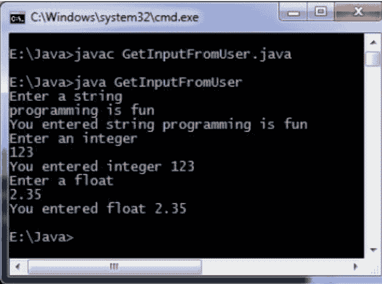

# JAVA：快速掌握 Java 编程的最佳指南

我认为新书可能对你感兴趣：

亚马逊 Echo

# 引言 – 设置你的环境

## 本地环境搭建

你需要为 Java 编程语言设置一个环境。本指南将向你展示如何在机器上下载并设置 Java。以下是设置你的 Java 环境的方法：

可以通过此链接免费获取 Java SE：`http://www.oracle.com/technetwork/java/javase/downloads/index.jsp-138363.html`。

下载的 Java 版本将取决于你当前运行的操作系统。

按照提示完成 java 的下载，然后运行 `.exe` 文件，将弹出一个向导来协助你安装。一旦 Java 安装在计算机上，接下来你需要在环境变量中设置路径，以创建安装目录：

### 为 Windows 设置路径：

假设 Java 已安装在 `c:\Program Files\java\jdk` 目录下：

- 右键点击“我的电脑”并选择“属性”。
- 点击“高级”选项卡下的“环境变量”按钮。
- 修改 `Path` 变量，使其也包含 Java 可执行文件的路径。例如，如果路径为 `C:\WINDOWS\SYSTEM32`，则将路径更改为 `C:\WINDOWS\SYSTEM32;c:\Program Files\java\jdk\bin`。

### 流行的 Java 编辑器：

文本编辑器对于编写 Java 代码至关重要。以下是最简单且最常用的：

- 记事本：在 Windows 机器上或 TextPad。
- Netbeans：开源免费的 Java IDE
- Eclipse：Eclipse 社区版 Java IDE

# 第 1 章 – 环境、语法、第一个程序

## 什么是 Java？

Sun Microsystems 采用了 James Gosling 的 Java 程序，并将其开发为一个多维度平台，通过无数网页浏览器增强了用户体验。它于 1995 年作为 Java 1.0 向公众发布。Java 的一些独特特征是：

- 动态性
- 健壮
- 架构中立
- 高性能
- 安全
- 平台无关
- 多线程
- 可移植
- 面向对象

设置 Java 环境

JavaSE 可以在此处免费获取：`http://www.oracle.com/technetwork/java/javase/downloads/index.jsp-138363.html`。了解你运行的是什么版本的操作系统是必要的。

## Java 基础语法：

- **对象 (Object)** – 对象是类中的实例。对象由状态和行为组成。例如，马有品种、颜色和名称等状态。
- **类 (Class)** – 一种允许将对象分类为少数或许多类型的机制。
- **方法 (Method)** – 简单来说，这可以解释为一种行为。动作由方法中包含的数据执行。
- **实例变量 (Instant Variables)** – 如上例所示，每个对象都有自己独立的变量。对象的状态通过分配给每个变量的唯一值来体现。

### 开始 Java 编程：

让我们来看一段简单的代码，它将打印“Hello World!”。要保存文件，请编译并运行程序。按照以下步骤操作：

- 打开记事本并添加下面的代码。
- 将文件保存为：`MyFirstProgram.java`。
- 打开命令提示符并进入保存该类的目录。
- 输入 `javac MyFirstProgram.java` 并回车编译代码。如果代码没有错误，命令提示符将跳到下一行。
- 输入 `java MyFirstProgram` 运行你的程序。你将看到打印出的“Hello World!”。

```java
public class MyFirstProgram {
/* 这是我的第一个程序 */
    public static void main(String args){
    System.out.println("Hello World!");
}
```

尽管 Java 看起来是一种复杂的语言，但在开发项目时务必记住以下几点：

- **文件名 (Program File Name)** – 程序文件名和类名必须相同。保存文件时注意（Java 是大小写敏感的）后缀 `.java`。文件名和类名不匹配会导致程序无法编译。例如：如果类名为 `MyFirstProgram`，则文件应保存为 `MyFirstProgram.java`。
- **方法名 (Method Names)** – 方法名应以小写字母开头。方法中使用多个单词时，每个内部单词的首字母应大写。例如：`public void myMethod()`
- **大小写敏感 (Case Sensitivity)** - Java 是大小写敏感的。这意味着标识符 `Happy` 和 `happy` 在 Java 中含义不同。
- **public static void main(String args[])** - Java 程序必须包含 `main()` 方法。
- **类名 (Class Names)** – 所有类的首字母应大写。类名中使用多个单词时，每个内部单词的首字母应大写。例如 `class MyFirstProgram`

上一页编写的简单程序包含了所有属性，因此是 Java 可以编译和执行的：

```java
public class CreateObject {
    public static void main(String[] args) {
        // 创建点对象和两个矩形对象
        Point origin_one = new Point(23, 94);
        Rectangle rect_one = new Rectangle(origin_one, 100, 200);
        Rectangle rect_two = new Rectangle(90, 169);

        // 显示 rect_one 的宽度、高度和面积
        System.out.println("Width of rect_one: " + rect_one.width());
        System.out.println("Height of rect_one: " + rect_one.height());
        System.out.println("Area of rect_one: " + rect_one.area());

        // 设置 rect_two 的位置
        rect_two.origin = origin_one;

        // 显示 rect_two 的位置
        System.out.println("X Position of rect_two: " + rect_two.origin.x);
        System.out.println("Y Position of rect_two: " + rect_two.origin.y);

        // 移动 rect_two 并显示其新位置
        rect_two.move(40, 73);
    }
}
```

# 第 2 章 – 标识符、修饰符与变量

Java 标识符：

命名组件是 Java 公式的组成部分。标识符是用于我们之前接触过的项目、方法、类和变量名称。

关于标识符，有几个应该始终记住的关键点：

- 首先始终：标识符是区分大小写的
- 标识符始终以字母（A 到 Z 或 a 到 z）、下划线 (`_`) 或货币符号 (`$`) 开头
- 合法的标识符可以是：`age`, `$salary`, `_value`, `__6_value`
- 不能使用关键字作为标识符
- 非法标识符将完全相同或类似于：`987zyx`, `-salary`
- 在第一个字符之后，标识符可以包含任何字符的组合

Java 修饰符：

```
C:\WINDOWS\system32\cmd.exe
D:\javrogram\example>java ThisDeno.java
D:\javrogram\example>java ThisDeno.java
Employee Details:
Employee Name: Biring Raka
Employee's Address: South Africa
Employee's salary: 26389
Modified Employee Details:
Employee Name: Biring Raka
Employee's Address: South Africa
Employee's salary: 34705
D:\javrogram\example\>
```

在 Java 方法中、类和其他属性可以通过利用修饰符更改或增强。Java 中使用的修饰符分为两类：

- 非访问修饰符：`final`, `strictfp`
- 访问修饰符：`protected`, `public`, `private`, `default`

随着对 Java 语言学习的深入，修饰符将变得更有意义。

## Java 变量：

这些变量类型在 Java 中经常会被看到：

- 类变量（静态变量）
- 实例变量（非静态变量）
- 局部变量

## Java 数组：

任何存储多个相同类型变量的对象都被称为数组。数组是一个对象。同样，随着我们深入研究 Java 语言，实际应用中对数组对象的需求将运之。

## Java 枚举 (Enums)：

这是 Java 5.0 引入的用于识别预定义值列表的简写。枚举将变量的值限制在预定义的列表中。

枚举使得减少代码中出现的错误变得可能。

通过限制可能的选择数量，结果的数量也得到了设计上的限制。在预定义的范围内是不可能做出选择的。

如果我们限制果汁订单仅为小（Small）、中（Medium）、大（Large）作为点果汁的唯一可能选项，代码将看起来像这样：

```java
class FreshJuice{
    enum FreshJuice{ SMALL, MEDIUM, LARGE }
    FreshJuice size;
}
public class FreshJuiceTest{
    public static void main(String args[]){
        FreshJuice juice = new FreshJuice();
        juice.size = FreshJuice.FreshJuiceSize.MEDIUM ;
        System.out.println("Size: " + juice.size);
    }
}
```

**注意：** 枚举可以单独声明也可以在类内部声明。变量、构造函数和方法也可以定义在枚举内部。

## Java 关键字：

下面是 Java 保留字列表。表中的单词不能用作变量、常量或替代标识符名。

| abstract | assert | boolean | break |
| byte | case | catch | char |
| class | const | continue | default |
| do | double | else | enum |
| extends | final | finally | float |
| for | goto | | implements |
| import | instanceof | int | interface |
| long | native | new | package |
| private | protected | public | return |
| short | static | strictfp | super |
| switch | synchronized | this | throw |
| throws | transient | try | void |
| volatile | while | | |

Java 中的注释：

Java 语言支持单行和多行注释，就像 C++ 和 C 一样。Java 编译器将忽略任何类型注释内部的所有字符。

```java
public class MyFirstProgram(
    /* 这是我的第一个 java  程序。
     * 这将打印 'Happy Friday Everyone' 作为输出
     * 这是一个多行注释的示例。
     */

    public static void main(String[] args){
        // 这是一个单行注释的示例
        /* 这也是一个单行注释的示例。 */
        System.out.println("Hello World");
    }
}
```

## Java 中的数据类型：

Java 中有两种不同的数据类型：

- 引用/对象数据类型
- 基本数据类型

### 基本数据类型：

Java 支持八种基本数据类型。这些类型始终由关键字命名并由语言预定义。类型详细所示：

- `float`
- `int`
- `boolean`
- `double`
- `byte`
- `long`
- `char`
- `short`

### 引用数据类型：

- `Null` 是任何引用变量的默认值。
- 引用变量可以用于指向任何特定类型的对象，或任何其他兼容类型。
- 许多类型的数组变量和类对象都归属于引用数据类型。
- 引用变量使用定义的构造类创建。它们被声明为特定的不可变类型。例如，`Daughter`、`Car` 等。
- 示例：`Car car = new car("Ferrari");`

## Java 字面量：

Java 字面量是程序中表示的固定值。字面量有几种：

- 整数字面量：`10`, `200`
- 浮点字面量：`10.5`
- 字符串字面量：`"Happy Friday Everyone"`
- 布尔字面量：`true`, `false`
- 字符字面量：`'a'`
- 转义序列：`\n`, `\r`, `\f`, `\b`, `\t`, `\'`, `\\`
- 十进制字面量：`0x1`

# 第 3 章 – Java 基础运算符

Java 基础运算符：

Java 拥有一套丰富的运算符集来操作变量。这些运算符可以分为以下几组：

## 算术运算符：

| 运算符 | 说明 | 示例 |
| --- | --- | --- |
| `+` | 加法 - 加两边的值 | `A + B` 将得到 30 |
| `-` | 减法 - 从左侧减去右操作数 | `A - B` 将得到 -10 |
| `*` | 乘法 - 乘以两边的值 | `A * B` 将得到 200 |
| `/` | 除法 - 左操作数除以右操作数 | `B / A` 将得到 2 |
| `%` | 取模 - 左操作数除以右操作数并返回余数 | `B % A` 将得到 0 |
| `++` | 自增 - 操作数的值加 1 | `B++` 得到 21 |
| `--` | 自减 - 操作数的值减 1 | `B--` 得到 19 |

## 关系运算符：

| 运算符 | 说明 | 示例 |
|---|---|---|
| `==` | 检查两个操作数的值是否相等，如果是，则条件为真 | `(A == B)` 不为真 |
| `!=` | 检查两个操作数的值是否相等，如果值不等，则条件为真 | `(A != B)` 为真 |
| `>` | 检查左操作数的值是否大于右操作数，如果是，则条件为真 | `(A > B)` 不为真 |
| `<` | 检查左操作数的值是否小于右操作数，如果是，则条件为真 | `(A < B)` 为真 |
| `>=` | 检查左操作数的值是否大于等于右操作数，如果是，则条件为真 | `(A >= B)` 不为真 |
| `<=` | 检查左操作数的值是否小于或等于右操作数，如果是，则条件为真 | `(A <= B)` 为真 |

## 位运算符：

| 运算符 | 描述 | 示例 |
| --- | :--- | :--- |
| `&` | 二进制与运算符：如果位在两个操作数中都存在，则将其复制到结果中。 | `(A & B)` 结果为 12，即 `0000 1100` |
| `\|` | 二进制或运算符：如果位在任一操作数中存在，则将其复制到结果中。 | `(A \| B)` 结果为 61，即 `0011 1101` |
| `^` | 二进制异或运算符：如果位在其中一个操作数中设置而非两个，则复制该位。 | `(A ^ B)` 结果为 49，即 `0011 0001` |
| `~` | 二进制取反运算符：一元运算符，作用是“翻转”位。 | `(~ A )` 结果为 -61，由于符号二进制数，在补码中为 `1100 0011`。 |
| `<<` | 二进制左移运算符。左操作数的值根据右操作数指定的位数向左移动。 | `A << 2` 结果为 240，即 `1111 0000` |
| `>>` | 二进制右移运算符。左操作数的值根据右操作数指定的位数向右移动。 | `A >> 2` 结果为 15，即 `1111` |
| `>>>` | 右移零填充运算符。左操作数的值根据右操作数指定的位数向右移动，且移出的位用零填充。 | `A >>> 2` 结果为 15，即 `0000 1111` |

## 逻辑运算符：

| 运算符 | 描述 | 示例 |
| --- | :--- | :--- |
| `&&` | 称为逻辑与运算符。如果两个操作数都为非零，则条件为真。 | `(A && B)` 为假。 |
| `\|\|` | 称为逻辑或运算符。如果两个操作数中任一个为非零，则条件为真。 | `(A \|\| B)` 为真。 |
| `!` | 称为逻辑非运算符。用于反转其操作数的逻辑状态。如果条件为真，逻辑非运算符将使其变为假。 | `!(A && B)` 为真。 |

## 赋值运算符：

| 运算符 | 描述 | 示例 |
| --- | :--- | :--- |
| `=` | 简单赋值运算符，将右侧操作数的值赋值给左侧操作数 | `C = A + B` 将 `A + B` 的值赋值给 `C` |
| `+=` | 加法赋值运算符，将右操作数加到左操作数上并将结果赋值给左操作数 | `C += A` 等同于 `C = C + A` |
| `-=` | 减法赋值运算符，从左操作数中减去右操作数并将结果赋值给左操作数 | `C -= A` 等同于 `C = C - A` |
| `*=` | 乘法赋值运算符，将右操作数与左操作数相乘并将结果赋值给左操作数 | `C *= A` 等同于 `C = C * A` |


## 位运算符

| 运算符 | 描述 | 示例 |
| --- | :--- | :--- |
| `&` | 二进制与运算符：如果位在两个操作数中都存在，则将其复制到结果中。 | `(A & B)` 结果为 12，即 `0000 1100` |
| `\|` | 二进制或运算符：如果位在任一操作数中存在，则将其复制到结果中。 | `(A \| B)` 结果为 61，即 `0011 1101` |
| `^` | 二进制异或运算符：如果位在其中一个操作数中设置而非两个，则复制该位。 | `(A ^ B)` 结果为 49，即 `0011 0001` |
| `~` | 二进制取反运算符：一元运算符，作用是“翻转”位。 | `(~ A )` 结果为 -61，由于符号二进制数，在补码中为 `1100 0011`。 |
| `<<` | 二进制左移运算符。左操作数的值根据右操作数指定的位数向左移动。 | `A << 2` 结果为 240，即 `1111 0000` |
| `>>` | 二进制右移运算符。左操作数的值根据右操作数指定的位数向右移动。 | `A >> 2` 结果为 15，即 `1111` |
| `>>>` | 右移零填充运算符。左操作数的值根据右操作数指定的位数向右移动，且移出的位用零填充。 | `A >>> 2` 结果为 15，即 `0000 1111` |

## 逻辑运算符

| 运算符 | 描述 | 示例 |
| --- | :--- | :--- |
| `&&` | 称为逻辑与运算符。如果两个操作数都为非零，则条件为真。 | `(A && B)` 为假。 |
| `\|\|` | 称为逻辑或运算符。如果两个操作数中任一个为非零，则条件为真。 | `(A \|\| B)` 为真。 |
| `!` | 称为逻辑非运算符。用于反转其操作数的逻辑状态。如果条件为真，逻辑非运算符将使其变为假。 | `!(A && B)` 为真。 |

## 赋值运算符

| 运算符 | 描述 | 示例 |
| --- | :--- | :--- |
| `=` | 简单赋值运算符，将右侧操作数的值赋值给左侧操作数 | `C = A + B` 将 `A + B` 的值赋值给 `C` |
| `+=` | 加法赋值运算符，将右操作数加到左操作数上并将结果赋值给左操作数 | `C += A` 等同于 `C = C + A` |
| `-=` | 减法赋值运算符，从左操作数中减去右操作数并将结果赋值给左操作数 | `C -= A` 等同于 `C = C - A` |
| `*=` | 乘法赋值运算符，将右操作数与左操作数相乘并将结果赋值给左操作数 | `C *= A` 等同于 `C = C * A` |
| `/=` | 除法赋值运算符，将左操作数除以右操作数并将结果赋值给左操作数 | `C /= A` 等同于 `C = C / A` |
| `%=` | 取模赋值运算符，使用两个操作数取模并将结果赋值给左操作数 | `C %= A` 等同于 `C = C % A` |
| `<<=` | 左移赋值运算符 | `C <<= 2` 等同于 `C = C << 2` |
| `>>=` | 右移赋值运算符 | `C >>= 2` 等同于 `C = C >> 2` |
| `&=` | 位与赋值运算符 | `C &= 2` 等同于 `C = C & 2` |
| `^=` | 位异或赋值运算符 | `C ^= 2` 等同于 `C = C ^ 2` |
| `\|=` | 位或赋值运算符 | `C \|= 2` 等同于 `C = C \| 2` |

这封对 Java 基础运算符的快速概述将提高该语言的功能性和执行力。当你开始编写简单的 Java 程序时，请测试不同的运算符，并观察它们在实际应用和演示中的工作原理。在完成第一个编程项目期间，请参考此快速指南，以确保应用所有正确的规则和顺序。

# 第 4 章 – 其他运算符和循环

## 杂项运算符

为了执行二进制、赋值、逻辑、数学或关系实例之外的命令，必须使用所有运算符。还有一些超出已涵盖范围的运算符。

```java
import java.util.Scanner;
import java.text.*;
public class kalkulatorProcedure {
    public static void hasKali(double x, double y) {
        DecimalFormat angka = new DecimalFormat("###,###.##");
        double c = x*y;
        System.out.println("Hasil: " + angka.format(x) + " * " + 
angka.format(y) + " = " + angka.format(c));
    }
    public static void hasBagi(double x, double y) {
        DecimalFormat angka = new DecimalFormat("###,###.##");
        double c = x/y;
        System.out.println("Hasil: " + angka.format(x) + " / " + 
angka.format(y) + " = " + angka.format(c));
    }
}
```

## 条件运算符（三元运算符）

该运算符由三个操作数组成，用于评估布尔表达式。该运算符通过决定将哪个可用值赋值给变量来运行。该运算符的写法为：

变量 `x = (表达式) ? 真时的值 : 假时的值`

## instanceof 运算符

只有对象引用变量使用此运算符。此运算符检查对象关联的特定类型（类或接口类型）。该运算符的写法为：

`(对象引用变量) instanceof (类/接口类型)`

## Java 运算符优先级

| 类别 | 运算符 | 结合性 |
| --- | :--- | --- |
| 后置 | `()` `[]` `.` (点运算符) | 从左到右 |
| 一元 | `++` `-` `!` `~` | 从右到左 |
| 乘除 | `*` `/` `%` | 从左到右 |
| 加减法 | `+` `-` | 从左到右 |
| 移位 | `>>>` `<<` | 从左到右 |
| 关系 | `>` `>=` `<=` | 从左到右 |
| 等于 | `==` `!=` | |
| 位与 | `&` | |
| 位异或 | `^` | |
| 位或 | `\|` | |
| 逻辑与 | `&&` | |
| 逻辑或 | `\|\|` | |
| 条件 | `?:` | |
| 赋值 | `=` | |
| 逗号 | `,` | |

## while 循环

该循环允许在布尔表达式为真时执行任务。

while 循环的写法如下：

```
while(布尔表达式)
{
    语句
}
```

## do...while 循环

`do...while` 和 `while` 循环相似，但 `do...while` 循环至少执行一次。

do...while 循环的写法如下：

```java
do
{
  语句
}while(布尔表达式);
```

## for 循环

这种循环是一种重复结构，当你知道任务需要重复的特定次数时它非常有用。

for 循环的写法如下：

```java
for(初始化; 布尔表达式; 更新)
{
  语句
}
```

## 增强型循环

这种循环的编码和执行力是在 Java 5 中引入的。增强型循环主要用于数组。

增强循环的写法如下：

```java
for(声明 : 表达式)
{
  语句
}
```

## break 关键字

此关键字必须在任何 `switch` 语句或循环中使用。`break` 关键字会停止整个循环。

## continue 关键字

此关键字可以用于任何循环控制结构。它的使用使循环立即跳转到下一次迭代。

- 在 `for` 循环中使用 `continue` 关键字时，控制将跳转到更新语句。
- 在 `while` 循环中使用 `continue` 关键字时，控制将跳转到布尔表达式。

这些额外的运算符和循环将为你的 Java 程序增加精炼和动态执行。

# 第 5 章 – if 和 switch 语句

## if 语句

布尔表达式后一个或多个语句称为 if 语句。

if 语句的写法如下：

```java
if(布尔表达式)
{
// 如果布尔表达式为真，则执行语句
}
```

## if...else 语句

此语句通常跟随任意数量的可选 else 语句，这些语句在布尔表达式为假时执行。

if...else 语句的写法如下：

```java
if(布尔表达式){
    // 当布尔表达式为真时执行
}else{
    // 当布尔表达式为假时执行
}
```

## if...else if...else 语句

可选的 if...else 语句通常位于 if 语句之后。else if...else 在测试使用单个 if...else if 语句的条件时非常有益。

if...else 语句的写法如下：

```java
if(布尔表达式 1){
    // 当布尔表达式 1 为真时执行
}else if(布尔表达式 2){
    // 当布尔表达式 2 为真时执行
}else if(布尔表达式 3){
    // 当布尔表达式 3 为真时执行
}else {
    // 当上述条件之一为真时执行。
}
```



## 嵌套 if...else 语句

在任何情况下，嵌套 if-else 语句都是合法的。然而，有些点需要注意：

- `if` 内部可以包含零或一个 `else`，但它必须跟在任何 `else if` 之后。
- 可以使用零个到多个 `else if`，但它们必须在 `else` 之前。
- 如果一个 `else` 执行成功，则其他其他的 `else` 将不会再进行测试或运行。

嵌套 if...else 的语法如下所示：


```java
if (Boolean_expression 1) {
  // 当布尔表达式 1 为真时执行
  if (Boolean_expression 2) {
    // 当布尔表达式 2 为真时执行
  }
}
```

## Switch 语句

这允许将任何变量的等值与一组已知值进行比较。单个值被称为 case（分支），被切换的变量会针对每个存在的 case 进行检查。

带有 Switch 语句的增强循环语法如下所示：

```java
switch (expression) {
    case value:
        // 语句
        break; // 可选
    case value:
        // 语句
        break; // 可选
    // 你可以有任意数量的 case 语句。
    default: // 可选
        // 语句
}
```

If 和 Switch 语句为 Java 程序增加了一层定义。通过对包含许多或少量这些语句的程序进行测试，可以更好地观察到它们在 Java 程序中是如何运行的。

# 第 6 章 – 方法、类、对象与 Finally

## Java 方法、类和对象

一组执行操作的语句集合，因为它们被组合在一起，所以我们称之为 Java 方法（Java Method）。例如，调用 `System.out.println()` 会执行许多有序的语句将内容显示在屏幕上。

通常，方法的语法如下所示：

```java
modifier returnTypeValue methodName(list of parameters) {
    // 方法体；
}
```

方法体和方法头构成了方法定义。以下所有项都是方法的一部分：

- **修饰符（Modifiers）**：可选的修饰符指示编译器如何调用方法。方法的访问类型通过这种方式定义。
- **返回值（Return Type）**：某些方法会返回结果。`returnTypeValue` 定义为方法返回的数据类型。某些操作可以在不返回值的情况下执行。在这种情况下，`returnTypeValue` 是关键字 `void`。
- **方法名（Method Name）**：方法的实际名称。方法名和参数列表作为两项构成了方法签名（signature）。

## Java 类和对象

- **对象（Object）**：对象是具有状态和行为的组件。例如：马有状态——品种、颜色、名字以及行为——奔跑、跳跃、觅食。对象是类的实例。
- **类（Class）**：类是模板或计划，描述了该类型对象所支持的行为和/或状态。

类的语法在示例所示：

```java
public class Horse {
    String color;
    int age;
    String breed;

    void lame() {
    }

    void happy() {
    }

    void lazy() {
    }
}
```

类可以具有以下任何变量类型：

- **局部变量（Local variables）**：定义在方法、块或构造函数内部的变量被称为局部变量。变量在方法内部进行初始化和声明。当引用的方法完成后，该变量将被销毁。
- **实例变量（Instance variables）**：这些是类内部、任何方法之外的变量。这些实例变量在类加载时实例化。实例变量可以在定义类的任何方法、块或构造函数中访问。
- **类变量（Class variables）**：类变量声明在类内部、任何方法之外，并带有 `static` 关键字。

## 异常处理（Exceptions Handling）

捕获异常的方法使用了 `try` 和 `catch` 关键字组合。try/catch 块安排在可能产生异常的代码周围。保护代码位于 try/catch 块内部。

执行 try/catch 的语法如下所示：

```java
try {
    // 受保护代码
} catch (ExceptionName e1) {
    // catch 块
}
```

### 多 catch 块（Multiple Catch blocks）

Try 块后面可以跟随许多 catch 块。

多个 catch 块的语法如下所示：

```java
try {
    // 受保护代码
} catch (ExceptionName e1) {
    // catch 块
} catch (ExceptionName e2) {
    // catch 块
} catch (ExceptionName e3) {
    // catch 块
}
```

### throws/throw 关键字

被检查的异常必须使用 `throws` 关键字声明。它出现在方法签名的末尾。

通过 `throw` 关键字可以抛出新实例化的异常，这可以增强对异常的理解。

### finally 关键字

跟在 `try` 块后面的代码使用 `finally` 关键字。即使没有发生异常，`finally` 块也会执行。

`finally` 块的执行如下所示：

```java
try {
    // 受保护代码
} catch (ExceptionName e1) {
    // catch 块
} finally {
    // finally 块始终执行。
}
```

感谢阅读。希望你喜欢。请留下你诚恳的反馈。
