# Java 零学者入门指南


https://archive.org/details/isbn_9781733068208


书籍及封面设计：Angela W.T.

> 如果 Java 有真正的垃圾回收机制，大多数程序在执行时就会删除自己。
>
> – Robert Sewell

# 引言

Java 是一门优秀的编程语言，可用于开发独立应用程序，也可用于分布式应用程序。Java 这种类型的应用程序目前在小型和大型企业中都有巨大的需求。Java 提供了一种名为 Applet 的功能，即可以嵌入网页的程序。这意味着 Java 可以帮助你为应用程序添加功能。Java 是一门范围内广受欢迎的编程语言，它拥有许多可以在开发应用程序时利用的特性。例如，Java 是一门面向对象的编程语言。如果你熟悉其他的面向对象语言，学习 Java 将非常容易。Java 的语法简单，即使是初学者也能理解。编写和运行 Java 程序非常容易。你只需要在计算机上安装 Java 编译器和一个文本编辑器。有了这些，你就可以编写 Java 程序并获得即时结果。

# 1-Java 入门

## 什么是 Java？

Java 既是一个平台也是一门编程语言。作为一个平台，我们拥有 Java 运行环境（JRE），它是程序运行在其上的软件环境。作为一种语言，Java 是一门高级、健壮且面向对象的编程语言。该语言是由 Sun Micros 公司于 1995 年开发的。

由于 Java 是一种面向对象的编程语言，它将一切视为对象。该语言的对象模型特性也使其易于扩展。Java 程序通过两个步骤生成结果：第一步是编译，之后生成字节码。Java 字节码是跨平台的，这意味着它可以在任何机器上运行。编译后，字节码将通过执行步骤生成结果。

Java 以易于上手著称。如果你熟悉面向对象编程的概念，那么编写和运行 Java 程序对你来说将很容易。你只需要在计算机上安装 Java 编译器和一个文本编辑器（如 Windows 中的记事本）。

通常情况下，JDK 的安装位于 `c:\Program Files\java\jdk` 目录。在 Windows 上，你可以通过右键点击“我的电脑”然后选择“属性”来设置环境变量。接下来，打开“高级”选项卡并选择“环境变量”。添加 `c:\Program Files\java\jdk\bin` 路径。建议 Linux 用户阅读其 shell 的文档。

### 第一个 Java 程序

我们需要创建一个 Hello World Java 示例。为了这一点，请打开如记事本之类的文本编辑器并创建一个新文件。将此文件命名为 `Hello.java`。记住你保存该文件的目录。将以下 Java 代码添加到该文件中并保存：

```java
public class Hello {
  /* my first java program
  * the code will print 'Hello World'
  */
  public static void main(String[] args) {
    System.out.println("Hello World"); // to print
    Hello World
  }
}
```

一旦你保存了上述代码，打开你操作系统的终端，并导航到保存该文件的目录。

在终端上运行以下命令：

```bash
javac Hello.java
```

上述命令应该生成 `Hello.class` 文件。这是一个包含 Java 字节码的文件，它是平台无关的。你可以检查相同目录下是否存在该文件来确认。我们所做的是对文件调用了 Java 编译器 (`javac`) 以编译文件中包含的 Java 代码。

现在代码已经编译且没有错误，我们可以执行它。只需在同一个终端上运行以下命令：

```bash
java Hello
```

上述命令应该在终端上返回如下所示的结果：

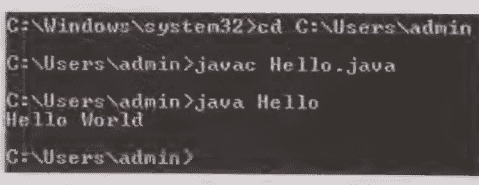

上述输出显示代码返回了 Hello World 作为输出。

考虑我从代码中提取的这一行：

```java
public class Hello {
```

我们在上述行中所做的是创建一个名为 `Hello` 的类。类名中的 H 是大写的；因此，当我们引用该类时，必须这样写。Java 是一种区分大小写的语言。`public` 是一个访问修饰符，将类声明为公共，这意味着它可以从同一包内包含的其他类进行访问。左大括号 `{` 标记类主体的开始，要关闭它，我们必须使用右大括号 `}`。

考虑从代码中提取的以下部分：

```java
/* my first java program
 * the code will print 'Hello World'
 */
```

上述是一个注释。注意，我们将它们封装在 `/*` 和 `*/` 之间。这是我们在 Java 中表示块注释的方式。注释也可以是单行的，这种注释使用两个正斜杠 `//` 来表示。这里有一个例子：

```java
// my first java program
```

Java 编译器对注释不做任何操作，但它会跳过它们。注释提高了代码的可读性。它们被用于解释不同行代码的作用。

请注意，文件被命名为 `Hello.java`，而类被命名为 `Hello`。如果这两个不以这种方式匹配，将生成错误。当你想要从操作系统的终端运行 Java 代码时，这种情况应该始终保持一致。

这是从代码中提取的另一行代码：

```java
public static void main(String args[]) {
```

上述指的是 `main` 方法。没有 `main` 方法，任何 Java 程序都无法运行或执行。这是从代码中提取的另一行代码：

```java
System.out.println("Hello World");
```

我们调用了一个名为 `println` 的方法，帮助我们将传递给它的文本打印在显示器上。你还注意到我们使用了两个右大括号 `}}`。第一个关闭 `main` 方法，而第二个关闭类。

## 2-Java 类和对象

正如我们所说的，Java 是一种面向对象的编程语言。这意味着它支持面向对象编程范式的各种概念。

在 Java 中，对象以状态和行为为特征。对象的一个例子是狗。描述它的特征的一些状态包括名字、颜色和品种。描述它的特征的一些行为包括进食、吠叫和摇尾巴。对象是类的实例。

类是一个模板或蓝图，描述了该类型的任何对象应该支持的状态和行为。这里有一个类的例子：

```java
public class Dog {
    String name;
    int breed;
    String color;

    void eating() {
    }
    void barking() {
    }
    void sleeping() {
    }
}
```

### 构造函数

构造函数是类的重要部分。每个类都有一个构造函数。如果你不显式创建类构造函数，Java 编译器将自动为类初始化一个默认构造函数。

每当你创建一个新对象，至少会调用一个构造函数。注意有一个规则约束此。

```java
public class Dog {
    Dog() {
    }
}
```

这是一个带有参数的构造函数的示例：

```java
public class Dog {
    String name;
    Dog(String name) {
        name = name;
    }
}
```

### 创建对象

类的目的是提供一个模板，我们从中创建对象。在 Java 中，对象是通过以下步骤创建的：

1. 声明 - 这涉及声明变量。
2. 实例化 - `new` 关键字。
3. 初始化 - 调用构造函数。

下面的示例显示了如何创建对象：

```java
public class Dog {
    public Dog(String breed) {
        System.out.println("You passed the breed :" + breed);
    }

    public static void main(String[] args) {
        /* 对象创建 */
        Dog puppy = new Dog("poodle");
    }
}
```

执行后，代码将返回：

```text
You passed the breed :poodle
```

## 访问变量和方法

在类中，我们访问实例变量的方法的方法之一是通过创建对象。实例变量可以通过遵循下面的步骤进行访问：

```java
/* 开始创建一个对象 */
DogReference = new Dog();

/* 接下来调用变量 */
ObjectReference.variableName;

/* 调用类方法 */
ObjectReference.MethodName();
```

这里有一个显示此点的示例：

```java
public class Dog {
    String name;
    public Dog(String breed) {
        System.out.println("You passed the breed :" + breed);
    }

    public void setName(String puppyName) {
        name = puppyName;
    }

    public String getName() {
        System.out.println("Puppy's name is :" + name);
        return name;
    }

    public static void main(String[] args) {
        /* 对象创建 */
        Dog puppy = new Dog("poodle");

        /* 调用类方法并设置狗的名字 */
        puppy.setName("Tommy");

        /* 调用另一个类方法并获取狗的名字 */
        puppy.getName();

        /* 实例变量也可以按如下方式被访问 */
        System.out.println("Variable Value :" + puppy.name);
    }
}
```

## Java 中的变量

变量可以被看作是一个在程序运行期间存储值的容器。每个变量都具有特定的数据类型，该类型指定了它可以存储的值。使用 Java 变量有两个步骤：变量声明和变量初始化。

### 变量声明

变量声明涉及为变量命名名称并指定其数据类型。以下是有效的变量声明示例：

```java
int a, x, p;
float pi;
double p;
char c;
```

`int`、`float`、`double` 和 `char` 是数据类型，指定了每个变量可以或应该存储的值。要在一行中声明多个变量，可以使用第一个示例所示的逗号（`,`）将它们分隔。变量声明应以分号（`;`）结束。

### 变量初始化

变量初始化涉及为变量赋一个有效值。赋给变量的值取决于变量的数据类型。以下是有效的变量初始化示例。

```java
pi = 1;
a = 10.5;
c = 's';
```

变量的声明和初始化可以同时完成，如下所示：

```java
int a=1, x=4, p=5;
float pi=3.14f;
double p=15.23d;
char c='s';
```

### 变量类型

Java 支持三种变量类型：

1. 局部变量
2. 静态变量
3. 实例变量

| 类型 | 说明 |
| :--- | :--- |
| **局部变量** | 这些是在方法体内部声明的变量。它们只能在该方法内部访问。 |
| **实例变量** | 这些是在没有使用 `static` 关键字的情况下定义的变量。这些变量特定于某个对象。 |
| **静态变量** | 这些是在程序执行开始时初始化一次的变量。你应该在实例化变量之前初始化它们。 |

以下示例展示了不同的 Java 变量：

```java
class VariablesExample {
    int p = 1; // 实例变量
    static int q = 5; // 一个静态变量

    void methodName() {
        int r = 10; // 一个局部变量
    }
}
```

变量 `int q` 是一个静态变量，因为它使用了 `static` 关键字定义。变量 `int r` 在 `methodName` 方法内部声明，使其成为一个局部变量。它只能在该方法内部被访问。

## 4 - Java 数据类型

在 Java 中，数据类型可以是基本类型或非基本类型。

### 基本数据类型

这些是 Java 提供的预定义数据类型。共有 8 种，包括 `byte`、`short`、`long`、`char`、`int`、`float`、`boolean` 和 `double` 数据类型。

现在让我们讨论 Java 中的各种基本数据类型：

*   **boolean**：这种数据类型只存储两个值，真和假。它用于仅跟踪真/假条件的简单语句。但我们无法精确定义它的大小。
*   **byte**：它具有默认值 0，最小值为 -128 (-2^7)。它有助于在大型数组中节省空间，因为它比 `int` 小 4 倍。
*   **short**：它的默认值为 0，取值范围在 -32,768 到 32,767 之间。它也可以像 `byte` 数据类型一样用于节省空间。
*   **int**：这种数据类型也有默认值 0，值范围在 -2,147,483,648 到 2,147,483,647 之间。它的最小值为 -2,147,483,648，最大值为 2,147,483,647。
*   **long**：这种数据类型也有默认值 0，取值范围在 -9,223,372,036,854,775,808 到 9,223,372,036,854,775,807 之间。它的最小值为 -9,223,372,036,854,775,808，最大值为 9,223,372,036,854,775,807。当你想要获得比 `int` 类型提供的更广泛的值范围时，这是最佳数据类型。
*   **float**：这种数据类型具有无限范围的值。与使用 `double` 相比，它可以帮助你节省空间。它的默认值为 0.0。
*   **double**：这种数据类型默认值为 0.0，并且具有无限范围的值。它用于像 `float` 类型一样表示带有小数部分的值。

### 非基本数据类型

这些通过使用构造函数定义。它们帮助程序员访问对象。它们包括 `String` 和数组。下面的示例展示了变量的使用：

```java
public class AddVariables{
    public static void main(String[] args) {
        int p=10;
        int q=22;
        int r=p+q;
        System.out.println(r);
    }
}
```

我们定义了三个变量 `p`、`q` 和 `r`。`p` 和 `q` 的值已经初始化，而 `r` 的值是两者的和。然后我们调用了 `println` 函数来打印 `r` 的值。

### 类型转换和类型转换

特定类型的变量可以获取其他类型的值。类型转换是将较大容量的变量赋值较小容量的变量。

示例：

```java
double p;
int q;
```

`(int)` 被称为类型转换运算符。如果一个变量被赋值为另一个类型的值，就会发生类型转换。

```java
double p;
int q;
```

## 5 - 数组

数组是存储相同类型元素的结构。Java 中的数组大小是固定的，定义后无法增加。

### 单维数组

这些是线性存储元素的数组。数组的声明语法如下：

```java
<数据类型>[]
```

另一种语法：

```java
<数据类型> []
```

示例：

```java
int arrayExample[];
```

数组可以如下方式初始化：

```java
arrayExample[0]=10;
```

该行表示 10 存储在索引 0 处。数组也可以同时声明并初始化：

```java
int arrayExample[] = {10,21,22};
```

示例：

```java
public class JavaArrayExample{
    public static void main(String args[]){
        int myarr[] = new int[15];
        for (int p=0 ;p<15;p++){
            myarr[p]=p+1;
        }
        for (int p=0;p<15;p++){
            System.out.println("myarr["+p+"]="+myarr[p]);
        }
        System.out.println("Array Length: "+myarr.length);
    }
}
```

数组将显示位于不同索引的元素：

```text
myarr[0] = 1
myarr[1] = 2
myarr[2] = 3
myarr[3] = 4
myarr[4] = 5
myarr[5] = 6
myarr[6] = 7
myarr[7] = 8
myarr[8] = 9
myarr[9] = 10
myarr[10] = 11
myarr[11] = 12
myarr[12] = 13
myarr[13] = 14
myarr[14] = 15
```


# Java：初学者入门教程

## 数组

Array Length = 15

我们也得到了数组的长度，为 15。

### 多维数组

这些可以被视为数组的数组。在多维数组中，你只需要添加另一个方括号来定义另一个索引。

示例：

```java
int arr2[][] = new int[12][45];
```

你有权控制多维数组的长度。

示例：

```java
public class JavaArrayExample2 {

    public static void main(String[] args) {

        // 创建一个二维数组。
        int arr2[][] = new int[12][45];

        // 仅赋值三个元素
        arr2[0][0] = 0;
        arr2[1][1] = 12;
        arr2[3][2] = 23;

        System.out.println(arr2[0][0] + " ");
        System.out.println(arr2[1][1] + " ");

    }

}
```

程序将返回索引 `[0][0]` 和 `[1][1]` 处存储的值，如下：


## 6-Java 中的运算符 (Operators)

运算符是用于执行操作的符号。例如，`+` 符号用于算术运算。Java 支持不同的运算符：

### 一元运算符

这是接收一个操作数的运算符。它们用于增加/减少一个值。它们包括 `++`（增）和 `--`（自减）。

示例：

```java
public class JavaUnaryOperator {

    public static void main(String args[]) {

        int p = 0;

        System.out.println(p++); // 从 0 到 1
        System.out.println(++p); // 2
        System.out.println(p--); // 1
        System.out.println(--p); // 0

    }

}
```

程序执行后将打印以下内容：

```
0
2
2
0
```

`p++` 意味着在执行增之前先读取 `p` 的值；因此，我们得到的 `p` 的值为 0。如果是 `++p`，那么我们得到的 `p` 的第一个值将是 1。你可以尝试一下。

### 算术运算符

这些运算符用于执行如乘法、加法、除法、减法等数学运算。它们用作数学运算符。

示例：

```java
public class ArithmeticOperators {

    public static void main(String args[]) {

        int p = 13;
        int q = 4;

        System.out.println(p + q); // 17
        System.out.println(p - q); // 9
        System.out.println(p * q); // 52
        System.out.println(p / q); // 3
        System.out.println(p % q); // 1

    }

}
```

代码执行后返回以下结果：

```
17
9
52
3
1
```

我们有两个整数变量 `p` 和 `q`，并初始化了它们各自的值。我们得到了这些变量的加、减、乘、除。由于变量被声明为整数而不是浮点或双精度，除法忽略了小数部分。唯一看起来陌生的运算符可能是 `%`（取模运算符），它返回除法后的余数。

### 逻辑运算符

这些运算符与二值值一起使用。它们有助于在循环和条件语句中评估条件。它们包括 `||`、`&&`、`!`。假设我们有两个布尔变量 `a1` 和 `a2`，适用以下条件：

- `a1 && a2` 如果 `a1` 和 `a2` 都为 `true`，则返回 `true`，否则返回 `false`。
- `a1 || a2` 如果 `a1` 和 `a2` 都为 `false`，则返回 `false`，否则返回 `true`。
- `!a1` 返回 `a1` 的反值。

示例：

```java
public class JavaLogicalOperator {

    public static void main(String args[]) {

        boolean p = true;
        boolean q = false;

        System.out.println("p && q: " + (p && q));
        System.out.println("p || q: " + (p || q));
        System.out.println("!(p && q): " + !(p && q));

    }

}
```

程序执行后返回以下内容：

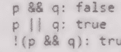

变量 `p` 的值被设置为 `true`，而变量 `q` 的值被设置为 `false`。在第一种情况下，我们使用 `&&` 运算符，因此 `true` 和 `false` 返回 `false`。在第二种情况下，我们使用 `||` 运算符，因此 `true` 或 `false` 得到 `true`。在最后的情况下，我们对 `&&` 操作的结果进行了取反。

### 比较运算符

Java 支持 6 种比较运算符：`==`、`!=`、`>`、`<`、`>=`、`<=`

- `==` 如果左右双方相等，则返回 `true`。
- `!=` 如果运算符的左右双方不等，则返回 `true`。
- `>` 如果左侧大于右侧，则返回 `true`。
- `<` 如果左侧小于右侧，则返回 `true`。
- `>=` 如果左侧大于等于右侧，则返回 `true`。
- `<=` 如果左侧小于等于右侧，则返回 `true`。

示例：

```java
public class RelationalOperator {

    public static void main(String[] args[]) {

        int p = 10;
        int q = 15;

        if (p == q)
            System.out.println("p and q are equal");
        else
            System.out.println("p and q aren't equal");

        if (p != q) {
            System.out.println("p and q aren't equal");
        } else {
            System.out.println("p and q are equal");
        }

        if (p > q) {
            System.out.println("p is greater than q");
        } else {
            System.out.println("p isn't greater than q");
        }

        if (p >= q) {
            System.out.println("p is equal or greater than q");
        } else {
            System.out.println("p is less than q");
        }

        if (p < q) {
            System.out.println("p is less than q");
        } else {
            System.out.println("p isn't less than q");
        }

        if (p <= q) {
            System.out.println("p is equal or less than q");
        } else {
            System.out.println("p is greater than q");
        }

    }

}
```

我们使用了各种比较运算符来比较变量 `p` 和 `q` 的值。

## 7-条件语句 (Decision Making)

在 Java 中，条件语句帮助我们根据操作的结果执行语句。

### if 语句

`if` 语句用于测试条件。语法：

```java
if (条件) {
    // 语句
}
```

示例：

```java
public class IfStatement {

    public static void main(String args[]) {

        int x = 10;

        if (x > 5) {
            System.out.println("x is greater than 5");
        }

    }

}
```

### else 语句

如果 `if` 条件不成立，则执行 `else`：

```java
if (条件) {
    // 语句
} else {
    // 语句
}
```

示例：

```java
public class IfElseStatement {

    public static void main(String args[]) {

        int x = 3;

        if (x > 5) {
            System.out.println("x is greater than 5");
        } else {
            System.out.println("x is not greater than 5");
        }

    }

}
```

### else if 语句

如果你有多个条件需要测试，可以使用 `else if`：

```java
if (条件1) {
    // 语句
} else if (条件2) {
    // 语句
} else {
    // 语句
}
```

示例：

```java
public class IfElseIfStatement {

    public static void main(String args[]) {

        int x = 15;

        if (x < 5) {
            System.out.println("x is less than 5");
        } else if (x < 10) {
            System.out.println("x is less than 10");
        } else {
            System.out.println("x is greater than or equal to 10");
        }

    }

}
```

示例：

```java
public class GradeExample {

    public static void main(String args[]) {

        int marks = 64;

        if (marks >= 90) {
            System.out.println("You scored A+ grade");
        } else if (marks >= 80) {
            System.out.println("You scored A grade");
        } else if (marks >= 70) {
            System.out.println("You scored B grade");
        } else if (marks >= 60) {
            System.out.println("You scored C grade");
        } else {
            System.out.println("You scored D grade");
        }

    }

}
```

该代码执行后返回以下内容：

```
You scored C grade
```

变量 `marks` 的值为 64，因此它位于 60 和 70 之间。`else if` 的条件测试结果为真，因此其体内的语句将被执行。

### 嵌套 if

`if...else` 语句可以嵌套，这意味着可以在一个 `if` 内部使用 `if`，或者在另一个 `if...else` 内部使用 `if...else`。

嵌套语法如下所示：

```java
if (boolean_expression_a) {
    // Statement(s)
    if (boolean_expression_b) {
        // Statement(s)
    }
}
```

示例：

```java
public class NestingExample {

    public static void main(String args[]) {

        int age = 12;
        int weight = 77;

        if (age >= 18) {
            if (weight > 55) {
                System.out.println("You can donate blood");
            }
        }

    }

}
```

该代码执行后打印以下结果：

```
You can donate blood.
```

如果第一个条件变为真，则将测试第二个条件。在我们的案例中情况是真的；因此 `println` 语句被执行了。如果任何条件为假，则 `println` 语句将不会执行。这意味着为了执行 `println` 语句，所有条件必须测试为真。

### switch 语句

该语句允许我们将某个变量与一组值列表进行等值测试。每个值被称为一个 `case`。

使用了以下语法：

```java
switch (an_expression) {
    case value:
        // Statement(s)
        break; // 可选
    case value:
        // Statement(s)
        break; // 可选
    default: // 可选
        // Statement(s)
}
```

`switch` 一旦遇到 `break` 语句就会结束。执行流将跳转到下一行。但请注意，并没有强制要求每个 `case` 都添加 `break`。`default` 情况可以添加到 `switch` 的末尾，如果没有任何 `case` 为真，则将运行它。

示例：

```java
public class JavaSwitchExample {

    public static void main(String args[]) {

        char your_grade = 'A';

        switch (your_grade) {
            case 'A':
                System.out.println("That is Excellent!");
                break;
            case 'B':
                System.out.println("That is Good!");
                break;
            case 'C':
                System.out.println("That is Fair!");
                break;
            case 'D':
                System.out.println("That is Poor!");
                break;
            case 'F':
                System.out.println("You Failed!");
                break;
            default:
                System.out.println("Invalid grade");
        }
        System.out.println("You scored " + your_grade);

    }

}
```

该代码返回下所示的结果：

```
That is Excellent!
You scored A
```

等级 `A` 的 `case` 测试为真，因此产生了上述输出。

最后一个 `println` 语句在所有情况下都会执行，无论等级的值如何。

## 8-Java 循环

Java 循环帮助我们重复执行某些任务。循环按顺序执行语句。首先运行第一个，然后是第二个以此类推。让我们讨论 Java 支持的各种循环类型：

### for 循环

只要条件测试为真，循环就会运行。一旦条件变为假，执行立即停止。语法：

```java
for (initialization; loop_condition; increment/decrement_part) {
    the_statement(s);
}
```

`initialization` 定义循环的初始值。`loop_condition` 指定循环运行必须始终为真的条件。`increment/decrement_part` 定义了每次迭代后初始化值增加或减少的量。

示例：

```java
public class ForLoopExample {

    public static void main(String args[]) {

        for (int p = 0; p < 10; p++) {
            System.out.println("The value " + p + " is: " + p);
        }

    }

}
```

程序返回如下输出：

```
The value 0 is: 0
The value 1 is: 1
The value 2 is: 2
The value 3 is: 3
The value 4 is: 4
The value 5 is: 5
The value 6 is: 6
The value 7 is: 7
The value 8 is: 8
The value 9 is: 9
```

输出显示循环返回变量 `p` 从 0 到 9 的值。当循环将 9 增加到 10 时，它发现违反了循环条件 `p < 10`，因此立即停止。

### while 循环

只要指定的条件为真，该循环就会执行语句。首先测试条件，如果为真，则执行循环语句。如果条件变为假，将跳转执行循环之后的语句。建议在循环中添加增/减部分，以便在条件变为假时停止循环。否则，循环可能会无限运行。

语法：

```java
while (A_boolean_expression) {
    // Statement(s)
}
```

示例：

```java
public class WhileLoopExample {

    public static void main(String args[]) {

        int i = 0;
        while (i < 5) {
            System.out.println("Value of i: " + i);
            i++;
        }

    }

}
```


# Java：初学者入门教程

## while 循环示例

```java
public class JavaWhileLoopExample {

    public static void main(String args[]) {

        int p = 5;

        while (p < 12) {

            System.out.print("The value: " + p);

            p++;

            System.out.print("\n");

        }

    }

}
```

代码打印以下结果：

```
The value of p is: 5
The value of p is: 6
The value of p is: 7
The value of p is: 8
The value of p is: 9
The value of p is: 10
The value of p is: 11
```

## do...while 循环

这与 `while` 循环密切相关。在 `while` 循环中，体可能永远不执行，但在 `do...while` 循环中，体至少执行一次。

语法：

```java
do {

  statements;

} while (condition);
```

### 示例

```java
public class JavaDoWhileLoop {

  public static void main(String args[]) {

    int p = 5;

    do {

      System.out.println("The value: " + p);

      p++;

    } while (p < 12);

  }

}
```

代码将打印 `p` 从 5 到 11 的值，与之前的循环一样。这是因为条件为真（5 小于 12）。假设我们将循环条件设置为假，例如将 `p` 的值初始化为 20，如下所示：

```java
public class JavaDoWhileLoop {

    public static void main(String args[]) {

        int p = 20;

        do {

            System.out.print("The value is: " + p);

            p++;

            System.out.print("\n");

        } while (p < 12);

    }

}
```

运行上述程序后，你将获得以下输出：

```
The value is: 20
```

这意味着 `while` 条件为假。这是因为 Java 编译器首先为 `p` 的初始值 20 运行程序。该值被打印出来。一旦移动到循环条件，它违反了条件，因此执行立即停止。

## break 和 continue 语句

有两个用于控制 Java 循环执行的语句。它们被称为 `continue` 和 `break` 语句。它们通过改变循环的正常执行方式工作。

### break 语句

该语句导致循环执行停止，控制跳转到循环之后的语句。它还会停止 `switch` 语句中的某个 `case`。

语法：

```java
your-jump-statement;
break;
```

#### 示例

```java
public class BreakStatementExample {

    public static void main(String[] args) {

        for(int p=0; p<10; p++) {

            if(p==6) {

                break;

            }

            System.out.println("The value of p is:" + p);

        }

    }

}
```

程序执行后将打印以下内容：

```
The value of p is:0
The value of p is:1
The value of p is:2
The value of p is:3
The value of p is:4
The value of p is:5
```

这是因为我们程序的以下部分：

```java
if(p==6) {

    break;

}
```

增量从 0 到 5 进行，一旦发现 `p` 的值为 6，它将立即停止，因为这违背了上述条件。对于嵌套循环的情况，可以将 `break` 添加到内层循环中，它将打破循环。会导致内层循环在满足指定条件时退出。

#### 嵌套循环示例

```java
public class BreakStatementExample2 {

    public static void main(String[] args) {

        for(int p=1; p<=5; p++) {

            for(int q=1; q<=5; q++) {

                if(p==3 && q==3) {

                    break;

                }

                System.out.println(p + "" + q);

            }

        }

    }

}
```

代码将输出以下结果：

```
1 1
1 2
1 3
1 4
1 5
2 1
2 2
2 3
2 4
2 5
3 1
3 2
4 1
4 2
4 3
4 4
4 5
5 1
5 2
5 3
5 4
5 5
```

当 Java 编译器发现 `p` 和 `q` 的值都为 3 时，它将跳过并移动下一个值。

### continue 语句

该语句跳过当前循环迭代的剩余部分，并跳转到循环的下次迭代。

语法：

```java
continue;
```

#### 示例

```java
public class ContinueStatementExample {

    public static void main(String[] args) {

        for(int p=0; p<10; p++) {

            if(p==6) {

                continue;

            }

            System.out.println("The value of p is:" + p);

        }

    }

}
```

程序执行后将打印以下内容：

```
The value of p is:0
The value of p is:1
The value of p is:2
The value of p is:3
The value of p is:4
The value of p is:5
The value of p is:7
The value of p is:8
The value of p is:9
```

这是因为当 `p` 的值为 6 时，执行了 `continue` 语句。

此语句使循环立即跳转到下一次迭代。它帮助循环在跳转后继续。注意在上一种情况下，循环是立即停止的。此语句可以帮助它在跳转后的下次迭代中恢复执行。

语法示例：

```java
your_jump-statement;
continue;
```

#### 另一个示例

```java
public class JavaContinueStatamentExample {

    public static void main(String[] args) {

        for (int p=10; p<20; p++) {

            if (p==15) {

                continue;

            }

            System.out.println("The value of p is:" + p);

        }

    }

}
```

代码给出以下结果：

```
The value of p is:10
The value of p is:11
The value of p is:12
The value of p is:13
The value of p is:14
The value of p is:16
The value of p is:17
The value of p is:18
The value of p is:19
```

除了 `15` 之外，`10` 和 `20` 之间的所有值都已打印。`continue` 语句也可以用于**内层**循环。在这样的情况下，它只会继续你的**内层**循环。

#### 内层循环示例

```java
public class JavaContinueStatatement2 {

    public static void main(String[] args) {

        for (int p=1; p<=3; p++) {

            for (int q=1; q<=3; q++) {

                if (p==2 && q==2) {

                    continue;

                }

                System.out.println(p + " " + q);

            }

        }

    }

}
```

代码返回以下结果：

```
1 1
1 2
1 3
2 1
2 3
3 1
3 2
3 3
```

## 9-Java 方法

在 Java 中，方法被用于组合一组语句，以执行相同的功能。函数的一个很好的例子是 `System.out.println`。该方法是 Java 内置的。我们可以在 Java 中定义自己的方法。让我们讨论一下如何在 Java 中使用方法：

### 创建方法

要创建 Java 方法，您应该使用以下语法：

```java
public static int method_Name(int x, int y) {

  // method body

}
```

以下是上述语法的描述：

- `public static`: 定义方法可访问性的修饰符。
- `int`: 方法的返回类型。
- `method_Name`: 方法名。
- `x, y`: 形式参数。
- `int x, int y`: 参数列表。

方法的定义包含*头部*和*方法体*。以下语法最好地描述了这一点：

```java
modifier returnType method_Name (Parameter List) {

  // method body

}
```

以下是上述语法的描述：

- `modifier`: 定义方法的访问类型，它是可选的。
- `returnType`: 方法可能会返回一个值。
- `method_Name`: 方法名。方法签名包含名称和参数列表。
- `Parameter List`: 这是方法参数的列表，包含了方法的参数的*类型*、*顺序*和*数量*。方法可以没有参数，因此这些是可选的。
- `method body`: 此方法体定义了方法将对语句执行什么操作。

这是一个 Java 方法的示例：

```java
/** 返回两个数字之间最小值的方法 */

public static int minimumFunction(int p, int q) {

    int min;

    if (p > q)

        min = q;

    else

        min = p;

    return min;

}
```

在上述示例中，`minimumFunction` 返回两个数字之间的最小值。

### 调用方法

```java
public class CallingMethodsExample {

    public static void main(String[] args) {

        int x = 10;

        int y = 20;

        int result = minimumFunction(x, y);

        System.out.println("The result is: " + result);

    }

    public static int minimumFunction(int p, int q) {

        int min;

        if (p > q)

            min = q;

        else

            min = p;

        return min;

    }

}
```

上面的代码展示了如何调用方法。

### void 关键字

`void` 关键字表示方法不返回任何值。

```java
public class VoidExample {

    public static void main(String[] args) {

        sayHello();

    }

    public static void sayHello() {

        System.out.println("Hello, World!");

    }

}
```

在上面的示例中，`sayHello` 方法返回类型为 `void`，因为它不返回任何值。

### 抽象方法示例

末尾有一个分号（;）。

示例：

```java
public abstract class Worker {

    private String workerName;

    private String workerAddress;

    private int workerNumber;

    public abstract double getPay();

}
```


# Java：初学者入门教程

## 抽象方法与抽象类

注意，抽象方法只能在抽象类中声明。上面的 `getPay()` 方法就是抽象的。我们可以有一个继承自 `Worker` 的类，并在其中实现 `getPay()` 方法：

```java
public class Wage extends Worker {

    private double wage;

    public double getWage() {

        System.out.println("Getting for " + getWorkerName());

        return wage / 52;

    }

}
```

## 方法重载

当我们有两个或多个同名但参数不同的方法时，就会发生这种情况。参数的差异可以体现在数量或类型上。

考虑下面给出的示例：

```java
public class MethodOverloading {

    public static void main(String[] args) {

        int w = 11;
        int x = 12;
        double y = 7.3;
        double z = 9.4;

        int output1 = minimumFunction(w, x);
        // 同函数名但不同参数
        double output2 = minimumFunction(y, z);

        System.out.println("The minimum value is " + output1);
        System.out.println("The minimum value is " + output2);

    }

    // 针对整数
    public static int minimumFunction(int p, int q) {

        int min;
        if (p > q) {
            min = q;
        } else {
            min = p;
        }
        return min;

    }

    // 针对 double 类型
    public static double minimumFunction(double p, double q) {

        double min;
        if (p > q) {
            min = q;
        } else {
            min = p;
        }
        return min;

    }

}
```

代码执行后将得到以下结果：

```text
The minimum value is 11
The minimum value is 7.3
```

我们有两个同名的函数：`minimumFunction`。然而，第一个函数接收整数参数，而第二个函数接收 double 类型参数。我们由此实现了方法重载。

## 命令行参数

有时，你需要在程序执行期间向程序传递信息。此此最佳方法是向 `main()` 方法传递命令行参数。

考虑下面给出的代码行：

```java
public static void main(String[] args) {
```

我们将上述内容称为 `main()` 方法，没有这个方法，任何 Java 程序无法执行。它也可以写如下：

```java
public static void main(String args[]) {
```

`[]` 表示数组，我们可以向它传递参数。注意，这些参数将从索引 0 开始。

考虑下面给出的示例：

```java
public class CommandLineArguments {

    public static void main(String[] args) {

        for (int p = 0; p < args.length; p++) {
            System.out.println("args[" + p + "] = " + args[p]);
        }

    }

}
```

从命令行运行该代码。编译代码后，如下所示将参数传递给终端：

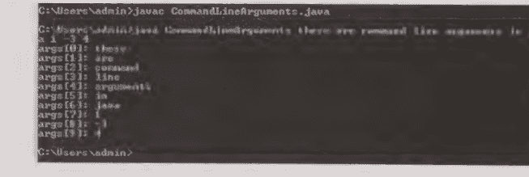

## this 关键字

`this` 关键字在 Java 中用于引用当前类的对象，位于构造函数或实例方法内部。该关键字可以用于引用类的成员，如变量、方法和构造函数。当方法或构造函数中的局部变量与实例变量同名时，它可以帮助区分它们。

下面的示例展示了如何使用 `this` 关键字：

```java
class Person {

    int age;

    Person(int age) {
        this.age = age;
    }

}
```

让我们展示如何使用这个关键字来访问类的各种成员：

```java
public class This_Class {

    // 实例变量 x
    int x = 10;

    This_Class() {
        System.out.println("Demonstrating the use of this keyword in Java");
    }

    This_Class(int x) {
        // 调用默认构造函数
        this();
        // 将局部变量 x 赋值给实例变量 x
        this.x = x;
    }

    public void salute() {
        System.out.println("Welcome to Java Programming");
    }

    public void print() {
        // 局部变量 x
        int x = 20;
        // 打印局部变量
        System.out.println("value of local variable x : " + x);
        // 打印实例变量
        System.out.println("The instance variable x has a value of : " + this.x);
        // 调用类的 salute 方法
        this.salute();
    }

    public static void main(String[] args) {
        // 实例化类
        This_Class object1 = new This_Class();
        // 调用 print 方法
        object1.print();
        // 通过参数化构造函数向变量 x 传递新值
        This_Class object2 = new This_Class(30);
        // 再次调用 print 方法
        object2.print();
    }

}
```

*(注：原文代码块中存在一些语法错误，如在方法外直接编写了打印语句，翻译时已按要求保留且不翻译代码)*

## 方法重写与 super 关键字

```java
return 14;

}

public class TestLendingInstitution {

    public static void main(String args[]) {

        LendingInstitution1 l11 = new LendingInstitution1();
        LendingInstitution2 l12 = new LendingInstitution2();
        LendingInstitution3 l13 = new LendingInstitution3();

        System.out.println("LendingInstitution1 Interest Rate: " + l11.getInterestRate());
        System.out.println("LendingInstitution2 Interest Rate: " + l12.getInterestRate());
        System.out.println("LendingInstitution3 Interest Rate: " + l13.getInterestRate());

    }

}
```

代码将给出如下结果：

```text
LendingInstitution1 Interest Rate: 10
LendingInstitution2 Interest Rate: 11
LendingInstitution3 Interest Rate: 14
```

`getInterestRate()` 方法在不同的类中以不同的方式使用。

我们可以使用 `super` 关键字来访问从父类重写的方法。

示例：

```java
class Mammals {

    public void run() {
        System.out.println("Mammals can run");
    }

}

class Cow extends Mammals {

    public void run() {
        super.run(); // 调用父类中的方法
        System.out.println("Cows can run and eat");
    }

}

public class TestCow {

    public static void main(String args[]) {
        Mammals mm = new Cow(); // 哺乳动物引用，但...
        Cow object = (Cow) mm; // 需要强制转换
        object.run(); // 执行 Cow 类中的方法
    }

}
```

代码打印出如下输出：

```text
Mammals can run
Cows can run and eat
```

## Java 中的递归函数

递归是一个方法反复调用自身的过程。该方法变成了一个递归方法。使用递归方法，代码会非常紧凑，但理解起来会比较复杂。

递归语法：

```java
returnType method() {
    // 要运行的代码
    method(); // 调用同一个方法
}
```

示例：

```java
public class JavaRecursionExample {

    static void helloMethod() {
        System.out.println("Hello there");
        helloMethod();
    }

    public static void main(String[] args) {
        helloMethod();
    }

}
```

如果你运行上面的代码，它将不断打印 "Hello there" 文本。`helloMethod()` 方法将无限地调用自己，因为我们没有指定该方法应该调用自身的次数。方法有限次调用自身的实现可以通过这种方式完成：

```java
public class JavaRecursionExample2 {

    static int times = 0;

    static void helloMethod() {
        if (times <= 10) {
            System.out.println("Hello there " + times);
            times++;
            helloMethod();
        }
    }

    public static void main(String[] args) {
        helloMethod();
    }

}
```

代码返回以下输出：

```text
C:\Users\admin>javac JavaRecursionExample2.java
C:\Users\admin>java JavaRecursionExample2
Hello there 0
Hello there 1
Hello there 2
Hello there 3
Hello there 4
Hello there 5
Hello there 6
Hello there 7
Hello there 8
Hello there 9
Hello there 10
C:\Users\admin>
```

我们不断增加 `times` 变量的值，直到它达到 10。注意 `<=10` 包含 10。这就是为什么该方法打印到第 10 次。通过递归，我们可以得到一个数的阶乘。

让我们通过示例来展示：

```java
public class JavaRecursionExample3 {

    static int numberFactorial(int nm) {
        if (nm == 1)
            return 1;
        else
            return (nm * numberFactorial(nm - 1));
    }

    public static void main(String[] args) {
        System.out.println("The result of 10 is: " + numberFactorial(10));
    }

}
```

代码将返回以下输出：

```text
The result of 10 factorial is: 3628800
```

对于阶乘，一个数字与其之前的数字相乘。通过递归，我们可以得到斐波那契数列。

示例：

```java
public class FibonacciExample {

    static int n1 = 0, n2 = 1, n3 = 0;

    static void printFibonacci(int count) {
        if (count > 0) {
            n3 = n1 + n2;
            n1 = n2;
            n2 = n3;
            System.out.print(" " + n3);
            printFibonacci(count - 1);
        }
    }

    public static void main(String[] args) {
        int count = 15;
        System.out.print(n1 + " " + n2); // 打印 0 和 1
        printFibonacci(count - 2); // 因为已经打印了 2 个数
    }

}
```

代码将返回如下结果：

```text
0 1 1 2 3 5 8 13 21 34 55 89 144 233 377 610 987
```

注意，斐波那契数是其之前数字之和。在上面的示例中，我们进行了多次递归。

## Java 中的继承

在继承中，一个对象获得另一个对象的行为和属性。该对象成为子，而对象成为父。它们也可以分别称为子类和父类。继承使得信息易于管理。在父类中定义的方法可以在子类中重用，无需重新定义。要继承父类，我们使用 `extends` 关键字。继承使用以下语法：

```java
class Childclass extends Parentclass {
    // 字段和方法
}
```

`extends` 关键字表示我们正在从现有类创建某些新类。

示例：

```java
class Employee {
    float employee_salary = 60000;
}

class Developer extends Employee {
    int commision = 20000;

    public static void main(String args[]) {
        Developer d = new Developer();
        System.out.println("developer salary: " + d.employee_salary);
        System.out.println("Commision for Developer is: " + d.commision);
    }
}
```

执行时将返回以下内容：

```text
developer salary: 60000
Commision for Developer is: 20000
```

### 单继承

在这里，一个类继承自另一个类。之前给出的类就是这种形式的示例。

示例：

```java
class Mammal {
    void run() {
        System.out.println("Running...");
    }
}

class Cow extends Mammal {
    void moov() {
        System.out.println("Mooing...");
    }
}

public class JavaInheritance {
    public static void main(String[] args) {
        Cow cw = new Cow();
        cw.moov();
        cw.run();
    }
}
```

代码执行后将返回以下结果：

```text
Mooing...
Running...
```

在上面的示例中，`run()` 方法定义在 `Mammal` 类中，而 `moov()` 方法定义在继承自 `Mammal` 的 `Cow` 类中。在 `JavaInheritance` 类中，我们创建了一个 `Cow` 类实例并命名为 `cw`。然后我们使用该实例访问了在不同类中定义的方法。

### 多级继承

当类 B 继承自类 A，而类 C 继承自类 B 时，就会发生这种继承。这里有一个示例：

```java
class Mammal {
    void run() {
        System.out.println("Running...");
    }
}

class Cow extends Mammal {
    void moow() {
        System.out.println("Moowing...");
    }
}

class BabyCow extends Cow {
    void eat() {
        System.out.println("Eating...");
    }
}
```


```java
System.out.println("Eating...");

}

}

public class JavaInheritanceTest{

    public static void main(String args[]){

        BabyCow bc=new BabyCow();

        bc.moow();

        bc.eat();

        bc.run();

    }

}
```

代码将返回如下结果：

Moowing...
Eating...
Running...

`run()` 方法定义在 `Mammal` 类中。`moow()` 方法定义在继承自 `Mammal` 的 `Cow` 类中。`eat()` 方法定义在继承自 `Cow` 的 `BabyCow` 类中。在 `InheritanceTest` 类中，我们创建了一个命名为 `bc` 的 `BabyCow` 类实例。该实例被用于访问各种属性或方法。我们可以使用 `BabyCow` 类实例访问在 `Cow` 和 `Mammal` 类中定义的方法。各个类中的方法可以视为它们的属性。

### 层次继承

这种继承可以通过此示例演示：

```java
class Mammal{

  void run() {

    System.out.println("Meow...");

  }

}

class Cow extends Mammal{

  void moow() {

    System.out.println("Moo...");

  }

}

class Goat extends Mammal{

  void meow() {

    System.out.println("Meowing...");

  }

}

public class JavaInheritanceTest{

  public static void main(String[] args) {

    Goat gt=new Goat();

    gt.meow();

    gt.run();

  }

}
```

```java
// gt.moow(); will give an Error

{}
```

在 `InheritanceTest` 类中创建 `Goat` 类的实例后，我们无法继承 `Mammal` 类中定义的属性，因为 `Goat` 类继承自 `Mammal` 类。然而，我们无法访问 `Cow` 类中定义的属性，因为 `Goat` 类并没有继承自 `Cow` 类。如果我们尝试这样做（例如运行 `gt.moow();` 语句），将会得到一个错误。

某些编程语言支持多重继承，即一个类可以继承自多个其他类。Java 不支持这种特性，我们实现这一点的唯一方法是创建一个接口，然后在接口上使用 `implements` 关键字。假设我们有一个名为 `Interface1` 的接口，我们可以创建一个名为 `Class2` 的类，它继承自 `Class1` 并实现了接口 `Interface1`：

```java
public class Class2 extends Class1 implements Interface1{

}
```

这是我们在 Java 中实现多继承功能最接近的方法。对于类，我们使用关键字 `extends`，但它不能用于接口。相反，我们使用关键字 `implements`。通过这种方式，我们可以继承接口的特性。继承有助于现有属性和方法的用。

### 调用父类构造函数

对于继承自另一个类属性的类，子类会自动继承父类的默认构造函数。然而，当你需要调用父类的参数化构造函数时，你需要按照下面的语法使用 `super` 关键字：

```java
super(values);
```

以下示例演示了这一点：

```java
class MySuperclass {

  int x;

  MySuperclass(int x) {

    this.x = x;

  }

  public void getX() {

    System.out.println("The value of x in super class: " +x);

  }

}

public class MySubclass extends MySuperclass {

  MySubclass(int x) {

    super(x);

  }

  public static void main(String argd[]) {

    MySubclass sb = new MySubclass(32);

    sb.getX();

  }

}
```

代码在执行时将产生以下输出：

The value of x in super class is: 32

在上面的示例中，我们演示了如何使用 `super` 关键字来访问父类中定义的参数化构造函数。程序既有父类也有子类，父类拥有一个接收整数值的参数化构造函数。我们随后使用了 `super` 关键字来访问该构造函数。

### instanceof 关键字

该关键字可用于检查一个对象是否是另一个对象的实例。让我们通过一个示例来展示：

```java
interface Mammal{}

class Cow implements Mammal{

  public class BabyCow extends Cow {

    public static void main(String args[]) {

      Cow c = new Cow();

      BabyCow bc = new BabyCow();

      System.out.println(c instanceof Mammal);

      System.out.println(bc instanceof Cow);

      System.out.println(bc instanceof Mammal);

    }

  }

}
```

代码应返回以下结果：

```
true

true

true
```

此截图显示我们的测试结果为 true。这意味着 `Cow` 是 `Mammal` 的实例，`BabyCow` 是 `Cow` 的实例，且 `BabyCow` 也是 `Mammal` 的实例。

## Java 中的抽象

抽象是一项让开发者只向用户展示必要内容而隐藏其他所有内容的特性。开发者必须区分哪些是必须展示给用户的内容，哪些是不需要的。例如，当你发送电子邮件时，你需要输入内容、添加文档并点击“发送”按钮，而无需知道背后发生了什么。同样，当你开车时，你踩下油门就能看到速度增加，当踩下刹车时汽车就会停止。你并不知道后台发生了什么。这就是我们在本章中将讨论的抽象。

通过抽象，用户感知不到实现细节。开发者隐藏了它们。用户只获取应用程序的功能。因此，用户获取的是关于程序做什么的信息，而不是如何实现。`abstract` 类拥有 `abstract` 关键字。如果任何类拥有抽象方法，它就必须被识别为抽象类。抽象类还必须继承自另一个抽象类。

示例：

```java
abstract class Student {

    abstract void register();

}

public class John extends Student {

    void register() {

        System.out.println("John is going for registration");

    }

    public static void main(String args[]) {

        Student st = new John();

        st.register();

        System.out.println("Done");

    }

}
```

代码在执行后返回如下结果：

> John is going for registration
> Done

抽象类并不一定非包含抽象方法。你不能实例化抽象类。这就是为什么我们实例化了 `John` 类，因为它继承了抽象类的方法。

示例：

```java
public abstract class Worker {

    private String name;

    private String workerAddress;
```

## 12-封装

封装是面向对象编程的一个特性，有助于将数据和方法组合在一起。数据是变量，而方法是允许我们处理数据的代码。通过封装，类变量可以从其他类中隐藏，并且对它们的访问可能仅通过类的方法来实现。封装起到了数据隐藏的作用。它是通过将类变量设置为 `private` 实现的。变量的“setter”（设置）和“getter”（获取）方法应该设置为 `public`，并用于更改变量的值。

示例：

```java
public class Workers{

private String name;

public String getWorkerName() {

  return name;

}

public void setWorkerName(String name) {

this.name=name;

}

}
```

你可以使用此代码添加新文件来保存包：

```java
public class TestWorkers {
    public static void main(String[] args) {
        Workers wk=new Workers();
        wk.setWorkerName("Joel");
        System.out.println(wk.getWorkerName());
    }
}
```

该代码给出以下输出：

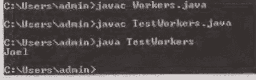

变量名在 `Workers` 类中被标记为 `private`。`setWorkerName()` 和 `getWorkerName()` 方法在 `Workers` 类中被设置为 `public`。我们在 `TestWorkers` 类中实例化了 `Workers` 类，然后使用该实例来访问它的变量和方法。

另一个示例：

```java
public class MyClass {
    private String personName;
    private String personID;
    private int personAge;

    public int getAge() {
        return personAge;
    }

    public String getName() {
        return personName;
    }

    public String getID() {
        return personID;
    }

    public void setAge( int newPersonAge) {
        personAge = newPersonAge;
    }

    public void setName(String newPersonName) {
        personName = newPersonName;
    }

    public void setID( String newPersonID) {
        personID = newPersonID;
    }
}
```

任何需要访问私有变量的类必须使用公共方法：setter 和 getters。

我们使用下面提供的方法进行访问：

```java
public class MyClassTest extends MyClass{
    public static void main(String args[]) {
        MyClassTest mct = new MyClassTest();
        mct.setName("Joel");
        mct.setAge(32);
        mct.setID("4458972");
        System.out.print("Name : " + mct.getName() + " Age : " + mct.getAge());
    }
}
```

你应该将这两个代码写在两个独立的文件。执行后，你应该得到以下结果：

```
C:\Users\admin>javac MyClass.java
C:\Users\admin>javac MyClassTest.java
C:\Users\admin>java MyClassTest
Name : Joel Age : 32
C:\Users\admin>
```

## 13-接口

接口（Interface）是类的蓝图。它包含抽象方法和静态常量。接口提供了实现抽象的机制。接口只能有抽象方法，而没有方法体。它对于实现多继承非常重要。它类似于类，但只包含抽象方法。任何类都必须实现接口才能使用它的方法。除了抽象方法外，它还可以拥有常量、静态方法、默认方法、嵌套类型等。

接口拥有可以类实现的方法。要实现接口方法，类必须是抽象的。否则，所有接口方法都必须在类中定义。接口不能实例化。它不能有构造函数。它所有的字段必须是 `final` 或 `static`，不能是实例字段。

要设置接口，我们使用 `interface` 关键字。

这里是语法：

```java
interface <接口Name>{
  // 常量字段
  // 抽象方法
}
```

接口是隐式的抽象；因此在声明它时不需要添加 `abstract` 关键字。方法是隐式抽象的；因此在声明它们时不需要使用 `abstract` 关键字。它们是隐式的公有的。

示例：

```java
interface Mammal {
  public void run();
  public void eat();
}
```

可以使用类来实现接口：

```java
interface Mammal {
  public void run();
  public void eat();
}

public class Cow implements Mammal{
  public void run() {
    System.out.println("Interface Method run implemented");
  }
  public void eat() {
    System.out.println("Interface Method eat already implemented");
  }
  public static void main(String args[]) {
    Mammal mm = new Cow();
    mm.run();
    mm.eat();
  }
}
```

代码执行后应返回以下结果：

Interface Method run already Implemented

Interface Method eat already Implemented

我们创建了接口 `Mammal`，它已被 `Cow` 类实现。它的 `run()` 和 `eat()` 方法已在 `Cow` 类中使用。

对于两个接口，一个接口可以通过 `extends` 关键字扩展另一个。子接口将继承父接口的方法。

示例：

```java
public interface Toyotas {
    public void setCarPrice(String carPrice);
    public void setCC(String cc);
}

public interface Harrier extends Toyotas {
    public void maximumMileage(int miles);
    public void seats(int seats);
}

public interface Prado extends Toyotas {
    public void interiorSpace();
    public void kilometersLiter(int kms);
}
```


我们定义了 `Toyotas` 接口。其他的 `Harrier` 和 `Prado` 扩展了 `Toyotas`。`Prado` 接口有四个方法，但其中两个继承自 `Toyota` 接口。

Java 不支持多继承，但我们可以通过接口来实现。

这是另一个接口示例：

```java
interface ObjectInterface{
    void drawObject();
    static int cubeObject(int ab){return ab*ab*ab;}
}
class Cuboid implements ObjectInterface{
    public void drawObject() {
        System.out.println("Cube is drawn");
    }
}
public class InterfaceTest{
    public static void main(String args[]) {
        ObjectInterface ob=new Cuboid();
        ob.drawObject();
        System.out.println(ObjectInterface.cubeObject(3));
    }
}
```

嵌套接口是在另一个接口内部定义的。

```java
interface Message{
    void printMessage();
    interface ShortMessage{
        void message();
    }
}
```

`ShortMessage` 接口被定义在 `Message` 接口内部，使其成为嵌套接口。

### Java：初学者入门教程

包定义语句始终以分号（`;`）结尾。

当我们创建包时，我们应该使用小写字母作为名称，以避免与接口/类名冲突。

另一个示例：

```java
package animal;
interface Mammals {
    public void run();
    public void eat();
}
```

我们创建了一个名为 `animal` 的包，其中包含一个名为 `Mammals` 的接口。现在我们可以在 `animal` 包中实现该接口：

```java
package animal;

public class Cow implements Mammals {
    public void run() {
        System.out.println("Cows run");
    }
    public void eat() {
        System.out.println("Cows eat");
    }
    public int legCount() {
        return 0;
    }
    public static void main(String args[]) {
        Cow c = new Cow();
        c.run();
        c.eat();
    }
}
```

代码将返回以下结果：

```
Cows run
Cows eat
```

如果我们不使用包，这两个类可能会合并为一个：

```java
interface Mammals {
    public void run();
    public void eat();
}

public class Cow implements Mammals {
    public void run() {
        System.out.println("Cows run");
    }

    public void eat() {
        System.out.println("Cows eat");
    }

    public int legCount() {
        return 0;
    }

    public static void main(String args[]) {
        Cow c = new Cow();
        c.run();
        c.eat();
    }
}
```

## Import 关键字

你可以访问特定包之外的包。使用 `import` 关键字是实现这一点的可能方法。要访问同一个包中的类，不需要使用包名。在使用 `packagename.classname` 语法导入类后，只有被导入类中的公共方法是可访问的。

示例：

```java
package hellopackage;
public class HelloClass{
    public void message() {
        System.out.println("Hello there!");
    }
}
```

我们在名为 `hellopackage` 的包中定义了一个名为 `HelloClass` 的类，并将其保存为文件 `HelloClass.java`。我们有这样一个类：

```java
package studentspackage;
class HelloStudentsClass{
    public static void main(String args[]) {
        HelloClass hello = new HelloClass();
        hello.message();
    }
}
```

第二个程序一旦执行将生成错误。我们实例化类 `HelloClass` 来获取实例 `hello`。我们使用该实例来访问 `HelloClass` 中定义的 `message()` 方法。注意，它们不在同一个包中。这将导致错误。原因是我们实例化的类与当前类不在同一个包。我们必须从 `hellopackage` 包导入 `HelloClass` 类。我们在类的顶端使用 `packagename.classname` 语法：

```java
package studentspackage;
import hellopackage.HelloClass;

class HelloStudentsClass{
    public static void main(String args[]){
        HelloClass hello = new HelloClass();
        hello.message();
    }
}
```

为包和类命名有助于避免错误。通过这种方法，我们不需要使用 `import` 关键字，因为名称将引导我们找到包和类，然后从那里就可以访问方法。

示例：

```java
package hellopackage;
public class HelloClass{
    public void message(){
        System.out.println("Hello there!");
    }
}
```

要在另一个包的类中使用 `message()` 方法，可以如下所示：

```java
package studentspackage;
class HelloClass{
    public static void main(String args[]){
        HelloClass hello = new HelloClass();
        hello.message();
    }
}
```

# BELL

```java
gc.drawOval(160, 50, 10, 10);
gc.drawOval(140, 50, 10, 10);
gc.drawOval(150, 70, 15, 10);
gc.drawRect(145, 90, 30, 30);
gc.drawRect(120, 120, 8, 10);
gc.drawRect(130, 240, 20, 120);
gc.drawRect(170, 240, 20, 120);

gc.drawRect(130, 360, 30, 20);

gc.drawLine(200, 160, 240, 240);
gc.drawLine(240, 240, 280, 160);

gc.drawRect(280, 130, 120, 30);
gc.setColor(Color.blue);
gc.fillRect(280, 130, 120, 30);

gc.drawRect(280, 160, 120, 30);
gc.setColor(Color.yellow);
gc.fillRect(280, 160, 120, 30);

gc.drawRect(280, 190, 120, 30);
gc.setColor(Color.red);
gc.fillRect( , );
}
```

创建一个名为 `mycode2.html` 的新文件，代码如下：

```html
<HTML>
<TITLE>Hello World</TITLE>
<HEAD>Our Hello Applet</HEAD>
<Applet code="Mypaint.class" width=500 height>
</HTML>
```

编译 `MyPaint.java`，然后运行 `mycode2.html`。演示如下：

```
javac MyPaint.java
appletviewer mycode2.html
```

# Java 初学者教程

这应该给你以下输出：


**Graphics** 库带有可以绘制各种形状的函数/方法。要绘制椭圆形，调用 `drawOval()` 方法。向它传递4个参数，这些参数是椭圆边缘的点。要绘制矩形，调用 `drawRect()` 方法并传递4个坐标来指定它的角。`drawLine()` 方法帮助画线。`setColor()` 方法有助于设置颜色。

示例 3：

在 `OurPaintClass.java` 文件中编写此代码：

```java
import java.applet.Applet;
import java.awt.*;
public class OurPaintClass extends Applet
{
    public void paint(Graphics g){
        g.drawRect(120, 120, 160, 120);
        g.drawLine(120, 120, 440, 365);
    }
}
```

其 HTML 代码应如下：

```html
<HTML>
<TITLE>Hello World</TITLE>
<HEAD>Our Hello Applet</HEAD>
<Applet code="OurPaintClass.class" width=500
height=500>
</Applet>
</html>
```

编译 `OurPaintClass.java` 类，然后用 appletviewer 运行 `OurPaint.html` 代码。

你将得到下面的结果：


## 显示图像

图像可以显示在 applet 上，因为 applet 在动画和游戏中非常流行。`java.awt.Graphics` 类有一个用于显示图片的 `drawImage()` 方法。`getImage()` 方法返回图像对象。`getCodeBase()` 方法返回基础 URL。`getDocumentBase()` 返回嵌入 applet 的文档 URL。

示例：

```java
import java.awt.*;
import java.applet.*;
public class ImageDisplay extends Applet {

    Image img;

    public void init() {
        img = getImage(getDocumentBase(),"imagename.png");
    }

    public void paint(Graphics gc) {
        gc.drawImage(img, 30,30, this);
    }
}
```

`drawImage()` 方法显示图像。它的第4个参数是一个用于 `ImageObserver` 的对象。将代码保存到名为 `ImageDisplay.java` 的文件中。将此代码添加到名为 `imagedisplay.html` 的文件中：

```html
<html>
<body>
<applet code="ImageDisplay.class" width="350"
height="350">
</applet>
</body>
</html>
```

通过命令 `javac ImageDisplay.java` 编译 Java 类，然后调用 `imagedisplay.html` 文件。

### Applet 动画

由于 applet 在游戏中很常见，因此图像应该是移动。示例：创建文件 `AnimationExample.java`。添加此代码：

```java
import java.awt.*;
import java.applet.*;
import java.awt.event.*;
public class AnimationExample extends Applet implements ActionListener {

    Image img;

    public void init() {
        img = getImage(getDocumentBase(),"car.gif");
    }

    public void paint(Graphics gc) {
        for(int p=0;p<50;p++){
            gc.drawImage(img, 30,30, this);
            try {
                Thread.sleep(100);
            } catch (Exception ex) {
            }
        }
    }
}
```

# Java: 初学者入门教程

8位字节的输入/输出操作。有几个与字节流相关的类，常用的类有 `InputStream` 和 `FileOutputStream`。让我们来看一个示例，演示如何使用这两个类：

```java
import java.io.*;
public class CopyingFiles {
    public static void main(String[] args) throws IOException {
        FileInputStream inp = null;
        FileOutputStream outp = null;

        try {
            inp = new FileInputStream("colleagues.txt");
            outp = new FileOutputStream("output.txt");

            int ch;
            while ((ch = inp.read()) != -1) {
                outp.write(ch);
            }
        } finally {
            if (inp != null) {
                inp.close();
            }
            if (outp != null) {
                outp.close();
            }
        }
    }
}
```

该代码将读取 `colleagues.txt` 文件的内容并将其复制到名为 `output.txt` 的新文件中。注意，后者将自动创建，内容将被复制到其中。

## 字符流

字符流用于执行 16 位 Unicode 的输入输出操作。有许多与字符流相关的类。最流行的是 `FileReader` 和 `FileWriter`。内部，`FileReader` 使用 `FileInputStream`，而 `FileWriter` 使用 `FileOutputStream`，但它们之间的主要区别是 `FileReader` 每次读取两个字节，而 `FileWriter` 每次写入两个字节。让我们使用这些类重写之前的示例：

```java
import java.io.*;
public class CopyingFiles {
    public static void main(String[] args) throws IOException {
        FileReader inp = null;
        FileWriter outp = null;
        try {
            inp = new FileReader("college.txt");
            outp = new FileWriter("output.txt");
            int ch;
            while ((ch = inp.read()) != -1) {
                outp.write(ch);
            }
        } finally {
            if (inp != null) {
                inp.close();
            }
            if (outp != null) {
                outp.close();
            }
        }
    }
}
```

当你编译并运行代码代码时，它将 `colleagues.txt` 文件的内容复制到名为 `output.txt` 的新文件中。

### 标准流

在每种编程语言中，都提供了一种方法，用户可以通过键盘输入输入，输入将显示在计算机屏幕上。我们有三个标准流可以此此：


- 标准输入（Standard Input） - 用于通过键盘向用户程序提供数据，并作为标准输入流。它用 `System.in` 表示。
- 标准输出（Standard Output） - 用于通过屏幕输出用户程序产生的数据，并作为标准输出流。它用 `System.out` 表示。
- 标准错误（Standard Error） - 用于通过屏幕输出用户程序生成的错误数据，并作为标准错误流。它用 `System.err` 表示。

考虑下面的示例：

```java
import java.io.*;
public class ReadFromConsole {
    public static void main(String[] args) throws IOException {
        InputStreamReader inp = null;

        try {
            inp = new InputStreamReader(System.in);
            System.out.println("Enter 'q' to quit.");
            char ch;

            do {
                ch = (char) inp.read();
                System.out.print(ch);
            } while(ch != 'q');
        } finally {
            if (inp != null) {
                inp.close();
            }
        }
    }
}
```

从命令行编译代码并执行它。当出现提示时，输入字母 'q' 然后按回车键。看看会发生什么。


你注意到一旦按下字母 'q' 并按下回车键，程序就会退出。

你可以再次运行代码并继续在键盘输入字母甚至数字。在每个字符后按回车键。程序只有在你输入 'q' 时才会退出。

```
C:\Users\admin>javac ReadFromConsole.java
C:\Users\admin>java ReadFromConsole
Enter 'q' to quit.
```

### 读取和文件

我们使用 `InputStream` 从文件中读取数据，使用 `FileOutputStream` 向文件写入数据。读写文件最重要的类。以下示例展示了我们如何创建 `File` 对象并使用它们：

```java
import java.io.*;
public class FileExample {
    public static void main(String[] args) {
        File f = new File("output.txt");
        try {
            OutputStream os = new FileOutputStream(f);
            os.write("Hello World".getBytes());
            os.close();
        } catch (IOException e) {
            e.printStackTrace();
        }
    }
}
```

这是一个表示文件和目录的 Java 类。它是我们用于创建文件、删除、搜索等的类。我们使用文件对象来表示磁盘上的真实文件/目录。以下示例展示了我们如何创建 `File` 对象并使用它们：

```java
import java.io.File;

public class FileExample {
    public static void main(String[] args) {
        File f = null;
        String[] strs = {"file.txt", "file2.txt"};
        try {
            // 对于字符串数组中的每个字符串
            for (String s : strs) {
                // 创建新文件
                f = new File(s);

                // 对于可执行文件则返回 true
                boolean bool = f.canExecute();

                // 查找绝对路径
                String a = f.getAbsolutePath();

                // 返回绝对路径
                System.out.print(a);

                // 打印
                System.out.println(" is executable: " + bool);
            }
        } catch (Exception ex) {
            // 当发生 I/O 错误时
            ex.printStackTrace();
        }
    }
}
```

以下示例展示了如何使用此类类：

```java
import java.io.*;
public class FileReadExample {
    public static void main(String args[]) throws IOException {
        File f = new File("hello.txt");

        // 创建文件
        f.createNewFile();

        // 创建一个 FileWriter 对象
        FileWriter wr = new FileWriter(f);

        // 将内容写入文件
        wr.write("A\n Java\n great\n example\n");
        wr.flush();
        wr.close();

        // 创建一个 FileReader 对象
        FileReader fr = new FileReader(f);
        char[] ch = new char[50];
        fr.read(ch); // 将内容读到数组

        for (char c : ch) {
            System.out.print(c); // 打印字符
        }
        fr.close();
    }
}
```

代码执行后将给出以下输出：

```
C:\Users\admin>javac FileReadExample.java
C:\Users\admin>java FileReadExample
A
Java
great
example
C:\Users\admin>
```

这是一个继承了 `OutputStreamWriter` 类的 Java 类。当我们需要写入字符流时会使用此类类。该类带有许多可以用于创建对象的构造函数。它们包括：

- `FileWriter(File file)` - 这是一个在给定 `File` 对象时创建 `FileWriter` 对象的构造函数。
- `FileWriter(File file, boolean append)` - 这是一个在给定 `File` 对象并提供一个布尔值（用于显示是否应追加写入数据）时，创建 `FileWriter` 对象的构造函数。
- `FileWriter(FileDescriptor fd)` - 这是一个创建与给定的文件描述符关联的 `FileWriter` 对象的构造函数。
- `FileWriter(String fileName)` - 此构造函数在给定文件名时创建一个 `FileWriter` 对象。
- `FileWriter(String fileName, boolean append)` - 此构造函数在给定文件名并提供一个布尔值（用于显示是否应追加写入数据）时，创建一个 `FileWriter` 对象。

以下是一个展示如何使用此 Java 类的示例：

```java
import java.io.*;
public class FileReaderExample {
    public static void main(String args[]) throws IOException {
        File f = new File("hello.txt");

        // 创建文件
        f.createNewFile();

        // 创建一个 FileWriter 对象
        FileWriter wr = new FileWriter(f);

        // 将内容写入文件
        wr.write("A\n n Java\n great example\nn");
        wr.flush();
        wr.close();

        // 创建一个 FileReader
        FileReader fr = new FileReader(f);
        char[] ch = new char[50];
        fr.read(ch); // 将内容读到数组

        for(char c : ch) {
            System.out.print(c); // 打印字符
        }
        fr.close();
    }
}
```

### 列出目录

要查看特定目录下的所有目录和文件，可以使用 `File` 对象提供的 `list()` 方法。以下示例展示了这一点：

```java
import java.io.File;
public class ReadDirectory {

    public static void main(String[] args) {
        File f = null;
        String[] paths;

        try {
            // 创建一个新的文件对象
            f = new File("/tmp");

            // 包含文件和目录的数组
            paths = f.list();

            // 遍历路径数组中的每一个名称
            for(String path : paths) {
                // 返回文件名和目录名
                System.out.println(path);
            }
        } catch (Exception ex) {
            // 如果发生任何错误
            ex.printStackTrace();
        }
    }
}
```

## 17 - 异常处理

在程序运行期间，可能会发生意外情况，这可能会停止程序的执行。我们需要一种机制来处理此类情况，以便我们的程序能够无问题地运行。

程序执行过程中发生的问题被称为异常（exceptions）。异常会破坏程序的正常流程，程序可能无法按照预期工作。程序执行期间可能发生的异常示例包括用户输入无效数据、文件无法打开、程序执行期间网络连接丢失等。

考虑下面这个示例，我们正尝试访问一个不存在的文件：

```java
import java.io.File;
import java.io.FileReader;

public class ExceptionExample {

    public static void main(String args[]) {
        File f = new File("F://hello.txt");
        FileReader fr = new FileReader(f);
    }
}
```

代码在编译时将抛出以下异常：

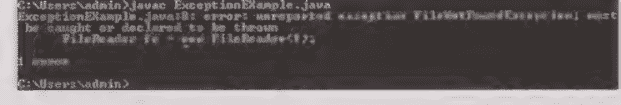

`read()` 和 `write()` 方法都抛出了 `IOException`，但 Java 编译器可以配合 `FileNotFoundException` 异常一起处理这些。

未检查异常（unchecked exception）是程序运行时发生的异常，可能会停止其执行。我们需要一种机制来处理此类情况，以便我们的程序能够无问题地运行。异常会破坏程序的正常流程，程序可能无法按照预期工作。程序执行期间可能发生的异常示例包括逻辑错误、运行时错误。


```java
import java.io.*;
public class FileReaderExample {
    public static void main(String args[]) throws IOException {
```

### 捕获异常

在 Java 中捕获异常需要结合 `try` 和 `catch` 关键字。语法如下：

```java
try {
    // 受保护的代码
} catch (ExceptionName) {
    // 异常处理
}
```

# 绝对初者的书籍

```java
import java.io.*;

public class ArrayException {

    public static void main(String args[]) {

        try {

            int[] x = new int[3];

            System.out.println(x[4]);

        } catch (ArrayIndexOutOfBoundsException ex) {

            System.out.println("Exception thrown :" + ex);

        }

        System.out.println("Outside the block");

    }

}
```

在上面的示例中，代码将返回以下结果：

> Exception thrown:java.lang.ArrayIndexOutOfBoundsException: 4
Outside the block

# 多异常异常块

我们可以创建一个 `try` 块以及多个 `catch` 块。这应该遵循以下语法：

```java
try {
    // 受保护的代码
} catch (ExceptionType1 ex1) {
    // 异常块
} catch (ExceptionType2 ex2) {
    // 异常块
} catch (ExceptionType3 ex3) {
    // 异常块
}
```

在上面的语法中，我们创建了三个 `catch` 块和一个 `try` 块。然而，单个 `try` 块可以使用任意数量的 `catch` 块。当受保护的代码发生异常时，异常会被抛给第一个 `catch` 块。如果异常的数据类型匹配 `ExceptionType1`，则会在那里被捕获。如果没有发生，异常将被抛给第二个 `catch` 块。这种情况将持续到代码中所有的 `catch` 块。如果异常未被捕获，方法将停止执行。

下面是一个如何使用多个 `catch` 语句的代码示例：

```java
try {
    f = new FileInputStream(fileName);
    x = (byte) f.read();
} catch (IOException io) {
    io.printStackTrace();
    return -1;
} catch (FileNotFoundException ex) // 无效！
    ex.printStackTrace();
    return -1;
}
```

### throw/throws 关键字

对于不处理检查异常的方法，必须通过使用 `throws` 关键字来声明该异常。该关键字应添加到方法签的末尾。

可以抛出一个异常，该异常可以是新实例化的

## 18-Java AWT

AWT 代表 Abstract Window kit（抽象窗口工具包），它是我们用于 Java 开发基于窗口或 GUI 应用程序的 API。Java AWT 的组件是平台无关的，这意味着这些组件是根据操作系统进行显示的。该 API 是重量级的，意味着它的组件使用了操作系统的资源。

`java.awt` 包包含许多用于 AWT API 的类，如 `TextField`、`Label`、`RadioButton`、`CheckBox`、`TextArea`、`Choice`、`List` 等。让我们来讨论其中一些重要的组件：

- **Container（容器）**：这是一种 AWT 组件，能够容纳其他组件，如文本字段、标签、按钮、文本区域等。它被 `Frame`、`Panel` 和 `Dialog` 等类所派生。
- **Window（窗口）**：这是一个没有菜单栏和边框的容器。要创建一个窗口，可以使用 `dialog`（对话框）、`frame`（帧）或另一个窗口。

## Java：初学者教程

- **Panel（面板）**：这是一个没有菜单栏和标题栏的容器。你可以向它添加文本字段和按钮等其他组件。
- **Frame（帧）**：这是一个带有标题栏的容器，它可能带有菜单栏。你可以向它添加文本字段和按钮等其他组件。

此类带有不同的方法，其中最重要的包括以下：

- `public void add(Component c)`：此方法将组件添加到该组件中。
- `public void getSize(int width, int height)`：此方法设置组件的尺寸，包括宽度和高度。
- `public void setLayout(LayoutManager m)`：此方法定义组件的布局管理器。
- `public void setVisible(boolean status)`：这是我们用来更改组件可见性的方法。它的默认设置为 `false`。

我们需要创建一个 awt 示例。为此我们需要一个 frame。我们可以通过两种方式来创建它：

- 通过扩展 `Frame` 类（继承）。
- 通过创建 `Frame` 类的对象（关联）。

让我们通过继承 `Frame` 类来创建第一个示例。我们将在帧中添加一个按钮：

```java
import java.awt.*;

public class MyGui extends Frame {

    MyGui() {
        Button btn = new Button("click Here");
        btn.setBounds(30, 100, 60, 30); // 设置按钮的位置
        add(btn); // 将按钮添加到帧中
        setSize(300, 300); // 设置帧的大小，宽度 300，高度 300
        setLayout(null); // 无布局管理器
        setVisible(true); // 让帧可见，默认不可见
        it is not visible
    }

    public static void main(String args[]) {
        MyGui mg = new MyGui();
    }
}
```

代码执行后将返回以下结果：


我们使用了 `setBounds()` 方法来设置按钮的位置。

现在让我们展示如何通过关联来创建 awt：

```java
import java.awt.*;

public class MyGui2 {

    MyGui2() {
        Frame fr = new Frame();
        Button btn = new Button("click here");
        btn.setBounds(30, 50, 80, 30);
        fr.add(btn);
        fr.setSize(300, 300);
        fr.setLayout(null);
        fr.setVisible(true);
    }

    public static void main(String args[]) {
        MyGui2 mg = new MyGui2();
    }
}
```

代码应该返回以下图形用户界面：


### 事件处理

事件是指改变对象状态的过程。事件的示例包括拖动鼠标按钮、点击按钮等。名为 `java.awt.event` 的 Java 包提供了许多监听器接口和事件类用于处理事件。

要处理事件，你必须向监听器（Listener）注册必要的组件。例如，如果是按钮，你希望它在被点击时做出响应。在我们之前的示例中，按钮在被点击时什么都不做。要将组件注册到监听器，我们通常像下面所示调用 `actionListener()` 方法：

```java
public void addActionListener(ActionListener a) {
}
```

现在我们已经向监听器注册了组件，可以添加事件处理代码了。考虑下面的示例：

```java
import java.awt.*;
import java.awt.event.*;

class MyEvent extends Frame implements ActionListener {

    TextField txtf;

    MyEvent() {
        // 创建组件
        txtf = new TextField();
        txtf.setBounds(60, 170, 20);
        Button btn = new Button("click Here");
        btn.setBounds(100, 120, 80, 30);
        // 将组件注册到监听器
        btn.addActionListener(this);
        // 将按钮添加到帧中
        add(btn);
        // 设置帧的大小
        setSize(300, 300);
        // 无布局管理器
        setLayout(null);
        // 让帧可见
        setVisible(true);
    }

    public void actionPerformed(ActionEvent e) {
        txtf.setText("This message");
    }

    public static void main(String args[]) {
        new MyEvent();
    }
}
```

应用程序可以编辑此文本，但用户可能无法直接更改它。下面的示例展示了如何在 Java 中创建标签：

```java
import java.awt.*;

class MyLabel {

    public static void main(String args[]) {
        Frame fr = new Frame("My Label");
        Label lab1, lab2;
        lab1 = new Label("Label 1");
        lab1.setBounds(50, 100, 100, 30);
        lab2 = new Label("Label 2");
        lab2.setBounds(50, 150, 100, );
        fr.add(lab1);
        fr.add(lab2);
        fr.setSize(400, 400);
        fr.setLayout(null);
        fr.setVisible(true);
    }
}
```

执行该代码后将返回以下界面：


我们可以为标签添加动作监听器（action listener）。下面的示例展示了这一点：

```java
import java.awt.*;
import java.awt.event.*;

public class MyLabel2 extends Frame implements ActionListener {

    TextField txtf;
    Label lab;
    Button btn;

    MyLabel2() {
        txtf = new TextField();
        txtf.setBounds( , , , );
        lab = new Label();
        lab.setBounds(50, 100, 250, 20);
        btn = new Button("Find IP");
        btn.setBounds( , , , );
        btn.addActionListener(this);
        add(btn);
        add(txtf);
        add(lab);
        setSize(400, 400);
        setLayout(null);
        setVisible(true);
    }

    public void actionPerformed(ActionEvent ev) {
        try {
            String host = txtf.getText();
            String ip = java.net.InetAddress.getByByName(host).getHostAddress();
            lab.setText("IP of host is " + ip);
        } catch (Exception ex) {
            System.out.println(ex);
        }
    }

    public static void main(String[] args) {
        new MyLabel2();
    }
}
```

运行代码然后点击按钮。你应该能同时获得当前主机的名称和 IP 地址，即你运行代码所在的主机：

### AWT TextField

这是一个允许单行文本可编辑的组件。它继承自 `TextComponent` 类。可以如下所示创建它：

```java
import java.awt.*;

class MyTextField {

    public static void main(String args[]) {
        Frame fr = new Frame("My TextField");
        TextField txtf1, txtf2;
        txtf1 = new TextField("Welcome to Java");
        txtf1.setBounds(...,);
        txtf2 = new TextField("Java is a great Language");
        txtf2.setBounds(50, 150, 200, 30);
        fr.add(txtf1);
        fr.add(txtf2);
        fr.setSize(400, 400);
        fr.setLayout(null);
        fr.setVisible(true);
    }
}
```

## Java: The Book For The Absolute Beginner

代码将返回下面的结果：

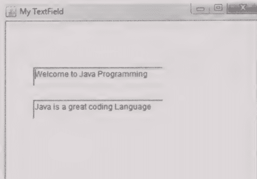

我们创建了两个带有某些文本的文本框。尝试一下，你会发现这些文本框是可以编辑的。我们可以为 `textField` 添加动作监听器。让我们用示例来演示这一点：

```java
import java.awt.*;
import java.awt.event.*;

public class MyTextField2 extends Frame implements ActionListener {

    TextField txtf1, txtf2, txtf3;
    Button btn1, btn2;

    MyTextField2() {
        txtf1 = new TextField();
        txtf1.setBounds(50, 50, 150, 20);
        txtf2 = new TextField();
        txtf2.setBounds( , , , );
        txtf3 = new TextField();
        txtf3.setBounds(50, 150, 150, );
        txtf3.setEditable(false);
        btn1 = new Button("*");
        btn1.setBounds(50, 200, 50, );
        btn2 = new Button("+");
        btn2.setBounds(120, 200, 50, 50);
        btn1.addActionListener(this);
        btn2.addActionListener(this);
        add(txtf1);
        add(txtf2);
        add(txtf3);
        add(btn1);
        add(btn2);
        setSize(300, 300);
        setLayout(null);
        setVisible(true);
    }

    public void actionPerformed(ActionEvent ev) {
        String s1 = txtf1.getText();
        String s2 = txtf2.getText();
```


# Java：初学者入门教程

## AWT TextField 示例

```java
int x = Integer.parseInt(s1);
int y = Integer.parseInt(s2);
int z = 0;

if (ev.getSource() == btn1) {
    z = x * y;
} else if (ev.getSource() == btn2) {
    z = x + y;
}

txtf3.setText(String.valueOf(z));
```

```java
public static void main(String[] args) {
    new MyTextField2();
}
```

代码执行后将返回界面：

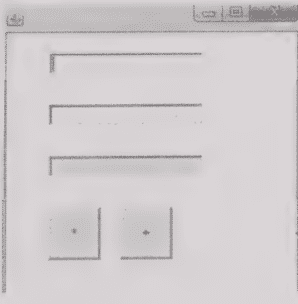

我们创建了两个带有某些文本的文本框。尝试一下，你会发现这些文本框是可以编辑的。我们可以为 `textField` 添加动作监听器。让我们用示例来演示这一点：

（代码块上略）

代码执行后将返回以下界面：

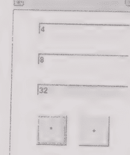

我们可以为文本框添加动作监听器。点击 `*` 按钮将得到结果：


点击 `+` 按钮将得到以下界面：


## AWT TextArea

这是一个允许多行文本可编辑的组件。它继承自 `TextComponent` 类。可以如下所示创建：

```java
import java.awt.*;

public class MyTextArea {
    public static void main(String[] args) {
        Frame fr = new Frame();
        TextArea ar = new TextArea("Welcome to Java");
        ar.setBounds(10, 30, 300, 300);
        fr.add(ar);
        fr.setSize(400, 400);
        fr.setLayout(null);
        fr.setVisible(true);
    }
}
```

代码执行后将返回以下界面：


## AWT Checkbox

尝试勾选和取消选中不同的复选框，查看标签（label）上显示的文本：

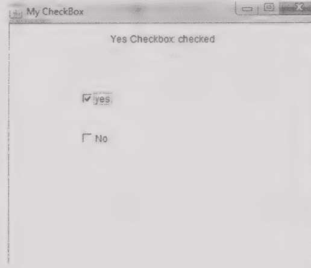

## AWT CheckboxGroup

我们通常创建一个 `CheckboxGroup` 类的对象来帮助我们将许多复选框分组在一起。它继承自 `Object` 类。每组中应该有一个复选框处于“开启”状态，组中的其他复选框处于“关闭”状态。以下是一个示例：

```java
import java.awt.*;

public class MyCheckboxGroup {
    MyCheckboxGroup() {
        Frame fr = new Frame("My CheckboxGroup");
        CheckboxGroup cg = new CheckboxGroup();
        Checkbox cb1 = new Checkbox("yes", cg, false);
        cb1.setBounds(100, 100, 50, 50);
        Checkbox cb2 = new Checkbox("No", cg, true);
        fr.add(cb1);
        fr.add(cb2);
        fr.setSize(400, 400);
        fr.setLayout(null);
        fr.setVisible(true);
    }

    public static void main(String args[]) {
        new MyCheckboxGroup();
    }
}
```

该代码将返回以下图形界面：

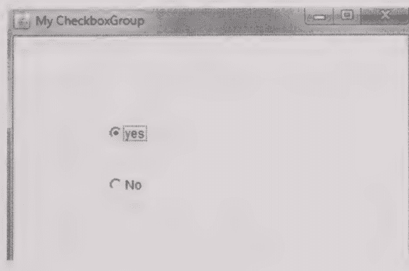

你会发现每次只能勾选一个复选框。我们还可以为 `CheckboxGroup` 添加一个 `ItemListener`。下面的示例展示了这一点：

```java
import java.awt.*;
import java.awt.event.*;

public class MyCheckboxGroup2 {
    MyCheckboxGroup2() {
        Frame fr = new Frame(" CheckboxGroup");
        final Label lab = new Label();
        lab.setAlignment(Label.CENTER);
        lab.setSize(100, 100);
        CheckboxGroup cg = new CheckboxGroup();
        Checkbox cbl = new Checkbox("yes", cg, false);
        cbl.setBounds(10, 20, 100, 20);
        Checkbox cb2 = new Checkbox("No", cg, false);
        cb2.setBounds(10, 50, 100, 20);
        fr.add(cbl);
        fr.add(cb2);
        fr.add(lab);
        fr.setSize(400, 400);
        fr.setLayout(null);
        fr.setVisible(true);

        cbl.addItemListener(new ItemListener() {
            public void itemStateChanged(ItemEvent ev) {
                lab.setText("Yes checkbox: Checked");
            }
        });

        cb2.addItemListener(new ItemListener() {
            public void itemStateChanged(ItemEvent ev) {
                lab.setText("No checkbox: Checked");
            }
        });
    }

    public static void main(String[] args) {
        new MyCheckboxGroup2();
    }
}
```

运行代码并点击任何复选框。你将在标签上看到一些文本。

当你点击另一个复选框时，文本会改变：

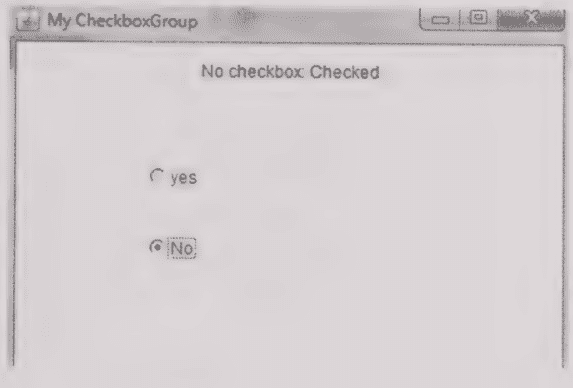

我们已成功地为复选框组添加了一个 `ItemListener`。

## AWT Menu and MenuItem

这些用于向菜单添加菜单和菜单项。通过创建一个示例可以最好地解释这一点：

```java
import java.awt.*;

class MyMenu {
    MyMenu() {
        Frame fr = new Frame("My Menu and MenuItem");
        MenuBar mnb = new MenuBar();
        Menu mn = new Menu("File");
        Menu smn = new Menu("Save");
        MenuItem i1 = new MenuItem("New");
        MenuItem i2 = new MenuItem("Copy");
        MenuItem i3 = new MenuItem("Cut");
        MenuItem i4 = new MenuItem("Save");
        MenuItem i5 = new MenuItem("Save As");
        mn.add(i1);
        mn.add(i2);
        mn.add(i3);
        smn.add(i4);
        smn.add(i5);
        mn.add(smn);
        mnb.add(mn);
        fr.setMenuBar(mnb);
        fr.setSize(400, 400);
        fr.setLayout(null);
        fr.setVisible(true);
    }

    public static void main(String args[]) {
        new MyMenu();
    }
}
```

运行代码你将得到一个窗口。点击窗口左上角的 File 菜单。你会看到下面有几个菜单项。点击 Save 选项并查看添加其上的子菜单：


## KeyListener Interface

在你更改键的状态后，`KeyListener` 将收到通知。通知是针对 `KeyEvent` 完成的。`java.awt.event` 包中的 `KeyListener` 接口有三个方法：

- `void keyPressed(KeyEvent ev)`
- `void keyReleased(KeyEvent ev)`
- `void keyTyped(KeyEvent ev)`

考虑以下示例：

```java
import java.awt.*;
import java.awt.event.*;

public class MyKeyListener extends Frame implements KeyListener {
    Label lab;
    TextArea area;

    MyKeyListener() {
        Frame fr = new Frame("KeyListener");
        lab = new Label();
        lab.setAlignment(Label.CENTER);
        lab.setSize(100, 100);
        area = new TextArea();
        fr.add(lab);
        fr.add(area);
        fr.setSize(400, 400);
        fr.setLayout(null);
        fr.setVisible(true);
        fr.addKeyListener(this);
    }

    @Override
    public void keyPressed(KeyEvent ev) {
        lab.setText("Key Pressed");
    }

    @Override
    public void keyReleased(KeyEvent ev) {
        lab.setText("Key Released");
    }

    @Override
    public void keyTyped(KeyEvent ev) {
        lab.setText("Key Typed");
    }

    public static void main(String args[]) {
        new MyKeyListener();
    }
}
```

执行代码并点击任何复选框。你将在标签上看到一些文本。


## 结

这标志着本书的结束。Java 是一种流行的语言。很容易学习，特别是面向对象编程。它支持多态、继承和封装。要编写 Java 代码，你需要 Java 编译器 (`javac`) 来编译代码并生成 `.class` 文件。`.class` 文件拥有字节码，它是平台无关，可以在任何平台上运行，例如 Unix、Windows、Mac OS 等。

## 关于作者

Daniel Bell 出生于布朗克斯。九岁时，他随父亲搬到尼斯。他在 2012 年在尼斯大学获得计算机科学博士学位。Daniel 正从事数据管理的研究，重点是与大数据和数据共享相关的课题，如概率数据、数据定价、并行数据处理和数据安全。他的空闲时间编写计算机编程和数据科学的书，帮助初学者轻松编写代码。他住在巴黎附近的沙提。

## 致谢

首先，我要诚挚地向我的家人表示感谢，我的妻子 Genevieve 和儿子 Adan 在我日常生活中持续的支持，感谢他们的耐心、动力和热情。除了家人，我还要感谢我的朋友和同事：Jule Villepreux 教授、Hugo D. 和 James Rivera 博士，感谢他们的鼓励、见解和挑战。感谢我的实验室同事：Gang Yu、Ting Fan、Djibrilla Diallo 和 Juan Sanchez，感谢启发性的讨论，感谢我们在截止日期前一起奋斗的不眠夜晚，感谢我们度过的所有快乐。最后，我要感谢我的父母 Guy Bell 和 Ezra Bell，感谢他们给了我生命，并在我的一生中精神上支持我。

感谢阅读！请留下简短的评论并告诉我们你的想法！

## 书籍简介

本书将向你介绍 Java 的一些基础概念。Daniel Bell 将教你熟悉 Java 语言、其特性以及如何在你的系统上安装 Java。这将帮助你快速、轻松地掌握 Java 概念。作者通过循序渐进的方式带你了解该语言特定的概念，并解释 Java 背后的面向对象哲学。无论你是否具备编程知识，这本书对于想要从 A 到 Z 学习 Java 编程的绝对初学者来说都是一本完美的指南。事实上，《Java：绝对初学者教程》是一本开始学习 Java 编程的极佳教材，通过它，你可以在几小时内学会变量的基础知识以及如何在 Java 中创建不同的函数。

本书分为多个章节，每章都探索 Java 编程语言的不同特性。作者提供了许多 Java 代码，每段代码都执行不同的任务。每段代码旁边都提供了相应的解释，以帮助读者理解代码中各行的含义。此外，书中还提供了显示每段代码应返回输出的截图。作者使用了通俗易懂的语言，即使是初学者也能轻松理解。


