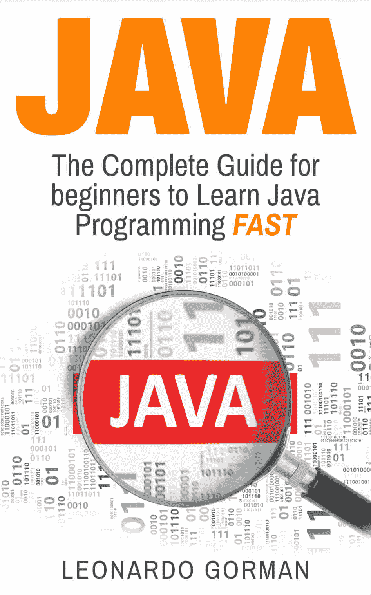

# Java：初学者快速学习 Java 编程完全指南



## 介绍

本书的目的是帮助你学习什么是编程以及什么是 `Java`。我们大多数人都听过“计算机编程”和“编码”这些术语，但可能并不了解其他。计算机编程自计算机发明以来就存在了——它是组织计算机以运行各种程序的方式。编码是指人们通过计算机编程语言与计算机交流的能力。就像人类一样，计算机也有多种可以用来相互交流的语言。

如果第一段话激发了你的兴趣，那么这本书绝对是为你准备的。我们大多数人非常感兴趣为什么以及我们如何学习获得对特定主题或事物的更多控制权——一旦我们了解了基本原理，计算机其实非常简单！通过本书的学习，我希望让你对编程领域以及在编码和编程世界中使用 `Java` 的术语和基础功能感到熟悉。虽然我不能保证你会掌握关于 `Java` 和计算机的一切——但我保证你将拥有足够的技能和对基本原理的理解，让你能够在自己的计算机沙箱中大显身手（在第一章会有详细介绍）！

在书的末尾，我将介绍许多有助于提示和资源，这些资源可以帮助更好地掌握 `Java` 本身以及如何使用它。虽然其中的许多提示和术语现在对你来说可能没什么意义，但请记住，你正在建立一个基础和资源列表，当你在编码编程之旅中遇到波折时，可以回来查看。我鼓励你阅读所有内容，并尝试记住你能记住的部分——并在需要时回来查看剩下的。

我鼓励你在 `Java` 程序中实践书中的一些想法。将本书作为一份编程经验指南，并结合使用，为学习新事物创造最长期的记忆。确保尝试多次，以确保你完全理解了这些概念，并能够在任何时候轻松复制它们，即使你需要查阅资源来准确找到你正在寻找的内容。虽然人类不可能记住所有内容，但本书应该带给你一些你可以使用的通用知识，让你觉得自己已经稳固地掌握了 `Java` 的入门概念。

如此，我期待你逐章完成这些章节。学习计算机编程等技能的能力，真的受限于你愿意投入其中的精力。我们将从 `Java` 开启编程之旅，并用整一章专门介绍编程的基本术语和功能，为你在虚拟计算机世界打下坚实的基础。

## 第 1 章 什么是编程？

你很可能在生活中以前就听过“编程”这个词，无论是在互联网上，还是在与人讨论技术时。如果你像我一样，你可能只是微笑并点头，好让自己看起来听懂对方在说什么——而不是承认你对其包含的内容完全没有坚实的了解。涉及到计算机编程时，`Java` 是我们在计算机编程世界中所关注的语言。在我们深入研究 `Java` 的细节之前，对编程有一个基本的理解是非常重要的。

大多数人可以通过点击图标来操作计算机上的基础图形界面，或者在 Word 文档中打字来为学校准备论文或准备简历以获得工作。然而，原始的计算机没有这些图形图标，看起来更像是由不同文本块连接而成的块。为了理解屏幕上所有无数字符的含义，人们必须学习如何使用计算机的语言。这就是编程（或正式术语中的计算机编程）的本质——理解如何通过计算机的语言来让它执行你想让它完成的任务。

当你编程时，你始终要记住，尽管有语言规则和结构语法规则只允许你做某些事情，但如果你愿意，你可以对现有的基础上进行改进。某些方法对别人有效，但对你可能效果一般。如果由于某种原因，某事的处理方法对你来说不合逻辑，请参考外部资源，以了解为什么要那样处理。在本书的书中，我的目标是让你很好地理解 `Java` 中事情是如何做的以及为什么这样做；然而，由于这是一本初学者指南，确实缺乏你可能在短时间内就准备好的中级和高级选项及描述。

为了学习如何向计算机说 `Java` 以对其进行编程，对于一个接受训练的新程序员来说，首先对计算机编程什么是相当深入的想法是无价的。计算机编程的基本活动包括对编程本身的理解、如何生成算法、理解计算机分析的能力、如何验证你的算法正确的想法，最后实现（或编码）你所需的算法，在这里是 `Java`。首先是一些在开发计算机编程技能时非常有用的关键术语。

### 常用术语与定义

- `Algorithm`（算法）：一种使用逻辑或数学技能解决问题的方法。
- `API`：应用程序编程接口。它本质上是一组允许代码与其他网站或软件通信的规则。
- `Code`（代码）：也称为源代码。它是使用编程语言编写的指令集。
- `Code Editor`（代码编辑器）：一种专门为计算机程序员设计的文本编辑器程序。可以作为应用程序使用，也可以集成到软件或浏览器中。你基本上可以检查你编写的代码，就像报纸或杂志的传统文字编辑一样，只不过是数字化！
- `Compiler`（编译器）：这种程序允许将你编写的代码翻译成所谓的二进制（即构成实际机器码的 0 和 1）。
- `Concatenation`（拼接）：这是将字符串字符串（例如两个列表）合并的能力。
- `Control Flow`（控制流）：这是计算机对代码段运行顺序的控制。本质上它是数据流流动的规则。
- `Dump`（转储）：这是数据列表或类似于程序崩溃时保存的文本文件。它对于诊断问题（为什么会崩溃）非常有帮助。
- `Floating point`（浮点数）：基本上它是一个小数，其中小数本身被称为浮点（例如 4.56）。
- `Function`（函数）：获取特定结果的编写指令，可以通过简单的编写它们或“调用”它们来使用。
- `GIT`：这是一个用于版本控制的分布式软件部分，用作源代码管理系统（也简写为 `SCM`）。
- `GUI`：该缩写代表图形用户界面，指的是你能够看到并与之交互的软件（即你通常会想到的图标或程序，例如浏览器浏览器）。
- `IDE`：这是一个代表集成开发环境的缩写。它比你的基础代码编辑器稍微高级一些。
- `Interpreter`（解释器）：这允许在程序运行时翻译计算机代码（机器码）。
- `Iteration`（迭代）：重复的指令。
- `JSON`：这是一种用于在位置之间传输信息的格式。
- `Libraries`（库）：预写的代码，用于实现你不需要自己编写常用的编码功能。
- `Logical Operation`（逻辑操作）：使用布尔逻辑（在使用此类计算机操作编码时，`and`、`or` 和 `not` 是关键词）。
- `Loop`（循环）：使用一段代码运行直到其设定的条件满足为止。
- `Markup Language`（标记语言）：一种语言格式，如 `HTML`，相对简单并用于格式化页面。
- `Nested`（嵌套）：一个物体包含在另一个物体内部的情况。
- `Pseudo code`（伪代码）：代码与书面语言之间路径的通用描述。这是用英语编写的代码，允许发送消息来告诉特定代码做什么。
- `Recursion`（递归）：当某个事物实际上引用自身时就会发生这种情况。
- `Run time`（运行时）：程序正在使用或运行的时间。
- `Sandbox`（沙箱）：用于运行程序测试的测试场。
- `SDK`：一个代表软件开发工具包的缩写。`SDK` 是一个软件工具包，允许你为特定的框架或平台创建新的应用程序。
- `Subroutine`（子程序）：可以在程序内部任何运行的代码部分或函数。
- `Syntax`（语法）：计算机语言中指导用法或正确结构的规则集。
- `Variable`（变量）：存储的数据，并允许用户根据意愿随时进行修改。

现在你已经有了一个帮助理解核心概念的小型术语字典，我现在将提供关于编程如何工作以及其本质的更详尽描述。接下来的这几段将为你提供关于什么是以及如何编程的优秀知识基础。这本初学者理解指南将让你建立起基础编程原理的正确认知和解释。

### 什么是编程？

计算机编程被定义为一个过程，将计算问题转化为可执行的计算机程序。编程的最终目标是在给定的编程语言中发现指令，以便解决问题或自动执行特定任务。为了完全理解如何执行这一过程，人们应该具备良好的分析能力，理解计算机的工作原理，能够理解并生成算法，最后用给定的编程语言实现（或编写）算法。请记住，语言不止一种，所以编程的世界比这本书的范围要大得多。

除了这些基本原则外，我想重申，学习计算机编程代码实际上是在为系统本身或其中使用的程序奠定基础。当你编程时，你需要在维护源代码的同时进行调试和测试。本质上，一旦你开始为程序或系统编写代码，你就能够快速解决问题并消除代码中的故障。这本书应该作为一份优秀的初学者指南，为你提供在开始过程中可能遇到问题时所需的技能。

此外，通过编程和编码，你正在学习如何构建和实现系统。这些术语通常互用，描述计算机本身的编程、创建源代码或实施上述编程或编码。一旦你更熟悉编程和编码可以做什么，你将学习它们是如何共同工作以创建虚拟环境的，同时也能够识别细微的差别。

### 如何生成算法

算法之所以重要，是因为它们允许我们在计算机世界中执行任务，比如调度任务、设计计算机算法甚至解决其他优化问题。本质上，它们是计算机执行的指令，使其以高效的方式完成任务。有时人们将它们称为“食谱”，因为它们在结构上相似，而且如果你发现了一种执行特定任务的好方法，它将是非常有成就感的（就像传统食谱制作出的巧克力奇奇干一样）。

至于你如何创建自己的算法，这对于任何计算机开发者来说可能是一项复杂的任务，尤其是当你刚开始时。好消息是，你可能很长一段时间都不会处理高级算法。你将使用的算法是像创建日常函数或编写循环的内容。本质上，你正在编写算法来为你完成任务。创建一个高效算法设计有一个简单的测试列表：

- 你想要使用能够减少操作次数的语言特性。
- 你想要尽可能减少迭代循环嵌套。
- 在可能的情况下，想要在循环之外定义 `variables` 的能力。
- 尝试使用自动循环索引而不是手动操作。
- 尝试使用巧妙的削减技术（如分治和查询优化），以尽力减小递归过程的大小。

基本上，当你创建或使用算法时，你希望确定一种不仅能完成任务和解决问题的方案——你还希望以最有效的方式完成。获取高效性洞察的一种方法是查看他人已经完成的工作。在本书中，我无法给你提供对算法的完整理解，但我非常想给你提供一个良好的起点。我将给你一个示例，从这里开始，我希望它能为你未来的项目提供一个良好的跳板。

这个示例是一个非常简单且相当标准的算法示例。它通常被称为“Hello World”程序，以下内容将是它的示例。在接下来的章节中，我将介绍如何使用和运行 Java，这只是你可能想要输入并尝试的一个示例（初学者算法）。

示例算法

```java
public class HelloWorld
{
    public static void main (String[] args)
    {
        System.out.println("Helloworld!");
    }
}
```

这是一个你可能使用的非常基础的算法示例，用于开始理解你的编程技能如何被使用。如果你一直尝试让一个算法运行但没有运气，请检查一些简单的内容，如空格、错误的字符或符号——这通常归结为一个简单的错误。

### 理解计算机分析

正如字面意思所暗示的，计算机分析包括在你的系统或程序内部进行查找和排除查故障或软件问题。本质上，理解计算机如何工作是能够隔离任何问题并解决它的关键组成部分。编程中的这部分是你应该牢牢掌握的，就像学习任何新任务一样，非常熟悉你的硬件或工具如何运行以及为什么运行是有益的。计算机分析也是如此。跟上最新的技术、程序，并将理解如何以及为什么要使用某种方法或程序融入其中是至关重要的。拿起这本书并阅读它是学习编码和编程工作原理的绝佳开始。当你掌握了 `Java` 之后，不要害怕！还有许多不同的语言和系统供你探索和掌握。技术最伟大的点在于，它在不断创新，成为它可以达到的最好。了解如何保护系统和解决问题将让你在生活的许多方面走得很远，特别是在涉及敏感问题或数据时，这最终将是你作为一名程序员需要处理的问题。

### 如何验证你的代码是否正确

验证代码是否正确的一种可靠方法是尝试运行它。然而，如果你是在沙箱之外进行代码，你还有几种其他方法论可以使用，以确保你传达了正确的信息。有很多不同的在线网站作为代码编辑器，你可以利用它们来检查代码。这些网站如 `Tinkerbin`、`Write Code Online` 或 `Codepad`。基本上，如果你对你正在使用的任何语言进行代码编辑程序的谷歌搜索，你就能找到一个合适的界面来操作。

拥有一个沙箱来玩你的编码是检查代码的一种非常高效的方法。通过利用这种方法，你可以创建一个虚拟环境来测试代码，以确保它能够完成适当的功能。如果你要编写的代码会影响你尝试构建的程序、软件甚至网站的能力，那么这一点是非常重要的。

另一个你可以用来帮助确保拥有正确代码的绝佳资源是被称为 `library`（库）的东西。由于你可能对书库熟悉，这很相似，因为它包含代码的大型虚拟库。如果你需要确保某些东西符合标准并运行正常，使用这种方法是非常棒的。然而，我提醒你，要始终能够理解你正在使用的代码——甚至用代码编辑器检查这些代码。你应该能够理解代码，以便在出现问题时对其进行修复。如果你只是从 `library` 中复制和粘贴而不理解，可能会在未来导致巨大的潜在问题。

现在你已经对编程是什么有了很好的通用基础，让我们专门转向 `Java`。我将在接下来的章节中列出关于什么是以及如何使用 `Java` 及其功能的重要理解。这些都将建立在本章信息的基础上，因此希望你对编码和编程世界的一些主要部分有相当牢固的理解。

## 第 2 章 - 什么是 Java？

现在你对编程是什么有了更好的了解，让我们开始学习 `Java` 到底是什么以及它是如何融入编码和编程世界的。作为一种计算机编程语言（这也是 `Java` 的本质），它被设计成一种基于类、面向对象、并发且具有尽可能少实现依赖项的语言。本质上，任何支持 `Java` 的平台都可以运行 `Java` 而无需重新编译。这是 `Java` 成为今天最流行的语言之一的原因之一。开发者用来描述 `Java` 多平台使用的一个短语是“一次编写，到处运行”（Write once, run anywhere），也被缩写为 `WORA`。

作为一种语言，在理解语言内部某些事情的为什么以及如何做的时，你可能会遇到学习曲线。通常在本书书中，我尝试尽可能为你提供多的解释，而不会让初学者陷入不必要的细节中。尽管如此，就像英语语言一样，可能会出现你无法完全理解为什么以某种特定方式格式化或处理的规则和情况。与其花费精力理解这些事情，我鼓励你直接接受它们的本来面貌。虽然你可能想要一个更好的答案，但遗憾的是，我认为只有创建者自己才知道它们背后的逻辑——这可能仅仅归结为他们的偏好或计算机的理解能力。

`Java` 是由一个名叫 `James Gosling` 的人于 1995 年创建的。他将 `Java` 设计为一种编程语言，它比 `C` 和 `C++` 等语言具有更低级的设施。本质上意味着它关注的是运行计算机程序的高级基本要素，而不是这些其他编程语言拥有的更微小的微观细节。`Gosling` 在创建 `Java` 时使用了五个主要目标，这些目标是：1) 它必须是线程化的、解释的和动态的；2) 它必须是面向对象的、简单且熟悉的；3) 它必须是安全且健壮的；4) 它必须以高性能执行；5) 它必须是可移植的且架构中性的。

这五个目标解释了为什么它是如此被广泛使用的语言。这些目标允许用户拥有一种主流、可用且有效的方法来构建从软件到网站的任何东西。用户友好程序将计算机编程的复杂性带来了更易理解的体验，特别是对于新用户和那些刚开始学习的人来说。这就是为什么我个人建议并发现对于初学者牢牢掌握这一点很重要。它被非常广泛地使用，因此对于任何尝试工作甚至只是作为爱好计算机编程和编码的人来说，了解和理解它都非常重要。

现在有了关于 `Java` 的一点背景，如何在你的系统上获取实际程序呢？基本上，编写 `Java` 最困难的事情之一是获取运行它所需工具。`Java` 是一个独立的平台，这意味着它可以在任何操作系统上运行。其原因是名为 `Java Virtual Machine` 的程序（也称为 `Java Runtime Environment`）。为了编码 `Java`，你需要下载这个程序才能。你可以实际上确保你拥有这个程序，因为有些计算机已经安装了它，或者通过 `Java` 网站安装。许多操作系统都有选项，所以一旦你找到并下载了它，就准备就绪了。

本质上，一旦你拥有了所有软件，就会开始在文本编辑器中编写代码。如果你选择的是 `NetBeans` 以外的选项，你会发现编写源代码的地方被保存为 `.java` 扩展名的文件。有一个名为 `Javac` 的程序，它会将源代码转换为 Java 字节码。这个过程被称为编译，仅供你参考。在 `Javac` 完成任务后，它会创建一个扩展名为 `.class` 的新文件，而不是 `.java`。也就是说，如果你的代码中没有检测到任何错误——否则你将不得不回回去寻找并修复你可能犯的那个微小错误。最后，到这一步，你就可以在 Java 虚拟机上运行你的代码了！如果这对你更有帮助的话，这里是运行代码将将用到的三个基本步骤——首先创建带有 `.java` 扩展名的源代码，然后你将使用 `Javac` 创建一个以 `.class` 结尾的文件，最后你运行编译后的类。

现在你已经对如何在 Java 中创建和完成实际编码有了更深入的理解，你应该可以开始创建自己的代码的过程了！在建议的 `NetBeans` 软件中，它是自学 Java 某些门道的绝佳环境。这一章实际上是对该软件的基础性描述，以及关于如何下载和开始使用的通用概述。在本书的剩余部分中，我将更多地讨论帮助你理解在 Java 中必须这样做以及为什么要做的某些技术的技术细节（即：学会流利地使用这种语言，并用事物运行原理的知识来支撑你的流利度）。

## 第 3 章 - 条件与控制流

为了能够正确利用 Java，理解语言的规则非常重要，就像英语中的语法和拼写一样。为了正确地告诉计算机做什么，我们需要理解编码和编程世界中`条件（conditions）`和`控制流（control flow）`这些术语的具体含义。对于条件语句，我们可以将其看作“如果/那么”语句，用于告诉计算机执行不同的动作或进行计算。至于控制流，它是程序中的指令、语句或函数调用被执行或评估的顺序。你可以将这些看作是句子结构规则，以及常用分号或其他文学符号表示规则的用法。这些规则在编程中非常重要，因为计算机与人类不同，它们没有演绎推理能力。它们完全按照指令来执行功能。


`条件`和`控制流`共同工作，以创建合适的数据环境流。如果没有这两个概念中的任何一个，Java 就很难以这种用户友好的方式运行。计算机的一个关键特性是它是可靠且直接的，不会对同一事物产生多种解释。计算机不读心，它们执行任务是其功能。

## 条件

如果你在高中或大学上过英语课，你可能在该背景下听过`条件语句（conditional statement）`这个术语。尽管这与英语教室的语境显然不同，但基本功能大致相同。编程语言有两种不同的类型：函数式和命令式，Java 属于命令式类别，因此我们将涵盖这种类型编程的特定条件。

当我们观察命令式编程语言时，通常会看到“条件语句”这一术语。这些语句本质上是具有一个或多个条件的结构，如果语句或多个语句被确定为真，则需要执行；取决于语句的情况，某些在判定为假时也会执行。在 Java 中，我们可以看到四种语句。这四种语句是 `if/else` 语句、`if` 语句、`switch` 语句或最后的嵌套 `if` 语句。存在带有 `Boolean` 表达式的 `if` 语句（`Boolean` 是当有两个结果时，比如真或假）。而 `if/else` 语句发生在 `if` 语句后面跟着一个 `else` 语句时，当它在代码中执行时会返回假的结果。`嵌套 if` 语句是指两个语句中的其中一个“嵌套”在另一个内部；这些要么是 `if` 或 `else` 语句。最后，`switch` 语句接收一个变量并针对一组给定的变量对其进行测试。

这些语句都由计算机可以处理的问题组成，并执行功能，这些功能在每个本质上都是由 `Boolean`（或双结果）表达式组成的——`switch` 语句除外，后者将一个变量与列表进行比较（例如，给定列表中的最大数字（最大值）是多少）。尽管多个语句可以用任何形式的 `if` 语句格式封装在另一个语句内部，但重要的是记住，它们的核心是在问一个简单的二一问题。正如我之前所说的，计算机不具备推理能力，这有力地强调了这一点：这些问题要么要求两种响应之一，要么就会产生第三种选择——即错误。

接下来我们将介绍更多关于`控制流`以及这些语句在编程中是如何执行的。它与这些条件语句也有一些重叠，因为它们都是向计算机通信（编码）它应该做什么以及应该怎么做的方法。

## 控制流

正如我之前提到的，`控制流`是给定程序执行或评估语句的方式。与任何语言一样，你必须遵循许多规则才能与另一个人（在这种情况下是机器）进行适当的通信。理解这些事情背后的逻辑对于正确地使用计算机语言至关重要。学习`控制流`，即使我们专门谈论 Java，也可以很容易应用到其他语言，尽管具体细节可能不完全相同。这是构建你编程和编码未来的另一个部分，因此确保你尽可能地理解它非常重要。

`控制流`语句在每种编程语言中都不同，但可以根据它们产生的影响进行分类。这些语句可以属于五种独特的类别。这五种语句是：

1. 仅在满足条件时执行的一组语句
2. 跳转到另一个语句继续执行
3. 在满足特定条件之前执行零或多次的一组语句
4. 执行一组语句后，流将返回
5. 停止程序，这将防止进一步的执行

在学习 Java 时，理解如何使用这些语句是一项重要的工作。Java 的优势在于这些都是惯用函数，当你开始尝试编码和编程时，可以很容易进行大量的尝试和错误。在进入更高级的内容之前，你务必熟悉这些重要且关键的特性。在编程之旅的每一步中，请确保你正在进行练习，并确保你对所执行的操作、如何做以及为什么要这样做拥有坚实的能力和知识。

## 第 4 章 面向对象的 Java

在类面向对象的语言中（Java 正可以这样描述），你面对的是一种真正基于“对象”概念的程序范式。这些对象可以包含数据（形式为字段，通常称为属性）和代码（形式为过程，通常称为方法）。对象的的一个特性之一是，对象的程序能够访问并通常可以修改其所属的特定对象的数据字段。

由于 Java 是一门面向对象的语言，它利用了一些基本概念来归入这一类语言。类和对象的概念尤为重要，这也是我们在本章将讨论和分析的内容。在 Java 中，一个对象既有状态也有行为。当我们在编程语境下谈论类时，我们看的是一个允许描述对象所支持的状态或行为的轮廓。本质上，类是你用来定义对象是什么的。现在，让我们更清楚地了解这些每一个项是什么，从对象开始。

当我们思考“现实世界”的对象时，我们可能会想到狗、其他人或汽车。我们想到的这些每个对象在 Java 中一样，都拥有状态和行为。例如，如果我们观察一个人类，他们有不同的状态（姓名、肤色和种族），他们也有行为（说话、工作或睡觉）。这些每一个状态和行为都可以被视为同人的不同部分。事实上，每一个人都有一组不同的行为和状态，这与我们每天交互的大多数对象一样。

与现实世界的对象相比，在某些情况下可能存在非常相似的特征。软件对象的存储存储在字段中，而行为则体现在方法中。所以基本上，方法在内部同时操作单个对象，并允许通过方法在对象之间进行通信。就像人类的例子一样，我们内部进行着通信，并使用这些内部存储的方法来访问其他对象（无论是汽车、计算机还是另一个人类）。

那么类呢？它可以被定义为创建单个对象的蓝图。任何类都可以包含三种类型的变量。这些变量是局部变量、实例变量和类变量。局部变量是局部的，或者是在你的方法内部的。它们在本地——或方法内部——进行初始化和声明。当方法完成后，变量就会被销毁。实例变量是那些在类内部但实际上在方法外部的变量。它们在类本身实例化时产生。实例变量能够从其所属类的任何代码块或构造函数被访问。最后一种变量类型类变量，正如其名，是在类内部的。然而，它们在任何方法之外运行，但它们可以使用方法来访问值。

如果我们想从类本身创建一个对象怎么办？实际上有三个不同的步骤允许我们做到这一点。这些步骤是声明、初始化和实例化。变量声明是指变量既有一个对象类型又有一个变量名称。实例化是指你在用于创建特定对象时使用的 `new` 关键字。最后，初始化是用于调用特定构造函数的，并具有初始化新对象的能力。例如，你可以在 `human` 类中创建一个人（对象），然后将小狗命名为 `Spot`，给构造函数命名命名并创建一个新对象。让我下一段落中对构造函数为你提供更详细的说明。

当我们深入研究类时，我们还必须谈论构造函数。构造函数是一些代码，允许你从类创建一个特定的对象。构造函数是每个类中必不可少的。如果你不包含一个，Java 编译器实际上会为当前类创建一个默认构造函数。你始终可以确定，如果你创建一个对象，该对象将被调用一个或多个构造函数。从技术上讲，构造函数的名称确实应该与它们所在的类名相同；然而，类可以有多个特定的构造函数。例如，如果你有一个名为 `puppy` 的类，构造函数可以是 `lab` 或 `bulldog`——或者像上一段示例中那样像 `Spot` 这样的名字。现在，让我们谈谈在声明类时需要遵循的一些规则。

### 源文件声明规则

当你处理不同的源文件语句或导入语句时，这些源文件声明规则实际上是关键的。当你声明特定的类（即带有 `.class` 扩展名的 Java 类文件）时，它们也很重要。

- 每个源文件只能有一个 `public` 类
- `package` 语句应该始终出现在 `package` 内部的最
- 一个源文件可以有多个非公共类
- 在处理 `import` 语句时，你始终需要记住语句是写在类声明和包语句之间的。如果你没有任何 `package` 语句，则源文件的第一行应该是 `import` 语句
- 如果你同时有源文件和公共类文件，它们的名称应该相同。它们在文件末尾应该附加 `.java`。例如- `administrator.java`
- 当你同时有 `import` 和 `package` 语句时，它们关联的类在你正在使用的任何源文件中将完全适用

## 第 5 章 数据结构

在 Java 中，有某些由程序使用和定义的数据类型。我确定，以某种形式，你已经听过数据——它可能是手机使用的数兆字节或兆字节数据，或者你可能有一个存储了数太字节数据的电脑备份。这些不同的术语每一个都告诉你你的设备或备份可以支持和使用多少数据。

Java 实际上支持八种不同的原始数据类型。这些数据类型是 `byte`、`short`、`integer`（称为 `int`）、`long`、`float`、`double`、`Boolean` 和 `char`。现在你已经听过了这些数据类型，让我们分解它们，并告诉你的含义以及它们能为用户提供什么。

### 字节 (Byte)

`byte` 可以被视为内存大小的单位，它实际上是一组位（bits）或二进制单元，通常为 8 位，并作为一个单元进行操作。这对于你使用 Java 意味着什么？在 Java 中，它的最小值为 `-128`，最大值（包含边界）为 `127`，并且默认值为 0。这种类型的 `byte` 数据在 Java 中实际上被用于在大型数组中节省空间——大多数时候用于替代整数，因为 `byte` 实际上比整数小四倍。通常，你会看到 `byte` 的表示方式如下——例如 `-100 byte`。

### 短整数 (Short)

当 `byte` 数据需要完整的整数时，你可以使用 `short` 数据来包含实际上不需要或不需要整个整数宽度的整数值。在某些情况下，`short` 数据可以将你的 `short` 变量紧密排列在一起，以节省内存消耗。在 Java 中，`short` 数据类型是 16 位数据，最小值为 `-32.768` 或最大值为 `32,767`，同样默认值为 `0`。这些数值实际上是两个简单的方程——分别为 `(-2¹⁵` 和 `2¹⁵ -1)`）。这种类型的数据也适用于节省内存，就像我们在之前的字节节中讨论的 `byte` 类型数据一样。尽管如此，`short` 数据也可以用于节省内存，因为它比整数小两倍。你可能会看到 `short` 数据的表示方式示例，例如 `short s= 20000` 或 `short r = -100000`。

### 整数 (Int)

这种数据以完整、未缩写的形式实际上被称为整数数据（integer data）。整数数据的定义是数学整数的一个非常小的子集，可以被视为一组所谓的二进制位（通常称为 `bits`）。计算机硬件总是希望有一种方式让用户用整数表示数据（如内存地址或处理器寄存器）。在 Java 的用途方面，`integer` 或 `int` 数据是 32 位有符号补码整数，最小值为 `-2,147,483,648`，最大值（包含边界）为 `2,147,483,647`，默认值为 `0`。这些可以分别由方程 `-2³¹` 和 `2³¹ -1` 表示。整数数据是整数值最常用的数据类型，事实上，它经常被用作默认数据类型。然而，如果担心内存，你可能不想使用这种方法（如你所，最小值和最大值远大于前两种数据类型）。你还会看到这种数据以此格式表示，例如 `int a= 200000` 和 `int b = -100000`。

### 长整数 (Long)

正如其名称所暗示的那样，`long` 数据在其利用的最小值和最大值实际上非常大。`long` 数据的最小值为 `-9,223,372,036,854,775,808`，最大值为 `9,223,372,036,854,775,807` 且包含边界，默认值为 `0L`。这些由方程 `-2⁶³` 和 `2⁶³ -1` 表示。当需要比整数数据宽得多的范围时，使用 `long` 数据。你会看到像这些示例这样的 `long` 格式数据——`long a = 200000L` 或 `long b=-100000L`。

### 浮点数 (Float)

`Float` 数据我们看的是单精度 32 位 IEEE 754 浮点数。当你想要节省内存时，你可能想要考虑这个选项以节省更多数据。这种数据的默认值为 `0.0f`，这种类型的数据永远不会用于被视为精确的值，例如货币。你会看到它的表示方式如 `float f1= 345.6f`。

### 双精度浮点数 (Double)

`Double` 数据是一种双精度、64 位 IEEE 754 浮点数据。这种类型的数据是存储小数值的默认类型。始终记住，当你处理精确值或整数时，不应使用这些类型的数据。这种类型的数据默认值为 `0.0d`，示例——`double d1= 567.8`。

### 布尔值 (Boolean)

我们之前简要提到过 `Boolean` 数据。`Boolean` 数据是只有两种结果的数据类型：`true`（真）或 `false`（假）。它被用于查找和跟踪真、假条件。始终记住，与你可能想的那样，该数据集中实际默认值不是某些形式的零，而是 `false`。当你将真和假视为唯一可能的输出时，这是很合理的。你会看到这种类型的数据在示例中表示为如 `Boolean one =true`。

### 字符 (Char)

这种 `char`（或字符）类型的数据是单个的 16 位 Unicode 字符。这种数据由最小值 `\u0000`（或 `0`）表示，最大值为 `\uffff`（或 `65,535`），且最大值包含边界。这种类型的数据用于存储任何字符。你看到这种数据的表示示例是 `char letterB =”B”`。现在在讨论数据之前，我写过这些是原始数据类型。在思考数据时，对你有帮助的是参考我们上面关于非原始数据类的内容。然而，它们都是我们编码中的两种方式。

### 引用数据 (Reference Data)

在 Java 的世界中，我们还会看到被称为引用的对象。我们可以将引用变量视为实际上通过构造函数创建的变量。这些是无法改变的。一个示例是 `Animal = new animal()`。

任何原始类型数据都可以被视为字面量（literal）。字面量源码是具有固定值的。基本上你不能在值内部进行任何计算。这些字面量可以赋值给任何原始类型，示例 `char d = “D”`。当你思考字面量时，有些所谓的 `String` 和 `char` 字面量支持一些特殊的转义序列。这些如 `\n`（换行）、`\b`（退格）、`\s`（空格）、`\\`（反斜杠）、`\t`（制表符）、`\’`（单引号）、`\"`（双引号）、`\r`（回车）、`\f`（分页）以及 `\ddd`（八进制字符）。这些特殊的转义序列将来对你可能会有用。现在只需参考它们即可。

### 变量 (Variables)

正如在任何数学活动中一样，你可以在 Java 中操作变量，以便有助于的方式命名特定的变量。每个变量都有与其相关的不同规则集，可以应用于当前的变量。在 Java 中，你必须在使用变量之前对其进行声明。有我们可以使用的三种不同类型的变量，以便对变量本身进行适当的分类组织。在上一章节中，我们详细讨论了变量。

说到提示（hints），我将指的是我在书开头推荐你下载的用于运行 Java 的 NetBeans 软件中的那些提示。在使用该程序时有 29 个实用的提示——然而，如果你选择了 NetBeans 以外的软件，你可以在随后的资源部分查看更多实用的提示，我将在那里详细介绍。我将这 29 个提示分为几个简短的类别，当你遇到问题时，可以作为有用的参考指南。

你可以在 NetBeans 网站上找到更详细的这些提示，如果对任何术语或建议感到困惑，我建议去那里获取更清晰的说明——或者对某个术语进行快速的 Google 搜索也有帮助！下面有很多术语和解释，务必不要被海量信息所淹没，在 NetBeans 中开始编码和编程，以进一步了解这些提示如何为你的编程和编码提供帮助。在没有软件在面前运行的情况下，很难完全掌握它们！

在我们继续介绍提示和资源之前，我想指出最后一点让我受益匪浅的哲学——即力求中庸，不要让自己陷入极端。在学习和成长的过程中，不要过度纠结细节，也不要匆匆忙地漏掉重要的内容。

### 抽象（Abstraction）

有时当你处理类型转换时，可能需要处理空语句，这对于让编码和编程变得更易理解是足够的。在特定子类型中调用的某些空方法可能会限制代码的扩展性。

### APIs（APIs）

API 技术在 Java 7 中是可用的，现在可以使用，但未来可能不再存在。此外，请确保不要过度依赖任何类型的公共方法，因为这些公共方法都是可供任何人使用的。基本上，许多人可能在使用这些类别时需要注意，以确保一切运行顺畅，这些提示都是非常有帮助的。

### 赋值问题（Assignment Issues）

在赋值操作时，始终记住你可能会意外地遇到赋值问题。你也可以在赋值语句中声明变量，然而，在刚开始时，某些赋值语句可能会让你感到困惑，这通常是因为拼写错误导致的。熟悉这些表达式以及它们如何运作是有益的。在编码过程中，某些构造语句可能会让你感到困惑，因为大多数构造都应该遵循原则。

### 位运算（Bitwise Operations）

在位运算中，我们会看到诸如不兼容的掩码，这允许你确保位表达式是经过求值的。此外，我们还会看到报告值已偏移的检查，这在合理范围内范围内。

### 括号（Braces）

关于何时使用括号符号，对于诸如 `do while` 循环和 `for` 循环等项，以及 `if else` 语句，你应该始终在这些类型的语句中使用括号。

### 类结构（Class Structure）

类结构是某些数据方法，它确实需要组织和固定的定义。在本节中，重要的是记住类可能是一个接口，这是可以的。此外，还会有关于类、方法和私有方法的报告。初始化器可能无法访问实例变量或方法，并且只执行一次——如果需要，记住重做它。你还可以执行如组织成员甚至保护它们的类操作。我们还会查看非公共和公共类的构造函数，这也是一个因素。

### 代码成熟问题（Code Maturity Issues）

当我们使用的代码可能过时或失效时，我们会看到代码成熟问题。你可能会看到诸如过时的集合或其他错误，并移除过时且不可的代码。

### 空语句（Empty Statements）

在运行程序时，检查各种类型的空语句，包括 `do`、`for`、`if/else` 甚至 `while`。这允许另一种检查，以确保你不会因为简单的错误而导致编码错误。

### 封装（Encapsulation）

这是一个大领域，旨在让你更了解你在代码中包含、封装和保护的内容。这将包括诸如不同数据赋值的警告、关于包字段或保护内部类的警告。此外，还会查看保护和公共数据，以提醒你这些类别中的任何公共内容。

### 企业级 JavaBeans（Enterprise Java Beans）

所有这些类型的提示都与保持 Enterprise Java Beans 一致有关，通过它们自身的系统提醒你诸如会话问题或方法问题，甚至是本地和远程接口，或者只是缺少对某些构造的使用。这些提示都非常有帮助，可以用来检查一切是否运行良好。

### 错误修复（Error Fixes）


这些是诸如 Java EE API 中缺失的项目类路径，或者你可以访问创建字段或局部变量等项。这些都能帮助你发现并修复可能未意识到的错误。

## 终化（Finalization）

这些终化提示与获取计算机可能需要经历的终化任务警告有关。例如声明了 `finalize` 但没有调用 `super.finalize`、未声明保护的终化、甚至显式调用 `finalize` 等。知道如何结束事务与能够启动它们一样重要。如果你在终化中存在漏洞，你的系统可能会发生潜在的危害（就像编码或编程结构的任何部分存在漏洞一样）。

## 通用（General）

这些通用函数将帮助你删除冗余内容，并确保你使用的是功能性操作。这些通用函数还会提醒你通用的错误包或其他较容易发现和修复的问题。这些可能是你在 Java 学习体验初期可以处理的、对初学者更友好的提示和技巧。

## 导入（Imports）

通过导入，你有许多可以使用 `import` 类的指令的选项。你可以从同一个包导入，或从 `java` 语言包导入，甚至从分类或被排除的包导入。你还可以使用工具来组织导入，并添加如星号或未使用的导入等项以帮助分类。

## 初始化技巧与建议

注意某些可能阻碍未完全初始化内容的关键变量。这可能是在构造函数中传递了可疑参数，甚至是在构造函数本身中存在有问题的调用，最后是一个在初始化期间使用的静态非空变量。如果不处理这些问题，所有这些都可能给您带来问题或故障。

## JDK 迁移支持

在此类别中，我们查看了可以让您获得需要注意的潜在问题警告。这包括诸如不使用注解作为父接口、通过将不同的资源（如 `finally` 块）转换为 `try-with-resources` 来尝试解决给定的问题等。有一个 `@Override` 注解可以警告您处于重写状态。在所有的编程工具中都会出现许多类似类型的警告和问题。在此类别中，术语具有很强的解释性，并且基本上会在消息本身中告诉您如何修复该问题。

## Java 代码指标

Java 代码指标是一系列针对代码中出现问题的潜在警报。这可以是任何情况，例如类拥有过多的构造函数、字段或方法，甚至是类本身过于复杂或耦合性。请记住，你在任何时候都可能让代码变得过于复杂，导致系统可能无法正确处理你的数据。你还会看到关于匿名类拥有过多方法或复杂度以及算术表达式的提示。

## Java 持久化 API (JPA)

你将真正使用 Java Persistence API 来检查和验证不同的类等。在此部分，有很多短语会以 `verify` 开头，让你弄清楚诸如查找位置或子类以及验证访问级别或其他属性等问题。你还可以对实体表名或实体拥有的序列化变量进行操作。此外，还需要关于哪些类需要具有默认的公共/保护构造函数的说明。

## JavaDoc

JavaDoc 需要了解的两个良好术语是 `create JavaDoc`（创建 JavaDoc）或 `error in JavaDoc`（JavaDoc 错误）。这两个基础短语允许你在 JavaDoc 中创建内容，或者获知并意识到一个你需要检查的错误。

## JavaServer Faces

与其使用 JavaServer Faces（因为它将在下一个版本中弃用），建议使用 `CDI` 和 `Java EE`。

## 日志

你可能通过计算机上的各种实例进行登录和登录。在 Java 中，你会看到诸如 `multiple loggers`（多个日志器）、`no loggers`（无日志器）或 `logger declaration is not static final`（日志声明不是静态 final）之类的短语。这些都是基于类的提示，要么是为了提供信息信息，要么是为了对你创建的日志过程进行某些更改。

## Maven

这实际上用于解决缺失的类依赖。它会提醒你向项目中添加内容。

## NetBeans 开发

你可能会在 NetBeans 中看到一些术语，它们让你看到正在工作的错误或问题。这些短语可能是 `empty cancel for cancelable tasks`（可取消任务的空取消）或 `HelpCtx issues issues`（HelpCtx 问题，这些警告了误用或 `.org.openide.util.HelpCtx`），或 `instanceOf` 运算符非法使用的实例。使用短语 `@NbBundle.Messages` 来封装属性。所有这些都应该在 NetBeans 内部进一步探索。由于我们没有涵盖 NetBeans 的内部细节，在他们的库中有许多学习更多知识的机会。

## 性能

有很多性能提示可以帮助你改进编码方法。诸如创建新的 `Boolean` 短语和对已经装箱的值进行装箱（boxing）等操作会在某种程度上降低你的性能，而且从时间角度来看非常不划算。当你开始调用诸如 `String.toString` 之类的方法时，某些方法无法实现最佳性能。大多数情况下没有必要重造轮子，否则你可能会陷入麻烦。通常最有效的方法是直接利用 `String` 而不要让它过于复杂——尤其是当你正在学习时。

## 潜在错误

有一份非常长的潜在错误列表，实际上非常多，我只需列出它们是什么，因为你可以根据此发现问题。

## 资源

在辅助学习过程的资源方面，真的有成千上万的选择，这在起初可能会让你感到无从从。有时你很难确定到底什么对你会有帮助。我想给出的第一条建议是，你应该目标寻找能解决你特定问题的资源。在正在阅读的书籍或文章的标题中直接看到问题或答案是非常重要的。如果你使用这个简单的策略，我保证你在回答自己可能遇到的问题时会轻松得多。这不是一个万无一失的策略，但这是一个很好的起点。

如果你陷入了编程的瓶颈，你可能想看一些循序渐进的教程。这些教程可以提供步骤，分解说明如何以及为什么要使用某些术语、间距甚至数据类型。你可以通过搜索诸如“初学者 `Java` 入指南”之类的内容轻松地找到它们。如果这本书中的任何内容不像你所需的那么详细，那么需要更多帮助并寻找能帮你澄清或巩固想法的东西并不可羞耻。

我们还看到许多人通过论坛获得帮助。这些是极佳的获取渠道，因为实际上会有成千上万的人针对你正在研究的任何话题提供意见。在大多数情况下，在编程和编码社区中，人们通常想要帮助新手，因为他们知道曾经处在你的境地是什么感觉。记住，并不是所有的建议或代码示例对你都有帮助，现阶段请留在新手论坛，以免被那里海量的可能性让你应接不暇。

还有大量的文章或杂志可以阅读或订阅，以帮助你建立知识体系。我认为由于我们身处这样一个数字化时代，许多人忽视了实际的纸质媒体，但现在仍然有很多流行的杂志可以为你提供最新的、实用的提示和建议。在这些流行的杂志中，我发现 `Wired` 和 `PC World` 在我追求知识的途中非常有帮助。它们的写作水平通常是任何初学者都能理解的，如果他们没理解，它们还会提供供你理解的资源。这是一件很棒的事，因为媒体是，这些杂志旨在向对计算机、编码和编程感兴趣的各行各业的人提供信息。也不要忽视主要出版商的在线文章，你永远不知道有用信息会在何时何出现。

此外，永远不要低估库或代码编辑器的力量。这些工具的每一种都可以帮助你发现可能需要的代码，并确保这些代码不会充斥错误。这些资源提供了大量的可用代码，可以帮助你解决编码和编程过程中可能遇到的任何潜在问题源。然而，我提醒你要完全理解代码，以防出现任何问题时，你能够弄清楚在哪里以及如何解决它们。

YouTube 视频是寻找资源的另一个很棒的地方。这些视频让你能在更真实的场景中观察编程示例，这对你可能大有帮助。虽然阅读并获取信息很棒，但视频的魅力在于你可以直观地看到别人对你的要求以及他们是如何做的。无论我在书中如何努力，我都无法给你提供那样的演示，所以利用 `YouTube` 是一个很好的选择。至于视频质量，就像寻找任何资源一样，可能需要筛选掉没帮助的视频，以找到你真正可以使用的视频。给你的建议与在 `Google` 之类的搜索类似，让你的搜索描述尽可能接近你想看的内容。这使得结果有望包含那些词的组合。从我们讨论过的语句的角度来思考搜索函数，你需要指定你想要的数据，以便计算机返回你想要的结果。再次记住，计算机不会像人类那样推断含义——它们直率到近乎刻板。

记住同时利用你的大脑以及可能也对计算机编程和编码感兴趣的朋友，来为潜在问题脑暴解决方案。永远不要低估你自己，不要低估自己通过在自己的沙箱中尝试不同的解决方案来玩代码和编程来寻找答案的能力。如果起初没有成功，请再次尝试！

## 结论

这本书的目标是为你提供一份指南，说明什么是 `Java` 编程以及你如何学习将其应用到你自己的计算机编程技能工具箱中。虽然这是一本初学者指南，但我为你提供了一组非常好的通用术语、规则以及 `Java` 工作原理的示例。通过这本书的内容，我希望你能够获得一些易于理解的术语、观点和方法，并在继续学习更多知识时带上它们。

从概述计算机编程基础的第一章开始，我这本书的目标是让这些材料成为任何人都能理解的内容。我写作的目的是确保即使是完全的新手也能理解基础，并能够（即使你从不使用它们）更多地了解计算机的实际运作方式。由于技术（特别是计算机是我们日常生活中的重要组成部分），我强烈认为我们更多地了解它们，让我们的生活变得更容易。涉及到编程和编码，这可能不是每个人都喜欢的嗜爱好——但一旦你开始学习这种语言，它真的非常有趣。

就像学习任何新事物，尤其是一种语言一样，总会有学习曲线。如果你读了这本书仍然对编程世界感到疲倦，也许可以花几天时间反思一下内容，然后回来重读。我总是使用这种策略，让内容发酵一段时间后，通常会有更好的意义。对于那些在第一遍就完全掌握了内容的人，为你们点赞！
