# Java 完全参考，第十一版


# 关于作者

畅销书作家赫尔特·希尔特（Herbert Schildt）在三十多年里编写了大量关于编程的著作，是 Java 语言的领先权威。他的书在全球范围内销量数百万，并被翻译成所有主要外语。他编写了许多关于 Java 的书籍，包括《Java：初学者教程》、《赫尔特·希尔特的 Java 编程食谱》、《JavaFX8 编程入门》、《Swing：初学者教程》。他还编写了大量关于 C、C++ 和 C# 的著作。尽管他对计算的各个方面都感兴趣，但他的主要重点是计算机语言。希尔特拥有伊利诺伊大学的硕士和本科学位。他的网站是 www.HerbSchildt.com。

# 关于技术编辑

丹尼·考瓦德（Danny Coward）博士参与了 Java 平台的所有版本工作。他领导将 Java Servlets 定义引入 Java 的第一个版本及后续版本，将网络服务引入 Java ME 平台，并负责 Java SE 7 的策略和规划。他创立了 JavaFX 技术，最近设计了 Java EE 7 标准中最大的扩展——Java WebSocket API。从编写 Java 代码到与行业专家合作设计 API，再到担任 Java 社区进程（JCP）的高管多年，他对 Java 技术的多个方面都拥有独特且宽广的视角。此外，他还编写了两本关于 Java 编程的书籍：《Java WebSocket 编程》和《Java EE：大局图》。最近，他一直在利用他的 Java 知识来解决机器人领域的问题。考瓦德博士在牛津大学获得数学学士、硕士和博士学位。


| Claire Yee | | | | Pamela Pelton | | |

前言 ............................................................................ xxxi

## 1 Java 的历史与演变

### Java 的血缘

### 现代编程的诞生：C

### C++：下一步

### Java 的舞台已就绪

### Java 的诞生

### 与 C# 的联系

### Java 对互联网的影响

### Java Applets

### 安全性

### 架构无关性

### Java 的魔法：字节码

### 超越 Applets

### 更快的发布周期

### Servlets：服务器端的 Java

### Java 术语

#### 简单性

#### 面向对象

#### 健壮性

#### 多线程

#### 架构无关性

#### 解释型与高性能

#### 分布式

#### 动态性

### Java 的演变

### 创新的文化

### 面向对象编程

#### 两种范式

#### 抽象

#### 三大 OOP 原则

# Java 程序完全参考

## 第 13 章 I/O、Try-with-Resources 以及其他话题

### I/O 基础

### 流

### 字节流与字符流

### 预定义流

### 读取控制台输入

#### 读取字符

#### charAt() 和 setCharAt()

### Process

# Java 程序完全参考

## 事件类

### ActionEvent 类

### AdjustmentEvent 类

### ContainerEvent 类

### InputEvent 类

### KeyEvent 类

### MouseWheelEvent 类

# 目录

## 图像基础：创建、加载和显示

## 使用 RMI 的简单客户端/服务器应用程序

## 使用 java.text 格式化日期和时间

### DateFormat 类

### SimpleDateFormat 类

## 时间与日期基础知识

## 容器

## 绘制示例

## 第 32 章 探索 Swing

### JLabel 和 ImageIcon

### JTextField

### Swing 按钮

#### JButton

#### JToggleButton

#### 复选框（Check Boxes）

#### 单选按钮（Radio Buttons）

### JTabbedPane

### ScrollPane（滚动Pane）

### JList

### JComboBox

### 树（Trees）

### JTable

## 第 33 章 引入 Swing 菜单

### 菜单基础（MenuBasics）

### JMenuBar, JMenu 和 JMenuItem 概览

#### JMenuBar

#### JMenu

#### JMenuItem


## 目录

- 创建主菜单 ..................................................................................................................................... 1078
- 为菜单项添加快速记忆键（Mnemonics）和加速器（Accelerators） ................................................................................ 1082
- 为菜单项添加图像和工具提示（Tooltips） ............................................................................ 1084
- 使用 `JRadioButtonMenuItem` 和 `JCheckBoxMenuItem` ................................................................................ 1085
- 创建弹出菜单 ..................................................................................................................................... 1087
- 创建工具栏 ........................................................................................................................................ 1091
- 使用动作（Actions） ................................................................................................................................ 1093
- 整合整个 MenuDemoProgram ............................................................................ 1099
- 继续你对 Swing 的探索 ................................................................................................ 1105

## 第四部分 应用 Java

### 第 34 章 Java Beans ................................................................................................................................. 1109

- 什么是 Java Bean? ................................................................................................................................ 1109
- Beans 的优势 ................................................................................................................................. 1110
- 自省（Introspection） ............................................................................................................................................ 1110
- 属性的设计模式 ............................................................................................................ 1110
- 事件的设计模式 ...................................................................................................................... 1112
- 方法与设计模式 ............................................................................................................................ 1112
- 使用 `BeanInfo` 接口 ................................................................................................................... 1112
- 绑定和约束属性（Bound and Constrained Properties） ................................................................................................ 1113
- 持久化（Persistence） ................................................................................................................................................... 1113
- 自定义器（Customizers） .............................................................................................................................................. 1113
- JavaBeans API ....................................................................................................................................................... 1114
- 自省器（Introspector） .............................................................................................................................................. 1116
- 属性描述符（`PropertyDescriptor`） ................................................................................................................................... 1116
- 事件集描述符（`EventSetDescriptor`） ...................................................................................................................... 1116
- 方法描述符（`MethodDescriptor`） ................................................................................................................... 1116
- Bean 示例 ........................................................................................................................ 1116

### 第 35 章 引入 Servlet ................................................................................................. 1221

- 背景 ................................................................................................................................... 1221
- Servlet 的生命周期 ........................................................................................................................ 1222
- Servlet 开发选项 ................................................................................................................ 1222
- 使用 Tomcat ................................................................................................................................... 1223
- 一个简单的 Servlet ........................................................................................................................ 1224
- 创建并编译 Servlet 源码 ................................................................................ 1225
- 启动 Tomcat ................................................................................................................................... 1225
- 启动浏览器并请求 Servlet ................................................................................ 1226
- Servlet API ................................................................................................................................................... 1226
- `javax.servlet` 包 ................................................................................................................................... 1226
- `Servlet` 接口 ................................................................................................................................... 1227
- `ServletConfig` 接口 ................................................................................................................ 1228
- `ServletContext` 接口 ...................................................................................................................... 1228
- `ServletRequest` 接口 .......................................................................................................................... 1228
- `HttpServletResponse` 接口 ............................................................................................................................... 1228
- `GenericServlet` 类 ................................................................................................................ 1130
- `ServletInputStream` 类 ..................................................................................... 1130
- `ServletOutputStream` 类 ........................................................................ 1130
- Servlet 异常类 ....................................................................... 1130
- 读取 Servlet 参数 ................................................................................ 1130
- `javax.servlet.http` 包 ........................................................................ 1132
- `HttpServletRequest` 接口 ..................................................................... 1132
- `HttpServletResponse` 接口 ................................................................................ 1132
- `HttpServletSession` 接口 ....................................................................................... 1133
- `Cookie` 类 ............................................................................................................ 1134
- `HttpServlet` 类 ....................................................................................... 1135
- 处理 HTTP 请求和响应 .......................................................................... 1137
- 处理 HTTP GET 请求 ................................................................................. 1137
- 处理 HTTP POST 请求 ...................................................................................... 1139
- 使用 Cookies ................................................................................................................ 1140
- 会话跟踪 ............................................................................................................ 1142

## 第五部分 附

- 附录 A 使用 Java 文档注释 ................................................... 1147


- `javadoc` 标签 ................................................................................................................... 1147
- `@author` ............................................................................................................................ 1148
- `@code` ............................................................................................................................... 1148
- `@deprecated` ................................................................................................................... 1149
- `@docRoot` ........................................................................................................................ 1149
- `@exception` ...................................................................................................................... 1149
- `@hidden` ......................................................................................................................... 1149
- `@index` ............................................................................................................................ 1149
- `@inheritDoc` ................................................................................................................ 1149
- `@link` ............................................................................................................................ 1150
- `@linkplain` ................................................................................................................................. 1150
- `@literal` ....................................................................................................................... 1150
- `@param` ............................................................................................................................ 1150
- `@provides` ...................................................................................................................... 1150
- `@return` ........................................................................................................................ 1150
- `@see` ............................................................................................................................ 1151
- `@serial` ....................................................................................................................... 1151
- `@serialData` ................................................................................................................................ 1151
- `@serialField` ............................................................................................................... 1151
- `@since` ........................................................................................................................ 1151
- `@summary` ...................................................................................................................... 1152
- `@throws` ...................................................................................................................... 1152
- `@uses` ........................................................................................................................ 1152
- `@value` ....................................................................................................... 1152
- `@version` ...................................................................................................................... 1152

## 目录 xxix

- 文档注释的通用格式 ................................... 1152
- `javadoc` 输出的内容 ................................................................................ 1153
- 使用文档注释的示例 ........................................ 1153
- 附录 B 介绍 JShell ....................................................................... 1155
- JShell 基础 ............................................................................................ 1155
- 列出、编辑和重新运行代码 ............................................................................ 1158
- 添加方法 ................................................................................................ 1159
- 创建类 ............................................................................................ 1160
- 使用接口 ....................................................................................... 1160
- 求值表达式和使用内置变量 ................................... 1162
- 导入包 ...................................................................................... 1162
- 异常 ................................................................................... 1163
- 更多 JShell 命令 ........................................................................ 1163
- 进一步探索 JShell ............................................................................ 1164
- 附录 C 一步法编译并运行简单的单文件程序 ...... 1165
- 索引 ................................................................................... 1167

## 前言

Java 是世界上最重要且应用广泛的计算机语言之一。此外，它多年来一直保持这一地位。与某些影响力随时间推移而减弱的计算机语言不同，Java 变得越来越强大。Java 在其第一个版本发布时就跃到了互联网编程的前沿。随后的每个版本都巩固了这一地位。今天，它仍然是开发 Web 应用程序的首选最佳方案。它还是一种强大的通用编程语言，适用于各种用途。简单来说：现代世界的很大程度上运行在 Java 代码之上。Java 确实非常重要。

Java 成功的关键原因在于它的灵活性。从最初的 1.0 版本发布以来，Java 不适应编程环境的变化以及程序员编程方式的变化。最重要的是，它并没有盲目追随趋势，而是由它自己帮助创造了这些趋势。Java 适应计算世界快速变化的能力是其持续成功的关键部分。

自本书自 1996 年首次出版以来，它经历了多个版本，反映了 Java 的不断演进。这是第十一版，已针对 Java SE 11 (JDK 11) 进行了更新。因此，本版本的书包含了大量的新材料、更新和变化。特别感兴趣的是对自本书上一版以来 Java 添加的两个关键特性的讨论。第一个是局部变量类型推断，语言中添加了上下文敏感的保留类型名称 `var`。第二个新 Java 特性是版本号的重构以实现更快的发布周期，这从 JDK 10 开始。

虽然在上一版中已经引入，但两个新增的 Java 特性对 Java 程序员仍有着很大影响。第一个是模块，它们允许你指定组成应用程序代码的关系和依赖关系。JDK 9 引入模块代表了对 Java 语言历史上最深刻的变革之一。例如，它导致了 10 个上下文敏感关键字的添加。模块对 Java API 库也产生了巨大影响，因为包现在组织在模块中。此外，为了支持模块，增加了新的工具，更新了现有工具，并定义了新的文件格式。由于其重要性，整个第 16 章都致力于模块。第二个最近添加的

## Java 程序编程完全参考

JShell 是一个提供交互式环境的工具，你可以在其中轻松地实验代码，而无需编写整个程序。初学者和资深专业人士都会发现它非常有用。附录 B 介绍了 JShell。

## 一本面向所有程序员的书

这本书适用于所有程序员，无论你是新手还是资深专业人士。新手会发现书中精心安排的讨论和大量的示例非常有帮助。而对 Java 高级特性和库的深度涵盖将吸引专业人士。对于这两者来说，它都提供了一份持久的资源和方便的参考资料。

## 内容简介

本书是 Java 语言的全面指南，描述了它的语法、关键字和基础编程原理。书中还探讨了 Java API 库的大部分内容。书分为四个部分，每部分关注 Java 编程环境的不同方面。

我提供了一个关于 Java 语言的深度教程。它从基础开始，包括数据类型、操作符、控制语句和类。然后转向继承、包、接口、异常处理和多线程。接下来，它描述了注解、枚举、自动装箱、泛型和 Lambda 表达式。书中还介绍了 I/O。第一部分的最后一章涵盖了模块。

第二部分研究了 Java 标准 API 库的关键方面。主题包括字符串、I/O、网络、标准工具类、AWT、事件处理、图像、并发（包括 Fork/Join 框架）、正则表达式和流库。

第三部分提供了两个介绍 Swing 的章节。

第四部分包含两个展示 Java 实际应用示例的章节。第一部分讨论了 JavaBeans。第二部分介绍了 Servlets。

## 特别感谢

我要特别感谢 Patrick Naughton、Joe O'Neill 和 Danny Coward。

Patrick Naughton 是 Java 语言的创建者之一。他还编写了这本书的第一版。例如，在许多其他贡献中，第 21、23 和 27 章中的大部分材料最初是由 Patrick 提供的。他的见解、专业知识和精力对这本书的成功做出了巨大贡献。

在本书第二、第三版的准备期间，Joe O'Neill 为本版第 30、32、34 和 35 章的材料提供了初稿。Joe 曾帮助过我的几本书，他的投入总是顶尖的。

Danny Coward 是本书的技术编辑。Danny 曾参与过我的几本书，他的建议、见解和想法一直具有巨大的价值，并深受我的感谢。

> HERBERT SCHILDT

## 延伸学习

《Java 程序编程完全参考》是你进入 Herb Schildt 的 Java 编程系列书籍的门径。以下是你可能感兴趣的其他书籍：

- Herb Schildt 著《Java 编程食谱》
- 《Java 入门指南》
- 《JavaFX 8 编程入门》
- 《Swing 入门指南》
- 《Java Art》

## 第一部分

### Java 语言

- 第 1 章：Java 的历史与演变
- 第 2 章：Java 概述
- 第 3 章：数据类型、变量与数组
- 第 4 章：操作符
- 第 5 章：控制语句
- 第 6 章：类简介
- 第 7 章：深入研究方法与类
- 第 8 章：继承
- 第 9 章：包与接口
- 第 10 章：异常处理
- 第 11 章：多线程编程
- 第 12 章：枚举、自动装箱与注解
- 第 13 章：I/O、Try-with-Resources 及其他主题
- 第 14 章：泛型
- 第 15 章：Lambda 表达式
- 第 16 章：模块

## 第 1 章

### Java 的历史与演变

要完全理解 Java，必须理解其创建背后的原因、塑造它的力量以及它继承的遗产。与之前成功的计算机语言一样，Java 是其丰富的遗产中优秀元素的结合，也是其独特使命所要求的创新概念的结合。虽然本书书的其余章节描述了 Java 的实际操作方面——包括其语法、核心库和应用程序——但它们还描述了 Java 是如何以及为何诞生的，是什么让它如此重要，以及它在多年来是如何演变的。

尽管 Java 已经与互联网的在线环境密不可分，但重要的是记住，Java 首先是一种编程语言。计算机语言的创新和发展源于两个根本原因：

- 为了适应不断变化的环境和用途
- 为了实现编程艺术的精炼和改进

正如你所看到的，Java 的发展在这两个元素上受到了同样程度的。

### Java 的血缘

Java 与 C++ 有关，而 C++ 是 C 的直接后代。Java 的很大一部分特征继承自这两种语言。Java 从 C 继承了其语法。Java 的许多面向对象的特性深受 C++ 的影响。事实上，Java 的几个定义性特征来自于其前身，或者是对其前身的回应。此外，Java 的创建深深植根于过去几十年计算机编程语言中一直发生的精炼和适应过程。出于这些原因，本节回顾了导致 Java 诞生的事件序列和力量。正如你所看到的，语言设计中的每项创新都是为了解决前序语言无法解决的基础性问题而驱动的。Java 例外。

### 现代编程的诞生：C

C 语言震动了计算机世界。它的影响不应被低估，因为它从根本上改变了编程的方法和思维方式。C 的创建是需要一种结构化、高效的高级语言的直接结果，这种语言在创建系统程序时可以替代汇编代码。正如你所知的，在设计计算机语言时，通常会进行权衡，例如：

- 易用性与功能
- 安全性与效率
- 灵活性与可扩展性


# Java 语言的历史与演变

## C 语言的背景

在 C 语言之前，程序员通常必须在优化这些特性之一或另一者的语言之间做出选择。例如，尽管 `FORTRAN` 可以用于为科学应用编写相当高效的程序，但它对于系统代码并不理想。而 `BASIC` 虽然易于学习，但它并不强大，而且缺乏结构使其在大型程序中的实用性存疑。汇编语言可以产生极高效的程序，但它并不容易学习或有效使用。此外，调试汇编代码可能非常困难。

另一个叠加的问题是，像 `BASIC`、`COBOL` 和 `FORTRAN` 等早期计算机语言并不是围绕结构化原则设计的。相反，它们依赖于 `GTO` 作为程序控制的主要手段。结果是使用这些语言编写的程序往往产生“面条代码”——一团纠缠的循环和条件分支，使得程序几乎无法理解。虽然像 `Pascal` 这样的语言是结构化的，但它们并不是为了效率而设计的，而且没有包含某些使其适用于广泛范围的特征。（具体来说，考虑到当时可用的标准 `Pascal` 方言，将 `Pascal` 用于系统级代码是不现实的）。

多年来，C 语言的事实标准是 `UNIX` 操作系统提供的，并在 `Brian Kernigh` 和 `Dennis Ritchie` 编写的《C 语言程序》（`Prentice-Hall`, 1978）中描述的版本。C 在 1989 年 12 月正式标准化，当时美国国家标准协会（`ANSI`）采纳了 `ANSI` 标准。

许多人认为，C 的诞生标志着现代计算机语言时代的开始。它成功地融合了曾困扰早期语言的冲突属性。结果就是一种强大、高效、结构化且相对易学习的语言。它还包含了一个几乎难以捉摸的方面：它是为程序员编写的语言。在 C 发明之前，计算机语言通常被设计为学术练习，或者是由官僚机构委员会设计的。C 则不同。它由真实的、在职的程序员设计、实现和开发，反映了他们处理编程工作的方式。它的特性是由实际使用该语言的人不断磨炼、测试和思考的。结果是产生了一种程序员乐于使用的语言。事实上，C 迅速吸引了许多对其有着近乎宗教热情的追随者。因此，它在程序员社区中获得了广泛且快速的接受。简而言之，C 是一种由程序员设计并为程序员服务的语言。正如你将看到的，它继承了这一遗产。

## C++：下一步

在 20 世纪 70 年代后期和 80 年代初，C 成为主导编程语言，直到今天它仍被广泛使用。既然 C 是一种成功且实用的语言，可能会问为什么还需要其他东西。答案是复杂性。在整个编程史中，程序复杂性的增加驱动了对更好地管理复杂性的需求。C++ 就是对这种需求的响应。要更好地理解管理程序复杂性对于创建 C++ 的基础，请考虑以下内容。

自从计算机发明以来，编程方法发生了巨大的变化。例如，当计算机刚发明时，编程是通过前面面板手动切换二进制机器指令来完成的。只要程序只有几百条指令长，这种方法就是可行的。随着程序的增长，汇编语言被发明了，这样程序员就可以使用机器指令的符号表示处理更大、日益复杂的程序。随着程序继续增长，高级语言被引入，用以为程序员提供更多处理复杂性的工具。

第一种广泛使用的语言当然是 `FORTRAN`。虽然 `FORTRAN` 是出了一个令人印象深刻的第一步，但它几乎不是一种鼓励编写清晰易于理解程序的语言。20 世纪 60 年代诞生了结构化编程。这是 C 等语言所推崇的编程方法。结构化语言的使用让程序员首次能够相当容易地编写中等复杂的程序。即使使用结构化编程方法，一旦项目达到一定规模，许多项目就会将结构化方法推向其极限。为了解决这个问题，发明了一种新的编程方法，称为面向对象编程（`OOP`）。面向对象编程将在本书的后部分详细讨论，但这里有一个简短的定义：`OOP` 是一种编程方法，通过使用继承、封装和多态来组织复杂的程序。

## Java 语言

从最终分析来看，尽管 C 是世界上伟大的编程语言之一，但它处理复杂性的能力是有局限的。一旦程序的规模超过某个特定点，它就会变得如此复杂，至于难以作为一个整体进行扩展。虽然发生这种情况的精确尺寸取决于程序的性质和程序员的水平，但始终存在一个程序变得不可维护的阈值。C++ 增加了能够打破这一阈值的特性，允许程序员理解和管理更大的程序。

C++ 是由 `Bjarne Stroustrup` 在 1979 年发明的，当时他在新泽西州 `Murray Hill` 的贝尔实验室工作。`Stroustrup` 最初将这种新语言称为“带有类的 C”。然而，在 1983 年，名称被改为 `C++`，通过添加面向对象的特性进行了扩展。由于 C++ 是建立在 C 的基础之上，它包含了 C 的所有特性、属性和优点。这是 C++ 作为一种语言取得成功的关键原因。C++ 的发明并不是尝试创建一个全新的编程语言。相反，它是对一个已经非常成功的语言的增强。

## 为 Java 搭建舞台

到 20 世纪 80 年代末和 90 年代初，使用 C++ 的面向对象编程占据了主导。事实上，在短时间内，程序员们似乎终于找到了完美的语言。因为 C++ 将 C 的高效率和风格元素与面向对象的范式融合在一起，它成为了一种可以创建各种程序的语言。然而，就像在电影中一样，我们再次变得无聊了，再次驱动了计算机语言的进化。在几年内，万维网和互联网将达到临界点。这一事件将引发编程领域的另一场革命。

## Java 的诞生

Java 是由 `James Gosling`、`Patrick Naughton`、`Chris Warth`、`Ed Frank` 和 `Mike Sheridan` 在 `Sun Microsystems, Inc` 于 1991 年构想的，花了 18 个月开发出第一个可用版本。它最初被称为“Oak”，但在 1995 年更名为“Java”。1992 年秋季 `Oak` 的最初实现以及 1995 年春季 Java 的发布，有更多的人对该语言的设计和演进做出了贡献。`Bill Joy`、`Arthur van Hoff`、`Jonathan Payne`、`Frank Yellin` 和 `Tim Lindholm` 是原始原型成熟的贡献者。

惊讶的是，Java 的最初动力并不是互联网！相反，主要的动力是需要一种平台无关（即架构中立）的语言，这种语言可以用于创建嵌入到各种消费电子设备（如微波炉）中的软件。

作为 C++ 程序员，你会发现 Java 如家家。另一点：Java 的设计并不是为了取代 C++。Java 的设计是为了解决一组特定的问题，而 C++ 的设计是为了解决另一组问题。在未来的许多年里，两者将共存。

正如本章开头提到的，计算机语言的演进有两个原因：适应环境的变化以及实现编程艺术的进步。促使 Java 产生的环境变化是需要一种可以在互联网上分发的平台无关程序。然而，Java 也体现了人们编写程序方式的变革。例如，Java 增强并完善了 C++ 使用的面向对象范式，增加了对多线程的支持，并提供了一个简化互联网访问的库。归根结底，让 Java 如此注目的并不是它的某个特性，而是这门语言本身。Java 是对新兴的、高度分布式计算宇宙需求的完美响应。Java 之于互联网编程，正如 C 语言之于系统编程：它是一种改变世界的革命性力量。

## 与 C 的联系

Java 的影响力和力量在计算机语言开发领域依然被感知。它的许多创新特性、结构和概念已成为任何新语言的基准。Java 的成功重要到不容忽视。

也许 Java 影响最重要的例子是 `C#`。`C#` 由微软创建以支持 `.NET Framework`，它与 Java 紧密相关。例如，两者共享相同的通用语法，支持分布式编程，并利用相同的对象模型。当然，Java 和 `C#` 之间存在差异，但这些语言的整体“外观和感受”非常相似。这种从 Java 到 `C#` 的“交叉感染”是迄为止最有力的证明，说明 Java 重新定义了我们思考和使用计算机语言的方式。

## Java 如何影响互联网

互联网帮助 Java 进入了编程的前沿，而 Java 反过来对互联网产生了深刻影响。除了简化一般的 Web 编程，Java 还创新了一种名为 `applet`（小程序）的新型网络程序，改变了世界看待内容的方式。Java 还解决了与互联网相关的一些棘手问题：移植性和安全性。让我们仔细看看每一个。

## Java Applets

在 Java 创建时，它最令人兴奋的特性之一是 `applet`。`applet` 是一种特殊的 Java 程序，旨在通过互联网传输并在兼容 Java 的网络浏览器中自动执行。如果用户点击包含 `applet` 的链接，`applet` 就会下载并在浏览器中运行。`Applet` 设计上是小型程序。它们通常用于显示服务器提供的数据、处理用户输入或提供简单的功能（例如贷款计算器），这些功能在本地执行，而不是在服务器上执行。本质上，`applet` 允许某些功能从服务器移动到客户端。

`applet` 的创建非常重要，因为在当时，它扩展了可以在网络空间中自由移动的对象宇宙。通常情况下，在服务器和客户端之间传输的对象分为两大大类：被动信息和动态的活动程序。例如，当你阅读电子邮件时，你查看的是被动数据。即使当你下载一个程序，在执行它之前，该程序的代码仍然只是被动数据。相比之下，`applet` 是一个动态的、自执行的程序。这种程序是客户端计算机上的活动代理，但它是由服务器发起的。

在 Java 早期，`applet` 是 Java 编程的关键组成部分。它们展示了 Java 的力量和优势，为网页增添了趣味性，并让程序员能够探索 Java 可能的全部范围。尽管今天可能仍在使用 `applet`，但随着时间的推移，它们变得不再那么重要。由于后文将解释的原因，从 `JDK 9` 开始，`applet` 进入了淘汰阶段，并在 `JDK 11` 中移除了对 `applet` 的支持。

## 安全

尽管动态网络程序非常理想，但它们在安全性和移植性方面也可能带来严重问题。显然，一个在客户端计算机上下载并执行的程序必须防止其造成危害。它还必须能够在各种不同的环境和不同的操作系统下运行。正如你将看到的，Java 以有效且优雅的方式解决了这些问题。让我们再仔细看看每一个，从安全性开始。

正如你可能意识到的，每当你下载一个“普通”程序时，你都面临着风险，因为你下载的代码可能包含病毒、木马或有害代码。问题的核心在于恶意代码之所以能够造成破坏，是因为它获得了对系统资源的未经访问。例如，程序可能会通过搜索计算机本地文件系统的内容来收集信息，如信用卡号、银行账户和密码。为了让 Java 能够在客户端计算机上自由下载和执行程序，有必要防止它们启动此类攻击。

Java 通过允许你限制 Java 执行环境并防止其访问计算机的其他部分来实现这种保护。（你很快就会看到如何实现这一点。）能够以某种程度的信心下载程序并确保不会造成伤害的能力，可能是 Java 最具创新性的方面之一。

## 移植性

移植性是互联网的一个主要方面，因为连接到互联网的有许多不同类型的计算机和操作系统。如果 Java 程序可以在几乎连接到互联网的任何计算机上运行，那么就需要某种方法让该程序能够在不同的系统上执行。换句话说，需要一种机制，允许同一个应用程序被各种 `CPU`、操作系统和浏览器下载和执行。通常，当一个程序被编译成中间形式并由虚拟机解释时，它的运行速度比编译成原生代码要慢。在 Java 中，由于字节码经过了高度优化，这种差异并没有预想的那么大。

## Java 的魔术：字节码

让 Java 解决安全性和移植性的关键在于输出不是可执行代码，而是字节码。**字节码**是一种设计供 Java 虚拟机（`JVM`）执行的高度优化的指令集。本质上，原始的 `JVM` 被设计为解释器，但 Java 程序由字节码执行的事实使其在各种环境中运行变得容易得多，因为只需要为每个平台实现 `JVM`。一旦某个系统存在 `JRE`，任何 Java 程序都可以在上面运行。记住，如果 Java 程序被编译成原生代码，那么必须存在不同的版本。

另一个想法：从 `JDK 9` 开始，某些 Java 环境还将支持一种提前编译器（`ahead-of-time compiler`），该编译器可以在 `JVM` 执行之前将字节码编译为原生代码，而不是在运行时即时编译。提前编译是一项专门的特性，它并不会取代前面描述的 Java 传统方法。由于提前编译的高度专业化性质，书中不再对其进行进一步讨论。

## 第1章 Java 11 的历史与演变

### 告别小程序

在本文写作时，距离 Java 首次发布已经过了二十多年。在这些年里，发生了许多变化。在 Java 诞生时，互联网是一项新颖而令人兴奋的发明；浏览器正在经历快速开发和完善；现代形式的手机尚未出现；而无处不在的通勤族也几几年后后。正如你预期的那样，Java 发生了变化，其使用方式也随之改变。也许没有什么比 `Applet` 更能说明 Java 持续的演变了。

如前所述，在 Java 早期，`Applet` 是编程中至关重要的部分。它们不仅为网页增添了趣味，还是 Java 的一个极具可视度的部分，增加了它的魅力。然而，`Applet` 依赖于 Java 浏览器插件。因此，为了让 `Applet` 工作，浏览器必须支持它。最近，Java 浏览器插件的使用率正在不断下降。简单来说，没有浏览器的支持，`Applet` 就无法生存。基于此，从 `JDK 9` 开始，`Applet` 进入了淘汰阶段，对 `Applet` 的支持被标记为弃用（`deprecated`）。在 Java 语言中，`deprecated` 某个特性仍然可用，但被标记为过时。因此，随着 `JDK 11` 的发布，弃用变得完全彻底，或者对 `Applet` 的支持被移除。

值得关注的一点是，在 Java 诞生几年后，Java 增加了一种 `Applet` 的替代方案——`Java Web Start`。它允许应用程序从网页上动态下载。这种部署机制对于那些不适合 `Applet` 的 Java 应用程序来说特别有用。`Applet` 与 `Web Start` 之间的区别在于，后者独立运行，而不是在浏览器内部运行。因此，它看起来非常像一个“普通”应用程序。然而，它确实需要在宿主机上启动一个独立的 `JRE`。从 `JDK 11` 开始，`Java Web Start` 已经被移除。

鉴于现代版本的 Java 不再支持 `Applet` 和 `Java Web Start`，你可能会好奇应该使用什么机制来部署 Java 应用程序。在本文写作时，答案的一部分是使用 `JDK 9` 增加的 `jlink` 工具。它可以创建一个完整的运行时镜像，包含程序程序所需的所有支持，包括 `JRE`。关于部署策略的详细讨论超出了本书的范围，但这是你以后需要密切关注的内容。

### 更快的发布周期

Java 最近还发生了另一个重大变化，但并不涉及语言或运行时环境的改变。相反，它与 Java 发布计划的方式有关。过去，Java 的大版本发布通常每隔两年或更久。

然而，在 `JDK 9` 发布之后，大版本之间的时间间隔缩短了。现在预计大版本的发布将按照严格的时间表进行，预计每次发布之间的间隔仅为六个月。

每六个月一次（现在称为特性发布，`feature release`）将包含发布时已就绪的功能。这种增加的发布频率使得新功能和增强能够及时提供给 Java 程序员。此外，它让 Java 能够快速响应变化的编程环境的需求。简单来说，更快的发布周期对 Java 程序员来说将是一个非常积极的发展。

目前，特性发布安排在每年的 3 月和 9 月。因此，`JDK 10` 在 2018 年 3 月发布，在 `JDK 9` 发布六个月后。下一次发布（`JDK 11`）是在 2018 年 9 月。此外，预计每六个月就会有一个新的特性发布。你将查阅 Java 文档以获取最新的发布信息。

在本文写作时，还有许多新的 Java 特性即将。由于发布周期的加快，很可能其中某些特性将在未来几年内被加入 Java。你将需要详细查看每个六个月发布提供的信息和发布说明。对于一个 Java 程序员来说，这确实是一个令人兴奋的时代！

## Servlets：服务器端上的 Java

客户端代码只是客户端/服务器等式的一半。在 Java 初始发布后不久，人们就发现 Java 在服务器端也有用。结果就是 `Servlet`。`Servlet` 是一个运行在服务器上的小型程序。

`Servlet` 用于创建发送到客户端的动态生成内容。例如，在线商店可能使用 `Servlet` 在数据库中查找某商品的价格。然后使用该价格信息动态生成发送到浏览器的网页。虽然可以通过 `CGI`（通用网关接口）等机制获取动态生成的内容，但 `Servlet` 提供了多项优势，包括提高性能。

由于 `Servlet`（像所有 Java 程序一样）被编译成字节码并由 `JVM` 执行，因此它们具有高度的可移植性。因此，`Servlet` 可以用于各种不同的服务器环境。唯一的要求是服务器支持 `JVM` 和 `Servlet` 容器。如今，服务器端代码通常构成了 Java 的主要用途。

## Java 术语

如果不回顾 Java 术语，对 Java 历史的讨论就是完整的。尽管发明 Java 的根本因素是可移植性和安全性，但其他因素也塑造了该语言的最终形式。这些考虑因素被 Java 团队总结在以下术语中：

- 简单
- 安全
- 可移植
- 面向对象
- 健壮
- 多线程
- 无关
- 解释执行
- 高性能
- 分布式
- 动态

这些术语中已经讨论了两个：安全和移植。让我们检查其他的。

### 简单

Java 的设计目标是让专业程序员易于学习和有效使用。假设你有一定的编程经验，你不会觉得 Java 很难掌握。如果你已经理解面向对象编程的基本概念，学习 Java 将更加容易。而且，如果你是一个经验丰富的 `C++` 程序员，迁移到 Java 将不需要花费努力。因为 Java 继承了 `C++` 的语法和许多面向对象的特性，大多数程序员学习 Java 并不困难。

### 面向对象

尽管受到前身的影响，但 Java 的设计并不是与任何语言源码兼容。这让 Java 团队能够从白纸开始设计。这种结果之一是对对象采用了清晰、可用、实用的方法。通过大量借鉴过去几十年里程性的对象软件环境，Java 在纯主义者的“万物皆对象”范式和实用主义者的“别干扰”模型之间取得了平衡。Java 的对象模型简单且易于扩展，而基本类型（如整数）则保持为高性能非对象。

### 健壮

Web 的复杂环境对程序提出了要求，因为程序必须在各种系统中可靠地执行。因此，创建健壮程序的能力在 Java 设计中被高度重视。为了获得可靠性，Java 在几个关键领域限制了你，以强制你在程序开发早期发现错误。同时，Java 免让你去担心许多常见的编程错误原因。由于 Java 是一门强类型语言，它在编译时会检查你的代码。然而，它在运行时也会检查你的代码。许多在难以复现的运行时情况下出现的、难以追踪的错误，在 Java 中是无法创建的。知道你所写的内容在不同条件下会以可预测的方式运行，是 Java 的一个关键特性。


# 要理解 Java 为什么健壮

请考虑程序失败的两个主要原因：内存管理错误和处理不当的异常情况（即运行时错误）。

在传统的编程环境中，内存管理可能是一项艰巨且乏味的任务。例如，在 C/C++ 中，程序员通常需要手动分配和释放动态内存。有时会导致问题，因为程序员可能会忘记释放已分配的内存，或者尝试释放仍在使用的内存。Java 通过替你管理内存的分配和释放，从根本上消除了这些问题。（事实上，释放是完全自动的，Java 为未使用的对象提供了垃圾回收机制。）

在传统环境中，异常情况通常发生在诸如“除以零”或“未找到文件”等情况下，这些情况必须用笨拙且难以阅读的结构来管理。Java 通过提供面向对象的异常处理在这一方面提供了帮助。在一个编写得良好的 Java 程序中，所有的运行时错误都可以并且应该由你的程序来管理。

## 多线程

Java 的设计是为了满足创建交互式、网络化多线程程序的现实需求，这允许你编写能够同时执行许多任务的程序。Java 运行时系统为多进程同步提供了一个优雅而复杂的解决方案，使你能够构建出运行流畅的交互式系统。Java 易于使用的多线程方法允许你关注程序的特定行为，而不是多任务子系统。

## 架构中性

Java 设计者面临的核心问题是代码的生命周期和移植性。在 Java 创建时，程序员面临的主要问题之一是，无法保证你今天编写的程序在明天还能运行——即使在同一台机器上也是。操作系统的升级、处理器的升级以及核心系统资源的变化都可能导致程序故障。Java 设计者在 Java 语言和 Java 虚拟机中做出了几项艰难的决定，试图改变这种情况。他们的目标是“编写一次，随处运行，任何时间，永远”。在很大程度上，他们的目标实现了。

## 解释执行与高性能

正如前面提到的，Java 通过编译成一种称为 Java 字节码的中间表示，实现了跨平台程序的创建。这种代码可以在任何实现了 Java 虚拟机的系统上执行。大多数跨平台解决方案的尝试都是以性能为代价的。正如前面解释的，Java 字节码经过精心设计，可以使用即时编译器（`JIT compiler`）轻松地翻译成原生机器码，以实现极高的性能。提供这一功能的 Java 运行时系统并没有丢失平台无关代码的任何优势。

# 第 1 章 Java 15 的历史与演变

Java 设计是为互联网的分布式环境设计的，因为它处理 `TCP/IP` 协议。事实上，使用 `URL` 访问资源与访问文件并没有太大区别。Java 还支持远程方法调用（`RMI`）。这一功能允许程序跨网络调用方法。

## 动态

Java 程序携带了大量的运行时类型信息，这些信息用于验证和解析运行时对对象的访问。这使得以安全且快捷的方式动态链接代码成为可能。这对于 Java 环境的健壮性至关重要，在 Java 环境中，字节码片段可以在运行中的系统上进行动态更新。

## Java 的演变

Java 的首次发布无疑是革命性的，但它并没有标志着 Java 快速创新时代的结束。与其他通常趋于小幅增量改进模式的软件系统不同，Java 以越来越不断加快的节奏继续演变。在 Java 1.0 发布后不久，Java 设计者就已经创建了 Java 1.1。Java 1.1 添加的功能比次要版本号的增加所让你认为的要重大且实质得多。Java 1.1 增加了许多新的库元素，重新定义了访问处理方式，并重新配置了 1.0 库的许多特性。它还废弃（过时）了几个由 Java 1.0 最初定义的特性。因此，Java 1.1 对原始规范的属性既增又有减。

Java 的下一个重大版本是 2，“2”表示“第二代”。Java 2 的创建是一个分水岭事件，标志着 Java “现代时代”的开始。Java 2 的首次发布版本号为 1.2。Java 2 的首次发布使用 1.2 版本号似乎很奇怪。这是因为它最初指的是 Java 库的内部版本，但后来被泛化为指的是整个版本。随着 Java 2，Sun 将 Java 产品重新封装为 J2SE（Java 2 平台标准版），版本号开始应用于该产品。

Java 2 增加了对许多新功能的支持，例如 Swing 和集合框架（`Collections Framework`），并增强了 Java 虚拟机和各种编程工具。Java 2 还包含了一些废弃。最重要的是 `Thread` 类，其中 `suspend()`、`resume()` 和 `stop()` 被废弃了。

J2SE 1.2 是原始 Java 2 版本的首次重大升级。在很大程度上，它增加了现有功能并“收紧”了开发环境。通常，为版本 1.2 编写的程序和为版本 1.3 编写的程序是源码兼容的。虽然 1.3 版本包含的变化比之前的三个主要版本要少，但它仍然非常重要。

J2SE 1.4 的发布进一步增强了 Java。该版本包含了几个重要的升级、增强和新增。例如，它添加了新的关键字 `assert`、链式异常以及基于通道的 I/O 子系统。它还对集合框架和网络类进行了更改。此外，还进行了许多细小的更改。尽管新功能数量很多，但 1.4 版本与之前的版本保持了近 100% 的源码兼容性。

Java 的下一个版本是 JSE 5，它是具有革命性的。与大多数提供重要但细微改进的以往 Java 升级不同，JSE 5 从根本上扩展了语言范围、力量范围。要真正理解 JSE 5 对 Java 带来的变化，请考虑以下新功能列表：

- 泛型（`Generics`）
- 注解（`Annotations`）
- 自动装箱和拆箱（`Autoboxing and unboxing`）
- 枚举（`Enumerations`）
- 增强型 for 循环（`each loop`）
- 变长参数（`varargs`）
- 静态导入（`Static import`）
- 格式化 I/O
- 并发工具（`Concurrency utilities`）

这并不是微调或增量升级的列表。列表中的每一项都代表了 Java 语言的重大补充。某些功能如泛型、增强型 for 和变长参数，引入了新的语法元素。另一些功能如自动装箱和拆箱，改变了语言的语义。在所有情况下，这些添加的内容都超出了其直接影响。它们改变了 Java 的特性。

这些新功能的重要性体现在版本号“5”的使用上。Java 的下一个版本通常应该是 1.5。然而，这些新功能如此重大，从 1.4 到 1.5 的转变似乎无法表达这种规模。相反，Sun 选择将版本号增加到 5，以强调正在发生重大事件。因此，它被命名为 JSE 5，开发工具包为 JDK 5。为了保持一致，Sun 决定使用 1.5 作为其内部版本号，这也是开发者版本号。JSE 5 中的“5”被称为产品版本。

Java 的下一个版本是 JSE 6。Sun 再次决定更改 Java 平台的名称。首先，注意“2”被删除了。因此，该平台现在是 Java SE 6，官方产品名称为 Java Platform, Standard 6。Java 开发包是 JDK 6。对于 JSE 5，Java SE 6 中的 k 是产品版本号。内部、开发者版本号是 1.6。

Java SE 6 在 JSE 5 的基础上增加了增量改进。Java SE 6 没有为 Java 语言添加任何重大功能，但它增强了 API 库，添加了几个新包，并对运行时提供了改进。它在（相对于 Java 术语）长的生命周期内经历了多次更新，在此期间增加了多次升级。通常，Java SE 6 巩固了 JSE 5 所取得的进展。

# 第 1 章 Java 17 的历史与演变

Java SE 7 是 Java 的下一个版本，其 Java 开发包为 JDK 7，内部版本号为 1.7。Java SE 7 是 Sun Microsystems 被 Oracle 收购后 Java 7 的第一个重大版本。Java SE 7 包含了许多新特性，包括语言和 API 库的重大变更。它还包含了支持非 Java 语言的 Java 运行时升级，但对 Java 程序员来说，语言和库的新增是最关注的。

新的语言特性是作为 Project Coin 开发的。Project Coin 的目的是识别 Java 语言中的许多细微更改，并将其整合到 JDK 7 中。尽管这些特性被统称为“小变化”，但从它们所影响的代码来看，这些更改的影响是非常巨大的。事实上，对于许多程序员来说，这些更改可能是 Java SE 7 中最重要的新特性。以下是 JDK 7 添加的语言特性列表：

- `String` 可以控制 `switch` 语句。
- 二进制整型字面量。
- 数字型字面量中的下划线。
- 扩展的 `try` 语句（支持 `try-with-resources`），支持自动资源管理。（例如，当流不再被需要时，可以自动关闭）。
- 在构造泛型实例时的类型推断（通过菱操作符）。
- 增强的异常处理，可以使用单个 `catch` 捕获两个或多个异常（多重异常捕获），并对重新抛出的异常进行更好的类型检查。
- 虽然不是语法上的变化，但与某些类型表达式相关的编译器警告可能得到了改进，你对这些警告有了更多的控制权。

如你所见，尽管 Project Coin 特性被认为是语言的微小更改，但它们的益处远比“小”字所暗示的要得多。特别是 `try-with-resources` 语句深刻地影响了基于流的代码的编写方式。此外，使用 `String` 控制 `switch` 语句的能力是一个长期渴望的改进，简化了许多情况下的编码工作。

Java SE 7 对 Java API 库添加了若干新增内容。其中最重要的两个是对 NIO 框架的增强以及 Fork/Join 框架的引入。NIO（最初代表 New I/O）在 1.4 版本被添加到 Java。然而，SE 7 添加的更改从根本上扩展了它的功能。这些更改是如此显著，以至于人们经常使用 NIO 2.0 这个术语。

Fork/Join 框架为并行编程提供了重要支持。并行编程是用于有效利用包含多个处理器（多核系统）计算机的技术常用名称。多核环境提供的优势是性能显著提升前景。Fork/Join 框架通过以下方式解决并行编程：

- 简化可以并发执行的任务的创建和使用
- 自动利用多个处理器

因此，使用 Fork/Join 框架，你可以轻松创建可扩展的应用程序，并自动利用执行环境中的可用处理器。当然，并非所有算法都适用于并行化，但对于那些算法，可以获得执行速度的显著提高。

Java 的下一个版本是 SE 8，其开发包被称为 JDK 8。它的内部版本号为 1.8。JDK 8 是 Java 语言的一次重大升级，因为它包含了一个影响深远的新特性：lambda 表达式。lambda 表达式的影响过去是、现在且未来将是深远的，它改变了编程解决方案的构思方式以及 Java 代码的编写方式。第 15 章将详细解释，lambda 表达式为 Java 增加了函数式编程特性。在此过程中，lambda 表达式可以简化并减少创建结构（如某些类型的匿名类）所需的源代码量。lambda 表达式的添加还导致语言中增加了一个新运算符（`->`）和一种新语法。

lambda 表达式的引入对 Java 库也产生了广泛影响，新增了许多特性以利用它们。其中最重要的之一是 Stream API，它位于 `java.util.stream` 中。Stream API 对数据进行管道操作并针对 lambda 表达式进行了优化。另一个新包是 `java.util.function`。它定义了更多函数式接口，为 lambda 表达式提供了额外支持。其他 lambda 相关特性遍布 API 库。

另一个受 lambda 影响的特性影响了接口。从 JDK 8 开始，现在可以为接口的方法定义默认实现。如果未为默认方法创建实现，则使用接口定义的默认值。这一特性使得接口能够随着时间的推移而演进，因为可以在接口中添加新方法而不会破坏现有代码。当默认值合适时，它可以简化接口的实现。JDK 8 的其他新特性包括新的日期时间 API、注解以及在排序数组时使用并行处理的能力等。

Java 的下一个版本是 SE 9，其开发包被称为 JDK 9。它的内部版本号同样为 9。JDK 9 代表了 Java 的一次重大发布，包含了 Java 语言及其库的重大增强。与 JDK 5 和 JDK 8 一样，JDK 9 从根本上影响了 Java 语言及其 API 库。

JDK 9 主要特性是模块（`Modules`），它们允许你指定组成应用程序的代码之间的关系和依赖关系。模块为访问控制增加了另一个维度。模块的引入导致语言增加了一个新的语法元素和几个关键字。此外，JDK 添加了一个名为 `jlink` 的工具，用于创建仅包含所需模块的运行时映像。创建了一种新的文件类型 `jmod`。模块对 API 库也产生了深远影响，从 JDK 9 开始，包现在组织在模块中。

# 第一部分 Java 语言

关于 Java 演化的另一个点：从 2006 年开始，Java 进入了开源进程。今天，已经有了 JDK 的开源实现。开源进一步促进了 Java 开发的动态特性。从根本上说，Java 创新的遗产是稳固的。Java 仍然是编程世界所期待的充满活力、灵活的语言。

书中的内容已针对 JDK 11 进行了更新。书中描述了许多新的 Java 特性、更新和新增。然而，正如前面的讨论所强调的，Java 编程的历史以动态变化为特征。你可能希望回顾后续每个 Java 版本中的新特性。简单来说：Java 的演进仍在持续！

## 创新文化

从一开始起，Java 一直处于创新文化的核心。它的首次发布重新定义了面向互联网的编程。Java 虚拟机（`JVM`）和字节码改变了我们对安全性和可移植性的思考。可移植代码让 Web 变得活跃。Java 社区进程（`JCP`）重新定义了新想法同化到语言中的方式。Java 世界从未停滞过久。JDK 11 是 Java 持续且动态的历史中的最新发布。

# 第 2 章：Java 概述

与所有其他计算机语言一样，Java 的元素并不是孤立存在的。相反，它们共同工作形成了一个完整的语言。然而，这种相互关联性使得在描述 Java 的某一个方面而不涉及其他几个方面变得困难。通常，对一个特性的讨论意味着对另一个特性的先验知识。出于这个原因，本章介绍了 Java 关键特性的快速概述。这里描述的内容将为你提供一个足点，让你能够编写和理解简单的程序。讨论的大部分主题将在第一部分的剩余章节中进行更详细的检查。

## 面向对象编程

面向对象编程（`OOP`）是 Java 的核心。事实上，所有的 Java 程序在某种程度上都是面向对象的。`OOP` 对 Java 来说是不可或缺的，因此在开始编写简单的 Java 程序之前，最好先理解它的基本原理。因此，本章从 `OOP` 的理论方面开始讨论。

## 两种范式

所有的计算机程序由两个元素组成：代码和数据。此外，程序在概念上可以围绕其代码或其数据进行组织。也就是说，有些程序围绕“发生了什么”编写，而另一些程序则围绕“谁受到了影响”编写……这是决定程序如何构建的两种范式。第一种方法被称为面向过程的模型。这种方法将程序表述为一系列线性步骤（即代码）。面向过程的模型可以被看作作用于数据的代码。像 C 这样的过程语言采用了这种模型并取得了巨大的成功。然而，正如第 1 章提到的，随着程序变得越来越大且复杂，这种方法就会出现问题。

为了管理日益增长的复杂度，第二方法被称为面向对象编程，它围绕数据（即对象）以及一组指向这些数据的定义接口来组织程序。面向对象的程序可以被描述为数据控制对代码的访问。正如你将看到的，通过将控制实体切换到数据，你可以实现若干组织上的优势。

## 抽象

面向对象编程的一个基本元素是抽象。人类通过抽象来管理复杂性。例如，人们不会将汽车看成数千个独立零件的集合。他们将其认为一个定义良好的、具有自身独特行为的对象。这种抽象允许人们开车去杂货店，而不会被各个零件的复杂性所淹没。他们可以忽略引擎、变速箱和刹车系统是如何工作的。相反，他们可以自由利用整个对象。

管理抽象的一种有力方法是使用分级分类。这允许你学习复杂系统的语义，将其分解为可管理的片段。从外部看，汽车是一个对象。在内部，你看到汽车由几个子系统组成：转向、刹车、音响系统、安全带、加热、蜂窝等。在每个子系统中，又由更专业的单元组成。例如，音响系统可能由收音机、CD 播放器或 MP3 播放器组成。重点在于你通过分级抽象来管理汽车（或任何其他系统）的复杂度。

复杂系统的分级抽象也可以应用于计算机程序。来自传统面向过程程序的数据可以通过抽象转换为其组件对象。一系列过程步骤可以变成这些对象之间的消息集合。因此，这些对象中的每一个都描述了它们自身的独特行为。你可以将这些对象视为具体的实体，响应告诉它们执行操作的消息。这就是面向对象编程的精髓。

面向对象的概念构成了 Java 的核心，正如它们构成了人类理解的基础一样。理解这些概念如何转化为程序是非常重要的。正如你所看到的，面向对象编程是一种强大且自然的范式，用于创建能够抵御任何大型软件项目生命周期中不可避免的变化的程序，包括构思、增长和老化的阶段。例如，一旦你有了定义良好的对象以及指向这些对象的整洁、可靠的接口，你就可以优雅地停用或替换对象系统的部分而不会发生失败。

## 三大 OOP 原则

所有的面向对象编程语言都提供了帮助你实现面向对象模型的机制。它们是封装、继承和多态。让我们现在来看这些概念。

### 封装

封装是将代码及其所操作的数据结合在一起的机制，并保持两者免受外部干扰和误用。思考封装的一种方法是将其视为一个保护性封装，防止代码和数据被封装之外的其他代码任意访问。对代码和数据的访问就是接口。

### 继承

继承是一个对象获取另一个对象属性的过程。这很重要，因为它支持了分级分类的概念。

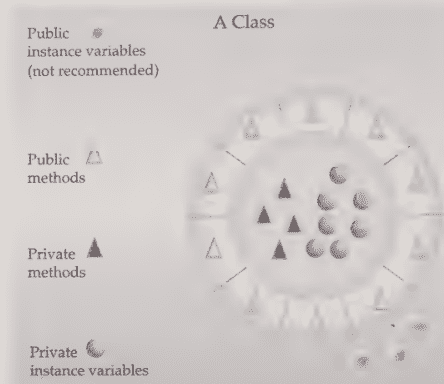

如果你想描述一类更具体的动物，例如哺乳动物，它们将具有更具体的属性，例如牙齿的类型和乳腺。这被称为动物的*子类*，而动物被称为哺乳动物的*超类*。

由于哺乳动物仅仅是定义得更精确的动物，它们*继承*了来自动物的所有属性。深层继承的子类会继承其在*类层次结构*中所有祖先类的所有属性。


# 继承与封装的相互作用

如果给定的类封装了某些属性，那么任何子类都将拥有相同的属性**加上**它作为其特化部分而添加的任何属性（见图 2-2）。这是一个关键概念，它让面向对象的程序的复杂性呈线性增长，而不是几何级数增长。一个新的子类继承了它所有祖先的所有属性。它不会与系统中大部分其他代码产生不可预测的相互作用。

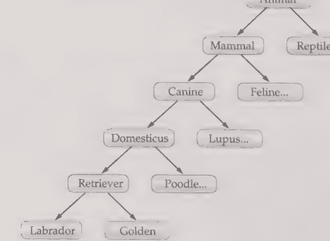

# 第 2 章 Java 概述


**图 2-2** 拉布多继承了它所有超类的封装。

## 多态

*多态*（源自希腊语，意为“多种形式”）是一种允许一个接口用于一组通用动作的特性。具体的动作取决于情况的确切性质。考虑一个栈（后进先出的列表）。你可能有一个需要三种类型栈的程序。一个栈用于整数值，一个用于浮点值，一个用于字符。每个栈都实现相同的算法，实现每个栈的算法是相同的，尽管所存储的数据不同。在非面向对象的语言中，你需要创建三组不同的栈例程，每组使用不同的名称。然而，由于多态的存在，在 Java 中你可以指定一组共享相同名称的通用栈例程。

更广泛地说，多态的概念通常用“一个接口，多个方法”这个短语来表达。这意味着为一组相关活动设计一个通用接口是可能的。通过允许使用相同的接口来指定一类通用动作，有助于降低复杂性。编译器的任务是根据每种情况选择具体的动作（即方法）。你，作为程序员，不需要手动地进行这种选择。你只需要记住并利用这个通用接口即可。

扩展这个类比，狗的嗅觉就是多态。如果狗闻到了猫的气味，它会汪汪并追着它跑。如果狗闻到了它的食物，它会摇摇尾巴向饭碗跑去。同一种嗅觉在两种情况下都在起作用。其区别在于闻到的是什么，即狗鼻子操作的数据类型。这个通用概念可以在 Java 中实现，并应用于 Java 程序中的方法中。

## 多态、封装与继承的协同工作

当应用时，多态、封装和继承结合在一起，产生了一种编程环境，该环境支持开发比面向过程模型更健壮、更具扩展性的程序。良好的类层次结构是重用代码的基础，而你投入了时间和精力来开发测试。封装允许你在依赖于类类接口的代码上迁移你的实现。多态允许你创建出整洁、合理、易读且具韧性的代码。

在两个现实世界的示例中，汽车更完整地说明了面向对象设计的强大之处。从继承的角度来看，思考狗是有趣的，但汽车更像程序。所有驾驶员都依赖继承来驾驶不同类型（子类）的车辆。无论这辆车是校车、梅赛德斯轿车、保时捷还是家庭多功能车，驾驶员都能或多程度上找到并操作方向盘、刹车和加速器。经过一段时间对挡位的磨合后，大多数人甚至可以处理手动挡和自动挡之间的差别，因为他们从根本上理解了共同的超类——变速箱。

人们一直在与汽车上的封装特性进行交互。汽车和油门通过极其简单的接口隐藏了惊人的复杂性，这个接口简单到你只需用脚就能操作它们！引擎的实现、刹车的样式和轮胎的大小都不会影响你如何与踏板的类定义进行交互。

最后一个属性——多态，清楚地反映在汽车制造商能够在基本上相同的车辆上提供广泛的选择的能力。例如，你可以拥有防抱刹车系统或齿轮齿条转向器，以及 4 缸、6 缸或 8 缸引擎。无论何种方式，你仍然会按下刹车，在你想移动时转动方向盘。同样的接口可以控制不同的实现。正如开头提到的，每个 Java 程序都涉及封装、继承和多态。虽然接下来的示例似乎没有表现出这些，但它们确实存在。

## 第 2 章 Java 概述（续）

现在已经讨论了 Java 的面向对象基础，让我们来看一些实际程序。让我们从编译和运行示例开始。正如你将看到的，这比想象的要复杂。

### 第一个程序

对于大多数语言，持有源代码的文件名是无关的。然而，在 Java 中并非如此。你必须学习的 Java 第一件事就是给文件命名非常重要。对于这个示例，文件名应该是 `Example.java`。让我们看看为什么。

在 Java 中，源文件正式称为编译单元。它是一个包含（除其他内容外）一个或多个类定义的文本文件。现在，我们将使用只包含一个类的源文件。Java 编译器要求使用 `.java` 扩展名的文件。

正如你通过程序看到的，程序定义的类名也是 `Example`。这并非巧合。根据惯例，主类的名称应与持有程序的文件名匹配。你还应该确保文件名的大小写与类名匹配。这是因为 Java 是区分大小写的。此时，文件名对应类名的惯例似乎是任意的。然而，这种连接有助于维护和组织你的程序。此外，正如你以后在书中看到的，在某些情况下，这是强制要求的。

```java
// 这是一个简单的 Java 程序。
// 将此文件命名为 "Example.java"。
class Example {
  // 你的程序从 main() 开始。
  public static void main(String[] args) {
    System.out.println("这是一个 Java 程序.");
  }
}
```

> **注意** 关于如何使用 Java SE 开发工具包 (JDK) 的说明可以从 Oracle 获取。（也有开源版本。）如果你正在使用集成开发环境 (IDE)，那么你需要遵循不同的步骤来编译和执行 Java 程序。在这种情况下，请查阅你的 IDE 文档。

### 编译程序

要编译 `Example` 程序，请执行编译器 `javac`，并在命令行上指定源文件名，如下所示：

```
C:>javac Example.java
```

`javac` 编译器会创建一个名为 `Example.class` 的文件，该文件包含了程序的字节码版本。如之前讨论的，Java 字节码是程序的中间表示，包含了 Java 虚拟机（JVM）执行的指令。因此，`javac` 的输出并不是可以直接执行的代码。

要实际运行程序，请使用名为 `java` 的 Java 启动器。这样做只需将类名 `Example` 作为命令行参数传递，如下所示：

```
C:\>java Example
```

当程序运行时，将显示以下输出：

```
This is a simple program.
```

当编译 Java 源代码时，每个单独的类都会被放入一个以类名命名并带有 `.class` 扩展名的独立文件中。这就是为什么将源文件命名为与其包含的类相同的名称是一个好主意。当你像所示执行 `java` 时，你实际上指定了具有 `.class` 扩展名的类名。如果找到了它，它将执行指定类中包含的代码。

> **注意 1** Java 提供了一种直接运行某些类型简单程序的方法，而无需显式调用 `javac`。这种技术在某些情况下非常有用，将在附录 C 中描述。对于本书而言，假设你正在使用标准的编译过程。

### 深入观察第一个程序

尽管 `Example.java` 非常短，但它包含了所有 Java 程序共有的几个关键特性。程序从以下几行开始：

```java
/*
这是一个简单的程序。
请将此文件命名为 "Example.java"。
*/
```

这是一个注释。与其他编程语言一样，Java 允许你在程序的源文件中输入备注。编译器会忽略注释的内容。相反，注释描述了程序并提醒你源文件应该如何命名。当然，在实际应用中，注释通常解释程序如何工作或某个特定功能的作用。

Java 提供了三种风格的注释。程序顶部显示的这种被称为“多行注释”。这种类型的注释必须以 `/*` 开始并以 `*/` 结束。这些注释符号之间的任何内容都会被编译器忽略。正如名称所示，多行注释可能有几行长。下一行代码显示在这里：

```java
class Example {
```

这一行使用关键字 `class` 来声明正在定义一个新类。`Example` 是一个标识符，作为类的名称。整个类定义（包括它的所有成员）都位于左大括号 `{` 和右大括号 `}` 之间。目前，不必太担心类的细节，除了在 Java 中，所有的程序活动都发生在一个类中。这就是为什么所有 Java 程序至少有一点面向对象的原因。

程序中的下一行是单行注释，显示在这里：

```java
// 你的程序从调用 main() 开始。
```

这是 Java 支持的第二种注释类型。单行注释以 `//` 开始，并在行末尾结束。根据一般规则，程序员使用多行注释进行较长的备注，使用单行注释进行简短的、逐行的描述。第三种注释类型“文档注释”，将在本章后半部分的“注释”章节进行讨论。

下一行代码显示在这里：

```java
public static void main(String args[]) {
```

这一行开始了 `main()`。正如注释所暗示，程序将开始执行。根据一般规则，Java 程序的执行是通过调用 `main()` 开始的。现在无法给出每个部分的完整含义，因为这涉及到对 Java 封装方法的详细理解。然而，本书第一部分的大部分示例都将使用这行代码；让我们简要查看每个部分。

`public` 关键字是一个访问修饰符，它允许控制类成员的可见性。当类成员是 `public` 时，该成员可以被声明它的类外部的代码访问（`public` 的反面是 `private`，它防止成员被类外部的代码使用）。在此类中，`main()` 必须声明为 `public`，因为在程序启动时必须在类外部调用它。`static` 关键字允许在不需要实例化类的特定实例的情况下调用 `main()`。这是必须的，因为 `main()` 在任何对象创建之前就会被 Java 虚拟机调用。`void` 关键字简单地告诉编译器 `main()` 不返回值。如果这些所有内容看起来都有点困惑，不要担心。所有这些概念将在随后的章节中详细讨论。

如所述，`main()` 是 Java 应用启动时调用的方法。请记住 Java 是区分大小写的。因此，`Main` 和 `main` 是不同的。需要的是，编译器会编译不包含 `main()` 方法的类。Java 没有办法运行这些类。然而，如果你使用了 `Main` 而不是 `main`，编译器仍然会编译你的程序，但 Java 会报告错误，因为它无法找到 `main()` 方法。

在传递给方法之后的任何信息中，括号内指定的变量跟在方法名之后。这些变量被称为参数。如果一个方法不需要参数，你仍然需要括号。在 `main()` 中，只有一个参数，尽管它很复杂。`String args[]` 声明了一个命名参数 `args`，它是一个 `String` 类的数组（数组是对象的集合）。`String` 类型存储字符。在这种情况下，`args` 接收程序执行时存在的任何命令行参数。此程序没有使用这个类，但本书稍后展示的其他程序将使用它。

该行的最后一个字符是 `{`。它标志着 `main()` 方法体的开始。构成方法的所有代码将出现在方法的左大括号和右大括号之间。

> **一点** `main()` 仅仅是一个起始位置。复杂的程序会有几十个类，其中只有一个类需要调用 `main()` 来启动。此外，对于某些类型的程序，你完全不需要 `main()`。然而，对于本书中的大多数程序，`main()` 是必须的。

下一行代码显示在这里。注意它位于 `main()` 内部。

```java
System.out.println("This is a simple program.");
```

这一行输出 "This is a simple program." 随后是换行。输出实际上是通过内置的 `println()` 方法实现的。在这种情况下，`println()` 显示传递给它的字符串。正如你所见，`println()` 也可以用于显示其他类型的信息。该行以 `System.out` 开始，这是一个预定义的类，提供了对系统的访问（只需简述）。

正如你猜的，控制台输出（和输入）在现实 Java 应用中并不常用。由于大多数现代计算环境是图形化的，控制台 IO 用于简单的工具程序、演示程序和服务器端代码。在本书后半部分，你将学习使用 Java 生成输出的其他方法。但现在，我们将继续使用控制台 IO 方法。

注意 `println()` 语句以分号结束。Java 中的许多语句都以分号结束。正如你所见，分号是 Java 语法的重要部分。第一个括号结束了 `main()`，最后一个括号结束了 `Example` 类定义。

### 第二个短程序

可能没有概念比变量对编程语言更基础了。正如你可能知道的，变量是一个命名的内存位置，可以由你的程序赋值。变量的值可以在程序执行期间更改。下一个程序展示了如何声明变量以及如何给它赋值。该程序还说明了控制台输出的新方面。正如程序顶部的注释所示，你应该将此文件命名为 `Example2.java`。

```java
/*
这是另一个简单的示例。
请将此文件命名为 "Example2.java"。
*/

class Example2 {
    public static void main(String args[]) {
        int num; // 声明了一个名为 num 的变量
        num = 100; // 给 num 赋值 100
        System.out.println("This is num: " + num);
        num = num * 2;
        System.out.print("The value of num * 2 is ");
        System.out.println(num);
    }
}
```

当你运行此程序时，你将看到以下输出：

```
This is num: 100
The value of num * 2 is 200
```

让我们仔细观察为什么会生成这种输出。程序中的第一个声明显示在这里：

```java
int num; // 这声明了一个名为 num 的变量
```

这一行声明了一个名为 `num` 的整数变量。Java（与大多数其他语言一样）要求在使用变量之前对其进行声明。

以下是变量声明的通用形式：

```java
type var-name;
```

在这里，`type` 指定了被声明变量的类型，而 `var-name` 是变量的名称。如果你想声明多个指定类型的变量，可以使用逗号分隔的变量名列表。Java 定义了多种数据类型，包括整数、字符和浮点数。关键字 `int` 指定整数类型。

在程序中，这一行

```java
num = 100; // 这使用赋值运算符给 num 赋值，赋值运算符是单符号。
```

将值 100 赋值给 `num`。在 Java 中，赋值运算符是单个符号 `=`。

下一行代码输出了字符串 "This is num:" 以及 `num` 的值。

```java
System.out.println("This is num: " + num);
```

在这条语句中，加号 `+` 导致 `num` 的值被附加在它之前的字符串之后，然后输出生成的字符串。（实际上，`num` 会从整数转换为其等效字符串，然后与前面的字符串拼接。这种方法在书后会详细介绍。）这种方法可以推广。使用 `+` 运算符，你可以在单个语句中连接任意数量的项。

下一行代码将 `num` 乘以 2 的值赋值给 `num`。与大多数其他语言一样，Java 使用 `*` 运算符来表示乘法。在执行此操作后，`num` 将包含值 200。

这里是程序中的后续两行：

```java
System.out.print("The value of num * 2 is ");
System.out.println(num);
```

这里发生了几件新变化。首先，使用了内置方法 `print()` 来显示字符串 "The value of num * 2 is "。这个字符串后面没有换行符。这意味着当生成下一次输出时，它将从同一行开始。`print()` 方法类似于 `println()`，区别在于它在每次调用后不会输出换行符。现在看对 `println()` 的调用。注意 `num` 本身被使用了。`print()` 和 `println()` 都可以输出 Java 任何内置类型的值。

## 两种控制语句

虽然第 5 章将详细介绍控制语句，但这里简要介绍了两种，以便它们可以在第 3 章和第 4 章的示例程序中使用。它们也将有助于说明 Java 的一个重要方面：代码块。

### if 语句

Java 的 `if` 语句与任何其他语言中的 `if` 语句非常相似。它根据某些条件的真假来决定执行流。它最简单的形式如下：

```java
if(condition) statement;
```

在这里，`condition` 是一个布尔表达式。（布尔表达式是指求值为真或假。）如果 `condition` 为真，则执行该语句。如果 `condition` 为假，则跳过该语句。这里有一个例子：

```java
if(num < 100) System.out.println("num is less than 100");
```

在这种情况下，如果 `num` 包含一个小于 100 的值，则条件表达式为真；如果 `num` 包含一个大于或等于 100 的值，则跳过 `println()` 方法。

正如你将在第 4 章中看到的，Java 定义了一套完整的关系运算符，这些运算符可以用于条件表达式。

| 运算符 | 含义 |
| --- | --- |
| `<` | 小于 |
| `>` | 大于 |
| `==` | 等于 |

注意等性测试是使用双等号。这里有一个说明 `if` 语句的程序：

```java
/*
演示 if。
将此文件命名为 "IfSample.java"。
*/

class IfSample {
    public static void main(String args[]) {
        int x, y;
        x = 10;
        y = 20;
        if(x < y) System.out.println("x is less than y");
        x *= 2;
        if(x == y) System.out.println("x now equal to y");
        x = x * 2;
        if(x > y) System.out.println("x now greater than y");
        // 这不会显示任何内容
        if (x == y) System.out.println("you won't see this");
    }
}
```

该程序生成的输出是：

- x is less than y
- x now equal to y
- x now greater than y

注意此程序中的另一点。这一行

```java
int x, y;
```


通过逗号分隔的列表声明了两个变量 `x` 和 `y`。

### for 循环

循环语句是几乎任何编程语言的重要部分，因为它们提供了一种重复执行某些任务的方法。正如你将在第 5 章中看到的，Java 提供了一系列强大的循环结构。也许最通用的是 `for` 循环。`for` 循环的最简单形式所示：

```
for(initialization; condition; iteration) statement;
```

在这种形式中，`initialization` 设置循环变量。`condition` 是一个布尔表达式，用于测试循环变量。如果结果为真，则执行语句。如果为假，则循环终止。这里有一个说明 `for` 的短程序：

```java
/*
演示 for 循环。

将此文件命名为 "ForTest.java"。
*/

class ForTest {

  public static void main(String args[]) {

    int x;

    for(x = 0; x<10; x++) {

      System.out.println("This is x: " + x);

    }

  }

}
```

该程序产生以下输出：

- This is x: 0
- This is x: 1
- This is x: 2
- This is x: 3
- This is x: 4
- This is x: 5
- This is x: 6
- This is x: 7
- This is x: 8
- This is x: 9

在这个示例中，`x` 是循环变量。它在初始化部分被设置为零。在每次迭代的开始（包括第一次），都会进行条件测试 `x < 10`。如果结果为真，执行 `println` 语句，然后执行迭代部分，将 `x` 加1。这个过程一直持续到条件测试为假。

一点，在专业编写的 Java 程序中，你几乎永远看不到像前面程序那样的迭代部分：

```java
x = x + 1;
```

这是因为 Java 包含一个特殊的递增运算符可以更高效地执行此操作。递增运算符是 `++`。（即两个加号连在一起。）递增运算符将其操作数增加一。使用递增运算符，前面的语句可以这样写：

```
x++;
```

因此，前面程序中的 `for` 通常这样写：

```
for(x = 0; x<10; x++)
```

正如你所看到的，循环运行方式与之前完全相同。Java 还提供了递减运算符，指定为 `--`。该运算符将其操作数减一。

### 使用代码块

Java 允许将两个或多个语句分组为代码块，称为代码块。这是通过将语句封装在大括号之间实现的。一旦创建了代码块，它就变成了一个逻辑单元，可以用任何可以使用单个语句的地方。例如，代码块可以是 Java `if` 和 `for` 语句的目标。

考虑这条 `if` 语句：

```java
if(x < y) { // 开始代码块

x = y;

y = 0;

// 代码块结束
```

在这里，如果 `x` 小于 `y`，则代码块中的两个语句都将被执行。因此，代码块中的两个语句形成了一个逻辑单元，一个语句无法在另一个语句不执行的情况下执行。

让我们来看另一个例子。以下程序使用一个代码块作为 `for` 循环的目标。

```java
/*
演示一个代码块。

将此文件命名为 "BlockTest.java"
*/

class BlockTest {

    public static void main(String[] args) {

        int x, y;

        y = 20;

        // 此循环的目标是一个代码块

        for(int x = 0; x<10; x++) {

            System.out.println("This is x: " + x);

            System.out.println("This is y: " + y);

            y = y - 2;

        }

    }

}
```

该程序生成的输出所示：

```
This is x: 0
This is y: 20
This is x: 1
This is y: 18
This is x: 2
This is y: 16
This is x: 3
This is y: 14
This is x: 4
This is y: 12
This is x: 5
This is y: 10
This is x: 6
This is y: 8
This is x: 7
This is y: 6
This is x: 8
This is y: 4
This is x: 9
This is y: 2
```

在这种情况下，`for` 循环的目标是一个代码块，而不仅仅是一个单一语句。因此，在每次循环迭代中，代码块内部三个语句都将被执行。这一事实无疑通过程序生成的输出得到了证明。

正如你将在本书的后部分看到的那样，代码块具有额外的属性和用途。然而，它们存在的主要目的是为了创建逻辑上不可分割的代码单元。

## 词法问题

现在你已经看过了几个 Java 程序，是时候更正式地描述 Java 的原子元素了。Java 程序是空白符、标识符、字面量、注释、操作符、分隔符和关键字的集合。操作符将在下一节中描述。其他的已将在接下来的内容中描述。

### 空格符

Java 是一种自由形式的语言。这意味着你不需要遵循任何特殊的缩进规则。例如，示例程序可以写在一行内，也可以以你认为喜欢的任何方式输入，只要在每个非操作符或分隔符界定的标记之间至少有一个空白符字符即可。在 Java 中，空白符包括空格、制表符、换行符或分页符。

### 标识符

标识符用于命名事物，例如类、变量和方法。标识符可以是大写和小写字母、数字以及下划线和美元符号的任何描述性序列。（美元符号并非用于通用场景）。它们不以数字开头，以免与数字字面量混淆。同样，Java 是区分大小写的，因此 `VALUE` 与 `Value` 是不同的标识符。有效标识符的一些示例是：

| AvgTemp | count | a4 | $Test | this_is_ok |
| :--- | :--- | :--- | :--- | :--- |

无效的标识符名称包括：

| 2count | high-temp | Not/ok |
| --- | --- | --- |

> 注意：从 JDK 9 开始，划线不能单独作为标识符。

### 字面量

Java 中的常量值通过使用它的字面量表示来创建。例如，这里是一些字面量：

| 100 | 98.6 | 'X' | "This is a test" |
| :--- | :--- | :--- | :--- |

从左到右，第一个字面量指定一个整数，下一个是浮点值，第三个是字符常量，最后一个是字符串。字面量可以用任何允许其类型值出现的地方。

### 注释

如所述，Java 定义了三种类型的注释。你已经见过了两种：单行注释和多行注释。第三类型被称为文档注释。这种类型的注释用于生成一个记录你程序的 HTML 文件。文档注释以 `/**` 开头，以 `*/` 结尾。文档注释在附录 A 中有详细说明。

### 分隔符

在 Java 中，有一些字符被用作分隔符。Java 中最常用的分隔符是分号。正如你所看到的，它通常被用于结束语句。分隔符如下表所示：

| 符号 | 名称 | 用途 |
| --- | --- | --- |
| () | 圆括号 | 用于在方法定义和调用中包含参数列表。还用于定义表达式的优先级、在控制语句中包含表达式，以及包强制强制转换类型。 |
| {} | 大括号 | 用于包含自动初始化数组的值。还用于定义代码块、类和局部作用域。 |
| [] | 方括号 | 用于声明数组类型。也用于在引用数组值时。 |
| ; | 分号 | 结束语句。 |
| , | 逗号 | 分隔变量声明中连续的标识符。用于在 `for` 语句内部连接多个语句。 |
| . | 点 | 用于将包名与子包及类分离。用于将变量或方法与引用变量分离。 |
| :: | 冒号 | 用于创建方法或构造器引用。 |
| ... | 省略号 | 表示变长参数。 |
| @ | 符号 | 开始一个注解。 |

### Java 关键字

Java 语言中目前定义了 61 个关键字（见表 2-1）。这些关键字结合操作符和分隔符的语法，构成了程序的结构。这些关键字结合操作符和分隔符的语法，构成了程序的结构。从 JDK 9 开始，`var` 不能作为类型使用（请参见第 3 节）。

| | | | | | |
| --- | --- | --- | --- | --- | --- |
| abstract | assert | boolean | break | byte | case |
| catch | char | class | continue | default |
| do | double | else | enum | exports | extends |
| final | finally | float | for | if |
| implements | import | instanceof | int | interface | long |
| module | native | new | open | public | package |
| private | protected | provides | public | requires |
| short | static | strictfp | super | switch |
| this | throw | throws | to | transient | transitive |
| try | uses | void | volatile | while | with |

**表 2-1** Java 关键字

### Java 类库

示例程序使用了 Java 的内置方法：`println()` 和 `print()`。如所述，这些方法通过 `System.out` 提供。`System` 是 Java 定义的一个类。从整体来看，Java 环境依赖于许多内置类，提供了对 I/O、字符串处理、网络和图形的支持。标准类还支持图形用户界面 (GUI)。

## 第 3 章 数据类型、变量与数组

本章研究 Java 最基础的元素：数据类型、变量和数组。与所有现代编程语言一样，Java 支持多种数据类型。你可以使用这些类型来声明变量和创建数组。正如你将看到的，Java 对这些项目的处理是简洁、高效且内聚的。

## 第一部分 Java 语言

你可以直接使用这些类型，或者用它们来构建数组或你自己的类类型。因此，它们形成了你所创建的所有其他类型数据的基础。

基本类型表示单个值——而不是复杂的对象。虽然 Java 是完全面向对象的，但基本类型并非如此的。它们类似于在大多数其他非面向对象的语言中找到的简单类型。之所以这样做是为了出于效率考虑。将基本类型变为对象会降低性能。

基本类型被定义为具有显式的范围和数学行为。像 C 和 C++ 等语言允许整数的大小根据 Java 执行环境的规定而变化。然而，由于 Java 的可移植性要求，所有数据类型都有严格定义的范围。例如，一个 `int` 是 32 位的，无论特定平台如何。这保证了程序可以在任何架构上无需移植即可运行。虽然指定整数的大小可能会在某些环境中导致微小的性能损失，但为了实现可移植性，这是必要的。

让我们来看每种数据类型。

### 整数

Java 定义了四种类型：`byte`、`short`、`int` 和 `long`。这些都是带符号的、包含正负值的类型。Java 不支持无符号的、仅正整数。许多其他计算机语言都支持带符号和无符号整数。然而，Java 的设计者认为无符号整数是不必要的。具体来说，他们认为无符号的概念主要用于指定高位的大小。正如你将在第 4 章中看到的，Java 以不同的方式管理高位的含义，即添加了一个带符号的“无符号右移”运算符。对无符号类型的类型被消除了。

整数类型的宽度不应被看作它消耗的存储量，而应被看作为该类型的变量和表达式定义的行为。Java 运行时环境可以自由使用它想要的任何尺寸，只要这些类型的行为与你声明的一致。这些类型的种类和范围差异很大，如下表所示：

| 名称 | 宽度 | 范围 |
|---|---|---|
| long | 64 | -9,223,372,036,854,775,808 到 9,223,372,036,854,775,807 |
| int | 32 | -2,147,483,648 到 2,147,483,647 |
| short | 16 | -32,768 到 32,767 |
| byte | 8 | -128 到 127 |

让我们来看每种整数。

### byte

最小的整数类型是 `byte`。这是一个带符号的 8 位类型，范围从 -128 到 127。当你处理来自网络或文件的字节流时，`byte` 类型的变量特别别有用。当你处理可能与 Java 其他内置类型不直接兼容的原始二进制数据时，它们也很有用。

`byte` 变量通过使用 `byte` 关键字来声明。例如，以下代码声明了名为 `b` 和 `c` 的 `byte` 变量：

```java
byte b, c;
```

### short

`short` 是一个带符号的 16 位类型。它的范围从 -32,768 到 32,767。它可能是 Java 中最少使用的类型。这里是 `short` 变量声明的一些示例：

- `short s;`
- `short t;`

### int

最常用的整数类型是 `int`。它是另一个 32 位类型，范围从 -2,147,483,648 到 2,147,483,647。除了其他用途，`int` 类型的变量通常用于控制循环和索引数组。虽然你可能认为在不需要 `int` 的大范围的情况下使用 `byte` 或 `short` 会比使用 `int` 更高效，但事实并非如此。原因是当 `byte` 和 `short` 值在表达式中使用时，它们在表达式求值时会被**提升为 int**。（类型提升在本章的稍后部分描述）。因此，当需要整数时，`int` 通常是最佳选择。

### long

`long` 是一个带符号的 64 位类型，适用于 `int` 类型不足以容纳所需值的情况。`long` 的范围很大。这使得它在需要大整数时非常有用。例如，这里有一个计算在指定天数内光传播英里数的程序：

```java
// 使用 long 变量计算光传播距离。

public static void main(String args[]) {

    int days = 1000;

    long days;

    long seconds;

    long distance;

    // 每天大约的光速（英里）

    long lightspeed = 186000;

    days = days * 24 * 60 * 60; // 转换为秒

    distance = lightspeed * days; // 计算距离

    System.out.println("In " + days);

    System.out.println("days will travel about " + distance + " miles.");

}
```

此程序产生以下输出：

在 1000 天内，光大约传播 16070400000000 英里。

显然，结果不能存储在 `int` 变量中。

### 浮点类型

浮点数（也称为实数）用于需要小数精度的表达式。浮点类型表示需要小数精度的值。Java 实现了 IEEE-754 标准，有两种浮点类型：`float` 和 `double`，分别表示单精度和双精度。它们的宽度和范围所示：

| 名称 | 位 | 近似范围 |
|---|---|---|
| double | 64 | 4.9e−324 到 1.8e+308 |
| float | 32 | 1.4e−45 到 3.4e+38 |

下面将检查每一种浮点类型：

### float

`float` 类型是使用 32 位存储的单精度值。它是双精度类型的一半，占用的内存也是一半。`float` 类型用于对内存敏感且不需要高精度的场景。

### double

`double` 类型是使用 64 位存储的双精度值。它是 Java 中浮点字面量的默认类型。如果你不指定类型，Java 将小数视为 `double`。

这里是 `double` 的一些示例：

```java
double pi = 3.14159;

double gravity = 9.8;
```

`double` 类型比 `float` 类型精确得多。它可以提供 15-17 位精度，而 `float` 只有 6-9 位。

## 字符

在 Java 中，存储字符的数据类型是 `char`。理解的关键是 Java 使用 Unicode 来表示字符。Unicode 定义了一个可以表示所有语言的全字符集。它是许多字符集的统一，例如拉丁、希腊、阿拉伯、西里尔语、希伯来语、假名、韩语等。在 Java 创建时，Unicode 需要 16 位。因此，Java `char` 是一个 16 位类型。`char` 的范围是 0 到 65535。被称为 ASCII 的标准字符集范围从 0 到 127，而扩展 8 位字符集 ISO-Latin-1 范围从 0 到 255。由于 Java 设计用于在全球范围内使用，因此使用 Unicode 来表示字符是合理的。当然，对于英语、德语、西班牙语或法语等语言，使用 Unicode 有些低效，但这是为了全球可移植性所付代价。

> 注意 关于 Unicode 的更多信息可以访问 http://www.unicode.org。

这里有一个演示 `char` 变量的程序：

```java
//  char 数据类型

class CharDemo {

    public static void main(String args[]) {

        char ch1, ch2;

        char ch1 = 88; // X 的代码

        char ch2 = 'Y';
```


```java
System.out.print("ch1 and ch2: ");

System.out.println(ch1 + " " + ch2);

}
}
```

此程序显示以下输出：

注意 `ch1` 被赋值为 88，这是对应于字母 X 的 ASCII（以及 Unicode）值。正如提到的，ASCII 字符占据 Unicode 字符集的前 127 个值。因此，你可能在其他语言中处理字符时使用的所有“老技巧”在 Java 中同样适用。

# 44 第一部分 Java 语言

尽管 `char` 设计用于存储 Unicode 字符，但它也可以用作整数类型，对其执行算术操作。例如，你可以将两个字符相加，或者增加字符变量的值。考虑以下程序：

```java
// char variables behave like integers.

class CharDemo {

    public static void main(String args[]) {

        char ch1;

        ch1 = 'X';

        System.out.println("ch1 contains " + ch1);

        ch1++; // increment ch1

        System.out.println("ch1 is now " + ch1);

    }

}
```

该程序生成的输出所示：

```
ch1 contains X
ch1 is now Y
```

在程序中，`ch1` 首先被赋值为 X。接下来，`ch1` 递增了1。这导致 `ch1` 包含 Y，即 ASCII（以及 Unicode）序列中的下一个字符。

> 注意：在 Java 的正式规范中，`char` 被称为积分类型，这意味着它与 `int`、`short`、`long` 和 `byte` 属于同一个大类。然而，由于它的主要用途是表示 Unicode 字符，`char` 通常被认为是一个自成类别。

### 布尔值

Java 有一种基本类型称为 `boolean`，用于表示逻辑值。它只有两个可能的值之一：`true` 或 `false`。这是所有关系运算符返回的类型，例如 `a > b`。`boolean` 也是用于控制控制语句（如 `if` 和 `for`）的条件表达式所需的类型。

这是一个演示 `boolean` 类型的程序：

```java
// Demonstrate boolean values.

class BoolTest {

    public static void main(String args[]) {

        boolean b;

        b = false;

        System.out.println("b is " + b);

        b = true;

        System.out.println("b is " + b);

        // a boolean value can control the if statement

        if (b) System.out.println("This is executed.");

    }

}
```

# 第3章 数据类型、变量和数组

```java
b = false;

if (b) System.out.println("This is not executed.");

// outcome of a relational operator is a boolean value

System.out.println("10 is " + (10 > 9));
```

该程序生成的输出在此：

- b is false
- b is true
- This is executed.
- 10 > 9 is true

关于这个程序有三个值得注意的地方。首先，如你所见，当 `println()` 输出布尔值时，会显示 "true" 或 "false"。其次，布尔变量的值本身就足以控制 `if` 语句。不需要编写像这样的 `if` 语句：

```java
if (b == true) ...
```

第三，关系运算符（如 `<`）的结果是一个布尔值。这就是为什么表达式 `10>9` 显示值为 "true" 的原因。额外的括号 `(10>9)` 是必要的，因为 `+` 运算符的优先级高于 `>`。

### 深入观察字面量

字面量在第 2 章中被简要地提到过。现在内置类型已经有了正式描述，让我们更仔细地观察一下它们。

### 整数字面量

整数可能是典型程序中最常用的类型。任何整数值都是整数字面量。例如 1、2、3 和 4。这些都是十进制值，意味着它们描述的是 10 进制数字。整数中可以使用的另外两个基数是八进制（8 进制）和十六进制（16 进制）。八进制值在 Java 中用前导 0 来表示。正常的十进制数不能有前导数字。有效的奇数 `09` 将导致编译器产生错误，因为 9 超出了八进制 0 到 7 的范围。程序员使用的更常见的基数与“8 位”一词密切对应，例如 8、16、32 和 64 位。你通过前导零-x（`0X` 或 `0x`）表示十六进制常量。十六进制数字的范围是 0 到 15，因此 A 到 F（或小写的 f）被代替 10。

整数字面量创建一个 `int` 值，这在 Java 中是一个 32 位的整数值。由于 Java 是强类型的，你可能会奇怪如何将整数字面量赋值给 Java 的其他类型（如 `byte` 或 `long`）而不会引起类型不匹配。幸运的是，这种情况很容易处理。当字面量赋值给 `byte` 或 `short` 变量时，如果字面量值在目标类型的范围内，则不会产生错误。

整数字面量始终可以赋值给 `long` 变量。但要指定 `long` 字面量，你需要显式告诉编译器该字面量是 `long` 类型。你通过在字面量后附加大写或小写的 `L` 来实现。例如，`0x7ffffffffffffL` 或 `922337206854775807L` 是最大的 `long`。整数也可以赋值给 `char`，只要它在范围内。

你还可以使用二进制字面量来指定整数字面量。要这样做，请在值前加上 `0b` 或 `0B`。例如，这使用二进制字面量指定了十进制值 10：

```java
int x = 0b1010;
```

除了其他用途外，二进制字面量的加入使其更易读。

### 浮点字面量

浮点字面量用于表示分数。Java 中有两种类型的浮点字面量：`float` 和 `double`。浮点字面量的默认类型是 `double`。要指定 `float`，你必须在字面量后尾附加 `F` 或 `f`。浮点字面量可以使用标准计数法或科学计数法表示。标准计数法由一个数字后跟一个小数点组成。科学计数法使用 `E` 或 `e` 后跟 10 的幂次。例如，`1.23E4` 代表 1.23 乘以 10 的四次方。你也可以在浮点字面量中使用下划线来使大数字更易读。与整数字面量一样，下划线只能用于数字之间。它们不能出现在字面量的开头或结尾。

### 十六进制字面量

十六进制字面量用于表示 16 进制数字。它们通过前导 `0x` 或 `0X` 表示。十六进制字面量使用的数字是 0-9 和 A-F。例如，`0x1A` 代表十进制 26。

### 二进制字面量

二进制字面量用于表示 2 进制数字。它们通过前导 `0b` 或 `0B` 表示。二进制字面量使用的数字是 0 和 1。例如，`0b1010` 代表十进制 10。

# 48 第一部分 Java 语言

| 转义序列 | 描述 |
| :--- | :--- |
| `\ddd` | 八进制字符 (ddd) |
| `\uxxxx` | 十六进制 Unicode 字符 (xxxx) |
| `\'` | 单引号 |
| `\"` | 双引号 |
| `\\` | 反斜杠 |
| `\r` | 回车 |
| `\n` | 换行（也称为行符） |
| `\f` | 换页符 |
| `\t` | 制表符 |
| `\b` | 退格符 |

表 3-1 字符转义序列

### 字符串字面量

Java 中的字符串字面量的指定方式与大多数其他语言相似——通过在一对双引号之间包含一个字符序列来实现。字符串字面量的示例：

"Hello World"
"two\nlines"
"\"This is in quotes\""

为 Java 字面量定义的转义序列和八进制/十六进制表示法在字符串字面量内部的工作方式相同。关于 Java 字符串需要注意的一个重要点是，它们必须在同一行开始并结束。Java 没有像某些其他语言那样的行延续转义序列。

> 注意：如你所知，在某些语言中，字符串被实现为字符数组。然而，Java 并非如此。字符串实际上是对象类型。正如你在本书后面将看到的，由于 Java 将字符串实现为对象，Java 包含了既强大又易用的字符串处理能力。

### 变量

变量是 Java 程序中存储的基本单元。变量由标识符、类型和可选初始化器组合定义。此外，所有变量都有作用域，作用域定义了可见性和生命周期。接下来将检查这些元素。

### 声明变量

在 Java 中，所有变量在使用之前都必须声明。变量声明的基本形式所示：

```
type identifier [ = value ], identifier [ = value ] ...;
```

这里，`type` 是 Java 的原子类型之一，或者是类或接口的。（类和接口将在本书的第一部分讨论。）`identifier` 是变量的名称。

# 第 3 章 数据类型、变量和数组

你可以通过指定等号和值来初始化变量。请记住，初始化表达式的结果必须与为变量指定的类型相同（兼容）。要声明多个指定类型的变量，请使用逗号分隔的列表。

以下是几种类型的变量声明示例。注意其中一些包含了初始化。

```java
int a, b, c;
// 声明了三个整数 a, b 和 c。

int d = 3, e, f = 5;
// 声明了另外三个整数，初始化
// d 以及

byte z = 22;
// 初始化 z。

double pi = 3.14159;
// 声明了 pi 的近似值。

char x = 'x';
// 变量的值为 'x'。
```

选择的标识符名称中没有指示其类型的内在含义。Java 允许任何符合定义的标识符具有任何声明类型。

### 动态初始化

虽然前面的示例仅使用常量作为初始化器，但 Java 允许在变量声明时使用任何表达式值对其进行动态初始化。

例如，这里有一个短程序，在给定直角三角形两条对边长度的情况下计算斜边的长度：

```java
// 演示动态初始化。

class DynInit {

    public static void main(String args[]) {

        double a = 3.0, b = 4.0;

        // c 是动态初始化的

        double c = Math.sqrt(a * a + b * b);

        System.out.println("Hypotenuse is " + c);

    }

}
```

在这里，局部变量——a、b 和 c——是通过常量初始化的。然而，c 被动态初始化为斜边的长度（使用勾股定理）。该程序使用了 Java 的另一个内置方法 `Math.sqrt()`，它是 `Math` 类的成员方法，用于计算其参数的平方根。关键在于，初始化表达式可以使用初始化时的任何元素值，包括对方法的调用、其他变量或字面量。

### 变量的作用域和生命周期

到为止，所有使用的变量都在 `main()` 方法的开始处声明。然而，Java 允许在任何块中声明变量。正如第 2 章所示，块由左大括号开始，由右大括号结束。块定义了一个作用域。因此，每当你开始一个新块时，你就创建一个新的作用域。

## 第一部分 Java 语言

作用域决定了哪些对象对程序的其他部分可见的。它还决定了对象的生命周期。

按照两个大类作用域（全局和局部）来思考并不稀奇。然而，这些传统的作用域并不完全符合 Java 严格的面向对象模型。虽然可以创建等同于全局作用域的内容，但这异常而非规律。在 Java 中，两个主要的作用域分别由类和方法定义。这种区分某种程度上是人为的。然而，由于类具有若干不适用于方法定义的作用域的独特属性和特征，这种区分是有意义的。由于差异，关于作用域（以及在其中声明的变量）的讨论被推到了第 6 章，届时将描述类。目前，我们只检查由方法定义或方法内部的作用域。

方法定义的作用域从它的左大括号开始。然而，如果该方法有参数，这些参数也被包含在方法的作用域内。方法的作用域以右大括号结束。块定义了一个作用域。因此，每当你开始一个新块时，你就创建一个新的作用域。

最后一点：虽然块可以嵌套，但你不能声明一个与外部作用域中变量同名的变量。例如，以下程序是非合法的：

```java
// 此程序无法编译

class ScopeErr {

    public static void main(String[] args) {

        int bar = 1;

        int bar = 2; // 编译错误 - bar 已经定义

    }

}
```

### 类型转换与强制类型转换

如果你有以前的编程经验，就会知道将一种类型的值赋值给另一个类型的变量是非常常见的。如果这两个类型是兼容的，那么 Java 将自动执行该转换。例如，将一个 `int` 赋值给 `long` 类型的变量总是可能的。然而，并不是所有类型都是兼容的，因此并不是所有的转换都允许隐式允许的。例如，没有定义从 `double` 到 `byte` 的自动转换。幸运的是，在不兼容的类型之间仍然可以转换。要做到这一点，你需要使用强制类型转换（cast），它在不兼容的类型之间执行显式转换。让我们分别查看自动类型转换和强制类型转换。

### Java 的自动转换

当将一种类型的数据赋值给另一种类型的变量时，如果满足以下两个条件，就会发生自动类型转换：

- 类型是兼容的。
- 目标类型大于源类型。

当这两个条件都满足时，就会发生宽转换（widening conversion）。例如，`int` 类型总是大到可以容纳所有有效的 `byte` 值，因此不需要显式的强制转换语句。

对于宽转换，数值类型（包括整数类型和浮点类型）彼此之间是兼容的。然而，从数值类型到 `char` 或 `boolean` 没有自动转换。此外，`char` 和 `boolean` 之间也是不兼容的。

正如前面提到的，当将字面量整数存储到类型为 `byte`、`short`、`long` 或 `char` 的变量中时，Java 也会执行自动类型转换。

### 不兼容类型的强制类型转换

虽然自动类型转换很有帮助，但它们无法满足所有的需求。例如，如果你想将一个 `int` 赋值给 `byte` 变量怎么办？这种转换不会被自动执行，因为 `byte` 比 `int` 小。这种转换有时被称为窄转换（narrowing conversion），因为你正在显式地让值变窄，以便适应目标类型。

## 第3章 数据类型、变量和数组 53

要在两个不兼容的类型之间创建转换，你必须使用强制转换。强制转换仅仅是显式的类型转换。它的通用形式如下：

`(target-type) value`

在这里，`target-type` 指定了要将值转换的目标的目标类型。例如，以下片段将一个 `int` 强制转换为 `byte`。如果整数的值大于 `byte` 的范围，它将通过取模（整数除以 `byte` 范围的余数）来缩小。

当将浮点值赋值给整数类型时，会发生一种类型转换：截断（truncation）。如你所知，整数没有小数部分。因此，当将浮点值赋值给整数类型时，小数部分就会丢失。例如，如果将值 1.23 赋值给整数类型，结果将简单为 1。0.23 将被截断。当然，如果整个数字的大小太大而无法放入整数类型，那么该值将对目标类型的范围取模。

以下程序演示了一些需要强制转换的类型转换：

```java
// 演示强制转换。

class Conversion {

    public static void main(String args[]) {

        byte b;

        int i = 257;

        double d = 323.142;

        System.out.println("\nint 到 byte 的转换.");

        b = (byte) i;

        System.out.println("\ni and " + b + " + " + i + " and " + b);

        System.out.println("\ndouble 到 int 的转换.");

        i = (int) d;

        System.out.println("\nd and " + i + " + " + d + " and " + i);

        System.out.println("\ndouble 到 byte 的转换.");

        b = (byte) d;

        System.out.println("\nd and " + b + " + " + d + " and " + b);

    }

}
```


该程序产生以下输出：

```
int 到 byte 的转换。
i and b 257 1

double 到 int 的转换。
d and i 323.142 323

double 到 byte 的转换。
d and b 323.142 67
```

# 第 1 部分 Java 语言

让我们查看每一次转换。当将值 257 强制转换为 `byte` 变量时，结果是 257 除以 256（`byte` 的范围）的余数，在这种情况下为 1。当 `d` 转换为 `int` 时，它的小数部分丢失了。当 `d` 转换为 `byte` 时，它的小数部分丢失了，并且值对 256 取模，在一种情况下是 67。

## 表达式中的自动类型提升

除了赋值之外，表达式中另一个地方可能发生某些类型转换。为了理解为什么，请考虑以下内容。在表达式中，中间变量所需的精度有时超过任一操作数的范围。例如，检查以下表达式：

```java
byte a = 40;
byte b = 50;
byte c = 100;
int d = a * b / c;
```

中间项 `a * b` 的结果很容易超过其任一操作数的范围。为了处理这类问题……（此处原文似乎不完整或存在重复，已按要求翻译现有逻辑）

（注：由于提供的原文后半部分存在逻辑重复和断句，翻译已严格遵循提供的文本内容进行逐行处理。）

# 第 3 章 数据类型、变量和数组

必须使用 `new` 分配一个，并将其赋值给 `month_days`。`new` 是一个分配内存的特殊运算符。

你将在后面的章节中更详细地查看 `new`，但你需要使用它为数组分配内存。`new` 应用于一维数组的通用形式如下：

```java
array-var = new type[size];
```

在这里，`type` 指定要分配的数据类型，`size` 指定数组中的元素个数，而 `array-var` 是与数组关联的数组变量。也就是说，要使用 `new` 分配数组，你必须指定要分配的类型和元素数量。由 `new` 分配的数组元素将自动初始化为 0（对于数值类型）、`false`（对于布尔类型）或 `null`（对于引用类型，将在稍后的章节中描述）。此示例分配了一个包含 12 个整数的数组，并将其关联到 `month_days`：

```java
month_days = new int[12];
```

执行该语句后，`month_days` 将指向一个包含 12 个整数的数组。此外，数组中的所有元素都将初始化为 0。

让我们回顾一下：获取数组是一个两步过程。首先，你必须声明一个所需数组类型的变量。其次，你必须使用 `new` 分配存储数组的内存，并将其赋值给数组变量。在 Java 中，所有数组都是动态分配的。如果你对动态分配的概念不熟悉，不要担心。它将在书的后部分进行描述。

一旦分配了数组，你可以通过在方括号内指定索引来访问数组中的特定元素。所有数组索引都从 0 开始。例如，该语句将值 28 赋值给 `month_days` 的第二个元素：

```java
month_days[1] = 28;
```

下一行显示存储在索引 3 处的值：

```java
System.out.println(month_days[3]);
```

将所有部分组合在一起，这里有一个创建一个每个月份天数数组的程序：

```java
// Demo一维数组。
class Array {
  public static void main(String args[]) {
    int month_days[];
    month_days = new int[12];
    month_days[0] = 31;
    month_days[1] = 28;
    month_days[2] = 31;
    month_days[3] = 30;
    month_days[4] = 31;
    month_days[5] = 30;
    month_days[6] = 31;
    month_days[7] = 31;
    month_days[8] = 30;
    month_days[9] = 31;
    month_days[10] = 30;
    month_days[11] = 31;
    System.out.println("April has " + month_days[3] + " days.");
  }
}
```

当你运行此程序时，它会打印 4 月的天数。如所述，Java 数组索引从零开始，因此 4 月的天数是 `month_days[3]` 或 30。

可以将数组变量的声明与数组本身的分配结合起来，如下：

```java
int month_days[] = new int[12];
```

这是你在专业编写的 Java 程序中通常会看到的方式。数组可以在声明时进行初始化。该过程与初始化简单类型相同。数组初始化器是一个由大括号括起来的逗号分隔的表达式列表。数组将自动创建得足够大，以容纳你在数组初始化器中指定的元素数量。不需要使用 `new`。例如，为了存储每个月份的天数，以下代码创建了一个初始化的整数数组：

```java
// 上一个程序的改进版本。
class AutoArray {
  public static void main(String args[]) {
    int month_days[] = { 31, 28, 31, 30, 31, 30, 31, 31, 30, 30, 31 };
    System.out.println("April has " + month_days[3] + " days.");
  }
}
```

当你运行此程序时，你将看到的输出与上一个版本生成的输出相同。
Java 会严格检查以确保你不会无意存储或引用数组范围之外的值。Java 运行时系统将检查进入 `month_days` 的所有数组索引，确保它们在 0 到 11 之间。例如，运行时系统将检查正确范围内每个索引的值。如果你访问数组范围之外的元素（负数或大于数组长度的数），将导致运行时错误。

这是另一个使用一维数组的示例。它计算一组数字的平均值。

```java
// 计算数组值的平均值。
class Average {
  public static void main(String args[]) {
    double numbers[] = {10.1, 11.2, 12.3, 13.4, 14.5};
    double result = 0;
    for(int i=0; i<5; i++)
      result += numbers[i];
    System.out.println("Average is " + result / 5);
  }
}
```

### 多维数组

在 Java 中，多维数组实现为数组的数组。要声明多维数组，请使用另一组方括号指定每个维度。例如，以下代码声明了一个二维数组：

```java
int[][] twoD = new int[4][5];
```

分配了一个 4x5 的数组。从概念上讲，该数组将像图 3-1 所示。以下程序显示了这些值：

```java
// Demo二维数组。
class TwoD {
  public static void main(String[] args) {
    int[][] twoD = new int[4][5];
    for(int i=0; i<4; i++) {
      for(int j=0; j<5; j++) {
        twoD[i][j] = i + j;
      }
    }
    for(int i=0; i<4; i++) {
      for(int j=0; j<5; j++) {
        System.out.print(twoD[i][j] + " ");
      }
      System.out.println();
    }
  }
}
```

此程序产生以下输出：

```
0 1 2 3 4 
1 2 3 4 5 
2 3 4 5 6 
3 4 5 6 7 
```

虽然不规则（或锯齿）多维数组的使用在许多应用程序中并不适用，因为它违背了人们在遇到多维数组时的预期。然而，不规则数组可以在某些情况下有效使用。例如，如果你需要一个稀疏填充的巨大二维数组（即不是所有元素都会被使用的数组），那么不规则数组可能是完美的解决方案。

多维数组是可以初始化的。要这样做，将每个维度的初始化器封装在自己的大括号内。以下程序创建了一个矩阵，其中每个元素都是行和列索引的乘积。注意，在数组初始化器内部可以使用表达式以及字面量值。

```java
// 初始化二维数组。
class Matrix {
  public static void main(String args[]) {
    int[][] matrix = {
      {0, 1, 2},
      {1, 2, 3},
      {2, 3, 4}
    };
    for(int i=0; i<3; i++) {
      for(int j=0; j<3; j++) {
        System.out.print(matrix[i][j] + " ");
      }
      System.out.println();
    }
  }
}
```

```java
double m[][] = {
  { 0*0, 1*0, 2*0, 3*0 },
  { 0*1, 1*1, 2*1, 3*1 },
  { 0*2, 1*2, 2*2, 3*2 },
  { 0*3, 1*3, 2*3, 3*3 }
};
int i, j;
for(i=0; i<4; i++) {
    for(j=0; j<4; j++) {
        System.out.print(m[i][j] + " ");
    }
    System.out.println();
}
```

当你运行此程序时，你将得到以下输出：

```
0.0 0.0 0.0 0.0
0.0 1.0 2.0 3.0
0.0 2.0 4.0 6.0
0.0 3.0 6.0 9.0
```

如你所见，数组中的每一行都是按照初始化列表中指定的进行初始化的。让我们来看另一个使用多维数组的示例。以下程序创建了一个 3x4x5 的三维数组。然后，它将每个元素加载为索引的乘积。最后，它显示了这些乘积。

```java
// 展示三维数组。
class ThreeMatrix {
    public static void main(String args[]) {
        int threeD[][][] = new int[3][4][5];
        int i, j, k;
        for(i=0; i<3; i++) {
            for(j=0; j<4; j++) {
                for(k=0; k<5; k++) {
                    threeD[i][j][k] = i * j * k;
                }
                System.out.print(threeD[i][j][k] + " ");
            }
            System.out.println();
        }
    }
}
```

此程序生成以下输出：

```
0 0 0 0
0 0 0 0
0 0 0 0
0 0 0 0
0 0 0 0
0 1 2 3 4
0 2 4 6 8
0 3 6 9 12
0 0 0 0
0 2 4 6 8
0 4 8 12 16
0 6 12 18 24
```

### 替代数组声明语法

有第二种形式可用于声明数组：

```java
type[] var_name;
```

在这里，方括号紧跟在类型说明符后面，而不是数组变量后面。例如，以下两个声明是等效的：

```java
int al[] = new int[3];
int[] a2 = new int[3];
```

以下声明也是等效的：

```java
char twod1[][] = new char[4];
char twod2[] = new char[4];
```

这种替代声明形式在同时声明多个数组时提供了便利。例如，

```java
int[] nums, nums2, nums3; // 创建三个数组
```

创建了三个 `int` 类型的变量。这与编写以下代码等效：

```java
int nums[], nums2[], nums3[]; // 创建三个数组
```

替代声明形式在指定数组作为方法的返回类型时也有用。本书使用了这两种形式。

### 引入局部变量的类型推断

最近，Java 语言增加了一个令人兴奋的新特性：局部变量类型推断。首先，让我们回顾变量的两个重要方面。首先，所有变量必须在使用之前声明。其次，变量可以在声明时用一个值初始化。此外，当变量被初始化时，初始化值的类型必须与声明的变量类型相同（或可转换）。因此，原则上没有必要为已初始化的变量指定显式类型，因为可以通过其初始化值的类型进行推断。当然，在过去，并不支持这种推断，所有变量无论是否初始化，都需要显式声明类型。今天，情况发生了变化。

从 JDK 10 开始，可以让编译器根据初始化值的类型来推断局部变量的类型，避免了显式指定类型的需要。局部变量类型推断具有许多优势。例如，当可以从初始化值推断类型时，它可以通过消除冗余指定变量类型的需求来简化代码。在类型名称非常长（或某些类名）的情况下，它可以简化声明。当类型难以区分或表示时，它也很有帮助（关于不通过匿名类类型表示的类型的示例，将在第 24 章中讨论）。此外，局部变量类型推断已成为现代编程环境 Common 部分。它在 Java 中的引入有助于 Java 与语言设计的演进趋势保持同步。为了支持局部变量类型推断，上下文敏感标识符 `var` 作为保留类型名添加到了 Java 中。

要使用局部变量类型推断，必须用 `var` 作为类型名声明变量，并且必须包含一个初始化器。在过去，你会声明一个名为 `avg` 的局部 `double` 变量并初始化为 10.0，如下：

```java
double avg = 10.0;
```

使用类型推断，这种声明现在也可以写成：

```java
var avg = 10.0;
```

在两种情况下，`avg` 的类型都是 `double`。在第一情况下，它的类型是显式指定的。在第二种情况下，它的类型被推断为 `double`，因为初始化值 10.0 是 `double` 类型。

如所述，`var` 是作为上下文敏感标识符添加的。当它在局部变量声明上下文中作为类型名使用时，它告诉编译器根据初始化值的类型使用推断来确定声明变量的类型。因此，在局部声明中，`var` 是实际推断类型的占位符。然而，当用于其他地方时，`var` 只是用户定义的标识符，没有特殊含义。例如，以下声明仍然有效：

```java
int var = 1; // 在这种情况下，var 只是用户定义的标识符。
```

在这种情况下，类型被显式指定为 `int`，而 `var` 是被声明变量的类型。尽管它是上下文敏感标识符，但在某些地方使用 `var` 是非法的。例如，以下程序实现了前面的讨论：

```java
// 局部类型推断的简单演示。
class VarDemo {
    public static void main(String args[]) {
        // 使用类型推断来确定名为 avg 的
        // 变量的类型。在这种情况下推断为 double。
        var avg = 10.0;
        System.out.println("Value of avg: " + avg);

        // 在此上下文中，var 不是一个预定义的标识符。
        // 它仅仅是用户定义的标识符。
        int var = 1;
        System.out.println("Value of var: " + var);

        // 有趣的是，在下面的序列中，var 同时被用
        // 作为类型和初始化器中的变量名。
        var k = -var;
        System.out.println("Value of k: " + k);
    }
}
```

输出如下：

```
Value of avg: 10.0
Value of var: 1
Value of k: -1
```

前面的示例使用 `var` 来声明简单变量，但你也可以用 `var` 来声明数组。

注意 `var` 没有括号。相反，`myArray` 的类型被推断为 `int[]`。此外，不能在 var 声明的左侧使用括号。因此，以下声明是无效的：

```java
var[] myArray = new int[10]; // 错误
var myArray[] = new int[10]; // 错误
```

第一行中，尝试对 `var` 使用括号。在第二行中，尝试对 `myArray` 使用括号。在这两种情况下，使用括号都是错误的，因为类型是从初始化值推断出来的。

必须强调的是，`var` 只有在变量被初始化时才能用于声明变量。例如，以下语句是错误的：

```java
var counter; // 错误！需要初始化器。
```


此外，记住 `var` 只能用于声明局部变量。它不能在声明实例变量、参数或返回类型时使用，例如。

虽然前面的讨论和示例介绍了局部类型推断的基础，但还没有展示它的全部威力。正如你将在第 7 章看到的，局部类型推断对于缩短涉及长类名的声明特别有效。它还可以用于泛型类型（见第 14 章）、try-with-resources 语句（第 13 章）以及 for 循环（见第 5 章）。

### 限制

除了前面讨论提到的限制外，`var` 的使用还存在若干其他限制：一次只能声明一个变量；变量不能使用 `null` 作为初始化器；并且被声明的变量不能在初始化器表达式中使用。

# 第3章 数据类型、变量与数组

尽管你可以使用 `var` 声明数组类型，但不能将 `var` 与数组初始化器一起使用。例如，这种是有效的：

```java
var myArray = new int[10]; // 这是有效的。
```

但这种是不允许的：

```java
var myArray = { 1, 2, 3 }; // 错误
```

如前所述，`var` 不能用作类的名称。它不能用作其他引用类型的名称，包括接口、枚举或注解，也不能作为泛型类型参数的名称，这些在书的后后部分都会描述。这里提出的两个限制与后续章节中描述的 Java 特性有关，但为了完整性考虑，在此处予以提及。局部变量类型推断不能用于声明 `catch` 语句捕获的异常类型。此外，Lambda 表达式和方法不能作为初始化器。

> 注意：在编写时，局部变量类型推断还非常新，本书的许多读者将使用不支持它的 Java 环境。为了让尽可能多的代码示例对所有读者都能编译并运行，在本书的剩余部分，大多数程序将不会使用局部变量类型推断。使用完整的声明语法可以让你一眼看清创建了什么种类型的变量，这对于示例代码非常重要。当然，在今后，你应该考虑在代码中适当地使用局部变量类型推断。

## 关于字符串的几句话

如你所注意，在之前关于数据类型和数组的讨论中，没有提到字符串或字符串类型。这是因为 Java 不支持字符串类型——只是 Java 中名为 `String` 的字符串类型不是基本数据类型。它也不仅仅是字符数组。相反，`String` 定义了一个对象，对其进行完整描述需要理解若干与对象相关的特性。因此，它将在书中描述对象之后进行介绍。然而，为了让你能在示例程序中使用简单的字符串，这里进行简短的介绍是必要的。

`String` 类型用于声明字符串变量。引号常量可以赋值给 `String` 变量。`String` 类型的变量可以赋值给另一个 `String` 类型变量。你可以将 `String` 类型的对象作为 `println()` 的参数。例如，考虑以下片段：

```java
String str = "this is a test";
System.out.println(str);
```

在这里，`str` 是一个 `String` 类型的对象。它被赋值为字符串 "this is a test"。这个字符串由 `println()` 语句显示。

正如你之后将看到的，`String` 对象具有许多特殊特性和属性，使得它们非常强大且易用。然而，在接下来的几章中，你将仅以简单的形式使用它们。

# 第4章 运算符

Java 提供了丰富的运算符环境。大多数运算符可以分为以下四组：算术、位运算、关系和逻辑。Java 还定义了一些额外的运算符来处理某些特殊情况。本章描述了 Java 的所有运算符，但除了类型比较运算符 `instanceof`（将在第 13 章检查）和箭头运算符 `->`（将在第 15 章描述）。

## 算术运算符

算术运算符在数学表达式中的用法与它们在代数中的用法相同。下表列出了算术运算符：

| 运算符 | 结果 |
| --- | --- |
| + | 加法（也是一元加） |
| - | 减法（也是一元负） |
| * | 乘法 |
| / | 除法 |
| % | 取模 |
| ++ | 递增 |
| += | 加法赋值 |
| -= | 减法赋值 |
| *= | 乘法赋值 |
| /= | 除法赋值 |
| %= | 取模赋值 |
| -- | 递减 |

算术运算符的操作数必须是数值类型。你不能将它们用于布尔类型，但可以将它们用于 `char` 类型，因为 Java 中的 `char` 类型本质上是 `int` 的子集。

### 基础算术运算符

基础算术运算——加、减、乘、除——在所有数值类型上的行为都符合你的预期。一元负运算符对其单个操作数取反。一元加运算符直接返回其操作数的值。记住，当除法运算符应用于整数类型时，结果将不会带有小数部分。

下面的简单示例程序演示了算术运算符。它还说明了浮点除法和整数除法的区别。

```java
// 展示基础算术运算符。

class BasicMath {
    public static void main(String args[]) {
        // 使用整数进行算术运算
        System.out.println("Integer Arithmetic");
        int a = 1 + 4;
        int b = a * 3;
        int c = b / 4;
        int d = c - a;
        System.out.println("a = " + a);
        System.out.println("b = " + b);
        System.out.println("c = " + c);
        System.out.println("d = " + d);
        System.out.println("e = " + e);

        // 使用 double 进行算术运算
        System.out.println("\nFloating Arithmetic");
        double da = 1 + 1;
        double db = da * 3;
        double dc = db / 4;
        double dd = dc - a;
        System.out.println("da = " + da);
        System.out.println("db = " + db);
        System.out.println("dc = " + dc);
        System.out.println("dd = " + dd);
    }
}
```

当你运行此程序时，你会看到以下输出：

```
Integer Arithmetic
a = 5
b = 15
c = 3
d = -2
e = -2
Floating Arithmetic
da = 2.0
db = 6.0
dc = 1.5
dd = -3.5
```

### 取模运算符

取模运算符 `%` 返回除法运算的余数。它既适用于浮点类型，也适用于整数类型。下面的示例演示了 `%`：

```java
// 展示 % 运算符。

class Modulus {
    public static void main(String args[]) {
        int x = 42;
        double y = 42.5;
        System.out.println("x = " + (x % 10));
        System.out.println("y = " + (y % 10));
    }
}
```

```
x = 2
y = 2.5
```

### 复合运算符

Java 提供了特殊的运算符可以将算术运算与赋值结合。正如你可能过的，这样的语句非常常见：

```java
a = a + 4;
```

在 Java 中，你可以使用复合赋值运算符将其重写为：

```java
a += 4;
```

所有的二进制运算符都有复合赋值运算符。因此，任何形式为

```java
var = expression;
```

的语句都可以重写为

```java
var op= expression;
```

复合赋值运算符提供了两个优点。首先，它们节省了输入，因为它们是等效形式的简写。其次，在某些情况下它们比等效形式更高效。由于这些原因，你经常会在专业的 Java 程序中使用复合赋值运算符。

这里有一个示例程序展示了赋值运算符的操作：

```java
// 展示赋值运算符。

class OPEquals {
    public static void main(String args[]) {
        int a = 1;
        int b = 2;
        int c = 3;
        a += 5;
        b *= 4;
        c += a * b;
        c %= 6;
        System.out.println("a = " + a);
        System.out.println("b = " + b);
        System.out.println("c = " + c);
    }
}
```

该程序的输出如下：

```
a = 6
b = 8
c = 3
```

### 递增与递减

`++` 和 `--` 是 Java 的递增和递减运算符。它们在第 2 章中被介绍。在这里将进行详细讨论。正如你将看到的，它们具有一些特殊的属性，使得它们非常有趣。让我们首先回顾递增和递减运算符的具体作用。

递增运算符将其操作数增加一。递减运算符将其操作数减少一。例如，这条语句：

```java
x = x + 1;
```

可以使用递增运算符将其重写为：

```java
x++;
```

同样，这条语句：

```java
x = x - 1;
```

可以重写为：

```java
x--;
```

等同于

```java
x -= 1;
```

这些运算符的独特之处在于，它们既可以以后置形式出现（如上所示跟在操作数之后），也可以以前缀形式出现（跟在操作数之前）。在前面的示例中，前缀和后置形式没有区别。然而，当递增和递减运算符成为表达式的一部分时，这两种形式之间就会出现微妙但强大的区别。在前缀形式中，操作数在获取用于表达式的值之前先进行递增或递减。在后置形式中，表达式中先使用旧值，然后对操作数进行修改。例如：

```java
x = 42;
y = ++x;
```

在这种情况下，y 会如你预期的设置为 43，因为递增发生在 x 赋值给 y 之前。因此，行 `y = ++x` 等同于以下两个语句：

```java
x = x + 1;
y = x;
```

然而，如果像这样写：

```java
x = 42;
y = x++;
```

x 的值在执行递增运算符之前被获取，因此 y 的值为 42。当然，在两种情况下，x 都被设置为 43。在这里，行 `y = x++` 等同于以下两个语句：

```java
y = x;
x = x + 1;
```

接下来的程序演示了递增运算符。

```java
// DemonstrateIncDec

class IncDec {
    public static void main(String[] args[]) {
        int a = 1;
        int b = 2;
        int c;
        int d;
        c = ++b;
        d = a++;
        c++;
        System.out.println("a = " + a);
        System.out.println("b = " + b);
        System.out.println("c = " + c);
        System.out.println("d = " + d);
    }
}
```


该程序的输出如下：

```
a = 2
b = 3
c = 4
d = 1
```

## 位运算符

Java 定义了若干种可以应用于整数类型的**位运算符**：`long`、`int`、`short`、`char` 和 `byte`。这些运算符作用于操作数的单个比特位（bit）。它们总结在下表中：

| 运算符 | 结果 |
|---|---|
| & | 位与 |
| ~ | 位取反 |
| \| | 位或 |
| ^ | 位异或 |
| >> | 右移 |
| >>> | 无符号右移 |
| << | 左移 |
| &= | 位与赋值 |
| \|= | 位或赋值 |
| ^= | 位异或赋值 |
| >>= | 右移赋值 |
| >>>= | 无符号右移赋值 |
| <<= | 左移赋值 |

位运算符操作整数内部的位位：理解这些操作对值可能产生的影响非常重要。具体来说，了解 Java 如何存储整数值以及如何表示负数是有用的。因此，在继续之前，让我们简要回顾这些主题。

所有整数类型都由不同位宽的二进制数表示。例如，42 的 **byte** 值的二进制为 00101010，其中每个位置代表 2 的幂，从最右侧位的 $2^0$ 开始。左侧下一个位置是 $2^1$，即 2，继续向左为 $2^2$，即 4，或 8, 16, 32 等以此此类推。因此，42 在第 1、3 和 5 位设置了位（从右侧 0 开始计数）；因此42 是 $2^1 + 2^3 + 2^5$ 之和，即 2 + 8 + 32。

所有整数类型（**char** 除外）都是符号整数。这意味着它们既可以表示负值也可以表示正值。Java 使用一种名为*补码*的编码，这意味着负数通过反转（将 1 变为 0，反之亦然）值中的所有位并在结果上加 1 来表示。例如，-42 通过反转 42 的比特位（即 00101010）得到 11010101，加 1 后得到 11010110，即 -42。要解码一个负数，首先反转所有位，然后加 1。例如，-42 或 11010110 反转得到 00101001，即 41，加1后得到 42。

Java（以及大多数其他计算机语言）使用补码的原因在考虑零跨越问题时很容易看出。假设一个字节值，零由 00000000 表示。在反码中中，反转所有位会产生 11111111，这产生了零。问题是负零在整数数学中是无效的。通过使用补码表示负值解决了这个问题。当使用补码时，在补码上加 1，产生 10000000。这产生了一个左侧的 1 位进入字节值，得到了预期的行为，其中 00000000 是 0，11111111 是 -1。虽然示例中使用了 byte，但相同的原理适用于所有整数类型。由于 Java 使用补码且所有整数都是符号的，应用位运算符很容易产生意想不到的结果。例如，开启高位会导致结果值被解释为负数，无论这是否是你的本意。高位决定整数的符号。

### 位逻辑运算符

位运算符有 `&`、`|` 和 `~`。下表显示了每个操作的结果。在接下来的讨论中，请记住位运算符应用于每个操作数的每一个位。

| A | B | A&B | A\|B | A^B | ~A |
|---|---|---|---|---|---|
| 0 | 0 | 0 | 0 | 0 | 1 |
| 0 | 1 | 0 | 1 | 1 | 1 |
| 1 | 0 | 0 | 1 | 1 | 0 |
| 1 | 1 | 1 | 1 | 0 | 0 |

#### 位取反

也称为位取反，一元运算符 `~` 反转其操作数的所有位。例如，数字 42 具有比特模式：

```
00101010
```

在应用 NOT 运算符后变为：

```
11010101
```

#### 位与

运算符 `&` 在两个操作数都为 1 时产生 1 位。在其他情况下产生 0。这是一个示例：

```
00101010
&00001111
00001010
```

#### 位或

运算符 `|` 在操作数中的任意一个位为 1 时合并位，结果位为 1，所示：

```
00101010
|00001111
00101111
```

#### 位异或

运算符 `^` 在恰好有一个操作数为 1 时合并位，否则结果为 0。下面的示例显示了 `^` 的效果。该示例还演示了当第二个操作数具有 1 位时，42 的比特模式是如何反转的。每当第二个操作数为 0 位，第一个操作数保持不变。在执行某些位操作时，你会发现这个属性非常有用。

```
00101010
^00001111
00100110
```

### 使用位逻辑运算符

以下程序演示了位逻辑运算符：

```java
// DemonstrateBitwise logical operators.

class BitLogic {
    public static void main(String[] args[]) {
        String binary[] = {
            "0000", "0001", "0010", "0011", "0100", "0101", "0110", "0111",
            "1000", "1001", "1010", "1011", "1100", "1101", "1110", "1111"
        };
        int a = 3; // 0 + 2 + 1，二进制为 0011
        int b = 6; // 4 + 2 + 0，二进制为 0110
        int c = a | b;
        int d = a & b;
        int e = a ^ b;
        int f = (-a & b) | (a & -b);
        int g = -a & 0xF0;
        System.out.println("a = " + binary[a]);
        System.out.println("b = " + binary[b]);
        System.out.println("a|b = " + binary[c]);
    }
}
```


System.out.println("a&b = " + binary[d]);

System.out.println("a^b = " + binary[e]);

System.out.println("~a&b|a-b = " + binary[f]);

System.out.println("-a = " + binary[g]);

}

}

```

在这个示例中，`a` 和 `b` 的比特模式展示了两个二进制位的所有可能：0-0、0-1、1-0 和 1-1。你可以通过 `c` 和 `d` 的结果看到 `&` 如何操作每一个位。赋值给 `e` 和 `f` 的值相同，并说明了 `^` 是如何工作的。字符串 `binary` 包含了从 0 到 15 数字的可读二进制表示。

### 左移

移位运算符 `<<` 将值中的所有位向左移动指定的次数。它具有以下通用形式：

```
value << num
```

在这里，`num` 指定了值左移的位置数。也就是说，`<<` 将 `value` 中的所有位按 `num` 指定的位数进行移动。对于每次移位，高位都会被移出（并丢失），并在左侧补一个 0。这意味着当左移应用于 `int` 操作数时，比特位一旦移过第 31 位就会丢失。如果操作数是 `long`，则位在第 63 位之后丢失。

当使用 `byte` 和 `short` 值进行移位时，Java 的自动类型提升会产生意外的结果。正如你所知的，在计算表达式时，`byte` 和 `short` 值会被提升为 `int`。此外，表达式的结果是 `int`。这意味着对 `byte` 或 `short` 值进行左移的结果是 `int`，左移的位直到移过第 31 位才会丢失。此外，负的 `byte` 或 `short` 值在提升为 `int` 时会被符号扩展。因此，高位将填充 1。由于这些原因，对 `byte` 或 `short` 执行左移意味着你必须丢弃 `int` 结果的高位字节。例如，如果你左移一个 `byte` 值，该值首先会被提升为 `int` 并进行位移。这意味着，如果你想要位移后的字节（`byte`）值，就必须丢弃结果的前三个字节。此此最简单的方法是将结果直接强制转换回 `byte`。以下程序演示了这一概念：

```java
// 左移一个字节值。

class ByteShift {

    public static void main(String args[]) {

        byte a = 64, b;

        int i;

        i = a << 2;

        b = (byte) (a << 2);

        System.out.println("Original value of a: " + a);

        System.out.println("i and b: " + i + " " + b);

    }

}
```

该程序产生的输出所示：

```
Original value of a: 64
i and b: 256 0
```

由于 `a` 在求值时被提升为 `int`，将值 64 (0100 0000) 向左位移两次会导致 `i` 包含值 256 (1 0000 0000)。然而，`b` 中的值在位移后包含 0，低位字节现在变为零。只有 1 位被移出了。

每次左移的效果都是将原值翻倍，程序员经常用此作为乘以 2 的有效替代方案。但你需要注意。如果你将一个 1 位移入高阶位（第 31 位或第 63 位），该值将变成负数。以下程序说明了这一点：

```java
// 左移是乘以 2 的快速方法。

class MultByTwo {

    public static void main(String args[]) {

        int i;

        int num = 0xFFFE;

        for(i=0; i<4; i++) {

            num = num << 1;

            System.out.println(num);

        }

    }

}
```

该程序生成以下输出：

```
536870908
1073741816
2147483632
-32
```

起始值经过仔细选择，以便在位移 4 个位置后会产生 -32。如你所见，当一个 1 被移入第 31 位时，该数字被解释为负数。

### 右移

右移运算符 `>>` 将值中的所有位向右位移指定的次数。其通用格式如下：

```
value >> num
```

`num` 指定了 `value` 中的值右移的位置数。也就是说，`>>` 将指定值中的所有位向右移动 `num` 指定的位数。

以下代码段将值 32 向右移动两个位置，导致 `a` 被设置为 8：

```java
int a = 32;
a = a >> 2; // a 现在包含 8
```

当一个值的位被“移出”时，这些位就会丢失。例如，下一个代码段将值 35 向右移动两个位置，导致两个低位丢失，导致 `a` 再次被设置为 8：

```java
int a = 35;
a = a >> 2; // a 包含 8
```

通过二进制形式查看相同的操作可以更清楚地看到这是如何发生的：

```
00010011 35
>>2
00001000 8
```

每次向右位移一个值，它都会将该值除以二并丢弃任何余数。在某些情况下，你可以利用这一点进行高性能的整数除以二运算。

当你进行位移时，右移暴露出的顶部（最左侧）位将由原先最高位的内容填充。这被称为符号扩展（sign extension），作用是在向右位移负数时保留负数的符号。例如，`-8 >> 1` 是 `-4`，这在二进制中是：

```
11111100 -8
>>1
11111100 -4
```

有趣的是，如果你将 -1 向右位移，结果始终为 -1，因为符号扩展会不断向高阶位引入更多的 1。

有时，在向右位移值时，对它们进行符号扩展并不是理想的。例如，以下程序将一个字节转换为其十六进制字符串表示。注意，位移后的值通过与 `0xf` 进行与位运算进行掩码处理，以丢弃符号扩展位，以便该值可以作为十六进制字符数组的索引使用。

```java
// 掩码符号扩展。

class HexByte {

    static public void main(String args[]) {

        char hex[] = {
            '0', '1', '2', '3', '4', '5', '6', '7',
            '8', '9', 'a', 'b', 'c', 'd', 'e', 'f'
        };

        byte b = (byte) 0xf1;

        System.out.println("b = 0x" + hex[(b >> 4) & 0xf] + " " + hex[b & 0xf]);

    }

}
```

这是该程序的输出：

```
b = 0xf1
```

### 无符号右移

正如你所见，`>>` 运算符在每次发生位移时都会自动用其原先的内容填充高阶位。这保留了值的符号。有时这是不理想的。例如，如果你正在位移一个不代表数值的内容，你可能不希望发生符号扩展。这种情况在你处理基于像素的值和图形时很常见。在这些情况下，无论初始值是什么，你通常都会向高阶位移入零。这被称为无符号移动。为了实现这一点，你将使用 Java 的无符号右移运算符 `>>>`，它向高阶位移入零。

以下代码段演示了 `>>>`。在这里，`a` 被设置为 -1，这会将所有 32 位都设置为二进制 1。该值向右位移 24 位，向顶部 24 位填充 0，即正常的符号扩展。这会将 `a` 设置为 255。

```java
int a = -1;
a = a >>> 24;
```

以下是二进制形式的相同的操作，以进一步说明发生了什么：

```
11111111 11111111 11111111 11111111 -1
>>>24
00000000 00000000 00000000 11111111 255
```

`>>>` 运算符向高阶位移入零。这在你想要将整数视为无符号值而非有符号值时非常有用。

## 第 4 章 运算符

Java 中的任何类型，包括整数、浮点数、字符和布尔值，都可以使用相等性测试 `==` 和不等性测试 `!=` 进行比较。注意，在 Java 中，相等性用两个等号表示，而不是一个。（记住：单个等号是赋值运算符。）只有数值类型可以使用排序运算符进行比较。也就是说，只有整数、浮点数和字符操作数可以进行比较以判断哪个比另一个大或小。

如前所述，关系运算符产生的结果是一个布尔值。例如：

```java
int a = 4;
int b = 1;
boolean c = a < b;
```

在这种情况下，`a<b` 的结果（为 `false`）存储在 `c` 中。

如果你有 C/C++ 的背景，请注意以下内容。在 C/C++ 中，这类语句非常常见：

```cpp
int done;
//...
if(done)... // 在 C/C++ 中有效
if(done)... //但在 Java 中无效
```

在 Java 中，这些语句必须这样写：

```java
if (done == 0)... // 这是 Java 风格。
if (done = 0)...
```

其原因是 Java 定义 `true` 和 `false` 的方式与 C/C++ 不同。
在 C/C++ 中，`true` 是任何非零值，`false` 是零。在 Java 中，`true` 和 `false` 是非数值值，它们与零或非零无关。因此，要测试零或非零，你必须显式地使用一个或多个关系运算符。

### 布尔逻辑运算符

这里显示的布尔逻辑运算符仅作用于布尔操作数。所有的二元逻辑运算符都结合两个布尔值形成一个结果布尔值。

| 运算符 | 结果 |
|---|---|
| & | 逻辑与 (AND) |
| \| | 逻辑或 (OR) |
| ^ | 逻辑异或 (XOR) |
| \|\| | 短路或 (OR) |
| && | 短路与 (AND) |
| ! | 逻辑非 (NOT) |
| &= | 与赋值 |
| \|= | 或赋值 |
| ^= | 异或赋值 |

| 运算符 | 结果 |
|---|---|
| == | 等于 |
| != | 不等于 |
| ? | 三元运算符 if-then-else |

逻辑布尔运算符 `&` 和 `^` 作用于布尔值的方式与作用于整数位的方式相同。逻辑运算符 `!` 反转布尔状态：`!true = false`，`!false = true`。下表显示了每个逻辑操作的效果：

| A | B | A\|B | A&B | A^B | !A |
|---|---|---|---|---|---|
| False | False | False | False | False | True |
| True | False | True | False | True | False |
| False | True | True | False | True | True |
| True | True | True | True | False | False |

这是一个与之前显示的 `BitLogic` 示例几乎相同的程序，但它作用于逻辑值而不是二进制位：

```java
// 展示布尔逻辑运算符

class BooleanLogic {

    public static void main(String args[]) {

        boolean a = true;
        boolean b = false;
        boolean c = a | b;
        boolean d = a & b;
        boolean e = a ^ b;
        boolean f = (!a & b) | (a & !b);
        boolean g = a;

        System.out.println("a = " + a);
        System.out.println("b = " + b);
        System.out.println("a|b = " + c);
        System.out.println("a&b = " + d);
        System.out.println("a^b = " + e);
        System.out.println("!a&b|a!b = " + f);
        System.out.println("g = " + g);

    }

}
```

运行此程序后，你发现相同的逻辑规则适用于布尔值，就像适用于位操作一样。你可以从以下输出看出，Java 布尔值的字符串表示是字面量 `true` 或 `false` 之一：

```
a = true
b = false
a|b = true
a&b = false
a^b = true
!a|b&!b = true
a = false
```

### 短路逻辑运算符

Java 提供了两种在其他语言中未找到有趣布尔运算符。这些是布尔与或运算符的辅助版本，通常被称为短路逻辑运算符。如前面的表所示，当 `A` 为 `true` 时，无论 `B` 是什么，或运算符的结果均为 `true`。同样，当 `A` 为 `false` 时，无论 `B` 是什么，与运算符的结果均为 `false`。如果你使用 `||` 和 `&&` 形式，而不是 `|` 和 `&` 形式，当表达式的结果仅取决于左侧操作数时，Java 将不会求值右侧操作数。当右侧操作数依赖左侧的值才能正常工作时，这非常有用。例如，下面的代码段显示了如何利用短路逻辑求值来确保除法操作是有效的：

```java
if (denom != 0 && denom > 10)
```

由于使用了短路形式的与 (`&&`)，当 `denom` 为 0 时没有引起运行时异常的风险。如果这行代码使用单个 `&` 版本的与，则两边都会被求值，导致在 `denom` 为 0 时发生运行时异常。（注：此处原文文本存在重复错误，但逻辑是清晰的）。

### 运算符优先级

表 4-1 显示了 Java 运算符的优先级顺序，从高到低。同一行的运算符优先级相等。在二元操作中，求值顺序是从左到右（赋值操作除外，赋值是从右到左）。虽然它们在技术上是分隔符，但 `[` `]`、`()` 和 `{` `}` 也可以像运算符一样工作。在能力上，它们具有最高的优先级。此外，注意箭头运算符 (`->`)。它用于 lambda 表达式。

**表 4-1** Java 运算符优先级

| 优先级 | 运算符 |
|---|---|
| 最高 | `[]` `()` `{}` |
| | `++` (后置) `--` (后置) |
| | `++` (前置) `--` (前置) `~` `!` (单元) `(类型转换)` |
| | `*` `/` `%` |
| | `+` `-` |
| | `<<` `>>` `>>>` |
| | `<` `<=` `>` `>=` `instanceof` |
| | `==` `!=` |
| | `&` |
| | `^` |
| | `\|` |
| | `&&` |
| | `\|\|` |
| | `?:` |
| | `->` |
| 最低 | `=` `op=` |

### 使用括号

括号会提高内部操作的优先级。这对于获得你想要的结果通常是必要的。例如，考虑以下表达式：

```
a >> b + 3
```

该表达式将 `b` 加上 3，并将 `a` 向右移动该结果。也就是说，该表达式可以使用冗余的括号重写为：

```
a >> (b + 3)
```

然而，如果你想将 `a` 向右移动 `b` 位，然后对该结果加上 3，你需要像这样对表达式加括号：

```
(a >> b) + 3
```

除了改变运算符的正常优先级外，括号有时可以用于帮助澄清表达式的含义。对于任何阅读你代码的人来说，复杂的表达式很难理解。在复杂表达式中添加冗余的澄清括号可以帮助防止后续混淆。例如，以下表达式中哪一个更容易读？

```
a | 4 + c >> b & 7
a | (((4 + c) >> b) & 7)
```

另外一点是：括号（无论是否冗余）都不会降低程序的性能。因此，添加括号来消除歧义不会对你的程序产生负面影响。

## 第 5 章 控制语句

编程语言使用控制语句根据程序状态的变化来导致执行流的推进和分支。Java 的程序控制语句可以分为以下几类：选择、迭代和跳转。选择语句允许程序根据表达式的结果或变量的状态选择不同的执行路径。迭代语句允许程序重复执行一个或多个语句（即迭代语句构成了循环）。跳转语句允许程序以非线性的方式执行。这里将检查所有 Java 的控制语句。

### Java 的选择语句

Java 支持两种选择语句：`if` 和 `switch`。这些语句允许你根据在运行时才知道的条件来控制程序的执行流。你会对这两个语句的力量和灵活性感到惊喜。

### if

`if` 语句在第 2 章介绍。这里将进行详细检查。`if` 语句是 Java 的条件分支语句。它可以引导程序执行通过两条不同的路径。这里是 `if` 语句的一般形式：

```
if (condition) statement1;
else statement2;
```

在这里，每个语句可以是一个单独语句，也可以是包含在花括号中的复合语句（即一个块）。条件是任何返回布尔值的表达式。`else` 子句是可选的。

`if` 的工作原理如下：如果条件为真，则执行 `statement1`。否则，执行 `statement2`（如果存在）。在任何情况下，两个语句都不会被执行。例如，以下：

```java
int a, b;
//..
if(a < b) a = 0;
else b = 0;
```


在这里，如果 `a` 小于 `b`，则将 `a` 设置为 0。否则，将 `b` 设置为 0。在任何情况下，它们都不会被设置为 0。

通常，用于控制 `if` 的表达式会涉及关系运算符。然而，这在技术上并不是必要的。可以通过使用单个布尔变量来控制 `if`，如代码段所示：

```java
boolean dataAvailable;

// ...

if (dataAvailable)
    ProcessData();
else
    waitMoreData();
```

记住，`if` 或 `else` 后面只能直接出现一个语句。如果你想包含更多语句，你需要创建一个块，如此片段所示：

```java
int bytesAvailable;

// ...

if (bytesAvailable > 0) {
    ProcessData();
    bytesAvailable -= n;
} else
    waitMoreData();
```

在这里，如果 `bytesAvailable` 大于 0，则 `if` 块中的两个语句都将执行。有些程序员发现，在使用 `if` 时，即使每个子句只有一个语句，包含花括号也是很方便的。这使得日后添加另一个语句变得容易，而且你不需要担心忘记花括号。事实上，考虑以下：

（此处由于原文存在重复，已根据要求对 121-122 页的逻辑进行了处理）

## 第5章 控制语句

对于 JDK 7 之前的 Java 版本，`expression`（表达式）必须解析为类型 `byte`、`short`、`int`、`char` 或枚举。（枚举在第 12 章中描述）。从 JDK 7 开始，表达式的类型也可以是 `String`。`case` 语句中的每个值必须是一个唯一的常量表达式（例如字面量值）。不允许出现重复的 case 值。每个值的类型必须与 `expression` 表达式的类型兼容。

`switch` 语句的工作原理如下：表达式的值与 `case` 语句中的每个值进行比较。如果找到匹配项，则执行该 case 语句之后的代码序列。如果没有常量与表达式的值匹配，则执行 `default` 语句。然而，`default` 语句是可选的。如果没有 case 匹配且没有出现 `default`，则不采取任何进一步的操作。

`break` 语句用于在 `switch` 内部终止语句序列。当遇到 `break` 时，执行流将跳转到整个 `switch` 语句之后的第一行代码。这具有“跳出” `switch` 的效果。

这是一个使用 switch 语句的简单示例：

```java
// A simple example of the switch.

class SampleSwitch {

    public static void main(String args[]) {

        for (int i=0; i<6; i++) {

            switch (i) {

                case 0:
                    System.out.println("i is zero.");
                    break;

                case 1:
                    System.out.println("i is one.");
                    break;

                case 2:
                    System.out.println("i is two.");
                    break;

                case 3:
                    System.out.println("i is three.");
                    break;

                default:
                    System.out.println("i is greater than 3.");

            }

        }

    }

}
```

该程序产生的输出所示：

- i is zero.
- i is one.
- i is two.
- i is three.
- i is greater than 3.

如你所见，每次循环时，与匹配的 `case` 语句相关的语句都会执行。所有其他语句都会被跳过。在 `i` 大于 3 之后，没有 case 语句匹配，因此执行了 `default` 语句。


`break` 语句是可选的。如果你省略了 `break`，执行将继续进入下一个 case。有时，在多个 case 之间不放置 `break` 语句是有益的。例如，考虑以下程序：

```java
// In a switch, break statements are optional.

class MissingBreak {

    public static void main(String args[]) {

        for (int i=0; i<12; i++) {

            switch (i) {

                case 0:
                case 1:
                case 2:
                case 3:
                case 4:
                    System.out.println("i is less than 5");
                    break;

                case 5:
                case 6:
                case 7:
                case 8:
                case 9:
                    System.out.println("i is less than 10");
                    break;

                default:
                    System.out.println("i is 10 or more");

            }

        }

    }

}
```

该程序产生以下输出：

- i is less than 5
- i is less than 5
- i is less than 5
- i is less than 5
- i is less than 5
- i is less than 10
- i is less than 10
- i is less than 10
- i is less than 10
- i is 10 or more
- i is 10 or more

如你所见，执行会贯穿（每个 case，直到遇到 `break` 语句（或 `switch` 结束）。

虽然前面的示例显然是为了说明而人为构造的，但在实际程序中，省略 `break` 语句有许多实际应用。为了示例最真实的用法，请考虑对之前显示的季节示例进行以下重写。这个版本使用 `switch` 提供了更高效的实现。

```java
// An improved version of the season program.

class Switch {

    public static void main(String args[]) {

        int month = 4;

        String season;

        switch (month) {

            case 12:
            case 1:
                season = "Winter";
                break;

            case 3:
            case 4:
            case 5:
                season = "Spring";
                break;

            case 6:
            case 8:
                season = "Summer";
                break;

            case 9:
            case 10:
            case 11:
                season = "Autumn";
                break;

            default:
                season = "Bogus Month";

        }

        System.out.println("April is in the " + season + ".");

    }

}
```

如前提到的，从 JDK 7 开始，可以使用字符串来控制 `switch` 语句。例如：

```java
// Use a string to control a switch statement.

class StringSwitch {

    public static void main(String args[]) {

        String day = "Monday";

        switch (day) {

            case "Monday":
                System.out.println("Start of the week");
                break;

            case "Tuesday":
                System.out.println("Second day");
                break;

            case "Wednesday":
                System.out.println("Mid-week");
                break;

            case "Thursday":
                System.out.println("Almost there");
                break;

            case "Friday":
                System.out.println("End of work week");
                break;

            case "Saturday":
            case "Sunday":
                System.out.println("Weekend!");
                break;

            default:
                System.out.println("Invalid day");

        }

    }

}
```

由于 `while` 循环在循环顶部评估其条件表达式，即使条件从一开始为假，循环体也不会执行。例如，在以下片段中，`println()` 的调用永远不会执行：

```java
int a = 10, b = 20;

while (a > b) {
    System.out.println("This will not be displayed");
}
```

`while` 循环体（或 Java 的任何其他循环）可以是空的。这是因为在 Java 中空语句（仅由分号组成的语句）在语法上是有效的。例如，考虑以下程序：

```java
// 循环的目标可以为空

class NoBody {

    public static void main(String args[]) {

        int i, j;

        i = 100;
        j = 200;

        // 寻找 i 和 j 之间的中间点
        while(++i < --j); // 此循环没有体

        System.out.println("Midpoint is " + i);

    }

}
```

该程序找到了 i 和 j 之间的中间点。它生成如下输出：

Midpoint 150

以下是该 `while` 循环的工作原理：i 的值增加，j 的值减小。然后对这些值进行相互比较。如果 i 的新值仍然小于 j 的新值，则循环重复。如果 i 等于或大于 j，则循环停止。退出循环后，i 将持有位于 i 和 j 原始值正中间的值。（当然，这个过程仅在 i 从一开始就小于 j 时才有效。）如你所见，不需要循环体；所有操作都在条件表达式内部完成。在专业编写的 Java 代码中，短循环通常被编写为不带循环体的，除非控制表达式本身能够处理所有细节。

### do-while

正如你所看到的，如果控制 `while` 循环的条件表达式初始为假，则循环体将完全不执行。然而，有时我们希望即使条件表达式从一开始为假，也至少执行一次循环体。换句话说，某些时候你可能希望在循环结束时而不是开始时测试终止表达式。幸运的是，Java 提供了一种满足此要求的循环：`do-while`。

`do-while` 循环始终至少执行一次循环体，因为它的条件表达式位于循环的底部。它的通用形式是：

```java
do {
  // body of loop
} while (condition);
```

`do-while` 循环的每次迭代首先执行循环体并评估条件表达式。如果该表达式为真，则循环将重复。否则，循环终止。对于 Java 的所有循环，`condition` 必须是一个布尔表达式。

这里有一个重写的“tick”程序版本，演示了 `do-while` 循环。它生成的输出与相同：

```java
// 演示 do-while 循环

class DoWhile {

  public static void main(String args[]) {

    int n = 10;

    do {
      System.out.println("tick " + n);
      n--;
    } while (n > 0);

  }

}
```

上述程序中的循环虽然技术上是正确的，但可以更高效地编写如下：

```java
do {
  System.out.println("tick " + n);
} while (--n > 0);
```

在这个示例中，表达式 `(--n > 0)` 将 n 的递减和对零的测试合并为一个表达式。其工作原理如下：执行 `--n` 语句，减少 n 的值并返回 n 的新值。如果它大于零，则循环继续；否则循环终止。

`do-while` 循环在处理菜单选择时特别有用，因为你通常希望菜单循环的体至少执行一次。考虑以下程序，它为 Java 的选择和迭代语句实现了一个非常简单的帮助系统：

```java
// 使用 do-while 处理菜单选择

class Menu {

  public static void main(String args[]) throws java.io.IOException {

    char choice;

    do {
      System.out.println("Help on: ");
      System.out.println(" 1. if");
      System.out.println(" 2. switch");
      System.out.println(" 3. while");
      System.out.println(" 4. do-while");
      System.out.println(" 5. for\n");
      System.out.println("Choose one:");
      choice = (char) System.in.read();
    } while (choice < '1' || choice > '5');

    System.out.println("\n");

    switch (choice) {
        case '1':
            System.out.println("The if:\n");
            System.out.println("if (condition) statement;");
            // ... other cases
    }

  }

}
```

以下是该程序产生的示例运行：

- Help on:
1. if
2. switch
3. while
4. do-while
5. for
Choose one: 4
The do-while:
```java
do {
    statement;
} while (condition);
```

在程序中，使用 `do-while` 循环来验证用户是否输入了有效选择。`do-while` 循环至少显示一次。关于 `do-while` 还有其他几点：变量的作用范围局限于 `for` 循环。如果你需要在程序的其他地方使用循环控制变量，将无法在 `for` 循环内部声明它。

### 使用逗号

某些情况下，你可能想在 `for` 循环的初始化和迭代部分包含多个语句。例如，考虑以下程序中的循环：


```java
class Sample {

    public static void main(String args[]) {

        int a, b;

        b = 4;

        for(a=1; a<b; a++) {

            System.out.println("a = " + a);

            System.out.println("b = " + b);

            b--;

        }

    }

}
```

如你所见，循环是由两个变量的交互控制的。由于循环受两个变量控制，如果可以将两者都包含在 `for` 语句中，而不是手动处理 `b`，将会有用。幸运的是，Java 提供了实现这一点的方法。为了允许两个或多个变量控制 `for` 循环，Java 允许你在 `for` 的初始化和迭代部分都包含多个语句。每个语句之间用逗号分隔。

使用逗号，可以更高效地编写上述的 `for` 循环，如下所示：

```java
// Using comma

class Com {

    public static void main(String args[]) {

        int a, b;

        for(a=1, b=4; a<b; a++, b--) {

            System.out.println("a = " + a);

            System.out.println("b = " + b);

        }

    }

}
```

在这个示例中，初始化部分设置了 `a` 和 `b` 的值。迭代部分的两个用逗号分隔的语句在每次循环重复时执行。程序生成了以下输出：

```
a = 1
b = 4
a = 2
b = 3
```


### `for` 循环变体

`for` 循环支持多种变体，增强了它的功能和适用性。它之所以如此灵活，是因为它的三个部分——初始化、条件测试和迭代——并不一定仅用于这些用途。事实上，`for` 的三个部分可以用于你需要的任何用途。让我们来看一些示例。

最常见的变体之一涉及条件表达式。具体来说，该表达式不需要测试循环控制变量与某个目标值的比较。事实上，控制 `for` 的条件可以是任何布尔表达式。例如，考虑以下内容：

```java
boolean done = false;

for(int i=1; done; i++) {

  // ...

  if (interrupted()) done = true;

}
```

在这个示例中，`for` 循环持续运行直到布尔变量 `done` 被设置为 `true`。它不测试 `i` 的值。

这是另一个有趣的 `for` 循环变体。初始化或迭代表达式或两者都可能缺失，如下程序所示：

```java
// Parts of the for loop can be empty.

class ForVar {

  public static void main(String args[]) {

    int i;

    boolean done = false;

    i = 0;

    for( ; done; ) {

      System.out.println("i is " + i);

      if(i == 10) done = true;

      i++;

    }

  }

}
```

在这里，初始化和迭代表达式被移出了 `for`。因此，`for` 的部分是空的。在这个简单的示例中这没有价值——事实上，这会被认为是非常糟糕的风格——但在某些情况下这种方法是有意义的。例如，如果初始条件通过程序其他地方的复杂表达式设置，或者循环控制变量以由循环体内动作决定的非顺序方式发生变化，那么让 `for` 的这些部分留空可能是合适的。

这是最后一个 `for` 循环变体。如果你让 `for` 的所有三个部分都为空，就可以刻意地创建一个无限循环（一个永不终止的循环）。例如：

```java
for( ; ; ) {

  // ...

}
```

## 第 5 章 控制语句 103

这个循环将永远运行，因为在任何种条件下它都不会终止。尽管某些程序（如操作系统命令处理器）需要无限循环，但“无限循环”实际上只是具有特殊终止要求的循环。正如你将看到的，有一种终止循环的方法——即使是像所示这样的无限循环——不需要使用普通的循环条件表达式。

### For-Each 版本的 `for` 循环

`for` 的第二种形式实现了“for-each”风格的循环。如你所知，`for-each` 版本的 `for` 通用形式所示：

```java
for(type itr-var : collection) statement-block
```

在这里，`type` 指定类型，`itr-var` 指定迭代变量，该变量将从头到尾一个接一个接收集合中的元素。被循环的集合由 `collection` 指定。有多种类型的集合可以与 `for` 使用，但本章使用的唯一类型是数组。（由 Collections Framework 定义的其他可用于 `for` 的集合类型将在本文稍后讨论）。在循环的每次迭代中，集合中的下一个元素被检索并存储在 `itr-var` 中。循环重复直到集合中的所有元素都被获取为止。

由于迭代变量从集合中接收值，`type` 必须与数组中的元素相同（或兼容）。为了理解 `for-each` 风格背后的设计动机，请考虑遍历数组的传统 `for` 循环。具体来说，它自动化了建立循环计数器、指定起始和结束值以及手动索引数组的需求。例如，这里是之前的代码：

```java
int nums[] = {1, 2, 3, 4, 5, 6, 7, 8, 9, 10};

int sum = 0;

for(int i=0; i < 10; i++) sum += nums[i];
```

`for-each` 风格会自动从头到尾顺序遍历数组。这里是一个演示 `for` for-each 版本的完整程序：

```java
// Use a for-each style.

class ForEach {

    public static void main(String args[]) {

        int nums[] = {1, 2, 3, 4, 5, 6, 7, 8, 9, 10};

        int sum = 0;

        // use for-each style to display and sum the values

        for(int x : nums) {

            System.out.println("Value is: " + x);

            sum += x;

        }

        System.out.println("Summation: " + sum);

    }

}
```

程序的输出在这里：

```
Value is: 1
Value is: 2
Value is: 3
Value is: 4
Value is: 5
Value is: 6
Value is: 7
Value is: 8
Value is: 9
Value is: 10
Summation: 55
```

虽然 `for-each` 循环一直迭代到数组中的所有元素都被检查完毕，但可以使用 `break` 语句提前终止循环。例如，此程序只求和 `nums` 的前五个元素：

```java
// Use break with a for-each style.

class ForEach2 {

    public static void main(String args[]) {

        int sum = 0;

        int nums[] = {1, 2, 3, 4, 5, 6, 7, 8, 9, 10};

        // use to display and sum the values

        for(int x : nums) {

            System.out.println("Value is: " + x);

            sum += x;

            if(x == 5) break; // stop the loop when 5 is obtained

        }

        System.out.println("Summation of first 5 elements: " + sum);

    }

}
```

产生的输出如下：

```
Value is: 1
Value is: 2
Value is: 3
Value is: 4
Value is: 5
Summation of first 5 elements: 15
```

显而易见，`for` 循环在获取第五个元素后停止了。`break` 语句也可以用于 Java 的 `for` 循环，将在本章稍后的部分进行详细讨论。

关于 `for-each` 风格循环有一个重要的点需要理解。换句话说，对于底层数组，其迭代变量是“只读”的。对迭代变量进行赋值对底层数组没有影响。也就是说，你无法通过给迭代变量赋新值来改变数组的内容。例如，考虑以下程序：

> **for-each 循环本质上是只读的。**

```java
// NoChange

class NOChange {

    public static void main(String[] args[]) {

        int nums[] = { 1, 2, 3, 4, 5, 6, 7, 8, 9, 10 };

        for (int x : nums) {

            System.out.print(x + " ");

            x = x * 10; // no effect on nums

        }

        System.out.println();

        for (int x : nums) {

            System.out.print(x + " ");

        }

    }

}
```

第一个循环将迭代变量扩大了 10 倍。然而，正如第二个 `for` 循环所示，该赋值对底层数组 `nums` 没有任何影响。此处显示的输出证明了这一点：

### 遍历多维数组

增强版的 `for` 循环也适用于多维数组。但请记住，在 Java 中，多维数组是由“数组的数组”组成的。（例如，二维数组是一个一维数组的数组）。这在遍历多维数组时非常重要，因为每次迭代获取的是下一个数组，而不是某个单个元素。此外，`for` 循环中的迭代变量必须与所获取的数组类型兼容。例如，在二维数组的情况下，迭代变量必须是一个一维数组的引用。通常情况下，当使用 `for-each` 遍历 N 维数组时，获取的对象将是 N-1 维的数组。为了理解其含义，请考虑以下程序。它使用嵌套的 `for` 循环按从第一个到最后一个获取二维数组的元素。

```java
// Use-each-style for for a two-dimensional array.

class ForEach3 {

    public static void main(String[] args) {

        int sum = 0;

        int nums[][] = new int[3][5];

        // gives nums some values

        for(int i = 0; i < 3; i++) {

            for(int j = 0; j < 5; j++) {

                nums[i][j] = (i+1) * (j+1);

            }

        }

        // use-each-style to display and sum the values

        for(int x[] : nums) {

            for(int y : x) {

                System.out.println("Value is: " + y);

                sum += y;

            }

        }

        System.out.println("Summation: " + sum);

    }

}
```

该程序的输出所示：

```
Value is: 1
Value is: 2
Value is: 3
Value is: 4
Value is: 5
Value is: 2
Value is: 4
Value is: 6
Value is: 8
Value is: 10
Value is: 3
Value is: 6
Value is: 9
Value is: 12
Value is: 15
Summation: 90
```

在程序中，请特别注意这一行：

注意 `x` 是如何声明的。它是对整数一维数组的引用。这是必要的，因为 `for` 的每次迭代都会获取 `nums` 中的下一个数组，从 `nums[0]` 指定的数组开始。内层 `for` 循环遍历这些数组中的每一个，显示每个元素的值。

### 应用增强型 `for`

由于 `for-each` 风格的 `for` 具有局限性，它只能从头到尾顺序地遍历数组，你可能会认为它的用途非常有限，但事实并非如此。大量的算法恰恰需要这种机制。最常见的是搜索。例如，该程序使用 `for` 循环在未排序数组中搜索值。如果找到了该值，它就会停止。

```java
// Search array using for-each style.

class Search {

    public static void main(String args[]) {

        int nums[] = { 6, 8, 3, 7, 5, 6, 1, 4 };

        int val = 5;

        boolean found = false;

        // use-each style to search nums for val

        for(int x : nums) {

            if (x == val) {

                found = true;

                break;

            }

        }

        if (found) {

            System.out.println("Value found!");

        }

    }

}
```

## 第一部分 Java 语言

此程序生成了以下输出：

```
i: 0
i: 1
i: 2
i: 3
i: 4
i: 5
i: 6
i: 7
i: 8
i: 9
Loop complete.
```

如你所见，尽管 `for` 循环被设计为从 0 运行到 99，但 `break` 语句导致它在 `i` 等于 10 时提前终止。

`break` 语句可以用于 Java 的任何循环，包括故意为之的无限循环。例如，这里是使用 `while` 循环编写的上一个程序。该程序的输出与所示相同。

```java
// 使用 break 退出 while 循环。

class BreakLoop2 {

    public static void main(String[] args[]) {

        int i = 0;

        while(i < 100) {

            if(i == 10) break; // 如果 i 是 10 则终止循环

            System.out.println("i: " + i);

            i++;

        }

        System.out.println("Loop complete.");

    }

}
```

当在嵌套循环中使用时，`break` 语句只会跳出最内层的循环。例如：

```java
// 在嵌套循环中使用 break。

class BreakLoop3 {

    public static void main(String[] args[]) {

        for(int i=0; i<3; i++) {

            System.out.print("Pass " + i + ": ");

            for(int j=0; j<100; j++) {

                if(j == 10) break; // 如果 j 是 10 则终止循环

                System.out.print(j + ", ");

            }

            System.out.println(j);

        }

        System.out.println("Loops complete.");

    }

}
```

## 第 5 章 控制语句 111

此程序生成了以下输出：

```
Pass 0: 0 1 2 3 4 5 6 7 8 9
Pass 1: 0 1 2 3 4 5 6 7 8 9
Pass 2: 0 1 2 3 4 5 6 7 8 9
Loops complete.
```


如你所见，内层循环中的 `break` 语句只会导致该循环的终止。外层循环不受影响。

关于 `break` 还有两个需要记住的点。首先，循环中可以出现多个 `break` 语句。但要小心，过多的 `break` 语句往往会破坏代码。其次，终止 `switch` 语句的 `break` 只影响该 `switch` 语句，而不影响任何外部循环。

记住，`break` 设计并不是提供终止循环的常规手段。循环的条件表达式具有此目的。只有在发生某种情况时，才使用 `break` 语句取消循环。

### 将 break 作为 goto 的形式

除了用于 `switch` 语句和循环外，`break` 语句本身也可以用来提供一种“文明化”的 `goto` 语句。Java 没有提供 `goto` 语句，因为它提供了一种以任意且无结构的方式进行分支的方法。这通常导致充满 `goto` 的代码难以理解和维护。然而，在某些地方，`goto` 是流程控制中非常有价值且合法的结构。例如，当你退出一组深度嵌套的循环时，`goto` 会非常有用。为了处理此类情况，Java 定义了 `break` 语句的扩展形式。通过使用这种形式的 `break`，你可以例如跳出一个或多个代码块。这些代码块不属于循环或 `switch` 的部分。它们可以是任何块。此外，你可以精确地指定执行从何处恢复，因为这种形式的 `break` 是配合标签（label）工作的。正如你将看到的，`break` 让你获得了 `goto` 的优点，而规避了它的问题。

带标签的 `break` 语句的通用形式如下所示：

`break label;`

大多数情况下，`label` 是标识代码块的标签名称。它可以是一个独立的代码块，也可以是另一个语句的目标代码块。当执行这种形式的 `break` 时，控制将转移到命名代码块之外。标签块必须包含 `break` 语句，但不需要是紧邻的块。这意味着，例如，你使用带标签的 `break` 语句来退出一组嵌套循环。但你不能使用 `break` 将控制转移到不包含该 `break` 语句的块之外。

要命名一个代码块，在它的开头放置一个标签。标签是任何有效的标识符后跟一个冒号：一旦你为代码块标记了标签，就可以将此标签作为 `break` 语句的目标。这样做会导致执行在标签块的末尾恢复。例如，以下程序显示了三个嵌套块，每个块都有自己的标签。`break` 语句导致执行向前跳跃，越过标记为第二个的块的结束，跳过两个 `println()` 语句。

```java
// 将 break 作为文明化的 goto 使用。

class Break {

    public static void main(String[] args[]) {

        boolean t = true;

        first: {

            second: {

                third: {

                    System.out.println("Before the break.");

                    if (t) break second; // 跳出第二个代码块

                    System.out.println("This won't execute");

                }

                System.out.println("This won't execute");

            }

            System.out.println("This is after block.");

        }

    }

}
```

## 第 6 章 类类类

类（class）是 Java 的核心。它是构建整个 Java 语言的逻辑结构，因为它定义了对象的形状和本质。因此，类构成了 Java 面向对象编程的基础。你可以在 Java 程序中实现的任何概念都必须封装在一个类中。

由于类对 Java 来说至关重要，接下来的几章将专门介绍它。在这里，你将接触类的基本元素，并学习如何使用类来创建对象。你还将学习到方法、构造函数以及 `this` 关键字。

### 类基础知识

从本书开头开始，我们就已经使用了类。然而，直到现在，只展示了类最原始的形式。在前面的章节中创建的类主要用于封装 `main()` 方法，该方法被用于演示 Java 语法的基础。正如你所看到的，类的功能比目前展示的局限类要强大得多。

理解类，可能最重要的一点是它定义了一种新的数据类型。一旦定义，这种新类型就可以用来创建该类型的对象。因此，类是对象的模板，而对象是类的实例（instance）。因为对象是类的实例，你经常会看到 object（对象）和 instance（实例）这两个词互换使用。

### 类的通用形式

当你定义一个类时，你声明了它的精确形状和本质。你通过指定它包含的数据以及操作这些数据的代码来实现。虽然简单的类可能只包含代码或只包含数据，但大多数现实世界的类两者兼备。正如你所看到的，类的代码定义了与其数据的接口。

使用 `class` 关键字声明类。到目前为止使用的类实际上其完整形式的局限示例。类可以（而且通常也会）变得复杂得多。这里展示了一个类定义的简化的通用形式：

```java
class classname {

  type instance-variable1;

  type instance-variable2;

  // ...

  type instance-variableN;

  type methodName1(parameter-list) {

    // 方法体

  }

  type methodName2(parameter-list) {

    // 方法体

  }

  // ...

  type methodNameN(parameter-list) {

    // 方法体

  }

}
```

在类内部定义的数据或变量被称为实例变量（instance variables）。代码包含在方法中。类内部定义的方法和变量统称为类的成员（members）。在大多数情况下，实例变量是由类定义的方法进行操作和访问的。因此，作为一个通用规则，方法决定了类的数据如何被使用。

类内部定义的变量被称为实例变量，是因为类的每个实例（即该类的每个对象）都包含这些变量的自己的副本。因此，一个对象的数据与其他对象的数据是分离且唯一的。我们稍后会回到这一点，但这是一个早期学习的重要概念。

所有方法与我们目前为止使用的 `main()` 有相同的通用形式。然而，大多数方法不会被指定为 `static`（静态）或 `public`（公共）。注意，类的通用形式并没有指定 `main()` 方法。Java 类不需要有 `main()` 方法。只有当它是你程序的起点时，你才需要指定它。此外，某些 Java 应用根本不需要 `main()` 方法。

### 一个简单的类

让我们从一个简单的示例开始学习类。这里有一个名为 Box 的类，它定义了三个实例变量：width（宽）、height（高）和 depth（深）。目前 Box 不包含任何方法（但很快就会添加一些）。

```java
class Box {

  double width;

  double height;

  double depth;

}
```

正如所述，类定义了一种新的数据类型。在这种情况下，这种新数据类型被称为 Box。你将使用这个名称来声明类型为 Box 的对象。记住，类声明只创建一个模板；它并没有创建实际的对象。因此，前面的代码并没有导致任何类型为 Box 的对象产生。

要创建一个 Box 对象，你将使用类似下方的语句：

```java
Box mybox = new Box(); // 创建一个名为 mybox 的 Box 对象
```

在这条语句执行后，mybox 将指向 Box 的一个实例。因此，它将具有“物理”现实性。目前，不要担心这条语句的细节。

正如前面提到的，每当你创建一个类的实例时，你都在创建一个对象，该对象包含类所定义的每个实例变量的自己的副本。因此，每个 Box 对象都将包含实例变量 `width`、`height` 和 `depth` 自己的副本。要访问这些变量，你使用点 (.) 运算符。点运算符将对象的名称与实例变量连接起来。例如，要给 mybox 的 `width` 变量赋值 100，你将使用以下语句：

```java
mybox.width = 100;
```

这条语句告诉编译器将包含在 mybox 对象中的 `width` 副本赋值为 100。通常情况下，你使用点运算符来访问对象内部的实例变量和方法。一点：虽然通常被称为点运算符（dot operator），但 Java 的正式规范将 `.` 分类为分隔符（separator）。然而，由于“点运算符”这一术语的使用广泛，我们在书中使用了它。这里有一个使用 Box 类的完整程序：

```java
class Box {

    double width;

    double height;

    double depth;

}

class BoxDemo {

    public static void main(String[] args[]) {

        Box mybox = new Box();

        double vol;

        // 赋值

        mybox.width = 100;

        mybox.height = 20;

        mybox.depth = 15;

        // 计算体积

        vol = mybox.width * mybox.height * mybox.depth;

        System.out.println("Volume is " + vol);

    }

}
```

你应该调用包含该程序的文件的 BoxDemo.java 文件，因为 `main()` 方法在 BoxDemo 类中，而不是 Box 类中。当你编译这个程序时，你会发现创建了两个 .class 文件，一个 Box，一个 BoxDemo。Java 编译器会自动将每个类放入自己的 .class 文件中。没有必要将 Box 和 BoxDemo 放在同一个文件中。你可以将它们放在各自的文件中，分别是 Box.java 和 BoxDemo.java。

要运行此程序，你必须执行 BoxDemo.class。当你这样做时，你会看到输出：

Volume is 3000.0

正如前面，每个对象都有实例变量的副本。这意味着如果你有两个对象，每个对象都有深、宽、高的自己的副本。理解一个对象的实例变量的变化对另一个对象没有影响很重要。例如，以下程序声明了两个 Box 对象：

```java
// 这个程序声明了两个 Box 对象。

class Box {

    double width;

    double height;

    double depth;

}

class BoxDemo2 {

    public static void main(String[] args[]) {

        Box mybox1 = new Box();

        Box mybox2 = new Box();

        double vol;

        // 为 mybox1 的实例变量赋值

        mybox1.width = 10;

        mybox1.height = 20;

        mybox1.depth = 15;

        /* 为 mybox2 的实例变量赋值不同的值 */

        mybox2.width = 3;

        mybox2.height = 6;

        mybox2.depth = 9;

        // 计算第一个盒子的体积

        vol = mybox1.width * mybox1.height * mybox1.depth;

        System.out.println("Volume is " + vol);

        // 计算第二个盒子的体积

        vol = mybox2.width * mybox2.height * mybox2.depth;

        System.out.println("Volume is " + vol);

    }

}
```

该程序的输出所示：

Volume is 3000.0
Volume is 162.0

如你所见，mybox1 的数据与 mybox2 中包含的数据完全分离。

### 声明对象

正如所解释的，当你创建一个类时，你正在创建一个新的数据类型。你可以使用它来声明该类型的对象。然而，获取一个类的对象是一个两步过程。首先，你必须声明该类的变量。这个变量并没有定义对象，相反，它只是一个可以引用对象的变量。其次，你必须获取对象的实际物理副本并将其赋值给变量。你可以使用 `new` 运算符完成这一操作。`new` 运算符为对象动态分配（即在运行时分配）内存并返回该对象的引用。该引用本质上是 `new` 分配的对象在内存中的地址。然后，该引用被存储在变量中。因此，在 Java 中，所有的类对象都必须被动态分配。让我们来看一下该过程的细节。

在之前的示例程序中，使用了类似下面的行来声明一个 `Box` 类型的对象：

```java
mybox = new Box();
```

该语句结合了上述两个步骤。可以将其重写如下以便更清晰地显示每个步骤：

```java
Box mybox; // 声明对象的引用

mybox = new Box(); // 分配一个 Box 对象
```

第一行将 `mybox` 声明为 `Box` 类型对象的引用。此时，`mybox` 还没有引用实际的对象。下一行分配一个对象并将它的引用赋值给 `mybox`。在第二行执行后，你就可以像使用 `Box` 对象一样使用 `mybox`。但实际上，`mybox` 本质上仅持有实际 `Box` 对象的内存地址。但这两行代码的效果如图 6-1 所示。

### 深入观察 new

正如所解释的，`new` 运算符为对象动态分配内存。在赋值的语境下，它的通用形式如下：

```java
class-var = new classname();
```

在这里，`class-var` 是正在创建的类的变量。`classname` 是正在实例化的类的名称。`classname` 后接括号指定了类的构造函数。构造函数定义了创建类对象时会发生什么。构造函数是所有类的重要部分，并具有重要的属性。现实世界的类会在其类定义内部显式地定义自己的构造函数。如果没有显式构造函数，Java 将自动提供一个默认构造函数。目前，我们将使用默认构造函数。很快，你将看到如何定义自己的构造函数。

### 语句与效果

| 语句 | 效果 |
| :--- | :--- |
| `Box mybox;` | `mybox` (引用变量，初始为 null) |
| `mybox = new Box();` | `mybox` 指向新创建的 `Box` 对象 (包含宽、高、深度字段) |

**图 6-1** 声明一个 Box 类型的对象

此时，你可能在想为什么对于整数或字符等内容不需要使用 `new`。答案是 Java 的基本数据类型并没有实现为对象。相反，它们被实现为“普通”变量。这样做是为了效率。正如你将看到的，对象具有许多特征和属性，要求 Java 以不同于基本类型的方式对待它们。通过不向基本类型施加与对象相同的开销，Java 可以更高效地实现基本类型。稍后，你将看到在需要这些类型的完整对象的情况下，可供基本类型对象版本。

重要的一点是理解 `new` 会在运行时为对象分配内存。这种方法的优点是，你的程序在执行期间可以根据需要创建尽可能多或尽可能少的对象。然而，由于内存是有限的，如果内存不足，`new` 可能无法为对象分配内存。（你将在第 10 章中学习如何处理异常）。对于书中的示例程序，你不需要担心内存耗尽，但在你编写的现实程序中，你需要考虑这种可能性。

让我们再次识别类和对象之间的区别。类创建一个可以用于创建对象的新数据类型。也就是说，类创建了一个定义其成员之间关系的逻辑框架。当你声明一个类的对象时，你正在创建该类的实例。因此，类是一个逻辑构结构。而对象具有物理现实（也就是说，对象占据内存空间）。在脑海中清晰记住这种区别是非常重要的。

### 赋值对象引用变量

当发生赋值时，引用变量的行为与你预期的可能不同。例如，你认为以下代码片段做了什么？

```java
Box b1 = new Box();

Box b2 = b1;
```

你可能认为 `b2` 被赋值为 `b1` 所引用对象的副本。也就是说，你可能认为 `b1` 和 `b2` 引用的是独立且不同的对象。然而，这是错误的。相反，在该片段执行后，`b1` 和 `b2` 将都引用同一个对象。

### 介绍方法

在本章开头提到，类通常由部分组成：实例变量和方法。方法是一个大课题，因为 Java 赋予了它们巨大的力量和灵活性。在接下来的几节中，你将看到如何创建各种类型的方法，包括带有参数的方法和返回值的方法。

```java
/* assign different values to mybox2
instance variables */

mybox2.width = 3;

mybox2.height = 6;

mybox2.depth = 9;
```

```java
// display volume of first box

mybox1.volume();
```

```java
// display volume of second box

mybox2.volume();
```

此程序生成了以下输出，与之前的版本相同。

Volume is 3000.0
Volume is 162.0

仔细观察这两行代码：


mybox1.volume();

mybox2.volume();

第一行在 `mybox1` 上调用了 `volume()` 方法。也就是说，它相对于 `mybox1` 对象调用了 `volume()`，使用了对象名称后跟点运算符的方式。这意味着对 `mybox1.volume()` 的调用显示了由 `mybox1` 定义的体积，而对 `mybox2.volume()` 的调用显示了由 `mybox2` 定义的体积。每次调用 `volume()`，它都会显示指定箱的体积。

如果你不熟悉调用方法的概念，接下来的讨论将有助于理清思路。当执行 `mybox1.volume()` 时，Java 系统会将控制权转移到 `volume()` 内部定义的代码。在执行 `volume()` 内部语句后，控制权返回调用程序，并从调用它的代码行继续执行。在最通用的意义上，方法是 Java 实现子程序的方式。

在 `volume()` 方法内部有一点非常重要：实例变量 `width`、`height` 和 `depth` 是直接引用的，没有在它们前面加上对象名称或点运算符。当方法使用由其所在类定义的实例变量时，它是直接执行的，不引用对象，也不使用点运算符。如果你仔细考虑，这很容易理解。方法总是相对于它的某个对象被调用的。在这次调用发生后，对象就已经已知了。因此，在方法内部没有必要再次指定对象。`volume()` 内部的 `width`、`height` 和 `depth` 隐含地指向调用 `volume()` 的对象中的变量。

让我们回顾：当实例变量被定义该实例变量的类之外的代码访问时，必须通过对象并使用点运算符来进行。然而，当与实例变量同类的代码访问实例变量时，可以直接引用。同样的情况也适用于方法。

## 返回值

虽然 `volume()` 的实现确实将箱体积的计算移动到了它所属的 `Box` 类内部，但这不是实现它的最佳方法。例如，如果程序的程序的其他部分想知道箱的体积，但不想显示它的值呢？实现 `volume()` 的更好方法是计算箱的体积并将结果返回给调用者。下面的示例是前一个程序的改进版本，它正是这样做的：

```java
// 现在，volume() 返回箱的体积。

class Box {

    double width;

    double height;

    double depth;

    // 计算并返回体积

    double volume() {

        return width * height * depth;

    }

}

class BoxDemo4 {

    public static void main(String args[]) {

        Box mybox1 = new Box();

        Box mybox2 = new Box();

        double vol;

        // 为 mybox1 的实例变量赋值

        mybox1.width = 10;

        mybox1.height = 20;

        mybox1.depth = 15;

        /* 为 mybox2 的
           实例变量不同的值 */

        mybox2.width = 3;

        mybox2.height = 6;

        mybox2.depth = 9;

        // 获取第一个箱的体积

        vol = mybox1.volume();

        System.out.println("Volume is " + vol);

        // 获取第二个箱的体积

        vol = mybox2.volume();

        System.out.println("Volume is " + vol);

    }

}
```

如你所示，当调用 `volume()` 时，它被放在赋值语句的右侧。左侧是一个变量（在本例中为 `vol`），它将接收 `volume()` 返回的值。因此，在执行

```
vol = mybox1.volume();
```

之后，`mybox1.volume()` 的值为 3000，该值随后存储在 `vol` 中。
关于返回值，有两个重要的点需要理解：

- 方法返回的数据类型必须与方法指定的返回类型兼容。例如，如果某个方法的返回类型是 `boolean`，你不能返回一个整数。
- 接收方法返回值的变量（在本例中为 `vol`）也必须与方法指定的返回类型兼容。

一点：之前的程序可以写得更高效一些，因为实际上不需要 `vol` 变量。对 `volume()` 的调用可以直接用在 `println()` 语句中，如下所示：

```java
System.out.println("Volume is " + mybox1.volume());
```

在这种情况下，当执行 `println()` 时，将自动调用 `mybox1.volume()`，其值将传递给 `println()`。

## 添加一个带参数的方法

虽然某些方法不需要参数，但大多数方法都需要。参数允许方法变得泛化。也就是说，参数化方法可以在各种数据上进行操作并被多次使用。

## 构造函数

构造函数的任务是初始化对象的内部状态，以便创建实例的代码能够立即获得一个完全初始化且可用的对象。

你可以重构 Box 示例，使得箱的尺寸在构造对象时自动初始化。为了做到，将 `setDim()` 替换为构造函数。让我们从定义一个简单的构造函数开始，将每个箱的尺寸设置为相同的值。该版本所示：

```java
/* 这里，Box 使用构造函数来初始化
箱的尺寸 dim。
*/

class Box {

    double width;

    double height;

    double depth;

    // 这是 Box 的构造函数。

    Box() {

        System.out.println("Constructing Box");

        width = 10;

        height = 10;

        depth = 10;

    }

    // 计算并返回体积

    double volume() {

        return width * height * depth;

    }

}

class BoxDemo6 {

    public static void main(String[] args[]) {

        // 声明、分配并初始化 Box 对象

        Box mybox1 = new Box();

        Box mybox2 = new Box();

        double vol;

        // 获取第一个箱的体积

        vol = mybox1.volume();

        System.out.println("Volume is " + vol);

        // 获取第二个箱的体积

        vol = mybox2.volume();

        System.out.println("Volume is " + vol);

    }

}
```

当运行此程序时，会产生以下结果：

```
Constructing Box
Constructing Box
Volume is 1000.0
Volume is 1000.0
```

如你所见，`mybox1` 和 `mybox2` 在创建时都被 `Box()` 构造函数初始化了。由于构造函数赋予了所有箱相同的尺寸（10 比 10），`mybox1` 和 `mybox2` 将具有相同的体积。`Box()` 内部的 `println()` 语句仅用于说明。大多数构造函数不会显示任何内容，它们只是简单地初始化对象。

在继续之前，让我们重新审视 `new` 运算符。如你所知，当你分配对象时，使用以下通用形式：

```java
class var = new classname();
```

现在你可以理解为什么类名后面需要括号了。实际上发生的是正在调用该类的构造函数。因此，在这一行中：

```java
Box mybox1 = new Box();
```

`new Box()` 正在调用 `Box()` 构造函数。当你没有显式为类定义构造函数时，Java 会为该类创建一个默认构造函数。这就是为什么在没有定义构造函数的早期 Box 版本中，之前的代码可以运行。使用默认构造函数时，所有未初始化的实例变量将具有它们的默认值，数值类型、引用类型和布尔类型分别为 0、`null` 和 `false`。默认构造函数对于简单类通常足够了，但对于更复杂的类通常不够。一旦你定义了自己的构造函数，默认构造函数就不会再使用。

### 参数化构造函数

虽然上例中的 `Box()` 构造函数确实初始化了 Box 对象，但它并不好用——所有箱的尺寸都相同。我们需要的是一种构建不同尺寸 Box 对象的方法。简单的解决方案是在构造函数中添加参数。正如你可能猜到的，这使得它有用得多。例如，以下 Box 的版本定义了一个参数化构造函数，根据这些指定的参数设置箱的尺寸。请特别注意 Box 对象的创建方式。

> 这里，Box 使用参数化构造函数来初始化箱的尺寸。

```java
class Box {

    double width;

    double height;

    double depth;

    // 这是 Box 的构造函数。

    Box(double w, double h, double d) {

        width = w;

        height = h;

        depth = d;

    }

    // 计算并返回体积

    double volume() {

        return width * height * depth;

    }

}

class BoxDemo7 {

    public static void main(String[] args[]) {

        // 声明、分配并初始化 Box 对象

        Box mybox1 = new Box(10, 20, 15);

        Box mybox2 = new Box(3, 6, 9);

        // 获取第一个箱的体积

        double vol = mybox1.volume();

        System.out.println("Volume is " + vol);

        // 获取第二个箱的体积

        vol = mybox2.volume();

        System.out.println("Volume is " + vol);

    }

}
```

该程序的输出所示处：

```
Volume is 3000.0
Volume is 162.0
```

如你所见，每个对象都是按照其构造函数指定的参数初始化的。例如，在下一行中：

```java
mybox1 = new Box(10, 20, 15);
```

当 `new` 创建对象时，值 10、20 和 15 被传递给 `Box()` 构造函数。因此，`mybox1` 的 `width`、`height` 和 `depth` 副本将分别包含值 10、20 和 15。

## this 关键字

有时，方法需要引用调用它的对象。为了允许这一点，Java 定义了 `this` 关键字。`this` 可以在任何方法内部用于引用当前对象。也就是说，`this` 始终是对调用该方法的对象的引用。你可以在任何地方使用它，因为引用当前类类型的对象是被允许的。为了更好地理解这指的是什么，请考虑以下此版本的 `Box()`：

```java
// 对 this 的冗余使用。

Box(double w, double h, double d) {

    this.width = w;

    this.height = h;

    this.depth = d;

}
```

此版本的 `Box()` 操作与之前的版本完全相同。对 `this` 的使用是冗余的，但完全正确。在 `Box()` 内部，`this` 将始终指向调用对象。虽然在这种情况下它是冗余的，但在其他上下文中它是很有用的，其中一个将在下一节中解释。

### 实例变量隐藏

如你所知，在 Java 中，相同或嵌套的作用域内声明两个同名的局部变量是非合法的。有趣的是，你可以拥有局部变量（包括方法的形式参数），它们与类实例变量的名称重叠。然而，当局部变量与实例变量同名时，局部变量会隐藏实例变量。这就是为什么 `width`、`height` 和 `depth` 被用作 `Box()` 构造函数的参数名称。如果它们是这样，那么例如 `width` 将指向形式参数，从而隐藏实例变量。虽然使用不同的名称更简单，但还有另一种方法可以解决这种情况。因为 `this` 允许你直接引用对象，你可以使用它来解决实例变量与局部变量之间的冲突。例如，这里是另一个 `Box()` 版本，它使用 `width`、`height` 和 `depth` 作为参数名称，然后使用 `this` 访问实例变量：

```java
// 使用 this 解析冲突。

Box(double width, double height, double depth) {

    this.width = width;

    this.height = height;

    this.depth = depth;

}
```

注意：在这样的上下文中使用 `this` 有时会引起困惑，某些程序员为了使用局部变量和形式参数名隐藏实例变量。当然，其他程序员认为相反——为了清晰，使用相同的名称是一种良好的习惯，并使用 `this` 来克服实例变量隐藏。

### 垃圾回收

由于使用 `new` 运算符动态分配对象，你可能这些这些对象是如何销毁以及内存是如何释放以便使用的。在某些语言中（如传统的 C++），动态分配的对象必须通过使用 `delete` 运算符手动释放。Java 采取了不同的方法；它自动处理释放。完成这一点的技术是垃圾回收。工作原理如下：当不再存在某个对象的引用时，假设该对象不再被需要，它占据的内存就可以被收回。不需要显式销毁对象。垃圾回收在程序执行期间随机发生（如果发生的话）。它不会仅仅因为存在一个或不再使用的对象而发生。此外，Java 运行时实现将使用不同的垃圾回收方法，但在大多数情况下，你在编写程序时不需要考虑它。

## 栈类

虽然 Box 类对于说明类的基本元素很有用，但它的实际价值有限。为了展示类的真正威力，本章将以一个更复杂的示例结束。正如你从第 2 章中讨论的面向对象编程（OOP）中所记得的，OOP 最重要的优势是数据的封装以及操作数据的代码封装。正如你所看到的，类是 Java 中实现封装的机制。通过创建一个类，你实际上创建一个新的数据类型，该类型定义了被处理数据的性质以及用于处理这些数据的程序。此外，方法为类的数据定义了一个一致且受控的接口。因此，你可以通过类的方法使用该类，而无需担心其实现细节或数据在类内部实际上是如何被管理的。在某种意义上，类就像一个“数据引擎”。通过其控件使用引擎时，不需要了解引擎内部发生了什么。事实上，由于细节被隐藏了，因此可以更改其内部工作机制，而不会引起类之外的副作用。

为了看到上述讨论的实际应用，让我们开发封装的典型示例之一：栈。栈使用“后进后出”（LIFO）的顺序存储数据。也就是说，栈就像桌子上的一叠盘子——第一个放在桌上的盘子是最后一个被使用的盘子。栈通过两个传统操作控制，即 push（入栈）和 pop（弹出）。要向栈顶添加一个元素，你将使用 push。要从栈中取出一个元素，你将使用 pop。正如你将看到的，封装整个栈机制是非常容易。

这里是一个名为 Stack 的类，它实现了一个可以存储十个整数的栈：

```java
// 此类定义了一个可以容纳10个值的整数栈

class Stack {

    int stk[] = new int[10];

    int tos;

    // 初始化栈顶

    Stack() {

        tos = -1;

    }

    // 将元素推入栈

    void push(int item) {

        if (tos == 9) {

            System.out.println("Stack is full.");

        } else {

            stk[++tos] = item;

        }

    }

    // 从栈中弹出一个元素

    int pop() {

        if (tos < 0) {

            System.out.println("Stack underflow.");

            return 0;

        } else {

            return stk[tos--];

        }

    }

}
```

正如你所看到的，Stack 类定义了两个数据项、两个方法和一个构造函数。
整数栈由数组 `stk` 维护。该数组由变量 `tos` 索引，该变量始终包含栈顶的索引。`Stack()` 构造函数将 `tos` 初始化为 -1，这表示空栈。`push()` 方法将元素放入栈中。要检索元素，调用 `pop()`。由于对栈的访问由 `push()` 和 `pop()` 处理，因此栈存储在数组中的事实对于使用 Stack 实际上并无关。例如，栈可以存储在更复杂的数据结构中（例如链表），但 `push()` 和 `pop()` 定义的接口保持不变。

这里显示的 TestStack 类演示了 Stack 类。它创建了两个整数栈，向每个栈推入了一些值，然后将它们弹出。

```java
class TestStack {

    public static void main(String args[]) {

        Stack stack1 = new Stack();

        Stack stack2 = new Stack();

        // 将一些数字推入栈

        for (int i = 0; i < 10; i++) stack1.push(i);

        for (int i = 10; i < 20; i++) stack2.push(i);

        // 将这些数字从栈中弹出

        System.out.println("Stack in stack1:");
    }

}
```


```
for (int i = 0; i < 10; i++)
    System.out.println(stack1.pop());

System.out.println("Stack in stack2:");

for (int i = 0; i < 10; i++)
    System.out.println(stack2.pop());
}
}
```

该程序产生以下输出：

```
9
8
7
6
5
4
3
2
1
0

Stack in stack2:
19
18
17
16
15
14
13
12
11
10
```

正如你所看到的，每个栈的内容是分开的。

关于 `Stack` 类的最后一点：按照目前的实现方式，持有栈的数组 `stk` 可能会被 `Stack` 类外部的代码修改。这使得 `Stack` 容易被误用或被恶意破坏。在下一章中，你将看到如何弥救这种情况。

# 第 4 章：深入研究方法和类

本章继续了上一章开始的关于方法和类的讨论。它检查了与方法相关的几个主题，包括重载、参数传递和递归。然后，本章回到了类，讨论了访问控制、`static` 关键字的使用以及 Java 最重要的内置类之一：`String`。

## 方法重载

在 Java 中，可以在同一个类中定义两个或多个同名的方法，只要它们的参数声明不同。在这种情况下，这些方法被称为“重载”（overloaded），该过程被称为“方法重载”。方法重载是 Java 支持多态的方式之一。如果你从未用过允许方法重载的语言，那么这个概念可能看起来很奇怪。但正如你看到的，方法重载是 Java 最令人兴奋且实用的特征之一。当调用重载的方法时，Java 会根据参数类型来确定调用哪个版本。这里是一个简单的示例，说明了方法重载：

```java
// 演示重载
class OverloadDemo {
    void test() {
        System.out.println("No parameters");
    }

    // 重载：一个参数
    void test(int a) {
        System.out.println("a: " + a);
    }

    // 重载：两个参数
    void test(int a, int b) {
        System.out.println("a and b: " + a + " " + b);
    }

    // 重载：double 参数
    double test(double a) {
        System.out.println("double a: " + a);
        return a;
    }
}

class Overload {
    public static void main(String args[]) {
        OverloadDemo ob = new OverloadDemo();
        double result;

        // 调用所有版本的 test()
        ob.test();
        ob.test(10);
        ob.test(10, 20);
        result = ob.test(123.25);
        System.out.println("Result of ob.test(123.25): " + result);
    }
}
```

该程序产生以下输出：

```
No parameters
a: 10
a and b: 10 20
double a: 123.25
Result of ob.test(123.25): 123.25
```

正如你所看到的，`OverloadDemo` 的版本并没有定义 `test(int)`。因此，当用整数调用 `test()` 时，没有找到匹配的方法。然而，Java 可以自动将整数转换为 `double`，然后调用 `test(double)`。当然，如果定义了 `test(int)`，它将会被调用。

方法重载支持了多态的“一个接口，多个方法”范式。为了理解这一点，请考虑以下：在不支持重载的语言中，每个方法必须赋予一个唯一的名称。经常，你希望为不同数据类型实现本质相同的方法。考虑绝对值函数。在不支持重载的语言中，该函数通常有三个或多个版本，每个版本略有不同。例如，在 C 语言中，`abs()` 函数返回长整数的绝对值，而 `fabs()` 返回浮点数的绝对值。由于 C 不支持重载，每个函数都有自己的名称，尽管它们本质相同。这在概念上使得情况比实际上更复杂。尽管每个函数的底层概念是相同的，你仍然需要记住三个名称。这种情况在 Java 中不会发生，因为每个绝对值方法可以使用相同的名称。事实上，Java 的标准类库包含一个绝对值方法，称为 `abs()`。该方法被 Java 的 `Math` 类重载，以处理所有数值类型。Java 根据参数的类型决定调用哪个版本的 `abs()`。

重载的价值在于它允许通过通用名称访问相关的方法。因此，名称 `abs` 代表了正在执行的操作。由编译器来为特定情况选择合适的特定版本。你作为程序员，只需要记住所执行的通用操作即可。通过多态的应用，多个名称被简化为了一个。虽然这个例子相当简单，但如果你扩展这个概念，你就能看到重载如何帮助你管理更复杂的复杂性。

当你重载一个方法时，该方法的每个版本都可以执行你期望的任何活动。没有规则规定重载方法之间必须相互关联。然而，从风格的角度来看，方法重载意味着某种关系。因此，虽然你可以在不相关的方法中使用相同的名称，但你不应该这样做。例如，你可以使用名称 `sq` 来创建一个用于返回整数平方的方法和一个用于返回浮点数平方根的方法。但这两个操作在本质上是不同的。以这种方式应用方法重载完全违背了它的原始初衷。在实践中，你应该只重载相关的操作。

## 重载构造方法

除了重载普通方法外，你还可以重载构造方法。在为你创建的大多数真实世界类中，重载构造方法是常态而非异常。为了理解为什么，让我们回到上一节中开发的 `Box` 类。以下是 `Box` 的最新版本：

```java
class Box {
    double width;
    double height;
    double depth;

    // 这是 Box 的构造方法。
    Box(double w, double h, double d) {
        width = w;
        height = h;
        depth = d;
    }

    // 计算并返回体积
    double volume() {
        return width * height * depth;
    }
}
```

如你所见，`Box()` 构造方法需要三个参数。这意味着所有 `Box` 对象的声明必须向 `Box()` 构造方法传递三个参数。例如，以下语句目前是无效的：

```java
Box ob = new Box();
```

由于 `Box()` 需要三个参数，因此在没有参数的情况下调用它是一个错误。这引发了一些重要的问题：如果你只是想要一个盒子而不在乎（或不知道）它的初始尺寸是什么怎么办？或者，如果你想通过只指定一个适用于所有维度的值来初始化一个立方体怎么办？按照目前 `Box` 类的写法，这些其他选项对你来说不可用。

幸运的是，这些问题的解决方法非常简单：只需重载处理上述情况的 `Box` 构造方法即可。这里是一个包含改进版 `Box` 的程序：

```java
/*
 * 这里，Box 定义了三个构造方法，以各种方式初始化
 * 盒子的尺寸。
 */
class Box {
    double width;
    double height;
    double depth;

    // 当指定所有维度时使用的构造方法
    Box(double w, double h, double d) {
        width = w;
        height = h;
        depth = d;
    }

    // 当未指定维度时使用的构造方法
    Box() {
        width = -1; // 使用 -1 表示
        height = -1; // 未初始化的
        depth = -1; // 盒子
    }

    // 当创建立方体时使用的构造方法
    Box(double len) {
        width = height = depth = len;
    }

    // 计算并返回体积
    double volume() {
        return width * height * depth;
    }
}

class OverloadCons {
    public static void main(String args[]) {
        // 使用各种构造方法创建盒子
        Box mybox1 = new Box(10, 20, 15);
        Box mybox2 = new Box();
        Box mycube = new Box(7);
        double vol;

        // 获取第一个盒子的体积
        vol = mybox1.volume();
        System.out.println("Volume of mybox1 is " + vol);

        // 获取第二个盒子的体积
        vol = mybox2.volume();
        System.out.println("Volume of mybox2 is " + vol);

        // 获取立方体的体积
        vol = mycube.volume();
        System.out.println("Volume of mycube is " + vol);
    }
}
```

该程序产生的输出所示：

```
Volume of mybox1 is 3000.0
Volume of mybox2 is -1.0
Volume of mycube is 343.0
```

如你所见，在执行 `new` 时，会根据指定的参数调用适当的重载构造方法。

### 使用对象作为参数

到为止，我们只使用简单类型作为方法的参数。然而，将对象传递给方法既是正确的也是常见的。例如，考虑以下短程序：

```java
// 对象可以传递给方法。
class Test {
    int a, b;

    Test(int i, int j) {
        a = i;
        b = j;
    }

    // 如果 o 等于调用者对象则返回 true
    boolean equals(Test o) {
        if (o.a == a && o.b == b) return true;
        else return false;
    }
}

class PassOb {
    public static void main(String[] args[]) {
        Test obj1 = new Test(100, 22);
        Test obj2 = new Test(100, 22);
        Test obj3 = new Test(-1, -1);
        System.out.println("obj1 == " + obj1.equals(obj2));
        System.out.println("obj1 == " + obj1.equals(obj3));
    }
}
```

该程序产生以下输出：

```
obj1 == obj2: true
obj1 == obj3: false
```

如你所见，`Test` 内部 `equals()` 方法比较两个对象的相等性并返回结果。也就是说，它比较调用者对象与被传递的对象。如果它们包含相同的值，方法返回 `true`。注意 `equals()` 中的参数 `o` 指明了 `Test` 本身。尽管 `Test` 是程序创建的类类型，但它的使用方式与 Java 的内置类型相同。

对象参数最常用的用途之一涉及构造方法。通常，你想要构造一个新对象，使其初始状态与某个现有对象相同。为了实现这一点，你必须定义一个接受该对象作为参数的构造方法。例如：

```java
class Box {
    double width;
    double height;
    double depth;

    // 注意此构造方法接收 Box 类型的对象
    Box(Box o) {
        width = o.width;
        height = o.height;
        depth = o.depth;
    }

    // 当指定所有维度时使用的构造方法
    Box(double w, double h, double d) {
        width = w;
        height = h;
        depth = d;
    }

    // 当未指定维度时使用的构造方法
    Box() {
        width = -1; // 使用 -1 表示
        height = -1; // 未初始化的
        depth = -1; // 盒子
    }

    // 当创建立方体时使用的构造方法
    Box(double len) {
        width = height = depth = len;
    }

    // 计算并返回体积
    double volume() {
        return width * height * depth;
    }
}

class OverloadCons {
    public static void main(String args[]) {
        // 使用各种构造方法创建盒子
        Box mybox1 = new Box(10, 20, 15);
        Box mybox2 = new Box();
        Box mycube = new Box(7);
        Box mybox3 = new Box(mybox1);
        double vol;

        // 获取第一个盒子的体积
        vol = mybox1.volume();
        System.out.println("Volume of mybox1 is " + vol);

        // 获取第二个盒子的体积
        vol = mybox2.volume();
        System.out.println("Volume of mybox2 is " + vol);

        // 获取立方体的体积
        vol = mycube.volume();
        System.out.println("Volume of mycube is " + vol);

        // 获取拷贝的体积
        vol = mybox3.volume();
        System.out.println("Volume of mybox3 is " + vol);
    }
}
```

该程序产生的输出所示：

```
Volume of mybox1 is 3000.0
Volume of mybox2 is -1.0
Volume of mycube is 343.0
Volume of mybox3 is 3000.0
```

如你所见，在执行 `new` 时，会根据指定的参数调用合适的重载构造方法。


# 第 7 章 深入理解方法和类

如你所见，`Test` 内部 `equals()` 方法比较两个对象的相等性并返回结果。也就是说，它比较调用者对象与被传递的对象。如果它们包含相同的值，方法返回 `true`。注意 `equals()` 中的参数 `o` 指明了 `Test` 本身。尽管 `Test` 是程序创建的类类型，但它的使用方式与 Java 的内置类型相同。

对象参数最常用的用途之一涉及构造方法。通常，你想要构造一个新对象，使其初始状态与某个现有对象相同。为了实现这一点，你必须定义一个接受该对象作为参数的构造方法。

## 深入理解参数传递

通常，计算机语言有两种方式将参数传递给子程序。第一种是按值传递。这种方法将参数的值拷贝到子程序的形式参数中。因此，对子程序参数的更改对实参没有影响。传递参数的第二种方式是按引用传递。在这种方法中，将参数的引用（而不是值）传递给参数。在子程序内部，使用此引用来访问调用时的实际参数。正如你将看到的，尽管 Java 使用按值传递所有参数，但根据传递的是原始类型还是引用类型，其精确效果是不同的。

当你将原始类型传递给方法时，它是按值传递的。因此，创建了参数的副本，接收参数的参数上发生的变化在方法外部没有影响。例如，考虑以下程序：

```java
// 原始类型是按值传递的。

class Test {

  void meth(int i, int j) {

    i *= 2;

    j /= 2;

  }

}
```

```java
class CallByValue {

    public static void main(String args[]) {

        Test ob = new Test();

        int a = 15, b = 20;

        System.out.println("a and b before call: " + 
            a + " " + b);

        ob.meth(a, b);

        System.out.println("a and b after call: " + 
            a + " " + b);

    }

}
```

该程序的输出显示在这里：

- a and b before call: 15 20
- a and b after call: 15 20

如你所见，`meth()` 内部发生的操作对调用时使用的 `a` 和 `b` 的值没有影响；它们的值并没有改变为 30 和 10。

当你向方法传递一个对象时，情况发生了巨大的变化，因为对象本质上是按值传递的，这实际上是按引用传递的。请记住，当你创建一个类类型的变量时，你只是创建了一个指向对象的引用。因此，当你将此引用传递给方法时，接收它的参数将引用与实参所引用的对象相同的对象。这实际上意味着对象的表现就像是通过按引用传递给方法的一样。方法内部对对象的修改会影响作为参数使用的对象。例如，请考虑以下程序：

```java
// 对象通过它们的引用传递。

class Test {
    int a, b;

    Test(int i, int j) {
        a = i;
        b = j;
    }

    // 传递一个对象
    void meth(Test o) {
        o.a *= 2;
        o.b /= 2;
    }
}

class PassObjRef {
    public static void main(String args[]) {
        Test ob = new Test(15, 20);
        System.out.println("ob.a and ob.b before call: " + 
        ob.a + " " + ob.b);

        ob.meth(ob);

        System.out.println("ob.a and ob.b after call: " + 
        ob.a + " " + ob.b);
    }
}
```

此程序生成以下输出：

```
ob.a and ob.b before call: 15 20
ob.a and ob.b after call: 30 10
```

如你所见，在这种情况下，`meth()` 内部的动作影响了作为参数使用的对象。

> 记住，当对象引用传递给方法时，引用本身是按值传递的。但是，由于所传递的值引用一个对象，因此该值的拷贝将仍然指向与其对应实参相同的对象。

## 返回对象

方法可以返回任何类型的数据，包括你创建的类类型。例如，在下面的程序中，`incrByTen()` 方法返回一个对象，其中 `a` 的值大于调用对象中的值。

```java
// 返回一个对象。
class Test {
    int a;

    Test(int i) {
        a = i;
    }

    Test incrByTen() {
        Test temp = new Test(a+10);
        return temp;
    }
}

class RetOb {
    public static void main(String args[]) {
        Test obj1 = new Test(2);
        Test obj2;

        obj2 = obj1.incrByTen();
        System.out.println("obj1.a: " + obj1.a);
        System.out.println("obj2.a: " + obj2.a);

        obj2 = obj2.incrByTen();
        System.out.println("obj2.a after second increase: " 
          + obj2.a);
    }
}
```

此程序生成的输出显示在这里：

- obj1.a: 2
- obj2.a: 12
- obj2.a after second increase: 22

如你所见，每次调用 `incrByTen()` 时，都会创建一个新对象，并将其引用返回给调用例程。

前面的程序说明了另一个重要点：由于所有对象都是使用 `new` 动态分配的，你不需要担心对象会因为创建它的方法终止而超出作用范围。只要你的程序中某处对它有引用，对象就会继续存在。当没有对它的引用时，对象将在下一次垃圾回收发生时被回收。

## 递归

Java 支持递归。递归是用自身来定义某个东西的过程。在 Java 编程中，递归是允许方法调用自身的属性。调用自己的方法被称为递归方法。

递归的经典例子是数字的阶乘计算。一个数字 N 的阶乘是 1 到 N 之间所有整数的积。例如，3 的阶乘是 1 x 2 x 3，即 6。以下是使用递归方法计算阶乘的方法：

```java
// 递归的简单示例。
class Factorial {
  // 这是一个递归方法
  int fact(int n) {
    int result;

    if(n==1) return 1;
    result = fact(n-1) * n;
    return result;
  }
}

class Recursion {
  public static void main(String[] args) {
    Factorial f = new Factorial();

    System.out.println("Factorial of 3 is " + f.fact(3));
    System.out.println("Factorial of 4 is " + f.fact(4));
    System.out.println("Factorial of 5 is " + f.fact(5));
  }
}
```

该程序的输出显示在这里：

```
Factorial of 3 is 6
Factorial of 4 is 24
Factorial of 5 is 120
```

如果你不熟悉递归方法，那么 `fact()` 的操作可能看起来有点困惑。以下是它的工作原理。当用参数 1 调用 `fact()` 时，函数返回 1；否则，它返回 `fact(n-1)*n` 的积。这个过程重复进行直到 n 等于 1。

为了更好地理解 `fact()` 如何工作，让我们来看一个简短的例子。当你计算 3 的阶乘时，第一次调用 `fact()` 将导致产生参数为 2 的第二次调用。这次调用将导致 `fact()` 以参数为 1 的第三次调用。当参数 1 调用 `fact()` 时，函数返回 1；否则，它返回 `fact(n-1)*n` 的积。这个过程重复执行直到 n 等于 1。


As you can see, in this case, the actions inside `meth()` have affected the object used as an argument.

> **REMEMBER** When an object reference is passed to a method, the reference itself is passed by use of call-by-value. However, since the value being passed refers to an object, the copy of that value will still refer to the same object that its corresponding argument does.

# Returning Objects

A method can return any type of data, including class types that you create. For example, in the following program, the `incrByTen()` method returns an object in which the value of `a` is greater than it is in the invoking object.

```java
// Returning an object.

class Test {

    int a;

    Test(int i) {
        a = i;
    }

    Test incrByTen() {
        Test temp = new Test(a+10);
        return temp;
    }
}

class RetOb {
    public static void main(String args[]) {
        Test obj1 = new Test(2);
        Test obj2;

        obj2 = obj1.incrByTen();
        System.out.println("ob1.a: " + obj1);
        System.out.println("ob2.a: " + obj2);

        obj2 = obj2.incrByTen();
        System.out.println("ob2.a after second increase: " + obj2.a);
    }
}
```

The output generated by this program is shown here:

- ob1.a: 2
- ob2.a: 12
- ob2.a after second increase: 22

As you can see, each time `incrByTen()` is invoked, a new object is created, and a reference to it is returned to the calling routine.

The preceding program makes another important point: Since all objects are dynamically allocated using `new`, you don't need to worry about an object going out-of-scope because the method in which it was created terminates. The object will continue to exist as long as there is a reference to it somewhere in your program. When there are no references to it, the object will be reclaimed the next time garbage collection takes place.

# Recursion

Java supports recursion. Recursion is the process of defining something in terms of itself. As it relates to Java programming, recursion is the attribute that allows a method to call itself. A method that calls itself is said to be recursive.

The classic example of recursion is the computation of the factorial of a number. The factorial of a number N is the product of all the whole numbers between 1 and N. For example, 3 factorial is 1 x 2 x 3, or 6. Here is how a factorial can be computed by use of a recursive method:

```java
// A simple example of recursion.

class Factorial {
  // this is a recursive method
  int fact(int n) {
    int result;
    if(n==1) return 1;
    result = fact(n-1) * n;
    return result;
  }
}

class Recursion {
  public static void main(String[] args) {
    Factorial f = new Factorial();
    System.out.println("Factorial of 3 is " + f.fact(3));
    System.out.println("Factorial of 4 is " + f.fact(4));
    System.out.println("Factorial of 5 is " + f.fact(5));
  }
}
```

The output from this program is shown here:

```
Factorial of 3 is 6
Factorial of 4 is 24
Factorial of 5 is 120
```

If you are unfamiliar with recursive methods, then the operation of `fact()` may seem a bit confusing. Here is how it works. When `fact()` is called with an argument of 1, the function returns 1; otherwise, it returns the product of `fact(n-1)*n`. This process repeats until n equals 1.

To better understand how `fact()` works, let's go through a short example. When you compute the factorial of 3, the first call to `fact()` will cause a second call to be made with an argument of 2. This invocation will cause `fact()` to cause a third call with an argument of 1. This call will return 1, which is then multiplied by 2 to get 2, which is then multiplied by 3 to get 6, which is the final result.

# Introducing Access Control

As you know, encapsulation links data with the code that manipulates it. However, encapsulation provides another important attribute: access control. Through encapsulation, you can control what parts of a program can access the members of a class. By controlling access, you can prevent misuse. For example, allowing access to data only through a well-defined set of methods, you can prevent the misuse of that data. Thus, when correctly implemented, a class creates a "black box" which may be used, but the inner workings of which are not open to tampering. However, the classes presented earlier did not completely meet this goal. For example, although the `push()` and `pop()` methods provided a controlled interface to the stack, this was not enforced. Therefore, it was possible for other parts of a program to bypass these methods and access the stack directly. Of course, in the wrong hands, this could lead to trouble. In this section, you will be introduced to the mechanism by which you can precisely control access to the various members of a class.

How a member can be accessed is determined by the access modifier attached to its declaration. Java supplies a rich set of access modifiers. Some aspects of access control are related mostly to inheritance or packages (a package is, essentially, a grouping of classes). These parts of Java's access control mechanism will be discussed later. Here, let's begin by examining access control as it applies to a single class. Once you understand the fundamentals of access control, the rest will be easy.

> **NOTE** The module feature added by JDK 9 also affects accessibility. Modules are described in Chapter 16.

Java's access modifiers are `public`, `private`, and `protected`. Java also defines a default access level. `protected` applies only when inheritance is involved. The other access modifiers are described next.

Let's begin by defining `public` and `private`. When a member of a class is modified by `public`, then that member can be accessed by any other code. When a member of a class is specified as `private`, then that member can only be accessed by other members of its class. Now you can understand why `main()` has always been preceded by the `public` modifier. It is called by code that is outside the program—that is, by the runtime system. When no access modifier is used, then by default the member of a class is public within its own package, but cannot be accessed outside of its package. (Packages are discussed in Chapter 9.)

In the classes developed so far, all members of a class have used the default access mode, which is essentially public. However, this is not what you will typically want. Usually, you will want to restrict access to the data members of a class—allowing access only through methods. Also, there will be times when you will want to define methods that are private to a class.

An access modifier precedes the rest of a member's type specification. That is, it must appear at the beginning of the member's declaration statement. Here is an example:

```java
public int i;
private int j;

private int myMethod(int a, char b) { // ...
```

To understand the effects of `public` and `private` access, consider the following program:


```java
/* 此程序演示了
public 和 private 之间的区别。
*/
class Test {
    int a; // 默认访问
    public int b; // public 访问
    private int c; // private 访问

    // 访问 c 的方法
    void setc(int i) { // 设置 c 的值
        c = i;
    }

    int getc() { // 获取 c 的值
        return c;
    }
}
```

## 第 7 章 深入研究方法和类

```java
class AccessTest {
    public static void main(String args[]) {
        Test ob = new Test();

        // 这些是可以的，a 和 b 可以直接访问
        ob.a = 10;
        ob.b = 20;

        // 这是不行的，并且会导致错误
        ob.c = 100; // 错误！

        // 你必须通过它的方法访问 c
        ob.setc(100); // OK
        System.out.println("a, b, and c: " + ob.a + " " + 
        ob.b + " " + ob.getc());
    }
}
```

你可以看到，在 `Test` 类内部，`a` 使用默认访问，在本示例中这与指定 `public` 相同。成员 `b` 被显式指定为 `public`。成员 `c` 被赋予了 `private` 访问。这意味着它不能被类外部的代码访问。因此，在 `AccessTest` 类内部，不能直接使用 `c`。它必须通过它的公共方法：`setc()` 和 `getc()` 来访问。如果你移除下面这一行开头的注释符号，

```java
// ob.c = 100; // 错误！
```

那么你将无法编译此程序，因为违反了访问权限。要查看访问控制如何应用于更实用的示例，请考虑第 6 章末尾所示改进版 `Stack` 类。

```java
// 此类定义了一个可以容纳 10 个值的整数栈。
class Stack {
    /* 现在，stck 和 tos 都是私有的。这意味着
       它们不能被意外或恶意地修改，
       以避免对栈产生危害的方式。
     */
    private int stck[] = new int[10];
    private int tos;

    // 初始化栈顶
    Stack() {
        tos = -1;
    }

    // 将项目推入栈中
    void push(int item) {
        if (tos==9) {
            System.out.println("Stack is full.");
        } else
            stck[++tos] = item;
    }

    // 从栈中弹出项目
    int pop() {
        if(tos < 0) {
            System.out.println("Stack underflow.");
            return 0;
        } else {
            return stck[tos--];
        }
    }
}
```

你可以看到，持有栈的 `stck` 和作为栈顶索引的 `tos` 都被指定为 `private`。这意味着除了通过 `push()` 和 `pop()` 之外，它们无法被访问或修改。例如，将 `tos` 设为 `private` 可以防止程序的其他部分无意中将其设置为超出 `stck` 数组范围的值。

以下程序演示了改进的 `Stack` 类。通过移除注释掉的行来向自己证明……

## 理解 static

有时，你希望定义一个可以独立于对象使用的类成员。通常情况下，类成员必须结合实例进行访问。要创建这样的成员，请在它的声明前加上 `static` 关键字。当一个成员被声明为 `static` 时，它可以在任何对象创建之前使用。静态成员最常见的例子是 `main()`。`main()` 是 `static` 的，因为它必须在对象存在之前被调用。声明为 `static` 的实例变量本质上是全局变量。当声明类的对象时，不会创建静态变量的副本。相反，类的所有实例都共享同一个静态变量。

声明为 `static` 的方法有几个限制：

- 它们只能直接调用类的静态方法。
- 它们只能直接访问该类的静态变量。
- 它们不能以任何方式引用 `this` 或 `super`。

如果你需要通过计算来初始化你的静态变量，可以声明一个 `static` 块，该块会在类首次加载时恰好执行一次。下面的示例展示了一个具有静态方法、一些静态变量和一个静态初始化块的类：

```java
// 演示静态变量、方法和块。
class UseStatic {
    static int a = 3;
    static int b;

    static void voidMethod(int x) {
        System.out.println("x = " + x);
        System.out.println("a = " + a);
        System.out.println("b = " + b);
    }

    static {
        System.out.println("Static block initialized.");
        b = a * 4;
    }

    public static void main(String args[]) {
        voidMethod(42);
    }
}
```

这里是程序的输出：

```
Static block initialized.
x = 42
a = 3
b = 12
```

在定义它们的类之外，`static`（静态）方法和变量可以独立于任何对象进行使用。要做到这一点，你只需要指定类名，后面跟上点运算符。例如，如果你想从类外部调用一个 `static` 方法，可以使用以下通用形式：

```
classname.method()
```

在这里，`classname` 是声明该 `static` 方法的类名。如你所见，这种格式与通过对象引用变量调用非静态方法的格式相似。静态变量也可以以相同的方式访问——通过在类名上使用点运算符。这就是 Java 实现受控版本的全局方法和全局变量的方式。

这是一个示例。在 `main()` 中，`static` 方法 `callme()` 防止了其内容被修改，而 `static` 变量 `b` 通过它们的类名 `StaticDemo` 进行访问。

```java
class StaticDemo {
    static int a = 42;
    static int b = 99;

    static void callme() {
        System.out.println("a = " + a);
    }
}

class StaticByName {
    public static void main(String args[]) {
        StaticDemo.callme();
        System.out.println("b = " + StaticDemo.b);
    }
}
```

这里是该程序的输出：

```
a = 42
b = 99
```

### 引入 final

字段可以被声明为 `final`。这样做从本质上使其变成了常量。这意味着你必须在声明 `final` 字段时对其进行初始化。你可以通过两种方式之一来实现：第一，你可以在声明时给它赋一个值。第二，你可以在构造函数中为其赋值。第一种方法可能是最常用的。

这是一个示例：

```java
final int FILE_NEW = 1;
final int FILE_OPEN = 2;
final int FILE_SAVE = 3;
final int FILE_SAVES = 4;
final int FILE_QUIT = 5;
```

程序的后续部分可以使用 `FILE_OPEN` 等，就像它们是常量一样，而不必担心值发生变化。正如这个示例所示，为所有 `final` 字段选择全大写标识符是一种常见的编码规范。

除了字段外，方法参数和局部变量也可以被声明为 `final`。声明参数为 `final` 防止了它在方法内部被更改。声明局部变量为 `final` 则防止了它被多次赋值。

`final` 关键字也可以应用于方法，但当它应用于变量时，其意义有很大不同。`final` 的这种额外用法将在下一节描述继承时进行解释。

### 重温数组

数组在本书的早期、讨论类之前就已经介绍过了。现在你已经了解了类，可以关于数组提到一个重要点：有一个你想要利用的特殊数组属性。具体来说，数组的大小——即数组可以包含的元素数量——是在它的 `length` 实例变量中。所有数组都有这个变量，它将始终持有数组的大小。这里有一个演示这一属性的程序：

该程序显示了以下输出：

```
length of a1 is 10
length of a2 is 8
length of a3 is 4
```

如你所见，每个数组的大小都被显示出来了。请记住，`length` 的值与实际使用的元素数量无关。它仅反映数组设计上要容纳的元素数量。


你可以在许多情况下充分利用 `Stack` 类的 `length` 成员。例如，这里是该类的一个改进版本。正如你可能记得的，该类的早期版本总是创建一个十元素的栈。以下版本允许你创建任何大小的栈。`stck.length` 的值被用于防止栈溢出。

```java
// 使用数组成员的改进型 Stack 类
class Stack {
    private int stck[];
    private int tos;

    // 分配并初始化栈
    Stack(int size) {
        stck = new int[size];
        tos = -1;
    }

    // 向栈推入一个项目
    void push(int item) {
        if(tos==stck.length-1) // 使用 length 成员
            System.out.println("Stack is full.");
        else
            stck[++tos] = item;
    }

    // 从栈中弹出一个项目
    int pop() {
        if (tos < 0) {
            System.out.println("Stack underflow.");
            return 0;
        }
        else
            return stck[tos--];
    }
}

class TestStack2 {
    public static void main(String args[]) {
        Stack mystack1 = new Stack(5);
        Stack mystack2 = new Stack(5);
        mystack1.push(10);
        mystack1.push(20);
        mystack1.push(30);
        mystack1.push(40);
        mystack1.push(50);
        mystack1.push(60); // 这会触发栈满
        mystack2.push(10);
        mystack2.push(20);
        mystack2.push(30);
        mystack2.push(40);
        mystack2.push(50);
        mystack2.push(60); // 这会触发栈满
        mystack1.pop();
        mystack1.push(70);
        mystack1.pop();
        mystack1.push(80);
        mystack1.pop();
        mystack1.push(90);
        mystack1.pop();
        mystack1.push(100);
    }
}
```


```java
class TestStack2 {
    public static void main(String args[]) {
        Stack mystack1 = new Stack(5);
        Stack mystack2 = new Stack(5);
        mystack1.push(10);
        mystack1.push(20);
        mystack1.push(30);
        mystack1.push(40);
        mystack1.push(50);
        mystack1.push(60);
        mystack2.push(10);
        mystack2.push(20);
        mystack2.push(30);
        mystack2.push(40);
        mystack2.push(50);
        mystack2.push(60);
        mystack1.pop();
        mystack1.push(70);
        mystack1.pop();
        mystack1.push(80);
        mystack1.pop();
        mystack1.push(90);
        mystack1.pop();
        mystack1.push(100);
    }
}
```

# 第7章 方法与类的深入了解

## 引入嵌套类和内部类

可以在类内部定义类。嵌套类有两种类型：静态和非静态。静态类型称为静态嵌套类，非静态类型称为内部类。

以下程序演示了如何定义和使用内部类。

```java
// 演示内部类
class Outer {
    int outer_x = 100;
    void test() {
        Inner inner = new Inner();
        inner.display();
    }
    // 这是一个内部类
    class Inner {
        void display() {
            System.out.println("display: outer_x = " + outer_x);
        }
    }
}
class InnerClassDemo {
    public static void main(String args[]) {
        Outer outer = new Outer();
        outer.test();
    }
}
```

该程序的输出为：

```
display: outer_x = 100
```

在程序中，名为 `Inner` 的内部类定义在 `Outer` 的范围内。因此，`Inner` 内部的任何代码都可以直接访问变量 `outer_x`。名为 `display()` 的实例方法定义在 `Inner` 内部。该方法在标准输出上显示 `outer_x`。

重要的是，`Inner` 的实例只能在类 `Outer` 的范围内创建。Java 编译器会生成错误信息。通常，内部类实例是在其作用范围内部创建的，正如示例所示。

正如所述，内部类可以访问其外部类的所有成员，但反之不然。内部类的成员仅在内部类的范围内是已知的，不能被外部类使用。例如：

```java
// 此程序将无法编译
class Outer {
    int outer_x = 100;
    void test() {
        Inner inner = new Inner();
        inner.display();
    }
    // 这是一个内部类
    class Inner {
        int y = 10; // y 局限于 Inner 
        void display() {
            System.out.println("display: outer_x = " + outer_x);
        }
        void show() {
            System.out.println(y); // 错误，此处不可用 y！
        }
    }
}
class InnerClassDemo {
    public static void main(String args[]) {
        Outer outer = new Outer();
        outer.test();
    }
}
```

在这里，`y` 被声明为 `Inner` 的实例变量。因此，它在类之外是不可知的，不能被 `show()` 使用。

尽管我们一直在关注声明在外部作用域内作为成员的内部类，但在任何块作用域内都可以定义内部类。你可以在方法定义的块作用域内定义嵌套类，甚至可以在 `for` 循环的体内部定义嵌套类，如下面的程序所示：

```java
// 在 for 循环内部定义一个内部类。
class Outer {
    int outer_x = 100;

    void test() {
        for (int i=0; i<10; i++) {
            class Inner {
                void display() {
                    System.out.println("display: outer_x = " + outer_x);
                }
            }
            Inner inner = new Inner();
            inner.display();
        }
    }
}

class InnerClassDemo {
    public static void main(String args[]) {
        Outer outer = new Outer();
        outer.test();
    }
}
```

该程序的输出如下所示：

```
display: outer_x = 100
display: outer_x = 100
display: outer_x = 100
display: outer_x = 100
display: outer_x = 100
display: outer_x = 100
display: outer_x = 100
display: outer_x = 100
display: outer_x = 100
display: outer_x = 100
```

虽然嵌套类并不适用于所有情况，但在处理事件时，它们特别有用。我们将在第 24 章回到嵌套类的话题。你将看到如何使用内部类来简化处理某些类型事件所需的代码。你还将学习匿名类，即没有名称的内部类。

一个值得感兴趣的点是：Java 原始的 1.0 规范是不允许嵌套类的。它们是在 Java 1.1 中被添加的。

## 探索 `String` 类

尽管在本书第二部分将对 `String` 类进行深入研究，但现在有必要对其进行简短的探索，因为我们将在第一部分末尾展示的一些示例程序中使用字符串。`String` 可能是 Java 类库中最常用的类了。这显而易见的原因是字符串是编程中非常重要的一部分。

关于字符串的第一点是，你创建的每个字符串实际上都是 `String` 类型的对象。即使是字符串常量实际上也是 `String` 对象。例如，在语句中：

```java
System.out.println("This is a String, too");
```

字符串 `"This is a String, too"` 就是一个 `String` 对象。

关于字符串的第二点是，`String` 类型的对象是不可变的；一旦创建了 `String` 对象，其内容就无法更改。虽然这看起来像是一个严格的限制，但并非如此，原因有两个：

- 如果你需要更改字符串，你始终可以创建一个包含修改内容的新字符串。
- Java 定义了 `String` 的对等类，即 `StringBuilder` 和 `StringBuffer`，它们允许被修改；所有标准的字符串操作在 Java 中仍然可用。（`StringBuffer` 和 `StringBuilder` 将在本书的第二部分描述。）

字符串可以通过多种方式构造。最简单的方法是使用像这样的语句：

```java
String myList = "this is a test";
```

一旦你创建了 `String` 对象，就可以在任何允许字符串的地方使用它。例如，这条语句显示 `myString`：

```java
System.out.println(myString);
```

Java 为 `String` 对象定义了一个运算符：`+`。它用于连接两个字符串。例如，这条语句：

```java
String myString = "I" + " like " + "Java.";
```

结果 `myString` 包含 `"I like Java."`。下面的程序演示了上述概念：

```java
// 演示字符串。
class StringDemo {
    public static void main(String[] args) {
        String strObj1 = "First String";
        String strObj2 = "Second String";
        String strObj3 = strObj1 + " and " + strObj2;

        System.out.println(strObj1);
        System.out.println(strObj2);
        System.out.println(strObj3);
    }
}
```

该程序产生的输出如下所示：

```
First String
Second String
First String and Second String
```

`String` 类包含了几个你可以使用的方法。这里是其中几个。你可以使用 `equals()` 测试两个字符串的相等性。你可以通过调用 `length()` 方法获取字符串的长度。你可以通过调用 `charAt()` 获取字符串中指定索引处的字符。这三个方法的通用形式如下所示：

```
boolean equals(secondStr)
int length()
charAt(index)
```

这里是一个演示这些方法的程序：

```java
// 演示一些 String 方法。
class StringDemo2 {
    public static void main(String args[]) {
        String strOb1 = "First String";
        String strOb2 = "Second String";
        String strOb3 = strOb1;

        System.out.println("Length of strOb1: " + 
            strOb1.length());

        System.out.println("Char at index 3 in strOb1: " + 
            strOb1.charAt(3));

        if (strOb1.equals(strOb2)) {
            System.out.println("strOb1 == " + strOb2);
        } else
            System.out.println("strOb1 != " + strOb2);
        }

        if (strOb1.equals(strOb3)) {
            System.out.println("strOb1 == " + strOb3);
        } else
            System.out.println("strOb1 != " + strOb3);
        }
    }
}
```

此程序生成以下输出：

```
Length of strOb1: 12
Char at index 3 in strOb1: s
strOb1 != strOb2
strOb1 == strOb3
```


当然，你可以拥有字符串数组，就像你可以拥有任何其他类型的数组一样。例如：

```java
// 演示字符串数组。
class StringDemo3 {
    public static void main(String args[]) {
        String[] str = {"one", "two", "three"};

        for (int i=0; i<str.length; i++) {
            System.out.println("str[" + i + "]: " + str[i]);
        }
    }
}
```

这是该程序的输出：

```
str[0]: one
str[1]: two
str[2]: three
```


```java
// 演示字符串数组。
class StringDemo3 {
    public static void main(String args[]) {
        String[] str = {"one", "two", "three"};

        for (int i = 0; i < str.length; i++) {
            System.out.println("str[" + i + "]: " + str[i]);
        }
    }
}
```

这是该程序的输出：

```
str[0]: one
str[1]: two
str[2]: three
```

字符串可以通过多种方式构造。最简单的方法是使用像这样的语句：

```java
String myList = "this is a test";
```

一旦你创建了 `String` 对象，就可以在任何允许字符串的地方使用它。例如，这条语句显示 `myString`：

```java
System.out.println(myString);
```

Java 为 `String` 对象定义了一个运算符：`+`。它用于连接两个字符串。例如，这条语句

```java
String myString = "I" + " like " + "Java.";
```

结果 `myString` 包含 "I like Java."。下面的程序演示了上述概念：

```java
// 演示字符串。
class StringDemo {
    public static void main(String args[]) {
        String strObj1 = "First String";
        String strObj2 = "Second String";
        String strObj3 = strObj1 + " and " + strObj2;

        System.out.println(strObj1);
        System.out.println(strObj2);
        System.out.println(strObj3);
    }
}
```

# 162 第一部分 语言

> **REMEMBER** 所有命令行参数都以字符串形式传递。你必须手动对它们进行转换，正如第 18 章所示。

# Varargs：变长参数

从 JDK 5 开始，Java 引入了一项功能，简化了需要变数量参数的方法创建。这一功能被称为 varargs，是 variable arguments 的缩写。接受变数量参数的方法称为变参方法，或简单称为 varargs 方法。

需要传递变数量参数的方法的情况并不罕见。例如，一个打开 Internet 连接的方法可能会接收用户名、密码、文件名、协议等，但在未提供这些信息时提供默认值。在这种情况下，只传递那些不适用默认值的参数会更方便。另一个例子是 Java IO 库中的 `printf` 方法。正如你将在第 21 章看到的，它接受变数量的参数，并对其进行格式化后输出。

在 JDK 5 之前，变长参数有两种处理方式，这两种方式都不太理想。首先，如果参数的最大数量很少且已知，那么你可以为每种可能的情况创建重载版本的方法。虽然这种方法在某些情况下可行的，但它适用于很窄的情况。

当潜在参数的数量更多或不可知时，使用了另一种方法，即将参数传递给数组，然后将数组传递给方法。这种方法你可能在旧的遗留代码中发现，如下例所示：

```java
// 使用数组向方法传递变数量参数。这是处理变长参数
// 的旧方法。
class PassArray {
    static void vaTest(int[] v) {
        System.out.print("Number of args: " + v.length +
                          " Contents: ");
```

## 第164 页 第一部分 Java 语言

程序的输出所示：

```
Number of args: 1 Contents: 10
Number of args: 3 Contents: 1 2 3
Number of args: 0 Contents:
```

在程序中，方法 `vaTest()` 通过数组 `v` 传递其参数。这种旧式的变长参数方法允许 `vaTest()` 接收任意数量的参数。然而，它要求在调用 `vaTest()` 之前必须手动将这些参数封装成一个数组。每次调用 `vaTest()` 时都构造一个数组不仅繁琐，而且容易出错。变长参数（varargs）特性提供了一个更简单、更好的选择。

变长参数通过 `(...)` 指定。例如，这里是使用变长参数编写 `vaTest()` 的：

```java
static void vaTest(int ... v) {
```

这种语法告诉编译器 `vaTest()` 可以用零或多个参数调用。因此，它被隐式地声明为类型 `int[]` 的参数。在 `vaTest()` 内部，使用标准的数组语法访问 `v`。这里是使用变长参数重写的之前的程序：

```java
// 演示变长参数。
class VarArgs {

    // vaTest() 现在使用变长参数。
    static void vaTest(int ... v) {
        System.out.print("Number of args: " + v.length +
            " Contents: ");
```

程序的输出与原始版本相同。

关于这个程序有两个重要的点需要注意。首先，正如所说的，在 `vaTest()` 内部，`v` 被当作数组操作。这是因为 `v` 是一个数组。`...` 语法仅仅告诉编译器将使用数量数量的参数，这些参数将存储在 `v` 所指的数组中。其次，在 `main()` 中，调用 `vaTest()` 使用不同数量的参数，包括完全没有参数。参数会自动放入数组并传递给 `v`。在没有参数的情况下，数组的长度为零。

方法可以有一个“普通”参数并带有一个变长参数。然而，变长参数必须是方法声明的最后一个参数。例如，这个方法声明是完全可以接受的：

```java
int doit(int a, int b, double c, int ... vals) {
```

在这种情况下，调用 `doit()` 时使用的前三个参数与前三个参数匹配。然后，任何剩余的参数都被认为属于 `vals`。

记住，变长参数必须是最后一个。例如，以下声明是错误的：

```java
int doit(int a, int b, double c, int ... vals, boolean stopFlag) { // 错误！
```

这里试图在变长参数之后声明一个普通参数，这是非法的。还有最后一个限制需要注意：只能有一个变长参数。例如，这个声明也是无效的：

```java
int doit(int a, int b, double c, int ... vals, double ... morevals) { // 错误！
```

尝试声明第二个变长参数是非法的。

这里是一个重构的 `vaTest()` 方法版本，它接收一个普通参数和一个变长参数：

```java
// 在标准参数上使用变长参数。
class VarArgs2 {
    // 这里，msg 是普通参数，而 v 是
    // 变长参数。
    static void vaTest(String msg, int ... v) {
        System.out.print(msg + v.length +
                         " Contents: ");
        for(int x : v) {
            System.out.print(x + " ");
        }
        System.out.println();
    }

    public static void main(String[] args) {
        vaTest("One vararg: ", 10);
        vaTest("Three varargs: ", 1, 2, 3);
        vaTest("No varargs: ", 0);
    }
}
```

程序的输出所示：

```
One vararg: 1 Contents: 10
Three varargs: 3 Contents: 1 2 3
No varargs: 0 Contents:
```

## 重载变长参数方法

你可以重载一个接收变长参数的方法。例如，以下程序重载了 `vaTest()` 三次：

```java
// 变长参数与重载。
class VarArgs {
    static void vaTest(int ... v) {
        System.out.print("vaTest(int ...): " +
        Number of args: " + v.length +
        Contents: ");
        for(int x : v) {
            System.out.print(x + " ");
        }
    }
}
```

该程序的输出所示：

```
vaTest(int ...): Number of args: 3 Contents:
vaTest(String, int ...): Testing: 2 Contents: 10
vaTest(boolean ...) Number of args: 3 Contents: true false false
```

## 第7章 深入理解方法和类 167页

这个程序说明了变长参数可以不同的两种方式。这对于 `vaTest(int ...)` 和 `vaTest(boolean ...)` 都是如此。记住，`...` 使参数被视为指定类型的数组。因此，你可以通过使用不同类型的数组来重载方法，通过使用不同类型的变长参数来重载变长方法。在这种情况下，Java 使用类型差异来确定调用哪种方法。

## 第7章 深入理解方法和类 169页

这个程序说明了变长参数可以不同的两种方式。这对于 `vaTest(int ...)` 和 `vaTest(boolean ...)` 都是如此。记住，`...` 使参数被视为指定类型的数组。因此，你可以通过使用不同类型的数组来重载方法，通过使用不同类型的变长参数来重载变长方法。在这种情况下，Java 使用类型差异来确定调用哪种方法。

## 变长参数与歧义

尝试声明第二个变长参数是非法的。

这里是一个重构的 `vaTest()` 方法版本，它接收一个普通参数和一个变长参数：

```java
// 在标准参数上使用变长参数。
class VarArgs2 {
    // 这里，msg 是普通参数，而 v 是
    // 变长参数。
    static void vaTest(String msg, int ... v) {
        System.out.print(msg + v.length +
                         " Contents: ");
        for(int x : v) {
            System.out.print(x + " ");
        }
        System.out.println();
    }

    public static void main(String[] args) {
        vaTest("One vararg: ", 10);
        vaTest("Three varargs: ", 1, 2, 3);
        vaTest("No varargs: ", 0);
    }
}
```

程序的输出所示：

```
One vararg: 1 Contents: 10
Three varargs: 3 Contents: 1 2 3
No varargs: 0 Contents:
```

## 引用类型的局部类型推断

变量类型推断的简化方面必须谨慎使用，以避免降低程序的可读性。例如，考虑如下所示的声明：

```java
var x = getNext();
```

在这种情况下，阅读你代码的人可能无法立即看出 `x` 的类型。本质上，局部变量类型推断是一个你应该明智使用的功能。

程序的输出显示在此：

```
Value of i in in mc is 10
Value of i in in mc is now 19
```

在程序中，请特别注意这一行：

```java
var mc = new MyClass(10); // 注意这里使用了 var。
```

在这里，`mc` 的类型将被推断为 `MyClass`，因为那是初始化器的类型，即一个新的 `MyClass` 对象。

正如本书前面解释的那样，为了方便在不支持局部变量类型推断的 Java 环境中工作的读者，本书剩余章节中的大多数示例将不再使用该特性。这样，大多数示例就可以在更多的读者环境中编译并运行。

# 第 8 章

### 继承

继承是面向对象编程的基石之一，因为它允许创建层级分类。通过继承，你可以创建一个通用类，用于定义一组相关项共有的特征。该类随后可以被其他更具体的类所继承，每个子类都添加其特有的内容。在 Java 术语中，被继承的类被称为超类（superclass）。执行继承的类被称为子类（subclass）。因此，子类是超类的特殊版本。它继承了超类定义的所有成员，并添加了自身的独特元素。

# 继承基础

要继承一个类，只需使用 `extends` 关键字将一个类的定义合并另一个类中。为了了解如何操作，让我们从一个短示例开始。程序创建了一个超类 A 和一个名为 B 的子类。注意如何使用 `extends` 关键字来创建 A 的子类。

```java
// 继承的简单示例。

// 创建超类
class A {
    int i, j;

    void showij() {
        System.out.println("i and j: " + i + " " + j);
    }
}

// 通过扩展类 A 创建子类。
class B extends A {
    int k;

    void showk() {
        System.out.println("k: " + k);
    }

    void sum() {
        System.out.println("i+j+k: " + (i+j+k));
    }
}

class SimpleInheritance {
    public static void main(String[] args) {
        A superOb = new A();
        B subOb = new B();

        // 超类可以单独使用。
        superOb.i = 10;
        superOb.j = 20;
        System.out.println("Contents of superOb: ");
        superOb.showij();
        System.out.println("");

        /* 子类可以访问其超类的
           所有公共成员。 */
        subOb.i = 7;
        subOb.j = 8;
        subOb.k = 9;
        System.out.println("Contents of subOb: ");
        subOb.showij();
        subOb.showk();
        System.out.println("");

        System.out.println("Sum of i, j and k in subOb: ");
        subOb.sum();
    }
}
```

该程序的输出显示在此：

```
Contents of superOb:
i and j: 10 20

Contents of subOb:
i and j: 7 8
k: 9

Sum of i, j and k in subOb:
i+j+k: 24
```

如你所见，子类 B 包含了其超类 A 的所有成员。这就是为什么 `subOb` 可以访问 `i` 和 `j` 并调用 `showij()`。同样，在 `sum()` 内部，`i` 和 `j` 可以被直接引用，就像它们是 B 的一部分一样。

尽管 A 是 B 的超类，但它也是一个完全独立的、独立的类。成为子类的超类并不意味着该超类不能单独使用。此外，一个子类可以是另一个子类的超类。

继承超类的类声明的一般形式所示：

```java
class subclass-name extends superclass-name {
    // 类体
}
```

对于你创建的任何子类，只能指定一个类。Java 不支持将多个超类继承到单个子类中。正如所提到的，你可以创建一个继承层级，其中一个子类成为另一个子类的超类。然而，任何类都不可能是其自身的子类。

# 成员访问与继承

尽管子类包含了其超类的所有成员，但它无法访问超类中声明为私有（private）的成员。例如，考虑以下简单的类层次结构：

- 在类层次结构中，私有成员对于其类来说仍然保持私有。
- 该程序包含一个错误且无法编译。

```java
// 创建超类。
class A {
    int i; // 默认访问
    private int j; // 私有访问

    void setij(int x, int y) {
        i = x;
        j = y;
    }
}

// A 的 j 在这里不可访问。
class B extends A {
    int total;

    void sum() {
        total = i + j; // 错误，j 在这里不可访问
    }
}

class Access {
    public static void main(String[] args) {
        B subOb = new B();
        subOb.setij(10, 12);
        subOb.sum();
    }
}
```


System.out.println("Total is " + subOb.total);

}

}

```

该程序将无法编译，因为 `j` 被声明为其类的私有。子类无权访问它。

### 更具体的示例

让我们看一个更实用的示例，以说明继承的力量。在这里，`Box` 的最终版本将包含一个重量组件。

```java
// 此程序使用继承扩展 Box

class Box {

    double width;

    double height;

    double depth;

    // 未初始化时的构造函数

    Box() {

        width = height = depth = 0;

    }

    // 指定维度时的构造函数

    Box(double w, double h, double d) {

        width = w;

        height = h;

        depth = d;

    }

    // 创建立方体时的构造函数

    Box(double len) {

        width = height = depth = len;

    }

    // 计算并返回体积

    double volume() {

        return width * height * depth;

    }

}

// 这里 Box 被扩展以包含重量

class BoxWeight extends Box {

    double weight; // 箱重量

    // BoxWeight 的构造函数

    BoxWeight(double w, double h, double d, double m) {

        width = w;

        height = h;

        depth = d;

        weight = m;

    }

}

class DemoBoxWeight {

    public static void main(String args[]) {

        BoxWeight mybox1 = new BoxWeight(10, 20, 15, 34.3);

        BoxWeight mybox2 = new BoxWeight(2, 3, 4, 0.076);

        double vol;

        vol = mybox1.volume();

        System.out.println("Volume of mybox1 is " + vol);

        System.out.println("Weight of mybox1 is " + mybox1.weight);

        vol = mybox2.volume();

        System.out.println("Volume of mybox2 is " + vol);

        System.out.println("Weight of mybox2 is " + mybox2.weight);

    }

}

```

## 父类变量可以引用子类对象

记住，一旦你创建了一个定义了对象通用特性的子类，该子类就可以被继承以形成特化类。每个子类仅仅是添加了自己特有的属性。这就是继承的精髓。

父类的引用变量可以赋值为派自该父类的任何子类的引用。你会发现这种继承的特性在许多情况下非常有用。例如，考虑以下代码：

```java
class RefDemo {

    public static void main(String[] args) {

        Box weightbox = new Weight(3, 5, 7, 8.37);

        Box plainbox = new Box();

        double vol;

        vol = weightbox.volume();

        System.out.println("Volume of weightbox is " + vol);

        System.out.println("Weight of weightbox is " + 

            weightbox.weight);

        // 将 Weight 引用赋值给 Box 引用

        plainbox = weightbox;

        vol = plainbox.volume(); // OK, volume() 在 Box 中定义

        System.out.println("Volume of plainbox is " + vol);

        /* 下述语句无效的，因为 plainbox

           没有定义 weight 成员。 */

        System.out.println("Weight of plainbox is " + plainbox.weight);

    }

}
```

在这里，`weightbox` 是 `Weight` 对象的引用，而 `plainbox` 是 `Box` 对象的引用。由于 `Weight` 是 `Box` 的子类，因此给 `plainbox` 赋值指向 weight 对象的引用是允许的。

重要的一点是：当将子类对象的引用赋值给父类引用时，取决于引用变量的类型——而不是对象的类型——你只能访问对象中由父类定义的那些。这就是为什么即使 `plainbox` 指向一个 `Weight` 对象，它也无法访问 `weight`。如果你仔细想一下，这是合理的，因为父类并不知道子类向它添加了什么。这也就是为什么前面代码片段中的最后一行代码被注释掉了。`Box` 引用无法访问 `weight` 字段，因为 `Box` 没有定义该字段。

尽管上述内容似乎有些深奥，但它具有一些重要的实际应用——其中两个将在本章稍后部分讨论。

### 使用 super

在前面的示例中，派自 `Box` 的类的实现并没有达到尽可能高效或健壮。例如，`BoxWeight` 的构造函数显式地初始化了 `Box` 的宽度、高度和深度字段。这不仅导致了子类中代码的重复（效率低效），而且意味着必须授予子类访问这些成员的权限。然而，有时你可能想创建一个父类，让它自己保留实现细节（即将其数据成员设为私有）。在这种情况下，子类将无法直接访问或初始化这些变量。由于封装是面向对象编程的基本属性，每当子类需要引用其父类时，都可以通过使用 `super` 关键字来实现。

`super` 有两种通用形式。第一种调用父类的构造函数。第二种用于访问被子类成员隐藏的父类成员。这里将分别检查每种用法。

## 使用 super 调用父类构造函数

子类可以通过以下 `super` 代码来调用由其父类定义的构造函数：

```java
super(arg-list);
```

在这里，`arg-list` 指定了父类中构造函数所需的任何参数。`super()` 必须是子类构造函数内部执行的第一条语句。

为了查看如何使用 `super()`，请考虑这个改进版的 `BoxWeight` 类：

```java
// BoxWeight 现在使用 super 来初始化它的 Box 属性。

class BoxWeight extends Box {

    double weight; // box 的重量

    // 使用 super 初始化宽度、高度深度

    BoxWeight(double w, double h, double d, double m) {

        super(w, h, d); // 调用父类构造函数

        weight = m;

    }

}
```

在这里，`BoxWeight()` 使用参数 `w`、`h` 和 `d` 调用了 `super()`。这导致了 `Box` 构造函数的调用，使用这些值初始化宽度、高度和深度。`BoxWeight` 不再自己初始化这些值。它只需要初始化特有的值：`weight`，这使得 `Box` 可以根据需要将这些值设为私有。

在前面的示例中，使用使用三个参数调用了 `super()`。由于构造函数可以重载，`super()` 可以使用父类定义的任何形式调用。执行的构造函数将是与参数匹配的那一个。例如，这里是 `BoxWeight` 的完整实现，它为箱子构造的各种方式提供了构造函数。在每个情况下，都使用相应的参数调用 `super()`。注意，宽度、高度和深度已经在 `Box` 中被设为私有。

```java
// BoxWeight 的完整实现。

class Box {

    private double width;

    private double height;

    private double depth;

    // 构建对象的克隆

    Box(Box ob) { // 将对象传递给构造函数

        width = ob.width;

        height = ob.height;

        depth = ob.depth;

    }

    // 当指定所有维度时使用的构造函数

    Box(double w, double h, double d) {

        width = w;

        height = h;

        depth = d;

    }

    // 未指定维度时使用的构造函数

    Box() {

        width = -1; // 使用 -1 表示

        height = -1; // 未初始化的

        depth = -1; // 箱子

    }

    // 当是立方体时使用的构造函数

    Box(double s) {

        width = s;

        height = s;

        depth = s;

    }

    // 计算体积

    double volume() {

        return width * height * depth;

    }

}

// BoxWeight 的完整实现。

class BoxWeight extends Box {

    double weight; // box 的重量

    // 构建对象的克隆

    BoxWeight(Box ob) { // 将对象传递给构造函数

        super(ob);

        weight = ob.weight;

    }

    // 使用 super 初始化它的 Box 属性。

    // 指定维度时使用的构造函数

    BoxWeight(double w, double h, double d, double m) {

        super(w, h, d); // 调用父类构造函数

        weight = m;

    }

    // 默认构造函数

    BoxWeight() {

        super();

    }

    // 计算体积

    double volume() {

        return super.volume() * weight;

    }

}

class DemoSuper {

    public static void main(String[] args) {

        Box weightbox = new Weight(3, 5, 7, 8.37);

        Box plainbox = new Box();

        double vol;

        vol = weightbox.volume();

        System.out.println("Volume of weightbox is " + vol);

        System.out.println("Weight of weightbox is " + 

            weightbox.weight);

        // 将 Weight 引用赋值给 Box 引用

        plainbox = weightbox;

        vol = plainbox.volume(); // OK, volume() 在 Box 中定义

        System.out.println("Volume of plainbox is " + vol);

        /* 下述语句无效的，因为 plainbox

           没有定义 weight 成员。 */

        System.out.println("Weight of plainbox is " + plainbox.weight);

    }

}
```

*(注：由于提供的原始文本中 `BoxWeight` 和 `Box` 的实现示例在不同处有重复和混乱，翻译时遵循了原文的逻辑结构并保持了代码块完整)*

尽管上述内容似乎有些深奥，但它具有一些重要的实际应用——其中两个将在本章稍后部分讨论。

## super 的第二用法

`super` 的第二种作用方式类似于这种，但它总是引用所在成员的子类的父类。这种用法具有以下通用形式：

```java
super.member
```

这种形式的 `super` 最适用于子类成员隐藏了父类中同名成员的情况。考虑这个简单的类层次结构：

```java
// 使用 super 克服名称隐藏。

class A {

    int i;

}

// 通过扩展类 A 创建子类。

class B extends A {

    int i; // this i hides the i in A

    B(int a, int b) {

        super.i = a; // i in A

        i = b; // i in B

    }

    void show() {

        System.out.println("i in superclass: " + super.i);

        System.out.println("i in subclass: " + i);

    }

}

class UseSuper {

    public static void main(String args[]) {

        B subOb = new B(1, 2);

        subOb.show();

    }

}
```

该程序显示以下内容：

- i in superclass: 1
- i in subclass: 2

尽管 `B` 中的实例变量 `i` 隐藏了 `A` 中的 `i`，但 `super` 允许访问父类中定义的 `i`。正如你所看到的，`super` 也可以调用被子类隐藏的方法。

### 创建多级体系

到为止，我们一直在使用只包含一个父类和一个子类的简单类层次结构。然而，我们可以根据需要构建包含许多层继承的层次结构。正如提到的，将一个子类作为另一个类的父类是完全可以的。例如，给定三个类 `A`、`B` 和 `C`，它们各都可以是 `B` 的子类，而 `B` 又是 `A` 的子类。当这种情况发生时，每个子类都会继承其所有父类中的所有特征。在这种情况下，`C` 继承了 `B` 和 `A` 的所有方面。为了了解如何使用多级体系，请考虑以下程序。在程序，子类 `BoxWeight` 作为父类创建了子类 `Shipment`。`Shipment` 继承了 `BoxWeight` 和 `Box` 的所有特征，并添加了一个名为 `cost` 的字段，用于存储此类包裹的运费。

```java
// Extend BoxWeight to include shipping costs.

// Start with Box.

class Box {

    private double width;

    private double height;

    private double depth;

    // construct clone of an object

    Box(Box ob) { // pass object to constructor

        width = ob.width;

        height = ob.height;

        depth = ob.depth;

    }

    // constructor used when all dimensions specified

    Box(double w, double h, double d) {

        width = w;

        height = h;

        depth = d;

    }

    // constructor used when no dimensions specified

    Box() {

        width = -1; // use -1 to indicate

        height = -1; // an uninitialized

        depth = -1; // box

    }

    // constructor used when cube is created

    Box(double len) {

        width = height = len;

    }

    // compute and return volume

    double volume() {

        return width * height * depth;

    }

}

// Add weight.

class BoxWeight extends Box {


## 代码示例：BoxWeight、Shipment 与 DemoShipment

```java
double weight; // weight of box

// construct clone of an object
BoxWeight(BoxWeight ob) { // pass object to constructor
    super(ob);
    weight = ob.weight;
}

// constructor when all parameters are specified
BoxWeight(double w, double h, double d, double m) {
    super(w, h, d); // call superclass constructor
    weight = m;
}

// default constructor
BoxWeight() {
    super();
    weight = -1;
}

// constructor used when cube is created
BoxWeight(double len, double m) {
    super(len);
    weight = m;
}
```

```java
// Add shipping costs.
class Shipment extends BoxWeight {
    double cost;

    // construct clone of an object
    Shipment(Shipment ob) { // pass object to constructor
        super(ob);
        cost = ob.cost;
    }

    // construct when all parameters are specified
    Shipment(double w, double h, double d, double m) {
        super(w, h, d, m); // call superclass constructor
        cost = m;
    }

    // default constructor
    Shipment() {
        super();
        cost = -1;
    }

    // constructor used when cube is created
    Shipment(double len, double m, double c) {
        super(len, m);
        cost = c;
    }
}

class DemoShipment {
    public static void main(String args[]) {
        Shipment shipment1 = new Shipment(10, 20, 15, 10, 3.41);
        Shipment shipment2 = new Shipment(2, 3, 4, 0.76, 1.28);
        double vol;

        vol = shipment1.volume();
        System.out.println("Volume of shipment1 is " + vol);
        System.out.println("Weight of shipment1 is " + shipment1.weight);
        System.out.println("Shipping cost: $" + shipment1.cost);
        System.out.println();

        vol = shipment2.volume();
        System.out.println("Volume of shipment2 is " + vol);
        System.out.println("Weight of shipment2 is " + shipment2.weight);
        System.out.println("Shipping cost: $" + shipment2.cost);
    }
}
```

## 方法覆盖与重载的区别

方法覆盖只有在两个方法的名称和类型签名完全相同时才会发生。如果它们不相同，那么这两个方法仅仅是方法重载。例如，考虑上一个示例的这个修改版本：

```java
// 类型签名不同的方法是重载的，而不是覆盖的。
class A {
    int i, j;

    A(int a, int b) {
        i = a;
        j = b;
    }

    // 显示 i 和 j
    void show() {
        System.out.println("i and j: " + i + " " + j);
    }
}

// 通过扩展类 A 创建子类
class B extends A {
    int k;

    B(int a, int b, int c) {
        super(a, b);
        k = c;
    }

    // 重载 show()
    void show(String msg) {
        System.out.println(msg + k);
    }
}
```

```java
class Override {
    public static void main(String args[]) {
        B subObj = new B(1, 2, 3);
        subObj.show("This is k: "); // 这调用了 B 中的 show()
        subObj.show(); // 这调用了 A 中的 show()
    }
}
```

该程序产生的输出所示：

```
This is k: 3
i and j: 1 2
```

`B` 类中的 `show()` 版本接受一个字符串参数。这使得它的类型签名与 `A` 类中的不同（`A` 类不接受任何参数）。因此，没有发生覆盖（或隐藏）。相反，`B` 类中的 `show()` 版本仅仅是重载了 `A` 类中的 `show()` 版本。

# 动态方法分派

上一节的示例演示了方法覆盖的机制，但并没有展示它的威力。事实上，如果方法覆盖除了命名空间约定外没有别的，那么它至少是一个有趣的现象，但没有真正的实际价值。然而，事实并非如此。方法覆盖是 Java 最强大概念之一的基础：动态方法分派。动态方法分派是一种在运行时解析对被覆盖方法的调用，而不是在编译时机制。动态方法分派之所以重要，是因为这是 Java 实现运行时多态的方式。

让我们先重申一个重要的原则：子类引用变量可以指向子类对象。Java 利用此在运行时解析对被覆盖方法的调用。方法如下：当通过父类引用调用被覆盖的方法时，Java 会根据调用发生时指向的对象的类型来决定执行该方法的哪个版本。因此，将调用不同版本的对象。换句话说，是所指向的对象的类型（而不是引用变量的类型）决定了将执行被覆盖方法的哪个版本。因此，如果一个父类包含一个被子类重写了的方法，那么当通过父类引用变量指向不同类型的对象时，就会执行不同版本的方法。

这里有一个说明动态方法分派的示例：

```java
// 动态方法分派
class A {
    void callme() {
        System.out.println("Inside A's callme method");
    }
}

class B extends A {
    // 覆盖 callme()
    void callme() {
        System.out.println("Inside B's callme method");
    }
}

class C extends A {
    // 覆盖 callme()
    void callme() {
        System.out.println("Inside C's callme method");
    }
}

class Dispatch {
    public static void main(String args[]) {
        A a = new A(); // 类型为 A 对象
        B b = new B(); // 类型为 B 对象
        C c = new C(); // 类型为 C 对象
        A r; // 获取类型为 A 的引用
        r = a; // r 指向一个 A 对象
        r.callme(); // 调用 A 版本的 callme
        r = b; // r 指向一个 B 对象
        r.callme(); // 调用 B 版本的 callme
        r = c; // r 指向一个 C 对象
        r.callme(); // 调用 C 版本的 callme
    }
}
```

程序的输出所示：

```
Inside A's callme method
Inside B's callme method
Inside C's callme method
```

该程序创建了一个父类 `A` 和它的两个子类，称为 `B` 和 `C`。子类 `B` 和 `C` 覆盖了 `A` 中声明的 `callme()`。在 `main()` 方法内部，声明了类型为 `A`、`B` 和 `C` 的对象。还声明了一个类型为 `A` 的引用称为 `r`。程序接着将引用赋值给每种类型的对象，并使用它们调用 `callme()`。作为输出，执行的 `callme()` 版本是由调用时指向的对象的类型决定的。如果是由引用变量 `r` 的类型决定的，你将看到对 `A` 的 `callme()` 的调用。

> **注意**：熟悉 C++ 或 C# 的读者会发现 Java 中的被覆盖方法类似于这些语言中的虚函数。

# 为什么使用被覆盖的方法？

如前所述，被覆盖的方法允许 Java 支持运行时多态。多态对于面向对象编程至关重要，原因在于：它允许一个通用类指定将适用于其所有派生类的方法，同时允许子类定义这些方法中一个或多个方法的具体实现。被覆盖的方法是 Java 实现多态中“一个接口，多个方法”层面的另一种方式。

成功应用多态的关键之一是理解：所指向的对象的类型（而不是引用变量的类型）决定了将执行被覆盖方法的哪个版本。因此，如果一个父类包含一个被子类重写的方法，那么通过父类引用变量指向不同类型的对象时，就会执行不同版本的方法。运行时多态是极其强大的工具。

# 应用方法覆盖

让我们来看一个更实用的示例，它使用了方法覆盖。以下程序创建了一个父类 `Figure`，并派生出两个子类。第一个是 `Rectangle`，第二个是 `Triangle`。它还存储了对象的维度。

```java
// 使用运行时多态。
class Figure {
    double dim1;
    double dim2;

    Figure(double a, double b) {
        dim1 = a;
        dim2 = b;
    }

    double area() {
        System.out.println("Area for Figure is undefined.");
        return 0;
    }
}

class Rectangle extends Figure {
    Rectangle(double a, double b) {
        super(a, b);
    }

    // 覆盖 area()
    double area() {
        System.out.println("Inside Rectangle.");
        return dim1 * dim2;
    }
}

class Triangle extends Figure {
    Triangle(double a, double b) {
        super(a, b);
    }

    // 覆盖 area()
    double area() {
        System.out.println("Inside Triangle.");
        return dim1 * dim2 / 2;
    }
}

class FindAreas {
    public static void main(String args[]) {
        Figure f = new Figure(10, 10);
        Rectangle r = new Rectangle(9, 5);
        Triangle t = new Triangle(10, 8);
        Figure figref;

        figref = r;
        System.out.println("Area is " + figref.area());

        figref = t;
        System.out.println("Area is " + figref.area());

        figref = f;
        System.out.println("Area is " + figref.area());
    }
}
```

程序的输出所示：

```
Inside Rectangle.
Area is 45
Inside Triangle.
Area is 40
Area for Figure is undefined.
Area is 0
```

通过继承和运行时多态的双重机制，可以定义一个用于多个不同但相关类型的一致接口。在这种情况下，如果一个对象派生自 `Figure`，则可以通过调用 `area()` 获取其面积。无论是什么类型，该操作的接口都是相同的。

### 使用抽象类

在某些情况下，你希望定义一个父类，它声明了给定的抽象结构，但不为每个方法提供完整的实现。有时你可能希望创建一个父类，它只定义了一个由所有子类共享的通用形式，让每个子类去填充细节。类定义了子类必须实现的方法性质。这种情况发生的一种方式是父类无法为某个方法创建有意义的实现。前一个示例中的 `Figure` 类就是如此。

你可以通过指定 `abstract`（抽象）修饰符来要求子类重写某些方法。这些方法有时被称为子类责任，因为它们在父类中没有指定的实现。因此，子类必须重写它们——而不能简单地使用父类中定义的版本。要声明一个抽象方法，使用以下通用形式：

```
abstract type name(parameter-list);
```

如你所见，没有方法体。
任何包含一个或多个抽象方法的类都必须被声明为 `abstract`。要声明一个抽象类，你只需要在类声明开头的 `class` 关键字前面使用 `abstract` 关键字。抽象类不能有对象。也就是说，抽象类不能用 `new` 运算符直接实例化。这样的对象将是没用的，因为抽象类没有被完全定义。此外，你不能声明抽象构造函数或抽象静态方法。抽象类的任何子类必须实现父类中所有的抽象方法，或者其本身也被声明为抽象类。

这里是一个带有抽象方法的类的简单示例，随后是一个实现了该方法的类：

```java
// 关于 abstract 的简单演示。
abstract class A {
    abstract void callme();

    // 抽象类中仍然允许具体方法
    void callmetoo() {
        System.out.println("This is a concrete method.");
    }
}

class B extends A {
    void callme() {
        System.out.println("B's implementation of callme.");
    }
}

class AbstractDemo {
    public static void main(String args[]) {
        B b = new B();
        b.callme();
        b.callmetoo();
    }
}
```

注意，程序中没有声明类 `A` 的任何对象。如所述，实例化抽象类是不可能的。另一点是：类 `A` 实现了一个名为 `callmetoo()` 的具体方法。这是完全可以接受的。抽象类可以包含它们认为合适的任何数量实现。

虽然抽象类不能用于实例化对象，但它们可以用来创建对象引用，因为 Java 运行时多态的方法是通过通过使用父类引用来实现的。因此，可能创建一个抽象类的引用，以便其指向子类对象。你将在下一个示例中看到这一特性的应用。

通过使用抽象类，你可以改进之前显示的 `Figure` 类。由于对于未定义的二维图形，“面积”并没有意义的概念，程序的以下版本将 `area` 声明在 `Figure` 内部。这意味着所有派生自 `Figure` 的类必须重写 `area()`。

```java
// 使用抽象方法和类
abstract class Figure {
    double dim1;
    double dim2;

    Figure(double a, double b) {
        dim1 = a;
        dim2 = b;
    }

    // area 现在是一个抽象方法
    abstract double area();
}
```

```java
class Rectangle extends Figure {
    Rectangle(double a, double b) {
        super(a, b);
    }

    // 为矩形重写 area
    double area() {
        System.out.println("Inside Rectangle.");
        return dim1 * dim2;
    }
}
```


```java
System.out.println("Inside Area for Rectangle.");

return dim1 * dim2;

}
}
```

```java
class Triangle extends Figure {

Triangle(double a, double b) {
  super(a, b);
}

  // 为直三角形重写 area
  double area() {
    System.out.println("Inside Area for Triangle.");
    return dim1 * dim2;
  }
}
```

```java
class AbstractAreas {
  public static void main(String args[]) {
    // Figure f = new Figure(10, 10); // 现在是非法的
    Rectangle r = new Rectangle(9, 5);
    Triangle t = new Triangle(10, 8);
    Figure figref; // 这是可以的，没有创建对象
    figref = r;
    System.out.println("Area is " + figref.area());
    figref = t;
    System.out.println("Area is " + figref.area());
  }
}
```

正如注释 `main()` 所示，现在无法声明 `Figure` 类型的对象，因为现在它是抽象的。而且，`Figure` 的所有子类都必须重写 `area()`。为了向自己证明这一点，尝试创建一个没有重写 `area()` 的子类。你会收到一个编译时错误。

虽然无法创建 `Figure` 类型的对象，但你可以创建一个 `Figure` 类型的引用变量。变量 `figref` 被声明为 `Figure` 的引用，这意味着它可以用于引用任何派生自 `Figure` 的类的对象。正如所解释的，被重写的方法是通过父类引用变量在运行时解析的。

### 在继承中使用 final

`final` 关键字有三种用法。首先，它可以用于创建等同于命名常量。这种用法在前面的章节中描述过。`final` 的另外两种用法应用于继承。这里对这两种用法进行了检查。

## 使用 final 防止重写

虽然重写是 Java 最强大的功能之一，但有时你希望防止它的发生。要不允许方法被重写，请在声明开头指定 `final` 为修饰符。声明为 `final` 的方法不能被重写。下面的片段说明了 `final`：

```java
class A {
  final void method() {
    System.out.println("This is a final method.");
  }
}

class B extends A {
  void method() { // 错误！不能重写。
  }
}
```

由于 `method()` 被声明为 `final`，因此在 `B` 中不能重写。如果你尝试这样做，会导致编译时错误。声明为 `final` 的方法有时可以提供性能增强：编译器可以自由内联调用方法，因为它“知道”它不会被重写。通常情况下，Java 在运行时动态解析调用，这被称为晚绑定。然而，由于 `final` 方法不能被重写，调用可以进行早绑定。

### 使用 final 防止继承

有时你可能希望防止类被继承。要做到这一点，在类声明之前加上 `final`。将类声明为 `final` 也会隐含地将其所有方法也声明为 `final`。正如你预期的那样，将一个类同时声明为 `abstract` 和 `final` 是非法的，因为抽象类本身是不完整的，它依赖于子类来提供完整的实现。

这里是一个 `final` 类的示例：

```java
final class A {
    //...
}

// 下面的类是非法的。
class B extends A { // 错误！不能继承 A
    //...
}
```

正如注释所暗示的，B 继承 A 是非法的，因为 A 被声明为 `final`。

```java
// 返回某些类型的 MyClass 对象。
static MyClass getObj(int which) {
    switch (which) {
        case 0: return new MyClass();
        case 1: return new FirstDerivedClass();
        default: return new SecondDerivedClass();
    }
}

public static void main(String[] args) {
```

```java
// 即使 getObj() 返回的是 MyClass 继承层次结构
// 中不同类型的对象；
// 它声明的返回类型是 MyClass。结果是，
// 在此处的所有三个情况下，变量的类型
// 都被推断为 MyClass，尽管获取了
// 不同类型的对象。
// 在这里，getObj() 返回一个 MyClass 对象。
var mc = getObj();

// 在这种情况下，返回一个 FirstDerivedClass 对象。
var mc2 = getObj(1);

// 这里，getObj() 返回一个 SecondDerivedClass 对象。
var mc3 = getObj(2);
```

```java
// 因为 mc2 和 mc3 的类型都被推断
// 为 MyClass（getObj() 的返回类型是
// MyClass），所以 mc2 或 mc3 无法访问
// 由 FirstDerivedClass 或 SecondDerivedClass 声明的字段。
// mc2.x = 10; // 错误！MyClass 没有 x 字段。
// mc3.y = 10; // 错误！MyClass 没有 y 字段。
```

在程序中，创建了一个由三个类组成的层次结构，顶层是 `MyClass`。`FirstDerivedClass` 是 `MyClass` 的子类，`SecondDerivedClass` 是 `FirstDerivedClass` 的子类。该程序使用类型推断通过调用 `getObj()` 创建了三个变量，称为 `mc`、`mc2` 和 `mc3`。`getObj()` 方法的返回类型为 `MyClass`（父类），但根据所传递的参数，返回 `MyClass`、`FirstDerivedClass` 或 `SecondDerivedClass` 类型的对象。如输出所示，推断类型由 `getObj()` 的返回类型决定，而不是由对象的实际类型决定。因此，所有三个变量都将是 `MyClass` 类型。

### Object 类

Java 定义了一个特殊的类 `Object`。所有其他类都是 `Object` 的子类。也就是说，`Object` 是所有其他类的超类。这意味着类型为 `Object` 的引用变量可以指向任何其他类的对象。此外，由于数组被实现为类，类型为 `Object` 的变量也可以指向任何数组。

`Object` 定义了以下方法，这意味着它们在每个对象中都是可用的。

| 方法 | 目的 |
| :--- | :--- |
| `Object()` | 创建一个与克隆对象相同的新对象。 |
| `boolean equals(Object object)` | 判断一个对象是否与另一个对象相等。 |
| `void finalize()` | 在未使用对象被回收之前调用。（JDK 9 已弃用。） |
| `Class<?> getClass()` | 获取运行时对象的类。 |
| `int hashCode()` | 返回与调用对象相关的哈希码。 |
| `void notify()` | 恢复等待调用对象的线程的执行。 |
| `void notifyAll()` | 恢复所有等待调用对象的线程的执行。 |
| `String toString()` | 返回一个描述该对象的字符串。 |
| `void wait()` | 等待另一个执行线程。 |
| `wait(long milliseconds, int nanoseconds)` | |

方法 `getClass()`、`notify()`、`notifyAll()` 和 `wait()` 被声明为 `final`。你**不能**重写这些方法。其他方法在本书的此处描述。然而，请注意现在的两个方法：`equals()` 和 `toString()`。`equals()` 方法比较两个对象。如果对象相等，它返回 `true`，否则返回 `false`。相等的精确定义可以不同，取决于所比较的对象的类型。`toString()` 方法返回一个包含被调用对象描述的字符串。此外，当使用 `println()` 输出对象时，此方法会被自动调用。许多类都重写了它。这样做允许它们为它们创建的对象类型专门定制描述。

最后一点：注意 `getClass()` 返回类型中不寻常的语法。这与 Java 的**泛型**特性有关，该特性在第 14 章中描述。

# 章节

# 9 包和接口

本章研究了 Java 最创新的两个功能：包和接口。包是类的容器。它们被用于使类命名空间局部化。例如，一个包允许你创建一个名为 `List` 的类，你可以将其存储在自己的包中，而不必担心它与别处的其他名为 `List` 的类冲突。包以层次方式存储，并显式导入到新的类定义中。在第 16 章中，包在模块中也起着重要作用。

在之前的章节中，你已经看到方法如何定义类中数据的接口。通过使用 `interface` 关键字，Java 允许你将接口从实现中完全抽象出来。使用 `interface` 可以指定一组由一个或多个类实现的方法。在它的传统形式中，接口本身不定义任何实现。尽管它们与抽象类相似，但接口具有额外的能力：一个类可以实现多个接口。相比之下，一个类只能继承一个父类（抽象类或其他父类）。

### 包

在前面的章节中，每个示例类的名称都取自同一个命名空间。这意味着每个类都使用了唯一名称以避免冲突。过一段时间，如果没有管理命名空间的方法，你可能会耗尽用于单个类的方便且描述性的名称。你还需要某种方法来管理命名空间。如果没有某种管理命名空间的方法，你可能会耗尽用于单个类的方便且描述性的名称。你还需要某种方法来确保你选择的名称是唯一的，不会与其他程序员的类冲突。（想象一小组程序员在争夺使用 `Foobar` 作为类名。或者整个互联网社区在争夺使用 `Espresso`）幸运的是，Java 提供了一种将命名空间划分为更易管理区块的机制。这种机制就是包。包既是命名空间也是可见性控制机制。你可以定义包内部的被包外部访问的类。这允许同一个包的类相互了解，但不会暴露给包之外。

### 定义包

创建包非常简单：只需在 Java 源文件中包含一个包语句。在该文件中声明的所有类都将属于指定的包。包语句定义了存储类的命名空间。如果你省略包语句，类名将被放入默认包。大多数情况下，你会为代码定义包。

这是包语句的一种形式：

```java
package pkg;
```

在这里，`pkg` 是包的名字。例如，以下语句创建一个名为 `mypackage` 的包：

```java
package mypackage;
```

通常，Java 使用文件系统目录存储包，本书示例采用的方法。例如，声明为 `mypackage` 的 `.class` 文件必须存储在名为 `mypackage` 的目录中。记住大小写敏感，且目录名称必须与包名完全匹配。

多个文件可以包含相同的包语句。包语句仅指定文件中的类属于哪个包。它并不排除其他文件的类属于同一个包。大多数真实世界的包分布在许多文件中。

你可以创建包的层次结构。这样做，只需使用点将每个包名与其上级包隔开。多级包语句的形式如下所示：

```java
package pkg1.pkg2.pkg3;
```

包层次结构必须反映在你的 Java 开发系统的文件系统中。例如，声明为

```java
package a.b.c;
```

的包在 Windows 环境下存储在 `a\b\c`。

### 查找包和 CLASSPATH

如前所述，包通常由目录镜像。这引发了一个重要问题：Java 运行时系统去哪里寻找你创建的包？对于本章中的示例，答案包含三个部分。首先，默认情况下，Java 运行时使用当前工作目录作为起点。因此，如果你的包在当前目录的子目录下，它将被找到。其次，你可以通过设置 `CLASSPATH` 环境变量来指定目录路径或路径。第三，你可以使用**配合 `java` 和 `javac` 的 `-classpath` 选项来指定类文件的路径**。需要指出的是，从 JDK 9 开始，包可以成为模块的一部分，从而在模块路径上被找到。然而，关于模块和模块路径的讨论将推迟到第 16 章。现在，我们仅使用类路径。

例如，考虑以下包规范：

```java
package mypack;
```

为了让程序能够找到 `mypack`，可以在一个直接使用 `mypack` 的目录中执行程序，或者必须将 `CLASSPATH` 设置为包含 `mypack` 的路径，或者在通过 `java` 运行程序时使用 `-classpath` 选项来指定指向 `mypack` 的路径。

当使用后两个选项时，类路径**不能包含** `mypack` 本身。它必须仅指明*指向 mypack 的路径*。例如，在 Windows 环境中，如果 `mypack` 的路径是

```
C:\MyPrograms\Java\mypack
```

那么指向 mypack 的类路径就是：

```
C:\MyPrograms\Java
```

尝试本书中所示示例最简单的方法是在你当前开发目录下方创建相应的包目录，将 `.class` 文件放入相应的目录中，然后从开发目录执行程序。这就是后续示例使用的方法。

### 简短的包示例

考虑到前面的讨论，你可以尝试这个简单的包：

```java
// 一个简单的包
package mypack;

class Balance {
    String name;
    double bal;

    Balance(String n, double b) {
        name = n;
        bal = b;
    }

    void show() {
        if (bal < 0) {
            System.out.print("-> ");
            System.out.println(name + " : $" + bal);
        }
    }
}

class AccountBalance {
    public static void main(String args[]) {
        Balance current[] = new Balance[3];

        current[0] = new Balance("K. J. Fielding", 123.23);
        current[1] = new Balance("Will Tell", 157.02);
        current[2] = new Balance("Tom Jackson", -12.33);

        for (int i = 0; i < 3; i++) current[i].show();
    }
}
```


将此文件命名为 `AccountBalance.java` 并将其放入 `mypack` 目录中。
接下来，编译该文件。确保生成的 `.class` 文件也在 `mypack` 目录中。然后，使用以下命令行执行 `AccountBalance` 类：
`java mypack.AccountBalance`

记住，在执行此命令时，你需要在 `mypack` 目录的父目录中。（或者，你可以使用前一节描述的其他两个选项之一来指定 `mypack` 的路径）。
如所解释的，`AccountBalance` 现在是包 `mypack` 的一部分。这意味着它不能被单独执行。也就是说，你不能使用这条命令行：
`java AccountBalance`

`AccountBalance` 必须带有其包名进行全限定调用。

## 包与成员访问

在之前的章节中，你学习了 Java 访问控制机制的各个方面及其访问修饰符。例如，你已经知道对类私有（`private`）成员的访问仅授予该类的其他成员。包为访问控制引入了另一个维度。正如你所看到的，Java 提供了许多级别的保护，以便对类、子类和包内变量和方法的可见性进行细粒度控制。

类和包都是封装和包含变量命名空间及范围的手段。包是类和其他子包的容器。类是数据和代码的容器。类是 Java 最小的抽象单元。关于类与包之间的相互作用，Java 将类成员的可见性分为四类：

- 同一个包中的子类
- 同一个包中的非子类
- 不同包中的子类
- 既不在同一个包也不是子类的类

三个访问修饰符 `private`、`public` 和 `protected` 提供了多种方式，以产生这些类别所需的许多访问级别。表 9-1 总结了这些相互作用。

| Private | 无修饰符 | Protected | Public |
| --- | --- | --- | --- |
| 同一个类 | 是 | 是 | 是 |
| 同包子类 | 否 | 是 | 是 |
| 同包非子类 | 否 | 是 | 是 |
| 不同包子类 | 否 | 否 | 是 |
| 不同包非子类 | 否 | 否 | 是 |

**表 9-1** 类成员访问

虽然 Java 的访问控制机制看起来很复杂，但我们可以将其简化如下：任何声明为 `public` 的内容都可以从不同的类和不同的包进行访问。任何声明为 `private` 的内容都无法在类外部可见。当一个成员没有显式的访问规范时，它对子类以及同一个包中的其他类是可见。这是默认访问权限。如果你希望允许一个元素在当前包外部可见，但仅对直接派生自该类的类可见，请将该元素声明为 `protected`。

表 9-1 仅适用于类成员。非嵌套类只有两种可能的访问级别：默认和 `public`。当一个类被声明为 `public` 时，它可以在包外部被访问。如果一个类具有默认访问权限，则它只能被其所在包内的其他代码访问。

# 第 9 章 包与接口

```java
// 实例化 p1 中的各种类。

public class Demo {

    public static void main(String args[]) {

        Protection ob1 = new Protection();

        Derived ob2 = new Derived();

        SamePackage ob3 = new SamePackage();

    }

}
```

p2 的测试文件所示。

```java
// Demo 包 p2.

package p2;

// 实例化 p2 中的各种类。

public class Demo {

    public static void main(String args[]) {

        Protection ob1 = new Protection();

        OtherPackage ob2 = new OtherPackage();

    }

}
```

### 导入包

既然包是存在的，并且是使不同类之间相互隔离开的良好机制，那么很容易理解为什么所有内置的 Java 类都存储在包中。在未命名的默认包中没有核心 Java 类；所有标准类都存储在某些命名的包中。由于包内的类必须使用其包名或多个包名进行完全限定，那么对于你想要使用的每个类，输入长长的点点分隔路径名称可能会变得繁琐。出于这个原因，Java 包含了 `import` 语句来将某些类或整个包引入可见范围。一旦导入，就可以使用其名称来引用类。`import` 语句是对程序员的便利，在技术上编写完整的 Java 程序并不是必须的。但是，如果你要在应用程序中引用几十个类，`import` 语句将节省大量的输入工作。

在 Java 源文件中，`import` 语句紧跟在包语句（如果存在）之后并在任何类定义之前。这是 `import` 语句的一般形式：

```java
import pkg1.[pkg2.*];
```

在这里，`pkg1` 是顶级包的名字，`pkg2` 是外部包内部子包的名字，用点（`.`）分隔。包层级结构的深度没有实际限制，除了文件系统的限制外。最后，你指定一个显式类或星号（`*`），这表示 Java 编译器应该导入整个包。这段代码片段显示了两种形式的使用：

```java
import java.util.Date;

import java.io.*;
```

随 Java 包含的所有标准 Java SE 类都以 `java` 开头。基本语言函数存储在名为 `java.lang` 的包中。通常，你必须导入你想要使用的每个包或类，但由于 Java 没有 `java.lang` 中的许多功能将毫无用处，因此编译器为所有程序隐式地导入它。这等同于以下行位于你所有程序的顶部：

```java
import java.lang.*;
```

如果在两个不同的包中存在相同名的类，且你使用星号形式导入了它们，编译器将保持沉默，除非你尝试使用其中一个类。在那种情况下，你将得到编译错误，并且必须显式命名该类以指定其包。

必须强调的是 `import` 语句是可选的。在任何使用类名的地方，你都可以使用它的完全限定名，这包含了完整的包层级。例如，此片段使用了 `import` 语句：

```java
import java.util.*;

class MyDate extends Date {

}
```

不使用 `import` 语句的相同示例如下：

```java
class MyDate extends java.util.Date {

}
```

在这个版本中，`Date` 是完全限定的。

如表 9-1 所示，当一个包被导入时，只有包内声明为 `public` 的项才能供导入代码中的非子类使用。例如，如果你想让之前显示的 `mypack` 包中的 `Balance` 类作为独立类供 `mypack` 外部的通用使用，那么你将需要将其声明为 `public` 并将其放入自己的文件中，如下所示：

```java
package mypack;
```

```java
/* 现在，Balance 类、它的构造函数和它的 show() 方法都是公共的。这意味着它们可以被包外的非子类代码使用。 */

public class Balance {

    String name;

    double bal;

    public Balance(String n, double b) {

        name = n;

        bal = b;

    }

    public void show() {

        if(bal < 0)

            System.out.print("--> ");

        System.out.println(name + ": $" + bal);

    }

}
```

如你所示，`Balance` 类现在是公共的。此外，它的构造函数和 `show()` 方法也是公共的。这意味着 `mypack` 包外的任何类型的代码都可以访问它们。例如，这里的 `TestBalance` 导入了 `mypack`，然后能够使用 `Balance` 类：

```java
import mypack.*;

class TestBalance {

  public static void main(String[] args[]) {

    /* 因为 Balance 是公共的，你可以使用 Balance 类并调用它的构造函数。 */

    Balance test = new Balance("J. J. Jaspers", 99.88);

    test.show(); // 你也可以调用 show

  }

}
```

作为一个实验，从 `Balance` 类中移除 `public` 修饰符并尝试编译 `TestBalance`。正如所解释的，会导致错误。

### 接口

使用 `interface` 关键字，你可以将一个类从其实现中完全抽象出来。也就是说，使用接口，你可以指定一个类必须做什么，而不是它是如何做到的。接口在语法上与类相似，但它们缺少实例变量。前面的简化形式展示的就是这种类型的接口，在任何方法声明都不提供方法体。因此，在 JDK 8 之前，接口不能定义任何实现。现在向接口方法添加*默认实现*（default implementation）是可能的。此外，JDK 8 还增加了静态接口方法，从 JDK 9 开始，接口可以提供方法。然而，这些方法本质上构成了特性，而接口背后的原始意图保持不变。因此，作为一个一般规则，你仍然经常创建并使用不使用这些新特性的接口。出于这个原因，我们将从讨论传统形式的接口开始。新的接口特性将在本章末尾描述。

### 定义接口

访问修饰符的定义方式与类非常相似。这是一个简化的形式：

```java
access interface name {

  return-type method-name1(parameter-list);

  return-type method-name2(parameter-list);

  type final-varname1 = value;

  type final-varname2 = value;

  /*

  ...

  */

  return-type method-nameN(parameter-list);

  type final-varnameN = value;

}
```

当不包含访问修饰符时，则产生默认访问权限，接口仅对其声明所在包内的其他成员可用。当它被声明为 `public` 时，该接口可以被包外的代码使用。在这种情况下，该接口必须是文件中声明的唯一公共接口，且文件名必须与接口名相同。*name* 是接口的名字，可以是任何有效标识符。注意声明的方法没有方法体。它们在参数列表后以分号结束。它们本质上是抽象方法。每个包含接口的类必须实现所有方法。

正如一般形式所示，可以在接口声明中声明变量。它们隐式是 `final` 和 `static` 的，这意味着实现类不能更改它们。它们也必须初始化。所有方法和变量都是隐式 `public` 的。

这是一个接口定义的示例。它声明了一个简单的接口，包含一个名为 `callback()` 的方法，该方法接受单个整数参数。

```java
interface Callback {

  void callback(int param);

}
```

### 实现接口

一旦定义了接口，一个或多个类就可以实现该接口。要实现一个接口，需要在类定义中包含 `implements` 子句，然后创建接口所需的方法。包含 `implements` 子句的类的通用形式如下：

```java
class className [extends superclass] [implements interface [,interface...]] {
    // 类体
}
```

如果一个类实现了多个接口，这些接口之间用逗号隔开。如果一个类实现了两个声明相同方法的接口，则任一个接口的调用者都将使用该相同方法。实现接口的方法必须声明为 `public`。此外，实现方法的类型签名必须与接口定义中指定的类型签名完全匹配。

这里是一个实现之前显示的 `Callback` 接口的小型示例类：

```java
class Client implements Callback {

    // 实现 Callback 的接口

    public void callback(int p) {

        System.out.println("callback called with " + p);

    }

}
```

注意 `callback()` 是使用 `public` 访问修饰符声明的。

> 记住：当实现接口方法时，必须将其声明为 `public`。

实现接口的类定义它们自己的额外成员是可能且常见的。例如，`Client` 的以下版本实现了 `callback()` 并增加了 `nonInterfaceMethod()` 方法：

```java
class Client implements Callback {

    // 实现 Callback 的接口

    public void callback(int p) {

        System.out.println("callback called with " + p);

    }

    void nonInterfaceMethod() {

        System.out.println("Classes that implement interfaces " + 
            "may also define other members, too.");

    }

}
```

### 通过接口引用访问实现

你可以声明使用接口而非类类型的对象引用作为变量。任何实现所声明接口的类的实例都可以通过此类变量进行引用。当你通过这些引用之一调用方法时，将根据所引用的接口的实际实例调用正确版本。这是接口的核心特性之一。要执行的方法将在运行时动态查找，允许类在调用其上方法的代码之后才创建。调用代码可以通过接口进行分发，而无需了解关于“调用者”的任何信息。这个过程类似于第 8 章描述的使用父类引用来访问子类。

以下示例通过接口引用变量调用了 `callback()` 方法：

```java
class TestInterface {

    public static void main(String[] args[]) {

        Callback c = new Client();

        c.callback(42);

    }

}
```

该程序的输出所示：

```
callback called with 42
```

注意变量 `c` 被声明为接口类型 `Callback`，但它被赋值了一个 `Client` 实例。虽然可以使用 `c` 来访问 `callback()` 方法，但它无法访问 `Client` 类的其他成员。接口引用变量只了解其接口声明中声明的方法。因此，不能使用 `c` 来访问 `nonInterfaceMethod()`，因为它是由 `Client` 定义的，而不是 `Callback`。

虽然前面的示例展示了接口引用变量的工作机制，但它并没有演示这种引用的多态威力。为了示例这种用法，请先在此创建 `Callback` 的第二个实现：

```java
// Callback 的另一个实现。

class AnotherClient implements Callback {

    // 实现 Callback 的接口

    public void callback(int p) {

        System.out.println("Another version of callback");

        System.out.println("p squared is " + (p*p));

    }

}
```

现在，尝试以下类：

```java
class TestInterface2 {

    public static void main(String[] args[]) {

        Callback c = new Client();

        AnotherClient ob = new AnotherClient();

        c.callback(42);

        c = ob; // c 现在指向 AnotherClient 对象

        c.callback(42);

    }

}
```


该程序的输出所示：

```
callback called with 42

Another version of callback

p squared is 1764
```

如你所见，调用的 `callback()` 版本是由 `c` 在运行时引用的对象类型决定的。这是一个非常简单的例子，但你很快就会看到另一个实用的例子。

### 部分实现

如果一个类包含一个接口但没有完全实现该接口所需的方法，那么该类必须声明为抽象类（`abstract`）。例如：

```java
abstract class Incomplete implements Callback {

    int a, b;

    void show() {

        System.out.println(a + " " + b);

    }

    //...

}
```


# 嵌套接口

接口可以声明为类或另一个接口的成员。这种接口被称为成员接口或嵌套接口。嵌套接口可以被声明为 `public`、`private` 或 `protected`。这与顶层接口不同，如前所述，顶层接口必须声明为 `public` 或使用默认访问级别。当嵌套接口在其封装的作用范围之外使用时，必须通过其所属的类或接口的名称进行限定。因此，在声明嵌套接口的类或接口之外，其名称必须是全限定的。

这里有一个演示嵌套接口的示例：

```java
// 嵌套接口示例。

// 该类包含嵌套接口。

class A {

  // 这是一个嵌套接口

  interface NestedIF {

    void push(int item); // 存储一个项目

    int pop(); // 获取一个项目

  }

}

// B 实现了嵌套接口。

class B implements A.NestedIF {

    private int stck[];

    private int tos;

    // 分配并初始化栈

    public B(int size) {

        stck = new int[size];

        tos = -1;

    }

    // 将项目推入栈中

    public void push(int item) {

        if(tos==stck.length-1) // 使用长度成员

            System.out.println("Stack is full.");

        else

            stck[++tos] = item;

    }

    // 从栈中弹出项目

    public int pop() {

        if(tos < 0) {

            System.out.println("Stack underflow.");

            return 0;

        } else

            return stck[tos--];

    }

}

// 使用接口的类

class IFTest {

    public static void main(String args[]) {

        FixedStack mystack1 = new FixedStack(5);

        FixedStack mystack2 = new FixedStack(8);

        // 将一些数字推入栈

        for(int i=0; i<5; i++) mystack1.push(i);

        for(int i=0; i<8; i++) mystack2.push(i);

        // 从栈中弹出那些数字

        System.out.println("Stack in mystack1:");

        for (int j=0; j<5; j++)

            System.out.println(mystack1.pop());

        System.out.println("Stack in mystack2:");

        for (int i=0; i<8; i++)

            System.out.println(mystack2.pop());

    }

}

// 使用固定存储的 IntStack 实现

class FixedStack implements IntStack {

    // ... (省略重复代码，同上文)

}

// 定义整数接口

interface IntStack {

    void push(int item); // 存储一个项目

    int pop(); // 获取一个项目

}
```

# 应用接口

为了理解接口的威力，让我们来看一个更实用的例子。在前面的章节，你开发了一个固定大小的栈。然而，有许多实现栈。例如，栈可以放在数组、链表、二叉树等中。无论如何实现栈，栈的接口都是独立的。因为接口与它的实现是分离的，所以定义接口很容易。首先，这里是定义整数栈的接口。将其放在 `IntStack.java` 文件中。该接口将被两个实现使用。

以下是 `IntStack` 的另一种实现，它通过相同的接口定义创建一个动态栈。在此实现中，每个栈都是根据一个初始长度构造的。如果超过此长度，栈的大小就会增大。每当需要更多空间时，栈的大小就会翻倍。

```java
// 实现一个“可增长”的栈

class DynStack implements IntStack {

    private int stck[];

    private int tos;

    // 分配并初始化栈

    DynStack(int size) {

        stck = new int[size];

        tos = -1;

    }

    // 将项推入栈

    public void push(int item) {

        // 如果栈满了，则分配一个更大的栈

        if(tos==stck.length-1) {

            int temp[] = new int[stck.length * 2]; // 翻倍

            for (int i=0; i<stck.length; i++) temp[i] = stck[i];

            stck = temp;

            stck[++tos] = item;

        } else {

            stck[++tos] = item;

        }

    }

    // 从栈中弹出项

    public int pop() {

        if (tos < 0) {

            System.out.println("栈下界.");

            return 0;

        } else {

            return stck[tos--];

        }

    }

}
```

```java
class IFTest2 {

    public static void main(String args[]) {

        DynStack mystack1 = new DynStack(5);

        DynStack mystack2 = new DynStack(8);

        // 这些循环导致每个栈增长

        for (int i=0; i<12; i++) mystack1.push(i);

        for (int i=0; i<20; i++) mystack2.push(i);

        System.out.println("Stack in mystack1:");

        for (int i=0; i<12; i++)

            System.out.println(mystack1.pop());

        System.out.println("Stack in mystack2:");

        for(int i=0; i<20; i++)

            System.out.println(mystack2.pop());

    }

}
```

接下来的类同时使用了 `FixedStack` 和 `DynStack` 实现。它是通过接口引用来实现的。这意味着对 `push()` 和 `pop()` 的调用是在运行时解析的，而不是在编译时解析。

```java
/**

 * 创建一个接口变量并通过它访问栈。

 */

class IFTest3 {

    public static void main(String args[]) {

        IntStack mystack; // 创建接口变量

        DynStack ds = new DynStack(5);

        FixedStack fs = new FixedStack(8);

        mystack = ds; // 加载动态栈

        // 向栈推入一些数字

        for(int i=0; i<12; i++) mystack.push(i);

        mystack = fs; // 加载固定栈

        for(int i=0; i<8; i++) mystack.push(i);

        mystack = ds;

        System.out.println("Values in dynamic stack:");

        for(int i=0; i<12; i++)

            System.out.println(mystack.pop());

        mystack = fs;

        System.out.println("Values in fixed stack:");

        for(int i=0; i<8; i++)

            System.out.println(mystack.pop());

    }

}
```

在这个程序中，`mystack` 是 `IntStack` 接口的引用。因此，当它引用 `ds` 时，它使用 `DynStack` 实现定义的 `push()` 和 `pop()` 版本。当它引用 `fs` 时，它使用 `FixedStack` 定义的 `push()` 和 `pop()` 版本。正如所解释的，这些确定是在运行时进行的。通过接口引用访问接口的多个实现是 Java 实现运行时多态性最强大的方式。

# 接口中的变量

你可以通过简单地声明一个包含变量并将这些变量初始化为所需值的接口，来使用接口将共享常量导入到多个类中。当你在类中包含该接口时（即当你“实现”该接口时），所有这些变量名都作为常量处于作用范围内。如果接口不包含任何方法，那么任何包含此类接口的类实际上都没有实现任何内容。这就像类将常量字段作为 `final` 变量导入到类命名空间一样。下一个示例使用了这种技术来实现一个自动化的“决策者”：

```java
import java.util.Random;
```

```java
interface SharedConstants {

    int NO = 0;

    int YES = 1;

    int MAYBE = 2;

    int LATER = 3;

    int SOON = 4;

    int NEVER = 5;

}
```

```java
class Question implements SharedConstants {

    Random rand = new Random();

    int ask() {

        int prob = (int) (100 * rand.nextDouble());

        if (prob < 30)

            return NO; // 30%

        else if (prob < 60)

            return YES; // 30%

        else if (prob < 75)

            return LATER; // 15%

        else if (prob < 98)

            return SOON; // 15%

        else

            return NEVER;

    }

}

class AskMe implements SharedConstants {

    static void answer(int result) {

        switch (result) {

            case NO:

                System.out.println("No");

                break;

            case YES:

                System.out.println("Yes");

                break;

            case MAYBE:

                System.out.println("Maybe");

                break;

            case LATER:

                System.out.println("Later");

                break;

            case SOON:

                System.out.println("Soon");

                break;

            case NEVER:

                System.out.println("Never");

                break;

        }

    }

    public static void main(String args[]) {

        Question q = new Question();

        answer(q.ask());

    }

}
```

# 默认方法

引入默认方法的另一个动机是希望在接口中指定某些方法，这些方法本质上是可选的，取决于接口如何使用。例如，一个接口可能会定义一组作用于元素序列的方法。其中一个方法可能被为 `remove()`，其目的是从序列中删除一个元素。然而，如果该接口旨在支持可修改和不可修改的序列，那么 `remove()` 本质上是可选的，因为不可修改的序列不会使用它。在过去，实现不可修改序列的类必须定义 `remove()` 的空实现，尽管它并不需要。而现在，可以在接口中指定一个 `remove()` 的默认实现，该实现不执行任何操作（或抛出异常）。提供这种默认实现可以防止用于不可修改序列的类被迫去定义它自己的 `remove()` 版本。因此，通过提供默认实现，接口使得类对 `remove()` 的实现变为可选。

需要指出点是，默认方法的添加并没有改变接口的一个关键方面：它仍然无法维护状态信息。例如，接口仍然不能拥有实例变量。因此，接口和类之间的本质区别在于类可以维护状态信息，而接口不能。此外，仍然无法通过接口本身创建实例。它必须由类来实现。因此，尽管从 JDK 8 开始接口可以定义默认方法，但如果想要创建实例，接口仍然必须由类来实现。

最后一点：作为一个通用规则，默认方法构成了一种特殊用途的功能。你创建的接口仍将主要用于指定“做什么”而不是“如何做”。然而，默认方法的引入为你赋予了你额外的灵活性。

## 默认方法基础

接口方法的定义方式与类定义的方法类似。主要的区别在于，声明之前有一个 `default` 关键字。例如，考虑下面这个简单的接口：

```java
public interface MyIF {

  // 这是一个“普通”的接口方法声明。

  // 它没有定义默认实现。

  int getNumber();

  // 这是一个默认方法。注意它提供了

  // 默认实现。

  default String getString() {

    return "Default String";

  }

}
```

`MyIF` 定义了两个方法。第一个 `getNumber()` 是标准的接口方法声明。它没有定义任何实现。第二个方法是 `getString()`，它包含一个默认实现。在这种情况下，它简单地返回字符串 "Default String"。特别注意 `getString()` 的声明方式。它的声明之前有 `default` 修饰符。这种语法可以泛化。要定义默认方法，在声明之前加上 `default` 即可。

由于 `getString()` 包含默认实现，实现它的类没有必要重写它。换句话说，如果实现类没有提供自己的实现，则使用默认实现。例如，接下来所示的 `MyFImp` 类完全有效：

```java
// 实现 MyIF

class MyFImp implements MyIF {

    // 只需要实现 MyIF 定义的 getNumber()

    // getString() 可以使用默认值。

    public int getNumber() {

        return 100;

    }

}
```

下面的代码创建了 `MyFImp` 的实例并使用它调用了 `getNumber()` 和 `getString()`。

```java
// 使用默认方法。

class DefaultMethodDemo {

    public static void main(String args[]) {

        MyFImp obj = new MyFImp();

        // 可以调用 getNumber()，因为它被 MyFImp

        // 显式实现了：

        System.out.println(obj.getNumber());

        // 也可以调用 getString()，因为有默认实现：

        System.out.println(obj.getString());

    }

}
```


输出所示：
100
Default String

如你所示，`getString()` 的默认实现被自动使用了。`MyFImp` 没有必要定义它。因此，对于 `getString()`，类的实现是可选的。（当然，如果类为了某些目的使用了 `getString()`，则将要求由类对其进行实现。）

实现类定义其对默认方法的自己的实现是可能的，也是常见的。例如，`MyFImp2` 重写了 `getString()`：

```java
class MyFImp2 implements MyIF {

    // 这里为 getNumber() 和 getString() 都提供了实现。

    public int getNumber() {
        return 100;
    }

    public String getString() {
        return "This is a different string.";
    }
}
```

现在，当调用 `getString()` 时，返回了一个不同的字符串。

## 更实用的示例

尽管前面的内容展示了默认方法的机制，但它并没有说明它们在更实际场景中的用处。为了这一点，让我们回到之前显示的 `IntStack` 接口。为了方便讨论，假设 `IntStack` 被广泛使用，许多程序都依赖它。进一步假设我们想为 `IntStack` 添加一个清空栈的方法，以便栈可以重用。因此，我们希望演进 `IntStack` 接口以定义新功能，但又不想破坏现有的代码。在过去这将是不可能的，但随着默认方法的引入，现在可以很容易做到。例如，`IntStack` 接口可以这样增强：

```java
interface IntStack {

    void push(int item); // 存储一个元素

    int pop(); // 获取一个元素

    // 因为 clear() 有默认实现，使用 IntStack 的
    // 预存类不需要实现它。

    default void clear() {
        System.out.println("clear not implemented.");
    }
}
```

在这里，`clear()` 的默认行为只是显示一条指示未实现的消息。然而，`clear()` 可以由使用 `IntStack` 的新类来实现。此外，只有在使用 `clear()` 时，才需要由新实现定义它。因此，默认方法提供了：
- 一种随时间优雅演进接口的方法
- 一种提供可选功能的方法，而不需要类提供占位实现

一点：在真实世界的代码中，`clear()` 应该抛出一个异常而不是显示消息。异常将在下一章描述。在学习这些材料后，你可能想修改 `clear()`，使其默认实现抛出 `UnsupportedOperationException`。

### 多重继承问题

正如本书前面解释的那样，Java 不支持类的多继承。现在接口可以包含默认方法，你可能会想接口是否可以提供绕过这一限制的方法。答案是，本质上不能的。记住类和接口之间有一个关键区别：类可以维护状态信息（特别是通过使用实例变量），而接口不能。

尽管如此，默认方法提供了一部分人们通常与多重继承概念相关的内容。例如，你可能有一个类实现了两个接口。如果这些接口都提供了默认方法，那么就可以从它们继承一些行为。因此，在有限范围内，默认方法支持多重继承。正如你所料到的，在这种情况下可能会发生命名冲突。

例如，假设名为 `MyClass` 的类实现了名为 `Alpha` 和 `Beta` 的接口。如果 `Alpha` 和 `Beta` 都为 `reset()` 方法声明了默认实现，是使用 `Alpha` 还是 `Beta` 的版本？或者，考虑 `Beta` 继承自 `Alpha` 的情况。使用哪个版本的默认方法？或者，如果 `MyClass` 提供了该方法的自己的实现？为了处理这种情况以及其他类型的情况，Java 定义了一套规则。

首先，在所有情况下，类的实现优于接口实现。如果 `MyClass` 重写了 `reset()` 默认方法，则使用 `MyClass` 的版本。当 `MyClass` 同时实现 `Alpha` 和 `Beta` 时也是如此。

其次，当类实现了两个具有相同默认方法的接口，但类没有重写它，则会导致错误。继续示例，如果 `MyClass` 实现了 `Alpha` 和 `Beta` 但没有重写 `reset()`，则会发生错误。

在一个接口继承另一个接口且两者都定义了公共默认方法的情况下，接口的版本优先。因此，继续示例，如果 `Beta` 扩展 `Alpha`，则使用 `Beta` 的版本。

可以通过 `super` 的这种形式显式地引用继承接口中的默认实现。其通用形式如下：

```java
InterfaceName.super.methodName()
```

例如，如果 `Beta` 想要引用 `Alpha` 的 `reset()` 默认实现，可以使用语句：

```java
Alpha.super.reset();
```

### 在接口中使用静态方法

JDK 8 为接口增加的另一个功能是可以定义一个或多个静态方法。与类的静态方法一样，接口定义的静态方法可以独立于任何对象进行调用。因此，调用静态方法不需要接口的实现，也不需要接口的实例。相反，通过指定接口名称、点、以及方法名来调用静态方法。其通用形式如下：

```java
InterfaceName.staticMethodName
```

注意，这与调用类中的静态方法的方法相同。

以下展示了接口中静态方法的示例，我们通过在上一节显示的 MyIF 中添加一个方法来实现。该静态方法是 `getDefaultNumber()`。它返回零。

```java
public interface MyIF {

    // 这是一个“普通”接口方法声明。
    // 它没有定义默认实现实现。
    int getNumber();

    // 这是一个默认方法。注意它提供了一个默认实现。
    default String getString() {
        return "Default String";
    }

    // 这是一个静态接口方法。
    static int getDefaultNumber() {
        return 0;
    }
}
```

`getDefaultNumber()` 方法可以被调用，如下所示：

```java
int defNum = MyIF.getDefaultNumber();
```

如所述，由于 `getDefaultNumber()` 是静态的，因此调用它不需要 `MyIF` 的实现或实例。

最后一点是：静态接口方法不会被实现类或子接口继承。

### 私有接口方法

从 JDK 9 开始，接口可以包含私有方法。私有接口方法只能由同一接口定义的默认方法或另一个私有方法调用。由于私有接口方法被指定为私有，因此它不能被定义接口外部的代码使用。这种限制排除了子接口，因为私有接口方法不会被子接口继承。

私有接口方法的关键优势是它可以让两个或多个默认方法避免代码重复。例如，`IntStack` 接口的另一个版本包含两个默认方法 `popNElements()` 和 `skipAndPopNElements()`。第一个返回一个包含栈中前 N 个元素的数组。第二个跳过指定数量的元素，并返回一个包含接下来的 N 个元素的数组。它们都使用私有方法 `getElements()` 从栈中获取指定元素的数组。

```java
// IntStack 的另一个版本，它包含一个被两个默认方法使用的私有接口方法。
interface IntStack {

    void push(int item); // 存储一个项目
    int pop(); // 获取一个项目

    // 默认方法，返回一个包含
    // 栈顶前 n 个元素的数组。
    default int[] popNElements(int n) {
        // 返回请求的元素。
        return getElements(n);
    }

    // 默认方法，返回一个包含
    // 跳过元素后栈中后续 n 个元素的数组
    default int[] skipAndPopNElements(int skip, int n) {
        // 跳过指定数量的元素。
        getElements(skip);
        // 返回请求的元素。
        return getElements(n);
    }

    // 私有方法，返回一个包含
    // 栈顶 n 个元素的数组
    private int[] getElements(int n) {
        int[] elements = new int[n];
        for (int i = 0; i < n; i++) elements[i] = pop();
        return elements;
    }
}
```

`popNElements()` 和 `skipAndPopNElements()` 都使用私有的 `getElements()` 方法来获取返回的数组。这防止了两个方法都需要重复代码序列。请记住，由于 `getElements()` 是私有的，它不能被 `IntStack` 外部的代码调用。因此，它的使用局限于 `IntStack` 内部的默认方法。此外，由于 `getElements()` 使用 `pop()` 方法来获取 `IntStack` 实现提供的栈元素，因此 `getElements()` 适用于实现 `IntStack` 的任何栈类。

尽管私有接口方法是一个你很少需要的特性，但在你确实需要它的情况下，你会发现它是非常有用的。

## 关于包和接口的最后思考

虽然我们在书中书中包含的示例没有频繁使用包或接口，但这两者工具都是 Java 编程环境的重要部分。你用 Java 编写的几乎所有实际程序都包含在包中。许多类可能也会实现接口。因此，熟练掌握它们的使用非常重要。


# 第 10 章 异常处理

本章将研究 Java 的异常处理机制。异常是代码序列在运行时出现的非正常状态。换句话说，异常是一种运行时错误。在不支持异常处理的计算机语言中，必须手动检查并处理错误——通常通过使用错误代码等方式。这种方法既繁琐又麻烦。Java 的异常处理避免了这些问题，并在过程中将运行时错误管理引入了面向对象的世界。

## 异常处理基础

Java 异常是一个对象，描述了在代码段中发生的异常（即错误）状态。当出现异常状态时，会在产生错误的方法中创建一个代表该状态的对象并将其抛出。该方法可以选择自己处理异常，也可以将其传递。无论何种方式，异常在某一点会被捕获。异常可以由 Java 运行时系统生成，也可以由你的代码手动生成。Java 抛出的异常与违反语言规则或 Java 执行环境限制的根本错误有关。手动生成的异常通常用于向方法的调用者报告错误状态。

Java 异常处理通过五个关键字管理：`try`、`catch`、`throw`、`throws` 和 `finally`。简而言之，它们的工作原理如下：你想要监控异常的程序语句包含在 `try` 块中。如果 `try` 块内发生异常，会被抛出。你的代码可以捕获此异常（使用 `catch`）并以某种合理的方式处理它。系统生成的异常由 Java 运行时自动抛出。要手动抛出异常，使用 `throw` 关键字。任何从方法抛出的异常必须由 `throws` 子句指定。`try` 块完成后必须执行的代码放在 `finally` 块中。

这是异常处理块的通用形式：

```java
try {
    // 监控错误的代码块
}
catch (Exception1 exOb) {
    // Exception1 的异常处理器
}
catch (Exception2 exOb) {
    // Exception2 的异常处理器
}
// ...
finally {
    // try 块结束后执行的代码块
}
```

在这里，`ExceptionType` 是发生的异常类型。本章的其余部分描述了如何应用此框架。

> 注意：try 语句还有另一种支持自动资源管理的形式。这种形式称为 try-with-resources，将在第 13 章结合文件进行描述，因为文件是常用资源之一。

### 异常类型

所有异常类型都是内置类 `Throwable` 的子类。因此，`Throwable` 位于异常类层次结构的顶端。`Throwable` 之下有两个子类，将异常分为两个不同的分支。一个分支由 `Exception` 引领。该类用于用户程序应该捕获的异常情况。这也是你创建自定义异常类型时要继承的类。`Exception` 有一个重要的子类叫做 `RuntimeException`。这种类型的异常为你编写的程序自动定义，包括除以零和无效数组索引等问题。

另一个分支由 `Error` 引领。它定义了在正常情况下预计程序不会捕获的异常。`Error` 类型的异常由 Java 运行时系统使用，指示与运行时环境本身相关的错误。栈溢出就是此类错误的示例。本章将不会处理 `Error` 类型的异常，因为这些异常通常是对灾难性故障的响应，这些故障通常无法由你的程序处理。

顶层异常层次结构所示：

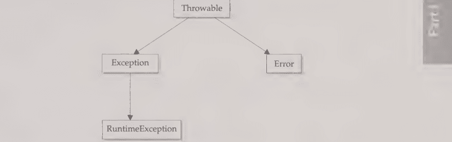

### 未捕获的异常

在学习如何在程序中处理异常之前，了解如果不处理异常时会发生什么非常有帮助。这个小程序包含一个故意导致除以零错误的表达式：

```java
class Exc0 {
    public static void main(String args[]) {
        int d = 0;
        int a = 42 / d;
    }
}
```

当 Java 运行时检测试图除以零时，它会构建一个新的对象并*抛出*（throws）此异常。这会导致 Exc0 的执行停止，因为一旦抛出，它必须被异常处理器*捕获*（caught）并立即处理。在这个示例中，我们没有提供任何自定义异常处理器，因此异常由 Java 运行时系统提供的默认处理器捕获。任何未被程序捕获的异常最终将由默认处理器处理。默认处理器会显示描述异常的字符串、从异常发生点开始的堆栈跟踪并终止程序。

以下是该示例执行时生成的异常：

```
java.lang.ArithmeticException: / by zero
    at Exc0.main(Exc0:4)
```

注意类名 Exc0；方法 main；文件名 Exc0.java 以及行号 4 都包含在堆栈跟踪中。此外，注意异常类型是 Exception 的一个子类，称为 ArithmeticException，它更具体地描述了发生了什么类型的错误。正如本章稍后讨论的，Java 提供了几种内置异常类型，以匹配可以生成的各种运行时错误。当你运行本示例以及章其他使用 Java 内置异常的示例时，你看到的确切输出可能与显示的内容因 JDK 之间的差异而略有不同。

堆栈跟踪将始终显示导致错误的方法调用序列。例如，这里是上述程序的另一个版本，它引入了相同的错误，但是在一个与 main() 独立的方法中引入的：

```java
class Excl {
    static void subroutine() {
        int d = 0;
        int a = 10 / d;
    }
    public static void main(String[] args[]) {
        Excl.subroutine();
    }
}
```

默认异常处理器产生的堆栈跟踪显示了整个堆栈是如何显示的：

```
java.lang.ArithmeticException: by zero
    at Excl.subroutine(Excl.java:4)
    at Excl.main(Excl.java:7)
```

如你所示，堆栈底部是 main 第 7 行，这是对 subroutine() 的调用，它导致了第 4 行的异常。堆栈跟踪对于调试非常有用，因为它指出了导致错误的精确步骤序列。

### 使用 try 和 catch

尽管 Java 运行时系统提供的默认异常处理器对于调试很有用，但你通常想自己处理异常。这样做有两个好处：首先，它允许你修复错误。其次，它防止程序自动终止。如果你的程序每当发生错误就停止运行并打印堆栈跟踪，大多数用户会感到困惑（至少是这样）！幸运的是，这种情况很容易防止。

为了防止处理运行时错误，只需将你想要监控的代码包含在 `try` 块中。紧接 `try` 块之后，包含一个 `catch` 子句，指定你想要捕获的异常类型。为了说明这可以多么容易完成，以下程序包含一个 `try` 块和一个 `catch` 子句，用于处理除以零错误生成的 `ArithmeticException`：

```java
class Exc2 {
    public static void main(String[] args[]) {
        int d = 0;
        try {
            int a = 42 / d;
        } catch (ArithmeticException e) {
            System.out.println("Division by zero.");
        }
        System.out.println("After catch statement.");
    }
}
```

此程序产生以下输出：

```
Division by zero.
After catch statement.
```


注意 `try` 块内部对 `println()` 的调用从未被执行。一旦抛出异常，程序控制就会移出 `try` 块进入 `catch` 块。换句话说，`catch` 不是被“调用”的，因此执行永远不会从 `catch` “返回”到 `try` 块。因此，“This will not be printed.”不会显示。一旦 `catch` 语句执行完毕，程序控制将继续执行 `try / catch` 机制之后的下一行。

`try` 及其 `catch` 语句形成一个单元。`catch` 子句的作用范围局限于紧前的 `try` 语句所指定的语句。`catch` 语句不能捕获由另一个 `try` 抛出的异常（嵌套 `try` 语句除外稍后描述）。被 `try` 保护的语句必须用大括号括起来（也就是说，它们必须在一个块内）。你不能在单个语句上使用 `try`。

大多数构造良好的 `catch` 子句的目标是解决异常状况并像错误从未发生过一样继续。例如，在下一个程序中，`for` 循环的每次迭代获取两个随机整数。这两个整数相互相除，结果用于除以值 12345。最终结果放入 `a` 中。如果任何除法操作导致除以零错误，它将被捕获，并将值设置为零。

```java
// 处理异常并继续执行。

import java.util.Random;

class HandleError {

    public static void main(String args[]) {

        int a=0, b=0, c=0;

        Random r = new Random();

        for(int i=0; i<3; i++) {

            try {

                b = r.nextInt();

                c = r.nextInt();

                a = 12345 / c;

            } catch (ArithmeticException e) {

                System.out.println("Division by zero.");

                a = 0; // 设置为零并继续

            }

            System.out.println("a: " + a);

        }

    }

}
```


### 显示异常描述

`Throwable` 重写了 `toString()` 方法，使其返回包含异常描述的字符串。你可以通过将异常作为参数在 `println()` 语句中显示此描述。例如，前一个程序的 `catch` 块可以重写为：

```java
catch (ArithmeticException e) {

    System.out.println("Exception: " + e);

    int a = 0; // 设置为零并继续

}
```

当在程序替换此版本并运行时，每个除以零错误都会显示以下内容：

```
Exception: java.lang.ArithmeticException / by zero
```

虽然在这种语境下没有特殊价值，但在其他情况下——特别是当你正在尝试异常或进行调试时——显示异常描述的能力非常有价值。

### 多个 catch 子句

在某些情况下，一段代码可能会抛出多个异常。为了处理这种情况，你可以指定两个或多个 `catch` 子句，每个捕获不同类型的异常。当抛出异常时，会顺序检查每个 `catch` 语句并执行第一个与异常类型匹配的。在一个 `catch` 语句执行后，其他的将被跳过，执行将在 `try / catch` 块之后继续。以下示例捕获了两种不同的异常类型：

```java
// 演示多个 catch 语句。

class MultipleCatches {

    public static void main(String[] args) {

        try {

            int a = args.length;

            System.out.println("a = " + a);

            int b = 42 / a;

            int c[] = { 1 };

            c[42] = 99;

        } catch (ArithmeticException e) {

            System.out.println("Divide by 0: " + e);

        } catch (ArrayIndexOutOfBoundsException e) {

            System.out.println("Array index oob: " + e);

        }

        System.out.println("After try/catch blocks.");

    }

}
```

行参数，将 a 设置为大于 0 的值。但这会导致 `ArrayIndexOutOfBoundsException`，因为 int 数组 `c` 的长度为 1，但程序却尝试给 `c[42]` 赋值。
以下是运行两种方式程序后生成的输出：

```
C:\>javaMultipleCatches

a = 0

Divide by 0: java.lang.ArithmeticException: / by zero

After try/catch blocks.
```

```
C:\>javaMultipleCatches TestArg

a = 1

Array index out: java.lang.ArrayIndexOutOfBoundsException:

Index 42 out of bounds for length 1

After try/catch blocks.
```

当使用多个 `catch` 语句时，重要的是记住异常类必须在它们的任何父类之前。这是因为 `catch` 语句会匹配该类型的父类 `catch` 加上它的任何子类 `catch`。因此，如果子类出现在其父类之后，则永远无法被访问。此外，在 Java 中，不可达代码是一个错误。例如，考虑以下程序：

```java
/* 此程序包含一个错误。

在连续的 catch 语句中，

子类必须在其父类之前。如果不是，

将创建不可达代码并导致

编译时错误。

*/

class SuperSubCatch {

    public static void main(String args[]) {

        try {

            int a = 0;

            int b = 42 / a;

        } catch (Exception e) {

            System.out.println("Generic Exception catch.");

        }

        /* 这个 catch 永远不会到达，因为 *

        ArithmeticException 是 Exception 的子类。 */

        catch (ArithmeticException e) { // 错误 -不可达

            System.out.println("This is never reached.");

        }

    }

}
```

如果你尝试编译此程序，将收到一条错误消息，说明第二个 `catch` 语句是不可达的，因为异常已经被捕获。由于 `ArithmeticException` 是 `Exception` 的子类，第一个 `catch` 语句将处理所有基于 `Exception` 的错误，包括 `ArithmeticException`。这意味着第二个 `catch` 语句永远不会执行。要解决这个问题，请反转 `catch` 语句的顺序。


### 嵌套 try 语句

`try` 语句可以嵌套。也就是说，一个 `try` 语句可以位于另一个 `try` 块内部。每当进入一个 `try` 语句时，异常上下文就会推入栈中。如果内部 `try` 语句没有针对特定异常的 `catch` 处理器，栈将弹出，并检查下一个 `try` 语句的 `catch` 处理器是否匹配。这将一直持续，直到其中一个 `catch` 语句成功，或者耗尽所有嵌套的 `try` 语句。如果没有匹配的 `catch` 语句，Java 运行时将处理该异常。以下是一个使用嵌套 `try` 语句的示例：

```java
// 嵌套 try 语句的示例。

class NestTry {

    public static void main(String[] args) {

        try {

            int a = args.length;

            /* 如果没有命令行参数，

               * 以下语句将产生

               * 除以零异常。 */

            int b = 42 / a;

            System.out.println(" " + a);

        try { // 嵌套 try 块

            /* 如果使用一个命令行参数，

               * 那么以下代码将产生

               * 除以零异常。 */

            if(a==1) a = a/(a-a); // 除零

            /* 如果使用两个命令行参数，

               * 那么产生越界异常。 */

            if(a==2) {

                int c[] = { 1 };

                c[42] = 99; // 产生越界异常

            }

        } catch (ArrayIndexOutOfBoundsException e) {

            System.out.println("Array index out-of-bounds: " + e);

        }

        } catch (ArithmeticException e) {

            System.out.println("Divide by 0: " + e);

        }

    }

}
```

你可以看到，这个程序在一个块内部嵌套了另一个块。程序的运行方式如下：当不带命令行参数执行程序时，外部 `try` 块会产生除以零异常。带一个命令行参数执行程序时，嵌套的 `try` 块产生除以零异常。由于内部块没有捕获此异常，它被传递到外部块，并在那里被处理。如果你带两个命令行参数执行程序，

从内部 `try` 块内部产生一个数组边界异常。以下是说明每种情况的运行示例：

```
C:\>NestTry

Divide by 0: java.lang.ArithmeticException: / by zero
```

```
C:\>java NestTry One

a = 1

Divide by 0: java.lang.ArithmeticException: / by zero
```

```
C:\>java NestTry Two

a = 2

Array index out-of-bounds:

java.lang.ArrayIndexOutOfBoundsException:

42 out of bounds for length 1
```

当涉及方法调用时，`try` 语句的嵌套可能会以不明显的方式发生。例如，你可以将方法调用封装在 `try` 块中。在该方法内部是另一个 `try` 语句。在这种情况下，`try` 方法仍然嵌套在调用该方法的外部 `try` 块内部。这里是重写的之前的程序，将嵌套的 `try` 块移动到方法 `nestry()` 内部：

```java
/* try 语句可以通过调用方法

   隐式地嵌套。 */

class MethNestTry {

    static void nestry(int a) {

        try { // 嵌套 try 块

            /* 如果使用一个命令行参数，

               * 那么以下代码将产生

               * 除以零异常。 */

            if(a==1) a = a/(a-a); // 除零

            /* 如果使用两个命令行参数，

               * 那么产生越界异常。 */

            if (a==2) {

                int c[] = { 1 };

                c[42] = 99; // 产生越界异常

            }

        } catch (ArrayIndexOutOfBoundsException e) {

            System.out.println("Array index out-of-bounds: " + e);

        }

    }

    public static void main(String args[]) {

        try {

            int a = args.length;

            /* 如果没有命令行参数，

               以下语句将产生

               除以零异常。 */

            int b = 42 / a;

            System.out.println(" " + a);

            nestry(a);

        } catch (ArithmeticException e) {

            System.out.println("Divide by 0: " + e);

        }

    }

}
```

此程序的输出与之前的示例相同。

### throw

到目前，你捕获的都是 Java 运行时抛出的异常。然而，你的程序可以使用 `throw` 语句抛出异常。`throw` 的通用形式所示：

```java
throw ThrowableInstance;
```

在这里，`ThrowableInstance` 必须是 `Throwable` 类型的对象或其子类。原始类型（如 `int` 或 `char`）以及非 Throwable 类（如 `String` 和 `Object`）不能被抛出作为异常。你有两种方法获取 `Throwable` 对象：使用 `catch` 子句中的参数或使用 `new` 运算符创建。

`throw` 语句之后执行流立即停止；后续语句不会执行。检查最近的封装 `try` 块，看它是否有匹配异常类型的 `catch` 语句。如果找到了匹配项，控制权转移到该语句。如果没有，则检查下一个 `try` 语句，以此类推。如果没有找到匹配的 `catch`，默认异常处理器将停止程序并推送堆栈跟踪。

这是一个创建并抛出异常的示例程序。捕获异常的处理器将其抛给外部处理器。

```java
// Demo throw。

class ThrowDemo {

    static void democroc() {

        try {

            throw new NullPointerException("demo");

        } catch (NullPointerException e) {

            System.out.println("Caught inside democroc.");

            throw e; // 重抛出异常

        }

    }

    public static void main(String args[]) {

        try {

            democroc();

        } catch (NullPointerException e) {

            System.out.println("Recaught: " + e);

        }

    }

}
```

这个程序得到了两次处理同一个错误的机会。首先，`main()` 设置了异常上下文，然后调用 `democroc()`。`democroc()` 方法随后设置建立另一个异常处理上下文并立即抛出一个 `NullPointerException` 新实例，该异常在下一行被捕获。随后异常重新抛出。以下是生成的输出：

```
Caught inside demoproc.

Recatget: java.lang.NullPointerException: demo
```

该程序还说明了如何创建 Java 标准异常对象。请密切注意此行：

```
throw new NullPointerException("demo");
```


在这里，`new` 被用于构造 `NullPointerException` 的实例。Java 的许多内置运行时异常至少有两个构造函数：无参数的以及接受字符串参数的。当使用第二种形式时，参数指定了一个描述该异常的字符串。当该对象作为 `print()` 或 `println()` 的参数使用时，会显示此字符串。它也可以通过调用 `getMessage()` 获取，该方法由 `Throwable` 定义。

### throws

如果一个方法可能会导致它本身不处理的异常，则它必须指定这种行为，以便方法的调用者能够针对该异常进行防护。你通过在方法的声明中包含 `throws` 子句来实现这一点。`throws` 子句列出了方法可能抛出的异常类型。对于所有异常都是必要的，但 `Error` 类型或 `RuntimeException` 类型或其任何子类除外。方法可以抛出的所有其他异常都必须在 `throws` 子句中声明。如果没有声明，将导致编译时错误。

这是包含 `throws` 子句的方法声明的通用形式：

```
type method-name(parameter-list) throws exception-list
{
  // 方法体
}
```

在这里，`exception-list` 是方法可以抛出的异常的逗号分隔列表。下面是一个不正确的程序示例，它试图抛出一个它没有捕获的异常。由于该程序没有指定 `throws` 子句来声明这一事实，该程序将无法编译。

```
// 此程序包含错误将无法编译。
class ThrowsDemo {
  static void throwone() {
    System.out.println("Inside throwone.");
    throw new IllegalAccessException("demo");
  }
  public static void main(String[] args) {
    throwone();
  }
}
```

为了使此示例能够编译，你需要进行两个更改。首先，你需要声明 `throwOne()` 抛出 `IllegalAccessException`。其次，`main()` 必须定义一个捕获该异常的 `try / catch` 语句。


# 238 第一部分 Java 语言

修正后的示例显示在此：

```
// 现在是正确的。
class ThrowsDemo {
    static void throwOne() throws IllegalAccessException {
        System.out.println("Inside throwOne.");
        throw new IllegalAccessException("demo");
    }
    public static void main(String[] args) {
        try {
            throwOne();
        } catch (IllegalAccessException e) {
            System.out.println("Caught " + e);
        }
    }
}
```

以下是运行此程序生成的输出：

```
inside throwOne
caught java.lang.IllegalAccessException: demo
```

### finally

当抛出异常时，方法中的执行路径会采取一条相当突然的非线性的路径，这改变了通过方法的正常流程。取决于方法的编码方式，异常甚至可能导致方法过早返回。在某些方法这可能是一个问题。例如，如果一个方法在进入时打开文件并在退出时关闭文件，那么异常将导致异常处理机制无法关闭文件。**finally** 关键字的设计是为了处理这种意外情况。

`finally` 创建一个代码块，该块将在 `try/catch` 完成之后且 `try/catch` 块之后的代码执行之前执行。无论是否抛出异常，`finally` 块都会执行。如果抛出了异常，即使没有 `catch` 语句匹配该异常，`finally` 块也会执行。每当方法准备从 `try/catch` 块内部通过未检查异常或显式返回语句返回到调用者时，**finally** 子句会在方法返回之前执行。这对于在返回之前关闭文件句柄并释放在方法开始时可能已分配的任何资源非常有用。**finally** 子句是可选的。但是，每个 `try` 语句至少需要一个 **catch** 或 **finally** 子句。

这里是一个示例程序，显示了三个以不同方式退出的方法，且没有执行它们的 **finally** 子句：

```
// 演示 finally。
class FinallyDemo {
    // 从方法抛出异常。
    static void procA() {
        try {
            System.out.println("inside procA");
            throw new RuntimeException("demo");
        } finally {
            System.out.println("procA's finally");
        }
    }

    // 从 try 块内部返回。
    static void procB() {
        try {
            System.out.println("inside procB");
            return;
        } finally {
            System.out.println("procB's finally");
        }
    }

    // 正常地执行 try 块。
    static void procC() {
        try {
            System.out.println("inside procC");
        } finally {
            System.out.println("procC's finally");
        }
    }

    public static void main(String args[]) {
        try {
            procA();
        } catch (Exception e) {
            System.out.println("Exception caught");
        }
        procB();
        procC();
    }
}
```


在此示例中，`procA()` 通过抛出异常退出了 `try` 块，`procB()` 通过返回语句退出了 `try` 块，`procC()` 则正常执行。然而，`finally` 块在所有情况下都执行了。

以下是程序生成的输出：

```
inside procA
procA's finally
Exception caught
inside procB
procB's finally
inside procC
procC's finally
```

### 内置异常

在标准包 `java.lang` 中，Java 定义了一些异常类。前面的示例使用了其中几个。这些异常的最通用基类是 `RuntimeException`。如前所述，这些异常不需要包含在方法的 `throws` 列表中。由于编译器不检查方法是否处理或抛出这些异常，它们被称为未检查异常。`java.lang` 定义的未检查异常见表 10-1。表 10-2 列出了 `java.lang` 定义的异常，如果方法产生这些异常且不处理它们，则必须包含在方法的 `throws` 列表中。这些被称为已检查异常。除了 `java.lang` 中的异常外，Java 还定义了许多与其标准包相关的更多异常。

| 异常 | 含义 |
| --- | --- |
| ArithmeticException | 算术错误，例如除以零。 |
| ArrayOutOfBoundsException | 数组索引越界。 |
| ArrayStoreException | 向数组元素赋值不兼容类型。 |
| ClassCastException | 无效类型转换。 |
| EnumConstantNotPresentException | 尝试使用未定义的枚举值。 |
| IllegalArgumentException | 调用方法时的非法参数。 |
| IllegalCallerException | 调用代码无法合法执行该方法。 |
| IllegalMonitorStateException | 非法监视器操作，例如在未锁定的线程上等待。 |
| IllegalStateException | 环境或应用程序处于错误状态。 |
| IllegalThreadException | 请求与当前线程状态不兼容。 |
| IndexOutOfBoundsException | 某些类型的索引越界。 |
| LayerInstantiationException | 无法创建模块层。 |
| NegativeArraySizeException | 创建数组的大小为负。 |
| NullPointerException | 无效的空引用使用。 |
| NumberFormatException | 字符串转换为数值格式时无效。 |
| SecurityException | 尝试违反安全。 |
| StringOutOfBoundsException | 尝试访问字符串范围外的索引。 |
| TypeNotPresentException | 未找到类型。 |
| UnsupportedOperationException | 遇到了不受支持的操作。 |

表 10-1 java.lang 中定义的未检查 RuntimeException 子类

## 第10章 异常处理 24

| 异常 | 含义 |
| :--- | :--- |
| ClassNotFoundException | 未找到类。 |
| CloneNotSupportedException | 尝试克隆未实现 Clone 接口的对象。 |
| IllegalAccessException | 拒绝访问类。 |
| InstantiationException | 尝试创建抽象类或接口的实例。 |
| InterruptedException | 线程被另一个线程中断。 |
| NoSuchFieldException | 请求字段不存在。 |
| NoSuchMethodException | 请求的方法不存在。 |
| ReflectiveOperationException | 反射相关异常的超类。 |

表 10-2 java.lang 中定义的 Java 检查异常

## 创建自定义的异常子类

虽然 Java 内置的异常处理了大多数常见错误，但你可能想要创建自己的异常来处理特定于应用程序的情况。这很容易实现：只需定义 `Exception` 的子类即可（当然，它是 `Throwable` 的子类）。你的子类不需要实现任何内容——它们在类型系统中的存在本身就让你能够将它们作为异常使用。

`Exception` 类本身没有定义任何方法。当然，它继承了 `Throwable` 提供的方法。因此，所有异常（包括你创建的异常）都可以使用 `Throwable` 定义的方法。它们在表 10-3 中。你可能还喜欢在你创建的异常类中重写这些方法中的一个或多个。

`Exception` 定义了四个公共构造函数。两个支持链式异常（将在下一节描述）。另外两个显示在这里：

```
Exception()
Exception(String msg)
```

第一种形式创建一个没有描述的异常。第二种形式允许你指定异常的描述。

虽然在创建异常时指定描述通常有用，但有时重写 `toString()` 更好。原因如下：`Throwable` 定义的 `toString()` 版本首先显示异常名称后跟着冒号：然后是你的描述。通过重写 `toString()`，你可以防止显示异常名称和冒号。这使得输出更加整洁，在某些情况下是理想的。

| 方法 | 描述 |
| :--- | :--- |
| final void addSuppressed(Throwable exc) | 将 exc 添加到与调用者异常相关的抑制异常列表中。主要供 `try-with-resources` 语句使用。 |
| Throwable fillInStackTrace() | 返回一个包含完整堆栈轨迹的 `Throwable` 对象。该对象可以重新抛出。 |
| Throwable getCause() | 返回当前异常的底层异常。如果没有底层异常，则返回 `null`。 |
| String getLocalizedMessage() | 返回异常的本地化描述。 |
| String getMessage() | 返回异常的描述。 |
| StackTraceElement[] getStackTrace() | 返回一个包含堆栈轨迹的数组，每次以 `StackTraceElement` 数组的形式返回。堆栈顶端的方法是异常抛出之前调用的最后一个方法。该方法位于数组的第一个元素中。`StackTraceElement` 类允许你访问轨迹中每个元素的信息，例如它的方法。 |
| final Throwable[] getSuppressed() | 获取与调用者异常相关的抑制异常并返回一个包含结果的数组。抑制异常主要由 `try-with-resources` 语句生成。 |
| Throwable initCause(Throwable causeExc) | 将 causeExc 与调用者异常关联，作为调用者异常的原因。返回异常的引用。 |
| void printStackTrace() | 显示堆栈轨迹。 |
| void printStackTrace(OutputStream stream) | 将堆栈轨迹发送到指定的流。 |
| void printStackTrace(PrintWriter stream) | 将堆栈轨迹发送到指定的流。 |
| void setStackTrace(StackTrace elements[]) | 设置堆栈轨迹。 |
| String toString() | 返回异常的描述。 |

表 10-3 `Throwable` 定义的方法

以下示例声明了 `Exception` 的子类并随后使用了它：

```
// 此示例创建一个自定义异常
class MyException extends Exception {
    private int detail;
    MyException(int a) {
        detail = a;
    }
    public String toString() {
        return "MyException[" + detail + "]";
    }
}
class ExceptionDemo {
    static void demoproc() {
        // 创建一个异常
        NullPointerException e = new NullPointerException("top layer");
        // 添加一个原因
        e.initCause(new ArithmeticException("cause"));
        throw e;
    }
    public static void main(String args[]) {
        try {
            demoproc();
        } catch (MyException e) {
            System.out.println("Caught " + e);
        } catch (NullPointerException e) {
            System.out.println("Caught " + e);
        }
    }
}
```

结果如下：

```
Called compute(1)
Normal exit
Called compute(20)
Caught MyException[]
```


### 链式异常

年前，异常子系统引入了一项功能：链式异常。链式异常功能允许将一个异常与另一个异常关联。第二个异常描述了第一个异常的原因。例如，想象一种情况：一个方法因为尝试除以零而抛出 `ArithmeticException`。然而，问题的实际原因是发生了 I/O 错误，导致除数被设置不当。虽然该方法确实必须抛出 `ArithmeticException`（因为这是实际发生的错误），但你可能还想让调用代码知道底层原因是 I/O 错误。链式异常允许你处理这种情况，以及其他存在异常层的情况。

为了允许链式异常，`Throwable` 添加了两个构造函数和两个方法。构造函数显示在这里：

- `Throwable(Throwable causeExc)`
- `Throwable(String msg, Throwable causeExc)`

在第一种形式中，`causeExc` 是导致异常的异常。也就是说，`causeExc` 是异常发生的底层原因。第二种形式允许你在指定消息的同时指定原因。这两个构造函数也已添加到 `Error`、`Exception` 和 `RuntimeException` 类中。

`Throwable` 支持的链式异常方法是 `getCause()` 和 `initCause()`，它们在表 10-3 中重复出现，这里为了讨论再次列出：

- `Throwable getCause()`
- `Throwable initCause(Throwable causeExc)`

`getCause()` 方法返回当前异常的异常。如果没有底层异常，则返回 `null`。`initCause()` 方法将 `causeExc` 与调用者异常关联并返回异常的引用。因此，你可以在异常创建后关联原因。原因只能设置一次。这意味着每个异常对象只能调用一次 `initCause()`。此外，如果原因是通过构造函数设置的，则你无法通过 `initCause()` 再次设置它。通常，`initCause()` 用于为不支持上述额外构造函数的遗留异常类设置原因。

以下示例说明了处理链式异常的机制：

```java
// 演示异常链处理。

class ChainExcDemo {

    static void demoproc() {

        // 创建一个异常

        NullPointerException e =

            new NullPointerException("top layer");

        // 添加一个原因

        e.initCause(new ArithmeticException("cause"));

        throw e;

    }

}
```

```java

public static void main(String args[]) {

  try {

    demoproc();

  } catch (NullPointerException e) {

    // 显示顶层异常

    System.out.println("Caught: " + e);

    // 显示原因异常

    System.out.println("Original cause: " + e.getCause());

  }

}

```

程序的输出显示所示：

```
Caught: java.lang.NullPointerException: top layer
Original cause: java.lang.ArithmeticException: cause
```

在这个例中，顶层异常是 `NullPointerException`。向它添加了一个异常 `ArithmeticException`。当该异常由 `demoproc()` 抛出时，它被 `main()` 捕获。在那里，显示了顶层异常，随后是底层异常，后者是通过调用 `getCause()` 获取的。

链式异常可以根据所需的深度延伸。因此，异常本身可以拥有一个原因，而过长的异常链可能意味着设计不当。

链式异常并不是每个程序都需要的。然而，在了解底层原因有用的情况下，它们提供了一种优雅的解决方案。

### 三个额外的异常特性

从 JDK 7 开始，三个有趣且实用的特性已成为异常系统的一部分。第一个自动化了释放不再需要的资源（如文件）的进程。它基于 `try` 语句的扩展形式，称为 `try-with-resources`，并在第13章引入文件时进行了描述。第二个特性是多异常捕获（multi-catch），第三个有时被称为最终重抛或更精确的重抛。这两种特性在这里被进行了描述。

多异常捕获特性允许用同一个 `catch` 句捕获两个或多个异常。多个处理程序使用相同的代码序列并不罕见，尽管它们响应的是不同的异常。与其为每种异常类型单独编写处理程序，你可以使用单个 `catch` 来处理所有异常，而避免代码重复。

要使用多异常捕获，使用或运算符 `|` 在 `catch` 句中分隔每个异常类型。每个多异常捕获参数隐式地是 `final`（如果需要，你可以显式指定 `final`，但没有必要）。因为每个多异常捕获参数都是隐式的 `final`，所以它们不能被赋值新值。

这里是一个使用多异常捕获特性同时捕获 `ArithmeticException` 和 `ArrayIndexOutOfBoundsException` 的 `catch` 语句：

```java
catch(ArithmeticException | ArrayIndexOutOfBoundsException e) {
```

下面的程序展示了多异常捕获特性的应用：

```java
// 演示多异常捕获特性。

class MultiCatch {

  public static void main(String[] args[]) {

    int a=10, b=0;

    int[] vals = {1, 2, 3};

    try {

      int result = a / b; // 生成 ArithmeticException

      vals[10] = 19; // 生成 ArrayIndexOutOfBoundsException

    } catch (ArithmeticException | ArrayIndexOutOfBoundsException e) {

      System.out.println("Exception caught: " + e);

    }

    System.out.println("After multi-catch.");

  }

}
```

当尝试除以零时，程序将生成一个 `ArithmeticException`。如果你注释掉除法语句，并移除下一行的注释符号，则会生成一个 `ArrayIndexOutOfBoundsException`。这两个异常都被同一个 `catch` 语句捕获。

更精确的重抛特性限制了可以重抛的异常类型，仅限于关联 `try` 块抛出的、未被先前的 `catch` 句处理的、且是参数子类或超类的受检异常。虽然这种能力可能不需要，但它现在已可以使用。为了使更精确的重抛生效，`catch` 参数必须是“有效最终”（effectively final），这意味着它在 `catch` 块内部不能被赋值新值，或者显式声明为 `final`。

### 使用异常

异常处理为控制具有许多动态运行时特性的复杂程序提供了一种强大的机制。将 `try`、`throw` 和 `catch` 视为处理程序逻辑中错误和异常边界条件的整洁方式是非常重要的。因此，当一个方法可能会失败时，它可以抛出一个异常。这是处理失败模式的一种更整洁的方式。

最后一点：Java 的异常处理语句不应被视为非局部跳转的通用机制。如果你这样做，它只会混乱你的代码并使其变得难以维护。

# 第11章 多线程编程

Java 为多线程编程提供了内置支持。多线程程序包含两个或多个可以并发运行的部分。这种程序的每个部分被称为线程，每个线程都定义了一条独立的执行路径。因此，多线程是多任务处理的一种特殊形式。

你几乎肯定熟悉多任务处理，因为所有现代操作系统都支持它。然而，有两种不同类型的多任务处理：基于进程的和基于线程的。理解两者之间的区别非常重要。对于许多读者来说，基于进程的多任务处理是熟悉的格式。进程本质上是一个正在执行的程序。

基于进程的多任务是允许计算机并发运行多个程序的。例如，基于进程的多任务允许你在使用文本编辑器或访问网站时同时运行编译器。在基于进程的多任务中，程序是让调度器可以分发的最小单元。

在基于线程的多任务环境下，线程是最小的可分发单元。这意味着单个程序可以同时执行多个任务。例如，文本编辑器可以在打印时同时格式化文本，只要这些操作是由不同的线程执行的。因此，基于进程的多任务处理的是“大局”，而基于线程的多任务处理的是细节。

多线程处理所需的开销小于多进程处理。进程是重量级任务，拥有它们独立的地址空间。进程间的通信是昂贵的。进程之间的上下文切换也是昂贵的。相反，线程是轻量级的。它们共享相同的地址空间，并协作共享同一个进程。线程间通信是廉价的，线程到线程的上下文切换成本较低。虽然 Java 程序使用进程的多任务环境，但基于进程的多任务不受 Java 的直接控制。然而，多线程多任务则是。

多线程允许你编写能够充分利用系统可用计算能力的程序。多线程实现这一目标的一个重要方式是尽可能减少空闲时间。这对于交互式的网络化环境尤为重要，因为空闲时间很常见。例如，网络数据传输速度远慢于计算机的处理速度。在单线程环境下，当线程由于等待某些资源而阻塞（即暂停执行）时，整个程序都会停止。

如果你为 Windows 等操作系统编写过程序，那么你已经熟悉多线程。然而，Java 管理线程使其变得特别方便。

### 线程模型

Java 运行时依赖线程处理许多事务，所有的类库设计都考虑了多线程。Java 使用线程来实现整个环境的异步化。多线程环境的价值最好通过与其对比来理解。单线程系统使用称为“事件循环轮询”的方法。在这种模型中，单个控制线程在无限循环中运行，轮询事件队列以决定下一步做什么。一旦这种轮询机制返回（例如，文件已就绪可以读取），事件循环就会将控制传递给相应的事件处理器。在事件处理器返回之前，任何其他事情都无法发生。这浪费了 CPU 时间。它还会导致程序的一个部分主导系统，并阻止任何其他事件的处理。在单线程环境下，当线程阻塞时，整个程序都会停止。

Java 多线程的好处在于消除了主循环/轮询机制。一个线程可以暂停而不会停止程序的其他部分。例如，当线程从网络读取数据或等待输入时产生的空闲时间可以被其他地方利用。多线程允许动画在帧之间循环，而不会导致整个系统暂停。当 Java 程序中的线程阻塞时，只有被阻塞的单个线程会暂停。所有其他线程继续运行。

注意：除了本章描述的多线程特性外，你可能还想探索 Fork/Join 框架。它提供了一种创建多线程程序的强大手段，这些程序可以自动扩展以充分利用多核环境。Fork/Join 框架是 Java 支持并行编程的一部分，并行编程是对于在具有多个 CPU 的系统中优化某些类型算法以并行执行的技术的常用名称。有关 Fork/Join 框架的讨论，请参阅第 28 章。此处描述了 Java 传统的多线程能力。

线程存在多种状态。以下是通俗描述。线程可以是运行的。它可以一旦获得 CPU 时间就准备运行。运行中的线程可以被挂起，这会暂时停止它的活动。挂起的线程随后可以恢复，允许它从停止的地方继续。线程在等待资源时可能会被阻塞。在任何时候，线程都可以被终止，这将立即停止它的执行。一旦终止，线程将无法恢复。

### 线程优先级

Java 为每个线程分配一个优先级，用于决定与其他线程相比应该如何对待。线程优先级是整数，指定了一个线程相对于另一个线程的相对优先级。作为绝对值，优先级是没有意义的；如果它是唯一的运行线程，那么高优先级的线程运行速度并不比低优先级的线程快。相反，线程的优先级用于决定何时从一个运行线程切换到下一个线程。这被称为上下文切换。决定何时发生上下文切换的规则非常简单：

- 线程可以主动放弃控制权。这发生在显式让出（yield）、睡眠（sleep）或被阻塞时。在这种情况下，将检查所有其他线程，准备就绪且优先级最高的线程将获得 CPU。
- 线程可以被高优先级的线程抢占。在这种情况下，不让出处理器的低优先级线程仅仅会被高优先级的线程抢占——无论它正在做什么。从根本上说，只要有高优先级的线程想要运行，它就会运行。这被称为抢占式多任务。

在两个相同优先级的线程竞争 CPU 周期的情况下，情况会有点复杂。对于某些操作系统，等优先级的线程会自动以轮询方式进行时间分片。对于其他类型的操作系统，等优先级的线程必须向同级线程让出控制权。如果它们不这样做，其他线程将不会运行。

注意：操作系统切换等优先级线程上下文的方式差异可能会产生移植性问题。

### 同步

由于多线程为你的程序引入了异步行为，因此当你需要时，必须有一种方法来强制执行同步。例如，如果你想让两个线程通信并共享一个复杂的数据结构（如链表），你需要某种方法来确保它们不会相互冲突。也就是说，你必须防止一个线程在写入数据时，另一个线程正在读取它。为了这个目的，Java 对古老的进程间同步模型进行了优雅的改进：监视器（monitor）。监视器是由 C.A.R. Hoare 首先定义的控制机制。你可以将监视器想象成只能容纳一个线程的小盒子。当一个线程进入它时，必须等待该线程退出监视器。通过这种方式，监视器可以保护共享资源不被同时由多个线程操作。

在 Java 中，没有名为 `Monitor` 的类；相反，每个对象都有其隐式的监视器，当调用对象的某个 `synchronized` 方法时，该监视器会自动进入。一旦线程进入了 `synchronized` 方法，其他线程就不能调用该对象上的任何其他 `synchronized` 方法。这允许你编写清晰、简洁的多线程代码，因为同步支持是内置在语言中的。

### 消息传递

在将程序分成单独的线程之后，你需要定义它们将如何相互通信。用其他某些语言编程时，你必须依赖操作系统来建立这些线程之间的通信。这无疑为线程间的对话增加了难度。相比之下，Java 为两个或多个线程之间的对话提供了一种整洁、低成本的方法。Java 的消息传递系统允许线程进入对象的某个 `synchronized` 方法，然后等待某些其他线程显式地通知它退出。

### Thread 类和 Runnable 接口

Java 的多线程系统基于 `Thread` 类、其方法及其伴侣接口 `Runnable` 构建。`Runnable` 封装了一个执行线程。由于你无法直接引用运行中线程的虚幻状态，你将通过它的代理（即产生它的 `Thread` 实例）来处理它。要创建一个新线程，你的程序要么扩展 `Thread` 类，要么实现 `Runnable` 接口。

该类定义了几个帮助管理线程的方法。本章中使用的几种方法显示在此：

| 方法 | 含义 |
| --- | --- |
| `getName()` | 获取线程名称。 |
| `getPriority()` | 获取线程的优先级。 |
| `isAlive()` | 确定线程是否仍在运行。 |
| `join()` | 等待线程终止。 |
| `run()` | 线程的入口。 |
| `sleep()` | 挂起线程一段时间。 |
| `start()` | 调用其方法启动线程。 |

到为止，书中的所有示例都使用了单个线程。本章剩余部分将解释如何使用 `Thread` 和 `Runnable` 来创建和管理线程。

### 主线程

当 Java 程序启动时，一个线程开始运行。这通常被称为主线程。主线程有两个原因：

- 它是产生“子”线程的线程。
- 它通常是最后一个执行完毕的线程，因为它执行各种关闭操作。

尽管主线程在程序启动时自动创建，但可以通过 `Thread` 对象进行控制。为此，你必须通过调用 `currentThread()` 方法获取其引用，该方法是 `Thread` 的 `public static` 成员。其通用形式如下：

```java
static Thread currentThread()
```

该方法返回调用它的线程的引用。一旦你有了主线程的引用，就可以像控制其他线程一样控制它。让我们通过审查以下示例开始：

```java
// 控制主 Thread。
```


# Java 线程基础

## CurrentThreadDemo 示例

```java
class CurrentThreadDemo {

    public static void main(String args[]) {

        Thread t = Thread.currentThread();

        System.out.println("Current thread: " + t);

        // 修改线程名称

        t.setName("My Thread");

        System.out.println("After name change: " + t);

        try {

            for (int n = 5; n > 0; n--) {

                System.out.println(n);

                Thread.sleep(1000);

            }

        } catch (InterruptedException e) {

            System.out.println("Main thread interrupted");

        }

    }

}
```

在这个程序中，通过调用 `currentThread()` 获取当前线程（在这种情况下为主线程）的引用，并将该引用存储在局部变量 `t` 中。接下来，程序显示线程的信息。程序调用 `setName()` 修改线程的内部名称。然后再次显示关于线程的信息。接下来，一个循环从五倒数，每行暂停一秒。这种暂停是通过 `sleep()` 方法实现的。`sleep()` 的参数指定了毫秒级的延迟时间。注意此调用周围的 `try/catch` 块。`Thread` 中的 `sleep()` 方法可能会抛出 `InterruptedException`。这会发生在某些其他线程想要中断正在睡眠的线程时。此示例仅在线程被中断时打印一条消息。在实际程序中，你需要以不同的方式处理这种情况。以下是该程序生成的输出：

```
Current thread: Thread[main, 5]
After name change: Thread[My Thread, 5]
5
4
3
2
1
```

注意当 `t` 用作 `println()` 的参数时产生的输出。它按顺序显示了：线程名称、优先级以及所在组的名称。默认情况下，主线程的名称是 `main`。它的优先级是 5，这是默认值，且 `main` 也是该线程所属组的名称。线程组是一个控制整个线程集合状态的数据结构。在更改线程名称后，使用 `t` 作为输出，程序将显示线程的新名称。

## Thread 类核心方法

### sleep() 方法

`sleep()` 方法会导致调用它的线程挂起指定的毫秒数。其通用形式如下：

```java
static void sleep(long milliseconds) throws InterruptedException
```

挂起的毫秒数以毫秒为单位。该方法可能会抛出 `InterruptedException`。

`sleep()` 方法有第二种形式，允许你以毫秒和纳秒来指定周期：

```java
static void sleep(long milliseconds, int nanoseconds) throws InterruptedException
```

这种第二种形式仅适用于允许纳秒级极短计时周期的环境。

### setName() 和 getName() 方法

如前一个程序所示，你可以通过 `setName()` 设置线程名称。可以通过调用 `getName()` 获取线程名称（但注意程序中未显示这一点）。这些方法是 `Thread` 类的成员，声明方式如下：

```java
final void setName(String threadName)
final String getName()
```

在这里，`threadName` 指定线程的名称。

## 创建线程

从最通用的意义上说，通过实例化 `Thread` 类型的对象来创建线程。Java 定义了两种实现这一的方法：

- 你可以实现 `Runnable` 接口。
- 你可以扩展 `Thread` 类本身。

接下来的两个部分将分别查看这些方法。

### 实现 Runnable 接口

创建线程最简单的方法是创建一个实现 `Runnable` 接口的类。`Runnable` 抽象了一个可执行代码的单元。你可以在任何实现 `Runnable` 的对象上构建线程。要实现 `Runnable`，类只需要实现一个名为 `run()` 的方法，其声明如下：

```java
public void run()
```

在 `run()` 内部，你将定义构成新线程的代码。重要的是要理解 `run()` 可以调用其他方法、使用其他类并声明变量，这与主线程一样。唯一的区别是 `run()` 为程序中另一个并发执行的线程建立了入口点。该线程将在 `run()` 返回时结束。

在你创建了实现 `Runnable` 的类后，你将在该类内部实例化 `Thread` 类型的对象。`Thread` 定义了几个构造函数。我们将使用的那一个所示如下：

```java
Thread(Runnable threadOb, String threadName)
```

在这个构造函数中，`threadOb` 是实现 `Runnable` 接口的类的实例。它定义了线程执行的起点。新线程的名称由 `threadName` 指定。

新线程创建后，在调用其在 `Thread` 类内部定义的 `start()` 方法之前，它不会开始运行。本质上，`start()` 发起了对 `run()` 的调用。`start()` 方法所示：

```java
void start()
```

这是一个创建一个新线程并启动其运行的示例：

```java
// 创建第二个线程。
class NewThread implements Runnable {

    Thread t;

    NewThread() {

        // 创建一个新的第二个线程
        t = new Thread(this, "Demo Thread");
        System.out.println("Child thread: " + t);
    }

    // 这是第二个线程的入口点
    public void run() {
        try {
            for (int i = 5; i > 0; i--) {
                System.out.println("Child Thread: " + i);
                Thread.sleep(500);
            }
        } catch (InterruptedException e) {
            System.out.println("Child interrupted.");
        }
        System.out.println("Exiting child thread.");
    }
}

class ThreadDemo {
    public static void main(String args[]) {
        NewThread nt = new NewThread(); // 创建新线程
        nt.t.start(); // 启动线程
        try {
            for(int i = 5; i > 0; i--) {
                System.out.println("Main Thread: " + i);
                Thread.sleep(1000);
            }
        } catch (InterruptedException e) {
            System.out.println("Main thread interrupted.");
        }
        System.out.println("Main thread exiting.");
    }
}
```

在 `NewThread` 的构造函数内部，通过以下语句创建了一个新的 `Thread` 对象：

```java
t = new Thread(this, "Demo Thread");
```

将 `this` 作为第一个参数表示你想让新线程调用此对象的 `run()` 方法。在 `main()` 内部，调用了 `start()`，它启动了从 `run()` 方法开始的线程执行。这导致子线程的 `for` 循环开始。接下来主线程进入它的 `for` 循环。两个线程继续运行，在单核系统中共享 CPU，直到它们的循环结束。该程序产生的输出如下。（你的输出可能有所异）。

- Child thread: Thread[Demo Thread, 5]
- Main Thread: 5
- Child Thread: 5
- Main Thread: 4
- Child Thread: 4
- Main Thread: 3
- Child Thread: 3
- Main Thread: 2
- Child Thread: 2
- Main Thread: 1
- Child Thread: 1
- Main thread exiting.

正如前面提到的，在多线程程序中，由于 `sleep()` 的存在，主线程通常需要等待子线程完成。这种方法确保了主线程是最后结束。

### 扩展 Thread 类

创建线程的第二种方法是创建一个扩展 `Thread` 的类，并重写 `run()` 方法。这里是扩展 `Thread` 创建新线程并启动其运行的示例：

```java
// 创建第二个线程。
class NewThread extends Thread {

    NewThread() {
        // 调用父类构造函数，并指定名称
        super("Demo Thread");
        System.out.println("Child thread: " + this);
    }

    // 这是线程的入口点
    @Override
    public void run() {
        try {
            for (int i = 5; i > 0; i--) {
                System.out.println("Child Thread: " + i);
                Thread.sleep(500);
            }
        } catch (InterruptedException e) {
            System.out.println("Child interrupted.");
        }
        System.out.println("Exiting child thread.");
    }
}

class ThreadDemo {
    public static void main(String args[]) {
        NewThread nt = new NewThread(); // 创建一个新线程
        nt.start(); // 启动线程
        try {
            for(int i = 5; i > 0; i--) {
                System.out.println("Main Thread: " + i);
                Thread.sleep(1000);
            }
        } catch (InterruptedException e) {
            System.out.println("Main thread interrupted.");
        }
        System.out.println("Main thread exiting.");
    }
}
```

在 `NewThread` 的构造函数内部，通过以下语句创建了一个新的 `Thread` 对象：

```java
super("Demo Thread");
```

将此作为参数传递表示你想让新线程拥有这个名称。在 `main()` 内部，调用了 `start()`，它启动了从 `run()` 方法开始的线程执行。这导致子线程的 `for` 循环开始。接下来主线程进入它的 `for` 循环。两个线程继续运行，在单核系统中共享 CPU，直到它们的循环结束。该程序产生的输出如下。（你的输出可能有所异）。

- Child thread: Thread[Demo Thread, 5]
- Main Thread: 5
- Child Thread: 5
- Main Thread: 4
- Child Thread: 4
- Main Thread: 3
- Child Thread: 3
- Main Thread: 2
- Child Thread: 2
- Main Thread: 1
- Child Thread: 1
- Main thread exiting.

## 创建多个线程

到目前为止，你只使用了两个线程：主线程和一个子线程。然而，你的程序可以产生所需的多个线程。例如，以下程序创建了三个子线程：

```java
// 创建多个线程。
class NewThread implements Runnable {

    String name; // 线程名称
    Thread t;

    NewThread(String threadname) {
        name = threadname;
        t = new Thread(this, name);
        System.out.println("New thread: " + t);
    }

    // 这是线程的入口点
    public void run() {
        try {
            for (int i = 5; i > 0; i--) {
                System.out.println(name + ": " + i);
                Thread.sleep(1000);
            }
        } catch (InterruptedException e) {
            System.out.println(name + " Interrupted");
        }
        System.out.println(name + " exiting.");
    }
}

class MultiThreadDemo {
    public static void main(String args[]) {
        NewThread nt1 = new NewThread("One");
        NewThread nt2 = new NewThread("Two");
        NewThread nt3 = new NewThread("Three");

        // Start the threads.
        nt1.t.start();
        nt2.t.start();
        nt3.t.start();

        try {
            // wait for other threads to end
            Thread.sleep(10000);
        } catch (InterruptedException e) {
            System.out.println("Main thread Interrupted");
        }
        System.out.println("Main thread exiting.");
    }
}
```

该程序的示例输出所示。（你的输出可能会根据特定的执行环境而变化。）

```
New thread: Thread [One, 5, main]
New thread: Thread [Two, 5, main]
New thread: Thread [Three, 5, main]
One: 5
Two: 5
Three: 5
One: 4
Two: 4
Three: 4
One: 3
Three: 3
Two: 3
One: 2
Three: 2
Two: 2
One: 1
Three: 1
Two: 1
One exiting.
Two exiting.
Three exiting.
Main thread exiting.
```

如你所见，一旦启动，所有三个子线程共享 CPU。注意 `main()` 中对 `sleep(10000)` 的调用。这导致主线程睡眠十秒钟，并确保它最后结束。

## 使用 isAlive() 和 join()

如前所述，通常你会希望主线程最后结束。在前面的示例中，这是通过在 `main()` 中调用 `sleep()` 实现的，设置了足够长的延迟以确保所有线程在主线程之前终止。然而，这很难算一个满意的解决方案，它还提出了一个更大的问题：如何知道另一个线程何时结束？幸运的是，`Thread` 提供了一种方法，让你能够回答这个问题。

确定一个线程是否完成有两种方法。首先，你可以在线程上调用 `isAlive()`。该方法由 `Thread` 定义，其通用形式所示：

```java
final boolean isAlive()
```

如果被调用的线程仍在运行，则 `isAlive()` 方法返回 `true`。否则返回 `false`。

虽然 `isAlive()` 有时很有用，但你更常用来等待线程完成的方法是调用 `join()`。


# final void join() throws InterruptedException

该方法会一直等待，直到调用它的线程终止为止。它的名称源于一个概念，即调用线程等待直到指定的线程加入它。`join()` 的其他形式允许你指定等待线程终止的最大时间。

这里是前面示例的改进版本，它使用 `join()` 来确保主线程是最后一个停止的。它还演示了 `isAlive()` 方法。

```java
// 使用 join() 等待线程完成。

class NewThread implements Runnable {

    String name; // name of thread

    Thread t;

    NewThread(String name) {

        name = name;

        t = new Thread(this, name);

        System.out.println("New thread: " + t);

    }

    // 这是线程的入口点。

    public void run() {

        try {

            for (int i = 5; i > 0; i--) {

                System.out.println(name + ": " + i);

                Thread.sleep(1000);

            }

        } catch (InterruptedException e) {

            System.out.println(name + " interrupted.");

        }

        System.out.println(name + " exiting.");

    }

}
```

```java
class DemoJoin {

    public static void main(String args[]) {

        NewThread nt1 = new NewThread("One");

        NewThread nt2 = new NewThread("Two");

        NewThread nt3 = new NewThread("Three");

        // 启动线程

        nt1.t.start();

        nt2.t.start();

        nt3.t.start();

        System.out.println("Thread One is alive: " + 
                            nt1.t.isAlive());

        System.out.println("Thread Two is alive: " + 
                            nt2.t.isAlive());

        System.out.println("Thread Three is alive: " + 
                            nt3.t.isAlive());

        // 等待线程完成

        try {

            System.out.println("Waiting for threads to finish.");

            nt1.t.join();

            nt2.t.join();

            nt3.t.join();

        } catch (InterruptedException e) {

            System.out.println("Main thread interrupted");

        }

        System.out.println("Thread One is alive: " + 
                            nt1.t.isAlive());

        System.out.println("Thread Two is alive: " + 
                            nt2.t.isAlive());

        System.out.println("Thread Three is alive: " + 
                            nt3.t.isAlive());

        System.out.println("Main thread exiting.");

    }

}
```

该程序的示例输出所示。（你的输出可能会根据特定的执行环境而变化）。

```
New thread: Thread [One, 5, main]
New thread: Thread [Two, 5, main]
New thread: Thread [Three, 5, main]
Thread One is alive: true
Thread Two is alive: true
Thread Three is alive: true
Waiting for threads to finish.
One: 5
Two: 5
Three: 5
One: 4
Two: 4
Three: 4
One: 3
Three: 3
Two: 3
One: 2
Three: 2
Two: 2
One: 1
Three: 1
Two: 1
One exiting.
Two exiting.
Three exiting.
Thread One is alive: false
Thread Two is alive: false
Thread Three is alive: false
Main thread exiting.
```

如你所见，一旦启动，所有三个子线程共享 CPU。注意 `main()` 中对 `sleep(10000)` 的调用。这导致主线程睡眠十秒钟，并确保它最后结束。

## 使用 isAlive() 和 join()

## 同步

当多个线程需要访问共享资源时，它们需要某种方式来确保一次只有一个线程使用该资源。实现这一过程就是同步。正如你将看到的，Java 为此提供了独特的支持。

同步的核心是监视器。监视器是一个用作互斥锁的对象。一次只有一个线程可以运行监视器。当线程获取锁时，被称为进入了监视器。所有尝试进入监视器的线程将被挂起，直到第一个线程退出监视器。其他线程被称为在等待监视器。拥有监视器的线程如果需要可以重新进入同一个监视器。

你可以通过两种方式同步你的代码。这都涉及使用 `synchronized` 关键字，并在这里进行介绍。

## 使用同步方法

在 Java 中同步很容易，因为所有对象都有与其关联的监视器。要进入对象的监视器，只需调用用 `synchronized` 关键字修改的方法。当线程在同步方法内部时，其他尝试调用它或同一实例上任何其他同步方法的线程都必须等待。要退出监视器并将控制交给下一个等待线程，监视器的所有者只需从同步方法返回即可。

为了理解同步的需要，让我们从一个简单的不使用的示例开始。以下程序有三个简单的类。第一个类 `Callme` 有一个名为 `call()` 的方法。`call()` 方法接受一个名为 `msg` 的字符串参数。有趣注意的是，`call()` 打开大括号和 `msg` 字符串之后，它调用了 `Thread.sleep(1000)`，这会让当前线程暂停一秒。

下一个类 `Caller` 的构造函数接受 `Callme` 类实例引用和一个字符串，分别存储在 `target` 和 `msg` 中。构造函数创建一个线程，该线程将调用此对象的 `run()` 方法。`Caller` 的 `run()` 方法调用 `target` 目标实例上的 `call()` 方法，并传入 `msg` 字符串。最后，`Sync` 类通过创建一个 `Callme` 实例以及三个实例开始...

每个 `Caller`，每个都拥有一个唯一的消息字符串。`Callme` 的同一个实例被传递给每个 `Caller`。

```java
// 此程序没有同步。

class Callme {

    void call(String msg) {

        System.out.print("" + msg);

        try {

            Thread.sleep(1000);

        } catch (InterruptedException e) {

            System.out.println("Interrupted");

        }

        System.out.println("]");

    }

}
```

```java
class Caller implements Runnable {

    String msg;

    Callme target;

    Thread t;

    public Caller(Callme targ, String s) {

        target = targ;

        msg = s;

        t = new Thread(this);

    }

    public void run() {

        target.call(msg);

    }

}
```

```java
class Synch {

    public static void main(String args[]) {

        Callme target = new Callme();

        Caller ob1 = new Caller(target, "Hello");

        Caller ob2 = new Caller(target, "Synchronized");

        Caller ob3 = new Caller(target, "World");

        // 线程。

        ob1.t.start();

        ob2.t.start();

        ob3.t.start();

        // 等待线程结束

        try {

            ob1.t.join();

            ob2.t.join();

            ob3.t.join();

        } catch (InterruptedException e) {

            System.out.println("Interrupted");

        }

    }

}
```

以下是该程序的输出：

```
[Hello[Synchronized] [World]
]
```

如你所见，通过调用 `sleep()`，`call()` 方法允许执行切换到另一个线程。这导致三个消息字符串的输出错乱。在这个程序中，没有任何机制可以阻止所有三个线程同时在同一个对象上调用同一个方法。这被称为**竞态条件**，因为三个线程正在竞争以完成该方法。这个示例使用了 `sleep()` 来使效果变得重复且显易。在大多数情况下，竞态条件更加微妙且难以预测，因为你无法确定上下文切换何时发生。这可能导致程序某一次运行是正确的，下一次运行就是错误的。

要修复前面的程序，你必须对 `call()` 的访问进行序列化。也就是说，你必须限制一次只有一个线程访问它。为了做到，你只需要在 `call()` 的定义之前加上 `synchronized` 关键字，如下所示：

```java
class Callme {

    synchronized void call(String msg) {

        ..
    }
}
```

这防止了其他线程在另一个线程使用 `call()` 时进入它。在 `call()` 中添加 `synchronized` 后，程序的输出如下：

```
[Hello]
[Synchronized]
[World]
```

每当你在多线程环境下操作对象内部状态的方法或一组方法时，都应该使用 `synchronized` 关键字来保护状态免受竞态条件的影响。记住，一旦线程进入了实例上的任何同步方法，其他线程就无法进入该实例上的任何同步方法。然而，该实例上的非同步方法仍然可以被调用。

## synchronized 语句

虽然在你自己创建的类中创建同步方法是一种简单且有效的同步手段，但在所有情况下它并不有效。要理解为什么，请考虑以下情况。假设你想要同步对并非为多线程访问设计的类对象的访问。也就是说，该类没有使用同步方法。此外，该类不是由你创建的，而是由第三方创建的，你无法访问源代码。因此，你无法在类内部适当的方法中添加 `synchronized`。那么如何对该类对象的访问进行同步呢？幸运的是，这个问题的解决方法非常简单：你只需要将对该类定义的方法调用放在 `synchronized` 块内部。

这是 `synchronized` 语句的通用形式：

```java
synchronized(objRef) {

    // 需要同步的语句

}
```

在这里，`objRef` 是被同步对象的引用。同步块确保对 `objRef` 类的成员——同步方法的调用只有在当前线程成功进入 `objRef` 监视器后才会发生。

以下是前面示例的替代版本，在 `run()` 方法中使用同步块：

```java
// 此程序使用同步块。

class Callme {

    void call(String msg) {

        System.out.print("" + msg);

        try {

            Thread.sleep(1000);

        } catch (InterruptedException e) {

            System.out.println("Interrupted");

        }

        System.out.println("]]");

    }

}

class Caller implements Runnable {

    String msg;

    Callme target;

    Thread t;

    public Caller(Callme targ, String s) {

        target = targ;

        msg = s;

        t = new Thread(this);

    }

    // 同步对 call() 的调用

    public void run() {

        synchronized(target) { // 同步块

            target.call(msg);

        }

    }

}
```

```java
class Synch {

    public static void main(String args[]) {

        Callme target = new Callme();

        Caller ob1 = new Caller(target, "Hello");

        Caller ob2 = new Caller(target, "Synchronized");

        Caller ob3 = new Caller(target, "World");

        // 线程。

        ob1.t.start();

        ob2.t.start();

        ob3.t.start();

        // 等待线程结束

        try {

            ob1.t.join();

            ob2.t.join();

            ob3.t.join();

        } catch (InterruptedException e) {

            System.out.println("Interrupted");

        }

    }

}
```

## 线程间通信

```java
class Q {

    int n;

    synchronized int get() {

        if (valueSet) {

            try {

                wait();

            } catch (InterruptedException e) {

                System.out.println("InterruptedException caught");

            }

        }

        System.out.println("Got: " + n);

        valueSet = false;

        notify();

        return n;

    }

    synchronized void put(int n) {

        if (!valueSet) {

            try {

                wait();

            } catch (InterruptedException e) {

                System.out.println("InterruptedException caught");

            }

        }

        this.n = n;

        valueSet = true;

        System.out.println("Put: " + n);

        notify();

    }

}
```

```java
class Producer implements Runnable {

    Q q;

    Thread t;

    Producer(Q q) {

        this.q = q;

        t = new Thread(this, "Producer");

    }

    public void run() {

        int i = 0;

        while(true) {

            q.put(i++);

        }

    }

}
```

```java
class Consumer implements Runnable {

    Q q;

    Thread t;

    Consumer(Q q) {

        this.q = q;

        t = new Thread(this, "Consumer");

    }

    public void run() {

        while(true) {

            q.get();

        }

    }

}
```

```java
class PC {

    public static void main(String[] args[]) {

        Q q = new Q();

        Producer p = new Producer(q);

        Consumer c = new Consumer(q);

        // Start the threads.

        p.t.start();

        c.t.start();

        System.out.println("Press Control-C to stop.");

    }

}
```


尽管 Q 的 `put()` 和 `get()` 方法是同步的，但没有任何机制能阻止生产者超过消费者，也没有任何机制能阻止消费者两次消费同一个值。因此，你将得到此处所示的错误输出（具体输出会随处理器速度和任务负载而异）：

- Put: 1
- Got: 1
- Got: 1
- Got: 1
- Got: 1
- Got: 1
- Got: 1
- Put: 2
- Put: 3
- Put: 4
- Put: 5
- Put: 6
- Put: 7
- Got: 7

## 第一部分：Java语言-第268页

如你所见，在生产者放入 1 后，消费者开始并连续获取了五次。然后，生产者恢复运行并产生了 2 到 7，而没有给消费者机会去消费它们。

在 Java 中编写此程序的正确方法是使用 `wait()` 和 `notify()` 进行双向信号传递，如下所示：

```java
// 生产者和消费者的正确实现。

class Q {

    int n;

    boolean valueSet = false;

    synchronized int get() {

        while (!valueSet) {

            try {

                wait();

            } catch (InterruptedException e) {

                System.out.println("InterruptedException caught");

            }

        }

        System.out.println("Got: " + n);

        valueSet = false;

        notify();

        return n;

    }

    synchronized void put(int n) {

        while (valueSet) {

            try {

                wait();

            } catch (InterruptedException e) {

                System.out.println("InterruptedException caught");

            }

        }

        this.n = n;

        valueSet = true;

        System.out.println("Put: " + n);

        notify();

    }

}

class Producer implements Runnable {

    Q q;

    Thread t;

    Producer(Q q) {

        this.q = q;

        t = new Thread(this, "Producer");

    }

    public void run() {

        int i = 0;

        while(true) {

            q.put(i++);

        }

    }

}

class Consumer implements Runnable {

    Q q;

    Thread t;

    Consumer(Q q) {

        this.q = q;

        t = new Thread(this, "Consumer");

    }

    public void run() {

        while(true) {

            q.get();

        }

    }

}

class PCFixed {

    public static void main(String args[]) {

        Q q = new Q();

        Producer p = new Producer(q);

        Consumer c = new Consumer(q);

        // Start the threads.

        p.t.start();

        c.t.start();

        System.out.println("Press Control-C to stop.");

    }

}
```

在 `get()` 内部，调用了 `wait()`。它会导致执行挂起，直到生产者通知你某些数据已就绪。当这种情况时，`get()` 内部的执行恢复。获取数据后，`get()` 调用了 `notify()`。这告诉生产者可以向队列中放入更多数据。在 `put()` 内部，`wait()` 挂起执行，直到消费者从队列中移除项。当执行恢复时，队列中有了下一个数据，并调用了 `notify()`。这告诉消费者不应该移除它。

以下是该程序的输出，显示了整洁的同步行为：

- Put: 1
- Got: 1
- Put: 2
- Got: 2
- Put: 3
- Got: 3
- Put: 4
- Got: 4
- Put: 5
- Got: 5

### 死锁

一种你需要避免的、专门与多任务相关的特殊类型错误是死锁（deadlock），当两个线程对一对同步对象产生循环依赖时，就会发生。例如，假设一个线程进入对象 X 的监视器，另一个线程进入对象 Y 的监视器。如果 X 中的线程尝试调用 Y 上的任何同步方法，它将如预期般被阻塞；如果 Y 中的线程反过来尝试调用 X 上的任何同步方法，那么该线程将永远等待，因为为了访问 X，它必须释放自己对 Y 的锁，以便第一个线程完成。死锁是一种很难调试的错误，原因有二：

- 通常情况下，它很少发生，只有当两个线程的时间片划分恰好合适时才会发生。
- 它可能涉及两个以上的线程和同步对象。（也就是说，死锁可以通过比描述中更复杂的事件序列发生）。

为了完全理解死锁，观察它的运行是有用的。

## 第11章 多线程编程 271

### 挂起、恢复和停止线程-305

下面的示例说明了继承自 `Object` 的 `wait()` 和 `notify()` 方法如何用于控制线程的执行。让我们考虑它的操作。`NewThread` 类创建一个布尔实例变量 `suspendFlag`，用于控制线程的执行。它在构造函数中初始化为 false。如果该变量为 true，则调用 `wait()` 方法挂起线程的执行。`myspend()` 方法将 `suspendFlag` 设置为 true。`myresume()` 方法将 `suspendFlag` 设置为 false 并调用 `notify()` 来唤醒线程。

```java
// 使用现代方式挂起和恢复线程。

class NewThread implements Runnable {

    String name; // 线程名称

    Thread t;

    boolean suspendFlag = false;

    NewThread(String name) {

        this.name = name;

        t = new Thread(this, name);

    }

    public synchronized void myspend() {

        suspendFlag = true;

    }

    public synchronized void myresume() {

        suspendFlag = false;

        notify();

    }

    public void run() {

        while (true) {

            synchronized (this) {

                while (suspendFlag) {

                    try {

                        wait();

                    } catch (InterruptedException e) {

                        System.out.println("InterruptedException caught");

                    }

                }

            }

            // 执行一些工作

        }

    }

}
```

```java
boolean suspendFlag;

NewThread(String threadname) {

    name = threadname;

    t = new Thread(this, name);

    System.out.println("New thread: " + t);

    suspendFlag = false;

}

// 这是线程的入口点

public void run() {

    try {

        for(int i = 15; i > 0; i--) {

            System.out.println(name + ": " + i);

            Thread.sleep(200);

            synchronized(this) {

                while(suspendFlag) {

                    wait();

                }

            }

        }

    } catch (InterruptedException e) {

        System.out.println(name + " interrupted.");

    }

    System.out.println(name + " exiting.");

}

synchronized void mysuspend() {

    suspendFlag = true;

}

synchronized void myresume() {

    suspendFlag = false;

    notify();

}

class SuspendResume {

    public static void main(String args[]) {

        NewThread ob1 = new NewThread("One");

        NewThread ob2 = new NewThread("Two");

        ob1.t.start(); // 启动线程

        ob2.t.start(); // 启动线程

        try {

            Thread.sleep(1000);

            ob1.mysuspend();

            System.out.println("Suspending thread One");

            Thread.sleep(1000);

            ob1.myresume();

            System.out.println("Resuming thread One");

            ob2.mysuspend();

            System.out.println("Suspending thread Two");

            Thread.sleep(1000);

            ob2.myresume();

            System.out.println("Resuming thread Two");

        } catch (InterruptedException e) {

            System.out.println("Main thread Interrupted");

        }

        // 等待线程结束

        try {

            System.out.println("Waiting for threads to finish.");

            ob1.t.join();

            ob2.t.join();

        } catch (InterruptedException e) {

            System.out.println("Main thread Interrupted");

        }

        System.out.println("Main thread exiting.");

    }

}
```

当你运行该程序时，你将看到线程挂起和恢复。在本书的后面章节，你将看到更多使用现代线程控制机制的示例。虽然这种机制看起来可能没有使用旧方法那么简单，但它是确保不发生运行时错误所需的方法。对于所有新代码，必须使用这种方法。

### 获取线程状态

正如本章前面提到的，线程可以处于多种不同的状态。你可以通过调用 `Thread` 类定义的 `getState()` 方法来获取线程的当前状态。如下所示：

```java
Thread.State getState()
```

它返回一个 `Thread.State` 类型的值，表示调用发生时线程的状态。`State` 是由 `Thread` 定义的一个枚举（枚举是命名常量的列表，将在第 12 章中详细讨论）。以下是 `getState()` 可能返回的值：

| 值 | 状态 |
| :--- | :--- |
| BLOCKED | 线程因等待获取锁而挂起执行的线程。 |
| NEW | 尚未开始执行的线程。 |
| RUNNABLE | 正在执行或获得 CPU 访问权限后执行的线程。 |
| TERMINATED | 已完成执行的线程。 |
| TIMED_WAITING | 线程因等待指定时间而挂起的线程。 |
| WAITING | 线程因等待某些操作发生而挂起的线程。 |

给定一个 `Thread` 实例，你可以使用 `getState()` 获取线程的状态。例如，以下序列确定了线程是否处于 `RUNNABLE`：

```java
Thread.State ts = thrd.getState();

if (ts == Thread.State.RUNNABLE) // ...
```

重要的是理解，在调用 `getState()` 之后线程的状态可能会发生。因此，取决于情况（以及其他原因），`getState()` 并不是提供同步线程的手段。它主要用于调试或分析线程的运行特征。

### 使用工厂方法创建并启动线程

在某些情况下，没有必要将线程的创建与其启动分开。换句话说，有时同时创建并启动线程会方便。实现这一点的一种方法是使用工厂方法。工厂方法是返回类对象的方法。通常，工厂方法是类的静态方法。它们用于多种原因，例如在使用之前设置对象的某些初始状态、配置特定类型的对象，或者在某些情况下允许对象重用。对于创建和启动线程而言，工厂方法会创建线程、调用 `start()`，然后返回线程的引用。通过这种方式，你可以通过单个方法调用创建并启动线程。

例如，使用本章初的 `ThreadDemo` 程序，在 `NewThread` 中添加以下工厂方法可以允许你一步创建并启动线程：

```java
// 创建并启动线程的工厂方法。

public static NewThread createAndStart() {

    NewThread myThrd = new NewThread();

    myThrd.start();

    return myThrd;

}
```

使用工厂方法，你现在可以将此代码：

```java
NewThread nt = new NewThread();

nt.start();
```

替换为

```java
NewThread nt = NewThread.createAndStart();
```

### 使用多线程

有效利用 Java 多线程的关键是并发而非串行地思考。例如，当程序中有两个可以并发执行的子系统时，将它们变为独立的线程。通过仔细使用多线程，你可以创建非常高效的程序。一个警告是：如果你创建了太多线程，实际上会降低程序的性能而不是提高它。记住，上下文切换带有某种开销。如果你创建了太多线程，更多的 CPU 时间将花费在切换上下文而不是执行你的程序上。

### 枚举基础

枚举是通过 `enum` 关键字创建的。例如，这是一个列出各种苹果品种的简单枚举。

```java
// 苹果品种的枚举。

enum Apple {

    Jonathan, GoldenDel, RedDel, Winesap, Cortland

}
```

`Jonathan`、`GoldenDel` 等标识符被称为枚举常量。每个常量都隐式地声明为 `Apple` 的 `public`、`static`、`final` 成员。此外，它们的类型是它们所属枚举的类型，在本例中为 `Apple`。因此，在 Java 语言中，这些常量被称为“自类型”（self-typed），其中“自”指的是包含它的枚举。

一旦你定义了枚举，就可以创建该类型的变量。然而，尽管枚举定义了一个类类型，但你不能使用 `new` 来实例化枚举。相反，你可以像使用基本数据类型一样的方式声明和使用枚举变量。例如，此代码将 `ap` 声明为 `Apple` 枚举类型的变量：

```java
Apple ap;
```


由于 `ap` 的类型是 `Apple`，它可以被赋值（或包含）的唯一值就是枚举定义的值。例如，此代码为 `ap` 赋值为 `RedDel`：

```java
ap = Apple.RedDel;
```

注意 `RedDel` 符号前面带有 `Apple`。
两个枚举常量可以使用 `==` 关系运算符进行相等性比较。例如，此语句将 `ap` 中的值与 `GoldenDel` 常量比较：

```java
if (ap == Apple.GoldenDel) // ...
```

枚举值也可以用于控制 `switch` 语句。当然，所有的 `case` 语句必须使用与 `switch` 表达式相同枚举的常量。例如，这个 `switch` 是完全有效的：

```java
// 使用枚举来控制 switch 语句。
switch (ap) {
    case Jonathan:
    case Winesap:
    // ...
}
```

注意在 `case` 语句中，使用了枚举常量的名称而没有限定其枚举类型名称。也就是说使用的是 `Winesap` 而不是 `Apple.Winesap`。这是因为 `switch` 表达式中的枚举类型已经隐式指定了 `case` 常量的类型。没有必要在 `case` 语句中使用枚举类型名来限定常量。事实上，尝试这样做会导致编译错误。

## 第 12 章 枚举、自动装箱与注解

当枚举常量被显示时（例如在 `println()` 语句中），它的名称会被输出。例如，给定的此语句：

```java
System.out.println(Apple.Winesap);
```

名称 `Winesap` 将被显示。
下面的程序整合了所有部分并演示了 `Apple` 枚举：

```java
// 苹果品种的枚举。
enum Apple {
    Jonathan, GoldenDel, RedDel, Winesap, Cortland
}

class EnumDemo {
    public static void main(String args[]) {
        Apple ap;
        ap = Apple.RedDel;
        // 输出枚举值。
        System.out.println("Value of ap: " + ap);
        System.out.println();
        ap = Apple.GoldenDel;
        // 比较两个枚举值。
        if (ap == Apple.GoldenDel) {
            // ...
        }
        // 使用枚举控制 switch 语句。
        switch (ap) {
            case Jonathan:
            case Winesap:
            // ...
            case Jonathan:
                System.out.println("Jonathan is red.");
                break;
            case GoldenDel:
                System.out.println("GoldenDel is yellow.");
                break;
            case RedDel:
                System.out.println("RedDel is red.");
                break;
            case Winesap:
                System.out.println("Winesap is red.");
                break;
            case Cortland:
                System.out.println("Cortland is red.");
                break;
        }
    }
}
```

### `values()` 和 `valueOf()` 方法

程序的输出如下：

```
Here are Apple constants:
Jonathan
GoldenDel
RedDel
Winesap
Cortland
Value of ap: RedDel
ap contains GoldenDel.
ap contains GoldenDel.
```

枚举自动包含两个预定义方法：`values()` 和 `valueOf()`。它们的定义如下：

```java
public static Apple[] values()
public static Apple valueOf(String str)
```

`values()` 方法返回包含所有枚举常量的数组。`valueOf()` 方法返回与字符串 `str` 对应的枚举常量。

以下程序演示了 `values()` 和 `valueOf()` 方法：

```java
// 使用内置枚举方法。
enum Apple {
    Jonathan, GoldenDel, RedDel, Winesap, Cortland
}

class EnumDemo {
    public static void main(String args[]) {
        Apple ap;
        System.out.println("Here are Apple constants:");
        for (Apple a : Apple.values()) {
            System.out.println(a);
        }
        ap = Apple.valueOf("Winesap");
        System.out.println("ap contains " + ap);
    }
}
```

程序的输出如下：

```
Here are Apple constants:
Jonathan
GoldenDel
RedDel
Winesap
Cortland
ap contains Winesap.
```

当变量 `ap` 在 `main()` 中声明时，每个指定的常量 `Apple` 的构造函数会被调用一次。注意构造函数的参数是如何指定的，通过在每个常量后面放在括号内，如下：

```
Jonathan(10), GoldenDel(9), RedDel(12), Winesap(15), Cortland(8);
```

这些值被传递给 `Apple()` 的参数 `p`，然后将该值赋值给 `price`。再次，构造函数为每个常量调用一次。

由于每个枚举都有自己的 `price` 副本，你可以通过调用 `getPrice()` 获取特定类型苹果的价格。例如，在 `main()` 中通过以下调用获取 `Winesap` 的价格：

```java
Apple.Winesap.getPrice()
```

### Java 枚举是类类型

如，每个枚举都是一个类。这是一个强大的概念，只有当枚举实现为类时（如 Java 所示）才可用。例如，考虑这个版本的 `Apple`：

```java
// 使用枚举构造函数、实例变量和方法。
enum Apple {
    Jonathan(10), GoldenDel(9), RedDel(12), Winesap(15), Cortland(8);
    private int price; // 每个苹果的价格
    // 构造函数
    Apple(int p) { price = p; }
    int getPrice() { return price; }
}
```

```java
class EnumDemo3 {
    public static void main(String args[]) {
        Apple ap;
        // 显示 Winesap 的价格。
        System.out.println("Winesap costs " + Apple.Winesap.getPrice() + " cents.\n");
        // 显示所有苹果及其价格。
        System.out.println("All apple prices:");
        for (Apple a : Apple.values()) {
            System.out.println(a + " costs " + a.getPrice() + " cents.");
        }
    }
}
```

程序的输出如下：

```
Winesap costs 15 cents.
All apple prices:
Jonathan costs 10 cents.
GoldenDel costs 9 cents.
RedDel costs 12 cents.
Winesap costs 15 cents.
Cortland costs 8 cents.
```

尽管上一个示例只包含一个构造函数，但枚举可以像其他类一样提供两个或多个重载形式。例如，这个版本的 Apple 提供了一个默认构造函数，将价格初始化为 -1，以表示没有可用的价格数据：

```java
// 使用枚举构造函数。
enum Apple {
    Jonathan(10), GoldenDel(9), RedDel, Winesap(15), Corinth(8);
    private int price; // 每个价格的价格
    // 构造函数
    Apple(int p) { price = p; }
    // 重载的构造函数
    Apple() { price = -1; }
    int getPrice() { return price; }
}
```

注意在这个版本中，`RedDel` 没有给出参数。这意味着调用了默认构造函数，并给 `RedDel` 的价格变量赋了值 -1。

这里有两个适用于枚举的限制条件。首先，枚举不能继承另一个类。其次，枚举不能作为父类。这意味着枚举不能被扩展。除此之外，枚举的行为与任何其他类类型非常相似。关键在于记住，每个枚举常量都是其定义所在类的一个对象。

### 枚举继承 Enum

虽然在声明枚举时不能继承类，但所有枚举都会自动继承一个类：`java.lang.Enum`。该类定义了几个供所有枚举使用的方法。Enum 类在第二部分有详细描述，但其中三个方法在此时值得讨论。

你可以获取一个值，表示枚举在常量列表中的的值。这被称为它的**序数值**（ordinal value），通过调用 `ordinal()` 方法来获取，如下所示：

```java
final int ordinal() {
    return ordinal;
}
```

它返回调用者常量的序数值。序数值从 0 开始。因此，在 Apple 枚举中，`Jonathan` 的序值为 0，`GoldenDel` 的序值为 1，`RedDel` 的序值为 2，依此类推。

你可以使用 `compareTo()` 方法比较同一个枚举中两个常量的序数值。它具有如下的通用形式：

```java
final int compareTo(enum-type e)
```

在这里，`enum-type` 是枚举的类型，`e` 是与调用常量进行比较的常量。记住，调用常量和 `e` 必须是同一个枚举。如果调用常量的序值小于 `e` 的序值，则 `compareTo()` 返回一个负值。如果两个序数值相同，则返回 0。如果调用常量的序值大于 `e` 的序值，则返回一个正值。

你可以使用 `equals()` 将枚举常量与其他任何对象进行相等性比较，该方法重写了 `Object` 的 `equals()` 方法。虽然 `equals()` 可以枚举常量与其他任何对象进行比较，但只有当两个对象引用同一个枚举中的同一个常量时，它们才相等。如果两个常量属于不同的枚举，即使它们具有共同的序数值，`equals()` 也不会返回 true。

记住，你可以使用 `==` 比较两个枚举引用的相等性。以下程序比较了 `ordinal()`、`compareTo()` 和 `equals()` 方法：

```java
// 演示 ordinal(), compareTo(), 和 equals()。
// 苹果品种的枚举。
enum Apple {
    Jonathan, GoldenDel, RedDel, Winesap, Cortland
}

class EnumDemo4 {
    public static void main(String args[]) {
        Apple ap, ap2, ap3;
        // 使用 ordinal() 获取所有的序值。
        System.out.println("Here are all apple constants" + " and their ordinal values: ");
        for(Apple a : Apple.values()) {
            System.out.println(a + " " + a.ordinal());
        }
        ap = Apple.RedDel;
        ap2 = Apple.GoldenDel;
        ap3 = Apple.RedDel;
        System.out.println();
        // 演示 compareTo() 和 equals()
        if(ap.compareTo(ap2) < 0) {
            System.out.println(ap + " comes before " + ap2);
        }
        if(ap.compareTo(ap2) > 0) {
            System.out.println(ap + " comes after " + ap2);
        }
        if(ap.compareTo(ap3) == 0) {
            System.out.println(ap + " equals " + ap3);
        }
        System.out.println();
        if(ap.equals(ap2)) {
            System.out.println("Error!");
        }
        if(ap.equals(ap3)) {
            System.out.println(ap + " equals " + ap3);
        }
        if (ap == ap3)
            System.out.println(ap + " == " + ap3);
    }
}
```


程序的输出显示在这里：

```
Here are all apple constants and their ordinal values:
Jonathan 0
GoldenDel 1
RedDel 2
Winesap 3
Cortland 4
GoldenDel comes before RedDel
RedDel equals RedDel
RedDel equals RedDel
RedDel == RedDel
```

# 另一个枚举示例

在继续之前，我们将看另一个例子。

# 第12章 枚举、自动装箱与注解

正如你所知，许多标准数据结构操作对象，这意味着你无法传递基本类型。为了处理这些（以及其他）情况，Java 提供了包装类，它们封装了基本类型。这些包装类在第二部分有详细描述，但在这里介绍是因为它们与自动装箱功能直接相关。

每个包装类都将进行简要检查。

## Character

`Character` 是 `char` 的包装。`Character` 的构造函数是：

```java
Character(char ch)
```

在这里，`ch` 指定了被创建的 `Character` 对象封装的字符。然而，从 JDK 9 开始，`Character` 的构造函数已被弃用。今天，建议使用静态方法 `valueOf()` 来获取 `Character` 对象。如下所示：

```java
static Character valueOf(char ch)
```

它返回一个封装了 `ch` 的 `Character` 对象。
要从 `Character` 对象获取字符值，调用 `charValue()`，如下：

```java
char charValue()
```

它返回封装的字符。

## Boolean

`Boolean` 是 `boolean` 值的包装。它定义了这些构造函数：

```java
Boolean(boolean booleanValue)
Boolean(String booleanString)
```

在第一个版本中，`booleanValue` 必须是 `true` 或 `false`。在第二个版本中，如果 `booleanString` 包含字符串 "true"（不区分大小写），则新的 `Boolean` 对象将为 `true`。否则，它为 `false`。

然而，从 JDK 9 开始，`Boolean` 的构造函数已被弃用。今天，建议使用静态方法 `valueOf()` 来获取 `Boolean` 对象。它有两个版本所示：

```java
static Boolean valueOf(boolean booleanValue)
static Boolean valueOf(String booleanString)
```

每个都返回一个封装了指定值的 `Boolean` 对象。

要从 `Boolean` 对象获取布尔值，使用 `booleanValue()`，如下：

```java
boolean booleanValue()
```

它返回调用的布尔等效值。

### 数值类型包装类

除了上述类型，常用的类型包装类是表示数值的包装类。这些是 `Byte`、`Short`、`Integer`、`Long`、`Float` 和 `Double`。所有的数值类型包装类都继承抽象类 `Number`。`Number` 声明了多个方法，根据不同的数值格式返回对象的值。这些方法所示：

- `byte byteValue()`
- `double doubleValue()`
- `float floatValue()`
- `int intValue()`
- `long longValue()`
- `short shortValue()`

例如，`doubleValue()` 将对象的值作为 `double` 返回，`floatValue()` 将值作为 `float` 返回，依此类推。这些方法由每个数值类型包装类实现。

所有的数值类型包装类都定义了构造函数，允许从给定值或该值的字符串表示构造对象。例如，这里为 `Integer` 定义的构造函数：

- `Integer(int val)`
- `Integer(String str)`

如果 `str` 不以数值开头，则会抛出 `NumberFormatException`。然而，数值包装类的构造函数已经过时。今天，建议你使用 `valueOf()` 方法之一来获取包装对象。所有的包装类和所有的数值类都支持将数值或字符串转换为对象的形式。例如，这里是 `Integer` 支持的两种：

```java
static Integer valueOf(int val)
static Integer valueOf(String valStr) throws NumberFormatException
```

这里，`val` 指定一个整数值，`valStr` 指定一个表示格式正确的数值形式的字符串。每个方法都返回一个包装了指定值的 `Integer` 对象。这是一个示例：

```java
Integer iOB = Integer.valueOf(100);
```

在该语句执行后，值 100 由 `Integer` 实例表示。因此，`iOB` 在对象中包装了值 100。除了刚刚所示的 `valueOf()` 形式，整数包装类 `Byte`、`Short`、`Integer` 和 `Long` 还提供了一个允许指定基数（radix）的方法。

所有的类型包装类都重写了 `toString()`。它返回包装器中包含的值的可读性形式。这允许你通过将类型包装对象传递给 `println()` 来输出值，例如，而无需将其转换为原始类型。

下面的程序演示了如何使用数值类型包装类封装值，然后提取该值。

```java
// 演示类型包装类。

class Wrap {

    public static void main(String args[]) {

        Integer iB = Integer.valueOf(100);

        int i = iB.intValue();

        System.out.println(" + " + iB); // 显示 100

    }

}
```

该程序将整数值 100 封装在一个名为 `iB` 的 `Integer` 对象中。程序通过调用 `intValue()` 获取该值并将结果存储在 `i` 中。在对象内部封装值的过程称为装箱（boxing）。因此，在程序中，它将值 100 装箱为一个 `Integer`：

```java
Integer iB = Integer.valueOf(100);
```

从类型包装类中提取值的过程称为拆箱（unboxing）。例如，程序通过该语句对 `iB` 中的值进行拆箱：

```java
int i = iB.intValue();
```

前面的程序用于装箱和拆箱的通用步骤自 Java 原始版本以来一直可用。然而，今天 Java 提供了一种流化的方法，将在下一步描述。

### 自动装箱

从 JDK 5 开始，Java 有两个重要的特性：自动装箱（autoboxing）和自动拆箱（auto-unboxing）。自动装箱是指当需要该类型的对象时，将原始类型自动封装（装箱）到相应类型包装器的过程。不需要显式构造对象。自动拆箱是指当需要包装对象的值时，从包装器中自动提取（拆箱）值的过程。不需要调用如 `intValue()` 或 `doubleValue()` 等方法。

自动装箱和自动拆箱通常会简化多个算法的编码，消除了手动装箱和拆箱值的繁琐。它们还有助于防止错误。此外，它们对于只操作对象的泛型（generics）非常重要。最后，自动装箱使得与集合框架（在第二部分描述）的操作变得简单得多。有了自动装箱，没有必要为了包装原始类型而手动构造对象。你只需要将其赋值给类型包装器引用。Java 会自动为你构造对象。例如，这里是构造值为 100 的 `Integer` 对象的现代方法：

```java
Integer iB = 100; // 将 int 装箱
```

注意，对象没有被显式装箱。Java 会自动为你处理。

要拆箱一个对象，只需将该对象引用赋值给原始类型变量。例如，要拆箱 `iOB`，你可以使用这一行：

```java
int i = iOB; // 自动拆箱
```

Java 会为你处理细节。这里是使用自动装箱/拆箱重写的前面的程序：

```java
// 演示自动装箱/拆箱

class AutoBox {

    public static void main(String args[]) {

        Integer iOB = 100; // 将 int 装箱

        int i = iOB; // 自动拆箱

        System.out.println(i + " " + iOB); // 显示 100 100

    }

}
```

### 自动装箱与方法

在赋值的简单情况下，每当原始类型必须转换为对象时，自动装箱就会发生；每当对象必须转换为原始类型时，自动拆箱就会发生。因此，当向方法传递参数或方法返回值时，可能会发生自动装箱/拆箱。例如，考虑这个：

```java
// 自动装箱/拆箱发生在
// 方法参数和返回值处。

class Box2 {

    // 接收 Integer 参数并返回 int

    static int m(Integer v) {

        return v; // 自动拆箱为 int

    }

    public static void main(String args[]) {

        // 将 100 传递给 m()，该值自动装箱。

        // 返回值也会自动装箱为 Integer。

        Integer iOB = m(100);

        System.out.println(iOB);

    }

}
```

该程序显示如下结果：在程序中，注意 `m()` 指定了 `Integer` 参数并返回 `int` 结果。

### 自动装箱/拆箱发生在表达式中

通常，每当需要转换为对象或从对象转换时，就会发生装箱和拆箱。这适用于表达式。在表达式内部，数值对象会自动拆箱。表达式的结果会被装箱，例如，考虑下面的程序：

```java
// 自动装箱/拆箱发生在表达式内部。

class AutoBox3 {

    public static void main(String args[]) {

        Integer iob, iob2;

        int i;

        iob = 100;

        System.out.println("Original value of iob: " + iob);

        // 下面会自动拆箱 iob，
        // 执行递增，然后将结果
        // 装箱回 iob。

        ++iob;

        System.out.println("After ++iob: " + iob);

        // 这里，iob 被拆箱，表达式被
        // 求值，结果被装箱并赋值
        // 给 iob2。

        iob2 = iob + (iob / 3);

        System.out.println("iob2 after expression: " + iob2);

        // 相同的表达式被求值，但结果
        // 没有被装箱。

        i = iob + (iob / 3);

        System.out.println("i after expression: " + i);

    }

}
```

输出所示：

```
Original value of iob: 100
After ++iob: 101
iob2 after expression: 134
i after expression: 134
```

自动装箱还允许你在表达式中混合不同类型的数值对象。一旦值被拆箱，就会应用标准的类型提升和转换。例如，以下程序是完全有效的：

```java
class AutoBox4 {

    public static void main(String args[]) {

        Integer iOB = 100;
```


# 自动装箱/拆箱示例

```java
Double dB = 98.6;
Double dob = dB + iOB;
System.out.println("dob after expression: " + dob);
```

输出结果所示：

```
dB after expression: 198.6
```

如你所见，`Double` 对象 `dB` 和 `Integer` 对象 `iOB` 都参与了加法运算，结果被重新装箱并存储在 `dB` 中。

由于自动拆箱的存在，你可以使用 `Integer` 数值对象来控制 `switch` 语句。例如，考虑这段代码片段：

```java
Integer iOB = 2;
switch(iOB) {
    case 1: System.out.println("one");
        break;
    case 2: System.out.println("two");
        break;
    default: System.out.println("error");
}
```

当求值 `switch` 表达式时，`iOB` 被拆箱并获取其 `int` 值。正如程序中的示例所示，自动装箱/拆箱的便利使得在表达式中使用数值对象既直观又简单。在过去，这种代码将涉及强制转换以及对 `intValue()` 等方法的调用。

# 布尔值和字符值的自动装箱/拆箱

如所述，Java 还为 `boolean` 和 `char` 提供了包装类。这些是 `Boolean` 和 `Character`。自动装箱/拆箱也适用于这些包装类。例如，以下程序：

```java
// 对 Boolean 和 Character 进行自动装箱/拆箱。
class AutoBox5 {
    public static void main(String args[]) {
        // 对 boolean 进行装箱/拆箱。
        Boolean b = true;
        // 在下面，b 在条件表达式（如 if）中使用时会被自动拆箱。
        if (b) System.out.println("b is true");
        // 对 char 进行装箱/拆箱。
        Character ch = 'x'; // 将 char 装箱
        char ch2 = ch; // 将 char 拆箱
        System.out.println("ch2 is " + ch2);
    }
}
```

输出结果所示：

```
b is true
ch2 is x
```

关于这个程序最重要的的一点是条件表达式内部 `b` 的自动拆箱。正如你应该记得的，控制 `if` 的条件表达式必须求值为 `boolean` 类型。由于自动装箱，当求值条件表达式时，`b` 中包含的 `Boolean` 值会自动拆箱。因此，通过自动装箱/拆箱，可以使用 `Boolean` 对象来控制任何 `if` 语句。

由于自动拆箱，`Boolean` 对象还可以用于控制 Java 的任何循环语句。当 `Boolean` 被用 `while`、`for` 或 `do while` 的条件表达式时，它会被自动拆箱为对应的 `boolean` 等效值。例如，这段代码是完全有效的：

```java
Boolean b;
// ...
while (b) { // ...
```

# 自动装箱/拆箱有助于防止错误

除了提供的便利性外，自动装箱/拆箱还可以帮助防止错误。例如，考虑以下程序：

```java
// 手动拆箱产生的错误。
class UnboxingError {
    public static void main(String args[]) {
        Integer i0B = 1000; // 将值 1000 装箱
        int i = i0B.byteValue(); // 手动拆箱为 byte !!!
        System.out.println(i); // 并没有显示 1000 ！
    }
}
```

程序显示的不是预期的值 1000，而是 -24！原因是由于 `i0B` 内部的值通过调用 `byteValue()` 被手动拆箱，这导致存储在 `i0B` 中的值（即 1000）被截断。结果导致垃圾值 -24 被赋值给 `i`。自动拆箱防止了此类错误，因为 `i0B` 中的值始终会自动拆箱为与 `int` 兼容的值。

通常情况下，自动装箱总是创建正确的对象，自动拆箱总是产生正确的值，该过程没有产生错误类型对象或值的方法。在少数想要与自动化过程产生的类型不同的类型的情况下，你仍然可以手动装箱和拆箱值。当然，自动装箱/拆箱的优势就消失了。通常，你应该使用自动装箱/拆箱。这是现代 Java 代码的编写方式。

### 警告

由于自动装箱和自动拆箱，有些人可能倾向于仅使用 `Integer` 或 `Double` 等对象，而完全放弃基本类型。例如，通过自动装箱/拆箱可以写出这样的代码：

```java
// 自动装箱/拆箱的不良用法。
Double a, b, c;
a = 10.0;
b = 4.0;
c = Math.sqrt(a*a + b*b);
System.out.println("Hypotenuse is " + c);
```

在这个示例中，使用了 `Double` 类型的对象来计算直角三角形的斜边。尽管在技术上是正确的，但它比使用基本类型效率低。通常情况下，你应该尽可能使用基本类型。

# 注解

Java 提供了一项将补充信息嵌入源文件中的功能。这些信息被称为注解。

## 注解保留策略

在探索注解之前，有必要讨论注解保留策略。注解保留策略决定了注解在何时被丢弃。Java 定义了三种策略，它们封装在 `java.lang.annotation.RetentionPolicy` 枚举中。它们是 `SOURCE`、`CLASS` 和 `RUNTIME`。

- 保留策略为 `SOURCE` 的注解仅保留在源文件中，并在编译期间被丢弃。
- 保留策略为 `CLASS` 的注解在编译期间存储在 `.class` 文件中。然而，它在运行时无法通过 JVM 访问。
- 保留策略为 `RUNTIME` 的注解在编译期间存储在 `.class` 文件中，并且运行时可以通过 JVM 访问。因此，`RUNTIME` 提供了最大的注解持久性。

> **注意**：局部声明上的注解不会保留在 `.class` 文件中。

使用 Java 的内置注解之一为注解指定保留策略：`@Retention(retention-policy)`。在这里，`retention-policy` 必须是之前讨论过的枚举常量之一。如果没有为注解指定保留策略，则使用默认的 `CLASS` 策略。

以下版本的 `MyAnno` 使用 `@Retention` 指定了 `RUNTIME` 保留策略。因此，`MyAnno` 在程序执行期间对 JVM 可用。

```java
@Retention(RetentionPolicy.RUNTIME)
@interface MyAnno {
    String val();
}
```

## 注解基础

注解通过 `interface` 创建。让我们从 `MyAnno` 的示例开始：

```java
// 一个简单的注解。
@interface MyAnno {
    String str();
    int val();
}
```

首先，注意位于 `interface` 的 `@`。它告诉编译器正在声明注解类型。接下来是两个成员 `str()` 和 `val()`。注解完全由方法声明组成。然而，你不需要为这些方法提供体。相反，Java 实现了这些方法。此外，这些方法类似于字段，正如你将看到的。

注解不能包含 `extends` 子句。然而，所有注解自动扩展 `Annotation` 接口。因此，`Annotation` 是所有注解的父接口。它声明在 `java.lang.annotation` 包中。它重写了 `hashCode()`、`equals()` 和 `toString()`，这些方法由 `Object` 定义。它还指定了 `annotationType()`，该方法返回一个表示该注解的 `Class` 对象。

一旦声明了注解，你就可以用它来注解某些内容。在 JDK 8 之前，注解只能用于声明，我们从这里开始。（JDK 8 添加了注解类型的能力，这将在本章稍后描述。）然而，相同的基本技术适用于这两种注解。任何类型的声明都可以关联注解。甚至注解本身也可以被注解。

当你应用注解时，你给它的成员赋值。例如，这里有一个使用 `MyAnno` 注解方法的：

```java
@MyAnno(str = "Annotation Example", val = 100)
public static void myMethod() { /* ... */ }
```

这个注解与 `myMethod()` 关联。仔细观察注解语法，参数化的初始化列表。要给成员赋值，是将该成员名称分配一个值。因此，在示例中，字符串 "Annotation Example" 被赋值给 `MyAnno` 的 `str` 成员。注意在赋值中 `str` 后面没有括号。

## 通过反射在运行时获取注解

虽然注解主要设计用于其他开发或部署工具使用，但如果它们指定了 `RUNTIME` 保留策略，那么 Java 程序就可以通过反射在任何时候查询它们。反射是能够在运行时获取有关类的信息的特性。反射 API 包含在 `java.lang.reflect` 包中。使用反射有多种方法，我们在这里不会全部检查。我们将阐述几个适用于注解的示例。

使用反射的第一步是获取一个表示你想要获取的类的 `Class` 对象。`Class` 是 Java 的内置类之一，定义在 `java.lang` 中。它将在第二部分进行详细描述。获取 `Class` 对象有多种方法。其中最简单的方法之一是调用 `getClass()`，它是由 `Object` 定义的方法。其通用形式所示：

```java
final Class<?> getClass()
```

它返回表示调用者对象的 `Class` 对象。

> **注意**：注意上面显示的 `getClass()` 声明中 `Class` 之后的 `<?>`。这与 Java 的泛型功能有关。`getClass()` 以及本章中讨论的其他几个反射相关的方法都使用了泛型。泛型在第 14 章中描述。然而，理解反射的根本原理不需要理解泛型。

获取 `Class` 对象后，你可以使用它的方法获取有关该类声明的各种项的信息，包括它的注解。如果你想获取与类中定义的特定项相关的注解，你必须首先获取一个表示该项的对象。例如，`Class` 提供了（以及其他）`getMethod()`、`getField()` 和 `getConstructor()` 方法，这些方法获取有关方法、字段和构造器的信息。这些方法返回 `Method`、`Field` 和 `Constructor` 类型的对象。

为了理解这个过程，让我们来看一个获取与方法相关的注解的示例。为了做到这一点，你首先获取一个表示方法的 `Class` 对象，然后在该 `Class` 对象上调用 `getMethod()` 并指定方法的名称。`getMethod()` 具有如下形式：

```java
getMethod(String methodName, Class<?> ... paramTypes)
```

方法名位于 `methodName` 中。如果方法有参数，则必须通过 `paramTypes` 指定表示这些参数类型的 `Class` 对象作为参数。注意 `paramTypes` 是一个变长参数（varargs）。这意味着你可以指定任意数量的参数，包括零个。`getMethod()` 返回一个表示该方法的 `Method` 对象。如果找不到该方法，将抛出 `NoSuchMethodException`。

从 `Class`、`Method` 或 `Constructor` 对象，你可以通过调用 `getAnnotation()` 获取与该对象相关的特定注解。其通用形式所示：

```java
<A extends Annotation> getAnnotation(Class<A> annoType)
```

在这里，`annoType` 是表示你感兴趣的注解的 `Class`。该方法返回注解的引用。使用此引用，你可以获取与注解成员相关的值。如果未找到注解，该方法将返回 `null`，如果注解没有 `RUNTIME` 保留，就会发生这种情况。

这里有一个组装了之前显示的所有部分，并使用反射显示与方法相关的注解程序：

```java
import java.lang.annotation.*;
import java.lang.reflect.*;

// 注解类型声明。
@Retention(RetentionPolicy.RUNTIME)
@interface MyAnno {
    String str();
    int val();
}

class Meta {
    // 为方法添加注解。
    @MyAnno(str = "Annotation Example", val = 100)
    public static void myMethod() {
        Meta ob = new Meta();
    }

    // 获取此方法的注解并显示成员的值。
    public static void main(String[] args) {
        Meta ob = new Meta();
        try {
            // 首先，获取一个表示此类的 Class 对象。
            Class<?> c = ob.getClass();
            // 现在，获取一个表示此方法的 Method 对象。
            Method m = c.getMethod("myMethod");
            // 接下来，获取此方法的注解。
            MyAnno anno = m.getAnnotation(MyAnno.class);
            // 最后，显示值。
            System.out.println(anno.str() + " " + anno.val());
        } catch (NoSuchMethodException e) {
            System.out.println("Method not found.");
        }
    }
}
```

该程序的输出在此处：

```
Annotation Example 100
```

### 反射示例

在前面的示例中，`myMethod()` 没有参数。因此，当调用 `getMethod()` 时，只传递了名称 `myMethod`。然而，若要获取一个带有参数的方法，你必须指定表示这些参数类型的 `Class` 对象作为 `getMethod()` 的参数。例如，这里是前一个程序的略有不同的版本：

```java
import java.lang.annotation.*;
import java.lang.reflect.*;

@Retention(RetentionPolicy.RUNTIME)
@interface MyAnno {
    String str();
    int val();
}

class Meta {
    // myMeth 现在有两个参数
    @MyAnno(str = "Two Parameters", val = 19)
    public static void myMeth(String str, int i) {
        Meta ob = new Meta();
        try {
            Class<?> c = ob.getClass();
            // 在这里指定了参数类型。
            Method m = c.getMethod("myMeth", String.class, int.class);
            MyAnno anno = m.getAnnotation(MyAnno.class);
            System.out.println(anno.str() + " " + anno.val());
        } catch (NoSuchMethodException e) {
            System.out.println("Method not found.");
        }
    }

    public static void main(String[] args) {
        myMeth("test", 10);
    }
}
```

该版本的输出在此处：

```
Two Parameters 19
```

## 获取所有注解

你可以通过调用该项的 `getAnnotations()` 方法来获取与其相关的具有 `RUNTIME` 保留策略的所有注解。它的通用形式如下：

```java
Annotation[] getAnnotations()
```

它返回一个注解数组。`getAnnotations()` 可以在 `Class`、`Method`、`Constructor` 和 `Field` 等对象上调用。

这里另一个反射示例，展示了如何获取与类和方法相关的注解。它声明了两个注解，然后使用这些注解来标记一个类和一个方法。

```java
// 显示类和方法的所有注解
import java.lang.annotation.*;
import java.lang.reflect.*;

@Retention(RetentionPolicy.RUNTIME)
@interface MyAnno {
    String str();
    int val();
}

@Retention(RetentionPolicy.RUNTIME)
@interface What {
    String description();
}

@What(description = "An annotation test class")
@MyAnno(str = "Meta2", val = 99)
class Meta2 {
    @MyAnno(str = "Two Parameters", val = 19)
    public static void myMeth(String str, int i) {
        Meta2 ob = new Meta2();
        try {
            Class<?> c = ob.getClass();
            // 获取类的注解
            Annotation[] annos = c.getAnnotations();
            System.out.println("All annotations for Meta2:");
            for (Annotation a : annos) {
                System.out.println(a);
            }
            // 获取方法的注解
            Method m = c.getMethod("myMeth", String.class, int.class);
            annos = m.getAnnotations();
            System.out.println("All annotations for myMeth:");
            for (Annotation a : annos) {
                System.out.println(a);
            }
        } catch (NoSuchMethodException e) {
            System.out.println("Method not found.");
        }
    }

    public static void main(String[] args) {
        myMeth("test", 10);
    }
}
```


## 获取所有注解

你可以通过调用该项的 `getAnnotations()` 方法来获取与其相关的具有 `RUNTIME` 留存策略的所有注解。它的通用形式如下：

```
Annotation[] getAnnotations()
```

它返回一个注解数组。`getAnnotations()` 可以在 `Class`、`Method`、`Constructor` 和 `Field` 等对象上调用。

这里另一个反射示例，展示了如何获取与类和方法相关的注解。它声明了两个注解，然后使用这些注解来标记一个类和一个方法。

```java
// 显示类和方法的所有注解
import java.lang.annotation.*;
import java.lang.reflect.*;

@Retention(RetentionPolicy.RUNTIME)
interface MyAnno {
    String str();
    int val();
}

@Retention(RetentionPolicy.RUNTIME)
interface What {
    String description();
}

@What(description = "An annotation test class")
@MyAnno(str = "Meta2", val = 99)
class Meta2 {
    @What(description = "An annotation test method")
    @MyAnno(str = "Testing", val = 100)
    public static void myMeth() {
        Meta2 ob = new Meta2();
        try {
            Annotation[] annos = ob.getClass().getAnnotations();
            // 显示 Meta2 的所有注解。
            System.out.println("All annotations for Meta2:");
            for (Annotation a : annos) {
                System.out.println(a);
            }
            System.out.println();
            // 显示 myMeth 的所有注解。
            Method m = ob.getClass().getMethod("myMeth");
            annos = m.getAnnotations();
            System.out.println("All annotations for myMeth:");
            for (Annotation a : annos) {
                System.out.println(a);
            }
        } catch (NoSuchElementException exc) {
            System.out.println("Method Not Found.");
        }
    }
    public static void main(String args[]) {
        myMeth();
    }
}
```

输出所示：

- Meta2 的所有注解:
@What(description=Annotation test class)
@MyAnno(str=Meta2, val=99)

- myMeth 的所有注解:
@What(description=Annotation test method)
@MyAnno(str=Testing, val=100)

程序使用 `getAnnotations()` 来获取与 Meta 类以及 `myMeth()` 方法相关的所有注解数组。正如所解释的，`getAnnotations()` 返回一个 `Annotation` 对象的数组。请记住，`Annotation` 是所有注解接口的父接口，并且它重写了 Object 中的 `toString()`。因此，当使用 `Annotation` 时，会调用它的 `toString()` 方法来生成描述该注解的字符串，如前面的输出所示。

## AnnotatedElement 接口

上述示例使用的 `getAnnotation()` 和 `getAnnotations()` 方法由 `AnnotatedElement` 接口定义，该定义在 `java.lang.reflect` 中。此接口支持注解的反射，并由 `Method`、`Field`、`Constructor`、`Class` 和 `Package` 等类实现。

除了 `getAnnotation()` 和 `getAnnotations()`，`AnnotatedElement` 还定义了其他几个方法。其中两个从注解最初添加到 Java 以来就可用了。第一个是 `getDeclaredAnnotations()`，它的通用形式如下：

```
Annotation[] getDeclaredAnnotations()
```

它返回调用对象中所有非继承的注解。第二个是 `isAnnotationPresent()`，它的通用形式如下：

```
default boolean isAnnotationPresent(Class<? extends Annotation> annoType)
```

如果由 `annoType` 指定的注解与调用对象相关，则返回 `true`。否则返回 false。为了完善，JDK 8 增加了 `getDeclaredAnnotation()`、`getAnnotationsByType()` 和 `getDeclaredAnnotationsByType()`。在这些方法中，最后两个可以自动处理重复注解（重复注解将在本章末尾讨论）。

## 使用默认值

你可以为注解成员提供默认值，当应用注解时没有指定值，则将使用该默认值。通过在成员声明中添加 `default` 子句来指定默认值。它的通用形式如下：

```
type member() default value;
```

在这里，value 必须是与 type 兼容的类型。
以下是重写后包含默认值的 @MyAnno：

```java
// 一个包含默认值的注解类型声明。
@Retention(RetentionPolicy.RUNTIME)
@interface MyAnno {
  String str() default "Testing";
  int val() default 9000;
}
```

此声明为 str 提供了默认值 "Testing"，为 val 提供了默认值 9000。这意味着在使用 @MyAnno 时不需要指定任何一个值。如果需要，可以为其中一个或两个都赋予值。因此，@MyAnno 有四种使用方式：

```
@MyAnno() // str 和 val 均使用默认值
@MyAnno(str = "some string") // val 使用默认值
@MyAnno(val = 100) // str 使用默认值
@MyAnno(str = "Testing", val = 100) // 无默认值
```

以下程序演示了注解中默认值的用法。

```java
import java.lang.annotation.*;
import java.lang.reflect.*;

// 一个包含默认值的注解类型声明。
@Retention(RetentionPolicy.RUNTIME)
@interface MyAnno {
  String str() default "Testing";
  int val() default 9000;
}

class Demo {
    // 此处逻辑根据原文代码执行
}
```


@MyAnno(str = "some string") // val 使用默认值

@MyAnno(val = 100) // str 使用默认值

@MyAnno(str = "Testing", val = 100) // 无默认值

以下程序演示了注解中默认值的用法。

```java
import java.lang.annotation.*;
import java.lang.reflect.*;

// 一个包含默认值的注解类型声明。
@Retention(RetentionPolicy.RUNTIME)
@interface MyAnno {
    String str() default "Testing";
    int val() default 9000;
}

public static void main(String args[]) {
    myMeth();
}
```

正如所示，此程序显示了值 100。在程序中，`@MySingle` 被用于注解 `myMeth()`，如下所示：

@MySingle(100)

注意，不需要指定 `value =`。
在应用具有其他成员的注解时，可以使用单值语法，但这些其他成员必须都具有默认值。例如，这里添加了成员 `xyz`，其默认值为零：

```java
@interface SomeAnno {
    int value();
    int xyz() default 0;
}
```

在你想对 `xyz` 使用默认值的情况下，可以像下面所示应用 `@SomeAnno`，通过使用单成员语法指定 `value` 的值。

@SomeAnno(88)

在这种情况下，`xyz` 默认为零，`value` 获取值 88。如果要为 `xyz` 指定不同的值，则需要显式命名这两个成员，如下所示：

```java
@SomeAnno(value = 88, xyz = 99)
```

记住，当你使用单成员注解时，该成员的名称必须是 `value`。

# 内置注解

Java 定义了许多内置注解。大多数是专门的，但有九个是通用的。其中，四个从 `java.lang.annotation` 导入：`@Retention`、`@Target` 和 `@Inherited`。另外五个——`@Override`、`@Deprecated`、`@FunctionalInterface`、`@SafeVarargs` 和 `@SuppressWarnings`——包含在 `java.lang` 中。每种注解在下文中都进行了描述。

**注意** `java.lang.annotation` 还包括 `Repeatable` 和 `Native` 注解。`Repeatable` 支持重复注解，如本章较早部分所述。`Native` 用于标记一个可以被原生代码访问的字段。

## @Retention

`@Retention` 设计为仅用作对另一个注解的注解。它指定了如本章较早部分所述的策略。

## @Documented

`@Documented` 注解是一个标记接口，用于告诉工具某个注解需要记录。它被设计为仅用作为注解声明的注解。

## @Target

`@Target` 注解指定了可以应用于另一个注解的项类型。它被设计为仅用作为另一个注解的注解。`@Target` 接收一个参数，该参数是 `ElementType` 枚举的常量数组。该参数指定了注解可以应用于声明的类型。这些常量与其对应的声明类型如下所示：

| 目标常量 | 注解可以应用于 |
| --- | --- |
| ANNOTATION_TYPE | 另一个注解 |
| CONSTRUCTOR | 构造方法 |
| FIELD | 字段 |
| LOCAL_VARIABLE | 局部变量 |
| METHOD | 方法 |
| MODULE | 模块 |
| PACKAGE | 包 |
| PARAMETER | 参数 |
| TYPE | 类、接口或枚举 |
| TYPE_PARAMETER | 类型参数 |
| TYPE_USE | 类型使用 |

你可以在 `@Target` 注解中指定这些值中的一个或多个。要指定多个值，你必须在括号定界符分隔的列表中指定它们。例如，要指定某个注解仅应用于字段和局部变量，你可以使用此 `@Target` 注解：

```java
@Target({ ElementType.FIELD, ElementType.LOCAL_VARIABLE })
```

如果你不使用 `@Target`，那么除了类型外，注解可以用于任何声明。出于此原因，显式指定目标或多个目标是一个好习惯，以便清晰地指示注解的预期用途。

## @Inherited

`@Inherited` 是一个标记注解，只能用于另一个注解。此外，它只影响将用在类声明上的注解。`@Inherited` 导致父类的注解被子类继承。因此，当对子类请求某个特定注解时，如果该注解在子类中不存在，则会检查其父类。如果该注解存在于父类中，并且它被标记为 `@Inherited`，那么该注解将被返回。

## @Override

`@Override` 是一个标记注解，只能用于方法。被 `@Override` 注解的方法必须重写父类中的某个方法。如果没有重写，将导致编译错误。这对于确保子类方法确实是重写（而不仅仅是重载）非常有用。

## @Deprecated

`@Deprecated` 表示某个声明已过时且不建议使用。从 JDK 9 开始，`@Deprecated` 还允许你指定发生过时的 Java 版本，以及该过时元素计划移除的时间。

## @FunctionalInterface

`@FunctionalInterface` 是设计用于接口的标记注解。它表示被注解的接口是一个函数式接口。函数式接口是一个包含且只有一个方法的接口。函数式接口被 Lambda 表达式使用。（函数式接口和 Lambda 表达式的详情请参见第 15 章。）如果注解的接口不是函数式接口，将报告编译错误。需要理解的是创建函数式接口不需要 `@FunctionalInterface`。任何具有恰好一个抽象方法的接口在定义上都是函数式接口。因此，`@FunctionalInterface` 纯粹是信息性的。

## @SafeVarargs

`@SafeVarargs` 是一个可以应用于方法和构造方法的标记注解。它表示不会发生与可变参数（varargs）相关的不安全操作。它用于抑制与非具体（non-reifiable）可变类型相关的安全代码上的未检查警告。

## @SuppressWarnings

`@SuppressWarnings` 指定要抑制一个或多个警告。

# 类型注解

从 JDK 8 开始，注解的使用位置得到了扩展。如前文所述，注解最初只允许在声明上使用。然而，现在大多数情况下都可以使用注解。注解的这一扩展部分被称为类型注解。类型注解很重要，因为它们允许工具对代码进行额外的检查。需要理解的是，通常情况下 `javac` 不会执行这些检查；需要专门的工具来完成。

类型注解必须包含 `ElementType` 作为目标。（回顾：有效的注解是通过 `@Target` 注解指定的）。类型注解应用于其前的类型。例如，假设类型注解名为 `@TypeAnno`，以下写法是合法的：

```java
void myMethod() throws @TypeAnno NullException
```

在这里，`@TypeAnno` 注解了 `NullException`。

你可以注解 `this`（接收者）。如你所知，它是实例方法的隐式参数，指向调用对象。注解其类型需要使用另一个新增的功能。从 JDK 8 开始，你可以显式地将其作为方法的第一个参数。在此声明中，`this` 的类型必须是其类的类型；例如：

```java
class SomeClass {
    myMethod(SomeClass this, int i, int j) { // ... }
}

myMethod(@TypeAnno SomeClass this, int i, int j) { // ... }
```

需要理解，除非对其进行注解，否则没有必要声明它（如果没有声明，它仍然是隐式传递的，一直如此）。此外，显式声明它不会改变方法签名的任何方面，因为它默认就是隐式声明的。再次，只有当你想要对它应用类型注解时才会声明它。如果你声明了它，它必须是第一个参数。以下程序展示了类型注解可以使用的许多地方。它定义了几个注解，其中几个是类型注解。这些注解的名称和目标所示：

| 注解 | 目标 |
|---|---|
| @TypeAnno | ElementType.TYPE_USE |
| @MaxLen | ElementType.TYPE_USE |
| @NotZeroLen | ElementType.TYPE_USE |
| @Unique | ElementType.TYPE_USE |
| @What | ElementType.TYPE_PARAMETER |
| @EmptyOK | ElementType.FIELD |
| @Recommended | ElementType.METHOD |

注意 `@EmptyOK`、`@Recommended` 和 `@What` 并不是类型注解。包含它们是为了用于比较之目的。特别值得关注的是 `@What`，它被用于标注泛型类型声明。程序中的注释描述了每种用法。

```java
// 演示几种类型注解。
import java.lang.annotation.*;
import java.lang.reflect.*;

// 一个可以应用于类型的标记化注解。
@Target(ElementType.TYPE_USE)
@interface TypeAnno { }

// 另一个可以应用于类型的标记化注解。
@Target(ElementType.TYPE_USE)
@interface NotZeroLen { }

// 另一个可以应用于类型的标记化注解。
@Target(ElementType.TYPE_USE)
@interface Unique { }

// 一个可以应用于类型的参数化注解。
@Target(ElementType.TYPE_USE)
@interface MaxLen {
    int value();
}

// 一个可以应用于类型参数的注解。
@Target(ElementType.TYPE_PARAMETER)
@interface What {
    String description();
}

// 一个可以应用于字段声明的注解。
@Target(ElementType.FIELD)
@interface EmptyOK { }

// 一个可以应用于方法声明的注解。
@Target(ElementType.METHOD)
@interface Recommended { }

// 在类型参数上使用注解。
class TypeAnnoDemo<@What(description = "Generic data type") T> {
    // 在构造函数上使用类型注解。
    public @Unique TypeAnnoDemo() {}

    // 标注类型（在此例中为 String），而不是字段。
    @TypeAnno String str;

    // 标注字段 test。
    @EmptyOK String test;

    // 使用类型注解标注此（接收者）。
    public int f(@TypeAnno TypeAnnoDemo<T> this, int x) {
        return 10;
    }

    // 标注返回类型。
    public @TypeAnno Integer f2(int j, int k) {
        return j + k;
    }

    // 标注方法声明。
    public @Recommended Integer f3(String str) {
        return str.length() / 2;
    }

    // 在 throws 子句中使用类型注解。
    public void f4() throws @TypeAnno NullPointerException {
        // ...
    }
}

// 标注数组级别。
String @MaxLen(10) [] @NotZeroLen [] w;

// 标注元素类型。
@TypeAnno Integer[] vec;

public static void myMeth(int a) {
    // 在类型参数上使用类型注解。
    TypeAnnoDemo<@TypeAnno Integer> ob = new TypeAnnoDemo<@TypeAnno Integer>();

    // 在 new 处使用类型注解。
    @Unique TypeAnnoDemo<Integer> ob2 = new @Unique TypeAnnoDemo<Integer>();

    Object x = Integer.valueOf(10);
    Integer y;

    // 在强制转换上使用类型注解。
    y = (@TypeAnno Integer) x;
}

public static void main(String args[]) {
    myMeth(10);
}

// 在继承子句中使用类型注解。
class SomeClass extends @TypeAnno TypeAnnoDemo<Boolean> {};
```

虽然上述程序中大多数注解所指的内容非常清楚，但有四种用法需要稍微讨论。第一个是返回类型的注解与方法声明注解的区别。在程序中，特别关注以下两个方法声明：

```java
// 标注返回类型。
public @TypeAnno Integer f2(int j, int k) {
    return j + k;
}

// 标注方法声明。
public @Recommended Integer f3(String str) {
    return str.length() / 2;
}
```

注意，在两种情况下，注解都位于方法的返回类型（即 `Integer`）之前。这两个注解标注的是不同的内容。在第一种情况下，`@TypeAnno` 标注了 `f2()` 的返回类型。这是因为 `@TypeAnno` 的目标被指定为 `ElementType.TYPE_USE`，这意味着它可以用于标注类型使用。在第二种情况下，`@Recommended` 标注的是方法声明本身。结果是 `@Recommended` 应用于声明，而不是返回类型。因此，类型规范被用于消除初看之下存在于方法声明注解与方法类型注解之间的歧义。

关于标注方法返回类型的另一点：你不能对 `void` 的返回类型进行注解。

另一个感兴趣的点是字段注解，如下所示：

```java
// 标注类型（在此例中为 String），而不是字段。
@TypeAnno String str;

// 标注字段 test。
@EmptyOK String test;
```

在这里，`@TypeAnno` 标注了类型 `String`，但 `@EmptyOK` 标注了字段 `test`。即使两个注解都位于整个声明之前，它们的目标根据目标元素是不同的。如果注解具有 `ElementType.TYPE_USE` 目标，则类型被标注。如果它具有 `ElementType.FIELD`，则字段被标注。因此，这种情况与上述描述的方法的情况类似，不存在歧义。该机制也消除了局部变量注解的歧义。

接下来，`this`（接收者）是如何被标注的：

```java
public int f(@TypeAnno TypeAnnoDemo<T> this, int x)
```

在这里，`this`（接收者）被标注了。

## 重复注解

最后，看数组级别是如何被标注的：

```java
String @MaxLen(10) [] @NotZeroLen [] w;
```

在该声明中，`@MaxLen` 标注了第一级，`@NotZeroLen` 标注了第二级。从 JDK 8 开始，注解可以是重复的。

```java
@Repeatable(MyRepeAnnos.class)
@interface MyAnno {
    String str();
    int value();
}

@Retention(RetentionPolicy.RUNTIME)
@interface MyRepeAnnos {
    MyAnno[] value();
}
```

为了让 `MyAnno` 是可重复的，它必须被标注 `@Repeatable` 注解，该注解指定了它的容器注解。容器注解必须是 `MyRepeAnnos`。程序通过调用 `getAnnotation()` 来访问重复注解，传入容器注解的类，而不是重复注解本身。如所示，重复注解是用逗号分隔的。

获取重复注解的另一种方法是使用 `AnnotatedElement` 中可以直接操作重复注解的方法。这些是 `getAnnotationsByType()` 和 `getDeclaredAnnotationsByType()`。在这里，我们将使用前者。这里显示：

```java
default <T extends Annotation> T[] getAnnotationsByType(Class<T> annotationType);
```

它返回一个 `annotationType` 的注解数组。如果没有注解，数组长度将为 0。这是一个示例。假设前面的程序，接下来的序列使用 `getAnnotationsByType()` 来获取重复的 `MyAnno` 注解：

```java
Annotation[] annos = m.getAnnotationsByType(MyAnno.class);
for (Annotation anno : annos) {
    // ...
}
```


System.out.println(anno);
}

```

在这个示例中，它有两个。每个重复的注解可以通过数组中的索引来访问。在这种情况下，每个 `MyAnno` 注解都通过 `for-each` 循环显示。

# 某些限制

注解的声明有若干项限制。首先，没有一个注解可以继承另一个注解。其次，注解中声明的所有方法都不能有参数。此外，它们必须返回以下类型之一：

- 原始类型，例如 `int` 或 `double`
- `String` 或 `Class` 类型的对象
- 枚举类型的对象
- 另一个注解类型的对象
- 合法类型的数组

注解不能是泛型的。换句话说，它们不能接受类型参数。（泛型在第 14 章中描述）。最后，注解方法不能指定 `throws` 子句。

# 第 13 章 I/O、Try-with-Resources 以及其他主题

本章引入了 Java 最重要的包之一 `java.io`，该包支持 Java 的基础 I/O（输入/输出）系统，包括文件 I/O。这些功能源自 Java 的核心 API 库，而不是语言关键字。因此，关于该主题的深入讨论可以在本书的第二部分找到，该部分检查了 Java 的几个 API 包。在这里，我们介绍了这个重要子系统的基础，以便你看到它是如何融入 Java 编程和执行环境大背景的。本章还检查了 `try-with-resources` 语句以及其他几个 Java 关键字：`transient`、`volatile`、`instanceof`、`native`、`strictfp` 和 `assert`。最后通过讨论静态导入并描述该关键字的另一种用途作为结束。

# I/O 基础

正如你在阅读前面的 12 章时可能注意到的，示例程序中并没有怎么重点介绍 I/O。事实上，除了 `print()` 和 `println()` 之外，没有哪个 I/O 方法被大量使用过。原因很简单：Java 的大多数真实应用并不是基于文本的控制台程序。相反，它们是面向图形的程序，依赖于 Java 的某个图形用户界面（GUI）框架（如 `Swing`、`AWT` 或 `javafx`）进行用户交互，或者是 Web 应用。虽然基于文本的控制台程序是很好的教学示例，但通常情况下，它们并不构成 Java 在现实世界中的重要用途。Java 对控制台 I/O 的支持非常有限，而且即使在简单的示例程序中使用起来也有些笨拙。基于文本的控制台 I/O 在真实世界的 Java 编程中并没有那么有用。

尽管如此，Java 确实为与文件和网络相关的 I/O 提供了强大且灵活的支持。Java 的 I/O 系统是内聚且一致的。事实上，一旦你理解了它的基础，I/O 系统的其余部分很容易掌握。这里提供了 I/O 的概览。详细描述可以在第 21 章和第 22 章找到。

# 流

Java 程序通过流（streams）执行 I/O。流是一个产生或消耗信息的抽象。流通过 Java I/O 系统连接到物理设备。所有流的行为方式都是相同的，即使它们连接的实际设备有所不同。因此，相同的 `I/O` 类和方法可以应用于不同类型的设备。这意味着输入流可以抽象许多不同类型的输入：从磁盘文件、键盘或网络连接。同样，输出流可以指向控制台、磁盘文件或网络，而无需让代码中的每个部分都理解键盘和网络之间的区别。Java 在 `java.io` 包定义的类层次结构中实现了流。

> **注意**：除了 `java.io` 中定义的基于流的 I/O 外，Java 还提供了基于缓冲区和通道的 I/O，它们定义在 `java.nio` 及其子包中。它们在第 22 章中描述。

# 字节流和字符流

Java 定义了两种流：字节流和字符流。字节流提供了处理字节输入输出的方便方法。字符流提供了处理字符输入输出的方便方法。字符流支持 Unicode。在某些情况下，字符流比字节流更高效。

# 字节流

字节流通过类层次结构来定义。顶层的两个抽象类是 `InputStream` 和 `OutputStream`。

> **注意**：除了 `java.io` 中定义的基于流的 I/O 外，Java 还提供了基于缓冲区和通道的 I/O，它们定义在 `java.nio` 及其子包中。它们在第 22 章中描述。

| 类名 | 含义 |
|---|---|
| `InputStream` | 输入字节流 |
| `OutputStream` | 输出字节流 |
| `ByteArrayInputStream` | 字节数组输入流 |
| `ByteArrayOutputStream` | 字节数组输出流 |
| `FileInputStream` | 文件输入流 |
| `FileOutputStream` | 文件输出流 |
| `FilterInputStream` | 过滤输入流 |
| `FilterOutputStream` | 过滤输出流 |
| `DataInputStream` | 数据输入流 |
| `DataOutputStream` | 数据输出流 |
| `PipedInputStream` | 管道输入流 |
| `PipedOutputStream` | 管道输出流 |
| `PrintStream` | 打印输出流 |
| `PushbackInputStream` | 回溯输入流 |
| `SequenceInputStream` | 序列输入流 |

表 13-1 `java.io` 中的字节流类

# 字符流

字符流通过两个类层次结构定义。顶部的两个抽象类是 `Reader` 和 `Writer`。这些抽象类处理 Unicode 流。

| 类名 | 含义 |
|---|---|
| `BufferedReader` | 缓冲读取器 |
| `BufferedWriter` | 缓冲写入器 |
| `CharArrayReader` | 字符数组读取器 |
| `CharArrayWriter` | 字符数组写入器 |
| `FileReader` | 文件读取器 |
| `FileWriter` | 文件写入器 |
| `FilterReader` | 过滤读取器 |
| `FilterWriter` | 过滤写入器 |
| `InputStreamReader` | 将字节转换为字符的读取器 |
| `LineNumberReader` | 计算行数的读取器 |
| `OutputStreamWriter` | 将字符转换为字节的写入器 |
| `PipedReader` | 管道读取器 |
| `PipedWriter` | 管道写入器 |
| `PrintWriter` | 打印器 |
| `PushbackReader` | 允许回溯字符的读取器 |
| `StringReader` | 从字符串读取的读取器 |
| `StringWriter` | 写入字符串的写入器 |

表 13-2 `java.io` 中的字符流类

# 预定义流

如你所知，所有 Java 程序都会导入 `java.lang` 包。该包定义了一个 `System` 类，它封装了运行环境的几个方面。例如，使用它的某些方法，你可以获取当前时间以及与各种属性相关的设置。`System` 还包含三个预定义的流变量：`in`、`out` 和 `err`。这些字段在 `System` 中被声明为 `public`、`static` 和 `final`。这意味着它们可以被程序的任何部分使用，而无需引用特定的 `System` 对象。

`System.in` 是 `InputStream` 的一个对象。`System.out` 和 `System.err` 是 `PrintStream` 类型的对象。这些都是字节流，尽管它们通常用于从控制台读取和写入字符。正如你所看到的，如果需要，你可以对这些基于字符的流进行封装。

之前的章节在示例使用了 `System.out`。你可以像使用 `System.out` 一样使用 `System.err`。正如下一节解释过的，`System.in` 的使用要复杂一些。

# 读取控制台输入

在 Java 早期，执行控制台输入的唯一方法是使用字节流。今天，使用字节流仍然是可以接受的。然而，对于商业应用程序，读取控制台输入的首选方法是使用面向字符的流。这使得你的程序更容易国际化和维护。

在 Java 中，控制台输入是通过从 `System.in` 读取来实现的。要获得与控制台关联的字符流，请将 `System.in` 包装在 `BufferedReader` 中。`BufferedReader` 支持缓冲输入流。这里显示了一个常用的构造函数：

```
BufferedReader(Reader inputReader)
```

在这里，`inputReader` 是与创建 `BufferedReader` 实例关联的流。`Reader` 是一个抽象类。它的子类之一是 `InputStreamReader`，它将字节转换为字符。要获取与 `System.in` 关联的 `InputStreamReader` 对象，请使用以下构造函数：

```
InputStreamReader(InputStream inputStream)
```

由于 `System.in` 指向 `InputStream` 类型的对象，它可以用于 `inputStream`。将所有内容结合在一起，以下代码创建了一个连接到键盘的 `BufferedReader`：

```
BufferedReader br = new BufferedReader(new
    InputStreamReader(System.in));
```

执行此语句后，`br` 是通过 `System.in` 与控制台关联的字符流。

# 读取字符

要从 `BufferedReader` 读取字符，请使用 `read()`。我们将使用的 `read()` 版本是：

```
int read() throws IOException
```

每调用一次 `read()`，它都会从输入流中读取一个字符并返回其整数值。当尝试到达流的末尾时，它返回 -1。你可以看到，它可以抛出一个 `IOException`。

以下程序通过在用户输入 'q' 时从控制台读取字符来演示 `read()`。请注意，任何可能生成的 I/O 异常只是在 `main()` 中被捕获。这种方法在如书中所示的简单示例程序读取控制台中很常见，但在更复杂的应用程序中，你可以显式地处理这些异常。

```java
// 使用 BufferedReader 从控制台读取字符。

import java.io.*;

class BRead {

    public static void main(String args[]) throws IOException {

        char c;

        BufferedReader br = new
            BufferedReader(new InputStreamReader(System.in));

        System.out.println("Enter characters, 'q' to quit.");

        // read characters

        do {

            c = (char) br.read();

            System.out.println(c);

        } while (c != 'q');

    }

}
```

这里有一个示例运行：

```
Enter characters, 'q' to quit.
123abcq
1
2
3
a
b
c
q
```

此输出可能与你预期的略有不同，因为 `System.in` 默认是行缓冲的。这意味着在按下回车键之前，没有任何输入传递给程序。正如你所猜的，这使得 `read()` 对于交互式控制台输入并没有特别有用。

# 读取字符串

要从键盘读取字符串，请使用 `BufferedReader` 类成员的 `readLine()` 版本。其通用形式所示：

```
String readLine() throws IOException
```

正如你所看到的，它返回一个 `String` 对象。

以下程序演示了 `BufferedReader` 和 `readLine()` 方法；程序读取并显示文本行，直到你输入单词 "stop"：

```java
// 使用 BufferedReader 从控制台读取字符串。

import java.io.*;

class BReadLines {

    public static void main(String args[]) throws IOException {

        // 使用 System.in 创建一个 BufferedReader

        BufferedReader br = new BufferedReader(new
            InputStreamReader(System.in));

        String str;

        System.out.println("Enter lines of text.");
        System.out.println("Enter 'stop' to quit.");

        do {

            str = br.readLine();

            System.out.println(str);

        } while(!str.equals("stop"));

    }

}
```

下一个示例创建了一个微型文本编辑器。它创建了一个 `String` 对象的数组并读取文本行，将每行存储在数组中。它将读取多达 100 行，或者你输入 "stop"。它使用 `BufferedReader` 从控制台读取。

```java
// 一个微型编辑器。

import java.io.*;

class TinyEdit {

    public static void main(String args[]) throws IOException {

        // 使用 System.in 创建一个 BufferedReader

        BufferedReader br = new BufferedReader(new
            InputStreamReader(System.in));

        String str[] = new String[100];

        System.out.println("Enter lines of text.");
        System.out.println("Enter 'stop' to quit.");

        for (int i=0; i<100; i++) {

            str[i] = br.readLine();

            if (str[i].equals("stop")) break;

        }

    }

}
```

在这里，`fileName` 指定了你想要打开的文件名。当你创建一个输入流时，如果文件不存在，将抛出 `FileNotFoundException`。对于输出流，如果文件无法打开或创建，将抛出 `FileNotFoundException`。`FileNotFoundException` 是 `IOException` 的子类。当打开一个输出文件时，任何同名的预存文件将被删除。

> **注意**：在存在安全管理器的情况下，某些文件类（包括 `FileInputStream` 和 `FileOutputStream`）在尝试打开文件时发生安全违规，将抛出 `SecurityException`。默认情况下，应用程序不使用安全管理器。因此，书中的 I/O 示例不需要考虑可能的 `SecurityException`。然而，其他类型的应用程序可能会使用安全管理器，且此类应用程序执行的 I/O 操作可能会产生 `SecurityException`。在这种情况下，你需要适当地处理此异常。

当你使用一个文件时，必须将其关闭。适当的方法是通过调用 `close()` 方法实现的，`FileInputStream` 和 `FileOutputStream` 都实现了该方法。如下所示：

```
close() throws IOException
```

关闭文件会释放分配给该文件的系统资源，允许其他文件使用这些资源。未关闭文件可能导致由于未使用的资源仍被分配而产生“内存泄漏”。

> **注意**：`close()` 方法由 `java.lang` 中的 `AutoCloseable` 接口指定。`java.io` 中的 `Closeable` 接口继承了 `AutoCloseable`。这两个接口由流类实现，包括 `FileInputStream` 和 `FileOutputStream`。

在继续之前，重要的是，完成文件操作后有两种基本方法可以使用。第一种是传统方法，在文件不再需要时显式调用 `close()`。因此，JDK 7 之前的所有 Java 版本所使用的方法可以在所有 JDK 7 之前的遗留代码中找到。第二是使用 JDK 7 添加的 `try-with-resources` 语句，它在文件不再需要时会自动关闭文件。在这种方法中，不需要执行显式的 `close()` 调用。由于你可能会遇到 JDK 7 之前的遗留代码，因此了解并理解传统方法非常重要。此外，在某些情况下，传统方法可能是最佳选择。因此，我们将从它开始。自动化方法将在下一节中描述。

要从文件中读取内容，你可以使用 `FileInputStream` 中定义的 `read()` 版本。我们将使用的版本如下：


`read()` throws `IOException`

每次调用它时，它都会从文件中读取一个字节并将该字节作为整数值返回。当尝试读取流末尾时，`read()` 返回 -1。它可能会抛出 `IOException`。

# 第 13 章 I/O、Try-with-Resources 以及其他主题

以下程序使用 `read()` 输入并显示包含 ASCII 文本的文件内容。文件名作为命令行参数指定。

```java
/* 显示一个文本文件。

要使用此程序，请指定
你想查看的文件名。

例如，要查看名为 TEST.TXT 的文件，
使用以下命令行。

java ShowFile TEST.TXT
*/

import java.io.*;

class ShowFile {
    public static void main(String[] args) {
        int i;
        InputStream fin;

        // 首先，确认是否指定了文件名。
        if (args.length != 1) {
            System.out.println("Usage: ShowFile filename");
            return;
        }

        // 尝试打开文件。
        try {
            fin = new FileInputStream(args[0]);
        } catch (FileNotFoundException e) {
            System.out.println("Cannot Open File");
            return;
        }

        // 在此时，文件已打开并可以读取。
        // 以下代码读取字符直到遇到 EOF。
        try {
            do {
                i = fin.read();
                if (i != -1) System.out.print((char) i);
            } while (i != -1);
        } catch (IOException e) {
            System.out.println("Error Reading File");
        }

        // 关闭文件。
        try {
            fin.close();
        } catch (IOException e) {
            System.out.println("Error Closing File");
        }
    }
}
```

在程序中，注意 try/catch 块处理可能发生的 I/O 错误。每个 I/O 操作都会监控异常，如果发生异常，它会被处理。在简单程序中，通常是从 `main()` 抛出 I/O 异常，如前面的示例所示。在现实世界中，让异常传播到调用程序以告知调用者 I/O 操作失败可能是很有用的。然而，书中的 I/O 示例显式地处理了这些异常，为了说明这一点。在读取流后关闭文件，有一种很有用的变体，是在 `finally` 块中调用 `close()`。无论 `try` 块如何结束，文件都会被关闭。假设前面的示例，读取文件的 try 块如下：

```java
try {
    do {
        i = fin.read();
        if (i != -1) System.out.print((char) i);
    } while (i != -1);
} catch (IOException e) {
    System.out.println("Error Reading File");
} finally {
    // 关闭文件。
    try {
        fin.close();
    } catch (IOException e) {
        System.out.println("Error Closing File");
    }
}
```

在这种方法中，注意 `fin` 初始化为 `null`。然后，在 `finally` 块中，只有当 `fin` 不为 `null` 时才会关闭文件。之所以有效是因为只有在文件成功打开时，`fin` 才会非空。因此，如果在打开文件时发生异常，则不会调用 `close()`。

```java
import java.io.*;

class ShowFile {
    public static void main(String[] args) {
        int i;
        FileInputStream fin = null;

        // 首先，确认是否指定了文件名。
        if (args.length != 1) {
            System.out.println("Usage: ShowFile filename");
            return;
        }

        // 以下代码打开文件，读取字符直到遇到 EOF，然后通过 finally 块关闭文件。
        try {
            fin = new FileInputStream(args[0]);
            do {
                i = fin.read();
                if (i != -1) System.out.print((char) i);
            } while (i != -1);
        } catch (FileNotFoundException e) {
            System.out.println("File Not Found.");
        } catch (IOException e) {
            System.out.println("An I/O Error Occurred");
        } finally {
            // 在所有情况下都关闭文件。
            try {
                if (fin != null) fin.close();
            } catch (IOException e) {
                System.out.println("Error Closing File");
            }
        }
    }
}
```

示例中的 try/catch 序列可以更加紧凑。因为 `FileNotFoundException` 是 `IOException` 的子类，所以没有必要单独捕获它。例如，这里是消除了捕获 `FileNotFoundException` 的重写序列。在这种情况下，描述错误的标准异常消息将被显示。

```java
try {
    fin = new FileInputStream(args[0]);
    do {
        i = fin.read();
        if (i != -1) System.out.print((char) i);
    } while (i != -1);
} catch (IOException e) {
    System.out.println("I/O Error: " + e);
} finally {
    // 在所有情况下关闭文件。
    try {
        if (fin != null) fin.close();
    } catch (IOException e) {
        System.out.println("Error Closing File");
    }
}
```

在这种方法中，任何错误（包括打开文件的错误）都由单一的 `catch` 语句处理。由于其紧凑性，书中的许多 I/O 示例都使用了这种方法。然而，请注意，在需要单独处理打开文件失败的情况下，这种方法并不适用，例如用户输入了错误的文件名。在这种情况下，你可能希望在进入访问文件的 `try` 块之前，提示用户输入正确的名称。

要写入文件，你可以使用 `FileOutputStream` 定义的 `write()` 方法。其最简单的形式如下：

```java
void write(int byte) throws IOException
```

该方法写入由 `byte` 指定的字节。尽管 `byte` 被声明为整数，但只有低八位会被写入文件。如果在写入过程中发生错误，将抛出一个 `IOException`。接下来的示例使用 `write()` 来复制文件：

```java
/* 复制文件。

要使用此程序，请指定源文件和目标文件的名称。

例如，将名为 FIRST.TXT 的文件
复制到名为 SECOND.TXT 的文件，请使用以下命令行。

java CopyFile FIRST.TXT SECOND.TXT
*/

import java.io.*;

class CopyFile {
    public static void main(String[] args) throws IOException {
        int i;
        FileInputStream fin = null;
        FileOutputStream fout = null;

        // 首先，确认两个文件都已指定。
        if (args.length != 2) {
            System.out.println("Usage: CopyFile from to");
            return;
        }

        // 复制文件。
        try {
            // 尝试打开文件。
            fin = new FileInputStream(args[0]);
            fout = new FileOutputStream(args[1]);
            do {
                i = fin.read();
                if (i != -1) fout.write(i);
            } while (i != -1);
        } catch (IOException e) {
            System.out.println("I/O Error: " + e);
        } finally {
            try {
                if (fin != null) fin.close();
            } catch (IOException e2) {
                System.out.println("Error Closing Input File");
            }
            try {
                if (fout != null) fout.close();
            } catch (IOException e2) {
                System.out.println("Error Closing Output File");
            }
        }
    }
}
```

在程序中，注意在关闭文件时使用了两个 `try` 块。这确保了即使 `fin.close()` 调用抛出异常，两个文件都能被关闭。通常情况下，请注意在前两个程序中通过使用异常处理了所有潜在的 I/O 错误。这与某些使用错误代码报告文件错误的计算机语言不同。异常不仅让文件处理更加整洁，还允许 Java 在执行输入操作时轻松区分文件结束（EOF）条件和文件错误。

## 自动关闭文件

在前面的节中，示例程序通过显式调用 `close()` 方法在文件不再需要时将其关闭。正如所述，这是 JDK 7 之前的 Java 版本关闭文件的方式。JDK 增加了一项功能，通过自动化关闭过程提供了另一种管理资源（如文件流）的方法。这种功能有时被称为自动资源管理（或简称 ARM），它基于 `try` 语句的扩展版本。自动资源管理的主要优势是它可以防止文件（或其他资源）在不再需要后未被意外释放的情况。正如所解释的，忘记关闭文件会导致内存泄漏，并可能引发其他问题。

自动资源管理基于 `try` 语句的扩展形式。其通用形式如下：

```java
try (resource-specification) {
    // 使用资源
}
```

通常，`resource-specification` 是一个声明并初始化资源（如文件流）的语句。它由一个变量声明组成，该变量被初始化为受管理对象的引用。当 `try` 块结束时，资源会被自动释放。对于文件来说，这意味着文件会被自动关闭。（因此，不需要显式调用 `close()`。）当然，这种形式的 `try` 也可以包含 `catch` 和 `finally` 子句。这种形式的 `try` 称为 `try-with-resources` 语句。

注意从 JDK 9 开始，`try` 的资源规范也可以由在程序早期已声明并初始化的变量组成。然而，变量必须是有效性的（effectively final），这意味着它在初始赋值后没有被赋予新值。

`try-with-resources` 只能用于实现 `java.lang` 定义的 `AutoCloseable` 接口的资源。该接口定义了 `close()` 方法。`AutoCloseable` 被 `java.io` 中的 `Closeable` 接口继承。这两个接口都由流类实现。因此，在处理流（包括文件流）时，可以使用 `try-with-resources`。

作为自动关闭文件的第一个示例，这里有一个重构后的 `ShowFile` 程序，它使用了该功能：

```java
/* 此版本的 ShowFile 程序使用 try-with-resources
语句在文件不再需要时自动关闭文件。
*/

import java.io.*;

class ShowFile {
    public static void main(String[] args[]) {
        int i;

        // 首先，确认已指定文件名
        if(args.length != 1) {
            System.out.println("Usage: ShowFile filename");
            return;
        }

        // 下面代码使用 try-with-resources 语句打开
        // 文件并在离开 try 块时自动关闭它。
    }
}
```


# 第13 章 I/O、Try-with-Resources 以及其他主题

```java
try(FileInputStream fin = new FileInputStream(args[0])) {

    do {

        i = fin.read();

        if (i != -1) System.out.print((char) i);

    } while (i != -1);

} catch (FileNotFoundException e) {

    System.out.println("File Not Found.");

} catch (IOException e) {

    System.out.println("An I/O Error Occurred");

}

}
```

```java
// 首先，确认两个文件都已指定
if (args.length != 2) {
    System.out.println("Usage: CopyFile from to");
    return;
}

// 使用 try 语句打开并管理两个文件
try (FileInputStream fin = new FileInputStream(args[0]);
     OutputStream fout = new FileOutputStream(args[1])) {

    do {
        int i = fin.read();
        if (i != -1) fout.write(i);
    } while (i != -1);

} catch (IOException e) {
    System.out.println("I/O Error: " + e);
}
```

在这个程序中，注意输入输出文件是在 `try` 块中打开的：

```java
try (FileInputStream fin = new FileInputStream(args[0]);
     OutputStream fout = new FileOutputStream(args[1])) {
    // ...
}
```

当这个 `try` 块结束时，`fin` 和 `fout` 都将被关闭。如果你将此版本的程序与上一个版本比较，你会发现它简单得多。简化源代码的能力是自动资源管理的一个副作用。

关于 `try-with-resources` 还有另一点需要提到。通常，当 `try` 块执行时，`try` 块内部的异常可能会导致在 `finally` 子句中关闭资源时发生另一个异常。在“普通”`try` 语句的情况下，原始异常会丢失，被第二个异常所取代。然而，使用 `try-with-resources` 时，第二个异常会被抑制。它并没有丢失，相反，它被添加到与第一个异常关联的抑制异常列表中。可以使用 `Throwable` 定义的 `getSuppressed()` 方法获取该抑制异常列表。

由于 `try-with-resources` 语句带来的优势，它将用于此书中的许多（但不是所有）程序。某些示例将仍然使用传统的方法来关闭资源。这出于以下几个原因：首先，你可能会遇到仍然依赖传统方法的遗留代码。对于所有 Java 程序员来说，在维护这些旧代码时，完全掌握并熟练使用传统方法是非常必要的。其次，某些程序员可能会在一段时间内继续在 JDK 7 之前的环境中工作。在这种情况下，无法使用 `try` 的扩展形式。最后，在某些情况下，显式关闭资源比自动化方法更合适。出于某些原因，书中的一些示例将继续使用传统的显式调用 `close()`。除了演示传统技术外，这些示例还可以供所有读者在任何时候编译和运行。

> 记住，书中的一些示例使用传统方法关闭文件，以说明这种技术，该技术在遗留代码中被广泛使用。然而，对于新代码，你通常希望使用上述 `try-with-resources` 语句支持的自动化方法。

## transient 和 volatile 修饰符

Java 定义了两个整合类型修饰符：`transient` 和 `volatile`。这些修饰符用于处理某些特殊情况。

当实例变量被声明为 `transient` 时，当对象被存储时，它的值不需要持久化。例如：

```java
class T {
    transient int a; // 不持久化
    int b; // 持久化
}
```

在这里，如果将类型为 `T` 的对象写入持久存储区域，`a` 的内容将不会被保存，而 `b` 的内容会被保存。

`volatile` 修饰符告诉编译器，被 `volatile` 修饰的变量可能会被你程序的其他部分意外更改。这些情况之一涉及多线程程序。在多线程程序中，有时两个或多个线程共享同一个变量。出于效率考虑，每个线程可以保留其共享变量的私有副本。变量的真实（或主）副本会在各种时间更新，例如在进入同步方法时。虽然这种方法运行良好，但有时可能效率低下。在某些情况下，唯一重要的是变量的主副本始终反映其当前状态。为了确保这一点，只需将变量指定为 `volatile`，这会告诉编译器必须始终使用 `volatile` 的主副本（或者，至少始终保持任何私有副本与主副本同步，反之亦然）。此外，对共享变量的访问必须按照程序指示的精确顺序执行。

## 使用 instanceof

有时，在运行时知道对象的类型是有用的。例如，你可能有一个执行线程生成各种类型的对象，而另一个线程来处理这些对象。在这种情况下，处理线程在接收到对象时知道其类型可能是很有用的。另一种在运行时了解对象类型重要的情况是强制类型转换。在 Java 中，无效的强制转换是运行时错误。许多无效的强制转换产生只能在运行时检测到的无效转换。例如，超类 `A` 可以产生两个子类，称为 `B` 和 `C`。因此，将 `B` 转换为类型 `A` 或将 `C` 转换为类型 `A` 是合法的，但将 `A` 转换为引用 `B` 或 `C` 时，在尝试转换为类型 `C` 之前，你如何能在运行时知道引用的是什么类型的对象呢？它可能是类型 `A`、`B` 或 `C` 的对象。如果是类型 `B` 的对象，将抛出运行时异常。Java 运行时运算符 `instanceof` 来回答这个问题。

`instanceof` 运算符具有如下通用形式：

```java
if (obj instanceof Type) {
    // obj 是 Type 的实例
}
```

以下程序演示了 `instanceof`：

```java
class A {}
class B extends A {}
class C extends A {}

class InstanceOf {
    public static void main(String args[]) {
        A a = new A();
        A b = new B();
        A c = new C();
        A d = new B();

        if (a instanceof A) {
            System.out.println("a is an instance of A");
        }
        if (b instanceof A) {
            System.out.println("b is an instance of A");
        }
        if (c instanceof A) {
            System.out.println("c is an instance of A");
        }
        if (d instanceof A) {
            System.out.println("d is an instance of A");
        }
        if (a instanceof B) {
            System.out.println("a is an instance of B");
        }
        if (b instanceof B) {
            System.out.println("b is an instance of B");
        }
        if (c instanceof B) {
            System.out.println("c is an instance of B");
        }
        if (d instanceof B) {
            System.out.println("d is an instance of B");
        }
        if (a instanceof C) {
            System.out.println("a is an instance of C");
        }
        if (b instanceof C) {
            System.out.println("b is an instance of C");
        }
        if (c instanceof C) {
            System.out.println("c is an instance of C");
        }
        if (d instanceof C) {
            System.out.println("d is an instance of C");
        }
        if (a instanceof Object) {
            System.out.println("a is an instance of Object");
        }
        if (b instanceof Object) {
            System.out.println("b is an instance of Object");
        }
        if (c instanceof Object) {
            System.out.println("c is an instance of Object");
        }
        if (d instanceof Object) {
            System.out.println("d is an instance of Object");
        }
    }
}
```

## strictfp

随着两年前 Java 的创建，浮点计算模型被稍微放宽。具体来说，新模型不再要求对计算过程中发生的某些中间值进行截断。这在某些情况下防止了溢出或欠溢。通过使用 `strictfp` 修改类、方法或接口，你可以确保浮点计算（以及截断）以与早期版本 Java 完全相同的方式进行。当类被 `strictfp` 修饰时，该类中的所有方法也会自动被 `strictfp` 修饰。

## 断言

```java
assert condition : expr;
```

在这个版本中，`expr` 是一个传递给 `AssertionError` 构造函数的值。当断言失败时，该值会被转换为其字符串格式。通常情况下，你会为 `expr` 指定一个字符串，但只要它定义了合理的字符串转换，任何非 `void` 表达式都是允许的。

这里是一个使用 `assert` 的示例。它验证了 `getnum()` 的返回值是否为正。

```java
// Demonstrate assert。
class AssertDemo {
    static int val = 3;

    // 返回一个整数。
    static int getnum() {
        return val--;
    }

    public static void main(String args[]) {
        int n;

        for(int i=0; i < 10; i++) {
            n = getnum();
            assert n > 0; // 当 n 为 0 时失败
            System.out.println("n is " + n);
        }
    }
}
```

要在运行时启用断言检查，你必须指定 `-ea` 选项。例如，要为 `AssertDemo` 启用断言，请使用以下命令执行：

```bash
java -ea AssertDemo
```

按照上述描述进行编译和运行后，程序将创建以下内容：

```
n is 3
n is 2
n is 1
Exception in thread "main" java.lang.AssertionError
    at AssertDemo.main(AssertDemo:17)
```

在 `main()` 中，重复调用了 `getnum()` 方法，该方法返回一个整数。`getnum()` 的返回值赋值给 `n`，然后使用这个 `assert` 语句对其进行测试：

```java
assert n > 0; // 当 n 为 0 时失败
```

当 `n` 等于 0 时，该语句将失败（在第四次调用后就会如此）。当这种情况发生时，会抛出一个异常。

如所解释，你可以指定断言失败时显示的消息。例如，你替换

```java
assert n > 0 : "n is not positive!";
```

替换上述程序中的断言，然后将生成以下输出：

```
n is 3
n is 2
n is 1
Exception in thread "main" java.lang.AssertionError: n is not
positive:
    at AssertDemo.main(AssertDemo.java:17)
```

理解断言的一个重要点是，你绝对不要依赖它们来执行程序实际所需的任何操作。原因是，通常情况下，发布的代码会在禁用断言的情况下运行。例如，考虑上述程序的如下这种变体：

```java
// 一种使用 assert 的糟糕方法！！！
class AssertDemo {
    // 获取一个随机数生成器
    static int val = 3;

    // 返回一个整数。
    static int getnum() {
        return val--;
    }

    public static void main(String args[]) {
        int n = 0;

        for(int i=0; i < 10; i++) {
            assert (n = getnum()) > 0; // 这不是好主意！
            System.out.println("n is " + n);
        }
    }
}
```

在程序的这个版本中，对 `getnum()` 的调用移动到了 `assert` 语句内部。虽然这在启用断言时有效，但在禁用断言时它会导致功能故障，因为对 `getnum()` 的调用永远不会被执行！事实上，`n` 必须被初始化，因为编译器会识别出它可能没有被 `assert` 语句赋值。

断言可以非常有用，因为它们简化了开发过程中常见的错误检查工作。例如，在引入 `assert` 之前，如果你想验证上述程序中的 `n` 是否为正数，你必须使用类似下面的代码序列：

```java
if(n < 0) {
    System.out.println("n is negative!");
    return;
}
```

使用 `assert`，你只需要一行代码。此外，你不需要从发布的代码中移除 `assert` 语句。

### 断言的启用与禁用选项

在执行代码时，你可以通过 `-da` 选项禁用所有断言。你可以通过在名称后指定 `-ea` 或 `-da` 选项来启用或禁用特定的包（及其子包）。例如，要启用名为 `MyPack` 的包中的断言，使用

```bash
-ea:MyPack
```

要禁用 `MyPack` 中的断言，使用

```bash
-da:MyPack
```

你还可以通过 `-ea` 或 `-da` 选项指定一个类。例如，这启用了 `AssertDemo`：

```bash
-ea:AssertDemo
```

### 静态导入

Java 包含一个名为 `static import` 的功能，它扩展了 `import` 关键字的功能。通过在 `import` 后面跟着 `static`，可以使用该语句导入类或接口的静态成员。使用 `static import` 时，可以通过名称引用静态成员，而无需使用类名限定它们。这简化了使用静态成员所需的语法。

为了理解 `static import` 的用处，让我们从不使用它的示例开始。下面的程序计算一个直角形的斜边。它使用了 `java.lang` 类中的两个静态方法。第一个是 `pow()`，返回指定数的幂；第二个是 `sqrt()`，返回参数的平方根。

```java
// 计算一个直角形的斜边。
class Hypot {
    public static void main(String args[]) {
        double side1, side2, hypot;
        side1 = 3.0;
        side2 = 4.0;

        // 注意 sqrt() 和 pow() 必须通过它们的类名 Math 限定
        hypot = Math.sqrt(Math.pow(side1, 2) + Math.pow(side2, 2));

        System.out.println("Given sides of lengths " + side1 + " and " + side2 + " the hypotenuse is " + hypot);
    }
}
```


由于 `pow()` 和 `sqrt()` 是静态方法，它们必须通过类名调用。这导致了相当笨拙的计算：

```java
hypot = Math.sqrt(Math.pow(side1, 2) + Math.pow(side2, 2));
```

每次为 `pow()` 或 `sqrt()`（或 Java 的其他方法如 `sin()`、`tan()`）指定类名是非常繁琐的。你可以通过 `static import` 消除指定类名的繁琐，如下所示：

```java
// 使用 static 将 sqrt() 和 pow() 引入
import static java.lang.Math.sqrt;
import static java.lang.Math.pow;

class Hypot {
    public static void main(String args[]) {
        double side1, side2, hypot;
        side1 = 3.0;
        side2 = 4.0;

        // 在这里，sqrt() 和 pow() 可以直接调用，
        // 无需类名限定。
        hypot = sqrt(pow(side1, 2) + pow(side2, 2));

        System.out.println("Given sides of lengths " + side1 + " and " + side2 + " the hypotenuse is " + hypot);
    }
}
```

在这个版本中，`sqrt` 和 `pow` 的名称通过这些 import 语句引入：

```java
import static java.lang.Math.sqrt;
import static java.lang.Math.pow;
```

在这些语句之后，不再需要用类名限定 `sqrt()` 或 `pow()`。因此，斜边的计算可以更方便地指定，如下所示：

```java
hypot = sqrt(pow(side1, 2) + pow(side2, 2));
```

可见，这种形式更具可读性。import 语句有两种通用形式。第一种是示例使用的，引入单个名称。其通用形式如下：

```java
import static pkg.type-name.static-member-name;
```

### 第 13 章 I/O、Try-Resources 以及其他主题

在这里，`type-name` 是包含所需静态成员的类或接口的名称。其完整包名由 `pkg` 指定。成员的名称由 `static-name` 指定。

第二种静态 import 形式导入给定类或接口的所有静态成员。其通用形式如下：

```java
import static pkg.type-name.*;
```

如果你将使用许多由类定义的静态方法或字段，那么这种方法允许你将它们引入，而无需逐个指定。因此，前述程序可以使用这个单一 import 语句将 `pow()` 和 `sqrt()`（以及 `Math` 的所有其他静态成员）都引入：

```java
import static java.lang.Math.*;
```

当然，`static import` 不仅限于 `Math` 类或仅限于方法。例如，这会将静态字段 `System.out` 引入：

```java
import static java.lang.System.out;
```

在该语句之后，你可以直接输出到控制台，而无需用 `System` 限定 `out`，如下所示：

```java
System.out.println("After importing System.out, you can use out directly.");
```

引入 `System.out` 是否是一个同样好主意仍待争议。虽然它缩短了语句，但对于阅读程序的人来说，不再能一眼看出引用的 `out` 是 `System.out`。

当执行 `this()` 时，首先执行与 `arg-list` 指定的参数列表匹配的重载构造函数。如果原始构造函数中有任何语句，它们将会在执行。对 `this()` 的调用必须是构造函数中的第一个语句。

为了理解如何使用 `this()`，让我们来看一个简短的示例。首先，考虑以下没有使用 `this()` 的类：

```java
class MyClass {
    int a;
    int b;

    // 分别初始化 a 和 b
    MyClass(int i, int j) {
        a = i;
        b = j;
    }

    // 将 a 和 b 初始化为相同的值
    MyClass(int i) {
        a = i;
        b = i;
    }

    // 给 a 和 b 默认值 0
    MyClass() {
        a = 0;
        b = 0;
    }
}
```

该类包含三个构造函数，每个构造函数都初始化 `a` 和 `b` 的值。第一个接收 `a` 和 `b` 的独立值。第二个只接收了一个值，并将其分配给 `a` 和 `b`。第三个给 `a` 和 `b` 赋了默认值零。

通过使用 `this()`，可以将 `MyClass` 重写如下：

```java
class MyClass {
    int a;
    int b;

    // 分别初始化 a 和 b
    MyClass(int i, int j) {
        a = i;
        b = j;
    }

    // 将 a 和 b 初始化为相同的值
    MyClass(int i) {
        this(i, i); // 调用 MyClass(i, i)
    }

    // 给 a 和 b 默认值 0
    MyClass() {
        this(0); // 调用 MyClass(0)
    }
}
```

在 `MyClass` 的这个版本中，唯一真正为 `a` 和 `b` 字段赋值的构造函数是 `MyClass(int, int)`。另外两个构造函数通过 `this()`（直接或间接地）调用了该构造函数。例如，考虑执行此语句时会发生什么：

```java
MyClass mc = new MyClass(8);
```

对 `MyClass(8)` 的调用导致 `this(8, 8)` 被执行，这转化为对 `MyClass(8, 8)` 的调用，因为这是 `MyClass` 构造函数的参数列表匹配了通过 `this()` 传递的参数。现在，考虑以下语句：

```java
MyClass mc2 = new MyClass();
```

在这种情况下，调用了 `this(0)`。这导致 `MyClass(0)` 被调用，因为它是具有匹配参数列表的构造函数。当然，`MyClass(0)` 会如描述的那样调用 `MyClass(0,0)`。

通过 `this()` 重载构造函数之所以实用的原因之一是，它可以防止不必要的代码重复。在许多情况下，减少重复代码会缩短加载类的时间，因为对象代码更小。对于通过互联网交付的程序，当加载时间是一个问题时，这尤为重要。当构造函数包含大量重复代码时，使用 `this()` 可以帮助结构化你的代码。

然而，你需要小心。调用 `this()` 的构造函数执行速度会比那些包含内联初始化代码的构造函数慢一点。这是因为在调用第二个构造函数时使用的调用和返回机制增加了额外开销。如果你的类仅用于创建少量对象，或者如果类中调用 `this` 的构造函数很少使用，那么这种运行性能的下降可能是忽略不计的。如果你的类在程序执行期间将用于创建大量对象（数千个），那么开销的负面影响可能是显著的。因为对象创建会影响该类的所有用户，因此在某些情况下，你必须仔细权衡更快的加载时间与创建对象时间增加之间的收益。

还有另一个考虑因素：对于短构造函数（如 `MyClass` 使用的那些），无论是否使用 `this()`，对象代码的大小通常没有太大区别。（实际上，在某些情况下并没有实现对象代码大小的减少。）这是因为设置和从 `this()` 调用返回的字节码会向对象文件添加指令。因此，在这些情况下，尽管消除了重复代码，使用 `this()` 也无法在加载时间上获得显著节省。然而，每个对象构造都会产生额外的开销成本。因此，`this()` 最适用于包含大量初始化代码的构造函数，而不是仅仅为少数几个字段赋值的构造函数。

在使用 `this()` 时，你需要记住两个限制。首先，你不能在 `this()` 调用中使用构造函数所在类的任何实例变量。其次，你不能在同一个构造函数同时使用 `super()` 和 `this()`，因为每个都必须是构造函数的第一个语句。

### 第 13 章 I/O、Try-with-Resources 以及其他主题

### 关于紧凑 API 配置说明

JDK 8 添加了一项功能，将 API 库的子集组织为所谓的紧凑配置（compact profiles）。它们被称为 `compact1`、`compact2` 和 `compact3`。每个配置包含库的一个子集。此外，`compact2` 包含了 `compact1` 的所有，而 `compact3` 包含了 `compact2` 的所有。因此，每个配置都建立在上一个的基础上。紧凑配置的优势在于，不需要完整库的应用程序无需下载它。使用紧凑配置可以减少库的大小，从而使得不需要完整库的应用程序无需下载。

### 泛型

自 Java 5 发布以来，泛型一直是该语言的一项强大功能。核心上，泛型意味着参数化类型。参数类型非常重要，因为它们允许你创建类、接口和方法，其中它们操作的数据类型被指定为参数。使用泛型，可以创建一个自动处理不同类型的单类（例如）。

Java 一直赋予你通过 `Object` 引用创建泛化类、接口和方法的能力。由于 `Object` 是所有类的子类，`Object` 引用可以指向任何类型。因此，在泛型出现之前，泛化类、接口和方法使用 `Object` 引用来操作各种类型。问题在于它们无法保证类型安全。

泛型增加了安全性。它们还简化了过程，因为不再需要在 `Object` 和实际数据类型之间进行显式转换。因此，泛型扩展了你安全且方便复用代码的能力。

### 泛型示例

让我们从一个简单的泛型示例开始。以下程序定义了两个类。第一个是泛型类 `Gen`，第二个是使用 `Gen` 的 `GenDemo`。

```java
// 一个简单的泛型类。
// 这里，T 是一个类型参数，
// 在创建 Gen 对象时会被替换为实际类型。
class Gen<T> {
    T ob; // 声明一个 T 类型的对象

    // 向构造函数传递一个指向 T 类型对象的引用。
    Gen(T o) {
        ob = o;
    }

    // 返回 obj。
    T getob() {
        return ob;
    }

    // 显示 T 的类型。
    void showType() {
        System.out.println("Type of T is " + 
        ob.getClass().getName());
    }
}
```

```java
// Demo泛型类。
class GenDemo {
    public static void main(String args[]) {
        // 为 Integer 创建一个 Gen 引用。
        Gen<Integer> iob;

        // 创建一个 Gen<Integer> 对象并将其引用
        // 赋值给 iob. 注意这里使用了自动装箱
        // 将值 88 封装在 Integer 对象中。
        iob = new Gen<Integer>(88);

        // 显示 iob 使用的数据类型。
        iob.showType();

        // 获取 iob 中的值. 注意
        // 无需进行任何类型转换。
        int v = iob.getob();
        System.out.println("value: " + v);

        System.out.println();

        // 为 String 创建一个 Gen 对象。
        Gen<String> strob = new Gen<String>("Generics Test");

        // 显示 strob 使用的数据类型。
        strob.showType();

        // 获取 strob 的值。再次，注意
        // 无需进行类型转换。
        String str = strob.getob();
        System.out.println("value: " + str);
    }
}
```

程序的输出结果所示：

```text
Type of T is java.lang.Integer
value: 88
Type of T is java.lang.String
value: Generics Test
```

让我们仔细检查这个程序。

首先，注意下面这一行是如何声明 `Gen` 的：

```java
class Gen<T> {
```

这里，`T` 是类型参数（type parameter）的名字。这个名称被用作占位符，代表在创建对象时传递给 `Gen` 的实际类型。因此，每当需要类型参数时，在 `Gen` 内部都会使用 `T`。注意 `T` 被包含在 `<` 之中。这种语法是可以通用的。每当声明类型参数时，它都在角括号内指定。由于 `Gen` 使用了类型参数，因此 `Gen` 是一个泛型类（generic class），也被称为参数类型（parameterized type）。

在 `Gen` 的声明中，类型 `T` 有特殊的意义。任何有效的类型参数名称都是单字符大写字母。此外，建议使用传统的常用的类型参数名称 `V` 和 `E`。关于类型参数名称的另一点：从 JDK 10 开始，你不能使用 `var` 作为类型参数的名字。

接下来，`T` 用于声明一个对象 `ob`，如下：

```java
T ob; // 声明一个类型为 T 的对象
```

如所解释的，`T` 是创建 `Gen` 对象时将指定的实际类型的占位符。`ob` 将是传递给 `T` 的类型的对象。例如，如果将 `String` 类型传递给 `T`，那么在实例中，`ob` 的类型将是 `String`。

`Gen(T o)` 的构造函数：

```java
Gen(T o) {
    ob = o;
}
```

注意它的参数 `o` 是类型 `T`。这意味着 `o` 的实际类型由创建 `Gen` 对象时传递给 `T` 的类型决定。此外，由于参数 `o` 和成员变量 `ob` 的类型都是 `T`，因此在创建 `Gen` 对象时，它们类型都将具有相同的实际类型。

类型 `T` 还可以用于指定方法的返回类型，这里的 `getob()` 方法就是：

```java
public T getob() {
    return ob;
}
```

由于 `ob` 也是类型 `T`，因此它与 `getob()` 指定的返回类型兼容。

`showType()` 通过在 `ob` 的 `getClass()` 返回的 Class 对象上调用 `getName()` 来显示 `T` 的类型。`getClass()` 方法由 `Object` 定义，是所有类类型的成员。它返回一个 `Class` 对象，该对象与被调用方法的对象的类类型相对应。`Class` 定义了 `getName()` 方法，该方法返回类名的字符串表示。

`GenDemo` 展示了泛型 `Gen` 类。它首先创建了一个针对整数的 `Gen` 版本，如下：

```java
Gen<Integer> iob;
```

仔细观察这个声明。首先，注意在 `Gen` 之后的括号内指定了类型 `Integer`。在这种情况下，`Integer` 是传递给 `Gen` 的类型参数 `T` 的类型实参（type argument）。这实际上创建了 `Gen` 的一个版本，其中对 `T` 的所有引用都被翻译成了对 `Integer` 的引用。因此，对于这个声明，`iob` 的类型是 `Integer`，且 `getob()` 的返回类型是 `Integer` 类型。

在继续之前，有必要说明 Java 编译器并没有创建 `Gen` 或任何其他泛型类的不同版本。虽然用这些术语来思考是有帮助的，但实际情况并非如此。相反，编译器会移除所有的泛型类型信息，替换必要的情况，使得你的代码行为就像创建了一个特定的 `Gen` 版本一样。因此，在你的程序中实际上只存在一个 `Gen` 版本。移除泛型类型信息的过程被称为擦除（erasure），我们将在本章稍后回到这个主题。

下一行将 `iob` 赋值给一个 `Integer` 版本的 `Gen` 类实例：

```java
iob = new Gen<Integer>(88);
```

注意当调用 `Gen` 构造函数时，类型参数 `Integer` 也被指定了。这是因为赋值给引用的对象类型（在本例中为 `iob`）是 `Gen<Integer>`。因此，`new` 返回的引用也必须是 `Gen<Integer>` 类型。如果不是，将会导致编译错误。

由于 `ob` 也是类型 `T`，它与 `getob()` 指定的返回类型兼容。

由于 `getob()` 的返回类型是 `T`，在 `ob` 声明时它被替换为了 `Integer`。例如，以下赋值会导致编译错误：

```java
iob = new Gen<Double>(8.0); // 错误
```

（注：提供的原文中可能存在部分翻译对应或逻辑跳跃，此处已根据上下文对齐）

`showType()` 通过在 `ob` 的 `getClass()` 返回的 `Class` 对象上调用 `getName()` 来显示 `T` 的类型。`getClass()` 方法由 `Object` 定义，是所有类类型的成员。它返回一个 `Class` 对象，该对象与被调用方法的对象的类类型相对应。`Class` 定义了 `getName()` 方法，该方法返回类名的字符串表示。

`GenDemo` 展示了泛型 `Gen` 类。它首先创建了一个针对整数的 `Gen` 版本，如下：

```java
Gen<Integer> iob;
```


仔细观察这个声明。首先，注意在 `Gen` 之后的括号内指定了类型 `Integer`。在这种情况下，`Integer` 是传递给 `Gen` 的类型参数 `T` 的类型参数。这实际上创建了 `Gen` 的一个版本，其中对 `T` 的所有引用都被翻译成了对 `Integer` 的引用。因此，对于这个声明，`iob` 的类型是 `Integer`，且 `get()` 的返回类型是 `Integer` 类型。

（注：由于原文文本在某些部分存在重复或逻辑错乱，译文已根据技术逻辑进行了平滑处理）

为了理解泛型的优势，首先考虑以下程序，它创建了 `Gen` 的非泛型等类：

```java
// NonGen 在功能上与 Gen 等效
// 但没有使用泛型。
class NonGen {
    Object ob; // ob 现在的类型是 Object

    // 向构造函数传递一个
    // 类型 类型对象的引用
    NonGen(Object o) {
        ob = o;
    }

    // 返回类型为 Object
    Object getob() {
        return ob;
    }

    // 显示 ob 的类型。
    void showType() {
        System.out.println("Type of ob is " + ob.getClass().getName());
    }
}
```

```java
// 展示非泛型类
class NonGenDemo {
    public static void main(String args[]) {
        NonGen iob;

        // 创建 NonGen 对象并在其中存储
        // 一个 Integer。仍然会发生自动装箱。
        iob = new NonGen(88);

        // 显示 iob 使用的数据类型。
        iob.showType();

        // 获取 iob 的值。
        // 这次，必须进行强制转换。
        int v = (Integer)iob.getob();
        System.out.println("value: " + v);

        System.out.println();

        // 创建另一个 NonGen 对象并在其中存储
        // 一个 String。
        NonGen strob = new NonGen("Non-Generics Test");

        // 显示 strob 使用的数据类型。
        strob.showType();

        // 获取 strob 的值。
        // 再次注意，必须进行强制转换。
        String str = (String)strob.getob();
        System.out.println("value: " + str);

        // 这可以编译，但在概念逻辑上是错误的！
        iob = (Object)str;
        v = (Integer)iob.getob(); // 运行时错误！
    }
}
```

在这个版本中有几处值得关注的地方。首先，注意 `NonGen` 将所有的 `T` 替换为了 `Object`，从而变成了泛型版本。然而，它也防止了 Java 编译器获取关于 `NonGen` 中实际存储的数据类型的任何真实知识，这出于两个原因：首先，必须使用显式强制转换来检索存储的数据。其次，许多类型不匹配错误在运行之前无法发现。让我们仔细观察每个问题。

注意这一行：

```java
int v = (Integer)iob.getob();
```

因为 `getob()` 的返回类型是 `Object`，所以必须转换为 `Integer` 强制转换，以便该值能够被自动装箱并存储在 `v` 中。如果你移除强制转换，程序将无法编译。在泛型版本中，而非泛型版本中，这种转换是隐式的。它必须是显式的。这不仅是一种不便，而且是一个潜在的错误来源。

现在考虑程序末尾的以下序列：

```java
// 这可以编译，但在概念逻辑上是错误的！
iob = (Object)str;
v = (Integer)iob.getob(); // 运行时错误！
```

在这里，`strob` 被赋值给 `iob`。`strob` 指向一个包含字符串的对象，而不是整数。这种赋值在语法上是有效的，因为所有的 `NonGen` 引用都是相同的，任何 `NonGen` 引用都可以引用任何其他 `NonGen` 对象。然而，正如接几行所示，该语句在语义上是错误的。`getob()` 的返回类型被转换为 `Integer`，然后尝试将此值赋值给 `v`。问题在于 `iob` 指向一个存储 `String` 而不是 `Integer` 的对象。不幸的是，如果不使用泛型，Java 编译器无法知道这一点。相反，当尝试转换为 `Integer` 时，会发生运行时异常。如你所知，在代码中出现运行时异常是非常糟糕的！

当使用泛型时，可以避免上述序列。如果在程序的泛型版本中尝试此序列，编译器将捕获它并报告错误，防止这种导致运行时异常的错误。在泛型中创建类型安全的代码，使得类型不匹配错误在编译时被捕获，这是一个关键优势。使用 `Object` 引用创建“泛型”代码一直是可能的，但误用可能会导致运行时异常。本质上，通过泛型，运行时错误转换为编译时错误。这是一个巨大的优势。

## 带有两个类型参数的泛型类

你可以在泛型类型中声明多个类型参数。要指定两个或多个类型参数，只需使用逗号分隔的列表即可。例如，以下 `TwoGen` 类是 `Gen` 类的变体，它有两个类型参数：

```java
// 一个带有两个
// 参数：T 和 V 的简单泛型类。
class TwoGen<T, V> {
    T ob1;
    V ob2;

    // 向构造函数传递一个
    // 类型 T 对象的和一个类型 V 对象的引用。
    TwoGen(T ol, V ob) {
        ob1 = ol;
        ob2 = ob;
    }

    // 显示 T 和 V 的类型。
    void showTypes() {
        System.out.println("Type of T is " + ob1.getClass().getName());
        System.out.println("Type of V is " + ob2.getClass().getName());
    }

    T getob1() {
        return ob1;
    }

    V getob2() {
        return ob2;
    }
}
```

```java
// 展示 TwoGen
class TwoGenDemo {
    public static void main(String args[]) {
        TwoGen<Integer, String> tgen = new TwoGen(88, "Hello");

        tgen.showTypes();

        // 获取 ob1 的值
        int v = tgen.getob1();
        System.out.println("value: " + v);

        // 获取 ob2 的值
        String str = tgen.getob2();
        System.out.println("value: " + str);
    }
}
```

# 356 第一部分 Java 语言

```java
// 将构造函数引用传递给
// Number 类型或子类的数组。
Stats(T[] o) {
    nums = o;
}
```

```java
// 在所有情况下返回 double 类型。
double average() {
    double sum = 0.0;

    for(int i=0; i < nums.length; i++) {
        sum += nums[i].doubleValue();
    }

    return sum / nums.length;
}
```

```java
// Demo Stats。
class BoundsDemo{
    public static void main(String args[]) {
        Integer[] inums = { 1, 2, 3, 4, 5 };
        Stats<Integer> iob = new Stats<Integer>(inums);
        double v = iob.average();
        System.out.println("*iob average is " + v);

        Double[] dnums = { 1.1, 2.2, 3.3, 4.4, 5.5 };
        Stats<Double> dob = new Stats<Double>(dnums);
        double w = dob.average();
        System.out.println("*dob average is " + w);

        // 这将无法编译，因为 String 不是
        // Number 的子类。
        String[] strs = { "1", "2", "3", "4", "5" };
        Stats<String> strob = new Stats<String>(strs);

        double x = strob.average();
        System.out.println("*strob average is " + v);
    }
}
```

输出所示：

Average is 3.0

Average is 3.3

注意这一行代码是如何声明 `Stats` 的：

```java
class Stats<T extends Number>{
```

由于 `T` 现在被限制为 `Number`，Java 编译器知道 `T` 的所有对象都可以调用 `doubleValue()`，因为这是由 `Number` 声明的一个方法。这本身就是一个巨大的优势。然而，作为额外的奖励，对 `T` 的边界限制了非数值类型 `Stats` 对象的创建。例如，如果你尝试取消程序末尾几行的代码注释，然后尝试重新编译，你将收到编译错误，因为 `String` 不是 `Number` 的子类。

除了使用类作为边界外，你还可以使用接口类型。事实上，边界可以同时包含一个类和一个或多个接口。此外，在这种情况下，必须先指定类类型。当边界包含接口类型时，只有实现了该接口的类型参数才是合法的。在指定具有类和接口（或多个接口）的边界时，使用 `&` 运算符连接它们。这创建了一个交集类型。例如：

```java
class Gen<T extends MyClass & MyInterface> { // ...
```

在这里，`T` 被限制在一个名为 `MyClass` 的类和一个名为 `MyInterface` 的接口上。因此，给 `T` 的任何类型参数必须是 `MyClass` 的子类并实现 `MyInterface`。有趣的一点是，你也可以在强制转换中使用类型交集。

## 通配符参数

尽管类型安全非常有用，但有时它会阻碍完全可以接受的结构。例如，给定前一节末尾显示的 `Stats` 类，假设你想添加一个名为 `sameAvg()` 的方法，判断两个 `Stats` 对象是否包含产生相同平均值的数组，无论每个对象持有什么种类型的数值数据。例如，如果一个对象包含双精度值 1.0、2.0 和 3.0，而另一个对象包含整数值 2、1 和 3，那么它们的平均值将是。实现 `sameAvg()` 的一种方法将其作为参数传递，然后将其平均值与调用对象的平均值进行比较，只有当平均值相同时才返回 true。例如，你希望像这里这样调用 `sameAvg()`：

```java
Integer inums[] = { 1 
Stats<Integer> iob = new Stats<Integer>(inums);
Stats<Double> dob = new Stats<Double>(nums);
```

```java
if (iob.sameAvg()) {
    System.out.println("Averages are the same.");
} else
    System.out.println("Averages differ.");
```

起初，创建 `sameAvg()` 看起来是一个简单的问题。因为 `Stats` 是泛型的，它的 `average()` 方法可以作用于任何类型的 `Stats`，看起来创建 `sameAvg()` 似乎会很直接。遗憾的是，一旦你尝试声明一个 `Stats` 类型的参数，问题就出现了。因为 `Stats` 是一个参数化类型，你为该类型的参数指定什么呢？

起初，你可能会想到这样的解决方案，其中 `T` 被用作类型参数：

```java
// 这将不起作用！
// 判断两个平均值是否相同。
boolean sameAvg(Stats<T> ob) {
    if (average() == ob.average()) {
        return true;
    }
    return false;
}
```

这种尝试的麻烦在于，它只对与调用对象类型相同的其他 `Stats` 对象起作用。例如，如果调用对象是 `Stats<Integer>` 类型，那么参数 `ob` 也必须是是 `Stats<Integer>` 类型。因此，它不能用于比较 `Stats<Double>` 对象的平均值与 `Stats<Short>` 对象的平均值，所以这种方法在非常窄的范围内不起作用，并且没有提供通用的解决方案。要创建一个泛型的 `sameAvg()` 方法，你必须使用通配符：注意通配符的使用：

```java
// 判断两个平均值是否相同。
// 注意通配符的使用：
boolean sameAvg(Stats<?> ob) {
    if (average() == ob.average()) {
        return true;
    }
    return false;
}
```

在这里，`Stats<?>` 匹配任何 `Stats` 对象，允许对两个 `Stats` 对象的平均值进行比较。

### 有边界通配符

通配符参数可以像类型参数一样被限制。当你创建一个作用于类层次泛型类型时，有边界通配符尤为重要。为了理解这一点，让我们来看例子。考虑以下封装坐标的类层次结构：

```java
// 二维坐标。
class TwoD {
    int x, y;

    TwoD(int a, int b) {
        x = a;
        y = b;
    }
}
```

```java
// 三维坐标。
class ThreeD extends TwoD {
    int z;

    ThreeD(int a, int b, int c) {
        super(a, b);
        z = c;
    }
}
```

```java
// 四维坐标。
class FourD extends ThreeD {
    int t;

    FourD(int a, int b, int c, int d) {
        super(a, b, c);
        t = d;
    }
}
```

层次结构的顶端是 `TwoD`，它封装了二维坐标。`TwoD` 被 `ThreeD` 继承，增加了第三个维度，创建了 XYZ 坐标。`ThreeD` 被 `FourD` 继承，增加了第四个维度（时间），产生了四维坐标。

接下来显示一个名为 `Coords` 的泛型类，它存储坐标数组：

```java
// 这个类持有坐标对象的数组。
class Coords<T extends TwoD> {
    T[] coords;

    Coords(T[] o) { coords = o; }
}
```

最后一点：重要的是，通配符并不影响可以创建什么类型的 `Stats` 对象。这是由 `Stats` 声明中的 `extends` 子句决定的。通配符仅仅匹配任何有效的 `Stats` 对象。

# 第 14 章 泛型

注意 `Coords` 指定了一个由 `extends TwoD` 限制的类型参数。这意味着存储在 `Coords` 对象中的数组将包含 `TwoD` 类型的对象或其一个子类。

现在，假设你想编写一个方法来显示 `Coords` 对象中 `coords` 数组中每个元素的 X 和 Y 坐标。由于所有类型的 `Coords` 对象都至少有两个坐标（X 和 Y），因此使用通配符非常简单，如下：

```java
static void showXY(Coords<? extends T> c) {
    System.out.println("X Coordinates:");
    for (int i=0; i < c.coords.length; i++) {
        System.out.println(c.coords[i].x + " " +
c.coords[i].y);
    }
    System.out.println();
}
```

由于 `Coords` 是一个指定 `TwoD` 为上界的边界泛型类型，可用于创建 `Coords` 对象的对象将是 `TwoD` 类型数组或派自 `ThreeD` 类的数组。因此，`showXY()` 可以显示任何 `Coords` 对象的内容。


然而，如果你想创建一个方法来显示 `ThreeD` 或 `FourD` 对象的 X、Y、Z 坐标呢？问题在于并不是所有的 `Coords` 对象都有三个坐标，因为 `Coords<?>` 只有 X 和 Y。你如何编写一个方法来显示 `Coords<ThreeD>` 和 `Coords<FourD>` 对象的 X、Y、Z 坐标，同时防止该方法使用 `Coords<TwoD>` 对象呢？答案是边界通配符参数。

边界通配符为类型参数指定上界或下界。这允许你限制方法操作的对象类型。最常见的通配符是上界，它使用 `extends` 子句创建，方法与创建边界类型相同。

使用边界通配符，可以很容易创建一个显示 `Coords` 对象 X、Y、Z 坐标的方法，只要该对象实际上具有三个坐标。例如，`showXYZ()` 方法显示 `Coords` 对象中存储的元素的 X、Y、Z 坐标，如果这些元素实际上是 `ThreeD` 类型（或派自 `ThreeD`）。

```java
static void showXYZ(Coords<? extends ThreeD> c) {
    System.out.println("X Y Z Coordinates:");
    for (int i=0; i < c.coords.length; i++) {
        System.out.println(c.coords[i].x + " " +
c.coords[i].y + " " + c.coords[i].z);
    }
    System.out.println();
}
```

注意，在参数 `c` 的声明中为通配符添加了一个 `extends` 子句。它表示只要类型是 `ThreeD` 或派自 `ThreeD` 的类，它就可以匹配任何类型。因此，`extends` 子句建立了一个它可以匹配的上界。由于此，`showXYZ()` 可以用 `Coords<ThreeD>` 或 `Coords<FourD>` 类型对象的引用调用，但不能用 `Coords<TwoD>` 类型的引用。尝试使用 `Coords<TwoD>` 引用调用 `XYZ()` 将导致编译错误，确保了你的类型安全。


这里是一个演示边界通配符参数作用的完整程序：

```java
// 边界通配符参数。

// 二维坐标。
class TwoD {
    int x, y;

    TwoD(int a, int b) {
        x = a;
        y = b;
    }
}

// 三维坐标。
class Three3D extends TwoD {
    int z;

    Three3D(int a, int b, int c) {
        super(a, b);
        z = c;
    }
}

// 四维坐标。
class FourD extends Three3D {
    int t;

    FourD(int a, int b, int c, int d) {
        super(a, b, c);
        t = d;
    }
}

// 此类持有坐标对象的数组。
class Coords<T> extends TwoD {
    T[] coords;

    Coords(T o) { coords = o; }
}

// 演示边界通配符。
class BoundedWildcard {

    static void showXY(Coords<?> c) {
        System.out.println("X Y Coordinates:");
        for(int i=0; i < c.coords.length; i++) {
            System.out.println(c.coords[i].x + " " + c.coords[i].y);
        }
    }

    static void showXYZ(Coords<? extends Three3D> c) {
        System.out.println("X Y Z Coordinates:");
        for(int i=0; i < c.coords.length; i++) {
            System.out.println(c.coords[i].x + " " +
              c.coords[i].y + " " +
              c.coords[i].z);
        }
        System.out.println();
    }

    static void showAll(Coords<? extends FourD> c) {
        System.out.println("X Y Z Coordinates:");
        for(int i=0; i < c.coords.length; i++) {
            System.out.println(c.coords[i].x + " " +
              c.coords[i].y + " " +
              c.coords[i].z + " " +
              c.coords[i].t);
        }
        System.out.println();
    }

    public static void main(String args[]) {
        TwoD td[] = {new TwoD(0, 0),
                      new TwoD(7, 9),
                      new TwoD(18, 4),
                      new TwoD(-1, -23)};

        Coords<TwoD> tlocs = new Coords(td);

        System.out.println("Contents of tlocs");
        showXY(tlocs); // OK，是 TwoD
        // showXYZ(tlocs); // 错误，不是 ThreeD
        // showAll(tlocs); // 错误，不是 FourD

        // 现在，创建一些 FourD 对象。
        FourD fd[] = {new FourD(1, 2, 3, 4),
                      new FourD(6, 8, 14, 8),
                      new FourD(22, 9, 4, 9),
                      new FourD(3, -2, -23, 17)};

        Coords<FourD> flocs = new Coords(fd);

        System.out.println("Contents of flocs");
        // 这些都是 OK。
        showXY(flocs);
        showXYZ(flocs);
        showAll(flocs);
    }
}
```

程序的输出在这里：

```
Contents of tlocs
X Y Coordinates:
0 0
7 9
18 4
-1 -23
Contents of flocs
X Y Coordinates:
1 2
6 8
22 9
3 -2
X Y Z Coordinates:
1 2 3
6 8 14
22 9 4
3 -2 -23
X Y Z Coordinates:
1 2 3 4
6 8 14 8
22 9 4 9
3 -2 -23
```

注意被注释的行：

```java
// showXYZ(tlocs); // 错误，不是 ThreeD
// showAll(tlocs); // 错误，不是 FourD
```

# 创建泛型方法

如前面的示例所示，泛型类内部的方法可以使用类型参数，因此对类型参数是泛型的。然而，也可以创建一个使用一个或多个类型参数的泛型方法。此外，可以在非泛型类内部创建一个泛型方法。

让我们从一个示例开始。以下程序声明了一个非泛型类 `GenMethodDemo` 以及其中的一个静态泛型方法 `isIn()`。`isIn()` 方法判断对象是否在数组中。只要数组的对象与所寻找的对象类型兼容，就可以与任何类型的对象和数组使用。

```java
// 演示简单的泛型方法。
class GenMethodDemo {

    // 判断对象是否在数组中。
    static <T extends Comparable<T>, V extends T> boolean isIn(T x, V[] y) {
        for(int i=0; i < y.length; i++) {
            if(x.equals(y[i])) return true;
        }
        return false;
    }

    public static void main(String args[]) {
        // 在 Integer 上使用 isIn()。
        Integer nums[] = { 1, 2, 3, 4, 5 };

        if(isIn(2, nums)) {
            System.out.println("2 is in nums");
        }
        if(!isIn(7, nums)) {
            System.out.println("7 is not in nums");
        }
        System.out.println();

        // 在 String 上使用 isIn()。
        String strs[] = { "one", "two", "three", "four", "five" };

        if(isIn("two", strs)) {
            System.out.println("two is in strs");
        }
        if(!isIn("seven", strs)) {
            System.out.println("seven is not in strs");
        }

        // 报错！无法编译！类型必须兼容。
        // if(isIn("two", nums)) {
        //    System.out.println("two is in strs");
        // }
    }
}
```

```
two 在 strs 中

seven 不在 strs 中
```

让我们仔细检查 `isIn()`。首先，注意它是如何通过这一行声明的：

`static <T extends Comparable<T>, V extends T> boolean isIn(T x, V[] y) {}`

类型参数声明在方法的返回类型之前。还要注意 `T` 扩展 `Comparable<T>`。`Comparable` 是 `java.lang` 中声明的一个接口。实现 `Comparable` 的类定义了可以排序的对象。因此，要求 `Comparable` 作为上界，确保了 `isIn()` 只能与能够被比较的对象一起。`Comparable` 是泛型的，它的类型参数指定了它所比较的对象的类型。（很快，你将看到如何生成泛型接口。）接下来，注意类型 `V` 被 `T` 限定了上界。因此 `V` 必须是与 `T` 类型相同，或者是 `T` 的子类。这种关系确保了调用 `isIn()` 时使用的参数是相互兼容的。同样注意 `isIn()` 是静态的，这使其能够独立于任何对象被调用。不过要理解，泛型方法可以是静态的也可以是非静态的。这方面没有限制。

现在，看看在 `main()` 中如何使用普通语法调用 `isIn()` 而不需要指定类型参数。这是因为参数的类型会被自动识别，`T` 和 `V` 的类型也会随之调整。例如，在第一次调用中：

```
isIn(2, nums)
```

第一个参数的类型是 `Integer`（由于自动装箱），这导致 `Integer` 被替换为 `T` 和 `V`。在第二次调用中，使用了 `String` 类型，`T` 和 `V` 的类型被替换为 `String`。

虽然类型推断对于大多数泛型方法调用足够，但如果需要，你可以显式指定类型参数。例如，这里是指定类型参数时第一次调用 `isIn()` 的样貌：

```
GenMethod.<Integer, Integer>isIn(2, nums)
```

当然，在这种情况下指定类型参数并没有带来任何收益。此外，JDK 8 改进了与方法相关的类型推断。因此，需要显式类型参数的情况变少了。

现在，看这里显示的注释掉的代码：

```java
// isIn("two", nums)
// System.out.println("two is in strs")
```

如果你移除注释并尝试编译程序，将会收到一个错误。由于在 `extends V` 的声明中，类型参数 `V` 被 `T` 限定了。这意味着 `V` 必须是类型 `T` 或者 `T` 的子类。在这种情况下，第一个参数是 `String` 类型，导致 `T` 变成 `String`，但第二个参数是 `Integer` 类型，它不是 `String` 的子类。这导致了编译时的类型不匹配错误。这种强制类型安全的能力是泛型方法最重要的优势之一。

创建 `isIn()` 使用的语法可以通用。这里是泛型方法的语法：

```
<type-param-list> ret-type meth-name (param-list) { // ... }
```

在所有情况下，`type-param-list` 都是逗号分隔的类型参数列表。注意对于泛型方法，参数列表在返回类型之前。

### 泛型构造函数

即使类不是泛型的，构造函数也有可能是泛型的。例如，考虑以下程序：

```java
// 使用泛型构造函数。
class GenCons {
    private double val;

    <T extends Number> GenCons(T arg) {
        val = arg.doubleValue();
    }

    void showval() {
        System.out.println("val: " + val);
    }
}

class GenConsDemo {
    public static void main(String args[]) {
        GenCons test = new GenCons(100);
        GenCons test2 = new GenCons(23.5);

        test.showval();
        test2.showval();
    }
}
```

输出显示在这里：

```
val: 100.0
val: 23.5
```

由于 `GenCons()` 指定了一个必须是 `Number` 子类的泛型类型，因此可以使用任何数值类型调用 `GenCons()`，包括 `Integer` 或 `Float`。因此，尽管 `GenCons` 不是泛型类，但它的构造函数是泛型的。

### 泛型接口

除了泛型类和方法，你还可以拥有泛型接口。泛型接口的指定方式与泛型类一样。这里有一个示例。名为 `MinMax` 的接口声明了 `min()` 和 `max()` 方法，它们预期返回某些对象的最小值和最大值。


# 泛型接口与类层次结构

## 泛型接口示例

```java
// 一个泛型接口示例。
interface MinMax<T extends Comparable<T>> {
    T min();
    T max();
}
```

## 实现泛型接口

```java
// 现在，实现 MinMax
class MyClass<T extends Comparable<T>> implements MinMax<T> {
    T[] vals;

    MyClass(T[] o) { vals = o; }

    // 返回 vals 中的最小值。
    public T min() {
        T v = vals[0];
        for (int i = 1; i < vals.length; i++) {
            if (vals[i].compareTo(v) < 0) v = vals[i];
        }
        return v;
    }

    // 返回 vals 中的最大值。
    public T max() {
        T v = vals[0];
        for (int i = 1; i < vals.length; i++) {
            if (vals[i].compareTo(v) > 0) v = vals[i];
        }
        return v;
    }
}
```

## 测试泛型类

```java
class GenIF {
    public static void main(String args[]) {
        String[] strs = {"one", "two", "three"};
        Integer[] nums = {1, 2, 3};

        System.out.println("two is in strs");
        System.out.println("seven is not in strs");

        MyClass<Integer> m = new MyClass<>(nums);
        System.out.println("min: " + m.min());
        System.out.println("max: " + m.max());

        MyClass<String> s = new MyClass<>(strs);
        System.out.println("min: " + s.min());
        System.out.println("max: " + s.max());
    }
}
```

## 原始类型演示

```java
// 为 Strings 创建一个 Gen 对象。
Gen<String> strOb = new Gen<>("Generics Test");
```

```java
// 创建一个原始类型的 Gen 对象并给它一个 Double 值。
Gen raw = new Gen(Double.valueOf(98.6));
```

```java
// 此处转换是必要的，因为类型未知。
double d = (Double) raw.get();
System.out.println("value: " + d);
```

```java
// 使用原始类型可能会导致运行时异常。这里有一些例子。
```

```java
// 下面的转换会导致运行时错误！
int i = (Integer) raw.get(); // 运行时错误
```

```java
// 这种赋值破坏了类型安全。
strOb = raw; // OK，但可能错误
String str = strOb.get(); // 运行时错误
```

```java
// 这种赋值也破坏了类型安全。
raw = iOb; // OK，但可能错误
d = (Double) raw.get(); // 运行时错误
```

该程序包含几个有趣点。首先，通过以下声明创建了一个原始类型 `Gen` 类：

```java
Gen raw = new Gen(Double.valueOf(98.6));
```

注意这里没有指定参数。本质上，这创建了一个 `Gen` 对象，其类型 `T` 被替换为 `Object`。

原始类型是不安全的。原始类型的变量可以赋值为任何类型 `Gen` 对象的引用。反之也是允许的；特定 `Gen` 类型的变量可以赋值给原始 `Gen` 对象。然而，这两种操作都可能是不安全的，因为泛型的类型检查被绕过了。

这种对类型安全的缺乏通过程序末尾被注释掉的行得到了说明。让我们检查每种情况。首先，考虑以下情况：

```java
// int i = (Integer) raw.get(); // 运行时错误
```

在该语句中，获取了 `raw` 内部的值，并将该值转换为 `Integer`。问题在于 `raw` 包含的是一个 `Double` 值，而不是整数值。然而，这在编译时无法检测到，因为 `raw` 的类型是未知的。因此，该语句在运行时失败。

下一个序列将 `strOb`（`Gen<String>` 类型的引用）赋值给 `Gen` 对象的引用：

```java
// strOb = raw; // OK，但可能错误
// String str = strOb.get(); // 运行时错误
```

赋值本身在语法上是正确的，但值得怀疑。因为 `strOb` 的类型是 `Gen<String>`，假设它包含一个 `String`。然而，在赋值之后，`strOb` 指的对象包含一个 `Double`。因此，在运行时，当尝试将 `strOb` 的内容赋值给 `str` 时，会发生运行时错误；`strOb` 现在包含一个 `Double`。因此，将原始引用赋值给泛型引用绕过了类型安全机制。

后面的序列反转了前面的情况：

```java
raw = iOb; // OK，但可能错误
// d = (Double)raw.get(); // 运行时错误
```

在这里，将泛型引用赋值给原始引用变量。虽然这在语法上是正确的，但它可能会导致问题，正如第二行所示。在这种情况下，`raw` 现在指向一个包含 `Integer` 对象的对象，但它假设它包含一个 `Double`。这种错误在编译时无法防止。相反，它会导致运行时错误。

由于原始类型固有的危险，当以可能危及类型的方式使用原始类型时，`javac` 会显示未检查警告。在前面的程序中，这些行生成了未检查警告：

```java
raw = new Gen(Double.valueOf(98.6));
```

```java
strOb = raw; // OK，但可能错误
```

在第一行中，是不带参数调用 `Gen` 构造引起了警告。在第二行中，将原始引用赋值给泛型变量产生了警告。

起初，你可能认为这一行也应该生成未检查警告，但它并没有：

```java
raw = iOb; // OK，但可能错误
```

没有发布编译器警告，因为赋值没有导致任何进一步的类型安全损失；这种损失在 `raw` 创建时已经发生了。

最后一点：你应该将原始类型的使用限制在可能将遗留代码与新的泛型代码混合的情况中。原始类型仅仅是一种过渡性特性，不应用于新代码。

## 泛型类层次结构

泛型类可以像非泛型类一样作为类体系的一部分。因此，泛型可以作为父类或子类。泛型和非泛型层次结构之间的区别在于，在泛型层次结构中，泛型父类所需的任何类型参数必须由所有子类沿层次向上传递。这与构造函数参数必须沿层次向上传递的方式相似。

### 使用泛型父类

这里是一个使用泛型父类的层次结构的简单示例：

```java
// 一个简单的泛型类层次结构。
class Gen<T> {
    T ob;

    Gen(T o) {
        ob = o;
    }

    // 返回 ob。
    T getob() {
        return ob;
    }
}
```

```java
// Gen 的子类。
class Gen2<T> extends Gen<T> {
    Gen2(T o) {
        super(o);
    }
}
```

在这个层次结构中，`Gen2` 继承了泛型类 `Gen`。注意 `Gen2` 是通过以下行声明的：

```java
class Gen2<T> extends Gen<T>
```

类型参数 `T` 由 `Gen` 指定，并在 `extends` 子句中传递给 `Gen`。这意味着任何传递给 `Gen2` 的类型都将传递给 `Gen`。例如，这个声明：

```java
Gen2<Integer> num = new Gen2<Integer>(100);
```

将 `Integer` 作为类型参数传递给 `Gen`。因此，`Gen2` 部分内部的 `ob` 将是 `Integer` 类型。

注意 `Gen2` 除了支持 `Gen` 父类外，没有使用类型参数 `T`。因此，即使泛型父类的子类原本不需要是泛型的，它也必须指定其泛型父类所需的类型参数。

当然，如果需要，子类可以添加自己的类型参数。例如，这里是上述层次结构的变体，`Gen2` 增加了自己的类型参数。注意此版本 `Gen2` 的声明，如下所示：

```java
class Gen2<T, V> extends Gen<T> {
```

在这里，`T` 是传递给 `Gen` 的类型，`V` 是 `Gen2` 特有的类型。`V` 用于声明一个名为 `ob2` 的对象，并作为方法 `getob()` 的返回类型。`Gen2` 增加了自己的参数：

```java
// Gen 的子类，定义了一个名为 V 的类型参数。
class Gen2<T, V> extends Gen<T> {
    V ob2; // 声明一个 V 类型的对象

    // 向构造函数传递一个 T 类型对象的引用。
    Gen2(T o, V o2) {
        super(o);
        ob2 = o2;
    }

    // 返回 ob2。
    V getob() {
        return ob2;
    }
}
```

```java
// 创建一个 Gen2 类型的对象。
class HierDemo {
    public static void main(String[] args) {
        // 为 String 创建一个 Gen2 对象。
        Gen2<String, Integer> w = new Gen2<String, Integer>("Hello", 47);

        System.out.print(w.getob() + " ");
        System.out.println(w.getnum());
    }
}
```

程序的输出如下：

```
Hello 47
```

在程序中，请注意下面的声明中 `Gen` 如何继承 `NonGen`：

```java
class Gen<T> extends NonGen {
```

由于 `NonGen` 是非泛型的，因此没有指定类型参数。因此，尽管 `Gen` 声明了类型参数 `T`，`NonGen` 也不需要（也无法使用）它。因此，`Gen` 以普通方式继承 `NonGen`。没有特殊条件。

## 泛型层次结构中的运行时类型比较

回顾第 13 章描述的运行时类型信息运算符 `instanceof`。正如解释，`instanceof` 用于检查对象是否是某个类的实例。如果对象属于指定的类型或可以强制转换为指定的类型，则返回 `true`。`instanceof` 运算符可以应用于泛型类的对象。以下类演示了泛型层次结构的一些类型兼容性影响：

```java
// 在泛型类层次结构中使用 instanceof 运算符。
class Gen<T> {
    T ob;
    Gen(T o) {
        ob = o;
    }

    // 返回 ob。
    T getob() {
        return ob;
    }
}

// Gen 的子类。
class Gen2<T> extends Gen<T> {
    Gen2(T o) {
        super(o);
    }
}

// 演示泛型类层次结构的运行时类型 ID 影响。
class HierDemo3 {
    public static void main(String[] args) {
        // 为 Integer 创建一个 Gen 对象。
        Gen<Integer> iOb = new Gen<Integer>(88);

        // 为 Integer 创建一个 Gen2 对象。
        Gen2<Integer> iOb2 = new Gen2<Integer>(99);

        // 为 String 创建一个 Gen2 对象。
        Gen2<String> strOb2 = new Gen2<String>("Generics Test");

        // 检查 iOb2 是否某种形式的 Gen2。
        if(iOb2 instanceof Gen2<?>)
            System.out.println("iOb2 is instance of Gen2");

        // 检查 iOb2 是否某种形式的 Gen。
        if(iOb2 instanceof Gen<?>)
            System.out.println("iOb2 is instance of Gen");

        System.out.println();

        // 检查 strOb2 是否为 Gen2。
        if(strOb2 instanceof Gen2<?>)
            System.out.println("strOb2 is instance of Gen2");

        // 检查 strOb2 是否为 Gen。
        if(strOb2 instanceof Gen<?>)
            System.out.println("strOb2 is instance of Gen");

        System.out.println();

        // 检查 iOb 是否为 Gen2 的实例，它不是。
        if(iOb instanceof Gen2<?>)
            System.out.println("iOb is instance of Gen2");

        // 检查 iOb 是否为 Gen 的实例，它是。
        if(iOb instanceof Gen<?>)
            System.out.println("iOb is instance of Gen");

        // 下代码无法编译，因为泛型类型信息在运行时不存在。
        // if(iOb instanceof Gen2<Integer>)
        //    System.out.println("iOb is instance of Gen2<Integer>");
    }
}
```

程序的输出如下：

```
iOb2 is instance of Gen2
iOb2 is instance of Gen

strOb2 is instance of Gen2
strOb2 is instance of Gen

iOb is instance of Gen
```


在此程序中，`Gen2` 是 `Gen` 的子类，`Gen` 对于类型参数 `T` 是泛型的。在 `main()` 中创建了三个对象。第一个是 `iOb`，它是 `Gen<Integer>` 类型的对象。第二个是 `iOb2`，它是 `Gen2<Integer>` 的实例。最后，`strOb2` 是 `Gen2<String>` 的对象。


然后，程序对 `iOb2` 的类型执行 `instanceof` 检查：

```java
// 检查 iOb2 是否某种形式的 Gen2。
if (iOb2 instanceof Gen2<?>)
    System.out.println("iOb2 is instance of Gen2");

// 检查 iOb2 是否某种形式的 Gen。
if (iOb2 instanceof Gen<?>)
    System.out.println("iOb2 is instance of Gen");
```

如输出所示，两次都成功了。在第一个测试中，`iOb2` 与 `Gen2<?>` 进行检查。此测试成功是因为它确认了 `iOb2` 是某种类型的 `Gen2` 对象。通配符的使用使得 `instanceof` 能够确定 `iOb2` 是否为任何类型的 `Gen2`。接下来，对 `iOb2` 与父类 `Gen<?>` 进行测试。这也是正确的，因为 `iOb2` 是某种形式的 `Gen`。`main()` 中的新行对 `strOb2` 显示了相同的执行序列（和结果）。

接下来，通过这些行对作为 `Gen2<Integer>`（父类）实例的 `iOb` 进行测试：

```java
// 检查 iOb 是否为 Gen2 的实例，它不是。
if (iOb instanceof Gen2<?>)
    System.out.println("iOb is instance of Gen2");

// 检查 iOb 是否为 Gen 的实例，它是。
if (iOb instanceof Gen<?>)
    System.out.println("iOb is instance of Gen");
```

# 第 14 章 泛型

上述内容可以泛化。当使用类型推断时，泛型引用的声明语法和实例的创建具有如下通用形式：

`class-name<type-arg-list> var-name = new class-name<>(cons-arg-list);`

在这里，`new` 子句中构造函数的类型参数列表是空的。

类型推断也可以应用于参数传递。例如，如果在 `MyClass` 中添加了以下方法：

```java
boolean isSame(MyClass<T, V> o) {
    if (ob1 == o.ob1 && ob2 == o.ob2) return true;
    else return false;
}
```

那么，调用方式为：

```java
if (mcob.isSame(new MyClass<>(1, "test"))) System.out.println("Same");
```

在这种情况下，传递给 `isSame()` 的参数可以从参数的类型推断出来。

书中大部分示例在声明泛型类实例时将继续使用完整语法。这样一来，示例可以在任何支持泛型的 Java 编译器上运行。完整语法也非常清楚地显示了创建了什么，这对于书中所展示示例代码非常重要。然而，在你自己的代码中，使用类型推断语法将简化你的声明。

## 局部变量类型推断与泛型

如所述，泛型也通过菱操作符支持类型推断。此外，你也可以将 JDK 10 引入的新局部变量类型推断功能与泛型类结合。例如，假设上节使用了 `MyClass`，如下声明：

```java
MyClass<Integer, String> mcob = new MyClass<Integer, String>(98, "A String");
```

可以写成这种局部变量类型推断的形式：

```java
var mcob = new MyClass<Integer, String>(98, "A String");
```

在这种情况下，`mcob` 的类型被推断为 `MyClass<Integer, String>`，因为这是它的初始化器的类型。还要注意，使用 `var` 会导致声明比其他情况更短。通常，泛型类型名称往往很长（在某些情况下）很复杂。使用 `var` 是大幅缩短声明的另一种方法。由于前面为菱操作符解释的相同原因，书中的其余示例将继续使用完整的泛型语法，但在你自己的代码中，使用局部变量类型推断会非常有帮助。

## 类型擦除

通常，没有必要了解 Java 编译器将源代码转换为机器代码的细节。然而，在泛型的情况下，对该过程有一定的通理解是重要的，因为它解释了为什么泛型功能会那样工作——而且它们的行为有时会令人惊讶。因此，有必要简要讨论一下泛型在 Java 中是如何实现的。

限制泛型添加到 Java 中的方式的一个重要约束是需要与此前的 Java 版本保持兼容性。简单来说，泛型代码必须与现有的非泛型代码兼容。因此，对 Java 语言语法或 JVM 的任何更改都必须避免破坏旧代码。Java 在满足这一约束的同时实现泛型的方法是通过使用**类型擦除**。

通常，类型擦除的工作原理如下：当你的 Java 代码被编译时，所有的泛型类型信息都会被移除。这意味着将类型参数替换为它们的边界类型（如果没有指定显式边界，则为 `Object`），然后应用适当的强制转换（由类型参数决定），以保持与类型参数指定的类型兼容性。编译器还会强制这种类型兼容性。这种泛型方法意味着在运行时不存在类型参数。它们仅仅是一种源码级机制。

## 桥接方法

偶尔，编译器需要向类添加桥接方法，以处理以下情况：子类中重写方法的类型擦除产生的结果与父类中方法的擦除不相同。在这种情况下，会生成一个使用父类类型擦除的方法，该方法会调用由子类指定的类型擦除的方法。当然，桥接方法只发生在字节码级别，你看不见它们，也不供你使用。

虽然桥接方法不是你通常需要担心的事情，但看到生成它的情况仍然具有启发意义。考虑以下程序：

```java
// 创建桥接方法的情况。
class Gen<T> {
    T ob; // 声明一个类型为 T 对象

    // 向构造函数传递一个
    // T 类型对象的引用。
    Gen(T o) {
        ob = o;
    }

    // 返回 ob。
    T getob() {
        return ob;
    }
}

// Gen 的子类。
class Gen2 extends Gen<String> {
    Gen2(String o) {
      super(o);
    }
}

// 展示需要桥接方法的情况
class BridgeDemo {
    public static void main(String args[]) {
        // 为 String 创建一个 Gen2 对象。
        Gen2 strOb2 = new Gen2("Generics Test");
        System.out.println(strOb2.getob());
    }
}
```

在程序中，子类 `Gen2` 扩展了 `Gen`，但使用的是 `Gen` 的 `String` 版本，正如其声明所示：

```java
class Gen2 extends Gen<String> {
```

此外，在 `Gen2` 内部，`getob()` 被重写为返回类型为 String：

这一切都是完全允许的。唯一的麻烦是由于类型擦除，`getob()` 的预期形式将是

```
Object getob() { // ...
```

为了解决这个问题，编译器生成了桥接方法：

```java
class Gen2 {
    // ...
    Object getob(); // 桥接方法
    String getob() {
        return getob();
    }
}
```

关于此示例的最后一点。注意这两个 `getob()` 方法之间的区别在于返回类型。通常，这会导致错误，但由于这发生在字节码层面，所以不会产生问题。

## 歧义错误

泛型的引入导致了另一种你必须提防的错误：歧义。当泛型重载解析为相同的类型时，就会产生冲突。这里有一个例子：

```java
// 由重载方法引起的歧义。
class MyClass<T, V> {
    T ob1;
    V ob2;
    // ...
    void set(T o) {
        ob1 = o;
    }
    void set(V o) {
        ob2 = o;
    }
}
```

在这种情况下，`T` 和 `V` 都是 `Number`，调用哪个版本的 `set()`？`set()` 的调用存在歧义。在前面的示例中，使用两个独立的名称比尝试重载 `set()` 好。歧义的解决方案通常涉及代码重构，因为歧义通常意味着你的设计存在概念错误。

## 泛型限制

歧义错误很难修复。例如，如果你知道 `V` 总是 `Number`，你可能会通过如下所示声明来修复 `MyClass`：

```java
class MyClass<T, V extends Number> { // OK！
```

这种更改使得 `MyClass<String, Number>` 能够编译，你可以像所示那样实例化：

```java
MyClass<String, Number> x = new MyClass<String, Number>();
```

这可以正常工作，因为 Java 可以准确确定要调用哪个方法。然而，当你尝试这一行时，歧义又出现了：

```java
MyClass<Number, Number> x = new MyClass<Number, Number>();
```

在这种情况下，`T` 和 `V` 都是 `Number`，调用哪个版本的 `set()`？在使用泛型时，你需要记住的几个限制。它们涉及创建类型参数的对象、静态成员、异常和数组。这里对每一个都进行了检查。

### 类型参数无法实例化

无法创建类型参数的实例。例如，考虑这个类：

```java
// 不能创建 T 的实例。
class Gen<T> {
  T ob;
  Gen() {
    ob = new T(); // 非法！！！
  }
}
```

### 静态成员的限制

静态成员不能使用由内部类声明的类型参数。例如，该类的两个静态成员都是非法的：

```java
class Wrong<T> {
    // 错误，没有类型为 T 的静态变量。
    static T obj;

    // 错误，没有静态方法可以使用 T。
    static T getob() {
        return obj;
    }
}
```

虽然你不能声明使用内部类声明的类型参数的静态成员，但你可以声明静态泛型方法，这些方法定义自己的类型参数，正如在本章早期所做的那样。

### 泛型数组的限制

有两个适用于数组的重要泛型限制。首先，你不能实例化一个其元素类型为类型参数的数组。其次，你不能创建一个特定类型泛型引用的数组。下面的短程序展示了这两种情况：

```java
// 泛型与数组。
class Gen<T extends Number> {
    T obj;

    T vals[]; // OK

    Gen(T o, T[] nums) {
        obj = o;

        // 这条语句是非法的。
        vals = new T[10]; // 不能创建类型为 T 的数组

        // 但是，这条语句是 OK 的。
        vals = nums; // 向现有数组赋值引用是 OK 的
    }
}

class GenArrays {
    public static void main(String[] args[]) {
        Integer n[] = { 1, 2, 3, 4, 5 };

        Gen<Integer> iob = new Gen<Integer>(50, n);

        // 不能创建特定类型泛型引用的数组。
        // Gen<Integer> gens[] = new Gen<Integer>[10]; // Wrong!

        // 这是 OK 的。
        Gen<?> gens[] = new Gen<?>[10]; // OK
    }
}
```

程序显示，声明一个 T 数组的引用是有效的，正如这一行所示：

`T vals[] = // OK`

但是，你不能实例化 T 数组，正如这个注释掉的行尝试的那样：

`// vals = new T[10]; // 不能创建类型为 T 的数组`

你无法创建 T 数组是因为编译器没有办法知道实际上要创建什么类型的数组。

然而，在创建对象时，你可以将一个类型兼容数组的引用传递给 `Gen()`，并将传递的引用赋值给 `vals`，程序在此行所示：

`vals = nums; // 向现有数组赋值引用是 OK 的`

这之所以有效是因为传递给 `Gen` 的数组具有已知类型，该类型在对象创建时将与 T 类型相同。

在 `main()` 中，注意你不能声明指向特定泛型类型的引用数组。也就是说，这一行

```java
// Gen<Integer> gens[] = new Gen<Integer>[10]; // Wrong!
```

将无法通过编译。

但是，如果你使用通配符，就可以创建一个指向泛型类型的引用数组，如下处所示：

```java
Gen<?> gens[] = new Gen<?>[10]; // OK
```

这种方法比使用原始类型数组更好，因为至少仍然会强制某些类型检查。

### 泛型异常限制

泛型类不能继承 `Throwable`。这意味着你不能创建泛型异常类。

# 第 15 章 Lambda 表达式

在 Java 持续开发和演进过程中，自最初的 1.0 版本发布以来已经添加了许多特性。然而，有两个特性脱颖而出，因为它们深刻地重塑了语言，从根本上改变了代码的编写方式。第一个是 JDK 5 添加的泛型（参见第 14 章）。第二个是 Lambda 表达式，它是其他新 Java 特性的流式处理催化剂；其次是多核环境的实现方式。

由 JDK 8 添加的 Lambda 表达式（及其相关特性）由于两个原因显著增强了 Java。首先，它们添加了新的语法元素，增强了语言的表达能力。在此过程中，它们简化了某些常用构造的实现方式；Lambda 表达式的添加使得新的能力被整合到 API 库中。这些新能力中包括：

- 能够更容易地利用多核环境的并行处理能力，特别是在涉及处理 for-each 风格的操作时，
- 新的 Stream API，它对操作进行流水线处理。

Lambda 表达式的添加还为新的 Java 特性提供了催化剂，包括默认方法（在第 9 章描述），它允许你为接口方法定义默认行为，以及方法引用（此处），它允许你在不执行方法的情况下引用该方法。

最后分析认为，就像泛型在几年前重塑 Java 一样，Lambda 表达式在今天继续重塑 Java。简单来说，Lambda 表达式将影响几乎所有的 Java 程序员。它们确实非常重要。

## 引言 Lambda 表达式

理解 Java 实现 Lambda 表达式的关键在于两个构造。第一个是 Lambda 表达式本身。第二个是函数式接口。让我们从一个简单的定义开始：

- Lambda 表达式本质上是一个匿名（即，未命名的）方法。然而，这个方法不会独立执行。相反，它被用于实现由函数式接口定义的方法。因此，Lambda 表达式导致了一种匿名类的形式。Lambda 表达式也常被称为闭包。

## 函数式接口

如前所述，函数式接口是一个只包含一个抽象方法的接口。如果你已经用 Java 编程了一段时间，你可能知道，该方法指定了预期的用途。在 JDK 8 之前，你可能认为所有的方法都是抽象的，但从 JDK 8 之后情况发生了变化。正如第 9 章所解释的，你可以为方法指定默认实现。Lambda 表达式不会独立执行。相反，它被用于实现函数式接口定义的方法。因此，Lambda 表达式导致了一种匿名类的形式。Lambda 表达式也常被称为闭包。

这是一个函数接口的示例：

```java
interface MyNumber {
  double getValue();
}
```

在这种情况下，`getValue()` 是隐式抽象的，并且它是 `MyNumber` 的实现。正如前面提到的，Lambda 表达式不是独立执行的。它形成了目标类型。Lambda 表达式只能出现在具有目标类型的上下文中。这些上下文之一是将 Lambda 表达式赋值给函数式接口引用。其他目标类型上下文包括变量初始化、返回语句和方法参数等等。

让我们通过一个示例来看如何在赋值上下文中使用 Lambda 表达式。首先，声明一个函数式接口的引用：

```java
// 创建 MyNumber 的引用。
MyNumber myNumber;
```


接下来，将 Lambda 表达式赋值给该接口引用：

```java
// 在赋值上下文中使用 lambda。
myNumber = () -> 123.45;
```

当 Lambda 表达式出现在目标类型上下文时，会自动创建一个实现函数式接口的类实例，由 Lambda 表达式定义函数式接口声明的抽象方法的行为。当通过目标调用方法时，Lambda 表达式会被执行。因此，Lambda 表达式为我们提供了一种将代码段转换为对象的方法。

在前面的示例中，lambda 表达式成为了 `getValue()` 方法的实现。结果，以下表达式显示了值 123.45：

```java
// Call getValue(), which is implemented by the previously assigned
// lambda expression.
System.out.println(myNum.getValue());
```

由于赋值给 `myNum` 的 lambda 表达式返回值 123.45，因此调用 `getValue()` 时获得的就是该值。

为了让 lambda 表达式能够在目标类型上下文中使用，抽象方法的类型与 lambda 表达式的类型必须是兼容。例如，如果抽象方法指定了两个 `int` 参数，那么 lambda 必须指定两个类型显式指定为 `int` 或可由上下文隐式推断为 `int` 的参数。在通常情况下，lambda 表达式参数的类型和数量必须与方法的参数兼容；返回类型必须兼容；并且 lambda 表达式抛出的任何异常必须是方法可以接受的。

### Lambda 表达式示例

考虑到前面的讨论，让我们来看一些简单的示例，以说明 lambda 表达式的基本概念。第一个示例整合了前一节所示的内容。

```java
// Demonstrate a simple lambda expression.

// Here, a more complex expression is used.
myNum = () -> Math.random() * 100;
```

```java
// These call the lambda expression in the previous line.
System.out.println("A random value: " + myNum.getValue());
System.out.println("Another random value: " + myNum.getValue());
```

```java
// A lambda expression must be compatible with the method
// defined by the functional interface. Therefore, this won't work:
// myNum = () -> "123.03"; // Error!
}
```

程序的输出如下：

```
A fixed value: 123.45

A random value: 88.90663650412304

Another random value: 53.005827017841239
```

提到的，lambda 表达式必须与其旨在实现的抽象方法兼容。出于如此，前面程序末尾注释掉的那行代码是非法的，因为 `String` 类型的值与 `double` 不兼容，而后者是 `getValue()` 要求的返回类型。

下一个示例展示了如何在 lambda 表达式中使用参数：

```java
// Demonstrate a lambda expression that takes a parameter.
```

```java
// Another functional interface.
interface NumericTest {
    boolean test(int n);
}
```

```java
class LambdaDemo2 {
    public static void main(String args[]) {
        // A lambda expression that tests if a number is even.
        NumericTest isEven = (n) -> (n % 2) == 0;

        if(isEven.test(10)) System.out.println("10 is even");
        if(!isEven.test(9)) System.out.println("9 is not even");

        // Now, use a lambda expression that tests if a number is non-negative.
        NumericTest isNonNeg = (n) -> n >= 0;

        if(isNonNeg.test(1)) System.out.println("1 is non-negative");
        if(!isNonNeg.test(-1)) System.out.println("-1 is not negative");
    }
}
```

该程序的输出如下：

```
10 is even

9 is not even

1 is non-negative

-1 is not negative
```

## 394 第一部分 Java 语言

该程序展示了关于 lambda 表达式的一个值得仔细检查的关键事实。特别注意执行偶数测试的 lambda 表达式。它在这里再次显示：

```java
(n) -> (n % 2)==0
```

注意 `n` 的类型并没有指定。相反，它的类型是从上下推断出来的。在这种情况下，它的类型是从 `NumericTest` 接口定义的 `test()` 参数类型推断的，即 `int`。在 lambda 表达式中也可以显式指定参数类型。例如，这也是编写代码的有效方式：

```java
(int n) -> (n % 2)==0
```

在这里，`n` 被显式指定为 `int`。通常没有必要显式指定类型，但你可以在需要的情况下进行指定。从 JDK 11 开始，你还可以使用 `var` 来显式指示 lambda 表达式参数的局部变量类型推断。

该程序展示了关于 lambda 表达式的另一个重要点：兼容性。注意程序定义了两个与函数式接口 `NumericTest` 的 `test()` 方法兼容的两个 lambda 表达式。第一个称为 `isEven`，判断一个值是否为偶数。第二个称为 `isNonNeg`，检查一个值是否是非负。在每个情况下，都对参数 `n` 的值进行了测试。由于每个 lambda 表达式都与 `test()` 兼容，因此可以通过 `NumericTest` 引用执行。

在继续之前还有一点。当 lambda 表达式只有一个参数时，如果该参数位于 lambda 运算符的左侧，则不需要用括号包围参数名。例如，这也是程序中所使用的 lambda 表达式的有效写法：

```java
n -> (n % 2)==0
```

为了保持一致性，本书将为所有 lambda 表达式参数列表加上括号，即使它们只包含一个参数。当然，你可以自由地采用不同的风格。

## 第15章 Lambda 表达式 397

下面的程序展示了另一个块 Lambda 的示例。它会反转字符串中的字符。

```java
// A block lambda that reverses the characters in a string.

interface StringFunc {
    String func(String n);
}

class BlockLambdaDemo2 {
    public static void main(String args[]) {

        // This block lambda reverses the characters in a string.
        StringFunc reverse = (str) -> {
            String result = "";
            int i;
            for(i = str.length()-1; i >= 0; i--) {
                result += str.charAt(i);
            }
            return result;
        };

        System.out.println("Lambda reversed is " + reverse.func("Lambda"));
        System.out.println("Expression reversed is " + reverse.func("Expression"));
    }
}
```

输出如下：

```
Lambda reversed is adbmL

Expression reversed is noisserpxE
```

在这个示例中，函数式接口 `StringFunc` 声明了 `func()` 方法。该方法接收一个 `String` 类型的参数，并返回一个 `String` 类型。因此，在 lambda 表达式中，`str` 的类型被推断为 `String`。注意在 `str` 上调用 `charAt()` 方法是合法的，因为推断出 `str` 的类型是 `String`。

### 泛型函数式接口

lambda 表达式本身不能指定类型参数。因此，lambda 表达式不能是泛型的。（当然，通过类型推断，所有的 lambda 表达式都表现出某些“类泛型”的特性。）但是，与 lambda 表达式关联函数式接口可以是泛型的。在这种情况下，lambda 表达式的目标类型部分取决于声明函数式接口引用时指定的类型参数。


## 398 第一部分 Java 语言

为了理解泛型函数式接口的价值，请考虑：上一节中的两个示例使用了不同的函数式接口，一个称为 `NumericFunc`，另一个称为 `StringFunc`。然而，它们都定义了一个接收一个参数并返回结果的 `func()` 方法。在第一种情况下，参数类型和返回类型是 `int`。在第二种情况下，参数和返回类型是 `String`。因此，这两个方法之间唯一区别在于所需的数据类型。与其拥有两个方法仅在数据类型不同的接口，不如声明一个可以处理两种情况的泛型接口。下面的程序展示了这种方法：

```java
// Use a generic functional interface with lambda expressions.
// A generic functional interface.
interface SomeFunc<T> {
    T func(T t);
}
class GenericFunctionalInterfaceDemo {
    public static void main(String args[]) {
        // Use a String-based version of SomeFunc.
        SomeFunc<String> reverse = (str) -> {
            String result = "";
            int i;
            for(i = str.length() - 1; i >= 0; i--) {
                result += str.charAt(i);
            }
            return result;
        };
        System.out.println("Lambda reversed is " + reverse.func("Lambda"));
```

## 399

输出如下：

```
Lambda reversed is addbmL
Expression reversed is noisserpxE
The factoral of 3 is 6
The factoral of 5 is 120
```

在程序中，泛型函数式接口 `SomeFunc` 如下所示声明：

```java
interface SomeFunc<T> {
    T func(T t);
}
```

`T` 指定了 `func()` 的返回类型和参数类型。这意味着它与任何接收一个参数并返回相同类型值的 lambda 表达式兼容。

`SomeFunc` 用于提供两种不同类型 lambda 的引用。第一类使用 `String`。第二类使用 `Integer`。因此，可以使用同一个函数式接口来引用反转 lambda 和阶阶 lambda。唯一的区别是传递给 `SomeFunc` 的类型参数。

### 将 Lambda 表达式作为参数传递

如所述，lambda 表达式可以在任何提供目标类型的上下文中使用。其中一种就是将 lambda 表达式作为参数传递。事实上，将 lambda 表达式作为参数传递是 lambda 的一种用法。而且，这是一个非常强大的用法，因为它允许你将可执行代码作为参数传递给方法。这极大地增强了 Java 的表达能力。

要将 lambda 表达式作为参数传递，接收该 lambda 表达式的参数类型必须是与 lambda 兼容的函数式接口。虽然将 lambda 表达式作为参数非常直接，但看到它的实际运行仍然很有。下面的程序演示了这一过程：

```java
// Use lambda expressions as an argument to a method.
interface SomeFunc {
    String func(String n);
}

class LambdasAsArgumentsDemo {
    // 此方法将函数式接口作为第一个
    // 参数的类型。因此，它可以接收该接口
    // 任何实例的引用，包括由 lambda 表达式创建的实例。
    // 第二个参数指定要操作的字符串。
    static String stringOp(StringFunc sf, String s) {
        return sf.func(s);
    }

    public static void main(String args[]) {
        // ... (代码其余部分)
    }
}
```

### Lambda 表达式与异常

Lambda 表达式可以抛出异常。然而，如果它抛出一个检查异常（checked exception），那么该异常必须与抽象方法 `throws` 子句中列出的异常兼容。下面的示例说明了这一点。它计算一个 double 类型值数组的平均值。但是，如果传递了一个长度为0的数组，它将抛出一个自定义异常 `EmptyArrayException`。如示例，此异常列在 `DoubleNumericArrayFunc` 接口内部定义的 `func()` 方法的 `throws` 子句中

// 从 lambda 表达式抛出异常

```java
interface DoubleNumericArrayFunc {
    double func(double[] n) throws EmptyArrayException;
}
```

```java
class EmptyArrayException extends Exception {
    EmptyArrayException() {
        super("Array Empty");
    }
}
```

```java
class LambdaExceptionDemo {
    public static void main(String[] args) throws EmptyArrayException {
        double[] values = {1.0, 2.0, 3.0, 4.0};

        // 此代码块计算 double 数组的平均值。
        DoubleNumericArrayFunc average = (n) -> {
            double sum = 0;

            if (n.length == 0) {
                throw new EmptyArrayException();
            }

            for (int i=0; i < n.length; i++) {
                sum += n[i];
            }

            return sum / n.length;
        };

        System.out.println("The average is " + average.func(values));

        // 这会导致抛出异常。
        System.out.println("The average is " + average.func(new double[0]));
    }
}
```

第一次调用 `average.func()` 返回值 2.5。第二次调用传递了一个长度为 0 的数组，导致抛出一个 `EmptyArrayException`。请记住，在 `func()` 中包含 `throws` 子句是必要的。如果没有它，程序将无法编译，因为 lambda 表达式将不再与 `func()` 兼容。

## 第15 章 Lambda 表达式 403


此示例演示了关于 lambda 表达式的另一个重要点。注意 `DoubleNumericArrayFunc` 接口中 `func()` 指定的参数是一个数组。然而，lambda 表达式的参数仅仅是 `n`，而不是 `n[]`。请记住，lambda 表达式的类型是从目标上下文推断的。在这种情况下，目标上下文是 `double[]`，因此 `n` 的类型是 `double[]`。没有必要（也不合法）将其指定为 `n[]`；显式声明为 `double[]` 是合法的，但在这种情况下没有任何收益。

### Lambda 表达式与变量捕获

Lambda 表达式闭包作用域定义的变量在 lambda 表达式内部是可以访问的。例如，lambda 表达式可以使用其闭包类定义的实例或静态变量。lambda 表达式还可以访问 `this`（显式或隐式地），即 lambda 表达式闭包类的调用实例。因此，lambda 表达式可以获取或设置实例或静态变量的值，并调用其闭包类定义的方法。

然而，当 lambda 表达式使用其闭包作用域局部变量时，会创建一个称为变量捕获（variable capture）的特殊情况。lambda 表达式只能使用有效 final（effectively final）的局部变量。有效 final 变量是指首次赋值后值不再改变的变量。不需要显式地将此类变量声明为 `final`，尽管这样做也不会报错。（闭包作用域的参数是有效 final，而 lambda 表达式本身没有这种变量。）

理解这一点很重要：闭包作用域的局部变量不能被 lambda 表达式修改。这样做将移除它的有效 final 状态，使其捕获变得非法。

以下程序说明了有效 final 变量与可变局部变量之间的区别：

```java
// 从闭包作用域捕获局部变量的示例。

interface MyFunc {
    int func(int n);
}

class VarCapture {
    public static void main(String args[]) {
        // 一个可以被捕获的局部变量。
        int num = 10;

        MyFunc myLambda = (n) -> {
            // 这种用法是 OK 的。它没有修改 num。
            int v = num + n;
            return v;
        };

        // 然而，以下内容是非法的，因为它尝试
        // 修改 num 的值。
        num++;
    }
}
```

```java
// 下面行也会导致错误，因为
// 它会移除 num 的有效 final 状态。
// num = 9;
```

注释表明，`num` 是有效 final 的，因此可以在 `myLambda` 内部使用。然而，如果 `num` 在 lambda 内部或外部被修改，`num` 将失去其有效 final 状态。这将导致错误，且程序将无法编译。

需要强调的是，lambda 表达式可以使用并修改其调用作用域的实例变量。它只是不能使用闭包作用域的局部变量，除非该变量是有效 final 的。

### 方法引用

有一个与 lambda 表达式相关的重要特性称为方法引用（method reference）。方法引用提供了一种在不执行方法的情况下引用方法的方法。它与 lambda 表达式有关，因为它同样需要一个由兼容的函数接口组成的目标类型上下文。在求值时，方法引用也会创建一个函数接口的实例。

方法引用有类型。我们将从静态方法的引用开始。

## 静态方法的引用

要创建静态方法引用，使用以下通用语法：

```
ClassName::methodName
```

### 实例方法的引用

要传递特定对象的实例方法引用，使用此基本语法：

```
objRef::methodName
```

你可以看到，这种语法与静态方法类似，只是使用的是对象引用而不是类名。这里是使用实例方法重写的之前的程序：

```java
// 实例方法的引用
// 用于操作的函数接口。
interface StringFunc {
    String func(String n);
}

// 现在，此类定义了一个名为 strReverse() 的实例方法。
class MyStringOps {
    String strReverse(String str) {
        String result = "";
        int i;
        for (i = str.length()-1; i >= 0; i--)
            result += str.charAt(i);
        return result;
    }
}

class MethodRefDemo {
    // 此方法将函数接口作为第一个参数的类型。
    // 因此，它可以传递该接口的任何实例，包括方法引用。
    static String stringOp(StringFunc sf, String s) {
        return sf.func(s);
    }
    public static void main(String[] args) {
        String inStr = "Lambdas add power to Java";
        String outStr;
        // 创建一个 MyStringOps 对象。
        MyStringOps strOps = new MyStringOps();

        // 现在，将实例方法 strReverse 的引用
        // 传递给 stringOp()。
        outStr = stringOp(strOps::strReverse, inStr);

        System.out.println("Original string: " + inStr);
        System.out.println("String reversed: " + outStr);
    }
}
```

此程序与之前的版本产生相同的输出。

在程序中，请注意 `strReverse()` 现在是 `MyStringOps` 的实例方法。

在 `main()` 中，创建了一个名为 `strOps` 的 `MyStringOps` 实例。该实例用于在调用 `stringOp()` 时创建指向 `strReverse` 的方法引用，如下所示：

```
outStr = stringOp(strOps::strReverse);
```

在这个示例中，`strReverse()` 是在 `strOps` 上调用的。

也可以处理一种情况：你希望指定一个可以与给定类的任何对象使用的实例方法，而不仅仅是某个特定的对象。在这种情况下，你将创建一个如下所示的方法引用：

```
ClassName::instanceMethodName
```

在这里，使用了类名而不是特定对象，尽管指定的是实例方法。使用这种形式，函数式接口的第一个参数匹配调用对象，而第二个参数匹配方法指定的参数。这里有一个例子：它定义了一个方法，计算数组中满足 `MyFunc` 函数式接口的 `func()` 方法定义的条件的对象个数。在这种情况下，它统计 `HighTemp` 类实例的数量。

```java
// 使用不同对象使用实例方法引用

// 一个接收两个引用参数
// 并返回布尔结果的函数式接口。
interface MyFunc<T> {
    boolean func(T v1, T v2);
}

// 一个存储一天最高温度的类。
class HighTemp {
    private int hTemp;

    HighTemp(int ht) { hTemp = ht; }

    // 如果调用的 HighTemp 对象的温度
    // 与 ht2 相同，则返回 true。
    boolean sameTemp(HighTemp ht2) {
        return hTemp == ht2.hTemp;
    }

    // 如果调用的 HighTemp 对象的温度
    // 小于 ht2，则返回 true。
    boolean lessThan(HighTemp ht2) {
        return hTemp < ht2.hTemp;
    }
}

class InstanceWithObjectRefDemo {

    // 该方法返回根据某些标准
    // 对象出现的次数，该标准由
    // MyFunc 参数指定，为真。
    static <T> int counter(T[] vals, MyFunc<T> f, T v) {
        int count = 0;
        for(int i=0; i < vals.length; i++)
            if (f.func(vals[i], v)) count++;
        return count;
    }

    public static void main(String args[]) {
        int count;

        // 创建 HighTemp 对象的数组。
        HighTemp[] dayHighs = { new HighTemp(89), new HighTemp(82),
            new HighTemp(90), new HighTemp(89),
            new HighTemp(89), new HighTemp(91),
            new HighTemp(83) };

        // 对 HighTemp 类的数组使用 counter()。
        // 注意将实例方法
        // sameTemp 的引用作为第二个参数传递。
        count = counter(dayHighs, HighTemp::sameTemp, new HighTemp(89));
        System.out.println(count + " days had a high of 89");

        // 现在，使用另一个 HighTemp 对象数组。
        HighTemp[] dayHighs2 = { new HighTemp(32), new HighTemp(12),
            new HighTemp(24), new HighTemp(19),
            new HighTemp(18), new HighTemp(12),
            new HighTemp(-1), new HighTemp(13) };

        count = counter(dayHighs2, HighTemp::sameTemp, new HighTemp(12));
        System.out.println(count + " days had a high of 12");

        // 现在，使用 lessThan() 寻找温度小于
        // 指定值的天数。
        count = counter(dayHighs, HighTemp::lessThan, new HighTemp(89));
        System.out.println(count + " days had a high less than 89");

        count = counter(dayHighs2, HighTemp::lessThan, new HighTemp(19));
        System.out.println(count + " days had a high less than 19");
    }
}
```

输出如下：

```
3 days had a high of 89
2 days had a high of 12
3 days had a high less than 89
5 days had a high less than 19
```

在程序中，注意 `HighTemp` 有实例方法：`sameTemp()` 和 `lessThan()`。如果两个 `HighTemp` 对象包含相同的温度，第一个方法返回 true。如果调用对象的温度小于传递的对象的温度，第二个方法返回 true。每个方法都有一个 `HighTemp` 类型的参数，且每个方法都返回一个布尔值。因此，它与 `MyFunc` 函数式接口兼容，因为调用对象可以映射到 `func()` 的第一个参数，而参数可以映射到 `func()` 的第二个参数。因此，当表达式

```
HighTemp::sameTemp
```

传递给 `counter()` 方法时，函数式接口的实例匹配调用对象，第二个参数匹配方法指定的参数。

### 带泛型的方法引用

你可以在泛型类上使用方法引用。例如，考虑以下程序：

```java
class GenericMethodDemo {

    // 一个接收两个引用参数
    // 并返回布尔结果的函数式接口。
    interface MyFunc<T> {
        boolean func(T v1, T v2);
    }

    // 一个存储一天最高温度的类。
    class HighTemp {
        private int hTemp;

        HighTemp(int ht) { hTemp = ht; }

        // 如果调用的 HighTemp 对象的温度
        // 与 ht2 相同，则返回 true。
        boolean sameTemp(HighTemp ht2) {
            return hTemp == ht2.hTemp;
        }

        // 如果调用的 HighTemp 对象的温度
        // 小于 ht2，则返回 true。
        boolean lessThan(HighTemp ht2) {
            return hTemp < ht2.hTemp;
        }
    }

    class InstanceWithObjectRefDemo {

        // 该方法返回根据某些标准
        // 对象出现的次数，该标准由
        // MyFunc 参数指定，为真。
        static <T> int counter(T[] vals, MyFunc<T> f, T v) {
            int count = 0;
            for(int i=0; i < vals.length; i++)
                if (f.func(vals[i], v)) count++;
            return count;
        }

        public static void main(String args[]) {
            int count;

            // 创建 HighTemp 对象的数组。
            HighTemp[] dayHighs = { new HighTemp(89), new HighTemp(82),
                new HighTemp(90), new HighTemp(89),
                new HighTemp(89), new HighTemp(91),
                new HighTemp(83) };

            // 对 HighTemp 类的数组使用 counter()。
            // 注意将实例方法
            // sameTemp() 的引用作为第二个参数传递。
            count = counter(dayHighs, HighTemp::sameTemp, new HighTemp(89));
            System.out.println(count + " days had a high of 89");

            // 现在，使用另一个 HighTemp 对象数组。
            HighTemp[] dayHighs2 = { new HighTemp(32), new HighTemp(12),
                new HighTemp(24), new HighTemp(19),
                new HighTemp(18), new HighTemp(12),
                new HighTemp(-1), new HighTemp(13) };

            count = counter(dayHighs2, HighTemp::sameTemp, new HighTemp(12));
            System.out.println(count + " days had a high of 12");

            // 现在，使用 lessThan() 寻找温度小于
            // 指定值的天数。
            count = counter(dayHighs, HighTemp::lessThan, new HighTemp(89));
            System.out.println(count + " days had a high less than 89");

            count = counter(dayHighs2, HighTemp::lessThan, new HighTemp(19));
            System.out.println(count + " days had a high less than 19");
        }
    }
}
```

输出如下：

```
3 days had a high of 89
```


2 days had a high of 12

3 days had a high less than 89

5 days had a high less than 19

在程序中，注意 `HighTemp` 有实例方法：`sameTemp()` 和 `lessThan()`。如果两个 `HighTemp` 对象包含相同的温度，第一个方法返回 true。如果调用对象的温度小于传递的对象的温度，第二个方法返回 true。每个方法都有一个 `HighTemp` 类型的参数，且每个方法都返回一个布尔值。因此，它与 `MyFunc` 函数式接口兼容，因为调用对象可以映射到 `func()` 的第一个参数，而参数可以映射到 `func()` 的第二个参数。因此，当表达式

```
HighTemp::sameTemp
```

传递给 `counter()` 方法时，函数式接口的实例匹配调用对象，第二个参数匹配方法指定的参数。这里有一个例子：它定义了一个方法，计算数组中满足 `MyFunc` 函数式接口的 `func()` 方法定义的条件的对象个数。在这种情况下，它统计 `HighTemp` 类实例的数量。

### 带泛型的方法引用

你可以在泛型类上使用方法引用。例如，考虑以下程序：

```
typeName::name
```

其中指定了类型。另一种形式是：

```
ClassName::instanceMethodName
```

## 第一部分 Java 语言

```java
class GenericMethodDemo {
```

```java
// 一个接收两个引用参数
// 并返回布尔结果的函数式接口。
interface MyFunc<T> {
    boolean func(T v1, T v2);
}
```

```java
// 一个存储一天最高温度的类。
class HighTemp {
    private int hTemp;
```

```java
HighTemp(int ht) { hTemp = ht; }
```

```java
// 如果调用的 HighTemp 对象的温度
// ht2 相同，则返回 true。
boolean sameTemp(HighTemp ht2) {
    return hTemp == ht2.hTemp;
}
```

```java
// 如果调用的 HighTemp 对象的温度
// 小于 ht2，则返回 true。
boolean lessThan(HighTemp ht2) {
    return hTemp < ht2.hTemp;
}
```

```java
}
class InstanceWithObjectRefDemo {
```

```java
// 该方法返回根据某些标准
// 对象出现的次数，该标准由
// MyFunc 参数指定，为真。
```

```java
static <T> int count(T[] vals, MyFunc<T> f, T v) {
```

```java
int count = 0;
```

```java
for(int i=0; i < vals.length; i++)
if (f.func(vals[i], v)) count++;
```

```java
}
```

```java
return count;
```

```java
public static void main(String args[]) {
```

```java
    int count;
```

```java
// 创建 HighTemp 对象的数组。
HighTemp[] dayHighs = { new HighTemp(89), new HighTemp(82),
new HighTemp(90), new HighTemp(89),
new HighTemp(89), new HighTemp(91),
new HighTemp(83) };
```

```java
// 对 HighTemp 类的数组使用 counter()。
// 注意将实例方法
// sameTemp() 的引用作为第二个参数传递。
count = counter(dayHighs, HighTemp::sameTemp);
new HighTemp(89);
System.out.println(count + " days had a high of 89");
```

```java
// 现在，使用另一个 HighTemp 对象数组。
HighTemp[] dayHighs2 = { new HighTemp(32), new HighTemp(12),
new HighTemp(24), new HighTemp(19),
new HighTemp(18), new HighTemp(12),
new HighTemp(-1), new HighTemp(13) };
```

```java
count = counter(dayHighs2, HighTemp::sameTemp);
new HighTemp(12);
System.out.println(count + " days had a high of 12");
```

```java
// 现在，使用 lessThan() 寻找温度小于
// 指定值的天数。
count = counter(dayHighs, HighTemp::lessThan);
new HighTemp(89);
System.out.println(count + " days had a high less than 89");
```

```java
count = counter(dayHighs2, HighTemp::lessThan);
new HighTemp(19);
System.out.println(count + " days had a high less than 19");
```

```java
}
```

# 第15章 Lambda 表达式 411

集合以及一个实现了 `Comparator<T>` 接口的对象实例。该接口规定了如何比较两个对象。它只定义了一个抽象方法，称为 `compare()`，它接收两个参数，即要比较的对象的类型。如果第一个参数大于第二个参数，必须返回大于零的值；如果两个参数相等，返回零；如果第一个对象小于第二个，则返回小于零的值。

在过去，为了对自定义对象使用 `max()`，必须首先通过类显式实现 `Comparator<T>` 来获取一个实例，然后创建该类的实例。然后将此实例传递给比较器的 `max()`。从 JDK 8 开始，现在可以将比较方法的引用传递给 `max()`，因为这样做会自动实现比较器。接口的简单示例展示了创建一个包含 `MyClass` 对象的 `ArrayList` 并找到列表中具有最高值（由比较方法定义）的元素的过程。

```java
// 使用方法引用来帮助找到集合中的最大值。
import java.util.*;
```

```java
class MyClass {
    private int val;

    MyClass(int v) { val = v; }
    int getVal() { return val; }
}

class UseMethodRef {
    // compare() 方法与 Comparator<T> 定义的方法兼容。
    static int compareMC(MyClass a, MyClass b) {
        return a.getVal() - b.getVal();
    }

    public static void main(String args[]) {
        ArrayList<MyClass> al = new ArrayList<MyClass>();

        al.add(new MyClass(1));
        al.add(new MyClass(4));
        al.add(new MyClass(2));
        al.add(new MyClass(9));
        al.add(new MyClass(3));
        al.add(new MyClass(7));
    }
}
```

```java
// 使用 compareMC() 方法在 al 中找到最大值。
MyClass maxValObj = Collections.max(al, UseMethodRef::compareMC);

System.out.println("Maximum value is: " + maxValObj.getVal());
```

输出结果所示：

Maximum value is: 9

在程序中，注意 `MyClass` 既没有定义自己的比较方法，也没有实现 `Comparator`。然而，通过调用 `max()` 仍然可以获取 `MyClass` 项列表的最大值，因为 `UseMethodRef` 定义了静态方法 `compareMC()`，它与 `Comparator` 定义的 `compare()` 方法兼容。因此，没有必要显式实现并创建 `Comparator` 的实例。

### 构造函数引用

与创建方法引用类似，你也可以创建构造函数的引用。以下是你将使用的通用语法形式：

```
classname::new
```

此引用可以赋值给任何定义了与构造函数兼容方法的函数接口引用。这是一个简单的示例：

```java
// 演示构造函数引用。

// MyFunc 是一个函数接口，其方法返回
// 一个 MyClass 。
interface MyFunc {
    MyClass func(int n);
}

class MyClass {
    private int val;

    // 此构造函数接收一个参数。
    MyClass(int v) { val = v; }

    // 这是默认构造函数。
    MyClass() { val = 0; }

    // ...

    int getVal() { return val; }
}

class ConstructorRefDemo {
    public static void main(String[] args) {
        // 创建 MyClass 构造函数的引用。
        // 因为 MyFunc 中的 func() 接收一个参数，new
        // 指向 MyFunc 中的带参数构造函数，
        // 而不是默认构造函数。
        MyFunc myClassCons = MyClass::new;

        // 通过该构造函数引用创建 MyClass 的实例。
        MyClass mc = myClassCons.func(100);

        // 使用刚刚创建的 MyClass 实例。
        System.out.println("val in mc is " + mc.getVal());
    }
}
```

输出所示：

```
val in mc = 100
```

在程序中，注意 `MyFunc` 的 `func()` 方法返回 `MyClass` 类型的引用并有一个 `int` 参数。接下来，注意 `MyClass` 定义了两个构造函数。第一个指定了 `int` 类型的参数。第二个是默认的无参数构造函数。现在，检查以下行：

```
MyFunc classCons = MyClass::new;
```

在这里，表达式 `MyClass::new` 创建了一个指向 `MyClass` 构造函数的构造函数引用。在这种情况下，由于 `MyFunc` 的 `func()` 方法接收一个 `int` 参数，被引用为此构造函数的构造函数被赋值名为 `classCons` 的 `MyFunc` 引用。在该语句执行后，可以使用 `myClassCons` 创建 `MyClass` 的实例，如该行所示：

```java
MyClass mc = MyClassCons.func(100);
```

本质上，`myClassCons` 变成了另一种调用 `MyClass(int v)` 的方式。

泛型类的构造函数引用创建方式相同。区别在于可以指定类型参数。这与使用泛型类创建方法引用的方法相同：只需在类名后指定类型参数。以下通过修改之前的示例使 `MyFunc` 和 `MyClass` 泛型化来阐述这一点：

```java
// 演示泛型类的构造函数引用。

// MyFunc 现在是一个函数接口。
interface MyFunc<R, T> {
    R func(T n);
}

// 一个泛型类。
class MyClass<T> {
    private T val;

    // 接收一个参数的构造函数。
    MyClass(T v) { val = v; }

    // 默认构造函数。
    MyClass() { val = null; }

    T get() { return val; }
}

class ConstructorRefDemo {
    public static void main(String[] args) {
        // 创建 MyClass 构造函数的引用。
        // 在这种情况下，new 指向接收
        // 一个参数的构造函数。
        MyFunc<MyClass<Integer>, Integer> myClassCons = MyClass<Integer>::new;

        // 使用工厂方法创建 MyClass 的实例。
        MyClass<Integer> mc = myClassCons.func(100);

        // 使用刚刚创建的 MyClass 实例。
        System.out.println("val in mc is " + mc.getVal());
    }
}
```

# 416 第一部分 Java 语言

```java
// 使用刚刚创建的 MyClass 实例。
System.out.println("str in mc2 is " + mc2.getVal());
}
```

输出所示：

```
val in mc is 100.1
str in mc2 is Lambda
```

如你所见，`myFactory()` 用于创建 `MyClass<Double>` 和 `MyClass2` 类型的对象。尽管这两个类有所不同（例如，`MyClass` 是泛型的，而 `MyClass2` 不是），但它们都可以通过 `myFactory()` 创建，因为它们都拥有与 `MyFunc` 中的 `func()` 方法兼容的构造函数。之所以这样做是因为 `myFactory()` 接收了它要构建的对象的构造函数。你可能想通过创建不同类型的 `MyClass` 对象来实验这个程序。另请，`myFactory()` 可以创建任何具有与 `MyFunc` 中的 `func()` 方法兼容的构造函数的类类型。尽管这个示例很简单，但它暗示了构造器引用为 Java 带来的威力。

在继续之前，重要的是提到，构造器引用语法的第二种形式是用于数组的。要为数组创建引用，请使用此结构：

```
type[]::new
```

在这里，`type` 指定了要创建对象的类型。例如，假设 `MyClass` 的形式如第一个构造器引用示例（ConstructorRefDemo）所示，并给定此处所示的 `myArrayCreator`：

```
interface MyArrayCreator<T> {
  T func(int n);
}
```

以下代码创建一个两个元素的 `MyClass` 数组，并为每个元素赋予初始值：

```
MyArrayCreator<MyClass[]> mcArrayCons = MyClass[]::new;
MyClass [a] = mcArrayCons.func(2);
a[0] = new MyClass(1);
a[1] = new MyClass(2);
```

在这里，调用 `func(2)` 会创建一个两个元素的数组。通常，如果函数式接口用于引用数组构造器，它必须包含一个接受单个 `int` 参数的方法。

### 预定义函数式接口

到为止，本章的示例都定义了自己的函数式接口，以便清晰地说明 lambda 表达式和函数式接口背后的基本概念。然而，在许多情况下，你不需要定义自己的函数式接口，因为名为 `java.util.function` 的包提供了几个预定义的接口。虽然我们将在第二部分更详细地查看它们，但这里是一个采样：

| 接口 | 目的 |
| --- | --- |
| UnaryOperator<T> | 对类型为 T 的对象应用一元操作并返回结果，该结果也是类型 T。其方法名为 `apply()`。 |
| BinaryOperator<T> | 对两个类型为 T 的对象应用操作并返回结果，该结果也是类型 T。其方法名为 `apply()`。 |
| Consumer<T> | 对类型为 T 的对象应用操作。其方法名为 `accept()`。 |
| Supplier<T> | 返回一个类型为 T 的对象。其方法名为 `get()`。 |
| Function<T, R> | 对类型为 T 的对象应用操作并将结果作为对象 R 返回。其方法名为 `apply()`。 |
| Predicate<T> | 判断类型为 T 的对象是否符合某些标准。返回指示结果的布尔值。其方法名为 `test()`。 |

以下程序通过使用 `Function` 接口来重构之前的示例 `BlockLambdaDemo`，该示例通过实现一个事实示例展示了块状 lambda。它创建了自己名为 `NumericFunc` 的函数式接口，但可以使用内置的 `Function` 接口，正如这个版本的程序所示：


```java
// 使用内置的 Function 函数式接口。

// 导入 Function 接口。
import java.util.function.Function;

class UseFunctionInterfaceDemo {
    public static void main(String args[]) {
        // 此块状 lambda 计算 int 值的阶乘。
        // 这次，Function 是函数式接口。
        Function<Integer, Integer> factorial = (n) -> {
            int result = 1;
            for (int i = 1; i <= n; i++)
                result = i * result;

            return result;
        };

        System.out.println("The factorial of 3 is " + factorial.apply(3));
        System.out.println("The factorial of 5 is " + factorial.apply(5));
    }
}
```

它产生的输出与之前版本的程序相同。

# 第 16 章 模块

JDK 9 引入了一种名为模块的新型重要特性。模块为你提供了一种描述组成应用程序的代码之间的关系和依赖的方法。模块还允许你控制模块的哪些部分可以被其他模块访问，哪些部分不可以。通过使用模块，你可以创建更可靠、可扩展的程序。

作为一个一般原则，模块对大型应用程序最有帮助，因为它们有助于减少通常与大型软件系统相关的管理复杂性。然而，小型程序也受益于模块，因为 Java API 库现在已组织成模块。因此，现在可以指定你的程序需要 API 的哪些部分，哪些部分不需要。这使得以更小的运行时内存占用部署程序成为可能，这在为小型设备（例如旨在作为物联网 (IoT) 一部分的设备）创建代码时尤为重要。

对模块的支持既通过语言元素（包括几个关键字）提供，也通过对 `javac`、`java` 和其他 JDK 工具的增强提供。此外，还引入了新的文件格式来支持模块。结果是 JDK 和运行时系统得到了大幅升级。简而言之，模块构成了 Java 语言的一大新增和演进。

## 模块基础

在最基础的意义上，模块是一组可以通过其名称共同引用的包和资源。模块声明指定了模块的名称以及它与其他模块之间的关系。

模块声明是 Java 源代码中的语句。此处所示：

| exports | module | opens |
| provides | requires | to |
| uses | with | |

重要的是，这些关键字只有在模块声明上下文中才被识别为关键字。在其他情况下，它们被解释为标识符。因此，关键字 `module` 也可以作为参数名使用，尽管这样做显然不建议。然而，这种上下文相关性防止了冲突。

模块声明包含在一个名为 `module-info.java` 的文件中。因此，模块定义在 Java 源文件中。该文件由 `javac` 编译为类文件，被称为模块描述符。`module-info.java` 文件必须包含模块定义。它不能包含其他类型的声明。

模块声明以关键字 `module` 开始。其通用形式如下：

```
module moduleName {
  // 模块定义
}
```

模块名称由 `moduleName` 指定，它必须是一个标识符或由点分隔的标识符序列。虽然模块定义可以是空的（结果是仅命名模块的声明），但通常它会指定一个或多个定义模块特征的子句。

## 一个简单的模块示例

模块功能的基础是两个关键特性。第一个是模块指定它需要另一个模块的能力。换句话说，一个模块可以指定它依赖于另一个模块。依赖关系通过使用 `requires` 语句指定。默认情况下，所需模块的存在会在编译时和运行时检查。第二个关键特性是模块控制其哪些（如果有任何）包可以被另一个模块访问的能力。这是通过使用 `exports` 关键字实现的。

以下示例创建了一个模块应用程序，演示了一些简单的数学函数。尽管这个应用程序非常小，但它说明了创建、编译和运行模块代码的核心概念和步骤。此外，此处所示的通用方法适用于更大的、现实世界的应用程序。强烈建议你在计算机上操作该示例，仔细遵循每一步操作。

> **注意**：本章展示了如何使用命令行工具创建、编译和运行基于模块的代码。这种方法有两个优点。首先，它适用于所有 Java 程序员，因为不需要 IDE。其次，它清晰地展示了模块系统的基础知识，包括如何利用目录。在学习过程中，你需要手动创建许多目录，并确保每个文件都放置在正确的目录中。正如你预期的那样，在创建真实世界的基于模块的应用时，你可能会发现支持模块的 IDE 更好用，因为它会自动完成很多过程。然而，使用命令行工具学习模块的基础知识可以确保你对该主题有深入的理解。

该示例定义了两个模块。第一个模块称为 `appstart`。它包含一个名为 `appstart.mymodappdemo` 的包，该包在一个名为 `MyModAppDemo` 的类中定义了应用程序的入口点。该类包含了应用程序的 `main()` 方法。第二个模块称为 `appfuncs`。它包含一个名为 `appfuncs.simplefuncs` 的包，包含了 `SimpleMathFuncs` 类。该类定义了三个实现简单数学函数的静态方法。整个应用程序将包含在一个以 `mymodapp` 开头的目录树中。

在继续之前，有几句关于模块名称的说明。首先，在接下来的示例中，模块名称（如 `appfuncs`）是它所包含的包名称（如 `appfuncs.simplefuncs`）的前缀。这并不是要求的，但在这里用作一种清晰指示包属于哪个模块的方法。通常情况下，在学习和实验模块时，短而简单的名称（如本章中使用的名称）是有帮助的，你可以使用任何喜欢的名称。然而，在创建适合分发的模块时，你必须小心你选择的名称，因为你希望这些名称是唯一的。在本文编写时，建议的实现此方法是反向域名法。在这种方法中，“拥有”该项目的反向域名被用作模块的前缀。例如，一个与 `herbschchild` 关联的项目将使用 `com.herbschchild` 作为模块前缀（包名也是如此）。由于模块是 Java 最近添加的功能，命名规范可能会随着时间演变。你可能需要检查 Java 文档以获取当前的建议。

让我们现在开始。首先按照以下步骤创建必要的源码目录：

1. 创建一个名为 `mymodapp` 的目录。这是整个应用程序的顶级目录。
2. 在 `mymodapp` 下，创建一个名为 `appsrc` 的子目录。这是应用程序源码的顶级目录。
3. 在 `appsrc` 下，创建一个名为 `appstart` 的子目录。在该目录下，创建一个名为 `mymodappdemo` 的子目录。从 `appsrc` 开始，你已经创建了这样一个树结构：
   `appsrc\appstart\mymodappdemo`
4. 同样在 `appsrc` 下，创建一个名为 `appfuncs` 的子目录。在该目录下，创建一个名为 `simplefuncs` 的目录。从 `appsrc` 开始，你已经创建了这样一个树结构：
   `appsrc\appfuncs\simplefuncs`

```java
public class SimpleMathFuncs {

    // Determine if a is a factor of b.
    public static boolean isFactor(int a, int b) {
        if ((b % a) == 0) return true;
        return false;
    }

    // Return the smallest positive factor that a and b have in common.
    public static int lcf(int a, int b) {
        // Factor using positive values.
        a = Math.abs(a);
        b = Math.abs(b);

        int min = a < b ? a : b;

        for (int i = 2; i <= min / 2; i++) {
            if (isFactor(i, a) && isFactor(i, b)) {
                return i;
            }
        }
        return 1;
    }

    // Return the largest positive factor that a and b have in common.
    public static int gcf(int a, int b) {
        // Factor using positive values.
        a = Math.abs(a);
        b = Math.abs(b);

        int min = a < b ? a : b;

        for (int i = min / 2; i >= 2; i--) {
            if (isFactor(i, a) && isFactor(i, b)) {
                return i;
            }
        }

        return 1;
    }
}
```

`SimpleMathFuncs` 定义了三个简单的静态函数。第一个，`isFactor()`，如果 a 是 b 的因子，则返回 true。`lcf()` 方法返回 a 和 b 的最小公因子。换句话说，它返回 a 和 b 的最小公因数。`gcf()` 方法返回 a 和 b 的最大公因数。在两种情况下，如果没有找到公共因数，则返回 1。此文件必须放在以下目录中：

```
appsrc\appfuncs\simplefuncs
```

这是 `appfuncs.simplefuncs` 包的目录。

第二个源文件是 `MyModAppDemo.java`，如下所示。它使用了 `SimpleMathFuncs` 中的方法。注意它被封装在 `appstart.mymodappdemo` 中。还要注意它导入了 `SimpleMathFuncs` 类，因为它的运行依赖于 `SimpleMathFuncs`。

```java
// Demonstrate a simple module-based application.
package appstart.mymodappdemo;

import appfuncs.simplefuncs.SimpleMathFuncs;

public class MyModAppDemo {
    public static void main(String[] args) {
        System.out.println("2 is a factor of 10: " + SimpleMathFuncs.isFactor(2, 10));
        System.out.println("Smallest common factor of both 35 and 105: " + SimpleMathFuncs.lcf(35, 105));
        System.out.println("Largest common factor of both 35 and 105: " + SimpleMathFuncs.gcf(35, 105));
    }
}
```

## 深入理解 requires 和 exports

之前基于模块的示例依赖于模块系统的两个基础特性：指定依赖的能力以及满足该依赖的能力。能力通过在模块声明中使用 `requires` 和 `exports` 语句来指定。每项特性都值得此时进行仔细检查。

以下是示例中使用的 `requires` 语句的形式：

```
requires moduleName;
```

以下是示例中使用的 `exports` 语句的一般形式：

```
exports packageName;
```

在这里，`packageName` 指定了由该语句所在模块导出的包名。一个模块可以根据需要导出任意数量的包，每个包都通过单独的 `exports` 语句指定。因此，一个模块可以有多个 `exports` 语句。

当模块导出一个包时，它使该包中所有的公共（public）和受保护（protected）类型对其他模块可访问。此外，这些类型的公共和受保护成员也是可用的。然而，如果模块内的某个包没有被导出，它对该模块就是私有的，包括其所有的公共类型。例如，即使一个类在包内被声明为公共，如果该包没有通过 `exports` 语句显式导出，那么该类对其他模块是不可见的。重要的一点是，包的公共和受保护类型无论是否导出，始终对模块内部可用。`exports` 语句只是让它们在模块外部变得可用。任何未导出的包仅供该模块内部使用。

理解 `requires` 和 `exports` 的关键在于它们是协同工作的。如果一个模块依赖于另一个模块，那么它必须通过 `requires` 指定这种依赖关系。被其他模块依赖的模块必须显式导出（即变为可访问）依赖模块所需的包。如果这种关系中的任何一方缺失，依赖模块将无法编译。结合前面的示例，`MyModAppDemo` 使用了 `SimpleMathFuncs` 中的函数。因此，`appstart` 声明包含一个命名为 `appfuncs` 模块的 `requires` 语句。`appfuncs` 声明导出 `appfuncs.simplefuncs` 包，使得 `SimpleMathFuncs` 类中的公共类型可用。由于依赖关系的两个端都已满足，应用程序就可以编译并运行。如果缺失其中任何一个，编译将失败。

必须强调的是，`requires` 和 `exports` 语句只能出现在模块语句内部。此外，模块语句必须单独出现在名为 `module-info.java` 的文件中。

### java.base 和平台模块

正如本章开头提到的，从 JDK 9 开始，Java API 包已经整合到了模块中。事实上，API 的模块化是引入模块后获得的主要收益之一。由于其特殊角色，API 模块被称为平台模块，它们的名称以 `java.` 前缀开头。以下是一些示例：`java.base`、`java.desktop` 和 `java.xml`。通过对 API 进行模块化，现在可以仅包含应用程序所需的包来部署应用程序，而不是整个 Java 运行时环境（JRE）。由于完整 JRE 的体积巨大，这是一个非常重要的改进。

所有 Java API 库包现在都在模块中，这一事实引发了以下问题：前面的示例中 `MyModAppDemo` 的 `main()` 方法如何在不指定包含 `System` 类的模块依赖的情况下使用 `System.out.println()`？显然，除非 `System` 存在，否则程序将无法编译和运行。同样的问题也适用于 `SimpleMathFuncs` 中对 `Math` 类的使用。其答案可以在 `java.base` 中找到。

在所有模块中，最重要的 `java.base`。它包含了并导出了对 Java 至关重要的包，如 `java.lang`、`java.io` 和 `java.util`。由于其重要性，`java.base` 对所有模块自动可见。此外，所有模块都自动需要 `java.base`。在模块声明中不需要包含 `requires java.base` 语句。（作为一个趣点，显式指定 `java.base` 不是必要的。）因此，就像 `java.lang` 在不使用 `import` 语句的情况下对所有程序自动可用一样，`java.base` 在不需要显式要求的情况下对所有基于模块的程序自动可见。

由于 `java.base` 包含了 `java.lang` 包，而 `java.lang` 包含了 `System` 类，示例中的 `MyModAppDemo` 可以自动使用 `System.out.println()` 而无需显式的要求语句。`SimpleMathFuncs` 中对 `Math` 类的使用也是如此，`Math` 类也在 `java.lang` 中。当你开始创建基于模块的应用程序时，你会发现许多你经常需要的 API 类都是 `java.base` 中包含的包。这简化了基于模块的代码的创建，因为 Java 的核心包是自动可用的。

最后一点：从 JDK 9 开始，Java API 文档会告诉你某个包所包含的模块名称。如果模块是 `java.base`，你就可以直接使用该包的内容。否则，你的模块声明必须包含针对目标模块的 `requires` 子句。

### 遗留代码和未命名模块

在学习第一个模块程序示例时，你可能产生了另一个问题。既然 Java 现在支持模块，而且 API 包也包含在模块中，为什么前面几个章节中的所有其他程序在不使用模块的情况下也能无错误地编译和运行？更广泛地说，由于现在已经存在超过 20 年的 Java 代码，且（在写本文时）绝大多数代码都没有使用模块，如何使用 JDK 9 或更高版本的编译器来编译、运行和维护这些遗留代码呢？考虑到 Java 原始的“一次编写，到处运行”的哲学，这是一个非常重要的问题，因为必须保持向后兼容。正如你所看到的，Java 通过提供一种优雅且近乎透明的手段确保向后兼容，回答了这个问题。

对遗留代码的支持由两个特性提供。当你使用不属于模块的代码时，它会自动成为未命名模块的一部分。未命名模块有两个重要的属性：第一，所有 API 模块都是导出的；第二，未命名模块可以访问任何其他模块。因此，当程序不使用模块时，所有 API 模块自动可用。


支持遗留代码的另一个特性是使用类路径（`classpath`）而不是模块路径（`module path`）。当你编译不使用模块的程序时，使用的是类路径机制，这自 Java 发布以来一直如此。结果是程序的运行方式与模块出现之前相同。

由于未命名模块和类路径的自动使用，书中其他地方不需要声明任何模块。因此，尽管模块是对 Java 有重大影响的特性，但对遗留代码的兼容性得到了维护。这种方法还为 Java 提供了平滑、无侵入、无破坏的过渡。因此，它让你按照自己的节奏将遗留应用程序迁移到模块。

在继续之前，有必要强调一点。对于书中其他地方使用的示例类型以及一般的程序而言，使用模块并没有益处。模块化只会增加它们的复杂性，而没有任何理由或好处。此外，对于许多简单程序，没有必要将它们包含在模块中。正如本章开头所述，模块在创建商业程序时通常具有最大的收益。因此，本章之外的示例将不会使用模块。这使得示例可以在先 JDK 9 环境中编译和运行，这对于使用旧版本 Java 的读者很重要。因此，除本章示例外，书中的示例适用于模块化之前的 JDK。

### 导出到特定模块

`exports` 语句的基本形式使包对任何所有其他模块都可用。这通常正是你想要的。然而，在某些特殊的开发情况下，可能希望某个包仅对一组特定的模块可见，而不是所有模块。例如，库开发者可能希望将一个支持包导出给库内的某些其他模块，但不将其供通用。通过为 `exports` 语句添加子句，提供了实现这一点的方法。

在 `exports` 语句中，`to` 子句指定了一个或多个对导出包具有访问权限的模块。此外，只有在 `to` 子句中命名的模块具有访问权限。在模块的语言中，`to` 子句创建了所谓的“限定导出”（qualified export）。

包含 `to` 的 `exports` 格式所示：

```
exports packageName to moduleNames;
```

在这里，`moduleNames` 是导出模块授予访问权限的模块的逗号分隔列表。

你可以通过更改 `appfuncs` 应用的 `module-info.java` 文件来尝试 `to` 子句：

```java
// 使用 to 子句的模块定义。
module appfuncs {
    // 将包 appfuncs.simplefuncs 导出给 appstart。
    exports appfuncs.simplefuncs to appstart;
}
```

现在，`simplefuncs` 仅导出给 `appstart` 而不给其他任何模块。完成此操作后，可以使用此 `javac` 命令重新编译应用程序：

```
javac -d appmodules --module-source-path appsrc
appsrc\appstart\mymappdemo\MyMyAppDemo.java
```

编译完成后，你可以像之前所示那样运行应用程序。

此示例使用了另一个与模块相关的特性。仔细观察之前的 `javac` 命令。首先，注意它指定了 `--module-source-path` 选项。`--module-source-path` 选项指定模块源码树的顶端。它会自动编译指定目录中的文件（在本例中为 `appsrc`）。`--module-source-path` 选项必须与 `-d` 选项配合使用，以确保编译后的模块存储在 `modules` 下的父目录中。这种形式的 `javac` 被称为“多模块模式”，因为它允许同时编译多个模块。多模块编译模式特别有用，因为 `to` 子句指向一个特定的模块，而请求的模块必须对导出的包具有访问权限。因此，在这种情况下，同时需要 `appstart` 和 `appfuncs` 以避免编译期间出现警告/错误。多模块模式避免了这个问题，因为两个模块是同时被编译的。

`javac` 的多模块模式还有另一个优势。它会自动找到并编译应用程序的所有文件，创建必要的输出目录。由于多模块编译模式提供的优势，它将在随后的示例中使用。

> **注意**：作为一般规则，限定导出是一个特例。大多数情况下，你的模块提供包的非限定导出（unqualified export）或保持该包为不可访问状态。因此，此处讨论限定导出主要是为了完整性。此外，限定导出本身并不能防止导出的包被伪装成目标模块的恶意代码滥用。防止这种情况发生的安全技术超出了本书的范围。请参阅 Oracle 文档有关此安全性的详细信息，以及 Java 安全细节。

### 使用 requires transitive

考虑一种情况：有三个模块 A、B 和 C，它们具有以下依赖关系：

- A 需要 B。
- B 需要 C。

给定这种情况，显而易见 A 依赖于 B，B 依赖于 C，A 对 C 有间接依赖。只要 A 不直接使用 C 的任何内容，你就可以在它的 `module-info` 文件中简单地写 `requires B`，并让 B 在它的 `module-info` 文件中导出 A 所需的包，如下所示：

```java
// A 的 module-info 文件：
module A {
    requires B;
}
```

```java
// B 的 module-info 文件。
module B {
    exports somepack;
    requires C;
}
```

在这里，`somepack` 是 B 导出并供 A 使用的包的占位符。虽然只要 A 不需要使用 C 中定义的任何内容，这种方法就是有效的，但如果 A 确实想要访问 C 中的某个类型，就会出现问题。在这种情况下，有两种解决方案。

第一种解决方案是在 A 的文件中添加 `requires C` 语句，如下所示：

```java
// 更新后的 A 的 module-info 文件，以显式需要 C：
module A {
    requires B;
    requires C; // 也需要 C
}
```

这种解决方案确实有效，但如果 B 将被许多模块使用，你必须在所有需要 B 的模块定义中都添加 `requires C`。这不仅繁琐，而且容易出错。幸运的是，你可以对 C 创建隐式依赖（implied dependence）。隐式依赖也被称为“隐含可读性”（implied readability）。

要创建隐式依赖，在需要隐含可读性的模块子句中，`requires` 之后添加 `transitive` 关键字。在本例中，你如下所示更改 B 的 `module-info` 文件：

```java
// B 的 module-info 文件。
module B {
    exports somepack;
    requires transitive C;
}
```

在这里，C 现在被作为传递需要。进行此更改后，任何依赖于 B 的模块也将自动地依赖于 C。因此，A 将自动获得对 C 的访问权限。

你可以通过重构之前的模块化应用程序示例来实验 `requires transitive`，将 `isFactor()` 方法从 `appfuncs.simplefuncs` 包中的 `SimpleMathFunc` 类中移除，并放入一个新的类、模块和包中。新类将命名为 `SupportFuncs`，模块命名为 `appsupport`，包命名为 `appsupport.supportfuncs`。然后 `appfuncs` 模块将添加对 `appsupport` 的依赖。

```java
public class SimpleMathFuncs {

    // 返回 a 和 b 的最小公约数。
    public static int lcf(int a, int b) {
        // 使用绝对值。
        a = Math.abs(a);
        b = Math.abs(b);

        int min = a < b ? a : b;

        for(int i = 2; i <= min/2; i++) {
            if (SupportFuncs.isFactor(i, a) && SupportFuncs.isFactor(i, b)) {
                return i;
            }
        }

        return 1;
    }

    // 返回 a 和 b 的最大公约数。
    public static int gcf(int a, int b) {
        // 使用绝对值。
        a = Math.abs(a);
        b = Math.abs(b);

        int min = a < b ? a : b;

        for(int i = min/2; i >= 2; i--) {
            if (SupportFuncs.isFactor(i, a) && SupportFuncs.isFactor(i, b)) {
                return i;
            }
        }

        return 1;
    }
}
```

最后，更新 `MyModAppDemo.java` 以反映这些更改。具体来说，它现在必须导入 `SupportFuncs` 并在调用 `isFactor()` 时指定它，如下所示：

```java
// Updated to use SupportFuncs.
package appstart.myappdemo;

import appfuncs.simplefuncs.SimpleMathFuncs;
import appsupport.supportfuncs.SupportFuncs;

public class MyModAppDemo {
    public static void main(String[] args) {

        // 现在，isFactor() 是通过 SupportFuncs 引用的
        // 而不是 SimpleMathFuncs。
        if (SupportFuncs.isFactor(2, 10)) {
            System.out.println("2 is a factor of 10");
        }
        System.out.println("Smallest factor common to both 35 and 105 is " + SimpleMathFuncs.lcf(35, 105));
        System.out.println("Largest factor common to both 35 and 105 is " + SimpleMathFuncs.gcf(35, 105));
    }
}
```

一旦你完成了所有前面的步骤，就可以使用此多模块编译命令重新编译整个程序：

```
javac -d modules --module-source-path appsrc
appsrc/appstart/myappdemo/MyModAppDemo.java
```

如前所述，多模块编译将自动在 `modules` 目录下创建并行的子目录。

你可以使用此命令运行程序：

```
java --module-path modules -m appstart/myappdemo.MyModAppDemo
```

它将产生与之前版本相同的输出。然而，需要这三个不同的模块。

为了证明传递模块确实是应用程序所需的，请从 `appfuncs` 的 `module-info.java` 文件中将其删除。然后，尝试编译程序。如你所看到的，这将导致错误，因为 `appstart` 不再可以访问 `appsupport`。

这里是另一个实验。在 `appsupport` 的 `module-info` 文件中，尝试使用限定导出（qualified export）将 `appsupport.supportfuncs` 包仅导出给 `appfuncs`，如下所示：

```
exports appsupport.supportfuncs to appfuncs;
```

接下来，尝试编译程序。如你所看到的，现在程序无法编译，因为支持函数 `isFactor()` 对位于 `appstart` 模块的 `MyModAppDemo` 变得不可用了。

如之前所述，限定导出将对包的访问限制为仅由 `to` 子句指定的模块。

最后一点，由于 Java 语言中 `requires` 语句的一项特殊异常，如果 `transitive` 后面紧跟一个分隔符（如分号），它将被解释为一个标识符（例如，作为模块名），而不是关键字。

## 使用服务

在编程中，将“必须做什么”与“如何做”分开通常是有用的。正如你在第 9 章中学习到的，Java 中实现这一点的某种方法是通过使用接口（interfaces）。接口指定了“做什么”，而实现类指定了“如何做”。

这个概念可以扩展，使得通过插件（plug-in）由程序外部的代码来提供实现类。使用这种方法，只需更改插件，即可增强、升级或更改应用程序的能力。应用程序本身的核心保持不变。Java 支持插件式架构的方法是通过使用服务（services）和服务提供者（service providers）。由于它们非常重要，特别是在大型商业应用中，Java 的模块系统为它们提供了支持。

在开始之前，有必要说明应用程序使用服务，而服务提供者通常是复杂的。因此，你可能会发现自己并不常用基于服务的模块功能。然而，由于对服务的支持构成了模块系统中相当重要的一部分，对这些功能如何工作有一个通理解是非常重要的。此外，文中还提供了一个简单的示例，说明了使用这些功能所需的核心技术。

### 服务与服务提供者基础

在 Java 中，服务（service）是一个程序单元，其功能由接口或抽象类定义。因此，服务以通用的方式指定某些形式的程序活动。服务的具体实现由服务提供者（service provider）提供。换句话说，服务定义了某些动作的形式，而服务提供者提供该动作。

如提到的，服务通常用于支持插件式架构。例如，一个服务可能用于支持将一种语言翻译成另一种语言。在这种情况下，服务处理通用的翻译。服务提供者提供具体的翻译，例如从德语到英语或从法语到中文。由于所有服务提供者都实现了相同的接口，可以使用不同的翻译器翻译语言，而无需更改应用程序的核心。你只需更改服务提供者即可。

服务提供者由 `ServiceLoader` 类支持。`ServiceLoader` 是一个封装在 `java.util` 中的泛型类。声明如下：

```java
class ServiceLoader<S>
```

在这里，`S` 指定服务的类型。服务提供者通过 `load()` 方法加载。它有几种形式；我们在这里使用的形式是：

```java
public static <S> ServiceLoader<S> load(Class<S> serviceType)
```

在这里，`serviceType` 指定所需服务的 `Class` 对象。记住 `Class` 是一个封装了类信息的类。获取 `Class` 实例有多种方法。我们将使用的方法涉及类字面量（class literal）。记住类字面量的形式为：

```
className.class
```

在这里，`className` 指定类型。当调用 `load()` 时，它返回一个 `ServiceLoader` 实例。

### 服务关键字

模块通过关键字支持服务：`provides`、`requires` 和 `uses`。

- `provides`：表示模块提供了服务的实现。
- `requires`：表示模块需要某个服务。
- `uses`：表示模块使用另一个模块定义的服务。

### 基于模块的服务示例

为了演示服务的用法，我们将通过提供内置函数之外的支持来扩展原始应用程序。记住 `SimpleMath` 类提供了三个函数：`isFactor()`、`lcf()` 和 `gcf()`。虽然可以向该类添加更多函数，但这需要修改并重新编译应用程序。通过实现服务，可以在运行时“插入”新函数，而无需修改应用程序。在这种情况下，服务提供了两个参数并返回 int 结果的函数。当然，如果提供了额外的接口，就可以支持其他类型的函数，但对于我们的目的来说，支持二进制函数已经足够，并且可以保持示例代码的大小。

#### 服务接口

需要两个相关的接口。一个指定动作的形式，另一个指定动作提供者的形式。它们都放在 `binaryfuncs` 目录下，并且属于 `userfuncs.binaryfuncs` 包。

第一个名为 `BinaryFunc`，定义了二进制函数的形式。如下：

```java
// 此接口定义了一个接收两个 int 参数
// 并返回 int 结果的函数。因此，它可以
// 对两个 int 执行任何返回 int 的二进制操作。
package userfuncs.binaryfuncs;

public interface BinaryFunc {
    // 获取函数的名称。
    public String getName();

    // 这是要执行的函数。它将由具体的
    // 实现提供。
    public int func(int a, int b);
}
```

`BinaryFunc` 定义了可以实现二进制整数函数的形式。这由 `func()` 方法指定。函数的名称可以通过 `getName()` 获取。该名称将用于确定实现了什么种类型的函数。该接口由提供二进制函数的类实现。

第二个接口定义了服务提供者的形式。它被称为 `BinFuncProvider`，如下：

```java
// 此接口定义了获取 BinaryFunc 实例
// 服务提供者的形式。
package userfuncs.binaryfuncs;

import userfuncs.binaryfuncs.BinaryFunc;

public interface BinFuncProvider {
```


// Obtain a BinaryFunc.
public BinaryFunc get();
}

`BinFuncProvider` 仅声明了一个方法 `get()`，用于获取 `BinaryFunc` 实例。该接口必须由想要提供 `BinaryFunc` 实例的类来实现。

## 实现类

在本示例中，支持 `BinaryFunc` 的两个具体实现。第一个是 `AbsPlus`，它返回参数绝对值之和。第二个是 `AbsMinus`，它返回第一个参数的绝对值减去第二个参数的绝对值的结果。这些由 `AbsPlusProvider` 和 `AbsMinusProvider` 类提供。这些类的源代码必须存储在 `userfuncsimp` 目录中，它们都是 `userfuncsimp.binaryfuncsimp` 的一部分。

`AbsPlus` 的代码所示：

```java
// AbsPlus provides a concrete implementation of
// BinaryFunc. It returns the result of abs(a) + abs(b).
package userfuncsimp.binaryfuncsimp;

import userfuncs.binary.BinaryFunc;

public class AbsPlus implements BinaryFunc {

    // Return name of this function.
    public String getName() {
        return "absPlus";
    }

    // Implement the AbsPlus function.
    public int func(int a, int b) { return Math.abs(a) + Math.abs(b); };
}
```

`AbsPlus` 实现 `func()`，使其返回 `a` 和 `b` 的绝对值之和。注意 `getName()` 返回 `"absPlus"` 字符串，它标识了该函数。

`AbsMinus` 类所示：

```java
// AbsMinus provides a concrete implementation of
// BinaryFunc. It returns the result of abs(a) - abs(b).
package userfuncs.binary.BinaryFunc;

import userfuncs.binary.BinaryFunc;

public class AbsMinus implements BinaryFunc {

    // Return name of this function.
    public String getName() {
        return "absMin";
    }

    // Implement the AbsMin function.
    public int func(int a, int b) { return Math.abs(a) - Math.abs(b); };
}
```

在这里，`func()` 的实现为返回 `a` 和 `b` 的绝对值之差，而 `getName()` 返回字符串 `"absMin"`。

要获取 `AbsPlus` 实例，使用了 `AbsPlusProvider`。它实现了 `BinFuncProvider`，所示：

```java
// This is a provider for the AbsPlus function.
package userfuncsimp.binaryfuncs;
import userfuncsimp.binaryfuncs.*;
public class AbsPlusProvider implements BinFuncProvider {

    // Provide an AbsPlus object.
    public BinaryFunc get() { return new AbsPlus(); };
}
```

`get()` 方法简单地返回一个新的 `AbsPlus()` 对象。尽管这个提供者非常简单，但重要的是，某些服务提供者会复杂得多。

`AbsMin` 的提供者称为 `AbsMinProvider`，所示：

```java
// This is a provider for the AbsMin function.
package userfuncsimp.binaryfuncs;
import userfuncsimp.binaryfuncs.*;
public class AbsMinProvider implements BinFuncProvider {

    // Provide an AbsMin object.
    public BinaryFunc get() { return new AbsMin(); };
}
```

它的 `get()` 方法返回一个 `AbsMin` 对象。

## 模块定义文件

接下来，需要两个模块定义文件。第一个用于 `userfuncs` 模块的。所示：

```java
module userfuncs {
    exports userfuncs.binaryfuncs;
}
```

此代码必须包含在 `userfuncs` 目录下的 `module-info.java` 文件中。注意它导出了 `userfuncs.binaryfuncs` 包。该包定义了 `BinaryFunc` 和 `BinFuncProvider` 接口。

第二个 `module-info.java` 文件所示。它定义了包含实现类的模块。它位于 `userfuncsimp` 模块目录下。

```java
module userfuncsimp {
    requires userfuncs;

    provides userfuncs.binaryfuncs.BinFuncProvider with
        userfuncsimp.binaryfuncsimp.AbsPlusProvider,
        userfuncsimp.binaryfuncsimp.AbsMinusProvider;
}
```

该模块需要 `userfuncs`，因为 `BinaryFunc` 和 `BinFuncProvider` 都在那里，且实现需要这些接口。该模块通过 `AbsPlusProvider` 和 `AbsMinusProvider` 类提供了 `BinFuncProvider` 的实现。

## 在 MyMyAppDemo 中演示服务

为了演示服务的使用，`MyMyAppDemo` 的 `main()` 方法被扩展以使用 `AbsPlus` 和 `AbsMinus`。它是通过使用 `ServiceLoader` 在运行时加载它们的。以下是更新后的代码：

```java
// A module-based application that demonstrates services
// and service providers.
package appstart.mymodappdemo;

import java.util.ServiceLoader;

import appfuncs.SimpleMathFuncs;
import userfuncs.binaryfuncs.*;

public class MyMyAppDemo {
    public static void main(String[] args) {

        // First,像以前一样使用内置函数
        if(SimpleMathFuncs.isFactor(2, 10)) {
            System.out.println("2 is a factor of 10");
        }
        System.out.println("Smallest factor common to both 35 and 105 is " + 
            SimpleMathFuncs.smallestCommonFactor(35, 105));
    }
}
```

### 输出

以下是输出：

```
2 is a factor of 10
Smallest factor common to both 35 and 105
Smallest factor common to both 35 and 105 is 5
Largest factor common to both 35 and 105 is 7
Result of absPlus function: 16
Result of absMinus function: 8
```

如输出所示，二进制函数已经被定位并执行。需要强调的是，如果 `userfcsimp` 模块中的语句或 `appstart` 模块中的 `uses` 语句缺失，应用程序将失败。

一点：之前的示例保持得非常简单，是为了清晰地说明模块对服务的支持，但可能存在更复杂的情况。例如，你可能会使用一个服务来提供一个对文件的 `sort()` 方法。可以通过该服务支持并提供各种排序算法。然后，可以根据所需的运行时特性、数据的性质或大小、是否支持对数据的随机访问来选择特定的排序方式。你可能想尝试实现一个服务，以此进一步实验模块中的服务。

## 模块图

在处理模块时，你会遇到一个术语是模块图。在编译期间，编译器通过创建一个表示依赖关系的模块图来解析模块之间的依赖关系。该过程确保了所有依赖关系都得到解析，包括间接发生的依赖关系。例如，如果模块 A 需要模块 B，而 B 需要模块 C，那么即使 A 不直接使用 C，模块图中也会包含模块 C。

模块图可以用图形的形式视觉化表示，以说明模块之间的关系。这是一个简单的示例。假设有六个模块 A、B、C、D、E 和 F。假设 A 需要 B，B 需要 D 和 E，而 C 需要 F。下图直观地描述了这种关系。（由于 `java.base` 是自动包含的，因此在图中未显示。）

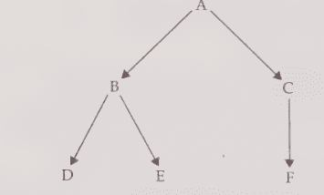

在 Java 中，箭头从依赖模块指向被所需的模块。因此，模块图的绘图描述了哪些模块可以访问哪些其他模块。

坦率地说，由于许多商业应用通常涉及复杂的性，只有最小的应用程序才能对其模块图进行视觉化表示。

## 三种特殊的模块特性

前面的讨论已经描述了 Java 语言支持的模块的关键特性，这些是你创建自己的模块时通常会依赖的特性。然而，还有三个额外的模块相关特性在某些情况下非常有用。这些特性是：`open` 模块、`opens` 语句以及 `requires static` 的使用。每种特性都旨在处理特殊情况，且每种特性都成了模块系统中相当高级的内容。尽管如此，对于所有 Java 程序员来说，对它们的用途有一个一般的理解是非常重要的。

### 开放模块 (Open Modules)

正如本节早期学习的，默认模块包中的类型只有通过 `exports` 语句显式导出后才是可用的。虽然这通常是你需要的，但在某些情况下，启用对模块中所有包的运行时访问（无论包是否导出）是有用的。为了允许这一点，你可以创建一个开放模块。开放模块通过在 `module` 关键字之前加上来声明，所示：

```
open moduleName {
// module definition
```

在开放模块中，所有包中的类型在运行时都是可访问的。但请注意，只有那些显式导出的包在编译时是可用的。因此，`open` 修饰符仅影响运行时的可访问性。开放模块的主要目的是为了允许模块中的包通过反射进行访问。正如第 12 章解释过的，反射是允许程序在运行时分析代码的功能。

### opens 语句

模块可以针对特定的包开放供其他模块的运行时访问以及反射式访问，而不是开放整个模块。要这样做，请使用 `opens` 语句，所示：

```
opens packageName;
```

在这里，`packageName` 指定了要打开的包。还可以包含一个 `to` 子句，列出该包开放的模块名称。

重要的是要理解 `opens` 并不授予编译时的访问权限。它仅用于为运行时和反射式访问打开一个包。然而，你可以同时对一个模块进行导出和开放。另一点是：`opens` 语句不能在开放模块中使用。记住，开放模块中的所有包都已经是开放的。

### requires static

如你所知，`requires` 指定了一个依赖关系，该关系默认情况下在编译和运行时都会被强制执行。但是可以通过这种方式放松这一要求，使得模块在运行时是不被需要的。这是通过在 `requires` 语句中使用 `static` 修饰符实现的。例如，这指定了编译时需要 `mymod`，但运行时不需要。

```
requires static myymod;
```

在这种情况下，如果程序在功能存在时可以使用它，但并不要求它必须存在，这将是有帮助的。

## 引入 jlink 和模块 JAR 文件

如前面的讨论所示，模块代表了 Java 语言的重大增强。模块系统还支持运行时的增强。最重要的功能之一是创建一个专门为你的应用程序定制的运行镜像（run-image）。为了实现这一点，JDK 9 增加了一个名为 `jlink` 的新工具。它将一组模块组合成运行镜像。

## 关于层和自动模块的简述

在学习模块时，你可能会遇到两个与模块相关的额外功能。这些是层（layers）和自动模块（automatic modules）。这两者都是为了对模块进行专门的高级工作或在迁移现有应用程序时设计的。虽然大多数程序员可能不需要使用这些功能，但为了完整起见，这里对每种功能进行了简要描述。

模块层（module layer）将模块图中的模块与类加载器（class loader）关联起来。因此，不同的层可以使用不同的类加载器。层使得能够轻松构建特殊类型的应用程序。

自动模块通过在模块路径（module path）上指定非模块的 JAR 文件来创建，其名称是自动派生的。（也可以在清单文件中显式地为自动模块指定名称。）自动模块允许普通模块依赖于自动模块中的代码。自动模块提供作为从预模块化代码迁移到完全模块化代码的辅助。因此，它们主要是一个过渡性特性。

## 关于模块的最后思考

前面的讨论引入并演示了 Java 模块系统的核心元素。这些是每个 Java 程序员都应该至少基础了解的特性。正如你所猜到的，模块系统提供了额外的功能，让你对模块的创建和使用进行细粒度的控制。例如，`javac` 和 `java` 拥有的模块相关的选项比本章描述的要得多。由于模块是 Java 最近的一项重大新增，模块系统可能会随着时间的推移而演进。你希望关注 Java 这一创新方面的增强。

总之，模块预计将在 Java 编程中发挥重要作用。虽然目前不需要使用它们，但它们为商业级应用程序提供了任何 Java 程序员都无法忽视的重要益处。基于模块的开发可能会出现在每个 Java 程序员的未来中。

# 第二部分：Java 类库

- 第 17 章：字符串处理
- 第 18 章：探索 `java.lang`
- 第 19 章：`java.util` 第 1 部分：集合框架
- 第 20 章：`java.util` 第 2 部分：更多工具类
- 第 21 章：输入/输出：探索 `java.io`
- 第 22 章：探索 NIO
- 第 23 章：网络
- 第 24 章：事件处理
- 第 25 章：引入 AWT：处理窗口、图形和文本
- 第 26 章：使用 AWT 控件、布局管理器和菜单
- 第 27 章：图像
- 第 28 章：并发工具类
- 第 29 章：流 API
- 第 30 章：正则表达式和其他包

# 第 17 章：字符串处理

第 7 章介绍了 Java 字符串处理的简单概述。在本章中将对其进行详细描述。与大多数其他编程语言一样，Java 中的字符串是字符序列。但与某些将字符串实现为字符数组的语言不同，Java 将字符串实现为 `String` 类型的对象。

将字符串实现为内置对象允许 Java 提供全套使字符串处理方便的功能。例如，Java 拥有方法来比较两个字符串、搜索子字符串、拼接两个字符串以及更改字符串中字母的大小写。此外，`String` 对象可以通过多种方式构造，以便在需要时轻松获取字符串。

在某个出乎意料的地方，当你创建一个 `String` 对象时，你创建了一个无法更改的字符串。但一旦创建了 `String` 对象，你就无法更改组成该字符串的字符。起初，这似乎是一个严重的限制。然而事实并非如此。你仍然可以执行所有类型的字符串操作。区别在于，每当你需要现有字符串的修改版本时，都会创建一个包含修改内容的新 `String` 对象。原始字符串保持不变。使用这种方法是因为固定的、不可变的字符串比可变的字符串更高效。对于需要可修改字符串的情况，Java 提供了两个选项：`StringBuffer` 和 `StringBuilder`。它们都持有在创建后可以修改的字符串。

`String`、`StringBuffer` 和 `StringBuilder` 类定义在 `java.lang` 中。因此，它们对所有程序自动可用。它们都被声明为 `final`，这意味着这些类中没有一个可以被子类化。这允许在常用的字符串操作上进行提高性能的特定优化。

最后一点：说 `String` 类型对象内的字符串是不变的，意味着 `String` 实例的内容在创建后不能被更改。然而，声明为 `String` 引用的变量可以随时更改以指向其他 `String` 对象。

## String 构造函数

`String` 类支持多个构造函数。要创建一个空字符串，请调用默认构造函数。例如，

```java
String s = new String();
```

将创建一个内部没有字符的 `String` 实例。

通常，你可能想要创建具有初始值的字符串。`String` 类提供了多种构造函数来处理这种情况。要创建一个由字符数组初始化的 `String`，使用此处所示的构造函数：


# String 类构造函数与核心操作

## 构造函数

### `String(char chars[])`

这是一个示例：

```java
char chars[] = { 'a', 'b', 'c' };
String s = new String(chars);
```

此构造函数将 `s` 初始化为字符串 "abc"。

你可以使用以下构造函数指定字符数组的子范围作为初始化器：

### `String(char chars[], int startIndex, int numChars)`

在这里，`startIndex` 指定了子范围开始的索引，`numChars` 指定了使用的字符数。这里有一个示例：

```java
char chars[] = { 'a', 'b', 'c', 'd', 'e', 'f' };
String s = new String(chars, 2, 3);
```

这初始化 `s` 为字符串 "cde"。

你可以使用以下构造函数构造一个与另一个 `String` 对象相同字符序列的 `String` 对象：

### `String(String strObj)`

在这里，`strObj` 是一个 `String` 对象。考虑这个示例：

```java
// 从另一个字符串构造字符串
class MakeString {
    public static void main(String args[]) {
        char c[] = { 'J', 'a', 'v', 'a' };
        String s1 = new String(c);
        String s2 = new String(s1);

        System.out.println(s1);
        System.out.println(s2);
    }
}
```

此程序的输出如下：

```
Java
Java
```

你可以看到，`s1` 和 `s2` 包含相同的字符串。

尽管 Java `char` 类型使用 16 位表示基本 Unicode 字符集，互联网上的典型格式使用 8 位字节数组。8 位 ASCII 字符串很常见，`String` 类提供了给定字节数组时初始化字符串的构造函数。这里显示了形式：

### `String(byte chars[])`
### `String(byte chars[], int startIndex, int numChars)`

在这里，`chars` 指定字节数组。第二种形式允许你指定子范围。在这些构造函数中，字节到字符的转换是通过使用平台的默认编码完成的。以下程序说明了这些构造函数：

```java
// 从字节数组构造 String
class SubString {
    public static void main(String args[]) {
        byte ascii[] = {55, 66, 67, 68, 69, 70};

        String s1 = new String(ascii);
        System.out.println(s1);

        String s2 = new String(ascii, 2, 3);
        System.out.println(s2);
    }
}
```

此程序产生输出：

```
ABCDEF
CDE
```

字节到字符串构造函数还定义了扩展版本，在其中你可以指定决定字节如何转换为字符的字符编码。然而，你通常希望使用平台提供的默认编码。

> **注意**：当你从数组创建 `String` 对象时，数组的内容会被复制。如果你在创建字符串后修改数组的内容，字符串将保持不变。

以下构造函数支持扩展 Unicode 字符集：

### `String(int codePoints[], int offset, int count)`

在这里，`codePoints` 是一个包含 Unicode 编码点的数组。生成的字符串是由从 `offset` 开始、长度为 `count` 的范围构造的。

还有一些构造函数允许您指定字符集（`Charset`）。

> **注意**：关于 Unicode 编码点以及 Java 如何处理这些编码点的讨论，请参见第 18 章。

## 字符串长度

字符串的长度是它包含的字符数。要获取此值，请调用所示的 `length()` 方法：

```java
int length()
```

以下代码段将打印 "3"，因为字符串 `s` 中有三个字符：

```java
char chars[] = {'a', 'b', 'c'};
String s = new String(chars);
System.out.println(s.length());
```

## 特殊字符串操作

由于字符串是编程中常见且重要的一部分，Java 在语言语法中对几种字符串操作添加了特殊支持。这些操作包括从字符串字面量自动创建新的 `String` 实例、使用 `+` 运算符拼接多个 `String` 对象，以及将其他数据类型转换为字符串表示。提供了显式方法来执行所有这些功能，但 Java 为了方便程序员并增加清晰度，会自动完成这些操作。

### 字符串字面量

早期的示例展示了如何使用 `new` 运算符从字符数组显式创建 `String` 实例。然而，使用字符串字面量有一种更简单的方法。对于程序中的每个字面量，Java 都会构造一个 `String` 对象。因此，你可以使用字符串字面量来初始化 `String` 对象。例如，以下代码创建了两个相等的字符串：

```java
char chars[] = {'a', 'b', 'c'};
String s1 = new String(chars);
```

```java
String s2 = "abc"; // 使用字符串字面量
```

由于每个字符串字面量都会创建一个 `String` 对象，根据上述说明，你可以在任何可以直接使用 `String` 对象的地方使用带引号的字符串，就像使用对象引用一样使用它。它调用了字符串 "abc" 的 `length()` 方法。正如预期的，它打印了 "3"。

```java
System.out.println("abc".length());
```

### 字符串拼接

通常情况下，Java 不允许将运算符应用于 `String` 对象。该规则的唯一例外是 `+` 运算符，它会拼接两个字符串并产生一个 `String` 对象作为结果。这允许你链联一系列 `+` 操作。例如，以下代码段拼接了三个字符串：

```java
String age = "9";
String s = "He " + age + " years old.";
System.out.println(s);
```

这显示了字符串 "He is 9 years old."

字符串拼接的一个实际用途是在创建非常长的字符串时。与其让它们在源代码中换行，不如你可以将它们拆分成较小的部分并使用 `+` 将它们拼接起来。这是一个示例：

```java
// 使用拼接来防止长行。
class ConCat {
    public static void main(String args[]) {
        String longStr = "This could have been " +
                         "a very long line that would have " +
                         "wrapped around. But string concatenation " +
                         "prevents this.";

        System.out.println(longStr);
    }
}
```

### 与其他数据类型的拼接

你可以将字符串与其他类型的数据拼接。例如，考虑之前示例的这个稍不同的版本：

```java
int age = 9;
String s = "He " + age + " years old.";
System.out.println(s);
```

在这种情况下，`age` 是一个 `int` 而不是另一个 `String`，但产生的输出与之前相同。这是因为 `age` 中的值被自动转换为 `String` 对象内部的字符串表示。该字符串像以前一样被拼接。每当 `+` 的另一个操作数是 `String` 实例时，编译器就会将操作数转换为其字符串等效值。

然而，将其他类型的操作与字符串拼接表达式混合时，要小心。考虑以下内容：

```java
String s = "four: " + 2 + 2;
System.out.println(s);
```

此代码段显示：

```
four: 22
```

而不是你可能预期的：

```
four: 4
```

这是其原因。运算符优先级导致 "four" 与 2 的字符串等效值的拼接先发生。然后，该结果再次与 2 的字符串等效值进行第二次拼接。要先完成整数加法，必须使用括号，如下：

```java
String s = "four: " + (2 + 2);
```

现在 `s` 包含字符串 "four: 4"。

### 字符串转换和 `toString()`

将数据转换为字符串表示的一种方法是调用 `String` 定义的重载字符串转换方法 `valueOf()` 之一。`valueOf()` 为所有基本类型和 `Object` 类型进行了重载。对于基本类型，`valueOf()` 返回一个包含其调用时的值的人类可读等效值的字符串。对于对象，`valueOf()` 调用该对象的 `toString()` 方法。我们将在本章稍后部分详细查看 `valueOf()`。在这里，让我们检查 `toString()` 方法，因为它是你确定所创建的类的字符串表示的手段。

每个类都实现了 `toString()`，因为它是由 `Object` 定义的。然而，`toString()` 的默认实现很少有用。对于你创建的类，你会想要重写 `toString()` 并提供自己的字符串表示。例如，它们可以用于 `print()` 和 `println()` 语句。以下程序通过为 `Box` 类重写 `toString()` 来演示这一点：

```java
// 为 Box 类重写 toString()
class Box {
    double width;
    double height;
    double depth;

    Box(double w, double h, double d) {
        width = w;
        height = h;
        depth = d;
    }

    public String toString() {
        return "Dimensions are " + width + " by " + depth + " by " + height + ".";
    }
}

class toStringDemo {
    public static void main(String[] args) {
        Box b = new Box(10, 12, 14);
        String s = "Box: " + b; // 拼接 Box 对象

        System.out.println(b); // Box 转换为字符串
        System.out.println(s);
    }
}
```

此程序的输出所示：

```
Dimensions are 10.0 by 14.0 by 12.0
Box: Dimensions are 10.0 by 14.0 by 12.0
```

可以看出，当 `Box` 对象用于拼接表达式或调用 `println()` 时，其 `toString()` 方法会被调用。

## 字符提取

`String` 类提供了多种从 `String` 对象中提取字符的方法。这里检查了其中的几种。虽然组成 `String` 对象的字符不能像字符数组那样被索引，但许多方法在操作时使用了字符串的索引（或偏移量）。字符串索引从零开始。

### `charAt()`

要从 `String` 中提取单个字符，你可以通过 `charAt()` 方法直接引用单个字符。它具有如下形式：

```java
char charAt(int where)
```

在这里，`where` 是你想获取的字符的索引。`where` 的值必须是非负且指定字符串内的位置。`charAt()` 返回指定位置的字符。例如：

```java
char ch;
ch = "abc".charAt(1);
```

将值 `'b'` 赋值给 `ch`。

### `getChars()`

如果你需要一次提取多个字符，可以使用 `getChars()` 方法。它具有如下形式：

```java
void getChars(int sourceStart, int sourceEnd, char target[], int targetStart)
```

在这里，`sourceStart` 指定子字符串起始位置的索引，`sourceEnd` 指定目标子字符串之后的一个索引。因此，子字符串包含从 `sourceStart` 到 `sourceEnd-1` 的字符。用于接收字符的数组由 `target` 指定。子字符串拷贝到 `target` 中的索引通过 `targetStart` 传入。必须确保 `target` 数组足够大，容纳指定子字符串中的字符。

以下程序演示了 `getChars()`：

```java
class getCharsDemo {
    public static void main(String args[]) {
        String s = "This is a demo of the getChars method.";
        int start = 10;
        int end = 14;
        char buf[] = new char[end - start];

        s.getChars(start, end, buf, 0);
        System.out.println(buf);
    }
}
```

该程序的输出如下：

```
demo
```

### `getBytes()`

`getChars()` 有一种替代方案，它可以将字符存储在字节数组中。该方法称为 `getBytes()`，它使用平台提供的默认字符到字节的转换。这是它最简单的形式：

```java
byte[] getBytes()
```

`getBytes()` 的其他形式也可用。当你将 `String` 值导出到不支持 16 位 Unicode 字符的环境时，`getBytes()` 最为有用。

### `toCharArray()`

如果你想将 `String` 对象中的所有字符转换为字符数组，最简单的方法是调用 `toCharArray()`。它返回一个整个字符串的字符数组。它的通用形式如下：

```java
char[] toCharArray()
```

提供此函数是为了方便，因为同样可以使用 `getChars()` 来实现相同的结果。

## String 比较

`String` 类包含了一些用于比较字符串或字符串内部子字符串的方法。这里检查了其中几种方法。

### `equals()` 和 `equalsIgnoreCase()`

要比较两个字符串是否相等，请使用 `equals()`。它具有此通用形式：

```java
boolean equals(Object str)
```

在这里，`String` 对象与调用的 `String` 对象进行比较。如果字符串包含相同顺序的相同字符，则返回 `true`，否则返回 `false`。该比较是区分大小写的。

要执行忽略大小差异的比较，请调用 `equalsIgnoreCase()`。当它比较两个字符串时，它认为 A-Z 等于 a-z。它具有此通用形式：

```java
boolean equalsIgnoreCase(String str)
```

在这里，`str` 是与调用的 `String` 对象进行比较的 `String` 对象。如果字符串包含相同顺序的相同字符，它也返回 `true`，否则返回 `false`。

以下是一个演示 `equals()` 和 `equalsIgnoreCase()` 的示例：

```java
// Demonstrate equals() and equalsIgnoreCase()
class Demo {
    public static void main(String args[]) {
        String s1 = "Hello";
        String s2 = "Hello";
        String s3 = "Good-bye";
        String s4 = "HELLO";
        System.out.println(s1 + " equals " + s2 + " -> " + s1.equals(s2));
        System.out.println(s1 + " equals " + s3 + " -> " + s1.equals(s3));
        System.out.println(s1 + " equals " + s4 + " -> " + s1.equals(s4));
        System.out.println(s1 + " equalsIgnoreCase " + s4 + " -> " + s1.equalsIgnoreCase(s4));
    }
}
```

程序的输出显示在此：

```
Hello equals Hello -> true
Hello equals Good-bye -> false
Hello equals HELLO -> false
Hello equalsIgnoreCase HELLO -> true
```

### `regionMatches()`

`regionMatches()` 方法将字符串内部的特定区域与另一个字符串中的另一个特定区域进行比较。有一个重载方法允许你在这些比较中忽略大小写。以下是这两个方法的通用形式：

```java
boolean regionMatches(int startIndex, String str2, int str2StartIndex, int numChars)
boolean regionMatches(boolean ignoreCase, int startIndex, String str2, int str2StartIndex, int numChars)
```


```java
boolean regionMatches(boolean ignoreCase, int startIndex, String str2, str2StartIndex, int numChars)
```

对于这两个版本，`startIndex` 都指定了在调用的 `String` 对象中区域开始的索引。要比较的字符串由 `str2` 指定。在 `str2` 中开始比较的索引由 `str2StartIndex` 指定。所比较的子字符串的长度通过 `numChars` 传入。在第二个版本中，如果 `ignoreCase` 为 `true`，则忽略字符的大小写。否则，大小写是敏感的。

## startsWith() 和 endsWith()

`String` 定义了两个方法，它们在某种程度上是 `regionMatches()` 的特殊形式。`startsWith()` 方法确定给定的 `String` 是否以指定的字符串开头。相反，`endsWith()` 确定字符串是否以指定的字符串结尾。它们具有以下通用形式：

```java
boolean startsWith(String str)
boolean endsWith(String str)
```

在这里，`str` 是被测试的 `String`。如果字符串匹配，则返回 `true`。否则返回 `false`。例如，

```java
"Foobar".endsWith("bar")
```

和

```java
"Foobar".startsWith("Foo")
```

结果均为 `true`。

`startsWith()` 的另一种形式（所示）允许你指定起始点：

```java
boolean startsWith(String str, int startIndex)
```

在这里，`startIndex` 指定了调用的字符串中开始搜索的索引。例如，

## equals() vs compareTo()

通常，仅仅知道哪个小于、等于或大于下一个是不够的。`compareTo()` 就此此目的。它由 `Comparable<T>` 接口指定，`String` 实现了该接口。它具有此通用形式：

```java
int compareTo(String str)
```

在这里，`str` 与调用的 `String` 进行比较。返回比较的结果并解释为：

| 值 | 含义 |
|---|---|
| 小于零 | 用的字符串小于 str。 |
| 大于零 | 用的字符串大于 str。 |
| 零 | 字符串相等。 |

这是一个对字符串数组排序的示例程序。程序使用 `compareTo` 来确定排序：

```java
// A bubble sort for Strings.
class StringSort {
    String[] arr = {
        "Now", "is", "the", "time", "for", "all", "good", "men",
        "to", "come", "to", "the", "aid", "of", "their", "country"
    };
    public static void main(String[] args) {
        for(int j = 0; j < arr.length; j++) {
            for(int i = 1; i < arr.length; i++) {
                if(arr[i].compareTo(arr[j]) < 0) {
                    String t = arr[j];
                    arr[j] = arr[i];
                    arr[i] = t;
                }
            }
            System.out.println(arr[j]);
        }
    }
}
```

该程序的输出是单词列表：

Now
aid
all
come
country
for
good
is
men
of
the
the
their
time
to
to

正如从此示例的输出所示，`compareTo()` 考虑了大写字母和小写字母。单词 "Now" 排在所有单词之前是因为它以大写字母开头，这意味着它在 ASCII 字符集中值较小。如果你想在比较两个字符串时忽略大小差异，请使用 `compareToIgnoreCase()`，如下：

```java
int compareToIgnoreCase(String str)
```

在将其替换到之前的程序后，“Now" 将不再是第一个。

## 搜索字符串

`String` 类提供了两个方法，允许你在字符串中搜索指定的字符或子字符串：

- `indexOf()` 搜索字符或子字符串的首次出现。
- `lastIndexOf()` 搜索字符或子字符串的最后一次出现。

# 第17 章 字符串处理 461

要查找字符的第一次出现，

```java
int indexOf(int ch)
```

要查找字符的最后一次出现，

```java
int lastIndexOf(int ch)
```

这里，`ch` 是要查找的字符。

要查找子字符串的第一次或最后一次出现，使用

```java
int indexOf(String str)
int lastIndexOf(String str)
```

在这里，可以使用以下形式指定搜索的起始点：

```java
int indexOf(int ch, int startIndex)
int lastIndexOf(int ch, int startIndex)
int indexOf(String str, int startIndex)
int lastIndexOf(String str, int startIndex)
```

在这里，`lastIndexOf` 指定了搜索开始的索引。对于 `indexOf()`，搜索从 `startIndex` 直到字符串的末尾。对于 `lastIndexOf()`，搜索从 `startIndex` 运行到 0。

下面的示例展示了如何使用各种索引方法在字符串内部进行搜索：

```java
// Demonstrate indexOf() and lastIndexOf().
class indexOfDemo {
    public static void main(String args[]) {
        String s = "Now is the time for all good men " + 
                   "to come to the aid of their country.";

        System.out.println(s);
        System.out.println("indexOf('t') = " + s.indexOf('t'));
        System.out.println("lastIndexOf('t') = " + s.lastIndexOf('t'));
        System.out.println("indexOf(the) = " + s.indexOf("the"));
        System.out.println("lastIndexOf(the) = " + s.lastIndexOf("the"));
        System.out.println("indexOf(t, 10) = " + s.indexOf("t", 10));
        System.out.println("lastIndexOf('t', 60) = " + s.lastIndexOf('t', 60));
        System.out.println("indexOf(the, 10) = " + s.indexOf("the", 10));
        System.out.println("lastIndexOf(the, 60) = " + s.lastIndexOf("the", 60));
    }
}
```


# 462 第二部分 Java 库

以下是程序的输出结果：

```
Now is the time for all good men to come to the aid of their country.
indexOf(t) = 7
lastIndexOf(t) = 65
indexOf(the) = 7
lastIndexOf(the) = 55
indexOf(t, 10) = 11
lastIndexOf(t, 60) = 55
indexOf(the, 10) = 44
lastIndexOf(the, 60) = 55
```

## 修改字符串

由于 `String` 对象是不可变的，每当你想要修改字符串时，必须将其复制到 `StringBuffer` 或 `StringBuilder` 中，或者使用 `String` 方法来构建一个完成所有修改的新字符串副本。这里描述了这些方法中的一部分。

### substring()

你可以使用 `substring()` 提取子字符串。它有两种形式。第一种是

```java
String substring(int startIndex)
```

在这里，`startIndex` 指定了子字符串开始的索引。这种形式返回一个从 `startIndex` 开始到调用字符串末尾的子字符串副本。

`substring()` 的第二形式允许你同时指定子字符串的起始索引和结束索引。

```java
String substring(int startIndex, int endIndex)
```

在这里，`startIndex` 指定起始索引，`endIndex` 指定停止点。返回的字符串包含从起始索引到（但不包括）结束索引的所有字符。

下面的程序使用 `substring()` 在字符串中将一个子字符串的所有实例替换另一个：

```java
// replacement.
class StringReplace {
  public static void main(String[] args) {
    String org = "This is a test. This is, too.";
    String search = "is";
    String sub = "was";
    String result = "";
    int i = 0;

    do { // replace所有匹配的子字符串
      System.out.println(org);
      i = org.indexOf(search);
      if (i != -1) {
        result = org.substring(0, i);
        result = result + sub;
        result = result + org.substring(i + search.length());
        org = result; // 注意：此处原始 OCR 不完整，逻辑上后续如此
      }
    } while (i != -1);
  }
}
```

该程序的输出所示：

This is a test. This is, too.
This was was a test. This is, too.
This was was a test. This is, too.
This was was a test. This was, too.
This was was a test. This was was, too.

### concat()

你可以使用 `concat()` 拼接两个字符串，如下所示：

```java
String concat(String str)
```

此方法创建一个新对象，该对象包含调用字符串并在末尾附加 `str` 的内容。`concat()` 执行的功能与 `+` 相同。例如，

```java
String s1 = "one";
String s2 = s1.concat("two");
```

将字符串 "onetwo" 放入 `s2`。它生成的的结果与以下序列相同：

```java
String s1 = "one";
String s2 = s1 + "two";
```

### replace()

`replace()` 方法有两种形式。第一种将调用字符串中所有的某个字符替换为另一个。具有如下形式：

```java
String replace(char original, char replacement)
```

在这里，`original` 指定要替换的字符。`replace()` 的第二形式将字符序列替换为另一个。具有如下形式：

```java
String replace(CharSequence original, CharSequence replacement)
```

### trim() 和 strip()

从 JDK 11 开始，Java 提供了 `strip()` 方法，它可以删除调用字符串首尾的所有空白字符（由 Java 定义）。空白字符包括空格、制表符、回车和换行符等。它具有如下形式：

```java
String strip()
```

JDK 同样提供了 `stripLeading()` 和 `stripTrailing()` 方法，它们分别从调用字符串的开头或结尾删除空白并返回结果。

```java
class TestCase {
    public static void main(String args[]) {
        String s = "This is a test.";
        System.out.println("Original: " + s);

        String upper = s.toUpperCase();
        String lower = s.toLowerCase();

        System.out.println("Uppercase: " + upper);
        System.out.println("Lowercase: " + lower);
    }
}
```

程序产生的输出所示：

Original: This is a test.
Uppercase: THIS IS A TEST.
Lowercase: this is a test.

另一点：`toLowerCase()` 和 `toUpperCase()` 有重载版本，允许你指定一个 `Locale` 对象来控制转换，例如空格或逗号。在某些情况下，指定本地区域可能非常重要，并有助于你的应用程序的国际化。

## 字符串连接

JDK 8 为 `String` 类添加了一个新方法 `join()`。它用于连接两个或多个字符串，并用分隔符（如空格或逗号）分隔每个字符串。它有两种形式。第一种形式在这里：

```java
static String join(CharSequence delim, CharSequence... strs)
```

在这里，`delim` 指定用于分隔 `strs` 中指定的字符序列的分隔符。由于 `String` 实现了 `CharSequence` 接口，`strs` 可以是一个字符串列表。（有关 `CharSequence` 的信息请参见第 18 章）。以下程序演示了此版本的 `join()`：

```java
// 展示 String 定义的方法。
class StringJoinDemo {
    public static void main(String args[]) {
        String result = String.join(" ", "Alpha", "Beta", "Gamma");
        System.out.println(result);

        result = String.join(" ", "John", "ID#: 5699", "E-mail: John@HerbSchildt.com");
        System.out.println(result);
    }
}
```

输出所示：

Alpha Beta Gamma
John, ID#: 5699, E-mail: John@HerbSchildt.com

在第一次调用 `join()` 时，每个字符串之间都插入了逗号。在第二次调用中，分隔符是一个逗号后跟一个空格。这说明分隔符不需要仅仅是一个字符。

`join()` 的第二种形式允许你连接从实现 `Iterable` 接口的对象获得的字符串列表。`Iterable` 由第 19 章描述的集合框架类等实现。有关 `Iterable` 的信息请参见第 18 章。

## 额外的字符串方法

除了之前讨论的方法外，`String` 还有许多其他方法。其中几个方法在下表中摘要：

| 方法 | 描述 |
| --- | --- |
| `int codePointAt(int i)` | 返回 `i` 指定位置的 Unicode 代码点。 |
| `int codePointBefore(int i)` | 返回 `i` 指定位置之前的 Unicode 代码点。 |
| `int codePointCount(int start, int end)` | 返回调用对象的字符串中 `start` 和 `end` 之间代码点的数量。 |
| `boolean contains(CharSequence str)` | 如果调用对象包含 `str` 指定的字符串，则返回 `true`。否则返回 `false`。 |
| `boolean contentEquals(CharSequence str)` | 如果调用对象包含与 `str` 相同的字符串，返回 `true`。否则返回 `false`。 |


# String 类方法表

| 方法 | 描述 |
| --- | --- |
| `boolean contentEquals(StringBuffer str)` | 如果调用对象包含与 `str` 相同的字符串，返回 `true`。否则返回 `false`。 |
| `static String format(String fmtstr, Object ... args)` | 返回按 `fmtstr` 指定格式的字符串。（格式的详细信息请参见第 19 章。） |
| `static String format(Locale loc, String fmtstr, Object ... args)` | 返回按 `fmtstr` 指定格式的字符串。格式由 `loc` 指定的本地区域控制。（格式的详细信息请参见第 19 章。） |
| `boolean isEmpty()` | 如果调用字符串不包含任何字符且长度为零，则返回 `true`。 |
| `Stream<String> lines()` | 根据回车符和换行符将字符串拆分为单独的行，并返回一个包含这些行的 `Stream`。（JDK 11 添加。） |
| `boolean matches(String regex)` | 如果调用字符串匹配 `regex` 中的正则表达式，则返回 `true`。否则返回 `false`。 |
| `int offsetByCodePoints(int start, int num)` | 返回调用字符串中超出 `start` 指定起始索引 `num` 个代码点的索引。 |
| `String replaceFirst(String regExp, String newStr)` | 返回一个字符串，其中第一个匹配 `regExp` 指定正则表达式的子字符串被替换为 `newStr`。 |
| `String replaceAll(String regExp, String newStr)` | 返回一个字符串，其中所有匹配 `regExp` 指定正则表达式的子字符串都被替换为 `newStr`。 |
| `String[] split(String regExp)` | 拆分调用字符串并返回包含结果的数组。每个部分由传入 `regExp` 的正则表达式分隔。 |
| `String[] split(String regExp, int max)` | 拆分调用字符串并返回包含结果的数组。每个部分由传入 `regExp` 的正则表达式分隔。片段数量由 `max` 指定。如果 `max` 为负，则完全拆分调用字符串。否则，如果 `max` 包含非零值，返回数组中的最后一个项包含调用字符串的剩余部分。如果 `max` 为零，则完全拆分调用字符串，但不会包含尾部的空字符串。 |
| `CharSequence subsequence(int startIndex, int stopIndex)` | 返回调用字符串的子字符串，从 `startIndex` 开始到 `stopIndex` 结束。 |

> **注意**：这些方法中的几个与 `CharSequence` 配合工作，`String` 实现了该接口。此方法是 `StringBuilder` 所需的，支持修改字符串。相比之下，`String` 表示固定长度的不可变序列。`StringBuilder` 表示可增长和可写的序列。`StringBuilder` 可以在中间插入或在末尾添加，并会自动增长以容纳这些添加。

# StringBuilder

`StringBuilder` 定义了四个构造函数：

- `StringBuilder()`
- `StringBuilder(int size)`
- `StringBuilder(String str)`
- `StringBuilder(CharSequence chars)`

默认构造函数（无参数）预留 16 个字符的空间。第二个版本接受整数参数，显式设置缓冲区的大小。第三个版本接受 `String` 参数，设置 `StringBuffer` 的初始内容并预留 16 个字符的空间。

# StringBuffer

## length() 和 capacity()

`StringBuffer` 的当前长度可以通过 `length()` 方法找到，而分配的总容量可以通过 `capacity()` 方法找到。它们有以下形式：

- `int length()`
- `int capacity()`

示例：

```java
// StringBuffer 的长度与容量。
class StringBufferDemo {
    public static void main(String args[]) {
        StringBuffer sb = new StringBuffer("Hello");

        System.out.println("buffer = " + sb);
        System.out.println("length = " + sb.length());
        System.out.println("capacity = " + sb.capacity());
    }
}
```

输出：

```
buffer = Hello
length = 5
capacity = 21
```

由于 `sb` 在创建时用字符串 "Hello" 初始化，它的长度为 5。它的容量为 21，因为它为自动添加的 16 个字符预留了空间。

## ensureCapacity()

如果你想在构造 `StringBuffer` 后预留某些字符的空间，可以使用 `ensureCapacity()` 设置缓冲区的大小。如果你先知道将向 `StringBuffer` 添加许多小字符串，这将非常有用。`ensureCapacity()` 有如下通用形式：

```java
void ensureCapacity(int minCapacity)
```

在这里，`minCapacity` 指定缓冲区的最小大小。（出于效率考虑，可能会分配比 `minCapacity` 更大的缓冲区。）

## setLength()

要设置 `StringBuilder` 对象中字符串的长度，可以使用 `setLength()`。其通用格式如下：

```java
void setLength(int len)
```

在这里，`len` 指定了字符串的长度。该值必须是非负数。会在末尾添加空字符。如果你调用 `setLength()` 时传入的值小于 `length()` 返回的当前值，则存储在新长度之外的字符将丢失。

## charAt() 和 setCharAt()

```java
char charAt(int where)
void setCharAt(int where, char ch)
```

对于 `charAt(where)`，`where` 指定了要获取的字符的索引。对于 `setCharAt(where, ch)`，`where` 指定了要设置的字符的索引，`ch` 指定了该字符的新值。对于这两个方法，`where` 均必须是非负的，且不能指定超出字符串结尾的位置。

以下示例演示了 `charAt()` 和 `setCharAt()`：

```java
// Demonstrate charAt() and setCharAt()
class setCharAtDemo {
    public static void main(String[] args[]) {
        StringBuilder sb = new StringBuilder("Hello");
        System.out.println("buffer before = " + sb);
        System.out.println("charAt(1) before = " + sb.charAt(1));

        sb.setCharAt(1, 'i');
        sb.setLength(2);
        System.out.println("buffer after = " + sb);
        System.out.println("charAt(1) after = " + sb.charAt(1));
    }
}
```

输出：

```
buffer before = Hello
charAt(1) before = e
buffer after = Hi
charAt(1) after = i
```

## getChars()

要将 `StringBuffer` 的子字符串复制到数组中，可以使用 `getChars()` 方法。它的通用格式如下：

```java
void getChars(int sourceStart, int sourceEnd, char target[], int targetStart)
```

在这里，`sourceStart` 指定子字符串起始的索引，`sourceEnd` 指定了一个在目标子字符串结尾之后的索引。这意味着子字符串包含了从 `sourceStart` 到 `sourceEnd-1` 的字符。接收这些字符的数组由 `target` 指定。子字符串将被复制到的内部索引通过 `targetStart` 传入。必须确保目标数组足够大，能够容纳指定子字符串中的字符数量。

## append()

`append()` 方法将任何其他类型数据的字符串表示连接到调用 `StringBuffer` 对象的末尾。它有多个重载版本。以下是其中几个：

- `StringBuffer append(String str)`
- `StringBuffer append(int num)`
- `StringBuffer append(Object obj)`

首先，获取每个参数的字符串表示。然后，将结果附加到当前的 `StringBuffer` 对象上。每个版本的 `append()` 都会返回缓冲区本身。这允许后续的调用进行链式操作，如下例所示：

```java
// Demonstrate append().
class AppendDemo {
    public static void main(String args[]) {
        String s;
        int a = 42;
        StringBuffer sb = new StringBuffer(40);

        s = sb.append("a = ").append(a).append("!").toString();
        System.out.println(s);
    }
}
```

输出：

```
a = 42!
```

## insert()

`insert()` 方法将一个字符串插入另一个字符串中。它经过重载，可以接受原始类型的值，以及 `String`、`Object` 和 `CharSequence`。像 `append()` 一样，它获取被调用时值的字符串表示。然后该字符串被插入到调用的 `StringBuilder` 对象中。这些是它的几种形式：

```java
StringBuffer insert(int index, String str)
StringBuffer insert(int index, char ch)
StringBuffer insert(int index, Object obj)
```

在这里，`index` 指定了字符串插入调用的 `StringBuilder` 对象的位置。

以下示例程序将 "like" 插入到 "I" 和 "Java" 之间：

```java
// Demonstrate insert().
class InsertDemo {
    public static void main(String args[]) {
        StringBuilder sb = new StringBuilder("I Java!");

        sb.insert(2, "like ");
        System.out.println(sb);
    }
}
```

输出：

```
I like Java!
```

## reverse()

你可以使用 `reverse()` 反转 `StringBuilder` 对象内的字符：

```java
StringBuilder reverse()
```

该方法返回调用其的对象的反转结果。以下程序演示了 `reverse()`：

```java
// Using reverse() to reverse a StringBuilder.
class ReverseDemo {
    public static void main(String args[]) {
        StringBuilder s = new StringBuilder("abcdef");

        System.out.println(s);
        s.reverse();
        System.out.println(s);
    }
}
```

输出：

```
abcdef
fedcba
```

## delete() 和 deleteCharAt()

你可以使用 `delete()` 和 `deleteCharAt()` 方法删除 `StringBuilder` 中的字符。这些方法如下：

```java
StringBuilder delete(int startIndex, int endIndex)
StringBuilder deleteCharAt(int loc)
```

`delete()` 方法从调用对象中删除序列字符。在这里，`startIndex` 指定了要删除的第一个字符的索引，而 `endIndex` 指定了要删除的最后一个字符之后的索引。因此，从 `startIndex` 到 `endIndex-1` 的子字符串被删除了。`deleteCharAt()` 方法删除 `loc` 指定的字符。返回 `StringBuilder` 对象。以下程序演示了 `delete()` 和 `deleteCharAt()`：

```java
// Demonstrate delete() and deleteCharAt()
class DeleteDemo {
    public static void main(String args[]) {
        StringBuilder sb = new StringBuilder("This is a test.");

        System.out.println(sb);
        sb.delete(6, 9);
        System.out.println(sb);
        sb.deleteCharAt(0);
        System.out.println(sb);
    }
}
```

输出：

```
This is a test.
This a test.
his test.
```

## replace()

你可以通过调用 `replace()` 在 `StringBuffer` 中替换一组字符。其签名如下：

```java
StringBuffer replace(int startIndex, int endIndex, String str)
```

从 `startIndex` 到 `endIndex-1` 的子字符串被替换。返回 `StringBuffer` 对象。以下程序演示了 `replace()`：

```java
// Demonstrate replace()
class ReplaceDemo {
    public static void main(String args[]) {
        StringBuilder sb = new StringBuilder("This is a test.");

        sb.replace(6, 8, "was");
        System.out.println(sb);
    }
}
```

输出：

```
This was a test.
```

## substring()

你可以调用 `substring()` 获取 `StringBuffer` 的部分。它有以下形式：

- `String substring(int startIndex)`
- `String substring(int startIndex, int endIndex)`

第一种形式返回从 `startIndex` 开始到 `StringBuilder` 结尾的子字符串。第二种形式返回从 `startIndex` 到 `endIndex-1` 的子字符串。这些方法与 `String` 类的方法相同。

# Additional StringBuffer Methods

除了这些方法外，`StringBuffer` 还提供了其他方法。下表所示：

| 方法 | 描述 |
| --- | --- |
| `StringBuffer appendCodePoint(int ch)` | 在对象末尾添加 Unicode 代码点。返回对象的引用。 |
| `int codePointAt(int i)` | 返回 `i` 指定位置的 Unicode 代码点。 |
| `int codePointCount(int start, int end)` | 返回字符串中 `start` 到 `end-1` 之间的代码点数量。 |
| `int indexOf(String str)` | 在 `StringBuffer` 中搜索 `str` 的首次出现。返回匹配索引，未找到则返回 -1。 |
| `int indexOf(String str, int startIndex)` | 从 `startIndex` 开始在 `StringBuffer` 中搜索 `str` 的首次出现。返回匹配索引，未找到则返回 -1。 |
| `int lastIndexOf(String str)` | 在 `StringBuffer` 中搜索 `str` 的最后一次出现。返回匹配索引，未找到则返回 -1。 |


| 方法 | 说明 |
|---|---|
| `int lastIndexOf(String str, int startIndex)` | 从 `startIndex` 开始在 `StringBuffer` 中搜索 `str` 的最后一次出现。返回匹配索引，未找到则返回 -1。 |
| `int offsetByCodePoints(int start, int num)` | 返回字符串中在 `start` 指定索引之后 `num` 个代码点的索引。 |
| `CharSequence subSequence(int startIndex, int endIndex)` | 返回从 `startIndex` 开始到 `endIndex` 结束的字符串子序列。 |
| `void trimToSize()` | 请求减小调用对象的字符缓冲区大小，以更好地适应当前内容。 |

以下程序演示了 `indexOf()` 和 `lastIndexOf()`：

```
class IndexOfDemo {
    public static void main(String args[]) {
        StringBuilder sb = new StringBuilder("one two one");
        int i;

        i = sb.indexOf("one");
        System.out.println("First index: " + i);

        i = sb.lastIndexOf("one");
        System.out.println("Last index: " + i);
    }
}
```

输出结果所示：

```
First index: 0
Last index: 8
```

# StringBuilder

`StringBuilder` 与 `StringBuffer` 相似，但有一个重要的区别：它不是同步的，这意味着它不是线程安全的。`StringBuilder` 的优势是性能更快。然而，在多个线程访问可变字符串且没有采用外部同步的情况下，你必须使用 `StringBuilder` 而不是 `StringBuffer`。

# 第 18 章 探索 java.lang

本章讨论由 `java.lang` 定义的类和接口。如你所知，`java.lang` 会自动导入所有程序中。它包含了几乎所有 Java 编程所基础的类和接口。它是 Java 中使用最广泛的包。从 JDK 9 开始，所有的 `java.lang` 都是 `java.base` 模块的一部分。

`java.lang` 包含以下类：

| Boolean | Float | Process | StrictMath |
|---|---|---|---|
| Byte | InheritableThreadLocal | ProcessBuilder | String |
| Character | Integer | ProcessBuilder.Redirect | StringBuffer |
| Character.Subset | Long | Runtime | StringBuilder |
| Character.UnicodeBlock | Math | RuntimePermission | System |
| Class | Module | Runtime.Version | System.LoggerFinder |
| ClassLoader | ModuleLayer | SecurityManager | Thread |
| ClassValue | ModuleLayer.Controller | Short | ThreadGroup |
| Compiler | Number | StackPermission | ThreadLocal |
| Double | Object | StackTraceElement | Throwable |
| Enum | Package | StackWalker | Void |

`java.lang` 定义了以下接口：

| Appendable | Iterable | StackWalker.StackFrame |
|---|---|---|
| AutoCloseable | ProcessHandle | System.Logger |
| CharSequence | ProcessHandle.Info | Thread.UncaughtExceptionHandler |
| Cloneable | Readable | |
| Comparable | Runnable | |

# 原生类型包装类

`java.lang` 中包含的几个类包含了可以追溯到 Java 1.0 的过用方法。Java 仍然提供过用方法以支持旧代码，但不建议在新代码中使用。由于篇幅原因，在大多数情况下这里不讨论这些过用方法。

如本书的第一部分提到的，出于性能考虑，Java 使用了原生类型（如 `int` 和 `char`）。这些数据类型不是对象层次结构的一部分。它们通过值传递给方法，不能直接通过引用传递。此外，没有方法让两个方法引用同一个 `int` 实例。有时，你可能为这些原生类型中的每一个创建一个对象表示。例如，在第 19 章中讨论的集合类只处理对象；为了在这些类之一中存储原生类型，你需要将原生类型包装在类类中。为了满足这一需求，Java 提供了与每个原生类型对应的类。从本质上说，这些类在类中封装或包装了原生类型。因此，它们通常被称为类型包装类（type wrappers）。类型包装类在第 12 章中引入。在这里将对它们进行详细检查。

# Number

抽象类 `Number` 定义了一个超类，由包装 `byte`、`short`、`int`、`long`、`float` 和 `double` 数值类型的类所实现。`Number` 具有抽象方法，可以返回对象在每种不同格式下的值。`doubleValue()` 返回 `double` 类型的值，`floatValue()` 返回 `float` 类型的值，以此类推。这些方法所示：

```
byte byteValue()
double doubleValue()
float floatValue()
int intValue()
long longValue()
short shortValue()
```

这些方法返回的值可能会由于收窄转换的影响而经过舍入、截断或产生“垃圾”值。

`Number` 具有具体的子类，持有每个原生数值类型的显式值：`Double`、`Float`、`Byte`、`Integer` 和 `Long`。

# Double 和 Float

`Double` 和 `Float` 分别是类型为 `double` 和 `float` 的浮点值的包装类。`Float` 的构造函数所示如下：

```
Float(double num)
Float(float num)
Float(String str) throws NumberFormatException
```

如你所见，`Float` 对象可以使用 `float` 或 `double` 类型的值来构造。它们也可以从浮点数的字符串表示进行构造。从 JDK 9 开始，这些构造函数被标记为过用。`valueOf()` 方法是推荐的替代方案。

`Double` 的构造函数所示：

```
Double(double num)
Double(String str) throws NumberFormatException
```

`Double` 对象可以使用 `double` 值或包含浮点值的字符串来构造。从 JDK 9 开始，这些构造函数被标记为过用。`valueOf()` 方法是推荐的替代方案。

`Float` 定义的方法包括表 18-1 所示的方法。`Double` 定义的方法包括表 18-2 所示的方法。`Float` 和 `Double` 都定义了方法常量：

以下示例创建了两个 `Double` 对象——一个使用 `Double` 值，另一个通过传递一个可以解析为 `Double` 的字符串：

```
class DoubleDemo {
    public static void main(String args[]) {
        Double d1 = new Double(3.14159);
        Double d2 = new Double("3.14159");
        System.out.println(d1.equals(d2));
        System.out.println(d1 + " = " + d2);
    }
}
```

从以下输出可以看出，两个 `valueOf()` 版本创建了相同的实例：

```
true
3.14159 = 3.14159
```

# 表 18-1 Float 定义的方法

| 方法 | 说明 |
|---|---|
| `byteValue()` | 返回字节值。 |
| `compare(float num1, float num2)` | 比较 `num1` 和 `num2`。如果值相等返回 0。如果 `num1` 小于 `num2` 返回负值。如果 `num1` 大于 `num2` 返回正值。 |
| `doubleValue()` | 返回对象的 `double` 值。 |
| `equals(Object FloatObj)` | 如果调用者等于 `FloatObj` 则返回 true，否则返回 false。 |
| `floatToIntBits(float num)` | 返回与 `num` 对应的 IEEE 兼容单精度位模式。 |
| `floatToRawIntBits(float num)` | 返回与 `num` 对应的 IEEE 兼容单精度位模式。保留 NaN 值。 |
| `floatValue()` | 返回调用对象的 `float` 值。 |
| `hashCode()` | 返回调用对象的哈希码。 |
| `hashCode(float num)` | 返回 `num` 的哈希码。 |
| `intBitsToFloat(int num)` | 返回由 `num` 指定的 IEEE 兼容单精度位模式的 `float` 等效值。 |
| `intValue()` | 返回调用对象的 `int` 值。 |
| `isFinite(float num)` | 如果 `num` 不是 NaN 也不是无穷大则返回 true。 |
| `isInfinite()` | 如果调用对象包含无穷大值则返回 true，否则返回 false。 |
| `static isInfinite(float num)` | 如果 `num` 指定无穷大值则返回 true，否则返回 false。 |
| `isNaN()` | 如果调用对象包含一个不是数字的值则返回 true，否则返回 false。 |
| `static isNaN(float num)` | 如果 `num` 指定一个不是数字的值则返回 true，否则返回 false。 |
| `longValue()` | 返回调用对象的 `long` 值。 |
| `static max(float val, float val2)` | 返回 `val` 和 `val2` 的最大值。 |
| `static min(float val, float val2)` | 返回 `val` 和 `val2` 的最小值。 |
| `static parseFloat(String str)` | 返回由指定的字符串中包含的数字的 `float` 等效值。 |
| `short shortValue()` | 返回调用对象的 `short` 值。 |
| `static float sum(float val, float val2)` | 返回 `val + val2` 的结果。 |
| `static String toHexString(float num)` | 返回一个包含 `num` 的十六进制格式值的字符串。 |
| `toString()` | 返回调用对象的字符串等价物。 |
| `static String toString(float num)` | 返回 `num` 指定值的字符串等价物。 |
| `static Float valueOf(float num)` | 返回一个包含 `num` 中值的 `Float` 对象。 |
| `static Float valueOf(String str) throws NumberFormatException` | 返回一个包含 `str` 中指定值的 `Float` 对象。 |

# 表 18-2 Double 定义的方法

| 方法 | 说明 |
|---|---|
| `byteValue()` | 将调用的值作为字节（`byte`）返回。 |
| `static int compare(double num1, double num2)` | 比较 `num1` 和 `num2` 的值。如果值相等则返回 0。如果 `num1` 小于 `num2`，返回负值。如果 `num1` 大于 `num2`，返回正值。 |
| `int compareTo(Double d)` | 将调用对象的数值与 `d` 的数值进行比较。如果值相等则返回 0。如果调用对象的值较低，返回负值。如果调用对象的值较大，返回正值。 |
| `static long doubleToLongBits(double num)` | 返回与 `num` 对应的 IEEE 兼容双精度位模式。 |
| `static long doubleToRawLongBits(double num)` | 返回与 `num` 对应的 IEEE 兼容双精度位模式。保留 NaN 值。 |
| `double doubleValue()` | 将调用的值作为 `double` 返回。 |
| `equals(Object DoubleObj)` | 如果调用对象与 `DoubleObj` 相等，则返回 `true`。否则返回 `false`。 |
| `float floatValue()` | 将调用的值作为 `float` 返回。 |
| `int hashCode()` | 返回调用对象的哈希码。 |
| `static int hashCode(double num)` | 返回 `num` 的哈希码。 |
| `int intValue()` | 将调用的值作为 `int` 返回。 |
| `static boolean isFinite(double num)` | 如果 `num` 不是 NaN 且不是无穷大，则返回 `true`。 |
| `boolean isInfinite()` | 如果调用对象包含无穷值，返回 `true`。否则，返回 `false`。 |
| `static boolean isInfinite(double num)` | 如果 `num` 指定一个无穷值，返回 `true`。否则，返回 `false`。 |
| `boolean isNaN()` | 如果调用对象包含一个不是数字的值，返回 `true`。否则，返回 `false`。 |
| `static boolean isNaN(double num)` | 如果 `num` 指定一个不是数字的值，返回 `true`。否则，返回 `false`。 |
| `static double longBitsToDouble(long num)` | 返回 `num` 指定的 IEEE 兼容双精度位模式的 `double` 等价物。 |
| `long longValue()` | 将调用的值作为 `long` 返回。 |
| `static double max(double val, double val2)` | 返回 `val` 和 `val2` 的最大值。 |
| `static double min(double val, double val2)` | 返回 `val` 和 `val2` 的最小值。 |
| `static double parseDouble(String str) throws NumberFormatException` | 使用基数 10 返回 `str` 指定字符串中包含数字的 `double` 等价物。 |
| `short shortValue()` | 将调用的值作为 `short` 返回。 |
| `static double sum(double val, double val2)` | 返回 `val + val2` 的结果。 |
| `static String toHexString(double num)` | 返回一个包含 `num` 的十六进制格式值的字符串。 |
| `String toString()` | 返回调用对象的字符串等价物。 |
| `static String toString(double num)` | 返回 `num` 指定值的字符串等价物。 |
| `static Double valueOf(double num)` | 返回一个包含 `num` 中值的 `Double` 对象。 |
| `static Double valueOf(String str) throws NumberFormatException` | 返回一个包含 `str` 字符串指定值的 `Double` 对象。 |

# 理解 isInfinite() 和 isNaN()

`Float` 和 `Double` 提供了 `isInfinite()` 和 `isNaN()` 方法，这在处理两个特殊的 `double` 和 `float` 值时很有帮助。这些方法测试 IEEE 浮点数规范定义的两个唯一值：无穷大（infinity）和 NaN（不是数字）。如果测试的值在幅度上是无穷大或无穷小，`isInfinite()` 返回 `true`。如果测试的值不是数字，`isNaN()` 返回 `true`。

以下示例创建了两个 `Double` 对象；一个是无穷大的，另一个不是数字：


```java
// Demonstrate isFinite() and isNaN()
class static InfNaN {
    public static void main(String args[]) {
        Double d1 = Double.valueOf(1/0.0);
        Double d2 = Double.valueOf(0/0.0);

        System.out.println(d1 + " : " + d1.isFinite());
        System.out.println(d2 + " : " + d2.isNaN());
    }
}
```

该程序产生以下输出：

```
Infinity: true
NaN: false
```

`Float`、`Short`、`Integer` 和 `Long` 分别是 `byte`、`short`、`int` 和 `long` 类型的包装类。它们的构造函数如下所示：

- `Float(byte num)`
- `Float(String str)`
- `Short(short num)`
- `Short(String str)`
- `Integer(int num)`
- `Integer(String str)`
- `Long(long num)`
- `Long(String str)`

| 方法 | 说明 |
| --- | --- |
| `byteValue()` | 将调用的值作为字节（`byte`）返回。 |
| `static int compare(byte num1, byte num2)` | 比较 `num1` 和 `num2` 的值。如果值相等则返回 0。如果 `num1` 小于 `num2`，返回负值。如果 `num1` 大于 `num2`，返回正值。 |
| `int compareTo(Byte b)` | 将调用对象的数值与 `b` 的数值进行比较。如果值相等则返回 0。如果调用对象的值较低，返回负值。如果调用对象的值较大，返回正值。 |
| `static int compareUnsigned(byte num1, byte num2)` | 对 `num1` 和 `num2` 进行无符号比较。如果值相等则返回 0。如果 `num1` 小于 `num2`，返回负值。如果 `num1` 大于 `num2`，返回正值。 |
| `static Byte decode(String str)` | 返回一个包含 `str` 指定值的 `Byte` 对象。 |
| `double doubleValue()` | 将调用的值作为 `double` 返回。 |
| `boolean equals(Object ByteObj)` | 如果调用对象与 `ByteObj` 等，则返回 `true`。否则返回 `false`。 |
| `float floatValue()` | 将调用的值作为 `float` 返回。 |
| `int hashCode()` | 返回调用对象的哈希码。 |
| `static int hashCode(byte num)` | 返回 `num` 的哈希码。 |
| `int intValue()` | 将调用的值作为 `int` 返回。 |
| `long longValue()` | 将调用的值作为 `long` 返回。 |
| `static Byte parseByte(String str) throws NumberFormatException` | 使用基数 10 返回 `str` 指定字符串中包含数字的字节等价物。 |
| `static Byte parseByte(String str, int radix) throws NumberFormatException` | 使用指定的基数返回 `str` 指定字符串中包含数字的字节等价物。 |
| `short shortValue()` | 将调用的值作为 `short` 返回。 |
| `String toString()` | 返回一个包含调用对象十进制等价值的字符串。 |
| `static String toString(byte num)` | 返回一个包含 `num` 十进制等价值的字符串。 |
| `static int tosignedInt(byte val)` | 返回 `val` 的无符号整数值。 |
| `static long tosignedLong(byte val)` | 返回 `val` 的无符号长整数值。 |
| `static Byte valueOf(byte num)` | 返回一个包含 `num` 中值的 `Byte` 对象。 |
| `static Byte valueOf(String str) throws NumberFormatException` | 返回一个包含 `str` 字符串指定值的 `Byte` 对象。 |

表 18-3 `Byte` 定义的方法

## 第 18 章 探索 java.lang

| 方法 | 描述 |
| --- | --- |
| `byteValue()` | 将调用对象的值作为 `byte` 返回。 |
| `static int compare(short num1, short num2)` | 比较 `num1` 和 `num2` 的值。如果值相等，返回 0。如果 `num1` 小于 `num2`，则返回负值。如果 `num1` 大于 `num2`，则返回正值。 |
| `int compareTo(Short s)` | 将调用对象的数值与 `s` 的进行比较。如果值相等，返回 0。如果调用对象的值较小，则返回负值。如果调用对象的值较大，则返回正值。 |
| `static int compareUnsigned(short num1, short num2)` | 对 `num1` 和 `num2` 执行无符号比较。如果值相等，返回 0。如果 `num1` 小于 `num2`，则返回负值。如果 `num1` 大于 `num2`，则返回正值。 |
| `static short decode(String str) throws NumberFormatException` | 返回一个 `Short` 对象，其包含字符串 `str` 中指定的值。 |
| `double doubleValue()` | 将调用对象的值作为 `double` 返回。 |
| `boolean equals(Object ShortObj)` | 如果调用对象等于 `ShortObj`，则返回 `true`。否则返回 `false`。 |
| `float floatValue()` | 将调用对象的值作为 `float` 返回。 |
| `int hashCode()` | 返回调用对象的哈希值。 |
| `static int hashCode(short num1)` | 返回 `num1` 的哈希值。 |
| `int intValue()` | 将调用对象的值作为 `int` 返回。 |
| `long longValue()` | 将调用对象的值作为 `long` 返回。 |
| `static short parseShort(String str) throws NumberFormatException` | 返回基数为 10 的字符串中包含的数字等效 `short`。 |
| `static short parseShort(String str, int radix) throws NumberFormatException` | 返回使用指定基数的字符串中包含的数字等效 `short`。 |
| `static short reverseBytes(short num)` | 交换 `num` 的高位和低字节并返回结果。 |
| `short shortValue()` | 将调用对象的值作为 `short` 返回。 |
| `String toString()` | 返回一个包含调用对象十进制等效值的字符串。 |
| `static String toString(short num)` | 返回一个包含 `num` 十进制等效值的字符串。 |
| `static int toUnsignedInt(short val)` | 将 `val` 的作为无符号整数返回。 |
| `static long toUnsignedLong(short val)` | 将 `val` 的作为无符号长整数返回。 |
| `static Short valueOf(short num)` | 返回一个包含传入值 `num` 的 `Short` 对象。 |
| `static Short valueOf(String str) throws NumberFormatException` | 返回一个 `Short` 对象，其包含基数为 10 的字符串 `str` 中指定的值。 |
| `static Short valueOf(String str, int radix) throws NumberFormatException` | 返回一个 `Short` 对象，其包含使用指定基数的字符串 `str` 中指定的值。 |

表 18-4 `Short` 定义的方法

| 方法 | 描述 |
| :--- | :--- |
| `static int bitCount(int num)` | 返回 `num` 中被置位（1）的数量。 |
| `byte byteValue()` | 将调用对象的值作为 `byte` 返回。 |
| `static int compare(int num1, int num2)` | 比较 `num1` 和 `num2` 的值。如果值相等，返回 0。如果 `num1` 小于 `num2`，则返回负值。如果 `num1` 大于 `num2`，则返回正值。 |
| `int compareTo(Integer i)` | 将调用对象的数值与 `i` 的数值进行比较。如果值相等，返回 0。如果调用对象的值较小，则返回负值。如果调用对象的值较大，则返回正值。 |
| `static int compareUnsigned(int num1, int num2)` | 对 `num1` 和 `num2` 执行无符号比较。如果值相等，返回 0。如果 `num1` 小于 `num2`，则返回负值。如果 `num1` 大于 `num2`，则返回正值。 |
| `static Integer decode(String str) throws NumberFormatException` | 返回一个 `Integer` 对象，其包含字符串 `str` 中指定的值。 |
| `static int divideUnsigned(int dividend, int divisor)` | 返回由 `divisor` 无符号除法的结果，以无符号形式返回。 |
| `double doubleValue()` | 将调用对象的值作为 `double` 返回。 |
| `boolean equals(Object IntegerObj)` | 如果调用的 `Integer` 对象等于 `IntegerObj`，则返回 `true`。否则返回 `false`。 |
| `float floatValue()` | 将调用对象的值作为 `float` 返回。 |
| `static Integer getInteger(String propertyName)` | 返回与环境属性关联的值，由 `propertyName` 指定。失败时返回 `null`。 |
| `static Integer getInteger(String propertyName, int default)` | 返回与环境属性关联的值，由 `propertyName` 指定。失败时返回 `default` 的值。 |
| `static Integer getInteger(String propertyName, Integer default)` | 返回与环境属性关联的值，由 `propertyName` 指定。失败时返回 `default` 的值。 |
| `int hashCode()` | 返回调用对象的哈希值。 |
| `static int hashCode(int num)` | 返回 `num` 的哈希值。 |
| `int intValue()` | 将调用对象的值作为 `int` 返回。 |
| `long longValue()` | 将调用对象的值作为 `long` 返回。 |
| `int highestOneBit(int num)` | 返回一个仅包含最高位的 `int`。 |
| `int lowestOneBit(int num)` | 返回一个仅包含最低位的 `int`。 |
| `int max(int val1, int val2)` | 返回 `val1` 和 `val2` 中的较大值。 |
| `int min(int val1, int val2)` | 返回 `val1` 和 `val2` 中的较小值。 |
| `int numberOfLeadingZeros(int i)` | 返回最高位之前的零的个数。 |
| `int numberOfTrailingZeros(int i)` | 返回最低位之后的零的个数。 |
| `int rotateLeft(int i, int distance)` | 返回向左旋转 `distance` 位后的值。 |
| `int rotateRight(int i, int distance)` | 返回向右旋转 `distance` 位后的值。 |
| `short shortValue()` | 将调用对象的值作为 `short` 返回。 |
| `int signum(int i)` | `i` 为负则返回 -1，`i` 为零则返回 0，`i` 为正则返回 1。 |
| `static int sum(int a, int b)` | 返回两个 `int` 参数的和。 |
| `static String toBinaryString(int i)` | 返回 `i` 的二进制值的字符串。 |
| `static String toHexString(int i)` | 返回 `i` 的十六进制值的字符串。 |
| `static String toOctalString(int i)` | 返回 `i` 的八进制值的字符串。 |
| `String toString()` | 返回一个包含调用对象十进制等效值的字符串。 |
| `static String toString(int i)` | 返回一个包含 `i` 十进制等效值的字符串。 |
| `static String toString(int i, int radix)` | 返回参数在指定基数下的字符串。 |
| `static long toUnsignedLong(int i)` | 将 `i` 的作为无符号 `long` 返回。 |
| `static String toUnsignedString(int i)` | 返回 `i` 的无符号 `long` 值的字符串。 |

表 18-5 `Integer` 定义的方法（续）

| 方法 | 说明 |
| --- | --- |
| `static String toUnsignedString(int val, int radix)` | 返回一个包含 `val` 在指定 `radix` 下无符号整数值的字符串。 |
| `static Integer valueOf(int num)` | 返回一个包含传入 `num` 值的 `Integer` 对象。 |
| `static Integer valueOf(String str) throws NumberFormatException` | 返回一个包含 `str` 指定值的 `Integer` 对象。 |
| `static Integer valueOf(String str, int radix) throws NumberFormatException` | 返回一个包含指定 `radix` 下 `str` 字符串中指定值的 `Integer` 对象。 |

表 18-5 `Integer` 定义的方法

| 方法 | 说明 |
| --- | --- |
| `static int bitCount(long num)` | 返回 `num` 中置位（1位）的数量。 |
| `byte byteValue()` | 返回调用对象的值，作为字节。 |
| `static int compare(long num1, long num2)` | 比较 `num1` 和 `num2` 的值。如果相等则返回 0。如果 `num1` 小于 `num2` 则返回负值。如果 `num1` 大于 `num2` 则返回正值。 |
| `int compareTo(Long l)` | 将调用对象的数值与 `l` 的数值比较。如果相等则返回 0。如果调用对象的值较小则返回负值。如果调用对象的值较大则返回正值。 |
| `static int compareUnsigned(long num1, long num2)` | 对 `num1` 和 `num2` 进行无符号比较。如果相等则返回 0。如果 `num1` 小于 `num2` 则返回负值。如果 `num1` 大于 `num2` 则返回正值。 |
| `static long decode(String str) throws NumberFormatException` | 返回一个包含 `str` 指定值的 `Long` 对象。 |
| `static long divideUnsigned(long dividend, long divisor)` | 返回 `dividend` 除以 `divisor` 的结果，作为无符号值返回。 |
| `double doubleValue()` | 返回调用对象的值，作为双精度浮。 |
| `boolean equals(Object LongObj)` | 如果调用对象等同于 `LongObj` 则返回 `true`；否则返回 `false`。 |
| `float floatValue()` | 返回调用对象的值，作为单精度浮点。 |
| `static long getLong(String propertyName)` | 返回与 `propertyName` 指定的环境属性相关的值。如果失败则返回 `null`。 |
| `static long getLong(String propertyName, long default)` | 返回与 `propertyName` 指定的环境属性相关的值。如果失败则返回 `default` 的值。 |

表 18-6 `Long` 定义的方法


# 第 18 章 探索 java.lang

## Long 类方法表（续）

| 方法 | 说明 |
| --- | --- |
| `static long getLong(String propertyName, Long default)` | 返回与 `propertyName` 指定的环境属性相关的值。如果失败则返回 `default` 的值。 |
| `int hashCode()` | 返回调用对象的哈希码。 |
| `static int hashCode(long num)` | 返回 `num` 的哈希码。 |
| `static long highestBit(long num)` | 确定 `num` 中最高位的位置。它返回一个只有该位被设置为 1 的值。如果没有位设置为 1，则返回 1。 |
| `int value()` | 返回调用对象的值，作为 int。 |
| `long value()` | 返回调用对象的值，作为 long。 |
| `static long lowestBit(long num)` | 确定 `num` 中最低位的位置。它返回一个只有该位被设置为 1 的值。如果没有位设置为 1，则返回 1。 |
| `static long max(long val, long val2)` | 返回 `val` 和 `val2` 的最大值。 |
| `static long min(long val, long val2)` | 返回 `val` 和 `val2` 的最小值。 |
| `static int numberOfLeadingZeros(long num)` | 返回 `num` 中第一个置位位之前的零阶零位的数量。如果 `num` 为 0，则返回 64。 |
| `static int numberOfTrailingZeros(long num)` | 返回 `num` 中第一个置位位之前的低阶零位的数量。如果 `num` 为 0，则返回 64。 |
| `static long parseLong(CharSequence chars, int startIndex, int stopIndex, int radix)` | 使用指定的 `radix`，返回 `chars` 序列中索引 `startIndex` 到 `stopIndex-1` 之间包含的数字的 long 值。 |
| `throws NumberFormatException` | |
| `static long parseLong(String str)` | 使用基数 10，返回 `str` 字符串中包含的数字的 long 值。 |
| `static long parseLong(String str, int radix)` | 使用指定的 `radix`，返回 `str` 字符串中包含的数字的 long 值。 |
| `static long parseUnsignedLong(CharSequence chars, int startIndex, int stopIndex, int radix)` | 使用指定的 `radix`，返回 `chars` 序列中索引 `startIndex` 到 `stopIndex-1` 之间包含的无符号数字的 long 值。 |
| `throws NumberFormatException` | |
| `static long parseUnsignedLong(String str)` | 使用基数 10，返回 `str` 字符串中包含的数字的无符号整数。 |
| `throws NumberFormatException` | |
| `static long parseUnsignedLong(String str, int radix)` | 使用指定的 `radix`，返回 `str` 字符串中包含的数字的无符号整数。 |
| `throws NumberFormatException` | |
| `static long remainderUnsigned(long dividend, long divisor)` | 返回 `dividend` 除以 `divisor` 的余数，作为无符号值返回。 |
| `static long reverseBits(long num)` | 返回反转位的 `num`。 |
| `static long rotateLeft(long num, int n)` | 返回 `num` 左移的结果。 |
| `static long rotateRight(long num, int n)` | 返回 `num` 右移的结果。 |
| `static long signum(long num)` | 如果 `num` 为负则返回 -1，为零则返回 0，为正则返回 1。 |
| `static long sum(long val, long val2)` | 返回 `val + val2` 的结果。 |
| `String toStringBinary(long num)` | 返回 `num` 的二进制字符串。 |
| `static String toHexString(long num)` | 返回 `num` 的十六进制字符串。 |
| `static String toOctalString(long num)` | 返回 `num` 的八进制字符串。 |
| `String toString()` | 返回调用对象的十进制字符串。 |
| `static String toString(long num)` | 返回 `num` 的十进制字符串。 |
| `static String toString(long num, int radix)` | 使用指定的 `radix` 返回 `num` 的十进制字符串。 |
| `static String toUnsignedString(long val)` | 返回包含 `val` 无符号整数值的字符串。 |
| `static String toUnsignedString(long val, int radix)` | 返回包含在指定 `radix` 下的 `val` 无符号整数值的字符串。 |

## Long 的常量

定义了以下常量：

| 常量 | 说明 |
| --- | --- |
| `BYTES` | 整数类型的字节数宽度 |
| `MIN_VALUE` | 最小值 |
| `MAX_VALUE` | 最大值 |
| `SIZE` | 包装值的位宽 |
| `TYPE` | 用于 byte, short, int 或 long 的 Class 对象 |

## 从字符串转换数字

编程中常见的任务之一是将数字的字符串表示转换为其内部的二进制格式。幸运的是，Java 提供了一种简单的方法来完成任务。`Byte`、`Short`、`Integer` 和 `Long` 类分别提供了 `parseByte()`、`parseShort()`、`parseInt()` 和 `parseLong()` 方法。这些方法在被调用时会返回数值字符串的 `byte`、`short`、`int` 或 `long` 等效值。

下面的程序演示了 `parseInt()`。它累加用户输入的整数列表。它使用 `readLine()` 读取整数并使用 `parseInt()` 将这些字符串转换为等效值。

```java
/*
 * 此程序累加用户输入的数字列表。它使用 `parseInt()` 将数字的字符串表示转换为 int。
 */
import java.io.*;

class ParseDemo {
    public static void main(String[] args) throws IOException {
        // 使用 System.in 创建一个 BufferedReader
        BufferedReader br = new BufferedReader(new InputStreamReader(System.in));
        String str;
        int i;
        int sum = 0;

        System.out.println("输入数字，输入0 退出:");
        do {
            str = br.readLine();
            try {
                i = Integer.parseInt(str);
            } catch (NumberFormatException e) {
                System.out.println("格式无效");
                i = 0;
            }
            sum += i;
            System.out.println("当前和为: " + sum);
        } while (i != 0);
    }
}
```

要将数字转换为十进制字符串，可以使用 `Byte`、`Short`、`Integer` 或 `Long` 类中定义的 `toString()` 版本。`Integer` 和 `Long` 类还提供了 `toBinaryString()`、`toHexString()` 和 `toOctalString()` 方法，它们分别将值转换为二进制、十六进制或八进制。

以下程序演示了如何将整数转换为二进制、十六进制和八进制：

```java
/*
 * 将整数转换为二进制、十六进制和八进制。
 */
class StringConversions {
    public static void main(String[] args) {
        int num = 19648;
        System.out.println(num + " 的二进制: " + Integer.toBinaryString(num));
        System.out.println(num + " 的八进制: " + Integer.toOctalString(num));
        System.out.println(num + " 的十六进制: " + Integer.toHexString(num));
    }
}
```

```
19648 in binary: 10011001100000
19648 in octal: 46300
19648 in hexadecimal: 4cc0
```

## Character

`Character` 是 `char` 的简单包装类。`Character` 的构造函数为：

`Character(char ch)`

在这里，`ch` 指定了由创建的 `Character` 对象所封装的字符。从 JDK 9 开始，此构造函数已弃用。`valueOf()` 方法是推荐的替代方案。

要获取 `Character` 对象中包含的 `char` 值，调用此处所示 `charValue()`：

`charValue()`

它返回该字符。

`Character` 类定义了一些常量，包括：

| 常量 | 描述 |
| --- | --- |
| `BYTES` | char 在字节中的宽度 |
| `MAX_RADIX` | 最大基数 |
| `MIN_RADIX` | 最小基数 |
| `MAX_VALUE` | 特大字符值 |
| `MIN_VALUE` | 最小字符值 |
| `TYPE` | char 的 Class 对象 |

`Character` 包含几个静态方法，用于对字符进行分类并改变其大小写。表 18-7 显示了示例。以下示例演示了这些方法：

```java
// 演示 Is... 方法。
class IsDemo {
    public static void main(String args[]) {
        char a[] = {'a', 'b', '5', '?', 'A', ' '};
        for (int i = 0; i < a.length; i++) {
            if (Character.isDigit(a[i]))
                System.out.println(a[i] + " 是数字.");
            if (Character.isLetter(a[i]))
                System.out.println(a[i] + " 是字母.");
            if (Character.isWhitespace(a[i]))
                System.out.println(a[i] + " 是空白字符.");
            if (Character.isUpperCase(a[i]))
                System.out.println(a[i] + " 是大写.");
            if (Character.isLowerCase(a[i]))
                System.out.println(a[i] + " 是小写.");
        }
    }
}
```

### 表 18-7 Character 静态方法示例

| 方法 | 描述 |
| --- | --- |
| `static boolean isDefined(char ch)` | 如果 `ch` 由 Unicode 定义，则返回 `true`。否则返回 `false`。 |
| `static boolean isDigit(char ch)` | 如果 `ch` 是数字，则返回 `true`。否则返回 `false`。 |
| `static boolean isIdentifierIgnorable(char ch)` | 如果 `ch` 在标识符中应该被忽略，则返回 `true`。否则返回 `false`。 |
| `static boolean isISOControl(char ch)` | 如果 `ch` 是 ISO 控制字符，则返回 `true`。否则返回 `false`。 |
| `static boolean isJavaIdentifierPart(char ch)` | 如果 `ch` 允许作为 Java 标识符的一部分（第一个字符外），则返回 `true`。否则返回 `false`。 |
| `static boolean isJavaIdentifierStart(char ch)` | 如果 `ch` 允许作为 Java 标识符的第一个字符，则返回 `true`。否则返回 `false`。 |
| `static boolean isLetter(char ch)` | 如果 `ch` 是字母，则返回 `true`。否则返回 `false`。 |
| `static boolean isLetterOrDigit(char ch)` | 如果 `ch` 是字母或数字，则返回 `true`。否则返回 `false`。 |
| `static boolean isLowerCase(char ch)` | 如果 `ch` 是小写，则返回 `true`。否则返回 `false`。 |
| `static boolean isUpperCase(char ch)` | 如果 `ch` 是大写，则返回 `true`。否则返回 `false`。 |
| `static boolean isWhitespace(char ch)` | 如果 `ch` 是空白字符，则返回 `true`。否则返回 `false`。 |
| `static boolean isMirrored(char ch)` | 如果 `ch` 是镜像字符，则返回 `true`。否则返回 `false`。 |
| `static boolean isSpaceChar(char ch)` | 如果 `ch` 是空格字符，则返回 `true`。否则返回 `false`。 |
| `static boolean isTitleCase(char ch)` | 如果 `ch` 是标题大小写，则返回 `true`。否则返回 `false`。 |
| `static boolean isUnicodeIdentifierPart(char ch)` | 如果 `ch` 允许作为 Unicode 标识符的一部分，则返回 `true`。否则返回 `false`。 |
| `static boolean isUnicodeIdentifierStart(char ch)` | 如果 `ch` 允许作为 Unicode 标识符的第一个字符，则返回 `true`。否则返回 `false`。 |
| `static boolean isUnicodeDigit(char ch)` | 如果 `ch` 是 Unicode 数字，则返回 `true`。否则返回 `false`。 |
| `static boolean isUnicodeLetter(char ch)` | 如果 `ch` 是 Unicode 字母，则返回 `true`。否则返回 `false`。 |
| `static boolean isUnicodeWhitespace(char ch)` | 如果 `ch` 是 Unicode 空白字符，则返回 `true`。否则返回 `false`。 |
| `static boolean isUnicodeDefined(char ch)` | 如果 `ch` 由 Unicode 定义，则返回 `true`。否则返回 `false`。 |
| `static int toCodePoint(char ch)` | 将 `char` 转换为 Unicode 代码点。 |
| `static boolean isHighSurrogate(char c)` | 如果 `c` 是高补充字符点的高位对。 |
| `static boolean isLowSurrogate(char c)` | 如果 `c` 是高补充字符点的低位对。 |


| 方法 | 说明 |
| --- | --- |
| `static boolean isSupplementaryCodePoint(int codePoint)` | 如果 `codePoint` 是补充字符点，则返回 `true`。否则返回 `false`。 |
| `static char toHighSurrogate(int codePoint)` | 将代码点转换为高位代理字符。 |
| `static char toLowSurrogate(int codePoint)` | 将代码点转换为低位代理字符。 |
| `static int toCodePoint(char highChar, char lowChar)` | 将两个代理字符转换为代码点。 |
| `static char fromCodePoint(int codePoint)` | 将代码点转换为字符。 |

# 对 Unicode 代码点支持的扩展

几年前，`Character` 进行了重大改进。从 JDK 5 开始，`Character` 类包含了对 32 位 Unicode 字符的支持。过去，所有 Unicode 字符都可以用 16 位表示（这是 `char` 的大小以及 `Character` 封装的值的大小），因为那些值的范围是从 0 到 FFFFF。然而，Unicode 字符集已经扩展，需要超过 16 位。字符现在的范围在 0 到 10FFFF 之间。

补充字符是值大于 FFFF 的字符。多语言平面（BMP）是那些在 0 到 FFFF 之间的字符。

这里有三个重要的术语。代码点是范围在 0 到 10FFFF 之间的字符。补充字符是值大于 FFFF 的字符。多语言平面（BMP）是那些在 0 到 FFFF 之间的字符。

首先，Java 使用 `chars` 来表示补充字符。第一个 `char` 称为高代理（high surrogate），第二个称为低代理（low surrogate）。Java 提供了如 `codePointAt()` 等方法，用于转换码点和补充字符。

其次，Java 在 `Character` 类中重载了几个预存在的方法。这些重载形式使用了比 `char` 更大的类型，因为 `int` 足够大，可以将任何字符作为单个值存储，它可以用于存储任何字符。例如，表 18-7 中的所有方法都拥有针对 `int` 操作的重载方法。以下是示例：

```
static boolean isDigit(int cp)
static boolean isLetter(int cp)
static int toLowerCase(int cp)
```

除了重载以接受码点的方法外，`Character` 还添加了为码点提供额外支持的方法。表 18-8 显示了部分示例。

## Boolean

`Boolean` 是 `boolean` 值的薄封装，它主要在想要通过引用传递布尔变量时非常有用。它包含常量 `TRUE` 和 `FALSE`，这两个常量定义了真和假的 `Boolean` 对象。`Boolean` 还定义了 `TYPE` 字段，它是 `boolean` 的类对象。`Boolean` 定义了这些构造函数：

```
Boolean(boolean booleanValue)
Boolean(String booleanString)
```

在第一个版本中，`booleanValue` 必须是 `true` 或 `false`。在第二个版本中，如果 `booleanString` 包含字符串 "true"（大小写均可），则新的 `Boolean` 对象将为 `true`。否则将为 `false`。从 JDK 9 开始，这些构造函数已被弃用。`valueOf()` 方法是推荐的替代方案。

`Boolean` 定义了表 18-9 所示的方法。

## Void

`Void` 类有一个字段 `TYPE`，它持有指向 `void` 类对象的引用。你不需要创建它的实例。

## Process

抽象类 `Process` 封装了一个进程——即一个正在执行的任务组。它主要作为 `Runtime` 类中 `exec()` 或 `ProcessBuilder` 类中 `start()` 创建的对象类型的子类。`Process` 包含了表 18-10 所示的方法。从 JDK 9 开始，你可以通过 `ProcessHandle` 实例的形式获取进程句柄，通过 `ProcessHandle.Info` 实例获取有关封装的进程的信息，这为进程提供了额外的控制和信息。一个特别有趣的信息是进程接收到的 CPU 时间。这是通过调用 `ProcessHandle.Info` 定义的 `totalCpuDuration()` 获取的。


## Runtime

表 18-8 支持 2 位 Unicode 码点的方法采样

| 方法 | 说明 |
| --- | --- |
| `static int charCount(int cp)` | 如果 `cp` 可以由单个 `char` 表示，返回 1。如果需要两个 `char`，则返回 2。 |
| `static int codePointAt(CharSequence chars, int loc)` | 返回 `loc` 指定位置的码点。 |
| `static int codePointAt(char chars[], int loc)` | 返回 `loc` 指定位置的码点。 |
| `static int codePointBefore(CharSequence chars, int loc)` | 返回 `loc` 之前位置的码点。 |
| `static int codePointBefore(char chars[], int loc)` | 返回 `loc` 之前位置的码点。 |
| `static boolean isBmpCodePoint(int cp)` | 如果 `cp` 是多语言平面的一部分，返回 `true`，否则返回 `false`。 |
| `static boolean isHighSurrogate(char ch)` | 如果 `ch` 包含高代理字符，返回 `true`。 |
| `static boolean isLowSurrogate(char ch)` | 如果 `ch` 包含低代理字符，返回 `true`。 |
| `static boolean isSupplementaryCodePoint(int cp)` | 如果 `cp` 包含补充字符，返回 `true`。 |
| `static boolean isSurrogatePair(char highCH, char lowCH)` | 如果 `highCH` 和 `lowCH` 形成一个有效的代理对，返回 `true`。 |
| `static boolean isValidCodePoint(int cp)` | 如果 `cp` 包含有效的码点，返回 `true`。 |
| `static char[] toChars(int cp)` | 将 `cp` 中的码点转换为等效的 `char`，可能需要两个 `char`。结果存储在数组中。 |
| `static int toChars(int cp, char target[], int loc)` | 将 `cp` 中的码点转换为等效的 `char`，并将结果存储在从 `loc` 开始的 `target`。如果 `cp` 可以由单个 `char` 表示，返回 1。否则返回 2。 |
| `static int toCodePoint(char highCH, char lowCH)` | 将 `highCH` 和 `lowCH` 转换为它们的码点。 |

`Runtime` 封装了运行时环境。你不能实例化 `Runtime` 对象。但是，你可以通过调用静态方法 `Runtime.getRuntime()` 获取当前 `Runtime` 对象的引用。一旦获取了当前对象的引用，如果进程仍在执行，它将返回 `true`。

表 18-9 Boolean 定义的方法

| 方法 | 说明 |
| --- | --- |
| `boolean booleanValue()` | 返回布尔等值。 |
| `static int compare(boolean b1, boolean b2)` | 如果 `b1` 和 `b2` 包含相同值，返回 0。如果 `b1` 为 `true` 且 `b2` 为 `false`，返回正值。 |
| `int compareTo(Boolean b)` | 如果调用对象和 `b` 包含相同值，返回 0。如果对象为 `true` 且 `b` 为 `false`，返回正值。 |
| `boolean equals(Object boolObj)` | 如果调用对象等于 `boolObj`，则返回 `true`。否则，返回 `false`。 |
| `static Boolean getBoolean(String propertyName)` | 如果由 `propertyName` 指定的系统属性为 `true`，则返回 `true`。 |
| `int hashCode()` | 返回调用对象的哈希值。 |
| `static int hashCode()` | 返回字符串的哈希值。 |
| `static boolean and(boolean b1, boolean b2)` | 执行 `b1` 和 `b2` 的逻辑与操作。 |
| `static boolean or(boolean b1, boolean b2)` | 执行 `b1` 或 `b2` 的逻辑或操作。 |
| `static boolean xor(boolean b1, boolean b2)` | 执行 `b1` 和 `b2` 的逻辑异或操作。 |
| `static boolean parseBoolean(String str)` | 如果 `str` 等于 "true"（忽略大小写），则返回 `true`。否则返回 `false`。 |

## Memory Management

尽管 Java 提供了自动垃圾回收，但有时你想知道堆的大小以及还剩多少。你可以使用这些信息，例如用于内存管理和执行进程。

表 18-10 Runtime 定义的方法

| 方法 | 说明 |
| --- | --- |
| `Stream<ProcessHandle> children()` | 返回表示调用进程直接子对象的 `ProcessHandle` 流。 |
| `Stream<ProcessHandle> descendants()` | 返回表示调用进程及其所有后代对象的 `ProcessHandle` 流。 |
| `void destroy()` | 终止。 |
| `Process destroyForcible()` | 强制终止调用进程。返回进程的引用。 |
| `int exitValue()` | 获取子进程返回的退出码。 |
| `InputStream getErrorStream()` | 返回一个读取进程错误流的输入流。 |
| `InputStream getInputStream()` | 返回一个读取进程输出流的输入流。 |
| `OutputStream getOutputStream()` | 返回向进程输入流写入输出的输出流。 |
| `ProcessHandle.info()` | 以 `ProcessHandle` 对象的形式获取进程的信息。 |
| `boolean isAlive()` | 如果进程仍然活跃，则返回 `true`。否则返回 `false`。 |
| `CompletableFuture<Process> onExit()` | 返回进程的 `CompletableFuture`，用于在终止时执行任务。 |
| `long pid()` | 返回与调用进程关联的进程 ID。 |
| `boolean supportsNormalTermination()` | 判断调用 `destroy` 是否会导致正常终止或强制终止。如果是正常终止则返回 `true`，否则返回 `false`。 |
| `ProcessHandle toHandle()` | 以 `ProcessHandle` 的形式获取调用进程的句柄。 |
| `int waitFor() throws InterruptedException` | 返回进程的退出码。该方法在调用的进程终止之前不会返回。 |
| `boolean waitFor(long waitTime, TimeUnit waitUnit) throws InterruptedException` | 等待进程结束。等待时间由 `waitUnit` 中的 `waitTime` 指定。如果进程结束则返回 `true`，否则返回 `false`。 |

# 第 18 章探索 java.lang 499

| 方法 | 说明 |
| --- | --- |
| `void addShutdownHook(Thread thrd)` | 将 `thrd` 注册为 Java 虚拟机终止时运行的线程。 |
| `Process exec(String progName) throws IOException` | 将 `progName` 指定的程序作为独立进程执行。返回一个描述新进程的 `Process` 对象。 |
| `Process exec(String progName, String environment[])` | 将 `progName` 指定的程序作为独立进程执行，并使用指定的环境。返回一个描述新进程的 `Process` 对象。 |
| `Process exec(String[] clineArray[]) throws IOException` | 将 `clineArray` 中的字符串组成的命令行作为独立进程执行。返回一个描述新进程的 `Process` 对象。 |
| `Process exec(String[] clineArray[], String environment[]) throws IOException` | 将 `clineArray` 中的字符串组成的命令行作为独立进程执行，并使用指定的环境。返回一个描述新进程的 `Process` 对象。 |
| `void exit(int exitCode)` | 停止执行并将 `exitCode` 的值返回给父进程。按照惯例，0 表示正常终止。所有其他值均表示某种形式的错误。 |
| `long freeMemory()` | 返回 Java 运行时系统可用内存的近似字节数。 |
| `void gc()` | 启动垃圾回收。 |
| `static Runtime getRuntime()` | 返回当前的 `Runtime` 对象。 |
| `void halt(int code)` | 立即终止 Java 虚拟机。不运行终止钩或终化器。`code` 的值返回给调用进程。 |
| `void load(String libraryName)` | 加载由 `libraryName` 指定文件的动态库，`libraryName` 必须指定完整路径。 |
| `void loadLibrary(String libraryName)` | 加载与 `libraryName` 关联的动态库。 |
| `boolean removeShutdownHook(Thread thrd)` | 从 虚拟机终止时运行的线程列表中移除 `thrd`。如果成功（即线程被移除），则返回 `true`。 |
| `void runFinalization()` | 启动未使用但尚未回收的对象的 `finalize()` 方法。 |
| `long totalMemory()` | 返回程序可用的内存总字节数。 |
| `static Runtime version()` | 返回正在使用的 Java 版本。详情请见 `Runtime.Version`。 |

表 18-11 Runtime 定义的方法示例

基准内存使用量。接下来，执行你的代码并再次调用 `freeMemory()` 查看分配了多少内存。下面的程序说明了这一思想：

```java
// Demonstrate totalMemory(), freeMemory() and gc().
class MemoryDemo {
    public static void main(String[] args) {
        Runtime r = Runtime.getRuntime();
        long mem1, mem2;
        Integer[] someInts = new Integer[1000];

        System.out.println("Total memory is: " + r.totalMemory());
        mem1 = r.freeMemory();
        System.out.println("Initial free memory: " + mem1);
        r.gc();
        mem2 = r.freeMemory();
        System.out.println("Free memory after garbage collection: " + mem1);

        for(int i=0; i<1000; i++)
            someInts[i] = Integer.valueOf(i); // allocate integers

        mem2 = r.freeMemory();
        System.out.println("Free memory after allocation: " + mem2);
        System.out.println("Memory used by allocation: " + (mem1-mem2));

        // discard Integers
        for(int i=0; i<1000; i++) someInts[i] = null;
        r.gc(); // request garbage collection

        mem2 = r.freeMemory();
        System.out.println("Free memory after collecting discarded Integers: " + mem2);
    }
}
```

该程序的示例输出如下（当然，你的实际结果可能会不同）：


Total memory is: 1048568
Initial free memory: 751392
Free memory after garbage collection: 841424
Free memory after allocation: 824000
Memory used by allocation: 17424
Free memory after collecting discarded Integers: 842640

# 执行其他程序

在安全环境中，你可以在多任务操作系统上使用 java 来执行其他重量级进程（即程序）。`exec()` 方法的几种形式允许你指定要运行的程序以及其输入参数。`exec()` 方法返回一个 `Process` 对象，该对象可用于控制你的 java 程序与此新进程的交互。由于 java 可以在各种平台和操作系统上运行，因此 `exec()` 本质上是依赖平台的。

下面的示例使用 `exec()` 启动 Windows 的简单文本编辑器记事。显然，这个示例必须在 Windows 操作系统下运行。

```java
// Demonstrate exec().
class ExecDemo {
    public static void main(String[] args) {
        Runtime r = Runtime.getRuntime();
        Process p = null;

        try {
            p = r.exec("notepad");
        } catch (Exception e) {
            System.out.println("Error executing notepad.");
        }
    }
}
```

`exec()` 还有几种替代形式，但示例所示的形式通常足够了。在新程序开始运行后，`exec()` 返回的 `Process` 对象可以通过 `Process` 的方法进行操作。你可以使用 `destroy()` 方法杀死子进程。`waitFor()` 方法使你的程序等待直到子进程完成。`exitValue()` 方法返回子进程结束时返回的值。如果没有发生问题，该值通常为 0。以下是修改后的 `exec()` 示例，它会等待直到 notepad 终止。

```java
// Wait until notepad is terminated.
class ExecDemoFini {
    public static void main(String[] args) {
        Runtime r = Runtime.getRuntime();
        Process p = null;

        try {
            p = r.exec("notepad");
            p.waitFor();
        } catch (Exception e) {
            System.out.println("Error executing notepad.");
        }
        System.out.println("Notepad returned " + p.exitValue());
    }
}
```

在子进程运行期间，你可以向其标准输入和输出读写数据。`getOutputStream()` 和 `getInputStream()` 方法返回子进程标准输入和输出的句柄。（I/O 将第 21 章中详细介绍）。

# Runtime.Version

`Runtime.Version` 封装了与 Java 环境有关的版本信息（包括版本号）。你可以通过调用 `Runtime.version()` 获取当前平台的 `Runtime.Version` 实例。`Runtime.Version` 最初在 JDK 9 中引入的，在版本 10 发布时发生了重大变化，以更好地适应更快的发布节奏。正如本书前面讨论的，版本使用了“主版本.次版本”的方法。然而，这种机制并不与基于时间的发布计划完美契合。因此，版本号的元素被赋予了不同的含义。今天，前四个计数器是：特性发布计数器、中期发布计数器、更新发布计数器和补丁计数器。每个数字用点号分隔。然而，末尾的零和前面的点号会被移除。可能还会包含其他元素，但只有前四个是预定义的。

特性发布计数器指定发布次数。该计数器在每次特性发布时都会更新。特性发布计数器从 10 开始。为了平滑从之前的发布方案的过渡，JDK 10 的特性发布计数器为 10，JDK 11 为 11，以此类推。

中期发布计数器表示发生在特性发布之间的发布版本数。在本文写作时，中期发布计数器的值将为 0，因为预计中期发布不会成为增加的发布节奏的一部分。（它是为了未来可能的用途而定义的。）中期发布不会对 JDK 特性集产生破坏性更改。

更新发布计数器表示解决安全及可能的其他问题的版本数。补丁发布计数器指定必须尽快修复的严重缺陷版本。在每次新发布时，中期、更新和补丁计数器都会重置为 0。

需要指出，描述的版本号是版本字符串的必要组成部分，但字符串中也可以包含可选元素。例如，版本字符串可能包含预发布版本的信息。可选元素位于版本号之后。

从 JDK 10 开始，`Runtime.Version` 更新了包含以下方法，用于获取新的特性、中期、更新和补丁计数器值：

```java
int feature()
int interim()
int update()
int patch()
```

每个方法都返回一个代表指示值的整数值。这里有一个演示其用法的短程序：

```java
// Demonstrate Runtime.Version release counters.
class VerDemo {
  public static void main(String args[]) {
    Runtime.Version ver = Runtime.version();

    // 显示各个计数器。
    System.out.println("Feature release counter: " + ver.feature());
    System.out.println("Interim release counter: " + ver.interim());
    System.out.println("Update release counter: " + ver.update());
    System.out.println("Patch release counter: " + ver.patch());
  }
}
```

由于基于时间的发布方式发生了，`Runtime.Version` 中的以下方法已弃用：`major()`、`minor()` 和 `security()`。它们以前返回主版本号、次要版本号和安全更新号。这些值正如前面描述，是由功能号、中间号和更新号指定的。

除了上述讨论的方法外，`Runtime.Version` 还有用于获取各种可选数据的方法。例如，可以通过调用 `build()` 获取构建版本号（如果存在）。如果存在预发布信息，将由 `pre()` 返回。可能还存在其他信息，可以通过调用 `optional()` 获取。你可以使用 `compareTo()` 或 `compareToOptional()` 比较版本。可以使用 `equalsOptional()` 判断版本是否相等。`version()` 方法返回版本号列表。你可以通过调用 `parse()` 将有效的版本字符串转换为 `Runtime.Version` 对象。


# ProcessBuilder

`ProcessBuilder` 提供了启动和管理进程（即程序）的方法。如前所述，所有进程都由 `Process` 类表示，并且可以通过 `Runtime.exec()` 启动进程。`ProcessBuilder` 对进程提供了更多的控制。例如，你可以设置当前的工作目录。

`ProcessBuilder` 定义了这些构造函数：

- `ProcessBuilder(List<String> args)`
- `ProcessBuilder(String ... args)`

在这里，`args` 是一个参数列表，指定要执行的程序名称以及任何所需的命令行参数。在第一个构造函数中，参数通过 `List` 传递。在第二个构造函数中，它们通过变长参数（varargs）指定。表 18-12 描述了由 `ProcessBuilder` 定义的方法。

| 方法 | 描述 |
| :--- | :--- |
| `List<String> command()` | 返回一个包含程序名称及其参数的 `List` 引用。对此列表的更改会影响调用对象。 |
| `ProcessBuilder command(List<String> args)` | 将程序名称及其参数设置为由 `args` 指定的内容。对此列表的更改会影响调用对象。返回调用对象的引用。 |
| `ProcessBuilder command(String ... args)` | 将程序名称及其参数设置为由 `args` 指定的内容。返回调用对象的引用。 |

**表 18-12** `ProcessBuilder` 定义的方法（续）

| 方法 | 描述 |
| :--- | :--- |
| `File directory()` | 返回调用对象的当前工作目录。如果目录与启动进程的 Java 程序的目录相同，则该值将为 null。 |
| `ProcessBuilder directory(File dir)` | 设置调用对象的当前工作目录。返回调用对象的引用。 |
| `Map<String, String> environment()` | 返回与调用对象相关的环境变量的键值对形式。 |
| `ProcessBuilder inheritIO()` | 使被调用的进程使用与调用进程相同的标准 I/O 流源和目标。 |
| `ProcessBuilder.Redirect redirectError()` | 返回 `ProcessBuilder.Redirect` 对象类型的标准错误目标。 |
| `ProcessBuilder redirectError(File f)` | 将标准错误目标设置为指定的文件。返回调用对象的引用。 |
| `ProcessBuilder redirectError(ProcessBuilder.Redirect target)` | 将标准错误目标设置为由 `target` 指定的内容。返回调用对象的引用。 |
| `boolean redirectErrorStream()` | 如果标准错误流已重定向到标准输出，则返回 true。如果流是分离的，则返回 false。 |
| `ProcessBuilder redirectErrorStream(boolean merge)` | 如果 `merge` 为 true，则标准错误流被重定向到标准输出。如果 `merge` 为 false，流是分离的，这是默认状态。返回调用对象的引用。 |
| `ProcessBuilder.Redirect redirectInput()` | 返回 `ProcessBuilder.Redirect` 对象类型的标准输入源。 |
| `ProcessBuilder redirectInput(File f)` | 将标准输入源设置为指定的文件。返回调用对象的引用。 |
| `ProcessBuilder redirectInput(ProcessBuilder.Redirect source)` | 将标准输入源设置为由 `source` 指定的内容。返回调用对象的引用。 |
| `ProcessBuilder.Redirect redirectOutput()` | 返回 `ProcessBuilder.Redirect` 对象类型的标准输出目标。 |
| `ProcessBuilder redirectOutput(File f)` | 将标准输出目标设置为指定的文件。返回调用对象的引用。 |
| `ProcessBuilder redirectOutput(ProcessBuilder.Redirect target)` | 将标准输出目标设置为由 `target` 指定的内容。返回调用对象的引用。 |
| `Process start() throws IOException` | 开始由调用对象指定的进程。换句话说，它运行指定的程序。 |

表 18-12 `ProcessBuilder` 定义的方法

在表 18-12 中，注意使用 `ProcessBuilder.Redirect` 类的方法。该抽象类封装了与子进程链接的 I/O 源目标。除其他功能外，这些方法允许你重定向源或目标。例如，你可以通过调用 `to()`、`from()` 或 `appendTo()` 重定向文件的或目标。这里显示了 `ProcessBuilder.Redirect` 的方法：

```java
static ProcessBuilder.Redirect to(File f)
static ProcessBuilder.Redirect from(File f)
static ProcessBuilder.Redirect appendTo(File f)
```

`ProcessBuilder.Redirect` 的另一个方法是 `type()`，它返回一个枚举。该枚举定义了 `APPEND`、`INHERIT` 和 `DISCARD`。这里有一个示例：

```java
class Demo {
  public static void main(String[] args) {
    try {
      // ...
    } catch (Exception e) {
      System.out.println("Error: " + e);
    }
  }
}
```

`System` 类提供了许多静态方法。其中一些在表 18-13 中。

| 方法 | 描述 |
| :--- | :--- |
| `static void arraycopy(Object source, int sourceStart, Object target, int targetStart, int size)` | 数组。接收复制的数组是 target，size 是复制元素的数量。 |
| `static String clearProperty(String which)` | 删除由 `which` 指定的环境变量。返回与 `which` 关联的原值。 |
| `static Console console()` | 返回与 JVM 关联的控制台。如果 JVM 没有控制台则返回 null。 |
| `static long currentTimeMillis()` | 返回自 1970 年 1 月 1 日以来的毫秒数。 |
| `static void exit(int exitCode)` | 停止执行并将 `exitCode` 返回父进程（通常是操作系统）。按照约定，0 表示终止。所有其他值表示某种形式的错误。 |
| `static void gc()` | 引发垃圾回收。 |
| `static Map<String, String> getenv()` | 返回环境变量及其值的 Map。 |
| `static String getenv(String which)` | 返回环境变量 `which` 的的值。 |
| `static System.Logger getLogger(String logName)` | 返回一个用于程序日志的对象。日志记录名称为 `logName`。 |
| `static System.Logger getLogger(String logName, ResourceBundle rb)` | 返回一个用于程序日志的对象。日志记录名称为 `logName`。通过资源包 `rb` 支持本地化。 |
| `static Properties getProperties()` | 返回与 Java 运行时关联的属性。（Properties 类在第 19 章描述）。 |
| `static String getProperty(String which)` | 返回与 `which` 关联的属性。如果未找到所需的属性，则返回 null。 |
| `static String getProperty(String which, String default)` | 返回与 `which` 关联的属性。如果未找到所需的属性，则返回 `default`。 |
| `static SecurityManager getSecurityManager()` | 返回当前的安全管理器，在未安装安全管理器时返回空对象。 |
| `static int identityHashCode(Object obj)` | 返回 `obj` 的标识哈希码。 |
| `static Channel inheritedChannel() throws IOException` | 返回 Java 虚拟机继承的通道。如果没有继承的通道则返回 null。 |

表 18-13 `System` 定义的方法（续）

# 第 18 章 探索 java.lang 507

| 方法 | 描述 |
| :--- | :--- |
| `static String lineSeparator()` | 返回一个包含换行符的字符串。 |
| `static void load(String libraryFileName)` | 加载由 fileName 指定文件的动态库，fileName 必须指定完整路径。 |
| `static void loadLibrary(String libraryName)` | 加载与 libraryName 关联的动态库。 |
| `static String mapLibraryName(String lib)` | 返回库 lib 的特定于平台的名称。 |


# 表 18-13 System 定义的方法

| 方法 | 说明 |
| :--- | :--- |
| `static long nanoTime()` | 获取系统中最精确的计时器，并返回自任意起始点开始的纳秒值。该计时器的精度不可知。 |
| `static void runFinalization()` | 启动对未使用但尚未回收对象的 `finalize()` 方法的调用。 |
| `static void setErr(PrintStream eStream)` | 将标准错误流设置为 `eStream`。 |
| `static void setIn(InputStream iStream)` | 将标准输入流设置为 `iStream`。 |
| `static void setOut(PrintStream oStream)` | 将标准输出流设置为 `oStream`。 |
| `static void setProperties(Properties sysProperties)` | 根据指定的 `sysProperties` 设置当前系统属性。 |
| `static String setProperty(String which, String v)` | 将值 `v` 分赋予名为 `which` 的属性。 |
| `static void setSecurityManager(SecurityManager secMan)` | 将安全管理器设置为 `secMan` 指定的管理器。 |

再次调用 `currentTimeMillis()`。经过的时间将是结束时间减去开始时间。下面的程序演示了这一点：

```java
// 计时程序执行
class Elapsed {
    public static void main(String args[]) {
        long start, end;

        System.out.println("Timing for a loop from 0 to 100,000,000");

        // 循环从 0 到 100,000,000 的耗时
        start = System.currentTimeMillis(); // 获取开始时间
        for(long i=0; i < 1000000000L; i++) {
            end = System.currentTimeMillis(); // 获取结束时间

            System.out.println("Elapsed time: " + (end-start));
        }
    }
}
```

# 第18章 探索 java.lang

以下是示例运行（请记住你的结果可能有所不同）：

```
Timing a loop from 0 to 100,000,000
Elapsed time: 10
```

如果你的系统有一个提供纳秒级精度的计时器，那么你可以重写前面的程序以使用 `nanoTime()` 而不是 `currentTimeMillis()`。例如，这里是使用 `nanoTime()` 重写后的程序关键点：

```java
start = System.nanoTime(); // 获取开始时间
for(long i=0; i < 100000000L; i++) {
    end = System.nanoTime(); // 获取结束时间
}
```

## 使用 arraycopy()

`arraycopy()` 方法可以用于快速将任何类型的数组从一个地方复制到另一个地方。这比 Java 中的显式循环或简写要快得多。这里是使用 `arraycopy()` 方法复制两个数组的示例。首先将 `a` 复制到 `b`。接下来，将 `a` 的所有元素向下移动一位。然后将 `b` 向上移动一位。

```java
// 使用 arraycopy().
class ABCDE {
    static char[] a = { 65, 66, 67, 68, 69, 70, 71, 72, 73, 74 };
    static char[] b = { 77, 77, 77, 77, 77, 77, 77, 77, 77, 77 };

    public static void main(String args[]) {
        System.out.println("a = " + new String(a));
        System.out.println("b = " + new String(b));
        System.arraycopy(a, 0, b, 0, a.length);
        System.out.println("a = " + new String(a));
        System.out.println("b = " + new String(b));
        System.arraycopy(a, 0, a, 1, a.length - 1);
        System.arraycopy(a, 1, b, 0, b.length - 1);
        System.out.println("a = " + new String(a));
        System.out.println("b = " + new String(b));
    }
}
```

如从下面的输出所示，你可以在每个方向上使用相同的源和目标进行复制：

```
a = ABCDEFGHI
b = MMMMMMMMMMM
a = ABCDEFGHI
b = ABCDEFGHI
a = AABCDEFGHI
b = BCDEFGHIHIJ
```

## 环境属性

在所有情况下可用以下属性：

| 属性 | 属性 | 属性 |
| :--- | :--- | :--- |
| `file.separator` | `java.vendor` | `java.vm.version` |
| `java.class.path` | `java.vendor.url` | `line.separator` |
| `java.class.version` | `java.vendor.version` | `os.arch` |
| `java.compiler` | `java.version` | `os.name` |
| `java.home` | `java.version.date` | `os.version` |
| `java.io.tmpdir` | `java.vm.name` | `path.separator` |
| `java.library.path` | `java.specification.name` | `user.id` |
| `specification.name` | `java.vm.version` | `user.home` |
| `specification.version` | `java.vendor` | `user` |

你可以通过调用 `getProperty()` 获取环境变量的值。例如，下面的程序显示了当前目录：

```java
class ShowDir {
    public static void main(String args[]) {
        System.out.println(System.getProperty("user.dir"));
    }
}
```

## System.Logger 和 LoggerFinder

正如第一部分提到的，`Object` 是所有类的超类。`Object` 定义的大多数方法在本书的其他部分都有讨论。然而，有一个值得特别关注：`clone()`。

## 使用 clone() 和 Cloneable 接口

`Cloneable` 接口没有成员。它用于指示一个类允许被克隆。由于克隆可能会导致问题，`clone()` 在 `Object` 中被声明为受保护（`protected`）。这意味着它必须在实现 **Cloneable** 的类定义的方法内部被调用，或者由该类显式重写为 `public`。让我们看看这两种方法的示例。

下面的程序实现了 **Cloneable** 并定义了方法 `cloneTest()`，它调用了 `Object` 中的 `clone()`：

```java
// 演示 clone() 方法
class TestClone implements Cloneable {
    int a;
    double b;

    // 此方法调用了 Object 的 clone()。
    TestClone cloneTest() {
        try {
            // 在 Object 中调用 clone。
            return (TestClone) super.clone();
        } catch (CloneNotSupportedException e) {
            System.out.println("不允许克隆.");
            return this;
        }
    }
}

class CloneDemo {
    public static void main(String[] args[]) {
        TestClone x1 = new TestClone();
        TestClone x2;

        x1.a = 10;
        x1.b = 20.98;

        x2 = x1.cloneTest(); // 克隆 x1

        System.out.println("x1: " + x1.a + " " + x1.b);
        System.out.println("x2: " + x2.a + " " + x2.b);
    }
}
```

`cloneTest()` 方法调用了 `Object` 中的 `clone()` 并返回结果。注意，返回的对象必须强制转换为其相应的类型（**TestClone**）。

下面的示例重写了 `clone()`，使其可以在类外部代码中调用。为了实现这一点，它的访问修饰符必须是 **public**，如下所示：

```java
// 重写 clone() 方法。
class TestClone implements Cloneable {
    int a;
    double b;

    // clone() 现在被重写且是公有的。
    public Object clone() {
        try {
            // 在 Object 中调用 clone。
            return super.clone();
        } catch (CloneNotSupportedException e) {
            System.out.println("不允许克隆.");
            return this;
        }
    }
}

class CloneDemo {
    public static void main(String[] args[]) {
        TestClone x1 = new TestClone();
        TestClone x2;

        x1.a = 10;
        x1.b = 20.98;

        // 这里，直接调用了 clone()。
        x2 = (TestClone) x1.clone();

        System.out.println("x1: " + x1.a + " " + x1.b);
        System.out.println("x2: " + x2.a + " " + x2.b);
    }
}
```

克隆引起的副作用起初难以察觉。人们很容易认为一个类对于克隆是安全的，而实际上并非如此。通常，在没有充分理由的情况下，你不应该为任何类实现 `Cloneable`。

## 类 (Class)

`Class` 封装了类或接口的运行状态。当类加载时，会自动创建类型为 `Class` 的对象。你不能显式地声明一个 `Class` 对象。通常，你通过调用 `Object` 定义的 `getClass()` 方法获取 `Class` 对象。`Class` 是一个泛型类型，声明如下：

```java
class Class<T>
```

这里，`T` 是所表示的类或接口的类型。`Class` 定义的一些方法如表 18-15 所示。在注释中，`getModule()` 方法是 JDK 9 添加的模块功能支持的一部分。

### 表 18-15 Class 定义的方法采样

| 方法 | 说明 |
| :--- | :--- |
| `static Class<?> forName(Module mod, String name)` | 返回一个与其名称和所在模块相对应的 `Class` 对象。 |
| `static Class<?> forName(String name) throws ClassNotFoundException` | 根据完整名称返回一个 `Class` 对象。 |
| `static Class<?> forName(String name, boolean how, ClassLoader ldr) throws ClassNotFoundException` | 根据完整名称返回一个 `Class` 对象。该对象使用 `ldr` 指定的加载器加载。如果为 `true`，则初始化对象；否则不。 |
| `<A extends Annotation> A getAnnotation(Class<A> annoType)` | 返回一个 `Annotation` 对象，其中包含与调用对象的 `annoType` 相关的注解。 |
| `Annotation[] getAnnotations()` | 获取与调用对象相关的所有注解，并将它们存储在 `Annotation` 对象数组中。返回此数组的引用。 |
| `<A extends Annotation> A[] getAnnotationsByType(Class<A> annoType)` | 返回与调用对象相关的 `annoType` 的注解数组（包括重复的注解）。 |
| `Class<?>[] getClasses()` | 返回调用对象所表示的类的每个公有类和接口的 `Class` 对象。 |
| `ClassLoader getClassLoader()` | 返回加载该类或接口的 `ClassLoader` 对象。 |
| `Constructor<T> getConstructor(Class<?>... paramTypes) throws NoSuchMethodException, SecurityException` | 返回一个 `Constructor` 对象，表示调用对象对应的类的构造方法，其参数类型由 `paramTypes` 指定。 |
| `Constructor<?>[] getConstructors() throws SecurityException` | 获取调用对象表示的每个公有类的 `Constructor` 对象，并将它们存储在数组中。返回此数组的引用。 |
| `Annotation[] getDeclaredAnnotations()` | 获取调用对象声明的所有注解对象，并将它们存储在数组中。返回此数组的引用。（忽略了继承的注解。） |
| `<A extends Annotation> A[] getDeclaredAnnotationsByType(Class<A> annoType)` | 返回与调用对象相关的 `annoType` 的注解数组。 |
| `Method[] getMethods() throws SecurityException` | 返回调用对象所表示的类或接口的每个公有方法对象，并将它们存储在数组中。返回此数组的引用。 |
| `Module getModule()` | 返回表示调用类所在模块的 `Module` 对象。 |
| `String getName()` | 返回调用对象表示的类或接口的名称。 |
| `String getPackageName()` | 返回调用类所属的包名称。 |
| `ProtectionDomain getProtectionDomain()` | 返回与调用对象相关的保护域。 |
| `Class<? super T> getSuperclass()` | 返回调用对象的父类。如果表示类型是 `Object` 或不是类，则返回 `null`。 |
| `boolean isInterface()` | 如果调用对象表示的类型是接口，则返回 `true`；否则返回 `false`。 |
| `String toString()` | 返回调用对象表示类型的字符串表示。 |


```java
// 演示运行时信息
class X {
    int a;
    float b;
}
class Y extends X {
    double c;
}
class RTTI {
    public static void main(String args[]) {
        X x = new X();
        Y y = new Y();
        Class<?> cObj;

        cObj = x.getClass(); // 获取 Class 引用
        System.out.println("x 的对象类型为: " + cObj.getName() + ");
    }
}
```

# 第18章 探索 java.lang

```
cObj = y.getClass(); // 获取 Class 引用
System.out.println("y is object of type: " + 
cObj.getName());
cObj = cObj.getSuperclass();
System.out.println("y's superclass is " + 
cObj.getName());
```

该程序的输出在此所示：

```
x is object of type: X
y is object of type: Y
y's superclass is X
```

在继续之前，提到一个你可能会感兴趣的新类型类功能是有帮助的。从 JDK 11 开始，`Class` 提供了三个与“嵌套”相关的方法。嵌套是指外部类或接口内部的一组类和接口。嵌套概念使 JVM 能够更高效地处理涉及嵌套成员之间访问的某些情况。需要说明的是嵌套并不是一种源码级机制，它不会改变 Java 语言或其定义访问权限的方式。嵌套专门与编译器和 JVM 的工作有关。然而，可以通过 `getNestHost()` 获取嵌套的顶层类/接口，这被称为嵌套宿主。通过 `isNestMateOf()` 可以判断一个类/接口是否是另一个同一个嵌套的成员。最后，你可以通过调用 `getNestMembers()` 获取包含嵌套成员列表的数组。例如，在使用反射时，你可能会发现这些方法很有用。

## ClassLoader

抽象类 `ClassLoader` 定义了类是如何加载的。你的应用程序可以创建扩展 `ClassLoader` 的子类并实现它的方法。这样做允许你以不同于 Java 运行时系统通常加载的方式来加载类。然而，这通常是你不需要做的操作。

## Math

`Math` 类包含了所有用于几何和三角函数的浮点数函数，以及几个通用方法。`Math` 定义了两个常量：`E`（约 2.72）和 `PI`（约 3.14）。

### 三角函数

以下方法接受一个以弧度为单位的角的 `double` 类型参数，并返回其相应三角函数的结果：

| 方法 | 说明 |
| --- | --- |
| `static double sin(double arg)` | 返回 `arg` 以弧度为单位的角的正弦。 |
| `static double cos(double arg)` | 返回 `arg` 以弧度为单位的角的余弦。 |
| `static double tan(double arg)` | 返回 `arg` 以弧度为单位的角的正切。 |

接下来的方法将三角函数的结果作为参数，并以弧度返回产生该结果的角。它们是对应的非反函数伴侣函数的逆。

| 方法 | 说明 |
| --- | --- |
| `static double asin(double arg)` | 返回正弦为 `arg` 指定的角。 |
| `static double acos(double arg)` | 返回余弦为 `arg` 指定的角。 |
| `static double atan(double arg)` | 返回正切为 `arg` 指定的角。 |
| `static double atan2(double x, double y)` | 返回正切为 `x/y` 的角。 |

接下来的方法计算角的双曲正弦、余弦和正切：

| 方法 | 说明 |
| --- | --- |
| `static double sinh(double arg)` | 返回 `arg` 以弧度为单位的角的双曲正弦。 |
| `static double cosh(double arg)` | 返回 `arg` 以弧度为单位的角的双曲余弦。 |
| `static double tanh(double arg)` | 返回 `arg` 以弧度为单位的角的双曲正切。 |

### 指数函数

`Math` 定义了以下指数方法：

| 方法 | 说明 |
| --- | --- |
| `static double cbrt(double arg)` | 返回 `arg` 的立方根。 |
| `static double exp(double arg)` | 返回 `e` 的 `arg` 次方。 |
| `static double expm1(double arg)` | 返回 `e` 的 `arg - 1` 次方。 |
| `static double log(double arg)` | 返回 `arg` 的自然对数。 |
| `static double log10(double arg)` | 返回 `arg` 的 10 为底对数。 |
| `static double log1p(double arg)` | 返回 `arg + 1` 的自然对数。 |
| `static double pow(double y, double x)` | 返回 `y` 的 `x` 次；例如，`pow(2.0, 3.0)` 返回 `8.0`。 |
| `static double scalb(double arg, int factor)` | 返回 `arg × 2^factor`。 |
| `static float scalbf(float arg, int factor)` | 返回 `arg × 2^factor`。 |
| `static double sqrt(double arg)` | 返回 `arg` 的平方根。 |

### 舍入函数

`Math` 定义了几个提供各种类型舍入操作的方法。它们在下表中。注意表格末部的两个 `ulp()` 方法。在此语境下，ulp 代表*最后一位的单位*（units in the last place）。它表示一个值与下一个较大值之间的距离。它可以用于帮助评估结果的准确性。

| 方法 | 说明 |
| --- | --- |
| `static int abs(int arg)` | 返回 `arg` 的绝对值。 |
| `static long abs(long arg)` | 返回 `arg` 的绝对值。 |
| `static float abs(float arg)` | 返回 `arg` 的绝对值。 |
| `static double abs(double arg)` | 返回 `arg` 的绝对值。 |
| `static double ceil(double arg)` | 返回大于等于 `arg` 的最小整数值。 |
| `static double floor(double arg)` | 返回小于等于 `arg` 的最大整数值。 |
| `static int floorDiv(int arg, int divisor)` | 返回 `arg / divisor` 的地板值。 |
| `static long floorDiv(long arg, long divisor)` | 返回 `arg / divisor` 的地板值。 |
| `static int floorMod(int arg, int divisor)` | 返回 `arg % divisor` 的地板模。 |
| `static long floorMod(long arg, long divisor)` | 返回 `arg % divisor` 的地板模。 |
| `static int ceilDiv(int arg, int divisor)` | 返回 `arg / divisor` 的向上取整值。 |
| `static long ceilDiv(long arg, long divisor)` | 返回 `arg / divisor` 的向上取整值。 |
| `static int max(int arg, int y)` | 返回 `arg` 和 `y` 的最大值。 |
| `static long max(long arg, long y)` | 返回 `arg` 和 `y` 的最大值。 |
| `static float max(float arg, float y)` | 返回 `arg` 和 `y` 的最大值。 |
| `static double max(double arg, double y)` | 返回 `arg` 和 `y` 的最大值。 |
| `static int min(int arg, int y)` | 返回 `arg` 和 `y` 的最小值。 |
| `static long min(long arg, long y)` | 返回 `arg` 和 `y` 的最小值。 |
| `static float min(float arg, float y)` | 返回 `arg` 和 `y` 的最小值。 |
| `static double min(double arg, double y)` | 返回 `arg` 和 `y` 的最小值。 |
| `static double ulp(double arg)` | 返回 `arg` 的 ulp 值。 |
| `static float ulp(float arg)` | 返回 `arg` 的 ulp 值。 |


# Math 类方法表

| 方法 | 说明 |
|---|---|
| `static int abs(int arg)` | 返回 `arg` 的绝对值。 |
| `static long abs(long arg)` | 返回 `arg` 的绝对值。 |
| `static float abs(float arg)` | 返回 `arg` 的绝对值。 |
| `static double abs(double arg)` | 返回 `arg` 的绝对值。 |
| `static double ceil(double arg)` | 返回大于等于 `arg` 的最小整数值。 |
| `static double floor(double arg)` | 返回小于等于 `arg` 的最大整数值。 |
| `static int floorDiv(int arg, int divisor)` | 返回 `arg / divisor` 的地板值。 |
| `static long floorDiv(long arg, long divisor)` | 返回 `arg / divisor` 的地板值。 |
| `static int floorMod(int arg, int divisor)` | 返回 `arg % divisor` 的地板模。 |
| `static long floorMod(long arg, long divisor)` | 返回 `arg % divisor` 的地板模。 |
| `static int ceilDiv(int arg, int divisor)` | 返回 `arg / divisor` 的向上取整值。 |
| `static long ceilDiv(long arg, long divisor)` | 返回 `arg / divisor` 的向上取整值。 |
| `static int max(int arg, int y)` | 返回 `arg` 和 `y` 的最大值。 |
| `static long max(long arg, long y)` | 返回 `arg` 和 `y` 的最大值。 |
| `static float max(float arg, float y)` | 返回 `arg` 和 `y` 的最大值。 |
| `static double max(double arg, double y)` | 返回 `arg` 和 `y` 的最大值。 |
| `static int min(int arg, int y)` | 返回 `arg` 和 `y` 的最小值。 |
| `static long min(long arg, long y)` | 返回 `arg` 和 `y` 的最小值。 |
| `static float min(float arg, float y)` | 返回 `arg` 和 `y` 的最小值。 |
| `static double min(double arg, double y)` | 返回 `arg` 和 `y` 的最小值。 |

# 518 第二部分 Java 库

## 三角函数

| 方法 | 说明 |
|---|---|
| `static double asin(double arg)` | 返回正弦为 `arg` 的角度（弧度）。 |
| `static double acos(double arg)` | 返回余弦为 `arg` 的角度（弧度）。 |
| `static double atan(double arg)` | 返回正切为 `arg` 的角度（弧度）。 |
| `static double atan2(double y, double x)` | 返回角度（弧度），其正切为 `y/x`。 |

## 双曲函数

| 方法 | 说明 |
|---|---|
| `static double sinh(double arg)` | 返回 `arg` 的双曲正弦。 |
| `static double cosh(double arg)` | 返回 `arg` 的双曲余弦。 |
| `static double tanh(double arg)` | 返回 `arg` 的双曲正切。 |

## 杂项 Math 方法

除了上述方法，`Math` 还定义了其他方法（见表 18-17）。注意，某些方法带有 `Exact` 后缀。如果发生算术溢出，这些方法会抛出 `ArithmeticException`，从而提供了一种简单的方法来监控各种操作的溢出。

### 表 18-17 Math 的其他方法

| 方法 | 描述 |
|---|---|
| `static long multiplyExact(long arg1, long arg2)` | 返回 `arg1 * arg2`。如果发生溢出，抛出 `ArithmeticException`。 |
| `static long multiplyFull(int arg1, int arg2)` | 将 `arg1 * arg2` 作为 `long` 值返回。 |
| `static long multiplyHigh(long arg1, long arg2)` | 返回包含 `arg1 * arg2` 高位位的 `long` 值。 |
| `static int negateExact(int arg)` | 返回 `-arg`。如果发生溢出，抛出 `ArithmeticException`。 |
| `static long negateExact(long arg)` | 返回 `-arg`。如果发生溢出，抛出 `ArithmeticException`。 |
| `static double random()` | 返回 0.0（包含）到 1.0（不包含）之间的伪随机数。 |
| `static double signum(double arg)` | 确定值的符号。如果 `arg` 大于 0 则返回 1.0，如果 `arg` 小于 0 则返回 -1.0，如果 `arg` 等于 0 则返回 0.0。 |
| `static float signum(float arg)` | 确定值的符号。如果 `arg` 大于 0 则返回 1.0f，如果 `arg` 小于 0 则返回 -1.0f，如果 `arg` 等于 0 则返回 0.0f。 |
| `static int subtractExact(int arg1, int arg2)` | 返回 `arg1 - arg2`。如果发生溢出，抛出 `ArithmeticException`。 |
| `static long subtractExact(long arg1, long arg2)` | 返回 `arg1 - arg2`。如果发生溢出，抛出 `ArithmeticException`。 |
| `static double toDegrees(double arg)` | 将弧度转换为度。参数 `arg` 为弧度值。返回度数值。 |
| `static int toIntExact(long arg)` | 将 `arg` 作为 `int` 返回。如果发生溢出，抛出 `ArithmeticException`。 |
| `static double toRadians(double arg)` | 将度转换为弧度。参数 `arg` 为度数值。返回弧度值。 |

以下程序演示了 `toRadians()` 和 `toDegrees()`：

```java
// Demonstrate toDegrees() and toRadians().
class Angles {
    public static void main(String[] args) {
        double theta = 120.0;

        System.out.println(theta + " degrees is " + 
            Math.toRadians(theta) + " radians.");

        theta = 1.312;
        System.out.println(theta + " radians is " + 
            Math.toDegrees(theta) + " degrees.");
    }
}
```

输出如下：

```
120.0 degrees is 2.09439510239153 radians.
1.312 radians is 75.17206272116401 degrees.
```

# StrictMath

`StrictMath` 类定义了一组完整的数学方法，这些方法与 `Math` 类并行。区别在于，`StrictMath` 版本保证在所有 Java 实现中都能生成精确相同的结果（符合 IEEE 754 标准），而 `Math` 中的方法则允许有更大的余地来提高性能（例如利用硬件指令集）。

# Compiler（编译器）

`Compiler` 类支持创建 Java 环境，在这些环境中，Java 字节码被编译成可执行代码而不是解释执行。它不用于常规编程用途，并且在 JDK 9 中已被弃用（`@Deprecated`）。


# Thread、ThreadGroup 和 Runnable

`Runnable` 接口以及 `Thread` 和 `ThreadGroup` 类支持多线程编程。接下来将逐一检查它们。

> **注意**：第 11 章展示了用于管理线程、实现 `Runnable` 接口和创建多线程程序所用技术概述。

## Runnable 接口

任何启动单独执行线程的类都必须实现 `Runnable` 接口。`Runnable` 只定义了一个抽象方法，称为 `run()`，它是线程的入口点。它的定义如下：

```java
void run()
```

你创建的线程必须实现此方法。

## Thread

`Thread` 创建一个新的执行线程。它实现了 `Runnable`，并定义了若干构造函数。这里显示了其中几个：

- `Thread()`
- `Thread(Runnable threadOb)`
- `Thread(Runnable threadOb, String threadName)`
- `Thread(String threadName)`
- `Thread(ThreadGroup groupOb, Runnable threadOb)`
- `Thread(ThreadGroup groupOb, Runnable threadOb, String threadName)`
- `Thread(ThreadGroup groupOb, String threadName)`

`Thread` 是实现 `Runnable` 接口的类的实例，并定义了线程执行的起始位置。线程名称由 `threadName` 指定。当未指定名称时，由 Java 虚拟机创建一个。`groupOb` 指定新线程所属的线程组。当未指定线程组时，默认新线程属于与父线程相同的线程组。

`Thread` 定义了以下常量：

- `MAX_PRIORITY`
- `MIN_PRIORITY`
- `NORM_PRIORITY`

如所预期，`Thread` 定义的未弃用方法指定了最大、最小和默认线程优先级。表 18-18 列出了 `Thread` 的非弃用方法。`Thread` 还弃用的方法 `stop()`、`suspend()` 和 `resume()`。然而，正如第 11 章所解释的，这些方法因为本质上不稳定而被弃用。也被弃用的 `countStackFrames()` 因为它调用了 `suspend()`，以及 `destroy()`，因为它可能导致死锁。此外，从 JDK 11 开始，`destroy()` 和一个版本的 `stop()` 已从 `Thread` 中移除。

### 表 18-18 Thread 定义的非弃用方法

| 方法 | 描述 |
| --- | --- |
| `static int activeCount()` | 返回线程所属组中活动线程的近似数量。 |
| `final void checkAccess()` | 导致安全管理器验证当前线程是否有权访问和/更改调用 `checkAccess()` 的线程。 |
| `static Thread currentThread()` | 返回当前正在执行的线程。 |
| `static void dumpStack()` | 打印当前线程的堆栈。 |
| `static int enumerate(Thread threads[])` | 将线程复制到指定的数组中。 |
| `static Map<Thread, StackTrace[]> getAllStackTrace()` | 返回所有线程及其堆栈的映射。 |
| `ClassLoader getContextClassLoader()` | 返回线程的上下文类加载器。 |
| `UncaughtExceptionHandler getUncaughtExceptionHandler()` | 返回未捕获异常处理器。 |
| `final long getId()` | 返回线程的 ID。 |
| `final String getName()` | 返回线程名称。 |
| `final int getPriority()` | 返回线程的优先级。 |
| `StackTraceElement[] getStackTrace()` | 返回线程的堆栈轨迹。 |
| `final State getState()` | 返回线程的状态。 |
| `final ThreadGroup getThreadGroup()` | 返回线程所属的线程组。 |
| `static UncaughtExceptionHandler getDefaultUncaughtExceptionHandler()` | 返回默认的异常处理器。 |
| `boolean holdsLock(Object obj)` | 如果线程持有该对象的锁则返回 true。 |
| `void interrupt()` | 中断线程。 |
| `static boolean interrupted()` | 返回当前执行线程是否被中断。 |
| `final boolean isAlive()` | 返回线程是否仍然活跃。 |
| `final boolean isDaemon()` | 返回线程是否为守护线程。 |
| `boolean isInterrupted()` | 返回线程是否被中断。 |
| `final void join() throws InterruptedException` | 等待线程终止。 |
| `final void join(long milliseconds) throws InterruptedException` | 等待指定的毫秒，直到线程终止。 |
| `final void join(long milliseconds, int nanoseconds) throws InterruptedException` | 等待指定的毫秒加纳秒，直到线程终止。 |
| `static void onSpinWait()` | 调用以表示执行处于等待循环中，可能是一种运行时优化。 |
| `void run()` | 开始执行线程。 |
| `void setContextClassLoader(ClassLoader cl)` | 设置调用线程使用的上下文类加载器。 |
| `final void setDaemon(boolean state)` | 将线程标记为守护线程。 |
| `static void setDefaultUncaughtExceptionHandler(UncaughtExceptionHandler e)` | 设置默认的未捕获异常处理器为 e。 |
| `final void setName(String threadName)` | 设置线程名称为指定的 `threadName`。 |
| `final void setPriority(int priority)` | 设置线程优先级为指定的 `priority`。 |
| `void setUncaughtExceptionHandler(UncaughtExceptionHandler e)` | 设置调用线程的未捕获异常处理器为 e。 |
| `static void sleep(long milliseconds) throws InterruptedException` | 挂起执行指定的毫秒。 |
| `static void sleep(long milliseconds, int nanoseconds) throws InterruptedException` | 挂起执行指定的毫秒加纳秒。 |
| `public void start()` | 开始执行线程。 |
| `String toString()` | 返回线程的字符串等效表示。 |
| `static void yield()` | 调用线程让出 CPU 给其他线程。 |

## ThreadGroup（线程组）

`ThreadGroup` 创建了一个线程组。它定义了以下两个构造函数：

- `ThreadGroup(String groupName)`
- `ThreadGroup(ThreadGroup parentOb, String groupName)`

对于两种形式，`groupName` 都指定线程组的名称。第一个版本创建一个新组，并将当前线程设置为其父组。在第二种形式中，父组由 `parentOb` 指定。`ThreadGroup` 定义的非弃用方法见表 18-19。

### 表 18-19 ThreadGroup 定义的方法

| 方法 | 说明 |
| --- | --- |
| `int activeCount()` | 返回调用组中活跃线程的近似数量（包括子组中的线程）。 |
| `int activeGroupCount()` | 返回调用线程作为父组的活跃组近似数量（包括子组）。 |
| `final void checkAccess()` | 导致安全管理器验证调用线程是否可以访问和/更改调用 `checkAccess` 的组。 |
| `final void destroy()` | 销毁调用该方法的线程组（以及任何子组）。 |
| `int enumerate(Thread list[])` | 将组成调用组的活跃线程（包括子组中的线程）放入 `list` 数组中。 |
| `int enumerate(Thread list[], boolean recurse)` | 将组成调用组的活跃线程放入 `list` 数组中。如果 `recurse` 为 true，则子组中的线程也会放入 `list`。 |
| `int enumerate(ThreadGroup list[])` | 将调用线程组的活跃子组（包括子组的子组等）放入数组中。 |
| `int enumerate(ThreadGroup list[], boolean recurse)` | 将调用线程组的子组放入 `list` 数组中。如果 `recurse` 为 true，则该组的所有活跃子组（以及此类）也会放入 `list`。 |
| `final int getMaxPriority()` | 返回该组的最大优先级设置。 |
| `final String getName()` | 返回组的名称。 |
| `final ThreadGroup getParent()` | 如果调用对象没有父组，则返回 null。否则返回调用对象的父组。 |
| `final void interrupt()` | 调用组及任何子组中所有线程的 `interrupt()` 方法。 |
| `final boolean isDaemon()` | 如果该组是守护组，则返回 true。否则返回 false。 |
| `boolean isDestroyed()` | 如果组已销毁，则返回 true。否则返回 false。 |
| `void list()` | 显示关于组的信息。 |
| `final boolean parentOf(ThreadGroup g)` | 如果调用线程组是 `g`（或组本身）的父组，则返回 true。否则返回 false。 |
| `final void setDaemon(boolean isDaemon)` | 如果 `isDaemon` 为 true，则将调用组标记为守护组。 |
| `final void setMaxPriority(int priority)` | 将调用组的最大优先级设置为 `priority`。 |
| `String toString()` | 返回组的字符串等效表示。 |
| `void uncaughtException(Thread t, Throwable e)` | 当异常未被捕获时会调用此方法。 |

`ThreadGroup` 提供了一种方便的方法，将线程组作为一个单元进行管理。在需要挂起和恢复多个相关线程的情况下，它特别有价值。例如，想象一个程序，其中一组线程用于打印文档，另一组线程用于在屏幕上显示内容，另一组则将文档保存到磁盘文件。如果打印中止，你希望有一种简单的方法来停止所有与打印相关的线程。`ThreadGroup` 提供了这种便利性。下面的程序创建了两个包含两个线程的线程组，说明了这种用法：

```java
// Demonstrate thread groups.
class NewThread extends Thread {
    boolean suspendFlag;

    NewThread(String threadname, ThreadGroup tgOb) {
        super(tgOb, threadname);
        System.out.println("New thread: " + this);
        suspendFlag = false;
    }

    // 这是线程的入口点。
    public void run() {
        try {
            for (int i = 5; i > 0; i--) {
                System.out.println(getName() + ": " + i);
                Thread.sleep(1000);
                synchronized (this) {
                    while (suspendFlag) {
                        wait();
                    }
                }
            }
        } catch (Exception e) {
            System.out.println("Exception in " + getName());
            System.out.println(getName() + " exiting.");
        }
    }

    synchronized void mysuspend() {
        suspendFlag = true;
    }

    synchronized void myresume() {
        suspendFlag = false;
        notify();
    }
}

class ThreadGroupDemo {
    public static void main(String[] args[]) {
        ThreadGroup groupA = new ThreadGroup("Group A");
        ThreadGroup groupB = new ThreadGroup("Group B");

        NewThread ob1 = new NewThread("One", groupA);
        NewThread ob2 = new NewThread("Two", groupA);
        NewThread ob3 = new NewThread("Three", groupB);
        NewThread ob4 = new NewThread("Four", groupB);

        ob1.start();
        ob2.start();
        ob3.start();
        ob4.start();

        System.out.println("\nHere is output from list():");
        groupA.list();
        groupB.list();
        System.out.println();

        System.out.println("Suspending Group A");
        Thread tga[] = new Thread[groupA.activeCount()];
        groupA.enumerate(tga); // threads in group
        for (int i = 0; i < tga.length; i++) {
            ((NewThread)tga[i]).mysuspend(); // suspend threads
        }

        try {
            Thread.sleep(4000);
        } catch (InterruptedException e) {
            System.out.println("Main thread interrupted.");
        }

        System.out.println("Resuming Group A");
        for (int i = 0; i < tga.length; i++) {
            ((NewThread)tga[i]).myresume(); // resume threads
        }

        // wait for threads to finish
        System.out.println("Main thread exiting.");
    }
}
```

此程序的示例输出（可能不同）：

```
Here is output from list():
java.lang.ThreadGroup[Group A]
java.lang.NewThread@...
java.lang.NewThread@...
java.lang.ThreadGroup[Group B]
java.lang.NewThread@...
java.lang.NewThread@...

Suspending Group A
One: 5
Two: 5
One: 4
Two: 4
One: 3
Two: 3
One: 2
Two: 2
Resuming Group A
One exiting.
Two exiting.
Main thread exiting.
```

在程序内部，注意组 A 被挂起了四秒。这导致线程 One 和 Two 暂停，但 Three 和 Four 继续运行。四秒后，线程 One 和 Two 被恢复。注意线程组 A 如何挂起和恢复的。首先，通过对 A 调用 `enumerate()` 获取 A 中的线程。然后，遍历结果挂起每个线程。为了恢复 A 中的线程，遍历列表并恢复每个线程。


# ThreadLocal 和 InheritableThreadLocal

Java 在 `java.lang` 中定义了两个线程相关的类：

- `ThreadLocal` 用于创建线程变量。每个线程都拥有自己的线程变量副本。
- `InheritableThreadLocal` 创建可以被继承的线程变量。

# Package (包)

`Package` 封装了包的信息。`Package` 定义的方法见表 18-20。下面的程序演示了 `Package`，显示程序当前感知的包：

```java
// Demonstrate Package
class PkgTest {
    public static void main(String args[]) {
        Package[] pkgs;

        pkgs = Package.getPackages();

        for(int i=0; i < pkgs.length; i++){
            System.out.println(
                pkgs[i].getName() + " - " +
                pkgs[i].ImplementationTitle() + " - " +
                pkgs[i].getImplementationVendor() + " - " +
                pkgs[i].getImplementationVersion()
            );
        }
    }
}
```

# 528 第二部分 Java 库

| 方法 | 描述 |
| --- | --- |
| `<A extends Annotation> A getDeclaredAnnotation(Class<A> annoType)`<br>`Annotation[] getDeclaredAnnotations()` | 返回一个包含与 `annoType` 关联的非继承注解的 `Annotation` 对象。返回由调用对象声明的所有注解的 `Annotation` 对象（忽略继承的注解）。 |
| `<A extends Annotation> A[] getDeclaredAnnotationsByType(Class<A> annoType)` | 返回一个与调用对象关联的 `annoType` 的非继承注解（包括重复注解）的数组。 |
| `String getTitle()` | 返回调用对象的标题。 |
| `String getVendor()` | 返回调用包的实现者的名称。 |
| `String getVersion()` | 返回调用包的版本号。 |
| `String getName()` | 返回调用包的名称。 |
| `static Package[] getPackages()` | 返回调用程序当前感知的的所有包。 |
| `String getSpecificationTitle()` | 返回包的规范的标题。 |
| `String getSpecificationVendor()` | 返回调用包规范的所有者名称。 |
| `String getSpecificationVersion()` | 返回调用包的规范版本。 |
| `int hashCode()` | 返回调用包的哈希码。 |
| `boolean isAnnotationPresent(Class<? extends Annotation> anno)` | 如果 `anno` 描述的注解与调用对象关联，则返回 `true`。否则返回 `false`。 |
| `boolean isCompatible(String verNum) throws NumberFormatException` | 如果 `verNum` 小于等于调用包的版本号，则返回 `true`。 |
| `boolean isSealed()` | 如果调用包是密封的，则返回 `true`。否则返回 `false`。 |
| `boolean isSealed(URL url)` | 如果调用包相对于 `url` 是密封的，则返回 `true`。否则返回 `false`。 |
| `String toString()` | 返回调用包的字符串等表示。 |

表 18-20 包定义的方法

# 模块 (Module)

由 JDK 9 添加的 `Module` 类封装了一个模块。通过使用 `Module` 实例，你可以为模块添加各种访问权限、确定访问权限或获取有关模块的信息。例如，要将包导出到指定的模块，请调用 `addExports()`；要向指定的模块打开包，请调用 `addOpens()`；要读取另一个模块，请调用 `addReads()`；要添加服务需求，请调用 `addUses()`。你可以通过调用 `canRead()` 来确定一个模块是否可以访问另一个模块。要确定一个模块是否使用了某种服务，请调用 `canUse()`。

# 第18 章 探索 java.lang 529

尽管这些方法在特殊情况下可能最有用，但 `Module` 定义了其他几个可能更具通用意义的方法。

例如，你可以通过调用 `getName()` 获取模块的名称。如果从具名模块调用，则返回该名称；如果从未命名模块调用，则返回 `null`。你可以通过调用 `getPackages()` 获取模块中包的集合。`getDescriptor()` 返回以 `ModuleDescriptor` 类形式表示的模块描述符（`ModuleDescriptor` 是在 `java.lang.module` 中声明的类）。你可以通过调用 `isExported()` 或 `isOpen()` 来确定一个包是否已导出或是否由调用模块拥有。使用 `isNamed()` 来确定一个模块是具命的还是未命名的。其他方法包括 `getAnnotation()`、`getDeclaredAnnotations()`、`getLayer()`、`getClassLoader()` 和 `getResourceStream()`。`Module` 重写了 `toString()` 方法。

假设第 16 章示例中定义的模块，你可以轻松对 `Module` 类进行实验。例如，在 `MyAppDemo` 类中添加以下行：

```java
Module myMod = MyAppDemo.class.getModule();
System.out.println("Module is " + myMod.getName());
```

```java
System.out.print("Packages: ");
for(String pkg : myMod.getPackages()) System.out.println(pkg + " ");
```

在这里，使用了 `getName()` 和 `getPackages()` 方法。注意，通过在 `MyAppDemo` 的类实例上调用 `getModule()` 获取了 `Module` 实例。运行时，这些行会产生以下输出：

```
Module is appstart
Packages: appstart.mymodappdemo
```

# 模块层 (ModuleLayer)

由 JDK 9 添加的 `ModuleLayer` 封装了一个模块层。同样由 JDK 9 添加的嵌套类 `ModuleLayer.Controller` 是模块层的控制器。通常情况下，这些类用于特殊应用程序。

# 运行时权限 (RuntimePermission)

`RuntimePermission` 与 Java 的安全机制有关。

# 异常类 (Throwable)

`Throwable` 类支持 Java 的异常处理系统，是所有异常类派生的基类。它将在第 10 章中进一步讨论。

# 安全管理器 (SecurityManager)

`SecurityManager` 支持 Java 的安全系统。可以通过调用 `System` 类定义的 `getManager()` 获取当前安全管理器的引用。

# 栈元素 (StackElement)

`StackElement` 类描述单个栈帧，栈帧是堆栈轨迹中的单个元素，每个栈帧代表一个执行点，包含类名、方法名、文件名和源代码行号等信息。从 JDK 9 开始，还包含了模块信息。`StackElement` 定义了两个构造函数，但通常你不需要使用它们，因为各种方法（如 `Throwable` 和 `Thread` 类的 `getStackTrace()` 方法）返回的是 `StackElement` 数组。

`StackElement` 支持的方法如表 18-21 所示。

| 方法 | 描述 |
| --- | --- |
| `boolean equals(Object ob)` | 如果 `obj` 和调用对象引用相同，则返回 `true`。 |
| `String getClassLoaderName()` | 返回加载类的加载器名称。 |
| `String getClassName()` | 返回类名。 |
| `String getFileName()` | 返回文件名。 |
| `int getLineNumber()` | 返回源代码行号。 |
| `String getMethodName()` | 返回方法名。 |
| `String getModuleName()` | 返回模块名。 |
| `String getVersion()` | 返回版本。 |
| `int hashCode()` | 返回调用对象的哈希码。 |
| `boolean isNativeMethod()` | 如果调用元素发生在原生方法中则返回 `true`。否则返回 `false`。 |
| `String toString()` | 返回序列的字符串表示。 |

表 18-21 StackElement 定义的方法

# 栈遍历器 (StackWalker) 和 栈帧 (StackFrame)

由 JDK 9 添加的 `StackWalker` 类和 `StackWalker.StackFrame` 接口支持栈遍历操作。`StackWalker` 实例通过 `StackWalker` 定义的 `getInstance` 方法获取。栈遍历通过调用 `StackWalker` 的 `walk` 方法启动。每个帧封装在 `StackFrame` 对象中。

# 枚举 (Enum)

如第 12 章所述，枚举是命名常量列表（回想使用 `enum` 关键字创建）。所有枚举都继承自如下泛型类 `Enum`：

```java
class Enum<E extends Enum<E>>
```

在这里，`E` 代表枚举类型。`Enum` 没有公共构造函数。

`Enum` 定义了适用于所有枚举的几个方法如表 18-22 所示。

| 方法 | 描述 |
| --- | --- |
| `protected final Object clone() throws CloneSupportedException` | 调用此方法会导致抛出 `CloneSupportedException`。这防止枚举被克隆。 |
| `final int compareTo(E e)` | 比较同一枚举两个常量的序号。如果调用常量的序号小于 `e`，则返回负值；如果两个序号相同，返回零；如果调用常量的序号大于 `e`，则返回正值。 |
| `final boolean equals(Object obj)` | 如果 `obj` 和调用对象引用同一个常量，则返回 `true`。 |
| `final Class<E> getDeclaringClass()` | 返回调用常量所属的枚举类型。 |
| `final int hashCode()` | 返回调用对象的哈希码。 |
| `final String name()` | 返回调用常量的未修改名称。 |
| `final int ordinal()` | 返回枚举常量在列表中的位置值。 |
| `final String toString()` | 返回调用常量的名称。此名称可能与枚举声明中使用的名称不同。 |
| `static <T extends Enum<T>> T valueOf(Class<T> e-type, String name)` | 返回 `e-type` 指定枚举类型中与 `name` 关联的常量。 |

表 18-22 Enum 定义的方法

# 532 第二部分 Java 库

| 方法 | 描述 |
| --- | --- |
| `charAt(int idx)` | 返回指定索引 `idx` 处的字符。 |
| `static int compare(CharSequence seqA, CharSequence seqB)` | 比较 `seqA` 和 `seqB`。如果序列相同，则返回 0。如果 `seqA` 小于 `seqB`，则返回负值。如果 `seqA` 大于 `seqB`，则返回正值。（JDK 11 添加） |
| `default IntStream chars()` | 返回指向调用对象中字符的流（以 `IntStream` 形式）。 |
| `default IntStream codePoints()` | 返回指向调用对象中代码点的流（以 `IntStream` 形式）。 |
| `int length()` | 返回调用序列中字符的数量。 |
| `CharSequence subsequence(int startIdxx, int stopIdx)` | 返回调用序列中从 `startIdx` 开始到 `stopIdx-1` 结束的子序列。 |
| `String toString()` | 返回调用序列的字符串等价表示。 |

表 18-23 CharSequence 定义的方法

## ClassValue

`ClassValue` 可用于将值与类型关联。它是一个泛型类型，定义如下：

`ClassValue<T>`

它是为高度专门的用途而设计的，而不是用于普通编程。

## CharSequence 接口

`CharSequence` 接口定义了允许对字符序列进行只读访问的方法。这些方法表 18-23 所示。该接口由 `String`、`StringBuffer` 和 `StringBuilder` 等类实现。

## Comparable 接口

实现 `Comparable` 的类的对象可以排序。也就是说，实现 `Comparable` 的类包含了可以以某种意义方式进行比较的对象。`Comparable` 是泛型的，声明如下：

`interface Comparable<T>`

在这里，`T` 代表正在比较的对象的类型。

`Comparable` 接口声明了一个方法，用于确定 Java 中所说的类实例的“自然排序”。该方法的签名所示：

`int compareTo(T obj)`

此方法将调用对象与 `obj` 进行比较。如果值相等，则返回 0。如果调用对象的值较小，则返回负值。否则，返回正值。

该接口由书中已经介绍过的几个类实现，例如 `Byte`、`Character`、`Double`、`Float`、`Long`、`String`、`Integer` 和 `Enum`。

## Appendable 接口

实现 `Appendable` 的类对象可以在其后追加字符或序列。`Appendable` 定义了这三个方法：

- `Appendable append(char ch) throws IOException`
- `Appendable append(CharSequence chars) throws IOException`
- `Appendable append(CharSequence chars, int begin, int end) throws IOException`

在第一种形式中，字符 `ch` 被追加到调用对象。在第二种形式中，字符序列 `chars` 被追加到调用对象。第三种形式允许你指定 `chars` 所指序列的一部分（从 `begin` 到 `end–1` 的字符）。在所有情况下，都会返回调用对象的引用。

## Iterable 接口

任何其对象将被用于 `for-each` 版本的循环的类都必须实现 `Iterable`。也就是说，为了让一个对象用于 `for-each` 循环，它的类必须实现 `Iterable`。`Iterable` 是一个泛型接口，声明如下：

```java
interface Iterable<T>
```

在这里，`T` 是被迭代对象的类型。它定义了一个抽象方法 `iterator()`，所示：

```java
Iterator<T> iterator()
```

它返回一个指向调用对象中包含元素的迭代器。

`Iterable` 还定义了两个默认方法。第一个是 `forEach()`：

```java
default void forEach(Consumer<? super T> action)
```

对于每个被迭代的元素，`forEach` 执行由 `action` 指定的代码。（`Consumer` 是定义在 `java.util.function` 中的函数接口。见第 20 章。）

第二个默认方法是 `splitter()`，所示：

```java
default Spliterator<T> splitter()
```

它返回一个指向被迭代序列的 `Spliterator`。（有关拆迭代器的详情请见第 19 和第 29 章）。

注意：迭代器在第 19 章中有详细描述。

# 534 第二部分 Java 库

## Readable 接口

`Readable` 接口表示该对象可以作为字符源。它定义了一个名为 `read()` 的方法，所示：

```java
int read(CharBuffer buf) throws IOException
```

此方法将字符读入 `buf`。它返回读取的字符数，如果遇到文件结束符（EOF）则返回 -1。

## AutoCloseable 接口

`AutoCloseable` 为 `try-with-resources` 语句提供了支持，该语句实现了有时被称为自动资源管理（ARM）的功能。`try-with-resources` 语句在资源不再需要时自动完成释放资源（如流）的过程。（详情见第 13 章）。只有实现 `AutoCloseable` 的类对象才能用于 `try-with-resources`。`AutoCloseable` 接口只定义了 `close()` 方法，所示：

```java
void close() throws Exception
```

## Thread.UncaughtExceptionHandler 接口


`Thread.UncaughtExceptionHandler` 接口由想要处理未捕获异常的类实现。它由 `ThreadGroup` 实现。它声明了一个方法，所示：

```
void uncaughtException(Thread thread, Throwable exc)
```

在这里，`thread` 是产生异常的线程引用，`exc` 是异常的引用。

# java.lang 子包

Java 定义了 `java.lang` 的几个子包。如前所述，这些包位于 `java.base` 模块中。

- `java.lang.annotation`
- `java.lang.instrument`
- `java.lang.invoke`
- `java.lang.management`
- `java.lang.module`

# 第 18 章 探索 java.lang

## java.lang.annotation

Java 的注解功能由 `java.lang.annotation` 支持。它定义了 `Annotation` 接口、`ElementType` 和 `RetentionPolicy` 枚举，以及几个预定义注解。注解在第 12 章描述。

## java.lang.instrument

`java.lang.instrument` 定义了用于对程序执行的各个方面添加插桩的功能。它定义了 `Instrumentation` 和 `ClassFileTransformer` 接口，该包位于 `java.instrument` 模块。

## java.lang.invoke

`java.lang.invoke` 支持动态语言特性。它包含了 `CallSite`、`MethodHandle` 和 `MethodType` 等类。

## java.lang.management

`java.lang.management` 包为 JVM 和执行环境提供管理支持。使用 `java.lang.management` 功能，你可以观察并管理程序执行的各个方面。该包位于 `java.management` 模块。

## java.lang.module

`java.lang.module` 包支持模块。它包含了 `ModuleDescriptor` 和 `ModuleReference` 等类，以及 `ModuleFinder` 和 `ModuleReader` 接口。

## java.lang.ref

你之前学习过，Java 的垃圾回收机制会自动确定何时不再存在对象的引用。此时，该对象被认为不再需要，其内存会被回收。`java.lang.ref` 包中的类为垃圾回收过程提供了更灵活的控制。

## java.lang.reflect

反射是程序在运行时分析代码的能力。`java.lang.reflect` 包提供了获取字段、构造函数、方法和修饰符信息的能力。除其他原因外，你在构建软件时需要这些信息，允许你与 Java Beans 组件交互的工具。这些工具使用反射来动态确定组件的特征。反射在第 12 章中动态引入，并在第 30 章中进行了检查。

`java.lang.reflect` 定义了几个类，包括 `Method`、`Field` 和 `Constructor`。它还定义了几个接口，包括 `AnnotatedElement`、`Member` 和 `Type`。此外，`java.lang.reflect` 包还包含 `Array` 类，允许你动态地创建和访问数组。

# 第 19 章 java.util 第一部分：集合框架

本章开始了我们对 `java.util` 的探究。这个重要的包包含了大量的类和接口，支持广泛的功能。例如，`java.util` 生成伪随机数、管理日期和时间、观察和操作位集、对字符串分词以及处理格式化数据。`java.util` 包还包含了 Java 最强大的子系统之一：集合框架。集合框架是一个由接口和类组成的复杂层次结构，为管理对象组提供了最先进的技术。它值得所有程序员的关注。从 JDK 9 开始，`java.util` 是 `java.base` 模块的一部分。

由于 `java.util` 包含大量的功能，它非常庞大。以下是它的顶层类列表：

| AbstractCollection | FormattableFlags | Properties |
|---|---|---|
| AbstractList | Formatter | PropertyPermission |
| AbstractMap | GregorianCalendar | PropertyResourceBundle |
| AbstractQueue | HashMap | Random |
| AbstractSequentialList | HashSet | ResourceBundle |
| AbstractSet | Hashtable | Scanner |
| ArrayDeque | IdentityHashMap | ServiceLoader |
| ArrayList | IntSummaryStatistics | SimpleTimeZone |
| Arrays | LinkedHashMap | Spliterators |
| Base64 | LinkedHashSet | SplittableRandom |
| BitSet | LinkedList | Stack |
| Calendar | ListResourceBundle | StringJoiner |
| Collections | Locale | StringTokenizer |
| Currency | LongSummaryStatistics | Timer |
| Date | Objects | TimerTask |
| Dictionary | Observable (JDK 9 中已弃用) | TimeZone |
| DoubleSummaryStatistics | Optional | TreeMap |
| EnumMap | OptionalDouble | TreeSet |
| EnumSet | OptionalInt | UUID |
| EventListenerProxy | OptionalLong | Vector |
| EventObject | PriorityQueue | WeakHashMap |

`java.util` 定义的接口如下：

| Collection | Map.Entry | ServiceLoader.Provider |
|---|---|---|
| Comparator | NavigableMap | Set |
| Deque | NavigableSet | SortedMap |
| Enumeration | Observer (JDK 9 中已弃用) | SortedSet |
| EventListener | PrimitiveIterator | Spliterator |
| Formattable | PrimitiveIterator.OfDouble | Spliterator.OfDouble |
| Iterator | PrimitiveIterator.OfInt | Spliterator.OfInt |
| List | PrimitiveIterator.OfLong | Spliterator.OfLong |
| ListIterator | Queue | Spliterator.OfPrimitive |
| Map | RandomAccess | |

由于其规模很大，`java.util` 的描述被分为两个章。本章检查 `java.util` 中属于集合框架的成员。第 20 章讨论了它的其他类和接口。

## 集合概述

Java 集合框架标准化了我们的程序处理对象组的方式。集合并不是 Java 原始版本的一部分，而是由 J2SE 1.2 添加的。在集合框架出现之前，Java 提供了 `Dictionary`、`Vector`、`Stack` 和 `Properties` 等临时类来存储和操作对象组。虽然这些类非常有用，但它们缺乏一个中央的、统一的主题。例如，你使用 `Vector` 的方式与使用 `Properties` 的方式不同。这种早期的临时方法并不是设计为易于扩展或适应。集合是对这些（以及其他）问题的回答。

集合框架的设计是为了实现几个目标。首先，框架必须是高性能的。基础集合（动态数组、链表、树和哈希表）的实现是非常高效的。你很少、甚至不需要手动编写其中一个“数据引擎”之一。其次，框架必须允许不同类型的集合以类似的方式工作，并具有高度的互操作性。第三，扩展和适应集合必须是容易的。整个集合框架建立在一组标准接口之上。它提供了这些接口的几个标准实现（如 `LinkedList`、`HashSet` 和 `TreeSet`），你可以直接使用。如果你愿意，也可以实现自己的集合。为了方便起见，还创建了特殊用途实现，并提供了一些部分实现，让创建自己的集合类变得更容易。最后，提供了机制允许标准数组集成到集合框架中。

算法是集合机制的另一个重要部分。算法操作于集合，并定义为 `Collections` 类中的静态方法。因此，它们对所有集合都可用。每个集合类应该实现自己的版本。算法提供了操作集合的标准手段。

与集合框架相关的另一个项目是 `Iterator` 接口。迭代器提供了一种通用的、标准的方法来逐个访问集合中的元素。因此，迭代器提供了一种枚举集合内容的方法。由于每个集合都提供迭代器，任何集合类的元素都可以通过 `Iterator` 定义的方法进行访问。因此，只需通过微小的更改，循环集合的代码也可以用于循环列表，例如。

JDK 8 添加了另一种类型的迭代器，称为 `Spliterator`。简而言之，`Spliterator` 为并行迭代提供了支持。支持迭代器的接口嵌套了支持原始类型的接口。JDK 8 还添加了专门为原始类型设计的迭代器接口，例如 `PrimitiveIterator` 和 `PrimitiveIterator.OfDouble`。

除了集合之外，框架还定义了几个 Map 接口。Map 存储键值对。虽然 Map 并不是集合，但它们与集合是相似的。框架提供了机制允许将标准数组集成到集合框架中。集合框架中的实现是高效的。如果你熟悉 C++，就会发现它与 STL 是相似的。C++ 称为容器，Java 称为集合。

## Collection 接口

Collection 接口是集合层次结构的根。它声明了所有集合都将拥有的核心方法。下表总结了这些方法：

| 方法 | 描述 |
| --- | --- |
| `boolean add(E obj)` | 将 `obj` 添加到调用者集合中。如果 `obj` 被添加到集合中，则返回 `true`。如果 `obj` 已经是集合的成员且该集合不允许重复，则返回 `false`。 |
| `boolean addAll(Collection<? extends E> c)` | 将 `c` 的所有元素添加到调用者集合中。如果集合发生了变化（即添加了元素），则返回 `true`。否则，返回 `false`。 |
| `void clear()` | 移除调用者集合中的所有元素。 |
| `boolean contains(Object obj)` | 如果 `obj` 是调用者集合中的元素，则返回 `true`。否则返回 `false`。 |
| `boolean containsAll(Collection<?> c)` | 如果调用者集合包含 `c` 的所有元素，则返回 `true`。否则返回 `false`。 |
| `boolean equals(Object obj)` | 如果集合与 `obj` 相等，则返回 `true`。否则返回 `false`。 |
| `int hashCode()` | 返回调用者集合的哈希码。 |
| `boolean isEmpty()` | 如果调用者集合为空，则返回 `true`。否则返回 `false`。 |
| `Iterator<E> iterator()` | 返回调用者集合的迭代器。 |
| `default Stream<E> parallelStream()` | 返回一个使用调用者集合作为元素源的流。如果可能，该流支持并行操作。 |
| `boolean remove(Object obj)` | 从调用者集合中移除 `obj` 的一个实例。如果元素被移除，则返回 `true`。否则，返回 `false`。 |
| `boolean removeAll(Collection<?> c)` | 从调用者集合中移除 `c` 的所有元素。如果集合发生了变化（即删除了元素），则返回 `true`。否则，返回 `false`。 |
| `default boolean removeIf(Predicate<? super E> predicate)` | 从调用者集合中移除所有满足 `predicate` 指定条件的元素。 |
| `boolean retainAll(Collection<?> c)` | 移除调用者集合中除 `c` 以外的所有元素。如果集合发生了变化（即删除了元素），则返回 `true`。否则，返回 `false`。 |
| `int size()` | 返回调用者集合持有的元素数量。 |
| `default Spliterator<E> spliterator()` | 返回调用者集合的拆分迭代器。 |
| `default Stream<E> stream()` | 返回一个使用调用者集合作为元素源的流。该流是有顺序的。 |
| `default <T> T[] toArray(IntFunction<T[]> arrayGen)` | 返回一个包含调用者集合中元素的数组。所返回的数组由 `arrayGen` 指定的函数创建。如果任何集合元素的类型与数组类型不兼容，则抛出 `ArrayStoreException`。（JDK 11 添加）。 |
| `Object[] toArray()` | 返回一个包含调用者集合中元素的数组。 |
| `<T> T[] toArray(T[] array)` | 返回一个包含调用者集合中元素的数组。如果 `array` 的大小等于元素数量，则将这些元素返回在数组中。如果 `array` 的大小小于元素数量，则将分配并返回必要的尺寸。如果 `array` 的大小大于元素数量，则在最后一个集合元素之后的数组元素被置为 `null`。如果任何集合元素的类型与数组类型不兼容，则抛出 `ArrayStoreException`。 |

**表 19-1** Collection 声明的方法

如果使用无效参数，则抛出 `IllegalArgumentException`。如果尝试向已满的固定长度集合添加元素，则抛出 `IllegalStateException`。

通过调用 `add()` 向集合添加对象。注意 `add()` 接受一个类型为 `E` 的参数，这意味着添加到集合中的对象必须与集合期望的数据类型兼容。你可以通过调用 `addAll()` 将一个集合的所有内容添加到另一个集合。

通过调用 `remove()` 从调用者集合中移除一个元素。通过调用 `removeAll()` 从调用者集合中移除 `c` 的所有元素。通过调用 `retainAll()` 移除调用者集合中除 `c` 以外的所有元素。通过调用 `clear()` 清空调用者集合。通过调用 `contains()` 确定集合是否包含某个元素。通过调用 `containsAll()` 确定集合是否包含所有元素。通过调用 `isEmpty()` 确定集合是否为空。通过调用 `size()` 确定集合中持有的元素数量。通过 `toArray()` 方法返回一个包含调用者集合中元素的数组。通过 `toArray(T[] array)` 返回一个包含调用者集合中元素的数组。如果 `array` 的大小等于元素数量，则这些元素被返回在数组中。如果 `array` 的大小小于元素数量，则将分配并返回必要的尺寸。如果 `array` 的大小大于元素数量，则在最后一个集合元素之后的数组元素被置为 `null`。如果任何集合元素的类型与数组类型不兼容，则抛出 `ArrayStoreException`。

通过调用 `equals()` 比较两个集合是否相等。通过 `equals()` 方法比较元素的值。另一个方法是 `iterator()`，它返回一个调用者集合的迭代器。最后，`stream()` 和 `parallelStream()` 返回一个使用调用者集合作为元素源的流。详细讨论请参见第 29 章。

## List 接口

`List` 接口继承 `Collection` 并声明了存储元素序列的行为。元素可以通过位置插入或访问。列表可以包含重复元素。`List` 是一个泛型接口，声明如下：

```java
interface List<E>
```


在这里，`E` 指定了列表将对象的类型。

除了 `Collection` 定义的方法外，`List` 还定义了一些自己的方法，如表 19-2 所示。注意，如果集合不可修改，这些方法中的许多将抛出 `UnsupportedOperationException`；当尝试添加不兼容的对象时，会产生 `ClassCastException`；此外，如果使用了无效索引，许多方法将抛出 `IndexOutOfBoundsException`；如果尝试存储 `null` 对象且列表不允许元素，则会抛出 `NullPointerException`；如果使用了无效参数，将抛出 `IllegalArgumentException`。

对于 `Collection` 定义的 `add()` 和 `addAll()` 版本，`List` 添加了 `add(int, E)` 和 `addAll(Collection<? extends E>)`。这些方法在指定的索引插入元素。此外，`Collection` 定义的 `add(E)` 和 `addAll(Collection<? extends E>)` 的语义被 `List` 改变，使其将元素添加到列表末尾。你可以使用 `replaceAll()` 修改集合中的每个元素。

要获取存储在特定位置的对象，使用索引 `get()`。要给对象的元素赋值，使用 `set()` 并指定要更改对象的索引。要查找对象的索引，使用 `indexOf()` 或 `lastIndexOf()`。

你可以通过 `subList()` 获取列表的子列表，指定子列表的起始和结束索引。正如你想象的，`subList()` 使列表处理变得方便。排序列表的一种方法是使用 `List` 定义的 `sort()` 方法。

从 JDK 9 开始，`List` 包含了 `of()` 方法，它有许多重载。每个版本都返回一个不可修改的基于值的集合，它由所接收的参数组成。`of()` 的主要目的是为创建小型集合提供方便、高效的方法。`of()` 有 12 个重载。其中一个不接受参数并创建一个空列表。它在此所示：

```java
static <E> List<E> of()
```

# Java 库

| 方法 | 说明 |
| --- | --- |
| `void add(int index, E obj)` | 将 `obj` 按照指定的 `index` 插入到调用列表中。插入点处或其之后的任何现有元素都会向后移动。因此，不会覆盖任何元素。 |
| `boolean addAll(int index, Collection<? extends E> c)` | 将 `c` 中的所有元素按照指定的 `index` 插入到调用列表中。插入点处或其之后的任何现有元素都会向后移动。因此，不会覆盖任何元素。如果调用列表发生了变化，则返回 `true`，否则返回 `false`。 |
| `static <E> List<E> copyOf(Collection<? extends E> from)` | 返回一个包含与 `from` 指定相同元素的列表。返回的列表是不可修改的。不允许包含 `null` 值。 |
| `E get(int index)` | 返回在调用集合中指定索引处存储的对象。 |
| `int indexOf(Object obj)` | 返回 `obj` 在调用列表中首次的索引。如果 `obj` 不是列表的元素，则返回 -1。 |
| `int lastIndexOf(Object obj)` | 返回 `obj` 在调用列表中最后一次的索引。如果 `obj` 不是列表的元素，则返回 -1。 |
| `ListIterator<E> listIterator()` | 返回一个指向调用列表开头的迭代器。 |
| `ListIterator<E> listIterator(int index)` | 返回一个从指定索引开始的调用列表的迭代器。 |
| `static <E> List<E> of(parameter-list)` | 创建一个包含 `parameter-list` 中指定元素的不可修改列表。不允许包含空元素。提供了许多重载版本。详情请见文中的讨论。 |
| `E remove(int index)` | 从调用列表中删除位置 `index` 处的元素并返回被删除的元素。生成的列表将进行紧凑处理。也就是说，后续元素的索引将减一。 |
| `default void replaceAll(UnaryOperator<E> opToApply)` | 使用从 `opToApply` 函数获得的值更新列表中的每个元素。 |
| `E set(int index, E obj)` | 将 `obj` 分配给调用列表中 `index` 指定的位置。返回旧值。 |
| `default void sort(Comparator<? super E> comp)` | 使用 `comp` 指定的比较器对列表进行排序。 |
| `<E> List<E> subList(int start, int end)` | 返回一个包含调用列表中从 `start` 到 `end-1` 元素的列表。返回列表中的元素也被调用对象所引用。 |

表 19-2 List 声明的方法

# 第 19 章 java.util 第一部分：集合框架 545

十个重载方法接受 1 到 10 个参数，并创建一个包含指定元素的列表。显示如下：

```java
static <E> List<E> of(E obj1)
static <E> List<E> of(E obj1, E obj2)
static <E> List<E> of(E obj1, E obj2, E obj3)
...
static <E> List<E> of(E obj1, E obj2, E obj3, E obj4, E obj5,
      E obj6, E obj7, E obj8, E obj9, E obj10)
```

最后一个重载方法指定了一个变长参数，可以接收任意数量的元素或元素数组。显示如下：

```java
static <E> List<E> of(E ... objs)
```

对于所有版本，都不允许空元素。在所有情况下，`List` 的实现类是不确定的。

# Set 接口

`Set` 接口定义了一个集合。它扩展了 `Collection` 并规定了不允许重复元素的集合的行为。如果尝试向集合添加重复元素，`add()` 方法将返回 `false`。除两种情况外，它没有定义任何额外的方法。`Set` 是一个泛型接口，声明如下：

```java
interface Set<E>
```

`E` 指定了集合将包含的对象的类型。

从 JDK 9 开始，`Set` 包含了 `of()` 方法，该方法有多个重载。每个版本都返回一个由所传参数组成的不可修改的基于值的集合。`of()` 的主要目的是提供一种方便、高效的方法来创建小型 `Set` 集合。一个不接受参数的版本创建一个空集合。显示如下：

```java
static <E> Set<E> of()
```

十个重载方法接受 1 到 10 个参数，并创建一个包含指定元素的集合。显示如下：

```java
static <E> Set<E> of(E obj1)
static <E> Set<E> of(E obj1, E obj2)
static <E> Set<E> of(E obj1, E obj2, E obj3)
...
static <E> Set<E> of(E obj1, E obj2, E obj3, E obj4, E obj5,
      E obj6, E obj7, E obj8, E obj9, E obj10)
```

最后一个重载方法指定了一个变长参数，可以接收任意数量的元素或元素数组。显示如下：

```java
static <E> Set<E> of(E ... objs)
```

对于所有版本，都不允许空元素。在所有情况下，`Set` 的实现类是不确定的。

当对象与集合中的元素不兼容时，会抛出 `ClassCastException`。如果尝试使用 `null` 对象且集合不允许 `null`，则会抛出 `NullPointerException`。如果使用了无效参数，则会抛出 `IllegalArgumentException`。

## Queue 接口

`Queue` 继承 `Collection` 并声明了队列的行为，队列通常是一个先进先出的列表。然而，也有某些队列的排序是基于其他标准的。`Queue` 是一个泛型接口，其声明如下：

```java
interface Queue<E>
```

在这里，`E` 指定了队列将包含的对象类型。`Queue` 声明的方法在表 19-5 所示。

当对象与队列中的元素不兼容时，有几个方法会抛出 `ClassCastException`。如果尝试存储 `null` 对象且队列不允许 `null` 元素，则会抛出 `NullPointerException`。如果使用了无效参数，则会抛出 `IllegalArgumentException`。如果尝试向已满的固定长度队列添加元素，会抛出 `IllegalStateException`。如果尝试从空队列中移除元素，则会抛出 `NoSuchElementException`。

尽管 `Queue` 非常简单，但它提供了几个值得关注的点。其次，有两个获取并移除元素的方法：`poll()` 和 `remove()`。它们的区别在于，`poll()` 在队列为空时返回 `null`，而 `remove()` 会抛出异常。第三，有两个方法 `element()` 和 `peek()`，它们可以获取但不移除队列头部的元素。它们的区别仅在于，当队列为空时，`element()` 会抛出异常，而 `peek()` 返回 `null`。最后，注意 `offer()` 仅尝试向队列添加一个元素。由于某些队列具有固定长度且可能已满，`offer()` 可能会失败。

| 方法 | 描述 |
|---|---|
| `element()` | 返回队列头部元素。该元素不被移除。如果队列为空，抛出 `NoSuchElementException`。 |
| `boolean offer(E obj)` | 尝试将 `obj` 添加到队列中。如果 `obj` 被添加则返回 `true`，否则返回 `false`。 |
| `E peek()` | 返回队列头部元素。如果队列为空，返回 `null`。该元素不被移除。 |
| `E poll()` | 返回队列头部元素，并在此过程中移除该元素。如果队列为空，返回 `null`。 |
| `E remove()` | 移除队列头部元素，并在此过程中返回该元素。如果队列为空，抛出 `NoSuchElementException`。 |

**表 19-5** Queue 声明的方法

## Deque 接口

`Deque` 接口继承自 `Queue` 并声明了双端队列的行为。双端队列既可以作为标准的先进先出队列使用，也可以作为后进先出的栈。`Deque` 是一个泛型接口，其声明如下：

```java
interface Deque<E>
```

在这里，`E` 指定了双端队列将包含的对象类型。除了继承自 `Queue` 的方法外，`Deque` 还增加了表 19-6 总结的方法。

| 方法 | 描述 |
| --- | --- |
| `addFirst(E obj)` | 将 `obj` 添加到双端队列的头部。如果...则抛出 `IllegalStateException` |
| `addLast(E obj)` | 将 `obj` 添加到双端队列的尾部。如果受容量限制的双端队列空间不足，则抛出 `IllegalStateException` |
| `Iterator<E> descendingIterator()` | 返回一个从双端队列尾部移动头部的迭代器。换句话说，它返回一个反向迭代器。 |
| `getFirst()` | 返回双端队列中的第一个元素。该对象不会从双端队列中移除。如果双端队列为空，抛出 `NoSuchElementException` |
| `getLast()` | 返回双端队列中的最后一个元素。该对象不会从双端队列中移除。如果双端队列为空，抛出 `NoSuchElementException` |
| `boolean offerFirst(E obj)` | 将 `obj` 添加到双端队列的头部。如果 `obj` 被添加则返回 `true`，否则返回 `false`。因此，当尝试向已满受容量限制的双端队列添加 `obj` 时，此方法返回 `false` |
| `boolean offerLast(E obj)` | 将 `obj` 添加到双端队列的尾部。如果 `obj` 被添加则返回 `true`，否则返回 `false` |
| `peekFirst()` | 返回双端队列头部的元素。如果双端队列为空，返回 `null`。该对象不被移除。 |
| `peekLast()` | 返回双端队列尾部的元素。如果双端队列为空，返回 `null`。该对象不被移除。 |
| `pollFirst()` | 返回双端队列头部的元素，并在此过程中移除该元素。如果双端队列为空，返回 `null`。 |
| `pollLast()` | 返回双端队列尾部的元素，并在此过程中移除该元素。如果双端队列为空，返回 `null`。 |
| `pop()` | 返回双端队列头部的元素，并在此过程中移除。如果双端队列为空，抛出 `NoSuchElementException` |

表 19-6 Deque 声明的方法（续）

| 方法 | 描述 |
| --- | --- |
| `void push(E obj)` | 将 `obj` 添加到双端队列的头部。如果受容量限制的双端队列空间不足，则抛出 `IllegalStateException`。 |
| `E removeFirst()` | 返回双端队列头部的元素，并在此过程中移除该元素。如果双端队列为空，抛出 `NoSuchElementException`。 |
| `boolean removeFirstOccurrence(Object obj)` | 从双端队列中移除 `obj` 的第一次出现处。如果成功则返回 `true`，如果双端队列不包含 `obj` 则返回 `false`。 |
| `E removeLast()` | 返回双端队列尾部的元素，并在此过程中移除该元素。如果双端队列为空，抛出 `NoSuchElementException`。 |
| `boolean removeLastOccurrence(Object obj)` | 从双端队列中移除 `obj` 的最后一次出现。如果成功则返回 `true`，如果双端队列不包含 `obj` 则返回 `false`。 |

表 19-6 Deque 声明的方法

当对象与集合中的元素不兼容时，会抛出 `ClassCastException`。如果尝试使用 `null` 对象且集合不允许 `null`，则会抛出 `NullPointerException`。如果使用了无效参数，则会抛出 `IllegalArgumentException`。如果尝试向已满的固定长度队列添加元素，会抛出 `IllegalStateException`。如果尝试从空队列中移除元素，则会抛出 `NoSuchElementException`。


## 异常说明

当对象与集合中的元素不兼容时，会抛出 `ClassCastException`。如果尝试使用 `null` 对象且集合不允许 `null`，则会抛出 `NullPointerException`。如果使用了无效参数，则会抛出 `IllegalArgumentException`。如果尝试向已满的固定长度队列添加元素，会抛出 `IllegalStateException`。如果尝试从空队列中移除元素，则会抛出 `NoSuchElementException`。

## Queue 接口

`Queue` 继承 `Collection` 并声明了队列的行为，队列通常是一个先进先出的列表。然而，也有某些队列的排序是基于其他标准的。`Queue` 是一个泛型接口，其声明如下：

```
interface Queue<E>
```

在这里，`E` 指定了队列将包含的对象类型。`Queue` 声明的方法在表 19-5 所示。

当对象与队列中的元素不兼容时，有几个方法会抛出 `ClassCastException`。如果尝试存储 `null` 对象且队列不允许 `null` 元素，则会抛出 `NullPointerException`。如果使用了无效参数，则会抛出 `IllegalArgumentException`。如果尝试向已满的固定长度队列添加元素，会抛出 `IllegalStateException`。如果尝试从空队列中移除元素，则会抛出 `NoSuchElementException`。

尽管 `Queue` 非常简单，但它提供了几个值得关注的点。其次，有两个获取并移除元素的方法：`poll()` 和 `remove()`。它们的区别在于，`poll()` 在队列为空时返回 `null`，而 `remove()` 会抛出异常。第三，有两个方法 `element()` 和 `peek()`，它们可以获取但不移除队列头部的元素。它们的区别仅在于，当队列为空时，`element()` 会抛出异常，而 `peek()` 返回 `null`。最后，注意 `offer()` 仅尝试向队列添加一个元素。由于某些队列具有固定长度且可能已满，`offer()` 可能会失败。

### 表 19-5 Queue 声明的方法

| 方法 | 描述 |
|---|---|
| `element()` | 返回队列头部元素。该元素不被移除。如果队列为空，抛出 `NoSuchElementException`。 |
| `boolean offer(E obj)` | 尝试将 `obj` 添加到队列中。如果 `obj` 被添加则返回 `true`，否则返回 `false`。 |
| `E peek()` | 返回队列头部元素。如果队列为空，返回 `null`。该元素不被移除。 |
| `E poll()` | 返回队列头部元素，并在此过程中移除该元素。如果队列为空，返回 `null`。 |
| `E remove()` | 移除队列头部元素，并在此过程中返回该元素。如果队列为空，抛出 `NoSuchElementException`。 |

## Deque 接口

`Deque` 接口继承自 `Queue` 并声明了双端队列的行为。双端队列既可以作为标准的先进先出队列使用，也可以作为后进先出的栈。`Deque` 是一个泛型接口，其声明如下：

```
interface Deque<E>
```

在这里，`E` 指定了双端队列将包含的对象类型。除了继承自 `Queue` 的方法外，`Deque` 还增加了表 19-6 总结的方法。

### 表 19-6 Deque 声明的方法

| 方法 | 描述 |
| --- | --- |
| `addFirst(E obj)` | 将 `obj` 添加到双端队列的头部。如果受容量限制的双端队列空间不足，则抛出 `IllegalStateException`。 |
| `addLast(E obj)` | 将 `obj` 添加到双端队列的尾部。如果受容量限制的双端队列空间不足，则抛出 `IllegalStateException`。 |
| `Iterator<E> descendingIterator()` | 返回一个从双端队列尾部移动向头部的迭代器。换句话说，它返回一个反向迭代器。 |
| `getFirst()` | 返回双端队列中的第一个元素。该对象不会从双端队列中移除。如果双端队列为空，抛出 `NoSuchElementException`。 |
| `getLast()` | 返回双端队列中的最后一个元素。该对象不会从双端队列中移除。如果双端队列为空，抛出 `NoSuchElementException`。 |
| `boolean offerFirst(E obj)` | 将 `obj` 添加到双端队列的头部。如果 `obj` 被添加则返回 `true`，否则返回 `false`。因此，当尝试向已满受容量限制的双端队列添加 `obj` 时，此方法返回 `false`。 |
| `boolean offerLast(E obj)` | 将 `obj` 添加到双端队列的尾部。如果 `obj` 被添加则返回 `true`，否则返回 `false`。 |
| `peekFirst()` | 返回双端队列头部的元素。如果双端队列为空，返回 `null`。该对象不被移除。 |
| `peekLast()` | 返回双端队列尾部的元素。如果双端队列为空，返回 `null`。该对象不被移除。 |
| `pollFirst()` | 返回双端队列头部的元素，并在此过程中移除该元素。如果双端队列为空，返回 `null`。 |
| `pollLast()` | 返回双端队列尾部的元素，并在此过程中移除该元素。如果双端队列为空，返回 `null`。 |
| `pop()` | 返回双端队列头部的元素，并在此过程中移除。如果双端队列为空，抛出 `NoSuchElementException`。 |
| `void push(E obj)` | 将 `obj` 添加到双端队列的头部。如果受容量限制的双端队列空间不足，则抛出 `IllegalStateException`。 |
| `E removeFirst()` | 返回双端队列头部的元素，并在此过程中移除该元素。如果双端队列为空，抛出 `NoSuchElementException`。 |
| `boolean removeFirstOccurrence(Object obj)` | 从双端队列中移除 `obj` 的第一次出现处。如果成功则返回 `true`，如果双端队列不包含 `obj` 则返回 `false`。 |
| `E removeLast()` | 返回双端队列尾部的元素，并在此过程中移除该元素。如果双端队列为空，抛出 `NoSuchElementException`。 |
| `boolean removeLastOccurrence(Object obj)` | 从双端队列中移除 `obj` 的最后一次出现。如果成功则返回 `true`，如果双端队列不包含 `obj` 则返回 `false`。 |

## Collection 类

现在你已经熟悉了集合接口，准备好检查实现它们的标准类。有些类提供了完整的实现。另一些是抽象的，作为创建具体类的起点。作为一般规则，集合类不是同步的。

### 核心集合类总结

| 类 | 描述 |
|---|---|
| `AbstractCollection` | 实现了大部分 `Collection` 接口。 |
| `AbstractList` | 扩展 `AbstractCollection` 并实现了大部分 `List` 接口。 |
| `AbstractQueue` | 扩展 `AbstractCollection` 并实现了 `Queue` 接口。 |
| `AbstractSequentialList` | 扩展 `AbstractList` 用于使用顺序访问的集合。 |
| `LinkedList` | 通过扩展 `AbstractSequentialList` 实现链表。 |
| `ArrayList` | 通过扩展 `AbstractList` 实现动态数组。 |
| `ArrayDeque` | 通过扩展 `AbstractCollection` 并实现 `Deque` 接口实现双端队列。 |
| `AbstractSet` | 扩展 `AbstractCollection` 并实现了大部分 `Set` 接口。 |
| `EnumSet` | 扩展 `AbstractSet` 用于使用枚举元素。 |
| `HashSet` | 扩展 `AbstractSet` 用于哈希表。 |
| `LinkedHashSet` | 扩展 `HashSet` 允许顺序迭代。 |
| `PriorityQueue` | 扩展 `AbstractQueue` 支持优先级队列。 |
| `TreeSet` | 实现存储在树中的集合。扩展 `AbstractSet`。 |

> **NOTE** 在集合类之外，一些遗留类（如 `Vector`、`Stack` 和 `Hashtable`）已经重新编写以支持集合。它们将在本章稍后部分描述。


# 第 19 章 java.util 部分 1：集合框架

## 集合类层级

| 类名 | 说明 |
| :--- | :--- |
| `AbstractList` | 扩展 `AbstractCollection` 并实现了大部分 `List` 接口。 |
| `AbstractQueue` | 扩展 `AbstractCollection` 并实现了 `Queue` 接口。 |
| `AbstractLinkedList` | 扩展 `AbstractList` 用于使用顺序访问的集合。 |
| `LinkedList` | 通过扩展 `AbstractLinkedList` 实现链表。 |
| `ArrayList` | 通过扩展 `AbstractList` 实现动态数组。 |
| `ArrayDeque` | 通过扩展 `AbstractCollection` 并实现 `Deque` 接口实现双端队列。 |
| `AbstractSet` | 扩展 `AbstractCollection` 并实现了大部分 `Set` 接口。 |
| `EnumSet` | 扩展 `AbstractSet` 使用枚举元素。 |
| `HashSet` | 扩展 `AbstractSet` 用于哈希表。 |
| `LinkedHashSet` | 扩展 `HashSet` 允许顺序迭代。 |
| `PriorityQueue` | 扩展 `AbstractQueue` 支持优先级队列。 |
| `TreeSet` | 实现存储在树中的集合。扩展 `AbstractSet`。 |

## ArrayList 类

`ArrayList` 具有此处所示构造函数：

```
ArrayList()
ArrayList(Collection<? extends E> c)
ArrayList(int capacity)
```

第一个构造函数构建一个空的数组列表。第二个构造函数构建一个用集合 `c` 中的元素初始化的数组列表。第三个构造函数构建一个具有指定初始容量的数组列表。容量是底层数组列表的大小。当元素被添加到数组列表时，容量会自动增长。

### 示例：ArrayList 简单用法

接下来的程序展示了 `ArrayList` 的简单用法。为 `String` 类型的对象创建一个数组列表，然后向其中添加了几个字符串。（记住，带引号的字符串会被翻译为 `String` 对象）。然后显示该列表。移除一些元素并再次显示列表。

```java
// 演示 ArrayList。
import java.util.*;

class ArrayListDemo {
    public static void main(String[] args) {
        // 创建一个数组列表。
        ArrayList<String> al = new ArrayList<String>();

        System.out.println("Initial size of al: " + al.size());

        // 向数组列表添加元素。
        al.add("C");
        al.add("A1");
        al.add("E");
        al.add("B");
        al.add("D");
        al.add("F");
        al.add(1, "A2");

        System.out.println("Size of al after additions: " + al.size());

        // 显示数组列表。
        System.out.println("Contents of al: " + al);

        // 从数组列表中移除元素。
        al.remove("F");
        al.remove(2);

        System.out.println("Size of al after deletions: " + al.size());

        System.out.println("Contents of al: " + al);
    }
}
```

**输出：**

```
Initial size of al: 0
Size of al after additions: 7
Contents of al: [C, A2, A, E, B, D, F]
Size of al after deletions: 5
Contents of al: [C, A2, E, B, D]
```

注意 `al` 初始时是空的，并随着元素的添加而增长。当元素被移除时，它的大小会减小。

在前面的示例中，集合的内容是使用 `toString()` 提供的默认转换显示的，该方法继承自 `AbstractCollection`。虽然这对于短的示例程序已经足够了，但你很少使用此方法来显示真实世界集合的内容。通常，你会提供自己的输出例程，但对于接下来的几个示例，`toString()` 的默认输出就足够。

### 容量管理

尽管 `ArrayList` 对象的容量随着对象存储在其中而自动增加，但你可以通过调用 `ensureCapacity()` 手动增加 `ArrayList` 对象的容量。如果你知道将要在集合中存储比当前能容纳的多得多的元素，你可能想要这样做。通过在开始时增加容量，可以防止多次重新分配。由于重新分配在时间上是昂贵的，防止不必要的分配可以提高性能。`ensureCapacity()` 的签名所示：

```
void ensureCapacity(int cap)
```

在这里，`cap` 指定了集合的最大容量。

相反，如果你想减小 `ArrayList` 对象的底层数组的大小，使其恰好等于当前持有的项目数量，可以使用此处所示的 `trimToSize()`：

```
void trimToSize()
```

### 从 ArrayList 获取数组

在操作 `ArrayList` 时，你有时可能想要获取一个包含列表内容的实际数组。你可以通过调用 `Collection` 定义的 `toArray()` 来实现这一点。有几个原因可以解释为什么你可能想将集合转换为数组，例如：

- 为某些操作获得更快的处理时间
- 将数组传递给没有重载以接受集合的方法
- 将基于集合的代码与不理解集合的遗留代码集成

无论原因如何，将 `ArrayList` 转换为数组都是轻而易举的事。

正如之前解释的，`toArray()` 有三个版本，为了方便起见，在此再次列出：

```
Object[] toArray()
<T> T[] toArray(T[] array)
<T> T[] toArray(IntFunction<T[]> arrayGen)
```

第一个返回一个 `Object` 数组。第二种和第三种形式返回与 `T` 类型相同的元素数组。在这里，我们将使用第二种形式，因为它更方便。接下来的程序展示了它的用法。

#### 示例：将 ArrayList 转换为数组

```java
// 将 ArrayList 转换为数组。
import java.util.*;

class ArrayListToArray {
    public static void main(String args[]) {
        // 创建一个数组列表。
        ArrayList<Integer> al = new ArrayList<Integer>();

        // 向数组列表添加元素。
        al.add(1);
        al.add(2);
        al.add(3);
        al.add(4);

        System.out.println("Contents of al: " + al);

        // 获取数组。
        Integer ia[] = new Integer[al.size()];
        ia = al.toArray(ia);

        int sum = 0;

        // 数组求和。
        for(int i : ia) sum += i;

        System.out.println("Sum is: " + sum);
    }
}
```

**输出：**

```
Contents of al: [1, 2, 3, 4]
Sum is: 10
```

## LinkedList 类

`LinkedList` 继承 `AbstractList` 并实现了 `List` 接口。它创建一个使用表存储的集合。`LinkedList` 是一个泛型类，其声明如下：

```
class LinkedList<E>
```

在这里，`E` 指定了集合将持有的对象类型。

`LinkedList` 具有此处所示的构造函数：

```
LinkedList()
LinkedList(Collection<? extends E> c)
```

第一个构造函数构建一个空的 `LinkedList`。第二个构造函数构建一个用集合 `c` 中的元素初始化的 `LinkedList`。由于 `Deque` 接口，`LinkedList` 还可以作为双端队列使用。

### 示例：LinkedList 简单用法

接下来的程序展示了 `LinkedList` 的简单用法。

```java
// 演示 LinkedList。
import java.util.*;

class LinkedListDemo {
    public static void main(String[] args) {
        // 创建一个链表。
        LinkedList<String> ll = new LinkedList<>();

        // 向链表添加元素。
        ll.add("C");
        ll.add("A1");
        ll.add("E");
        ll.add("B");
        ll.add("D");
        ll.add("F");
        ll.add(1, "A2");

        System.out.println("Initial size of ll: " + ll.size());

        // 显示链表。
        System.out.println("Contents of ll: " + ll);

        // 从链表中移除元素。
        ll.remove("F");
        ll.remove(2);

        System.out.println("Size of ll after deletions: " + ll.size());

        System.out.println("Contents of ll: " + ll);
    }
}
```

**输出：**

```
Initial size of ll: 0
Size of ll after additions: 7
Contents of ll: [C, A2, A, E, B, D, F]
Size of ll after deletions: 5
Contents of ll: [C, A2, E, B, D]
```

注意 `ll` 初始时是空的，并随着元素的添加而增长。当元素被移除时，它的大小会减小。

在前面的示例中，集合的内容是使用 `toString()` 提供的默认转换显示的，该方法继承自 `AbstractCollection`。虽然这对于短的示例程序已经足够了，但你很少使用此方法来显示真实世界集合的内容。通常，你会提供自己的输出例程，但对于接下来的几个示例，`toString()` 的默认输出就足够。

### 从 LinkedList 获取数组

在操作 `LinkedList` 时，你有时可能想要获取一个包含列表内容的实际数组。你可以通过调用 `Collection` 定义的 `toArray()` 来实现这一点。有几个原因可以解释为什么你可能想将集合转换为数组，例如：

- 为某些操作获得更快的处理时间
- 将数组传递给没有重载以接受集合的方法
- 将基于集合的代码与不理解集合的遗留代码集成

无论原因如何，将 `LinkedList` 转换为数组都是轻而易举的事。

正如之前解释的，`toArray()` 有三个版本，为了方便起见，在此再次列出：

```
Object[] toArray()
<T> T[] toArray(T[] array)
<T> T[] toArray(IntFunction<T[]> arrayGen)
```

第一个返回一个 `Object` 数组。第二种和第三种形式返回与 `T` 类型相同的元素数组。在这里，我们将使用第二种形式，因为它更方便。接下来的程序展示了它的用法。


# 第 19 章 java.util 第一部分：集合框架

## ArrayList 转换为数组

```java
// 将 ArrayList 转换为数组。
import java.util.*;

class ArrayListToArray {
    public static void main(String args[]) {
        // 创建一个数组列表。
        ArrayList<Integer> al = new ArrayList<Integer>();

        // 向数组列表添加元素。
        al.add(1);
        al.add(2);
        al.add(3);
        al.add(4);

        System.out.println("Contents of al: " + al);

        // 获取数组。
        Integer ia[] = new Integer[al.size()];
        ia = al.toArray(ia);

        int sum = 0;

        // 数组求和。
        for(int i : ia) sum += i;

        System.out.println("Sum is: " + sum);
    }
}
```

## HashSet 类

第一种形式构建一个默认的哈希集合。第二种形式使用 `c` 中的元素初始化哈希集合。第三种形式将哈希集合的容量初始化为 `capacity`。（默认容量为 16。）第四种形式从参数中初始化哈希集合的容量和填充率（也称为负载因子）。填充率必须在 0.0 到 1.0 之间，它决定了哈希集合在向上调整大小之前可以有多满。具体而言，当元素数量大于哈希集合的容量乘以其填充率时，哈希集合将进行扩展。对于不接受填充率的构造函数，将使用 0.75。

`HashSet` 除了其父类和接口提供的方法外，没有定义任何额外方法。

需要注意的是，`HashSet` 不保证元素的顺序，因为哈希过程并不有利于创建排序后的集合。如果你需要排序存储，另一个集合（如 `TreeSet`）是更好的选择。这里是一个演示 `HashSet` 的示例：

```java
// Demonstrate HashSet.
import java.util.*;

class HashSetDemo {
    public static void main(String[] args[]) {
        // 创建一个哈希集合。
        HashSet<String> hs = new HashSet<String>();

        // 向哈希集合添加元素。
        hs.add("Beta");
        hs.add("Alpha");
        hs.add("Eta");
        hs.add("Gamma");
        hs.add("Epsilon");
        hs.add("Omega");

        System.out.println(hs);
    }
}
```

以下是该程序的输出：

```
[Gamma, Eta, Alpha, Epsilon, Omega, Beta]
```

正如所解释，元素并不是按排序顺序存储的，确切顺序可能会变化。

## LinkedHashSet 类

`LinkedHashSet` 类继承自 `HashSet` 并没有添加任何自己的成员。它是一个泛型类，声明如下：

```java
class LinkedHashSet<E>
```

在这里，`E` 指定了集合将持有的对象类型。它的构造函数与 `HashSet` 中的相对应。

`LinkedHashSet` 维护一个集合中条目的链表列表，按照它们被插入的顺序排列。这允许对集合进行插入顺序遍历。也就是说，当使用迭代器遍历 `LinkedHashSet` 时，元素将按照它们被插入的顺序返回。这同样是它们在 `LinkedHashSet` 对象上调用 `toString()` 时返回的字符串中所包含的顺序。要看到 `LinkedHashSet` 的效果，尝试在前面的程序中将 `HashSet` 替换为 `LinkedHashSet`。输出将是：

```
[Beta, Alpha, Eta, Gamma, Epsilon, Omega]
```

这是元素被插入的顺序。

## TreeSet 类

`TreeSet` 继承自 `AbstractSet` 并实现了 `NavigableSet` 接口。它创建了一个使用树进行存储的集合。对象按升序排列的顺序进行存储。访问和检索时间非常快，这使得在存储大量必须快速找到的排序信息时，`TreeSet` 是一个极佳的选择。

`TreeSet` 是一个泛型类，声明如下：

```java
class TreeSet<E>
```

在这里，`E` 指定了集合将持有的对象类型。

`TreeSet` 拥有以下构造函数：

```java
TreeSet()
TreeSet(Collection<? extends E> c)
TreeSet(Comparator<? super E> comp)
TreeSet(SortedSet<E> ss)
```

第一种形式构建一个空树集合，该集合将根据元素的自然顺序按升序排序。第二种形式构建一个包含 `c` 中元素的树。第三种形式构建一个空树集合，该集合将根据 `comp` 指定的比较器进行排序。（比较器在本章的稍后部分描述。）第四种形式构建一个包含 `ss` 元素的树集合。

这里是一个演示 `TreeSet` 的示例：

```java
// Demonstrate TreeSet.
import java.util.*;

class TreeSetDemo {
    public static void main(String args[]) {
        // 创建一个树集合。
        TreeSet<String> ts = new TreeSet<String>();

        // 向树集合添加元素。
        ts.add("C");
        ts.add("A");
        ts.add("B");
        ts.add("E");
        ts.add("F");
        ts.add("D");

        System.out.println(ts);
    }
}
```

该程序的输出显示在此：

```
[A, B, C, D, E, F]
```

正如所解释的，因为 `TreeSet` 将元素存储在树中，所以它们会自动排列成排序顺序，输出结果也证实了这一点。

由于 `TreeSet` 实现了 `NavigableSet` 接口，你可以使用由 `NavigableSet` 定义的方法来检索 `TreeSet` 的元素。例如，假设前面的程序如所示，以下语句使用 `subSet()` 获取 `ts` 的子集，该子集包含 C（包含）和 F（不包含）之间的元素。然后它显示结果集合。

```java
System.out.println(ts.subSet("C", "F"));
```

该语句的输出显示在此：

```
[C, D, E]
```

你可能想尝试由 `NavigableSet` 定义的其他方法。

## PriorityQueue 类

`PriorityQueue` 继承自 `AbstractQueue` 并实现了 `Queue` 接口。它创建了一个根据队列比较器进行优先级的队列。`PriorityQueue` 是一个泛型类，声明如下：

```java
class PriorityQueue<E>
```

在这里，`E` 指定存储在队列中的对象类型。`PriorityQueue` 是动态的，根据需要增长。

`PriorityQueue` 定义了这里所示七个构造函数：

```java
PriorityQueue()
PriorityQueue(int capacity)
PriorityQueue(Comparator<? super E> comp)
PriorityQueue(int capacity, Comparator<? super E> comp)
PriorityQueue(Collection<? extends E> c)
PriorityQueue(PriorityQueue<? extends E> c)
PriorityQueue(SortedSet<? extends E> s)
```

第一个构造函数构建一个空队列。第二个构造函数构建一个具有指定容量的队列。第三个构造函数指定一个比较器，第四个构建一个具有指定容量和比较器的队列。后三个构造函数使用传入的集合或排序集合初始化队列。在所有情况下，容量在添加元素时会自动增长。如果在构造 `PriorityQueue` 时没有指定比较器，则使用存储数据的默认比较器。因此，队列头部将是最小值。然而，通过提供自定义比较器，你可以指定不同的排序方案。你可以通过调用 `comparator()` 方法获取 `PriorityQueue` 使用的比较器，所示：

```java
Comparator<E> comparator()
```

它返回比较器。如果构造时使用的是自然排序，则返回 `null`。一个警告：虽然你可以使用迭代器遍历 `PriorityQueue`，但迭代顺序是未定义的。要正确使用 `PriorityQueue`，你必须调用 `offer()` 和 `poll()` 等方法。

## ArrayDeque 类

`ArrayDeque` 类继承自 `AbstractCollection` 并实现了 `Deque` 接口。它没有添加任何自己的方法。`ArrayDeque` 创建动态数组且没有容量限制。（`Deque` 接口支持限制容量的实现，但不要求。）`ArrayDeque` 是一个泛型类，声明如下：

```java
class ArrayDeque<E>
```

在这里，`E` 指定集合中存储的对象类型。

`ArrayDeque` 定义了以下构造函数：

```java
ArrayDeque()
ArrayDeque(int size)
ArrayDeque(Collection<? extends E> c)
```

第一个构造函数构建一个空队列。其起始容量为 16。第二个构造函数构建一个具有指定初始容量的队列。第三个构造函数创建一个用传入集合 `c` 中的元素初始队列。在所有情况下，容量都会根据添加到队列的元素而增长。

该程序通过使用 `ArrayDeque` 创建栈来演示 `ArrayDeque`：

```java
// Demonstrate ArrayDeque.
import java.util.*;

class ArrayDequeDemo {
    public static void main(String[] args[]) {
        // 创建一个数组队列。
        ArrayDeque<String> adq = new ArrayDeque<String>();

        // 像栈一样使用 ArrayDeque。
        adq.push("A");
        adq.push("B");
        adq.push("D");
        adq.push("E");
        adq.push("F");

        System.out.print("Popping the stack: ");
        while (adq.peek() != null)
            System.out.print(adq.pop() + " ");
        System.out.println();
    }
}
```


输出所示：

```
Popping the stack: F D B A
```

# EnumSet 类

`EnumSet` 继承自 `AbstractSet` 并实现了 `Set` 接口。它专门用于枚举（`enum`）类型的元素。它是一个泛型类，声明如下：

```
class EnumSet<E extends Enum<E>>
```

在这里，`E` 指定了元素。它必须存在 `Enum<E>`，这强制要求元素必须是指定的枚举类型类型。
`EnumSet` 没有定义任何构造方法。它使用表 19-7 所示的工厂方法来创建对象。所有方法都可能抛出 `NullPointerException`。`copyOf()` 和 `range()` 方法还可能抛出 `IllegalArgumentException`。注意 `of()` 方法被重载了多次。这是为了提高效率。当参数数量较小时，传递已知数量的参数比使用变长参数（`vararg`）更快。

# 通过 Iterator 访问集合

通常，你会遍历集合中的元素。例如，你可能想显示每个元素。实现此操作的方法是使用迭代器（`iterator`）或 `ListIterator`，它们实现了 `Iterator` 或 `ListIterator` 接口的对象。`Iterator` 允许你遍历集合，获取或移除元素。`ListIterator` 扩展了 `Iterator`，允许对列表进行双向遍历并修改元素。`Iterator` 和 `ListIterator` 是泛型接口，声明如下所示：

```
interface Iterator<E>
interface ListIterator<E>
```

在这里，`E` 指定了正在迭代的对象的类型。`Iterator` 接口声明了表 19-8 所示的方法。`ListIterator` 声明的方法（以及继承自 `Iterator` 的方法）如表 19-9 所示。在这两种情况下，修改集合的操作都是可选的。例如，当与只读集合配合使用时，`remove()` 将抛出 `UnsupportedOperationException`。可能会发生各种异常。

注意：从 JDK 8 开始，你还可以使用 `Spliterator` 来遍历集合。`Spliterator` 的工作方式与 `Iterator` 不同，将在本章稍后部分进行描述。


# 第二部分 Java 库

| 方法 | 描述 |
| --- | --- |
| `static <E extends Enum<E>> EnumSet<E> allOf(Class<E> t)` | 创建一个包含 `t` 指定枚举中所有元素的 `EnumSet`。 |
| `static <E extends Enum<E>> EnumSet<E> complementOf(EnumSet<E> e)` | 创建一个由不在 `e` 中存储的元素组成的 `EnumSet`。 |
| `static <E extends Enum<E>> EnumSet<E> copyOf(EnumSet<E> c)` | 根据 `c` 中存储的元素创建一个 `EnumSet`。 |
| `static <E extends Enum<E>> EnumSet<E> copyOf(Collection<E> c)` | 根据 `c` 中存储的元素创建一个 `EnumSet`。 |
| `static <E extends Enum<E>> EnumSet<E> noneOf(Class<E> t)` | 创建一个包含 `t` 指定枚举中元素的 `EnumSet`，根据定义这是一个空集。 |
| `static <E extends Enum<E>> EnumSet<E> of(E v, E... varargs)` | 创建一个包含 `v` 和零或多个额外枚举值的 `EnumSet`。 |
| `static <E extends Enum<E>> EnumSet<E> of(E v1, E v2)` | 创建一个包含 `v1` 和 `v2` 的 `EnumSet`。 |
| `static <E extends Enum<E>> EnumSet<E> of(E v1, E v2, E v3)` | 创建一个包含 `v1` 到 `v3` 的 `EnumSet`。 |
| `static <E extends Enum<E>> EnumSet<E> of(E v1, E v2, E v3, E v4)` | 创建一个包含 `v1` 到 `v4` 的 `EnumSet`。 |
| `static <E extends Enum<E>> EnumSet<E> of(E v1, E v2, E v3, E v4, E v5)` | 创建一个包含 `v1` 到 `v5` 的 `EnumSet`。 |
| `static <E extends Enum<E>> EnumSet<E> range(E start, E end)` | 创建一个包含 `start` 和 `end` 指定范围内元素的 `EnumSet`。 |

表 19-7 `EnumSet` 声明的方法

| 方法 | 描述 |
| --- | --- |
| `default void forEach(Consumer<? super E> action)` | 在集合中的每个未处理的元素上执行 `action` 指定的动作。 |
| `boolean hasNext()` | 如果还有更多元素，则返回 `true`。否则返回 `false`。 |
| `E next()` | 返回下一个元素。如果没有下一个元素，则抛出 `NoSuchElementException`。 |
| `default void remove()` | 移除当前元素。如果在没有调用 `next()` 的情况下尝试调用 `remove()`，将抛出 `IllegalStateException`。默认版本抛出 `UnsupportedOperationException`。 |

表 19-8 `Iterator` 声明的方法

| 方法 | 描述 |
| --- | --- |
| `void add(E obj)` | 将 `obj` 插入到列表中，位于下一次调用 `next()` 返回的元素之前。 |
| `default void forEachRemaining(Consumer<? super E> action)` | 在集合中每个未处理的元素上执行 `action` 指定的动作。 |
| `boolean hasNext()` | 如果还有更多元素，则返回 `true`。否则返回 `false`。 |
| `boolean hasPrevious()` | 如果还有之前的元素，则返回 `true`。否则返回 `false`。 |
| `E next()` | 返回下一个元素。如果没有下一个元素，则抛出 `NoSuchElementException`。 |
| `E previous()` | 返回上一个元素。如果没有上一个元素，则抛出 `NoSuchElementException`。 |
| `int nextIndex()` | 返回下一个元素的索引。 |
| `int previousIndex()` | 返回上一个元素的索引。 |
| `void remove()` | 移除当前元素。如果在没有调用 `next()` 或 `previous()` 的情况下尝试调用 `remove()`，将抛出 `IllegalStateException`。 |
| `void set(E obj)` | 将当前元素设置为 `obj`。 |

表 19-9 `ListIterator` 提供的方法

# 第 19 章 java.util 第一部分：集合框架 563

# 使用 Iterator

通常，你会遍历集合中的元素。例如，你可能想显示每个元素。实现此操作的方法是使用迭代器或 `ListIterator`，它们是实现了 `Iterator` 或 `ListIterator` 接口的对象。`Iterator` 允许你遍历集合，获取或移除元素。`ListIterator` 扩展了 `Iterator`，允许对列表进行双向遍历并修改元素。`Iterator` 和 `ListIterator` 是泛型接口，声明如下所示：

对于实现 `List` 的集合，你还可以获取一个列表迭代器。但当然，`ListIterator` 的用法与 `Iterator` 类似。下面的示例实现了这些步骤，演示了 `Iterator` 和 `ListIterator` 接口。它使用了 `ArrayList` 对象，但原理适用于任何集合。通常，要通过迭代器访问集合，必须遵循以下步骤：

- 调用集合的 `iterator()` 方法获取迭代器。
- 设置一个循环，只要 `hasNext()` 返回 `true`。
- 在循环中，通过调用 `next()` 获取每个元素。

```java
// 演示迭代器

import java.util.*;

class IteratorDemo {

    public static void main(String args[]) {

        // 创建数组列表。

        ArrayList<String> al = new ArrayList<String>();

        // 向数组列表添加元素。

        al.add("C");
        al.add("A");
        al.add("E");
        al.add("B");
        al.add("D");
        al.add("F");

        // 使用迭代器显示 al 内容。

        System.out.print("Original contents of al: ");

        Iterator<String> itr = al.iterator();

        while (itr.hasNext()) {

            String element = itr.next();

            System.out.print(element + " ");

        }

        System.out.println("");

        // 修改正在迭代的对象。

        ListIterator<String> lit = al.listIterator();

        while (lit.hasNext()) {

            String element = lit.next();

            lit.set(element + "+");

        }

        System.out.print("Modified contents of al: ");

        itr = al.iterator();

        while (itr.hasNext()) {

            String element = itr.next();

            System.out.print(element + " ");

        }

        System.out.println("");

        // 现在，反向显示列表。

        System.out.print("Modified list backwards: ");

        while (lit.hasPrevious()) {

            String element = lit.previous();

            System.out.print(element + " ");

        }

        System.out.println("");

    }

}
```

输出显示在此：

```
Original contents of al: C A E B D F
Modified contents of al: C+ A+ E+ B+ D+ F+
Modified list backwards: F+ D+ B+ E+ A+ C+
```

请特别注意列表是如何反向显示的。在列表被修改后，`lit` 指向列表的末尾。（记住，当到达列表末尾时，`lit.hasNext()` 返回 `false`。）要反向遍历列表，程序将继续使用 `lit`，但这次它会检查是否有一个前一个元素。只要有前一个元素，就会获取并显示该元素。

## 迭代器的替代方案：增强 for 循环（For-Each）

如果你不需要修改集合的内容，或者不需要对元素进行反序排序，那么 `for-each` 版本的 `for` 循环通常比使用迭代器（`iterator`）在遍历集合时更方便的替代方案。请记住，`for` 循环可以遍历任何实现了 `Iterable` 接口的对象的集合。由于所有集合类都实现了此接口，因此它们都可以通过 `for` 循环进行操作。

以下示例使用 `for` 循环来求集合内容的和：

```java
// 使用 for 循环遍历集合。

import java.util.*;

class ForEachDemo {

    public static void main(String args[]) {

        // 创建一个整数类型的数组列表。

        ArrayList<Integer> vals = new ArrayList<Integer>();

        // 向数组列表添加值。

        vals.add(1);
        vals.add(2);
        vals.add(3);
        vals.add(4);
        vals.add(5);

        // 使用 for 循环显示值。

        System.out.print("Contents of vals: ");

        for (int v : vals)

            System.out.print(v + " ");

        System.out.println();

        // 使用 for 循环计算值的和。

        int sum = 0;

        for (int v : vals)

            sum += v;

        System.out.println("Sum of values: " + sum);

    }

}
```


## 566 第二部分 Java 库

程序的输出显示在此：

```
Contents of vals: 1 2 3 4 5
Sum of values: 15
```

如你所见，`for` 循环比基于迭代器的方法要短得多且使用更简单。然而，它只能用于正向遍历集合，而且你不能修改集合的内容。

## 分割迭代器（Spliterators）

JDK 8 增加了另一种类型的迭代器，称为 `spliterator`，它由 `Spliterator` 接口定义。`spliterator` 遍历元素序列，在这方面与前面描述的迭代器相似。然而，使用它所需的技巧有所不同。此外，它提供的功能比 `Iterator` 或 `ListIterator` 都多得多。`Spliterator` 最重要的方面也许是它能够为序列的部分提供并行迭代的支持。因此，`Spliterator` 支持并行编程。（有关并发和并行编程的信息，请参阅第 28 章。）然而，即使你不使用并行元素执行，也可以使用 `Spliterator`。你可能想要这样做的原因之一是因为它提供了一种精化的方法，将 `hasNext` 和 `next` 操作合并到一个方法中。

`Spliterator` 是一个泛型接口，声明如下：

```java
interface Spliterator<T>
```

在这里，`T` 是被迭代元素的类型。`Spliterator` 声明了表 19-10 所示的方法。

使用 `Spliterator` 执行基本的迭代任务非常简单：只需尝试 `tryAdvance()` 直到它返回 `false` 为止。如果你将对序列中的每个元素应用操作，`forEachRemaining()` 提供了一个更精化的替代方案。在这两种情况下，每次迭代时发生的操作都取决于 `Consumer` 对象对每个元素执行的操作。`Consumer` 是一个对对象应用操作的函数式接口。它是声明在 `java.util.function` 中的泛型函数式接口。`Consumer` 只指定了一个抽象方法 `accept()`，此处所示。（有关 `java.util.function` 的信息请参阅第 20 章。）

```java
void accept(T objRef)
```

在 `tryAdvance()` 的情况下，每次迭代将序列中的下一个元素传递给 `objRef`。通常实现 `Consumer` 的简单方法是使用 lambda 表达式。

以下程序提供了一个 `Spliterator` 的简单示例。注意该程序同时演示了 `tryAdvance()` 和 `forEachRemaining()`。还要注意这些方法如何将 `Iterator` 的 `next()` 和 `hasNext()` 方法的操作合并为单个调用。

```java
// 一个简单的 Spliterator 演示。

import java.util.*;

class SpliteratorDemo {
```


# 第 19 章 java.util 第一部分：集合框架

| 方法 | 描述 |
| --- | --- |
| `int characteristics()` | 返回调用者的 spliterator 的特征，编码为整数。 |
| `long estimate()` | 估算剩余迭代的元素数量并返回结果。如果由于原因无法获取计数，则返回 `Long.MAX_VALUE`。 |
| `default void forEachRemaining(Consumer<? super T> action)` | 应用于数据源中的每个未处理的元素。 |
| `default Comparator<? super T> getComparator()` | 返回调用者的 spliterator 使用的比较器，如果使用了排序则返回 `null`。如果序列是无序的，则抛出 `IllegalStateException`。 |
| `default long getExactSizeIfKnown()` | 如果 spliterator 是已知的，则返回数量。 |
| `default boolean hasCharacteristics(int val)` | 如果 spliterator 具有特征 `val` 则返回 `true`。 |
| `boolean tryAdvance(Consumer<? super T> action)` | 在下一个元素上执行操作。如果存在元素则返回 `true`。 |
| `Spliterator<T> trySplit()` | 如果可能，分割调用者的 spliterator 并返回新部分的 spliterator。否则，返回 `null`。 |

**表 19-10 Spliterator 声明的方法**

```java
public static void main(String args[]) {

    // 使用 for 循环遍历集合。

    ArrayList<Double> vals = new ArrayList<>();

    // 向数组列表添加值。

    vals.add(1.0);
    vals.add(2.0);
    vals.add(3.0);
    vals.add(4.0);
    vals.add(5.0);

    // 使用 tryAdvance() 显示值。

    System.out.print("Contents of vals: ");

    Spliterator<Double> splittr = vals.spliterator();

    while (splittr.tryAdvance(n -> System.out.println(n)));

    // 创建包含平方根的列表。

    ArrayList<Double> sqrs = new ArrayList<>();

    Spliterator<Double> splittr2 = vals.spliterator();

    while (splittr2.tryAdvance(n -> sqrs.add(Math.sqrt(n))));

    // 使用 forEachRemaining() 显示 sqrs。

    System.out.print("Contents of sqrs:\n");

    Spliterator<Double> splitr = sqrs.spliterator();

    splitr.forEachRemaining(n -> System.out.println(n));

    System.out.println();

}
```

输出显示在此：

```
Contents of vals:
1.0
2.0
3.0
4.0
5.0

Contents of sqrs:
1.0
1.4142135623730951
1.7320508075688772
2.0
2.23606797749979
```

虽然程序演示了 `Spliterator` 的机制，但它并没有揭示它的全部威力。如提到的，`Spliterator` 的最大收益体现在并行处理的情况下。

在表 19-10 中，方法 `characteristics()` 和 `hasCharacteristics()`。每个 `Spliterator` 都有一组与其相关的特征。这些特征由静态整型字段定义，例如 `SORTED`、`DISTINCT`、`SIZED` 和 `IMMUTABLE` 等。你可以通过调用 `characteristics()` 判断是否存在特征。通常不需要访问 `Spliterator` 的特征，但在某些情况下，它们有助于创建高效的代码。

> **注意**：有关 `Spliterator` 的进一步讨论，请参阅第 29 章，它在流 API 上下文中被使用。关于 lambda 表达式的讨论，请参阅第 15 章。关于并行编程和并发的讨论，请参阅第 28 章。

`Spliterator` 有几个嵌套接口用于原始类型 `double`、`int` 和 `long`。这些被称为 `Spliterator.OfDouble`、`Spliterator.OfInt` 和 `Spliterator.OfLong`。还有一个通用的版本称为 `Spliterator.OfPrimitive`，它是上述接口的子接口。

## 在集合中存储用户自定义类

为了简单起见，前面的示例已经将内置对象（如 `String` 或 `Integer`）存储在集合中。当然，集合不仅限于存储内置对象。恰相反，集合的威力在于它们可以存储任何类型的对象，包括你创建的类的对象。例如，考虑下面这个使用 `LinkedList` 存储邮件地址的示例：

```java
// A simple mailing list example.

import java.util.*;

class Address {

    private String name;
    private String street;
    private String city;
    private String state;
    private String code;

    Address(String n, String s, String c, String st, String cd) {
        name = n;
        street = s;
        city = c;
        state = st;
        code = cd;
    }

    public String toString() {
        return name + "\n" + street + "\n" + city + " " + state + " " + code;
    }
}

class MailList {
    public static void main(String[] args) {
        LinkedList<Address> ml = new LinkedList<Address>();

        // Add elements to the linked list.
        ml.add(new Address("J.W. West", "11 Oak Ave", "Urbana", "IL", "61801"));
        ml.add(new Address("Ralph Baker", "1142 Maple Lane", "Mahomet", "IL", "61853"));
        ml.add(new Address("Tom Carlton", "867 Elm St", "Champaign", "IL", "61820"));

        // Display the mailing list.
        for (Address element : ml) {
            System.out.println(element + "\n");
        }
        System.out.println();
    }
}
```

程序的输出显示在此处：

```
J.W. West
11 Oak Ave
Urbana IL 61801

Ralph Baker
1142 Maple Lane
Mahomet IL 61853

Tom Carlton
867 Elm St
Champaign IL 61820
```

除了在集合中存储用户定义的类外，上述程序另一个值得注意的重要点是它非常短。当你考虑到它仅用大约 50 行代码就设置了一个可以存储、检索和处理地址的链表时，集合框架的威力开始显现。正如大多数读者所知，如果所有这些功能都必须手动编写，程序将会长好几倍。集合为各种编程问题提供了现成的解决方案。在情况出现时，你应该随时使用它们。

## RandomAccess 接口

`RandomAccess` 接口不包含任何成员。然而，通过实现此接口，集合表示它支持对元素进行高效的随机访问。虽然一个集合可能支持随机访问，但其效率可能并不高。通过检查 `RandomAccess` 接口，客户端代码可以在运行时确定一个集合是否适用于某些类型的随机访问操作——特别是当适用于大型集合时。你可以使用 `instanceof` 来判断一个类是否实现了某个接口。`RandomAccess` 被 `ArrayList` 和旧的 `Vector` 类以及其他类实现。

## 使用 Maps

`Map` 是一个存储键和值（或键/值对）之间关联的对象。给定一个键，你可以找到它对应的值。键和值都是对象。键必须是唯一的，但值可以重复。某些 map 可以接受 `null` 键和 `null` 值，而另一些不能。

关于 map 有一个必须在开头提到的关键点：它们没有实现 `Iterable` 接口。这意味着你不能使用 `for-each` 风格循环来遍历 map。此外，你无法获取 map 的迭代器。然而，正如你很快看到的，你可以获取 map 的集合视图，这允许使用 `for` 循环或迭代器。

## Map 接口

因为 map 接口定义了 map 的特征和本质，因此对 map 的讨论从它们开始。以下接口支持 map：

| 接口 | 描述 |
| --- | --- |
| `Map` | 将唯一的键映射到值。 |
| `Map.Entry` | 描述 map 中的一个元素（一个键/值对）。这是 `Map` 的内部类。 |
| `NavigableMap` | 扩展 `SortedMap` 以处理基于最接近匹配搜索的条目检索。 |
| `SortedMap` | 扩展 `Map` 以使键按升序顺序维护。 |

接下来将依次检查每个接口。

### Map 接口

`Map` 接口将唯一的键映射到值。键是你用于在给定时刻检索值的对象。给定一个键和一个值，你可以将值存储在 `Map` 对象中。存储值后，你可以使用其唯一键来检索它。`Map` 是泛型的，声明如下：

```java
interface Map<K, V>
```

在这里，`K` 指定键的类型，`V` 指定值的类型。

`Map` 声明的方法总结在表 19-11 中。当对象与 map 中的元素不兼容时，某些方法会抛出 `ClassCastException`。如果尝试使用 `null` 对象且 map 不允许 `null`，则会抛出 `NullPointerException`。当尝试更改不可修改的 map 时，会抛出 `UnsupportedOperationException`。如果使用了无效参数，会抛出 `IllegalArgumentException`。

Map 围绕两个基本操作展开：`get()` 和 `put()`。要向 map 中放入值，使用 `put()` 并指定键和值。要获取一个值，调用 `get()` 并将键作为参数传递。返回的值是与该键关联的值。

如所述，尽管 map 没有实现 `Iterable` 接口，但你可以获取 map 的集合视图，这允许使用 `for` 循环或迭代器。


在这里，`K` 指定键的类型，`V` 指定值的类型。
`Map` 声明的方法总结在表 19-11 中。当对象与 map 中的元素不兼容时，某些方法会抛出 `ClassCastException`。如果尝试使用 `null` 对象且 map 不允许 `null`，则会抛出 `NullPointerException`。当尝试更改不可修改的 map 时，会抛出 `UnsupportedOperationException`。如果使用了无效参数，会抛出 `IllegalArgumentException`。

Maps 围绕两个基本操作：`get()` 和 `put()`。要向 map 中放入值，使用 `put()` 并指定键和值。要获取一个值，调用 `get()` 并将键作为参数传递。

如所述，尽管 map 没有实现 `Iterable` 接口，但你可以获取 map 的集合视图，这允许使用 `for` 循环或迭代器。

# 第二部分 Java 库

| 方法 | 描述 |
| --- | --- |
| `clear()` | 移除 map 中的所有键值对。 |
| `default compute(K k, BiFunction<? super K, super V, extends V> func)` | 如果 k 在 map 中，通过 func 计算新值并替换旧值。返回新值。如果 func 返回 null，则移除键。 |
| `default V computeIfAbsent(K k, Function<? super K, extends V> func)` | 如果 k 不在 map 中，通过 func 计算值并存入。返回该值。如果无法构造，则返回 null。 |
| `default V computeIfPresent(K k, BiFunction<? super K, super V, extends V> func)` | 如果 k 在 map 中，通过 func 计算新值。返回新值。如果 func 返回 null，则移除键。 |
| `containsKey(Object k)` | 如果 map 包含 k 作为键。否则，返回 false。 |
| `containsValue(Object v)` | 如果 map 包含 v 作为值。否则，返回 false。 |
| `static <K, V> Map<K, V> copyOf(Map<? extends K, ? extends V> from)` | 返回一个与 from 指定的键值对完全相同的 map。返回的 map 是不可修改的。 |
| `static <K, V> Map.Entry<K, V> entry(K k, V v)` | 返回由指定键和值组成的不可修改 map 条目。 |
| `Set<Map.Entry<K, V>> entrySet()` | 返回一个包含 map 中条目的 Set。该集合包含 `Map.Entry` 对象。因此，此方法提供了 map 的集视图。 |
| `equals(Object obj)` | 如果 obj 是 Map 且包含相同的条目。否则，返回 false。 |
| `default void for(BiConsumer<? super K, ? super V> action)` | 对 map 中的每个元素执行操作。如果在过程中删除了元素，将抛出 `ConcurrentModificationException`。 |
| `get(Object k)` | 返回键 k 关联的值。如果未找到键，则返回 null。 |
| `default V getOrDefault(Object k, V defVal)` | 如果 k 在 map 中，返回其关联的值。否则，返回 defVal。 |
| `hashCode()` | 返回调用 map 的哈希码。 |
| `isEmpty()` | 如果调用 map 为空则返回 true。否则返回 false。 |

# 第19章 java.util 第1部分：集合框架 573

| 方法 | 说明 |
| --- | --- |
| `Set<K> keySet()` | 返回一个包含调用 map 中键的 Set。此方法提供了调用 map 中键的集合视图。 |
| `default V merge(K k, V v, BiFunction<? super K, ? super V, ? extends V> func)` | 如果 k 不在 map 中，则将键值对 k,v 添加到 map。在这种情况下，返回 v。否则，func 根据旧值返回一个新值，并更新键以使用该值。如果 func 返回的值为 null，则从 map 中移除现有的键和值，并返回 null。 |
| `static <K, V> Map<K, V> of(List parameter-list)` | 创建一个包含参数中指定条目的不可修改的 map。不允许使用 List 类型的键。提供了重载版本。详细信息请见文中的讨论。 |
| `static <K, V> Map<K, V> ofEntries(Map.Entry<? extends K, ? extends V> ... entries)` | 返回一个未修改的 map，其中包含传入 entries 中描述的键/值映射。不允许有 null 键或值。 |
| `V put(K k, V v)` | 在调用 map 中放入一个条目，覆盖与该键关联的任何之前的值。键和值分别为 k 和 v。如果键已存在，则返回 null。否则，将之前的值关联到该键。 |
| `void putAll(Map<? extends K, ? extends V> m)` | 将所有条目放入此 map。 |
| `default V putIfAbsent(K k, V v)` | 如果此键值对已于调用 map 中或者现有值为 null，则将该键值对插入调用 map 中。返回旧值。当不存在之前的映射或值等于 k 时，返回 null 值。 |
| `V remove(Object k)` | 通过键移除条目。如果由 k 和 v 指定的键值对在调用 map 中，则将其移除并返回 true。否则，返回 false。 |
| `default boolean replace(K k, V oldValue, V newV)` | 如果由 k 和 oldV 指定的键值对在调用 map 中，则将值替换为 newV 并返回 true。否则，返回 false。 |
| `default V replace(K k, V v)` | 如果由 k 指定的键在调用 map 中，则将其值设置为 v 并返回之前的值。否则，返回 null。 |
| `default void replaceAll(BiFunction<? super K, ? super V, ? V> func)` | 在调用 map 的每个元素上执行 func，将元素替换为 func 返回的结果。如果在此过程中删除了元素，则将抛出 `ConcurrentModificationException`。 |

表 19-11 Map 声明的方法（续）

# 574 第二部分 Java 库

| 方法 | 说明 |
| --- | --- |
| `int size()` | 返回 map 中键/值对的数量。 |
| `Collection<V> values()` | 返回一个包含 map 中所有值的集合。此方法提供了 map 中值的集合视图。 |

**表 19-11** 由 **Map** 声明的方法

一种创建小型 **Map** 的方法。`of()` 有 11 个重载版本。其中一个不接受参数并创建一个空 map。显示如下：

```
static <K, V> V> of()
```

十个重载版本接受 1 到 10 个参数，并创建一个包含指定元素的列表。显示如下：

```
static <K, V> Map<K, V> of(K k1, V v1)

static <K, V> Map<K, V> off(K k1, V v1, K k2, V v2)

static <K, V> Map<K, V> off(K k1, V v1, K k2, V v2, K k3, V v3)

...

static <K, V> Map<K, V> off(K k1, V v1, K k2, V v2, K k3, V v3, K k4, V v4,
K k5, V v5, K k6, V v6, K k7, V v7, K k8, V v8,
K k9, V v9, K k10, V v10)
```

对于所有版本，都不允许 **null** 键和/或值。在所有情况下，**Map** 的实现是不指定的。

# SortedMap 接口

`SortedMap` 接口扩展了 `Map`。它确保条目根据键按升序顺序维护。`SortedMap` 是泛型的，声明如下：

```
interface SortedMap<K, V>
```

在这里，`K` 指定键的类型，`V` 指定值的类型。
由 `SortedMap` 声明的方法总结在表 19-12 中。当调用 map 中没有元素时，某些方法会抛出 `NoSuchElementException`。当在 map 不允许 `null` 的情况下尝试使用 `null` 对象时，会抛出 `NullPointerException`。如果使用了无效参数，将抛出 `IllegalArgumentException`。

有序 map 允许非常高效地操作子 map（换句话说是 map 的子集）。要获取子 map，使用 `headMap()`、`tailMap()` 或 `subMap()`。返回的子 map

| 方法 | 说明 |
| --- | --- |
| `Comparator<? super K> comparator()` | 返回调用排序 map 的比较器。如果使用自然排序，则返回。 |
| `K firstKey()` | 返回调用 map 的第一个键。 |
| `SortedMap<K, V> headMap(K to)` | 返回键小于指定 to 的有序 map。 |
| `K lastKey()` | 返回调用 map 的最后一个键。 |
| `SortedMap<K, V> subMap(K from, K to)` | 返回键大于或等于 from 且小于 to 的 map。 |
| `SortedMap<K, V> tailMap(K from)` | 返回键大于或等于 from 的有序 map。 |

表 19-12 SortedMap 声明的方法

这些方法由调用 map 支持。获取最后一个键，使用 `lastKey()`。

# NavigableMap 接口

`NavigableMap` 扩展了 `SortedMap` 并定义了对给定键的最近匹配。`NavigableMap` 是泛型的，声明如下：

```
interface NavigableMap<K, V>
```

在这里，`K` 指定键的类型，`V` 指定值的类型。
由 `NavigableMap` 声明的方法总结在表 19-13 中。当调用 map 中没有元素时，某些方法会抛出 `NoSuchElementException`。当在 map 不允许 `null` 的情况下尝试使用 `null` 对象时，会抛出 `NullPointerException`。如果使用了无效参数，将抛出 `IllegalArgumentException`。

Navigable maps 允许非常高效地操作子 map（换句话说是 map 的子集）。要获取子 map，使用 `headMap()`、`tailMap()` 或 `subMap()`。返回的子 map

# NavigableSet 接口

`NavigableSet` 扩展了 `SortedSet` 并定义了对给定元素的最近匹配。`NavigableSet` 是泛型的，声明如下：

```
interface NavigableSet<E>
```

在这里，`E` 指定元素的类型。
由 `NavigableSet` 声明的方法总结在表 19-14 中。当调用 set 中没有元素时，某些方法会抛出 `NoSuchElementException`。当在 set 不允许 `null` 的情况下尝试使用 `null` 对象时，会抛出 `NullPointerException`。如果使用了无效参数，将抛出 `IllegalArgumentException`。

Navigable sets 允许非常高效地操作子集（换句话说是 set 的子集）。要获取子集，使用 `headSet()`、`tailSet()` 或 `subSet()`。返回的子集

# Map.Entry 接口

`Entry` 接口用于表示键和值之间的映射。`Map.Entry` 是泛型的，声明如下：

```
interface Map.Entry<K,V>
```

在这里，`K` 指定键的类型，`V` 指定值的类型。
由 `Entry` 声明的方法总结在表 19-15 中。

# Comparator 接口

`Comparator` 接口用于定义对象的排序。`Comparator` 是泛型的，声明如下：

```
interface Comparator<super T>
```

在这里，`T` 指定要比较对象的类型。
由 `Comparator` 声明的方法总结在表 19-16 中。

# Iterator 接口

`Iterator` 接口用于遍历集合。`Iterator` 是泛型的，声明如下：

```
interface Iterator<E>
```

在这里，`E` 指定要迭代元素的类型。
由 `Iterator` 声明的方法总结在表 19-17 中。

# 第 19 章 java.util 第 1 部分：集合框架

| 方法 | 说明 |
| --- | --- |
| `NavigableSet<K> navigableKey()` | 返回一个包含调用 map 中键的 `NavigableSet`。结果集合由调用的 map 支持。 |
| `Map.Entry<K,V> pollFirstEntry()` | 返回过程中的第一个条目。由于 map 是排序的，因此这是键值最小的条目。如果 map 为空，则返回 null。 |
| `Map.Entry<K,V> pollLastEntry()` | 返回最后一个条目并移除过程中的条目。由于 map 是排序的，因此这是键值最大的条目。如果 map 为空，则返回 null。 |
| `NavigableMap<K,V> subMap(K lowerBound, boolean lowerInc, K upperBound, boolean upperInc)` | 返回一个 `NavigableMap`，其包含调用 map 中所有键大于 lowerBound 且小于 upperBound 的条目。如果 lowerInc 为 true，则包含等于 lowerBound 的元素。如果 upperInc 为 true，则包含等于 upperBound 的元素。生成的 map 由调用 map 支持。 |
| `NavigableMap<K,V> tailMap(K lowerBound, boolean lowerInc)` | 返回一个 `NavigableMap`，其包含调用 map 中所有键大于 lowerBound 的条目。如果 lowerInc 为 true，则包含等于 lowerBound 的元素。生成的 map 由调用 map 支持。 |

表 19-13 NavigableMap 声明的方法

| 方法 | 说明 |
| --- | --- |
| `boolean equals(Object obj)` | 如果 obj 是 `Map.Entry` 且其键和值与调用对象相等，则返回 true。 |
| `K getKey()` | 返回此 map 条目的的键。 |
| `V getValue()` | 返回此 map 条目的的值。 |
| `int hashCode()` | 返回此 map 条目的的哈希值。 |
| `V setValue(V v)` | 将此 map 条目的设置为 v。如果 v 不是 map 的正确类型，则抛出 `ClassCastException`。如果 v 有问题，则抛出 `IllegalArgumentException`。如果 v 为 null 且 map 不允许空键，则抛出 `NullPointerException`。如果 map 更改，则抛出 `UnsupportedOperationException`。 |

表 19-14 Map.Entry 声明的非静态方法

# Map 类

几个 map 类提供了 map 接口的实现。这里总结了可用于 map 的类：

| 类 | 说明 |
| --- | --- |
| `AbstractMap` | 实现 `Map` 接口的大部分内容。 |
| `EnumMap` | 扩展 `AbstractMap` 以用于枚举键。 |
| `HashMap` | 扩展 `AbstractMap` 使用哈希表。 |
| `TreeMap` | 扩展 `AbstractMap` 使用树结构。 |
| `WeakHashMap` | 扩展 `AbstractMap` 使用带有弱键的哈希表。 |
| `LinkedHashMap` | 扩展 `HashMap` 以允许按插入顺序迭代。 |
| `IdentityHashMap` | 扩展 `AbstractMap` 并在比较文档时使用引用相等性。 |

请注意，`AbstractMap` 是所有具体 map 实现的父类。

`WeakHashMap` 实现了一个使用“弱键”的 map，这允许 map 中的元素在它的键在其他地方未被使用时被垃圾回收。此处不再进一步讨论该类。接下来将描述其他 map 类。

# HashMap 类

`HashMap` 类扩展了 `AbstractMap` 并实现了 `Map` 接口。它使用一个哈希表来存储 map。这使得 `get()` 和 `put()` 的执行时间在大集合中可以保持不变。`HashMap` 是一个泛型类，其声明如下：

```
class HashMap<K, V>
```

这里，`K` 指定键的类型，`V` 指定值的类型。

定义了以下构造函数：

```
HashMap()

HashMap(Map<? extends K, ? extends V> m)

HashMap(int capacity)

HashMap(int capacity, float fillRatio)
```


## HashMap 与 LinkedHashMap

第一种形式构建一个默认的哈希 map。第二种形式通过 `m` 的元素初始化哈希 map。第三种形式将 hash map 的容量初始化为 `capacity`。第四种形式使用其参数初始化 hash map 的容量和填充率。`capacity` 和 `fill ratio` 的含义与之前描述的 `HashSet` 相同。默认容量为 16。默认填充率为 0.75。

`HashMap` 实现了 `Map` 并扩展了 `AbstractMap`。它没有添加任何自己的方法。

你应该注意，哈希 map 不保证其元素的顺序。因此，元素添加到哈希 map 中的顺序并不一定是迭代器读取这些元素时的顺序。

### 程序示例：HashMap

该程序说明了 `HashMap`。它将名称映射到账户余额。注意是如何获取集合视图（set-view）。

```java
import java.util.*;

class HashMapDemo {

    public static void main(String args[]) {

        // 创建一个 hash map。
        HashMap<String, Double> hm = new HashMap<String, Double>();

        // 将元素放入 map。
        hm.put("John Doe", 3434.34);
        hm.put("Tom Smith", 123.22);
        hm.put("Jane Baker", 1378.00);
        hm.put("Tod Hall", 99.22);
        hm.put("Ralph Smith", -19.08);

        // 获取条目的集合。
        Set<Map.Entry<String, Double>> set = hm.entrySet();

        // 显示元素。
        for (Map.Entry<String, Double> me : set) {
            System.out.println(me.getKey() + ": " + me.getValue());
        }
    }
}
```

此程序的输出（顺序可能不同）：
```text
Ralph Smith: -19.08
Tom Smith: 123.22
John Doe: 3434.34
Tod Hall: 99.22
Jane Baker: 1378.0
```

### 更新账户余额

```java
// 向 John Doe 的账户存入 1000。
double balance = hm.get("John Doe");
hm.put("John Doe", balance + 1000);
```

```java
System.out.println("John Doe's new balance: " + hm.get("John Doe"));
```

以下是该程序的输出结果：
```text
Jane Baker: 1378.0
John Doe: 3434.34
Ralph Smith: -19.08
Todd Hall: 99.22
Tom Smith: 123.22

John Doe 的当前余额: 4434.34
```

注意 `TreeMap` 会对键进行排序。但在这种情况下，它们是按照名而不是姓排序的。你可以按照后文描述的，通过在创建 map 时指定比较器（`Comparator`）来改变这种行为。

## LinkedHashMap 类

`LinkedHashMap` 扩展了 `HashMap`。它维护了 map 中条目的链表，并按照它们被插入的顺序排列。这种对 map 的插入顺序迭代意味着：当在遍历 `LinkedHashMap` 的集合视图时，元素将按照它们插入的顺序返回。你也可以创建一个 `LinkedHashMap`，让它按照最后一次访问的顺序返回元素。`LinkedHashMap` 是一个泛型类，其声明如下：

```java
class LinkedHashMap<K,V>
```

在这里，`K` 指定键的类型，`V` 指定值的类型。`LinkedHashMap` 定义了以下构造函数：

```java
LinkedHashMap()
LinkedHashMap(Map<? extends K, ? extends V> m)
LinkedHashMap(int capacity)
LinkedHashMap(int capacity, float fillRatio)
LinkedHashMap(int capacity, float fillRatio, boolean order)
```

第一种形式构造一个默认的 `LinkedHashMap`。第二种格式使用 `m` 中的元素初始化 `LinkedHashMap`。第三种形式初始化容量（`capacity`）。第四种形式同时初始化容量和填充比例（`fill ratio`）。容量和填充比例的含义与 `HashMap` 相同。默认容量为 16。默认比例为 0.75。最后一种形式允许你指定元素是按照插入顺序还是最后一次访问顺序存储在链表中。如果 `order` 为 `true`，则使用访问顺序；如果 `order` 为 `false`，则使用插入顺序。

`LinkedHashMap` 相比 `HashMap` 只增加了一个方法，该方法是 `removeEldestEntry()`，在此所示：

```java
protected boolean removeEldestEntry(Map.Entry<K, V> e)
```

该方法在调用 `put()` 和 `putAll()` 时被触发。旧的条目传入 `e`。默认情况下，该方法返回 `false` 什么都不做。然而，如果你覆盖了这个方法，`LinkedHashMap` 就会移除 map 中旧的条目。要这样做，你需要覆盖并返回 `true`。要保留旧条目，则返回 `false`。

## IdentityHashMap 类

`IdentityHashMap` 扩展了 `AbstractMap` 并实现了 `Map` 接口。它与 `HashMap` 类似，但在比较元素时使用的是引用相等（reference equality）。`IdentityHashMap` 是一个泛型类，其声明如下：

```java
class IdentityHashMap<K, V>
```

在这里，`K` 指定键的类型，`V` 指定值的类型。API 文档明确指出 `IdentityHashMap` 不用于通用场景。

## EnumMap 类

`EnumMap` 扩展了 `AbstractMap` 并实现了 `Map`。它专门用于枚举类型的键。它是一个泛型类，其声明如下：

```java
class EnumMap<K extends Enum<K>, V>
```

在这里，`K` 指定键的类型，`V` 指定值的类型。注意 `K` 必须扩展 `Enum<K>`，这强制要求键必须是枚举类型。`EnumMap` 定义了以下构造函数：

```java
EnumMap(Class<K> kType)
EnumMap(Map<K, ? extends V> m)
EnumMap(EnumMap<K, ? extends V> em)
```

第一个构造函数创建一个类型为 `kType` 的 `EnumMap`。第二个创建一个包含与 `m` 相同条目的 `EnumMap`。第三个创建一个用 `em` 中的值初始化的 `EnumMap`。`EnumMap` 没有定义自己的方法。

## 比较器 (Comparators)

`TreeSet` 和 `TreeMap` 都以排序顺序存储元素。然而，正是比较器精确地定义了“排序顺序”的含义。默认情况下，这些类使用 Java 所说的“自然排序”（natural ordering）来存储元素，这通常是你预期的顺序（A 在 B 之前，1 在 2 之前等等）。如果你想以不同的方式对元素排序，可以在构造 set 或 map 时指定一个 `Comparator`。这样做让你能够精确地控制元素在排序集合和 map 中的存储方式。

`Comparator` 是一个泛型接口，其声明如下：

```java
interface Comparator<T>
```

在这里，`T` 指定被比较对象的类型。

在 JDK 8 之前，`Comparator` 接口定义了两个方法：`compare()` 和 `equals()`。`compare()` 方法带有两个用于排序元素：

```java
int compare(T obj1, T obj2)
```

`obj1` 和 `obj2` 是要比较的对象。通常，如果对象相等，该方法返回零。如果 `obj1` 大于 `obj2`，则返回正值。否则，返回负值。如果对象的类型不兼容比较，该方法可能会抛出 `ClassCastException`。

### thenComparing() 方法

`thenComparing()` 方法返回一个相等的比较器。在两种情况下，如果两个值均非空，`comp` 都会执行比较。如果 `comp` 为 `null`，则使用 `nullFirst()` 或 `nullLast()`。

`thenComparing()` 方法有三种形式。所示的第一种允许你通过传递 `Comparator` 实例来指定第二个比较器：

```java
default Comparator<T> thenComparing(Comparator<? super T> thenComp)
```

在这里，`thenComp` 指定了当第一次比较相等时使用的比较器。后续的 `thenComparing()` 形式允许通过函数式接口 `Function` 来指定比较器：

```java
default <U extends Comparable<? super U>> Comparator<T>
thenComparing(Function<? super T, ? extends U> getKey)

default <U> Comparator<T>
thenComparing(Function<? super T, ? extends U> getKey,
              Comparator<? super U> keyComp)
```

在两种情况下，`getKey` 指向当第一次比较相等时使用的函数。在第二种形式中，`keyComp` 指定用于比较键。

`Comparator` 还增加了以下专门的 `thenComparing` 方法：

```java
default Comparator<T> thenComparingDouble(ToDoubleFunction<? super T> getKey)
default Comparator<T> thenComparingInt(ToIntFunction<? super T> getKey)
default Comparator<T> thenComparingLong(ToLongFunction<? super T> getKey)
```

在所有方法中，`getKey` 指向获取比较键的函数。

### comparing() 与 null 处理方法

最后，`Comparator` 有名为 `comparing()` 的方法。它从传递的方法中获取比较键。`comparing()` 有两个版本：

```java
static <T, U extends Comparable<? super U>> Comparator<T>
comparing(Function<? super T, ? extends U> getKey)

static <T, U> Comparator<T>
comparing(Function<? super T, ? extends U> getKey,
          Comparator<? super U> keyComp)
```

在这两种情况下，`getKey` 都指向一个获取下一个比较键的函数。在第二个版本中，`keyComp` 指定了用于比较键的比较器。`Comparator` 还为基本类型增加了这些方法的特殊版本：

```java
static <T> Comparator<T> comparingDouble(ToDoubleFunction<? super T> getKey)
static <T> Comparator<T> comparingInt(ToIntFunction<? super T> getKey)
static <T> Comparator<T> comparingLong(ToLongFunction<? super T> getKey)
```

在所有方法中，`getKey` 都指向一个获取下一个比较键的函数。

`nullFirst()` 方法返回一个将空值视为较小的比较器。`nullLast()` 方法返回一个将空值视为较大的比较器。在两种情况下，如果两个值均非空，`comp` 都会执行比较。如果 `comp` 为 `null`，则使用自然顺序。

```java
static <T> Comparator<T> nullFirst(Comparator<? super T> comp)
static <T> Comparator<T> nullLast(Comparator<? super T> comp)
```

或者，为了创建一个复合比较器（例如比较城市），第一次比较必须比较州。（因此，按照字母顺序，伊利诺伊州在密苏里州之前。）

## 使用 Comparator

以下示例演示了自定义比较器的强大。它为字符串实现了 `compare()` 方法，其操作方式与正常情况相反。因此，它会导致 `TreeSet` 按照逆序进行排序。

```java
// 使用自定义比较器。
import java.util.*;

// 适用于字符串的逆序比较器。
class MyComp implements Comparator<String> {

    public int compare(String aStr, String bStr) {
        // 反转比较。
        return bStr.compareTo(aStr);
    }

    // 不需要重写 equals 或默认方法。
}

class CompDemo {

    public static void main(String args[]) {
        // 创建一个树形集合。
        TreeSet<String> ts = new TreeSet<String>(new MyComp());

        // 向树形集合中添加元素。
        ts.add("C");
        ts.add("A");
        ts.add("B");
        ts.add("E");
        ts.add("F");
        ts.add("D");

        // 显示元素。
        for (String element : ts) {
            System.out.print(element + " ");
        }
        System.out.println();
    }
}
```

如下面的输出所示，该树现在已按逆序排序：
```text
F E D C B A
```

仔细观察 `MyComp` 类，它通过实现 `compare()` 实现了 `Comparator`。（如前所述，重写 `equals()` 既不是必要的也不是常见的。没有必要重写默认方法。）在 `compare()` 内部，`String` 的 `compareTo()` 方法比较了两个字符串。然而，`bStr.compareTo(aStr)` 调用了 `compareTo()`，这导致比较结果反转。

虽然上述程序实现逆序的方法完全正确，但还有另一种解决方案。现在可以简单地在自然序比较器上调用 `reversed()`。它将返回一个以逆序运行的等效比较器。例如，如程序所示，在需要同时创建自然序比较器和逆序比较器的情况下，你可以像这里这样显式地使用 `MyComp`：

```java
class MyComp implements Comparator<String> {
    public int compare(String aStr, String bStr) {
        return aStr.compareTo(bStr);
    }
}
```

接下来，你可以使用以下序列创建一个按逆序排列其元素的 `TreeSet`：

```java
MyComp mc = new MyComp(); // 创建一个比较器
TreeSet<String> ts = new TreeSet<>(mc.reversed());
```

如果你将这段新代码插入前面的程序中，它将产生与之前相同的结果。在这种情况下，使用 `reversed()` 并没有带来优势。实际上在前面的示例中创建 `MyComp` 类是有必要的，因为可以很容易使用 Lambda 表达式：

```java
// 使用 Lambda 表达式实现 Comparator<String>。
Comparator<String> mc = (aStr, bStr) -> aStr.compareTo(bStr);
```

在这个简单示例中，另一点也可以在调用 `TreeSet()` 构造函数时直接通过 Lambda 表达式指定逆序比较器，如下所示：

```java
// 通过 Lambda 表达式向 TreeSet() 传递逆序比较器。
TreeSet<String> ts = new TreeSet<String>(
    (aStr, bStr) -> bStr.compareTo(aStr));
```

通过这些更改，程序被大幅缩短了，正如其最终版本所示：

```java
// 使用 Lambda 表达式创建一个逆序比较器。
import java.util.*;

class CompDemo {
    public static void main(String args[]) {
        TreeSet<String> ts = new TreeSet<>(
            (aStr, bStr) -> bStr.compareTo(aStr));

        ts.add("C");
        ts.add("A");
        ts.add("B");
        ts.add("E");
        ts.add("F");
        ts.add("D");

        for (String element : ts) {
            System.out.print(element + " ");
        }
        System.out.println();
    }
}
```


## Java TreeSet 与 TreeMap 自定义比较器示例

### TreeSet 逆序排序示例

```java
public static void main(String args[]) {
    // 通过 Lambda 表达式向 TreeSet() 传递逆序比较器
    TreeSet<String> ts = new TreeSet<String>(
        (aStr, bStr) -> bStr.compareTo(aStr));

    // 向树形集合中添加元素
    ts.add("C");
    ts.add("A");
    ts.add("B");
    ts.add("E");
    ts.add("F");
    ts.add("D");

    // 显示元素
    for (String element : ts) {
        System.out.print(element + " ");
    }
    System.out.println();
}
```

### TreeMap 按姓氏排序账户示例

以下程序是存储账户余额的 `TreeMap` 的更新版本。在之前的版本中，账户按名称排序，但该程序按姓氏排序账户。为此，它使用了一个比较每个账户姓氏的比较器。

```java
// 初始化数据
tm.put("Tom Smith", 123.22);
tm.put("Jane Baker", 1378.00);
tm.put("Tod Hall", 99.22);
tm.put("Ralph Smith", -19.08);
```

```java
// 获取一个条目集合
Set<Map.Entry<String, Double>> set = tm.entrySet();
```

```java
// 打印元素
for (Map.Entry<String, Double> me : set) {
    System.out.print(me.getKey() + " : ");
    System.out.println(me.getValue());
}
System.out.println();
```

```java
// 向 John Doe 的账户存入 1000
double balance = tm.get("John Doe");
tm.put("John Doe", balance + 1000);
```

```java
System.out.println("John Doe's new balance: " +
    tm.get("John Doe"));
```

这个版本的输出与之前相同。不同之处在于它完成任务的方式。首先，注意创建了一个 `CompLastNames` 比较器。该比较器只比较姓。第二个比较器 `CompFindBy` 比较整个名字，从第一个名字开始。`TreeMap` 是以下序列创建的：

```java
CompLastNames compLN = new CompLastNames();
Comparator<String> compLastThenFirst =
    compLN.thenComparing(new CompFindBy());
```

在这里，主比较器是 `compLN`。它是 `CompLastNames` 的一个实例。在上面调用了 `thenComparing()`，并传入了 `CompFindBy` 的实例（原文为 `CompThenByFirstName`，此处按上下文修正）。结果赋值给比较器 `compLastThenFirst`。该比较器用于在此构造 `TreeMap`，如下：

```java
TreeMap<String, Double> tm =
    new TreeMap<String, Double>(compLastThenFirst);
```


现在，每当所比较的项目姓相同，就会使用从第一个名字开始的整个名字对两者进行排序。这意味着名字是根据姓排序的，在姓相同的范围内根据名排序。

最后一点：为了清晰起见，这个示例显式地创建了两个名为 `CompLastNames` 和 `ThenByFirstName` 的比较器类，实际上可以使用 lambda 表达式。你可以尝试自己实现。只需遵循之前所示 `CompDemo2` 示例描述的通用方法。

## 集合算法

集合框架定义了多种可以应用于集合和映射的算法。这些算法定义为 `Collections` 类中的静态方法。它们总结在表 19-15 中。

| 方法 | 描述 |
| --- | --- |
| static <T> boolean addAll(Collection<? super T> c, T... elements) | 将 `elements` 指定的元素插入 `c` 指定的集合。如果元素已添加则返回 true，否则返回 false。 |
| static <T> Queue<T> asLifoQueue(Deque<T> c) | 返回 `c` 的后进先出视图。 |
| static <T> int binarySearch(List<? extends T> list, T value, Comparator<? super T> c) | 在按照 `c` 排序的列表中查找值。返回 `value` 在列表中的位置，如果未找到 `value` 则返回负值。 |
| static <T> int binarySearch(List<? extends T> list, Comparable<? super T> value) | 在列表中查找 `value`。列表必须经过排序。返回 `value` 在列表中的位置，如果未找到 `value` 则返回负值。 |
| static <E> Collection<E> checkedCollection(Collection<E> c, Class<E> t) | 返回集合的运行时类型安全视图。尝试插入不兼容的元素将导致 `ClassCastException`。 |
| static <E> List<E> checkedList(List<E> c, Class<E> t) | 返回 `List` 的运行时类型安全视图。尝试插入不兼容的元素将导致 `ClassCastException`。 |
| static <K, V> Map<K, V> checkedMap(Map<K, V> c, Class<K> keyT, Class<V> valueT) | 返回 `Map` 的运行时类型安全视图。尝试插入不兼容的元素将导致 `ClassCastException`。 |
| static <K, V> NavigableMap<K, V> checkedNavigableMap(NavigableMap<K, V> m, Class<K> keyT, Class<V> valueT) | 返回 `NavigableMap` 的运行时类型安全视图。尝试插入不兼容的元素将导致 `ClassCastException`。 |
| static <E> NavigableSet<E> checkedNavigableSet(NavigableSet<E> s, Class<E> t) | 返回 `NavigableSet` 的运行时类型安全视图。尝试插入不兼容的元素将导致 `ClassCastException`。 |
| static <E> Queue<E> checkedQueue(Queue<E> q, Class<E> t) | 返回 `Queue` 的运行时类型安全视图。尝试插入不兼容的元素将导致 `ClassCastException`。 |

表 19-15 由 Collections 定义的算法（续）

| 方法 | 描述 |
| --- | --- |
| static <E> Set<E> checkedSet(Set<E> c, Class<E> t) | 返回 `Set` 的运行时类型安全视图。尝试插入不兼容的元素将导致 `ClassCastException`。 |
| static <K, V> SortedMap<K, V> checkedSortedMap(SortedMap<K, V> c, Class<K> keyT, Class<V> valueT) | 返回 `SortedMap` 的运行时类型安全视图。尝试插入不兼容的元素将导致 `ClassCastException`。 |
| static <E> SortedSet<E> checkedSortedSet(SortedSet<E> c, Class<E> t) | 返回 `SortedSet` 的运行时类型安全视图。尝试插入不兼容的元素将导致 `ClassCastException`。 |
| static <T> List<T> nCopies(int n, T obj) | 返回 `n` 个 `obj` 的不可变列表。 |
| static <E> Set<E> newSetFromMap(Map<E, Boolean> m) | 创建并返回由 `m` 支持的集合，在调用此方法时必须为空。 |
| static <T> boolean replaceAll(List<T> list, T oldVal, T newVal) | 将列表中所有的 `oldVal` 替换为 `newVal`。如果发生了替换则返回 true，否则返回 false。 |
| static void reverse(List<?> list) | 反转列表中的序列。 |
| static void rotate(List<?> list, int distance) | 向右旋转列表 `distance` 位。要向左旋转，请使用负值 `distance`。 |
| static void shuffle(List<?> list, Random rnd) | 使用 `rnd` 作为随机数源洗牌（即随机化）列表中的元素。 |

表 19-15 由 Collections 定义的算法（续）

| 方法 | 描述 |
| --- | --- |
| static int frequency(Collection<?> c, Object o) | 统计 `o` 在 `c` 中出现的次数。 |
| static int indexOfSubList(List<?> source, List<?> target) | 在列表中查找 `target` 首次出现的位置。返回索引，未找到返回 -1。 |
| static int lastIndexOfSubList(List<?> source, List<?> target) | 在列表中查找 `target` 最后一次出现的位置。返回索引，未找到返回 -1。 |
| static <T> ArrayList<T> list(Enumeration<T> e) | 返回包含 `e` 元素的 `ArrayList`。 |
| static <T> T max(Collection<? extends T> coll, Comparator<? super T> comp) | 根据 `comp` 返回 `coll` 中的最大元素。 |
| static <T extends Object & Comparable<? super T>> T max(Collection<? extends T> coll) | 根据自然排序返回 `coll` 中的最大元素。 |
| static <T> T min(Collection<? extends T> coll, Comparator<? super T> comp) | 根据 `comp` 返回 `coll` 中的最小元素。 |
| static <T extends Object & Comparable<? super T>> T min(Collection<? extends T> coll) | 根据自然排序返回 `coll` 中的最小元素。 |

表 19-15 由 Collections 定义的算法（续）

| 方法 | 说明 |
| :--- | :--- |
| static void shuffle(List<?> list) | 对 `list` 中的元素进行洗牌（即随机化）。 |
| static <T> Set<T> singleton(T o) | 将 `o` 返回为不可变集合。这是将单个对象转换为集合的简单方法。 |
| static <T> List<T> singletonList(T o) | 将 `o` 返回为不可变列表。这是将单个对象转换为列表的简单方法。 |
| static <K, V> Map<K, V> singletonMap(K key, V value) | 将键/值对 `key/value` 返回为不可变映射。这是将单个键值对转换为映射的简单方法。 |
| static <T> void sort(List<T> list, Comparator<? super T> c) | 根据 `c` 决定对 `list` 中的元素进行排序。 |
| static <T extends Comparable<? super T>> void sort(List<T> list) | 根据其自然排序对 `list` 中的元素进行排序。 |
| static void swap(List<?> list, int i, int j) | 交换 `list` 中由 `i` 和 `j` 指定索引处的元素。 |
| static <T> Collection<T> synchronizedCollection(Collection<T> c) | 返回一个由 `c` 支持的线程安全集合。 |
| static <T> List<T> synchronizedList(List<T> list) | 返回一个由 `list` 支持的线程安全列表。 |
| static <K, V> Map<K, V> synchronizedMap(Map<K, V> m) | 返回一个由 `m` 支持的线程安全映射。 |
| static <K, V> NavigableMap<K, V> synchronizedNavigableMap(NavigableMap<K, V> m) | 返回一个由 `m` 支持的同步导航映射。 |
| static <T> NavigableSet<T> synchronizedNavigableSet(NavigableSet<T> s) | 返回一个由 `s` 支持的同步导航集合。 |
| static <T> Set<T> synchronizedSet(Set<T> s) | 返回一个由 `s` 支持的线程安全集合。 |
| static <K, V> SortedMap<K, V> synchronizedSortedMap(SortedMap<K, V> m) | 返回一个由 `m` 支持的同步排序映射。 |
| static <T> SortedSet<T> synchronizedSortedSet(SortedSet<T> s) | 返回一个由 `s` 支持的同步排序集合。 |
| static <T> Collection<T> unmodifiableCollection(Collection<? extends T> c) | 返回一个由 `c` 支持的不可变集合。 |
| static <T> List<T> unmodifiableList(List<? extends T> list) | 返回一个由 `list` 支持的不可变列表。 |
| static <K, V> Map<K, V> unmodifiableMap(Map<? extends K, ? extends V> m) | 返回一个由 `m` 支持的不可变映射。 |

表 19-15 由 `Collections` 定义的算法（续）

| 方法 | 说明 |
| --- | --- |
| static <K, V> NavigableMap<K, V> unmodifiableNavigableMap(NavigableMap<K, ? extends V> m) | 返回一个由 `m` 支持的不可变导航映射。 |
| static <T> NavigableSet<T> unmodifiableNavigableSet(NavigableSet<T> s) | 返回一个由 `s` 支持的不可变导航集合。 |
| static <T> Set<T> unmodifiableSet(Set<? extends T> s) | 返回一个由 `s` 支持的不可变集合。 |
| static <K, V> SortedMap<K, V> unmodifiableSortedMap(SortedMap<K, ? extends V> m) | 返回一个由 `m` 支持的不可变排序映射。 |
| static <T> SortedSet<T> unmodifiableSortedSet(SortedSet<T> s) | 返回一个由 `s` 支持的不可变排序集合。 |

表 19-1 由 `Collections` 定义的算法

若干方法可能会抛出 `ClassCastException`（当尝试比较不兼容的类型时发生）或 `UnsupportedOperationException`（当尝试修改不可变集合时发生）。取决于具体方法，还可能发生其他异常。

需要特别注意的是一组检查型方法，例如 `checkedCollection()`，它返回 API 文档中称为集合的“类型安全视图”。该视图是集合的引用，它在运行时监控插入到集合中的操作，以检查类型兼容性。尝试插入不兼容的元素将导致 `ClassCastException`。这种视图在调试期间特别有用，因为它确保集合始终包含正确的元素。相关方法包括 `checkedSet()`、`checkedList()`、`checkedMap()` 等。它们为指定的集合返回一个类型安全的视图。

注意，如 `synchronizedList()` 和 `synchronizedSet()` 等若干方法用于获取各种集合的同步（线程安全）副本。根据一般规则，标准集合的实现不是同步的。必须使用同步包装器来提供同步。另一点是：同步集合的迭代器必须在同步块中使用。

该方法组从各种集合的不可变视图开始，这些集合是不可修改的。当你想要对集合授予某些（但不是全部）能力时，这些方法非常有用。

`Collections` 定义了三个静态变量：`EMPTY_SET`、`EMPTY_LIST` 和 `EMPTY_MAP`。

```java
import java.util.*;

class Algorithms {

    public static void main(String[] args) {

        List<Integer> ll = new ArrayList<>(Arrays.asList(5, 2, 8, 1, 9));

        // 洗牌
        Collections.shuffle(ll);
        System.out.println("Shuffled: " + ll);

        // 排序
        Collections.sort(ll);
        System.out.println("Sorted: " + ll);

        // 不可变视图
        List<Integer> unmodifiable = Collections.unmodifiableList(ll);
        // unmodifiable.add(10); // 会抛出 UnsupportedOperationException

        // 查找值
        System.out.println("Min: " + Collections.min(ll));
        System.out.println("Max: " + Collections.max(ll));
    }
}
```

该程序的输出：

```
Shuffled: [5, 8, 2, 9, 1]
Sorted: [1, 2, 5, 8, 9]
Min: 1
Max: 9
```

```java
import java.util.*;

class AlgorithmsDemo {

    public static void main(String[] args) {

        List<Integer> ll = new ArrayList<>(Arrays.asList(5, 2, 8, 1, 9));

        // 洗牌
        Collections.shuffle(ll);
        System.out.println("Shuffled: " + ll);

        // 排序
        Collections.sort(ll);
        System.out.println("Sorted: " + ll);

        // 不可变视图
        List<Integer> unmodifiable = Collections.unmodifiableList(ll);
        // unmodifiable.add(10); // 会抛出 UnsupportedOperationException

        // 查找值
        System.out.println("Min: " + Collections.min(ll));
        System.out.println("Max: " + Collections.max(ll));
    }
}
```


# Arrays 类方法详解

`Arrays` 类提供了在处理数组时非常有用的方法。这些方法有助于集合和数组之间的转换。在本节中将检查 `Arrays` 定义的方法。

## asList()

其签名如下：

```java
static <T> List<T> asList(T... array)
```

## binarySearch()

`binarySearch()` 方法使用二分查找查找指定的值。它的形式如下：

```java
static int binarySearch(byte[] array, byte value)
static int binarySearch(char[] array, char value)
static int binarySearch(double[] array, double value)
static int binarySearch(float[] array, float value)
static int binarySearch(int[] array, int value)
static int binarySearch(long[] array, long value)
static int binarySearch(short[] array, short value)
static int binarySearch(Object[] array, Object value)
static <T> int binarySearch(T[] array, T value, Comparator<? super T> c)
```

`array` 是要查找的数组。如果数组包含无法比较的元素（例如 `Double`）或者值与数组中的类型不兼容，最后的形式将抛出 `ClassCastException`。在最后的形式中，使用 `Comparator` 来确定数组元素的顺序。在所有情况下，如果值存在于数组中，则返回其索引；否则，返回一个负值。

## copyOf()

`copyOf()` 方法返回数组的副本并具有以下形式：

```java
static boolean[] copyOf(boolean[] source, int len)
static byte[] copyOf(byte[] source, int len)
static char[] copyOf(char[] source, int len)
static double[] copyOf(double[] source, int len)
static float[] copyOf(float[] source, int len)
static int[] copyOf(int[] source, int len)
static long[] copyOf(long[] source, int len)
static short[] copyOf(short[] source, int len)
static <T> T[] copyOf(T[] source, int len)
static <T, U> T[] copyOf(U[] source, int len, Class<? extends T> resultT)
```

原始数组由 `source` 指定，副本的长度由 `len` 指定。如果副本比 `source` 长，则副本将填充零（数值数组）、`null`（对象数组）或 `false`（布尔数组）。如果数组比 `source` 短，则会被截断。在最后的形式中，`resultT` 的类型将成为数组的类型。

如果 `len` 为负，则抛出 `NegativeArraySizeException`。如果 `source` 为 `null`，则抛出 `NullPointerException`。如果 `resultT` 与 `source` 的类型不兼容，则抛出 `ArrayStoreException`。

## copyOfRange()

`copyOfRange()` 方法返回数组内某个范围的副本数组，并具有以下形式：

```java
static boolean[] copyOfRange(boolean[] source, int start, int end)
static byte[] copyOfRange(byte[] source, int start, int end)
static char[] copyOfRange(char[] source, int start, int end)
static double[] copyOfRange(double[] source, int start, int end)
static float[] copyOfRange(float[] source, int start, int end)
static int[] copyOfRange(int[] source, int start, int end)
static long[] copyOfRange(long[] source, int start, int end)
static short[] copyOfRange(short[] source, int start, int end)
static <T> T[] copyOfRange(T[] source, int start, int end)
static <T, U> T[] copyOfRange(U[] source, int start, int end, Class<? extends T> resultT)
```

原始数组由 `source` 指定。要复制的范围通过传递的 `start` 和 `end` 索引指定。范围从 `start` 到 `end - 1`。如果该范围大于 `source`，则副本将用零（数值型数组）、`null`（对象数组）或 `false`（布尔数组）填充。在最后一种形式中，`resultT` 的类型成为返回数组的类型。如果 `start` 为负或大于 `source` 的长度，则抛出 `IndexOutOfBoundsException`。如果 `start` 大于 `end`，则抛出 `IllegalArgumentException`。如果 `source` 为 `null`，则抛出 `NullPointerException`。如果 `resultT` 与 `source` 的类型不兼容，则抛出 `ArrayStoreException`。

## equals()

`equals()` 方法在两个数组等价时返回 `true`。否则，它返回 `false`。还有其他版本允许你指定一个范围和/或比较器：

```java
static boolean equals(boolean[] array1, boolean[] array2)
static boolean equals(byte[] array1, byte[] array2)
static boolean equals(char[] array1, char[] array2)
static boolean equals(double[] array1, double[] array2)
static boolean equals(float[] array1, float[] array2)
static boolean equals(int[] array1, int[] array2)
static boolean equals(long[] array1, long[] array2)
static boolean equals(short[] array1, short[] array2)
static boolean equals(Object[] array1, Object[] array2)
```

这里，`array1` 和 `array2` 是用于比较相等性的两个数组。

## deepEquals()

`deepEquals()` 方法用于判断两个可能包含嵌套数组的数组是否相等。它具有如下声明：

```java
static boolean deepEquals(Object[] a, Object[] b)
```

如果传入的 `a` 和 `b` 数组包含相同的元素，则返回 `true`。如果 `a` 和 `b` 包含嵌套数组，则也会检查这些嵌套数组的内容。如果数组或任何嵌套数组不同，则返回 `false`。

## fill()

`fill()` 方法为数组中的所有元素分配一个值。换句话说，它用指定的值填充数组。`fill()` 方法有两个版本。第一个版本（具有以下形式）填充整个数组：

```java
static void fill(boolean[] array, boolean value)
static void fill(byte[] array, byte value)
static void fill(char[] array, char value)
static void fill(double[] array, double value)
static void fill(float[] array, float value)
static void fill(int[] array, int value)
static void fill(long[] array, long value)
static void fill(short[] array, short value)
static void fill(Object[] array, Object value)
```

这里，`value` 被分配给数组中的所有元素。`fill()` 方法的第二个版本为数组的子集分配一个值。

## sort()

`sort()` 方法对数组进行排序使其按升序排列。`sort()` 方法有两个版本。这里显示的第一个版本排序整个数组：

```java
static void sort(byte[] array)
static void sort(char[] array)
static void sort(double[] array)
static void sort(float[] array)
static void sort(int[] array)
static void sort(long[] array)
static void sort(short[] array)
static void sort(Object[] array)
static <T> void sort(T[] array, Comparator<? super T> c)
```

这里 `array` 是待排序的数组。如果待排序数组的元素不可比较，最后两种形式可能会抛出 `ClassCastException`。`sort()` 的第二个版本允许你指定数组中想要排序的范围。

## parallelSort()

`Arrays` 中一个非常强大的方法是 `parallelSort()`，因为它按升序排序并合并结果。这种方法可以极大加快排序速度。与 `sort()` 类似，`parallelSort()` 有两种基本类型，每种类型都有多个重载。第一类型排序整个数组。显示如下：

```java
static void parallelSort(byte[] array)
static void parallelSort(char[] array)
static void parallelSort(double[] array)
static void parallelSort(float[] array)
static void parallelSort(int[] array)
static void parallelSort(long[] array)
static void parallelSort(short[] array)
static void parallelSort(Object[] array)
static <T> void parallelSort(T[] array, Comparator<? super T> c)
```


这里 `array` 是待排序的数组。如果待排序数组的元素不可比较，最后两种形式可能会抛出 `ClassCastException`。`parallelSort()` 的第二个版本允许你指定数组中想要排序的范围。


# 第 19 章 java.util 部分 1：集合框架

如果传入的 `a` 和 `b` 数组包含相同的元素，则返回 `true`。如果 `a` 和 `b` 包含嵌套数组，则也会检查这些嵌套数组的内容。如果数组或任何嵌套数组不同，则返回 `false`。

`fill()` 方法为数组中的所有元素分配一个值。换句话说，它用指定的值填充数组。`fill()` 方法有两个版本。第一个版本（具有以下形式）填充整个数组：

```
static void fill(boolean array[], boolean value)
static void fill(byte array[], byte value)
static void fill(char array[], char value)
static void fill(double array[], double value)
static void fill(float array[], float value)
static void fill(int array[], int value)
static void fill(long array[], long value)
static void fill(short array[], short value)
static void fill(Object array[], Object value)
```

这里，`value` 被分配给数组中的所有元素。`fill()` 方法的第二个版本为数组的子集分配一个值。

`sort()` 方法对数组进行排序使其按升序排列。`sort()` 方法有两个版本。这里显示的第一个版本排序整个数组：

```
static void sort(byte array[])
static void sort(char array[])
static void sort(double array[])
static void sort(float array[])
static void sort(int array[])
static void sort(long array[])
static void sort(short array[])
static void sort(Object array[])
static <T> void sort(T[] array, Comparator<? super T> c)
```

这里是待排序的数组。如果待排序数组的元素不可比较，最后两种形式可能会抛出 `ClassCastException`。`sort()` 的第二个版本允许你指定数组中想要排序的范围。

Arrays 中一个非常强大的方法是 `parallelSort()`，因为它按升序排序并合并结果。这种方法可以极大加快排序速度。与 `sort()` 类似，`parallelSort()` 有两种基本类型，每种类型都有多个重载。第一类型排序整个数组。显示如下：

```
static void parallelSort(byte array[])
static void parallelSort(char array[])
static void parallelSort(double array[])
static void parallelSort(float array[])
static void parallelSort(int array[])
static void parallelSort(long array[])
```


## 示例程序

```java
static void display(int array[]) {
  for (int i : array) {
    System.out.print(i + " ");
  }
  System.out.println();
}
```

以下是该程序的输出结果：

```
Original contents: 0 -3 -6 -9 -12 -15 -18 -21 -24 -27
Sorted: -27 -24 -21 -18 -15 -12 -9 -6 -3 0
After fill(): -27 -24 -1 -1 -1 -1 -9 -6 -3 0
After sorting again: -27 -24 -9 -6 -3 -1 -1 -1 -1 -1 - 0
The value -9 is at location 2
```

# 遗留类和接口

正如本章开头解释的那样，`java.util` 的早期版本并不包含集合框架。相反，它定义了几个类和一个接口，提供了一种存储对象的临时性方法。当集合被添加时（通过 J2SE 1.2），原始类中的几个类经过了重新设计以支持集合接口。因此，它们在技术上现在是集合框架的一部分了。然而，当现代集合重复了遗留类的功能时，你通常会使用较新的集合类。

另一点：本章描述的任何现代集合类都不是同步的，但所有的遗留类都是同步的。这种区别在某些情况下可能很重要。当然，你可以通过使用 `Collections` 提供的算法之一轻松地同步集合。

这里显示了由 `java.util` 定义的遗留类：

| Dictionary | Hashtable | Properties | Stack | Vector |
| --- | --- | --- | --- | --- |

有一个名为 `Enumeration` 的遗留接口。接下来的章节将依次检查 `Enumeration` 以及每一个遗留类。

## Enumeration 接口

`Enumeration` 接口定义了你如何通过这些方法来枚举（一个接一个）对象集合中的元素。这个遗留接口已被 `Iterator` 取代。虽然 `Enumeration` 没有被废弃，但对于新代码来说，它被认为是过时的。然而，它被遗留类定义的几个方法（如 `Vector` 和 `Properties`）所使用，也被其他 API 类使用。它在 JDK 5 中针对泛型进行了适配。它的声明如下：

```java
interface Enumeration<E>
```

其中 `E` 指定了被枚举元素的类型。

`Enumeration` 规定了两个抽象方法：

```
boolean hasMoreElements()
E nextElement()
```

在实现时，`hasMoreElements()` 在当还有更多元素待提取时返回 `true`，当所有元素都已枚举完毕时返回 `false`。`nextElement()` 返回枚举中的下一个对象。也就是说，每次调用 `nextElement()` 都会获取枚举中的下一个对象。当枚举完成时，它会抛出 `NoSuchElementException`。

JDK 9 为 `Enumeration` 添加了一个名为 `asIterator()` 的默认方法。显示如下：

```java
default Iterator<E> asIterator()
```

它返回指向枚举中元素的迭代器。因此，它提供了一种将旧式 `Enumeration` 转换为现代 `Iterator` 的简单方法。此外，如果在调用 `asIterator()` 之前已经读取了枚举中的部分元素，则返回的迭代器将仅访问剩余元素。

## Vector

`Vector` 实现了一个动态数组。它与 `ArrayList` 类似，但有两个不同点：`Vector` 是同步的，并且它包含许多遗留方法，这些方法重复了集合框架定义的方法的功能。随着集合的出现，`Vector` 经过重新设计以扩展 `AbstractList` 并实现 `List` 接口。这意味着随着 JDK 5 的发布，它针对泛型进行了适配，并被重新设计以实现 `Iterable`。这意味着 `Vector` 与集合完全兼容，并且 `Vector` 的内容可以通过增强 `for` 循环进行迭代。

`Vector` 的声明方式如下：

```java
class Vector<E>
```

在这里，`E` 指定了将要存储的元素类型。

以下是 `Vector` 的构造函数：

```java
Vector()
Vector(int size)
Vector(int size, int incr)
Vector(Collection<? extends E> c)
```

第一种形式创建一个默认 vector，其初始大小为 10。第二种形式创建一个初始容量由 `size` 指定的 vector。第三种形式创建一个初始容量由 `size` 指定、且增量由 `incr` 指定的 vector。增量指定了 vector 每次向上扩容时分配的元素数量。第四种形式创建一个包含集合 `c` 元素的 vector。

所有 vector 都从一个初始容量开始。达到这个初始容量后，下一次尝试向 vector 存储对象时，vector 会自动为该对象分配空间以及用于额外对象的预留空间。通过分配比所需更多的内存，vector 减少了在增长过程中必须进行的分配次数。这种减少是非常重要的，因为从时间角度来看，分配是昂贵的。每次重新分配的额外空间由你在创建 vector 时指定的增量决定。如果你没有指定增量，vector 的大小会在每次分配周期中翻倍。

`Vector` 定义了这些保护数据成员：

```java
int capacityIncrement;
int elementCount;
Object[] elementData;
```


增量值存储在 `capacityIncrement` 中。vector 中当前的元素数量存储在 `elementCount` 中。持有 vector 的数组存储在 `elementData` 中。

除了 List 指定集合方法外，Vector 定义了若干遗留方法，总结在表 19-16 中。

由于 Vector 实现了 List，你可以像使用 ArrayList 一样使用 Vector。

Vector 定义了这些保护数据成员：

```java
```


## Vector 类字段

```java
int capacityIncrement;
int elementCount;
Object[] elementData;
```

增量值存储在 `capacityIncrement` 中。vector 中当前的元素数量存储在 `elementCount` 中。持有 vector 的数组存储在 `elementData` 中。

除了 List 指定的集合方法外，Vector 定义了若干遗留方法，总结在表 19-16 中。由于 Vector 实现了 List，你可以像 ArrayList 一样使用 Vector。

### 表 19-16 Vector 的遗留方法

| Method | Description |
| --- | --- |
| `insertElement(E element, int index)` | 在指定索引插入元素。 |
| `isEmpty()` | 如果 vector 为空则返回 true，包含一个或多个元素则返回 false。 |
| `last()` | 返回 vector 中的最后一个元素。 |
| `indexOf(Object element)` | 返回元素的索引。如果元素不在 vector 中，则返回 -1。 |
| `lastIndexOf(Object element, int start)` | 返回 start 之前元素的索引。如果元素不在 vector 中，则返回 -1。 |
| `removeAllElements()` | 清空 vector。执行此方法后，vector 的大小为 0。 |
| `removeElement(Object element)` | 从 vector 中移除元素。如果 vector 中存在多个指定对象的实例，则移除第一个。如果成功则返回 true，如果未找到对象则返回 false。 |
| `removeElementAt(int index)` | 移除指定索引处的元素。 |
| `setElementAt(E element, int index)` | 为指定索引处赋值元素。 |
| `size(int size)` | 将 vector 中的元素数量设置为 size。如果新大小小于旧大小，则会添加空元素。 |
| `size()` | 返回 vector 中当前的元素数量。 |
| `toString()` | 返回 vector 的字符串表示。 |
| `trimToSize()` | 将 vector 的容量设置为其当前持有的元素数量。 |

## Vector 示例程序

程序使用 vector 存储各种类型的数值对象。它演示了 Vector 定义的若干遗留方法。它还演示了 `Enumeration` 接口。

```java
// 展示各种 Vector 操作。

import java.util.*;

class VectorDemo {

    public static void main(String args[]) {

        // 初始大小为 3，增量为 2
        Vector<Integer> v = new Vector<Integer>(3, 2);

        System.out.println("Initial size: " + v.size());
        System.out.println("Initial capacity: " + v.capacity());

        v.addElement(1);
        v.addElement(2);
        v.addElement(3);
        v.addElement(4);

        System.out.println("Capacity after four additions: " + v.capacity());

        v.addElement(5);
        System.out.println("Current capacity: " + v.capacity());

        v.addElement(6);
        v.addElement(7);
        System.out.println("Current capacity: " + v.capacity());

        v.addElement(9);
        v.addElement(10);
        System.out.println("Current capacity: " + v.capacity());

        v.addElement(11);
        v.addElement(12);
        System.out.println("First element: " + v.firstElement());
        System.out.println("Last element: " + v.lastElement());

        if(v.contains(3))
            System.out.println("Vector contains 3.");

        // Enumerate the elements in the vector.
        Enumeration<Integer> vEnum = v.elements();
        System.out.println("\nelements in vector:");

        while (vEnum.hasMoreElements()) {
            System.out.print(vEnum.nextElement() + " ");
        }
        System.out.println();
    }
}
```

该程序的输出显示在此：

```
Initial size: 0
Initial capacity: 3
Capacity after four additions: 5
Current capacity: 5
Current capacity: 7
Current capacity: 9
First element: 1
Last element: 12
Vector contains 3.
Elements in vector:
1 2 3 4 5 6 7 8 9 10 11 12
```

与其像前一个程序那样依赖迭代器来遍历对象，你可以使用迭代器。例如，可以将以下基于迭代器的代码替换到程序中：

你也可以使用 for-each 循环来遍历 Vector，如下述代码的后续版本所示：

由于 `Enumeration` 接口不建议在新代码中使用，因此你通常会使用迭代器或 for-each 循环来枚举向量的内容。当然，旧留代码会使用 `Enumeration`。幸运的是，枚举和迭代器的工作方式几乎相同。

## Stack (栈)

Stack 是 `Vector` 的子类，实现了标准的后进先出（LIFO）栈。Stack 只定义了默认构造函数，用于创建一个空栈。随着 JDK 5 的发布，Stack 被重构为支持泛型，并声明如下：

```java
class Stack<E>
```

在这里，E 指定存储在栈中的元素类型。Stack 包含了 `Vector` 定义的所有方法，并添加了自己的几个方法，如表 19-17 所示。

要将对象推入栈顶，调用 `push()`。要移除并返回栈顶元素，调用 `pop()`。你可以使用 `peek()` 返回但不移除栈顶对象。如果在调用的栈为空时执行 `pop()` 或 `peek()`，将抛出 `EmptyStackException`。如果栈上没有元素，`empty()` 方法不返回任何内容。`search()` 方法确定对象是否存在于栈中，并返回将其移到栈顶所需的弹出次数。以下是一个示例，它创建了一个栈，将多个 Integer 对象推入栈，然后将它们弹出：

```java
// Demonstrate Stack class.

import java.util.*;

class StackDemo {

    static void showpush(Stack<Integer> st) {
        // 方法体省略
    }
}
```

以下是程序产生的输出；注意异常处理程序 `EmptyStackException` 如何被使用，以便优雅地处理栈下溢：

```
stack: [ ]
push(42)
stack: [42]
push(66)
stack: [42, 66]
push(99)
stack: [42, 66, 99]
pop -> 99
stack: [42, 66]
pop -> 66
stack: [42]
pop -> 42
stack: [ ]
pop -> empty stack
```

另一点是：虽然 Stack 没有被弃用，但 `ArrayDeque` 是更好的选择。

### 表 19-17 由 Stack 定义的方法

| 方法 | 描述 |
| --- | --- |
| `boolean empty()` | 如果栈为空则返回 true，如果栈包含元素则返回 false。 |
| `E peek()` | 返回栈顶的元素，但不移除它。 |
| `E pop()` | 返回栈顶的元素，在此过程中移除它。 |
| `E push(E element)` | 将元素推入栈。该元素也会返回。 |
| `int search(Object element)` | 在栈中搜索元素。如果找到，则返回它距离栈顶的偏移量。否则返回 -1。 |

## Dictionary (字典)

Dictionary 是一个抽象类，表示键/值存储库，其操作类似于 `Map`。给定一个键和一个值，你可以存储该值。

**注意**：`Dictionary` 类已过时。你应该实现 `Map` 接口以获取键/值功能。

### 表 19-18 Dictionary 定义的抽象方法

| 方法 | 目的 |
| --- | --- |
| `Enumeration<V> elements()` | 返回字典中包含的值。 |
| `get(Object key)` | 返回与键关联的值。如果键不在字典中，返回 null。 |
| `boolean isEmpty()` | 如果字典为空则返回 true，否则返回 false。 |
| `Enumeration<K> keys()` | 返回字典中包含的键。 |
| `put(K key, V value)` | 将键插入字典。如果键已在字典中，则返回之前关联的值。 |
| `remove(Object key)` | 移除键及其值。返回与键关联的值。 |
| `int size()` | 返回字典中的元素数量。 |

## Hashtable (哈希表)

Hashtable 属于 `java.util`，是 `Dictionary` 的一个具体实现。然而，随着集合的出现，Hashtable 被重构以实现 `Map` 接口。因此，Hashtable 集成到了集合框架中。它与 `HashMap` 类似，在表中存储键值对。但是，键和值都不为 null。使用 Hashtable 时，你指定一个作为键的对象以及你想作为键的值。键会被哈希处理，生成的哈希码用作表中存储值的索引。

Hashtable 在 JDK 5 中被泛型化。它的声明如下：

```java
class Hashtable<K, V>
```

Hashtable 构造函数如下：

```java
Hashtable()
Hashtable(int size)
Hashtable(int size, float fillRatio)
Hashtable(Map<? extends K, ? extends V> m)
```

第一个版本是默认构造函数。第二个版本创建一个具有初始大小 `size` 的表（默认大小为 11）。第三个版本创建一个具有初始大小 `size` 和填充率 `fillRatio` 的哈希表（填充率也称为负载因子，必须在 0.0 到 1.0 之间，它决定了哈希表可以增大多大）。具体来说，当元素数量大于表的容量乘以其填充率时，哈希表将进行扩展。如果你不指定填充率，则使用 0.75。最后，第四个版本创建一个用 `m` 中的元素初始化的哈希表。

除了 Hashtable 现在实现的 `Map` 接口方法外，Hashtable 还定义了表 19-19 中列出的遗留方法。如果尝试使用 null 键或值，多个方法会抛出 `NullPointerException`。

### 表 19-19 Hashtable 定义的旧版方法

| 方法 | 描述 |
| --- | --- |
| `void clear()` | 重置并清空哈希表。 |
| `Object clone()` | 返回调用对象的副本。 |
| `boolean contains(Object value)` | 如果哈希表中存在某个与 value 相等的值，则返回 true。如果未找到该值，则返回 false。 |
| `boolean containsKey(Object key)` | 如果哈希表中存在与 key 相等的键，则返回 true。如果未找到该键，则返回 false。 |
| `boolean containsValue(Object value)` | 如果哈希表中存在某个与 value 相等的值，则返回 true。如果未找到该值，则返回 false。 |
| `Enumeration<V> elements()` | 返回哈希表中包含的值的枚举。 |
| `V get(Object key)` | 返回与 key 关联的值的对象。如果 key 不在哈希表中，则返回 null 对象。 |
| `boolean isEmpty()` | 如果哈希表为空，则返回 true；如果包含至少一个键，则返回 false。 |
| `Enumeration<K> keys()` | 返回哈希表中包含的键的枚举。 |
| `V put(K key, V value)` | 将键和值插入哈希表。如果 key 不在哈希表中，则返回 null；如果 key 已经在哈希表中，则返回与该键关联的上一个值。 |
| `void rehash()` | 增加哈希表的大小并对其所有键进行重新哈希。 |
| `V remove(Object key)` | 移除键并返回与该键关联的值。如果 key 不在哈希表中，则返回 null 对象。 |
| `int size()` | 返回哈希表中的元素数量。 |
| `String toString()` | 返回哈希表的字符串等效表示。 |

## Hashtable 示例程序

下面的示例重构了之前显示的银行账户程序，使其使用 **Hashtable** 来存储银行存款人的姓名及其当前余额：

```java
// Demonstrate a Hashtable.

import java.util.*;

class HTDemo {

    public static void main(String[] args[]) {

        Hashtable<String, Double> balance = new Hashtable<String, Double>();

        Enumeration<String> names;
        String str;
        double bal;

        balance.put("John Doe", 3434.34);
        balance.put("Tom Smith", 123.22);
        balance.put("Jane Baker", 1378.00);
        balance.put("Tod Hall", 99.22);
        balance.put("Ralph Smith", -19.08);

        // Show all balances in hashtable.
        names = balance.keys();

        while (names.hasMoreElements()) {
            str = names.nextElement();
            System.out.println(str + ": " + balance.get(str));
        }

        System.out.println();

        // Deposit 1000 into John Doe's account.
        bal = balance.get("John Doe");
        balance.put("John Doe", bal + 1000);
        System.out.println("John Doe's new balance: " + balance.get("John Doe"));
    }
}
```

该程序的输出如下：

```
Todd Hall: 99.22
Ralph Smith: -19.08
John Doe: 3434.34
Jane Baker: 1378.0
Tom Smith: 123.22
```


John Doe's new balance: 4434.34

一个重要点是：与 `map` 类一样，`Hashtable` 不直接支持迭代器。之前的程序使用枚举（`enumeration`）来显示 `balance` 内容。然而，你可以获取哈希表的集合视图（`set-view`），这允许使用迭代器。要这样做，你只需要使用 `Map` 定义的集合方法，如 `entrySet()` 或 `keySet()`。例如，你可以获取键的集合视图，并使用迭代器或增强 `for` 循环遍历它们。这里是该程序的重构版本，展示了这种技术：

```java
// Use iterators with a Hashtable.

import java.util.*;

class HTDemo2 {

    public static void main(String[] args) {

        Hashtable<String, Double> balance = new Hashtable<String, Double>();

        String str;
        double bal;

        balance.put("John Doe", 3434.34);
        balance.put("Tom Smith", 123.22);
        balance.put("Jane Baker", 1378.00);
        balance.put("Tod Hall", 99.22);
        balance.put("Ralph Smith", -19.08);

        // Show all balances in Hashtable.
        // First, get a set view of the keys.
        Set<String> set = balance.keySet();

        // Get an iterator.
        Iterator<String> itr = set.iterator();

        while (itr.hasNext()) {
            str = itr.next();
            System.out.println(str + ": " + balance.get(str));
        }

        // Deposit 1000 into John Doe's account.
        bal = balance.get("John Doe");
        balance.put("John Doe", bal + 1000);
        System.out.println("John Doe's new balance: " + balance.get("John Doe"));
    }
}
```

## 612 第二部分 Java 库

| 方法 | 描述 |
| --- | --- |
| `String getProperty(String key)` | 返回与 `key` 关联的值。如果 `key` 不在列表或默认列表中，则返回 `null` 对象。 |
| `String getProperty(String key, String defaultProperty)` | 返回与 `key` 关联的值。如果 `key` 不在列表或默认列表中，则返回 `defaultValue`。 |
| `void list(OutputStream streamOut)` | 将属性列表发送到输出流。 |
| `void list(PrintWriter streamOut)` | 将属性列表发送到输出流。 |
| `void load(InputStream inputStream) throws IOException` | 从流加载属性列表。 |
| `void load(Reader reader) throws IOException` | 从读取器加载属性列表。 |
| `void loadFromXML(InputStream inputStream)` | 从 XML 文档加载属性列表。 |
| `Enumeration<?> propertyNames()` | 返回键的枚举。这也包括默认列表中的键。 |
| `Object setProperty(String key, String value)` | 将 `value` 与 `key` 关联。返回与键关联的上一个值，如果不存在此类关联则返回 `null`。 |
| `void store(OutputStream streamOut, String description) throws IOException` | 在写入由描述指定的字符串后，将属性列表写入输出流 `streamOut`。 |
| `void store(PrintWriter streamOut, String description) throws IOException` | 在写入由描述指定的字符串后，将属性列表写入输出流 `streamOut`。 |
| `void storeToXML(OutputStream streamOut, String description) throws IOException` | 将属性列表和由描述指定的字符串作为 XML 文档写入 `streamOut`。 |
| `void storeToXML(OutputStream streamOut, String description, String enc) throws IOException` | 使用指定的编码将属性列表和由描述指定的字符串作为 XML 文档写入 `streamOut`。 |
| `void storeToXML(OutputStream streamOut, String description, Charset cs) throws IOException` | 使用指定的字符集将属性列表和由描述指定的字符串作为 XML 文档写入 `streamOut`。 |
| `Set<String> propertyNames() throws IOException` | 返回键的集合。 |

表 19-20 Properties 定义的方法

`Properties` 类的一个有用功能是你可以指定一个默认属性，当某个键没有关联的值时将返回该属性。例如，可以在 `getProperty()` 方法中与键一起指定一个默认值——例如 `getProperty("name", "default value")`。如果未找到 `"name"`，则返回 `"default value"`。当你传递 `Properties` 对象时，可以传递另一个 `Properties` 实例给新实例作为默认属性。在这种情况下，如果你对给定的 `Properties` 对象调用 `getProperty("foo")` 且 `"foo"` 不存在，Java 将在默认 `Properties` 对象中查找 `"foo"`。这允许对默认属性层进行任意嵌套。

下面的示例演示了 `Properties`。它创建了一个属性列表，其中键是州的名称，值是它们州首的名称。注意，下一次尝试寻找佛罗里达州的州首时包含了一个默认值。

```java
// Demonstrate a Property list.

import java.util.*;

class PropDemo {

    public static void main(String[] args) {

        Properties capitals = new Properties();

        capitals.setProperty("Illinois", "Springfield");
        capitals.setProperty("Missouri", "Jefferson City");
        capitals.setProperty("Washington", "Olympia");
        capitals.setProperty("California", "Sacramento");
        capitals.setProperty("Indiana", "Indianapolis");

        // 获取键的集合视图。
        Set<?> states = capitals.keySet();

        // 显示所有的州和州首。
        for (Object name : states) {
            System.out.println("The capital of " +
                name + " is " +
                capitals.getProperty((String) name)
                + ",");
        }

        // 查找列表中没有的州——指定默认值。
        String str = capitals.getProperty("Florida", "Not Found");
        System.out.println("The capital of Florida is " + str + ",");
    }
}
```

该程序的输出显示在此：

- 密苏里州的州首是杰斐逊城。
- 伊利诺伊州的州首是斯普林菲尔德。
- 印第安纳州的州首是印第安纳波利斯。
- 加利福尼亚州的州首是萨克拉门托。
- 华盛顿州的州首是奥林匹亚。
- 佛罗里达州的州首是 Not Found。

由于佛罗里达不在列表中，因此使用了默认值。
尽管前面的示例所示，在调用 `getProperty()` 时使用默认值并不完美，但对于属性列表的大多数应用，有一种处理默认值的更好方法。为了更大的灵活性，在构造 `Properties` 对象时指定一个默认属性列表：


如果在主列表中找到所需的键，则将搜索默认列表。例如，以下是上述程序的稍作修改的版本，指定了默认的州列表。现在，当查找佛罗里达州时，它将在默认列表中找到：

```java
// 使用默认属性列表。

import java.util.*;

class PropDemoDef {

    public static void main(String args[]) {

        Properties deflist = new Properties();
        deflist.setProperty("Florida", "Tallahassee");
        deflist.setProperty("Wisconsin", "Madison");

        Properties capitals = new Properties(deflist);

        capitals.setProperty("Illinois", "Springfield");
        capitals.setProperty("Missouri", "Jefferson City");
        capitals.setProperty("Washington", "Olympia");
        capitals.setProperty("California", "Sacramento");
        capitals.setProperty("Indiana", "Indianapolis");

        // 获取键的集合视图。
        Set<?> states = capitals.keySet();

        // 显示所有的州和州首。
        for (Object name : states) {
            System.out.println("The capital of " +
                name + " is " +
                capitals.getProperty((String) name)
                + ".");
        }

        System.out.println();

        // 佛罗里达州现在会在默认列表中找到。
        String str = capitals.getProperty("Florida");
        System.out.println("The capital of Florida is " +
            str + ".");
    }
}
```

## 使用 `store()` 和 `load()`

`Properties` 最实用的方面之一是 `Properties` 对象中包含的信息可以通过 `store()` 和 `load()` 方法轻松地存储到磁盘或从磁盘加载。任何时候，你都可以将 `Properties` 对象写入流或将其读取。这使得属性列表对于实现简单数据库变得特别方便。例如，下面的程序使用属性列表创建一个简单的电话簿，存储姓名和电话号码。要查找某人，输入他或她的名字。程序使用 `store()` 和 `load()` 方法来存储和检索列表。程序执行时，它首先尝试从名为 `phonebook.dat` 的文件加载列表。如果该文件存在，则加载列表。你可以向列表中添加内容。如果你这样做了，新列表将在程序终止时被保存。注意实现一个小型但功能完备的计算机电话簿需要少量的代码。

```java
/* 一个使用属性列表的简单电话号码数据库。 */

import java.io.*;
import java.util.*;

class Phonebook {

    public static void main(String args[]) throws IOException {

        Properties ht = new Properties();
        BufferedReader br = new BufferedReader(new InputStreamReader(System.in));
        String name, number;
        FileInputStream fin = null;
        boolean changed = false;

        // 尝试打开 phonebook.dat 文件。
        try {
            fin = new FileInputStream("phonebook.dat");
        } catch (FileNotFoundException e) {
            // 文件未找到
        }

        // 如果 phonebook 存在，加载现有的号码。
        try {
            if (fin != null) {
                ht.load(fin);
            }
        } catch (IOException e) {
            System.out.println("Error reading file");
        }

        // 让用户输入号码。
        do {
            System.out.println("Enter name to find:");
            name = br.readLine();
            if (name.equals("quit")) break;
            System.out.println("Enter number:");
            number = br.readLine();
            ht.setProperty(name, number);
            changed = true;
        } while (!name.equals("quit"));

        // 如果数据已更改，保存它。
        if (changed) {
            try {
                FileOutputStream fout = new FileOutputStream("phonebook.dat");
                ht.store(fout, "Telephone Book");
                fout.close();
            } catch (IOException e) {
                System.out.println("Error saving");
            }
        }

        if (fin != null) {
            fin.close();
        }
    }
}
```


# 第 20 章 java.util 第 2 部分：更多实用类

本章继续对 `java.util` 的讨论，检查这些不属于集合框架的类和接口。这些包括支持计时器、处理日期、计算随机数和封装资源的类。涵盖了 `Formatter` 和 `Scanner` 类，它们可以方便地读取格式化数据，以及 `Optional` 类，它简化了处理可能缺失值的情况。最后，`java.util` 子包将在本章结束处总结。特别关注 `java.util.function`，它定义了多个函数式接口。最后一点：`java.util` 中的 `Observer` 接口和 `Observable` 类已被弃用，因此在此不讨论。

## StringTokenizer

文本处理通常包括解析格式化字符串。解析是将文本划分为离散的部分（标记），这些部分在特定顺序上可以传递语义。`StringTokenizer` 类提供了此过程的第一步，通常称为词法分析器或扫描器。`StringTokenizer` 实现了 `Enumeration` 接口。因此，给定输入，你可以枚举其中的单个标记。要使用 `StringTokenizer`，你需要指定一个输入字符串和一个包含分隔符的字符串。分隔符是分隔标记的字符。分隔符字符串中的每个字符都被视为有效的分隔符——例如，`",;:"` 将分隔符设置为逗号、分号和冒号。默认分隔符集由空白字符组成：空格、制表符、分页符、换行符和回车符。

`StringTokenizer` 的构造函数如下：

```java
StringTokenizer(String str)
StringTokenizer(String str, String delimiters)
StringTokenizer(String str, String delimiters, boolean delimAsToken)
```

在所有版本中，`str` 都是将要分词的字符串。在第一个版本中，使用默认分隔符。在第二和第三版本中，`delimiters` 是一个指定分隔符的字符串。在第三版本中，如果 `delimAsToken` 为 `true`，则在解析字符串时，分隔符也会作为标记返回。否则，不返回分隔符。前两个版本不会将分隔符作为标记返回。

一旦创建了 `StringTokenizer` 对象，就可以使用 `nextToken()` 方法来提取连续的标记。由于 `StringTokenizer` 实现了 `Enumeration`，并且也实现了 `hasMoreElements()` 和 `nextElement()` 方法，它们分别相当于 `hasMoreTokens()` 和 `nextToken()`。`StringTokenizer` 的方法如表 20-1 所示。

| 方法 | 说明 |
| :--- | :--- |
| `int countTokens()` | 使用当前的分隔符集，该方法确定剩余待解析的标记数量并返回结果。 |
| `boolean hasMoreElements()` | 如果字符串中剩余一个或多个标记，则返回 `true`；如果没有则返回 `false`。 |
| `boolean hasMoreTokens()` | 如果字符串中剩余一个或多个标记，则返回 `true`；如果没有则返回 `false`。 |
| `Object nextElement()` | 以 `Object` 类型返回下一个标记。 |
| `String nextToken()` | 以 `String` 类型返回下一个标记。 |
| `String nextToken(String delimiters)` | 以 `String` 类型返回下一个标记，并将分隔符字符串设置为 `delimiters` 指定的值。 |

**表 20-1** StringTokenizer 定义的方法

以下是一个创建 `StringTokenizer` 来解析 "key=value" 对的示例。连续的 "key-value" 对由分号分隔。

```java
// Demonstrate StringTokenizer.

import java.util.StringTokenizer;

class Demo {

    static String in = "title=Java: The Complete Reference;" +
        "author=Schildt;" +
        "publisher=Oracle Press;" +
        "copyright=2019";

    public static void main(String args[]) {
        StringTokenizer st = new StringTokenizer(in, ";=");
        while (st.hasMoreTokens()) {
            System.out.println(st.nextToken());
        }
    }
}
```

该程序的输出显示如下：

```
title
Java: The Complete Reference
author
Schildt
publisher
Oracle Press
copyright
2019
```

## 关于集合的结语

集合框架为你提供了一套强大的工程良好的解决方案，解决一些最常见的任务。集合不必仅限于大型任务，例如企业数据库、邮件列表或库存系统。它们在应用于小型任务时也同样有效。例如，`TreeMap` 可能是存储文件目录结构的极佳集合。`TreeSet` 对于存储项目可能非常有用。坦率地说，可以从集合解决方案解决的问题类型仅限于你的想象力。最后一点：在第 29 章中讨论了流 API。由于流与集合集成，在操作集合时请考虑使用流。

## BitSet

`BitSet` 创建了一种特殊的数组，以布尔值的形式存储位值。该数组可以根据需要增加大小。这使得它类似于位向量。`BitSet` 的构造函数如下：

```java
BitSet()
BitSet(int size)
```

第一个版本创建一个默认对象。第二个版本允许你指定其初始大小（即它能容纳的位数）。所有位都被初始化为 `false`。`BitSet` 定义了表 20-2 中列出的方法。

| 方法 | 说明 |
| :--- | :--- |
| `void and(BitSet bitSet)` | 将调用者 `BitSet` 对象的内容与 `bitSet` 指定的内容进行与运算。结果存入调用者对象中。 |
| `void andNot(BitSet bitSet)` | 对于 `bitSet` 中的每个置位，清除调用者 `BitSet` 中对应的位。 |
| `int cardinality()` | 返回调用者对象中置位位的数量。 |
| `void clear()` | 清零所有位。 |
| `void clear(int index)` | 清零由索引指定的位。 |
| `void clear(int startIndex, int endIndex)` | 清零从 `startIndex` 到 `endIndex-1` 的位。 |
| `Object clone()` | 复制调用者的 `BitSet`。 |
| `boolean equals(Object bitSet)` | 如果该位集与传入的 `bitSet` 等效，则返回 `true`。否则，方法返回 `false`。 |
| `void flip(int index)` | 反转由索引指定的位。 |
| `void flip(int startIndex, int endIndex)` | 反转从 `startIndex` 到 `endIndex-1` 的位。 |
| `boolean get(int index)` | 返回指定索引处的位的当前状态。 |
| `BitSet get(int startIndex, int endIndex)` | 返回一个由 `startIndex` 到 `endIndex-1` 的位组成的 `BitSet`。调用者对象不会改变。 |
| `int hashCode()` | 返回调用者对象的哈希码。 |
| `boolean intersects(BitSet bitSet)` | 如果调用者对象和 `bitSet` 之间至少有一对对应的位被设置，则返回 `true`。 |
| `boolean isEmpty()` | 如果调用者对象中的所有位都已清除，则返回 `true`。 |
| `int length()` | 返回容纳调用者 `BitSet` 内容所需的位数。该值由最后一位的位置决定。 |
| `int nextClearBit(int startIndex)` | 从 `startIndex` 指定索引开始，返回下一个清除的位（即下一个 `false` 位）的索引。 |
| `int nextSetBit(int startIndex)` | 从 `startIndex` 指定索引开始，返回下一个置位位（即下一个 `true` 位）的索引。如果没有置位，则返回 -1。 |
| `void or(BitSet bitSet)` | 将调用者 `BitSet` 对象的内容与 `bitSet` 指定的内容进行或运算。结果存入调用者对象中。 |
| `int previousClearBit(int startIndex)` | 从 `startIndex` 开始，返回上一个清除的位。 |
| `int previousSetBit(int startIndex)` | 从 `startIndex` 开始，返回上一个置位位。如果没有置位，则返回 -1。 |
| `void xor(BitSet bitSet)` | 将调用者 `BitSet` 的内容与 `bitSet` 指定的内容进行异或运算。结果存入调用者对象中。 |

**表 20-2** BitSet 定义的方法

## Optional, OptionalInt, OptionalLong

从 JDK 8 开始，`Optional`、`OptionalInt` 和 `OptionalLong` 类提供了处理可能不存在的值的方法。过去通常使用 `null` 来表示没有值，但如果尝试引用 `null`，会导致空指针异常。这些类是基于值的。

这些类中最通用的是 `Optional`。因此，它是本文讨论的重点。如下所示：

```java
class Optional<T>
```

在这里，`T` 指定了存储值的类型。重要的是，`Optional` 实例可以包含值，也可以为空。也就是说，`Optional` 对象并不一定包含值。`Optional` 没有定义任何构造函数，但它定义了许多方法来操作 `Optional` 对象。例如，你可以判断值是否存在、在值存在时获取值、在无值时获取默认值以及构造一个 `Optional` 值。`Optional` 的方法如表 20-3 所示。

| 方法 | 说明 |
| :--- | :--- |
| `static <T> Optional<T> empty()` | 返回一个 `isPresent()` 为 `false` 的对象。 |
| `boolean equals(Object optional)` | 如果调用对象与 `optional` 相等，则返回 `true`。 |
| `Optional<T> filter(Predicate<? super T> condition)` | 如果该值满足条件，则返回调用者对象作为 `Optional` 实例。否则，返回空对象。 |
| `<U> Optional<U> flatMap(Function<? super T, Optional<U>> mapFunc)` | 如果该对象包含值，则应用 `mapFunc` 指定的映射函数并返回结果。否则返回空对象。 |
| `T get()` | 返回调用者对象中的值。但如果值不存在，将抛出 `NoSuchElementException`。 |
| `int hashCode()` | 返回调用者对象值的哈希码。如果没有值，返回 0。 |
| `void ifPresent(Consumer<? super T> func)` | 如果调用者对象中存在值，则调用 `func` 并将值传递给它。如果值不存在，则不执行任何操作。 |
| `void ifPresentOrElse(Consumer<? super T> func, Runnable empty)` | 如果调用者对象中存在值，则调用 `func` 并将值传递给它；如果值不存在，则执行 `empty`。 |
| `boolean isEmpty()` | 如果调用对象不包含值，则返回 `true`。如果存在值，则返回 `false`。（JDK 11 增加） |
| `boolean isPresent()` | 如果调用对象包含一个值，则返回 `true`。如果不存在任何值，则返回 `false`。 |
| `<U> Optional<U> map(Function<? super T, ? extends U> mapFunc)` | 如果调用对象包含值，则将 `mapFunc` 指定的映射函数应用于该对象并返回结果。否则返回一个空对象。 |
| `static <T> Optional<T> of(T val)` | 创建一个包含 `val` 的 `Optional` 实例并返回结果。`val` 的值不能为 `null`。 |
| `static <T> Optional<T> ofNullable(T val)` | 创建一个包含 `val` 的 `Optional` 实例并返回结果。如果 `val` 为 `null`，则返回一个空的 `Optional` 实例。 |
| `Optional<T> or(Supplier<? extends Optional<T>> func)` | 如果调用对象中不存在值，则调用 `func` 来构造并返回一个包含值的 `Optional` 实例。否则，返回一个包含调用对象值的 `Optional` 实例。 |
| `T orElse(T defaultValue)` | 如果调用对象包含值，则返回该值。否则，返回 `defaultValue` 指定的值。 |
| `T orElseGet(Supplier<? extends T> get)` | 如果调用对象包含值，则返回该值。否则，返回从 `get` 获取的值。 |
| `<X extends Throwable> T orElseThrow(Supplier<? extends X> exc)` | 返回调用对象中的值。但是，如果不存在值，则抛出由 `exc` 生成的异常。 |
| `Stream<T> stream()` | 返回一个包含调用对象值的流。如果不存在值，则流不包含任何值。 |
| `String toString()` | 返回与调用对象对应的字符串。 |

**表 20-3** Optional 定义的方法

处理 `Optional` 的最佳方法是通过一个使用其核心方法的示例。`Optional` 的基础是 `isPresent()` 和 `get()`。你可以通过调用 `isPresent()` 来确定值是否可用。如果值存在，它将返回 `true`。否则，返回 `false`。如果 `Optional` 实例中存在值，你可以通过调用 `get()` 来获取它。但是，如果你对一个不包含值的对象调用 `get()`，则会抛出 `NoSuchElementException`。为此，在对 `Optional` 对象调用 `get()` 之前，你应该始终确认值是否存在。从 JDK 10 开始，`orElseThrow()` 的无参数版本可以替代 `get()`，它的名称增加了操作的清晰度。然而，书中的示例将继续使用 `get()`，以便使用较早版本 Java 的读者可以编译代码。

当然，在每次访问之前都必须调用两个方法来获取值。幸运的是，`Optional` 定义了将值的检查与值的获取结合起来的方法。其中一个方法就是 `orElse()`。如果调用该方法的对象包含一个值，则返回该值。否则，返回一个默认值。

`Optional` 没有定义任何构造函数。相反，你将使用它的一个方法之一来创建实例。例如，你可以使用 `of()` 创建一个带有指定值的 `Optional` 实例。你可以使用 `empty()` 创建一个不包含值的 `Optional` 实例。以下程序演示了这些方法：

```java
// Demo多个 Optional<T> 方法

import java.util.*;

class OptionalDemo {

    public static void main(String args[]) {

        Optional<String> noVal = Optional.empty();

        Optional<String> hasVal = Optional.of("ABCDEFG");

        if (noVal.isPresent()) 
            System.out.println("This won't be displayed");
        else 
            System.out.println("noVal has no value");

        if (hasVal.isPresent()) 
            System.out.println("The string in hasVal is: " + hasVal.get());

        String defStr = noVal.orElse("Default String");

        System.out.println(defStr);

    }
}
```


如输出所示，只有在存在值时才能从 `Optional` 对象中获取值。这种基本机制使得 `Optional` 能够防止空指针异常。

`OptionalDouble`、`OptionalInt` 和 `OptionalLong` 类的工作方式与 `Optional` 非常相似，但它们分别设计用于 `double`、`int` 和 `long` 值。因此，它们分别指定方法 `getDouble()`、`getAsInt()` 和 `getAsLong()`，而不是 `get()`。此外，它们不支持 `filter()`、`ofNullable()`、`map()`、`flatMap()` 和 `or()` 方法。

# Date

`Date` 类封装了当前的日期和时间。在开始研究 `Date` 之前，重要的是它与 Java 1.0 定义的原始版本发生了巨大变化。当 Java 1.1 发布时，原始 `Date` 类执行的许多功能被移动到了 `Calendar` 和 `DateFormat` 类中，导致许多 1.0 的 `Date` 方法被弃用。由于不应使用这些已弃用的 1.0 方法，因此在这里不对它们进行描述。

| 方法 | 描述 |
| --- | --- |
| `boolean after(Date date)` | 如果调用对象包含晚于指定日期的日期，则返回 `true`。否则，返回 `false`。 |
| `boolean before(Date date)` | 如果调用对象包含早于指定日期的日期，则返回 `true`。否则，返回 `false`。 |
| `Object clone()` | 复制 `Date` 对象。 |
| `int compareTo(Date date)` | 将调用对象的值与 `date` 比较。相等返回 0，如果调用对象较早则返回负值，如果较晚则返回正值。 |
| `boolean equals(Object date)` | 如果调用对象包含相同的日期，则返回 `true`。否则，返回 `false`。 |
| `static Date from(Instant t)` | 返回对应于 `t` 的 `Date`。 |
| `long getTime()` | 返回自 1970 年以来的毫秒数。 |
| `int hashCode()` | 返回调用对象的哈希值。 |
| `void setTime(long time)` | 设置指定的时间。 |
| `Instant toInstant()` | 返回调用对象的 `Instant`。 |
| `String toString()` | 将 `Date` 对象转换为字符串。 |

表 20-4 由 `Date` 定义的方法

`Date` 支持以下构造函数：
- `Date()`
- `Date(long)`

示例输出如下：

```java
// 使用 Date 显示日期和时间

import java.util.Date;

class DateDemo {

    public static void main(String args[]) {

        // 实例化 Date 对象

        Date date = new Date();

        // 使用 toString() 显示日期

        System.out.println(date);

        // 显示自 1970 年以来的毫秒数

        long msec = date.getTime();

        System.out.println("Milliseconds since 1970 = " + msec);

    }

}
```

```
Mon Jan 01 10:52:44 CST 2018
Milliseconds since 1970 = 151482564360
```

# Calendar

抽象类 `Calendar` 提供了一组方法，允许将毫秒转换为有用的组件。可以提供的信息示例包括年、月、日、小时、分钟和秒。旨在让 `Calendar` 的子类根据其自身的规则解释时间。这是 Java 类库的一个方面，允许你在国际环境中编写程序。此类子类的一个示例是 `GregorianCalendar`。

注意 JDK 8 在 `java.time` 中定义了另一个日期和时间 API，新的应用程序可能想要使用。

`Calendar` 没有提供公共构造函数。`Calendar` 定义了几个保护实例变量。`areFields` 是一个布尔值，指示组件是否已设置。`fields` 是存储时间组件的 `int` 数组。`isSet` 是一个 `long` 数组，指示特定组件是否持有该对象的当前时间。`isTimeSet` 是一个布尔值，指示当前时间已设置。

`Calendar` 方法采样如表 20-5 所示。

| 方法 | 描述 |
|---|---|
| `abstract void add(int which, int val)` | 向指定的时间或日期组件添加 `val`。要减法，请添加负值，该值必须是 `Calendar` 定义的字段之一，例如 `HOUR`。 |
| `boolean after(Object calendarObj)` | 如果调用 `Calendar` 对象包含晚于 `calendarObj` 指定的日期，则返回 `true`。否则，返回 `false`。 |
| `boolean before(Object calendarObj)` | 如果调用 `Calendar` 对象包含早于 `calendarObj` 指定的日期，则返回 `true`。否则，返回 `false`。 |

表 20-5 `Calendar` 方法采样（续）

| 方法 | 描述 |
| --- | --- |
| `final void clear()` | 将调用对象中的所有时间组件置零。 |
| `final void clear(int which)` | 将调用对象中由 `which` 指定的时间组件置零。 |
| `Object clone()` | 返回调用对象的副本。 |
| `boolean equals(Object calendarObj)` | 如果调用的 `Calendar` 对象包含一个与 `calendarObj` 指定的日期相等的日期，则返回 `true`；否则返回 `false`。 |
| `int get(int calendarField)` | 返回调用对象中某个组件的值。该组件由 `calendarField` 指定。可以请求的组件示例包括 `Calendar.YEAR`、`Calendar.MONTH`、`Calendar.MINUTE` 等。 |
| `static Locale[] getLocales()` | 返回一个 `Locale` 对象数组，其中包含所有可用的日历本地语言。 |
| `static Calendar getInstance()` | 返回一个默认本地语言和时区的 `Calendar` 对象。 |
| `static Calendar getInstance(TimeZone tz)` | 返回一个 `tz` 指定时间的 `Calendar` 对象。使用默认本地语言。 |
| `static Calendar getInstance(Locale locale)` | 返回一个 `locale` 指定本地语言的 `Calendar` 对象。使用默认时间。 |
| `static Calendar getInstance(TimeZone tz, Locale locale)` | 返回一个 `tz` 指定时间且 `locale` 指定本地语言的 `Calendar` 对象。 |
| `final Date getTime()` | 返回与调用对象时间等效的 `Date` 对象。 |
| `TimeZone getTimeZone()` | 返回调用对象的时间。 |
| `final boolean isSet(int which)` | 如果时间组件已设置，则返回 `true`；否则返回 `false`。 |
| `void set(int which, int val)` | 将调用对象中由 `which` 指定的日期或时间组件设置为由 `val` 指定的值。其中 `which` 必须是 `Calendar` 定义的字段之一，例如 `Calendar.HOUR`。 |
| `final void set(int year, int month, int dayOfMonth)` | 设置调用对象的各种日期和时间组件。 |
| `final void set(int year, int month, int dayOfMonth, int minutes)` | 设置调用对象的各种日期和时间组件。 |
| `final void set(int year, int month, int dayOfMonth, int minutes, int seconds)` | 设置调用对象的各种日期和时间组件。 |

表 20-5 `Calendar` 定义的方法采样（续）

| 方法 | 描述 |
| --- | --- |
| `final void setState(Date d)` | 设置调用对象的各种日期和时间组件。这些信息从 `Date` `d` 中获取。 |
| `void setTimeZone(TimeZone tz)` | 将调用对象的时间设置为由 `tz` 指定的时间。 |
| `final Instant toInstant()` | 返回一个与调用的 `Calendar` 实例对应的 `Instant` 对象。 |

表 20-5 由 `Calendar` 定义的方法采样

`Calendar` 定义了以下 `int` 常量，在获取或设置日历组件时会使用这些常量。

| | | |
| --- | --- | --- |
| `ALL_STYLES` | `HOUR_OF_DAY` | `PM` |
| `AM` | `JANUARY` | `SATURDAY` |
| `AM_PM` | `JULY` | `SECOND` |
| `APRIL` | `JUNE` | `SEPTEMBER` |
| `AUGUST` | `LONG` | `SHORT` |
| `DATE` | `LONG_FORMAT` | `SHORT_FORMAT` |
| `DAY_OF_MONTH` | `LONG_STANDALONE` | `SHORT_STANDALONE` |
| `DAY_OF_WEEK` | `MARCH` | `SUNDAY` |
| `DAY_OF_WEEK_IN_MONTH` | `MAY` | `THURSDAY` |
| `DAY_OF_YEAR` | `MILLISECOND` | `TUESDAY` |
| `DECEMBER` | `MINUTE` | `UNDECEMBER` |
| `DST_OFFSET` | `MONDAY` | `WEDNESDAY` |
| `ERA` | `MONTH` | `WEEK_OF_MONTH` |
| `FEBRUARY` | `NARROW_FORMAT` | `WEEK_OF_YEAR` |
| `FIELD_COUNT` | `NARROW_STANDALONE` | `YEAR` |
| `FRIDAY` | `NOVEMBER` | `ZONE_OFFSET` |
| `HOUR` | `OCTOBER` | |

以下程序演示了几个 `Calendar` 方法：

```java
// Demonstrate Calendar

import java.util.Calendar;

class CalendarDemo {

    public static void main(String args[]) {

        String[] months = {

            "Jan", "Feb", "Mar", "Apr",

            "May", "Jun", "Jul", "Aug",

            "Sep", "Oct", "Nov", "Dec"

        };

        // 创建一个用默认本地语言和时区的当前日期和时间初始化的日历。

        Calendar calendar = Calendar.getInstance();

        // 显示当前的日期时间和信息。

        System.out.print("Date: ");

        System.out.print(months[calendar.get(Calendar.MONTH)]);

        System.out.print(" " + calendar.get(Calendar.DATE) + " ");

        System.out.println(calendar.get(Calendar.YEAR));

        System.out.print("Time: ");

        System.out.print(calendar.get(Calendar.HOUR) + ": ");

        System.out.print(calendar.get(Calendar.MINUTE) + ": ");

        System.out.println(calendar.get(Calendar.SECOND));

        // 设置日期时间信息并显示它。

        calendar.set(Calendar.HOUR, 10);

        calendar.set(Calendar.MINUTE, 29);

        calendar.set(Calendar.SECOND, 22);

        System.out.print("Updated time: ");

        System.out.print(calendar.get(Calendar.HOUR) + ": ");

        System.out.print(calendar.get(Calendar.MINUTE) + ": ");

        System.out.println(calendar.get(Calendar.SECOND));

    }

}
```

示例输出如下：
```
Date: Jan 1 2018
Time: 11:29:39
Updated time: 10:29:22
```

# GregorianCalendar

`GregorianCalendar` 是 `Calendar` 的具体实现，`getInstance()` 方法通常会返回一个用默认本地语言和时区初始化的 `GregorianCalendar` 对象。`Gregorian` 定义了两个时代：`AD` 和 `BC`。

`GregorianCalendar` 有多个构造函数。这三个版本提供了不同精度的初始化：
- `GregorianCalendar(int year, int month, int dayOfMonth)`
- `GregorianCalendar(int year, int month, int dayOfMonth, int hours, int minutes)`
- `GregorianCalendar(int year, int month, int dayOfMonth, int hours, int minutes, int seconds)`

你也可以指定本地语言和/或时区来构造 `GregorianCalendar` 对象。以下构造函数使用：
- `GregorianCalendar(Locale locale)`
- `GregorianCalendar(TimeZone tz)`
- `GregorianCalendar(TimeZone tz, Locale locale)`

`GregorianCalendar` 提供了 `Calendar` 中所有的抽象方法。它还提供了额外的方法。可能有趣的是 `isLeapYear()`，它可以测试年份是否为闰年。其形式为：

```java
boolean isLeapYear(int year)
```

该方法在年份为闰年时返回 `true`，否则返回 `false`。另外感兴趣的方法是 `from()` 和 `toZonedDateTime()`，它们支持 JDK 8 添加并封装在 `java.time` 中的时间 API。

以下程序演示了 `GregorianCalendar`：

```java
// Demonstrate GregorianCalendar

import java.util.*;

class GregorianCalendarDemo {

    public static void main(String args[]) {

        String months[] = {

            "Jan", "Feb", "Mar", "Apr",

            "May", "Jun", "Jul", "Aug",

            "Sep", "Oct", "Nov", "Dec"

        };

        int year;

        // 创建一个用默认本地语言和时区的当前日期和时间初始化的日历。

        GregorianCalendar gcalendar = new GregorianCalendar();

        // 显示当前的日期时间和信息。

        System.out.print("Date: ");

        System.out.print(months[gcalendar.get(Calendar.MONTH)] + " ");

        System.out.print(gcalendar.get(Calendar.DAY_OF_MONTH) + " ");

        System.out.println(year = gcalendar.get(Calendar.YEAR));

        System.out.print("Time: ");

        System.out.print(gcalendar.get(Calendar.HOUR) + ":");

        System.out.print(gcalendar.get(Calendar.MINUTE) + ":");

        System.out.println(gcalendar.get(Calendar.SECOND));

        // 测试当前年份是否为闰年

        if (gcalendar.isLeapYear(year)) {

            System.out.println("The current year is a leap year");

        }

    }

}
```


System.out.println("The current year is not a leap year");

}

```

示例输出所示：

```
Date: Jan 1 2018
Time: 1:45:5
The current year is not a leap year
```

# TimeZone

另一个与时间相关的类是 `TimeZone`。抽象类 `TimeZone` 允许你处理相对于格林尼治标准时间（GMT）的偏移量，也称为协调世界时（UTC）。它还会计算夏令时。`TimeZone` 仅提供默认构造函数。

表 20-6 给出了 `TimeZone` 定义的一些方法。

| 方法 | 描述 |
| --- | --- |
| `Object clone()` | 返回 `TimeZone` 特有的 clone 版本。 |
| `static String[] getAvailableIDs()` | 返回一个 `String` 对象的数组，表示所有时区的名称。 |
| `static String[] getAvailableIDs(int timeDelta)` | 返回一个 `String` 对象的数组，表示与 GMT 偏移 `timeDelta` 的所有时区的名称。 |
| `static TimeZone getDefault()` | 返回一个 `TimeZone` 对象，返回主机计算机上使用的默认时间。 |
| `String getID()` | 返回调用用的 `TimeZone` 对象的名称。 |
| `abstract int getTime(int era, int year, int month, int dayOfMonth, int dayOfWeek, int millis)` | 返回应加到 GMT 以计算本地时间的偏移量。该值已根据夏令时进行了调整。方法的参数代表日期和时间组件。 |
| `abstract int getOffset()` | 返回用于计算本地时间时应加的偏移量（毫秒）。该值未根据夏令时进行调整。 |
| `static TimeZone getZone(String tzName)` | 返回名为 `tzName` 的时区的 `TimeZone` 对象。 |
| `abstract boolean isDaylight(Date d)` | 如果 `d` 代表的日期在调用对象中处于夏令时，则返回 `true`。否则返回 `false`。 |

表 20-6 `TimeZone` 定义的方法节选（续）

# 第二部分 Java 类库

| 方法 | 描述 |
|---|---|
| `static void setDefault(TimeZone tz)` | 设置此主机上使用的默认时区。`tz` 是要用到的 `TimeZone` 对象的引用。 |
| `void setID(String tzName)` | 将时区的名称（即 ID）设置为由 `tzName` 指定。 |
| `abstract void setRawOffset(int millis)` | 设置相对于 GMT 的毫秒偏移量。 |
| `ZoneId toZoneId()` | 将调用对象转换为 `ZoneId` 并返回结果。`ZoneId` 封装在 `java.time` 中。 |
| `abstract boolean useDaylightTime()` | 如果调用对象使用夏令时，则返回 `true`。否则返回 `false`。 |

表 20-6 `TimeZone` 定义的方法节选

# SimpleTimeZone

`SimpleTimeZone` 类是 `TimeZone` 的方便子类。它实现了 `TimeZone` 的抽象方法，并允许你处理格略历的时区。它还会计算夏令时。

`SimpleTimeZone` 定义了四个构造函数。其中一个是：

```java
SimpleTimeZone(int timeDelta, String tzName)
```

相对于格林尼治标准时间（GMT）的偏移量为 `timeDelta`。时区名为 `tzName`。

第二个 `SimpleTimeZone` 构造函数是：

```java
SimpleTimeZone(int timeDelta, String tzID, int dstMonth0, int dstInMonth0, int dstDay0, int time0, int dstMonth1, int dstDay1, int dstDay1, int time1)
```

夏令时相对于 GMT 的偏移量在 `timeDelta` 中指定。时区名称通过 `tzID` 传入。夏令时的开始由参数 `dstMonth0`、`dstInMonth0`、`dstDay0` 和 `time0` 表示。夏令时的结束由参数 `dstMonth1`、`dstDay1` 和 `time1` 表示。

第三个 `SimpleTimeZone` 构造函数是：

```java
SimpleTimeZone(int timeDelta, String tzID, int dstMonth0, int dstInMonth0, int dstDay0, int time0, int dstMonth1, int dstDay1, int time1, int dstDelta)
```

`dstDelta` 是夏令时期间节省的毫秒数。

第四个 `SimpleTimeZone` 构造函数是：

```java
SimpleTimeZone(int timeDelta, String tzID, int dstMonth0, int dstInMonth0, int dstDay0, int time0, int timeMode, int dstMonth1, int dstDay1, int time1, int time1, int dstDelta)
```

在这里，`timeMode` 指定开始时间的模式，`timeMode` 指定结束时间的模式。有效的模式值包括：

| `STANDARD_TIME` | `WALL_TIME` | `UTC_TIME` |

时间模式指示了如何解释时间值。其他构造函数使用的默认模式是 `WALL_TIME`。

# Locale

`Locale` 类通过实例化来产生描述地理或文化区域的对象。它是若干个类之一，这些类让你能够编写可以在不同国际环境中执行的程序。例如，不同地区显示日期、时间、数字的格式是不同的。

国际化是一个大的话题，超出了本书的范围。然而，许多程序只需要处理其基础知识，包括设置当前的区域。

`Locale` 类定义了以下常量，对于处理多个区域非常有用：

| `CANADA` | `GERMAN` | `KOREAN` |
| `CANADA_FRENCH` | `GERMANY` | `PRC` |
| `CHINA` | `ITALIAN` | `SIMPLIFIED_CHINESE` |
| `CHINESE` | `ITALY` | `TAIWAN` |
| `ENGLISH` | `JAPAN` | `TRADITIONAL_CHINESE` |
| `FRANCE` | `JAPANESE` | `UK` |
| `FRENCH` | `KOREA` | `US` |

例如，表达式 `Locale.CANADA` 代表加拿大的 `Locale` 对象。

`Locale` 的构造函数为：

```java
Locale(String language)
Locale(String language, String country)
Locale(String language, String country, String variant)
```

这些构造函数构建一个 `Locale` 对象来表示特定的语言，在后两种情况下还表示国家。这些值必须包含标准的语言和国家代码。辅助变体信息可以在 `variant` 中提供。

`Locale` 定义了几个方法。其中最重要的之一是 `setDefault()`，所示：

```java
static void setDefault(Locale localeObj)
```

这会将 JVM 使用的默认区域设置为 `localeObj` 指定的。

其他有趣的方法如下：

```java
final String getDisplayCountry()
final String getDisplayLanguage()
final String getDisplayName()
```

这些方法返回人类可读的字符串，可用于显示国家名称、语言名称以及区域的完整描述。

默认区域可以使用 `getDefault()` 获取，所示：

```java
static Locale getDefault()
```

JDK 7 为 `Locale` 增加了重大升级，支持 BCP 47（定义语言标识的标准）和 UTS 35（Unicode 技术标准）。`Locale.Builder` 类构造实例。JDK 8 为 `Locale` 增加了支持过滤、扩展和查找的方法。JDK 9 增加了 `getISOCountries()` 方法，它返回一个国家代码集合。

`Calendar` 和 `GregorianCalendar` 是以区域敏感方式运行类的示例。`Date` 和 `SimpleDateFormat` 也依赖于 `Locale`。

# Random

`Random` 类是伪随机数生成器。这些被称为伪随机数，是因为它们是均匀分布的序列。

`Random` 定义了以下构造函数：

```java
Random()
Random(long seed)
```

第一个版本创建一个使用相当唯一种子的生成器。第二个形式允许你手动指定种子值。

如果你用种子初始化 `Random` 对象，你就定义了随机序列的起点。如果你使用相同的种子初始化另一个 `Random` 对象，将提取相同的随机序列。如果你想生成不同的序列，请指定不同的种子值。一种方法是使用当前时间为 `Random` 对象种子。

`Random` 定义的核心方法如表 20-7 所示。这些是 `Random` 中可用多年（自 Java 1.0 起）并被广泛使用的方法。

如所示，从 `Random` 对象可以提取七种类型的随机数。布尔值通过 `nextBoolean()` 获取。随机字节可以通过调用 `nextBytes()` 获取。整数通过 `nextInt()` 方法提取。长整数可以通过 `nextLong()` 提取。`nextFloat()` 和 `nextDouble()` 返回 0.0 到 1.0 之间的 `float` 和 `double` 值。`nextGaussian()` 返回一个以 0.0 为中心、标准差为 1.0 的 `double` 值。这被称为钟形曲线。

下面的示例演示了由 `nextGaussian()` 产生的序列。它获取 100 个随机高斯值并对这些值取平均值。程序还统计了落在两个标准差范围内的值，每个类别以 0.5 为增量。结果在屏幕上横向图表化地显示。

```java
// 演示随机高斯值。

import java.util.Random;

class RandDemo {

    public static void main(String args[]) {

        Random r = new Random();

        double val;

        double sum = 0;

        int bell[] = new int[10];

        for(int i=0; i<100; i++) {

            val = r.nextGaussian();

            sum += val;

            double t = -2;

            for(int x=0; x<10; x++, t += 0.5) {

                if(val < t) {

                    bell[x]++;

                    break;

                }

            }

        }

        System.out.println("Average of values: " + (sum/100));

        // 显示钟形曲线，横向

        for(int i=0; i<10; i++) {

            for(int x=bell[i]; x>0; x--) {

                System.out.print("*");

            }

            System.out.println();

        }

    }

}
```

这是一个示例程序的运行结果。如你所见，得到了类似钟形分布的数字。

```
Average of values: 0.0702235271133344

*
********
************
************
************
********
********
***
```

JDK 8 为 `Random` 添加了三个支持流 API 的方法（参见第 29 章）。它们分别称为 `doubles()`、`ints()` 和 `longs()`，每个方法都返回一个包含指定类型伪随机值序列的流的引用。每个方法都定义了多个重载。以下是它们最简单的形式：

```java
DoubleStream doubles()
```

```java
IntStream ints()
```

```java
LongStream longs()
```

`doubles()` 方法返回一个包含伪随机 `double` 值的流。（值的范围将小于 1.0 且等于 0.0。）`ints()` 方法返回一个包含伪随机 `int` 值的流。`longs()` 方法返回一个包含伪随机 `long` 值的流。对于这三个方法，返回的流实际上是无限的。每个方法都提供了重载版本，允许你指定流的大小、起点和上限。

# Timer 和 TimerTask

`java.util` 提供了一个有趣且实用的功能，即调度任务在未来的某个时间执行。支持此功能的类是 `Timer` 和 `TimerTask`。使用这些类，你可以创建一个在后台运行的线程，等待特定的时间。当时间到达时，与该线程关联的任务就会执行。各种选项允许你调度任务重复执行，并调度任务在特定日期运行。虽然一直可以使用 `Thread` 类手动创建一个在特定时间执行的任务，但 `Timer` 和 `TimerTask` 极大地简化了这一过程。

`Timer` 和 `TimerTask` 协同工作。`Timer` 是你将用于调度任务执行的类。被调度的任务必须是 `TimerTask` 的实例。因此，要调度任务，你首先需要创建一个 `Timer` 对象，然后使用 `TimerTask` 实例来调度其执行。

`TimerTask` 实现了 `Runnable` 接口；因此，它可以用于创建执行线程。其构造函数所示：

```java
protected TimerTask()
```

`TimerTask` 定义了表 20-8 所示的方法。注意 `run()` 是抽象的，这意味着它必须被重写。由 `Runnable` 接口定义的 `run()` 方法包含将要执行的代码。因此，创建定时器任务最简单的方法是扩展 `TimerTask` 并重写 `run()`。

| 方法 | 描述 |
| --- | --- |
| `boolean cancel()` | 终止任务。如果阻止了任务的执行，则返回 `true`。否则返回 `false`。 |
| `abstract void run()` | 包含定时器任务的代码。 |
| `long scheduledExecutionTime()` | 返回上一次调度任务执行的时间。 |

**表 20-8** `TimerTask` 定义的方法

一旦创建了任务，将由类型为 `Timer` 的对象调度执行。`Timer` 的构造函数所示：

- `Timer()`
- `Timer(boolean isDaemon)`
- `Timer(String tName)`
- `Timer(String tName, boolean isDaemon)`

第一个版本创建一个普通线程。第二个版本在 `isDaemon` 为 `true` 时使用守护线程。第三和第四个构造函数允许你为线程指定名称。

表 20-9 显示，有几种调度方式。一旦创建了 `Timer`，你可能需要使用 `cancel()` 来结束任务。如果不调用，任务将每秒执行一次。以下程序演示了 `Timer` 和 `TimerTask`，其 `run()` 方法显示消息 "Timer executed。"

```java
import java.util.*;

class MyTimerTask extends TimerTask {

    public void run() {

        System.out.println("Timer executed.");

    }

}

class Test {

    public static void main(String args[]) {

        MyTimerTask myTask = new MyTimerTask();

        Timer myTimer = new Timer();

        /* 设置 1 秒的初始延迟，
           每秒重复一次。
        */

        myTimer.schedule(myTask, 1000, 500);

        try {

            Thread.sleep(5000);
```


```java
} catch (InterruptedException exc) {}

myTimer.cancel();

}
}
```

# 第 20 章 java.util 第 2 部分：更多实用类

## Timer

| 方法 | 描述 |
| --- | --- |
| `void cancel()` | 取消定时器线程。 |
| `int purge()` | 从定时器中删除取消的任务。 |
| `void schedule(TimerTask TTask, long wait)` | 在等待时间结束后调度任务。`wait` 单位为毫秒。 |
| `void schedule(TimerTask TTask, long wait, long repeat)` | 在等待时间结束后调度任务，然后以指定的 `repeat` 间隔重复执行。`wait` 和 `repeat` 单位为毫秒。 |
| `void schedule(TimerTask TTask, Date targetTime)` | 在指定的日期调度任务。 |
| `void schedule(TimerTask TTask, Date targetTime, long repeat)` | 在指定的日期调度任务，然后以指定的 `repeat` 间隔重复执行。 |
| `void scheduleAtFixedRate(TimerTask TTask, long wait, long repeat)` | 在等待时间结束后调度任务，然后以指定的 `repeat` 间隔重复执行。`wait` 和 `repeat` 单位为毫秒。每次执行的时间相对于第一次执行，而不是上一次执行。因此，整体执行频率是固定的。 |
| `void scheduleAtFixedRate(TimerTask TTask, Date targetTime, long repeat)` | 在指定的日期调度任务，然后以指定的 `repeat` 间隔重复执行。`repeat` 参数单位为毫秒。每次执行的时间相对于第一次执行，而不是上一次执行。因此，整体执行频率是固定的。 |

表 20-9 Timer 定义的方法

## Currency

`Currency` 类封装了关于货币的信息。它没有定义任何构造器。`Currency` 支持的方法如表 20-10 所示。

| 方法 | 描述 |
| --- | --- |
| `static Set<Currency> getAvailableCurrencies()` | 返回支持的货币。 |
| `String getCurrencyCode()` | 返回描述调用货币的代码（由 ISO 4217 定义）。 |
| `int getDefaultFractionDigits()` | 返回调用货币通常使用的位数。例如，美元通常使用两位小数。 |
| `String getDisplayName()` | 返回默认语言区域下调用货币的显示名称。 |
| `String getDisplayName(Locale locale)` | 返回指定语言区域下调用货币的显示名称。 |
| `static Currency getInstance(Locale localeObj)` | 返回由 `localeObj` 指定的语言区域所对应的 `Currency` 对象。 |
| `static Currency getInstance(String code)` | 返回与传入的货币代码关联的 `Currency` 对象。 |
| `int getNumericCode()` | 返回调用货币的数字代码（由 ISO 4217 定义）。 |
| `String getNumericCodeAsString()` | 以字符串形式返回调用货币的数字代码（由 ISO 4217 定义）。 |
| `String getSymbol()` | 返回调用对象的货币符号（如 `$`）。 |
| `String getSymbol(Locale localeObj)` | 返回传入 `localeObj` 指定的语言区域的货币符号（如 `$`）。 |
| `String toString()` | 返回调用对象的货币代码。 |

表 20-10 Currency 定义的方法

以下程序演示了 `Currency`：

```java
// 演示 Currency。

import java.util.*;

class CurDemo {

    public static void main(String args[]) {

        Currency c;

        c = Currency.getInstance(Locale.US);

        System.out.println("Symbol: " + c.getSymbol());

        System.out.println("Default fractional digits: " +

            c.getDefaultFractionDigits());

    }

}
```

输出结果如下：

```
Symbol: $
Default fractional digits: 2
```

## Formatter

Java 支持创建格式化输出的核心是 `Formatter` 类。它提供了格式转换，允许你以几乎任何你喜欢的格式显示数字、字符串和时间。它的工作方式类似于 C/C++ 的 `printf()` 函数，这意味着如果你熟悉 C/C++，那么学习使用 `Formatter` 将非常容易。它进一步简化了 C/C++ 代码到 Java 的转换。如果你熟悉 C/C++，格式化数据仍然很容易。

> **注意**：尽管 Java 的 `Formatter` 类工作方式与 C/C++ 的 `printf()` 函数非常相似，但存在一些差异和新功能。因此，如果你有 C/C++ 背景，建议仔细阅读。

### Formatter 构造器

在使用 `Formatter` 格式化输出之前，你必须创建一个 `Formatter` 对象。通常，`Formatter` 通过将程序使用的数据二进制形式转换为格式化文本来工作。它将格式化文本存储在缓冲区中，程序可以在需要时随时获取其内容。可以让 `Formatter` 自动提供此缓冲区，也可以在创建 `Formatter` 对象时显式地指定缓冲区。还可以让 `Formatter` 将其缓冲区输出到文件或流。

`Formatter` 类定义了许多构造器，允许你以多种方式构造 `Formatter`。以下是示例：

- `Formatter()`
- `Formatter(Appendable buf)`
- `Formatter(Appendable buf, Locale loc)`
- `Formatter(String filename) throws FileNotFoundException`
- `Formatter(String filename, String charset) throws FileNotFoundException, UnsupportedEncodingException`
- `Formatter(File outF) throws FileNotFoundException`
- `Formatter(OutputStream outStrm)`

这里，`buf` 指定了格式化输出的缓冲区。如果 `buf` 为 `null`，则 `Formatter` 会自动分配一个 `StringBuilder` 来存储格式化输出。`loc` 参数指定语言区域。如果没有指定语言区域，则使用默认语言区域。`filename` 参数指定接收格式化输出的文件名。`charset` 参数指定字符集。如果没有指定字符集，则使用默认字符集。`outF` 参数指定一个文件。`outStrm` 参数指定输出流。当使用时，输出也写入。也许最常用的构造器是第一个，它没有参数。它会自动分配一个 `StringBuilder` 来存储格式化输出。

### Formatter 方法

| 方法 | 描述 |
| --- | --- |
| `void close()` | 关闭调用的 `Formatter`。这会导致对象使用的任何资源被释放。`Formatter` 关闭后，将无法再次重用。尝试使用已关闭的 `Formatter` 将导致 `FormatterClosedException`。 |
| `void flush()` | 刷新格式缓冲区。这会将缓冲区中当前的任何输出写入目标位置。这主要适用于绑定到文件的 `Formatter`。 |
| `Formatter format(String fmtString, Object ... args)` | 根据 `fmtString` 中包含的格式说明符对通过 `args` 传递的参数进行格式化。返回调用对象。 |
| `Formatter format(Locale loc, String fmtString, Object ... args)` | 根据 `fmtString` 中包含的格式说明符对通过 `args` 传递的参数进行格式化。此格式使用 `loc` 指定的语言区域。返回调用对象。 |
| `IOException ioException()` | 如果底层目标抛出 `IOException`，则返回此异常。否则返回 `null`。 |
| `Locale locale()` | 返回调用对象的语言区域。 |
| `Appendable out()` | 返回作为输出目标的底层对象的引用。 |

表 20-11 Formatter 定义的方法

### 格式化基础

创建 `Formatter` 后，你可以使用它来创建格式化字符串。要这样做，请使用 `format()` 方法。

`fmt.format(fmtString, Object args)`

`fmtString` 包含两类项。第一类是直接复制到输出的字符。第二类包含定义后续参数显示方式的格式说明符。

在简单的形式中，格式说明符以百分比符号开头，后跟格式说明符。通常，参数的数量必须与格式说明符的数量一致，格式说明符和参数从左到右匹配。例如，考虑这段片段：

```java
Formatter fmt = new Formatter();

fmt.format("Formatting %s is easy %d %f", "with Java", 10, 8.6);
```

该序列创建一个包含内容的 `Formatter`：

```
Formatting with Java is easy 10 8.600000
```

在这个示例中，格式说明符 `%s`、`%d`、`%f` 被格式字符串后面的参数替换。因此，`%s` 被替换为 `"with Java"`，`%d` 被替换为 `10`，`%f` 被替换为 `8.6`。所有其他字符都原样使用。正如你可能想到的，格式说明符 `%s` 指定字符串，`%d` 指定整数值。正如前面提到的，`%f` 指定浮点数值。

`format()` 方法接受广泛的格式说明符，如表 20-12 所示。注意，许多说明符都有大写和小写形式。当使用大写后，字母将以大写形式显示。否则，大写和小写说明符将执行相同的转换。重要的一点是，要理解 Java 会对每个格式说明符与其对应的参数进行类型检查。如果参数与类型不匹配，则会抛出 `IllegalFormatException`。

| 格式说明符 | 应用的转换 |
|---|---|
| `%a` `%A` | 浮点数十六进制 |
| `%b` `%B` | 布尔值 |
| `%c` `%C` | 字符 |
| `%d` `%D` | 十进制整数 |
| `%h` `%H` | 参数的哈希值 |
| `%e` `%E` | 科学计数法 |
| `%f` `%F` | 十进制浮点数 |
| `%g` `%G` | 根据格式化的值和精度，使用 `%e` 或 `%f` |
| `%n` | 插入换行符 |
| `%s` `%S` | 字符串 |
| `%t` `%T` | 时间和日期 |
| `%x` `%X` | 整数十六进制 |
| `%%` | 插入一个 `%` 号 |

表 20-12 格式说明符

一旦你格式化了一个字符串，就可以通过调用 `toString()` 来获取它。例如，接上前面的示例，以下语句获取包含在 `fmt` 中的格式化后的字符串：

```java
String str = fmt.toString();
```

当然，如果你想显示格式化后的字符串，没有必要将其赋值给一个 `String` 对象。例如，当将 `Formatter` 对象传递给 `println()` 时，会自动调用它的 `toString()` 方法。

这里是一个短程序，它将所有部分组合在一起，展示了如何创建并显示一个格式化示例：

```java
// 一个使用 Formatter 的简单示例。

import java.util.*;

class FormatDemo {

    public static void main(String args[]) {

        Formatter fmt = new Formatter();

        fmt.format("Formatting %s is easy %d %f", "Java", 10, 98.6);

        System.out.println(fmt);

        fmt.close();

    }

}
```

另一点：你可以通过调用 `out()` 来获取底层输出缓冲区的引用。它返回一个 `Appendable` 对象的引用。

现在你已经了解了创建格式化字符串的通用机制，本节的剩余部分将详细讨论每种转换。它还描述了各种选项，如对齐、最小字段宽度和精度。

### 格式化字符串和字符

要格式化单个字符，使用 `%c`。这会导致匹配的字符参数以不经修改的形式输出。要格式化字符串，使用 `%s`。

### 格式化数字

要用十进制格式化整数，使用 `%d`。要用十进制格式格式化浮点值，使用 `%f`。要用科学计数法格式化浮点值，使用 `%e`。以科学计数法表示的数字具有以下通用形式：

```
x.ddddddde+-yy
```

`%g` 格式说明符导致 `Formatter` 根据被格式化的值和精度（默认为6）使用 `%f` 或 `%e`。以下程序演示了 `%f` 和 `%e` 格式说明符的效果：

```java
// 展示 %f 和 %e 格式说明符。

import java.util.*;

class FormatDemo {

    public static void main(String[] args) {

        Formatter fmt = new Formatter();

        for(double i=1.23; i < 1.0e6; i *= 100) {

            fmt.format("%f %e", i, i);

            System.out.println(fmt);

        }

        fmt.close();

    }

}
```

它产生了以下输出：

```
1.230000 1.230000e+00
123.000000 1.230000e+02
12300.000000 1.230000e+04
```

你可以分别使用 `%o` 和 `%x` 以八进制或十六进制格式显示整数。例如，此段代码片段：

```java
fmt.format("Hex: %x, Octal: %o", 196, 196);
```

产生此输出：

```
Hex: c4, Octal: 304
```

你可以使用 `%a` 以十六进制格式显示浮点值。`%a` 产生的格式初看之下似乎有点奇怪。这是因为它的表示形式使用了一种类似于科学计数法的形式，由一个十六进制有效数字和一个以 2 为幂的十进制指数组成。这里是通用格式：

```
0x1.sigpExp
```

在这里，`sig` 包含有效数的数的部分，`Exp` 包含指数。`p` 表示指数的开始。例如，此调用：

```java
fmt.format("%a", 512.0);
```

产生此输出：

```
0x1.0p9
```

### 格式化时间和日期

最强大的转换说明符之一是 `%t`。它允许你格式化时间和日期信息。`%t` 说明符的作用与其他略有不同，因为它需要使用后缀来描述所需的时间或日期的部分和精确格式。后缀如表 20-13 所示。例如，要显示分钟你会使用 `%tM`，其中 `M` 表示两个字符内的分钟。与 `%t` 说明符对应的参数必须是 `Calendar`、`Date`、`Long`、`long` 或 `TemporalAccessor` 类型。

| 后缀 | 替换为 |
|---|---|
| `a` | 缩写的星期几名称 |
| `A` | 完整的星期几名称 |
| `b` | 缩写的月份名称 |
| `B` | 完整的月份名称 |
| `c` | 格式化“日 月 hh:mm:ss 时区 年”的标准日期和时间字符串 |
| `C` | 年的前两位数字 |
| `d` | 十进制形式的日期 |
| `D` | 格式化为“年/月/日”的日期 |
| `e` | 年-月-日 |
| `h` | 缩写的月份名称（同 `b`） |
| `H` | 24 小时制 |
| `I` | 12 小时制 |
| `j` | 十进制形式的年中的天数 |
| `k` | 24 小时制（前导空格） |
| `L` | 毫秒 |
| `m` | 月份 |
| `M` | 分钟 |
| `N` | 纳秒 |
| `p` | AM 或 PM |
| `Q` | 季度 |
| `r` | 12 小时制时间 (hh:mm:ss AM/PM) |
| `R` | 24 小时制时间 (hh:mm) |
| `S` | 秒 |
| `s` | 秒（自 1970-01-00:00:00） |
| `T` | 24 小时制时间 (hh:mm:ss) |
| `y` | 年的后两位数字 |
| `Y` | 年（四位数字） |
| `z` | 时区偏移量 |
| `Z` | 时区名称 |

表 20-13 时间和日期后缀

这里是一个演示了几种格式的程序：

```java
// 格式化日期。

import java.util.*;

class DateTimeFormat {

    public static void main(String[] args) {

        Formatter fmt = new Formatter();
```


# 650 第二部分 Java 库

```java
Calendar cal = Calendar.getInstance();

// 显示标准日期和时间字符串。
fmt.format("%tc", cal);
System.out.println(fmt);

// 显示年的前两位数字。
fmt.format("%tC", cal);
System.out.println(fmt);

// 显示十进制日期。
fmt.format("%td", cal);
System.out.println(fmt);

// 显示 24 小时制。
fmt.format("%tH", cal);
System.out.println(fmt);

// 显示 12 小时制。
fmt.format("%tI", cal);
System.out.println(fmt);

// 显示分钟。
fmt.format("%tM", cal);
System.out.println(fmt);

// 显示月份。
fmt.format("%tB", cal);
System.out.println(fmt);

// 显示 AM 或 PM。
fmt.format("%tA", cal);
System.out.println(fmt);

// 显示秒。
fmt.format("%tS", cal);
System.out.println(fmt);

fmt.close();
```

示例输出如下：

```
Mon Jan 01 03:15:34 CST 2018
18
01
15
12
15
January 01
3:15
```

此程序会产生以下输出：

| 10.123450 |
| 10.123450 |
| 0001.123450 |

第一行以默认宽度显示数字 10.12345。第二行在 12 个字符的字段中显示该值。第三行在 12 个字符的字段中显示该值，并在前面填充了前导零。

最小字段宽修饰符通常用于生成列对齐的表格。例如，接下来的程序生成了 1 到 10 之间数字的平方和立方表：

```java
// 创建一个平方和立方的表格。
import java.util.*;

class FieldWidthDemo {
    public static void main(String args[]) {
        Formatter fmt;
        for (int i = 1; i <= 10; i++) {
            fmt = new Formatter();
            fmt.format("%4d %4d %4d", i, i * i, i * i * i);
            System.out.println(fmt);
            fmt.close();
        }
    }
}
```

其输出在此所示：

| 1 1 1 |
| 2 4 8 |
| 3 9 27 |
| 4 16 64 |
| 5 25 125 |
| 6 36 216 |
| 7 49 343 |
| 8 64 512 |
| 9 81 729 |
| 10 100 1000 |

# 指定精度

精度修饰符可以应用于 `%f`、`%e`、`%g` 和 `%s` 等格式说明符。它紧跟在最小字段宽修饰符之后（如果存在），并由一个点后跟一个整数组成。其确切含义取决于所应用的数据类型。

**%f 或 %e 说明符：**

当你使用 `%f` 或 `%e` 格式说明符将精度修饰符应用于浮点数据时，它决定了显示的小数位数。例如，`%10.4f` 显示一个至少包含 10 个字符且带有四位小数的数字。使用 `%g` 时，精度决定了有效数字数。默认精度为 6。

应用于字符串时，精度修饰符指定了最大字段长度。例如，`%7.s` 显示一个长度至少为五个且不超过七个字符的字符串。如果字符串长于最大字段宽度，末尾的字符将被截断。

以下程序说明了精度修饰符：

```java
// 演示精度修饰符。
import java.util.*;

class PrecisionDemo {
    public static void main(String args[]) {
        Formatter fmt = new Formatter();

        // 格式化四位小数。
        fmt.format("%.4f", 123.1234567);
        System.out.println(fmt);
        fmt.close();

        // 在 16 字符字段内格式化为 2 位小数
        fmt = new Formatter();
        fmt.format("%16.2e", 123.1234567);
        System.out.println(fmt);
        fmt.close();

        // 字符串中最多显示 15 个字符。
        fmt = new Formatter();
        fmt.format("%.15s", "Formatting with Java is now easy.");
        System.out.println(fmt);
        fmt.close();
    }
}
```

它产生了以下输出：

```
123.1235
1.23e+02
Formatting with
```

# 使用格式标志

`Formatter` 识别一组格式标志，允许你控制转换的各个方面。所有格式标志都是单字符，且格式标志跟在格式说明中的 `%` 之后。标志显示在此：

| 标志 (Flag) | 效果 |
|---|---|
| `-` | 左对齐 |
| `#` | 备用转换格式 |
| `0` | 输出用零填充而非空格 |
| ` ` (space) | 正数数值输出前有一个空格 |
| `+` | 正数数值输出前有一个 `+` 号 |
| `,` | 数值包含分组分隔符 |
| `(` | 负数数值被包含在括号内 |

并非所有的标志都适用于所有的说明符。后续章节将详细解释每一个标志。

# 对齐输出

默认情况下，所有输出都是右对齐的。也就是说，如果字段宽度大于打印的数据，则数据将放在字段的右边缘。你可以通过在 `%` 之后直接放置一个减号来强制输出左对齐。例如，`%-10.2f` 在 10 个字符的字段中将带有两位小数的浮点数左对齐。例如，考虑此程序：

```java
// 演示左对齐。
import java.util.*;

class LeftJustifier {
    public static void main(String args[]) {
        Formatter fmt = new Formatter();

        // 默认右对齐
        fmt.format("%10.2f|", 123.00);
        System.out.println(fmt);
        fmt.close();

        // 现在，左对齐。
        fmt = new Formatter();
        fmt.format("%-10.2f|", 123.00);
        System.out.println(fmt);
        fmt.close();
    }
}
```

它产生了以下输出：

```
|     123.00|
|123.00     |
```

如你所示，第二行在 10 个字符的字段内是左对齐的。

# 空格、`+`、`0` 和 `,` 标志

为了在正值之前显示 `+` 号，请添加 `+` 标志。例如：
`fmt.format("%+d", 100);`
创建此字符串：

```
+100
```

在创建数字列时，有时在正值之前输出一个空格是有用的，这样正负值就能对齐。要做到这一点，请添加空格标志。例如：

```java
// 演示空格说明符。
import java.util.*;

class FormatDemo {
    public static void main(String args[]) {
        Formatter fmt = new Formatter();
        fmt.format("% d", -100);
        System.out.println(fmt);
        fmt.close();

        fmt = new Formatter();
        fmt.format("% d", 100);
        System.out.println(fmt);
        fmt.close();
    }
}
```


```java
fmt.format("|10.2f|", 123, 123);

System.out.println(fmt);

fmt.close();

// 现在，左对齐。

fmt = new Formatter();

fmt.format("%-10.2f|", 123, 123);

System.out.println(fmt);

fmt.close();

}
}
```

它产生了以下输出：

```
|     123.00|
123.00     |
```

如你所示，第二行在 10 个字符的字段内是左对齐的。

## 空格、`+`、`0` 和标志

为了在正值之前显示 `+` 号，请添加 `+` 标志。例如，
`fmt.format("%+d", 100);`
创建此字符串：

```
+100
```

在创建数字列时，有时在正值之前输出一个空格是有用的，这样正负值就能对齐。要做到这一点，请添加空格标志。例如：

```java
// 演示空格说明符。

import java.util.*;

class FormatDemo {

    public static void main(String args[]) {

        Formatter fmt = new Formatter();

        fmt.format("% %d", -100);

        System.out.println(fmt);

        fmt.close();

        fmt = new Formatter();

        fmt.format("% %d", 100); // 此处遵循原文逻辑

        // ... (后文类推)

    }

}
```

## 关闭 Formatter

通常情况下，在你完成对 `Formatter` 的使用后应该关闭它。这样做释放它正在使用的任何资源。这在格式化到文件时尤为重要，但在其他情况下也同样。正如前面的示例所示，关闭 `Formatter` 的一种方法是显式调用 `close()`。然而，`Formatter` 还实现了 `AutoCloseable` 接口。这意味着它支持 `try-with-resources` 语句。使用这种方法，`Formatter` 在不再需要时会自动关闭。

`try-with-resources` 语句在第 13 章结合文件进行了描述，因为文件是必须关闭的最常用资源之一。然而，相同的原理也适用于这里。例如，这里是使用自动资源管理重写的第一个 `Formatter` 示例：

```java
// Use automatic resource management with Formatter.

import java.util.*;

class FormatDemo {

    public static void main(String args[]) {

        try (Formatter fmt = new Formatter()) {

            fmt.format("Formatting %s is easy %d", "with Java", 10, 98.6);

            System.out.println(fmt);

        }

    }

}
```

## 相对索引

在创建自定义的时间和日期格式时，相对索引特别有用。考虑以下示例：

```java
// Use relative indexes to simplify the
// creation of a custom time and date format.

import java.util.*;

class FormatDemo6 {

    public static void main(String args[]) {

        Formatter fmt = new Formatter();

        Calendar cal = Calendar.getInstance();

        fmt.format("Today is day %te of %tB, %tY", cal);

        System.out.println(fmt);

        fmt.close();

    }

}
```

以下是示例输出：

```
Today is 1 of January, 2018
```

由于使用了相对索引，参数 `cal` 只需要传递一次，而不需要传递三次。

## printf() 连接

虽然在创建要显示在控制台的输出时，直接使用 `Formatter`（如前面的示例所示）在技术上没有错误，但有一个更方便的替代方案：`printf()` 方法。`printf()` 方法自动使用 `Formatter` 创建一个格式化字符串。然后它将该字符串显示在 `System.out` 上（默认是控制台）。`printf()` 方法由 `PrintStream` 和 `PrintWriter` 定义。`printf()` 方法在第 21 章中描述。

## Scanner

`Scanner` 是 `Formatter` 的互补。它读取格式化输入并将其转换为二进制形式。`Scanner` 可以从控制台、文件、字符串或任何实现 `Readable` 接口或 `ReadableByteChannel` 的源读取输入。例如，你可以使用 `Scanner` 从键盘读取一个数字并将其值赋值给变量。如你所见，考虑到它的用途，`Scanner` 的使用出奇地简单。

### Scanner 构造函数

`Scanner` 定义了许多构造函数。表 20-14 显示了示例。通常，可以为 `String`、`InputStream`、`File`、`Path` 或任何实现 `Readable` 或 `ReadableByteChannel` 接口的对象创建 `Scanner`。以下是一些示例：以下序列创建了一个读取 `Test.txt` 文件的 `Scanner`。

```java
FileReader fin = new FileReader("Test.txt");
Scanner src = new Scanner(fin);
```

这之所以有效，是因为 `FileReader` 实现了 `Readable` 接口。因此，对构造函数的调用解析为 `Scanner(Readable)`。

下一行创建了一个从标准输入（默认是键盘）读取的 `Scanner`：

```java
Scanner conin = new Scanner(System.in);
```

这之所以有效，是因为 `System.in` 是 `InputStream` 类型的对象。因此，对构造函数的调用映射到 `Scanner(InputStream)`。

下一个序列创建了一个从字符串读取的 `Scanner`：

```java
String instr = "10 99.88 scanning is easy.";
Scanner conin = new Scanner(instr);
```

**表 20-14 Scanner 构造函数示例**

| 方法 | 说明 |
| --- | --- |
| `Scanner(File from)` throws `FileNotFoundException` | 创建一个使用 `from` 指定的文件作为输入源的 `Scanner`。 |
| `Scanner(File, String charset)` throws `FileNotFoundException` | 创建一个使用 `from` 指定的文件并使用 `charset` 指定编码作为输入源的 `Scanner`。 |
| `Scanner(InputStream from)` | 创建一个使用 `from` 指定的流作为输入源的 `Scanner`。 |
| `Scanner(InputStream, String charset)` | 创建一个使用 `from` 指定的流并使用 `charset` 指定编码作为输入源的 `Scanner`。 |
| `Scanner(Path from)` throws `IOException` | 创建一个使用 `from` 指定的文件作为输入源的 `Scanner`。 |
| `Scanner(Path, String charset)` throws `IOException` | 创建一个使用 `from` 指定的文件并使用 `charset` 指定编码作为输入源的 `Scanner`。 |
| `Scanner(Readable)` | 创建一个使用 `Readable` 指定源作为输入源的 `Scanner`。 |
| `Scanner(ReadableByteChannel)` | 创建一个使用 `ReadableByteChannel` 指定源作为输入源的 `Scanner`。 |
| `Scanner(String str)` | 创建一个使用 `str` 指定的字符串作为输入源的 `Scanner`。 |
| `Scanner(InputStream from, String charset)` | 创建一个使用 `from` 指定的流并使用 `charset` 指定编码作为输入源的 `Scanner`。 |
| `Scanner(Path from, String charset)` | 创建一个使用 `from` 指定的文件并使用 `charset` 指定编码作为输入源的 `Scanner`。 |

### 扫描基础

一旦你创建了 `Scanner`，使用它来读取格式化输入就是简单的事情。通常，`Scanner` 从你创建 `Scanner` 时指定的底层源中读取令牌。对于 `Scanner` 而言，令牌是由一组分隔符（默认是空白字符）界定的输入部分。令牌是通过与特定的正则表达式匹配读取的，该正则表达式定义了数据的格式。尽管 `Scanner` 允许自定义分隔符，但默认行为通常足以满足大多数需求。

**表 20-15 Scanner 的 hasNext 方法**

| 方法 | 说明 |
| --- | --- |
| `hasNext()` | 如果存在下一个令牌，则返回 `true`。 |
| `hasNext(Pattern pattern)` | 如果存在可匹配模式的令牌，则返回 `true`。 |
| `hasNext(String pattern)` | 如果存在可匹配模式的令牌，则返回 `true`。 |
| `hasNextBigDecimal()` | 如果存在可以存储在 `BigDecimal` 中的值，则返回 `true`。 |
| `hasNextBigInteger()` | 如果存在可以存储在 `BigInteger` 中的值，则返回 `true`。 |
| `hasNextBigInteger(int radix)` | 如果存在指定进制下的值，则返回 `true`。 |
| `hasNextBoolean()` | 如果存在布尔值，则返回 `true`。 |
| `hasNextByte()` | 如果存在字节值，则返回 `true`。 |
| `hasNextByte(int radix)` | 如果存在指定进制下的字节值，则返回 `true`。 |
| `hasNextDouble()` | 如果存在双精度值，则返回 `true`。 |
| `hasNextFloat()` | 如果存在浮点值，则返回 `true`。 |
| `hasNextInt()` | 如果存在整数，则返回 `true`。 |
| `hasNextInt(int radix)` | 如果存在指定进制下的整数，则返回 `true`。 |
| `hasNextLine()` | 如果存在可用的输入，则返回 `true`。 |
| `hasNextLong()` | 如果存在长整型值，则返回 `true`。 |
| `hasNextLong(int radix)` | 如果存在指定进制下的长整型值，则返回 `true`。 |
| `hasNextShort()` | 如果存在短整型值，则返回 `true`。 |
| `hasNextShort(int radix)` | 如果存在指定进制下的短整型值，则返回 `true`。 |

**表 20-16 Scanner 的 next 系列方法**

| 方法 | 描述 |
| --- | --- |
| `String next()` | 从输入源返回任意类型的下一个标记。 |
| `String next(Pattern pattern)` | 从输入源返回匹配 `pattern` 参数模式的下一个标记。 |
| `String next(String pattern)` | 从输入源返回匹配 `pattern` 参数字符串的下一个标记。 |
| `BigDecimal nextBigDecimal()` | 以 `BigDecimal` 对象形式返回下一个标记。 |
| `BigInteger nextBigInteger()` | 以 `BigInteger` 对象形式返回下一个标记。使用默认基数（除非更改，否则默认基数为 10）。 |
| `BigInteger nextBigInteger(int radix)` | 以 `BigInteger` 对象形式返回下一个标记（使用指定的基数）。 |
| `boolean nextBoolean()` | 以布尔值形式返回下一个标记。 |
| `byte nextByte()` | 以字节值形式返回下一个标记（除非更改，默认基数为 10）。 |
| `byte nextByte(int radix)` | 以字节值形式返回下一个标记（使用指定的基数）。 |
| `double nextDouble()` | 以 `double` 值形式返回下一个标记。 |
| `float nextFloat()` | 以 `float` 值形式返回下一个标记。 |
| `int nextInt()` | 以 `int` 值形式返回下一个标记（除非更改，默认基数为 10）。 |
| `int nextInt(int radix)` | 以 `int` 值形式返回下一个标记（使用指定的基数）。 |
| `String nextLine()` | 以字符串形式返回输入的下一行。 |
| `long nextLong()` | 以 `long` 值形式返回下一个标记（除非更改，默认基数为 10）。 |
| `long nextLong(int radix)` | 以 `long` 值形式返回下一个标记（使用指定的基数）。 |
| `short nextShort()` | 以 `short` 值形式返回下一个标记（除非更改，默认基数为 10）。 |
| `short nextShort(int radix)` | 以 `short` 值形式返回下一个标记（使用指定的基数）。 |

例如，要读取下一个整数，请调用 `nextInt()`。以下序列显示了如何从键盘读取整数列表。

```java
Scanner conin = new Scanner(System.in);
int i;

// 读取整数列表。
while (conin.hasNextInt()) {
    i = conin.nextInt();
    // ...
}
```

一旦下一个标记不是整数，整个循环就会停止。因此，一旦在输入流中遇到非整数，循环就会停止读取整数。

如果 `next` 方法找不到它正在寻找的数据类型，将抛出 `InputMismatchException`。如果没有更多输入，将抛出 `NoSuchElementException`。因此，最好在调用对应的 `next` 方法之前，先通过调用 `hasNext` 方法确认所需的数据类型是否可用。

### 一个 Scanner 示例

`Scanner` 将原本可能枯燥的任务变得简单。为了理解为什么，让我们来看一些示例。以下程序计算从键盘输入的数字列表的平均值：

```java
// 使用 Scanner 计算数值的平均值。

import java.util.*;

class Avghnums {

    public static void main(String args[]) {

        Scanner conin = new Scanner(System.in);

        int count = 0;
        double sum = 0.0;

        System.out.println("Enter numbers to average.");

        // 读取并累加数字。
        while (conin.hasNextDouble()) {
            sum += conin.nextDouble();
            count++;
        }
        
        // 注：原文此处存在语法错误 (else 不能直接跟在 while 后)，保留原文逻辑结构
        else {
            String str = conin.next();
            if (str.equals("done")) break;
            else {
                System.out.println("Data format error.");
            }
        }
    }
}
```


```java
return;

}

}

conin.close();

System.out.println("Average is " + sum + " / " + count);

}

}
```


# 662 第二部分 Java 库

程序从键盘读取数字并在过程中进行累加，直到用户输入字符串 "done"。停止输入并显示数字的平均值。
以下是一个示例运行：

```
Enter numbers to average.

1.2

2

3.4

4

done

Average is 2.65
```

程序一直读取数字直到遇到一个不能表示有效 `double` 值的标记。当这种情况发生时，它会确认该标记是字符串 "done"。如果是，程序正常终止。否则，它会显示错误。

注意，数字是通过调用 `nextDouble()` 读取的。该方法读取任何可以转换为 `double` 值的数字，包括整数值（如 2）和浮点值（如 3.4）。因此，通过 `nextDouble()` 读取的数字并不一定指定小数。这一通用原则适用于所有 `next` 方法。它们将匹配并读取任何可以表示请求值类型的数据格式。

`Scanner` 的一个优点是，用于从一个源读取的相同技术可以从另一个源读取。例如，这里是重构后的程序，用于计算包含在文件中的数字列表平均值。

```java
// 使用 Scanner 计算数值的平均值。

import java.util.*;

import java.io.*;

class AvgFile {

    public static void main(String args[]) {

        Scanner conin = new Scanner(System.in);

        int count = 0;

        double sum = 0.0;

        System.out.println("Enter numbers to average.");

        // 读取并累加数字。

        while (conin.hasNextDouble()) {

            sum += conin.nextDouble();

            count++;

        } else {

            String str = conin.next();

            if (str.equals("done")) break;

            else {

                System.out.println("Data format error.");

                return;

            }

        }

        conin.close();

        System.out.println("Average is " + sum + " / " + count);

    }

}
```

# 第 20 章 java.util 第 2 部分：更多实用类 665

以下是输出：

```
String: Testing

String: Scanner

int: 10

double: 12.2

String: one

boolean: true

String: two

boolean: false
```

在读取数据类型时（如前面的程序所示），你必须非常小心调用后续方法的顺序。例如，如果循环反转了 `nextInt()` 和 `nextDouble()` 的调用顺序，那么两个数值都将会被读取为 `double`，因为 `nextDouble()` 会匹配任何可以表示为 `double` 的数值字符串。

## 设置分隔符

`Scanner` 通过一组分隔符（delimiters）来定义标记（token）的起始和结束位置。默认分隔符是空白字符，这正是前面的示例中一直使用的分隔符集。不过，可以通过调用 `useDelimiter()` 方法来更改分隔符，显示如下：

```
Scanner useDelimiter(String pattern)

Scanner useDelimiter(Pattern pattern)
```

在这里，`pattern` 是一个指定分隔符集的正则表达式。

以下是该程序，它重构了之前显示的平均值程序，使其能够读取由逗号和任意数量空格分隔的数字列表：

```java
// 使用 Scanner 计算一个

// 逗号分隔值列表平均值。

import java.util.*;

import java.io.*;

class SetDelimiters {

    public static void main(String args[])

        throws IOException {

        int count = 0;

        double sum = 0.0;

        // 将输出写入文件。

        FileWriter fout = new FileWriter("test.txt");

        // 现在，将值存储在逗号分隔的列表中。

        fout.write("2, 3, 3.4, 5.6, 7.4, 9.1, 10.5, done, done");

        fout.close();

        FileReader fin = new FileReader("Test.txt");

        Scanner src = new Scanner(fin);
```


# 666 第二部分 Java 库

```java
// 将分隔符设置为空格和逗号。

src.useDelimiter(", *");
```

```java
// 读取并求加数字。

while (src.hasNext()) {

    if (src.hasNextDouble()) {

        sum += src.nextDouble();

        count++;

    }

    else {

        String str = src.next();

        if (str.equals("done")) break;

        else {

            System.out.println("File format error.");

            return;

        }

    }

}
```

```java
src.close();

System.out.println("Average is " + sum / count);
```

在这个版本中，写入 `test.txt` 的数字是由逗号和空格分隔的。分隔符模式 `", *"` 告诉 `Scanner` 匹配逗号和零或多个空格作为分隔符。输出与之前相同。

你可以通过调用 `delimiter()` 获取当前的分隔符模式，显示如下：

```
Pattern delimiter()
```

## 其他 Scanner 特性

**Scanner** 除了已经讨论的方法外，还定义了其他几个方法。在某些情况下特别有用的是 `findInLine(Pattern)`。其通用形式所示如下：

```
String findInLine(Pattern pattern)

String findInLine(String pattern)
```

该方法在文本的下一行中搜索指定的模式。如果找到模式，则消耗并返回匹配的标记。否则，返回 `null`。它的运行独立于任何分隔符集。如果你想定位特定的模式，此方法非常有用。例如，下面的程序定位输入字符串中的 `Age` 字段，然后显示年龄：

```java
// findInLine().

import java.util.*;

class FindInLineDemo {

    public static void main(String[] args) {

        String instr = "Name: Tom Age: 28 ID: 77";

        Scanner conin = new Scanner(instr);
```

# 第 20 章 java.util 第 2 部分：更多实用类 667

```java
// 查找并显示年龄。

conin.findInLine("Age:"); // 返回 Age

if(conin.hasNext()) {

    System.out.println(conin.next());

} else {

    System.out.println("Error!");

}

conin.close();

}
```

输出是 28。在程序中，`findInLine()` 用于查找模式 "Age" 的出现位置。一旦读取了下一个标记，就是年龄。
与 `findInLine()` 相关的是 `findWithinHorizon()`。它显示如下：

```
String findWithinHorizon(Pattern pattern, int count)

String findWithinHorizon(String pattern, int count)
```

该方法尝试在接下来的 `count` 个字符内查找指定模式的出现情况。如果成功，则返回模式。否则，如果 `count` 为零，则将搜索所有输入直到找到匹配项或遇到输入结束。你可以使用 `skip()` 跳过某个模式，显示如下：

```
Scanner skip(Pattern pattern)

Scanner skip(String pattern)
```

如果匹配到模式，`skip()` 只是跳过该模式并返回调用对象的引用。如果没有找到模式，`skip()` 会抛出 `NoSuchElementException`。
其他方法包括 `radix()`，它返回 `Scanner` 使用的默认基数；`useRadix()`，用于设置基数；`reset()`，重置 scanner；以及 `close()`，关闭 scanner。JDK 9 增加了 `tokens()` 方法，它以 `Stream<String>` 的形式返回所有标记，以及 `findAll()`，它以 `Stream<MatchResult>` 的形式返回匹配指定模式的标记。

# 第 20 章 java.util 部分 2：更多实用类 669

| 方法 | 说明 |
| --- | --- |
| static ResourceBundle getBundle(String familyName, Locale loc, Module mod) | 使用传入的 `loc` 加载族名为 `familyName` 的资源包。如果没有可用的与名称匹配的资源包，则抛出 `ResourceException`。 |
| static ResourceBundle getBundle(String familyName, Locale loc, ClassLoader ldr) | 使用指定的 locale 和指定的类加载器加载族名为 `familyName` 的资源包。如果没有可用的与名称匹配的资源包，则抛出 `ResourceException`。 |
| static final ResourceBundle getBundle(String familyName, ResourceBundle.Control cntl) | 使用默认 locale 加载族名为 `familyName` 的资源包。过程受 `cntl` 控制。如果没有可用的与名称匹配的资源包，则抛出 `ResourceException`。 |
| static final ResourceBundle getBundle(String familyName, Locale loc, ResourceBundle.Control cntl) | 使用指定的 locale 加载族名为 `familyName` 的资源包。过程受 `cntl` 控制。如果没有可用的与名称匹配的资源包，则抛出 `ResourceException`。 |
| static ResourceBundle getBundle(String familyName, Locale loc, ClassLoader ldr, ResourceBundle.Control cntl) | 使用指定的 locale 和指定的类加载器加载族名为 `familyName` 的资源包。过程受 `cntl` 控制。如果... |
| abstract Enumeration<String> getKeys() | 以字符串枚举的形式返回资源包的键。也会获取任何父包的键。 |
| Locale getLocale() | 返回资源包支持的 locale。 |
| final Object getObject(String k) | 返回通过 `k` 传递键的对象。如果 `k` 不在资源包中，则抛出 `ResourceException`。 |
| final String getString(String k) | 返回通过 `k` 传递键的字符串。如果 `k` 不在资源包中，则抛出 `ResourceException`。如果抛出 `ClassCastException`... |
| final String[] getStringArray(String k) | 返回通过 `k` 传递键的字符串数组。如果 `k` 不在资源包中，则抛出 `ResourceException`。如果 `k` 对应的不是字符串数组，则抛出 `ResourceException`。 |
| protected abstract Object getObject(String k) | 返回通过 `k` 传递键的对象。如果 `k` 不在资源包中，则返回 `null`。 |
| protected abstract Set<String> getKeySet() | 以字符串集合的形式返回资源包的键。获取任何父包的键。 |

表 20-17 ResourceBundle 定义的方法（续）

| 方法 | 说明 |
| --- | --- |
| Set<String> keys() | 以字符串集合的形式返回资源包的键。也会获取任何父包键。 |
| protected void setName(ResourceBundle parent) | 将 `parent` 设置为该资源包的父包。当查找键时，如果在调用的资源对象中未找到该键，则将搜索父包。 |

表 20-17 ResourceBundle 定义的方法

**注意** 请注意 JDK 9 为 `ResourceBundle` 添加了支持模块的方法。此外，模块的引入引发了几个与资源包使用相关的问题，这些问题超出了本文的讨论范围。详情请参阅 API 文档以了解模块如何影响 `ResourceBundle` 的使用。

`ResourceBundle` 有两个子类。第一个是 `PropertyResourceBundle`，它使用属性文件管理资源。`PropertyResourceBundle` 没有添加任何自己的方法。第二个是抽象类 `ListResourceBundle`，它在键值对数组中管理资源。`ListResourceBundle` 添加了 `getContents()` 方法，所有子类都必须实现该方法。所示：

```
protected Object [][] getContents() {
```

`getContents()` 返回一个包含键值对的二维数组，这些代表资源。键通常是字符串，但也可以是其他类型。这里显示了通过扩展 `ListResourceBundle` 创建默认资源包的示例：

```java
import java.util.*;

class SampleBundle extends ListResourceBundle {

    protected Object[][] getContents() {

        Object[][] resources = new Object[3][2];

        resources[0][0] = "title";

        resources[0][1] = "My Program";

        resources[1][0] = "StopText";

        resources[1][1] = "Stop";

        resources[2][0] = "StartText";

        resources[2][1] = "Start";

        return resources;

    }

}
```

`ListResourceBundle` 使用数组来管理资源。接下来所示的第二个资源包名为 `SampleBundle_de`，包含了德语翻译：

```java
import java.util.*;

class SampleBundle_de extends ListResourceBundle {

    protected Object[][] getContents() {

        Object[][] resources = new Object[3][2];

        resources[0][0] = "title";

        resources[0][1] = "Mein Programm";

        resources[1][0] = "StopText";

        resources[1][1] = "Anschlag";

        resources[2][0] = "StartText";
```


resources[2][1] = "Anfang";

return resources;

}

}

以下程序通过显示与每个键关联的字符串来演示这两个资源包（英语版本和德语版本）：

```java
// 演示资源包。

import java.util.*;

class LDemo {

    public static void main(String[] args) {

        // 加载默认包。

        ResourceBundle rd = ResourceBundle.getBundle("SampleBundle");

        System.out.println("English version: ");

        System.out.println("String for title: " + rd.getString("title"));

        System.out.println("String for StartText: " + rd.getString("StartText"));

    }

}
```

程序的输出所示：

英语版本：
title 键：My Program
StartText 键：Stop

德语版本：
title 键：Mein Programm
StopText 键：Anschlag
StartText 键：Anfang

# 第二部分 Java 库

| 接口 | 抽象方法 |
| --- | --- |
| BiConsumer<T, U> | void accept(T tVal, U uVal) <br> **描述:** 对 `tVal` 和 `uVal` 进行操作。 |
| BiFunction<T, U, R> | R apply(T tVal, U uVal) <br> **描述:** 对 `tVal` 和 `uVal` 进行操作并返回结果。 |
| BinaryOperator<T> | T apply(T val1, T val2) <br> **描述:** 对两个相同类型的对象进行操作并返回结果，结果类型也是相同类型。 |
| BiPredicate<T, U> | boolean test(T tVal, U uVal) <br> **描述:** 如果 `tVal` 和 `uVal` 满足 `test()` 定义的条件则返回 `true`，否则返回 `false`。 |
| BooleanSupplier | boolean getAsBoolean() <br> **描述:** 返回一个 `boolean`。 |
| Consumer<T> | void accept(T tVal) <br> **描述:** 对 `val` 进行操作。 |
| DoubleBinaryOperator | double applyAsDouble(double val1, double val2) <br> **描述:** 对两个 `double` 值进行操作并返回一个 `double` 结果。 |
| DoubleConsumer | void accept(double val) <br> **描述:** 对 `val` 进行操作。 |
| DoubleFunction<R> | R apply(double val) <br> **描述:** 对一个 `double` 值进行操作并返回结果。 |
| DoublePredicate | boolean test(double val) <br> **描述:** 如果 `val` 满足 `test()` 定义的条件则返回 `true`，否则返回 `false`。 |
| DoubleSupplier | double getAsDouble() <br> **描述:** 返回一个 `double` 结果。 |
| DoubleToIntFunction | int applyAsInt(double val) <br> **描述:** 对一个 `double` 值进行操作并将结果作为 `int` 返回。 |
| DoubleToLongFunction | long applyAsLong(double val) <br> **描述:** 对一个 `double` 值进行操作并将结果作为 `long` 返回。 |
| DoubleUnaryOperator | double applyAsDouble(double val) <br> **描述:** 对一个 `double` 值进行操作并返回该结果。 |
| Function<T, R> | R apply(T val) <br> **描述:** 对 `val` 进行操作并返回结果。 |
| IntBinaryOperator | int applyAsInt(int val1, int val2) <br> **描述:** 对两个 `int` 值进行操作并返回一个 `int` 结果。 |

**表 20-18** 由 `java.util.function` 定义的函数式接口及其抽象方法（续）

| 接口 | 抽象方法 |
| --- | --- |
| IntConsumer | void accept(int val) <br> **描述:** 对 `val` 进行操作。 |
| IntFunction<R> | R apply(int val) <br> **描述:** 对一个 `int` 值进行操作并返回结果。 |
| IntPredicate | boolean test(int val) <br> **描述:** 如果 `val` 满足 `test()` 定义的条件则返回 `true`，否则返回 `false`。 |
| IntSupplier | int getAsInt() <br> **描述:** 返回一个 `int` 结果。 |
| IntToDoubleFunction | double applyAsDouble(int val) <br> **描述:** 对一个 `int` 值进行操作并将结果作为 `double` 返回。 |
| IntToLongFunction | long applyAsLong(int val) <br> **描述:** 对一个 `int` 值进行操作并将结果作为 `long` 返回。 |
| IntUnaryOperator | int applyAsInt(int val) <br> **描述:** 对一个 `int` 进行操作并返回一个 `int` 结果。 |
| LongBinaryOperator | long applyAsLong(long val1, long val2) <br> **描述:** 对两个 `long` 值进行操作并返回 `long` 结果。 |
| LongConsumer | void accept(long val) <br> **描述:** 对 `val` 进行操作。 |
| LongFunction<R> | R apply(long val) <br> **描述:** 对一个 `long` 值进行操作并返回结果。 |
| LongPredicate | boolean test(long val) <br> **描述:** 如果 `val` 满足 `test()` 定义的条件则返回 `true`，否则返回 `false`。 |
| LongSupplier | long getAsLong() <br> **描述:** 返回一个 `long` 结果。 |
| LongToDoubleFunction | double applyAsDouble(long val) <br> **描述:** 对一个 `long` 值进行操作并将结果作为 `double` 返回。 |
| LongToIntFunction | int applyAsInt(long val) <br> **描述:** 对一个 `long` 值进行操作并将结果作为 `int` 返回。 |
| LongUnaryOperator | long applyAsLong(long val) <br> **描述:** 对一个 `long` 值进行操作并返回 `long` 结果。 |
| ObjDoubleConsumer<T> | void accept(T val1, double val2) <br> **描述:** 对 `val1` 和 `double` 值 `val2` 进行操作。 |

**表 20-18** 由 `java.util.function` 定义的函数式接口及其抽象方法（续）

| 接口 | 抽象方法 |
| --- | --- |
| ObjIntConsumer<T> | void accept(T val1, int val2) <br> **描述:** 对 `val1` 和 `int` 值 `val2` 进行操作。 |
| ObjLongConsumer<T> | void accept(T val1, long val2) <br> **描述:** 对 `val1` 和 `long` 值 `val2` 进行操作。 |
| Predicate<T> | boolean test(T val) <br> **描述:** 如果 `val` 满足 `test()` 定义的条件则返回 `true`，否则返回 `false`。 |
| Supplier<T> | T get() <br> **描述:** 返回一个 `T` 类型的对象。 |
| ToDoubleBiFunction<T, U> | double applyAsDouble(T val, U uVal) <br> **描述:** 对 `val` 和 `uVal` 进行操作并将结果作为 `double` 返回。 |
| ToDoubleFunction<T> | double applyAsDouble(T val) <br> **描述:** 对 `val` 进行操作并将结果作为 `double` 返回。 |
| ToIntBiFunction<T, U> | int applyAsInt(T val, U uVal) <br> **描述:** 对 `val` 和 `uVal` 进行操作并将结果作为 `int` 返回。 |
| ToIntFunction<T> | int applyAsInt(T val) <br> **描述:** 对 `val` 进行操作并将结果作为 `int` 返回。 |
| ToLongBiFunction<T, U> | long applyAsLong(T val, U uVal) <br> **描述:** 对 `val` 和 `uVal` 进行操作并将结果作为 `long` 返回。 |
| ToLongFunction<T> | long applyAsLong(T val) <br> **描述:** 对 `val` 进行操作并将结果作为 `long` 返回。 |
| UnaryOperator<T> | T apply(T val) <br> **描述:** 对 `val` 进行操作并返回结果。 |

# I/O 类与接口

`java.io` 定义的 I/O 类列如下：

| BufferedInputStream | FileWriter | PipedInputStream |
| BufferedOutputStream | FilterInputStream | PipedOutputStream |
| BufferedReader | FilterOutputStream | PipedReader |
| BufferedWriter | FilterReader | PipedWriter |
| ByteArrayInputStream | FilterWriter | PrintStream |
| ByteArrayOutputStream | InputStreamReader | PrintWriter |
| CharArrayReader | InputStreamReader | PushbackInputStream |
| CharArrayWriter | LineNumberReader | PushbackReader |
| Console | ObjectInputFilter.Config | RandomAccessFile |
| DataInputStream | ObjectInputStream | Reader |
| DataOutputStream | ObjectInputStream.GetField | SequenceInputStream |
| File | ObjectOutputStream | SerializablePermission |
| FileDescriptor | ObjectOutputStream.PutField | StreamTokenizer |
| FileInputStream | ObjectClass | StringReader |
| FileOutputStream | ObjectField | StringWriter |
| FilePermission | OutputStream | Writer |
| FileReader | OutputStreamWriter | |

`java.io` 包还包含两个未在上述表中显示的已用类：`LineNumberInputStream` 和 `StringBufferInputStream`。不应在新代码中使用这些类。

以下是 `java.io` 定义的接口：

| Closeable | FilenameFilter | ObjectInputValidation |
| DataInput | Flushable | ObjectOutput |
| DataOutputStream | ObjectInput | ObjectStreamConstants |
| Externalizable | ObjectInputFilter | Serializable |
| FileFilter | ObjectInputFilter.FilterInfo | |

如你所见，`java.io` 包中有许多类和接口。这些包括字节流、字符流以及对象序列化（对象的存储和检索）。本章将检查几个最常用的 I/O 组件。我们从一个最具代表性的 I/O 类开始讨论：`File`。

# File

尽管 `java.io` 定义的大多数类都对流进行操作，但 `File` 类却不然。它直接处理文件和文件系统。`File` 类没有指定信息如何在文件中被检索或存储；它描述的是文件本身的属性。`File` 对象用于获取或操纵与磁盘文件关联的信息（例如权限、时间、日期和目录路径），并在子目录层次结构中导航。

> 注意：`Path` 接口和 `File` 类是 NIO 系统的一部分，在许多情况下提供了 `File` 的强力替代方案。详情请参见第 22 章。

文件是许多程序中数据的主要源和目的地。尽管出于安全考虑，在不可信代码中使用文件受到某些限制，但文件仍然是持久化存储和共享信息的核心资源。Java 中的目录被简单视为一个 `File`，多了一个额外的属性——一个可以通过 `list()` 方法检查的文件名列表。

使用以下构造函数创建 `File` 对象：

- `File(String directoryPath)`
- `File(String directoryPath, String filename)`
- `File(File dirObj, String filename)`
- `File(URI uriObj)`

在这里，`directoryPath` 是文件的名称；`filename` 是文件或子目录的名称；`dirObj` 是指定目录的 `File` 对象；`uriObj` 是描述文件的 `URI` 对象。

以下示例创建了三个文件：`f1`、`f2` 和 `f3`。第一个 `File` 对象仅以目录路径作为唯一参数进行构造。第二个包含两个参数——路径和文件名。第三个包含了分配给 `f1` 的文件路径，并将 `f3` 指向文件 `f2`。

```java
File f1 = new File("/");

File f2 = new File("//","autoexec.bat");

File f3 = new File(f1,"autoexec.bat");
```

> 注意：Java 使用 UNIX 和 Windows 习惯之间的分隔符连接路径。如果你在 Windows 版本的 Java 上使用正斜杠（/），路径仍能正确解析。请记住，如果你使用 Windows 习惯的反斜杠（\），则你需要在字符串中使用其转义序列（\\）。

`File` 定义了许多获取 `File` 对象标准属性的方法。例如，`getName()` 返回文件的名称；`getParent()` 返回父目录的名称；`exists()` 如果文件存在则返回 `true`，否则返回 `false`。以下示例演示了几个 `File` 方法。它假设在根目录下存在一个名为 `java` 的目录，该目录包含一个名为 `COPYRIGHT` 的文件。

```java
// 演示 File.

import java.io.File;
```


```java
class FileDemo {

    static void p(String s) {

        System.out.println(s);

    }

    public static void main(String args[]) {

        File f1 = new File("/java/COPYRIGHT");

        p("File Name: " + f1.getName());

        p("Path: " + f1.getPath());

        p("Abs Path: " + f1.getAbsolutePath());

        p("Parent: " + f1.getParent());

        p(f1.exists() ? "exists" : "does not exist");

        p(f1.canWrite() ? "is writable" : "is not writeable");

        p(f1.canRead() ? "is readable" : "is not readable");
```


# 文件操作示例

```java
p("is " + f1.isDirectory() ? "not" + " a directory");

p(f1.isFile() ? "is normal file" : "might be a named pipe");

p(f1.isAbsolute() ? "is absolute" : "not absolute");

p("File modified: " + f1.lastModified());

p("File size: " + f1.length() + " Bytes");

}
}
```

该程序将产生类似的输出：

```
File Name: COPYRIGHT
Path: /java/COPYRIGHT
Abs Path: /java/COPYRIGHT
Parent: /java
exists
is writable
is readable
not a directory
is normal file
is absolute
File modified: [timestamp]
File size: [size] Bytes
```

大多数 `File` 方法都是自明易懂的。`isFile()` 和 `isAbsolute()` 则不然。`isFile()` 在文件上调用时返回 `true`，在目录上调用时返回 `false`。此外，`isFile()` 对某些文件（如设备驱动程序）返回 `false`。`isAbsolute()` 如果文件具有绝对路径则返回 `true`，如果路径是相对的则返回 `false`。

`File` 包含了两个特别感兴趣的实用方法。第一个是 `renameTo()`，如下所示：

```java
boolean renameTo(File newName)
```

在这里，由 `newName` 指定的文件成为调用对象的新名称。第二个实用方法是 `delete()`，它删除由调用对象路径表示的文件。如下所示：

```java
boolean delete()
```

你也可以使用 `delete()` 删除目录（前提是该目录为空）。`delete()` 如果文件被删除则返回 `true`，如果无法删除则返回 `false`。这里有一些你会觉得有用的 `File` 方法：

| 方法 | 说明 |
| --- | --- |
| `deleteOnExit()` | 当 Java 虚拟机终止时删除关联的文件。 |
| `getFreeSpace()` | 返回调用对象分区的可用字节数。 |
| `getTotalSpace()` | 返回调用对象分区的存储容量。 |
| `getUsableSpace()` | 返回调用对象分区的可用空字节数。 |
| `isHidden()` | 如果文件是隐藏的则返回 `true`。否则返回 `false`。 |
| `setLastModified(long millis)` | 将调用文件的时间设置为指定的 `millis`，即自 1970 年 1 月 1 日协调世界时间（UTC）起的毫秒数。 |
| `setReadOnly()` | 将文件设置为只读。 |

这些方法用于标记文件为可读、可写和可执行。由于 `File` 实现了 `Comparable` 接口，因此支持 `compareTo()` 方法。特别感兴趣的方法是 `toPath()`，如下所示：

```java
Path toPath()
```

`toPath()` 返回一个表示调用 `File` 对象封装的 `Path` 对象。换句话说，`toPath()` 将 `File` 转换为 `Path`。`Path` 位于 `java.nio.file` 中是 NIO 的。因此，`toPath()` 在旧的 `File` 类和新的 `Path` 接口之间建立了桥梁。（关于 `Path` 的讨论请参见第 22 章）。

# 目录

目录是包含其他文件和目录的 `File`。当你创建一个目录时，`isDirectory()` 方法将返回 `true`。在这种情况下，你可以在该对象上调用 `list()` 来提取内部其他文件和目录的列表。第一个如下所示：

```java
String[] list()
```

文件列表以 `String` 对象数组的形式返回。


此处程序演示了如何使用 `list()` 来检查目录的内容：

```java
// Using directories.

import java.io.File;

class DirList {

    public static void main(String args[]) {

        String dirname = "/java";

        File fl1 = new File(dirname);

        if (fl1.isDirectory()) {

            System.out.println("Directory of " + dirname);

            String s[] = fl1.list();

            for (int i=0; i < s.length; i++) {

                File f = new File(dirname + "/" + s[i]);

                if (f.isDirectory()) {

                    System.out.println(s[i] + " is a directory");

                } else {

                    System.out.println(s[i] + " is a file");

                }

            }

        } else {

            System.out.println(dirname + " is not a directory");

        }

    }

}
```

这里是程序的示例输出。（当然，你看到的输出将根据目录中的内容而不同。）

```
Directory of /java

bin is a directory

lib is a directory

demo is a directory

COPYRIGHT is a file

README is a file

index.html is a file

include is a directory

src.zip is a file

src is a directory
```

## 使用 FilenameFilter

你通常希望限制 `list()` 方法返回的文件数量，使其仅包含匹配特定文件名模式或过滤的文件。为了实现这一点，你必须使用此处所示 `list()` 的第二形式：

```java
String[] list(FilenameFilter FFObj)
```

在此形式中，`FFObj` 是一个实现了 `FilenameFilter` 接口的类对象。

`FilenameFilter` 只定义了一个方法 `accept()`，它会为列表中的每个文件调用一次。它的通用形式如下所示：

```java
boolean accept(File directory, String filename)
```

`accept()` 方法对于 `directory` 指定目录中应该包含在列表中的文件（即匹配文件名的文件）返回 `true`，对于应该被排除的文件返回 `false`。

接下来显示的 `OnlyExt` 类实现了 `FilenameFilter`。它将用于修改前面的程序，以限制 `list()` 返回的文件名的可见性，使其仅限于以构造对象时指定的扩展名结尾的文件。

```java
import java.io.*;

public class OnlyExt implements FilenameFilter {

    String ext;

    public OnlyExt(String ext) {

        this.ext = "." + ext;

    }

    public boolean accept(File dir, String name) {

        return name.endsWith(ext);

    }

}
```

此处是修改后的目录列出程序。现在它只会显示使用 `.html` 扩展的文件。

```java
// Directory of .HTML files.

import java.io.*;

class ListDirOnly {

    public static void main(String args[]) {

        String dirname = "/java";

        File f1 = new File(dirname);

        FilenameFilter filter = new OnlyExt("html");

        String s[] = f1.list(filter);

        for (int i=0; i < s.length; i++) {

            System.out.println(s[i]);

        }

    }

}
```

## listFiles() 替代方案

`list()` 方法有一个变体称为 `listFiles()`，你可能会发现它很有用。`listFiles()` 的签名在此所示：

```java
File[] listFiles()

File[] listFiles(FilenameFilter FObj)

File[] listFiles(FileFilter FObj)
```


这些方法以 `File` 对象数组而不是字符串的形式返回文件列表。第一个方法返回所有文件，第二个方法返回满足指定 `FilenameFilter` 的文件。除了返回 `File` 对象数组外，这两个版本的 `listFiles()` 工作方式与它们对应的 `list()` 方法相同。

第三个版本的 `listFiles()` 返回满足 `FileFilter` 的路径名的文件。`FileFilter` 只定义了一个方法 `accept()`，它会为列表中的每个文件调用一次。它的通用形式如下：

```java
boolean accept(File pathname)
```

`accept()` 方法对于应该包含在列表中的文件（即匹配路径参数的文件）返回 `true`，对于应该被排除的文件返回 `false`。

## 创建目录

另一个实用的 `File` 工具方法是 `mkdir()` 和 `mkdirs()`。`mkdir()` 方法创建一个目录，成功时返回 `true`，失败时返回 `false`。失败可能由于多种原因，例如 `File` 对象指定的路径已经存在，或者由于整个路径不存在而无法创建目录。要创建一个路径不存在的目录，请使用 `mkdirs()` 方法。它会同时创建目录及其所有的父目录。

## AutoCloseable、Closeable 和 Flushable 接口

有三个接口对流类非常重要：`AutoCloseable`、`Closeable` 和 `Flushable`。`Closeable` 和 `Flushable` 定义在 `java.io` 中。`AutoCloseable` 定义在 `java.lang` 中。

`AutoCloseable` 为 `try-with-resources` 语句提供支持，该语句自动化了关闭资源的过程。（参见第 13 章。）

# 第二部分 Java 库

当 `try` 块结束时，资源会自动释放。对于文件来说，这意味着文件会被自动关闭。因此，不需要显式地调用 `close()`。从 JDK 9 开始，`try` 的资源规范也可以包含一个在程序早些时候声明并初始化的变量。然而，该变量必须是“有效最终的”（effectively final），这意味着它在赋予初始值后没有被赋过新值。

关于 `try-with-resources` 语句有以下三个关键点：

- 由 `try-with-resources` 管理的资源是实现了 `AutoCloseable` 接口的类对象。
- 在 `try` 中声明的资源是隐式的 `final`（常量）。在 `try` 外部声明的资源必须是有效最终的。
- 你可以通过分号分隔每个声明来管理多个资源。

此外，请记住，在 `try` 内部声明的资源的作用域限于 `try-with-resources` 语句。

`try-with-resources` 的主要优势是资源（在本例中为流）在 `try` 块结束时会自动关闭。因此，就不可能忘记关闭流（例如）。`try-with-resources` 方法通常会产生更短、更清晰、更易维护的源代码。

由于其优势，预计 `try-with-resources` 将在新代码中被广泛使用。结果是本章（以及本书）中的大部分代码都将使用它。然而，由于大量的旧代码仍然存在，对于所有程序员来说，熟悉关闭流的传统方法是非常重要的。例如，你可能需要处理使用传统方法的遗留代码，或者在使用旧版本 Java 的环境中工作。在某些情况下，自动化方法也不适用于你代码的其他部分。出于这个原因，书中很少有 I/O 示例会演示传统方法，以便你看到它的运行情况。

最后一点：使用 `try-with-resources` 的示例必须由现代版本的 Java 进行编译。它们无法在旧版本的编译器上运行。使用传统方法的示例可以由旧版本的 Java 编译。

> 记住，`try-with-resources` 简化了释放资源的过程，并消除了意外忘记释放资源的可能性，在适用场景合适时，它是为新代码推荐的方法。

# 流类

Java 基于流的 I/O 构建在四个抽象类之上：`InputStream`、`OutputStream`、`Reader` 和 `Writer`。这些类在第 13 章中简要讨论过。它们被用于创建具体的流子类。尽管你的程序通过具体的子类执行 I/O 操作，但顶层类定义了所有流类共有的基本功能。

# 第 21 章 输入/输出：探索 java.io

`InputStream` 和 `OutputStream` 是为字节流设计的。`Reader` 和 `Writer` 是为字符流设计的。字节流类和字符流类形成不同的层次结构。通常情况下，在处理字符或字符串时，你应该使用字符流类；在处理字节或其他二进制对象时，使用字节流类。

在本章的剩余部分中，将检查面向字节和面向字符的流。

# 字节流

字节流类为处理面向字节的 I/O 提供了丰富的环境。字节流可以用于任何类型的对象，包括二进制数据。这种通用性使得字节流对许多类型的程序都非常重要。由于字节流类由 `InputStream` 和 `OutputStream` 顶层，我们的讨论从它们开始。


## InputStream

`InputStream` 是一个抽象类，定义了 Java 的流输入模型。它实现了 `AutoCloseable` 和 `Closeable` 接口。该类中的大多数方法在发生 I/O 错误时会抛出 `IOException`（异常是 `mark()` 和 `markSupported()`）。表 21-1 显示了 `InputStream` 中的方法。

> 注意，表 21-1 中描述的方法是由 `InputStream` 的子类实现的。`mark()` 和 `reset()` 方法是特例；请注意后续讨论中每个子类是否实现（或未实现）它们。

## OutputStream

`OutputStream` 是一个抽象类，定义了流字节输出。它实现了 `AutoCloseable`、`Closeable` 和 `Flushable` 接口。该类定义的大多数方法返回 `void`，并在发生 I/O 错误时抛出 `IOException`。表 21-2 显示了 `OutputStream` 中的方法。

## FileInputStream

`FileInputStream` 类创建一个 `InputStream`，你可以用它从文件中读取字节。这里有两个通用的构造函数：

```java
FileInputStream(String filePath)

FileInputStream(File fileObj)
```

任一构造函数都可能抛出 `FileNotFoundException`。这里，`filePath` 是文件的完整路径名，`fileObj` 是描述文件的 `File` 对象。

以下示例创建两个使用相同磁盘文件的 `FileInputStream`，并使用了每个构造函数：

```java
FileInputStream f0 = new FileInputStream("/autoexec.bat");

File f = new File("/autoexec.bat");

FileInputStream f1 = new FileInputStream(f);
```


# 第二部分 Java 库

## InputStream 方法表

| 方法 | 描述 |
| --- | --- |
| `int available()` | 返回当前可读取的可用字节数。 |
| `void close()` | 关闭输入源。后续的读取尝试将产生 `IOException`。 |
| `void mark(int numBytes)` | 在输入流的当前点放置一个标记，该标记在读取 `numBytes` 字节之前保持有效。 |
| `boolean markSupported()` | 如果调用的流支持 `mark()` / `reset()`，则返回 `true`。 |
| `static InputStream inputStream()` | 返回一个打开的空流，即不包含任何数据的流。该流位于流的末尾，无法获取输入。但该流是可以关闭的。（JDK 1.1） |
| `int read()` | 返回下一个可用字节的整数表示。在尝试读取流末尾时返回 -1。 |
| `int read(byte[] buffer)` | 尝试将 `buffer.length` 个字节读取到 `buffer` 中，并返回实际读取的字节数。在尝试读取流末尾时返回 -1。 |
| `int read(byte[] buffer, int offset, int numBytes)` | 尝试从 `buffer[offset]` 开始读取最多 `numBytes` 个字节到 `buffer` 中，返回成功读取的字节数。 |
| `byte[] readBytes()` | 从当前位置开始读取到流末，返回输入的字节数组。 |
| `byte[] readBytes(int numBytes)` | 尝试读取 `numBytes` 个字节，并将结果放在字节数组中。如果在读取 `numBytes` 之前到达流末，返回的数组将少于 `numBytes`。（JDK 11） |
| `int readNBytes(byte[] buffer, int offset, int numBytes)` | 尝试从 `buffer[offset]` 开始读取最多 `numBytes` 个字节到 `buffer`，返回成功读取的字节数。 |
| `void reset()` | 将输入指针重置为之前设置的标记。 |
| `long skip(long numBytes)` | 忽略（即跳过）`numBytes` 个输入字节，返回实际忽略的字节数。 |
| `long transferTo(OutputStream str)` | 将调用流中的字节复制到 `str`，返回复制的字节数。 |

**表 21-1** `InputStream` 定义的方法

### FileInputStream

虽然第一个构造函数可能更常用，但第二个允许你使用 `File` 方法仔细检查文件，并将其附加到输入流。当创建 `FileInputStream` 时，它也会打开以读取。`FileInputStream` 重写了抽象类 `InputStream` 中的所有方法。`mark()` 和 `reset()` 方法没有被重写，在 `FileInputStream` 上任何尝试使用 `reset()` 将产生 `IOException`。

---

# 第 21 章 输入/输出：探索 java.io

## OutputStream 方法表

| 方法 | 说明 |
| --- | --- |
| `void close()` | 关闭输出流。进一步的写入尝试将产生 `IOException`。 |
| `void flush()` | 结束输出状态，使任何缓冲区都被清空。也就是说，它会刷新输出缓冲区。 |
| `static OutputStream nullOutputStream()` | 返回一个已打开的空输出流，该流实际上不会向其写入任何输出。因此，可以调用它的输出方法，但不会产生输出。然而，该流是可以关闭的。（JDK 11 引入。） |
| `void write(int b)` | 向输出流写入单个字节。注意该参数是 `int` 类型，这允许你直接对表达式调用 `write()`，而无需强制转换回 `byte`。 |
| `void write(byte buffer[])` | 向输出流写入完整的字节数组。 |
| `void write(byte buffer[], int offset, int numBytes)` | 从数组缓冲区中从 `buffer[offset]` 开始写入长度为 `numBytes` 的子范围字节。 |

**表 21-2** `OutputStream` 定义的方法

该示例展示了如何读取单个字节、字节数组以及字节数组的子范围。它还说明了如何使用 `available()` 来确定剩余字节数，以及如何使用 `skip()` 跳过不需要的字节。程序读取其自身的源文件，该文件必须位于当前目录中。注意，它使用了 `try`-with-resources 语句在文件不再需要时自动关闭文件。

```java
// 演示 FileInputStream
import java.io.*;

class FileInputStreamDemo {
    public static void main(String args[]) {
        int size;

        // 使用 try-with-resources 关闭流。
        try (FileInputStream f = new FileInputStream("FileInputStreamDemo.java")) {
            System.out.println("Total Available Bytes: " + (size = f.available()));

            int n = size / 40;

            System.out.println("First " + n + " bytes of the file one read() at a time");
            for (int i = 0; i < n; i++) {
                System.out.print((char) f.read());
            }

            System.out.println("\nStill Available: " + f.available());

            System.out.println("Reading the next " + n + " with one read(b[])");
            byte b[] = new byte[n];

            if (f.read(b) != n) {
                System.err.println("couldn't read " + n + " bytes.");
            }

            System.out.println(new String(b, 0, n));

            System.out.println("\nAvailable: " + (size = f.available()));

            System.out.println("Skipping half of remaining bytes with skip(" + f.skip(size / 2) + ")");

            System.out.println("Still Available: " + f.available());

            System.out.println("Reading " + n / 2 + " into the end of array");
            if (f.read(b, n / 2, n / 2) != n / 2) {
                System.err.println("couldn't read " + n / 2 + " bytes.");
            }

            System.out.println(new String(b, 0, b.length));

            System.out.println("\nAvailable: " + f.available());
        } catch (IOException e) {
            System.out.println("I/O Error: " + e);
        }
    }
}
```

以下是该程序的输出：

```
Total Available Bytes: 1714
First 42 bytes of the file one read() at a time
// Demonstrate FileInputStream
Still Available: 1672
Reading the next 42 with one read(b[])
Still Available: 1630
Skipping half of remaining bytes with skip(
Still Available: 815
Reading 21 into the end of array
Still Available: 794
```

这个稍显刻意的示例演示了如何以三种方式读取、跳过输入以及如何检查流上的可用数据量。

> **注意** 前述示例以及本章的其他示例处理了第 13 章所述的可能发生的任何 I/O 异常。详情和替代方案请参见第 13 章。

## FileOutputStream

`FileOutputStream` 创建一个 `OutputStream`，你可以用它向文件写入字节。它实现了 `AutoCloseable`、`Closeable` 和 `Flushable` 接口。这里展示了它的四个构造函数：

```java
FileOutputStream(String filePath)
FileOutputStream(File obj)
FileOutputStream(String filePath, boolean append)
FileOutputStream(File obj, boolean append)
```

它们可能会抛出 `FileNotFoundException`。这里，`filePath` 是文件的完整路径名，`obj` 是描述文件的 `File` 对象。如果 `append` 为 `true`，则以追加模式打开文件。

`OutputStream` 的创建并不依赖于文件是否已存在。当你创建对象时，`FileOutputStream` 会在打开输出之前创建该文件。如果你尝试打开一个只读文件，将抛出异常。

以下示例通过创建一个 `String`，然后使用 `getBytes()` 提取字节数组来创建一个示例字节缓冲区。它创建了三个文件。第一个文件 `file1.txt` 将包含示例中的每个字节。第二个文件 `file2.txt` 将包含偶数字节集。最后一个文件 `file3.txt` 将包含四分之一。

```java
// 演示 FileOutputStream.
// 此程序使用传统方法关闭文件。
import java.io.*;

class FileOutputStreamDemo {
    public static void main(String args[]) {
        try {
            FileOutputStream f0 = new FileOutputStream("file1.txt");
            FileOutputStream f1 = new FileOutputStream("file2.txt");
            FileOutputStream f2 = new FileOutputStream("file3.txt");

            String source = "Now is the time for all men\n"
                + "to the aid of country\n"
                + "and their bytes.";

            byte[] buf = source.getBytes();

            for (int i = 0; i < buf.length; i += 2) {
                f0.write(buf[i]);
            }

            for (int i = 1; i < buf.length; i += 2) {
                f1.write(buf[i]);
            }

            for (int i = 0; i < buf.length; i += 4) {
                f2.write(buf[i]);
            }
        } catch (IOException e) {
            System.out.println("I/O Error: " + e);
        }
    }
}
```


*(注：由于提供的原文代码块在描述中存在逻辑混乱和重复，翻译时已根据上下文逻辑对代码结构进行了对齐，以确保语义一致性)*

此处是该程序产生的输出：

```
Total Available Bytes: 1714

First 42 bytes of the file one read() at a time

// Demonstrate FileInputStream

Still Available: 1672

Reading the next 42 with one read(b[])

Still Available: 1630

Skipping half of remaining bytes with skip(

Still Available: 815

Reading 21 into the end of array

Still Available: 794
```

# ByteArrayOutputStream

`ByteArrayOutputStream` 是一个输出流的实现，使用字节数组作为目标。`ByteArrayOutputStream` 有两个构造函数，如下所示：

- `ByteArrayOutputStream()`
- `ByteArrayOutputStream(int numBytes)`

在第一种形式中，会创建一个 32 字节的缓冲区。在第二种形式中，将创建一个与指定的 `numBytes` 相同的缓冲区。缓冲区保存在 `ByteArrayOutputStream` 受保护的 `buf` 中。如果需要，缓冲区的大小会自动增大。缓冲区中包含的字节数在 `ByteArrayOutputStream` 的 `count` 字段中。

`close()` 方法对 `ByteArrayOutputStream` 没有影响。因此，没有必要对 `ByteArrayOutputStream` 调用 `close()`，但这样做也不会错误。

## 示例：ByteArrayOutputStream 演示

以下示例演示了 `ByteArrayOutputStream`：

```java
// 演示 ByteArrayOutputStream。

import java.io.*;

class ByteArrayOutputStreamDemo {

    public static void main(String args[]) {

        ByteArrayOutputStream f = new ByteArrayOutputStream();

        String s = "This should end up in the array";

        byte buf[] = s.getBytes();

        try {

            f.write(buf);

        } catch (IOException e) {

            System.out.println("Error Writing to Buffer");

            return;

        }

        System.out.println("Buffer as a string");

        System.out.println(f.toString());

        System.out.println("Into array");

        byte b[] = f.toByteArray();

        for (int i = 0; i < b.length; i++) System.out.print((char) b[i]);

        System.out.println("\nTo an OutputStream");

        // 使用 try-with-resources 管理文件流。

        try (FileOutputStream f2 = new FileOutputStream("test.txt")) {

            f.writeTo(f2);

        } catch (IOException e) {

            System.out.println("I/O Error: " + e);

            return;

        }

        System.out.println("Doing a reset");

        f.reset();

        for (int i = 0; i < 3; i++) f.write('X');

        System.out.println(f.toString());

    }

}
```

当你运行该程序时，将产生以下输出。注意在调用 `reset()` 之后，三个 X 最终出现在开头。

```
Buffer as a string
This should end up in the array
Into array
This should end up in the array
To an OutputStream()
Doing a reset
XXX
```

此示例使用了 `writeTo()` 简便方法将 `f` 的内容写入 `test.txt`。检查上一个示例创建的 `test.txt` 文件的内容，显示了预期的结果：

```
This should end up in the array
```

# 过滤字节流 (Filtered Byte Streams)

过滤流仅仅是底层输入或输出流的包装器，能够透明地提供某些扩展功能。这些流通常由期望通用流（过滤流的子类）的方法访问。典型的扩展包括缓冲、字符转换和原始数据转换。过滤字节流是 `FilterInputStream` 和 `FilterOutputStream`。它们的构造函数如下：

- `FilterOutputStream(OutputStream os)`
- `FilterInputStream(InputStream is)`

这些类提供的方法与 `InputStream` 和 `OutputStream` 中的方法相同。

# 缓冲字节流 (Buffered Byte Streams)

对于面向字节的流，缓冲流通过在 I/O 流上附加内存缓冲区来扩展过滤流类。该缓冲区允许 Java 一次处理多个字节的 I/O 操作，从而提高性能。由于缓冲区的可用，流的跳过（`skip`）、标记（`mark`）和重置（`reset`）变得可能。缓冲字节流类是 `BufferedInputStream` 和 `BufferedOutputStream`。`PushbackInputStream` 也实现了缓冲流。

# BufferedInputStream

I/O 是一种常见的性能优化手段。Java 的 `BufferedInputStream` 允许你将任何 `InputStream` “包装”成缓冲流以提高性能。`BufferedInputStream` 有两个构造函数：

- `BufferedInputStream(InputStream input)`
- `BufferedInputStream(InputStream input, int bufSize)`

第一种形式使用默认缓冲区大小创建缓冲流。在第二种形式中，通过 `bufSize` 传递缓冲区大小。使用内存页、磁盘块等倍数的大小对性能有显著影响。然而，这取决于实现。最佳缓冲区大小通常取决于宿主操作系统、可用内存量以及机器配置。充分利用缓冲并不一定需要这种程度的复杂性。大小的一个良好估值大约是 8192 字节，即使在 I/O 流上附加一个更小的缓冲区也是一个好主意。

对输入流进行缓冲还提供了支持可用缓冲区流中向后移动的基础。除了任何 `InputStream` 中实现的 `read()` 和 `skip()` 方法外，`BufferedInputStream` 还支持 `mark()` 和 `reset()` 方法。这种支持通过 `BufferedInputStream.markSupported()` 返回 `true` 来体现。

## 示例：使用缓冲输入

以下示例包含一种情况：我们使用 `mark()` 记住在输入流中的位置，并使用 `reset()` 回到那里。这是解析流中用于版权符号的 HTML 实体引用。此类引用以和符号 (`&`) 开头，以分号 (`;`) 结尾，中间没有任何空格。示例输入有两个和符号，用以显示 `reset()` 发生的情况。

```java
// 使用缓冲输入。

import java.io.*;

class BufferedInputStreamDemo {

    public static void main(String[] args) {

        String s = "This is a &copy; copyright symbol " +
            "but this is &copy not.\n";

        byte[] buf = s.getBytes();

        ByteArrayInputStream inputStream = new ByteArrayInputStream(buf);

        int c;

        boolean marked = false;

        // 使用 try-with-resources 管理文件。

        try (BufferedInputStream f = new BufferedInputStream(inputStream)) {

            while ((c = f.read()) != -1) {

                switch (c) {

                    case '&':
                        if (!marked) {
                            f.mark(32);
                            marked = true;
                        } else {
                            System.out.print((char) c);
                        }
                        break;

                    case ';':
                        if (marked) {
                            marked = false;
                            f.reset();
                            System.out.print("&");
                        } else {
                            System.out.print((char) c);
                        }
                        break;

                    default:
                        if (!marked) {
                            System.out.print((char) c);
                        }
                        break;

                }

            }

        } catch (IOException e) {

            System.out.println("I/O Error: " + e);

        }

    }

}
```


# 过滤字节流 (Filtered Byte Streams)

过滤流仅仅是底层输入或输出流的包装器，能够透明地提供某些扩展功能。这些流通常由期望通用流（过滤流的子类）的方法访问。典型的扩展包括缓冲、字符转换和原始数据转换。过滤字节流是 `FilterInputStream` 和 `FilterOutputStream`。它们的构造函数如下：

```java
FilterOutputStream(OutputStream os)
FilterInputStream(InputStream is)
```

这些类提供的方法与 `InputStream` 和 `OutputStream` 中的方法相同。

# 缓冲字节流 (Buffered Byte Streams)

对于面向字节的流，缓冲流通过在 I/O 流上附加内存缓冲区来扩展过滤流类。该缓冲区允许 Java 一次处理多个字节的 I/O 操作，从而提高性能。由于缓冲区的可用，流的跳过（`skip`）、标记（`mark`）和重置（`reset`）变得可能。缓冲字节流类是 `BufferedInputStream` 和 `BufferedOutputStream`。`PushbackInputStream` 也实现了缓冲流。

# BufferedInputStream

I/O 是一种常见的性能优化手段。Java 的 `BufferedInputStream` 允许你将任何 `InputStream` “包装”成缓冲流以提高性能。`BufferedInputStream` 有两个构造函数：

```java
BufferedInputStream(InputStream input)
BufferedInputStream(InputStream input, int bufSize)
```

第一种形式使用默认缓冲区大小创建缓冲流。在第二种形式中，通过 `bufSize` 传递缓冲区大小。使用内存页、磁盘块等倍数的大小对性能有显著影响。然而，这取决于实现。最佳缓冲区大小通常取决于宿主操作系统、可用内存量以及机器配置。充分利用缓冲并不一定需要这种程度的复杂性。大小的一个良好估值大约是 8192 字节，即使在 I/O 流上附加一个更小的缓冲区也是一个好主意。这样，底层系统可以从磁盘或网络读取数据块并将结果存储在你的缓冲区中，即使你通过 `InputStream` 按字节读取数据，你所操作的是当时的快速内存。

对输入流进行缓冲还提供了支持可用缓冲区流中向后移动的基础。除了任何 `InputStream` 中实现的 `read()` 和 `skip()` 方法外，`BufferedInputStream` 还支持 `mark()` 和 `reset()` 方法。这种支持通过 `BufferedInputStream.markSupported()` 返回 `true` 来体现。

以下示例包含一种情况：我们使用 `mark()` 记住在输入流中的位置，并使用 `reset()` 回到那里。这是解析流中用于版权符号的 HTML 实体引用。此类引用以和符号 (`&`) 开头，以分号 (`;`) 结尾，中间没有任何空格。示例输入有两个和符号，用以显示 `reset()` 发生的情况。

```java
// 使用缓冲输入。

import java.io.*;
class BufferedInputStreamDemo {
    public static void main(String[] args) {
        String s = "This is a &copy; copyright symbol " +
            "but this is &copy not.\n";
        byte[] buf = s.getBytes();

        ByteArrayInputStream inputStream = new ByteArrayInputStream(buf);
        int c;
        boolean marked = false;

        // 使用 try-with-resources 管理文件。
        try (BufferedInputStream f = new BufferedInputStream(inputStream)) {
            // ... 逻辑继续
            while ((c = f.read()) != -1) {
                switch (c) {
                    case '&':
                        if (!marked) {
                            f.mark(32);
                            marked = true;
                        } else {
                            System.out.print((char) c);
                        }
                        break;
                    case ';':
                        if (marked) {
                            marked = false;
                            f.reset();
                            System.out.print("&");
                        } else {
                            System.out.print((char) c);
                        }
                        break;
                    default:
                        if (!marked) {
                            System.out.print((char) c);
                        }
                        break;
                }
            }
        } catch (IOException e) {
            System.out.println("I/O Error: " + e);
        }
    }
}
```

# 第 21 章 输入/输出：探索 java.io 701

第一种形式创建一个流对象，允许将一个字节返回到输入流。第二种形式创建一个具有长度为 `numBytes` 的推回缓冲区的流。这允许将多个字节返回到输入流。

除了 `InputStream` 熟悉的方法外，`PushbackInputStream` 还提供了 `unread()` 方法，如下所示：

```java
void unread(int b)
void unread(byte buffer [])
void unread(byte buffer, int numBytes)
```

第一种形式推回 `b` 的低位字节。这将是后续调用 `read()` 返回的字节。第二种形式推回 `buffer` 中的字节。第三种形式从 `buffer` 的偏移量开始推回 `numBytes` 个字节。如果在推回缓冲区满时尝试推回字节，则会抛出 `IOException`。

以下示例展示了编程语言解析器如何使用 `PushbackInputStream` 和 `unread()` 来处理比较运算符 `==` 与赋值运算符 `=` 之间的差异：

- 演示 `unread()`。


```java
import java.io.*;
class PushbackInputStreamDemo {
    public static void main(String args[]) {
        String s = "if (a == 4) a = 0;\n";
        byte buf[] = s.getBytes();
        ByteArrayInputStream in = new ByteArrayInputStream(buf);
        int c;

        try {
            PushbackInputStream f = new PushbackInputStream(in); 
            while ((c = f.read()) != -1) {
                switch (c) {
                    case '=':
                        if ((c = f.read()) == '=') {
                            System.out.print("eq.");
                        } else {
                            System.out.print("<");
                            f.unread(c);
                        }
                        break;
                    default:
                        System.out.print((char) c);
                        break;
                }
            }
        } catch (IOException e) {
            System.out.println("I/O Error: " + e);
        }
    }
}
```


# 第二部分 Java 库

这是该示例的输出。注意 `==` 被替换为 ".eq."，而 `=` 被替换为 "<-"。

```
if (a .eq 4) a <- 0;
```

**注意** `PushbackInputStream` 有副作用，会失效创建它的 `InputStream` 的 `mark()` 或 `reset()` 方法。在使用任何可能 `mark()/reset()` 的流之前，请使用 `markSupported()` 进行检查。

# SequenceInputStream

`SequenceInputStream` 类允许你连接多个 `InputStream`。`SequenceInputStream` 的构造与任何其他 `InputStream` 都不同。`SequenceInputStream` 构造函数使用一对 `InputStream` 或 `InputStream` 的枚举（Enumeration）作为参数：

```
SequenceInputStream(InputStream first, InputStream second)
SequenceInputStream(Enumeration<? extends InputStream> streamEnum)
```

在操作上，该类会满足来自第一个 `InputStream` 的请求，直到其耗尽并切换到第二个。在枚举的情况下，它将继续遍历所有 `InputStream` 直到到达最后一个流的末尾。当每个文件读取完毕时，关联流会被关闭。关闭由 `SequenceInputStream` 创建的流会导致所有未命名的流被关闭。

以下是一个使用 `SequenceInputStream` 输出两个文件内容的简单示例。为了演示之目的，此程序使用了关闭文件的传统技术。作为练习，你可能想尝试将其更改为使用 `try-with-resources` 语句。

```java
// 演示顺序输入。
// 此程序使用关闭文件的传统方法。
```

```java
import java.io.*;
import java.util.*;

class InputStreamEnumerator implements Enumeration<FileInputStream> {
    private Enumeration<String> files;

    public InputStreamEnumerator(Vector<String> files) {
        this.files = files.elements();
    }

    public boolean hasMoreElements() {
        return files.hasMoreElements();
    }

    public FileInputStream nextElement() {
        try {
            return new FileInputStream(files.nextElement().toString());
        } catch (IOException e) {
            return null;
        }
    }
}
```

```java
class SequenceInputStreamDemo {
    public static void main(String args[]) {
        int c;
        Vector<String> files = new Vector<String>();

        files.addElement("file1.txt");
        files.addElement("file2.txt");
        files.addElement("file3.txt");
        InputStreamEnumerator ise = new InputStreamEnumerator(files);
        InputStream input = new SequenceInputStream(ise);

        try {
            while ((c = input.read()) != -1) {
                System.out.print((char) c);
            }
        } catch (NullPointerException e) {
            System.out.println("Error Opening File.");
        } catch (IOException e) {
            System.out.println("I/O Error: " + e);
        } finally {
            try {
                input.close();
            } catch (IOException e) {
                System.out.println("Error Closing SequenceInputStream");
            }
        }
    }
}
```

此示例创建了一个 `Vector` 并向其添加三个文件名。`InputStreamEnumerator` 创建了文件名的枚举。`SequenceInputStream` 使用该枚举构造。输入流按顺序从文件中读取。当一个文件结束时，将切换到下一个。

# 第 21 章 输入/输出：探索 java.io

通常，`printf()` 的工作方式与 `Formatter` 类指定的 `format()` 方法类似。`fmtString` 由两种类型的项组成。第一类由直接复制到输出缓冲区的字符组成。第二类包含格式说明符，它们定义了由 `args` 指定的后续参数的显示方式。有关格式化输出的完整信息（包括格式规范的说明），请参阅第 20 章中的 `Formatter` 类。

由于 `System.out` 是一个 `PrintStream`，你可以在 `System.out` 上调用 `printf()`。因此，在需要向控制台写入格式化输出时，可以使用 `printf()` 替代 `println()`。例如，以下程序使用 `printf()` 输出各种格式的数值。过去这种格式化需要一些工作。随着 `printf()` 的引入，这现在是一项易举的任务。

```java
// Demonstrate printf().
```

输出所示：

这里是不同格式的数值。

各种整数格式：3 (3) +3 00003

默认浮点数格式：1234567.123000

带逗号的浮点数：1,234,567.123000

负浮点数默认：-1,234,567.123000

负浮点数选项：(1,234,567.123000)

对齐正负值：

```
1,234,567.12
-1,234,567.12
```

`PrintStream` 还定义了 `format()` 方法。它具有以下通用形式：

```
PrintStream format(String fmtString, Object ... args)
PrintStream format(Locale loc, String fmtString, Object ... args)
```

它的工作原理与 `printf()` 完全相同。

# DataOutputStream 和 DataInputStream

`DataOutputStream` 和 `DataInputStream` 允许你向流写入或从流中读取原始数据类型。它们分别实现了 `DataOutput` 和 `DataInput` 接口。这些接口定义了将原始类型值转换为字节序列或反之的方法。这些流可以方便地在文件中存储二进制数据，例如整数或浮点值。这里将对每一个进行检查。

`DataOutputStream` 继承自 `FilterOutputStream`，而后者继承自 `OutputStream`。除了实现 `DataOutput` 之外，`DataOutputStream` 还实现了 `AutoCloseable`、`Closeable` 和 `Flushable`。`DataOutputStream` 定义了以下构造函数：

```
DataOutputStream(OutputStream outputStream)
```

在这里，`outputStream` 指定了写入数据的输出流。当 `DataOutputStream` 关闭（通过调用 `close()`）时，`outputStream` 指定的底层流也会自动关闭。

`DataOutputStream` 支持其父类定义的所有方法。然而，它实现的 `DataOutput` 接口定义的方法使其变得很有趣。`DataOutput` 定义了将原始类型的值转换为字节并将其写入底层流的方法。以下是这些方法的示例：

```
final void writeDouble(double value) throws IOException
final void writeBoolean(boolean value) throws IOException
final void writeInt(int value) throws IOException
```

在这里，`value` 是写入流的值。

`DataInputStream` 是 `DataOutputStream` 的互补。它继承自 `FilterInputStream`，而后者继承自 `InputStream`。除了实现 `DataInput` 接口之外，`DataInputStream` 还实现了 `AutoCloseable` 和 `Closeable`。这是它唯一的构造函数：

```
DataInputStream(InputStream inputStream)
```

在这里，`inputStream` 指定了读取数据的输入流。当 `DataInputStream` 关闭（通过调用 `close()`）时，`inputStream` 指定的底层流也会自动关闭。

与 `DataOutputStream` 类似，`DataInputStream` 支持其父类的所有方法，但 `DataInput` 接口定义的方法使其与独特。这些方法读取字节序列并将其转换为原始类型的值。以下是这些方法的示例：

```
final double readDouble() throws IOException
final boolean readBoolean() throws IOException
final int readInt() throws IOException
```

以下程序演示了 `DataOutputStream` 和 `DataInputStream` 的用法：

输出所示：

这里是值：98.6 1000 true


# RandomAccessFile

`RandomAccessFile` 封装了一个随机访问文件。它并不继承自 `InputStream` 或 `OutputStream`。相反，它实现了 `DataInput` 和 `DataOutput`，这些定义了基本的 I/O 方法。它还实现了 `AutoCloseable` 和 `Closeable` 接口。`RandomAccessFile` 特别之处在于支持定位请求——也就是说你可以在文件内定位文件指针。它有两个构造函数：

```
RandomAccessFile(File file, String access)
throws FileNotFoundException

RandomAccessFile(String filename, String access)
throws FileNotFoundException
```

在第一种形式中，`file` 指定作为 File 对象打开的文件。在第二种形式中，指定了文件名。在两种情况下，`access` 决定了允许什么类型的访问。如果是 "r"，则文件可以读取但不能写入。如果是 "rw"，则文件以读写模式打开。如果是 "rws"，则文件以读写模式打开，并且对文件数据或元数据的任何更改都会立即写入。

# 字符流

虽然字节类提供了处理任何类型的足够的功能，但它们无法直接处理字符。正如前面介绍的，字符层次结构的顶端是 `Reader` 和 `Writer`。

## Writer 定义的方法

| 方法 | 描述 |
| --- | --- |
| Writer append(char ch) | 将 ch 追加到调用输出流的末尾。返回调用输出流的引用。 |
| Writer append(CharSequence chars) | 将 chars 追加到调用输出流的末尾。返回调用输出流的引用。 |
| Writer append(CharSequence chars, int begin, int end) | 将由 `begin` 和 `end-1` 指定的 chars 子范围追加到调用输出流的末尾。返回调用输出流的引用。 |
| abstract void close() | 关闭输出流。进一步的写入尝试将产生 `IOException`。 |
| abstract void flush() | 最终化输出状态，使任何缓冲区都已清空。也就是说，它刷新输出缓冲区。 |
| static Writer nullWriter() | 返回一个打开的空写入器，该写入器实际上不会向其写入任何内容。因此，可以调用它的输出方法，但不会产生实际输出。然而，可以关闭该写入器。（JDK 11 添加）。 |
| void write(int ch) | 向调用输出流写入单个字符。注意参数是 `int`，允许你调用 `write` 而无需将其强制转换回 `char`。然而，只有低位 16 位会被写入。 |
| void write(char buffer[]) | 向调用输出流写入完整的字符数组。 |
| void write(char buffer[], int offset, int numChars) | 将数组 `buffer` 中从 `offset` 开始的 `numChars` 个字符子范围写入调用输出流。 |
| void write(String str) | 向调用输出流写入 `str`。 |
| void write(String str, int offset, int numChars) | 将字符串 `str` 中从指定的 `offset` 开始的 `numChars` 个字符子范围。 |

表 **21-4** Writer 定义的方法

## FileReader

`FileReader` 类创建一个 `Reader`，你可以用它来读取文件的内容。这里显示了两个常用的构造函数：

- `FileReader(String filePath)`
- `FileReader(File fileObj)`

两者都可能抛出 `FileNotFoundException`。在这里，`filePath` 是文件的完整路径名，`fileObj` 是描述文件的 `File` 对象。

下面的示例显示了如何从文件中读取行并将其显示在标准输出设备上。它从源文件读取，该文件必须位于当前目录。


```java
// Demonstrate FileReader
import java.io.*;

class FileReaderDemo {
    public static void main(String[] args[]) {
        try (FileReader fr = new FileReader("FileReaderDemo.java")) {
            int c;
            // 读取并显示文件。
            while ((c = fr.read()) != -1) System.out.print((char) c);
        } catch (IOException e) {
            System.out.println("I/O Error: " + e);
        }
    }
}
```

## FileWriter

`FileWriter` 创建一个 `Writer`，你可以用它写入文件。这里显示了四个常用的构造函数：

- `FileWriter(String filePath)`
- `FileWriter(String filePath, boolean append)`
- `FileWriter(File obj)`
- `FileWriter(File obj, boolean append)`

它们都可能抛出 `IOException`。在这里，`filePath` 是文件的全名，`FileObj` 是描述文件的对象。如果 `append` 为 `true`，则输出将追加到文件末尾。

`FileWriter` 的创建不取决于文件是否已存在。当你创建对象时，`FileWriter` 会在打开文件输出之前创建该文件。在尝试打开只读文件的情况下，将抛出 `IOException`。

下面的示例是之前讨论 `OutputStream` 时显示的示例的字符版本。此版本通过首先创建一个 `String`，然后使用 `getChars()` 方法提取等效字符数组，创建一个缓冲区。第一个文件 `file1.txt` 将包含示例中的每隔一个字符。第二个文件 `file2.txt` 将包含所有字符。最后，第三个文件 `file3.txt` 将只包含最后四分之一。

```java
// Demonstrate FileWriter
import java.io.*;

class FileWriterDemo {
    public static void main(String args[]) throws IOException {
        String source = "Now is the time for come to the aid of their country\n"
                + " and pay their due taxes.";
        char buffer[] = new char[source.length()];
        source.getChars(0, source.length(), buffer, 0);
        try {
            FileWriter f0 = new FileWriter("file1.txt");
            FileWriter f1 = new FileWriter("file2.txt");
            FileWriter f2 = new FileWriter("file3.txt");
            // write to first file
            for (int i = 0; i < buffer.length; i += 2) {
                f0.write(buffer[i]);
            }
            // write to second file
            f1.write(buffer);
            // write to third file
            f2.write(buffer, buffer.length - buffer.length / 4, buffer.length / 4);
        } catch (IOException e) {
            System.out.println("An I/O Error Occurred");
        }
    }
}
```

## CharArrayReader

`CharArrayReader` 是输入流的一种实现，它使用字符数组作为源。该类有两个构造函数，每个都需要一个字符数组：

- `CharArrayReader(char array[])`
- `CharArrayReader(char array[], int start, int numChars)`

在这里，`array` 是源。第二个构造函数创建一个从 `start` 开始、长度为 `numChars` 的 `Reader`。`close()` 方法不会抛出异常。下面的示例使用了 `CharArrayReader`：

```java
// Demonstrate CharArrayReader
import java.io.*;

class CharArrayReaderDemo {
    public static void main(String args[]) {
        String tmp = "abcdefuvwxyz";
        int length = tmp.length();
        char c[] = new char[length];
        tmp.getChars(0, length, c, 0);
        try (CharArrayReader input1 = new CharArrayReader(c)) {
            int i;
            while ((i = input1.read()) != -1) {
                System.out.print((char) i);
            }
        } catch (IOException e) {
            System.out.println("I/O Error: " + e);
        }
        try (CharArrayReader input2 = new CharArrayReader(c, 0, 5)) {
            int i;
            while ((i = input2.read()) != -1) {
                System.out.print((char) i);
            }
        } catch (IOException e) {
            System.out.println("I/O Error: " + e);
        }
    }
}
```

## 第21章 输入/输出：探索 java.io

## CharArrayWriter

`CharArrayWriter` 是输出流的一种实现，它使用数组作为目的地。`CharArrayWriter` 有两个构造函数：

- `CharArrayWriter()`
- `CharArrayWriter(int numChars)`

在第一种形式中，创建一个默认大小的缓冲区。在第二种形式中，创建一个等于 `numChars` 的缓冲区。缓冲区存储在 `CharArrayWriter` 的 `buf` 字段中。缓冲区中的字符数包含在 `CharArrayWriter` 的 `count` 字段中。`buf` 和 `count` 都是保护字段。`close()` 方法对 `CharArrayWriter` 没有影响。

下面的示例通过重构 `ByteArrayOutputStream` 的示例程序演示了 `CharArrayWriter`。它与之前的版本产生相同的输出。


```java
// Demonstrate CharArrayWriter.
import java.io.*;

class CharArrayWriterDemo {
    public static void main(String[] args) throws IOException {
        CharArrayWriter f = new CharArrayWriter();
        String s = "This should end up in the array";
        char buf[] = new char[s.length()];
        s.getChars(0, s.length(), buf, 0);
        try {
            f.write(buf);
        } catch (IOException e) {
            System.out.println("Error Writing to Buffer");
            return;
        }
        System.out.println("Buffer as a string");
        System.out.println(f.toString());
        System.out.println("Into array");
        char c[] = f.toCharArray();
        for (int i = 0; i < c.length; i++) {
            System.out.print(c[i]);
        }
        System.out.println("\nTo a FileWriter");
        // 使用 try-with-resources 管理文件流。
        try (FileWriter f2 = new FileWriter("test.txt")) {
            f.writeTo(f2);
        } catch (IOException e) {
            System.out.println("I/O Error: " + e);
        }
        System.out.println("Doing a reset");
        f.reset();
        for (int i = 0; i < 3; i++) f.write('X');
        System.out.println(f.toString());
    }
}
```

## BufferedReader

`BufferedReader` 通过缓冲输入提高性能。它有两个构造函数：

- `BufferedReader(Reader inputStream)`
- `BufferedReader(Reader inputStream, int bufSize)`

第一种形式创建一个使用默认缓冲区大小的缓冲字符流。在第二种形式中，缓冲区的大小通过 `bufSize` 传入。

关闭 `BufferedReader` 也会导致由 `InputStream` 指定的底层流被关闭。

与字节流一样，对输入字符流进行缓冲也为支持在流中后移动提供了基础。为了支持这一点，`BufferedReader` 实现了 `mark()` 和 `reset()` 方法，并且 `BufferedReader.markSupported()` 返回 `true`。`BufferedReader` 近期添加的一个方法是 `lines()`。它返回一个包含读取器生成的行序列的 `Stream`。该流是第 29 章讨论的 API 的一部分。

下面的示例替换了之前的 `BufferedInputStream` 示例，使其使用 `BufferedReader` 字符流而不是字节流。在此之前，它使用 `mark()` 和 `reset()` 方法来解析版权符号的 HTML 实体引用。此类引用以安符（`&`）开头，以分号（`;`）结束，中间没有任何空格。示例输入包含两个安符，用以显示 `reset()` 发生的地方和不发生的地方。输出与之前所示的相同。

// 使用缓冲输入。

```java
import java.io.*;

class BufferedReaderDemo {
    public static void main(String[] args) throws Exception {
        String s = "This is a &copy; copyright symbol "
                + "but this is &copy not.\n";
        char buf[] = new char[s.length()];
        s.getChars(0, s.length(), buf, 0);
        CharArrayReader in = new CharArrayReader(buf);
        int c;
        boolean marked = false;
        try (BufferedReader f = new BufferedReader(in)) {
            while ((c = f.read()) != -1) {
                switch (c) {
                    case '&':
                        if (!marked) {
                            f.mark(32);
                            marked = true;
                        } else {
                            marked = false;
                        }
                        break;
                    case ';':
                        if (marked) {
                            marked = false;
                            System.out.print("(c");
                        } else {
                            System.out.print((char) c);
                        }
                        break;
                    case ' ':
                        if (marked) {
                            marked = false;
                            f.reset();
                            System.out.print("&");
                        } else {
                            System.out.print((char) c);
                        }
                        break;
                    default:
                        if (!marked) {
                            System.out.print((char) c);
                        }
                        break;
                }
            }
        } catch (IOException e) {
            System.out.println("I/O Error: " + e);
        }
    }
}
```

## BufferedWriter

`BufferedWriter` 是一个对输出进行缓冲的 `Writer`。使用 `BufferedWriter` 可以通过减少数据实际物理写入输出设备的次数来提高性能。

`BufferedWriter` 有以下两个构造函数：

- `BufferedWriter(Writer outputStream)`
- `BufferedWriter(Writer outputStream, int bufSize)`

第一种形式创建一个使用默认大小缓冲器的缓冲流。在第二种形式中，缓冲区的大小通过 `bufSize` 传入。

## PushbackReader

`PushbackReader` 允许将一个或多个字符返回到输入流。这允许你在输入流中向前查看。以下是它的两个构造函数：

- `PushbackReader(Reader inputStream)`
- `PushbackReader(Reader inputStream, int bufSize)`

第一种形式创建一个允许回退一个字符的缓冲流。在第二种形式中，缓冲区的大小通过 `bufSize` 传入。

关闭 `PushbackReader` 也会关闭由 `inputStream` 指定的底层流。`PushbackReader` 提供了 `unread()`，它将一个或多个字符返回给调用调用的输入流。它展示了三种形式：

```java
void unread(int ch) throws IOException
void unread(char buffer[]) throws IOException
void unread(char buffer[], int offset, int numChars) throws IOException
```


第一种形式回退传入 `ch` 的字符。这将是后续调用 `read()` 时返回的下一个字符。第二种形式返回 `buffer` 中的字符。第三种形式回退从 `buffer` 中 `offset` 位置开始的 `numChars` 个字符。如果在回退缓冲区满时尝试返回字符，将抛出 `IOException`。

下面的程序通过将 `PushbackInputStream` 替换为 `BufferedReader` 来配合 `BufferedReader` 使用 `PushbackInputStream`。和一样，它展示了编程语言如何使用回退流来显示 `==` 之间的差异。

```java
// 使用 unread().

import java.io.*;

class PushbackReaderDemo {

    public static void main(String[] args) {

        String s = "if (a == 4) a = 0;";

        char buf[] = new char[s.length()];

        s.getChars(0, s.length(), buf, 0);

        CharArrayReader in = new CharArrayReader(buf);

        int c;

        try (PushbackReader f = new PushbackReader(in)) {

            while ((c = f.read()) != -1) {

                switch (c) {

                    case '=':

                        if ((c = f.read()) == '=') {

                            System.out.print(".eq-");

                        } else {

                            System.out.print("<-");

                            f.unread(c);

                        }

                        break;

                    default:

                        System.out.print((char) c);

                        break;

                }

            }

        } catch (IOException e) {

            System.out.println("I/O Error: " + e);

        }

    }

}
```

## PrintWriter

`PrintWriter` 本质上是 `PrintStream` 的字符版本。它实现了 `Appendable`、`Closeable` 和 `Flushable` 接口。`PrintWriter` 有多个构造函数。以下是提供的：

- `PrintWriter(outputStream)`
- `PrintWriter(outputStream, boolean autoFlushing)`

在这里，`outputStream` 指定接收输出的 `OutputStream`。`autoFlushing` 参数控制在调用 `println()`、`print()` 或 `format()` 时是否自动刷新。如果 `autoFlushing` 为 `true`，则会自动刷新。如果为 `false`，则不。未指定 `autoFlushing` 参数的构造函数不会自动刷新。

下一组构造函数提供了一种方便的方法来构造一个写入文件的 `PrintWriter`：

- `PrintWriter(File outputFile) throws FileNotFoundException`
- `PrintWriter(File outputFile, String charset) throws FileNotFoundException, UnsupportedEncodingException`
- `PrintWriter(String fileName) throws FileNotFoundException`
- `PrintWriter(String fileName, String charset) throws FileNotFoundException, UnsupportedEncodingException`

这些允许通过 `File` 对象或指定文件名创建 `PrintWriter`。在任何情况下，文件都会被创建。任何同名的预存文件将被销毁。一旦创建，`PrintWriter` 将所有输出重定向到指定的文件。你可以通过传递 `charset` 指定字符编码。JDK 11 增加了允许指定 `charset` 参数的构造函数。

`PrintWriter` 支持用于所有类型的 `print()` 和 `println()` 方法，包括 `Object`。如果参数不是基本类型，`PrintWriter` 将调用该对象的 `toString()` 方法并输出。

`PrintWriter` 还支持 `printf()`。它的工作方式与描述的 `PrintStream` 类相同：它允许你指定数据的精确格式。以下是 `printf()` 在 `PrintWriter` 中的声明：

```java
PrintWriter(String fmtString, Object ... args)

PrintWriter(Locale loc, String fmtString, Object ... args)
```

第一个版本使用默认区域按照 `fmtString` 指定的格式将 `args` 写入标准输出。第二个版本允许指定 `locale`。两者都返回 `PrintWriter`。

还支持 `format()` 方法。它具有以下通用形式：

```java
PrintWriter format(String fmtString, Object ... args)

PrintWriter format(Locale loc, String fmtString, Object ... args)
```

它与 `printf()` 完全一致。

## Console 类

`Console` 类用于在控制台中读取和写入内容（如果存在的话）。它实现了 `Flushable` 接口。`Console` 主要是一个便利类，因为它的大部分功能都可以通过 `System.in` 和 `System.out` 实现。然而，它的使用可以简化某些类型的控制台交互，特别是当从控制台读取字符串时。

### 第 21 章 输入/输出：探索 java.io

`Console` 不提供任何构造函数。相反，通过调用 `System.console()` 获取一个 `Console` 对象，如下所示：

```java
static Console console()
```

如果控制台可用，则返回它的引用。否则，返回 `null`。在所有情况下，控制台并不都是可用的。因此，如果返回了 `null`，则无法进行控制台 I/O。

`Console` 定义了表 21-5 所示的方法。注意，输入方法（如 `readLine()`）在发生输入错误时会抛出 `IOException`。`IOException` 是 `Error` 的子类。它表示程序无法控制的 I/O 失败。你通常不会捕获 `IOException`。坦率地说，如果在访问控制台时抛出 `IOException`，通常意味着发生了灾难性的系统故障。

此外请注意 `readPassword()` 方法。这些方法允许你读取密码而不回显所输入的内容。在读取密码后，你应该对存储用户输入字符串的数组和存储密码的数组进行“置零”。

| 方法 | 描述 |
| :--- | :--- |
| `void flush()` | 强制将缓冲区输出物理写入控制台。 |
| `Console format(String fmtString, Object...args)` | 使用 `fmtString` 指定格式将 `args` 写入控制台。 |
| `Console print(String fmtString, Object...args)` | 使用 `fmtString` 指定格式将 `args` 写入控制台。 |
| `Reader reader()` | 返回连接到控制台的 `Reader` 引用。 |
| `String readLine()` | 读取并返回键盘输入的字符串。用户按下 ENTER 键时停止输入。如果到达控制台输入流的末尾，则返回 `null`。失败时抛出 `IOException`。 |
| `String readLine(String fmtString, Object...args)` | 显示由 `fmtString` 和 `args` 指定提示格式，然后读取并返回键盘输入的字符串。用户按下 ENTER 键时停止输入。如果到达控制台输入流的末尾，则返回 `null`。失败时抛出 `IOException`。 |
| `char[] readPassword()` | 读取键盘输入的字符串。用户按下 ENTER 键时停止输入。不显示该字符串。如果到达控制台输入流的末尾，则返回 `null`。失败时抛出 `IOException`。 |
| `char[] readPassword(String fmtString, Object...args)` | 显示由 `fmtString` 和 `args` 指定提示格式，然后读取并返回键盘输入的字符串。用户按下 ENTER 键时停止输入。如果到达控制台输入流的末尾，则返回 `null`。失败时抛出 `IOException`。 |
| `PrintWriter writer()` | 返回连接到控制台的 `Writer` 引用。 |

**表 21-5** Console 定义的方法

对该字符串进行测试。这减少了恶意程序通过扫描内存获取密码的概率。

这里是一个演示 `Console` 类的示例：

```java
// Demonstrate Console.

import java.io.*;

class ConsoleDemo {

    public static void main(String args[]) {

        String str;

        Console con;

        // 获取控制台引用。

        con = System.console();

        // 如果控制台不可用，退出。

        if (con == null) return;

        // 读取字符串并显示。

        str = con.readLine("Enter a string: ");

        con.printf("Here is your string: %s\n", str);

    }

}
```

这里是示例输出：

Enter a string: This is a test.
Here is your string: This is a test.

## 序列化

序列化是将对象的状态写入持久化存储区域的过程，当你想要将程序状态保存到此类文件时，这种方法非常有用。在之后的某个时间，你可以使用反序列化过程恢复这些对象。

序列化还需要用于实现远程方法调用（RMI）。RMI 允许一台机器上的 Java 对象调用另一台机器上 Java 对象的方法。对象可以作为该远程方法的参数提供。发送方法序列化该对象并进行传输。接收端机器对其进行反序列化。（关于 RMI 的更多信息请见第 30 章）

假设被序列化的对象具有指向其他对象的引用，而这些对象又指向更多对象。这些对象集合以及它们之间的关系形成了一个有向图。该对象图中可能存在循环引用。对象 X 可能包含指向对象 Y 的引用，而对象 Y 可能包含指向 X 的引用。对象也可能包含指向自身的引用。对象序列化和反序列化设施的设计能够在这些场景下正常工作。如果尝试序列化对象图顶部的对象，所有其他被引用的对象都会被递归加载并序列化。在反序列化过程中，所有这些对象及其引用都会被仔细恢复。需要注意的是，序列化和反序列化可能会影响安全性，特别是当涉及到你不信任的项的反序列化时。关于此以及通用安全性的信息，请参阅 Java 文档。

支持序列化的接口和类的概述。

### Serializable

只有实现了 `Serializable` 接口的对象才能被序列化设施保存和恢复。`Serializable` 接口没有定义成员。它仅仅被用于指示一个类是可以被序列化的。如果一个类是可序列化的，那么它所有的子类也都是可序列化的。

### Externalizable

`Externalizable` 接口用于程序员可能需要对用于序列化和加密的技术进行控制的情况。`Externalizable` 接口定义了两个方法：

```java
void writeExternal(ObjectOutput out)

void readExternal(ObjectInputStream in)
```

### ObjectOutput

`ObjectOutput` 接口继承自 `DataOutput` 和 `AutoCloseable` 接口，支持序列化。它定义了如表 21-6 所示的方法。

| 方法 | 描述 |
| :--- | :--- |
| `void close()` | 关闭输出流。 |
| `void flush()` | 强制将缓冲区输出物理写入。 |
| `void write(byte buffer[])` | 将字节数组写入输出流。 |
| `void write(byte buffer[], int offset, int numBytes)` | 从 `buffer[offset]` 开始写入 `numBytes` 个字节。 |
| `void write(int b)` | 写入一个字节。 |
| `void writeBoolean(boolean b)` | 写入一个布尔值。 |
| `void writeBytes(String str)` | 写入 `str` 的字节。 |
| `void writeChar(int c)` | 写入一个字符。 |
| `void writeChars(String str)` | 写入 `str` 中的字符。 |
| `void writeDouble(double d)` | 写入双精度浮点数。 |
| `void writeFloat(float f)` | 写入单精度浮点数。 |
| `void writeInt(int i)` | 写入一个整数。 |
| `void writeLong(long l)` | 写入一个长整数。 |
| `final void writeObject(Object obj)` | 写入一个对象。 |

**表 21-6** ObjectOutput 定义的方法

### ObjectOutputStream

`ObjectOutputStream` 类继承自 `OutputStream` 并实现了 `ObjectOutput` 接口。它负责向流写入对象。该类的一个构造函数如下：

```java
ObjectOutputStream(OutputStream out) throws IOException
```


# 第 21 章 输入/输出：探索 java.io

参数 `out` 是写入序列化对象的输出流。关闭任何 `ObjectOutputStream` 都会关闭指定的流。

该类的一些常用方法见表 21-7。它们在发生错误时会抛出 `IOException`。还有 `ObjectOutputStream` 的一个内部类：

| 方法 | 描述 |
| :--- | :--- |
| `void close()` | 关闭输出流。 |
| `void flush()` | 强制将缓冲区输出物理写入。也就是说，它清空缓冲区。 |
| `void write(byte buffer[])` | 将字节数组写入输出流。 |
| `void write(byte buffer[], int offset, int numBytes)` | 从 `buffer[offset]` 开始写入 `numBytes` 个字节。 |
| `void write(int b)` | 写入一个字节。 |
| `void writeBoolean(boolean b)` | 写入一个布尔值。 |
| `void writeBytes(String str)` | 写入 `str` 的字节。 |
| `void writeChar(int c)` | 写入一个字符。 |
| `void writeChars(String str)` | 写入 `str` 中的字符。 |
| `void writeDouble(double d)` | 写入双精度浮点数。 |
| `void writeFloat(float f)` | 写入单精度浮点数。 |
| `void writeInt(int i)` | 写入一个整数。 |
| `void writeLong(long l)` | 写入一个长整数。 |
| `final void writeObject(Object obj)` | 写入一个对象。 |

**表 21-7** `ObjectOutputStream` 的常用方法采样

调用 `PutField`。它方便了持久化字段的写入，其使用方法超出了本书的范围。

## ObjectInput

`ObjectInput` 接口继承了 `DataInput` 和 `AutoCloseable` 接口，并定义了表 21-8 所示的方法。特别注意 `readObject()` 方法。它用于反序列化一个对象。所有这些方法在错误条件下均都会抛出 `IOException`。`readObject()` 方法还可能抛出 `ClassNotFoundException`。

| 方法 | 描述 |
| - | - |
| `int available()` | 返回输入缓冲区中当前可用的字节数。 |
| `void close()` | 关闭调用的流。进一步的读取尝试将产生 `IOException`。 |
| `int read()` | 返回下一个可用输入字节的整数表示。当尝试在流的末尾进行读取时，返回 -1。 |
| `int read(byte buffer[])` | 尝试将多达 `buffer.length` 个字节读取到 `buffer` 中，并返回成功读取的字节数。当尝试在流的末尾进行读取时，返回 -1。 |
| `int read(byte buffer[], int offset, int numBytes)` | 尝试将多达 `numBytes` 个字节读取到 `buffer(offset)` 处，并返回成功读取的字节数。当尝试在流的末尾进行读取时，返回 -1。 |
| `Object readObject()` | 从调用的流中读取一个对象。 |
| `long skip(long numBytes)` | 忽略（即跳过）调用流中的 `numBytes` 个字节，返回实际忽略的字节数。 |

**表 21-8** `ObjectInput` 定义的方法

## ObjectInputStream

`ObjectInputStream` 类继承自 `InputStream` 类并实现了 `ObjectInput` 接口。`ObjectInputStream` 负责从流中读取对象。该类的一个构造函数显示在此：

```
ObjectInputStream(InputStream inStream) throws IOException
```

参数 `inStream` 是用于读取序列化对象的输入流。关闭 `ObjectInputStream` 会自动关闭由 `inStream` 指定的底层流。

该类中的几个常用方法如表 21-9 所示。它们在错误条件下均将抛出 `IOException`。`readObject()` 方法还可能抛出 `ClassNotFoundException`。`ObjectInputStream` 还有一个名为 `GetField` 的内部类：

| 方法 | 描述 |
| --- | --- |
| `int available()` | 返回输入缓冲区中当前可用的字节数。 |
| `void close()` | 关闭调用的流。进一步的读取尝试将产生 `IOException`。底层流也会被关闭。 |
| `int read()` | 返回下一个可用输入字节的整数表示。当尝试在流的末尾进行读取时，返回 -1。 |
| `int read(byte buffer[], int offset, int numBytes)` | 尝试将多达 `numBytes` 个字节读取到从 `buffer[offset]` 开始的缓冲区，返回成功读取的字节数。当尝试在流的末尾进行读取时，返回 -1。 |
| `boolean readBoolean()` | 从调用的流中读取并返回一个布尔。 |
| `int readByte()` | 从调用的流中读取并返回一个字节。 |
| `char readChar()` | 从调用的流中读取并返回一个字符。 |
| `double readDouble()` | 从调用的流中读取并返回一个双。 |
| `float readFloat()` | 从调用的流中读取并返回一个 。 |
| `void readFully(byte buffer[])` | 将 `buffer.length` 个字节读取到 `buffer` 中。只有当所有字节都读取完毕后才返回。 |
| `void readFully(byte buffer[], int offset, int numBytes)` | 将 `numBytes` 个字节读取到从 `buffer[offset]` 开始的缓冲区。只有当读取了 `numBytes` 个字节后才返回。 |
| `int readInt()` | 从调用的流中读取并返回一个 `int`。 |
| `long readLong()` | 从调用的流中读取并返回一个 `long`。 |
| `final Object readObject()` | 从调用的流中读取并返回一个对象。 |
| `short readShort()` | 从调用的流中读取并返回一个 `short`。 |
| `int readUnsignedByte()` | 从调用的流中读取并返回一个无符号字节。 |
| `int readUnsignedShort()` | 从调用的流中读取并返回一个无符号短。 |

**表 21-9** `ObjectInputStream` 定义的常用方法

它方便了持久化字段的读取，其使用方法超出了本书的范围。

从 JDK 9 开始，`ObjectInputStream` 包含了 `getInputFilter()` 和 `setObjectInputFilter()` 方法。这些方法通过使用 `ObjectInputFilter`、`ObjectInputFilter.FilterInfo`、`ObjectInputFilter.Config` 和 `ObjectInputFilter.Status` 支持对对象输入流进行过滤，这些都是由 JDK 9 添加的。过滤让你对反序列化拥有控制权。

## 序列化示例

下面的程序说明了如何使用对象序列化和反序列化。它首先实例化 `MyClass` 的对象。该对象有三个类型为 `String`、`int` 和 `double` 的实例变量。这些是我们想要保存和恢复的信息。

`FileOutputStream` 指向名为 'serial' 的文件，并为文件流创建了 `ObjectOutputStream`。`ObjectOutputStream` 的 `writeObject()` 方法用于序列化我们的对象。输出流被刷新并关闭。

创建一个 `FileInputStream` 来指向文件名 'serial'，并为文件流创建了 `ObjectInputStream`。`ObjectInputStream` 的 `readObject()` 方法用于反序列化我们的对象。输入流被关闭。

注意 `MyClass` 被定义为实现 `Serializable` 接口。如果不是，将抛出 `NotSerializableException`。通过将某些 `MyClass` 实例变量声明为 `transient` 来实验此程序。该数据在序列化期间不会被保存。

```java
// 一个序列化演示。

import java.io.*;

public class SerializationDemo {

    public static void main(String[] args[]) {

        // 对象序列化

        try (ObjectOutputStream objOStream = new ObjectOutputStream(new FileOutputStream("serial"))) {

            MyClass object1 = new MyClass("Hello", -7, 2.7e10);

            System.out.println("object1: " + object1);

            objOStream.writeObject(object1);

        } catch (IOException e) {

            System.out.println("序列化异常: " + e);

        }

        // 对象反序列化

        try (ObjectInputStream objIStream = new ObjectInputStream(new FileInputStream("serial"))) {

            MyClass object2 = (MyClass) objIStream.readObject();

            System.out.println("object2: " + object2);

        } catch (Exception e) {

            System.out.println("反序列化异常: " + e);

        }

    }

}

class MyClass implements Serializable {

    String s;

    int i;

    double d;

    public MyClass(String s, int i, double d) {

        this.s = s;

        this.i = i;

        this.d = d;

    }

    public String toString() {

        return "s=" + s + ", i=" + i + ", d=" + d;

    }

}
```


该程序演示了 `object1` 和 `object2` 的实例变量是完全相同的。
输出所示：

- object1: s=Hello, i=-7, d=2.7E10
- object2: s=Hello, i=-7, d=2.7E10

## 流的优势

Java 的 I/O 流式接口为复杂且往往繁琐的任务提供了一个整洁的抽象。过滤流类的组合允许你动态构建自定义流接口以满足你的数据传输需求。遵循抽象的高级 `InputStream`、`OutputStream`、`Reader` 和 `Writer` 类编写的 Java 程序即使在将来发明了新的具体的流类也能正常运行。正如你在第 23 章中看到的，当我们从基于文件系统的流切换到网络和套接字流时，这种模型工作得非常好。最后，对象的序列化在许多类型的 Java 程序中起着重要作用。Java 的序列化 I/O 类为有时棘手的任务提供了一个可移植的解决方案。

# 第 22 章 探索 NIO

从 1.4 版本开始，Java 提供了第二种 I/O 系统称为 NIO（New I/O 的缩写）。它支持基于缓冲区、基于通道的 I/O 操作。随着 JDK 7 的发布，NIO 系统得到了极大的扩展，为文件处理和文件系统功能提供了增强的支持。事实上，这些变化使得 NIO.2 这个术语经常在使用。由于 NIO 文件类支持的功能，NIO 预计将成为一种日益重要的文件处理方法。本章将探索 NIO 系统的几个关键特性。

## NIO 类

NIO 类包含在所示包中。从 JDK 9 开始，所有类都在 `java.base` 模块中。

| 包 | 用途 |
| --- | --- |
| `java.nio` | NIO 系统的顶层包。封装了各种包含 NIO 系统操作数据的缓冲区。 |
| `java.nio.channels` | 支持通道（channels），通道本质上是一个 I/O 连接。 |
| `java.nio.channels.spi` | 支持通道的服务提供者（service providers）。 |
| `java.nio.charset` | 封装字符集。还支持将字符转换为字节以及将字节转换为字符的编码器和解码器。 |
| `java.nio.charset.spi` | 支持字符集的服务提供者。 |
| `java.nio.file` | 提供文件支持。 |
| `java.nio.file.attribute` | 提供文件属性支持。 |
| `java.nio.file.spi` | 支持文件系统的服务提供者。 |

## 第二部分 Java 库

在开始之前，需要强调的是，NIO 子系统并没有替换 `java.io` 中基于流的 I/O 类（在第 21 章中讨论），熟悉 `java.io` 中基于流的 I/O 知识对理解 NIO 有帮助。

> **注意**：本章假设你已经阅读了第 13 章提供的 I/O 概述以及第 21 章提供的基于流的 I/O 讨论。

## NIO 基础

NIO 系统构建在两个基础之上：缓冲区（buffers）和通道（channels）。缓冲区持有数据。通道代表与 I/O 设备（如文件或套接字）的打开连接。通常，要使用 NIO 系统，你需要获取指向 I/O 设备的通道和一个用于存放数据的缓冲区。然后你对缓冲区进行操作，根据需要输入或输出数据。接下来的章节将详细检查缓冲区和通道。

## 缓冲区

缓冲区定义在 `java.nio` 包中。所有缓冲区都是 `Buffer` 类的子类，该类定义了所有缓冲区共同的核心功能：当前位置（position）、限制（limit）和容量（capacity）。当前位置是缓冲区内下一次读或写操作将发生的索引。限制是缓冲区中最后一个位置之后的索引值。容量是缓冲区能够容纳的元素数量。缓冲区还支持标记（mark）和重置（reset）。`Buffer` 定义了几个方法，如表 22-1 所示。

| 方法 | 描述 |
| --- | --- |
| `abstract Object array()` | 如果调用的缓冲区由数组支持，则返回该数组的引用。否则，抛出 `UnsupportedOperationException`。如果数组是只读的，则抛出 `ReadOnlyBufferException`。 |
| `abstract int arrayOffset()` | 如果调用的缓冲区由数组支持，则返回第一个元素的索引。否则，抛出 `UnsupportedOperationException`。如果数组是只读的，则抛出 `ReadOnlyBufferException`。 |
| `final int capacity()` | 返回调用的缓冲区能够容纳的元素数量。 |
| `final Buffer clear()` | 清除调用的缓冲区并返回缓冲区的引用。 |
| `abstract Buffer duplicate()` | 返回一个与调用的缓冲区相同的缓冲区。因此，两个缓冲区将包含并引用相同的元素。 |
| `final Buffer flip()` | 将调用的缓冲区的限制设置为当前位置，并将当前位置重置为 0。返回缓冲区的引用。 |

表 22-1 Buffer 定义的方法（续）

| 方法 | 描述 |
| --- | --- |
| `abstract boolean hasArray()` | 如果调用者由读/写数组支持，则返回 true，否则返回 false。 |
| `final boolean hasRemaining()` | 如果调用的缓冲区中仍有剩余元素，则返回 true。否则返回 false。 |
| `abstract boolean isDirect()` | 如果调用者是直接的，则返回 true，意味着直接在其上进行 I/O 操作。否则返回 false。 |
| `abstract boolean isReadOnly()` | 如果调用者是只读的，则返回 true。否则返回 false。 |
| `final int limit()` | 将调用者的限制设置为 n。返回缓冲区的引用。 |
| `final Buffer limit(int n)` | 设置标记并返回调用的缓冲区的引用。 |
| `final Buffer mark()` | 返回当前位置。 |
| `final Buffer position(int n)` | 将调用者的当前位置设置为 n。返回缓冲区的引用。 |
| `int remaining()` | 返回在达到限制之前可用的元素数量。换句话说，它返回限制减去当前位置。 |
| `final Buffer reset()` | 将调用的缓冲区的当前位置重置为之前设置的标记。返回缓冲区的引用。 |
| `final Buffer rewind()` | 将调用的缓冲区的位置设置为 0。返回缓冲区的引用。 |
| `abstract Buffer slice()` | 返回一个由调用的缓冲区中的元素组成的缓冲区，从当前位置开始。 |

表 22-1 Buffer 定义的方法

| 方法 | 描述 |
| --- | --- |
| `abstract byte get()` | 返回当前位置的字节。 |
| `ByteBuffer get(byte[])` | 将用的缓冲区复制到 vals 数组。返回缓冲区的引用。如果缓冲区中没有剩余元素，则抛出 `BufferUnderflowException`。 |
| `ByteBuffer get(byte vals[], int start, int num)` | 从调用的缓冲区复制 num 个元素到 vals 数组，从 start 开始。返回缓冲区的引用。如果缓冲区中没有剩余元素，则抛出 `BufferUnderflowException`。 |
| `abstract byte get(int idx)` | 返回调用缓冲区内索引 idx 处的字节。 |
| `abstract ByteBuffer put(byte b)` | 将 b 放入调用的缓冲区当前位置。返回缓冲区的引用。如果缓冲区满了，则抛出 `BufferOverflowException`。 |
| `final ByteBuffer put(byte vals[])` | 将 vals 的所有元素复制到调用的缓冲区，从当前位置开始。返回缓冲区的引用。如果缓冲区无法容纳所有元素，则抛出 `BufferOverflowException`。 |
| `ByteBuffer put(byte vals[], int start, int num)` | 从 vals 开始 开始复制 num 个元素到调用的缓冲区。返回缓冲区的引用。如果缓冲区无法容纳所有元素，则抛出 `BufferOverflowException`。 |
| `abstract ByteBuffer put(ByteBuffer bb)` | 将 bb 中的元素复制到调用的缓冲区当前位置。如果缓冲区无法容纳所有元素，则抛出 `BufferOverflowException`。返回缓冲区的引用。 |
| `abstract ByteBuffer put(int idx, byte b)` | 将 b 放入调用缓冲区中由 idx 指定的位置。返回缓冲区的引用。 |

表 22-2 `ByteBuffer` 定义的 `get()` 和 `put()` 方法

## 通道

通道定义在 `java.nio.channels` 中。通道代表与 I/O 源或目的地的打开连接。通道实现了 `Channel` 接口。它扩展了 `Closeable`，并扩展了 `AutoCloseable`。通过实现 `AutoCloseable`，可以使用 `try-with-resources` 语句管理通道。在 `try-with-resources` 块中使用，通道会在不再需要时自动关闭。（有关 `try-with-resources` 的讨论请参见第 13 章。）

获取通道的一种方法是在支持通道的对象上调用 `getChannel()`。例如，以下 I/O 类支持 `getChannel()`：

| `DatagramSocket` | `FileInputStream` | `OutputStream` |
| --- | --- | --- |
| `RandomAccessFile` | `ServerSocket` | `Socket` |

## 第 22 章 探索 NIO

返回的通道类型取决于调用 `getChannel()` 的对象类型。例如，当在 `FileInputStream`、`OutputStream` 或 `RandomAccessFile` 上调用时，`getChannel()` 返回 `Channel` 类型的通道。当在 `Socket` 上调用时，`getChannel()` 返回 `SocketChannel`。

获取通道的另一种方法是使用 `Files` 类定义的静态方法之一。例如，使用 `Files`，可以通过调用 `newByteChannel()` 获取一个字节通道。它返回一个 `SelectableByteChannel`，这是 `FileChannel` 实现的接口。（本章稍后部分将详细介绍 `Files` 类）。

`FileChannel` 和 `SocketChannel` 等通道支持多种 `read()` 和 `write()` 方法，允许你通过通道执行 I/O 操作。例如，以下是为 `FileChannel` 定义的一些 `read()` 和 `write()` 方法：

| 方法 | 说明 |
| --- | --- |
| `int read(ByteBuffer bb) throws IOException` | 从调用的通道读取字节到 `bb`，直到缓冲区填满或没有更多输入。返回实际读取的字节数。当尝试读取文件末尾时，返回 -1。 |
| `int read(ByteBuffer bb, long start) throws IOException` | 从 `start` 指定的文件位置开始，从调用的通道读取内容到 `bb`，直到缓冲区填满或没有更多输入。当前位置保持不变。返回实际读取的字节数，如果 `start` 越了文件末尾则返回 -1。 |
| `int write(ByteBuffer bb) throws IOException` | 从当前位置开始将 `bb` 的内容写入调用的通道。返回写入的字节数。 |
| `int write(ByteBuffer bb, long start) throws IOException` | 从 `start` 指定的文件位置开始，将 `bb` 的内容写入调用的通道。当前位置保持不变。返回写入的字节数 |

所有通道都支持额外的方法，允许你对通道进行访问和控制。例如，`FileChannel` 支持获取或设置当前位置、在文件通道之间传输信息、获取通道的当前大小以及锁定通道等方法。`FileChannel` 提供了一个名为 `open()` 的静态方法，它可以打开一个文件并返回其通道。`FileChannel` 还提供了 `map()` 方法，允许你将文件映射到缓冲区。

## 字符集与选择器

NIO 使用的另外两个实体是字符集（charsets）和选择器（selectors）。字符集定义了字节映射字符的方式。你可以使用编码器（encoder）将字符序列编码为字节。你可以使用解码器（decoder）将字节序列解码为字符。字符集、编码器和解码器由 `java.nio.charset` 包中定义的类支持。由于提供了默认的编码器和解码器，你通常不需要经常显式地处理字符集。

选择器（selector）支持基于键的、非阻塞的多路复用 I/O。换句话说，选择器允许你通过多个通道执行 I/O。选择器由 `java.nio.channels` 包定义的类支持。选择器最适用于基于套接字的通道（socket-backed channels）。

在本章中不会使用字符集或选择器，但你可能会在应用程序中发现它们有用。

## NIO.2 添加的增强

从 JDK 7 开始，NIO 系统得到了实质性的扩展和增强。除了支持 `try-resources` 语句（提供自动资源管理）外，改进还包括三个新包（`java.nio.file`、`java.nio.file.attribute` 和 `java.nio.file.spi`）、新的类、接口和方法，以及对基于流 I/O 的直接支持。这些新增内容极大扩展了 NIO 的使用方式，特别是在处理文件方面。接下来的章节将描述其中几个关键新增内容。

## Path 接口

也许 NIO 系统最重要的新增功能是 `Path` 接口，因为它封装了通向文件的路径。正如你所看到的，`Path` 是将许多基于 NIO.file 的特性的结合在一起的胶水。它描述了目录结构中的文件位置。`Path` 封装在 `java.nio.file` 包中，并继承了以下接口：`Watchable`、`Iterable<Path>` 和 `Comparable<Path>`。`Watchable` 是一个可以监控变化的对象。`Iterable` 和 `Comparable` 接口在书的前之前介绍过。

`Path` 描述了许多在路径上操作的方法。表 22-3 显示了一个示例。特别注意 `getName()` 方法。它用于获取路径中的元素。它通过索引工作。索引 0 处是路径中最靠近根的部分，即路径中最左侧的元素。随后的索引指定根的右侧。可以通过调用 `getCount()` 获取路径中的元素数量。如果你想获取整个路径的字符串表示，请调用 `toString()`。注意，你可以使用 `resolve()` 方法将路径解析为绝对路径。

从 JDK 11 开始，`Path` 增加了一个名为 `of()` 的重要新静态方法。它从路径或 URL 返回 `Path` 实例。因此，`of()` 提供了一种构造新 `Path` 实例的方法。

另一点：当更新使用 `java.io` 定义的 `File` 类的代码时，可以在 `File` 对象上调用 `toPath()` 将 `File` 实例转换为 `Path`。此外，可以通过调用 `toFile()` 方法获取 `File` 实例。

## Files 类

对文件执行的许多操作由 `Files` 类中的静态方法提供。因此，`Files` 方法使用 `Path` 来指定正在操作的文件。`Files` 包含了广泛的功能。例如，它拥有允许你打开或创建具有指定路径的方法。你可以获取关于 `Path` 的信息，例如它是否可执行、是否隐藏。

| 方法 | 说明 |
| --- | --- |
| `default boolean endsWith(String path)` | 如果调用的路径以 `path` 结尾，则返回 true。 |
| `default boolean endsWith(Path path)` | 如果调用的路径以 `path` 结尾，则返回 true。 |
| `Path getFileName()` | 返回与调用路径关联的文件。 |
| `Path getPath(int idx)` | 返回调用路径中索引为 `idx` 的路径部分。 |
| `int getNameCount()` | 返回调用路径中根目录之外的数量。 |
| `Path getParent()` | 返回除文件名之外的整个父路径。 |
| `Path getRoot()` | 返回调用路径的根路径。 |
| `boolean isAbsolute()` | 如果调用的路径是绝对路径，则返回 true。 |
| `static Path pathOf(String pathname, String... parts)` | 返回封装指定路径的 Path。如果 `parts` 可变参数不为空，则路径必须在 `pathname` 中。参数通过 `parts`（通常带有分隔符）添加到 `pathname` 以形成路径。在任何情况下，如果路径语法无效，将抛出 `InvalidPathException`。（JDK 1 添加） |
| `static Path resolve(URI uri)` | 返回 uri 的路径。（JDK 11 添加） |
| `Path resolve(Path path)` | 如果是绝对路径，则返回路径。如果 `path` 不包含根目录，则在调用的路径前缀加上根目录并返回结果。如果 `path` 为空，则返回调用的路径。否则行为未定义。 |
| `Path resolve(String path)` | 如果是绝对路径，则返回路径。如果 `path` 不包含根目录，则在调用的路径前缀加上根目录并返回结果。如果 `path` 为空，则返回调用的路径。否则行为未定义。 |

表 22-3 Path 方法示例

# 734 第二部分 Java 类库

| 方法 | 说明 |
| --- | --- |
| `static Path copy(Path src, Path dest, CopyOption ... how) throws IOException` | 将 src 指定的文件复制到 dest 指定的位置。`how` 参数指定了复制的方式。 |
| `static Path createDirectory(Path path, FileAttribute<?>... attrs) throws IOException` | 创建路径 path 指定的目录。目录属性由 attrs 指定。 |
| `static Path createFile(Path path, FileAttribute<?>... attrs) throws IOException` | 创建路径 path 指定的文件。文件属性由 attrs 指定。 |
| `static void delete(Path path) throws IOException` | 删除 path 指定的文件。 |
| `static boolean exists(Path path, LinkOption ... opts)` | 如果 path 指定的文件存在则返回 `true`，否则返回 `false`。如果未指定 opts，则会跟随符号链接。要防止跟随符号链接，请向 opts 传递 `NOFOLLOW_LINKS`。 |
| `static boolean isDirectory(Path path, LinkOption ... opts)` | 如果 path 指定的文件存在则返回 `true`，否则返回 `false`。如果未指定 opts，则会跟随符号链接。要防止跟随符号链接，请向 opts 传递 `NOFOLLOW_LINKS`。 |
| `static boolean isExecutable(Path path)` | 如果 path 指定的文件是可执行的则返回 `true`，否则返回 `false`。 |
| `static boolean isHidden(Path path) throws IOException` | 如果 path 指定的文件是隐藏的则返回 `true`，否则返回 `false`。 |
| `static boolean isReadable(Path path)` | 如果 path 指定的文件可以读取则返回 `true`，否则返回 `false`。 |
| `static boolean isRegularFile(Path path, LinkOption ... opts)` | 如果指定的路径 是普通文件则返回 `true`，否则返回 `false`。如果未指定 opts，则会跟随符号链接。要防止跟随符号链接，请向 opts 传递 `NOFOLLOW_LINKS`。 |
| `static boolean isWritable(Path path)` | 如果 path 指定的文件可以写入则返回 `true`，否则返回 `false`。 |
| `static Path move(Path path, Path dest, CopyOption ... how) throws IOException` | 将 src 指定的文件移动到 dest 指定的位置。`how` 参数指定了移动的方式。 |
| `static SeekableByteChannel newByteChannel(Path path, OpenOption ... how) throws IOException` | 根据 `how` 打开 path 指定的文件。返回一个指向该文件的 `SeekableByteChannel`。这是一个可以更改当前位置的字节通道。`SeekableByteChannel` 由 `FileChannel` 实现。 |
| `static DirectoryStream<*> newDirectoryStream(Path path) throws IOException` | 打开 path 指定的目录。返回一个与目录关联的 `DirectoryStream`。 |

**表 22-4** 文件定义示例（续）

# 第22章 探索 NIO 735

| 方法 | 说明 |
| --- | --- |
| `static InputStream newInputStream(Path path, OpenOption ... ) throws IOException` | 根据 *how* 打开 *path* 指定的文件。返回一个指向该文件的 `InputStream`。 |
| `static OutputStream newOutputStream(Path path, OpenOption ... ) throws IOException` | 根据 *how* 打开调用对象指定的文件。返回一个指向该文件的 `OutputStream`。 |
| `static boolean exists(Path path, LinkOption ... )` | 如果 path 指定的文件不存在则返回 `true`，否则返回 `false`。如果未指定 path，则会跟随符号链接。要防止跟随符号链接，请向 opts 传递 `NOFOLLOW_LINKS`。 |
| `static <A extends BasicFileAttributes> A readAttributes(Path path, Class<A> attrType, LinkOption ... opts) throws IOException` | 获取 path 指定的文件属性。要获取的属性类型通过 `attrType` 传递。如果未指定 opts，则会跟随符号链接。要防止跟随符号链接，请向 opts 传递 `NOFOLLOW_LINKS`。 |
| `static long size(Path path) throws IOException` | 返回 path 指定的文件的大小。 |

**表 22-4** 文件定义方法示例

`Files` 还包含 `toString()` 和 `writeString()` 方法，前者返回一个包含文件中字符的 `String`，后者则将一个 `CharSequence`（如 `String`）写入文件。

注意，表 22-4 中的几个方法接受类型为 `OpenOption` 的参数。它是一个描述如何如何打开文件的接口。它由 `StandardOpenOption` 类实现，该类定义了一个包含表 22-5 中值的枚举。

## Paths 类

由于 `Path` 是一个接口而不是类，因此你无法通过使用构造函数直接创建 `Path` 的实例。相反，你通过调用返回该类型的方法来获取 `Path`。在 JDK 11 之前，你通常使用 `Paths` 类定义的 `get()` 方法来实现。`get()` 有两种形式。第一种形式所示：

```
```


static Path get(String pathname, String ... parts)

它返回一个封装了指定路径的 `Path`。路径可以通过两种方式指定。首先，如果没有使用 `parts`，则必须由 `pathname` 完整指定路径。或者，你可以分组件传递路径，第一部分作为 `pathname` 传递，后续元素通过可变参数 `parts` 指定。无论哪种情况，如果指定的路径在语法上无效，`get()` 将抛出 `InvalidPathException`。

第二种形式的 `get()` 从 `URI` 创建 `Path`。如下所示：

static Path get(URI uri)

`Paths.get()` 方法自 Java 7 以来一直在使用，在编写本文时已不再被推荐使用。相反，JDK 11 建议使用由 JDK 11 添加的新方法 `Path.of()`。由于原因，`Path.of()` 现在是首选方法。当然，如果你使用的是早于 JDK 11 的编译器，则必须继续使用 `Paths.get()`。


# 第 22 章 探索 NIO

## 标准打开选项

| 值 | 含义 |
|---|--|
| APPEND | 导致输出被写入文件末尾。 |
| CREATE | 如果文件不存在则创建文件。 |
| CREATE_NEW | 仅在文件不存在时才创建文件。 |
| DELETE_ON_CLOSE | 关闭文件时删除该文件。 |
| DSYNC | 导致文件或元数据的更改立即写入物理文件。 |
| READ | 用于输入操作打开文件。 |
| SPARSE | 通知文件系统文件是稀疏的，意味着它可能没有被数据完全填充。如果文件系统不支持稀疏文件，则忽略此选项。 |
| SYNC | 导致文件或元数据的更改立即写入物理文件。通常情况下，为了效率，文件的更改会在文件系统中缓冲并在需要时写入。 |
| TRUNCATE_EXISTING | 将已存在的文件长度置零。 |
| WRITE | 用于输出操作打开文件。 |

**表 22-5** 标准打开选项

## 文件属性接口

与文件关联一组属性。这些属性包括文件的创建时间、最后修改时间、是否为目录以及其大小。NIO 将文件组织为多个不同的接口。属性由 `java.nio.file.FileAttribute` 中的层次结构表示。顶部是 `BasicFileAttributes`。它封装了各种文件系统中常见的属性集。`BasicFileAttributes` 定义的方法如表 22-6 所示。

从 `BasicFileAttributes` 派生出两个接口：`DosFileAttributes` 和 `PosixFileAttributes`。`DosFileAttributes` 描述与早期 DOS 定义 FAT 文件系统相关的属性。其方法如下：

| 方法 | 说明 |
|---|--|
| boolean isArchive() | 如果文件被标记为归档则返回 `true`，否则返回 `false`。 |
| boolean isHidden() | 如果文件是隐藏的则返回 `true`，否则返回 `false`。 |
| boolean isReadOnly() | 如果文件是只读的则返回 `true`，否则返回 `false`。 |
| boolean isSystem() | 如果文件被标记为系统文件则返回 `true`，否则返回 `false`。 |

### BasicFileAttributes 定义的方法

| 方法 | 说明 |
| --- | --- |
| FileTime creationTime() | 返回文件创建的时间。如果文件系统未提供创建时间，则返回一个依赖于实现的值。 |
| Object fileKey() | 返回文件键。如果不支持，则返回 null。 |
| boolean isDirectory() | 如果文件表示一个目录，则返回 true。 |
| boolean isOther() | 如果该文件不是文件、符号链接或目录，则返回 true。 |
| boolean isRegularFile() | 如果该文件是普通文件（非目录或符号链接），则返回 true。 |
| boolean isSymbolicLink() | 如果文件是符号链接，则返回 true。 |
| FileTime lastAccessTime() | 返回文件最后访问的时间。如果文件系统未提供最后访问时间，则返回一个依赖于实现的值。 |
| FileTime lastModifiedTime() | 返回文件最后修改的时间。如果文件系统未提供最后修改时间，则返回一个依赖于实现的值。 |
| long size() | 返回文件的大小。 |

**表 22-6** 由 BasicFileAttributes 定义的方法

**PosixFileAttributes** 封装了由 POSIX 标准定义的属性。（POSIX 代表可移植操作系统接口。）它定义了此处显示的方法：

| 方法 | 说明 |
| --- | --- |
| GroupPrincipal group() | 返回文件的组所有者。 |
| UserPrincipal owner() | 返回文件的所有者。 |
| Set<PosixFilePermission> permissions() | 返回文件的权限。 |

访问文件属性有多种方法。首先，你可以通过调用 `readAttributes()`（这是 `Files` 定义的一个静态方法）来获取一个封装了文件属性的对象。其形式之一如下：

```
static <A extends BasicFileAttributes>
A readAttributes(Path path, Class<A> attrType, LinkOption... opts)
throws IOException
```

该方法返回一个对象的引用，该对象指定了与传入 `path` 的文件相关的属性。属性的具体类型在 `attrType` 参数中作为 Class 指定。例如，要获取基本文件属性，使用 `BasicFileAttributes.class`；对于 POSIX 属性，使用 `PosixFileAttributes.class`。可选的链接通过 `opts` 传递。如果没有指定，则会遵循符号链接。该方法返回请求属性的引用。如果请求的属性类型可用，将抛出 `UnsupportedOperationException`。使用返回的对象，你可以访问文件的属性。

获取文件属性的第二种方法是调用 `Files` 的 `getAttribute()` 方法。NIO 定义了几个属性视图接口，包括 `AttributeView`、`BasicFileAttributeView`、`DosFileAttributeView` 和 `PosixFileAttributeView` 等。我们在本章中未使用属性视图，它们是你在某些情况下会发现很有用的功能。

在某些情况下，你不需要直接使用文件接口，因为 `Files` 提供了静态便利方法来访问若干个属性。例如，`Files` 包含了如 `isHidden()` 和 `isWritable()` 等方法。

需要注意的是，并非所有文件系统都支持所有属性。例如，DOS 文件属性适用于最初由 DOS 定义的旧 FAT 系统。适用于各种文件系统的属性由 `BasicFileAttributes` 描述。出于此原因，本章的示例使用了这些属性。

## FileSystem、FileSystems 和 FileStore 类

你可以通过封装在 `java.nio` 中的 `FileSystem` 和 `FileSystems` 类轻松地访问文件系统。事实上，通过使用 `FileSystems` 定义的 `newFileSystem()` 方法，甚至可以打开一个新的文件系统。`FileStore` 类封装了文件存储系统。虽然这些类在本章中没有被直接使用，但你可能会在应用程序中使用它们。

## 使用 NIO 系统

本节说明了如何将 NIO 系统应用于各种任务。在开始之前，必须强调的是，从 JDK 7 开始，NIO 子系统得到了极大的扩展。结果是它的用途也得到了极大的扩展。如所述，增强版本有时被称为 NIO.2。NIO.2 增加的功能如此巨大，以至于它们改变了许多基于 NIO 代码的编写方式，并增加了 NIO 可以应用的任务类型。由于其重要性，本章剩余的讨论和示例利用了 NIO.2 特性，因此需要现代版本的 Java。

在过去，NIO 的主要目的是基于通道的 I/O，这是一个非常重要的用途。然而，你也可以使用 NIO 进行基于流的 I/O 以及执行文件系统操作。因此，对 NIO 的讨论被分为三个部分：

- 基于通道的 I/O
- 基于流的 I/O
- 路径和文件系统操作

由于最常见的 I/O 设备是磁盘，本章的其余部分在示例使用了磁盘文件。由于所有文件通道操作都是基于字节的，我们将使用的缓冲区类型是 `ByteBuffer`。

在你可以为 NIO 系统打开文件进行访问之前，需要一个描述该文件的 `Path`。在过去，实现此操作的一种方法是调用 `Paths.get()` 工厂方法，该方法自 JDK 7 起就可用。然而，如前文所述，从 JDK 11 开始，推荐的方法是使用 `Path.of()` 而不是 `Paths.get()`。因此，示例使用了 `Path.of()`。此处所示的形式：

```
static Path of(String pathname, String ... parts)
```

路径可以通过两种方式指定，第一部分通过 `pathname` 指定，后续元素通过 `parts` 指定。或者，整个路径可以通过 `pathname` 指定。这是示例所使用的方法。

## 基于通道的 I/O 使用 NIO

NIO 的一个重要用途是通过通道访问文件。接下来的章节演示了使用通道读取和写入文件的一些技术。

### 通过通道读取文件

读取文件有几种方法。最常见的方法是手动分配一个缓冲区，并用文件数据填充该缓冲区。我们从这种方法开始。

在从文件中读取之前，你必须打开它。为了实现这一点，首先创建一个描述文件的 `Path`。然后使用该 `Path` 打开文件。打开文件有多种方式，取决于如何使用它。在本示例中，文件将用于输入。因此，本示例通过调用 `Files.newByteChannel()` 打开文件并建立通道。我们将使用的 `newByteChannel()` 版本具有以下形式：

```
static SeekableByteChannel newByteChannel(Path path, OpenOption ... how)
throws IOException
```

它返回一个 `SeekableByteChannel` 对象，该对象封装了用于文件操作的通道。传入描述文件的 `path`。`how` 参数指定文件的打开方式。因为这是一个变长参数，你可以指定零或多个分隔的参数（有效值之前已讨论并在表 22-5 中所示）。如果没有提供参数，文件将用于输入操作。`SeekableByteChannel` 是描述可文件操作通道的接口。它由 `FileChannel` 类实现。当使用默认文件系统时，返回的对象可以强制转换为 `FileChannel`。在完成后必须关闭通道。由于所有通道（包括 `FileChannel` 在内）都实现了 `AutoCloseable`，你可以使用 try-with-resources 语句在显式调用 `close()` 时自动关闭文件。这种方法被示例中使用。

接下来，你必须获取一个将被通道使用的缓冲区，可以通过包装现有数组或动态分配缓冲区来实现。示例使用了分配，但选择权在于你。由于文件通道操作字节缓冲区，我们将使用 `ByteBuffer` 定义的 `allocate()` 方法来获取缓冲区。该方法具有以下形式：

```
static ByteBuffer allocate(int cap)
```

在此，`cap` 指定缓冲区的容量。返回它的引用。

在你创建缓冲区之后，在通道上调用 `read()` 方法，并传递缓冲区的引用。我们将使用的 `read()` 版本显示如下：

```
int read(ByteBuffer buf) throws IOException
```

每当调用 `read()` 时，它都会通过 `buf` 指定的缓冲区从文件中读取数据并填充该缓冲区。读取是顺序的，这意味着每次调用 `read()` 都会从文件中读取下一个缓冲区大小的字节数。`read()` 方法返回实际读取的字节数。当尝试读取文件末尾时，它返回 -1。

以下程序通过使用显式输入操作通过通道读取名为 `test.txt` 的文件，将前面的讨论付诸实践：

```java
// 使用 Channel I/O 读取一个文件。

import java.io.*;
import java.nio.*;
import java.nio.channels.*;
import java.nio.file.*;

public class ExplicitChannelRead {

    public static void main(String args[]) {
        int count;
        Path filepath = null;

        // 首先，获取文件的路径。
        try {
            filepath = Path.of("test.txt");
        } catch (InvalidPathException e) {
            System.out.println("Path Error " + e);
        }

        // 接下来，在 try-with-resources 块中获取该文件的通道。
        try (SeekableByteChannel fChan = Files.newByteChannel(filepath)) {
            // 分配一个缓冲区。
            ByteBuffer mBuf = ByteBuffer.allocate(128);

            do {
                // 读取缓冲区。
                count = fChan.read(mBuf);

                // 当到达文件末尾时停止。
                if (count != -1) {
                    // 重置缓冲区以便进行读取。
                    mBuf.rewind();
                }

                // 从缓冲区读取字节并将
                // 以字符的形式显示在屏幕上。
                for (int i = 0; i < count; i++) {
                    System.out.print((char) mBuf.get());
                }
            } while (count != -1);

            System.out.println();
        } catch (IOException e) {
            System.out.println("I/O Error " + e);
        }
    }
}
```

这里是该程序的工作原理。获取了一个包含指向 `test.txt` 文件相对路径的 `Path` 对象。将该对象的引用赋值给 `filepath`。接下来，通过调用 `newByteChannel()` 并传入 `filepath` 获取连接到该文件的通道。由于没有指定打开选项，文件以只读模式打开。注意，通道是由 `try-with-resources` 语句管理的对象。因此，当块结束时，通道会自动关闭。程序随后调用 `ByteBuffer` 的 `allocate()` 方法分配一个缓冲区，用于在读取文件时存储其内容。该缓冲区的引用存储在 `mBuf` 中。通过调用 `read()`，每次一个缓冲区地从 `mBuf` 读取文件内容。读取的字节数存储在 `count` 中。接下来，通过调用 `rewind()` 重置缓冲区。这是有必要的，因为在调用 `read()` 之后，当前位置位于缓冲区末尾。必须将其重置为缓冲区开头，以便通过调用 `get()` 读取 `mBuf` 中的字节。（记得 `get()` 返回的值是字节。它们可以进行强制转换，以便文件显示为文本（或者，也可以创建一个将字节编码为字符的缓冲区然后读取该缓冲区）。当到达文件末尾时，`read()` 返回的值将为 -1。当发生这种情况时，程序结束，通道自动关闭。

作为一个感兴趣的点，注意程序在一个 `try` 块中获取了 `Path`，然后使用另一个 `try` 块来获取和管理与该路径链接的通道。虽然这种方法本身没有问题，但在许多情况下，它可以精简为只需要一个 `try` 块。在这种方法中，`Path.of()` 和 `newByteChannel()` 的通道是顺序化的。例如，这里有一个重构后的程序版本，它使用了：

```java
// 更紧凑的打开通道的方法。

import java.io.*;
import java.nio.*;
import java.nio.channels.*;
import java.nio.file.*;

public class ExplicitChannelRead {

    public static void main(String[] args[]) {
        int count;

        // 这里，通道在 Path.of() 返回的路径上打开。
        // 不需要 filepath 变量。
        try (SeekableByteChannel fchan = Files.newByteChannel(Path.of("test.txt"))) {
            // ... 后续代码省略
        } catch (IOException | InvalidPathException e) {
            System.out.println("Error " + e);
        }
    }
}
```


# 使用 NIO 进行流式 I/O

```java
// 复制文件。
Files.copy(source, target, StandardCopyOption.REPLACE_EXISTING);
```

```java
} catch (InvalidPathException e) {
    System.out.println("Path Error " + e);
} catch (IOException e) {
    System.out.println("I/O Error " + e);
}
```

从 NIO.2 开始，你可以使用 NIO 通过调用 `newInputStream()` 或 `newOutputStream()` 来打开 I/O 流或文件，这些方法是 `Files` 类定义的静态方法。这些方法返回与指定文件连接的流。在任何一种情况下，都可以按照第 20 节中描述的方式对流进行操作，且相同的技术同样适用。使用 `Path` 打开文件的优势是，可以使用 NIO 定义的所有特性。

要打开一个文件进行基于流的输入操作，请使用 `Files.newInputStream()`。其原型如下：

```java
static InputStream newInputStream(Path path, OpenOption ... how) throws IOException
```

在这里，`path` 指定要打开的文件，`how` 指定文件的打开方式。它必须是之前描述过的 `StandardOpenOption` 定义的一个或多个值。（当然，只有那些与输入流相关的选项才有效。）如果没有指定任何选项，则将以传递 `StandardOpenOption.READ` 的方式打开文件。

一旦打开，你可以使用 `InputStream` 定义的任何方法。例如，你可以使用 `read()` 从文件中读取字节。

下面的程序演示了基于 NIO 的流式 I/O 的用法。它重构了第 13 节中的 `ShowFile` 程序，该程序使用 NIO 特性打开文件并获取 `newInputStream()`。

```java
/* 使用基于流的 NIO 代码显示文本文件。
* 要运行此程序，请指定你想要查看的文件名。
* 例如，要查看名为 TEST.TXT 的文件，
* 请使用以下命令行。
java ShowFile TEST.TXT
*/
```

```java
import java.io.*;
import java.nio.file.*;

class ShowFile {
    public static void main(String args[]) {
        int i;

        // 首先，确认是否指定了文件名。
        if (args.length != 1) {
            System.out.println("Usage: ShowFile filename");
            return;
        }

        // 打开文件并获取与其相连的流。
        try (InputStream fin = Files.newInputStream(Path.of(args[0]))) {
            do {
                i = fin.read();
                if (i != -1) System.out.print((char) i);
            } while (i != -1);
        } catch (InvalidPathException e) {
            System.out.println("Path Error " + e);
        } catch (IOException e) {
            System.out.println("I/O Error " + e);
        }
    }
}
```

`newInputStream()` 返回的流是一个普通流，可以像其他流一样使用。例如，你可以将流包装在缓冲流中（如 `BufferedInputStream`）以提供缓冲功能，如下所示：

```java
new BufferedInputStream(Files.newInputStream(Path.of(args[0])))
```

现在，所有的读取都将自动缓冲。

要打开一个文件进行输出操作，请使用 `Files.newOutputStream()`。其原型如下：

```java
static OutputStream newOutputStream(Path path, OpenOption ... how) throws IOException
```

在这里，`path` 指定要打开的文件，`how` 指定文件的打开方式。它必须是之前描述过的 `StandardOpenOption` 定义的一个或多个值。（当然，只有那些与输出流相关的选项才有效）。如果没有指定任何选项，则将以传递 `StandardOpenOption.WRITE`、`StandardOpenOption.CREATE` 和 `StandardOpenOption.TRUNCATE_EXISTING` 的方式打开文件。

使用 `newOutputStream()` 的方法与之前显示的 `newInputStream()` 类似。一旦打开，你可以使用 `OutputStream` 定义的任何方法。例如，你可以使用 `write()` 将字节写入文件。你还可以将流包装在 `BufferedOutputStream` 中来缓冲流。


下面的程序展示了 `newOutputStream()` 的用法。它将字母表写入名为 `test.txt` 的文件。注意缓冲 I/O 的使用。

```java
// 演示基于 NIO 的流输出。
import java.io.*;
import java.nio.file.*;
```


```java
class NIOStreamWrite {
    public static void main(String args[]) {
        // 打开文件并获取与其相连的流。
        try (OutputStream fout = 
            new BufferedOutputStream(Path.of("test.txt"))) {
            // 向流写入一些字节。
            for(int i = 0; i < 26; i++) {
                fout.write((byte)('A' + i));
            }
        } catch (InvalidPathException e) {
            System.out.println("Path Error " + e);
        } catch (IOException e) {
            System.out.println("I/O Error: " + e);
        }
    }
}
```

# 使用 NIO 进行 Path 和 File 操作

在第 21 节开头，`java.io` 包中的 `File` 类被讨论了。`java.nio.file` 包引入了更强大的功能。`Path` 接口是 `File` 类的替代品，而 `Files` 类提供了许多处理文件和目录的静态方法。NIO 提供了对符号链接的支持、更好的目录遍历能力以及对元数据的处理。

使用 `Path` 打开文件的优势是，可以使用 NIO 定义的所有特性。

**记住** 如果你想使用 `File` 实例，可以使用 `toPath()` 方法。

# 获取 Path 和文件的信息

关于路径的信息可以通过 `Path` 定义的方法获取。例如，你可以使用 `getFileName()` 获取文件名，使用 `getParent()` 获取父目录，使用 `toAbsolutePath()` 获取绝对路径。

下面的程序演示了多种 `Path` 和 `Files` 方法。该程序假设 `test.txt` 存在于 `examples` 目录下。

```java
// 获取路径和文件的信息。
import java.io.*;
import java.nio.file.*;
import java.nio.file.attribute.*;

class PathDemo {
    public static void main(String args[]) {
        Path filepath = Path.get("examples/test.txt");

        System.out.println("Name: " + filepath.getFileName());
        System.out.println("Path: " + filepath);
        System.out.println("Absolute Path: " + filepath.toAbsolutePath());
        System.out.println("Parent: " + filepath.getParent());

        if (Files.exists(filepath)) {
            System.out.println("File exists");
        } else {
            System.out.println("File does not exist");
        }

        try {
            if (Files.isHidden(filepath)) {
                System.out.println("File is hidden");
            } else {
                System.out.println("File is not hidden");
            }
        } catch (IOException e) {
            System.out.println("I/O Error: " + e);
        }

        if (Files.isWritable(filepath)) {
            System.out.println("File is writable");
        }

        if (Files.isReadable(filepath)) {
            System.out.println("File is readable");
        }

        try {
            BasicFileAttributes attribs =
                Files.readAttributes(filepath, BasicFileAttributes.class);
            if (attribs.isDirectory()) {
                System.out.println("The file is a directory");
            } else {
                System.out.println("The file is not a directory");
            }
            if (attribs.isRegularFile()) {
                System.out.println("The file is a normal file");
            }
        } catch (IOException e) {
            System.out.println("I/O Error: " + e);
        }
    }
}
```

```java
else
    System.out.println("The file is not a normal file");

if (attributes.isSymbolicLink()) {
    System.out.println("The file is a symbolic link");
} else {
    System.out.println("The file is not a symbolic link");
}

System.out.println("File last modified: " + attributes.lastModifiedTime());
System.out.println("File size: " + attributes.size() + " Bytes");
} catch (IOException e) {
    System.out.println("Error reading attributes: " + e);
}
```

如果你在一个名为 MyDir 的目录中执行此程序，该目录包含一个名为 examples 的子目录，而 examples 目录包含 test.txt 文件，那么你将看到类似于此处的所示的输出。（当然，具体信息会有所不同。）

```
File Name: test.txt
Path: examples\test.txt
Absolute Path: C:\MyDir\examples\test.txt
Parent: examples
File exists
File is not hidden
File is writable
File is readable
The file is not a directory
The file is not a normal file
The file is not a symbolic link
File last modified: 2017-01-01T18:20:46.380445Z
File size: 18 Bytes
```

如果你正在使用支持 FAT 文件系统的计算机（即 DOS 文件系统），那么你可能想要尝试使用由 `DosFileAttributes` 定义的方法。如果你使用的是兼容 POSIX 的系统，请尝试 `PosixFileAttributes`。

# 目录列表

如果路径描述了一个目录，那么你可以使用 `Files` 定义的静态方法读取目录的内容。要做到这一点，你首先通过调用 `newDirectoryStream()` 并传入一个描述目录的 `Path` 来获取目录流。这里显示了 `newDirectoryStream()` 的形式：

```java
static DirectoryStream<Path> newDirectoryStream(Path dirPath) throws IOException
```

在这里，`dirPath` 封装了目录的路径。该方法返回一个 `DirectoryStream<Path>` 对象，用于获取目录的内容。如果发生 I/O 错误，它将抛出 `IOException`；如果指定的路径不是目录，则抛出 `NotDirectoryException`（`IOException` 的子类）。如果不允许访问目录，也可能抛出 `SecurityException`。

`DirectoryStream<Path>` 实现了 `AutoCloseable`，因此它可以由 try-resources 语句管理。它还实现了 `Iterable<Path>`。这意味着你可以遍历 `DirectoryStream` 对象来获取目录的内容。在遍历时，每个目录条目都由一个 `Path` 实例表示。遍历 `DirectoryStream` 的简单方法是使用 for 样式的循环。然而，重要的是，`DirectoryStream<Path>` 实现的迭代器每个实例只能获取一次。因此，`iterator()` 方法只能调用一次，`for-each` 循环也只能执行一次。

以下程序显示了名为 MyDir 的目录的内容：

```java
import java.io.*;
import java.nio.file.*;
import java.nio.file.attribute.*;

class DirectoryList {
    public static void main(String[] args) {
        String dirname = "MyDir";

        // 在 try 块中获取并管理目录流。
        try (DirectoryStream<Path> dirstrm =
                Files.newDirectoryStream(Path.of(dirname))) {
            System.out.println("Directory of " + dirname);

            // 因为 DirectoryStream 实现了 Iterable，
            // 我们可以使用 "foreach" 循环显示目录。
            for (Path entry : dirstrm) {
                BasicFileAttributes attrs =
                    Files.readAttributes(entry, BasicFileAttributes.class);
                if (attrs.isDirectory()) {
                    System.out.print("<DIR> ");
                } else {
                    System.out.print(" ");
                }
                System.out.println(entry.getFileName());
            }
        } catch (InvalidPathException e) {
            System.out.println("Path Error " + e);
        } catch (NotDirectoryException e) {
            System.out.println(dirname + " is not a directory.");
        } catch (IOException e) {
            System.out.println("I/O Error: " + e);
        }
    }
}
```

以下是程序的示例输出：

```
Directory of \MyDir
DirList.class
DirList.java
<DIR> examples
Test.txt
```

你可以通过两种方式过滤目录的内容。最简单的方法是使用这个版本的 `newDirectoryStream()`：

```java
static DirectoryStream<Path> newDirectoryStream(Path dirPath, String wildcard) throws IOException
```

在这个版本中，只有匹配跨一个字符通配符模式的文件会被获取。对于通配符，你可以指定完整文件名或 glob（全局通配符）。glob 是一个定义通用模式的字符串，它使用熟悉的 `*` 和 `?` 通配符字符匹配一个或多个文件。这些字符递归地匹配任意字符的零或多个以及任意一个字符。glob 中还识别以下内容：

- `*` 匹配跨目录的任意字符零或多个。
- `?` 匹配字符中的任意一个字符。`*` 或 `?` 字符将被视为普通字符而非通配符。
- 范围可以通过连字符指定，例如 `[a-z]`。

过滤目录的另一种方法是使用此此版本的 `newDirectoryStream()`：

```java
static DirectoryStream<Path> newDirectoryStream(Path dirPath, DirectoryStream.Filter<Path> filter) throws IOException
```

在这里，`DirectoryStream.Filter` 是一个定义了以下方法的接口：

```java
boolean accept(T entry) throws IOException
```

在这种情况下，`T` 将是 `Path`。如果你想将条目包含在列表中，返回 `true`。否则，返回 `false`。这种形式的 `newDirectoryStream()` 的优势是可以根据文件名以外的其他内容对目录进行过滤。例如，你可以根据大小、创建日期、修改日期或属性进行过滤，仅此而已。

## 使用 walkFileTree() 列出目录树

之前的示例仅获取了单个目录的内容。然而，有时你可能想要获取目录树的文件列表。在过去，这是一项相当繁琐的任务，但 NIO.2 变得简单，因为现在你可以使用 Files 定义的 `walkFileTree()` 方法来处理目录树。它有两种形式。本章使用的形式所示：

```java
static Path walkFileTree(Path root, FileVisitor<? super Path> fv)
throws IOException
```

目录遍历起始点的路径通过 `root` 传入。`FileVisitor` 的实例通过 `fv` 传入。`FileVisitor` 的实现决定了如何遍历目录，并让你访问目录信息。如果发生 I/O ，将抛出 `IOException`。也可能发生 `SecurityException`。

`FileVisitor` 是一个定义了在遍历目录树时访问文件的接口。它是一个声明如下的泛型接口：

```java
interface FileVisitor<T>
```

用于 `walkFileTree()`，T 将 `Path`（或任何派自 `Path` 的类型）。`FileVisitor` 定义了以下方法：

| 方法 | 说明 |
|---|---|
| `FileVisitResult postDirectory(T dir, IOException exc) throws IOException` | 在访问目录后调用。目录通过 `dir` 传入，任何 `IOException` 通过 `exc` 传入。如果 `exc` 为 null，则没有发生异常。返回结果。 |
| `FileVisitResult preVisitDirectory(T dir, BasicFileAttributes attrib)` | 在访问目录之前调用。目录通过 `dir` 传入，与目录相关的属性通过 `attrib` 传入。返回结果。若要检查目录，返回 `FileVisitResult.CONTINUE` |
| `FileVisitResult visitFile(T file, BasicFileAttributes attrib) throws IOException` | 在访问文件时调用。文件和与文件相关的属性通过 `attrib` 传入。返回结果。 |


| FileVisitResult visitFileFailed(T file, IOException exc) throws IOException | 在尝试访问文件失败时调用。失败的文件通过 `file` 传入，IOException 通过 `exc` 传入。返回结果。 |

注意，每个方法都返回一个 `FileVisitResult`。该枚举定义了以下值：

| CONTINUE | SKIP_SIBLINGS | SKIP_SUBTREE | TERMINATE |

通常情况下，为了遍历目录及其子目录，方法应该返回 `CONTINUE`。对于 `preVisitDirectory()`，返回 `SKIP_SIBLINGS` 可以跳过该目录及其兄弟目录，并防止调用 `postVisitDirectory()`。若仅跳过目录的子目录，返回 `SKIP_SUBTREE`。若要停止目录遍历，返回 `TERMINATE`。

虽然完全可以创建一个实现 `FileVisitor` 定义方法的自定义访问器类，但你通常不需要这样做，因为 `SimpleFileVisitor` 提供了一个简单的实现。你只需要重写感兴趣的一个或多个方法的默认实现即可。这是一个简短的示例说明了该过程。它显示了以 `MyDir` 为根的目录树中的所有文件。注意这个程序的写法。

```java
// 一个使用 walkFileTree() 显示目录树的简单示例。
import java.io.*;
import java.nio.file.*;
import java.nio.file.attribute.*;
```

```java
// 创建 SimpleFileVisitor 的自定义版本以重写
// visitFile() 方法。
class MyFileVisitor extends SimpleFileVisitor<Path> {
    public FileVisitResult visitFile(Path path, BasicFileAttributes attribs) {
        System.out.println(path);
        return FileVisitResult.CONTINUE;
    }
}
```

```java
class DirTreeList {
    public static void main(String[] args) {
        String dirname = "\\MyDir";

        System.out.println("Directory tree starting with " + dirname + ":\n");

        try {
            Files.walkFileTree(Path.of(dirname), new MyFileVisitor());
        } catch (IOException exc) {
            System.out.println("I/O Error");
        }
    }
}
```

以下是程序在之前所示的 MyDir 目录上运行时示例输出。在此示例中，名为 `examples` 的子目录包含一个名为 `MyProgram.java` 的文件。

Directory tree starting with \MyDir:

```
\MyDir\DirList.class
\MyDir\DirList.java
\MyDir\examples\MyProgram.java
\MyDir\Test.txt
```


在程序中，`MyFileVisitor` 类继承了 `SimpleFileVisitor`，仅重写了 `visitFile()` 方法。在这个示例中，`visitFile()` 仅显示文件，但很容易实现更复杂的功能。例如，你可以过滤文件或对文件执行操作，如将它们复制到备份设备。为了清晰起见，使用了具名类来重写 `visitFile()`，但你也可以使用匿名内部类。

最后一点：可以使用 `java.nio.file.WatchService` 监控目录的变化。

## 23 网络编程

自诞生以来，Java 一直与 Internet 编程联系在一起。这有很多原因，其中最重要的一点是它能够生成安全、跨平台且可移植的代码。然而，Java 成为网络编程首选语言的最原因之一是 `java.net` 包中定义的类。它们提供了端到端的通信。

### 网络基础

在开始之前，回顾一些网络概念是很有用的。就像 IP 地址的数字描述了其位置一样，域名描述了机器在命名空间中的位置。例如，`www.` 是 COM 顶级域名（用于美国商业网站）；`it` 和 `www` 识别网络请求的服务器。Internet 域名通过域名系统（DNS）映射到 IP 地址。这使得用户可以使用域名，而 Internet 是基于 IP 地址运行的。

Internet 的关键组件是地址。Internet 上的每台计算机都有一个地址，它是标识网络上每台计算机的数字。最初，所有的 Internet 地址由 32 位值组成，即四个 8 位值。这种地址类型由 IPv4（网际协议第四版）指定。IPv6 使用 128 位值来表示地址，分为 16 位块。尽管 IPv6 有几个原因和优势，但主要的它是支持比 IPv4 大得多的地址空间。幸运的是，使用 Java 时，你不需要担心使用的是 IPv4 还是 IPv6 地址，因为 Java 会为你处理这些细节。

`java.net` 包包含了 Java 原始的网络功能，从 1.0 版本起可用。它通过扩展第 21 章引入的现有 I/O 接口以及添加构建跨网络 I/O 对象所需的特性来使用 TCP/IP。Java 支持 TCP 和 UDP 协议族。TCP 用于跨网络的可靠流式 I/O。UDP 支持一种更简单、因此更快的点对点面向模型。`java.net` 包包含的类所示：

| Authenticator | InetAddress | SocketAddress |
|---|---|---|
| CacheRequest | InetSocketAddress | SocketImpl |
| CacheResponse | InterfaceAddress | SocketPermission |
| ContentHandler | MulticastSocket | StandardSocketOption |
| CookieHandler | JarURLConnection | URI |
| CookieManager | NetPermission | URL |
| DatagramPacket | NetworkInterface | URLClassLoader |
| DatagramSocket | PasswordAuthentication | URLConnection |
| DatagramSocketImpl | Proxy | URLDecoder |
| HttpCookie | ProxySelector | URLEncoder |
| HttpURLConnection | ResponseCache | URLPermission |
| IDN | SecureCacheResponse | URLStreamHandler |
| Inet4Address | ServerSocket | |
| Inet6Address | Socket | |

这里列出了 `java.net` 包的接口：

| ContentHandlerFactory | FileNameMap | SocketOptions |
|---|---|---|
| CookiePolicy | ProtocolFamily | URLStreamHandlerFactory |
| CookieStore | SocketImplFactory | |
| DatagramSocketImplFactory | SocketOption | |

从 JDK 9 开始，`java.net` 是 `java.base` 模块的一部分。在接下来的章节中，我们将检查主要的网络类，并展示几个适用于这些类的示例。一旦你理解了这些核心网络类，就可以轻松地探索其他的类了。

## InetAddress

`InetAddress` 类用于封装数值型 IP 地址和用于地址的域名。你使用 IP 主机名称与此类进行交互，这比使用其 IP 地址更方便且易于理解。`InetAddress` 类同时处理 IPv4 和 IPv6 地址。

### 工厂方法

`InetAddress` 类没有可见的构造器。要创建一个 `InetAddress` 对象，你必须使用可用的工厂方法之一。正如本书前面解释的那样，*工厂方法*仅仅是一种约定，即类中的静态方法返回该类的一个实例。这样做是为了当使用唯一的方法名可以使结果更加清晰时，来避免通过带有各种参数列表的构造器来重载。这里展示了常用的 `InetAddress` 工厂方法：

```
static InetAddress getLocalHost() throws UnknownHostException
static InetAddress getByName(String hostName) throws UnknownHostException
static InetAddress[] getAllByName(String hostName) throws UnknownHostException
```

`getLocalHost()` 方法返回代表本地主机的 `InetAddress` 对象。`getByName()` 方法返回传递给它的主机名的 `InetAddress`。如果这些方法无法解析主机名，它们将抛出 `UnknownHostException`。

在互联网上，通常使用一个名称来代表机器。在 Web 服务器的世界中，这是提供某种程度扩展的方法之一。`getAllByName()` 工厂方法返回 `InetAddresses` 数组，代表特定名称所解析的所有地址。如果它无法解析到至少一个地址，它将抛出 `UnknownHostException`。

`InetAddress` 还包含工厂方法 `getByName()`，它接收一个 IP 地址并返回一个 `InetAddress` 对象。可以使用 IPv4 或 IPv6 地址。

下面的示例展示了本地机器以及两个互联网网站的地址和名称：

```java
// 演示 InetAddress。
import java.net.*;

class InetAddressTest {
    public static void main(String args[]) throws UnknownHostException {
        InetAddress Address = InetAddress.getLocalHost();
        System.out.println(Address);

        Address = InetAddress.getByName("www.Herbschildt.com");
        System.out.println(Address);

        InetAddress Sw[] = InetAddress.getAllByName("www.nba.com");
        for (int i=0; i<Sw.length; i++) {
            System.out.println(Sw[i]);
        }
    }
}
```

这是该程序产生的输出。（当然，你看到的输出可能略有不同。）

```
default/166.203.115.212
www.Herbschildt.com/216.92.65.4
www.nba.com/23.61.252.147
www.nba.com/2600:1403:1:58d:0:0:0:2e1
www.nba.com/2600:1403:1:593:0:0:0:2e1
```

### 实例方法

`InetAddress` 类还有其他几个方法，可以使用于上述方法返回的对象。以下是部分示例：

| 方法 | 说明 |
|---|---|
| `boolean equals(Object other)` | 如果此对象与其他对象具有相同的 Internet 地址，则返回 true。 |
| `byte[] getAddress()` | 返回一个以网络字节序表示对象 IP 地址的字节数组。 |
| `String getHostAddress()` | 返回表示与 `InetAddress` 对象关联的主机地址的字符串。 |
| `String getHostName()` | 返回表示与 `InetAddress` 对象关联的主机名的字符串。 |
| `boolean isMulticastAddress()` | 如果此为多播地址，则返回 true。否则返回 false。 |
| `String toString()` | 返回一个列出主机名和 IP 地址的字符串以便方便。 |

Internet 地址在分层缓存的服务器中查找。你的本地计算机可能自动知道某个名称到 IP 地址的映射，例如对于它自己和附近的服务器。对于其他名称，它可能会向 DNS 服务器询问 IP 地址信息。如果该服务器没有特定的地址，它可以去远程站点询问。这个过程可以一直持续到根服务器。这个过程可能需要很长时间，因此有必要组织你的代码使得……

### Inet4 和 IPv6

`InetAddress` 类可以同时表示 IPv4 和 IPv6。`InetAddress` 有两个子类：`Inet4Address` 和 `Inet6Address`。`Inet4Address` 表示 IPv4 地址，而 `Inet6Address` 表示 IPv6 地址。这两个子类都继承了 `InetAddress` 的所有方法，但也提供了特定于地址类型的方法。

## TCP/IP Socket

TCP/IP Socket 是 Java 中常用的 socket。TCP socket 有两种：客户端 socket 和服务器 socket。客户端 socket 用于连接服务器，而服务器 socket 用于监听连接。

`Socket` 对象的创建会隐式建立连接。没有方法或构造器显式地暴露建立连接的细节。这里是创建客户端 socket 的两个构造器：

```
Socket(String hostName, int port) throws IOException
Socket(InetAddress ipAddress, int port)
```

`Socket` 定义了一些实例方法。例如，可以使用以下方法随时检查 `Socket` 关联的地址和端口：

```
InetAddress getInetAddress()
int getPort()
int getRemotePort()
```

可以通过使用 `getInputStream()` 和 `getOutputStream()` 方法访问与 `Socket` 关联的输入输出流，如下。如果连接丢失导致失效，每个方法都可能抛出 `IOException`。这些流的使用与第 21 章描述的 I/O 流相同，用于发送和接收数据。

```java
InputStream getInputStream() throws IOException
OutputStream getOutputStream() throws IOException
```

还有其他可用方法，包括用于指定新连接的 `connect()`、`isConnected()`（如果 socket 已连接到服务器，则返回 true）、`isBound()`（如果 socket 已绑定，则返回 true）以及 `isClosed()`（如果 socket 已关闭，则返回 true）。关闭 socket 请调用 `close()`。关闭 socket 也会关闭与 socket 关联的 I/O 流。从 JDK 7 开始，`Socket` 还实现了 `AutoCloseable`，这意味着你可以使用 `try-with-resources` 块来管理 socket。

下面的程序提供了一个简单的 `Socket` 示例。它连接到 InterNIC 服务器的“who”端口（端口 43），将命令行参数发送到 socket，然后打印返回的数据。InterNIC 会尝试将参数作为注册的 Internet 域名进行查找，然后返回该站点的 IP 地址和联系信息。

```java
// 演示 Sockets。
import java.net.*;
import java.io.*;

class Whois {
    public static void main(String args[]) throws Exception {
        int c;

        // 创建连接到 internic.net，端口 43 的 socket。
        Socket s = new Socket("whois.internic.net", 43);

        // 获取输入流和输出流。
        InputStream in = s.getInputStream();
        OutputStream out = s.getOutputStream();

        // 构建请求字符串。
        String str = (args.length == 0 ? "OraclePressBooks.com" : args[0]) + "\n";
        // 转换为字节数组
        byte[] buf = str.getBytes();

        // 发送请求。
        out.write(buf);

        // 读取并显示响应。
        while ((c = in.read()) != -1) {
            System.out.print((char) c);
        }
        s.close();
    }
}
```


该程序的工作原理如下：首先，构建了一个指定主机名 `"whois.internic.net"` 和端口号 `43` 的 `Socket`。`Internic.net` 是处理 whois 请求的 InterNIC 网站。端口 `43` 是 whois 端口。接下来，在 socket 上同时打开输入流和输出流。然后构建一个包含你想要获取信息的网站名称的字符串。在这种情况下，如果命令行上没有指定网站，则使用 `"OraclePressBooks.com"`。该字符串被转换为字节数组并通过 socket 发送，然后显示结果。最后，关闭 socket，这也会关闭 I/O 流。

在前面的示例中，通过调用 `close()` 手动关闭了 socket。从 JDK 7 开始，你可以使用 `try`-with-resources（try 资源）块来自动关闭 socket。例如，对于上一个程序的 `main()` 方法，还有另一种写法：

```java
// 使用 try-with-resources 关闭 socket。
public static void main(String args[]) throws Exception {
    int c;

    // 创建连接到 internic.net，端口 43 的 socket。
    // 使用 try-with-resources 块管理这个 socket。
    try (Socket s = new Socket("whois.internic.net", 43)) {

        // 获取输入和输出流。
        InputStream in = s.getInputStream();
        OutputStream out = s.getOutputStream();

        // 构建请求字符串。
        String str = (args.length == 0) ? "OraclePressBooks.com" : args[0] + "\n";

        // 转换为字节数组。
        byte[] buf = str.getBytes();

        // 发送请求。
        out.write(buf);

        // 读取并显示响应。
        while ((c = in.read()) != -1) {
            System.out.print((char) c);
        }

        // socket 现在已经关闭了。
    }
}
```

注意：为了简单起见，本章中的示例直接将所有异常抛出 `main()` 方法。这允许清晰地展示网络代码的逻辑。但在实际世界的代码中，你通常需要以适当的方式处理异常。

## URL

前面的示例相当晦涩，因为现代互联网不再是关于 whois、finger 和 FTP 等旧协议的。它是关于 WWW，即世界维网网。Web 是高级协议和文件格式的集合，所有这些都统一在网络浏览器中。Web 最重要的方面之一是 Tim Berners-Lee 设计了一种可扩展的方法来定位网络的所有资源。一旦你能够可靠地命名任何事物，它就变成了一个非常强大的范式。统一资源定位符 (URL) 正是如此。

URL 提供了一种相当易于理解的形式，用于唯一标识或定址互联网上的信息。URL 无处不在；每个浏览器都使用它们来识别 Web 上的信息。在 Java 的网络类库中，`URL` 类提供了一个简单、简洁的 API，用于跨互联网访问信息。

尽管允许某些变化，但所有 URL 共享相同的字节格式。这里是两个示例：`http://www.HerbSchildt.com/` 和 `http://www.HerbSchildt.com/index.htm`。

URL 规范由四个部分组成。第一个是要使用的协议，通过冒号 (`:`) 与定位器的其他部分分开。常见的协议有 HTTP、FTP、gopher 和 file，虽然几乎所有操作都是通过 HTTP 完成的（事实上，如果你从 URL 规范中省掉 `"://"`，大多数浏览器也能正常运行）。第二个部分是要使用的主机名或 IP 地址；它左侧由双斜杠 (`//`) 隔开，右侧由斜杠 (`/`) 或可选的冒号 (`:`) 隔开。第三部分是端口，是一个可选参数，左侧由冒号 (`:`) 与主机名隔开，右侧由斜杠 (`/`) 隔开。（默认是端口 `80`，即预定义的 HTTP 端口；因此，“80" 是多余的。）第四部分是实际的 URL，大多数 HTTP 服务器将提供直接指向目录资源的文件名 `index.html` 或 `index.htm`。因此，`http://www.HerbSchildt.com/` 等于 `http://www.HerbSchildt.com/index.htm`。

Java 的 `URL` 类有几个构造函数；每个都可能抛出 `MalformedURLException`。常用的形式使用字符串指定 URL：

```java
URL(String specifier) throws MalformedURLException
```

构造函数的后续形式允许将 URL 拆分为各个部分：

```java
URL(String protocolName, String hostName, String path) throws MalformedURLException
```

另一个构造函数允许使用现有 URL 作为引用：

```java
URL(URL urlObj) throws MalformedURLException
```

此构造函数指定端口：

```java
URL(String protocolName, String hostName, int port, String path) throws MalformedURLException
```

以下示例创建一个 HerbSchildt.com 的 URL，然后检查其属性：

```java
// 演示 URL。
import java.net.*;

class URLDemo {
    public static void main(String[] args) throws MalformedURLException {
        URL hp = new URL("http://www.HerbSchildt.com/Whats");

        System.out.println("Protocol: " + hp.getProtocol());
        System.out.println("Port: " + hp.getPort());
        System.out.println("Host: " + hp.getHost());
        System.out.println("File: " + hp.getFile());
        System.out.println("Ext: " + hp.toExternalForm());
    }
}
```

当你运行此程序时，将得到输出：

```text
Protocol: http
Port: -1
Host: www.HerbSchildt.com
File: /Whats
Ext: http://www.HerbSchildt.com/Whats
```

注意端口为 `-1`；这意味着没有设置端口。给定一个 `URL` 对象，可以检索与其关联的数据。要访问 URL 的实际位或内容信息，使用其 `openConnection()` 方法从 `URL` 创建 `URLConnection` 对象：

```java
urlc = url.openConnection()
```

`openConnection()` 具有以下通用形式：

```java
URLConnection openConnection() throws IOException
```

它返回一个与调用 `URL` 关联的 `URLConnection` 对象。注意它抛出 `IOException`。

## URLConnection

`URLConnection` 是访问远程资源属性的通用类。一旦你连接到远程服务器，就可以在实际传输它之前检查远程对象的属性。这些属性由 HTTP 协议暴露，因此对于使用 HTTP 协议的 `URL` 对象才有意义。

`URLConnection` 定义了多个方法。以下是采样：

| 方法 | 说明 |
| :--- | :--- |
| `getContentLength()` | 返回关联内容的字节大小。如果长度不可用，返回 `-1`。 |
| `long getContentLengthLong()` | 返回关联内容的字节大小。如果长度不可用，返回 `-1`。 |
| `String getContentType()` | 返回资源中发现的内容类型。这是 content-type 头部字段的值。如果内容类型不可用，返回 `null`。 |
| `long getDate()` | 返回响应的时间日期，以自 1970 年 1 月 1 日 GMT 来的毫秒数表示。 |
| `long getExpiration()` | 返回资源的过期时间和日期，以自 1970 年 1 月 1 日 GMT 来的毫秒数表示。如果过期日期不可用，返回 `0`。 |
| `String getHeaderField(int idx)` | 返回索引 `idx` 处的头部字段值。（头部字段索引从 0 开始）。如果 `idx` 的值超过字段数量，则返回 `null`。 |
| `String getHeaderField(String fieldName)` | 返回由 `fieldName` 指定的头部字段的值。如果未找到指定的名称，则返回 `null`。 |
| `String getHeaderFieldKey(int idx)` | 返回索引 `idx` 处的头部键。（头部字段索引从 0 开始）。如果 `idx` 的值超过字段数量，则返回 `null`。 |
| `Map<String, List<String>> getHeaderFields()` | 返回一个包含所有头部字段和值的 Map。 |
| `long getLastModified()` | 返回资源最后修改的时间和日期，自 GMT 时间 1970 年 1 月 1 日以来的毫秒数。如果最后修改日期不可用，则返回 `0`。 |
| `InputStream getInputStream() throws IOException` | 返回一个与资源关联的 `InputStream`。可以用于获取内容。 |

注意 `URLConnection` 定义了几个处理头部信息的方法。头部由表示为字符串的键值对组成。通过使用 `getHeaderField()`，你可以获取与头部键关联的值。通过调用 `getHeaderFields()`，你可以获取一个包含所有头部的 Map。标准头部字段可以通过 `getDate()` 和 `getContentType()` 等方法直接获取。

下面的示例使用 `URL` 对象的 `openConnection()` 方法创建 `URLConnection`，并使用它来检查文档的属性和内容：

```java
// URLConnection.
import java.net.*;
import java.io.*;
import java.util.Date;

class UCDemo {
    public static void main(String args[]) throws Exception {
        int c;
        URL hp = new URL("http://www.internic.net");
        URLConnection hpCon = hp.openConnection();

        // get date
        long d = hpCon.getDate();
        if (d == 0)
            System.out.println("No date information.");
        else
            System.out.println("Date: " + new Date(d));

        // get content type
        System.out.println("Content-Type: " + hpCon.getContentType());

        // get expiration date
        d = hpCon.getExpiration();
        if (d == 0) {
            System.out.println("No expiration information.");
        } else {
            System.out.println("Expires: " + new Date(d));
        }

        // get last-modified date
        d = hpCon.getLastModified();
        if (d == 0) {
            System.out.println("No last-modified information.");
        } else {
            System.out.println("Last-Modified: " + new Date(d));
        }

        // get content length
        long len = hpCon.getContentLength();
        if (len == -1) {
            System.out.println("Content length unavailable.");
        } else {
            System.out.println("Content-Length: " + len);
        }

        if (len != 0) {
            System.out.println("== Content ==");
            InputStream input = hpCon.getInputStream();
            while ((c = input.read()) != -1) {
                System.out.print((char) c);
            }
            input.close();
        } else {
            System.out.println("No content available.");
        }
    }
}
```

该程序通过端口 `80` 建立了到 `www.internic.net` 的 HTTP 连接。它显示了几个头部值并检索了内容。你可能会发现尝试这个示例、观察结果，然后为了对比尝试你自己选择的不同网站是有趣的。

## HttpURLConnection

Java 提供了 `URLConnection` 的子类，用于支持 HTTP 连接。该类被称为 `HttpURLConnection`。你以相同的方式获取 `HttpURLConnection`，即在 `URL` 对象上调用 `openConnection()`，但你必须将结果强制转换为 `HttpURLConnection`。（当然，你必须确保你确实打开一个 HTTP 连接。）一旦获取了 `HttpURLConnection` 对象的引用，就可以使用继承自 `URLConnection` 的任何方法。你还可以使用 `HttpURLConnection` 定义的几个方法中的任何一个。这是一个示例：

| 方法 | 说明 |
| :--- | :--- |
| `static boolean getFollowRedirects()` | 如果自动跟随重定向则返回 `true`，否则返回 `false`。此功能默认开启。 |
| `String getRequestMethod()` | 返回一个表示 URI 请求方式的字符串。默认是 `GET`。其他可用选项也如 `POST`。 |
| `int getResponseCode() throws IOException` | 返回 HTTP 响应码。如果无法获取响应码，则返回 `-1`。如果连接失败，则抛出 `IOException`。 |
| `String getResponseMessage() throws IOException` | 返回与响应码关联的响应消息。如果没有可用消息，则返回 `null`。如果连接失败，则抛出 `IOException`。 |
| `static void setFollowRedirects(boolean how)` | 如果 `how` 为 `true`，则自动跟随重定向。如果 `how` 为 `false`，则不自动跟随重定向。默认情况下自动跟随重定向。 |
| `void setRequestMethod(String how) throws ProtocolException` | 将 HTTP 请求的方法设置为 `how` 指定的方法。默认方法是 `GET`，但也有其他可用选项如 `POST`。如果 `how` 无效，则抛出 `ProtocolException`。 |

下面的程序演示了 `HttpURLConnection`。它首先建立了到 `www.google.com` 的连接。然后显示了请求方法、响应码和响应消息。最后，它显示了...中的

```java
// Demonstrate HttpURLConnection.
import java.net.*;
import java.io.*;
import java.util.*;

class HttpDemo {
    public static void main(String args[]) throws Exception {
        int c;
        URL hp = new URL("http://www.google.com");
        HttpURLConnection hpCon = (HttpURLConnection) hp.openConnection();

        // Display request method
        System.out.println("Request Method: " + hpCon.getRequestMethod());

        // Display response code
        System.out.println("Response Code: " + hpCon.getResponseCode());

        // Display response message
        System.out.println("Response Message: " + hpCon.getResponseMessage());
    }
}
```


# 第 23 章 网络

| 方法 | 说明 |
| :--- | :--- |
| `String getHeaderField(int idx)` | 返回索引 `idx` 处的头部字段值（头部字段索引从 0 开始）。如果 `idx` 的值超过字段数量，则返回 `null`。 |
| `String getHeaderField(String fieldName)` | 返回由 `fieldName` 指定的头部字段的值。如果未找到指定的名称，则返回 `null`。 |
| `String getHeaderFieldKey(int idx)` | 返回索引 `idx` 处的头部键（头部字段索引从 0 开始）。如果 `idx` 的值超过字段数量，则返回 `null`。 |
| `Map<String, List<String>> getHeaderFields()` | 返回一个包含所有头部字段和值的 `Map`。 |
| `long getLastModified()` | 返回资源最后修改的时间和日期，自 GMT 时间 1970 年 1 月 1 日以来的毫秒数。如果最后修改日期不可用，则返回 0。 |
| `InputStream getInputStream() throws IOException` | 返回一个与资源关联的 `InputStream`。可以用于获取内容。 |

注意 `URLConnection` 定义了几个处理头部信息的方法。头部由表示为字符串的键值对组成。通过使用 `getHeaderField()`，你可以获取与头部键关联的值。通过调用 `getHeaderFields()`，你可以获取一个包含所有头部的 `Map`。标准头部字段可以通过 `getDate()` 和 `getContentType()` 等方法直接获取。

下面的示例使用 `URL` 对象的 `openConnection()` 方法创建 `URLConnection`，并使用它来检查文档的属性和内容：

```java
// URLConnection Demo
import java.net.*;
import java.io.*;
import java.util.Date;

class UCDemo {
    public static void main(String args[]) throws Exception {
        int c;
        URL hp = new URL("http://www.internic.net");
        URLConnection hpCon = hp.openConnection();

        // get date
        long d = hpCon.getDate();
        if (d == 0)
            System.out.println("No date information.");
        else
            System.out.println("Date: " + new Date(d));

        // get content type
        System.out.println("Content-Type: " + hpCon.getContentType());

        // get expiration date
        d = hpCon.getExpiration();
        if (d == 0) {
            System.out.println("No expiration information.");
        } else {
            System.out.println("Expires: " + new Date(d));
        }

        // get last-modified date
        d = hpCon.getLastModified();
        if (d == 0) {
            System.out.println("No last-modified information.");
        } else {
            System.out.println("Last-Modified: " + new Date(d));
        }

        // get content length
        long len = hpCon.getContentLength();
        if (len == -1) {
            System.out.println("Content length unavailable.");
        } else {
            System.out.println("Content-Length: " + len);
        }

        if (len != 0) {
            System.out.println("== Content ==");
            InputStream input = hpCon.getInputStream();
            while ((c = input.read()) != -1) {
                System.out.print((char) c);
            }
            input.close();
        } else {
            System.out.println("No content available.");
        }
    }
}
```

该程序通过端口 80 建立了到 `www.internic.net` 的 HTTP 连接。它显示了几个头部值并检索了内容。你可能会发现尝试这个示例、观察结果，然后为了对比尝试你自己选择的不同网站是有趣的。

## HttpURLConnection

Java 提供了 `URLConnection` 的子类，用于支持 HTTP 连接。该类被称为 `HttpURLConnection`。你以相同的方式获取 `HttpURLConnection`，即在 `URL` 对象上调用 `openConnection()`，但你必须将结果强制转换为 `HttpURLConnection`。（当然，你必须确保你确实打开一个 HTTP 连接。）一旦获取了 `HttpURLConnection` 对象的引用，就可以使用继承自 `URLConnection` 的任何方法。你还可以使用 `HttpURLConnection` 定义的几个方法中的任何一个。

| 方法 | 说明 |
| :--- | :--- |
| `static boolean getFollowRedirects()` | 如果自动跟随重定向则返回 `true`，否则返回 `false`。此功能默认开启。 |
| `String getRequestMethod()` | 返回一个表示 URI 请求方式的字符串。默认是 `GET`。其他可用选项如 `POST`。 |
| `int getResponseCode() throws IOException` | 返回 HTTP 响应码。如果无法获取响应码，则返回 -1。如果连接失败，则抛出 `IOException`。 |
| `String getResponseMessage() throws IOException` | 返回与响应码关联的响应消息。如果没有可用消息，则返回 `null`。如果连接失败，则抛出 `IOException`。 |
| `static void setFollowRedirects(boolean how)` | 如果 `how` 为 `true`，则自动跟随重定向。如果 `how` 为 `false`，则不自动跟随重定向。默认情况下自动跟随重定向。 |
| `void setRequestMethod(String how) throws ProtocolException` | 将 HTTP 请求的方法设置为 `how` 指定的方法。默认方法是 `GET`，但也有其他可用选项如 `POST`。如果 `how` 无效，则抛出 `ProtocolException`。 |

下面的程序演示了 `HttpURLConnection`。它首先建立了到 `www.google.com` 的连接。然后显示了请求方法、响应码和响应消息。

```java
// Demonstrate HttpURLConnection
import java.net.*;
import java.io.*;
import java.util.*;

class HttpDemo {
    public static void main(String args[]) throws Exception {
        URL hp = new URL("http://www.google.com");
        HttpURLConnection hpCon = (HttpURLConnection) hp.openConnection();

        // Display request method
        System.out.println("Request Method: " + hpCon.getRequestMethod());

        // Display response code
        System.out.println("Response Code: " + hpCon.getResponseCode());

        // Display response message
        System.out.println("Response Message: " + hpCon.getResponseMessage());
    }
}
```

## DatagramSocket

`DatagramSocket` 定义了四个公共构造函数，如下所示：

*   `DatagramSocket() throws SocketException`
*   `DatagramSocket(int port) throws SocketException`
*   `DatagramSocket(int port, InetAddress ipAddress) throws SocketException`
*   `DatagramSocket(SocketAddress address) throws SocketException`

第一个创建一个绑定到本地计算机上任何未用端口的 `DatagramSocket`。第二个创建一个绑定到 `port` 指定端口的 `DatagramSocket`。第三个构造绑定到指定端口和 `InetAddress` 的 `DatagramSocket`。第四个构造绑定到指定 `SocketAddress` 的 `DatagramSocket`。`DatagramSocket` 封装了一个带有端口号的 IP 地址。如果在创建套接字时发生错误，所有构造函数都可能抛出 `SocketException`。

`DatagramSocket` 定义了许多方法。其中最重要的两个是 `send()` 和 `receive()`，如下所示：

```java
void send(DatagramPacket packet) throws IOException
void receive(DatagramPacket packet) throws IOException
```

`send()` 方法将数据包发送到 `packet` 指定的端口。`receive()` 方法等待接收数据包并返回结果。

`DatagramSocket` 还定义了 `close()` 方法，用于关闭套接字。`DatagramSocket` 实现了 `AutoCloseable` 接口，这意味着 `DatagramSocket` 可以在 `try-with-resources` 块中管理。

其他方法提供了与 `DatagramSocket` 相关的各种属性的访问，示例如下：

| 方法 | 说明 |
| :--- | :--- |
| `getInetAddress()` | 如果套接字已连接，则返回地址。否则，返回 `null`。 |
| `getLocalPort()` | 返回本地端口号。 |
| `getPort()` | 返回连接到套接字的端口号。如果套接字未连接到端口，则返回 -1。 |
| `isBound()` | 如果套接字绑定到地址，返回 `true`。否则返回 `false`。 |
| `isConnected()` | 如果套接字连接到服务器，则返回 `true`。否则返回 `false`。 |
| `setSoTimeout(int millis) throws SocketException` | 将超时时间设置为 `millis` 指定的毫秒数。 |

## DatagramPacket

`DatagramPacket` 定义了几个构造函数，主要有四种形式：

```java
DatagramPacket(byte data[], int size)
DatagramPacket(byte data[], int offset, int size)
DatagramPacket(byte data[], int size, InetAddress ipAddress, int port)
DatagramPacket(byte data[], int offset, int size, InetAddress ipAddress, int port)
```

第一个构造函数指定了一个用于接收数据的缓冲区和数据包的大小。它用于通过 `DatagramSocket` 接收数据。第二种形式允许你指定缓冲区中的偏移量（`offset`），数据将存储在该处。第三种形式指定了目标地址和端口，`DatagramSocket` 使用这些参数来确定数据包中的数据发送到何处。第四种形式从数据中指定的偏移量处开始传输数据包。可以将前两种形式想象为构建一个“收件箱”，将后两种形式想象为装封和添加信封。

`DatagramPacket` 定义了几个方法，用于访问数据包的地址和端口号，以及原始数据及其长度：

| 方法 | 说明 |
| :--- | :--- |
| `InetAddress getAddress()` | 返回源地址（对于接收到的数据包）或目的地址（对于发送的数据包）。 |
| `byte[] getData()` | 返回数据包中包含的数据字节数组。主要用于在接收数据包后从中提取数据。 |
| `int getLength()` | 返回 `getData()` 方法返回的字节数组中有效数据的长度。这可能等于整个数组的长度。 |
| `int getOffset()` | 返回数据的起始索引。 |
| `int getPort()` | 返回端口号。 |
| `void setAddress(InetAddress address)` | 设置数据包发送到的地址。该地址由 `ipAddress` 指定。 |
| `void setData(byte[] data)` | 设置数据为 `data`，偏移量为 0，长度为 `data` 中的字节数。 |
| `void setData(byte[] data, int idx, int size)` | 设置数据为 `data`，偏移量为 `idx`，长度为 `size`。 |
| `void setLength(int size)` | 设置数据包的长度为 `size`。 |
| `void setPort(int port)` | 设置端口为 `port`。 |

## 一个 Datagram 示例

以下示例实现了一个非常简单的网络通信客户端和服务器。消息在服务器的窗口中输入，并通过网络写入客户端侧，并在客户端显示。

```java
// 演示数据报
import java.net.*;
```


## 第23章 网络

### 776 第二部分 Java 库

```java
class WriteServer {
    public static int serverPort = 998;
    public static int clientPort = 999;
    public static int buffer_size = 1024;
    public static int DatagramSocket ds;
    public static byte buffer[] = new byte[buffer_size];

    public static void theServer() throws Exception {
        int pos = 0;
        while (true) {
            int c = System.in.read();
            switch (c) {
                case -1:
                    System.out.println("Server Quits.");
                    ds.close();
                    return;
                case '\r':
                    break;
                case '\n':
                    ds.send(new DatagramPacket(buffer, pos,
                        InetAddress.getLocalHost(), clientPort));
                    pos = 0;
                    break;
                default:
                    buffer[pos++] = (byte) c;
            }
        }
    }

    public static void theClient() throws Exception {
        while (true) {
            DatagramPacket p = new DatagramPacket(buffer, 0, buffer.length);
            ds.receive(p);
            System.out.println(new String(p.getData()));
        }
    }

    public static void main(String[] args) throws Exception {
        if (args.length == 1) {
            ds = new DatagramSocket(serverPort);
            theServer();
        } else {
            ds = new DatagramSocket(clientPort);
            theClient();
        }
    }
}
```

此示例程序在本地机器的两个端口之间工作。要使用该程序，运行 `javaServer`。这是客户端。然后运行 `java WriteServer`。

前面的材料介绍了 Java 对网络的支持。然而，从 JDK 11 开始，增加了一个名为 `java.net.http` 的新包，位于 `http` 模块中。它提供了增强的客户端支持。这个新 API 通常被称为 HTTP API。

对于许多类型的网络，`java.net.http` 提供的功能可以提供更优的解决方案。除了提供简洁易用的 API 之外，其他优势还包括支持异步通信、HTTP/2 和流量控制。通常，HTTP API 被设计为 `HttpClient` 功能的更优替代方案。它还支持双向通信的 WebSocket 协议。

下面的讨论探讨了 HTTP API 的一些关键特性。请注意，它包含比描述的更多。如果你将编写复杂的代码，你会想要检查该包。我们的目的是介绍这个重要新模块的一些基础知识。

### 三个关键元素

下面的讨论集中在三个核心 API 元素：

| 类/接口 | 说明 |
| :--- | :--- |
| `HttpClient` | 封装 HTTP 客户端。提供了发送请求并获取响应的方法。 |
| `HttpRequest` | 封装请求。 |
| `HttpResponse` | 封装响应。 |

这些元素共同支持 HTTP 的请求/响应功能。以下是通用步骤。首先，创建一个 `HttpClient` 实例。然后构造一个 `HttpRequest` 并通过调用 `HttpClient` 的 `send()` 方法发送。响应由 `send()` 返回。

### HttpClient

`HttpClient` 封装了 HTTP 请求/响应机制。它支持同步和异步通信。在这里我们将仅使用同步通信，但你可能想尝试异步通信。

一旦你拥有了 `HttpClient` 对象，就可以用它发送请求并获取响应。因此，它是 HTTP Client API 的基础。

`HttpClient` 是一个抽象类，不能通过公共构造函数创建实例。相反，你将使用工厂方法来构建它。`HttpClient` 支持带有 `HttpClient.Builder` 接口的构建器，它提供了多个方法让你配置 `HttpClient`。要获取 `HttpClient`，使用静态方法 `newBuilder()`。它返回一个构建器，允许你配置它将创建的 `HttpClient`。接下来，在构建器上调用 `build()`。它会创建并返回 `HttpClient` 实例。例如，这创建一个使用默认设置的 `HttpClient`：

```java
HttpClient myHC = HttpClient.newBuilder().build();
```

`HttpClient.Builder` 定义了配置构建器的方法。这里有一个示例。默认情况下，不会跟随重定向。你可以通过调用 `followRedirects()` 并传递新的重定向设置来更改设置，必须是 `HttpClient.Redirect` 枚举中的值。它定义了以下值：`ALWAYS`、`NEVER`、`NORMAL`。前两个是自言自懂的。`NORMAL` 设置会导致跟随重定向，除非重定向是从 HTTPS 站点到 HTTP 站点。例如，这创建了一个重定向策略为 `NORMAL` 的构建器。然后使用该构建器构造一个 `HttpClient`。

```java
HttpClient.Builder myBuilder =
    HttpClient.newBuilder().followRedirects(HttpClient.Redirect.NORMAL);
HttpClient myHC = myBuilder.build();
```

此外，构建器配置设置还包括身份验证、代理、HTTP 版本和优先级。因此，你可以构建一个适应几乎任何需求的 `HttpClient`。

在默认配置足够的情况下，你可以通过调用 `newHttpClient()` 方法获取默认的 `HttpClient`。如下所示：

```java
static HttpClient newHttpClient()
```

返回一个带有默认配置的 `HttpClient`。例如，这创建了一个新的默认 `HttpClient`：

```java
HttpClient myHC = HttpClient.newHttpClient();
```

因为默认客户端对于本书的用途已经足够，因此后续示例将采用这种方法。

一旦你拥有了 `HttpClient` 实例，就可以调用它的 `send()` 方法发送同步请求，如下所示：

```java
<T> HttpResponse<T> send(HttpRequest req, HttpResponse.BodyHandler<T> handler)
    throws IOException, InterruptedException
```

在这里，`req` 封装了请求，而 `handler` 指定了如何处理响应体。正如你很快将看到的，你可以使用 `HttpResponse.BodyHandlers` 类提供的任何一个预定义的体处理器。它将返回一个 `HttpResponse` 对象。

### HttpRequest

HTTP Client API 在 `HttpRequest` 抽象类中封装了请求。要创建一个 `HttpRequest` 对象，你将使用一个构建器。要获取构建器，调用 `newBuilder()`。它有两种形式：

```java
static HttpRequest.Builder newBuilder()
static HttpRequest.Builder newBuilder(URI uri)
```

第一种形式创建一个默认构建器。第二种形式允许你指定资源的 URI。`HttpRequest.Builder` 允许你指定请求的各个方面，例如使用哪种方法（默认是 GET）。你还可以设置标头信息、URI 和 HTTP 版本等。除了 URI 之外，通常默认设置就足够了。你可以通过在 `HttpRequest` 对象上调用 `method()` 来获取请求方法的字符串表示。

要实际构造请求，请在构建器实例上调用 `build()`。如下所示：

```java
HttpRequest build()
```

一旦你拥有了 `HttpRequest` 实例，你就可以像上一节所示，在调用 `HttpClient` 的 `send()` 方法时使用它。

### HttpResponse

HTTP Client API 在 `HttpResponse` 接口的实现中封装了响应。这是一个如下定义的泛型接口：

```java
HttpResponse<T>
```

在这里，`T` 指定了体的类型。由于体类型是泛型的，它允许以多种方式处理体。这让你在编写响应代码时具有极大的灵活性。

当发送请求时，会返回一个包含响应的 `HttpResponse` 实例。`HttpResponse` 定义了多个方法，让你访问响应中的信息。其中最重要的是 `body()`，如下所示：

```java
T body()
```

返回一个指向体的引用。引用的特定类型由 `T` 的类型决定，而 `T` 由 `send()` 方法指定的处理器指定。

你可以通过调用 `statusCode()` 获取与响应相关的状态码：

```java
int statusCode()
```

返回 HTTP 状态码。值 200 表示成功。

`HttpResponse` 中的另一个方法是 `headers()`，用于获取响应标头。如下所示：

```java
HttpHeaders headers()
```

与响应相关的标头封装在 `HttpHeaders` 类的实例中。它包含了各种让你访问标头的方法。后续示例使用的方法是 `map()`，如下所示：

```java
Map<String, List<String>> map()
```

它返回一个包含所有标头字段和值的 map。HTTP Client API 的优势之一是响应可以自动以多种方式处理。响应由 `HttpResponse.BodyHandler` 接口的实现处理。`HttpResponse.BodyHandlers` 类提供了预定义的处理器工厂方法。这里有三个示例：

```java
static HttpResponse.BodyHandler<Path> ofFile(Path filename)
// 将响应体写入由 filename 指定的文件。获取响应后，`HttpResponse.body()` 将返回一个指向该文件的 Path。

static HttpResponse.BodyHandler<InputStream> ofInputStream()
// 打开一个指向响应体的 InputStream。获取响应后，`HttpResponse.body()` 将返回一个 InputStream。

static HttpResponse.BodyHandler<String> ofString()
// 将响应体作为字符串返回。
```

### Simple HttpClient Example

```java
import java.net.*;
import java.net.http.*;
import java.io.*;
import java.util.*;

class HttpClientDemo {
    public static void main(String args[]) throws Exception {
        // 获取一个使用默认设置的客户端。
        HttpClient myHC = HttpClient.newHttpClient();

        // 创建请求。
        HttpRequest myReq = HttpRequest.newBuilder()
            .uri(new URI("http://www.google.com/"))
            .build();

        // 发送请求并获取响应。这里对体使用了 InputStream。
        HttpResponse<InputStream> myRes = myHC.send(myReq, HttpResponse.BodyHandlers.ofInputStream());

        // 显示状态码和方法。
        System.out.println("Response code is " + myRes.statusCode());
        System.out.println("Request method is " + myReq.method());

        // 获取响应的标头。
        HttpHeaders hdrs = myRes.headers();

        // 获取标头的 map。
        Map<String, List<String>> hdrMap = hdrs.map();
        Set<String> hdrField = hdrMap.keySet();

        System.out.println("\nHere is the header:");
        // 显示所有的标头键和值。
        for (String k : hdrField) {
            System.out.println("Key: " + k + " Value: " + hdrMap.get(k));
        }

        // 显示体。
        System.out.println("\nHere is the body:");
        InputStream input = myRes.body();
        int c;
        // 读取并显示体。
        while ((c = input.read()) != -1) {
            System.out.print((char) c);
        }
    }
}
```

之前的程序使用输入流来处理主体，以便与之前显示的 `UCDemo` 程序进行比较，该程序使用了并行方法。然而，还有其他选项可用。例如，你可以使用 `ofString()` 将主体作为字符串处理。通过这种方法，当获取响应时，主体将存在于一个 `String` 实例中。如需尝试这种方法，请将调用 `send()` 的行替换为以下代码：

```java
HttpResponse<String> myResp = myHC.send(myReq,
    HttpResponse.BodyHandlers.ofString());
```

接下来，将使用输入流读取并显示主体的代码替换为以下行：

```java
System.out.println(myResp.body());
```

由于响应主体已经存储在字符串中，因此可以直接输出。你可能想尝试其他的主体处理器。特别感兴趣的是 `ofLines()`，它允许你作为行流访问主体。HTTP Client API 的优势之一是，它为各种情况内置了内置的主体处理器。

### java.net.http 中可以探索的内容

之前的介绍描述了 `java.net.http` 中 HTTP Client API 的许多关键功能，但还有几个你可能想要探索的功能。其中最重要的之一是 `WebSocket` 类，它支持双向通信。另一个是 API 支持的异步能力。总的来说，如果网络编程是你的未来，你将希望彻底探索 `java.net.http`。它是 Java 网络 API 的重要补充。

## 第 24 章 事件处理

本章研究了 Java 的一个重要方面：事件。事件处理是 Java 编程的基础，因为它对于许多应用程序的创建至关重要。例如，任何使用图形用户界面（GUI）的程序（例如为 Windows 编写 Java）都是事件驱动的。因此，如果没有熟练掌握事件处理，你就无法编写这些类型的程序。许多包支持事件，包括 `java.util`、`java.awt` 和 `java.awt.event`；从 JDK 9 开始，`java.awt` 和 `java.awt.event` 是 `java.desktop` 模块的一部分，而 `java.util` 是 `java.base` 模块的一部分。

当用户与基于 GUI 的程序交互时，会产生许多程序将响应的事件。这些就是本章研究的事件类型。它们以多种方式传递给你的程序，具体方法取决于实际事件。事件有多种类型，包括由鼠标、键盘以及各种 GUI 控件（如推送按钮、滚动条或复选框）生成的事件。


# Java 事件处理机制

本章从 Java 事件处理机制的概述开始。然后研究了抽象窗口工具包（AWT）使用的许多事件类和接口。AWT 是 Java 的 GUI 框架，提供了一种展示事件处理基础的简单方法。接下来，本章开发了几个示例，展示了事件处理的基本原理。本章还引入了与 GUI 编程相关的关键概念，并解释了如何使用适配器类（`adapter classes`）、内部类（`inner classes`）和匿名内部类（`anonymous inner classes`）来简化事件处理代码。书中其余部分的示例都使用了这些技术。

> **注意**：本章侧重于与基于 GUI 程序相关的事件。然而，事件偶尔也被用于与基于 GUI 程序不直接相关的目的。在所有情况下，相同的事件处理技术都适用。

## 两种事件处理机制

在开始讨论事件处理之前，必须说明一个重要的历史点：事件处理方式在 Java 原始版本（1.0）和随后的所有 Java 版本（从 1.1 版本开始）之间发生了显著变化。

### 委托事件模型

虽然 1.0 的事件处理方法仍然受到支持，但不建议在新的程序中使用。此外，许多支持旧 1.0 事件模型的方法已经被弃用。现代方法是所有新程序应该处理事件的方式，这也是本书中程序采用的方法。

处理事件的现代方法基于“委托事件模型”（`delegation event model`），该模型定义了生成和处理事件的标准且一致的机制。它的概念非常简单：源（`source`）产生事件并将其发送到一个或多个监听器（`listeners`）。在这种方案中，监听器只需等待接收。一旦接收到事件，监听器就会处理该事件并返回。这种设计的优点是，处理事件的应用程序逻辑与生成这些事件的用户界面逻辑清晰地分离开来。用户界面能够将事件的处理“委托”给另一部分代码。

在委托事件模型中，监听器必须向源注册以接收事件通知。这提供了一个重要的益处：通知只发送给想要接收它的监听器。这是一种比原始 Java 1.0 方法使用的设计更高效的事件处理方式。以前，事件会通过包含层级传播，直到被某个组件处理。这要求组件接收它们不处理的事件，并浪费了宝贵的时间。委托事件模型消除了这种开销。

接下来的章节定义了事件并描述了源和监听器的角色。

## 事件

在委托模型中，事件是一个描述源状态变化的对象。在其他情况下，事件可能是由于人与图形用户界面中的元素交互而产生的。导致事件产生的某些活动包括按下按钮、通过键盘输入字符、在列表中选择项目以及点击鼠标。许多其他用户操作也可以作为示例。

事件也可能发生，并非由用户界面的交互直接引起。例如，当定时器过期、计数器超过某个值、发生软件或硬件故障或操作完成时，可能会产生事件。你可以自由定义适用于应用程序的事件。

## 事件源

源是产生事件的对象。当该对象的内部状态发生某种变化时就会发生。源可能会产生多种类型的事件。

源必须注册监听器，监听器才能接收特定类型事件的通知。每种类型的事件都有自己的注册方法。其通用形式如下：

```
public void addTypeListener(TypeListener l)
```

在这里，`Type` 是事件名称，`l` 是事件监听器的引用。例如，注册键盘事件监听器的方法称为 `addKeyListener()`。注册鼠标移动监听器的方法称为 `addMouseListener()`。当事件发生时，所有注册的监听器都会收到通知并接收事件对象的副本。这被称为事件的多播（`multicasting`）。在所有情况下，通知只发送给注册接收它的监听器。

某些源可能只允许一个监听器注册。此类方法的通用形式如下：

```
public void addTypeListener(TypeListener el)
    throws java.util.TooManyListenersException
```

在这里，`Type` 是事件名称，`el` 是事件监听器的引用。当事件发生时，注册的监听器会收到通知。这被称为单播（`unicasting`）。源还必须提供一个方法来取消对特定类型事件感兴趣。此类方法的通用形式为：

```
public void removeTypeListener(TypeListener el)
```

在这里，`Type` 是事件名称，`el` 是事件监听器的引用。例如，要移除监听器，你会调用 `removeKeyListener()`。添加或移除监听器的方法由源提供。例如，AWT 定义的顶级类 `Component` 提供了添加和移除监听器的方法。

## 事件监听器

监听器是在事件发生时接收通知的对象。它有两个主要要求。首先，它必须在一个或多个源处注册，以接收特定类型事件的通知。其次，它必须实现接收和处理这些通知的方法。换句话说，监听器提供事件处理器。

接收和处理事件的方法定义在接口集中，例如 `java.awt.event` 中的接口。例如，`MouseListener` 接口定义了在鼠标拖动或移动时接收通知的方法。任何对象只要提供了该接口的实现，就可以处理这两个事件之一。其他接口将在本章和其他章节中讨论。

这里关于事件的另一个关键点：事件处理器必须快速返回。在大多数情况下，GUI 程序不应进入一种长时间保持控制的运行“模式”。相反，它必须响应事件执行特定操作，然后将控制权还给运行时。不这样做可能会导致你的程序看起来缓慢，甚至无响应。如果你的程序需要执行重复性任务（例如滚动横幅），它必须通过启动单独线程来完成。简而言之，当你的程序接收事件时，必须立即处理并返回。

## 事件类

表示事件的类是 Java 事件处理机制的核心。因此，事件处理的讨论从事件类开始。然而，重要的是，Java 定义了多种类型的事件，并且并不是所有的事件类都可以讨论。在本章中，可以说，在编写时最广泛使用的事件是由 AWT 定义和 Swing 定义的。本章重点关注 AWT 事件。（这些事件中的大多数也适用于 Swing。）在第 31 章介绍 Swing 时，会描述若干个 Swing 特有的事件。

`EventObject` 类是事件类层次结构的根，它位于 `java.util` 包中。它是所有事件的父类。这里显示了一个构造函数：

```
EventObject(Object src)
```

在这里，`src` 是产生此事件的对象。

`EventObject` 定义了两个方法：`getSource()` 和 `toString()`。`getSource()` 返回事件的源。其通用形式所示：

```
Object getSource()
```

正如预期的，`toString()` 返回事件的字符串等表示。

定义在 `java.awt` 包中的 `AWTEvent` 类是 `EventObject` 的子类。它是委托事件模型使用的所有基于 AWT 的事件的直接或间接父类。它的 `getID()` 方法可以用于确定事件的类型。该方法的签名所示：

```
int getID()
```

通常情况下，你不会直接使用由 `AWTEvent` 定义的功能。相反，你会使用它的子类。此时，有一点很重要：在本节中讨论的所有其他类都是 `AWTEvent` 的子类。

总结一下：

- `EventObject` 是所有事件的父类。
- `AWTEvent` 是所有由委托事件模型处理的 AWT 事件的父类。

`java.awt.event` 包定义了许多由各种用户界面元素生成的事件类型。表 24-1 显示了常用的事件类，并提供了它们生成时机的简要描述。每个类中常用的构造函数和方法将在后续章节中描述。

### 表 24-1 `java.awt.event` 中常用的事件类

| 事件类 | 描述 |
| --- | --- |
| `ActionEvent` | 当按下按钮、双击列表项或选择菜单项时生成。 |
| `AdjustmentEvent` | 当操作滚动条时生成。 |
| `ComponentEvent` | 当组件隐藏、移动、调整大小或变为可见时生成。 |
| `ContainerEvent` | 当组件被添加到容器中或从容器中移除时生成。 |
| `FocusEvent` | 当组件获得或失去键盘焦点时生成。 |
| `InputEvent` | 所有组件输入事件类的抽象父类。 |
| `ItemEvent` | 当点击复选框或列表项时生成；当进行选择（`choice`）或选择可点击菜单项（选中/取消选中）时也会发生。 |
| `KeyEvent` | 当接收到键盘输入时生成。 |
| `MouseEvent` | 当鼠标被拖动、移动、点击、按下或释放时生成；当鼠标进入或退出组件时也会生成。 |
| `MouseWheelEvent` | 当鼠标滚轮移动时生成。 |
| `TextEvent` | 当文本区域或文本字段的值更改时生成。 |
| `WindowEvent` | 当窗口激活、关闭、去激活、取消图标化、打开或退出时生成。 |

## ActionEvent 类

当按下按钮、双击列表项或选择菜单项时，会生成一个 `ActionEvent`。`ActionEvent` 类定义了四个整数常量，可用于识别与动作事件相关的任何修饰符：`ALT_MASK`、`CTRL_MASK`、`META_MASK`、`SHIFT_MASK`。此外，还有一个整数常量 `ACTION_PERFORMED`，用于识别动作事件。

`ActionEvent` 有三个构造函数：

```
ActionEvent(Object src, int type, String cmd)
ActionEvent(Object src, int type, String cmd, int modifiers)
ActionEvent(Object src, int type, String cmd, long when, int modifiers)
```

在这里，`src` 是产生此事件对象的引用。事件的类型由 `type` 指定，其命令字符串为 `cmd`。在生成事件时，按下了参数修饰符键（ALT, CTRL, META 和/或 SHIFT）。`when` 参数指定了事件发生的时间。

你可以使用所示的 `getActionCommand()` 方法来获取调用的 `ActionEvent` 对象的命令名称：

```
String getActionCommand()
```

例如，当按下按钮时，会生成一个动作事件，其命令名称等于该按钮上的标签。

`getModifiers()` 方法返回一个值，该值指示在生成事件时按下了哪些修饰符键（ALT, CTRL, META 和/或 SHIFT）。其形式所示：

```
int getModifiers()
```

`getWhen()` 方法返回事件发生的时间。这被称为事件的时间戳。`getWhen()` 方法所示：

```
long getWhen()
```

## AdjustmentEvent 类

`AdjustmentEvent` 由滚动条生成。调整事件有五种类型。`AdjustmentEvent` 类定义了用于识别它们的整数常量。常量及其含义所示：

| 常量 | 含义 |
| --- | --- |
| `BLOCK_DECREMENT` | 用户点击滚动条内部以减小其值。 |
| `BLOCK_INCREMENT` | 用户点击滚动条内部以增加其值。 |
| `TRACK` | 滑动块被拖动了。 |
| `UNIT_DECREMENT` | 点击滚动条末尾的按钮以减小其值。 |
| `UNIT_INCREMENT` | 点击滚动条末尾的按钮以增加其值。 |

此外，还有一个整数常量 `ADJUSTMENT_CHANGED`，可用于识别调整事件。`AdjustmentEvent` 有如下构造函数：

```
AdjustmentEvent(Adjustable src, int id, int val)
```

在这里，`src` 是产生此事件对象的引用。事件的类型由 `id` 指定，其关联的值为 `val`。

`getAdjustable()` 方法返回产生此事件的对象。其形式所示：

```
Adjustable getAdjustable()
```

可以通过 `getAdjustmentType()` 方法获取调整类型。其通用形式所示：

```
int getAdjustmentType()
```

## ComponentEvent 类

当组件的大小、位置或可见性发生变化时，会生成 `ComponentEvent`。组件事件有四种类型。`ComponentEvent` 类定义了用于识别它们的整数常量。常量及其含义所示：

| 常量 | 含义 |
| --- | --- |
| `COMPONENT_HIDDEN` | 组件隐藏了。 |
| `COMPONENT_MOVED` | 组件移动了。 |
| `COMPONENT_RESIZED` | 组件调整了大小。 |
| `COMPONENT_SHOWN` | 组件变为可见。 |

`ComponentEvent` 如下构造函数：

```
ComponentEvent(Component src, int type)
```

在这里，`src` 是产生此事件的引用。事件的类型由 `type` 指定。`getComponent()` 方法返回产生事件的组件。其形式所示：

```
Component getComponent()
```

## ContainerEvent 类

当组件被添加到容器中或从容器中移除时，会生成 `ContainerEvent`。容器事件有两种类型。`ContainerEvent` 类定义了用于识别它们的整数常量：`CONTAINER_ADDED` 和 `CONTAINER_REMOVED`。它们表示组件已添加到容器中或从容器中移除。

`ContainerEvent` 有如下构造函数：

```
ContainerEvent(Container src, int type, Component comp)
```

在这里，`src` 是产生此事件的容器引用。事件的类型由 `type` 指定，被添加或移除的组件为 `comp`。

你可以使用所示的 `getContainer()` 方法获取产生此事件的容器引用：

```
Container getContainer()
```

`getChild()` 返回被添加或从容器中移除的组件。其通用形式所示：

```
Component getChild()
```

## FocusEvent 类

当组件获得或失去输入焦点时，会生成 `FocusEvent`。这些事件通过整数常量 `FOCUS_GAINED` 和 `FOCUS_LOST` 来标识。

`FocusEvent` 是 `ComponentEvent` 的子类，具有以下构造函数：

```
FocusEvent(Component src, int type)
FocusEvent(Component src, int type, boolean temporaryFlag)
FocusEvent(Component src, int type, boolean temporaryFlag, Component other)
FocusEvent(Component src, int type, boolean temporaryFlag, Component other, FocusEvent.Cause what)
```

在这里，`src` 是产生此事件的组件引用。事件的类型由 `type` 指定。参数 `temporaryFlag` 在焦点是临时的被设置为 `true`；否则被设置为 `false`。（临时焦点事件的发生由于另一种用户界面操作。例如，假设焦点位于一个文本字段中。如果用户移动鼠标来调整滚动条，焦点将临时丢失。）

参与焦点变化的另一个组件被称为“相反组件（opposite component）”，它是被传进去的。因此，如果发生了 `FOCUS_GAINED` 事件，`other` 将指向丢失焦点的组件。反之，如果发生了 `FOCUS_LOST` 事件，`other` 将指向获得焦点的组件。

第四个构造函数是由 JDK 9 添加的。它的 `cause` 参数指定了生成事件的原因。它被指定为 `FocusEvent.Cause` 枚举。该枚举标识了焦点事件的原因。`FocusEvent.Cause` 枚举也是由 JDK 9 添加的。你可以通过调用 `getOppositeComponent()` 来确定相反组件，如下所示：

```
Component getOppositeComponent()
```

返回相反组件。

`isTemporary()` 方法指示此焦点变化是否是临时的。其形式如下所示：

```
boolean isTemporary()
```

如果焦点是临时的，该方法返回 `true`。否则，返回 `false`。

从 JDK 9 开始，你可以通过调用 `getCause()` 来获取事件的原因，如下所示：

```
final FocusEvent.Cause getCause()
```

结果以 `FocusEvent.Cause` 枚举值的形式返回。

## InputEvent 类

抽象类 `InputEvent` 是 `ComponentEvent` 的子类，是组件输入事件的父类。它的子类是 `KeyEvent` 和 `MouseEvent`。

`InputEvent` 定义了几个整数常量，代表可能与事件相关的任何修饰符（例如按下的控制键）。最初，`InputEvent` 类定义了以下八个值来表示修饰符，这些修饰符可能在旧的遗留代码中找到：

| 常量 | 常量 | 常量 |
| --- | --- | --- |
| `ALT_MASK` | `BUTTON2_MASK` | `META_MASK` |
| `ALT_GRAPH_MASK` | `BUTTON3_MASK` | `SHIFT_MASK` |
| `BUTTON1_MASK` | `CTRL_MASK` | |

然而，由于键盘事件和鼠标事件使用的修饰符之间可能存在冲突以及其他问题，添加了以下扩展修饰符值：

| 常量 | 常量 | 常量 |
| --- | --- | --- |
| `ALT_DOWN_MASK` | `BUTTON2_DOWN_MASK` | `META_DOWN_MASK` |
| `ALT_GRAPH_DOWN_MASK` | `BUTTON3_DOWN_MASK` | `SHIFT_DOWN_MASK` |
| `BUTTON1_DOWN_MASK` | `CTRL_DOWN_MASK` | |

在编写新代码时，你应该使用新的扩展修饰符而不是原始修饰符。此外，原始修饰符已被 JDK 9 弃用（`deprecated`）。


要测试在生成事件时是否按下了某个修饰符，请使用 `isAltDown()`、`isAltGraphDown()`、`isControlDown()`、`isMetaDown()` 和 `isShiftDown()` 方法。这些方法的形式如下：

```
boolean isAltDown()
boolean isAltGraphDown()
boolean isControlDown()
boolean isMetaDown()
boolean isShiftDown()
```

可以通过调用 `getModifiers()` 方法获取包含所有原始修饰符标记的值，如下所示：

```
int getModifiers()
```

虽然你可能在遗留代码中仍然遇到 `getModifiers()`，但重要的是指出，原始修饰符标记已被 JDK 9 弃用，该方法也被 JDK 9 弃用。相反，你应该调用 `getModifiersEx()` 来获取扩展修饰符，如下所示：

```
int getModifiersEx()
```

# ItemEvent 类

当点击复选框或列表项，或者选择或取消选择一个可选的菜单项时，会生成 `ItemEvent`。（复选框和列表框将在本书的后部分描述。）有两种类型的项目事件，通过以下整数常量标识：

| 常量 | 说明 |
|---|---|
| DESELECTED | 用户取消了某项选择。 |
| SELECTED | 用户选择了某项。 |

此外，`ItemEvent` 定义了整数常量 `ITEM_STATE_CHANGED`，表示状态发生了改变。

`ItemEvent` 有此构造函数：

```
ItemEvent(ItemSelectable src, int type, Object entry, int state)
```

在这里，`src` 是生成此事件的组件的引用。例如，这可能是一个列表或选择元素。事件类型由 `type` 指定。生成项目事件的特定项通过 `entry` 传入。该项的当前状态在 `state` 中。

`getItem()` 方法可用于获取更改项的引用。其签名如下：

```
Object getItem()
```

`getItemSelectable()` 可用于获取生成事件的 `ItemSelectable` 对象的引用。其通用形式如下：

```
ItemSelectable getItemSelectable()
```

列表和选择是实现 `ItemSelectable` 接口的用户界面元素示例。

`getStateChange()` 方法返回事件的状态变化（即 `SELECTED` 或 `DESELECTED`），如下所示：

```
int getStateChange()
```

# KeyEvent 类

当发生键盘输入时，会生成 `KeyEvent`。三种类型的按键事件通过这些整数常量标识：`KEY_PRESSED`、`KEY_RELEASED` 和 `KEY_TYPED`。前两个事件在任何按键被按下或释放时生成。最后一个事件仅在按键产生字符时发生。记住，并非所有的按键都会产生字符。例如，按下 `SHIFT` 不会产生字符。

`KeyEvent` 定义了许多其他常量。例如，`VK_0` 到 `9` 以及 `VK_A` 到 `VK_Z` 定义了数字和字母的 ASCII 等效值。这里是其他一些：

| VK_ALT | VK_DOWN | VK_LEFT | VK_RIGHT |
|---|---|---|---|
| VK_CANCEL | VK_ENTER | VK_PAGE_DOWN | VK_SHIFT |
| VK_UP | VK_ESCAPE | VK_DELETE | VK_HOME |

`KeyEvent` 是 `InputEvent` 的子类。这里是它的构造函数：

```
KeyEvent(Component src, int type, long when, int modifiers, char key)
```

在这里，`src` 是生成此事件的组件引用。事件类型由 `type` 指定。按下按键的时间为 `when`。修饰符指示发生事件时按下了哪些修饰符。按键代码通过 `key` 传入。

`KeyEvent` 类定义了一些方法，但最常用的是 `getKeyChar()`（返回字符）和 `getKeyCode()`（返回按键代码），如下所示：

```
char getKeyChar()
int getKeyCode()
```

如果没有有效的字符，`getKeyChar()` 返回 `CHAR_UNDEFINED`。当发生 `KEY_TYPED` 事件时，`getKeyCode()` 返回 `0`。

# MouseEvent 类

有八种类型的鼠标事件。`MouseEvent` 类定义了以下常量用于标识它们：

| 常量 | 说明 |
|---|---|
| MOUSE_CLICKED | 用户点击了鼠标。 |
| MOUSE_DRAGGED | 用户拖动了鼠标。 |
| MOUSE_ENTERED | 鼠标进入了组件。 |
| MOUSE_EXITED | 鼠标离开了组件。 |
| MOUSE_MOVED | 鼠标移动了。 |
| MOUSE_PRESSED | 鼠标被按下了。 |
| MOUSE_RELEASED | 鼠标被释放了。 |

`MouseEvent` 是 `InputEvent` 的子类。这里是它的构造函数：

```
MouseEvent(Component src, int type, long when, int modifiers,
int x, int y, int clicks, boolean triggersPopup)
```

在这里 `src` 是生成此事件的组件引用。事件类型由 `type` 指定。发生鼠标事件的时间为 `when`。修饰符参数指示发生鼠标事件时按下了哪些修饰符。坐标通过 `x` 和 `y` 传入。点击次数通过 `clicks` 传入。`triggersPopup` 标志指示此事件是否在该平台上弹出菜单。该类常用的两个方法是 `getX()` 和 `getY()`。它们返回事件发生时鼠标在组件内的 X 和 Y 坐标，如下所示：

```
int getX()
int getY()
```

或者，你可以使用 `getPoint()` 方法获取鼠标坐标，如下所示：

```
Point getPoint()
```

`Point` 对象在其整数成员中存储 X,Y 坐标：`x` 和 `y`。`translatePoint()` 方法更改事件的位置。其形式如下：

```
void translatePoint(int x, int y)
```

在这里，参数 `x` 和 `y` 被加到事件坐标上。`getCount()` 方法获取此事件的点击次数。其签名如下：

```
int getCount()
```

`isPopupTrigger()` 方法测试此事件是否在该平台上弹出菜单。其形式如下：

```
boolean isPopupTrigger()
```

此外，还有 `getButton()` 方法，如下所示：

```
int getButton()
```

它返回一个表示触发事件的按钮的值。对于大多数情况，返回值将是 `MouseEvent` 定义的这些常量之一：

| NOBUTTON | BUTTON1 | BUTTON2 | BUTTON3 |

`NOBUTTON` 值表示没有按下或释放按钮。

此外，还有三个方法可以获取鼠标相对于屏幕而非组件的坐标，如下所示：

- `Point getXOnScreen()`
- `int getYOnScreen()`
- `int getXYOnScreen()`

`getXOnScreen()` 方法返回一个包含 X 和 Y 坐标的 `Point` 对象。另外两个方法返回指定的坐标。

## MouseWheelEvent 类

`MouseWheelEvent` 封装了鼠标轮事件。它是 `MouseEvent` 的子类。并不是所有的鼠标都有轮。如果鼠标有滚轮，它通常位于左键和右键之间。鼠标轮用于滚动。`MouseWheelEvent` 定义了这两个整数常量：

| 常量 | 说明 |
|---|---|
| WHEEL_BLOCK_SCROLL | 发生了页向上或页向下的滚动事件。 |
| WHEEL_UNIT_SCROLL | 发生了行向上或行向下的滚动事件。 |

这里是 `MouseWheelEvent` 定义的一个构造函数：

```
MouseWheelEvent(Component src, int type, long when, int modifiers, int x, int y, int clicks, boolean triggersPopup, int scroll, int count)
```

在这里，`src` 是生成事件对象的引用。事件类型由 `type` 指定。鼠标事件发生时的系统时间通过 `when` 传入。`modifiers` 表示事件发生时按下了哪些按钮。鼠标的坐标通过 `x` 和 `y` 传入。点击次数通过 `clicks` 传入。`triggersPopup` 标志指示该事件在当前平台上是否会调用弹出菜单。`scroll` 值必须是 `WHEEL_UNIT_SCROLL` 或 `WHEEL_BLOCK_SCROLL`。滚动的单位数通过 `amount` 传入。`count` 参数表示滚轮移动的旋转单位数。

`MouseWheelEvent` 定义了允许访问访问轮事件的方法。要获取旋转单位数，请调用 `getWheelRotation()`，如下所示：

```
int getWheelRotation()
```

它返回旋转单位数。如果值为正，则滚轮逆时针移动。如果值为负，则滚轮顺时针移动。还有一个方法 `getPreciseWheelRotation()`，它支持高分辨率滚轮。它的工作方式与 `getWheelRotation()` 类似，但返回一个 `double`。

要获取滚动类型，调用 `getScrollType()`，如下所示：

```
int getScrollType()
```

它返回 `WHEEL_UNIT_SCROLL` 或 `WHEEL_BLOCK_SCROLL`。

如果滚动类型为 `WHEEL_UNIT_SCROLL`，你可以通过调用 `getScrollAmount()` 获取滚动单位数，如下所示：

```
int getScrollAmount()
```

## TextEvent 类

该类的实例描述文本事件。这些事件是在用户或程序输入字符时由文本字段和文本区域生成的。`TextEvent` 定义了整数常量 `TEXT_VALUE_CHANGED`。

该类的唯一构造函数如下所示：

```
TextEvent(Object src, int type)
```

在这里，`src` 是生成此事件对象的引用。事件类型由 `type` 指定。

`TextEvent` 对象不包含生成事件的文本组件中当前存在的字符。相反，你的程序必须使用与文本组件关联的其他方法来检索这些信息。此操作与本节讨论的其他事件对象不同。将事件通知视为给监听器的一个信号，告诉它应该从特定的文本组件中检索信息。

## WindowEvent 类

共有十种窗口事件。`WindowEvent` 类定义了可以识别这些事件的整数常量。常量及其含义如下所示：

| 常量 | 说明 |
|---|---|
| WINDOW_ACTIVATED | 窗口被激活。 |
| WINDOW_CLOSED | 窗口已关闭。 |
| WINDOW_CLOSING | 用户请求关闭窗口。 |
| WINDOW_DEACTIVATED | 窗口被去激活。 |
| WINDOW_DEICONIFIED | 窗口被去图标化。 |
| WINDOW_GAINED_FOCUS | 窗口获得了输入焦点。 |
| WINDOW_ICONIFIED | 窗口被图标化。 |
| WINDOW_LOST_FOCUS | 窗口失去了输入焦点。 |
| WINDOW_OPENED | 窗口已打开。 |
| WINDOW_STATE_CHANGED | 窗口状态发生了改变。 |

`WindowEvent` 是 `ComponentEvent` 的子类。它定义了几个构造函数。第一个是：

```
WindowEvent(Window src, int type)
```

在这里，`src` 是生成此事件对象的引用。事件类型为 `type`。

接下来的三个构造函数提供了更详细的控制：

```
WindowEvent(Window src, int type, Window other)
WindowEvent(Window src, int type, int fromState, int toState)
WindowEvent(Window src, int type, Window other, int fromState, int toState)
```

在这里，`other` 指定了发生焦点或激活事件时的相反窗口。`fromState` 指定了窗口之前的状态，`toState` 指定了在发生窗口状态改变时窗口将具有的新状态。

该类中常用的方法是 `getWindow()`。它返回生成事件的 `Window` 对象。其通用形式如下所示：

```
Window getWindow()
```

`WindowEvent` 还定义了返回相反窗口（当发生焦点或激活事件时）、之前的状态和当前状态的方法。这些方法如下所示：

```
Window getOppositeWindow()
int getOldState()
int getNewState()
```

# 事件源

| 事件源 | 描述 |
|---|---|
| 按钮 | 当按钮按下时产生动作事件。 |
| 复选框 | 当复选框选中或取消选中时产生项事件。 |
| 组合框 | 当选择改变时产生项事件。 |
| 列表 | 当列表选中或取消选中时产生动作事件。 |
| 菜单项 | 当菜单项选中或取消选中时产生项事件。 |
| 滚动条 | 当滚动条被操作时产生调整事件。 |
| 文本组件 | 当用户输入字符时产生文本事件。 |
| 窗口 | 当窗口激活、关闭、去激活、去图标化、图标化、打开或退出时产生窗口事件。 |

# 常用的事件接口

## AdjustmentListener 接口

该接口定义了在发生调整事件时调用的 `adjustmentChanged()` 方法。其通用形式如下所示：

```
void adjustmentChanged(AdjustmentEvent ae);
```

## ComponentListener 接口

该接口定义了在组件调整大小、移动或隐藏时调用的四个方法。它们的通用形式如下所示：

```
void componentResized(ComponentEvent ce)
void componentMoved(ComponentEvent ce)
void componentShown(ComponentEvent ce)
void componentHidden(ComponentEvent ce);
```

## ContainerListener 接口

该接口包含两个方法。当组件被添加到容器时，调用 `componentAdded()`。当组件从容器中移除时，调用 `componentRemoved()`。它们的通用形式如下所示：

```
void componentAdded(ContainerEvent ce)
void componentRemoved(ContainerEvent ce);
```

## FocusListener 接口

该接口定义了两个方法。当组件获得键盘焦点时，调用 `focusGained()`。当组件失去键盘焦点时，调用 `focusLost()`。它们的通用形式如下所示：

```
void focusGained(FocusEvent fe)
void focusLost(FocusEvent fe);
```

## ItemListener 接口

该接口定义了在项的状态改变时调用的 `itemStateChanged()` 方法。其通用形式如下所示：

```
void itemStateChanged(ItemEvent ie);
```

## KeyListener 接口

该接口定义了三个方法。`keyPressed()` 和 `keyReleased()` 分别在按键按下和释放时被调用。`keyTyped()` 方法在输入字符时被调用。

例如，如果用户按下并释放 A 键，会按顺序产生三个事件：按键按下、输入和按键释放。如果用户按下并释放 HOME 键，会按顺序产生两个按键事件：按键按下和按键释放。

这些方法的通用形式如下所示：

```
void keyPressed(KeyEvent ke)
void keyReleased(KeyEvent ke)
void keyTyped(KeyEvent ke)
```

## MouseListener 接口

此接口定义了五个方法。如果鼠标在同一点按下并释放，将调用 `mouseClicked()`。当鼠标进入组件时，调用 `mouseEntered()` 方法。当鼠标离开时，调用 `mouseExited()`。当鼠标被按下和释放时，分别调用 `mousePressed()` 和 `mouseReleased()` 方法。这些方法的通用形式如下所示：

```
void mouseClicked(MouseEvent me)
void mouseEntered(MouseEvent me)
void mouseExited(MouseEvent me)
void mousePressed(MouseEvent me)
void mouseReleased(MouseEvent me)
```

## MouseMotionListener 接口

此接口定义了两个方法。当鼠标被拖动时，`mouseDragged()` 方法会被调用多次。当鼠标移动时，`mouseMoved()` 方法会被调用多次。它们的通用形式如下所示：

```
void mouseDragged(MouseEvent me)
void mouseMoved(MouseEvent me)
```

## MouseWheelListener 接口


此接口定义了 `mouseWheelMoved()` 方法，当滚动滚轮移动时调用该方法。它的通用形式所示：

```
void mouseWheelMoved(MouseEvent mwe)
```

## TextListener 接口

此接口定义了 `textValueChanged()` 方法，当文本区域或文本字段发生变化时调用该方法。它的通用形式所示：

```
void textChanged(TextEvent te)
```

## WindowFocusListener 接口

此接口定义了两个方法：`windowGainedFocus()` 和 `windowLostFocus()`。当窗口获得或失去焦点时会调用这些方法。它们的通用形式所示：

```
void windowGainedFocus(WindowEvent event)
void windowLostFocus(WindowEvent event)
```

## WindowListener

此接口定义了七个方法。当窗口被激活或取消激活时，分别调用 `windowActivated()` 和 `windowDeactivated()`。如果窗口被最小化，则调用 `windowIconified()` 方法。当窗口取消最小化时，调用 `windowDeiconified()` 方法。当窗口打开或关闭时，分别调用 `windowOpened()` 或 `windowClosed()` 方法。当窗口正在关闭时，调用 `windowClosing()` 方法。这些方法的通用形式为：

```
void windowActivated(WindowEvent we)
void windowClosed(WindowEvent we)
void windowClosing(WindowEvent we)
void windowDeactivated(WindowEvent we)
void windowDeiconified(WindowEvent we)
void windowIconified(WindowEvent we)
void windowOpened(WindowEvent we)
```

## 使用委托事件模型

现在你已经学习了委托事件模型背后的理论并对它的各种组件有了概述，是时候实践中观察它了。使用委托事件模型实际上非常简单。只需遵循以下两个步骤：

1. 在监听器中实现相应的接口，以便它可以接收所需的事件类型。
2. 实现代码来注册和注销（如有必要）监听器，以作为事件通知的接收者。

记住，一个源可能会产生多种类型的事件。每个事件都必须单独注册。此外，一个对象可以注册多种类型的事件，但它必须实现所有接收这些事件所需的接口。在所有情况下，事件处理器都必须快速返回。正如前面解释的，事件处理器不能长时间保留控制。

为了看到委托模型在实践中如何工作，我们将查看处理两种常见事件生成器的示例：鼠标和键盘。

## 一些关键 AWT GUI 概念

为了演示事件处理的基本知识，我们将使用几个简单的基于 GUI 的程序。正如前面提到的，你的程序将响应大多数事件将由用户与 GUI 程序的交互产生。尽管本章所示的 GUI 程序非常简单，但仍然有解释几个关键概念，因为基于 GUI 的程序与书中其他部分的基于控制台的程序不同。

在我们开始之前，重要的是指出，所有现代版本的 Java 都支持两个 GUI 框架：AWT 和 Swing。AWT 是 Java 的第一个 GUI 框架，对于非常有限的 GUI 程序，它是最简单的。Swing 构建在 AWT 的基础之上，它是 Java 的 GUI 框架，并且是最受欢迎和使用最广泛的。（最近几个 Java 版本提供了一个名为 JavaFX 的第三种 Java GUI。但是，从 JDK 11 开始，它不再是 JDK 的一部分）。然而，为了演示事件处理的基本知识，简单的基于 AWT 的 GUI 程序是一个合适的选择并在这里被使用。本书将讨论 AWT 和 Swing。

有四个关键的 AWT 特性使用了以下程序。首先，所有程序都通过扩展 `Frame` 类创建一个顶层窗口。`Frame` 定义了人们认为的“普通”窗口。例如，它有最小化、最大化和选择框。它可以被调整大小、覆盖和重新部署。其次，重写 `paint()` 方法在窗口中显示输出。该方法由运行时系统调用以便在窗口中显示输出。例如，当窗口首次显示以及窗口隐藏后重新显示时会调用它。第三，当你的程序需要输出时，它不会直接调用 `paint()`，而是调用 `repaint()`。本质上，`repaint` 告诉 AWT 调用 `paint()`。

```java
// 在窗口的当前 X,Y 位置显示消息 msg。
public void paint(Graphics g) {
    g.drawString(msg, mouseX, mouseY);
}

public static void main(String[] args) {
    MouseEventsDemo appwin = new MouseEventsDemo();

    appwin.setSize(new Dimension(300, 300));
    appwin.setTitle("MouseEventsDemo");
    appwin.setVisible(true);
}

// 当点击框架中的关闭对话框时，
// 关闭窗口并退出程序。
class MyWindowAdapter extends WindowAdapter {
    public void windowClosing(WindowEvent we) {
        System.exit(0);
    }
}
```

该程序的示例输出显示在此：


让我们仔细观察这个例子。首先，注意 `MouseEventsDemo` 继承自 `Frame`。因此，它形成了应用程序的顶层窗口。接下来，注意它同时实现了 `MouseListener` 和 `MouseMotionListener` 接口。这两个接口包含了接收和处理各种类型鼠标事件的方法。注意 `MouseEventsDemo` 既是这些事件的源也是监听器。这之所以能工作是因为 `Frame` 提供了 `addMouseListener()` 和 `addMouseMotionListener()` 方法。在 GUI 程序中，让事件既是源又是监听器是不常见的。

在 `MouseEventsDemo` 构造函数内部，程序将自己注册为鼠标事件的监听器。这是通过调用 `addMouseListener()` 和 `addMouseMotionListener()` 实现的。

它们显示在这里：

```
void addMouseListener(MouseListener ml)
void addMouseMotionListener(MouseMotionListener mml)
```

# 804 第二部分 Java 库

在这里，`ml` 是指向接收鼠标事件对象的引用，`mml` 是指向接收移动事件对象的引用。在程序中，同一个对象被用于两者。`MouseEventsDemo` 实现了 `MouseListener` 接口定义的所有方法。这些是各种鼠标事件的事件处理器。每个方法处理其事件并返回。

注意 `MouseEventsDemo` 构造函数还添加了一个 `WindowListener`。这是为了让程序在用户点击关闭对话框时响应窗口关闭事件。该监听器使用一个适配器类来实现 `WindowListener` 接口。适配器类提供了监听器接口的空实现，允许你重写感兴趣的一个或多个方法。它们在本章稍后详细介绍，但此处使用它来极大地简化关闭程序所需的代码。在这种情况下，重写了 `windowClosing()` 方法。该方法在窗口关闭时由 AWT 调用。

现在注意这些事件处理器。每当发生鼠标事件时，`msg` 都是一个描述所发生情况的字符串，然后调用 `repaint()`。在这种情况下，`repaint()` 最终调用 AWT 的 `paint()` 来显示输出。（这一过程将在第 25 章中进行更详细的检查。）注意 `paint()` 有一个 `Graphics` 参数。它描述了程序的图形上下文。它是输出所必需的。程序使用 `Graphics` 提供的 `drawString()` 方法在窗口的指定的 X, Y 位置实际显示字符串。程序中使用的形式显示在此：

在这里，`message` 是从 x, y 开始输出的字符串。在 Java 窗口中，左上角是 0,0。如所述，`mouseX` 和 `mouseY` 跟踪鼠标的位置。这些值被传递给 `drawString()` 作为显示输出的位置。

最后，程序通过创建 `MouseEventsDemo` 实例启动，然后设置窗口的大小、标题并使窗口可见。这些功能将在第 25 章中进行更详细描述。

# 处理键盘事件

要处理键盘事件，你将使用前一节鼠标事件示例所示的通用架构。区别在于，你将实现 `KeyListener` 接口。

在看示例之前，回顾键事件是如何生成的很有用。当按键被按下时，会产生一个 `KEY_PRESSED` 事件。这会导致调用 `keyPressed()` 事件处理器。当按键被释放时，会产生一个 `KEY_RELEASED` 事件并执行 `keyReleased()` 处理器。如果按键产生了一个字符，则会发送 `KEY_TYPED` 事件并调用 `keyTyped()` 处理器。因此，用户每按下一次按键，至少会产生两个或三个事件。如果你只关心实际字符，那么你可以忽略按键按下和释放事件传递的信息。然而，如果你的程序需要处理特殊键（例如方向键或回车键），它必须通过 `keyPressed()` 处理器监控它们。

下面的程序演示了键盘输入。它将按键回显到窗口中，并显示每个键的按下/释放状态。

```java
// 演示键事件处理器。
import java.awt.*;
import java.awt.event.*;

public class SimpleKey extends Frame
    implements KeyListener {

    String msg = "";
    String keyState = "";

    public SimpleKey() {
        addKeyListener(this);
        addWindowListener(new MyWindowState());
    }

    // 处理按键按下。
    public void keyPressed(KeyEvent ke) {
        keyState = "Key Down";
        repaint();
    }

    // 处理按键释放。
    public void keyReleased(KeyEvent ke) {
        keyState = "Key Up";
        repaint();
    }

    // 处理按键输入。
    public void keyTyped(KeyEvent ke) {
        msg += ke.getKeyChar();
        repaint();
    }

    // 显示按键。
    public void paint(Graphics g) {
        g.drawString(msg, 20, 50);
    }

    public static void main(String[] args) {
        SimpleKey appwin = new SimpleKey();
        appwin.setSize(new Dimension(200, 150));
        appwin.setTitle("SimpleKey");
        appwin.setVisible(true);
    }
}
```

## 第 24 章 事件处理 809

| 适配器类 | 监听器接口 |
|---|---|
| ComponentAdapter | ComponentListener |
| ContainerAdapter | ContainerListener |
| FocusAdapter | FocusListener |
| KeyAdapter | KeyListener |
| MouseAdapter | MouseListener, MouseMotionListener, and MouseWheelListener |
| MotionAdapter | MouseMotionListener |
| WindowAdapter | WindowListener, FocusListener, and WindowStateListener |

**表 24-4** 适配器类实现的常用监听器接口

### AdapterDemo

此引用被保存并用于为 `msg` 赋值一个字符串，并在接收事件通知的对象上调用 `repaint()`。之前，使用 `WindowAdapter` 来处理窗口关闭事件。

```java
// 演示适配器类。
import java.awt.*;
import java.awt.event.*;

public class AdapterDemo extends Frame {
    String msg = "";

    public AdapterDemo() {
        addMouseListener(new MyMouseAdapter(this));
        addMouseMotionListener(new MyMouseAdapter(this));
        addWindowListener(new MyWindowAdapter());
    }

    // 显示鼠标信息。
    public void paint(Graphics g) {
        g.drawString(msg, 20, 80);
    }

    public static void main(String[] args) {
        AdapterDemo appwin = new AdapterDemo();
        appwin.setSize(new Dimension(200, 150));
        appwin.setTitle("AdapterDemo");
        appwin.setVisible(true);
    }
}

// 只处理鼠标点击和拖拽事件。
class MyMouseAdapter extends MouseAdapter {
    AdapterDemo adapterDemo;

    public MyMouseAdapter(AdapterDemo adapterDemo) {
        this.adapterDemo = adapterDemo;
    }

    // 处理鼠标点击。
    public void mouseClicked(MouseEvent me) {
        adapterDemo.msg = "Mouse clicked";
        adapterDemo.repaint();
    }

    // 处理鼠标拖拽。
    public void mouseDragged(MouseEvent me) {
        adapterDemo.msg = "Mouse dragged";
        adapterDemo.repaint();
    }
}

// 当帧中的关闭框被点击时，
// 关闭窗口并退出程序。
class MyWindowAdapter extends WindowAdapter {
    public void windowClosing(WindowEvent we) {
        System.exit(0);
    }
}
```

正如通过观察程序看到的，不需要实现由 `MouseListener`、`MouseMotionListener` 和 `MouseWheelListener` 定义的所有方法，这节省了大量工作，并防止你的代码充斥着空方法。作为一项练习，你可以尝试重写早些时候展示的键盘输入示例之一，使其使用 `KeyAdapter`。

## 内部类

在第 7 章中解释了内部类的基础。在这里，你将看到为什么它们很重要。记住，内部类是定义在另一个类中的类，甚至定义在一个表达式中的类。本节说明了如何使用内部类来简化使用事件适配器时的代码。

为了理解内部类提供的优势，请考虑下面列表所示的程序。它没有使用内部类。它的目标是在按下鼠标时显示字符串 "Mouse Pressed"。与前一个示例使用的方法类似，一个 `MousePressedDemo` 实例的引用被传递给构造并保存的 `MyMouseAdapter`。该引用被用于为 `msg` 赋值字符串并在接收事件的对象上调用 `repaint()`。

```java
// 此程序没有使用内部类。
import java.awt.*;
import java.awt.event.*;

public class MousePressedDemo extends Frame {
    String msg = "";

    public MousePressedDemo() {
        addMouseListener(new MyMouseAdapter(this));
        addWindowListener(new MyWindowAdapter());
    }

    public void paint(Graphics g) {
        g.drawString(msg, 20, 100);
    }
}
```


```java
public static void main(String[] args) {
    MousePressedDemo appwin = new MousePressedDemo();

    appwin.setSize(new Dimension(200, 150));
    appwin.setTitle("MousePressedDemo");
    appwin.setVisible(true);
}
```

```java
class MyMouseAdapter extends MouseAdapter {
    MousePressedDemo mousePressedDemo;

    public MyMouseAdapter(MousePressedDemo mousePressedDemo) {
        this.mousePressedDemo = mousePressedDemo;
    }

    // 处理鼠标按下。
    public void mousePressed(MouseEvent e) {
        mousePressedDemo.msg = "Mouse Pressed.";
        mousePressedDemo.repaint();
    }
}
```

```java
// 当帧中的关闭框被点击时，
// 关闭窗口并退出程序。
class MyWindowAdapter extends WindowAdapter {
    public void windowClosing(WindowEvent e) {
        System.exit(0);
    }
}
```

接下来的列表显示了前述程序可以使用内部类进行改进。在这里，`InnerClassDemo` 是顶级类，而 `MyMouseAdapter` 是一个内部类。由于 `MyMouseAdapter` 定义在 `InnerClassDemo` 的作用域内，它可以访问该类作用域内的所有变量和方法。因此，`mousePressed()` 方法可以调用 `repaint()` 方法。

```java
// 内部类演示。
import java.awt.*;
import java.awt.event.*;

public class InnerClassDemo extends Frame {

    String msg = "";

    public InnerClassDemo() {
        addMouseListener(new MyMouseAdapter(this));
        addWindowListener(new MyWindowAdapter());
    }

    public void paint(Graphics g) {
        g.drawString(msg, 20, 80);
    }

    public static void main(String[] args) {
        InnerClassDemo appwin = new InnerClassDemo();
        appwin.setSize(new Dimension(200, 150));
        appwin.setTitle("InnerClassDemo");
        appwin.setVisible(true);
    }

    class MyMouseAdapter extends MouseAdapter {
        InnerClassDemo innerDemo;

        public MyMouseAdapter(InnerClassDemo innerDemo) {
            this.innerDemo = innerDemo;
        }

        public void mouseClicked(MouseEvent me) {
            innerDemo.msg = "Mouse clicked";
            innerDemo.repaint();
        }

        public void mouseDragged(MouseEvent me) {
            innerDemo.msg = "Mouse dragged";
            innerDemo.repaint();
        }
    }

    class MyWindowAdapter extends WindowAdapter {
        public void windowClosing(WindowEvent we) {
            System.exit(0);
        }
    }
}
```

## 匿名内部类

匿名内部类是没有指定名称的类。本节说明了匿名内部类如何有助于编写事件处理器。考虑下面列表所示的程序。

```java
// 匿名类演示。
import java.awt.*;
import java.awt.event.*;

public class AnonymousInnerDemo extends Frame {

    String msg = "";

    public AnonymousInnerDemo() {
        addMouseListener(new MouseAdapter() {
            public void mouseClicked(MouseEvent me) {
                msg = "Mouse clicked";
                repaint();
            }

            public void mouseDragged(MouseEvent me) {
                msg = "Mouse dragged";
                repaint();
            }
        });

        addWindowListener(new WindowAdapter() {
            public void windowClosing(WindowEvent we) {
                System.exit(0);
            }
        });
    }

    public void paint(Graphics g) {
        g.drawString(msg, 20, 80);
    }

    public static void main(String[] args) {
        AnonymousInnerDemo appwin = new AnonymousInnerDemo();
        appwin.setSize(new Dimension(200, 150));
        appwin.setTitle("AnonymousInnerDemo");
        appwin.setVisible(true);
    }
}
```

## 第 25 章 介绍 AWT：处理窗口、图形和文本

抽象窗口工具包（AWT）是 Java 的第一个 GUI 框架，自 1.0 版本以来一直是 Java 的一部分。它包含了许多类和方法，允许你创建窗口和简单控件。AWT 在第 24 章中介绍过，并在几个示例中使用过。本章将开始更详细的解释。在这里，你将学习如何管理窗口、处理字体以及利用图形。第 26 章将描述各种 AWT 控件、布局管理器和菜单。第 27 章将介绍 AWT 的图形子系统。

在开始之前，有一点：你很少仅基于 AWT 创建 GUI，因为 Java 已经有了更强大的 GUI（如后文描述的 Swing）。尽管如此，AWT 仍然是 Java 的重要部分。为了理解为什么，请考虑以下几点：编写时，常用的框架是 Swing。因为 Swing 提供了比 AWT 更丰富、更灵活的 GUI，很容易得出 AWT 不再适用的结论。相反，对于某些对 GUI 使用极少的小类型程序，AWT 可能仍然适用。今天，尽管 AWT 构成了 Java 最老的 GUI 框架，但仍然需要掌握其基础知识。在开始之前的最后一点：AWT 非常庞大，完整的描述很容易填满一整本书。因此，无法详细描述每一个 AWT 类、方法或实例变量。从那里，你可以自己探索 AWT 的其他部分。

如果你还没有阅读第 24 章，请现在阅读。它提供了事件处理的概述。为了向后兼容，Java 仍然支持所有的原始方法。然而，由于这些方法不再用于新代码，本书将不再描述它们。

## AWT 类

AWT 类包含在 `java.awt` 包中。坦白说，由于 AWT 的基本结构自 Java 1.0 以来一直没有变化，某些原始方法已被弃用并被新方法取代。

| 类 | 描述 |
| --- | --- |
| AWTEvent | 封装 AWT 事件。 |
| ActionListener | 将事件分发给多个监听器。 |
| BorderLayout | 边界布局管理器使用五个组件：北、南、东、西、中。 |
| Button | 创建推按钮控件。 |
| Canvas | 一个空白的、无语义窗口。 |
| CardLayout | 卡片布局管理器。卡片索引：仅显示顶部的一个。 |
| Checkbox | 创建一个复选框控件。 |
| CheckGroup | 创建一组复选框控件。 |
| CheckMenuItem | 创建一个开启/关闭菜单项。 |
| Choice | 创建一个弹出列表。 |
| Color | 以可移植、与平台无关的方式管理颜色。 |
| Component | 适用于各种 AWT 组件的抽象子类。 |
| Container | Component 的子类，可以包含其他组件。 |
| Cursor | 封装位图光标。 |
| Dialog | 创建对话框窗口。 |
| Dimension | 指定对象的尺寸。宽度存储在 width 中，高度存储在 height 中。 |
| EventQueue | 队列事件。 |
| FileDialog | 创建一个可以从中选择文件的窗口。 |
| FlowLayout | 流式布局管理器。流式布局将组件从左到右、从上到下排列。 |
| Font | 封装一种类型字体。 |
| FontMetrics | 封装与字体相关的各种信息。这些信息有助于在窗口中显示文本。 |
| Frame | 创建一个带有标题栏、可缩放角和菜单栏的标准窗口。 |
| Graphics | 封装图形上下文。该上下文被各种输出方法用于在窗口中显示输出。 |
| GraphicsDevice | 描述图形设备，如屏幕或打印机。 |
| GraphicsEnvironment | 描述可用 Font 和 GraphicsDevice 对象集合。 |
| GridBagConstraints | 定义与 GridBagLayout 类相关的约束。 |
| GridBagLayout | 网格包布局管理器。网格包布局显示受 GridBagConstraints 指定约束限制的组件。 |
| GridLayout | 网格布局管理器。网格布局在二维网格中显示组件。 |
| Image | 封装图形图像。 |
| Insets | 封装容器的边框。 |
| Label | 创建一个显示字符串的标签。 |
| List | 创建一个用户从中选择的列表。类似于标准列表框。 |
| MediaTracker | 管理媒体对象。 |
| Menu | 创建下拉菜单。 |
| MenuComponent | 由各种菜单类实现的抽象类。 |
| MenuItem | 创建菜单项。 |
| MenuShortcut | 封装菜单项的键盘快捷键。 |
| Panel | Container 最简单的具体子类。（Panel 也是 Applet 的父类，Applet 自 JDK 9 起已弃用。） |
| Point | 封装笛卡尔坐标对，存储在 x 和 y 中。 |
| Polygon | 封装多边形。 |
| PopupMenu | 封装弹出菜单。 |
| PrintJob | 表示打印作业的抽象类。 |
| Rectangle | 封装矩形。 |
| Robot | 支持基于 AWT 的程序的自动化测试。 |
| Scrollbar | 创建滚动条。 |
| ScrollPane | 为组件提供水平或垂直滚动条的容器。 |
| SystemColor | GUI 组件的颜色，如窗口、滚动条、文本等。 |
| TextArea | 创建多行编辑控件。 |
| TextComponent | TextArea 和 TextField 的父类。 |
| TextField | 创建单行编辑控件。 |
| Toolkit | 由 AWT 实现的抽象类。 |
| Window | 创建一个没有框架、没有菜单栏且没有标题的窗口。 |

## 窗口基础

AWT 根据类层次定义窗口，每一层增加了功能和特殊性。两个最重要的窗口相关类是 `Frame` 和 `Panel`。`Frame` 封装了一个顶层窗口，通常用于创建被认为的标准应用程序窗口。`Panel` 提供了一个添加其他组件的容器。`Frame` 和 `Panel` 的大部分功能继承自它们的父类。因此，描述这两个类相关的层次结构是理解它们的根本。图 25-1 显示了 `Panel` 和 `Frame` 的类层次结构。现在让我们来看这些类。

### Component

AWT 层次结构的顶端是 `Component` 类。`Component` 是一个抽象类，封装了视觉组件的所有属性。除了菜单外，所有显示在屏幕上与用户交互的界面元素都是 `Component` 的子类。它定义了的一百多个公共方法，负责管理事件，例如鼠标和键盘输入、窗口的位置定位和大小调整，以及重绘。`Component` 对象负责记住当前的前景颜色、背景颜色以及当前选择的文本字体。

### Container

`Container` 类是 `Component` 的子类。它拥有额外的方法，允许将其他组件嵌套在其中。其他 `Container` 对象可以存储在 `Container` 内部（因为它们本身就是 `Component` 的实例）。这形成了一个多级包含系统。容器负责布局（即定位）它所包含的任何组件。它是通过使用各种布局管理器来实现的，你将在第 26 章中学习这些管理器。

### Panel

`Panel` 类是 `Container` 的一个具体子类。`Panel` 可以被认为是一个可以递归嵌套的离散屏幕组件。可以通过其 `add()` 方法（继承自 `Container`）将其他组件添加到 `Panel` 对象中。这些组件添加后，你可以使用 `Component` 中定义的 `setLocation()`、`getSize()`、`setSize()` 或 `setBounds()` 方法手动对它们进行定位和调整大小。

### Window

`Window` 类创建一个顶层窗口。顶层窗口不包含在任何其他对象中；它直接位于桌面上。通常，你不会直接创建 `Window` 对象。相反，你将使用一个名为 `Frame` 的 `Window` 子类，它将在下文中描述。

### Frame

`Frame` 封装了通常所说的“窗口”。它是 `Window` 的子类，具有标题栏、菜单栏、边框和可调整大小角。`Frame` 的精确外观在不同环境中会有所不同。

### Canvas

虽然它不是 `Panel` 或 `Frame` 层次结构的一部分，但还有另一个类你会发现非常有价值：`Canvas`。`Canvas` 派自 `Component`，封装了一个可以在上面绘图的空白窗口。你将在本书的后面看到 `Canvas` 的示例。

## 使用 Frame 窗口

通常，你经常创建的基于 AWT 的应用程序窗口类型派自 `Frame`。如前所述，它创建一个标准式的顶层窗口，具有通常与应用程序窗口相关的所有功能，例如关闭框和标题。

以下是 `Frame` 的两个构造函数：

```java
Frame() throws HeadlessException
Frame(String title) throws HeadlessException
```

第一种形式创建一个不包含标题的标准窗口。第二种形式创建一个由 `title` 指定标题的窗口。注意，你不能指定窗口的尺寸。相反，你必须在窗口创建后设置窗口的大小。如果在不支持用户交互的环境中尝试创建 `Frame` 实例，将抛出 `HeadlessException`。

在处理 `Frame` 窗口时，你会使用几个关键方法。在这里对它们进行检查。

### 设置窗口尺寸

`setSize()` 方法用于设置窗口的尺寸。如下所示：

```java
void setSize(int newWidth, int newHeight)
void setSize(Dimension newSize)
```

窗口的新尺寸由 `newWidth` 和 `newHeight`，或通过传入 `newSize` 的 `Dimension` 对象的 `width` 和 `height` 字段指定。尺寸以像素为单位。

`getSize()` 方法用于获取窗口的当前尺寸。如下所示：

```java
Dimension getSize()
```

该方法返回包含在 `Dimension` 的 `width` 和 `height` 字段中的窗口当前尺寸。

### 隐藏和显示窗口

创建帧后，在调用 `setVisible()` 之前它是不可见的。其签名如下：

```java
void setVisible(boolean visibleFlag)
```


如果此方法的参数为 `true`，则组件可见。否则，它被隐藏。

# 设置窗口标题

你可以使用 `setWindowTitle()` 更改帧窗口中的标题，其通用形式如下：

```java
void setWindowTitle(String newTitle)
```

在这里，`newTitle` 是窗口的新标题。

# 关闭窗口

在使用窗口时，你必须在关闭时终止程序。例如，这是通过调用 `setVisible(false)` 实现的。

# paint() 方法

`paint()` 方法由 AWT 调用。这是因为 AWT 负责绘制窗口。例如，当窗口被调整大小、暴露或重新显示时。该方法所示：

```java
void paint(Graphics g)
```

# 显示字符串

为了输出字符串，你将使用 `drawString()`。这是我们将使用的形式：

```java
void drawString(String message, int x, int y)
```

# 设置前景和背景颜色

你可以根据需要设置前景和背景颜色。要设置背景颜色，使用 `setBackground()`。要设置前景颜色，使用 `setForeground()`。这些方法的形式如下：

```java
void setBackground(Color c)
void setForeground(Color c)
```

## 第 25 章 介绍 AWT：处理窗口、图形和文本

`repaint()` 方法有四种形式。让我们逐一查看每一种。`repaint()` 最简单的版本如下所示：

```java
void repaint()
```

此版本会导致整个窗口重绘。以下版本指定了要重绘的区域：

```java
void repaint(int left, int top, int width, int height)
```

在这里，区域的左上角坐标由 `left` 和 `top` 指定，区域的宽度和高度通过 `width` 和 `height` 传入。这些维度以像素为单位。通过指定重绘的区域，你可以节省时间。窗口更新在时间上是昂贵的。如果你只需要更新窗口的一小部分，只重绘该区域会更有效。

调用 `repaint()` 本质上是请求窗口重绘。然而，如果你的系统缓慢或繁忙，`update()` 可能不会被立即调用。短时间内发生的多次 `repaint` 请求可能会被 AWT 合并，导致 `update()` 被断断续续调用。这在许多情况下可能会导致问题，例如在需要一致更新的动画中。解决此问题的方法之一是使用以下 `repaint()` 形式：

```java
void repaint(long maxDelay)
void repaint(long maxDelay, int x, int y, int width, int height)
```

在这里，`maxDelay` 指定了调用 `update()` 之前可以经过的最大毫秒数。注意：除了 `paint()` 或 `update()` 之外的方法也可能输出到窗口。要这样做，必须通过调用 `getGraphics()`（由 `Component` 定义）获取图形上下文，然后使用该上下文输出到窗口。然而，对于大多数情况，通过 `paint()` 路由输出并在窗口内容变化时调用 `repaint()` 更好也更简单。

## 创建基于 Frame 的应用程序

虽然可以通过创建 `Frame` 实例来简单地创建窗口，但你很少这样做，因为你无法对它做很多事情。你无法接收或处理发生在内部的事件。因此，为了创建一个基于 Frame 的应用程序，你通常会创建一个 `Frame` 的子类，这样做可以让你重写 `paint()` 并提供事件处理。

正如第 24 章中的事件处理示例所示，创建一个新的基于 Frame 的应用程序实际上非常简单。通常情况下，你创建一个 `Frame` 的子类，重写 `paint()` 以向窗口提供输出，并实现必要的监听器。在所有情况下，你都需要实现 `WindowListener` 接口。在顶级帧中，你将调用 `System.exit()` 来终止程序。若要简单从屏幕上移除二级帧，可以在窗口关闭时调用 `setVisible(false)`。


一旦你定义了一个 `Frame` 子类，就可以创建该类的实例。这会导致窗口的产生，但它最初是**不**可见的。你通过调用 `setVisible(true)` 使其可见。创建时，窗口会被赋予默认的高度和宽度。你可以通过调用 `setSize()` 方法显式地设置窗口的大小。对于顶级帧，你将定义它的标题。

## 介绍图形

AWT 包含了几个支持图形的方法。所有图形都是相对于窗口绘制的。这可以是应用程序的主窗口，也可以是子窗口。（这些方法也支持基于 Swing 的窗口。）每个窗口的原点位于左上角，坐标为 0,0。坐标以像素为单位。所有窗口的所有输出都通过图形上下文进行。

图形上下文由 `Graphics` 类封装。这里是获取图形上下文的两种方式：

- 作为一个参数传递给方法，例如 `paint()` 或 `update()`。
- 由 `Component` 的 `getGraphics()` 方法返回。

此外，`Graphics` 类定义了许多绘制各种类型对象的方法，例如线、矩形和弧。在某些情况下，对象可以只绘制边框或进行填充。对象使用当前选择的颜色进行绘制和填充，默认颜色为黑色。当绘制的图形对象超过窗口尺寸时，输出会被自动裁剪。这里展示了 `Graphics` 支持的一些绘图方法示例。

注意：几年前，Java 的图形能力通过引入新类得到了扩展。其中之一是 `Graphics2D`，它扩展了 `Graphics`。`Graphics2D` 对 `Graphics` 提供的基本功能支持了若干项增强。要访问这些扩展功能，你必须将从 `paint()` 等方法获取的图形上下文转换为 `Graphics2D`。尽管 `Graphics` 支持的基本函数对于本书的目的已经足够，但 `Graphics2D` 是一个你可能想要自己充分探索的类。

## 绘制线条

通过 `drawLine()` 方法绘制线条，如下所示：

```java
void drawLine(int startX, int startY, int endX, int endY)
```

`drawLine()` 使用当前的绘制颜色显示一条线条，起始于 `startX, startY`，结束于 `endX, endY`。

## 绘制矩形

`drawRect()` 和 `fillRect()` 方法分别显示轮廓矩形和填充矩形。它们在此所示：

```java
void drawRect(int left, int top, int width, int height)
void fillRect(int left, int top, int width, int height)
```

矩形的左上角位于 `left, top`。矩形的尺寸由 `width` 和 `height` 指定。

要绘制圆矩形，使用 `drawRoundRect()` 或 `fillRoundRect()`，两者均如下：

```java
void drawRoundRect(int left, int top, int width, int height, int xDiam, int yDiam)
void fillRoundRect(int left, int top, int width, int height, int xDiam, int yDiam)
```

圆矩形具有圆角。矩形的左上角由 `left, top` 指定，尺寸由 `width` 和 `height` 指定。圆角的直径由 `xDiam` 和 `yDiam` 指定。

## 绘制椭圆和圆

要绘制椭圆，使用 `drawOval()`。要填充椭圆，使用 `fillOval()`。这些方法所示：

```java
void drawOval(int x, int y, int width, int height)
void fillOval(int x, int y, int width, int height)
```

## 绘制弧

弧可以使用 `drawArc()` 和 `fillArc()` 绘制，如下所示：

```java
void drawArc(int x, int y, int width, int height, int startAngle, int arcAngle)
void fillArc(int x, int y, int width, int height, int startAngle, int arcAngle)
```

## 绘制多边形

要绘制多边形，使用 `drawPolygon()` 和 `fillPolygon()`，如下所示：

```java
void drawPolygon(int xPoints[], int yPoints[], int n)
void fillPolygon(int xPoints[], int yPoints[], int n)
```

# 第 25 章 介绍 AWT：与窗口、图形和文本交互


**图 25-1** GraphicsDemo 程序的示例输出

```java
appwin.setSize(new Dimension(370, 700));
appwin.setTitle("GraphicsDemo");
appwin.setVisible(true);
```

示例输出如图 25-1 所示。

## 图形尺寸调整

通常，你可能希望调整图形对象的大小，以适应绘制它的帧的当前尺寸。要做到这一点，首先通过 `getSize()` 获取帧的当前尺寸。它以整数值的形式返回尺寸，并存储在 `Dimension` 实例的 `width`（宽）和 `height`（高）字段中。然而，`getSize()` 的尺寸反映的是帧的整体尺寸，包括边框和标题栏。要获取绘制区域的尺寸，你需要从 `getSize()` 获取的尺寸中减去边框/标题栏的尺寸。描述边框/标题区域尺寸的数值称为内边距。内边距值通过调用 `getInsets()` 获取，如下：

```java
Insets getInsets()
```

它返回一个 `Insets` 对象，该对象将内边距尺寸封装为四个 `int` 值，即可绘制区域的左、右、上、下坐标。因此，右下角的坐标是 `width - right`、`height - bottom`。一旦你拥有了尺寸和内边距，就可以相应地缩放你的图形输出。

为了演示这种技术，这里有一个程序，其帧初始尺寸为 200×200 像素。每点击一次鼠标，宽度和高度就会增加 25，直到尺寸大于 500×500。在那个点，下一次点击将其返回到 200×200，然后过程重新开始。在可绘制区域内，会画一个填充该区域的 X。

```java
// 调整输出以适应窗口的当前尺寸。

import java.awt.*;
import java.awt.event.*;

public class ResizeMe extends Frame {

    final int inc = 25;
    int max = 500;
    int min = 200;
    Dimension d;

    public ResizeMe() {
        // 处理鼠标释放事件的匿名内部类。
        addMouseListener(new MouseAdapter() {
            public void mouseReleased(MouseEvent e) {
                int w = (d.width + inc) > max ? max : (d.width + inc);
                int h = (d.height + inc) > max ? max : (d.height + inc);
                setSize(new Dimension(w, h));
            }
        });

        // 处理窗口关闭事件的匿名内部类。
        addWindowListener(new WindowAdapter() {
            public void windowClosing(WindowEvent e) {
                System.exit(0);
            }
        });
    }

    public void paint(Graphics g) {
        Insets i = getInsets();
        d = getSize();
        g.drawLine(i.left, i.top, d.width - i.right, d.height - i.bottom);
        g.drawLine(i.left, d.height - i.bottom, d.width - i.right, i.top);
    }

    public static void main(String[] args) {
        ResizeMe appwin = new ResizeMe();
        appwin.setSize(new Dimension(200, 200));
        appwin.setTitle("ResizeMe");
        appwin.setVisible(true);
    }
}
```

## 颜色操作

Java 以一种可移植、与设备无关的方式进行颜色处理。AWT 颜色系统允许你指定任何所需的颜色。然后，它会根据当前运行你程序的显示硬件的限制，为该颜色找到最佳匹配。因此，你的代码不需要考虑各种设备所支持的调色板之间的差异。颜色被封装在 `Color` 类中。如你之前看到的，`Color` 定义了几个常量（例如 `Color.black`）来指定一些常用颜色。你也可以使用其中一个构造函数创建自己的颜色。这里显示了三种常用的形式：

```java
Color(int red, int green, int blue)
Color(int rgbValue)
Color(float red, float green, float blue)
```

第一个构造函数接受三个整数，指定红、绿、蓝的混合情况。这些值必须在 0 到 255 之间。

第二个构造函数接受一个整数，该整数包含了封装在其中的红、绿、蓝混合。该整数的组织方式为：红色位于第 16 到 23 位，绿色位于第 8 到 15 位，蓝色位于第 0 到 7 位。

第三个构造函数 `Color(float, float, float)` 接受三个 `float` 值（在 0.0 到 1.0 之间），指定红、绿、蓝的相对混合。一旦你创建了颜色，就可以使用 `setColor()` 和 `setBackground()` 方法来设置前景颜色和背景颜色。你也可以将其选择为当前的绘制颜色。

### 颜色方法

`Color` 类定义了几个帮助处理颜色的方法。

### 使用色相、饱和度和亮度

色相-饱和度-亮度（HSB）模型是红-绿-蓝（RGB）模型的替代方案。色相在 0 到 360 度之间，饱和度和亮度在 0.0 到 1.0 之间。这种模型对于人类视觉感知通常更直观。

# 设置绘制模式

绘制模式决定了对象在窗口中的绘制方式。默认情况下，输出到窗口的新内容会覆盖任何现有的内容。然而，可以使用 `setXORMode()` 将新对象异或绘制到窗口上，如下：

```java
void setXORMode(Color xorColor)
```

`xorColor` 指定了与窗口进行异或的颜色。XOR 模式的优点是，无论绘制的对象是什么颜色，新对象始终是可见的。

要返回覆盖模式，调用 `setPaintMode()`，如下所示：

```java
void setPaintMode()
```

通常，你希望对普通输出使用覆盖模式，并将 XOR 模式用于特殊目的。例如，下面的程序显示跟踪鼠标指针的十字准。十字准被异或绘制到窗口上，无论底层颜色是什么，它们始终可见。

```java
// 演示 XOR 模式。

import java.awt.*;
import java.awt.event.*;

public class XOR extends Frame {

    int chX = 100, chY = 100;

    public XOR() {
        addMouseMotionListener(new MouseMotionAdapter() {
```


```java
public void mouseMoved(MouseEvent me) {
    int x = me.getX();
    int y = me.getY();
    chX = x - 10;
    chY = y - 10;
    repaint();
}
```

```java
addKeyListener(new WindowAdapter() {
    public void windowClosing(WindowEvent event) {
        System.exit(0);
    }
});
```

```java
// 演示 XOR 模式。
public void paint(Graphics g) {
    g.setColor(Color.green);
    g.fillRect(20, 40, 60, 70);
    g.setColor(Color.blue);
    g.fillRect(110, 40, 60, 70);
}
```

```java
g.setColor(Color.black);
g.fillRect(200, 40, 60, 70);
```

```java
g.setColor(Color.red);
g.fillRect(60, 120, 160, 110);
```

```java
// XOR 十字准
g.setXORMode(Color.black);
g.drawLine(chX - 10, chY, chX + 10, chY);
g.drawLine(chX, chY - 10, chX, chY + 10);
g.setPaintMode();
```

```java
public static void main(String[] args) {
    XOR appwin = new XOR();
    appwin.setSize(new Dimension(300, 260));
    appwin.setTitle("XOR Demo");
    appwin.setVisible(true);
}
```

该程序的示例输出所示：


# 第 25 章 引入 AWT：处理窗口、图形和文本

## 使用字体

AWT 支持多种字体。多年前，字体从传统排版领域出现，并成为计算机生成的文档和显示的重要部分。AWT 通过抽象字体操作并允许动态选择字体，提供了灵活性。

字体具有族名称（family name）、逻辑字体名称（logical font name）和脸名称（face name）。族名称是字体的通用名称，例如 `Courier`。逻辑名称指定一个名称，例如 `Monospaced`，它在运行时链接到实际字体。脸名称指定特定的字体，例如 `Courier Italic`。

## 第二部分 Java 库

| 方法 | 说明 |
|---|---|
| `static Font decode(String str)` | 根据给定的名称返回字体。 |
| `boolean equals(Object FontObj)` | 如果调用对象包含与 `FontObj` 指定相同的字体，则返回 `true`。否则返回 `false`。 |
| `String getFamily()` | 返回调用对象所属的族名称。 |
| `static Font getFont(String property)` | 返回与 `property` 指定的系统属性相关的字体。如果属性不存在，则返回 `null`。 |
| `static Font getFont(String property, Font getDefault)` | 返回与 `property` 指定的系统属性相关的字体。如果属性不存在，则返回由 `getDefault` 指定的字体。 |
| `String getName()` | 返回调用字体的脸名称。 |
| `String get()` | 返回调用字体的逻辑名称。 |
| `int getSize()` | 返回调用字体的大小（以磅为单位）。 |
| `int getStyle()` | 返回调用字体的样式值。 |
| `int hashCode()` | 返回与调用对象相关的哈希码。 |
| `boolean isBold()` | 如果字体包含 `BOLD` 样式值，返回 `true`。否则返回 `false`。 |
| `boolean isItalic()` | 如果字体包含 `ITALIC` 样式值，返回 `true`。否则返回 `false`。 |
| `boolean isPlain()` | 如果字体包含 `PLAIN` 样式值，返回 `true`。否则返回 `false`。 |
| `String toString()` | 返回调用字体的字符串表示。 |

**表 25-2** `Font` 定义的方法采样

字体由 `Font` 类封装。`Font` 定义的几个方法列在表 25-2 中。

`Font` 类定义了这些保护变量：

| 变量 | 意义 |
|---|---|
| `String name` | 字体名称 |
| `float pointSize` | 字体的大小（以磅为单位） |
| `int size` | 字体的大小（以磅为单位） |
| `int style` | 字体样式 |

还定义了一些静态字段。

## 确定字体

在处理字体时，通常需要知道机器上可用哪些字体。为了获取这些信息，可以使用 `GraphicsEnvironment` 类定义的 `getAvailableFontFamilyNames()` 方法。所示：

```java
String[] getAvailableFontFamilyNames()
```

该方法返回包含可用字体族名称字符串数组。此外，`GraphicsEnvironment` 类定义了 `getAllFonts()` 方法。所示：

```java
Font[] getAllFonts()
```

该方法返回所有可用字体 `Font` 对象数组。由于这些方法是 `GraphicsEnvironment` 的成员，你需要一个引用来调用它们。这是一个显示可用字体族的程序：

```java
// 显示字体。
import java.awt.*;
import java.awt.event.*;

public class ShowFonts extends Frame {
    String msg = "First fonts: ";
    GraphicsEnvironment ge;

    public ShowFonts() {
        addWindowListener(new WindowAdapter() {
            public void windowClosing(WindowEvent e) {
                System.exit(0);
            }
        });
        ge = GraphicsEnvironment.getLocalGraphicsEnvironment();
        String[] fontList = ge.getAvailableFontFamilyNames();
        for (int i = 0; i < fontList.length; i++) {
            msg += fontList[i] + " ";
        }
    }

    // 显示字体。
    public void paint(Graphics g) {
        g.drawString(msg, 10, 60);
    }
}
```

```java
public static void main(String[] args) {
    ShowFonts appwin = new ShowFonts();
    appwin.setSize(new Dimension(500, 100));
    appwin.setTitle("ShowFonts");
    appwin.setVisible(true);
}
```

该程序的示例输出所示。然而，当你运行此程序时，你看到的字体集合可能与插图中所示的不同。


# 创建和选择字体

要创建一个新字体，构造一个描述该字体的 `Font` 对象。一个构造函数具有如下形式：

```java
Font(String fontName, int fontStyle, int pointSize)
```

在这里，`fontName` 指定所需字体的名称。可以使用族名称或脸名称指定名称。所有 Java 环境都支持以下字体：`Dialog`、`Sansserif`、`Serif` 和 `Monospaced`。如果你没有显式设置字体，`Dialog` 是默认字体。你也可以使用特定环境支持的任何字体，但要注意——这些其他字体可能并非通用。

字体的样式由 `fontStyle` 指定。它可能由三个常量中的一个或多个：`Font.PLAIN`、`Font.BOLD` 和 `Font.ITALIC`。要组合样式，将它们或在一起。例如，`Font.BOLD | Font.ITALIC` 指定粗斜体样式。

字体的大小（以磅为单位）由 `pointSize` 指定。

要使用你创建的字体，必须使用 `Component` 定义的 `setFont()`。它具有如下形式：

```java
void setFont(Font fontObj)
```

在这里，`fontObj` 是包含所需字体的对象。

下面的程序输出每个标准字体示例。每当你在窗口中点击鼠标时，就会选择新字体并显示其名称。

```java
// 显示字体。
import java.awt.*;
import java.awt.event.*;

public class SampleFonts extends Frame {
    int next = 0;
    Font f;
    String msg;
}
```

## 第 25 章 介绍 AWT：处理窗口、图形与文本 837

```java
public SampleFonts() {
    f = new Font("Dialog", Font.PLAIN, 12);
    msg = "Dialog";
    setFont(f);
}
```

```java
addMouseListener(new MouseAdapter(this));
WindowListener(new WindowAdapter() {
    public void windowClosing(WindowEvent e) {
        System.exit(0);
    }
});
```

```java
public void paint(Graphics g) {
    g.drawString(msg, 10, 60);
}
```

```java
public static void main(String[] args) {
    SampleFonts appwin = new SampleFonts();
    appwin.setSize(new Dimension(200, 100));
    appwin.setTitle("SampleFonts");
    appwin.setVisible(true);
}
```

```java
class MyMouseAdapter extends MouseAdapter {
    SampleFonts sampleFonts;
}
```

```java
public MyMouseAdapter(SampleFonts sampleFonts) {
    this.sampleFonts = sampleFonts;
}
```

```java
public void mousePressed(MouseEvent e) {
    // 每次点击切换字体。
    sampleFonts.next++;
    switch (sampleFonts.next) {
        case 0:
            sampleFonts.f = new Font("Dialog", Font.PLAIN, 12);
            sampleFonts.msg = "Dialog";
            break;
        case 1:
            sampleFonts.f = new Font("Dialog", Font.PLAIN, 12);
            sampleFonts.msg = "Dialog";
            break;
        case 2:
            sampleFonts.f = new Font("SansSerif", Font.PLAIN, 12);
            sampleFonts.msg = "SansSerif";
            break;
        case 3:
            sampleFonts.f = new Font("Serif", Font.PLAIN, 12);
            sampleFonts.msg = "Serif";
            break;
        case 4:
            sampleFonts.f = new Font("Monospaced", Font.PLAIN, 12);
            sampleFonts.msg = "Monospaced";
            break;
    }
    if (sampleFonts.next == 4) {
        sampleFonts.next = -1;
    }
    sampleFonts.setFont(sampleFonts.f);
    sampleFonts.repaint();
}
```

该程序的示例输出为：


### 获取字体信息

假设你想获取有关所选字体的信息。要实现这一点，你必须首先通过调用 `getFont()` 获取当前字体。该方法由 `Graphics` 类定义，如下：

```java
Font getFont()
```

一旦你获取了所选字体，就可以使用各种方法检索有关它的信息。例如，此程序显示了所选字体的名称、字体族和样式：

```java
// 显示字体信息。
import java.awt.event.*;
import java.awt.*;

public class FontInfo extends Frame {
    public FontInfo() {
        addWindowListener(new WindowAdapter() {
            public void windowClosing(WindowEvent e) {
                System.exit(0);
            }
        });
    }

    public void paint(Graphics g) {
        Font f = g.getFont();
        String fontName = f.getName();
        String fontFamily = f.getFamily();
        int fontSize = f.getSize();
        int fontStyle = f.getStyle();
        String msg = "Family: " + fontName;
        msg += " Font: " + fontFamily;
        msg += " Size: " + fontSize;
        if (fontStyle == Font.BOLD) {
            msg += " Style: Bold";
        } else if (fontStyle == Font.ITALIC) {
            msg += " Style: Italic";
        } else {
            msg += " Style: Plain";
        }
        g.drawString(msg, 10, 60);
    }

    public static void main(String[] args) {
        FontInfo appwin = new FontInfo();
        appwin.setSize(new Dimension(300, 100));
        appwin.setTitle("FontInfo");
        appwin.setVisible(true);
    }
}
```

```java
curY += fm.getHeight(); // Advance到下一行
curX = 20;
g.drawString(s, curX, curY);
curX += fm.stringWidth(s); // 移动到行尾
}
```

```java
// 在同一行显示
```


void sameLine(String s, Graphics g) {
    FontMetrics fm = g.getFontMetrics();
    g.drawString(s, curX, curY);
    curX += fm.stringWidth(s); // 移动到行尾
}

public static void main(String[] args) {
    MultiLine appwin = new MultiLine();
    appwin.setSize(new Dimension(300, 120));
    appwin.setTitle("MultiLine");
    appwin.setVisible(true);
}

该程序的示例输出所示：


# 第 26 章 使用 AWT 控件、布局管理器和菜单

本章继续对抽象窗口工具包（AWT）的概述。首先介绍了 AWT 的若干种控件和布局管理器。然后讨论了菜单和菜单栏。本章还包含了对对话框的讨论。

控件是允许用户以各种方式与应用程序交互的组件——例如，一种常用的控件是推按钮。布局管理器会自动在容器内对组件进行定位。因此，窗口的外观由其包含的控件和用于定位这些控件的布局管理器共同决定。

除了控件外，帧窗口（frame window）还可以包含一个标准式的菜单栏。菜单栏中的每个条目都会激活一个下拉选项列表，用户可以从中选择。这构成了应用程序的主菜单。根据一般规则，菜单栏位于窗口的顶部。尽管外观有所不同，但其处理方式与其他许多与其他是相似的。

虽然可以手动在窗口内对组件进行定位，但这样做非常繁琐。布局管理器自动处理了这项任务。在本章的第一部分（即介绍各种控件）中，将使用一个简单的布局管理器，它按行、从上到下的组织方式在容器中显示组件。一旦涵盖了控件，将检查其他几种布局管理器。然后，你将看到改进控件管理的方法。

在继续之前，重要的是强调一点：现在你很少仅基于 AWT 创建 GUI，因为 Java 已经开发了更强大的 GUI 框架。然而，由于以下原因，这里介绍的材料仍然很重要。首先，与控件和事件处理相关的大部分信息和许多技术都可以通用于 Swing。（正如上一章提到的，Swing 是构建在 AWT 之上的。）其次，这里描述的布局管理器也由 Swing 内部使用。第三地，对于某些小型应用程序，AWT 组件可能是更合适的选择。最后，你可能会遇到使用 AWT 的遗留代码。因此，对于所有 Java 程序员来说，基本理解 AWT 是非常重要的。

## AWT 控件基础

AWT 支持以下类型的控件：

- 标签（Labels）
- 推按钮（Push buttons）
- 复选框（Check boxes）
- 列表（Choice lists）
- 列表（Lists）
- 滚动条（Scroll bars）
- 文字编辑（Text Editing）

所有 AWT 控件都是 `Component` 的子类。虽然 AWT 提供的控件集并不特别丰富，但对于简单的应用程序（例如供自己使用的短实用程序）来说已经足够了。它对于介绍与控件事件处理相关的基本概念和技术也非常有用。然而，必须指出，Swing 提供了一组大得多、更复杂的控件，更适合创建商业级应用程序。

## 添加和移除控件

要在窗口中包含一个控件，你必须将其添加到窗口。要实现这一点，你必须首先创建所需控件的实例，并通过调用 `add()` 方法将其添加到窗口，该方法由 `Container` 定义。`add()` 方法有几种形式。以下是用于本章第一部分的形式：

```java
Component add(Component compRef)
```

在这里，`compRef` 是你想添加的控件实例的引用。返回该对象的引用。一旦控件被添加，每当父窗口显示时，它将自动可见。

有时当你不再需要某个控件时，想要从窗口中移除。这时调用 `remove()`。该方法也由 `Container` 定义。这是它的形式之一：

```java
void remove(Component compRef)
```

在这里，`compRef` 是你想要移除的控件引用。你可以通过调用 `removeAll()` 移除所有控件。

## 响应控件

除了被动的标签外，所有其他控件在被用户访问时都会产生事件。例如，当用户点击推按钮时，会发送一个标识该推按钮的事件。通常，你的程序只需实现相应的接口，然后为每个需要监控的控件注册事件监听器。正如第 24 章所解释，一旦安装了监听器，事件就会自动发送给它。在随后的章节中，将指定每个控件相应的接口。

## HeadlessException（无头异常）

本章描述的大多数 AWT 控件的构造函数在尝试非交互交互环境（例如没有显示器、鼠标或键盘的环境）中实例化 GUI 组件时可能会抛出 `HeadlessException`。

## 标签（Labels）

最易使用的控件是 label。Label 是 `Label` 的对象，它包含一个字符串。标签是不支持交互的被动控件。`Label` 定义了以下构造函数：

- `Label()` throws HeadlessException
- `Label(String str)` throws HeadlessException
- `Label(String str, int how)` throws HeadlessException

第一个版本创建一个空白标签。第二个版本创建一个包含字符串 `str` 的标签。第三个版本使用 `how` 创建一个包含字符串 `str` 的标签。`how` 的值必须是常量之一：`LEFT`（左）、`RIGHT`（右）、`CENTER`（居中）。

你可以使用 `setText()` 方法设置或更改标签中的文本。要获取当前标签，调用 `getText()`。这些方法在此显示：

```java
void setText(String str)
String getText()
```

你可以通过调用 `setAlignment()` 设置标签内字符串的对齐方式。要获取当前对齐方式，调用 `getAlignment()`。方法如下：

```java
void setAlignment(int how)
int getAlignment()
```

以下示例创建三个标签并将它们添加到 Frame 中。

```java
// 演示标签。
import java.awt.*;
import java.awt.event.*;

public class LabelDemo extends Frame {
    public LabelDemo() {
        // 使用流布局。
        setLayout(new FlowLayout());
        Label one = new Label("One");
        Label two = new Label("Two");
        Label three = new Label("Three");
        // 将标签添加到帧。
        add(one);
        add(two);
        add(three);
        addWindowListener(new WindowAdapter() {
            public void windowClosing(WindowEvent we) {
                System.exit(0);
            }
        });
    }

    public static void main(String[] args) {
        LabelDemo appwin = new LabelDemo();
        appwin.setSize(new Dimension(300, 100));
        appwin.setTitle("LabelDemo");
        appwin.setVisible(true);
    }
}
```

这里是 `LabelDemo` 程序的示例输出。


注意标签在窗口中从左到右组织。这是由 `FlowLayout` 布局管理器自动处理的，它是 AWT 提供的布局管理器之一。在这里，它以默认配置使用，按行、从左到右、从上到下并居中布局组件。正如你在本章稍后部分看到的，它支持几种选项，但目前它的默认行为已经足够了。注意通过 `setLayout()` 选择了 `FlowLayout`。该方法设置与容器关联的布局管理器，在这种情况下是所封装的帧。

## 使用按钮

可能最广泛使用的控件是推按钮（push button）。推按钮是一个包含标签并在按下时产生事件的组件。推按钮是 `Button` 类型的对象。`Button` 定义了这两个构造函数：

- `Button()` 抛出 HeadlessException
- `Button(String)` 抛出 HeadlessException

第一个版本创建一个空按钮。第二个版本创建一个包含标签的按钮。

按钮创建后，你可以通过调用 `setLabel()` 设置其标签。可以通过调用 `getLabel()` 获取其标签。这些方法如下：

```java
void setLabel(String str)
String getLabel()
```

在这里，`str` 变为按钮的新标签。

### 处理按钮

每当按钮被按下时，就会生成一个动作事件（action event）。该事件会被发送给之前注册了接收该组件动作事件通知感兴趣的监听器。每个监听器都实现了 `ActionListener` 接口。接口定义了 `actionPerformed()` 方法，该方法在事件发生时被调用。该方法提供一个 `ActionEvent` 对象作为参数。它既包含了指向生成该事件的按钮的引用，也包含了指向与按钮关联的动作命令字符串（action command string）的引用。默认情况下，动作命令字符串是按钮的标签。可以使用按钮引用或动作命令字符串来识别按钮。（你很快就会看到这两种方法的示例。）

这是一个示例，创建了三个标记为“Yes”（是）、“No”（否）和“Undecided”（未决定）的按钮。每当其中一个被按下时，就会显示一条消息，报告哪个按钮被按下。在这个版本中，使用按钮的动作命令（默认情况下是它的标签）来确定哪个按钮被按下。标签是通过调用传递给 `actionPerformed()` 的 `ActionEvent` 对象的 `getActionCommand()` 方法获得的。

```java
// 演示按钮。
import java.awt.*;
import java.awt.event.*;

public class ButtonDemo extends Frame implements ActionListener {
    String msg = "";
    Button yes, no, maybe;

    public ButtonDemo() {
        // 使用流布局。
        setLayout(new FlowLayout());
        // 创建一些按钮。
        yes = new Button("Yes");
        no = new Button("No");
        maybe = new Button("Undecided");
        // 将它们添加到框架中。
        add(yes);
        add(no);
        add(maybe);
        // 为按钮添加动作监听器。
        yes.addActionListener(this);
        no.addActionListener(this);
        maybe.addActionListener(this);
        addWindowListener(new WindowAdapter() {
            public void windowClosing(WindowEvent e) {
                System.exit(0);
            }
        });
    }

    // 处理按钮动作事件。
    public void actionPerformed(ActionEvent ae) {
        String str = ae.getActionCommand();
        if (str.equals("Yes")) {
            msg = "You pressed Yes.";
        } else if (str.equals("No")) {
            msg = "You pressed No.";
        } else {
            msg = "You pressed Undecided.";
        }
        repaint();
    }

    public void paint(Graphics g) {
        g.drawString(msg, 20, 100);
    }

    public static void main(String[] args) {
        ButtonDemo appwin = new ButtonDemo();
        appwin.setSize(new Dimension(250, 150));
        appwin.setTitle("ButtonDemo");
        appwin.setVisible(true);
    }
}
```

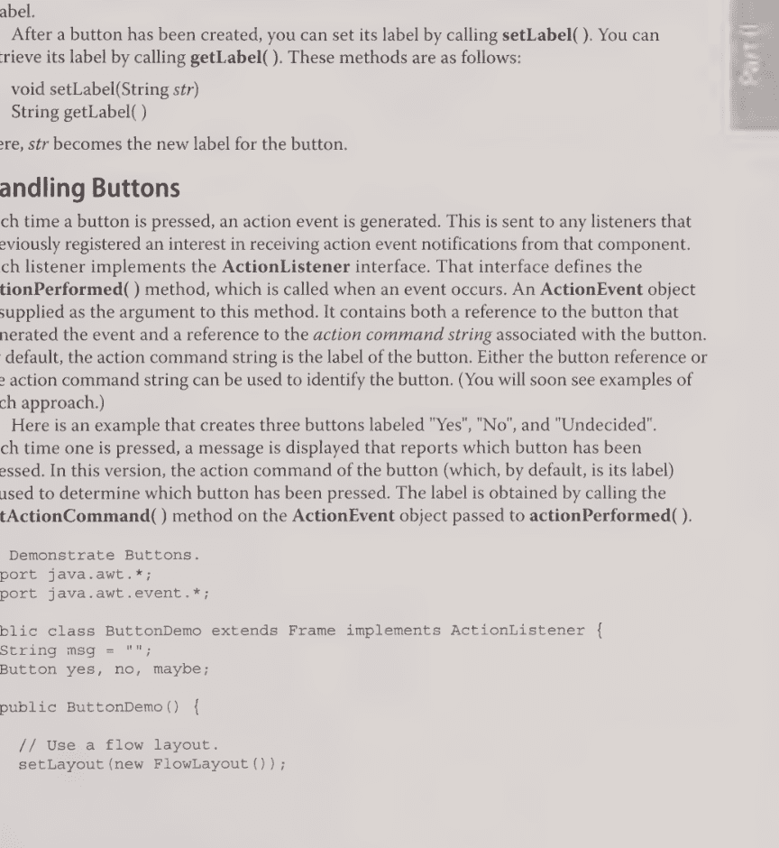

图 26-1 ButtonDemo 程序的示例输出

图 26-1 显示了 `ButtonDemo` 程序的示例输出。提到的，除了比较动作命令字符串外，你还可以通过比较从 `getSource()` 方法获取的对象与添加的按钮对象来确定哪个按钮被按下。为此，你必须在添加对象时保留它们的列表。以下程序展示了这一点：

```java
// 识别按钮对象。
import java.awt.*;
import java.awt.event.*;

public class ButtonList extends Frame implements ActionListener {
    String msg = "";
    Button list[] = new Button[3];

    public ButtonList() {
        // 使用流布局。
        setLayout(new FlowLayout());
        // 创建一些按钮。
        Button yes = new Button("Yes");
        Button no = new Button("No");
        Button maybe = new Button("Undecided");
        // 在添加时存储按钮的引用。
        list[0] = (Button) add(yes);
        list[1] = (Button) add(no);
        list[2] = (Button) add(maybe);
        // 注册接收动作事件。
        for (int i = 0; i < 3; i++) {
            list[i].addActionListener(this);
        }
        addWindowListener(new WindowAdapter() {
            public void windowClosing(WindowEvent e) {
                System.exit(0);
            }
        });
    }

    // 处理按钮动作事件。
    public void actionPerformed(ActionEvent ae) {
        for (int i = 0; i < 3; i++) {
            if (ae.getSource() == list[i]) {
                msg = "You pressed " + list[i].getLabel();
            }
        }
        repaint();
    }

    public void paint(Graphics g) {
        g.drawString(msg, 20, 100);
    }

    public static void main(String[] args) {
        ButtonList appwin = new ButtonList();
        appwin.setSize(new Dimension(250, 150));
        appwin.setTitle("ButtonList");
        appwin.setVisible(true);
    }
}
```

## 处理复选框

每当选择或取消选择复选框时，都会生成一个项目事件（item event）。该事件会被发送给之前注册了该组件项目事件通知的监听器。每个监听器都实现了 `ItemListener` 接口。该接口定义了 `itemStateChanged()` 方法。该方法提供一个 `ItemEvent` 对象作为参数。它包含了有关事件的信息（例如，是选择还是取消选择）。

以下程序创建了四个复选框。第一个框的初始状态为选中。每当您更改复选框的状态时，状态就会更新。


# 第 26 章 使用 AWT、布局管理器和菜单

```java
// 演示复选框。
import java.awt.*;
import java.awt.event.*;

public class CheckboxDemo extends Frame implements ItemListener {
    String msg = "";
    Checkbox windows, android, solaris, mac;

    public CheckboxDemo() {
        // 使用流布局。
        setLayout(new FlowLayout());

        // 创建复选框。
        windows = new Checkbox("Windows", true);
        android = new Checkbox("Android");
        solaris = new Checkbox("Solaris");
        mac = new Checkbox("Mac OS");

        // 将复选框添加到框架中。
        add(windows);
        add(android);
        add(solaris);
        add(mac);

        // 添加项目监听器。
        windows.addItemListener(this);
        android.addItemListener(this);
        solaris.addItemListener(this);
        mac.addItemListener(this);

        addWindowListener(new WindowAdapter() {
            public void windowClosing(WindowEvent we) {
                System.exit(0);
            }
        });
    }

    public void itemStateChanged(ItemEvent ie) {
        repaint();
    }

    // 显示复选框当前状态。
    public void paint(Graphics g) {
        msg = "Current state: ";
        g.drawString(msg, 20, 120);
        msg = "Windows: " + windows.getState();
        g.drawString(msg, 20, 140);
        msg = "Android: " + android.getState();
        g.drawString(msg, 20, 160);
        msg = "Solaris: " + solaris.getState();
        g.drawString(msg, 20, 180);
        msg = "Mac OS: " + mac.getState();
        g.drawString(msg, 20, 200);
    }

    public static void main(String[] args) {
        CheckboxDemo appwin = new CheckboxDemo();

        appwin.setSize(new Dimension(240, 220));
        appwin.setTitle("CheckboxDemo");
        appwin.setVisible(true);
    }
}
```

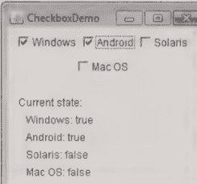

图 26-2 CheckboxDemo 程序的示例输出

## CheckboxGroup

可以创建一组互斥的复选框，在组中，任何时候有且只有一个复选框可以被选中。这些复选框通常被称为单选按钮（radio buttons），因为它们的作用就像汽车收音机上的选择器——任何时候只能选择一个电台。要创建一组互斥的复选框，你必须首先定义它们所属的组，并在构造复选框时指定该组。复选框组是 `CheckboxGroup` 类型的对象。只定义了默认构造函数，用于创建一个空组。

你可以通过调用 `getSelectedCheckbox()` 来确定组中当前哪一个复选框被选中。你可以通过调用 `setSelectedCheckbox()` 设置复选框。这些方法如下：

- `Checkbox getSelectedCheckbox()`
- `void setSelectedCheckbox(Checkbox which)`

这里的 `which` 是你想要被选中的复选框。之前选中的复选框将被关闭。

以下是一个使用了组内复选框的程序：

```java
// 演示复选框组。
import java.awt.*;
import java.awt.event.*;

public class CBGroup extends Frame implements ItemListener {
    String msg = "";
    Checkbox windows, android, solaris, mac;
    CheckboxGroup cbg;

    public CBGroup() {
        // 使用流布局。
        setLayout(new FlowLayout());

        // 创建一个复选框组。
        cbg = new CheckboxGroup();

        // 创建复选框并将其包含在组中。
        windows = new Checkbox("Windows", cbg, true);
        android = new Checkbox("Android", cbg, false);
        solaris = new Checkbox("Solaris", cbg, false);
        mac = new Checkbox("Mac OS", cbg, false);

        // 将复选框添加到框架中。
        add(windows);
        add(android);
        add(solaris);
        add(mac);

        // 添加项目监听器。
        windows.addItemListener(this);
        android.addItemListener(this);
        solaris.addItemListener(this);
        mac.addItemListener(this);

        addWindowListener(new WindowAdapter() {
            public void windowClosing(WindowEvent we) {
                System.exit(0);
            }
        });
    }
}
```

## 选择列表 (Choice Lists)

每当选择一个项目时，都会生成一个项目事件。该事件会被发送给之前注册了该组件项目事件通知的监听器。每个监听器都实现了 `ItemListener` 接口。该接口定义了 `itemStateChanged()` 方法。该方法提供一个 `ItemEvent` 对象作为参数。它包含了有关事件的信息（例如，是选择还是取消选择）。

`Choice` 类用于创建一个项目列表，用户可以从列表中进行选择。每当您更改选择的状态时，状态就会更新。

- `void add(String item)` - 将项目添加到列表末尾。
- `void add(int index, String item)` - 在索引处添加项目。
- `int getItemCount()` - 返回列表中的项目数量。
- `String getSelectedItem()` - 返回选中项目的文本。
- `int getSelectedIndex()` - 返回选中项目的索引。

这是一个示例，它创建了两个 Choice 菜单。一个操作操作系统，另一个选择浏览器。

```java
// 演示选择列表。
import java.awt.*;
import java.awt.event.*;

public class ChoiceDemo extends Frame implements ItemListener {
    Choice os, browser;
    String msg = "";

    public ChoiceDemo() {
        // 使用流布局。
        setLayout(new FlowLayout());
        // 创建选择列表。
        os = new Choice();
        browser = new Choice();

        // 为 os 列表添加项目。
        os.add("Windows");
        os.add("Android");
        os.add("Solaris");
        os.add("Mac OS");

        // 为 browser 列表添加项目。
        browser.add("Internet Explorer");
        browser.add("Firefox");
        browser.add("Chrome");

        // 将选择列表添加到窗口。
        add(os);
        add(browser);

        // 添加项目监听器。
        os.addItemListener(this);
        browser.addItemListener(this);

        addWindowListener(new WindowAdapter() {
            public void windowClosing(WindowEvent we) {
                System.exit(0);
            }
        });
    }

    public void itemStateChanged(ItemEvent ie) {
        repaint();
    }

    // 显示当前选择。
    public void paint(Graphics g) {
        msg = "Current OS:";
        msg += os.getSelectedItem();
        g.drawString(msg, 20, 120);
        msg = "Current Browser: ";
        msg += browser.getSelectedItem();
        g.drawString(msg, 20, 140);
    }

    public static void main(String[] args) {
        ChoiceDemo appwin = new ChoiceDemo();

        appwin.setSize(new Dimension(240, 180));
        appwin.setTitle("ChoiceDemo");
        appwin.setVisible(true);
    }
}
```

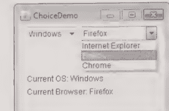

图 26-4 来自 ChoiceDemo 程序的示例输出

## 使用列表 (Lists)

`List` 类提供了一个紧凑、多选且可滚动的选择列表。与仅在菜单中显示单个被选中项的 `Choice` 对象不同，`List` 对象可以被构造为在可见窗口中显示任意数量的选项。它还可以被创建为允许多选。`List` 提供了这些构造函数：

- `List()` throws HeadlessException
- `List(int numRows)` throws HeadlessException
- `List(int numRows, boolean multipleSelect)` throws HeadlessException

第一个版本创建一个只能选择一个项目的 `List` 控件。在第二个版本中，`numRows` 的值指定了列表中始终可见的条目数（其他条目按需要滚动进入视图）。在第三种形式中，如果 `multipleSelect` 为 `true`，用户可以一次选择两个或多个项目。如果它为 `false`，则只能选择一个项目。

要向列表添加选择，请调用 `add()`。它有以下两种形式：

- `void add(String name)`
- `void add(String name, int index)`

在这里，`name` 是添加到列表的项目的名称。第一种形式将项目添加到列表末尾。第二种形式将项目添加到由 `index` 指定的索引。索引从 0 开始。你可以指定 -1 来将项目添加到列表末尾。

对于只允许单选的列表，你可以通过调用 `getSelectedItem()` 或 `getSelectedIndex()` 来确定当前选中了哪个项目。这些方法在此处显示：

- `String getSelectedItem()`
- `int getSelectedIndex()`

`getSelectedItem()` 方法返回一个包含项目名称的字符串。如果选择了多个项目，或者没有进行任何选择，则返回 `null`。`getSelectedIndex()` 返回项目的索引。第一个项目位于索引 0 处。如果选择了多个项目，或者尚未进行任何选择，则返回 -1。

对于允许多选的列表，你必须使用 `getSelectedItems()` 或 `getSelectedIndexes()`（如下所示）来确定当前的选择项：

- `String[] getSelectedItems()`
- `int[] getSelectedIndexes()`

`getSelectedItems()` 返回一个包含当前选中项目名称的数组。
`getSelectedIndexes()` 返回一个包含当前选中项目索引的数组。

要获取列表中的项目数量，请调用 `getItemCount()`。你可以使用带有从 0 开始的整数索引的 `select(int)` 方法来设置当前选中项目。这些方法在此处显示：

- `int getItemCount()`
- `void select(int index)`

给定一个索引，你可以通过 `getItem(index)` 获取与该索引关联的项目名称，其通用形式为：

- `String getItem(int index)`

在这里，`index` 指定所需项目的索引。

## 处理列表 (Handling Lists)

为了处理列表事件，你需要实现 `ActionListener` 接口。每当双击一个 `List` 项目时，就会生成一个 `ActionEvent` 对象。你的 `getActionCommand()` 方法可以用于获取新被选中项目的名称。此外，每当通过单击选择一个项目时，就会生成一个 `ItemEvent` 对象。

`getItemSelectable()` 方法返回触发此事件的对象的引用。

这是一个示例，将前一节中的 Choice 控件转换为 List 组件，一个是多选，另一个是单选：

```java
// 展示列表。
import java.awt.*;
import java.awt.event.*;

public class ListDemo extends Frame implements ActionListener {
    List os, browser;
    String msg = "";

    public ListDemo() {
        // 使用流式布局。
        setLayout(new FlowLayout());
        // 创建多选列表。
        os = new List(4, true);
        // 创建单选列表。
        browser = new List(4);
        // 向列表添加项。
        os.add("Windows");
        os.add("Linux");
        os.add("MacOS");
        os.add("Android");
        browser.add("Chrome");
        browser.add("Firefox");
        browser.add("Safari");
        browser.add("Edge");
        add(os);
        add(browser);
        os.addActionListener(this);
        browser.addActionListener(this);

        addWindowListener(new WindowAdapter() {
            public void windowClosing(WindowEvent e) {
                System.exit(0);
            }
        });

        setSize(new Dimension(300, 200));
        setVisible(true);
    }

    public void actionPerformed(ActionEvent e) {
        msg = e.getActionCommand();
        System.out.println("Selected: " + msg);
    }

    public static void main(String[] args) {
        new ListDemo();
    }
}
```


public void itemSelected(ItemEvent e) {
    System.out.println("Selected: " + e.getItem());
}

public void stateChanged(ItemEvent e) {
    System.out.println("State changed: " + e.getItem());
}

```java
// 创建滚动条并设置优先尺寸。
vertSB = new Scrollbar(Scrollbar.VERTICAL, 0, 1, 0, 200);
vertSB.setPreferredSize(new Dimension(20, 100));
horzSB = new Scrollbar(Scrollbar.HORIZONTAL, 0, 1, 0, 100);
horzSB.setPreferredSize(new Dimension(100, 200));

// 将滚动条添加到框架中。
add(vertSB);
add(horzSB);

// 为滚动条添加调整监听器。
vertSB.addAdjustmentListener(this);
horzSB.addAdjustmentListener(this);

// 添加鼠标移动监听器。
addMouseMotionListener(new MouseAdapter() {
    // 更新滚动条的数值以反映鼠标拖拽。
    public void mouseDragged(MouseEvent e) {
        int x = e.getX();
        int y = e.getY();
        vertSB.setValue(y);
        horzSB.setValue(x);
        repaint();
    }
});

addWindowListener(new WindowAdapter() {
    public void windowClosing(WindowEvent we) {
        System.exit(0);
    }
});

public void adjustmentValueChanged(AdjustmentEvent ae) {
    repaint();
}

// 显示滚动条的当前值。
public void paint(Graphics g) {
    String msg = "Vertical: " + vertSB.getValue();
    msg += ", Horizontal: " + horzSB.getValue();
    g.drawString(msg, 20, 160);
    // 显示当前鼠标拖拽位置
    g.drawString("*", horzSB.getValue(), vertSB.getValue());
}

public static void main(String[] args) {
    SBDemo appwin = new SBDemo();
    appwin.setSize(new Dimension(300, 180));
    appwin.setTitle("SBDemo");
    appwin.setVisible(true);
}
```

SBDemo 程序的示例输出如图 26-6 所示。

864 第二部分 Java 库


图 26-6 SBDemo 程序的示例输出

# 使用 TextField

`TextField` 类实现了一个单行文本输入区域，通常称为编辑控件。文本字段允许用户输入字符串并使用方向键、剪切粘贴键以及鼠标选择来编辑文本。`TextField` 是 `TextComponent` 的子类。`TextField` 定义了以下构造函数：

- `TextField()` throws `HeadlessException`
- `TextField(int numChars)` throws `HeadlessException`
- `TextField(String str)` throws `HeadlessException`
- `TextField(String str, int numChars)` throws `HeadlessException`

第一个版本创建一个默认文本字段。第二种形式创建一个宽度为 `numChars` 个字符的文本字段。第三种使用 `str` 的字符串初始化文本字段。第四种形式初始化文本字段并设置其宽度。

`TextField`（及其子类 `TextComponent`）提供了几个方法，允许你使用文本字段。要获取文本字段中当前包含的字符串，调用 `getText()`。这些方法如下：

```java
String getText()
void setText(String str)
```

这里，`str` 是新字符串。

用户可以选择文本字段中的部分文本。此外，你也可以使用 `select()` 在程序控制下选择部分文本。你的程序可以通过调用 `getSelectedText()` 获取当前选中的文本。这些方法如下：

```java
String getSelectedText()
void select(int startIndex, int endIndex)
```

`getSelectedText()` 返回选中的文本。`select()` 方法选择从 `startIndex` 开始到索引 `endIndex - 1` 结束的字符。

你可以通过调用 `setEditable()` 来控制用户是否可以修改文本字段的内容。你通过调用 `isEditable()` 来确定编辑性。这些方法显示在这里：

```java
boolean isEditable()
void setEditable(boolean canEdit)
```

如果文本可以更改，`isEditable()` 返回 `true`，如果未设置为可编辑则返回 `false`；如果 `canEdit` 为 `true`，则文本可以更改。如果为 `false`，则无法进行更改。

有时用户想要输入不显示的文本，例如密码。你可以通过 `setEchoChar()` 禁用输入字符时的回显。此方法指定一个特定的字符，`TextField` 在输入字符时将显示该字符（因此不会显示实际字符）。你可以通过 `echoCharIsSet()` 方法检查文本字段是否处于此模式。你可以通过调用 `getEchoChar()` 方法检索回显字符。这些方法如下：

```java
void setEchoChar(char ch)
boolean echoCharIsSet()
char getEchoChar()
```

这里，`ch` 指定要回显的字符。如果 `ch` 为 0，则恢复正常回显。

# 处理 TextField

由于文本字段执行了它们的编辑功能，你的程序通常不会响应发生在文本字段内的单个按键事件。但是，你可能希望在用户按下 ENTER 时响应。当这种情况发生时，会生成一个动作事件。

这是一个创建一个经典用户名和密码界面的示例：

```java
// 演示文本字段。
import java.awt.*;
import java.awt.event.*;

public class TextFieldDemo extends Frame implements ActionListener {
    TextField name, pass;

    public TextFieldDemo() {
        // 使用流布局。
        setLayout(new FlowLayout());

        // 创建控件
        Label nameLabel = new Label("Name: ");
        Label passLabel = new Label("Password: ");
        name = new TextField();
        pass = new TextField();

        // 将控件添加到框架中。
        add(nameLabel);
        add(name);
        add(passLabel);
        add(pass);

        // 为控件添加动作监听器。
        name.addActionListener(this);
        pass.addActionListener(this);

        // 添加窗口监听器。
        addWindowListener(new WindowAdapter() {
            public void windowClosing(WindowEvent we) {
                System.exit(0);
            }
        });
    }

    public void actionPerformed(ActionEvent ae) {
        repaint();
    }

    // 显示文本字段的当前值。
    public void paint(Graphics g) {
        g.drawString("Name: " + name.getText(), 20, 50);
        g.drawString("Password: " + pass.getText(), 20, 80);
    }

    public static void main(String[] args) {
        TextFieldDemo appwin = new TextFieldDemo();
        appwin.setSize(new Dimension(300, 180));
        appwin.setTitle("TextFieldDemo");
        appwin.setVisible(true);
    }
}
```

TextFieldDemo 程序的示例输出如图 26-7 所示。


图 26-7 TextFieldDemo 程序的示例输出

# 使用 TextArea

有时单行文本输入无法满足任务。为了处理这些情况，AWT 包含了一个名为 `TextArea` 的多行编辑器。以下是 `TextArea` 的构造函数：

```java
TextArea() throws HeadlessException
TextArea(int numLines, int numChars) throws HeadlessException
TextArea(String str) throws HeadlessException
TextArea(String str, int numLines, int numChars) throws HeadlessException
TextArea(String str, int numLines, int sBars) throws HeadlessException
```

这里，`numLines` 指定文本区域的高度（行数），`numChars` 指定宽度（字符）。初始文本可以通过 `str` 指定。在第五种形式中，你可以通过 `sBars` 指定你想要控制的滚动条；`sBars` 必须是以下值之一：

```java
SCROLLBAR_BOTH
SCROLLBAR_NONE
SCROLLBAR_HORIZONTAL_ONLY
SCROLLBAR_VERTICAL_ONLY
```

`TextArea` 是 `TextComponent` 的子类。因此，它支持前面介绍的 `getText()`、`setText()`、`getSelectedText()`、`select()`、`isEditable()` 和 `setEditable()` 方法。

`TextArea` 增加了以下编辑方法：

```java
void append(String str)
void insert(String str, int pos)
void replaceRange(String str, int startIndex, int endIndex)
```

`append()` 方法将指定的字符串附加到当前文本末尾。`insert()` 在指定的索引处插入字符串。要替换文本，`replaceRange()` 将从 `startIndex` 到 `endIndex - 1` 的字符替换为 `str` 中的文本。

`TextArea` 几乎是自包含的。你的程序开销很小。通常，你的程序只需要在时获取当前文本。但是，如果你选择，也可以监听文本事件。

以下程序创建一个 `TextArea` 控件：

```java
// 演示 TextArea。
import java.awt.*;
import java.awt.event.*;

public class TextAreaDemo extends Frame {
    public TextAreaDemo() {
        // 使用流布局。
        setLayout(new FlowLayout());

        String val = "Java 9 is the latest version of the most\n" +
                "widely-used computer language for Internet programming,\n" +
                "Building on a rich heritage, Java has advanced both\n" +
                "the art and science of computer language design.\n" +
                "One of the reasons for Java's ongoing success is its\n" +
                "constant, steady rate of evolution. Java has never stood\n" +
                "still. Instead, Java has consistently adapted to the\n" +
                "rapidly changing landscape of the networked world.\n" +
                "Moreover, Java has often led the way, charting the\n" +
                "course for others to follow.";

        TextArea text = new TextArea(val, 10, 30);
        add(text);

        addWindowListener(new WindowAdapter() {
            public void windowClosing(WindowEvent we) {
                System.exit(0);
            }
        });
    }

    public static void main(String[] args) {
        TextAreaDemo appwin = new TextAreaDemo();
        appwin.setSize(new Dimension(300, 220));
        appwin.setTitle("TextAreaDemo");
        appwin.setVisible(true);
    }
}
```

这里是 TextAreaDemo 程序的示例输出：

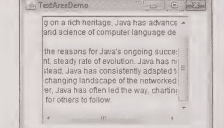

# 理解布局管理器

到目前为止展示的所有组件都是通过 `FlowLayout` 布局管理器定位的。正如我们在本章开头提到的，布局管理器通过某种算法自动在窗口内排列你的控件。

虽然可以手动布局 Java 控件，但由于两个主要原因，你通常不会想这么做。首先，手动布局大量组件非常繁琐。其次，有时在你需要排列某些控件时，宽度和高度信息尚未可用，因为原生工具包组件尚未实现。这是一个“鸡生蛋”的问题；要确定何时可以使用给定组件的大小来相对于另一个组件进行定位实际上是非常困难的。

每个 `Container` 都有与其关联的布局管理器。布局管理器是实现 `LayoutManager` 接口的任何类的实例。布局管理器通过 `setLayout()` 方法设置。如果没有调用 `setLayout()`，则将使用默认布局管理器。每当容器调整大小时（或第一次设置大小时），都会使用布局管理器来对其中的每个组件进行定位。

`setLayout()` 方法具有以下泛型：

```java
void setLayout(LayoutManager layoutObj)
```


在这里，`layoutObj` 是指向所需布局器的引用。如果你想禁用布局管理器并手动定位组件，请为 `layoutObj` 传递 `null`。如果你这样做，你需要使用 `Component` 类的 `setBounds()` 方法手动确定每个组件的形状和位置。通常，你会使用布局管理器。

每个布局管理器都维护一个按名称存储的组件列表。每当你向容器添加组件时，布局管理器都会收到通知。每当容器需要调整大小时，都会通过其 `minimumLayoutSize()` 和 `preferredLayoutSize()` 方法咨询布局管理器。每个组件都由一个包含 `getPreferredSize()` 和 `getMinimumSize()` 方法的布局进行管理。这些方法返回显示每个组件所需的理想尺寸和最小尺寸。如果可能，布局管理器会尊重这些请求，同时维护布局策略的完整性。你可以对你子类化的控件重写这些方法。否则，将提供默认值。

Java 有几个预定义的 `LayoutManager` 类，其中几个将在下文中描述。你可以使用适合你应用程序的布局管理器。

# FlowLayout

你已经见过 `FlowLayout` 的运行了。它是前面的示例所使用的布局管理器。`FlowLayout` 实现了一种简单的布局样式，类似于文字在文本编辑器中的流动方式。流向方向由容器的组件方向（component orientation）属性控制，默认情况下是从左到右、从上到下。默认情况下，组件从左上角开始逐行排列。在所有情况下，当一行填满时，`FlowLayout` 都会到下一行。每个组件之间在上下以及左右都留有微小的间距。以下是 `FlowLayout` 的构造函数：

```java
FlowLayout()

FlowLayout(int h)

FlowLayout(int h, int horiz, int)
```


第一种形式创建默认布局，它居中组件并在每个组件之间留出五个像素的间隔。第二种形式允许你指定每行的对齐方式。对齐方式有效值如下：

- `FlowLayout.LEFT`
- `FlowLayout.CENTER`
- `FlowLayout.RIGHT`
- `FlowLayout.LEADING`
- `FlowLayout.TRAILING`

这些值分别指定左、中、右、前缘（leading edge）和尾缘（trailing edge）对齐。
第三个构造函数允许你通过 `horz` 和 `vert` 分别指定组件之间留水平和垂直空间。

你可以通过替换所示 `CheckboxDemo` 程序中的行来看到使用 `FlowLayout` 指定对齐方式的效果：

```java
setLayout(new FlowLayout(FlowLayout.LEFT));
```

进行此更改后，输出将如下所示。与图 26-2 显示的原始输出进行比较。

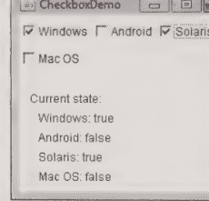

# BorderLayout

`BorderLayout` 类实现了一种布局样式，它在边缘有固定宽度的组件，在中心有一个大区域。四边被称为北（north）、南（south）、东（east）和西（west）。中间区域被称为中心（center）。`BorderLayout` 是 `Frame` 的默认布局管理器。以下是 `BorderLayout` 的构造函数：

- `BorderLayout()`
- `BorderLayout(int horz, int vert)`

第一种形式创建默认布局。第二种允许你通过 `horz` 和 `vert` 指定组件之间的水平和垂直空间。`BorderLayout` 定义了常用的常量：

| `BorderLayout.CENTER` | `BorderLayout.SOUTH` |
| :--- | :--- |
| `BorderLayout.EAST` | `BorderLayout.WEST` |
| `BorderLayout.NORTH` | |

# 第 26 章 使用 AWT 控件、布局管理器和菜单 871

添加组件时，你会使用这些常量配合 `Container` 定义的以下 `add()` 方法：

```java
void add(Component compRef, Object region)
```

在这里，`compRef` 是组件的引用，`region` 指定组件的位置。

这是一个在每个布局区域都有组件的 `BorderLayout` 示例：

```java
// Demonstrate BorderLayout

import java.awt.*;

import java.awt.event.*;

public class BorderLayoutDemo extends Frame {

    public BorderLayoutDemo() {

        // 这里，默认使用了 BorderLayout。

        add(new Button("This is across the top."), BorderLayout.NORTH);

        add(new Label("The footer message might go here."), BorderLayout.SOUTH);

        add(new Button("Right"), BorderLayout.EAST);

        add(new Button("Left"), BorderLayout.WEST);

        String msg = "The reasonable man adapts " +

                    "himself to the world:\n" +

                    "the unreasonable one persists in \n" +

                    "trying to adapt the world to himself.\n" +

                    "Therefore all progress depends " +

                    "on the unreasonable man.\n" +

                    "- George Bernard Shaw\n" +

                    msg;

        add(new TextArea(msg), BorderLayout.CENTER);

        addWindowListener(new WindowAdapter() {

            public void windowClosing(WindowEvent event) {

                System.exit(0);

            }

        });

    }

    public static void main(String[] args) {

        BorderLayoutDemo appwin = new BorderLayoutDemo();

        appwin.setSize(new Dimension(300, 220));

        appwin.setTitle("BorderLayoutDemo");

        appwin.setVisible(true);

    }

}
```

此处显示 BorderLayout 程序的示例输出：


# 使用 Insets

有时你可能希望在容器和包含它的窗口之间留出少量的空间。要实现这一点，请重写由 `Container` 定义的 `getInsets()` 方法。该方法返回一个 `Insets` 对象，其中包含了容器显示时使用的顶部、底部、左侧和右侧内边距（inset）。这些值将由布局管理器在布局窗口时用于插入组件。`Insets` 的构造函数所示所示：

`Insets(int top, int left, int bottom, int right)`

传入的 `top`、`left`、`bottom` 和 `right` 值指定了容器与其外围窗口之间的空间大小。

`getInsets()` 方法具有如下的通用形式：

`Insets getInsets()`

在重写此方法时，你必须返回一个包含你所需的内边距间距的新 `Insets` 对象。将背景颜色已设置为青色（cyan），以便内边距更加可见。

```java
// 使用 insets 展示 BorderLayout。

import java.awt.*;

import java.awt.event.*;

public class InsetsDemo extends Frame {

    public InsetsDemo() {

        // 此处默认使用 BorderLayout。

        // 设置背景颜色以便于观察内边距

        setBackground(Color.cyan);

        setLayout(new BorderLayout());

        add(new Button("这是在顶部。"), BorderLayout.NORTH);

        add(new Label("页脚消息可能在这里。"), BorderLayout.SOUTH);

        add(new Button("右"), BorderLayout.EAST);

        add(new Button("左"), BorderLayout.WEST);

        String msg = "The reasonable man adapts " + \
        "himself to the world:\n" + \
        "the unreasonable one persists in " + \
        "trying to adapt the world to himself.\n" + \
        "Therefore all progress depends " + \
        "on the unreasonable man\n" + \
        "- 乔治·伯纳德·萧恩\n";

        add(new TextArea(msg), BorderLayout.CENTER);

        addWindowListener(new WindowAdapter() {

            public void windowClosing(WindowEvent event) {

                System.exit(0);

            }

        });

    }

    // 重写 getInsets 以添加内边距值。

    public Insets getInsets() {

        return new Insets(40, 20, 10, 20);

    }

    public static void main(String[] args) {

        InsetsDemo appwin = new InsetsDemo();

        appwin.setSize(new Dimension(300, 220));

        appwin.setTitle("InsetsDemo");

        appwin.setVisible(true);

    }

}
```

此处显示 InsetsDemo 程序的示例输出：


# GridLayout

`GridLayout` 在二维网格中布局组件。当你实例化一个 `GridLayout` 时，你定义了行数和列数。`GridLayout` 支持的构造函数所示：

```java
GridLayout()

GridLayout(int numRows, int numColumns)

GridLayout(int numRows, int numColumns, int horz, int vert)
```

第一种形式创建一个单列网格布局。第二种形式创建一个具有指定行数和列数的网格布局。第三种形式允许你通过 `horz` 和 `vert` 分别指定组件之间留出的水平垂直空间。`numRows` 或 `numColumns` 都可以为 0。将 `numRows` 指定为 0 允许无限长度的列。将 `numColumns` 指定为 0 允许无限长度的行。

以下是一个创建一个 4x4 网格并用 15 个按钮填充的示例程序，每个按钮的标签为其索引值：

```java
//  GridLayout

import java.awt.*;

import java.awt.event.*;

public class GridLayoutDemo extends Frame {

    static final int n = 4;

    public GridLayoutDemo() {

        // 使用 GridLayout。

        setLayout(new GridLayout(n, n));

        setFont(new Font("SansSerif", Font.BOLD, 24));

        for(int i = 0; i < n; i++) {

            for(int j = 0; j < n; j++) {

                int k = i * n + j;

                if (k > 0) {

                    add(new Button("" + k + ""));

                }

            }

        }

        addWindowListener(new WindowAdapter() {

            public void windowClosing(WindowEvent we) {

                System.exit(0);

            }

        });

    }

    public static void main(String[] args) {

        GridLayoutDemo appwin = new GridLayoutDemo();

        appwin.setSize(new Dimension(300, 220));

        appwin.setTitle("GridLayoutDemo");

        appwin.setVisible(true);

    }

}
```

以下是 GridLayoutDemo 程序生成的示例输出：


你可以尝试使用这个示例作为 15 格拼图制作的起点。

# CardLayout

`CardLayout` 在其他布局管理器中是独一无的，因为它存储了多个不同的布局。每个布局都可以被视为堆牌中的一张卡片。每个布局可以被视为堆牌，使得任何卡片在任何时间都处于顶部。这对于具有动态启用或禁用功能的用户界面非常有用。`CardLayout` 提供了两个构造函数：

```java
CardLayout()

CardLayout(int hor, int vert)
```

第一种形式创建一个默认卡片布局。第二种形式允许你通过 `hor` 和 `vert` 分别指定组件之间的水平和垂直空间。使用卡片布局比其他布局需要更多工作。卡片通常存储在类型为 `Panel` 的对象中。接下来，你需要创建一个面板并将 `CardLayout` 作为其布局管理器。然后你将面板添加到卡片中。最后，你将此面板添加到以 `CardLayout` 为布局器的面板中。

```java
// CardLayout

import java.awt.*;

import java.awt.event.*;

class CardLayoutDemo extends Frame {

    Checkbox windows7, windows8, windows10, android, solaris, mac;

    Panel winPan, otherPan;

    CardLayout cardLO;

    public CardLayoutDemo() {

        // 主框架使用流布局。

        setLayout(new FlowLayout());

        windows7 = new Checkbox("Windows 7");

        windows8 = new Checkbox("Windows 8");

        windows10 = new Checkbox("Windows 10");

        android = new Checkbox("Android");

        solaris = new Checkbox("Solaris");

        mac = new Checkbox("Mac OS");

        winPan = new Panel();

        winPan.add(windows7);

        winPan.add(windows8);

        winPan.add(windows10);

        otherPan = new Panel();

        otherPan.add(android);

        otherPan.add(solaris);

        otherPan.add(mac);

        cardLO = new CardLayout();
```


# 87 第二部分 Java 库

这里是由 `CardLayoutDemo` 程序生成的示例输出。每张卡片通过点击其按钮来激活。你也可以通过点击鼠标在卡片之间循环。

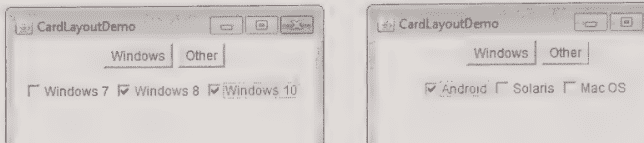

## GridBagLayout

虽然前面的布局在很多情况下是可以完全接受的，但在某些情况下需要你对组件的排列方式进行更多的控制。实现此点的一种良好方法是使用网格袋布局（grid bag layout），它由 `GridBagLayout` 类指定。网格袋的有用之处在于，你可以通过指定它们在网格内部单元格中的位置，来指定组件的相对位置。网格袋的关键在于，每个组件的大小可以不同，且网格中的每一行可以有不同数量的列。这就是为什么这种布局被称为网格袋。它是由许多小网格连接而成的集合。

网格袋中每个组件的位置和大小由一组关联它的约束条件（constraints）决定的。这些约束包含在 `GridBagConstraints` 类型的对象中。约束条件包括单元格的高度和宽度，以及组件的放置、对齐方式和在单元格内的锚点。

使用网格袋的通用步骤是：首先创建一个新的 `GridBagLayout` 对象并将其设置为当前布局管理器。然后，为将要添加到网格袋的每个组件设置相应的约束条件。最后，将组件添加到布局管理器。虽然 `GridBagLayout` 比其他布局管理器稍微复杂，但一旦你理解了它的原理，`GridBagLayout` 仍然非常易用。

### GridBagLayout()

`GridBagLayout` 定义了几个方法，其中许多是重复的且并非用于通用。然而，有一个方法是你必须使用的：`setConstraints()`。显示如下：

```java
void setConstraints(Component comp, GridBagConstraints cons)
```

在这里，`comp` 是应用 `cons` 所指定的约束条件的组件。该方法设置适用于网格袋中每个组件的约束条件。

成功使用 `GridBagLayout` 在于正确设置约束条件，这些约束存储在 `GridBagConstraints` 对象中。`GridBagConstraints` 定义了几个字段，你可以设置这些字段来控制组件的大小、位置和间距。这些在表 26-1 中给出。其中几个将在后续讨论中进行更详细的描述。

### 表 26-1 由 `GridBagConstraints` 定义的约束字段

| 字段 | 目的 |
| :--- | :--- |
| `int anchor` | 指定组件在单元格内的位置。默认值是 `GridBagConstraints.CENTER`。 |
| `int fill` | 如果组件小于其单元格，则指定如何调整组件大小。有效值为 `GridBagConstraints.NONE`（默认值）、`GridBagConstraints.HORIZONTAL`、`GridBagConstraints.VERTICAL`、`GridBagConstraints.BOTH`。 |
| `int gridheight` | 以单元格为单位指定组件的高度。默认值为 1。 |
| `int gridwidth` | 以单元格为单位指定组件的宽度。默认值为 1。 |
| `int gridx` | 指定组件将添加的单元格的 X 坐标。默认值是 `GridBagConstraints.RELATIVE`。 |
| `int gridy` | 指定组件将添加的单元格的 Y 坐标。默认值是 `GridBagConstraints.RELATIVE`。 |
| `Insets insets` | 指定内边距。默认值均为零。 |
| `int padx` | 指定单元格内围绕组件的额外水平空间。默认值为 0。 |
| `int pady` | 指定单元格内围绕组件的额外垂直空间。默认值为 0。 |
| `double weightx` | 指定一个确定单元格与持有它们的容器边缘之间水平间距的值。默认值为 0.0。权重越大，分配的空间越多。如果所有值均为 0.0，额外空间将均匀分布在窗口边缘之间。 |
| `double weighty` | 指定一个确定单元格与持有它们的容器边缘之间垂直间距的值。默认值为 0.0。权重越大，分配的空间越多。如果所有值均为 0.0，额外空间将均匀分布在窗口边缘之间。 |

`GridBagConstraints` 还定义了几个静态字段，包含标准的约束值，例如 `GridBagConstraints.CENTER` 和 `GridBagConstraints.VERTICAL`。

### anchor 字段详解

当组件小于其单元格时，你可以使用 `anchor` 字段来指定组件的左上角位于单元格内的哪个位置。你可以给 `anchor` 给出三种类型的值。

#### 1. 绝对值

| 常量 | 常量 |
| :--- | :--- |
| `GridBagConstraints.CENTER` | `GridBagConstraints.SOUTH` |
| `GridBagConstraints.EAST` | `GridBagConstraints.SOUTHEAST` |
| `GridBagConstraints.NORTH` | `GridBagConstraints.SOUTHWEST` |
| `GridBagConstraints.NORTHEAST` | `GridBagConstraints.WEST` |

正如它们的名称所示，这些值会导致组件放置在特定位置。


#### 2. 相对值

可以给 `anchor` 提供的第二类值是相对的，这意味着这些值相对于容器的取向，这对于非西方语言可能不同。相对值显示在此：

| 常量 | 常量 |
| :--- | :--- |
| `GridBagConstraints.FIRST_LINE_END` | `GridBagConstraints.LINE_END` |
| `GridBagConstraints.FIRST_LINE_START` | `GridBagConstraints.LINE_START` |
| `GridBagConstraints.LAST_LINE_END` | `GridBagConstraints.LINE_END` |
| `GridBagConstraints.LAST_LINE_START` | `GridBagConstraints.LINE_START` |

正如名称所示。

#### 3. 基线相对值

第三类可以给 `anchor` 的值允许你相对于基线来放置组件。这些值显示在此：

| 常量 | 常量 |
| :--- | :--- |
| `GridBagConstraints.BASELINE` | `GridBagConstraints.LEADING` |
| `GridBagConstraints.BASELINE` | `GridBagConstraints.TRAILING` |
| `GridBagConstraints.ABOVE_BASELINE` | `GridBagConstraints.BASELINE` |
| `GridBagConstraints.BELOW_BASELINE` | `GridBagConstraints.BELOW_LEADING` |
| `GridBagConstraints.BELOW_BASELINE` | `GridBagConstraints.BELOW_TRAILING` |

正如名称所示，这些值会导致组件放置在特定位置。

### weightx 和 weighty 字段

*   **`weightx`**：指定一个确定单元格与持有它们的容器边缘之间水平间距的值。默认值为 0.0。权重越大，分配的空间越多。如果所有值均为 0.0，额外空间将均匀分布在窗口边缘之间。
*   **`weighty`**：指定一个确定单元格与持有它们的容器边缘之间垂直间距的值。默认值为 0.0。权重越大，分配的空间越多。如果所有值均为 0.0，额外空间将均匀分布在窗口边缘之间。

---

# 882 第二部分 Java 库

## GridBagLayout 示例代码

```java
addWindowListener(new WindowAdapter() {
    public void windowClosing(WindowEvent we) {
        System.exit(0);
    }
});
```

```java
// 当复选框状态发生改变时重绘。
public void itemStateChanged(ItemEvent ie) {
    repaint();
}
```

```java
// 显示复选框的当前状态。
public void paint(Graphics g) {
    String msg = "Current state:";
    g.drawString(msg, 20, 100);
    msg = "Windows: " + windows.getState();
    g.drawString(msg, 30, 120);
    msg = "Android: " + android.getState();
    g.drawString(msg, 30, 140);
    msg = "Solaris: " + solaris.getState();
    g.drawString(msg, 30, 160);
    msg = "Mac: " + mac.getState();
    g.drawString(msg, 30, 180);
}
```

```java
public static void main(String[] args) {
    GridBagDemo appwin = new GridBagDemo();
    appwin.setSize(new Dimension(250, 200));
    appwin.setTitle("GridBagDemo");
    appwin.setVisible(true);
}
```

程序生成的示例输出在此。

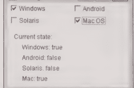

在此布局中，操作系统的复选框被放置在 2x2 的网格中。每个单元格有 200 的水平内边距。每个组件从左侧稍微缩进（6 个单位）。列权重（column weight）设置为 1，这使得任何额外的水平空间都会分布在列之间。第一行的默认权重为 0；第二行的权重为 1。这意味着任何额外的垂直空间都会被添加到第二行。

> **注意**：`GridBagLayout` 是一个强大的布局管理器。值得花一些时间进行实验和探索。一旦你理解了各种设置的作用，就可以使用 `GridBagLayout` 以高精度定位组件。

---

## 菜单栏和菜单

顶层窗口可以关联一个菜单栏。菜单栏显示顶级菜单选项的列表。每个选项都关联一个下拉菜单。这个概念在 AWT 中通过以下类实现：`MenuBar`、`Menu` 和 `MenuItem`。通常情况下，一个菜单栏包含一个或多个 `Menu` 对象。每个 `Menu` 对象代表用户可以选择的内容。由于 `Menu` 是 `MenuItem` 的子类，因此可以创建子菜单的层级结构。还可以对菜单项进行勾选。这些是类型为 `CheckboxMenuItem` 的菜单选项，当它们被选中时旁边会有一个勾选标记。

要创建一个菜单，首先创建一个 `MenuBar` 实例。该类只定义了默认构造函数。接下来，创建将显示在菜单栏上的选择项的 `Menu` 实例。以下是 `Menu` 的构造函数：

```java
Menu() throws HeadlessException
Menu(String optionName) throws HeadlessException
Menu(String optionName, boolean removable) throws HeadlessException
```

在这里，`optionName` 指定菜单选择的名称。如果 `removable` 为 `true`，则菜单可以被移除并允许自由浮动。否则，它将保持附加在菜单栏上。（可移除的菜单取决于实现）。第一种形式创建一个空菜单。

单个菜单项的类型为 `MenuItem`。它定义了这些构造函数：

```java
MenuItem() throws HeadlessException
MenuItem(String itemName) throws HeadlessException
MenuItem(String itemName, String keyAccel) throws HeadlessException
```

在这里，`itemName` 是菜单中的名称，`keyAccel` 是该项的菜单快捷键。

你可以使用 `setEnabled()` 方法禁用或启用菜单项。其格式所示：

```java
void setEnabled(boolean enabledFlag)
```

如果参数 `enabledFlag` 为 `true`，则启用菜单项。如果为 `false`，则菜单项被禁用。

你可以通过调用 `isEnabled()` 来确定项的状态。该方法所示：

```java
boolean isEnabled()
```

如果被调用的菜单项是启用的，`isEnabled()` 返回 `true`。否则，返回 `false`。

你可以通过调用 `setLabel()` 修改菜单项的名称。你可以使用 `getLabel()` 获取当前名称。这些方法如下：

```java
void setLabel(String newName)
String getLabel()
```

在这里，`newName` 变为调用菜单项的新名称。`getLabel()` 返回当前名称。


你可以使用 `MenuItem` 的子类 `CheckboxMenuItem` 创建一个可更改的菜单项。它具有这些构造函数：

```java
CheckboxMenuItem() throws HeadlessException
CheckboxMenuItem(String itemName) throws HeadlessException
CheckboxMenuItem(String itemName, boolean on) throws HeadlessException
```

在这里，`itemName` 是菜单中显示的名称。可勾选项像开关一样工作。每当被选中时，它的状态就会改变。在前两种形式中，可勾选项是未勾选的。在第三种形式中，如果 `on` 为 `true`，则可勾选项是被勾选的。

### 菜单事件处理示例

```java
item4.addActionListener(handler);
item6.addActionListener(handler);
item7.addActionListener(handler);
item8.addActionListener(handler);
item9.addActionListener(handler);
item10.addActionListener(handler);
item11.addActionListener(handler);
item12.addActionListener(handler);
debug.addActionListener(handler);

// 使用 lambda 表达式处理退出
item5.addActionListener(ae -> System.exit(0));

addWindowListener(new WindowAdapter() {
    public void windowClosing(WindowEvent we) {
        System.exit(0);
    }
});

public void paint(Graphics g) {
    g.drawString(msg, 10, 220);
    if (debug.getState()) {
        g.drawString("调试开启。", 10, 240);
    } else {
        g.drawString("调试关闭。", 10, 240);
    }
    if (test.getState()) {
        // ...
    }
}
```


g.drawString("测试开启。", 10, 260);

} else

    g.drawString("测试关闭。", 10, 260);

}

public static void main(String[] args) {

    MenuDemo appwin = new MenuDemo();

    appwin.setSize(new Dimension(250, 300));

    appwin.setTitle("MenuDemo");

    appwin.setVisible(true);

}

// 用于菜单动作和项事件的内部类

class MyMenuHandler implements ActionListener, ItemListener {

    // 处理动作事件

    public void actionPerformed(ActionEvent ae) {

        msg = "你选择了：";

        String arg = ae.getActionCommand();

        if (arg.equals("New..."))

            msg += "新建...";

        else if (arg.equals("Open..."))

            msg += "打开...";

        else if (arg.equals("Close"))

            msg += "关闭";

        else if (arg.equals("Edit"))

            msg += "编辑";

        else if (arg.equals("Cut"))

            msg += "剪切";

        else if (arg.equals("Copy"))

            msg += "复制";

        else if (arg.equals("Paste"))

            msg += "粘贴";

        else if (arg.equals("First"))

            msg += "第一";

        else if (arg.equals("Second"))

            msg += "第二";

        else if (arg.equals("Third"))

            msg += "第三";

        else if (arg.equals("Debug"))

            msg += "调试";

        else if (arg.equals("Testing"))

            msg += "测试";

        repaint();

    }

    // 处理项事件

    public void itemStateChanged(ItemEvent ie) {

        repaint();

    }

}

**MenuDemo** 程序的示例输出如图 26-8 所示。

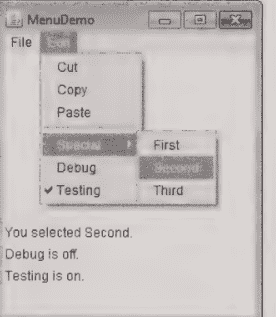

**图 26-8** **MenuDemo** 程序的示例输出

# 第二部分 Java 类库

还有另一个你可能感兴趣的菜单相关的类：`Popup`。它的工作方式与 `Menu` 相同，但产生的是可以显示在特定位置的菜单。`Popup` 为某些菜单场景提供了灵活且实用的替代方案。

# 对话框

通常，你可能希望使用对话框来包含一组相关的控件。对话框主要用于控制用户输入，并且通常是顶层窗口的子窗口。对话框没有菜单栏，但在其他方面，它们的功能与帧窗口相似（你可以向它们添加控件，例如，与向帧窗口添加控件的方式相同）。对话框可以是模态的（`modal`）或非模态的（`modeless`）。通常来说，模态对话框是激活状态的，在你关闭对话框之前，你无法访问程序中的其他窗口（对话框的子窗口除外）。当非模态对话框激活状态时，输入可以指向程序中的另一个窗口。因此，程序的其他部分仍然保持激活且可访问。从 JDK 6 开始，可以使用三种不同类型的模态创建模态对话框，具体由 `Dialog.ModalityType` 枚举指定。默认值是 `APPLICATION_MODAL`，它阻止使用应用程序中的其他层级窗口。这是传统的模态类型。其他类型是 `DOCUMENT_MODAL` 和 `TOOLKIT_MODAL`。

在 AWT 中，对话框是 `Dialog` 类型。这里常用的构造函数有：

- `Dialog(Frame parent, boolean mode)`
- `Dialog(Frame parent, String title, boolean mode)`

这里 `parent` 是对话框的所有者。如果 `mode` 为 `true`，则对话框使用默认模态；否则，它是非模态的。对话框的标题可以传入 `title`。通常，你会子类 `Dialog` 并添加应用程序所需的功能。

是前面程序的修改版本，当选择新建选项时显示非模态对话框。注意当对话框关闭时，会调用 `dispose()`。该方法由 `Window` 定义，并释放与对话框窗口关联的所有系统资源。

```java
// 演示对话框

import java.awt.*;

import java.awt.event.*;

class DialogDemo extends Frame {

    String msg = "";

    CheckboxMenuItem menuItem, test;

    SampleDialog myDialog;

    public DialogDemo() {

        // 创建对话框

        myDialog = new SampleDialog(this, "新对话框");

        // 创建菜单栏并将其添加到帧中

        MenuBar mbar = new MenuBar();

        setMenuBar(mbar);

        // 创建菜单项

        Menu file = new Menu("文件");

        MenuItem item1, item2, item3, item4, item5;

        file.add(item1 = new MenuItem("新建..."));

        file.add(item2 = new MenuItem("打开..."));

        file.add(item3 = new MenuItem("关闭"));

        file.add(item4 = new MenuItem("--"));

        file.add(item5 = new MenuItem("退出..."));

        mbar.add(file);

        Menu edit = new Menu("编辑");

        MenuItem item6, item7, item8, item9;

        edit.add(item6 = new MenuItem("第一"));

        edit.add(item7 = new MenuItem("第二"));

        edit.add(item8 = new MenuItem("第三"));

        mbar.add(edit);

        Menu debug = new Menu("调试");

        MenuItem item10, item11;

        debug.add(item10 = new MenuItem("调试"));

        debug.add(item11 = new MenuItem("测试"));

        mbar.add(debug);

        Menu test = new Menu("测试");

        MenuItem item12;

        test.add(item12 = new MenuItem("测试"));

        mbar.add(test);

        addWindowListener(new WindowAdapter() {

            public void windowClosing(WindowEvent we) {

                dispose();

            }

        });

        myDialog.addWindowListener(new WindowAdapter() {

            public void windowClosing(WindowEvent we) {

                dispose();

            }

        });

    }

    // 处理动作事件

    public void actionPerformed(ActionEvent ae) {

        msg = "你选择了：";

        String arg = ae.getActionCommand();

        if (arg.equals("新建...")) {

            msg += "新建...";

            myDialog.setVisible(true);

        } else if (arg.equals("打开..."))

            msg += "打开...";

        else if (arg.equals("关闭"))

            msg += "关闭";

        else if (arg.equals("编辑"))

            msg += "编辑";

        else if (arg.equals("第一"))

            msg += "第一";

        else if (arg.equals("第二"))

            msg += "第二";

        else if (arg.equals("第三"))

            msg += "第三";

        else if (arg.equals("调试"))

            msg += "调试";

        else if (arg.equals("测试"))

            msg += "测试";

        repaint();

    }

    // 处理项目事件。

    public void itemStateChanged(ItemEvent ie) {

        repaint();

    }

}
```

```java
// 创建 Dialog 的子类。

class SampleDialog extends Dialog {

    SampleDialog(Frame parent, String title) {

        super(parent, title, false);

        setLayout(new FlowLayout());

        setSize(300, 200);

        add(new Label("Press this button:"));

        Button b;

        add(b = new Button("Cancel"));

        b.addActionListener((ae) -> dispose());

        addWindowListener(new WindowAdapter() {

            public void windowClosing(WindowEvent we) {

                dispose();

            }

        });

    }

    public void paint(Graphics g) {

        g.drawString("This is in the dialog box", 20, 80);

    }

}
```

# 第二部分 Java 类库

以下是 `DialogDemo` 程序的示例输出：

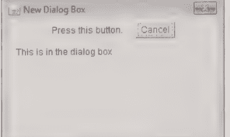

提示：你可以尝试自己为菜单中提供的其他选项定义对话框。

# 关于重写 paint()

在结束对 AWT 控件的检查之前，有必要简要介绍一下重写 `paint()`。虽然这与书中所示简单 AWT 示例无关，但在重写 `paint()` 时，有时有必要调用父类的 `paint()` 实现。因此，对于某些程序，你可能需要使用此 `paint()` 骨架：

```java
public void paint(Graphics g) {

    // 用于重绘此窗口的代码

    // 调用父类的 paint()

    super.paint(g);

}
```

在 Java 中，组件有两种通用的类型：重量级（`heavyweight`）和轻量级（`lightweight`）。重量级组件拥有自己的原生窗口，称为它的伙伴（`peer`）。轻量级组件完全用 Java 代码实现，并使用祖先组件提供的窗口。本章描述和使用的 AWT 控件都是重量级的。然而，如果一个容器持有任何轻量级组件（即拥有轻量级组件），你对该容器的 `paint()` 重写必须调用 `super.paint()`。通过调用 `super.paint()`，你可以确保任何轻量级子（如轻量级控件）得到正确绘制。如果你不确定子组件的类型，可以调用 `Component` 定义 `isLightweight()` 来查找。如果组件是轻量级的，则返回 `true`，否则返回 `false`。

# 第 27 章 图像

本章检查了 `Image` 类和 `java.awt.image` 包。它们共同提供了对图像（图像的显示和处理）的支持。图像简单是一个矩形图形对象。图像是 Web 设计的核心组件。事实上，NCSA（国家超级计算机应用中心）的 Mosaic 浏览器中包含 `` 标签是帮助 Web 在 1993 年开始爆炸式增长的催化剂。该标签用于将图像与超文本流内联包含。Java 扩展了这一基本概念，允许在程序控制下的图像。由于其重要性，Java 为图像处理提供了广泛的支持。

图像由 `Image` 类支持，它是 `java.awt` 包的一部分。通过 `java.awt.image` 包中的类对图像进行处理。`java.awt.image` 定义了大量的图像类和接口，无法全部检查。相反，我们将关注那些构成图像处理基础的类。以下是本章讨论的 `java.awt.image` 类：

| CropImageFilter | MemoryImageSource |
| :--- | :--- |
| FilteredImageSource | PixelGrabber |
| ImageFilter | RGBImageFilter |

我们将使用的接口是 `ImageConsumer` 和 `ImageProducer`。

# 文件格式

最初，Web 图像只有 GIF 格式。GIF 图像格式由 CompuServe 在 1987 年创建，目的是让能够在在线查看图像，同时它非常适合互联网。GIF 图像最多只有 256 种颜色。这一局限性导致主要的浏览器厂商在 1995 年增加了对 JPEG 图像的支持。JPEG 格式由一组摄影专家创建，用于存储全色域、连续调图像。这些图像如果创建得当，可以比相同源的 GIF 编码具有更高的保真度且压缩率更高。另一种文件格式是 PNG。它也是 GIF 的替代方案。在几乎所有情况下，你永远不会关心或注意到程序中使用哪种格式。Java 图像类通过整洁的接口抽象了这些差异。

# 图像基础：创建、加载和显示

当你处理图像时，会有三种常见操作：创建图像、加载图像和显示图像。在 Java 中，`Image` 类被用于引用内存中的图像以及必须从外部源加载的图像。因此，Java 提供了创建新图像对象的方法和加载图像的方法。它还提供了一种显示图像的方法。让我们来看每一个。

# 创建图像对象

你可能认为你会使用类似下面的代码来创建一个内存图像：

```java
Image test = new Image(200, 100); // 错误 -- 不起作用
```

并非如此。因为图像最终必须绘制在窗口上才能看到，`Image` 类没有关于其环境足够的信息来为屏幕创建正确的数据格式。`java.awt` 中的 `Component` 类有一个名为 `createImage()` 的工厂方法，用于创建 `Image` 对象。记住，所有的 AWT 控件都是 `Component` 的子类，`createImage()` 方法具有以下形式：

```java
Image createImage(ImageProducer imgProd)

Image createImage(int width, int height)
```

第一种形式返回由 `imgProd` 产生的图像（它是 `ImageProducer` 接口的实现）。第二种形式返回具有指定宽度和高度的空白图像。这是一个示例：

```java
Canvas c = new Canvas();

Image test = c.createImage(200, 100);
```

这创建了一个 `Canvas` 实例，然后调用 `createImage()` 方法创建一个 `Image` 对象。此时图像是空白的。稍后我们将看到如何。

# 加载图像

另一种获取图像的方法是从本地文件系统或 URL 加载。加载图像最简单的方法是使用 `ImageIO` 类定义的静态方法。`ImageIO` 为读取和写入图像提供了广泛的支持。它位于 `javax.imageio` 中。加载图像的方法被称为 `read()`。我们将使用的形式是：

```java
static BufferedImage read(File imageFile) throws IOException
```

# 第 27 章 图像


**图 27-1** `SimpleLoad` 的输出

在这里，`imageFile` 指定包含图像的文件。它返回以 `BufferedImage` 形式的图像，它是 `Image` 的子类，包含缓冲区。如果文件不包含有效图像，则返回 `null`。

# 显示图像

一旦你有了图像，就可以使用 `drawImage()` 显示它，它是 `Graphics` 类的成员。它有多种形式。我们将使用的形式是：

```java
boolean drawImage(Image imgObj, int left, int top, ImageObserver imgObj)
```

这显示传入的 `imgObj`，其左上角由 `left` 和 `top` 指定。`imgObj` 是实现 `ImageObserver` 接口的类的引用。该接口由所有 AWT（以及 Swing）组件实现。*图像观察者*是在图像加载时监控图像的对象。当不需要图像观察者时，`imgObj` 可以为 `null`。

使用 `read()` 实际上很容易加载并显示图像。这是一个加载并显示单个图像的程序。加载了文件 `Lilies.jpg`，但你可以替换任何你喜欢的图像（只需确保它与程序处于同一目录）。输出如图 27-1 所示。

```java
// 加载并显示图像。

import java.awt.*;

import java.awt.event.*;

import javax.imageio.*;

import java.io.*;

public class SimpleImageLoad extends Frame {

    Image img;

    public SimpleImageLoad() {

        try {

            File imageFile = new File("Lilies.jpg");

            // 加载图像。

            img = ImageIO.read(imageFile);

        } catch (IOException exc) {

            System.out.println("无法加载图像文件.");

            System.exit(0);

        }

        addWindowListener(new WindowAdapter() {

            public void windowClosing(WindowEvent we) {


System.exit(0);

    }

});

public void paint(Graphics g) {

    g.drawImage(img, getInsets().left, getInsets().top, null);

}

public static void main(String[] args) {

    SimpleImageLoad app = new SimpleImageLoad();

    app.setSize(new Dimension(400, 365));

    app.setTitle("SimpleImageLoad");

    app.setVisible(true);

}

```

# 双缓冲

正如我们刚刚展示的，图像不仅可以存储图片，你还可以将它们作为离屏绘制表面。这允许你将任何图像（包括文本和图形）渲染到离屏缓冲区，并在稍后显示它。这样做的好处是，图像只有在完成后才会被显示。绘制一张复杂的图像可能花费几毫秒或更长时间，这在用户看来可能是闪烁或抖动的。这种闪烁会分散用户的注意力，并导致用户认为你的渲染速度比实际更慢。使用离屏图像来减少闪烁被称为双缓冲，因为屏幕被视为像素的缓冲区，而离屏是第二个缓冲区，你可以在其中准备好用于显示的像素。

在本章的节节，你已经看到了如何创建一个空的 `Image` 对象。现在你将看到如何在图像而非屏幕上进行绘制。回顾之前的章节，为了使用 Java 的任何渲染方法，你需要一个 `Graphics` 对象。方便的是，用于在 `Image` 上绘图的 `Graphics` 对象可以通过 `getGraphics()` 方法获取。以下代码段创建一个新图像，获取其图形上下文，并将整个图像填充为红色：

```java
Canvas c = new Canvas();

Image test = c.createImage(200, 100);
```

```java
Graphics gc = test.getGraphics();

gc.setColor(Color.red);

gc.fillRect(0, 0, 200, 100);
```

一旦你构建并填充了离屏图像，它仍然不可见。
要实际显示图像，请调用 `drawImage()`。这里有一个示例，它绘制了一个耗时的图像，以证明缓冲对感知绘制时间可能产生的影响：

```java
// 离屏缓冲的用法。

import java.awt.*;

import java.awt.event.*;

public class DoubleBuffer extends Frame {

    int gap = 3;

    int mx, my;

    boolean flicker = null;

    Image buffer = null;

    int w = 400, h = 400;

    public DoubleBuffer() {

        addMouseListener(new MouseAdapter() {

            public void mouseDragged(MouseEvent me) {

                mx = me.getX();

                my = me.getY();

                flicker = false;

                repaint();

            }

            public void mouseMoved(MouseEvent me) {

                mx = me.getX();

                my = me.getY();

                flicker = true;

                repaint();

            }

        });

        addWindowListener(new WindowAdapter() {

            public void windowClosing(WindowEvent we) {

                System.exit(0);

            }

        });

    }

    public void paint(Graphics g) {

        Graphics screengc = null;

        if (!flicker) {

            screengc = g;

            g = buffer.getGraphics();

        }

        g.setColor(Color.blue);

        g.fillRect(0, 0, w, h);

        g.setColor(Color.red);

        for (int i=0; i<w; i+=gap)

            g.drawLine(i, 0, w-i, h);

        for (int i=0; i<h; i+=gap)

            g.drawLine(0, i, w, h-i);

        g.setColor(Color.black);

        g.drawString("按下鼠标键进行缓冲", 10, h/2);

        g.setColor(Color.yellow);

        g.fillOval(mx - gap, my - gap*2+1, gap*2+1);

        if (!flicker) {

            screengc.drawImage(buffer, 0, 0, null);

        }

    }

    public void update(Graphics g) {

        paint(g);

    }

    public static void main(String[] args) {

        DoubleBuffer appwin = new DoubleBuffer();

        appwin.setSize(new Dimension(400, 400));

        appwin.setTitle("DoubleBuffer");

        appwin.setVisible(true);

        // 创建离屏缓冲区

        appwin.buffer = appwin.create(appwin.w, appwin.h);

    }

}

```

这个简单的程序有一个复杂的 `paint()` 方法。它用蓝色填充背景，并在其上绘制一个红色图案。然后，它在坐标 `mx, my` 处绘制一个黄色圆。重写了 `mouseMoved()` 和 `mouseDragged()` 方法来跟踪鼠标位置。这些方法是相同的，只是对于 `flicker` 变量的设置，`mouseMoved` 将 `flicker` 设置为 `true`。

# 第27节 图像

## ImageConsumer

**ImageConsumer** 是一个接口，用于那些想要从图像中获取像素数据并将其作为其他类型的数据提供的对象。这与之前描述的 **ImageProducer** 相反。实现 **ImageConsumer** 接口的对象将创建代表来自 **Image** 对象像素的 `int`（整型）或 `byte`（字节）数组。**PixelGrabber** 类是 **ImageConsumer** 接口的一个简单实现。

## PixelGrabber

`PixelGrabber` 类定义在 `java.awt.image` 包中。它是 `MemoryImageSource` 类的相反类。它不是通过像素值数组构造图像，而是获取一个现有的图像并从中*抓取*像素数组。要使用 `PixelGrabber`，你首先需要创建一个足够大的 int 数组以容纳像素数据，然后通过传入你想要抓取的矩形来创建一个 `PixelGrabber` 实例。最后，你在该实例上调用 `grabPixels()`。

本章使用的 `PixelGrabber` 构造函数所示：

```java
PixelGrabber(Image imgObj, int left, int top, int width, int height, int pixel [],
             int offset, int scanLineWidth)
```

在这里，`imgObj` 是正在被抓取像素的对象。`left` 和 `top` 的值指定矩形的左上角，`width` 和 `height` 指定从中获取像素的矩形的尺寸。像素将存储在 `pixel` 数组中，从 `offset` 开始。一个扫描行（通常与图像的宽度相同）通过 `scanLineWidth` 传入。

`grabPixels()` 的定义如下：

```java
boolean grabPixels()
    throws InterruptedException

boolean grabPixels(long milliseconds)
    throws InterruptedException
```

这两个方法在成功时返回 `true`，否则返回 `false`。在第二种形式中，`milliseconds` 指定了该方法等待像素的时间。如果执行被另一个线程中断，两者都会抛出 `InterruptedException`。

以下是一个从图像中抓取像素并然后创建直方图的示例。直方图是对 0 到 255 之间所有亮度设置中具有特定亮度像素的简单计数。在程序绘制图像后，它会在上方绘制直方图。

```java
// 演示 PixelGrabber.

import java.awt.*;

import java.awt.event.*;

import java.awt.image.*;

import javax.image.io.*;

import java.io.*;
```

```java
public class HistoGrab extends Frame {
    Dimension d;
    Image img;
    int iw, ih;
    int pixels[];
    int hist[] = new int[256];
    int max_hist = 0;
    Insets ins;

    public HistoGrab() {
        try {
            File imageFile = new File("Lilies.jpg");

            // 加载图像。
            img = ImageIO.read(imageFile);

            iw = img.getWidth(null);
            ih = img.getHeight(null);
            pixels = new int[iw * ih];
            PixelGrabber pg = new PixelGrabber(img, 0, 0, iw, ih,
                    pixels, 0, iw);
            pg.grabPixels();
        } catch (InterruptedException e) {
            System.out.println("Interrupted");
            return;
        } catch (IOException exc) {
            System.out.println("Cannot load image file.");
            System.exit(0);
        }
    }
```

```java
    for (int i=0; i<iw*ih; i++) {
        int p = pixels[i];
        int r = 0xff & (p >> 16);
        int g = 0xff & (p >> 8);
        int b = 0xff & (p);
        int y = (int)(.33 * r + .56 * g + .11 * b);
        hist[y]++;
    }
```

```java
    for (int i=0; i<256; i++) {
        if (hist[i] > max_hist)
            max_hist = hist[i];
    }
```

```java
    addListener(new WindowAdapter() {
        public void windowClosing(WindowEvent we) {
            System.exit(0);
        }
    });
```

```java
    public void paint(Graphics g) {
        // 获取边框/标题内边距。
        ins = getInsets();
```

```java
        g.drawImage(image, ih-ins.left, ins.top, ins.top, null);

        int x = (iw - 256) / 2;
        int lasty = ih - ih * hist[0] / max_hist;
```

```java
        for (int i=0; i<256; i++) {
            int y = ih - ih * new Color(i, i, i) / max_hist;
            g.setColor(Color.red);
            g.fillRect(x-ins.left, y+ins.top, 1, ih-y);
            g.setColor(Color.black);
            g.drawLine((x-1)+ins.left,lasty+ins.top,x+ins.left,y+ins.top);
            lasty = y;
        }
    }
```

```java
    public static void main(String[] args) {
        HistoGrab appwin = new HistoGrab();
        appwin.setSize(new Dimension(400, 380));
    }
}
```

图 27-4 HistoGrab 的示例输出

主类名为 `ImageFilterDemo`，接口名为 `PluginFilter`，实用类名为 `LoadedImage`。此外还包含了三个过滤器——`Grayscale`（灰度）、`Invert`（反转）和 `Contrast`（对比度），它们简单地使用 `RGBImageFilter` 操作源图像的颜色空间；另外两个类——`Blur`（模糊）和 `Sharpen`（锐化），它们执行了更复杂的“卷积”滤波，根据源数据每个像素周围的像素来更改像素数据。`Blur` 和 `Sharpen` 是抽象辅助类 `Convolver` 的子类。让我们来看示例的每个部分。

## ImageFilterDemo.java


`ImageFilterDemo` 类是示例图像过滤器的类。它采用了默认的 `BorderLayout`，在南位置有一个 `Panel`，用于放置表示每个过滤器的按钮。北位置由一个 `Label` 占据，用于显示过滤器进度信息的消息。中心区域是放置图像（图像封装在后文描述的 `LoadedImage` 子类中）的地方。

`actionPerformed()` 方法很有意思，因为它使用按钮的标签作为要加载的类名。该方法非常健壮，如果按钮没有对应实现 `PluginFilter` 的正确类，它会采取适当的操作。

```java
// 演示图像过滤器。
import java.awt.*;
import java.awt.event.*;
import javax.imageio.*;
import java.io.*;
import java.lang.reflect.*;

public class ImageFilterDemo extends Frame implements ActionListener {
    Image img;
    PluginFilter pif;
    Image fimg;
    Image curImg;
    LoadedImage lim;
    Label lbl;
    Button reset;

    // 过滤器的名称。
    String[] filters = { "Grayscale", "Invert", "Contrast",
    "Blur", "Sharpen"};

    public ImageFilterDemo() {
        Panel p = new JPanel();
        add(p, BorderLayout.SOUTH);

        // 创建重置按钮。
        reset = new Button("Reset");
        reset.addActionListener(this);
        p.add(reset);

        // 添加过滤器按钮。
        for (String fstr: filters) {
            Button b = new Button(fstr);
            b.addActionListener(this);
            p.add(b);
        }
    }
}
```


```java
// 创建顶部的标签。
lbl = new Label("");
add(lbl, BorderLayout.NORTH);
```

```java
// 加载图像。
try {
    File image = new File("Lilies.jpg");

    // 加载图像。
    img = ImageIO.read(image);
} catch (IOException exc) {
    System.out.println("Cannot load image file.");
    System.exit(0);
}
```

```java
// 获取 LoadedImage 并将其添加到中心。
lim = new LoadedImage(img);
add(lim, BorderLayout.CENTER);
```

```java
addWindowListener(new WindowAdapter() {
    public void windowClosing(WindowEvent event) {
        System.exit(0);
    }
});
```

```java
public void actionPerformed(ActionEvent ae) {
    String a = "";

    try {
        a = ae.getActionCommand();
        if (a.equals("Reset")) {
            lim.set(img);
            lbl.setText("Normal");
        } else {
            // 获取选定的过滤器。
            pif = (PluginFilter)Class.forName(a).getConstructor().newInstance();
            fimg = pif.filter(this, img);
            lim.set(fimg);
            lbl.setText(" " + a);
        }
        repaint();

    } catch (ClassNotFoundException e) {
        lbl.setText(a + " not found");
        lim.set(img);
        repaint();
    } catch (InstantiationException e) {
        lbl.setText("could't new " + a);
    } catch (IllegalAccessException e) {
        lbl.setText("no access: " + a);
    } catch (NoSuchMethodException | InvocationTargetException e) {
        lbl.setText("Filter creation error: " + e);
    }
}

public static void main(String[] args) {
    ImageFilterDemo appwin = new ImageFilterDemo();
    appwin.setSize(new Dimension(420, 420));
    appwin.setTitle("ImageFilterDemo");
    appwin.setVisible(true);
}
```

图 27-6 显示了程序刚加载时的样子。

## PluginFilter.java

`PluginFilter` 是一个用于抽象图像过滤的简单接口。它只有一个方法 `filter()`，接收框架和源图像，并返回一个经过某种方式过滤后的新图像。

```java
interface PluginFilter {
    java.awt.Image filter(java.awt.Image f, java.awt.Image in);
}
```


**图 27-6** ImageFilterDemo 的示例正常输出

## LoadedImage.java

`LoadedImage` 是 `Canvas` 的一个方便子类。它在布局管理器的控制下表现正常，因为它重写了 `getPreferredSize()` 和 `getMinimumSize()` 方法。此外，它还有一个名为 `set()` 的方法，可用于设置新的 `Image` 在此 Canvas 中显示。这就是过滤后的 `image.awt.*` 被显示的方式。

```java
import java.awt.*;
public class LoadedImage extends Canvas {
    Image img;

    public LoadedImage(Image i) {
        set(i);
    }

    void set(Image i) {
        img = i;
        repaint();
    }

    public void paint(Graphics g) {
        if (img == null) {
            g.drawString("no image", 10, 30);
        } else {
            g.drawImage(img, 0, 0);
        }
    }

    public Dimension getPreferredSize() {
        return new Dimension(img.getWidth(), img.getHeight());
    }

    public Dimension getMinimumSize() {
        return getPreferredSize();
    }
}
```

## Grayscale.java

`Grayscale` 过滤器是 `RGBImageFilter` 的子类，它通过重写 `filterRGB()` 接收红、绿、蓝值并计算灰度值。`Grayscale` 只需要返回一个灰度后的像素。

```java
// 灰度过滤器。
import java.awt.*;
import java.awt.image.*;
class Grayscale extends RGBImageFilter implements PluginFilter {
    public Grayscale() { }

    public Image filter(Frame f, Image in) {
        return f.create(new ImageSource(in));
    }

    public int filterRGB(int x, int y, int rgb) {
        int r = (rgb >> 16) & 0xff;
        int g = (rgb >> 8) & 0xff;
        int b = rgb & 0xff;
        int k = (int) (.56 * r + .33 * g + .11 * b);
        return (0xff00000 | k << 16 | k << 8 | k);
    }
}
```

## Invert.java

`Invert` 过滤器同样简单。它获取红、绿、蓝值并通过 255 来反转它们。这些反转后的值被封装回像素。

```java
// 反转过滤器。
import java.awt.*;
import java.awt.image.*;

class Invert extends RGBImageFilter implements PluginFilter {
    public Invert() { }

    public Image filter(Frame f, Image in) {
        return f.create(new ImageSource(in));
    }

    public int filterRGB(int x, int y, int rgb) {
        int r = (rgb >> 16) & 0xff;
        int g = (rgb >> 8) & 0xff;
        int b = rgb & 0xff;
        return (0xff00000 | (255 - r) << 16 | (255 - g) << 8 | (255 - b));
    }
}
```

图 27-7 显示了运行 `Invert` 过滤器后的图像。

## Contrast.java

`Contrast` 过滤器与 `Grayscale` 非常相似，但其重写的 `filterRGB()` 稍微复杂。对比度增强算法分别获取红、绿、蓝值，如果它们已经大于 128，则将其增强 1.2 倍。如果它们低于 128，则由 1.2 处理。增强后的值通过 `multclamp()` 方法被限制在 255 以内。

```java
// 对比度过滤器。
import java.awt.*;
import java.awt.image.*;

public class Contrast extends RGBImageFilter implements PluginFilter {

    public Image filter(Frame f, Image in) {
        return f.create(new ImageSource(in));
    }

    private int multclamp(int in, double factor) {
        in = (int)(in * factor);
        return in > 255 ? 255 : in;
    }

    double gain = 1.2;
    private int cont(int in) {
        return (in < 128) ? (int)(in/gain) : multclamp(in, gain);
    }

    public int filterRGB(int x, int y, int rgb) {
        int r = cont((rgb >> 16) & 0xff);
        int g = cont((rgb >> 8) & 0xff);
        int b = cont(rgb & 0xff);
        return (0xff00000 | r << 16 | g << 8 | b);
    }
}
```

## Convolution.java

抽象类 `Convolver` 通过实现 `ImageConsumer` 接口将源像素移动到名为 `imgpixels` 的数组中，从而处理卷积滤波的基础。它还创建了第二个名为 `newimgpixels` 的数组用于存储滤波后的数据。卷积滤波器对图像中每个像素周围的小矩形像素进行采样，这个矩形被称为卷积核。该区域（在本演示中为 3 × 3 像素）用于决定如何更改该区域内的中心像素。

注意：过滤器无法直接修改 `imgpixels` 数组的原因是，扫描行上的下一个像素将尝试使用上一个像素的原始值，而该值已经被过滤掉了。

在下一节展示的两个具体子类简单地使用 `imgpixels` 作为源数据，并使用 `newimgpixels` 存储结果，实现了 `convolve()` 方法。


```java
// 卷积滤镜。
import java.awt.*;
import java.awt.image.*;

abstract class Convolver implements ImageConsumer, PlugInFilter {
    int width, height;
    int imgpixels[], newimgpixels[];
    boolean imageReady = false;

    abstract void convolve(); // 过滤器在这里实现...

    public Image imageFilter(Frame f, Image in) {
        imageReady = false;
        in.getSource().startProduction(this);
        waitForImage();
        newimgpixels = new int[width * height];

        try {
            convolve();
        } catch (Exception e) {
            System.out.println("Convolver failed: " + e);
            e.printStackTrace();
        }

        return f.createImage(
            new MemoryImageSource(width, height, newimgpixels, 0, width));
    }

    synchronized void waitForImage() {
        try {
            while (!imageReady) {
                wait();
            }
        } catch (Exception e) {
            System.out.println("Interrupted");
        }
    }

    public void setProperties(java.util.Hashtable<?, ?> dummy) {}
    public void setColorModel(ColorModel dummy) {}
    public void setHints(int dummy) {}

    public synchronized void imageComplete(int dummy) {
        imageReady = true;
        notifyAll();
    }

    public void setDimensions(int x, int y) {
        width = x;
        height = y;
        imgpixels = new int[x * y];
    }

    public void setPixels(int x1, int y1, int w, int h,
        ColorModel model, byte pixels[], int off, int scansize) {
        int pix, x, y, x2, y2, sx, sy;
        x2 = x1 + w;
        y2 = y1 + h;
        sy = off;
        for (y = y1; y < y2; y++) {
            sx = sy;
            for (x = x1; x < x2; x++) {
                pix = model.getRGB(pixels[sx++]);
                if ((pix & 0xff000000) == 0)
                    pix = 0x00ffff;
                imgpixels[y * width + x] = pix;
            }
            sy += scansize;
        }
    }

    public void setPixels(int x1, int y1, int w, int h,
        ColorModel model, int pixels[], int off, int scansize) {
        int pix, x, y, x2, y2, sx, sy;
        x2 = x1 + w;
        y2 = y1 + h;
        sy = off;
        for (y = y1; y < y2; y++) {
            sx = sy;
            for (int x = x1; x < x2; x++) {
                pix = model.getRGB(pixels[sx + off]);
                if ((pix & 0xff000000) == 0)
                    pix = 0x0ffff;
                imgpixels[y * width + x] = pix;
            }
            sy += scansize;
        }
    }
}
```

注意：`java.awt.image` 提供了一个名为 `ConvolveOp` 的内置卷积滤波器。你可能想自己去探索它的功能。

**图 27-8** 在 ImageFilterDemo 中使用对比度滤波器

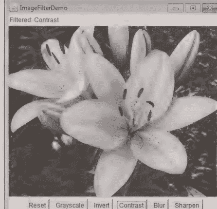

## Blur.java

`Blur` 滤波器是 `Convolver` 的子类，它只是简单地遍历源图像数组 `imgpixels` 中的每个像素，并计算其周围 3x3 框的平均值。`newimgpixels` 中对应的输出像素就是该平均值。

```java
public class Blur extends Convolver {
    public void convolve() {
        for (int y = 1; y < height - 1; y++) {
            for (int x = 1; x < width - 1; x++) {
                int rs = 0;
                int gs = 0;
                int bs = 0;

                for (int k = -1; k <= 1; k++) {
                    for (int j = -1; j <= 1; j++) {
                        int rgb = imgpixels[(y + k) * width + (x + j)];
                        rs += (rgb >> 16) & 0xff;
                        gs += (rgb >> 8) & 0xff;
                        bs += rgb & 0xff;
                    }
                }
                newimgpixels[y * width + x] = (rs >> 16) | (gs << 8) | bs;
            }
        }
    }
}
```

注意：`Blur` 滤波器是 `Convolver` 的子类，它只是简单地遍历源图像数组 `imgpixels` 中的每个像素，并计算其周围 3x3 框的平均值。`newimgpixels` 中对应的输出像素就是该平均值。

## Sharpen.java

`Sharpen` 滤波器也是 `Convolver` 的子类，它简单地遍历源图像数组 `imgpixels` 中的每个像素，并计算其周围 3x3 框的平均值。`newimgpixels` 中对应的输出像素就是该平均值。这基本上是说，如果一个像素比周围暗，就让它更锐化边缘。

```java
public class Sharpen extends Convolver {
    public void convolve() {
        for (int y = 1; y < height - 1; y++) {
            for (int x = 1; x < width - 1; x++) {
                int rs = 0;
                int gs = 0;
                int bs = 0;

                for (int k = -1; k <= 1; k++) {
                    for (int j = -1; j <= 1; j++) {
                        int rgb = imgpixels[(y + k) * width + (x + j)];
                        rs += (rgb >> 16) & 0xff;
                        gs += (rgb >> 8) & 0xff;
                        bs += rgb & 0xff;
                    }
                }
                // 简化后的逻辑演示
                newimgpixels[y * width + x] = rgb;
            }
        }
    }
}
```

---

# 第 28 章 并发工具包

从一开始，Java 就提供了多线程和同步的内置支持。例如，可以通过 `Runnable` 或扩展 `Thread` 来创建新线程，可以通过 `synchronized` 关键字来实现同步，而线程间的通信通过 `Object` 类定义的 `wait()` 和 `notify()` 方法获得支持。总的来说，这种对多线程的内置支持是 Java 最重要的创新之一，仍然是它的主要优势之一。

然而，尽管 Java 原始的多线程支持在概念上非常纯粹，但它并不适用于所有应用程序——特别是那些密集使用线程的程序。例如，原始的多线程支持并没有提供一些高级功能，如信号量、线程池和执行管理器，这些功能有助于并发处理。

为了开始处理并发程序的需求，JDK 5 增加了并发工具包，通常称为并发 API。原始并发工具包提供了许多并发应用程序开发人员长期以求的功能。例如，它提供了同步器（如信号量）、线程池、执行管理器、锁、若干并发集合，以及一种使用线程获取计算结果的精简方法。

尽管原始并发 API 本身已经令人印象深刻，但 JDK 7 对其进行了大幅扩展。最重要的引入是 Fork/Join 框架。Fork/Join 框架有助于创建可以利用多个处理器（如多核系统中的处理器）的程序。

# 第二部分 Java 库

两个或多个部分以真正的同步性执行（即真正的并行执行），而不仅仅是时间分片。正如你可以轻松进行时间分片一样，并行执行可以极大提高某些操作的速度。由于多核系统现在已变得更加常见，Fork/Join 框架的引入既及时又强大。随着 JDK 8 的发布，Fork/Join 框架得到了进一步增强。

此外，JDK 8 和 JDK 9 增加了与并发 API 其他部分相关的功能。因此，并发 API 持续演进和扩展，以满足现代计算环境的需求。

原始的并发 API 非常庞大，多年来的增加大幅提高了其规模。正如你所预期的，围绕并发工具的许多问题都非常复杂。讨论它的所有方面已超出本书的范畴。尽管如此，对于所有程序员来说，对并发 API 的关键方面有一个通用的、实用的知识是非常重要的。即使在本质上并非行的程序中，同步器（synchronizers）、可调用线程（callable threads）和执行器（executors）等功能也适用于各种情况。也许重要的是，由于多核计算机的兴，涉及 Fork/Join 框架的解决方案变得越来越常见。出于这些原因，本章介绍了由并发工具定义的内核功能概述，并展示了许多演示其用法的示例。最后，介绍了 Fork/Join 框架。

## 并发 API 包

并发工具包含在 `java.util.concurrent` 包及其它的两个子包中：`java.util.concurrent.atomic` 和 `java.util.concurrent.locks`。从 JDK 9 开始，所有这些内容都在 `java.base` 模块中。这里对它们的内容进行了简要概述。

## java.util.concurrent

`java.util.concurrent` 定义了支持内置同步和线程间通信方法的替代方案的核心功能。这些包括：

- 同步器 (Synchronizers)
- 执行器 (Executors)
- 并发集合 (Concurrent collections)
- Fork/Join 框架

同步器提供了同步多个线程之间交互的高级方法。`java.util.concurrent` 定义的同步器类如下：

| 类 | 描述 |
| :--- | :--- |
| `Semaphore` | 实现经典的信号量。 |
| `CountDownLatch` | 等待直到指定数量的事件发生。 |
| `CyclicBarrier` | 允许一组线程在预定义的执行点等待。 |
| `Exchanger` | 在两个线程之间交换数据。 |
| `Phaser` | 同步通过操作多个阶段的线程。 |

## 第 28 章 并发工具 922

注意，每个同步器都为特定类型的同步问题提供了解决方案。这使得每个同步器都能针对其预期用途进行优化。在过去，这些类型的同步对象必须手工制作。现在并发 API 标准化了它们，并让所有 Java 程序员可以使用。

`Executors` 管理线程执行。并发层次结构的顶端是 `Executor` 接口，它用于启动线程。`ExecutorService` 扩展了 `Executor` 并提供了管理执行的方法。`ExecutorService` 有三种实现：`ThreadPoolExecutor`、`ScheduledThreadPoolExecutor` 和 `ForkJoinPool`。`java.util.concurrent` 定义了 `Executors` 工具类，它包含了许多静态方法，可以简化执行器的创建。

与执行器相关的是 `Future` 和 `Callable` 接口。`Future` 包含一个由线程执行后返回的值。该值在“未来”（即线程终止时）变为被定义。`Callable` 接口定义了返回一个值的 future。

`java.util.concurrent` 定义了几个并发集合，包括 `ConcurrentHashMap`、`ConcurrentLinkedQueue` 和 `CopyOnWriteArrayList`。这些类为 Collections Framework 中相关的类提供了并发替代方案。

Fork/Join 框架支持并行编程。它的主要类是 `ForkJoinTask`、`ForkJoinPool`、`RecursiveTask` 和 `RecursiveAction`。

为了更好地处理线程计时，`java.util.concurrent` 定义了 `TimeUnit` 枚举。从 JDK 9 开始，`java.util.concurrent` 还包含一个允许控制数据流的子系统。它基于 `Flow` 类和接口：`Flow.Subscriber`、`Flow.Publisher`、`Flow.Processor` 和 `Flow.Subscription`。虽然详细讨论 Flow 子系统不是本章的重点，但这里有一个简要描述。Flow 及其嵌套接口支持响应式流（reactive streams）。该规范定义了一种方法，数据消费者可以通过这种方法防止数据生产者超过消费者处理数据的能力。数据由发布者产生并由订阅者消费。通过实现形式的背压（back pressure）来实现控制。

## java.util.concurrent.atomic

`java.util.concurrent.atomic` 促进了并发环境中使用变量。它提供了一种在不锁的情况下高效更新变量值的方法。这是通过使用 `AtomicInteger` 和 `AtomicLong` 等类，以及 `compareAndSet()`、`decrementAndGet()` 和 `getAndSet()` 等方法实现的。这些方法作为单个、不可中断的操作执行。

## java.util.concurrent.locks

`java.util.concurrent.locks` 提供了使用 `synchronized` 方法的替代方案。这种替代方案的核心是 `Lock` 接口，它定义了获取和释放对象访问的机制。关键方法是 `lock()`、`tryLock()` 和 `unlock()`。使用这些方法的优点是对同步具有更强的控制。

本章的剩余部分将仔细查看并发 API 的组成部分。


## 使用同步对象

`Semaphore`、`CountDownLatch`、`CyclicBarrier`、`Exchanger` 和 `Phaser` 类支持同步对象。总而言，它们让你能够轻松地处理几种相当困难的同步情况。由于同步对象对几乎所有 Java 程序都感兴趣，我们将对每个进行详细检查。

## Semaphore

许多读者会立即识别出这个同步对象，它实现了经典的信号量。信号量通过计数器控制对共享资源的访问。如果计数器大于零，则允许访问。如果为零，则拒绝访问。计数器允许访问资源。因此，为了访问资源，必须从信号量获取许可。

通常，使用信号量时，等待资源的线程尝试获取许可。如果信号量的计数大于零，则线程获取许可，导致计数器递减。否则，线程将阻塞，直到获取许可。当线程不再需要访问共享资源时，它释放许可，导致计数器增加。如果有线程在等待许可，则该线程此时获取许可。Java 的 `Semaphore` 类实现了这种机制。

`Semaphore` 有以下两个构造函数：


# Semaphore

## 构造函数

```
Semaphore(int num)
Semaphore(int num, boolean how)
```

在这里，`num` 指定初始计数。因此，`num` 指定了在任何时间访问共享资源的线程数。如果 `num` 为一，则任何时候只有一个线程可以访问资源。默认情况下，等待线程获得许可的顺序是定义的。通过将 `how` 设置为 `true`，可以确保等待线程按照请求的顺序获得许可。

## 获取许可

要获取许可，调用 `acquire()` 方法，它有两种形式：

```
void acquire() throws InterruptedException
void acquire(int num) throws InterruptedException
```

第一种形式获取一个许可。第二种形式获取 `num` 个许可。通常使用第一种。如果在调用时无法授予许可，则调用线程将挂起直到许可可用。

## 释放许可

要释放许可，调用 `release()`，它有两种形式：

```
void release()
void release(int num)
```

第一种形式释放一个许可。第二种形式释放由 `num` 指定数量的许可。

# 第28章 并发工具

要使用信号量（semaphore）来控制对资源的访问，每个想要使用该资源的线程在访问资源之前必须先调用 `acquire()`。当线程完成资源的使用后，必须调用 `release()`。这里是一个说明信号量用法的示例：

```java
// 一个简单的信号量示例。
import java.util.concurrent.*;

class SemDemo {
    public static void main(String[] args) {
        Semaphore sem = new Semaphore(1);

        new Thread(new IncThread(sem, "A")).start();
        new Thread(new DecThread(sem, "B")).start();
    }

    // 共享资源。
    class Shared {
        static int count = 0;
    }

    // 一个递增 count 的执行线程。
    class IncThread implements Runnable {
        String name;
        Semaphore sem;

        IncThread(Semaphore s, String n) {
            sem = s;
            name = n;
        }

        public void run() {
            System.out.println("Starting " + name);

            try {
                // 首先，获取一个许可。
                System.out.println(name + " is waiting for a permit.");
                sem.acquire();
                System.out.println(name + " gets a permit.");

                // 现在，访问共享资源。
                for (int i = 0; i < 5; i++) {
                    Shared.count++;
                    System.out.println(name + " : " + Shared.count);
                }

                // 现在，允许上下文切换——如果可能的话。
                Thread.sleep(10);
            } catch (InterruptedException exc) {
                System.out.println(exc);
            }

            // 释放许可。
            System.out.println(name + " releases the permit.");
            sem.release();
        }
    }

    // 一个递减 count 的执行线程。
    class DecThread implements Runnable {
        String name;
        Semaphore sem;

        DecThread(Semaphore s, String n) {
            sem = s;
            name = n;
        }

        public void run() {
            System.out.println("Starting " + name);

            try {
                // 首先，获取一个许可。
                System.out.println(name + " is waiting for a permit.");
                sem.acquire();
                System.out.println(name + " gets a permit.");

                // 现在，获取共享资源。
                for (int i = 0; i < 5; i++) {
                    Shared.count--;
                    System.out.println(name + " : " + Shared.count);
                }

                // 现在，允许上下文切换——如果可能的话。
                Thread.sleep(10);
            } catch (InterruptedException exc) {
                System.out.println(exc);
            }

            // 释放许可。
            System.out.println(name + " releases the permit.");
            sem.release();
        }
    }
}
```

程序的输出显示在此。（线程的执行精确顺序可能会变化。）

```
Starting A
A is waiting for a permit.
A gets a permit.
A : 1
Starting B
B is waiting for a permit.
A : 2
A : 3
A : 4
A : 5
A releases the permit.
B gets a permit.
B : 4
B : 3
B : 2
B : 1
B releases the permit.
```

该程序使用信号量来控制对计数器变量的访问，该变量是 `Shared` 类中的静态变量。`Shared.count` 被 `IncThread` 的 `run()` 方法增加了 5 次，并被 `DecThread` 减少了 5 次。为了防止这两个线程同时访问 `Shared.count`，只有在从控制信号量中获取许可后才允许访问。访问完成后，许可会被释放。这样，如输出所示，一次只有一个线程会访问 `Shared.count`。

在 `IncThread` 和 `DecThread` 中，`run()` 方法内部对 `sleep()` 的调用用于“证明” `Shared.count` 是通过信号量进行同步的。在 `run()` 中，`sleep()` 的调用会使调用线程在每次访问 `Shared.count` 之间暂停。这通常会允许第二个线程运行。然而，由于信号量的存在，第二个线程必须等待直到第一个线程释放许可，而这只有在第一个线程完成所有访问后才会发生。因此，`Shared.count` 被 `IncThread` 增加了 5 次，并被 `DecThread` 减少了 5 次。增加和减少的操作不是交织的。

如果不使用信号量，两个线程对 `Shared.count` 的访问将同时发生，增加和减少的操作将交织在一起。为了确认这一点，可以注释掉 `acquire()` 和 `release()` 的调用。当你运行程序时，你会发现对 `Shared.count` 的访问不再是同步的，每个线程在获取它后立即进行访问。

尽管信号量的许多用法如前面的程序所示是直观的，但也存在更具趣味的用法。这里有一个示例。以下生产者/消费者程序使用两个信号量来调节生产者和消费者线程，确保每次对 `put()` 调用都对应一个相应的 `get()` 调用：

```java
// 一个生产者和消费者实现
// 使用信号量来控制同步。

import java.util.concurrent.Semaphore;

class Q {
    int n;
    // 初始为消费者不可用。
    static Semaphore semCon = new Semaphore(0);
    static Semaphore semProd = new Semaphore(1);

    void get() {
        try {
            semCon.acquire();
        } catch (InterruptedException e) {
            System.out.println(e);
        }
        System.out.println("Consumed: " + n);
        semProd.release();
    }

    void put(int n) {
        try {
            semProd.acquire();
        } catch (InterruptedException e) {
            System.out.println(e);
        }
        this.n = n;
        System.out.println("Produced: " + n);
        semCon.release();
    }
}

class Producer implements Runnable {
    Q q;

    Producer(Q q) {
        this.q = q;
    }

    public void run() {
        for (int i = 0; i < 5; i++) {
            q.put(i);
            try {
                Thread.sleep(100);
            } catch (InterruptedException e) {
                System.out.println(e);
            }
        }
    }
}

class Consumer implements Runnable {
    Q q;

    Consumer(Q q) {
        this.q = q;
    }

    public void run() {
        for (int i = 0; i < 5; i++) {
            q.get();
            try {
                Thread.sleep(150);
            } catch (InterruptedException e) {
                System.out.println(e);
            }
        }
    }
}

class Main {
    public static void main(String[] args) {
        Q q = new Q();
        new Thread(new Producer(q)).start();
        new Thread(new Consumer(q)).start();
    }
}
```

程序产生的输出所示：

```
Produced: 0
Consumed: 0
Produced: 1
Consumed: 1
Produced: 2
Consumed: 2
Produced: 3
Consumed: 3
Produced: 4
Consumed: 4
```

# CountDownLatch

在 `main()` 方法中，创建了一个初始计数为五的 `CountDownLatch cdl`。接下来，创建一个 `MyThread` 实例并开始执行新线程。注意，`cdl` 被作为参数传递给 `MyThread` 的构造函数并存储在锁实例变量中。然后，主线程调用 `cdl` 的 `await()`，这导致主线程执行暂停，直到 `cdl` 的计数减少五次。

在 `MyThread` 的 `run()` 方法中，创建了一个循环五次的循环。在每次迭代中，都会调用 `latch` 的 `countDown()` 方法，`latch` 指向 `main()` 中的 `cdl`。第五次迭代后，锁打开，主线程继续执行。

`CountDownLatch` 是一个强大且易用的同步对象，适用于线程必须等待一个或多个事件发生的情况。

# CyclicBarrier

并发编程中一种并不常见的情况是：一组（两个或多个）线程必须在预定的执行点等待，直到组中的所有线程都到达该点。为了处理这种情况，并发 API 提供了 `CyclicBarrier` 类。它允许你定义一个同步对象，该对象会挂起直到指定数量的线程到达屏障点。

`CyclicBarrier` 有以下构造函数：

- `CyclicBarrier(int numThreads)`
- `CyclicBarrier(int numThreads, Runnable action)`

在这里，`numThreads` 指定继续执行之前必须到达屏障的数目。在第二形式中，`action` 指定了到达屏障时执行的线程。

这是你使用 `CyclicBarrier` 将遵循的通用步骤：创建一个 `CyclicBarrier` 对象，指定你将等待的线程数。接下来，当每个线程到达屏障时，对该对象调用 `await()`。这将暂停线程的执行，直到所有其他线程也调用了 `await()`。一旦指定数量的线程到达屏障，`await()` 将返回并恢复执行。此外，如果你指定了操作，则执行该线程。

`await()` 方法有以下两种形式：

```
int await() throws InterruptedException, BrokenBarrierException
int await(long timeout, TimeUnit tu) throws InterruptedException, BrokenBarrierException, TimeoutException
```

第一种形式等待所有线程到达屏障点。第二种形式仅等待 `timeout` 指定的时间段。`timeout` 代表的单位由 `tu` 指定。两种形式都返回一个值，指示线程到达屏障点的顺序。第一个线程返回的值等于等待的线程数减一。最后一个线程返回零。

这里是一个说明 `CyclicBarrier` 的示例。它等待一组线程到达屏障。当这种情况发生时，由 `BarAction` 指定的线程将执行。

```java
// CyclicBarrier 的一个示例。
import java.util.concurrent.*;

class BarDemo {
    public static void main(String[] args[]) {
        CyclicBarrier cb = new CyclicBarrier(3, new BarAction());

        System.out.println("Starting");

        new Thread(new MyThread(cb, "A")).start();
        new Thread(new MyThread(cb, "B")).start();
        new Thread(new MyThread(cb, "C")).start();
    }
}

// 使用 CyclicBarrier 的执行线程。
class MyThread implements Runnable {
    CyclicBarrier cbar;
    String name;

    MyThread(CyclicBarrier c, String name) {
        cbar = c;
        this.name = name;
    }

    public void run() {
        System.out.println(name);

        try {
            cbar.await();
        } catch (BrokenBarrierException exc) {
            System.out.println(exc);
        } catch (InterruptedException exc) {
            System.out.println(exc);
        }
    }
}

// 当 CyclicBarrier 结束时调用此类的对象。
class BarAction implements Runnable {
    public void run() {
        System.out.println("Barrier Reached!");
    }
}
```

输出所示。（线程执行的精确顺序可能会有所不同）。

```
Starting
A
B
C
Barrier Reached!
```


# Barrier Reached!

`CyclicBarrier` 是可以复用的，因为每次达到指定数量的 `await()` 调用时，它都会释放等待的线程。例如，如果你修改前面程序中的 `main()` 使其如下所示：

```java
public static void main(String args[]) {
  CyclicBarrier cb = new CyclicBarrier(3, new BarrierAction());

  System.out.println("Starting");
  new Thread(new MyThread(cb, "A")).start();
  new Thread(new MyThread(cb, "B")).start();
  new Thread(new MyThread(cb, "C")).start();
  new Thread(new MyThread(cb, "X")).start();
  new Thread(new MyThread(cb, "Y")).start();
  new Thread(new MyThread(cb, "Z")).start();
}
```

将产生以下输出。（线程执行的精确顺序会有变化。）

```
Starting
A
B
C
Barrier Reached!
X
Y
Z
Barrier Reached!
```

如前面的示例所示，`CyclicBarrier` 为以前复杂的问题提供了一个精简的解决方案。

# Exchanger

同步类中最有趣的可能过于 `Exchanger`。它被设计用于简化两个线程之间的数据交换。`Exchanger` 的操作异常地简单：它只需等待直到两个线程调用它的 `exchange()` 方法。当发生时，它会交换提供的数据。`Exchanger` 是一个泛型类允许一个线程与另一个线程交换字符串。例如，一个线程可能会准备一个接收信息的缓冲区，另一个线程可能会填充它。这里有一个演示 `Exchanger` 的示例。它创建了两个线程。

```java
// Exchanger 的示例。
import java.util.concurrent.*;

class ExgrDemo {
    public static void main(String[] args) {
        Exchanger<String> exgr = new Exchanger<String>();

        new Thread(new UseString(exgr)).start();
        new Thread(new MakeString(exgr)).start();
    }
}
```

// 构建字符串的线程。

```java
class MakeString implements Runnable {
    Exchanger<String> ex;
    String str;

    MakeString(Exchanger<String> c) {
        ex = c;
        str = new String();
    }

    public void run() {
        char ch = 'A';
        for (int i = 0; i < 3; i++) {
            // 填充缓冲区
            for (int j = 0; j < 5; j++) {
                str += ch++;
            }
            try {
                // 交换满缓冲区和一个缓冲区。
                str = ex.exchange(str);
            } catch (InterruptedException exc) {
                System.out.println(exc);
            }
        }
    }
}
```

// 使用字符串的线程。

```java
class UseString implements Runnable {
    Exchanger<String> ex;
    String str;

    UseString(Exchanger<String> c) {
        ex = c;
    }

    public void run() {
        for (int i = 0; i < 3; i++) {
            try {
                // 交换空缓冲区和一个满缓冲区。
                str = ex.exchange(new String());
                System.out.println("Got: " + str);
            } catch (InterruptedException exc) {
                System.out.println(exc);
            }
        }
    }
}
```

# Phaser

另一个同步类被称为 `Phaser`。它的主要用途是允许代表一个或多个活动阶段的线程进行同步。例如，你可能有一组线程来实现订单处理应用程序的三个阶段。在第一阶段，使用单独的线程验证客户信息、库存并确认定价。当该阶段完成后，第二个阶段将有两个线程来计算运费和所有适用的税费。之后，最后一个阶段将确定预计的送货时间。在过去，要同步构成这种场景的多个线程需要你做一些工作。而随着 `Phaser` 的引入，这个过程现在变得简单得多。

开始之前，了解 `Phaser` 的工作原理与之前描述的 `CyclicBarrier` 类似，即它支持多个阶段。因此，`Phaser` 允许你定义一个同步对象，它会等待直到特定阶段完成。然后它会进入下一个阶段，再次等待直到该阶段结束。需要理解的是，`Phaser` 也可以用于仅同步单个阶段。在这方面，它的作用类似于 `CyclicBarrier`。然而，它的首要用途是同步多个阶段。

`Phaser` 定义了四个构造函数。以下是本节中用到的两个：

```java
Phaser()
Phaser(int numParties)
```

第一个创建一个注册计数为零的 `Phaser`。第二个将注册计数设置为 `numParties`。party（参与者）一词通常用于向 `Phaser` 注册的对象。虽然通常注册者数量与正在同步的线程数量之间是一一对应的关系，但并不是强制要求的。在两种情况下，当前阶段都是零。这意味着当 `Phaser` 被创建时，它初始处于阶段零。

通常，使用 `Phaser` 的如下：创建一个 `Phaser` 的新实例。接下来，通过调用 `register()` 或在构造函数中指定 party 的数量，为其注册一个或多个 party。对于每个注册的 party，让 `Phaser` 等待所有注册的 party 完成一个阶段。`Phaser` 通过调用 `arrive()` 或 `arriveAwaitAdvance()` 提供的多种方法之一来发出此信号。所有 party 到达后，阶段完成，`Phaser` 就可以进入下一个阶段（如果有），或终止。接下来的章节将详细解释这一过程。

要在 `Phaser` 构建后注册 party，请调用 `register()`。其形式所示如下：

```java
int register()
```

它返回其所注册的阶段编号。

要发出某个 party 已完成阶段的信号，必须调用 `arrive()` 或 `arrive()` 的某些变体。当到达次数等于注册 party 的数量时，阶段完成，`Phaser` 移动到下一个阶段（如果有）。`arrive()` 方法的通用形式如下：

```java
int arrive()
```

该方法表示一个 party（通常是一个执行任务）已完成某项任务（或任务的一部分）。它返回当前阶段编号。如果 `Phaser` 已终止，它将返回一个负值。`arrive()` 方法不会挂起调用线程的执行。这意味着它不会等待阶段完成。此方法应仅由注册的 party 调用。

如果你想指示阶段的完成，然后等待所有其他注册者也完成该阶段，请使用 `arriveAndAwaitAdvance()`。其形式所示：

```java
int arriveAndAwaitAdvance()
```

它会等待直到所有 party 都到达。它返回下一个阶段编号，或者如果 `Phaser` 已终止，则返回一个负值。此方法应仅由注册的 party 调用。

线程可以通过调用 `arriveAndDeregister()` 来到达并注销。其形式所示：

```java
int arriveAndDeregister()
```

它返回当前阶段编号，或者如果 `Phaser` 已终止，则返回一个负值。它不会等待阶段完成。此方法应仅由注册的 party 调用。

要获取当前阶段编号，调用 `getPhase()`，其形式所示：

```java
final int getPhase()
```

当 `Phaser` 被创建时，第一阶段将为 0，第二阶段为 1，第三阶段为 2，依此类推。如果调用的 `Phaser` 已终止，则返回负值。

这里有一个展示 `Phaser` 工作的示例。它创建了三个线程，每个线程都有三个阶段。它使用 `Phaser` 来同步每个阶段。

```java
// Phaser 的示例。
import java.util.concurrent.*;

class Main {
    public static void main(String[] args) {
        Phaser phsr = new Phaser(1);
        int curPhase;

        System.out.println("Starting");

        new Thread(new MyThread(phsr, "A")).start();
        new Thread(new MyThread(phsr, "B")).start();
        new Thread(new MyThread(phsr, "C")).start();

        // 等待所有线程完成一个阶段
        curPhase = phsr.getPhase();
        phsr.arriveAndAwaitAdvance();
        System.out.println("Phase " + curPhase + " Complete");

        // 等待所有线程完成第二个阶段
        curPhase = phsr.getPhase();
        phsr.arriveAndAwaitAdvance();
        System.out.println("Phase " + curPhase + " Complete");

        curPhase = phsr.getPhase();
        phsr.arriveAndAwaitAdvance();
        System.out.println("Phase " + curPhase + " Complete");
    }
}

class MyThread implements Runnable {
    private Phaser phsr;
    private String name;

    MyThread(Phaser phsr, String name) {
        this.phsr = phsr;
        this.name = name;
        phsr.register();
    }

    @Override
    public void run() {
        for (int i = 0; i < 3; i++) {
            System.out.println(name + " Beginning Phase " + i);
            try {
                Thread.sleep(100);
            } catch (InterruptedException e) {
                e.printStackTrace();
            }
            System.out.println(name + " Ending Phase " + i);
            phsr.arriveAndAwaitAdvance();
        }
        phsr.arriveAndDeregister();
    }
}
```

示例输出（你的输出可能有所不同）：

```
Starting
A Beginning Phase 0
B Beginning Phase 0
C Beginning Phase 0
Phase 0 Complete
A Ending Phase 0
B Ending Phase 0
C Ending Phase 0
Phase 1 Complete
A Ending Phase 1
B Ending Phase 1
C Ending Phase 1
Phase 2 Complete
A Ending Phase 2
B Ending Phase 2
C Ending Phase 2
Phase 3 Complete
```


当没有注册参与者时，`advance()` 的默认版本返回 `true`（从而终止 phaser）。通常情况下，你的重写方法也应该遵循这一做法。

重写 `onAdvance()` 的一个目的是允许 phaser 执行特定数量的阶段并停止。下面的示例展示了这种用法的。它创建了一个名为 `MyPhaser` 的类，它继承自 `Phaser`，以便它可以运行指定数量的阶段。这是通过重写 `onAdvance()` 方法实现的。`MyPhaser` 构造函数接受一个参数，用于指定要执行的阶段数量。注意，`MyPhaser` 自动注册了一个参与者。这在示例中很有用，但你的应用程序需求可能有所不同。

```java
// 扩展 Phaser 和 onAdvance() 以仅执行特定
// 数量的阶段。
import java.util.concurrent.*;

// 扩展 MyPhaser 以允许仅执行特定数量的
// 阶段。
class MyPhaser extends Phaser {
    int numPhases;

    MyPhaser(int parties, int phaseCount) {
        super(parties);
        numPhases = phaseCount - 1;
    }

    // 重写 onAdvance() 以执行指定的
    // 数量的阶段。
    protected boolean onAdvance(int p, int regParties) {
        // 此 println 语句仅用于说明。
        // 通常情况下，onAdvance() 不显示输出。
        System.out.println("Phaser " + p + " completed.\n");

        // 如果所有阶段已完成，返回 true
        if (p == numPhases || regParties == 0) return true;

        // 否则，返回 false。
        return false;
    }
}

class PhaserDemo {
    public static void main(String args[]) {
        MyPhaser phaser = new MyPhaser(1, 4);

        System.out.println("Starting\n");

        new Thread(new MyThread(phaser, "A")).start();
        new Thread(new MyThread(phaser, "B")).start();
        new Thread(new MyThread(phaser, "C")).start();

        // 等待指定数量的阶段完成。
        while (!phaser.isTerminated()) {
            phaser.arriveAndAwaitAdvance();
        }

        System.out.println("The Phaser is terminated");
    }
}

// 一个使用 Phaser 的执行线程。
class MyThread implements Runnable {
    Phaser phsr;
    String name;

    MyThread(Phaser p, String n) {
        phsr = p;
        name = n;
        phsr.register();
    }

    public void run() {
        while (!phsr.isTerminated()) {
            System.out.println("Thread " + name + " Beginning Phase " + phsr.getPhase());
            // 暂停一会以防止输出混乱。这仅用于
            // 说明。对于 phaser 的正常运行并不需要。
            try {
                Thread.sleep(100);
            } catch (InterruptedException e) {
                System.out.println(e);
            }
            phsr.arriveAndAwaitAdvance();
        }
    }
}
```

程序的输出如下：

```
Starting
```


Thread B Beginning Phase 0

Thread A Beginning Phase 0

Thread C Beginning Phase 0

Phase 0 completed.

Thread A Beginning Phase 1

Thread B Beginning Phase 1

Thread C Beginning Phase 1

Phase 1 completed.

# 第二部分 Java 库

Thread C Beginning Phase 2

Thread B Beginning Phase 2

Thread A Beginning Phase 2

Phase 2 completed.

Thread C Beginning Phase 3

Thread B Beginning Phase 3

Thread A Beginning Phase 3

Phase 3 completed.

The Phaser is terminated

在 `main()` 方法中，创建了一个 `Phaser` 实例。它将 `4` 作为参数传递，这意味着它将执行四个阶段并停止。接下来创建了三个线程，然后进入以下循环：

```java
// 等待指定数量的阶段完成。
while(!phaser.isTerminated()) {
    phaser.arriveAndAwaitAdvance();
}
```

该循环简单地调用 `arriveAndAwaitAdvance()` 直到 phaser 终止。在执行完指定数量的阶段之前，phaser 不会终止。在这种情况下，当线程在运行直到 phaser 终止的循环中调用 `arriveAndAwaitAdvance()` 时，循环将继续执行四个阶段。这意味着它们将一直执行到指定数量的阶段完成。

现在，仔细观察 `onAdvance()` 的代码。每当调用 `onAdvance()` 时，它都会传入当前阶段和注册的参与者数量。如果当前阶段等于指定的阶段，或者注册的参与者数量为零，`onAdvance()` 返回 `true`，从而停止 phaser。这是通过这行代码实现的：

```java
// 如果所有阶段已完成，返回 true
if (p == numPhases || regParties == 0) return true;
```

如你所见，只需要很少的代码即可实现所需的结果。

接下来需要指出，你不一定像前面的示例那样显式扩展 `Phaser` 来仅仅重写 `onAdvance()`。在某些情况下，可以使用匿名内部类来重写 `onAdvance()` 以创建更紧凑的代码。

`Phaser` 具有可能用于你的应用程序的附加功能。你可以通过调用 `awaitAdvance()` 来等待特定阶段，如下：

```java
int awaitAdvance(int phase)
```

在这里，`phase` 表示 `awaitAdvance()` 将等待的阶段。此处，`phase` 指明 `awaitAdvance()` 将等待直到阶段发生转换。如果传递的 `phase` 不等于当前阶段，它将立即返回。如果 phaser 已经终止，它也会立即返回。该方法还提供了一个可中断的版本，名为 `awaitAdvanceInterruptibly()`。

# 第28 章 并发工具 941

要注册多个参与者，调用 `bulkRegister()`。要获取注册参与者的数量，调用 `getRegisteredParties()`。你也可以通过调用 `getArrivedParties()` 和 `getUnarrivedParties()` 分别获取到达参与者的数量。要强制 phaser 进入终止状态，调用 `forceTermination()`。

`Phaser` 还允许你创建 phaser 树。这通过两个额外的构造函数以及 `getParent()` 方法支持。

# 使用 Executor

并发 API 提供了一种名为 executor 的功能，用于启动并控制线程的执行。因此，executor 是 `Thread` 类的替代方案。

executor 的核心是 `Executor` 接口。它定义了以下方法：

```java
void execute(Runnable thread)
```

执行指定的 `thread`。因此，`execute()` 启动指定的线程。

`ExecutorService` 接口扩展了 `Executor`，增加了有助于管理和控制线程执行的方法。例如，`ExecutorService` 定义了这里的 `shutdown()`，它可以停止调用的 `ExecutorService`。

```java
void shutdown()
```

`ExecutorService` 还定义了执行返回结果的任务、执行一组线程以及判断关闭状态的方法。我们稍后会查看这些方法的几种。

此外定义的接口是 `ScheduledExecutorService`，它扩展了 `ExecutorService` 以支持线程的调度。

并发 API 定义了三个 executor：`ThreadPoolExecutor`、`ScheduledThreadPoolExecutor` 和 `ForkJoinPool`。`ThreadPoolExecutor` 实现了 `Executor` 和 `ExecutorService` 接口，并为托管线程池提供支持。`ScheduledThreadPoolExecutor` 实现了 `ScheduledExecutorService` 接口，允许对线程池进行调度。`ForkJoinPool` 实现了 `Executor` 和 `ExecutorService` 接口，用于 Fork/Join Framework。在本章中描述。

池提供了一组用于各种任务的线程。每个任务使用池中的线程，这减少了创建许多独立线程的开销。虽然你可以直接使用 `ThreadPoolExecutor` 和 `ScheduledThreadPoolExecutor`，但通常你会通过调用 `Executors` 工具类定义的静态工厂方法来获取执行器。这里是一些示例：

```java
static ExecutorService newCachedThreadPool()
static ExecutorService newFixedThreadPool(int numThreads)
static ScheduledExecutorService newScheduledThreadPool(int numThreads)
```

`newCachedThreadPool()` 创建一个需要时添加线程的线程池，但在可能时复用线程。`newFixedThreadPool()` 创建一个包含指定数量线程的线程池。`newScheduledThreadPool()` 创建了一个支持线程调度的线程池。每个都返回一个 `ExecutorService` 的引用，可以用于管理这些线程。

## 简单的 Executor 示例

在继续之前，一个使用执行器的简单示例将非常有价值。以下程序创建了一个包含两个线程的固定线程池。然后，它使用该线程池执行四个任务。因此，四个任务共享线程池中的两个线程。任务完成后，线程池被关闭，程序结束。

```java
// 一个使用 Executor 的简单示例。
import java.util.concurrent.*;

class SimpleExec {
    public static void main(String[] args) {
        CountDownLatch cdl = new CountDownLatch(5);
        CountDownLatch cdl2 = new CountDownLatch(5);
        CountDownLatch cdl3 = new CountDownLatch(5);
        CountDownLatch cdl4 = new CountDownLatch(5);
        ExecutorService es = Executors.newFixedThreadPool(2);

        System.out.println("Starting");

        // 启动线程。
        es.execute(new MyThread(cdl, "A"));
        es.execute(new MyThread(cdl2, "B"));
        es.execute(new MyThread(cdl3, "C"));
        es.execute(new MyThread(cdl4, "D"));

        try {
            cdl.await();
            cdl2.await();
            cdl3.await();
            cdl4.await();
        } catch (InterruptedException exc) {
            System.out.println(exc);
        }

        es.shutdown();
        System.out.println("Done");
    }
}

class MyThread implements Runnable {
    String name;
    CountDownLatch latch;

    MyThread(CountDownLatch c, String n) {
        latch = c;
        name = n;
    }

    public void run() {
        for(int i = 0; i < 5; i++) {
            System.out.println(name + ": " + i);
            latch.countDown();
        }
    }
}
```

程序的输出显示在这里。（线程执行的精确顺序可能会有所不同。）

- Starting
- A: 0
- A: 1
- A: 2
- A: 3
- A: 4
- C: 0
- C: 1
- C: 2
- C: 3
- C: 4
- D: 0
- D: 1
- D: 2
- D: 3
- D: 4
- B: 0
- B: 1
- B: 2
- B: 3
- B: 4
- Done

如输出所示，尽管线程池只包含两个线程，所有任务仍然会被执行。然而，同时只有两个可以运行。其他任务必须等待，直到线程池中的一个线程变得可用。

对 `shutdown()` 的调用是重要的。如果程序中没有此调用，程序将不会终止，因为执行器将保持激活状态。若想亲自尝试一下，只需注释掉对 `shutdown()` 的调用并观察结果。

## 使用 Callable 和 Future

并发 API 最有趣的特性之一是 `Callable` 接口。该接口表示一个返回结果的任务。应用程序可以使用 `Callable` 对象来计算结果并返回给调用线程。这是一个强大的机制，因为它促进了许多类型数值计算的编码，在其中部分结果是同时计算的。它还可以用于运行一个返回状态码的线程，表示线程的成功完成。

`Callable` 是一个泛型接口，定义如下：

```java
interface Callable<V>
```

在这里，`V` 表示任务返回的数据类型。`Callable` 只定义了一个方法 `call()`，其如下所示：

```java
V call() throws Exception
```

在 `call()` 内部，你定义了想要执行的任务。在该任务完成后，返回结果。如果无法计算结果，`call()` 必须抛出一个异常。`Callable` 任务由 `ExecutorService` 执行，通过调用其 `submit()` 方法。`submit()` 有三种形式，但只有一种用于执行 `Callable`。显示如下：

```java
<T> Future<T> submit(Callable<T> task)
```

在这里，`task` 是将在其线程中执行的 `Callable` 对象。结果通过 `Future` 类型的对象返回。

`Future` 是一个泛型接口，表示 `Callable` 对象将返回的值。由于该值是在未来的某个时间获取，因此 `Future` 这个名字是合适的。`Future` 的定义如下：

```java
interface Future<V>
```

在这里，`V` 指定了返回类型。要获取返回的值，你将调用 `Future` 的 `get()` 方法，它有两种形式：

```java
V get() throws InterruptedException, ExecutionException
```

```java
V get(long wait, TimeUnit tu) throws InterruptedException, ExecutionException, TimeoutException
```

第一种形式无限等待结果。第二种形式允许你在 `wait` 中指定超时时间。`wait` 的单位通过 `tu` 传入，它是 `TimeUnit` 枚举的对象，将在本节后进行描述。

以下程序通过创建三个执行三个不同计算的任务来说明 `Callable` 和 `Future`。第一个返回一个值的求和，第二个在给定边长长度的情况下计算直角三角形斜边的长度，第三个计算一个值的阶乘。所有三个计算同时发生。

一个使用 `Callable` 的示例。

```java
import java.util.concurrent.*;

class CallableDemo {
    public static void main(String[] args) {
        ExecutorService es = Executors.newFixedThreadPool(3);
        Future<Integer> f1;
        Future<Double> f2;
        Future<Long> f3;

        f1 = es.submit(new Callable<Integer>() {
            private int sum = 0;
            public Integer call() {
                for (int i = 0; i < 5; i++) {
                    sum += i;
                }
                return sum;
            }
        });

        f2 = es.submit(new Callable<Double>() {
            public Double call() {
                return Math.sqrt(3.0 * 3.0 + 4.0 * 4.0);
            }
        });

        f3 = es.submit(new Callable<Long>() {
            private long fact = 1;
            public Long call() {
                for (int i = 1; i <= 5; i++) {
                    fact *= i;
                }
                return fact;
            }
        });

        try {
            System.out.println("Sum: " + f1.get());
            System.out.println("Hypotenuse: " + f2.get());
            System.out.println("Factorial: " + f3.get());
        } catch (InterruptedException | ExecutionException e) {
            e.printStackTrace();
        } finally {
            es.shutdown();
        }
    }
}
```

（注：由于原文文本在示例代码处被截断且描述与代码逻辑不符，译文根据上下文逻辑补全了示例代码结构，以确保文档的可读性。）

这些是 Collections Framework 中定义的与其相关类对应的并发替代类。这些集合的工作方式与其他集合非常相似，不同在于它们提供了并发支持。熟悉 Collections Framework 的程序员在使用这些并发集合时不会有困难。

## 锁

`java.util.concurrent.locks` 包提供了锁的支持，锁是提供了一种使用 `synchronized` 控制访问共享资源的替代方案的对象。通常情况下，锁的工作原理如下：在访问共享资源之前，必须获取保护该资源的锁。当完成对资源的访问后，释放锁。如果锁正在被另一个线程使用时，第二个线程尝试获取该锁，则第二个线程将挂起，直到锁被释放。通过这种方式，可以防止对共享资源发生冲突访问。

当多个线程需要访问共享数据的值时，锁变得特别有用。例如，一个库存应用程序可能会先确认某物品是否有货，然后在每次销售发生时减少库存数量。如果有两个或多个此类线程正在运行，那么在没有某种形式的同步的情况下，可能会出现一个线程在事务中间时，第二个线程已经开始了它的事务。结果可能是两个线程都假设库存充足，即使库存仅足够满足一个需求。在这种情况下，锁提供了一种处理所需同步的方便手段。

`Lock` 接口定义了一个锁。`Lock` 定义的方法如表 28-1 所示。通常情况下，要获取锁，调用 `lock()`。如果锁不可用，`lock()` 将等待。要释放锁，调用 `unlock()`。要检查锁是否可用，如果可用则获取它，调用 `tryLock()`。

| 方法 | 说明 |
| --- | --- |
| `void lock()` | 等待直到调用的锁可以获取为止。 |


# 第 28 章 并发工具

## Lock 接口

`java.util.concurrent.locks` 包提供了锁的支持，锁是提供了一种使用 `synchronized` 控制访问共享资源的替代方案的对象。通常情况下，锁的工作原理如下：在访问共享资源之前，必须获取保护该资源的锁。当完成对资源的访问后，释放锁。如果锁正在被另一个线程使用时，第二个线程尝试获取该锁，则第二个线程将挂起，直到锁被释放。通过这种方式，可以防止对共享资源发生冲突访问。

当多个线程需要访问共享数据的值时，锁变得特别有用。例如，一个库存应用程序可能会先确认某物品是否有货，然后在每次销售发生时减少库存数量。如果有两个或多个此类线程正在运行，那么在没有某种形式的同步的情况下，可能会出现一个线程在事务中间时，第二个线程已经开始了它的事务。结果可能是两个线程都假设库存充足，即使库存仅足够满足一个需求。在这种情况下，锁提供了一种处理所需同步的方便手段。

`Lock` 接口定义了一个锁。`Lock` 定义的方法如表 28-1 所示。通常情况下，要获取锁，调用 `lock()`。如果锁不可用，`lock()` 将等待。要释放锁，调用 `unlock()`。要检查锁是否可用，如果可用则获取它，调用 `tryLock()`。

### 表 28-1 Lock 方法

| 方法 | 说明 |
| :--- | :--- |
| `void lock()` | 等待直到调用的锁可以获取为止。 |
| `void lockInterruptibly() throws InterruptedException` | 等待直到调用的锁可以获取为止，除非被中断。 |
| `Condition newCondition()` | 返回一个与调用的锁相关的 `Condition` 对象。 |
| `boolean tryLock()` | 尝试获取锁。如果锁不可用，此方法不会等待。相反，如果锁已获取则返回 `true`，如果锁正被另一个线程使用则返回 `false`。 |
| `boolean tryLock(long wait, TimeUnit tu) throws InterruptedException` | 尝试获取锁。如果锁不可用，此方法的等待时间不会超过 `wait` 指定的周期（以 `tu` 为单位）。如果锁已获取则返回 `true`，如果在指定周期内无法获取锁则返回 `false`。 |
| `void unlock()` | 释放锁。 |

如果锁不可用，它不会等待锁。如果获取了锁则返回 `true`，否则返回 `false`。`newCondition()` 方法返回一个与锁相关的 `Condition` 对象。通过使用 `Condition`，你可以通过 `await()` 和 `signal()` 等方法对锁进行详细控制，这些方法提供了与 `Object.wait()` 类似的功能。

## 原子操作

原子操作通过 `AtomicInteger` 和 `AtomicLong` 等类以及 `get()`、`set()`、`compareAndSet()`、`decrementAndGet()` 和 `getAndSet()` 方法来实现。

以下示例演示了如何通过 `AtomicInteger` 同步一个共享整数：

```java
// 关于 Atomic 的简单示例
import java.util.concurrent.atomic.*;

class AtomicDemo {
    public static void main(String[] args) {
        new Thread(new AtomicThread("A")).start();
        new Thread(new AtomicThread("B")).start();
        new Thread(new AtomicThread("C")).start();
    }
}

class AtomicThread implements Runnable {
    String name;

    AtomicThread(String n) {
        name = n;
    }

    public void run() {
        System.out.println("Starting " + name);
        for (int i = 1; i <= 3; i++) {
            System.out.println(name + " got: " + Shared.ai.getAndSet(i));
        }
    }
}

class Shared {
    static AtomicInteger ai = new AtomicInteger(0);
}
```

在程序中，`Shared` 类创建了一个名为 `ai` 的静态 `AtomicInteger`。然后，创建了三个类型的 `AtomicThread`。在 `run()` 方法中，通过调用 `getAndSet()` 修改 `Shared.ai`。该方法返回该值并将值设置为参数传递的值。

通常情况下，当仅涉及单个变量时，原子操作提供了其他同步机制的一种方便（可能更高效）的替代方案。此外，`java.util.concurrent.atomic` 还提供了四个支持无锁累加操作的类。这些是 `DoubleAccumulator`、`DoubleAdder`、`LongAccumulator` 和 `LongAdder`。累加类支持一系列用户指定的操作。加器类维护一个累加和。

---

# 通过 Fork/Join 框架实现并行编程

近年来，软件开发中出现了一个重要趋势：并行编程。并行编程是利用包含两个或更多处理器（多核）的计算机的技术的常用名称。正如大多数读者所知，多核计算机已变得随处可见。多处理器环境提供的优势在于能够显著提高程序性能。因此，业界迫切需要一种机制，让 Java 程序员能够以一种简洁且可扩展的方式利用多个处理器。为了满足这一需求，JDK 7 增加了几个支持并行编程的新型类和接口。它们通常被称为 Fork/Join 框架。Fork/Join 框架定义在 `java.util.concurrent` 包中。

Fork/Join 框架从两个重要方面增强了多线程。首先，它简化了多个线程的创建和使用。其次，它会自动利用处理器。换句话说，通过使用 Fork/Join 框架，你可以让应用程序能够自动扩展到可用处理器的数量。这两个特性使得在需要并行处理时，Fork/Join 框架成为多线程的推荐方法。

在继续之前，指出传统多线程与并行编程之间的区别是非常重要的。过去，大多数计算机只有一个 CPU，多线程主要用于利用空闲时间，例如程序正在等待输入时。换句话说，在单 CPU 系统上，多线程用于允许两个或更多任务共享 CPU。这种类型的多线程通常由 `Thread` 类型的对象（如第 11 章所述）支持。虽然这种类型的多线程将一直非常有用，但它并没有针对可用两个或多个 CPU（多核计算机）的情况进行优化。

当存在多个 CPU 时，需要第二种支持真·并行执行的多线程能力。有了两个或多个 CPU，就可以同时执行程序的某些部分，每个部分在自己的 CPU 上执行。这可以用于显著加快某些类型操作的执行速度，例如对大型数组进行排序、转换或搜索。在许多情况下，这些类型的操作可以分解为更小（每个部分作用于数组的一部分），并且每个部分都可以在它自己的 CPU 上运行。正如你所想象的，效率的提升将是巨大的。简单来说：并行编程将成为几乎每个程序员未来的组成部分，因为它提供了一种大幅提高程序性能的方法。

## 主要 Fork/Join 类

Fork/Join 框架封装在 `java.util.concurrent` 中。Fork/Join 框架的核心是以下四个类：

| 类 | 说明 |
| :--- | :--- |
| `ForkJoinTask<V>` | 定义任务的抽象类 |
| `ForkJoinPool` | 管理 `ForkJoinTasks` 的执行 |
| `RecursiveAction` | `ForkJoinTask<V>` 的子类，用于不返回值的任务 |
| `RecursiveTask<V>` | `ForkJoinTask<V>` 的子类，用于返回值的任务 |

以下是它们之间的关系。`ForkJoinPool` 管理 `ForkJoinTasks` 的执行。`ForkJoinTask` 是一个抽象类，由 `RecursiveAction` 和 `RecursiveTask` 两个抽象类扩展。通常，你的代码会扩展这些类来创建任务。在详细查看该过程之前，对每个类的关键方面进行概述将会有帮助。

> **注意** `CountedCompleter` 类扩展了 `ForkJoinTask`。然而，对 `CountedCompleter` 的讨论超出了本书的范围。

### ForkJoinTask<V>

`ForkJoinTask<V>` 是一个抽象类，定义了一个可以被 `ForkJoinPool` 管理的任务。类型参数 `V` 指定了任务的结果。`ForkJoinTask` 代表任务的轻量级抽象，而不是执行线程。`ForkJoinTasks` 由类型为 `ForkJoinPool` 的线程池管理的线程执行。这种机制允许大量的任务由少量的实际线程管理。因此，与线程相比，`ForkJoinTasks` 的效率高得多。

`ForkJoinTask` 定义了许多方法。核心是 `fork()` 和 `join()`，如下所示：

```java
final ForkJoinTask<V> fork()
final V join()
```

`fork()` 方法提交调用者的任务进行异步执行，而调用者继续运行。在该任务被调度执行后，`fork()` 方法返回。在 JDK 8 之前，`fork()` 只能从另一个在 `ForkJoinPool` 中运行的 `ForkJoinTask` 的计算部分执行。随着 JDK 8 的出现，如果在 `ForkJoinPool` 内部执行时没有调用 `fork()`，则将自动使用公共池。`join()` 方法等待它所调用的任务终止。返回任务的结果。因此，通过使用 `fork()` 和 `join()`，你可以启动一个或多个新任务并等待它们完成。

另一个重要的 `ForkJoinTask` 方法是 `invoke()`。它将 `fork` 和 `join` 合并为单个调用，因为它会阻塞任务并等待它结束。如下所示：

```java
final V invoke()
```

返回调用者任务的结果。

你可以使用 `invokeAll()` 一次调用多个任务。这里显示了它的两种形式：

```java
static void invokeAll(ForkJoinTask<?> taskA, ForkJoinTask<?> taskB)
static void invokeAll(ForkJoinTask<?>... taskList)
```

在第一种情况下，执行 `taskA` 和 `taskB`。在第二种情况下，调用线程等待直到所有指定的任务终止。在 JDK 8 之前，`invokeAll()` 方法只能从另一个在 `ForkJoinPool` 中运行的 `ForkJoinTask` 的计算部分执行。JDK 8 引入公共池缓解了这一要求。

### RecursiveAction

`RecursiveAction` 是 `ForkJoinTask` 的子类。它封装了一个不返回结果的任务。通常，你的代码会扩展此类来创建一个返回类型为 `void` 的任务。`RecursiveAction` 指定了四个方法，但通常只有一个感兴趣：抽象方法 `compute()`。当你扩展 `RecursiveAction` 创建具体类时，你在 `compute()` 内部的代码代表任务的计算部分。

`compute()` 方法在 `RecursiveAction` 中的定义如下：

```java
protected abstract void compute()
```

注意 `compute()` 是保护且抽象的。这意味着必须由子类实现。

通常，`RecursiveAction` 用于为返回结果的任务实现递归分治策略（见本章节后面的“分治策略”）。

### RecursiveTask<V>

另一个 `ForkJoinTask` 的子类是 `RecursiveTask<V>`。它封装了一个返回结果的任务。通常，你的代码会扩展 `RecursiveTask<V>` 来创建一个返回值的任务。与 `RecursiveAction` 类似，它的 `compute()` 方法最感兴趣，因为它代表任务的计算部分。当你扩展 `RecursiveTask<V>` 创建具体类时，`compute()` 内部的代码也必须返回任务的结果。

`compute()` 方法在 `RecursiveTask<V>` 中的定义如下：

```java
protected abstract V compute()
```

注意 `compute()` 是保护且抽象的。这意味着必须由子类实现。实现后，它必须返回任务的结果。

### ForkJoinPool

`ForkJoinTasks` 的执行在 `ForkJoinPool` 中进行，它也管理任务的执行。因此，为了执行 `ForkJoinTask`，你必须先有一个 `ForkJoinPool`。从 JDK 8 开始，有两种获取 `ForkJoinPool` 的方法。首先，你可以通过 `ForkJoinPool` 构造函数显式创建一个。其次，你可以使用所谓的公共池。由 JDK 8 添加的公共池是一个可供使用的静态字段。每个方法都将在这里介绍，从手动构建池开始。

`ForkJoinPool` 定义了几个构造函数。这里是两个常用的：

```java
ForkJoinPool()
ForkJoinPool(int pLevel)
```

第一种方法创建一个默认池，其并行度等于系统中可用的处理器数量。第二种方法允许你指定并行度。该值必须大于 0 且不能超过实现的限制。并行度决定了可以并发执行的线程数。因此，并行度实际上决定了可以同时执行的任务数。（当然，同时执行的任务数不能超过处理器的数量）。重要的一点是，并行度并没有限制池可以管理的任务数量。一个 `ForkJoinPool` 管理的任务数可以比其并行度多得多。此外，并行度只是一个目标，它并不是一种保证。


在你获得一个 `ForkJoinPool` 实例后，可以通过多种不同的方式启动任务。第一个启动的任务通常被认为是主任务。通常，主任务会启动同样由该池管理的子任务。启动主任务的一种常见方法是在 `ForkJoinPool` 中调用 `invoke()`。如如下所示：

```java
<T> invoke(ForkJoinTask<T> task);
```

此方法开始由 T 指定的任务，并返回任务的结果。这意味着调用代码将一直等待直到 `invoke()` 完成。

要在不等待任务完成的情况下启动任务，可以使用 `execute()`。这里是它的形式之一：

```java
void execute(ForkJoinTask<?> task);
```

在这种情况下，任务被启动，但调用代码不会等待其完成。相反，调用代码将异步继续。

从 JDK 8 开始，没有必要显式地构造 `ForkJoinPool`，因为有一个可用的公共池供你使用。通常，如果你没有使用池，公共池将自动创建。虽然没有必要，但你可以通过调用 `ForkJoinPool` 中定义的 `commonPool()` 来获取公共池的引用。如如下所示：

```java
static ForkJoinPool commonPool()
```

返回一个对公共池的引用。公共池提供默认的并行度。它可以通过系统属性进行设置。详细信息请参见 API 文档。通常，默认的公共池是许多应用程序的良好选择。当然，你始终可以构建自己的池。

使用公共池启动任务有两种基本方法。首先，你可以通过调用 `commonPool()` 获取池的引用，然后如前所述使用该引用进行 `invoke()` 或 `execute()`。其次，你可以在任务的计算位置外部对任务使用 `ForkJoinTask` 方法，如 `fork()` 或 `invoke()`。在这种情况下，将自动使用公共池。换句话说，如果任务尚未在 `ForkJoinPool` 中运行，`fork()` 和 `invoke()` 将使用公共池启动任务。

`ForkJoinPool` 使用称为“工作窃取”（work-stealing）的方法来管理任务的执行。每个工作线程都维护一个任务队列。如果一个工作线程的队列为空，它将从另一个工作线程获取一个任务。这提高了整体效率并有助于保持负载平衡。（由于系统中其他进程对 CPU 时间的需求，两个各自队列中具有相同任务的工作线程可能不会同时完成。）

注意一点：`ForkJoinPool` 使用守护线程（daemon threads）。当所有用户线程都终止时，守护线程会自动终止。因此，没有必要显式地关闭 `ForkJoinPool`。但是，除了公共池外，可以通过调用 `shutdown()` 来关闭。`shutdown()` 方法对公共池没有影响。

# 分治策略

作为一条通用规则，Fork/Join 框架的用户将采用基于递归的分治策略。这就是为什么 `ForkJoinTask` 的两个子类被命名为 `RecursiveAction` 和 `RecursiveTask` 的原因。预计你在创建自己的 fork/join 任务时会扩展这些类之一。

分治策略基于递归地将任务分解为更小的子任务，直到子任务的大小小到可以顺序处理。例如，一个转换包含 N 个整数的数组中每个元素的任务，可以分解为两个子任务，每个子任务转换数组中的元素。也就是说，一个子任务转换 0 到 $N/2$ 的元素，另一个转换 $N/2$ 到 $N$ 的元素。反之，每个子任务都可以还原为另一组子任务，每个子任务转换剩余部分的一半。分解数组的过程将持续，直到达到一个阈值，此时顺序解决方案比创建另一个拆分更快。

分治策略的优势在于处理可以并行进行。因此，不是使用单线程循环数组，而是可以同时处理数组的片段。当然，分治方法在许多没有数组（或集合）的情况下也适用，但最常见的情况是使用某种类型的数组、集合或数据分组。

采用分治策略的关键之一是正确选择使用顺序处理（而非进一步分解）的阈值。通常，通过对执行特征进行分析可以获得最佳阈值。然而，即使在使用非最优阈值时，仍然会非常显著的加速。但是，最好避免过大或过小的阈值。在编写时，`ForkJoinTask<T>` 的 Java API 文档规定，根据经验，一个任务应该执行在 100 到 10,000 个计算任务之间。

重要的是，最优阈值也受计算所需时间长短的影响。如果每个计算步骤都相当长，那么较小的阈值可能更好。相反，如果每个计算步骤非常短，那么较大的阈值可能会产生更好的结果。

# 简单的 Join 示例

在这里，一个演示 Fork/Join 框架和分治策略的简单示例将帮助。以下是一个将双精度数组中的元素转换为平方根的程序。它还定义了 `RecursiveAction` 的子类。注意它创建了自己的 `ForkJoinPool`。

```java
// 分治策略的简单示例。
// 在这种情况下，使用了 RecursiveAction。
import java.util.concurrent.*;
import java.util.*;

// 一个将数组元素转换为平方根的 ForkTask（通过 RecursiveAction）。
class SqrtTransform extends RecursiveAction {
    // 阈值在示例中被任意设置为 100。
    // 在实际代码中，其最优值可以通过分析和实验来确定。
    final int seqThreshold = 100;

    // 要访问的数组。
    double[] data;

    // 确定处理数据的部分。
    int start, end;

    SqrtTransform(double[] vals, int s, int e) {
        data = vals;
        start = s;
        end = e;
    }

    // 这是并行计算发生的方法。
    protected void compute() {
        // 如果元素数量低于阈值，则按顺序处理。
        if ((end - start) < seqThreshold) {
            // 将每个元素转换为它的平方根。
            for (int i = start; i < end; i++) {
                data[i] = Math.sqrt(data[i]);
            }
        } else {
            // 否则，继续将数据分解为更小的片段。

            // 找到中点。
            int middle = (start + end) / 2;

            // 调用新任务，使用划分后的数据。
            invokeAll(new SqrtTransform(data, start, middle),
                      new SqrtTransform(data, middle, end));
        }
    }
}

// 演示并行执行。
class ForkJoinDemo {
    public static void main(String args[]) {
        // 创建一个任务池。
        ForkJoinPool fjp = new ForkJoinPool();

        double[] nums = new double[100000];

        // 给 nums 赋值。
        for (int i = 0; i < nums.length; i++)
            nums[i] = (double) i;

        System.out.println("原始序列的一部分：");

        for (int i = 0; i < 10; i++)
            System.out.print(nums[i] + " ");
        System.out.println("\n");

        SqrtTransform task = new SqrtTransform(nums, 0, nums.length);

        // 启动主 ForkJoinTask。
        fjp.invoke(task);

        System.out.println("转换后的序列的一部分 " +
            "（保留四位小数）：");
        for (int i = 0; i < 10; i++)
            System.out.format("%.4f ", nums[i]);
        System.out.println();
    }
}
```

程序的输出显示在此：

原始序列的一部分：

0.0 1.0 2.0 3.0 4.0 5.0 6.0 7.0 8.0 9.0

转换后的序列的一部分（保留四位小数）：

0.0000 1.0000 1.4142 1.7321 2.0000 2.2361 2.4495 2.6458 2.8000

如你所见，数组元素的值已经转换为它们的平方根。

让我们仔细观察此程序是如何工作的。首先，注意 `SqrtTransform` 是一个继承自 `RecursiveAction` 的类。如所述，对于不返回值的任务，`RecursiveAction` 继承了 `ForkJoinTask`。接下来，注意最后的 `seqThreshold`。这是决定何时进行顺序处理的值。该值被（某种任意地）设置为 1,000。接着，注意要处理的数组的引用存储在 `data` 中，而字段 `start` 和 `end` 则被用于指示要访问的元素的边界。

程序的主操作发生在 `compute()` 中。它首先检查要处理的元素数量是否低于顺序处理阈值。如果是，说明尚未达到顺序处理阈值；将通过调用 `invokeAll()` 启动两个新任务。在这种情况下，每个子任务负责处理元素。如之前所述，`invokeAll()` 会等待两个任务都返回。在所有递归调用展开后，数组中的每个元素都将被修改，其中每个操作都在并行（通过多个处理器）中执行。

如前提到的，从 JDK 8 开始，没有必要显式地构建 `ForkJoinPool`，因为提供了一个公共池供你使用。此外，使用公共池是非常简单的事情。例如，你可以通过调用 `ForkJoinPool` 定义的静态方法 `commonPool()` 来获取公共池的引用。因此，可以将前面的程序重写，通过将对 `ForkJoinPool` 构造函数的调用替换为对 `commonPool()` 的调用来使用公共池，如下：

```java
ForkJoinPool fjp = ForkJoinPool.commonPool();
```

或者，没有必要显式获取公共池的引用，因为对于一个尚未属于该池的任务，`ForkJoinTask` 方法 `invoke()` 或 `fork()` 将自动导致其在公共池中执行。例如，在前面的程序中，你可以完全消除 `fjp` 变量并执行：

```java
task.invoke();
```

如所示，公共池更容易使用。

## 理解并行性的影响

在继续之前，理解并行程度如何影响性能至关重要。以下代码旨在实验发生并行计算时不同的顺序阈值取值。

要使用该程序，请指定并行级别，随后跟上阈值限制。你应该尝试对每个参数使用不同的值，并观察结果。请记住，为了使其生效，你必须在至少具有两个处理器的计算机上运行代码。此外，请理解，由于系统中其他进程消耗 CPU 时间的影响，两次不同的运行（几乎肯定）会产生不同的结果。

为了让你直观地了解并行带来的差异，请尝试这个实验。首先，按如下方式执行程序：

```
java FJExperiment 1 1000
```

这请求了 1 级并行度（本质上是顺序执行），阈值为 1,000。以下是在双核计算机上运行的示例结果：

- Level of parallelism: 1
- Sequential threshold: 1000
- Elapsed time: 259677487 ns

现在，像如下所示指定 2 级并行度：

```
java FJExperiment 2 1000
```

以下是使用同一台双核计算机运行该任务的示例输出：

- Level of parallelism: 2
- Sequential threshold: 1000
- Elapsed time: 169254472 ns

显而易见，增加并行性大幅缩短了执行时间，从而提高了程序的运行速度。你应该在自己的计算机上尝试改变阈值和并行度。结果可能会让你大惊。

在实验 fork/join 程序的执行特性时，还有其他你可能觉得有用的方法。首先，你可以通过调用 `getParallelism()` 获取并行级别，该方法由 `ForkJoinPool` 定义。如下所示：

```java
int getParallelism()
```

它返回当前生效的并行级别。请记住，对于你创建的池，默认情况下该值等于可用处理器的数量。要获取公共池的并行级别，你也可以使用 `getCommonParallelism()`。其次，你可以通过调用 `availableProcessors()` 获取系统的处理器数量，该方法由 `Runtime` 定义。如下所示：

```java
int availableProcessors()
```

由于其他系统需求，该值可能会在两次调用之间发生变化。

## 使用 RecursiveTask<V> 的示例

之前的两个示例是基于 `RecursiveAction` 的，这意味着你在并发执行不返回结果的任务。要创建一个返回结果的任务，请使用 `RecursiveTask`。通常，解决方案的设计方式与刚才所示相同。

关键区别在于 `compute()` 方法返回一个结果。因此，你必须聚合结果，以便在第一次调用完成时，它返回整体结果。另一个区别是，你通常通过显式地调用 `fork()` 和 `join()` 来启动子任务（而不是通过调用 `invoke()` 等）。

下面的程序演示了 `RecursiveTask`。它创建了一个名为 `Sum` 的任务，返回 double 数组中值的和。在这个示例中，数组包含 5,000 个元素。然而，每隔一个值就是负数。因此，数组中的起始值是 0, -1, 2, -3, 4 等。（注意，此示例创建了自己的线程池。你可以尝试将其更改为使用公共池作为练习）

```java
// 一个使用 RecursiveTask<V> 的简单示例。
import java.util.concurrent.*;

// 一个计算 double 数组求和的 RecursiveTask。
class Sum extends RecursiveTask<Double> {

    // 顺序阈值值。
    final int seqThresHold = 500;

    // 要访问的数组。
    double[] data;

    // 确定处理数据的哪部分。
    int start, end;

    Sum(double[] vals, int s, int e) {
        data = vals;
        start = s;
        end = e;
    }

    // Find double 数组的求和。
    protected Double compute() {
        double sum = 0;

        // 如果元素数量低于顺序阈值，
        // 则按顺序处理。
        if ((end - start) < seqThresHold) {
            // 元素。
            for (int i = start; i < end; i++) sum += data[i];
            return sum;
        } else {
            // 否则，继续将数据拆分为更小的部分。

            // 找到中点。
            int middle = (start + end) / 2;

            // 使用分解后的数据调用新任务。
            Sum subTaskA = new Sum(data, start, middle);
            Sum subTaskB = new Sum(data, middle, end);

            // 通过 forking 启动每个子任务。
            subTaskA.fork();
            subTaskB.fork();

            // 等待子任务返回并聚合结果。
            sum = subTaskA.join() + subTaskB.join();
        }

        // 返回最终求和。
        return sum;
    }
}

// 演示并行执行。
class RecTaskDemo {
    public static void main(String args[]) {
        // 创建一个任务池。
        ForkJoinPool fjp = new ForkJoinPool();

        double[] nums = new double[5000];

        // 初始化值为
        // 正数和负数。
        for (int i = 0; i < nums.length; i++) {
            nums[i] = (i % 2 == 0) ? i : -i;
        }

        // 创建任务。
        Sum task = new Sum(nums, 0, nums.length);

        // 异步启动任务。
        fjp.execute(task);

        // 等待任务完成。
        double summation = task.join();

        System.out.println("Summation " + summation);
    }
}
```


## 处理子任务的其他方法

例如，下面的序列使用 `fork()` 启动 `subTaskA` 并使用 `invoke()` 启动 `subTaskB`：

```java
subTaskA.fork();
sum += subTaskB.compute();
```

另一种方案是让 `subTaskB` 如下：

```java
subTaskA.fork();
sum += subTaskB.join();
```

## 异步执行任务

之前的程序在 `ForkJoinPool` 上使用 `invoke()` 来启动任务。这种方法通常用于调用线程必须等待任务完成的情况（通常都是如此），因为 `invoke()` 在任务终止之前不会返回。然而，你可以异步启动任务。在这种方法中，调用线程继续执行。调用线程和任务同时执行。要异步启动任务，请使用 `execute()`，它也由 `ForkJoinPool` 定义。它具有所示两种形式：

```java
void execute(ForkJoinTask<?> task);
void execute(Runnable task)
```

在这两种形式中，`task` 都指定明了要运行的任务。注意第二种形式允许指定 `Runnable` 而不是 `ForkJoinTask`，因此它在 Java 传统的多线程方法与 Fork/Join 框架之间架起了桥梁。

## 取消任务

可以通过调用 `cancel()` 取消任务，该方法由 `ForkJoinTask` 定义。它具有如下通用形式：

```java
boolean cancel(boolean interruptOK)
```

在取消的任务返回 `true`。如果任务已结束或无法取消，则返回 `false`。目前，`interruptOK` 参数未被默认实现使用。通常，`cancel()` 设计为从任务外部调用，因为任务可以通过返回来轻松地取消自己。

可以通过调用 `isCancelled()` 来确定任务是否已取消，如下所示：

```java
final boolean isCancelled()
```

如果调用的任务在完成之前被取消，则返回 `true`，否则返回 `false`。

## 确定任务完成状态

除了刚刚描述的 `isCancelled()` 之外，`ForkJoinTask` 还包含了另外两个可以使用来确定任务完成状态的方法。第一个是 `isCompletedNormally()`，显示如下：

```java
final boolean isCompletedNormally()
```

如果调用任务正常完成（即没有抛出异常且没有被通过调用 `cancel()` 方法取消），则返回 `true`。否则返回 `false`。

第二个是 `isCompletedAbnormally()`，显示如下：

```java
final boolean isCompletedAbnormally()
```

如果调用任务因为被取消或抛出异常而完成，则返回 `true`。否则返回 `false`。

## 重启任务

通常情况下，你无法重新运行任务。换句话说，一旦任务完成，就无法重新启动。但是，你可以重新初始化任务的状态（在任务完成后），使其再次运行。这是通过调用 `reinitialize()` 实现的，如下：

```java
void reinitialize()
```

该方法会重置调用任务的状态。然而，对任务所操作的持久化数据进行的任何修改都不会被撤销。例如，如果任务修改了数组，那么这些修改不会因为调用 `reinitialize()` 而被撤销。

## 探索内容

前面的讨论介绍了 Fork/Join 框架的基础知识，并描述了几个常用方法。然而，Fork/Join 是一个丰富的框架，包含了额外的功能，可以对并发进行扩展控制。尽管要检查与并行编程和 Fork/Join 框架有关的所有问题和细微差别已超出了本书的范围，但这里提到了其他特征的示例。

## 其他 ForkJoinTask 特性的示例

在某些情况下，你可能希望确保 `invokeAll()` 和 `fork()` 等方法仅在 `ForkJoinTask` 内部被调用。这通常是一个简单的问题，但偶尔，你可能会有代码从任务内部或外部执行的。你可以通过调用 `inForkJoinPool()` 来确定你的代码是否在任务内部执行。

你可以使用来自 `ForkJoinTask` 的 `adapt()` 方法将 `Runnable` 或 `Callable` 对象转换为 `ForkJoinTask`。这有三种形式：一种用于创建 `Callable`，一种用于不返回结果的 `Runnable`，以及一种用于返回结果的 `Runnable`。在 `Callable` 的情况下，会运行 `call()` 方法；在 `Runnable` 的情况下，会运行 `run()` 方法。

你可以通过调用 `getQueuedTaskCount()` 获取调用任务队列中任务的近似计数。你可以通过调用 `getSurplusQueuedCount()` 获取调用线程队列中超过池中其他可能“窃取”这些任务线程的任务近似计数。请记住，在 Fork/Join 框架中，工作窃取（work-stealing）是实现高效的一种方式。尽管这个过程是自动的，但在某些情况下，这些信息可能对优化吞吐量有所帮助。

`ForkJoinTask` 定义了以下带有 `quietly` 前缀的 `join()` 和 `invoke()` 变体。以下是它们的内容：

| 方法 | 描述 |
| :--- | :--- |
| `final void quietlyJoin()` | 合并任务，但不返回结果或抛出异常 |
| `final void quietlyInvoke()` | 调用任务，但不返回结果或抛出异常。 |


本质上，这些方法与它们的非静默（non-quiet）对应版本相似——它们不返回值也不抛出异常。

你可以尝试通过调用 `tryUnfork()` 来“取消调用”、取消调度任务。某些方法（如 `getForkJoinTag()` 和 `setForkJoinTag()`）支持标签，标签是与任务关联的短整数值。它们在特殊应用程序中可能有用。

`ForkJoinTask` 实现了 `Serializable` 接口。因此，它可以被序列化。然而，执行期间不会使用序列化。

## 其他 ForkJoinPool 特性的示例

在调优 fork/join 应用程序时，非常有用的方法是 `ForkJoinPool` 对 `toString()` 的重写。它显示了池状态的“友好”摘要。要查看效果，可以使用之前显示的任务实验程序中的 `FJExperiment` 类来启动并等待任务：

```java
// 异步启动主 ForkJoinTask。
fjp.execute(task);
```

```java
// 显示池的状态。
while (!fjp.isDone()) {
    System.out.println(fjp);
}
```

当你运行程序时，你会看到一系列描述池状态的消息：

`java.util.concurrent.ForkJoinPool@84 [Running, parallelism = 2, size = 2, active = 0, steals = 0, tasks = 0]`

你可以通过调用 `isQuiescent()` 来判断池当前是否空闲。如果池没有活动线程，则返回 `true`，否则返回 `false`。你可以通过调用 `getPoolSize()` 获取池中的工作线程数量。你可以通过调用 `getThreadCount()` 获取池中活动线程的近似计数。

要关闭池，活动任务仍将执行，但无法启动新任务。要立即停止池，请调用 `shutdownNow()`。在这种情况下，会尝试取消当前活动的任务。（但需要指出的是，这两个方法都不会影响池本身。）你可以通过调用 `isShutdown()` 来判断池是否已关闭。如果池已关闭则返回 `true`，否则返回 `false`。要确定池是否已关闭且所有任务已完成，请调用 `isTerminated()`。

## 一些 Fork/Join 提示

这里有一些帮助你避免使用 Fork/Join 框架时的一些陷阱的提示。首先，避免使用过低的顺序阈值。通常情况下，宁值高也不比宁值低要好。如果阈值太低，用于生成和切换任务的时间可能比处理任务的时间还要多。其次，最好使用默认的并行级别。如果你指定了一个较小的数字，可能会显著减少使用 ForkJoin 的收益。

通常情况下，`ForkJoinTask` 不应该使用同步方法或同步代码块。此外，你通常不需要使用其他同步类型，例如信号量（semaphore）。但在适用于 Fork/join 机制的情况下，可以使用 `Phaser`。记住，ForkJoin 的核心思想是分而治之的策略。这种方法通常适用于需要外部同步的情况，也适用于通过 I/O 大量阻塞的情况。因此，通常情况下，`ForkJoinTask` 不会执行 I/O。简单来说，为了充分利用 Fork/Join 框架，任务应该执行不需要外部阻塞或同步的计算。

最后一点：除非在特殊情况下，否则不要对代码运行的执行环境做假设。这意味着你不应该假设会有特定数量的处理器，或者假设你的程序执行特性不会受到同时运行的其他进程的影响。

## 并发工具对比 Java 传统方法

鉴于并发工具的强大和灵活，人们自然会问这样一个问题：它们是否取代了 Java 传统的多线程和同步方法？答案是肯定的不是！对多线程的原始支持和内置同步功能仍然是许多 Java 程序应该采用的机制。例如，`synchronized`、`wait()` 和 `notify()` 为广泛的问题提供了优雅的解决方案。然而，当需要额外的控制时，可以使用并发工具来处理这些工作。此外，Fork/Join 框架为将并行编程技术集成到更复杂的应用程序中提供了一种强大的方式。

## 流 API 简介

让我们首先定义“流”（stream）这一术语在流 API 中的含义：流是数据传输的通道。流表示对象序列。流在数据源（如数组或集合）上进行操作。流本身从不为数据提供存储。它只是在移动数据，并在过程中可能对这些数据进行过滤、排序或其他操作。然而，作为一个一般规则，流操作本身不会修改数据源。例如，对流进行排序不会改变源的顺序。相反，对流进行排序会创建一个产生排序结果的新流。

---

# 第二部分 Java 库

**注意**：有必要说明的是，这里使用的“流”术语与本书之前定义的 I/O 类中“流”术语的用法有所不同。尽管 I/O 流的作用可能非常类似于 `java.util.stream` 中定义的流之一，但它们并不是一种东西。因此，在本章中，当使用“流”术语时，它指的是基于此处描述的某种流类型创建的对象。

# 流接口

流 API 定义了几个流接口，它们封装在 `java.util.stream` 中，并包含在 `java.base` 模块中。基础是 `BaseStream`，它定义了所有流可用的基本功能。`BaseStream` 是一个声明如下的泛型接口：

```java
interface BaseStream<T, S extends BaseStream<T, S>>
```

在这里，`T` 指定流中元素的类型，`S` 指定扩展 `BaseStream` 的流类型。`BaseStream` 扩展了 `AutoCloseable`；因此，流可以在 `try-with-resources` 语句中进行管理。通常情况下，只有那些数据源需要关闭的流（如连接到文件的流）才需要关闭。在大多数情况下，例如数据源是集合时），不需要关闭流。`BaseStream` 的方法如表 29-1 所示。

| 方法 | 描述 |
|---|---|
| `void close()` | 关闭调用的流，并调用任何注册的关闭处理器。（如正文所述，很少有流需要关闭。） |
| `boolean isParallel()` | 如果调用的流是并行的，则返回 `true`。如果流是顺序的，则返回 `false`。 |
| `Iterator<T> iterator()` | 获取流的迭代器并返回其引用。（终端操作。） |
| `S onClose(Runnable handler)` | 返回一个带有 `handler` 指定的关闭处理器的流。该处理器会在流关闭时被调用。（中间操作。） |
| `S parallel()` | 根据调用的流返回一个并行流。如果调用的流已经是并行的，则返回该流。（中间操作。） |
| `S sequential()` | 根据调用的流返回一个顺序流。如果调用的流已经是顺序的，则返回该流。（中间操作。） |
| `Spliterator<T> spliterator()` | 获取流的拆分迭代器并返回其引用。（终端操作。） |
| `S unordered()` | 根据调用的流返回一个无序流。如果调用的流已经是无序的，则返回该流。（中间操作。） |

表 29-1 BaseStream 定义的方法

从 `BaseStream` 派生了多种类型的流接口。其中最通用的是 `Stream`。它的声明如下：

```java
interface Stream<T>
```

在这里，`T` 指定流中元素的类型。因为它是泛型的，所以 `Stream` 用于所有引用类型。除了从 `BaseStream` 继承的方法外，`Stream` 接口还添加了它自己的几个方法，其中示例如表 29-2 所示。

| 方法 | 描述 |
|---|---|
| `<R, A> R collect(Collector<? super T, A, R> collectorFunc)` | 将元素收集到一个可更改的容器中并返回该容器。这被称为可变归约操作。在这里，`R` 指定返回容器的类型，`T` 指定调用的流的元素类型。`A` 指定内部累加类型。`collectorFunc` 指定了收集过程如何工作。（终端操作。） |
| `long count()` | 统计流中的元素数量并返回结果。（终端操作。） |
| `Stream<T> filter(Predicate<? super T> pred)` | 产生一个包含调用的流中满足 `pred` 指定谓词的元素的流。（中间操作。） |
| `void forEach(Consumer<? super T> action)` | 对于调用的流中的每个元素，执行 `action` 指定的代码。（终端操作。） |
| `<R> Stream<R> map(Function<? super T, ? extends R> mapper)` | 将 `mapper` 应用于调用的流中的元素，产生一个包含这些元素的新流。（中间操作。） |
| `DoubleStream mapToDouble(ToDoubleFunction<? super T> mapper)` | 将 `mapper` 应用于调用的流中的元素，产生一个包含这些元素的新的 `DoubleStream`。（中间操作。） |
| `IntStream mapToInt(ToIntFunction<? super T> mapper)` | 将 `mapper` 应用于调用的流中的元素，产生一个包含这些元素的新的 `IntStream`。（中间操作。） |
| `LongStream mapToLong(ToLongFunction<? super T> mapper)` | 将 `mapper` 应用于调用的流中的元素，产生一个包含这些元素的新的 `LongStream`。（中间操作。） |
| `Optional<T> max(Comparator<? super T> comp)` | 使用 `comp` 指定排序，在调用的流中查找并返回最大元素。（终端操作。） |

表 29-2 Stream 定义的方法示例（续）

| 方法 | 描述 |
|---|---|
| `Optional<T> min(Comparator<? super T> comp)` | 使用 `comp` 指定排序，在调用的流中查找并返回最小元素。（终端操作。） |
| `T reduce(T identityVal, BinaryOperator<T> accumulator)` | 根据调用的流中的元素返回结果。这被称为归约操作。（终端操作。） |
| `Stream<T> sorted()` | 产生一个按自然顺序排序的包含调用流元素的元素的流。（中间操作。） |
| `Object[] toArray()` | 从调用的流创建数组。（终端操作。） |

表 29-2 Stream 定义的方法示例

在两个表中，注意许多方法被标记为终端的（terminal）或中间的（intermediate）。两者之间的区别非常重要。终端操作会消耗流。它用于产生结果，例如找到流中的最小值，或者执行某些操作，如 `forEach` 方法所示。一旦流被消费，就无法再次重用。中间操作产生另一个流。因此，中间操作可以用于创建一个执行一系列操作的流水线。另一点：中间操作不会立即执行。相反，指定的操作会在终端操作执行时执行。这种机制被称为延迟行为（lazy behavior），中间操作被称为惰性的。延迟行为使得流 API 高效。

流的另一个关键是，某些中间操作是无状态的，每个元素的处理独立于其他。在状态操作中，对元素的处理可能取决于其他元素。例如，排序是有状态的操作，因为元素的顺序取决于其他元素的值。因此，`sorted()` 方法是有状态的。基于谓词过滤元素是无状态的，因为每个元素都是单独处理的。因此，`filter()` 可以（并且应该）是无状态的。无状态和状态操作之间的区别在希望并行处理流时尤为重要，因为状态操作可能需要多次遍历才能完成。

由于 `Stream` 操作于对象引用，它不能直接操作原始类型。为了处理原始类型流，流 API 定义了以下接口：

- `DoubleStream`
- `IntStream`
- `LongStream`

这些流都直接扩展了 `BaseStream`，并具有与 `Stream` 相似的功能，但它们操作的是原始类型而不是引用类型。它们还提供了一些便利方法，例如 `boxed()`，以方便它们的使用。因为对象的流是最常见的，`Stream` 是本章的关注重点，但原始类型流也可以以非常相同的方式使用。

## 如何获取 Stream

你可以通过多种方式获取流。最常见的方法可能是为集合获取流。从 JDK 8 开始，`Collection` 接口扩展了两个从集合获取流的方法。第一个是 `stream()`，如下所示：


## Stream API 简介

`Collection` 接口提供了两个用于获取流的默认方法。第一个是 `stream()`，如下所示：

```java
default Stream<E> stream()
```

它的默认实现返回一个顺序流。第二个方法是 `parallelStream()`，如下所示：

```java
default Stream<E> parallelStream()
```

它的默认实现在可能的情况下返回一个并行流。（如果无法获取并行流，则返回顺序流。）并行流支持流操作的执行。由于每个集合都实现了 `Collection`，因此这些方法可以用于从任何集合类（如 `ArrayList` 或 `HashSet`）获取流。

还可以通过添加到 `Arrays` 类的静态方法 `stream()` 从数组获取流。其中一种形式如下所示：

```java
static <T> Stream<T> stream(T[] array)
```

该方法返回一个指向数组中元素的顺序流。例如，给定一个类型为 `Address` 的地址数组，以下代码可以获取指向它的流：

```java
Stream<Address> addStream = Arrays.stream(addresses);
```

定义了 `stream()` 方法的多个重载，例如处理原始类型数组的方法。它们返回 `IntStream`、`DoubleStream` 或 `LongStream` 流。

还可以通过其他多种方式获取流。例如，许多流操作返回一个新的流，并且可以通过调用 `BufferedReader` 上的 `lines()` 获取指向 I/O 源的流。然而，无论通过如何获取流，都可以像使用其他流一样使用它。

## 一个简单的 Stream 示例

在继续之前，让我们来看一个使用流的示例。以下程序创建了一个名为 `myList` 的 `ArrayList`，其中包含一个整数集合（这些整数会自动装箱为 `Integer` 引用类型）。接下来，它获取一个以 `myList` 为源的流。然后它演示了各种流操作。

```java
// Demonstrate several stream operations.
import java.util.*;
import java.util.stream.*;

class StreamDemo {
    public static void main(String[] args) {
        // Create a list of Integer values.
        List<Integer> myList = new ArrayList<>();
        myList.add(7);
        myList.add(18);
        myList.add(10);
        myList.add(24);
        myList.add(17);
        myList.add(5);

        System.out.println("Original list: " + myList);

        // Obtain a Stream to the array list.
        Stream<Integer> myStream = myList.stream();

        // Obtain the minimum and maximum value by use of min(),
        // max(), isPresent(), and get().
        Optional<Integer> minVal = myStream.min(Integer::compare);
        if (minVal.isPresent()) System.out.println("Minimum value: " + minVal.get());

        // Must obtain a new stream because previous call to min()
        // is a terminal operation that consumed the stream.
        myStream = myList.stream();
        Optional<Integer> maxVal = myStream.max(Integer::compare);
        if (maxVal.isPresent()) System.out.println("Maximum value: " + maxVal.get());

        // Sort the stream by use of sorted.
        Stream<Integer> sortedStream = myList.stream().sorted();

        // Display the sorted stream by use of forEach.
        System.out.println("Sorted stream: ");
        sortedStream.forEach((n) -> System.out.print(n + " "));
        System.out.println();

        // Display only the odd values by use of filter.
        Stream<Integer> oddValues = myList.stream().sorted().filter((n) -> (n % 2) == 1);
        System.out.print("Odd values: ");
        oddValues.forEach((n) -> System.out.print(n + " "));
        System.out.println();

        // Display only the odd values that are greater than 5. Notice that
        // two filter operations are pipelined.
        oddValues = myList.stream().filter((n) -> (n % 2) == 1)
                .filter((n) -> n > 5);
        System.out.print("Odd values greater than 5: ");
        oddValues.forEach((n) -> System.out.print(n + " "));
        System.out.println();
    }
}
```

输出所示：

- Original list: [7, 18, 10, 24, 17, 5]
- Minimum value: 5
- Maximum value: 24
- Sorted stream: 5 7 10 17 18 24
- Odd values: 5 7 17
- Odd values greater than 5: 7 17

让我们仔细观察流操作。在创建一个 `ArrayList` 后，程序通过调用 `stream()` 获取列表的流，如下所示：

```java
Stream<Integer> myStream = myList.stream();
```

如所述，`Collection` 接口提供了一种获取流的方法。`Stream` 接口支持可以在流上执行的各种操作。这些操作中的许多也被 `Collection` API 支持，但流 API 允许更复杂、灵活的数据处理。

示例展示了如何使用流对数据进行过滤、排序和转换。这些是强大的工具，可以应用于各种应用程序。在接下来的章节中，我们将更详细地探索流 API。

## filter() 操作详解

如果由 `objRef` 指向的对象满足谓词，则返回 true，否则返回 false。传递给 `filter()` 的 lambda 表达式实现了此方法。由于 `filter()` 是一个中间操作，它返回一个包含过滤后值的新流，在本例中这些是奇数。这些元素像以前一样通过 `forEach()` 显示。

由于 `filter()` 或任何其他中间操作都会返回一个新的流，因此可以对流进行第二次过滤。下面的代码演示了这一点，它产生了一个仅包含大于 5 的奇数值的流：

```java
oddValues = myList.stream().filter((n) -> (n % 2) == 1)
            .filter((n) -> n > 5);
```

注意 lambda 表达式是被传递给过滤器的。

## 归约操作

考虑前面示例程序中的 `min()` 和 `max()` 方法。它们都是终端操作，根据流中的元素返回结果。在 Stream API 的语言中，它们代表归约操作，因为每个都将流归约为了单个值——在本例中是最小值和最大值。Stream API 将这些称为特殊情况归约，因为它们执行特定的函数。除了 `min()` 和 `max()` 之外，还有其他特殊归约，例如 `count()`，它统计流中元素的数量。然而，Stream API 通过提供 `reduce()` 方法泛化了这个概念。通过使用 `reduce()`，你可以根据任何任意标准从流返回一个值。根据定义，所有归约操作都是终端操作。

`Stream` 定义了三个版本的 `reduce()`。我们首先将使用的两个版本所示：

```java
Optional<T> reduce(BinaryOperator<T> accumulator)
```

```java
T reduce(T identityVal, BinaryOperator<T> accumulator)
```

第一种形式返回 `Optional` 类型的对象，其中包含结果。第二种形式返回 `T` 类型的对象（即流的元素类型）。在两种形式中，`accumulator` 是一个作用于两个值并产生结果的函数。在第二种形式中，`identityVal` 是一个值，涉及 `identityVal` 和流中任何元素的累约操作产生该值，且保持不变。例如，如果操作是加法，那么恒等值将是 `0`，因为 `0 + x` 即 `x`。对于乘法，该值将是 `1`，因为 `1 * x` 是 `x`。

`BinaryOperator` 是在 `java.util.function` 中声明的函数接口，它扩展了 `BiFunction` 接口。`BiFunction` 定义了此方法：

```java
R apply(T t, U u)
```

这里，`R` 指定结果类型，`T` 是第一个操作数的类型，`U` 是第二个操作数的类型。因此，`apply()` 将函数应用于两个操作数（`val` 和 `val2`）并返回结果。当 `BinaryOperator` 扩展 `BiFunction` 时，它为所有参数类型指定相同的类型。因此，对于 `BinaryOperator`，`apply()` 看起来如下：

```java
T apply(T val, T val2)
```

此外，对于 `reduce()`，`val` 将包含上一次的结果，而 `val2` 将包含下一个元素。在第一次调用时，`val` 将包含恒等值或第一个元素，取决于使用了哪个版本的 `reduce()`。

理解累约操作必须满足三个约束非常重要。它必须是：

- 无状态的
- 非干扰的
- 结合的

正如前面解释的，无状态意味着操作不依赖于任何状态信息。非干扰意味着数据源没有被操作修改。最后，操作必须是结合的。在这里，“结合性”一词用于其普通的算术意义，意味着给定一个在系列操作中使用的结合运算符，先处理哪一对操作数都并不重要。例如：

```java
(10 * 2) * 7
```

产生的结果与

```java
10 * (2 * 7)
```

相同。

结合律对于并行流上的归约操作尤为重要。

以下程序演示了 `reduce()` 的版本：

```java
// reduce() 方法
import java.util.*;
import java.util.stream.*;

class StreamDemo {
    public static void main(String[] args) {
        // 创建一个 Integer 列表
        ArrayList<Integer> myList = new ArrayList<>();
        myList.add(7);
        myList.add(18);
        myList.add(10);
        myList.add(24);
        myList.add(17);
        myList.add(5);

        // 使用 reduce() 的两种方式获取
        // 元素的积
        Optional<Integer> productObj = myList.stream().reduce((a, b) -> a * b);
        if (productObj.isPresent()) {
            System.out.println("Product as Optional: " + productObj.get());
        }

        int product = myList.stream().reduce(1, (a, b) -> a * b);
        System.out.println("Product as int: " + product);
    }
}
```

如输出所示，`reduce()` 的两种用法产生相同的结果：

- Product as Optional: 257040
- Product as int: 257040

在程序中，`reduce()` 的第一个版本使用 lambda 表达式产生值。在这种情况下，由于流包含 `Integer`，对象被自动拆箱并返回。两个值代表当前值和流中的下一个元素。最终结果以 `Optional` 对象类型返回。在第二种形式中，显式指定了恒等值，对于乘法是 `1`。注意结果以元素类型返回，在这种情况下是 `Integer`。

虽然简单的乘法归约操作是有用的，但归约在这方面并没有限制。例如，假设前面的程序，以下代码获取仅偶数的积：

```java
int even = myList.stream().reduce(1, (a, b) -> {
    if (b % 2 == 0) return a * b; else return a;
});
```

如果 `b` 是偶数，则返回 `a * b`。否则返回 `a`。这种有效是因为 `a` 持有当前结果而 `b` 持有元素。

## 使用并行流

在探索更多 Stream API 之前，讨论并行流会有帮助。正如之前指出的，在多内核处理器上并行执行代码可以提高性能。通过此，并行编程成为程序员工作的重要部分。然而，并行编程可能是复杂且易错的。Stream 库提供的好处之一是可以轻松且可靠地并行某些操作。

请求流的并行处理很简单：只需使用并行流。如前面提到的，获取并行流的一种方法是使用 `Collection` 定义的 `parallelStream()` 方法。另一种方法是在顺序流上调用 `parallel()` 方法。`parallel()` 方法定义如下：

```java
parallel()
```

它返回一个基于调用它的顺序流的并行流。（如果在已经在并行流上调用，则返回调用者的流。）

```java
// 演示 reduce() 中使用 combiner
import java.util.*;
import java.util.stream.*;

class StreamDemo {
    public static void main(String[] args) {
        // 现在是一个 double 值的列表
        ArrayList<Double> myList = new ArrayList<>();

        myList.add(7.0);
        myList.add(18.0);
        myList.add(10.0);
        myList.add(24.0);
        myList.add(17.0);
        myList.add(5.0);

        double productOfSqrRoots = myList.parallelStream().reduce(
            1.0,
            (a, b) -> a * Math.sqrt(b),
            (a, b) -> a * b
        );

        System.out.println("Product of square roots: " + productOfSqrRoots);
    }
}
```

注意累约函数乘以两个元素的平方根，但组合器乘以部分结果。因此，这两个函数是不同的。此外，为了使此计算正确工作，它们必须是不同的。例如，如果你打算通过以下语句获取元素平方根的积，将导致错误：

```java
// 这不起作用。
double productOfSqr2 = myList.parallelStream().reduce(
    (a, b) -> a * Math.sqrt(b));
```

在这个版本的 `reduce()` 中，累约函数和组合器是同一个。当合并两个部分结果时，这是一个错误，因为它们的平方根被相乘，而不是部分结果本身。

有趣的一点是，如果前面 `reduce()` 调用中的流改为顺序流，操作将产生正确答案，因为不需要合并两个部分结果。问题发生在使用了并行流时。你可以通过调用 `sequential()` 方法将并行流切换为顺序流，该方法由 `BaseStream` 指定。所示如下：

```java
sequential()
```

通常情况下，流可以根据需要并在并行和顺序之间切换。


# 映射 (Mapping)

将一个流的元素映射到另一个流是非常有用的。例如，一个包含姓名、电话和电子邮件信息数据库的流可以只将姓名和电子邮件地址部分映射到另一个流。另一个例子是，你可能想对流中的元素进行某些转换。为了实现这一点，你可以将转换后的元素映射到一个新的流。由于映射操作非常常见，流 API 为它们提供了内置支持。最通用的映射方法是 `map()`。这里示例如下：

```java
<R> Stream<R> map(Function<? super T, ? extends R> mapFunc)
```

在这里，`R` 指定了新流中元素的类型；`T` 是调用流中元素的类型；`mapFunc` 是 `Function` 的一个实例，用于执行映射。`map` 函数必须是无状态且不干涉的。由于它返回了一个新流，因此 `map()` 是一个中间方法。

`Function` 是声明在 `java.util.function` 中的函数式接口。它的声明如下：

```java
Function<T, R>
```

与 `map()` 相关，`T` 是元素类型，`R` 是映射的结果。`Function` 具有此处所示的抽象方法：

```java
R apply(T val)
```

在这里，`val` 是被映射对象的引用。返回映射后的结果。

以下是 `map()` 的一个简单示例。它提供了之前一个示例程序的变体。和之前一样，程序计算了 `ArrayList` 中数值平方根的乘积。在这个版本中，元素的平方根首先被映射到一个新流。然后，使用 `reduce()` 来计算乘积。

```java
// 将一个流映射到另一个流。

import java.util.*;
import java.util.stream.*;

class StreamDemo {
    public static void main(String[] args) {
        // 一个 double 值的列表。
        ArrayList<Double> myList = new ArrayList<>();

        myList.add(7.0);
        myList.add(18.0);
        myList.add(10.0);
        myList.add(24.0);
        myList.add(17.0);
        myList.add(5.0);

        // 将 myList 中元素的平方根映射到一个新流。
        Stream<Double> sqrtRootStrm = myList.stream().map((a) -> Math.sqrt(a));

        // 计算平方根的乘积。
        double productOfSqRoots = sqrtRootStrm.reduce(1.0, (a, b) -> a * b);

        System.out.println("Product of square roots is " + productOfSqRoots);
    }
}
```

输出与之前相同。这个版本与上一个版本的区别在于，转换（即平方根的计算）是在映射期间发生的，而不是在归约（reduction）期间。因此，可以使用 `reduce()` 的双参数形式来计算乘积，因为不再需要提供单独的合并函数（combiner function）。

这是一个使用 `map()` 创建仅包含原始流中选定字段的新流的示例。在这种情况下，原始流包含 `NamePhoneEmail` 类型的对象，该对象包含姓名、电话号码和电子邮件地址。程序随后将姓名和电话号码映射到 `NamePhone` 对象的新流中。电子邮件地址被丢弃了。

```java
// 使用 map() 创建一个新流，其中只包含原始流的选定方面。

import java.util.*;
import java.util.stream.*;

class NamePhoneEmail {
    String name;
    String phoneNumber;
    String email;

    NamePhoneEmail(String n, String p, String e) {
        name = n;
        phoneNumber = p;
        email = e;
    }
}

class NamePhone {
    String name;
    String phoneNumber;

    NamePhone(String n, String p) {
        name = n;
        phoneNumber = p;
    }
}

class StreamDemo5 {
    public static void main(String[] args) {
        // 包含姓名、电话号码和电子邮件地址的列表
        ArrayList<NamePhoneEmail> myList = new ArrayList<>();
        myList.add(new NamePhoneEmail("Larry", "555-5555", "Larry@Herbschildt.com"));
        myList.add(new NamePhoneEmail("James", "555-4444", "James@Herbschildt.com"));
        myList.add(new NamePhoneEmail("Mary", "555-3333", "Mary@Herbschildt.com"));

        System.out.println("Original values in myList: ");
        myList.stream().forEach((a) -> {
            System.out.println(a.name + " " + a.phoneNumber + " - " + a.email);
        });
        System.out.println();

        // 将姓名和电话号码映射到一个新流。
        Stream<NamePhone> nameAndPhone = myList.stream().map(
            (a) -> new NamePhone(a.name, a.phoneNumber)
        );

        System.out.println("List of names and phone numbers: ");
        nameAndPhone.forEach((a) -> {
            System.out.println(a.name + " " + a.phoneNumber);
        });
    }
}
```

此处的输出验证了映射：

```text
Original values in myList: 
Larry 555-5555 - Larry@Herbschildt.com
James 555-4444 - James@Herbschildt.com
Mary 555-3333 - Mary@Herbschildt.com

List of names and phone numbers: 
Larry 555-5555
James 555-4444
Mary 555-3333
```

以下程序将前面的讨论付诸实践。它重构了上一节中的示例，将名称和电话号码收集到 List 和一个 Set 中。

```java
// 使用 collect() 从流中创建一个 List 和 Set。

import java.util.*;
import java.util.stream.*;

class NamePhoneEmail {
    String name;
    String phonenum;
    String email;

    NamePhoneEmail(String n, String p, String e) {
        name = n;
        phonenum = p;
        email = e;
    }
}

class NamePhone {
    String name;
    String phonenum;

    NamePhone(String n, String p) {
        name = n;
        phonenum = p;
    }
}

class StreamDemo7 {
    public static void main(String[] args) {
        // 一个包含姓名、电话号码和电子邮件地址的列表。
        ArrayList<NamePhoneEmail> myList = new ArrayList<>();

        myList.add(new NamePhoneEmail("Larry", "555-5555", "Larry@HerbSchchildt.com"));
        myList.add(new NamePhoneEmail("James", "555-4444", "James@HerbSchchildt.com"));
        myList.add(new NamePhoneEmail("Mary", "555-3333", "Mary@HerbSchchildt.com"));

        // 将姓名和电话号码映射到一个新流。
        Stream<NamePhone> nameAndPhone = myList.stream().map(
            (a) -> new NamePhone(a.name, a.phonenum)
        );

        // 使用 collect 创建包含姓名和电话号码的列表。
        List<NamePhone> npList = nameAndPhone.collect(Collectors.toList());

        System.out.println("Names and phone numbers in a List:");
        for (NamePhone e : npList) {
            System.out.println(e.name + ": " + e.phonenum);
        }

        // 获取姓名和电话号码的另一种映射。
        nameAndPhone = myList.stream().map(
            (a) -> new NamePhone(a.name, a.phonenum)
        );

        // 现在，使用 collect() 创建一个 Set。
        Set<NamePhone> npSet = nameAndPhone.collect(Collectors.toSet());

        System.out.println("\nNames and phone numbers in a Set:");
        for (NamePhone e : npSet) {
            System.out.println(e.name + ": " + e.phonenum);
        }
    }
}
```

输出所示：

```text
Names and phone numbers in a List:
Larry: 555-5555
James: 555-4444
Mary: 555-3333

Names and phone numbers in a Set:
James: 555-4444
Larry: 555-5555
Mary: 555-3333
```

在程序中，以下行使用 `toList()` 将姓名和电话号码收集到 List 中：

```java
List<NamePhone> npList = nameAndPhone.collect(Collectors.toList());
```

执行此行代码后，`npList` 所引用的集合可以像任何 List 集合一样使用。例如，可以使用 for-each 循环进行遍历，如下行所示：

```java
for (NamePhone e : npList)
    System.out.println(e.name + ": " + e.phonenum);
```

通过 `collect(Collectors.toSet())` 创建 Set 的方式相同。将数据从集合移动到流，再移动回集合的能力是流 API 的一个非常强大的特性。它让你能够通过流对集合进行操作，然后将其重新封装为集合。此外，在适当的情况下，还可以并行操作。

上一个示例使用的 `collect()` 版本非常方便，而且通常是你需要的，但还存在第二个版本，可以对收集过程提供更多控制。显示在此：

```java
<R> R collect(Supplier<R> target, BiConsumer<R, ? super T> accumulator, BinaryOperator<R> combiner)
```

在这里，`target` 指定了用于创建结果的对象。例如，要使用 `LinkedList` 作为结果集合，你需要指定它的构造函数。累加器（accumulator）将元素添加到结果中，而合并器（combiner）合并两个部分结果。因此，这些函数的工作方式与它们在 `reduce()` 中的工作方式类似。对于两者，它们必须是无状态且非干扰的。它们还必须具有结合律。

注意 `target` 参数的类型是 `Supplier`。它是在 `java.util.function` 中声明的函数式接口。它指定了没有参数的 `get()` 方法，在这种情况下，它返回一个类型为 `R` 的对象。因此，与 `collect()` 相关，`get()` 返回一个可变存储对象的引用，例如一个集合。

注意 `accumulator` 和 `combiner` 的类型是 `BiConsumer`。这是在 `java.util.function` 中定义的函数式接口。它指定了此处所示的抽象 `accept()`：

```java
void accept(T obj, U obj2)
```

该方法对 `obj` 和 `obj2` 执行某种操作。对于 `accumulator`，`obj` 指定要添加的元素，`obj2` 指定目标集合。对于 `combiner`，`obj` 和 `obj2` 都指定要合并的部分结果。

# 第 29 章 Stream API

## 获取流的迭代器

```java
// 获取流的迭代器（iterator）。
Iterator<String> itr = myStream.iterator();
```

```java
// 遍历流中的元素。
while (itr.hasNext()) {
    System.out.println(itr.next());
}
```

输出结果所示：

- Alpha
- Beta
- Gamma
- Delta
- Phi
- Omega

## 使用 Spliterator

`Spliterator` 提供了 `Iterator` 的一种替代方案，特别是在涉及并行处理时。通常情况下，`Spliterator` 比 `Iterator` 更复杂，关于 `Spliterator` 的讨论可以在第 19 章找到。然而，在这里回顾它的关键特征是有帮助的。`Spliterator` 定义了几个方法，但我们只需要使用三个。第一个是 `tryAdvance()`。它对下一个元素执行一个操作并移动迭代器。示例如下：

```java
boolean tryAdvance(Consumer<? super T> action)
```

在这里，`action` 指定了在迭代的下一个元素上执行的操作。如果存在下一个元素，`tryAdvance()` 返回 `true`。如果没有剩余元素，则返回 `false`。正如本章稍后讨论过的，`Consumer` 声明了一个名为 `accept()` 的方法，它接收一个类型为 `T` 的元素作为参数并返回 `void`。

由于 `tryAdvance()` 在没有更多元素需要处理时返回 `false`，它使得迭代循环变得非常简单，例如：

```java
while (splitIt.tryAdvance( // 在此执行操作 ));
```

只要 `tryAdvance()` 返回 `true`，操作就会应用于下一个元素。当 `tryAdvance()` 返回 `false` 时，迭代结束。请注意 `tryAdvance()` 如何将 `Iterator` 提供的 `hasNext()` 和 `next()` 功能合并为一个方法。这提高了迭代过程的效率。

以下是前一个程序的后续版本，用 `Spliterator` 替换了 `Iterator`：

```java
// 使用 Spliterator。
import java.util.*;
import java.util.stream.*;

class StreamDemo9 {
    // ... 类实现细节省略
}
```


```java
public static void main(String[] args) {

    // 创建一个 String 列表。
    ArrayList<String> myList = new ArrayList<>();
    myList.add("Alpha");
    myList.add("Beta");
    myList.add("Gamma");
    myList.add("Delta");
    myList.add("Phi");
    myList.add("Omega");

    // 获取数组列表的 Stream。
    Stream<String> myStream = myList.stream();

    // 获取一个 Spliterator。
    Spliterator<String> splitItr = myStream.spliterator();

    // 遍历流的元素。
    while(splitItr.tryAdvance((n) -> System.out.println(n)));
}
```

输出与之前相同。在某些情况下，你可能想对每个元素共同执行某些操作，而不是一个一个地执行。为了处理这种情况，`Spliterator` 提供了 `forEachRemaining()` 方法，示例如下：

```java
default void forEachRemaining(Consumer<? super T> action)
```

该方法将操作应用于每个未处理的元素并返回它。例如，假设前一个程序，以下代码显示了流中剩余的字符串：

```java
splitItr.forEachRemaining((n) -> System.out.println(n));
```

注意此方法如何消除了提供循环来逐个遍历元素的需要。这是 `Spliterator` 的另一个优势。一个特别受关注的 `Spliterator` 方法是 `trySplit()`。它将正在迭代的元素分为二，并向其中一个分区返回一个新的 `Spliterator`。另一个分区仍然可以通过原始的 `Spliterator` 访问。示例如下：

```java
Spliterator<T> trySplit()
```

如果无法拆分调用的 `Spliterator`，则返回 `null`。否则，返回指向分区的引用。例如，这里是前一个程序的另一个版本，演示了 `trySplit()`：

```java
// 演示 trySplit()。
import java.util.*;
import java.util.stream.*;

class StreamDemo1 {
    public static void main(String[] args) {
        // 创建一个 String 列表。
        ArrayList<String> myList = new ArrayList<>();
        myList.add("Alpha");
        myList.add("Beta");
        myList.add("Gamma");
        myList.add("Delta");
        myList.add("Phi");
        myList.add("Omega");

        // 获取数组列表的 Stream。
        Stream<String> myStream = myList.stream();

        // 获取一个 Spliterator。
        Spliterator<String> splitItr = myStream.spliterator();

        // 现在，拆分第一个迭代器。
        Spliterator<String> splitItr2 = splitItr.trySplit();

        // 如果 splitItr 可以被拆分，先使用 splitItr2。
        if (splitItr2 != null) {
            System.out.println("Output from splitItr2: ");
            splitItr2.forEachRemaining((n) -> System.out.println(n));
        }

        // 现在，使用 splitItr。
        System.out.println("\noutput from splitItr: ");
        splitItr.forEachRemaining((n) -> System.out.println(n));
    }
}
```

输出结果所示：

```text
Output from splitItr2:
Alpha
Beta
Gamma

Output from splitItr:
Delta
Phi
Omega
```

虽然在这个简单的插图中拆分 `Spliterator` 没有实际价值，但在涉及并行处理时，拆分具有巨大的价值。通常情况下，`Spliterator` 比 `Iterator` 更复杂，关于 `Spliterator` 的讨论可以在第 19 章找到。然而，在这里回顾它的关键特征是有帮助的。`Spliterator` 定义了几个方法，但我们只需要使用三个。第一个是 `tryAdvance()`。它对下一个元素执行一个操作并移动迭代器。示例如下：

```java
boolean tryAdvance(Consumer<? super T> action)
```

在这里，`action` 指定了在迭代的下一个元素上执行的操作。如果存在下一个元素，`tryAdvance()` 返回 `true`。如果没有剩余元素，则返回 `false`。正如本章稍后讨论过的，`Consumer` 声明了一个名为 `accept()` 的方法，它接收一个类型为 `T` 的元素作为参数并返回 `void`。

由于 `tryAdvance()` 在没有更多元素需要处理时返回 `false`，它使得迭代循环变得非常简单，例如：

```java
while (splitItr.tryAdvance( // 在此执行操作 ));
```

只要 `tryAdvance()` 返回 `true`，操作就会应用于下一个元素。当 `tryAdvance()` 返回 `false` 时，迭代结束。请注意 `tryAdvance()` 如何将 `Iterator` 提供的 `hasNext()` 和 `next()` 功能合并为一个方法。这提高了迭代过程的效率。

以下前一个程序的后续版本，用 `Spliterator` 替换了 `Iterator`：

```java
// 使用 Spliterator。
import java.util.*;
import java.util.stream.*;
class StreamDemo9 {

    public static void main(String[] args) {

        // 创建一个 String 列表。
        ArrayList<String> myList = new ArrayList<>();
        myList.add("Alpha");
        myList.add("Beta");
        myList.add("Gamma");
        myList.add("Delta");
        myList.add("Phi");
        myList.add("Omega");

        // 获取数组列表的 Stream。
        Stream<String> myStream = myList.stream();

        // 获取一个 Spliterator。
        Spliterator<String> splitItr = myStream.spliterator();

        // 遍历流的元素。
        while(splitItr.tryAdvance((n) -> System.out.println(n)));
    }
}
```

输出与之前相同。在某些情况下，你可能对每个元素共同执行某些操作，而不是一个一个地执行。为了处理这种情况，`Spliterator` 提供了 `forEachRemaining()` 方法，示例如下：

```java
default void forEachRemaining(Consumer<? super T> action)
```

该方法将操作应用于每个未处理的元素并返回它。例如，假设前一个程序，以下代码显示了流中剩余的字符串：

```java
splitItr.forEachRemaining((n) -> System.out.println(n));
```

注意此方法如何消除了提供循环来逐个遍历元素的需要。这是 `Spliterator` 的另一个优势。一个特别受关注的 `Spliterator` 方法是 `trySplit()`。它将正在迭代的元素分为二，并向其中一个分区返回一个新的 `Spliterator`。另一个分区仍然可以通过原始的 `Spliterator` 访问。示例如下：

```java
Spliterator<T> trySplit()
```

如果无法拆分调用的 `Spliterator`，则返回 `null`。否则，返回指向分区的引用。例如，这里是前一个程序的另一个版本，演示了 `trySplit()`：

```java
// 演示 trySplit()。
import java.util.*;
import java.util.stream.*;

class StreamDemo1 {
    public static void main(String[] args) {
        // 创建一个 String 列表。
        ArrayList<String> myList = new ArrayList<>();
        myList.add("Alpha");
        myList.add("Beta");
        myList.add("Gamma");
        myList.add("Delta");
        myList.add("Phi");
        myList.add("Omega");

        // 获取数组列表的 Stream。
        Stream<String> myStream = myList.stream();

        // 获取一个 Spliterator。
        Spliterator<String> splitItr = myStream.spliterator();

        // 现在，拆分第一个迭代器。
        Spliterator<String> splitItr2 = splitItr.trySplit();

        // 如果 splitItr 可以被拆分，先使用 splitItr2。
        if (splitItr2 != null) {
            System.out.println("Output from splitItr2: ");
            splitItr2.forEachRemaining((n) -> System.out.println(n));
        }

        // 现在，使用 splitItr。
        System.out.println("\noutput from splitItr: ");
        splitItr.forEachRemaining((n) -> System.out.println(n));
    }
}
```

输出结果所示：

```text
Output from splitItr2:
Alpha
Beta
Gamma

Output from splitItr:
Delta
Phi
Omega
```

虽然在这个简单的插图中拆分 `Spliterator` 没有实际价值，但在涉及并行处理时，拆分具有巨大的价值。通常情况下，`Spliterator` 比 `Iterator` 更复杂，关于 `Spliterator` 的讨论可以在第 19 章找到。然而，在这里回顾它的关键特征是有帮助的。`Spliterator` 定义了几个方法，但我们只需要使用三个。第一个是 `tryAdvance()`。它对下一个元素执行一个操作并移动迭代器。示例如下：

```java
boolean tryAdvance(Consumer<? super T> action)
```

在这里，`action` 指定了在迭代的下一个元素上执行的操作。如果存在下一个元素，`tryAdvance()` 返回 `true`。如果没有剩余元素，则返回 `false`。正如本章稍后讨论过的，`Consumer` 声明了一个名为 `accept()` 的方法，它接收一个类型为 `T` 的元素作为参数并返回 `void`。

由于 `tryAdvance()` 在没有更多元素需要处理时返回 `false`，它使得迭代循环变得非常简单，例如：

```java
while (splitItr.tryAdvance( // 在此执行操作 ));
```

只要 `tryAdvance()` 返回 `true`，操作就会应用于下一个元素。当 `tryAdvance()` 返回 `false` 时，迭代结束。请注意 `tryAdvance()` 如何将 `Iterator` 提供的 `hasNext()` 和 `next()` 功能合并为一个方法。这提高了迭代过程的效率。

# Pattern

`Pattern` 类没有定义构造函数。相反，通过调用 `compile()` 工厂方法来创建模式。这里显示了它的形式：

```java
static Pattern compile(String pattern)
```

这里，`pattern` 是你想要使用的正则表达式。`compile()` 方法将字符串形式的 `pattern` 转换为可以被 `Matcher` 类用于模式匹配的模式。它返回一个包含该模式的 `Pattern` 对象。

一旦你创建了 `Pattern` 对象，你就可以使用它来创建一个 `Matcher`。这是通过调用 `Pattern` 定义的 `matcher()` 方法实现的。这里显示如下：

```java
Matcher matcher(CharSequence sequence)
```

这里 `sequence` 是模式将与之一进行匹配的字符序列。这被称为输入序列。`CharSequence` 是一个定义了只读字符集的接口。它由 `String` 类在内其他类中实现。因此，你可以将字符串传递给 `matcher()`。

# Matcher

`Matcher` 类没有构造函数。相反，如上所述，你通过调用 `Pattern` 定义的 `matcher()` 工厂方法来创建一个 `Matcher`。一旦你创建了 `Matcher`，你将使用它的方法来执行各种模式匹配操作。这里描述了其中几种。

最简单的模式匹配方法是 `matches()`，它确定字符序列是否匹配该模式。这里显示如下：

```java
boolean matches()
```

如果序列和模式匹配，则返回 `true`，否则返回 `false`。请注意，整个序列必须匹配模式，而不仅仅是它的子序列。

要确定输入序列的子序列是否匹配模式，请使用 `find()`。这里显示了一个版本：

```java
boolean find()
```

如果存在匹配的子序列则返回 `true`，否则返回 `false`。该方法可以反复调用，允许它找到所有匹配的子序列。每次调用 `find()` 都从上一次停止的地方开始查找。

你可以通过调用 `group()` 获取包含最后一个匹配序列的字符串。它的形式之一显示如下：

```java
String group()
```

返回匹配的字符串。如果不存在匹配，则抛出 `IllegalStateException`。通过调用 `start()` 和 `end()` 获取当前匹配结束后的一个索引。本章中使用的形式显示如下：

```java
int start()
```

```java
int end()
```

如果不存在匹配，两者都会抛出 `IllegalStateException`。你可以通过 `replaceAll()` 将所有匹配序列出现替换为另一个序列。这里显示了一个版本：

```java
String replaceAll(String newStr)
```

这里，`newStr` 指定了将替换匹配项的新字符序列。更新后的输入序列作为字符串返回。

# 正则表达式语法

在演示 `Pattern` 和 `Matcher` 之前，有必要解释如何构造正则表达式。虽然没有任何规则本身是复杂的，但规则数量很多，完整的描述超出了本章的范围。然而，这里描述了一些最常用的构造结构。

通常情况下，正则表达式由普通字符、字符类（字符集）、通配符和量词组成。普通字符按原样匹配。如果模式匹配 "xy"，那么唯一能匹配它的输入序列就是 "xy"。换行符和制表符等字符通过 `\` 指定。例如，换行符由 `\n` 指定。在正则表达式的语言中，普通字符也是字面量。

字符类是一组字符。通过将类中的字符放在方括号之间来指定字符。例如，类 `[wxy]` 匹配 w、x、y 或 z。要指定反向集合，请在字符前加上 `^`。例如，`[^wxyz]` 匹配 w、x、y 或 z 之外的任何字符。你可以使用连字符来指定字符范围。匹配 1 到 9 数字的数字类使用 `[1-9]`。

通配符字符是 `.`（点），它匹配任何字符。因此

量词决定表达式被匹配的次数。基本的量词有：

| 量词 | 说明 |
| :--- | :--- |
| `+` | 匹配一次或多次。 |
| `*` | 匹配零或多次。 |
| `?` | 匹配零或一次。 |

例如，模式 `"x+"` 将匹配 `"x"`、`"xx"` 和 `"xxx"` 等。正如你所看到的，匹配的执行支持变体。

另一点：通常情况下，如果你指定了一个无效的表达式，将抛出 `PatternSyntaxException`。

# 演示模式匹配

理解正则表达式模式匹配如何运行的最佳方法是通过一些示例。第一个显示在这里，寻找与字面量模式的匹配：


```java
// 一个简单的模式匹配演示。
import java.util.regex.*;
```

```java
class RegExp {
    public static void main(String args[]) {
        Pattern pat;
        Matcher mat;
        boolean found;

        pat = Pattern.compile("Java");
        mat = pat.matcher("Java");
        found = mat.matches(); // 检查一个 matcher

        System.out.println("Testing Java against Java.");
        if (found) System.out.println("Matches");
        else System.out.println("No Match");

        System.out.println();

        System.out.println("Testing Java against Java SE.");
        mat = pat.matcher("Java SE"); // 创建一个新的 matcher

        found = mat.matches(); // 检查一个 matcher

        if (found) System.out.println("Matches");
        else System.out.println("No Match");
    }
}
```

程序的输出显示在这里：

```
Testing Java against Java.

Matches

Testing Java against Java SE.

No Match
```

让我们仔细观察这个程序。程序首先创建字面量模式 "Java"。接下来，为 "Java" 创建一个 `Matcher`。然后调用 `matches()` 来确定序列是否匹配模式。因为序列和模式相同，`matches()` 返回 `true`。接着，使用输入序列 "Java SE" 创建 `Matcher` 并调用 `matches()`。由于模式和输入序列不同，没有找到匹配。你可以使用 `find()` 来确定子序列是否匹配模式。记住，`matches()` 仅在输入序列精确匹配模式时返回 `true`。考虑以下程序：

```java
// 使用 find() 查找子序列。
import java.util.regex.*;
```

```java
System.out.println("Looking for Java in Java SE.");
if (mat.find()) System.out.println("subsequence found");
else System.out.println("No Match");
```

在这种情况下，`find()` 找到了子序列 "Java"。

`find()` 方法用于搜索输入序列中重复出现的模式，因为每次调用 `find()` 都从上一次停止的地方开始。以下程序找到模式 "test" 的两次出现：

```java
// 使用 find() 查找多个子序列。
import java.util.regex.*;

class RegExp3 {
    public static void main(String args[]) {
        Pattern pat = Pattern.compile("test");
        Matcher mat = pat.matcher("test 1 2 3 test");

        while (mat.find()) {
            System.out.println("test found at index " + mat.start());
        }
    }
}
```

输出为：

```
test found at index 0
test found at index 11
```

如输出所示，找到了两次匹配。程序使用 `start()` 方法获取每次匹配的索引。

# 通配符和量词

尽管前面的程序展示了使用 `Pattern` 和 `Matcher` 的通用技术，但它们并没有展示它们的威力。正则表达式处理的真正优势只有在使用通配符和量词时才能看到。首先，考虑以下程序，它使用 `+` 量词来匹配任意长度的 W 序列：

```java
// 使用量词。
import java.util.regex.*;

class RegExp4 {
    public static void main(String[] args[]) {
        Pattern pat = Pattern.compile("W+");
        Matcher mat = pat.matcher("W WW WWW");

        while (mat.find()) {
            System.out.println("Match: " + mat.group());
        }
    }
}
```

程序的输出所示：

```
Match: W
Match: WW
Match: WWW
```

如输出所示，正则表达式模式 "W+" 匹配任何任意长度的 W 序列。

下一个程序使用通配符来创建一个匹配任何以 e 开头并以 d 结尾序列的模式。为了实现这一点，它使用了点 `.` 通配符配合 `+` 量词。

```java
// Use wildcard and quantifier.
import java.util.regex.*;

class RegExp5 {
    public static void main(String args[]) {
        Pattern pat = Pattern.compile("e.+d");
        Matcher mat = pat.matcher("extend cup end table");

        while (mat.find()) {
            System.out.println("Match: " + mat.group());
        }
    }
}
```

你可能会对程序的输出感到惊讶，输出如下：

```
Match: extend cup end
```

只找到了一个匹配项，它是以 e 开头以 d 结尾的最长序列。你可能预期有两个匹配项："extend" 和 "end"。之所以找到较长的序列，是因为模式 `e.+d` 匹配符合该模式的最长序列。这是**贪婪行为**。你可以通过在模式中添加 `?` 来指定**懒惰行为**，如该程序的版本所示。它会获取最短的匹配模式。

```java
// Use a reluctant quantifier.
import java.util.regex.*;

class RegExp6 {
    public static void main(String args[]) {
        // Use reluctant matching behavior.
        Pattern pat = Pattern.compile("e.+?d");
        Matcher mat = pat.matcher("extend cup end table");

        while (mat.find()) {
            System.out.println("Match: " + mat.group());
        }
    }
}
```

程序的输出所示：

```
Match: extend
Match: end
```

如输出所示，模式 "e.+?d" 将匹配以 e 开头以 d 结尾的最短序列。因此，找到了两个匹配项。

通常情况下，要将贪婪量词转换为懒惰量词，请添加 `?`。你也可以通过追加 `+` 来指定**占有行为**。例如，你可能想尝试模式 "e.++d" 并观察结果。你还可以使用 `{min, limit}` 来指定匹配次数。还支持 `{min}` 和 `{min,}`，它们分别匹配指定次数或更多次。

# 处理字符类

有时你可能想要匹配任何包含一个或多个字符的序列，这些字符属于某个字符集且顺序任意。例如，为了匹配整个单词，你想匹配字母表中字母的任意序列。实现此最简单的方法之一是使用**字符类**，它定义了一个字符集。记住，字符类是通过将要匹配的字符放在括号之间创建的。例如，要匹配 a 到 z 之间的小写字符，使用 `[a-z]`。以下程序演示了这种技术：

```java
// Use a character class.
import java.util.regex.*;

class RegExp7 {
    public static void main(String[] args[]) {
        // Match lowercase words.
        Pattern pat = Pattern.compile("[a-z]+");
        Matcher mat = pat.matcher("this is a test");

        while (mat.find()) {
            System.out.println("Match: " + mat.group());
        }
    }
}
```

输出所示：

```
Match: this
Match: is
Match: a
Match: test
```

# 使用 replaceAll()

`Matcher` 提供的 `replaceAll()` 方法允许你执行使用正则表达式的强大搜索和替换操作。例如，以下程序将所有以 "Jon" 开头的序列替换为 "Eric"：

```java
// Use replaceAll().
import java.util.regex.*;

class RegExpr8 {
    public static void main(String args[]) {
        String str = "Jon Jonathan Frank Ken Todd";
        Pattern pat = Pattern.compile("Jon.*?");
        Matcher mat = pat.matcher(str);

        System.out.println("Original sequence: " + str);
        str = mat.replaceAll("Eric");
        System.out.println("Modified sequence: " + str);
    }
}
```

输出所示：

```
Original sequence: Jon Jonathan Frank Ken Todd
Modified sequence: Eric Eric Frank Ken Todd
```

由于正则表达式 "Jon.*?" 匹配任何以 Jon 开头后跟零或多个字符并以空格结尾的字符串，因此它可以用于将 Jon 和 Jonathan 替换为名字 Eric。这种替换是模式匹配能力轻易完成的。

# 使用 split()

你可以使用 `Pattern` 定义的 `split()` 方法将输入序列还原为各个独立的标记。`split()` 方法的一种形式所示：

```java
String[] split(CharSequence str)
```

它处理传递给 `str` 的输入序列，根据模式指定的分隔符将其还原为标记。

例如，以下程序寻找由空格、逗号、句号和感叹号分隔的标记：

```java
// Use split().
import java.util.regex.*;

class RegExpr9 {
    public static void main(String args[]) {
        Pattern pat = Pattern.compile("[ ,.!]");
        String strs = pat.split("one two,alpha9 12!done.");

        for (int i = 0; i < strs.length; i++)
            System.out.println("Next token: " + strs[i]);
    }
}
```

输出所示：

```
Next token: one
Next token: two
Next token: alpha9
Next token: 12
Next token: done
```


System.out.println("Next token: " + strs[i]);

}

}

```
输出所示：

Next token: one
Next token: two
Next token: alpha9
Next token: 12
Next token: done

# 探索正则表达式

**反射（Reflection）**是软件分析其自身的能力。这通过 `java.lang.reflect` 包和 `Class` 中的元素提供。从 JDK 9 开始，`java.reflect` 构成了 `java.base` 模块的一部分。反射是一项重要能力，特别是在使用 Java Beans 时。它允许你分析软件组件并在运行时而非编译时动态描述其功能。例如，通过反射，你可以确定一个类支持哪些方法、构造函数和字段。反射是在第 12 章引入的，并将进一步探讨。

`java.lang.reflect` 包包含了几个接口。特别感兴趣的是 `Member`，它定义了允许你获取类的字段、构造函数或方法信息的方法。

## java.lang.reflect 中的类

| 类 | 主要功能 |
| --- | --- |
| AccessibleObject | 允许你跳过默认访问检查。 |
| Array | 允许你动态创建和操作数组。 |
| Constructor | 提供构造函数的信息。 |
| Executable | Method 和 Constructor 的抽象子类。 |
| Field | 提供字段的信息。 |
| Method | 提供方法的信息。 |
| Modifier | 提供类修饰的信息。 |
| Parameter | 提供参数的信息。 |
| Proxy | 支持动态代理类。 |
| ReflectPermission | 允许反射私有或保护成员。 |

表 30-1 `java.lang.reflect` 中定义的类

## 第 30 章 正则表达式与其他包

```java
for(int i = 0; i < constructors.length; i++) {
    System.out.println(" " + constructors[i]);
}

System.out.println("Fields:");
Field[] fields = c.getFields();
for(int i = 0; i < fields.length; i++) {
    System.out.println(" " + fields[i]);
}

System.out.println("Methods:");
Method[] methods = c.getMethods();
for(int i = 0; i < methods.length; i++) {
    System.out.println(" " + methods[i]);
}
} catch (Exception e) {
    System.out.println("Exception: " + e);
}
```

这是该程序的输出结果。（当你运行程序时看到的输出可能与此处显示的略有不同。）

```
Constructors:
public java.awt.Dimension(int,int)
public java.awt.Dimension()
public java.awt.Dimension(java.awt.Dimension)

Fields:
public int java.awt.Dimension.width
public int java.awt.Dimension.height

Methods:
public int java.awt.Dimension.hashCode()
public boolean java.awt.Dimension.equals(java.lang.Object)
public java.lang.String java.awt.Dimension.toString()
public void java.awt.Dimension.setSize(double)
public void java.awt.Dimension.setSize(java.awt.Dimension)
public void java.awt.Dimension.setSize(int,int)
public double java.awt.Dimension.getHeight()
public double java.awt.Dimension.getWidth()
public java.lang.Object java.awt.geom.Dimension2D.clone()
public void java.awt.geom.Dimension2D.setSize(java.awt.geom.Dimension2D)
public final native void java.lang.Class.getClass(java.lang.Object.getClass())
public final native void java.lang.Object.wait(long) throws java.lang.InterruptedException
public final native void java.lang.Object.wait() throws java.lang.InterruptedException
public final native void java.lang.Object.wait(long,int) throws java.lang.InterruptedException
public final native void java.lang.Object.notify() throws java.lang.InterruptedException
public final native void java.lang.Object.notifyAll()
```

## Modifier 类的 "is" 方法

| 方法 | 说明 |
| --- | --- |
| static boolean isActive(int val) | 如果 val 设置了抽象标记（abstract）则返回 true，否则返回 false。 |
| static boolean isFinal(int val) | 如果 val 设置了最终标记（final）则返回 true，否则返回 false。 |
| static boolean isInterface(int val) | 如果 val 设置了接口标记（interface）则返回 true，否则返回 false。 |
| static boolean isNative(int val) | 如果 val 设置了原生标记（native）则返回 true，否则返回 false。 |
| static boolean isPrivate(int val) | 如果 val 设置了私有标记（private）则返回 true，否则返回 false。 |
| static boolean isProtected(int val) | 如果 val 设置了保护标记（protected）则返回 true，否则返回 false。 |
| static boolean isPublic(int val) | 如果 val 设置了公有标记（public）则返回 true，否则返回 false。 |
| static boolean isStatic(int val) | 如果 val 设置了静态标记（static）则返回 true，否则返回 false。 |
| static boolean isStrict(int val) | 如果 val 设置了严格标记（strict）则返回 true，否则返回 false。 |
| static boolean isSynchronized(int val) | 如果 val 设置了同步标记（synchronized）则返回 true，否则返回 false。 |
| static boolean isTransient(int val) | 如果 val 设置了瞬态标记（transient）则返回 true，否则返回 false。 |
| static boolean isVolatile(int val) | 如果 val 设置了易变标记（volatile）则返回 true，否则返回 false。 |

表 30-2 由 `Modifier` 确定修饰符定义的 "is" 方法

下一个示例使用 Java 的反射能力来获取类的公有方法。程序从实例化类 A 开始。将 `getClass()` 方法应用于此对象引用，并返回类 A 的 Class 对象。`getDeclaredMethods()` 返回一个 Method 对象的数组，仅描述该类声明的方法。不包括从 Object 等超类继承的方法。

随后处理方法数组的每个元素。`getModifiers()` 返回一个包含标记的整数，描述了该元素的修饰符。`Modifier` 类提供了一组 `is` 方法（见表 30-2），用于检查该方法。例如，如果参数包含公有修饰符，则方法 `isPublic()` 返回 true；否则返回 false。在下面的程序中，如果方法支持公有访问，将通过 `getName()` 方法获取其名称并打印。

```java
// 显示公有方法。
import java.lang.reflect.*;

public class ReflectionDemo {
    public static void main(String[] args) {
        // ...
    }
}

class A {
    public void a1() {}
    public void a2() {}
    protected void a3() {}
    private void a4() {}
}
```

这是该程序的输出：

公有方法：
a1
a2

`Modifier` 还包含一组静态方法，返回可以应用于特定类型程序元素的修饰符类型。这些方法是：

- static int classModifiers()
- static int constructorModifiers()
- static int fieldModifiers()
- static int interfaceModifiers()
- static int methodModifiers()
- static int parameterModifiers()

## 远程调用 RMI

远程调用 (RMI) 允许一台机器上的 Java 对象调用运行另一台 Java 机器的对象的方法。这是 Java 平台的一项强大功能，用于创建分布式应用程序。

> 注：原始文本中存在大量重复和损坏的 OCR 文本，已根据核心逻辑内容进行清理和翻译。

在你输入所有代码后，使用 `javac` 编译你创建的源文件。

### 第二步：根据需要手动生成存根类

在 RMI 的上下文中，*存根*（stub）是驻在客户端机器上的 Java 对象。它的功能是与远程服务器提供相同的接口。客户端发起的远程方法调用将直接指向存根。存根与 RMI 系统的其他部分协作，形成一个发送到远程机器的请求。

远程方法可以接受简单类型或对象的参数。所有这些信息必须发送到远程机器。也就是说，作为参数传递给远程方法调用的对象必须序列化并发送到远程机器。回想第 21 章，序列化设施也会递归处理所有引用的对象。

如果向客户端返回响应，该过程将反向进行。注意，如果将对象返回给客户端，也会使用序列化和反序列化设施。

在 Java 5 之前，存根需要使用 `rmic` 手动构建。对于现代版本的 Java，这一步是**不再需要的**。如果你在一个非常旧的遗留环境中工作，可以使用此处所示的 `rmic` 编译器来构建存根：

```
rmic AddServerImpl
```

此命令生成文件 `AddServerImplStub.class`。在使用 `rmic` 时，请确保 `CLASSPATH` 设置为当前目录。

### 第三步：在客户端和服务器机器上安装文件

将 `AddClient.class`、`AddServerImplStub.class`（如果需要）复制到客户端机器上的目录。将 `AddServerIntf.class`、`AddServerImpl.class`、`AddServerImplStub.class`（如果需要）以及 `AddServer.class` 复制到服务器机器上的目录。

> 注意：RMI 有动态加载技术，但此处并未使用。客户端和服务器应用程序使用的所有文件必须在这些机器上手动安装。

### 第四步：在服务器机器上启动 RMI Registry

JDK 提供了一个名为 `rmiregistry` 的程序，运行在服务器机器上。它将名称映射到对象引用。首先，检查 `CLASSPATH` 环境变量是否包含你文件所在的目录。然后，从命令行启动 RMI Registry，如下所示：

```
start rmiregistry
```

当此命令返回时，你应该看到创建了一个新窗口。在完成 RMI 示例的实验之前，你需要保留此窗口。

### 第五步：启动服务器

服务器代码从命令行启动，如下所示：

```
java AddServer
```

回想 AddServer 代码实例化了 AddServerImpl 并以名称 "AddServer" 注册该对象。

### 第六步：启动客户端

AddClient 软件需要三个参数：服务器机器的名称或 IP 地址以及两个要相加的数字。你可以使用此处所示的两种格式之一从命令行调用它：

```
java AddClient server1 8 9
java AddClient 11.12.13.14 8 9
```

第一行中提供了服务器名称。第二行使用了其 IP 地址（11.12.13.14）。

你可以在实际上没有远程服务器的情况下尝试此示例。若要这样做，只需将所有程序安装在同一台机器上，启动 `rmiregistry`，启动 `AddServer`，并使用此命令行执行 `AddClient`：

```
java AddClient 127.0.0.1 8 9
```

在这里，`127.0.0.1` 是本地机器的“回环”地址。使用此地址允许你在无需实际上在远程计算机上安装服务器的情况下执行整个 RMI 机制。（如果你在防火墙后面，这种方法可能不起作用。）无论何种情况，此程序的示例输出如下：

- 第一个数字是：8
- 第二个数字是：9
- 总和是：17.0

> 注意：在真实世界中使用 RMI 工作时，服务器可能需要安装安全管理器。

## 使用 java.text 格式化日期时间

`java.text` 包允许你对文本进行格式化、解析、搜索和操作。从 JDK 9 开始，`java.text` 是 `java.base` 模块的一部分。本节检查了 `java.text` 中最常用的两个类：用于格式化日期和时间信息的类。然而，在开始时说明，本章稍后描述的新型日期时间 API 提供了一种处理日期时间的现代方法，同时也支持格式化。当然，遗留代码将在一段时间内继续使用此处所示类。

### DateFormat 类

`DateFormat` 是一个抽象类，提供了格式化和解析日期时间的能力。`getInstance` 方法返回一个 `DateFormat` 实例，它可以格式化日期信息。它以以下形式存在：

```
static final DateFormat getInstance()
static final DateFormat getInstance(int style)
static final DateFormat getInstance(int style, Locale locale)
```

在这里，`style` 是以下值之一：DEFAULT, SHORT, MEDIUM, LONG 或 FULL。这些是 `DateFormat` 定义的 int 常量。它们导致呈现关于日期的不同详细信息。参数 `locale` 指定区域（有关 Locale 的详情请参阅第 20 章）。如果未指定 `style` 和 `locale`，则使用默认值。

该类中常用的方法之一是 `format()`。下面的列表说明了如何格式化日期。它从创建一个 `Date` 对象开始。

```java
import java.text.*;
import java.util.*;

public class DateFormatDemo {
    public static void main(String[] args) {
        Date date = new Date();
        DateFormat df;

        df = DateFormat.getInstance(DateFormat.SHORT, Locale.JAPAN);
        System.out.println("Japan: " + df.format(date));

        df = DateFormat.getInstance(DateFormat.MEDIUM, Locale.KOREA);
        System.out.println("Korea: " + df.format(date));

        df = DateFormat.getInstance(DateFormat.LONG, Locale.UK);
        System.out.println("United Kingdom: " + df.format(date));

        df = DateFormat.getInstance(DateFormat.FULL, Locale.US);
        System.out.println("United States: " + df.format(date));
    }
}
```


## DateFormat 类

此程序的示例输出在此：

- Japan: 18/06/20
- Korea: Jun 20, 2018
- United Kingdom: 20 June 2018
- United States: Wednesday, June 20, 2018

`getTime()` 方法返回一个可以格式化日期信息的 `DateFormat` 实例。它以以下形式存在：

```java
static final DateFormat getTime()
static final DateFormat getTime(int style)
static final DateFormat getTime(int style, Locale locale)
```

在这里，`style` 是以下值之一：`DEFAULT`、`SHORT`、`MEDIUM`、`LONG` 或 `FULL`。这些是 `DateTime` 定义的 `int` 常量。它们导致呈现关于日期的不同详细信息。参数 `locale` 指定区域（有关 `Locale` 的详情请参阅 `Locale`）。如果未指定 `style` 和 `locale`，则使用默认值。

该类中常用的方法之一是 `format()`。下面的列表说明了如何格式化时间。它从创建一个 `Date` 对象开始。

```java
import java.text.*;
import java.util.*;

public class TimeFormatDemo {
    public static void main(String[] args) {
        Date date = new Date();
        DateFormat df;
        df = DateFormat.getTimeInstance(DateFormat.SHORT, Locale.JAPAN);
        System.out.println("Japan: " + df.format(date));
        df = DateFormat.getTimeInstance(DateFormat.MEDIUM, Locale.KOREA);
        System.out.println("Korea: " + df.format(date));
        df = DateFormat.getTimeInstance(DateFormat.LONG, Locale.UK);
        System.out.println("United Kingdom: " + df.format(date));
        df = DateFormat.getTimeInstance(DateFormat.FULL, Locale.US);
        System.out.println("United States: " + df.format(date));
    }
}
```

此程序的示例输出在此：

- Japan: 13:03
- Korea: 13:03:31 GMT-06:00
- United Kingdom: 20 June 2018
- United States: Wednesday, June 20, 2018

`DateTime` 类也有一个 `getTimeInstance()` 方法，可以格式化日期和时间信息。你可能希望自己对其进行实验。

## SimpleDateFormat 类

`SimpleDateFormat` 是 `DateFormat` 的具体子类。它允许你定义用于显示日期时间信息的格式化模式。它的构造函数之一所示：

- `SimpleDateFormat(String formatString)`

参数 `formatString` 描述了日期时间信息的显示方式。给出的示例：

```java
SimpleDateFormat sdf = new SimpleDateFormat("dd MMM yyyy hh:mm:ss zzz");
```

格式化字符串中使用的符号决定了显示的信息。表 30-3 列出了这些符号以及对每个符号的描述。

### 表 30-3 SimpleDateFormat 格式化字符串符号

| 符号 | 描述 |
| :--- | :--- |
| a | AM 或 PM |
| d | 月中的日期 (1–31) |
| h | AM/PM 内的小时 (1–12) |
| k | 天中的小时 (1–24) |
| m | 小时内的分钟 (0–59) |
| s | 分钟内的秒 (0–59) |
| u | 星期，星期一为 1 |
| w | 年中的周 (1–52) |
| y | 年份 |
| z | 时区 |
| D | 年中的天 (1–366) |
| E | 星期（例如，星期四） |
| F | 月中的第几周 |
| G | 时代（例如，AD 或 BC） |
| H | 天中的小时 (0–23) |
| K | AM/PM 内的小时 (0–11) |
| L | 月份 |
| M | 月份 |
| S | 秒内的毫秒 |
| W | 月中的周 (1–5) |
| X | ISO 8601 格式的时区 |
| Y | 世纪 |
| Z | RFC 822 格式的时区 |

在大多数情况下，符号重复的次数决定了它的呈现方式。如果模式字母重复次数少于四次，则文本信息将以缩写形式显示。否则，使用非缩写形式。例如，`zzzz` 模式可以显示太平洋夏令时间，而 `zzz` 模式可以显示 PDT。

对于数字，模式字母重复的次数决定了显示的数字位数。例如，`hh:mm:ss` 可以显示 `01:51:15`，但 `h:ms` 显示相同的时间值为 `1:5:15`。

最后，`M` 或 `MM` 会导致月份以一位或两位数字显示。然而，`M` 重复三次或更多会导致月份以文本字符串的形式显示。

## 第 30 章 正则表达式和其他包

以下程序展示了如何使用该类：

```java
// 演示 SimpleDateFormat
import java.text.*;
import java.util.*;

public class SimpleDateFormatDemo {
    public static void main(String[] args) {
        Date date = new Date();
        SimpleDateFormat sdf;
        sdf = new SimpleDateFormat("hh:mm:ss");
        System.out.println(sdf.format(date));
        sdf = new SimpleDateFormat("dd MMM yyyy hh:mm:ss zzz");
        System.out.println(sdf.format(date));
        sdf = new SimpleDateFormat("E MMM dd yyyy");
        System.out.println(sdf.format(date));
    }
}
```

该程序的示例输出如下：

```
01:30:51
20 Jun 2018 01:30:51 CDT
Wed Jun 20 2018
```

## java.time 时间和日期 API

在第 20 章中，讨论了 Java 通过使用 `Calendar` 和 `GregorianCalendar` 等类处理日期和时间的长期方法。预计这种传统方法将在一段时间内继续被广泛使用，因此所有 Java 程序员都需要熟悉它。然而，从 JDK 8 开始，Java 包含了另一种处理日期和时间的方法。这种新方法定义在以下包中：

| 包 | 描述 |
| :--- | :--- |
| java.time | 提供支持时间和日期的顶层类。 |
| java.time.chrono | 支持替代的非格里高利历法。 |
| java.time.format | 支持时间和日期的格式化。 |
| java.time.temporal | 支持扩展的日期和时间功能。 |

## DateTimeFormatter 类

通常情况下，一个模式由格式指定符组成，这些指定符被称为模式字母。模式字母将被它所指定的日期或时间部分所替换。模式字母的完整列表可以在 `ofPattern()` 的 API 文档中找到。这是一个示例。注意，模式字母是区分大小写的。

| 符号 | 描述 |
| :--- | :--- |
| a | AM/PM 标识 |
| d | 月中的天 |
| E | 星期几 |
| h | 小时，12 小时制 |
| H | 小时，24 小时制 |
| M | 月份 |
| m | 分钟 |
| y | 年份 |

通常情况下，你看到的精确输出取决于模式字母重复的次数。（因此，`DateTimeFormatter` 的工作方式类似于本章早些描述的 `java.text.SimpleDateFormat`。）例如，假设月份是 4 月，模式：

`M MMM MMMM MMMM`

产生格式化后的输出：

`4 04 Apr April`

坦率地说，实验是理解每个模式字母的作用以及各种重复如何影响输出的最佳方法。

当你想要将模式字母作为文本输出时，将文本包含在单引号之间。通常情况下，将所有非模式字符包含在单引号中是一个好主意，以避免 Java 后续版本中模式字母集发生变化引起的问题。

以下程序演示了日期时间模式的使用：

```java
// 创建自定义日期和时间格式。
import java.time.*;
import java.time.format.*;

class DateTimeDemo3 {
    public static void main(String[] args[]) {
        LocalDateTime dateTime = LocalDateTime.now();
        System.out.println(dateTime.format(
            DateTimeFormatter.ofPattern("MMMM d', yyyy h':mm a'")
        ));
    }
}
```

示例输出所示：

June 20, 2018 2:22 PM

关于创建自定义日期和时间输出的另一点：`LocalDate`、`LocalTime` 和 `LocalDateTime` 定义了许多方法，让你获取各种日期和时间部分。例如，`getHour()` 返回 `int` 类型的小时；`getMonth()` 以 `Month` 枚举值的形式返回月份，而 `getYear()` 返回 `int` 类型的年份。使用这些或其他方法，你可以手动构建输出。你也可以将这些值用于其他用途，例如创建特殊的计时器时。

## 解析日期和时间字符串

`LocalDate`、`LocalTime` 和 `LocalDateTime` 提供了解析日期/或时间字符串的能力。要实现这一点，请在其中一个类的实例上调用 `parse()`。它有两种形式。第一种使用默认格式化器，解析按标准 ISO 格式格式化的日期/或时间，例如日期的 `2020-08-02` 和时间的 `03:31`。该版本的 `parse(LocalDateTime)` 形式如下所示。（其他类的形式类似，但返回的对象类型不同。）

```java
static LocalDateTime parse(CharSequence dateTimeStr)
```

在这里，`dateTimeStr` 是一个包含正确格式日期和时间的字符串。如果格式无效，将抛出异常。

如果你想解析非 ISO 格式的日期/或时间字符串，可以使用 `parse()` 的第二种形式，允许指定格式化器。`LocalDateTime` 指定的版本所示。（其他类提供了类似的格式，但返回类型不同）。

```java
static LocalDateTime parse(CharSequence dateTimeStr, DateTimeFormatter dateTimeFmtr)
```

在这里，`dateTimeFmtr` 指定了你想使用的格式化器。

这里是一个使用自定义格式化器解析日期时间字符串的简单示例：

```java
// 解析日期和时间。
import java.time.*;
import java.time.format.*;

class LocalDateTimeDemo4 {
    public static void main(String[] args[]) {
        // 通过解析日期和时间字符串获取 LocalDateTime 对象。
        LocalDateTime curDateTime = LocalDateTime.parse("June 21, 2018 12:01 AM",
            DateTimeFormatter.ofPattern("MMMM d, yyyy hh:'mm a'"));
        // 现在显示解析后的日期和时间。
        System.out.println(curDateTime.format(
            DateTimeFormatter.ofPattern("MMMM d, yyyy hh:'mm a'")
        ));
    }
}
```


June 21, 2018 12:01 AM

## java.time 中其他值得探索的内容

虽然你可能想要探索所有的日期和时间包，但一个很好的起点是 `java.time`。它包含了许多你可能会发现非常有用的功能。首先检查由 `LocalDate`、`LocalTime` 和 `LocalDateTime` 定义的添加或减去日期/或时间的方法。每个类都有允许添加或减去日期/或时间、通过给定组件调整日期/或时间等方法。`java.time` 中你可能特别感兴趣的类还包括 `Instant`、`Duration` 和 `Period`。`Instant` 封装了时间上的一个瞬间。`Duration` 封装了一段时长。`Period` 封装了一个日期长度。

# 第三部分：介绍使用 Swing 进行 GUI 编程

- 第 31 章：介绍 Swing
- 第 32 章：探索 Swing
- 第 33 章：介绍 Swing 菜单

# 第 31 章：介绍 Swing

## Swing 的起源

在 Java 最初发布后不久，人们发现 AWT 存在的局限性非常严重，需要一种更好的方法。解决方案就是 Swing。Swing 于 1997 年引入，作为 Java 类（JFC）的一部分。Swing 最初在 Java 1.1 中作为独立库提供。但从 Java 1.2 开始，Swing 和 JFC 的其他部分被完全集成。

## Swing 构建在 AWT 之上

在继续之前，有必要说明重要一点：尽管 Swing 消除了 AWT 的许多局限性，但 Swing 并没有取代它。相反，Swing 是在 AWT 的基础之上构建的。这就是为什么 AWT 是 Java 的关键部分。Swing 使用与 AWT 相同的事件处理机制。因此，使用 Swing 需要理解 AWT 和事件处理。（AWT 在第 25 和 26 章介绍。事件处理在第 24 章介绍。）

## Swing 的两个关键特性

正如前面所解释的，Swing 是为了解决 AWT 存在的局限性而创建的。它通过两个关键特性实现：轻量级组件和可插入的外观。它们共同为 AWT 的问题提供了一个优雅、易用的解决方案。比起其他任何特性，这两个特性定义了 Swing 的本质。在这里将检查每一个。

## Swing 组件是轻量级的

除少数例外外，Swing 组件都是轻量级的。这意味着它们是用 Java 编写的，并且没有映射到特定平台的组件。因此，轻量级组件更高效、更灵活。此外，由于轻量级组件不转换为原生组件，每个组件的外观由 Swing 决定，而不是底层操作系统。

## Swing 支持可插入的外观

Swing 支持可插入的外观（PLAF）。因为每个 Swing 组件都是通过 Java 代码渲染而非原生组件，组件的外观由 Swing 控制。这一事实意味着可以将组件的外观与组件的逻辑分离，这正是 Swing 所做的。

组件的渲染不会影响它的其他任何方面。换句话说，可以为任何给定的组件“插入”一种新的外观和感觉，而不会在使用这些组件的代码中产生任何副作用。此外，还可以定义一组代表不同 GUI 样式的完整外观和感觉。使用特定样式时，只需将其外观和感觉“插入”即可。完成后，所有组件都将自动使用该样式进行渲染。

可插入的外观和感觉具有多个优点。可以定义一种跨所有平台一致的外观和感觉。可以创建一个类似于特定平台的外观和感觉。相反，也可以设计自定义的外观和感觉。最后，可以在运行时动态更改外观和感觉。

Java 提供了如 Metal 和 Nimbus 等所有 Swing 用户可使用的外观和感觉。Metal 外观和感觉也称为 Java 外观和感觉。它是平台无关的，在所有 Java 执行环境中都可用。由于它是平台独立的，因此它是默认的 Java 外观和感觉。

## MVC 的联系

通常情况下，一个视觉组件是三个不同层面的复合体：

- 组件在屏幕上渲染时的外观
- 组件对用户的响应方式
- 与组件关联的状态信息

无论使用什么架构来实现组件，它都必须隐含地包含这三个部分。多年来，一种组件架构被证明是极其有效的：模型-视图-控制器，简称 MVC。

MVC 架构之所以成功，是因为设计的每个部分都对应于组件的一个层面。在 MVC 术语中，模型对应于与组件关联的状态信息。例如，在复选框的情况下，模型包含一个标记位，表示它被已选中或未选中。视图决定组件在屏幕上的显示方式，包括受模型当前状态影响的视图的任何部分。控制器决定组件如何响应用户。例如，当用户点击复选框时，控制器通过更改模型以反映用户的选择（已选中或未选中）做出响应。这导致视图被更新。通过将组件拆分为模型、视图和控制器，可以更改每个部分的具体实现，而不影响另外两个部分。例如，不同的视图实现可以用不同的方式渲染同一个组件，而不影响模型或控制器。

尽管 MVC 架构及其背后的原理在概念上是完善的，但视图和控制器之间高程度的分离对于 Swing 组件并非最优。相反，Swing 使用 MVC 的修改版本，将视图和控制器合并为一个单一的逻辑实体，称为 UI 代理。由于这个原因，Swing 的方法被称为模型-代理架构或可分离模型架构。因此，尽管 Swing 的组件架构基于 MVC，但它并没有使用 MVC 的经典实现。

Swing 的可插入外观和感觉是通过其模型-代理架构实现的。由于视图（外观）和控制器（感觉）与模型是分离的，因此可以更改外观和感觉，而不影响组件在程序中的使用方式。相反，可以自定义模型，而不影响组件在屏幕上的显示方式或对用户输入的响应方式。

为了支持模型-代理架构，大多数 Swing 组件都包含两个对象。第一个表示模型。第二个表示 UI 代理。模型由接口定义。例如，按钮的模型是 `ButtonModel` 接口。UI 代理是继承自 `ComponentUI` 的类。例如，按钮的 UI 代理是 `ButtonUI`。通常，你的程序不会直接与 UI 代理交互。

## 组件与容器

一个 Swing GUI 由两个关键项组成：组件和容器。然而，这种区别主要是概念上的，因为所有容器都是组件。两者之间的区别在于它们的用途：按照通常术语，组件是一个独立的视觉控件，例如推按钮或滑动块。容器持有一组组件。因此，容器是一种旨在处理其他组件的特殊类型组件。此外，为了显示组件，它必须被包含在容器中。因此，所有 Swing GUI 都至少有一个容器。因为容器是组件，所以容器也可以包含其他容器。这使得 Swing 能够定义所谓的包含层级结构，其顶端是一个顶层容器。

让我们更仔细地查看组件和容器。

## 组件

通常，Swing 组件派生自 `JComponent` 类。（这唯一的例外是下一节描述的四个顶层组件。）`JComponent` 提供了所有组件共有的功能。`JComponent` 支持可插入的外观和感觉。它继承了 AWT 的类 `Container` 和 `Component`。因此，Swing 组件是构建在 AWT 组件之上的，并与 AWT 组件兼容。

Swing 的所有组件都由 `javax.swing` 包中定义的类表示。下表显示了 Swing 组件（包括用作容器的类）的类名。

| JApplet (已弃用) | JButton | JCheckBox | JCheckBoxMenuItem |
| :--- | :--- | :--- | :--- |
| JColorChooser | JComboBox | JComponent | JDesktopPane |
| JDialog | JEditorPane | JFileChooser | JFormattedTextField |
| JFrame | JInternalFrame | JLabel | JLayer |
| JLayeredPane | JList | JMenu | JMenuBar |
| JMenuItem | JOptionPane | JPanel | JPasswordField |
| JPopupMenu | JProgressBar | JRadioButton | JRadioButtonMenuItem |
| JRootPane | JScrollPane | JSeparator | |
| JSlider | JSpinner | JSplitPane | JTabbedPane |
| JTable | JTextField | JTextPane | |
| JToggleButton | JToolBar | JTree | |
| JViewport | JWindow | | |

注意所有组件类都以字母 J 开头。例如，标签的类是 `JLabel`；按钮的类是 `JButton`；滚动窗格的类是 `JScrollPane`。

## 容器

Swing 定义了两种容器。第一种是顶层容器：`JFrame`、`JApplet`、`JWindow`、`JDialog`。这些容器不继承 `JComponent`。它们确实继承 AWT 的 `Component` 和 `Container`。与 Swing 的其他轻量级组件不同，顶层容器是重量级的。这使得顶层容器成为 Swing 库中的一个特例。

正如名称所示，顶层容器必须位于容器层级结构的顶端。顶层容器不包含在任何容器中。此外，每个容器层级结构都从顶层容器开始。最常用的是 `JFrame`。过去用于小程序的是 `JApplet`。正如第 1 节所述，从 JDK 9 开始小程序已弃用。结果是 `JApplet` 已弃用，从 JDK 11 开始，小程序支持已被移除。

Swing 支持的第二种容器是轻量级容器。轻量级容器继承 `JComponent`。轻量级容器的示例是 `JPanel`，它是一个通用容器。轻量级容器通常用于组织和管理相关组件，因为轻量级容器可以包含在另一个容器中。因此，你可以使用 `JPanel` 等轻量级容器创建外部容器内的控件组。

## 顶层容器面板

每个顶层容器定义一组面板。层级顶端是 `JRootPane` 实例。`JRootPane` 是一个轻量级容器，其目的是管理其他面板。它还帮助管理可选的菜单栏。组成根面板的面板被称为玻璃面板、内容面板和分层面板。

默认情况下，内容面板是 `JPanel` 的一个不透明实例。玻璃面板位于并覆盖所有其他面板。玻璃面板允许管理影响整个容器（而不是单个控件）的鼠标事件，或者在任何其他组件上方绘制。在大多数情况下，你不需要直接使用玻璃面板，但如果需要的话是可以的。

分层面板是 `JLayeredPane` 的实例。分层面板允许组件具有给定的深度值。该值决定了哪些组件相互重叠。分层面板持有内容面板和（可选的）菜单栏。

虽然玻璃面板和分层面板对于顶层容器的运行至关重要且具有重要用途，但它们的大部分工作都在后台完成。你的应用程序将交互的面板是内容面板，因为这是你添加视觉组件的面板。换句话说，当你将一个组件（如按钮）添加到顶层容器时，你实际上是将其添加到内容面板中。

## Swing 程序包

Swing 是一个非常大的子系统，使用了许多包。在编写本文时，这些是 Swing 定义的包。

| javax.swing | javax.swing.plaf.basic | javax.swing.text |
| :--- | :--- | :--- |
| javax.swing.border | javax.swing.plaf.metal | javax.swing.text.html |
| javax.swing.colorchooser | javax.swing.plaf.multi | javax.swing.text.html.parser |
| javax.swing.event | javax.swing.plaf.nimbus | javax.swing.text.rtf |
| javax.swing.filechooser | javax.swing.plaf.synth | javax.swing.tree |
| javax.swing.plaf | javax.swing.table | javax.swing.undo |

从 JDK 9 开始，Swing 程序包是 `java.desktop` 模块的一部分。

主包是 `javax.swing`。任何使用 Swing 的程序都必须导入此包。它包含了实现基本 Swing 组件的类，例如推送按钮、标签和复选框。

## 一个简单的 Swing 应用程序

Swing 程序与书中之前显示的基于控制台的程序和基于 AWT 的程序都不同。例如，它们使用了与 AWT 不同的组件集和容器层级结构。Swing 程序在线程方面也有特殊要求。理解 Swing 程序结构的最佳方法是运行示例。在开始之前，有必要指出，过去有几种类型的 Java 程序通常会使用 Swing。第一种是桌面应用程序。这种类型的 Swing 应用被广泛使用，也是这里所描述的 Swing 程序类型。第二种是小程序。由于小程序现在已经被废弃且不适合在新的代码中使用，因此本文不再讨论它们。

尽管下面的程序很短，但展示了编写 Swing 应用的一种方法。在此过程中，它演示了 Swing 的几个关键特性。它使用了两个 Swing 组件：`JFrame` 和 `JLabel`。`JFrame` 是常用于 Swing 应用的顶层容器。`JLabel` 是创建标签的 Swing 组件，标签是一种显示信息的组件。标签是 Swing 最简单的组件，因为它是被动的。也就是说，标签不响应用户输入，它只显示输出。程序使用一个 `JFrame` 容器来持有 `JLabel` 实例。标签显示了一条短的文本消息。

```java
// A Simple Swing application.

import javax.swing.*;

class SwingDemo {

    SwingDemo() {

        // 创建一个新的 JFrame 容器。
        JFrame jfrm = new JFrame("A Simple Swing Application");

        // 给帧设置一个初始大小。
        jfrm.setSize(275, 100);

        // 当用户关闭应用程序时终止程序。
        jfrm.setDefaultCloseOperation(JFrame.EXIT_ON_CLOSE);

        // 创建一个文本标签。
        JLabel jlab = new JLabel("Swing means powerful GUIs.");

        // 将标签添加到内容面板。
        jfrm.add(jlab);

        // 显示帧。
        jfrm.setVisible(true);
    }

    public static void main(String[] args) {

        // 在事件分发线程上创建帧。
        SwingUtilities.invokeLater(new Runnable() {
            public void run() {
                new SwingDemo();
            }
        });
    }
}
```

Swing 程序的编译和运行方式与其他 Java 程序相同。因此，要编译此程序，可以使用此命令行：

```bash
javac SwingDemo.java
```

要运行程序，使用此命令行：

```bash
java SwingDemo
```

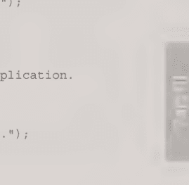

**图 31-1 SwingDemo 程序产生的窗口**

当运行 **SwingDemo** 程序时，它将产生一个与图 31-1 所示相似的窗口。因为 **SwingDemo** 程序演示了几个 Swing 核心概念，我们将逐行仔细检查它。程序从导入 `javax.swing` 开始。如所述，此包包含了 Swing 定义的组件和模型。例如，`javax.swing` 定义了实现标签、按钮、文本控件和菜单的类。它将包含在所有使用 Swing 的程序中。

接下来，程序声明了 **SwingDemo** 类以及该类的构造函数。构造函数是程序大部分操作的地方。通过使用这行代码创建一个 `JFrame`：

```java
JFrame jfrm = new JFrame("A Simple Swing Application");
```

这创建一个带有标题栏、关闭、最大化和还原按钮的窗口。默认情况下，窗口是最小化的。下一行代码设置了窗口的尺寸：

```java
jfrm.setSize(275, 100);
```

下一行决定了窗口关闭时发生什么：

```java
jfrm.setDefaultCloseOperation(JFrame.EXIT_ON_CLOSE);
```

接下来的行代码创建一个 Swing 标签：

```java
JLabel jlab = new JLabel("Swing means powerful GUIs.");
```

下一行代码将标签添加到内容面板：

```java
jfrm.add(jlab);
```

最后，以下行代码显示帧：

```java
jfrm.setVisible(true);
```


`add()` 方法使用边框布局（border layout）。默认情况下，`add()` 只是将标签移动到中心位置。`add()` 的其他版本允许你指定一个边框区域。当组件被添加到容器时，其大小会自动调整以适应容器的大小。

在继续之前，需要说明一个重要的历史点。在 JDK 5 之前，在将组件添加到内容面板时，你不能直接在 `JFrame` 实例上调用 `add()` 方法。相反，你需要在 `JFrame` 的内容面板上调用 `add()`。可以通过调用 `JFrame` 实例的 `getContentPane()` 来获取内容面板。`getContentPane()` 方法所示：

```java
Container getContentPane()
```

它返回内容面板的 `Container`。然后对该引用调用 `add()` 方法以将组件添加到内容面板。因此，过去你必须使用以下语句将 `jlab` 添加到 `jframe`：

```java
jfrm.getContentPane().add(jlab); // old-style
```

## 第三部分 使用 Swing 引入 GUI 编程

调用 `remove()` 移除组件，调用 `setLayout()` 为内容面板设置布局管理器。这就是为什么在 5.0 之前的遗留代码中，你会经常看到对 `getContentPane()` 的显式调用。今天，不再需要使用 `getContentPane()`。你可以直接在 `JFrame` 上调用 `add()`、`remove()` 和 `setLayout()`，因为这些方法已经过更改，它们会自动在内容面板上进行操作。

SwingDemo 构造函数的最后一条语句使窗口可见：

```java
jfrm.setVisible(true);
```

`setVisible()` 方法继承自 AWT Component 类。如果其参数为 true，则窗口将显示；否则，它将被隐藏。默认情况下，JFrame 是不可见的，因此必须调用 `setVisible(true)` 才能显示它。

在 `main()` 内部，创建了一个 `SwingDemo` 对象，这会导致窗口和标签被显示。注意使用以下代码行调用了 `SwingDemo` 构造函数：

```java
SwingUtilities.invokeLater(new Runnable() {
    public void run() {
        new SwingDemo();
    }
});
```

此序列导致 `SwingDemo` 对象在事件分发线程上创建，而不是应用程序的主线程上。原因如下：通常情况下，Swing 程序是事件驱动的。例如，当用户与组件交互时，会生成一个事件。通过调用应用程序定义的事件处理器，事件会被传递给应用程序。然而，处理器是在 Swing 提供的事件分发线程上执行的，而不是在应用程序的主线程上。尽管事件处理器是由你的程序定义的，但它们在一个并非你的程序创建的线程上被调用。

为了避免问题（包括可能的死锁），所有的 Swing GUI 组件必须在事件分发线程中创建和更新，而不是应用程序的主线程。然而，`main()` 在主线程上执行。因此，`main()` 不能直接实例化 `SwingDemo` 对象。相反，它必须创建一个在事件分发线程上执行的 `Runnable`，并让该对象创建 GUI。

为了让 GUI 在事件分发线程上创建，你必须使用 `SwingUtilities` 类定义的两种方法之一。这些方法是 `invokeLater()` 和 `invokeAndWait()`，所示：

```java
static void invokeAndWait(Runnable obj)
    throws InterruptedException, InvocationTargetException
```

在这里，`obj` 是一个 `Runnable`，其 `run()` 方法将由事件分发线程调用。这两个方法的区别在于：`invokeLater()` 立即返回，而 `invokeAndWait()` 会等待到 `obj.run()` 返回。你可以使用这些方法之一来调用为你的 Swing 应用构建 GUI 的方法，或者当你需要从非分发线程执行的代码中修改 GUI 状态时。你通常会想要使用 `invokeLater()`，正如前面的程序所示。但是，当构建应用程序的初始 GUI 时，需要 `invokeAndWait()`。因此，你会在遗留代码看到它的用法。

## 事件处理

之前的示例展示了 Swing 程序的 Basic 形式，但它遗漏了一个重要的部分：事件处理。因为 `JLabel` 不接受用户输入，所以它不产生事件，因此不需要事件处理。然而，其他的 Swing 组件会对用户输入做出响应，这些交互需要被处理。事件也可以通过与用户输入直接相关的方式产生。例如，当定时器触发时会产生一个事件。无论情况如何，事件处理都是任何基于 Swing 的应用程序的重要部分。

Swing 使用的事件处理机制与 AWT 使用的相同。这种方法被称为委托事件模型，在第 24 章中描述。很多情况下，Swing 使用与 AWT 相同的事件，这些事件被封装在 `java.awt.event` 中。Swing 特有的事件存储在 `javax.swing.event` 中。

虽然 Swing 中处理事件的方式与 AWT 相同，但通过一个简单的推按钮仍然是有用的。以下程序处理了由 Swing 推按钮生成的事件。示例输出如图 31-2 所示。

**图 31-2** EventDemo 程序的输出

```java
// 在 Swing 程序中处理事件。
import java.awt.*;
import java.awt.event.*;
import javax.swing.*;

class EventDemo {
    JLabel jlab;

    EventDemo() {
        // 创建一个新的 JFrame 容器。
        JFrame jfrm = new JFrame("An Event Example");
        // 为布局管理器指定 FlowLayout。
        jfrm.setLayout(new FlowLayout());
        // 给帧设置一个初始大小。
        jfrm.setSize(220, 90);
        // 当用户关闭应用程序时终止程序。
        jfrm.setDefaultCloseOperation(JFrame.EXIT_ON_CLOSE);
        // 创建两个按钮。
        JButton jbtnAlpha = new JButton("Alpha");
        JButton jbtnBeta = new JButton("Beta");
        // 为 Alpha 添加动作监听器。
        jbtnAlpha.addActionListener(new ActionListener() {
            public void actionPerformed(ActionEvent ae) {
                jlab.setText("Alpha was pressed.");
            }
        });
        // 为 Beta 添加动作监听器。
        jbtnBeta.addActionListener(new ActionListener() {
            public void actionPerformed(ActionEvent ae) {
                jlab.setText("Beta was pressed.");
            }
        });
        // 将按钮添加到内容面板。
        jfrm.add(jbtnAlpha);
        jfrm.add(jbtnBeta);
        // 创建文本标签。
        jlab = new JLabel("Press a button.");
        // 将标签添加到内容面板。
        jfrm.add(jlab);
        // 显示帧。
        jfrm.setVisible(true);
    }

    public static void main(String[] args) {
        // 在事件分发线程上创建帧。
        SwingUtilities.invokeLater(new Runnable() {
            public void run() {
                new EventDemo();
            }
        });
    }
}
```

首先，注意程序导入了 `java.awt` 和 `java.awt.event` 包。`java.awt` 包是必要的，因为它包含了 `FlowLayout` 类，用于布局组件。`java.awt.event` 包是必要的，因为它定义了 `ActionListener` 接口和 `ActionEvent` 类。

如你所见，这段代码更短。当然，你选择的方法将取决于情况以及你个人的偏好。

接下来，将按钮添加到 jfrm 的内容面板中：

```java
jfrm.add(jbtnAlpha);
jfrm.add(jbtnBeta);
```

最后，将 JLabel 添加到内容面板并使窗口可见。当你运行程序时，每按一次按钮，标签中就会显示一条消息，指示按了哪个按钮。

最后一点：记住，所有事件处理器（例如 `actionPerformed()`）都是在事件分发线程上被调用的。因此，事件处理器必须快速返回，以避免减慢运行速度。如果你的应用程序需要在事件结果后执行某些耗时操作，它必须使用单独线程。

## 在 Swing 中绘图

尽管 Swing 组件非常强大，但你并不局限于使用 Swing；它还允许你直接向框架（frame）、面板（panel）或 Swing 其他组件（如 JLabel）的显示区域写入内容。虽然 Swing 的许多（可能是大多数）用法并不涉及直接向组件表面写入内容，但对于需要这种功能的应用程序，它是可用的。要直接向组件表面写入内容，你将使用 AWT 定义的一个或多个绘制方法，例如 `drawLine()` 或 `drawRect()`。因此，第 25 章中描述的大多数技术和方法也适用于 Swing。然而，也存在非常重要的区别，本节将讨论这一过程。

## 绘图基础

Swing 的绘图方法建立在原始基于 AWT 的机制之上，但 Swing 的实现提供了更细粒度的控制。在检查基于 Swing 的绘图细节之前，回顾其底层的基于 AWT 的机制很有帮助。

AWT 类定义了一个名为 `paint()` 的方法，用于直接向组件表面绘制输出。在大多数情况下，`paint()` 并不是由你的程序调用的。（事实上，只有在最异常的情况下才应该由你的程序调用。）相反，每当组件被渲染时，运行时系统都会调用 `paint()`。这种情况可能会被另一个窗口覆盖然后重新显示。例如，组件中的窗口被显示然后被遮盖。或者窗口可能会被最小化并恢复。当程序开始运行时，`paint()` 方法也会被调用。在编写基于 AWT 的代码时，应用程序需要在直接向组件表面写入内容时重写 `paint()` 方法。

由于 `JComponent` 继承自 `Component`，因此所有 Swing 轻量级组件都继承了 `paint()` 方法。然而，你不会通过重写它直接绘制到组件表面。原因是 Swing 使用了更复杂的绘图方法，涉及三个不同的方法：`paintComponent()`、`paintBorder()` 和 `paintChildren()`。

这些方法绘制组件的指定部分，并将绘图过程划分为三个不同的逻辑动作。在轻量级组件中，原始的 AWT 方法 `paint()` 只是按照所示顺序简单执行对这些方法的调用。

要绘制 Swing 组件的表面，你需要该组件的子类并重写其 `paintComponent()` 方法。这是绘制组件内部的方法。你通常不会重写另外两个方法。在重写 `paintComponent()` 时，你必须的第一件事是调用 `super.paintComponent()`，以便执行绘图过程的父类。（不需要这样做的情况是你正在完全、手动地控制组件的显示方式。）之后，渲染你想显示的输出。`paintComponent()` 方法如下：

```java
protected void paintComponent(Graphics g)
```

参数 `g` 是写入输出的图形上下文。

若要在程序控制下触发组件绘图，请调用 `repaint()`。它在 Swing 中的工作方式与 AWT 相同。`repaint()` 方法由 Component 定义。调用它允许系统在尽快尽快调用 `paint()`。由于绘图是一项耗时操作，这允许运行时系统推迟绘图，直到某些优先级的任务完成（例如）。当然，对 `paint()` 的调用会导致对 `paintComponent()` 的调用。因此，为了向组件表面输出，你的程序将存储输出直到 `paintComponent()` 被调用。在重写的 `paintComponent()` 内部，你绘制存储的输出。

## 计算可绘制区域

在向组件表面绘图时，必须小心将输出限制在边框内部区域。尽管 Swing 会裁剪任何超出组件边界的输出，但仍然可能绘制到边框内，这会在绘制边框时被覆盖。为了避免这种情况，你必须计算组件的可绘制区域。该区域由组件当前尺寸减去边框占据的空间定义。因此，在向组件绘制之前，你必须获取边框宽度，然后相应地调整你的绘制。

要获取边框宽度，调用 `getInsets()`，如下所示：

```java
Insets getInsets()
```

该方法由 Container 定义并由 JComponent 重写。它返回一个包含边框尺寸的 Insets 对象。可以通过以下字段获取 Insets 值：

- `int top;`
- `int bottom;`
- `int left;`
- `int right;`

```java
// Display the frame.
ifrm.setVisible(true);
}

public static void main(String args[]) {
    // Create the frame on the event dispatching thread.
    SwingUtilities.invokeLater(new Runnable() {
        public void run() {
            new PaintDemo();
        }
    });
}
```

让我们仔细检查这个程序。`PaintPanel` 类继承自 `JPanel`。`JPanel` 是 Swing 的轻量级容器之一，这意味着它是可以添加到 `JFrame` 的内容面板（content pane）中的组件。为了处理绘制，`PaintPanel` 重写了 `paintComponent()` 方法。这允许 `PaintPanel` 在绘制发生时直接写入组件表面。面板的大小没有被指定，因为程序使用了默认的边界布局（border layout），并且面板被添加到中心区域。这导致面板的大小被调整为填充中心区域。如果你更改了窗口的大小，将通过此处所示的 `setBorder()` 方法设置边框来调整面板的大小：

```java
void setBorder(Border border)
```

`Border` 是封装边框的 Swing 接口。你可以通过调用 `BorderFactory` 类定义的工厂方法之一来获取边框。程序中使用的是 `createLineBorder()`，它创建了一个简单的线条边框。此处所示：

```java
static Border createLineBorder(Color clr, int width)
```


在这里，`clr` 指定边框的颜色，`width` 指定其像素为单位的宽度。
在 `paintComponent()` 的重写内部，注意它调用了 `super.paintComponent()`。正如所解释的，这是确保组件被正确绘制的必要。接下来，面板的宽度高度与内边对齐。这些值用于确保线条位于面板的绘制区域内。绘制区域是组件的总宽度和高度减去边框宽度。这些计算设计用于不同尺寸的 `PaintPanel` 和边框。为了证明这一点，更改窗口的大小，线条仍然位于面板的边框内。`PaintDemo` 类创建了一个 `PaintPanel`，然后将面板添加到内容面板中。当应用程序首次显示时，会调用重写的 `paintComponent()` 方法并绘制线条。每当你调整窗口大小、或者隐藏并恢复窗口时，都会绘制一组新的线条。在所有情况下，线条都落在可绘制区域内。

## 第 32 章：探索 Swing

前章描述了与 Swing 相关的几个核心概念，并展示了 Swing 应用程序的一格式。本章通过介绍几个 Swing 组件的概述（例如按钮、复选框、树和表格）来继续对 Swing 的讨论。Swing 组件提供了丰富的功能并允许高水平的自定义。由于空间限制，无法描述它们所有的特征和属性。相反，此概述的目的是让你对 Swing 组件集的能力有一个初步了解。

本章描述的 Swing 组件类所示：

| JButton | JComboBox | JLabel |
| JList | JRadioButton | JScrollPane | JTabbedPane |
| JTable | JTextField | JToggleButton | JTree |

这些组件是轻量级的，这意味着它们都派自 `JComponent`。

同样讨论的还有 `ButtonGroup` 类，它封装了一组互斥的 Swing 按钮，以及 `ImageIcon` 类，它封装了一个图形图像。两者都由 Swing 定义并封装在 `javax.swing` 包中。

## JLabel 和 ImageIcon

`JLabel` 是 Swing 中最易于使用的组件。它创建一个标签，并在上一章中介绍。在这里，我们将更仔细地观察 `JLabel`。`JLabel` 可用于显示文本和或图标。它是一个被动组件，因为它不响应用户输入。`JLabel` 定义了几个构造函数。这里是其中三个：

```java
JLabel(Icon icon)
JLabel(String str)
JLabel(String str, Icon icon, int align)
```

在这里，`str` 和 `icon` 是用于标签的文本和图标。`align` 参数指定文本和或图标在标签尺寸内的水平对齐方式。它必须是以下值之一：LEFT、RIGHT、CENTER、LEADING 或 TRAILING。常量定义在 `SwingConstants` 接口中，以及其他几个被 Swing 类使用的常量。

注意，图标是由类型为 `Icon` 的对象指定的，`Icon` 是由 Swing 定义的接口。获取图标的最简单方法是使用 `ImageIcon` 类。`ImageIcon` 实现 `Icon` 并封装图像。因此，`ImageIcon` 类型的对象可以作为参数传递给 `JLabel` 构造函数。提供图像有多种方法，包括从文件读取或从 URL 下载。这是本节示例使用的 `ImageIcon` 构造函数：

```java
ImageIcon(String filename)
```

它获取命名文件名中的图像。

与标签关联的图标和文本可以通过以下方法获取：
- `Icon getIcon()`
- `String getText()`

与标签关联的图标和文本可以通过这些方法设置：
- `void setIcon(Icon icon)`
- `void setText(String str)`

在这里，`icon` 和 `str` 分别是图标和文本。因此，使用 `setText()` 在程序执行期间更改标签内部的文本。以下程序说明了如何创建并显示包含图标和字符串的标签。它首先为文件 `hourglass.png` 创建 `ImageIcon` 对象，该文件描述了一个沙漏。这被用作 `JLabel` 构造函数的第二个参数。`JLabel` 构造函数的第一个最后一个参数是标签文本和对齐方式。最后，标签被添加到内容面板。

```java
import java.awt.*;
import javax.swing.*;

public class JLabelDemo {

    public JLabelDemo() {
        // 设置 JFrame。
        JFrame jfrm = new JFrame("JLabelDemo");
        jfrm.setLayout(new FlowLayout());
        jfrm.setDefaultCloseOperation(JFrame.EXIT_ON_CLOSE);
        jfrm.setSize(260, 100);

        // 创建一个图标。
        ImageIcon ii = new ImageIcon("hourglass.png");

        // 创建一个标签。
        JLabel jl = new JLabel("Hourglass", ii, JLabel.CENTER);

        // 将标签添加到内容面板。
        jfrm.add(jl);

        // 显示框架。
        jfrm.setVisible(true);
    }

    public static void main(String[] args) {
        // 在事件分发线程上创建框架。
        SwingUtilities.invokeLater(new Runnable() {
            public void run() {
                new JLabelDemo();
            }
        });
    }
}
```

## Swing 按钮

Swing 定义了四种类型的按钮：`JButton`、`JToggleButton`、`CheckBox` 和 `JRadioButton`。它们都是 `AbstractButton` 类的子类，而 `AbstractButton` 扩展了 `JComponent`。因此，所有按钮共享一组共同特性。

`AbstractButton` 包含了许多允许你控制按钮行为的方法。例如，你可以定义按钮在被禁用或被选中时显示的不同图标。另一个图标可以作为悬停图标，它在鼠标悬停在按钮上时显示。以下方法设置了这些图标：

```java
void setDisabledIcon(Icon di)
void setPressedIcon(Icon pi)
void setSelectedIcon(Icon si)
void setRolloverIcon(Icon ri)
```

在这里，`di`、`si` 和 `ri` 是用于指定用途的图标。与按钮关联的文本可以通过以下方法读取和写入：

```java
String getText()
void setText(String str)
```

在这里，`str` 是要与按钮关联的内容。所有按钮使用的模型由 `ButtonModel` 定义。当按钮被按下时，会生成一个事件。也可能发生其他事件。接下来将检查每个按钮类。

`JButton` 提供了推入按钮的功能。你已经在前面的章节中见过它的一个简单形式。`JButton` 允许将图标、字符串或两者都与按钮关联。这里显示了它的三个构造函数之一：

```java
JButton(Icon icon)
JButton(String str)
JButton(String str, Icon icon)
```

在这里，`str` 和图标用于按钮。当按钮被按下时，会生成一个 `ActionEvent`。通过传递给 `ActionListener` 的 `actionPerformed` 方法的 `ActionEvent`，你可以获取与按钮关联的动作命令。默认情况下，这是按钮内部显示的字符串。但是，你可以通过调用 `setActionCommand()` 来设置动作命令。


你可以通过在事件对象上调用 `getActionCommand()` 来获取该动作命令。

```java
String getActionCommand()
```

动作命令标识按钮。因此，当在同一个应用程序中使用两个按钮时，动作命令可以提供一种简单的方法来判断是哪个按钮被按下。在前面的章节中，你看到了一个基于图标的按钮示例。下面演示了一个基于图标的按钮。它显示四个推入按钮和一个标签。每个按钮都显示一个代表计时器的图标。当一个按钮被按下时，该计时器的名称将显示在标签中。

```java
// 演示一个基于图标的按钮。
import java.awt.*;
import java.awt.event.*;
import javax.swing.*;

public class JButtonDemo implements ActionListener {

    JLabel jlab;

    public JButtonDemo() {
        // 设置 JFrame
        JFrame jfrm = new JFrame("JButtonDemo");
        jfrm.setLayout(new FlowLayout());
        jfrm.setDefaultCloseOperation(JFrame.EXIT_ON_CLOSE);
        jfrm.setSize(500, 450);

        // 将按钮添加到内容面板。
        ImageIcon hourglass = new ImageIcon("hourglass.png");
        JButton jb = new JButton(hourglass);
        jb.setActionCommand("Hourglass");
        jb.addActionListener(this);
        jfrm.add(jb);

        ImageIcon analog = new ImageIcon("analog.png");
        jb = new JButton(analog);
        jb.setActionCommand("Analog Clock");
        jb.addActionListener(this);
        jfrm.add(jb);

        ImageIcon digital = new ImageIcon("digital.png");
        jb = new JButton(digital);
        jb.setActionCommand("Digital Clock");
        jb.addActionListener(this);
        jfrm.add(jb);

        ImageIcon stopwatch = new ImageIcon("stopwatch.png");
        jb = new JButton(stopwatch);
        jb.setActionCommand("Stopwatch");
        jb.addActionListener(this);
        jfrm.add(jb);

        // 创建标签并添加到内容面板。
        jlab = new JLabel("Choose a Timepiece");
        jfrm.add(jlab);

        // 显示框架。
        jfrm.setVisible(true);
    }

    // 处理按钮事件。
    public void actionPerformed(ActionEvent e) {
        jlab.setText("You selected " + e.getActionCommand());
    }

    public static void main(String[] args) {
        // 在事件分发线程上创建框架。
        SwingUtilities.invokeLater(
            new Runnable() {
                public void run() {
                    new JButtonDemo();
                }
            });
    }
}
```

按钮示例的输出在此：

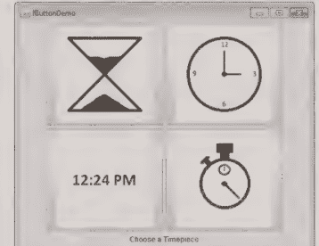

## JToggleButton

推入按钮的一种很有用变体称为切换按钮。切换按钮看起来和推入按钮完全一样，但它的行为不同，因为它有两个状态：按下和释放。也就是说，当你按下切换按钮时，它会保持按下状态，而不是像普通的推入按钮那样弹回。当你再次按下切换按钮时，它会释放（弹出）。因此，每当按下切换按钮时，它都会在其两个状态之间切换。

切换按钮是 `JToggleButton` 类的对象。`JToggleButton` 实现了 `AbstractButton`。除了创建标准的切换按钮外，`JToggleButton` 两个表示双状态控件的 Swing 组件的父类。这些是 `JCheckBox` 和 `JRadioButton`，在本章稍后部分描述。因此，`JToggleButton` 定义了所有双状态组件的基本功能。

`JToggleButton` 定义了多个构造函数。本节示例使用的构造函数所示：

```java
JToggleButton(String str)
```

这创建一个包含传入 `str` 文本的切换按钮。默认情况下，按钮处于关闭位置。其他构造函数允许你创建包含图像或文本的切换按钮。与 `JButton` 一样，`JToggleButton` 在每次被按下时生成一个动作。与 `JButton` 不同，`JToggleButton` 还会生成一个项目事件。要处理事件，必须实现 `ItemListener`。回顾第 24 章，每当生成项目事件时，它都会传递给 `ItemListener` 定义的 `stateChanged()` 方法。在 `stateChanged()` 中，可以在 `Item` 对象上调用 `getItem()` 方法来获取生成事件的 `JToggleButton` 实例引用。你需要将此引用转换为 `JToggleButton` 以确定切换按钮的状态。

## 复选框

`JCheckBox` 类提供了复选框的功能。它的直接父类是 `JToggleButton`，正如前面描述的那样，它提供了对双状态按钮的支持。`JCheckBox` 定义了几个构造函数。这里使用的是：

`JCheckBox(String str)`

它创建一个以 `str` 指定文本作为标签的复选框。其他构造函数允许你指定按钮的初始选中状态，并指定一个图标。

当用户选择或取消选择一个复选框时，会产生一个 `ItemEvent`。你可以通过调用 `ItemListener` 定义的 `itemStateChanged()` 方法产生的 `ItemEvent` 的 `getItem()` 方法，获取生成事件的 `JCheckBox` 引用。确定复选框选中状态的最简单方法是在 `JCheckBox` 实例上调用 `isSelected()`。

下面的示例说明了复选框。它显示了四个复选框和一个标签。当用户选择一个复选框时，会产生一个 `ItemEvent`。在 `itemStateChanged()` 方法内部，调用 `getItem()` 来获取生成事件的 `JCheckBox` 对象的引用。接下来，通过调用 `isSelected()` 判断该框是否被选中或清除。`getText()` 方法获取该复选框的文本并用于设置内部的标签。

```java
// Demonstrate JCheckBox.
import java.awt.*;
import java.awt.event.*;
import javax.swing.*;

public class JCheckBoxDemo implements ItemListener {

    JLabel label;

    public JCheckBoxDemo() {
        // Set the JFrame.
        JFrame jframe = new JFrame("JCheckBoxDemo");
        jframe.setLayout(new FlowLayout());
        jframe.setDefaultCloseOperation(JFrame.EXIT_ON_CLOSE);
        jframe.setSize(250, 100);

        // 向内容面板中添加复选框。
        JCheckBox cb = new JCheckBox("C");
        cb.addItemListener(this);
        jframe.add(cb);

        cb = new JCheckBox("C++");
        cb.addItemListener(this);
        jframe.add(cb);

        cb = new JCheckBox("Java");
        cb.addItemListener(this);
        jframe.add(cb);

        cb = new JCheckBox("Perl");
        cb.addItemListener(this);
        jframe.add(cb);

        // 创建标签并将其添加到内容面板中。
        JLabel jlab = new JLabel("Select languages");
        jframe.add(jlab);

        // 显示框架。
        jframe.setVisible(true);
    }

    public void itemStateChanged(ItemEvent ie) {
        JCheckBox cb = (JCheckBox) ie.getItem();
        if (cb.isSelected()) {
            label.setText(cb.getText() + " selected");
        } else {
            label.setText(cb.getText() + " cleared");
        }
    }

    public static void main(String[] args) {
        SwingUtilities.invokeLater(new Runnable() {
            public void run() {
                new JCheckBoxDemo();
            }
        });
    }
}
```


# 第三部分 使用 Swing 引入 GUI 编程

## 单选按钮 (Radio Buttons)

单选按钮是一组互斥的按钮，其中在任何时间只能被选中一个。它们由 `JRadioButton` 类支持，该类扩展了 `JToggleButton`。`JRadioButton` 提供了几个构造函数。示例中使用的那个所示：

```java
JRadioButton(String str)
```

在这里，`str` 是按钮的标签。其他构造函数允许你指定按钮的初始选中状态，并指定一个图标。

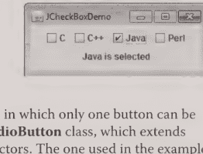

为了实现其互斥性，单选按钮必须配置成一个组。组中的按钮在任何时候只能被选中一个。例如，如果用户按了组中的某个单选按钮，该组中之前选中的任何按钮将自动取消选中。按钮组通过 `ButtonGroup` 类创建。为了这个目的，会调用它的默认构造函数。然后通过以下方法将元素添加到按钮组中：

```java
void add(AbstractButton ab)
```

在这里，`ab` 是要添加到组中的按钮的引用。

每当按钮选择变化时，`JRadioButton` 都会产生动作事件、项事件和改变事件。通常处理的是动作事件，这意味着你通常会实现 `ActionListener`。在由 `ActionListener` 定义的 `actionPerformed()` 方法内部，你可以使用多种不同方式来确定哪个按钮被选中。默认情况下，动作命令与标签相同，但你可以通过调用单选按钮上的 `setActionCommand()` 将动作命令设置为其他内容。第三，你可以对 `Action` 对象调用 `getSource()` 并将该引用与按钮对比。然后你可以通过调用每个按钮的 `isSelected()` 来检查哪个当前被选中。最后，每个按钮可以使用匿名内部类或 Lambda 表达式实现它自己的事件处理器。记住，每当发生动作事件时，意味着被选中的按钮发生了变化，且仅有一个按钮会被选中。

下面的示例说明了如何使用单选按钮。创建了三个单选按钮，然后将它们添加到按钮组中。正如所解释的，这是产生互斥行为的必要的。按下单选按钮会产生动作事件，该事件由 `actionPerformed()` 处理。在处理器内部，`getText()` 方法获取与标签页相关的文本并将其使用。

## 选项卡面板 (JTabbedPane)

`JTabbedPane` 封装了一个选项卡面板。它通过选项卡链接组件来管理一组组件。选择一个选项卡会导致相关的组件带到最前。选项卡在现代 GUI 中非常常见，且创建和使用非常简单。

`JTabbedPane` 定义了三个构造函数。我们将使用它的默认构造函数，它创建一个标签位于顶部的空控件。另外两个构造函数允许你指定选项卡的位置，可以是四边。`JTabbedPane` 使用单选模型。

选项卡通过调用 `addTab()` 添加。这是它的形式之一：

```java
void addTab(String name, Component comp)
```

在这里，`name` 是选项卡的名称，`comp` 是要添加到选项卡的组件。通常，添加到选项卡中的组件是包含一组相关组件的 `JPanel`。这种技术允许选项卡持有一组组件。使用选项卡面板的概括步骤如下：

1. 创建 `JTabbedPane` 实例。
2. 通过调用 `addTab()` 添加每个选项卡。
3. 将选项卡面板添加到内容面板中。

下面的示例说明了一个选项卡面板。第一个选项卡标题为 "Cities"，包含四个按钮。每个按钮显示颜色名称。第二个选项卡标题为 "Colors"，包含三个复选框。每个复选框显示颜色名称。第三个选项卡标题为 "Flavors"，包含一个组合框。这使用户从三种口味中选择一种。

```java
// Demonstrate JTabbedPane.

import javax.swing.*;
import java.awt.*;

public class JTabbedPaneDemo {

    public JTabbedPaneDemo() {
        // Set up the JFrame
        JFrame jframe = new JFrame("JTabbedPaneDemo");
        jframe.setLayout(new FlowLayout());
        jframe.setDefaultCloseOperation(JFrame.EXIT_ON_CLOSE);
        jframe.setSize(400, 200);

        // Create the tabbed pane.
        JTabbedPane jtp = new JTabbedPane();
        jtp.addTab("Cities", new CitiesPanel());
        jtp.addTab("Colors", new ColorsPanel());
        jtp.addTab("Flavors", new FlavorsPanel());

        jframe.add(jtp);

        // Display the frame.
        jframe.setVisible(true);
    }

    public static void main(String[] args) {
        // Create the frame on the event dispatching thread.
        SwingUtilities.invokeLater(new Runnable() {
            public void run() {
                new JTabbedPaneDemo();
            }
        });
    }
}

// Make the panels that will be added to the tabbed pane.
class CitiesPanel extends JPanel {
    public CitiesPanel() {
        JButton b1 = new JButton("New York");
        add(b1);
        JButton b2 = new JButton("London");
        add(b2);
        JButton b3 = new JButton("Hong Kong");
        add(b3);
        JButton b4 = new JButton("Tokyo");
        add(b4);
    }
}

class ColorsPanel extends JPanel {
    public ColorsPanel() {
        JCheckBox cb1 = new JCheckBox("Red");
        add(cb1);
        JCheckBox cb2 = new JCheckBox("Green");
        add(cb2);
        JCheckBox cb3 = new JCheckBox("Blue");
        add(cb3);
    }
}

class FlavorsPanel extends JPanel {
    public FlavorsPanel() {
        JComboBox<String> jcb = new JComboBox<String>();
        jcb.addItem("Vanilla");
        jcb.addItem("Chocolate");
        jcb.addItem("Strawberry");
        add(jcb);
    }
}
```

标签页面板示例的输出见以下三幅插图：

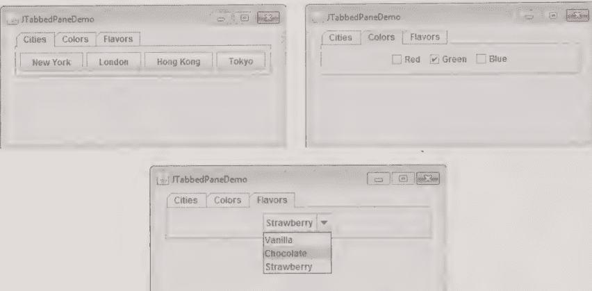

## JScrollPane

`JScrollPane` 是一种轻量级容器，可以自动处理另一个组件的滚动。被滚动的组件可以是单个组件（例如表格），也可以是包含在另一个轻量级容器（例如 `JPanel`）中的一组组件。在任何情况下，如果被滚动的对象大于可视区域，系统会自动提供水平和/或垂直滚动条，并且可以通过窗格滚动组件。由于 `JScrollPane` 自动处理滚动，它通常消除了管理单个滚动条的需求。

滚动条的可视区域被称为“视口”（viewport）。它是显示被滚动组件的窗口。因此，视口显示了被滚动组件的可视部分。滚动条通过视口来滚动组件。在默认行为下，`JScrollPane` 会根据需要动态地添加或移除滚动条。例如，如果组件比视口高，则会添加垂直滚动条；如果组件完全能视视口内，则会移除滚动条。

`JScrollPane` 定义了几个构造函数。本章使用的在此所示：

```java
JScrollPane(Component comp)
```

通过 `comp` 指定要滚动的组件。当窗格的内容超过视口的尺寸时，会自动显示滚动条。

使用滚动条时需要遵循的步骤如下：

1. 创建要滚动的组件。
2. 创建 `JScrollPane` 实例，并将要滚动的对象传递给它。
3. 将滚动条添加到内容面板中。

下面的示例演示了一个滚动条。首先创建了一个 `JPanel` 对象，并向其添加了 400 个按钮，排列为 20 列。然后将此面板添加到内容面板中。由于面板大于视口，垂直和水平滚动条会自动出现。你可以使用滚动条将按钮滚入视图。

```java
// Demonstrate JScrollPane.

import java.awt.*;
import javax.swing.*;

public class JScrollPaneDemo {

    public JScrollPaneDemo() {
        // Set up the JFrame.
        JFrame jfrm = new JFrame("JScrollPaneDemo");
        jfrm.setDefaultCloseOperation(JFrame.EXIT_ON_CLOSE);
        jfrm.setSize(400, 400);

        // Create a panel and add 400 buttons to it.
        JPanel jp = new JPanel();
        jp.setLayout(new GridLayout(20, 20));

        int b = 0;
        for (int i = 0; i < 20; i++) {
            for (int j = 0; j < 20; j++) {
                jp.add(new JButton("Button " + b));
                b++;
            }
        }

        // Create the scroll pane.
        JScrollPane jsp = new JScrollPane(jp);

        // Add the scroll pane to the content pane.
        // 因为使用了默认的布局管理器，
        // 滚动条将被添加到中心。
        jfrm.add(jsp, BorderLayout.CENTER);

        // Display the frame.
        jfrm.setVisible(true);
    }

    public static void main(String[] args) {
        // Create the frame on the event dispatching thread.
        SwingUtilities.invokeLater(new Runnable() {
            public void run() {
                new JScrollPaneDemo();
            }
        });
    }
}
```

滚动条示例的输出在此：

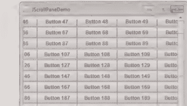

## JList

在 Swing 中，`JList` 是一种允许用户从列表中选择一个或多个项目的组件。列表中的项目可以存储在数组、向量或其他任何实现 `List` 接口的集合中。

`JList` 是泛型的，这意味着你可以指定它将包含的项目类型，例如用于字符串列表的 `JList<String>`。

`JList` 提供了几个构造函数。最常用的是：

- `JList(Object[] array)`：从数组创建 `JList`。
- `JList(Vector<? extends E> v)`：从向量创建 `JList`。
- `JList(List<? extends E> list)`：从列表创建 `JList`。

你还可以设置 `JList` 的选择模式。常见的选择模式包括：

- `SINGLE_SELECTION`：一次只能选择一个项目。
- `MULTIPLE_SELECTION`：可以选择多个项目。
- `SINGLE_INTERVAL_SELECTION`：可以选择单个项目范围。
- `MULTIPLE_INTERVAL_SELECTION`：可以选择多个项目范围。

要处理 `JList` 中的选择事件，你可以添加一个 `SelectionListener`。当选择发生变化时，监听器的 `valueChanged` 方法就会被调用。

```java
list.addSelectionListener(new SelectionListener() {
    public void valueChanged(ListChangeEvent e) {
        // 处理选择变化
    }
});
```

下面的示例演示了一个简单的 `JList`：


```java
// Demonstrate JList.

import javax.swing.*;
import javax.swing.event.*;
import java.awt.*;

public class JListDemo {

    public JListDemo() {
        // Set up the JFrame.
        JFrame jfrm = new JFrame("JListDemo");
        jfrm.setLayout(new FlowLayout());
        jfrm.setDefaultCloseOperation(JFrame.EXIT_ON_CLOSE);
        jfrm.setSize(280, 360);

        // Create a JList.
        String[] cities = { "New York", "London", "Hong Kong", "Tokyo", "Paris", "Berlin", "Rome", "Madrid", "Sydney", "Moscow" };
        JList<String> jlst = new JList<String>(cities);

        // Set the selection mode.
        jlst.setSelectionMode(ListSelectionModel.SINGLE_SELECTION);

        // Add a selection listener.
        jlst.addListSelectionListener(new ListSelectionListener() {
            public void valueChanged(ListSelectionEvent le) {
                if (le.getValueIsAdjusting() == false) {
                    if (jlst.getSelectedIndex() != -1)
                        jlab.setText("当前选择: " + jlst.getSelectedValue());
                    else // 否则，重新提示。
                        jlab.setText("选择一个城市");
                }
            }
        });

        // Add the list to a scroll pane.
        JScrollPane jscrlp = new JScrollPane(jlst);
        jscrlp.setPreferredSize(new Dimension(200, 200));

        // Create a label.
        JLabel jlab = new JLabel("选择一个城市");

        // Add the list and label to the content pane.
        jfrm.add(jscrlp);
        jfrm.add(jlab);

        // Display the frame.
        jfrm.setVisible(true);
    }

    public static void main(String[] args) {
        // Create the frame on the event dispatching thread.
        SwingUtilities.invokeLater(new Runnable() {
            public void run() {
                new JListDemo();
            }
        });
    }
}
```

列表示例的输出在此：

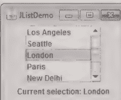

## JComboBox

Swing 通过 `JComboBox` 类提供了一个组合框（文本字段和下拉列表的结合）。组合框通常显示一个条目，但也会显示一个下拉列表，允许用户选择不同的条目。你也可以创建一个组合框，允许用户在文本字段中输入选择。

在过去，`JComboBox` 中的项是以 `Object` 引用形式表示的。然而，从 JDK 7 开始，`JComboBox` 变为泛型，现在的声明方式如下：

```java
class JComboBox<E>
```

在这里，`E` 代表组合框中项的类型。

示例使用的 `JComboBox` 构造函数显示在此：

```java
JComboBox(E[] items)
```

在这里，`items` 是一个初始化组合框的数组。还有其他构造函数可用。`JComboBox` 使用 `ComboBoxModel`。可变组合框（其条目可以更改）使用 `MutableComboBoxModel`。

除了向下拉列表传递项数组外，还可以通过此处所示的 `addItem()` 方法动态添加到选项列表中：

```java
void addItem(E obj)
```

在这里，`obj` 是要添加到组合框的对象。此方法只能用于可变组合框。

当用户从列表中选择一个项时，`JComboBox` 会生成一个动作事件。当选择状态改变时，`JComboBox` 也会生成动作事件，这发生在项被选中或取消选择时。因此，更改选择意味着将发生两次项事件：一次针对被取消选择的项，另一个针对被选中的项。通常，只需监听动作事件就足够了，但两个事件均供你使用。

获取列表中被选中项的一种方法是在组合框上调用 `getSelectedItem()`。它显示在此：

```java
Object getSelectedItem()
```


你需要将返回的值强制转换为列表中存储的对象的类型。

接下来的示例演示了组合框。针对“Hourglass（沙漏）”、“Analog（模拟）”、“Digital（数字）”和“Stopwatch（秒表）”。当选择计时器时，使用基于图标的标签来显示。你可以看到使用此强大组件需要少量的代码。

### JComboBox 示例

```java
// Demo JComboBox。

import java.awt.*;
import java.awt.event.*;
import javax.swing.*;

public class JComboBoxDemo {

    String[] pieces = { "Hourglass", "Analog", "Digital", "Stopwatch" };

    public JComboBoxDemo() {
        // 设置 JFrame
        JFrame jfrm = new JFrame("JComboBoxDemo");
        jfrm.setLayout(new FlowLayout());
        jfrm.setDefaultCloseOperation(JFrame.EXIT_ON_CLOSE);
        jfrm.setSize(400, 250);

        // 实例化组合框并将其添加到内容窗格中。
        JComboBox<String> jcb = new JComboBox<String>(pieces);
        jfrm.add(jcb);

        // 创建一个标签并添加到内容窗格中。
        JLabel jlab = new JLabel(new ImageIcon("hourglass.png"));
        jfrm.add(jlab);

        // 处理选择。
        jcb.addActionListener(new ActionListener() {
            public void actionPerformed(ActionEvent ae) {
                String s = (String) jcb.getSelectedItem();
                jlab.setIcon(new ImageIcon(s + ".png"));
            }
        });

        // 显示框架。
        jfrm.setVisible(true);
    }

    public static void main(String[] args) {
        // 在事件分发线程上创建框架。
        SwingUtilities.invokeLater(new Runnable() {
            public void run() {
                new JComboBoxDemo();
            }
        });
    }
}
```

组合框示例的输出在此：

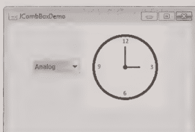

## Trees

**树**（tree）是一种呈现数据层级视图的组件。用户能够在此显示中展开或折叠子树。树在 Swing 中通过 `JTree` 类实现。此处显示了其构造函数的示例：

- `JTree(Object obj)`
- `JTree(Vector<?> v)`
- `JTree(TreeNode tn)`

在第一种形式中，树由数组 `obj` 中的元素构建。第二种形式从向量 `v` 的元素中构建树。在第三种形式中，由 `tn` 指定根节点的树指定了树。

虽然 `JTree` 封装在 `javax.swing` 中，但它的支持类和接口封装在 `javax.swing.tree` 中。这是因为支持 `JTree` 需要的类和接口数量非常多。

`JTree` 依赖于两个模型：`TreeModel` 和 `TreeSelectionModel`。`JTree` 生成各种事件，但专门针对树有三个事件：`TreeExpansionEvent`、`TreeSelectionEvent` 和 `TreeModelEvent`。当用户在树内选择或取消选择节点时，会生成 `TreeSelectionEvent`。当树的数据或结构发生变化时，会触发 `TreeModelEvent`。这些事件的监听器分别是 `TreeExpansionListener`、`TreeSelectionListener` 和 `TreeModelListener`。事件类和监听接口封装在 `javax.swing.event` 中。

本节所示示例程序处理的事件是 `TreeSelectionEvent`。要监听此事件，请实现 `TreeSelectionListener`。它只定义了一个方法，名为 `valueChanged()`，它接收 `TreeSelectionEvent` 对象。你可以通过调用事件对象上的 `getPath()` 来获取对象的路径：

```java
TreePath getPath()
```

它返回一个描述更改节点路径的 `TreePath`。`TreePath` 封装了关于指向树中特定节点路径的信息。它提供了几个构造函数和方法。在本书中，只使用了 `toString()` 方法。它返回一个描述路径的字符串。

`TreeNode` 接口声明了获取树节点信息的方法。例如，可以获取父节点的引用或子节点的枚举。`MutableTreeNode` 接口扩展了 `TreeNode`。它声明了可以插入和删除子节点或更改父节点的方法。

`DefaultMutableTreeNode` 类实现了 `MutableTreeNode` 接口。它代表树中的一个节点。其构造函数之一在此：

```java
DefaultMutableTreeNode(Object obj)
```

在这里，`obj` 是要封装在该树中的对象。新树节点没有父节点或孩子。

要创建树节点的层次结构，可以使用 `DefaultMutableTreeNode` 的 `add()` 方法。其签名在此：

```java
void add(MutableTreeNode child)
```

在这里，`child` 是要添加到可变树的节点。

### JTree 示例

```java
// 将树添加到滚动面板中。
JScrollPane jsp = new JScrollPane(tree);

// 将滚动面板添加到内容面板中。
jfrm.add(jsp);

// 将标签添加到内容面板中。
JLabel jlab = new JLabel();
jfrm.add(jlab, BorderLayout.SOUTH);

// 处理树事件。
tree.addTreeSelectionListener(new TreeSelectionListener() {
    public void valueChanged(TreeSelectionEvent tse) {
        jlab.setText("Selection is " + tse.getPath());
    }
});

// 显示帧。
jfrm.setVisible(true);
}

public static void main(String[] args) {
    // 在事件分发线程上创建帧。
    SwingUtilities.invokeLater(new Runnable() {
        public void run() {
            new JTreeDemo();
        }
    });
}
```

树示例的输出所示：

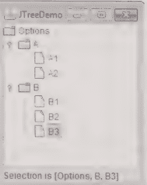

文本字段中显示的字符串描述了从树根节点到选中节点的路径。

# JTable

`JTable` 是一个显示数据行和列的组件。你可以在列边界上拖动光标来调整列宽。你还可以将一列拖到新位置。根据配置，还可以选择表格中的行、列或单元格，并更改单元格中的数据。`JTable` 是一个复杂的组件，提供的选项和功能比这里讨论的要多得多。（它可能是 Swing 最复杂的组件之一）。在默认配置下，`JTable` 仍然提供了易于使用的强大功能——特别是如果你只是想使用表格以表格格式呈现数据的话。这里介绍的概述将让你对这个强大的组件有一个通用的理解。

和 `JTree` 一样，`JTable` 也有许多与它相关的类和接口。这些类封装在 `javax.swing.table` 包中。

从核心上说，`JTable` 在概念上是简单的。它是一个由一或多列信息组成的组件。每列的顶部是一个标题。除了描述列中的数据外，标题还提供了允许用户更改列的大小或更改列在表格内位置的机制。`JTable` 本身不提供任何滚动功能。相反，你通常将 `JTable` 包装在 `JScrollPane` 中。

`JTable` 提供了几个构造函数。这里使用的是：

```java
JTable(Object[][] data, Object[] colHeads)
```

在这里，`data` 是要显示的信息的二维数组，`colHeads` 是带有列标题的一维数组。

`JTable` 依赖于三个模型。第一个是表格模型，由 `TableModel` 定义。该模型定义了与以二维格式显示数据相关的操作。第二个是列模型，由 `TableColumnModel` 表示。`JTable` 指定了列的特征。这两个模型封装在 `javax.swing.table` 中。第三个模型决定了如何选择项目，它由 `ListSelectionModel` 指定，该模型在讨论 `JList` 时已经描述过。

`JTable` 可以产生若干事件。对于表格操作最基础的两个是 `ListSelectionEvent` 和 `TableModelEvent`。当用户在表格中选择内容时，会生成 `ListSelectionEvent`。`JTable` 允许你选择一个或多个完整行，或一个或多个单个单元格。当表格数据发生某种方式变化时，会触发 `TableModelEvent`。处理这些事件比处理前述组件生成的事件需要更多一些工作，并且超出了本书的讨论范围。然而，如果你只是想使用 `JTable` 显示数据（如下例所示），那么你就不需要处理任何事件。

以下是设置一个用于显示数据的简单 `JTable` 的步骤：

1. 创建 `JTable` 实例。
2. 创建一个 `JScrollPane` 对象，指定表格为要滚动的对象。
3. 将表格添加到滚动面板中。
4. 将滚动面板添加到内容面板中。

下面的示例说明了如何创建和使用简单的表格。创建了一个名为 `colHeads` 的字符串一维数组作为列标题。创建了一个名为 `data` 的字符串二维数组作为表格单元格。你可以看到数组中的每个元素都是一个包含三个字符串的数组。这些数组被传递给 `JTable` 构造函数。将表格添加到滚动面板，然后将面板添加到内容面板中。表格显示 `data` 数组中的数据。默认表格配置还允许编辑单元格的内容。这将影响底层数组（在本例中为 `data`）的更改。

### JTable 示例

```java
// 演示 JTable。

import java.awt.*;
import javax.swing.*;
import javax.swing.event.*;

public class JTableDemo {

    // 初始化列标题。
    String[] colHeads = {"Name", "Extension", "ID#"};

    // 初始化数据。
    Object[][] data = {
        {"Gail", "4567", "865"},
        {"Ken", "5566", "555"},
        {"Viviane", "5634", "587"},
        {"Melanie", "7345", "922"},
        {"Anne", "1237", "333"}
    };

    public JTableDemo() {
        // 设置 JFrame。使用 BorderLayout。
        JFrame jfrm = new JFrame("JTableDemo");
        jfrm.setDefaultCloseOperation(JFrame.EXIT_ON_CLOSE);
        jfrm.setSize(300, 300);
        jfrm.setLayout(new BorderLayout());

        // 创建表格。
        JTable table = new JTable(data, colHeads);

        // 将表格添加到滚动面板中。
        JScrollPane jsp = new JScrollPane(table);

        // 将滚动面板添加到内容面板中。
        jfrm.add(jsp);

        // 处理表格选择事件。
        table.getSelectionModel().addListSelectionListener(new ListSelectionListener() {
            public void valueChanged(ListSelectionEvent lse) {
                if (!lse.getValueIsAdjusting()) {
                    int row = table.getSelectedRow();
                    if (row != -1) {
                        System.out.println("Selected row: " + row);
                    }
                }
            }
        });

        // 显示帧。
        jfrm.setVisible(true);
    }

    public static void main(String[] args) {
        // 在事件分发线程上创建帧。
        SwingUtilities.invokeLater(new Runnable() {
            public void run() {
                new JTableDemo();
            }
        });
    }
}
```


# 第 33 章 引入 Swing 菜单

## 核心 Swing 菜单类

| 类 | 描述 |
| --- | --- |
| `JMenuBar` | 应用程序顶层菜单的对象。 |
| `JMenu` | 标准菜单。一个菜单由一个或多个 `JMenuItem` 组成。 |
| `JMenuItem` | 填充菜单的对象。 |
| `JCheckBoxMenuItem` | 复选框菜单项。 |
| `JRadioButtonMenuItem` | 单选按钮菜单项。 |
| `JSeparator` | 菜单项之间的视觉分隔符。 |
| `JPopupMenu` | 通常通过点击鼠标右键激活的菜单。 |

表 33-1 核心 Swing 菜单类

## 概述

这里是关于这些类如何配合工作的简要概述。对于应用程序的顶层菜单，你首先创建一个 `JMenuBar`。从宽泛地说，这个类是菜单的容器。你向 `JMenuBar` 实例添加 `JMenu` 实例。每个 `JMenu` 定义了一个菜单。也就是说，每个 `JMenu` 包含一个或多个可选项目。由 `JMenu` 显示的项目是 `JMenuItem` 对象。因此，`JMenuItem` 定义了一个用户可以选择的选择项。

作为从菜单栏派生的菜单的替代方案或相邻方案，你也可以创建独立的弹出菜单。要创建弹出菜单，首先创建一个 `JPopupMenu` 类型的对象。然后，向它添加 `JMenuItems`。弹出菜单通常在鼠标悬停在定义了弹出菜单的组件上时，通过点击鼠标右键激活。

除了“标准”菜单项外，你还可以在菜单中包含复选框和单选按钮。复选框菜单项由 `JCheckBoxMenuItem` 创建。单选按钮菜单项由 `JRadioButtonMenuItem` 创建。这两个类都扩展了 `JMenuItem`。它们可以用于标准菜单和弹出菜单。

`JMenuItem` 创建了一个与菜单相关的独立组件。它通常用于提供快速访问应用程序菜单中包含的功能。例如，工具栏可以提供对文字处理器支持的格式化命令的快速访问。

`JSeparator` 是一个方便类，用于在菜单中创建分隔线。

理解 Swing 的一个关键点是，每个菜单项都扩展了 `AbstractButton`。记得 `AbstractButton` 也是 Swing 按钮组件（如 `JButton`）的子类。因此，所有菜单项本质上都是按钮。显然，当它们在菜单中使用时，它们实际上并不会像按钮，但它们在许多方面表现得像按钮。例如，选择菜单项产生动作事件（action event）的方式按下按钮相同。

另一个关键点是 `JMenuItem` 是 `JMenu` 的子类。这允许在菜单内部创建子菜单。要创建子菜单，你首先创建并填充一个 `JMenu` 对象，并将其添加到另一个 `JMenu` 对象中。你将在下一节中看到这一过程的演示。

正如之前顺带提到的，当菜单项被选中时，会生成动作事件。与该动作事件关联的动作命令字符串默认将是文本名称。因此，你可以通过检查动作命令来确定选中了哪一个项。当然，你也可以使用独立的匿名内部类或 lambda 表达式来处理每个菜单项的动作事件。在这种情况下，菜单选择是已知的，不需要检查动作命令字符串来确定选中了哪一个项。

菜单可以生成其他类型的事件。例如，每当菜单被激活、选中或取消时，就会生成一个 `MenuEvent`，可以通过 `MenuListener` 进行进行监听。其他与菜单相关的事件还包括 `KeyEvent`、`MenuDragMouseEvent` 和 `PopupMenuEvent`。在许多情况下，你只需要关注动作事件，在本章中，我们将只使用动作事件。

## JMenuBar、JMenu 和 JMenuItem 概述

在创建菜单之前，你需要了解这三个核心菜单类的知识：`JMenuBar`、`JMenu` 和 `JMenuItem`。这些类构成了构建应用程序主菜单所需的最小类集合。`JMenu` 和 `JMenuItem` 也用于弹出菜单。因此，这些类构成了菜单系统的基础。

### JMenuBar

正如提到的，`JMenuBar` 实际上是菜单的容器。像所有组件一样，它继承了 `Container` 和 `Component`。它只有一个构造函数，即默认构造函数。因此，初始菜单栏是空的，你需要在使用之前向其填充菜单。每个应用程序有且仅有一个菜单栏。

`JMenuBar` 定义了几个方法，但通常你只需要使用其中一个：`add()`。`add()` 方法将一个 `JMenu` 添加到菜单栏。显示如下：

```java
JMenu add(JMenu menu)
```

在这里，`menu` 是被添加到菜单栏的 `JMenu` 实例。返回该菜单的引用。菜单按添加的顺序从左到右排列在栏中。如果你想在特定位置添加菜单，请使用此版本的 `add(idx)`，它是从自 `Container` 的：

```java
Component add(Component menu, int idx)
```

在这里，`menu` 被添加到由 `idx` 指定的索引处。索引从 0 开始，0 是最左侧的菜单。

在某些情况下，你可能想要移除不再需要的菜单。你可以通过调用继承自 `Container` 的 `remove()` 来实现。它有两种形式：

```java
void remove(Component menu)
void remove(int idx)
```

在这里，`menu` 是要移除菜单的引用，`idx` 是要移除菜单的索引。索引从 0 开始。

另一个有时有用的方法是 `getMenuCount()`，显示如下：

```java
int getMenuCount()
```

它返回菜单中包含的元素数量。

`JMenuBar` 定义了一些其他方法，你可能会觉得它们有用。例如，你可以通过调用 `isSelected()` 判断菜单是否被选中。通过调用 `getMenuItems()` 获取菜单项数组。显示如下：

```java
Component[] getMenuItems()
```

### JMenu

`JMenu` 封装了菜单中的项。`JMenu` 定义了许多方法。在本章中使用的显示如下：

```java
void add(JMenuItem item)
void add(JMenuItem item, int idx)
void addSeparator()
void insertSeparator(int idx)
```

### JMenuItem

`JMenuItem` 封装了菜单中的项。该元素可以是与某些动作关联的选择，也可以导致子菜单的显示。正如提到的，`JMenuItem` 派自 `AbstractButton`，菜单中的每一项都被看作一种特殊的按钮。`JMenuItem` 定义了许多构造函数。在本章中使用的如下：

```java
JMenuItem(String name)
JMenuItem(Icon image)
JMenuItem(String name, int mnem)
JMenuItem(Action action)
```

## 创建主菜单

传统上，最常用的菜单是主菜单。这是由菜单栏定义的菜单，它定义了应用程序的所有（或几乎所有）功能。幸运的是，Swing 使创建和管理主菜单变得简单。本节将向你展示如何构建基础菜单栏。后续章节将展示如何向其中添加内容。

构建菜单需要几个步骤。首先，创建 `JMenuBar` 对象，然后向其添加 `JMenuItem`。通常情况下，菜单是通过调用 `JMenu` 对象并添加 `JMenuItem` 来构建的。在创建菜单栏后，将它们添加到菜单栏中。菜单栏本身必须通过调用 `setMenuBar()` 添加到框架（frame）中。对于每个菜单项，你必须添加一个动作监听器来处理选中菜单项时触发的动作事件。

理解创建和管理菜单过程的好方法是运行示例。这个程序创建了一个包含三个菜单的简单菜单栏。第一个是标准的“文件 (File)”菜单，包含“打开 (Open)”、“关闭 (Close)”、“保存 (Save)”和“退出 (Exit)”选项。第二个菜单名为“选项 (Options)”，它包含两个子菜单：“颜色 (Colors)”和“优先级 (Priority)”。第三个菜单名为“帮助 (Help)”，它有一个项目：“关于 (About)”。当选中某个菜单项时，该选项名称将显示在内容面板的标签中。示例输出如图 33-1。

```java
// Demo一个简单的菜单栏。
import java.awt.*;
import java.awt.event.*;
import javax.swing.*;

class MenuDemo implements ActionListener {
    JLabel jlab;

    MenuDemo() {
        // 创建一个新的 JFrame 容器。
        JFrame jfrm = new JFrame("Menu Demo");

        // 为布局管理器指定 FlowLayout。
        jfrm.setLayout(new FlowLayout());

        // 给框架一个初始大小。
        jfrm.setSize(220, 200);

        // 当用户关闭应用程序时终止程序。
        jfrm.setDefaultCloseOperation(JFrame.EXIT_ON_CLOSE);

        // 创建一个显示菜单选择项的标签。
        jlab = new JLabel();

        // 创建菜单栏。
        JMenuBar jmb = new JMenuBar();

        // 创建文件菜单。
        JMenu jmf = new JMenu("File");
        JMenuItem jmiOpen = new JMenuItem("Open");
        JMenuItem jmiClose = new JMenuItem("Close");
        JMenuItem jmiSave = new JMenuItem("Save");
        JMenuItem jmiExit = new JMenuItem("Exit");
        jmf.add(jmiOpen);
        jmf.add(jmiClose);
        jmf.add(jmiSave);
        jmf.addSeparator();
        jmf.add(jmiExit);
        jmb.add(jmf);

        // 创建选项菜单。
        JMenu jmiOptions = new JMenu("Options");

        // 创建颜色子菜单。
        JMenu jmiColors = new JMenu("Colors");
        JMenuItem jmiRed = new JMenuItem("Red");
        JMenuItem jmiGreen = new JMenuItem("Green");
        JMenuItem jmiBlue = new JMenuItem("Blue");
        jmiColors.add(jmiRed);
        jmiColors.add(jmiGreen);
        jmiColors.add(jmiBlue);
        jmiOptions.add(jmiColors);

        // 创建优先级子菜单。
        JMenu jmiPriority = new JMenu("Priority");
        JMenuItem jmiHigh = new JMenuItem("High");
        JMenuItem jmiLow = new JMenuItem("Low");
        jmiPriority.add(jmiHigh);
        jmiPriority.add(jmiLow);
        jmiOptions.add(jmiPriority);

        // 创建重置菜单项。
        JMenuItem jmiReset = new JMenuItem("Reset");
        jmiOptions.addSeparator();
        jmiOptions.add(jmiReset);

        // 最后，将整个选项菜单添加到菜单栏
        jmb.add(jmiOptions);

        // 创建帮助菜单。
        JMenu jhelp = new JMenu("Help");
        JMenuItem jAbout = new JMenuItem("About");
        jhelp.add(jAbout);
        jmb.add(jhelp);

        // 为菜单项添加动作监听器。
        jmiOpen.addActionListener(this);
        jmiClose.addActionListener(this);
        jmiSave.addActionListener(this);
        jmiExit.addActionListener(this);
        jmiRed.addActionListener(this);
        jmiGreen.addActionListener(this);
        jmiBlue.addActionListener(this);
        jmiHigh.addActionListener(this);
        jmiLow.addActionListener(this);
        jmiReset.addActionListener(this);
        jAbout.addActionListener(this);

        // 将标签添加到内容面板。
        jfrm.add(jlab);

        // 将菜单栏添加到框架中。
        jfrm.setJMenuBar(jmb);

        // 显示框架。
        jfrm.setVisible(true);
    }

    // 处理菜单项动作事件。
    public void actionPerformed(ActionEvent ae) {
        // 从菜单选择中获取动作命令。
        String comStr = ae.getActionCommand();

        // 如果用户选择了退出 (Exit)，则退出程序。
        if (comStr.equals("Exit")) System.exit(0);

        // 否则，显示选择项。
        jlab.setText(comStr + " Selected");
    }

    public static void main(String args[]) {
        // 在事件分发线程中创建框架。
        SwingUtilities.invokeLater(new Runnable() {
            public void run() {
                new MenuDemo();
            }
        });
    }
}
```


## 详细检查菜单创建过程

让我们详细检查程序中的菜单是如何创建的，从 `MenuDemo` 构造函数开始。它通过创建一个 `JFrame` 并设置其布局管理器、大小和默认关闭操作（这些操作在第3章中描述）。一个 `JLabel` 将用于显示菜单选择。接下来，通过以下语句构建菜单栏并将其引用添加到 `jmb`：

```java
// 创建菜单栏。
JMenuBar jmb = new JMenuBar();
```

然后，通过以下序列创建文件 (File) 菜单及其菜单项：

```java
// 创建文件菜单。
JMenu jFile = new JMenu("File");
JMenuItem jmiOpen = new JMenuItem("Open");
JMenuItem jmiClose = new JMenuItem("Close");
JMenuItem jmiSave = new JMenuItem("Save");
JMenuItem jmiExit = new JMenuItem("Exit");
```

Open、Close、Save 和 Exit 名称将作为菜单中的选择显示。接下来，通过以下序列将菜单项添加到文件菜单：

```java
jFile.add(jmiOpen);
jFile.add(jmiClose);
jFile.add(jmiSave);
jFile.addSeparator();
jFile.add(jmiExit);
```

最后，通过此行将文件菜单添加到菜单栏：

```java
jmb.add(jFile);
```

一旦上述代码完成，菜单栏将包含一个项目：File。文件菜单将包含四个选择：Open、Close、Save 和 Exit。注意在 Exit 之前添加了一个分隔符。

选项 (Options) 菜单使用与文件菜单相同的过程构建。然而，选项菜单包含两个子菜单：颜色 (Colors) 和优先级 (Priority)，以及一个重置 (Reset) 项。它们首先分别构建，然后添加到选项菜单。然后，将选项菜单添加到菜单栏。


注意 `MenuDemo` 实现了 `ActionListener` 接口，生成的动作事件由 `actionPerformed()` 方法处理。因此，没有为 Colors 或 Priority 项添加监听器，因为它们实际上是子菜单。

最后，通过以下行将菜单栏添加到框架中：

```java
frame.setMenuBar(jmb);
```

如所述，菜单栏没有被添加到内容面板。它们被直接添加到 `JFrame` 中。


`actionPerformed()` 方法通过对事件调用 `getActionCommand()` 来处理与选择相关的动作事件。它将该字符串引用存储在 `comStr` 中。然后，在此测试动作命令是否为 "Exit"：

```java
if (comStr.equals("Exit")) System.exit(0);
```

如果动作命令是 "Exit"，则通过调用 `System.exit(0)` 终止程序。通常，状态码零表示正常终止。任何其他值都表示程序异常终止。对于所有其他菜单选择，都会显示该选择。

此时，你可能想对 `MenuDemo` 进行一些实验。尝试添加另一个菜单或向现有菜单中添加更多项目。在继续之前，理解基础菜单概念是非常重要的，因为该程序将在整个章节中演变。

# 为菜单项添加助记键和快捷键

在前一个示例中创建的菜单具有功能，但可以变得更好。在实际应用程序中，菜单通常包含对快捷键的支持，因为它们让经验用户能够快速选择菜单项。键盘快捷键有两种形式：助记键（mnemonics）和快捷键（accelerators）。助记键定义了一个键，允许通过输入该键从激活的菜单中选择项。因此，助记键允许你使用键盘从已显示的菜单中选择项目。快捷键允许你在无需先激活菜单即可选择菜单项的键。

`MenuItem` 和 `JMenu` 对象都可以指定助记键。为 `JMenuItem` 设置助记键有两种方法。第一，可以在构造对象时使用以下代码指定：

```java
JMenuItem(String name, int mnemonic)
```

在这种情况下，名称传递给 `name`，助记键传递给 `mnemonic`。第二，可以通过调用 `setMnemonic(int)` 设置助记键。要为 `JMenu` 指定助记键，必须调用 `setMnemonic(int)`。此方法由这两个类继承自 `AbstractButton`，如下所示：

```java
void setMnemonic(int mnemonic)
```

在这里，`mnemonic` 指定助记键。它应该是 `java.awt.event.KeyEvent` 中定义的常量之一，例如 `KeyEvent.VK_F` 或 `KeyEvent.VK_Z`。（还有另一种接收 `char` 参数的 `setMnemonic(char)` 方法，但它被认为是过时的。）助记键不区分大小写，在 `VK_A` 的情况下，输入 a 或 A 均有效。

默认情况下，菜单项中的第一个匹配字母将带有下划线。如果你想为第一个匹配项以外的字母添加下划线，请将字母索引作为参数传递给 `setDisplayedMnemonicIndex(int index)`，该方法 `JMenu` 和 `JMenuItem` 都继承自 `AbstractButton`。如下所示：

```java
void setDisplayedMnemonicIndex(int idx)
```

下划线的字母索引由 `idx` 指定。

# 第33章 介绍 Swing 菜单 1083

加速器可以与 `JMenuItem` 对象关联。它通过调用 `setAccelerator()` 来指定，如下：

```java
void setAccelerator(KeyStroke ks)
```

在这里，`ks` 是选择菜单项时按下的按键组合。`KeyStroke` 是一个类，包含几个工厂方法，用于构建各种类型的按键加速器。以下是三个示例：

```java
static KeyStroke getKeyStroke(char ch)
static KeyStroke getKeyStroke(Character ch, int modifier)
static KeyStroke getKeyStroke(KeyEvent in, int modifier)
```

在这里，`ch` 指定加速器字符。在第一个版本中，字符以 `char` 值指定。在第二个版本中，它以 `Character` 类型的对象指定。在第三个版本中，它是之前描述过的 `KeyEvent` 类型的值。`modifier` 的值可以是 `java.awt.InputEvent` 类定义的以下常量之一或多个：

| InputEvent.ALT_DOWN_MASK | InputEvent.ALT_GRAPH_DOWN_MASK |
| :--- | :--- |
| InputEvent.CTRL_DOWN_MASK | InputEvent.META_DOWN_MASK |
| InputEvent.SHIFT_DOWN_MASK | |

因此，如果你传递 `VK_A` 作为按键字符，并将 `InputEvent.CTRL_DOWN_MASK` 作为修饰符，加速器将同时添加助记符且按键组合为 CTRL-A。

以下序列将为上一节中 `MenuDemo` 程序创建的 File 菜单添加助记符和加速器。在进行此更改后，你可以通过输入 ALT-F 来选择 File 菜单。然后，你可以使用助记 O、C、S 或 E 来选择选项。或者，你也可以通过按下 CTRL-O、CTRL-C、CTRL-S 或 CTRL-E 直接选择 File 菜单。图 33-2 显示了此菜单在激活时的外观。

```java
// 创建带有助记和加速器的 File 菜单
JMenuItem menuItem = new JMenuItem("File");
jMenuItem.setMnemonic(KeyEvent.VK_F);
```

```java
JMenuItem jmiOpen = new JMenuItem("Open",
KeyEvent.VK_O);
jmiOpen.setAccelerator(
KeyStroke.getKeyStroke(KeyEvent.VK_O,
InputEvent.CTRL_DOWN_MASK);

JMenuItem jmiClose = new JMenuItem("Close",
KeyEvent.VK_C);
jmiClose.setAccelerator(
KeyStroke.getKeyStroke(KeyEvent.VK_C,
InputEvent.CTRL_DOWN_MASK);

JMenuItem jmiSave = new JMenuItem("Save",
KeyEvent.VK_S);
jmiSave.setAccelerator(
KeyStroke.getKeyStroke(KeyEvent.VK_S,
InputEvent.CTRL_DOWN_MASK);

JMenuItem jmiExit = new JMenuItem("Exit",
KeyEvent.VK_E);
jmiExit.setAccelerator(
KeyStroke.getKeyStroke(KeyEvent.VK_E,
InputEvent.CTRL_DOWN_MASK);
```

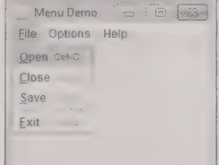

图 33-2 添加助记符和加速器后的 File 菜单

# 为菜单项添加图像和工具提示

你可以向菜单项添加图像，或者使用图像代替文本。最简单的方法是在构造菜单项时使用这些构造函数之一进行指定：

```java
JMenuItem(Icon image)
JMenuItem(String name, Icon image)
```

第一个构造创建一个显示由 `image` 指定图像的菜单项。第二个构造创建一个具有由 `name` 指定名称和由 `image` 指定图像的菜单项。例如，这里 About 菜单项在创建时与一个图像关联：

```java
ImageIcon icon = new ImageIcon("About.gif");
jMenuItemAbout = new JMenuItem("About", icon);
```

此后，当显示 Help 菜单时，`icon` 指定的图标将显示在文本 "About" 旁边。这如图 33-3 所示。你也可以在菜单项创建后通过调用 `setIcon()` 为菜单项添加图标，该方法继承自 `AbstractButton`。你可以通过调用 `setHorizontalTextPosition()` 来指定图像相对于文本的水平对齐方式。

你可以通过调用 `setDisabledIcon()` 指定一个禁用图标，当菜单项被禁用时会显示。通常情况下，默认图标显示灰色。如果指定了禁用图标，则当菜单项被禁用时会显示该图标。

工具提示是一个描述项目的小消息。如果鼠标悬停在项目上片刻，它会自动显示。你可以通过在项目上调用 `setToolTipText()` 为菜单项添加工具提示，并指定你想显示的文本。此处所示：

```java
void setToolTipText(String msg)
```

在这种情况下，`msg` 是当工具提示激活时将显示的字符串。例如，这为 About 创建了一个工具提示：

```java
jmiAbout.setToolTipText("Info about the MenuDemo program.");
```

有趣的是，`setToolTipText()` 是 `JMenuItem` 继承自 `JComponent` 的。这意味着你可以为其他类型的组件（如推按钮）添加工具提示。你可能想自己尝试一下。

# 使用 JRadioButtonMenuItem 和 JCheckBoxMenuItem

虽然前面的示例中使用的菜单项类型从通常来说是最常用的，但 Swing 定义了另外两种：复选框和单选按钮。这些项可以通过允许菜单提供功能，从而简化 GUI，而这些功能通常需要额外的独立组件。此外，有时在菜单中包含复选框或单选按钮似乎是某组特定功能的最自然位置。无论原因何，Swing 都让在菜单中使用复选框和单选按钮变得简单，这里将对这两者都进行检查。

要在菜单中添加复选框，请创建一个 `JCheckBoxMenuItem`。它定义了几个构造函数。本章使用的是这个：

```java
JCheckBoxMenuItem(String name)
```

在这里，`name` 指定项的名称。复选框的初始状态是未选中的。如果你想指定初始状态，可以使用此构造函数：

```java
JCheckBoxMenuItem(String name, boolean state)
```

在这种情况下，如果 `state` 为 true，则框初始为勾选。否则，它将被清除。`JCheckBoxMenuItem` 还提供了允许你指定图标的构造函数。这里有一个示例：

```java
JCheckBoxMenuItem(String name, Icon icon)
```

在这种情况下，`name` 指定项的名称，与项关联的图像传递 `icon`。项初始为未勾选。还支持其他构造函数。菜单中的复选框工作方式类似于独立的复选框。例如，当它们状态改变时会产生动作和项事件。当你有可选项目并想要显示它们的勾选/未勾选状态时，复选框在菜单中特别有用。


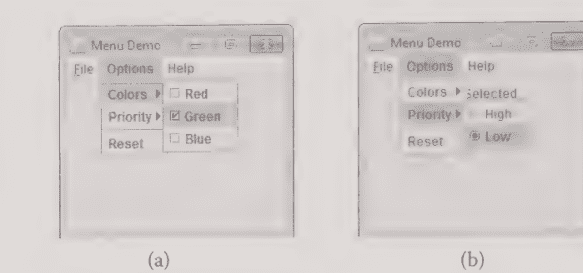

图 33-4 复选框 (a) 和单选按钮 (b) 菜单项的效果

可以通过创建 `JRadioButtonMenuItem` 对象向菜单添加单选按钮。`JRadioButtonMenuItem` 继承自 `JMenuItem`。它提供了丰富的构造函数组合。本章使用的这里的：

```java
JRadioButtonMenuItem(String name)
JRadioButtonMenuItem(String name, boolean state)
JRadioButtonMenuItem(String name, Icon icon, boolean state)
```

这创建一个与传递的 `name` 和传递的 `icon` 关联的单选按钮菜单项。如果 `state` 为 true，它初始为选中。否则，它为未选中。支持若干其他构造函数。

`JRadioButtonMenuItem` 工作类似于独立的单选按钮，产生项和动作事件。类似于独立的单选按钮，基于菜单的单选按钮必须放入按钮组以获取互斥选择行为。由于 `JCheckBoxMenuItem` 和 `JRadioButtonMenuItem` 继承自 `JMenuItem`，每个都具有 `JMenuItem` 提供的所有功能。除了具有复选框和单选按钮的额外能力外，它们的行为和外观与其他菜单项相似。要检查复选框和单选按钮菜单项，首先移除示例程序中创建 Options 菜单的代码。然后替换以下代码序列，该序列在 Colors 子菜单中使用复选框，在 Priority 菜单中使用单选按钮。在进行替换后，Options 菜单将如图 33-4 所示。

```java
// 创建 Options 菜单。
JMenu jOptions = new JMenu("Options");

// 创建 Colors 子菜单。
JMenu jColors = new JMenu("Colors");

// 使用复选框选择颜色。这允许
// 用户选择多种颜色。
JCheckBoxMenuItem jmiRed = new JCheckBoxMenuItem("Red");
JCheckBoxMenuItem jmiGreen = new JCheckBoxMenuItem("Green");
JCheckBoxMenuItem jmiBlue = new JCheckBoxMenuItem("Blue");

jColors.add(jmiRed);
jColors.add(jmiGreen);
jColors.add(jmiBlue);
jOptions.add(jColors);

// 创建“优先级”子菜单。
JMenu jPriority = new JMenu("Priority");

// 使用单选按钮设置优先级。
// 这让菜单显示使用了哪种优先级，
// 同时确保在任何时候只能选择一个优先级。注意
// “高”单选按钮初始是选中的。
JRadioButtonMenuItem jmiHigh = new JRadioButtonMenuItem("High", true);
JRadioButtonMenuItem jmiLow = new JRadioButtonMenuItem("Low");

jPriority.add(jmiHigh);
jPriority.add(jmiLow);
jOptions.add(jPriority);

// 为单选按钮菜单项创建按钮组。
ButtonGroup bg = new ButtonGroup();
bg.add(jmiHigh);
bg.add(jmiLow);

// 创建“重置”菜单项。
JMenuItem jmiReset = new JMenuItem("Reset");
jOptions.addSeparator();
jOptions.add(jmiReset);

// 最后，将整个选项菜单添加到
// 菜单栏
jmb.add(jOptions);
```


# 创建弹出菜单（Popup Menu）

弹出菜单是菜单栏的一种流行替代或补充。通常，弹出菜单是通过在组件上点击鼠标右键激活的。Swing 通过 `JPopupMenu` 类支持弹出菜单。`JPopupMenu` 有两个构造函数。在本章中，只使用了默认构造函数：

```java
JPopupMenu()
```

它创建一个默认的弹出菜单。另一个构造函数允许你为菜单指定标题。该标题是否显示取决于外观（look and feel）。

通常，弹出菜单的构建与普通菜单类似。首先，创建一个 `JPopupMenu` 对象，然后向它添加菜单项。菜单项的选择也同样处理：通过监听动作事件（action events）。弹出菜单和普通菜单的主要区别在于激活过程。

激活弹出菜单需要三个步骤：

- 你必须为鼠标事件注册一个监听器。
- 在鼠标事件处理程序内部，你必须监控弹出触发。
- 当接收到弹出触发时，你必须调用 `show()` 来显示弹出菜单。

让我们仔细检查每一个步骤。

弹出菜单通常是在鼠标指针悬停在定义了弹出菜单的组件上时通过点击右键激活的。因此，弹出触发通常是由点击启用了弹出菜单的组件引起的。要监听弹出触发，请实现 `MouseListener` 接口，然后通过调用 `addMouseListener()` 方法注册监听器。如第 24 章所述，`MouseListener` 定义了这里显示的方法：

```java
void mouseClicked(MouseEvent me)
void mouseEntered(MouseEvent me)
void mouseExited(MouseEvent me)
void mousePressed(MouseEvent me)
void mouseReleased(MouseEvent me)
```


在这些方法中，有两个相对于弹出菜单来说非常重要：`mousePressed()` 和 `mouseReleased()`。根据安装的外观，这两个事件中的任何一个都可以触发弹出菜单。出于这个原因，使用 `MouseAdapter` 来实现 `MouseListener` 接口并简单地重写 `mousePressed()` 和 `mouseReleased()` 会更方便。

`MouseEvent` 类定义了几个方法，但在激活弹出菜单时通常只需要四个。它们显示在这里：

```
int getX()
int getY()
boolean isPopupTrigger()
Component getComponent()
```

通过调用 `getX()` 和 `getY()` 可以找到鼠标相对于事件源的 X、Y 位置。这些被用于指定显示弹出菜单时的左上角位置。如果事件代表弹出触发，`isPopupTrigger()` 方法返回 `true`，否则返回 `false`。你将使用此方法来确定何时弹出菜单。要获取生成鼠标事件的组件引用，请调用 `getComponent()`。

## 第 33 章 介绍 Swing 菜单

要实际显示弹出菜单，调用 `JPopupMenu` 定义的 `show()` 方法，如下所示：

```
void show(Component invoker, int upper, int upperY)
```

这里，`invoker` 是相对于显示菜单的组件。`upper` 和 `upperY` 的值定义了相对于 `invoker` 的菜单左上角的 X、Y 位置。获取 `invoker` 的常用方法是对传递给鼠标处理器的事件对象调用 `getComponent()`。

前面的理论可以通过在本章开头显示的 `MenuDemo` 程序中添加弹出菜单来实现。该菜单将包含三个项：剪切（Cut）、复制（Copy）和粘贴（Paste）。通过向 `MenuDemo` 添加以下实例变量：

```java
JPopupMenu jpu;
```

`jpu` 变量将持有弹出菜单的引用。

接下来，在 `MenuDemo` 构造函数中添加以下代码序列：

```java
// 创建一个“编辑”弹出菜单。
jpu = new JPopupMenu();

// 创建菜单项。
JMenuItem jmiCut = new JMenuItem("Cut");
JMenuItem jmiCopy = new JMenuItem("Copy");
JMenuItem jmiPaste = new JMenuItem("Paste");

// 将项添加到弹出菜单。
jpu.add(jmiCut);
jpu.add(jmiCopy);
jpu.add(jmiPaste);

// 为触发器添加监听器。
jfrm.addMouseListener(new MouseAdapter() {
    public void mousePressed(MouseEvent me) {
        if (me.isPopupTrigger()) {
            jpu.show(me.getComponent(), me.getX(), me.getY());
        }
    }
    public void mouseReleased(MouseEvent me) {
        if (me.isPopupTrigger()) {
            jpu.show(me.getComponent(), me.getX(), me.getY());
        }
    }
});

// 最后，你需要将这些动作监听器添加到程序中。
// 它们处理用户从弹出菜单选择项时触发的动作事件。
jmiCut.addActionListener(this);
jmiCopy.addActionListener(this);
jmiPaste.addActionListener(this);
```

完成这些添加后，可以通过点击应用程序内容区的任何地方来激活弹出菜单。图 33-5 显示了结果。

关于上述示例的另一个点。因为弹出菜单的调用者总是 `jfrm`，在这种情况下你可以显式地传递它，而不是调用 `getComponent()`。要做到这一点，你必须将 `jfrm` 变为 `MenuDemo` 类的实例变量（而不是局部变量），以便内部类可以访问它。然后你可以使用此 `show()` 调用来显示弹出菜单：

```java
jpu.show(jfrm, me.getX(), me.getY());
```

虽然这在示例中有效，但使用 `getComponent()` 的优势是弹出菜单将自动相对于其调用组件进行弹出。因此，相同的代码可以用于相对于其调用对象显示任何弹出菜单。

图 33-5 一个弹出“编辑”菜单

# 创建工具栏

工具栏既可以作为菜单的替代方案，也可以作为菜单补充的组件。工具栏包含一组按钮（或其他组件），允许用户立即访问各种程序选项。例如，工具栏可能包含选择字体选项的按钮，如**粗体**、**斜体**、高亮或下划线。这些选项无需通过菜单即可选择。通常情况下，工具栏按钮显示图标而非文本，两者或两者兼均可。此外，基于图标的工具栏按钮还关联有工具提示。可以通过拖动工具栏将其放置在窗口的任何侧边，也可以将其完全拖出窗口，在这种情况下它们将变为浮动状态。

在 Swing 中，工具栏是 `JToolBar` 类的实例。它的构造函数允许你创建带标题或不带标题的工具栏。你还可以指定工具栏的布局，可以是水平或垂直的。`JToolBar` 的构造函数所示：

```
JToolBar()
```

```
JToolBar(String title)
```

```
JToolBar(int how)
```

```
JToolBar(String title, int how)
```

第一个构造函数创建一个无标题的水平工具栏。第二个创建一个带有 `title` 指定标题的水平工具栏。标题仅在工具栏被拖出窗口时才会显示。第三个构造创建一个由 `how` 指定方向的工具栏。`how` 的值必须是 `JToolBar.VERTICAL` 或 `JToolBar.HORIZONTAL`。第四个构造函数创建一个带有 `title` 指定标题且由 `how` 指定方向的工具栏。

工具栏通常与使用边界布局（border layout）的窗口一起使用。这有两个原因：第一，它允许工具栏初始定位在四个边界位置之一。通常使用顶部位置。第二，它允许工具栏被拖动到窗口的任何侧边。

除了将工具栏拖到窗口内的不同位置外，你还可以将其拖出窗口。这样做会创建一个未锁定的工具栏。如果你在创建时指定了标题，那么当工具栏取消固定（undocked）时将显示该标题。

你可以在菜单栏中的工具栏添加按钮（或其他组件）。只需调用 `add()` 即可。组件在工具栏中显示的顺序与它们被添加的相同。

一旦创建了工具栏，不需要将其添加到菜单栏（如果存在）。相反，你应该将其添加到窗口容器中。如前所述，通常你会将工具栏添加到边界布局的顶部（即北部），并使用水平方向。受影响的组件被添加到边界布局的中心。使用这种方法可以让程序在开始运行时工具栏位于预期的位置。然而，你也可以将工具栏拖动到其他任何位置。当然，你也可以将工具栏拖出窗口。

为了演示工具栏，我们将在 `MenuDemo` 程序中添加一个。该工具栏将提供三个调试选项：设置断点、清除断点和恢复程序执行。添加工具栏需要三个步骤。

首先，从程序中删除此行代码：

```java
jfrm.setLayout(new FlowLayout());
```

通过删除此行，`JFrame` 会自动使用边界布局。

其次，因为使用了 `BorderLayout`，更改将标签 `jlab` 添加到框架的行，所示：

```java
jfrm.add(jlab, BorderLayout.CENTER);
```

此行显式地将 `jlab` 添加到边界布局的中心。（显式指定中心位置并非绝对必要，因为在使用边界布局时，组件默认会被添加到中心。但是，显式指定中心可以让阅读代码的人清楚地知道正在边界布局，且 `jlab` 位于中心。）

接下来，添加以下代码，它创建一个调试工具栏：

```java
// 创建一个调试工具栏。
JToolBar jtb = new JToolBar("Debug");

// 加载图像。
ImageIcon set = new ImageIcon("setBP.gif");
ImageIcon clear = new ImageIcon("clearBP.gif");
ImageIcon resume = new ImageIcon("resume.gif");

// 创建工具栏按钮。
JButton jbtnSet = new JButton(set);
jbtnSet.setActionCommand("Set Breakpoint");
jbtnSet.setToolTipText("Set Breakpoint");

JButton jbtnClear = new JButton(clear);
jbtnClear.setActionCommand("Clear Breakpoint");
jbtnClear.setToolTipText("Clear Breakpoint");

JButton jbtnResume = new JButton(resume);
jbtnResume.setActionCommand("Resume");
jbtnResume.setToolTipText("Resume");

// 将按钮添加到工具栏。
jtb.add(jbtnSet);
jtb.add(jbtnClear);
jtb.add(jbtnResume);

// 将工具栏添加到内容面板的
// 北（顶部）位置。
jfrm.add(jtb, BorderLayout.NORTH);
```

让我们仔细查看这段代码。首先，创建了一个 `JToolBar` 并赋予其标题 "Debug"。然后，创建了一组 `ImageIcon` 对象，存放工具栏按钮的图像。接下来，创建了三个工具栏按钮。注意每个按钮都有图像但没有文本。此外，每个按钮都显式地赋予了一个操作命令（action command）和一个工具提示（tooltip）。操作命令是：

随后按钮被添加到边界布局的北侧，工具栏被添加到框架的工具栏中。

最后，添加动作监听器：

```java
// 添加动作监听器。
jbtnSet.addActionListener(this);
jbtnClear.addActionListener(this);
jbtnResume.addActionListener(this);
```

每当用户按下工具栏时，都会触发一个事件，如图 33-6 所示。

# 使用 Action

除了继承的 `actionPerformed()` 方法外，`Action` 还定义了自己的几个方法。特别感兴趣的是 `putValue()`。它设置与 Action 关联的各种属性的值，所示：

```java
void putValue(String key, Object val)
```

它将 `val` 分配给由 `key` 指定的属性并保留所需的属性。虽然示例中没有未使用，但值得注意的是 `Action` 还提供了 `getValue()` 方法来获取指定的属性。所示：

```java
Object getValue(String key)
```

它返回由 `key` 指定的属性引用。

`putValue()` 和 `getValue()` 使用的键值所示：

| 键值 | 描述 |
| --- | --- |
| static Final ACCELERATOR_KEY | 代表加速属性。加速器被指定为 `KeyStroke` 对象。 |
| static Final ACTION_COMMAND_KEY | 代表操作命令属性。操作命令指定为字符串。 |
| static Final DISPLAYED_MNEMONIC_INDEX_KEY | 代表作为快捷键显示的字符的索引。这是一个 Integer 值。 |
| static Final LARGE_ICON_KEY | 代表 Action 关联的大图标。图标指定为 `Icon` 类型对象。 |
| static Final LONG_DESCRIPTION | 代表 Action 的详细描述。该描述指定为字符串。 |
| static Final MNEMONIC_KEY | 代表快捷键属性。快捷键指定为 `KeyEvent` 常量。 |
| static Final NAME | 代表 Action 的名称（成为 Action 关联的按钮或菜单项）。名称指定为字符串。 |
| static Final SELECTED_KEY | 代表选中状态。如果设置，则被选中。状态由 Boolean 值表示。 |
| static Final SHORT_DESCRIPTION | 代表 Action 关联的工具提示文本。工具提示指定为字符串。 |
| static Final SMALL_ICON | 代表 Action 关联的小图标。图标指定为 `Icon` 类型对象。 |

图 33-6 运行中的调试工具栏

例如，要将记忆快捷键设置为字母 X，请使用此 `putValue()` 调用：

```java
actionOb.putValue(MNEMONIC_KEY, KeyEvent.VK_X);
```

有一个 Action 属性无法通过 `putValue()` 和 `getValue()` 访问即启用/禁用状态。对于该状态，你使用 `setEnabled()` 和 `isEnabled()` 方法。它们显示在此：

```
void setEnabled(boolean enabled)
boolean isEnabled();
```

对于 `setEnabled()`，如果 `enabled` 为 true，则该 action 是启用的；否则，它被禁用了。如果 action 是启用的，`isEnabled()` 返回 true；否则，返回 false。

虽然你可以实现 Action 接口的所有方法，但通常你不需要去实现它。Swing 提供了一个名为 `AbstractAction` 的部分实现，你可以对其进行扩展。通过扩展 `AbstractAction`，你只需要实现一个方法：`actionPerformed()`。其他 Action 方法由框架为你提供。`AbstractAction` 提供三个构造函数。在本章中使用的显示在此：

```
AbstractAction(String name, Icon image)
```

它构造了一个具有 `name` 指定名称和 `image` 指定图标的 `AbstractAction`。一旦你创建了 action，它就可以被添加到 `JToolBar` 并用于构造一个 `JMenuItem`。要向 `JToolBar` 添加 action，请使用此版本的 `add()`：

```
JButton add(Action actObj)
```

在这里，`actObj` 是正在添加到工具栏的 action。由 `actObj` 定义的属性用于创建工具栏按钮。要从 action 创建菜单项，请使用此 `JMenuItem`：

```
JMenuItem(Action actObj)
```

在这里，`actObj` 是根据其属性构造菜单项的 action。

> 注意 除 `JToolBar`、`JButton`、`JRadioButton` 和 `JCheckBox` 之外，其他 Swing 组件也支持 action，例如 `JPopupMenu`、`JRadioButton` 和 `JMenuItem` 也支持 action。

为了说明 action 的优势，我们将使用它们来管理上一节中创建的 Debug 工具栏。我们会在 Options 主菜单下添加一个 Debug 子菜单。Debug 子菜单将包含与 Debug 工具栏相同的选择：设置断点 (Set Breakpoint)、清除断点 (Clear Breakpoint) 和恢复 (Resume)。支持工具栏中这些项的相同 action 也支持菜单中的这些项。因此，不需要创建重复代码来同时处理工具栏和菜单，两者都由 action 来处理。

从创建一个名为 `DebugAction` 并扩展 `AbstractAction` 的内部类开始，如下：


```java
// 为 Debug 菜单和工具栏创建一个 action 类
class DebugAction extends AbstractAction {
    public DebugAction(String name, Icon image, int mnem,
        int accel, String tTip) {
        super(name, image);
        putValue(ACCELERATOR_KEY,
            KeyStroke.getKeyStroke(accel,
                InputEvent.CTRL_DOWN_MASK));
        putValue(MNEMONIC_KEY, mnem);
        putValue(SHORT_DESCRIPTION, tTip);
    }

    // 处理工具栏和 Debug 菜单的事件。
    public void actionPerformed(ActionEvent ae) {
        String comStr = ae.getActionCommand();

        jlab.setText(comStr + " Selected");

        // 切换设置断点和清除断点的启用状态。
        if (comStr.equals("Set Breakpoint")) {
            clearAct.setEnabled(true);
            setAct.setEnabled(false);
        } else if (comStr.equals("Clear Breakpoint")) {
            clearAct.setEnabled(false);
            setAct.setEnabled(true);
        }
    }
}
```

`DebugAction` 扩展了 `AbstractAction`。它创建用于定义与 Debug 菜单和工具栏相关属性的 action 类。它的构造函数有五个参数，允许你指定以下项目：

- 名称 (Name)
- 图标 (Icon)
- 记忆 (Mnemonic)
- 加速 (Accelerator)
- 提示 (Tooltip)

前两个通过 `super` 传递给 `AbstractAction` 的构造函数。其他三个属性通过调用 `putValue()` 设置。

`DebugAction` 的 `actionPerformed()` 方法处理 action 的事件。这意味着当使用 `DebugAction` 实例创建工具栏按钮和菜单项时，由其中任一组件生成的事件都由 `DebugAction` 中的 `actionPerformed()` 方法处理。注意，该处理器处理了 `jlab` 中的选择。此外，如果选择了“设置断点”选项，则“清除断点”选项被启用而“设置断点”选项被禁用。如果选择了“清除断点”选项，则“设置断点”选项被启用而“清除断点”选项被禁用。这说明了如何使用 action 来启用或禁用组件。当一个 action 在所有用途中被禁用时（在这种情况下，如果“设置断点”被禁用，那么它在工具栏和菜单中都会禁用）。

接下来，将这些 `DebugAction` 实例变量添加到 `MenuDemo`：

```java
DebugAction setAct;
DebugAction clearAct;
DebugAction resumeAct;
```

接下来，创建三个代表 Debug 选项的 Icon，如下：

```java
// 加载 action 的图像。
ImageIcon setIcon = new ImageIcon("setBP.gif");
ImageIcon clearIcon = new ImageIcon("clearBP.gif");
ImageIcon resumeIcon = new ImageIcon("resume.gif");
```

现在，创建这些项，如下：

```java
// 创建项。
JMenuItem setItem = new JMenuItem("Set Breakpoint");
JMenuItem clearItem = new JMenuItem("Clear Breakpoint");
JMenuItem resumeItem = new JMenuItem("Resume");
```

最后，将 action 添加到项中：

```java
// 将 action 添加到项。
setItem.setAction(setAct);
clearItem.setAction(clearAct);
resumeItem.setAction(resumeAct);
```

接下来，将这些项添加到菜单：

```java
// 将项添加到菜单。
debugMenu.add(setItem);
debugMenu.add(clearItem);
debugMenu.add(resumeItem);
```


```java
// 构建 Debug 动作。
makeActions();

// 创建工具栏。
makeToolBar();

// 创建 Options 菜单。
makeOptionsMenu();

// 创建 Help 菜单。
makeHelpPenu();

// 创建 Edit 弹出菜单。
makeEditPUMenu();

// 为弹出窗口触发器添加鼠标监听器。
jfrm.addMouseListener(new MouseAdapter() {
    public void mousePressed(MouseEvent me) {
        if(me.isPopUpTrigger()) {
            jpu.show(me.getComponent()
    }
});
```

# 第 33 章 介绍 Swing 菜单

```java
// 用于 Debug 菜单和工具栏的动作类。
class DebugAction extends AbstractAction {
    public DebugAction(String name, Icon image, int mnem,
        int accel, String tTip) {
        super(name, image);
        putValue(ACCELERATOR_KEY,
            KeyStroke.getKeyStroke(accel,
                InputEvent.CTRL_DOWN_MASK));
        putValue(MNEMONIC_KEY, mnem);
        putValue(SHORT_DESCRIPTION, tTip);
    }
}
```

```java
// 处理工具栏和 Debug 菜单的事件。
public void actionPerformed(ActionEvent ae) {
    String comstr = ae.getActionCommand();
    jlab.setText(comstr + " Selected");
}
```

```java
// 切换 Set 和 Clear Breakpoint 选项的启用状态。
if (comstr.equals("Set Breakpoint")) {
    clearAct.setEnabled(true);
    setAct.setEnabled(false);
} else if (comstr.equals("Clear Breakpoint")) {
    clearAct.setEnabled(false);
    setAct.setEnabled(true);
}
```

```java
// 创建带有记忆键和快捷键的 File 菜单。
void makeFileMenu() {
    JMenuItem jFile = new JMenuItem("File");
    jFile.setMnemonic(KeyEvent.VK_F);

    JMenuItem jmiOpen = new JMenuItem("Open");
    jmiOpen.setMnemonic(KeyEvent.VK_O);
    jmiOpen.setAccelerator(
        KeyStroke.getKeyStroke(KeyEvent.VK_O,
            InputEvent.CTRL_DOWN_MASK));

    JMenuItem jmiClose = new JMenuItem("Close");
    jmiClose.setMnemonic(KeyEvent.VK_C);
    jmiClose.setAccelerator(
        KeyStroke.getKeyStroke(KeyEvent.VK_C,
            InputEvent.CTRL_DOWN_MASK));

    JMenuItem jmiSave = new JMenuItem("Save");
    jmiSave.setMnemonic(KeyEvent.VK_S);
    jmiSave.setAccelerator(
        KeyStroke.getKeyStroke(KeyEvent.VK_S,
            InputEvent.CTRL_DOWN_MASK));

    jmiFile.add(jmiOpen);
    jmiFile.add(jmiClose);
    jmiFile.add(jmiSave);
    jmiFile.addSeparator();
    jmiFile.add(jmiExit);
    jmb.add(jmiFile);

    // 为 File 菜单添加动作监听器。
    jmiOpen.addActionListener(this);
    jmiClose.addActionListener(this);
    jmiSave.addActionListener(this);
    jmiExit.addActionListener(this);
}

// 创建 Options 菜单。
void makeOptionsMenu() {
    JMenuItem jmiOptions = new JMenu("Options");

    // 创建 Colors 子菜单。
    jmiColors = new JMenu("Colors");

    // 使用复选框处理颜色。这允许用户选择多一种颜色。
    JCheckBox jmiRed = new JCheckBoxMenuItem("Red");
    JCheckBox jmiGreen = new JCheckBoxMenuItem("Green");
    JCheckBox jmiBlue = new JCheckBoxMenuItem("Blue");

    // 将项添加到 Colors 菜单。
    jmiColors.add(jmiRed);
    jmiColors.add(jmiGreen);
    jmiColors.add(jmiBlue);
    jmiOptions.add(jmiColors);

    // 创建 Priority 子菜单。
    JMenuItem jmiPriority = new JMenu("Priority");

    // 将项添加到 Priority 菜单。
    jmiPriority.add(jmiHigh);
    jmiPriority.add(jmiLow);
    jmiOptions.add(jmiPriority);

    // 为单选按钮菜单项创建一个按钮组。
    ButtonGroup bg = new ButtonGroup();
    bg.add(jmiHigh);
    bg.add(jmiLow);

    // 现在，创建一个位于 Options 菜单栏项下方的 Debug 子菜单。使用动作来创建这些项。
    JMenu jDebug = new JMenu("Debug");
    JMenuItem jmiSetBP = new JMenuItem(setAction);
    JMenuItem jmiClearBP = new JMenuItem(clearAct);
    JMenuItem jmiResume = new JMenuItem(resumeAct);

    // 将项添加到 Debug 菜单。
    jDebug.add(jmiSetBP);
    jDebug.add(jmiClearBP);
    jDebug.add(jmiResume);

    // 创建 Reset 项。
    JMenuItem jmiReset = new JMenuItem("Reset");
    jDebug.addSeparator();
    jDebug.add(jmiReset);
}
```


从一组数据点生成饼图的软件是一个可以在本地执行的 Bean 示例。然而，一个提供来自股票或大宗交易所实时价格信息的 Bean 则需要与其他分布式软件协作以获取其数据。

## Beans 的优势

以下列表列出了 JavaBeans 技术对组件开发人员的一些益处：

- Bean 享有了 Java “一次编写，到处运行”范式的所有优势。
- Bean 类中被暴露给另一个应用程序的属性、事件和方法可以被控制。
- 可以提供辅助软件来帮助配置 Bean。这仅在设置该组件的设计时参数时才需要。它不需要包含在运行时环境中。
- Bean 的状态可以保存到持久化存储中，并在稍后的时间恢复。
- Bean 可以注册以接收来自其他对象的事件，并可以生成发送给其他对象的事件。

## 内省

Bean 编程的核心是内省。这是分析 Bean 以确定其能力的过程。这是 JavaBeans API 的一项至性功能，因为它允许另一个应用程序（如设计工具）获取有关组件的信息。如果没有内省，JavaBeans 技术将无法运行。

Bean 的开发者可以通过两种方式指示其哪些属性、事件和方法应该被暴露。第一种方法使用了简单的命名约定。这些约定允许内省机制推断出有关 Bean 的信息。第二种方法是提供一个扩展 `BeanInfo` 的额外类，显式地指定这些信息。这里对这两种方法进行了探讨。

## 属性的设计模式

属性是 Bean 状态的一个子集。分配属性的值决定了该组件的行为和外观。属性通过设置方法（setter）设置。属性通过获取方法（getter）获取。属性有两种类型：简单属性和索引属性。

### 简单属性

简单属性只有一个值。可以通过以下设计模式进行识别，其中 N 是属性名称，T 是其类型：

```java
public T getN()
public void setN(T arg)
```

读写属性同时具有这两个方法来访问其值。只读属性只有一个 get 方法。只写属性只有一个 set 方法。

这里是三个读写简单属性以及它们的 getter 和 setter 方法：

```java
private double depth, height, width;

public double getDepth() {
    return depth;
}

public void setDepth(double d) {
    depth = d;
}

public double getHeight() {
    return height;
}

public void setHeight(double h) {
    height = h;
}

public double getWidth() {
    return width;
}

public void setWidth(double w) {
    width = w;
}
```

注意：对于布尔属性，也可以使用 `isPropertyName()` 形式的方法作为访问器。

### 索引属性

索引属性由多个值。可以通过以下设计模式进行识别，其中 N 是属性名称，T 是其类型：

```java
public T getN(int index);
public void setN(int index, T value);
public T[] getN();
public void setN(T[] values);
```

这里是一个名为 `data` 的索引属性以及它的 getter 和 setter 方法：

```java
private double data[];
```


```java
public double getData(int index) {
    return data[index];
}

public void setData(int index, double value) {
    data[index] = value;
}

public double[] getData() {
    return data;
}

public void setData(double[] values) {
    data = new double[values.length];
    System.arraycopy(values, 0, data, 0, values.length);
}
```


## 事件的设计模式

Beans 使用本书在此之前讨论过的委托事件模型。Beans 可以生成事件并将其发送给其他对象。这些可以通过以下设计模式进行识别，其中 `T` 是事件的类型：

```java
public void addTLListener(EventListener eventListener)
public void addTListener(TEventListener eventListener)
    throws java.util.TooManyListenersException
public void removeEventListener(EventListener eventListener)
```

这些方法用于为指定事件添加或移除监听器。一个不抛出异常的 `addTLListener()` 版本可以广播事件，这意味着可以有多个监听器注册该事件通知。抛出 `TooManyListenersException` 的版本在事件发生时触发，这意味着监听器的数量被限制为一个。在何种情况下，`removeEventListener()` 都用于移除监听器。例如，假设事件接口类型为 `TemperatureListener`，监控温度的 Bean 可能会提供以下方法：

```java
public void addTemperatureListener(TemperatureListener t1)
{
public void removeTemperatureListener(TemperatureListener t1) {
..
```

## 方法与设计模式

设计模式不用于命名属性方法。内省机制会找到 Bean 的所有公共方法。受保护和私有的方法不会被呈现。

## 使用 BeanInfo 接口

如前面的讨论所示，设计模式隐式地决定了 Bean 用户可以使用的哪些信息。`BeanInfo` 接口允许你显式地控制哪些信息可用，包括：

```java
PropertyDescriptor[] getPropertyDescriptors()
EventDescriptor[] getEventDescriptors()
MethodDescriptor[] getMethodDescriptors()
```

它们返回关于属性、事件和方法的对象数组。`PropertyDescriptor`、`EventDescriptor` 和 `MethodDescriptor` 类定义在 `java.beans` 包中。通过实现这些方法，开发者可以指定具体内容。在实现 `BeanInfo` 时，必须调用这些方法。例如，如果 Bean 类名为 `MyBean`，类名为 `MyBeanInfo`。

为了简化 `BeanInfo` 的使用，JavaBeans 提供了 `SimpleInfo` 类。它提供了 `BeanInfo` 方法的默认实现。你可以扩展此类并重写一个或多个方法，以显式控制 Bean 的方面。如果你不重写方法，将使用内省。稍后我们将看到 `SimpleInfo` 的作用。

## 绑定属性与受限属性

拥有属性的 Bean 在属性更改时会生成事件。该事件类型为 `PropertyChangeEvent`，并发送给之前对此通知感兴趣的对象。处理此类事件的类必须实现 `PropertyChangeListener`。

受限属性的 Bean 在尝试更改其值时会生成事件。它也会向之前对此通知感兴趣的对象发送 `PropertyChangeEvent`。然而，其他对象有能力通过抛出 `PropertyVetoException` 来否决建议的更改。这种能力允许 Bean 根据其运行时环境运行。处理此类事件的类必须实现 `VetoChangeListener` 接口。

## 持久化

持久化是保存 Bean 当前状态（包括 Bean 属性和实例变量的值）并在以后恢复它们的能力。Java 类库提供的对象序列化功能用于为 Bean 提供持久化。

序列化最简单的方法是实现 `java.io.Serializable` 接口，它仅仅是一个标记接口。实现 `java.io.Serializable` 会使序列化自动化。你的 Bean 不需要其他操作。自动序列化是可以继承的。因此，如果 Bean 的子类实现了 `java.io.Serializable`，就可以获得自动序列化。

在使用自动序列化时，可以使用 `transient` 关键字选择性地防止某个字段被保存。因此，标记为 `transient` 的 Bean 数据成员不会被序列化。

如果 Bean 没有实现 `java.io.Serializable`，你必须自己提供序列化实现，例如实现 `java.io.Externalizable`。否则，容器无法保存 bean 的配置。

## 定制器

Bean 开发者可以提供一个帮助其他开发者配置 Bean 的定制器。定制器可以为在特定上下文中使用组件时必须遵循的过程提供逐步指南。还可以提供在线文档。Bean 开发者具有极大的活性来开发定制器，使其在市场中脱颖而出。

1114 第四部分 应用 Java

| 接口 | 描述 |
| --- | --- |
| `AppletInitializer` | 此接口中的方法用于初始化同样作为 applet 的 Beans。（已被 JDK 9 弃用。） |
| `BeanInfo` | 此接口允许设计者指定关于 Bean 的属性、事件和方法的信息。 |
| `Customizer` | 此接口允许设计者提供图形用户界面，通过该界面可以对 Bean 配置。 |
| `DesignMode` | 此接口中的方法确定 Bean 是否在设计模式下执行。 |
| `ExceptionListener` | 当发生异常时，会调用此接口中的方法。 |
| `PropertyChangeListener` | 当绑定属性发生变化时，会调用此接口中的方法。 |
| `PropertyEditor` | 实现此接口的对象允许设计者更改和显示属性值。 |
| `VetoableChangeListener` | 当受限属性发生变化时，会调用此接口中的方法。 |
| `Visibility` | 此接口中的方法允许 Bean 在没有图形用户界面的环境中执行。 |

表 34-1 `java.beans` 中的接口

## JavaBeans API

JavaBeans 功能由 `java.beans` 包中的一组类和接口提供。从 JDK 9 开始，该包位于 `java.desktop` 模块中。本节提供了其内容的简要概述。表 34-1 列出了 `java.beans` 中的接口，并简要描述了它们的功能。表 34-2 列出了 `java.beans` 中的类（续）。

| 类 | 描述 |
| --- | --- |
| `BeanDescriptor` | 此类提供关于 Bean 的信息。它还允许将自定义器（customizer）与 Bean 关联。 |
| `Beans` | 此类用于获取关于 Bean 信息。 |
| `DefaultPersistenceDelegate` | `PersistenceDelegate` 的子类。 |
| `Encoder` | 编码 Bean 的状态。可以将此信息写入流。 |
| `EventHandler` | 支持动态事件监听器的创建。 |
| `EventSetDescriptor` | 此类的实例描述了 Bean 可以生成的事件。 |
| `Expression` | 封装了返回结果的方法调用。 |
| `FeatureDescriptor` | 它是 `PropertyDescriptor`、`EventSetDescriptor` 和 `MethodDescriptor` 等类的子类。 |

表 34-2 `java.beans` 中的类（续）

| 类 | 描述 |
| --- | --- |
| `IndexedPropertyChangeEvent` | `PropertyChangeEvent` 的子类，表示索引属性的变化。 |
| `IndexedPropertyDescriptor` | 此类的实例描述 Bean 的索引属性。 |
| `IntrospectionException` | 如果分析 Bean 时发生问题，则生成此类型的异常。 |
| `Introspector` | 此类分析 Bean 并构造一个描述该组件的 `BeanInfo` 对象。 |
| `MethodDescriptor` | 此类的实例描述 Bean 的方法。 |
| `ParameterDescriptor` | 此类的实例描述方法参数。 |
| `PersistenceDelegate` | 处理对象的状态。 |
| `PropertyChangeEvent` | 当绑定或受限属性发生变化时，会生成此事件。它被发送到注册在其感兴趣的对象以及实现了 `PropertyChangeListener` 或 `VetoChangeListener` 接口的事件。 |
| `PropertyChangeListenerProxy` | 继承 `EventListener` 并实现 `PropertyChangeListener` |
| `PropertyChangeListenerSupport` | 绑定了属性的 Bean 可以此类来通知 `PropertyChangeListener` 对象。 |
| `PropertyDescriptor` | 此类的实例描述 Bean 的属性。 |
| `PropertyManager` | 此类为给定类型查找 `PropertyEditor`。 |
| `PropertyEditorSupport` | 此类提供了在编写属性编辑器时可以使用的功能。 |
| `PropertyVetoException` | 如果对受限属性的更改被否决，则生成此类型的异常。 |
| `SimpleBeanInfo` | 此类提供了在编写 `BeanInfo` 类时可以使用的功能。 |
| `Statement` | 封装了方法调用。 |
| `VetoChangeListenerProxy` | 继承 `EventListener` 并实现 `VetoChangeListener` |
| `VetoChangeSupport` | 支持受限属性的 Bean 可以此类来通知 `VetoChangeListener` 对象。 |
| `XMLDecoder` | 用于从 XML 文档读取 Bean。 |
| `XMLEncoder` | 用于将 Bean 写入 XML 文档。 |

表 34-2 `java.beans` 中的类

虽然讨论所有类出了本章的范围，但四个类特别受关注：`Introspector`、`PropertyDescriptor`、`EventSetDescriptor` 和 `MethodDescriptor`。这里对它们分别进行了简要检查。

### Introspector

`Introspector` 类提供了几个支持内省的静态方法。主要感兴趣的是 `getBeanInfo()`。该方法返回一个 `BeanInfo` 对象，可以用于获取关于 Bean 的信息。`getBeanInfo` 方法有多种形式，包括此处所示：

```java
static BeanInfo getBeanInfo(Class<?>) throws IntrospectionException
```

返回的对象包含由 bean 指定的 Bean 信息。

### PropertyDescriptor

`PropertyDescriptor` 类描述 Bean 属性的特征。它支持多种管理和描述属性的方法。例如，你可以通过调用 `isBound()` 来确定属性是否是绑定的。要确定属性是否是受限的，调用 `isConstrained()`。你可以通过 `getName()` 获取属性的名称。

### EventSetDescriptor

`EventSetDescriptor` 类表示一组 Bean。它支持多种方法来获取 Bean 用于添加或删除监听器的方法，以及其他管理事件的方法。例如，要使用方法添加监听器，调用 `addEventListenerMethod()`。获取删除监听器的方法，调用 `removeListenerMethod()`。获取监听器的类型，调用 `getListenerType()`。

### MethodDescriptor

`MethodDescriptor` 类表示 Bean 的方法。它支持多种管理和描述方法的方法。例如，你可以通过调用 `isBound()` 来确定方法是否是绑定。要确定方法是否是受限的，调用 `isConstrained()`。你可以通过 `getName()` 获取方法的名称。

```java
System.out.println("Events:");
EventSetDescriptor eventDescriptor[] = 
    beanInfo.getEventSetDescriptors();
for (int i = 0; i < eventSetDescriptor.length; i++) {
    System.out.println("\t" + eventDescriptor[i].getName());
}
catch (Exception e) {
    System.out.println("Exception caught. " + e);
}
```

该程序的输出如下：

- 属性（Properties）：

  - `rectangular`

- 事件（Events）：

  - `mouseWheel`
  - `mouse`
  - `mouseMotion`
  - `component`
  - `hierarchyBounds`
  - `focus`
  - `hierarchy`
  - `propertyChange`
  - `inputMethod`
  - `key`

注意输出中的两点。首先，由于 `ColorsBeanInfo` 重写了 `getPropertyDescriptors()`，返回的属性只有 `setrectangular`，因此只显示了 `rectangular` 属性。然而，由于 `ColorsBeanInfo` 没有重写 `getEventDescriptors()`，使用了设计模式检查，找到了所有的事件，包括 `Colors` 超类和 `Canvas` 中的事件。记住，如果你没有重写 `SimpleBean` 定义的某个 "get" 方法，就会使用默认的设计模式检查。为了观察 `ColorsBeanInfo` 带来的差异，请删除它的类文件并重新运行 `IntrospectorDemo`。这次它将报告更多的属性。

# 第 35 章 介绍 Servlet

本章将介绍 Servlet。Servlet 是在 Web 连接的服务器端执行的微型程序。Servlet 的主题非常庞大，涵盖所有内容超出了本章的范围。相反，我们将重点关注核心概念、接口和类，并开发几个示例。

## 背景

为了理解 Servlet 的优势，你必须了解 Web 浏览器和服务器如何协作为用户提供内容。考虑一个对静态网页的请求。用户在浏览器中输入统一资源定位符（URL）。浏览器向相应的 Web 服务器生成一个 HTTP 请求。Web 服务器将此请求映射到特定文件。该文件通过 HTTP 响应返回给服务器。响应中的 HTTP 头部指示了内容的类型。多用途互联网邮件扩展（MIME）被用于此目的。例如，普通 ASCII 文本的 MIME 类型为 `text`。网页的超文本标记语言（HTML）源码的 MIME 类型为 `text/html`。

现在考虑动态内容。假设一家在线商店使用数据库存储其业务信息。这包括待售物品、价格、可用性、订单等。它希望通过网页让客户能够访问这些信息。这些网页的内容将是动态生成的，以反映数据库中的最新信息。

在 Web 早期，服务器可以通过创建一个独立的进程来处理每个客户端请求，从而动态构建页面。该进程将打开到一个或多个数据库的连接以获取必要信息。它通过称为通用网关接口（CGI）的接口与 Web 服务器通信。CGI 允许独立进程从 HTTP 请求中读取数据并将数据写入 HTTP 响应。使用多种不同的语言来构建 CGI 程序，C、C++ 和 Perl。

然而，CGI 遭遇了严重的性能问题。在处理器和内存资源方面，为每个客户端请求创建一个独立的进程是昂贵的。为每个客户端请求打开和关闭数据库连接也是昂贵的。此外，CGI 程序不依赖平台。因此，引入了一些新技术，其中就 Servlet。

与 CGI 相比，Servlet 具有几个优势。首先，性能显著更好。Servlet 在 Web 服务器的地址内执行。不需要为处理每个客户端请求创建一个独立的进程。其次，Servlet 是用 Java 编写的，因此它们是跨平台的。第三，服务器上的 Java 安全管理器执行了一系列限制，以保护服务器机器上的资源。最后，Java 类库的完整功能供 Servlet 使用。它可以通过你已经过的 sockets 和 RMI 机制与其他软件通信。

## Servlet 的生命周期

三个方法对于 Servlet 的生命周期至关重要。这些方法是 `init()`、`service()` 和 `destroy()`。它们由每个 Servlet 实现，并在特定时间由服务器调用。让我们考虑一个典型的用户场景来理解这些方法何时被调用。

首先，假设用户输入统一资源定位符（URL）。浏览器向相应的 Web 服务器生成一个 HTTP 请求。Web 服务器将此请求映射到特定文件。该文件通过 HTTP 响应返回给服务器。响应中的 HTTP 头部指示了内容的类型。多用途互联网邮件扩展（MIME）被用于此目的。例如，普通 ASCII 文本的 MIME 类型为 `text`。网页的超文本标记语言（HTML）源码的 MIME 类型为 `text/html`。


现在考虑动态内容。假设一家在线商店使用数据库存储其业务信息。这包括待售物品、价格、可用性、订单等。它希望通过网页让客户能够访问这些信息。这些网页的内容将是动态生成的，以反映数据库中的最新信息。

在 Web 早期，服务器可以通过创建一个独立的进程来处理每个客户端请求，从而动态构建页面。该进程将打开到一个或多个数据库的连接以获取必要信息。它通过称为通用网关接口（CGI）的接口与 Web 服务器通信。CGI 允许独立进程从 HTTP 请求中读取数据并将数据写入 HTTP 响应。使用多种不同的语言来构建 CGI 程序，C、C++ 和 Perl。

然而，CGI 遭遇了严重的性能问题。在处理器和内存资源方面，为每个客户端请求创建一个独立的进程是昂贵的。为每个客户端请求打开和关闭数据库连接也是昂贵的。此外，CGI 程序不依赖平台。因此，引入了一些新技术，其中就 Servlet。

与 CGI 相比，Servlet 具有几个优势。首先，性能显著更好。Servlet 在 Web 服务器的地址内执行。不需要为处理每个客户端请求创建一个独立的进程。其次，Servlet 是用 Java 编写的，因此它们是跨平台的。第三，服务器上的 Java 安全管理器执行了一系列限制，以保护服务器机器上的资源。最后，Java 类库的完整功能供 Servlet 使用。它可以通过你已经过的 sockets 和 RMI 机制与其他软件通信。

三个方法对于 Servlet 的生命周期至关重要。这些方法是 `init()`、`service()` 和 `destroy()`。它们由每个 Servlet 实现，并在特定时间由服务器调用。让我们考虑一个典型的用户场景来理解这些方法何时被调用。

首先，假设用户输入统一资源定位符（URL）。浏览器向相应的 Web 服务器生成一个 HTTP 请求。Web 服务器将此请求映射到特定文件。该文件通过 HTTP 响应返回给服务器。响应中的 HTTP 头部指示了内容的类型。多用途互联网邮件扩展（MIME）被用于此目的。例如，普通 ASCII 文本的 MIME 类型为 `text`。网页的超文本标记语言（HTML）源码的 MIME 类型为 `text/html`。

## Servlet 开发

要开发 Servlet，你需要访问一个 Servlet 容器。流行的两个有 Glassfish 和 Tomcat。Glassfish 是由 Oracle 赞助的开源项目。Tomcat 由 Apache 软件基金维护。Glassfish 和 Tomcat 都被广泛使用，为开发 Servlet 提供了良好的环境。

## 使用 Tomcat

Tomcat 包含了创建和测试 Servlet 所需的类库、文档和运行时支持。在编写期间，有多个版本的 Tomcat 可用。后续说明使用的是 8.5.31。这里使用此版本的 Tomcat 适用于大多数读者。你可以从 tomcat.apache.org 下载 Tomcat。你应该选择一个适合你环境的版本。

本章中的示例假设 64 位 Windows 环境。假设 64 位版本的 Tomcat 8.5.31 从根目录解压，默认位置为：

```
C:\apache-tomcat-8.5.31-windows-64\apache-tomcat-8.5.31\
```

这是书中示例所假设的位置。如果你在不同位置加载 Tomcat（或使用不同版本的 Tomcat），你将对示例进行相应更改。你可能需要设置环境变量 `JAVA_HOME` 指向 Java 开发工具包的顶级目录。

注意：本节中的所有目录均假设为 8.5.31。如果你安装了不同版本的 Tomcat，你需要调整目录名称和路径以匹配你安装的版本。

安装完成后，通过选择 `apache-tomcat-8.5.31` 目录下 `bin` 中的 `startup.bat` 来启动 Tomcat。要停止 Tomcat，执行 `bin` 目录下的 `shutdown.bat`。

构建 Servlet 所需的类和接口包含在 `servlet-api.jar` 中，位于以下目录：

```
C:\apache-tomcat-8.5.31-windows-64\apache-tomcat-8.5.31\lib
```

为了使 `servlet-api.jar` 可用，请更新你的 CLASPATH 环境变量使其包含以下路径：

```
C:\apache-tomcat-8.5.31-windows-x64\apache-tomcat-8.5.31\lib\servlet-api.jar
```

或者，你也可以在编译 servlets 时指定此文件。例如，以下命令编译了第一个 servlet：

```
javac HelloServlet.java -classpath C:\apache-tomcat-8.5.31-windows-x64\apache-tomcat-8.5.31\lib\servlet-api.jar
```

一旦你编译了 servlet，就必须启用 Tomcat 能够找到它。对于我们的目的来说，这意味着将其放入 Tomcat 的 `webapps` 目录下的子目录，并将其名称输入目录和 `web.xml` 文件中。为了简单起见，本章中的示例将使用 Tomcat 为其自身的示例 servlet 提供的 `web.xml` 文件中的名称。这样，你就不需要为了测试示例 servlet 而创建任何文件或目录。以下是你将遵循的步骤：

首先，将 servlet 的类文件复制到以下目录：

```
C:\apache-tomcat-8.5.31-windows-x64\apache-tomcat-8.5.31\webapps\examples\WEB-INF\classes
```

接下来，将 servlet 的名称和映射添加到以下目录下的 `web.xml` 文件中：

```
C:\apache-tomcat-8.5.31-windows-x64\apache-tomcat-8.5.31\webapps\examples\WEB-INF
```

例如，假设第一个示例名为 `HelloServlet`，你将在定义 servlet 的部分添加以下行代码：

```
<servlet>
  <servlet-name>HelloServlet</servlet-name>
  <servlet-class>HelloServlet</servlet-class>
</servlet>
```

接下来，将以下行添加到定义 servlet 映射的部分：

```
<servlet-mapping>
  <servlet-name>HelloServlet</servlet-name>
  <url-pattern>/servlets/servlet/HelloServlet</url-pattern>
</servlet-mapping>
```

对所有示例遵循此相同的步骤。

## 一个简单的 Servlet

为了熟悉关键 servlet 概念，我们将从构建和测试一个简单的 servlet 开始。基本步骤如下：

1. 创建并编译 servlet 源代码。然后，将 servlet 的类文件复制到正确的目录，并将 servlet 的名称和映射添加到正确的 `web.xml` 文件中。
2. 启动 Tomcat。
3. 启动浏览器并请求该 servlet。

让我们详细检查这些每一个步骤。

### 创建并编译 Servlet 源代码

首先，创建一个 `HelloServlet.java` 文件，其中包含以下程序：

```
import java.io.*;
import javax.servlet.*;

public class HelloServlet extends GenericServlet {

    public void service(ServletRequest request,
        ServletResponse response)
        throws ServletException, IOException {
        response.setContentType("text/html");
        PrintWriter pw = response.getWriter();
        pw.println("<B>Hello!</B>");
        pw.close();
    }
}
```

仔细观察这个程序。首先，注意它导入了 `javax.servlet` 包。该包包含了构建 servlet 所需的类和接口。你将在本章稍后的部分学习更多这些内容。接下来，程序将 `HelloServlet` 定义为 `GenericServlet` 的子类。`GenericServlet` 类提供了简化 servlet 创建的功能。例如，它提供了 `init()` 和 `destroy()` 的版本，这些可以直接原样使用。你只需要 `service()` 方法。

在 `HelloServlet` 内部，重写了继承自 `GenericServlet` 的 `service()` 方法。该方法处理来自客户端的请求。注意第一个参数是一个 `ServletRequest` 对象。这使得 servlet 能够读取由客户端请求提供的数据。第二个参数是 `ServletResponse` 对象。这使得 servlet 能够构建响应。

调用 `setContentType()` 启用了 HTTP 响应的 MIME 类型。在程序中，MIME 类型是 `text/html`。这表示浏览器应该将内容解释为 HTML 源代码。

接下来，`getWriter()` 方法获取一个 `PrintWriter`。任何写入此流的内容都将作为 HTTP 响应的一部分发送给客户端。然后使用 `println()` 写入一些简单的 HTML 源代码作为 HTTP 响应。

编译此源代码并按照上一节所述将 `HelloServlet.class` 文件放置在正确的 Tomcat 目录中。此外，如前所述添加 `HelloServlet.xml` 文件。

### 启动 Tomcat

按照之前的说明启动 Tomcat。在尝试执行 servlet 之前，Tomcat 必须正在运行。


### 启动浏览器并请求 Servlet

启动浏览器并输入此处显示的 URL：

http://localhost:8080/examples/servlets/servlet/HelloServlet

或者，你也可以输入此处显示的 URL：

http://127.0.0.1:8080/examples/servlets/servlet/HelloServlet

这可能是因为 127.0.0.1 被定义为本地机器的 IP 地址。

你将在浏览器显示区域观察 servlet 的输出。它将包含加粗字体的字符串 **Hello!**。

## The Servlet API

两个包包含了构建 servlet 所需的类和接口。

Servlet API 处于持续开发和增强中。`javax.servlet` 包含了建立 servlet 运行框架的类和接口。最重要的接口是 `Servlet`。Servlet API 包含了构建 servlet 所需的类和接口。

### javax.servlet 包

`javax.servlet` 包包含了供 servlet 运行的接口和类。下表总结了其中的关键接口：

| 接口 | 描述 |
| --- | --- |
| Servlet | 定义 servlet 生命周期方法。 |
| ServletConfig | 允许 servlet 获取初始化参数。 |
| ServletContext | 使 servlet 记录事件并访问环境信息。 |
| ServletRequest | 用于读取客户端请求。 |
| ServletResponse | 用于向客户端写入数据。 |

以下表总结了该包提供的核心类：

| 类 | 描述 |
|---|---|
| GenericServlet | 实现 Servlet 和 ServletConfig 接口。 |
| InputStream | 封装读取客户端请求的输入流。 |
| OutputStream | 封装向客户端写入响应的输出流。 |
| ServletException | 表示 servlet 错误。 |
| UnavailableException | 表示 servlet 不可用。 |

让我们详细检查这些接口和类。

#### Servlet 接口

所有 servlet 必须实现 `Servlet` 接口。它声明了服务器在 servlet 生命周期期间调用的 `init()`、`service()` 和 `destroy()` 方法。还提供了一个供 servlet 获取任何初始化参数的方法。Servlet 定义的方法如表 35-1 所示。

`init()`、`service()` 和 `destroy()` 方法由服务器调用。`getServletConfig()` 方法由 servlet 调用以获取初始化参数。servlet 开发者重写 `getInfo()` 方法以提供有用信息（例如版本号）。

| 方法 | 描述 |
|---|---|
| void destroy() | 在 servlet 卸载时调用。 |
| ServletConfig getServletConfig() | 返回包含任何初始化参数的 ServletConfig 对象。 |
| String getInfo() | 返回描述 servlet 的字符串。 |
| void init(ServletConfig sc) throws ServletException | 在 servlet 初始化时调用。可以通过 sc 获取 servlet 初始化参数。如果无法初始化 servlet，应抛出 ServletException。 |
| void service(ServletRequest req, ServletResponse res) throws ServletException, IOException | 调用处理来自客户端的请求。客户端的请求可以通过 req 读取。客户端的响应可以通过 res 写入。如果发生 servlet 或 IO 问题，将产生异常。 |

表 35-1 Servlet 定义的方法

#### ServletConfig 接口

ServletConfig 接口允许 servlet 在加载时获取配置数据。该接口声明的方法总结如下：

| 方法 | 说明 |
| --- | --- |
| ServletContext getServletContext() | 返回此 servlet 的上下文。 |
| String getInitParameter(String param) | 返回名为 param 的初始化参数的值。 |
| Enumeration<String> getInitParameterNames() | 返回所有初始化参数名称的枚举。 |
| String getServletName() | 返回被调用 servlet 的名称。 |

#### ServletContext 接口

ServletContext 允许 servlet 获取有关其运行环境的信息。它的其中几个方法总结在表 35-2 中。

#### HttpServletRequest 接口

HttpServletRequest 允许 servlet 获取有关客户端请求的信息。它的其中几个方法总结在表 35-3 中。

#### HttpServletResponse 接口

HttpServletResponse 允许 servlet 为客户端制定响应。它的其中几个方法总结在表 35-4 中。

| 方法 | 说明 |
| --- | --- |
| Object getAttribute(String attr) | 返回名为 attr 的服务器属性值。 |


## ServletContext 方法

| 方法 | 说明 |
| --- | --- |
| `String getMimeType(String file)` | 返回文件的 MIME 类型。 |
| `String getRealPath(String vpath)` | 返回对应于相对路径 `vpath` 的真实路径（即绝对路径）。 |
| `String getServerInfo()` | 返回有关服务器的信息。 |
| `void log(String s)` | 将 `s` 写入 servlet 日志。 |
| `void log(String s, Throwable e)` | 将 `s` 和 `e` 的堆栈跟踪写入 servlet 日志。 |
| `void setAttribute(String attr, Object val)` | 将 `attr` 指定的属性设置为传入的 `val` 值。 |

表 35-2 ServletContext 定义的不同方法

## ServletRequest 方法

| 方法 | 说明 |
| --- | --- |
| `Object getAttribute(String attr)` | 返回名为 `attr` 的属性值。 |
| `String getCharacterEncoding()` | 返回请求的字符编码。 |
| `int getContentLength()` | 返回请求的大小。如果大小不可用，则返回 -1。 |
| `String getContentType()` | 返回请求类型。如果无法确定类型，则返回 `null` 值。 |
| `ServletInputStream getInputStream(String) throws IOException` | 返回一个 `ServletInputStream`，可用于从请求中读取二进制数据。如果之前在此对象上已调用过 `getReader()`，则抛出 `IllegalStateException`。 |
| `String getParameter(String pname)` | 返回名为 `pname` 的参数值。 |
| `Enumeration<String> getParameterNames()` | 返回此请求参数名称的枚举。 |
| `String[] getParameterValues(String name)` | 返回一个包含与参数 `name` 关联值的数组。 |
| `String getProtocol()` | 返回协议的描述。 |
| `BufferedReader getReader() throws IOException` | 返回一个读取器，可用于从请求中读取文本。如果之前在此对象上已调用过 `getInputStream()`，则抛出 `IllegalStateException`。 |
| `String getRemoteAddr()` | 返回客户端 IP 地址的字符串表示。 |
| `String getHost()` | 返回客户端主机名称的字符串表示。 |
| `String getScheme()` | 返回用于请求的 URL 传输方案（例如 "http", "ftp"）。 |
| `String getServerName()` | 返回服务器名称。 |
| `int getServerPort()` | 返回端口号。 |

表 35-3 ServletRequest 定义的不同方法

## ServletResponse 方法

| 方法 | 说明 |
| --- | --- |
| `String getCharacterEncoding()` | 返回响应的字符编码。 |
| `ServletOutputStream getOutputStream() throws IOException` | 返回一个 `ServletOutputStream`，可用于向响应中写入二进制数据。如果之前在此对象上已调用过 `getWriter()`，则抛出 `IllegalStateException`。 |
| `PrintWriter getWriter() throws IOException` | 返回一个 `PrintWriter`，可用于向响应中写入字符数据。如果之前在此对象上已调用过 `getOutputStream()`，则抛出 `IllegalStateException`。 |
| `void setContentLength(int size)` | 设置响应长度。 |
| `void setContentType(String type)` | 将响应的内容类型设置为 `type`。 |

表 35-4 ServletResponse 定义的不同方法

## GenericServlet 类

`GenericServlet` 类提供了 servlet 基础生命周期方法的实现。`GenericServlet` 实现了 `Servlet` 和 `ServletConfig` 接口。此外，还提供了一个将字符串追加到服务器日志文件的方法。该方法的签名如下：

```
void log(String s)
```

```
void log(String s, Throwable e)
```

在这里，`s` 是要追加到日志的字符串，`e` 是发生的异常。

## ServletInputStream 类

`ServletInputStream` 类继承自 `InputStream`。它由 servlet 容器实现，并提供了一个 servlet 开发者可以使用从客户端请求中读取数据的输入流。除了继承自 `InputStream` 的输入方法外，还提供了一个从流中读取字节的方法，如下所示：

```
int readLine(byte[] buffer, int offset, int size) throws IOException
```

在这里，`buffer` 是从 `offset` 处放置 `size` 个字节的数组。该方法返回实际读取的字节数，如果遇到流结束条件，则返回 -1。

## ServletOutputStream 类

`ServletOutputStream` 类继承自 `OutputStream`。它由 servlet 容器实现，并提供了一个输出流，servlet 开发者可以使用它向客户端响应写入数据。除了 `OutputStream` 提供的输出方法外，它还定义了输出数据到流的方法。

## Servlet 异常类

`javax.servlet` 定义了两个异常。第一个是 `ServletException`，表示发生了问题。第二个是 `UnavailableException`，它继承自 `ServletException`，表示不可用。

## 读取 Servlet 参数

`ServletRequest` 接口包含了允许读取客户端请求中的参数名称和值的方法。我们将开发一个 servlet 来演示它们的用法。示例包含两个文件：页面定义在 `PostParameters.html` 中，servlet 定义在 `PostParametersServlet.java` 中。

`PostParameters.html` 的源代码如下。它定义了一个包含两个标签和两个字段的表格。一个标签是 Employee，另一个是 Phone。还有一个提交按钮。注意表单的 `action` 属性指定了一个 URL。该 URL 指向处理 POST 请求的 servlet。

```html
<html>
<body>
<center>
<form name="Form1"
method="post"
action="http://localhost:8080/examples/servlets/servlet/PostParametersServlet">
<table>
<tr>
<td>Employee</td>
<input type="textbox" name="e" size="25" value="">
</tr>
<tr>
<td>Phone</td>
<input type="textbox" name="p" size="25" value="">
</tr>
</table>
<input type="submit" value="Submit">
</center>
</body>
</html>
```

`PostParametersServlet.java` 的源代码如下。重写了 `service()` 方法以处理客户端请求。`getParameterNames` 方法返回参数名称的枚举。这些名称在循环中处理。你可以看到参数名和值输出到客户端。参数值通过 `getParameter()` 方法获取。

```java
import java.io.*;
import java.util.*;
import javax.servlet.*;

public class PostParametersServlet
extends GenericServlet {

public void service(HttpServletRequest request,
ServletResponse response)
throws ServletException, IOException {

// 获取打印器。
PrintWriter pw = response.getWriter();

// 获取参数名称的枚举。
Enumeration<String> e = request.getParameterNames();

// 显示参数名和值。
while (e.hasMoreElements()) {
String pname = e.nextElement();
pw.print(pname + " = ");
String pvalue = request.getParameter(pname);
pw.println(pvalue);
}
pw.close();
}
}
```

编译 servlet。接下来，将它复制到相应的目录，并按照之前描述的方法更新 `web.xml` 文件。然后，执行以下步骤测试此示例：

1. 启动 Tomcat（如果它尚未运行）。
2. 在浏览器中显示网页。
3. 在文本字段中输入员工姓名和电话号码。
4. 提交网页。

按照这些步骤后，浏览器将显示由 servlet 动态生成的响应。

## javax.servlet.http 包

之前的示例使用了在 `javax.servlet` 中定义的类和接口，例如 `HttpServlet`、`HttpServletResponse` 和 `GenericServlet`，来说明 servlet 的功能。然而，在处理 HTTP 时，你通常会使用 `javax.servlet.http` 中的接口和类。正如你将看到的，它的功能可以轻松构建与 HTTP 请求和响应交互的 servlet。

下表总结了本章使用的接口：

| 接口 | 描述 |
| --- | --- |
| `HttpServletRequest` | 使 servlet 能够从 HTTP 请求中读取数据。 |
| `HttpServletResponse` | 使 servlet 能够向 HTTP 响应写入数据。 |
| `HttpSession` | 允许读取和写入会话数据。 |

下表总结了本章使用的类。其中最重要的是 `HttpServlet`。Servlet 开发者通常扩展此类来处理 HTTP 请求。

| 类 | 描述 |
| --- | --- |
| `Cookie` | 允许在客户端机器上存储状态信息。 |
| `HttpServlet` | 提供处理 HTTP 请求和响应的方法。 |

## HttpServletRequest 接口

`HttpServletRequest` 接口允许 servlet 获取有关客户端请求的信息。它的几个方法显示在表 35-5 中。

## HttpServletResponse 接口

`HttpServletResponse` 接口允许 servlet 向客户端制定 HTTP 响应。其中定义了一些常量。这些常量对应于可以分配给 HTTP 响应的不同状态码。例如，`SC_OK` 表示 HTTP 响应成功，`NOT_FOUND` 表示请求的资源不可用。该接口的几个方法总结在表 35-6 中。

| 方法 | 描述 |
| --- | --- |
| `String getAuthType()` | 返回身份验证方案。 |
| `Cookie[] getCookies()` | 返回此请求中的 cookie 数组。 |
| `long getDateHeader(String field)` | 返回名为 `field` 的日期头部的值。 |
| `String getHeader(String field)` | 返回名为 `field` 的头部字段的值。 |
| `Enumeration<String> getHeaderNames()` | 返回头部名称枚举。 |
| `int getIntHeader(String field)` | 返回名为 `field` 的头部字段的 int 等值。 |
| `String getMethod()` | 返回此请求的 HTTP 方法。 |
| `String getPathInfo()` | 返回位于 servlet 路径之后、URL 查询字符串之前的任何路径信息。 |
| `String getPathTranslated()` | 返回位于 servlet 路径之后、URL 查询字符串之前的任何路径信息，并将其转换为真实路径。 |
| `String getQueryString()` | 返回 URL 中的任何查询字符串。 |
| `String getRemoteUser()` | 返回发布此请求的用户名称。 |
| `String getRequestedSessionId()` | 返回会话 ID。 |
| `String getRequestURI()` | 返回 URI。 |
| `String getBufferRequestURL()` | 返回 URL 中标识 servlet 的部分。 |
| `String getServletPath()` | 返回会话路径。 |
| `HttpSession getSession()` | 返回此请求的会话。如果会话不存在，则创建一个并返回一个。 |
| `HttpSession getSession(boolean new)` | 如果为 `true` 且不存在会话，则为此请求创建并返回会话。否则，返回此请求的现有会话。 |
| `boolean isRequestedSessionIdFromCookie()` | 如果 cookie 包含会话 ID 则返回 `true`。否则返回 `false`。 |
| `boolean isRequestedSessionIdFromURL()` | 如果 URL 包含会话 ID 则返回 `true`。否则返回 `false`。 |
| `boolean isRequestedSessionIdValid()` | 如果请求的会话 ID 在当前会话文中有效则返回 `true`。 |

表 35-5 HttpServletRequest 定义的各种方法

## HttpSession 接口

`HttpSession` 接口允许 servlet 读取和写入与 HTTP 会话关联的状态信息。它的几个方法总结在表 35-7 中。如果会话已经失效，所有这些方法都会抛出 `IllegalStateException`。

| 方法 | 描述 |
| --- | --- |
| `void addCookie(Cookie cookie)` | 向 HTTP 响应中添加 cookie。 |
| `boolean containsHeader(String field)` | 如果 HTTP 响应头部包含命名字段，则返回 `true`。 |
| `String encodeURL(String url)` | 确定会话 ID 是否必须在标识为 `url` 的 URL 中进行编码。如果是，则返回 `url` 的修改版本。否则，返回 `url`。由 servlet 生成的所有 URL 都应该通过此方法处理。 |
| `String encodeRedirectURL(String url)` | 确定会话 ID 是否必须在标识为 `url` 的 URL 中进行编码。如果是，则返回 `url` 的修改版本。否则，返回 `url`。所有传递给 `sendRedirect()` 的 URL 都应该通过此方法处理。 |
| `void setError(int c) throws IOException` | 向客户端发送错误 `c`。 |
| `void sendError(int c, String s) throws IOException` | 发送错误 `c` 和消息。 |
| `void setRedirect(String url)` | 将客户端重定向到 `url`。 |
| `void setDate(String field, long msec)` | 添加等于 `msec`（自 1970 年 1 月 1 日午夜以来的毫秒数）的日期。 |
| `void setHeader(String field, String value)` | 添加等于 `value` 的头部。 |
| `void setHeader(String field, int value)` | 添加等于 `value` 的头部。 |
| `void setStatus(int code)` | 设置状态码。 |

表 35-6 HttpServletResponse 定义的各种方法

## Cookie 类

`Cookie` 类封装了 cookie。*cookie* 存储在客户端上并包含状态信息。Cookie 对于跟踪用户活动非常有用。例如，假设用户访问商店。可以保存的 cookie 信息包括：

- cookie 的名称
- cookie 的值
- cookie 的过期日期
- cookie 的域和路径

| 方法 | 描述 |
| --- | --- |
| `Object getAttribute(String attr)` | 返回与 `attr` 关联的值。如果未找到 `attr` 则返回 `null`。 |
| `Enumeration<String> getAttributeNames()` | 返回与会话关联的属性名称枚举。 |
| `long getCreationTime()` | 返回会话创建时间（自 1970 年 1 月 1 日午夜以来的毫秒数）。 |
| `String getId()` | 返回会话 ID。 |
| `long getLastAccessedTime()` | 返回客户端上次请求会话的时间（自 1970 年 1 月 1 日午夜以来的毫秒数）。 |


| 方法 | 说明 |
|---|---|
| `void invalidate()` | 使会话失效并从文中移除。 |
| `boolean isNew()` | 如果会话由服务器创建且尚未被客户端访问，则返回 true。 |
| `void removeAttribute(String attr)` | 从会话中移除指定的属性 `attr`。 |
| `void setAttribute(String attr, Object val)` | 将传递的值 `val` 与属性名 `attr` 关联。 |

表 35-7 HttpSession 定义的各种方法

过期日期决定何时从用户机器删除此 cookie。如果没有为 cookie 显式分配过期日期，它将在当前浏览器会话结束时删除。

cookie 的域和路径决定它何时包含在 HTTP 请求头部中。如果用户输入的 URL 的域和路径与这些值匹配，则会将 cookie 提供给 Web 服务器。否则，则不提供。

Cookie 有一个构造函数。其签名所示：

```
Cookie(String name, String value)
```

在这里，Cookie 的名称和值作为参数传递给构造函数。Cookie 类的方法总结在表 35-8 中。

## HttpServlet 类

`HttpServlet` 类扩展了 `GenericServlet`。它通常用于开发接收并处理 HTTP 请求的 servlet。`HttpServlet` 类定义的方法总结在表 35-9 中。

| 方法 | 说明 |
|---|---|
| `Object clone()` | 返回此对象的克隆。 |
| `String getComment()` | 返回注释。 |
| `String getDomain()` | 返回域名。 |
| `int getMaxAge()` | 返回最大年龄（秒）。 |
| `String getName()` | 返回名称。 |
| `String getPath()` | 返回路径。 |
| `boolean getSecure()` | 如果 cookie 是安全的，则返回 true。否则返回 false。 |
| `String getValue()` | 返回值。 |
| `int getVersion()` | 返回版本。 |
| `boolean isHttpOnly()` | 如果 cookie 具有 HttpOnly 属性，则返回 true。 |
| `void setComment(String c)` | 将注释设置为 `c`。 |
| `void setDomain(String d)` | 将域名设置为 `d`。 |
| `void setHttpOnly(boolean httpOnly)` | 如果 `httpOnly` 为 true，则向 cookie 中添加 HttpOnly 属性。如果 `httpOnly` 为 false，则移除 HttpOnly 属性。 |
| `void setMaxAge(int secs)` | 将 cookie 的最大年龄设置为 `secs`。这是 cookie 在此秒数后被删除的时间。 |
| `void setPath(String p)` | 将路径设置为 `p`。 |
| `void setSecure(boolean secure)` | 设置安全标志 `secure`。 |
| `void setValue(String v)` | 将值设置为 `v`。 |
| `void setVersion(int v)` | 将版本设置为 `v`。 |

表 35-8 Cookie 定义的方法

| 方法 | 说明 |
|---|---|
| `void doDelete(HttpServletRequest req, HttpServletResponse res) throws IOException, ServletException` | 处理 HTTP DELETE 请求。 |
| `void doGet(HttpServletRequest req, HttpServletResponse res) throws IOException, ServletException` | 处理 HTTP GET 请求。 |
| `void doHead(HttpServletRequest req, HttpServletResponse res) throws IOException, ServletException` | 处理 HTTP HEAD 请求。 |
| `void doOptions(HttpServletRequest req, HttpServletResponse res) throws IOException, ServletException` | 处理 HTTP OPTIONS 请求。 |

表 35-9 HttpServlet 定义的方法（续）

| 方法 | 说明 |
|---|---|
| `void doPost(HttpServletRequest req, HttpServletResponse res) throws IOException, ServletException` | 处理 HTTP POST 请求。 |
| `void doPut(HttpServletRequest req, HttpServletResponse res) throws IOException, ServletException` | 处理 HTTP PUT 请求。 |
| `void doTrace(HttpServletRequest req, HttpServletResponse res) throws IOException, ServletException` | 处理 HTTP TRACE 请求。 |
| `long getLastModified(HttpServletRequest req)` | 返回资源最后修改的时间（自 GMT 时间 1970 年 1 月 1 日午夜以来的毫秒）。 |
| `void service(HttpServletRequest req, HttpServletResponse res) throws IOException, ServletException` | 当 HTTP 请求到达此 servlet 时，由服务器调用。参数分别提供了对 HTTP 请求和响应的访问。 |

表 35-9 HttpServlet 定义的方法

# 处理 HTTP 请求和响应

HttpServlet 类提供了处理各种类型 HTTP 请求的专门方法。Servlet 开发者通常会重写这些方法中的一种。这些方法是 `doDelete()`、`doGet()`、`doHead()`、`doOptions()`、`doPost()`、`doPut()` 和 `doTrace()`。不同类型 HTTP 请求的完整描述超出了本书的范围。然而，在处理表单输入时，通常使用 GET 和 POST 请求。因此，本节将介绍这些情况的示例。

## 处理 HTTP GET 请求

在这里，我们将开发一个处理 HTTP GET 请求的 servlet。当页面上的表单提交时，该 servlet 会被调用。示例包含两个文件：在 `ColorGet.html` 中定义了一个网页，在 `ColorGetServlet.java` 中定义了一个 servlet。`ColorGet.html` 的 HTML 源代码如下列表所示。它定义了一个带有 `select` 元素和提交按钮的表单。表单标签的 `action` 参数指定了用于处理 HTTP GET 请求的 servlet 所在的 URL。

```html
<html>
<body>
<center>
<form name="Form1" action="http://localhost:8080/examples/servlets/servlet/ColorGetServlet">
<B>Color:</B>
<select name="color" size="1">
<option value="Red">Red</option>
<option value="Green">Green</option>
<option value="Blue">Blue</option>
</select>
<br><br>
<input type="submit" value="Submit">
</form>
</center>
</body>
</html>
```

`ColorGetServlet.java` 的源代码如下列表所示。`doGet()` 方法被重写以处理发送到此 servlet 的 HTTP GET 请求。它使用 `HttpServletRequest` 的 `getParameter()` 方法获取用户的选择。然后构建响应。

```java
import java.io.*;
import javax.servlet.*;
import javax.servlet.http.*;

public class ColorGetServlet extends HttpServlet {

    public void doGet(HttpServletRequest request,
                       HttpServletResponse response)
            throws ServletException, IOException {

        String color = request.getParameter("color");
        response.setContentType("text/html");
        PrintWriter pw = response.getWriter();
        pw.println("<B>The selected color is: ");
        pw.println(color);
        pw.close();
    }
}
```

编译 servlet。将其复制到相应的目录，并按照描述更新 `web.xml` 文件。然后执行以下步骤进行测试：

1. 启动 Tomcat。
2. 在浏览器中显示网页。
3. 选择一种颜色。
4. 提交网页。

完成这些步骤后，浏览器将显示由 servlet 动态生成的响应。另一点：发送到 Web 服务器的 HTTP GET 请求的参数包含在 URL 中。假设用户选择了红色选项并提交了表单。发送到服务器的 URL 为：

`http://localhost:8080/examples/servlets/servlet/ColorGetServlet?color=Red`

问号后面的字符被称为查询字符串。

## 处理 HTTP POST 请求

我们将开发一个处理 HTTP POST 请求的 servlet。当页面上的表单提交时，该 servlet 会被调用。示例包含两个文件。在 `ColorPost.html` 中定义了一个网页，在 `ColorPostServlet.java` 中定义了一个 servlet。`ColorPost.html` 的 HTML 源代码如下列表所示。它与 `ColorGet.html` 类似，表单标签的 `method` 参数显式指定使用 POST 方法，且表单的 `action` 参数指定了一个不同的 servlet。

```html
<html>
<body>
<center>
<form name="Form" method="post" action="http://localhost:8080/examples/servlets/servlet/ColorPostServlet">
<b>Color:</b>
<select name="color" size="1">
<option value="Red">Red</option>
<option value="Green">Green</option>
<option value="Blue">Blue</option>
</select>
<br><br>
<input type="submit" value="Submit">
</form>
</center>
</body>
</html>
```

`ColorPostServlet.java` 的源代码如下列表所示。`doPost()` 方法被重写以处理发送到此 servlet 的 HTTP POST 请求。它使用 `HttpServletRequest` 的 `getParameter()` 方法获取用户的选择。然后构建响应。

```java
import java.io.*;
import javax.servlet.*;
import javax.servlet.http.*;

public class ColorPostServlet extends HttpServlet {

    public void doPost(HttpServletRequest request,
        HttpServletResponse response)
    throws ServletException, IOException {

        String color = request.getParameter("color");
        response.setContentType("text/html");
        PrintWriter pw = response.getWriter();
        pw.println("<B>The selected color is: </B>");
        pw.println(color);
        pw.close();
    }
}
```

编译 servlet 并按照上一节描述的相同步骤进行测试。

注意：HTTP POST 请求的参数不包含在发送到 Web 服务器的 URL 中。从浏览器发送到服务器的 URL 为 `http://localhost:8080/examples/servlets/servlet/ColorPostServlet`。参数名和值发送在 HTTP 请求体中。

## 使用 Cookies

现在，让我们开发一个说明如何使用 cookie 的 servlet。当页面上的表单提交时，该 servlet 会被调用。示例包含三个文件，总结如下：

| 文件 | 说明 |
|---|---|
| `AddCookie.html` | 允许用户为名为 MyCookie 的 cookie 指定值 |
| `AddCookieServlet.java` | 处理 AddCookie.html 的提交 |
| `GetCookiesServlet.java` | 显示 cookie 值。 |

`AddCookie.html` 的 HTML 源代码如下列表所示。此页面包含一个可以输入值的文本字段。页面上还有一个提交按钮。当按下此按钮时，文本字段中的值将通过 HTTP POST 请求发送到 AddCookieServlet。

```html
<html>
<body>
<center>
<form name="Form1"
method="post"
action="http://localhost:8080/examples/servlets/servlet/AddCookieServlet">
<B>Enter a value for MyCookie:</B>
<input type="text" name="data" size=25 value="">
<input type="submit" value="Submit">
</form>
</center>
</body>
</html>
```

`AddCookieServlet.java` 的源代码如下列表所示。它获取名为 `data` 的参数值。它创建一个名为 `MyCookie` 且包含 `data` 参数值的 Cookie 对象。通过 `addCookie()` 方法将参数添加到 HTTP 响应的头中。向浏览器写入反馈消息。

```java
import java.io.*;
import javax.servlet.*;
import javax.servlet.http.*;

public class AddCookieServlet extends HttpServlet {

    public void doPost(HttpServletRequest request,
        HttpServletResponse response)
    throws ServletException, IOException {

        // 从 HTTP 请求获取参数。
        String data = request.getParameter("data");

        // 创建 cookie。
        Cookie cookie = new Cookie("MyCookie", data);

        // 将 cookie 添加到 HTTP 响应。
        response.addCookie(cookie);

        // 将输出写入浏览器。
        response.setContentType("text/html");
        PrintWriter pw = response.getWriter();
        pw.println("<B>MyCookie has been set to</B>");
        pw.println(data);
        pw.close();
    }
}
```

`GetCookiesServlet.java` 的源代码如所示。它调用 `getCookies()` 方法来读取 HTTP 请求中包含的任何 cookie。这些 cookie 的名称和值被写入 HTTP 响应中。注意，通过 `getName()` 和 `getValue()` 方法来获取这些信息。


```java
import java.io.*;
import javax.servlet.*;
import javax.servlet.http.*;

public class GetCookiesServlet extends HttpServlet {

    public void doGet(HttpServletRequest request,
        HttpServletResponse response)
        throws ServletException, IOException {

        // 从 HTTP 请求头中获取 cookies。
        Cookie[] cookies = request.getCookies();

        // 显示这些 cookies。
        response.setContentType("text/html");
        PrintWriter pw = response.getWriter();
        pw.println("<B></B>");
        for (int i = 0; i < cookies.length; i++) {
            String name = cookies[i].getName();
            String value = cookies[i].getValue();
            pw.println("name = " + name + 
                ", value = " + value);
        }
        pw.close();
    }
}
```

编译 servlets。接下来，将它们复制到相应的目录，并按照之前的描述更新 `web.xml` 文件。然后，执行以下步骤测试此示例：

1. 启动 `Tomcat`，如果它尚未运行。
2. 在浏览器中显示 `AddCookie.html`。
3. 为 `MyCookie` 输入一个值。
4. 提交网页。

完成这些步骤后，你会观察浏览器显示反馈消息。

接下来，通过浏览器请求以下 URL：

`http://localhost:8080/examples/servlets/servlet/GetCookiesServlet`

观察浏览器中显示的 cookie 名称和值。

在此示例中，没有通过 `Cookie` 的 `setMaxAge()` 方法显式为 cookie 设置过期日期。因此，cookie 在浏览器会话结束时过期。你可以尝试使用 `setMaxAge()` 进行实验，并观察 cookie 是否保存在客户端机器上。

# Session 跟踪

```java
import java.io.*;
import java.util.*;
import javax.servlet.*;
import javax.servlet.http.*;

public class DateServlet extends HttpServlet {

    public void doGet(HttpServletRequest request,
        HttpServletResponse response)
        throws ServletException, IOException {

        // 获取 HttpSession 对象。
        HttpSession hs = request.getSession(true);

        // 获取写入器。
        response.setContentType("text/html");
        PrintWriter pw = response.getWriter();
        pw.print("<B>");

        // 显示上次访问的日期/时间。
        Date date = (Date) hs.getAttribute("date");
        if (date != null) {
            pw.print("Last access: " + date + "<br>");
        }

        // 显示当前日期/时间。
        date = new Date();
        hs.setAttribute("date", date);
        pw.println("Current date: " + date);

    }
}
```

当你第一次请求此 servlet 时，浏览器会显示一行包含当前日期和时间信息。在随后的调用中，会显示两行。第一行显示 servlet 上次访问的日期和时间。第二行显示当前日期和时间。


# 附录 A 使用 Java 文档注释

第一部分所示，Java 支持三种注释。前两种是 `//` 和 `/* */`。第三类型被称为文档注释（documentation comment）。它以字符序列 `/**` 开始。文档注释允许你将有关程序的信息嵌入到程序本身。然后你可以使用 `javadoc` 来提取这些信息。

## javadoc 标签

Javadoc 工具识别几个标签，包括以下：

| 标签 | 含义 |
| :--- | :--- |
| `@author` | 标识作者。 |
| `@code` | 以等宽字体原样显示信息。 |
| `@deprecated` | 指定某个元素已过时。 |
| `@docRoot` | 指定当前文档的路径。 |
| `@exception` | 标识抛出的异常。 |
| `@hidden` | 防止元素出现在文档中。 |
| `@index` | 指定用于索引的术语。 |
| `@inheritDoc` | 继承父类的注释。 |
| `@link` | 插入指向另一个主题的内联链接。 |
| `@literal` | 原样显示文本，不进行处理。 |
| `@param` | 文档参数。 |
| `@provides` | 文档模块提供的服务。 |
| `@return` | 文档方法的返回值。 |
| `@see` | 指定指向另一个主题的。 |
| `@serial` | 文档序列化字段。 |
| `@serialData` | 文档由 `writeObject()` 或 `writeExternal()` 方法写入的数据。 |
| `@serialField` | 文档 ObjectStream 组件。 |
| `@since` | 说明引入更改的发布版本。 |
| `@summary` | 文档某个项的摘要。（JDK 10 增加） |
| `@throws` | 等同 `@exception`。 |
| `@uses` | 文档模块需要的服务。 |
| `@value` | 显示常量的值。 |
| `@version` | 指定程序元素的版本。 |

以 `@` 符号开始的标签被视为独立标签（也称为块标签）。以大括号开始的标签（例如 `{@code}`）被称为内联标签，可以在较大的描述中使用。对于文档源代码，你可以使用文档注释来记录类、接口、字段、构造函数、方法和模块。在所有情况下，文档注释必须紧跟在被记录的项目之前。某些标签（如 `@since` 和 `@deprecated`）可以用于任何元素。其他标签仅适用于相关元素。

> **注意**：文档注释还可以用于文档包和准备概述，但其方法与文档源代码的方法不同。请查看 `javadoc` 文档了解这些用途的详情。从 JDK 9 开始，`javadoc` 还可以记录 `module-info.java` 文件。

## `@author`

`@author` 标签用于记录程序元素的作者。它具有以下语法：

`{@author description}`

在这里，`description` 通常是作者的姓名。在执行 `javadoc` 时，你需要指定 `-author` 选项，以便 `@author` 字段包含在 HTML 文档中。

## `{@code}`

`{@code}` 标签允许你在注释中嵌入文本（例如代码段）。该文本将以代码字体显示，而不进行任何进一步处理（例如 HTML 渲染）。它具有以下语法：

```
{@code code-snippet}
```

## `@deprecated`

`@deprecated` 标签指定程序元素已弃用。建议您包含 `@see` 或 `{@link}` 标签以告知程序员可用的替代方案。其语法如下：

```
@deprecated description
```

在这里，`description` 是描述弃用信息的消息。`@deprecated` 标签可以用于字段、方法、构造函数、类、模块和接口的文档。

## `{@docRoot}`

`{@docRoot}` 指定指向当前文档根目录的路径。

## `@exception`

`@exception` 标签描述方法抛出的异常。它具有以下语法：

```
@exception exception-name explanation
```

在这里，`exception-name` 指定异常的完全限定名，`explanation` 是一个描述异常如何发生的字符串。`@exception` 标签只能用于方法或构造函数的文档。

## `@hidden`

`@hidden` 标签防止元素出现在文档中。

## `{@index}`

`{@index}` 标签指定一个将被建立索引的项，从而在使用搜索功能时可以查找到它。它具有以下语法：

```
{@index term usage-str}
```

在这里，`term` 是要建立索引的项（可以是带引号的字符串）。`usage-str` 是可选的。因此，在接下来的 `@exception` 标签中，`{@index}` 会导致项 "error" 添加到索引中：

```
@exception IOException On input {@index error}.
```

注意，“error”一词仍然作为描述的一部分显示。只是现在它也被索引了。如果你包含了可选的 `usage-str`，那么该描述将显示在索引和搜索框中，以指示该术语的用法。例如，`{@index Serious execution failure}` 将在索引的 "error" 下方以及搜索框中显示 "Serious execution failure"。

## `{@inheritDoc}`

此标签继承自直接父类的类的注释。

## `{@link}`

`{@link}` 标签提供一个指向额外信息的内联链接。它具有以下语法：

```
{@link pkg.class#member text}
```

在这里，`pkg.class#member` 指定了要添加链接的类或方法的名称，`text` 是要显示的字符串。

## `{@linkplain}`

插入一个指向另一个主题的内联链接。该链接以纯文本字体显示。否则，它的用法与 `{@link}` 类似。

## `{@literal}`

`{@literal}` 标签允许您将文本嵌入注释中。该文本将按原样显示，而不进行任何进一步的处理（例如 HTML 渲染）。它具有以下语法：

```
{@literal description}
```

在这里，`description` 是被嵌入的文本。

## `@param`

`@param` 标签用于文档一个参数。它具有以下语法：

```
@param parameter-name explanation
```

在这里，`parameter-name` 指定参数的名称。该参数的含义由 `explanation` 描述。`@param` 标签只能用于方法、泛型类或接口的文档。

## `@provides`

`@provides` 标签文档由模块提供的服务。它具有以下语法：

```
@provides type explanation
```

在这里，`type` 指定服务提供者类型，`explanation` 描述服务提供者。

## `@return`

`@return` 标签描述方法的返回值。它具有以下语法：

```
@return explanation
```

在这里，`explanation` 描述方法返回的值的类型和含义。`@return` 标签只能用于方法的文档。

## `@see`

`@see` 标签提供指向额外信息的引用。这里展示了两种常用的形式：

- `@see anchor`
- `@see pkg.class#member text`

在第一种形式中，`anchor` 是指向绝对或相对 URL 的链接。在第二种形式中，`pkg.class#member` 指定了项的名称，`text` 是为该项显示的文本。`text` 参数是可选的，如果不使用，则显示 `pkg.class#member` 指定的文本。成员名也是可选的。因此，除了特定的方法或字段外，你还可以指定指向包、类或接口的引用。名称可以是完全限定的，也可以是部分限定的。然而，成员名前的点（如果存在）必须被替换为井号字符。

## `@serial`

`@serial` 标签定义默认可序列化字段的注释。它具有以下语法：

- `@serial description`

在这里，`description` 是该字段的注释。

## `@serialData`

`@serialData` 标签文档由 `writeObject()` 和 `writeExternal()` 方法写入的数据。它具有以下语法：

- `@serialData description`

在这里，`description` 是该数据的注释。

## `@serialField`

对于实现 `Serializable` 的类，`@serialField` 标签为 `ObjectStreamField` 组件提供注释。它具有以下语法：

- `@serialField name type description`

在这里，`name` 是字段名，`type` 是其类型，`description` 是该字段的注释。

## `@since`

`@since` 标签声明某个元素是在特定版本中引入的。它具有以下语法：

- `@since release`

在这里，`release` 是指定该功能可用发布版本或版本的字符串。

## `{@summary}`

`{@summary}` 标签显式指定用于该项的摘要文本。它必须是该项文档中的第一个标签。它具有以下语法：

```
@summary explanation
```

`explanation` 提供被标记项的摘要，可以跨多行。此标签由 JDK 10 引入。如果不使用 `{@summary}`，项文档中的第一行将作为摘要。

## `@throws`

`@throws` 标签与 `@exception` 标签含义相同。

## `@uses`

`@uses` 标签文档模块所需的某种服务。它具有以下语法：

```
@uses type explanation
```

在这里，`type` 指定服务类型，`explanation` 描述服务。

## `{@value}`

`{@value}` 有两种形式。第一种形式显示它所指向的常量。它如下：

```
{@value}
```

第二种形式显示指定字段的值。它如下：

```
{@value pkg.class#member}
```

在这里，`pkg.class#member` 指定了静态字段。

## `@version`

`@version` 标签指定版本信息。它具有以下语法：

```
@version info
```

在这里，`info` 是包含版本信息的字符串，例如 `2.2`。在执行 `javadoc` 时需要指定 `-version` 参数以便将 `@version` 字段包含在文档中。

## 文档注释的通用形式

在 `/**` 之后，第一行或多行成为类、接口、构造函数或模块的主描述。之后，你可以包含各种标签。每个 `@` 标签必须位于新行的开头或紧随星号 (`*`) 。相同类型的标签应该组合在一起。例如，如果你有三个 `@see` 标签，将它们放在一起。内联标签（以大括号开头的）可以在任何描述中使用。

这是一个用于类的文档注释示例：

```
/**
 * 此类绘制条形图。
 * @author Herbert Schildt
 * @version 3.2
 */
```

## javadoc 的输出

`javadoc` 程序以 Java 源文件作为输入，输出多个包含程序文档的 HTML 文件。每个类的信息位于自己的 HTML 文件中。`javadoc` 还会输出索引层次树。还可以生成其他的 HTML 文件。从 JDK 9 开始，还包含了搜索框功能。

## 使用文档注释的示例

以下是一个使用文档注释的示例程序。注意每个注释紧接在其描述的项之前。在被 `javadoc` 处理后，关于 `SquareNum` 类的文档将在 `SquareNum.html` 中。

```java
import java.io.*;
/**
 * 此类演示了文档注释。
 * @author Herbert Schildt
 * @version 1.2
 */
public class SquareNum {
/**
 * 此方法返回 num 的平方。
 * 这是一个多行描述。你可以使用任意数量的行。
 * @param num 要平方的值。
 * @return num 的平方。
 */
public double square(double num) {
    return num * num;
}
/**
 * 此方法从用户处输入一个数字。
 * @return 输入 double 值。
 * @exception IOException 输入错误。
 * @see IOException
 */
public double getNum() throws IOException {
    // 使用 System.in 创建 BufferedReader
    InputStream isr = new InputStream(System.in);
    BufferedReader inData = new BufferedReader(isr);
    String str;
}
```


```java
str = inData.readLine();
return (new Double(str)).doubleValue();
}
/**
 * 此方法演示了 square().
 * @param args 未使用。
 * @exception IOException 输入错误时。
 * @see IOException
 */
public static void main(String args[])
    throws IOException
{
    SquareNum ob = new SquareNum();
    double val;

    System.out.println("Enter value to be squared: ");
    val = ob.getNumber();
    val = ob.square(val);

    System.out.println("Squared value is " + val);
}
```

# 附录

## 介绍 JShell

从 JDK 9 开始，Java 包含了一个名为 JShell 的工具。它提供了一个交互式环境，让你能够快速方便地对 Java 代码进行实验。JShell 实现了所谓的*读取-评估-循环*（REPL）执行。通过这种机制，JShell 会读取并评估表达式的结果或变量的当前值。这个片段不需要是完整的代码。接下来，JShell 会显示与代码相关的输出（例如 `println()` 语句产生的输出），然后 JShell 会提示输入下一段代码，并持续下去（即循环）。在 JShell 的语言中，你输入的每个代码序列被称为*代码片段*（snippet）。

理解 JShell 的一个关键点是，你不需要输入完整的 Java 程序即可使用它。你输入的每个代码片段都会在你输入时立即被评估。这是因为 JShell 自动为你处理了许多与 Java 程序相关的细节。这让你能够专注于某个特定的功能，而无需编写完整的程序，这在你初学 Java 时特别有帮助。

正如你所预期的，JShell 对经验丰富的程序员来说也有用。因为 JShell 会存储状态信息，你可以在 JShell 中输入多行代码序列并运行它们。这使得 JShell 在你需要对概念进行原型设计时非常有用，因为它让你交互式地实验代码，无需开发和编译一个完整的程序。

本附录介绍了 JShell 并探索了它的几个关键特性，主要关注于对 Java 初学者最有用的那些特性。

## JShell 基础

JShell 是一个命令行工具。因此，它在命令提示符窗口中运行。要启动 JShell 会话，请从命令行执行 `jshell`。执行后，你将看到 JShell 提示符：

```
jshell>
```

当显示此提示符时，你可以输入代码片段或 JShell 命令。

在最简单的形式下，JShell 允许你输入单个语句并立即看到结果。开始之前，回想书中的第一个 Java 程序示例。它在这里再次显示：

```java
class Example {
  // 你的程序从调用 main() 开始
  public static void main(String[] args) {
    System.out.println("This is a simple Java program.");
  }
}
```

在这个程序中，只有 `println()` 语句实际执行了操作，即在屏幕上显示其消息。其余代码仅提供了所需的类和方法声明。在 JShell 中，没有必要显式指定类或方法来执行 `println()` 语句。JShell 可以直接执行它。要查看如何，在 JShell 提示符处输入以下行：

```
System.out.println("This is a simple Java program.");
```

然后，按回车键。显示如下输出：

```
This is a simple Java program.
jshell>
```

如你所见，`println()` 的调用被评估，其字符串参数被输出。然后，提示符重新出现。

在继续之前，有必要解释为什么 JShell 能够执行单个语句（如调用 `println()`），而 Java 编译器 `javac` 需要一个完整的程序。JShell 能够评估单个语句是因为 JShell 自动在后台为你提供了必要的程序框架。这由一个合成类和一个合成方法组成。因此，在这种情况下，`println()` 语句被嵌入到合成类部分的合成方法中。因此，尽管你看不到所有的细节，前面的代码仍然是有效 Java 程序的一部分。这种方法为编写 Java 代码提供了一种非常快速且方便的方式。

接下来，让我们看看如何支持变量。在 JShell 中，你可以声明一个变量、赋值一个值并在任何有效表达式中使用它。例如，在提示符处输入以下行：

```
count;
```

执行操作后，你将看到以下响应：

```
count == 0
```

这表示 `count` 已添加到合成类中并初始化为零。此外，它已作为合成类的静态变量被添加。

接下来，通过输入此语句给 `count` 赋值 10：

```
count = 10;
```

你将看到此响应：

```
count => 10
```

如你所见，`count` 的值现在是 10。因为 `count` 是静态的，可以在不引用对象的情况下使用它。

现在 `count` 已经声明，它可以在表达式中使用。例如，输入此 `println()` 语句：

```
System.out.println("Reciprocal of count: " + 1.0 / count);
```

JShell 响应：

```
Reciprocal of count: 0.1
```

在这里，表达式 `1.0 / count` 的结果是 0.1，因为 `count` 之前被赋值为值 10。此外，在演示变量使用的同时，前面的示例说明了 JShell 的另一个重要方面：它维护状态信息。这使得 JShell 在你需要对概念进行原型设计时非常有用，因为它让你交互式地实验代码，无需开发和编译一个完整的程序。

## 添加方法

如第 6 节所示，方法存在于类之中。然而，在使用 JShell 时，你可以在不需要显式在类中声明方法的情况下对方法进行实验。正如早些提到的，这是因为 JShell 会自动将代码片段封装在一个合成类中。因此，你可以轻松快速地编写一个方法，而无需提供类框架。你还可以在无需创建对象的情况下调用该方法。JShell 的这一特性在学习 Java 方法基础或对新代码进行原型设计时特别有用。为了理解这一过程，我们将通过一个示例。

首先，启动一个新的 JShell 会话，并在提示符处输入以下方法：

```java
double reciprocal(double val) {
    return 1.0/val;
}
```

这创建了一个返回其参数倒数的方法。在你输入此内容后，JShell 给出如下响应：

```
|  created method reciprocal(double)
```

这表示该方法已添加到 JShell 的合成类中，并已准备好使用。

要调用 `reciprocal()`，只需指定它的名称，无需任何对象或类引用。例如，尝试一下：

```
System.out.println(reciprocal(4.0));
```

JShell 响应并显示 0.25。

你可能会奇怪，为什么不需要使用点运算符和对象引用就可以调用 `reciprocal()`。答案是：当你在 JShell 中创建一个独立方法（如 `reciprocal()`）时，JShell 会自动将该方法变为合成类的静态成员。正如你从第 7 节中了解的，静态方法相对于其类，而不是某个特定的对象。因此，不需要对象。这与早些描述的独立变量变成合成类的静态变量类似。

JShell 的另一个重要特性是它支持方法内部的向前引用。此特性允许你调用另一个方法，即使第二个方法尚未定义。这让你能够定义一个依赖于另一个方法的方法，而无需担心先输入哪一个。这是一个简单的示例。在 JShell 中输入这一行：

```
void myMethod() { myMethod2(); };
```

JShell 响应如下：

```
|  created method myMethod(), however, it cannot be invoked until myMethod2() is declared
```

如你所见，JShell 知道 `myMethod2()` 尚未声明，但它仍然允许你定义 `myMethod()`。正如你预期的，如果你此时尝试调用 `myMethod()`，你会看到一条错误信息，因为 `myMethod2()` 未定义，但你仍然可以输入 `myMethod()` 的代码。

接下来，如下定义 `myMeth2()`：

```
void myMeth2() { System.out.println("JShell is powerful."); }
```

现在 `myMeth2()` 已经定义，你可以调用 `myMethod()`。

除了使用方法外，你还可以在字段初始化器中使用向前引用。

## 创建类

尽管 JShell 自动提供封装代码片段的合成类，但你可以在 JShell 中创建自己的类。此外，你还可以实例化你类的对象。这允许你在 JShell 的交互式环境中对类进行实验。以下示例说明了这一过程。

启动一个新的 JShell 会话，并逐行输入以下类：

```java
class MyClass {
  double v;

  MyClass(double d) { v = d; }

  // 返回 v 的倒数。
  double reciprocal() { return 1.0 / v; }
}
```

当你完成代码输入后，JShell 将响应：

```
|  created class MyClass
```

现在你已经添加了 `MyClass`，就可以使用它了。例如，你可以通过以下行创建一个 `MyClass` 对象：

```
MyClass ob = new MyClass(10.0);
```

JShell 将响应并告诉你它添加了 `ob` 作为类型为 `MyClass` 的变量。接下来，尝试以下行：

```
System.out.println(ob.reciprocal());
```

JShell 响应并显示数值 0.1。

作为一个很有意思的一点是，当你向 JShell 添加一个类时，它会成为合成类的静态嵌套成员。

## 使用接口

JShell 对接口的支持方式与类相同。因此，你可以在 JShell 中声明一个接口并通过类来实现它。让我们来看一个简单的示例。在开始之前，启动一个新的 JShell 会话。

我们使用的接口声明了一个名为 `isLegalVal()` 的方法，用于判断某个值对于某些用途是否有效。如果值合法则返回 true，否则返回 false。当然，什么构成合法值将由实现接口的每个类决定。首先，在 JShell 中输入以下接口：

```java
interface MyIF {
    boolean isLegalVal(double v);
}
```

JShell 响应：

```
|  created interface MyIF
```

接下来，输入以下实现 `MyIF` 的类：

```java
class MyClass implements MyIF {
    double start;
    double end;

    MyClass(double a, double b) { start = a; end = b; }

    // 确定 v 是否在 start 到 end 的范围内（包含边界）。
    public boolean isLegalVal(double v) {
        if(v >= start && (v <= end)) return true;
        return false;
    }
}
```

JShell 响应：

```
|  created class MyClass
```

注意 `MyClass` 实现了 `isLegalVal`。

由于 `MyClass` 实现了 `isLegalVal`（包含 `start` 到 `end`）。

现在 `MyIF` 已经添加到 JShell，你可以创建一个 `MyClass` 对象并在其上调用 `isLegalVal`，如下所示：

```
MyClass ob = new MyClass(0.0, 10.0);
System.out.println(ob.isLegalVal(5.0));
```

在这种情况下，显示 true，因为 5 在 0 到 10 的范围内。

由于 `MyClass` 已经添加，你也可以创建一个 `MyIF` 对象的引用。例如，以下是有效的：

```
MyIF ob2 = new MyClass(1.0, 3.0);
boolean result = ob2.isLegalVal(1.1);
```

在这种情况下，结果将为 true，因为它在 1 到 3 的范围内。另一个点是：枚举和注解在 JShell 中的支持方式与类相同。

## 评估表达式和使用内置变量

JShell 直接评估表达式而无需它是完整语句的一部分。这在你对代码进行实验时特别有用。这是一个简单的示例。使用新的 JShell 会话，在提示符处输入以下：

```
3.0 / 16.0
```

JShell 响应：

```
|  $1 == 0.1875
```


如你所见，表达式的结果被计算并显示。然而，请注意该值也被赋值了一个名为 `$1` 的临时变量。通常情况下，每评估一次表达式，其结果都会存储在相应类型的临时变量中。临时变量名均以 `$` 后跟数字，每当需要新的临时变量时数字增加。你可以像使用其他变量一样使用这些临时变量。例如，以下显示了 `$1` 的值，在这种情况下为 0.1875：

```
System.out.println($1);
```

这是另一个示例：

```
double v = $1 * 2;
```

在这里，`$1` 乘以 2 被赋值给 `v`。因此，`v` 将包含 0.375。你可以更改临时变量的值。例如，这反转了 `$1` 的符号：

```
$1 = -$1
```

JShell 响应：

```
$1 == -0.1875
```

> 表达式不仅限于数值值。例如，这里有一个将字符串与 `Math.abs($1)` 返回的值拼接的表达式。

这产生了一个包含以下字符串的临时变量：

The absolute value of $1 is 0.1875

### 导入包

正如第 9 节所述，`import` 语句用于将包的成员引入视野范围。此外，每当你使用 `java.lang` 以外的包时，都必须导入它。JShell 中的情况非常相似，只是默认情况下，JShell 会导入几个常用的包。

# 附录 B 介绍 JShell

自动使用的包包括 `java.io` 和 `java.util` 等内的若干几个包。由于这些包已经被导入，因此使用它们时不需要显式的 `import` 语句。

例如，由于 `java.io` 被自动导入，可以输入以下语句：

```
FileInputStream fin = new FileInputStream("myfile.txt");
```

请记住，`FileInputStream` 封装在 `java.io` 包中。由于 `java.io` 已经被自动导入，因此你可以在不包含显式 `import` 语句的情况下使用它。假设你在当前目录下确实有一个名为 `myfile.txt` 的文件，JShell 将通过添加变量 `fin` 并打开文件来做出响应。然后你可以通过以下语句来读取并显示文件：

```
int i;
do {
  i = fin.read();
  if (i != -1) System.out.print((char) i);
} while (i != -1);
```

这是在第 13 章讨论的基础代码，但如果你想手动导入 `java.io`，则需要一条 `import` 语句。

请记住，JShell 只导入了少数几个包。如果你想使用一个 JShell 没有自动导入的包，则必须像编写普通 Java 程序那样显式地导入它。另一点：你可以使用 `/imports` 命令查看当前的导入列表。

# 异常

在上一节关于导入的 I/O 示例中，代码段展示了 JShell 的另一个非常重要的方面。注意，这里没有处理 I/O 异常的 `try/catch` 块。如果你回顾第 13 章中类似的代码，打开文件的代码会抛出 `FileNotFoundException`，而读取文件的代码会监听 `IOException`。在之前显示的代码段中，你不需要捕获这些异常，它们是 JShell 会自动为你处理它们。更广泛地说，JShell 在许多情况下会自动处理受检异常（checked exceptions）。

# 更多 JShell 命令

除了讨论过的命令外，JShell 还支持其他几个命令。你可能想要立即尝试的一个命令是 `/help`。它会显示命令列表。你可以使用 `/?` 来获取帮助。这里介绍了一些常用命令。

你可以使用 `/reset` 命令重置 JShell。这在你想要切换到新项目时特别有用。通过使用 `/reset`，你避免了退出并重启 JShell。但请注意，`/reset` 会重置整个 JShell 环境，因此所有状态信息都会丢失。


你可以使用 `/save` 保存会话。其最简单的形式所示：

```
/save filename
```

在这里，`filename` 指定要保存的文件名。默认情况下，`/save` 会保存你当前的源代码，但它支持几个选项，其中两个特别值得关注。通过指定 `-all`，保存你输入的所有行，包括你输入错误的行。你可以使用 `-history` 选项来保存你的会话历史（即你输入过的命令列表）。

你可以使用 `/open` 加载保存的会话。其形式如下：

```
/open filename
```

在这里，`filename` 是要加载的文件名。

JShell 提供了几个命令可以让你列出工作中的各种元素。它们所示所示：

| 命令 | 效果 |
| --- | --- |
| `/types` | 显示类、接口和枚举。 |
| `/imports` | 显示导入语句。 |
| `/methods` | 显示方法。 |
| `/vars` | 显示变量。 |

例如，如果你输入了以下几行：

```
int start = 0;
int end = 10;
int count = 5;
```

然后输入 `/vars` 命令，你将看到

```
int start = 0;
int end = 10;
int count = 5;
```

另一个有用的命令是 `/history`。它可以让你查看当前会话的历史。历史包含了你在命令提示符处输入的内容列表。

# 进一步探索 JShell

精通 JShell 的最佳方法是与其一起工作。尝试输入几个不同的 Java 结构并观察 JShell 的响应。当你对 JShell 进行实验时，你将发现最适合你的用法模式。这将使能够找到将 JShell 集成到你的学习或开发过程中的。此外，请记住 JShell 不仅适用于初学者。它在代码原型方面表现出色。因此，即使你是一个经验丰富的程序员，在需要探索新领域时仍然会发现 JShell 很有帮助。

简单来说：JShell 是一个进一步增强整体 Java 开发体验的重要工具。

# 附录

# C 一步编译并运行简单的单文件程序

在第 2 章中，你学习了如何使用 `javac` 编译器将 Java 程序编译成字节码，然后使用 `java` 启动器运行生成的 `.class` 文件。这是自 Java 诞生以来编译和运行 Java 程序的方式，也是你在开发应用程序时将使用的方法。然而，从 JDK 11 开始，可以直接从源文件编译并运行某些类型的 Java 程序，而无需调用 `javac`。要做到这一点，将使用 `java` 文件扩展名的源文件名传递给 `java` 命令。这会导致 `java` 自动调用编译器并执行程序。

例如，以下命令会自动编译并运行此书中的第一个示例：

```
java Example.java
```

在这种情况下，`Example` 类被编译并直接运行。虽然这种直接从源文件启动 Java 程序的新能力很有吸引力，但它也带有几项限制。首先，整个程序必须包含在一个源文件中。然而，大多数真实世界中的程序使用多个源文件。其次，它将始终执行文件中找到的类，且该类必须包含一个 `main()` 方法。如果文件的第一个类不包含 `main()` 方法，则启动将失败。第三，不会创建 `.class` 文件；使用 `java` 运行单文件程序不会产生可以重用的（可能被其他程序使用）类文件。最后，作为一条通用规则，如果已经存在一个与源文件中类同名的 `.class` 文件，则单文件启动将失败。

# 索引

- 位与 (bitwise AND), 72, 72, 73, 74–75
- 布尔逻辑与 (AND), 81, 82, 83
- 以及边界类型声明, 357
- `&&` (短路逻辑与), 81, 83
- 81, 82
- `!=`, 80, 81
- `/`, 67, 68
- `/* */`, 28
- `/** */`, 37, 1147
- `//`, 29
- `<`, 32, 80
- 以及 glob 通配符语法, 754
- 乘法运算符, 31, 67, 68
- 正则表达式量符, 997
- 用于 `import` 语句, 206, 341
- `**` (glob 通配符语法), 754
- 参数索引, 655–656
- 菱形运算符 (类型推断), 380–381
- 以及泛型类型参数, 348
- 注解语法, 37, 295
- 用于标签 (javadoc), 1148, 1152
- `<$>`, 296, 298, 358
- `<<`, 72, 75–77
- `<=`, 80
- `-`, 67, 68
- `+` - 位或 (OR), 72, 73, 74–75
- `-` 布尔逻辑或 (OR), 81, 82
- `-` (短路逻辑或), 81, 83
- `-` 37, 35, 56, 58, 62, 64, 67
- `-` 字符类规范, 997, 1001
- `-` 格式类, 652
- `->` lambda 箭头运算符, 18, 67, 85, 390
- `~`, 34, 67, 70–71
- 位异或 (XOR), 72, 73, 74–77
- 布尔逻辑异或 (XOR), 81, 82
- 字符类规范, 997
- `%` 用于格式化转换说明符, 643
- 模运算运算符, 67, 69
- `:` (带标签的), 111
- `()`, 29, 37, 86, 121
- 用于 lambda 表达式, 390, 394, 395
- 用于提高操作优先级, 37, 45, 85, 454
- `+` - 构造器引用, 37, 412, 416
- `-` 方法引用, 37, 404, 410
- `(),`, 37, 101, 395
- 格式类, 652, 654
- `{}`, 29, 30, 34, 37, 49, 50, 57, 60, 88, 95, 231, 306, 396, 420
- (点) 以及调用接口方法, 223
- 点运算符 (`.`), 85, 119, 125, 154, 180, 206, 223
- 用于 javadoc 标签, 1148
- `{}` 匿名内部类语法, 813
- `$` 用于临时变量名, 1162
- 在 `import` 语句中, 206
- 在多级包语句中, 200, 206
- 以及嵌套接口, 213
- `=`, 31, 48, 81, 83–84
- `=` (布尔运算符), 81
- 正则表达式通配符字符, 997, 1000
- `==` (关系运算符), 32, 80, 278, 284
- 与 `equals(cls)` 的区别, 458–459
- 分隔, 37, 1167

# 索引

- 以及启用/禁用断言的语法, 338–339
- 变长参数语法, 37, 164
- 以及继承, 150, 152, 173–174
- 以及模块, 150
- 以及包, 150, 199–206
- 访问修饰符, 29, 250–203
- `+` 加法运算符, 67, 68
- 拼接运算符, 31, 160–161, 453–454
- 格式标志, 652, 653
- 正则表达式量符, 97, 999–1001
- 一元加号, 67, 68–72
- `acquire()`, 922–925
- Action (Swing), 1073, 1093–1098
- `Action` 接口, 1093, 1094, 1095
- `ActionEvent` 类, 786–847, 881, 884, 886, 1037, 1045
- `ActionListener`, 797, 847, 851, 859, 884, 1036, 1054, 1081, 1093
- `actionPerformed()`, 797, 847, 850, 1037, 1054, 1055, 1081, 1093, 1096
- `adapt()`, 994
- 格式标志, 652, 653
- `++`, 34, 67–72
- 正则表达式量符, 997, 1000–1001
- 通配符说明符, 358, 361, 364, 378, 387
- `?:` (if-then-else 运算符), 82
- `>`, 80
- `>>`, 72–77
- `>>`, 72–79
- `=;`, 80
- `Adapter` 类, 804, 808–810
- `add()`, 541, 542, 543, 554, 628, 819, 844, 850, 855, 871, 875, 889, 1009, 1033–1034, 1054, 1066, 1076, 1091, 1095
- 分号, 30, 20, 996
- 用于 try-resources, 331, 688
- `~` (位取反运算符), 72, 73, 74–75, 36, 47
- `addListener()`, 1037
- `addAll()`, 541, 542, 543, 554, 628, 819, 844, 850, 855, 871, 875, 889, 1009, 1033–1034, 1054, 1066, 1076, 1091, 1095
- `addCookie()`, 1134
- `addElement()`, 604
- `addExports()`, 528
- `addFirst()`, 549, 550, 559, 585
- `addItems()`, 1064
- `addKeyListener()`, 785
- `addLast()`, 549, 550, 555, 556
- `MouseListener()`, 803, 804, 818
- `MouseListener()`, 785, 803–804
- `addOpen()`, 528
- `addReads()`, 528
- `abs()`, 139–140
- Abstract 方法, 191–194
- 以及 lambda 表达式, 390, 391, 392, 393
- 抽象类型修饰符, 192, 215, 391
- Abstract Toolkit, 见 AWT Toolkit
- `AbstractInterface`, 1095, 1096
- `AbstractClass`, 1047, 1050, 1074, 1077, 1082, 1085
- `AbstractCollection`, 551, 553, 560
- `AbstractList`, 551, 603
- `AbstractMap`, 577, 580, 582
- `AbstractQueue`, 551, 559
- `AbstractSequentialList`, 551, 555
- `AbstractSet`, 551, 556, 558
- `accept()`, 566, 674, 675, 686, 685, 774, 976, 991
- Address, Internet. 670, 761–763, 766–767
- `addSeparator()`, 1056
- `addTab()`, 1051
- `addTLListener()`, 1122
- `attoListener()`, 784, 785
- `addUsed()`, 528
- `AdjustmentEvent`, 777, 788, 862
- `AdjustmentListener` 接口, 797, 798, 862
- `valueChanged()`, 797
- Algorithms, 集合, 539–591, 602
- `allMatch()`, 994
- `allocate()`, 729, 739, 741
- 锚约束字段, 879–880
- 访问控制, 149–152
- 以及默认, 203, 209
- 示例, 203–206
- AND 运算符 位与(`&`), 72, 72, 74–75
- 布尔逻辑 (`&`), 81, 82, 83
- 以及边界类型声明, 357
- 短路 (`&&`), 81, 88

# 索引

- `AnnotatedElement` 接口, 301, 303, 313, 536
- `Annotation` 接口, 295, 301, 535
- Annotation 成员, 295
- 给一个赋值值, 295, 304, 305
- 默认值, 302, 303, 305
- 获取其值, 297, 298
- 注解(s), 16, 294–314, 535
- 内置, 305–307
- 容器, 312, 313
- 示例, 295
- 以及 JShell, 161
- 成员, 303–304
- 见 Annotation 成员
- 获取所有, 300–301
- 重复, 301, 312–314
- 限制, 314
- 留存策略, 295–296
- 单成员的, 304–305
- 类型, 307–312
- 注解类型, 295
- Apache Software Foundation, 1122
- Apache Tomcat, 1122, 见 Tomcat
- API 库, 344
- APPEND, 505
- `append()`, 471, 533, 710, 867
- `Appendable` 接口, 533, 645, 703–978, 982
- `appendTo()`, 505
- 弃用, 119
- 支持, 9, 11, 109, 1029
- `Applet` 类, 818
- Applet, Swings, 1029, 1030, 1035
- 启动器 (`java`), 见 Java 启动器
- `apply()`, 417, 674, 675, 676–978
- `applyAs()`, 674, 675, 986
- `AreaScalingFilter` 类, 904
- 实例变量, 628
- 参数(s), 124, 228
- 命令行, 29, 162–163
- 索引, 655–656
- 作为 lambda 表达式传递, 399–401
- 以及重载构造器, 142
- 变长. 见 Varargs
- 类型, 144–146
- 算术运算符, 67–72
- `ArithmeticException`, 229, 230, 240, 518
- `Array` 类, 536, 1004
- Array(s), 29, 55–62, 155
- 边界检查, 57
- 以及集合, 597
- 构造器用于, 416
- 将集合转换为, 542, 523–554


# 索引

- 使用 `arraycopy()`，506, 508
- 声明语法，替代方案，622
- 使用 `var`，64, 551, 553, 600–603
- 以及 for-each 循环，103–107
- 已实现对象，155
- 索引，55, 56
- 初始化，57, 60–61
- 长度变量，155–157
- 维的，58–62, 105–106
- 以及迭代器，600
- 使用 stream API，973
- 字符串的，162
- 以及 `values()`，465
- 以及 varargs，164
- `ArrayBlockingQueue` 类，497
- `arraycopy()`，506, 508
- `ArrayDeque` 类，551, 560, 609
- `ArrayIndexOutOfBoundsException`，233, 240, 598
- `ArrayList` 类，551–554, 570, 603, 604
- 示例作为，564–665
- 使用 stream API 的示例，973–977, 982–987, 988–990, 993
- `Array` 类，597–602
- `ArrayStore` 类，240, 598
- 到达，934–935
- `andAwait()`，933, 935, 940

## C

- `#` 和 Java，8
- `Calendar` 类，626, 627, 628–631, 632, 1015
    - 常量，630
    - 抽样定义的方法，表，628–630
- 引用传递，144, 145–146
- 值传递，144, 145–146
- `call()`，944, 966
- `Callable` 接口，921, 943–946, 966
- `CallSite` 类，535
- `cancel()`，639, 640, 965, 966
- `canRead()`，528
- `canUse()`，528
- `Canvas` 类，AWT，816, 894
- `capacity()`，469, 604, 728
- `capacityIncrement` Vector 数据成员，604
- 卡片布局，875–878
- `CardLayout` 类，816, 875–878
- `Careless Event` 类，1045–1046
- 大小写敏感与 Java，27, 29, 360
- `case` 语句，90–95
- 转换，52–54, 346, 349, 352
    - 将泛型类的一个实例转换为另一个实例，378
    - 擦除，349, 382
    - 使用 `instanceof`，333–335
    - 与类型交相交的 a，357
- `cast()`，227, 228–234, 236, 237–238
    - 在内部显示异常描述，232
    - 以及更精确的 (final) 重绘功能，245, 246
    - 多类特性，245–246
    - 使用多个，222–231, 234, 236
- CGI (通用网关接口)，12, 1121–1122
- 中心接口，730
- 通道，NIO，728, 730–731. 参见 NIO 和基于通道的 I/O
- `char` 数据类型，39, 43–44, 46, 451
    - 与算术运算符，67
    - 在自动类型转换时，52
    - 以及自动类型提升，54
    - C，8
    - 历史，4–5
    - Java，3, 5, 13
- C 编程语言，(Kernighan and Ritchie)，5
- C++
    - 历史，5–6
    - Java，3, 8, 13
- `Character` 类，287, 477–492
    - 自动装箱/拆箱，292–293
    - 各方法，表，493, 496
    - 1-位 Unicode，494–495
- Character(s)，39, 43–44
    - 基础语言 (BMP)，494
    - 变化情况，465–466, 492
    - 正则表达式类，997, 1001
    - 代码点，494
    - 从对象提取，445–456
    - 补充字符，494
- `Character.Subset` 类，494
- `Character.UnicodeBlock` 类，494
- `characteristics()`，567, 568
- `CharArrayReader`，318, 712–714
- `CharWriter`，318, 713–714
- `CharBuffer` 类，729, 738, 743
    - `get()` 和 `put()` 方法，表，730
- `CharSequence` 接口，449, 466, 472, 532
    - 定义的方法，表，532
- Charset，452, 704, 718
- `charValue()`，287, 492
- Checkboxes AWT，444, 851–853
    - 作为事件源，778, 791, 796, 852, Swing，1052–1053
    - 与菜单，1085, 1086–1087
- `Checkbox` 类，AWT，816, 851–853
- `CheckboxGroup` 类，816, 853–855
- `CheckboxMenuItem` 类，816, 883, 884
- `checked...`，591, 592, 595
- `checkedList()`，591, 595
- `checkedMap()`，591, 595
- `checkedSet()`，592, 595
- `Choice` 类，816, 855–858
- 控制，796, 787, 791, 796
- 作为事件源，296–297, 298, 300, 301, 348, 434–435, 492, 515, 737, 1004, 1006
- 方法，表，512–514
- `class`，120, 200, 216, 1166
- `class` 文件名扩展，28
- `class` 关键字，29, 117
- 类，28–29, 117–136
    - 抽象，191–194, 195, 212
    - 访问级别，202–203
    - 适配器，804, 808–810
    - 匿名，18, 63. 参见 内部类
    - 字符，则表达式，997, 1001
    - 与代码，217, 102
    - 在集合中存储用户定义的，568–570
    - 构造函数，297, 300, 301, 536, 1004
    - 访问控制. 参见 访问控制
    - 作为数据类型，117, 119, 121, 122, 133
    - 术语定义，23
    - 通过封装实现，23, 134
    - final，195
    - 通用形式，117–118
    - 泛型. 参见 泛型类
    - 层次结构，24, 181–184, 208
    - 内部. 参见 内部类
    - 实例，23, 117, 119, 122
    - 与接口，199, 208, 210–213, 369
    - 用于导出的单元，1160
    - 库，27, 38
    - 字面量，498
    - 成员. 参见 成员类
    - 名称和源文件，27, 28, 157–159
    - 作为包的容器，199, 202, 206
    - 路径，428
    - 公有，203
    - 由...定义的范围，50
    - 以及状态信息，220, 223
    - 合成，1156, 1190
    - 边界类型，355–357
    - 基于值的，624
- `ClassCastException`，240–540–541, 543, 548, 550, 571, 574, 583, 595, 597, 600
- `ClassDefinition` 类，533
- `ClassFile` 接口，535
- `ClassLoader` 类，515
- `classModifiers()`，107
- `ClassNotFoundException`，241, 723
- CLASSP，200, 201, 1010
- `ClassValue` 类，532
- `clear()`，541, 542, 611, 621, 728
- 客户端/服务器模型，8–9
- 以及套接字，763–766
- `clone()`，197, 509–512, 531, 604, 621, 633, 1136
- `Cloneable` 接口，509–512
- `CloneSupportedException`，241, 509, 531
    - 潜在危险，510, 512
- 克隆，324, 326–328, 329, 331, 534, 643, 658, 663, 667, 687, 688, 690, 691, 694, 695, 696, 697, 709, 710, 712, 721, 722, 723, 739, 764, 765, 766, 774, 790
- `Collections` 类，410, 539, 602
    - 定义的方法，表，591–595
- Collections Framework，15, 103, 289, 537–618, 948
    - 在 `finally` 块中，326–329
- `Closeable`，324, 330, 663, 686, 689, 693, 703, 706, 708, 709, 710, 717, 730
    - 泛型应用于它的优势，345
    - 旧类和接口，602–618
    - 方法引用，410–412
- `Collections` 类，986
- Closures，389
- COBOL，4
- 代码块，32–35, 49–89
    - 与 `break` 语句，111–113
    - 静态，153
    - 同步，263–265, 968
- 颜色，816, 822–829, 839
    - 指定颜色列表，829–830
    - 使用，829–831
- 组合框，1063–1065
- `ComboBoxModel` 接口，1064
- 注释，28, 29
- 代码点，定义 494
- 代码片段，1155, 1157, 1158, 1160, 1163, 不可到达，115
- `codePointAt()`，467, 474, 495, 496
- `codePointBefore()`，467, 474, 496
- `codePointCount()`，467, 474
- `collect()`，971, 986–989
- 通用网关接口 (CGI)，12, 1121–1122
- `commonPool()`，955, 959
- 紧凑接口，344
- `Comparable` 接口，366, 369, 459, 532, 627, 683
- `Collection` 接口，540–543, 548, 551, 573, 571, 975, 979
    - 定义的方法，表，541–542
- Collection-view，539, 570, 572
- 集合，345, 538–618
    - 算法，539, 599
    - 数组，542, 553
    - 自动装箱，554, 550
    - 当前，920, 947–948
    - 遍历，539, 561–568
    - 动态类型 a，595
    - 循环，103, 555–566
- `Comparable<T>` 接口，732
- `Comparator` 接口，411, 412, 540, 570, 580, 583, 975
    - `comparator()`，546, 560, 575
- 比较器，555, 559, 580, 581, 590
    - 使用 lambda 表达式的，586–587
- `compare()`，411, 412, 480, 481, 484, 485, 488, 497, 532, 585, 586, 601
- `compareAndSet()`，921, 951
- `compareTo()`，283–285, 459, 460, 481, 484, 485, 488, 494, 507, 531, 532, 627, 683
- `compareToIgnoreCase()`，460
- `compareToIgnoreOptional()`，503
- `compareUnsigned()`，601
- `comparing()`，584–585
- `comparingByKey()`，575
- `comparingByValue()`，575
- `comparingLong()`，585
- 编译单元，27
- `compile()`，996
- 编译器
    - 提前编译，11
    - 即时编译 (JIT)，10, 14
- 框架
    - 接口，539–550
    - 以及迭代器，533, 541–565, 566–568
    - 以及旧类和接口，602–618
    - 可修改/未修改，540
    - 原始类型，474
    - 随机访问，570
    - 在集合中存储用户定义的，568–570
    - 以及 stream API，618, 969, 970, 973, 975, 988
    - 使用 stream API 获取 a，986–989
    - 以及同步，550, 595, 602
    - 以及安全类型，595
    - 何时使用，618

## 编译器

- 编译器，520
- 编译器，Java，27–28
- 以及 `main()`，29

## Component 组件类

- `Component` 组件类，785, 796, 816, 818–819, 821, 822, 823, 836, 844, 869, 892, 894, 1028, 1029, 1032, 1034, 1038, 1075
- `ComponentAdapter` 类，809
- `componentAdded()`，798
- `ComponentEvent`，777, 788–789, 796
- `componentHidden()`，798
- `ComponentListener` 接口，197, 798, 809
- `componentMoved()`，798
- `componentRemoved()`，798


# 索引

## A
- `componentResized()`, 798
- `Component`, AWT, 1025–1026
- 轻量级与重量级, 892
- 以及覆盖 `point()`, _
- Components 与 Java Beans, 软件, 1109
- Components, Swing, 1028–1029, 1043–1071
  - 架构, 1027–1028
  - 类名, 表格, 1028–1029
  - 以及 Swing 事件分发, 1034
  - 重量级, 1029
  - 轻量级, 1026, 1043
  - 绘制, 1038–1042
  - 以及可插式外观和感觉, 1026–1027, 1028
  - 以及标签页面板, 1056–1058
- `currentComponent()`, 798
- `ComponentUI`, 1028
- `compute()`, 954, 959, 963, 965, 968
- `concat()`, 463
- 并发工具类, 16, 919–968
  - 与传统的多线程和同步, 719, 968
- Concurrent API, 919–920
  - 包, 920–921
- 并发集合类, 920, 947–948
  - 列表, 947
- 并发程序, 术语定义, 919
- `ConcurrentHashMap` 类, 921, 947
- `ConcurrentLinkedDeque`, 927
- `ConcurrentLinkedQueue`
- `ConcurrentSkipListMap` 类, 947
- `Condition` 类, 949
- `connect()`, 764
- `Console` 类, 718–720
  - 方法, 的, 719
- Console I/O, 30, 99, 315, 319–323, 718–720
- `console()`, 506, 719
- `const` 关键字, 38
- 常量, 36
  - 使用接口定义共享, 216–218
- 构造函数类, 297, 300, 301, 536, 1004
- 构造方法引用, 412–416
  - 用于数组, 416
  - 用于泛型类, 413–416
- 构造函数(s), 121, 129–132
  - 在类层次结构中, 执行顺序, 184–185
  - 默认, 121, 131
  - 枚举, 281–283
  - 工厂方法与重载, 761
  - 泛型, 367
  - 对象参数用于, 143
  - 加载, 140–142
  - 参数化, 131–132
  - 以及 `super()`, 177–180, 384
  - `this()` 以及重载, 341–344
- `constructorModifiers()`, 1007
- `Container`–`T=` 预定义函数式接口, 417, 533, 566, 674, 976, 991
- `Container` 类, 816, 819, 824, 844, 869, 871, 872, 1028, 1029, 1039, 1075
  - 构造函数(s), Swing, 1028, 798
  - 轻量级与重量级, 1029
  - 1029–1030. 另参见 内容面板
  - 顶层, 1028, 1029
- `ContainerAdapter` 类, 809
- `ContainerEvent` 类, 777, 789
- `ContainerListener` 接口, 797, 798, 809
- Container 层次结构, 1028, 1029
- `contains()`, 467, 541, 552, 566, 614
- `containsAll()`, 541, 542
- Content 面板, 1029, 1030, 1033–1034, 1056, 1059, 1070, 1076, 1081
  - 向其添加组件, 1033–1034
  - `JFrame` 的默认布局管理器, 1033, 1036–1037
- 上下文切换, 247, 263, 276
  - 规则, 249
- content 语句, 113–114
- Control(s), AWT, 843, 844–868
  - 使用匿名内部类 850–851
  - 添加, 844
  - 移除, 844
  - 响应, 844–845
- `convert()`, 947
- Concurrent 内置过滤器, 915
- 过滤器, 707, 913, 915
- `Cookie` 类, 1132, 1134–1135, 1140, 1142
  - 方法, 表, 1136
- `CookieHandler` 类, 772
- `CookieManager` 类, 772
- `CookiePolicy` 接口, 772
- Cookies, 772, 1134–1135
  - 使用示例, 1140–1142
- `CookieStore` 接口, 772
- `copy()`, 734, 747
- `copyOf()`, 544, 546, 561, 562, 577–598
- `CopyRange()`, 598
- `CopyWriteArray`列表, 921
- `CopyWriteSet` 类, 947
- `cos()`, 42, 515
- `count()`, 971, 977, 994
- `CountDown()`, 928–929
- `CountDown` 类, 920, 922, 927–929
- `Counted` 类, 953
- `CountFrames()`, 522
- `createImage()`, 894, 899, 900, 904
- `createLineBorder()`, 1042
- `ImageFilter` 类, 940–906
- `Currency` 类, 641–642
  - 方法, 表, 641
- `currentThread()`, 251, 521
- `currentTimeMillis()`, 505, 506, 507–508
- `CyclicBarrier` 类, 920, 922, 929–931, 934

## D
- `Date` 类, 626–628, 1012, 1013
  - 方法, 表, 627
- `DateFormat` 类, 1011–1013, 1018
- `DateTimeFormatter` 类, 626, 636, 1011–1017–1020
- Deadlock, 270–271, 522, 1034
- `Decoder` 类, 672
- decrement 运算符 (`--`), 34, 67, 70–71
- `decrementGet()`, 921, 951
- `deepEquals()`, 598–599
- `deepHashCode()`, 601
- `toString()`, 601
- `default` 注解方法, 302–303
  - 声明接口方法, 使用 220
- 语句, 90–91
- `DefaultMutableTreeNode` 类, 1066, 1067
  - 实例变量, 613
- `DelayQueue` 类, 947
- Delegation 事件模型, 784–785
  - 与 Beans, 1112
  - 与事件监听器, 784, 785, 797–800
  - 与事件源, 784–785, 796–797
  - 以及 Swing, 1035
  - 使用, 800–808
- `delete` 运算符, 1033
- `delete()`, 473, 683, 734
- `deleteCharAt()`, 473
- `deleteOnExit()`, 683
- `delimiter()`, 666
- Delimiters, 619–620

## E
- 数据类型, 351
- `Datagram` 类, 773, 775
  - 方法, 列表, 755
- Datagrams, 760–773
- `DatagramSocket` 类, 730, 773–774, 776
- `DataInput` 接口, 706, 707, 723
- `DataInputStream`, 317, 706, 768–708
- `DataOutput` 接口, 706, 708, 679, 721
- `DataOutputStream` 类, 317, 706–708
- 日期和时间, 参见 Date and time
- `Scanner` 类, 657, 665–666
- Deprecated 内置注解, 305, 307
- Deprecated, 术语定义, 11
- `Deque` 接口, 540, 549–555, 560
  - 方法, 表, 的 549–550
- `deserializingIterator()`, 547, 549, 550
- 反序列化与安全, 720
- `destroy()`, 498, 501, 522
  - 与 servlets, 1122, 1125
- boxes, 888–892
- `Dialog` 类, 816, 888
- windows, 1105
- Diamond 运算符 (`<>`), 380–381
- `Dictionary` 类, 538, 602–619
  - 抽象方法, 表格, 609
- `digit()`, 494
- `Dimension` 类, 816, 820, 827
- 反射示例, 1004–1005
- 作为 `File` 对象的目录, 681, 683–684
- 创建, 686
- 目录和文件系统, 200
- 列出内容, 683–885
- `Files()`, 686
- 使用 NIO, 752
- Directory 树, 获取列表, 756
- `Directory<Path>` 类, 752, 753
- `Filter` 接口, 754
- `dispose()`, 888
- `distinct()`, 994
- `do-while` 循环, 96
  - and continue, 11
- Content 面板, 1045
- Deprecated 内置注解, 305, 306
- `do()`, 113, 113
- `doGet()`, 113, 117
- `doHead()`, 113, 117
- Domain 名称, 760
- Domain 命名 (DNS), 760
- `doOptions()`, 113, 117
- `doPut()`, 113, 117
- `DosFile` 类, 736, 737, 752
- `DosFileView` 接口, 738
- Dot 运算符, 85, 119, 125
- `doTrace()`, 113
- double 缓冲, 896–899
- `double` 类, 278, 288, 478, 480, 481, 484, 485
  - 方法, 表
- double 类型, 39, 42
  - 以及自动转换, 52
  - 以及 自动类型转换, 54–55
- `doubleAccumulator` 类, 951
- `doubleAdder` 类, 951
- `doubleBinaryOperator` 函数式接口, 600
- `doubleBuffer` 类, 729
- `doubles()`, 638
- `doubleStream` 接口, 972, 973
- `doubleStatistics` 类, 672
- `doubleValue()`, 288, 355, 478, 480, 481, 484, 485

## F
- `E` (Math 类), 515
- 早期绑定, 194
- `echoCharSet()`, 865
- Eclipse IDE, 1122, 1123
- Edit 控制, 864
- `element()`, 548
- `elementAt()`, 604
- `elementCount` 成员, 604
- `elementData` Vector, 604
- elements(s), 609, 610
- `elementType` 枚举, 305
- `ElementType.FIELD`, 319
- `ElementType.METHOD`, 301
- `ElementType.TYPE_USE`, 308, 311
- `else`, 87–90
- `empty()`, 607, 608, 624, 626
- `EMPTY_LIST` 静态变量, 595
- `EMPTY_MAP` 静态变量, 595
- `EMPTY_SET` 静态变量, 595
- `EmptyStackException`, 607, 609
- Encapsulation, 5, 22, 23, 24, 26–27, 134, 177
  - 以及访问控制, 149
  - 以及作用规则, 500
- `Encoder` 类, 672
- `end()`, 996–997
- `endsWith()`, 458, 733
- `ensureCapacity()`, 469, 553, 604
- `entry()`, 571, 572, 575, 579, 612
- `enum`, 278, 531, 561, 582
- `enum` 类, 283
  - 方法, 表, 531
- `enumerate()`, 521, 522, 537
- enumeration 接口, 602–603, 605–610, 619, 620, 702
- enumeration(s), 16, 27–276, 254
  - `=` 关系运算符以及, 278
  - 作为 Java 中的类类型, 277, 281–283
  - 常量, 277, 278, 279, 280, 281, 282, 283
  - 构造函数, 281
  - 以及 JShell, 1161
  - 限制, 283
  - 在 switch 语句中使用值, 278–280
  - 变量, 声明一个, 278
- `EnumMap` 类, 578, 581
- `EnumSet` 类, 551, 561
  - 工厂方法, 表, 562
- 环境属性, 列表, 509
- `equals()`, 161, 197, 284–285, 295, 457, 470, 481, 484, 485, 486, 488, 494, 497, 503, 510, 530, 531, 541, 543, 572, 577, 583, 598, 610, 621, 624, 627, 726, 723
- `equalsIgnoreCase()`, 455–489
- `equalsIgnoreCaseOptional()`, 332–384
- 擦除, 349–382
  - 以及立即和快速事件处理, 785, 800, 822, 1038
  - 以及内部类, 159–813, 850, 851
  - 键盘, 804–808
  - 以及 lambda 表达式, 850–851
  - 鼠标, 799, 801–804
  - 以及 Swing, 786, 1026, 1035–1038
- 事件监听器接口, 797–800
  - 以及适配器类, 808–810
  - 常用表, 797
- `EventListener` 接口, 672
- `EventListenerProxy` 类, 672
- `ObjectClass` 类, 672, 786
- `EventSetDescriptor` 类, 1112, 1114, 1116
- `Exception` 类, 228, 229, 241, 243, 244
- Exception 类
  - `+` 和歧义错误, 384–385
  - 层结构和方法, 382–389
- `err`, 318, 505. 另参见 `System.err`
- `Error` 类, 228, 229, 237, 244, 218
- 错误
  - `+` 和泛型, 387
  - 内置异常的层次结构, 228–229
- Exception, 处理, 4, 99, 109, 227–246, 326, 327–329
  - 块, 通用形式, 228
  - 以及链式异常, 15, 244–245
  - 以及创建自定义异常, 241–243
  - 以及默认异常处理器, 229–230, 236
  - `+` 歧义, 384–385
  - 使用断言进行检查, 336–338
  - 自动装箱/拆箱及其防止, 293–294
  - 自动类型和编译-时, 54
  - 编译时与运行时, 352
  - 泛型和反射, 350–352
  - 运行时, 13–14, 227, 333. 另参见
  - `+` 和 lambdas, 402–403
  - 以及更精确的 (`final`) throws 特性, 245, 246
  - 多捕获 (multi-catch), 245–256
  - 以及被抑制的异常, 242, 332
  - 以及未捕获的异常, 229–230, 534
- Exception(s)
  - `+` 运行时, 13–14, 227, 333. 另参见 Exception 处理
  - 不可达代码, 115
  - 事件
  - 术语定义, 227
  - JShell, 1163
- Exceptions, 内置, 240–241
  - checked, 表, 241
  - 运行时, 构造函数, 237
  - unchecked, 表, 240
- Exceptions, I/O, 687
  - 定义, 784
  - Java Bean 的设计模式, 1112
  - 分发线程和 Swing, 1034, 1038, 1074
  - 驱动型程序, 783, 1034
  - 监听器, 784–785, 797–800
  - 带池化的的循环, 248, 265
  - 模型, 委托. 另参见 Delegation model
  - 多播和取消转换, 785, 1112
  - 源, 784–785, 796–797
  - `+` 交换切换器, 920, 922, 931–936
- `exec()`, 495, 499, 501
- `execute()`, 941, 955, 966
- 执行点, 530
- `Executor` 接口, 921, 941
- Executors, 920, 921
  - 使用, 941
- `+` 时间戳, 787
- 事件处理, 783–813. 另参见 model
  - 以及适配器类, 808–810
- 事件类, 785–796
- `ExecutorService`, 921, 941, 944
- `exists()`, 681, 734, 750. 另参见 `System.exit()`
- `exitValue()`, 498, 501
- `exports` 关键字, 377, 420
- `exports` 语句, 420, 426
  - 以及限定的导出, 228–429
- Expression lambda, 395. 另参见 Expressions
  - 以及自动装箱/拆箱, 291–292
  - 自动类型提升, 54–55
- `extends`, 171, 173, 218, 355, 360, 373
- `Externalizable` 接口, 721, 1113
- 系统, 访问, 738
- try-with-resources 自动关闭, 使用, 324, 329–333, 694
- `FileChannel` 类, 731, 739, 742, 743, 746
- `FileDialog` 类, 816
- `FileInputStream` 类, 317, 323–324, 689–692, 730, 731
- `Filename` 接口, 684–685, 686
- `FileNotFoundException`, 324, 327, 687, 689, 693, 710
- `FileStream` 类, 317, 323–324, 688


# 索引

693–695, 730, 731

`Files` 类, 681, 731, 732–735, 737, 748, 750, 751, 752, 756

methods, 表, 734–735

`FileSystem` 类, 752

`FileSystems` 类, 738

`FileVisitor` 接口, 756–757

`FileResult` 枚举, 756

`FileWriter` 类, 318, 711–712

由 `Collections` 定义, 592

`Arrays` 方法, 599

`fillArc()`, 825

`fillOval()`, 825

`fillPolygon()`, 825–826

`fillRect()`, 825

`fillRoundRect()`, 825

`filter()`, 624, 926, 971, 976–977, 984

`FilteredImageOutputStream` 类, 899, 904

`FilterInputStream` 类, 317, 698, 706

`FilterOutputStream` 类, 317, 698, 706

`FileReader` 类, 318

154–155, 246

防止类继承, 195

防止重写方法, 194

`finalize()`, 197

`finally` 块, 227, 228, 238–239, 326–327, 683

`find()`, 733, 998–999

`fillAll()`, 667

`addLine()`, 666

`findWithin()`, 667

# F

`false`, 38, 44, 45, 47, 81, 82, 83, 131

`FALSE`, 495

FAT 系统类, 736, 738, 752

Feature release, 12, 502

`feature()`, 503

`Field` 类, 297, 300, 331, 536, 1004

Final, 154–155

`Modifiers()`, 1007

字段数组 (`Calendar` 类), 628

字段属性

File 访问, 使用, 681–686, 750

接口, 736–738

使用 NIO 访问, 737–738, 750–752

视图接口, 738

`File` 类, 657–686, 689, 703, 704, 718, 718, 750

实例化 `Path` 实例, 629

683, 752

methods, 681–686, 690

文件系统目录和包, 200

`File()`, 505

File(s)

到缓冲区, 映射, 731, 742–746

`close()` 使用, 使用, 324, 326–328, 319, 694

I/O, 323–332, 681–886

以及基于通道的 I/O

获取路径的, 732, 735–736, 739

指针, 708

源. 另参见 Source(s)

指纹协议, 766

`first()`, 546, 878

`firstElement()`, 604

`firstKey()`, 575

`flatMap()`, 624, 626, 986

`flatMapDouble()`, 986

`flatMapToInt()`, 986

`flip()`, 621, 728, 745

`Float` 类, 287, 288, 478–481, 482–490

methods, 表, 480–481

float 数据类型, 39, 42, 46

以及类型提升, 54–55

355

浮点数 (s), 39, 42–43

字面量, 46–47

strict, 335

`FloatBuffer` 类, 729

`floatValue()`, 288, 478, 480, 481, 484, 485, 488

`Flow` 类, 921

Flow 控制数据流, 921

`FlowProcessor` 接口, 780, 921

`FlowPublisher` 接口, 921

`FlowSubscriber` 接口, 921

`FlowLayout`, 717, 814, 866, 869–870, 1036–1037

`flush()`, 634, 686, 691, 700, 710, 719, 722

`Flushable` 接口, 668, 689, 693, 703, 710, 717, 718

`FocusAdapter` 类, 809

`FocusEvent` 类, 777, 789–790

`FocusEvent.Cause` 枚举, 790

`FocusGained()`, 998

`FocusListener` 接口, 797, 798, 809

`FocusLast()`, 998

`follows(s)`, 777

`Font` 类, 817, 814, 835, 836, 838

methods, 表, 834

Font(s), 833–839

创建和选择, 836–838

确定, 835–836

获取, 838–839

到文本输出, 使用, 839–842

术语描述, 839

`FontMetrics` 类, 817, 819–842

methods, 表, 840

for 循环, 33–34, 99–108

以及 `continue`, 113

增强循环和局部变量类型推断, 107–108

变体, 102–103

for-each 版本的 for, 16, 99, 103–107

以及数组, 103–107

以及 `break` 语句, 104–105

以及集合, 103, 107, 540, 565–566

通用形式, 103

以及 iterable 接口, 533, 540, 565

以及 maps, 570

`formatTransformation()`, 941

`forDigit()`, 994

`forEach()`, 533, 563, 971, 972, 986

`forOrdered()`, 981

`forRemaining()`, 562, 563–566–598

Fork/Join 框架, 17–18, 249, 276, 673, 9919–920, 921, 941, 952–968

使用的优点, 952, 968

类, main, 952

Fork/Join 框架-分治法策略, 954, 959–968

以及顺序处理与并行水平的交互, 959–962

Fork/Join 框架任务, 953

异步执行, 965

单元, 965

完成状态, 966

以及并行级别, 955, 968

开始, 966

start, 955, 965

以及子任务, 955, 966

标签, 967

不返回结果的, 954, 958, 962

返回结果的, 954, 962–965

`for()`, 953, 955, 959, 963

`ForkJoinPool` 类, 921, 941, 952, 953, 954, 955, 957, 958, 959, 962, 965, 966

`ForkJoinTask` 类, 952, 953, 954, 955, 957, 958, 959, 962, 965, 966

池, 954, 958, 959, 962, 965, 966

`ForkJoinTask<T>` 类, 952, 953, 954, 955, 957, 958, 959, 962, 965, 966

常见的, 954, 958, 959, 962, 965, 966

工作, 954, 958, 959, 962, 965, 966

任务, 954, 958, 959, 962, 965, 966

`for()`, 953, 955, 959, 963

join, 954, 958, 959, 962, 965, 966

invoke, 954, 958, 959, 962, 965, 966

join, 954, 958, 959, 962, 965, 966

get, 954, 958, 959, 962, 965, 966

complete, 954, 958, 959, 962, 965, 966

cancel, 954, 958, 959, 962, 965, 966

execute, 954, 958, 959, 962, 965, 966

compute, 954, 958, 959, 962, 965, 966

submit, 954, 958, 959, 962, 965, 966

fork, 954, 958, 959, 962, 965, 966

quiet, 954, 958, 959, 962, 965, 966

wait, 954, 958, 959, 962, 965, 966

help, 954, 958, 959, 962, 965, 966

get, 954, 958, 959, 962, 965, 966

pool, 954, 958, 959, 962, 965, 966

size, 954, 958, 959, 962, 965, 966

worker, 954, 958, 959, 962, 965, 966

factory, 954, 958, 959, 962, 965, 966

shutdown, 954, 958, 959, 962, 965, 966

shutdownNow, 954, 958, 959, 962, 965, 966

awaitTermination, 954, 958, 959, 962, 965, 966

isShutdown, 954, 958, 959, 962, 965, 966

isTerminated, 954, 958, 959, 962, 965, 966

execute, 954, 958, 959, 962, 965, 966

execute, 954, 958, 959, 962, 965, 966

invoke, 954, 958, 959, 962, 965, 966

invoke, 954, 958, 959, 962, 965, 966

submit, 954, 958, 959, 962, 965, 966

submit, 954, 958, 959, 962, 965, 966

fork, 954, 958, 959, 962, 965, 966

fork, 954, 958, 959, 962, 965, 966

join, 954, 958, 959, 962, 965, 966

join, 954, 958, 959, 962, 965, 966

wait, 954, 958, 959, 962, 965, 966

wait, 954, 958, 959, 962, 965, 966

help, 954, 958, 959, 962, 965, 966

help, 954, 958, 959, 962, 965, 966

get, 954, 958, 959, 962, 965, 966

get, 954, 958, 959, 962, 965, 966

pool, 954, 958, 959, 962, 965, 966

pool, 954, 958, 959, 962, 965, 966

size, 954, 958, 959, 962, 965, 966

size, 954, 958, 959, 962, 965, 966

worker, 954, 958, 959, 962, 965, 966

worker, 954, 958, 959, 962, 965, 966

factory, 954, 958, 959, 962, 965, 966

factory, 954, 958, 959, 962, 965, 966

shutdown, 954, 958, 959, 962, 965, 966

shutdown, 954, 958, 959, 962, 965, 966

shutdownNow, 954, 958, 959, 962, 965, 966

shutdownNow, 954, 958, 959, 962, 965, 966

awaitTermination, 954, 958, 959, 962, 965, 966

awaitTermination, 954, 958, 959, 962, 965, 966

isShutdown, 954, 958, 959, 962, 965, 966

isShutdown, 954, 958, 959, 962, 965, 966

isTerminated, 954, 958, 959, 962, 965, 966

isTerminated, 954, 958, 959, 962, 965, 966

execute, 954, 958, 959, 962, 965, 966

execute, 954, 958, 959, 962, 965, 966

invoke, 954, 958, 959, 962, 965, 966

invoke, 954, 958, 959, 962, 965, 966

submit, 954, 958, 959, 962, 965, 966

submit, 954, 958, 959, 962, 965, 966

fork, 954, 958, 959, 962, 965, 966

fork, 954, 958, 959, 962, 965, 966

join, 954, 958, 959, 962, 965, 966

join, 954, 958, 959, 962, 965, 966

wait, 954, 958, 959, 962, 965, 966

wait, 954, 958, 959, 962, 965, 966

help, 954, 958, 959, 962, 965, 966

help, 954, 958, 959, 962, 965, 966

get, 954, 958, 959, 962, 965, 966

get, 954, 958, 959, 962, 965, 966

pool, 954, 958, 959, 962, 965, 966

pool, 954, 958, 959, 962, 965, 966

size, 954, 958, 959, 962, 965, 966

size, 954, 958, 959, 962, 965, 966

worker, 954, 958, 959, 962, 965, 966

worker, 954, 958, 959, 962, 965, 966

factory, 954, 958, 959, 962, 965, 966

factory, 954, 958, 959, 962, 965, 966

shutdown, 954, 958, 959, 962, 965, 966

shutdown, 954, 958, 959, 962, 965, 966

shutdownNow, 954, 958, 959, 962, 965, 966

shutdownNow, 954, 958, 959, 962, 965, 966

awaitTermination, 954, 958, 959, 962, 965, 966

awaitTermination, 954, 958, 959, 962, 965, 966

isShutdown, 954, 958, 959, 962, 965, 966

isShutdown, 954, 958, 959, 962, 965, 966

isTerminated, 954, 958, 959, 962, 965, 966

isTerminated, 954, 958, 959, 962, 965, 966

# 索引 1181

`getAsInt()`, 626

`getAsLong()`, 626

`getAttribute()`, 1128, 1129, 1135, 1142

`getAttributeNames()`, 1135, 1142

`AvailableFontFamilyNames()`, 962

`getBackground()`, 822

`getBeanInfo()`, 1116

`getBlue()`, 830

`getButton()`, 794

`getByAddress()`, 762

`getByName()`, 761, 762

`getBytes()`, 456, 693

`getCause()`, 222, 244-245, 790

`getChannel()`, 730-731

`getChars()`, 455-456, 471, 711

`getChild()`, 789

`getClass()`, 197, 296-297, 348, 510, 515-1006

`getClassLoader()`, 529

`getClickCount()`, 793

`getColor()`, 830

`getPoolParallelism()`, 962

`Component()`, 789, 1088, 1090

`getConstructor()`, 297, 513

`getConstructors()`, 513, 1004

`Container()`, 789

`getContentPane()`, 1033-1034

`Contents()`, 670

`getType()`, 768, 769

`getCookies()`, 1133, 1141

`date()`, 768, 769

`dateInstance()`, 1011-1012

`dateAndTime()`, 1013

`declaredAnnotation()`, 301, 528

`declaredAnnotations()`, 301, 513, 528, 792

`declaredAnnotationsByType()`, 301, 313, 528

`declaredMethods()`, 513, 1006

`getDefault()`, 633, 636

`descent()`, 840, 841

`getDescriptor()`, 529

`displayDirectionality()`, 494

`displayCountry()`, 635

`displayLanguage()`, 635, 641

`displayName()`, 635

`echoEcho()`, 865


# 索引

## 方法与类索引

- `getEventDescriptors()`, 1112, 1119
- `getField` 内部类, 723-724
- `getField()`, 297, 513
- `Fields()`, 513, 1004
- `getAttributeView()`, 738
- `getFirst()`, 549, 555
- `getFont()`, 834, 838, 840
- `getForeground()`, 822
- `getJoinAsyncTask()`, 967
- `getFreeSpace()`, 683
- `getGraphics()`, 822, 896
- `Green()`, 830
- `getHeader()`, 769
- `getHeaderFields()`, 769, 772
- `getHeight()`, 840, 1040
- `hostAddress()`, 763
- `hostName()`, 763
- `hotter()`, 1020
- `getLocal()`, 1044
- `getAWEvent` 类方法, 768
- `initAddress()`, 764, 774
- `initParameter()`, 1128
- `initParameterNames()`, 1128
- `InputStream()`, 498, 501, 762
- `getInsets()`, 828, 872, 1039-1040
- `getInstance()`, 629, 631, 641
- `getISOCountries()`, 636
- `getItem()`, 791, 856, 859, 884, 1050
- `getItemCount()`, 856, 859
- `getItemSelectable()`, 792
- `getKey()`, 577, 579
- `getKeyCode()`, 792
- `getKeyStroke()`, 1083
- `Label()`, 847, 851, 883-884
- `Last()`, 549, 555
- `Layer()`, 529
- `Leading()`, 840, 841
- `ListenerType()`, 1116
- `getLocalGraphicsEnvironment()`, 835
- `getLocalHost()`, 761, 762
- `Port()`, 764, 774
- `getLocationOnScreen()`, 794
- `Logger()`, 506, 509
- `Maximum()`, 862
- `getMenuComponentCount()`, 1077
- `getMenuComponents()`, 1077
- `getMenuCount()`, 1075
- `getMessage()`, 237, 242
- `getMethod()`, 297, 299, 513, 1116, 1133
- `getMethodDescriptors()`, 1112
- `Methods()`, 514, 1004
- `getMinimum()`, 862
- `getMinimumSize()`, 869
- `Modifiers()`, 787, 791, 1006
- `ModifiersEx()`, 1182
- `getModule()`, 512, 514, 529
- `getMonth()`, 1020
- `getN()` getter 方法设计模式, 1011, 1111
- `Name()`, 250, 252, 348, 514, 521, 523, 528, 529, 681, 732, 753, 834, 1006, 1116, 1136, 1141
- `getNameCount()`, 732, 733
- `getHost()`, 515
- `getMembers()`, 515
- `getNewState()`, 796
- `getInputFilter()`, 724
- `OldState()`, 796
- `getOppositeComponent()`, 790
- `getOppositeWindow()`, 796
- `getOutputStream()`, 498, 501, 764, 1129
- `getPackages()`, 529
- `getParallelism()`, 962
- `getParameter()`, 1129, 1131, 1138, 1139
- `getParameterNames()`, 1129, 1131
- `getParent()`, 523, 681, 733, 750, 941
- `getPath()`, 1066, 1136
- `getPhase()`, 935, 938
- `getPoint()`, 793
- `PoolSize()`, 967
- `getPort()`, 764, 774, 775
- `PreciseWheelRotation()`, 795
- `getPreferredState()`, 869
- `getPriority()`, 250, 261, 521
- `getProperties()`, 506, 609, 614
- `getPropertyDescriptors()`, 1112, 1113, 1118, 1119
- `getQueuedTaskCount()`, 966, 967
- `getRed()`, 830
- `RegisteredParties()`, 941
- `removeListenerMethod()`, 1116
- `getResourceAsStream()`, 529
- `RGB()`, 830
- `getRuntime()`, 496, 497, 499
- `getScript()`, 636
- `ScrollAmount()`, 795
- `ScrollType()`, 795
- `getSecurityManager()`, 506, 529
- `setSelectedCheckbox()`, 854
- `setSelectedIndex()`, 856, 858, 860
- `selectedIndex()`, 858, 860
- `Indexes()`, 859
- `SelectedItem()`, 856, 858, 1064
- `getSelectedItems()`, 859
- `getText()`, 864, 865, 887
- `getSelectedValue()`, 1061
- `getServletConfig()`, 1127
- `getServletContext()`, 1128
- `getServletInfo()`, 1127
- `getServerName()`, 1128
- `getSession()`, 1133, 1142
- `getSize()`, 820, 827, 834
- `getSource()`, 786, 849, 1054
- `getStackTrace()`, 242, 521, 530
- `getState()`, 274, 275, 521, 851, 884
- `getChange()`, 792, 859
- `getSubElements()`, 1076
- `Superclass()`, 514–515
- `getSuppressed()`, 242, 232
- `getQueuedTaskCount()`, 966–967
- `getText()`, 854, 864, 1041, 1046, 1052
- `getTimeInterval()`, 1012–1013
- `getUnregisteredParties()`, 683
- `totalSpace()`, 683
- `UsableSpace()`, 683
- `getValue()`, 577, 779, 881, 1094–1095, 1136, 1141
- `getWheelRotation()`, 794–795
- `getWhen()`, 787
- `Width()`, 1040
- `getWindow()`, 796
- `getWriter()`, 1125, 1129
- `getX()`, 793, 1088, 1090
- `getOnScreen()`, 794, 1088, 1090
- `getY()`, 793
- `getYear()`, 1020
- `getOnScreen()`, 794

## 概念与术语索引

- GIF image format, 1029, 1030
- Glass pane, 1122
- Global, 754
- Gosling, James, 6
- `getKey()`, 738
- Goto statement, 使用 `break` 代替, 111–113
- `graphPixels()`, 901, 902
- 图形用户界面。见 GUI
- 上下文, 804, 821, 823, 824
- 尺寸调整, 827–829
- `Graphics` 类, 804, 817, 821, 824, 830, 838, 895, 896
- 绘制方法, 824–827
- 2D 类, 824
- 图形环境, 817, 835
- 贪婪行为 (正则表达式匹配), 1000, 1001
- `GregorianCalendar` 类, 628, 631–636, 1015
- Grid bag 布局, 878–883
- `GridBagConstraints` 类, 817, 878–880
- 约束字段, 879
- `GridBagLayout` 类, 817, 890, 883
- 高度约束字段, 879, 890
- `GridLayout` 类, 817, 874–875
- 宽度约束字段, 817, 890
- `group()` Matcher 方法, 996
- GUI (图形用户界面), 315, 815, 843
- Java 框架, 800–801
- 程序生成的事件, 783–813, 822
- GZIP 文件格式, 677
- HTML (超文本标记语言), 1121, 1125
- javadoc, 1147, 1148, 1153
- HTTP, 760, 767
- GET 请求, 1137–1138
- `HttpURLConnection` 类, 770–772, 777
- 端口, 760
- POST 请求, 1139–1140
- 请求, 1121, 1122, 1132–1133, 1139
- 响应, 1121, 1125, 1132–1133, 1134
- `URL` 类, 768
- HTTP API, 759–772
- 异步通信, 777, 782
- 双向通信, 777, 782

### H

- `hasCharacteristics()`, 567, 568
- 哈希码, 556, 610
- 哈希表, 556, 610
- `hashCode()`, 197, 295, 480, 481, 484, 485, 494, 497, 510, 528, 530, 531, 542, 577, 577, 610, 621, 624
- 哈希, 556, 557
- `HashMap` 类, 578, 580, 581, 582, 610
- `HashSet` 类, 551, 556–557, 973
- `Hashtable` 类, 551, 601–610
- 迭代器, 612–613
- 旧方法, 611
- `hasElements()`, 603, 620
- `hasMoreTokens()`, 620
- `hasNext()`, 562, 563, 556, 990, 991
- `hasScanner()` 方法, 658, 661
- 表, 659
- `headers()`, 769–780
- `HeadlessException`, 820, 845
- `headMap()`, 574, 575, 576
- `headSet()`, 546, 547
- 小数, 45
- 字符串字面量, 48
- 层级抽象和分类, 22
- 继承, 23, 171
- 有状态, 772
- 跟踪, 1142–1143
- `HttpClient` 类, 775–778
- `HttpClientBuilder`, 777
- `HttpClient.Redirect` 枚举, 778
- `HttpCookie` 类, 772
- `HttpHeaders` 类, 780
- `HttpRequest` 类, 777, 779
- `HttpRequestBuilder`, 779
- `HttpResponse` 接口, 777, 780
- `HttpResponse.BodyHandler`, 780
- `HttpResponse.BodyHandlers` 类, 778, 780
- `HttpServlet` 类, 1122, 1135, 1137
- 方法表, 1136–1137
- `HttpServletRequest` 接口, 1132, 1138, 1139, 1142
- 方法表, 1123
- `HttpServletResponse` 接口, 1132, 1133, 1134
- 方法表, 1134
- `HttpSession` 接口, 1132, 1133, 1142
- 方法表, 1125
- `HttpURLConnection` 类, 770–772, 777
- 方法采样, 771
- 高位代理, 495
- 直方图, 902–903
- Hoare, C.A.R., 250
- Holzmann, J., 900
- HotSpot 技术, 110
- HSB (色相-饱和度) 色彩, 829
- `HSBToRGB()`, 830
- `Icon` 接口, 1044
- Icons, 1047, 1091
- bolt, 1044
- `Label` label, 1044
- 标识符, 29, 38, 48, 49
- `IdentityHashMap` 类, 578, 582
- `if` 语句, 32, 33, 44, 45, 87–90
- 用于控制的 `Boolean` 对象, 293
- 用于控制的 `boolean` 变量, 88, 293
- 嵌套, 892
- 以及局部变量类型, 195–196
- `if` 语句（续）, 148
- 多级, 181–184
- 递归方法, 94–95
- 以及多个父类, 173, 199
- `switch` 语句对比, 94–95
- `@Inherited` 内置注解, 305, 306
- `if-else-if` 阶梯, 89–90
- `init()` 和 servants, 1122, 1125, 1127
- `IllegalAccessException`, 237, 241
- `initCase()`, 242, 244
- `IllegalArgumentException`, 240, 541–542, 543, 546, 548, 550, 561, 571, 574, 578
- 内联方法调用, 157–159–813
- `IllegalFormatException`, 645
- 内部类, 157–159, 812–813, 851, 940
- `IllegalStateException`, 240, 542, 548, 550, 996, 997, 1130
- 匿名, 259, 1037, 1054, 1075–1089–1090
- `Image` 类, AWT, 817, 893, 894, 895, 896, 899, 901
- `EventClass`, 787–790–792, 793, 803
- `ImageConsumer`, 901–903, 944
- `InputMismatchException`, 661
- `ImageFilter`, 904, 906
- `InputStream` 类, 316, 317, 319, 657, 688, 689, 690, 695, 698, 699, 701, 702, 706, 723, 726, 748, 780, 781, 1130
- `Icon` 类, 1043, 1044, 1092
- 方法表, 690
- `ImageIcon`, 894
- 对象连接, 702
- Image观察者, 894
- `InputStreamReader`, 318, 319
- `insert()`, 360, 702
- `Integer(s)`, 39, 40–42, 72–73
- 字面量 (literals), 45–46, 52
- `interface` 关键字, 199, 208
- 以及注解, 295

### Interface 接口方法

- `default`, 18, 19, 209, 219–223, 389, 391
- `extension`, 219
- `private`, 19, 209, 224–225
- `static`, 209, 223–224
- `traditional`, 208, 210, 391

### Interface(s)

- functional. 参见 函数式接口 (Functional interfaces)
- 通用形式的, 209
- generic. 参见泛型接口 (Generic interfaces)
- 实现, 210–212
- 继承层级, 018–219, 223
- 以及 JShell, 1160–1161
- 成员, 212
- 方法. 参见 接口方法 (Interface methods)
- 引用变量, 210–212, 216
- 以及状态信息, 220, 223
- 用于边界类型的类型, 357
- 变量, 206–218
- `interfaceModifiers()`, 1007
- `interim()`, 502–503
- 互联网, 3, 6, 7, 8, 9, 15, 20, 759
- 地址, 获取, 762–763
- 地址方案, 760
- 以及可移植性, 7, 8, 9–10
- 互联网工程任务组 (IETF) 49, 636
- 物联网 (IoT), 419
- 网协议 (IP)
- 地址, 760
- 术语定义, 755
- InterNIC, 764, 765
- `InterruptedException`, 241, 251–252, 902
- 内省, 1110–1113, 1116, 1118–1119
- `InterClass` 类, 1115–1116
- `ints()`, 638
- `IntStream` 接口, 972, 973, 985
- `SummaryStatistics` 类, 672
- `intValue()`, 288, 289, 478, 480, 481, 484, 485, 486, 489
- `InvalidPathException`, 735
- `invoke()`, 953, 955, 959, 967
- `invokeAll()`, 953, 959, 963, 966
- `invokeAndWait()`, 1034, 1035
- `invLater()`, 1034
- I/O, 30–315, 632–726
- 基于通道的, 15, 316, 319–323, 718–720
- IO 和基于通道的 I/O 类, 列表 10, 680
- 控制台, 30, 99, 315, 319–323, 718–720
- 错误处理, 326–329
- 异常, 687
- 文件, 323–332, 681–686


# 索引

## 格式化
- 参见 I/O, 格式化的 (formatted)

## 接口
- 列表, 680

## Java 的 GUI 框架
- 315

## 新 NIO
- 重定向, 505

## 流 (streams)
- 参见 Streams, I/O

## I/O, 格式化的
- 16

## 格式化符
- 使用 `Formatter`, 642–657. 另参见 `Formatter` 类
- 使用 `print()`, 163, 704–706

## Scanner 类

## io 包
- 参见 `java.io` 包

## IOError
- 719

## IOException
- 99, 319, 324, 327, 328, 689, 690, 694, 701, 710, 711, 717, 722, 723, 735, 752, 756, 764, 778

## ipdx 约束字段
- 879, 880

## ipady 约束字段
- 879, 880

## IPv4 (互联网协议, 版本 4)
- 760, 761, 762, 763

## IPv6 (互联网协议, 版本 6)
- 760, 761, 762, 763

## 方法索引
- `isAbsolute()`, 682, 733
- `isAlive()`, 250, 258–260, 498, 521
- `isAltDown()`, 791
- `isAltGraphDown()`, 791
- `isAnnotationPresent()`, 301, 303, 528
- `isBound()`, 764, 774, 1116
- `isCancelled()`, 965, 966
- `isClosed()`, 764, 791
- `isCompleted()`, 966
- `isNormally()`, 766
- `isConnected()`, 764, 774
- `isConstrained()`, 1116
- `isControlDown()`, 791
- `isDigit()`, 492, 493, 495
- `isDirectory()`, 683–684, 734, 737
- `isEditable()`, 865, 887
- `isEmpty()`, 467, 541, 572, 605, 609, 611, 622
- `isEnabled()`, 883, 1095
- `isExecutable()`, 734, 750
- `isExported()`, 529
- `isFile()`, 682
- `isHidden()`, 683, 734, 736, 738, 750
- `isInfinite()`, 480, 482–483
- `isLeapYear()`, 632
- `isLetter()`, 492, 495, 498
- `isLightweight()`, 892
- `isLowerCase()`, 492, 493
- `isMetaDown()`, 791
- `isMulticast()`, 763
- `isNamed()`, 529
- `isNaN()`, 480, 482–483
- `is-Latin 字符集`, 43, 47
- `isOpen()`, 529
- `isPopupTrigger()`, 793, 1088, 1090
- `isPresent()`, 625, 975
- `isProperty()`, 1111
- `isPublic()`, 1006
- `isQuiescent()`, 967
- `isReadable()`, 734, 750
- `isSelected()`, 1050, 1052, 1054, 1076
- `isSet` (`Calendar` 类), 628
- `isShiftDown()`, 791
- `isShutdown()`, 968
- `isTemporary()`, 790
- `isTerminated()`, 968
- `isTimeSet` (`Calendar` 类, 628)
- `isUpperCase()`, 492, 493
- `isWhitespace()`, 492, 493
- `isWritable()`, 734, 738, 750

## 类与接口
- `ItemEvent` 类, 778, 791–792, 852, 856, 884, 1050, 1052
- `ItemListener` 接口, 797, 798, 851, 852, 856, 884, 1052
- `ItemSelectable` 接口, 792
- `ItemStateChanged()`, 798, 852, 856
- `Iterable` 接口, 467, 533, 540, 565, 570, 603
- `IterablePath` 接口, 723
- `Iteration` 语句, 87, 95–106
- `Iterator` 接口, 539, 540, 561, 563, 565, 566, 602, 603, 990, 991
  - 方法, 列表, 562
- `iterator()`, 531, 541, 543, 563, 573, 970, 990
- `Iterator(s)`, 539, 543, 561–565, 566–568
  - 以及 maps, 570
  - 获取一个, 563
  - 以及基本类型, 539
  - 以及 `PriorityQueue`, 560
  - 以及 stream API 流, 990–993
  - 以及同步集合, 595

# J

## J2SE 特性
- 添加, 16

## Jasper 类
- 1029

## JAR 文件
- 参见 Java Archive (JAR) files

## jar 工具
- 445

# Java

## 语言对比
- 以及 C, 3, 5, 7, 13
- 以及 C++, 3–7, 8–18
- 以及 C#, 8

## 设计特性 (流行语)
- 12–15

## 历史
- 3, 6–8, 15–20

## 以及互联网
- 3, 6–7–10, 14, 20, 759

## 关键字
- 参见解释型语言, 10

## 外观和感觉
- 1027

## 开源实现
- 20, 27

## 发布计划
- 11–12, 19

## 作为强类型语言
- 13, 39–45

## 版本
- 15–20, 502–503

## 以及万维网
- 7, 13

## Java Archive (JAR) 文件
- 446, 673

## Java Beans
- 514, 536, 995, 1004, 1109–1119

## Java API
- 1114–1116

## Java 社区 (JCP)
- 20

## Java 基金会 (JFC)
- 1026

## Java EE
- 1122

## Java (应用程序)
- 28, 29, 201, 324, 1165, 1166

## Java main()
- 29

## Java 模块
- 419, 425, 446

## Java Native Interface (JNI)
- 336

## Java 运行时 (JRE)
- 10, 11, 427

## Java SE 版本
- Java SE 7, 17–18
- Java SE 8, 18
- Java SE 9, 18–19
- Java SE 10

## Java 虚拟机 (JVM)
- 10, 11, 14, 15, 20, 28, 29, 970, 520, 535

## Java Web Start
- 19

## 包与模块
- `java.awt` 包, 783, 786, 816, 894, 1030
- `java.awt.Dimension` 类, 使用, 1004–1005
- `java.awt.event` 包, 783, 785, 797, 808, 1035
- `java.awt.event.InputEvent` 类, 参见 InputEvent
- `java.awt.event.KeyEvent` 类, 参见 KeyEvent
- `java.awt.image` 包, 893, 899, 904, 915, 918
- `java.base` 模块, 427, 477, 534, 537, 672, 673, 716, 813, 920, 970, 995, 1004, 1011
- `java.beans` 包, 1112–1114
  - 类, 1114–1115
- `java.desktop` 模块, 427, 783, 893, 1010, 1034
- `java.instrument` 模块, 535
- `java.io` 包, 315, 316–318, 324, 330, 679, 680, 727, 750
  - 自动由 JShell 导入, 163
  - 类, 680. 参见 streams, byte
- `java.io.ExternalInterface`, 721, 1113
- `java.io.IOException`, 参见 Serializable
- `java.lang` 包, 207, 240, 296, 305, 318, 324, 330, 366, 369, 449, 477–536, 686
  - 类和接口, 列表, 477
  - import, 207
  - 子包, 534–536
- `java.lang.annotation` 包, 295, 305, 312, 534, 535
- `java.lang.annotation.RetentionPolicy`, 295, 535
- `java.lang.image` 包, 901
- `java.lang.instrument` 包, 534, 535
- `java.lang.invoke` 包, 534, 535
- `java.lang.management` 包, 534, 535
- `java.lang` 模块, 529, 534, 535
- `java.lang.ref` 包, 535
- `java.lang.reflect` 包, 296, 301, 535–536, 995, 1004
  - 类, 类型的, 104
- `java.management` 模块, 535
- `java.net` 包, 759, 772, 777
  - 类和接口, 列表, 760–761
- `java.net.http`, 19, 759–777–782
- `java.nio` 包, 316, 679, 728, 727
- `java.nio.channels` 包, 727, 730, 732
- `java.nio.channels.spi` 包, 727, 731, 732
- `java.nio.charset` 包, 727, 731, 732
- `java.nio.file` 包, 683, 727, 732
- `java.nio.attribute` 包, 727, 732, 736
- `java.nio.file.WatchService`, 758
- `java.prefs` 模块, 676
- `java.rmi` 模块, 1008
- `java.rmi` 包, 995, 1008
- `java.text` 包, 995, 1011
- `java.time` 包, 628, 995, 1015, 1016, 1021
- `java.time.Duration`, 947, 1021
- `java.time.format` 包, 1015, 1017, 1018
- `java.time.ChronoUnits`, 947
- `java.util` 包, 534, 537–602, 619, 783, 786, 975, 990
  - 自动由 JShell 导入, 163
  - 类, 顶层列表, 527–538
  - 定义的接口, 列表, 538
  - 子包, 673–677
- `java.util.concurrent` 包, 673, 920–921, 946, 952
- `java.util.concurrent.atomic` 包, 673, 920, 921, 958, 951
- `java.util.concurrent.locks` 包, 673, 920, 921, 948, 949, 950
- `java.util.function` 包, 18, 417, 533, 566, 584, 600, 613, 976, 977, 982, 989
  - 定义的函数式接口, 列表, 674–776
- `java.util.jar` 包, 763
- `java.util.List` 类, 参见 List 类 (`java.util`)

## 索引页码
- 1188 索引

## 更多包
- `java.util.logging` 包, 673, 676
- `java.util.prefs` 包, 673, 676
- `java.util.regex` 包, 673, 697
- `java.util.spi` 包, 673, 677
- `java.util.stream` 包, 18, 673, 677, 980, 994
- `java.util.zip` 包, 673, 676
- `java.xml.module`, 427

## 环境变量与工具
- `JAVAC_HOME` 环境变量, 444
- `javac` (Java 编译器), 27–28, 201, 308, 372, 1156, 11158, 1166
  - 以及模块, 419, 420, 424–425
  - 以及多模块编译模式, 429
- `javadoc`, 19, 1147–1153
  - 标签 (tags), 1147–1153

## JFX 与相关
- JFX, 19, 315, 801
- jap, 383
- `java.imageio` 包, 894, 918

## Servlet 相关
- `java.servlet` 包, 1125, 1126–1130
  - 接口和类, 核心列表, 1126–1127
- `java.servlet.http` 包, 1122, 1137
  - 接口和类, 部分列表, 1132

## Swing 相关
- `java.swing` 包, 1028, 1030, 1032, 1043, 1046
  - 类, 列表, 1028–1029
- `java.swing.event` 包, 1035, 1046, 1061, 1066
- `java.swing.table` 包, 1069
- `java.swing.tree` 包, 1066

## Swing 组件类
- `JButton` 类, 1029, 1037, 1043, 1074, 1079
- `JCheckBox` 类, 1043, 1047, 1050, 1052–1053
- `JCheckBoxMenuItem` 类, 1074, 1085, 1086–1087
- `JComboBox` 类, 1043, 1063–1066
- `JComponent` 类, 1028, 1029, 1038, 1039, 1043, 1075, 1085
- `JDialog` 类, 1029, 1105
- `JFormattedTextField` 类, 1105
- `JFrame` 类, 1029, 1030, 1031, 1033–1034
  - 添加菜单栏, 1076, 1078, 1081
  - 内容面板布局管理器, 1033, 1036–1037
- JIT (即时) 编译器, 10, 14
- `JLabel` 类, 1029, 1030, 1031, 1033, 1035, 1038, 1043–1045, 1081
- `JLayeredPane`, 1029
- `jlink` 工具, 11, 18, 444–445
- `JList` 类, 1043, 1060–1063
- `JMenu` 类, 1074, 1075, 1076–1077
  - 快捷键 (mnemonic), 1082
- `JMenuBar` 类, 1074, 1075–1076
- `JMenuItem` 类, 1074, 1075, 1076, 1077, 1085, 1086
  - 加速器类 (accelerator), 1083, 1084
  - 创建动作, 使用, 1095
  - 以及动作事件, 1077, 1081, 1082
  - 快捷键 (mnemonic), 1082, 1083–1084
- JMOD 文件, 18, 444, 445
- `join()`, 250, 252–260, 466–467, 522, 947, 953, 963, 964, 967
- `JOptionPane` 类, 1105
- Joy, Bill, 6
- `JPanel` 类, 1029, 1030, 1040, 1042, 1058
- JPEG 格式, 893
- `JPopupMenu` 类, 1074, 1078–1095
  - 以及鼠标事件, 1088, 1089–190
- `JRadioButton` 类, 1043, 1047, 1050, 1053–1055
- `JRadioButtonMenuItem` 类, 1074, 1086–1087, 1095
- `JRootPane` 类, 1029
- `JScrollBar` 类, 1029
- `JSeparator` 类, 1074, 1076
- `JSlider` 类, 1058, 1060, 1061, 1066, 1067, 1069
- JShell, 1155
  - commands, 1158, 1163–1164
  - 以及状态信息, 1155
- `JSpinner` 类, 1105
- `JTable` 类, 1043, 1069–1071
- `JTableCell` 类, 1043, 1056–1058
- `JTextComponent` 类, 1045
- `JTextField` 类, 1043, 1045–1047
- `JToggleButton` 类, 1043, 1049, 1051–1052
- `JToggleButtonModel` 类, 1050
- `JToolBar` 类, 1074, 1071–1093
  - 添加动作, 1095
- `JTree` 类, 1063, 1065–1068

## 其他
- jump 语句, 109–115
- 即时 (JIT) 编译器, 10, 14
- JVM (Java 虚拟机), 11, 14, 15, 20, 28, 29, 497, 520, 535
- `JWindow` 类, 1029

# K

## 人物
- Kernighan, Brian, 4

## 键盘相关
- 虚拟按键码, 792, 806
- `KeyAdapter` 类, 809, 810
- 键盘事件处理, 804–808
- `KeyEvent` 类, 777, 789, 790, 792, 1082, 1083
- `KeyListener` 接口, 797–798, 804–809
- `keyPressed()`, 798–799, 804, 806
- `keyReleased()`, 798–799, 804, 806
- `keys()`, 609, 610, 611
- `keySet()`, 571, 573, 612, 670, 772
- `KeyStroke` 类, 1083
- `keyTyped()`, 798–799, 804, 806

## 关键字
- 上下文敏感, 30, 480
- 受限, 420

## 其他
- Lexer (词法分析器), 619
- Libraries, 类, 27, 38
- Library, API 的紧凑配置, 344
- Lindholm, Tim, 6
- 已用的 `LineNumber` 类, 680
- `LineNumberReader`, 318
- `lines()`, 715, 733, 973
- `LinkedDeque` 类, 947
- `LinkedBlockingQueue` 类, 947, 581–582
- `LinkedHashMap` 类, 578, 551–558


# 索引

## L

### LinkedHashSet 类
551, 555–556

### 使用该类的示例程序
569–570

### 从流 API 获取
989

### LinkedTransferQueue 类
947

### Label
- **AWT 标准控件**：844, 845–846
- **Swing**：1031, 1033, 1043–1045
- **与 `break` 语句一起**：111–113
- **与 `continue` 语句一起**：114

### Label 类 (AWT)
817, 845

### Lambda 表达式
18, 389–406–416

- **参数**：399–401
- **block**：390–397
- **body**：390, 392
- **以及比较器**：586–587, 590
- **定义**：38
- **控件**：844, 858–861
- **事件源**：787, 791, 796, 859
- **弹出式**：855

### List 类 (`java.awt`)
504, 543–555, 556, 563, 597, 604

- **从流 API 获取**：989
- **实例**：986–988
- **以及异常**：392, 402–403
- **以及泛型**：397, 402, 405
- **处理动作**：850–851, 1037–1038, 1054
- **参数**：391–392, 393–395
- **以及流 API**：969
- **类型类**：391, 392, 399, 401

### List
1060–1063

### `list()`
614, 734

### 以及目录
681–685

### `list()`
685–686

### 接口
540, 561, 563–666

### 类的方法
563

### `var`
19

### `last()`
575

### `lastIndexOf()`
460, 461, 475, 543, 544, 604, 605

### ListModel 接口
161

### ListSelectionEvent 类
1061, 1062, 1069

### ListEventListener 接口
1061, 1062

### 分层语言
1020–1030

### 布局管理器 (AWT)
819, 843, 868–883

- **默认**：869

### LayoutManager 接口

### 延迟行为 (stream API)
972

### `length` 实例
155–157

### `length()`
161, 452, 469, 532, 622

### Literals
45–48

### 类
298

### 正则表达式
997

### string
48, 452

### `load()`
434–435, 439–440, 499, 614–616–618

### LocalDate 类
1016, 1017, 1020, 1021

### LocalDateTime 类
1016, 1017, 1020, 1021

### Locale 类
666, 635–632, 1012

### 本地数据标记语言 (LDML)
636

### Locale.Builder 类
636

### Locale.CountryCode
636

### 低代理字符
495

### LocalTime
1016, 1017, 1020, 1021

### 晚绑定
1994

### Lock 接口
921, 948, 949, 950

- **方法表**：948

### `lock()`
921, 948–950

### `major()`
503

### MalformedURLException
767

### Map 接口
571–574, 575, 578, 582, 609, 610, 612

- **方法表**：572–574

### `map()`
625, 626, 731, 742, 743, 780

- **以及流 API**：971, 982–986

### Map(S)
539–580

### Locks
948–950

- **reentrant**：949, 950

### Log 程序
509

### `log()`

### 类
578–582

### 获取 a 的集合视图
539, 570, 571

### flat, 反向数学方法
516

### servlet 方法
1128, 1130

### 逻辑运算符

### 接口
571–577

### 以及流 API
982–986

### map 的子字符串
574

### `+` 位运算
73–75

### Boolean
81–83

### `long`
39, 41–42, 45

- **以及自动类型转换**：52
- **以及自动类型提升**：54
- **字面量**：463

### Map.Entry
571, 575, 579

- **方法表, 非静态方法**：577

### MapMode.PRIVATE
743

### MapMode.READ_ONLY
742

### MapMode.WRITE
743, 746

### ByteBuffer 类
729

### `MapToDouble()`
971

### Long 类
287, 288, 483, 490

- **方法表**：488–490

### LongAccumulator 类
951

### LongAdder 类
951

### `mapToInt()`
971

### `MapToLong()`
971

### `mark()`
689, 690, 695, 702, 709, 715, 729

### `markSupported()`
689, 690, 695, 702, 709, 715, 729

### Longstream 接口
972

### `LongValue()`
288

### `matches()`
467, 996, 1000, 1003

### `matcher()`
996

### `max()`
410, 412, 482, 486, 517, 971, 976

### Math 类
49, 139, 515–519

- **指数函数, 方法的**：516
- **杂项方法表**：518–519
- **三角函数, 方法的**：515

### `+` Boolean 对象来控制, 使用
293

### `break` 语句, 以及
109–111

### `continue` 语句, 以及
113–114

### `do-while`
96–99

### for: for 循环

### 无限
102–103, 110

### 嵌套的
108–109, 111–112

### 带轮询
248, 265

### `while`
85–96

## M

### MediaTracker 类
218

### Member 类
23, 118

- **访问和继承**：173–174
- **访问方法表**：203
- **控制访问 a**：149–202–206
- **静态**：153–154

### Member 接口
536, 1004

### 内存
- **使用 `new` 进行配分配**：56, 57, 121–122
- **释放**：133
- **泄漏**：324, 329, 687
- **在 Java 中的管理**：14, 133
- **以及 `Runtime` 类**：497–488, 500

### MemoryImagesSource 类
889–901, 904

### 菜单栏和 AWT 事件
843, 883–888

- **动作命令字符串**：884
- **事件**：884

### 菜单, 作为一种表单形式的 choice
855

### Menu 类 (AWT)
817, 883, 884

### 作为事件源的 Menu item (AWT)
787, 791, 796, 884

### 菜单(s) (Swing)
107–135

- **加速键**：103, 1082, 1083–1094
- **动作命令字符串**：1074–1075, 1082
- **使用一个来管理一个的多个组件**：103, 1073–1098
- **以及复选框**：1085–1086
- **核心类之间的交互**：1074–1075
- **演示程序**：1099–1105
- **ev**：1074–1075, 1077, 1081–1082, 1085, 1086, 1089–1090
- **以及图像**：1084–1085
- **作为事件源的 item**：786, 791
- **创建**：178–1082
- **菜单栏**：1073, 1075–1076, 1078, 1081, 1089, 1091
- **记忆快捷键**：1073, 1077, 1082–1083, 1097–1098
- **弹出**：1073, 1074, 1087–1090
- **以及单选按钮**：1086–1087
- **以及子菜单**：1074, 1076, 1077
- **以及工具栏**：1073, 1091–1093
- **以及工具提示**：1085, 1091, 1092, 1093

### MenuBar 类 (AWT)
817, 883, 884

### MenuBarDragEvent
1075

### MenuEvent
1075

### Multitem 类 (AWT)
817, 883–884

### MenuKeyEvent
1075

### MetalListener
1075

### 元数据
289, 294. 另参见注解(s)

### Metal 视图和外观
1027

### Method 类
297, 300, 536, 1004, 1006, 1116

### 方法引用(s)
389, 404–412

- **以及 Collections 框架**：410–412
- **以及泛型**：409–412
- **向实例方法**：405–409
- **向静态方法**：404–405
- **向父类版本的方法**：409

### `method()`
779

### Method(s)
23, 118, 123–129

- **抽象**。另参见抽象方法(s)
- **以及注解**：295, 314
- **以及装箱/解箱**：290–291
- **桥接**：382–384
- **调用**：125, 126
- **收集器**：986
- **默认接口**：18, 19, 209–223, 389, 391
- **dpatch**：188–191
- **以及点 (`.`) 运算符**：115
- **工厂**：275–276, 761
- **`final`**：155, 194
- **一般形式**：123–124
- **泛型**：344, 358–367, 386
- **netter**：1110–1111
- **使用 `super` 访问的隐藏**：180–181, 186
- **内联**：194
- **接口**。接口方法
- **以及 Java Bean 省**：1112
- **以及 JShell**：1159–160
- **查找**：211
- **原生的**：336
- **载载**：137–172, 166–168, 177, 384–385
- **重写**。另参见重写
- **以及参数**：124, 127–129
- **向传递对象**：145–146
- **曲线的**：147–149
- **引用**。另参见方法引用(s)
- **动态的**：208, 211
- **从返回对象**：146–147
- **从返回值**：124, 127
- **由...定义的范围**：50–52
- **setter**：1110–1111
- **静态的**：153–154, 222, 234–339, 404–405
- **子类责任**：192
- **同步的**：250, 261–263, 921, 968
- **合成的**：1156
- **类型推断**：366, 380–381
- **可变参数**。另参见 Vars
- **变量元个数**：163

### MethodDescriptor 类
1112, 1115, 1116

### MethodHandler 类
535

### `methodModifiers()`
1007

### MethodType
535

### Microsoft
8

### MIME (多用途 扩展)
- **类型**：1121, 1125

### `min()`
480, 482, 486, 489, 517, 972, 975, 976

### `minimumLayout()`
503

### 从 Collections 导出
593

### MIN_EXPONENT
479

### MIN_NORMAL
479

### MIN_PRIORITY
260–261, 520

### MIN_RADIX
492

### MIN_VALUE
479, 490, 492

### `mismatch()`
601

### `Model()`
686

### Model-Delegate 架构
1028

### Model-View-Controller (MVC) 架构
1027–1028

### Modifier 类
1004, 1006

### Model 类
528–529

### `model` 关键字
37, 420

### `model` 语句
420, 426, 443

### Module(s)
18–19, 419–446

- **以及访问控制**：150, 419, 420, 426, 428–429, 443
- **自动的**：446
- **以及紧凑配置**：344
- **基于...的编译和运行**：424–425
- **基于...创建代码**：420–424
- **声明**：419–420
- **术语定义**：419
- **描述**：420
- **Java 库包和接口**：188, 419, 427
- **以及遗留代码**：427–428
- **以及多模块编译模式**：429, 433
- **命名规范**：421
- **开放**：443
- **以及包**：201
- **路径**：201, 424, 425, 428, 444
- **平台**：427, 445
- **以及服务和服务提供者，示例演示**：335–452
- **未命名的**：427

### `module-info.java` 文件
420, 424, 425, 426

### javadoc
1148

### ModuleDescriptor 类
529, 535

### ModuleFinder 接口
535

### ModuleLayer 类
529

### ModuleLayer.Controller 类
529

### ModuleReader 接口
535

### ModuleReference 类
535

### 取模运算符 (`%`)
67, 69

### 监控器
250, 261, 264, 275

### 鼠标事件，处理
801–804

### MouseAdapter 类
808, 809, 818, 1089–1010, 1117

- `MouseClicked()`：799, 808, 1088
- `mouseDragged()`：799, 808, 898
- `mouseEntered()`：799, 1088

### MouseEvent 类
787, 789, 790, 793–794, 1084

- `mouseExited()`：799, 1088
- **MouseListener 接口**：797, 799, 801–804, 810
- **MouseAdapter 类**：808, 809
- **MouseMotionListener 接口**：785, 799, 801, 804, 810
- `mouseMoved()`：799, 808, 898
- `mousePressed()`：799, 811, 1088, 1117
- `mouseReleased()`：799, 1088, 1090

### MouseWheelEvent 类
787, 794–795

### MouseWheelListener 接口
797, 799, 801, 809

- `mouseMoved()`：799, 808, 898

### 多核系统
17–18, 248, 276, 389, 921, 952, 956

### 多任务
247

- **抢占式的基于线程的**：247

### 多线程编程
8

- **使用...的上下文切换**：276
- **以及多核系统**：248
- **以及虚假唤醒**：266
- **以及同步**。另参见 Thread(s)
- **传统的并发工具**：919, 968
- **以及并行编程**：952
- **与单线程的**：248

### 可变下拉框
1064

### Model-View-Controller (MVC) 架构
1027–1028

### TreeNode 接口
1066

### `newFixedPool()`
941–942

### `HttpClient()`
778

### `newInputStream()`
735, 748–749

### `newOutputStream()`
735, 748–750

### `newScheduledThreadPool()`
941, 942

### `next()`
562, 563, 566, 876, 990, 991

### `nextBoolean()`
636, 637, 660

### `nextBytes()`
636, 637, 660, 662, 665

### `nextElement()`
603, 620, 703

### `nextFloat()`
636, 637, 660

### `nextGaussian()`
636–638

### `nextInt()`
636, 637, 665

### `nextLong()`
636, 637, 620

### `nextToken()`
620

### `nextX()` Scanner 方法
658, 660–661, 662, 665

### 实例与局部变量之间的命名冲突
133

### 包
199, 207, 341

- **以及静态导入**：341

### Naming 类
1008, 1009

### Nano
479, 482

### `nanoTime()`
507, 508, 960

### 原生内置注解
305

### `native` 修饰符
336

### 自然排序
532, 582

### `normalOrder()`
583

### Nathan Patrick
6

### NavigableMap 接口
571, 575, 580

- **方法**：576–577

### NavigableSet 接口
540, 547–548, 559

- **方法**：547


- Java 中的负数，表示, 72–773
- `NEGATIVE_INFINITY`, 479
- `NegativeArrayStoreException`, 240, 598
- `N`, 679, 727–758
  - 缓冲区, 728–730
  - 通道, 728, 730–731
  - 字符集, 732
  - 目录, 752–758
  - 包列表, 727
  - 使用路径和文件系统操作, 750–758
  - 选择器, 732
  - 以及 stream API, 738
- NIO 和基于通道的 I/O
- 主主机, 515
- .NET Framework, 8
- NetBeans, 1122, 1123
- 网络, 759–782
  - 基础, 759–760
  - 双向通信以及 782
  - 类和接口列表, 760–761
- `new`, 56, 121–122, 129, 131, 133, 192, 236, 237
  - 构造方法引用以及 412, 416
  - 以及接口, 278, 281
  - 类型推断, 380–381
  - `NEW`, 274
  - new I/O. 另参见 NIO
  - `newBuilder()`, 778, 779
  - `newByteBuffer()`, 731, 734, 739, 741, 742, 743, 746
  - `newCachedThreadPool()`, 941
  - `newCondition()`, 948, 949
  - `newInputStream()`, 734, 752–755
  - `newFileSystem()`, 738
    - 使用...拷贝文件, 747–748
    - 使用...读取文件, 739–743
    - 使用...写入文件, 743–747
  - NIO.2, 177, 728, 750
  - `noneMatch()`, 994
- `Object` 类, 196, 197, 265, 346, 382
  - 数据类型问题, 350–352
  - 以及函数式接口, 390
  - 列表, 195, 510
  - 以及抽象类, 192, 193, 194
  - 参数传递, 144–146
  - 赋值, 122–123
  - 声明, 121
  - 以及克隆, 510
  - 动态派发, 188–191
  - 向父类变量, 176, 180, 188
- 面对象编程 (OOP), 5, 21–27, 111
  - Java 中的模型, 13
- Object(s), 23, 117
  - 创建/声明, 119–122
  - 对...的精确拷贝 (clone), 509–510
  - 使用构造方法初始化, 129–132
  - 向方法, 145–146
  - 监器，隐含, 250, 64
  - 作为参数, 142–147
  - 返回, 146–147
  - 序列化。另参见 Serialization
  - 运行时确定类型, 333–335
- `Object.notify()`. 另参见 `notify()`
- `Object.wait()`. 另参见 `wait()`
- `ObjectInput` 接口, 723
  - 方法列表, 723
- `ObjectInputFilter`, 724
- `ObjectInputFilter.Config`, 724
- `ObjectInputFilter.FilterInfo`, 724
- `ObjectInputFilter.Status`, 724
- `ObjectInputStream` 类, 317, 723–724
  - 方法列表, 724
- `ObjectOutput` 接口, 721–722
  - 方法列表, 721
- `ObjectOutputStream` 类, 317, 722–723
  - 方法列表, 722
- `Object` 类, 672
- `Observer` 类, 619
- `Observer` 接口, 619
- 进制数, 45
  - 作为字符值, 47
  - 以及字符串字面量, 48
  - `of()`, 543, 544, 545–546, 561, 562, 571, 573, 574, 625, 620, 732, 736, 739–741, 742, 997, 994
    - `of()`, 548, 560
    - `offerFirst()`, 549, 550, 555
    - `offerLast()`, 549, 550, 555
- `ofile()`, 780
- `offsetByCodePoints()`, 467, 474
- `ofStream()`, 780, 781
- `oflines()`, 782
- `localizedDate()`, 1017, 1018
- `localizedDateTime()`, 1017
- `localizedTime()`, 1017
- `ofNullable()`, 625, 626
- `ofPattern()`, 1018–1020
  - 模式字母, 1019
- `ofString(s)`, 780, 782
- `onAdvance()`, 937–938, 940
- `open`, 370, 420
- modifier, 443
- Operator(s)
  - 算术, 67–72
  - 赋值。另参见赋值运算符(s)
  - 双的, 72–80
  - 布尔逻辑, 81–83
  - 条件与, 83
  - 条件或, 83

# 索引 1195

- 括号和，45, 85
- 优先级，表格，85
- 关系运算符，32, 44, 80–81
- 三元 if-then-else (*); 82, 84
- `Optional` 类，624–626, 975, 976, 977
    - 方法，表格，624–625
    - `optional()`, 503
- 和 JShell，1162–1163
- 和模块，201
- Swing，1030
- `Package` 类，301, 527–528
    - 方法，表格，527–528
- package 语句，200, 206
- 绘制模式，设置，832–833
- `paint()`, 801, 804, 821, 822, 824, 898, 1038–1039
- `OptionalDouble` 类，624, 626
- `OptionalInt` 类，624, 626
- `OptionalLong` 类，624, 626
- OR 运算符
    - 位或()，72, 73, 74–75
    - 位异或 (*), 72, 73–75
    - 布尔逻辑 (||), 81, 82
    - 布尔逻辑异或 (*), 81, 82
    - OR 运算符，短路 (||) 布尔逻辑 81, 83
- `or()`, 625, 626
- Oracle，1172
- 枚举常量的序数值，283, 284
- `ordinal()`, 283, 284, 531
- `orElse()`, 625, 626
- `orElseThrow()`, 625, 975
- out 输出流，30, 38, 319, 322, 323, 501, 505。另参见 system-out
- `out()`, 643, 645
- 轻量级 AWT 组件和重写，892
- 可绘制区域，的计算，1030–1040
- `paintBorder()`, 1038–1039
- `paintChildren()`, 1038–1039
- `paintComponent()`, 1038–1042
- Swing 中的绘制，817, 819, 875
- `Panel` 类，129–1030。另参见 Pane
- 并行处理，18, 389, 566, 568
- 流 API 的泛型 of，962, 973, 973, 979–981, 988, 991, 993
- 并行编程。另参见 Programming, parallel
- `parallel()`, 970, 979–980
- `OutputStream` 类，316, 317, 322, 688, 689, 692, 700, 704, 706, 718, 722, 749, 1130
    - 方法，表格，691
- `OutputStreamWriter` 类，318
- 方法重载，137–142, 166–168, 384–385
- `parallelPrefix()`,600
- `parallelSetAll()`,599
- `parallelStream()`,541, 543, 973, 979, 980
- 参数s，29, 124, 127–129, 155
- `@Override`, 内置注解，305
- 重写，方法，185–191, 动态方法派发，188–191, 运行时多态，188, 189, 191
- 和抽象类，191–194
- 和泛型类，379–380
- 和 lambda 表达式，390, 391, 392, 393–403
- 和对象的作为，142–144
- 和重载构造函数，140–141
- 和重载方法，137, 187
- 和方法的代码，50
- 类型。另参见 Type(s)
- 变长参数(varargs)，165, 545
- 泛化类型，346, 348
- `parameterModifiers()`,1007
- 包s，155, 190, 228
    - 对包内类的访问，202, 206, 207
    - 标准 Java 类和，206, 207
    - 定义默认的，206
    - 查找，200–201
    - 导入，206–208
    - `parse()`,503, 1020
    - `parseByte()`,484, 490
    - `parseDouble()`,482
    - `parseFloat()`,480
    - `parseInt()`,487, 491
    - `parseLong()`,489, 490
    - `parseShort()`,485, 490
    - 解析，的定义，619

# 索引 1196

- Pascal，4
- 密码，读取，720
- `patch()`,502–503
- `Path` 接口，681, 683, 732–739, 750, 751, 752–753, 转换为 `File` 实例的，683, 732, 750, 基于流 I/O 的，使用，748–750, 获取实例的，738–
- `off()`,736, 739
- `Paths` 类，735–739
- `Paths.get()`,735–736, 738–739
- `Pattern` 类，995, 996, 999, 1002, 1003
- 匹配，正则表达式，997
- `PatternSyntaxException`，997
- Jayne，6
- `peek()`,549, 608, 608
- `peekFirst()`,549, 555
- `peekLast()`,549, 555
- Peers，需要的，992, 1025–1026
- `Period` 类，1021
- 持久化 (Java Beans)，1113
- `Phaser` 类，920, 924–941 与 fork/join 的兼容性，968
- PI (Math常量)，515
- PIPE，505
- Pipeline 用于 actions API 流，118, 392, 972, 984–985
- `PipedInputStream` 类，317
- `PipedOutputStream` 类，317
- `PipedReader` 类，318
- `PipedWriter` 类，318
- `PixelGrabber` 类，901–904
- 可插的锁和释放 (PLAF)，1026–1027, 1028
- 插件和可插应用程序架构，434, 436
- PNG 文件格式，894
- `Point` 类，793, 794, 817
- `poll()`,548, 560
- `pollFirst()`,547, 549, 555
- 轮询，248, 265
- `pollLast()`,547, 549, 555
- `Polygon` 类，817, 826
- 多态，5, 22, 25–27, 195 动态方法派发，188–191, 接口，208, 211, 和重载方法，137, 130, 140
- `pop()`,549, 550, 607
- Popup 触发器，1088
- `Popup` 类，817, 888
- `PopupEvent`，1075
- Port，759, 760, 767
- 可移植操作系统接口 (POSIX)，737
- 可移植性问题，7, 8–10, 12, 14, 线程切换，249
- `POSITIVE_INFINITY`，479
- `PosixFileAttributes` 类，736, 737, 752
- `PosixFileView` 接口，738
- 强有行为 (正则表达式匹配)，1001
- `postVisit()`,756
- `pow()`,339–341, 516
- `preferredLayoutSize()`,869
- `previous()`,563, 876
- `previsit()`,756
- `PrimitiveIterator` 类，539, 990
- `PrimitiveIterator.OfDouble` 接口，539, 990
- `PrimitiveIterator.OfInt` 类，990
- `PrimitiveIterator.OfLong` 接口，990
- `print()`,31, 38, 322, 623, 704, 718, 1130 方法，Java, C++,642, 704, 163, 657, 704–706, 718, 719
- `println()`,30, 31, 197, 322, 435–454, 665, 704, 718, 1130
- 和 布尔选项，45
- 和 `String` 对象，65
- `PrintStream` 类，317, 319, 322, 657, 703–706
- `PrintWriter` 类，318, 322–323, 657, 717–718, 1125
- `PriorityBlockingQueue` 类，947
- `PriorityQueue` 类，551, 560
    - 私有修饰符，29, 150–152, 202–203
    - 和继承，173–174
    - `Process` 类，495, 996, 501, 503
    - 方法，表格，498
    - Process 的定义，247, 495
    - 基于进程的线程的，247
    - `ProcessBuilder` 类，495, 503–505
    - 方法，表格，503–504
    - `ProcessBuilder.Redirect` 类，505
    - 枚举，505
- `ProcessHandle` 类，495–996
- `ProcessHandle.Info`，995
- 程序日志，509
- 多线程另参见 Multithreaded
- 对象面向。另参见 Object-oriented
- 进程面向的，21, 22, 26
- 结构化的，4

# Q

- 查询字符串，1138
- 队列，的 double-ended（双端），549–550
- 队列接口，540, 548, 549, 555, 560
    - 方法，表格，548
    - `quietlyInvoke()`,967
- `quietlyJoin()`,967

# R

- 竞态条件，263
- Radio 按钮，853, Swing,1053–1055
    - 和 Swing 菜单，1086–1087
- 基数 (Radix)，483
- `radix()`,667
- `Random` 类，218, 638–638
    - 方法，表格，672
    - `RandomAccess` 接口，540, 570
    - `RandomAccessFile` 类，708, 730, 741
    - `range()`,562
- 原始类型，370–372
- 并行编程，17–18, 249, 566, 920, 921, 952, 979
    - 和并行的级别，955
    - 和指定并行的级别，955, 959–962, 968
- 项目 Coin，17
- `Properties` 类，538, 602–613
    - 方法，表格，614
- Properties，环境，509
- Property, Java Bean，110
    - 布尔，111
    - 和受限的，113
    - 设计，114
- `PropertyChangeEvent`，113
- `PropertyChangeListener`，113
- `PropertyDescriptor`，114
- `PropertyResourceBundle`，115
- `PropertyVetoException`，116
- protected 修饰符，117
- 协议，概述，119
- READ，505
- `print()`,997, 318, 319, 324, 325, 534, 690, 701, 718, 724, 740, 748, 894, 895
- 可读接口，534, 657
- `ReadableByteChannel`，657
- `parseAttributes()`,735, 737, 751
- `parseBoolean()`,707, 724
- `parseDouble()`,707, 724, 710
- `Reader` 类，317, 698, 700–702, 318, 716, 717
    - 方法，表格，719


# 索引

- `put()`, 571, 573, 578, 580, 582, 609, 610, 611
    - 和缓冲区，表格，730
- `putAll()`, 573, 582
- `putField` 内部，722–723
- `putValue()`, 1094–1096
- 实数，42
- `rebind()`, 1008–1009
- `receive()`, 774
- 递归，147–149
    - 和 Fork/Join 框架-分治策略，956
- `RecursiveAction` 类，921, 952, 954, 957, 957, 982
- `RecursiveTask` 类，921, 952, 954
    - 示例程序用法，962–965

# 1198 索引

`Redirect` class, 505

`reduce()`, 972–979, 980–981, 982–983

还原操作, 977–979

可变的, 998

`ReentrantLock`, 949

`ReentrantWriteLock`, 950

反射, 296, 433–536, 995, 1004–1001

及注解, 296–301

嵌套, 515

`regionMatches()`, 457–458

`register()`, 934

正则表达式, 468, 619, 655, 657, 676

995–1003

该术语的定义, 995

语法, 997

通配符和量符, 995, 997, 999–1001

`reinitializer()`, 966

关系操作符, 32, 44, 85–81

相对索引, 665–666

释放节奏, 12, 502

`release()`, 922–925

迟愿行为（正则表达式模式匹配）, 1000–1001

远程接口, 1008

远程方法调用 (RMI), 15, 720, 995

1008–1011

`RemoteException`, 1008

`remove()`, 541, 542, 544, 548, 556, 561, 562, 563, 573, 609, 610, 611, 844, 1034, 1077

`removeActionListener()`, 1037

`removeAll()`, 541, 542, 844

`removeAttribute()`, 1135, 1142

`removeEldestEntry()`, 582

`removeElement()`, 604, 605

`removeElementAt()`, 604, 605

`removeFirst()`, 550, 555

`remove()`, 541, 542

`removeKeyKeyListener()`, 785

`removeLast()`, 785, 550

`removeTLListener()`, 1112

`removeTypeListener()`, 785

`renameTo()`, 682

`paint()`, 801, 804, 809, 811, 822–823, 1039–1118

`@Repeatable` 注解, 305, 312, 313

REPL（读-评估-打印循环）执行, 1155

`replaced()`, 445, 473, 573

`replaceAll()`, 468, 544, 573, 997, 1002

`replaceRange()`, 867

`ReplicateScaleClass`, 904

`requires` 关键字, 37, 420

`requires` 语句, 520, 426, 427

`using static` 与 a, 443, 444

`using transitive` 与 a, 430–434

`reset()`, 667, 689, 690, 695, 697, 699–702, 709, 715, 729

`resolve()`, 732, 733

资源包, 667–672

`ResourceBundle`, 667–670

方法, 的, 668–670

及模块, 670

`ResourceBundle.class`, 668

`resume()`, 15, 272, 520, 522

`retainAll()`, 541, 542

`@RetentionPolicy` 内置注解, 296, 305

`RetentionPolicy` 枚举, 296, 535

`return` 语句, 114–115, 124

在 lambda 表达式中, 396

`reverse()`

由 Collections 生成算法, 593

`StringBuffer` 方法, 472

`reversed()`, 583, 586

`reverseOrder()`,

集合算法, 593, 595–596

`Comparator` 方法, 583

`rewind()`, 729, 741, 744, 745

RGB（红绿蓝）颜色, 829

默认值, 899

`RGBImageFilterclass`, 904, 906–907

演示该内容的程序, 907–918

`RGBToHSB()`, 830

Richards, Martin, 4

Ritchie, Denis, 4, 5

rmi 协议, 1009

RMI (远程方法调用), 15, 720, 995, 1008–1011, 1122

rmi 编译器, 1010

rmistry (RMI 注册表), 1010, 1011

运行时系统, Java, 150

类型信息, 15, 333, 376–378

`run()`, 250, 253, 254, 390, 522, 639, 966

覆盖, 255, 256, 639

使用 flag 变量, 272

`Runnable` 接口, 250, 252, 390, 638, 919, 965, 1034

实现, 253–254

`Runtime` 类, 495, 496–501

执行其他程序, 501–501

内存管理, 497–498, 500

方法, 表, 部分, 499

`Semaphore`, 919, 920, 922–968

及同步, 927

`Semaphore` 类, 220, 922

RUNTIME 留策略, 295–296, 297, 300

`Runtime.exec()`, 495, 499, 501

`Runtime.version()`, 502–503

`RuntimeException` 类, 228, 229, 237, 240, 244

`RuntimePermission` 类, 529

`send()`, 774, 777, 779, 782

Separable Model, 1028

分隔符, 337

`SequenceInputStream` 类, 317, 702–703

`sequential()`, 970, 981

`Serializable` 接口, 721, 725, 967, 1113

序列化, 720–726

`SafeVarargs` 注解, 305, 307

SAM (单抽象方法) 类型, 390

Sandbox, 10

`save()`, 613

`Scanner`, 619

`Scanner` 类, 657–667

示例程序, 725–726

及 Java Beans, 113

及安全, 720

及静态变量, 721

及 transient 变量, 721, 725

serverVersionUID, 726

Server过程, 759

关闭一个实例, 663

构造函数, 657, 668

分隔符, 657, 665–666

演示程序, 661–665

`next()` 方法, 表, 659

如何使用, 657–658, 660–661

无方法的, 666–667

`next()` 方法, 表, 660

July, 640

`ServerSocket` 类, 760, 773, 763

`service()`, 1122, 1125, 1131, 1137

`ServiceLoader` 类, 434, 632

服务与服务, 434–442

术语定义, 434

基于模块的示例应用

启动, 435–442

及模块, 435

`ScheduledExecutorService` 接口, 941

`ScheduledThreadPoolExecutor` 类, 921, 941

科学计数法, 44, 645–646

Java 范围, 49–52

嵌套, 50–151

滚动条, 841, 864, 1058, 1059

作为事件源, 788, 796, 862

滚动页, 1058–1060

`Scrollbar` 类, 817, 861

`ScrollPane` 类, 817

`search()`, 607, 608

安全管理器, 324, 505, 529, 687, 704, 1011, 1122

安全问题, 8, 9, 10, 12, 20, 720

及 servlets, 1122

`security()`, 503

`SecurityException`, 240, 324, 497, 505, 687, 704, 752, 756

`SecurityManager` 类, 529

`seek()`, 708

`SeekableByteBuffer` 接口, 731, 739, 742, 744

`select()`, 856, 859, 864–865, 867

选择语句, 87–95

`Servlet` 接口, 1126, 1127, 1130

方法, 表, 1127

Servlet(s), 12, 1121–1143

优势, 1122

API, 1126

开发, 1122–1124

示例程序, 1124–1126

生命周期, 1122

参数, 1130–1132

及移植性, 1122

及安全, 1122

会 跟踪, 1142

使用 Tomcat, 1122, 1123

`ServletConfig` 接口, 1126, 1128, 1130

`ServletContext` 接口, 1126, 1128

方法, 表, 1128

`ServletException` 类, 1127, 1130

`InputStream` 类, 1127, 1130

`OutputStream` 类, 1127, 1130

`ServletRequest` 接口, 1125, 1126, 1130

方法, 表, 1129

`ServletResponse` 接口, 1125, 1126, 1128

方法, 表, 1129

# 1200 索引

`Set` 接口, 540, 545–556, 566, 561, 575

从流 API 获取, 986

实例, 986–988

Set-view, 获取, 779, 612

`set()`, 543, 554, 556, 622, 951

`setAcceleration()`, 1083

`setActionCommand()`, 850, 884, 4, 1047–1054, 1054

`setHorizontal()`, 845

`setAll()`, 600

`setAttribute()`, 1128, 1135, 1142

`setBackground()`, 821, 829

`setBlockIncrement()`, 862

`setBorder()`, 1042

`setBounds()`, 819, 869

`setChar()`, 470

`setColor()`, 830

`Constraints()`, 887

`CT()`, 1125, 1129

`setDefault()`, 634, 635

`setDefaultCloseOption()`, 1032–1033

`setDisabledIcon()`, 1047, 1085

`setDisplayMnemonicIndex()`, 1082

`setEchoChar()`, 865

`setEditable()`, 865

`setEnabled()`, 883, 1077

`setFont()`, 836

`setForeground()`, 821, 829

`setForkJoinTask()`, 967

`setHorizontalPosition()`, 1085

`setLIcon()`, 1044, 1084–1085

`setMenuBar()`, 1076, 1078

`setLabel()`, 847, 851–884

`setLastModified()`, 683

`setLayout()`, 846, 869, 1034

`setWidth()`, 470, 708

`setLocation()`, 819

`setMaxAge()`, 1136, 1142

`setMnemonicIndex()`, 1082

`setN()`, 模式, 1111

`setName()`, 251, 252, 552

`setObjectInflater()`, 724

`setPaintMode()`, 832

`setPreferredSize()`, 819, 862

`setPressedIcon()`, 1047

`setPriority()`, 260–261, 552

`setReadOnly()`, 683

`setRolloverIcon()`, 1047

`setSelectedCheckbox()`, 854

`setSelectedItemIcon()`, 1047

`setSelectionMode()`, 1061

`setSize()`, 605, 819, 820, 1032

`setState()`, 851, 884

`setText()`, 845, 864, 867, 1044, 1047

`setTitle()`, 820

`setToolTip()`, 1085

`setUnitIncrement()`, 862

`setValue()`, 577, 861–862, 1136

`setValues()`, 861, 820, 823, 824, 1034

`setVisible()`, 820

`setXORMode()`, 832–833

Sheridan, Mike, 6

Shift 操作符, 位位, 72–75

`Short` 类, 287, 288, 477, 483, 490, 491

定义方法, 表, 485

数据类型, 39, 40, 41, 45

及自动转换, 52

及自动类型提升, 74

`ShortBuffer` 类, 729

`shortValue()`, 288, 478, 480, 482, 485, 489

`show()`, 876, 1088, 1090

`shuffle()` 算法由 Collections 生成, 593, 594, 596

`sndown()`, 941, 943, 956, 967

`shutdown()`, 967, 968

符号扩展, 75, 77–79

`signal()`, 949

`SimpleBeanInfo` 类, 1113

`SimpleDateFormat` 类, 636, 1013–1015, 1019

格式化字符串, 表, 1014

`SimpleFileVisitor` 类, 757, 758

`SimpleTimeZone` 类, 634, 635

`sin()`, 42, 515

`SingleSelectionModel`, 1056

SIZE, 479, 490

`size()`, 541, 542, 556, 574, 605, 609, 610, 611, 622, 735, 737, 743

`skip()`, 667, 691–692, 699, 709, 723

# `SocketAddress` 类, 774

`SocketChannel` 类, 731

`SocketException`, 774

`sort()`, 543, 544, 599

由 Collections 定义的 alg, 594

`sorted()`, 972, 976

`SortedMap` 接口, 571, 574–575

- 方法，表格见 575

`SortedSet` 接口, 540, 546, 547

- 方法，表格见 546

源代码文件，命名, 27

源文件(s), 27–28

- 注解和, 294
- 直接从源文件编译并运行程序, 28, 1165–1166
- 命名, 27

SOURCE 留存策略, 295–296

`split()`, 468, 1002–1003

Splitter, 533, 539, 546–568

和数组, 600

`Splitter` 接口, 533, 539, 540, 566–568

- 由表格定义的方法，见 567
- 和 streamAPI 流, 990, 991–993
- `iterator()`, 533, 541, 543, 600

`Splitter.OfDouble` 接口, 568

`Splitter.OfInt` 接口, 568

`Splitter.OfLong` 接口, 568

`Splitter.OfPrimitive` 接口, 568

`sqrt()`, 42, 499, 341, 516

Stack

- 定义, 25, 134
- 栈帧, 530
- 轨迹轨迹, 229–230, 236
- 遍历, 531
- 实现方式, 213

`Stack` 类, 538, 551, 602–609

- 方法，表格见 608

`StackTrace` 类, 242, 530

- 方法，表格见 530

`StackWalker` 类, 531

`StackWalker.StackFrame` 接口, 531

`StampedLock` 接口, 950

StandardCopyOption 值，部分列表, 747

`StandardCopyOption` 类, 735, 746, 749

- 枚举，表格见 the 736

`StandardCopyOption.CREATE`, 736, 744, 749

`StandardCopyOption.READ`, 736, 746, 748

`StandardCopyOption.TRUNCATE_EXISTING`, 736, 749

`StandardOpenOption.WRITE`, 736, 744, 749

标准模板库 (STL), 539

`start()`, 250, 253, 254, 255, 405, 522, 996–997, 999

`startsWith()`, 458, 733


# State 枚举, 274

## 语句, 30

- `null`, 966

## 控制语句, 31, 44

- 迭代, 87, 95–106
- 跳转, 87, 106–114
- 选择, 87–95

## static, 29, 153–154, 357

- 成员限制, 386
- 在需求语句中使用, 444

## 静态导入, 166, 339–341

## `statusCode()`, 779

## `stop()`, 15, 272, 520, 522

## `store()`, 614, 616–618

## `str()`, 295

## Stream API, 18, 969–994

- 和集合, 618, 969, 970, 973, 988
- 接口, 970–973
- 和 lambda 表达式, 969
- 和 NIO, 735

## Stream 接口, 543, 600, 715, 733, 971–972, 993, 994

- 部分方法，表格见 971
- 和原始数据类型, 972, 973

## Stream, stream api 上的中间操作, 972

- 创建动作流水线, 972, 984–985
- 惰性行为, 972
- 无状态的用的, 972

## Stream, stream API

- 和累加操作, 977, 778, 980–981, 989
- 从中获取集合, 986–989
- 和合并器操作, 981, 983, 989
- 术语定义, 960
- 迭代器和, 990–993
- 映射一个, 973
- 上的操作，终端/中间的, 972
- 有序/无序, 981
- 并行处理, 969, 972, 973, 779–981, 988, 993
- 并行的使用, 971–983
- 归约操作, 777–779

## `stream()`, 542, 543, 600, 622, 625, 973, 975, 980, 985

## Stream(s), 字节, 316–317, 319, 323, 689

- 缓冲, 698–702
- java.io 中的类, 317
- 过滤, 698

## Stream(s), 字符, 316–317, 319, 323, 708–718

- java.io 中的类，表格见 318

## Stream(s), I/O

- 益处, 726
- 缓冲, 698–702, 714–717
- 顶层类, 688–689
- 合并为, 702–703
- 定义, 316, 709
- 过滤, 698, 726
- 刷新, 686
- NIO, 748–750
- 预定义的, 318–319
- 响应式的, 221
- 变量, 318–319
- 与 API 流, 970
- 严格的, 335–336

## StrictMath, 519

## String 类, 29, 65, 160–162, 449, 532, 657, 996

- 构造函数, 450–452
- 部分方法，表格见 467–468

## String(s)

- 数组, 65, 162
- 字符的变化, 465–466, 492–994
- 比较, 11, 456–460
- 合并, 31, 160–161, 453–454, 463, 466–471
- 常量, 650
- 保存数据为, 454–455
- 创建, 160, 450–452
- 从中提取, 455–456
- 格式化的, 643–645
- 格式化, 645, 651
- 不变性, 160, 449, 468
- 长度, 161, 452
- 字面量, 48, 452
- 可修改的，创建和使用, 468–475
- 修改, 462–464 数字, 490–492
- 对象, 48, 65, 160, 449
- 解析格式化输入, 619–621
- 读取, 320–332

## StringBuilder 类, 160, 449, 451, 462, 478–532

- 部分方法，表格见 474
- 废弃类, 680

## StringBuilderInputStream 类, 680

## StringBuilder 类, 160, 449, 451, 462, 475, 532, 642, 643

- 和 同步, 475

## StringJoiner 类, 672

## StringReader 类, 318

## StringTokenizer 类, 619–621

- 方法，见 620

## `stringWidth()`, 840, 841

## StringWriter 类, 318

- `strip()`, 464
- `stripLeading()`, 465
- `stripTrailing()`, 465

## Stroustrup, Bjarne, 6

## Subclass, 24, 171–189, 泛型, 372–376

## `subList()`, 573, 544

## `subMap()`, 574, 575, 577

## `sum()`, 944

## `subSequence()`, 468, 474, 532

## `subSet()`, 546, 547, 559

## `substring()`, 462, 473, 464

## Sun Microsystems, 6, 15, 16, 17

## `super`, 153

- 和 边界通配符, 364
- 和 接口默认, 223
- 和 方法引用, 409
- 和 方法或实例变量, 180–181, 186

## `super()`, 和 父类构造函数, 177–180, 184, 256

## Superclass, 24, 171–174, 189, 199

- 抽象, 191–194
- 泛型, 372–374

## 补充字符, 定义, 494

## Supplier<T> 功能性接口, 417, 676, 989

## @SuppressWarnings 在注解中, 305, 307

## `suspend()`, 15, 272, 520, 522

## Swing, 315, 800–801, 1034, 1025–1071

- applet, 330
- application, 示例, 330–1035
- 和 AWT, 815, 843, 1025–1026
- 组件类，列表见 1028–1029
- 容器，见 Container(s)
- 事件处理, 1034–1038
- 历史, 1025–1026
- 菜单，见 Menu(s)
- 和 MVC 架构, 1027–1028
- 包，列表见 1030
- 和 绘制, 1038–1042
- 线程问题, 1034

## Swing: 入学者指南 (), 1025

## Utilities 类, 1034

## switch 语句, 90–95, 109, 111

- 自动装箱, 292
- 嵌套, 94
- 使用 enumeration 控制, 91, 278–280
- 使用 String 控制, 16, 91–93
- 与 if 语句, 94–95

## Synchronization, 249–250, 261–265

- 和 原子操作, 950–951
- 和 集合, 550, 595, 602
- 和 进程间通信, 265–270
- 对象, 922–941
- 竞态条件, 263
- 通过 synchronized 块, 263–265, 595
- 通过同步方法, 250, 261–262
- 与 并发, 919, 968
- synchronized 修饰符, 261, 919, 968
- 使用一个方法, 261–263
- 使用一个对象, 263–265

## `synchronizedList()`, 594, 595

## `synchronizedSet()`, 994, 595

## Synchronizers, 919, 920–921

## SynchronousQueue, 947

## System 类, 30, 38, 319, 505–507

- 方法，表格见 506–507

## `System.console()`, 506, 719

## System.err 错误流, 318, 319, 505

## `System.exit()`, 506, 801, 824, 821, 1082

## `System.getLogger()`, 506, 509

## `System.getProperty()`, 506, 613

## System.in 输入流, 318, 319, 501, 505, 657, 718

## `System.in.read()`, 99

## System.Logger, 109

## System.LoggerFinder, 509, 508

## `System.nanoTime()`, 507, 980

## System.out 输出流, 30, 318, 319, 322, 323, 505, 657, 703, 705, 718

- 和 静态导入, 341

## Tabbed panes, 1056–1058

## Table, Swing, 1069–1071

## TableModel, 1069

## TableEvent 类, 1069

## `tailMap()`, 574, 575

## `tails()`, 546, 547

## @Target 在注解中, 305, 306, 308

## TCP/IP, 14, 760

- 客户端套, 763–766
- 缺点, 773
- 服务端套, 763, 773

## TemporalAccessor, 647

## TERMINATE, 756

## TERMINATED, 274

## 三元 if-else 运算符 (?), 82, 84

## `text()`, 417, 674, 675, 976

## area, 795, 899–868

- 作为事件源的组件, 795, 996
- 编辑控件, 844, 864–888
- 使用 java.class 格式化, 995, 1011–1016
- 使用字体度量输出, 839–842
- 文本字段, 795
- AWT, 864–886

## TextArea 类, 818, 867–888

## TextComponent 类, 818, 864, 867, 787, 795, 867

## TextField, AWT, 818, 864–865

## TextListener 接口, 777, 799

## `ValueChanged()`, 999

## `Comparing()`, 588–590

## `ComparingDouble()`, 584

## `ComparingInt()`, 584

## `this`, 132–153

- 和 lambda 表达式, 307, 308, 311

## `this()`, 341–344

## Thread 类, 15, 25, 251, 256, 272, 274, 520, 522, 638, 919, 952

- 方法，表格见 520–522
- 线程池, 919, 942, 953, 954, 956, 959, 962, 967, 968
- 常见的, 553–1058

- 结束, 255–256
- 阻塞, 270–271
- 挂起, 250, 252, 272, 274
- 唤醒, 266
- 状态, 249, 274–275
- 停止, 272
- 异常处理, 534

## ThreadGroup 类, 520, 537

- 方法，表格见 534

## ThreadLocal 类, 527

## ThreadPoolExecutor, 921, 941

## `throw`, 227


# 索引 1205

## Throwable 类
228, 229, 230, 232, 236, 237, 238, 240, 241, 242, 243, 244, 247, 249, 250, 251, 252, 253, 254, 255, 256, 257, 255, 256, 257, 258, 259, 260, 261, 262, 263, 264, 265, 266, 267, 268, 269, 270, 271, 272, 273, 274, 275, 276, 277, 278, 279, 280, 281, 282, 283, 284, 285, 286, 287, 288, 289, 290, 291, 292, 293, 294, 295, 296, 297, 298, 299, 300, 301, 302, 303, 304, 305, 306, 307, 308, 309, 310, 311, 312, 313, 314, 315, 316, 317, 318, 319, 320, 321, 322, 323, 324, 325, 326, 327, 328, 329, 330, 331, 332, 333, 334, 335, 336, 337, 338, 339, 340, 341, 342, 343, 344, 345, 346, 347, 348, 349, 350, 351, 352, 353, 354, 355, 356, 357, 358, 359, 360, 361, 362, 363, 364, 365, 366, 367, 368, 369, 370, 371, 372, 373, 374, 375, 376, 377, 378, 379, 380, 381, 382, 383, 384, 385, 386, 387, 388, 389, 390, 391, 392, 393, 394, 395, 396, 397, 398, 399, 400, 401, 402, 403, 404, 405, 406, 407, 408, 409, 410, 411, 412, 413, 414, 415, 416, 417, 418, 419, 420, 421, 422, 423, 424, 425, 426, 427, 428, 429, 430, 431, 432, 433, 434, 435, 436, 437, 438, 439, 440, 441, 442, 443, 444, 445, 446, 447, 448, 449, 450, 451, 452, 453, 454, 455, 456, 457, 458, 459, 460, 461, 462, 463, 464, 465, 466, 467, 468, 469, 470, 471, 472, 473, 474, 475, 476, 477, 478, 479, 480, 481, 482, 483, 484, 485, 486, 487, 488, 489, 490, 491, 492, 493, 494, 495, 496, 497, 498, 499, 500, 501, 502, 503, 504, 505, 506, 507, 508, 509, 510, 511, 512, 513, 514, 515, 516, 517, 518, 519, 520, 521, 522, 523, 524, 525, 526, 527, 528, 529, 530, 531, 532, 533, 534, 535, 536, 537, 538, 539, 540, 541, 542, 543, 544, 545, 546, 547, 548, 549, 550, 551, 552, 553, 554, 555, 556, 557, 558, 559, 560, 561, 562, 563, 564, 565, 566, 567, 568, 569, 570, 571, 572, 573, 574, 575, 576, 577, 578, 579, 580, 581, 582, 583, 584, 585, 586, 587, 588, 589, 590, 591, 592, 593, 594, 595, 596, 597, 598, 599, 600, 601, 602, 603, 604, 605, 606, 607, 608, 609, 610, 611, 612, 613, 614, 615, 616, 617, 618, 619, 620, 621, 622, 623, 624, 625, 626, 627, 628, 629, 630, 631, 632, 633, 634, 635, 636, 637, 638, 639, 640, 641, 642, 643, 644, 645, 646, 647, 648, 649, 650, 651, 652, 653, 654, 655, 656, 657, 658, 659, 660, 661, 662, 663, 664, 665, 666, 667, 668, 669, 670, 671, 672, 673, 674, 675, 676, 677, 678, 679, 680, 681, 682, 683, 684, 685, 686, 687, 688, 689, 690, 691, 692, 693, 694, 695, 696, 697, 698, 699, 700, 701, 702, 703, 704, 705, 706, 707, 708, 709, 710, 711, 712, 713, 714, 715, 716, 717, 718, 719, 720, 721, 722, 723, 724, 725, 726, 727, 728, 729, 730, 731, 732, 733, 734, 735, 736, 737, 738, 739, 740, 741, 742, 743, 744, 745, 746, 747, 748, 749, 750, 751, 752, 753, 754, 755, 756, 757, 758, 759, 760, 761, 762, 763, 764, 765, 766, 767, 768, 769, 770, 771, 772, 773, 774, 775, 776, 777, 778, 779, 780, 781, 782, 783, 784, 785, 786, 787, 788, 789, 790, 791, 792, 793, 794, 795, 796, 797, 798, 799, 800, 801, 802, 803, 804, 805, 806, 807, 808, 809, 810, 811, 812, 813, 814, 815, 816, 817, 818, 819, 820, 821, 822, 823, 824, 825, 826, 827, 828, 829, 830, 831, 832, 833, 834, 835, 836, 837, 838, 839, 840, 841, 842, 843, 844, 845, 846, 847, 848, 849, 850, 851, 852, 853, 854, 855, 856, 857, 858, 859, 860, 861, 862, 863, 864, 865, 866, 867, 868, 869, 870, 871, 872, 873, 874, 875, 876, 877, 878, 879, 880, 881, 882, 883, 884, 885, 886, 887, 888, 889, 890, 891, 892, 893, 894, 895, 896, 897, 898, 899, 900, 901, 902, 903, 904, 905, 906, 907, 908, 909, 910, 911, 912, 913, 914, 915, 916, 917, 918, 919, 920, 921, 922, 923, 924, 925, 926, 927, 928, 929, 930, 931, 932, 933, 934, 935, 936, 937, 938, 939, 940, 941, 942, 943, 944, 945, 946, 947, 948, 949, 950, 951, 952, 953, 954, 955, 956, 957, 958, 959, 960, 961, 962, 963, 964, 965, 966, 967, 968, 969, 970, 971, 972, 973, 974, 975, 976, 977, 978, 979, 980, 981, 982, 983, 984, 985, 986, 987, 988, 989, 990, 991, 992, 993, 994, 995, 996, 997, 998, 999, 1000, 1001, 1002, 1003, 1004, 1005, 1006, 1007, 1008, 1009, 1010, 1011, 1012, 1013, 1014, 1015, 1016, 1017, 1018, 1019, 1020, 1021, 1022, 1023, 1024, 1025, 1026, 1027, 1028, 1029, 1030, 1031, 1032, 1033, 1034, 1035, 1036, 1037, 1038, 1039, 1040, 1041, 1042, 1043, 1044, 1045, 1046, 1047, 1048, 1049, 1050, 1051, 1052, 1053, 1054, 1055, 1056, 1057, 1058

- 优先级, 249–261
- 和 原子子操作, 550, 595, 602
- 和 进程间通信, 265–270
- 对象, 922–941
- 竞态条件, 263
- 和 `StringBuilder` 类, 475
- 通过 `synchronized` 块, 263–265, 595
- 通过同步方法, 250, 261–262
- 与 并发, 919, 968
- `synchronized` 修饰符, 261, 919, 968
- 使用一个方法, 261–263
- 使用一个对象, 263–265

`synchronizedList()`, 594, 595
`synchronizedSet()`, 994, 595
Synchronizers, 919, 920–921

## Tomcat
1122, 1123–1126

`toMicros()`, 947
`toMillis()`, 947
`toMinutes()`, 947
`toNanos()`, 947
`toOctalString()`, 487, 490–2, 491–492
Toolbars, 1073, 1074, 1091–1093
undocked, 1091
Tooltips, 1085, 1091, 1092, 1093
TooManyListenersException, 1112
`toPath()`, 683, 732, 750
`toRadians()`, 947
`toSet()`, 986, 988
`toString()`, 197, 232, 241, 288, 295, 301, 325, 455, 466, 481, 482, 484, 485, 487, 490, 491, 497, 510, 514, 522, 524, 528, 529, 530, 532, 533, 552, 600, 605, 611, 622, 623, 625, 647, 641, 643, 645, 704, 718, 732, 733, 736, 783, 834, 840, 967, 1004, 1066
排序的优势, 197, 454–455
`totalCPUDuration()`, 496
`totalMemory()`, 498, 499, 500
`toUpperCase()`, 465–466, 493
`toZonedDateTime()`, 632
transient 修饰, 333, 1113
transient 关键字, 37, 420, 430–434
totranslatePoint(), 793

### 传输控制协议 (TCP)
- 定义, 759–760
- 以及基于流 I/O, 762
- 另见 TCP/IP

TreeExpansionEvent 类, 1066
TreeExpansionListener 接口, 1066
TreeMap 类, 577, 580–581, 582, 618
TreeModel, 1066
TreeModelEvent 类, 1066
TreeModelListener 接口, 1066
TreeNode 类, 1066
TreePath 类, 1066
Trees, Swing, 1065–1068
TreeSelectionEvent 类, 1066
TreeSelectionListener 接口, 1066, 1067
TreeSelectionModel, 1066
TreeSet 类, 551, 557, 558–559, 618
使用比较器排序
索引的, 585–587
`trim()`, 464
`trimSize()`, 474, 553, 605
true, 38, 44, 45, 47, 81, 82, 83
TRUE, 495
Java 中的 true 和 false, 47, 81
截断, 53–54

### try 块(s)
227, 228, 230–236, 237–239, 246
- 嵌套的, 234–236

### try-with-resources 语句
17, 228, 245, 324, 329–332, 534, 656, 663, 686, 687–688, 694, 730, 732, 759, 764–766, 774, 970
- 使用的优势, 329, 331, 688
- 以及局部变量类型推断, 331

`tryAdvance()`, 566–568, 591
`tryLock()`, 921, 948–949
`trySplit()`, 992–993
`tryUnfork()`, 967
补码形式, 72–73
TYPE, 490, 492, 495
类型参数(), 348–349, 350
边界类型, 355–357
以及泛型层次结构, 372
以及泛型接口实现, 370
类型推断, 366, 380–381

### 类型转换
- 隐式的, 39, 52, 138–139
- 窄转换, 52
- 宽转换, 522

类型枚举, 505

### 类型接口, 局部变量
19, 62–65
- 使用的, 63
- 在循环中, 107–108
- 以及泛型, 381
- 以及继承, 195–196
- 以及 lambda 表达式, 394
- 带引用类型, 168–170
- 以及流式代码, 19, 63, 168–169, 381
- 以及 try-with-resources 语句, 331

### 类型接口(s)
- 边界类型, 354–357, 354–369–370
- 无法创建 a 的实例, 385
- 以及层次结构, 373–376
- 以及擦除, 349, 382
- 以及原始类型, 350
- 以及静态成员, 386
- 使用了一个类, 348, 355, 357
- 带方法, 348, 364–367
- 以及通配符参数, 357–366

# 索引 1206

### 类型安全
- 以及集合, 595
- 以及泛型方法, 367
- 以及泛型, 345, 346, 349, 350–352
- 以及原始类型, 370–372
- 以及通配符算法, 357–360, 361

UnicastObject, 1008
Unicode, 43, 44, 47, 316, 317, 451, 452, 494, 708
`type()`, 505

### Type(s)
31
- 注解, 18, 307–312
- 边界的, 355–357
- 转换, 52–54
- 检查, 13, 17, 39, 349, 350, 381
- 类作为数据, 117, 119, 121, 122, 134
- 推断, 366–380, 391, 394, 397, 403
- 接口, 局部变量. 见 Type inference
- 非空的, 307
- 参数化的, 346
- 提升, 41, 54–55, 77
- 原始的, 370–372
- 代码点, 某些 Character 支持, 496
- 354–374, 494–495

Unicode 标准 (UTS), 37, 636
统一资源标识符 (URI), 772
统一资源定位符 (URL). 见 URL (Uniform Resource Locator)
UnknownHostException, 762
`unlock()`, 921, 949
不可修改, 594–595
无序的, 970, 981
不可达代码, 115, 223
`读取()`, 701, 716–717
UnsupportedOperationException, 222, 240, 540, 563, 571, 595, 737
`date()`, 502–503, 822, 824
URI (Uniform Resource Identifier), 772

### URL 类
(Uniform Resource Locator), 766–767, 772, 1121, 1122
SAM (Simple Abstract Method), 390

### 简单的
- 类型 (primitive), 39–40, 121, 144, 286, 350, 478
- 自动装箱/拆箱, 289–292, 294, 554
- 以及集合, 554
- 迭代器, 539
- 转换为字符串, 453, 454, 465
- 转换为字节序列, 706–708
- 包装类, 286–289, 390, 375–498
- 查询字符串, 138
- 格式, 766–767
- URL 类, 766–768, 769, 770
- 连接, 768–781, 777
- 方法, 某些, 768, 768–769
- `Delimiter()`, 665–666

User Datagram Protocol (UDP), 760, 773
使用 进制 关键字, 37, 420


# 索引

语句, 435, 441, 442

类型安全的视图, 包含一个

动态地, 595

`UDP` 协议, 760, 773

`UI` 代理, 1028

`loop()`, 516

`UnaryOperator<T>` 功能式接口, 417, 676

`UnavailableException`, 1127, 1130

装箱, 289

`UncaughtExceptionHandler`, 534

`uncaughtException()`, 534

未检查警告和原始类型, 372

## V

`val()`, 295

value (annotation), 304

`valueChanged()`, 1061, 1062

`valueOf()`, 280–281, 287, 288, 454, 465, 479, 481, 482, 483, 484, 490, 492, 495, 531, 632

`values()`, 280–281, 571, 574

`var`, 上下文类型名称, 19, 38, 63–65, 107, 169, 195, 331, 394

### 限制

`Varargs`, 16, 163–168

#### 方法重载, 166–167

Variable(s), 48–52

捕获, 403–404

声明, 31, 38–49, 50–52, 62–65

动态初始化, 49

有效 final, 403–404

final, 155, 277

实例. 见 Instance variables

接口, 209, 216–218

接口, 210–212, 216

以及 1156–1157

计数, 99, 100, 102

成员, 23

对象引用. 见 Object variables

范围和生命周期, 49–52

临时, 1162

`Vector` 类, 538, 551, 570, 602, 603–607

旧留方法表, 604–605

获取版本信息, 502–503

`version()`, 499, 503

`VetoChangeListener` 接口, 1113, 1114

Viewport, 滚动面板, 1058, 1059

`visitFile()`, 756

`void`, 29, 123

`Void` 类, 495

volatile 修饰符

`Watchable` 接口, 732

`WeakHashMap` 类, 578

Web. 见 World Web

Web浏览器, 766, 1121, 1122, 1125, 1126

在其中执行, 8, 11

Web 服务器和 servlet, 1122

Web Start. 见 Java Web Start

`WebSocket` 类, 782

协议, 777

权重限制字段, 879, 880

权重字段, 879, 880

loop, 95–96

以及 break, 110

以及 continue, 113

空白, 36, 88

字符, 619

从字符串中移除, 424–465

带 关键字, 37, 420, 435

who, 770, 764–776

通配符参数, 357–364, 378

边界的, 360–364

用于创建数组, 387

Window, 基于 AWT 的

类层次结构, 818–819

关闭事件, 801, 804, 809, 821

作为事件源, 795, 796

帧. 见 Frame window

paint 方法, 832–833

顶层, 819

`Window` 类, 798, 819, 821, 888

Window, Swing `JFrame`, 1032

`windowActivated()`, 800

`WindowAdapter`, 808, 809

`windowClosed()`, 800

`windowClosing()`, 800, 804, 808, 823

`WindowConstants`, 1033

`windowDeactivated()`, 800

`windowDeiconified()`, 800

`WindowEvent` 类, 777, 789, 795–796

`windowFocusListener` 接口, 777, 799, 809

`windowGainedFocus()`, 799

`windowIconified()`, 800

`windowLostFocus()`, 799

`windowOpened()`, 800

`WindowStateListener`, 800

工作窃取, 955, 967

`wait()`, 197, 265–266, 268–269, 272–274, 510, 919, 947, 968

`waitfor()`, 498, 501

WAIT TIME, 635

`walk()`, 733

`walkTree()`, 756–758

Warth, 6

---

## Oracle 测试版软件

抢先体验我们最新的产品和功能——并帮助我们完善它们。

您必须满足以下标准：

- Oracle 授权客户或 Oracle 合作伙伴网络 (PartnerNetwork) 成员
- Oracle 软件专家
- Oracle 产品的早期采用者

申请地址：oracle.com/goto/beta


## 加入全球最大的开发者社区

- 下载最新的软件、工具和开发者模板
- 获得实操培训和研讨会的专属访问权限
- 通过 Developer Champion 和 Oracle ACE 计划扩展人脉
- 发表您的技术文章——通过分享专业知识获取报酬

**ORACLE DEVELOPER COMMUNITY** developer.oracle.com

免费会员 | 在社交媒体上关注我们：

@OracleDevs facebook.com/OracleDevs


## 认证至关重要

- 72% 的人表示对其技能的需求有所增加
- 67% 的人表示认证是近期加薪的关键因素
- 64% 的人表示对职业形象产生了积极影响²

Oracle 大学院 (Oracle University)

脱颖而出吸引雇主


certification.oracle.com

## 点击按钮

将您的 Java 应用迁移到 Oracle 云

... 或返回您的数据中心

ORACLE

cloud.oracle.com/java

或拨打 1.800.ORACLE.1

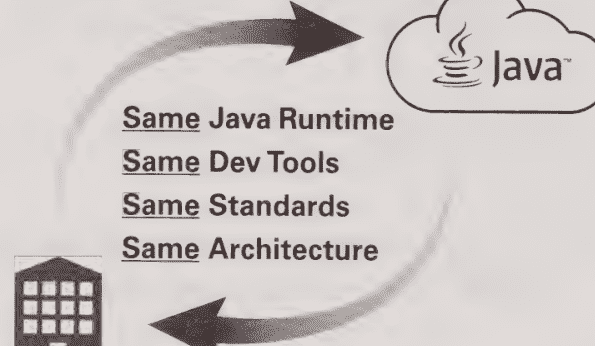

## Oracle 学习库

### Oracle 专家创建

Oracle 用户免费免费

- 丰富的学习辅助
- 直观且强大的搜索功能
- 共享内容、活动和保存的搜索
- 个性化您的学习仪表板
- 查找并注册培训活动


## 不要错过

在您选择的平台上

与您的同行交流


## ORACLE 杂志

## PROFIT 杂志

## Java 杂志

| 杂志 | 订阅人数 | 受众群体 |
| :--- | :--- | :--- |
| ORACLE MAGAZINE | 320,000+ | IT 经理、DBA、程序员和开发者 |
| PROFIT | 66,000+ | 高级主管和业务部门经理 |
| Java magazine | 254,000+ | 开发者、程序员和架构师 |


欲了解更多信息或申请免费订阅：

请扫描二维码访问 Oracle Publishing Online。

© 2018, Oracle 及/或其关联公司。保留所有权利。Oracle 和 Java 是 Oracle 及/或其关联公司的注册商标。

## Java 编程权威指南

针对 Java SE 11 完全更新的《Java: The Complete Reference》第十一版解释了如何开发、编译、调试和运行 Java 程序。畅销编程书籍 Herb Schildt 了整个 Java 语言，包括其语法、关键字和基础编程原理。您还将找到有关 Java API 库关键部分的信息，例如 I/O、集合框架、流库和并发工具。Swing、JavaBeans、servlets 以及大量示例展示了 Java 的实际应用。当然，书中对重要的模块系统进行了详细讨论。本 Oracle Press 资源还介绍了 JShell——Java 的交互式编程工具。最棒的是，这本书以清晰、干练、毫不妥协的风格编写，这种风格使 Schildt 成为全球百万读者的选择。


## 涵盖内容：

- 数据类型、变量、数组和运算符
- 控制语句
- 类、对象和方法
- 方法重载与重写
- 继承
- 局部变量类型推断
- 接口和包
- 异常处理
- 多线程编程
- 枚举、自动装箱和注解
- I/O 类
- 泛型
- Lambda 表达式
- 模块
- 字符串处理
- 集合框架
- 网络编程
- 事件处理
- 正则表达式
- 并发 API
- 流 API
- AWT 和 Swing
- Servlets
- 更多更多内容

书中的代码示例可在 www.OraclePressBooks.com 下载。

获取完整的 Oracle Press 书籍列表，请访问 www.OraclePressBooks.com。

了解更多，成就更多：

MHPROFESSIONAL.COM

在 Twitter 上关注 @OraclePress

另有电子书版本

编程/Java


$60.00 USD

ISBN 978-1-260-44023-4

MHID 1-260-44023-0


