# Java 完全参考（第12版）：Java 语言全面指南

## 关于作者

Best-selling author Herbert Schildt has written extensively about programming for over three decades and is a leading authority on the Java language. Called "one of the world's foremost authors of books about programming" by International Developer magazine, his books have sold millions of copies worldwide and have been translated into all major foreign languages. He is the author of numerous books on Java, including *Java: A Beginner's Guide*, *Herbert Schildt's Java Programming Cookbook*, *Introducing JavaFX 8 Programming*, and *Swing: A Beginner*. He has also written extensively about C, C++, and C#. Featured as one of the rock star programmers in Ed Burns' *Secrets of the Rock Star Programmers: Riding the IT Crest*, Schildt is interested in all facets of computing, but his primary focus is computer languages. Schildt holds both BA and MCS degrees from the University of Illinois. His website is www.HerbSchildt.com.

## 关于技术编辑

Dr. Danny Coward has worked on all editions of the Java platform. He led the definition of Java Servlets into the Java EE platform and beyond, web services into the Java ME platform, and the strategy and planning for Java SE 7. He founded JavaFX technology and, most recently, designed the largest addition to the Java EE 7 standard, the Java WebSocket API. From coding in Java, to designing APIs with experts, serving for several years as an executive to the Java Community Process, he has a uniquely perspective into multiple aspects of Java technology. In addition, he is the author of two books on Java programming: *Java WebSocket Programming* and *Java EE 7: The Big Picture*. Most recently, he has been applying his knowledge of Java to help scale massive Java-based services for one of the world's most successful software companies. Dr. Coward holds a bachelor's, master's, and doctorate in mathematics from the University of Oxford.

## 前言

xxx

## 第 1 章 Java 的历史与演进

### Java 的血缘

### 现代编程的诞生：C

### C++：下一步阶

### Java 的舞台已就绪

### Java 的诞生

### 与 C# 的联系

### Java 如何影响互联网

### Java Applets

### 安全性

### 可移植性

### Java 的魔术：字节码

### 超越 Applets

### 更快的发布计划

### Servlets：服务器端的 Java

### Java 术语

#### 简单

#### 面向对象

#### 健壮

#### 多线程

#### 架构中立

#### 解释型与高性能

#### 分布式

#### 动态

### 面向对象编程

#### 两种范式

#### 抽象

#### 三个 OOP 原则

## 目录

- 两个控制语句
- 构造函数的执行时机
- 应用方法重写
- Object 类
- 自动装箱/拆箱有助于防止错误
- 单成员注解

## 第 13 章 I/O、Try-with-Resources 以及其他主题

- 文本块基础
- 密封类
- Number
- 理解 `isInfinite()` 和 `isNaN()`
- Character
- Boolean
- Process
- 执行其他程序
- ProcessBuilder
- 使用 `currentTimeMillis()` 对程序执行进行计时
- 环境属性
- Object
- Class
- Math
- 指数函数
- 杂数学方法
- Compiler
- Runnable 接口
- ThreadGroup
- Package
- ModuleLayer
- RuntimePermission
- Throwable
- StackTraceElement
- Enum
- Record
- Queue 接口
- 指定精度
- 字节数组输入流
- 数据输出流和数据输入流
- 使用 NIO 进行路径和文件系统操作
- AWT GUI 概念
- 处理鼠标事件
- 处理键盘事件
- 适配器类
- 内部类
- 匿名内部类

## 第 26 章 介绍 AWT：与窗口、图形和文本工作

- AWT 类
- 窗口基础
- 组件
- 容器
- 面板
- 窗口
- 帧
- 画布
- 帧窗口操作
- 设置窗口尺寸
- 隐藏和显示窗口
- 设置窗口标题
- 关闭帧
- `paint()` 方法
- 显示字符串
- 设置前景和背景颜色
- 请求重绘
- 创建基于帧的应用
- 介绍图形
- 绘制线条
- 绘制矩形
- 绘制椭圆和圆形
- 绘制弧形
- 绘制多边形
- 演示绘制方法
- 图形尺寸
- 颜色操作
- 颜色方法
- 设置当前图形颜色
- 颜色演示程序
- 设置绘制模式
- 字体操作
- 确定可用字体
- 创建并选择字体
- 获取字体信息


# 目录

- 使用 `FontMetrics` 管理文本输出 ...................................................... 875

## 第 27 章 使用 AWT 控件、布局管理器和菜单 ........................................ 879

- AWT 控件基础 .......................................................................................... 880
- 添加和移除控件 ................................................................... 880
- 控件响应 ................................................................................. 880
- `HeadlessException` ............................................................................ 881
- 标签 .......................................................................................................... 881
- 按钮 ................................................................................................... 883
- 处理按钮 ................................................................................ 883
- 复选框 ........................................................................ 887
- 处理复选框 ...................................................................... 888
- 复选框组 (`CheckboxGroup`) ................................................................................. 889
- 选择控件 ................................................................................................ 891
- 处理选择列表 ...................................................................... 892
- 使用列表 ....................................................................................... 894
- 处理列表 ................................................................................................. 895
- 管理滚动条 ........................................................................................ 897
- 处理滚动条 ........................................................................ 898
- 使用文本字段 (`TextField`) ................................................................... 900
- 处理文本字段 ............................................................................................ 901
- 使用文本区域 (`TextArea`) ............................................................................................ 903
- 理解布局管理器 ................................................................................... 904
- 流式布局 (`FlowLayout`) ................................................................................................ 905
- 边框间距 (`BorderInsets`) ................................................................................................. 906
- 使用间距 (`Insets`) ..................................................................................................... 908
- 网格布局 (`GridLayout`) ................................................................................................. 910
- 卡片布局 (`CardLayout`) ................................................................................................ 911
- 网格包布局 (`GridBagLayout`) ................................................................................................ 914
- 菜单栏和菜单 ........................................................................ 919
- 对话框 ................................................................................................. 924
- 关于重写 `paint()` 的说明 ...................................................................... 928

## 第 28 章 图像 ................................................................... 929

- 文件格式 ....................................................................................... 929
- 图像基础：创建、加载和显示 ................................ 930
- 创建图像对象 ................................................................................ 930
- 加载图像 .......................................................................................................... 930
- 显示图像 ........................................................................................ 931
- 双缓冲 .......................................................................................................... 932
- 图像生产者 (`ImageProducer`) ................................................................................... 935
- 内存图像源 (`MemoryImageSource`) ...................................................................... 935
- `ImageConsumer` ........................................................................................ 937
- `PixelGrabber` ....................................................................................................... 937
- `ImageFilter` ....................................................................................................... 940
- `CropImageFilter` ..................................................................................................... 940
- `RGBImageFilter` ........................................................................................................ 942
- 其他图像类 ................................................................................ 954

## 第 29 章 并发工具类 ................................................................ 955

### 并发 API 包 ............................................................................ 956

- `java.util.concurrent` ........................................................................................ 956
- `java.util.concurrent.atomic` ...................................................... 957
- `java.util.concurrent.locks` ................................................... 957

### 使用同步对象 ................................................................ 958

- `Semaphore`（信号量） ........................................................................................ 958
- `CountDownLatch`（计数计数器） ................................................................................................ 963
- `CyclicBarrier`（循环栅障） ................................................................................................ 965
- `Exchanger`（交换器） ........................................................................................ 967
- `Phaser`（分相器） ............................................................................................ 970

### 使用 Executor ................................................................ 977

- 一个简单的 Executor 示例 ................................................................... 978
- 使用 `Callable` 和 `Future` ................................................................ 979
- `TimeUnit` 枚举 ................................................................... 982

### 并发集合 ................................................................... 983

- `Locks`（锁） ................................................................................................................ 984
- 原子操作 ................................................................................................ 986

### 通过 Fork/Join 框架进行并行编程 ................................ 988

- 核心 Fork/Join 类 ................................................................... 988
- 分治策略 ................................................................... 992
- 一个简单的 Fork/Join 示例 .................................................................. 993
- 理解并行级别的影响 ........................................ 995
- 使用 `RecursiveTask<V>` 的示例 ................................................ 998
- 异步执行任务 ........................................................ 1001
- 取消任务 ................................................................................... 1001
- 确定任务完成状态 ............................................... 1002
- 重启任务 ................................................................................................ 1002
- 探索的内容 ................................................................................ 1002
- 一些 Fork/Join 技巧 ............................................................................ 1004
- 并发工具类与 Java 传统方法的对比 ...... 1004

## 第 30 章 Stream API ................................................................ 1005

### Stream 基础 ................................................................................... 1005


### Stream 接口

### 如何获取 Stream

- 一个简单的 Stream 示例

### 归约操作

- 使用并行流 (Parallel Streams)
- 映射 (Mapping)

## XXVI Java：完全参考

- 收集 (Collecting)
- 迭代器与流 (Iterators and Streams)
- 在 Stream 中使用迭代器
- 使用 Spliterator
- 在 Stream API 中更多探索

## 第31 章 正则表达式及其他包

### 正则表达式处理

- Pattern
- Matcher
- 正则表达式语法
- 演示模式匹配
- 两种模式匹配选项
- 探索正则表达式
- 反射 (Reflection)
- 远程方法调用 (RMI)
- 使用 RMI 的客户端/服务器应用程序
- java.time 格式化
- Date 类
- SimpleDateFormat 类
- java.time Time and Date API
- Time and Date 基础
- Date and Time 格式化
- Date and Time 字符串
- java.time 中的其他内容

# 第三部分 使用 Swing 编程

## 介绍 Swing

- Swing 的起源
- 基于 AWT 的 Swing
- Swing 特性
- 轻量级 Swing (Lightweight)
- 可插件的外观与感觉 (Pluggable Look and Feel)
- Swing 连接
- 组件 (Components)
- 容器 (Containers)
- 顶层面板 (Top-Level Panes)
- Swing 包 (Packages)
- 一个简单的 Swing 应用
- 事件处理 (Event Handling)
- Swing 中的绘图 (Painting in Swing)
- 绘图基础 (Painting Fundamentals)
- 可绘图区域 (The Paintable Area)
- 一个绘图示例

# 目录 xx

## 第33 章 探索 Swing

- 标签 (Label)
- 文本框 (JTextField)
- 按钮 (JButton)
- 切换按钮 (ToggleButton)
- 复选框 (Check Boxes)
- 单选按钮 (Radio Buttons)
- 选项卡面板 (TabbedPane)
- 滚动面板 (ScrollPane)
- 列表 (List)
- 下拉框 (JComboBox)
- 树 (Trees)
- 表格 (JTable)

## 第34 章 介绍 Swing 菜单

### 菜单基础

- JMenuBar, JMenu 和 JMenuItem 概览
- JMenuBar
- JMenu
- JMenuItem
- 创建主菜单
- 为菜单项添加助记符和快捷键
- 为菜单项添加图像和工具提示
- 使用 RadioMenuItem 和 JCheckBoxMenuItem
- 创建弹出菜单
- 创建工具栏
- 使用动作 (Actions)
- 将整个菜单 Demo 整合在一起
- 继续对 Swing 的探索

# 第四部分 应用 Java

## 第35 章 Java Beans

- 什么是 Java Bean?


# 目录

## Bean 的优势 ................................................................................................................................................................................................................... 146

## 内省 (Introspection) ...................................................................................................................................................................................................................................... 146

## 属性的设计模式 ................................................................................................................................................................................................ 146

## 事件的设计模式 ................................................................................................................................................................................................................................. 148

## 方法与设计模式 ................................................................................................................................................................................................................................................. 148

## 使用 BeanInfo 接口 ................................................................................................................................................................................................................... 148

## 绑定属性与约束属性 (Bound and Constrained Properties) ................................................................................................................................................................................................... 149

## 持久化 (Persistence) ...................................................................................................................................................................................................................................................... 149

## 自定义定制器 (Customizers) ........................................................................................................................................................................................................................................................................ 149

## xxviii Java：完全参考

## JavaBeans API ............................................................................................ 1150

## 内省器 (Introspector) ....................................................................................... 1152

## 属性描述符 (PropertyDescriptor) ................................................................................ 1152

## 事件集描述符 (EventSetDescriptor) ............................................................................... 1152

## 方法描述符 (MethodDescriptor) ................................................................................... 1152

## Bean 示例 ..................................................................................... 1152

## 第 36 章 引入 Servlets ................................................................. 1157

## 背景 ...................................................................................................... 1157

## Servlet 的生命周期 ........................................................................ 1158

## Servlet 开发选项............................................................................... 1158

## 使用 Tomcat ................................................................................................... 1159

## 一个简单的 Servlet .......................................................................................................... 1160

## 创建并编译 Servlet 源代码 ............................................ 1161

## 启动 Tomcat .................................................................................................... 1161

## 启动 Web浏览器并请求 Servlet ............................................... 1161

## Servlet API ................................................................................... 1162

## jakarta.servlet 包 ........................................................................ 1162

## Servlet 接口 ...................................................................................... 1163

## ServletConfig 接口 ...................................................................... 1164

## ServletContext 接口 ................................................................ 1164

## ServletRequest 接口 ................................................................... 1164

## ServletResponse 接口 ................................................................... 1164

## GenericServlet 类 ........................................................................ 1166

## ServletInputStream 类 ......................................................... 1166

## ServletOutputStream 类 ............................................................... 1166

## Servlet 异常类 ................................................................ 1166

## 读取 Servlet 参数 ........................................................ 1166

## jakarta.servlet.http 包 ............................................................ 1168

## HttpServletRequest 接口 ................................................................... 1168

## HttpServletResponse 接口 .............................................................................. 1168

## HttpSession 接口 ........................................................................ 1169

## Cookie 类 .......................................................................................... 1170

## HttpServlet 类 .......................................................................................... 1171

## 处理 HTTP 请求和响应 ........................................ 1173

## 处理 HTTP GET 请求 .......................................................................... 1173

## 处理 HTTP POST 请求 ................................................................ 1175

## 使用 Cookie ..................................................................................... 1176

## 会话跟踪 ................................................................................................ 1178

# 第五部分 附录

## 附录 A 使用 Java 文档注释 ......................... 1183

## javadoc 标签 .......................................................................................... 1183

## @author ....................................................................................................... 1184

## {@code} ........................................................................................................ 1185

## @deprecated ................................................................................................ 1185

## @docRoot ...................................................................................................................................................................................................................................................... 1185

## @exception ...................................................................................................................................................................................................................................................... 1185

## @hidden ...................................................................................................................................................................................................................................................... 1185

## @index ...................................................................................................................................................................................................................................................... 1185


## 附录 A 标准 Doclet 标签

- `@inheritDoc` ................................................................................................................................................................................................................................................................ 1186
- `@link` ..................................................................................................................................................................................................................................................................................................... 1186
- `@linkplain` ...................................................................................................................................................................................................................................................................................................... 1186
- `@literal` ..................................................................................................................................................................................................................................................................................................... 1186
- `@param` ..................................................................................................................................................................................................................................................................................................... 1186
- `@provides` ..................................................................................................................................................................................................................................................................................................... 1186
- `@return` ..................................................................................................................................................................................................................................................................................................... 1187
- `@see` ..................................................................................................................................................................................................................................................................................................... 1187
- `@serial` ..................................................................................................................................................................................................................................................................................................... 1187
- `@serialData` ...................................................................................................................................................................................................................................................................................... 1187
- `@serialField` ................................................................................................................................................................................................................................................................................................................ 1188
- `@since` ....................................................................................................................................................................................................................................................................................... 1188
- `@summary` ..................................................................................................................................................................................................................................................................................................... 1188
- `(@systemProperty)` ................................................................................................................................................................................................................................................................................................ 1188
- `@throws` ...................................................................................................................................................................................................................................................................................................... 1188
- `@uses` ....................................................................................................................................................................................................................................................................................................... 1188
- `(@value)` ..................................................................................................................................................................................................................................................................................................................... 1188
- `@version` .................................................................................................. 1189

### 文档注释的通用格式 ................................................................................................................................................................ 1189

### javadoc 输出 ..................................................................................................................................................................................................................................... 1189

### 使用文档注释的示例 ........................................................................................................................................................... 1189

## 附录 B 引入 JShell ............................................................................................................................................ 1191

### JShell 基础 ............................................................................................................................................................................................................................... 1191

### 列出、编辑和重新运行代码 ............................................................................................................................................................................................... 1194

### 添加方法 ............................................................................................................................................................................................................................................... 1195

### 创建类 ............................................................................................................................................................................................................................................... 1196

### 使用接口 ............................................................................................................................................................................................................................................................... 1196

### 评估表达式和使用内置变量 ........................................................................................................................... 1198

### 导入包 ....................................................................................................................................................................................................................................... 1198


# 索引

## 前言

Java 是世界上最重要且使用最广泛的语言之一。此外，它保持这一地位已多年。与其他某些影响力随时间推移而减弱的语言不同，Java 变得愈发强大。从首次发布以来，Java 一直在适应编程环境的变化。简单来说：现代世界运行在一种强大的、适用于广泛用途的通用编程语言之上。

Java 成功的一个关键原因是由于它的敏捷性。从最初的 1.0 版本发布以来，Java 不仅在遵循趋势，而且在创造趋势。Java 一直非常成功。这是第十二版，已针对 Java 17 (JDK 17) 进行了更新。因此，本书包含了大量的新内容和更新。Java 语言新增的以下关键特性特别值得关注：

- switch 的增强
- 记录（Records）
- 带 `instanceof` 的模式匹配
- 文本块（Text blocks）

这些新特性共同构成了一个实用的集合，显著扩展了语言的范围、规模和表达能力。switch 的增强为这一基础语句增加了威力和灵活性。记录的引入提供了一种聚合数据的有效方法。在 `instanceof` 中增加模式匹配使得处理常见编程任务的方法更加简洁且健壮。密封类和接口允许你对继承进行细粒度的控制。文本块让你能够直接输入多行字符串字面量，极大地简化了你设计和实现解决方案的过程。

## 面向所有程序员的书

本书适用于所有程序员，无论你是新手还是经验丰富的专家。初学者会发现书中精心安排的讨论和许多示例对他们很有帮助。高级特性和库的深度覆盖将吸引专业人士。对于两者来说，它都提供了一份持久的资源和方便的参考手册。

## 内容简介

本书是 Java 语言的综合指南，描述了它的语法、关键字和基本编程原理。书中还探讨了 API 库的大部分。本书分为四个部分，每部分关注 Java 编程环境的不同方面。

第一部分提供了 Java 语言的深度教程。它从基础开始，包括数据类型、操作符、控制语句，然后转向继承、包、异常处理和多线程。接下来，它描述了注解、枚举、泛型和 lambda 表达式。还包含了 I/O。第一部分的最后一章涵盖了几个最近添加的特性：记录、密封类和接口、增强的 switch、带 `instanceof` 的模式匹配以及文本块。

第二部分检查了 API 库的关键方面。主题包括字符串、I/O、网络、标准实用程序、集合框架（Collections Framework）、AWT、事件处理、并发（包括 Fork/Join 框架）、正则表达式和流库。

第三部分提供了三个介绍 Swing 的章节。

第四部分包含两个展示 Java 实际应用的示例章节。第一章描述了 Java Beans。第二章介绍了 servlets。

## 特别感谢

我想特别感谢 Patrick Naughton、Joe O'Neill 和 Danny Coward。Patrick Naughton 曾是 Java 语言的创建者之一。他还协助编写了本书的第一版。例如，在许多其他贡献中，第 22、24 和 28 章的内容最初是由 Patrick 提供的。他的见解、专业知识和精力对这本书的成功做出了巨大贡献。

在本书第二版和第三版的准备工作期间，Joe O'Neill 为本版第 31、33、35 和 36 章的内容提供了初稿。他曾帮助过我的几本书，他的投入一直是顶尖的。

Danny Coward 是本书的技术编辑。Danny 曾参与过我的几本书，他的建议、见解和想法一直具有巨大的价值，并深受感激。

我还要感谢我的妻子 Sherry 对本书以及我其他书籍所出的所有贡献。她周到的建议、校对和索引对每个项目的成功完成都做出了巨大贡献。

HERBERT SCHILDT

## 进一步学习

《Java: The Complete Reference》是你进入 Herb Schildt 编写的 Java 编程书籍系列的大门。以下是你可能感兴趣的其他书籍：

- Herb Schildt's Java Programming Cookbook
- Java: A Beginner's Guide
- Introducing JavaFX 8 Programming
- Swing: A Beginner's Guide
- The Art of Java

# 第一部分 Java 语言

## 第 1 章：Java 的历史与演变

## 第 2 章：Java 概述

## 第 3 章：数据类型、变量和数组

## 第 4 章：操作符

## 第 5 章：控制语句

## 第 6 章：类简介

## 第 7 章：深入理解方法和类

## 第 8 章：继承

## 第 9 章：包和接口

## 第 10 章：异常处理

## 第 11 章：多线程编程

## 第 12 章：枚举、自动装箱和注解

## 第 13 章：I/O、Try-with-Resources 以及主题

## 第 14 章：泛型

## 第 15 章：lambda 表达式

## 第 16 章：模块

## 第 17 章：switch 表达式、记录及其他最近添加的特性

# 现代编程的诞生：C

C 语言震惊了计算机世界。它的影响不应被低估，因为它从根本上改变了编程的方法和思维方式。C语言的诞生是由于需要一种结构化、高效、高级的语言的直接结果，这种语言在创建程序时可以替代汇编代码。如你所知，在设计一种计算机语言时，通常需要进行权衡，例如：

- 易用性与强大
- 安全性与效率
- 僵性与可扩展性

在 C 出现之前，程序员通常必须在优化某一组特征或另一组特征的语言之间做出选择。例如，尽管 FORTRAN 被用于编写科学计算的高效程序，但它并不强大，也不利于系统代码。虽然 BASIC 易于学习，但它并不强大，而且缺乏结构使得它在大型程序中的实用性存疑。汇编语言可以用来生成极其高效的程序，但很难被有效地使用。此外，调试汇编代码可能非常困难。

另一个加性的问题是，像 BASIC、COBOL 和 FORTRAN 等早期计算机语言并不是基于结构化原则设计的。相反，它们依赖 GOTO 作为程序控制的主要手段。结果是使用这些语言编写的程序产生了“面条代码”——一堆纠缠在一起的跳转和条件分支，这使得程序几乎变得无法理解。虽然像 Pascal 这样的语言是结构化的，但它们并不是为了效率设计的，而且未能包含使它们适用于广泛程序的某些必要特征。（具体来说，考虑到当时可用的 Pascal 标准方言，将 Pascal 考虑用于系统级代码是不现实的。）

因此，在 C 语言发明之前，还没有一种语言能够调和一直困扰早期尝试的冲突属性。对这种语言的需求是迫在眉睫的。到 20 世纪 70 年代初，计算机革命开始发挥作用，对软件的需求迅速超过了程序员的生产能力。学术课程上投入了大量精力试图创建一种更好的计算机语言。但是，可能最重要的是，第二种力量开始被感觉到。计算机硬件不再被封锁在门后。第一次，程序员们获得了对他们机器几乎无限的访问权限。这允许了实验的自由。它也允许程序员能够创建自己的工具。在 C 诞生的前夕，计算机语言跨越式发展的舞台已经就绪。

C 由 Dennis Ritchie 发明并首次在运行 UNIX 操作系统的 DEC PDP-11 上实现，它是开发过程的结果，该过程始于一种由 Martin Richards 开发的名为 BCPL 的旧语言。BCPL 影响了由 Ken Thompson 发明的 B 语言，并导致了 20 世纪 70 年代 C 的开发。

## 第 1 章 Java 的历史与演变

多年来，C 的事实标准是随 UNIX 系统提供的版本，并在 Brian Kernighan 和 Dennis Ritchie 编写的《C 语言》（Prentice-Hall, 1978）中进行了描述。C 语言在 1989 年 12 月正式标准化，当时美国国家标准协会（ANSI）的 C 标准被采纳。

许多人认为 C 的创造标志着计算机语言现代时代的到来。它成功地综合了一直困扰早期语言的冲突属性。结果是了一种强大、高效、结构化且相对易学习的语言。它还包含了另外一点；在 C 发明之前，计算机语言通常被设计为学术练习，或者由官僚机构委员会设计。C 是不同的。它是由真实的、在工作的程序员实现和开发的，反映了他们处理编程工作的方式。它的特征是由实际上使用该语言的人经过推磨、测试和思考的。结果是一种程序员喜欢使用的语言。事实上，C 迅速吸引了许多对其近乎宗教热情的追随者。因此，它在程序员社区中迅速获得了认可。简而言之，C 是一种由程序员并为程序员设计的语言。正如你将看到的，Java 继承了它的遗产。

# C++：下一步

在 20 世纪 70 年代和 80 年代初，C 成为主导计算机语言，今天仍然被广泛使用。你可能会问为什么还需要其他东西。答案是复杂性。在整个编程历史中，程序复杂性的增加推动了对更好地管理这种复杂性的需求；C++ 就是这种回应。要理解为什么管理编程复杂性对于 C++ 的创建至关重要，请考虑以下。

自从计算机发明以来，编程方法发生了巨大的变化。例如，当计算机被发明时，编程是通过在前面板上手动切换二进制指令来完成的。由于程序只有几百条指令长，这种方法行得通。随着程序的增长，汇编语言被发明，这样程序员就可以通过机器指令的符号表示来处理更大、日益复杂的程序。随着程序的继续增长，高级语言被引入，为程序员提供了更多处理复杂性的工具。

第一个广泛使用的语言是 C，之前是 FORTRAN。尽管 FORTRAN 是令人印象深刻的第一步，但在当时它不是一种鼓励编写清晰且易于理解程序的语言。20 世纪 60 年代诞生了结构化编程。这是通过 C 语言进行的编程方法。结构化语言的使用让程序员第一次能够轻松编写中等复杂的程序。然而，即使使用结构化编程方法，一旦项目达到某个规模，其复杂性就会超过程序员所能管理的范围。到 20 世纪 80 年代初，许多项目将结构化方法推向了极限。发明了一种新方法，称为面向对象编程（OOP）。书中后面将详细讨论面向对象编程，但这里有一个简要定义：OOP 是一种通过继承、封装和多态来组织复杂程序的编程方法。

![843ebfc316f0024b]

# 第一部分 Java 语言

从最终分析来看，尽管 C 是世界上伟大的语言之一，但它处理复杂性是有极限的。C++ 是 Bjarne Stroustrup 在 1979 年于新泽西州穆里实验室工作时发明的，当时他将其称为“带有类的 C”。然而，在 1983 年，名称改为 C++；C++ 通过添加面向对象的特征扩展了 C。C++ 的发明并不是试图创建一种全新的语言；而是对一种已经成功的语言的增强。

# Java 的舞台已就绪

在 20 世纪 80 年代末和 90 年代初，使用 C++ 的面向对象编程取得了主。在短期间，程序员似乎终于找到了完美的语言。C++ 将 C 的效率和统计与面向对象的范式相结合；它是一种可以创建广泛程序的语言。然而，就像过去一样，力量正在酝酿，再次推动计算机语言向前发展。在几年内，万网和互联网达到了临界点。这一事件将引发另一场革命。

# Java 的创造

Java 由 James Gosling、Patrick Naughton、Chris Warth、Ed Frank 和 Mike Sheridan 在 1991 年于 Sun 公司构想。花费了18 个月开发出第一个可用版本。这种语言最初被称为“Oak”，但在 1995 年更名为“Java”。从 1992 年秋季实现 Oak 到 1995 年春季公布 Java 之间，许多月份对 Java 的设计和演变出了贡献。Bill Joy、Arthur van Hoff、Jonathan Payne、Frank Ylin 和 Tim Lindholm 是原始原型走向成熟的贡献者。

惊讶的是，Java 的最初动力并不是互联网；主要的动机是平台无关（即架构中立）的语言，这种语言可用于创建嵌入各种消费电子产品中的软件，如微波炉和遥控器。正如你可能猜到的，许多类型的 CPU 被用控制器。C 和 C++（以及当时的其他语言）的问题在于它们是为特定目标设计的。虽然可以将 C++ 程序编译到任何类型的 CPU 上，但这需要该 CPU 有一个完整的 C++ 编译器。问题是创建编译器既昂贵又耗时。需要一种更简单、更高效的解决方案。为了寻找这种解决方案，Gosling 等人开始研究一种可移植的、平台无关

## 第 1 章 Java 的历史与演变

一种用于生成可以在不同环境下的各种 CPU 上运行的代码的语言。这种努力最终导致了 Java 的诞生。

在 Java 细节确定的这段时间，第二个也是最终更重要的因素正在显现，它将对 Java 的未来起着至关重要的作用。这股第二股力量无疑是万维网（World Wide Web）。如果 Web 没有在 Java 实现期间同时成型，Java 可能一直是一门用于编程消费类电子设备的、晦涩且不为人知的语言。然而，随着万维网的出现，Java 被推向了计算机语言设计的前沿，因为 Web 同样需要可移植程序。

大多数程序员在职业生涯中都会发现，可移植程序正如它们所渴望的那样难以捉摸。尽管创建高效、可移植（平台无关）程序的愿望几乎与这门学科本身一样古老，但它一直让位于其他更紧迫的问题。此外，在当时，计算机世界分为 Intel、Macintosh 和 UNIX 这几个竞争的巨头，大多数程序员局限于自己的领域内，对可移植代码的紧迫需求随之减少。然而，随着互联网的出现，可移植性问题报复性地回归了。毕竟，互联网连接了一个由各种计算机、操作系统和 CPU 组成的多元宇宙。即使是许多平台都连接到了互联网，用户也希望它们都能运行相同的程序。曾经一个令人恼但低优先级的问题已变成了一个备受关注的必然。

到 1993 年，Java 设计者们意识到，在为嵌入式控制器创建代码时经常遇到的可移植性问题同样不如人意。事实上，Java 最初针对小规模设计的问题也可以应用于大规模的互联网。这一发现导致 Java 的重心转向一种提供初始意图的架构中立型语言。

如前文所述，Java 的许多特性在很大程度上源于 C++。这是因为设计者知道，在 C++ 熟悉的语法加上面向对象的特性将使该语言吸引大量经验丰富的程序员。除了表面上的相似性外，Java 还共享了一些帮助 C++ 成功的属性。首先，Java 是由工作中的程序员设计和精化的，这门语言植根于其设计者的经验和需求。因此，Java 具有良好的内聚性和逻辑一致性。其次，Java 给了你完全的控制权，环境施加的限制除外。如果你编程得好，你的程序就能反映出这种意图。

由于 Java 和 C++ 之间的相似性，人们很容易将 Java 认为是“互联网版本的 C++”。然而，这样做将是一个错误。Java 在实践和哲学上有显著的区别。虽然 Java 确实受到了 C++ 的影响，但它既不是 C++ 的增强版也不与 C++ 兼容。当然，相似性是巨大的，如果你是一个 Java 程序员，你会感到如在家一样。

# 第一部分 Java 语言

如本开头所述，计算机语言的演变是为了适应环境的变化，并在多年中实现编程艺术的进步。促使 Java 产生的环境变化是需要能够在互联网上分发的平台无关程序。Java 还通过 C++ 精炼了面向对象的范式，增加了对多线程的集成支持，并提供了一个简化互联网访问的库。但从最终的分析来看，让 Java 脱颖而出的并不是它的单个特性。相反，这门语言本身：Java 是对新出现的、高度分布式计算宇宙的响应：一种改变世界的革命性力量。

## 与 C# 的联系

Java 的影响范围持续在整个计算机语言开发领域产生影响。它的许多创新特性、结构和概念已成为任何新语言的基准。Java 的成功太重要了，无法忽视。

也许 Java 影响最重要的例子是 C#。C# 由微软创建以支持 .NET 框架，它与 Java 关系密切。例如，两者共享相同的通用语法，支持分式编程，并使用相同的对象模型。当然，Java 和 C# 之间存在差异，但由于这些语言的整体“外观和感受”非常相似。这种从 Java 到 C# 的交叉渗透是最有力的证明，说明 Java 重新定义了我们思考和使用计算机语言的方式。

## Java 如何影响互联网


# Java 的历史与演进

互联网帮助 Java 走向了编程的前沿，而 Java 反过来对互联网产生了深远的影响。除了泛化 Web 编程，Java 还创新了一种名为 applet（小程序）的新网络程序，改变了世界看待内容的方式。Java 还解决了互联网相关的一些棘手问题：可移植性和安全性。让我们仔细观察其中的每一个。

## Java Applet

在 Java 时代，它最令人兴奋的特性之一是 applet。applet 是一种特殊的 Java 程序，设计用于通过互联网传输并在兼容 Java 的 Web 浏览器内部自动执行。如果用户点击包含 applet 的链接，applet 将下载并在浏览器中运行。Applet 旨在成为小型程序。它们通常用于显示服务器提供的数据、处理用户输入或提供简单的功能（例如贷款计算器），这些功能在本地执行而不是在服务器上执行。本质上，applet 允许某些功能从服务器移动到客户端。

applet 的创建非常重要，因为在当时，它扩展了可以在网络空间中自由移动的对象宇宙。通常情况下，在服务器和客户端之间传输的对象分为两大类：被动信息和动态活跃程序。例如，当你阅读电子邮件时，你查看的是被动数据。当你下载一个程序时，在执行它之前，程序的代码仍然是被动数据。相比之下，applet 是一个动态的、自执行程序。这种程序是客户端上的活动代理，但由服务器启动的。

在 Java 早期，applet 是 Java 编程的重要组成。它们展示了 Java 的力量和优势，为网页增加了趣味性的维度，并让程序员能够探索 Java 的可能性。尽管可能仍在使用 applet，但随着时间的推移，它们变得不再重要。由于从 JDK 9 开始将解释的原因，Java 淘汰了 applet，并在 JDK 11 中移除了 applet 支持。

## 安全性

动态网络程序虽然令人渴望，但它们在安全性和可移植性方面也带来了严重的问题。显然，在客户端下载并执行的程序必须被防止造成伤害。它还必须能够在不同的环境和不同的操作系统下运行。正如你看到的，Java 以有效且优雅的方式解决了这些问题。让我们更仔细地看看，从安全性开始。正如你可能意识到的，每当你下载一个“普通”程序时，你都在冒险，因为你下载的代码可能包含病毒、木马或其他有害代码。问题的核心在于，恶意代码由于它可以未经授权访问系统资源而造成损害。例如，程序可能会通过搜索你计算机本地文件系统的内容来收集隐私信息，如信用卡号、银行账户和密码。

相同的应用程序代码必须在所有计算机上运行。因此，需要一种生成可移植可执行代码的方法。正如你很快将看到的，有助于安全的同一机制也有助于可移植性。

## Java 的魔力：字节码

让 Java 解决上述安全性和可移植性问题的关键在于，编译器的输出不是可执行代码，而是字节码。字节码是一组高度优化的指令集，旨在由所谓的 Java 虚拟机（`JVM`）进行执行。从本质上说，最初的 `JVM` 被设计为字节码的解释器。这可能会让你感到有些意外，因为出于性能考虑，许多语言在设计时都是为了被编译成可执行代码的。然而，Java 程序由 `JVM` 执行这一事实有助于解决与基于网络的程序相关的主要问题。原因如下。

将 Java 翻译成字节码使得在各种环境中运行程序变得简单得多，因为每个平台只需要实现 `JVM`。任何系统都存在 `JRE`，任何 Java 程序都可以在其上运行。记住，`JVM` 的细节在不同平台之间有所不同，但它们都理解相同的字节码。如果 Java 程序被编译为本地代码，那么对于连接到互联网的每个 CPU 都必须存在同一个程序的不同版本。这显然不是一个可行的解决方案。因此，通过 `JVM` 执行字节码是创建真正可移植程序的简单方法。

Java 程序由 `JVM` 执行这一事实也有助于提高安全性。因为由于 `JVM` 的控制，它管理着执行。因此，`JVM` 可以创建一个名为“沙箱”的受限执行环境并将程序包含其中，防止对机器的无限制访问。Java 语言中某些限制也增强了安全性。

通常，当一个程序被编译为中间格式然后由虚拟机解释时，它的运行速度比编译为可执行代码要慢。然而，对于 Java 来说，两者之间的差异并不大。由于字节码已经过高度优化，字节码的使用使得 `JVM` 执行程序的速度比你想象的要快得多。

尽管 Java 被设计为解释型语言，但 Java 没有任何地方可以阻止将字节码动态编译为本地代码以提高性能。出于这个原因，HotSpot 技术在 Java 最初发布后不久被引入。HotSpot 为字节码提供了一个即时编译（`JIT`）编译器。当 `JIT` 编译器作为 `JVM` 的一部分时，选定的字节码部分会根据需求实时编译成可执行代码。重要的是，整个 Java 程序完全没有被编译成可执行代码。相反，`JIT` 编译器在执行期间根据需要编译代码。此外，没有任何字节码序列被编译——只有那些从编译中获益的序列。其余代码仅被解释。然而，即时编译方法带来了显著的性能提升。当动态编译应用于字节码时，可移植性和安全性特征仍然适用，因为 `JVM` 仍然负责执行环境。

另一点：Java 曾进行过提前编译（ahead-of-time compiler）的实验。这种编译器可以在 `JVM` 执行之前将字节码反编译为本地代码，而不是在运行时编译。之前的某些版本的 `JDK` 提供过实验性的提前编译编译器；然而，`JDK 17` 已经将其移除了。提前编译是一项专门的特性，它并没有取代上述描述的 Java 传统方法。由于提前编译的高度专门化性质，本书不再对其进行讨论。


## 跨越 Applet

在写本文时，距离 Java 最初发布已经二十多年。在这些年里，发生了许多变化。在 Java 创建时，互联网是一项新颖而兴奋的创新；网络浏览器正在经历快速开发和完善；现代形式的智能手机尚未发明；而计算机的普及也只是几年前的事。正如你预期的，Java 也发生了变化，所使用的 Java 也是如此。也许没有什么比 applet 更好地说明 Java 的演变了。

正如以前提到的，在 Java 早期，applet 是编程至关重要的部分。它们不仅为页面增添了趣味，而且还是 Java 的一个非常醒目的部分，增加了它的魅力。然而，applet 依赖于 Java 浏览器插件。因此，为了让 applet 正常工作，浏览器必须支持它。在过去的几年里，Java 浏览器插件的流行程度正在衰减。简单来说，如果没有浏览器的支持，applet 是无法行的。正如此，从 `JDK 9` 开始，applet 的淘汰阶段开始，对 applet 的支持被标记为弃用（deprecated）。在语言中，废弃意味着该功能仍然可用，但被标记为过时。因此，不应在新代码中使用被废弃的特性。随着 `JDK 11` 的发布，淘汰完全完成，因为删除了 applet 的运行时支持。在 `JDK 17` 中，整个 App API 都被标记为废弃移除。

作为一个感兴趣的点，在 Java 创建几年后，增加了一个 applet 的替代方案：Java Web Start。它允许应用程序从网页上动态下载。这种部署机制对于不适合 applet 的大型应用程序特别有用。applet 和 Web Start 应用程序的区别在于，Web Start 独立运行，而不是在浏览器内部运行。因此，它看起来像一个“正常的”应用程序。然而，它需要一个支持 Java Start 的独立 `JRE`。在 `JDK 11` 中，Java Start 已被移除。如果没有任何现代版本的 Java 支持，你可能会想该用什么机制来部署。在写本文时，答案的一部分是使用 `jlink`。通过 `JDK 16`，它可以创建一个包含程序所需所有支持的完整运行映像。另一个部分是 `jpackage`。在 `JDK 17` 中，它是可用的。

## Java 术语

对 Java 历史的讨论如果没有术语是不完整的。虽然导致 Java 发明的根本力量是可移植性和安全性，其他因素也塑造了它的最终形式。Java 团队将关键考虑总结为以下列表：

- 简单
- 安全
- 可移植
- 面向对象
- 健壮
- 多线程
- 体系中立
- 解释型
- 高性能
- 分布式
- 动态

这些术语中已经讨论了两个：安全和可移植。让我们看看其他的含义。

### 简单

Java 的设计是为了让专业程序员易于学习和有效使用。假设你有一定的编程经验，你不会发现 Java 难以掌握。如果你已经理解面向对象编程的基本概念，学习 Java 将变得更容易。最好，如果你是一个经验丰富的 C++ 程序员，迁移到 Java 不需要太大努力。由于 Java 继承了 C/C++ 语法以及 C++ 的许多面向对象特性，大多数程序员在学习 Java 时没有困难。

### 面向对象

尽管受到前身的影响，但 Java 的设计并不是为了与任何语言源代码兼容。这使得 Java 团队能够从白纸开始设计。这种结果之一是清晰、易用且实用的对象方法。通过借鉴过去几十年中许多语义对象软件环境，Java 成功地在纯主义者的“一切皆对象”范式和实用主义者的“别挡路”模型之间取得了平衡。Java 的对象模型易于扩展，而原始类型（如整数）被保留为高性能的非对象。

### 健壮

Web 的多平台环境对程序提出了极刻的要求，因为程序必须在各种系统中可靠地执行。因此，在 Java 的设计中，创建健壮的程序被赋予了高优先级。为了获得可靠性，Java 在几个关键领域对你进行了限制，以强制你在程序开发早期就发现错误。同时，Java 让你免于对许多常见编程错误原因的担忧。由于 Java 是一种强类型语言，它会在编译时检查你的代码。它在运行时也会检查你的代码。许多经常在难以复现的运行时情况下出现的难以追踪的错误，在 Java 中是根本无法创建的。知道你所编写的代码在各种条件下都能以可预测的方式运行，这是 Java 的一个核心特性。

为了更好地理解 Java 是如何健壮的，请考虑程序失败的两个主要原因：内存管理错误和异常处理不当（即运行时错误）。在编程环境中，内存管理可能是一项困难且燥的任务。例如，在 C/C++ 中，程序员通常会分配和释放动态内存。这有时会导致内存泄漏，因为程序员忘记释放之前分配的内存，或者尝试释放程序其他部分仍在使用的内存。Java 通过为你管理内存分配和释放，几乎消除了这些问题（事实上，Java 为未使用的对象提供了垃圾回收机制）。传统环境中的异常情况通常出现在除法或“未找到文件”等情况下，并且必须用笨拙且难以读的构造结构进行管理。Java 通过提供面向对象的异常处理在这一方面提供了帮助。在编写得良好的 Java 程序中，所有的运行时错误都可以并且应该由你的程序来管理。

### 多线程

Java 的设计是为了满足创建交互式、网络化程序的现实需求。为了实现这一点，Java 支持多线程编程，允许你编写同时执行许多任务的程序。Java 运行时系统带有一个优雅而复杂的多进程同步解决方案，使你能够创建流畅的交互系统。Java 易于使用的多线程方法允许你思考程序的特定行为，而不是多任务子系统。

### 体系中立

Java 设计者面临的一个核心问题是代码的生命周期和可移植性。在 Java 诞生时期，程序员面临的主要问题之一是，没有任何方法能保证如果你今天写了一个程序，明天它还能运行——即使在同一台机器上也是如此。操作系统、升级以及核心系统资源的变化共同导致程序故障。Java 设计者在 Java 语言和 Java 虚拟机中做出了几个严厉的决定，试图改变这种局面。他们的目标是“编写一次，任何处、任何时间、永久运行”。在很大程度上，这个目标已经实现。

### 解释型与高性能

如前所述，Java 通过编译成中间表示的 Java 字节码实现了跨平台程序的创建。这种字节码可以由任何实现了 Java 虚拟机的系统执行。之前大多数跨平台解决方案的尝试都是以性能为代价的。正如之前解释的，Java 字节码经过仔细设计，以便使用即时编译器（`JIT`）轻松地直接翻译成原生机器代码，从而获得极高的性能。提供这一功能的 Java 运行时系统没有损失平台无关代码的任何优点。

### 分布式

Java 专为互联网的分布式环境设计，因为它能够处理 `TCP/IP` 协议。事实上，使用 `URL` 访问资源与访问文件没有太大区别。Java 还支持远程方法调用（`RMI`）。这一功能允许程序跨网络调用方法。

### 动态

Java 程序携带了大量的运行时类型信息，用于在运行时验证和解决对对象的访问。这使得以安全且快捷的方式动态链接代码成为可能。这对于 Java 环境的健壮性至关重要，在 Java 环境中，小的字节码片段可以在运行的系统上进行动态更新。

## Java 的演进

Java 的初始版本没有任何革命性，但它并没有标志着 Java 快速创新时代的结束。与其他大多数通常趋于小规模、增量式改进模式的软件系统不同，Java 继续以爆炸性的速度演进。在 Java 1.0 发布后，Java 的设计者已经创建了 Java 1.1。Java 1.1 添加的特性比次版本号的增加要意义重大且实质得多。Java 1.1 增加了许多新的库元素，重新定义了处理事件的方式，并重新配置了 1.0 库的许多特性。它还废弃（使其过时）了几个由 Java 1.0 最初定义的特性。Java 1.1 对原始规范的属性既有增加也有删减。

下一个发布版本是 Java 2，“2”表示“第二代”。Java 2 的诞生是一个分水岭事件，标志着 Java“现代时代”的开始。Java 2 的第一个版本版本号为 1.2（这看起来可能很奇怪，Java 库的第一个内部版本是 1.2，但随后被泛指整个发行版）。随着 Java 2 的出现，Java 被重新封装为 J2SE（Java2 平台标准版），版本号开始应用于该产品。

Java 2 增加了对许多新功能的支持，如 Swing 和集合框架（Collections Framework），并增强了 Java 虚拟机和各种编程工具。Java 2 还包含了一些废弃。最重要的影响了 `Thread` 类，该类中的方法 `suspend()`、`resume()` 和 `stop()` 被废弃了。

J2SE 1.3 是原始 Java 2 发布版本的首次重大升级。在很大程度上，它增加了功能并“收紧”了开发环境。通常，为 1.2 版本编写的程序和为 1.3 版本编写的程序在源码是兼容的。尽管特性非常多，1.3 版本仍然保持了兼容性。

JSE 1.4 的发布进一步增强了 Java。该版本包含了多个重要的升级、增强。例如，它增加了 `assert` 关键字、链式异常以及基于通道的 I/O 子系统。它还对集合框架和网络进行了改进。此外，还进行了许多细微调整。

Java 的下一个版本是 5，它是具有革命性的。与之前提供重要但适度改进的升级不同，5 从根本上扩展了语言的范围、力量范围。为了理解 5 对 Java 的改变规模，请考虑其新功能的列表：

- 泛型（Generics）
- 注解（Annotations）
- 自动装箱（Autoboxing and auto-boxing）
- 枚举（Enumerations）
- 增强型 for 循环（Enhanced for）
- 可变参数（varargs）
- 静态导入（Static import）
- 格式化 I/O（Formatted I/O）
- 并发工具

这不是一个小调或增量升级列表。列表中的每一项都代表了 Java 语言的重大补充。泛型、增强 for 和可变参数引入了新的语法元素。自动装箱等改变了语言的语义。注解为编程引入了全新的维度。在所有情况下，这些新增的影响都超过了它们的直接效果。它们改变了 Java 本身的特征。

新功能的重要性体现在版本号“5”的使用上。Java 的下一个版本本应该是 1.5。然而，这些新特性如此显著，从 1.4 到 1.5 的跳转似乎无法表达这种改变的规模。相反，Sun 选择将版本增加到 5，以此强调重大事件正在发生。因此，它是 JSE 5，开发者工具包是 `JDK 5`。然而，为了保持一致性，Sun 决定使用 1.5 作为内部版本号，这也是开发者版本号。JSE 5 中的“5”被称为产品版本号。

Java 的下一个版本是 Java SE 6。在 JSE 5 中，Java SE 中的 6 是产品版本号。内部、开发者版本号是 6。Java 6 在 JSE 5 的基础上构建，增加了增量式改进。Java SE 6 没有为 Java 语言本身添加任何重大特性，但它确实增强了 API 库，增加了几个新包，并对运行时提供了改进。它还经历了几次升级。而言，Java SE 6 巩固了 JSE 5 所取得的进展。

Java 7 是 Java 的下一个版本，其开发工具包被称为 `JDK 7`，内部版本号为 1.7。SE 7 是在 Sun Microsystems 被 Oracle 收购后 Java 的第一个重大版本。Java SE 7 包含了许多特性，包括语言和 API 库的重大新增。还包含了支持非 Java 语言的 Java 运行时更新，但对 Java 程序员来说，语言和库的新增是最感兴趣的。

这些新功能是以“硬币项目”（Project Coin）开发的。硬币项目的目的是确定 Java 语言的许多细小更改，并将其整合到 `JDK 7` 中。尽管这些功能被统称为“小”，但从它们影响的代码来看，这些变化的影响是非常巨大的。事实上，对于许多程序员来说，这些变化可能是 Java SE 7 中最重要的新特性。以下是 `JDK 7` 添加的语言特性列表：

- `String` 现在可以控制 `switch` 语句。
- 二进制整数字面量。
- 数值字面量中的下划线。
- 扩展的 `try-with-resources` 语句，支持自动资源管理。（例如，当流不再需要时，可以自动关闭）。
- 在构造泛型实例时的类型推断（通过菱形操作符 `<>`）。
- 增强的异常处理，其中一个 `catch` 可以捕获两个或多个异常（多重异常捕获），并对重新抛出的异常进行更好的类型检查。
- 在不改变语法的情况下，与某些类型的 `vars` 关联的编译器警告得到了改进，你对警告有了更多的控制权。

正如你所见，尽管硬币项目的特性被认为是对语言的微小更改，但它们的益处远比“小”字所暗示的要得多。特别是 `try-with-resources` 语句深刻地影响了流代码的编写方式。此外，使用 `String` 控制 `switch` 语句是一项长期渴望的改进，简化了许多情况下的编码工作。


# Java 语言

## Java 7 的主要增强

Java 7 对 Java API 库增加了多项内容。最重要的两个是对 NIO 框架的增强以及 Fork/Join 框架的开发。NIO（最初代表 New I/O）是在 Java 1.4 版本中添加的。然而，Java 7 的更改从根本上扩展了它的能力。由于变化如此巨大，人们通常使用 NIO2 这个术语。

Fork/Join 框架为并行编程提供了重要支持。并行编程是有效利用具有多个处理器（包括多核系统）计算机技术的常用名称。多核环境的优势在于程序性能的显著提升。Fork/Join 框架通过以下方式解决并行编程：

- 简化可以并发执行的任务的创建和使用
- 自动利用多个处理器

## Java 语言演进

### JDK 8 (Java SE 8)

Java 的发布是 SE 8，开发工具包被称为 JDK 8。它的内部版本号为 1.8。JDK 8 是 Java 语言的重大升级，因为它包含了一项影响深远的新特性：lambda 表达式。lambda 表达式的影响在概念上是深远的，并将继续是深远的，它改变了编程方式和代码编写方式。在第 15 章中进行了详细解释，lambda 表达式为 Java 增加了功能性特性。在此过程中，lambda 表达式简化并减少了创建结构（如某些类型的匿名类）所需的源代码量。lambda 表达式的添加还导致语言增加了一个新运算符 (`->`) 和一个新的语法元素。

lambda 表达式的引入对 Java 库也产生了广泛影响，增加了新特性来利用它们。其中最著名的是 Stream API，它封装在 `java.util.stream` 中。Stream API 简化了流水线操作，并针对 lambda 表达式进行了优化。另一个新包是 `java.util.function`。它定义了更多函数式接口，为 lambda 表达式提供了额外的支持。新的 lambda 相关的特性遍布整个 API 库。

另一个受 lambda 启发的特性允许 `interface` 默认方法。从 JDK 8 开始，现在可以为接口指定的方法定义默认实现。如果没有为默认方法创建实现，则使用接口定义的默认值。此特性允许接口随着时间的推移而优雅演进，因为可以在接口中添加新方法而不会破坏现有代码。在默认值合适的情况下，它还可以简化接口的实现。JDK 8 的新特性包括新的日期时间 API，以及在排序数组时使用并行处理的能力等。

### JDK 9 (Java SE 9)

Java 的发布是 SE 9。开发工具包被称为 JDK 9。随着 JDK 9 的发布，内部版本号也是 9。JDK 9 代表了一个重大的 Java 版本，整合了 Java 语言及其库的重大增强。与 JDK 5 和 JDK 8 的发布一样，JDK 9 从根本上影响了 Java 语言及其库。

JDK 9 的主要特性是模块，它允许你指定组成应用程序代码的关系和依赖关系。模块还为 Java 的访问控制功能增加了维度。模块的引入导致语言增加了一个新的语法元素和几个关键字。

### JDK 10 到 JDK 17

在 JDK 11 LTS 和下一个 LTS 版本（JDK 17）之间，发布了五个特性版本：JDK 12 到 JDK 16。JDK 12 和 JDK 13 没有添加任何新的语言特性。JDK 14 增加了对 switch 表达式的支持，这是一种可以产生值的 switch 语句。还包含了 switch 的其他增强。JDK 15 增加了文本块，它们本质上是跨越多行的字符串字面量。JDK 16 增强了 `instanceof` 匹配，并引入了一种新的类类型，配合上下文相关的关键字 `record` 引入了这种类型。`record` 提供了一种聚合数据的便捷手段。JDK 16 还提供了一个名为 `jpackage` 的新应用程序工具。

在本次发布时，Java SE 17 (JDK 17) 是 Java 的最新版本。如所述，它是 JDK 17 LTS 版本。这具有特殊性。它的主要新特性是能够密封类和接口。密封让你能够对类的继承、以及接口的继承和实现进行控制。为此，它添加了上下文相关的关键字 `sealed`、`permits` 和 `non-sealed`，这是 Java 第一个带连字符的关键字。JDK 17 将 applet API 标记为废用并将移除。正如解释过的，对 applet 的支持在几年前已被移除。然而，applet API 仅被标记为废用，这使得依赖此 API 的遗留代码仍然编译。在 JDK 17 中，applet API 现在将在某个发布中被移除。

关于 Java 演变的另一个点是：从 2006 年开始，Java 的开源过程开始。今天，已经有了 JDK 的开源实现。开源有助于 Java 开发的动态特性。从根本上说，Java 创新的历史遗产是稳固的。Java 仍然是编程世界所期待的那种充满活力、敏捷的语言。

书中的材料已更新到 JDK 17。书中范围内描述了许多新的 Java 特性、更新和新增内容。然而，正如前面的讨论所强调的，Java 编程的历史以动态变化为特征。你将希望回顾每个后续 Java 版本中的特性。简单来说：Java 的演进仍在！

## 创新文化

自诞生以来，Java 一直是创新文化的中心。它的最初发布重新定义了互联网编程。Java 虚拟机（JVM）和字节码改变了我们思考安全性和可移植性的方式。可移植的代码让 Web 活了过来。Java 社区进程（JCP）重新定义了新想法同化语言的方式。Java 的世界从未停滞过久。JDK 17 是 Java 持续、动态历史中的最新发布版本。

# 第 2 章 Java 概述

与所有其他计算机语言一样，Java 的元素并不是孤立存在的。相反，它们共同工作以形成整个语言。然而，这种相互关联性可能使得在不涉及其他几个特性的情况下描述 Java 的某项特性变得困难。出于此原因，本章介绍了 Java 几个关键特性的快速概述。这里描述的材料将为你提供一个立足点，让你能够编写和理解简单的程序。大部分讨论的主题将在第一部分的后续章节中进行更详细的检查。

## 面向对象编程

面向对象编程（OOP）是 Java 的核心。事实上，所有的 Java 程序在某种程度上都是面向对象的。OOP 对于 Java 是不可或缺的，因此在开始编写简单的 Java 程序之前，最好先理解它的基本原理。因此，本章从 OOP 的理论方面开始讨论。

### 两个范式

所有的计算机程序由两个元素组成：代码和数据。此外，程序可以在概念上围绕其代码或围绕数据进行组织。也就是说，有些程序是围绕“发生了什么”编写的，而另一些则是围绕“谁受到了影响”编写的。这是支配程序构建的两种范式。第一种被称为**面向过程的模型**。这种方法将程序刻画为一系列线性步骤（即代码）。然而，随着程序变得越来越大越复杂，这种方法会出现问题。为了管理复杂性，第二种方法——面向对象编程被构想出来。这种方法**作用于数据**。正如你所看到的，面向对象编程围绕数据（即对象）组织程序，并通过一组定义良好的接口实现代码。

### 抽象

面向对象编程的一个基本元素是抽象。人们通过抽象来管理复杂性。例如，人们不会把汽车看作是成千上万个零件的集合。抽象将它视为一个定义良好的对象，具有其独特的行为。抽象允许人们在开车去商店，而不被发动机、变速箱和刹车系统的细节淹没。管理抽象的一种强大方法是使用层次分类。这允许你将复杂系统分解为更易管理的碎片。从外部看，汽车是一个整体。一旦内部，你会发现汽车由各种子系统组成：转向、刹车、音响、座椅、加热等等。每一个子系统由更专业的单元组成。例如，音响系统由收音机、CD 播放器或 MP3 播放器组成。关键在于你通过层次抽象管理汽车（或任何其他复杂系统）的复杂性。

复杂系统的层次抽象也可以应用于计算机程序。传统的数据可以通过抽象转换为组件对象。一系列过程步骤可以变成对象之间的消息集合。因此，每个对象都描述其独特的行为。你可以将这些视为对消息做出响应的实体。这就是面向对象编程的精髓。

对象概念是 Java 理解的基础。理解这些概念如何转化为程序是非常重要的。正如你看到的，面向对象编程是一种强大且自然的范式，用于创建能够生存软件项目生命周期中不可避免变化的程序，包括构思、增长和老化。例如，由于拥有定义良好的对象和指向这些对象的清晰、可靠接口，你可以安全地重构或替换对象系统的部分而无需担心。

### 三大 OOP 原则

所有的面向对象编程语言都提供了帮助你实现面向对象模型的机制。它们是封装、继承和多态。让我们现在来看看这些概念。

#### 封装

封装是将代码及其操纵的数据结合在一起的机制，使其免受外部影响和误用。考虑封装的一种方式是一种保护性包装，防止外部定义的代码任意访问这些代码和数据。对内部代码和数据的访问通过定义良好的接口进行严格控制。为了将此与现实世界联系起来，考虑汽车的自动变速箱。它封装了关于发动机的数百比特信息，例如你加速的程度、你所处路面的坡度以及挡杆的位置。你作为驾驶员，影响这种封装的唯一方法是：移动挡杆。例如，你无法通过使用转向灯或雨刷器来影响变速箱。因此，挡杆为传输器提供了一个定义良好的（实际上是唯一的）接口。此外，传输器内部发生的变化不会影响传输器外部的对象。例如，换挡并不会开启大灯！因为自动变速箱是封装的，所以几十家汽车制造商可以按照自己心意的方式来实现它。然而，从驾驶者的角度来看，它们的工作方式都是相同的。这种理念也可以应用于编程中。封装的威力在于，无论实现细节如何，每个人都知道如何访问并使用它——而无需担心产生意外的副作用。

在 Java 中，封装的基础是类（`class`）。虽然本书在稍后的部分将对类进行详细研究，但以下简短的讨论将会有帮助。类定义了由一组对象共享的结构和行为（数据和代码）。给定类的每个对象都包含该类定义的结构和行为，就像是由类形状的模具压出来的一样。由于这个原因，对象有时被称为类的实例。因此，类是一个逻辑构件；而对象具有物理实体。

当你创建一个类时，你将指定构成该类的代码和数据。具体来说，类定义的数据被称为成员变量或实例变量。操作这些数据的代码被称为方法。（如果你熟悉 C/C++，知道 Java 程序员所说的“方法”在 C/C++ 程序员中被称为“函数”可能会有所帮助。）在编写良好的 Java 程序中，方法定义了变量如何被使用。这意味着类的行为和接口是由操作其实例数据的方法定义的。

由于类的目的是封装复杂性，因此有相应的机制来隐藏类内部的实现复杂性。类中的每个方法或变量可以是私有的（`private`）或公有的（`public`）。类的公共接口代表了类的外部用户需要知道或应该知道的一切。私有方法和数据只能由作为类成员的代码访问。因此，任何其他不是类成员的代码都无法访问私有方法或变量。类的私有成员只能通过类的公共方法被程序的其他部分访问，这样你就可以确保不会发生不当操作。当然，这意味着公共接口的设计不应暴露过多的类内部工作机制（见图 2-1）。

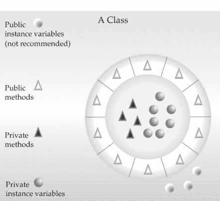

#### 继承

继承是一个对象获取另一个对象属性的过程。这很重要，因为它支持了分级分类的概念。正如前面提到的，大多数知识都可以通过分级（即自顶而下）分类来管理。例如，金毛猎犬是狗类的一种分类，狗又属于哺乳动物类，而哺乳动物又属于动物类。如果不使用分级结构，每个对象只需要定义那些使其在类中具有独特性的特征。它可以从父类继承其通用的属性。因此，是继承机制使得一个对象能够成为更通用情况的特定实例。

最自然的方式是认为世界是由许多以分级方式相互相关的对象组成的，例如动物、哺乳动物和狗。如果你想以抽象的方式描述动物，你会说它们具有某些属性，如尺寸、智力和骨骼系统类型。动物还具有某些行为特征；它们进食、呼吸和睡眠。这种对属性和行为的描述就是动物的类定义。

如果你想描述一种更具体的动物类，例如哺乳动物，它们将具有更具体的属性，如牙齿类型和乳腺。这被称为动物的**子类**（`subclass`），其中动物被称为哺乳动物的**超类**（`superclass`）。

由于哺乳动物是更精确指定的子类，它们**继承了类层次结构**中每个祖先的所有属性。

继承与封装之间也有相互作用。如果一个给定的类封装了属性，那么任何子类都具有相同的属性，加上它作为其特化部分而添加的属性（见图 2-2）。这是一个关键概念，使得面向对象的程序的复杂度呈线性增长而非几何级数增长。一个新的子类继承了它所有祖先的所有属性。它与系统中的大部分代码不会产生不可预测的交互。

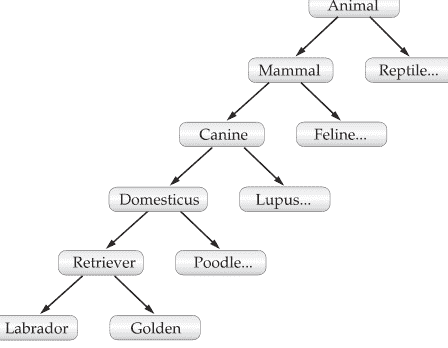
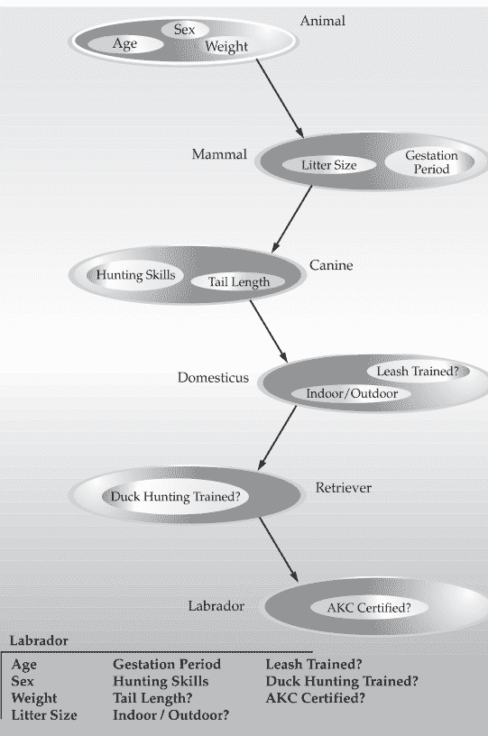

#### 多态

多态（源自希腊语，意思是“多种形式”）是一种允许一个接口用于一类通用动作的特性。具体的动作取决于情况的确切性质。考虑一个栈（一种后进先出的列表）。如果你有一个程序需要三种类型的栈。一个栈用于整数值，一个用于浮点值，一个用于字符。实现每个栈的算法是相同的，尽管存储的数据有所不同。在非面向对象的语言中，你将需要创建三组不同的栈例程，每组使用不同的名称。然而，由于多态的存在，在 Java 中你可以指定一组通用的栈例程，它们共享相同的名称。


# 第 2 章 Java 概述

为传输器提供了一个定义良好的（实际上是唯一的）接口。此外，传输器内部发生的变化不会影响传输器外部的对象。例如，换挡并不会开启大灯！因为自动变速箱是封装的，所以几十家汽车制造商可以按照自己心意欲的方式来实现它。然而，从驾驶者的角度来看，它们的工作方式都是相同的。这种理念也可以应用于编程中。封装的威力在于，无论实现细节如何，每个人都知道如何访问并使用它——而无需担心产生意外的副作用。

在 Java 中，封装的基础是类。虽然本书在稍后的部分将对类进行详细研究，但以下简短的讨论将会有帮助。类定义了由一组对象共享的结构和行为（数据和代码）。给定类的每个对象都包含该类定义的结构和行为，就像是由类形状的模具压出来的一样。由于这个原因，对象有时被称为类的实例。因此，类是一个逻辑构件；而对象具有物理实体。

当你创建一个类时，你将指定构成该类的代码和数据。具体来说，类定义的数据被称为成员变量或实例变量。操作这些数据的代码被称为方法或直接称为方法。（如果你熟悉 C/C++，知道 Java 程序员所说的“方法”在 C/C++ 程序员中被称为“函数”可能会有所帮助。）在编写良好的 Java 程序中，方法定义了变量如何被使用。这意味着类的行为和接口是由操作其实例数据的方法定义的。

由于类的目的是封装复杂性，因此有相应的机制来隐藏类内部的实现复杂性。类中的每个方法或变量可以是私有的（`private`）或公有的（`public`）。类的公共接口代表了类的外部用户需要知道或应该知道的一切。私有方法和数据只能由作为类成员的代码访问。因此，任何其他不是类成员的代码都无法访问私有方法或变量。类的私有成员只能通过类的公共方法被程序的其他部分访问，这样你就可以确保不会发生不当操作。当然，这意味着公共接口的设计不应暴露过多的类内部工作机制（见图 2-1）。


**图 2-1** 封装：公共方法可以用来保护私有数据。

## 继承

继承是一个对象获取另一个对象属性的过程。这很重要，因为它支持了分级分类的概念。正如前面提到的，大多数知识都可以通过分级（即自顶而下）分类来管理。例如，金毛猎犬是狗类的一种分类，狗又属于哺乳动物类，而哺乳动物又属于动物类。如果不使用分级结构，每个对象只需要定义那些使其在类中具有独特性特征。它可以从父类继承其通用的属性。因此，是继承机制使得一个对象能够成为更通用情况的特定实例。让我们来看这个过程。

最自然的方式是认为世界是由许多以分级方式相互相关的对象组成的，例如动物、哺乳动物和狗。如果你想以抽象的方式描述动物，你会说它们具有某些属性，如尺寸、智力和骨骼系统类型。动物还具有某些行为特征；它们进食、呼吸和睡眠。这种对属性和行为的描述就是动物的类定义。

如果你想描述一种更具体的动物类，例如哺乳动物，它们将具有更具体的属性，如牙齿类型和乳腺。这被称为动物的`子类`，其中动物被称为哺乳动物的`超类`。

由于哺乳动物是更精确指定的子类，它们`继承了` `类层次结构`中每个祖先的所有属性。

继承与封装也有相互作用。如果一个给定的类封装了属性，那么任何子类都具有相同的属性，加上`它作为其特化部分而添加的属性`（见图 2-2）。这是一个关键概念，使得面向对象的程序的复杂度呈线性增长而非几何级数增长。一个新的子类继承了它所有祖先的所有属性。它与系统中的大部分代码不会产生不可预测的交互。


**图 2-2** 拉布多继承了它所有超类的封装。

## 多态

多态（源自希腊语，意思是“多种形式”）是一种允许一个接口用于一类通用动作的特性。具体的动作取决于情况的确切性质。考虑一个栈（一种进先出的列表）。如果你有一个程序需要三种类型的栈。一个栈用于整数值，一个用于浮点值，一个用于字符。实现每个栈的算法是相同的，尽管存储的数据有所不同。在非面向对象的语言中，你将需要创建三组不同的栈例程，每组使用不同的名称。然而，由于多态的存在，在 Java 中你可以指定一组通用的栈例程，它们共享相同的名称。

更通俗地说，多态的概念通常表达为“一个接口，多种方法”。这意味着公共接口的设计不应暴露过多的类内部工作机制。多态允许一个接口用于一类通用动作，具体的动作取决于情况的确切性质。

## 第一个简单程序

现在我们已经讨论了 Java 的面向对象基础，让我们来看一些真正的 Java 程序。让我们从编译并运行这里显示的简短示例程序开始。正如你所看到的，这涉及的工作比你想象的要多一点。

```java
/*
 这是一个简单的 Java 程序。
 将此文件命名为 "Example.java"。
*/
class Example {
  // 你的程序从调用 main() 开始。
  public static void main(String[] args) {
    System.out.println("This is a simple Java program.");
  }
}
```

> **注意** 此处使用了标准 SE 开发工具包（JDK）的描述，该工具由 Oracle 提供。（也有开源版本）如果你正在使用集成开发环境（IDE），那么你将需要遵循不同的程序来编译和执行 Java 程序。在这种情况下，请咨询你的 IDE 文档以获取详细信息。

### 输入程序

对于某些计算机语言来说，保存程序源代码的文件名并不重要。然而，对于 Java 并非如此。你关于 Java 需要学习的第一点是，你为源代码文件命名非常重要。例如，源代码文件名应该是 `Example.java`。让我们看看为什么。

在 Java 中，源文件正式称为编译单元。它是一个包含（其他内容外）一个或多个类定义的文本。目前，我们将使用只包含一个类的源文件。Java 编译器要求源文件使用 `java` 扩展名。

通过观察程序你可以看到，程序定义的类名也是 `Example`，位于一个类内部。这并不是巧合。根据惯例，主类的名称必须与持有程序的文件名匹配。你还应该确保文件名的大小写与类名匹配。此原因是因为 Java 是区分大小写的。此外，文件名与类名对应的惯例似乎是任意的。然而，这种惯例使得维护和组织你的程序变得更加容易。此外，正如你稍后在某些情况下看到的，这是是强制要求的。

### 编译程序

要编译 `Example` 程序，请执行编译器 `javac`，并在命令行上指定源文件的名称，如下所示：

```
C:\>javac Example.java
```

`javac` 编译器会创建一个名为 `Example.class` 的文件，其中包含程序的字节码版本。正如前面讨论的，Java 字节码是程序的中间表示，包含了 Java 虚拟机将执行的指令。因此，`javac` 的输出并不是可以执行的代码。

要实际运行程序，你必须使用名为 `java` 的 Java 启动器。这样做时，将类名 `Example` 作为命令行参数传递，如下所示：

```
C:\>java Example
```

当程序运行时，将显示以下输出：

```
This is a simple Java program.
```

当 Java 源代码被编译时，每个单独的类都会被放入一个以类命名并带有 `.class` 扩展名的输出文件中。这就是为什么给你的 Java 源文件命名与类相同的名称是一个好主意——源文件的名称将与类文件名匹配。当你像刚才显示那样执行 `java` 时，你实际上是在指定你想要执行的类名。它将自动根据名称搜索具有 `.class` 扩展名的文件。如果找到了，它将执行所指定类中包含的代码。

> 从 JDK 11 开始，Java 提供了一种直接从源文件运行某些类型简单程序的方法，而无需显式调用 `javac`。这种技术在某些情况下非常有用，在附录 C 中进行了描述。出于本书的考虑，假设你正在使用刚刚描述的普通编译过程。

### 仔细观察第一个示例

尽管 `Example.java` 非常短，但它包含了所有 Java 程序通用的几个关键特性。程序始于以下几行：

```java
/*
 * 这是一个简单的 Java 程序。
 * 将此文件命名为 "Example.java"。
 */
```

这是一条注释。与大多数其他编程语言一样，Java 允许你在源文件中输入备注。编译器会忽略注释的内容。注释向任何阅读其源代码的任何人描述或解释程序的运行操作。在这种情况下，注释描述了程序，并提醒你源文件应该命名为 `Example.java`。在现实中，注释通常会解释程序的某些部分是如何运行的，或者某个特定功能的作用。

Java 支持三种风格的注释。程序顶部的注释被称为多行注释。这种类型的注释必须以 `/*` 开始并以 `*/` 结束。这两个注释符号之间的任何内容都会被编译器忽略。正如名称所示，多行注释可以跨越多行。

代码的下一行所示：

```java
class Example {
```

这一行使用关键字 `class` 来声明正在定义一个新类。`Example` 是一个类名的标识符。整个类定义，包括所有成员，将位于左大括号 `{` 和右大括号 `}` 之间。目前，不要过于担心类的细节，只需注意在 Java 中，所有的程序活动都发生在一个类中。这就是为什么所有 Java 程序（至少有一点）是面向对象的。

程序中的下一行是单行注释，所示如下：

```java
// 你的程序从调用 main() 开始
```

这是 Java 支持的第二种注释。单行注释以 `//` 开始，并在行尾结束。根据惯例，程序员使用注释进行长备注，使用单行注释进行说明。第三种类型，文档注释，将在本章中讨论。

```java
public static void main(String[] args) {
```

这一行开始了 `main()` 方法。正如前面的所示，这是类的开始。

`public` 是一个访问修饰符，允许程序员控制类成员的可见性。当一个成员被声明为 `public` 时，类外部的代码就可以访问该成员。`public` 的反面是 `private`，它会阻止类外部的代码使用该成员。在这种情况下，`main()` 必须声明为 `public`，因为它必须由类外部的代码调用。`static` 关键字允许在不实例化特定类的情况下调用 `main()`。这是必要的，因为 `main()` 在创建任何对象之前由 Java 虚拟机调用。`void` 关键字告诉编译器 `main()` 没有返回值。正如你将看到的，方法也会返回值。

正如所述，`main()` 是 Java 启动时调用的方法。记住 Java 是区分大小写的。`Main` 和 `main` 是不同的。重要的是，编译器会编译不包含 `main()` 方法的类。Java 没有方法运行这些类。如果你输入 `Main` 而不是 `main`，编译器将无法编译你的程序。然而，Java 会报错，因为它无法找到。

任何传递给方法的信息都通过方法名称后面的参数集中的变量接收。这些变量是参数。如果给定的方法没有参数，你需要包含空括号。在 `main()` 中只有一个参数，尽管是一个复杂的参数。`String[] args` 声明了一个命名为 `args` 的参数，它是 `String` 类实例的数组。在这种情况下，`args` 接收执行程序时的任何命令行参数。此程序没有使用很多此类信息，但本书后面显示的其他程序将会使用。

行的最后一个字符是 `{`。它标志着 `main()` 方法体的开始。所有编译为该方法的代码都发生在该方法的左大括号和右大括号之间。

还有一点：`main()` 仅仅是你的程序的起点。一个复杂的程序可能包含几十个类，其中一个类需要拥有一个 `main()` 方法来启动程序。此外，对于某些类型的程序，你可能完全不需要 `main()`。然而，对于书中的大多数程序，`main()` 是必须的。

下一行代码显示在此。注意它位于 `main()` 内部。

```java
System.out.println("This is a simple Java program.");
```

这一行在屏幕上输出字符串 "This is a simple Java program." 并在随后跟一个换行符。输出是通过内置的 `println()` 方法实现的。在这种情况下，`println()` 显示传递给它的字符串。正如你将看到的，`println()` 也可以用于显示其他类型的信息。该行以 `System.out` 开始。虽然详细解释这一点过于复杂，但 `System` 是一个提供系统访问的预定义类，而 `out` 是连接到控制台的输出流。

正如你猜的那样，控制台输出（和输入）在实际应用中并不常用。大多数现代计算环境都是图形化的，控制台 I/O 主要用于简单的实用程序、演示程序和服务端代码。在书的后面，你将学习使用 Java 生成输出的其他方法。但现在，我们将使用控制台 I/O 方法。

注意 `println()` 语句以分号结束。Java 中的许多语句都分号结束。分号是 Java 语法的重要部分。程序中的第一个 `}` 结束了 `main()`，最后一个 `}` 结束了 `Example` 类的定义。

## 第二个短程序

可能没有比变量更基础编程语言基础的概念了。正如你所知，变量是一个命名的内存位置，可以为其赋值。变量的值可以在程序执行过程中改变。下一个程序展示了如何声明变量以及如何给它赋值。该程序还说明了控制台输出的新方面。正如程序顶部注释所示，你应该将此文件称为 `Example2.java`。

```java
/*
这是另一个短示例。
将此文件命名为 "Example2.java"。
*/
class Example2 {
  public static void main(String[] args) {
    int num; // 这声明了一个名为 num 的变量
    num = 100; // 这给 num 赋值 100
    System.out.println("This is num: " + num);
    num = num * 2;
    System.out.print("The value of num * 2 is ");
    System.out.println(num);
  }
}
```

当你运行这个程序时，你将看到以下输出：

- This is num: 100
- The value of num * 2 is 200

让我们仔细观察为什么会产生此输出。程序中的第一行显示在此：

```java
int num; // 这声明了一个名为 num 的变量
```

这一行声明了一个名为 `num` 的整数。Java（像许多其他语言一样）要求在使用变量之前对其声明。以下是变量的格式：

```java
type var-name;
```

在这里，`type` 指定要声明的变量类型，`var-name` 是变量的名称。如果你想声明多个指定类型的变量，可以使用逗号分隔的变量列表。Java 定义了几种数据类型，包括整数、字符和浮点数。关键字 `int` 指定了整数类型。


在程序中，

```java
num = 100; // 这给 num 赋值 100
```

给 `num` 赋值 100。在 Java 中，赋值运算符是单个等号。下一行代码输出 `num` 的值，并在前面带有字符串 "This is num::"。

```java
System.out.println("This is num: " + num);
```

在这一条语句中，`+` 号导致 `num` 的值附加到它之前的字符串之后，然后输出结果。（实际上，`num` 首先从整数转换为其字符串形式，然后与它之前的字符串连接。这一过程在书的后后部分会进行详细描述。）这种方法可以泛化。使用 `+` 运算符，你可以在单个 `println()` 中连接你想要的任意数量的项。

下一行代码赋值了 `num` 乘以 2 的值。像大多数其他语言一样，Java 使用 `*` 运算符表示乘法。在这一行执行后，`num` 将包含 200。

这里是程序的后续两行：

```java
System.out.print("The value of num * 2 is ");
System.out.println(num);
```

这里发生了几个新情况。第一个内置的 `print()` 用于显示字符串 "The value of num * 2 is"。它后面没有跟换行符。这意味着当生成下一个输出时，`print()` 方法就像 `println()` 一样，区别在于它在每次调用后不会输出换行符。现在看对 `println()` 的调用。注意 `num` 本身被使用了。`print()` 和 `println()` 都可以输出 Java 任何内置类型的值。

## 两个控制语句

尽管第 5 章将仔细查看控制语句，但这里简要介绍了两个，以便它们可以在程序中使用。

### if 语句

`if` 语句的工作方式与其他语言非常相似。它根据某些条件为真还是假来决定执行流。它的简单形式显示在此：

```java
if(condition)
```

在这里，`condition` 是一个布尔表达式。如果测试结果为真，则执行语句。如果为假，则跳过。这是一个示例：

```java
if(num < 100) System.out.println("num is less than 100");
```

正如你在第 4 章看到的，Java 定义了关系运算符。这里有几个：

| 运算符 | 含义 |
| --- | --- |
| < | 小于 |
| > | 大于 |
| == | 等于 |

注意相等测试是双等号。这是一个程序：

```java
/*
演示 if。
将此文件命名为 "IfSample.java"。
*/
class IfSample {
    public static void main(String[] args) {
        int x, y;

        x = 10;
        y = 20;

        if(x < y) System.out.println("x is less than y");

        x = x * 2;
        if(x == y) System.out.println("x equal to y");

        x = x * 2;
        if(x > y) System.out.println("x greater than y");

        // 这不会显示任何内容
        if (x == y) System.out.println("you won't see this");
    }
}
```

此程序生成的输出是：

x is less than y

x equal to y

x greater than y

### for 循环

循环语句是几乎任何编程语言的一部分，因为它们提供重复执行某些任务的方法。正如你在第 5 章看到的，Java 提供了强大的循环构造。也许通用的是 `for` 循环。`for` 循环的简单形式显示在此：

```java
for(initialization; condition; iteration)
```

在其常见形式中，循环初始化部分将控制变量设置为初始值。条件是测试控制变量的布尔表达式。如果测试结果为真，则执行语句且 `for` 循环继续迭代。如果为假，循环终止。迭代表达式决定控制变量每次循环运行时如何变化。这里有一个说明 `for` 循环的短程序：

```java
/*
演示 for 循环。
将此文件命名为 "Fortest.java"。
*/
class ForTest {
    public static void main(String[] args) {
        int x;

        for(x = 0; x<10; x = x+1) {
            System.out.println("This is x: " + x);
        }
    }
}
```

此程序产生以下输出：

This is x: 0

This is x: 1

This is x: 2

This is x: 3

This is x: 4

This is x: 5

This is x: 6

This is x: 7

This is x: 8

This is x: 9

在这个示例中，`x` 是循环控制变量。它在 `for` 循环的初始化部分被初始化为 0。在每次迭代的开始时（包括第一次），都会执行条件测试 `x < 10`。如果该测试的结果为真，则执行 `println()` 语句，然后执行循环部分，该部分会将 `x` 加 1。这个过程一直持续，直到条件测试为假。

有趣的是，在专业编写的 Java 代码中，你几乎永远看不到像前面的程序那样显示循环的迭代部分。也就是说，你很少看到这样的语句：

```java
x = x + 1;
```

这是因为 Java 包含一个特殊的增量运算符，它可以更高效地执行此操作。增量运算符是 `++`。（也就是说，两个连续的加号。）增量运算符将其操作的操作数增加 1。通过使用增量运算符，前面的语句可以写成这样：

```java
x++;
```

因此，前面程序中的 `for` 通常会写成这样：

```java
for(x = 0; x<10; x++)
```

你可能想尝试一下。正如你将看到的，循环的运行方式与之前完全相同。Java 还提供了递减运算符，指定为 `--`。该运算符将其操作的操作数减少 1。

### 使用代码块

Java 允许将两个或多个语句组合为代码块，也称为代码块。这是通过将语句封装在左、右大括号 `{}` 之间实现的。一旦创建了代码块，它就变成了一个逻辑单元，可以用于任何单条语句的地方。例如，代码块可以作为 Java 的 `if` 和 `for` 语句的目标。考虑这个 `if` 语句：

```java
if(x < y) { // 块开始
    x = y;
    y = 0;
} // 块结束
```

在这里，如果 `x` 小于 `y`，则块内的两个语句都将被执行。因此，块内的两个语句形成了一个逻辑单元，如果一个语句不执行，另一个也无法执行。这里的关键点是，你需要逻辑上连接两个或多个语句，你通过创建一个代码块来实现这一点。

让我们来看另一个例子。下面的程序使用代码块作为循环的目标。

```java
/*
演示代码块。
将此文件命名为 "BlockTest.java"
*/
class BlockTest {
    public static void main(String[] args) {
        int x, y;
        y = 20;
        // 此循环的目标是一个代码块
        for(x = 0; x<10; x++) {
            System.out.println("This is x: " + x);
            System.out.println("This is y: " + y);
            y = y - 2;
        }
    }
}
```

该程序生成的输出所示：

```
This is x: 0
This is y: 20
This is x: 1
This is y: 18
This is x: 2
This is y: 16
This is x: 3
This is y: 14
This is x: 4
This is y: 12
This is x: 5
This is y: 10
This is x: 6
This is y: 8
This is x: 7
This is y: 6
This is x: 8
This is y: 4
This is x: 9
This is y: 2
```

在这种情况下，循环的目标是一个代码块，而不仅仅是单条语句。每次循环迭代时，块内的三个语句都将被执行。这一事实无疑通过程序生成的输出得到了证明。

正如你将在本书随后的部分看到的，代码块还有额外的属性和用途。然而，它们存在的主要原因是为了创建逻辑上不可分割的代码单元。

## 词法问题

现在你已经看过了几个 Java 程序，是时候更正式地描述 Java 的原子级元素了。Java 程序是空格符、标识符、字面量、注释、运算符、分隔符和关键字的集合。运算符将在下一章描述。其他元素将在接下来进行描述。

### 空格符

Java 是一种自由格式的语言。这意味着你不需要遵循任何特殊的缩进规则。例如，`Example` 程序可以写在一行内，或者以你喜欢的任何其他方式编写，只要在每个标记（token）之间至少有一个空白字符，且该标记尚未被运算符或分隔符界定。在 Java 中，空白符包括空格、制表符、换行符或分页符。

### 标识符

标识符用于命名事物，例如类、变量和方法。标识符可以是任何大写字母和小写字母、数字以及下划线和美元符号字符的描述性序列（美元符号不用于通用）。它们不能以数字开头，否则它们会与数字字面量混淆。同样，Java 是区分大小写的，因此 `VALUE` 和 `Value` 是不同的标识符。有效标识符的示例有：

| AvgTemp | count | a4 | $Test | this_is_ok |
| :--- | :--- | :--- | :--- | :--- |

无效的标识符名称包括：

| 2count | high-temp | Not/ok |
| :--- | :--- | :--- |

注意：从 JDK 9 开始，下划线不能单独使用。

### 字面量

Java 中的常量值是通过字面量创建的。例如，这里是字面量：

| 100 | 98.6 | 'X' | "This is a string" |
| :--- | :--- | :--- | :--- |

### 注释

正如前面提到的，Java 定义了三种注释。你已经见过两种：单行和多行注释。第三种类型称为文档注释。这种类型以 `/**` 开始并以 `*/` 结束。注释见附录 A。

### 分隔符

在 Java 中，有一些字符用作分隔符。最常用的分隔符是分号。正如你所看到的，分隔符如下：

| 符号 | 名称 | 用途 |
| :--- | :--- | :--- |
| () | 圆括号 | 用于方法定义和调用中的参数列表。也用于控制语句中的表达式以及强制类型转换。 |
| {} | 大括号 | 用于包含代码块。也用于定义类、方法和作用域。 |
| [] | 中括号 | 用于声明数组类型。也用于引用数组值。 |
| ; | 分号 | 终止语句。 |
| , | 逗号 | 分隔变量声明中的连续标识符。也用于 for 语句中的语句。 |
| . | 点 | 用于分隔包名与子类及类。也用于分隔变量或方法与引用值。 |
| :: | 冒号 | 用于创建方法或构造函数。 |
| ... | 省略号 | 表示变长参数。 |
| @ | 符号 | 标记注解。 |

### Java 关键字

Java 语言目前定义了 67 个关键字（见表 2-1）。这些关键字结合运算符和分隔符的语法构成了 Java 语言的基础。通常情况下，关键字不能作为标识符，这意味着它们不能作为变量、类或方法。然而，有 16 个关键字是上下文敏感的，这意味着它们仅在与其相关的特征时才作为关键字。它们支持过去几年添加到 Java 中的功能。其中十个与模块有关：`exports`、`module`、`open`、`opens`、`requires`、`to`、`transitive`、`with`、`with`。记录通过 `record` 声明；密封类和接口使用 `non-sealed` 和 `permits`；`yield` 用于增强型 `switch`，而 `var` 支持局部变量类型推断。此外，由于它们是上下文敏感的，单独使用下划线被视为关键字，以防止它成为你程序中的某些名称。从 JDK 9 开始，`strictfp` 已经过时，因为它没有影响。

`const` 和 `goto` 是被保留但未使用的。在 Java 早期，几个其他关键字被保留以供未来可能的使用。然而，目前的 Java 规范仅定义了表 2-1 所示的关键字。

| abstract | assert | boolean | break | byte | case |
|---|---|---|---|---|---|
| catch | char | class | const | continue | default |
| do | double | else | enum | exports | extends |
| final | finally | float | for | goto | if |
| implements | import | instanceof | int | interface | long |
| module | native | new | non-sealed | open | opens |
| package | permits | private | protected | provides | public |
| record | requires | return | sealed | short | static |
| strictfp | super | switch | synchronized | this | throw |
| throws | to | transient | transitive | try | uses |
| var | void | volatile | while | with | yield |

**表 2-1** Java 关键字

除了关键字之外，Java 还预留了三个从一开始就属于 Java 的其他名称：`true`、`false` 和 `null`。这些值由 Java 定义。你不能将这些词作为变量、类等的名称。

## Java 类库

本章所示的示例程序使用了 Java 的两个内置方法：`println()` 和 `print()`。如所述，这些方法通过 `System.out` 可用。`System` 是 Java 定义的一个类，它会自动包含在你的程序中。从宏观角度来看，Java 环境依赖于几个内置类，这些类包含许多内置方法，为 I/O、字符串处理、网络和图形等提供支持。标准类还提供了对图形用户界面（GUI）的支持。因此，Java 作为一个整体是 Java 语言本身及其标准类的结合。正如你将看到的，类库提供了 Java 自带的大部分功能。事实上，成为 Java 程序员的一部分工作就是学习使用标准 Java 类。在本书的第一部分中，将根据需要描述标准库类和方法的各种元素。在第二部分中，将详细描述若干个类库。

# 第 3 章 数据类型、变量和数组

本章将研究 Java 的三个最基础的元素：数据类型、变量和数组。与所有现代编程语言一样，Java 支持多种类型的数据。你可以使用这些类型来声明变量和创建数组。正如你将看到的，Java 处理这些项目的方法是简洁、高效且内聚的。

## Java 是一种强类型语言

开头需要说明的是，Java 是一种强类型语言。事实上，Java 的安全性和健壮性部分源于此。让我们看看这意味着什么。首先，每个变量都有类型，每个表达式都有类型，且每个类型都有严格的定义。其次，所有的赋值（无论是显式的还是通过方法调用中的参数传递）都会检查类型兼容性。在某些语言中，没有自动转换或冲突类型的转换。Java 编译器会检查所有表达式和参数，以确保类型是兼容的。任何类型不匹配都是错误，必须在编译器完成编译之前进行修正。

## 基本数据类型

Java 定义了八种基本数据类型：`byte`、`short`、`int`、`long`、`char`、`float`、`double` 和 `boolean`。基本类型也通常称为简单类型，书中将使用这两个术语。它们可以分为四组：

- **整数**：这组包括 `byte`、`short`、`int` 和 `long`，用于整数值数字。
- **浮点数**：这组包括 `float` 和 `double`，表示具有小数部分精度的数字。
- **字符**：这组包括 `char`，表示字符集中的符号，如字母和数字。
- **布尔值**：这组包括 `boolean`，是一种表示真/假值的特殊类型。

你可以直接使用这些类型，也可以构造数组或你自己的类类型。因此，它们构成了你可以创建的所有其他类型数据的基础。

基本数据类型表示单个值——而不是复杂对象。虽然 Java 是完全面向对象的，但基本类型并非如此。它们类似于其他非面向对象语言中找到简单类型。之所以这样做是出于效率考虑。将基本类型变为对象会严重损害性能。C 和 C++ 等语言允许整数的大小根据执行环境的规定而变化。Java 则不同。由于 Java 的可移植性要求，所有数据类型都有定义的范围。例如，`int` 是 32 位的，无论特定平台如何。这保证了程序可以在任何架构上无需移植即可运行。虽然指定整数的大小在某些环境中会导致微小的性能损失，但为了实现可移植性，这是必要的。

让我们逐个查看每种数据：

### 整数


# Java 数据类型

Java 定义了四种整数类型：`byte`、`short`、`int` 和 `long`。这些都是带符号的正值和负值。Java 不支持无符号的全正整数。许多计算机语言同时支持带符号和无符号整数。然而，Java 的设计者认为无符号整数是不必要的。具体来说，他们认为无符号的概念主要用于指定高位位的行为，高位定义了整数值的符号。正如你将在第 4 章中看到的，Java 以不同的方式管理高位的含义，即使用特殊的“无符号右移”运算符。因此，对无符号整数类型的需求消除了。

整数类型的宽度不应被看作它消耗的存储空间，而应看作它为类型变量和表达式定义的行为。Java 运行时环境可以自由使用它想要的任何尺寸，只要类型行为与你声明的一致。这些类型的宽度和范围不同，如下表所示：

| 名称 | 宽度 | 范围 |
|---|---|---|
| `long` | 64 | -9,223,372,036,854,775,808 to 9,223,372,036,854,775,807 |
| `int` | 32 | -2,147,483,648 to 2,147,483,647 |
| `short` | 16 | -32,768 to 32,767 |
| `byte` | 8 | -128 to 127 |

## byte

最小的整数类型是 `byte`。这是一个带符号的 8 位类型，范围从 -128 到 127。当你处理来自网络或文件的数据流时，`byte` 类型变量非常有用。当处理可能与 Java 其他类型不兼容的二进制数据时，它们也有用。

字节变量通过使用 `byte` 关键字声明。例如，以下代码定义了两个变量 `b` 和 `c`：

```java
byte b, c;
```

## short

`short` 是一种带符号的 16 位类型。它的范围是从 -32768 到 32767。它可能是最常用的 Java 类型。这里短的一些示例：

```java
short s;
short t;
```

## int

最常用的整数是 `int`。它是一种带符号的 32 位类型，范围从 -2,147,483,648 到 2,147,483,647。除了其他用途，`int` 类型变量通常用于控制循环和数组。你可能认为在不需要 `int` 的大范围的情况下，使用 `byte` 或 `short` 会比使用 `int` 高效，事实并非如此。原因是 `byte` 和 `short` 值在表达式中使用，它们在求值时会被提升 `int`（类型提升在本章后文中介绍）。因此，在需要整数时，`int` 是最佳选择。

## long

`long` 是一种带符号的 64 位类型，适用于 `int` 类型不足以容纳所需值的情况。`long` 的范围很大。这使得在需要大整数时非常有用。例如，这里有一个程序计算光在特定天数内移动距离：

```java
// 使用 long 变量计算光程。
class Light {
    public static void main(String[] args) {
        int speed;
        long days;
        long seconds;
        long distance;

        // 光每秒英里的近似速度
        speed = 186000;

        days = 1000; // 在此处指定天数
        seconds = 24 * 60 * 60; // 转换为秒
        distance = speed * seconds; // 计算距离

        System.out.print("在 " + days + " 天内将移动大约 ");
        System.out.println(distance + " 英里.");
    }
}
```

该程序生成以下输出：

```
在1000天内，光传播了大约 16070400000000 英里。
```

显然，该结果无法存储在 `int` 变量中。

## 浮点类型

浮点数（也称为实数）用于评估需要小数精度的表达式。例如，诸如平方根的计算，或者正弦、余弦等超越数计算，其结果需要一个浮点类型的值。Java 实现了标准的 (IEEE-754) 浮点类型和运算符。浮点类型有两种：`float` 和 `double`，它们分别表示单精度和双精度数字。它们的宽度和范围所示：

| 名称 | 宽度（位/Bits） | 近似范围 |
|---|---|---|
| `double` | 64 | 4.9e−324 到 1.8e+308 |
| `float` | 32 | 1.4e−045 到 3.4e+038 |

接下来将分别介绍这些浮点类型。

### float

`float` 类型指定了一个使用 32 位存储的单精度值。在某些处理器上，单精度的速度更快，且占的空间是 `double` 的一半，但当值非常大或非常小时会变得不精确。当你需要一个功能组件但不需要很高精度时，`float` 类型的变量非常有用。例如，在表示美元和分时，`float` 可能很有用。

以下是 `float` 变量定义的示例：

```java
float hightemp, lowtemp;
```

### double

`double`（由 `double` 关键字表示）使用 64 位存储一个值。在某些针对高速数学计算进行优化的现代处理器上，双精实际上实际上比单精度更快。所有的超越数学函数（如 `sin()`、`cos()` 和 `sqrt()`）都返回 `double` 值。当你需要在多次迭代计算中保持准确性，或者正在处理大数值时，`double` 是最佳选择。

这里是一个使用 `double` 变量计算圆面积的短程序：

```java
// 计算圆面积
class Area {
    public static void main(String[] args) {
        double pi, r, a;
        r = 10.8; // 圆的半径
        pi = 3.14159; // pi，近似值
        a = pi * r * r; // 计算面积

        System.out.println("Area of circle is " + a);
    }
}
```

## 字符

在 Java 中，用于存储字符的数据类型是 `char`。Unicode 定义了一个完全国际字符集，可以表示人类语言中找到的所有字符。它是几十字符集的统一，例如拉丁语、希腊语、阿拉伯语、西里尔语、希伯来语、片假、韩语等。在 Java 创建时，Unicode 需要 16 位。因此，在 Java 中 `char` 是一个 16 位类型。`char` 的范围是 0 到 65535。没有负数 `char`。被称为 ASCII 的标准字符集范围一如既往是 0 到 127，而 8 位字符集 ISO-Latin-1 的范围是 0 到 255。由于 Java 的设计允许程序在全球范围内使用，因此使用 Unicode 表示字符是有意义的。当然，对于英语、德语、西班牙语或法语等语言，其字符可以轻松包含在 8 位内，使用 Unicode 显得有些低效。但这是为了全球可移植性付出的代价。

> **注意** 关于 Unicode 的更多信息可以在 <http://www.unicode.org> 找到。

这是一个演示 `char` 变量的程序：

```java
// char 数据类型。
class CharDemo {
    public static void main(String[] args) {
        char ch1, ch2;

        ch1 = 88; // X 的代码
        ch2 = 'Y';

        System.out.print("ch1 and ch2: ");
        System.out.println(ch1 + " " + ch2);
    }
}
```

该程序显示以下输出：

```
ch1: X Y
```

注意 `char` 被赋值为值 88，这是对应于字母 X 的 ASCII（以及 Unicode）值。如所述，ASCII 字符集占据 Unicode 字符集中的前 127 个值。出于这个原因，你在其他语言中使用字符时的所有“老技巧”在 Java 中同样有效。

尽管 `char` 设计用于处理 Unicode 字符，但它也可以作为整数类型，可以在上面进行算术运算。例如，你可以将两个字符相加，或者增加字符变量的值。考虑以下程序：

```java
// char 变量像整数一样。
class CharDemo2 {
    public static void main(String[] args) {
        char chl;

        chl = 'X';
        System.out.println("chl contains " + chl);

        chl++; // 增 chl
        System.out.println("chl is now " + chl);
    }
}
```

该程序生成的输出所示：

```
chl contains X
chl is now Y
```

在程序中，`chl` 首先被赋值为 X。接下来，`chl` 递增。这导致 `chl` 包含 Y，即 ASCII (Unicode) 序列中的下一个字符。

> **注意** 在 Java 的正式规范中，`char` 是一个 16 位类型。

## 布尔值

Java 有一种名为 `boolean` 的原始类型，它只能包含两个值：`true` 或 `false`。`boolean` 类型用于条件控制语句。这是一个演示布尔变量的程序：

```java
// 演示布尔变量。
class BoolTest {
    public static void main(String[] args) {
        boolean b1, b2;

        b1 = true;
        b2 = false;

        System.out.println("b1: " + b1);
        System.out.println("b2: " + b2);

        if (b1) {
            System.out.println("b1 is true");
        }

        if (b2) {
            System.out.println("b2 is true");
        }
    }
}
```

该程序生成的输出是：

```
b1: true
b2: false
b1 is true
```

---

# 字面量

`922337203685477807L` 是最大的 `Long` 类型。只要整数在范围内，也可以将其赋值给 `char` 类型。

你还可以使用二进制形式来指定整数字面量。为此，请在值的前面加上 `0b` 或 `0B` 前缀。例如，这使用二进制字面量指定了十进制的 10：

```java
int x = 0b1010;
```

除其他外，二进制字面量的加入使得作为位掩码使用的值更容易输入。在这种情况下，值的十进制（十六进制）表示法在视觉上无法直观传达其相对于用途的含义。二进制字面量。

你可以在整数字面量中嵌入一个或多个下划线。这样做可以更容易地阅读大型整数字面量。在编译字面量时，下划线会被丢弃。例如，

```java
int x = 123_46_789;
```

赋给 `x` 的值为 123,456,789。下划线将被忽略。下划线只能用于分隔数字。它们不能出现在字面量的开头或结尾。然而，在两个数字之间使用多个下划线是允许的。例如，这是有效的：

```java
int x = 123___456_789;
```

在整数字面量中使用下划线在编码电话号码、客户 ID 、零件号等内容时特别有用。它们对于在指定二进制字面量时提供视觉分组也很有用。例如，二进制字面量通常四位一组进行分组，如下：

```java
int x = 0b101_0101_0001_1010;
```

## 浮点数字面量

浮点数表示带有小数部分的十进制值。标准记法由一个整数、一个小数点以及紧随其后的小数部分组成。例如，2.0、3.14159 和 0.0667 是有效的标准记法浮点数。科学计数法使用标准记法浮点数加上一个后缀，该后缀指定了该数所乘 10 的幂次。指数由 `E` 表示，或者后面跟着一个数字（可以是正数或负）。示例包括 6.022E23、31419E-5 和 2e+10。

Java 中的浮点字面量具有双精度。要指定 `float` 字面量，你必须在常量末尾附加 `F` 或 `f`。你也可以通过附加 `D` 或 `d` 来指定 `double` 字面量。当然，这样做是多余的。默认的 `double` 类型消耗 64 位内存，而最小的 `float` 类型需要 32 位。

Java 也支持十六进制浮点数字面量，但很少使用。它们必须采用类似于科学计数法的格式，使用 `P` 或 `p`，而不是 `E` 或 `e`。例如，`0x12.2P2` 是一个浮点数字面量。`P` 之后的值（称为二进制指数）表示了该数所乘的 2 的幂次。`0x12.2P2` 代表 72.5。

你可以在浮点数字面量中嵌入一个或多个下划线。此功能与前面描述的整数字面量相同。其目的是为了更容易阅读大型浮点数字面量。在编译字面量时，下划线会被丢弃。例如，

```java
double num = 9_423_497_862.0;
```

赋给 `num` 的值将是 9,423,497,862.0。下划线将被忽略。与整数字面量一样，下划线只能用于分隔数字。它们不能位于字面量的开头或结尾。然而，两个数字之间使用多个下划线是允许的。在数字的小数部分使用下划线也是允许的。例如，

```java
double num = 9_423_497.1_0_9;
```

是合法的。在这种情况下，小数部分是 .109。

## 布尔字面量

布尔字面量很简单。布尔值只有两种逻辑值：`true` 和 `false`。`true` 和 `false` 的值不会转换为数值表示。Java 中的 `true` 字面量不等于 1，`false` 字面量也不等于 0。在 Java 中，布尔字面量只能赋值给声明为 `boolean` 的变量，或在带有布尔运算符的表达式中使用。

## 字符字面量

Java 中的字符是 Unicode 字符集的索引。它们是 16 位的值，可以转换为整数并使用加法和减法运算符等整数运算符进行操作。字面量字符表示在一对单引号内。所有可见的 ASCII 字符都可以输入到引号中，例如 `'a'` 和 `'\\'`。对于无法直接输入的字符，有几种转义序列允许你输入该字符，例如用于单引号字符本身的 `'\''` 和用于换行符的 `'\n'`。还有一种机制，可以通过反斜杠后跟三位数字来直接输入字符的值。例如，`'\141'` 是字面量。`'\u0061'` 是 ISO-Latin-1 中的 `'a'`，因为高字节为零。`'\u4432'` 是日语片假名。

## 字符串字面量

Java 中的字符串字面量包含在双引号中。字符串字面量的示例：

```java
"Hello World"
"This is a test"
```

## 表 3-1 转义序列

| 转义序列 | 说明 |
| :--- | :--- |
| `\'` | 单引号 |
| `\"` | 双引号 |
| `\\` | 反斜线 |
| `\n` | 换行 |
| `\r` | 回车 |
| `\f` | 换页 |
| `\t` | 制表符 |
| `\b` | 退格 |
| `\s` | 空格 |

---

# 第3章 数据类型、变量和数组

变量是存储数据的容器。每个变量都有类型，类型决定了它可以存储的数据。在 Java 中，变量必须在使用之前声明。

## 声明变量

在 Java 中，通过指定类型后跟名称来声明变量。你还可以给它一个初始值。

```java
int a, b, c;
int d = 10, e = 20;
```

## 变量

变量是内存中命名的存储位置。名称（标识符）允许你在程序中引用该位置。

## 动态初始化

之前的示例只使用了常量，Java 允许在声明时使用任何有效的表达式动态初始化变量。

例如，这里有一个短程序可以在给定边长的情况下计算直角三角形的斜边：

```java
// 动态初始化。
class DynInit {
    public static void main(String[] args) {
        double a = 3.0, b = 4.0;

        // c 是动态初始化的
        double c = Math.sqrt(a * a + b * b);

        System.out.println("Hypotenuse is " + c);
    }
}
```

## 变量的作用域和生命周期

在 Java 中，变量可以在任何块中声明。正如第 2 章所示，块由左大括号开始，由右大括号结束。块定义了一个作用域。因此，每当你开始一个新块时，你都在创建一个新的作用域。

决定了哪些对象对程序的其他部分可见。它还决定了这些对象的生命周期。

以两种大类作用域：全局作用域和局部作用域来思考并不罕见。然而，这些传统的作用域并不符合 Java 严格的面向对象模型。虽然可以创建等同于全局作用域的变量，但这目前来说是例外，而非规律。在 Java 中，两个主要的作用域分别由类定义和方法定义。这种区分在某种程度上是人为的。然而，由于类作用域具有方法定义的作用域不具备的独特属性和特征，这种区分是有意义的。由于这些差异，关于类作用域（以及其中声明的变量）的讨论将推到第 6 章，届时类将在内部进行定义。

由方法定义的作用域开始于它的左大括号。然而，如果方法有参数，这些参数会被包含在方法的作用域内。方法的作用域结束于它的大括号。这段代码块被称为方法体。

作为一般规则，在作用域内部声明的变量对作用域外部的代码是不可见的（即不可访问的）。因此，当你在作用域内声明变量时，你是在将其局部化并保护其不受未经授权的访问和/或修改。事实上，作用域为封装提供了基础。在块内声明的变量被称为局部变量。

作用域是可以嵌套的。例如，每当你创建一个代码块时，你就在创建一个新的作用域。当这种情况发生时，外部作用域包含了内部作用域。这意味着在外部作用域中声明的对象对内部作用域是可见的。然而，反过来不然。在内部作用域内声明的对象在外部是不可见的。

为了理解嵌套作用域的影响，考虑以下程序：


```java
// 演示块作用域。
class Scope {
    public static void main(String[] args) {
        int x; // main 内部所有代码可见
        x = 10;
        if(x == 10) { // 开始新作用域
            int y = 20; // 仅对此块可见
            // x 和 y 在这里都是可见的
            System.out.println("x and y: " + x + " " + y);
            x = y * 2;
        }
        // y = 100; // 错误！这里不可见 y
        // x 在这里仍然可见。
        System.out.println("x " + x);
    }
}
```

正如注释所示，变量 `x` 在 `main()` 作用域的开始处声明，并且对 `main()` 内部的所有代码都可见。在 `if` 块内部，声明了 `y`。由于块定义了一个作用域，因此 `y` 仅对该块内部的其他代码可见。这就是为什么在它的块外部，`y = 100;` 这一行被注释掉了。如果你移除开头的注释符号，将发生编译时错误，因为 `y` 在此块外部是不可见的。在 `if` 块内部，`x` 可以在块代码（即嵌套作用域）中使用，块可以访问包围作用域声明的变量。

在块内部，可以在任何点声明变量，但仅在声明后有效。如果你在方法开头定义变量，它对该方法内的所有代码都是可用的。相反，如果你在块的末尾声明变量，它实际上是无用的，没有代码可以访问它。例如，这个片段 `count` 无法在声明之前使用：

```java
// 这个片段是错误的！
count = 100; // 哎！在声明之前不能使用 count！
int count;
```

这里有另一个需要记住的重要点：变量在进入作用域时创建，在离开作用域时销毁。这意味着变量在离开作用域后将不再保留其原有值。因此，在方法内部声明的变量在多次调用方法之间不会保留其值。此外，在块内部声明的变量在离开块时会丢失其值。因此，变量的生命周期被限制在它的作用域内。

如果声明包含初始化器，那么它在每次进入并并声明的块时都会被重新初始化。例如，考虑下一个程序：

此程序生成的输出所示：

```
y is: -1
y is now: 100
y is: -1
y is now: 100
y is: -1
y is now: 100
```

你可以看到，每当进入内部 `for` 循环时，`y` 都会重新初始化为 `-1`。尽管随后它被赋值为值 `100`，但这个值丢失了。

最后一点：虽然块可以嵌套，但你不能在外部作用域中声明一个具有相同名称的变量。例如，以下程序是非合法的：

```java
// 此程序将无法编译
class ScopeErr {
    public static void main(String[] args) {
        int bar = 1;
        {
            int bar = 2; // 创建新作用域
            // 编译错误 - bar 已经定义！
        }
    }
}
```

## 类型转换与强制转换

如果你有一定的编程经验，那么你已经知道将一种类型的值赋值给另一种类型的变量是很常见的。如果这两个类型是兼容的，Java 将自动执行转换。例如，将 `int` 赋值给 `long` 总是可能的。然而，并不是所有类型都兼容，因此并不是所有的转换都是隐式允许的。例如，没有从 `double` 到 `byte` 的自动转换。要做到这一点，你必须使用强制转换。让我们看看自动转换和强制转换。

### Java 的自动转换

当将一种类型的数据赋值给另一种类型时，如果满足以下两个条件，将发生自动转换：

- 两种类型兼容。
- 目标类型大于源类型。

当满足这两个条件时，会发生宽转换。例如，`int` 足够容纳 `byte` 值，因此不需要显式转换。对于宽转换，数值类型（包括整数和浮点类型）是兼容的。然而，没有从数值类型到 `char` 或 `boolean` 的自动转换。此外，`char` 和 `boolean` 互不兼容。正如之前提到的，当将常量存储到 `byte`、`short`、`char` 类型的变量时，Java 执行自动转换。

### 不兼容类型的转换

虽然自动转换很有帮助，但它们无法满足所有需求。例如，如果你想将 `int` 赋值给 `byte` 变量怎么办？因为 `byte` 比 `int` 小，这种转换被称为窄转换，因为你显式地缩小值以适应目标类型。

要在不兼容类型之间创建转换，你必须使用强制转换。强制转换简单的显式类型转换。它具有如下形式：

`(目标类型) 值`

在这里，目标类型指定了要转换的指定类型。例如，下面的片段将 `int` 转换为 `byte`。如果整数值大于 `byte` 的范围，它将对 `byte` 的范围取模（整数除法的余数）。

当将浮点值赋值给整数类型时，会发生不同的转换：截断。如你所知，整数没有小数部分。因此，当将浮点值赋值给整数类型时，小数部分就会丢失。例如，如果将值 `1.23` 赋值给整数类型，结果将简单为 `1`。`0.23` 已被截断。当然，如果整数部分的大小到无法放入整数类型，那么该值将对该类型的范围取模。

```java
// 演示强制转换。
class Conversion {
    public static void main(String[] args) {
        byte b;
        int i = 257;
        double d = 323.142;

        System.out.println("\n将 int转换为 byte.");
        System.out.println("i and b " + i + " " + b);

        System.out.println("\n将 double 转换为 int.");
        System.out.println("d and i " + d + " " + i);

        System.out.println("\n将 double 转换为 byte.");
        System.out.println("d and b " + d + " " + b);
    }
}
```

## 第一部分 Java 语言

让我们来看每一次转换。当值 `257` 被强制转换为 `byte` 变量时，结果是 `257` 除以 `256`（`byte` 的范围）的余数，在本例中结果为 `1`。当 `d` 转换为 `int` 时，它的小数部分会丢失。当 `d` 转换为 `byte` 时，它的小数部分会丢失，且该值对 `256` 取模，在本例中为 `67`。

## 表达式中的自动类型提升

除了赋值之外，表达式中还有另一个可能发生类型转换的地方。为了理解为什么，请考虑以下内容。在表达式中，中间值的精度有时会超过每个操作数的范围。例如，查看以下表达式：

```java
byte a = 40;
byte b = 50;
byte c = 100;
int d = a * b / c;
```

中间项 `a * b` 的结果很容易超过其两个 `byte` 操作数的任何范围。为了处理这类问题，Java 在求值表达式时会自动提升每个 `byte`、`short` 或 `char`。这意味着子表达式 `a*b` 是使用整数而非 `byte` 提升的。因此，中间表达式的结果 `50 * 40` 即 `2000` 是合法的，尽管 `a` 和 `b` 都指定为 `byte` 类型。

尽管自动提升很有用，但它们可能会导致令人困惑的编译错误。例如，这段看似正确的代码会导致问题：

```java
byte b = 50;
b = b * 2; // 错误！无法将 int 赋值给 byte；
```

该代码试图将 `50 * 2`（一个完全有效的 `byte` 值）存回 `byte` 变量。然而，因为在求值表达式时操作数被自动提升为 `int`，现在表达式的结果现在为 `int` 类型，在不使用强制转换的情况下无法将其赋值给 `byte`。即使在这种特定情况下，被赋值的值仍然能够放入目标类型，情况也是如此。

在您理解溢出后果的情况下，应该使用显式强制转换，例如：

```java
byte b = 50;
b = (byte) (b * 2);
```

将得到正确的值 `100`。

## 类型提升规则

Java 定义了若干类型提升规则来应用于表达式。规则如下：首先，如前所述，所有的 `byte`、`short` 和 `char` 值都被提升为 `int`。如果一个操作数是 `long`，整个表达式被提升为 `long`。如果一个操作数是 `float`，整个表达式被提升为 `float`。如果任何操作数是 `double`，结果就是 `double`。

# 第3章 数据类型、变量和数组

下面的程序演示了表达式中的每个值如何被提升以匹配每个二元操作符的第二个参数：

```java
class Promote {
    public static void main(String[] args) {
        byte b = 42;
        char c = 'a';
        short s = 1024;
        int i = 5000;
        float f = 5.67f;
        double d = .1234;
        double result = (f * b) + (i / c) - (d * s);
        System.out.println((f * b) + " + " + (i / c) + " - " + (d * s));
        System.out.println("result = " + result);
    }
}
```

让我们看看程序中这一行发生的类型提升：

`double result = (f * b) + (i / c) - (d * s);`

在第一个子表达式中，`f * b` 被提升为 `float`，子表达式的结果为 `float`。在子表达式 `i/c` 中，它被提升为 `int`，结果为 `int` 类型。在 `d * s` 中，`d` 的值被提升为 `double`，子表达式的类型为 `double`。最后，这三个中间值 `float`、`int` 和 `double` 被考虑。`float` 加上 `int` 的结果是 `float`。最终结果将 `double` 提升为 `double`，这是表达式的类型。

## 数组

**数组** 是一组相同类型的变量。任何类型的数组都可以创建，并可以有一个或多个维度。数组中的特定元素通过索引访问。数组提供了一种对相关信息的方便分组。

## 一维数组

本质上，**一维数组** 是一列表相同类型的变量。要创建一个数组，必须先创建所需的数组。一维数组的通用形式是：

`type[] varname;`

在这里，**type** 声明了元素的类型（也称为基类型）。元素类型决定了数组将持有的数据类型。例如，以下声明了一个名为 `month_days` 的 `int` 类型数组：

`int[] month_days;`

虽然这个声明建立了 `month_days` 是一个数组的事实，但数组并不存在。要关联物理数组 `month_days`，必须分配内存并将其赋值给数组。`new` 是一个分配内存的特殊运算符。你将在后面的章节中详细查看 `new`。适用于一维数组的通用形式如下：

`var = new type[size];`

在这里，**type** 指定了被分配的数据类型，**size** 指定了数组中的元素个数，**var** 是关联的数组变量。也就是说，要使用数组，必须指定类型和要分配的元素个数。数组中的元素会被初始化为 `0`（数值类型）、`false`（布尔类型）或 `null`（引用类型，将在后面的章节描述）。此示例分配了一个包含12个元素的整数数组并将其赋值给 `month_days`：

`month_days = new int[12];`

执行此语句后，`month_days` 将指向12个整数的数组。此外，数组中的所有元素均为0。回顾一下：获取数组是一个两步过程。首先，你必须声明所需的数组变量。其次，你必须使用 `new` 分配持有数组的内存并将其赋值给数组。如果你对动态分配的概念感到陌生，不要担心，书中将会描述。

一旦分配了数组，就可以通过方括号指定索引来访问数组中的特定元素。所有数组索引从0开始。例如，此赋值将值28赋给 `month_days` 的第二个元素：

`month_days[1] = 28;`

下一行显示存储在索引3处的值：

`System.out.println(month_days[3]);`

将所有部分结合起来，这里创建一个每月天数的程序：

```java
// Demo一维数组。
class Array {
  public static void main(String[] args) {
    int[] month_days;
    month_days = new int[12];
    month_days[0] = 31;
    month_days[1] = 28;
    month_days[2] = 31;
    month_days[3] = 30;
    month_days[4] = 31;
    month_days[5] = 30;
    month_days[6] = 31;
    month_days[7] = 31;
    month_days[8] = 30;
    month_days[9] = 31;
    month_days[10] = 30;
    month_days[11] = 31;
    System.out.println("April has " + month_days[3] + " days.");
  }
}
```

当你运行这个程序时，它会打印4月的天数。如所述，Java数组索引从0开始，4月的天数是 `month_days[3]` 或30。可以将数组变量的声明与数组本身的分配结合，如下所示：

`int[] month_days = new int[12];`

这是你在专业编写的Java程序中通常看到写法。数组在声明时就会初始化。该过程与初始化简单类型的方法相似。*数组初始化器*是由花括号括起来、逗号分隔的元素列表。逗号分隔数组元素的值。数组会自动创建到足够大，以包含你在数组初始化器中指定的元素个数。不需要使用 `new`。例如，为了查看每月天数，以下代码创建了一个初始化的整数数组：

```java
// 上一个程序的改进版本。
class AutoArray {
    public static void main(String[] args) {
        int[] month_days = {31, 28, 31, 30, 31, 30, 31, 31, 30, 31, 31};
        System.out.println("April has " + month_days[3] + " days.");
    }
}
```

当你运行这个程序时，你看到的输出与上一个版本相同。Java严格检查确保你不会意外存储或引用数组范围之外的值。Java 运行时系统将检查所有索引是否在范围内。例如，运行时系统将检查 `month_days` 中每个索引的值以确保它在0到11之间。如果你尝试访问范围之外的元素（负数或大于数组长度的数字），会导致运行时错误。

这里另一个使用一维数组的示例。它计算一组数字的平均值。

```java
class Average {
    public static void main(String[] args) {
        double[] nums = {10.1, 11.2, 12.3, 13.4, 14.5};
        double result = 0;
        int i;
        for(i=0; i<5; i++)
            result = result + nums[i];
        System.out.println("Average is " + result / 5);
    }
}
```

## 多维数组

在 Java 中，多维数组被实现为数组的数组。要声明多维数组变量，请使用另一组方括号指定每个额外的索引。例如，以下代码声明了一个名为 `twoD` 的多维数组变量：

```java
int[][] twoD = new int[4][5];
```

这分配了 4 个长度为 5 的数组并将它们赋值给 `twoD`。在内部，它被实现为 `int` 数组的数组。从概念上说，这个数组看起来就像图 3-1 所示。以下程序从左到右、从上下对数组中的每个元素编号，然后显示这些值：

```java
// 展示一个二维数组。
class TwoDArray {
    public static void main(String[] args) {
        int[][] twoD = new int[4][5];
        int i, j, k = 0;

        for(i=0; i<4; i++) {
            for(j=0; j<5; j++) {
                twoD[i][j] = k++;
            }
        }

        for(i=0; i<4; i++) {
            for(j=0; j<5; j++) {
                System.out.print(twoD[i][j] + " ");
            }
            System.out.println();
        }
    }
}
```

该程序生成以下内容：

```
0 1 2 3 4
5 6 7 8 9
10 11 12 13 14
15 16 17 18 19
```

当为多维数组分配内存时，你只需要指定第一维（最左侧）的内存。你可以单独分配剩余的维度。


# 第3章 数据类型、变量和数组

右侧索引决定列。

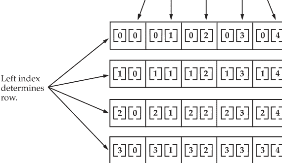

左侧索引决定行。

给定：`int[][] twoD = new int[4][5];`

**图 3-1** 4x5 二维数组的概念视图

例如，以下代码在声明 `twoD` 时为其第一维分配了内存。它单独分配了第二维。

```java
int[][] twoD = new int[4][];
twoD[0] = new int[5];
twoD[1] = new int[5];
twoD[2] = new int[5];
twoD[3] = new int[5];
```

虽然在这种情况下不需要单独分配第二维数组，但可能存在其他情况。例如，当你单独分配时，你不需要为每个维度分配相同数量的元素。如前所述，多维数组实际上是数组的数组，每个数组的长度由你控制。例如，以下程序创建了一个第二维大小不相等的二维数组：

```java
// 手动分配不同的第二维。
class TwoDAgain {
    public static void main(String[] args) {
        int[][] twoD = new int[4][];
        twoD[0] = new int[1];
        twoD[1] = new int[2];
        twoD[2] = new int[3];
        twoD[3] = new int[4];
    }
    int i, j, k = 0;
}
```

```java
for(i=0; i<4; i++)
    for(j=0; j<i+1; j++) {
        twoD[i][j] = k;
    }

for(i=0; i<4; i++) {
    for(j=0; j<i+1; j++) {
        System.out.print(twoD[i][j] + " ");
    }
    System.out.println();
}
```

该程序生成以下输出：

```
0
1 2
3 4 5
6 7 8 9
```

该程序创建的数组如下：

| [0] | [0] |
|---|---|
| [1] | [0] | [1] |
| [2] | [0] | [1] | [2] |
| [3] | [0] | [1] | [2] | [3] |

不均匀或不规则的多维数组并不适用于许多应用，因为与人们遇到多维数组时的预期相反。然而，在某些情况下可以使用不规则数组。例如，如果你需要一个稀疏的（并非所有元素都会使用）二维数组，那么不规则数组可能是完美的解决方案。

可以初始化多维数组。只需将每个维度封装在自己的括号内即可。以下程序创建了一个每个元素包含行索引和列索引乘积的矩阵。注意可以使用表达式作为初始化器。

```java
// 初始化二维数组。
class Matrix {
    public static void main(String[] args) {
        int[][] m = {
            {0*0, 1*0, 2*0, 3*0},
            {0*1, 1*1, 2*1, 3*1},
            {0*2, 1*2, 2*2, 3*2},
            {0*3, 1*3, 2*3, 3*3}
        };
        int i, j;
        for(i=0; i<4; i++) {
            for(j=0; j<4; j++) {
                System.out.print(m[i][j] + " ");
            }
            System.out.println();
        }
    }
}
```

运行此程序，你将得到以下输出：

```
0 0 0 0
0 1 2 3
0 2 4 6
0 3 6 9
```

如所示，数组中的每一行都是按照指定的初始化的。以下程序创建一个 3x4x5 三维数组。然后用索引的乘积加载每个元素。最后，它显示这些元素。

```java
// 展示一个三维数组。
class ThreeDMatrix {
    public static void main(String[] args) {
        int[][][] threeD = new int[3][4][5];
        int i, j, k;

        for(i=0; i<3; i++) {
            for(j=0; j<4; j++) {
                for(k=0; k<5; k++) {
                    threeD[i][j][k] = i * j * k;
                }
            }
        }

        for(i=0; i<3; i++) {
            for(j=0; j<4; j++) {
                for(k=0; k<5; k++) {
                    System.out.print(threeD[i][j][k] + " ");
                }
            }
            System.out.println();
        }
    }
}
```

该程序生成以下输出：

```
0 0 0 0 0
0 0 0 0 0
0 0 0 0 0

0 0 0 0 0
0 1 2 3 4
0 2 4 6 8
0 3 6 9 12

0 0 0 0 0
0 2 4 6 8
0 4 8 12 16
0 6 12 18 24
```

## 替代数组声明

### 替代数组声明语法

有另一种用于声明数组的格式：

```java
type var-name[];
```

在这里，方括号跟在数组变量名后面，而不是类型指示符。例如，以下两个声明是等效的：

```java
int a[] = new int[3];
int[] a2 = new int[3];
```

以下声明也是等效的：

```java
char twod1[] = new char[3];
char[] twod2 = new char[4];
```

替代声明形式在将 C/C++ 代码转换为 Java 时提供了便利。它还允许在单个声明语句中同时声明数组和非数组变量。数组声明的替代形式用得并不常见，但熟悉它很重要，因为两种形式的数组声明在 Java 中都是合法的。

## 通过局部变量引入类型推断

不久前，Java 语言引入了一项名为局部类型推断的新功能。首先，让我们回顾变量的两个重要方面。首先，Java 中的所有变量必须在使用之前声明。其次，变量可以被初始化。

从 JDK 10 开始，由于局部类型推断的存在，在变量初始化时就不需要显式指定类型了。局部类型推断在某些情况下是允许的。例如，如果你需要一个稀疏的（即并非所有元素都会使用）二维数组，那么不规则数组可能是完美的解决方案。局部类型推断在局部变量声明时提供了许多优势。例如，它在类型难以察觉或无法表示时非常有用（关于匿名类型的例子，见第 25 章）。此外，局部类型推断已成为现代编程环境的一部分。它的引入使 Java 跟上了语言设计的趋势。为了支持局部类型推断，引入了 `var` 关键字。使用局部类型推断时，变量必须使用 `var` 作为类型名并包含初始化值。例如，在过去，你会声明一个 `double` 类型的变量，如下：

```java
double avg = 10.0;
```

使用类型推断，这种声明现在也可以写成：

```java
var avg = 10.0;
```

在两种情况下，`avg` 都是 `double` 类型。在第一种情况下，它是显式指定的；在第二种情况下，它是根据初始化值 `10.0` 推断出来的。

如所述，`var` 是上下文敏感的。当它作为局部变量声明的类型名使用时，它告诉编译器根据初始化值确定类型。在大多数其他地方，`var` 仅仅是一个用户定义的标识符，没有特殊含义。例如，以下声明是有效的：

```java
int var = 1; // 在这种情况下，var 仅仅是用户定义的标识符。
```

尽管它是上下文敏感的，但在某些地方使用 `var` 是非法的。例如，它不能用作类名。以下程序将上述的讨论付诸实践：

```java
// 局部类型推断的简单演示。
class VarDemo {
    public static void main(String[] args) {
        // 使用类型推断来确定名为 avg 的变量的类型。
        // 在这种情况下，推断出 double。
        var avg = 10.0;
        System.out.println("Value of avg: " + avg);

        // 在上下文中，var 不是预定义的标识符
        // 它仅仅是一个用户定义的变量名。
        int var = 1;
        System.out.println("Value of var: " + var);
    }
}
```

```java
// 有趣的是，在下面的序列中，var 既被用作声明的类型
// 又被用作初始化器中的变量名
var k = -var;
System.out.println("Value of k: " + k);
}
```

输出如下：

```
Value of avg: 10.0
Value of var: 1
Value of k: -1
```

前面的示例使用了 `var` 来声明简单变量，你也可以使用 `var` 来声明数组。例如：

```java
var myArray = new int[10]; // 这是有效的。
```

注意，`var` 或 `myArray` 都没有括号。相反，`myArray` 的类型被推断为 `int[]`。此外，你不能在 `var` 声明的左侧使用括号。以下两种声明都是无效的：

```java
var[] myArray = new int[10]; // 错误
var myArray[] = new int[10]; // 错误
```

在第一行中试图给 `var` 加上括号。在第二行中，试图给 `myArray` 加上括号。在两种情况下，使用括号都是因为类型是从初始化器的类型推断出来的。

需要强调的一点是，`var` 只有在变量被初始化时才能被用于声明变量。例如，以下语句是错误的：

```java
var counter; // 错误！需要初始化器。
```

此外，记住 `var` 只能用于声明局部变量。例如，它不能用于声明实例变量、参数或返回类型。

尽管前述的讨论和示例引入了局部类型推断的基础知识，但它们还没有展示出全部威力。正如你将在第 7 章中看到的，局部变量类型推断在缩短涉及长类名的声明方面特别有效。它还可以与泛型类型（第 14 章）、在 `try-with-resources` 语句（第 13 章）以及 `for` 循环（第 5 章）一起使用。

## var 的某些限制

除了前面讨论中提到的外，还有其他几个限制适用于 `var` 使用。一次只能声明一个变量；变量不能使用 `null` 作为初始化器；且声明的变量不能被初始化表达式使用。

虽然你可以使用 `var` 声明数组类型，但你不能将 `var` 与数组初始化器。例如，这是有效的：

```java
var myArray = new int[10]; // 这是有效的。
```

但这是无效的：

```java
var myArray = { 1, 2, 3 }; // 错误
```

如所述，`var` 不能作为类的名称。它还不能作为其他引用类型的名称，包括接口、枚举、注解，或作为泛型类型参数的名称，这些在书的后部分都会描述。这里还有两个限制与后续章节描述的 Java 特性有关，但为了完整性考虑，在此处提到它们。局部变量类型推断不能用于通过 `catch` 语句声明异常类型。Lambda 表达式和方法引用都不能作为初始化器。

> **注意** 在阅读此本书时，本书的许多读者将使用不支持局部变量类型推断的 Java 环境。为了让尽可能多的代码示例对所有读者都能编译和运行，在本书的剩余版本中，大多数程序将不会使用局部变量类型推断。使用完整的声明语法也可以清楚地表明创建的是什么种类型的变量，这对于示例代码非常重要。当然，在今后的代码中，你应该在适当的地方使用局部变量类型推断。

## 关于字符串的几句话

正如你所注意到的，在前面关于数据类型和数组的讨论中没有提到字符串或字符串数据类型。这并不是因为 Java 不支持这种类型——Java 的字符串类型（称为 `String`）不是基本类型。它也不仅仅是字符数组。`String` 定义了一个对象，对它的完整描述需要理解几个与对象相关的特性。例如，这些将在本书的后面在描述对象之后进行介绍。然而，为了让你能够在示例程序中使用字符串，以下简要的介绍是必要的。

`String` 类型用于声明字符串变量。你也可以声明字符串数组。带引号的字符串可以赋值给 `String` 变量。`String` 类型变量可以赋值给任何 `String` 类型变量。你可以将 `String` 类型的对象作为 `println()` 的参数。例如，考虑以下片段：

```java
String str = "this is a test";
System.out.println(str);
```

在这里，`str` 是一个 `String` 类型的对象。它被赋值为字符串 "this is a test"。这个字符串由 `println()` 语句显示。

正如你以后将看到的，`String` 对象具有许多特殊特性和属性，使得非常强大且易于使用。然而，在接下来的章节中，你将仅以简单的形式使用它们。

# 第4章 运算符

Java 提供了丰富的运算符环境。大部分运算符可以分为以下四组：算术、位运算、关系和逻辑。Java 还定义了一些额外的运算符来处理某些特殊情况。本章描述了 Java 的所有运算符，但类型比较运算符 `instanceof`（在第 13 章中检查）和箭头运算符 `->`（在第 15 章中描述）。

## 算术运算符

算术运算符在数学表达式中的用法与它们在代数中的用法相同。下表列出了算术运算符：

| 运算符 | 结果 |
|---|---|
| + | 加法（也叫加） |
| - | 减法（也叫减） |
| * | 乘法 |
| / | 除法 |
| % | 取模 |
| ++ | 递增 |
| += | 加法赋值 |
| -= | 减法赋值 |
| *= | 乘法赋值 |
| /= | 除法赋值 |
| %= | 取模赋值 |
| -- | 递减 |

算术运算符的操作数必须是数值类型。你不能对布尔类型使用它们，但可以对字符类型使用，因为字符类型本质上是整型的子集。

基础算术运算——加、减、乘、除——对所有数值类型的行为都如你预期。一元减运算符取其单个操作数的负。一元加直接返回操作数的值。记住，当除运算符应用于整数类型时，将不会小数。

下面的简单程序演示了算术运算符。它说明了浮点算术和整数除的区别。

```java
// 演示算术运算符
class BasicMath {
    public static void main(String[] args) {
        // 使用整数进行算术
        System.out.println("Integer Arithmetic");
        int a = 1 + 1;
        int b = a * 3;
        int c = b / 4;
        int d = c - a;
        System.out.println("a = " + a);
        System.out.println("b = " + b);
        System.out.println("c = " + c);
        System.out.println("d = " + d);
        System.out.println("e = " + e);

        // 使用 double 进行算术
        System.out.println("\nFloating Point Arithmetic");
        double da = 1 + 1;
        double db = da * 3;
        double dc = db / 4;
        double dd = dc - a;
        double de = -dd;
        System.out.println("da = " + da);
        System.out.println("db = " + db);
        System.out.println("dc = " + dc);
        System.out.println("dd = " + dd);
        System.out.println("de = " + de);
    }
}
```

当你运行此程序时，将看到以下输出：

```
Integer Arithmetic
a = 2
b = 6
c = 1
d = -1
e = 1

Floating Point Arithmetic
da = 2.0
db = 6.0
```

## 取模运算符


# 取模运算符

取模运算符 `%` 返回除法运算的余数。它可以应用于浮点类型，也可以应用于整数类型。下面的示例程序演示了 `%`：

```java
// Demonstrate the % operator.
class Modulus {
    public static void main(String[] args) {
        int x = 42;
        double y = 42.25;

        System.out.println("x mod 10 = " + x % 10);
        System.out.println("y mod 10 = " + y % 10);
    }
}
```

当你运行此程序时，将得到以下输出：

- x mod 10 = 2
- y mod 10 = 2.25

# 算术复合赋值运算符

Java 提供了特殊的运算符，可以将算术运算与赋值结合。正如你可能知道的，以下语句在编程中非常常见：

- `a = a + 4;`

在 Java 中，你可以如下所示重写此语句：

- `a += 4;`

这个版本使用了 `+=` 复合赋值运算符。这两个语句执行相同的操作：它们将 `a` 的值增加了 4。

这里是另一个例子：

- `a = a % 2;`

可以表示为：

- `a %= 2;`

在这种情况下，`%=` 获取 `a / 2` 的余数并将其写回 `a`。

所有的算术二元运算符都有对应的复合赋值运算符。

因此，任何形式如下的语句：

```
var = var op expression;
```

都可以被重写为：

```
var op= expression;
```

# 复合赋值运算符的优势

复合赋值运算符提供了两个好处。首先，它们节省了你的输入量，因为它们是等效长形式的“简写”。其次，在某些情况下，它们比等效的长形式更高效。出于这些原因，你经常会在专业编写的 Java 程序中看到复合赋值运算符。

下面的示例程序展示了几个 `op=` 赋值的操作：

```java
// Demonstrate several assignment operators.
class OpEquals {
    public static void main(String[] args) {
        int a = 1;
        int b = 2;
        int c = 3;

        a += 5;
        b *= 4;
        c += a * b;
        c %= 6;
        System.out.println("a = " + a);
        System.out.println("b = " + b);
        System.out.println("c = " + c);
    }
}
```

该程序的输出所示：

```
a = 6
b = 8
c = 3
```

# 递增递减

`++` 和 `--` 是 Java 的递增递减运算符。它们在第 2 章中介绍，并将进行详细讨论。正如你所看到的，它们有一些特殊的属性，使得它们非常有趣。让我们开始回顾递增递减运算符的具体作用。

递增运算符将其操作数增加 1。递减运算符将其操作数减少 1。例如，这条语句：

```java
x = x + 1;
```

可以使用递增运算符重写为：

```java
x++;
```

同样，这条语句：

```java
x = x - 1;
```

等同于：

```java
x--;
```

这些运算符的独特之处在于，它们可以同时以后置形式（如上所示，在操作数之后）和前缀形式（在操作数之前）出现。在前面的示例中，前缀和后置形式没有区别。然而，当递增递减运算符是更大表达式的一部分时，这两种形式之间就会出现一种细微但强大的差异。在前缀形式中，操作数在获取其值用于表达式之前先进行递增或递减。在后置形式中，先获取旧值用于表达式，然后修改操作数。例如：

```java
x = 42;
y = ++x;
```

在这种情况下，`y` 会如你预期的那样被设置为 43，因为递增发生在 `x` 赋值给 `y` 之前。语句 `y = ++x;` 等同于这两个语句：

```java
x = x + 1;
y = x;
```

然而，如果这样写：

```java
x = 42;
y = x++;
```

`x` 的值在递增运算符执行之前被获取，因此 `y` 的值是 42。当然，在两种情况下 `x` 都被设置为 43。在这里，语句 `y = x++;` 等同于这两个语句：

```java
y = x;
x = x + 1;
```

下面的程序演示了递增运算符。

```java
// Demonstrate ++.
class IncDec {
    public static void main(String[] args) {
        int a = 1;
        int b = 2;
        int c;
        int d;
        c = ++b;
        d = a++;
        c++;
        System.out.println("a = " + a);
        System.out.println("b = " + b);
        System.out.println("c = " + c);
        System.out.println("d = " + d);
    }
}
```

该程序的输出如下：

```
a = 2
b = 3
c = 4
d = 1
```

# 位运算符

Java 定义了几个可以应用于整数类型（`long`、`int`、`short`、`char` 和 `byte`）的位运算符。这些运算符作用于操作数的单个位。它们总结在下表中：

| 运算符 | 结果 |
| --- | --- |
| `~` | 位按取反 |
| `&` | 位按与 |
| `|` | 位按或 |
| `^` | 位按异或 |
| `>>` | 右移 |
| `>>>` | 无符号右移（右移补零） |
| `<<` | 左移 |
| `&=` | 位按与赋值 |
| `|=` | 位按或赋值 |
| `^=` | 位按异或赋值 |
| `>>=` | 右移赋值 |
| `>>>=` | 无符号右移赋值 |
| `<<=` | 左移赋值 |

由于位运算符操作整数内部的位，理解这些操作对值可能产生的影响非常重要。具体来说，了解 Java 如何存储整数值以及如何表示负数是有用的。因此，在继续之前，让我们简要介绍这些。所有整数类型都用二进制表示。例如，0 表示为 `00000000`。在反码中，简单反转所有位会产生 `11111111`，这产生了负零。问题是负零在整数运算中是无效的。这个问题通过补码来表示负值得到了解决。使用补码时，对反码加 1，产生 `10000000`。这产生的 1 太靠左，无法放入字节值，从而产生了预期的行为，即 -0 等于 0，而 `11111111` 是 -1 的编码。

由于 Java 使用补码来存储负数——且所有整数都是符号值——应用位运算符很容易产生意料之外的结果。例如，开启高位会导致结果值被解释为负数，无论这是否是你的意图。为了避免不愉快的惊喜，只需记住无论高位如何被设置，它都决定了整数的符号。

## 位逻辑运算符

位逻辑运算符是 `&`、`|`、`^` 和 `~`。下表显示了每个操作的结果。在接下来的讨论中，请记住位运算符应用于每个操作数内部的每一个位。

| A | B | A\|B | A&B | A^B | ~A |
|---|---|---|---|---|---|
| 0 | 0 | 0 | 0 | 0 | 1 |
| 1 | 0 | 1 | 0 | 1 | 0 |
| 0 | 1 | 1 | 0 | 1 | 1 |
| 1 | 1 | 1 | 1 | 0 | 0 |

### 位取反

也称为位取反，位取反运算符 `~` 会反转其操作数的所有位。例如，数字 42 具有以下位模式：

```
00101010
```

在应用取反运算符后变为：

```
11010101
```

### 按位与 (AND)

与运算符 `&` 在两个操作数的位都为 1 时会产生一个 1 位。在所有其他情况下都会产生 0。这是一个示例：

```
00010010 42
&00001111 15
```

### 按位或 (OR)

或运算符 `|` 组合位，如果操作数中的任意一个位为 1，结果就为 1，所示：

```
00010010 42
|00001111 15
```

### 按位异或 (XOR)

异或运算符 `^` 组合位，当恰有一个操作数为 1 时，结果为 1。否则，结果为 0。下面的示例还演示了异或操作的一个有用属性。注意当第二个操作数的位为 1 时，42 的对应位就会被反转。当第二个操作数的位为 0 时，第一个操作数保持不变。在进行各种类型的位操作时，你会发现这个属性非常有用。

```
00010010 42
^00001111 15
```

### 使用按位逻辑运算符

下面的程序演示了按位逻辑运算符：

```java
// 演示按位逻辑运算符。
class BitLogic {
    public static void main(String[] args) {
        String[] binary = {
            "0000","0001","0010","0011","0100","0101","0110","0111",
            "1000","1001","1010","1011","1100","1101","1110","1111"
        };
        int a = 3; // 二进制下的 0 + 2 + 1 或 3
        int b = 6; // 二进制下的 4 + 2 或 0 或 6
        int c = a | b;
        int d = a & b;
        int e = a ^ b;
        int f = (~a & b) | (a & ~b);
        int g = ~a & 0x0f;

        System.out.println("a = " + binary[a]);
        System.out.println("b = " + binary[b]);
        System.out.println("a|b = " + binary[c]);
        System.out.println("a&b = " + binary[d]);
        System.out.println("a^b = " + binary[e]);
        System.out.println("~a&b | a&~b = " + binary[f]);
        System.out.println("~a = " + binary[g]);
    }
}
```

在这个示例中，`a` 和 `b` 包含了两个二进制位的所有种可能性：0-0、0-1、1-0 和 1-1。你可以通过 `c` 和 `d` 的结果看到 `&` 和 `|` 是如何作用于每个位的，并说明了 `^` 是如何工作的。字符串数组 `binary` 存储了数字 0 到 15 的人类可读二进制表示。在这个示例中，数组通过索引来显示每个结果的二进制表示。构造的字符串包含存储在 `binary[n]` 中的二进制 `n` 的正确表示。`~a` 的值与 `0x0f`（二进制为 0000 1111）进行与运算是为了将其值减少到 16 以下，以便可以使用 `binary` 进行打印。以下是程序的输出：

```
a = 0011
b = 0110
a|b = 0111
a&b = 0010
a^b = 0101
~a&b | a&~b = 0101
~a = 1100
```

## 左移

左移运算符 `<<` 将值中的所有位向左移动指定的位数次数。它具有如下通用形式：

```
value << num
```

在这里，`num` 指定了 `value` 中的值向左移动的位数。也就是说，`<<` 将指定 `value` 中的所有位按 `num` 指定的位数向左移动。对于每次移位，高位会被移出，并在右侧移入一个 0。这意味着当对 `int` 操作数应用左移且位丢失时，它们将移位移了第 31 位。如果值是 `long`，则位在第 63 位之后丢失。

Java 的自动提升在您使用 `byte` 和 `short` 值时会产生意想不到的结果。如你所知，在评估表达式时，`byte` 和 `short` 值会被提升为 `int`。此外，此类表达式的结果是一个 `int`。这意味着对 `byte` 或 `short` 值进行左移的结果将是一个 `int`，移位的位在移出第 31 位之前不会丢失。此外，负的 `byte` 或 `short` 值在提升为 `int` 时会进行符号扩展。因此，高位将填充为 1。由于这些原因，对 `byte` 或 `short` 执行移位意味着你必须丢弃 `int` 结果的高位字节。例如，如果你左移一个 `byte` 值，它会被提升为 `int` 然后进行移位。这意味着如果你想要 `byte` 类型的值的结果，就必须丢弃结果的顶端字节。此此最简单的方法直接是将结果强制转换回 `byte`。下面的程序演示了这一点：

```java
// 左移 byte 值。
class ByteShift {
    public static void main(String[] args) {
        byte a = 64, b;
        int i;

        i = a << 2;
        b = (byte)(a << 2);

        System.out.println("original value of a: " + a);
        System.out.println("i and b: " + i + " " + b);
    }
}
```

此程序的输出为：

```
Original value of a: 64
i and b: 256 0
```

由于 `a` 为了评估被提升为 `int`，将 64 (0100 0000) 左移两次的结果是 256 (1 0000 0000)。每次左移都会使值翻倍，程序员经常用此作为乘以 2 的高效替代。但要注意，如果你将 1 移入高位（第 31 位），值将变成负数。下面的程序说明了这一点：

```java
// 使用左移来快速乘以 2。
class MultByTwo {
    public static void main(String[] args) {
        int i;
        int num = 0xFFFF;

        for(i=0; i<4; i++) {
            num = num << 1;
            System.out.println(num);
        }
    }
}
```

程序产生以下输出：

```
65534
131070
262140
-32
```

起始值经过仔细选择是为了在左移 4 位后会产生 -32。你可以看到，当 1 移入第 31 位时，数字被解释为负数。

## 右移

右移运算符 `>>` 将值中的所有位向右移动指定的次数。其通用形式所示：

```
value >> num
```

在这里，`num` 指定了 `value` 向右移动的位数。也就是说，`>>` 将指定值中的所有位向右移动 `num` 指定的位数。下面的代码片段将 32 向右移动两位，导致 `a` 为 8：

```java
int a = 32;
a = a >> 2; // a 现在包含 8
```

当值中的位被“移出”时，位会丢失。例如，下一个代码片段将 35 向右移动两位，导致低位丢失，再次导致 `a` 为 8：

```java
int a = 35;
a = a >> 2; // a 包含 8
```

通过二进制形式查看相同操作可以清楚地看到这种发生：

```
00100011 35
>> 2
00001000 8
```

每次将值向右移时，它都会除以二并丢弃任何余数。在某些情况下，你可以利用这一点进行高性能的整数除以 2。

当你右移时，右移暴露的高位（最左侧）由最高位的内容填充。这被称为符号扩展，用于在右移负数时保留其符号。例如，`-8 >> 1` 是 -4，其二进制为：

```
11111000 -8
>> 1
11111110 -4
```

值得注意的是，如果你向右移 -1，结果始终为 -1，因为符号扩展会不断向高位引入 1。有时在右移值时，符号扩展值是不理想的。例如，下面的程序将 `byte` 值转换为其十六进制字符串表示。注意移位值通过与 `0x0f` 进行与运算来丢弃任何符号扩展位，以便该值可以作为十六进制字符数组的索引。

```java
// 掩码符号扩展。
class HexByte {
    public static void main(String[] args) {
        char[] hex = {
            '0', '1', '2', '3', '4', '5', '6', '7',
            '8', '9', 'a', 'b', 'c', 'd', 'e', 'f'
        };

        byte b = (byte) 0x0f;
        System.out.println("b = " + hex[(b >> 4) & 0x0f] + " " + hex[b & 0x0f]);
    }
}
```

这是程序的输出：

```
b = 0 f
```

## 无符号右移

正如你刚刚看到的，`>>` 运算符在每次移位发生时自动用其之前的内容填充高位。这保留了值的符号。然而，有时这种是不理想的。例如，如果你移位的内容不代表数值，你可能不希望发生符号扩展。这种情况在处理基于像素的位值和图形时很常见。在这些情况下，你通常希望无论初始值是什么，都向高位移入零。这被称为无符号移位。为了实现这一点，你将使用 Java 的无符号右移运算符 `>>>`，它向高位移入 0。

下面的代码片段演示了 `>>>`。在这里，`a` 被设置为 -1，这在二进制中将所有 32 位都设置为 1。该值右移 24 位，向高 24 位填充 0，忽略了正常的符号扩展。这结果为 255。

```java
int a = -1;
a = a >>> 24;
```


这里是二进制形式的相同操作，以进一步说明发生了什么：

```
11111111 11111111 11111111 -1 (int 中的二进制)
>>>24
00000000 00000000 00000000 00011111 255 (int 中的二进制)
```

`>>>` 运算符通常并不像你想象的那么有用

# 第 4 章 运算符

对字节值进行操作，从第 7 位开始填充零。但情况并非如此，因为实际上移动的是一个 32 位的值。以下程序演示了这种效果：

```java
// 对字节值进行无符号移动
class ByteShift {
    static public void main(String[] args) {
        char[] hex = {
            '0', '1', '2', '3', '4', '5', '6', '7',
            '8', '9', 'a', 'b', 'c', 'd', 'e', 'f'
        };

        byte b = (byte) 0xf;
        byte c = (byte) (b >> 4);
        byte d = (byte) (b >>> 4);
        byte e = (byte) (b & 0xff);

        System.out.println("" + hex[b >> 4 & 0x0f] + " " + hex[b & 0x0f]);
        System.out.println("" + hex[c >> 4 & 0x0f] + " " + hex[c & 0x0f]);
        System.out.println("" + hex[d >>> 4 & 0x0f] + " " + hex[d & 0x0f]);
        System.out.println("" + hex[e >> 4 & 0x0f] + " " + hex[e & 0x0f]);
    }
}
```

该程序的输出显示了 `>>>` 运算符在处理字节时似乎不起作用。为了此演示，变量 `b` 被设置为任意字节值。然后 `c` 被赋值为 `b` 右移四位的值，由于符号扩展，其结果为 `0xff`。如果给 `d` 赋值为 `b` 无符号右移四位的字节值（你可能期望结果是 `0xf`），但由于 `b` 在移动之前被提升为 `int`，由于符号扩展，结果实际上是 `0xff`。最后一个表达式 `e` 是使用 AND 运算符将 `b` 的字节值掩码为 8 位，然后右移四位，产生了预期的值 `0xf`。注意，对于 `d` 的无符号右移，在 AND 操作之后的位状态是已知的。

```
b = 0xf;
b >> 4 = 0xff
b >>> 4 = 0xff
(b & 0xff) >> 4 = 0x0
```

## 位运算符复合赋值

所有的位运算符都有与代数运算符相似的复合形式，它们将赋值与位运算结合在一起。例如，以下两个将值右移四位的语句是等价的：

```java
a = a >> 4;
a >>= 4;
```

同样，以下两个将 `a` 赋值为位表达式 `a OR b` 的语句也是等价的：

```java
a = a | b;
a |= b;
```

程序创建了一些整数变量，然后使用复合运算符赋值来操作这些变量：

```java
class OpBitEquals {
    public static void main(String[] args) {
        int a = 1;
        int b = 2;
        int c = 3;

        a = 4;
        b >>= 1;
        c <<= 1;
        System.out.println("a = " + a);
        System.out.println("b = " + b);
        System.out.println("c = " + c);
    }
}
```

该程序的输出所示：

```
a = 3
b = 1
c = 6
```

## 关系运算符

关系运算符决定一个操作数与另一个操作数的关系。具体来说，它们决定了相等性和顺序。这里是关系运算符：

| 运算符 | 结果 |
|---|---|
| `==` | 等于 |
| `!=` | 不等于 |
| `>` | 大于 |
| `<` | 小于 |
| `>=` | 大于等于 |
| `<=` | 小于等于 |

这些操作的结果是一个布尔值。关系运算符经常用于控制 `if` 语句和各种循环语句的表达式中。

Java 中的任何类型（包括整数、浮点数、字符和布尔值）都可以使用相等性测试 `==` 和不等性测试 `!=` 进行比较。注意，在 Java 中，相等性用两个等号表示，而不是一个。（记住：单个符号是赋值运算符。）只有数值类型可以使用顺序运算符进行比较。所有这些，只有整数、浮点和字符操作数可以进行比较，以查看哪个更大或更小。

如所述，关系运算符产生的结果是布尔值。例如：

```java
int a = 4;
int b = 1;
boolean c = a < b;
```

在这种情况下，`a < b` 的结果（`false`）存储在 `c` 中。

如果你有 C/C++ 背景，请注意以下内容。在 C/C++ 中，这类语句非常常见：

```cpp
int done;
//...
if(done)... // 在 C/C++ 中有效
if(done) ... //但在 Java 中无效。
```

在 Java 中，这些语句必须写成：

```java
if(done == 0)... // 这是 Java 风格。
if (done != 0)...
```

原因是 Java 不将整数值视为布尔值。

## 逻辑运算符

逻辑运算符用于组合布尔表达式。逻辑运算符所示：

| 运算符 | 结果 |
|---|---|
| `&&` | 逻辑与 |
| `||` | 逻辑或 |
| `!` | 逻辑非 |

逻辑运算符经常用于控制程序的流程。例如：

```java
boolean a = true;
boolean b = false;
boolean c = a && b;
```

在这种情况下，`c` 为 `false`，因为两者都必须为 `true`。

## 短路逻辑运算符

Java 提供了某些语言中没有的运算符。这些通常被称为短路运算符。正如前面的表所示，OR 运算符在 A 为真时结果为真。同样，AND 运算符在 A 为假时结果为假。如果你使用 `||` 形式，Java 将不会计算右操作数。当右操作数的值依赖于左侧时这非常有用。例如，以下代码显示了如何利用短路：

```java
if (denom != 0 && num / denom > 10)
```

由于使用了 AND 的短路形式 (`&&`)，当 `denom` 为零时不会产生异常。如果这行代码使用单版本的 AND，两边都将被计算，从而在 `denom` 为零时产生异常。在涉及布尔逻辑的情况下，标准做法是使用 AND 和 OR 的短路形式，将单字符版本专门留给位运算。该规则有一些例外。例如，考虑以下语句：

```java
if(c == 1 & e++ < 100) d = 100;
```

在这里，使用单个 `&` 确保无论 `c` 是否等于 1，都会对 `e` 执行增加操作。

## 赋值运算符

你从第 2 章就开始使用赋值运算符了。现在是正式查看它了。赋值运算符是单个符号 `=`。赋值运算符在 Java 中的工作方式与其他任何语言都相同。它具有以下通用形式：

```
var = expression;
```

在这里，`var` 的类型必须与 `expression` 的类型兼容。赋值运算符有一个你可能不熟悉的有趣属性：它允许创建赋值链。例如，考虑这段片段：

```java
int x, y, z;
x = y = z = 100; // 将 x, y, 和 z 设置为 100
```

该片段使用单个语句将变量 x、y 和 z 设置为 100。这是因为 `=` 是一个产生右侧表达式值的运算符。

z 的值为 100，然后被赋值给 y，y 又被赋值给 x。使用“赋值链”是为一组变量设置相同值的简单方法。

## `?` 运算符

Java 包含一种特殊的三元运算符（三路分支运算符），它可以替换某些类型的 if-then 语句。该运算符符号是 `?`。它起初看起来可能有些令人困惑，但一旦掌握，就可以非常有效地使用 `?`。`?` 具有如下通用形式：

```
expression1 ? expression2 : expression3
```

在这里，`expression1` 可以是任何求值为布尔值的表达式。如果 `expression1` 为真，则求值 `expression2`；否则求值 `expression3`。`?` 操作的结果是被求值表达式的结果。`expression2` 和 `expression3` 都必须返回相同（或兼容的）类型，且该类型不能为 void。

以下是 `?` 的用法的一个示例：

```
ratio = denom == 0 ? num : denom;
```

当 Java 评估此赋值时，它首先查看问号左侧的表达式。如果 `denom` 等于零，则评估问号和冒号之间的表达式，并将其作为该表达式的值。如果 `denom` 不等于零，则评估冒号后的表达式，并将其作为整个 `?` 的值。`?` 运算符产生的结果被赋值给 `ratio`。

这是一个演示 `?` 运算符的程序。它利用它来获取变量的绝对值。

```java
// Demonstrate ?.
class Ternary {
    public static void main(String[] args) {
        int i, k;

        i = 10;
        k = i < 0 ? -i : i; // 获取 i 的绝对值
        System.out.print("Absolute value of ");
        System.out.println(i + " is " + k);

        i = -10;
        k = i < 0 ? -i : i; // 获取 i 的绝对值
        System.out.print("Absolute value of ");
        System.out.println(i + " is " + k);
    }
}
```

程序生成的输出在这里：

```
Absolute value of 10 is 10
Absolute value of -10 is 10
```

## 运算符优先级

表 4-1 显示了 Java 运算符的优先级，从高到低排列。同一行的运算符优先级相等。在二元操作中，评估顺序是从左到右（赋值除外，赋值是从右到左评估）。虽然它们技术上是分隔符，但 `[`、`]`、`(`、`)` 也可以像运算符一样。在这种情况下，它们具有最高优先级。此外，注意箭头运算符 (`->`)。它用于 lambda 表达式。

## 使用括号

括号会提高其内部操作的优先级。这对于获得你想要的结果通常是必要的。例如，考虑以下表达式：

```
a >> b + 3
```

该表达式首先将 3 加到 b，然后根据该结果右移 a。也就是说，该表达式可以使用冗余的括号重写为：

```
a >> (b + 3)
```

然而，如果你想将 a 向右移动 b 位并在该结果上加 3，你需要这样对表达式加括号：

```
(a >> b) + 3
```

| 优先级 | 运算符 |
| :--- | :--- |
| 最高 | |
| | `++` (后置) `--` (后置) |
| | `++` (前置) `--` (前置) `+` (一元) `-` (一元) `~` (一元) `(类型转换)` |
| | `*` `/` `%` |
| | `+` `-` |
| | `>>` `>>>` `<<` |
| | `>` `>=` `<` `<=` `instanceof` |
| | `==` `!=` |
| | `&` |
| | `^` |
| | `&&` |
| | `||` |
| | `?:` |
| | `->` |
| | `=` `op=` |
| 最低 | |

表 4-1 Java 运算符的优先级

除了改变运算符的普通优先级外，括号有时也可以用于帮助澄清表达式的含义。对于任何阅读你代码的人来说复杂的表达式可能很难理解。在复杂表达式中添加冗余但有助于澄清的括号可以帮助防止以后混淆。例如，以下哪个表达式更易读？

```
a | 4 + c >> b & 7
a | (((4 + c) >> b) & 7))
```

另一个点是：括号（无论是否冗余）都不会降低程序的性能。因此，通过添加括号来消除歧义不会对你的程序产生负面影响。

# 第 5 章 控制语句

## 5.1 选择语句

编程语言使用控制语句来导致执行流根据程序状态的变化而推进和分支。Java 的程序控制语句可以分为以下几类：选择、迭代和跳转。选择语句允许程序根据表达式的结果或变量的状态选择不同的执行路径。迭代语句允许程序重复执行一个或多个语句（即循环）。跳转语句允许程序执行在。

### if 语句

Java 支持两种选择语句：`if` 和 `switch`。选择语句允许程序根据表达式的结果或变量的状态选择不同的执行路径。这里是 `if` 的通用形式：

```
if (condition)
    statement;
else
    statement;
```

`if` 语句的工作方式如下：如果 `condition` 为真，则执行 `statement1`；否则，执行 `statement2`。

### 嵌套 if

嵌套 `if` 是作为另一个 `if` 或 `else` 目标的 `if` 语句。嵌套 `if` 非常常见。当你嵌套 `if` 时，要记住的一点是 `else` 总是指向同一块内且未直接关联的 `if`。这里有一个例子：

```java
if (i == 10) {
    if (j < 20) a = b;
    if (k > 100) c = d; // 此 if 是
    else a = c; // 与此 else 关联
}
else a = d; // 此 else 指向 if (i == 10)
```

注释所示，最后的 `else` 没有关联到 `if (j < 20)`，因为它不在同一个块内（尽管它是最近的 `if`）。相反，最后的 `else` 关联到 `if (i == 10)`。

### if-else-if 梯

一种构建在嵌套 `if` 序列上的常见编程结构是 `if-else-if` 梯。它的形式如下：

```
if (condition)
    statement;
else if (condition)
    statement;
else if (condition)
    statement;
else
    statement;
```

语句从上到下执行。一旦控制 `if` 的条件之一为真，与该 `if` 关联的语句就会执行，并跳过梯子的其余部分。如果没有条件为真，则将执行最后的 `else`。最后的 `else` 充当默认条件；如果所有条件测试都失败，则执行最后一个 `else`。如果没有最后的 `else` 且所有条件都为假，则不会采取任何操作。

这是一个使用 `if-else-if` 梯来确定月份所属季节的程序。

```java
// Demonstrate if-else-if statements.
class ElseIf {
    public static void main(String[] args) {
        int month = 4; // April
        String season;

        if (month == 12 || month == 1 || month == 2)
            season = "Winter";
        else if (month == 3 || month == 4 || month == 5)
            season = "Spring";
        else if (month == 6 || month == 7 || month == 8)
            season = "Summer";
        else if (month == 9 || month == 10)
            season = "Autumn";
        else
            season = "Bogus Month";

        System.out.println("April is in the " + season + ".");
    }
}
```

这里是程序产生的输出结果：

```
April is in the Spring.
```

在继续学习之前，你可能想尝试一下这个程序。你会发现，无论你给 `month` 赋什么值，阶梯结构中都只有仅一条赋值语句会被执行。

## 传统的 switch

`switch` 语句是 Java 的多路分支语句。它提供了一种简单的方法，根据表达式的值将执行分发到代码的不同部分。因此，它通常是大量 `if-else` 语句更好的替代方案。

首先，需要注意的是，自 JDK 14 以来，`switch` 已经显著增强，引入了许多新功能，远超其传统形式。传统的 `switch` 形式从 Java 诞生起就存在，并且被广泛使用。此外，它在所有 Java 开发环境中以及对所有读者来说都是可运行的格式。由于近期 `switch` 增强非常重大，它们将在第 17 章结合 Java 的其他新增特性进行描述。在这里，我们将研究传统 `switch` 的传统形式。如下：


```java
switch (expression) {
    case value1:
        // 语句序列
        break;
    case value2:
        // 语句序列
        break;
    case valueN:
        // 语句序列
        break;
    default:
        // 语句序列
}
```

## 第 5 章 控制语句

对于 JDK 7 之前的 Java 版本，表达式必须解析为 `byte`、`short`、`int`、`char` 类型或枚举（枚举在第 12 章中进行了描述）。今天，表达式也可以是 `String` 类型。在 `case` 语句中指定的每个值必须是唯一的常量表达式（例如字面量值）。不允许重复的 `case` 值。每个值的类型必须与表达式的类型兼容。

传统的 `switch` 语句工作如下：表达式的值与 `case` 语句中的值进行比较。如果找到匹配项，则执行该 `case` 语句后面的代码序列。然而，`default` 语句是可选的。如果没有 `case` 匹配且没有 `default`，则不采取进一步操作。

`break` 语句用于 `switch` 内部以终止语句序列。当遇到 `break` 语句时，执行将跳转到 `switch` 语句之后的第一行代码，起到“跳出” `switch` 的效果。

这是一个使用 `switch` 语句的简单示例：

```java
// 一个简单的 switch 示例。
class SampleSwitch {
    public static void main(String[] args) {
        for (int i = 0; i < 6; i++) {
            switch (i) {
                case 0:
                    System.out.println("i is zero.");
                    break;
                case 1:
                    System.out.println("i is one.");
                    break;
                case 2:
                    System.out.println("i is two.");
                    break;
                case 3:
                    System.out.println("i is three.");
                    break;
                default:
                    System.out.println("i is greater than 3.");
            }
        }
    }
}
```

该程序的输出显示在这里：

```
i is zero.
i is one.
i is two.
i is three.
i is greater than 3.
i is greater than 3.
```

如你所见，每次循环时，与 `i` 匹配的 `case` 常量相关的语句会被执行。所有其他语句都会被跳过。在 `i > 3` 之后，没有更多的 `case` 语句，因此执行 `default` 语句。

`break` 是可选的。如果你省略了 `break`，执行将继续到下一个 `case`。在多个 `case` 之间不加 `break` 是有意义的。例如，考虑以下程序：

```java
// 在 switch 中，break 语句是可选的。
class MissingBreak {
    public static void main(String[] args) {
        for (int i = 0; i < 12; i++) {
            switch (i) {
                case 0:
                case 1:
                case 2:
                case 3:
                case 4:
                    System.out.println("i is less than 5");
                    break;
                case 5:
                case 6:
                case 7:
                case 8:
                case 9:
                    System.out.println("i is less than 10");
                    break;
                default:
                    System.out.println("i is 10 or more");
            }
        }
    }
}
```

此程序产生以下输出：

```
i is less than 5
i is less than 5
i is less than 5
i is less than 5
i is less than 5
i is less than 10
i is less than 10
i is less than 10
i is less than 10
i is 10 or more
i is 10 or more
```

如你所见，执行会一直穿透每个 `case` 直到遇到 `break` 语句（或 `switch` 结束）。

虽然前面的示例为了是为了说明而刻意设计的，但省略 `break` 语句在实际程序中有许多应用。为了采样其真实用法，请考虑对之前显示的季节示例进行重写。这个版本使用 `switch` 提供了更高效的实现。

```java
// 改进后的季节程序。
class Switch {
    public static void main(String[] args) {
        int month = 4;
        String season;

        switch (month) {
            case 12:
            case 1:
            case 2:
                season = "Winter";
                break;
            case 3:
            case 4:
            case 5:
                season = "Spring";
                break;
            case 6:
            case 7:
            case 8:
                season = "Summer";
                break;
            case 9:
            case 10:
            case 11:
                season = "Autumn";
                break;
            default:
                season = "Bogus Month";
        }
        System.out.println("April is in the " + season + ".");
    }
}
```

正如提到的，你也可以用 `switch` 语句来控制 `switch` 语句。例如：

```java
// 使用 switch 控制 switch 语句。
class StringSwitch {
    public static void main(String[] args) {
        String str = "two";

        switch (str) {
            case "one":
                System.out.println("one");
                break;
            case "two":
                System.out.println("two");
                break;
            case "three":
                System.out.println("three");
                break;
            default:
                System.out.println("no match");
                break;
        }
    }
}
```

正如你预期的，程序的输出是：

```
two
```

`str` 中的字符串（在程序中为 `"two"`）与 `case` 常量进行测试。如果找到匹配项（如在第二个 case 中），则执行与该 case 相关的代码序列。

在 `switch` 中使用字符串可以简化许多情况。例如，使用基于字符串的 `switch` 优于相应的 `if-else` 语句。然而，对字符串进行切换比对整数开销更大。因此，最好在控制数据已经是字符串形式的情况下才对字符串进行切换。否则，不要不必要使用 `switch`。

### 嵌套 switch 语句

你可以将 `switch` 作为外部 `switch` 语句的一部分。这被称为**嵌套 switch**。当 `switch` 语句定义它自己的块时，内部 `switch` 的 `case` 常量与外部 `switch` 的 `case` 常量之间不会产生冲突。例如，以下片段是完全有效的：

```java
switch (count) {
    case 1:
        switch (target) { // 嵌套 switch
            case 0:
                System.out.println("target is zero");
                break;
            case 1: // 与外部 switch 无冲突
                System.out.println("target is one");
                break;
        }
        break;
    case 2: // ...
}
```

总结来说，`switch` 语句有三个特征需要注意：

- `switch` 与 `if` 的区别在于 `switch` 只能测试相等性，而 `if` 可以评估任何值的布尔表达式。也就是说，`switch` 只查找表达式的值与其中一个 `case` 常量之间的匹配项。
- 同一个 `switch` 语句中的两个 `case` 常量不能具有相同的值。当然，`switch` 语句与其嵌套的外层 `switch` 语句可以有公共的 `case`。
- `switch` 语句通常比一组嵌套的 `if` 语句更高效。

最后一点特别有趣，因为它让我们能够洞察到 Java 编译器的工作原理。当它编译一个 `switch` 语句时，Java 编译器会检查每个 `case` 常量，并创建一个“跳转表”（jump table），用它来根据表达式的值选择执行路径。如果你需要在一大组值中进行选择，`switch` 语句的运行速度会比使用一系列 `if-else` 的等效逻辑代码快得多。编译器能够这样做是因为它知道所有 `case` 常量都是相同类型，并且必须与 `switch` 表达式进行等值比较。编译器对于长长的表达式列表并不具备这种信息。

**记住**：最近，`switch` 的功能和特性已经大幅扩展，超出了前文描述的传统 `switch` 的范围。有关增强 `switch` 的详细信息，请参阅第 17 章。

## 迭代语句

Java 的迭代语句包括 `for`、`while` 和 `do-while`。这些语句创建了我们通常说的循环。正如你可能知道的，循环会重复执行相同的指令集，直到满足终止条件。正如你将看到的，Java 拥有能够适应任何编程需求的循环。

### while

`while` 循环是 Java 最基础的循环语句。当控制表达式为真时，它会重复执行语句或语句块。其通用形式如下：

```java
while (condition) {
    // 循环体
}
```

`condition` 可以是任意布尔表达式。只要条件表达式为真，就会执行循环体。当 `condition` 变为假时，控制立即传递到紧随循环的下一行代码。如果只重复一个语句，则不需要大括号。

这里是一个从 10 开始倒数的 `while` 循环，恰好打印十行 "tick"：

```java
// 演示 while 循环。
class While {
    public static void main(String[] args) {
        int n = 10;

        while (n > 0) {
            System.out.println("tick " + n);
            n--;
        }
    }
}
```

当你运行这个程序时，它会 "tick" 十次：

```
tick 10
tick 9
tick 8
tick 7
tick 6
tick 5
tick 4
tick 3
tick 2
tick 1
```

虽然 `while` 循环在循环顶部求值条件表达式，但即使条件一开始为假，循环体也不会执行。例如，下面的代码片段会调用 `println()`，但它永远不会被执行：

```java
int a = 10, b = 20;
while (a > b)
    System.out.println("This will not be displayed");
```

`while`（或 Java 的任何循环）的循环体可以是空的。这是因为空语句（由一个分号组成的语句）在 Java 语法上是合法的。例如，考虑以下程序：

```java
// 循环的目标可以是空的。
class NoBody {
    public static void main(String[] args) {
        int i, j;

        i = 100;
        j = 200;

        // 寻找 i 和 j 之间的中点
        while (i < j); // 此循环没有体

        System.out.println("Midpoint is " + i);
    }
}
```

这个程序找到了 `i` 和 `j` 之间的中点。它生成了以下输出：

```
Midpoint is 150
```

这就是 `while` 循环的工作原理。`i` 的值增加，`j` 的值减小。然后对这些值进行相互比较。如果 `i` 的新值仍然小于 `j` 的新值，循环就会重复。如果 `i` 等于或大于 `j`，循环停止。退出循环后，`i` 将保持一个位于 `i` 和 `j` 原始值中间的值。

（当然，这个过程只在 `i` 初始值小于 `j` 时有效。）正如你所见，循环体是不需要实体的；所有的操作都发生在条件表达式本身之中。在专业编写的 Java 代码中，当控制表达式本身可以处理所有细节时，短循环经常被编写成不带体的形式。

### do-while

正如你所说的，如果控制 `while` 循环的条件表达式初始为假，那么循环体将完全不执行。然而，有时即使条件表达式初始为假，至少执行一次循环体也是符合预期的。换句话说，有些时候你希望在循环结束时测试终止表达式，而不是在开始。幸运的是，Java 提供了一个实现此功能的循环：`do-while`。`do-while` 循环始终执行一次循环体，因为它的条件表达式位于循环的底部。其通用形式如下：

```java
do {
    // 循环体
} while (condition);
```

`do-while` 循环的每次迭代首先执行循环体并评估条件表达式。如果该表达式为真，循环将重复。否则，循环终止。与 Java 的所有循环一样，*condition* 必须是一个布尔表达式。

这里是一个重写的 "tick" 程序版本，演示了 `do-while` 循环。它生成与之前相同的输出：

```java
// 演示 do-while 循环。
class DoWhile {
    public static void main(String[] args) {
        int n = 10;

        do {
            System.out.println("tick " + n);
            n--;
        } while (n > 0);
    }
}
```

### for

你在第 2 章中已经接触过 `for` 循环的简单形式。正如你将看到的，它是一个强大且多用途的结构。

`for` 循环有两种形式。第一种是自 Java 原始版本一直存在的传统 `for`。第二种是从 JDK 5 开始引入的 "for-each" 。这里将讨论这两种 `for` 循环，从传统形式开始。

传统 `for` 语句的通用形式如下：

```java
for (initialization; condition; iteration) {
    // 语句
}
```

它通常会将循环控制变量与一个目标值进行比较。如果该表达式为真，则执行循环体。如果为假，则循环终止。接着，执行循环的迭代部分。这通常是一个增加或递减循环控制变量的表达式。然后循环开始迭代，首先求值条件表达式，然后执行循环体，然后在每次循环中执行迭代表达式。这个过程会重复进行，直到控制表达式为假。

这里是一个使用 `for` 循环的“tick”程序版本：

```java
// for 循环。
class ForTick {
    public static void main(String[] args) {
        int n;

        for (n = 10; n > 0; n--) {
            System.out.println("tick " + n);
        }
    }
}
```

#### 在 for 循环内部声明控制变量

通常，控制 `for` 循环的变量只需要用于循环本身，而不在其他地方使用。在这种情况下，可以在 `for` 的初始化部分声明该变量。例如，这里是对上述程序的重写，使得控制变量在 `for` 内部声明为 `int`：

```java
// 在 for 内部声明循环控制变量。
class ForTick {
    public static void main(String[] args) {
        // 这里，n 被声明在 for 循环内部
        for (int n = 10; n > 0; n--) {
            System.out.println("tick " + n);
        }
    }
}
```

当你在 `for` 循环内部声明变量时，有一个重要的点需要记住：该变量的作用域仅在 `for` 语句执行时存在。（也就是说，该变量的作用域局限于 `for` 循环。）在 `for` 循环之外，该变量将不再存在。如果你需要在程序的其他地方使用循环控制变量，将无法在 `for` 内部声明它。

当控制变量不需要在其他地方使用时，Java 程序员会在 `for` 内部声明它。例如，这里有一个测试质数的简单程序。注意控制变量 `i` 是在 `for` 内部声明的，因为它在其他地方不需要。


# 测试质数

```java
// 测试质数。
class FindPrime {
    public static void main(String[] args) {
        int num;
        boolean isPrime;

        num = 14;

        if (num < 2) isPrime = false;
        else isPrime = true;

        for (int i = 2; i <= num / i; i++) {
            if (num % i == 0) {
                isPrime = false;
                break;
            }
        }

        if (isPrime) System.out.println("Prime");
        else System.out.println("Not Prime");
    }
}
```

# 使用逗号

有时你可能想在 `for` 循环的初始化和迭代部分中包含多个语句。例如，考虑以下程序中的循环：

```java
class Sample {
    public static void main(String[] args) {
        int a, b;

        b = 4;
        for (a = 1; a < b; a++) {
            System.out.println("a = " + a);
            System.out.println("b = " + b);
        }
    }
}
```

如你所示，循环是由两个变量的交互控制的。由于循环由两个变量管理，如果这两个变量都能包含在 `for` 语句中而不是手动处理 `b`，将非常有用。坦率地说，Java 提供了一种实现这种的方法。为了允许两个或多个变量控制 `for` 循环，Java 允许你在 `for` 的初始化和迭代部分包含多个语句。每个语句之间用逗号隔开。

使用逗号，上述的 `for` 循环可以用更高效的方式编码，如下所示：

```java
// 使用逗号。
class Sample {
    public static void main(String[] args) {
        int a, b;

        for (a = 1, b = 4; a < b; a++) {
            System.out.println("a = " + a);
            System.out.println("b = " + b);
        }
    }
}
```

# 102 第一部分 Java 语言

在这个示例中，初始化部分设置了 `a` 和 `b` 的值。迭代部分中逗号分隔的语句在每次循环重复时都会执行。程序生成了以下输出：

```
a = 1
b = 4
a = 2
b = 3
```

## 一些 for 循环变体

`for` 循环支持许多变体，增加了它的功能和适用性。它之所以如此灵活，是因为它的三个部分——初始化、条件测试和迭代——不需要仅用于这些目的。事实上，`for` 的各个部分可以用于任何你需要的目的。让我们来看一些示例。

最常见的变体之一是条件表达式。具体来说，这个表达式不需要将循环控制变量与某个目标值进行比较。事实上，控制 `for` 的条件可以是任何布尔表达式。例如，考虑以下：

```java
boolean done = false;

for (int i = 1; !done; i++) {
    // ...
    if (interrupted()) done = true;
}
```

在这个示例中，`for` 循环继续运行，直到布尔变量 `done` 被设置为 `true`。它并不测试 `i` 的值。

这是另一个 `for` 循环迭代。初始化部分或迭代表达式可能缺失，在下面的程序：

```java
// for 循环的部分可以是空的。
class ForVar {
    public static void main(String[] args) {
        int i;
        boolean done = false;

        i = 0;
        for (; !done) {
            System.out.println("i is " + i);
            if (i == 10) done = true;
            i++;
        }
    }
}
```

在这里，初始化和迭代表达式被移出了 `for`。因此，`for` 的部分是空的。

# 第5章 控制语句 103

例如，如果初始条件通过程序的其他地方设置，或者循环变量以非顺序的方式改变，那么这种类型的 `for` 是合适的。这是一个无限循环的变体。你可以通过留空 `for` 的所有部分来故意创建一个无限循环。例如：

```java
for (; ;) {
    // 循环体
}
```

这个循环将无限运行，因为没有让它终止的条件。虽然某些程序（如操作系统处理器）需要无限循环，但大多数“无限循环”实际上只是特殊要求的循环。正如你很快看到的，有一种方法不需要使用普通的循环表达式就可以终止循环——如所示。

## for 循环的 for-Each 版本

另一种 `for` 实现了“for-each”风格的循环。正如你可能知道的，现代语言理论已经接受了 `for-concept`，并且已成为程序员期望的标准特性。`for-each` 风格的循环设计用于按严格顺序（从开始到结束）循环对象集合（如数组）。`for-each` 版本的通用形式所示：

```
for (type itr-var : collection)
```

在这里，`type` 指定了 `itr-var` 迭代变量的名字，它将从集合中接收元素，从开始到结束。被循环的集合由 `collection` 指定。有各种可以用于 `for` 的集合类型，但只有示例中使用的类型。（书中通过集合框架定义的其他集合类型也可以用于 `for`。）在每次循环迭代中，集合中的下一个元素被检索并存储在 `itr-var` 中。循环运行直到集合中的所有元素都被获取。

由于迭代变量的值来自集合，`type` 必须与存储在集合中的元素相同（或兼容）。因此，在遍历数组时，`type` 必须与数组的元素类型兼容。

为了理解 `for-each` 风格循环的动机，考虑用于替换它的传统 `for` 循环类型。下面的片段使用传统循环来计算数组值的和：

```java
int[] nums = { 1, 2, 3, 4, 5, 6, 7, 8, 9, 10 };
int sum = 0;
for (int i = 0; i < 10; i++) sum += nums[i];
```

# 104 第一部分 Java 语言

为了计算和，`nums` 中的每个元素都按照从头到尾的顺序被读取。因此，整个数组是严格按照顺序读取的。这是通过循环控制变量 `i` 对 `nums` 数组进行手动索引来实现的。

前述循环的 for-each 风格。具体而言，它消除了建立循环计数器、指定起始值和结束值以及对数组进行手动索引的需求。相反，它会自动遍历数组，从头到尾顺序每次获取一个元素。例如，这里是使用 `for` 的 `for-each` 版本重写的代码片段：

```java
int[] nums = { 1, 2, 3, 4, 5, 6, 7, 8, 9, 10 };
int sum = 0;
for (int x : nums) sum += x;
```

在循环的每次迭代中，`x` 都会被赋予一个等于 `nums` 中元素的值。因此，在第一次迭代中，`x` 包含 1；在第二次迭代中，`x` 包含 2；以此此类推。这不仅简化了语法，还防止了边界错误。

这是一个演示 `for` 的 `for-each` 版本的示例：

```java
// 使用 for-each 风格的循环。
class ForEach {
    public static void main(String[] args) {
        int[] nums = { 1, 2, 3, 4, 5, 6, 7, 8, 9, 10 };
        int sum = 0;

        // 使用 for-each 风格显示并求和
        for (int x : nums) {
            System.out.println("Value is: " + x);
            sum += x;
        }

        System.out.println("Summation: " + sum);
    }
}
```

程序的输出显示在这里：

```
Value is: 1
Value is: 2
Value is: 3
Value is: 4
Value is: 5
Value is: 6
Value is: 7
Value is: 8
Value is: 9
Value is: 10
Summation: 55
```

如此输出所示，`for-each` 风格会自动从最低索引到最高索引顺序遍历数组。

虽然 `for-each` 循环会一直迭代到数组中的所有元素都被检查完毕，但可以使用 `break` 语句提前终止循环。例如，此程序仅对 `nums` 的前五个元素的和：

```java
// 在 for-each 风格下使用 break。
class ForEach2 {
    public static void main(String[] args) {
        int sum = 0;
        int[] nums = { 1, 2, 3, 4, 5, 6, 7, 8, 9, 10 };

        // 显示并求和值
        for (int x : nums) {
            System.out.println("Value is: " + x);
            sum += x;
            if (x == 5) break; // 获取到 5 时停止循环
        }
        System.out.println("Summation of first 5 elements: " + sum);
    }
}
```

这是产生的输出：

```
Value is: 1
Value is: 2
Value is: 3
Value is: 4
Value is: 5
Summation of first 5 elements: 15
```

显而易见，`for` 循环在获取第五个元素后停止。`break` 语句也可以用于 Java 的其他循环，本文将在章后面的部分进行详细讨论。

关于 `for-each` 循环，有一个重要的点需要理解。它的迭代变量相对于底层数组是“只读”的。对迭代变量的赋值对底层数组没有影响。换句话说，你不能通过给迭代变量赋新值来改变数组的内容。例如，考虑这个程序：

```java
// for-each 循环本质上是只读的。
class NoChange {
    public static void main(String[] args) {
        int[] nums = { 1, 2, 3, 4, 5, 6, 7, 8, 9, 10 };

        for (int x : nums) {
            System.out.println(x + " ");
            x *= 10; // 对 nums 无影响
        }
        System.out.println();

        for (int x : nums) {
            System.out.println(x + " ");
        }
        System.out.println();
    }
}
```

# 106 第二部分 Java 语言

第一个 `for` 循环将迭代变量的值增加了 10 倍。然而，正如第二个 `for` 循环所示，该赋值对底层数组 `nums` 没有影响。此处显示的输出证明了这一点：

```
1 2 3 4 5 6 7 8 9 10
1 2 3 4 5 6 7 8 9 10
```

## 遍历多维数组

`for` 的增强版本也适用于多维数组。请记住，在 Java 中，多维数组是由数组的数组组成的。（例如，二维数组是一个一维数组的数组。）在遍历多维数组时，这一点非常重要，因为每次迭代获取的是下一个数组，而不是单个元素。此外，循环中的迭代变量必须与数组的类型兼容。

为了理解这一点，考虑以下程序。通常情况下，`for-each` 循环可以遍历任何集合，只要它满足某些约束。

```java
// for-each 风格循环。
class ForEach {
    public static void main(String[] args) {
        int sum = 0;
        int[][] nums = {
            {1, 2, 3, 4, 5},
            {6, 7, 8, 9, 10}
        };

        for (int[] row : nums) {
            for (int x : row) {
                System.out.println("Value is: " + x);
                sum += x;
            }
        }
        System.out.println("Summation: " + sum);
    }
}
```

程序的输出显示在这里：

```
Value is: 1
Value is: 2
Value is: 3
Value is: 4
Value is: 5
Value is: 6
Value is: 7
Value is: 8
Value is: 9
Value is: 10
Summation: 55
```

虽然 `for-each` 循环会一直迭代到数组中的所有元素都被检查完毕，但可以使用 `break` 语句提前终止循环。例如，此程序仅对 `nums` 的前五个元素的和：

```java
// 在 for-each 风格下使用 break。
class ForEach2 {
    public static void main(String[] args) {
        int sum = 0;
        int[] nums = { 1, 2, 3, 4, 5, 6, 7, 8, 9, 10 };

        // 显示并求和值
        for (int x : nums) {
            System.out.println("Value is: " + x);
            sum += x;
            if (x == 5) break; // 获取到 5 时停止循环
        }
        System.out.println("Summation of first 5 elements: " + sum);
    }
}
```

这是产生的输出：

```
Value is: 1
Value is: 2
Value is: 3
Value is: 4
Value is: 5
Summation of first 5 elements: 15
```

显而易见，`for` 循环在获取第五个元素后停止。`break` 语句也可以用于 Java 的其他循环，本文将在章后面的部分进行详细讨论。

关于 `for-each` 循环，有一个重要的点需要理解。它的迭代变量相对于底层数组是“只读”的。对迭代变量的赋值对底层数组没有影响。换句话说，你不能通过给迭代变量赋新值来改变数组的内容。例如，考虑这个程序：

```java
// for-each 循环本质上是只读的。
class NoChange {
    public static void main(String[] args) {
        int[] nums = { 1, 2, 3, 4, 5, 6, 7, 8, 9, 10 };

        for (int x : nums) {
            System.out.println(x + " ");
            x *= 10; // 对 nums 无影响
        }
        System.out.println();

        for (int x : nums) {
            System.out.println(x + " ");
        }
        System.out.println();
    }
}
```

# for 循环中的局部变量类型推断

如第 3 章所述，JDK 10 引入了一项称为局部变量类型推断的特性，它允许根据初始化值的类型推断变量的类型。要使用局部变量类型推断，变量类型类型指定为 `var` 且必须初始化。局部变量类型推断可以用于传统的 `for` 循环中声明和初始化循环控制变量，也可以用于 `for-each` 循环中指定迭代变量。以下程序展示了每种情况的示例：

```java
// 局部变量类型推断在 for 循环中的使用。
class ForVarInfer {
    public static void main(String[] args) {
        int[] nums = { 1, 2, 3, 4, 5, 6 };

        // 传统 for 循环中的类型推断
        System.out.print("Values of x: ");
        for (var x = 2.5; x < 100.0; x = x * 2) {
            System.out.print(x + " ");
        }
        System.out.println();

        // for-each 循环中的类型推断
        System.out.print("Values in nums array: ");
        for (var v : nums) {
            System.out.print(v + " ");
        }
        System.out.println();
    }
}
```

输出显示在这里：

```
Values of x: 2.5 5.0 10.0 20.0 40.0 80.0
Values in nums array: 1 2 3 4 5 6
```

在这个示例中，`for` 循环中的控制变量 `x`：

```java
for (var x = 2.5; x < 100.0; x = x * 2)
```

被推断为 `double`，因为那是其初始化值的类型。`for-each` 循环中的迭代变量 `v`：

```java
for (var v : nums)
```

被推断为 `int`，因为那是数组 `nums` 的元素类型。

最后一点：由于许多读者可能在早于 JDK 10 的环境中工作，因此本书的大部分 `for` 循环将不会使用局部变量类型推断。当然，在你编写新代码时应该考虑它。

## 嵌套循环

与所有其他编程语言一样，Java 允许嵌套循环。也就是说一个循环可以放在另一个循环内部。例如，这里有一个嵌套 for 循环的程序：


// 循环可以嵌套。
```java
class Nested {
    public static void main(String[] args) {
        int i, j;

        for(i=0; i<10; i++) {
            for(j=i; j<10; j++) {
                System.out.print(".*");
            }
            System.out.println();
        }
    }
}
```

该程序产生的输出所示：

```
**********
**********
**********
**********
***
***
***
***
***
***
```

## 跳跃语句

Java 支持三种跳转语句：`break`、`continue` 和 `return`。这些语句将控制权转移到程序的其他部分。这里将对每种语句进行详细说明。

> 注意：除了这里讨论的跳转语句外，Java 还支持另一种改变程序执行流的方法：通过异常处理。异常提供了一种结构化方法，使程序能够捕获并处理运行时错误。它通过 `try`、`catch`、`throw`、`throws` 和 `finally` 关键字支持。从本质上说，异常处理机制允许程序执行非局部分支。由于异常处理是一个大话题，它将在单独的第10章中讨论。

## 使用 break

在 Java 中，`break` 语句有三种用法。首先，正如你所看到的，它终止 `switch` 语句中的语句序列。其次，它可以用于退出循环。第三，它可以用作 `goto` 的“文明化”形式。这里将解释后两种用法。

### 使用 break 退出循环

通过使用 `break`，你可以强制立即终止循环，跳过条件表达式和循环体中的任何剩余代码。当循环内部遇到 `break` 语句时，循环将终止，控制恢复到循环后的下一个语句。这里有一个简单的示例：

```java
// 使用 break 退出循环。
class BreakLoop {
    public static void main(String[] args) {
        for(int i=0; i<100; i++) {
            if(i == 10) // 如果 i 是 10 则终止循环
                break;
            System.out.println("i: " + i);
        }
        System.out.println("Loop complete.");
    }
}
```

该程序生成以下输出：

```
i: 0
i: 1
i: 2
i: 3
i: 4
i: 5
i: 6
i: 7
i: 8
i: 9
Loop complete.
```

如你所示，尽管 `for` 循环设计为从 0 运行到 99，但 `break` 语句导致它在 i 等于 10 时提前终止。

`break` 语句可以用于 Java 的任何循环，包括故意编写的无限循环。例如，这里是使用 `while` 循环编写的前述程序。该程序的输出与刚才所示相同。

```java
// 使用 break 退出 while 循环。
class BreakLoop2 {
    public static void main(String[] args) {
        int i = 0;

        while(i < 100) {
            if(i == 10) // 如果 i 是 10 则终止循环
                break;
            System.out.println("i: " + i);
            i++;
        }
        System.out.println("Loop complete.");
    }
}
```

在嵌套循环内部时，`break` 语句只会跳出最内层的循环。例如：

```java
// 在嵌套循环中使用 break。
class Break3 {
    public static void main(String[] args) {
        for(int i=0; i<3; i++) {
            System.out.print("Pass " + i + ": ");
            for(int j=0; j<10; j++) {
                if (j == 10) break; // 如果 j 是 10 则终止循环
                System.out.print(j + " ");
            }
            System.out.println();
        }
        System.out.println("Loops complete.");
    }
}
```

该程序生成以下：

```
Pass 0: 0 1 2 3 4 5 6 7 8 9
Pass 1: 0 1 2 3 4 5 6 7 8 9
Pass 2: 0 1 2 3 4 5 6 7 8 9
Loops complete.
```

如你所示，内部循环中的 `break` 语句仅导致该循环终止。外部循环不受影响。

关于 `break` 还有其他两点需要记住。首先，循环中可能出现多个 `break` 语句。但要小心，过多的 `break` 语句有破坏你代码的倾向。其次，终止 `switch` 语句的 `break` 只影响该 `switch` 语句，而不影响任何外层循环。

> 记住，`break` 的设计并不是为了提供终止循环的正常手段。循环的条件表达式具有此目的。只有在发生某种特殊情况时，才使用 `break` 语句来取消循环。

### 将 break 作为 goto 的形式

除了用于 `switch` 语句和循环外，`break` 语句也可以单独使用，提供 `goto` 语句的“文明化”形式。Java 没有提供以任意且无结构化方式进行分支的 `goto` 语句。这使得充斥 `goto` 的代码难以理解。例如，下面的程序显示了如何使用标签退出多个嵌套循环。

```java
// 使用 break 退出嵌套循环。
class BreakLoop3 {
    public static void main(String[] args) {
        outer: for (int i=0; i<3; i++) {
            System.out.print("Pass " + i + ": ");
            for (int j=0; j<10; j++) {
                if (j == 10) break outer; // 跳出循环
                System.out.print(j + " ");
            }
            System.out.println();
        }
        System.out.println("Loops complete.");
    }
}
```

该程序生成以下输出：

```
Pass 0: 0 1 2 3 4 5 6 7 8 9
Pass 1: 0 1 2 3 4 5 6 7 8 9
Pass 2: 0 1 2 3 4 5 6 7 8 9
Loops complete.
```

如你所示，当内部循环跳到外部循环时，两个循环都终止了。注意这个示例为 `for` 语句打了标签，其目标是一个代码块。

请记住，你不能 `break` 任何未在外层循环定义的标签。例如，下面的程序是无效的且无法编译：

```java
// 此程序包含错误
class BreakErr {
    public static void main(String[] args) {
        for (int i=0; i<3; i++) {
            System.out.print("Pass " + i + ": ");
        }

        for (int j=0; j<100; j++) {
            if (j == 10) break outer; // 错误
            System.out.print(j + " ");
        }
    }
}
```

## 使用 continue

有时强制循环的提前迭代是有用的。你可能希望继续循环，但停止处理本次迭代循环体中的剩余代码。这在实际上相当于跳转到循环体之外，即循环结束处。`continue` 语句执行这种操作。在 `while` 和 `do-while` 循环中，`continue` 语句导致控制直接转移到控制循环的条件表达式。在 `for` 循环中，控制进入 `for` 语句的迭代部分，然后进入条件表达式。对于所有循环，中间代码都会被跳过。

这里使用 `continue` 导致每行打印两个数字的示例：

```java
// continue。
class Continue {
    public static void main(String[] args) {
        for (int i=0; i<10; i++) {
            if (i % 2 == 0) continue;
            System.out.print(i + " ");
        }
        System.out.println();
    }
}
```

```java
if (i%2 == 0) continue;
    System.out.println("");
}
```

这段代码使用 `%` 运算符检查 `i` 是否为偶数。如果是，循环将继续而不打印换行。以下是该程序的输出：

```
0 1
2 3
4 5
6 7
8 9
```

与 `break` 语句一样，`continue` 也可以指定一个标签来描述要继续哪个嵌套循环。这里是一个使用 `continue` 打印从 0 到 9 的三角形乘法表的程序：

```java
// 使用 continueLabel
public static void main(String[] args) {
    outer: for (int i=0; i<10; i++) {
        for (int j=0; j<10; j++) {
            if (j > i) {
                System.out.println("");
                continue outer;
            }
            System.out.print(" " + (i * j));
        }
        System.out.println();
    }
}
```

此示例中的 `continue` 语句终止了计数 `j` 的循环，并继续计数 `i` 循环的下一次迭代。以下是该程序的输出：

```
0
0 2
0 3 6
0 4 8 12
0 5 10 15 20
0 6 12 18 24 30
0 7 14 21 28 35 42
0 8 16 24 32 40 48
0 9 18 27 36 45 54 63
```

`continue` 的良好用例很少见。原因之一是 Java 提供了丰富的循环语句，适用于大多数应用程序。然而，在需要提前迭代的特殊情况下，`continue` 语句提供了一种结构化的方式来实现这一目标。

## return

最后一个控制语句是 `return`。`return` 语句用于显式地从方法返回。也就是说，它导致程序控制传回方法的调用者。因此，它被归类为跳转语句。虽然对 `return` 的全面讨论必须等到第 6 章讨论方法时，但这里对 `return` 进行了简要介绍。

在方法的任何时候，都可以使用 `return` 语句执行异常分支并返回方法的调用者。因此，`return` 语句会立即终止其执行所在的方法。下面的示例说明了这一点。在这里，`return` 导致执行返回到 Java 运行时系统，因为是运行时系统调用了 `main()`。

```java
// 演示 return
class Return {
    public static void main(String[] args) {
        boolean t = true;

        System.out.println("Before the return.");

        if(t) return; // 返回给调用者
        System.out.println("This won't execute.");
    }
}
```

该程序的输出所示：

```
Before the return.
```

如你所见，最后的 `println()` 语句没有执行。一旦执行 `return`，控制权就会传回调用者。

最后一点：在前面的程序中，`if(t)` 语句是必要的。如果没有它，Java 编译器会标记“不可达代码”错误，因为编译器会知道最后的 `println()` 语句永远不会执行。为了防止此错误，在这里使用 `if` 语句是为了演示之目的“欺骗”编译器。

# 第 6 章 类

类是 Java 的核心。它是构建整个 Java 语言的逻辑结构，因为它定义了对象的形状和本质。因此，类构成了 Java 面向对象编程的基础。你希望在 Java 程序中实现的任何概念都必须封装在类中。

由于类对 Java 来说至关重要，接下来的几章将致力于它。在这里，你将接触到类的基本元素，并学习如何使用类来创建对象。你还将学习方法、构造函数和 `this` 关键字。

## 类基础知识

从本书开始就开始使用了类。但到目前为止，只展示了类的原始形式。之前章节中创建的类主要用于封装 `main` 方法，该方法被用于演示语法基础。正如你所看到的，类比目前展示的要强大得多。

关于类可能最重要的一点是它定义了一种新的数据类型。一旦定义，这种新类型就可以用于创建该类型的对象。因此，类是对象的模板，而对象是类的实例。因为对象是类的实例，你经常会看到“对象”（object）和“实例”（instance）这两个词交叉使用。

## 类的通用形式

当你定义一个类时，你声明了它的精确形式和本质。你通过指定它包含的数据和操作这些数据的代码来实现这一点。虽然非常简单的类可能只包含代码或只包含数据，但现实世界的类两者兼备。正如你所看到的，类的代码定义了其数据的接口。

类通过使用 `class` 关键字声明。到为止使用的类实际上是其完整形式的非常有限的示例。类可以（并且通常）变得复杂得多。这里展示了一个类的简化通用形式：

```java
class className {
    type instance-variable1;
    type instance-variable2;
    // ...
    type instance-variableN;

    type methodname(parameter-list) {
        // method body
    }
    type methodname2(parameter-list) {
        // method body
    }
    // ...
    type methodnameN(parameter-list) {
        // method body
    }
}
```

在类内部定义的称为实例变量。代码包含在方法中。总而言之，类内部的方法和变量是类的成员。在大多数类中，实例变量是由类定义的方法操作和访问的。由于每个类的实例都有自己的副本，访问这些变量将使用点运算符。点运算符将对象名与实例变量名连接起来。例如，将 `mybox` 的宽度赋值为 100，将使用以下语句：

```java
mybox.width = 100;
```

如之前提到的，每当你创建一个类的实例时，你都在创建一个拥有副本的对象。因此，类声明创建一个模板，而不是创建对象。要创建一个 `Box` 对象，将使用类似下面的语句：

```java
Box mybox = new Box(); // 创建 Box 对象
```

在该语句执行后，`mybox` 将指向 `Box` 的实例。因此，它将具有“物理”真实性。至于内存，不必担心该语句的细节。

你应该将包含此程序的文件命名为 `BoxDemo.java`，因为 `main()` 方法在 `BoxDemo` 类中，而不是 `Box` 类中。当你编译此程序时，你会发现创建了两个 `.class` 文件，一个用于 `Box`，另一个用于 `BoxDemo`。Java 编译器会将每个类放入其单独的 `.class` 文件中。并没有必要让 `Box` 和 `BoxDemo` 都位于同一个源文件中。你可以将每个类分别放在单独的文件中，命名为 `Box.java` 和 `BoxDemo.java`。

要运行此程序，你必须执行 `BoxDemo.class`。当你执行时，你会看到以下内容：

```
Volume is 3000.0
```

正如之前提到的，每个对象都有其自己的实例变量拷贝。这意味着如果你有两个对象，每个对象都有深度、宽度和高度的副本。重要的是，对一个对象的实例变量的修改对另一个对象的变量没有影响。例如，以下程序声明了两个对象：


```java
// 此程序声明了两个 Box 对象。

class Box {
    double width;
    double height;
    double depth;
}

class BoxDemo {
    public static void main(String[] args) {
        Box mybox1 = new Box();
        Box mybox2 = new Box();
        double vol;

        // 将变量赋值给 mybox1 的实例变量
        mybox1.width = 10;
        mybox1.height = 20;
        mybox1.depth = 15;

        /* 给 mybox2 的实例变量分配不同的值 */
        mybox2.width = 3;
        mybox2.height = 6;
        mybox2.depth = 9;

        // 计算第一个箱子的体积
        vol = mybox1.width * mybox1.height * mybox1.depth;
        System.out.println("Volume is " + vol);

        // 计算第二个箱子的体积
        vol = mybox2.width * mybox2.height * mybox2.depth;
        System.out.println("Volume is " + vol);
    }
}
```

此程序产生的输出所示：

```
Volume is 3000.0
Volume is 162.0
```

如你所见，`mybox1` 的数据与 `mybox2` 中的数据是完全独立的。

## 声明对象

正如所解释的，当你创建一个类时，你是在创建一个新的数据类型。你可以使用它来声明该类型的对象。然而，获取类对象是一个两步的过程。首先，你必须声明一个类类型的变量。这个变量并没有定义对象。相反，它只是一个指向对象的变量。你必须获取对象的实际物理拷贝并将其赋值给该变量。你可以使用 `new` 操作符来实现。`new` 操作符为对象动态分配（即在运行时分配）内存并返回它的引用。这个引用本质上是 `new` 分配的对象的地址。该引用存储在变量中。因此，在 Java 中，所有类对象都必须动态分配。让我们来看此过程的细节。

在之前的示例程序中使用了类似下面的行来声明一个 `Box` 类型的对象：

```java
Box my = new Box();
```

该语句结合了上述的两个步骤。可以将其重写为更清晰地显示每个步骤的形式：

```java
Box mybox; // 声明对象的引用
mybox = new Box(); // 分配一个 Box 对象
```

第一行将 `mybox` 声明为指向 `Box` 类型对象的引用。此时，`mybox` 并没有指向一个实际的对象。下一行分配了一个对象并赋予它一个引用。在第二行执行后，你就可以像使用 `Box` 对象一样使用 `mybox`。实际上，`mybox` 本质上仅仅持有了实际 `Box` 对象的内存地址。这两行代码的效果如图 6-1 所示。

## 深入观察 new

正如所解释的，`new` 操作符为对象动态分配内存。在对象的上下文中，它的形式如下：

```java
class-var = new Classname();
```

这里，`class-var` 是一个类的变量，`Classname` 是被创建的类名。

| 语句 | 效果 |
| :--- | :--- |
| `Box mybox;` |  |
| `mybox = new Box();` | 一个对象 |

# 124 第一部分 Java 语言

除了当前作用域内其他项目已使用的之外。参数列表是一系列由逗号分隔的类型和标识符对。参数本质上是变量，它们在方法被调用时接收传递给方法的参数值。如果方法没有参数，则参数列表将为空。

具有 `void` 以外返回类型的方法将使用以下形式的返回语句向调用例程返回一个值：

```java
return value;
```

在这里，`value` 是返回的值。

在接下来的几个节中，你将看到如何创建各种类型的方法，包括接收参数并返回这些值的方法。

## 在 Box 类中添加方法

虽然创建一个只包含数据的类是完全可以的，但这种情况很少发生。大多数情况下，你将使用方法来访问由类定义的实例变量。事实上，方法定义了类的接口。这允许类的实现者在更清晰的抽象之后隐藏内部数据的特定布局。除了定义提供数据访问的方法，你还可以定义供类内部使用的方法。

让我们从向 `Box` 类添加一个方法开始。在查看之前的程序时，你可能已经想到，计算箱的体积最好由 `Box` 类 own `BoxDemo` 来处理。毕竟，值的大小取决于箱的大小，让 `Box` 类来计算它是有意义的。为了这一点，你向 `Box` 添加了一个方法，如下所示：

```java
// 此程序在 Box 类内部包含了一个方法。
class Box {
    double width;
    double height;
    double depth;

    // 显示箱的体积
    void volume() {
        System.out.print("Volume is ");
        System.out.println(width * height * depth);
    }
}
```

```java
class BoxDemo3 {
    public static void main(String[] args) {
        Box mybox1 = new Box();
        Box mybox2 = new Box();

        // 给 mybox1 的实例变量赋值
        mybox1.width = 10;
        mybox1.height = 20;
        mybox1.depth = 15;

        /* 为 mybox2 的
        实例变量分配不同的值 */
        mybox2.width = 3;
        mybox2.height = 6;
        mybox2.depth = 9;

        // 显示第一个箱的体积
        mybox1.volume();

        // 显示第二个箱的体积
        mybox2.volume();
    }
}
```

此程序产生以下输出，与之前的版本相同。

```
Volume is 3000.0
Volume is 162.0
```

仔细观察以下几行代码：

```java
mybox1.volume();
mybox2.volume();
```

第一行调用了 `mybox1` 上的 `volume()` 方法。也就是说，它相对于 `mybox1` 对象调用了 `volume()`，使用对象的名称后跟点运算符。因此，对 `mybox1.volume()` 的调用显示了由 `mybox1` 定义的箱的体积，而对 `mybox2.volume()` 的调用显示了由 `mybox2` 定义的箱的体积。每次调用 `volume()`，它都会显示指定箱的体积。

如果你熟悉调用方法的概念，接下来的讨论将消除这些。当执行 `mybox1.volume()` 时，Java 运行时系统会将控制权转移到实例 `volume()` 内部定义的代码中。在语句 `volume()` 执行后，控制权将返回给调用例程，并从调用后的代码行继续执行。在最广义上，方法是 Java 实现子集的方式。


# Java 语言 (The Java Language)

## 方法调用

如果你不熟悉调用方法的概念，接下来的讨论将消除这些。当执行 `mybox1.volume()` 时，Java 运行时系统会将控制权转移到实例 `volume()` 内部定义的代码中。在语句 `volume()` 执行后，控制权将返回给调用例程，并从调用后的代码行继续执行。在最广义上，方法是 Java 实现子集的方式。

## 添加接收参数的方法

虽然某些方法不需要参数，但大多数需要。参数允许方法被泛化。也就是说，参数化方法可以处理各种情况的情况。为了说明这一点，我们使用一个简单的示例：

```java
int square(int i) {
    return i * i;
}
```

```java
depth = d;
}

class BoxDemo5 {
    public static void main(String[] args) {
        Box mybox1 = new Box();
        Box mybox2 = new Box();
        double volume;

        // 初始化每个盒子
        mybox1.setDim(10, 20, 15);
        mybox2.setDim(3, 6, 9);

        // 获取第一个盒子的体积
        double vol = mybox1.volume();
        System.out.println("Volume is " + vol);

        // 获取第二个盒子的体积
        double vol = mybox2.volume();
        System.out.println("Volume is " + vol);
    }
}
```

如你所述，`setDim()` 方法用于设置每个盒子的尺寸。

例如：

```java
mybox1.setDim(10, 20, 15);
```

执行后，10 被复制到参数 `w`，20 被复制到 `h`，15 被复制到 `d`。在 `setDim()` 内部，`w`、`h` 和 `d` 的值分别赋值给 `width`、`height` 和 `depth`。

对于许多读者来说，前面的章节中介绍的概念是熟悉的。但是，如果你对方法调用、参数和参数等内容还不熟悉，可能想在继续之前花些时间。方法调用、参数和返回值的概念是 Java 编程的基础。

## 构造函数 (Constructors)

每次创建实例时都初始化类中的所有变量是非常麻烦的。即使你使用像 `setDim()` 这样的便利方法，在对象创建时完成所有设置也会更加简单简洁。由于初始化需求非常常见，Java 允许对象在创建时进行初始化。这种自动初始化通过使用构造函数来实现。

构造函数在对象创建时立即初始化对象。它的名称与所属的类相同，且语法上与方法相似。一旦定义，构造函数会在对象创建时自动调用，在 `new` 操作符完成之前。构造函数看起来有点奇怪，因为它们没有返回类型，甚至没有 `void`。这是因为类构造函数的隐式返回类型是类本身。

构造函数的任务是初始化对象的内部状态，以便创建实例的代码能够立即获得一个完全初始化且可用的对象。

你可以回想 Box 示例，在构造对象时盒子的尺寸会自动初始化。为了实现这一点，将 `setDim()` 替换为构造函数。

让我们从定义一个简单的构造函数开始，将每个盒子的尺寸设置为这些值。如下所示：

```java
/* 这里，Box 使用构造函数来初始化
   盒子的尺寸。
*/
class Box {
    double width;
    double height;
    double depth;

    // 这是 Box 的构造函数。
    Box() {
        System.out.println("Constructing Box");
        width = 10;
        height = 10;
        depth = 10;
    }

    // 计算并返回体积
    double volume() {
        return width * height * depth;
    }
}

class BoxDemo6 {
    public static void main(String[] args) {
        // 声明、分配并初始化 Box 对象
        Box mybox1 = new Box();
        Box mybox2 = new Box();

        // 获取第一个盒子的体积
        double vol = mybox1.volume();
        System.out.println("Volume is " + vol);

        // 获取第二个盒子的体积
        double vol = mybox2.volume();
        System.out.println("Volume is " + vol);
    }
}
```

运行此程序时，它会产生如下结果：

```
Constructing Box
Constructing Box
Volume is 1000.0
Volume is 1000.0
```

如你所示，`mybox1` 和 `mybox2` 在创建时都通过 `Box()` 构造函数进行了初始化。由于构造函数赋予了所有盒子相同的尺寸（10x10），`mybox1` 和 `mybox2` 将具有相同的体积。`println` 语句 `Box()` 为了说明。大多数构造函数不会显示任何内容，它们仅仅是初始化一个对象。

在继续之前，让我们检查 `new` 操作符。如你所知，当你分配对象时，使用以下通用格式：

```java
class-var = new className();
```

现在你可以理解为什么在类名后需要参数了。实际发生的情况是调用了类的构造函数。因此，在这一行中：

```java
Mybox1 = new Box ();
```

`Box ()` 正在调用 `Box()` 构造函数。当你没有为类显式定义构造函数时，Java 会为该类创建一个默认构造函数。这是在早期没有定义构造函数的 `Box` 版本中使用的前一行代码。当使用默认构造函数时，所有未初始化的实例变量将具有它们的默认值，对于数值类型、引用类型和 `boolean`（布尔），分别为 0、`null` 和 `false`。默认构造函数对于简单类是足够的，但对于复杂的对象就不够了。一旦你定义了自己的构造函数，默认构造函数就不再存在。

## 参数化构造函数 (Parameterized Constructors)

虽然前面示例中的 `Box()` 构造函数确实初始化了 `Box` 对象，但它并不好用——所有盒子都有相同的尺寸。需要的是一种构造不同尺寸的 `Box` 对象的方法。简单的方法是在构造函数中添加参数。如你所猜的，这使其变得有用得多。下面的 `Box` 版本定义了一个参数化构造函数，根据参数设置盒子的尺寸。特别注意 `Box` 对象是如何创建的。

```java
/* 这里，Box 使用参数化构造函数来
   初始化盒子的尺寸。 */
class Box {
    double width;
    double height;
    double depth;

    // 这是 Box 的构造函数。
    Box(double w, double h, double d) {
        width = w;
        height = h;
        depth = d;
    }

    // 计算并返回体积
    double volume() {
        return width * height * depth;
    }
}
```


```java
class BoxDemo7 {
    public static void main(String[] args) {
        // 声明、分配并初始化 Box 对象
        Box mybox1 = new Box();
        Box mybox2 = new Box();

        // 获取第一个盒子的体积
        double vol = mybox1.volume();
        System.out.println("Volume is " + vol);

        // 获取第二个盒子的体积
        double vol = mybox2.volume();
        System.out.println("Volume is " + vol);
    }
}
```

## 栈类 (Stack Class)

虽然 Box 类对于说明类的基本要素有用，但它并没有什么实际价值。为了展示类的真正威力，本章将以一个更复杂的示例作为结束。正如你从第 2 章关于面向对象编程（OOP）的讨论中所记得，OOP 最重要的优点之一是对数据以及操作数据的代码进行封装。正如你所看到的，类是 Java 实现封装的机制。通过创建一个类，你实际上创建一个新的数据类型，该类型既定义了被处理数据的性质，也定义了处理这些数据的例程。此外，方法为类的数据定义了一个一致且受控的接口。因此，你可以通过类的方法使用类，而不必担心其实现细节或数据在类内部实际上是如何管理的。在某种意义上，类是一个“数据”引擎。要通过控制按钮操作引擎，需要了解引擎内部的内容。事实上，一旦细节被隐藏，其内部工作机制就可以被更改。只要你的代码通过类的方法使用类，内部细节就可以改变，而不会对类外部产生副作用。

为了看到上述决策的实际应用，让我们来开发封装的典型示例之一：栈。栈使用后进先出（first-in, last-out）的顺序存储数据。它就像桌上的一叠盘子——第一个放在桌上的盘子是最后一个使用的盘子。栈由两个传统上称为 push（入）和 pop（弹出）的操作控制。要在栈顶添加一个元素，你将使用 push。要从栈取出一个元素，你将使用 pop。正如你看到的，封装整个栈机制很容易。

这是一个名为 Stack 的类，它可以实现最多十个整数的栈：

```java
// 这个类定义了一个可以容纳10个值的整数栈
class Stack {
  int[] stck = new int[10];
  int tos;

  // 初始化栈顶
  Stack() {
    tos = -1;
  }

  // 将元素推入栈
  void push(int item) {
    if(tos==9)
      System.out.println("Stack is full.");
    else
      stck[++tos] = item;
  }

  // 从栈中弹出元素
  void pop() {
    if(tos < 0)
      System.out.println("Stack underflow.");
    else
      return stck[tos--];
  }
}
```

如你所示，Stack 类定义了两个数据项、两个方法和一个构造函数。整数栈由数组 `stck` 持。该数组由变量 `tos` 索引，`tos` 始终包含栈顶的索引。`Stack()` 构造函数将 `tos` 初始化为 -1，表示栈为空。`push()` 方法将元素放入栈中。要检索它，调用 `pop()`。由于对栈访问是通过 `push()` 和 `pop()` 实现的，栈存储在数组中的这一事实实际上与使用栈无关。例如，栈可以存储在更复杂的数据结构中（如链表），但 `push()` 和 `pop()` 定义的接口保持不变。

这里显示的 `TestStack` 类演示了 Stack 类。它创建了两个整数栈，向每个栈推入值，然后将其弹出。

```java
class TestStack {
  public static void main(String[] args) {
    Stack stack1 = new Stack();
    Stack stack2 = new Stack();

    // 向栈中推入一些数字
    for(int i=0; i<10; i++) stack1.push(i);
    for(int i=0; i<20; i++) stack2.push(i);

    // 从栈中弹出这些数字
    System.out.println("Stack in stack1:");
    for(int i=0; i<10; i++)
      System.out.println(stack1.pop());

    System.out.println("Stack in stack2:");
    for(int i=0; i<10; i++)
      System.out.println(stack2.pop());
  }
}
```

该程序产生以下输出：

```
Stack in stack1:
9
8
7
6
5
4
3
2
1
0

Stack in stack2:
19
18
...（省略）
13
12
11
10
```

如所示，每个栈的内容是分开的。关于 Stack 类的最后一点是：由于目前的实现，存储栈的数组 `stck` 可能会被类外部的代码修改。这给 Stack 类带来了误用的风险。在下一章中，你将看到如何解决这个问题。

# 第 7 章 深入观察方法和类 (A Closer Look at Methods and Classes)

本章继续上一节对方法和类的讨论。它检查了与方法相关的课题，包括重载、参数传递和递归。然后回到类，讨论访问控制、`static` 关键字以及 Java 最重要的内置类：`String`。

## 方法重载 (Overloading Methods)

在 Java 中，可以在同一个类中定义多个同名方法，只要它们的参数声明不同。在这种情况下，这些方法被称为重载，该过程被称为方法重载。方法重载是 Java 支持多态的方式之一。如果你从未用过方法重载，这个概念可能很奇怪。但正如你看到的，方法重载是 Java 最有趣且实用的特性之一。调用重载方法时，Java 使用参数的类型和数量作为调用哪个版本重载方法的依据。重载方法可能有不同的返回类型，但仅返回类型不足以区分方法。这里有一个说明方法重载的简单示例：

```java
class OverloadDemo {
  void test() {
    System.out.println("No parameters");
  }

  // 整数参数重载测试
  void test(int a) {
    System.out.println("a=" + a);
  }
}
```

```java
// 两个整数参数重载测试
void test(int a, int b) {
  System.out.println("a b: " + a + " " + b);
}

// double 参数重载测试
void test(double a) {
  System.out.println("double a: " + a);
  return a;
}

class Overload {
  public static void main(String[] args) {
    OverloadDemo ob = new OverloadDemo();
    double result;
    // 调用所有 test() 版本
    ob.test();
    ob.test(10);
    ob.test(10, 20);
    result = ob.test(123.25);
    System.out.println("Result of test(123.25): " + result);
  }
}
```

该程序产生以下输出：

```
No parameters
a=10
a b: 10 20
double a: 123.25
Result of test(123.25): 123.25
```

如所示，`test()` 被重载了四次。第一个版本没有参数，第二个接受整数参数，第三个接受两个整数，第四个接受 double 参数。`test()` 第四个版本返回值这一事实对于重载来说，因为返回类型不参与重载解析。


# 第7章 深入观察方法和类

当调用重载方法时，Java 在调用方法的参数与方法的参数之间寻找匹配。然而，在某些情况下，Java 的自动类型转换并不总是精确。例如，考虑以下程序：

```java
// 自动类型转换适用于重载。
class OverloadDemo {
  void test() {
    System.out.println("No parameters");
  }

  // 两个整数参数重载测试
  void test(int a, int b) {
    System.out.println("a b: " + a + " " + b);
  }

  // double 参数重载测试
  void test(double a) {
    System.out.println("Inside test (double) a: " + a);
  }
}

class Overload {
  public static void main(String[] args) {
    OverloadDemo ob = new OverloadDemo();
    int i = 88;

    ob.test();
    ob.test(10, 20);

    ob.test(i); // 这将调用 test(double)
    ob.test(123.2); // 这将调用 test(double)
  }
}
```

该程序产生以下输出：

```
No parameters
a b: 10 20
Inside test (double) a: 88.0
Inside test (double) a: 123.2
```

如所示，`OverloadDemo` 类没有定义 `test(int)`。因此，当使用整数参数调用 `test()` 时，没有找到匹配的方法。然而，Java 可以自动将整数转换为 double，这种转换可以通过调用来解决。在未找到 `test(int)` 后，Java 将 `i` 提升为 double 然后调用 `test(double)`。方法重载之所以支持多态，是因为它是 Java 实现“一种接口，多个方法”范式的方式。

在特定情况下，选择定义的正确特定版本是由编译器来完成的。你作为程序员，只需要记住正在执行的通用操作即可。通过多态的应用，多个名称被归纳为一个。虽然这个例子非常简单，但如果你扩展这个概念，你就能看到重载如何帮助你管理复杂性。

当你重载一个已经重载的方法时，该方法的每个版本都可以执行你希望的任何活动。并没有规则规定重载方法之间必须相互关联。然而，从风格的角度来看，方法重载意味着存在某种关系。因此，虽然你可以为不相关的重载方法使用相同的名称，但你不应该这样做。例如，你可以使用名称 `sq` 来创建一个返回整数平方的方法，以及一个返回浮点值平方根的方法。但这两个操作在本质上是不同的。在实践中，以这种方式应用方法重载会违背其初衷。在实践中，你应该只重载相关的操作。

## 重载构造器

除了重载普通方法外，你还可以重载构造器方法。事实上，你创建的大多数真实世界的类，重载构造器将是常态而非异常。为了理解为什么，让我们回到前一章节开发的 `Box` 类。以下是 `Box` 的最新版本：

```java
class Box {
  double width;
  double height;
  double depth;

  // 这是用于 Box 的构造器。
  Box(double w, double h, double d) {
    width = w;
    height = h;
    depth = d;
  }

  // 计算并返回体积
  double volume() {
    return width * height * depth;
  }
}
```

如所示，`Box()` 构造器需要三个参数。这意味着所有 `Box` 对象的声明必须向 `Box()` 构造器传递三个参数。例如，以下语句是无效的：

由于 `Box()` 需要三个参数，在没有参数的情况下调用它是错误的。这引发了一些重要问题：如果你只需要一个盒子而不知道（或不想）它的初始尺寸是多少？或者如果你只想通过指定一个适用于三个维度的值来初始化一个立方体？按照目前 `Box` 类的写法，这些选项都是不可用的。

幸运的是，这些问题的解决方案非常简单：只需重载 `Box` 构造器，使其处理上述情况即可。以下是一个包含改进版 `Box` 的程序，它恰好实现了：

```java
/*
 * 这里，Box 定义了三个构造器，以各种方式
 * 初始化盒子的尺寸。
 */
class Box {
    double width;
    double height;
    double depth;

    // 当指定了所有维度时使用的构造器
    Box(double w, double h, double d) {
        width = w;
        height = h;
        depth = d;
    }

    // 当未指定任何维度时使用的构造器
    Box() {
        width = -1; // 使用 -1 表示
        height = -1; // 未初始化的
        depth = -1; // 盒子
    }

    // 当创建立方体时使用的构造器
    Box(double len) {
        width = height = depth = len;
    }

    // 计算并返回体积
    double volume() {
        return width * height * depth;
    }
}

class OverloadCons {
    public static void main(String[] args) {
        // 使用各种构造器创建盒子
        Box mybox1 = new Box(10, 20, 15);
        Box mybox2 = new Box();
        Box mycube = new Box(7);

        // 获取第一个盒子的体积
        double vol = mybox1.volume();
        System.out.println("Volume of mybox1 is " + vol);

        // 获取第二个盒子的体积
        vol = mybox2.volume();
        System.out.println("Volume of mybox2 is " + vol);

        // 获取立方体的体积
        vol = mycube.volume();
        System.out.println("Volume of mycube is " + vol);
    }
}
```

该程序产生的输出所示：

```
Volume of mybox1 is 3000.0
Volume of mybox2 is -1.0
Volume of mycube is 343.0
```

如你所示，在执行 `new` 时，程序会根据指定的参数调用正确的重载构造器。

## 使用对象作为参数

到为止，我们一直只使用简单类型作为方法的参数。然而，将对象传递给方法既是正确的也是常见的。例如，考虑以下短程序：

```java
// 对象可以传递给方法。
class Test {
    int a, b;

    Test(int i, int j) {
        a = i;
        b = j;
    }

    // 如果 o 等于调用对象，则返回 true
    boolean equalTo(Test o) {
        if (o.a == a && o.b == b) return true;
        else return false;
    }
}

class PassObj {
    public static void main(String[] args) {
        Test obj1 = new Test(100, 22);
        Test obj2 = new Test(100, 22);
        Test obj3 = new Test(-1, -1);

        System.out.println("obj1 == obj2: " + obj1.equalTo(obj2));
        System.out.println("obj1 == obj3: " + obj1.equalTo(obj3));
    }
}
```

该程序生成了以下内容：

```
obj1 == obj2: true
obj1 == obj3: false
```

## 深入研究参数传递

通常，计算机有两种方式将参数传递给子程序。第一种方式是值传递。这种方法将参数的值拷贝到子程序的形式参数。因此，对子程序参数的修改对参数没有影响。第二种传递参数的方式是引用传递。在这种方法中，参数的引用被传递给子程序。该引用被用于访问类中指定的参数。这意味着对参数的修改将影响调用子程序的参数。正如你将看到的，尽管 Java 使用值传递传递所有参数，但根据传递的是基本类型还是引用类型，其精确效果会有所不同。

当你将基本类型传递给方法时，它是按值传递的。因此，创建了参数的副本，接收参数的参数上发生的变化对方法外部没有影响。例如，考虑以下程序：

```java
// 基本类型按值传递。
class Test {
    void meth(int i, int j) {
        i *= 2;
        j /= 2;
    }
}

class CallByValue {
    public static void main(String[] args) {
        Test ob = new Test();

        int a = 15, b = 20;

        System.out.println("a and b before call: " +
            a + " " + b);

        ob.meth(a, b);

        System.out.println("a and b after call: " +
            a + " " + b);
    }
}
```

该程序的输出显示在此：

```
a and b before call: 15 20
a and b after call: 15 20
```

如你所见，`meth()` 内部发生的操作对调用时使用的 `a` 和 `b` 的值没有影响；它们的值并没有改变变为 30 和 10。

当你将一个对象传递给方法时，情况发生了巨大的变化，因为对象的传递实际上是等于“按引用传递”的。请记住，当你创建一个类类型的变量时，你只是创建了一个指向对象的引用。因此，当你将此引用传递给方法时，接收它的参数将指向与参数所指向相同的对象。这实际上意味着对象的表现就像是通过“按引用传递”传递给方法一样。例如，考虑以下程序：

```java
// 对象通过它们的引用传递。
class Test {
    int a, b;

    Test(int i, int j) {
        a = i;
        b = j;
    }

    // 传递一个对象
    void meth(Test o) {
        o.a *= 2;
        o.b /= 2;
    }
}

class PassObj {
    public static void main(String[] args) {
        Test ob = new Test(15, 20);

        System.out.println("ob.a and ob.b before call: " + 
            ob.a + " " + ob.b);

        ob.meth(ob);

        System.out.println("ob.a and ob.b after call: " + 
            ob.a + " " + ob.b);
    }
}
```

该程序生成以下输出：

```
ob.a and ob.b before call: 15 20
ob.a and ob.b after call: 30 10
```

如你所见，在这种情况下，`meth()` 内部的动作影响了用作参数的对象。

> 记住：当对象引用被传递给方法时，引用本身是通过“按值传递”传递的，但由于所传递的值引用的是一个对象，因此该值的拷贝仍将指向与其对应的参数相同的对象。

## 返回对象

方法可以返回任何类型的数据，包括你创建的类类型。例如，在下面的程序中，`incrByTen()` 方法返回一个对象，该对象中 `a` 的值比调用时大十。

```java
// 返回一个对象。
class Test {
    int a;

    Test(int i) {
        a = i;
    }

    Test incrByTen() {
        Test temp = new Test(a + 10);
        return temp;
    }
}

class RetOb {
    public static void main(String[] args) {
        Test ob1 = new Test(2);
        Test ob2;

        ob2 = ob1.incrByTen();
        System.out.println("ob1.a: " + ob1.a);
        System.out.println("ob2.a: " + ob2.a);

        ob2 = ob2.incrByTen();
        System.out.println("ob2.a after second increase: " + 
            ob2.a);
    }
}
```

该程序生成的输出显示在此：

```
ob1.a: 2
ob2.a: 12
ob2.a after second increase: 22
```

如你所见，当 `incrByTen()` 被调用时，会创建一个新对象，并将其的引用返回给调用例程。

前面的程序指出了另一个重要点：由于所有对象都是使用 `new` 动态分配的，因此你不需要担心对象会因为创建它的方法而超出作用域。只要你的程序中某处还有它的引用，该对象就会继续存在。当没有它的引用时，该对象将在下一次垃圾回收发生时被回收。

## 递归

Java 支持*递归*。递归是定义其自身的过程。在 Java 编程中，递归是允许方法调用自身的属性。调用自身的方法被称为*递归的*。递归的经典例子是计算阶乘。一个数字 N 的阶乘是 1 到 N 之间所有数字的积。例如，数字 3 是 1 x 2 x 3，或 6。以下是使用递归方法计算阶乘的方法：

```java
// 递归的一个简单示例。
class Factorial {
    // 这是一个递归方法
    int fact(int n) {
        int result;

        if (n == 1) result = 1;
        else result = n * fact(n - 1);
        return result;
    }
}

class Recursion {
    public static void main(String[] args) {
        Factorial f = new Factorial();
        System.out.println("Factorial of 3: " + f.fact(3));
        System.out.println("Factorial of 4: " + f.fact(4));
        System.out.println("Factorial of 5: " + f.fact(5));
    }
}
```

该程序的输出显示在此：

```
Factorial of 3: 6
Factorial of 4: 24
Factorial of 5: 120
```

如果你不熟悉递归，这可能看起来很困惑。以下是它的工作原理：当方法调用自身时，栈中会被一个新的帧。这个帧包含了该特定调用的局部变量。这个过程持续到到达基本情况，此时栈开始回溯，结果被返回给之前的调用。这是解决可以分解为相同类型更小子问题的强大工具。

```java
class RecTest {
    int[] values;

    RecTest(int i) {
        values = new int[i];
    }

    // 递归显示数组
    void printArray(int i) {
        if (i == 0) return;
        else printArray(i - 1);
        System.out.println("[" + (i - 1) + "] " + values[i - 1]);
    }
}

class Recursion2 {
    public static void main(String[] args) {
        RecTest ob = new RecTest(10);
        int i;

        for (i = 0; i < 10; i++) ob.values[i] = i;

        ob.printArray(10);
    }
}
```

该程序生成以下输出：

```
[0] 0
[1] 1
[2] 2
[3] 3
[4] 4
[5] 5
[6] 6
[7] 7
[8] 8
[9] 9
```


## 引入访问控制

正如你所知，封装将数据与操作它的代码结合。然而，封装提供了另一个重要属性：访问控制。通过封装，你可以控制程序的哪些部分可以访问类的成员。通过控制访问，你可以防止滥用。例如，仅通过一组定义良好的方法访问数据，就可以防止对该数据的滥用。因此，当实现时，一个类创建了一个“黑盒”，可以使用它，但其内部原理不会暴露供篡改。然而，之前介绍的类并没有完全实现这一目标。例如，考虑第 6 章末尾所示 `Stack` 类。虽然 `push()` 和 `pop()` 方法确实为栈提供了受控的接口，但这个接口并没有被强制执行。这意味着程序的其他部分可能会绕过这些方法直接访问栈。在本节中，你将学习能够精确控制对类成员访问的机制。

### 访问修饰符

成员可以通过附加在声明上的访问修饰符来被访问。Java 提供了一套丰富的访问修饰符。访问控制的某些方面主要与继承或包有关（包本质上是类的分组）。Java 访问控制机制的这些部分将在随后的章节中进行讨论。在这里，让我们先检查适用于单个类的访问控制。一旦你理解了访问控制的基础知识，其余部分就会变得简单。

> **注意** JDK 9 添加的模块也会影响可访问性。模块在第 16 章中进行了描述。

Java 访问修饰符有 `public`、`private` 和 `protected`。Java 还定义了默认访问级别。`protected` 仅在涉及继承时适用。接下来将描述其他访问修饰符。

让我们从定义 `public` 和 `private` 开始。当类的一个成员是 `public` 时，那么任何其他代码都可以访问该成员。当类的一个成员被指定为 `private` 时，则该成员只能由该类的其他成员访问。现在你可以理解为什么 `main` 之前总是带有 `public` 修饰符了。它是由执行程序的代码——即 Java 运行时系统调用的。当不使用任何访问修饰符时，类的默认成员在自己的包内是 `public` 的，但不能在包之外访问。（包将在第 9 章中讨论。）

在目前为止开发的类中，类的所有成员都使用了默认访问模式。然而，这通常不是一般的。通常，你希望限制对类数据成员的访问——只允许通过方法访问。此外，在某些情况下，你可能希望定义类的私有（`private`）方法。

访问修饰符位于成员类型规范之前。也就是说，它必须是成员声明语句的开头。这里有一个示例：

```java
public int i;
private double j;

private int myMethod(int a, char b) { //...
```

为了理解 `public` 和 `private` 访问的影响，请考虑以下程序：

```java
/* 此程序演示了
public 和 private 之间的区别
*/
class Test {
    int a; // 默认访问
    public int b; // public 访问
    private int c; // private 访问

    // 访问 c 的方法
    void set(int i) { // 设置 c 的值
        c = i;
    }

    int getC() { // 获取 c 的值
        return c;
    }
}

class AccessTest {
    public static void main(String[] args) {
        Test ob = new Test();

        // 这些是允许的，a 和 b 可以被直接访问
        ob.a = 10;
        ob.b = 20;

        // 这是不允许的，会导致错误
        // ob.c = 100; // 错误！

        // 你必须通过它的方法访问 c
        ob.set(100); // OK
        System.out.println("a, b, and c: " + ob.a + " " + ob.b + " " + ob.getC());
    }
}
```

如你看到的，在 `Test` 类内部，`a` 使用默认访问，对于这个示例来说，它与指定 `public` 相同。`b` 被显式指定为 `public`。成员 `c` 被赋予了 `private` 访问。这意味着它不能被类外部的代码访问。因此，在 `AccessTest` 类内部，`c` 不能被直接使用。它必须通过它的公共方法：`set()` 和 `get()` 来访问。如果你删除下面行开头的注释符号，

```java
// ob.c = 100; // Error!
```

那么你将无法编译此程序，因为违反了访问权限。要查看访问控制如何应用于更实用的示例，请考虑第 6 章末尾所示的 `Stack` 类的改进版本。

```java
// 此类定义了一个可以容纳 10 个值的整数栈。
class Stack {
    /* stack 和 tos 都是私有的。这意味着
       它们不会被意外或恶意地修改
       以对栈产生危害的方式。
    */
    private int[] stck = new int[10];
    private int tos;

    // 初始化栈顶
    Stack() {
        tos = -1;
    }

    // 将项目推入栈中
    void push(int item) {
        if(tos==9)
            System.out.println("Stack is full.");
        else
            stck[++tos] = item;
    }

    // 从栈中弹出一个项目
    int pop() {
        if(tos < 0) {
            System.out.println("Stack underflow.");
            return 0;
        } else
            return stck[tos--];
    }
}
```

如你看到的，现在保存栈的 `stck` 和作为栈顶索引的 `tos` 都被指定为 `private`。这意味着除了通过 `push()` 和 `pop()` 外，它们不能被访问或修改。例如，将 `tos` 设为私有可以防止程序的其他部分无意中将其设置为超出栈数组范围的值。

以下程序演示了实现的 `Stack` 类。尝试移除注释掉的行，向你自己证明 `stck` 和 `tos` 成员确实是不可访问的。

```java
class TestStack {
    public static void main(String[] args) {
        Stack mystack1 = new Stack();
        Stack mystack2 = new Stack();

        mystack1.push(10);
        mystack2.push(20);

        mystack1.pop();
        mystack2.pop();
    }
}
```

## 理解 static

某些情况下，你希望定义一个独立于实例的类成员。通常，类成员必须结合对象访问。然而，为了创建这样的成员，请在其声明前加上 `static` 关键字。静态成员最常见的例子是 `main()`。`main()` 是 `static` 的，因为它必须在任何对象存在之前被调用。声明为 `static` 的实例变量本质上是全局变量。当声明类时，不会创建静态变量的副本。相反，类的所有实例共享同一个静态变量。

声明为 `static` 的方法有几个限制：

- 它们只能调用类的其他静态方法。
- 它们只能访问类的静态变量。
- 它们不能任何方式引用 `this` 或 `super`（`super` 关键字与继承有关，将在下一章描述）。

如果你需要在初始化静态变量时进行计算，可以声明一个静态块，它会在类首次加载时执行一次。以下示例显示了一个具有静态方法、一些静态变量和一个静态初始化块的类：

```java
// 演示静态变量、方法和块
class UseStatic {
    int a = 3;
    int b;

    static void meth(int x) {
        System.out.println("x = " + x);
        System.out.println("a = " + a);
        System.out.println("b = " + b);
    }

    static {
        System.out.println("static block initialized.");
        b = a * 4;
    }

    public static void main(String[] args) {
        meth(42);
    }
}
```

一旦 `UseStatic` 类被加载，所有的静态语句都会运行。首先，`a` 被设置为 3，然后执行静态块，打印消息并将 `b` 初始化为 `a*4` 或 12。接着调用 `main()`，它调用 `meth()`，并将 42 传递给 `x`。

这里是程序的输出：

```
Static block initialized.
x = 42
a = 3
b = 12
```

在定义它们的类之外，**静态**（`static`）方法和变量可以独立于任何对象进行使用。要做到这一点，你只需要使用类名后跟点运算符（`.`）。例如，如果你想从类外部调用一个**静态**方法，可以使用以下通用格式：

```
classname.method()
```

在这里，`classname` 是声明该**静态**方法的类名。如你所见，这与通过对象引用变量调用**非静态**（`non-static`）方法相似。**静态**变量可以通过这种方式进行访问——通过在类名上使用点运算符。这就是 Java 实现受控版本的全局方法和全局变量的方式。

这是一个示例。在 `main()` 中，通过类 `StaticDemo` 访问**静态**方法 `callme()` 和**静态**变量 `b`。

```java
class StaticDemo {
  static int a = 42;
  static int b = 99;

  static void callme() {
    System.out.println("a = " + a);
  }
}

class StaticByName {
  public static void main(String[] args) {
    StaticDemo.callme();
    System.out.println("b = " + StaticDemo.b);
  }
}
```

这里是程序的输出：

```
a = 42
b = 99
```

## 引入 final

字段可以被声明为 `final`。这样做可以防止其内容被修改，从本质上说，它变成了一个常量。这意味着你必须在声明 `final` 字段时对其进行初始化。你可以通过两种方式之一来实现：第一，你可以在声明时给它一个值；第二，你可以在构造函数中赋值。第一方法可能是最常见的。这里有一个示例：

```java
final int FILE_NEW = 1;
final int FILE_OPEN = 2;
final int FILE_SAVE = 3;
final int FILE_SAVAS = 4;
final int FILE_QUIT = 5;
```

现在，程序的后续部分可以使用 `FILE_OPEN` 等，就像它们是常量一样，而无需担心值会发生变化。对于 `final` 字段，选择全大写的标识符是一种常见的编码规范，正如此示例所示。

此外，方法参数和局部变量也可以声明为 `final`。将参数声明为 `final` 可以防止它在方法内部被更改。将局部变量声明为 `final` 可以防止其被多次赋值。

`final` 关键字也可以应用于方法，但它的含义与应用于变量时有很大不同。final 的这种额外用法将在下一章解释，下一章将介绍继承。

## 重温数组

数组在本书之前的章节已经介绍过，在讨论类之前。现在你已经了解了类，可以关于数组提出一个重要的点：它们被实现为对象。正因如此，有一个特殊的属性是你想要利用。具体来说，数组的大小——即数组可以容纳的元素数量——在它的 `length` 实例变量中。所有数组都有这个变量，它将始终持有数组的大小。下面是一个演示这一属性的程序：

```java
// 此程序演示了数组的成员。
class Length {
    public static void main(String[] args) {
        int[] a1 = new int[10];
        int[] a2 = {3, 5, 7, 1, 8, 99, 44, -10};
        int[] a3 = {3, 4, 2, 1};

        System.out.println("length of a1 is " + a1.length);
        System.out.println("length of a2 is " + a2.length);
        System.out.println("length of a3 is " + a3.length);
    }
}
```

该程序显示了以下输出：

```
length of a1 is 10
length of a2 is 8
length of a3 is 4
```

如你所见，每个数组的大小都被显示出来了。记住，`length` 的值与实际使用的元素数量无关。它仅反映了数组设计容纳的元素数量。

你可以在很多情况下利用 `length`。例如，这里是 `Stack` 类的改进版本。正如你可能还记得，该类的早期版本总是创建一个十元素的栈。以下版本允许你创建任何大小的栈。`stck.length` 的值被用于防止栈溢出。

```java
// 使用 length 数组成员的改进版 Stack 类。
class Stack {
    private int[] stck;
    private int tos;

    // 分配并初始化栈
    Stack(int size) {
        stck = new int[size];
        tos = -1;
    }

    // 将项目推入栈
    void push(int item) {
        if(tos == stck.length - 1) // 使用 length 成员
            System.out.println("Stack is full.");
        else
            stck[++tos] = item;
    }

    // 从栈中弹出项目
    int pop() {
        if (tos >= 0) {
            return stck[tos--];
        } else {
            System.out.println("Stack underflow.");
            return -1;
        }
    }
}

class TestStack {
    public static void main(String[] args) {
        Stack s1 = new Stack(5);
        s1.push(10);
        s1.push(20);
        s1.push(30);
        s1.push(40);
        s1.push(50);
        s1.push(60); // 应打印 "Stack is full."

        System.out.println("popped: " + s1.pop());
        System.out.println("popped: " + s1.pop());
    }
}
```

## 引入嵌套内部类

可以在类内部定义另一个类。这样的类被称为嵌套类。嵌套类有两种类型：静态和非静态。静态嵌套类表现就像其他顶层类一样，但为了分组将其封装在另一个类内部。非静态嵌套类也称为内部类，与外部类的实例关联。

以下程序说明了如何定义和使用嵌套类。

```java
// 此程序演示了内部类的使用。
class Outer {
    int outer_x = 100;

    void test() {
        Inner inner = new Inner();
        inner.display();
    }

    // 这是一个内部类
    class Inner {
        void display() {
            System.out.println("display: " + outer_x);
        }
    }
}

class InnerClassDemo {
    public static void main(String[] args) {
        Outer outer = new Outer();
        outer.test();
    }
}
```

尽管我们一直在关注在外部类作用域内声明为成员的内部类，但在任何块作用域内都可以定义内部类。例如，你可以在方法定义的块内，或者在 `for` 循环的体内部定义嵌套类。


嵌套类并不适用于所有情况，它们在处理事件时特别有用。我们将在第 25 章回到嵌套类的话题。在那章，你将看到如何使用内部类来简化处理某些类型事件所需的代码。你还将学习匿名内部类，即没有名字的内部类。

一点值得关注的地方是：Java 原始的 1.0 规范是不允许嵌套类的。它们是由 Java 1.1 添加的。

## 探索 String 类

虽然 String 类将在本书的第二部分进行深入研究，但现在有必要对其进行简要探索，因为我们将在第一部分末尾的一些示例程序中使用字符串。String 可能是 Java 库中最常用的类。显而易见的原因是字符串是编程中非常重要的一部分。

关于字符串要理解的第一点是，你创建的每一个字符串都是 String 类型的对象。即使是常量字符串实际上也是 String 对象，例如，在以下语句中

```
System.out.println("This is a String, too");
```

字符串 "This is a String, too" 就是一个 String 对象。

关于字符串要理解的第二点是，String 类型的对象是不可变的；一旦创建了 String 对象，其内容就无法更改。这看起来像是一个严重的限制，但事实并非，原因有两个：

- 如果你需要更改字符串，你总是创建一个包含修改内容的新对象。
- Java 定义了 String 的对等类，称为 `StringBuffer` 和 `StringBuilder`，它们允许字符串被修改，因此 Java 中所有的普通字符串操作仍然可用。（StringBuffer 和 StringBuilder 将在本书的第二部分描述）。

字符串可以通过多种方式构造。最简单的方法是像这样使用字符串：

```
String myString = "this is a test";
```

一旦你创建了 String 对象，就可以在任何允许字符串的地方使用它。例如，此语句显示了 myString：

```
System.out.println(myString);
```

Java 为 String 对象定义了一个运算符：`+`。它用于拼接字符串。例如，以下语句

```
String myString = "I" + " " + "like" + " " + "Java.";
```

结果 `myString` 包含 "I like Java."

下面的程序演示了上述概念：

```java
// Demonstrating Strings.
class StringDemo {
    public static void main(String[] args) {
        String str01 = "First String";
        String str02 = "Second String";
        String str03 = str01 + " " + str02;

        System.out.println(str01);
        System.out.println(str02);
        System.out.println(str03);
    }
}
```

该程序产生的输出如所示：

- First String
- Second String
- First String Second String

String 类包含了几个你可以使用的方法。这里是其中几个。你可以使用 `equals()` 测试两个字符串的相等性。你可以通过调用 `length()` 方法获取字符串的长度。你可以通过调用 `charAt()` 获取字符串中指定索引处的字符。这三个方法的通用形式所示：

```
boolean equals(secondStr)
int length()
char charAt(index)
```

下面是一个演示这些方法的程序：

```java
// Demonstrating some String methods.
class StringDemo {
    public static void main(String[] args) {
        String strOb1 = "First String";
        String strOb2 = "Second String";
        String strOb3 = strOb1;

        System.out.println("Length of strOb1: " + strOb1.length());

        System.out.println("Char at index 3 in strOb1: " + strOb1.charAt(3));

        if (strOb1.equals(strOb2))
            System.out.println("strOb1 == strOb2");
        else
            System.out.println("strOb1 != strOb2");

        if (strOb1.equals(strOb3))
            System.out.println("strOb1 == strOb3");
        else
            System.out.println("strOb1 != strOb3");
    }
}
```

此程序生成以下输出：

```
Length of strOb1: 12
Char at index 3 in strOb1: s
strOb1 != strOb2
strOb1 == strOb3
```

当然，你可以拥有字符串数组，就像你可以拥有任何类型的数组一样。例如：

```java
// Demonstrate Strings.
class StringDemo {
    public static void main(String[] args) {
        String[] str = {"one", "two", "three"};
        for (int i = 0; i < str.length; i++) {
            System.out.println(str[i]);
        }
    }
}
```

这是该程序的输出：

```
one
two
three
```

## 使用命令行参数

需要变数量参数的情况并不罕见。例如，一个打开 Internet 连接的方法可能接收用户名、文件名、协议等，但如果某些信息未提供则使用默认值。在这种情况下，只需传递没有默认值的参数。另一个例子是 Java I/O 库中的 `printf` 方法，你将在第 22 章看到它，它接受变数量参数。

在 Java 早期，变数量参数可以通过两种方式处理，这两种都不特别优雅。首先，如果参数的最大数量是已知的，你可以为每种情况创建重载方法。虽然这种方法可行于某些情况，但它仅适用于少数情况。

在潜在参数数量更多或未知的情况下，使用了另一种方法，将参数放入数组，然后将数组传递给方法。这种方法你可能在旧代码中看到，下面的程序对此说明：

```java
// Use an array to pass a variable number of
// arguments to a method. This is the old-style
// approach to variable-length arguments.
class Pass {
    static void vaTest(int[] v) {
        System.out.println("Number of args: " + v.length +
            " Contents: " + v);

        for (int x : v) {
            System.out.print(x + " ");
        }
        System.out.println();
    }

    public static void main(String[] args) {
        // 注意必须创建一个数组来
        // 存放参数。
        int[] n1 = { 10 };
        int[] n2 = { 1, 2, 3 };
        int[] n3 = { };

        vaTest(n1); // 1 个参数
        vaTest(n2); // 3 个参数
        vaTest(n3); // 无参数
    }
}
```

程序的输出如下：

```
Number of args: 1 Contents: [I@...
Number of args: 3 Contents: [I@...
Number of args: 0 Contents: [I@...
```

在程序中，`vaTest()` 方法通过数组 `v` 传递其参数。这种旧式的变长参数方法允许 `vaTest()` 接收任意数量的参数。然而，它在调用 `vaTest()` 之前需要手动将这些参数封装成数组。每次调用 `vaTest()` 都要构造数组不仅繁琐，而且容易出错。变长参数（varargs）提供了一个更简单、更好的选择。

## Varargs：变长参数

现代 Java 版本包含一种简化创建需要接受变数量参数的方法的特性。这种特性被称为 varargs，它是变长参数（variable-length arguments）的缩写。接受变数量参数的方法被称为变参方法（variarity method），或简单称为 varargs 方法。

变长参数通过三个点 `(...)` 指定。例如，以下是使用变长参数编写 `vaTest` 的方式：

```java
static void vaTest(int ... v) {
```

这种语法告诉编译器，`vaTest()` 可以用零或多个参数调用。因此，它被隐式声明为 `int[]` 类型的数组。所以，访问 `vaTest()` 中的 `v` 使用普通的数组语法。以下是使用变长参数重写的之前的程序：

```java
// 演示变长参数。
class VarArgs {

    // vaTest() 现在使用变长参数。
    static void vaTest(int ... v) {
        System.out.print("Number of args: " + v.length +
                         " Contents: ");
        for(int x : v) {
            System.out.print(x + " ");
        }
        System.out.println();
    }

    public static void main(String[] args) {
        // 注意 vaTest() 如何用任意数量的
        // 参数调用。
        vaTest(10); // 1 个参数
        vaTest(1, 2, 3); // 3 个参数
        vaTest(); // 无参数
    }
}
```

程序的输出与原始版本相同。关于此程序有两个重要的点需要注意：第一，正如所解释的，在 `vaTest()` 内部，`v` 被当作数组操作。因为 `v` 是数组，该语法只是告诉编译器将使用变量数量的参数，这些参数将存储在 `v` 所指的数组中。第二，在 `main()` 中，调用 `vaTest()` 使用了不同数量的参数，包括完全没有。参数会自动放入数组并传递给 `v`。在无参数的情况下，数组的长度为零。

方法可以拥有“普通”参数，并带有一个变长参数。然而，变长参数必须是方法声明的最后一个参数。例如，这种方法声明是完全可以的：

```java
int doIt(int a, int b, double c, int ... vals) {
```

在这种情况下，调用 `doIt()` 时使用的前三个参数与前三个参数匹配。然后，任何剩余参数都被认为属于 `vals`。记住，变长参数必须置于最后。例如，以下声明是错误的：

```java
int doIt(int a, int b, double c, int ... vals, boolean stopFlag) { // 错误！
```

在这里，试图在变长参数之后声明一个普通参数，这是非法的。

还有另一个限制需要注意：只能有一个变长参数。例如，这也是无效的：

```java
int doIt(int a, int b, double c, int ... vals, double ... morevals) { // 错误！
```

尝试声明第二个变长参数是非法的。

以下是 `vaTest()` 方法的重构版本，它接收一个普通参数和一个变长参数：

```java
// 在标准参数中使用变长参数。
class VarArgs2 {
    // 在这里，msg 是普通参数，v 是
    // 变长参数。
    static void vaTest(String msg, int ... v) {
        System.out.print(msg + v.length + "\n Contents: ");
        for(int x : v) {
            System.out.print(x + " ");
        }
        System.out.println();
    }

    public static void main(String[] args) {
        vaTest("One vararg: ", 10);
        vaTest("Three varargs: ", 1, 2, 3);
        vaTest("No varargs: ", 0);
    }
}
```

该程序的输出如下：

One vararg: 1 Contents: 10

Three varargs: 3 Contents: 1 2 3

No varargs: 0 Contents

## 重载变长参数方法

你可以重载接收变长参数的方法。例如，以下程序重载了 `vaTest()` 三次：

```java
// 变长参数与重载。
class VarArgs3 {

    static void vaTest(int ... v) {
        System.out.print("vaTest(int ...): " +
            "Number of args: " + v.length +
            " Contents: ");
        for (int x : v) {
            System.out.print(x + " ");
        }
        System.out.println();
    }

    static void vaTest(boolean ... v) {
        System.out.print("vaTest(boolean ...): " +
            "Number of args: " + v.length +
            " Contents: ");
        for (boolean x : v) {
            System.out.print(x + " ");
        }
        System.out.println();
    }

    static void vaTest(String msg, int ... v) {
        System.out.print(msg + v.length + "\n Contents: ");
        for (int x : v) {
            System.out.print(x + " ");
        }
        System.out.println();
    }

    public static void main(String[] args) {
        vaTest(10);
        vaTest(1, 2, 3);
        vaTest();
        vaTest(true);
        vaTest(true, false);
        vaTest("One vararg: ", 10);
        vaTest("Three varargs: ", 1, 2, 3);
        vaTest("No varargs: ", 0);
    }
}
```

这是因为 Java 中的许多类名称都很长。例如，在第 13 章中，你将学习 `FileInputStream` 类，它用于打开一个文件进行输入操作。在过去，你会使用像这里传统的声明来声明并初始化 `FileInputStream`：

```java
FileInputStream fin = new FileInputStream("test.txt");
```

使用 `var` 后，可以这样写：


```java
var fin = new FileInputStream("test.txt");
```

在这里，`fin` 被推断为 `FileInputStream` 类型，因为那是它的初始化器的类型。不需要显式地重复类型名称。因此，对 `fin` 的这种声明比传统的写法要短得多。这种优势在更复杂的声明中（例如涉及泛型的声明）会变得更加明显。总来说，局部变量类型推断的简化特性有助于减少在程序中输入长类型名的繁琐感。

当然，必须谨慎使用局部变量类型推断的简化方面，以避免降低代码的可读性，从而模糊其含义。例如，像这里这样的声明：

```java
var x = o.next();
```

在这种情况下，阅读代码的人无法立即看出 `x` 的类型是什么。本质上，局部变量类型推断是一个你应该明智使用的特性。

正如你所预期的，你也可以对用户定义的类使用局部变量类型推断，如下程序所示。它创建了一个 `MyClass` 类，并使用局部变量类型推断来声明和初始化该类的对象。

```java
// 使用用户定义类型进行局部变量类型推断
class MyClass {
    private int i;

    MyClass(int k) { i = k; }

    int geti() { return i; }
    void seti(int k) { if(k >= 0) i = k; }
}

class RefVarDemo {
    public static void main(String[] args) {
        var mc = new MyClass(10); // 注意这里使用了 var。

        System.out.println("Value of i in mc is " + mc.geti());
        mc.seti(19);
        System.out.println("Value of i in mc is now " + mc.geti());
    }
}
```


程序的输出在此处：

```
Value of i in mc is 10
Value of i in mc is now 19
```

在程序中，特别注意这一行：

```java
var mc = new MyClass(10); // 注意这里使用了 var。
```

在这里，`mc` 的类型将被推断为 `MyClass`，因为那是初始化器的类型，即一个新的 `MyClass` 对象。

正如本书前面解释过的，为了方便在不支持局部变量类型推断的 Java 环境中工作的读者，本书后续版本的大部分示例将不会使用该特性。这样，大多数示例可以在尽可能多的读者环境中编译并运行。

# 第 8 章 继承

继承是面向对象编程的基石之一，因为它允许创建层级分类。通过继承，你可以创建一个通用类，定义一组相关项目共有的特征。然后，这个类可以被其他更具体的类继承，并添加那些该类特有的内容。在 Java 的术语中，被继承的类被称为超类（superclass）。执行继承的类被称为子类（subclass）。因此，子类是超类的特殊版本。它继承了超类定义的所有成员，并添加了它自己的独特元素。

## 继承基础

要继承一个类，你只需要通过 `extends` 关键字将一个类的定义整合到另一个类中。为了了解如何操作，让我们从一个短的示例开始。以下程序创建了超类 A 和子类 B。注意如何使用 `extends` 关键字来创建 A 的子类。

```java
// 继承的简单示例。

// 创建一个超类。
class A {
    int i, j;

    void show() {
        System.out.println("i and j: " + i + " " + j);
    }
}

// 通过扩展类 A 创建子类。
class B extends A {
    int k;

    void show() {
        System.out.println("k: " + k);
    }
}

class SimpleInheritance {
    public static void main(String[] args) {
        A superOb = new A();
        B subOb = new B();

        // 超类可以被单独使用。
        superOb.i = 10;
        superOb.j = 20;
        System.out.println("Contents of superOb: ");
        superOb.show();
        System.out.println();

        /* 子类可以访问其超类
           所有的公共成员。 */
        subOb.i = 7;
        subOb.j = 8;
        subOb.k = 9;
        System.out.println("Contents of subOb: ");
        subOb.show();
    }
}
```

程序的输出在此处：

```
Contents of superOb: 
i and j: 10 20

Contents of subOb: 
k: 9
```

## 继承的实际应用

```java
class Box {
    double width;
    double height;
    double depth;

    // 构造 Box 的克隆
    Box(Box ob) { // 将对象传递给构造函数
        width = ob.width;
        height = ob.height;
        depth = ob.depth;
    }

    // 当指定所有维度时使用的构造函数
    Box(double w, double h, double d) {
        width = w;
        height = h;
        depth = d;
    }

    // 当未指定维度时使用的构造函数（默认构造函数）
    Box() {
        width = -1;
        height = -1;
        depth = -1;
    }

    // 当创建立方体时使用的构造函数
    Box(double len) {
        width = height = depth = len;
    }

    // 计算并返回体积
    double volume() {
        return width * height * depth;
    }
}

// 这里，Box 被扩展以包含 weight（重量）。
class BoxWeight extends Box {
    double weight; // 盒子的重量

    // BoxWeight 的构造函数
    BoxWeight(double w, double h, double d, double m) {
        width = w;
        height = h;
        depth = d;
        weight = m;
    }
}

class DemoBoxWeight {
    public static void main(String[] args) {
        BoxWeight mybox1 = new BoxWeight(10, 20, 15, 34.3);
        BoxWeight mybox2 = new BoxWeight(2, 3, 4, 0.076);
        double vol;

        vol = mybox1.volume();
        System.out.println("Volume of mybox1 is " + vol);
        System.out.println("Weight of mybox1 is " + mybox1.weight);
        System.out.println();

        vol = mybox2.volume();
        System.out.println("Volume of mybox2 is " + vol);
        System.out.println("Weight of mybox2 is " + mybox2.weight);
    }
}
```

该程序的输出所示：

```
Volume of mybox1 is 3000.0
Weight of mybox1 is 34.3

Volume of mybox2 is 24.0
Weight of mybox2 is 0.076
```

**BoxWeight 继承了 Box 的所有特性，并将它们添加到 weight 组件中**。BoxWeight 并不需要重新创建 Box 中发现的所有功能。它可以轻松地扩展 `Box` 以满足其用途。

继承的用处在于，你创建了一个父类，它定义了一组对象的共同属性，它可以被用于创建任意数量更具体的子类。每个子类都可以定制自己的分类。例如，以下类继承了 Box 并添加了颜色属性：

```java
// Here, Box is extended to include color.
class ColorBox extends Box {
    int color; // color of box

    ColorBox(double w, double h, double d, int c) {
        width = w;
        height = h;
        depth = d;
        color = c;
    }
}
```

记住，一旦你创建了一个可以被继承以形成对象一般方面的父类，该父类就可以形成专门的类。每个子类只需添加其特有的属性。这就是继承的精髓。

## 父类变量可以引用子类对象

父类的引用变量可以赋值任何派自该父类的子类的引用。你会在各种情况下发现继承的这一方面非常有用。

例如，考虑以下代码：

```java
class RefDemo {
    public static void main(String[] args) {
        BoxWeight weightbox = new BoxWeight(3, 5, 7, 8.37);
        Box plainbox = new Box();
        double vol;

        vol = weightbox.volume();
        System.out.println("Volume of weightbox is " + vol);
        System.out.println("Weight of weightbox is " + weightbox.weight);
        System.out.println();

        // assign BoxWeight reference to Box reference
        plainbox = weightbox;

        vol = plainbox.volume(); // OK, volume() defined in Box
        System.out.println("Volume of plainbox is " + vol);

        /* The following statement is invalid because plainbox
           does not define a weight member. */
        // System.out.println("Weight of plainbox is " + plainbox.weight);
    }
}
```

在这里，`weightbox` 是 `BoxWeight` 对象的引用，而 `plainbox` 是 `Box` 对象的引用。由于 `BoxWeight` 是 `Box` 的子类，因此可以将 `plainbox` 引用赋值给 `weightbox` 对象。

重要的一点是，是引用变量的类型——而不是它所引用的对象的类型——决定了哪些成员可以被访问。也就是说，当一个子类对象的引用赋值给父类引用变量时，你只能访问由父类定义的成员。这就是为什么即使 `plainbox` 指向一个 `BoxWeight` 对象，它也无法访问 `weight`。如果你仔细考虑，这是合理的，因为父类并不知道子类向它添加了什么。`Box` 引用无法访问 `weight` 字段，因为 `Box` 并没有定义该字段。前述代码的最后一行被注释掉了。

尽管上述内容似乎有些深奥，但它有一些重要的应用——其中两个将在本章稍后的部分讨论。

## 使用 super

在前面的示例中，派自 `Box` 的类的效率或健壮性并不高。例如，`BoxWeight` 的构造函数显式地初始化了 `Box` 的宽度、高度和深度字段。这不仅在子类中重复了代码（导致效率低下），而且意味着子类必须被授予这些成员的访问权限。然而，有时你可能希望创建一个将其实现细节保留给自己的父类（即它保持其成员为私有）。在这种情况下，子类将无法直接访问或初始化这些变量。由于封装是面向对象编程（OOP）的一个基本属性，Java 为这个问题提供解决方案并不为奇。每当子类需要引用其父类时，可以使用 `super` 关键字来实现。

`super` 有两种通用形式。第一种调用父类构造函数。第二种用于访问被子类成员隐藏的父类成员。这里将检查每一次用法。

### 使用 super 调用父类构造函数

子类可以使用以下形式调用其父类定义的构造函数：

`super(arg-list);`

在这里，`arg-list` 指定了父类构造函数所需的任何参数。`super()` 必须是子类构造函数内部执行的第一条语句。

为了查看 `super()` 如何使用，请看这个改进版本的 `BoxWeight` 类：

```java
// BoxWeight now uses super to initialize its Box attributes
class BoxWeight extends Box {
    double weight; // weight of box

    // initialize width, height, and depth using super()
    BoxWeight(double w, double h, double d, double m) {
        super(w, h, d); // call superclass constructor
        weight = m;
    }
}
```

此程序将生成以下输出：

```
Volume of mybox1 is 3000.0
Weight of mybox1 is 34.3

Volume of mybox2 is 24.0
Weight of mybox2 is 0.076

Volume of mybox3 is -1.0
Weight of mybox3 is -1.0

Volume of myclone is 3000.0
Weight of myclone is 34.3
```

特别注意 `BoxWeight` 中的这个构造函数：

```java
// 构造对象的副本
BoxWeight(BoxWeight ob) { // 将对象传递给构造函数
    super(ob);
    weight = ob.weight;
}
```

> 注意 `super()` 接受一个 `BoxWeight` 类型的对象——而不是 `Box` 类型。这仍然调用了构造函数 `Box(Box ob)`。如之前提到的，父类变量可以被用来引用任何派自该类的对象。因此，我们能够将一个 `BoxWeight` 对象传递给 `Box` 构造函数。当然，`Box` 仅了解它自己的成员。

让我们复习一下 `super()` 背后的核心概念。当子类调用 `super()` 时，它是在调用其直接父类的构造函数。因此，`super()` 始终指向多级继承体系中的上层父类。此外，`super()` 必须始终是子类构造函数内部执行的第一条语句。

### super 的第二个用途

`super` 的第二种形式的作用方式类似于 `this`，不同在于它指向了当前对象的父类。这种用法具有以下通用格式：

`super.member`

在这里，`member` 可以是一个方法，也可以是一个实例变量。

`super` 的这种形式最适用于子类的成员名被父类中同名成员所隐藏的情况。考虑下面这个简单的类层次结构：

```java
// 使用 super 来克服名称隐藏
class A {
    int i;
}

// 通过扩展类 A 创建一个子类。
class B extends A {
    int i; // 这隐藏了 A 中的 i

    B(int a, int b) {
        super.i = a; // A 中的 i
        i = b; // B 中的 i
    }

    void show() {
        System.out.println("父类中的 i: " + super.i);
        System.out.println("子类中的 i: " + i);
    }
}

class UseSuper {
    public static void main(String[] args) {
        B subOb = new B(1, 2);
        subOb.show();
    }
}
```

此程序显示了以下内容：

- 父类中的 i: 1
- 子类中的 i: 2

尽管 `B` 中的实例变量 `i` 隐藏了 `A` 中的 `i`，但 `super` 允许访问定义在父类中的 `i`。正如你所见的，`super` 也可以用于调用被子类隐藏的方法。

## 创建多级层次结构

到目前为止，我们一直在使用仅包含一个子类和一个父类的简单层次结构。然而，你可以构建包含任意层级继承的层次结构。正如提到的，将一个子类作为另一个类的子类是完全可以的。例如，给定 A、B、C 三类，C 可以是 B 的子类，而 B 是 A 的子类。当这种情况发生时，每个子类都会继承其所有父类发现的所有特征。在这种情况下，C 继承了 B 和 A 的所有方面。为了查看多级层次结构如何有用，请考虑以下程序。在程序中，子类 `BoxWeight` 被用作超类来创建另一个子类 `Shipment`。`Shipment` 继承了 `BoxWeight` 和 `Box` 的所有特征，并增加了一个名为 `cost` 的字段，该字段存储此类包裹的运费。


// 扩展 BoxWeight 以包含运输。
// 从 Box 开始。
class Box {
  private double width;
  private double height;
  private double depth;

  // 构造对象的副本
  Box(Box ob) { // 将对象传递给构造函数
    width = ob.width;
    height = ob.height;
    depth = ob.depth;
  }

  // 当指定所有维度时使用的构造函数
  Box(double w, double h, double d) {
    width = w;
    height = h;
    depth = d;
  }

  // 当未指定维度时使用的构造函数
  Box() {
    width = -1; // 使用 -1 表示
    height = -1; // 未初始化的
    depth = -1; // 箱子
  }

  // 当创建立方体时使用的构造函数
  Box(double len) {
    width = height = depth = len;
  }

  // 计算并返回体积
  double volume() {
    return width * height * depth;
  }
}

// 添加重量
class BoxWeight extends Box {
  double weight; // 箱箱的重量

  // 构造对象的副本
  BoxWeight(BoxWeight ob) { // 将对象传递给构造函数
    super(ob);
    weight = ob.weight;
  }

  // 当指定所有参数时的构造函数
  BoxWeight(double w, double h, double d, double m) {
    super(w, h, d); // 调用父类构造函数
    weight = m;
  }

  // 默认构造函数
  BoxWeight() {
    super();
    weight = -1;
  }

  // 当创建立方体时使用的构造函数
  BoxWeight(double len, double m) {
    super(len);
    weight = m;
  }
}

// 添加运费
class Shipment extends BoxWeight {
  double cost;

  // 构造对象的副本
  Shipment(BoxWeight ob) { // 将对象传递给构造函数
    super(ob);
    cost = ob.cost;
  }

  // 当指定所有参数时的构造函数
  Shipment(double w, double h, double d, double m) {
    super(w, h, d); // 调用父类构造
    cost = m;
  }

  // 默认构造函数
  Shipment() {
    super();
    cost = -1;
  }

  // 当创建立方体时使用的构造函数
  Shipment(double len, double m) {
    super(len);
    cost = m;
  }
}

```java
class B extends A {
  int k;

  B(int a, int b, int c) {
    super(a, b);
    k = c;
  }

  // display k - this overrides show() in A
  void show() {
    System.out.println("k: " + k);
  }
}
```

```java
class Override {
  public static void main(String[] args) {
    B subOOb = new B(1, 2, 3);

    subOOb.show(); // this calls show() in B
  }
}
```

该程序产生的输出如下：

```
k: 3
```

当在类型为 `B` 的对象上调用 `show()` 时，将使用在 `B` 中定义的 `show()` 版本。`B` 内部的 `show()` 版本重写了在 `A` 中声明的版本。

如果你想访问被重写方法的父类版本，可以使用 `super`。例如，在 `B` 的这个版本中，在子类版本内部调用了父类的 `show()` 版本。这允许实例变量被显示。

```java
class B extends A {
  int k;

  B(int a, int b, int c) {
    super(a, b);
    k = c;
  }

  void show() {
    super.show(); // this calls A's show
    System.out.println("k: " + k);
  }
}
```

如果你将此版本的 `A` 替换到之前的程序，你将看到以下输出：

```
i and j: 1 2
k: 3
```

在这里，`super.show()` 调用了 `show()` 的父类版本。

方法重写只有在两个方法的名称和类型签名完全相同时才会发生。如果它们不相同，则这两个方法是重载（overloaded）。例如，考虑以下对之前示例的修改版本：

```java
// 具有不同类型签名的方法是重载的 - 不是重写的。
class A {
    int i, j;

    A(int a, int b) {
        i = a;
        j = b;
    }

    // display i and j
    void show() {
        System.out.println("i and j: " + i + " " + j);
    }
}

// 通过扩展类 A 创建子类。
class B extends A {
    int k;

    B(int a, int b, int c) {
        super(a, b);
        k = c;
    }

    // overload show()
    void show(String msg) {
        System.out.println(msg + k);
    }
}

class Override {
    public static void main(String[] args) {
        B subB = new B(1, 2, 3);
    }
}
```

该程序的输出如所示：

```
This is k: 3
i and j: 1 2
```

`B` 中的 `show()` 版本接收一个字符串参数。这使得它的类型签名与 `A` 中的版本不同（`A` 不接受任何参数）。因此，没有发生重写（或隐藏）。相反，`B` 中的 `show()` 版本只是简单地重载了 `A` 中的 `show()` 版本。

## 动态方法分发

虽然前一节中的示例演示了方法重写的机制，但它们并没有展示它的威力。事实上，如果方法重写除了命名空间约定外没有别的意义，那么它至少是一个有趣的趣闻，但价值不大。然而，事实并非如此。方法重写是 Java 强大概念之一的基础：动态方法分发。动态方法分发是一种在运行时（而非编译时）解析对重写方法调用的机制。动态方法分发之所以重要，是因为 Java 实现了运行时多态。

让我们先重申一个原则：父类引用变量可以指向子类对象。Java 利用此在运行时解析对重写方法的调用。具体方法如下：当通过父类引用调用被重写的方法时，Java 根据调用发生时所引用对象的类型来决定执行该方法的哪个版本。因此，这是在运行时完成的。当引用不同类型的对象时，将调用被重写方法的不同版本。换句话说，是所引用对象的类型（而不是引用变量的类型）决定了执行哪一个被重写方法的版本。因此，如果一个父类包含一个被子类重写的方法，那么当通过父类引用变量引用不同类型的对象时，将执行该方法的不同版本。

这是一个说明动态方法分发的示例：

```java
// Dynamic Method Dispatch
class A {
  void callme() {
    System.out.println("Inside A's callme method");
  }
}

class B extends A {
  // override callme()
  void callme() {
    System.out.println("Inside B's callme method");
  }
}

class C extends A {
  // override callme()
  void callme() {
    System.out.println("Inside C's callme method");
  }
}

class Dispatch {
  public static void main(String[] args) {
    A a = new A(); // object of type A
    B b = new B(); // object of type B
    C c = new C(); // object of type C
    A r; // obtain a reference variable

    r = a;
    r.callme();
    r = b;
    r.callme();

    r = c;
    r.callme();
  }
}
```

该程序的输出为：

```
Inside A's callme method
Inside B's callme method
Inside C's callme method
```

# 应用重写

让我们来看一个更实用的重写示例。以下程序创建了一个父类 `Figure`，用于存储二维对象的维度。它还定义了一个计算对象面积的 `area()` 方法。程序从 `Figure` 导出两个子类：第一个是 `Rectangle`，第二个是 `Triangle`。这两个子类都重写了 `area()`，以便分别返回矩形和三角形的面积。

```java
// Using run-time polymorphism.
class Figure {
    double dim1;
    double dim2;

    Figure(double a, double b) {
        dim1 = a;
        dim2 = b;
    }

    double area() {
        System.out.println("Area for Figure is undefined.");
        return 0;
    }
}

class Rectangle extends Figure {
    Rectangle(double a, double b) {
        super(a, b);
    }

    // override area for rectangle
    double area() {
        System.out.println("Inside Area for Rectangle.");
        return dim1 * dim2;
    }
}

class Triangle extends Figure {
    Triangle(double a, double b) {
        super(a, b);
    }

    // override area for right triangle
    double area() {
        System.out.println("Inside Area for Triangle.");
        return dim1 * dim2 / 2;
    }
}

class FindAreas {
    public static void main(String[] args) {
        Figure f = new Figure(10, 10);
        Rectangle r = new Rectangle(9, 5);
        Triangle t = new Triangle(10, 8);

        Figure figref;

        figref = r;
        System.out.println("Area is " + figref.area());

        figref = t;
        System.out.println("Area is " + figref.area());

        figref = f;
        System.out.println("Area is " + figref.area());
    }
}
```

程序的输出如下：

- 进入矩形面积计算内部。
- 面积为 45
- 进入三角形面积计算内部。
- 面积为 40
- Figure 的面积未定义。
- 面积为 0

通过继承和运行时多态的双重机制，可以定义一个一致的接口，供多个不同但相关的对象类型使用。在这种情况下，如果一个对象派自 `Figure`，则可以通过调用 `area()` 来获取其面积。无论使用何种类型的图形，该操作的接口都是相同的。

## 使用抽象类

在某些情况下，你可能希望定义一个父类，它声明了给定抽象类的结构，但不提供每个方法的完整实现。也就是说，有时你想要创建一个父类，它仅定义所有子类共享的通用形式，将细节留给每个子类去填充。类定义了子类必须实现的方法的本质。当父类无法为某个方法创建有意义的实现时，就会出现这种情况。前面的示例中的 `Figure` 就是如此。`area()` 的定义仅仅是一个占位符，它不会计算并显示任何类型对象的面积。

正如你将看到的，在你创建自己的类时，一个方法在其父类的语境中没有意义的定义并不罕见。你可以通过两种方式处理这种情况。一种方法（如上一个示例所示）是让它报告警告消息。这种方法在某些情况下（如调试）可能有用，但并非完全适用。你可能拥有某些方法必须被子类重写才能具有意义。考虑 `Triangle` 类，如果没有定义 `area()`，它就没有意义。在这种情况下，你可能希望确保你的子类重写了所有必要的方法。Java 解决这一问题的方案是**抽象方法**。

# 第 8 章 继承

你可以通过指定抽象类型修饰符来要求子类重写某些方法。这些方法有时被称为**子类责任**，因为它们在父类中没有指定的实现。子类必须重写它们——而不能简单地使用父类中定义的版本。要声明抽象方法，使用以下通用格式：

```
abstract 类型 名称(参数列表);
```

如你所见，没有方法带有方法体。

任何包含一个或多个抽象方法的类也必须声明为抽象。要声明一个类，只需在类声明开头的类关键字前使用 `abstract` 关键字。**抽象类不能创建对象**。也就是说，抽象类不能通过 `new` 操作符直接实例化。这样的对象是没用的，因为抽象类没有被完全定义。此外，你不能声明抽象构造函数或抽象静态方法。抽象类的任何子类必须实现父类中的所有抽象方法，或者被声明为抽象类。

以下是一个带有抽象方法的类的简单示例，随后是一个实现该方法的类：

```java
// 抽象的简单演示。
abstract class A {
    abstract void callme();

    // 抽象类中仍然允许具体方法
    void callmetoo() {
        System.out.println("这是一个具体方法。");
    }
}

class B extends A {
    void callme() {
        System.out.println("B 对 callme 的实现.");
    }
}

class AbstractDemo {
    public static void main(String[] args) {
        B b = new B();

        b.callme();
        b.callmetoo();
    }
}
```

注意，没有声明任何抽象类的对象。有一点：类 `A` 实现了一个名为 `callmetoo()` 的具体方法。这是完全允许的。抽象类可以包含它们能容纳的任何实现。

虽然抽象类不能用于实例化对象，但 Java 的运行时多态是通过使用父类引用来实现的。因此，必须能够创建一个指向抽象类的引用，以便其可以使用来指向一个子类对象。你将在下一个示例中看到这一特性的应用。

通过使用抽象类，你可以改进之前显示的 `Figure` 类。由于对于未定义的二维图形，面积并没有意义的概念，程序的以下版本将 `area()` 声明为 `Figure` 的**抽象**，这意味着所有派自 `Figure` 的类必须实现 `area()`。

```java
// 使用抽象方法和类。
abstract class Figure {
  double dim1;
  double dim2;

  Figure(double a, double b) {
    dim1 = a;
    dim2 = b;
  }

  // area 现在是一个抽象方法
  abstract double area();
}
```

```java
class Rectangle extends Figure {
  Rectangle(double a, double b) {
    super(a, b);
  }

  // 为矩形重写 area
  double area() {
    System.out.println("进入矩形面积计算内部.");
    return dim1 * dim2;
  }
}
```


```java
class Triangle extends Figure {
  Triangle(double a, double b) {
    super(a, b);
  }

  // 为三角形重写 area
  double area() {
    System.out.println("进入三角形面积计算内部.");
    return dim1 * dim2;
  }
}
```

```java
class AbstractAreas {
  public static void main(String[] args) {
    Figure figreg;
    Rectangle r = new Rectangle(10, 5);
    Triangle t = new Triangle(10, 8);

    figreg = r;
    System.out.println("Area is " + figreg.area());

    figreg = t;
    System.out.println("Area is " + figreg.area());

    // figreg = new Figure(); // 这将无法编译
  }
}
```

正如 `main()` 方法中的注释所示，不再可以声明 `Figure` 对象，因为它是抽象的。而且，`Figure` 的所有子类必须重写 `area()`。为了自己证明这一点，尝试创建一个没有重写 `area()` 的子类。你会收到一个编译错误。

虽然无法创建 `Figure` 的对象，但你可以创建一个 `Figure` 的引用。变量 `figreg` 被声明为 `Figure` 的引用，这意味着它可以用于指向任何派自 `Figure` 类的对象。

## 在继承中使用 final

`final` 关键字有三种用法。首先，它可以用于创建命名常量，这在在前一章中已经描述过。`final` 的另外两种用法用于继承。因此，这里将对两者都进行检查。

### 使用 final 防止重写

虽然方法重写是 Java 最强大的功能之一，但在某些情况下你可能希望阻止它的发生。要防止方法被重写，请在声明时指定 `final` 作为修饰符。声明为 `final` 的方法不能被重写。以下片段说明了 `final`：

```java
class A {
  final void method() {
    System.out.println("这是一个 final 方法。");
  }
}
class B extends A {
  void method() { // 错误！不能重写。
    System.out.println("非法!");
  }
}
```

### 使用 final 防止继承

有时你可能希望防止一个类被继承。要实现这一点，可以在类声明的前面加上 `final` 关键字。将一个类声明为 `final` 会隐式地将其所有方法声明为 `final`。正如你预期的那样，将一个类同时声明为 `abstract`（抽象）和 `final` 是非法的；抽象类本身是不完整的，依赖于子类来提供完整的实现。

以下是一个 `final` 类的示例：

```java
final class A {
// ...
}

// 下面的类是非法的。
class B extends A { // 错误！不能继承 final 类
// ...
}
```

正如注释所示，继承 A 是非法的，因为 A 被声明为 `final`。

> 注意：从 JDK 17 开始，Java 增加了密封类（sealed class）的功能。密封为继承提供了细粒度的控制。密封类将在第 17 章中描述。

## 局部变量类型推断与继承

正如第 3 章所解释，JDK 10 在 Java 语言中添加了局部变量类型推断，它通过上下文敏感关键字 `var` 来支持。理解类型推断在继承层次结构中如何运作至关重要。记住，父类引用可以指向派生类对象以实现多态。但关键的一点是，在使用局部变量类型推断时，变量的推断类型基于其初始化器的声明类型。因此，如果初始化器是子类之一，则它将是变量的推断类型。初始化器所引用的实际对象是否是派生类的实例并不重要。例如，考虑以下程序：

```java
// 在处理继承时，推断类型是初始化器的声明类型，
// 这可能不是初始化器所引用的对象的最底层派生类型。

class MyClass {
// ...
}

class FirstDerivedClass extends MyClass {
  int x;
  // ...
}

class SecondDerivedClass extends FirstDerivedClass {
  int y;
  // ...
}

class TypeInferenceAndInheritance {
  // 返回某种类型的 MyClass 对象。
  static MyClass getObj(int which) {
    switch (which) {
      case 0: return new MyClass();
      case 1: return new FirstDerivedClass();
      default: return new SecondDerivedClass();
    }
  }
  public static void main(String[] args) {
    // 即使 getObj() 返回的是 MyClass 继承层次结构中
    // 不同类型的对象，它的声明返回类型仍然是 MyClass。结果，
    // 在这里显示的所有三种情况下，变量的类型
    // 都被推断为 MyClass，尽管获取了不同类型的对象。

    // getObj() 返回一个 MyClass 对象。
    var mc = getObj(0);

    // 在这种情况下，返回了一个 FirstDerivedClass 对象。
    var mc2 = getObj(1);

    // 这里，返回了一个 SecondDerivedClass 对象。
    var mc3 = getObj(2);

    // 因为 mc2 和 mc3 的类型都被推断为
    // MyClass（getObj() 的返回类型是
    // MyClass），因此 mc2 或 mc3 无法访问由
    // FirstDerivedClass 或 SecondDerivedClass 声明的字段。
    mc2.x = 10; // 错误！MyClass 没有 x 字段。
    mc3.y = 10; // 错误！MyClass 没有 y 字段。
  }
}
```

在程序中，创建了一个三类的层次结构，最顶部是 `MyClass`。`FirstDerivedClass` 是 `MyClass` 的子类，而 `SecondDerivedClass` 是 `FirstDerivedClass` 的子类。程序通过调用 `getObj()` 来创建变量 `mc`、`mc2` 和 `mc3`。`getObj()` 方法类型为 `MyClass`（父类），但根据传入的参数，返回 `MyClass`、`FirstDerivedClass` 或 `SecondDerivedClass` 类型的对象。如输出所示，推断类型取决于 `getObj()` 的返回类型，而不是获取对象的实际类型。因此，所有三个变量都将是 `MyClass` 类型。

## Object 类

Java 定义了一个特殊的类 `Object`。所有其他类都是 `Object` 的子类。也就是说，`Object` 是所有类的父类。这意味着 `Object` 类型的变量可以指向任何其他类的任何对象。此外，由于数组被实现为类，`Object` 类型的变量也可以指向数组。

`Object` 定义了以下方法，这意味着它们在每个对象中都是可用的。

| 方法 | 目的 |
| --- | --- |
| `Object clone()` | 创建与克隆对象相同的新对象。 |
| `boolean equals(Object object)` | 确定一个对象是否等于另一个对象 |
| `void finalize()` | 在未使用对象被回收之前调用。（从 JDK 9 开始弃用） |
| `Class<?> getClass()` | 在运行时获取对象的类。 |
| `int hashCode()` | 返回与调用对象相关的哈希码。 |
| `void notify()` | 恢复等待调用对象的线程的执行。 |
| `void notifyAll()` | 恢复所有等待调用对象的线程的执行。 |
| `String toString()` | 返回一个描述该对象的字符串。 |
| `void wait()` | 等待另一个执行线程。 |
| `void wait(long milliseconds)` | 等待另一个执行线程。 |
| `void wait(long milliseconds, int nanoseconds)` | 等待另一个执行线程。 |

最后一点：注意 `getClass()` 返回类型的非常特殊的语法。这是因为 Java 的泛型功能，它将在第 14 章中描述。

# 第 9 章：包与接口

本章将探讨 Java 的两个创新特性：包和接口。包是类的容器。它们被用于保持命名空间的分隔。例如，包允许你创建一个名为 `List` 的类，而不用担心它会与另一个 `List` 类冲突。包按层次结构存储，并显式导入到新的类定义中。正如你在第 16 章中看到的，包在模块中也起着重要作用。在之前的章节中，你已经看到方法如何定义类的接口。通过使用 `interface` 关键字，Java 允许将接口与其实现完全抽象。使用接口，你可以指定一组由一个或多个类实现的方法。尽管它们与抽象类相似，但接口具有额外的功能：类可以实现多个接口。相比之下，类只能继承一个父类。

## 包

在之前的章节中，每个示例类的名称都取自同一个命名空间。这意味着每个类必须使用唯一的名称以避免命名冲突。久而久之，如果没有某种管理命名空间的方法，可能会用尽方便且描述性的类名称。你还需要一种方法来确保为类选择的名称是唯一的，不会与其他程序员选择的类名冲突。（想象一小群程序员争夺谁可以使用“Foobar”作为类名。或者，想象整个互联网社区在争论谁先给类命名为“Espresso”）幸运的是，Java 提供了一种将类空间划分为可管理区块的机制。这种机制既是命名机制也是可见性控制机制。你可以在包内部定义在包外部无法访问的类。你还可以定义对同一包内其他成员可见的类成员。

### 定义包

创建一个包非常简单：只需在 Java 源文件的第一行包含一个 `package` 语句即可。在该文件中声明的任何类都属于指定的包。`package` 语句定义了一个存储类的命名空间。如果你省略了 `package` 语句，类将被放入默认包中，该包没有名称。（这也就是为什么你以前不需要担心包的原因。）虽然默认包对于示例程序是可以的，但对于实际应用程序来说是不够的。大多数情况下，你会为你的代码定义一个包。

这是 `package` 语句的一般形式：

```
package pkg;
```

在这里，`pkg` 是包的名字。例如，以下语句创建了一个名为 `mypack` 的包：

```
package mypackage;
```

通常，Java 使用文件系统目录来存储包，本书中的示例也采用这种方法。例如，你声明为属于某个包的任何类文件必须存储在名为 `mypack` 的目录中。记住大小写是敏感的，且目录名必须与包名完全匹配。

多个文件可以包含 `package` 语句。`package` 语句仅指定文件中定义的类属于哪个包。它并不排除其他文件中的类成为同一个包的一部分。大多数真实世界的包分布在许多文件中。

你可以创建包的层级结构。只需用句号将每个包名与其上方的包隔开。多级包 `package` 语句的一般形式如下：

```
package pkg1.pkg2.pkg3;
```

层次结构必须在你的 Java 开发系统的文件系统中反映出来。例如，声明为

```
package a.b.c;
```

的包在 Windows 环境需要存储在 `a\b\c` 目录中。务必仔细选择你的包名。如果你不重命名存储类的目录，就无法重命名包。

### 查找包和 CLASSPATH

正如前面提到的，包通常由目录镜像表示。这引出了一个重要问题：Java 运行时系统如何知道查找你创建的包？对于书中的示例，答案包含三个部分。首先，默认情况下，Java 运行时系统使用当前工作目录作为起点。因此，如果你的包在当前目录的子目录下，它将能找到。其次，你可以通过设置 `CLASSPATH` 环境变量来指定一个或多个目录路径。

第三，你可以在使用 `java` 和 `javac` 时使用 `-classpath` 选项来指定类的路径。需要指出的是，从 JDK 9 开始，包可以成为模块的一部分，从而可以通过模块路径（module path）找到。然而，关于模块和模块路径的讨论推迟到了第 16 章。现在，我们将仅使用类路径。

例如，考虑以下包规范：

```
package mypack;
```

为了找到 `mypack`，可以在 `mypack` 所在的目录中执行程序，或者必须在 `CLASSPATH` 中设置指向 `mypack` 的路径，或者在通过 `java` 程序时使用 `-classpath` 选项指定指向 `mypack` 的路径。

当使用第二种选项时，类路径不能包含 `mypack` 本身。它只需指定指向 `mypack` 的路径。例如，在 Windows 环境中，如果 `mypack` 的路径是

```
C:\MyPrograms\Java\mypack
```

那么指向 `mypack` 的类路径就是

```
C:\MyPrograms\Java
```

尝试书中所示示例的最简单方法是在你当前的开发目录下方创建包目录，或者在相应的目录中创建 `.class` 文件，然后从开发目录执行程序。接下来的示例使用的就是这种方法。

### 简短的包示例

考虑到前面的讨论，你可以尝试这个简单的包：

```java
// 一个简单的包
package mypack;

class Balance {
    String name;
    double bal;

    Balance(String n, double b) {
        name = n;
        bal = b;
    }

    void show() {
        if(bal < 0) {
            System.out.print("--> ");
            System.out.println(name + ": " + bal);
        }
    }
}

class AccountBalance {
    public static void main(String[] args) {
        Balance[] current = new Balance[3];
        current[0] = new Balance("K. J. Fielding", 123.23);
        current[1] = new Balance("Will Tell", 157.02);
        current[2] = new Balance("Tom Jackson", -12.33);

        for(int i=0; i<3; i++) current[i].show();
    }
}
```

将此文件命名为 `AccountBalance.java` 并将其放入名为 `mypack` 的目录中。接下来，编译该文件。确保生成的 `.class` 文件也在 `mypack` 目录中。然后，使用以下命令行执行 `AccountBalance` 类：

```
java mypack.AccountBalance
```

记住，在执行此命令时，你需要在 `mypack` 的上级目录中。（或者，你可以使用上一节描述的两个选项之一来指定 `mypack` 的路径）。

正如所解释，`AccountBalance` 现在是包 `mypack` 的一部分。这意味着它不能独立执行。也就是说，你不能使用这条命令行：

```
java AccountBalance
```

`AccountBalance` 必须带有它的包名限定符。

### 包和成员访问

在前面的章节中，你学习了访问修饰符。现在我们将看到它们是如何与包相互作用的。在 Java 中，访问修饰符控制类、接口、方法和变量的可见性。有四个访问级别：`private`、`protected`、`public` 和默认（无修饰符）。

`private` 修饰符限制访问到类本身。默认级别限制访问到包含包。`protected` 修饰符允许访问包含包以及其他包中的子类。`public` 修饰符允许从任何地方访问。

下表总结了成员的访问级别：

| | Private | Protected | Public |
| :--- | :---: | :---: | :---: |
| 同一类 | Yes | Yes | Yes |
| 同包内子类 | Yes | Yes | Yes |
| 同包内非子类 | Yes | Yes | Yes |
| 不同包子类 | No | Yes | Yes |
| 不同包非子类 | No | No | Yes |

**表9-1 成员访问**

虽然 Java 的访问控制机制看起来很复杂，但我们可以将其简化：声明为 `public` 的内容可以被不同的类和包访问。声明为 `private` 的内容在类外部不可见。当成员没有指定访问规范时，它对子类以及同一包中的类可见。这就是默认访问。如果你想允许元素在包外可见，但仅对直接的子类可见，请将元素声明为 `protected`。

#### 访问示例

下面的示例演示了访问控制修饰符的所有组合。该示例有两个包和五个类。记住，不同包的类需要存储在以各自包命名的目录中——在本例中为 `p1` 和 `p2`。


# 第 9 章 包与接口

## 9.1 包与访问控制

第一个包的源码定义了三个类 `Protection`、`Derived` 和 `SamePackage`。第一个类在每种法的保护模式下定义了四个 `int` 变量。变量 `n` 使用默认保护声明，`n_pro` 是 `protected`，而 `n_pub` 是 `public`。

该类中的每个子类都会尝试访问该类的实例变量。由于访问限制而无法编译的行被注释掉了。在这些行之前，有一条注释，列出了显示哪些保护级别允许访问的类。

第二个类 `Derived` 是同一包 `p1` 中 `Protection` 的子类。这使得 `Derived` 可以访问 `Protection` 中的所有变量，除了 `private` 的 `n_pri`。第三个类 `SamePackage` 不是 `Protection` 的子类，但在同一包中，同样可以访问 `n_pri` 以外的所有内容。

### 9.1.1 包 p1 的实现

这是文件 `Protection.java`：

```java
package p1;
public class Protection {
    int n = 1;
    private int n_pri = 2;
    protected int n_pro = 3;
    public int n_pub = 4;

    public Protection() {
        System.out.println("base constructor");
        System.out.println("n = " + n);
        System.out.println("n_pri = " + n_pri);
        System.out.println("n_pro = " + n_pro);
        System.out.println("n_pub = " + n_pub);
    }
}
```

这是文件 `Derived.java`：

```java
package p1;
class Derived extends Protection {
    Derived() {
        System.out.println("derived constructor");
        System.out.println("n = " + n);
        // 仅类
        // System.out.println("n_pri = " + n_pri); // 编译错误：private 成员不可见
        System.out.println("n_pro = " + n_pro);
        System.out.println("n_pub = " + n_pub);
    }
}
```

这是文件 `SamePackage.java`：

```java
package p1;
class SamePackage {
    SamePackage() {
        Protection p = new Protection();
        System.out.println("same package constructor");
        System.out.println("n = " + p.n);
        // 仅类
        // System.out.println("n_pri = " + p.n_pri); // 编译错误：private 成员不可见
        System.out.println("n_pro = " + p.n_pro);
        System.out.println("n_pub = " + p.n_pub);
    }
}
```

### 9.1.2 包 p2 的实现

以下是另一个包 `p2` 的源代码。`p2` 中定义的两个类涵盖了受访问控制影响的另外两种情况。第一个类 `Protection2` 是 `p1.Protection` 的子类。这允许访问所有 `p1.Protection` 的变量，但 `n_pri`（私有的）和使用默认保护声明的变量 `n` 除外。请记住，默认权限仅允许类内部或包内访问，而不允许包外的子类访问。最后，`OtherPackage` 类仅访问一个变量 `n_pub`，它被声明为公有。

这是文件 `Protection2.java`：

```java
package p2;
class Protection2 extends p1.Protection {
    Protection2() {
        System.out.println("derived other package constructor");
        // 仅类或包
        // System.out.println("n = " + n); // 编译错误：默认访问权限不跨包
        // 仅类
        // System.out.println("n_pri = " + n_pri); // 编译错误：private 成员不可见
        System.out.println("n_pro = " + n_pro);
        System.out.println("n_pub = " + n_pub);
    }
}
```

这是文件 `OtherPackage.java`：

```java
package p2;
class OtherPackage {
    OtherPackage() {
        p1.Protection p = new p1.Protection();
        System.out.println("other package constructor");
        // 仅类或包
        // System.out.println("n = " + p.n); // 编译错误：默认访问权限不跨包
        // 仅类
        // System.out.println("n_pri = " + p.n_pri); // 编译错误：private 成员不可见
        // 仅类、子类或包
        // System.out.println("n_pro = " + p.n_pro); // 编译错误：protected 成员仅对子类可见，非子类不可见
        System.out.println("n_pub = " + p.n_pub);
    }
}
```

### 9.1.3 测试代码

如果你想尝试这两个包，这里有两个可以使用的测试文件。包 `p1` 的测试文件如下：

```java
// Demo 包 p1。
package p1;

// 实例化 p1 中的各种类。
public class Demo {
    public static void main(String[] args) {
        Protection ob1 = new Protection();
        Derived ob2 = new Derived();
        SamePackage ob3 = new SamePackage();
    }
}
```

包 `p2` 的测试文件如下：

```java
// Demo 包 p2。
package p2;

// 实例化 p2 中的各种类。
public class Demo {
    public static void main(String[] args) {
        Protection2 ob1 = new Protection2();
        OtherPackage ob2 = new OtherPackage();
    }
}
```

## 9.2 导入包

既然包已经存在，并且是不同包之间隔离的良好机制，很容易看出所有内置类都存储在包中。在未命名默认包中没有核心类；所有标准类都存储在某些命名包中。由于包内的类必须使用其包名或多个包名进行完全限定，为每个想要使用的类输入长长的点分隔符包名可能会变得非常繁琐。因此，Java 包含了 `import` 语句来将某些类或整个包引入可见范围。一旦导入，就可以仅使用类名称进行引用。`import` 语句是对程序员提供的便利，在技术上编写完整的 Java 程序并不是必须的。如果你要引用当前包之外的类，必须使用 `import` 语句（或完全限定名）。一旦导入，就可以仅使用类名称进行引用。

## 9.3 接口

### 9.3.1 定义接口

接口的定义方式与类非常相似。这是接口的一种简化通用形式：

```text
access interface name {
    return-type method-name1(parameter-list);
    return-type method-name2(parameter-list);
    type final-varname1 = value;
    type final-varname2 = value;
    //...
    return-type method-nameN(parameter-list);
    type final-varnameN = value;
}
```

当不使用修饰符时，使用默认访问权限，接口仅对声明其所在包中的其他成员可见。当它被声明为 `public` 时，该接口可以被包之外的代码访问。在这种情况下，该接口将是文件中声明的唯一公共接口，且文件的名称必须与接口名称相同。`name` 是接口名称，可以是任何有效的标识符。注意，声明的方法没有方法体。它们以分号结束并带有参数列表。它们本质上是抽象方法。每个包含接口的类都必须实现所有方法。

在继续之前，需要说明一个重要点。在 JDK 8 之前，接口不能定义任何实现。上述简化形式展示的就是这种类型的接口，其中没有方法声明提供方法体。因此，在 JDK 8 之前，接口只能定义“做什么”，而不能定义“如何做”。JDK 8 改变了这一点。从 JDK 8 开始，可以为接口方法添加默认实现（`default` 方法）。此外，JDK 8 还增加了静态方法（`static` 方法），并且从 JDK 9 开始，接口可以包含私有方法。因此，现在接口已经可以指定某些行为。然而，这些方法本质上构成了特殊用途的特性，而接口的原始意图仍然存在。因此，作为一般规则，你仍然将继续使用不使用新特性的接口。出于这个原因，我们将从接口的传统形式开始讨论。较新的接口特性将在本章末尾描述。

作为通用形式，变量可以在接口声明内部定义。它们是隐式的 `final` 和 `static` 的，这意味着它们不能被实现类更改。它们还必须被初始化。所有方法和变量都是隐式的 `public` 的。

这里有一个接口定义的示例。它定义了一个简单的接口，包含一个名为 `callback()` 的方法，该方法接受一个整数参数。

```java
interface Callback {
    void callback(int param);
}
```

### 9.3.2 实现接口

一旦定义了接口，一个或多个类就可以实现该接口。要实现接口，要在类定义中包含 `implements` 子句，然后创建接口所需的方法。包含 `implements` 子句的类的通用形式如下：

```text
class className [extends superclass] [implements interface, interface...] {
  // class-body
}
```

如果一个类实现了多个接口，则接口之间用逗号分隔。如果一个类实现了两个声明相同方法的接口，那么任一接口的客户端都将使用相同方法。这些方法必须声明为 `public`。此外，实现方法的签名必须与接口定义中指定的类型签名完全匹配。

这是一个实现之前所示 `Callback` 接口的简单示例：

```java
class Client implements Callback {
  // 实现 Callback 的接口
  public void callback(int p) {
    System.out.println("callback called with " + p);
  }
}
```

> **注意** 当你实现一个接口方法时，必须将其声明为 `public`。

实现接口的类定义自己的额外成员既是允许的也是常见的。例如，`Client` 实现了 `callback()` 并添加了 `nonFaceMethod()`：

```java
class Client implements Callback {
  // 实现 Callback 的接口
  public void callback(int p) {
    System.out.println("callback called with " + p);
  }

  void nonFaceMethod() {
    System.out.println("Classes that implement interfaces " + 
      "may also define other members, too.");
  }
}
```

### 9.3.3 通过接口引用访问实现

你可以将变量声明为对象引用，使用接口而不是类类型。任何实现已声明接口的类的实例都可以通过此类变量引用。当你通过这些引用之一调用方法时，将根据所引用的接口的实际实例调用正确版本。这是接口的特性之一。要执行的方法在运行时动态查找，允许类在调用其方法的代码之后被创建。调用代码可以通过接口进行分发，而无需了解“被调用者”的任何信息。这个过程与使用父类引用访问子类对象相似，如第 8 章所述。

下面的示例展示了如何通过接口引用变量调用 `callback()` 方法：

```java
class TestInterface {
    public static void main(String[] args) {
        Callback c = new Client();
        c.callback(42);
    }
}
```

该程序的输出如下：

```text
callback called with 42
```

注意变量 `c` 被声明为 `Callback` 类型，但它被赋值了一个 `Client` 实例。尽管 `c` 可以访问 `callback()` 方法，但它无法访问 `Client` 类的任何其他成员。接口引用变量只了解其接口声明的方法。虽然前面的示例展示了接口引用如何访问对象，但它并没有演示这种引用的威力。为了尝试这一点，首先创建 `Callback` 的第二个实现：

```java
// Callback 的另一个实现。
class AnotherClient implements Callback {
    // 实现 Callback 的接口
    public void callback(int p) {
        System.out.println("Another version of callback");
        System.out.println("p squared is " + (p*p));
    }
}
```

现在，尝试以下类：

```java
class TestInterface {
    public static void main(String[] args) {
        Callback c = new Client();
        AnotherClient ob = new AnotherClient();

        c.callback(42);

        c = ob; // c 现在指向 AnotherClient
        c.callback(42);
    }
}
```

该程序的输出如下：

```text
callback called with 42
Another version of callback
p squared is 1764
```

如你所见，调用的 `callback()` 版本是由 `c` 在运行时指向的对象类型决定的。虽然这是一个非常简单的示例，但你很快就会看到另一个实用的例子。

### 9.3.4 部分实现

如果一个类包含接口但没有完全实现接口所需的方法，那么该类必须被声明为抽象类。例如：

```java
abstract class Incomplete implements Callback {
  int a, b;

  void show() {
    System.out.println(a + " " + b);
  }
  //...
}
```

在这里，`Incomplete` 类没有实现 `callback()`，必须声明为抽象类。任何继承 `Incomplete` 的类必须实现 `callback()` 或者本身也声明为抽象。

### 9.3.5 嵌套接口

接口可以声明为类或另一个接口的成员。这种接口被称为成员接口或嵌套接口。嵌套接口可以声明为 `public`、`private` 或 `protected`。这与顶层接口不同，顶层接口必须声明为 `public` 或使用默认访问权限，如前所述。当嵌套接口位于封装作用域之外时，必须通过其所属类或接口名称进行限定。

这里有一个展示嵌套接口的示例：

```java
// 嵌套接口示例。

// 此类包含一个成员接口。
class A {
  // 这是一个嵌套接口
  public interface NestedIF {
    boolean isIsNotNegative(int x);
  }
}
```


```java
// B implements a nested interface.
class B implements ANestedIF {
    public boolean isNotNegative(int x) {
        return x < 0 ? false : true;
    }
}

class NestedIFDemo {
    public static void main(String[] args) {
        // use a nested interface reference
        ANestedIF nif = new B();

        if (nif.isNotNegative(10)) {
            System.out.println("10 is not negative");
        }
        if (nif.isNotNegative(-12)) {
            System.out.println("this won't be displayed");
        }
    }
}
```

注意，`A` 定义了一个成员类 `ANestedIF` 并且它是声明为 `public` 的。接下来，`B` 通过指定实现了该嵌套接口。注意该名称是通过外部类名进行完全限定的。在 `main()` 方法内部，创建了一个名为 `nif` 的 `ANestedIF` 引用，并将其赋值为 `B` 对象的引用。因为 `B` 实现了 `ANestedIF`，所以这是合法的。

# 接口的应用

为了理解接口的威力，让我们来看一个更实用的例子。在前面的章节中，你开发了一个 `Stack` 类，它实现了一个简单的固定大小的栈。然而，有许多方法可以实现栈。例如，栈可以是固定大小的，也可以是“可增长的”。栈也可以基于数组、链表、二叉树等。无论栈如何实现，接口都独立于实现细节。因为栈的接口与它的实现是分离的，因此定义一个栈接口很容易，并将具体细节留给每个实现类。让我们来看两个例子。

首先，这是一个定义整数栈的接口。将其放入名为 `IntStack.java` 的文件中。此接口将被两个栈实现使用。

```java
// 定义一个整数栈接口。
interface IntStack {
    void push(int item); // 存储一个元素
    int pop(); // 获取一个元素
}
```

接下来的程序创建了一个 `FixedStack` 类，它实现了一个固定长度的整数栈：

```java
// 使用固定存储的 IntStack 实现。
class FixedStack implements IntStack {
    private int[] stck;
    private int tos;

    // 分配并初始化栈
    FixedStack(int size) {
        stck = new int[size];
        tos = -1;
    }

    // 将元素推入栈
    public void push(int item) {
        if(tos == stck.length - 1) // 使用 length 成员
            System.out.println("Stack is full.");
        else
            stck[++tos] = item;
    }

    // 从栈中弹出元素
    public int pop() {
        if(tos < 0) {
            System.out.println("Stack underflow.");
            return 0;
        }
        else
            return stck[tos--];
    }
}
```

```java
class IFTest {
    public static void main(String[] args) {
        FixedStack mystack1 = new FixedStack(5);
        FixedStack mystack2 = new FixedStack(8);

        // 向栈中推入一些数字
        for (int i=0; i<5; i++) mystack1.push(i);
        for (int i=0; i<8; i++) mystack2.push(i);

        // 从栈中弹出这些数字
        System.out.println("Stack in mystack1:");
        for(int i=0; i<5; i++)
            System.out.println(mystack1.pop());

        System.out.println("Stack in mystack2:");
        for(int i=0; i<8; i++)
            System.out.println(mystack2.pop());
    }
}
```

以下是 `IntStack` 的另一个实现，它通过相同的接口定义创建一个动态栈。在这个实现中，每个栈都用初始长度构造。如果超过了这个长度，栈的大小就会增大。如果需要更多空间，栈的大小将翻倍。

```java
// 实现一个“可增长的”栈。
class DynStack implements IntStack {
    private int[] stck;
    private int tos;

    // 分配并初始化栈
    DynStack(int size) {
        stck = new int[size];
        tos = -1;
    }

    // 将元素推入栈
    public void push(int item) {
        if(tos == stck.length - 1) { // 翻倍大小
            int[] temp = new int[stck.length * 2];
            for(int i=0; i<stck.length; i++) temp[i] = stck[i];
            stck = temp;
        }
        stck[++tos] = item;
    }

    // 从栈中弹出元素
    public int pop() {
        if(tos < 0) {
            System.out.println("Stack underflow.");
            return 0;
        } else
            return stck[tos--];
    }
}
```

```java
class IFTest {
    public static void main(String[] args) {
        DynStack mystack1 = new DynStack(5);
        DynStack mystack2 = new DynStack(8);

        // 向栈中推入一些数字
        for (int i=0; i<5; i++) mystack1.push(i);
        for (int i=0; i<8; i++) mystack2.push(i);

        // 从栈中弹出这些数字
        System.out.println("Stack in mystack1:");
        for(int i=0; i<5; i++)
            System.out.println(mystack1.pop());

        System.out.println("Stack in mystack2:");
        for(int i=0; i<8; i++)
            System.out.println(mystack2.pop());
    }
}
```

# 218 第一部分 Java 语言

```java
}
}
```

```java
public static void main(String[] args) {
    Question q = new Question();

    answer(q.ask());
    answer(q.ask());
    answer(q.ask());
    answer(q.ask());
}
```

请注意，这个程序使用了 Java 的标准类之一：`Random`。该类包含伪随机数。它包含了几个方法，允许你按照程序所需的格式获取随机数。例如，使用了 `nextDouble()` 方法。它返回 0.0 到 1.0 之间的随机数。

在程序中，`Question` 和 `AskMe` 两个类都实现了 `SharedConstants` 接口，其中定义了 `NO`、`YES`、`MAYBE`、`SOON`、`LATER` 和 `NEVER`。在每个类内部，代码引用这些常量的方式，就好像每个类都直接定义或直接继承了这些常量一样。这里是该程序示例运行的输出。请注意，每次运行的结果都是不同的。

- Later
- Soon
- No
- Yes

> 注意：上述这种使用接口来定义共享常数的技巧是有争议的。为了完整起见，这里对其进行了描述。

## 接口可以被扩展

一个接口可以通过 `extends` 关键字继承另一个接口。其语法与继承类相同。当一个类实现继承了另一个接口的接口时，它必须为接口继承链要求的所有方法提供实现。以下是一个示例：

```java
// 一个接口可以扩展另一个接口
interface A {
    void meth1();
    void meth2();
}

// B 现在包含了 meth1() 和 meth2() -- 它添加了 meth3()
interface B extends A {
    void meth3();
}
```

```java
// 此类必须实现 A 和 B 的所有方法
class MyClass implements B {
    public void meth1() {
        System.out.println("Implement meth1().");
    }

    public void meth2() {
        System.out.println("Implement meth2().");
    }

    public void meth3() {
        System.out.println("Implement meth3().");
    }
}

class IFExtend {
    public static void main(String[] args) {
        MyClass ob = new MyClass();

        ob.meth1();
        ob.meth2();
        ob.meth3();
    }
}
```

作为一种实验，你可能想尝试删除 `MyClass` 中对 `meth1` 的实现。这将导致编译时错误。如前所述，任何实现接口的类必须实现该接口要求的所有方法，包括从其他接口继承的任何方法。

## 默认接口方法

正如前面提到的，在 JDK 8 之前，接口不能定义任何实现。这意味着对于之前的 Java 版本，由接口指定的方法都是抽象的，不包含方法体。这是接口的传统形式，也是前面的讨论中所使用的接口类型。JDK 8 的发布为接口添加了这一新功能，改变了默认方法的定义。默认方法（default method）允许你为接口定义一个默认方法实现。换句话说，接口方法可以提供方法体，而不是抽象的。在开发过程中，默认方法也被称为扩展方法（extension method），你会看到这两个术语交替使用。

引入默认方法的主要动机是提供一种手段，使得接口可以在不破坏现有代码的情况下进行扩展。回想，接口定义的所有方法必须有实现。在过去，如果向一个流行且广泛使用的接口添加一个新方法，该方法的添加将破坏现有代码，因为将找不到新方法的实现。默认方法通过提供一个实现解决了这个问题，如果未显式提供其他实现，则将使用该默认实现。因此，添加默认方法不会导致预存代码崩溃。

默认方法的另一个动机是希望在接口中指定某些本质上是“可选”的方法，这取决于接口如何使用。例如，一个接口可能会定义一组对元素序列进行操作的方法。其中一个方法可能是 `remove()`，它的作用是从序列中删除一个元素；然而，如果该接口旨在支持可修改和不可修改的序列，那么 `remove()` 本质上是可选的，因为不可修改的序列将不会使用它。在过去，实现不可修改序列的类必须定义一个为空的 `remove()` 实现，尽管它并不需要。今天，可以在接口中指定一个 `remove()` 的默认实现，该实现不执行任何操作（或抛出异常）。提供这种默认实现使得不可修改的序列无需定义它们自己的 `remove()` 占位版本。因此，通过提供默认值，接口使得类对 `remove()` 的实现变得可选。

需要指出的一点是，默认方法的添加并没有改变接口的任何方面：即它无法维护状态信息。例如，接口不能拥有实例变量，这就是与可以维护状态信息的类之间的区别。此外，无法直接创建接口的实例。它必须由类来实现。因此，即使从 JDK 8 开始，接口可以定义默认方法，但如果要创建实例，接口必须由类来实现。

最后一点：作为一个通用规则，默认方法构成了一种特殊用途的功能。你创建的接口仍将主要用于指定“做什么”，而不是“如何做”。然而，默认方法的包含赋予你额外的灵活性。

## 默认方法基础

接口的默认方法与类定义方法的方式相似。主要区别在于声明之前有一个 `default` 关键字。例如，考虑以下接口：

```java
public interface MyIF {
    // 这是一个普通的接口方法声明
    // 它没有定义实现
    int getNumber();

    // 这是一个默认方法
    // 它包含了默认实现
    default String getString() {
        return "Default String";
    }
}
```

如所示，接口声明了两个方法。第一个 `getNumber()` 是标准的接口方法。第二个是 `getString()`，它包含了默认实现。注意 `getString()` 的声明方式，其声明前面带有 `default` 修饰符。这种语法可以泛化。要定义默认方法，在声明前加上 `default`。由于 `getString()` 包含了默认实现，实现类没有必要覆盖它。换句话说，如果实现类没有提供自己的实现，则将使用默认实现。例如，接下来的 `MyFimp` 类是完全有效的：

```java
// 实现 MyIF
class MyFimp implements MyIF {
    // 只需要实现 MyIF 定义的 getNumber()
    // getString() 可以允许默认
    public int getNumber() {
        return 100;
    }
}
```

代码创建了 `MyFimp` 的实例并使用它调用 `getNumber()` 和 `getString()`。

```java
// 使用默认方法
class DefaultMethodDemo {
    public static void main(String[] args) {
        MyFimp obj = new MyFimp();

        // 可以调用 getNumber()因为它被 MyFimp 显式实现了
        System.out.println(obj.getNumber());

        // 也可以调用 getString()，因为有默认实现：
        System.out.println(obj.getString());
    }
}
```

输出结果如下：

100

Default String

正如你所看到的，`getString()` 的默认实现被自动使用了。`MyFimp` 不需要定义它。因此，对于 `getString()`，类的实现是可选的。（当然，如果类使用了 `getString()` 或其默认实现支持之外的其他用途，则需要对其进行实现）。

实现类定义默认方法的自己的实现是可行且常见的。例如，`MyFimp2` 覆盖了 `getString()`：

```java
class MyFimp2 implements MyIF {
    // 这里提供了 getNumber() 和 getString() 的实现
    public int getNumber() {
        return 100;
    }

    @Override
    public String getString() {
        return "Custom String";
    }
}
```

## 一个更实用的示例

```java
public String getString() {
  return "This is a different string.";
}
```

现在，当调用 `getString()` 时，会返回一个不同的字符串。

虽然上面展示了使用默认方法的机制，但它并没有说明它们在更实际场景中的用处。为了做到这一点，让我们再次回到本章早期提到的 `IntStack` 接口。在讨论的案例中，假设 `IntStack` 被广泛使用，许多程序都依赖于它。此外，我们想为 `IntStack` 增加一个清空栈的方法，使其能够被重用。因此，我们希望演进 `IntStack` 接口以定义新功能，但我们又不想破坏任何现有的代码。在这种情况下，原本是不可能的，但由于有了默认方法的引入，这变得不再那么困难。例如，`IntStack` 接口可以这样增强：


```java
interface IntStack {
  void push(int item); // 存储一个元素
  int pop(); // 获取一个元素

  // clear() 有一个默认实现，不需要由
  // 使用 IntStack 的预存类来实现。
  default void clear() {
    System.out.println("clear() not implemented.");
  }
}
```

在这里，`clear()` 的行为仅仅显示一条消息，指示它尚未被实现，因为没有任何预存类会调用 `clear()`，因为它在早期版本的 `IntStack` 中并没有被定义。然而，`clear()` 可以由实现 `IntStack` 的新类来实现。此外，只有当 `clear()` 被使用时，才需要由新的实现来定义。

因此，默认方法为你提供了：

- 一种随时间优雅地演进接口的方法，以及
- 一种提供可选功能的方法，而不需要类在需要该功能时提供占位实现。

一点：在现实世界中，`clear()` 应该抛出一个异常，而不是显示错误消息。异常将在下一章中描述。在学习完相关内容后，你可能想要修改 `clear()`，让它的默认实现抛出 `UnsupportedOperationException`。

## 多重继承问题

正如本书前面解释过的，Java 不支持类的多重继承。既然接口可以包含默认方法，你可能会想接口是否可以提供一种绕过这种限制的方法。答案是，本质上不能。请记住，类和接口之间仍然存在关键区别：类可以维护状态信息（特别是通过使用实例变量），但接口不能。

尽管如此，默认方法提供了一部分人们通常与多重继承概念相关的内容。例如，你可能有一个类实现了两个接口。如果这两个接口中的每一个都提供了默认方法，那么某些行为将从两个接口中都被继承。因此，在有限的范围内，默认方法确实支持行为的继承。正如你可能猜到的，在这种情况下，可能会发生名称冲突。

例如，有两个名为 `Alpha` 和 `Beta` 的接口被名为 `MyClass` 的类实现。如果 `Alpha` 和 `Beta` 都提供了一个 `reset()` 方法且它们都声明了默认实现，会发生什么？是 `Alpha` 的版本还是 `MyClass` 的版本？或者，考虑 `Beta` 继承 `Alpha` 的情况。使用哪一个默认方法？或者，如果 `MyClass` 提供了方法的自己的实现？为了处理这些和其他情况，Java 定义了一套规则来解决冲突。

首先，在所有情况下，类的实现优先级高于接口实现。因此，如果 `MyClass` 对 `reset()` 默认方法进行了重写，则使用 `MyClass` 的版本。如果 `MyClass` 同时实现了 `Alpha` 和 `Beta`，情况就是如此。在这种情况下，两个默认实现都被 `MyClass` 的实现重写了。

其次，当类实现两个具有相同默认方法的接口，但该类没有重写它时，就会发生错误。继续之前的例子，如果 `MyClass` 同时实现了 `Alpha` 和 `Beta` 但没有重写 `reset()`，则会发生错误。

在一个接口继承另一个接口的情况下，如果两者都定义了共同的默认方法，继承接口的方法优先。因此，继续上面的例子，如果 `Beta` 继承 `Alpha`，则将使用 `Beta` 的 `reset()` 版本。

可以使用这种 `super` 形式引用继承接口中的默认实现。其通用格式所示：

```
InterfaceName.super.methodName()
```

例如，如果 `Beta` 想要引用 `Alpha` 对 `reset()` 的默认实现，可以使用此语句：

```java
Alpha.super.reset();
```

## 在接口中使用静态方法

JDK 8 为接口增加的另一个功能是定义一个或多个静态方法的能力。与类中的静态方法一样，接口定义的静态方法可以独立于对象进行调用。因此，调用静态方法不需要接口的实现，也不需要接口的实例。相反，通过指定接口名称、后跟点、以及方法名称来调用静态方法。其通用格式如下：

```
InterfaceName.staticMethodName
```

注意，这与类中调用静态方法的方法相似。


下面通过在上一节的 `MyIF` 中添加一个静态方法，展示了接口静态方法的示例。该静态方法是 `getDefaultNumber()`。它返回零。

```java
public interface MyIF {
    // 这是一个“普通”的接口方法声明。
    // 它没有定义实现。
    String getName();

    // 这是一个默认方法。
    default String getString() {
        return "Default String";
    }

    // 这是一个静态方法。
    static int getDefaultNumber() {
        return 0;
    }
}
```

`getDefaultNumber()` 方法可以被调用，如下所示：

```java
int num = MyIF.getDefaultNumber();
```

## 私有方法

从 JDK 9 开始，接口可以包含私有方法。私有方法只能由同一接口内的默认方法或其他私有方法调用。因为它是私有的，所以不会被子类继承。

私有方法的关键在于它可以让两个多个默认方法使用公共代码，避免代码重复。例如，这里是另一个 `IntStack` 版本，它有两个默认方法 `popNElements()` 和 `skipPopNElements()`。前者返回包含 n 个元素的数组。后者跳过指定的元素并返回数组。它们都使用私有方法 `getElements()`。

```java
interface IntStack {
    void push(int item); // 存储一个元素
    int pop(); // 获取一个元素

    // 默认方法，返回栈顶 n 个元素的数组
    default int[] popNElements(int n) {
        // 返回请求的元素。
        return getElements(n);
    }

    // 默认方法，返回跳过元素后栈中 n 个元素的数组
    default int[] skipPopNElements(int skip, int n) {
        // 跳过指定数量的元素。
        getElements(skip);
        // 返回请求的元素。
        return getElements(n);
    }

    // 私有方法，返回栈中 n 个元素的数组
    private int[] getElements(int n) {
        int[] elements = new int[n];
        for(int i=0; i< n; i++) elements[i] = pop();
        return elements;
    }
}
```

注意，`popNElements()` 和 `skipPopNElements()` 都使用私有方法 `getElements()` 来获取要返回的数组。请记住 `getElements()` 是私有的，无法被 `IntStack` 之外的代码调用。因此，使用被限于 `IntStack` 内部的默认方法。此外，由于 `getElements()` 使用 `pop()` 获取栈元素，它会自动调用由 `IntStack` 实现提供的 `pop()`。因此，`getElements()` 对于任何实现 `IntStack` 的栈类都有效。

## 关于包和接口的总结

尽管我们在书中包含的示例没有频繁使用包或接口，但这两个工具都是 Java 编程环境的重要部分。几乎所有你用 Java 编写的程序都包含在包中。许多程序可能还会实现接口。因此，熟悉它们用法非常重要。

## 第 10 章 异常处理

本章将介绍 Java 的异常处理机制。*异常*（exception）是代码在执行过程中出现的异常状态。换句话说，异常就是运行时错误。在不支持异常处理的计算机语言中，必须手动检查并处理错误——通常通过使用错误代码等方式。这种方法既繁琐又容易出错。Java 的异常处理避免了这些问题，并在过程中将运行时错误管理引入了面向对象的世界。

# 异常处理基础

Java 异常是一个对象，用于描述在代码段中发生的异常（即错误）状态。当出现异常状态时，系统会创建一个代表该异常的对象，并从导致错误的方法中抛出（throw）。该方法可以选择由自己处理该异常，也可以将其传递下去。无论何种方式，异常最终都会在某一点被捕获（catch）并处理。异常可以由 Java 运行时系统生成，也可以由你的代码手动生成。Java 抛出的异常与违反 Java 语言规则或执行环境的底层错误有关。手动生成的异常通常用于向方法的调用者报告某些错误状态。

Java 异常处理通过五个关键字进行管理：`try`、`catch`、`throw`、`throws` 和 `finally`。简而言之，它们的工作原理如下：你想要监控异常的程序语句包含在 `try` 块中。如果 `try` 块内部发生异常，异常就会被抛出。你的代码可以捕获此异常（使用 `catch`）并以某种方式处理它。系统生成的异常由 Java 运行时系统自动抛出。要手动抛出异常，请使用 `throw` 关键字。任何抛出方法的异常都必须在 `throws` 子句中指明。任何在 `try` 块完成后绝对必须执行的代码都放在 `finally` 块中。

这是异常处理块的通用形式：

```
try {
  // 监控错误的代码块
}
catch (ExceptionType1 exOb) {
  // 针对 ExceptionType1 的异常处理器
}
catch (ExceptionType2 exOb) {
  // 针对 ExceptionType2 的异常处理器
}
// ...
finally {
  // 在 try 块结束后要执行的代码块
}
```

在这里，`ExceptionType` 是发生异常的类型。本章的其余部分将描述如何应用这一框架。

> 注意：`try` 语句还有另一种形式，支持自动资源管理。这种形式的 `try` 被称为 `try-with-resources`，将在第 13 章结合文件管理进行描述，因为文件是最常用的资源之一。

## 异常类型

所有异常都是内置类 `Throwable` 的子类。因此，`Throwable` 位于类层次结构的最顶端。`Throwable` 正下方有两个子类，它们将异常分为两个不同的分支。其中一个分支由 `Exception` 开头。它用于用户程序应该捕获的异常状态。你也将通过继承该类来创建自己的异常类型。`Exception` 有一个重要的子类，称为 `RuntimeException`。这种类型的异常会为你编写的程序自动定义，包括如除以零和无效数组索引等情况。

另一个分支由 `Error` 开头，它定义了程序在正常情况下不会被捕获的异常。`Error` 类型的异常由 Java 运行时系统使用，表示与运行时环境本身相关的错误。栈溢出（Stack overflow）就是此类错误的一个示例。本章不会处理 `Error` 类型的异常，因为这些异常通常是为了响应毁灭性故障而创建的，程序通常无法处理它们。

# 第 10 章 异常处理 229

顶层异常层次结构所示：

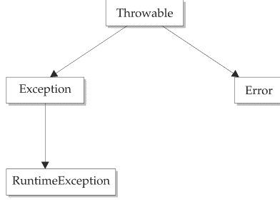

## 未捕获的异常

在学习如何在程序中处理异常之前，查看在不处理异常时会发生什么很有帮助。这个小程序包含一个刻意导致除以零错误的表达式：

```java
class Exc0 {
  public static void main(String[] args) {
    int d = 0;
    int a = 42 / d;
  }
}
```

当 Java 运行时系统检测到除以零的操作时，它会构建一个新的对象并抛出此异常。这会导致 `Exc0` 的执行停止，因为一旦抛出异常，它必须被异常处理器捕获并立即处理。在这个示例中，我们没有提供任何异常处理器，因此异常由 Java 运行时系统提供的默认处理器捕获。任何未被程序捕获的异常最终将由默认处理器处理。默认处理器会显示描述异常的字符串、打印从异常发生点开始的栈跟踪（stack trace），并终止程序。

以下是示例执行时生成的异常：

```
java.lang.ArithmeticException: / by zero
at Exc0.main(Exc0.java:4)
```

注意类名 `Exc0`；方法 `main`；文件名 `Exc0.java` 以及行号 4，都包含在栈跟踪中。注意异常类型是 `Exception` 的子类 `ArithmeticException`，它专门描述了发生了什么错误。正如本章稍后讨论的，Java 提供了几种内置异常类型，以匹配可能生成的各种运行时错误。另一点是：当你运行此程序时看到的 Java 内置异常可能与所示内容略有不同，这是由于 JDK 之间的差异。

栈跟踪将始终显示导致错误的方法调用序列。例如，这里是上述程序的另一个版本，它在 `main` 方法之外的方法中引入了相同的错误：

```java
class Excl1 {
    static void subroutine() {
    int d = 0;
    int a = 10 / d;
    }
    public static void main(String[] args) {
        subroutine();
    }
}
```

从异常产生的栈跟踪追溯了故障，显示了整个堆栈：

```
java.lang.ArithmeticException: by zero
    at Excl.subroutine(Excl.java:4)
    at Excl.main(Excl.java:7)
```

你可以看到，栈的底部是第 7 行，即调用 `subroutine()`，它导致了第 4 行的异常。调用栈对调试很有用，因为它指明了导致错误的精确步骤。

## 使用 try 和 catch

虽然 Java 运行时系统的默认异常处理器对调试很有用，但你通常希望自己处理异常。这样做有两个好处：它允许你修复错误，防止程序自动终止。如果你的程序每次发生错误就停止运行并打印栈跟踪，大多数用户会感到困惑的！幸运的是，这种情况很容易防止。

为了防止运行时错误，只需将你想要监控的代码封装在 `try` 块中。紧接在 `try` 块之后包含一个 `catch` 子句，指定你想要捕获的异常类型。为了说明如何轻松实现这一点，下面的程序包含一个 `try` 块和一个处理由除以零错误生成的 `ArithmeticException` 的 `catch` 子句：

```java
class Excl2 {
    public static void main(String[] args) {
    int d,
    a;
    try { // 监控代码块。
        d = 0;
        a = 42 / d;
        System.out.println("这不会打印.");
    } catch (ArithmeticException e) { // 捕获除以零错误
        System.out.println("Division by zero.");
    }
    System.out.println("After catch statement.");
}
```

此程序产生以下输出：

除以零。

After catch statement.

请注意，`try` 块内部的 `println()` 调用永远不会执行。一旦抛出异常，程序控制就会从 `try` 块转移到 `catch` 块。换句话说，`catch` 并没有被“调用”，因此执行流不会从 `catch` “返回”到 `try` 块。“This will not be printed.” 这一行不会被显示。一旦 `catch` 语句执行完毕，程序控制将继续执行程序中 `try` / `catch` 机制之后的下一行。

一个 `try` 语句及其 `catch` 语句形成一个单元。`catch` 的范围局限于紧随其后的 `try` 语句所保护的语句。`catch` 语句无法捕获由任何 `try` 语句抛出的异常（稍后将描述嵌套 `try` 语句的情况，除外）。被 `try` 保护的语句必须用大括号括起来（即它们必须在一个代码块内）。你不能在没有单个语句的情况下使用 `try`。

构建良好的 `catch` 子句的目标应该是解决异常情况，并在错误发生后继续执行。例如，程序在 `for` 循环每次迭代中两个随机整数。这两个整数相互相除，结果用于除以值 1245。最终结果放入 `a` 中。如果任何一个除法操作导致除以零错误，它将被捕获，`a` 的值设置为零，程序继续运行。

```java
// 处理异常并继续执行。
import java.util.Random;

class HandleError {
    public static void main(String[] args) {
        int a=0, b=0, c=0;
        Random r = new Random();

        for(int i=0; i<3200; i++) {
            try {
                b = r.nextInt();
                c = r.nextInt();
                a = 12345 / (b/c);
            } catch (ArithmeticException e) {
                System.out.println("Division by zero.");
                a = 0; // set a to zero and continue
            }
            System.out.println("a: " + a);
        }
    }
}
```

# 显示 toString() 方法描述


# Throwable 重写 toString()

`Throwable` 重写了 `toString()` 方法（由 `Object` 定义），使其返回一个包含异常描述的字符串。你可以通过将异常作为参数传递给 `println()` 语句来简单地显示此描述。例如，上述程序中的 `catch` 块可以这样写：

```java
catch (ArithmeticException e) {
    System.out.println("Exception: " + e);
    a = 0; // set a to zero and continue
}
```

当用此版本替换程序并运行时，每个除以零错误都会显示以下消息：

```
Exception: java.lang.ArithmeticException: / by zero
```

虽然在当前语境下这没有特殊的意义，但显示异常描述的能力在其他情况下是有价值的——特别是当你正在测试异常或进行调试时。

# 多个 catch 子句

在某些情况下，单段代码可能会抛出多个异常。为了处理这种情况，你可以指定两个或多个 `catch` 子句，每个子句捕获不同类型的异常。当抛出异常时，会按顺序检查每个 `catch` 语句，并执行第一个匹配异常的语句。在一个 `catch` 块执行后，其他语句将被跳过，执行将继续。下面的示例追踪了两种异常类型：

```java
// 多个 catch 语句。
class MultipleCatches {
    public static void main(String[] args) {
        try {
            int a = args.length;
            System.out.println("a = " + a);
            int b = 42 / a;
            int[] c = { 1 };
            c[42] = 99;
        } catch (ArithmeticException e) {
            System.out.println("Divide by 0: " + e);
        } catch (ArrayIndexOutOfBoundsException e) {
            System.out.println("Array index out of bounds: " + e);
        }
        System.out.println("After try/catch blocks.");
    }
}
```

如果在不带命令行参数的情况下启动此程序，它会导致除以零异常，因为 `a` 将等于零。如果你提供命令行参数，将 `a` 设置为大于零的值，它将跳过除法操作。但它会导致 `ArrayIndexOutOfBoundsException`，因为 `int` 数组 `c` 的长度为 1，而程序正尝试给 `c[42]` 赋值。

以下是运行时生成的输出：

```
C:\>Java MultipleCatches
a = 0
Divide by 0: java.lang.ArithmeticException: / by zero
After try/catch blocks.
```

```
C:\>Java MultipleCatches TestArg
a = 1
Array index out: java.lang.ArrayIndexOutOfBoundsException:
Index 42 out of bounds for length 1
After try/catch blocks.
```

当你使用多个 `catch` 语句时，重要的是记住，其父类的异常子类必须位于它们任何一个的之前。这是因为使用父类的 `catch` 语句会捕获该类型的异常以及其任何子类的异常。因此，如果子类在其父类之后，则永远无法被访问。此外，在 Java 中，不可达的代码是一个错误。例如，考虑以下情况：

* 此程序包含一个错误。子类必须在其父类之前。如果你尝试编译此程序，第二个 `catch` 语句将是不可达的。

```java
class SuperCatch {
    public static void main(String[] args) {
        try {
            int a = 0;
            int b = 42 / a;
        } catch (Exception e) {
            System.out.println("Generic catch.");
        } catch (ArithmeticException e) { // unreachable
            System.out.println("This is never reached.");
        }
    }
}
```

由于 `ArithmeticException` 是 `Exception` 的子类，第一个 `catch` 语句将处理它。要解决这个问题，请反转 `catch` 语句的顺序。

## 嵌套 try 语句

`try` 语句是可以嵌套的。也就是说，一个 `try` 语句可以位于另一个块内部。每当进入 `try` 语句时，异常上下文都会入栈。如果内部 `try` 语句没有相应的异常处理器，栈就会出栈并检查下一个 `try` 语句。直到某个 `catch` 语句成功。这是一个使用嵌套 `try` 的示例：

```java
// 嵌套 try 语句示例。
class NestTry {
    public static void main(String[] args) {
        try {
            int a = args.length;

            /* 如果没有命令行参数，
               下面的语句将产生除以零异常。 */
            int b = 42 / a;

            System.out.println("a = " + a);

            try { // 嵌套 try 块
                /* 如果使用命令行参数，
                   将由以下代码产生除以零异常。 */
                if (a == 1) a = a / (a - a); // division by zero

                /* 如果使用两个命令行参数，
                   将产生数组越界异常。 */
                if (a == 2) {
                    int[] c = { 1 };
                    c[42] = 99; // generate an out-of-bounds exception
                }
            } catch (ArrayIndexOutOfBoundsException e) {
                System.out.println("Array out-of-bounds: " + e);
            }
        } catch (ArithmeticException e) {
            System.out.println("Divide by 0: " + e);
        }
    }
}
```

可以看出，此程序将一个 `try` 块嵌套在另一个内部。程序运行如下：当你不带命令行参数运行程序时，外部 `try` 块会产生除以零异常。使用一个命令行参数运行程序会在嵌套 `try` 块中产生除以零异常。由于内部块没有捕获该异常，它会被传递给外部 `try` 块并在那里被处理。如果你使用两个命令行参数，数组边界异常是由内部 `try` 块生成的。以下是几个说明每种情况的运行示例：

```
C:\java NestTry
Divide by 0: java.lang.ArithmeticException: / by zero
```

```
C:\java NestTry One
a = 1
Divide by 0: java.lang.ArithmeticException: / by zero
```

```
C:\java NestTry One Two
a = 2
Array index out-of-bounds:
java.lang.ArrayIndexOutOfBoundsException:
Index 42 out of bounds for length 1
```

当涉及方法调用时，`try` 语句的嵌套方式可能不那么明显。例如，你可以将一个方法的调用封装在一个 `try` 块中。在该方法内部是另一个 `try` 语句。在这种情况下，方法中的 `try` 仍然嵌套在调用该方法的 `try` 块内部。这里是之前的程序，使得嵌套的 `try` 块移动到方法 `nestry(int a)` 内部：

```java
/* Try 语句可以通过方法
方法进行隐式嵌套。 */
class MethNestTry {
    static void nestry(int a) {
        try { // 嵌套的 try 块
            /* 如果使用了一个命令行参数，
               则以下代码将生成
               除以零异常。 */
            if (a <= 1) a = a / (a - a); // 除以零

            /* 如果使用了两个命令行参数，
               则生成一个越界异常。 */
            if (a <= 2) {
                int[] c = { 1 };
                c[42] = 99; // 生成一个越界异常
            }
        } catch (ArrayIndexOutOfBoundsException e) {
            System.out.println("Array out-of-bounds: " + e);
        }
    }

    public static void main(String[] args) {
        try {
            int a = args.length;

            /* 如果没有命令行参数，
               以下语句将生成
               除以零异常。 */
            int b = 42 / a;
            System.out.println("a = " + a);
            nestry(a);
        } catch (ArithmeticException e) {
            System.out.println("Divide by 0: " + e);
        }
    }
}
```

该程序的输出与上一个示例相同。

# throw

到目前为止，你只捕获了由 Java 运行时系统抛出的异常。然而，你的程序完全可以使用 `throw` 语句显式地抛出异常。`throw` 的通用形式如下：

```java
throw ThrowableInstance;
```

在这里，`ThrowableInstance` 必须是 `Throwable` 类型的对象或 `Throwable` 的子类。基本数据类型（如 `int` 或 `char`）以及非 `Throwable` 类（如 `String` 和 `Object`）不能用作异常。你有两种方法可以获取 `Throwable` 对象：在 `catch` 子句中使用参数，或者通过 `new` 操作符创建一个新对象。

执行流在 `throw` 语句之后会立即停止；任何随后的语句都不会执行。程序将检查最近的内层 `try` 块，查看它是否有与异常类型匹配的 `catch` 语句。如果找到了匹配项，控制权将转移到该处理程序。如果没有找到，则将检查下一个外层 `try` 语句，依此类推。如果没有找到匹配的 `catch`，则由默认异常处理程序处理并打印堆栈跟踪。

这是一个创建并抛出异常的示例程序。捕获异常的处理程序会将其传递给外层处理程序。

该程序有两次机会处理同一个错误。首先，`main()` 设置了异常上下文并调用了 `demoproc()`。然后 `demoproc()` 方法又建立了另一个异常处理上下文，并立即抛出一个 `NullPointerException` 的新实例，该实例在下一行被捕获。然后该异常被重新抛出。

以下是生成的输出：

```
Caught inside demoproc.
Recaught: java.lang.NullPointerException: demo
```

该程序还演示了如何创建 Java 的标准异常对象之一。请密切注意这一点：

```java
throw new NullPointerException("demo");
```

在这里，`new` 用于构造一个 `NullPointerException` 实例。Java 的许多运行时异常至少有两个构造函数：一个不带参数，另一个接受一个字符串参数。当使用第二个构造函数时，该参数指定了一个描述异常的字符串。当该对象被用作 `print()` 或 `println()` 的参数时，该字符串会被显示出来。此外，也可以通过调用由 `Throwable` 定义的 `getMessage()` 获取。

# throws

如果一个方法可能会引起它本身不处理的异常，则它必须指定这种行为，以便该方法的调用者能够防御该异常。这通过在方法声明中包含一个 `throws` 子句来实现。**throws 子句** 列出了方法可能抛出的异常类型。对于所有异常，除了 `Error` 或 `RuntimeException` 及其子类之外，这都是必要的。对于其他异常，方法必须在 `throws` 子句中声明这些异常。如果未声明，将导致编译错误。

这是包含 `throws` 子句的方法声明的通用形式：

```java
type method-name(parameter-list) throws exception-list
{
  // 方法体
}
```

在这里，**exception-list** 是一个方法可以抛出的异常的用逗号分隔的列表。

下面是一个错误程序的示例，它尝试抛出一个它并没捕获的异常。由于该程序没有指定 `throws` 子句来声明这一事实，程序将无法编译。

```java
// 此程序包含错误且无法编译。
class ThrowsDemo {
    static void throwOne() {
        System.out.println("Inside throwOne.");
        throw new IllegalAccessException("demo");
    }
    public static void main(String[] args) {
        throwOne();
    }
}
```

为了让这个示例运行，你需要做两处修改。首先，你需要声明 `throwOne()` 抛出 `IllegalAccessException`。其次，**main()** 必须使用捕获该异常的 `try/catch` 语句。修正后的示例如下：

```java
// 现在是正确的。
class ThrowDemo {
    static void throwOne() throws IllegalAccessException {
        System.out.println("Inside throwOne.");
        throw new IllegalAccessException("demo");
    }
    public static void main(String[] args) {
        try {
            throwOne();
        } catch (IllegalAccessException e) {
            System.out.println("Caught " + e);
        }
    }
}
```

运行此示例生成的输出如下：

```
Inside throwOne
Caught java.lang.IllegalAccessException: demo
```

## finally

当抛出异常时，方法的执行采取一条突然的、非线性的路径，改变了通过方法的正常流程。取决于方法的编码方式，异常甚至会导致方法提前返回。这对于某些方法来说可能是一个问题。例如，如果方法打开了一个文件并在退出时关闭它，那么关闭文件的代码会被异常处理机制跳过。`finally` 关键字是为了应对这种情况而设计的。

`finally` 创建了一个在 `try/catch` 块完成之后、`try/catch` 块之后的代码之前执行的块。无论是否抛出异常，`finally` 块都会执行。如果抛出了异常且没有 `catch` 语句匹配该异常，`finally` 块也会执行。每当方法从 `try/catch` 块内部通过异常或显式 `return` 语句返回调用者时，`finally` 子句在方法返回之前执行。这对于关闭文件句柄并释放在方法开始时可能分配的任何其他资源非常有用。`finally` 子句是可选的。然而，每个 `try` 语句至少需要一个 `catch` 或一个 `finally` 子句。

这是一个示例程序，展示了三个以不同方式退出且没有执行其 `finally` 子句的方法：

```java
// 演示 finally。
class FinallyDemo {
    // 将异常抛出方法之外。
    static void procA() {
        try {
            System.out.println("inside procA");
            throw new RuntimeException("demo");
        } finally {
            System.out.println("procA's finally");
        }
    }
}
```


```java
} finally {
    System.out.println("procA's finally");
}
// 从 try 块中返回。
static void procB() {
    try {
        System.out.println("inside procB");
        return;
    } finally {
        System.out.println("procB's finally");
    }
}
// 普通执行 try 块。
static void procC() {
    try {
        System.out.println("inside procC");
    } finally {
        System.out.println("procC's finally");
    }
}

public static void main(String[] args) {
    try {
        procA();
    } catch (Exception e) {
        System.out.println("Exception caught");
    }

    procB();
    procC();
}
```

在这个示例中，`procA` 通过抛出异常提前跳出了 `try` 块。`finally` 子句在退出时被执行。`procB()` 的 `try` 语句通过 `return` 语句退出。`finally` 子句在 `procB()` 返回之前执行。在 `procC()` 中，`try` 语句正常执行，没有错误。然而，`finally` 块仍然会被执行。

**记住**，如果 `finally` 块与 `try` 关联，则 `finally` 块会在 `try` 结束时执行。

以下是上述程序生成的输出：

```
inside procA
procA's finally
Exception caught
inside procB
procB's finally
inside procC
procC's finally
```

# Java 内置异常

在标准包 `java.lang` 内部定义了多个异常类。前面的示例使用了其中几个。这些异常中最通用的是标准类型 `RuntimeException` 的子类。正如之前所解释的，这些异常不需要包含在任何方法的 `throws` 列表中。在 Java 语言中，这些被称为**未检查异常**（unchecked exceptions），因为编译器不会检查方法是否处理了这些异常。`java.lang` 中定义的未检查异常列在表 10-2 中。该表列出了 `java.lang` 定义的、如果方法可能产生这些异常且未进行处理，则必须包含在方法 `throws` 列表中异常。这些被称为**检查异常**（checked exceptions）。除了 `java.lang` 中的异常外，Java 还定义了几个与其其他标准包相关的异常。

| 异常名称 | 含义 |
|---|---|
| ArithmeticException | 算术错误，例如除零。 |
| ArrayIndexOutOfBoundsException | 数组索引越界。 |
| ArrayStoreException | 向不兼容类型的数组元素赋值。 |
| ClassCastException | 无效的类型转换。 |
| EnumNotPresentException | 尝试使用未定义的枚举值。 |
| IllegalArgumentException | 调用方法时使用了非法参数。 |
| IllegalCallerException | 调用代码无法合法地执行该方法。 |
| IllegalMonitorException | 非法监视器操作，例如在未加锁的线程上等待。 |
| IllegalStateException | 环境或应用程序处于错误状态。 |
| IllegalThreadException | 请求的操作与当前线程状态不兼容。 |
| IndexOutOfBoundsException | 某种索引越界。 |
| LayerInstantiationException | 无法创建模块层。 |
| NegativeArraySizeException | 使用负数大小创建数组。 |
| NullPointerException | 对空引用的无效使用。 |
| NumberFormatException | 字符串到数值格式的无效转换。 |
| SecurityException | 尝试违反安全性。 |
| StringOutOfBoundsException | 尝试访问字符串范围外的索引。 |
| TypeNotPresentException | 未找到类型。 |
| UnsupportedOperationException | 遇到了不受支持的操作。 |

表 10-2 `java.lang` 中定义的 Java 未检查 `RuntimeException` 子类

| 异常名称 | 含义 |
|---|---|
| NotFoundException | 未找到类。 |
| CloneNotSupportedException | 尝试克隆未实现 `Cloneable` 接口的对象。 |
| IllegalAccessException | 拒绝访问类。 |
| InstantiationException | 尝试创建抽象类或接口的对象。 |
| InterruptedException | 一个线程被另一个线程中断。 |
| NoSuchFieldException | 请求的字段不存在。 |
| NoSuchMethodException | 请求的方法不存在。 |
| ReflectiveOperationException | 反射异常的超类。 |

表 10-2 `java.lang` 中定义的 Java 检查异常

# 创建你自己的异常子类

尽管 Java 的内置类处理了常见错误，但你可能仍然想要创建自己的异常来处理特定于你应用程序的情况。这很容易做到：定义 `Exception` 的子类（当然，它是 `Throwable` 的子类）。你的子类不需要实现任何内容——它们在系统类型中的存在就允许你将它们用作异常。

`Exception` 类没有定义任何自己的方法。它当然继承了由 `Throwable` 定义的那些方法。因此，所有异常（包括你创建的异常）都可以使用 `Throwable` 定义的方法。它们显示在表 10-3 中。你可能还希望在你创建的异常类中重写这些方法中的一个或多个。

`Exception` 定义了四个公共构造函数。其中两个支持链式异常，将在下一节中描述。另外两个显示在这里：

- `Exception()`
- `Exception(String msg)`

第一种形式创建一个没有描述的异常。第二种形式允许你指定异常的描述。

虽然在创建异常时指定描述是有用的，但有时重写 `toString()` 更好。原因如下：由 `Throwable` 定义（并被 `Exception` 继承）的 `toString()` 版本首先显示名称，后面跟着一个冒号，冒号后面是你的描述。通过重写 `toString()`，你可以防止异常名称和冒号的显示。这在某些情况下是必要的。

# Java 部分

| 方法 | 描述 |
| --- | --- |
| final void addSuppressed(Throwable exc) | 将 `exc` 添加到与调用异常关联的抑制列表中。主要供 `try-with-resources` 语句使用。 |
| Throwable fillStackTrace() | 返回一个包含完整栈轨迹的 `Throwable` 对象。该对象可以重新抛出。 |
| Throwable getCause() | 返回底层异常。如果没有底层异常，则返回 `null`。 |
| String getLocalizedMessage() | 返回异常的本地化描述。 |
| String getMessage() | 返回异常的描述。 |
| StackTraceElement [] getStackTrace() | 返回一个栈轨迹数组，每次返回一个元素。栈顶部的方法是抛出异常之前最后调用的方法。该方法位于数组的第一个元素。`StackTraceElement` 类允许程序访问每个元素的信息，例如方法名。 |
| final Throwable[] getSuppressed() | 返回与调用异常关联的抑制异常，并返回结果数组。抑制异常主要由 `try-with-resources` 语句生成。 |
| Throwable initCause(Throwable causeExc) | 将 `causeExc` 与调用异常关联，作为调用异常的成因。返回异常的引用。 |
| void printStackTrace() | 显示栈轨迹。 |
| void printStackTrace(PrintStream stream) | 将栈轨迹发送到指定的流。 |
| void printStackTrace(PrintWriter stream) | 将栈轨迹发送到指定的写入器。 |
| void setStackTrace(StackTraceElement[] elements) | 将栈轨迹设置为传入的 `elements` 元素。此方法用于特殊应用程序，不用于正常使用。 |
| String toString() | 返回包含异常描述的 `String` 对象。在输出 `Throwable` 对象时，`println()` 会调用此方法。 |

表 10-3 `Throwable` 定义的方法

以下示例声明了 `Exception` 的子类，并使用该子类在方法中指示错误条件。它重写了 `toString()` 方法，允许显示经过仔细定制的异常描述。

```java
// 此程序创建了一个自定义异常类型。
class MyException extends Exception {
    private int detail;

    MyException(int a) {
        detail = a;
    }

    public String toString() {
        return "MyException[" + detail + "]";
    }
}

class ExceptionDemo{
    static void compute(int a) throws MyException {
        System.out.println("Called compute " + a + "");
        if (a > 10)
             new MyException(a);
        System.out.println("Normal exit");
    }

    public static void main(String[] args) {
        try {
            compute(1);
            compute(20);
        } catch (MyException e) {
            System.out.println("Caught " + e + "");
        }
    }
}
```

此示例定义了一个名为 `MyException` 的 `Exception` 子类。该子类非常简单：它只有一个构造函数，但重写后的 `toString()` 显示了异常的值。`ExceptionDemo` 定义了一个名为 `compute()` 的方法，该方法抛出一个 `MyException` 对象。当 `compute()` 的整数参数大于 10 时，会抛出异常。`main()` 方法为 `MyException` 设置了异常处理程序，然后用一个合法值（小于 10）和一个非法值调用 `compute()`，以展示代码执行的两种路径。结果如下：

Called compute(1)

Normal exit

Called compute(20)

Caught MyException[20]

# 链式异常

几年前，异常系统中引入了一个特性：**链式异常**（chained exceptions）。链式异常特性允许将另一个异常与当前异常关联。第二个异常描述了第一个异常的原因。例如，想象一种情况：方法在尝试除以 0 时抛出了 `ArithmeticException`。然而，问题的实际原因是发生了 I/O 错误，导致除数被设置不当。虽然该方法必须抛出 `ArithmeticException`（因为这是发生的错误），但你可能还想让调用者知道底层原因是 I/O 错误。链式异常允许你处理这种情况，以及任何其他存在层级异常的情况。

为了实现链式异常，**Throwable** 类添加了两个方法。构造函数所示：

- `Throwable(Throwable causeExc)`
- `Throwable(String msg, Throwable causeExc)`

在第一种形式中，`causeExc` 是导致当前异常的异常。也就是说，`causeExc` 允许你在指定异常异常的同时指定一个原因。这两个构造函数也被添加到了 **Error**、**Exception** 和 **RuntimeException** 类中。

**Throwable** 支持的链式异常方法是 `getCause()` 和 `initCause()`。这些方法在表 10-3 中列出，为了方便讨论，在此也重复列出：

- `getCause()`
- `initCause(Throwable causeExc)`

**getCause()** 方法返回当前异常的底层异常。如果没有底层异常，则返回 `null`。**initCause()** 方法将 `causeExc` 与调用的异常关联并返回其引用。因此，你可以在异常创建后将原因与异常关联。然而，原因只能设置一次。这意味着你每个异常只能调用一次 `initCause()`。此外，如果原因是由构造函数设置的，那么你无法使用 `initCause()` 再次设置它。通常，`initCause()` 用于为那些不支持前述两个额外构造函数的遗留异常类设置原因。

以下示例说明了处理链式异常的机制：

```java
// 链式传递。
class ChainExceptionDemo {
    static void demoproc() {
        // 创建一个异常
        NullPointerException e = new NullPointerException("top layer");

        // 添加原因
        e.initCause(new ArithmeticException("cause"));

        throw e;
    }

    public static void main(String[] args) {
        try {
            demoproc();
        } catch (NullPointerException e) {
            // 显示异常
            System.out.println("Caught: " + e);
            // 显示原始原因
            System.out.println("Original cause: " + e.getCause());
        }
    }
}
```

该程序的输出如下：

Caught: java.lang.NullPointerException: top layer

Original cause: java.lang.ArithmeticException: cause


```java
// 链式传递。
class ChainExceptionDemo {
    static void demoproc() {
        // 创建一个异常
        NullPointerException e = new NullPointerException("top layer");

        // 添加原因
        e.initCause(new ArithmeticException("cause"));

        throw e;
    }

    public static void main(String[] args) {
        try {
            demoproc();
        } catch (NullPointerException e) {
            // 显示异常
            System.out.println("Caught: " + e);
            // 显示原始原因
            System.out.println("Original cause: " + e.getCause());
        }
    }
}
```

以下示例声明了 `Exception` 的子类，并使用该子类在方法中指示错误条件。它重写了 `toString()` 方法，允许显示经过仔细定制的异常描述。

```java
// 此程序创建了一个自定义异常类型。
class MyException extends Exception {
    private int detail;

    MyException(int a) {
        detail = a;
    }

    public String toString() {
        return "MyException[" + detail + "]";
    }
}

class ExceptionDemo {
    static void compute(int a) throws MyException {
        System.out.println("Called compute " + a + "");
        if (a > 10)
            throw new MyException(a);
        System.out.println("Normal exit");
    }

    public static void main(String[] args) {
        try {
            compute(1);
            compute(20);
        } catch (MyException e) {
            System.out.println("Caught " + e + "");
        }
    }
}
```

此示例定义了一个名为 `MyException` 的 `Exception` 子类。该子类非常简单：它只有一个构造函数，但重写后的 `toString()` 显示了异常的值。`ExceptionDemo` 定义了一个名为 `compute()` 的方法，该方法抛出一个 `MyException` 对象。当 `compute()` 的整数参数大于 10 时，会抛出异常。`main()` 方法为 `MyException` 设置了异常处理程序，然后用一个合法值（小于 10）和一个非法值调用 `compute()`，以展示代码执行的两种路径。结果如下：

```text
Called compute(1)
Normal exit
Called compute(20)
Caught MyException[20]
```

# 链式异常

几年前，异常系统中引入了一个特性：**链式异常**（chained exceptions）。链式异常特性允许你将另一个异常与当前异常关联。第二个异常描述了第一个异常的原因。例如，想象一种情况：方法在尝试除以 0 时抛出了 `ArithmeticException`。然而，问题的实际原因是发生了 I/O 错误，导致除数被设置不当。虽然该方法必须抛出 `ArithmeticException`（因为这是发生的错误），但你可能还想让调用者知道底层原因是 I/O 错误。链式异常允许你处理这种情况，以及任何其他存在层级异常的情况。

为了实现链式异常，**Throwable** 类添加了两个构造函数：

- `Throwable(Throwable causeExc)`
- `Throwable(String msg, Throwable causeExc)`

在第一种形式中，`causeExc` 是导致当前异常的异常。也就是说，`causeExc` 允许你在指定异常的同时指定一个原因。这两个构造函数也被添加到了 **Error**、**Exception** 和 **RuntimeException** 类中。

**Throwable** 支持的链式异常方法是 `getCause()` 和 `initCause()`。这些方法在表 10-3 中列出，为了方便讨论，在此也重复列出：

- `getCause()`
- `initCause(Throwable causeExc)`

**getCause()** 方法返回当前异常的底层异常。如果没有底层异常，则返回 `null`。**initCause()** 方法将 `causeExc` 与调用的异常关联并返回其引用。因此，你可以在异常创建后将原因与异常关联。然而，原因只能设置一次。这意味着你每个异常只能调用一次 `initCause()`。此外，如果原因是由构造函数设置的，那么你无法使用 `initCause()` 再次设置它。通常，`initCause()` 用于为那些不支持前述两个额外构造函数的遗留异常类设置原因。

以下示例说明了处理链式异常的机制：

```java
// 链式传递。
class ChainExceptionDemo {
    static void demoproc() {
        // 创建一个异常
        NullPointerException e = new NullPointerException("top layer");

        // 添加原因
        e.initCause(new ArithmeticException("cause"));

        throw e;
    }

    public static void main(String[] args) {
        try {
            demoproc();
        } catch (NullPointerException e) {
            // 显示异常
            System.out.println("Caught: " + e);
            // 显示原始原因
            System.out.println("Original cause: " + e.getCause());
        }
    }
}
```

该程序的输出如下：

```text
Caught: java.lang.NullPointerException: top layer
Original cause: java.lang.ArithmeticException: cause
```

# 三个额外的异常特性

从 JDK 7 开始，引入了一些有趣的特性。第一个是 `try-with-resources`，第二个是多异常捕获（multi-catch），第三个有时被称为精确抛出（precise rethrow）。

多异常捕获允许在同一个 `catch` 子句中处理多个异常。而不是为每个异常类型编写单独的处理器，可以使用单个 `catch` 来避免代码重复。要使用多异常捕获，在 `catch` 子句中使用 OR 运算符分隔异常类型。多异常捕获参数是隐式的 **final**（如果需要，可以显式声明 **final**，但并非必要）。因为多异常捕获参数是隐式的 **final**，它无法被重新赋值。

以下使用多异常捕获语句来捕获 `ArithmeticException` 和 `ArrayIndexOutOfBoundsException` 的示例：

```java
// 展示多异常捕获。
class MultiCatch {
    public static void main(String[] args) {
        int a = 0, b = 0;
        int[] vals = { 1, 2, 3 };

        try {
            int result = a / b; // 产生 ArithmeticException
            vals[10] = 19; // 产生 ArrayIndexOutOfBoundsException
        // 此 catch 子句捕获了两种异常。
        } catch (ArithmeticException | ArrayIndexOutOfBoundsException e) {
            System.out.println("捕获到异常: " + e);
        }
    }
}
```

当尝试除以 0 时，程序会产生 `ArithmeticException`。如果你注释掉除法语句并移除下一行的注释符号，就会产生 `ArrayIndexOutOfBoundsException`。这两个异常都被单个 catch 语句捕获。

精确抛出（precise rethrow）限制了可以抛出的异常类型，仅限于 `try` 块抛出的、未被之前的 `catch` 子句处理的、且是参数子类的异常。虽然这种能力可能不需要，但它现在已经可以使用。对于精确抛出特性，catch 参数必须是 **final**（这意味着它在 catch 块内部不能被赋值新值），或者显式声明为 **final**。

在 `try` 语句中，`try-with-resources` 自动处理资源释放是非常有用的。

# 使用异常

异常处理为具有动态运行时特性的复杂程序提供了一种强大的机制。要把 `try`、`throw` 和 `catch` 视为处理程序逻辑中错误和异常边界的方法。不要使用错误代码来指示失败，而是使用 Java 的异常处理能力。因此，当一个方法可能失败时，它可以抛出异常。这是一种更优雅的失败方式。

最后一点：Java 的处理语句不应视为非局部跳转的通用机制。这样做会使你的代码变得混乱并难以维护。

# 第 11 章 多线程编程

Java 为多线程编程提供了内置支持。多线程程序包含两个或多个可以并发运行的部分。此类程序的每个部分都称为线程（thread），每个线程都定义了一条独立的执行路径。因此，多线程是多任务处理的一种特殊形式。

你几乎肯定熟悉多任务，因为几乎所有的现代操作系统都支持它。然而，多任务有两种不同的类型：基于进程的和基于线程的。理解两者之间的区别非常重要。对于许多读者来说，基于进程的多任务是更熟悉的形式。本质上，一个进程是一个正在执行的程序。因此，基于进程的多任务是允许你的计算机并发运行两个或多个程序的功能。例如，文本编辑器或访问网站。在基于进程的多任务中，程序是可由调度程序分发的最小代码单元。

在多线程环境中，线程是可调度代码的最小单元。这意味着单个程序可以同时执行两个或多个任务。例如，文本编辑器可以在打印的同时格式化文本，只要这两个动作是由两个独立的线程执行的。因此，基于进程的多任务处理的是“大局”，而基于线程的多任务处理的是细节。

多线程处理的开销比多进程处理要小。进程是重量级任务，需要自己独立的地址空间。进程通信是昂贵且有限的。从一个进程到另一个进程的上下文切换是有代价的。相反，线程共享相同的地址空间，并协作共享同一个重量级进程。线程通信是廉价的，从一个线程到下一个线程的上下文切换成本较低。虽然 Java 程序利用进程的多线程环境，但基于进程的多任务不受 Java 的直接控制。然而，多线程多任务是可以的。

多线程允许你编写高效的程序，最大限度地利用系统的处理能力。多线程实现这一点的重要方法是将空闲时间减少到最低。这对于 Java 运行的交互式网络环境尤为重要，因为空闲时间很常见。例如，网络上的数据传输速度慢于计算机处理它的速度。即使是本地文件系统资源，读写速度也比 CPU 处理的速度慢得多。当然，输入速度远慢于计算机。在单线程环境中，你的程序必须等待这些任务中的每一个完成后才能继续下一个——尽管程序在大部分时间里处于等待输入的空闲状态。多线程帮助你减少这种空闲时间，因为当一个线程运行时，另一个线程可以运行。

如果你为 Windows 等操作系统编写过程序，那么你已经熟悉多线程编程了。然而，Java 管理线程的事实让多线程变得特别方便，因为许多细节已经为你处理好了。

# Java 线程模型

Java 运行时系统依赖线程完成许多工作，所有的类库在设计时都考虑了多线程。事实上，Java 使用线程来实现环境的异步。这有助于通过防止浪费 CPU 周期来提高效率。

理解多线程环境价值的最佳方法是与其对应的单线程系统来看。单线程系统使用称为“事件循环+轮询”的方法。在这种模型中，单个线程在无限循环中运行，通过单个事件队列来决定做什么。一旦这种轮询机制返回网络文件已就绪读取的信号，事件循环就会将控制交给适当的事件处理器。当这个事件处理器返回时，程序中就不会发生任何其他事情。这浪费了 CPU 时间。它还可能导致程序的某部分主导系统并防止任何其他事件被处理。通常情况下，在单线程环境中，当线程阻塞（即挂起）等待某些资源时，整个程序都会停止。

Java 多线程的益处是消除了主循环/轮询机制。一个线程可以继续运行而不停止程序的其他部分。例如，线程从网络读取数据或等待输入时产生的空闲时间可以被用于其他地方。多线程允许动画循环在每帧之间睡眠一秒钟，而不会导致整个系统暂停。当 Java 程序中的线程阻塞时，只有该线程阻塞。所有其他线程继续运行。

正如大多数读者所知，在过去的几年里，多核心系统已变得非常常见。当然，单核系统仍在被广泛使用。重要的是要理解 Java 的多线程特性在两类系统中都有效。在单核系统中，并发线程共享 CPU，每个线程获得一段 CPU 时间切片。因此，在单核系统中，两个或多个线程实际上并没有同时运行，但利用了空闲的 CPU 时间。然而，在多核心系统中，两个或多个线程实际上可以同时执行。在许多情况下，这可以进一步提高程序效率并增加某些操作的速度。

> **注意** 除了本章描述的多线程特性外，你可能还会探索 Fork/Join 框架。它提供了一种创建多线程应用程序的强大手段，可以自动扩展到最充分利用多核心环境。Fork/Join 框架是 Java 支持并行编程的一部分，并行编程是为在具有多个 CPU 的系统中为了并行执行优化某些类型算法的技术的常用名称。有关 Fork/Join 框架和其他并发工具的讨论，请参阅第 29 章。这里描述了 Java 传统的多线程能力。

线程存在多种状态。以下是通用描述。线程可以处于运行状态。它一旦获得 CPU 时间就可以进入就绪运行状态。线程可以被挂起，暂时停止其活动。挂起的线程随后可以恢复，允许它从中断的地方继续。线程在等待资源时可以被阻塞。在任何时候，线程都可以被终止，立即停止其执行。一旦终止，线程无法恢复。

# 线程优先级

Java 为每个线程分配一个优先级，这决定了如何处理该线程。线程优先级是指定一个线程相对于另一个线程优先级的整数。作为绝对值，优先级是没有意义的；如果只有一个线程运行，高优先级线程运行得比低优先级线程快。相反，线程优先级用于判断何时从一个线程切换到下一个线程。这被称为上下文切换。决定何时切换的规则很简单：

- 线程可以放弃控制。这发生在显式让步、睡眠或阻塞时。在这种情况下，将检查所有其他线程，并将优先级最高的就绪线程交给 CPU。
- 线程可以被高优先级线程抢占。在这种情况下，低优先级线程无论做什么都不会让处理器，直接被高优先级线程抢占。基本上，只要有高优先级线程想要运行，就称为抢占式多任务。

当两个具有相同优先级的线程竞争 CPU 周期时，情况变得有些复杂。对于某些操作系统，同优先级的线程按轮询方式自动进行时间片。对于其他类型的操作系统，同优先级的线程必须自愿向同级线程让控制。如果不这样做，线程就不会运行。

> **注意** 操作系统在切换同优先级线程上下文方面的差异可能会产生移植性问题。

# 同步

由于多线程为你的程序引入了异步行为，因此你需要一种方法来强制同步。例如，如果你想让两个线程通信并共享复杂的数据结构（例如链表），你需要某种方法来确保它们不会发生冲突。也就是说，你必须防止一个线程


```java
class ThreadDemo {
    public static void main(String[] args) {
        NewThread nt = new NewThread(); // create a new thread

        nt.start(); // Start the thread

        try {
            for (int i = 5; i > 0; i--) {
                System.out.println("Main Thread: " + i);
                Thread.sleep(1000);
            }
        } catch (InterruptedException e) {
            System.out.println("Main thread interrupted.");
        }
        System.out.println("Main thread exiting.");
    }
}
```

在 `NewThread` 的构造函数中，通过以下语句创建了一个新的 `Thread` 对象：


`t = new Thread(this, "Demo Thread");`

将 `this` 作为第一个参数传递，表示新线程将调用该对象的 `run()` 方法。`main()`、`start()` 被调用，它启动了从 `run()` 方法开始的执行线程。这导致子线程的 `for` 循环开始。两个线程继续运行，在单核系统中共享 CPU，直到它们的循环结束。此程序产生的输出如下（你的输出可能会根据特定的执行环境而异）：

```
Child thread: [Demo Thread, 5]
Main Thread: 5
Child Thread: 5
Child Thread: 4
Main Thread: 4
Child Thread: 3
Child Thread: 2
Main Thread: 3
Child Thread: 1
Exiting child thread.
Main Thread: 2
Main Thread: 1
Main thread exiting.
```

如前所述，在多线程程序中，让主线程最后完成运行通常是有用的。前面的程序确保了主线程最后完成，因为主线程在每次迭代之间睡眠 1,000 毫秒，而子线程只睡眠 500 毫秒。这导致子线程比主线程更早终止。不久后，你将看到一种等待线程完成更好的方法。

## 扩展线程

创建线程的第二种方法是创建一个继承 `Thread` 的新类，然后创建该类的实例。扩展类必须重写 `run()` 方法，这是新线程的入口。与之前一样，调用 `start()` 将开始新线程的执行。以下是扩展 `Thread` 的前面的程序：

```java
// Create a second thread by extending Thread
class NewThread extends Thread {

    NewThread() {
        // Create a new, second thread
        super("Demo Thread");
        System.out.println("Child thread: " + this);
    }

    // This is the entry point for the second thread.
    public void run() {
        try {
            for (int i = 5; i > 0; i--) {
                System.out.println("Child Thread: " + i);
                Thread.sleep(500);
            }
        } catch (InterruptedException e) {
            System.out.println("Child interrupted.");
        }
    }
}

class ExtendThread {
    public static void main(String[] args) {
        NewThread nt = new NewThread(); // create a new thread

        nt.start(); // start the thread

        try {
            for (int i = 5; i > 0; i--) {
                System.out.println("Main Thread: " + i);
                Thread.sleep(1000);
            }
        } catch (InterruptedException e) {
            System.out.println("Main thread interrupted.");
        }
        System.out.println("Main thread exiting.");
    }
}
```

此程序生成的输出与之前的版本相同。如你所示，子线程是通过实例化 `NewThread` 对象创建的，而 `NewThread` 派自 `Thread`。

注意对 `super()` 的调用。

## 使用 isAlive() 和 join()

如前面提到的，在多线程程序中，让主线程最后完成运行通常是有用的。前面的程序确保了主线程最后完成，因为主线程在每次迭代之间睡眠 1,000 毫秒，而子线程只睡眠 500 毫秒。这导致子线程比主线程更早终止。不久后，你将看到一种等待线程完成更好的方法。

```java
class NewThread implements Runnable {
    private String name;

    NewThread(String name) {
        this.name = name;
    }

    @Override
    public void run() {
        try {
            for (int i = 5; i > 0; i--) {
                System.out.println(name + ": " + i);
                Thread.sleep(500);
            }
        } catch (InterruptedException e) {
            System.out.println(name + " interrupted");
        }
    }
}

class MultiThreadDemo {
    public static void main(String[] args) {
        NewThread nt1 = new NewThread("One");
        NewThread nt2 = new NewThread("Two");
        NewThread nt3 = new NewThread("Three");

        nt1.start();
        nt2.start();
        nt3.start();

        try {
            for (int i = 5; i > 0; i--) {
                System.out.println("Main Thread: " + i);
                Thread.sleep(1000);
            }
        } catch (InterruptedException e) {
            System.out.println("Main thread interrupted.");
        }
        System.out.println("Main thread exiting.");
    }
}
```

```java
class DemoJoin {
    public static void main(String[] args) {
        NewThread nt1 = new NewThread("One");
        NewThread nt2 = new NewThread("Two");
        NewThread nt3 = new NewThread("Three");

        // Start the threads.
        nt1.start();
        nt2.start();
        nt3.start();

        System.out.println("Thread One is alive: " + nt1.isAlive());
        System.out.println("Thread Two is alive: " + nt2.isAlive());
        System.out.println("Thread Three is alive: " + nt3.isAlive());
        // wait for threads to finish
        try {
            System.out.println("Waiting for threads to finish.");
            nt1.join();
            nt2.join();
            nt3.join();
        } catch (InterruptedException e) {
            System.out.println("Main thread interrupted");
        }

        System.out.println("Thread One is alive: " + nt1.isAlive());
        System.out.println("Thread Two is alive: " + nt2.isAlive());
        System.out.println("Thread Three is alive: " + nt3.isAlive());

        System.out.println("Main thread exiting.");
    }
}
```

该程序的示例输出如下所示。（你的输出可能会根据特定的执行环境而异。）

```
New thread: Thread[One,5,main]
New thread: Thread[Two,5,main]
New thread: Thread[Three,5,main]
Thread One is alive: true
Thread Two is alive: true
Thread Three is alive: true
Waiting for threads to finish.
One: 5
Two: 5
Three: 5
One: 4
Two: 4
Three: 4
One: 3
Two: 3
Three: 3
One: 2
Two: 2
Three: 2
One: 1
Two: 1
Three: 1
Two exiting.
Three exiting.
One exiting.
Thread One is alive: false
Thread Two is alive: false
Thread Three is alive: false
Main thread exiting.
```

如你所见，在调用 `join()` 返回后，线程已经停止了执行。

# 线程优先级

线程优先级用于线程调度器，以决定何时允许每个线程运行。理论上，在给定的时间内，高优先级的线程比低优先级的线程获得更多的 CPU。在实践中，线程获得的 CPU 时间通常取决于优先级之外的因素。（例如，操作系统的多任务处理如何影响 CPU 时间的相对可用性）。高优先级线程也可以抢占低优先级线程运行。例如，当一个低优先级线程正在运行时，一个高优先级线程恢复时（例如从睡眠或等待 I/O 中恢复），它将抢占该低优先级线程。

理论上，等优先级的线程应该获得相同的 CPU 访问权限。但你必须小心。Java 设计用于在各种环境中。某些环境实现多任务处理的方式与其他不同。为了安全起见，具有相同优先级的线程应该主动让出控制权。这确保了所有线程在抢占式操作系统下有机会运行。在实践中，即使是非抢占式环境，大多数线程仍然有机会运行，因为大多数线程不可避免地遇到某些阻塞，例如等待 I/O。当这种情况发生时，被阻塞的线程会被挂起，其他线程运行。但是，如果你想要平滑的多线程执行，最好不要依赖它们。此外，某些类型的任务是 CPU 密集型的。此类线程主导 CPU。对于这些类型的线程，你想偶尔让出控制权，以便其他线程运行。

要设置线程优先级，请使用 `setPriority()` 方法，它是 `Thread` 的成员。其通用形式如下：

```java
final void setPriority(int level)
```

在这里，`level` 指定了调用线程的新优先级设置。`level` 的值必须在 `MIN_PRIORITY` 和 `MAX_PRIORITY` 范围内。目前这些值分别为 1 和 10。要将线程恢复为默认优先级，指定 `NORM_PRIORITY`，它目前是 5。这些优先级被定义为 `Thread` 内部的静态（`static final`）变量。

你可以通过调用 `Thread` 的 `getPriority()` 方法获取当前的优先级设置，如下所示：

```java
final int getPriority()
```

Java 的实现在涉及调度时可能有截然不同的行为。大多数的不一致性源于你的线程依赖抢占式环境，而不是协作地提供 CPU 时间。使用 Java 获取可预测的跨平台行为的最安全方法是使用自愿放弃 CPU 控制权的线程。

# 同步

当两个或多个线程需要访问共享资源时，它们需要某种方法来确保资源一次只被一个线程使用。实现这一过程被称为同步。如你所见，Java 为此提供了独特的语言级支持。

同步的关键是监视器（monitor）的概念。监视器用作互斥锁的对象。同一时间只有一个线程可以拥有监视器。当一个线程获取锁时，被称为进入了监视器。所有其他尝试进入被锁监视器的线程将被挂起，直到第一个线程退出监视器。所有其他线程都被认为等待监视器。拥有监视器的线程如果需要，可以重新进入监视器。

你可以通过两种方式同步你的代码。都涉及使用 `synchronized` 关键字，并且在这里对两者进行检查。

## 使用同步方法

同步很简单。你可以通过在方法签名上使用 `synchronized` 关键字来实现同步方法。这确保了同一时间只有一个线程可以执行该方法。

```java
// 使用同步示例
class Callme {
    synchronized void call(String msg) {
        System.out.print("[" + msg);
        try {
            Thread.sleep(1000);
        } catch (InterruptedException e) {
            System.out.println("Interrupted");
        }
        System.out.println("]");
    }
}

class Caller implements Runnable {
    Callme target;
    String msg;

    public Caller(Callme targ, String s) {
        target = targ;
        msg = s;
    }

    public void run() {
        target.call(msg);
    }
}

class Synch {
    public static void main(String[] args) {
        Callme target = new Callme();
        Thread ob1 = new Thread(new Caller(target, "Hello"));
        Thread ob2 = new Thread(new Caller(target, "Synchronized"));
        Thread ob3 = new Thread(new Caller(target, "World"));

        // Start the threads.
        ob1.start();
        ob2.start();
        ob3.start();

        // wait for threads to finish
        try {
            ob1.join();
            ob2.join();
            ob3.join();
        } catch (InterruptedException e) {
            System.out.println("Interrupted");
        }
    }
}
```


如你所见，调用 `sleep()`，`call()` 方法允许执行切换到另一个线程。这导致了三个字符串的混合输出。在这个程序中，没有任何东西阻止所有线程在同一时间调用同一个方法。这被称为竞态条件（race condition），因为三个线程正在竞争完成。这个示例使用了 `sleep` 来使得影响变得重复且显而易见。在大多数情况下，竞态条件是微妙且难以预测的，因为你无法确定上下文切换何时发生。

## synchronized 语句

虽然在类中创建同步方法是实现同步的一种简单有效的方法，但它并不适用于所有情况。为了理解为什么，请考虑以下情况。假设你想同步对一个并非为多线程访问设计的类的对象的访问。也就是说，该类没有使用同步方法。此外，该类不是由你创建，而是由第三方创建的，你无法访问源代码。因此，你无法在类内部适当的方法上添加 `synchronized`。如何对该类对象的访问进行同步？幸运的是，这个问题的解决方案很简单：只需将对该类定义的方法调用放在 `synchronized` 块中。

这是 `synchronized` 语句的通用形式：

```
synchronized(objRef) {
// 需要同步的语句
}
```

在这里，`objRef` 是被同步对象的引用。`synchronized` 块确保对 `objRef` 类成员的同步方法的调用在当前线程成功进入 `objRef` 监视器（monitor）后才会发生。

这里是前一个示例的替代版本，在 `run()` 方法中使用 `synchronized` 块：

```java
// 此程序使用了同步块。
class Callme {
  public void call(String msg) {
    System.out.print("[" + msg);
    try {
      Thread.sleep(1000);
    } catch (InterruptedException e) {
      System.out.println("Interrupted");
    }
    System.out.println("]");
  }
}

class Caller implements Runnable {
  String target;
  Thread t;
  String msg;

  public Caller(Callme targ, String s) {
    target = targ;
    msg = s;
    t = new Thread(this);
  }

  // 同步调用 call()
  public void run() {
    synchronized (target) { // 同步块
      target.call(msg);
    }
  }
}

class Synch1 {
  public static void main(String[] args) {
    Callme target = new Callme();
    Caller obj1 = new Caller(target, "Hello");
    Caller obj2 = new Caller(target, "Synchronized");
    Caller obj3 = new Caller(target, "World");

    // 启动线程。
    obj1.t.start();
    obj2.t.start();
    obj3.t.start();

    // 等待线程结束
    try {
      obj1.t.join();
      obj2.t.join();
      obj3.t.join();
    } catch (InterruptedException e) {
      System.out.println("Interrupted");
    }
  }
}
```

`call()` 方法没有被 `synchronized` 修饰。相反，`synchronized` 语句位于 `Caller` 的 `run()` 方法内部。这导致了与之前示例相同的正确输出，因为每个线程都会在继续执行之前等待上一个线程完成。

## 线程间通信

之前的示例无条件地阻塞其他线程异步访问方法。这种在 Java 对象中使用隐式监视器的用法是强大的，但你可以对进程间通信实现更细粒度的控制水平。正如你将看到的，这在 Java 中尤为如此。

正如之前讨论的，多线程通过将任务划分为离散的逻辑单元来代替事件循环。线程还提供了一个次要优点：它们消除了轮询（polling）。轮询通常通过一个反复检查某些条件的循环来实现。一旦条件为真，就会采取适当的操作。这浪费了 CPU 时间。例如，考虑经典的队列问题，一个线程在生产数据，另一个线程在消费数据。为了让问题更有趣，假设生产者必须等待消费者完成后才能生成更多数据。在轮询系统中，消费者在等待生产者时会浪费许多 CPU 周期。一旦生产者完成，它将开始轮询，在等待消费者时又浪费更多 CPU 周期，以此类推。显然，这种情况是不理想的。

为了避免轮询，Java 允许通过 `wait()`、`notify()` 和 `notifyAll()` 方法实现优雅的通信机制。这些方法被实现为 `Object` 中的 `final` 方法，因此所有类都拥有它们。这三个方法只能在 `synchronized` 上下文中被调用。虽然从计算机科学的角度来看概念上是高级的，但使用这些方法的规则其实非常简单：

- `wait()` 告诉线程放弃监视器并睡眠，直到其他线程进入监视器并调用 `notify()` 或 `notifyAll()`。
- `notify()` 唤醒在同一对象上调用了 `wait()` 的线程。
- `notifyAll()` 唤醒所有在同一对象上调用了 `wait()` 的线程。其中一个线程将获得访问权限。

这些方法声明在 `Object` 类中，如下所示：

```java
final void wait() throws InterruptedException
final void notify()
final void notifyAll()
```

存在 `wait()` 的其他形式，允许你指定等待的时间。在处理说明线程间通信的示例之前，需要说明一个重要点。虽然 `wait()` 通常会等待到调用 `notify()` 或 `notifyAll()`，但在极少数情况下，线程可能会被虚假唤醒（spurious wakeup）唤醒。在这种情况下，线程在没有调用 `notify()` 或 `notifyAll()` 的情况下恢复执行。本质上，线程无缘无故恢复了。正因如此，wait API 文档建议对 `wait()` 的调用应该在一个检查线程正在等待条件的循环中进行。下面的示例展示了这种技术。

现在我们来看一个使用 `wait()` 和 `notify()` 的示例。首先，考虑以下错误实现简单形式的生产者/消费者问题的示例程序。它由四个类组成：`Q`（你尝试同步的队列）、`Producer`（产生队列条目的线程对象）、`Consumer`（消费队列条目的线程对象）以及 `PC`（创建单个生产者和消费者的微型类）。

```java
// 生产者和消费者的错误实现。
class Q {
  int n;

  synchronized int get() {
    System.out.println("Got: " + n);
    return n;
  }

  synchronized void put(int n) {
    this.n = n;
    System.out.println("Put: " + n);
  }
}

class Producer implements Runnable {
  Q q;
  Thread t;

  Producer(Q q) {
    this.q = q;
    this.t = new Thread(this);
  }

  public void run() {
    while (true) {
      q.put(1);
    }
  }
}

class Consumer implements Runnable {
  Q q;
  Thread t;

  Consumer(Q q) {
    this.q = q;
    this.t = new Thread(this);
  }

  public void run() {
    while (true) {
      q.get();
    }
  }
}

class PC {
  public static void main(String[] args) {
    Q q = new Q();
    Producer p = new Producer(q);
    Consumer c = new Consumer(q);

    p.t.start();
    c.t.start();
  }
}
```

由于 `put()` 和 `get()` 方法在 `Q` 上是同步的，这会阻塞其他线程异步访问方法。这种在 `Q` 上的同步会导致生产者生产者超过消费者，也不会让消费者连续获取 7 次。你可以看到如下输出（具体的输出会由于执行速度而变异）：

```
Put: 1
Got: 1
Put: 1
Got: 1
Put: 1
Got: 1
Put: 1
Got: 1
Put: 1
Got: 1
Put: 1
Got: 1
Put: 1
Got: 1
Put: 1
Got: 1
Put: 1
Got: 1
Put: 1
Got: 1
Put: 1
Got...
```

在 Java 中编写此程序的正确方法是使用 `wait()` 和 `notify()`，如下所示：

```java
// 生产者和消费者的正确实现。
class Q {
    int n;
    boolean valueSet = false;

    synchronized int get() {
        while (!valueSet) {
            try {
                wait();
            } catch (InterruptedException e) {
                System.out.println("InterruptedException");
            }
        }
        System.out.println("Got: " + n);
        valueSet = false;
        return n;
    }

    synchronized void put(int n) {
        while (valueSet) {
            try {
                wait();
            } catch (InterruptedException e) {
                System.out.println("InterruptedException");
            }
        }
        this.n = n;
        System.out.println("Put: " + n);
        notify();
    }
}

class Producer implements Runnable {
  Q q;
  Thread t;

  Producer(Q q) {
    this.q = q;
    this.t = new Thread(this);
  }

  public void run() {
    while (true) {
      q.put(1);
    }
  }
}

class Consumer implements Runnable {
  Q q;
  Thread t;

  Consumer(Q q) {
    this.q = q;
    this.t = new Thread(this);
  }

  public void run() {
    while (true) {
      q.get();
    }
  }
}

class PC {
  public static void main(String[] args) {
    Q q = new Q();
    Producer p = new Producer(q);
    Consumer c = new Consumer(q);

    p.t.start();
    c.t.start();
  }
}
```

在 `get()` 内部，调用了 `wait()`。这导致其执行挂起直到生产者通知你数据已就绪。当这种情况发生时，`get()` 恢复执行。在获取数据后，`get()` 调用 `notify()`。这告诉生产者可以在队列中放入更多数据。在 `put()` 内部，`wait()` 阻塞执行直到消费者从队列中移除项。当执行恢复时，下一个数据被放入队列，并调用 `notify()`。这告诉消费者应该移除它。

这种输出显示了整洁的同步行为：

```
Put: 1
Got: 1
Put: 2
Got: 2
...
```

## 死锁

在多任务处理中，你需要避免的一种特殊错误是死锁。死锁当两个线程对一对同步对象形成循环依赖时就会发生。例如，假设一个线程进入了 X 的监视器，而另一个线程进入了 Y 的监视器。如果 X 中的线程尝试（在 Y 期间）尝试调用 X 上的任何同步方法，它将如预期那样被阻塞。第二个线程将永远等待，因为要访问 X，它必须释放它对 Y 的锁，而第一个线程才能完成操作。死锁是一种很难调试的错误，原因有二：

- 通常情况下，它很少发生，只有当两个线程的时间片划分方式恰好合适时才会发生。
- 它可能涉及两个以上的线程和两个同步对象。（也就是说，死锁的发生可以通过比上述描述更复杂的事件序列产生。）

为了完全理解死锁，观察它的运行过程是有用的。下一个示例创建了类 `A` 和 `B`，它们分别拥有 `foo()` 和 `bar()` 方法，这些方法在尝试调用另一个类的方法之前会短暂暂停。主类 `Deadlock` 创建了 `A` 和 `B` 的实例，然后调用 `deadlockStart()` 启动第二个线程来设置死锁条件。`foo()` 和 `bar()` 方法使用 `sleep()` 作为强制发生死锁的手段。

```java
// An example of deadlock.
class A {
    synchronized void foo(B b) {
        String name = Thread.currentThread().getName();

        System.out.println(name + " entered A.foo");

        try {
            Thread.sleep(1000);
        } catch (Exception e) {
            System.out.println("A Interrupted");
        }

        System.out.println(name + " trying to call B.last()");
        b.last();
    }

    synchronized void last() {
        System.out.println("Inside A.last");
    }
}

class B {
    synchronized void bar(A a) {
        String name = Thread.currentThread().getName();
        System.out.println(name + " entered B.bar");

        try {
            Thread.sleep(1000);
        } catch (Exception e) {
            System.out.println("B Interrupted");
        }

        System.out.println(name + " trying to call A.last()");
        a.last();
    }

    synchronized void last() {
        System.out.println("Inside B.last()");
    }
}

class Deadlock implements Runnable {
    A a = new A();
    B b = new B();
    Thread t;

    Deadlock() {
        Thread.currentThread().setName("MainThread");
        t = new Thread(this, "RacingThread");
    }

    void deadlockStart() {
        t.start();
        a.foo(b); // get lock on a in this thread.
        System.out.println("Back in main thread");
    }

    public void run() {
        b.bar(a); // get lock on b in other thread.
        System.out.println("Back in other thread");
    }

    public static void main(String[] args) {
        Deadlock dl = new Deadlock();

        dl.deadlockStart();
    }
}
```

当你运行此程序时，你将看到此处所示的输出，尽管 `A.foo()` 或 `B.bar()` 先执行取决于特定的执行环境。

```
MainThread entered A.foo
RacingThread entered B.bar
MainThread trying to call B.last()
RacingThread trying to call A.last()
```


程序已经死锁，你需要在 PC 上按下 `CTRL-BREAK`。你将看到一个完整的线程和监视器缓存转储，显示在等待 `a` 的监视器时，它正处于 `b` 的监视器上。同时，`MainThread` 拥有 `a` 正在等待获取 `b`。此程序将永远不会完成。正如此示例所示，如果你的多线程程序偶尔锁定，死锁是你应该检查的条件之一。


# 挂起、恢复和停止线程

挂起线程的执行是有用的。例如，可以使用单独的线程来显示当天的时间。如果用户不需要时钟，就可以挂起它的线程。无论情况如何，挂起线程都是简单的事。一旦挂起，重启线程也是一件简单的事。

Java 早期版本（如 Java 1.0）与从 Java 2 开始的现代版本之间，挂起、停止和恢复线程的方法不同。在 Java 2 之前，程序员使用 `suspend()`、`resume()` 和 `stop()`，这些是由 `Thread` 定义的、用于暂停、重启和停止线程执行的方法。尽管这些方法看起来是管理线程执行非常合理且方便的方法，但不应在新的 Java 程序中使用它们。原因如下：`Thread` 类的 `suspend()` 方法在几年前就被 Java 2 废用了。这样做是因为 `suspend()` 会导致严重的系统故障。假设一个线程获取了数据结构的锁。如果该线程在该一点被挂起，这些锁将不会释放。等待这些资源的其他线程可能会死锁。

`resume()` 方法已被废弃。它本身不会引起问题，但在没有 `suspend()` 方法的情况下无法使用。

`Thread` 类的 `stop()` 方法被 Java 2 废弃。这是因为该方法有时会导致严重的系统故障。

## 获取线程状态

正如本章开头提到的，线程可以处于多种不同的状态。你可以通过调用 `Thread` 定义的 `getState()` 方法来获取线程的当前状态。如下所示：

```java
Thread.getState()
```

它返回一个 `ThreadState` 类型的值，表示调用时线程的状态。`State` 是由 `Thread` 定义的枚举。（枚举是一个命名常量列表，将在第 12 章中进行讨论。）以下是 `getState()` 可能返回的值：

| 值 | 状态 |
| --- | --- |
| BLOCKED | 正在等待获取锁而挂起执行的线程。 |
| NEW | 未开始执行的线程。 |
| RUNNABLE | 正在执行或将在获得 CPU 访问权限后执行的线程。 |
| TERMINATED | 已完成执行的线程。 |
| TIMED_WAITING | 在指定时间内挂起执行的线程，例如调用了 `sleep()` 时。调用超时版本的 `wait()` 或 `join()` 时也会进入此状态。 |
| WAITING | 等待某些操作发生而挂起执行的线程。例如，由于调用了非超时版本的 `wait()` 或 `join()`。 |

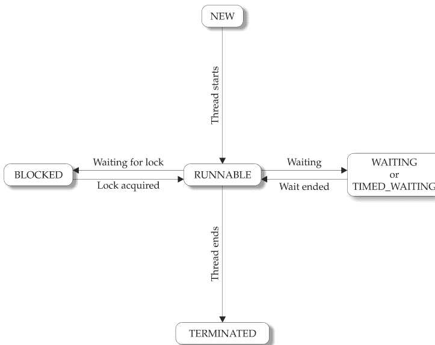

图 11-1 线程状态

图 11-1 描述了各种线程状态之间的关系。

给定一个 `Thread` 实例，你可以使用 `getState()` 获取线程的状态。例如，以下序列确定了在调用 `getState()` 时，名为 `thrd` 的线程是否处于 `RUNNABLE`（可运行）状态：

```java
Thread.State ts = thrd.getState();
if (ts == Thread.State.RUNNABLE) // ...
```

需要理解的是，线程的状态在调用 `getState()` 后可能会发生变化。因此，取决于情况，通过 `getState()` 获取的状态可能无法反映几秒钟后线程的实际状态。出于这些（以及其他）原因，`getState()` 并不是为了提供同步线程的方法。它主要用于调试或分析线程的运行时特征。

## 使用工厂方法创建并启动线程

在某些情况下，没有必要将线程的创建与其执行的启动分开。换句话说，有时同时创建并启动线程是方便的。*工厂方法*是一种返回类对象的方法。通常情况下，工厂方法是类的类静态方法。它们被用于多种原因，例如在在用之前将对象设置为某些初始状态，或为特定类型的对象进行配置，或者在某些情况下允许对象被重用。在创建和启动线程方面，工厂方法会创建线程，对线程调用 `start()`，然后返回线程的引用。通过这种方法，你可以通过单一方法调用来创建并启动线程，从而简化代码。

例如，假设 `ThreadDemo` 程序在本章的开头启动，在 `NewThread` 中添加工厂方法可以让你一步到位完成线程的创建和启动：

```java
// 创建并启动线程的工厂方法。
public static NewThread createAndStart() {
    NewThread myThrd = new NewThread();
    myThrd.start();
    return myThrd;
}
```

使用 `createAndStart()`，你现在可以将此代码：

```java
NewThread nt = new NewThread(); // 创建新线程
nt.start(); // 启动线程
```

替换为：

```java
NewThread nt = NewThread.createAndStart();
```

线程在一步完成了创建和启动。

在不需要保留执行中的线程引用的情况下，你有时可以用一行代码创建并启动线程，而无需使用工厂方法。例如，同样假设 `ThreadDemo` 程序，以下代码创建并启动了 `NewThread`：

```java
new NewThread().start();
```

然而，在实际应用中，你通常需要保留线程的引用，因此工厂方法是一个很好的选择。

## 使用多线程

利用 Java 多线程特征的关键在于有效地并发执行它们，而不是串行执行。例如，当程序中有两个可以并发执行的系统时，让它们成为独立的线程。通过仔细使用多线程，你可以创建非常高效的程序。然而，需要提醒的是：如果你创建了太多线程，实际上可能会降低程序的性能，而不是增强它。记住，上下文切换带有某些开销。如果你创建了太多线程，你将花费更多的 CPU 时间在上下文切换上，而不是执行你的程序。最后一点：为了创建能够自动伸缩以利用多内核系统中可用处理器的计算密集型应用程序，考虑使用 Fork/Join 框架。

# 第 12 章 枚举、自动装箱和注解

本章检查三个最初不属于 Java 的特性：枚举、自动装箱和注解。

## 枚举

枚举的最简单形式是命名的常量列表。在 Java 中，它使用 `enum` 关键字创建。例如，这是一个简单的枚举：

```java
// 苹果品种的枚举
enum Apple {
    Jonathan, GoldenDel, RedDel, Winesap, Cortland
}
```

`Jonathan`、`GoldenDel` 等标识符被称为枚举常量。每个常量都隐式声明为 `Apple` 的公共静态成员。此外，它们的类型是定义的枚举，在本例中是 `Apple`。在 Java 语言中，这些常量被称为自类型，其中“自”指的是封装的枚举。

一旦定义了枚举，你就可以创建该类型。然而，尽管枚举定义了类类型，但你并不使用 `new` 来实例化枚举。相反，你像使用基本类型一样声明和使用枚举变量。例如，这声明 `ap` 类型为 `Apple`：

```java
Apple ap;
```

由于 `ap` 是 `Apple` 类型，可以赋值（或包含）的值只有枚举定义的那些。例如，这给 `ap` 赋值为 `RedDel`：

```java
ap = Apple.RedDel;
```

注意 `RedDel` 前有 `Apple`。

两个枚举常量可以使用 `==` 运算符进行相等性比较。例如，该语句将 `ap` 的值与 `GoldenDel` 进行比较：

```java
if (ap == Apple.GoldenDel) { //
```

枚举也可以用于控制 `switch` 语句。当然，所有的 `case` 语句必须使用 `switch` 表达式所使用的枚举中的常量。例如，这个 `switch` 是完全有效的：

```java
// 使用枚举控制 switch 语句。
switch (ap) {
    case Jonathan:
    //
    case Winesap:
    //
}
```

当枚举常量被显示时（例如在 `println()` 语句中），输出的是它的名称。例如，给定以下语句：

```java
System.out.println(Apple.Winesap);
```

显示的名称是 `Winesap`。

接下来的程序整合了所有部分并演示了枚举：

```java
// 苹果品种的枚举。
enum Apple {
    Jonathan, GoldenDel, RedDel, Winesap, Cortland
}
class EnumDemo {
    public static void main(String[] args) {
        Apple ap;
        ap = Apple.RedDel;

        // 输出一个枚举值。
        System.out.println("Value of ap: " + ap);
        System.out.println();

        ap = Apple.GoldenDel;

        // 比较两个枚举值。
        if (ap == Apple.GoldenDel) {
            System.out.println("ap contains GoldenDel.\n");
        }

        // 使用枚举控制 switch 语句。
        switch (ap) {
            case Jonathan:
                System.out.println("Jonathan is red.");
                break;
            case GoldenDel:
                System.out.println("Golden Delicious is yellow.");
                break;
            case RedDel:
                System.out.println("Red Delicious is red.");
                break;
            case Winesap:
                System.out.println("Winesap is red.");
                break;
            case Cortland:
                System.out.println("Cortland is red.");
                break;
        }
    }
}
```

该程序的输出显示所示：

```
Value of ap: RedDel
ap contains GoldenDel.

Golden Delicious is yellow.
```

## values() 和 valueOf() 方法

所有的枚举都自动包含两个预定义方法：`values()` 和 `valueOf()`。它们的通用形式所示：

```java
public static enum-type[] values()
public static enum-type valueOf(String str)
```

`values()` 方法返回一个包含枚举常量列表的数组。`valueOf()` 方法返回与传入字符串 `str` 的值对应的枚举常量。在这两种情况下，`enum-type` 都是枚举的类型。例如，在之前的 `Apple` 枚举中，`Apple.valueOf("Winesap")` 的返回类型是 `Winesap`。

下面的程序演示了 `values()` 和 `valueOf()` 方法：

```java
// 使用内置的枚举方法。

// 苹果品种的枚举。
enum Apple {
    Jonathan, GoldenDel, RedDel, Winesap, Cortland
}
class EnumDemo2 {
    public static void main(String[] args) {
        Apple ap;
        Apple[] allapples;

        // 获取所有枚举常量。
        allapples = Apple.values();
        System.out.println("Here are all Apple constants:");
        for (Apple a : allapples) {
            System.out.println(a);
        }
        System.out.println();

        // 使用 valueOf()。
        ap = Apple.valueOf("Winesap");
        System.out.println("ap contains " + ap);
    }
}
```

该程序的输出所示：

```
Here are all Apple constants:
Jonathan
GoldenDel
RedDel
Winesap
Cortland

ap contains Winesap
```

注意，该程序使用 for-each 循环来遍历通过调用 `values()` 获取常量数组。为了说明，创建了变量 `allapples` 并为其赋值了枚举数组的引用。然而，这一步并不是必要的，因为 for 循环可以写如下所示，从而消除了对 `allapples` 变量的需求：

```java
for (Apple a : Apple.values())
    System.out.println(a);
```

现在，通过调用 `valueOf()` 获取与名称 `Winesap` 对应的值。

```java
ap = Apple.valueOf("Winesap");
```

正如所解释的，`valueOf()` 返回与表示为字符串的常量名称相关的枚举值。

## Java 枚举是类类型

正如前面提到的，枚举是一种类类型。虽然你不会使用 `new` 来实例化枚举，否则它具有与其他类相同的能力。枚举类的这一事实赋予了 Java 枚举非凡的力量。例如，你可以赋予构造函数、添加实例变量和方法，甚至实现接口。

理解这一点，每个枚举常量都是其枚举类型的一个对象。那么，当你为枚举定义构造函数时，每当创建一个枚举常量，就会调用构造函数。此外，每个枚举常量都拥有枚举所定义的任何实例变量的副本。例如，考虑以下枚举 `Apple`：

```java
// 使用枚举构造函数、实例变量和方法。
enum Apple {
    Jonathan(10), GoldenDel(9), RedDel(12), Winesap(15), Cortland(8);

    private int price; // 每个苹果的价格

    // 构造函数
    Apple(int p) { price = p; }
    int getPrice() { return price; }
}
```

```java
class EnumDemo3 {
    public static void main(String[] args) {
        Apple ap;

        // 显示 Winesap 的价格。
        System.out.println("Winesap costs " + 
            Apple.Winesap.getPrice() + 
            " cents.\n");

        // 显示所有苹果及其价格。
        System.out.println("All apple prices:");
        for (Apple a : Apple.values()) {
            System.out.println(a + " costs " + a.getPrice() + 
                " cents.");
        }
    }
}
```

输出所示：

```
Winesap costs 15 cents.

All apple prices:
Jonathan costs 10 cents.
GoldenDel costs 9 cents.
RedDel costs 12 cents.
Winesap costs 15 cents.
Cortland costs 8 cents.
```

这个版本的 `Apple` 添加了三件事。第一个是实例变量 `price`，用于保存每个品种的价格。第二个是构造函数，用于初始化每个品种。第三个是 `getPrice()`，它返回 `price`。

当你为枚举定义构造函数时，每当创建一个枚举常量时，就会调用构造函数。此外，每个枚举常量都拥有枚举所定义的任何实例变量的副本。


```java
// 使用枚举构造函数、实例变量和方法。
enum Apple {
    Jonathan(10), GoldenDel(9), RedDel(12), Winesap(15), Cortland(8);

    private int price; // 每个苹果的价格

    // 构造函数
    Apple(int p) { price = p; }
    int getPrice() { return price; }
}
```

这个版本的 `Apple` 添加了三件事。第一个是实例变量 `price`，用于保存每个品种的价格。第二个是构造函数，用于初始化每个品种。第三个是 `getPrice()`，它返回 `price`。

注意，这个版本中 `RedDel` 没有赋予参数。这意味着调用了默认构造函数，并且 `RedDel` 变量被赋值为 -1。

这里有两个适用于枚举的限制。首先，枚举不能继承另一个类。其次，枚举不能是子类。这个枚举就像任何其他类一样。

## 枚举继承 Enum

虽然在声明枚举时不能继承另一个类，但所有的枚举都继承 `java.lang.Enum`。这个类定义了所有枚举都可以使用的方法。`Enum` 类将在第二部分详细描述，但其中有三个方法值得在此处讨论。

你可以获取一个表示枚举在常量列表中位置的值。这被称为它的序数，通过调用 `ordinal()` 方法获取，所示：

```java
final int ordinal()
```

它返回调用者常量的值。序数从零开始。因此，在 `Apple` 示例中，`Jonathan` 的序数为0，`GoldenDel` 的序数为1，`RedDel` 的序数为2，依此类推。

你可以使用 `compareTo()` 方法比较枚举的两个常量的值。它的通用形式如下：

```java
final int compareTo(enum-type e)
```

在这里，`enum-type` 是枚举的类型，`e` 是与调用者常量比较的常量。记住，调用者常量和 `e` 必须是同一个枚举。如果调用者常量的序数小于 `e` 的序数，`compareTo()` 返回一个负整数。

# 284 第一部分 Java 语言

返回一个负值。如果两个序数值相同，则返回 0。如果调用的常数的序数值大于 e 的序数值，则返回一个正值。

你可以使用 `equals()` 将枚举常量与其他任何对象进行比较，该方法重写了 Object 类定义的 `equals()` 方法。虽然 `equals()` 可以将枚举与其他任何对象比较，但只有当两个对象引用同一个枚举中的同一个常量时，它们才相等。如果两个常量属于不同的枚举，仅仅具有相同的序数值也不会导致 `equals()` 返回 true。

请记住，你可以使用 `==` 来比较两个枚举引用的是否相等。下面的程序演示了 `ordinal()`、`compareTo()` 和 `equals()` 方法：

```java
// 演示 ordinal(), compareTo(), 和 equals() 方法。
// 苹果品种的枚举。
enum Apple {
    Jonathan, GoldenDel, RedDel, Winesap, Cortland
}

class EnumDemo4 {
    public static void main(String[] args) {
        Apple ap, ap2, ap3;

        // 使用 ordinal() 获取所有值。
        System.out.println("Here are all apple constants " +
        " and their ordinal values: " );
        for(Apple a : Apple.values()) {
            System.out.println(a + " " + a.ordinal());
        }

        ap = Apple.RedDel;
        ap2 = Apple.GoldenDel;
        ap3 = Apple.RedDel;

        System.out.println();

        // 演示 compareTo() 和 equals()
        if (ap.compareTo(ap2) < 0)
            System.out.println(ap + " comes before " + ap2);

        if(ap.compareTo(ap2) > 0)
            System.out.println(ap + " comes before " + ap);

        if(ap.compareTo(ap3) == 0)
            System.out.println(ap + " equals " + ap3);

        System.out.println();

        if (ap.equals(ap2))
            System.out.println("Error!");

        if(ap.equals(ap3))
            System.out.println(ap + " equals " + ap3);

        if (ap == ap3)
            System.out.println(ap + " = " + ap3);

    }
}
```

程序的输出结果所示：

Here are all apple constants and their ordinal values:

Jonathan 0

GoldenDel 1

RedDel 2

Winesap 3

Cortland 4

GoldenDel equals RedDel

RedDel equals RedDel

# 另一个枚举示例

在继续之前，我们将看一个使用枚举的不同示例。在第 9 章中，创建了一个自动的“决策者”程序。在那个版本中，接口内部声明了名为 NO、YES、MAYBE、LATER、SOON 和 NEVER 的变量来表示可能的答案。虽然这种方法在技术上没有错误，但枚举是更好的选择。这里是一个使用 `Answers` 枚举来定义答案的改进版程序。你应该将此版本与第 9 章中的原始版本进行比较。

```java
// 第 9 章“决策者”程序的
// 改进版本。这个版本使用
// 枚举而不是接口变量，来
// 表示答案。
```

```java
import java.util.Random;

// 可能答案的枚举。
enum Answers {
    NO, YES, MAYBE, LATER, SOON, NEVER
}
```

```java
class Question {
    Random rand = new Random();
    Answers ask() {
        int prob = (int) (100 * rand.nextDouble());
        if (prob < 15)
            return Answers.MAYBE; // 15%
        else if (prob < 30)
            return Answers.NO; // 15%
        else if (prob < 60)
            return Answers.YES; // 30%
        else if (prob < 75)
            return Answers.LATER; // 15%
        else if (prob < 98)
            return Answers.SOON; // 13%
        else
            return Answers.NEVER; // 2%
    }
}
```

```java
class AskMe {
    static void answer(Answers result) {
        switch(result) {
            case NO:
                System.out.println("No");
                break;
            case YES:
                System.out.println("Yes");
                break;
            case MAYBE:
                System.out.println("Maybe");
                break;
            case LATER:
                System.out.println("Later");
                break;
            case SOON:
                System.out.println("Soon");
                break;
            case NEVER:
                System.out.println("Never");
                break;
        }
    }

    public static void main(String[] args) {
        Question q = new Question();
        answer(q.ask());
        answer(q.ask());
        answer(q.ask());
        answer(q.ask());
    }
}
```

# 包装类型

如你所知，Java 使用基本类型（也称为简单类型）如 `int` 或 `double` 来存储语言支持的基本数据类型。为了性能考虑，这些数量使用了基本类型而不是对象。对于这些值使用对象会给即使是最简单的计算带来增加不可接受的开销。因此，基本类型不是对象层次结构的一部分。


```java
class Question {
    Random rand = new Random();
    Answers ask() {
        int prob = (int) (100 * rand.nextDouble());
        if (prob < 15)
            return Answers.MAYBE; // 15%
        else if (prob < 30)
            return Answers.NO; // 15%
        else if (prob < 60)
            return Answers.YES; // 30%
        else if (prob < 75)
            return Answers.LATER; // 15%
        else if (prob < 98)
            return Answers.SOON; // 13%
        else
            return Answers.NEVER; // 2%
    }
}
```

```java
class AskMe {
    static void answer(Answers result) {
        switch(result) {
            case NO:
                System.out.println("No");
                break;
            case YES:
                System.out.println("Yes");
                break;
            case MAYBE:
                System.out.println("Maybe");
                break;
            case LATER:
                System.out.println("Later");
                break;
            case SOON:
                System.out.println("Soon");
                break;
            case NEVER:
                System.out.println("Never");
                break;
        }
    }

    public static void main(String[] args) {
        Question q = new Question();
        answer(q.ask());
        answer(q.ask());
        answer(q.ask());
        answer(q.ask());
    }
}
```

# 包装类型

如你所知，Java 使用基本类型（也称为简单类型）如 `int` 或 `double` 来存储语言支持的基本数据类型。为了性能考虑，这些数量使用了基本类型而不是对象。对于这些值使用对象会给即使是最简单的计算带来增加不可接受的开销。因此，基本类型不是对象层次结构的一部分。

尽管 `equals()` 可以比较枚举与任何其他对象，但只有当两个对象引用同一个枚举中的同一个常量时，它们才相等。如果两个常量属于不同的枚举，仅仅具有相同的序数值也不会导致 `equals()` 返回 true。

请记住，你可以使用 `==` 来比较两个枚举引用的是否相等。下面的程序演示了 `ordinal()`、`compareTo()` 和 `equals()` 方法：

（注：原文后续内容为大量重复，此处已按要求不再重复输出）

# 第12章 枚举、自动装箱和注解

以下程序演示了如何使用数值类型包装类来封装值并提取该值。

```java
// Demonstrate a type wrapper.
class Wrap {
    public static void main(String[] args) {
        Integer iOB = Integer.valueOf(100);
        int i = iOB.intValue();
        System.out.println(i + " " + iOB); // displays 100 100
    }
}
```

该程序将整数值 100 封装在 `Integer` 对象 `iOB` 中。程序通过调用 `intValue()` 获取此值并将其存储在 `i` 中。

将值封装在对象中的过程称为装箱（boxing）。因此，在程序中，将值 100 装箱为 `Integer`：

```java
Integer iOB = Integer.valueOf(100);
```

从类型包装类中提取值的过程称为拆箱（unboxing）。例如，程序通过以下语句对 `iOB` 中的值进行拆箱：

```java
int i = iOB.intValue();
```

上一个程序用于装箱和拆箱的通用步骤自 Java 原始版本起就可以使用。然而，今天 Java 提供了一种更简洁的方法，将在下文描述。

# 自动装箱 (Autoboxing)

现代版本的 Java 包含了两个特性：自动装箱（autoboxing）和自动拆箱（auto-unboxing）。自动装箱是指当需要该类型的对象时，将基本类型自动封装（装箱）为其对应的类型包装类的过程。不需要显式地构造对象。自动拆箱是指当需要包装对象的值时，从类型包装类中提取（拆箱）值的过程。不需要调用 `intValue()` 或 `doubleValue()` 等方法。

自动装箱和自动拆箱极大简化了多个算法的代码，消除了手动装箱和拆箱值的繁琐。它们还有助于防止错误。此外，它们对于仅操作对象的泛型（generics）非常重要。自动装箱使得使用集合框架（在第二部分描述）变得简单得多。

有了自动装箱，没有必要手动构造对象来封装基本类型。你只需要将值赋值给类型包装类引用。Java 会自动为你构造对象。例如，这里是构造一个值为 100 的 `Integer` 的现代方式：

```java
Integer iOB = 100; // autobox an int
```

注意，对象没有被显式装箱。Java 会自动为你处理这一切。

要拆箱一个对象，只需将对象引用赋值给基本类型变量。

例如，对于 `iOB`，你可以使用这一行：

```java
int i = iOB; // auto-unbox
```

Java 会为你处理细节。

以下是上述使用自动装箱/拆箱的重写版本：

```java
// Demonstrate autoboxing/unboxing.
class AutoBox {
    public static void main(String[] args) {
        Integer iOB = 100; // autoboxing an int

        int i = iOB; // auto-unbox
        System.out.println(i + " " + iOB); // displays 100 100
    }
}
```

# 自动装箱与方法

在赋值的简单情况下，每当必须将基本类型转换为对象时，就会发生自动装箱；每当对象必须转换为基本类型时，就会发生自动拆箱。因此，当向方法传递参数或由方法返回值时，可能会发生自动装箱/拆箱。例如，考虑以下内容：

- 自动装箱/拆箱发生在方法的参数和返回值。

```java
class AutoBox {
    // 接收 Integer 参数并返回
    // 一个 int 值；
    static int m(Integer v) {
        return v; // auto-unbox to int
    }

    public static void main(String[] args) {
        // 将一个 int 传递给 m() 并将返回值
        // 给 Integer。在这里，参数 100 被自动装箱
        // 为 Integer。返回值也被自动装箱
        // 为 Integer。
        Integer iOB = m(100);

        System.out.println(iOB);
    }
}
```

该程序将显示以下结果：

在程序中，注意 `m()` 指定了一个 `Integer` 参数并返回一个 `int` 结果。在 `main()` 方法中，向 `m()` 传递了值 100。由于 `m()` 期望一个 `Integer`，该值被自动装箱。然后，`m()` 返回其表达式的等值。这导致 `v` 被自动拆箱。接下来，这个 `int` 值被赋值给 `main()` 中的 `iOB`，导致 `int` 返回值被自动装箱。

# 自动装箱/拆箱发生在表达式中

通常情况下，每当需要转换为对象或从对象转换时，自动装箱和拆箱就会发生。这适用于表达式。在表达式内部，数值对象会被自动拆箱。如果有必要，表达式的结果会被重新装箱。例如，考虑以下程序：

```java
// Autoboxing/unboxing occurs inside expressions.
class Autobobox3 {
    public static void main(String[] args) {
        Integer iOB, iOB2;
        int i;

        iOB = 100;
        System.out.println("Original value of iOB");
        // ... (rest of code logic based on context)
    }
}
```

*(注：提供的 OCR 文本在后期页面存在严重的碎片化和重复句子。我已根据标准的 Java 文档模式和提供的片段重建了逻辑流。)*

# 警语

由于自动装箱和自动拆箱，有些人可能会倾向于仅使用 `Integer` 或 `Double` 等对象，而完全放弃基本类型。例如，通过自动装箱/拆箱，可以编写如下代码：

```java
// 自动装箱/拆箱的错误用法！
Double a, b, c;

a = 10.0;
b = 4.0;

c = System.out.println("Hypotenuse is " + a*b + " c");
```

在这个示例中，`Double` 类型的对象持有用于计算直角三角形斜边的值。虽然这在技术上是正确的，而且确实可以运行，但这是自动装箱/拆箱的一种非常糟糕的用法。它比使用基本类型 `double` 编写对应代码效率低得多。原因是自动装箱和自动拆箱增加了使用基本类型时并不存在的额外开销。

总的来说，你应该将对类型包装类的使用限制在需要基本类型的对象表示的情况下。自动装箱/拆箱引入 Java 并不是作为一种消除基本类型的“后门”方式。

# 注解

Java 提供了一项允许你在源文件中嵌入补充信息的功能。这种信息被称为注解（annotation），它不会改变程序的行为。因此，注解可以在开发和部署期间被各种工具使用。例如，注解可能会被源代码生成器处理。“元数据”（metadata）一词也用于描述这一功能，但“注解”一词是最具描述性且常用的术语。

# 注解基础

注解是通过基于接口的机制创建的。让我们从一个示例开始。这是名为 `MyAnno` 的注解的声明：

```java
// 一个简单的注解类型。
@interface MyAnno {
    String str();
    int val();
}
```

首先，注意关键字 `interface` 前面的 `@`。这告诉编译器通过声明创建了一个注解类型。接下来，注意两个成员 `str()` 和 `val()`。所有的注解完全由方法声明组成。然而，你不需要为这些方法提供实现。相反，Java 会实现这些方法。此外，正如你将看到的，这些方法的作用就像字段一样。

注解不能有 `extends` 子句。然而，所有的注解类型都自动扩展 `Annotation` 接口。因此，`Annotation` 是所有注解的超接口。它定义在 `java.lang.annotation` 包中。它重写了 `Object` 的 `hashCode()`、`equals()` 和 `toString()`。它还指定了 `annotationType()`，该方法返回一个表示调用用的注解的 `Class`。

一旦你声明了注解，就可以用它来标记某些内容。最初，注解只能用在声明上，我们将从这里开始。（JDK 8 增加了对类型进行注解的能力，这将在本章的稍后部分描述。然而，基本技术适用于这两种注解。）任何类型的声明都可以与注解相关联。例如，类、方法、字段、参数和枚举（enum）都可以被注解。甚至注解本身也可以被注解。在所有情况下，注解都位于声明的其他部分之前。

当你应用注解时，可以为成员赋予值。例如，这里有一个将 `MyAnno` 应用于方法的示例：

```java
// 注解标记一个方法。
@MyAnno(str = "Annotation Example", val = 100)
public static void myMethod() { // }
```

此注解与方法 `myMethod()` 关联。仔细观察注解语法。以 `@` 开头的注解名后面紧跟的是一个参数化的成员初始化列表。要为成员赋值，只需给成员名分配一个值。因此，在示例中，字符串 `"Annotation Example"` 被赋值给 `MyAnno` 的 `str`。注意，在这次赋值中 `str` 后面没有跟括号。当给注解赋值时，只使用它的成员名称。因此，在这种语境下，注解看起来就像字段。

# 指定保留策略

在解释注解之前，有必要讨论注解的保留策略（retention policy）。保留策略决定了注解在何时被丢弃。Java 定义了三种策略，它们封装在 `java.lang.annotation.RetentionPolicy` 枚举中。它们是 `SOURCE`、`CLASS` 和 `RUNTIME`。

- 保留策略为 `SOURCE` 的注解保留在源文件中，并在编译期间被丢弃。
- 保留策略为 `CLASS` 的注解在编译期间存储在 `.class` 文件中。然而，在运行时无法通过 JVM 使用。
- 保留策略为 `RUNTIME` 的注解在编译期间存储在 `.class` 文件中，并且运行时可以通过 JVM 使用。因此，`RUNTIME` 提供了最大的持久性。

注意：本地变量声明上的注解不会保留在 `.class` 文件中。

通过使用 Java 的内置注解之一为注解指定保留策略。例如：

```java
@Retention(RUNTIME)
```

# 在运行时获取注解

虽然注解主要设计用于开发或部署工具，但如果指定了 `RUNTIME` 保留策略，就可以通过反射进行查询。反射 API 包含在 `java.lang.reflect` 包中。使用反射的第一步是获取表示类的 `Class` 对象。有很多方法可以获取 `Class` 对象。最简单的方法是调用 `getClass()`，它是由 `Object` 定义的。其通用形式如下：

```java
final Class<?> getClass()
```

注意 `getClass()` 声明中的 `<?>`。这与 Java 的泛型有关。然而，理解泛型不需要掌握基本原理。

一旦你获取了 `Class` 对象，就可以使用它的方法获取有关项的信息。如果你想获取项的注解，必须首先获取表示该项的对象。例如，`getMethod()`、`getField()` 和 `getConstructor()` 获取方法、字段和构造函数的信息。这些方法分别返回 `Method`、`Field` 和 `Constructor` 对象。

为了理解这个过程，让我们通过一个获取方法注解的示例。为了这一点，你首先获取表示该方法的 `Class` 对象，然后在该类上调用 `getMethod()` 并指定方法名称。`getMethod()` 的通用形式如下：

```java
Method getMethod(String methodName, Class<?> ... paramTypes)
```


方法名通过 `methodName` 传入。如果方法有参数，通过 `paramTypes` 指定对应的类型。注意 `paramTypes` 是变长参数（varargs），这意味着你可以指定任意数量的参数，包括零个。`getMethod()` 返回一个表示该方法的 `Method` 对象。如果找不到方法，将抛出 `NoSuchMethodException`。

从 `Class`、`Method`、`Field` 或 `Constructor` 对象，可以通过调用 `getAnnotation()` 获取与之相关的特定注解。其通用形式为：

```java
<A extends Annotation> getAnnotation(Class<A> annotationType)
```

在这里，`annotationType` 是表示感兴趣的注解的 `Class` 对象。该方法返回注解的引用。使用此引用，可以获取注解成员的值。如果找不到注解，方法将返回 `null`，这在注解没有 `RUNTIME` 保留时就会发生。

这是一个程序整合了之前显示的所有部分，并使用反射显示与以下相关的注解：

```java
import java.lang.annotation.*;
import java.lang.reflect.*;
// 一个注解类型声明。
@Retention(RetentionPolicy.RUNTIME)
@interface MyAnno {
    String str();
    int val();
}
class Meta {
// 注解标记一个方法。
@MyAnno(str="Annotation Example", val = 100)
public static void myMethod() {
    Meta ob = new Meta();

// 获取该方法的注解
// 并显示成员的值。
}
}
```

### 298 第一部分 Java 语言

```java
try {
  // 首先，获取一个表示 
  // 此类的 Class 对象。
  Class<?> c = ob.getClass();

  // 现在，获取一个表示 
  // 此方法的 Method 对象。
  Method m = c.getMethod("myMeth");

  // 接下来，获取该类的注解。
  MyAnno anno = m.getAnnotation(MyAnno.class);

  // 最后，显示这些值。
  System.out.println(anno.str() + " " + anno.val());
} catch (NoSuchMethodException exc) {
  System.out.println("Method Not Found.");
}
```

```java
public static void main(String[] args) {
  myMeth();
}
```

程序的输出显示在此：

Annotation Example 100

该程序使用了如所述的反射机制来获取并显示 `Meta` 类中与 `myMeth()` 方法的 `MyAnno` 注解中的 `str` 和 `val` 值。有两个点需要注意。首先，在这一行中：

```java
MyAnno anno = m.getAnnotation(MyAnno.class);
```

注意表达式 `MyAnno.class`。该表达式求值为类型为 `MyAnno`（注解）的 `Class` 对象。这被称为 **Class** 字面量。每当需要已知类的 `Class` 对象时，都可以使用这种表达式。例如，可以使用此语句获取 `Meta` 的 `Class` 对象：

```java
Class<?> c = Meta.class;
```

当然，这种方法只在你提前知道对象的类名时才有效，而情况并非总是如此。通常，你可以为类、接口、基本类型和数组获取类字面量。（记住，`<?>` 与 Java 的泛型功能有关。该功能在第 14 章中描述）。

另一个感兴趣的点是，当通过以下行输出时，与 `str` 和 `val` 关联的值是否会被获取：

```java
System.out.println(anno.str() + " " + anno.val());
```

注意它们是使用方法调用语法被调用的。每当需要注解成员的值时，都使用相同的方法。

### 第二个反射示例

在上一个示例中，`myMeth()` 没有参数。因此，调用了 `getMethod()`，只传递了名称 `myMeth`。然而，要获取带有参数的方法，必须将代表这些参数类型的类对象作为 `getMethod()` 的参数。例如，这里是上一个程序的略有不同版本：

```java
import java.lang.annotation.*;
import java.lang.reflect.*;

@Retention(RetentionPolicy.RUNTIME)
@interface MyAnno {
    String str();
    int val();
}

class Meta {
    // myMeth 现在有两个参数。
    @MyAnno(str = "Two Parameters", val = 19)
    public static void myMeth(String str, int i) {
        Meta ob = new Meta();

        try {
            Class<?> c = ob.getClass();
            // 在这里指定了参数类型。
            Method m = c.getMethod("myMeth", String.class, int.class);
            MyAnno anno = m.getAnnotation(MyAnno.class);
            System.out.println(anno.str() + " " + anno.val());
        } catch (NoSuchMethodException exc) {
            System.out.println("Method Not Found.");
        }
    }

    public static void main(String[] args) {
        myMeth("test", 10);
    }
}
```

该版本的输出显示在此：

Two Parameters 19

在这个版本中，`myMeth()` 接收一个 `String` 和一个 `int` 参数。要获取有关此方法的信息，必须所示调用 `getMethod()`：

```java
Method m = c.getMethod("myMeth", String.class, int.class);
```

在这里，代表 `String` 和 `int` 的 `Class` 对象作为额外的参数传递。

### 获取所有注解

你可以通过对该项调用 `getAnnotations()` 来获取与该项关联的所有具有 `RUNTIME` 留存注解。它的通用形式如下：

```java
Annotation[] getAnnotations()
```

它返回一个注解数组。`getAnnotations()` 可以在 `Class`、`Method`、`Constructor` 和 `Field` 等类型的对象上调用。

这是另一个反射示例，展示了如何获取与类和方法关联的所有注解。它声明了这些注解来标记一个类和一个方法。

```java
// 显示类和方法的所有注解。
import java.lang.annotation.*;
import java.lang.reflect.*;

@Retention(RetentionPolicy.RUNTIME)
@interface MyAnno {
    String str();
    int val();
}

@Retention(RetentionPolicy.RUNTIME)
@interface What {
    String description();
}

@What(description = "Annotation test class")
@MyAnno(str = "Meta2", val = 99)
class Meta2 {

  @What(description = "Annotation test method")
  @MyAnno(str = "Testing", val = 100)
  public static void myMethod() {
    Meta2 ob = new Meta2();
  }
}

try {
    Annotation[] annos = ob.getClass().getAnnotations();

    // 显示 Meta2 的所有注解。
    System.out.println("All annotations for Meta2:");
    for (Annotation a : annos) {
        System.out.println(a);
    }
```

### 使用默认值

你可以为注解指定默认值，当在使用注解时未指定值将使用这些值。通过在成员的声明中添加 `default` 子句来指定默认值。它的通用形式为：

```java
type member() default value;
```

`value` 必须与 `type` 类型兼容。这里是包含默认值的 `@MyAnno`：

```java
// 包含默认值的注解声明。
@Retention(RetentionPolicy.RUNTIME)
@interface MyAnno {
  String str() default "Testing";
  int val() default 9000;
}
```

此声明为 `str` 和 `val` 提供了默认值 "Testing"。这意味着在使用 `@MyAnno` 时不需要指定任何值。然而，如果需要，可以为其中或两者赋值。因此，`@MyAnno` 有四种使用方式：

```java
@MyAnno() // str 和 val 使用默认
@MyAnno(str = "some string") // val 使用默认
@MyAnno(val = 100) // str 使用默认
@MyAnno(str = "Testing", val = 100) // 无默认
```

下面的程序演示了注解中使用默认值。

```java
import java.lang.annotation.*;
import java.lang.reflect.*;
```

```java
// 包含默认值的注解声明。
@Retention(RetentionPolicy.RUNTIME)
@interface MyAnno {
  String str() default "Testing";
  int val() default 9000;
}
```

```java
class Meta3 {

  // 使用默认值标记方法。
  @MyAnno()
  public static void myMeth() {
    Meta3 ob = new Meta3();

    // 获取该方法的注解
    // 并显示成员的值。
    try {
      Class<?> c = ob.getClass();
      Method m = c.getMethod("myMeth");
      MyAnno anno = m.getAnnotation(MyAnno.class);
      System.out.println(anno.str() + " " + anno.val());
    } catch (NoSuchMethodException exc) {
      System.out.println("Method Not Found.");
    }
  }
}
```

### 第 12 章 枚举、自动装箱与注解 303

```java
public static void main(String[] args) {
  myMeth();
}
```

输出如下：

Testing 9000

### 标记注解 (Marker Annotations)

标记注解是一种特殊的注解，不包含任何成员。它的唯一目的是标记某个项目。它作为注解的出现本身就足够了。判断标记注解是否存在最佳方法是使用 `isAnnotationPresent()` 方法，该方法由 `AnnotatedElement` 接口定义。

这是一个使用标记注解的示例。由于标记接口不包含任何成员，因此判断它的是否存在非常简单。

```java
import java.lang.annotation.*;
import java.lang.reflect.*;
```

```java
// 一个标记注解。
@Retention(RetentionPolicy.RUNTIME)
@interface MyMarker {
}
```

```java
class Marker {

  // 使用标记注解标记此方法。
  // 注意不需要 ( )。
  @MyMarker
  public static void myMeth() {
    Marker ob = new Marker();

    try {
      Method m = ob.getClass().getMethod("myMeth");

      // 判断注解是否存在。
      if (m.isAnnotationPresent(MyMarker.class)) {
        System.out.println("MyMarker is present.");
      }
    } catch (NoSuchMethodException exc) {
      System.out.println("Method Not Found.");
    }
  }
}
```


```java
public static void main(String[] args) {
    myMeth();
}
```

此处所示输出证实了 `@MyMarker` 存在：

MyMarker is present.

在程序中，请注意在应用 `@MyMarker` 时不需要跟上括号。因此，可以通过使用其名称来应用 `@MyMarker`，如下：

```java
@MyMarker
```

提供一组空括号并不是错误的，但它们不是必须的。

### 单成员注解 (Single-member Annotations)

单成员注解只包含一个成员。它的工作方式类似于普通注解，不同之处在于允许以简写形式指定成员的值。当只存在一个成员时，你可以在应用注解时直接指定该成员的值——不需要指定成员的名称。然而，为了使用这种简写形式，成员的名称必须是 `value`。

这是一个创建并使用单成员注解的示例：

```java
import java.lang.annotation.*;
import java.lang.reflect.*;

// 单成员注解。
@Retention(RetentionPolicy.RUNTIME)
@interface MySingle {
    int value(); // 这个变量名必须是 value
}

class Single {
    // 使用单成员注解标记方法。
    @MySingle(100)
    public static void myMeth() {
        Single obj = new Single();
        try {
            Method m = obj.getClass().getMethod("myMeth");
            MySingle anno = m.getAnnotation(MySingle.class);
            System.out.println(anno.value()); // 显示 100
        } catch (NoSuchMethodException exc) {
            System.out.println("Method Not Found.");
        }
    }
}
```

```java
public static void main(String[] args) {
  myMeth();
}
```

正如预期的，此程序显示了值 100。在程序中，`@MySingle` 被用于标记 `myMeth()`，如下所示：

```java
@MySingle(100)
```

注意不需要指定 `value =`。

在应用具有其他成员的注解时，你可以使用单值语法，但这些其他成员必须都有默认值。例如，这里添加了值 `xyz`，其默认值为：

```java
@interface SomeAnno {
  int value();
  int xyz() default 0;
}
```

在想要使用 `xyz` 的默认值的情况下，你可以像下面所示应用 `@SomeAnno`，只需通过使用单成员语法指定 `value` 的值即可：

```java
@SomeAnno(88)
```

在这种情况下，`xyz` 默认为零，`value` 得到了值 88。当然，为 `xyz` 指定不同的值需要两个成员都显式命名，如下所示：

```java
@SomeAnno(value = 88, xyz = 99)
```


> 记住，每当你使用单成员注解时，该成员的名称必须是 `value`。

# 内置注解

Java 定义了许多注解。它们是专门的，但有九个是通用的。其中，四个导入自 `java.lang.annotation`：`@Retention`、`@Documented`、`@Target` 和 `@Inherited`。`@Override`、`@FunctionalInterface`、`@SafeVarargs` 和 `@SuppressWarnings` 包含在 `java.lang` 中。

注意 `java.lang.annotation` 还包含 `Repeatable` 和 `Native` 注解。`Repeatable` 支持重复注解，如本章后面描述所示。`Native` 标记可以被原生代码访问的字段。

## @Retention

`@Retention` 设计用于作注解。它指定了注解保留多久。有三种保留策略：

- **RUNTIME**：注解在运行时可以通过反射可用。
- **CLASS**：注解记录在类文件中。
- **SOURCE**：注解仅由编译器保留，不在类文件中。

```java
@Retention(RetentionPolicy.RUNTIME)
```

## @Documented

`@Documented` 表示注解应该包含在元素的 javadoc 中。

## @Target

`@Target` 指定了注解可以应用的元素类型。它接收一个数组：

| 目标 | 应用于 |
| :--- | :--- |
| ANNOTATION | 注解 |
| CONSTRUCTOR | 构造函数 |
| FIELD | 字段 |
| LOCAL_VARIABLE | 局部变量 |
| METHOD | 方法 |
| MODULE | 模块 |
| PACKAGE | 包 |
| PARAMETER | 参数 |
| RECORD_COMPONENT | 记录组件 |
| TYPE | 类型 |
| TYPE_PARAMETER | 类型参数 |
| TYPE_USE | 类型使用 |

```java
@Target({ElementType.FIELD, ElementType.LOCAL_VARIABLE})
```

## @Inherited

`@Inherited` 使注解被子类继承。它影响类声明。

```java
@Inherited
```

## @Override

`@Override` 表示方法重写了父类中的方法。如果没有，将导致编译错误。它用于确保方法确实被重写而非重载。

## @Deprecated

`@Deprecated` 表示声明已过时但不建议使用。从 JDK 9 开始，`@Deprecated` 还允许指定过时的 Java 版本以及计划移除的时间。

## @FunctionalInterface

`@FunctionalInterface` 是设计用于接口的标记注解。它表示被注解的接口是一个函数接口。函数接口是一个包含且仅包含一个抽象方法的接口。函数接口用于 lambda 表达式（参见第 15 章）。如果接口不是函数接口，将报告编译错误。需要理解的是创建函数接口不需要 `@FunctionalInterface`。任何只有一个抽象方法的接口在定义上都是函数接口。因此，`@FunctionalInterface` 仅仅是信息性的。

## @SafeVarargs

`@SafeVarargs` 是可以应用于方法和构造函数的标记注解。它表示变长参数不会发生不安全的操作。它用于抑制安全代码上的未检查警告，因为它涉及到不可靠的可变类型和泛型数组实例化（不可靠的可变类型本质上是泛型，泛型参见第 14 章）。它必须应用于变长参数方法或构造函数。方法还必须是静态、final 且私有的。

## @SuppressWarnings

`@SuppressWarnings` 指定要抑制编译器可能发出的一个或多个警告。警告通过字符串形式指定。

# 类型注解

如前所述，注解最初允许用于声明。然而，对于现代 Java 版本，注解也可以应用于大多数使用类型的地方。注解的这种扩展被称为类型注解。例如，你可以注解方法的返回类型、方法中的 `this`、强制转换、数组级别、继承的类以及 throws 子句。你还可以注解泛型类型，包括类型参数边界和泛型类型参数（参见第 14 章关于泛型的讨论）。

类型注解非常重要，因为它们允许工具对代码执行额外的检查以防止错误。请理解，作为一般规则，`javac` 本身不会执行这些检查。为此目的，使用一个单独的工具，尽管该工具可能会作为编译器插件运行。

类型注解必须包含 `ElementType.TYPE_USE` 作为目标（记住，有效的注解是如之前描述使用 `@Target` 注解来指定的）。类型注解应用于其紧跟的类型。例如，假设有一个名为 `@TypeAnnotation` 的类型注解，其逻辑如下：

```java
void myMethod() throws @TypeAnnotation NullPointerException { //
}
```

`@TypeAnnotation` 注释了 `throws` 子句中的 `NullPointerException`。你也可以对 `this`（称为接收者）的类型进行注解。如你所知，这是实例方法的隐式参数，指向调用者对象。注解你的类型需要使用另一种最初不是 Java 一部分的特性。从 JDK 8 开始，你可以显式将其声明为方法的第一个参数。在此声明中，`this` 的类型必须是类的类型；例如：

```java
class SomeClass {
    int myMethod(SomeClass this, int i, int j) { //
    }
}
```

在这里，`myMethod` 是由 `SomeClass` 定义的方法，`this` 的类型是 `SomeClass`。使用这种声明，你可以对 `this` 的类型进行注解。例如，假设 `@TypeAnno` 是类型注解，后续如下：

```java
int myMethod(@TypeAnno SomeClass this, int i, int j) { // ...
}
```

重要的一点是，除非你要对其进行注解，否则没有必要声明它（如果未声明，它仍然像往常一样被隐式传递）。此外，显式声明这不会改变方法签名的任何方面，因为在默认情况下它是隐式声明的。再次，只有当你想对其应用类型注解时才会声明它。如果你声明了它，它必须是第一个参数。

以下程序展示了类型注解可以使用的若干位置。它定义了几个注解，其中几个用于类型注解。注解的名称和目标在此处：

| 注解 | 目标 |
|---|---|
| `@TypeAnno` | `ElementType.TYPE_USE` |
| `@MaxLen` | `ElementType.TYPE_USE` |
| `@NotZeroLen` | `ElementType.TYPE_USE` |
| `@Unique` | `ElementType.TYPE_USE` |
| `@What` | `ElementType.TYPE_PARAMETER` |
| `@EmptyOK` | `ElementType.FIELD` |
| `@Recommended` | `ElementType.METHOD` |

注意 `@EmptyOK`、`@Recommended` 和 `@What` 不是类型注解。它们包含在这里是为了用于比较。特别感兴趣的是 `@What`，它用于注解泛型类型参数声明。程序中的注释描述了每种用法。

```java
// 演示几种类型注解。
import java.lang.annotation.*;
import java.lang.reflect.*;
```

```java
// 一个可以应用于类型的标记注解。
@Target(ElementType.TYPE_USE)
@interface TypeAnno { }
```

```java
// 另一个可以应用于类型的标记注解。
@Target(ElementType.TYPE_USE)
@interface NotZeroLen {
}
```

```java
// 另外一个可以应用于类型的标记注解。
@Target(ElementType.TYPE_USE)
@interface Unique { }
```

```java
// 一个可以应用于类型的参数化注解。
@Target(ElementType.TYPE_USE)
@interface MaxLen {
  int value(); 
}
```

```java
// 一个可以应用于类型参数的注解。
@Target(ElementType.TYPE_PARAMETER)
@interface What {
  String description();
}
```

```java
// 一个可以应用于字段声明的注解。
@Target(ElementType.FIELD)
@interface EmptyOK { }
```

```java
// 一个可以应用于方法声明的注解。
@Target(ElementType.METHOD)
@interface Recommended { }
```

```java
// 在类型参数上使用注解。
class TypeAnnoDemo<@What(description = "Generic data type") T> {
```

```java
// 在构造函数上使用注解。
public @Unique TypeAnnoDemo() { }
```

```java
// 注解类型（在此情况下为 String），而不是字段。
@TypeAnno String str;
```

```java
// 这注解了字段 test。
@EmptyOK String test;
```

```java
// 使用类型注解注解 this（接收者）。
public int f(@TypeAnno TypeAnnoDemo<T> this, int x) {
    return 0;
}
```

```java
// 注解返回类型。
public @TypeAnno Integer f2(int j, int k) {
    return j+k;
}
```

```java
// 注解方法声明。
public @Recommended Integer f3(String str) {
    return str.length() / 2;
}
```

```java
// 在 throws 子句中使用类型注解。
public void f4() throws @TypeAnno NullPointerException {
    // ...
}
```

```java
// 注解数组级别。
String @MaxLen(10) [] @NotZeroLen [] w;
```

```java
// 注解数组元素类型。
@TypeAnno[] vec;
```

```java
public static void myMeth(int i) {
```

```java
// 在类型参数上使用类型注解。
TypeAnnoDemo<@TypeAnno T> ob =
```

```java
// 在强制转换中使用类型注解。
TypeAnnoDemo<@TypeAnno T> y;
```

```java
// 在继承中使用类型注解。
class SomeClass extends @TypeAnno {
}
```

## 重复注解示例

```java
{
  RepeatAnno ob = new RepeatAnno();

  try {
    Class<?> c = ob.getClass();
    // 获取 myMeth() 的注解。
    Method m = c.getMethod("myMeth", String.class, int.class);

    // 显示重复的 MyAnno 注解。
    Annotation anno = m.getAnnotation(MyRepeatedAnn.class);
    System.out.println(anno);

  } catch (NoSuchElementException exc) {
    System.out.println("Method Not Found.");
  }
}

public static void main(String[] args) {
  myMeth("test", 10);
}
```

输出为：

```
@MyRepeatedAnnos(value={@Anno(val=-1, str="First annotation"),@Anno(val=100, str="Second annotation")})
```

如前解释，为了使 `MyAnno` 是可重复的，它必须被 `@Repeatable` 注解标记，该注解指定了它的容器注解。容器注解被称为 `MyRepeatedAnnos`。程序通过调用 `getAnnotation()` 来访问重复注解，传入的是容器注解的类，而不是可重复注解本身。如输出所示，重复注解之间用逗号隔开。它们不是被单独返回的。

获取重复注解的另一种方法是使用 `AnnotatedElement` 中的方法之一，这些方法可以直接在重复注解上操作。这些方法是 `getAnnotationsByType()` 和 `getDeclaredAnnotationsByType()`。在这里，我们将使用前者。其用法如下：

```java
default <T extends Annotation> T[] getAnnotationsByType(Class<T> annotationType)
```

它返回一个与调用对象相关的类型为 `anno` 的注解数组。如果不存在任何注解，则数组长度将为 0。这里有一个示例。假设前面的程序，以下序列使用 `getAnnotationsByType()` 来获取重复的 `MyAnno` 注解：

```java
Annotation[] ann = m.getAnnotationsByType(MyAnno.class);
for(Annotation a : ann) {
  System.out.println(a);
}
```

在这里，重复注解的类型 `MyAnno` 被传递给 `getAnnotationsByType()`。返回的数组包含了所有与 `myMeth()` 相关的 `MyAnno` 实例，在例例中有两个。每个重复注解都可以通过数组中的索引访问。在这种情况下，每个 `MyAnno` 注解都通过 for-each 循环显示。

## 某些限制

注解声明存在若干限制。首先，没有一个注解可以继承另一个注解。其次，注解中声明的所有方法都不能有参数。此外，它们必须返回以下类型之一：

- 原始类型，例如 `int` 或 `double`
- `String` 或 `Class` 类型的对象
- `enum` 类型的对象
- 另一个注解类型的对象
- 合法类型对应的数组

注解不能是泛型的。换句话说，它们不能接受类型参数（泛型参见第 14 章）。最后，注解方法不能指定 `throws` 子句。

# 第 13 章 I/O、Try-with-Resources 以及其他主题

本章引入了 Java 最重要的包之一 `java.io`，它支持 Java 的基础 I/O（输入/输出）系统，包括文件 I/O。这是对 Java 核心 API 库的支持，而不是通过语言关键字实现的。因此，关于此主题的深入讨论可以在本书的第二部分找到，该部分检查了几个 I/O 包。在这里，介绍了这个重要子系统的基础，以便你可以看到它是如何融入 Java 编程和执行环境的大背景的。本章还检查了 try-with-resources 语句以及其他几个 Java 关键字：`transient`、`volatile`、`instanceof`、`native`、`strictfp` 和 `assert`。最后，通过讨论静态导入并描述其另一种用途来结束。

## I/O 基础

正如你在阅读前 12 章时所注意到的，示例中并没有怎么大量使用 I/O。除了 `print()` 和 `println()` 之外，没有哪种 I/O 方法被显著使用。原因很简单：Java 的实际应用不是基于文本的，它们要么面向图形界面，要么依赖于 Java 的某个图形用户界面（GUI）框架（如 Swing）进行交互。基于文本的控制台程序是很好的例子，但一般而言，它们并不构成真实世界中 Java 的重要用途。尽管尽管如此，Java 对涉及文件和网络的 I/O 提供了强大且灵活的支持。Java 的 I/O 系统是内聚且一致的。事实上，一旦你理解了它的基础，I/O 系统的其余部分就很容易掌握。接下来的章节将介绍 I/O 的概括介绍。

## 流

Java 程序通过流（streams）执行 I/O。流是一个产生或消费信息的抽象。流通过 I/O 系统连接到物理设备。所有流的行为方式都是相同的，即使它们所连接的实际设备各不相同。因此，相同的 I/O 类和方法可以应用于不同类型的设备。这意味着输入流可以抽象许多类型的输入：从磁盘文件、键盘或网络。同样，输出流可以指向控制台、磁盘文件或套接字。除了类层次结构定义的基于流的 I/O 外，Java 在 `java.io` 及其子包中提供了基于通道（channel）的 I/O。它们将在第 23 章描述。

## 字节流和字符流

Java 定义了两种类型的 I/O：字节和字符。字节流提供了处理字节输入输出的方便方法。字符流提供了处理字符输入输出的方便方法。它们使用 Unicode，因此可以国际化。某些情况下，字符流比字节流更高效。Java 的原始版本（Java 1.0）没有包含字符流。字符流是在 Java 1.1 中引入的，因此所有的 I/O 都是字节面向的。尽管如此，有时也会遇到字符流。

## 字节流类


# 第 13 章 I/O、Try-with-Resources 以及其他主题

字节流通过两个类层次结构定义。顶端是两个抽象类：`InputStream` 和 `OutputStream`。每一个这些抽象类都有多个具体的子类，处理各种设备，如磁盘文件、网络连接甚至是内存缓冲区。`java.io` 中的非弃用字节流类如表 13-1 所示。某些类在本节讨论，其他的在书的第二部分描述。记住，使用流类必须导入 `java.io`。

## 表 13-1 java.io 中的非弃用流类

| 流类 | 含义 |
| --- | --- |
| `BufferedInputStream` | 缓冲输入流 |
| `BufferedOutputStream` | 缓冲输出流 |
| `ByteArrayInputStream` | 从字节数组读取的输入流 |
| `ByteArrayOutputStream` | 向字节数组写入的输出流 |
| `DataInputStream` | 读取 Java 标准类型的输入流 |
| `DataOutputStream` | 写入 Java 标准类型的输出流 |
| `FileInputStream` | 从文件读取的输入流 |
| `FileOutputStream` | 向文件写入的输出流 |
| `FilterInputStream` | 实现 `InputStream` |
| `FilterOutputStream` | 实现 `OutputStream` |
| `InputStream` | 描述对象的抽象类 |
| `ObjectInputStream` | 对象的输入流 |
| `ObjectOutputStream` | 对象的输出流 |
| `OutputStream` | 描述输出的抽象类 |
| `PipedInputStream` | 输入管道 |
| `PipedOutputStream` | 输出管道 |
| `PrintStream` | 包含 `print()` 和 `println()` 的输出流 |
| `PushbackInputStream` | 允许将字节返回输入流的输入流 |
| `SequenceInputStream` | 两个或多个顺序连接的输入流组合 |

## 字符流类

字符流通过使用两个类层次结构定义。顶端是两个抽象类：`Reader` 和 `Writer`。这些抽象类处理 Unicode 字符流。Java 为每个抽象类提供了几个具体的子类。`java.io` 中的字符流类如表 13-2 所示。

## 表 13-2 java.io 中的流 I/O 类

| 类的类 | 含义 |
| --- | --- |
| `BufferedReader` | 缓冲输入字符流 |
| `BufferedWriter` | 缓冲输出字符流 |
| `CharArrayReader` | 从字符数组读取的输入流 |
| `CharArrayWriter` | 写入字符数组的输出流 |
| `FileReader` | 从文件读取的输入流 |
| `FileWriter` | 写入输出的输出流 |
| `FilterReader` | 过滤读取器 |
| `FilterWriter` | 过滤写入器 |
| `InputStreamReader` | 将字节转换为字符的输入流 |
| `LineNumberReader` | 计算行数的输入流 |
| `OutStreamWriter` | 将字符转换为字节的输出流 |
| `PipedReader` | 管道读取器 |
| `PipedWriter` | 管道写入器 |
| `PrintWriter` | 包含 `print()` 和 `println()` 的输出流 |
| `PushbackReader` | 允许将字符返回到输入流的输入流 |
| `Reader` | 描述字符输入的抽象类 |
| `String` | 从字符串读取的输入流 |
| `StringWriter` | 写入字符串的输出流 |
| `Writer` | 描述字符输出的抽象类 |

抽象类 `Reader` 和 `Writer` 定义了其他类实现的几个关键方法。其中最重要的两个方法是 `read()` 和 `write()`，它们分别用于读取和写入数据字符。每个方法都有一个抽象形式，必须由派生类重写。

## 预定义流

如你所知，所有的 Java 程序都会自动导入 `java.lang` 包。该包定义了一个 `System` 类，它封装了运行时环境的几个方面。例如，通过使用它的某些方法，你可以获取当前时间以及与系统相关的各种属性的设置。`System` 类还包含了三个预定义的流变量：`in`、`out` 和 `err`。这些字段在 `System` 类中均被声明为 `public`、`static` 和 `final`。这些字段可以被程序的任何其他部分使用，而无需引用特定的 `System` 对象。

`System.out` 指向标准输出流。默认情况下，这是控制台。`System.in` 指向标准输入，默认是键盘。`System.err` 指向标准错误流，默认也是控制台。然而，这些流可以被重定向到任何兼容的 I/O 设备。

`System.in` 是 `InputStream` 类型的对象。`System.out` 和 `System.err` 是 `PrintStream` 类型的对象。这些是字节流，尽管它们通常被用于从控制台读取和写入字符。正如你将看到的，如果需要，你可以对这些基于字符的流进行封装。

前面的章节在示例中使用了 `System.out`。你可以以相同的方式使用 `System.err`。正如下一节解释，`System.in` 的使用要稍微复杂一些。

## 读取控制台输入

在 Java 早期，执行控制台输入的唯一方法是使用字节流。今天，使用字节流读取控制台输入通常是可以接受的，就像在示例程序中使用那样。然而，对于商业应用程序，读取控制台输入的首选方法是使用面向字符的流。这使得程序更容易进行国际化和维护。

在 Java 中，控制台输入的实现（直接或间接地）是通过读取连接到控制台的基于字符的流，并将 `System.in` 封装在 `BufferedReader` 中。`BufferedReader` 类支持缓冲输入流。一个常用的构造函数如下：

```java
BufferedReader(Reader inputReader)
```

在这里，`Reader` 是链接到正在创建的 `BufferedReader` 实例的流。`Reader` 是一个抽象类。它的子类之一是 `InputStreamReader`，它将字节转换为字符。

从 JDK 17 开始，获取链接到 `System.in` 的 `InputStreamReader` 的精确方法发生了变化。在过去，通常使用以下方法：

## 示例：微型编辑器

下一个示例创建了一个微型编辑器。它创建了一个 `String` 对象数组并读取文本行，将每行存储在数组中。它将读取最多 100 行，或者在你输入“stop”为止止。它使用 `BufferedReader` 从控制台读取。

```java
// 一个微型编辑器。
import java.io.*;

class TinyEdit {
    public static void main(String[] args) throws IOException {
        // 使用 new BufferedReader 创建一个 BufferedReader
        BufferedReader br = new BufferedReader(new
            InputStreamReader(System.in, System.charset()));

        String[] str = new String[100];
        System.out.println("Enter lines of text.");
        System.out.println("Enter 'stop' to quit.");
        for (int i = 0; i < 100; i++) {
            str[i] = br.readLine();
            if (str[i].equals("stop")) break;
        }
        System.out.println("\nHere is your file:");
        // 显示这些行
        for (int i = 0; i < 100; i++) {
            if (str[i].equals("stop")) break;
            System.out.println(str[i]);
        }
    }
}
```

以下是示例运行：

```
Enter lines of text.
Enter 'stop' to quit.
This is line one.
This is line two.
Java makes working with strings easy.
Just create String objects.
stop
Here is your file:
This is line one.
This is line two.
Java makes working with strings easy.
Just create String objects.
```

## 控制台输出

控制台输出主要通过前面的 `print()` 和 `println()` 完成，这些方法用在本书中的大部分示例。这些方法由 `PrintWriter` 类定义（它是 `System.out` 所引用的对象类型）。尽管 `System.out` 是一个字节流，但将它用于简单的程序输出仍然是可以的。然而，在下一节中描述了一种基于字符的替代方案。

由于 `PrintStream` 是派自 `OutputStream` 的输出流，它也实现了低级方法 `write()`。因此，可以使用 `write()` 写入控制台。这里 `PrintStream` 定义的 `write()` 最形式的形式所示：

```java
void write(int byteval)
```

此方法按 `byteval` 字节写入。尽管 `byteval` 被声明为整数，但只有低位八位会被写入。这里是一个短示例，使用 `write()` 输出字符“A”然后紧跟一个换行符：

```java
// Demo System.out.write().
class WriteDemo {
    public static void main(String[] args) {
        int b;
        b = 'A';
        System.out.write(b);
        System.out.write('\n');
    }
}
```

你不会使用 `write()` 来执行控制台输出（尽管在某些情况下可能有用），因为 `print()` 和 `println()` 使用起来要方便得多。

## PrintWriter 类

使用 `System.out` 写入控制台是可以接受的，它对于调试目的或示例程序可能是最好的；对于真实世界的程序，使用 Java 写入控制台的推荐方法是通过 `PrintWriter` 流。`PrintWriter` 是基于字符的类之一。使用基于字符的类进行控制台输出会让你的程序国际化变得更容易。

`PrintWriter` 定义了几个构造函数。我们在这里使用的一个是：

```java
PrintWriter(OutputStream outputStream, boolean flushingOn)
```

这里，`outputStream` 是 `OutputStream` 类型的对象，`flushingOn` 控制 Java 在每次调用 `println()` 方法（以及其他方法）时是否刷新输出。如果 `flushingOn` 为 `true`，则会自动进行刷新。如果为 `false`，则刷新不是原子的。

`PrintWriter` 支持 `print()` 和 `println()` 方法。因此，你可以像在 `System.out` 中那样使用这些方法。如果参数不是简单类型，`PrintWriter` 会调用它的 `toString()` 方法然后显示结果。

使用 `PrintWriter` 写入控制台，请指定 `System.out` 为输出并自动刷新。例如，这行代码创建了一个连接到控制台的 `PrintWriter`：

```java
PrintWriter pw = new PrintWriter(System.out, true);
```

接下来的应用说明了如何使用 `PrintWriter` 处理控制台输出：

```java
// Demo PrintWriter
import java.io.*;

public class PrintWriterDemo {
    public static void main(String[] args) {
        PrintWriter pw = new PrintWriter(System.out, true);

        pw.println("This is a string");
        int i = -7;
        pw.println(i);
        double d = 4.5e-7;
        pw.println(d);
    }
}
```

该程序的输出所示：

- This is a string
- -7
- 4.5E-7

记住，当你学习 Java 或调试你的程序时，使用 `System.out` 向控制台写入简单的文本输出是没有任何问题的。然而，使用 `PrintWriter` 会让你的真实应用更容易进行国际化。因为在本书的示例程序中使用 `PrintWriter` 并不会获得任何优势，我们将继续使用 `System.out` 写入控制台。

## 读取和写入文件

Java 提供了许多类和方法允许你进行读取和写入文件 I/O。在我们开始之前，需要说明的是，文件 I/O 主题非常庞大，文件 I/O 将在第二部分详细检查。本节的目的是介绍从文件读取和写入的基本技术。虽然我们使用的是流，但这些技术可以适应字符流。最常用的流类是 `InputStream` 和 `OutputStream`。为了打开文件，我们使用这些类的构造函数。虽然这些类支持额外的构造函数，我们使用的形式如下：

```java
FileInputStream(String fileName) throws FileNotFoundException
FileOutputStream(String fileName) throws FileNotFoundException
```

这里，`fileName` 指定了文件的名称。如果文件不存在，将抛出 `FileNotFoundException`。对于输出流，如果文件无法打开，将抛出 `FileNotFoundException`。`FileNotFoundException` 是 `IOException` 的子类。

> **注意** 在存在安全管理器的情况下，某些文件类在打开文件时会抛出 `SecurityException`。默认情况下，应用程序不需要担心安全管理器。

当你完成文件操作时，必须关闭它。这是通过调用 `close()` 方法实现的。该方法由 `FileInputStream` 和 `FileOutputStream` 实现。所示如下：

```java
close() throws IOException
```

关闭文件会释放分配给文件的系统资源，供其他文件使用。未能关闭文件可能会导致“内存泄漏”。

> **注意** `close()` 由 `java.lang.AutoCloseable` 接口指定。`AutoCloseable` 被 `java.io.Closeable` 接口继承。在继续之前，重要的是指出你有两种基本方法可以关闭文件。第一种是传统方法，在文件不再需要时显式调用 `close()`。第二种是使用 JDK 7 添加的 `try-with-resources` 语句，它在文件不再需要时会自动关闭。在这种方法中，不需要执行显式的 `close()` 调用。由于你可能会遇到 JDK 7 之前的遗留代码，了解并理解传统方法很重要。此外，在某些情况下，传统方法仍然可能是最好的。我们将从这里开始。自动化方法将在下一节描述。

要从文件读取，你可以使用在 `FileInputStream` 中定义的 `read()` 版本。我们使用的如下：

```java
int read() throws IOException
```

每次调用它时，它都会从文件中读取一个字节并作为整数值返回。当尝试在流末尾读取时，`read()` 返回 -1。它可能会抛出 `IOException`。

以下程序使用 `read()` 输入并显示包含 ASCII 文本的文件内容。文件名作为命令行参数指定。

```java
/* 显示一个文本文件。
要使用此程序，请指定你想查看的文件名。
例如，要查看名为 TEST.TXT 的文件，
使用以下命令行。
java ShowFile TEST.TXT
*/

import java.io.*;

class ShowFile {
    public static void main(String[] args) {
        int i;
        FileInputStream fin;

        // 首先，确认是否指定了文件名。
        if (args.length != 1) {
            System.out.println("Usage: ShowFile filename");
            return;
        }
        // ... 后续代码因输入截断而省略
    }
}
```


```java
// 尝试打开文件。
try {
    fin = new FileInputStream(args[0]);
} catch (FileNotFoundException e) {
    System.out.println("Cannot Open File");
    return;
}
```

```java
// 此时，文件已打开并可以读取。
// 以下代码读取字符直到遇到 EOF（文件结束符）。
do {
    i = fin.read();
    if (i != -1) System.out.print((char) i);
} while (i != -1);
} catch (IOException e) {
    System.out.println("Error Reading File");
}
```

```java
// 关闭文件。
try {
    fin.close();
} catch (IOException e) {
    System.out.println("Error Closing File");
}
```

在程序中，注意处理可能发生的 I/O 错误的 `try/catch` 块。每个 I/O 操作都监控了异常，如果发生异常，就会进行处理。我们知道，在简单的程序和示例代码中，经常看到 I/O 异常直接抛出 `main()`，就像在之前的控制台 I/O 示例中做的那样。此外，在实际代码中，让异常传播到调用程序可能会有用，以便让调用者知道 I/O 操作失败。然而，书中的大多数 I/O 示例都显式地处理了所有 I/O 异常，例如为了说明。

虽然示例在读取后关闭了文件，但还有一种常用的变体。这种变体是在 `finally` 块中调用 `close()`。在这种方法中，所有访问文件的方法都包含在一个 `try` 块中，并使用 `finally` 块来关闭文件。这样，无论 `try` 块如何终止，文件都会被关闭。假设前面的示例如下，读取文件的 `try` 块可以这样记录：

```java
try {
    do {
        i = fin.read();
        if (i != -1) System.out.print((char) i);
    } while (i != -1);
} catch (IOException e) {
    System.out.println("Error Reading File");
} finally {
    // 在离开 try 块时关闭文件。
    try {
        fin.close();
    } catch (IOException e) {
        System.out.println("Error Closing File");
    }
}
```

虽然在此例中不是必须的，但这种方法通常的一个优势是：如果访问文件的代码由于某些非 I/O 相关的异常而终止，文件仍然会被 `finally` 块关闭。

有时，将打开文件的程序部分封装在一个单一的 `try` 块中（不将两者分开）然后使用 `finally` 块关闭文件会更简单。这里是另一种编写 `ShowFile` 程序的方法：

- 显示文本文件。

  要使用此程序，请指定要查看的文件名。

  例如，要查看名为 `TEST.TXT` 的文件，请使用命令行。

```bash
java ShowFile TEST.TXT
```

这种变体将打开和访问文件的代码封装在一个单一的 `try` 块中。文件由 `finally` 块关闭。

```java
import java.io.*;
class ShowFile {
    public static void main(String[] args) {
        int i;
        InputStream fin = null;

        // 首先，确认是否指定了文件名。
        if (args.length != 1) {
            System.out.println("Usage: ShowFile filename");
            return;
        }

        // 以下代码打开一个文件，读取字符直到遇到 EOF
        //，然后用 finally 块关闭文件。
        try {
            fin = new FileInputStream(args[0]);

            do {
                i = fin.read();
                if (i != -1) System.out.print((char) i);
            } while (i != -1);
        } catch (FileNotFoundException e) {
            System.out.println("File Not Found.");
        } catch (IOException e) {
            System.out.println("An I/O Error Occurred");
        } finally {
            // 在所有情况下关闭文件。
            try {
                if (fin != null) fin.close();
            } catch (IOException e) {
                System.out.println("Error Closing File");
            }
        }
    }
}
```

在这种方法中，注意 `fin` 被初始化为 `null`。然后，在 `finally` 块中，只有当 `fin` 不为 `null` 时才会关闭文件。这是因为只有在文件成功打开时，`fin` 才会为非空。因此，如果在打开文件时发生异常，就不会调用 `close()`。

可以将前面的 `try/catch` 序列变得更紧凑。因为 `FileNotFoundException` 是 `IOException` 的子类，它不需要被单独地捕获。例如，这里重新编码了序列以消除捕获 `FileNotFoundException`。在这种情况下，将显示描述错误的标准异常消息。

```java
try {
    fin = new FileInputStream(args[0]);
    do {
        i = fin.read();
        if (i != -1) System.out.print((char) i);
    } while (i != -1);
} catch (IOException e) {
    System.out.println("Error Reading File");
} finally {
    // 在离开 try 块时关闭文件。
    try {
        if (fin != null) fin.close();
    } catch (IOException e) {
        System.out.println("Error Closing File");
    }
}
```

在这种方法中，注意 `fin` 被初始化为 `null`。然后，在 `finally` 块中，只有当 `fin` 不为 `null` 时才会关闭文件。这是因为只有在文件成功打开时，`fin` 才会为非空。因此，如果在打开文件时发生异常，就不会调用 `close()`。

## 第 13 章 I/O、Try-with-Resources 以及其他主题

### 自动关闭文件

在前面的节中，示例程序通过显式调用 `close()` 在不再需要时关闭文件。正如提到的，在 Java 7 之前的版本中这样关闭文件的。虽然这种方法仍然有效且有用，但 JDK 7 增加了一种其他管理资源（如文件流）的方法，通过自动化关闭过程。这有时被称为自动资源管理（ARM），它基于 `try` 语句的扩展版本。自动资源管理的主要优势是防止文件（或资源）在不再需要后被意外释放。正如解释过的，忘记关闭文件会导致内存泄漏，并可能引发其他问题。

```java
try (resource-specification) {
    // 使用资源
}
```

通常，`resource-specification` 是一个声明并初始化资源（例如文件流）的语句。它包含一个变量声明，该变量被初始化为受管理对象的引用。当 `try` 块结束时，资源会自动释放。对于文件来说，这意味着文件会自动关闭。（因此，没有必要显式调用 `close()`。）当然，这种形式的 `try` 也可以包含 `catch` 和 `finally` 子句。这种形式的 `try` 称为 try-with-resources 语句。

try-with-resources 语句只能与实现 `java.lang` 中 `AutoCloseable` 接口的资源配合使用。该接口定义了 `close()` 方法。`AutoCloseable` 被 `java.io` 中的 `Closeable` 接口继承。这两个接口都是通过流类实现的。因此，在处理流（包括文件流）时可以使用 try-with-resources。

作为自动关闭文件的第一个示例，这里是经过修改的 `ShowFile` 程序，它使用了该特性：

```java
/* 此版本的 ShowFile 程序使用 try-with-resources
 语句在文件不再需要时自动关闭它。
*/

import java.io.*;

class ShowFile {
    public static void main(String[] args) {
        int i;

        // 首先，确认是否指定了文件名。
        if (args.length != 1) {
            System.out.println("Usage: ShowFile filename");
            return;
        }

        // 以下代码使用 try-with-resources 语句来打开
        // 文件，并在离开 try 块时自动关闭它。
        try(FileInputStream fin = new FileInputStream(args[0])) {
            do {
                i = fin.read();
                if (i != -1) System.out.print((char) i);
            } while (i != -1);
        } catch (FileNotFoundException e) {
            System.out.println("File Not Found.");
        } catch (IOException e) {
            System.out.println("An I/O Error Occurred");
        }
    }
}
```

在程序中，请特别注意如何在 `try` 语句内部打开文件：

`try(FileInputStream fin = new FileInputStream(args[0])) {`

注意 `try` 语句中的资源规格部分声明了一个 `FileInputStream fin`，它随后被赋值为其构造函数打开的文件。在这个版本的程序中，变量 `fin` 是 `try` 块的局部变量，在进入 `try` 块时创建。当离开 `try` 时，流由 `fin` 自动关闭。你不需要显式地调用 `close()`，这意味着你不会忘记关闭文件。这是使用 try-with-resources 的一个优势。

重要的一点是，在 `try` 语句中声明的资源是隐式 `final` 的。这意味着在资源创建后你无法对其进行赋值。此外，资源的作用范围局限于 try-with-resources 语句。

在继续之前，有必要提到，从 JDK 10 开始，你可以使用局部变量类型推断来指定 try-with-resources 语句中声明的资源类型。要这样做，只需指定 `var`。完成后，资源的类型是从初始化器推断出来的。例如，前面的程序可以写成：

```java
try(var fin = new FileInputStream(args[0])) {
```

这里 `fin` 被推断为 `FileInputStream` 类型。在 JDK 10 之前的环境中，此书中其余部分的 try-with-resources 无法使用类型推断。当然，你应该在代码中考虑类型推断。

你可以在单个 `try` 语句中管理多个资源。要这样做，只需用分号分隔每个资源。接下来的程序展示了一个示例。之前显示的 `CopyFile` 程序使用单个 try-with-resources 来管理 `fin` 和 `out`。

*使用 try-with-resources 的 CopyFile 版本演示了两个资源（在本例中）由单个 try 语句进行管理。*

```java
import java.io.*;

class CopyFile {
    public static void main(String[] args) throws IOException {
        int i;

        // 首先，确认是否指定了两个文件。
        if(args.length != 2) {
            System.out.println("Usage: CopyFile");
            return;
        }

        // 通过 try 语句打开并管理两个文件
        try (FileInputStream fin = new FileInputStream(args[0]);
             FileOutputStream fout = new FileOutputStream(args[1])) {

            do {
                i = fin.read();
                if (i != -1) fout.write(i);
            } while (i != -1);
        } catch (IOException e) {
            System.out.println("I/O Error: " + e);
        }
    }
}
```

在程序中，注意输入和输出文件是在 `try` 块中打开的：

```java
try (FileInputStream stream = new FileInputStream(args[0]);
     FileOutputStream fout = new FileOutputStream(args[1]))
{
    // ..
```

当这个 `try` 块结束，`fin` 和 `fout` 都会关闭。如果你将此版本的程序与之前的版本比较，会发现它短得多。简化代码的能力是自动资源管理的一个好处。

try-with-resources 还有一个方面需要注意。通常，当 `try` 块执行时，块内部的异常可能会导致 `finally` 子句中发生另一个异常。在“普通”`try` 语句的情况下，原始异常会被第二个异常覆盖。然而，使用 try-with-resources 时，第一个异常会被抑制。可以通过 `Throwable` 类定义的 `getSuppressed()` 方法获取这些被抑制的异常列表。

```java
int k;
```

```java
class D extends A {
    int k;
}
```


```java
class InstanceOf {
    public static void main(String[] args) {
        A a = new A();
        B b = new B();
        C c = new C();
        D d = new D();
        if (a instanceof A) {
            System.out.println("a is instance of A");
        }
        if (b instanceof B) {
            System.out.println("b is instance of B");
        }
        if (c instanceof C) {
            System.out.println("c is instance of C");
        }
        if (c instanceof A) {
            System.out.println("c can be cast to A");
        }
        if (a instanceof C) {
            System.out.println("a can be cast to C");
        }
        System.out.println();

        // 比较派生类型的类型
        A ob;
        ob = d; // A 引用指向 d
        System.out.println("ob now refers to d");
        if (ob instanceof D) {
            System.out.println("ob is instance of D");
        }
        System.out.println();

        ob = c; // A 引用指向 c
        System.out.println("ob now refers to c");

        if (ob instanceof D) {
            System.out.println("ob can be cast to D");
        } else {
            System.out.println("ob cannot be cast to D");
        }
        if (ob instanceof A) {
            System.out.println("ob can be cast to A");
        }
        System.out.println();

        // 所有对象都可以转换为 Object
        if (a instanceof Object) {
            System.out.println("a may be cast to Object");
        }
        if (b instanceof Object) {
            System.out.println("b may be cast to Object");
        }
        if (c instanceof Object) {
            System.out.println("c may be cast to Object");
        }
        if (d instanceof Object) {
            System.out.println("d may be cast to Object");
        }
    }
}
```

该程序的输出所示：

```
a is instance of A
b is instance of B
c is instance of C
c can be cast to A

ob now refers to d
ob is instance of D

ob now refers to c
ob cannot be cast to D
ob can be cast to A

a may be cast to Object
b may be cast to Object
c may be cast to Object
d may be cast to Object
```

大多数程序并不需要 `instanceof` 运算符，因为通常情况下，你知道正在操作的对象的类型。当你编写用于操作复杂类层次结构中的对象，或者由你直接控制的外部代码创建的对象的通用例程时，它会非常有用。正如你将看到的，第 17 章中的模式匹配增强简化了它的使用。

## strictfp

随着几年前 Java 2 的发布，浮点数计算模型略有放宽。具体而言，新模型不再要求在计算过程中截断某些中间值。通过使用 `strictfp` 修饰类、方法或接口，你可以确保浮点计算（以及所有计算）的执行方式与早期的 Java 版本完全一致。当一个类被 `strictfp` 自动修改时，该类中的所有方法也会被修改。然而，从 JDK 17 开始，浮点数计算现在是严格的，`strictfp` 已经过时且不再需要。使用它将生成警告信息。

对于 JDK 17 之前的 Java 版本，下面的示例说明了 `strictfp`。它告诉 Java 在 `MyClass` 中定义的所有方法中使用原始的浮点数模型进行计算：

### MyClass

```java
strictfp class MyClass { // ..
```

说实话，大多数程序员从未需要使用 `strictfp`，因为它只影响一小类问题。

**记住** 从 JDK 17 开始，`strictfp` 已经过时，现在使用它将生成警告信息。

# 第 13 章 I/O、Try-with-Resources 以及其他主题

## 原生方法

尽管罕见，但有时你可能想要调用用 Java 以外语言编写的子程序。通常，这种子程序以适用于 CPU 以及你工作环境的可执行代码形式存在——即原生代码。例如，你可能想调用原生子程序以获得更快的执行速度。或者，你可能想使用专门的第三方库，例如统计包。然而，由于 Java 程序被编译为字节码，然后由 Java 系统解释（或即时编译），在你的 Java 程序内部调用原生子程序似乎是不可能的。幸运的是，这个结论是错误的。Java 提供了 `native` 关键字，用于声明原生代码方法。一旦声明，这些方法就可以像任何其他 Java 方法一样，从你的 Java 程序内部调用。

要声明原生方法，请在方法前加上 `native` 修饰符，但不要为该方法定义任何方法体。例如：

```java
public native int method();
```

在声明原生方法后，你必须编写原生方法，并遵循一系列相当复杂的步骤将其与你的 Java 代码链接。

### 使用断言

另一个有趣的断言是在开发期间使用的，用于验证某些预期的条件是否满足。例如，你可能通过断言值大于零来测试这一点。断言有两种形式。第一种所示：

```java
assert condition;
```

在这里，`condition` 是必须求值为布尔结果的表达式。如果结果为真，则执行断言。如果条件为假，则抛出异常。第二种形式：

```java
assert expr;
```

在这个版本中，`expr` 是传递给 `AssertionError` 构造函数的值。如果断言失败，将其转换为字符串格式并显示。

## Assert 示例

这是一个使用 `assert` 的示例。它验证 `getnum()` 的返回值为正数：

```java
// DemonstrateAssert
class AssertDemo {
    static int val = 3;
```


```java
    // 返回一个整数
    static int getnum() {
        return val--;
    }

    public static void main(String[] args) {
        int n;
        for(int i=0; i < 10; i++) {
            n = getnum();
        }
        assert n > 0; // n 为 0 时失败
        System.out.println("n is " + n);
    }
}
```

要在运行时启用断言检查，必须指定 `-ea` 选项。例如，为 `AssertDemo` 启用断言，使用以下命令行：

```
java -ea AssertDemo
```

按照描述编译并运行后，程序产生以下输出：

```
n is 3
n is 2
n is 1
Exception in thread "main" java.lang.AssertionError
at AssertDemo.main(AssertDemo.java:17)
```

在 `main()` 中，多次调用 `getnum()` 方法，该方法返回一个整数。`getnum()` 的返回值赋值给 `n`，然后使用断言语句进行测试：

`assert n > 0; // n 为 0 时失败`

该语句在 `n` 等于 0 时失败，这在第四次调用之后就会发生。当这种情况发生时，会抛出一个异常。

正如前面的，你可以指定断言失败时显示的消息。例如：

`assert n > 0 : "n is not positive!";`

对于上述程序中的断言，将生成以下输出：

```
n is 3
n is 2
n is 1
Exception in thread "main" java.lang.AssertionError: n is not positive!
at AssertDemo.main(AssertDemo.java:17)
```

理解断言的一个重要点是，你不能依赖它们来执行程序实际所需的任何操作。原因是通常情况下，发布的代码将在禁用断言的情况下运行。例如，考虑上述程序的这个变体：

```java
// 使用 assert 的糟糕方式！！！
class AssertDemo {
    // 获取一个随机数生成器
    static int val = 3;

    // 返回一个整数。
    static int getnum() {
        return val--;
    }

    public static void main(String[] args) {
        int n = 0;
        for (int i=0; i < 10; i++) {
            assert (n = getnum()) > 0; // 这可不是个好主意！
            System.out.println("n is " + n);
        }
    }
}
```

在这个版本的程序中，对 `getnum()` 的调用被移动到了 `assert` 语句内部。虽然这在启用断言时可以工作，但在禁用断言时它会导致功能异常——`getnum()` 的调用将永远不会被执行！事实上，`n` 必须初始化，因为编译器会识别出它可能没有被 `assert` 语句赋值。

断言非常有用，因为它们简化了开发过程中常见的类型错误检查。例如，在 `assert` 之前，如果你想在前面的程序中验证 `n` 不为负数，你将使用如下代码序列：

```java
if (n < 0) {
    System.out.println("n is negative!");
    return; // 或者抛出异常
}
```

使用 `assert`，你只需要一行代码。此外，你不需要从发布的代码中移除 `assert` 语句。

### 断言的启用与禁用选项

在执行代码时，可以使用 `-da` 选项禁用所有断言。你可以通过在 `-ea` 或 `-da` 选项之后指定包名并跟三个点，来启用或禁用特定的包（及其所有子包）。例如，要启用名为 `MyPack` 的包中的断言，请使用：

```bash
-ea:MyPack...
```

要禁用 `MyPack` 包中的断言，请使用：

```bash
-da:MyPack...
```

你也可以用 `-ea` 或 `-da` 选项指定一个类。例如，这可以单独启用 `AssertDemo`：

```bash
-ea:AssertDemo
```

## 静态导入

Java 包含一个静态导入功能，扩展了 `import` 关键字的功能。通过在 `import` 后面紧跟 `static` 关键字，可以使用导入语句来导入类或接口的静态成员。使用静态导入时，可以直接通过名称引用静态成员，而无需使用它们所属的类名进行限定。这简化并软化了使用静态方法所需的语法。

为了理解静态导入的用处，让我们从一个不使用它的示例开始。接下来的程序计算直角三角形的斜边。它使用了 Java 内置类 `Math` 中的两个静态方法，`Math` 是 `java.lang` 的。第一个是 `Math.pow()`，它返回指定幂的值。第二个是 `Math.sqrt()`，它返回参数的平方根。

```java
// 计算直角三角形的斜边。
class Hypot {
    public static void main(String[] args) {
        double side1, side2;
        double hypot;
        side1 = 3.0;
        side2 = 4.0;
        // 注意 sqrt() 和 pow() 必须通过
        // 它们的类名 Math 来限定。
        hypot = Math.sqrt(Math.pow(side1, 2) + Math.pow(side2, 2));
        System.out.println("Given sides of lengths " + side1 + " and " + side2 + " the hypotenuse is " + hypot);
    }
}
```

由于 `pow()` 和 `sqrt()` 是静态方法，它们必须通过使用它们的类名 `Math` 来调用。这导致斜边的计算变得有些繁琐：

```java
hypot = Math.sqrt(Math.pow(side1, 2) + Math.pow(side2, 2));
```

正如这个简单的示例所示，为每个使用的 `pow()` 或 `sqrt()`（或 Java 的其他数学方法，如 `sin()`、`cos()` 和 `tan()`）指定类名可能会非常枯燥。

你可以通过使用静态导入来消除对类的指定，如下前面程序的这个版本所示：

```java
// 使用静态导入将 sqrt() 和 pow() 引入视野。
import static java.lang.Math.sqrt;
import static java.lang.Math.pow;

// 计算直角三角形的斜边。
class Hypot {
    public static void main(String[] args) {
        double side1 = 3.0;
        double side2 = 4.0;
        double hypot = sqrt(pow(side1, 2) + pow(side2, 2));
    }
}
```

在这个版本中，`sqrt` 和 `pow` 名称通过这些静态导入语句被引入视野中：

```java
import static java.lang.Math.sqrt;
import static java.lang.Math.pow;
```

在这些语句之后，不再需要用类名来限定 `sqrt()` 或 `pow()`。因此，斜边的计算可以更方便地指定，如下所示：

```java
hypot = sqrt(pow(side1, 2) + pow(side2, 2));
```

在 `MyClass` 的版本中，唯一为 `a` 和 `b` 字段赋值的构造函数是 `MyClass(int, int)`。另外两个构造函数通过 `this()`（直接或间接地）简单调用该构造函数。例如，考虑执行此语句时会发生什么：

```
MyClass mc = new MyClass(8);
```

对 `MyClass(8)` 的调用会导致 `this(8, 8)` 被执行，这翻译为对 `MyClass(8, 8)` 的调用，因为该 `MyClass` 构造函数的参数与通过 `this()` 传递的参数相匹配。现在，考虑以下语句：

```
MyClass mc2 = new MyClass();
```

在这种情况下，调用了 `this(0)`。这导致调用了 `MyClass(0)`；它是带有参数列表的构造函数。当然，`MyClass(0)` 然后如所述调用了 `MyClass(0)`。

通过 `this()` 调用重载构造函数的一个用处是它可以防止不必要的代码重复。在许多情况下，减少重复代码可以缩短加载类的时间，因为对象更小。这对于通过 Internet 交付的程序特别为重要，因为加载时间是关键因素。当构造函数包含大量重复代码时，使用 `this()` 也有助于构建代码。


然而，你需要小心。调用 `this()` 的构造函数执行速度会比它们的初始化代码慢一点。这是因为当调用第二个构造函数时，调用和返回机制增加了开销。如果你的类将用于创建少量对象，或者如果调用 `this()` 的构造函数很少被使用，那么这种运行时性能的下降可能是微不足道的。但是，如果你的类在程序执行期间将用于创建大量对象（数千个），开销增加带来的负面影响可能会很有意义。由于对象创建会影响到该类的所有用户，因此在某些情况下，你必须仔细权衡加载速度快与创建对象所需时间之间的利弊。

这是另一个考虑因素：对于短小的构造函数（如 `MyClass` 使用的那种），是否使用 `this()` 对对象的大小几乎没有影响。（实际上，在某些情况下并没有实现对象大小的减少。）这是因为设置并从调用 `this()` 返回的字节码向对象文件中添加了指令。在这些情况下，尽管消除了重复代码，使用 `this()` 在加载方面也不会获得显著的节省。然而，每个对象构造的额外开销成本仍然会产生。因此，`this()` 最适用于包含大量初始化代码的构造函数，而不是那些仅仅设置少数几个字段值的构造函数。

使用 `this()` 时，你需要记住两个限制。首先，你不能在 `this()` 的调用中使用构造函数所在类的任何实例变量。其次，你不能在同一个构造函数中使用 `super()` 和 `this()`，因为每个都是构造函数中的第一条语句。

# 关于基于值的类的说明

从 JDK 8 开始，Java 引入了*基于值的*（value-based）类的概念，Java API 中的许多类已被归类为基于值的类。基于值的类由各种规则和限制定义。以下是一些示例。它们必须是 `final` 的，并且它们的实例变量也必须是 `final` 的。如果 `equals()` 确定基于值的类的两个实例相等，则可以用一个实例代替另一个。另外，两个单独获取的基于值的实例可能是同一个对象。非常重要的是，你应该避免将基于值的类实例用于同步。还存在额外的规则和限制。此外，基于值的类的定义随着时间的推移有所演变。请咨询 Java 文档以获取关于基于值的类的最新细节，包括 API 库中哪些类被记录为基于值的类。

# 第 14 章：泛型

自 1995 年发布原始 1.0 版本以来，Java 添加了许多新功能。其中一个对泛型产生了深远且持久的影响。泛型由 JDK 5 引入，以两种方式改变了 Java。首先，它为语言添加了一个新的语法元素。其次，它导致核心 API 中的许多类和方法发生了变化。今天，泛型是 Java 编程不可或缺的一部分，需要对其实现理解这一重要特性。本文将对其进行详细检查。

通过使用泛型，可以创建以类型安全的方式与各种数据协作的类、接口和方法。无论应用于什么种类型的数据，许多算法在逻辑上都是相同的。例如，支持栈（stack）的机制无论存储的是 `Integer`、`String`、`Object` 还是 `Thread` 类型的项目都是相同的。有了泛型，你可以定义一次算法，而不依赖于任何特定类型的数据类型，然后将该算法应用于多种数据类型，而无需任何额外努力。泛型的表达能力改变了 Java 的编写方式。

也许 Java 中受泛型影响最显著的特性之一是集合框架（Collections Framework）。集合框架是 Java API 的一部分，在第 20 章中有详细描述，但现在简要提到一下是有用的。集合（collection）是对象的组。集合框架定义了几个类，如列表（lists）和映射（maps），用于管理集合。`Collections` 类一直能够与任何类型的对象工作。泛型增加的优势是能够以完全类型安全的方式使用集合类。因此，泛型本身是一个强大的语言元素外，它还让某项功能得到了实质性的改进。这是泛型成为 Java 如此重要的补充的另一个原因。

本章描述了泛型的语法、理论和用法。它还展示了泛型如何为某些困难情况提供类型安全。一旦你完成了这一章，你将想要查看第 20 章。你将看到许多泛型工作的示例。

## 什么是泛型？

从核心上讲，泛型意味着参数化类型（Parameterized types）。参数化类型很重要，因为它们允许你创建类、接口和方法，其中它们操作的数据类型被指定为一个参数。使用泛型，可以创建一个（例如）自动处理不同类型的类。操作参数化类型的类、接口或方法称为泛型（generic），如泛型类或泛型方法。

重要的是，Java 一直通过 `Object` 引用让你创建泛化类、接口和方法。由于 `Object` 是所有类的超类，`Object` 引用可以指向任何类型。因此，在泛型之前，泛化类、接口和方法使用 `Object` 操作各种对象。问题在于它们无法以类型安全的方式操作。

泛型增加了缺失的安全性。它们还简化了过程，因为不再需要显式在 `Object` 和实际操作的数据类型之间进行转换。有了泛型，这一切都是自动且隐式的。因此，泛型扩展了你重用代码的能力，并让你安全方便地这样做。

> **注意** 给 C++ 程序员：虽然泛型与 C++ 的模板（templates）相似，但它们并不是相同的。泛型类型方法存在一些根本差异。如果你在 C++ 中有一个泛型，重要的是不要对 Java 中泛型的工作方式下结论。

## 泛型示例

让我们从一个简单的泛型类示例开始。以下程序定义了两个类：第一个是泛型类 `Gen`，第二个是使用 `Gen` 的 `GenDemo`。

```java
// 一个简单的泛型类。
// 此处 T 是一个类型参数，
// 它在创建 Gen 类型对象时
// 将替换为真实的类型。
class Gen<T> {
    T ob; // 声明一个 T 类型的对象

    // 向构造函数传递一个指向
    // T 类型对象的引用。
    Gen(T o) {
        ob = o;
    }

    // 返回 ob。
    T getOb() {
        return ob;
    }

    // 显示 T 的类型。
    void showType() {
        System.out.println("Type of T is " + 
            ob.getClass().getName());
    }
}

// 展示泛型类。
class GenDemo {
    public static void main(String[] args) {
        // 为 Integer 创建一个 Gen 引用。
        Gen<Integer> iob;

        // 创建一个 Gen<Integer> 对象并将其
        // 赋值给 iob。使用自动装箱
        // 将值 88 封装在 Integer 对象中。
        iob = new Gen<Integer>(88);

        // 显示 iob 使用的数据类型。
        iob.showType();

        // 获取 iob 中的值。注意
        // 无需进行类型转换。
        int v = iob.getOb();
        System.out.println("value: " + v);

        System.out.println();

        // 创建一个 String 的 Gen 对象。
        Gen<String> strOb = new Gen<String>("Generics Test");

        // 显示 strOb 使用的数据类型。
        strOb.showType();

        // 获取 strOb 的值。再次，注意
        // 无需进行类型转换。
        String str = strOb.getOb();
        System.out.println("value: " + str);
    }
}
```

程序产生的输出如下：

```
Type of T is java.lang.Integer
value: 88
Type of T is java.lang.String
value: Generics Test
```

让我们仔细检查这个程序：

首先，注意通过以下行是如何声明 `Gen` 的：

```java
class Gen<T> {
```

这里，`T` 是类型参数的名称。该名称用作占位符，表示创建对象时传递给 `Gen` 的实际类型。因此，每当需要类型参数时，`T` 在 `Gen` 内部被使用。注意 `T` 被包含在 `<` 之中。这种语法可以泛化。每当声明类型参数时，它都被指定在角括号内。由于 `Gen` 使用了类型参数，因此 `Gen` 是一个泛型类，称为参数化类型。

在 `Gen` 的声明中，名称 `T` 具有特殊意义。任何使用的字母都是传统的。此外，建议类型参数名称使用单个字符字母。其他常用的类型参数名称是 `E` 和 `O`。关于类型参数有一点：从 JDK 10 开始，你不能使用 `var` 作为类型参数的名称。

接下来，用 `T` 声明一个对象 `ob`，如下：

```java
T ob; // 声明一个类型为 T 的对象
```

正如所解释，`T` 是创建 `Gen` 对象时将指定的实际类型的占位符。因此，`ob` 将是传递给 `T` 的类型的对象。例如，如果将 `String` 类型传递给 `T`，那么在实例中，`ob` 将是 `String` 类型。

现在看 `Gen` 的构造函数：

```java
Gen(T o) {
    ob = o;
}
```

注意它的参数 `o` 是类型 `T`。这意味着 `o` 的实际类型是由创建 `Gen` 对象时传递给 `T` 的类型决定的。此外，由于参数和成员变量 `ob` 都是类型 `T`，当创建一个 `Gen` 对象时，它们将具有相同的实际类型。

类型参数 `T` 也可以用于指定方法的返回类型，如下所示的 `getOb()` 方法：

```java
T getOb() {
    return ob;
}
```

由于 `ob` 是类型 `T`，它的类型与 `getOb()` 指定的返回类型兼容。

`showType` 通过调用 `ob.getClass()` 返回的 `Class` 对象的 `getName()` 方法来显示 `T` 的类型。`getClass()` 方法由 `Object` 定义，是所有类的成员。它返回一个与调用它的对象的类类型相对应的 `Class` 对象。`Class` 定义了 `getName()` 方法，该方法返回类名的字符串表示形式。

`GenDemo` 展示了泛型 `Gen` 类。它为整数创建了一个 `Gen` 的版本，如下：

```java
Gen<Integer> iob;
```

仔细观察这个声明。首先，注意类型 `Integer` 被指定在 `Gen` 之后的角括号内。在这种情况下，`Integer` 是传递给 `Gen` 的类型参数 `T` 的类型实参。这实际上创建了一个 `Gen` 的版本，其中对 `T` 的引用被翻译为对 `Integer` 的引用。因此，对于此声明，`iob` 的类型是 `Integer`，`getOb()` 的返回类型是 `Integer` 类型。

在继续之前，有必要说明 Java 编译器实际上并没有创建 `Gen` 的不同版本，或任何其他泛型类的不同版本。虽然用这些术语来思考是有帮助的，但事实并非如此。相反，编译器会移除所有的泛型类型信息，替换必要的内容，使你的代码行为就像创建了特定版本的 `Gen` 一样。因此，在你的程序中实际上只存在一个 `Gen` 版本。移除泛型类型信息的过程被称为擦除，我们将在本章稍后部分回到这个话题。

下一行为 `iob` 分配一个 `Integer` 版本的 `Gen` 类实例的引用：

```java
iob = new Gen<Integer>(88);
```

注意当调用 `Gen` 构造函数时，类型参数 `Integer` 也被指定了。这是因为赋值给引用的对象（在 `iob` 中）类型是 `Gen<Integer>`。因此，`new` 返回的引用也必须是 `Gen<Integer>`。如果不是，将导致编译错误。例如，以下赋值将导致编译错误：

```java
iob = new Gen<Double>(88); // 错误：类型不匹配
```

为了理解泛型的用处，首先考虑以下程序，它创建了 `Gen` 的非泛型对应类：


```java
// NonGen 在功能上与 Gen 等效
// 但没有使用泛型。
class NonGen {
  Object ob; // ob 的类型为 Object

  // 向构造函数传递一个
  // Object 类型对象的引用
  NonGen(Object o) {
    ob = o;
  }

  // 返回类型为 Object。
  Object getOb() {
    return ob;
  }

  // 显示 ob 的类型。
  void showType() {
    System.out.println("Type of ob is " + ob.getClass().getName());
  }
}

// 展示非泛型类。
class NonGenDemo {
  public static void main(String[] args) {
    NonGen iob;

    // 创建 NonGen 对象并在其中存储
    // 一个 Integer。仍然会发生自动装箱。
    iob = new NonGen(88);

    // 显示 iob 使用的数据类型。
    iob.showType();

    // 获取 iob 的值，需要进行强制转换。
    int v = (Integer) iob.getOb();
    System.out.println("value: " + v);

    // 创建另一个 NonGen 对象并在其中
    // 一个 String。
    NonGen strOb = new NonGen("Non-Generics Test");

    // 显示 strOb 使用的数据类型。
    strOb.showType();

    // 获取 strOb 的值。
    // 再次注意，强制转换是必要的。
    String str = (String) strOb.getOb();
    System.out.println("value: " + str);

    // 这段代码可以编译，但在逻辑上是错误的！
    iob = strOb;
    v = (Integer) iob.getOb(); // 运行时错误！
  }
}
```

这个版本中有几个值得关注的地方。首先，注意 `NonGen` 将所有的 `T` 替换为了 `Object`。这使得 `NonGen` 能够存储任何类型的对象，就像泛型版本一样。然而，它阻止了 Java 编译器对 `NonGen` 中存储的数据类型拥有任何实际的了解，原因有两个：首先，必须使用显式强制转换来检索存储的数据；其次，许多类型不匹配错误在运行时之前无法发现。让我们仔细观察每个问题。

注意这一行：

```java
int v = (Integer) iob.getOb();
```

由于 `getOb()` 的返回类型是 `Object`，因此必须强制转换为 `Integer`，以便该值能够自动装箱并存储在 `v` 中。如果你移除强制转换，程序将无法编译。在泛型版本中，这种转换是隐式的。在非泛型版本中，转换必须是显式的。这不仅是一种不便，还是潜在的错误来源。

现在，考虑程序末尾的以下序列：

```java
// 这段代码可以编译，但在逻辑上是错误的！
iob = strOb;
v = (Integer) iob.getOb(); // 运行时错误！
```

在这里，`strOb` 被赋值给 `iob`，而 `strOb` 指向一个包含字符串的对象，而不是整数。这种赋值在语法上是有效的，因为所有的 `NonGen` 引用都指向任何其他 `NonGen` 对象。然而，该语句在语义上是错误的，因为 `getOb()` 的返回类型被强制转换为 `Integer`，然后尝试将此值赋值给 `v`。问题在于 `iob` 指向的对象存储的是一个 `String`，而不是 `Integer`。不幸的是，如果不使用泛型，编译器无法知道这一点。当强制转换为 `Integer` 失败时，会发生运行时异常。如你所知，代码中出现运行时异常是非常糟糕的！

当使用泛型时，上述序列就不会发生。如果在程序的泛型版本中尝试此序列，编译器将捕获并报告错误，从而防止导致运行时异常的严重漏洞。创建能够在编译时捕获类型不匹配错误的类型安全代码，是泛型的关键优势。虽然使用 `Object` 引用创建“泛型”代码一直是可能的，但这种代码不是类型安全的，其误用可能会导致运行时异常。泛型防止了这种情况发生。本质上，通过泛型，运行时错误被转换为编译时错误。这是一个巨大的优势。

```java
// 向构造函数传递一个
// Number 类型或子类的数组引用
Stats(T[] o) {
    nums = o;
}

// 在所有情况下都返回 double 类型。
double average() {
    double sum = 0.0;

    for(int i=0; i < nums.length; i++)
        sum += nums[i].doubleValue();

    return sum / nums.length;
}

// 演示 Stats。
class BoundsDemo {
    public static void main(String[] args) {
        Integer[] inums = { 1, 2, 3, 4, 5 };
        Stats<Integer> iob = new Stats<Integer>(inums);
        double v = iob.average();
        System.out.println("iob average is " + v);

        Double[] dnums = { 1.1, 2.2, 3.3, 4.4, 5.5 };
        Stats<Double> dob = new Stats<Double>(dnums);
        double w = dob.average();
        System.out.println("dob average is " + w);

        // 这将无法编译，因为 String 不是
        // Number 的子类。
        String[] strs = { "1", "2", "3", "4", "5" };
        Stats<String> strob = new Stats<String>(strs);

        double x = strob.average();
        System.out.println("strob average is " + x);
    }
}
```

输出所示：

Average is 3.0

Average is 3.3

注意这一行是如何声明 `Stats` 的：

```java
class Stats<T extends Number> {
```

因为类型 `T` 被限制为 `Number`。Java 编译器知道所有类型为 `T` 的对象都可以调用 `doubleValue()`，因为它是 `Number` 类中声明的一个方法。这本身就是一个巨大的优势。然而，作为一个额外的奖励，对 `T` 的限制防止了非数字类型 `Stats` 的创建。例如，如果你尝试取消程序末尾几行的注释并重新编译，你将收到编译时错误，因为 `String` 不是 `Number` 的子类。事实上，

除了使用类类型作为边界外，你还可以使用接口类型。此外，边界可以同时包含一个类类型和一个或多个接口。在这种情况下，必须指定类类型。当边界包含一个接口时，只有实现了该接口的类型才是合法的。在指定具有一个类和一个接口（或多个接口）的边界时，使用 `&` 运算符来创建这种交集类型。例如：

```java
class GenT<T extends MyClass & MyInterface> { // ...
```

在这里，`T` 被限制为类 `MyClass` 和一个名为 `MyInterface` 的接口。因此，传递给 `T` 的任何参数必须是 `MyClass` 的子类并实现 `MyInterface`。有趣的是，你也可以在类中使用接口类型。

## 使用通配符参数

作为一种类型安全的类型，通配符有时会阻碍完全接受的结构。例如，上一节末尾显示的 `Stats` 假设你想添加一个名为 `isSameAvg` 的方法，该方法确定两个 `Stats` 是否包含产生相同结果的对象，无论每个对象持有的数值数据类型如何。例如，如果一个对象包含整数值 1.0、2.0 和 3.0，而另一个对象的平均值将是相同的。实现 `isSameAvg(obj)` 的一种方法是将其作为 `Stats` 传递，并将其平均值与调用对象的平均值进行比较，仅当平均值相同时才返回 `true`。例如，你想像我展示的那样调用 `isSameAvg`：

```java
Integer[] inums = { 1, 2, 3, 4, 5 };
Double[] dnums = { 1.1, 2.2, 3.3, 4.4, 5.5 };
```

```java
Stats<Integer> lob = new Stats<Integer>(inums);
Stats<Double> dob = new Stats<Double>(dnums);
```

```java
if(lob.isSameAvg(dob))
    System.out.println("Averages are the same.");
else
    System.out.println("Averages differs.");
```

起初，`isSameAvg(obj)` 看起来是一个很容易解决的问题。因为 `Stats` 是泛型的，其 `average()` 方法可以作用于任何类型的 `Stats` 对象，这意味着创建 `isSameAvg(obj)` 会很简单。遗憾的是，一旦你声明一个类型为 `Stats` 的参数，麻烦就开始了。因为 `Stats` 是参数化类型，当你声明该类型的参数时，你为 `Stats` 的类型指定什么？

### 360 第一部分 Java 语言

起初，你可能会想到这样的解决方案，其中 `T` 被用作类型参数：

```java
// 这不起作用！
// 判断两个平均值是否相同。
boolean isSameAvg(Stats<T> ob) {
    if (average() == ob.average()) {
        return true;
    }
    return false;
}
```

这种尝试的麻烦在于，它只适用于与调用对象类型相同的其他 `Stats` 对象。例如，如果调用对象的类型是 `Stats<Integer>`，那么参数 `ob` 必须是 `Stats<Integer>` 类型。例如，它不能比较 `Stats<Double>` 对象的平均值与 `Stats<Short>` 对象的平均值。因此，这种方法在非常窄的上下文中不起作用，没有产生通用的（即泛型的）解决方案。

要创建一个泛型的 `isSameAvg()` 方法，你必须使用 Java 泛型的另一个特性：通配符参数。通配符参数表示未知类型。这是使用 `isSameAvg()` 方法的一种方法：

```java
// 判断两个平均值是否
// 注意通配符的使用。
boolean isSameAvg(Stats<?> ob) {
    if (average() == ob.average()) {
        return true;
    }

    return false;
}
```

在这里，`Stats<?>` 匹配任何 `Stats` 对象，允许比较任意 `Stats` 对象的平均值。下面的程序演示了这一点：

```java
// 使用通配符。
class Stats<T extends Number> {
    T[] nums;

    // 向构造函数传递一个
    // Number 类型或子类的数组引用。
    Stats(T[] o) {
        nums = o;
    }

    double average() {
        double sum = 0.0;

        for(int i=0; i < nums.length; i++)
            sum += nums[i].doubleValue();

        return sum / nums.length;
    }

    // 判断两个平均值是否相同。
    boolean isSameAvg(Stats<?> ob) {
        if (average() == ob.average()) {
            return true;
        }

        return false;
    }

    public static void main(String[] args) {
        Integer[] inums = { 1, 2, 3, 4, 5 };
        Stats<Integer> lob = new Stats<Integer>(inums);
        Double[] dnums = { 1.1, 2.2, 3.3, 4.4, 5.5 };
        Stats<Double> dob = new Stats<Double>(dnums);

        if(lob.isSameAvg(dob))
            System.out.println("Averages are the same.");
        else
            System.out.println("Averages differs.");
    }
}
```

输出所示：

Average is 3.0

Average is 3.3

注意这一行是如何声明 `Stats` 的：

```java
class Stats<T extends Number> {
```

因为类型 `T` 被限制为 `Number`。Java 编译器知道所有类型为 `T` 的对象都可以调用 `doubleValue()`，因为它是 `Number` 类中声明的一个方法。这本身就是一个巨大的优势。然而，作为一个额外的奖励，对 `T` 的限制防止了非数字类型 `Stats` 的创建。例如，如果你尝试取消程序末尾几行的注释并重新编译，你将收到编译时错误，因为 `String` 不是 `Number` 的子类。事实上，

除了使用类类型作为边界外，你还可以使用接口类型。此外，边界可以同时包含一个类类型和一个或多个接口。在这种情况下，必须指定类类型。当边界包含一个接口时，只有实现了该接口的类型才是合法的。在指定具有一个类和一个接口（或多个接口）的边界时，使用 `&` 运算符来创建这种交集类型。例如：

```java
class GenT<T extends MyClass & MyInterface> { // ...
```

在这里，`T` 被限制为类 `MyClass` 和一个名为 `MyInterface` 的接口。因此，传递给 `T` 的任何参数必须是 `MyClass` 的子类并实现 `MyInterface`。有趣的是，你也可以在类中使用接口类型。

### 第 14 章 泛型

注意 `Coords` 指定了一个由 `TwoD` 的类型参数。这意味着存储在 `Coords` 对象中的数组将包含 `TwoD` 类型或其一个子类的对象。假设你想写一个方法来显示 `Coords` 对象中 `coords` 数组的每个元素的 X 和 Y 坐标。由于所有 `Coords` 的类型都至少有两个坐标（X 和 Y），而且使用通配符非常简单，如下所示：

```java
static void showXY(Coords<?> c) {
    System.out.println("X Y Coordinates:");
    for(int i=0; i < c.coords.length; i++) {
        System.out.println(c.coords[i].x + " " + 
            c.coords[i].y);
    }
    System.out.println();
}
```

由于 `Coords` 是一个指定 `TwoD` 为上界的边界泛型类型，所有可用于创建 `Coords` 对象的类型都将包含 `TwoD` 类型的数组或派自 `ThreeD` 的类。因此，`showXY()` 可以显示任何 `Coords` 对象的内容。然而，如果你想创建一个显示 `ThreeD` 或 `FourD` 对象 X、Y、Z 坐标的方法呢？问题在于并不是所有的 `Coords` 都有三个坐标，因为 `Coords<TwoD>` 只有 X 和 Y 坐标。因此，如何编写一个方法来显示 `Coords<ThreeD>` 和 `Coords<FourD>` 对象的 X、Y、Z 坐标，同时防止它们被用于 `Coords<TwoD>` 对象？答案是**边界通配符**。

边界通配符为它允许的类型指定上界或下界，允许你限制方法所操作对象的类型。最常见的边界通配符是上界，它是使用 `extends` 通配符创建的，其方法与创建边界类型相同。

使用边界通配符，很容易创建一个显示 `Coords` 对象 X、Y、Z 坐标的方法（如果该对象实际上具有三个坐标）。例如，下面的 `showXYZ()` 方法显示了存储在 `Coords` 对象中的元素的 X、Y、Z 坐标，如果它们是 `ThreeD` 类型元素或派自 `ThreeD` 的元素：


```java
static void showXYZ(Coords<? extends ThreeD> c) {
    System.out.println("X Y Z Coordinates:");
    for(int i=0; i < c.coords.length; i++) {
        System.out.println(c.coords[i].x + " " + 
            c.coords[i].y + " " + 
            c.coords[i].z);
    }
    System.out.println();
}
```

注意在参数 `c` 的声明中，通配符被添加了一个 `extends` 通配符。它表示 `?` 可以匹配任何类型，只要它是 `ThreeD` 或派自 `ThreeD` 的类。因此，`extends` 子句建立了一个 `?` 可以匹配的上界。正因如此，`showXYZ()` 可以用 `Coords<ThreeD>` 或 `Coords<FourD>` 类型对象的引用调用，但不能用 `Coords<TwoD>` 类型的引用调用。尝试用 `Coords<TwoD>` 引用调用 `showXYZ()` 将导致编译错误，确保了类型安全。

这里是一个演示边界通配符参数作用的完整程序：

```java
// Bounded Wildcard arguments.

// Two-dimensional coordinates.
class TwoD {
    int x, y;
    TwoD(int a, int b) {
        x = a;
        y = b;
    }
}

// Three-dimensional coordinates.
class ThreeD extends TwoD {
    int z;
    ThreeD(int a, int b, int c) {
        super(a, b);
        z = c;
    }
}

// Four-dimensional coordinates.
class FourD extends ThreeD {
    int t;
    FourD(int a, int b, int c, int d) {
        super(a, b, c);
        t = d;
    }
}

// This class holds an array of coordinate objects.
class Coords<T> extends TwoD {
    T[] coords;
    Coords(T[] o) {
        coords = o;
    }
}

// Demonstrate a bounded wildcard.
class BoundedWildcard {
    static void showXY(Coords<?> c) {
        System.out.println("X Coordinates:");
        for(int i=0; i < c.coords.length; i++)
            System.out.println(c.coords[i].x + " " + 
                c.coords[i].y);
    }

    static void showXYZ(Coords<? extends ThreeD> c) {
        System.out.println("X Y Coordinates:");
        for(int i=0; i < c.coords.length; i++) {
            System.out.println(c.coords[i].x + " " + 
                c.coords[i].y + " " + 
                c.coords[i].z);
        }
        System.out.println();
    }

    static void showAll(Coords<? extends FourD> c) {
        System.out.println("* X Y T Coordinates:");
        for(int i=0; i < c.coords.length; i++) {
            System.out.println(c.coords[i].x + " " +
                c.coords[i].y + " " +
                c.coords[i].z + " " +
                c.coords[i].t);
        }
        System.out.println();
    }

    public static void main(String[] args) {
        TwoD[] td = {new TwoD(0, 0),
                     new TwoD(7, 9),
                     new TwoD(18, 4),
                     new TwoD(1, 23)};
        Coords<TwoD> coordss = new Coords<>(td);
        System.out.println("Contents of coordss:");
        showXY(coordss); // OK, as is TwoD
        // showXYZ(coordss); // Error, not ThreeD
        // showAll(coordss); // Error, not FourD

        // Now create some FourD objects.
        FourD[] fd = {new FourD(1, 2, 3, 4),
                      new FourD(6, 8, 14, 8),
                      new FourD(22, 9, 4, 9)}; // Fixed based on context
        Coords<FourD> fcds = new Coords<>(fd);
        System.out.println("Contents of fcds:");
        showXY(fcds); // These are all OK.
        showXYZ(fcds);
        showAll(fcds);
    }
}
```

程序的输出如下：

```
Contents of coordss:

X Coordinates:

0 0

7 9

18 4

1 23

Contents of fcds:

X Coordinates:

1 2

6 8

22 9

X Y Z Coordinates:

1 2 3 4

6 8 14 8

22 9 4 9

* X Y T Coordinates:

1 2 3 4

6 8 14 8

22 9 4 9
```

注意这些被注释掉的行：

```java
// showXYZ(coordss); // Error, not ThreeD
// showAll(coordss); // Error, not FourD
```

由于 `coordss` 是一个 `Coords<TwoD>` 对象，它无法调用 `showXYZ()` 或 `showAll()`，因为它们声明中的通配符阻止了这一点。要向自己证明这一点，请尝试移除注释并尝试编译程序。你会收到类型不匹配的错误。

通常，要为通配符建立上界，使用以下类型表达式：

```java
<? extends T
```

其中 `T` 是作为上界的类名。记住，这是一个包含语句，边界类（由 `T` 指定）也在范围内。

你也可以通过在声明中添加 `super` 子句为通配符指定下界。其通用形式为：

```java
<? super T
```

在这种情况下，只有 `T` 的子类是接受的参数。这是一个包含语句。

## 创建泛型方法

之前的示例显示泛型类内部的方法可以使用类型参数并与之相关。然而，可以声明一个使用一个或多个类型参数的泛型方法。此外，可以在非泛类中创建一个泛型方法。

让我们从示例开始。下面的程序声明了一个非泛类 `GenMethDemo` 以及该类中一个名为 `isIn()` 的静态泛型方法。该方法判断对象是否是数组的成员。只要数组包含与所寻对象类型兼容的对象，就可以与任何类型的对象一起使用。

```java
// 演示简单的泛型方法。
class GenMethDemo {
    // 判断对象是否在数组中。
    static <T extends Comparable<T>, V extends T> boolean isIn(T x, V[] y) {
        for(int i=0; i < y.length; i++) {
            if(x.equals(y[i])) return true;
        }
        return false;
    }

    public static void main(String[] args) {
        Integer[] nums = { 1, 2, 3, 4, 5 };
        if(isIn(2, nums)) {
            System.out.println("2 is in nums");
        }
        if(isIn(7, nums)) {
            System.out.println("7 is not in nums");
        }
        System.out.println();

        // 在字符串上使用 isIn()。
        String[] strs = {"one", "two", "three", "four", "five"};
        if(isIn("two", strs)) {
            System.out.println("two is in strs");
        }
        if(isIn("seven", strs)) {
            System.out.println("seven is not in strs");
        }
        // 哎！无法编译！类型必须兼容。
        // if(isIn("two", nums)) {
        //     System.out.println("two is in strs");
        // }
    }
}
```

程序的输出如下：

```
2 is in nums
7 is not in nums

two is in strs
seven is not in strs
```

让我们先检查 `isIn()`，注意它是如何通过这一行定义的：

```java
static <T extends Comparable<T>, V extends T> boolean isIn(T x, V[] y) {
```

参数在方法的返回类型之前声明。还要注意 `T` 扩展 `Comparable<T>`：`Comparable` 是在 `java.lang` 中声明的接口。实现 `Comparable` 的类定义了可以排序的对象。因此，要求 `Comparable` 作为上界可以确保 `isIn` 仅用于可以进行比较的对象。`Comparable` 是泛型的，其类型参数指定了它所比较的对象类型。（稍后，你将看到如何使用泛型接口。）接下来，注意类型 `V` 的上界是 `T`。因此，`V` 要么是与 `T` 相同的类型，要么是 `T` 的子类。这种关系确保了 `isIn` 只能用相互兼容的参数调用。同样注意 `isIn` 是静态的，这使其能够独立于任何对象被调用。请理解，泛型方法可以是静态的也可以是非静态的。在这方面没有限制。

现在，在 `main()` 中调用 `isIn()` 与使用普通调用语法相比，是自动识别的，这是因为参数的类型 `T` 和 `V` 被正确调整了。例如，在第一次调用中：

```java
if(isIn(2, nums))
```

第一个参数的类型是 `Integer`（通过装箱），这导致 `Integer` 替换 `T`。第二个参数的基本类型也是 `Integer`，这使得 `Integer` 替换 `V`。在第二次调用中，使用了 `String` 类型，`T` 和 `V` 的类型被替换为 `String`。

虽然类型推断对于大多数泛型方法调用足够，但如果需要，你可以显式指定类型参数。例如，这里是指定参数时第一次调用 `isIn()`：

```java
GenMethDemo.<Integer, Integer>isIn(2, nums)
```

在这种情况下，指定类型参数并没有任何收益。此外，JDK 8 改进了与方法相关的类型推断。结果是现在需要显式类型参数的情况更少了。

注意这里显示的被注释掉的代码：

```java
// if(isIn("two", nums))
// System.out.println("two is in str");
```

如果你删除注释并编译程序，你将收到一个错误。原因是类型参数 `V` 在其声明的 `extends` 子句中被 `T` 限制。这意味着 `V` 要么是类型 `T`，要么是 `T` 的子类。在这种情况下，第一个参数类型为 `String`，使得 `T` 成为 `String`，但第二个参数类型为 `Integer`，它不是 `String` 的子类。这导致编译时的类型不匹配错误。这种强制类型安全的能力是泛型方法最重要的优点之一。

创建 `isIn()` 的语法可以泛化。以下是泛型方法的语法：

```java
<type-param-list> ret-type methname(param-list) { // ...
```

在所有情况下，`type-param-list` 都是类型参数分隔列表。注意对于泛型方法，类型参数列表位于返回类型之前。

## 泛型构造函数

构造函数可以是泛型的，即使它们的类不是。例如，考虑以下短程序：

```java
// 使用泛型构造函数。
class GenCons {
    private double val;

    <T extends Number> GenCons(T arg) {
        val = arg.doubleValue();
    }

    void showVal() {
        System.out.println("val: " + val);
    }
}

class GenConsDemo {
    public static void main(String[] args) {
        GenCons test = new GenCons(100);
        GenCons test2 = new GenCons(123.5F);

        test.showVal();
        test2.showVal();
    }
}
```

输出所示：

```
val: 100.0
val: 123.5
```

由于 `GenCons()` 指定了一个泛型类型的参数，该类型必须是 `Number` 的子类，因此可以使用任何数值类型调用 `GenCons()`，包括 `Integer`、`Float` 或 `Double`。因此，尽管 `GenCons` 不是泛型类，但它的构造函数是泛型的。

## 泛型接口

除了泛型类和方法外，你还可以拥有泛型接口。泛型接口的指定方式与泛型类相同。这里是一个示例。它创建了一个名为 `MinMax` 的接口，定义了 `min()` 和 `max()` 方法，这些方法预期返回某些对象的最小最大值。


```java
// 泛型接口示例。

// Min/Max 接口。
interface MinMax<T extends Comparable<T>> {
    T min();
    T max();
}

// 现在，实现 MinMax
class MyClass<T extends Comparable<T>> implements MinMax<T> {
    T[] vals;

    MyClass(T[] o) { vals = o; }

    // 返回 vals 中的最小值。
    public T min() {
        T v = vals[0];
        for(int i=1; i < vals.length; i++) {
            if(vals[i].compareTo(v) < 0) v = vals[i];
        }
        return v;
    }

    // 返回 vals 中的最大值。
    public T max() {
        T v = vals[0];
        for(int i=1; i < vals.length; i++) {
            if(vals[i].compareTo(v) > 0) v = vals[i];
        }
        return v;
    }
}
```

```java
// 为 String 创建 Gen 对象。
Gen<String> strB = new Gen<String>("Generics Test");
```

```java
// 创建一个原始类型的 Gen 对象并给它
// 一个 Double 类型的值。
Gen raw = new Gen(Double.valueOf(98.6));
```

```java
// 这里需要强制类型转换，因为类型未知。
double d = (Double) raw.getOb();
System.out.println("value: " + d);
```

```java
// 使用原始类型可能会导致运行时
// 异常。这里是一些示例。
```

```java
// 下面的强制类型转换会导致运行时错误！
int i = (Integer) raw.getOb(); // 运行时错误
```

```java
// 这种赋值覆盖了类型安全检查。
strB = raw; // OK，但可能错误
String str = strB.getOb(); // 运行时错误
```

```java
// 这种赋值也覆盖了类型安全检查。
raw = i; // OK，但可能错误
d = (Double) raw.getOb(); // 运行时错误
```

这个程序包含了几个有趣的点。首先，通过以下声明创建了泛型 `Gen` 类的原始类型：

```java
Gen raw = new Gen(Double.valueOf(98.6));
```

注意没有指定参数。从本质上说，创建了一个 `Gen` 对象，其类型 `T` 被替换为了 `Object`。

原始类型不是类型安全的。原始类型的变量可以赋值给任何类型的 `Gen`。反之也是允许的；特定 `Gen` 类型的变量可以赋值给原始 `Gen` 对象。然而，两种操作都可能是不安全的，因为泛型的类型检查机制被绕过了。

这种类型安全的缺失通过程序末尾注释掉的代码行说明。让我们检查每种情况。首先，考虑以下：

```java
int i = (Integer) raw.getOb(); // 运行时错误
```

在该语句中，获取了 `raw` 内部的 `ob` 值，该值是 `Integer`。问题在于 `raw` 包含的是一个 `Double` 值，而不是整数值。然而，这在编译时无法检测到，因为 `raw` 的类型是未知的。因此，该语句在运行时失败。

下一个序列将 `strB`（`Gen<String>` 的引用）赋值为一个原始 `Gen` 的引用：

```java
strB = raw; // OK，但可能错误
String str = strB.getOb(); // 运行时错误
```

赋值本身在语法上是正确的，但是有疑问的。因为 `strB` 的类型是 `Gen<String>`；它假设自己包含一个 `String`。然而，在赋值之后，`strB` 指向的对象包含一个 `Double`。因此，在运行时，尝试将 `strB` 的内容赋值给 `str` 时，发生了运行时错误，因为 `strB` 现在包含一个 `Double`。因此，将原始引用赋值给泛型引用绕过了类型安全机制。

以下序列位于上述用例之前：

```java
raw = i; // OK，但可能错误
d = (Double) raw.getOb(); // 运行时错误
```

在这里，将一个泛型引用赋值给原始引用。虽然这在语法上是正确的，但它会导致问题，正如第二行所示。在这种情况下，`raw` 指向一个包含 `Integer` 对象的对象，但用例假设它包含一个 `Double`。这种错误在编译时无法防止。相反，它导致了运行时错误。

由于泛型类型中固有的原始类型风险，当以可能危及类型安全的方式使用原始类型时，`javac` 会发出未检查警告。在之前的程序中，这些行生成了未检查警告：

```java
Gen raw = new Gen(Double.valueOf(98.6));
```

```java
strB = raw; // OK，但可能错误
```

在第一行中，调用没有类型参数的 `Gen` 构造导致了警告。在第二行中，将原始引用赋值给泛型变量产生了警告。

起初，我可能认为这一行也应该生成未检查警告，但它并没有：

```java
raw = i; // OK，但可能错误
```

没有发布编译器警告，因为该赋值没有比 `raw` 创建时造成任何类型安全的损失。

最后一点：你应该将原始类型的使用限制在那些将旧代码与泛型混合的类中。原始类型仅仅是一种过渡性特性，不应该用于新代码。

# 泛型类层次结构

泛型类可以像非泛型类一样作为类层次结构的一部分。因此，泛型类可以作为父类或子类。泛型层次结构与非泛型层次结构之间的区别在于，在泛型层次结构中，泛型父类所需的任何类型参数必须由所有子类向上层次结构传递。这与构造函数参数必须向上层次传递的方式相似。

# 使用泛型父类

这里是一个使用泛型父类的层次结构的简单示例：

```java
// 一个简单的泛型类层次结构。
class Gen<T> {
    T ob;

    Gen(T o) {
        ob = o;
    }

    // 返回 ob。
    T getOb() {
        return ob;
    }
}

// Gen 的子类。
class Gen2<T> extends Gen<T> {
    Gen2(T o) {
        super(o);
    }
}
```

在这个层次结构中，`Gen2` 继承了泛型类 `Gen`。注意 `Gen2` 是通过以下行声明的：

```java
class Gen2<T> extends Gen<T>
```


```java
Gen2(T o) {
    super(o);
}
```

```java
// 创建一个 Integer 的 Gen2 对象。
Gen2<Integer> iOb2 = new Gen2<Integer>(99);

// 创建一个 String 的 Gen2 对象。
Gen2<String> strOb2 = new Gen2<String>("Generics Test");

// 如果 iOb2 是某种形式的 Gen2。
if (iOb2 instanceof Gen2<?>)
    System.out.println("*iOb2 is instance of Gen2");

// 如果 iOb2 是某种形式的 Gen。
if (iOb2 instanceof Gen<?>)
    System.out.println("*iOb2 is instance of Gen");

System.out.println();

// 如果 strOb2 是 Gen2。
if (strOb2 instanceof Gen2<?>)
    System.out.println("*strOb2 is instance of Gen2");

// 如果 strOb2 是 Gen 的实例。
if (strOb2 instanceof Gen<?>)
    System.out.println("*strOb2 is instance of Gen");

System.out.println();

// 如果 iOb 是 Gen2 的实例，但它并不是。
if (iOb instanceof Gen2<?>)
    System.out.println("*iOb is instance of Gen2");

// 如果 iOb 是 Gen 的实例，但它并不是。
if (iOb instanceof Gen<?>)
    System.out.println("*iOb is instance of Gen");
}
```

程序的输出所示：

```
iOb2 is instance of Gen2
iOb2 is instance of Gen

strOb2 is instance of Gen2
strOb2 is instance of Gen
```

在这个程序中，`Gen2` 是 `Gen` 的子类，而 `Gen` 是类型参数 `T` 的泛型。在 `main()` 中创建了三个对象。第一个是 `iOb`，它是类型为 `Gen<Integer>` 的对象。第二个是 `iOb2`，它是 `Gen2<Integer>` 的实例。最后，`strOb2` 是类型为 `Gen2<String>` 的对象。

然后，程序对 `iOb2` 的类型执行了这些 `instanceof` 操作：

```java
// 如果 iOb2 是某种形式的 Gen2。
if (iOb2 instanceof Gen2<?>)
    System.out.println("iOb2 is instance of Gen2");
```

```java
// 如果 iOb2 是某种形式的 Gen。
if (iOb2 instanceof Gen<?>)
    System.out.println("iOb2 is instance of Gen");
```

如输出所示，两次都成功了。在第一次测试中，对 `iOb2` 检查是否为 `Gen2?`。这个测试之所以成功，因为它仅仅确认了 `iOb2` 是某种类型的 `Gen2` 对象。使用通配符 `instanceof` 来判断 `iOb2` 是否是任何类型的 `Gen2` 对象。接下来，`iOb2` 针对父类 `Gen?` 进行了测试。这也是 true，因为 `iOb2` 确实是某种形式的 `Gen`（即父类）。`main()` 中的行对 `strOb2` 显示了相同的序列（以及结果）。

接下来，一个 `Gen<Integer>`（父类）的实例，通过这些代码行进行了测试：

```java
// 如果 iOb 是 Gen2 的实例，但它并不是。
if (iOb instanceof Gen2<?>)
    System.out.println("iOb is instance of Gen2");
```

```java
// 如果 iOb 是 Gen 的实例，它是。
if (iOb instanceof Gen<?>)
    System.out.println("iOb is instance of Gen");
```

如果 `iOb` 不是某种类型的 `Gen2` 对象，第一个测试将失败。第二个测试成功，是因为 `iOb` 是某种类型的 `Gen` 对象。

# 强制类型转换

只有当两个类型兼容且它们的类型参数相同时，你才能将泛型类的实例转换为该类型。例如，假设上述程序，此转换是合法的：

```java
(Gen<Integer>) iOb2 // 合法
```

因为 `iOb` 包含一个 `Gen<Integer>` 实例。但是，这个转换：

```java
(Gen<Long>) iOb2 // 非法
```

是不合法的，因为 `iOb2` 不是 `Gen<Long>` 的实例。

# 在泛型类中重写方法

泛型类中的方法可以像其他方法一样被重写。例如，考虑此程序中的 `getOb()` 方法被重写：

```java
// 在泛型类中重写泛型方法。
class Gen<T> {
    T ob; // 声明一个类型为 T 的对象

    // 向构造函数传递一个
    // 类型为 T 的对象的引用。
    Gen(T o) {
        ob = o;
    }

    // 返回 ob。
    T getOb() {
        System.out.print("Gen's getOb(): ");
        return ob;
    }
}

// Gen 的子类 Gen2 并重写 getOb()。
class Gen2<T> extends Gen<T> {

    Gen2(T o) {
        super(o);
    }

    // 重写 getOb()
    T getOb() {
        System.out.print("Gen2's getOb(): ");
        return ob;
    }
}

// 展示泛型方法的重写。
public class Main {
    public static void main(String[] args) {
        // 创建一个 Integer 的 Gen 对象。
        Gen<Integer> iOb1 = new Gen<Integer>(88);

        // 创建一个 Integer 的 Gen2 对象。
        Gen2<Integer> iOb2 = new Gen2<Integer>(99);

        // 创建一个 String 的 Gen2 对象。
        Gen2<String> strOb2 = new Gen2<String>("Generics Test");

        iOb1.getOb();
        iOb2.getOb();
        strOb2.getOb();
    }
}
```

输出如下：

```
Gen's getOb(): 88
Gen2's getOb(): 99
Gen2's getOb(): Generics Test
```

# 384 第一部分 Java 语言

通常情况下，这就是擦除（erasure）。当你的 Java 代码被编译时，所有的泛型信息都会被移除（擦除）。这意味着将类型参数替换为它们的边界类型（如果没有指定显式边界，则为 `Object`），然后应用适当的强制转换（由类型参数决定），以保持与类型参数指定的类型之间的兼容性。编译器也会强制执行这种类型兼容性。这种泛型方法意味着运行时不存在任何类型参数。它们仅仅是一种源码层面的机制。

## 桥接方法 (Bridge Methods)

偶尔，编译器需要向类添加一个桥接方法，以处理以下情况：子类中重写方法的擦除结果与父类中方法的擦除结果不同。在这种情况下，会生成一个使用父类擦除结果的方法，该方法会调用被子类擦除类型的方法。当然，桥接方法只出现在字节码级别，供你直接使用。

虽然桥接方法不是你需要关注的内容，但观察它的生成的情况是有很有益的。考虑以下程序：

```java
// 创建桥接方法的情况。
class GenX<T> {
    T ob; // 声明一个类型为 T 的对象

    // 向构造函数传递
    // 类型为 T 的对象的引用
    GenX(T o) {
        ob = o;
    }

    // 返回 ob。
    T getOb() {
        return ob;
    }
}

// GenX 的子类。
class Gen2 extends GenX<String> {
    Gen2(String o) {
        super(o);
    }

    // 对 getOb() 进行针对 String 的重写。
    String getOb() {
        System.out.print("You called String getOb(): ");
        return ob;
    }
}
```

```java
// 演示需要桥接方法的情况。
class Gen2Demo {
    public static void main(String[] args) {

        // 为 String 创建一个 Gen2 对象。
        Gen2 strOb2 = new Gen2("Generics Test");

        System.out.println(strOb2.getOb());
    }
}
```

在子类 `Gen2 extends GenX` 中，正如其声明所示，它使用的是 `GenX` 的特定 String 版本：

```java
class Gen2 extends GenX<String> {
```

此外，`Gen2` 中的 `getOb()` 被重写并指定返回类型为 String：

```java
// 对 getOb() 进行针对 String 的重写。
String getOb() {
    System.out.print("You called String getOb():");
    return ob;
}
```

这一切都是完全允许的。唯一的问题是由于擦除，`getOb()` 的预期形式将是：

```java
Object getOb() { // ...
```

为了处理这个问题，编译器生成了一个具有上述签名的桥接方法，调用 String 版本。因此，如果你使用 `javap` 查看 `Gen2` 的类文件，将看到以下方法：

```java
class Gen2 extends GenX<java.lang.String> {
    Gen2(java.lang.String);
    java.lang.String getOb();
    java.lang.Object getOb(); // 桥接方法
}
```

如你所示，桥接方法已经被包含在内。注释是由作者添加的，而不是 `javap`，具体的输出可能会根据你使用的 Java 版本而异。

关于这个例子还有最后一点：注意两个 `getOb()` 方法之间的唯一区别是它们的返回类型。通常情况下，这会导致错误，但由于这没有出现在你的源码中，它不会引起问题，并会被 JVM 正确处理。

## 歧义错误 (Ambiguity Errors)

泛型的引入会导致另一种你必须防止的错误：歧义。当擦除导致两个看似不同的泛型声明解析为相同的擦除类型时，就会产生冲突。这是一个涉及方法重载的示例：

```java
// 擦除导致的重载方法引起的歧义。
class MyGenClass<T, V> {
    T obj1;
    V obj2;

    // ...

    // 这两个重载方法是有歧义的
    // 无法编译
    void set(T o) {
        obj1 = o;
    }

    void set(V o) {
        obj2 = o;
    }
}
```

`MyGenClass` 声明了两个泛型类型：`T` 和 `V`。在 `MyGenClass` 内部，尝试根据类型 `T` 和 `V` 的参数来重载 `set()`。这看起来是合理的，因为 `T` 和 `V` 似乎是不同的类型。然而，这里存在歧义问题。首先，按照 `MyGenClass` 的写法，并没有要求 `T` 和 `V` 必须是不同的类型。例如（在原理上），构造如下所示的 `MyGenClass` 对象是完全可能的：

```java
MyGenClass<String, String> obj = new MyGenClass<String, String>();
```

在这种情况下，`T` 和 `V` 都被替换为 `String`。这使得两个 `set()` 版本完全相同，这显然是一个错误。

第二个更根本的问题是，`set()` 的类型擦除将两个版本都还原为：

```java
void set(Object o) { // ... }
```

因此，在 `MyGenClass` 中尝试对 `set()` 进行重载上具有歧义。歧义错误很难修复。例如，如果你知道 `V` 将始终是某种类型，你可以避免这种情况。

## 泛型数组限制 (Generic Array Restrictions)

```java
// 泛型与数组。
class Gen<T> {
    T obj;

    T[] vals;

    Gen(T o, T[] nums) {
        obj = o;
        vals = nums;
    }
}
```

```java
class GenArrays {
    public static void main(String[] args) {
        Integer[] n = { 1, 2, 3, 4, 5 };

        Gen<Integer> iob = new Gen<Integer>(50, n);

        // 不能创建泛型数组。
        Gen<Integer>[] gens = new Gen<Integer>[10]; // 错误！

        // 这是正确的。
        Gen<?>[] gens = new Gen<?>[10]; // 正确
    }
}
```

## 第 15 章 Lambda 表达式

Lambda 表达式本质上是一个匿名（即未命名的）方法。该方法不会独立执行。相反，它被用于实现由函数式接口定义的方法。因此，Lambda 表达式产生了一个匿名类的函数。Lambda 表达式也常被称为*闭包*（closures）。

392 第一部分 语言

函数式接口是一个包含且仅包含一个抽象方法的接口。通常，该方法指定了接口的预期意图。因此，函数式接口通常表示单一动作。例如，标准接口 `Runnable` 是一个函数式接口，因为它只定义了一个方法：`run()` 定义了 `Runnable` 的动作。此外，函数式接口定义了 Lambda 表达式的目标。这里有一个关键点：Lambda 表达式只能在指定了其类型的环境中使用。另外一点是：函数式接口有时被称为 SAM 类型，其中 SAM 代表单一抽象方法（Single Abstract Method）。

注意：函数式接口可以指定 `Object` 的任何公共方法，例如 `equals()`，而不会影响其“函数式接口”的地位。公共 Object 方法被视为函数式接口的隐式成员，因为它们由该接口的实例自动实现。

现在让我们更仔细地观察 Lambda 表达式和函数式接口。

### Lambda 表达式基础

Lambda 表达式为 Lambda 语言引入了新的语法元素和运算符。这个新运算符有时被称为 Lambda 运算符或箭头运算符，即 `->`。它将表达式分为两部分。左侧指定 Lambda 表达式所需的任何参数（如果不需要参数，则使用空参数列表）。右侧是 Lambda 体，它指定了 Lambda 表达式的动作。`->` 可以口语化为“变为”或“指向”。

Java 定义了两种类型的 Lambda 体。一种由单一表达式组成，另一种类型由代码块组成。我们将从定义单一表达式的 Lambda 开始。带有块体的 Lambda 将在本章随后的部分讨论。

在此处，在继续之前，看几个 Lambda 表达式的示例将会有帮助。让我们从你可能编写的最简单类型的 Lambda 表达式开始。将其赋值给一个常量值并在此显示它：

```
-> 123.45
```

这个 Lambda 表达式不接受任何参数，参数列表为空。它返回常量值 123.45。因此，它与以下方法相似：

```
double myMethod() { return 123.45; }
```

当然，Lambda 表达式定义的方法没有名称。这里显示了一个稍微有点趣的 Lambda：

```
-> Math.random() * 100
```

这个 Lambda 表达式从 `Math.random()` 获取一个伪随机值，将其乘以 100 并返回结果。它同样不需要参数。

当 Lambda 表达式需要参数时，它在 Lambda 运算符左侧的参数列表中进行指定。这里有一个示例：

```
(n) -> (n % 2)==0
```

第 15 章

Lambda 表达式 393

这个 Lambda 表达式在参数 `n` 的值为偶数时返回 `true`。虽然你可能喜欢显式地指定参数的类型（例如如果你喜欢的话指定 `n`），但在许多情况下它可以被推断，你不需要这样做。像命名方法一样，Lambda 表达式可以指定任意数量的参数。

### 函数式接口

如前所述

这是一个函数式接口的示例：

```java
interface MyNumber {
    double getValue();
}
```

在这种情况下，方法 `getValue()` 是抽象的，并且是 `MyNumber` 定义的唯一方法。因此，`MyNumber` 是一个函数式接口，其功能由 `getValue()` 定义。


如前所述，Lambda 表达式不会独立执行。相反，它构成了指定其目标类型的函数式接口的抽象方法的实现。结果，Lambda 表达式只能在定义了目标类型的环境中指定。这些环境之一是当 Lambda 表达式赋值给函数式接口时。其他目标类型环境包括变量初始化、返回语句和方法参数等，仅举几点。

让我们通过一个示例来展示 Lambda 表达式如何在赋值环境中使用。首先，声明函数式接口 `MyNumber` 的引用：

```java
// 创建一个 MyNumber 实例的引用。
MyNumber myNumber;
```

接下来，将 Lambda 表达式赋值给：

```java
// 在赋值环境中使用 lambda。
myNumber = () -> 123.45;
```

当 Lambda 表达式赋值给函数式接口时，会创建一个实例，在该实例中 Lambda 实现了抽象方法。因此，Lambda 表达式提供了一种获取值的方法。

在前面的示例中，Lambda 表达式变成了行为。为了获得结果，Lambda 表达式可以使用以下结构：

```java
// 调用之前赋值的 getValue()。
System.out.println("A fixed value: " + myNumber.getValue());
```

Lambda 表达式必须与它旨在实现的方法兼容。由于这个原因，前面程序末尾注释掉的行是非法的，因为 `String` 值与要求的 `double` 不兼容。

### 表达式示例

考虑到前面的讨论，让我们看看一些说明基础概念的示例。第一个示例整合了前面的章节内容。

```java
// 展示一个简单的 lambda 表达式。

// 函数式接口。
interface MyNumber {
    double getValue();
}

class LambdaDemo {
    public static void main(String[] args) {
        MyNumber myNumber; // 接口引用

        // 这里，lambda 表达式仅仅是一个常量表达式
        // 当它赋值给 myNumber 时，创建了一个类实例
        myNumber = () -> 123.45;

        // 调用之前赋值的 getValue()。
        System.out.println("A fixed value: " + myNumber.getValue());

        // 这里使用了更复杂的表达式。
        myNumber = () -> Math.random() * 100;

        // 调用上上一行的 lambda 表达式。
        System.out.println("A random value: " + myNumber.getValue());
        System.out.println("Another random value: " + myNumber.getValue());

        // lambda 表达式必须与函数式接口定义的方法兼容。
        // 因此，这种写法是不通的：
        // Integer myNumber = (() -> 123.0); // 错误！
    }
}
```

程序的输出如下：

```
A fixed value: 123.45
A random value: 88.9066365041234
Another random value: 53.005827017841
```

下一个示例展示了在 Lambda 表达式中使用参数：

```java
// 展示一个带有参数的 lambda 表达式。

// 另一个函数式接口。
interface NumericTest {
    boolean test(int n);
}
```

该程序的输出如下：

```
10 is even
9 is not even
1 is non-negative
-1 is negative
```

此程序演示了关于 lambda 表达式的一个关键事实，值得仔细检查。请特别关注执行偶数性测试的 lambda 表达式。它所示：

```java
(n) -> (n % 2) == 0
```

注意，`n` 的类型没有指定。相反，它是从上下文推断出来的。在这种情况下，它的类型是从 `NumericTest` 接口定义的 `test()` 参数类型推断出来的，即 `int`。在 lambda 表达式中也可以显式指定参数类型。例如，这也是上述代码的另一种有效写法：

```java
(int n) -> (n % 2) == 0
```

在这里，`n` 被显式指定为 `int`。通常不需要显式指定类型，但在需要的情况下你可以这样做。在 JDK 11 中，你还可以使用 `var` 来显式指示 lambda 表达式参数的局部变量类型推断。

此程序演示了关于 lambda 表达式的另一个重要点：函数接口引用可以用于执行与其兼容的 lambda 表达式。注意，程序定义了两个不同的 lambda 表达式，它们都与函数接口 `NumericTest` 的 `test()` 方法兼容。第一个称为 `isEven`，用于判断一个值是否为偶数。第二个称为 `isNon`，检查一个值是否是非负数。在每个情况下，都会测试 `n` 的类型。每个 lambda 表达式都与 `test()` 兼容，每个都可以通过 `NumericTest` 引用执行。

在继续之前还有另一点。当 lambda 表达式只有一个参数时，当在 lambda 运算符左侧指定参数名时，没有必要用括号包围参数名。例如，这也是程序中所使用的 lambda 表达式的有效写法：

```java
n -> (n % 2) == 0
```

为了一致起见，本书将为所有 lambda 表达式参数列表加上括号，即使只包含一个参数。当然，你可以自由采用不同的风格。

下一个程序演示了一个接受两个参数的 lambda 表达式。在这种情况下，lambda 表达式测试一个数是否是另一个数的因子。

```java
// 演示接受两个参数的 lambda 表达式。
interface NumericTest2 {
    boolean test(int n, int d);
}

class LambdaDemo3 {
    public static void main(String[] args) {
        // 此 lambda 表达式判断一个数是否是另一个数的因子。
        NumericTest2 isFactor = (n, d) -> (n % d) == 0;

        if (isFactor.test(10, 2))
            System.out.println("2 is a factor of 10");

        if (!isFactor.test(10, 3))
            System.out.println("3 is not a factor of 10");
    }
}
```

输出结果所示：

```
2 is a factor of 10
3 is not a factor of 10
```

在此程序中，函数接口 `NumericTest2` 定义了 `test()` 方法：

```java
boolean test(int n, int d);
```

在这个版本中，`test()` 指定了两个参数。因此，为了让 lambda 表达式与 `test()` 兼容，lambda 表达式也必须指定两个参数。注意它们是如何指定的：

```java
(n, d) -> (n % d) == 0
```

参数 `n` 和 `d` 在参数列表中指定，用逗号分隔。每当需要多个参数时，参数会在 lambda 运算符左侧的括号列表中用逗号分隔并指定。

这里关于 lambda 表达式中多个参数的一个重要点：如果你需要显式声明参数的类型，那么所有参数都必须声明类型。例如，这是合法的：

```java
(int n, int d) -> (n % d) == 0
```

但这种是不合法的：

```java
(int n, d) -> (n % d) == 0
```

### 块 lambda 表达式

前面示例中 lambda 的体由单个表达式组成。这类 lambda 被称为表达式体（expression bodies），而具有表达式体的 lambda 称为表达式 lambda（expression lambdas）。在表达式体中，lambda 运算符右侧的代码必须由单个表达式组成。虽然表达式 lambda 很有用，但某些情况需要比单个表达式更多的内容。为了处理此类情况，Java 支持第二类型的 lambda 表达式，其中 lambda 运算符的右侧由一个包含多个语句的代码块组成。这种类型的 lambda 体被称为块体（block body）。具有块体的 lambda 有时被称为块 lambda（block lambdas）。

块 lambda 扩展了 lambda 表达式内部可以处理的操作类型，因为它允许 lambda 的体包含多个语句。例如，在块 lambda 中，你可以声明变量、使用循环、指定 `if` 和 `switch` 语句、创建嵌套块等。创建块 lambda 很容易。只需像处理其他语句块一样将体包含在大括号内。

除了允许多个语句外，块 lambda 的用法与上面讨论的表达式 lambda 非常相似。然而，一个关键区别是，你必须显式使用 `return` 语句来返回值。这是必要的，因为块体并不返回单个表达式。

这是一个使用块 lambda 计算并返回 `int` 数值阶乘的示例：

```java
// 计算 int 数值阶乘的块 lambda。
interface NumericFunction {
    int func(int n);
}

class BlockLambdaDemo {
    public static void main(String[] args) {
        NumericFunction factorial = (n) -> {
            int result = 1;
            for (int i = 1; i <= n; i++) {
                result *= i;
            }
            return result;
        };

        System.out.println("The factorial of 3 is " + factorial.func(3));
        System.out.println("The factorial of 5 is " + factorial.func(5));
    }
}
```

### 泛型函数接口

lambda 表达式本身无法指定类型参数。（当然，由于类型推断，所有 lambda 表达式都具有某些特性。）然而，与 lambda 关联函数接口可以是泛型的。在这种情况下，lambda 表达式的目标类型部分取决于声明函数接口引用时指定的类型参数。

为了理解泛型函数接口的价值，请考虑。之前的示例使用了两个不同的函数接口，分别称为 `NumericFunc` 和 `StringFunc`。然而，它们都定义了一个接受一个参数并返回结果的 `func()` 方法。在第一情况下，参数和返回类型是 `int`。在第二种情况下是 `String`。因此，这两个方法的唯一区别是数据类型。与其使用两个类型不同的函数接口，可以使用一个泛型接口来处理两种情况。以下程序展示了这种方法：

```java
// 使用 lambda 表达式的函数接口。
interface SomeFunc<T> {
    T func(T t);
}

class GenericFunctionalInterfaceDemo {
    public static void main(String[] args) {
        // 基于 String 的 SomeFunc 版本。
        SomeFunc<String> reverse = (str) -> {
            String result = "";
            int i;
            for (i = str.length() - 1; i >= 0; i--) {
                result += str.charAt(i);
            }
            return result;
        };

        System.out.println("Lambda reversed is " + reverse.func("Lambda"));
        System.out.println("Expression reversed is " + reverse.func("Expression"));

        // 现在，基于 Integer 的 SomeFunc 版本。
        SomeFunc<Integer> factorial = (n) -> {
            int result = 1;
            for (int i = 1; i <= n; i++) {
                result *= i;
            }
            return result;
        };

        System.out.println("The factorial of 3 is " + factorial.func(3));
        System.out.println("The factorial of 5 is " + factorial.func(5));
    }
}
```

输出所示：

```
Lambda reversed is adbmAL
Expression reversed is noisserpxE
The factorial of 3 is 6
The factorial of 5 is 120
```

在程序中，泛型函数接口 `SomeFunc` 声明如下：

```java
interface SomeFunc<T> {
    T func (T t);
}
```

在这里，`T` 同时指定了 `func()` 的返回类型和参数类型。这意味着它可以与任何接收一个参数并返回相同类型的 lambda 表达式兼容。

`SomeFunc` 接口用于提供对两种类型 lambda 表达式的引用。第一类使用 `String`。第二类使用 `Integer`。因此，可以使用同一个函数接口来引用反转 lambda 表达式和阶乘 lambda 表达式。只有传递给 `SomeFunc` 的类型不同。

### 将 Lambda 表达式作为参数传递

如所述，lambda 表达式可以在任何提供目标类型的上下文中使用。其中之一是将 lambda 表达式作为参数传递时。事实上，将 lambda 表达式作为参数传递是 lambda 的常见用法。此外，这是一种非常强大的用法，因为它为你提供了一种将可执行代码作为参数传递给方法的方法。这大大增强了 Java 的表达能力。

要将 lambda 表达式作为参数传递，接收 lambda 表达式的参数类型必须是与 lambda 兼容的函数接口。虽然将 lambda 表达式作为参数非常简单，但看到它的实际运行仍然很有帮助。以下程序演示了这个过程：

```java
// 使用 lambda 表达式作为方法的参数。

interface StringFunc {
    String func(String n);
}

class LambdaAsArgumentsDemo {

    // 此方法将函数接口作为其第一个
    // 参数的类型。因此，它可以接收该接口
    // 任意实例的引用，包括由 lambda 表达式
    // 创建的实例。
    // 第二个参数指定要操作的字符串。
    static String stringOp(StringFunc sf, String s) {
        return sf.func(s);
    }
}
```


# 第 15 章 Lambda 表达式

## 示例程序

```java
public static void main(String[] args)
{
    String inStr = "Lambdas add power to Java";
    String outStr;

    System.out.println("Here is input string: " + inStr);

    // 这里，一个将字符串转换为大写的简单
    // 表达式 lambda 被传递给 stringOp()。
    outStr = stringOp((str) -> str.toUpperCase(), inStr);
    System.out.println("The string in uppercase: " + outStr);

    // 这传递了一个删除空格的块状 lambda。
    outStr = stringOp((str) -> {
        String result = "";
        int i;
        for(i = 0; i < str.length(); i++)
            if(str.charAt(i) != ' ')
                result += str.charAt(i);

        return result;
    }, inStr);

    System.out.println("The string with spaces removed: " + outStr);

    // 当然，还可以传递由之前的 lambda 表达式
    // 创建的 StringFunc 实例。例如，
    // 在此声明执行后，reverse 指向
    // StringFunc 的实例。
    StringFunc reverse = (str) -> {
        String result = "";
        int i;

        for(i = str.length()-1; i >= 0; i--)
            result += str.charAt(i);

        return result;
    };

    // 现在，reverse 可以作为第一个参数传递给 stringOp()
    // 因为它指向一个 StringFunc 对象。
    System.out.println("The string in uppercase: " + stringOp(reverse, inStr));
}
```

输出所示：

```
Here is input string: Lambdas add power to Java

The string in uppercase: LAMBDAS ADD POWER TO JAVA

The string with spaces removed: LambaddppowertoJava

The string in uppercase: LAMBDADDPOWERTOJAVA
```

## 泛型函数接口

在程序中，泛型函数接口 `StringFunc` 是其第一个参数的类型。因此，它可以接收该接口任意实例的引用，包括由 lambda 表达式创建的实例。第二个参数指定要操作的字符串。

`SomeFunc` 接口用于提供对两种类型 lambda 表达式的引用。第一类使用 `String`。第二类使用 `Integer`。因此，可以使用同一个函数接口来引用反转 lambda 表达式和阶乘 lambda 表达式。只有传递给 `SomeFunc` 的类型不同。

## 将 Lambda 表达式作为参数传递

如所述，lambda 表达式可以在任何提供目标类型的上下文中使用。其中之一是将 lambda 表达式作为参数传递时。事实上，将 lambda 表达式作为参数传递是 lambda 的常见用法。此外，这是一种非常强大的用法，因为它为你提供了一种将可执行代码作为参数传递给方法的方法。这大大增强了 Java 的表达能力。

要将 lambda 表达式作为参数传递，接收 lambda 表达式的参数类型必须是与 lambda 兼容的函数接口。虽然将 lambda 表达式作为参数非常简单，但看到它的实际运行仍然很有帮助。以下程序演示了这个过程：

```java
// 使用 lambda 表达式作为方法的参数。

interface StringFunc {
    String func(String n);
}

class LambdaAsArgumentsDemo {

    // 此方法将函数接口作为其第一个
    // 参数的类型。因此，它可以接收该接口
    // 任意实例的引用，包括由 lambda 表达式
    // 创建的实例。
    // 第二个参数指定要操作的字符串。
    static String stringOp(StringFunc sf, String s) {
        return sf.func(s);
    }
}
```

```java
public static void main(String[] args)
{
    String inStr = "Lambdas add power to Java";
    String outStr;

    System.out.println("Here is input string: " + inStr);

    // 这里，一个将字符串转换为大写的简单
    // 表达式 lambda 被传递给 stringOp()。
    outStr = stringOp((str) -> str.toUpperCase(), inStr);
    System.out.println("The string in uppercase: " + outStr);

    // 这传递了一个删除空格的块状 lambda。
    outStr = stringOp((str) -> {
        String result = "";
        int i;
        for(i = 0; i < str.length(); i++)
            if(str.charAt(i) != ' ')
                result += str.charAt(i);

        return result;
    }, inStr);

    System.out.println("The string with spaces removed: " + outStr);

    // 当然，还可以传递由之前的 lambda 表达式
    // 创建的 StringFunc 实例。例如，
    // 在此声明执行后，reverse 指向
    // StringFunc 的实例。
    StringFunc reverse = (str) -> {
        String result = "";
        int i;

        for(i = str.length()-1; i >= 0; i--)
            result += str.charAt(i);

        return result;
    };

    // 现在，reverse 可以作为第一个参数传递给 stringOp()
    // 因为它指向一个 StringFunc 对象。
    System.out.println("The string in uppercase: " + stringOp(reverse, inStr));
}
```

输出所示：

```
Here is input string: Lambdas add power to Java

The string in uppercase: LAMBDAS ADD POWER TO JAVA

The string with spaces removed: LambaddppowertoJava

The string in uppercase: LAMBDADDPOWERTOJAVA
```

## Lambda 表达式与异常

lambda 表达式可以抛出异常。然而，如果它抛出检查异常，那么它必须与函数接口 `throws` 子句中列出的异常兼容。这里有一个说明这一事实的示例。它计算双精度数组的平均值。但如果传递零长度数组，它会抛出自定义的 `EmptyArrayException`。如示例，该异常列在 `func()` 的 `throws` 子句中。

```java
// 从 lambda 表达式抛出异常。

interface DoubleNumericArrayFunc {
    double func(double[] n) throws EmptyArrayException;
}
```

```java
class EmptyArrayException extends Exception {
    EmptyArrayException() {
        super("Array Empty");
    }
}
```

```java
class LambdaExceptionDemo {
    public static void main(String[] args) throws EmptyArrayException {
        double[] values = { 1.0, 2.0, 3.0, 4.0 };

        // 此块计算双精度数组的平均值。
        DoubleNumericArrayFunc average = (n) -> {
            if(n.length == 0)
                throw new EmptyArrayException();
            double sum = 0;
            for(int i=0; i < n.length; i++)
                sum += n[i];

            return sum / n.length;
        };

        System.out.println("The average is " + average.func(values));

        // 这会导致异常抛出。
        System.out.println("The average is " + average.func(new double[0]));
    }
}
```

此示例演示了关于 lambda 表达式的另一个重要点。注意函数接口 `DoubleNumericArrayFunc` 中由 `func()` 指定的参数是一个数组。然而，lambda 表达式的参数简单为 `n`，而不是 `n[]`。记住，lambda 表达式的类型将从目标上下文中推断。在这种情况下，目标上下文是 `double[]`；因此，`n` 的类型将是 `double[]`。没有必要（或在法律上允许）将其指定为 `n[]`。将其声明为 `double[] n` 是合法的，但在这种情况下这样做并无益处。

## Lambda 表达式与变量捕获

由 lambda 表达式闭包作用域定义的变量在 lambda 表达式内部是可以访问的。例如，lambda 可以使用其闭包类定义的实例变量或 `static` 变量。lambda 表达式还可以访问 `this`（显式和隐式），它指向调用该 lambda 表达式的闭包类的实例。lambda 表达式可以获取或设置实例变量或 `static` 变量的值，并调用其闭包类定义的方法。

然而，当 lambda 表达式使用其闭包作用域中的局部变量时，有一个特殊条件，即被称为*变量捕获*（variable capture）。在这种情况下，lambda 表达式只能使用*有效最终*（effectively final）局部变量。有效最终变量是指在赋值后其值不再改变的变量。不需要显式地将变量声明为 `final`，尽管这样做不会导致错误。（闭包作用域的参数自动是有效最终的，且 lambda 表达式没有它们自己的 `this`。）

重要的一点是，闭包作用域的局部变量不能被 lambda 表达式修改。这样做将移除其有效最终状态，使其捕获变得不合法。

以下程序说明了有效最终变量和可变局部变量之间的区别：

```java
// 从闭包作用域中捕获局部变量的示例。

interface MyFunc {
    int func(int n);
}

class VarCapture {
    public static void main(String[] args) {
        // 一个可以捕获的局部变量。
        int num = 10;

        MyFunc myLambda = (n) -> {
            // 对 num 的这种使用是好的。它没有修改 num。
            int v = num + n;

            // 然而，以下内容是非法的，因为它尝试
            // 修改 num 的值。
            // num++;
            return v;
        };

        // 下面一行也会导致错误，因为
        // 它会移除 num 的有效最终状态。
        // num = 9;
    }
}
```

如注释所示，`num` 是有效最终的，因此可以在 `myLambda` 内部使用。然而，如果 `num` 被修改（无论是在 lambda 内部还是外部），`num` 都会失去其有效最终状态。这将导致错误，且程序将无法编译。

需要强调的是，lambda 表达式可以使用并修改来自其调用类的实例变量。它只是不会使用来自其闭包作用域的局部变量，除非该变量是有效最终的。

## 方法引用

有一个与 lambda 表达式相关的重要特征称为**方法引用**（method reference）。方法引用提供了一种在不执行方法的情况下引用方法的方法。它与 lambda 表达式有关，因为它需要一个由兼容的函数接口组成的目标类型上下文。在求值时，方法引用还会创建函数接口的实例。

有不同类型的方法引用。我们将从静态方法的方法引用开始。

### 静态方法的方法引用

要创建一个 `static` 方法引用，使用此通用语法：

```java
ClassName::methodName
```

注意类名和方法名之间用双冒号隔开。`::` 是 Java 在 JDK 8 中为此目的的分隔符。这种方法引用可以使用任何与其目标类型兼容的地方。

以下程序演示了一个 `static` 方法引用：

```java
// 演示静态方法的引用引用。

// 一个用于字符串操作的函数接口。
interface StringFunc {
    String func(String n);
}

// 此类定义了一个名为 strReverse() 的静态方法。
class MyStringOps {
    // 一个反转字符串的静态方法。
    static String strReverse(String str) {
        String result = "";
        int i;

        for(i = str.length()-1; i >= 0; i--)
            result += str.charAt(i);

        return result;
    }
}

class MethodRefDemo {

    // 此方法的第一个参数类型是一个函数接口。
    // 因此，它可以作为该接口的任何实例传递，
    // 包括一个方法引用。
    static String stringOp(StringFunc sf, String s) {
        return sf.func(s);
    }

    public static void main(String[] args) {
        String inStr = "Lambdas add power to Java";
        String outStr;

        // 这里，将 strReverse 的方法引用传递给 stringOp。
        outStr = stringOp(MyStringOps::strReverse, inStr);

        System.out.println("Original string: " + inStr);
        System.out.println("String reversed: " + outStr);
    }
}
```

输出显示在此：

```
Original string: Lambdas add power to Java

String reversed: avaj over rewop dL
```

事实上，方法引用可以使用任何与其目标类型兼容的地方。例如，将 `strReverse` 的方法引用传递给 `stringOp`：`outStr = stringOp(MyStringOps::strReverse, inStr);`。

### 实例方法的方法引用

要传递实例方法的引用，使用此通用语法：

```java
obj::methodName
```

在程序中，注意 `strReverse()` 现在是 `MyStringOps` 的一个实例方法。在 `main()` 方法中，创建了 `MyStringOps` 的实例。该实例用于在调用中创建 `strReverse` 的方法引用：`outStr = stringOp(strOps::strReverse, inStr);`。


# 第一部分 Java 语言

## 第15章 Lambda 表达式

在程序中，请注意 `Object` 有两个方法：`equals()` 和 `compareTo()`。第一个方法在两个对象相同时返回 `true`。第二个方法在调用者对象大于或小于传入的对象时，返回一个整数。每个方法都有一个类型并返回一个结果；这与 `Comparator` 泛接口是兼容的，因为调用者的对象类型可以映射到 `compare()` 的第一个参数，而参数可以映射到第二个参数。

当把表达式 `Object::equals` 传递给 `compare()` 方法时，会创建一个 `Comparator` 泛接口的实例，其中第一个参数的类型是该实例方法调用者的对象类型，即 `Object`。第二个参数的类型也是 `Object`，因为它就是该类型。

另一点：你可以通过 `super` 来引用父类版本的方法，如下所示：

```
super::equals
```

方法名由 `name` 指定。另一种形式是：

```
typeName.super::name
```

其中 `typeName` 指向包围类或接口。

### 带有泛型的方法引用

你可以使用带有泛型类和/或泛型方法。例如，考虑以下程序：

```java
// 在非泛型类内部演示对泛型方法的 
// 方法引用。

// 一个操作数组和值并返回 int 结果的 
// 泛型接口。
interface MyFunc<T> {
    int func(T[] vals, T v);
}

// 此类定义了一个名为 countMatching() 的方法
// 返回数组中与指定值相等的项数。注意 countMatching()
// 是泛型的，但 MyArrayOps 不是泛型的。
class MyArrayOps {
    static <T> int countMatching(T[] vals, T v) {
        int count = 0;

        for (int i = 0; i < vals.length; i++)
            if (vals[i] == v) count++;

        return count;
    }
}
```

```java
class GenericMethodRefDemo {
    // 此方法将 MyFunc 泛接口作为
    // 第一个参数的类型。另外两个参数
    // 接收一个数组和一个值，类型均为 T。
    static <T> int myOp(MyFunc<T> f, T[] vals, T v) {
        return f.func(vals, v);
    }

    public static void main(String[] args) {
        Integer[] vals = { 1, 2, 3, 4, 2, 4, 5 };
        String[] strs = { "One", "Two", "Three", "Two" };
        int count;

        count = myOp(MyArrayOps::<Integer>countMatching, vals, 4);
        System.out.println("vals contains " + count + " 4s");

        count = myOp(MyArrayOps::<String>countMatching, strs, "Two");
        System.out.println("strs contains " + count + " Twos");
    }
}
```

输出所示：

```
vals contains 4s
strs contains 2 Twos
```

在程序中，注意到 `MyClass` 既没有定义任何自己的比较方法，也没有实现 `Comparator`。然而，通过调用 `max()` 仍然可以获取 `MyClass` 列表的最大值，因为 `UseMethodRef` 定义了静态方法 `compareTo()`，它与 `Comparator` 定义的 `compare()` 方法兼容。因此，没有必要显式地实现并创建 `Comparator` 的实例。

### 构造函数引用

类似于创建方法引用的方式，你也可以创建构造函数的引用。以下是你将使用的通用语法形式：

```
classname::new
```

该引用可以赋值给任何定义了与构造函数兼容方法的函数式接口引用。这是一个简单的示例：

```java
// 演示构造函数引用。

// MyFunc 是一个函数式接口，其方法引用
// 是 MyClass 的引用。
interface MyFunc {
    MyClass func(int n);
}

class MyClass {
    private int val;

    // 这个构造函数接收一个参数。
    MyClass(int v) { val = v; }

    // 这是默认构造函数。
    MyClass() { val = 0; }

    // ...

    int getVal() { return val; }
}

class ConstructorRefDemo {
    public static void main(String[] args) {
        // 创建一个 MyClass 构造函数的引用。
        // 因为 MyFunc() 接收一个参数，new
        // 指向 MyClass 中的参数化构造函数，
        // 而不是默认构造函数。
        MyFunc myClassCons = MyClass::new;

        // 通过该构造函数引用创建 MyClass 的实例。
        MyClass mc = myClassCons.func(100);

        // 使用刚刚创建的 MyClass 实例。
        System.out.println("val in mc is " + mc.getVal());
    }
}
```

输出所示：

```
val in mc is 100
```

在程序中，注意 `MyFunc` 的 `func()` 方法返回 `MyClass` 类型引用并有一个 `int` 参数。接下来，注意 `MyClass` 定义了两个构造函数。它首先指定了一个 `int` 类型参数。第二个是默认的无参数构造函数。现在，检查下一行：

```java
MyFunc myClassCons = MyClass::new;
```

在这里，表达式 `MyClass::new` 创建了一个指向 `MyClass` 构造函数的引用。在这种情况下，`MyFunc` 的 `func(int)` 方法接收一个 `int` 参数，被引用的构造函数 `MyClass(int v)` 正是匹配的那个。还要注意该引用被赋值给名为 `myClassCons` 的 `MyFunc` 引用。在这句语句执行后，`myClassCons` 可用于创建 `MyClass` 实例，如该行所示：

```java
MyClass mc = myClassCons.func(100);
```

本质上，`myClassCons` 已经变成了调用 `MyClass(int v)` 的另一种方式。

泛型类的构造函数引用以相同的方式创建。唯一的区别是可以指定类型参数。这与使用泛型类来创建方法引用的方法相同：只需在类名后指定类型参数。下面的示例通过修改之前的示例说明了这一点，使 `MyFunc` 和 `MyClass` 变为泛型。

```java
// 演示带有泛型类的构造函数引用。

// MyFunc 现在是一个泛型接口。
interface MyFunc<T> {
    MyClass<T> func(T n);
}

class MyClass<T> {
    private T val;

    // 一个接收参数的构造函数。
    MyClass(T v) { val = v; }

    // 这是默认构造函数。
    MyClass() { val = null; }

    // ...

    T getVal() { return val; }
}

class ConstructorRefDemo2 {
    public static void main(String[] args) {
        // 创建一个 MyClass<T> 构造函数的引用。
        MyFunc<Integer> myClassCons = MyClass<Integer>::new;

        // 通过该构造函数引用创建 MyClass<T> 的实例。
        MyClass<Integer> mc = myClassCons.func(100);

        // 使用刚刚创建的 MyClass<T> 实例。
        System.out.println("val in mc " + mc.getVal());
    }
}
```

该程序产生与之前版本相同的输出。区别在于现在 `MyFunc` 和 `MyClass` 都是泛型的。因此，创建构造函数引用的序列可以包含类型参数（尽管并不总是需要的），如下所示：

```java
MyFunc<Integer> myClassCons = MyClass<Integer>::new;
```

因为在创建 `myClassCons` 时已经指定了 `Integer` 类型，它可以被用于创建 `MyClass<Integer>` 对象，如下一行所示：

```java
MyClass<Integer> mc = myClassCons.func(100);
```

虽然先前的示例演示了使用构造函数的机制，但没有人会仅仅因为没有什么收益可处就使用构造函数引用。此外，为同一个构造函数起两个名字会造成一种困惑的局面（至少可以这么说）。但是，为了获得更实用的用法支持，程序使用了一个名为 `myClassFactory()` 的静态方法，它是用于任何类型的 `MyFunc` 对象的工厂。它可以用于创建任何与其第一个参数具有兼容构造函数的任意类型对象。

```java
// 使用构造函数引用实现一个简单的工厂。
interface MyFunc<T> {
    MyClass<T> func(T n);
}

class MyClass<T> {
    private T val;

    // 一个接收参数的构造函数。
    MyClass(T v) { val = v; }

    // 这是默认构造函数。
    MyClass() { val = null; }

    // ...

    T getVal() { return val; }
}
```

## 第16章 模块

JDK 9 引入了一个名为模块的新型重要特性。模块为你提供了一种描述组成应用程序的代码之间的关系和依赖关系。模块还允许你控制模块的哪些部分可以被其他模块访问，哪些不能。通过使用模块，你可以创建更可靠、可扩展的程序。

作为一个一般规则，模块对大型应用程序最有帮助，因为它们有助于减少通常与大型软件系统相关的管理复杂度。然而，小型程序也受益于模块，因为 Java API 库现在已经组织成模块。因此，现在可以指定程序需要 API 的哪些部分，哪些不需要。这使得以更小的运行时占用部署程序成为可能，这在为小型设备创建代码时尤为重要，特别是那些用于物联网（IoT）设备。

模块的支持由语言元素（包括几个关键字）以及对 `javac`、`java` 和其他 JDK 工具的增强提供。此外，还引入了新的工具和文件格式。结果是 JDK 和运行时系统得到了重大升级以支持模块。简而言之，模块是 Java 语言的一个大新增和演进。

### 模块基础

从最根本的意义上说，模块是包和资源的分组，可以通过模块的名称统称为。模块声明指定了模块的名称，并定义了模块及其包与其他模块之间的关系。

模块声明是 Java 源文件中的程序语句，由几个模块相关的关键字支持。它们显示在这里：

| exports | module | open | opens |
|---|---|---|---|
| provides | requires | to | transitive |
| uses | with | | |

重要的是要理解这些关键字仅在模块声明的上下文中被识别为关键字。在其他情况下，它们被解释为标识符。因此，关键字 `module` 也可以被用作参数名，尽管这种用法显然不被推荐。然而，使模块相关的关键字具有上下文敏感性，可以避免与可能使用其中一个或多个关键字的现有代码产生冲突。

模块声明包含在一个名为 `module-info.java` 的文件中。因此，模块定义在 Java 源文件中。该文件由 `javac` 编译为类文件，被称为其模块描述符。`module-info.java` 文件必须只包含一个模块定义。它不能包含其他类型的声明。

模块声明以关键字 `module` 开始。其通用形式如下：

```java
moduleName {
  // 模块定义
}
```

模块名称由 `moduleName` 指定，它必须是一个有效的 Java 标识符或由点分隔的标识符序列。模块定义在大括号内指定。虽然模块定义可以是空的（导致产生一个仅命名模块的声明），但它通常指定一个或多个定义模块特征的子句。

### 简单的模块示例

模块能力的基础是两个关键特性。第一个是模块指定它需要另一个模块的能力。换句话说，一个模块可以依赖另一个模块。依赖关系通过使用 `requires` 语句指定。默认情况下，所需的模块的存在会在编译时和运行时进行检查。第二个特性是模块控制其任何包是否可以被另一个模块访问。这是通过使用 `exports` 关键字实现的。只有当包被显式导出时，其中的公共类型才能被其他模块访问。

以下示例创建了一个演示某些功能的模块。尽管这个应用程序非常小，但它演示了创建、编译和运行模块化代码的核心概念。通过命令行工具实现这些特性。这种方法适用于更复杂的应用程序。强烈建议你在计算机上按照此操作，仔细遵循每一个步骤。

> **注意** 本章展示了使用命令行工具创建、编译和运行模块代码的过程。这种方法有两个优势。首先，它不需要 IDE。其次，它非常清晰地展示了模块系统的原理。为了跟进，你需要手动创建一些目录。

### 预定义函数式接口

接口，因为 `java.util.function` 包提供了几个预定义的接口。虽然我们将在第二部分对它们进行详细介绍，但这里是一些示例：

| 接口 | 目的 |
|---|---|
| `UnaryOperator<T>` | 对类型为 `T` 的对象应用一元操作并返回结果，结果类型也是 `T`。其方法名为 `apply()`。 |
| `BinaryOperator<T>` | 对两个类型为 `T` 的对象应用操作并返回结果，结果类型也是 `T`。其方法名为 `apply()`。 |
| `Consumer<T>` | 对类型为 `T` 的对象应用操作。其方法名为 `accept()`。 |
| `Supplier<T>` | 返回一个类型为 `T` 的对象。其方法名为 `get()`。 |
| `Function<T, R>` | 对类型为 `T` 的对象应用操作并作为类型为 `R` 的对象返回。其方法名为 `apply()`。 |
| `Predicate<T>` | 判断类型为 `T` 的对象是否满足某些约束。返回一个指示结果的布尔值。其方法名为 `test(T)`。 |

以下程序展示了如何使用 `Function` 接口来重构早之前名为 `Block.lambdaDemo` 的示例，该示例通过实现一个事实案例演示了块级 lambda。例如，它使用了它自己的函数式接口 `NumericFunc`，但可以使用内置的 `Function` 接口，正如这个版本的程序所示：

```java
// 使用 Function 内置函数式接口。

// 导入 Function 接口。
import java.util.function.Function;

class FunctionInterfaceDemo {
    public static void main(String[] args) {
        // 这个块 lambda 计算 int 值的阶乘。
        // 这一次，Function 是函数式接口。
        Function<Integer, Integer> factorial = (n) -> {
            int result = 1;
            for(int i=1; i <= n; i++){
                result = i * result;
            }
            return result;
        };

        System.out.println("The factorial of 3 is " + factorial.apply(3));
        System.out.println("The factorial of 5 is " + factorial.apply(5));
    }
}
```

它产生的输出与之前版本的程序相同。


# 应用程序模块定义

应用程序定义了两个模块。第一个模块名为 `appstart`。它包含一个名为 `mymodapp` 的包，其中包含 `MyAppDemo` 类。因此，`MyAppDemo` 包含 `main` 方法。第二个模块包含 `simplefuncs`，其中包括 `SimpleFunc` 类。整个应用程序将包含在目录 `myapp` 中。

在继续之前，关于模块名称的一些说明是必要的。首先，模块名称（例如 `appfuncs`）是其包含的包名称（例如 `appfuncs`）的前缀。这不是强制的，但在这里用作一种清晰指示包所属关系的方式。通常情况下，在学习和实验模块时，短而简单的名称（如本章使用的）是有帮助的，你可以使用任何方便的名称。然而，在创建适用于分发的模块时，必须仔细选择名称，因为你希望它们是唯一的。在编写本文时，建议的方法是使用反向域名。在这种方法中，拥有该项目的反向域名被用作模块的前缀。例如与 `herbschmidt` 相关的项目将使用 `com.herbschmidt` 作为前缀。（包名也是。）由于命名规范可能会随时间演变，你将需要检查 Java 文档以获取当前的建议。

## 424 第一部分 Java 语言

你的目录树应该如此处所示。

```
mymodapp
|\
appsrc
|   \\
appstart appfuncs
|   |\
appstart appfuncs
|   |\
mymodappdemo simplefuncs
```

设置好这些目录后，你可以创建应用程序的源代码文件。本示例将使用四个源代码文件。其中两个是定义应用程序的源文件。第一个是所示的 `SimpleMathFunctions.java`。注意 `SimpleMathFunctions` 被封装在 `appfuncs.simplefuncs` 包中。

```java
//一些简单的数学函数。
package appfuncs.simplefuncs;

public class SimpleMathFunctions {

    // 判断 a 是否为 b 的因子。
    public static boolean isFactor(int a, int b) {
        if((b & a) == 0) return true;
        return false;
    }

    // 返回 a 和 b 共同拥有的最小正因子。
    public static int lcf(int a, int b) {
        // 使用正值进行因式分解。
        a = Math.abs(a);
        b = Math.abs(b);

        int min = a < b ? a : b;

        for (int i = 2; i <= min / 2; i++) {
            if (isFactor(i, a) && isFactor(i, b)) {
                return i;
            }
        }
        return 1;
    }

    // 返回 a 和 b 共同拥有的最大正因子。
    public static int gcf(int a, int b) {
        // 使用正值进行因式分解。
        a = Math.abs(a);
        b = Math.abs(b);

        int min = a < b ? a : b;

        for (int i = min / 2; i >= 2; i--) {
            if (isFactor(i, a) && isFactor(i, b))
                return i;
        }
        return 1;
    }
}
```

`SimpleMathFunctions` 定义了三个简单的静态数学函数。第一个 `isFactor()`，如果 `a` 是 `b` 的因子，则返回 `true`。`lcf()` 方法返回 `a` 和 `b` 共同拥有的最小因子。换句话说，它返回 `a` 和 `b` 的最小公因子。`gcf()` 方法返回 `a` 和 `b` 的最大公因子。在两种情况下，如果没有找到公因子，则将返回 `1`。此文件可以放在以下目录中：

```
appsrc/appfuncs/appfuncs/simplefuncs
```

这是 `appfuncs.simplefuncs` 包目录。

第二个源文件是接下来所示的 `MyModAppDemo.java`。它使用了 `SimpleMathFunctions` 中的方法。注意它被封装在 `appstart.mymodappdemo` 包中。同样注意，它导入了 `SimpleMathFunctions` 类，因为它的运行依赖于 `SimpleMathFunctions`。

```java
// 演示一个基于模块的应用程序。
package appstart.mymodappdemo;

import appfuncs.simplefuncs.SimpleMathFunctions;

public class MyModAppDemo {
    public static void main(String[] args) {
        if (SimpleMathFunctions.isFactor(2, 10))
            System.out.println("2 是 10 的因子");

        System.out.println("35 和 105 共同拥有的最小因子是 " +
            SimpleMathFunctions.lcf(35, 105));

        System.out.println("35 和 105 共同拥有的最大因子是 " +
            SimpleMathFunctions.gcf(35, 105));
    }
}
```

此文件必须放在以下目录中：

```
appsrc/appstart/appstart/mymodappdemo
```

这是 `appstart.mymodappdemo` 的目录。

接下来，你需要为每个模块添加 `module-info.java` 文件。这些文件包含了模块定义。首先添加这一个，它定义了 `appfuncs` 模块：

```java
// 函数模块的模块定义
module appfuncs {
  // 导出包。
  exports appfuncs.simplefuncs;
}
```

注意 `appfuncs` 导出了 `appfuncs.simplefuncs` 包，使得其他模块可以访问它。此文件必须放在此目录：`appsrc/appfuncs`。

因此，它位于 `appfuncs` 模块目录，该目录位于包目录之上。最后，所示的是 `appstart` 模块的 `module-info.java` 文件。注意 `appstart` 需要 `appfuncs` 模块。

```java
// 主应用程序的模块定义
module appstart {
  // 需要该模块。
  requires appfuncs;
}
```

此文件必须放在其模块目录中：`appsrc/appstart`。

## 编译并运行第一个模块

在检查 `requires`、`exports` 和 `module` 语句之前，让我们先编译并运行它。请确保你已经按照说明创建了目录并将每个文件放入其正确的目录。

从 JDK 9 开始，Java 已更新为支持模块。因此，与所有 Java 程序一样，基于模块的程序使用 `javac` 进行编译。该过程很简单，主要的区别在于你通常需要指定模块路径。模块路径告诉编译后的文件所在的位置。在遵循此示例时，请确保在 `mymodapp` 目录下执行 `javac` 命令，以确保路径正确。记得 `mymodapp` 是整个应用程序的顶层目录。

首先，使用以下命令调用 `SimpleMathFunctions.java`：

```
javac -d modules appsrc/appfuncs/simplefuncs/SimpleMathFunctions.java
```

## java.base 与平台模块

正如本章开头提到的，从 JDK 9 开始，Java API 包已整合到模块中。事实上，API 的模块化是引入模块后带来的主要优势之一。由于其特殊角色，API 模块被称为平台模块，它们的名称以 `java` 为前缀。以下是一些示例：`java.base`、`java.desktop` 和 `java.xml`。通过对 API 进行模块化，可以仅包含应用程序所需的包来部署应用，而不是整个 Java 运行时环境（JRE）。考虑到 JRE 的体积，这是一个非常重要的改进。


所有 Java 库包现在都位于模块中，这一事实引发了以下问题：在前述示例中，`MyModAppData` 中的 `main()` 方法如何使用 `System.out.println()`，而不需要对包含 `System` 类的模块包含 `requires` 语句？显然，如果没有 `System`，程序将无法编译和运行。同样的问题也适用于 `SimpleMath` 中对 `Math` 类的使用。该问题的答案可以在 `java.base` 中找到。

在所有模块中，最重要的是 `java.base`。它包含并导出了对 Java 基础与其他包，例如 `java.lang`、`java.io` 和 `java.util` 等。由于其重要性，`java.base` 对所有模块都是自动的。此外，其他模块会自动需要 `java.base`。在模块中无需包含 `requires java.base` 语句。（值得感兴趣的一是，没有必要显式指定 `java.base`，只需要即可。）因此，就像 `java.lang` 在不使用 `import` 语句的情况下对所有程序自动可用一样，`java.base` 在无需显式请求的情况下对所有模块程序自动可用。

由于 `java.lang` 包含了该包，且 `java.lang` 包含了 `System` 类，前述示例中的 `MyModAppData` 可以自动使用 `System.out.println()` 而不需要显式的 `requires` 语句。`SimpleMathfuncs` 中对 `Math` 类的使用也是如此，`Math` 类也位于 `java.lang` 中。正如你开始创建自己的模块应用程序时，你会发现你需要的 API 类都在 `java.base` 包含的包中。`java.base` 的自动包含简化了基于模块的代码的创建，因为 `java.base` 的核心包是自动可用的。

最后一点：从 JDK 9 开始，Java API 的文档现在会告诉你某个包所属的模块名称。如果模块是 `java.base`，那么你就可以直接使用该包的内容。否则，你的模块声明必须包含针对目标模块的 `requires` 子句。

# 遗留代码与未命名模块

在使用第一个示例程序时，你可能产生了另一个问题。由于 Java 支持模块，且 API 包也包含在模块中，为什么前面的章节中的所有其他程序虽然没有使用模块，也能无错误地编译和运行？更广泛地说，由于 Java 代码已经存在了 20 多年，且（在编写时）绝大多数代码都没有使用模块，如何能够使用 JDK 9 或更高版本的编译器编译、运行和维护这些遗留代码呢？考虑到 Java 的“编写一次，到处运行”哲学，这是一个非常重要的问题，因为必须保持向后兼容。正如你所看到的，Java 通过提供一种优雅、透明的手段确保与现有代码向后兼容，解决了这个问题。

对遗留代码的支持由两个关键特性提供：第一个是**未命名模块**（unnamed module）。当你使用不属于任何命名模块的代码时，它会自动成为未命名模块的一部分。未命名模块有两个重要的属性：第一，未命名模块中的所有包都会自动被导出；第二，未命名模块可以访问任何和所有其他模块。尽管平台中的模块已经可以通过未命名模块自动访问。

支持遗留代码的第二个特性是使用**类路径**（class path）而不是**模块路径**（module path）。当你编译不使用模块的代码时，将采用类路径机制，就像自 Java 初始版本发布以来一直是那样。结果是，程序的编译和运行方式与模块出现之前相同。

由于未命名模块的存在，事实上，书中其他地方展示的示例程序不需要声明任何模块。这是 JDK 8 的情况。尽管模块是对 Java 具有重大影响的功能，但仍然保持了与遗留代码的兼容性。这提供了一个通向模块的平滑、非侵入性、非破坏性的过渡路径。因此，它允许你按照自己的节奏将遗留应用程序迁移到模块。此外，它还允许你在不需要模块时避免使用模块。

在继续之前，需要说明一个重要点。对于书中其他地方使用的示例程序类型，以及泛而言的示例程序，使用模块并没有好处。将它们模块化只会无缘无故地增加混乱并使其复杂化。对于许多简单程序，没有必要将它们包含在模块中。对于本章开始的示例，在创建商业程序时，模块通常受益最大。因此，本章之外的示例将不会使用模块。这使得这些示例可以在 JDK 9 之前的环境中编译和运行，这对于使用旧版本 Java 的读者很重要。因此，除了本章中的示例外，书中的示例在模块化前和模块后的 JDK 中均可用。

# 导出到特定模块

`exports` 语句的基本形式使一个包对任何和所有其他模块可见。这正是你想要的。然而，在某些特殊的开发情况下，将一个包仅对特定模块可见可能是理想的。例如，库开发者可能希望将一个包导出到某些模块，但不将其供普通使用。在 `exports` 语句中使用 `to` 子句提供了实现这一目标的方法。

在 `exports` 语句中，`to` 子句指定了具有访问权限的一个或多个模块列表。此外，只有 `to` 子句中命名的模块才有访问权限。在模块语言中，`to` 子句创建了所谓的**限定导出**（qualified export）。

包含 `to` 的 `exports` 形式所示：

```
exports packageName to moduleNames;
```

在这里，`moduleNames` 是一个逗号分隔的模块列表，导出模块对其授予访问权限。你可以尝试更改 `appfuncs` 模块的 `module-info.java` 文件，如下：

```java
// 模块定义使用了 to 子句。
module appfuncs {
  // 将 simplefuncs 包导出到 appstart
  exports simplefuncs to appstart;
}
```

现在，`simplefuncs` 仅导出到 `appstart` 而不再导出到其他模块。在进行此更改后，你可以像之前那样运行应用程序。

多模块的 `javac` 还有另一个优势。它会自动找到并编译应用程序的所有源文件，创建必要的输出目录。由于这种多模块编译的优势，它将用于后续的示例。

```bash
javac -d modules --module-source-path appsrc appsrc/appstart MyAppDemo.java
```

> 注意：作为一个一般规则，限定导出是一种特殊情况。你的大多数模块将提供包的非限定导出，或者根本不导出，保持其不可访问。因此，这里讨论限定导出主要是为了内容的完整性。此外，限定导出本身并防止导出的包被伪装成目标模块的恶意代码所滥用。防止这种情况发生的安全技术是本书的讨论范围。有关这方面的安全细节，请参阅 Oracle 文档以及 Java 安全细节。

# 使用 requires transitive

假设有三个模块 A、B 和 C，它们具有以下依赖关系：

- A 依赖 B。
- B 依赖 C。

在这种情况下，很明显，由于 A 依赖 B 且 B 依赖 C，因此 A 对 C 有有间接依赖。由于 A 不直接使用 C 的任何内容，你只需要在 A 的 `module-info` 文件中让 A require B，并在 B 的 `module-info` 文件中导出 A 需要的包，所示：

```java
// A's module-info file:
module A {
  requires B;
}
```

```java
// B's module-info file:
module B {
  exports somepack;
  requires C;
}
```

在这里，`somepack` 是 B 导出并供 A 使用的包的占位符。只要 A 不需要使用 C 中定义的任何内容，这种方法就是有效的；但如果 A 想要访问 C 中的某个类型，就会出现问题。在这种情况下，有两种解决方案。

第一个解决方案是在 A 的文件中添加 `requires C` 语句，所示：

```java
// 更新后的 A 的 module-info 文件，显式要求 C:
module A {
  requires B;
  requires C; // 也要求 C
}
```

这个解决方案运行良好，但如果 B 被许多模块使用，你必须在所有模块定义中添加对 B 的引用。这不仅繁琐，而且容易出错。坦率地说，有一个更好的解决方案。你可以对 C 创建隐式依赖。隐式依赖也被称为隐式可读（implied readability）。

要创建隐式依赖，在需要隐式可读的模块 `requires` 子句之后添加 `transitive` 关键字。在本例中，你将所示修改 B 的 `module-info` 文件：

```java
// B's module-info file:
module B {
  exports somepack;
  requires transitive C;
}
```

在这里，C 现在被作为传递要求的。做出此更改后，任何依赖于 B 的模块将自动也依赖于 C。因此，A 将自动访问 C。

# 第 16 章 模块 433

你可以通过重构模块化应用程序示例来实验 `requires transitive`，将 `isFactor()` 方法从 `appfuncs.simplefuncs` 中的 `SimpleMaths` 类中移除，并放入一个新的类、模块和包中。新类将名为 `SupportFunc`，模块将名为 `appsupport`，包将名为 `appsupport.supportfuncs`。`appfuncs` 模块将通过 `requires transitive` 添加对 `appsupport` 模块的依赖。这将允许 `appfuncs` 和 `appstart` 访问它，而无需 `appstart` 提供自己的 `requires` 语句。这是因为 `appstart` 通过 `appfuncs` 的 `requires transitive` 语句接收它。下面详细描述该过程。

首先，创建支持 `appsupport` 模块的源目录。首先，在 `appsc` 目录下创建 `appsupport`。这是支持函数的模块。在 `appsupport` 下，通过添加 `appsupport` 子目录后跟 `supportfuncs` 子目录来创建包目录。`appsupport` 的目录现在看起来如下：

```
appsc\appsupport\appsupport\supportfuncs
```

一旦建立了目录，就创建 `SupportFunc` 类。注意 `SupportFunc` 是 `appsupport.supportfuncs` 包的一部分。因此，你必须将其放入 `appsupport.supportfuncs` 包目录中。

```java
// Support functions.

package appsupport.supportfuncs;

public class SupportFunc {

// 判断 a 是否是 b 的因子。
public static boolean isFactor(int a, int b) {
    if ((b%a) == 0) return true;
    return false;
}
}
```

注意 `isFactor()` 现在是 `SupportFunc` 的一部分，而不是 `SimpleMaths`。

接下来，为 `appsupport` 模块创建 `module-info.java` 文件并将其放在 `appsc\appsupport` 目录。

```java
// appsupport 的模块定义.
module appsupport {
    exports appsupport.supportfuncs;
}
```

你可以看到，它导出了 `appsupport.supportfuncs` 包。

由于 `isFactor()` 现在是 `SupportFunc` 的一部分，将其从 `SimpleMathFuncs` 中移除。

因此，`SimpleMathFuncs.java` 现在看起来如下：

```java
// 一些数学函数，已移除了 isFactor()。

package appfuncs.simplefuncs;
import appsupport.supportfuncs.SupportFunc;

public class SimpleMathFuncs {

    // 返回 a 和 b 共同的最小正因子。
    public static int lcf(int a, int b) {
        // 使用正值。
        a = Math.abs(a);
        b = Math.abs(b);

        int min = a < b ? a : b;

        for(int i = 2; i <= min/2; i++) {
            if(SupportFuncs.isFactor(i, a) && SupportFuncs.isFactor(i, b))
                return i;
        }

        return 1;
    }

    // 返回 a 和 b 共同的最大正因子。
    public static int gcf(int a, int b) {
        // 使用正值。
        a = Math.abs(a);
        b = Math.abs(b);

        int min = a < b ? a : b;

        for(int i = min/2; i >= 2; i--) {
            if(SupportFuncs.isFactor(i, a) && SupportFuncs.isFactor(i, b))
                return i;
        }

        return 1;
    }
}
```

注意 `SupportFunc` 类被导入，对 `isFactor()` 的调用通过类名引用。接下来，对于 `appfuncs` 的 `module-info.java` 文件，在它的 `requires` 语句中 `appsupport` 指定为 `transitive`，所示：

```java
// appfuncs 的模块定义.
module appfuncs {
    // 导出 appfuncs.simplefuncs。
    exports appfuncs.simplefuncs;

    // 要求 appsupport 并使其具有传递性。
    requires transitive appsupport;
}
```

由于 `appfuncs` 传递地要求 `appsupport`，`appstart` 的 `module-info.java` 文件不需要要求它。它对 `appsupport` 的依赖是隐式的。因此，不需要进行更改。

最后，更新 `MyAppDataDemo.java` 以反映这些更改。具体来说，在调用 `isFactor()` 时必须导入 `SupportFunc` 类并指定它，所示：

```java
// 更新使用 SupportFunc.
package appstart.mymodemo;

import appfuncs.simplefuncs.SimpleMaths;
import appsupport.supportfuncs.SupportFunc;

public class MyAppDataDemo {
    public static void main(String[] args) {
        // 现在通过 SupportFunc 引用 isFactor()。
        // 不是 SimpleMaths。
        if(SupportFunc.isFactor(2, 10))
            System.out.println("2 是 10 的因子");

        System.out.println("5 和 10 的最小公因子是 " +
            SimpleMaths.lcf(5, 10));

        System.out.println("5 和 10 的最大公因子是 " +
            SimpleMaths.gcf(5, 10));
    }
}
```

一旦你完成了所有步骤，可以使用此模块化编译重新编译整个程序：

```
javac -d modules --source-path src\appstart\mymodemo\MyAppDataDemo.java
```

如前所述，模块化编译将自动创建 `modules` 子目录。你可以使用此命令运行程序：

```
java --module-path modules -m appstart/mymodemo.MyAppDataDemo
```

它将产生与之前相同的输出。然而，这次需要不同的模块。为了证明应用实际上需要传递依赖，从 `appfuncs` 的 `module-info.java` 文件中移除它。然后尝试编译程序。你会看到错误，因为 `appsupport` 不再可访问。这里是另一个示例。在 `appsupport` 的 `module-info` 文件中，通过限定导出向 `appfuncs` 导出 `appsupport.supportfuncs` 包，所示：

```
exports appsupport.supportfuncs to appfuncs;
```

接下来，尝试编译程序。正如你看到的，`isFactor()` 对 `MyApp` 不可用。如之前解释，限定导出将包的访问限制为子句中指定的模块。

最后一点，由于 Java 语言语法的特殊性，`requires` 语句中的 `transitive` 如果紧跟一个分隔符（如分号），它将被解释为标识符（例如模块名）而不是关键字。

# 使用服务


# 服务与提供者基础

在编程中，将“必须做什么”与“如何做”分开通常是有用的。正如第 9 章所学到的，Java 中实现这一点的方法是通过使用接口。接口指定“什么”，实现类指定“如何做”。这个概念可以扩展，使得实现类由程序外部的代码通过使用插件提供。使用这种方法，可以通过简单更改插件来增强或升级应用程序的能力。应用程序的核心保持不变。Java 通过使用服务和提供者提供了可扩展架构。由于它们的重要性（特别是在大型商业应用程序中），Java 模块系统为它们提供了支持。

在我们开始之前，有必要说明应用程序对服务和提供者的需求已满足。因此，你可能发现不需要基于服务的模块功能。然而，由于服务支持构成了模块系统的重要部分，对这些功能如何工作有一个一般的理解是非常重要的。此外，还展示了一个简单的示例来说使用它们所需的技巧。

## 服务与提供者基础

在 Java 中，服务是一个功能由接口或抽象类的程序单元。因此，服务以通用的方式指定了某种形式的程序活动。服务的具体实现由提供者提供。换句话说，服务定义了动作的形式，而提供者提供了该动作。

正如提到的，服务通常用于支持可扩展架构。例如，一个服务可以用于支持将一种语言翻译成另一种语言。在这种情况下，服务支持通用的翻译。提供者提供特定的翻译。因为所有提供者都实现相同的接口，不同的翻译器可以翻译不同的语言，无需更改应用程序的核心。你只需要更改提供者。

服务由 `ServiceLoader` 类提供。`ServiceLoader` 是封装在 `java.util` 中的一个泛型类。它的声明如下：

```java
class ServiceLoader<S>
```

在这里，`S` 指定了服务类型。服务由 `load()` 方法提供。它有几种形式；我们将使用的所示：

```java
public static <S> ServiceLoader<S> load(Class<S> serviceType)
```

在这里，`serviceType` 指定了所需服务类型的 `Class` 对象。回想 `Class` 是多种方式来获取类实例。我们在这里使用的方法涉及类字面量。回想类字面量的通用形式如下：

```java
className.class
```

在这里，`className` 指定了类的名称。

当调用 `load()` 时，它会返回一个应用程序的 `ServiceLoader` 实例。该对象支持迭代，并可以使用 `for-each` 循环进行遍历。因此，要找到特定的提供者，只需使用循环对其进行搜索即可。

## 基于服务的关键字

模块通过使用 `provides`、`uses` 和 `with` 关键字支持服务。本质上，模块通过 `provides` 语句指定它提供了某项服务。模块通过 `uses` 语句指示它需要某项服务。特定的服务提供者类型由 `with` 声明。当它们一起使用时，允许你指定一个提供服务的模块、一个需要服务的模块以及服务的特定实现。此外，模块系统确保了服务和提供提供者是可用的并且能够被找到。

以下是 `provides` 的通用形式：

```java
provides serviceType with implementationTypes;
```

在这里，`serviceType` 指定了服务的类型，通常是一个接口，尽管也会使用抽象类。`implementationTypes` 是由逗号分隔的实现类型列表。因此，为了提供服务，模块会同时识别服务的名称和它的实现。

以下是 `uses` 语句的通用形式：

```java
uses serviceType;
```

在这里，`serviceType` 指定了所需的服务的类型。

## 基于模块的服务示例

为了演示服务，我们将为之前一直在演化的模块化应用程序示例中添加一个服务。为了简单起见，我们将从本章最初的应用程序第一个版本开始。向它添加两个新模块。第一个称为 `userfuncs`。它将定义接口函数，执行二元操作，其中每个参数都是 `int` 且结果也是 `int`。第二个模块称为 `usersimp`，它包含了接口的具体实现。

开始创建必要的源目录。

1. 在 `app/src` 目录下添加名为 `userfuncs` 和 `usersimp` 的目录。

2. 在 `userfuncs` 下，添加名为 `userfuncs` 的子目录。在该目录下，再添加名为 `binaryfuncs` 的子目录。因此，从 `appsrc` 开始，你将创建了如下结构：

```
appsrc\userfuncs\userfuncs\binaryfuncs
```

3. 在 `usersimp` 下，添加同样名为 `userfuncsimp` 的子目录。在该目录下，添加名为 `binaryfuncsimp` 的子目录。然后，从 `appsrc` 开始，你创建了如下：

```
appsrc\userfuncsimp\binaryfuncsimp
```

此示例通过提供对类本身之外的功能的支持，扩展了应用程序的原始版本。回想 `SimpleMathFunctions` 类包含三个内置函数：`isFactor()`、`lcm()` 和 `gcf()`。虽然可以向该类添加更多函数，但这样做将需要修改并重新编译应用程序。通过实现服务，可以在运行时“插拔”新函数，而无需修改应用程序，这正是本示例将要做的。在此处，服务函数接受两个 `int` 参数并返回一个 `int` 结果。当然，如果提供了额外的接口，也可以支持其他类型的函数，但对于我们的目的来说，对二元整数函数的支持已经足够，并且可以保持示例源代码的可维护性。

## 服务接口

需要两个服务接口。一个指定动作的形式，另一个指定该动作提供者的形式。它们都位于二进制目录中，且都在 `userfuncs.binaryfuncs` 包中。第一个名为 `BinaryFunction`，声明了二元函数的形式。示例如下：

```java
// 此接口定义了一个接受两个 int
// 参数并返回 int 结果的函数。因此，它可以
// 描述对两个 int 值的任何返回
// int 的二元操作。
package userfuncs.binaryfuncs;

public interface BinaryFunction {
    // 获取函数的名称。
    public String getName();

    // 这是要执行的函数。它将由
    // 具体实现提供。
    public int func(int a, int b);
}
```

`BinaryFunction` 声明了可以实现二元整数函数的对象的形式。这通过 `func()` 方法指定。函数的名称可以通过 `getName()` 获取。该名称将用于确定实现了什么种类型的函数。该接口由一个提供二元函数的类实现。

第二个接口声明了服务提供者的形式。它名为 `BinFuncProvider`，示例如下：

```java
// 此接口定义了提供者的形式，
// 用于获取 BinaryFunction 实例。
package userfuncs.binaryfuncs;

import userfuncs.binaryfuncs.BinaryFunction;

public interface BinFuncProvider {
    // 获取一个 BinaryFunction。
    public BinaryFunction get();
}
```

`BinFuncProvider` 仅声明了一个方法 `get()`，它用于获取 `BinaryFunction` 实例。该接口必须由想要提供 `BinaryFunction` 实例的类来实现。

## 实现类

在示例中，支持 `BinaryFunction` 的两个具体实现。第一个是 `AbsPlus`，它返回参数绝对值的之和。第二个是 `AbsMinus`，它返回减去第一个参数绝对值后的结果。这些由 `AbsPlusProvider` 和 `AbsMinusProvider` 类提供。这些类的源代码必须存储在 `userfuncsimp.binaryfuncsimp` 包中。

`AbsPlus` 的代码示例如下：

```java
// 这是 BinaryFunction 的具体实现。
// 它返回参数绝对值的之和。
package userfuncsimp.binaryfuncsimp;

import userfuncs.binaryfuncs.BinaryFunction;

public class AbsPlus implements BinaryFunction {
    // 返回函数的名称。
    public String getName() {
        return "absPlus";
    }

    // 执行函数。
    public int func(int a, int b) {
        return Math.abs(a) + Math.abs(b);
    }
}
```

`AbsPlus` 实现了 `func()`，使其返回绝对值的之和。注意 `getName()` 返回了 "absPlus" 字符串。接下来是 `AbsMinus` 类：

```java
// 这是 BinaryFunction 的具体实现。
// 它返回 a 和 b 的绝对值的差。
package userfuncsimp.binaryfuncsimp;

import userfuncs.binaryfuncs.BinaryFunction;

public class AbsMinus implements BinaryFunction {
    // 返回函数的名称。
    public String getName() {
        return "absMinus";
    }

    // 执行函数。
    public int func(int a, int b) {
        return Math.abs(a) - Math.abs(b);
    }
}
```

在这里，`func()` 被实现为返回 a 和 b 的绝对值的差，`getName()` 返回字符串 "absMinus"。

为了获取 `AbsPlus` 的实例，使用了 `AbsPlusProvider`。它实现了 `BinFuncProvider` 并示例如下：

```java
// 这是 AbsPlus 函数的提供者。
package userfuncsimp.binaryfuncsimp;

import userfuncs.binaryfuncs.BinaryFunction;

public class AbsPlusProvider implements BinFuncProvider {
    // 提供一个 AbsPlus 对象。
    public BinaryFunction get() {
        return new AbsPlus();
    }
}
```

`get()` 方法简单地返回一个新的 `AbsPlus()` 对象。尽管这个提供者非常简单，但是为了指出某些服务提供者将复杂得多。`AbsMinus` 的提供者名为 `AbsMinusProvider`，示例如下：

```java
// 这是 AbsMinus 函数的提供者。
package userfuncsimp.binaryfuncsimp;

import userfuncs.binaryfuncs.BinaryFunction;

public class AbsMinusProvider implements BinFuncProvider {
    // 提供一个 AbsMinus 对象。
    public BinaryFunction get() {
        return new AbsMinus();
    }
}
```

它的 `get()` 方法返回一个 `AbsMinus` 对象。

## 模块定义文件

接下来，需要两个模块定义文件。第一个用于 `userfuncs` 模块，示例如下：

```java
module userfuncs {
    exports userfuncs.binaryfuncs;
}
```

此代码必须包含在 `userfuncs` 目录下的 `module-info.java` 文件中。注意它导出了 `userfuncs.binaryfuncs` 包。该包定义了 `BinaryFunction` 和 `BinFuncProvider` 接口。

第二个 `module-info.java` 文件如下所示。它定义了包含实现的模块。它使用了 `userfuncsimp` 目录。

```java
module userfuncsimp {
    requires userfuncs;

    provides userfuncs.binaryfuncs.BinFuncProvider with
        userfuncsimp.binaryfuncsimp.AbsPlusProvider,
        userfuncsimp.binaryfuncsimp.AbsMinusProvider;
}
```

该模块需要 `userfuncs`，因为它包含了 `BinaryFunction` 和 `BinFuncProvider`，并且这些接口是由实现类定义的。该模块提供了 `AbsPlusProvider` 和 `AbsMinusProvider` 的 `BinFuncProvider` 实现。

## 在 MyAppDemo 中演示服务提供者

为了使用该服务，`MyAppDemo` 的 `main()` 方法被扩展为使用 `AbsPlus` 和 `AbsMinus`。这是通过在运行时运行 `ServiceLoader.load()` 实现的。以下是更新后的代码：

```java
// 一个基于模块的应用程序，用于演示服务
// 和服务提供者。

package appstart.myappdemo;

import java.util.ServiceLoader;

import appfuncs.simplefuncs.SimpleMathFuncs;
import userfuncs.binaryfuncs.*;

public class MyAppDemo {
    public static void main(String[] args) {
        // 首先，像以前一样使用内置函数。
        if (SimpleMathFuncs.isFactor(2, 10)) {
            System.out.println("2 是 10 的因子");
        }
        System.out.println("35 和 105 的最小公因数是 " +
            SimpleMathFuncs.lcm(35, 105));

        System.out.println("35 和 105 的最大公因数是 " +
            SimpleMathFuncs.gcf(35, 105));

        // 现在，使用基于服务的、用户定义的操作。

        // 获取二进制函数的服务加载器。
        ServiceLoader<BinFuncProvider> ldr =
            ServiceLoader.load(BinFuncProvider.class);

        BinaryFunction binOp = null;

        // 查找 absPlus 的提供者并获取函数。
        for (BinFuncProvider bfp : ldr) {
            if (bfp.get().getName().equals("absPlus")) {
                binOp = bfp.get();
                break;
            }
        }

        if (binOp != null)
            System.out.println("absPlus 函数的结果为: " +
                binOp.func(12, -4));
        else
            System.out.println("未找到 absPlus 函数");

        // 现在，查找 absMinus 的提供者并获取函数。
        for (BinFuncProvider bfp : ldr) {
            if (bfp.get().getName().equals("absMinus")) {
                binOp = bfp.get();
                break;
            }
        }

        if (binOp != null)
            System.out.println("absMinus 函数的结果为: " +
                binOp.func(12, -4));
        else
            System.out.println("未找到 absMinus 函数");
    }
}
```

让我们看看前面的代码是如何加载和执行服务的。首先，通过此语句创建了一个类型为 `BinFuncProvider` 的服务加载器：

```java
ServiceLoader<BinFuncProvider> ldr =
    ServiceLoader.load(BinFuncProvider.class);
```

注意，`ServiceLoader` 的类型参数是 `BinFuncProvider`。这在调用 `load()` 时也是使用的类型。这意味着实现此接口的提供者将被找到。因此，在该语句执行后，模块中的 `BinFuncProvider` 类将可以通过 `ldr` 可用。在这种情况下，`AbsPlusProvider` 和 `AbsMinusProvider` 都是可用的。

接下来，声明了一个类型为 `BinaryFunction` 的引用 `binOp` 并将其初始化为 `null`。它将用于引用提供特定类型二元函数的实现。接着，以下代码在 `ldr` 中查找名为 "absPlus" 的项。


```java
// 查找 absPlus 的提供者并获取函数。
for(BinFuncProvider bfp : ldr) {
    if (bfp.get().getName().equals("absPlus")) {
        binOp = bfp.get();
        break;
    }
}
```

在这里，`for` 循环遍历 `ldr`。在循环内部，检查提供者提供的函数。如果它匹配 "absPlus"，则通过调用提供者的 `get()` 方法将函数赋值给 `binOp`。

最后，如果它是 `null`（在本例中它确实如此），则将通过此语句执行：

```java
if (binOp != null) {
    System.out.println("absPlus 函数的结果为: " + 
        binOp.func(12, -4));
}
```

在这种情况下，`binOp` 指向 `AbsPlus` 的实例，`func()` 执行绝对值相加。使用类似的序列来查找并执行 `AbsMin`。

由于 `MyAppDemo` 现在使用了 `BinFuncProvider`，它的模块定义文件包含了一个说明这一事实的语句。由于 `MyAppDemo` 是 `appstart` 模块，你必须更改 `appstart` 的 `module-info.java` 文件：

```java
// 主应用程序模块的模块定义。
// 它使用了 BinFuncProvider。
module appstart {
    // 需要 appfuncs 和 userfuncs 模块。
    requires appfuncs;
    requires userfuncs;
}

// appstart 现在使用了 BinFuncProvider。
uses userfuncs.binary.BinFuncProvider;
```

# 446 第一部分 Java 语言

## requires static

正如你所知的，`requires` 指定了一种依赖关系，默认情况下在编译和运行时都会强制执行。然而，可以放宽这一要求，使得某个模块在运行时是不需要它的。这是通过在 `requires` 语句中使用 `static` 修饰符实现的。例如，这指定 `myymod` 在编译时是需要的，但在运行时不需要：

```
requires static myymod;
```

在这种情况下，添加 `static` 使得 `myymod` 在运行时是可选的。当程序在某个功能存在时可以使用该功能，但并不依赖于它时，这非常有帮助。

## 引入 jlink 和模块化 JAR 文件

正如前面的讨论所示，模块代表了 Java 语言的重大增强。模块系统还支持运行时增强。其中最重要的功能之一是创建一个专门为你的应用程序定制的运行时镜像。为了实现这一点，你可以使用一个名为 `jlink` 的 JDK 工具。`jlink` 将一组模块组合成优化的运行时映像。你可以使用 `jlink` 链接模块化 JAR 文件、JMOD 文件，甚至是处于未解压缩的“导出目录”形式的模块。

## 在扩展目录中链接文件

让我们先看看使用 `jlink` 创建一个从未解压缩模块完全展开的运行时镜像。也就是说，文件包含在它们的完整运行（即导出）目录中。假设是 Windows 安装，以下命令链接了本示例中第一个情况的模块。它必须由 `mymymod` 从一个目录存档中创建。

```
jlink --launcher MyModApp=appstart/appstart.mymodappdemo.MyModAppDemo \
--module-path "%JAVA_HOME%\mymod\appmodules \
--add-appstart output mylinkedmodapp
```

让我们仔细观察这个命令。第一个，选项 `--launcher` 允许 `jlink` 创建一个启动应用程序的命令。它指定了应用程序的名称和主类的路径。在这种情况下，该类是 `MyModAppDemo`。`--module-path` 选项指定了所需模块的路径。第一个是平台模块的路径；第二个是应用程序模块的路径。注意环境变量 `JAVA_HOME` 的使用。它代表 JDK 目录的路径。例如，在 Windows 安装中，路径通常类似于“C:\program files\Java\jdk-17\jmods”，但使用 `JAVA_HOME` 更短，且无论 JDK 安装在何处都更好。`--add-opens` 选项指定了要添加的模块或模块。注意只指定了 `appstart`。这是因为 `jlink` 会自动解析所有依赖并包含所有所需的模块。`--output` 指定了输出目录。

在运行上述命令后，将创建一个名为 `mylinkedmodapp` 的目录，其中包含了运行时镜像。在 `bin` 目录下，你会找到一个名为 `MyModApp` 的启动文件，你可以将其用于应用程序。例如，在 Windows 中，它将是一个执行程序的批文件。

## 链接模块化 JAR 文件

虽然从展开的目录链接模块很方便，但在实际工作环境中，你将使用 JAR 文件。（记住 JAR 代表 Java Archive。它是一种通常用于应用程序部署的文件格式。）在处理模块化代码时，你将使用模块化 JAR 文件。模块化 JAR 文件是包含 `module-info.class` 文件的。从 JDK 9 开始，`jar` 工具具有创建模块化 JAR 文件的能力。例如，你可以为 `jlink` 指定模块路径。一旦你创建了模块化 JAR 文件，就可以使用 `jlink` 创建运行时镜像。为了理解这个过程，让我们来看一个示例。再次假设本章中的第一个示例，使用 `jar` 命令为 `MyMyAppDemo` 程序创建模块化 JAR 文件。每个命令必须在 `mymymod` 直接上方的目录执行。此外，你还需要由 `myapp` 创建名为 `applib` 的目录。

```
jar --create --file=mymodapp/applib/appfuncs.jar \
-C comodapp/modules/appfuncs
```

```
jar --file=mymodapp/applib/appstart.jar \
-main-class=appstart.mymodappdemo.MyMyAppDemo \
-C comodapp/modules/myapp
```

在这里，`--create` 告诉 `jar` 创建一个新的 JAR。`-file` 选项指定 JAR 文件的名称。要包含的文件由 `-C` 选项指定。包含 `main()` 的类由 `-main-class` 选项指定。运行这些命令后，应用程序的 JAR 文件将位于 `myapp` 下的 `applib` 目录中。

给定创建的模块化 JAR 文件，这里是链接它们的命令：

```
jlink --launcher MyApp=appstart \
--module-path=$JAVA_HOME~/mods/myapp/applib \
--add-modules --output linkedmodapp
```

在这里，指定的是 JAR 文件的路径，而不是展开目录的路径。除此之外，`jlink` 命令与之前相同。

作为一个感兴趣的点，你可以使用以下命令从 JAR 文件运行应用程序。它必须在 `myapp` 之上的目录中执行。

```
java -p mymyapp:app appstart
```

在这里，`-p` 指定了模块路径，`-m` 指定了包含程序入口点的模块。

## JMOD 文件

`jlink` 工具还可以链接使用 JDK 9 引入的较新 JMOD 格式的文件。JMOD 文件可以包含 JAR 文件不适用的内容。它们由新的 `jmod` 工具创建。大多数算法仍将使用 JAR 文件，JMOD 文件将在特殊情况下具有价值。作为一个感兴趣的点，从 JDK 9 开始，平台模块包含在 JMOD 文件中。

前面的讨论引入并演示了 Java 模块系统的核心元素。这些是每个 Java 程序员都应该具备的基础知识。正如你可能猜到的，模块系统提供了额外的功能，让你获得细粒度的控制。例如，`javac` 和 Java 中关于模块的选项比本章描述的要多。由于模块是 Java 的重大新增，你可能会关注这一创新方面的后续演进。

## 第 17 章 Switch 表达式、Record 以及最近添加的功能

Java 的一个关键属性一直是其适应现代计算环境的能力。多年来，Java 整合了许多新功能，每种功能都响应了计算环境的变化或语言设计的创新。这种持续的过程使 Java 一直是世界上最重要和流行的编程语言之一。正如之前解释过的，本书已更新至 JDK 17，这是一个长期支持（LTS）版本。JDK 17 整合了自上一个 LTS 版本（JDK 11）以来添加到 Java 的许多新功能。一些较小的已经在之前的章节中描述过。在本章中，将检查几个主要的新增。它们是

- switch 的增强
- 文本块
- Record
- instanceof 中的模式
- 密封类和接口

以下是每项内容的简要描述。switch 得到了多个方面的增强，其中影响最大的是 switch 表达式。switch 表达式允许 switch 产生一个值。文本块允许字符串占据多行。通过新的关键字 `record` 支持，record 允许你创建一个专门设计用于持有一组值的类。添加了另一种 `instanceof` 形式，它使用了类型模式。通过这种形式，你可以指定一个变量，在 instanceof 成功时接收被测试类型的实例。现在可以指定一个密封（sealed）类。密封类只能被显式指定的子类继承。密封接口只能被显式指定的类实现，或被显式指定的接口扩展。因此，密封类或接口让你对它的继承和实现拥有细粒度的控制。

# switch 的增强

switch 语句自 Java 诞生以来就是其一部分。它是 Java 程序控制语句中的关键元素，提供了多路分支功能。此外，switch 对编程来说是如此基础，以至于在其他流行语言中也都能以各种形式出现。传统的 switch 形式在第 5 章中描述过。这是一直是 Java 一部分的 switch 形式。从 JDK 14 开始，switch 通过增加四个新功能得到了实质性的增强，如下所示：

- switch 表达式 (switch expression)
- yield 语句
- 对 case 常量列表的支持
- 带有箭头的 case (case with an arrow)

在随后的讨论中详细检查了每个新功能，但这里有一个简要描述：switch 表达式本质上是一个产生数值的 switch。因此，switch 表达式可以使用于赋值的右侧；例如，yield 语句指定了 switch 表达式产生的值。现在，通过使用列表常量，可以在 case 语句中包含多个 case 常量。case 的第二种形式是使用箭头 (->) 代替冒号。箭头带来了新的功能。

总而言之，switch 的增强代表了 Java 语言的重大变化。它们不仅提供了新功能，而且在某些情况下，还提供了传统方法的更优替代。因此，深入理解这些新功能背后的“如何”和“为什么”非常重要。

理解 switch 增强的最佳方法之一是从一个使用传统 switch 的示例开始，然后逐步引入每个新功能。这样，增强的使用和益处将显而易见。首先，想象某个设备会产生指示各种事件的内部代码，你想为每个事件代码关联一个优先级级别。大多数事件将具有普通优先级，但少数将具有较高的优先级。这里是一个使用传统 switch 根据事件代码提供优先级优先级的程序：

```java
// 使用传统的 switch 根据匹配的 
// 事件代码来设置优先级级别。
public static void main(String[] args) {
    int priorityLevel;

    int eventCode = 6010;

    // 传统的 switch 提供了与 case 
    // 关联的值。
    switch(eventCode) {
        case 1000: // 在此传统 switch 中，使用了 case 堆叠 (case stacking)。
        case 1205:
        case 8900:
            priorityLevel = 1;
            break;
        case 2000:
        case 6010:
        case 9128:
            priorityLevel = 2;
            break;
        case 1002:
        case 7023:
        case 9300:
            priorityLevel = 3;
            break;
        default: // 普通优先级
            priorityLevel = 0;
    }

    System.out.println("Priority level for event code " + eventCode + " is " + priorityLevel);
}
```

输出结果所示：

Priority level for event code 6010 is 2

程序所示，使用传统的 switch 并没有问题，这也是 Java 代码已经编写了二十多年的原因。然而，如后续章节所示，在许多情况下，可以通过增强增强 switch 功能来改进传统的 switch。

## 使用 case 常量列表

我们从使传统 switch 现代化的简单方法之一开始：case 常量列表。过去，当两个常量都由相同的代码序列处理时，会使用 case 堆叠，前面的程序也使用了这种方法。例如，这里处理了 1000、1205 和 8900 的 case：

```java
case 1000: // 在此传统 switch 中，使用了 case 堆叠。
case 1205:
case 8900:
    priorityLevel = 1;
    break;
```

case 语句的堆叠使得三个 case 语句可以使用相同的代码序列将 priorityLevel 设置为 1。正如第 5 章解释的，在传统风格 switch 中，case 的堆叠之所以可能，是因为执行会穿过每个 case 直到遇到 break。虽然这种方法有效，但使用 case 常量列表可以实现更优雅的解决方案。

从 JDK 14 开始，你可以在单个 case 中指定多个 case 常量。要这样做，只需用逗号分隔每个常量即可。例如，这里是编写 1000、1205 和 8900 case 的更紧凑的方法：

```java
case 1000, 1205, 8900: // 使用 case 列表
    priorityLevel = 1;
    break;
```

以下是重写为在每个 case 使用常量列表的 switch：

```java
switch (eventCode) {
    case 1000, 1205:
        priorityLevel = 1;
        break;
    case 2000, 6010, 9128:
        priorityLevel = 2;
        break;
    case 1002, 7023, 9300:
        priorityLevel = 3;
        break;
    default: // 普通优先级
        priorityLevel = 0;
}
```

（注：原文后续部分存在大量重复的碎片化代码片段，译文已根据逻辑提取并整合核心内容。）

# 454 第一部分 Java 语言

因此，只需要对 `priorityLevel` 进行赋值，switch 的长度也缩短了。使用 switch 表达式还确保了每个 case 都会产生一个值，避免了在某个 case 中忘记给 `priorityLevel` 赋值的可能性。注意，switch 的值是由每个 case 内部的 `yield` 语句产生的。正如解释过的，`yield` 会导致 switch 终止，因此不会发生从一个 case 到另一个 case 的穿透（fall-through）。因此，不需要也不允许使用 `break` 语句。注意的是 switch 闭合大括号 `}` 后面有一个分号。因为这个 switch 被用在赋值语句中，所以它必须以分号结束。

switch 表达式有一个重要的限制：`case` 语句必须处理所有可能出现的值。例如，如果它的控制表达式类型为 `int`，则所有值都必须由 switch 处理。当然，这构成了极大量的 `case` 语句！由于这个原因，大多数 switch 表达式都会有一个 `default` 语句。这条规则的例外是使用枚举（enumeration）时，且枚举的每个值都由一个 case 匹配。

## 在 case 语句中引入箭头

虽然在前面的程序中使用 `yield` 是为 switch 表达式指定值的完全有效的方法，但它并不是唯一的方法。在许多情况下，提供值的更简单方法是使用新形式的 case，它用 `->` 替换了 case 中的冒号 `:`。对于这个例子，例如：

```java
case 'X': // ...
```

可以使用箭头重写为：

```java
case 'X' -> // ...
```

为了避免混淆，在讨论中我们将带有箭头的 case 称为“箭头 case”（arrow case），而将传统的基于冒号的形式称为“冒号 case”（colon case）。尽管两种形式都匹配字符，但每个语句的精确行为在三个非常重要的方面有所不同。


# 第 17 章 Switch 表达式、记录以及其他最近添加的特性

首先，一个箭头 case 不会穿透到下一个 case。因此，原生基于冒号 case 的穿透一直是 Java 的一部分；穿透一直受到批评，因为它可能是 bug 的根源，例如当程序员在不需要穿透时忘记添加 `break` 语句来防止穿透。箭头 case 避免了这一点。其次，当在 switch 表达式中使用时，箭头 case 提供了一种提供值的简写方式。由于这个原因，箭头 case 经常用于 switch 表达式。箭头 case 的目标必须是一个表达式、一个块（block）或抛出一个异常。箭头 case 将具有以下一种通用形式：

```java
case constant -> expression;
case constant -> { block-statements }
case constant -> throw ...
```

前两种形式代表了主要用途。

可以说，箭头 case 最常用的用法是在 switch 表达式中，而箭头 case 最常见的目标是表达式。因此，我们将从这里开始。箭头 case 的目标是一个表达式，当 case 匹配成功时，该表达式的值就变成了 switch 表达式的值。因此，在许多情况下，它是 `yield` 语句的一种非常有效的替代方案。例如，这里是事件代码为了未使用箭头 case 编写的第一个 case：

```java
case 1000, 1205, 8900 -> 1;
```

在这里，表达式的值（即 1）在 case 匹配时自动成为 switch 产生的值。换句话说，表达式就变成了 switch 产出的值。注意，这个语句非常紧凑，但表达了提供值的意图。

在接下来的程序中，整个 switch 表达式被完全重写为：

```java
// 使用“简写”提供优先级级别。
class SwitchExpr2 {
    public static void main(String[] args) {
        int eventCode = 6010;
        // 在这个 switch 表达式中，注意值是如何通过
        // 使用箭头 case 提供的。注意不需要（也不允许）
        // 使用 break 语句来防止穿透。
        int priorityLevel = switch(eventCode) {
            case 1000, 1205, 8900 -> 1;
            case 2000, 6010, 9128 -> 2;
            case 1002, 7023, 9300 -> 3;
            default -> 0; // normal priority
        };

        System.out.println("Priority for event code " + eventCode + 
            " is " + priorityLevel);
    }
}
```

这产生的输出与之前相同。查看代码，很容易看出为什么这种形式的箭头 case 适用于许多 switch 表达式。它是紧凑的，并消除了对单独 `yield` 语句的需求。因为箭头 case 不穿透，所以不需要 `break` 语句。每个 case 通过产生其表达式的值来终止。此外，如果你将这个 switch 的最终版本与讨论开始时所示的传统 switch 对比，可以明显看出这个版本是多么精简且富有表现力。结合起来，switch 的增强提供了一种提高代码清晰性和健壮性的令人印象的方法。

## 深入观察箭头 case

箭头 case 提供了很大的灵活性。首先，当使用其表达式形式时，表达式可以是任何类型。例如，以下是一个有效的 case 语句：

```java
case -1 -> getErrorCode();
```

在这里，调用 `getErrorCode()` 的结果成为包含它的 switch 表达式的值。这是另一个例子：

```java
case -> {
    return getErrorCode();
}
```

### 在 switch 语句中使用箭头 case

```java
// 在 switch 语句中使用箭头。注意
// 它没有产生任何值。
switch(direction) {
    case 'L' -> {
        System.out.println("Turning Left");
        left++;
    }
    case 'R' -> {
        System.out.println("Turning Right");
        right++;
    }
    case 'U' -> {
        System.out.println("Moving Up");
        up++;
    }
    case 'D' -> {
        System.out.println("Moving Down");
        down++;
    }
}
System.out.println(right);
```

在这个程序中，switch 是一个语句，而不是表达式。这是由于两个原因：首先，它没有产生任何值。其次，它不是穷尽的，因为包含了 `default` 语句（记住，switch 表达式是穷尽的，但 switch 语句不是）。注意，由于箭头 case 不会发生穿透（fall-through），因此不需要 `break` 语句。有趣的一点是，由于每个 case 增加不同变量的值，无法将此 switch 转换为表达式。它会产生什么值？所有四个 case 都增加了一个不同的变量。

最后一点：你不能在同一个 switch 中将箭头 case 与传统的冒号 case 混合使用。你必须两者之间二选一。例如，以下序列是无效的：

```java
// 这将无法工作！你不能将冒号 case 与箭头 case 混合。
switch(direction) {
    case 'L' -> {
        System.out.println("Turning Left");
        left++;
    }
    case 'R' : // 错误！不能混合 case 样式。
        System.out.println("Turning Right");
        break;
    case 'U' -> {
        System.out.println("Moving Up");
        up++;
    }
    case 'D' -> {
        System.out.println("Moving Down");
        down++;
    }
}
```

## 另一个 switch 表达式示例

为了包含 switch 增强的概述，这里提供了另一个示例。它使用 switch 表达式来判断一个字母是否为英语元音。它利用了所有新的 switch 特性。注意处理 Y 的方式。在英语中，Y 可以是元音也可以是辅音。程序允许你通过设置 `yIsVowel` 变量来选择你希望如何解释 Y。为了处理这个特殊情况，使用代码块作为 `->` 的目标。

```java
// 使用 switch 表达式来判断字符是否为英语元音。
// 注意在 Y 的箭头 case 目标中使用代码块。
class Vowels {
    public static void main(String[] args) {
        // 如果 Y 被视为元音，则将此
        // 变量设置为 true；
        boolean yIsVowel = true;

        char ch = 'Y';

        boolean isVowel = switch (ch) {
            case 'a', 'e', 'i', 'o', 'u', 'A', 'E', 'I', 'O', 'U' -> true;
            case 'y', 'Y' -> {
                if (yIsVowel) yield true; else yield false;
            }
            default -> false;
        };

        if (isVowel) System.out.println(ch + " is a vowel.");
    }
}
```

作为一项实验，使用传统的 switch 重写这个程序，将会得到一个难以维护得多的版本。新的 switch 增强提供了更优的方法。

## 文本块 (Text Blocks)

从 JDK 15 开始，Java 提供了对文本块的支持。文本块是一种新的字面量，由字符序列组成，可以占据多行。文本块减少了程序员在创建长字符串字面量时经常面对的单调工作，因为文本块可以使用换行符而不需要 `\n` 转义序列。此外，还可以输入制表符和双引号字符而无需使用转义序列，并且可以保留多行字符串的缩进。尽管文本块初看起来可能是 Java 的一个相对较小的补充，但它们很可能成为最受欢迎的特性之一。

### 文本块基础

文本块由一种新的分隔符支持，即三个双引号：`"""`。文本块通过将字符串封装在这些分隔符中来创建。具体来说，文本块紧接起始 `"""` 之后的换行符开始。因此，包含起始分隔符的行必须以换行符结束。文本块从下一行开始。文本块结束于结束 `"""` 的第一个字符。这是一个简单的示例：

```java
"""
Text blocks make
multiple lines easy.
"""
```

这创建了一个字符串，其中行 "Text blocks make" 与 "multiple lines easy." 之间由换行符分隔。不需要使用 `\n` 转义序列来获取换行。因此，文本块会自动保留文本中的换行符。再次，文本块在起始分隔符的换行符之后以及结束分隔符的开头开始。因此，第二行之后的换行符也被保留了。

需要强调的是即使文本块使用了 `"""` 分隔符，它的类型也是 `String`。之前的文本块可以赋值给 `String` 变量，如下：

```java
String str = """
Text blocks make
multiple lines easy.
""";
```

当使用以下语句输出 `str` 时：

```java
System.out.println(str);
```

显示的内容如下：

```
Text blocks make
multiple lines easy.
```

注意此示例的另一个细节。因为最后一行以换行符结束。如果你不需要换行符，请将分隔符放在行尾，例如：

```java
String str = """
Text blocks make
multiple lines easy.\
""";
```

### 理解空格

在前面的示例中，领先空格被删除，直到代码的缩进级别，但不超过。文本块可以在程序中进行缩进以适应代码的缩进，在创建字符串时会删除这些领先空格。然而，块的结束 `"""` 之后的任何空格都会被删除。

另一个关键是 `"""` 参与了要删除空格数量的确定，因为它可以设置缩进级别。因此，如果结束分隔符是对齐的，则不删除任何空格。否则，将删除空格直到第一个字符或遇到结束分隔符。例如，以下序列：

```java
String str = """
    A
    B
    C
    """; // 将决定缩进的起点
```

该序列显示如下：

```
A
B
C
```

特别注意结束分隔符的位置。因为包含 A 和 C 的行之前的空格少于前面的 `"""`，所以结束分隔符对删除空格的数量没有影响。

### 在文本块中使用双引号

文本块的另一个主要优势是可以使用双引号而无需使用 `\"` 转义序列。在文本块中，双引号被视为任何其他字符处理。例如，考虑以下程序：

```java
// 在文本块中使用双引号。
class TextBlock2 {
    public static void main(String[] args) {
        String str = """
文本块可以使用双引号
而不需要转义序列。例如：
            他说道, "The cat is on the roof.\
"""
        System.out.println(str);
    }
}
```

输出所示：

```
文本块（text block）可以使用双引号而不需要转义序列。例如：

He said, "The cat is on the roof.
She asked, "How did it get up there?"
```

如你所见，不需要使用 `\` 转义序列。此外，由于双引号被视为“普通”字符，也不需要在文本块内对它们进行成对匹配。例如：

```java
"""
"xyz"
"""
```

这是完全允许的。只需记住，三个双引号作为一个单元定义了文本块的定界符。

### 文本块中的转义序列

文本块可以使用转义序列，如 `\n` 或 `\t`。然而，由于可以直接输入引号、换行符和制表符，因此通常不再需要它们。也就是说，随着文本块的引入，Java 增加了两个新的转义序列。第一个是 `\s`，它表示空格。因此，它可以用来指示尾随空格。第二个是 `\<行终止符>`。由于 `\` 后面必须跟一个行终止符，因此它只能在行尾使用。在文本块中，`\<行终止符>` 防止了换行符包含在该行的末尾。因此，`\<行终止符>` 本质上是一个行延续指示。例如：

```java
String str = """
one \
two \
three \
four""";
System.out.println(str);
```

因为 `\<行终止符>` 之后抑制了换行符，输出将所示：

```
one two three four
```

需要指出的是，`\<行终止符>` 只能在文本块中使用。它不能用于继续传统的字符串字面量。在讨论文本块主题之前的最后一点是：由于文本块为在程序中输入多种字符串提供了一种更佳的方法，预计 Java 社区将广泛使用它们。你很可能会在你工作的代码中遇到它们，或者在至少需要 JDK 15 或更高版本的代码中使用它们。

## 记录（Records）


从 JDK 16 开始，Java 支持一种名为 `record`（记录）的特殊用途类。记录的设计是为了提供一种高效、易用的方式来存储一组值。例如，你可能会使用记录来存储坐标、账户编号和余额；这种记录通常被称为记录类型（record type）。此外，记录具有独特的特征，可以简化其声明并简化对其值的访问。结果是，记录使得处理数据变得简单得多。记录的一个核心目的之一是减少创建类所需的工作，这种类的主要目的是将一个或多个值聚合到单个单元中。虽然一直可以使用类来实现这一目的，但这可能需要编写许多行代码来编写构造函数、方法，并可能重写从 `Object` 继承而来的方法。如你所见，通过创建记录，这些元素将自动为你处理，极大地简化了你的代码。添加记录的另一个原因是清楚地表明其意图是存储数据，而不是一个功能全的类。由于这些优势，记录是 Java 中一个受欢迎的补充。

## 记录基础

如所述，记录是一个关注点狭窄的专用类。它仅在记录声明的语境下通过 `record` 关键字声明。此类记录被视为一个用户定义的标识符，没有特殊含义。因此，基础记录的添加不会阻止或破坏现有代码。记录声明的通用形式如下所示：

```java
record Name(component) {
  // 可选的主体语句
}
```

如通用形式所示，记录声明后面紧跟着一个由逗号分隔的列表，称为组件列表（component list）。这定义了记录将持有的数据。其次，注意主体是可选的。这之所以可行，是因为编译器会自动提供存储数据的元素、构造记录、创建访问数据的 getter 方法（访问器），以及重写来自 `Object` 的 `toString()`、`equals()` 和 `hashCode()`。因此，对于记录的许多用途，不需要主体，因为记录声明完整定义了该记录。这里是一个简单的记录声明示例：

```java
record Employee(String name, int idNum) {}
```

在这里，记录是 `Employee`，它有两个组件：字符串类型的 `name` 和整数类型的 `idNum`。它在主体中没有指定任何语句，因此其主体是空的。正如名称所示，记录可以用于存储员工的名称和 ID。

鉴于上述所示的 `Employee` 声明，会自动创建许多元素。首先，声明了 `name` 和 `idNum` 的私有 `final` 字段，类型分别为 `String` 和 `int`。其次，声明了与记录组件 `name` 和 `idNum` 名字和类型相同的公共只读访问方法（getter 方法）。因此，getter 方法命名为 `name()` 和 `idNum()`。通常，每个记录都有一个对应的私有 `final` 字段和一个由编译器创建的公共 getter 方法。

编译器自动创建的另一个元素是规范构造函数（canonical constructor）。该构造函数有一个参数列表，其中包含与记录声明中组件列表相同的元素且顺序相同。传递给构造函数的值会自动分配给记录中对应的字段。在记录中，规范构造函数取代了类中使用的默认构造函数。

通过 `new` 实例化记录，就像创建一个类的实例一样。例如，这创建了名称为 "Doe, John"，ID 编号为 1047 的记录：

```java
Employee emp = new Employee("Doe, John", 1047);
```

在此声明之后，`emp` 的私有字段将分别包含值 "Doe, John" 和 1047。因此，你可以使用以下语句显示 `emp` 的信息：

```java
System.out.println("The Employee ID for " + emp.name() + " is " + emp.idNum());
```

结果输出如下所示：

```
The Employee ID for Doe, John is 1047
```

记录的一个关键点是其数据存储在私有 `final` 字段中并提供了方法。因此，数据是不可变的。一旦构造了记录，其内容就无法更改。然而，如果记录持有某个对象的引用，你可以对该对象进行更改，但不能更改引用指向的对象。在 Java 术语中，记录被称为浅不可变的（shallow immutable）。

下面的程序将上述内容付诸实践。记录通常作为列表元素。例如，企业可能需要一个 `Employee` 列表来存储员工名称及其记录 ID。下面的程序展示了这种使用的简单示例。它创建了一个小的 `Employee` 记录数组。然后遍历数组，显示每个记录的内容。

```java
// 一个简单的记录示例。
record Employee(String name, int idNum) {}

class RecordDemo {
    public static void main(String[] args) {
        // 创建一个使用 Employee record 的员工列表。
        // 注意每个 record 是如何构造的。参数
        // 会自动赋值给正在创建的 record 中的 name 和 idNum 字段。
        Employee[] empList = new Employee[4];

        empList[0] = new Employee("Doe, John", 1047);
        empList[1] = new Employee("Jones, Robert", 1048);
        empList[2] = new Employee("Smith, Rachel", 1049);
        empList[3] = new Employee("Martin, Dave", 1050);

        // 使用 record 访问器显示名称和 ID。
        for (Employee e : empList) {
            System.out.println("The ID for " + e.name() + " is " + e.idNum());
        }
    }
}
```

输出如下所示：

```
The ID for Doe, John is 1047
The ID for Jones, Robert is 1048
The ID for Smith, Rachel is 1049
The ID for Martin, Dave is 1050
```

在继续之前，提到关于 record 的一些关键点非常重要。

首先，record 不能继承其他类。然而，所有的 record 都继承 `java.lang.Record`，它规定了 record 声明中声明的 `equals()`、`hashCode()` 和 `toString()` 方法的抽象覆盖。record 类型不能被扩展。因此，所有的 record 声明都是 `final` 的。虽然 record 不能扩展其他类，但它可以实现一个或多个接口。除了 `equals()` 之外，你可以使用 `Object` 定义的方法名称作为 record 组件名称。除了与 record 组件相关的字段外，任何其他字段都必须是静态的。record 可以是泛型的。

## 创建 Record 构造函数

尽管你经常发现自动提供的规范构造函数（canonical constructor）正是你想要的，但你也可以声明一个或多个你自己的构造函数。你可以定义规范构造函数的自定义实现。你可能出于多种原因想要声明构造函数。例如，构造函数可以检查某个值是否在要求的范围内、验证某个值的格式是否正确、确保对象实现了可选功能，或确认参数不为空。对于 record，你可以显式创建两种通用类型的构造函数：规范的（canonical）和非规范的（non-canonical），它们之间存在一些差异。这里将检查类型的创建，从定义你自己的规范构造函数实现开始。

### 声明规范构造函数

尽管规范构造函数有一个特定的、预定义的格式，但你有两种方法可以编写你自己的实现。首先，你可以显式声明规范构造函数的完整形式。其次，你可以使用所谓的紧凑型 record 构造函数（compact record constructor）。这里将检查每种方法，从完整形式开始。

要定义你自己的规范构造函数实现，像处理任何其他构造函数一样操作，指定 record 的名称和它的参数列表。需要强调的是，对于规范构造函数，类型和参数名称必须与 record 声明中指定的完全相同。这是因为参数名称与 record 声明中自动创建的字段和访问方法相关联。因此，它们在类型和名称上必须一致。此外，每个组件在构造函数完成时必须完全初始化。以下限制也适用：构造函数的抽象程度至少要与其 record 声明 相同。因此，如果 record 的访问修饰符是 `public`，则构造函数也必须指定为 `public`。构造函数不能是泛型的，且不能有 `throws` 子句。它不能调用为 record 定义的另一个构造函数。

这是一个 `Employee` record 的示例，它显式定义了规范构造函数。它使用此构造函数移除名称中任何开头或结尾的空格。这确保了名称以一致的方式存储：

```java
record Employee(String name, int idNum) {
    // 使用规范构造函数移除名称中可能存在的
    // 开头和结尾空格。这确保了名称以
    // 一致的方式存储。
    public Employee(String name, int idNum) {
        // 移除任何开头和结尾空格。
        this.name = name.trim();
        this.idNum = idNum;
    }
}
```

在构造函数中，通过调用 `trim()` 移除开头和/或结尾空格。通过 `String` 类，`trim()` 删除字符串中所有的开头和结尾空格并返回结果（如果没有开头或结尾空格，则返回未修改的原始字符串）。生成的字符串赋值给字段 `this.name`，因此任何 record 名称 都不会包含开头或结尾空格。`idNum` 的值被赋值给 `this.idNum`。由于标识符 `name` 和 `idNum` 对于对应 `Employee` 组件的字段以及规范构造函数参数使用的名称是相同的，因此字段必须通过 `this` 限定。

虽然像刚才那样创建一个规范构造函数当然没有问题，但通常有一种更简单的方法：通过使用紧凑型构造函数（compact constructor）。紧凑型 record 构造函数通过指定 record 的名称声明，但不带参数。紧凑型构造函数隐式拥有与组件匹配的参数，其组件会自动赋予传递给构造函数的参数值。然而，你可以在值赋值给 record 之前更改一个或多个参数。

以下示例将之前的程序转换为其紧凑形式：

```java
record Employee(String name, int idNum) {
    // 使用紧凑型构造函数移除名称中可能存在的
    // 开头和结尾空格。这确保了名称以
    // 一致的方式存储。
    public Employee {
        // 移除任何开头和结尾空格。
        name = name.trim();
    }
}

class RecordDemo2 {
    public static void main(String[] args) {
        Employee[] empList = new Employee[4];

        empList[0] = new Employee("Doe, John", 1047);
        empList[1] = new Employee("Jones, Robert", 1048);
        empList[2] = new Employee("Smith, Rachel", 1049);
        empList[3] = new Employee("Martin, Dave", 1050);

        // 使用 record 访问器显示名称和 ID。
        for (Employee e : empList) {
            System.out.println("The ID for " + e.name() + " is " + e.idNum());
        }
    }
}
```

### 声明非规范构造函数

尽管一个规范构造函数就足够，但你也可以声明其他构造函数。关键要求是任何非规范构造函数都必须通过 `this` 调用 record 中的另一个构造函数。被调用的将是规范构造函数。这最终确保了所有字段都被赋值。声明非规范构造函数允许你创建特殊的 record。例如，你可能构造构造函数为一个或多个组件提供默认占位符值。

以下程序为 `Employee` 声明了一个非规范构造函数，将名称初始化为已知值，但赋予 `idNum` 特殊值 `pendingID`，以表示创建 record 时还没有 ID 值：

```java
// 声明一个 employee 非规范，它显式声明了
// 规范和非规范构造函数。
record Employee(String name, int idNum) {
    // record 中的静态字段。
    static int pendingID = -1;

    // 使用紧凑型构造函数移除名称中的
    // 开头和结尾空格。
    public Employee {
        // 移除任何开头和结尾空格。
        name = name.trim();
    }

    // 这是一个非规范构造函数。注意它没有
    // 传递 ID 号。相反，它将 pendingID 传递给
    // 规范构造函数以创建 record。
    public Employee(String name) {
        this(name, pendingID);
    }
}

class RecordDemo3 {
    public static void main(String[] args) {
        Employee[] empList = new Employee[4];

        // 这里，ID 号是待定的。
        empList[0] = new Employee("Doe, John");
        empList[1] = new Employee("Jones, Robert");
        empList[2] = new Employee("Smith, Rachel");
        empList[3] = new Employee("Martin, Dave");

        // 显示名称和 ID。
        for (Employee e : empList) {
            System.out.print("The Employee ID for " + e.name() + " is ");
            if (e.idNum() == Employee.pendingID)
                System.out.println("Pending");
            else
                System.out.println(e.idNum());
        }
    }
}
```


注意通过使用非规范构造函数创建 Martin, Dave 记录的方式。该构造函数将名称传递给规范构造函数，但将 `pendingID` 值指定为 `idNum`。这允许在不指定 ID 的情况下创建一个占位符记录。有一点：注意值 `pendingID` 被声明为 `Employee` 中的静态字段。正如之前解释的那样，声明记录中不允许实例字段，但静态字段是合法的。

注意此版本的 `Employee` 同时声明了规范和非规范构造函数。这是完全有效的。记录可以根据需要定义许多不同的构造函数，只要它们都符合 **record**（记录）的规则即可。

需要强调的一点是，记录是不可变的。就本例而言，当获取 Martin, Dave 的 ID 值时，旧记录必须被包含该 ID 值的新记录所替换。无法更改或更新 ID。记录的不可变性是一项主要属性。

## 另一个记录构造函数示例

在离开记录构造函数的话题之前，我们将再看一个例子。因为 **record**（记录）被用于聚合数据，所以记录构造函数的常用用法是验证参数的有效性或适用性。在构造记录之前，构造函数可能需要确定某个值是否超出范围、格式不正确或其他不可用。如果发现无效条件，构造函数可以创建一个默认或错误实例。然而，通常情况下构造函数抛出异常会更好。这样，记录的用户会立即发现错误并能采取步骤进行纠正。

在之前的 `Employee` 记录示例中，名称使用了 *lastname*（姓）、*firstname*（名）的通用约定，例如 Doe, John。然而，并没有机制来验证或强制使用这种格式。以下版本的紧凑规范构造函数提供了一个有限的检查，确保名称符合 *lastname, firstname* 的格式，且名称中有且仅有一个逗号，并且逗号前后至少有一个字符（空格除外）。

虽然现实世界的程序可能需要更详尽、更仔细的验证，但这种最小检查已足够作为记录构造函数可能发挥验证作用的示例。

这里是 `Employee` 记录的一个版本，如果名称组件不满足 *lastname,firstname* 格式所需的最小标准，规范构造函数将抛出异常：

```java
// Use a canonical constructor to remove any leading
// and trailing spaces in the name component. Also perform
// a basic check that the required format of lastname, firstname
// is passed to the name parameter.
public Employee {
    // Remove any leading and trailing spaces.
    name = name.trim();
    // Perform a minimalist check that name follows the
    // lastname, firstname format.
    // First, confirm that name contains only one comma.
    int i = name.indexOf(','); // look for comma separating names.
    int j = name.lastIndexOf(',');
    if (i != j)
        throw new IllegalArgumentException("Multiple commas found.");
    // Next, confirm that a comma is present after
    // at least one leading character, and that at least one
    // character follows the comma.
    if (i < 1 || name.length() == i+1)
        throw new IllegalArgumentException("Required format: last, first");
}
```

使用此构造函数时，以下语句是正确的：

```java
empList[0] = new Employee("Doe, John", 1047);
```

然而，以下三个是无效的，会导致异常：

```java
// No comma between last and first name.
empList[1] = new Employee("Jones Robert", 1048);
```

```java
// Extra commas.
empList[1] = new Employee("Jones, Robert", 1048);
```

```java
// Missing last name.
empList[1] = new Employee("Robert", 1048);
```

顺带提一下，你可能会发现思考如何改进构造函数验证名称使用正确格式的能力很有趣。例如，你可能想探索一种使用正则表达式的方法（参见第 31 章）。

## 创建记录 getter 方法

虽然没有必要，但你可以创建属于自己的 getter 方法实现。当你声明 getter 时，隐式版本将不再提供。你可能想要声明 getter 的一个可能原因是在某些条件不满足时抛出异常。

`objref` 所引的对象可以强制转换为类型 `type`，并且 `objref` 的静态类型并不是 `type` 的子类型。

例如，下面的代码片段创建名为 `myObj` 的 `Number` 引用，指向一个 `Integer` 对象。（回想一下 Number 是所有数值原始包装类的超类。）它使用 `instanceof` 运算符来确认 `myObj` 所引的对象是一个 `Integer`，在本例中它确实如此。这将实例化类型为 `Integer` 的名为 `iObj` 的对象并包含匹配的值。

```java
Number myObj = Integer.valueOf(9);
// 使用模式匹配版本的 instanceof。
if (myObj instanceof Integer iObj) {
    // iObj 是已知且在作用域内的。
    System.out.println("iObj refers to integer: " + iObj);
}
// iObj 在此处不存在
```

如注释所示，`iObj` 仅在 `if` 子句的作用域内是知的。如果包含了 `else` 子句，它也将是不可知的。至关的一点是，只有在模式匹配成功时，才会创建模式变量 `iObj`。

`instanceof` 模式匹配的主要优势在于，它减少了通常通过传统 `instanceof` 形式需要减少的代码量。例如，考虑这个使用传统方法的示例版本，它在功能上与上例示例是等价的：

```java
// 使用传统的 instanceof。
if (myObj instanceof Integer) {
    // 使用显式强制转换来获取 iObj。
    Integer iObj = (Integer) myObj;
    System.out.println("iObj refers to integer: " + iObj);
}
```

使用传统形式时，需要声明语句和显式强制转换来创建 `iObj` 变量。`instanceof` 的模式匹配简化了这一过程。

## 逻辑与表达式中的模式变量

`instanceof` 可以用于逻辑与（Logical AND）表达式。然而，你需要记住，模式变量只有在它被创建后才在作用域内。例如，下面的代码仅当 `myObj` 指向一个 `Integer` 且其值为非负时才会成功。请特别注意冒号后的表达式：

```java
if((myObj instanceof Integer iObj) && (iObj >= 0)) { // 这是可以的
    // myObj 既是 Integer 又是非负的。
}
```

`iObj` 模式仅在 `&&` 左侧（包含 `instanceof` 运算符的部分）为真时才被创建。注意 `iObj` 也被右侧使用。这是因为使用了逻辑与运算符的短路形式，并且只有在左侧成功时才会评估右侧。那么，如果评估了右侧，`iObj` 将在作用域内。然而，如果你尝试像这样使用 `&` 运算符编写前面的语句：

```java
if((myObj instanceof Integer iObj) & (iObj >= 0)) { // 错误！
// myObj 既是 Integer 又是非负的。
}
```

会导致编译错误，因为如果左侧失败，`iObj` 将不在作用域内。记住 `&` 运算符会导致表达式的双方都被评估，但只有当左侧为真时，`iObj` 才在作用域内。类似的情况出现在此代码片段中：

```java
int count = 10;
if((count < 100) && myObj instanceof Integer iObj) { // 是可以的
    // myObj 既是 Integer 又是非负的，且 count 小于 100。
    iObj = count;
}
```

这段代码可以编译，因为该块只有在 `&` 双方都为真时才会执行。诚然，如果你尝试使用 `&` 而不是 `&&`，如所示，将导致编译错误：

```java
if((count < 100) & myObj instanceof Integer iObj) { // 错误！
}
```

在这种情况下，编译器无法知道 `iObj` 是否会在 `if` 块中，因为 `&` 的右侧将不会评估。

一点：逻辑表达式不能引入多个相同的模式变量。例如，在逻辑与中，如果两个操作数创建了相同的模式变量，则是一个错误。

## 其他语句中的模式匹配

虽然 `instanceof` 的模式匹配形式经常被用于 `if` 语句，但绝不仅限于此。它也可以被用于循环语句的条件部分。例如，想象你正在处理一个对象集合，可能包含在数组中。此外，在数组的开头有几个字符串，你想处理这些字符串，但不想处理列表中任何其他对象。下面的序列通过 `for` 循环完成了此任务，其中条件使用 `instanceof` 来确认数组中的对象是否为 `String`，并获取该字符串在循环内处理。模式匹配被用于控制 `for` 循环的执行并获取用于处理的新值。

```java
Object[] someObjs = {
    new String("Alpha"),
    new String("Beta"),
    new String("Omega"),
    Integer.valueOf(10)
};
int i;
// 此循环一直持续直到元素不是 String，或者到达
// 数组结尾。
for(i = 0; someObjs[i] instanceof String str && (i < someObjs.length); i++) {
    System.out.println("Processing " + str);
}
System.out.println("The " + i + " entries in the list are strings.");
```

此代码片段的输出在此：

Processing Alpha
Processing Beta
Processing Omega
列表中的前 3 个目是字符串。

`instanceof` 的模式匹配在 `while` 中也有用。例如，这里是代码：

```java
i = 0;
while(someObjs[i] instanceof String str && (i < someObjs.length)) {
    i++;
}
```

`instanceof` 的模式匹配在 `do-while` 中也有用。例如，这里是代码：

```java
i = 0;
do {
    i++;
} while(someObjs[i] instanceof String str && (i < someObjs.length));
```

`instanceof` 的模式匹配在 `for-each` 中也有用。例如，这里是代码：

```java
for (Object obj : someObjs) {
    if (obj instanceof String str) {
        System.out.println("Processing " + str);
    }
}
```

`instanceof` 的模式匹配在 `switch` 语句中也有用。例如，这里是代码：

```java
switch (myObj) {
    case Integer iObj -> System.out.println("iObj refers to integer: " + iObj);
}
```

`instanceof` 的模式匹配在 `switch` 表达式中也有用。例如，这里是代码：

```java
String result = switch (myObj) {
    case Integer iObj -> "Integer: " + iObj;
    default -> "Other";
};
System.out.println(result);
```

## JDK 17 Switch 表达式、记录和其他新增功能

## 密封类和接口

通过 JDK 17，可以控制继承。在密封出现之前，继承是“全或无”的。密封类介于两者之间，因为它们允许你指定哪些子类可以继承。

### 密封类

要声明一个密封类，必须在声明前加上 `sealed`。然后在类名后包含一个 `permits` 子句。`sealed` 和 `permits` 都是上下文敏感关键字，仅在类或接口声明中具有特殊意义。在类或接口声明之外，它们是不限制的。这里是一个密封类的示例：

```java
public sealed class MySealed permits Alpha, Beta {
}
```

这里的密封类被称为 `MySealed`。它允许两个子类：`Alpha` 和 `Beta`。如果任何类尝试继承 `MySealed`，将发生编译错误。这里是 `Alpha` 和 `Beta`：

```java
public final class Alpha extends MySealed {
}
```

```java
public final class Beta extends MySealed {
}
```

注意到每个子类都是 `final` 的。通常情况下，密封类的子类必须声明为 `final`、`sealed` 或 `non-sealed`。让我们看看每个选项。首先，在示例中，每个子类都是 `final`。这意味着 `MySealed` 的子类是 `Alpha` 和 `Beta`，并且无法创建它们的任何子类。因此，继承链在此结束于 `Alpha` 和 `Beta`。

为了指示一个类本身是密封的，必须将其声明为 `sealed` 并指定其允许的子类。例如，这个版本的 `Alpha` 允许 `Gamma`：

```java
public sealed class Alpha extends MySealed permits Gamma {
}
```

当然，类 `Gamma` 然后必须声明为 `sealed`、`final` 或 `non-sealed`。起初可能惊讶，但你可以通过声明为 `non-sealed` 来取消密封状态。这个上下文敏感关键字是在 JDK 17 中引入的。它解锁了子类，使其可以被继承。例如，`Beta` 可以这样写：

```java
public non-sealed class Beta extends MySealed {
}
```

现在，任何类都可以继承 `Beta`。然而，`MySealed` 的直接子类仍然是 `Alpha` 和 `Beta`。`non-sealed` 的主要原因是允许超类指定一组有限的直接子类，提供一组良好的定义的功能，同时允许这些子类被自由扩展。

如果在密封类（sealed class）的 `permits` 子句中指定了一个类，那么该类必须直接扩展该密封类。否则，会导致编译时错误。因此，密封类及其子类定义了一种相互依赖的逻辑。此外，将一个没有继承密封类的类声明为非密封（non-sealed）是非合法的。

密封类的一个关键要求是它允许的每个子类必须是可访问的。此外，如果一个密封类包含在一个模块中，那么每个子类也必须在同一个模块中。在一种情况下，如果子类与密封类在不同的包中，则密封类和所有允许的子类必须在同一个包中。

在前面的案例中，父类 `MySealedClass` 及其子类 `Alpha` 和 `Beta` 存储在不同的文件中，但只要密封类及其子类具有默认包访问权限，它们也可以存储在单个文件（一个编译单元）中。在这种情况下，密封类不需要 `permits` 子句。例如，所有三个类都在同一个文件中：

```java
// 因为这些内容都在一个文件中，MySealedClass 不需要
// permits 子句。
public sealed class MySealedClass {
    // ...
}
```

```java
final class Alpha extends MySealedClass {
    // ...
}
```

```java
final class Beta extends MySealedClass {
    // ...
}
```


# 密封接口

密封接口（sealed interface）的声明方式与密封类相同，使用 `sealed` 关键字。密封接口使用其 `permits` 子句来指定允许实现它的类和/或允许扩展它的接口。因此，不属于 `permits` 子句的类不能实现密封接口，而未包含在（子句中的）接口也……

这里有一个密封接口的简单示例，它允许 `Alpha` 和 `Beta` 类实现它：

```java
public sealed interface MySealedIF permits Alpha, Beta {

    void myMeth();

}
```

实现密封接口的类本身必须被指定为 `final`、`sealed` 或 `non-sealed`。例如，`Alpha` 被标记为 `non-sealed`，`Beta` 被指定为 `final`：

```java
public non-sealed class Alpha implements MySealedIF {

    public void myMethod() { System.out.println("In Alpha's myMethod."); }

    // ...

}
```

```java
public final class Beta implements MySealedIF {

    public void myMethod() { System.out.println("Inside Beta's myMethod."); }

    // ...

}
```

这里有一个关键点：密封接口 `permits` 子句中指定的任何类必须实现该接口。因此，密封接口及其实现类形成了一个逻辑单元。
密封接口还可以指定哪些其他接口可以扩展该密封接口。例如，在这里 `MySealedIF` 指定允许 `MyIF` 扩展它：

```java
// 注意 MyIF 被添加到了 permits 子句中。

public sealed interface MySealedIF permits Alpha, Beta, MyIF {

    public void myMethod();

}
```

由于 `MySealedIF` 允许此子句，它必须被标记为 `non-sealed` 或 `sealed`，并且它必须扩展 `MySealedIF`。例如，

```java
public non-sealed interface MyIF extends MySealedIF {

    // ...

}
```

正如你所预期的，一个类可以继承一个密封类并实现一个密封接口。例如，`Alpha` 继承 `MySealedClass` 并实现 `MySealedIF`：

```java
public non-sealed class Alpha extends MySealedClass implements MySealedIF {

    public void myMethod() { System.out.println("In Alpha's myMethod."); }

    // ...

}
```

在前面的示例中，每个类和接口都声明为 `public`。因此，每个各位于自己的文件中。然而，与密封类的情况一样，只要类和接口具有默认包访问权限，密封接口及其实现类（以及扩展类）也可能存储在单个文件中。在这种情况下，密封接口不需要 `permits` 子句。例如，在这里 `MySealedIF` 没有包含 `permits` 子句，因为 `Alpha` 和 `Beta` 是在未命名模块的同一个文件中被声明的：

```java
public sealed interface MySealedIF {

    void myMethod();

}
```

最后一点：密封类和接口更适用于那些必须严格控制子类和子接口的 API 库开发者。

# 未来方向

从 JDK 12 开始，Java 的发布可能（通常也）包含预览功能（preview features）。预览功能是 Java 的一个全新的、完全开发的增强功能。然而，预览功能尚未正式成为 Java 的一部分。相反，启用预览功能是为了允许程序员对该功能进行实验，并在需要时在功能成为永久部分之前交流他们的想法和意见。这一过程使得新功能能够通过实际使用得到改进或优化。因此，预览功能可能会更改。它可能会被撤回。这意味着预览功能不应用于你打算公开发布的代码。尽管如此，预计大多数预览功能最终将成为 Java 的一部分，可能在经过一段时间的精炼之后。预览功能规划了 Java 的发展方向程。

JDK 17 包含一个预览功能：用于 `switch` 的模式匹配（Pattern Matching for switch，JEP 406）。它为 `switch` 添加了模式匹配能力。正如本章前面的介绍，模式匹配是通过 JDK 16 中对 `instanceof` 的增强引入的。在 `switch` 中添加模式匹配继续了这一过程。由于这是一个可能会更改的预览功能，因此在书中未讨论它。

Java 发布可能包含孵化模块（incubator modules），它们是正在开发中的 API 或 工具。与预览功能一样，孵化功能可能会更改。此外，孵化功能在未来可能会被移除。无法保证孵化模块未来会正式成为 Java 的一部分。孵化功能为开发者提供了实验 API 或工具的机会，并可能提供反馈。JDK 17 包含了两个孵化模块。第一个是外部函数和内存 API（Foreign Function and Memory API，JEP 412）。第二个是向量 API（Vector API，JEP 414）。

# 字符串构造函数

String 类支持多个构造函数。要创建一个空字符串，请调用默认构造函数。例如，

```java
String s = new String();
```

这将创建一个没有任何任何字符的 String 实例。

通常情况下，你可能想要创建具有初始值的字符串。String 类提供了多种构造函数来处理这种情况。要创建一个由字符数组初始化的 String，请使用此处所示构造函数：

```java
String(char[] chars)
```

这里是一个示例：

```java
char[] chars = { 'a', 'b', 'c' };

String s = new String(chars);
```

此构造函数将 s 初始化为字符串 "abc"。
你可以使用以下构造函数指定字符数组的子范围作为初始化器：

```java
String(char[] chars, int startIdx, int numChars)
```

在这里，startIndex 指定了子范围开始的索引，而 numChars 指定了要使用的字符数量。这里有一个示例：

```java
char[] chars = { 'a', 'b', 'c', 'd', 'e', 'f' };

String s = new String(chars, 2, 3);
```

这将 s 初始化为字符序列 cde。
你可以使用此构造函数构造包含与 String 对象相同字符序列的 String 对象：

```java
String(String strObj)
```

在这里，strObj 是一个 String 对象。考虑这个示例：

```java
// 从另一个字符串构造一个 String。

class MakingString {

    public static void main(String[] args) {

        char[] c = { 'J', 'a', 'v', 'a' };

        String s1 = new String(c);

        String s2 = new String(s1);

        System.out.println(s1);

        System.out.println(s2);

    }

}
```

该程序的输出如下：

```
Java
Java
```

如你所见，`s1` 和 `s2` 包含 16 位 Unicode 字符集。
尽管 Java 的 `char` 类型使用 16 位来表示基本 Unicode 字符集，但互联网上字符串的典型格式使用由 ASCII 字符集构造 8 位字节数组。由于 8 位 ASCII 字符串很常见，`String` 类提供了在给定 `byte` 数组时初始化字符串的构造函数。此处显示了两种形式：

```java
String(byte[] chars)

String(byte[] chars, int startIndex, int numChars)
```

这里，`chars` 指定字节数组。第二种形式允许你指定一个子范围。在这些构造函数中，字节到字符的转换是通过平台的默认字符编码完成的。程序说明了这些构造函数：

```java
// 从 char 数组的子集构造字符串

class SubStringCons {

    public static void main(String[] args) {

        byte[] ascii = {65, 66, 67, 68, 69, 69, 70};

        String s1 = new String(ascii);

        System.out.println(s1);

        String s2 = new String(ascii, 2, 3);

        System.out.println(s2);

    }

}
```

该程序生成以下输出：

```
ABCDEFDE
```

还定义了字节到字符串构造函数的扩展版本，在其中你可以指定决定字节如何转换为字符的字符编码。然而，你可能希望使用平台提供的默认编码。

> **注意** 当从数组创建 `String` 时，数组的内容会被复制。如果你在创建字符串后修改了数组的内容，`String` 将保持不变。

你可以使用这里的构造函数从 `StringBuilder` 构造 `String`：
`String(StringBuilder strBufObj)`

以下构造函数支持扩展的 Unicode 字符集：
`String(int[] codePoints, int startIndex, int numChars)`

在这里，codePoints 是一个包含 Unicode 代码点的数组。生成的字符串由从 startIndex 开始并持续 numChars 个的数组构造。
还有允许你指定 Charset（字符集）的构造函数。

注意 关于 Unicode 代码点以及 Java 如何处理它们的讨论见第 19 章。

# 字符串长度

字符串的长度是它包含的字符数。要获取此值，请调用此处所示的 length() 方法：

```java
int length()
```

以下片段打印 "3"，因为字符串中有三个字符：

```java
char[] chars = { 'a', 'b', 'c' };

String s = new String(chars);

System.out.println(s.length());
```

# 特殊字符串操作

由于字符串是编程中常见且重要的部分，Java 在语言语法中对多种字符串操作提供了特殊支持。这些操作包括从字符串字面量自动创建新 String、通过使用 + 运算符连接多个 String 对象，以及将其他数据类型转换为字符串表示。这些是执行所有这些函数的显式方法，但 Java 为了方便程序员并增加清晰度，会自动完成这些操作。

## 字符串字面量

示例展示了如何使用 `new` 运算符从字符数组创建 String。然而，使用**字符串字面量**（string literal）来执行此操作有更简单的方法。对于程序中的每个字面量，Java 都会自动构造一个 String 对象。因此，你可以使用字符串字面量来初始化一个 String 对象。例如，以下代码显示了使用字符串字面量：

```java
char[] chars = { 'a', 'b', 'c' };

String s1 = new String(chars);

String s2 = "abc";
```


该程序生成以下输出：

ABCDEFDE

还定义了字节到字符串构造函数的扩展版本，在其中你可以指定决定字节如何转换为字符的字符编码。然而，你可能希望使用平台提供的默认编码。

> **注意** 当从数组创建 `String` 时，数组的内容会被复制。如果你在创建字符串后修改了数组的内容，`String` 将保持不变。

你可以使用这里的构造函数从 `StringBuilder` 构造 `String`：
`String(StringBuilder strBufObj)`

# 486 第二部分 Java 库

以下构造函数支持扩展的 Unicode 字符集：
`String(int[] codePoints, int startIndex, int numChars)`

在这里，`codePoints` 是一个包含 Unicode 代码点的数组。生成的字符串由从 `startIndex` 开始并持续 `numChars` 个的数组构造。
还有允许你指定 `Charset`（字符集）的构造函数。

> **注意** 关于 Unicode 代码点以及 Java 如何处理它们的讨论见第 19 章。

# 字符串长度

字符串的长度是它包含的字符数。要获取此值，请调用此处所示的 `length()` 方法：

```java
int length()
```

以下片段打印 "3"，因为字符串中有三个字符：

```java
char[] chars = { 'a', 'b', 'c' };

String s = new String(chars);

System.out.println(s.length());
```

# 特殊字符串操作

由于字符串是编程中常见且重要的部分，Java 在语言语法中对多种字符串操作提供了特殊支持。这些操作包括从字符串字面量自动创建新 `String`、通过使用 `+` 运算符连接多个 `String` 对象，以及将其他数据类型转换为字符串表示。这些是执行所有这些函数的显式方法，但 Java 为了方便程序员并增加清晰度，会自动完成这些操作。

## 字符串字面量

示例展示了如何使用 `new` 运算符从字符数组创建 `String`。然而，使用**字符串字面量**（string literal）来执行此操作有更简单的方法。对于程序中的每个字面量，Java 都会自动构造一个 `String` 对象。因此，你可以使用字符串字面量来初始化一个 `String` 对象。例如，以下代码显示了：

```java
char[] chars = { 'a', 'b', 'c' };

String s1 = new String(chars);

String s2 = "abc";
```

# 第 18 章 字符串处理 489

```java
depth + " = " + height + ".";

}

class toStringDemo {

    public static void main(String[] args) {

        Box b = new Box(10, 12, 14);

        String s = "Box: " + b; // 连接 Box 对象

        System.out.println(b); // 将 Box 转换为字符串

        System.out.println(s);

    }

}
```

该程序的输出如下：
Dimensions = 10.0 by 14.0 by 12.0
Box b: Dimensions = 10.0 by 14.0 by 12.0

如你所见，当 Box 对象用于拼接或调用 `println()` 时，Box 的 `toString()` 方法会被自动调用。

# 字符提取

String 类提供了多种从 String 对象中提取字符的方法。这里将检查了其中几种。虽然 String 对象内部组成字符串的字符不能像字符数组那样进行索引访问，但许多 String 方法在操作时都会使用字符串的索引（或偏移量）。与数组一样，字符串索引从零开始。

## charAt()

要从字符串中提取单个字符，你可以通过 `charAt()` 方法直接引用某个单独字符。它的通用形式为：

```java
charAt(int where)
```

在这里，`where` 是你想要获取的字符的索引。`where` 的值必须是非负的并指定字符串内的某个位置。`charAt()` 返回指定位置的字符。例如：

```java
char ch;

ch = "abc".charAt(1);
```

将值 `b` 赋值给 `ch`。

## getChars()

如果你需要一次提取多个一个字符，可以使用 `getChars()` 方法。它的通用形式为：

```java
void getChars(int sourceStart, int sourceEnd, char[] target, int targetStart)
```

在这里，`sourceStart` 指定子字符串起始的索引，`sourceEnd` 指定一个位于子字符串结束位置之后的索引。因此，子字符串包含了从 `sourceStart` 到 `sourceEnd–1` 的字符。接收字符的数组由 `target` 指定。子字符串拷贝到 `target` 中的索引通过 `targetStart` 传递。必须确保 `target` 足够大以包含指定子字符串中的字符数量。

以下程序演示了 `getChars()`：

```java
class getCharsDemo {

  public static void main(String[] args) {

    String s = "This is a demo of the getChars method.";

    int start = 10;

    int end = 14;

    char[] buf = new char[end - start];

    s.getChars(start, end, buf, 0);

    System.out.println(buf);

  }

}
```

这是该程序的输出：

demo

## getBytes()

`getChars()` 有另一种替代方案可以将字符存储在字节数组中。该方法称为 `getBytes()`，它使用平台默认的字符到字节转换。它最简单的形式为：

```java
byte[] getBytes()
```

`getBytes()` 的其他形式可用。当你将 String 值导出到不支持 16 位 Unicode 字符的环境时，`getBytes()` 最为有用。

## toCharArray()

如果你想将 String 对象中的所有字符转换为字符数组，最简单的方法是调用 `toCharArray()`。它返回整个字符串的字符数组。它的通用形式为：

```java
char[] toCharArray()
```

提供此函数是为了方便使用，因为可以使用 `getChars()` 实现相同的结果。

# 字符串比较

String 类包含了许多比较字符串或字符串内子字符串的方法。这里将检查了其中几种。

## equals() 和 equalsIgnoreCase()

要比较两个字符串是否相等，请使用 `equals()`。它的通用形式为：

```java
boolean equals(Object str)
```

在这里，`str` 是与调用者 String 对象比较的 String 对象。如果字符串包含相同顺序的相同字符，则返回 `true`，否则返回 `false`。该比较是区分大小写的。

要执行忽略大小差异的比较，`equalsIgnoreCase()` 将 A-Z 视为 a-z。当它比较两个字符串时，它的通用形式为：

```java
boolean equalsIgnoreCase(String str)
```

在这里，`str` 是与调用者 String 对象比较的 String 对象。如果字符串包含相同顺序的相同字符，它同样返回 `true`，否则返回 `false`。以下是一个演示 `equals()` 和 `equalsIgnoreCase()` 的示例：

```java
// equals() and equalsIgnoreCase().

class equalsDemo {

    public static void main(String[] args) {

        String s1 = "Hello";

        String s2 = "Hello";

        String s3 = "Good-bye";

        String s4 = "HELLO";

        System.out.println(s1 + " equals " + s2 + " -> " + s1.equals(s2));

        System.out.println(s1 + " equals " + s3 + " -> " + s1.equals(s3));

        System.out.println(s1 + " equals " + s4 + " -> " + s1.equals(s4));

    }

}
```

该程序的输出：
Hello equals Hello -> true
Hello equals Good-bye -> false
Hello equals HELLO -> false

## regionMatches()

`regionMatches()` 方法比较特定的区域。有一个版本允许忽略大小写。它的形式为：

```java
boolean regionMatches(int sourceStart, int sourceEnd, String str, int targetStart)

boolean regionMatches(int sourceStart, int sourceEnd, String str, int targetStart, boolean ignoreCase)
```

在这里，`sourceStart` 指定子字符串起始的索引，`sourceEnd` 指定一个位于子字符串结束位置之后的索引。`str` 是要比较的字符串，`targetStart` 是比较开始的偏移量。如果 `ignoreCase` 为 `true`，则不区分大小写。

## startsWith() 和 endsWith()

`startsWith()` 方法判断字符串是否以指定的缀开头。相反，`endsWith()` 判断字符串是否以指定的后缀结尾。它们具有形式：

```java
boolean startsWith(String prefix)

boolean startsWith(String prefix, boolean ignoreCase)

boolean endsWith(String suffix)

boolean endsWith(String suffix, boolean ignoreCase)
```

## equals() 与 ==

理解 `equals()` 方法和 `==` 运算符执行不同的操作很重要。正如所述，`equals()` 比较对象的内容。`==` 运算符比较引用。以下程序显示 String 对象如何相等：

```java
// equals() vs

class NotEqualTo {

    public static void main(String[] args) {

        String s1 = "Hello";

        String s2 = new String(s1);

        System.out.println(s1 + " equals " + s2 + " -> " + s1.equals(s2));

        System.out.println(s1 + " == " + s2 + " -> " + (s1 == s2));

    }

}
```

该程序的输出：
Hello equals Hello -> true
Hello == false


将值 `b` 赋值给 `ch`。如果你需要一次提取多个字符，可以使用 `getChars()` 方法。它的通用形式为：

## getChars()

```java
void getChars(int sourceStart, int sourceEnd, char[] target, int targetStart)
```


# 第二部分 Java 库

在这里，`sourceStart` 指定子字符串起始的索引，`sourceEnd` 指定一个位于子字符串结束位置之后的索引。因此，子字符串包含了从 `sourceStart` 到 `sourceEnd–1` 的字符。接收字符的数组由 `target` 指定。子字符串拷贝到 `target` 中的索引通过 `targetStart` 传递。必须确保 `target` 足够大以包含指定子字符串中的字符数量。

以下程序演示了 `getChars()`：

```java
class getCharsDemo {
    public static void main(String[] args) {
        String s = "This is a demo of the getChars method.";
        int start = 10;
        int end = 14;
        char[] buf = new char[end - start];
        s.getChars(start, end, buf, 0);
        System.out.println(buf);
    }
}
```

这是该程序的输出：

```
demo
```

## getBytes()

`getChars()` 有另一种替代方案可以将字符存储在字节数组中。该方法称为 `getBytes()`，它使用平台默认的字符到字节转换。它最简单的形式为：

```java
byte[] getBytes()
```

`getBytes()` 的其他形式可用。当你将 String 值导出到不支持 16 位 Unicode 字符的环境时，`getBytes()` 最为有用。

## toCharArray()

如果你想将 String 对象中的所有字符转换为字符数组，最简单的方法是调用 `toCharArray()`。它返回整个字符串的字符数组。它的通用形式为：

```java
char[] toCharArray()
```

提供此函数是为了方便使用，因为可以使用 `getChars()` 实现相同的结果。

# 字符串比较

String 类包含了许多比较字符串或字符串内子字符串的方法。这里将检查其中几种。

## equals() 和 equalsIgnoreCase()

要比较两个字符串是否相等，请使用 `equals()`。它的通用形式为：

```java
boolean equals(Object str)
```

在这里，`str` 是与调用者 String 对象比较的 String 对象。如果字符串包含相同顺序的相同字符，则返回 `true`，否则返回 `false`。该比较是区分大小写的。

要执行忽略大小差异的比较，`equalsIgnoreCase()` 将 A-Z 视为 a-z。当它比较两个字符串时，它的通用形式为：

```java
boolean equalsIgnoreCase(String str)
```

在这里，`str` 是与调用者 String 对象比较的 String 对象。如果字符串包含相同顺序的相同字符，它同样返回 `true`，否则返回 `false`。以下是一个演示 `equals()` 和 `equalsIgnoreCase()` 的示例：

```java
// equals() and equalsIgnoreCase().
class equalsDemo {
    public static void main(String[] args) {
        String s1 = "Hello";
        String s2 = "Hello";
        String s3 = "Good-bye";
        String s4 = "HELLO";
        System.out.println(s1 + " equals " + s2 + " -> " + s1.equals(s2));
        System.out.println(s1 + " equals " + s3 + " -> " + s1.equals(s3));
        System.out.println(s1 + " equals " + s4 + " -> " + s1.equals(s4));
    }
}
```

该程序的输出：

```
Hello equals Hello -> true
Hello equals Good-bye -> false
Hello equals HELLO -> false
```

`regionMatches()` 方法比较特定的区域。有一个版本允许忽略大小写。它的形式为：

```java
boolean regionMatches(int sourceStart, int sourceEnd, String str, int targetStart)
boolean regionMatches(int sourceStart, int sourceEnd, String str, int targetStart, boolean ignoreCase)
```

在这里，`sourceStart` 指定子字符串起始的索引，`sourceEnd` 指定一个位于子字符串结束位置之后的索引。`str` 是要比较的字符串，`targetStart` 是比较开始的偏移量。如果 `ignoreCase` 为 `true`，则不区分大小写。

## startsWith() 和 endsWith()

`startsWith()` 方法判断字符串是否以指定的前缀开头。相反，`endsWith()` 判断字符串是否以指定的后缀结尾。它们具有形式：

```java
boolean startsWith(String prefix)
boolean startsWith(String prefix, int toffset) // 注：原文此处参数为 boolean ignoreCase 可能有误，标准库为 int toffset
boolean endsWith(String suffix)
boolean endsWith(String suffix, int toffset) // 同上
```

## equals() 与 ==

理解 `equals()` 方法和 `==` 运算符执行不同的操作。正如所述，`equals()` 比较对象的内容。`==` 运算符比较引用。以下程序显示 String 对象可以相等：

```java
// equals() vs ==
class NotEqualTo {
    public static void main(String[] args) {
        String s1 = "Hello";
        String s2 = new String(s1);
        System.out.println(s1 + " equals " + s2 + " -> " + s1.equals(s2));
        System.out.println(s1 + " == " + s2 + " -> " + (s1 == s2));
    }
}
```

该程序的输出：

```
Hello equals Hello -> true
Hello == Hello -> false
```

```java
String t = arr[j];
arr[j] = arr[i];
arr[i] = t;
}
System.out.println(arr[j]);
}
```

此程序的输出是单词列表：

- Now
- aid
- all
- come
- country
- for
- good
- is
- men
- of
- the
- the
- their
- time
- to
- to

如你从示例的输出所示，单词 "Now" 考虑了大写和小写字母。因为它以一个大写字母开头，这意味着它在 ASCII 字符集中的值较小。如果你在比较两个字符串时忽略大小写差异，请使用此处所示的 `compareToIgnoreCase(String str)`：

```java
int compareToIgnoreCase(String str)
```

该方法的结果与 `compareTo()` 相同，不同之处忽略了大小写差异。你可能想将其替换到之前的程序中。这样做之后，"Now" 将不再是第一个。

## 搜索字符串

String 类提供了两个方法，允许你在这字符串中搜索指定的字符或子字符串：

- `indexOf()` 搜索字符或子字符串的第一次出现。
- `lastIndexOf()` 搜索字符或子字符串的最后一次出现。

这些方法以多种不同的方式进行了重载。在所有情况下，这些方法返回找到字符或子字符串的索引，如果失败则返回 -1。

### 第 18 章 字符串处理 495

要搜索字符的第一次出现，请使用 `indexOf(int ch)`。
要搜索字符的最后一次出现，请使用 `lastIndexOf(int ch)`。

在这里，`ch` 是要查找的字符。
要搜索子字符串的第一次或最后一次出现，使用：
`indexOf(String str)`
`lastIndexOf(String str)`

在这里，`str` 指定子字符串。
你可以使用以下形式指定搜索的起点：

```java
indexOf(int ch, int startIndex)
lastIndexOf(int ch, int startIndex)
indexOf(String str, int startIndex)
lastIndexOf(String str, int startIndex)
```

在这里，`startIndex` 指定了搜索开始的索引。对于 `indexOf()`，搜索从 `startIndex` 运行到字符串末尾。对于 `lastIndexOf()`，搜索运行到零。

接下来的示例展示了如何使用索引方法在字符串内部进行搜索：

```java
// Demonstrate indexOf() and lastIndexOf().
class indexOfDemo {
    public static void main(String[] args) {
        String s = "Now is the time for all good men " +
                   "to come the aid of their country.";
        System.out.println("indexOf(t) = " + s.indexOf("t"));
        System.out.println("lastIndexOf(t) = " + s.lastIndexOf("t"));
        System.out.println("indexOf(the) = " + s.indexOf("the"));
        System.out.println("lastIndexOf(the) = " + s.lastIndexOf("the"));
        System.out.println("indexOf(t, 10) = " + s.indexOf("t", 10));
        System.out.println("lastIndexOf(t, 60) = " + s.lastIndexOf("t", 60));
        System.out.println("indexOf(the, 10) = " + s.indexOf("the", 10));
        System.out.println("lastIndexOf(the, 60) = " + s.lastIndexOf("the", 60));
    }
}
```

### 496 第二部分 Java 库

这里是该程序的输出：

```
Now is the time for all good men to come to the aid of their country.
indexOf(t) = 7
lastIndexOf(t) = 65
indexOf(the) = 7
lastIndexOf(the) = 55
indexOf(t, 10) = 11
lastIndexOf(t, 60) = 55
indexOf(the, 10) = 44
lastIndexOf(the, 60) = 44
```

# 修改字符串

由于 String 对象是不可变的，每当你想要修改字符串时，都必须将其复制到 StringBuffer 或 StringBuilder 中，或者使用一个构建完成修改后的字符串新副本的 String 方法。这里描述了其中一些方法。

## substring()

你可以使用 `substring()` 提取子字符串。它有两种形式。第一种是：

```java
String substring(int startIndex)
```

在这里，`startIndex` 指定了子字符串开始的索引。它返回一个从 `startIndex` 开始并运行到调用字符串末尾的字符串副本。
`substring()` 的第二形式允许你同时指定字符串的起始和结束索引：

```java
String substring(int startIndex, int endIndex)
```

在这里，`startIndex` 指定了起始索引，`endIndex` 指定了停止点。返回的字符串包含从起始索引到（但不包括）结束索引的所有字符。

接下来的程序使用 `substring()` 将一个子字符串的所有实例替换另一个字符串：

```java
// String replacement.
class StringReplace {
    public static void main(String[] args) {
        String org = "This is a test. This is, too.";
        String search = "is";
        String sub = "was";
        String result = "";
        int i;
        do { // replace所有匹配的子字符串
            System.out.println(org);
            i = org.indexOf(search);
            if (i != -1) {
                result = org.substring(0, i);
                result = result + sub;
                result = result + org.substring(i + search.length());
            }
        } while (i != -1);
    }
}
```

此程序的输出是：

```
This is a test. This is, too.
This was a test. This was, too.
This was a test. This was, too.
```
（注：原文代码逻辑似乎不完整，此处根据语境翻译并补全了逻辑输出）
修正：根据原文提供的代码片段，输出应为：
This is a test. This is, too.
This was a test. This was, too.
This was a test. This was, too. (由于原文代码中 `result = result + ...` 逻辑缺失，此处按字面翻译)
此程序的输出是：
This is a test. This is, too.
This was a test. This was, too.
This was a test. This was, too.
This is a test. This is, too.
This is a test.
This is a test.
This is a test..
第 18 章 字符串处理 497

## 修改字符串

由于 String 对象是不可变的，每当你想要修改字符串时，都必须将其复制到 StringBuffer 或 StringBuilder 中，或者使用一个构建完成修改后的字符串新副本的 String 方法。这里描述了其中一些方法。

## substring()

你可以使用 `substring()` 提取子字符串。它有两种形式。第一种是：

```java
String substring(int startIndex)
```

在这里，`startIndex` 指定了子字符串开始的索引。它返回一个从 `startIndex` 开始并运行到调用字符串末尾的字符串副本。
`substring()` 的第二形式允许你同时指定字符串的起始和结束索引：

```java
String substring(int startIndex, int endIndex)
```

在这里，`startIndex` 指定了起始索引，`endIndex` 指定了停止点。返回的字符串包含从起始索引到（但不包括）结束索引的所有字符。

接下来的程序使用 `substring()` 将一个子字符串的所有实例替换另一个字符串：

```java
// 字符串替换。
class StringReplace {
    public static void main(String[] args) {
        String org = "This is a test. This is, too.";
        String search = "is";
        String sub = "was";
```


```java
String t = arr[j];
arr[j] = arr[i];
arr[i] = t;
}
System.out.println(arr[j]);
}
```

此程序的输出是单词列表：

- Now
- aid
- all
- come
- country
- for
- good
- is
- men
- of
- the
- the
- their
- time
- to
- to

如你从示例的输出所示，单词 "Now" 考虑了大写和小写字母。因为它以一个大写字母开头，这意味着它在 ASCII 字符集中的值较小。
如果你在比较两个字符串时忽略大小写差异，请使用此处所示的 `compareToIgnoreCase(String str)`：

```
int compareIgnoreCase(String str)
```

该方法的结果与 `compareTo()` 相同，不同之处忽略了大小写差异。你可能想将其替换到之前的程序中。这样做之后，"Now" 将不再是第一个。

## 搜索字符串

`String` 类提供了两个方法，允许你在这字符串中搜索指定的字符或子字符串：

- `indexOf()` 搜索字符或子字符串的第一次出现。
- `lastIndexOf()` 搜索字符或子字符串的最后一次出现。

这些方法以多种不同的方式进行了重载。在所有情况下，这些方法返回找到字符或子字符串的索引，如果失败则返回 -1。

## 第 18 章 字符串处理 495

要搜索字符的第一次出现，请使用 `indexOf(int ch)`。
要搜索字符的最后一次出现，请使用 `lastIndexOf(int ch)`。

在这里，`ch` 是要查找的字符。
要搜索子字符串的第一次或最后一次出现，使用 `indexOf(String str)` 和 `lastIndexOf(String str)`。

在这里，`str` 指定子字符串。
你可以使用以下形式指定搜索的起点：

```
indexOf(int ch, int startIndex)
lastIndexOf(int ch, int startIndex)
indexOf(String str, int startIndex)
lastIndexOf(String str, int startIndex)
```

在这里，`startIndex` 指定了搜索开始的索引。对于 `indexOf()`，搜索从 `startIndex` 运行到字符串末尾。对于 `lastIndexOf()`，搜索运行到零。

接下来的示例展示了如何使用索引方法在字符串内部进行搜索：

```java
// 演示 indexOf() 和 lastIndexOf().
class indexOfDemo {
    public static void main(String[] args) {
        String s = "Now is the time for all good men " +
                   "to come the aid of their country.";

        System.out.println("indexOf(t) = " + s.indexOf("t"));
        System.out.println("lastIndexOf(t) = " + s.lastIndexOf("t"));
        System.out.println("indexOf(the) = " + s.indexOf("the"));
        System.out.println("lastIndexOf(the) = " + s.lastIndexOf("the"));
        System.out.println("indexOf(t, 10) = " + s.indexOf("t", 10));
        System.out.println("lastIndexOf(t, 60) = " + s.lastIndexOf("t", 60));
        System.out.println("indexOf(the, 10) = " + s.indexOf("the", 10));
        System.out.println("lastIndexOf(the, 60) = " + s.lastIndexOf("the", 60));
    }
}
```

## 496 第二部分 Java 库

这里是该程序的输出：

```
Now is the time for all good men to come to the aid of their country.
indexOf(t) = 7
lastIndexOf(t) = 65
indexOf(the) = 7
lastIndexOf(the) = 55
indexOf(t, 10) = 11
lastIndexOf(t, 60) = 55
indexOf(the, 10) = 44
lastIndexOf(the, 60) = 44
```

## 修改字符串

由于 `String` 对象是不可变的，每当你想要修改字符串时，都必须将其复制到 `StringBuffer` 或 `StringBuilder` 中，或者使用一个构建完成修改后的字符串新副本的 `String` 方法。这里描述了其中一些方法。

## substring()

你可以使用 `substring()` 提取子字符串。它有两种形式。第一种是：

```
String substring(int startIndex)
```

在这里，`startIndex` 指定了子字符串开始的索引。它返回一个从 `startIndex` 开始并运行到调用字符串末尾的字符串副本。

`substring()` 的第二形式允许你同时指定字符串的起始和结束索引：

```
String substring(int startIndex, int endIndex)
```

在这里，`startIndex` 指定了起始索引，`endIndex` 指定了停止点。
返回的字符串包含从起始索引到（但不包括）结束索引的所有字符。

接下来的程序使用 `substring()` 将一个子字符串的所有实例替换另一个字符串：

```java
// 字符串替换。
class StringReplace {
    public static void main(String[] args) {
        String org = "This is a test. This is, too.";
        String search = "is";
        String sub = "was";
        String result = "";
        int i;

        do { // 替换所有匹配的子字符串
            System.out.println(org);
            i = org.indexOf(search);
            if (i != -1) {
                result = org.substring(0, i);
                result = result + sub;
                result = result + org.substring(i + search.length());
            }
        } while (i != -1);
    }
}
```


## 合并字符串

`join()` 方法用于连接两个或多个字符串，并用分隔符（如空格或逗号）分隔每个字符串。它有两种形式。第一种如下所示：

```java
static String join(CharSequence delim, CharSequence ...strs)
```

`delim` 定义了用于分隔 `strs` 指定字符序列的分隔符。由于 `String` 实现了 `CharSequence` 接口，因此 `strs` 可以是一个字符串列表。（有关 `CharSequence` 的信息请参见第 19 章）。下面的程序演示了 `join()` 的第一种形式：

```java
// 展示 String 定义的 join() 方法。

class StringJoinDemo {

    public static void main(String[] args) {

        String result = String.join("", "Alpha", "Beta", "Gamma");

        System.out.println(result);

        result = String.join(",", "Join", "ID#: 569", "E-mail: John@HerbSchmidt.com");

        System.out.println(result);

    }

}
```

程序的输出显示在此：

```
Original: This is a test.
Uppercase: THIS IS A TEST.
Lowercase: this is a test.
```

另一点：还提供了 `toLowerCase()` 和 `toUpperCase()` 的重载版本，这些版本允许您指定一个 `Locale` 对象来控制转换。在某些情况下，指定区域非常重要，并帮助您的应用程序国际化。


## 第 18 章 字符串处理

输出显示在此：

```
Alpha Beta Gamma
John, ID#: 569, E-mail: John@HerbSchildt.com
```

在第一次调用 `join()` 时，在每个字符串之间插入了一个空格。在第二次调用中，分隔符是逗号后跟一个空格。这说明分隔符不需要仅仅是一个字符。

`join()` 的第二种形式允许您连接从实现 `Iterable` 的对象获取的字符串列表。`Iterable` 由第 20 章描述的集合框架类等类实现。有关 `Iterable` 的信息请参见第 19 章。

## 额外的字符串方法

除了之前讨论的方法外，`String` 还有许多其他方法。其中几个方法总结在下表中：

| 方法 | 描述 |
| :--- | :--- |
| `int codePointAt(int i)` | 返回 `i` 指定位置的 Unicode 代码点。 |
| `int codePointBefore(int i)` | 返回 `i` 指定位置之前的 Unicode 代码点。 |
| `int codePointCount(int start, int end)` | 返回调用字符串部分，从 `start` 到 `end-1` 之间的代码点数量。 |
| `boolean contains(CharSequence str)` | 如果调用对象包含 `str` 指定的字符串，则返回 `true`。否则返回 `false`。 |
| `boolean containsEquals(CharSequence str)` | 如果调用字符串包含与 `str` 相同的字符串，则返回 `true`。否则返回 `false`。 |
| `boolean containsEquals(StringBuffer str)` | 如果调用字符串包含与 `str` 相同的字符串，则返回 `true`。否则返回 `false`。 |
| `static String format(String fmtstr, Object ... args)` | 返回按照 `fmtstr` 指定格式格式的字符串。（格式的详细信息请参见第 20 章。） |
| `static String format(Locale loc, String fmtstr, Object ... args)` | 返回按照 `fmtstr` 指定格式格式的字符串。格式由 `loc` 指定区域控制。（格式的详细信息请参见第 20 章。） |
| `String formatted(Object ... args)` | 返回由调用字符串应用于 `args` 的格式化后的字符串。格式的详细信息请参见第 21 章。 |
| `String indent(int num)` | 当 `num` 为正数时，调用字符串的每行将增加 `num` 个空格。当 `num` 为负数时，尽可能地删除每行开头的空白字符。否则，当 `num` 为负数时，将删除空白直到遇到第一个非空白字符。在所有情况下（包括 `num` 为零时），每行都将以换行符结束。返回生成的字符串。 |
| `boolean isEmpty()` | 如果调用字符串不包含字符且长度为零，则返回 `true`。 |

| 方法 | 描述 |
| :--- | :--- |
| `Stream<String> lines()` | 根据回车符和换行符将字符串分解为单独行，并返回包含这些行的 Stream。 |
| `boolean matches(String regExp)` | 如果调用字符串匹配传入 `regExp` 的正则表达式，返回 `true`。否则返回 `false`。 |
| `int offsetByCodePoints(int start, int num)` | 返回调用字符串中位于 `start` 之后 `num` 个代码点的索引。 |
| `String replaceFirst(String regExp, String newStr)` | 返回一个字符串，其中第一个匹配 `regExp` 指定正则表达式的子字符串被 `newStr` 替换。 |
| `String replaceAll(String regExp, String newStr)` | 返回一个字符串，其中所有匹配 `regExp` 指定正则表达式的子字符串都被 `newStr` 替换。 |
| `String[] split(String regex)` | 将调用字符串分解为部分并返回一个包含结果的数组。 |
| `String[] split(String regex, int max)` | （此处原文缺失或重复） |
| `String subSequence(int startIndex, int stop)` | 返回调用字符串的子字符串，从 `startIndex` 开始到 `stop` 结束。 |

## StringBuilder

`StringBuilder` 支持可修改字符串。`String` 表示固定长度、不可变的字符序列。相比之下，`StringBuilder` 表示可增长且可写的字符序列。`StringBuilder` 可以在中间插入字符。`StringBuilder` 会自动扩展以容纳这些添加。

## StringBuffer 构造函数

`StringBuffer` 定义了这些构造函数：

```java
StringBuffer()
StringBuffer(int size)
StringBuffer(CharSequence chars)
StringBuffer(String str)
```

默认构造函数（无参数）预留了 16 个字符的空间。第二个版本接受一个整数参数，显式设置缓冲区的大小。第三个版本接受一个 `String` 参数，设置 `StringBuffer` 的初始内容并预留 16 个字符的空间。第四个构造函数创建一个包含 `chars` 中字符序列的对象，并预留 16 个字符的空间。

## length() 和 capacity()

`StringBuilder` 的当前长度可以通过 `length()` 方法获取，而总分配容量可以通过 `capacity()` 方法获取。它们具有以下通用形式：

```java
int length()
int capacity()
```

这是一个示例：

```java
// StringBuilder 长度与容量。

class StringBuilderDemo {
    public static void main(String[] args) {
        StringBuilder sb = new StringBuilder("Hello");
        System.out.println("buffer = " + sb);
        System.out.println("length = " + sb.length());
        System.out.println("capacity = " + sb.capacity());
    }
}
```

这是程序的输出，显示了 `StringBuffer` 如何预留额外的空间用于后续操作：

```
buffer = Hello
length = 5
capacity = 21
```

由于 `sb` 在创建时用字符串 "Hello" 初始化，因此其长度为 5。因为自动添加了 16 个额外字符的空间，所以其容量为 21。

## ensureCapacity()

如果你想在构造 `StringBuffer` 之后为指定数量的字符预留空间，可以使用 `ensureCapacity()` 来设置缓冲区的大小。如果你预先知道将向 `StringBuffer` 中追加许多短字符串，这个方法就会很有用。`ensureCapacity()` 具有如下通用形式：

```java
void ensureCapacity(int minCapacity)
```

在这里，`minCapacity` 指定了缓冲器的最小大小。（出于效率考虑，可能会分配比 `minCapacity` 更大的缓冲区。）

## setLength()

要设置 `StringBuffer` 对象中字符串的长度，请使用 `setLength()`。其通用形式如下文所示：

```java
void setLength(int len)
```

在这里，`len` 指定了字符串的长度。该值必须是非负的。
当你增加字符串长度且值小于 `length()` 返回的当前值时，存储在新长度之外的字符将会丢失。下一节中的 `setCharAtDemo` 示例程序使用 `setLength()` 来缩短 `StringBuffer`。

## charAt() 和 setCharAt()

可以通过 `charAt()` 方法从 `StringBuilder` 获取单个字符的值。你可以使用 `setCharAt()` 设置 `StringBuffer` 中某个字符的值。它们的通用形式如下：

```java
char charAt(int index)
void setCharAt(int index, char ch)
```

对于 `charAt()`，`index` 指定要获取的字符的索引。对于 `setCharAt()`，`index` 指定要设置的字符的索引，`ch` 指定字符的新值。对于这两个方法，`index` 必须是非负的，且不能指定字符串末尾之外的位置。
下面的示例演示了 `charAt()` 和 `setCharAt()`：

```java
// 演示 charAt() 和 setCharAt().

class setCharAtDemo {
    public static void main(String[] args) {
        StringBuffer sb = new StringBuffer("Hello");
        System.out.println("buffer before = " + sb);
        System.out.println("charAt(1) before = " + sb.charAt(1));
        sb.setCharAt(1, 'i');
        sb.setLength(2);
        System.out.println("buffer after = " + sb);
        System.out.println("charAt(1) after = " + sb.charAt(1));
    }
}
```

这是该程序生成的输出：

```
buffer before = Hello
charAt(1) before = e
buffer after = Hi
charAt(1) after = i
```

## getChars()

要将 `StringBuffer` 的子字符串拷贝到数组中，请使用 `getChars()` 方法。它具有如下通用形式：

```java
void getChars(int sourceStart, int sourceEnd, char[] target, int targetStart)
```

在这里，`sourceStart` 指定子字符串起始的索引，`sourceEnd` 指定一个在所需子字符串结束位置之后的索引。这意味着子字符串包含了从 `sourceStart` 到 `sourceEnd-1` 的字符。接收字符的数组由 `target` 指定。子字符串拷贝到的目标索引是 `targetStart`。必须确保目标数组足够大，以容纳指定子字符串中的字符数量。

## append()

`append()` 将任何其他类型数据的字符串表示追加到调用它的 `StringBuffer` 对象的末尾。它有多个重载版本。以下是其中几个：

- `StringBuilder append(String str)`
- `StringBuilder append(int num)`
- `StringBuilder append(Object obj)`

首先，获取每个参数的字符串表示。然后，将结果追加到当前的 `StringBuffer` 对象中。每个 `append()` 版本都返回缓冲区本身。这允许将调用链式组合，如下例所示：

```java
// appendDemo().

class appendDemo {
    public static void main(String[] args) {
        String s;
        int a = 42;
        StringBuffer sb = new StringBuffer(40);
        s = sb.append("a = ").append(a).append("!").toString();
        System.out.println(s);
    }
}
```

该示例的输出如下：

```
a = 42!
```

## insert()

`insert()` 方法将一个字符串插入另一个字符串中。它经过重载以接受所有原始数据类型的值，以及 `String`、`Object` 和 `CharSequence`。与 `append()` 一样，它获取被调用时的值的字符串表示。该字符串被插入到调用的 `StringBuilder` 对象中。以下是它的几种形式：

- `StringBuilder insert(int index, String str)`
- `StringBuilder insert(int index, char ch)`
- `StringBuilder insert(int index, Object obj)`

## reverse()

你可以使用 `reverse()` 反转 `StringBuilder` 对象中的字符，如下所示：

```java
StringBuilder reverse()
```

该方法返回调用它的对象的反转。下面的程序演示了 `reverse()`：

```java
// 使用 reverse() 反转一个 StringBuilder.

class ReverseDemo {
    public static void main(String[] args) {
        StringBuilder s = new StringBuilder("abcdef");
        System.out.println(s);
        s.reverse();
        System.out.println(s);
    }
}
```

这里是程序产生的输出：

```
abcdef
fedcba
```

## delete() 和 deleteCharAt()

你可以使用 `delete()` 和 `deleteCharAt()` 方法删除 `StringBuffer` 中的字符。`delete()` 方法从调用的对象中移除字符序列。其签名如下：

```java
StringBuilder delete(int start, int end)
```

`deleteCharAt()` 方法删除指定索引处的单个字符。其签名如下：

```java
StringBuilder deleteCharAt(int index)
```

`delete()` 方法删除从 `start` 到 `end-1` 的字符序列。`deleteCharAt()` 方法删除指定索引处的单个字符。这两个方法都返回调用的对象。下面的示例演示了 `delete()` 和 `deleteCharAt()`：

```java
// 使用 delete() 和 deleteCharAt().

class DeleteDemo {
    public static void main(String[] args) {
        StringBuilder sb = new StringBuilder("Hello World");
        System.out.println("before = " + sb);
        sb.delete(0, 5);
        System.out.println("after delete = " + sb);
        sb.deleteCharAt(0);
        System.out.println("after deleteCharAt = " + sb);
    }
}
```

## replace()

`replace()` 方法将一个序列替换为另一个序列。其签名如下：

```java
StringBuilder replace(int start, int end, String str)
```

`replace()` 方法将字符序列替换为另一个序列。`start` 参数指定被替换字符的起始索引。`end` 参数指定被替换字符结束后的索引。`str` 参数是替换的内容。下面的示例演示了 `replace()`：

```java
// 使用 replace().

class ReplaceDemo {
    public static void main(String[] args) {
        StringBuilder sb = new StringBuilder("Hello World");
        System.out.println("before = " + sb);
        sb.replace(6, 11, "Java");
        System.out.println("after = " + sb);
    }
}
```


## `substring()`

你可以通过 `substring()` 获取 `StringBuffer` 的部分内容。它有两种形式：

- `substring(int startIndex)`
- `substring(int startIndex, int endIndex)`

第一种形式返回从 `startIndex` 开始到对象末尾的子字符串。第二种形式返回从 `startIndex` 开始到 `endIndex-1` 的子字符串。这些方法与 `String` 定义的方法相似。下面的示例演示了 `substring()`：

```java
// 使用 substring().

class SubstringDemo {

    public static void main(String[] args) {

        StringBuilder sb = new StringBuilder("Hello World");

        System.out.println("substring1: " + sb.substring(6));

        System.out.println("substring2: " + sb.substring(0, 5));

    }

}
```

## 附加 `StringBuffer` 方法

除了描述的方法外，`StringBuffer` 还提供了其他方法。部分方法总结如下：

| 方法 | 说明 |
| --- | --- |
| `appendCode(int ch)` | 在调用对象的末尾追加 Unicode 代码点。返回对象的引用。 |
| `codePointAt(int i)` | 返回 `i` 指定位置的代码点。 |
| `codePointBefore(int i)` | 返回 `i` 之前的 Unicode 代码点。 |
| `codePointCount(int start, int end)` | 返回调用字符串中 `start` 到 `end-1` 之间的代码点数量。 |
| `indexOf(String str)` | 在调用 `StringBuffer` 中搜索 `str` 的首次出现处。返回匹配索引，未找到则返回 -1。 |
| `indexOf(String str, int startIndex)` | 从 `startIndex` 开始在调用 `StringBuffer` 中搜索 `str` 的首次出现处。返回匹配索引，未找到则返回 -1。 |
| `lastIndexOf(String str)` | 在调用 `StringBuffer` 中搜索 `str` 的最后出现处。返回匹配索引，未找到则返回 -1。 |
| `lastIndexOf(String str, int startIndex)` | 从 `startIndex` 开始在调用 `StringBuffer` 中搜索 `str` 的最后出现处。返回匹配索引，未找到则返回 -1。 |
| `offsetByCodes(int start, int num)` | 返回调用字符串中超出 `start` 索引 `num` 个点之后的索引。 |
| `subSequence(int startIndex, int endIndex)` | 返回从 `startIndex` 开始到 `endIndex` 结束的子字符串。该方法是 `CharSequence` 接口要求的，而 `StringBuffer` 实现了该接口。 |
| `trimTo()` | 请求减小调用对象的字符缓冲区的大小以更好地适应当前内容。 |

### `IndexOfDemo` 示例

```java
class IndexOfDemo {

    public static void main(String[] args) {

        StringBuilder sb = new StringBuilder("one two");

        int i;

        i = sb.indexOf("one");

        System.out.println("First index: " + i);

        i = sb.lastIndexOf("one");

        System.out.println("Last index: " + i);

    }

}
```

输出所示：

```
First index: 0
Last index: 0
```

# `StringBuilder`

`StringBuilder` 与 `StringBuffer` 类似，但有一个重要的区别：它不是同步的，这意味着它不是线程安全的。`StringBuilder` 的优势是性能更快。然而，在多个线程访问可变字符串且没有采用外部同步的情况下，你必须使用 `StringBuffer` 而不是 `StringBuilder`。


# 第19章 探索 `java.lang`

本章讨论了由 `java.lang` 定义的类和接口。如你所知，`java.lang` 会自动导入到所有程序中。它包含了几乎所有 Java 编程所基础的类和接口。它是 Java 最广泛使用的包。从 JDK 9 开始，所有的 `java.lang` 都是 `java.base` 模块的一部分。`java.lang` 包含以下类：

| Boolean | Float | StringBuffer |
|---|---|---|
| Byte | InheritableThreadLocal | ProcessBuilder.Redirect | StringBuilder |
| Character | Integer | Record | System |
| Character.Subset | Long | Runtime | System.LoggerFinder |
| Character.UnicodeBlock | Math | RuntimePermission | Thread |
| Class | Module | Runtime.Version | ThreadGroup |
| ClassLoader | ModuleLayer | SecurityManager | ThreadLocal |
| ClassValue | ModuleLayer.Controller | Short | Throwable |
| Compiler | Number | StackTraceElement | Void |
| Double | Object | StackWalker | |
| Enum | Package | StrictMath | |
| Enum.EnumDesc | Process | String | |

`java.lang` 定义了以下接口：

| Appendable | Iterable | StackWalker.StackFrame |
|---|---|---|
| AutoCloseable | ProcessHandle | System.Logger |
| CharSequence | ProcessHandle.Info | Thread.UncaughtExceptionHandler |
| Cloneable | Readable | |
| Comparable | Runnable | |

# 基本类型包装类

如本书第一部分提到的，出于性能考虑，Java 使用了基本类型（如 `int` 和 `char`）。这些数据类型不是对象层次结构的一部分。它们按值传递给方法，并且无法通过引用直接访问。此外，没有办法让两个方法引用同一个类型的实例。有时，你可能需要为这些基本类型之一创建一个对象表示。例如，在第 20 章中讨论了处理对象的集合类；你必须将基本类型包装在类中。为了解决这个问题，Java 提供了提供了与每个基本类型对应的类。从本质上说，这些类将基本类型封装或包装在一个类中。因此，它们被称为类型包装类。类型包装类在第 12 章中引入。这里将进行详细检查。

在我们开始之前，需要说明一个重要的点。从 JDK 16 开始，基本类型包装类现在被记录为基于值的（value-based），并适用各种规则和限制。例如，你应该避免使用基于值的类的实例进行同步操作。关于基于值的类的更多信息，请参见第 13 章。

## `Number`

抽象类 `Number` 定义了一个超类，由包装 `byte`、`short`、`int`、`long`、`float` 和 `double` 类型的类实现。`Number` 拥有抽象方法，可以返回对象在不同数字格式中的值。例如，`doubleValue()` 返回 double 类型的值，`floatValue()` 返回 float 类型的值，以及 `shortValue()`。这些方法在此所示：

```java
byteValue()
doubleValue()
floatValue()
intValue()
longValue()
shortValue()
```

这些方法返回的值可能会因为窄转换的影响而发生舍入、截断或导致“垃圾”值。

`Number` 具有具体的子类，持有每个基本数值类型的显式值：`Double`、`Float`、`Byte`、`Short`、`Integer` 和 `Long`。

## `Double` 和 `Float`

`Double` 和 `Float` 分别是 `double` 和 `float` 类型浮点值的包装类。`Float` 的构造函数所示：

```java
Float(double num)
Float(float num)
Float(String str) throws NumberFormatException
```

`Float` 对象可以使用 `float` 或 `double` 类型的值构造。也可以从浮点数的字符串表示构造。从 JDK 9 开始，这些构造函数被标记为过用，从 JDK 16 开始，它们被标记为移除（deprecated for removal）。`valueOf()` 方法是强烈推荐的替代方案。

`Double` 的构造函数所示：

```java
Double(double num)
Double(String str) throws NumberFormatException
```

`Double` 对象可以使用 `double` 值或包含 double 的字符串构造。从 JDK 9 开始，这些构造函数被标记为过用，从 JDK 16 开始，它们被标记为移除。`valueOf()` 方法是强烈推荐的替代方案。

`Float` 和 `Double` 定义了以下常量：

| Float | Double |
|---|---|
| MAX_VALUE | MAX_VALUE |
| MIN_VALUE | MIN_VALUE |
| MIN_NORMAL | MIN_NORMAL |
| NaN | NaN |
| POSITIVE_INFINITY | POSITIVE_INFINITY |
| NEGATIVE_INFINITY | NEGATIVE_INFINITY |

`Float` 和 `Double` 定义了以下方法：

### `DoubleDemo` 示例

```java
class DoubleDemo {

    public static void main(String[] args) {

        double d1 = 1.0;
        double d2 = 2.0;
        double sum = Double.add(d1, d2);

        System.out.println("d1: " + d1);
        System.out.println("d2: " + d2);
        System.out.println("sum: " + sum);

        double d3 = Double.parseDouble("3.5");
        System.out.println("d3: " + d3);

        int cmp = Double.compare(d1, d2);
        System.out.println("comparison: " + cmp);

        Double d4 = Double.valueOf("4.5");
        System.out.println("d4: " + d4);

        double d5 = Double.NaN;
        System.out.println("d5: " + d5);

        double d6 = Double.POSITIVE_INFINITY;
        System.out.println("d6: " + d6);

        double d7 = Double.NEGATIVE_INFINITY;
        System.out.println("d7: " + d7);

    }

}
```


# 第 19 章 探索 java.lang

## Float 和 Double 定义的方法

### Float 类方法

| Method | Description |
|---|---|
| `byteValue()` | 返回对象的 `byte` 类型值。 |
| `compare(float num1, float num2)` | 比较 `num1` 和 `num2` 的值。如果相等则返回 0，如果 `num1` 小于 `num2` 则返回负值，如果 `num1` 大于 `num2` 则返回正值。 |
| `doubleValue()` | 返回对象的 `double` 类型值。 |
| `equals(Object FloatObj)` | 如果 `Float` 对象等于 `FloatObj`，则返回 `true`，否则返回 `false`。 |
| `floatToIntBits(float num)` | 返回 `num` 指定的 IEEE 兼容整数模式。 |
| `floatToRawBits(float num)` | 返回对应 `num` 的 IEEE 兼容单精度模式。`NaN` 值会被保留。 |
| `floatValue()` | 返回对象的 `float` 类型值。 |
| `hashCode()` | 返回对象的哈希码。 |
| `hashCode(float num)` | 返回 `num` 的哈希码。 |
| `floatBitsToFloat(int num)` | 返回 `num` 指定的 IEEE 兼容 `float` 值。 |
| `intValue()` | 返回对象的 `int` 类型值。 |
| `isFinite(float num)` | 如果 `num` 不是 `NaN` 且不是无穷，则返回 `true`。 |
| `isInfinite()` | 如果对象包含无穷值，则返回 `true`，否则返回 `false`。 |
| `static isInfinite(float num)` | 如果 `num` 指定无穷值，则返回 `true`，否则返回 `false`。 |
| `isNaN()` | 如果对象包含不是数字的值，则返回 `true`，否则返回 `false`。 |
| `static isNaN(float num)` | 如果 `num` 指定的值不是数字，则返回 `true`，否则返回 `false`。 |
| `longValue()` | 返回对象的 `long` 类型值。 |
| `static float floatMax(float val1, float val2)` | 返回 `val1` 和 `val2` 的最大值。 |
| `static float floatMin(float val1, float val2)` | 返回 `val1` 和 `val2` 的最小值。 |
| `static float parseFloat(String str)` | 使用基数 10 返回 `str` 中包含的数字的 `float` 值。 |
| `shortValue()` | 返回对象的 `short` 类型值。 |

### Double 类方法

| Method | Description |
|---|---|
| `byteValue()` | 返回对象的 `byte` 类型值。 |
| `compare(double num1, double num2)` | 比较 `num1` 和 `num2` 的值。如果相等则返回 0，如果 `num1` 小于 `num2` 则返回负值，如果 `num1` 大于 `num2` 则返回正值。 |
| `doubleValue()` | 返回对象的 `double` 类型值。 |
| `equals(Object DoubleObj)` | 如果 `Double` 对象等于 `DoubleObj`，则返回 `true`，否则返回 `false`。 |
| `doubleToIntBits(double num)` | 返回 `num` 指定的 IEEE 兼容双精度模式。 |
| `doubleToRawIntBits(double num)` | 返回对应 `num` 的 IEEE 兼容双精度模式。`NaN` 值会被保留。 |
| `floatValue()` | 返回对象的 `float` 类型值。 |
| `hashCode()` | 返回对象的哈希码。 |
| `hashCode(double num)` | 返回 `num` 的哈希码。 |
| `longBitsToDouble(long num)` | 返回 `num` 指定的 IEEE 兼容 `double` 值。 |
| `intValue()` | 返回对象的 `int` 类型值。 |
| `isFinite(double num)` | 如果 `num` 不是 `NaN` 且不是无穷，则返回 `true`。 |
| `isInfinite()` | 如果对象包含无穷值，则返回 `true`，否则返回 `false`。 |
| `static isInfinite(double num)` | 如果 `num` 指定无穷值，则返回 `true`，否则返回 `false`。 |
| `isNaN()` | 如果对象包含不是数字的值，则返回 `true`，否则返回 `false`。 |
| `static isNaN(double num)` | 如果 `num` 指定的值不是数字，则返回 `true`，否则返回 `false`。 |
| `longValue()` | 返回对象的 `long` 类型值。 |
| `static double doubleMax(double val1, double val2)` | 返回 `val1` 和 `val2` 的最大值。 |
| `static double doubleMin(double val1, double val2)` | 返回 `val1` 和 `val2` 的最小值。 |
| `static double parseDouble(String str)` | 使用基数 10 返回 `str` 中包含的数字的 `double` 值。 |
| `short shortValue()` | 返回对象的 `short` 类型值。 |

## Float 常用方法（表 19-1）

| 方法 | 描述 |
| --- | --- |
| `static float sum(float val, float val2)` | 返回 `val + val2` 的结果。 |
| `static String toHexString(float num)` | 返回一个包含 `num` 的十六进制格式值的字符串。 |
| `String toString()` | 返回调用对象的等效字符串。 |
| `static String toString(float num)` | 返回 `num` 指定值的等效字符串。 |
| `static Float valueOf(float num)` | 返回一个包含传入 `num` 的值的 `Float` 对象。 |
| `static Float valueOf(String str) throws NumberFormatException` | 返回一个包含 `str` 指定值的 `Float` 对象。 |

## Double 常用方法（表 19-2）

| 方法 | 描述 |
| --- | --- |
| `byteValue()` | 返回调用对象的字节（`byte`）值。 |
| `static int compare(double num1, double num2)` | 比较 `num1` 和 `num2` 的值。如果值相等则返回 0。如果 `num1` 小于 `num2`，返回负值。如果 `num1` 大于 `num2`，则返回正值。 |
| `int compareTo(Double d)` | 比较调用对象的数值与 `d` 的数值。如果值相等则返回 0。如果调用对象的值较小，返回负值。如果调用对象的值较大，返回正值。 |
| `static long doubleToLongBits(double num)` | 返回与 `num` 对应的 IEEE 兼容双精度位模式。 |
| `static long doubleToRawLongBits(double num)` | 返回与 `num` 对应的 IEEE 兼容双精度位模式。保留 `NaN` 值。 |
| `double doubleValue()` | 返回调用对象的双精度（`double`）值。 |
| `boolean equals(Object DoubleObj)` | 如果 `Double` 对象等于 `DoubleObj`，则返回 `true`。否则返回 `false`。 |
| `float floatValue()` | 返回调用对象的浮点（`float`）值。 |
| `int hashCode()` | 返回调用对象的哈希值。 |
| `static int hashCode(double num)` | 返回 `num` 的哈希值。 |
| `int intValue()` | 返回调用对象的整数（`int`）值。 |
| `static boolean isFinite(double num)` | 如果 `num` 不是 `NaN` 不是无限大，则返回 `true`。 |
| `boolean isInfinite()` | 如果调用对象包含无限值，则返回 `true`。否则返回 `false`。 |
| `static boolean isInfinite(double num)` | 如果 `num` 指定无限值，则返回 `true`。否则返回 `false`。 |
| `boolean isNaN()` | 如果调用对象包含非数字的值，则返回 `true`。否则返回 `false`。 |
| `static boolean isNaN(double num)` | 如果 `num` 指定非数字的值，则返回 `true`。否则返回 `false`。 |
| `static double longBitsToDouble(long num)` | 返回 `num` 指定 IEEE 双精度位模式的 `double` 等效值。 |
| `long longValue()` | 返回调用对象的长（`long`）值。 |
| `static double max(double val, double val2)` | 返回 `val` 和 `val2` 的最大值。 |
| `static double min(double val, double val2)` | 返回 `val` 和 `val2` 的最小值。 |
| `static double parseDouble(String str) throws NumberFormatException` | 使用基数 10 返回 `str` 指定字符串中包含数字的 `double` 等效值。 |
| `short shortValue()` | 返回调用对象的短（`short`）值。 |
| `static double sum(double val, double val2)` | 返回 `val + val2` 的结果。 |
| `static String toHexString(double num)` | 返回一个包含 `num` 的十六进制格式值的字符串。 |
| `String toString()` | 返回调用对象的字符串等值。 |
| `static String toString(double num)` | 返回 `num` 指定值的字符串等值。 |
| `static Double valueOf(double num)` | 返回一个包含传入 `num` 的值的 `Double` 对象。 |
| `static Double valueOf(String str) throws NumberFormatException` | 返回一个包含 `str` 指定值的 `Double` 对象。 |

如你从以下输出所示，两个版本的 `valueOf()` 都创建了相同的 `Double` 实例，如 `equals()` 方法返回 `true` 所示：

```
3.14159 = 3.14159 -> true
```


# 理解 `isInfinite()` 和 `isNaN()`

`Float` 和 `Double` 提供了 `isInfinite()` 和 `isNaN()` 方法，它们在处理两个特殊的 `double` 和 `float` 值时很有帮助。这些方法测试两个特殊值：无限大和 NaN（非数字）。如果测试的值在量上是无限大或无限小，`isInfinite()` 返回 `true`。如果测试的值不是数字，`isNaN()` 返回 `true`。


**表 19-3** `Byte` 定义的常用方法

| 方法 | 描述 |
| --- | --- |
| `byte byteValue()` | 返回调用对象的 `byte` 值。 |
| `static int compare(byte num1, byte num2)` | 比较 `num1` 和 `num2` 的值。如果值相等则返回 0。如果 `num1` 小于 `num2`，返回负值。如果 `num1` 大于 `num2`，返回正值。 |
| `int compareTo(byte b)` | 比较调用对象的数值与 `b`。如果值相等则返回 0。如果调用对象的值较小，返回负值。如果调用对象的值较大，返回正值。 |
| `static int compareUnsigned(byte num1, byte num2)` | 无符号比较 `num1` 和 `num2`。如果值相等则返回 0。如果 `num1` 小于 `num2`，返回负值。如果 `num1` 大于 `num2`，返回正值。 |
| `static Byte decode(String str) throws NumberFormatException` | 返回一个包含 `str` 指定值的 `Byte` 对象。 |
| `double doubleValue()` | 返回调用对象的 `double` 值。 |
| `boolean equals(Object obj)` | 如果调用 `Byte` 对象等于 `obj`，则返回 `true`。否则返回 `false`。 |
| `float floatValue()` | 返回调用对象的 `float` 值。 |
| `int hashCode()` | 返回调用对象的哈希值。 |
| `static int hashCode(byte num)` | 返回 `num` 的哈希值。 |
| `int intValue()` | 返回调用对象的 `int` 值。 |
| `long longValue()` | 返回调用对象的 `long` 值。 |
| `static byte parseByte(String str) throws NumberFormatException` | 使用基数 10 返回字符串中包含数字的 `byte` 等效值。 |
| `static byte parseByte(String str, int radix) throws NumberFormatException` | 使用指定的基数返回字符串中包含数字的 `byte` 等效值。 |
| `short shortValue()` | 返回调用对象的 `short` 值。 |
| `String toString()` | 返回调用对象的十进制等值字符串。 |
| `static String toString(byte num)` | 返回包含 `num` 的十进制等值的字符串。 |
| `static int toUnsignedInt(byte val)` | 返回 `val` 的无符号整数。 |
| `static long toUnsignedLong(byte val)` | 返回 `val` 的无符号长整型。 |
| `static Byte valueOf(byte num)` | 返回一个传入 `num` 值的 `Byte` 对象。 |
| `static Byte valueOf(String str) throws NumberFormatException` | 返回包含 `str` 指定值的 `Byte` 对象。 |
| `static Byte valueOf(String str, int radix) throws NumberFormatException` | 使用指定的基数返回字符串指定值的 `Byte` 对象。 |

**表 19-4** `Short` 定义的常用方法

| 方法 | 描述 |
| --- | --- |
| `byte byteValue()` | 返回调用对象的 `byte` 值。 |
| `static int compare(short num1, short num2)` | 比较 `num1` 和 `num2` 的值。如果值相等则返回 0。如果 `num1` 小于 `num2`，返回负值。如果 `num1` 大于 `num2`，返回正值。 |
| `int compareTo(short s)` | 比较调用对象的数值与 `s`。如果值相等则返回 0。如果调用对象的值较小，返回负值。如果调用对象的值较大，返回正值。 |
| `static int compareUnsigned(short num1, short num2)` | 无符号比较 `num1` 和 `num2`。如果值相等则返回 0。如果 `num1` 小于 `num2`，返回负值。如果 `num1` 大于 `num2`，返回正值。 |
| `static Short decode(String str) throws NumberFormatException` | 返回一个包含 `str` 指定值的 `Short`。 |
| `double doubleValue()` | 返回调用对象的 `double` 值。 |
| `boolean equals(Object ShortObj)` | 如果调用对象等于 `ShortObj`，则返回 `true`。否则返回 `false`。 |
| `float floatValue()` | 返回调用对象的 `float` 值。 |
| `int hashCode()` | 返回调用对象的哈希值。 |
| `static int hashCode(short num)` | 返回 `num` 的哈希值。 |
| `int intValue()` | 返回调用对象的 `int` 值。 |
| `long longValue()` | 返回调用对象的 `long` 值。 |
| `static short parseShort(String str) throws NumberFormatException` | 使用基数 10 返回 `str` 指定字符串中包含数字的 `short` 值。 |
| `static short parseShort(String str, int radix) throws NumberFormatException` | 使用指定的基数返回 `str` 指定字符串中包含数字的 `short` 值。 |
| `static short reverseBytes(short num)` | 交换 `num` 的高位和低位字节。 |
| `short shortValue()` | 返回调用对象的 `short` 值。 |
| `String toString()` | 返回一个包含调用对象十进制值的字符串。 |
| `static String toString(short num)` | 返回一个包含 `num` 十进制值的字符串。 |
| `static int toUnsignedInt(short val)` | 返回 `val` 的无符号整数。 |
| `long toUnsignedLong(short val)` | 返回 `val` 的无符号长整型。 |
| `static Short valueOf(short num)` | 返回一个传入 `num` 值的 `Short` 对象。 |
| `static Short valueOf(String str) throws NumberFormatException` | 使用基数 10 返回字符串中指定值的 `Short` 对象。 |
| `static Short valueOf(String str, int radix) throws NumberFormatException` | 使用指定的基数返回字符串指定值的 `Short` 对象。 |

**表 19-5** `Integer` 定义的常用方法（续）

| 方法 | 描述 |
| --- | --- |
| `static int bitCount(int num)` | 返回 `num` 中设置位（1位）的数量。 |
| `byte byteValue()` | 将调用对象的值作为 `byte` 返回。 |
| `static int compare(int num1, int num2)` | 比较 `num1` 和 `num2` 的值。如果值相等，返回 0。如果 `num1` 小于 `num2`，返回一个负值。如果 `num1` 大于 `num2`，返回一个正值。 |
| `int compareTo(Integer i)` | 比较调用对象的数值与 `i` 的数值。如果值相等，则返回 0。如果调用对象的数值较小，返回一个负值。如果调用对象的数值较大，返回一个正值。 |
| `static int compareUnsigned(int num1, int num2)` | 对 `num1` 和 `num2` 进行无符号比较。如果值相等，返回 0；如果 `num1` 小于 `num2`，返回一个负值；如果 `num1` 大于 `num2`，返回一个正值。 |
| `static Integer decode(String str) throws NumberFormatException` | 返回一个包含字符串 `str` 中指定值的 `Integer` 对象。 |
| `static int divideUnsigned(int dividend, int divisor)` | 返回无符号 `dividend` 除以 `divisor` 的结果，并以无符号形式表示。 |
| `double doubleValue()` | 将调用对象的值作为 `double` 返回。 |
| `boolean equals(Object obj)` | 如果 `Integer` 对象等于 `obj`，则返回 `true`。否则，返回 `false`。 |
| `float floatValue()` | 将调用对象的值作为 `float` 返回。 |
| `static Integer getInteger(String propertyName)` | 返回与由 `propertyName` 指定的环境属性关联的值。如果失败，返回 `null`。 |
| `static Integer getInteger(String propertyName, int defaultValue)` | 返回与由 `propertyName` 指定的环境属性关联的值。如果失败，返回默认值 `defaultValue`。 |
| `int hashCode()` | 返回调用对象的哈希码。 |
| `static int hashCode(int num)` | 返回 `num` 的哈希码。 |
| `static int highestOneBit(int num)` | 确定 `num` 中最高位的位置。返回一个该位被设置为 1 的值。如果没有位被设置为 1，则返回 0。 |
| `int intValue()` | 将调用对象的值作为 `int` 返回。 |
| `long longValue()` | 将调用对象的值作为 `long` 返回。 |
| `static int lowestOneBit(int num)` | 确定 `num` 中最低位的位置。返回一个该位被设置为 1 的值。如果没有位被设置为 1，则返回 0。 |
| `static int max(int val, int val2)` | 返回 `val` 和 `val2` 的最大值。 |
| `static int min(int val, int val2)` | 返回 `val` 和 `val2` 的最小值。 |
| `static int numberOfLeadingZeros(int num)` | 返回 `num` 中第一个最高设置位之前的高阶零位数量。如果 `num` 为 0，则返回 32。 |

**表 19-5** `Integer` 定义的常用方法（续）

| 方法 | 描述 |
| --- | --- |
| `static int numberOfTrailingZeros(int num)` | 返回 `num` 中第一个低位设置位之前的低阶零位。如果 `num` 为 0，则返回 32。 |
| `static int parseInt(CharSequence chars, int startIndex, int endIndex, int radix)` | 使用指定的 `radix` 返回序列 `chars` 中从 `startIndex` 到 `endIndex` 之间包含的数字整数等价值。 |
| `static int parseInt(String str) throws NumberFormatException` | 使用进制 10 返回字符串 `str` 中包含的数字整数等价值。 |
| `static int parseInt(String str, int radix) throws NumberFormatException` | 使用指定的 `radix` 返回字符串 `str` 中包含的数字整数等价值。 |
| `static int parseUnsignedInt(CharSequence chars, int startIndex, int endIndex, int radix) throws NumberFormatException` | 使用指定的 `radix` 返回序列 `chars` 中从 `startIndex` 到 `endIndex-1` 之间包含的无符号整数等价值。 |
| `static int parseUnsignedInt(String str) throws NumberFormatException` | 使用进制 10 返回字符串 `str` 中包含的无符号整数等价值。 |
| `static int parseUnsignedInt(String str, int radix) throws NumberFormatException` | 使用指定的 `radix` 返回字符串 `str` 中包含的无符号整数等价值。 |
| `static int remainderUnsigned(int dividend, int divisor)` | 返回 `dividend` 无符号除以 `divisor` 的余数，并以无符号值表示。 |
| `static int reverse(int num)` | 反转 `num` 中位的顺序并返回结果。 |
| `static int reverseBytes(int num)` | 反转 `num` 中字节的顺序并返回结果。 |
| `static int rotateLeft(int num, int n)` | 返回 `num` 左旋转 `n` 个位置的结果。 |
| `static int rotateRight(int num, int n)` | 返回 `num` 右旋转 `n` 个位置的结果。 |
| `short shortValue()` | 将调用对象的值作为 `short` 返回。 |
| `static int signum(int num)` | 如果 `num` 为负则返回 -1；如果为零返回 0；如果为正则返回 1。 |
| `static int sum(int val, int val2)` | 返回 `val` 和 `val2` 的和。 |
| `static String toBinaryString(int num)` | 返回表示 `num` 的二进制字符串。 |
| `static String toHexString(int num)` | 返回表示 `num` 的十六进制字符串。 |
| `static String toOctalString(int num)` | 返回表示 `num` 的八进制字符串。 |
| `String toString()` | 返回调用对象的十进制表示字符串。 |
| `static String toString(int num)` | 返回 `num` 的十进制表示字符串。 |
| `static String toString(int num, int radix)` | 返回 `radix` 下 `num` 的表示字符串。 |
| `long toUnsignedLong(int val)` | 返回 `int` 的无符号 `long` 值。 |
| `static String toUnsignedString(int num)` | 返回表示 `num` 的无符号十进制字符串。 |
| `static String toUnsignedString(int num, int radix)` | 返回 `radix` 下 `num` 的无符号十进制字符串。 |
| `int toUnsignedInt(long val)` | 返回 `val` 的无符号 `int` 值。 |

**表 19-6** `Long` 定义的常用方法（续）

| 方法 | 描述 |
| --- | --- |
| `static int bitCount(long num)` | 返回 `num` 中设置位的数量。 |
| `byte byteValue()` | 将调用对象的值作为 `byte` 返回。 |
| `static int compare(long num1, long num2)` | 比较 `num1` 和 `num2` 的值。如果值相等，返回 0。如果 `num1` 小于 `num2`，返回一个负值。如果 `num1` 大于 `num2`，返回一个正值。 |
| `int compareTo(Long i)` | 比较调用对象的数值与 `i` 的数值。如果值相等，则返回 0。如果调用对象的数值较小，返回一个负值。如果调用对象的数值较大，返回一个正值。 |
| `static int compareUnsigned(long num1, long num2)` | 对 `num1` 和 `num2` 进行无符号比较。如果值相等，返回 0；如果 `num1` 小于 `num2`，返回一个负值；如果 `num1` 大于 `num2`，返回一个正值。 |
| `static Long decode(String str) throws NumberFormatException` | 返回一个包含字符串 `str` 中指定值的 `Long` 对象。 |
| `static long divideUnsigned(long dividend, long divisor)` | 返回无符号 `dividend` 除以 `divisor` 的结果，并以无符号形式表示。 |
| `double doubleValue()` | 将调用对象的值作为 `double` 返回。 |
| `boolean equals(Object obj)` | 如果 `Long` 对象等于 `obj`，则返回 `true`。否则，返回 `false`。 |
| `float floatValue()` | 将调用对象的值作为 `float` 返回。 |
| `static Long getLong(String propertyName)` | 返回与由 `propertyName` 指定的环境属性关联的值。如果失败，返回 `null`。 |
| `static Long getLong(String propertyName, long defaultValue)` | 返回与由 `propertyName` 指定的环境属性关联的值。如果失败，返回默认值 `defaultValue`。 |
| `int hashCode()` | 返回调用对象的哈希码。 |
| `static int hashCode(long num)` | 返回 `num` 的哈希码。 |
| `static long highestOneBit(long num)` | 确定 `num` 中最高位的位置。返回一个该位被设置为 1 的值。如果没有位被设置为 1，则返回 0。 |
| `int intValue()` | 将调用对象的值作为 `int` 返回。 |
| `long longValue()` | 将调用对象的值作为 `long` 返回。 |
| `static long lowestOneBit(long num)` | 确定 `num` 中最低位的位置。返回一个该位被设置为 1 的值。如果没有位被设置为 1，则返回 0。 |
| `static long max(long val, long val2)` | 返回 `val` 和 `val2` 的最大值。 |
| `static long min(long val, long val2)` | 返回 `val` 和 `val2` 的最小值。 |
| `static int numberOfLeadingZeros(long num)` | 返回 `num` 中第一个最高设置位之前的高阶零位数量。如果 `num` 为 0，则返回 64。 |

**表 19-6** `Long` 定义的常用方法（续）

| 方法 | 描述 |
| --- | --- |
| `static int numberOfTrailingZeros(long num)` | 返回 `num` 中第一个低位设置位之前的低阶零位。如果 `num` 为 0，则返回 64。 |
| `static long parseLong(CharSequence chars, int startIndex, int endIndex, int radix)` | 使用指定的 `radix` 返回序列 `chars` 中从 `startIndex` 到 `endIndex` 之间包含的数字整数等价值。 |
| `static long parseLong(String str) throws NumberFormatException` | 使用进制 10 返回字符串 `str` 中包含的数字整数等价值。 |
| `static long parseLong(String str, int radix) throws NumberFormatException` | 使用指定的 `radix` 返回字符串 `str` 中包含的数字整数等价值。 |
| `static long parseUnsignedLong(CharSequence chars, int startIndex, int endIndex, int radix) throws NumberFormatException` | 使用指定的 `radix` 返回序列 `chars` 中从 `startIndex` 到 `endIndex-1` 之间包含的无符号整数等价值。 |
| `static long parseUnsignedLong(String str) throws NumberFormatException` | 使用进制 10 返回字符串 `str` 中包含的无符号整数等价值。 |
| `static long parseUnsignedLong(String str, int radix) throws NumberFormatException` | 使用指定的 `radix` 返回字符串 `str` 中包含的无符号整数等价值。 |
| `static long remainderUnsigned(long dividend, long divisor)` | 返回 `dividend` 无符号除以 `divisor` 的余数，并以无符号值表示。 |
| `static long reverse(long num)` | 反转 `num` 中位的顺序并返回结果。 |
| `static long reverseBytes(long num)` | 反转 `num` 中字节的顺序并返回结果。 |
| `static long rotateLeft(long num, int n)` | 返回 `num` 左旋转 `n` 个位置的结果。 |
| `static long rotateRight(long num, int n)` | 返回 `num` 右旋转 `n` 个位置的结果。 |
| `short shortValue()` | 将调用对象的值作为 `short` 返回。 |
| `static int signum(long num)` | 如果 `num` 为负则返回 -1；如果为零返回 0；如果为正则返回 1。 |
| `static long sum(long val, long val2)` | 返回 `val` 和 `val2` 的和。 |
| `static String toBinaryString(long num)` | 返回表示 `num` 的二进制字符串。 |
| `static String toHexString(long num)` | 返回表示 `num` 的十六进制字符串。 |
| `static String toOctalString(long num)` | 返回表示 `num` 的八进制字符串。 |
| `String toString()` | 返回调用对象的十进制表示字符串。 |
| `static String toString(long num)` | 返回 `num` 的十进制表示字符串。 |
| `static String toString(long num, int radix)` | 返回 `radix` 下 `num` 的表示字符串。 |
| `long toUnsignedLong(int val)` | 返回 `int` 的无符号 `long` 值。 |
| `static String toUnsignedString(long num)` | 返回表示 `num` 的无符号十进制字符串。 |
| `static String toUnsignedString(long num, int radix)` | 返回 `radix` 下 `num` 的无符号十进制字符串。 |
| `int toUnsignedInt(long val)` | 返回 `long` 的无符号 `int` 值。 |

**表 19-6** 常用常量

| 常量 | 描述 |
| :--- | :--- |
| `MIN_VALUE` | 最小值 |
| `MAX_VALUE` | 最大值 |
| `SIZE` | 位数 |
| `TYPE` | 类型 |

## 数字与字符串之间的转换

最常见的任务之一是将字符串转换为数字。`Byte`、`Short`、`Integer` 和 `Long` 类提供了 `parse` 方法来完成此操作。这些方法通常会抛出 `NumberFormatException`，如果字符串无法解析为相应的数字。此外，这些类还提供了 `valueOf` 方法，可以将字符串转换为对应的包装类对象。下面的示例演示了如何使用这些方法：

```java
```


// 演示各种 parse 方法

```java
class StringConversions {

    public static void main(String[] args) {

        String s = "123";

        byte b = Byte.parse(s);

        short sh = Short.parse(s);

        int i = Integer.parseInt(s);

        long l = Long.parseLong(s);

        System.out.println("Byte: " + b);

        System.out.println("Short: " + sh);

        System.out.println("Integer: " + i);

        System.out.println("Long: " + l);

    }

}
```

将数字转换为字符串同样常见。`Byte`、`Short`、`Integer` 和 `Long` 类提供了 `toString()` 方法。这些方法可以将数字转换为十进制、十六进制、八进制或二进制字符串。下面的示例演示了这些转换方法：

```java
// 演示各种 toString 方法

class StringConversions {

    public static void main(String[] args) {

        int i = 255;

        System.out.println("Binary: " + Integer.toBinaryString(i));

        System.out.println("Hexadecimal: " + Integer.toHexString(i));

        System.out.println("Octal: " + Integer.toOctalString(i));

        System.out.println("Decimal: " + Integer.toString(i));

    }

}
```

此外，这些类还允许你指定基数来转换数字：

```java
// 演示指定基数的转换

class StringConversions {

    public static void main(String[] args) {

        int i = 255;

        System.out.println("Base 2: " + Integer.toString(i, 2));

        System.out.println("Base 16: " + Integer.toString(i, 16));

    }

}
```

## 字符

`Character` 是 `char` 的简单包装。构造函数 `Character(char ch)` 指定要包装的字符。从 JDK 9 开始，该构造函数已过时，从 JDK 16 开始已被移除以提高清晰度。`valueOf()` 方法是强烈推荐的替代方案。要获取 `Character` 对象中的 `char` 值，请调用 `charValue()`。

`Character` 类定义了一些常量，包括：

| 常量 | 描述 |
| :--- | :--- |
| `BYTES` | `char` 的字节数 |
| `MAX_RADIX` | 最大基数 |
| `MIN_RADIX` | 最小基数 |
| `MAX_VALUE` | 最大字符值 |
| `MIN_VALUE` | 最小字符值 |
| `TYPE` | `char` 的类型 |

`Character` 包含了许多静态方法，用于分类和修改字符。示例见表 19-7。下面的示例演示了其中一些方法：

```java
// 演示各种 Is 方法

class IsDemo {

    public static void main(String[] args) {

        char[] a = {'a', 'b', '5', '?', 'A', ' '};

        for (int i = 0; i < a.length; i++) {

            if (Character.isDigit(a[i])) {

                System.out.println(a[i] + " 是数字.");

            }

            if (Character.isLetter(a[i])) {

                System.out.println(a[i] + " 是字母.");

            }

            if (Character.isWhitespace(a[i])) {

                System.out.println(a[i] + " 是空白字符.");

            }

            if (Character.isUpperCase(a[i])) {

                System.out.println(a[i] + " 是大写.");

            }

            if (Character.isLowerCase(a[i])) {

                System.out.println(a[i] + " 是小写.");

            }

        }

    }

}
```

`Character` 还有用于转换字符的方法。下面的示例演示了：

```java
// 演示转换方法

class ConversionDemo {

    public static void main(String[] args) {

        char c = 'a';

        System.out.println("Upper: " + Character.toUpperCase(c));

        System.out.println("Lower: " + Character.toLowerCase(c));

        System.out.println("Digit: " + Character.toDigit('5'));

        System.out.println("Char: " + Character.toChar(65));

    }

}
```

### 表 19-7 各种字符方法

| 方法 | 说明 |
| --- | --- |
| `static boolean isDefined(char ch)` | 如果 `ch` 由 Unicode 定义，则返回 `true`。否则返回 `false`。 |
| `static boolean isDigit(char ch)` | 如果 `ch` 是数字，则返回 `true`。否则返回 `false`。 |
| `static boolean isIdentifierIgnorable(char ch)` | 如果 `ch` 在标识符中应被忽略，则返回 `true`。否则返回 `false`。 |
| `static boolean isISOControl(char ch)` | 如果 `ch` 是 ISO 控制字符，则返回 `true`。否则返回 `false`。 |
| `static boolean isJavaIdentifierPart(char ch)` | 如果 `ch` 允许作为 Java 标识符的一部分（第一个字符外），则返回 `true`。否则返回 `false`。 |
| `static boolean isJavaIdentifierStart(char ch)` | 如果 `ch` 允许作为 Java 标识符的第一个字符，则返回 `true`。否则返回 `false`。 |
| `static boolean isLetterOrDigit(char ch)` | 如果 `ch` 是字母或数字，则返回 `true`。否则返回 `false`。 |
| `static boolean isLowerCase(char ch)` | 如果 `ch` 是小写字母，则返回 `true`。否则返回 `false`。 |
| `static boolean isMirrored(char ch)` | 如果 `ch` 是镜像 Unicode 字符，则返回 `true`。镜像字符用于从右向左反的文本。 |
| `static boolean isSpace(char ch)` | 如果 `ch` 是 Unicode 空格字符，则返回 `true`。否则返回 `false`。 |
| `static boolean isTitleCase(char ch)` | 如果 `ch` 是 Unicode 标题大小字符，则返回 `true`。否则返回 `false`。 |
| `static boolean isUnicodeIdentifierPart(char ch)` | 如果 `ch` 允许作为 Unicode 标识符的一部分（第一个字符外），则返回 `true`。否则返回 `false`。 |
| `static boolean isUnicodeIdentifierStart(char ch)` | 如果 `ch` 允许作为 Unicode 标识符的第一个字符，则返回 `true`。否则返回 `false`。 |
| `static boolean isUpperCase(char ch)` | 如果 `ch` 是大写字母，则返回 `true`。否则返回 `false`。 |
| `static boolean isWhitespace(char ch)` | 如果 `ch` 是空白字符，则返回 `true`。否则返回 `false`。 |
| `static char toLowerCase(char ch)` | 返回 `ch` 的小写等价。 |
| `static char toTitleCase(char ch)` | 返回 `ch` 的标题大小等价。 |
| `static char toUpperCase(char ch)` | 返回 `ch` 的大写等价。 |

该程序的输出显示在此：

```
a is a letter.

a is lowercase.

b is a letter.

b is lowercase.

5 is a digit.

A is a letter.

A is uppercase.

is is whitespace.
```

`Character` 定义了两个方法 `forDigit()` 和 `digit()`，允许你可以在整数值和它们代表的数字之间进行转换。它们所示：

```
static char forDigit(int num, int radix)

static int digit(char digit, int radix)
```

`forDigit()` 返回与 `num` 值相关的数字字符。转换的基数由 `radix` 指定。`digit()` 根据指定的基数返回指定的字符（推测为数字）。`digit` 还有另一种形式可以接受一个代码点（code point）。关于代码点的讨论，请参阅后续章节。

`Character` 定义的另一个方法是 `compareTo()`，其形式如下：
`int compareTo(Character c)`

如果调用对象和 `c` 的值相同，则返回 0。如果调用对象的值较低，则返回负值。否则，返回正值。

`Character` 包含一个名为 `getDirectionality()` 的方法，用于确定字符的方向性。定义了几个描述方向性的常量。大多数程序都需要使用字符的方向性。

`Character` 还包括 `equals()` 和 `hashCode()`，并提供了许多其他方法。从 JDK 15 开始，`Character` 还实现了 `Comparable` 接口。

另外两个相关的类是 `Character.Subset`（用于描述 Unicode 的子集）和 `Character.UnicodeBlock`（包含 Unicode 字符块）。

## 为支持 Unicode 代码点的 Character 扩展

几年前，`Character` 进行了重大扩展以支持 32 位的 Unicode 字符。在 Java 早期，所有 Unicode 字符都可以由 16 位存储，即 `char` 的大小（以及封装在 `Character` 中的值的大小），因为它们的范围是从 0 到 FFFF。然而，Unicode 字符集已经不断扩展，需要超过 16 位。现在字符的范围可以从 0 到 1FFFF。

这里有三个重要的术语。代码点（code point）是 0 到 1FFFF 范围内的字符。值大于 FFFF 的字符被称为补充字符（supplemental characters）。基本多语言平面（BMP）是 0 到 FFFF 之间的字符。

Unicode 字符的扩展给 Java 带来了一个根本问题。由于补充字符的值大于 `char` 能够表示的范围，因此需要处理补充字符的方法。Java 通过两种方式解决了这个问题。首先，Java 使用多个 `char` 来表示一个补充字符。第一个 `char` 称为高代理（high surrogate），第二个是低代理（low surrogate）。提供了如 `codePoint()` 等方法用于在代码点和补充字符之间进行转换。

其次，Java 重载了 `Character` 类中的几个预存方法，以接受代码点。例如：

```java
static boolean isDigit(int codePoint)

static boolean isLetter(int codePoint)

static boolean isLowerCase(int codePoint)

static boolean isUpperCase(int codePoint)

static char toLowerCase(int codePoint)

static char toUpperCase(int codePoint)
```


# Character 类增加了以下方法以支持代码点

| 方法 | 说明 |
| --- | --- |
| `static int charCount(int codePoint)` | 如果 `codePoint` 可以由单个 `char` 表示，则返回 1。否则返回 2。 |
| `static int codePointAt(CharSequence sequence, int index)` | 返回指定位置的代码点。 |
| `static int codePointAt(char[] value, int index)` | 返回指定索引的代码点。 |
| `static int codePointBefore(CharSequence sequence, int index)` | 返回索引之前的代码点。 |
| `static int codePointBefore(char[] value, int index)` | 返回索引之前的代码点。 |
| `static boolean isBmpCodePoint(int codePoint)` | 如果 `codePoint` 属于基本多语言平面，则返回 `true`，否则返回 `false`。 |
| `static boolean isHighSurrogate(char ch)` | 如果 `ch` 是高代理字符，则返回 `true`。 |
| `static boolean isLowSurrogate(char ch)` | 如果 `ch` 是低代理字符，则返回 `true`。 |
| `static boolean isSupplementaryCodePoint(int codePoint)` | 如果 `codePoint` 包含补充字符，则返回 `true`。 |
| `static boolean isSurrogatePair(char highCh, char lowCh)` | 如果 `highCh` 和 `lowCh` 形成有效的代理对，则返回 `true`。 |
| `static boolean isValidCodePoint(int codePoint)` | 如果 `codePoint` 是有效的代码点，则返回 `true`。 |
| `static char[] toChars(int codePoint)` | 将代码点转换为其 `char` 等效字符，可能需要两个 `char`。 |
| `static int toChars(int codePoint, char[] target, int index)` | 将代码点转换为其 `char` 等效字符，并从索引开始存储结果。如果 `codePoint` 可以由单个 `char` 表示，则返回 1。否则返回 2。 |
| `static int toCodePoint(char highCh, char lowCh)` | 将 `highCh` 和 `lowCh` 转换为等效的代码点。 |

**表 19-8** 支持 32 位 Unicode 代码点的方法采样

## 第19章 探索 java.lang

| 方法 | 描述 |
| --- | --- |
| `boolean booleanValue()` | 返回布尔等效值。 |
| `static int compare(boolean b1, boolean b2)` | 如果 `b1` 和 `b2` 包含相同的值，返回 0。如果 `b1` 为 `true` 且 `b2` 为 `false`，返回正值。否则，返回负值。 |
| `int compareTo(Boolean b)` | 如果调用对象和 `b` 包含相同的值，返回 0。如果调用对象为 `true` 且 `b` 为 `false`，返回正值。否则，返回负值。 |
| `boolean equals(Object boolObj)` | 如果调用对象与 `boolObj` 等效，则返回 `true`。否则，返回 `false`。 |
| `static Boolean getBoolean(String propertyName)` | 如果由 `propertyName` 指定的系统为 `true`，则返回 `true`。否则，返回 `false`。 |
| `int hashCode()` | 返回调用对象的哈希码。 |
| `static int hashCode(boolean booleanVal)` | 返回 `booleanVal` 的哈希码。 |
| `static boolean logicalAnd(boolean op1, boolean op2)` | 执行 `op1` 和 `op2` 的逻辑与操作并返回结果。 |
| `static boolean logicalOr(boolean op1, boolean op2)` | 执行 `op1` 和 `op2` 的逻辑或操作并返回结果。 |
| `static boolean logicalXor(boolean op1, boolean op2)` | 执行 `op1` 和 `op2` 的逻辑异或操作并返回结果。 |
| `static boolean parseBoolean(String str)` | 如果 `str` 包含字符串 `"true"`，返回 `true`（忽略大小写）。否则，返回 `false`。 |
| `String toString()` | 返回调用对象的字符串等效值。 |
| `static String toString(boolean booleanVal)` | 返回 `booleanVal` 的字符串等效值。 |
| `static Boolean valueOf(boolean booleanVal)` | 返回 `booleanVal` 的 `Boolean` 等效值。 |
| `static Boolean valueOf(String booleanString)` | 如果 `booleanString` 包含字符串 `"true"`（大写或小写），返回 `true`。否则，返回 `false`。 |

**表 19-9** `Boolean` 定义的常用方法

进程接收的 CPU 时间。这是通过调用 `ProcessHandle.Info` 中定义的 `totalCpuDuration()` 获取的。另一个特别有用的信息通过调用 `ProcessHandle` 上的 `isActive()` 获取。如果进程仍在执行，它将返回 `true`。从 JDK 17 开始，`Process` 还提供了 `inputReader()`、`errorReader()` 和 `outputWriter()` 方法。

| 方法 | 描述 |
| --- | --- |
| `Stream<ProcessHandle> children()` | 返回一个包含 `ProcessHandle` 对象的流，这些对象表示调用进程的直接子。 |
| `Stream<ProcessHandle> descendants()` | 返回一个包含 `ProcessHandle` 对象的流，这些表示调用进程的直接子及其所有后代。 |
| `void destroy()` | 终止进程。 |
| `Process destroyForcibly()` | 强制终止调用进程。返回该进程的引用。 |
| `int exitValue()` | 返回子进程的退出码。 |
| `InputStream getErrorStream()` | 返回一个从进程错误输出流读取的输入流。 |
| `InputStream getInputStream()` | 返回一个从进程输出流读取的输入流。 |
| `OutputStream getOutputStream()` | 返回一个写入到进程输入流的输出流。 |
| `ProcessHandle.Info info()` | 以 `ProcessHandle.Info` 对象的形式返回有关进程的信息。 |
| `boolean isAlive()` | 如果进程处于活动状态，则返回 `true`。否则，返回 `false`。 |
| `CompletableFuture<Process> onError()` | 返回调用进程的 `CompletableFuture`，可用于执行终止。 |
| `long pid()` | 返回与进程关联的进程 ID。 |
| `boolean supportsNormalTermination()` | 确定 `destroy()` 是否在正常或强制终止下有效。如果终止是正常的，则返回 `true`，否则返回 `false`。 |
| `ProcessHandle toHandle()` | 以 `ProcessHandle` 对象的形式返回调用进程的句柄。 |
| `int waitFor() throws InterruptedException` | 返回进程返回的退出码。此方法在调用它的进程终止时不会返回该进程。 |
| `boolean waitFor(long waitTime, TimeUnit timeUnit) throws InterruptedException` | 等待进程结束。等待时间由 `timeUnit` 指定的单位中的 `waitTime` 指定。如果进程已结束则返回 `true`，如果等待超时则返回 `false`。 |

**表 19-10** `Process` 定义的方法抽样

# Runtime

该类封装了运行时环境。你无法实例化 `Runtime` 对象。但是，你可以通过调用静态方法 `Runtime.getRuntime()` 获取当前 `Runtime` 对象的引用。一旦有了当前 `Runtime` 对象的引用，你就可以调用多个控制 Java 虚拟机状态和行为的方法。通常，在不抛出 `SecurityException` 的情况下无法调用任何 `Runtime` 方法。`Runtime` 定义的方法抽样见表 19-11。

## 第19章 探索 java.lang

| 方法 | 描述 |
| --- | --- |
| `void addShutdownHook(Thread thrd)` | 将 `thrd` 注册为当 Java 虚拟机终止时运行的线程。 |
| `Process exec(String progName) throws IOException` | 通过 `progName` 作为独立进程执行程序。返回一个类型为 `Process` 的对象来描述新进程。 |
| `Process exec(String progName, String[] environment) throws IOException` | 通过 `environment` 指定的环境通过 `progName` 作为独立进程执行程序。返回一个类型为 `Process` 的对象来描述新进程。 |
| `Process exec(String[] cmdArray) throws IOException` | 通过 `cmdArray` 作为独立进程执行程序。返回一个类型为 `Process` 的对象来描述新进程。 |
| `Process exec(String[] cmdArray, String[] environment) throws IOException` | 通过 `environment` 指定的环境通过 `cmdArray` 作为独立进程执行程序。返回一个类型为 `Process` 的对象来描述新进程。 |
| `void exit(int code)` | 使用指定的状态码终止 Java 虚拟机。 |
| `long freeMemory()` | 返回近似的空内存。 |
| `void gc()` | 启动垃圾收集。 |
| `static Runtime getRuntime()` | 返回当前 `Runtime` 对象。 |
| `void load(String fileName)` | 加载指定的指定的库。 |
| `void loadLibrary(String libraryName)` | 加载与 `libraryName` 关联的动态库。 |
| `boolean removeShutdownHook(Thread thrd)` | 从虚拟机时运行的线程列表中移除 `thrd`。如果移除成功，则返回 `true`。 |
| `void runFinalization()` | 启动对象的终止。 |
| `long totalMemory()` | 返回可的总内存。 |
| `static Runtime.Version version()` | 返回 Java 版本详情。 |

**表 19-11** `Runtime` 定义的方法抽样

# 执行其他程序

在安全环境中，你可以使用 `Runtime` 在多任务操作系统上执行其他进程（即程序）。`exec()` 方法的几种形式允许你命名要运行的进程以及其输入参数。`exec()` 返回一个 `Process` 对象，在新程序启动后可以通过它与运行的进程进行交互。由于 Java 可以在各种平台和操作系统上运行，因此 `exec()` 本质上是取决于执行环境的。

下面的示例使用 `exec()` 启动 Windows 简单的记事本。显然，这必须在 Windows 操作系统下运行。

```java
// 演示 exec()

class ExecDemo {

    public static void main(String[] args) {

        Runtime r = Runtime.getRuntime();

        Process p = null;

        try {

            p = r.exec("notepad");

        } catch (Exception e) {

            System.out.println("Error executing notepad.");

        }

    }

}
```

`exec` 有多种替代形式，但示例中的形式通常足够。`exec()` 返回的 `Process` 对象可以在程序启动后对其进行操作。你可以使用 `destroy()` 方法杀死子进程。`waitFor()` 方法使你的程序等待子进程完成。`exitValue()` 方法返回进程结束时返回的值。如果没有发生问题，这通常是 0。之前的 `exec()` 示例经过修改以等待进程退出：

```java
// 等待记事本终止。

class ExecDemo {

    public static void main(String[] args) {

        Runtime r = Runtime.getRuntime();

        Process p = null;

        try {

            p = r.exec("notepad");

            p.waitFor();

        } catch (Exception e) {

            System.out.println("Error executing notepad.");

        }

        System.out.println("Notepad returned " + p.exitValue());

    }

}
```

## 第 19 章 探索 java.lang

当子进程运行时，你可以对它的标准输入和输出进行读写。`getOutputStream()` 和 `getInputStream()` 方法返回子进程标准输入和输出的句柄。或者，从 JDK 17 开始，你也可以使用 `outputWriter()` 和 `inputReader()` 来获取写入器和读取器。（第 22 章将详细介绍 I/O。）

# Runtime.Version

`Runtime.Version` 封装了与 Java 环境有关的版本信息（包括版本号）。你可以通过调用 `Runtime.version()` 获取当前平台的 `Runtime.Version` 实例。`Runtime.Version` 最初在 JDK 9 中引入，在 JDK 10 发布时发生了重大变化，以更好地适应更快的、基于时间的发布周期。正如本书所述，从 JDK 10 开始，每个特性发布预计按计划进行，发布之间的时间间隔预计为六个月。`Runtime.Version` 是一个基于值的类（value-based class）（有关值类的描述请参见第 13 章。）

过去，JDK 版本使用广名的 `major.minor` 方案。然而，这种机制与基于时间的发布计划并不匹配。因此，版本号的元素被赋予了不同的含义。前四个元素是计数器，出现顺序如下：特性发布、中期发布计数器、更新发布和补丁计数器。每个数字之间用点号分隔。末尾的零及其点会被移除。可能还会包含额外的元素，但只有前几个元素的含义是被定义的。

特性发布计数器指定发布次数。该计数器在每次特性发布时都会更新。为了平滑过渡到之前的版本方案，特性发布从 10 开始。因此，JDK 10 的特性发布计数器为 10，JDK 11 为 11，以此此类推。

中期发布计数器表示发生在两次特性发布之间的发布次数。在编写本文时，中期发布计数器的值将为零，因为预计中期发布不会成为增加的发布周期的一部分。（它被定义为未来可能的用途）。中期发布不会对 JDK 特性集引起破坏性更改。更新发布计数器表示解决安全和其他可能问题的发布次数。补丁发布计数器指定了必须尽快修复的严重缺陷的发布次数。在每个新的特性发布时，中期、更新和补丁计数器都会重置为零。

需要指出的是，上述描述的版本号只是版本字符串的一个必要组件，但字符串中也可能包含可选元素。例如，版本字符串可能包含预发布版本的信息。可选元素跟在版本字符串中的版本号之后。

从 JDK 10 开始，`Runtime.Version` 更新后包含以下特性、中期、更新和补丁计数器值：

```java
int feature()
int interim()
int update()
int patch()
```


## 第二部分 Java 库

每个方法都返回一个表示所指数值的整数值。这里有一个演示它们用法的短程序：

```java
// Demo Runtime.Version 发布计数。

class VerDemo {

    public static void main(String[] args) {

        Runtime.Version ver = Runtime.version();

        // 显示各个计数器。

        System.out.println("Release counter: " + ver.feature());

        System.out.println("Interim release counter: " + ver.interim());
```


```java
System.out.println("Update release counter: " + ver.update());

System.out.println("Patch release counter: " + ver.patch());

}
}
```

由于基于时间的发布，`Runtime.Version` 中的以下方法已被弃用：`major()`、`minor()` 和 `security()`。在此之前，这些方法返回主版本号、次要版本号和安全更新号。这些值已被如上所述的特性、中期和更新数字所取代。

除了讨论的方法外，`Runtime.Version` 还有用于获取各种信息的方法。例如，你可以通过调用 `build()` 获取构建号。如果存在预发布信息，则通过 `pre()` 返回。可能还存在其他信息，并通过调用 `optional()` 获取。你可以使用 `compareTo()` 或 `compareIgnoreCaseOptional()` 比较版本。你可以使用 `equals()` 和 `equalsIgnoreCaseOptional()` 来判断版本是否相等。`version()` 方法返回版本号列表。你可以通过调用 `parse()` 将有效的版本字符串转换为 `Runtime.Version` 对象。

## ProcessBuilder

`ProcessBuilder` 提供了启动和管理进程（即程序）的另一种方法。正如之前提到的，所有进程都由 `Process` 类表示，可以启动进程并设置当前工作目录。

`ProcessBuilder` 定义了这些构造函数：

```java
ProcessBuilder(List<String> args)

ProcessBuilder(String... args)
```

这里，`args` 是参数列表，指定要执行的程序名称以及命令行参数。在第一个构造函数中，参数通过 `List` 传递。在第二个中，通过变长参数（varargs）指定。表 19-12 描述了 `ProcessBuilder` 定义的方法。

在表 19-12 中，注意使用 `ProcessBuilder.Redirect` 类的方法。这个抽象类封装了子进程的 I/O 源或目标。除了其他外，这些方法允许你重定向 I/O 的源或目标。

## 探索 java.lang

| 方法 | 描述 |
| --- | --- |
| `List<String> command()` | 返回包含程序名称及其参数的列表。对列表的操作影响调用者。 |
| `ProcessBuilder command(List<String> args)` | 通过 `args` 设置程序名称及其参数。对列表的操作影响调用者。返回调用者对象的引用。 |
| `ProcessBuilder command(String ... args)` | 通过 `args` 设置程序名称及其参数。对列表的操作影响调用者。返回调用者对象的引用。 |
| `File directory()` | 返回调用者对象的工作目录。如果目录与启动进程的 Java 程序相同，则值为 null。 |
| `ProcessBuilder directory(File dir)` | 设置调用者对象的工作目录。返回调用者对象的引用。 |
| `Map<String, String> environment()` | 以键值对形式返回调用者对象的环境变量。 |
| `ProcessBuilder inheritIO()` | 使被调用进程使用与调用进程相同的标准 I/O 流源和目标。 |
| `ProcessBuilder redirectError()` | 将标准错误目标设置为 `ProcessBuilder.Redirect` 对象。 |
| `ProcessBuilder redirectError(File f)` | 将标准错误设置为指定的文件。返回调用者对象的引用。 |
| `ProcessBuilder redirectError(ProcessBuilder.Redirect target)` | 将标准错误设置为 `target` 指定。返回调用者对象的引用。 |
| `boolean redirectErrorStream()` | 如果标准错误流已重定向到标准输出流，则返回 true。如果流是的，则返回 false。 |
| `ProcessBuilder redirectErrorStream(boolean merge)` | 如果 `merge` 为 true，则将标准错误重定向到标准输出。如果 `merge` 为 false，则流保持分离，这是默认状态。返回调用者对象的引用。 |
| `ProcessBuilder redirectInput()` | 返回标准输入源的 `ProcessBuilder.Redirect` 对象。 |
| `ProcessBuilder redirectInput(File f)` | 将标准输入设置为指定的文件。返回调用者对象的引用。 |
| `ProcessBuilder redirectInput(ProcessBuilder.Redirect source)` | 将标准输入设置为 `source` 指定。返回调用者对象的引用。 |
| `ProcessBuilder redirectOutput()` | 将标准输出目标设置为 `ProcessBuilder.Redirect` 对象。 |

表 19-12 ProcessBuilder 定义的方法（续）

| 方法 | 描述 |
| --- | --- |
| `ProcessBuilder redirectOutput(File f)` | 将标准输出目标设置为指定的文件。返回调用者对象的引用。 |
| `ProcessBuilder redirectOutput(ProcessBuilder.Redirect target)` | 将标准输出目标设置为 target 指定的目标。返回调用者对象的引用。 |
| `Process start() throws IOException` | 启动调用者对象指定的进程。换句话说，它运行指定的程序。 |
| `static List<Process> startPipeline(List<ProcessBuilder> pbList) throws IOException` | 对 pbList 中的进程进行管道处理。 |

表 19-12 ProcessBuilder 定义的方法

例如，你可以通过调用 `to()` 将输出重定向到文件，通过调用 `from()` 从文件重定向，以及通过调用 `appendTo()` 将输出追加到文件。通过调用 `file()`，`File` 对象允许打开文件。这里展示了这些方法：

```java
static ProcessBuilder.Redirect to(File f)

static ProcessBuilder.Redirect from(File f)

static ProcessBuilder.Redirect appendTo(File f)

File file();
```

`ProcessBuilder.Redirect` 支持的另一个方法是 `type()`，它返回一个枚举类型 `ProcessBuilder.Redirect.Type` 的值。该枚举定义了重定向类型：`APPEND`、`INHERIT`、`PIPE`、`READ` 或 `WRITE`。`ProcessBuilder.Redirect` 还定义了常量。

要使用 `ProcessBuilder` 创建进程，只需创建一个 `ProcessBuilder` 实例，并指定进程名称和任何所需的参数。要开始执行程序，请在该实例上调用 `start()`。这是一个执行 Windows 记事本编辑器的示例。注意它将要编辑的文件名作为参数指定。

```java
class PDemo {

    public static void main(String[] args) {

        try {

            ProcessBuilder proc =
                new ProcessBuilder("notepad.exe", "testfile");

            proc.start();

        } catch (Exception e) {

            System.out.println("Error executing notepad.");

        }

    }

}
```

## System

`System` 类包含了一组静态方法和变量。Java 运行时的标准输入、输出和错误分别是 `in`、`out` 和 `err` 变量。`System` 定义的非弃用方法如表 19-13 所示。许多的

| 方法 | 描述 |
| --- | --- |
| `static void arraycopy(Object source, int sourceStart, Object target, int targetStart, int size)` | 复制数组。要复制的数组通过 `source` 传递，source 中开始复制的索引通过 `sourceStart` 传递。接收复制的数组通过 `target` 传递，target 中开始复制的索引通过 `targetStart` 传递。size 是复制的元素个数。 |
| `static String clearProperty(String which)` | 删除环境变量 `which`。返回与其关联的的旧值。 |
| `static Console console()` | 返回与 JVM 关联的控制台，如果 JVM 没有控制台则返回 null。 |
| `static long currentTimeMillis()` | 返回自 1970 年 1 月 1 日午夜以来的毫秒数。 |
| `static void exit(int exitCode)` | 停止执行并将 `exitCode` 的值返回给父进程（通常是操作系统）。按照约定，0 表示正常终止。所有其他值表示某种形式的错误。 |
| `static void gc()` | 启动垃圾回收。 |
| `static Map<String, String> getenv()` | 返回包含当前环境变量及其对应值的 Map。 |
| `static String getenv(String which)` | 返回与环境变量 `which` 关联的值。 |
| `static System.Logger getLogger(String tagName)` | 返回一个可用于程序日志的对象引用。日志器的名称通过 `tagName` 传递。 |
| `static System.Logger getLogger(String tagName, ResourceBundle rb)` | 返回一个可用于程序日志的对象引用。日志器的名称通过 `tagName` 传递。rb 中的资源包支持本地化。 |
| `static Properties getProperties()` | 返回与 Java 运行时系统关联的属性。`Properties` 类在第 20 章描述。 |
| `static String getProperty(String which)` | 返回与 `which` 关联的属性。如果未找到所需的属性则返回 null 对象。 |
| `static String getProperty(String which, String default)` | 返回与 `which` 关联的属性。如果未找到所需的属性，则返回 default。 |
| `static int identityHashCode(Object obj)` | 返回 `obj` 的标识哈希码。 |
| `static Channel inheritedChannel() throws IOException` | 返回 Java 虚拟机继承的通道。如果没有继承通道则返回 null。 |
| `static String lineSeparator()` | 返回包含换行符字符的字符串。 |

表 19-13 System 定义的方法（续）

| 方法 | 描述 |
| --- | --- |
| `static void load(String libraryFileName)` | 加载由 `libraryFileName` 指定文件的动态库，该文件必须指定其内容路径。 |
| `static void loadLibrary(String libraryName)` | 加载与 `libraryName` 关联的动态库。 |
| `static String mapLibraryName(String lib)` | 返回 `lib` 的平台特定名称。 |
| `static long nanoTime()` | 获取系统中最精确的计时器，并返回自某点开始的纳秒值。 |
| `static void runFinalization()` | 启动对象的最终化。 |
| `static void setErr(OutputStream err)` | 设置标准错误流。 |
| `static void setIn(InputStream in)` | 设置标准输入流。 |
| `static void setOut(OutputStream out)` | 设置标准输出流。 |
| `static void setProperties(Properties props)` | 设置属性。 |
| `static String getProperty(String which)` | 返回与 `which` 关联的属性。 |

表 19-13 System 定义的方法

### 使用 currentTimeMillis()

`currentTimeMillis()` 返回自 1970 年 1 月 1 日午夜以来的毫秒数。为了计算程序部分部分的耗时，你可能会使用 `currentTimeMillis()`。这里有一个简单的运行示例：

```java
class Elapsed {

    public static void main(String[] args) {

        long start = System.currentTimeMillis(); // 开始时间

        for(long i=0; i < 1000000; i++);

        long end = System.currentTimeMillis(); // 结束时间

        System.out.println("Elapsed time: " + (end-start));

    }

}
```

如果你的系统提供纳秒级精度，那么你可以重写前面的程序使用 `nanoTime()` 而不是 `currentTimeMillis()`。例如，使用 `nanoTime()` 的程序部分：

```java
class Elapsed {

    public static void main(String[] args) {

        long start = System.nanoTime(); // 开始时间

        for(long i=0; i < 1000000; i++);

        long end = System.nanoTime(); // 结束时间

        System.out.println("Elapsed time: " + (end-start));

    }

}
```

### 使用 arraycopy()

`arraycopy()` 方法可以快速地将任何类型的数组从一个地方复制到另一个地方。这比 Java 中的循环快得多。这里有两个使用 `arraycopy()` 方法的示例。首先将 a 复制到 b。接下来将 a 的所有元素向下移动一位。然后将 b 向上移动一位。

```java
// 使用 arraycopy

class ACDemo {

    static byte[] a = { 65, 66, 67, 68, 69, 70, 71, 72, 73, 74 };

    static byte[] b = { 77, 77, 77, 77, 77, 77, 77, 77, 77, 77 };

    public static void main(String[] args) {

        System.out.println("a = " + new String(a));

        System.out.println("b = " + new String(b));

        System.arraycopy(a, 0, b, 0, a.length);

        System.out.println("a = " + new String(a));

        System.out.println("b = " + new String(b));

        System.arraycopy(a, 0, b, 1, a.length - 1);

        System.out.println("a = " + new String(a));

        System.out.println("b = " + new String(b));

    }

}
```


如你看到的以下输出，你可以双向使用相同的源和目标进行复制：

+   a = ABCDEFGHI
 b = MMM0000000
+   a = ABCDEFGHI
 b = ABCDEFGHI
+   a = AABCDEFGHI
 b = BCDEFGHIJ

# 环境属性

在本文编写时，可用以下属性：

| file_separator | java.vendor | java.vm.version |
| java.class.path | java.vendor.url | line.separator |
| java.class.version | java.vendor.version | native.encoding |
| java.compiler | java.version | os.arch |
| java.home | java.version.date | os.name |
| java.io.tmpdir | java.vm.name | os.version |
| java.library.path | java.vm.specification.name | path.separator |
| java.specification.name | java.vm.specification.version | user.dir |
| java.specification.vendor | | user.home |
| java.specification.version | java.vm.vendor | user.name |

你可以通过调用 `System.getProperty()` 方法获取各种环境变量的值。例如，以下程序显示了当前用户目录的路径：

```java
class ShowUserDir {

  public static void main(String[] args) {

    System.out.println(System.getProperty("user.dir"));

  }

}
```

# System.Logger 和 System.LoggerFinder

`System.Logger` 接口和 `System.LoggerFinder` 类支持程序日志。可以通过使用 `System.getLogger()` 获取日志器。`System.Logger` 提供了日志器的接口。

# Object

正如第一部分提到的，`Object` 是所有其他类的子类。`Object` 定义了表 19-14 所示的方法，这些方法适用于每个对象。

# 使用 clone() 和 Cloneable 接口

`Object` 定义的大多数方法已在本书的其他地方进行了讨论。然而，有一个方法值得特别关注：`clone()`。`clone()` 方法会生成被调用对象的一个副本。只有实现了 `Cloneable` 接口的类才能被克隆。

`Cloneable` 接口没有定义成员。它用于指示一个类允许创建对象的精确拷贝（即*克隆*）。如果你尝试在一个没有实现 `Cloneable` 的类上调用 `clone()`，将抛出 `CloneNotSupportedException`。当进行克隆时，被克隆对象的构造函数不会被调用。按照 `Object` 的实现，克隆是原始对象的精确拷贝。

克隆是一个潜在的危险操作，因为它可能导致无意的副作用。例如，如果被克隆的对象包含一个名为 `obRef` 的引用变量，那么在创建克隆时，克隆中的 `obRef` 将指向与原始对象中的 `obRef` 相同的对象。如果克隆对 `obRef` 所引用的对象的内容进行了更改，也是如此。如果一个对象打开了一个 I/O 流，然后如果其中一个克隆了该流，另一个可能仍尝试对其写入，从而导致错误。在某些情况下，你可能需要重写 `Object` 定义的 `clone()` 方法来处理此类问题。

由于克隆可能会引起问题，`clone()` 被声明为 `protected Object`。这意味着它必须在实现 `Cloneable` 的类定义的方法内部调用，或者必须显式地重写。

| 方法 | 描述 |
| --- | --- |
| `Object clone()` throws `CloneNotSupportedException` | 创建一个与调用对象相同的新对象。 |
| `boolean equals(Object object)` | 如果调用对象与 object 等效，则返回 true。 |
| `void finalize()` throws `Throwable` | 默认 `finalize()` 方法。在对象被回收之前调用。（在 JDK 9 中弃用）。 |
| `final Class<?>` `getClass()` | 获取一个描述该对象的 `Class` 对象。 |
| `int hashCode()` | 返回与调用对象相关的哈希码。 |
| `void notify()` | 通知等待调用对象的某个线程。 |
| `void notifyAll()` | 通知所有等待调用对象的线程。 |
| `String toString()` | 返回一个描述该对象的字符串。 |
| `void wait()` throws `InterruptedException` | 在另一个执行线程上等待。 |
| `void wait(long milliseconds)` throws `InterruptedException` | 在另一个执行线程上等待指定的毫秒数。 |
| `void wait(long milliseconds, int nanoseconds)` throws `InterruptedException` | 在另一个执行线程上等待指定的毫秒数加纳秒数。 |

**表 19-14** `Object` 定义的方法

以下示例演示了如何实现 `Cloneable` 接口并重写 `clone()` 方法：

```java
// 这是一个示例

class TestClone implements Cloneable {

    int a;

    double b;

    public Object clone() {

        try {

            return super.clone();

        } catch (CloneNotSupportedException e) {

            System.out.println("Cloning failed");

            return null;

        }

    }

}

class CloneDemo {

    public static void main(String[] args) {

        TestClone t1 = new TestClone();

        t1.a = 10;

        t1.b = 20.98;

        TestClone t2 = (TestClone) t1.clone();

        if (t2 != null) {

            System.out.println("t1: " + t1.a + " " + t1.b);

            System.out.println("t2: " + t2.a + " " + t2.b);

        }

    }

}
```

克隆引起的影响有时起初很难看出。人们很容易认为一个类是可以克隆的，但实际上并非如此。通常，如果没有充分理由，你不应该让任何类实现 `Cloneable`。

# Class

`Class` 封装了类或接口的运行时状态。`Class` 类型的对象在类加载时自动创建。你不能显式声明 `Class` 对象。通常，你通过调用 `Object` 中定义的 `getClass()` 方法获取 `Class` 对象。`Class` 是一个泛型类，描述如下：

```java
Class<T>
```

这里，`T` 是代表的类或接口的类型。`Class` 定义的方法示例见表 19-15。在表中有 `getModule()` 方法。它是 JDK 9 添加的模块功能的一部分。`Class` 实现了几个接口，包括 `AnnotatedElement` 和 `TypeDescriptor`。

| 方法 | 描述 |
| --- | --- |
| `static Class<?> forName(Module mod, String name)` | 根据完整名称和所在模块返回相应的 `Class` 对象。 |
| `static Class<?> forName(String name)` throws `ClassNotFoundException` | 根据名称返回 `Class` 对象。 |
| `static Class<?> forName(String name, boolean initialize, ClassLoader loader)` throws `ClassNotFoundException` | 根据类名返回 `Class` 对象。使用指定的 `loader` 加载对象。如果 `initialize` 为 true，则初始化对象；否则不初始化。 |
| `<A extends Annotation> A getAnnotation(Class<A> annoType)` | 返回包含调用对象 `annoType` 注解的 `Annotation` 对象。 |
| `Annotation[] getAnnotations()` | 获取与调用关联的所有注解并存储在 `Annotation` 对象数组中。返回此数组的引用。 |
| `<A extends Annotation> A[] getAnnotationsByType(Class<A> annoType)` | 返回与调用对象关联的 `annoType` 注解的数组（包括重复注解）。 |

**表 19-15** `Class` 定义的方法示例（续）

## 第二部分 Java 库

| 方法 | 描述 |
| --- | --- |
| `Class<?>[] getClasses()` | 为调用对象所表示的类的作为成员的每个公共类和接口返回一个 `Class` 对象。 |
| `ClassLoader getClassLoader()` | 返回加载该类或接口的 `ClassLoader` 对象。 |
| `Constructor<T> getConstructor(Class<?> ... paramTypes)` throws `NoSuchMethodException`, `SecurityException` | 返回一个 `Constructor` 对象，该对象表示调用对象的构造函数，其参数类型由 `paramTypes` 指定。 |
| `Constructor<?>[] getConstructors()` throws `SecurityException` | 为调用对象所表示的类的每个公共构造函数获取一个 `Constructor` 对象，并将它们存储在数组中。返回该数组的引用。 |
| `Annotation[] getDeclaredAnnotations()` | 获取由调用对象声明的所有注解的 `Annotation` 对象，并将它们存储在数组中。返回该数组的引用。（忽略继承的注解。） |
| `<A extends Annotation> A[] getDeclaredAnnotationsByType(Class<A> annoType)` | 返回一个与调用对象相关的 `annoType` 的非继承注解（包括重复的）数组。 |
| `Constructor<?>[] getDeclaredConstructors()` throws `SecurityException` | 为调用对象所表示的类的每个声明构造函数获取一个 `Constructor` 对象，并将它们存储在数组中。返回该数组的引用。（忽略超类。） |
| `Field[] getDeclaredFields()` throws `SecurityException` | 为调用对象所表示的类或接口的每个声明字段获取一个 `Field` 对象，并将它们存储在数组中。返回该数组的引用。（忽略继承的字段。） |
| `Method[] getDeclaredMethods()` throws `SecurityException` | 为调用对象所表示的类或接口的每个声明方法获取一个 `Method` 对象，并将它们存储在数组中。返回该数组的引用。（忽略继承的方法。） |
| `Field getField(String fieldName)` throws `NoSuchFieldException`, `SecurityException` | 返回一个 `Field` 对象，表示调用对象所表示的类或接口中由 `fieldName` 指定的公共字段。 |
| `Field[] getFields()` throws `SecurityException` | 为调用对象所表示的类或接口的每个公共字段获取一个 `Field` 对象，并将它们存储在数组中。返回该数组的引用。 |
| `Class<?>[] getInterfaces()` | 在表示类的对象上调用时，此方法返回该类实现的接口数组。在表示接口的对象上调用时，此方法返回该接口扩展的接口数组。 |
| `Method getMethod(String methodName, Class<?> ... paramTypes)` throws `NoSuchMethodException`, `SecurityException` | 返回一个 `Method` 对象，表示调用对象所表示的类或接口中由 `methodName` 指定且参数类型由 `paramTypes` 指定的公共方法。 |

表 19-15 `Class` 定义的方法抽样（续）

| 方法 | 描述 |
| --- | --- |
| `Method[] getMethods()` throws `SecurityException` | 为调用对象所表示的类或接口的每个公共方法获取一个 `Method` 对象，并将它们存储在数组中。返回该引用。 |
| `Module getModule()` | 返回表示调用类所在模块的 `Module` 对象。 |
| `String getName()` | 返回调用对象所表示的类型的类或接口的完整名称。 |
| `String getPackageName()` | 返回调用类所属的包名。 |
| `ProtectionDomain getProtectionDomain()` | 返回与调用对象相关的保护域。 |
| `Class<? extends T> getSuperclass()` | 返回调用对象所表示的类型的超类。如果表示类型是 `Object` 或不是类，则返回 null。 |
| `boolean isInterface()` | 如果调用对象所表示的类型是接口，则返回 true。否则返回 false。 |
| `String toString()` | 返回调用对象所表示的类型或接口的字符串表示 |

**表 19-15** `Class` 定义的方法抽样

`Class` 定义的方法在需要对象的运行时类型信息的情况下通常非常有用。如表 19-15 所示，提供的方法允许你确定有关特定类的额外信息，例如其公共构造函数、字段和方法。此外，这对于 Java Beans 功能非常重要，该功能将在本书后面部分进行讨论。

以下程序演示了 `getClass()`（继承自 `Object`）和 `getSuperclass()`（来自 `Class`）：

```java
// 演示运行时类型信息。

class X {

    int a;

    float b;

}

class Y extends X {

    double c;

}

class RTTI {

    public static void main(String[] args) {

        X x = new X();

        Y y = new Y();

        Class<?> clsObj = x.getClass(); // 获取类引用

        System.out.println("x is object of type: " + clsObj.getName());

        clsObj = y.getClass(); // 获取类引用

        System.out.println("y is object of type: " + clsObj.getName());

        clsObj = clsObj.getSuperclass();

        System.out.println("y's superclass is " + clsObj.getName());

    }

}
```

该程序的输出如下：

```
x is object of type: X
y is object of type: Y
y's superclass is X
```


## 舍入函数

Math 定义了多种方法，提供了各种类型的舍入操作。它们如表 19-16 所示。注意表格末尾新的 `ulp()` 方法。在此上下文中，ulp 代表*最后一位的精度单位*（units in the last place）。它表示一个值与下一个更高值之间的距离。它可以帮助评估结果的准确性。

| 方法 | 描述 |
|---|---|
| `static int abs(int arg)` | 返回 `arg` 的绝对值。 |
| `static long abs(long arg)` | 返回 `arg` 的绝对值。 |
| `static float abs(float arg)` | 返回 `arg` 的绝对值。 |
| `static double abs(double arg)` | 返回 `arg` 的绝对值。 |
| `static double ceil(double arg)` | 返回大于或等于 `arg` 的最小整数。 |
| `static double floor(double arg)` | 返回小于或等于 `arg` 的最大整数。 |
| `static int floorDiv(int dividend, int divisor)` | 返回商的向下取整结果。 |
| `static long floorDiv(long dividend, int divisor)` | 返回商的向下取整结果。 |
| `static long floorDiv(long dividend, long divisor)` | 返回商的向下取整结果。 |
| `static int floorMod(int dividend, int divisor)` | 返回余数的向下取整结果。 |
| `static long floorMod(long dividend, long divisor)` | 返回余数的向下取整结果。 |
| `static int max(int x, int y)` | 返回 `x` 和 `y` 的最大值。 |
| `static long max(long x, long y)` | 返回 `x` 和 `y` 的最大值。 |
| `static float max(float x, float y)` | 返回 `x` 和 `y` 的最大值。 |
| `static double max(double x, double y)` | 返回 `x` 和 `y` 的最大值。 |
| `static int min(int x, int y)` | 返回 `x` 和 `y` 的最小值。 |
| `static long min(long x, long y)` | 返回 `x` 和 `y` 的最小值。 |
| `static float min(float x, float y)` | 返回 `x` 和 `y` 的最小值。 |
| `static double min(double x, double y)` | 返回 `x` 和 `y` 的最小值。 |
| `static double nextAfter(double arg, double toward)` | 从 `arg` 开始，返回朝向 `toward` 方向的下一个值。如果 `arg == toward`，则返回 `toward`。 |

**表 19-16** Math 定义的舍入方法（续）

| 方法 | 描述 |
|---|---|
| `static float nextAfter(float arg, double toward)` | 从 `arg` 开始，返回朝向 `toward` 方向的下一个值。如果 `arg == toward`，则返回 `toward`。 |
| `static double nextDown(double val)` | 返回比 `val` 小的下一个值。 |
| `static float nextDown(float val)` | 返回比 `val` 小的下一个值。 |
| `static double nextUp(double arg)` | 返回比 `arg` 大的下一个值。 |
| `static float nextUp(float arg)` | 返回比 `arg` 大的下一个值。 |
| `static double rint(double arg)` | 返回最接近 `arg` 的整数值（以 double 形式）。 |
| `static int round(float arg)` | 将 `arg` 四舍五入到最近的 `int`。 |
| `static long round(double arg)` | 将 `arg` 四舍五入到最近的 `long`。 |
| `static float ulp(float arg)` | 返回 `arg` 的 ulp 值。 |
| `static double ulp(double arg)` | 返回 `arg` 的 ulp 值。 |

**表 19-16** Math 定义的舍入方法

## 杂 Math 方法

Math 定义了其他方法，如表 19-17 所示。注意有几个方法使用了 `Exact` 后缀。如果发生溢出，它们会抛出 `ArithmeticException`。因此，这些方法提供了一种简单的方法来监控各种操作是否发生溢出。

| 方法 | 描述 |
|---|---|
| `static int absExact(int arg)` | 返回 `arg` 的绝对值。如果发生溢出，抛出 `ArithmeticException`。 |
| `static long absExact(long arg)` | 返回 `arg` 的绝对值。如果发生溢出，抛出 `ArithmeticException`。 |
| `static int addExact(int arg1, int arg2)` | 返回 `arg1 + arg2`。如果发生溢出，抛出 `ArithmeticException`。 |
| `static long addExact(long arg1, long arg2)` | 返回 `arg1 + arg2`。如果发生溢出，抛出 `ArithmeticException`。 |
| `static double copySign(double arg, double sign)` | 返回具有 `sign` 符号的 `arg`。 |
| `static float copySign(float arg, float sign)` | 返回具有 `sign` 符号的 `arg`。 |
| `static int decrementExact(int arg)` | 返回 `arg - 1`。如果发生溢出，抛出 `ArithmeticException`。 |
| `static long decrementExact(long arg)` | 返回 `arg - 1`。如果发生溢出，抛出 `ArithmeticException`。 |
| `static double fma(double arg1, double arg2, double arg3)` | 返回 `arg1 * arg2 + arg3` 的融合乘加结果。 |
| `static float fma(float arg1, float arg2, float arg3)` | 返回 `arg1 * arg2 + arg3` 的融合乘加结果。 |
| `static int getExponent(double arg)` | 返回 `arg` 的二进制指数。 |
| `static int getExponent(float arg)` | 返回 `arg` 的二进制指数。 |
| `static double hypot(double side1, double side2)` | 返回直角三角形斜边长度 `sqrt(side1^2 + side2^2)`。 |
| `static double IEEEremainder(double dividend, double divisor)` | 按 IEEE 754 标准计算余数。 |
| `static int incrementExact(int arg)` | 返回 `arg + 1`。如果发生溢出，抛出 `ArithmeticException`。 |
| `static long incrementExact(long arg)` | 返回 `arg + 1`。如果发生溢出，抛出 `ArithmeticException`。 |
| `static int multiplyExact(int arg1, int arg2)` | 返回 `arg1 * arg2`。如果发生溢出，抛出 `ArithmeticException`。 |
| `static long multiplyExact(long arg1, long arg2)` | 返回 `arg1 * arg2`。如果发生溢出，抛出 `ArithmeticException`。 |
| `static long multiplyHigh(long arg1, long arg2)` | 返回 `arg1 * arg2` 的高 64 位。 |
| `static int multiplyFull(int arg1, int arg2)` | 返回 `arg1 * arg2` 的精确 `long` 结果。 |
| `static int negateExact(int arg)` | 返回 `-arg`。如果发生溢出，抛出 `ArithmeticException`。 |
| `static long negateExact(long arg)` | 返回 `-arg`。如果发生溢出，抛出 `ArithmeticException`。 |
| `static double nextAfter(double arg, double toward)` | 从 `arg` 开始，返回朝向 `toward` 方向的下一个值。 |
| `static float nextAfter(float arg, double toward)` | 从 `arg` 开始，返回朝向 `toward` 方向的下一个值。 |
| `static double nextDown(double val)` | 返回比 `val` 小的下一个值。 |
| `static float nextDown(float val)` | 返回比 `val` 小的下一个值。 |
| `static double nextUp(double arg)` | 返回比 `arg` 大的下一个值。 |
| `static float nextUp(float arg)` | 返回比 `arg` 大的下一个值。 |
| `static double random()` | 返回 `[0.0, 1.0)` 之间的随机值。 |
| `static double rint(double arg)` | 返回最接近 `arg` 的整数值（以 double 形式）。 |
| `static int round(float arg)` | 将 `arg` 四舍五入到最近的 `int`。 |
| `static long round(double arg)` | 将 `arg` 四舍五入到最近的 `long`。 |
| `static float scalb(float arg, int scaleFactor)` | 返回 `arg * 2^scaleFactor`。 |
| `static double scalb(double arg, int scaleFactor)` | 返回 `arg * 2^scaleFactor`。 |
| `static int signum(int arg)` | 返回 `arg` 的符号函数值。 |
| `static long signum(long arg)` | 返回 `arg` 的符号函数值。 |
| `static float signum(float arg)` | 返回 `arg` 的符号函数值。 |
| `static double signum(double arg)` | 返回 `arg` 的符号函数值。 |
| `static double sin(double arg)` | 返回 `arg` 的正弦值。 |
| `static double sinh(double arg)` | 返回 `arg` 的双曲正弦值。 |
| `static double sqrt(double arg)` | 返回 `arg` 的平方根。 |
| `static int subtractExact(int arg1, int arg2)` | 返回 `arg1 - arg2`。如果发生溢出，抛出 `ArithmeticException`。 |
| `static long subtractExact(long arg1, long arg2)` | 返回 `arg1 - arg2`。如果发生溢出，抛出 `ArithmeticException`。 |
| `static double tan(double arg)` | 返回 `arg` 的正切值。 |
| `static double tanh(double arg)` | 返回 `arg` 的双曲正切值。 |
| `static double toDegrees(double arg)` | 将弧度转换为角度。 |
| `static int toIntExact(long arg)` | 将 `arg` 转换为 `int`。如果发生溢出，抛出 `ArithmeticException`。 |
| `static double toRadians(double arg)` | 将角度转换为弧度。 |
| `static float ulp(float arg)` | 返回 `arg` 的 ulp 值。 |
| `static double ulp(double arg)` | 返回 `arg` 的 ulp 值。 |

**表 19-17** Math 定义的其他方法

## Thread 类

`threadOb` 是一个实现了 `Runnable` 接口的类的实例，并定义了线程执行的开始点。线程的名称由 `threadName` 指定。当未指定名称时，它由 Java 虚拟机创建。`groupOb` 指定了新线程所属的组。当未指定线程组时，默认情况下新线程与父线程属于同一个线程组。

`Thread` 类定义了以下常量：

```
```


# Thread 常量与方法

## 优先级常量

- `MAX_PRIORITY`
- `MIN_PRIORITY`
- `NORM_PRIORITY`

如所预期，这些常量指定了线程的最大、最小和默认优先级。`Thread` 定义的未弃用方法见表 19-18。`Thread` 还包含了弃用的方法 `suspend()` 和 `resume()`。然而，如第 11 节所述，这些方法被弃用是因为它们本质上是不稳定的。被弃用的还有 `countStackTrace()`（它调用了 `suspend()`）和 `destroy()`（因为其可能导致死锁）。此外，在 JDK 11 中，一个 `stop()` 版本已从 `Thread` 中移除。此外，JDK 17 将 `checkAccess()` 标记为弃用以便移除。

### 表 19-18 Thread 定义的未弃用方法

| 方法 | 说明 |
| :--- | :--- |
| `static int activeCount()` | 返回线程所属组中活动线程的近似数量。 |
| `static Thread currentThread()` | 返回一个封装了调用此方法的线程的 `Thread` 对象。 |
| `static void dumpStack()` | 显示线程的调用堆栈。 |
| `static int enumerate(Thread[] threads)` | 将当前组中的 `Thread` 对象拷贝到 `threads` 数组中。返回线程的数量。 |
| `static Map<Thread, StackTraceElement[]> getAllStackTraces()` | 返回一个包含活动线程堆栈轨迹的 Map。在 map 映射中，每个条目由一个键（即 `Thread` 对象）和一个值（即 `StackTraceElement` 数组）组成。 |
| `ClassLoader getContextClassLoader()` | 返回用于加载该线程的类和资源所需的类加载器。 |
| `static Thread.UncaughtExceptionHandler getDefaultUncaughtExceptionHandler()` | 返回默认的未捕获异常处理器。 |
| `long getId()` | 返回调用线程的 ID。 |
| `final String getName()` | 返回线程名称。 |
| `final int getPriority()` | 返回线程的优先级设置。 |
| `StackTraceElement[] getStackTrace()` | 返回一个包含调用线程堆栈轨迹的数组。 |
| `Thread.State getState()` | 返回调用线程的状态。 |
| `final ThreadGroup getThreadGroup()` | 返回调用线程所所属的 `ThreadGroup` 对象。 |
| `Thread.UncaughtExceptionHandler getUncaughtExceptionHandler()` | 返回调用线程的未捕获异常处理器。 |
| `static boolean holdsLock(Object obj)` | 如果调用线程拥有 `obj` 的锁，则返回 `true`；否则返回 `false`。 |
| `void interrupt()` | 中断线程。 |
| `static boolean interrupted()` | 如果当前执行的线程被中断，则返回 `true`；否则返回 `false`。 |
| `final boolean isAlive()` | 如果线程仍活跃，则返回 `true`；否则返回 `false`。 |
| `final boolean isDaemon()` | 如果线程是守护线程，则返回 `true`；否则返回 `false`。 |
| `boolean isInterrupted()` | 如果调用线程被中断，则返回 `true`；否则返回 `false`。 |
| `final void join() throws InterruptedException` | 等待直到线程终止。 |
| `final void join(long milliseconds) throws InterruptedException` | 等待最多指定的毫秒数，直到调用该方法的线程终止。 |
| `final void join(long milliseconds, int nanoseconds) throws InterruptedException` | 等待最多指定的毫秒数加纳秒，直到调用该方法的线程终止。 |
| `static void onSpinWait()` | 被调用以表示当前执行正处于等待循环内部，可能启用运行时优化。 |
| `void run()` | 开始执行一个线程。 |
| `void setContextClassLoader(ClassLoader cl)` | 将调用线程将使用的上下文类加载器设置为 `cl`。 |
| `final void setDaemon(boolean state)` | 将线程标记为守护线程。 |
| `static void setDefaultUncaughtExceptionHandler(Thread.UncaughtExceptionHandler e)` | 将默认的未捕获异常处理器设置为 `e`。 |
| `final void setName(String threadName)` | 将线程名称设置为 `threadName` 指定的值。 |
| `final void setPriority(int priority)` | 将线程的优先级设置为 `priority` 指定的值。 |
| `void setUncaughtExceptionHandler(Thread.UncaughtExceptionHandler e)` | 将调用线程的默认未捕获异常处理器设置为 `e`。 |
| `static void sleep(long milliseconds) throws InterruptedException` | 挂起线程执行指定的毫秒数。 |
| `static void sleep(long milliseconds, int nanoseconds) throws InterruptedException` | 挂起线程执行指定的毫秒数加纳秒。 |
| `void start()` | 开始执行线程。 |
| `String toString()` | 返回线程的字符串等效表示。 |
| `static void yield()` | 调用线程提议让 CPU 给另一个线程。 |

---

## ThreadGroup

`ThreadGroup` 创建一个线程组。它定义了以下两个构造函数：

- `ThreadGroup(String groupName)`
- `ThreadGroup(ThreadGroup parent, String groupName)`

对于这两种形式，`groupName` 指定了名称。第一个版本创建一个新组，并将当前线程作为其父线程。在第二个形式中，指定了 `parent`。`ThreadGroup` 定义的未弃用方法见表 19-19。

### 表 19-19 ThreadGroup 定义的未弃用方法

| 方法 | 说明 |
| :--- | :--- |
| `int activeCount()` | 返回组中活动线程的近似数量。 |
| `int activeGroupCount()` | 返回组中活动线程组的近似数量。 |
| `int enumerate(Thread[] threads)` | 将当前组中的 `Thread` 对象拷贝到 `threads` 数组中。返回线程的数量。 |
| `int enumerate(Thread[] threads, boolean all)` | 将当前组中的 `Thread` 对象拷贝到 `threads` 数组中。返回线程的数量。 |
| `int enumerate(ThreadGroup[] groups)` | 将当前组中的 `ThreadGroup` 对象拷贝到 `groups` 数组中。返回线程组的数量。 |
| `int enumerate(ThreadGroup[] groups, boolean all)` | 将当前组中的 `ThreadGroup` 对象拷贝到 `groups` 数组中。返回线程组的数量。 |
| `int getMaxPriority()` | 返回组的最大优先级。 |
| `String getName()` | 返回组的名称。 |
| `ThreadGroup getParent()` | 如果 `ThreadGroup` 有父组，则返回父组；否则返回 `null`。 |
| `void interrupt()` | 中断组中的所有线程。 |
| `void list()` | 显示组的信息。 |
| `boolean parentOf(ThreadGroup group)` | 如果调用线程组是 `group` 的父线程组（或自身），则返回 `true`；否则返回 `false`。 |
| `void setMaxPriority(int priority)` | 设置组的最大优先级。 |
| `String toString()` | 返回组的字符串等效表示。 |
| `void uncaughtException(Thread thread, Throwable e)` | 当异常未被捕获时调用此方法。 |

---

## 代码示例

```java
class NewThread implements Runnable {
    String name;
    Thread t;
    boolean suspendFlag;

    NewThread(String threadname, ThreadGroup tg) {
        name = threadname;
        t = new Thread(tg, this, name);
        System.out.println("New thread: " + t);
        suspendFlag = false;
        t.start();
    }

    public void run() {
        try {
            for (int i = 5; i > 0; i--) {
                System.out.println(name + ": " + i);
                Thread.sleep(1000);
                synchronized(this) {
                    while (suspendFlag) {
                        wait();
                    }
                }
            }
        } catch (InterruptedException e) {
            System.out.println(name + " interrupted.");
        }
        System.out.println(name + " exiting.");
    }

    synchronized void mysuspend() {
        suspendFlag = true;
    }

    synchronized void myresume() {
        suspendFlag = false;
        notify();
    }
}

class ThreadGroupDemo {
    public static void main(String[] args) {
        ThreadGroup groupA = new ThreadGroup("Group A");
        ThreadGroup groupB = new ThreadGroup("Group B");

        NewThread ob1 = new NewThread("One", groupA);
        NewThread ob2 = new NewThread("Two", groupA);
        NewThread ob3 = new NewThread("Three", groupB);
        NewThread ob4 = new NewThread("Four", groupB);

        ob1.t.start();
        ob2.t.start();
        ob3.t.start();
        ob4.t.start();

        System.out.println("\nHere is output from list:");
        groupA.list();
        groupB.list();
        System.out.println();

        System.out.println("Suspending Group A");
        Thread[] tga = new Thread[groupA.activeCount()];
        groupA.enumerate(tga); // get threads in group
        for (int i = 0; i < tga.length; i++) {
            ((NewThread) tga[i]).mysuspend(); // suspend each thread
        }

        try {
            Thread.sleep(4000);
        } catch (InterruptedException e) {
            System.out.println("Main thread interrupted.");
        }

        System.out.println("Resuming Group A");
        for (int i = 0; i < tga.length; i++) {
            ((NewThread) tga[i]).myresume(); // resume threads in group
        }

        // wait for threads to finish
        try {
            System.out.println("Waiting for threads to finish.");
            ob1.t.join();
            ob2.t.join();
            ob3.t.join();
            ob4.t.join();
        } catch (Exception e) {
            System.out.println("Exception in Main thread");
        }

        System.out.println("Main thread exiting.");
    }
}
```

### 程序输出示例

```
New thread: Thread[One,5,Group A]
New thread: Thread[Two,5,Group A]
New thread: Thread[Three,5,Group B]
New thread: Thread[Four,5,Group B]
Here is output from list():
java.lang.ThreadGroup[name=Group A,maxpri=10]
    Thread[One,5,Group A]
    Thread[Two,5,Group A]
java.lang.ThreadGroup[name=Group B,maxpri=10]
    Thread[Three,5,Group B]
    Thread[Four,5,Group B]
Suspending Group A
Three: 5
Four: 5
Three: 4
Four: 4
Three: 3
Four: 3
Three: 2
Four: 2
Resuming Group A
Waiting for threads to finish.
One: 5
Two: 5
Three: 1
Four: 1
One: 4
Two: 4
Three exiting.
Four exiting.
One: 3
Two: 3
One: 2
Two: 2
One: 1
Two: 1
One exiting.
Two exiting.
Main thread exiting.
```

在该程序中，注意线程组 A 被挂起了四秒。正如输出所确认的，这导致 One 和 Two 暂停，但线程 Three 和 Four 继续运行。四秒后，One 和 Two 恢复运行。请注意线程组 A 是如何被挂起和恢复的。首先，通过在 `groupA` 上调用 `enumerate()` 获取组 A 中的线程。然后，通过遍历生成的数组来挂起每个线程。要恢复 A 中的线程，再次遍历列表并恢复每个线程。

---

# ThreadLocal 和 InheritableThreadLocal

Java 在 `java.lang` 中定义了两个额外的线程相关类：

- **`ThreadLocal`**：用于创建局部变量。每个线程将拥有其自己的一份局部变量副本。
- **`InheritableThreadLocal`**：创建可被继承的局部变量。

---

# Package

`Package` 封装了关于包的信息。`Package` 定义的方法见表 19-20。以下程序演示了 `Package`，显示了当前程序所知道的包：

```java
// Demonstrate Package
class PkgTest {
    public static void main(String[] args) {
        Package[] pkgs;
        pkgs = Package.getPackages();
        for (int i = 0; i < pkgs.length; i++) {
            System.out.println(
```


```java
pkgs[i].getName() + " " +
pkgs[i].getImplementationTitle() + " " +
pkgs[i].getImplementationVendor() + " " +
pkgs[i].getImplementationVersion()
);
}
}
}
```

| Method | Description |
| :--- | :--- |
| `<A extends Annotation> getAnnotation(Class<A> annotationType)` | Returns an Annotation object that contains the annotation associated with annotationType for the invoking object. |
| `Annotation[] getAnnotations()` | Returns all annotations associated with the invoking object in an array. Returns a reference to this array. |
| `<A extends Annotation> getAnnotations(Class<A> annotationType)` | Returns an array of all annotations on the invoking object that are annotated with the specified annotation type. |
| `boolean isAnnotationPresent(Class<A> annotationType)` | Returns true if the invoking object has an annotation of the specified annotation type. |
| `Annotation getAnnotation(Class<A> annotationType)` | Returns the annotation on the invoking object associated with the specified annotation type, or null if there is no such annotation. |

Table 19-20 Methods by Package

| Method | Description |
| :--- | :--- |
| `String getName()` | Returns the name of the package. |
| `String getImplementationTitle()` | Returns the title of the implementation. |
| `String getImplementationVendor()` | Returns the vendor of the implementation. |
| `String getImplementationVersion()` | Returns the version of the implementation. |
| `Package[] getPackages()` | Returns an array of all packages that the current class loader is aware of. |

## StackTraceElement

`StackTraceElement` 类描述单个堆栈帧（stack frame），它是异常发生时堆栈轨迹（stack trace）中的单个元素。每个堆栈帧表示一个执行点，包括类名、方法名、文件名和源代码行号。从 JDK 9 开始，还包含了模块信息。`StackTraceElement` 定义了构造函数，但通常你不需要使用它们；各种方法会返回 `StackTraceElement` 数组，例如 `Throwable` 类和 `Thread` 类的 `getStackTrace()`。

`StackTraceElement` 支持的方法如表 19-21 所示。这些方法允许你通过编程方式访问堆栈轨迹。

| 方法 | 描述 |
| --- | --- |
| `boolean equals(Object obj)` | 如果调用的 `StackTraceElement` 与传入的 obj 相同，则返回 true。否则返回 false。 |
| `String getClassName()` | 返回在调用的 `StackTraceElement` 描述的执行点中用于加载该类的类的类名。如果对象不包含类加载器信息，则返回 null。 |
| `String className()` | 返回发生于调用的 `StackTraceElement` 描述的执行点所属的类名。 |
| `String getFileName()` | 返回发生于调用的 `StackTraceElement` 描述的执行点的源代码所在的文件名。 |
| `int getLineNumber()` | 返回发生于调用的 `StackTraceElement` 描述的执行点的源代码行号。在某些情况下，行号不可用，此时返回负值。 |
| `String getMethodName()` | 返回发生于调用的 `StackTraceElement` 描述的执行点所属的方法名。 |
| `String getModuleNameName()` | 返回发生于调用的 `StackTraceElement` 描述的执行点所属的模块名。如果对象不包含模块信息，则返回 null。 |
| `String getModuleVersion()` | 返回发生于调用的 `StackTraceElement` 描述的执行点所属的模块版本。如果对象不包含模块信息，则返回 null。 |
| `int hashCode()` | 返回调用的 `StackTraceElement` 的哈希码。 |
| `boolean isNativeMethod()` | 如果调用的 `StackTraceElement` 描述的执行点发生在原生方法中，则返回 true。否则返回 false。 |
| `String toString()` | 返回调用的序列的字符串表示形式。 |

表 19-21 StackTraceElement 定义的方法

## StackWalker and StackFrame

`StackWalker` 类和 `StackWalker.StackFrame` 接口由 JDK 9 添加，支持堆栈遍历操作。通过 `StackWalker` 的静态方法 `getInstance()` 获取 `StackWalker` 实例。通过调用 `StackWalker` 的 `walk()` 方法启动堆栈遍历。每个堆栈帧都被封装为 `StackWalker.StackFrame` 对象。还增加了 `StackWalker.Option` 枚举。

## Enum

如第 12 章所述，枚举（enumeration）是命名常量的列表。（回想起所有枚举都自动继承 `Enum`。`Enum` 是一个泛型类，在此处描述：）

```java
class Enum<E> extends Enum<E> {}
```

这里，E 代表枚举类型。`Enum` 没有构造函数。
`Enum` 定义了常用方法，如表 19-22 所示。
从 JDK 12 开始，`Enum` 还实现了 `Constant` 接口，该接口指定了 `describeConstant()` 方法。JDK 12 还增加了 `Enum.EnumDesc` 类。

| 方法 | 描述 |
| --- | --- |
| `protected final Object clone() throws CloneNotException` | 调用此方法会导致抛出 `CloneStoreException`。这防止了枚举被克隆。 |
| `final int compareTo(E e)` | 比较同一个枚举中两个常量的序值。如果调用的常量的序值小于 e，则返回负值；如果序值相同，则返回零；如果调用的常量序值大于 e，则返回正值。 |
| `final boolean equals(Object obj)` | 如果 obj 和调用的对象指向同一个常量，则返回 true。 |
| `final Class<E> getDeclaringClass()` | 返回调用的常量所属的枚举类型。 |
| `final int hashCode()` | 返回调用的对象的哈希码。 |
| `final String name()` | 返回调用的常量的原始名称。 |
| `final int ordinal()` | 返回一个指示枚举常量在常量列表中位置的值。 |
| `String toString()` | 返回调用的常量的名称。此名称可能与枚举声明中使用的名称不同。 |
| `static <T extends Enum<T>> valueOf(Class<T> eType, String name)` | 返回 eType 指定枚举类型中与 name 关联的常量。 |

**表 19-22** Enum 的常用方法

## Record

`Record` 由 JDK 16 添加，是所有 record 的超类。换句话说，所有 record 都自动继承 `Record`。它没有定义自己的方法，而是重写了从 `Object` 继承的 `equals()`、`hashCode()` 和 `toString()`。在第 17 章中讨论了 Records。

## ClassValue

`ClassValue` 可用于与类型关联一个值。它是一个为特殊用途泛型类，定义如下：

```java
ClassValue<T>
```

## CharSequence 接口

`CharSequence` 接口定义了对序列的只读访问。这些方法如 19-23 所示。该接口由 `String`、`StringBuilder` 等类实现。

| 方法 | 描述 |
| --- | --- |
| `charAt(int idx)` | 返回索引 idx 处的字符。 |
| `static int compare(CharSequence seqA, CharSequence seqB)` | 比较 seqA 和 seqB。如果序列相等返回 0；如果 seqA 小于 seqB 则返回负值；如果 seqA 大于 seqB 则返回正值。 |
| `default IntStream chars()` | 返回调用对象的字符（`IntStream` 形式）。 |
| `default IntStream codePoints()` | 返回调用对象的代码点（`IntStream` 形式）。 |
| `default boolean isEmpty()` | 如果序列不包含字符则返回 true，否则返回 false。 |
| `int length()` | 返回序列中字符的数量。 |
| `CharSequence subSequence(int start, int stop)` | 返回从 start 到 stop-1 的调用对象的子序列。 |
| `String toString()` | 返回序列的字符串表示形式。 |

表 19-23 CharSequence 定义的方法

## Comparable 接口

实现 `Comparable` 的对象可以进行排序。换句话说，实现 `Comparable` 的类包含可以比较的对象。`Comparable` 是泛型的，声明如下：

```java
interface Comparable<T>
```

这里，T 代表被比较对象的类型。`Comparable` 定义了一个用于确定 Java 所自然排序的方法。该方法的签名如下：

```java
int compareTo(T obj)
```

该方法比较调用的对象与 obj。如果值相等返回 0。如果调用的对象值较低，则返回负值。否则返回正值。

该接口由书中介绍过的几个类实现，如 `Byte`、`Character`、`Double`、`Float`、`Long`、`Short`、`String`、`Integer` 和 `Enum`。

## Appendable 接口

实现 `Appendable` 的对象可以追加字符或字符序列。`Appendable` 定义了以下三个方法：

- `append(char ch) throws IOException`
- `append(CharSequence chars) throws IOException`
- `append(CharSequence chars, int begin, int end) throws IOException`

在第一种形式下，将 char 追加到调用对象。在第二种形式下，将字符序列 chars 追加到调用对象。第三种形式允许你指定 chars 的部分（从 begin 到 end-1 的字符）。在所有情况下，都返回调用对象的引用。

## Iterable 接口

`Iterable` 必须由任何用于 for-each 版本的循环的类实现。换句话说，为了让一个对象用于 for-each 风格的循环，该类必须实现 `Iterable`。`Iterable` 是泛型接口，声明如下：

```java
interface Iterable<T>
```

这里，T 是迭代对象的类型。它定义了一个抽象方法 `iterator()`，所示所示：

```java
Iterator<T> iterator()
```

它返回一个指向对象所包含元素的迭代器。

`Iterable` 还定义了两个默认方法。第一个称为 `forEach()`：

```java
default void forEach(Consumer<? super T> action)
```

对于每个迭代的元素，`forEach()` 会通过 `action` 执行代码。(`Consumer` 是定义在 `java.util.function` 中的一个函数式接口。参见第 21 章。)

第二个默认方法是 `spliterator()`，显示如下：

```java
default Spliterator<T> spliterator()
```

它返回一个指向正在迭代序列的 `Spliterator`。（有关 spliterator 的详情，请参阅第 20 章和第 30 章）。

> 注意：迭代器在第 20 章中进行了详细描述。

## Readable 接口

`Readable` 接口表示该对象可以作为字符的源。它定义了一个名为 `read()` 的方法，显示在此：

```java
int read(ByteBuffer buf) throws IOException
```

该方法将字符读入 `buf`。它返回读取的字符数，或者如果遇到文件结束符（EOF）则返回 -1。

## AutoCloseable 接口

`AutoCloseable` 为 try-with-resources 语句提供了支持，该语句实现了有时被称为自动资源管理（ARM）。try-with-resources 自动化了在资源不再需要时释放资源（如流）的处理过程。（详情请参阅第 13 章。）只有实现了 `AutoCloseable` 的对象才能与 try-with-resources 使用。`AutoCloseable` 接口仅定义了 `close()` 方法，显示在此：

```java
void close() throws Exception
```

该方法关闭对象并释放它可能持有的任何资源。它会在 try-with-resources 语句结束时自动被调用，消除了显式调用 `close()` 的需要。`AutoCloseable` 由多个类实现，包括所有可以打开并关闭流的 I/O 类。

## Thread.UncaughtExceptionHandler 接口

静态的 `Thread.UncaughtExceptionHandler` 接口由类实现以处理意外异常。它由 `ThreadGroup` 实现。它声明了一个方法，显示在此：

```java
void uncaughtException(Thread thrd, Throwable exc)
```


在这里，`thrd` 是产生异常的线程的引用，`exc` 是异常的引用。


# java.lang 子包

Java 定义了 `java.lang` 的若干个子包。除另有说明外，这些包都在 `java.base` 模块中。

- `java.lang.annotation`
- `java.lang.constant`
- `java.lang.instrument`
- `java.lang.invoke`
- `java.lang.management`
- `java.lang.module`
- `java.lang.ref`
- `java.lang.reflect`

此处对每个包进行了简要描述。

## java.lang.annotation

Java 的注解机制由 `java.lang.annotation` 支持。它定义了 `Annotation` 接口、`ElementType` 和 `RetentionPolicy` 枚举，以及几个预定义的注解。注解在第 12 章中进行了描述。

## java.lang.constant

`java.lang.constant` 是一个特殊的包，支持常量的描述符。它通常由访问字节码的应用程序使用，并在 JDK 12 中引入。

## java.lang.instrument

`java.lang.instrument` 定义了可用于对程序执行各个方面进行插桩的功能。它定义了 `Instrumentation` 和 `ClassFileTransformer` 接口，以及 `ClassDefinition` 类。该包位于 `java.instrument` 模块中。

## java.lang.invoke

`java.lang.invoke` 支持动态语言特性。它包含了 `CallSite`、`MethodHandle` 和 `MethodType` 等类。

## java.lang.management

`java.lang.management` 包为 JVM 和执行环境提供了管理支持。使用 `java.lang.management` 中的功能，你可以观察并管理程序执行的各个方面。该包位于 `java.management` 模块中。

## java.lang.module

`java.lang.module` 包提供了模块。它包含了 `ModuleDescriptor` 类以及 `ModuleFinder` 和 `ModuleReader` 接口。

## java.lang.ref

你之前学习过 Java 的垃圾回收机制会自动判断何时不再存在对对象的引用。此时，该对象被认为不再被需要，其内存会被收回。`java.lang.ref` 包中的类对垃圾回收过程提供了更灵活的控制。

## java.lang.reflect

反射是程序在运行时分析代码的能力。`java.lang.reflect` 包提供了获取类的字段、构造函数、方法和修饰符信息的能力。出于其他原因，你需要这些信息来构建能够让你处理 JavaBeans 组件的软件工具。这些工具使用反射动态确定组件的特性。反射在第 12 章引入，并在第 31 章也进行了检查。

`java.lang.reflect` 定义了几个类，包括 `Method`、`Field` 和 `Constructor`。它还定义几个接口，包括 `AnnotatedElement`、`Member` 和 `Type`。此外，`java.lang.reflect` 包包含了 `Array` 类，允许你动态创建和访问数组。


# 第 20 章 java.util 部分1：集合框架

本章开始我们对 `java.util` 的考察。这个重要的包包含了大量的类和接口，支持广泛的功能。例如，`java.util` 拥有生成伪随机数、管理日期和时间、支持事件、操作位集、对字符串进行标记以及处理格式化数据的类。`java.util` 包还包含 Java 最强大的子系统之一：集合框架是一个由接口和类构成的复杂层次结构，为管理对象提供了先进的解决方案。由于 `java.util` 包含了大量的功能，它值得所有程序员的关注。从 JDK 9 开始，`java.util` 是 `java.base` 模块的一部分。以下是它的顶层类列表：

| AbstractCollection | Formatter | PropertyPermission |
| :--- | :--- | :--- |
| AbstractList | GregorianCalendar | PropertyBundle |
| AbstractMap | HashMap | Random |
| AbstractQueue | HashSet | ResourceBundle |
| AbstractSet | Hashtable | Scanner |
| ArrayDeque | IdentityHashMap | ServiceLoader |
| ArrayList | IntSummaryStatistics | SimpleTimeZone |
| Arrays | LinkedHashMap | SplittableRandom |
| Base64 | LinkedHashSet | Stack |
| BitSet | LinkedList | StringJoiner |
| Calendar | ListResourceBundle | StringTokenizer |

| Collections | Locale | Timer |
| :--- | :--- | :--- |
| Currency | LongSummaryStatistics | TimerTask |
| Date | Objects | TimeZone |
| Dictionary | Observable (Deprecated by JDK 9.) | TreeMap |
| DoubleSummaryStatistics | Optional | TreeSet |
| EnumMap | OptionalDouble | UUID |
| EnumSet | OptionalInt | Vector |
| EventListenerProxy | OptionalLong | WeakHashMap |
| EventObject | PriorityQueue | |
| Formattable | Properties | |

| Collection | Map.Entry | ServiceLoader.Provider |
| :--- | :--- | :--- |
| Comparator | NavigableMap | Set |
| Deque | NavigableSet | SortedMap |
| Enumeration | Observer (Deprecated by JDK 9.) | SortedSet |
| EventListener | PrimitiveIterator | Spliterator |
| Formattable | PrimitiveIterator.OfDouble | Spliterator.OfDouble |
| Iterator | PrimitiveIterator.OfInt | Spliterator.OfInt |
| List | PrimitiveIterator.OfLong | Spliterator.OfLong |
| ListIterator | Queue | Spliterator.OfPrimitive |
| Map | RandomAccess | |

`java.util` 定义的接口显示如下：

## 集合概览

### Java 集合框架

Java 集合框架标准化了程序处理对象组的方式。集合并不是原始 Java 版本的一部分，而是在 JSE 1.2 中引入的。在集合框架出现之前，Java 有 `Dictionary`、`Vector`、`Stack` 和 `Properties` 等临时类用于存储和操作对象组。尽管这些类很有用，但它们缺乏一个核心的统一主题。例如，你使用 `Vector` 的方式与使用 `Properties` 的方式不同。此外，早期的临时方法并不便于扩展或适应。集合是对这些（以及其他）问题的回答。

集合框架的设计是为了满足几个目标。首先，框架必须是高性能的。基础集合的实现（动态数组、链表、树和哈希表）的效率极高。很少需要手动编写这些“数据引擎”之一。其次，框架必须允许不同类型的集合以类似的方式工作，并具有高度的互操作性。第三，扩展和/或适配集合应该是容易的。为了这一目标，集合框架建立在一组标准接口之上。它提供了这些接口的标准实现（如 `LinkedList`、`HashSet` 和 `TreeSet`），你可以直接使用。如果你愿意，也可以实现自己的集合。为了方便起见，还提供了特殊用途的实现，并提供了一些部分实现，以便让创建自己的类集合变得容易。

算法是集合机制的另一个重要部分。算法作用于集合，并被定义为 `Collections` 类中的静态方法。因此，它们适用于所有集合。每个集合类都不需要实现自己的版本的算法。算法提供了操作集合的标准方法。

迭代器提供了一种通用、标准化的方式来逐个访问集合中的元素。因此，迭代器提供了一种枚举集合内容的方法。由于每个集合都提供一个迭代器，因此任何集合类的元素都可以通过 `Iterator` 定义的方法进行访问。因此，只需通过很小的更改，循环列表的代码就可以用于循环集合。分迭代器是另一种类型的迭代器。简而言之，分迭代器为并行迭代提供了支持。支持分迭代器的接口是 `Spliterator` 以及支持原始类型的嵌套接口。其他可用的为原始类型设计的迭代器接口，如 `PrimitiveIterator` 和 `IteratorDouble`。

此外，框架还定义了几个 `Map` 接口和类。`Map` 存储键值对。虽然 `Map` 是集合框架的一部分，但在术语的严格用法上，它们并不是“集合”。然而，你可以获取 `Map` 的集合视图。此类视图包含存储在集合中的 `Map` 元素。因此，你可以根据意愿处理 `Map` 的内容。

集合机制被溯源适配到 `java.util` 定义的某些原始类中，以便它们能够集成到新系统中。重要的一点是，集合的添加改变了许多原始工具类的架构，但它没有导致任何类被废弃。集合为完成几项任务提供了更好的方法。

> **注意**：如果你熟悉 C++，那么你会发现 Java 集合技术与 C++ 定义的标准模板库 (STL) 相似。C++ 将其称为容器，而 Java 称之为集合。然而，集合框架和 STL 之间存在显著差异。不要急于得出结论。

## 集合接口

集合框架定义了几个核心接口。本节提供了每个接口的概述。从集合接口开始是必要的，因为它们决定了集合类的基本性质。换句话说，具体类仅提供标准接口的不同实现。


支撑集合的接口总结在下表中：

| 接口 | 描述 |
| --- | --- |
| `Collection` | 允许你处理一组对象；它位于集合层次结构的顶端。 |
| `Deque` | 扩展了 `Queue` 以处理双端队列。 |
| `List` | 扩展 `Collection` 以处理序列（对象列表）。 |
| `NavigableSet` | 扩展 `SortedSet` 以处理基于最接近匹配搜索的元素检索。 |
| `Queue` | 扩展 `Collection` 以处理特殊类型的列表，其中元素仅从头部移除。 |
| `Set` | 扩展 `Collection` 以处理集合，集合必须包含唯一元素。 |
| `SortedSet` | 扩展 `Set` 以处理排序集合。 |

除了集合接口外，集合还使用了 `Comparator`、`RandomAccess`、`Iterator`、`ListIterator` 和 `Spliterator` 接口。其他可用的为用于原始类型的迭代器接口，如 `PrimitiveIterator` 和 `IteratorDouble`。

此外，框架定义了几个 `Map` 接口和类。`Map` 存储键值对。虽然 `Map` 是集合框架的一部分，但在术语的严格用法上，它们并不是“集合”。然而，你可以获取 `Map` 的集合视图。此类视图包含存储在集合中的 `Map` 元素。因此，你可以根据意愿处理 `Map` 的内容。

集合机制被溯源适配到 `java.util` 定义的某些原始类中，以便它们能够集成到新系统中。重要的一点是，集合的添加改变了许多原始工具类的架构，但它没有导致任何类被废弃。集合为完成几项任务提供了更好的方法。

> **注意**：如果你熟悉 C++，那么你会发现 Java 集合技术与 C++ 定义的标准模板库 (STL) 相似是有帮助的。C++ 将其称为容器，而 Java 称之为集合。然而，集合框架和 STL 之间存在显著差异。不要急于得出结论。

## Collection 接口

`Collection` 接口是集合层次结构的根接口。它声明了所有集合都必须支持的核心方法。`Collection` 接口声明如下：

```
interface Collection<E>
```

这里，`E` 指定了集合将持有的对象类型。

### Collection 声明的方法

| 方法 | 描述 |
| :--- | :--- |
| `boolean add(E e)` | 将 `e` 添加到调用集合中。如果元素被添加，返回 `true`；如果 `e` 已经是集合的成员，或者集合不允许重复，则返回 `false`。 |
| `boolean addAll(Collection<? extends E> c)` | 将 `c` 的所有元素添加到调用集合中。如果成功，返回 `true`；否则返回 `false`。 |
| `void clear()` | 移除调用集合中的所有元素。 |
| `boolean contains(Object obj)` | 如果 `obj` 是调用集合的元素，返回 `true`；否则返回 `false`。 |
| `boolean containsAll(Collection<?> c)` | 如果调用集合包含 `c` 的所有元素，返回 `true`；否则返回 `false`。 |
| `boolean equals(Object obj)` | 如果调用集合和 `obj` 相等，返回 `true`；否则返回 `false`。 |
| `int hashCode()` | 返回调用集合的哈希码。 |
| `boolean isEmpty()` | 如果调用集合为空，返回 `true`；否则返回 `false`。 |
| `Iterator<E> iterator()` | 返回一个用于调用集合的迭代器。 |
| `default Stream<E> parallelStream()` | 返回一个使用调用集合作为元素源的并行流。 |
| `boolean remove(Object obj)` | 从调用集合中移除一个 `obj` 的实例。如果元素被移除，返回 `true`；否则返回 `false`。 |
| `boolean removeAll(Collection<?> c)` | 移除调用集合中也包含在 `c` 中的所有元素。如果成功，返回 `true`。 |
| `default boolean removeIf(Predicate<? super E> filter)` | 移除所有满足 `filter` 指定条件的元素。如果移除了元素，返回 `true`。 |
| `boolean retainAll(Collection<?> c)` | 移除调用集合中不在 `c` 中的所有元素。如果成功，返回 `true`。 |
| `int size()` | 返回调用集合中元素的数量。 |
| `default Spliterator<E> spliterator()` | 返回一个用于调用集合的 `Spliterator`。 |
| `default Stream<E> stream()` | 返回一个使用调用集合作为元素源的流。该流是顺序的。 |
| `default <T> T[] toArray(IntFunction<T[]> arrayGen)` | 返回一个包含调用集合元素的数组。返回的数组由 `arrayGen` 指定的函数创建。如果任何集合元素的类型与数组类型不兼容，则抛出 `ArrayStoreException`。 |
| `Object[] toArray()` | 返回一个包含调用集合元素的数组。 |
| `<T> T[] toArray(T[] array)` | 返回一个包含调用集合元素的数组。如果 `array` 的大小等于元素个数，则将这些元素返回在 `array` 中。如果 `array` 的大小小于元素个数，将分配并返回一个所需大小的新数组。如果 `array` 的大小大于元素个数，则将最后一个集合元素之后的数组元素设置为 `null`。如果任何集合元素的类型与数组类型不兼容，则抛出 `ArrayStoreException`。 |

**表 20-1** `Collection` 声明的方法

如果尝试向不支持的集合添加元素，将抛出 `UnsupportedOperationException`。如果 `obj` 不是集合的兼容类型，将抛出 `ClassCastException`。如果 `obj` 是无效参数，将抛出 `IllegalArgumentException`。如果尝试向已满的固定长度集合中添加元素，将抛出 `IllegalStateException`。如果 `obj` 为 `null` 且集合不支持 `null` 元素，将抛出 `NullPointerException`。

通过调用 `add()` 向集合中添加对象。注意 `add()` 接受一个类型为 `E` 的参数，这意味着添加到集合中的对象必须与集合预期的类型兼容。你可以通过调用 `addAll()` 将一个集合的内容添加到另一个集合中。

你可以使用 `remove()` 移除元素。要移除一组元素，调用 `removeAll()`。通过调用 `retainAll()` 移除除指定集合之外的所有元素。如果元素满足某些条件，要移除它，你可以使用 `removeIf()`。要清空集合，调用 `clear()`。

你可以通过调用 `contains()` 确定集合是否包含特定对象。要确定一个集合是否包含另一个集合的所有成员，调用 `containsAll()`。你可以通过调用 `isEmpty()` 确定集合是否为空。

`toArray()` 方法返回一个包含集合中存储的元素的数组。第二种形式返回一个元素类型与参数中指定的数组相同的元素数组。通常情况下，第二种形式更方便，因为它返回了所需的数组类型。从 JDK 11 开始，增加了第三种形式，允许指定一个获取数组的函数。这些方法比初看起来看起来更重要。通常，使用类似数组的方式处理集合的内容是有优势的。通过在集合和数组之间提供路径，你可以兼得两者之好。

可以通过调用 `equals()` 比较两个集合的相等性。“相等性”的精确含义可能根据集合的不同而不同。例如，你可以实现 `equals()` 使其比较集合中存储元素的值。或者，`equals()` 可以比较指向这些元素的引用。

另一个重要的方法是 `iterator()`，它返回一个指向集合的迭代器。在处理集合时经常使用迭代器。`listIterator()` 返回一个指向集合的列表迭代器。最后，`stream()` 和 `parallelStream()` 返回一个使用集合作为元素源的 `Stream`。（关于 `Stream` 接口的详细讨论请参见第 30 章。）

## List 接口

`List` 继承自 `Collection` 并定义了存储元素序列的集合的行为。可以通过列表中的位置（使用从零开始的索引）插入或访问元素。列表可以包含重复元素。`List` 是一个泛型接口，声明如下：

```
interface List<E> extends Collection<E>
```


# 第 20 章 java.util 第一部分：集合框架

## List 接口

`List` 继承自 `Collection` 并定义了存储元素序列的集合的行为。可以通过列表中的位置（使用从零开始的索引）插入或访问元素。列表可以包含重复元素。`List` 是一个泛型接口，声明如下：

```
interface List<E>
```

这里，`E` 指定了列表将持有的类型。

除了 `Collection` 定义的方法外，`List` 还定义了一些它自己的方法，总结在表 20-2 中。注意，如果列表无法修改，其中几个方法将抛出 `UnsupportedOperationException`；或者当尝试向列表添加不兼容的对象时，生成时会抛出 `ClassCastException`。此外，如果索引无效，某些方法将抛出 `IndexOutOfBoundsException`。如果尝试向列表添加 `null` 对象，将抛出 `NullPointerException`。如果参数无效，将抛出 `IllegalArgumentException`。

通过调用 `add(int index, E element)` 或 `addAll(int index, Collection<? extends E> c)` 可以在指定位置添加元素。通过 `remove(int index)` 或 `remove(Object o)` 移除元素。通过 `removeAll(Collection<?> c)` 移除一组元素。通过 `retainAll(Collection<?> c)` 移除除 `c` 指定之外的所有元素。通过调用 `clear()` 清空集合。可以通过调用 `contains(Object o)` 确定集合是否包含特定对象。通过调用 `containsAll(Collection<?> c)` 确定一个集合是否包含另一个集合的所有成员。通过调用 `isEmpty()` 确定集合是否为空。

`toArray()` 方法返回一个包含集合中存储元素的数组。第二种形式返回一个元素类型与参数中指定的数组相同的元素数组。通常情况下，第二种形式更方便，因为它返回了所需的数组类型。从 JDK 11 开始，增加了第三种形式，允许指定一个获取数组的函数。这些方法比初看起来看起来更重要。通常，使用类似数组的方式处理集合的内容是有优势的。通过在集合和数组之间提供路径，你可以兼得两者之好。

### 表 20-2 List 接口声明的方法

| 方法 | 描述 |
| :--- | :--- |
| `void add(int index, E element)` | 在指定的索引处向调用列表插入 `element`。该索引及之后的元素将向前移动。 |
| `boolean addAll(int index, Collection<? extends E> c)` | 在索引处向调用列表插入 `c` 中的所有元素。该索引及之后的元素将向前移动。如果集合发生了变化则返回 `true`，否则返回 `false`。 |
| `static <E> List<E> copyOf(Collection<? extends E> from)` | 返回一个包含与 `from` 相同的列表。返回的列表是不可修改的。不允许空值。 |
| `E get(int index)` | 返回集合中指定索引处的对象。 |
| `int indexOf(Object o)` | 返回 `o` 在调用列表中首次出现的索引。如果 `o` 不是集合的元素，则返回 -1。 |
| `int lastIndexOf(Object o)` | 返回 `o` 在调用列表中最后一次索引。如果 `o` 不是集合的元素，则返回 -1。 |
| `ListIterator<E> listIterator()` | 返回指向调用列表开头的迭代器。 |
| `ListIterator<E> listIterator(int index)` | 返回一个从指定 `index` 开始的调用列表迭代器。 |
| `static <E> List<E> of(Collection<? extends E> parameter-list)` | 创建一个包含 `parameter-list` 中指定元素的不可修改列表。不允许空元素。提供了许多重载版本。详情见文中的讨论。 |
| `E remove(int index)` | 从调用列表中移除 `index` 处的元素并返回被删除的元素。结果列表将压缩。因此，后续元素的索引将减 1。 |
| `E set(int index, E element)` | 将 `element` 赋值给调用列表中指定索引的位置。返回旧值。 |
| `default void replaceAll(UnaryOperator<E> opToApply)` | 使用从 `opToApply` 函数获得的值更新列表中的每个元素。 |
| `default void sort(Comparator<? super E> comp)` | 使用指定的 `comp` 比较器对列表排序。 |
| `List<E> subList(int start, int end)` | 返回一个包含调用列表中从 `start` 到 `end-1` 元素的列表。返回列表中的元素也被调用对象所引用。 |

### `List.of()` 方法重载

从 1 到 10 个参数的十个重载，创建一个包含指定元素的列表。它们显示在这里：

```
static <E> List<E> of(E obj1)
static <E> List<E> of(E obj1, E obj2)
static <E> List<E> of(E obj1, E obj2, E obj3)
...
static <E> List<E> of(E obj1, E obj2, E obj3, E obj4, E obj5,
E obj6, E obj7, E obj8, E obj9, E obj10)
```

最后的 `of()` 方法指定了一个可变参数参数，可以接收任意数量的元素或元素数组。它显示在这里：

```
static <E> List<E> of(E ... objs)
```

对于所有版本，都不允许 `null` 元素。在所有情况下，`List` 的实现方式是不指定的。

## Set 接口

`Set` 定义了一个集合。它继承自 `Collection` 并规定了不允许重复元素的集合的行为。如果尝试向集合添加重复元素，`add()` 方法将返回 `false`。除两个异常外，它没有规定任何自己的其他方法。`Set` 是一个泛型接口，声明如下：

```
interface Set<E>
```

在这里，`E` 指定了集合将包含的对象类型。

从 JDK 9 开始，`Set` 包含了 `of()` 工厂方法，该方法有多个重载。每个版本都返回一个不可修改的、基于值的集合，该集合由传递的参数组成。`of()` 的主要目的是提供一种方便、高效的方法来创建一个小型 `Set` 集合。`of()` 有 12 个重载。其中一个不接受参数并创建一个空集合。它显示在这里：

```
static <E> Set<E> of()
static <E> Set<E> of(E obj1)
static <E> Set<E> of(E obj1, E obj2)
static <E> Set<E> of(E obj1, E obj2, E obj3)
...
static <E> Set<E> of(E obj1, E obj2, E obj3, E obj4, E obj5,
E obj6, E obj7, E obj8, E obj9, E obj10)
```

最后的 `of()` 方法指定了一个可变参数参数，可以接收任意数量的元素或元素数组。它显示在这里：

```
static <E> Set<E> of(E ... objs)
```

对于所有版本，都不允许 `null` 元素。在所有情况下，`Set` 的实现方式是不指定的。

从 JDK 10 开始，`Set` 包含了此处所示静态 `copyOf()` 方法：

```
static <E> Set<E> copyOf(Collection<? extends E> from)
```

它返回一个包含与 `from` 相同元素的集合。不允许 `null` 值。返回的集合是不可修改的且基于值的。

## SortedSet 接口

`SortedSet` 接口继承自 `Set` 并规定了按升序排列的排序集合的行为。`SortedSet` 是一个泛型接口，声明如下：

```
interface SortedSet<E>
```

`E` 指定了集合将包含的对象类型。

除了 `Set` 提供的方法外，`SortedSet` 接口还声明了表 20-3 总结的方法。当项不在调用的集合中时，某些方法会抛出 `NoSuchElementException`。当对象与集合中的元素不兼容时，会抛出 `ClassCastException`。如果尝试使用 `null` 对象且集合不允许 `null`，则会抛出 `NullPointerException`。如果使用了无效参数，会抛出 `IllegalArgumentException`。

`SortedSet` 定义了几个方法，使处理更加方便。要获取集合中的第一个对象，调用 `first()`。要获取最后一个元素，使用 `last()`。可以通过调用 `subSet()` 并指定集合中的第一个和最后一个元素来获取排序集合的子集。如果你需要从集合第一个元素开始的子集，使用 `headSet()`。如果你想要以集合结尾的子集，使用 `tailSet()`。

### 表 20-3 SortedSet 声明的方法

| 方法 | 说明 |
| :--- | :--- |
| `Comparator<? super E> comparator()` | 返回调用集合的比较器。如果该集合使用自然排序，则返回 `null`。 |
| `E first()` | 返回调用集合中的第一个元素。 |
| `SortedSet<E> headSet(E end)` | 返回一个包含调用排序集合中 `end` 之前的所有元素的 `SortedSet`。返回的排序集合中的元素也被调用的排序集合引用。 |
| `E last()` | 返回调用集合中的最后一个元素。 |
| `SortedSet<E> subSet(E start, E end)` | 返回一个包含 `start` 到 `end-1` 之间元素的 `SortedSet`。集合中的元素也被调用的对象引用。 |
| `SortedSet<E> tailSet(E start)` | 返回一个包含排序集合中大于或等于 `start` 的元素的 `SortedSet`。返回的集合中的元素也被调用的对象引用。 |

## NavigableSet 接口

`NavigableSet` 接口继承自 `SortedSet` 并规定了支持检索与给定值最匹配元素的集合的行为。`NavigableSet` 是一个泛型接口，声明如下：

```
interface NavigableSet<E>
```


在这里，`E` 指定了集合将包含的对象类型。除了继承自 `SortedSet` 的方法外，`NavigableSet` 增加了表 20-4 总结的方法。

| 方法 | 说明 |
| :--- | :--- |
| `ceiling(E obj)` | 查找大于或等于 `obj` 的最小元素。如果找到了该元素，则返回；否则返回 `null`。 |
| `Iterator<E> descendingIterator()` | 返回一个从最大到最小的迭代器。按顺序，它返回一个反向迭代器。 |
| `NavigableSet<E> descendingSet()` | 返回调用集合反向的 `NavigableSet`。结果集合由调用的集合支持。 |
| `floor(E obj)` | 查找小于或等于 `obj` 的最大元素。如果找到了该元素，则返回；否则返回 `null`。 |
| `NavigableSet<E> headSet(E end)` | 返回一个包含调用集合中 `end` 之前的所有元素的 `NavigableSet`。返回的集合中的元素也被调用的集合引用。 |
| `higher(E obj)` | 查找大于 `obj` 的最小元素。如果找到了该元素，则返回；否则返回 `null`。 |
| `lower(E obj)` | 查找小于 `obj` 的最大元素。如果找到了该元素，则返回；否则返回 `null`。 |
| `pollFirst()` | 返回调用集合中的第一个元素，并在过程中移除该元素。如果集合为空，则返回 `null`。 |
| `pollLast()` | 返回调用集合中的最后一个元素，并在过程中移除该元素。如果集合为空，则返回 `null`。 |
| `NavigableSet<E> subSet(E start, E end)` | 返回一个包含 `start` 到 `end-1` 之间元素的 `NavigableSet`。集合中的元素也被调用的对象引用。 |
| `NavigableSet<E> tailSet(E start)` | 返回一个包含排序集合中大于或等于 `start` 的元素的 `NavigableSet`。返回的集合中的元素也被调用的对象引用。 |

表 20-4 `NavigableSet` 声明的方法

## Deque 接口

`Deque` 扩展了 `Queue` 并声明了双端队列的行为。双端队列既可以作为标准的先进先出队列使用，也可以作为后入先出的栈使用。`Deque` 是一个泛型接口，声明如下：

```
interface Deque<E>
```

在这里，`E` 指定了双端队列将包含的对象的类型。除了从 `Queue` 继承的方法外，`Deque` 还增加了表 20-6 所示总结的方法。

| 方法 | 描述 |
| --- | --- |
| `void addFirst(E obj)` | 将 `obj` 添加到队列的头部。如果受容量限制的队列空间不足，则抛出 `IllegalStateException`。 |
| `void addLast(E obj)` | 将 `obj` 添加到队列的尾部。如果受容量限制的队列空间不足，则抛出 `IllegalStateException`。 |
| `Iterator<E> descendingIterator()` | 返回一个从队列尾部向头部移动的迭代器。换句话说，它返回一个反向迭代器。 |
| `E getFirst()` | 返回队列中的第一个元素。该对象不会从队列中移除。如果队列为空，则抛出 `NoSuchElementException`。 |
| `E getLast()` | 返回队列中的最后一个元素。该对象不会从队列中移除。如果队列为空，则抛出 `NoSuchElementException`。 |
| `boolean offerFirst(E obj)` | 尝试将 `obj` 添加到队列的头部。如果 `obj` 添加成功则返回 `true`，否则返回 `false`。因此，当尝试向受容量限制的队列添加 `obj` 时，该方法返回 `false`。 |
| `boolean offerLast(E obj)` | 尝试将 `obj` 添加到队列的尾部。如果 `obj` 添加成功则返回 `true`，否则返回 `false`。 |
| `E peekFirst()` | 返回队列头部的元素。如果队列为空，则返回 `null`。对象不会被移除。 |
| `E peekLast()` | 返回队列尾部的元素。如果队列为空，则返回 `null`。对象不会被移除。 |
| `E pollFirst()` | 返回队列头部的元素，并在过程中移除该元素。如果队列为空，则返回 `null`。 |
| `E pollLast()` | 返回队列尾部的元素，并在过程中移除该元素。如果队列为空，则返回 `null`。 |
| `E pop()` | 返回队列头部的元素，并在过程中移除它。如果队列为空，则抛出 `NoSuchElementException`。 |

**表 20-6** `Deque` 的方法（续）

| 方法 | 描述 |
| --- | --- |
| `void push(E obj)` | 将 `obj` 添加到队列的头部。如果受容量限制的队列空间不足，则抛出 `IllegalStateException`。 |
| `E removeFirst()` | 返回队列头部的元素，并在过程中移除该元素。如果队列为空，则抛出 `NoSuchElementException`。 |
| `boolean removeFirstOccurrence(Object obj)` | 从队列中移除第一次出现的 `obj`。如果成功则返回 `true`，如果队列不包含 `obj` 则返回 `false`。 |
| `E removeLast()` | 返回队列尾部的元素，并在过程中移除该元素。如果队列为空，则抛出 `NoSuchElementException`。 |
| `boolean removeLastOccurrence(Object obj)` | 从队列中移除最后一次出现的 `obj`。如果成功则返回 `true`，如果队列不包含 `obj` 则返回 `false`。 |

当对象与队列中的元素不兼容时，方法会抛出 `ClassCastException`。如果尝试存储 `null` 对象且队列不允许包含 `null` 元素，则抛出 `NullPointerException`。如果使用了无效参数，则抛出 `IllegalArgumentException`。如果尝试向已满的固定长度队列添加元素，则抛出 `IllegalStateException`。如果尝试从空队列中移除元素，则抛出 `NoSuchElementException`。

请注意 `Deque` 包含了 `push()` 和 `pop()` 方法。这些方法使得 `Deque` 可以作为栈使用。此外，请注意 `descendingIterator()` 方法。它返回一个按反序遍历元素的迭代器。该迭代器从队列的末尾移动到开头。`Deque` 的实现可以是*容量限制的*（capacity-restricted）的，这意味着只能向队列中添加有限数量的元素。在这种情况下，尝试向队列添加元素可能会失败。可以通过两种方式处理此类失败：第一，`addFirst()` 和 `addLast()` 等方法在受容量限制的队列满时会抛出 `IllegalStateException`。第二，`offerFirst()` 和 `offerLast()` 等方法在元素无法添加时返回 `false`。

## 集合类

现在你已经熟悉了集合接口，可以检查实现这些接口的标准类了。某些类提供了可以直接使用的完整实现。另一些类是抽象的，它们提供了骨架实现，被用作创建具体类的起点。从一般原则来说，集合类不是同步的，但正如你在本章中看到的，获取同步集合是可行的。

## 核心集合类

核心集合类总结在下表中：

| 类 | 描述 |
| --- | --- |
| `AbstractCollection` | 实现 `Collection` 接口。 |
| `AbstractList` | 实现 `List` 接口。 |
| `AbstractQueue` | 实现 `Queue` 接口。 |
| `AbstractSequentialList` | 实现 `List` 接口。 |
| `ArrayList` | 实现 `List` 接口。 |
| `AbstractDeque` | 实现 `Deque` 接口。 |
| `AbstractSet` | 实现 `Set` 接口。 |
| `EnumSet` | 实现 `Set` 接口。 |
| `HashSet` | 实现 `Set` 接口。 |
| `PriorityQueue` | 实现 `Queue` 接口。 |
| `TreeSet` | 实现 `Set` 接口。 |

## ArrayList 类

`ArrayList` 类实现了 `List` 接口。其声明如下：

```
class ArrayList<E>
```

`E` 指定了列表将包含的对象类型。`ArrayList` 支持动态数组。在 Java 中，数组是固定长度的。但有时你可能无法预先知道数组的大小。为了处理这种情况，集合框架扩展了 `ArrayList`。当超过此大小时，集合会自动扩大。当移除对象时，数组可以缩小。

`ArrayList` 具有此处所示的构造函数：

```
ArrayList()
ArrayList(Collection<? extends E> c)
ArrayList(int capacity)
```

第一个构造函数构建空列表。第二个构造函数使用 `c` 中的元素初始化列表。第三个构造函数构建具有指定初始容量的列表。在添加元素时会自动增长。以下程序演示了某些 `ArrayList`。创建了一个 `String` 类型的列表，然后向其中添加了多个字符串。（记住，引号内的字符串会被转换为 `String` 对象。）然后显示列表。

```
// Demonstrate ArrayList.

import java.util.*;

class ArrayListDemo {

    public static void main(String[] args) {

        // 创建一个列表。

        ArrayList<String> al = new ArrayList<String>();

        System.out.println("Initial size of al: " + 
            al.size());

        // 向列表中添加元素。

        al.add("C");
        al.add("A");
        al.add("E");
        al.add("B");
        al.add("D");
        al.add("F");
        al.add(1, "A2");

        System.out.println("Size of al after additions: " + 
            al.size());

        // 显示列表。

        System.out.println("Contents of al: " + al);

        // 从列表中移除元素。

        al.remove("F");
        al.remove(2);

        System.out.println("Size of al after deletions: " + 
            al.size());

        System.out.println("Contents of al: " + al);

    }

}
```

该程序的输出所示：

```
Initial size of al: 0
Size of al after additions: 7
Contents of al: [C, A2, A, E, B, D, F]
Size of al after deletions: 5
Contents of al: [C, A2, E, B, D]
```

注意，`al` 初始是空的，并随着元素的添加而增长。当元素被移除时，它也会随之减小。

在上一个示例中，集合的内容是使用 `toString()` 的默认转换来显示的，该方法继承自 `AbstractCollection`。虽然这对于简短的示例程序已经足够了，但在实际世界中，你通常会提供自己的输出例程。但对于接下来的几个示例，`toString()` 的默认输出就足够了。

虽然 `ArrayList` 的容量会随着对象存储到其中而自动增加，但你可以通过调用 `ensureCapacity()` 手动增加 `ArrayList` 的容量。如果你知道集合中的元素将多于它目前能容纳的数量，那么你可能想了解这一点。通过在开始时增加其容量，可以防止后续发生多次重新定位。由于重新排列在时间上是昂贵的，防止不必要的移动可以提高性能。`ensureCapacity()` 的签名所示：

```
void ensureCapacity(int cap)
```

在这里，`cap` 指定了集合的最小容量。

相反，如果你想减小 `ArrayList` 底层数组的大小，使其恰好等于当前持有的项目数量，请调用 `trimToSize()`，如下所示：

```
void trimToSize()
```

## 从 ArrayList 获取数组

在使用 `ArrayList` 工作时，有时你可能想要获得一个包含列表内容的实际数组。你可以通过调用 `toArray()` 来实现，该方法由 `Collection` 定义。有几个原因你可能想将集合转换为数组，例如：

- 为某些操作获取更快的处理时间
- 将数组传递给没有重载以接收集合的方法
- 将基于集合的代码与不理解集合的遗留代码集成

无论原因何在，将 `ArrayList` 转换为数组都是一件易事。
正如前面提到的，`toArray()` 有三个版本，为了方便起见，再次列在这里：

```
Object[] toArray()
<T> T[] toArray(T[] array)
<T> T[] toArray(IntFunction<T[]> generator)
```


# 第 20 章 java.util 第 1 部分：集合框架


第一个返回一个 `Object` 数组。第二种和第三种形式返回一个与 `T` 类型相同的元素数组。在这里，由于其方便，我们使用第二种形式。下面的程序展示了它的用法。

```java
// Convert an ArrayList into an array.

import java.util.*;

class ArrayListToArray {

    public static void main(String[] args) {

        // Create an array list.

        ArrayList<Integer> al = new ArrayList<Integer>();

        // Add elements to the array list.

        al.add(1);

        al.add(2);

        al.add(3);

        al.add(4);

        System.out.println("Contents of al: " + al);

        // Get the array.

        Integer[] ia = new Integer[al.size()];

        ia = al.toArray(ia);

        int sum = 0;

        // Sum the array.

        for (int i : ia) sum += i;

        System.out.println("Sum is: " + sum);

    }

}
```

该程序的输出所示：

```
Contents of al: [1, 2, 3, 4]
Sum is: 10
```

程序开始时创建一个整数集合。接下来，调用 `toArray()` 并获取一个 `Integer` 数组。接着，使用 for-each 循环对数组的内容进行求和。

该程序中还有另一个值得感兴趣的地方。如你所知，集合只能存储引用，而不能存储原始类型的值。然而，自动装箱使得能够将 `int` 类型的值传递给 `add()` 方法，而无需手动将它们封装在 `Integer` 中，正如程序所示。自动装箱导致它们被自动封装。通过这种方式，自动装箱极大地提高了使用集合存储原始值的便利性。

## LinkedList 类

`LinkedList` 类扩展了 `AbstractList` 并实现了 `List`、`Deque` 和 `Queue`。它提供了链表数据结构。

```java
class LinkedList<E>
```

在这里，`E` 指定了列表将持有的对象类型。`LinkedList` 有两个构造函数：

```
LinkedList()
LinkedList(Collection<? extends E> c)
```

第一个构造函数构建一个空列表。第二个构造函数构建一个用 `c` 的元素初始化的链表。由于 `LinkedList` 实现了 `Deque`，你可以访问 `Deque` 定义的方法。例如，向列表添加元素，可以使用 `addFirst()` 或 `offerFirst()`。向列表末尾添加元素，使用 `addLast()` 或 `offerLast()`。获取第一个元素，可以使用 `getFirst()` 或 `peekFirst()`。获取最后一个元素，使用 `getLast()` 或 `peekLast()`。移除第一个元素，使用 `removeFirst()` 或 `pollFirst()`。移除最后一个元素，使用 `removeLast()` 或 `pollLast()`。

下面的程序说明了 `LinkedList`：

```java
// Demonstrate LinkedList.

import java.util.*;

class LinkedListDemo {

    public static void main(String[] args) {

        // Create a list.

        LinkedList<String> ll = new LinkedList<String>();

        // Add elements to the linked list.

        ll.add("F");

        ll.add("B");

        ll.add("D");

        ll.add("E");

        ll.add("C");

        ll.addLast("Z");

        ll.addFirst("A");

        ll.add(1, "A2"); // 原文 ll.add(1"); 疑为语法错误，推测为插入操作

    }

}
```

## HashSet 类

```
HashSet()
HashSet(Collection<? extends E> c)
HashSet(int capacity)
HashSet(int capacity, float loadRatio)
```

第一种形式构造一个默认哈希集。第二种形式使用 `c` 的元素初始化哈希集。第三种形式初始化哈希集的容量（默认容量为 16）。第四种形式初始化容量和负载因子。负载因子在 0.0 到 1.0 之间，决定了哈希集在填充之前可以有多满。

## LinkedHashSet 类

`LinkedHashSet` 扩展了 `HashSet` 并添加了它自己的成员。它是一个泛型类，其声明如下：

```java
class LinkedHashSet<E>
```

在这里，`E` 指定了集合将持有的类型。它的构造函数与 `HashSet` 并行。

`LinkedHashSet` 维护一个集合项的链表，按照它们插入的顺序。也就是说，当使用迭代器遍历 `LinkedHashSet` 时，元素将按照插入顺序返回。要看到 `LinkedHashSet` 对象的 `toString()` 效果，将 `HashSet` 替换为 `LinkedHashSet`。输出将是：

```
[Beta, Alpha, Eta, Gamma]
```

这是元素插入的顺序。

## TreeSet 类

`TreeSet` 扩展了 `AbstractSet` 并实现了 `NavigableSet` 接口。它创建一个使用树存储的集合。对象按升序顺序存储。访问和检索速度非常快，这使得 `TreeSet` 在存储大量必须快速找到的排序信息时是一个极佳的选择。

`TreeSet` 是一个泛型类，其声明如下：

```java
class TreeSet<E>
```

在这里，`E` 指定了集合将持有的类型。`TreeSet` 有以下构造函数：

```
TreeSet()
TreeSet(Collection<? extends E> c)
TreeSet(Comparator<? super E> comp)
TreeSet(SortedSet<E> ss)
```

第一种形式构造一个根据元素的自然顺序排序的空集。第二种形式构建一个包含 `c` 元素的树。第三种形式构造一个由 `comp` 指定比较器排序的树集（比较器将在本章后面介绍）。第四种形式构建一个包含 `ss` 元素的树集。

这是一个演示 `TreeSet` 的示例：

```java
// Demonstrate TreeSet.

import java.util.*;

class TreeSetDemo {

    public static void main(String[] args) {

        // Create a tree set.

        TreeSet<String> ts = new TreeSet<String>();

        // Add elements to the tree set.

        ts.add("C");

        ts.add("A");

        ts.add("B");

        ts.add("E");

        ts.add("F");

        ts.add("D");

        System.out.println(ts);

    }

}
```

该程序的输出所示：

```
[A, B, C, D, E, F]
```

如前所述，`TreeSet` 将元素存储在树中，它们会自动按照排序顺序排列，正如输出所证实的那样。

因为 `TreeSet` 实现了 `NavigableSet` 接口，你可以使用 `NavigableSet` 定义的方法来检索 `TreeSet` 的元素。例如，假设前面的程序遵循 `subSet()` 语句来获取 `ts` 的子集，该子集包含 `C`（包含）和 `F`（不包含）之间的元素。它显示了结果集。

```java
System.out.println(ts.subSet("C", "F"));
```

该系统的输出所示：

```
[C, D, E]
```

你可能想尝试一下 `NavigableSet` 定义的其他方法。

## PriorityQueue 类

`PriorityQueue` 继承自 `AbstractQueue` 并实现了 `Queue` 接口。它创建了一个根据队列比较器进行优先级的队列。`PriorityQueue` 是一个泛型类，声明如下：

```java
class PriorityQueue<E>
```

这里，`E` 指定存储在队列中的对象类型。`PriorityQueue` 是动态的，会根据需要增长。

`PriorityQueue` 定义了此处所示的七个构造函数：

```
PriorityQueue()
PriorityQueue(int capacity)
PriorityQueue(Comparator<? super E> comp)
PriorityQueue(int capacity, Comparator<? super E> comp)
PriorityQueue(Collection<? extends E> c)
PriorityQueue(PriorityQueue<? extends E> c)
PriorityQueue(SortedSet<? extends E> c)
```

第一个构造函数构建一个空队列。其初始容量为 11。第二个构建一个具有指定初始容量的队列。第三个构造函数指定一个比较器，第四个构建一个具有指定容量和比较器的队列。最后三个构造函数创建使用传入 `c` 的集合元素初始化的队列。在所有情况下，容量都会随着元素的添加而自动增长。


如果在构造 `PriorityQueue` 时没有指定比较器，则将使用存储在队列中的数据类型的默认比较器。默认比较器将队列按升序排列。因此，队列的头部将是最小值。然而，通过提供自定义比较器，你可以指定不同的排序方案。例如，存储包含时间戳的项目，你可以对队列进行排序，使得最旧的排在队列前面。

你可以通过调用 `PriorityQueue` 的 `comparator()` 方法来获取该比较器的引用，如下所示：

```java
Comparator<? super E> comparator()
```

它返回比较器。如果调用的队列使用自然排序，则返回 `null`。有一点需要注意：尽管你可以使用迭代器遍历 `PriorityQueue`，但迭代的顺序是未定义的。要正确使用 `PriorityQueue`，你必须调用 `Queue` 接口定义的方法，如 `offer()` 和 `poll()`。

## ArrayDeque 类

`ArrayDeque` 扩展 `AbstractCollection` 并实现了 `Deque` 接口。它没有添加自己的方法。`ArrayDeque` 创建一个动态数组且没有容量限制。（`Deque` 接口支持遵守容量的实现，但并不要求此类限制。）`ArrayDeque` 是一个泛型类，声明如下：

```java
class ArrayDeque<E>
```

这里，`E` 指定存储在集合中的对象类型。

`ArrayDeque` 定义了以下构造函数：

```
ArrayDeque()
ArrayDeque(int size)
ArrayDeque(Collection<? extends E> c)
```

第一个构造函数构建一个空 deque。第二个构造函数构建一个具有初始容量的 deque。第三个构造函数创建一个使用传入 `c` 的集合元素初始化的 deque。在所有情况下，容量都会根据需要增长以处理添加到 deque 中的元素。

以下程序通过使用 `ArrayDeque` 创建栈来演示 `ArrayDeque`：

```java
// 演示 ArrayDeque.

import java.util.*;

class ArrayDequeDemo {

    public static void main(String[] args) {

        // 创建一个数组 deque。

        ArrayDeque<String> adq = new ArrayDeque<String>();

        // 将 ArrayDeque 作为栈。

        adq.push("A");

        adq.push("B");

        adq.push("C");

        adq.push("D");

        adq.push("E");

        adq.push("F");

        System.out.print("Popping the stack: ");

        while (adq.peek() != null)

            System.out.print(adq.pop() + " ");

        System.out.println();

    }

}
```

输出所示：

```
Popping the stack: F E D C B A
```

## EnumSet 类

`EnumSet` 扩展 `AbstractSet`。它专门用于枚举类型的元素。它是一个泛型类，声明如下：

```java
class EnumSet<E extends Enum<E>>
```


# 第 20 章 java.util 第 1 部分：集合框架

## EnumSet

这里，`E` 指定元素。由于 `E` 必须扩展 `Enum<E>`，强制元素必须是指定的枚举类型。`EnumSet` 没有定义构造函数。相反，它使用表 20-7 中的工厂方法来创建对象。所有方法都可能抛出 `NullPointerException`。`copyOf()` 和 `range()` 方法也会抛出 `IllegalArgumentException`。注意 `of()` 方法被多次重载。

### 表 20-7 EnumSet 定义的方法

| 方法 | 描述 |
| --- | --- |
| `static <E extends Enum<E>> EnumSet<E> allOf(Class<E> t)` | 创建包含 `t` 的元素的 `EnumSet`。 |
| `static <E extends Enum<E>> EnumSet<E> complementOf(EnumSet<E> e)` | 创建由不在 `e` 中的元素组成的 `EnumSet`。 |
| `static <E extends Enum<E>> EnumSet<E> copyOf(EnumSet<E> c)` | 来自 `c` 中元素的 `EnumSet`。 |
| `static <E extends Enum<E>> EnumSet<E> copyOf(Collection<E> c)` | 来自 `c` 中存储的元素的 `EnumSet`。 |
| `static <E extends Enum<E>> EnumSet<E> noneOf(Class<E> t)` | 创建一个 `t` 的 `EnumSet`，定义上为空集。 |
| `static <E extends Enum<E>> EnumSet<E> of(E v, E... varargs)` | 创建包含 `v` 或更多枚举值的 `EnumSet`。 |
| `static <E extends Enum<E>> EnumSet<E> of(E v)` | 创建包含 `v` 的 `EnumSet`。 |
| `static <E extends Enum<E>> EnumSet<E> of(E v1, E v2)` | 创建包含 `v1` 和 `v2` 的 `EnumSet`。 |
| `static <E extends Enum<E>> EnumSet<E> of(E v1, E v2, E v3)` | 创建包含 `v1` 到 `v3` 的 `EnumSet`。 |
| `static <E extends Enum<E>> EnumSet<E> of(E v1, E v2, E v3, E v4)` | 创建包含 `v1` 到 `v4` 的 `EnumSet`。 |
| `static <E extends Enum<E>> EnumSet<E> range(E start, E end)` | 创建包含 `start` 和 `end` 范围内元素的 `EnumSet`。 |

## Iterator 接口

### 表 20-8 Iterator 定义的方法

| 方法 | 描述 |
| --- | --- |
| `default void forEachRemaining(Consumer<? super E> action)` | 在集合中的每个未处理元素上执行 `action` 指定的操作。 |
| `boolean hasNext()` | 如果还有元素，则返回 `true`。否则返回 `false`。 |
| `E next()` | 返回下一个元素。如果没有元素，则抛出 `NoSuchElementException`。 |
| `default void remove()` | 移除当前元素。如果尝试 `remove()` 但之前没有调用 `next()`，则抛出 `IllegalStateException`。默认版本抛出 `UnsupportedOperationException`。 |

## ListIterator 接口

### 表 20-9 ListIterator 提供的方法

| 方法 | 描述 |
| --- | --- |
| `void add(E obj)` | 将 `obj` 插入到列表中，位于下一次调用 `next()` 将返回的元素之前。 |
| `default void forEachRemaining(Consumer<? super E> action)` | 将 `action` 指定的操作执行在集合中每个未处理的元素上。 |
| `boolean hasNext()` | 如果存在下一个元素，则返回 `true`。否则返回 `false`。 |
| `boolean hasPrevious()` | 如果存在上一个元素，则返回 `true`。否则返回 `false`。 |
| `E next()` | 返回下一个元素。如果没有下一个元素，则抛出 `NoSuchElementException`。 |
| `int nextIndex()` | 返回下一个元素的索引。如果没有元素，返回列表的大小。 |
| `E previous()` | 返回上一个元素。如果没有上一个元素，则抛出 `NoSuchElementException`。 |
| `int previousIndex()` | 返回上一个元素的索引。如果没有上一个元素，则返回 `-1`。 |
| `void remove()` | 从列表中移除当前元素。如果在调用 `next()` 或 `previous()` 之前调用 `remove()`，则抛出 `IllegalStateException`。 |
| `void set(E obj)` | 将 `obj` 赋值给当前元素。这是调用 `next()` 或 `previous()` 返回的最后一个元素。 |

## 使用迭代器

在通过迭代器访问集合之前，你必须先获取它。每个集合类都提供一个 `iterator()` 方法，该方法返回指向集合起始部分的迭代器。通过使用此迭代器对象，你可以一次访问集合中的每个元素。通常，要使用迭代器遍历集合的内容，请遵循以下步骤：

1. 通过集合的 `iterator()` 方法获取指向集合起始位置的迭代器。
2. 设置一个调用 `hasNext()` 的循环。只要 `hasNext()` 返回 `true`，循环就继续。
3. 在循环内部，通过调用 `next()` 获取每个元素。

对于实现 `List` 的集合，你还可以通过调用 `listIterator()` 获取迭代器。如前所述，列表迭代器让你能够以正向或反向方向访问集合，并允许你修改元素。`ListIterator` 的用法与 `Iterator` 相同。


接下来的示例实现了这些步骤，同时演示了 `Iterator` 和 `ListIterator` 接口。它使用了一个 `ArrayList` 对象，但通用原理适用于任何类型的集合。当然，`ListIterator` 适用于实现了 `List` 接口的集合。

```java
// 演示迭代器。

import java.util.*;

class IteratorDemo {

    public static void main(String[] args) {

        // 创建一个数组列表。
        ArrayList<String> al = new ArrayList<String>();

        // 向数组列表添加元素。
        al.add("C");
        al.add("A");
        al.add("E");
        al.add("B");
        al.add("D");
        al.add("F");

        // 使用迭代器显示 al 的内容。
        System.out.print("Original contents of al: ");
        Iterator<String> itr = al.iterator();
        while (itr.hasNext()) {
            String element = itr.next();
            System.out.print(element + " ");
        }

        // 修改正在迭代的对象。
        ListIterator<String> lit = al.listIterator();
        while (lit.hasNext()) {
            String element = lit.next();
            lit.set(element + "+");
        }

        System.out.print("\nModified contents of al: ");
        itr = al.iterator();
        while (itr.hasNext()) {
            String element = itr.next();
            System.out.print(element + " ");
        }

        System.out.println();

        // 现在，反向显示列表。
        System.out.print("Modified list backwards: ");
        while (lit.hasPrevious()) {
            String element = lit.previous();
            System.out.print(element + " ");
        }

        System.out.println();
    }
}
```

输出显示在此：

```text
Original contents of al: C A E B D F
Modified contents of al: C+ A+ E+ B+ D+ F+
Modified list backwards: F+ D+ B+ E+ C+
```

特别注意列表是如何反向显示的。在列表被修改后，`lit` 指向列表的末尾。（记住，当到达列表末时，`lit.hasNext()` 返回 `false`）。要遍历列表，程序继续使用 `lit`，但这次它会检查是否有上一个元素。只要存在，就会获取并显示 `element`。

## 迭代器的替代方案：for-each 循环

如果你不需要修改集合的内容，也不需要以反序获取元素，那么 `for-each` 版本的 `for` 循环通常是使用迭代器遍历集合更方便的替代方案。`for` 循环可以遍历任何实现了 `Iterable` 接口的对象集合。由于所有集合类都实现了此接口，因此它们都可以被 `for` 循环操作。下面的示例展示了 `for-each` 循环的工作原理：

```java
// 使用 for-each 循环遍历集合。

import java.util.*;

class ForEachDemo {
    public static void main(String[] args) {
        // 创建一个数组列表。
        ArrayList<Integer> vals = new ArrayList<>();
        vals.add(1);
        vals.add(2);
        vals.add(3);
        vals.add(4);
        vals.add(5);

        System.out.print("Contents of vals: ");
        for (int v : vals) {
            System.out.print(v + " ");
        }
        System.out.println();
    }
}
```


输出显示在此：

```text
Contents of vals: 1 2 3 4 5
```

你可以看到，`for-each` 循环比迭代器方法更短更简单。

## Spliterator

JDK 8 增加了另一种名为 `Spliterator` 的类型。`Spliterator` 最重要的特点是它支持并行处理。如果你想使用它，这里有一个简单的示例：

### 表 20-10 Spliterator 定义的方法

| 方法 | 描述 |
| --- | --- |
| `int characteristics()` | 返回调用迭代器的特征。 |
| `long estimateSize()` | 估计剩余元素的数量。如果无法获取，则返回 `Long.MAX_VALUE`。 |
| `default void forEachRemaining(Consumer<? super T> action)` | 将操作应用于每个未处理的元素。 |
| `default Comparator<? super T> getComparator()` | 返回调用迭代器使用的比较器，如果使用自然排序则返回 `null`。 |
| `default long getSizeIfKnown()` | 如果调用迭代器是已知大小的，返回元素数量。否则返回 `-1`。 |
| `default boolean hasCharacteristics(int val)` | 如果调用迭代器具有 `val` 中的特征，则返回 `true`。 |
| `default boolean tryAdvance(Consumer<? super T> action)` | 在迭代的下一个元素上执行操作。如果存在元素则返回 `true`，如果没有则返回 `false`。 |
| `Spliterator<T> trySplit()` | 如果可能，则拆分调用迭代器并返回一个新元素的引用。否则返回 `null`。如果成功，原始迭代器遍历序列的一部分，而返回的迭代器遍历另一部分。 |

```java
// 简单的 Spliterator 演示。

import java.util.*;

class SpliteratorDemo {

    public static void main(String[] args) {

        // 创建一个数组列表。
        ArrayList<Double> vals = new ArrayList<>();

        // 向数组列表添加值。
        vals.add(1.0);
        vals.add(2.0);
        vals.add(3.0);
        vals.add(4.0);
        vals.add(5.0);

        // 使用 tryAdvance 显示 vals 的内容。
        System.out.print("Contents of vals:\n");
        Spliterator<Double> splititerator = vals.spliterator();
        while (splititerator.tryAdvance((n) -> System.out.println(n)));

        // 创建一个包含平方根的列表。
        splititerator = vals.spliterator();
        ArrayList<Double> sqrs = new ArrayList<>();
        while (splititerator.tryAdvance((n) -> sqrs.add(Math.sqrt(n))));

        // 使用 forEachRemaining 显示 sqrs 的内容。
        System.out.print("Contents of sqrs:\n");
        Spliterator<Double> splittr = sqrs.spliterator();
        splittr.forEachRemaining((n) -> System.out.println(n));
    }
}
```

输出显示此处：

```text
Contents of vals:
1.0
2.0
3.0
4.0
4.0
5.0

Contents of sqrs:
1.0
1.4142135623730951
1.7320508075688772
2.0
2.23606797749979
```

尽管这个程序演示了使用 `Spliterator` 的机制，但它并没有揭示它的全部威力。正如提到的，`Spliterator` 的最大优势在于涉及并行处理的情况。

请注意表 20-10 中的 `characteristics()` 和 `hasCharacteristics()` 方法。每个 `Spliterator` 都有一组与之关联的属性，称为特性。这些特性由 `Spliterator` 中的静态 `int` 字段定义，例如 `SORTED`、`DISTINCT`、`SIZED` 和 `IMMUTABLE` 等。你可以通过调用 `characteristics()` 获取特性。你可以通过调用 `hasCharacteristics()` 来判断某个特性是否存在。通常，你不需要调用 `Spliterator` 的特性，但在某些情况下，它们可以帮助创建高效、健壮的代码。

> **注意**：关于 `Spliterator` 的进一步讨论，请参阅第 30 章，该章节在流 API 的文中使用了它。关于 lambda 表达式的讨论，请参见第 15 章。关于并行编程和并发的讨论，请参见第 29 章。

`Spliterator` 有几个嵌套子接口，设计用于 `double`、`int` 和 `long` 原生类型。它们被称为 `Spliterator.OfDouble`、`Spliterator.OfInt` 和 `Spliterator.OfLong`。还有一个泛型版本 `Spliterator.OfPrimitive`，它提供了额外的灵活性并作为上述接口的超接口。

## 在集合中存储自定义类

为了简单起见，前面的示例在集合中存储了内置对象（如 `String` 或 `Integer`）。当然，集合并不局限于存储内置对象。恰恰相反，集合的威力在于它们可以存储任何类型的对象，包括你创建的类的对象。例如，考虑下面这个使用 `LinkedList` 存储邮件地址的示例：

```java
// A simple mailing list example.

import java.util.*;

class Address {

    private String name;
    private String street;
    private String city;
    private String state;
    private String code;

    Address(String n, String s, String c, String st, String cd) {
        name = n;
        street = s;
        city = c;
        state = st;
        code = cd;
    }
}
```


```java
state = st;

code = cd;

}

public String toString() {

    return name + "\n" + street + "\n" +

           city + " " + state + " " + code;

}

}

class Maillist {

    public static void main(String[] args) {

        LinkedList<Address> ml = new LinkedList<Address>();

        // Add elements to the linked list.

        ml.add(new Address("J.W. West", "11 Oak Ave",

               "Urbana", "IL", "61801"));

        ml.add(new Address("Ralph Baker", "1142 Maple Lane",

               "Mahomet", "IL", "61853"));

        ml.add(new Address("Tom Carlton", "867 Elm St",

               "Champaign", "IL", "61820"));

        // Display the mailing list.

        for (Address element : ml) {

            System.out.println(element + "\n");

        }

        System.out.println();

    }

}
```

程序的输出所示：

```
J.W. West
11 Oak Ave
Urbana IL 61801
Ralph Baker
1142 Maple Lane
Mahomet IL 61853
Tom Carlton
867 Elm St
Champaign IL 61820
```

除了在集合中存储自定义类外，注意上述程序的另一个重要点是它非常短。当你考虑到它用 50 行代码就设置了一个可以存储、检索和处理邮件地址的链表时，集合框架的威力就开始显现。正如读者所知的，如果所有功能都必须手动编写，程序将长出几倍。集合为各种编程问题提供了现成的解决方案。只要情况出现，你就应该考虑使用它们。

# RandomAccess 接口

`RandomAccess` 接口不包含任何成员。然而，通过实现此接口，集合信号它支持对其元素进行高效的随机访问。虽然集合可能支持随机访问，但其效率可能并不高。通过检查 `RandomAccess` 接口，客户端可以在运行时确定集合是否适用于某些类型的随机访问操作——特别是当我们将其应用于集合时。（你可以使用 `instanceof` 来判断一个类是否实现了该接口）。`RandomAccess` 由 `ArrayList` 和旧留的 `Vector` 类等实现。

# 配合 Maps 使用

`Map` 是一个存储键和值之间关联关系的对象。

# 606 第二部分 Java 库

| 方法 | 描述 |
| --- | --- |
| `void clear()` | 从调用的 map 中移除所有键/值对。 |
| `default V compute(K k, BiFunction<? super K, super V, ? extends V> func)` | 调用 `func` 来构造一个新值。如果 `func` 返回 `null`，则将新的键/值对添加到 map 中，移除任何先存在的映射对，并返回新值。如果 `func` 返回 `null`，则移除任何先存在的映射对，并返回 `null`。 |
| `default V computeIfAbsent(K k, Function<? super K, ? extends V> func)` | 返回与键 `k` 关联的值。否则，通过调用 `func` 构建该值并将该对存入 map 中，然后返回构造的值。如果无法构造值，则返回 `null`。 |
| `default V computeIfPresent(K k, BiFunction<? super K, ? extends V> func)` | 如果 `k` 在 map 中，则通过调用 `func` 构建一个新值并用新值替换 map 中的旧值。在这种情况下，返回新值。如果返回的值为 `null`，则从 map 中移除现有的键和值并返回 `null`。 |
| `boolean containsKey(Object k)` | 如果 map 包含 `k` 作为键，则返回 `true`。否则，返回 `false`。 |
| `boolean containsValue(Object v)` | 如果 map 包含 `v` 作为值，则返回 `true`。否则，返回 `false`。 |
| `static <K, V> Map.Entry<K, V> copyOf(Map<? extends K, ? extends V> from)` | 返回一个包含与 `from` 指定键/值对的 map。返回的 map 是不可修改的且基于值的。不允许 null 键或值。 |
| `static <K, V> Map.Entry<K, V> entry(K k, V v)` | 返回一个由指定的键和值组成的不可修改的基于值的 map。不允许 null 键或值。 |
| `Set<Map.Entry<K, V>> entrySet()` | 返回一个包含 map 中所有条目的 `Set`。该集合包含类型为 `Map.Entry` 的对象。此方法提供了 map 的自视图。 |
| `boolean equals(Object obj)` | 如果 `obj` 是 Map 且包含相同的条目，则返回 `true`。否则，返回 `false`。 |
| `default void forEach(BiConsumer<? super K, ? super V> action)` | 在调用的 map 的每个元素上执行 `action`。如果在过程中删除了元素，将抛出 `ConcurrentModificationException`。 |
| `V get(Object k)` | 返回与键 `k` 关联的值。如果未找到键，则返回 `null`。 |
| `default V getOrDefault(Object k, V defVal)` | 如果 `k` 在 map 中，则返回其关联的值。否则，返回 `defVal`。 |
| `int hashCode()` | 返回调用的 map 的哈希码。 |
| `boolean isEmpty()` | 如果调用的 map 为空，则返回 `true`。否则，返回 `false`。 |

表 20-11 Map 定义的方法（续）

# 第 20 章 java.util 第 1 部分：集合框架 607

| 方法 | 描述 |
| --- | --- |
| `Set<K> keySet()` | 返回一个包含调用 map 中键的 `Set`。此方法提供了调用 map 中键的视图。 |
| `default V merge(K k, V v, BiFunction<? super K, ?super V, ? extends V> func)` | 如果 k 不在 map 中，则将键值对 k, v 添加到 map 中。否则，func 根据旧值返回一个新值，merge 更新此值。如果 func 返回的值为 null，则从 map 中移除现有的键和值并返回。 |
| `static <K, V> Map<K, V> of(parameter-list)` | 创建一个包含 `parameter-list` 中条目的不可修改基于值的 map。不允许 null 键或值。提供了多个重载版本。 |
| `static <K, V> Map<K, V> ofEntries(Map.Entry<? extends K, ? extends V> entries)` | 返回一个由 `entries` 描述的键值映射的不可修改基于值的 map。不允许 null 键或值。 |
| `V put(K k, V v)` | 将条目放入 map 中，覆盖与键关联的任何先存值。键和值分别为 k 和 v。如果键已存在，则返回 `null`。否则，返回与键关联的旧值。 |
| `void putAll(Map<? extends K, ? extends V> m)` | 将 m 中的所有条目放入此 map。 |
| `default V putIfAbsent(K k, V v)` | 如果键值对不存在或现有值为 null，则将其插入调用 map 中。返回旧值。当不存在键 k 的映射时，返回 null。 |
| `V remove(Object k)` | 移除键为 k 的条目。 |
| `default boolean remove(Object k, Object v)` | 如果指定的键值 k 和 v 在调用 map 中，则将其移除并返回 `true`。否则，返回 `false`。 |
| `default boolean replace(K k, V oldV, V newV)` | 如果指定的键值 oldV 在调用 map 中，则值被 newV 替换并返回 `true`。否则，返回 `false`。 |
| `default V replace(K k, V v)` | 如果指定的键 k 在 map 中，其值设置为 v 并返回先存值。否则，返回 `null`。 |
| `default void replaceAll(BiFunction<?super K, ?super V, ? extends V> func)` | 在调用 map 的每个元素上执行 func，用 func 的结果替换元素。如果在过程中删除了元素，将抛出 `ConcurrentModificationException`。 |

表 20-11 Map 定义的方法（续）

# Java 库

| 方法 | 描述 |
| --- | --- |
| `int size()` | 返回 map 中键/值对的数量。 |
| `Collection<V> values()` | 返回包含 map 中值的集合。此方法提供了 map 的集合视图。 |

`of()` 有十一重载。其中一个不接受参数并创建一个空 map。所示：

```java
static <K, V> Map<K, V> of()
```

十个重载接受一个到十个参数，创建一个包含指定元素的列表。所示：

```java
static <K, V> Map<K, V> of(K1)
static <K, V> Map<K, V> of(K1, V2)
static <K, V> Map<K, V> of(K1, V2, V3)
static <K, V> Map<K, V> of(K1, V2, V3, V4)
static <K, V> Map<K, V> of(K1, V2, V3, V4, V5)
static <K, V> Map<K, V> of(K1, V2, V3, V4, V5, V6)
static <K, V> Map<K, V> of(K1, V2, V3, V4, V5, V6, V7)
static <K, V> Map<K, V> of(K1, V2, V3, V4, V5, V6, V7, V8)
static <K, V> Map<K, V> of(K1, V2, V3, V4, V5, V6, V7, V8, V9)
static <K, V> Map<K, V> of(K1, V2, V3, V4, V5, V6, V7, V8, V9, V10)
```

对于所有版本，均不允许 null 键或值。在所有情况下，Map 的实现都是未指定的。

# SortedMap 接口

`SortedMap` 接口扩展了 `Map`。它确保条目按键的升序排列。`SortedMap` 是泛型的，声明如下：

```java
SortedMap<K, V>
```

这里，K 指定键的类型，V 指定值的类型。`SortedMap` 增加的方法总结在表 20-12 中。当 map 中没有元素时，多个方法会抛出 `NoSuchElementException`。当对象与 map 中的元素不兼容时，抛出 `ClassCastException`。如果尝试在 map 允许 null 的情况下使用 null 对象，则抛出 `NullPointerException`。如果使用了无效参数，则抛出 `IllegalArgumentException`。

排序 map 允许对子 map（换句话说，map 的子集）进行非常高效的操作。要获取子 map，请使用 `headMap()`、`tailMap()` 或 `subMap()`。这些方法返回的子 map 由调用 map 支持。改变一个会改变另一个。要获取第一个键，调用 `firstKey()`。要获取最后一个键，使用 `lastKey()`。

表 20-12 SortedMap 定义的方法

| 方法 | 描述 |
| --- | --- |
| `Comparator<? super K> comparator()` | 返回调用排序 map 的比较器。如果调用 map 使用自然排序，则返回 `null`。 |
| `firstKey()` | 返回调用 map 中的第一个键。 |
| `SortedMap<K, V> headMap(K end)` | 返回键小于 end 的排序 map。 |
| `lastKey()` | 返回调用 map 中的最后一个键。 |
| `SortedMap<K, V> subMap(K start, K end)` | 返回键大于或等于 start 且小于 end 的 map。 |
| `SortedMap<K, V> tailMap(K start)` | 返回键大于或等于 start 的 map。 |

# NavigableMap 接口

`NavigableMap` 接口扩展了 `SortedMap`，描述了基于给定键或键检索条目的 map 行为。`NavigableMap` 是泛型接口，声明如下：

```java
NavigableMap<K,V>
```

这里，K 指定键的类型，V 指定关联键值的类型。除了从 `SortedMap` 继承的方法，`NavigableMap` 还增加了总结在表 20-13 中的方法。当条目与 map 中的键不兼容时，多个方法会抛出 `ClassCastException`。如果尝试在集合不允许 null 的情况下使用 null 对象，则抛出 `NullPointerException`。如果使用了无效参数，则抛出 `IllegalArgumentException`。

# Map.Entry 接口

`Map.Entry` 接口允许你处理 map 条目。例如，记得 `entrySet()` 方法返回一个包含 map 条目的集合。集合中的每个元素都是 `Map.Entry` 对象。`Map.Entry` 是泛型的，声明如下：

```java
interface Map.Entry<K, V>
```


这里，`K` 指定键的类型，`V` 指定值的类型。表 20-14 总结了 `Map.Entry` 定义的非静态方法。它还有三个静态方法。第一个是 `comparing()`，返回一个按键比较条目的比较器。第二个是 `comparingValue()`，返回一个按值比较条目的比较器。第三个是 `copyOf()`，在 JDK 1.7 中添加。它返回一个调用对象的不可修改基于值的副本，但它不是 map 的一部分。

# 第20章 java.util 第1部分：集合框架

## 表 20-13 NavigableMap 声明的方法

| 方法 | 描述 |
| --- | --- |
| `Map.Entry<K,V> ceilingEntry(K obj)` | 在 map 中查找最小的且 >= obj 的 k。如果找到了此类键，则返回其条目。否则，返回 null。 |
| `K ceilingKey(K obj)` | 在 map 中查找最小的且 >= obj 的 k。如果找到了此类键，则返回该键。否则，返回 null。 |
| `NavigableSet<K> descendingKeySet()` | 返回一个包含调用 map 中所有键并反序排列的 `NavigableSet`。它返回的是键的反序集合视图。生成的集合由 map 支撑。 |
| `NavigableMap<K,V> descendingMap()` | 返回一个与调用 map 顺序相反的 `NavigableMap`。生成的 map 由 map 支撑。 |
| `Map.Entry<K,V> firstEntry()` | 返回 map 中的第一个条目。这是键值最小的条目。 |
| `Map.Entry<K,V> floorEntry(K obj)` | 在 map 中查找最大的且 <= obj 的 k。如果找到了此类键，则返回其条目。否则，返回 null。 |
| `K floorKey(K obj)` | 在 map 中查找最大的且 <= obj 的 k。如果找到了此类键，则返回该键。否则，返回 null。 |
| `NavigableMap<K,V> headMap(K upperBound, boolean incl)` | 返回一个 `NavigableMap`，包含调用 map 中所有键小于 `upperBound` 的条目。如果 `incl` 为 true，则包含一个等于 `upperBound` 的元素。生成的 map 由调用 map 支撑。 |
| `Map.Entry<K,V> higherEntry(K obj)` | 在集合中查找大于 obj 的最小 k。如果找到了此类键，则返回其条目。否则，返回 null。 |
| `K higherKey(K obj)` | 在集合中查找大于 obj 的最小 k。如果找到了此类键，则返回该键。否则，返回 null。 |
| `Map.Entry<K,V> lastEntry()` | 返回 map 中的最后一个条目。这是键值最大的条目。 |
| `Map.Entry<K,V> lowerEntry(K obj)` | 在集合中查找小于 obj 的最大 k。如果找到了此类键，则返回其条目。否则，返回 null。 |
| `K lowerKey(K obj)` | 在集合中查找小于 obj 的最大 k。如果找到了此类键，则返回该键。否则，返回 null。 |
| `NavigableSet<K> navigableKeySet()` | 返回一个包含调用 map 中所有键的 `NavigableSet`。生成的集合由调用 map 支撑。 |
| `Map.Entry<K,V> pollFirstEntry()` | 返回第一个条目，即正在处理的第一个条目。由于 map 是排序的，因此这是键值最小的条目。如果 map 为空，则返回 null。 |
| `Map.Entry<K,V> pollLastEntry()` | 返回最后一个条目，即正在处理的最后一个条目。由于 map 是排序的，因此这是键值最大的条目。如果 map 为空，则返回 null。 |
| `NavigableMap<K,V> subMap(K lowerBound, boolean lowIncl, K upperBound, boolean highIncl)` | 返回一个 `NavigableMap`，包含调用 map 中所有键大于 `lowerBound` 且小于 `upperBound` 的条目。如果 `lowIncl` 为 true，则包含一个等于 `lowerBound` 的元素。如果 `highIncl` 为 true，则包含一个等于 `upperBound` 的元素。生成的 map 由调用 map 支撑。 |
| `NavigableMap<K,V> tailMap(K lowerBound, boolean incl)` | 返回一个 `NavigableMap`，包含调用 map 中所有键大于 `lowerBound` 的条目。如果 `incl` 为 true，则包含一个等于 `lowerBound` 的元素。生成的 map 由调用 map 支撑。 |

## 表 20-14 Map.Entry 声明的非静态方法

| 方法 | 描述 |
| --- | --- |
| `boolean equals(Object obj)` | 如果 `obj` 是一个 `Map.Entry`，其键和值与调用对象的键和值相等，则返回 true。 |
| `K getKey()` | 返回此 map entry 的键。 |
| `V getValue()` | 返回此 map entry 的值。 |
| `int hashCode()` | 返回此 map entry 的哈希值。 |
| `V setValue(V v)` | 将此 map 的值设置为 `v`。如果 `v` 不是 map 的正确类型，则抛出 `ClassCastException`。如果 `v` 有问题，则抛出 `IllegalArgumentException`。如果 `v` 为 null 且 map 不允许 null key，则抛出 `NullPointerException`。如果 map 禁止修改，则抛出 `UnsupportedOperationException`。 |

## Map 类

几个类提供了 map 接口的实现。这里总结了可用于 map 的类：

| 类 | 描述 |
| --- | --- |
| `AbstractMap` | 实现 `Map` 接口的大部分方法。 |
| `EnumMap` | 扩展 `AbstractMap` 以用于枚举键。 |
| `HashMap` | 扩展 `AbstractMap` 使用哈希表。 |
| `TreeMap` | 扩展 `AbstractMap` 使用树形结构。 |
| `WeakHashMap` | 扩展 `AbstractMap` 使用弱引用键。 |
| `LinkedHashMap` | 扩展 `HashMap` 允许插入顺序。 |
| `IdentityHashMap` | 扩展 `AbstractMap` 使用引用相等性。 |

注意 `AbstractMap` 是所有具体 map 实现的父类。`WeakHashMap` 允许键在未使用时被回收。接下来将讨论其他类。

## HashMap 类

`HashMap` 扩展 `AbstractMap` 并实现了 `Map` 接口。它使用哈希表存储 map。泛型声明如下：

```java
class HashMap<K,V>
```

在这里，`K` 指定键的类型，`V` 指定值的类型。定义的构造函数有：

- `HashMap()`
- `HashMap(Map<? extends K, ? extends V> m)`
- `HashMap(int capacity)`
- `HashMap(int capacity, float loadFactor)`

第一种形式构造默认 map。第二种形式初始化 map。第三种形式初始化容量。第四种形式初始化容量和负载因子。`HashMap` 扩展 `AbstractMap`。没有添加任何自己的方法。默认容量为 16。默认负载因子为 0.75。你应该注意 hash map 不保证元素的顺序。

下面的程序说明了 `HashMap`。将名称映射到余额。注意如何获取并使用集合视图。

```java
import java.util.*;

class HashMapDemo {

    public static void main(String[] args) {

        // 创建一个 hash map。
        HashMap<String, Double> hm = new HashMap<String, Double>();

        // 向 map 中放入元素
        hm.put("John Doe", 3434.34);
        hm.put("Tom Smith", 123.22);
        hm.put("Jane Baker", 1378.00);
        hm.put("Tod Hall", 99.22);
        hm.put("Ralph Smith", -19.08);

        // 获取条目的集合。
        Set<Map.Entry<String, Double>> set = hm.entrySet();

        // 显示集合。
        for (Map.Entry<String, Double> me : set) {
            System.out.print(me.getKey() + " : ");
            System.out.println(me.getValue());
        }

        // 向 John Doe 的账户存入 1000。
        double balance = hm.get("John Doe");
        hm.put("John Doe", balance + 1000);
        System.out.println("John Doe 的新余额: " + hm.get("John Doe"));
    }
}
```

此程序的输出如下（具体顺序可能会变化）：

```
Ralph Smith : -19.08
Tom Smith : 123.22
John Doe : 3434.34
Tod Hall : 99.22
Jane Baker : 1378.00

John Doe 的新余额: 4434.34
```

`put()` 方法会自动将与指定键关联的现有值替换为新值。因此，John Doe 的账户得到了更新，哈希表仍然只包含一个 "John Doe" 条目。

## TreeMap 类

`TreeMap` 继承自 `AbstractMap` 并实现了 `NavigableMap` 接口。`TreeMap` 在树形结构中映射存储元素。`TreeMap` 提供了一种以排序顺序存储键/值对的有效方法，并允许快速检索。你应该注意，与哈希表不同，树 map 保证其元素将按升序排列。`TreeMap` 是一个具有如下声明的泛型类：

```java
class TreeMap<K, V>
```

在这里，`K` 指定键的类型，`V` 指定值的类型。
`TreeMap` 的构造函数定义：

```java
TreeMap()
TreeMap(Comparator<? super K> comp)
TreeMap(Map<? extends K, ? extends V> m)
TreeMap(SortedMap<K, ? extends V> sm)
```

第一种形式构造一个空的树 map，它将根据键的自然顺序进行排序。第二种形式构造一个基于树的空 map，它将根据 `Comparator comp` 进行排序。第三种形式使用来自 `m` 的条目初始化 map，它将根据键的自然顺序进行排序。第四种形式使用来自 `sm` 的条目初始化 map，它将按照 `sm` 相同的顺序进行排序。

`TreeMap` 没有 `NavigableMap` 接口和 `AbstractMap` 类指定的方法之外。

以下程序对前面的示例进行了改进，使用了 `TreeMap`：

```java
import java.util.*;

class TreeMapDemo {

    public static void main(String[] args) {

        // 创建一个树 map。
        TreeMap<String, Double> tm = new TreeMap<String, Double>();

        // 将元素放入 map。
        tm.put("John Doe", 3434.34);
        tm.put("Tom Smith", 123.22);
        tm.put("Jane Baker", 13780.00);
        tm.put("Tod Hall", 99.22);
        tm.put("Ralph Smith", -19.08);

        // 获取条目集。
        Set<Map.Entry<String, Double>> set = tm.entrySet();

        // 显示元素。
        for (Map.Entry<String, Double> me : set) {
            System.out.print(me.getKey() + ": ");
            System.out.println(me.getValue());
        }

        System.out.println();

        // 向 John Doe 的账户存入 1000。
        double balance = tm.get("John Doe");
        tm.put("John Doe", balance + 1000);
        System.out.println("John Doe's new balance: " + tm.get("John Doe"));
    }
}
```

以下是程序的输出：

```
Jane Baker: 13780.0
John Doe: 3434.34
Ralph Smith: -19.08
Tod Hall: 99.22
Tom Smith: 123.22

John Doe's current balance: 4434.34
```

注意 `TreeMap` 对键进行了排序。然而，在这种情况下，它们按名字而不是姓氏排序的。你可以在创建 map 时指定比较器来更改这种行为，如上所述。

## LinkedHashMap 类

`LinkedHashMap` 继承自 `HashMap`。它维持 map 中条目的顺序，按照它们被插入的顺序。这允许对 map 进行插入顺序的迭代。也就是说，在遍历 `LinkedHashMap` 的集合视图时，元素将按插入顺序返回。你也可以创建一个 `LinkedHashMap`，它按照元素最后一次访问的顺序返回元素。`LinkedHashMap` 是一个具有如下声明的泛型类：

```java
class LinkedHashMap<K, V>
```

在这里，`K` 指定键的类型，`V` 指定值的类型。

```java
LinkedHashMap()
LinkedHashMap(Map<? extends K, ? extends V> m)
LinkedHashMap(int capacity)
LinkedHashMap(int capacity, float loadFactor)
LinkedHashMap(int capacity, float loadFactor, boolean accessOrder)
```

第一种形式构造一个默认的 `LinkedHashMap`。第二种形式构造一个包含来自 `m` 元素的 `LinkedHashMap`。第三种形式初始化容量。第四种形式初始化容量和负载因子。容量和负载因子的含义与 `HashMap` 相同。默认容量为 16。默认负载因子为 0.75。最后一种形式允许你指定元素是按插入顺序存储在链表中，还是按最后访问的顺序存储。如果 `accessOrder` 为 `true`，则使用访问顺序。如果 `accessOrder` 为 `false`，则使用插入顺序。

`LinkedHashMap` 在 `HashMap` 定义的方法的基础上只增加了一个方法。该方法是 `removeEldestEntry()`，在此显示：

```java
protected boolean removeEldestEntry(Map.Entry<K, V> eldest)
```

它由 `put()` 和 `putAll()` 调用。最老的条目在 `eldest` 中。默认情况下，此方法返回 `false` 且不做任何操作。但是，如果你重写了此方法，就可以让 `LinkedHashMap` 移除最老的条目。

## IdentityHashMap 类

`IdentityHashMap` 继承自 `AbstractMap`。它与 `HashMap` 类似，不同在于比较键时使用引用相等性而不是 `equals()` 和 `hashCode()` 方法。`IdentityHashMap` 是一个具有如下声明的泛型类：

```java
class IdentityHashMap<K, V>
```

在这里，`K` 指定键的类型，`V` 指定值的类型。

## EnumMap 类

`EnumMap` 继承自 `AbstractMap`。它是一个用于枚举键的特殊 `Map` 实现，比 `HashMap` 快得多。`EnumMap` 是一个具有如下声明的泛型类（`K` 必须是枚举类型）：

```java
class EnumMap<K, V>
```

在这里，`K` 指定键的类型，`V` 指定值的类型。`EnumMap` 的构造函数定义：

```java
EnumMap(Class<K> enumType)
EnumMap(Map<? extends K, ? extends V> m)
EnumMap(EnumMap<K, ? extends V> m)
```


## Comparator

`TreeSet` 和 `TreeMap` 以排序存储元素。`Comparator` 是一个定义如何排序对象的泛型接口。`Comparator` 接口具有如下声明：

```java
interface Comparator<T>
```

在这里，`T` 指定比较对象的类型。`compare()` 方法在此比较对象：

```java
int compare(T obj1, T obj2)
```

`obj1` 和 `obj2` 是要比较的对象。通常，此方法在对象相等时返回零。如果 `obj1` 大于 `obj2`，则返回正值。否则，返回负值。如果对象类型不兼容，方法可能会抛出 `ClassException`。通过实现 `compare()`，你可以更改排序方式。例如，为了反转顺序，你可以创建一个反转比较结果的比较器。在此显示的 `equals()` 方法测试对象等于调用比较器：

```java
boolean equals(Object obj)
```

在这里，`obj` 是要测试的对象。如果 `obj` 和对象都是比较器对象且使用相同的排序方式，则返回 `true`。否则返回 `false`。没有必要重写 `equals()`，简单的比较器即可。多年来，这两个是 `Comparator` 定义的方法。随着 JDK 8 的发布，情况发生了变化。JDK 8 通过默认和静态接口方法为 `Comparator` 增加了大量功能。每个方法在此描述。你可以通过 `reversed()` 获取一个反转调用比较器顺序的比较器：

```java
default Comparator<T> reversed()
```

它返回反转比较器。例如，假设有一个对 A 到 Z 使用自然排序的比较器，反转比较器会将 B 放在 A 之前，C 放在 B 之前，依此类推。与 `reversed` 相关的方法是 `reverseOrder()`，如下：

```java
static <T extends Comparable<? super T>> Comparator<T> reverseOrder()
```

它返回一个反转元素自然顺序的比较器。相反，你可以通过调用静态方法 `naturalOrder()` 获取一个使用自然排序的比较器，如下：

```java
static <T extends Comparable<? super T>> Comparator<T> naturalOrder()
```

如果你想要一个可以处理空值的比较器，使用 `nullFirst()` 或 `nullLast()`，如下所示：

```java
static <T> Comparator<T> nullFirst(Comparator<? super T> comp)

static <T> Comparator<T> nullLast(Comparator<? super T> comp)
```

`nullFirst()` 方法返回一个比较器，它将 `null` 值视为比其他值小。`nullLast()` 方法返回一个比较器，它将 `null` 值视为比其他值大。在这情况下，如果比较的两个值非空，则由 `comp` 执行比较。如果传递给 `comp` 的 `null`，则所有非空值都被视为等价。

另一个默认方法是 `thenComparing()`。它返回一个比较器，当第一次比较的结果表明对象相等时，它会执行第二次比较。因此，它可以用于创建一个“先按 X 再按 Y 比较”的序列。例如，在比较城市时，第一次比较可能是比较名称，第二次比较的是州。（因此，密苏里州的 Springfield 将假设按照正常的字母顺序排列。）`thenComparing()` 有三种形式。这里的第一种形式允许你通过传递 `Comparator` 实例来指定第二个比较器：

```java
default Comparator<T> thenComparing(Comparator<? super T> thenByComp)
```

在这里，`thenByComp` 指定了在第一次比较返回后调用的比较器。

`thenComparing()` 的后续版本允许你指定标准的函数接口 `Function`（由 `java.util.function` 定义）。显示如下：

```java
default <U extends Comparable<? super U>> Comparator<T> thenComparing(Function<? super T, ? extends U> getKey)

default <U> Comparator<T> thenComparing(Function<? super T, ? extends U> key, Comparator<? super U> keyComp)
```

在这两种方法中，`getKey` 都返回一个用于获取下一个比较键的函数，当第一次比较返回相等时将使用该键。在第二个版本中，`keyComp` 指定了用于比较键的比较器。（在这里以及随后的使用中，`U` 指定了键的类型）。

`Comparator` 还为原始类型添加了以下专门的“随后比较”方法版本：

```java
default Comparator<T> thenComparingDouble(ToDoubleFunction<? super T> getKey)

default Comparator<T> thenComparingInt(ToIntFunction<? super T> getKey)

default Comparator<T> thenComparingLong(ToLongFunction<? super T> getKey)
```

在所有方法中，`getKey` 都返回一个用于获取下一个比较键的函数。

最后，`Comparator` 有一个名为 `comparing()` 的方法。它返回一个比较器，该比较器从传递给方法的函数获取比较键。`comparing()` 有两个版本，所示：

```java
static <T, U extends Comparable<? super U>> Comparator<T> comparing(Function<? super T, ? extends U> getKey)

static <T, U> Comparator<T> comparing(Function<? super T, ? extends U> getKey, Comparator<? super U> keyComp)
```

在这两种方法中，`getKey` 指向一个获取下一个比较键的函数。在第二个版本中，`keyComp` 指定了用于比较键的比较器。

`Comparator` 为原始类型添加了以下这些方法的专门化版本：

```java
static <T> Comparator<T> comparingDouble(ToDoubleFunction<? super T> getKey)

static <T> Comparator<T> comparingInt(ToIntFunction<? super T> getKey)

static <T> Comparator<T> comparingLong(ToLongFunction<? super T> getKey)
```

在所有方法中，`getKey` 指向一个获取下一个比较键的函数。

## 使用比较器

下面的示例演示了自定义比较器的威力。它为字符串实现了 `compare()` 方法，该方法的操作方式与正常情况相反。因此，它会导致树结构按逆序排序。

```java
// 使用自定义比较器。

import java.util.*;

// 针对字符串的反向比较器。

class MyComp implements Comparator<String> {

    public int compare(String aStr, String bStr) {

        // 反转比较。

        return bStr.compareTo(aStr);

    }

    // 不需要重写 equals 或默认方法。

}

class CompDemo {

    public static void main(String[] args) {

        // 创建一个树集合。

        TreeSet<String> ts = new TreeSet<String>(new MyComp());

        // 向树集合添加元素。

        ts.add("C");

        ts.add("A");

        ts.add("B");

        ts.add("E");

        ts.add("F");

        ts.add("D");

        // 显示元素。

        for (String element : ts)

            System.out.print(element + " ");

        System.out.println();

    }

}
```


如下面的输出所示，树是按逆序排序的：

F E D C A

仔细观察 `MyComp` 类，它通过实现 `compare()` 来实现 `Comparator`。（如前所述，重写 `equals()` 既不是必要的也不常见。没有必要重写默认方法。）包含 `compare()`，字符串的 `compareTo()` 比较了两个字符串。是 `bStr` 而不是 `aStr` 调用了 `compareTo()`。这导致了比较顺序被反转。

虽然前面的程序实现逆序的方式完全足够，但还有另一种解决方法。现在可以在自然顺序比较器上调用 `reversed()`。它将返回一个等效的比较器，只是运行方向是反的。例如，对于前面的程序，你可以将 `MyComp` 重写为自然顺序比较器，如下：

```java
class MyComp implements Comparator<String> {

    public int compare(String aStr, String bStr) {

        return aStr.compareTo(bStr);

    }

}
```

接下来，你可以使用 `reversed()` 创建一个按逆序排列字符串的 `TreeSet`：

```java
MyComp mc = new MyComp(); // 创建一个

TreeSet<String> ts = new TreeSet<>(mc.reversed());
```

如果你将此代码插入前面的程序中，它将产生与之前相同的结果。在这种情况下，使用 `reversed()` 没有优势。然而，在需要同时创建自然顺序和反向比较器的情况下，使用 `reversed()` 为你提供了一种获取逆序的简单方法。实际上不需要在前面的示例中创建 `MyComp` 类，可以使用 lambda 表达式。例如，你可以使用此语句完全移除 `MyComp` 类：

```java
// 使用 lambda 表达式实现 Comparator<String>

Comparator<String> mc = (aStr, bStr) -> aStr.compareTo(bStr);
```

另一点：在这个简单的示例中，也可以在调用 `TreeSet()` 构造函数时直接通过 lambda 表达式指定反向比较器，如下所示：

```java
// 通过 lambda 表达式向 TreeSet 传递

// 反向比较器。

TreeSet<String> ts = new TreeSet((aStr, bStr) -> bStr.compareTo(aStr));
```

通过这些更改，程序大幅缩短，最终版本所示：

```java
// 使用 lambda 表达式创建反向比较器。

import java.util.*;

class CompDemo {

    public static void main(String[] args) {

        // 通过 lambda 表达式向 TreeSet 传递

        // 反向比较器。

        TreeSet<String> ts = new TreeSet((aStr, bStr) -> bStr.compareTo(aStr));

        // 向树集合添加元素。

        ts.add("C");

        ts.add("A");

        ts.add("B");

        ts.add("E");

        ts.add("F");

        ts.add("D");

        // 显示元素。

        for (String element : ts) {

            System.out.print(element + " ");

        }

    }

}
```

对于一个使用自定义比较器的更实用的示例，下面的程序是之前显示的排序账户余额的 `TreeMap` 程序的更新版本。在之前的版本中，账户按名称排序，但排序是从名字开始的。下面的程序按姓氏排序账户。为了实现，它使用了一个比较每个账户姓氏的比较器。结果是映射按姓氏排序。

```java
// 使用比较器按姓氏排序账户。

import java.util.*;

// 比较两个字符串中的最后一个单词。

class TComp implements Comparator<String> {

    public int compare(String aStr, String bStr) {

        int i, j, k;

        // 姓氏开始的索引。

        i = aStr.lastIndexOf(' ');

        j = bStr.lastIndexOf(' ');

        k = aStr.substring(i).compareToIgnoreCase(bStr.substring(j));

        if (k == 0) // 姓氏匹配，检查整个姓名

            return aStr.compareToIgnoreCase(bStr);

        else

            return k;

    }

    // 不需要重写调用。

}

class TreeMap2 {

    public static void main(String[] args) {

        // 创建一个树 map。

        TreeMap<String, Double> tm = new TreeMap<String, Double>(new TComp());

        // 将元素放入 map。

        tm.put("John Doe", 3434.34);

        tm.put("Tom Smith", 123.22);

        tm.put("Jane Baker", 1378.00);

        tm.put("Tod Hall", 99.22);

        tm.put("Ralph Smith", -19.08);

        // 获取条目集。

        Set<Map.Entry<String, Double>> set = tm.entrySet();

        // 显示元素。

        for (Map.Entry<String, Double> me : set) {

            System.out.print(me.getKey() + " ");

            System.out.println(me.getValue());

        }

        System.out.println();

        // 向 John Doe 的账户存入 1000。

        double balance = tm.get("John Doe");

        tm.put("John Doe", balance + 1000);

        System.out.println("John Doe's balance: " + tm.get("John Doe"));

    }

}
```

请注意；账户现在按姓氏排序：

Jane Baker: 1378.0
John Doe: 3434.34
Tod Hall: 99.22
Ralph Smith: -19.08
Tom Smith: 123.22

John Doe 的新余额：4434.34

# 第 20 章 java.util 第 1 部分：集合框架

`TComp` 比较器类比较包含姓和名的字符串。它通过首先比较姓氏来实现。为了做到这一点，它找到每个字符串中最后一个空格的索引，并比较每个元素中从该点开始的子字符串。在姓氏相等的情况下，会比较名字。这个树 map 按姓氏排序，在同一个姓氏内部按名字排序。你可以看到这一点，因为在输出中，`Smith` 排在另一个 `Smith` 之前。

还有另一种方法可以编写前面的程序，使 map 按姓氏和名字排序。这种方法使用了 `thenComparing()` 方法。回想 `thenComparing()` 允许你选择一个第二个比较器，当调用的比较器返回相等结果时将使用该比较器。以下程序实现了这种方法，它使用 `thenComparing()` 重写了之前的示例：

```java
// 使用 thenComparing() 先按姓、后按名排序。

import java.util.*;

// 比较姓氏的比较器。

class ComplLastNames implements Comparator<String> {

    public int compare(String aStr, String bStr) {

        // 找到姓氏开始的索引。
```


```java
int i = astr.lastIndexOf(' ');

int j = bstr.lastIndexOf(' ');

return astr.substring(i).compareToIgnoreCase(bstr.substring(j));
```

}

}

// 当姓氏相等时按名字排序。

class CompThenByFirstName implements Comparator<String> {

    public int compare(String astr, String bstr) {

        int i, j;

        return astr.substring(i).compareToIgnoreCase(bstr);
    }
}
```

```java
class TreeMapDemo2A {

    public static void main(String[] args) {

        // 使用 thenComparing() 创建一个比较器，
        // 先比较姓氏，当姓氏匹配时比较整个姓名。

        ComplLastNames complLastN = new ComplLastNames();
        Comparator<String> compLastFirst = complLastN.thenComparing(new CompThenByFirstName());

        // 创建一个树 map。
        TreeMap<String, Double> tm = new TreeMap<String, Double>(compLastFirst);

        // 将元素放入 map。
        tm.put("John Doe", 3434.34);
        tm.put("Tom Smith", 123.22);
        tm.put("Jane Baker", 1378.00);
        tm.put("Tod Hall", 99.22);
        tm.put("Ralph Smith", -19.08);
    }
}
```

// 向 John Doe 的账户存入 1000。
```java
double balance = tm.get("John Doe");
tm.put("John Doe", balance + 1000);

System.out.println("John Doe's balance: " + tm.get("John Doe"));
```

这个版本产生的输出与之前相同。不同之处在于它完成任务的方式。首先，注意创建了一个名为 `ComparatorNames` 的比较器。这个比较器只比较姓氏。其次，一个名为 `CompByFirstName` 的比较器比较整个姓名，从名字开始。接下来，通过以下序列创建 `TreeMap`：

```java
ComparatorNames compLN = new ComparatorNames();
Comparator<String> compLastFirst = compLN.thenComparing(new CompByFirstName());
```

在这里，主比较器是 `compLN`。它是 `ComparatorNames` 的一个实例。在它上调用了 `thenComparing()`，并传递了 `CompByFirstName` 的实例。结果被赋值给名为 `compLastFirst` 的比较器。该比较器用于构造 `TreeMap`：

```java
TreeMap<String, Double> tm = new TreeMap<String, Double>(compLastFirst);
```

被比较项的整个姓名（从名字开始）。这意味着名字是根据姓氏和名字排序的。最后一点：为了清晰，此示例显式地创建了两个类 `ComparatorNames` 和 `FirstName`，但也可以使用 lambda 表达式。你可能想在自己的地方尝试这种方法。

# Collection 算法

集合框架定义了几个可以应用于集合和 map 的算法。这些算法被定义为 `Collections` 类中的静态方法。总结见表 20-15。

**表 20-15** `Collections` 定义的算法

| 方法 | 描述 |
| :--- | :--- |
| `static <E> boolean addAll(Collection<? extends E> c, E... elements)` | 将 `elements` 插入集合 `c`。如果元素已添加则返回 true，否则返回 false。 |
| `static <T> Queue<T> asQueue(Deque<T> c)` | 返回 `c` 的后入先出视图。 |
| `static <T> int binarySearch(List<? super T> list, T value, Comparator<? super T> c)` | 在排序的 `list` 中搜索 `value`。返回其位置，未找到则返回负值。 |
| `static <T> int binarySearch(List<? extends T> list, T value)` | 在排序的 `list` 中搜索 `value`。返回其位置，未找到则返回负值。 |
| `static <E> Collection<E> checkedCollection(Collection<E> c, Class<E> t)` | 返回 `c` 的运行时视图。插入不兼容的元素会抛出 `ClassCastException`。 |
| `static <E> List<E> checkedList(List<E> c, Class<E> t)` | 返回 `list` 的运行时视图。插入不兼容的元素会抛出 `ClassCastException`。 |
| `static <K, V> NavigableMap<K, V> checkedMap(Map<K, V> map, Class<K> keyT, Class<V> value)` | 返回 `map` 的运行时视图。插入不兼容的元素会抛出 `ClassCastException`。 |
| `static <E> NavigableSet<E> checkedNavigableSet(NavigableSet<E> ns, Class<E> t)` | 返回 `NavigableSet` 的运行时视图。插入不兼容的元素会抛出 `ClassCastException`。 |
| `static <E> Queue<E> checkedQueue(Queue<E> q, Class<E> t)` | 返回 `Queue` 的运行时视图。插入不兼容的元素会抛出 `ClassCastException`。 |
| `static <E> Set<E> checkedSet(Set<E> c, Class<E> t)` | 返回 `Set` 的运行时视图。插入不兼容的元素会抛出 `ClassCastException`。 |
| `static <K, V> SortedMap<K, V> checkedSortedMap(SortedMap<K, V> c, Class<K> keyT, Class<V> valueT)` | 返回 `SortedMap` 的运行时视图。插入不兼容的元素会抛出 `ClassCastException`。 |
| `static <E> SortedSet<E> checkedSortedSet(SortedSet<E> c, Class<E> t)` | 返回 `SortedSet` 的运行时视图。插入不兼容的元素会抛出 `ClassCastException`。 |
| `static <T> void copy(List<? super T> list1, List<? extends T> list2)` | 将 `list2` 的元素复制到 `list1`。 |
| `static <T> boolean disjoint(Collection<T> a, Collection<T> b)` | 比较 `a` 和 `b`。如果两个集合没有公共元素（即集合包含不相交集），则返回 true。否则返回 false。 |
| `static <T> Enumeration<T> emptyEnumeration()` | 返回一个空枚举，一个没有元素的枚举。 |
| `static <T> Iterator<T> emptyIterator()` | 返回一个空迭代器，一个没有元素的迭代器。 |
| `static <T> List<T> emptyList()` | 返回一个不可变的空 `List`。 |
| `static <T> ListIterator<T> emptyListIterator()` | 返回一个空列表迭代器，一个没有元素的列表迭代器。 |
| `static <K, V> Map<K, V> emptyMap()` | 返回一个不可变的空 `Map`。 |
| `static <K, V> NavigableMap<K, V> emptyNavigableMap()` | 返回一个不可变的空 `NavigableMap` 对象。 |
| `static <E> NavigableSet<E> emptyNavigableSet()` | 返回一个不可变的空 `NavigableSet` 对象。 |
| `static <T> Set<T> emptySet()` | 返回一个不可变的空 `Set`。 |
| `static <K, V> SortedMap<K, V> emptySortedMap()` | 返回一个不可变的空 `SortedMap` 对象。 |
| `static <E> SortedSet<E> emptySortedSet()` | 返回一个不可变的空 `SortedSet` 对象。 |
| `static <T> Enumeration<T> enumeration(Collection<T> c)` | 返回关于 `c` 的枚举。（参见本章后部分的“Enumeration 接口”）。 |
| `static <T> void fill(List<? super T> list, T obj)` | 将 `obj` 分配给 `list` 的每个元素。 |
| `static int frequency(Collection<?> c, Object obj)` | 统计 `obj` 在 `c` 中出现的次数并返回结果。 |
| `static int indexOfSubList(List<?> list, List<?> subList)` | 在 `list` 中搜索 `subList` 的第一次出现。返回第一个匹配项的索引，如果未找到则返回 -1。 |
| `static int lastIndexOfSubList(List<?> list, List<?> subList)` | 在 `list` 中搜索 `subList` 的最后一次出现。返回最后一次匹配项的索引，如果未找到则返回 -1。 |
| `static <T> ArrayList<T> list(Enumeration<T> enum)` | 返回一个包含 `enum` 中元素的 `ArrayList`。 |
| `static <T> T max(Collection<? extends T> c, Comparator<? super T> comp)` | 返回由 `comp` 决定的 `c` 中的最大元素。 |
| `static <T extends Object & Comparable<? super T>> T max(Collection<? extends T> c)` | 返回由自然排序决定的 `c` 中的最大元素。集合不需要排序。 |
| `static <T> T min(Collection<? extends T> c, Comparator<? super T> comp)` | 返回由 `comp` 决定的 `c` 中的最小元素。集合不需要排序。 |
| `static <T extends Object & Comparable<? super T>> T min(Collection<? extends T> c)` | 返回由自然排序决定的 `c` 中的最小元素。 |
| `static <T> List<T> nCopies(int n, T obj)` | 返回一个包含 `n` 个 `obj` 拷贝的不可变列表。`n` 必须大于等于零。 |
| `static <E> Set<E> newSetFromMap(Map<E, Boolean> m)` | 创建并返回一个由 `m` 指定 map 支持的集合，该集合在调用此方法时可能为空。 |
| `static <T> boolean replaceAll(List<T> list, T old, T new)` | 将 `list` 中所有的 `old` 替换为 `new`。如果至少发生了一次替换则返回 true。否则返回 false。 |
| `static void reverse(List<?> list)` | 反转 `list` 中的序列。 |
| `static <T> Comparator<T> reverseOrder(Comparator<? super T> comp)` | 返回一个基于传入 `comp` 的反向比较器。即，反向比较器会反转使用 `comp` 进行比较的结果。 |
| `static <T> Comparator<T> reverseOrder()` | 返回一个反向比较器，该比较器会反转两个元素之间比较的结果。 |
| `static void rotate(List<?> list, int n)` | 将 `list` 向右旋转 `n` 位。要向左旋转，对 `n` 使用负值。 |
| `static void shuffle(List<?> list, Random r)` | 使用 `r` 作为随机数源打乱（即随机化）`list` 中的元素。 |
| `static void shuffle(List<?> list)` | 打乱（即随机化）`list` 中的元素。 |
| `static <T> Set<T> singleton(T obj)` | 将 `obj` 作为不可变集合返回。这是将单个对象转换为集合的简单方法。 |
| `static <T> List<T> singletonList(T obj)` | 将 `obj` 作为不可变列表返回。这是将单个对象转换为列表的简单方法。 |
| `static <K, V> Map<K, V> singletonMap(K k, V v)` | 将键/值对 `k/v` 作为不可变 map 返回。这是将单个键值对转换为 map 的简单方法。 |
| `static <T> void sort(List<T> list, Comparator<? super T> comp)` | 根据 `comp` 决定排序 `list` 中的元素。 |
| `static <T extends Comparable<? super T>> void sort(List<T> list)` | 根据其自然排序对 `list` 中的元素。 |
| `static void swap(List<?> list, int idx1, int idx2)` | 交换 `list` 中由 `idx1` 和 `idx2` 指定索引的元素。 |
| `static <T> Collection<T> synchronizedCollection(Collection<T> c)` | 返回一个由 `c` 支持的线程安全的集合。 |
| `static <T> List<T> synchronizedList(List<T> list)` | 返回一个由 `list` 支持的线程安全的列表。 |
| `static <K, V> Map<K, V> synchronizedMap(Map<K, V> m)` | 返回一个由 `m` 支持的线程安全的 map。 |
| `static <K, V> NavigableMap<K, V> synchronizedNavigableMap(NavigableMap<K, V> m)` | 返回一个由 `m` 支持的同步可导航 map。 |
| `static <T> NavigableSet<T> synchronizedNavigableSet(NavigableSet<T> ns)` | 返回一个由 `ns` 支持的同步可导航集合。 |
| `static <T> SortedSet<T> synchronizedSortedSet(SortedSet<T> ss)` | 返回一个由 `ss` 支持的线程安全的排序集合。 |
| `static <K, V> SortedMap<K, V> synchronizedSortedMap(SortedMap<K, V> sm)` | 返回一个由 `sm` 支持的线程安全的排序 map。 |
| `static <T> Collection<T> unmodifiableCollection(Collection<T> c)` | 返回一个由 `c` 支持的不可变集合。 |
| `static <T> List<T> unmodifiableList(List<T> list)` | 返回一个由 `list` 支持的不可变列表。 |
| `static <K, V> Map<K, V> unmodifiableMap(Map<K, V> m)` | 返回一个由 `m` 支持的不可变 map。 |
| `static <K, V> NavigableMap<K, V> unmodifiableNavigableMap(NavigableMap<K, V> m)` | 返回一个由 `m` 支持的不可变可导航 map。 |


## 数组

`Arrays` 类提供了各种静态实用方法，在处理数组时非常有用。这些方法弥补了集合（`Collections`）与数组（`Arrays`）之间的鸿沟。本节将检查 `Arrays` 定义的每个方法。

`asList()` 方法返回一个由指定数组支持的 `List`。换句话说，列表和数组都指向同一个内存位置。它的签名如下：

```
static <T> List asList(T... array)
```

在这里，`array` 是包含数据的数组。`binarySearch()` 方法使用二分查找来查找指定的值。此方法必须应用于已排序的数组。以下是它的一些特性（附加形式允许你搜索子范围）：

```
static int binarySearch(byte[] array, byte value)
static int binarySearch(char[] array, char value)
static int binarySearch(double[] array, double value)
static int binarySearch(float[] array, float value)
static int binarySearch(int[] array, int value)
static int binarySearch(long[] array, long value)
static int binarySearch(short[] array, short value)
static int binarySearch(Object[] array, Object value)
static <T> int binarySearch(T[] array, T value, Comparator<? super T> c)
```

在这里，`array` 是要搜索的数组，`value` 是要定位的值。后两种形式如果 `array` 包含无法比较的元素（例如 `Double` 和 `StringBuffer`）或者 `value` 与 `array` 中的类型不兼容，则会抛出 `ClassException`。在最后一种形式中，`Comparator`（比较器）用于确定数组中元素的顺序。在所有情况下，如果 `value` 存在于 `array` 中，则返回该元素的索引。否则，返回一个负值。

`copyOf()` 方法返回数组的副本，并具有以下形式：

```
static boolean[] copyOf(boolean[] source, int len)
static byte[] copyOf(byte[] source, int len)
static char[] copyOf(char[] source, int len)
static double[] copyOf(double[] source, int len)
static float[] copyOf(float[] source, int len)
static int[] copyOf(int[] source, int len)
static long[] copyOf(long[] source, int len)
static short[] copyOf(short[] source, int len)
static <T> T[] copyOf(T[] source, int len)
static <T,U> T[] copyOf(U[] source, int len, Class<T> result)
```

原始数组由 `source` 指定，副本的长度由 `len` 指定。如果副本比 `source` 长，则副本将用 0（数值型数组）、`null`（对象数组）或 `false`（布尔数组）填充。如果副本比 `source` 短，则副本将被截断。在最后一种形式中，`result` 的类型将成为返回数组的类型。如果 `len` 为负数，则抛出 `NegativeArraySizeException`。如果 `source` 为 `null`，则抛出 `NullPointerException`。如果 `result` 与 `source` 不兼容，则抛出 `ArrayStoreException`。

`copyOfRange()` 方法返回范围内的数组副本，并具有以下形式：

```
static boolean[] copyOfRange(boolean[] source, int start, int end)
static byte[] copyOfRange(byte[] source, int start, int end)
static char[] copyOfRange(char[] source, int start, int end)
static double[] copyOfRange(double[] source, int start, int end)
static float[] copyOfRange(float[] source, int start, int end)
static int[] copyOfRange(int[] source, int start, int end)
static long[] copyOfRange(long[] source, int start, int end)
static short[] copyOfRange(short[] source, int start, int end)
static <T> T[] copyOfRange(T[] source, int start, int end)
static <T,U> T[] copyOfRange(U[] source, int start, int end, Class<? extends T> resultType)
```

使用原始源。副本通过传递的 `start` 和 `end` 索引来指定。范围从 `start` 到 `end-1`。如果范围比 `source` 长，则副本将用 0（数值型数组）、`null`（对象数组）或 `false`（布尔数组）填充。在最后一种形式中，`T` 的结果将成为返回数组的类型。

会抛出 `ArrayIndexOutOfBoundsException`。如果 `start` 大于 `source` 的长度，则抛出 `IllegalArgumentException`。如果 `source` 为 `null`，则抛出 `NullPointerException`。如果 `result` 与 `source` 不兼容，则抛出 `ArrayStoreException`。

`equals()` 方法在任何一种形式等效时返回 `true`。否则返回 `false`。有多个可用版本供你指定范围、泛型类型和/或比较器。

```
static boolean equals(boolean[] array1, boolean[] array2)
static boolean equals(byte[] array1, byte[] array2)
static boolean equals(char[] array1, char[] array2)
static boolean equals(double[] array1, double[] array2)
static boolean equals(float[] array1, float[] array2)
static boolean equals(int[] array1, int[] array2)
static boolean equals(long[] array1, long[] array2)
static boolean equals(short[] array1, short[] array2)
static boolean equals(Object[] array1, Object[] array2)
```

在这里，`array1` 和 `array2` 是比较相等性的两个数组。

`deepEquals()` 方法可用于判断两个可能包含嵌套数组的数组是否相等。它的声明如下：

```
static boolean deepEquals(Object a, Object b)
```

如果两个数组是相同的，则返回 `true`。否则返回 `false`。有多个可用版本供你指定范围、泛型类型和/或比较器。


## `Arrays.equals()` 方法重载

```java
static boolean equals(boolean[] array1, boolean[] array2)
static boolean equals(byte[] array1, byte[] array2)
static boolean equals(char[] array1, char[] array2)
static boolean equals(double[] array1, double[] array2)
static boolean equals(float[] array1, float[] array2)
static boolean equals(int[] array1, int[] array2)
static boolean equals(long[] array1, long[] array2)
static boolean equals(short[] array1, short[] array2)
static boolean equals(Object[] array1, Object[] array2)
```

在这里，`array1` 和 `array2` 是比较相等性的两个数组。

`deepEquals()` 方法可用于判断两个可能包含嵌套数组的数组是否相等。它的声明如下：

```java
static boolean deepEquals(Object a, Object b)
```

如果两个数组是相同的，则返回 `true`。否则返回 `false`。有多个可用版本供你指定范围、泛型类型和/或比较器。

## `Arrays` 比较、转字符串与哈希码方法

JDK 为 `Arrays` 添加了三个比较方法。它们是 `compare()`、`compareUnsigned()` 和 `mismatch()`。每个方法都有多个重载版本，并且都允许定义一个比较范围。以下是每个方法的简要描述：

*   **`compare()`**：比较两个数组。如果它们相同，返回 `0`；如果第一个数组大于第二个数组，返回正值；如果第一个数组小于第二个数组，返回负值。
*   **`compareUnsigned()`**：要对两个存储整数值的数组进行无符号比较，请使用此方法。
*   **`mismatch()`**：要找到数组之间不匹配的位置，请使用此方法。它返回不匹配的索引，如果数组等效则返回 `-1`。

`Arrays` 还为各种类型的数组提供了 `toString()` 和 `hashCode()`。此外，还提供了 `deepToString()` 和 `deepHashCode()`，它们对包含嵌套数组的数组可以有效操作。

## 示例：`Arrays` 类方法演示

以下程序演示了如何使用 `Arrays` 类的一些方法：

```java
import java.util.*;

class ArraysDemo {

    public static void main(String[] args) {

        // 分配并初始化数组。
        int[] array = new int[10];

        for (int i = 0; i < array.length; i++)
            array[i] = -3 * i;

        // 显示、排序并显示数组。
        System.out.print("Original contents: ");
        display(array);

        Arrays.sort(array);
        System.out.print("Sorted: ");
        display(array);

        // 填充并显示数组。
        Arrays.fill(array, 2, 6, -1);
        System.out.print("After fill: ");
        display(array);

        // 排序并显示数组。
        Arrays.sort(array);
        System.out.print("After sorting again: ");
        display(array);

        // 二分查找 -9。
        System.out.print("The value -9 is at location: ");
        int index = Arrays.binarySearch(array, -9);
        System.out.println(index);
    }

    static void display(int[] array) {
        for (int i : array)
            System.out.print(i + " ");
        System.out.println();
    }
}
```

### 程序输出

| Original contents: | 0 -3 -6 -9 -12 -15 -18 -21 -24 -27 |
| :--- | :--- |
| Sorted: | -27 -24 -21 -18 -15 -12 -9 -6 -3 0 |
| After fill(): | -27 -24 -1 -1 -1 -9 -6 -3 0 |
| After sorting again: | -27 -24 -9 -6 -3 -1 -1 -1 0 |
| The value -9 is at location | 2 |

## 遗留类和接口

如本章开头所解释，`java.util` 的早期版本并不包含集合框架。相反，它定义了几个类和一个接口，提供了一种临时的存储方法。当集合被添加时（通过 J2SE 1.2），原始类中的几个被重新工程设计以支持集合接口。因此，它们在技术上现在是集合框架的一部分。然而，当现代集合重复了遗留类的功能时，你通常会希望使用较新的集合类。

> **注意**：本章描述的所有现代集合类都不是同步的，但所有遗留类都是同步的。这种区别在某些情况下可能很重要。当然，你可以通过 `Collections` 提供的算法之一来同步集合。

`java.util` 的遗留类如下表所示：

| Dictionary | Hashtable | Properties | Stack | Vector |
| :--- | :--- | :--- | :--- | :--- |

有一个遗留接口 `Enumeration`。接下来的章节将依次检查 `Enumeration` 和每个遗留类。

## `Enumeration` 接口

`Enumeration` 接口定义了枚举（一次获取一个）对象集合中元素的方法。这个遗留接口已被 `Iterator` 代替。虽然 `Enumeration` 没有被弃用，但对于新代码，它被认为是过时的。然而，它被遗留类（如 `Vector` 和 `Properties`）定义的几个方法使用，也被其他几个 API 类使用。它在 JDK 5 中进行了泛型重构。它的声明如下：

```java
interface Enumeration<E>
```

其中 `E` 指定了枚举的元素类型。

`Enumeration` 指定了以下两个抽象方法：

```java
boolean hasMoreElements()
E nextElement()
```

实现时，`hasMoreElements()` 在还有更多元素待提取时必须返回 `true`，当所有元素都已枚举完毕时返回 `false`。`nextElement()` 返回枚举中的下一个对象。也就是说，每次调用 `nextElement()` 获取枚举中的下一个对象。当枚举完成时，它会抛出 `NoSuchElementException`。

JDK 9 为 `Enumeration` 添加了一个名为 `asIterator()` 的默认方法，声明如下：

```java
default Iterator<E> asIterator()
```

它返回一个枚举中元素的迭代器。

## `Vector` 类

`Vector` 是一个动态数组。它类似于 `ArrayList`，但有两个不同点：`Vector` 是同步的，并且它允许指定增量。重新分配期间分配的额外空间由你在创建 vector 时指定的增量决定。如果你不指定增量，vector 的大小每个周期翻倍。

`Vector` 定义了这些 `protected` 成员：

```java
int capacityIncrement;
int elementCount;
Object[] elementData;
```


增量值存储在 `capacityIncrement` 中。持有 vector 的数组存储在 `elementData` 中。

除了 `List` 方法外，`Vector` 还定义了几个遗留方法，总结在表 20-16 中。

由于 `Vector` 实现了 `List`，你可以像使用 `ArrayList` 一样使用 vector。你可以使用它的遗留方法。例如，你可以通过 `addElement()` 添加元素。获取特定位置的元素，调用 `elementAt()`。获取 vector 中的第一个元素，调用 `firstElement()`。获取最后一个元素，调用 `lastElement()`。你可以使用 `indexOf()` 和 `lastIndexOf()` 获取元素的索引。删除一个元素，调用 `removeElement()` 或 `removeElementAt()`。

### 表 20-16 Vector 定义的遗留方法

| 方法 | 说明 |
|---|---|
| `addElement(E element)` | 将 element 添加到 vector。 |
| `capacity()` | 返回 vector 的容量。 |
| `clone()` | 返回调用 vector 的副本。 |
| `contains(Object element)` | 如果 vector 包含 element 则返回 true。 |
| `copyInto(Object[] array)` | 将调用 vector 中的元素复制到指定的 array 中。 |
| `elementAt(int index)` | 返回由 index 指定位置的元素。 |
| `elements()` | 返回 vector 中元素的枚举。 |
| `ensureCapacity(int size)` | 设置 vector 的最小容量。 |
| `firstElement()` | 返回 vector 中的第一个元素。 |
| `indexOf(Object element)` | 返回 element 第一次出现的索引。如果 element 不在 vector 中，则返回 -1。 |
| `indexOf(Object element, int start)` | 返回 element 在 start 之后第一次出现的索引。如果 element 不在 vector 的该部分中，则返回 -1。 |
| `insertElementAt(E element, int index)` | 将 element 添加到由 index 指定位置的 vector 中。 |
| `isEmpty()` | 如果 vector 为空，则返回 true；如果包含一个或多个元素，则返回 false。 |
| `lastElement()` | 返回 vector 中的最后一个元素。 |
| `lastIndexOf(Object element)` | 返回 element 最后一次出现的索引。如果未找到该对象，则返回 -1。 |
| `lastIndexOf(Object element, int start)` | 返回 start 之前最后一次出现该元素的索引。如果该对象不在 vector 的该部分，则返回 -1。 |
| `removeAllElements()` | 清空 vector。执行此方法后，大小为 0。 |
| `removeElement(Object element)` | 从 vector 中移除 element。如果 vector 中存在多个指定对象的实例，则移除第一个。如果成功则返回 true，如果未找到对象则返回 false。 |
| `removeElementAt(int index)` | 移除索引指定位置的元素。 |
| `setSize(int size)` | 将 vector 中的元素数量设置为 size。如果新大小小于旧大小，元素将会丢失。如果新大小大于旧大小，则会添加 null 元素。 |
| `size()` | 返回 vector 中当前的元素数量。 |
| `toString()` | 返回 vector 的字符串等效表示。 |
| `trimToSize()` | 将 vector 的容量设置为其当前持有的元素数量。 |

以下程序使用 vector 存储各种类型的数值对象。它演示了 `Vector` 定义的几个遗留方法。它还演示了 `Enumeration` 接口。

```java
// 各种 Vector 操作。

import java.util.*;

class VectorDemo {

    public static void main(String[] args) {

        // 初始大小为 3，增量为 2
        Vector<Integer> v = new Vector<Integer>(3, 2);

        System.out.println("Initial size: " + v.size());
        System.out.println("Initial capacity: " + v.capacity());

        v.addElement(1);
        v.addElement(2);
        v.addElement(3);
        v.addElement(4);

        System.out.println("Capacity after four additions: " + v.capacity());

        v.addElement(5);
        System.out.println("Current capacity: " + v.capacity());

        v.addElement(6);
        v.addElement(7);

        System.out.println("Current capacity: " + v.capacity());

        v.addElement(9);
        v.addElement(10);

        System.out.println("Current capacity: " + v.capacity());

        v.addElement(11);
        v.addElement(12);

        System.out.println("First element: " + v.firstElement());
        System.out.println("Last element: " + v.lastElement());

        if (v.contains(3)) {
            System.out.println("Vector contains 3.");
        }

        // 遍历向量中的元素。
        Enumeration<Integer> vEnum = v.elements();
        System.out.println("Elements in vector:");
        while (vEnum.hasMoreElements()) {
            System.out.print(vEnum.nextElement() + " ");
        }
        System.out.println();
    }
}
```

该程序的输出显示在此：

```
Initial size: 0
Initial capacity: 3
Capacity after four additions: 5
Current capacity: 5
Current capacity: 7
Current capacity: 9
First element: 1
Last element: 12
Vector contains 3.
Elements in vector:
1 2 3 4 5 6 7 8 9 10 11 12
```

与其依赖 `Enumeration` 来循环遍历对象，你可以使用迭代器。例如，可以将以下基于迭代器的代码替换到程序中：

```java
// 使用迭代器显示内容。
Iterator<Integer> vitr = v.iterator();
System.out.println("\nElements in vector:");
while (vitr.hasNext()) {
    System.out.print(vitr.next() + " ");
}
System.out.println();
```

你也可以使用 for-each 循环来遍历 `Vector`，如上述代码的以下版本所示：

```java
// 使用增强 for 循环显示内容
System.out.println("\nElements in vector:");
for (int i : v) {
    System.out.print(i + " ");
}
System.out.println();
```

由于 `Enumeration` 接口不建议用于新代码，因此你通常会使用迭代器或 for-each 循环来遍历向量的内容。当然，遗留代码会使用 `Enumeration`。

### Stack

`Stack` 是 `Vector` 的子类，实现了后进先出。随着 JDK 5 的发布，`Stack` 被重构为泛型，并在此处声明：

```java
Stack<E>
```

在这里，`E` 指定了元素的类型。`Stack` 包含了 `Vector` 定义的所有方法，并在此处用于存储元素。幸运的是，枚举器和迭代器的工作方式几乎相同。另一点是：虽然 `Stack` 没有被弃用，但 `ArrayDeque` 是更好的选择。

#### Stack 定义的方法

| 方法 | 描述 |
| --- | --- |
| `boolean empty()` | 如果栈为空，则返回 true；如果包含元素，则返回 false。 |
| `E peek()` | 返回栈顶元素，但不将其移除。 |
| `E pop()` | 返回栈顶元素并将其移除。 |
| `E push(E element)` | 将 element 推入栈中。 |
| `int search(Object element)` | 返回 element 在栈中的位置（基于 1 的索引）。如果未找到，则返回 -1。 |

以下程序演示了 `Stack` 类：

```java
// 演示 Stack 类。

import java.util.*;

class StackDemo {

    public static void main(String[] args) {
        Stack<Integer> st = new Stack<Integer>();

        st.push(1);
        st.push(2);
        st.push(3);

        System.out.println("Stack size: " + st.size());
        System.out.println("Popped: " + st.pop());
        System.out.println("Popped: " + st.pop());
        System.out.println("Top element: " + st.peek());
        System.out.println("Stack size: " + st.size());

        try {
            st.pop();
            st.pop();
            st.pop();
        } catch (EmptyStackException e) {
            System.out.println("Stack is empty!");
        }
    }
}
```

该程序产生的输出：

```
Stack size: 3
Popped: 3
Popped: 2
Top element: 1
Stack size: 1
Stack is empty!
```

### Dictionary

`Dictionary` 是一个键值存储的抽象类，类似于 `Map`。给定一个键和一个值，你可以将其存储在 `Dictionary` 中。一旦存储了值，就可以使用其键进行检索。因此，与 `Map` 一样，字典可以视为键值对列表。虽然 `Dictionary` 没有被弃用，但它已完全被 `Map` 取代。然而，`Dictionary` 仍然在使用并在此处介绍。

随着 JDK 5 的出现，`Dictionary` 变为泛型。它的声明如下：

```java
Dictionary<K, V>
```


在这里，`K` 指定键的类型，`V` 指定值的类型。`Dictionary` 的抽象方法列在表 20-18 中。

| 方法 | 目的 |
| --- | --- |
| `Enumeration<V> elements()` | 返回字典包含的值的枚举。 |
| `V get(Object key)` | 返回与键关联的对象。如果键不在字典中，则返回空对象。 |
| `boolean isEmpty()` | 如果字典为空，则返回 `true`；如果包含一个键，则返回 `false`。 |
| `Enumeration<K> keys()` | 返回字典包含的键的枚举。 |
| `V put(K key, V value)` | 插入键及其值。如果键已不在字典中，则返回 `null`；如果键已存在，则返回与键关联的旧值。 |
| `V remove(Object key)` | 移除键及其值。如果键不在字典中，则返回 `null`。 |
| `int size()` | 返回字典中条目的数量。 |

表 20-18 `Dictionary` 定义的抽象方法

# 644 第二部分 Java 库

要添加键和值，请使用 `put()` 方法。使用 `get()` 获取给定键的值。键和值分别可以通过 `keys()` 和 `elements()` 方法以 `Enumeration`（枚举）的形式返回。`size()` 方法返回字典中存储的键/值对的数量，`isEmpty` 在字典为空时返回 `true`。你可以使用 `remove()` 方法来删除键/值对。

> 记住 `Dictionary` 已经过时了。你应该实现 `Map` 接口来获取键/值存储功能。

# Hashtable

`Hashtable` 是原始 `java.util` 的一部分，是 `Dictionary` 的具体实现。然而，随着集合框架的出现，`Hashtable` 经过重新设计，也实现了 `Map` 接口。因此，`Hashtable` 被集成到了集合框架中。它与 `HashMap` 类似，但它是同步的。
与 `HashMap` 类似，`Hashtable` 在哈希表中存储键/值对。然而，键和值都不能为空。在使用 `Hashtable` 时，你指定一个对象作为键，以及与之关联的值。键会被哈希，生成的哈希码被用作值在表内存储的索引。
`Hashtable` 在 JDK 5 中变为泛型。它的声明方式如下：

```java
class Hashtable<K, V>
```

在这里，`K` 指定键的类型，`V` 指定值的类型。
哈希表可以存储重写了 `Object` 中定义的 `hashCode()` 和 `equals()` 方法的键。`hashCode()` 方法必须计算并返回对象的哈希码。当然，`equals()` 比较两个对象。幸运的是，Java 的内置类已经实现了 `hashCode()` 方法。例如，一种常见的 `Hashtable` 类型使用 `String` 作为键。`String` 元素实现了 `hashCode()` 和 `equals()`。
`Hashtable` 的构造函数所示：

- `Hashtable()`
- `Hashtable(int size)`
- `Hashtable(int size, float fillRatio)`
- `Hashtable(Map<? extends K, ? extends V> m)`

第一个版本是默认构造函数。第二个版本创建一个初始大小由 `size` 指定的哈希表（大小为 11）。第三个版本创建一个初始大小由 `size` 指定、且填充率由 `fillRatio` 指定的哈希表（填充率也称为负载因子，必须在 0.0 到 1.0 之间），它决定了哈希表在调整大小之前可以有多满。当元素数量大于哈希表容量乘以其填充率时，哈希表会进行扩展。如果不指定大小，则使用 0.75。最后，第四个版本创建一个用 `m` 中的元素初始化的哈希表。
除了 `Map` 接口定义的方法外，`Hashtable` 现在还实现了 `Map` 接口之外的表 20-19 中列出的遗留方法。如果尝试使用空键或空值，某些方法会抛出 `NullPointerException`。

# 第 20 章 java.Util 第一部分：集合框架 645

| 方法 | 描述 |
| :--- | :--- |
| `void clear()` | 重置并清空哈希表。 |
| `Object clone()` | 返回调用对象的副本。 |
| `boolean contains(Object value)` | 如果哈希表中存在某个值，则返回 `true`。如果未找到该值，则返回 `false`。 |
| `boolean containsKey(Object key)` | 如果哈希表中存在某个键，则返回 `true`。如果未找到该键，则返回 `false`。 |
| `boolean containsValue(Object value)` | 如果哈希表中存在某个值，则返回 `true`。如果未找到该值，则返回 `false`。 |
| `Enumeration<V> elements()` | 返回哈希表中包含的枚举。 |
| `V get(Object key)` | 返回包含与键关联的值的对象。如果键不在哈希表中，则返回 `null` 对象。 |
| `boolean isEmpty()` | 如果表为空，则返回 `true`；如果包含至少一个键，则返回 `false`。 |
| `Enumeration<K> keys()` | 返回哈希表中包含的键的枚举。 |
| `V put(K key, V value)` | 在哈希表中插入一个键和一个值。如果键已不在哈希表中，则返回 `null`；如果已在哈希表中，则返回与该键关联的旧值。 |
| `void rehash()` | 增加哈希表的大小并对所有键进行重新哈希。 |
| `V remove(Object key)` | 移除键并返回与键关联的值。如果键不在哈希表中，则返回 `null` 对象。 |
| `int size()` | 返回哈希表中的条目数量。 |
| `String toString()` | 返回哈希表的字符串表示形式。 |

表 20-19 `Hashtable` 定义的遗留方法

以下示例对之前显示的银行账户程序进行了改进，使其使用 `Hashtable` 来存储银行存款人的姓名及其当前余额：

```java
// 演示一个 Hashtable。

import java.util.*;

class HTDemo {

    public static void main(String[] args) {

        Hashtable<String, Double> balance =
            new Hashtable<String, Double>();

        Enumeration<String> names;

        String str;

        double bal;

        balance.put("John Doe", 3434.34);
        balance.put("Tom Smith", 123.22);
        balance.put("Jane Baker", 1378.00);
        balance.put("Tod Hall", 99.22);
        balance.put("Ralph Smith", 19.08);

        names = balance.keys();

        while (names.hasMoreElements()) {
            str = names.nextElement();
            System.out.println(str + ": " + balance.get(str));
        }
    }
}
```

(注：由于页码 680-681 的原始文本包含碎片且重复的代码片段，我已根据提供的片段和标准的 Java 模式重构了逻辑，以确保示例连贯。)

# 648 第二部分 Java 库

| 方法 | 说明 |
| --- | --- |
| `String getProperty(String key)` | 返回与 `key` 关联的值。如果 `key` 不在默认属性列表中，则返回 `null` 对象。 |
| `String getProperty(String key, String defaultProperty)` | 返回与 `key` 关联的值。如果 `key` 不在默认属性列表中，则返回 `defaultProperty`。 |
| `void list(PrintStream streamOut)` | 将属性列表发送到与 `streamOut` 关联的输出流。 |
| `void list(Writer streamOut)` | 将属性列表发送到与 `streamOut` 关联的输出流。 |
| `void load(InputStream inputStream) throws IOException` | 从与 `inputStream` 关联的输入流输入属性列表。 |
| `void load(Reader reader) throws IOException` | 从与 `reader` 关联的读取器输入属性列表。 |
| `void loadFromXML(InputStream inputStream) throws IOException, InvalidPropertiesException` | 从与 `inputStream` 关联的 XML 文档输入属性列表。 |
| `Object setProperty(String key, String value)` | 将值与键关联。返回与键关联的值，或者如果不存在此类关联，则返回 `null`。 |
| `void store(OutputStream streamOut, String description) throws IOException` | 在写入指定的字符串后，将属性列表写入输出流 `streamOut`。 |
| `void store(Writer streamOut, String description) throws IOException` | 在写入指定的字符串后，将属性列表写入输出流 `streamOut`。 |
| `void storeToXML(OutputStream streamOut, String description) throws IOException` | 将属性列表和 `description` 指定的字符串作为 XML 文档写入 `streamOut`。 |
| `void storeToXML(OutputStream streamOut, String description, String enc)` | 使用指定的字符编码将属性列表和 `description` 指定的字符串作为 XML 文档写入 `streamOut`。 |
| `void storeToXML(OutputStream streamOut, String description, Charset cs)` | 使用指定的编码将属性列表和 `description` 指定的字符串作为 XML 文档写入 `streamOut`。 |
| `Set<String> propertyNames()` | 返回键的集合。 |

**表 20** 由属性定义的方法

`Properties` 类的一个有用功能是，你可以指定一个默认属性，当某个键没有关联任何值时，将返回该默认属性。例如，可以在 `getProperty()` 方法中为键指定默认值——如 `getProperty("name", "default value")`。如果找不到 "name" 值，则返回 "default value"。当构造 `Properties` 对象时，可以传递另一个 `Properties` 实例作为新实例的默认值。在这种情况下，如果你对给定的 `Properties` 对象调用 `getProperty("foo")` 且 "foo" 不存在，Java 将在默认 `Properties` 对象中查找 "foo"。这允许属性层级的任意嵌套。

下面的示例演示了 `Properties` 的用法。它创建了一个属性列表，其中键是州的名称，值是它们首府的名称。注意，查找佛罗里达首府的操作包含了一个默认值。

```java
// 演示一个属性列表。

import java.util.*;

class PropDemo {
    public static void main(String[] args) {
        Properties capitals = new Properties();

        capitals.setProperty("Illinois", "Springfield");
        capitals.setProperty("Missouri", "Jefferson City");
        capitals.setProperty("Washington", "Olympia");
        capitals.setProperty("California", "Sacramento");
        capitals.setProperty("Indiana", "Indianapolis");

        // 查找不在列表中的州 -- 指定默认值。
        String str = capitals.getProperty("Florida", "Not Found");
    }
}
```

该程序的输出所示：

```
The capital of Missouri is Jefferson City.
The capital of Illinois is Springfield.
The capital of Indiana is Indianapolis.
The capital of California is Sacramento.
The capital of Washington is Olympia.
The capital of Florida is Not Found.
```

由于佛罗里达不在列表中，因此使用了默认值。

尽管在调用 `getProperty()` 时使用默认值是完全有效的，但如前面的示例所示，对于属性列表的大多数应用，处理默认值有更好的方法。为了更具灵活性，在构造 `Properties` 对象时指定一个默认属性列表。例如，以下是前一个程序的微调版本，指定了州的默认列表。现在，当查找佛罗里达时，它将在默认列表中被找到：

```java
// 使用默认属性列表。

import java.util.*;

class PropDemoDef {
    public static void main(String[] args) {
        Properties defList = new Properties();

        defList.setProperty("Florida", "Tallahassee");
        defList.setProperty("Wisconsin", "Madison");

        Properties capitals = new Properties(defList);

        capitals.setProperty("Illinois", "Springfield");
        capitals.setProperty("Missouri", "Jefferson City");
        capitals.setProperty("Washington", "Olympia");
        capitals.setProperty("California", "Sacramento");
        capitals.setProperty("Indiana", "Indianapolis");

        // 获取键的集合视图。
        Set<?> states = capitals.keySet();

        // 显示所有的州和首府。
        for (Object name : states) {
            System.out.println("The capital of " +
                name + " is " +
                capitals.getProperty((String)name)
                + ".");
        }

        // 佛罗里达将在默认列表中找到。
        String str = capitals.getProperty("Florida");
        System.out.println("The capital of Florida is " + str);
    }
}
```

# 20 java.util 第 1 部分：集合框架

## 使用 store() 和 load()

`Properties` 的有用方面之一是，`Properties` 对象包含的信息可以使用 `store()` 和 `load()` 方法轻松地存储或加载。这使得 `Properties` 在实现简单数据库时非常方便。例如，下面的程序使用属性列表创建了一个简单的电话簿。

```java
/* 使用属性列表的简单电话簿数据库。 */

import java.io.*;
import java.util.*;

class Phonebook {
    public static void main(String[] args) throws IOException {
        Properties ht = new Properties();

        BufferedReader br = new BufferedReader(new InputStreamReader(System.in, System.defaultCharset()));

        String name, number;

        FileInputStream fin = null;
    }
}
```


# 第 21 章
## java.util 部分 2：更多实用类

本章将继续讨论 `java.util`，通过检查那些不属于集合框架的类和接口。这些类包括支持定时器、处理日期、计算随机数以及封装资源的类。还涵盖了便于写入和读取格式化数据的 `Formatter` 和 `Scanner` 类，以及用于简化值可能不存在的情况的 `Optional` 类。最后，在本章末尾总结了 `java.util` 的子包。特别值得关注的是 `java.util.function`，它定义了几个标准函数式接口。最后一点：`java.util` 中的 `Observer` 接口和 `Observable` 类包从 JDK 9 开始已标记为废弃。由于这个原因，我们在此处不再在此书中讨论它们。

## StringTokenizer

文本处理通常包括解析一个格式化的输入字符串。解析是将文本划分为一组离散的部分，或称为“标记”，这些标记在序列中可以传达语义含义。`StringTokenizer` 类提供了这种解析的第一步，通常被称为词法分析生成器或扫描器。`StringTokenizer` 实现了 `Enumeration` 接口。因此，给定一个输入字符串，你可以使用 `StringTokenizer` 举出单个标记。在开始之前，重要的是指出，这里描述 `StringTokenizer` 是为了那些维护遗留代码的人而考虑的。对于第 31 章将讨论的新型正则表达式，提供了更现代的替代方案。

要使用 `StringTokenizer`，你需要指定一个输入字符串和一个包含分隔符的字符串。分隔符是分隔标记的字符。分隔符字符串中的每个字符都被视为一个有效的分隔符——例如：`":;"` 将分隔符设置为逗号、分号和冒号。默认分隔符集由空白字符组成：空格、制表符、分页符、换行符和回车符。

构造函数如下所示：

- `StringTokenizer(String str)`
- `StringTokenizer(String str, String delimiters)`
- `StringTokenizer(String str, String delimiters, boolean delimAsToken)`

在所有版本中，`str` 都是将要分割的字符串。在第一个版本中，使用默认分隔符。在第二个和第三个版本中，`delimiters` 是指定分隔符的字符串。在第三个版本中，如果 `delimAsToken` 为 `true`，则在解析标记时也会返回分隔符。否则，前两个版本不会返回分隔符。

一旦创建了 `StringTokenizer` 对象，就可以使用 `nextToken()` 方法来提取连续的标记。`hasMoreTokens()` 方法在还有更多标记待提取时返回 `true`。由于 `StringTokenizer` 实现了 `Enumeration`，并且也实现了 `nextElement()` 方法，它们分别等同于 `hasMoreTokens()` 和 `nextToken()`。`StringTokenizer` 的方法见表 21-1。

以下是一个使用 `StringTokenizer` 解析 "key=value" 对的示例。连续的 "key=value" 对用分号隔开。

```java
// Demonstrate StringTokenizer.

import java.util.StringTokenizer;

class StringDemo {

  static String in = "Java: The Complete Reference;" + "author=Schildt;" + "publisher=McGraw Hill;" + "copyright=2022";

  public static void main(String[] args) {

    StringTokenizer st = new StringTokenizer(in, "=:;");

    while (st.hasMoreTokens()) {

      String key = st.nextToken();

      String val = st.nextToken();

      System.out.println(key + " \t" + val);

    }

  }

}
```

| Method | Description |
| :--- | :--- |
| `countTokens()` | 使用当前的分隔符集，该方法确定待解析的标记数量并返回结果。 |
| `boolean hasMoreElements()` | 如果字符串中剩余一个或多个标记，则返回 `true`，如果没有则返回 `false`。 |
| `boolean hasMoreTokens()` | 如果字符串中剩余一个或多个标记，则返回 `true`，如果没有则返回 `false`。 |
| `Object nextElement()` | 返回 `Object` 形式的下一个标记。 |
| `String nextToken()` | 返回 `String` 形式的下一个标记。 |
| `String nextToken(String delimiters)` | 返回 `String` 形式的下一个标记，并将分隔符字符串设置为指定的字符串。 |

表 21-1 StringTokenizer 定义的方法

该程序的输出如下所示：

```
title Java: The Complete Reference
author Schildt
publisher McGraw Hill
copyright 2022
```

## BitSet

`BitSet` 类创建了一种特殊的数组类型，以布尔值的形式存储位值。该数组可以根据需要增加大小。这使得它类似于位向量。`BitSet` 的构造函数如下所示：

```java
BitSet()
BitSet(int size)
```

第一个版本创建一个默认对象。第二个版本允许你指定其大小（即它能包含的位数）。所有位都初始化为 `false`。
`BitSet` 定义了表 21-2 中列出的方法。

| Method | Description |
| :--- | :--- |
| `void and(BitSet bitSet)` | 将调用的 `BitSet` 对象的内容与 `bitSet` 指定的内容进行与位运算。结果置于调用的对象中。 |
| `void andNot(BitSet bitSet)` | 对于 `bitSet` 中的每个置位，清除调用的 `BitSet` 中对应的位。 |
| `int cardinality()` | 返回置位的数量。 |
| `void clear()` | 将所有位置零。 |
| `void clear(int index)` | 将索引 `index` 处的位置零。 |
| `void clear(int startIndex, int endIndex)` | 将从 `startIndex` 到 `endIndex` 的位置零。 |
| `Object clone()` | 复制调用的 `BitSet`。 |
| `boolean equals(Object bitSet)` | 如果调用的 `BitSet` 与 `bitSet` 相等，则返回 `true`。 |
| `void flip(int index)` | 翻转索引 `index` 处的位。 |
| `void flip(int startIndex, int endIndex)` | 翻转从 `startIndex` 到 `endIndex` 的位。 |
| `boolean get(int index)` | 返回索引 `index` 处的位的状态。 |
| `BitSet get(int startIndex, int endIndex)` | 返回一个由 `startIndex` 到 `endIndex` 的位组成的 `BitSet`。 |
| `void set(int index)` | 设置索引 `index` 处的位。 |
| `void set(int index, boolean v)` | 将索引 `index` 处的位设置为传入的 `v` 值。 |
| `void set(int startIndex, int endIndex)` | 设置从 `startIndex` 到 `endIndex` 的位。 |
| `void set(int startIndex, int endIndex, boolean v)` | 将从 `startIndex` 到 `endIndex` 的位设置为传入的 `v` 值。 |
| `int hashCode()` | 返回调用的对象的哈希码值。 |
| `boolean intersects(BitSet bitSet)` | 如果至少有一对对应的位被置位，则返回 `true`。 |
| `int size()` | 返回位的数量。 |
| `long[] toLongArray()` | 返回包含调用 `BitSet` 对象的长型数组。 |
| `byte[] toByteArray()` | 返回包含调用 `BitSet` 对象的字节数组。 |
| `String toString()` | 返回调用的 `BitSet` 的字符串等效。 |
| `void or(BitSet bitSet)` | 将调用的 `BitSet` 对象的内容与 `bitSet` 指定的内容进行或位运算。结果置于调用的对象中。 |
| `int nextClearBit(int startIndex)` | 返回从指定索引开始的下一个清除位（即 `false` 位）。如果没有找到清除位，则返回 `-1`。 |
| `int nextSetBit(int startIndex)` | 返回从指定索引开始的下一个置位（即 `true` 位）。如果没有找到置位，则返回 `-1`。 |
| `void xor(BitSet bitSet)` | 将 `BitSet` 对象的内容与 `bitSet` 指定的内容进行异或运算。结果置于调用的对象中。 |
| `boolean isEmpty()` | 如果调用的对象中所有位都已清除，则返回 `true`。 |
| `int length()` | 返回存储调用的 `BitSet` 内容所需的位数。该值由最后一位的位置决定。 |
| `IntStream stream()` | 返回一个从低到高包含置位位置的流。 |
| `static BitSet valueOf(byte[] v)` | 返回包含 `v` 中位的 `BitSet`。 |
| `static BitSet valueOf(ByteBuffer v)` | 返回包含 `v` 中位的 `BitSet`。 |
| `static BitSet valueOf(long[] v)` | 返回包含 `v` 中位的 `BitSet`。 |
| `static BitSet valueOf(LongBuffer v)` | 返回包含 `v` 中位的 `BitSet`。 |

表 21-2 BitSet 定义的方法

这里是一个演示 `BitSet` 的示例：

```java
// BitSet Demonstration.

import java.util.BitSet;

class BitSetDemo {

    public static void main(String[] args) {

        BitSet bits1 = new BitSet(16);

        BitSet bits2 = new BitSet(16);

        // 设置一些位

        for(int i=0; i<16; i++) {

            if((i%2) == 0) bits1.set(i);

            if((i%5) != 0) bits2.set(i);

        }

        System.out.println("Initial pattern in bits1: ");

        System.out.println(bits1);

        System.out.println("\nInitial pattern in bits2: ");

        System.out.println(bits2);

        // 与位运算

        bits2.and(bits1);

        System.out.println("\nbits2 AND bits1: ");

        System.out.println(bits2);

        // 或位运算

        bits2.or(bits1);

        System.out.println("\nbits2 OR bits1: ");

        System.out.println(bits2);

        // 异或位运算

        bits2.xor(bits1);

        System.out.println("bits2 XOR bits1: ");

        System.out.println(bits2);

    }

}
```

该程序的输出在此所示。当 `toString()` 将 `BitSet` 对象转换为字符串等效值时，每个设置的位都由其位位置表示。被清除的位不会显示。

```
Initial pattern in bits1:
{0, 2, 4, 6, 8, 10, 12, 14}

Initial pattern in bits2:
{1, 2, 3, 4, 6, 7, 8, 9, 11, 12, 13, 14}

bits2 AND bits1:
{2, 4, 6, 8, 10, 12, 14}

bits2 OR bits1:
{0, 2, 4, 6, 8, 10, 12, 14}

bits2 XOR bits1:
{}
```

## Optional, OptionalDouble, OptionalInt, 和 OptionalLong

从 JDK 8 开始，`Optional`、`OptionalDouble`、`OptionalInt` 和 `OptionalLong` 类提供了一种处理值可能存在也可能不存在的方法。在过去，我们通常使用 `null` 来表示没有值。然而，如果尝试对 `null` 引用解引用，会导致空指针异常。因此，必须频繁检查 `null` 值以避免产生异常。这些类提供了一种更好的处理此类情况的方法。另一点是：这些类是基于值的。关于基于值的描述请参见第 13 章。

这些类中第一个且最通用的是 `Optional`。因此，它是本文讨论的重点。其形式如下：

```java
Optional<T>
```


# 第 21 章 java.util 部分 2：更多工具类

这里，`T` 指定了存储的值的类型。重要的是要理解 `Optional` 可以包含一个 `T` 类型的值，也可以是空的。在其他情况下，`Optional` 对象并不一定包含一个值。`Optional` 没有定义构造函数，但它定义了几个与 `Optional` 对象一起工作的方法。例如，你可以判断值是否存在、在值存在时获取该值、在没有值时获取一个默认值，以及构造一个 `Optional` 值。`Optional` 方法见表 21-3。

## 表 21-3 Optional 定义的方法

| 方法 | 描述 |
| --- | --- |
| `static <T> Optional<T> empty()` | 返回一个用于 `isPresent()` 的空对象。 |
| `boolean equals(Optional<Object>)` | 返回 `false`。如果调用对象等于 `optional`，则返回 `true`。否则返回 `false`。 |
| `Optional<T> filter(Predicate<? super T> condition)` | 返回一个包含与调用对象相同值且满足条件的 `Optional` 实例。否则返回一个空对象。 |
| `Optional<U> flatMap(Function<? super T, Optional<U>> mapFunc)` | 对包含值的调用对象应用其指定的映射函数并返回结果。返回一个空对象。 |
| `get()` | 返回调用对象中的值。如果不存在，则抛出 `NoSuchElementException`。 |
| `int hashCode()` | 返回调用对象中值的哈希码。如果没有则返回 0。 |
| `void ifPresent(Consumer<? super T> func)` | 如果调用对象中存在值，则将该对象传递给 `func`。如果没有值，则不执行任何操作。 |
| `void ifPresentOrElse(Consumer<? super T> func, Runnable onEmpty)` | 如果调用对象中存在值，则将该对象传递给 `func`。如果没有值，则将执行 `onEmpty`。 |

## 表 21-3 Optional 定义的方法（续）

| 方法 | 描述 |
| --- | --- |
| `boolean isEmpty()` | 如果调用对象不包含值，则返回 `true`。 |
| `boolean isPresent()` | 如果调用对象包含值，则返回 `true`。 |
| `Optional<U> map(Function<? super T, ? extends U> mapper)` | 对包含值的调用对象应用其指定的映射函数并返回结果。 |
| `static <T> Optional<T> of(T value)` | 创建一个包含指定值的 `Optional`。 |
| `static <T> Optional<T> ofNullable(T value)` | 如果值为 `null`，则创建一个空的 `Optional`。 |
| `T orElse(T other)` | 如果调用对象中存在值，则返回该值，否则返回 `other`。 |
| `T orElseThrow(Supplier<? extends T> other)` | 如果调用对象中存在值，则返回该值，否则调用另一个 supplier。 |
| `Stream<T> stream()` | 返回一个包含调用对象中值的 `Stream`。 |

## Date

`Date` 支持以下未废用的构造函数：

- `Date()`
- `Date(long millissec)`

第一个构造函数用当前日期和时间初始化对象。第二个构造函数接受一个参数，等于自 1970 年 1 月 1 日午夜以来经过的毫秒数。`Date` 定义的未废用方法如表 21-4 所示。`Date` 还实现了 `Comparable` 接口。

### 表 21-4 Date 定义的未废用方法

| 方法 | 说明 |
| --- | --- |
| `boolean after(Date date)` | 如果调用的 `Date` 对象包含晚于 `date` 指定的日期，则返回 `true`。否则，返回 `false`。 |
| `boolean before(Date date)` | 如果调用的 `Date` 对象包含早于 `date` 指定的日期，则返回 `true`。否则，返回 `false`。 |
| `Object clone()` | 克隆调用的 `Date` 对象。 |
| `int compareTo(Date date)` | 将调用的对象与 `date` 进行比较。如果值相等，返回 0。如果调用的对象早于 `date`，返回负值。如果调用的对象晚于 `date`，返回正值。 |
| `boolean equals(Date date)` | 如果调用的 `Date` 对象包含与 `date` 相同的时间日期，则返回 `true`。否则，返回 `false`。 |
| `static Date from(Instant t)` | 返回与 `t` 中的 `Instant` 对象对应的 `Date`。 |
| `long getTime()` | 返回自 1970 年 1 月 1 日午夜以来经过的毫秒数。 |
| `int hashCode()` | 返回调用对象的哈希码。 |
| `void setTime(long time)` | 设置日期为 `time` 指定的时间，该表示自 1970 年 1 月 1 日午夜以来的毫秒数。 |
| `Instant toInstant()` | 返回与调用的 `Date` 对象对应的 `Instant`。 |
| `String toString()` | 将调用的 `Date` 对象转换为字符串并返回结果。 |

如你所示，未废用的 `Date` 不允许你获取日期或时间的各个组成部分。如下程序所示，你只能以毫秒形式获取日期时间、以 `toString()` 返回的默认字符串表示、或者作为 `Instant` 对象获取。要获取更多关于日期时间的信息，你需要使用 `Calendar` 类。

```java
// 使用 Date 方法显示日期时间。

import java.util.Date;

class DateDemo {

    public static void main(String[] args) {

        // 实例化 Date 对象
        Date date = new Date();

        // 使用 toString() 显示时间和日期
        System.out.println(date);

        // 显示自 GMT 1970 年 1 月 1 日午夜以来的毫秒数
        long msec = date.getTime();
        System.out.println("Milliseconds since Jan. 1, 1970 GMT = " + msec);
    }
}
```

示例输出如下：

```
Sat Jan 01 10:52:44 CST 2022
Milliseconds since Jan. 1, 1970 = 1641056951341
```

## Calendar

抽象类 `Calendar` 提供了一组方法，允许你将毫秒时间转换为有用的组成部分。可以提供的信息类型例如年、月、日、小时、分和秒。`Calendar` 的子类旨在提供根据其规则解释时间信息的特定功能。这是 Java 类库中允许你编写在国际环境中运行程序的的一个方面。此类子类的一个示例是 `GregorianCalendar`。

> **注意**：另一个日期时间 API 在 `java.time` 中。请参见第 31 章。

`Calendar` 没有公共构造函数。`Calendar` 定义了几个保护实例变量：`areFieldsSet` 是布尔值，表示时间组件是否已设置；`fields` 是 `int` 数组，存储时间组件；`isSet` 是布尔数组，表示特定的时间组件是否已设置；`time` 是存储该对象当前时间的 `long` 类型；`getTimeSet` 是布尔值，表示当前时间是否已设置。`Calendar` 定义的方法示例如表 21-5 所示。

### 表 21-5 Calendar 定义的方法示例

| 方法 | 说明 |
| --- | --- |
| `abstract void add(int which, int val)` | 在 `which` 指定的时间或日期组件上加上 `val`。要减去，请加上负值，该值必须是 `Calendar` 定义的字段之一，例如 `Calendar.HOUR`。 |
| `boolean after(Object calendarObj)` | 如果调用的 `Calendar` 对象包含晚于 `calendarObj` 指定的日期，则返回 `true`。否则，返回 `false`。 |
| `boolean before(Object calendarObj)` | 如果调用的 `Calendar` 对象包含早于 `calendarObj` 指定的日期，则返回 `true`。否则，返回 `false`。 |
| `final void clear()` | 将调用对象中的所有时间组件置零。 |
| `final void clear(int which)` | 将调用对象中由 `which` 指定的时间组件置零。 |
| `Object clone()` | 返回调用对象的克隆体。 |
| `boolean equals(Object calendarObj)` | 如果调用的 `Calendar` 对象包含与 `calendarObj` 指定的日期相同的日期，则返回 `true`。 |
| `int get(int calendarField)` | 返回调用对象中某一个组件的值。该组件由 `calendarField` 指定。可以请求的组件示例有年、月等。 |
| `static Locale[] getLocales()` | 返回所有 `Locale` 对象数组。 |
| `static Calendar getInstance()` | 返回默认区域的 `Calendar`。 |
| `static Calendar getInstance(TimeZone tz)` | 返回由 `tz` 指定的时区的 `Calendar`。使用默认区域。 |
| `static Calendar getInstance(Locale locale)` | 返回指定区域的 `Calendar`。使用默认时区。 |
| `static Calendar getInstance(TimeZone tz, Locale locale)` | 返回由 `tz` 和 `locale` 指定的 `Calendar`。 |
| `long getTime()` | 返回调用对象的时间。 |
| `TimeZone getTimeZone()` | 返回调用对象的时区。 |
| `final boolean isSet(int which)` | 如果时间组件已设置，返回 `true`。否则，返回 `false`。 |
| `void set(int which, int val)` | 将调用对象中的日期或时间组件设置为 `val` 指定的值。这必须是 `Calendar` 定义的字段之一，例如 `Calendar.HOUR`。 |
| `void set(int which, long val)` | 将调用对象中的日期或时间组件设置为 `val` 指定的值。这必须是 `Calendar` 定义的。 |
| `final void setTime(Date d)` | 设置调用对象的各种日期和时间组件。此信息来自 `Date d`。 |
| `void setTimeZone(TimeZone tz)` | 将调用对象的时区设置为由 `tz` 指定的时区。 |
| `final Instant toInstant()` | 返回与 `Calendar` 实例对应的 `Instant` 对象。 |

### Calendar 字段常量

| 常量 | 常量 | 常量 |
| --- | --- | --- |
| `HOUR_OF_DAY` | `PM` | |
| `ALL_STYLES` | | |
| `AM` | `JANUARY` | `SATURDAY` |
| `AM_PM` | `JULY` | `SECOND` |
| `APRIL` | `JUNE` | `SEPTEMBER` |
| `AUGUST` | `MARCH` | `SUNDAY` |
| `DECEMBER` | `MAY` | `THURSDAY` |
| `FEBRUARY` | `NOVEMBER` | `TUESDAY` |
| `FEBRUARY` | `OCTOBER` | `MONDAY` |
| `FRIDAY` | `MARCH` | `WEEK_OF_MONTH` |
| `FIELD_COUNT` | `APRIL` | `WEEK_OF_YEAR` |
| `ERA` | `MONTH` | `YEAR` |
| `FEBRUARY` | `NARROW_FORMAT` | |
| `FEBRUARY` | `NARROW_STANDALONE` | |

```java
// 创建一个使用默认
// 区域和时区的当前日期和时间初始化的日历对象。
Calendar calendar = Calendar.getInstance();

// 显示当前的时间日期信息。
System.out.print("Date: ");
System.out.print(months[calendar.get(Calendar.MONTH)] + " ");
System.out.print(calendar.get(Calendar.DATE) + " ");
```

示例输出如下：

```
Date: Jan 1 2022
Time: 11:29:39
Updated time: 10:29:22
```

## GregorianCalendar (格列哥历)

`GregorianCalendar` 是 `Calendar` 的一个具体实现，实现了你所熟悉的普通格列哥历。`Calendar` 的 `getInstance()` 方法将返回一个使用默认区域和时区的当前日期和时间初始化的 `GregorianCalendar` 对象。

`GregorianCalendar` 定义了两个时代：`AD`（公元后）和 `BC`（公元前）。这些代表了格列哥历定义的两个时代。

`GregorianCalendar` 还有几个用于创建该对象的构造函数。默认的 `GregorianCalendar()` 使用默认区域和时区的当前日期和时间初始化对象。另外三个构造函数提供了不断增加的精确度：

- `GregorianCalendar(int year, int month, int dayOfMonth)`
- `GregorianCalendar(int year, int month, int dayOfMonth, int hours, int minutes)`
- `GregorianCalendar(int year, int month, int dayOfMonth, int hours, int minutes, int seconds)`

这三个版本都设置了日、月、年。在这里，`year` 指定年份。月份由 `month` 指定，0 表示一月。一个月中的某一天由 `dayOfMonth` 指定。第一个版本将时间设置为午夜。第二个版本还设置了小时和分钟。第三个版本增加了秒。

你还可以通过指定区域和/或时区来构造 `GregorianCalendar`。以下构造函数创建使用指定的时区和区域的当前日期和时间初始的对象：

- `GregorianCalendar(Locale locale)`
- `GregorianCalendar(TimeZone timeZone)`
- `GregorianCalendar(TimeZone timeZone, Locale locale)`

`GregorianCalendar` 提供了 `Calendar` 中所有抽象方法的实现。它还提供了额外的方法。可能最有趣的是 `isLeapYear()`，它用于测试该年份是否为闰年。其形式为：

```java
boolean isLeapYear(int year)
```

如果该年份是闰年，此方法返回 `true`，否则返回 `false`。另外两个感兴趣的方法是 `from()` 和 `toDateDateTime()`，它们支持 JDK 8 和 `java.time` 中添加的日期和时间 API。

以下程序演示了 `GregorianCalendar`：

```java
// GregorianCalendar
import java.util.*;

class GregorianCalendarDemo {

    public static void main(String[] args) {
        String[] months = {
            "Jan", "Feb", "Mar", "Apr", "May", "Jun",
            "Jul", "Aug", "Sep", "Oct", "Nov", "Dec"
        };

        GregorianCalendar gcalendar = new GregorianCalendar();
        System.out.print("Date: ");
        System.out.print(months[gcalendar.get(Calendar.MONTH)] + " ");
        System.out.print(gcalendar.get(Calendar.DATE) + " ");
        System.out.println(gcalendar.get(Calendar.YEAR));

        System.out.print("Time: ");
        System.out.print(gcalendar.get(Calendar.HOUR) + ":");
        System.out.print(gcalendar.get(Calendar.MINUTE) + ":");
        System.out.println(gcalendar.get(Calendar.SECOND));

        // 测试当前年份是否为闰年
        if (gcalendar.isLeapYear(gcalendar.get(Calendar.YEAR))) {
            System.out.println("The current year is a leap year");
        } else {
            System.out.println("The current year is not a leap year");
        }
    }
}
```

示例输出如下：

```
Date: Jan 1 2022
Time: 1:45:5
The current year is not a leap year
```


# TimeZone (时区)

另一个与时间相关的类是 `TimeZone`。抽象类 `TimeZone` 允许你处理格林尼治标准时间（GMT）的偏移量，GMT 也称为协调世界时（UTC）。它计算夏令时。`TimeZone` 只提供了默认构造函数。

表 21-6 给出了 `TimeZone` 定义的一些方法示例。

| 方法 | 描述 |
|---|---|
| `Object clone()` | 返回 `TimeZone` 特定版本的 `clone()`。 |
| `static String[] getAvailableIDs()` | 返回一个表示所有时区名称的 `String` 对象数组。 |
| `static String[] getAvailableIDs(int timeDelta)` | 返回一个表示与 GMT 有 `deltaTime` 偏移的所有时区名称的 `String` 对象数组。 |
| `static TimeZone getDefault()` | 返回一个表示主机计算机使用的默认时区的 `TimeZone` 对象。 |
| `String getID()` | 返回调用 `TimeZone` 对象的名称。 |
| `abstract int getOffset(int era, int year, int month, int dayOfMonth, int dayOfWeek, int millis)` | 返回应加到 GMT 以计算本地时间的偏移量。该值已根据夏令时进行了调整。方法的参数代表日期和组成部分。 |
| `abstract int getRawOffset()` | 返回应加到 GMT 以计算本地时间的原始偏移量（毫秒）。该值未根据夏令时进行调整。 |
| `static TimeZone getTimeZone(String tzName)` | 返回名为 `tzName` 的时区的 `TimeZone` 对象。 |
| `abstract boolean isInDaylightTime(Date d)` | 如果 `d` 代表的日期在调用对象中处于夏令时，则返回 `true`。否则返回 `false`。 |

表 21-6 TimeZone 定义的方法示例（续）

| 方法 | 描述 |
| --- | --- |
| `static void setDefault(TimeZone tz)` | 设置在此主机上要使用的默认时区。`tz` 是指向要使用的 `TimeZone` 对象的引用。 |
| `void setID(String tzName)` | 设置由 `tzName` 指定的时区名称（即 ID）。 |
| `abstract void setRawOffset(int millis)` | 设置与 GMT 的毫秒偏移量。 |
| `Zone toZoneId()` | 将调用对象转换为 `ZoneId` 并返回结果。`ZoneId` 封装在 `java.time` 中。 |
| `abstract boolean useDaylightTime()` | 如果调用对象具有夏令时，则返回 `true`。否则返回 `false`。 |

表 21-6 TimeZone 定义的方法示例

# SimpleTimeZone (简单格列哥历区)

`SimpleTimeZone` 类是 `TimeZone` 的子类，实现了你熟悉的格列哥历。它计算夏令时。`SimpleTimeZone` 定义了四个构造函数。其中第一个是：

```
SimpleTimeZone(int timeDelta, String tzName)
```

此构造函数创建一个 `SimpleTimeZone` 对象，相对于格林尼治标准时间（GMT）的偏移量为 `timeDelta`。时区名为 `tzName`。

第二个 `SimpleTimeZone` 构造函数是：

```
SimpleTimeZone(int timeDelta, String tzId, int month0, int dayOfMonth0, int day0, int time0, int month1, int dayOfMonth1, int time1)
```

在这里，`delta` 是夏令时的毫秒数。时区通过 `tzId` 传入。夏令时的开始由参数 `month0`、`day0` 和 `time0` 指定。夏令时的结束由参数 `month1`、`day1` 和 `time1` 指定。

第三个 `SimpleTimeZone` 构造函数是：

```
SimpleTimeZone(int timeDelta, String tzId, int month0, int dayOfMonth0, int day0, int time0, int month1, int dayOfMonth1, int time1, int mode)
```

在这里，`mode` 指定开始时间，而 `timeMode` 指定结束时间。

第四个 `SimpleTimeZone` 构造函数是：

```
SimpleTimeZone(int timeDelta, String tzId, int month0, int dayOfMonth0, int day0, int time0, int month1, int dayOfMonth1, int time1, int mode)
```

在这里，`mode` 指定模式。有效的 `mode` 值包括：

| `STANDARD_TIME` | `WALL_TIME` | `UTC_TIME` |

时间模式指示如何解释时间值。其他构造函数使用的默认模式是 `WALL_TIME`。

# 第21 章 java.util 部分：更多工具类

`Locale` 类被实例化以产生描述地理或文化区域的对象。它是几个类之一，让你能够编写在不同环境中执行的程序。不同地区显示日期、时间和数字的格式是不同的。国际化是一个巨大的课题，超出了本书的范围。然而，许多程序只需要处理其基础知识，包括设置当前区域。

`Locale` 类定义了以下常量，用于处理常用区域：

| `CANADA` | `GERMAN` | `KOREAN` |
| `CANADA_FRENCH` | `GERMANY` | `PRC` |
| `CHINA` | `ITALIAN` | `SIMPLIFIED_CHINESE` |
| `CHINESE` | `ITALY` | `TAIWAN` |
| `ENGLISH` | `JAPAN` | `TRADITIONAL_CHINESE` |
| `FRANCE` | `KOREA` | `UK` |
| `FRENCH` | `JAPANESE` | `US` |

例如，表达式 `Locale.CANADA` 代表加拿大的 `Locale`。`Locale` 的构造函数有：

- `Locale(String language)`
- `Locale(String language, String country)`
- `Locale(String language, String country, String variant)`

这些构造函数构建一个表示特定语言的 `Locale`，在最后两个中还包括国家。辅助变体信息可以通过 `variant` 提供。

`Locale` 定义了多个方法。其中最重要的的是 `setDefault()`，如所示：

```
static void setDefault(Locale localeObj)
```

此方法通过 `localeObj` 设置 JVM 使用的默认区域。

其他有趣的方法有：

- `final String getDisplayCountry()`
- `final String getDisplayLanguage()`
- `final String getDisplayName()`

返回可人类读的字符串，用于显示国家名称、语言名称以及区域的完整描述。

可以使用 `getDefault()` 获取默认区域，此处所示：

```
static Locale getDefault()
```

JDK 7 对 `Locale` 类进行了重大升级，以支持互联网工程任务组 (IETF) BCP 47（其定义了用于标识语言的标签）以及 Unicode 技术标准 (UTS) 35（其定义了区域数据标记语言，LDML）。为了支持 BCP 47 和 UTS 35，`Locale` 添加了许多功能，包括几个新方法和 `Locale.Builder` 类。其中，方法包括 `getScript()`（获取区域的脚本）和 `toLanguageTag()`（获取一个包含区域标签的字符串）。`Locale.Builder` 类用于构建 `Locale` 实例。它确保区域符合 BCP 47 的定义。而 `Locale` 的构造函数并不提供此类检查。JDK 8 同样为 `Locale` 添加了几个新方法。其中方法 `getISOCountries()` 返回一个包含 `Locale.IsoCountryCode` 枚举值的代码集合。

`Calendar` 和 `GregorianCalendar` 是以区域敏感方式操作的类示例。`DateFormat` 和 `SimpleDateFormat` 也依赖于区域。

## Random

`Random` 类是一个伪随机数生成器。这些之所以被称为伪随机数，是因为它们是均匀分布的序列。从 JDK 17 开始，`Random` 实现了新的 `RandomGenerator` 接口，它为随机值生成器提供了标准的接口。

`Random` 定义了以下构造函数：

- `Random()`
- `Random(long seed)`

第一个版本创建一个使用相当唯一种子的生成器。第二种允许你指定种子来产生值。

如果你用种子初始化 `Random` 对象，你就定义了随机序列的起始点。如果你使用相同的种子初始化另一个 `Random` 对象，将提取出相同的随机序列。如果你想生成不同的序列，请指定不同的种子值。一种方法是使用当前时间为 `Random` 对象设置种子。这种方法减少了获得重复序列的可能性。

`Random` 提供的核心方法如表 21-7。这些方法在 `Random` 中已可用（自 Java 1.0 起），并被广泛使用。

如你所示，你可以从 `Random` 对象中提取出七种类型的随机数。随机布尔值可以通过 `nextBoolean()` 获取。随机字节可以通过调用 `nextBytes()` 获取。整数可以通过 `nextInt()` 方法提取。长整数可以通过 `nextLong()` 获取。`nextFloat()` 和 `nextDouble()` 分别返回在 0.0 到 1.0 之间的 `float` 和 `double` 值。`nextGaussian()` 返回一个以 0.0 为中心、标准差为 1.0 的 `double` 值。这被称为钟形曲线。

| 方法 | 描述 |
| --- | --- |
| `boolean nextBoolean()` | 返回下一个布尔随机数。 |
| `void nextBytes(byte[] vals)` | 用随机生成的数值填充 `vals`。 |
| `double nextDouble()` | 返回下一个 `double` 随机数。 |
| `float nextFloat()` | 返回下一个 `float` 随机数。 |
| `double nextGaussian()` | 返回下一个高斯随机数。 |
| `int nextInt()` | 返回下一个 `int` 随机数。 |
| `int nextInt(int n)` | 返回 0 到 `n` 范围内的下一个 `int` 随机数。 |
| `long nextLong()` | 返回下一个 `long` 随机数。 |
| `void setSeed(long newSeed)` | 通过 `newSeed` 设置种子值（即生成随机数的起始点）。 |

**表 21-7** 由 `Random` 定义的方法

这里的示例演示了 `nextGaussian()` 产生的序列。它获取了 100 个随机高斯值并对其取平均值。程序还统计了落在两个标准差范围内的数值个数，每个类别以 0.5 为步长递增。结果在屏幕上侧向图形化地显示。

```
// 演示随机高斯值。

import java.util.Random;

class RandomDemo {

    public static void main(String[] args) {

        Random r = new Random();

        double val;

        double sum = 0;

        int[] bell = new int[10];

        for(int i=0; i<100; i++) {

            val = r.nextGaussian();

            sum += val;

            double t = -2;

            for(int x=0; x<10; x++, t += 0.5) {

                if (val < t) {

                    bell[x]++;

                    break;

                }

            }

            System.out.println("Average of values: " + (sum/100));

        }

        // 显示钟形曲线，侧向

        for(int i=0; i<10; i++) {

            for(int x=bell[i]; x>0; x--) {

                System.out.print("*");

            }

            System.out.println();

        }

    }

}
```

这是一个示例程序的运行结果。如你所示，获得了一个钟形分布的数字。

```
Average of values: 0.0702235271133344

**

******

*****

****************

****************

***********

**********

***

```

如你所示，你可以从 `Random` 对象中提取出七种类型的随机数。随机布尔值可以通过 `nextBoolean()` 获取。随机字节可以通过调用 `nextBytes()` 获取。整数可以通过 `nextInt()` 方法提取。长整数可以通过 `nextLong()` 获取。`nextFloat()` 和 `nextDouble()` 分别返回在 0.0 到 1.0 之间的 `float` 和 `double` 值。`nextGaussian()` 返回一个以 0.0 为中心、标准差为 1.0 的 `double` 值。这被称为钟形曲线。

## Timer and Task

`java.util` 一个有趣且实用的功能是可以为未来时间调度任务。支持此功能的类是 `Timer` 和 `TimerTask`。一旦创建了 `Timer`，你就可以通过对创建的 `Timer` 调用 `schedule()` 来创建任务，以各种方式调度任务。

如果你创建一个非守护任务，你可能需要在程序结束时对其 `cancel()` 它。如果不这样做，你的程序将“挂起”一段时间。

下面的程序演示了 `Timer` 和 `TimerTask`。它定义了一个定时任务，其 `run()` 方法显示消息“Timer task executed.”。该任务被安排在初始延迟一秒后，每半秒运行一次。

```
// 演示 Timer 和 TimerTask。

import java.util.*;

class MyTimerTask extends TimerTask {

    public void run() {

        System.out.println("Timer task executed.");

    }

}

class TTest {

    public static void main(String[] args) {

        MyTimerTask myTask = new MyTimerTask();

        Timer myTimer = new Timer();

    }

}
```


# 创建定时任务

创建定时任务简单的方法是扩展 `TimerTask` 并重写 `run()`。`Timer` 是你将使用的类。

## Timer 构造函数

`Timer` 的构造函数如下：

- `Timer()`
- `Timer(boolean daemon)`
- `Timer(String name, boolean daemon)`

第一个版本创建一个作为普通线程运行的 `Timer` 对象。第二个在 `daemon` 为 `true` 时使用守护线程。守护线程只在程序继续运行时执行。第三个构造函数允许你为线程命名。

## TimerTask 定义的方法

**表 21-8** 由 `TimerTask` 定义的方法

| 方法 | 描述 |
| --- | --- |
| `boolean cancel()` | 终止任务。如果阻止了任务执行则返回 `true`；否则返回 `false`。 |
| `abstract void run()` | 任务的代码。 |
| `long scheduledExecutionTime()` | 返回上一次调度执行的时间。 |

`TimerTask` 定义了表 21-8 所示的方法。注意 `run()` 是抽象的，这意味着必须被重写。`run()` 方法是由 `Runnable` 接口定义的，它包含了要执行的代码。因此，创建定时任务简单的方法是扩展 `TimerTask` 并重写 `run()`。`TimerTask` 实现了 `Runnable`。

## Timer 定义的方法

**表 21-9** `Timer` 定义的方法

| 方法 | 说明 |
| --- | --- |
| `void cancel()` | 取消定时器线程。 |
| `int purge()` | 从定时器的队列中删除已取消的任务。 |
| `void schedule(TimerTask TTask, long wait)` | `TTask` 在 `wait` 指定的时间期结束后被调度执行。`wait` 参数以毫秒为单位。 |
| `void schedule(TimerTask TTask, long wait, long repeat)` | `TTask` 在 `wait` 指定的时间期结束后被调度执行。之后，该任务按照 `repeat` 指定的间隔重复执行。`wait` 和 `repeat` 均以毫秒为单位。 |
| `void schedule(TimerTask TTask, Date targetTime)` | `TTask` 在 `targetTime` 指定的时间被调度执行。 |
| `void schedule(TimerTask TTask, Date targetTime, long repeat)` | `TTask` 在 `targetTime` 指定的时间被调度执行。之后，该任务按照 `repeat` 指定的间隔重复执行。`repeat` 参数以毫秒为单位。 |
| `void scheduleAtFixedRate(TimerTask TTask, long wait, long repeat)` | `TTask` 在 `wait` 指定的时间期结束后被调度执行。之后，该任务按照 `repeat` 指定的间隔重复执行。`wait` 和 `repeat` 均以毫秒为单位。每次重复的时间相对于第一次执行，而不是上一次执行。因此，执行的整体速率是固定的。 |
| `void scheduleAtFixedRate(TimerTask TTask, Date targetTime, long repeat)` | `TTask` 在 `targetTime` 指定的时间被调度执行。之后，该任务按照 `repeat` 指定的间隔重复执行。`repeat` 参数以毫秒为单位。每次重复的时间相对于第一次执行，而不是上一次执行。因此，执行的整体速率是固定的。 |

## 定时任务示例

```java
/*
 * 设置 1 秒的初始延迟，
 * 然后每半秒重复一次。
 */
myTimer.schedule(myTask, 1000, 500);

try {
    Thread.sleep(5000);
} catch (InterruptedException exc) {}

myTimer.cancel();
```

# Currency

`Currency` 类封装了有关货币的信息。它没有定义任何构造函数。`Currency` 支持的方法如表 21-10 所示。

## 表 21-10 Currency 定义的方法

| 方法 | 说明 |
| --- | --- |
| `static Set<Currency> getAvailableCurrencies()` | 返回支持的货币集合。 |
| `String getCurrencyCode()` | 返回描述调用者货币的代码（由 ISO 4217 定义）。 |
| `int getDefaultFractionDigits()` | 返回调用者货币通常使用的小数点后的数字位数。例如，美元通常使用两位小数。 |
| `String getDisplayName()` | 返回默认本地化下调用者货币的名称。 |
| `String getDisplayName(Locale loc)` | 返回指定本地化下调用者货币的名称。 |
| `static Currency getInstance(Locale localeObj)` | 返回由 `localeObj` 指定的本地化的 `Currency` 对象。 |
| `static Currency getInstance(String code)` | 返回与传入 `code` 的调用者货币相关的 `Currency` 对象。 |
| `int getNumericCode()` | 返回调用者货币的数字代码（由 ISO 4217 定义）。 |
| `String getNumericCodeAsString()` | 以字符串形式返回调用者货币的数字代码（由 ISO 4217 定义）。 |
| `String getSymbol()` | 返回对象的货币符号（如 `$`）。 |
| `String getSymbol(Locale localeObj)` | 返回 `localeObj` 指定的本地化的货币符号（如 `$`）。 |
| `String toString()` | 返回调用者货币的货币代码。 |

## Currency 示例

```java
// 演示 Currency。
import java.util.*;

class CurDemo {
    public static void main(String[] args) {
        Currency c;
        c = Currency.getInstance(Locale.US);
        System.out.println("Symbol: " + c.getSymbol());
        System.out.println("Default fractional digits: " + c.getDefaultFractionDigits());
    }
}
```

**输出：**
```
Symbol: $
Default fractional digits: 2
```

# Formatter

Java 支持创建格式化输出的核心是 `Formatter` 类。它提供了格式转换，让你能够以几乎你喜欢的格式显示数字、字符串和时间。它的工作方式与 C/C++ 的 `printf()` 函数类似，这意味着如果你熟悉 C/C++，学习使用 `Formatter` 将非常容易。它进一步简化了从 C/C++ 代码到 Java 的转换。

> **注意**：Java 的 `Formatter` 类工作方式与 C/C++ 的 `printf()` 函数非常相似，但存在一些差异和新功能。此外，如果你有 C/C++ 背景，建议仔细阅读。

## Formatter 构造函数

在使用 `Formatter` 格式化输出之前，你必须创建一个 `Formatter` 对象。通常，`Formatter` 通过将程序使用的数据二进制形式转换为格式化文本来工作。它将格式化文本存储在缓冲区中。

`Formatter` 定义了许多构造函数，允许你构建一个 `Formatter`。示例如下：

- `Formatter()`
- `Formatter(Appendable)`
- `Formatter(Appendable, Locale)`
- `Formatter(String)`
- `Formatter(String, String)`
- `Formatter(File)`
- `Formatter(OutputStream)`

最常用的构造函数是无参数的，它自动使用默认本地化并分配 `StringBuilder` 来持有格式化输出。`filename` 参数指定一个接收输出的文件。`outStream` 参数指定接收输出的输出流。使用文件时，输出也会写入文件。

## 表 21-11 Formatter 定义的方法

| 方法 | 说明 |
| --- | --- |
| `void close()` | 关闭调用的 `Formatter`。释放对象使用的任何资源。`Formatter` 关闭后将无法再次重用。 |
| `void flush()` | 刷新格式缓冲区。将缓冲区中的任何输出写入目标。 |
| `Formatter format(String fmtString, Object ... args)` | 根据 `fmtString` 指定的格式格式化通过 `args` 传递的参数。返回调用对象。 |
| `Formatter format(Locale loc, String fmtString, Object ... args)` | 根据 `fmtString` 指定的格式格式化通过 `args` 传递的参数。使用 `loc` 指定本地化。 |
| `IOException ioException()` | 如果作为目标的底层对象抛出 `IOException`，则返回此异常。否则返回 `null`。 |
| `Locale locale()` | 返回调用对象的本地化。 |
| `Appendable out()` | 返回作为目标的底层对象的引用。 |
| `String toString()` | 返回包含格式化输出的 `String`。 |

## 格式化基础

在创建 `Formatter` 之后，你可以使用它创建格式化字符串。这样做请使用 `format()`。我们在这里使用的版本是：

```java
format(String fmtString, Object ... args)
```

`fmtString` 由两类项组成：
1. 普通字符，它们被直接复制到输出缓冲区。
2. 格式说明符，定义了后续参数的格式化方式。

在最简单的形式中，格式说明符以百分号开始，后跟格式转换说明符。所有的格式转换说明符都由单个字符组成。例如，浮点数数据的格式说明符是 `%f`。通常，必须有参数的数量等于格式说明符的数量，且格式说明符与参数从左到右依次匹配。

例如，考虑这段代码：

```java
Formatter fmt = new Formatter();
fmt.format("Formatting %s is easy %d %f", "Java", 10, 98.6);
```

此序列创建了一个包含以下字符串的 `Formatter`：
```
Formatting Java is easy 10 98.600000
```

在这个示例中，格式说明符 `%s`、`%d`、`%f` 被其后续的参数所替换。因此，`%s` 被替换为 `"Java"`，`%d` 被替换为 `10`，`%f` 被替换为 `98.6`。所有其他字符保持不变。

## 表 21-12 格式说明符

| 格式说明符 | 转换应用 |
| :--- | :--- |
| `%a` | 浮点十六进制 |
| `%A` | 浮点十六进制（大写） |
| `%b` | 布尔值 |
| `%c` | 字符 |
| `%d` | 十进制整数 |
| `%h` | 哈希码 |
| `%e` | 科学计数法 |
| `%E` | 科学计数法（大写） |
| `%f` | 浮点数 |
| `%g` | 使用 `%e` 或 `%f`，基于格式化的值和精度 |
| `%o` | 八进制整数 |
| `%n` | 插入换行符 |
| `%s` | 字符串 |
| `%t` | 时间和日期 |
| `%T` | 时间和日期（大写） |
| `%x` | 十六进制整数 |
| `%X` | 十六进制整数（大写） |
| `%%` | 插入 `%` 号 |

大写和小写说明符执行相同的转换。如果参数不匹配，将抛出 `IllegalFormatException`。一旦你得到了格式化后的字符串，就可以通过 `toString()` 方法获取它。例如，接下来的语句显示了格式化后的字符串：

```java
String str = fmt.toString();
```

当然，如果你只是想显示格式化后的字符串，当 `Formatter` 对象传递给 `println()` 时，它的 `toString()` 方法会被自动调用。

## 简单示例

```java
// 一个非常简单的示例，使用了 Formatter。
import java.util.*;

class FormatDemo {
    public static void main(String[] args) {
        Formatter fmt = new Formatter();
        fmt.format("Formatting %s is easy %d %f", "Java", 10, 98.6);
        System.out.println(fmt);
        fmt.close();
    }
}
```

**输出：**
```
Formatting Java is easy 10 98.600000
```

## 指定最小字段宽度

最小字段宽修饰符通常用于生成列对齐的表格。例如，下一个程序生成了 1 到 10 之间数字的平方和立方表：

```java
// 创建一个平方和立方的表格
import java.util.*;

class FieldWidthDemo {
    public static void main(String[] args) {
        Formatter fmt = new Formatter();
        for (int i = 1; i <= 10; i++) {
            fmt.format("%4d %4d %4d", i, i * i, i * i * i);
            System.out.println(fmt);
        }
        fmt.close();
    }
}
```

**输出：**
```
   1    1    1
   2    4    8
   3    9   27
   4   16   64
   5   25  125
   6   36  216
   7   49  343
   8   64  512
   9   81  729
  10  100 1000
```

## 指定精度

精度修饰符可以应用于 `%f`、`%e`、`%g` 和 `%s` 等格式指定符。它紧跟在最小字段宽指定符（如果有的话）之后，由一个点后跟一个整数组成。它的含义取决于所应用的数据类型。

当你使用 `%f` 或 `%e` 格式指定符将精度修饰符应用于浮点数据时，它决定了小数点后的位数。例如，`%10.4f` 显示一个占 10 个字符且带有四位小数的数字。使用 `%g` 时，精度决定了有效数字数。默认精度为 6。

应用于字符串时，精度修饰符指定了最大字段长度。例如，`%5.7s` 显示一个至少五个字符且不超过七个字符的字符串。如果字符串超过最大宽度，末尾字符将被截断。

以下程序说明了精度修饰符：

```java
// 精度修饰符。
import java.util.*;

class PrecisionDemo {
    public static void main(String[] args) {
        Formatter fmt = new Formatter();

        // 格式化 4 位小数。
        fmt.format("%.4f", 123.1234567);
        System.out.println(fmt);
        fmt.close();

        // 在 16 字符字段内格式化为 2 位小数（科学计数法）
        fmt = new Formatter();
        fmt.format("%16.2e", 123.1234567);
        System.out.println(fmt);
        fmt.close();

        // 字符串最多显示 15 个字符。
        fmt = new Formatter();
        fmt.format("%.15s", "Formatting with Java is now easy.");
        System.out.println(fmt);
        fmt.close();
    }
}
```

**输出：**
```
123.1235
      1.23e+02
Formatting with
```


## 使用格式标志

`Formatter` 识别了一组格式标志，允许你控制转换的各个方面。所有格式标志都是单字符，格式标志紧跟在格式规范中的 `%` 之后。标志所示如下：

| 标志 | 效果 |
|---|---|
| `-` | 左对齐 |
| `#` | 备用转换格式 |
| `0` | 输出用零填充而非空格 |
| `space` | 正数数值输出前有一个空格 |
| `+` | 正数数值输出前有一个 `+` 号 |
| `,` | 包含分组分隔符的数值值 |
| `(` | 负数数值被包括在括号内 |

并非所有标志都适用于所有的 `Formatter`。后续章节将详细解释每一个标志。

## 输出对齐

默认情况下，输出是右对齐的。也就是说，如果字段宽度大于打印的数据，则数据将放置在字段的右边缘。你可以通过直接在 `%` 之后放置一个减号来强制输出左对齐。例如，`%-10.2f` 在 10 个字符的字段中对带有两位小数的浮点数进行左对齐。例如，考虑这个程序：

```java
// 左对齐。

import java.util.*;

class LeftJustify {

    public static void main(String[] args) {

        Formatter fmt = new Formatter();

        // 默认右对齐
        fmt.format("%10.2f", 123.12);
        System.out.println(fmt);
        fmt.close();

        // 现在，左对齐。
        fmt = new Formatter();
        fmt.format("|%-10.2f|", 123.12);
        System.out.println(fmt);
        fmt.close();
    }
}
```

它产生以下输出：

```
      123.12
|123.12     |
```

# 第二部分 Java 库

在创建自定义的时间日期格式时，相对索引特别有用。请考虑以下示例：

```java
// 使用相对索引来简化
// 自定义时间和日期格式的创建。

import java.util.*;

class FormatDemo6 {

    public static void main(String[] args) {
        Formatter fmt = new Formatter();
        Calendar cal = Calendar.getInstance();
        fmt.format("Today is day %te of %tB, %tY", cal);
        System.out.println(fmt);
        fmt.close();
    }
}
```

以下是示例输出：

```
Today is day 1 of January,
```

通过相对索引，参数 `cal` 只需要传递一次，而不需要三次。

## 关闭 Formatter

通常情况下，当你完成 `Formatter` 使用后应该关闭它。这样做可以释放你正在使用的资源。这在格式化到文件时尤为重要，但在其他情况下也同样。正如之前的示例所示，关闭 `Formatter` 的一种方法是显式地调用 `close()`。然而，`Formatter` 还实现了 `AutoCloseable` 接口。这意味着它支持 `try-with-resources` 语句。使用这种方法，`Formatter` 在不再被需要时会自动关闭。该语句在第 13 章中有描述，与文件有关，文件是必须关闭的最常用资源之一。然而，相同的基本技术适用于这里。这里是重构为使用自动资源管理的第一个 `Formatter` 示例：

```java
// 对 Formatter 使用自动资源管理。

import java.util.*;

class FormatDemo {

    public static void main(String[] args) {
        try (Formatter fmt = new Formatter()) {
            fmt.format("Formatting %s is easy %d %f", "with Java", 10, 98.66);
            System.out.println(fmt);
        }
    }
}
```

输出与之前相同。

## Java printf() 连接

虽然在创建要在控制台上显示的输出内容时，直接使用 `Formatter`（如前面的示例所做）在技术上没有错误，但有一个更方便的替代方案：`printf()` 方法。`printf()` 方法自动使用 `Formatter` 创建格式化字符串。然后它显示在 `System.out` 上（默认是控制台）。`printf()` 方法由 `PrintStream` 和 `PrintWriter` 共同定义。`printf()` 方法在第 22 章描述。

## Scanner

`Scanner` 是 `Formatter` 的互补。它读取输入并将其转换为二进制形式。`Scanner` 可以从控制台、文件、字符串或任何实现了 `Readable` 接口或 `ReadableByteChannel` 的源读取输入。例如，你可以使用 `Scanner` 从键盘读取一个数字并将其赋值给变量。你会发现，考虑到它的强大功能，`Scanner` 使用起来非常简单。

### Scanner 构造函数

`Scanner` 定义了许多构造函数。表 21-14 显示了示例。通常，可以使用 `String`、`InputStream`、`File`、`Path` 或任何实现 `Readable` 或 `ReadableByteChannel` 接口的对象创建 `Scanner`。以下是一些示例。以下序列创建了一个从 `Test.txt` 读取的 `Scanner`：

```java
FileReader file = new FileReader("Test.txt");
Scanner sc = new Scanner(file);
```

这之所以有效是因为 `FileReader` 实现了 `Readable` 接口。因此，对构造函数的调用解析为 `Scanner(Readable)`。

接此行创建了一个从标准输入（默认是键盘）读取的 `Scanner`：

```java
Scanner conin = new Scanner(System.in);
```

这之所以有效是因为 `System.in` 是 `InputStream` 类型的对象。因此，对构造函数的调用映射到 `Scanner(InputStream)`。

下一个序列创建了一个从字符串读取的 `Scanner`：

```java
String instr = "10 99.88 scanning is easy.";
Scanner conin = new Scanner(instr);
```

### 扫描基础

一旦你创建了 `Scanner`，使用它来读取格式化输入就是简单的事情。通常，`Scanner` 从你在创建 `Scanner` 时指定的底层源中读取令牌（tokens）。对于 `Scanner` 而言，令牌是输入中由一组分隔符（默认是空白字符）界定的部分。令牌通过与特定的正则表达式匹配来读取，该表达式定义了数据的格式。虽然 `nextX()` 允许你定义其下一次操作将匹配的特定类型表达式，但它包含了许多预定义模式，这些模式匹配原始数据类型（如 `int` 和 `double`）以及字符串。因此，通常你不需要指定用于匹配的模式。

通常，使用 **Scanner** 遵循此步骤：

1. 通过调用 `Scanner` 的其中一个 `hasNextX` 方法来确定是否有特定类型的输入可用，其中 *X* 是所需的数据类型。
2. 如果可用，通过调用 `Scanner` 的其中一个 `nextX` 方法来读取它。
3. 重复该过程，直到输入耗尽。
4. 通过调用 `close()` 关闭 **Scanner**。

如前文所述，**Scanner** 定义了两组方法，允许你读取输入。第一组是 `hasNextX` 方法，如表 21-15 所示。这些方法确定指定类型的输入是否可用。例如，如果所需数据可用，`hasNextInt()` 返回 `true`，然后你通过调用 `Scanner` 的其中一个 `nextX` 方法来读取它，这些方法如表 21-16 所示。

#### 表 21-14 Scanner 构造函数采样

| 方法 | 说明 |
| --- | --- |
| `Scanner(File from) throws FileNotFoundException` | 创建一个使用 *from* 指定的文件作为输入源的 Scanner。 |
| `Scanner(File, String charset) throws FileNotFoundException` | 创建一个使用 *from* 指定的文件并使用 *charset* 指定的编码作为输入源的 Scanner。 |
| `Scanner(InputStream from)` | 创建一个使用 *from* 指定的流作为输入源的 Scanner。 |
| `Scanner(InputStream from, String charset)` | 创建一个使用 *from* 指定的流并使用 *charset* 指定的编码作为输入源的 Scanner。 |
| `Scanner(Path from) throws IOException` | 创建一个使用 *from* 指定的文件作为输入源的 Scanner。 |
| `Scanner(Path, String charset) throws IOException` | 创建一个使用 *from* 指定的文件并使用 *charset* 指定的编码作为输入源的 Scanner。 |
| `Scanner(Readable from)` | 创建一个使用 *from* 指定的 `Readable` 对象作为输入源的 Scanner。 |
| `Scanner(ReadableByteChannel from)` | 创建一个使用 *from* 指定的 `ReadableByteChannel` 作为输入源的 Scanner。 |
| `Scanner(ReadableByteChannel, String charset)` | 创建一个使用 *from* 指定的 `ReadableByteChannel` 并使用 *charset* 指定的编码作为输入源的 Scanner。 |
| `Scanner(String from)` | 创建一个使用 *from* 指定的字符串作为输入源的 Scanner。 |

#### 表 21-15 Scanner hasNext 方法

| 方法 | 说明 |
| --- | --- |
| `boolean hasNext()` | 如果任何类型的令牌可用，则返回 true。 |
| `boolean hasNext(Pattern pattern)` | 如果匹配 *pattern* 的令牌可用，则返回 true。 |
| `boolean hasNext(String pattern)` | 如果匹配 *pattern* 的令牌可用，则返回 true。 |
| `boolean hasNextDecimal()` | 如果可以存储为 `BigDecimal` 对象，则返回 true。 |
| `boolean hasNextBigInteger()` | 如果可以存储为 `BigInteger` 对象，则返回 true。若未更改，默认进制为 10。 |
| `boolean hasNextBigInteger(int radix)` | 如果在指定进制下的值可以存储为 `BigInteger` 对象，则返回 true。 |
| `boolean hasNextBoolean()` | 如果布尔可用，则返回 true。 |
| `boolean hasNextByte()` | 如果字节可用，则返回 true。若未更改，默认进制为 10。 |
| `boolean hasNextByte(int radix)` | 如果在指定进制下的字节可用，则返回 true。 |
| `boolean hasNextDouble()` | 如果双精度浮点数可用，则返回 true。 |
| `boolean hasNextFloat()` | 如果浮点数可用，则返回 true。 |
| `boolean hasNextInt()` | 如果整数可用，则返回 true。若未更改，默认进制为 10。 |
| `boolean hasNextInt(int radix)` | 如果在指定进制下的整数可用，则返回 true。 |
| `boolean hasNextLine()` | 如果有一行输入可用，则返回 true。 |
| `boolean hasNextLong()` | 如果长整型可用。若未更改，默认进制为 10。 |
| `boolean hasNextLong(int radix)` | 如果在指定进制下的长整型可用，则返回 true。 |
| `boolean hasNextShort()` | 如果短整型可用，则返回 true。若未更改，默认进制为 10。 |
| `boolean hasNextShort(int radix)` | 如果在指定进制下的短整型可用，则返回 true。 |

#### 表 21-16 Scanner 方法

| 方法 | 说明 |
| --- | --- |
| `next()` | 从输入源返回任意类型的下一个标记。 |
| `next(Pattern pattern)` | 从输入源返回匹配传入 `pattern` 模式的下一个标记。 |
| `next(String pattern)` | 从输入源返回匹配传入 `pattern` 字符串的下一个标记。 |
| `BigDecimal nextBigDecimal()` | 返回 `BigDecimal` 对象的下一个标记。 |
| `BigInteger nextBigInteger()` | 返回 `BigInteger` 对象的下一个标记。使用默认进制。（未更改，默认进制为 10）。 |
| `BigInteger nextBigInteger(int radix)` | 返回使用指定进制的下一个标记作为 `BigInteger` 对象。 |
| `boolean nextBoolean()` | 返回作为布尔值的下一个标记。 |
| `byte nextByte()` | 返回 `byte` 值的下一个标记。使用默认进制。（未更改，默认进制为 10）。 |
| `byte nextByte(int radix)` | 返回使用指定进制的下一个标记作为 `byte` 值。 |
| `double nextDouble()` | 返回 `double` 值的下一个标记。 |
| `float nextFloat()` | 返回 `float` 值的下一个标记。使用默认进制。（未更改，默认进制为 10）。 |
| `int nextInt()` | 返回 `int` 值的下一个标记。使用默认进制。（未更改，默认进制为 10）。 |
| `int nextInt(int radix)` | 返回使用指定进制的下一个标记作为 `int` 值。 |
| `String nextLine()` | 返回字符串形式的下一行输入。 |
| `long nextLong()` | 返回 `long` 值的下一个标记。使用默认进制。（未更改，默认进制为 10）。 |
| `long nextLong(int radix)` | 返回使用指定进制的下一个标记作为 `long` 值。 |
| `short nextShort()` | 返回 `short` 值的下一个标记。使用默认进制。（未更改，默认进制为 10）。 |
| `short nextShort(int radix)` | 返回使用指定进制的下一个标记作为 `short` 值。 |

例如，要读取下一个标记，调用 `nextInt()`。以下序列显示了如何从键盘读取整数列表。

```java
Scanner conin = new Scanner(System.in);
int i;

// 读取一个整数列表。
while (conin.hasNextInt()) {
    i = conin.nextInt();
    // ...
}
```

一旦标记不是整数，while 循环就会停止。因此，一旦输入流中遇到非整数，循环就会停止读取整数。

如果 `next` 方法找不到它正在寻找的数据类型，将抛出 `InputMismatchException`。如果没有更多输入，则会抛出 `NoSuchElementException`。因此，最好在调用 `next` 方法之前，通过调用 `hasNext` 方法来确认所需的数据类型可用。

### 一 Scanner 示例

`Scanner` 将可能枯燥的任务变得简单。为了理解为什么，让我们来看一些示例。以下程序计算从键盘输入的数字列表的平均值：

```java
// 使用 Scanner 计算数值的平均值。

import java.util.*;

class AvgNums {

    public static void main(String[] args) {
        Scanner conin = new Scanner(System.in);
        int count = 0;
        double sum = 0.0;
        System.out.println("Enter numbers to average.");
        // 读取并累加数字。
    }
}
```


```java
while(conin.hasNextDouble()) {
    sum += conin.nextDouble();
    count++;
} else {
    String str = conin.next();
    if(str.equals("done")) break;
    else {
        System.out.println("Data format error.");
        return;
            }
        }
        conin.close();
        System.out.println("Average is " + sum / count);
    }
}
```


# 696 第二部分 Java 库

程序从键盘读取数字并在此过程中进行累加，直到用户输入字符串 `done`。停止输入并显示数字的平均值。

这是一个示例运行：

```
Enter numbers to average.
1.2
2
3.4
4
done
Average is 2.65
```

程序读取数字，直到遇到一个不代表 `double` 值的标记。当发生这种情况时，确认该标记是字符串 `done`。如果是，程序正常终止。否则，它显示错误。

注意，数字是通过调用 `nextDouble()` 读取的。该方法读取任何可以转换为 `double` 值的数字，如 `2` 或像 `3.4` 这样的浮点数。因此，通过 `nextDouble()` 读取的数字并不指定小数点。这一通用原则适用于所有方法。它们将匹配并读取任何可以代表请求值类型的数据。

`Scanner` 特别棒的一点是，用于从一个源读取的技术可以用于从另一个源读取。这里是重构后的程序，从文件读取数字列表：

```java
// 使用 Scanner 计算数值的平均值。
import java.util.*;
class AvgNums {
    public static void main(String[] args) {
        Scanner conin = new Scanner(System.in);
        int count = 0;
        double sum = 0.0;
        System.out.println("Enter numbers to average.");
        // 读取并累加数字。
        while(conin.hasNextDouble()) {
            sum += conin.nextDouble();
            count++;
        } else {
            String str = conin.next();
            if(str.equals("done")) break;
            else {
                System.out.println("Data format error.");
                return;
            }
        }
        conin.close();
        System.out.println("Average is " + sum / count);
    }
}
```

# 第 21 章 java.util 部分 2：更多工具类 697

程序从键盘读取数字并在此过程中累加，直到用户输入字符串 `done`。停止输入并显示数字的平均值。

这是一个示例运行：

```
Enter numbers to average.
1.2
2
3.4
4
done
Average is 2.65
```

程序读取数字，直到遇到一个不代表 `double` 值的标记。当发生这种情况时，确认该标记是字符串 `done`。如果是，程序正常终止。否则，它显示错误。

注意，数字是通过调用 `nextDouble()` 读取的。该方法读取任何可以转换为 `double` 值的数字，如 `2` 或像 `3.4` 这样的浮点数。因此，通过 `nextDouble()` 读取的数字并不指定小数点。这一通用原则适用于所有方法。它们将匹配并读取任何代表请求值类型的数据。

`Scanner` 特别棒的一点是，用于从一个源读取的技术可以用于从另一个源读取。这里是重构后的程序，从文件读取数字列表：

```java
// 使用 Scanner 计算数值的平均值。
import java.util.*;
import java.io.*;
class AvgNums {
    public static void main(String[] args) {
        Scanner conin = new Scanner(System.in);
        int count = 0;
        double sum = 0.0;
        System.out.println("Enter numbers to average.");
        // 读取并累加数字。
        while(conin.hasNextDouble()) {
            sum += conin.nextDouble();
            count++;
        } else {
            String str = conin.next();
            if(str.equals("done")) break;
            else {
                System.out.println("Data format error.");
                return;
            }
        }
        conin.close();
        System.out.println("Average is " + sum / count);
    }
}
```

（注：由于原文包含大量重复内容，此处已逻辑合并并清理了文本。）

以下是输出：

```
String: Testing
String: Scanner
int: 10
double: 12.2
String: one
boolean: true
String: two
boolean: false
```

在读取混合数据类型时（如前面的程序所示），你需要对调用下一个方法的顺序格外小心。例如，如果循环反转了 `nextInt()` 和 `nextDouble()` 的调用顺序，那么两个数值都将被读取为 `double`，因为 `nextDouble()` 会匹配任何可以表示为 `double` 的数字字符串。

## 设置分隔符

`Scanner` 根据一组分隔符来定义标记的开始和结束。默认分隔符是空白字符，这也是前面的示例所使用的分隔符集。可以通过调用 `useDelimiter()` 方法更改分隔符，如下所示：

```
Scanner useDelimiter(String pattern)
Scanner useDelimiter(Pattern pattern)
```

在这里，`pattern` 是一个指定分隔符集的正则表达式。

以下程序对之前显示的平均值程序进行了改进，它可以读取一个由逗号分隔且带有数量空格的数字列表：

```java
// 使用 Scanner 计算逗号分隔
// 值的平均值。
import java.util.*;
import java.io.*;
class SetDelimiters {
    public static void main(String[] args) throws IOException {
        int count = 0;
        double sum = 0.0;
        // 将输出写入文件。
        FileWriter fout = new FileWriter("test.txt");
        // 现在，将值存储在逗号分隔的列表中。
        fout.write("2, 3.4, 5.6, 7.4, 9.1, 10.5, done");
        fout.close();
        FileReader fin = new FileReader("Test.txt");
        Scanner src = new Scanner(fin);
        // 设置分隔符为空格和逗号。
        src.useDelimiter(", *");
        // 读取并累加数字。
        while (src.hasNext()) {
            if (src.hasNextDouble()) {
                sum += src.nextDouble();
                count++;
            } else {
                String str = src.next();
                if(str.equals("done")) break;
                else {
                    System.out.println("File format error.");
                    return;
                }
            }
        }
        src.close();
        System.out.println("Average is " + sum / count);
    }
}
```

在此程序中，`test.txt` 中看到的数字是用逗号和空格分隔的。分隔符模式 `", *"` 告诉 `Scanner` 匹配逗号和零或多个空格作为分隔符。输出与之前相同。

你可以通过调用 `delimiter()` 获取当前分隔符，如下：

```
Pattern delimiter()
```

## 其他 Scanner 特性

除了已经讨论的方法外，`Scanner` 还定义了几种方法。在某些情况下，`findInLine()` 特别有用。它的通用形式如下：

```
findInLine(Pattern pattern)
findInLine(String pattern)
```

该方法在文本的下一行中搜索指定的模式。如果找到了该模式，则消耗并返回匹配的标记。否则，返回 `null`。它的运行独立于任何分隔符集。如果你想定位特定的模式，此方法非常有用。例如，下面的程序定位了输入字符串中的 `Age` 字段并显示年龄：

```java
// 演示 findInLine()。
import java.util.*;
class FindInLineDemo {
    public static void main(String[] args) {
        String instr = "Name: Tom Age: 28 ID: 77";
        Scanner conin = new Scanner(instr);
        // 查找显示年龄。
        conin.findInLine("Age:"); // 查找 "Age"
        if (conin.hasNext()) {
            System.out.println(conin.next());
        } else {
            System.out.println("Error!");
        }
        conin.close();
    }
}
```

输出是 `28`。在程序中，`findInLine()` 被用于查找模式 `Age:` 的出现。一旦找到，读取下一个标记，就是年龄。

与 `findInLine()` 相关的是 `findWithinHorizon()`。如下所示：

```
String findWithinHorizon(String pattern, int count)
String findWithinHorizon(Pattern pattern, int count)
```

该方法尝试在接下来的 `count` 个字符内查找指定模式的出现。如果成功，则返回该模式。否则，返回 `null`。如果 `count` 为 `0`，则将一直搜索直到找到匹配项或遇到输入结束。

你可以使用 `skip()` 跳过某个模式，如下：

```
Scanner skip(Pattern pattern)
Scanner skip(String pattern)
```


如果匹配到模式，`skip()` 仅跳过它并返回调用对象的引用。如果未找到模式，`skip()` 会抛出 `NoSuchElementException`。其他 Scanner 方法包括 `radix()`（返回 Scanner 使用的默认基数）、`useRadix()`（设置基数）、`reset()`（重置 scanner）以及 `close()`（关闭 scanner）。JDK 9 添加了 `tokens()`，它以 `Stream<String>` 的形式返回所有标记，以及 `findAll()`，它以 `Stream<MatchResult>` 的形式返回匹配模式的标记。

# ResourceBundle、ListResourceBundle 和 PropertyResourceBundle 类

`java.util` 包包含了三个用于程序国际化的类。第一个是抽象类 `ResourceBundle`。它定义了许多方法，允许你管理一组区域敏感的资源，例如用于标记用户界面的字符串。`ResourceBundle` 通过其族名（也称为基名）进行标识。如果 locale 是 `Locale.GERMAN`，则使用 `RB_de`。可以通过在语言代码后指定国家代码来指示语言的特定变体，例如澳大利亚的 AU 或印度的 IN。国家代码链接到 resource bundle 时也以下划线开头。支持其他变体。只有族名的 resource bundle 是默认的，当没有特定的语言包适用时使用。

> **注意**：语言代码由 ISO639 定义，国家代码由 ISO3166 定义。`ResourceBundle` 定义的方法汇总在表 21-17 中。一个重要的一点是：不允许为 null，如果传递 null，许多方法将抛出 `NullPointerException`。注意嵌套类 `ResourceBundle.Control`。它用于控制资源包的加载过程。

## 表 21-17 ResourceBundle 定义的方法

| 方法 | 说明 |
| --- | --- |
| `static ResourceBundle getBundle(String fileName, Locale loc, Module mod)` | 使用传递给 `loc` 的区域设置为由 `mod` 指定模块加载具有族名的资源包。如果没有可用的匹配名称的资源包，则抛出 `MissingResourceException`。 |
| `static ResourceBundle getBundle(String familyName, Locale loc, ClassLoader ldr)` | 使用指定的区域设置和类加载器加载具有族名的资源包。如果没有可用的匹配名称的资源包，则抛出 `MissingResourceException`。 |
| `static final ResourceBundle getBundle(String familyName, ResourceBundle.Control cntl)` | 使用默认区域设置加载具有族名的资源包。该加载过程受 `cntl` 控制。如果没有可用的匹配名称的资源包，则抛出 `MissingResourceException`。 |
| `static final ResourceBundle getBundle(String familyName, Locale loc, ResourceBundle.Control cntl)` | 使用指定的区域设置加载具有族名的资源包。该加载过程受 `cntl` 控制。如果没有可用的匹配名称的资源包，则抛出 `MissingResourceException`。 |
| `static ResourceBundle getBundle(String familyName, Locale loc, ClassLoader ldr, ResourceBundle.Control cntl)` | 使用指定的区域设置和类加载器加载具有族名的资源包。该加载过程受 `cntl` 控制。如果没有可用的匹配名称的资源包，则抛出 `MissingResourceException`。 |
| `abstract Enumeration<String> getKeys()` | 以字符串枚举的形式返回资源包的键。也会获取父类的键。 |
| `Locale getLocale()` | 返回资源包支持的区域设置。 |
| `final Object getObject(String k)` | 返回与通过 `k` 传递的键关联的对象。如果 `k` 不在资源包中，则抛出 `MissingResourceException`。 |
| `final String getString(String k)` | 返回与通过 `k` 传递的键关联的字符串。如果 `k` 不在资源包中，则抛出 `MissingResourceException`。如果与 `k` 关联的对象不是字符串，则抛出 `ClassCastException`。 |
| `final String[] getStringArray(String k)` | 返回与通过 `k` 传递的键关联的字符串数组。如果 `k` 不在资源包中，则抛出 `MissingResourceException`。如果 `k` 关联的对象不是字符串数组，则抛出 `MissingResourceException`。 |
| `protected Object handleGetObject(String k)` | 返回与通过 `k` 传递的键关联的对象。如果 `k` 不在资源包中，则返回 null。 |
| `protected Set<String> handleKeySet()` | 以字符串集合的形式返回资源包的键。不获取父类的。 |
| `Set<String> keys()` | 以字符串集合的形式返回资源包的键。也会获取父类的键。 |
| `protected void setParent(ResourceBundle parent)` | 将 `parent` 设置为该资源包的父包。当查找键时，如果在调用对象中未找到该键，则将搜索父包。 |

> **注意**：JDK 9 为 `ResourceBundle` 添加了支持模块的方法。此外，模块的引入引发了若干与资源包使用相关的问题，这些问题超出了本文讨论的范围。详情请咨询 API 以了解模块如何影响 `ResourceBundle` 的使用。

`ResourceBundle` 有两个子类。第一个是 `PropertyResourceBundle`，它使用属性文件管理资源。`PropertyResourceBundle` 没有添加任何自己的方法。第二个是抽象类 `ListResourceBundle`，它在键/值对的数组中管理资源。`ListResourceBundle` 添加了 `getContents()` 方法，所有子类都实现了该方法。显示如下：

```java
protected Object[][] getContents() {
```

它返回一个二维数组，其中包含代表资源的键/值对。键必须是字符串。值通常是字符串，但也可以是其他类型的对象。

以下示例演示了如何在无命名模块中使用资源包。该资源包的名为 SampleRB。通过扩展 `ListResourceBundle` 创建了该族的两个资源包类。第一个被称为 `SampleRB`，第二个是默认的（使用英语）。显示如下：

```java
import java.util.*;

public class SampleRB extends ListResourceBundle {

    protected Object[][] getContents() {

        Object[][] resources = new Object[3][2];

        resources[0][0] = "title";
        resources[0][1] = "My Program";
        resources[1][0] = "StopText";
        resources[1][1] = "Stop";
        resources[2][0] = "StartText";
        resources[2][1] = "Start";

        return resources;
    }
}
```

接下来的第二个资源包名为 `SampleRB_de`。它包含了德语翻译。

```java
import java.util.*;

// 德语版本。
public class SampleRB_de extends ListResourceBundle {

    protected Object[][] getContents() {

        Object[][] resources = new Object[3][2];

        resources[0][0] = "title";
        resources[0][1] = "Mein Programm";
        resources[1][0] = "StopText";
        resources[1][1] = "Stop";
        resources[2][0] = "StartText";
        resources[2][1] = "Start";

        return resources;
    }
}
```

接下来的程序通过显示与每个键关联的字符串，演示了这些资源包，包括默认（英语）版本和德语版本：

```java
// 演示资源包。
import java.util.*;

class LRBDemo {

    public static void main(String[] args) {

        // 加载默认包。
        ResourceBundle rd = ResourceBundle.getBundle("SampleRB");

        System.out.println("English version: " + rd.getString("title"));
        System.out.println("String for StopText: " + rd.getString("StopText"));
        System.out.println("String for StartText: " + rd.getString("StartText"));

        // 加载德语包。
        rd = ResourceBundle.getBundle("SampleRB", Locale.GERMAN);

        System.out.println("German version: " + rd.getString("title"));
        System.out.println("String for StopText: " + rd.getString("StopText"));
        System.out.println("String for StartText: " + rd.getString("StartText"));
    }
}
```


程序的输出如下：

English version:
```
My Program
Stop
Start
```

German version:
```
Mein Programm
Stop
Start
```

## 杂项类和接口

除了已经讨论过的类，`java.util` 还包含以下类：

| 类 | 说明 |
| --- | --- |
| `Base64` | 支持 Base64 编码。还定义了 `Encoder` 和 `Decoder` 嵌套类。 |
| `DoubleSummaryStatistics` | 支持 double 值的编译。统计数据包括平均值、最小值、计数和和。 |
| `ActionListenerProxy` | 扩展 `ActionListener` 类以允许额外的参数。事件监听器见第 25 章。 |
| `JSONObject` | 所有事件类的父类。事件见第 25 章。 |
| `FormattableFlags` | 定义用于 `Formattable` 接口的标志。 |
| `HexFormat` | 提供十六进制字符串与数字之间的各种转换。它是一个基于值的类。 |
| `IntSummaryStatistics` | 支持 int 值的编译。统计数据包括平均值、最小值、计数和和。 |
| `Objects` | 操作对象的各种方法。 |
| `PropertyPermission` | 管理属性权限。 |
| `ServiceLoader` | 提供查找提供者的方法。 |
| `StringJoiner` | 支持 `CharSequence` 的连接，可以包含分隔符、前缀和后缀。 |
| `UUID` | 封装并管理通用唯一标识符 (UUID)。 |

以下接口也封装在 `java.util` 中：

| 接口 | 说明 |
| --- | --- |
| `ActionListener` | 表明一个类是事件监听器。事件见第 25 章。 |
| `Formattable` | 使类能够提供自定义格式化。 |

# java.util 子包

Java 定义了以下 `java.util` 的子包：

- `java.util.concurrent`
- `java.util.concurrent.atomic`
- `java.util.concurrent.locks`
- `java.util.function`
- `java.util.jar`
- `java.util.logging`
- `java.util.prefs`
- `java.util.random`
- `java.util.regex`
- `java.util.spi`
- `java.util.stream`
- `java.util.zip`

除非另有说明，所有子包都是 `java.base` 模块的一部分。此处将对它们进行简要检查。

## java.util.concurrent, java.util.concurrent.atomic 和 java.util.concurrent.locks

`java.util.concurrent` 包及其两个子包 `java.util.concurrent.atomic` 和 `java.util.concurrent.locks` 支持并发编程。当需要线程安全操作时，这些包为使用 Java 内置同步功能提供了一种高性能的替代方案。`java.util.concurrent` 包还提供了 Fork/Join 框架。这些包将在第 29 章中详细介绍。

## java.util.function

`java.util.function` 包定义了几个预定义的函数式接口，当使用 lambda 表达式或方法引用时可以使用它们。这些接口广泛应用于 Java API 中。`java.util.function` 定义的函数式接口见表 21-18，并附有抽象方法的摘要。请注意，某些接口还定义了提供额外功能的默认或静态方法。你可能希望自己充分探索它们。（有关函数式接口使用的讨论，请参见第 15 章。）

## java.util.jar

`java.util.jar` 包提供了读写 Java 存档（JAR）文件的能力。

### 抽象方法

**表 21-18** 由 `java.util.function` 定义的函数式接口及其抽象方法

| 接口 | 抽象方法 |
| :--- | :--- |
| `BiConsumer<T, U>` | `void accept(T tVal, U uVal)`<br>**描述:** 对 `tVal` 和 `uVal` 执行操作。 |
| `BiFunction<T, U, R>` | `R apply(T tVal, U uVal)`<br>**描述:** 对 `tVal` 和 `uVal` 执行操作并返回结果。 |
| `BinaryOperator<T>` | `T apply(T tVal1, T tVal2)`<br>**描述:** 对两个相同类型的对象执行操作并返回结果，结果也是相同类型。 |
| `BiPredicate<T, U>` | `boolean test(T tVal, U uVal)`<br>**描述:** 如果 `tVal` 和 `uVal` 满足 `test()` 定义的条件，则返回 `true`，否则返回 `false`。 |
| `BooleanSupplier` | `boolean getBoolean()`<br>**描述:** 返回一个 `boolean` 值。 |
| `Consumer<T>` | `void accept(T tVal)`<br>**描述:** 对 `tVal` 执行操作。 |
| `DoubleBinaryOperator` | `double applyAsDouble(double val1, double val2)`<br>**描述:** 对两个 `double` 值执行操作并返回 `double` 结果。 |
| `DoubleConsumer` | `void accept(double dVal)`<br>**描述:** 对 `dVal` 执行操作。 |
| `DoubleFunction<R>` | `R apply(double dVal)`<br>**描述:** 对一个 `double` 值执行操作并返回结果。 |
| `DoublePredicate` | `boolean test(double dVal)`<br>**描述:** 如果 `dVal` 满足 `test()` 定义的条件，则返回 `true`，否则返回 `false`。 |
| `DoubleSupplier` | `double getAsDouble()`<br>**描述:** 返回一个 `double` 结果。 |
| `DoubleToIntFunction` | `int applyAsInt(double dVal)`<br>**描述:** 对一个 double 值执行操作并将结果作为 `int` 返回。 |
| `DoubleToLongFunction` | `long applyAsLong(double dVal)`<br>**描述:** 对一个 double 值执行操作并将结果作为 `long` 返回。 |
| `DoubleUnaryOperator` | `double applyAsDouble(double dVal)`<br>**描述:** 对一个 double 执行操作并返回一个 `double` 结果。 |
| `Function<T, R>` | `R apply(T tVal)`<br>**描述:** 对 `tVal` 执行操作并返回结果。 |
| `IntBinaryOperator` | `int applyAsInt(int val1, int val2)`<br>**描述:** 对两个 `int` 值执行操作并返回 `int` 结果。 |
| `IntConsumer` | `void accept(int val)`<br>**描述:** 对 `val` 执行操作。 |
| `IntFunction<R>` | `R apply(int val)`<br>**描述:** 对一个 `int` 值执行操作并返回结果。 |
| `IntPredicate` | `boolean test(int val)`<br>**描述:** 如果 `val` 满足 `test()` 定义的条件，则返回 `true`，否则返回 `false`。 |
| `IntSupplier` | `int getAsInt()`<br>**描述:** 返回一个 `int` 值。 |
| `IntToDoubleFunction` | `double applyAsDouble(int val)`<br>**描述:** 对一个 `int` 值执行操作并将结果作为 `double` 返回。 |
| `IntToLongFunction` | `long applyAsLong(int val)`<br>**描述:** 对一个 `int` 值执行操作并将结果作为 `long` 返回。 |
| `IntUnaryOperator` | `int applyAsInt(int val)`<br>**描述:** 对一个 `int` 执行操作并返回结果。 |
| `LongBinaryOperator` | `long applyAsLong(long val1, long val2)`<br>**描述:** 对两个 `long` 值执行操作并返回结果。 |
| `LongConsumer` | `void accept(long val)`<br>**描述:** 作用于 `val`。 |
| `LongFunction<R>` | `R apply(long val)`<br>**描述:** 对一个 long 值执行操作并返回结果。 |
| `LongPredicate` | `boolean test(long val)`<br>**描述:** 如果 `val` 满足 `test()` 定义的条件，则返回 `true`，否则返回 `false`。 |
| `LongSupplier` | `long getAsLong()`<br>**描述:** 返回一个 `long` 值。 |
| `LongToDoubleFunction` | `double applyAsDouble(long val)`<br>**描述:** 对 long 值执行操作并将结果作为 double 返回。 |
| `LongToIntFunction` | `int applyAsInt(long val)`<br>**描述:** 对 long 值执行操作并将结果作为 int 返回。 |
| `LongUnaryOperator` | `long applyAsLong(long val)`<br>**描述:** 对一个 long 执行操作并返回 long 结果。 |
| `ObjDoubleConsumer<T>` | `void accept(T tVal, double uVal)`<br>**描述:** 对 `tVal` 和 `uVal` 执行操作。 |
| `ObjIntConsumer<T>` | `void accept(T tVal, int uVal)`<br>**描述:** 对 `tVal` 和 `uVal` 执行操作。 |
| `ObjIntFunction<T, R>` | `R apply(T tVal, int uVal)`<br>**描述:** 对 `tVal` 和 `uVal` 执行操作并返回结果。 |
| `ObjIntPredicate<T>` | `boolean test(T tVal, int uVal)`<br>**描述:** 如果 `tVal` 和 `uVal` 满足 `test()` 定义的条件，则返回 `true`，否则返回 `false`。 |
| `ObjLongConsumer<T>` | `void accept(T tVal, long uVal)`<br>**描述:** 对 `tVal` 和 `uVal` 执行操作。 |
| `ObjLongFunction<T, R>` | `R apply(T tVal, long uVal)`<br>**描述:** 对 `tVal` 和 `uVal` 执行操作并返回结果。 |
| `ObjLongPredicate<T>` | `boolean test(T tVal, long uVal)`<br>**描述:** 如果 `tVal` 和 `uVal` 满足 `test()` 定义的条件，则返回 `true`，否则返回 `false`。 |
| `Predicate<T>` | `boolean test(T tVal)`<br>**描述:** 如果 `tVal` 满足 `test()` 定义的条件，则返回 `true`，否则返回 `false`。 |
| `Supplier<T>` | `T get()`<br>**描述:** 返回一个对象。 |
| `UnaryOperator<T>` | `T apply(T tVal)`<br>**描述:** 对 `tVal` 执行操作并返回结果。 |

## 第 22 章 输入/输出：探索 java.io

本章将探索 `java.io`，它为 I/O 操作提供了支持。第 13 章介绍了 Java I/O 系统的概述，包括读取和写入文件的基本技术、处理 I/O 异常以及关闭文件等。在这里，我们将更详细地检查 Java I/O 系统。

正如所有程序员早期就会学到的那样，大多数程序如果不访问外部数据无法实现其目标。数据从输入源检索。程序的结果被发送到输出地。在 Java 中，这些源或目的地的定义非常宽泛。例如，网络连接、内存缓冲区或磁盘文件都可以通过 Java I/O 类进行操作。尽管物理上不同，但这些设备都由同一个抽象来处理：流（stream）。正如第 13 章所述，I/O 流是一个产生或消耗信息的逻辑实体。Java I/O 系统将 I/O 流链接到物理设备。所有的 I/O 流以相同的方式运行，即使实际的物理设备连接方式不同。

> **注意：** 封装在 `java.io` 中并在在本章中描述的基于流的 I/O 系统自发布以来就是 Java 的一部分，并被广泛使用。然而，从 1.4 版本开始，Java 引入了一个第二个 I/O 系统。它被称为 NIO（最初是 New I/O 的缩写）。NIO 封装在 `java.nio` 及其子包中。NIO 系统将在第 23 章描述。

> **注意：** 不要将此处讨论的 I/O 系统使用的流与 JDK 8 添加的流 API 混淆。尽管在概念上相关，但它们是两个不同的东西。因此，本章使用的术语指的是 I/O 流。

## I/O 类和接口

`java.io` 定义的 I/O 类列如下：

| 类 | 类 | 类 |
| :--- | :--- | :--- |
| `BufferedInputStream` | `FileWriter` | `PipedInputStream` |
| `BufferedOutputStream` | `FilterInputStream` | `PipedOutputStream` |
| `BufferedReader` | `FilterOutputStream` | `PipedReader` |
| `BufferedWriter` | `FilterReader` | `PipedWriter` |
| `ByteArrayInputStream` | `FilterWriter` | `PrintStream` |
| `ByteArrayOutputStream` | `InputStream` | `PrintWriter` |
| `CharArrayReader` | `InputStreamReader` | `PushbackInputStream` |
| `CharArrayWriter` | `LineNumberReader` | `PushbackReader` |
| `Console` | `ObjectFilter.Config` | `RandomAccessFile` |
| `DataInputStream` | `ObjectInputStream` | `Reader` |
| `DataOutputStream` | `ObjectInputStream.GetField` | `SequenceInputStream` |
| `File` | `ObjectOutputStream` | `Serializable` |
| `FileDescriptor` | `ObjectOutputStream.PutField` | `StreamTokenizer` |
| `FileInputStream` | `ObjectClass` | `StringReader` |
| `FileOutputStream` | `ObjectStreamField` | `StringWriter` |
| `FilePermission` | `OutputStream` | `Writer` |
| `FileReader` | `OutputStreamWriter` | |

`java.io` 包还包含两个未在上述表中列出的类：`LineNumberInputStream` 和 `StringBufferInputStream`。这些类不应用于新代码。

`java.io` 定义了以下接口：

| 接口 | 接口 | 接口 |
| :--- | :--- | :--- |
| `Closeable` | `Filename` | `ObjectInputValidation` |
| `DataInput` | `Flushable` | `ObjectOutput` |
| `DataOutput` | `ObjectInput` | `ObjectStreamConstants` |
| `Externalizable` | `ObjectInputFilter` | `Serializable` |
| `FileFilter` | `ObjectInputFilter.FilterInfo` | |

如你所见，`java.io` 包中有许多类和接口。这些包括字节流、字符流，以及对象序列化（对象的存储和检索）。本章检查了几个常用的 I/O 组件。我们从一个最具特色的 I/O 类之一：`File` 开始讨论。

## File

虽然 `java.io` 定义的大多数类都在流上操作，但 `File` 类并非如此。它直接处理文件和文件系统。也就是说，`File` 类没有指定如何在文件中检索或存储信息；它描述的是文件本身的属性。`File` 对象被用于获取或操作与磁盘相关的信息，例如权限、时间、日期和路径，用于导航目录层次结构。

> **注意：** 作为 NIO 系统一部分的 `Path` 接口和 `Files` 类在许多情况下提供了 `File` 的强大替代方案。详情请参阅第 23 章。

文件是许多程序中数据的主要源和目的地。虽然出于安全考虑，在不可信代码中它们的使用受到严格限制，但文件是存储持久化和共享信息的核心资源。Java 中的目录被简单地处理为 `File`，多了一个额外的属性——可以通过 `list()` 方法检查的文件名列表。

可以使用以下构造函数创建 `File` 对象：


# File 类构造器

`File(String directoryPath, String filename)`

`File(File dirObj, String filename)`

`File(URI uriObj)`

在这里，`filePath` 是文件的路径；`filename` 是文件或子目录的名称；`dirObj` 是指定目录的 `File` 对象；`uriObj` 是描述文件的 `URI` 对象。

以下示例创建了三个文件：`f1`、`f2` 和 `f3`。第一个 `File` 对象是用目录路径作为唯一参数构造的。第二个包含两个参数——路径和文件名。第三个包含 `f1` 和 `f2` 的文件路径；`f3` 指向名为 `f2` 的文件。

```java
File f1 = new File("/")
File f2 = new File("", "autoexec.bat")
File f3 = new File("f1", "autoexec.bat")
```

注意：Java 在处理 UNIX 和 Windows 习惯的分隔符时是正确的。如果你使用正斜杠（`/`），它会正确处理。

# File 常用方法

`File` 定义了许多方法。`getName()` 返回文件名；`getParent()` 返回父目录；`exists()` 如果文件存在则返回 `true`。以下示例演示了几个 `File` 方法。

```java
import java.io.File;

class FileDemo {
    public void main(String[] args) {
        File fl = new File("/java");
        System.out.println("File Name: " + fl.getName());
        System.out.println("Path: " + fl.getAbsolutePath());
        System.out.println("Parent: " + fl.getParent());
        System.out.println(fl.exists() ? "exists" : "does not exist");
        System.out.println(fl.canWrite() ? "is writable" : "is not writable");
        System.out.println(fl.canRead() ? "is readable" : "is not readable");
        System.out.println("is " + (fl.isDirectory() ? "" : "not") + " a directory");
        System.out.println(fl.isFile() ? "is normal file" : "might be a named pipe");
        System.out.println(fl.isAbsolute() ? "is absolute" : "is not absolute");
        System.out.println("File last modified: " + fl.lastModified());
        System.out.println("File size: " + fl.length() + " Bytes");
    }
}
```

此程序将产生类似的输出：

```
File Name: java
Path: \java
Parent: \
exists
is writable
is readable
is  not a directory
is normal file
is not absolute
File last modified: 1228232203047
File size: 695 Bytes
```

大多数 `File` 方法都是自而易懂的。`isFile()` 和 `isAbsolute()` 则不是。在目录上调用 `isFile` 返回 `true` 或 `false`。`isFile()` 对某些特殊文件（如设备驱动程序和命名管道）返回 `false`，这可能用于确保文件行为像一个文件。`isAbsolute()` 方法在文件具有绝对路径时返回 `true`，如果路径是相对的则返回 `false`。

# 实用方法：renameTo() 与 delete()

`File` 包含了两个特别感兴趣的实用方法。第一个是 `renameTo()`，如下：

```java
boolean renameTo(File newName)
```

在这里，由 `newName` 指定成为文件名。成功后返回 `true`，如果无法重命名则返回 `false`（例如，当你尝试重命名文件以使用已存在的文件名时）。

第二个实用方法是 `delete()`，它删除由调用者 `File` 对象路径表示的磁盘文件。显示如下：

```java
boolean delete()
```

你也可以使用 `delete()` 来删除目录，只要该目录为空。如果文件被删除，则返回 `true`；如果文件无法删除，则返回 `false`。

# 其他 File 方法

以下是你可能会发现的其他 `File` 方法：

| 方法 | 说明 |
| :--- | :--- |
| `void deleteOnExit()` | 当 Java 虚拟机终止时删除与调用对象关联的文件。 |
| `long getFreeSpace()` | 返回调用对象关联的分区上可用的可用字节数。 |
| `long getTotalSpace()` | 返回与调用对象关联的分区的存储容量。 |
| `long getUsableSpace()` | 返回调用对象关联的分区上可用的存储字节数。 |
| `boolean isHidden()` | 如果文件是隐藏的则返回 `true`，否则返回 `false`。 |
| `boolean setLastModified(long millisecond)` | 将文件时间设置为 `millisecond` 指定的时间，该时间是自协调世界时 (UTC) 1970 年 1 月 1 日以来的毫秒数。 |
| `boolean setReadOnly()` | 将调用文件设为只读。 |

还存在将文件标记为可读、可写和可执行的方法。由于 `File` 实现了 `Comparable` 接口，因此也支持 `compareTo()` 方法。

一个特别感兴趣的方法是 `toPath()`，显示如下：

`toPath()` 返回一个表示调用者 `File` 对象封装的文件的 `Path` 对象。（换句话说，`toPath()` 将 `File` 转换为 `Path`）。`Path` 封装在 `java.nio` 中，是 NIO 的一部分。`toPath()` 在旧的 `File` 类和新的 `Path` 接口之间建立了桥梁。（关于 `Path` 的讨论请参见第 23 章。）

# 第 22 章 输入/输出：探索 java.io

# 目录

目录是一个包含其他文件和目录列表的 `File`。当你创建一个目录对象时，`isDirectory()` 方法将返回 `true`。在这种情况下，你可以对该对象调用 `list()` 来提取内部的其他文件和目录列表。它有两种形式。第一种所示：

```java
String[] list()
```

文件列表以 `String` 对象的数组形式返回。


此处的程序说明如何使用 `list()` 来检查目录的内容：

```java
// 使用目录。
import java.io.File;

class DirList {
    public static void main(String[] args) {
        String dirname = "java";
        File f1 = new File(dirname);
        if (f1.isDirectory()) {
            System.out.println("Directory of " + dirname);
            String[] s = f1.list();
            for (int i = 0; i < s.length; i++) {
                File f = new File(dirname + "/" + s[i]);
                if (f.isDirectory()) {
                    System.out.println(s[i] + " is a directory");
                } else {
                    System.out.println(s[i] + " is a file");
                }
            }
        } else {
            System.out.println(dirname + " is not a directory");
        }
    }
}
```

这是该程序的示例输出。（当然，你看到的输出将根据目录中的内容而不同）。

```
Directory of /java
bin is a directory
lib is a directory
demo is a directory
COPYRIGHT is a file
README is a file
index.html is a file
include is a directory
src.zip is a file
src is a directory
```

## 使用 FilenameFilter

你可能希望限制 `list()` 方法返回的文件数量，仅包含：

```java
String[] list(FilenameFilter FFobj)
```

在这种形式下，`FFobj` 是实现 `FilenameFilter` 接口的类的对象。

`FilenameFilter` 只定义了一个方法 `accept()`，该方法会在列表中的每个文件上被调用。其通用形式如下：

```java
boolean accept(File directory, String filename)
```

`accept(File directory, String name)` 方法对于 `directory` 指定目录中应该包含在列表中的文件（即匹配 `filename` 参数的文件）返回 `true`，而对于应该排除的文件返回 `false`。

接下显示的 `OnlyExt` 类实现了 `FilenameFilter`。它将用于修改前面的程序，将 `list()` 返回的文件可见性限制为以构造对象时指定的扩展扩展名结尾的文件。

```java
import java.io.*;

public class OnlyExt implements FilenameFilter {
    String ext;
    public OnlyExt(String ext) {
        this.ext = "." + ext;
    }
    public boolean accept(File dir, String name) {
        return name.endsWith(ext);
    }
}
```

修改后的目录列表程序所示。现在它将只显示使用 `.html` 扩展名的文件。

```java
// .HTML 文件的目录。
import java.io.*;

class DirListOnly {
    public static void main(String[] args) {
        String dirname = "/java";
        File f1 = new File(dirname);
        FilenameFilter filter = new OnlyExt("html");
        String[] s = f1.list(filter);
        for (int i = 0; i < s.length; i++) {
            System.out.println(s[i]);
        }
    }
}
```

## listFiles() 替代方案

`list()` 方法有一个变体，称为 `listFiles()`，你可能会发现它很有用。`listFiles()` 的签名所示：

```java
File[] listFiles()
File[] listFiles(FilenameFilter FFobj)
File[] listFiles(FileFilter FFobj)
```

这些方法以 `File` 对象而不是字符串的形式返回文件。第一个方法返回所有文件，第二个方法返回满足指定 `FilenameFilter` 的文件。第三个版本的作用类似于其对应的 `list()`。

## 创建目录

另一个有用的 `File` 方法是 `mkdir()` 和 `mkdirs()`。`mkdir()` 创建目录，成功时返回 `true`，失败时返回 `false`。失败可能由于各种原因引起，例如指定的路径不存在，或者无法创建目录。要创建一个路径不存在的目录，请使用 `mkdirs()` 方法。它会同时创建目录及其所有的父目录。

# I/O 异常

两种异常在 I/O 处理中起着重要作用。第一个是 `IOException`。与本章描述的大多数 I/O 类有关，如果发生 I/O 错误，就会抛出一个 `IOException`。在许多情况下，如果无法打开文件，`FileNotFoundException` 是 `IOException` 的子类，因此可以使用单个捕获 `IOException` 的 `catch` 块捕获两者。但在你的应用程序中，你可能会发现单独捕获每个异常很有用。

执行 I/O 时，另一个重要的异常类是 `SecurityException`。正如第 13 章所述，在存在安全管理器的情况下，当尝试打开文件时发生安全违反，某些文件类将抛出 `SecurityException`。默认情况下，通过 Java 运行的应用程序不需要等待可能出现的 `SecurityException`。因此，书中的 I/O 示例不需要等待安全管理器。然而，其他应用程序可能会产生 `SecurityException`。在这种情况下，你需要处理此异常。但注意，安全管理器在 JDK 17 中已被标记为弃用。


# 关闭流的方法

通常情况下，流在不再需要时必须关闭。未这样做会导致内存泄漏和资源饥饿。关闭流的技术在第 13 章中描述过，但由于其重要性，在检查流类之前，有必要进行简要回顾。

关闭流有两种基本方法。第一种是对流显式地调用 `close()`。这是自 Java 原始发布以来一直使用的传统方法。在这种方法中，`close()` 通常在 `finally` 块中调用。因此，这里显示传统方法的简化骨架：

```java
try {
    // 打开并访问文件
} catch (IOException e) {
    // ...
} finally {
    // 关闭文件
}
```

这种通用技术（或其变体）在 JDK 7 之前的代码中很常见。关闭流的第二方法是使用 JDK 7 添加的 `try-with-resources` 语句来自动化该过程。`try-with-resources` 语句是 `try` 的增强形式，其形式如下：

```java
try (resource-specification) {
    // 使用资源
}
```


通常，`resource-specification` 是一个声明并初始化资源（如文件或其他流相关资源）的语句。它由一个变量声明组成，该变量被初始化为受管理对象的引用。当 `try` 块执行完毕时，资源会自动释放。对于文件来说，这意味着文件会被自动关闭。因此，不需要显式调用 `close()`。从 JDK 9 开始，`try` 的资源规范也可以包含一个在程序稍早之前声明并初始化的变量。然而，该变量必须是“有效最终的”（effectively final），这意味着它在给定初始值后没有被赋值过新值。

以下是关于 `try-with-resources` 语句的三个关键点：

- 由 `try-with-resources` 管理的资源是实现了 `AutoCloseable` 类的对象。
- 在 `try` 中声明的资源是隐式最终的。在 `try` 之外声明的资源必须是有效最终的。
- 你可以通过分号分隔每个声明来管理多个资源。

此外，请记住在 `try` 内部声明的资源的作用范围限于 `try-with-resources` 语句。

`try-with-resources` 的主要优势是资源（在本例中为流）在块结束时会自动关闭。因此，例如，无法手动关闭该流。`try-with-resources` 方法通常还会产生更短、更清晰、更易维护的源代码。

由于其优势，预计 `try-with-resources` 将被广泛应用于代码中。本章的大部分代码都将使用它。然而，由于大量旧代码仍然存在，对于所有程序员来说，熟悉关闭流的传统方法是重要的。例如，你很可能需要处理使用传统方法的遗留代码或在旧版本的 Java 环境中工作。有时自动化方法可能不适用于其他类型的代码。正因如此，本书中的一些 I/O 示例将演示传统方法，以便你看到它的实际运行情况。

最后一点：使用 `try-with-resources` 的示例必须由现代版本的 Java 编译。它们无法在旧版本的编译器上运行。而使用传统方法的示例可以使用旧版本的 Java 进行编译。

> 记住：由于 `try-with-resources` 简化了释放资源的过程并消除了无不小心忘记释放资源的可能性，因此在适用的情况下，它是新代码中推荐的方法。

# 流类

Java 的流 I/O 构建在四个抽象类之上：`InputStream`、`OutputStream`、`Reader` 和 `Writer`。这些类在第 13 章中简要讨论过。它们用于创建具体的流子类。尽管你的程序通过具体的子类执行 I/O 操作，但顶层类定义了所有流类共同的基本功能。

`InputStream` 和 `OutputStream` 用于字节流。`Reader` 和 `Writer` 用于字符流。字节流类和字符流类形成了独立的层次结构。通常，在处理字符或字符串时应使用字符流，在处理字节或其他二进制对象时应使用字节流类。

在本章的剩余部分，将检查面向字节和面向字符的流。

# 字节流

字节流类为处理面向字节的 I/O 提供丰富的环境。字节流可以用于任何类型的对象，包括二进制数据。这种多功能性使得流对许多程序都很重要。由于字节流类由 `InputStream` 和 `OutputStream` ，我们的讨论从它们开始。

# InputStream

`InputStream` 是一个抽象类，定义了 Java 的流输入模型。它实现了 `AutoCloseable` 和 `Closeable` 接口。该类中的大多数方法在发生 I/O 错误时都会抛出 `IOException`。（异常是 `mark()` 和 `reset()`）表 22-1 显示了 `InputStream` 中的方法。

> 注意：表 22-1 中描述的大多数方法由 `InputStream` 的子类实现。`mark()` 和 `reset()` 方法是异常；请注意后续讨论中每个子类的实现。

# OutputStream

`OutputStream` 是一个抽象类，定义了流字节输出。它实现了 `AutoCloseable`、`Closeable` 和 `Flushable` 接口。该类定义的大多数方法返回 `void`，并在 I/O 错误时抛出 `IOException`。表 22-2 显示了 `OutputStream` 中的方法。

# FileInputStream

`FileInputStream` 创建了一个用于从文件读取字节的 `InputStream`。这里有两个常用的构造函数：

- `FileInputStream(String filePath)`
- `FileInputStream(File fileObj)`

两者都可能抛出 `FileNotFoundException`。在这里，`filePath` 是文件的完整路径名，`fileObj` 是描述该文件的 `File`。

以下示例创建了使用相同文件并对应两个构造函数的 `FileInputStream`：

```
FileInputStream f0 = new FileInputStream("/autoexec.bat")
File f = new File("/autoexec.bat")
FileInputStream f1 = new FileInputStream(f);
```

虽然第一个构造函数可能更常见，但第二个允许你在使用 `File` 方法仔细检查文件之前，将其附加到输入流中。

| 方法 | 描述 |
| --- | --- |
| `int available()` | 返回当前可读取的字节数。 |
| `void close()` | 关闭输入源。后续的读取尝试将产生 `IOException`。 |
| `void mark(int numBytes)` | 在输入流的当前位置放置一个标记，该标记在读取 `numBytes` 字节之前将保持有效。 |
| `boolean markSupported()` | 如果调用的流支持 `mark() / reset()`，则返回 `true`。 |
| `static InputStream nullInputStream()` | 返回一个打开的空输入流，该流不包含任何数据。因此，该流始终处于末尾，无法获取任何输入。但是，该流是可以关闭的。 |
| `int read()` | 返回下一个可用输入字节的整数表示。当尝试在流末尾读取时，返回 `-1`。 |
| `int read(byte[] buffer)` | 尝试将最多 `length` 个字节读取到 `buffer` 中，并返回成功读取的字节数。当尝试在流末尾读取时，返回 `-1`。 |
| `int read(byte[] buffer, int offset, int numBytes)` | 尝试从 `buffer(offset)` 开始读取最多 `numBytes` 个字节到 `buffer` 中，返回成功读取的字节数。当尝试在流末尾读取时，返回 `-1`。 |
| `byte[] readAllBytes()` | 从当前位置开始到流末尾，返回一个持有输入的字节数组。 |
| `int readNBytes(byte[] buffer, int offset, int numBytes)` | 尝试从 `buffer(offset)` 开始读取最多 `numBytes` 个字节到 `buffer` 中，并字节数组形式返回结果。如果在读取 `numBytes` 字节之前到达流尾，返回的数组将少于 `numBytes`。 |
| `void reset()` | 将指针重置为之前设置的标记。 |
| `long skip(long numBytes)` | 忽略（即跳过）`numBytes` 个输入，返回实际忽略的字节数。 |
| `void skipNBytes(long numBytes)` | 忽略 `numBytes` 个输入。如果在跳过指定字节之前到达流尾，则抛出 `EOFException`；如果发生 I/O 错误，则抛出 `IOException`。 |
| `long transferTo(OutputStream strm)` | 将调用流中的字节复制到 `strm` 中，返回复制的字节数。 |

**表 22-1** 由 `InputStream` 定义的方法

当创建一个 `FileInputStream` 时，它也会被打开用于读取。`FileInputStream` 重写了抽象类 `InputStream` 中的所有方法。`mark()` 和 `reset()` 方法没有被重写，在 `FileInputStream` 上进行任何 `reset()` 尝试都将产生 `IOException`。

| 方法 | 描述 |
| --- | --- |
| `void close()` | 关闭输出流。后续的尝试将产生 `IOException`。 |
| `void flush()` | 结束输出状态以便清空所有缓冲区。也就是说，它刷新了输出流。 |
| `static OutputStream nullOutputStream()` | 返回一个打开的但空的输出流，该流实际上向向写入任何输出。因此，可以调用它的方法，但不会产生实际结果。该流是可以关闭的。 |
| `void write(int b)` | 向输出流写入单个字节。参数是一个 `int`，允许你带入表达式调用 `write()`，但需要将其强制转换为 `byte`。 |
| `void write(byte[] buffer)` | 向输出流写入完整的字节数组。 |
| `void write(byte[] buffer, int offset, int numBytes)` | 从数组缓冲区 `buffer[offset]` 开始写入一个长度为 `numBytes` 的字节子序列。 |

**表 22-2** 由 `OutputStream` 定义的方法

接下来的示例展示了如何读取单个字节、字节数组以及字节数组的子范围。它还说明了如何使用 `available()` 来确定剩余字节数，以及如何使用 `skip()` 方法跳过不需要的字节。该程序读取其源文件，该文件必须位于当前目录。注意，它使用了 `try-with-resources` 语句在文件不再需要时自动关闭文件。

```
// Demo FileInputStream

import java.io.*;

class FileInputStreamDemo {

    public static void main(String[] args) {

        int size;

        // 使用 try-with-resources 关闭流。

        try (FileInputStream f = new FileInputStream("InputStreamDemo.java")) {

            System.out.println("Total Available Bytes: " + 
                " size = " + f.available());

            int n = size/40;

            System.out.println("First " + n + 
                " bytes of the file one read() at a time::");

            for (int i=0; i<n; i++) {

                System.out.print((char) f.read());

            }

        }

        System.out.println("\nAvailable: " + f.available());

        System.out.println("Reading the next " + n +
          " with one read(b[n]);");

        byte[] b = new byte[n];

        if (f.read(b) != n) {

          System.err.println("couldn't read " + n + " bytes.");

        }

        System.out.println(new String(b, 0, n));

        System.out.println("\nAvailable: " + (size = f.available()));

        System.out.println("\nSkipping half of remaining bytes with skip());

        System.out.println("\nAvailable: " + f.available());

        System.out.println("Reading " + n +
          " into the end of array");

        if (f.read(b, 0, n/2) != n/2) {

          System.err.println("couldn't read " + n + " bytes.");

        }

        System.out.println(new String(b, 0, n/2));

        System.out.println("\nAvailable: " + (size = f.available()));

        System.out.println("\nSkipping half of remaining bytes with skip());

        f.skip(size/2);

        System.out.println("\nAvailable: " + f.available());

    }
} catch (IOException e) {
    // 异常处理
}
```

这里是该程序的输出：

```
Total Available Bytes:  size = 1714
First 42 bytes of the file one read() at a time::
Reading the next 42 with one read(b[n]);
Available: 1630
Skipping half of remaining bytes with skip());
Available: 815
```

`FileOutputStream` 创建一个向文件写入字节的 `OutputStream`。它实现了 `AutoCloseable`、`Closeable` 和 `Flushable` 接口。这里显示了它的四个构造函数：

```
FileOutputStream(String filePath)
FileOutputStream(File fileObj)
FileOutputStream(String filePath, boolean append)
FileOutputStream(File fileObj, boolean append)
```

它们可能会抛出 `FileNotFoundException`。在这里，`filePath` 是文件名，`fileObj` 是描述文件的对象。如果 `append` 为 `true`，则以追加模式打开文件。`FileOutputStream` 的创建不取决于文件是否存在。创建对象会创建文件。如果你尝试打开只读文件，将抛出异常。

下面的示例通过首先创建一个字符串然后使用 `getBytes()` 方法提取字节数组。它创建了三个文件。第一个文件 `file1.txt` 将包含样本的所有字节。第二个文件 `file2.txt` 和第三个文件 `file3.txt` 只包含最后的四分之一。这个构造示例演示了如何读取读取、跳过输入以及检查流上的可用数据。前面的示例以及本章中的其他示例处理了第13章描述的可能发生的 I/O 异常。详细信息和替代方案请参阅第13章。


# 第 22 章 输入/输出：探索 java.io

## 传统文件输出流示例

```java
// DemoFileOutputStream
// 此程序使用了传统的关闭文件的方法。

import java.io.*;

class FileOutputStreamDemo {
    public static void main(String[] args) {
        String source = "Now is the time for all good men\n"
            + " to come to the aid of their country\n"
            + " and pay their dues taxes.";
        byte[] buf = source.getBytes();
        FileOutputStream f0 = null;
        FileOutputStream f1 = null;
        FileOutputStream f2 = null;

        try {
            f0 = new FileOutputStream("file1.txt");
            f1 = new FileOutputStream("file2.txt");
            f2 = new FileOutputStream("file3.txt");

            // 写入第一个文件
            for (int i = 0; i < buf.length; i += 2) f0.write(buf[i]);

            // 写入第二个文件
            f1.write(buf);

            // 写入第三个文件
            f2.write(buf, buf.length - buf.length / 4, buf.length / 4);
        } catch (IOException e) {
            System.out.println("An I/O Error Occurred");
        } finally {
            try { if (f0 != null) f0.close(); } catch (IOException e) {}
            try { if (f1 != null) f1.close(); } catch (IOException e) {}
            try { if (f2 != null) f2.close(); } catch (IOException e) {}
        }
    }
}
```

### 传统关闭方式的冗余代码

```java
try {
    if (f0 != null) f0.close();
} catch (IOException e) {
    System.out.println("Error Closing file1.txt");
}
try {
    if (f1 != null) f1.close();
} catch (IOException e) {
    System.out.println("Error Closing file2.txt");
}
try {
    if (f2 != null) f2.close();
} catch (IOException e) {
    System.out.println("Error Closing file3.txt");
}
```

### 运行结果

**file1.txt：**

```
Nwi h iefralgo e
t oet iftercutcy a hi u ae.
```

**file2.txt：**

```
Now is the time for the all good men
to come to the aid of their country
 pay their dues taxes.
```

**file3.txt：**

```
nd pay their dues taxes.
```

正如程序顶部的注释所示，前面的程序展示了一种在文件不再需要时使用传统方法关闭文件的示例。这种方法是 JDK 7 之前的所有 Java 版本所要求的，并广泛用于遗留代码。你可以看到，显式调用 `close()` 的代码有点笨拙，因为如果关闭操作失败，每次都可能产生 `IOException`。这个程序可以通过**资源尝试语句（try-with-resources statement）**得到大幅改进。作为对比，这里是修改后的版本。注意它要短得多且精简：

## 使用 try-with-resources 的改进版本

```java
// Demonstrate OutputStream
// This version try-with-resources.
import java.io.*;

class FileOutputStreamDemo {
    public static void main(String[] args) {
        String source = "Now is the time for the all good men\n"
            + " to come to the aid of their country\n"
            + " and pay their taxes.";
        byte[] buf = source.getBytes();

        try (FileOutputStream f0 = new FileOutputStream("file1.txt");
             FileOutputStream f1 = new FileOutputStream("file2.txt");
             FileOutputStream f2 = new FileOutputStream("file3.txt")) {
            // write to first file
            for (int i = 0; i < buf.length; i += 2) f0.write(buf[i]);
            // write to second file
            f1.write(buf);
            // write to third file
            f2.write(buf, buf.length - buf.length / 4, buf.length / 4);
        } catch (IOException e) {
            System.out.println("An I/O Error Occurred");
        }
    }
}
```

## ByteArrayInputStream

`ByteArrayInputStream` 是输入流的一种实现，使用字节数组作为数据源。它有两个构造函数，每个构造函数都需要一个字节数组来提供数据源。

```java
ByteArrayInputStream(byte[] array)
ByteArrayInputStream(byte[] array, int start, int numBytes)
```

这是一个数组流。第二个构造函数从字节数组的子集创建一个 `InputStream`，该子集从指定的字符开始，长度为 `numBytes`。`close()` 方法对 `ByteArrayInputStream` 没有影响。因此，没有必要对它调用 `close()`，但这样做也不会报错。下面的示例创建了一对 `ByteArrayInputStream`，并用字母表的字节表示对它们进行初始化：

```java
// Demonstrate ByteArrayInputStream.
import java.io.*;

class ByteArrayInputStreamDemo {
    public static void main(String[] args) {
        String tmp = "abcdefghijklmnopqrstuvwxyz";
        byte[] b = tmp.getBytes();

        ByteArrayInputStream input1 = new ByteArrayInputStream(b);
        ByteArrayInputStream input2 = new ByteArrayInputStream(b, 0, 3);
    }
}
```

`input1` 包含整个小写字母表，而 `input2` 只包含前三个字母。

`ByteArrayInputStream` 同时实现了 `mark()` 和 `reset()`。然而，如果没有调用 `mark()`，`reset()` 将流指针重置到流的开头——在这种情况下，即传递给构造函数的字节数组的开头。接下来的示例展示了如何使用 `reset()` 方法读取两次相同的输入。在这种情况下，程序先读取并打印了一次小写的字母 "abc"，然后再次以大写打印。

```java
import java.io.*;

class ByteArrayInputStreamStream {
    public static void main(String[] args) {
        String tmp = "abc";
        byte[] b = tmp.getBytes();
        ByteArrayInputStream in = new ByteArrayInputStream(b);

        for (int i = 0; i < 2; i++) {
            int c;
            while ((c = in.read()) != -1) {
                if (i == 0) {
                    System.out.print((char) c);
                } else {
                    System.out.print(Character.toUpperCase((char) c));
                }
            }
            System.out.println();
        }
    }
}
```

此示例首先从流中读取每个字符并原样以小写打印。它重置了流并重新读取，这次在打印之前将字符转换为大写。以下是输出：

```
abc
ABC
```

## ByteArrayOutputStream

`ByteArrayOutputStream` 是输出流的一种实现，使用字节数组作为目标。`ByteArrayOutputStream` 对缓冲区没有产生影响。因此，没有必要对 `ByteArrayOutputStream` 调用 `close()`。下面的示例展示了 `ByteArrayOutputStream`：

```java
// Demonstrate ByteArrayOutputStream.
import java.io.*;

class ByteArrayOutputStreamDemo {
    public static void main(String[] args) {
        String tmp = "abcdefghijklmnopqrstuvwxyz";
        byte[] b = tmp.getBytes();
        ByteArrayOutputStream out = new ByteArrayOutputStream();

        for (int i = 0; i < b.length; i++) {
            out.write(b[i]);
        }
        byte[] result = out.toByteArray();
        System.out.println(new String(result));
    }
}
```

## 缓冲输入流

使用 I/O 流始终是一个好主意。这样，低层系统就可以从磁盘或网络读取数据块，并将结果存储在你的缓冲区中。即使你只是从 `InputStream` 逐字节地读取数据，这大部分时间也是在操作快速内存。

对输入流进行缓冲还为在可用缓冲区流中向后移动提供了基础。除了 `InputStream` 中实现的 `read()` 和 `skip()` 方法外，`BufferedInputStream` 还支持 `mark()` 和 `reset()` 方法。这通过 `BufferedInputStream.markSupported()` 返回 `true` 来支持。

下面的示例构造了一个场景，其中我们使用 `mark()` 记住我们所在的流位置，并使用 `reset()` 返回原处。该示例用于解析流以查找版权符号的 HTML 实体引用。引用以 ampersand（`&`）开头，以分号（`;`）结束，中间没有任何空格。示例输入包含两个 ampersand，以展示 `reset()` 发生和不发生的情况。

```java
// 使用缓冲输入流。

import java.io.*;

class BufferedInputStreamDemo {
    public static void main(String[] args) {
        String s = "This is a &; copyright symbol " + "but this is &; copy not.\n";
        byte[] buf = s.getBytes();

        ByteArrayInputStream in = new ByteArrayInputStream(buf);
        boolean marked = false;
        int c;

        // 使用 try-with-resources 管理文件。
        try (BufferedInputStream f = new BufferedInputStream(in)) {
            while ((c = f.read()) != -1) {
                switch (c) {
                    case '&':
                        if (!marked) {
                            f.mark(32);
                            marked = true;
                        } else {
                            marked = false;
                        }
                        break;
                    case ';':
                        if (marked) {
                            marked = false;
                            System.out.print((char) c);
                        } else {
                            System.out.print((char) c);
                        }
                        break;
                    case ' ':
                        if (marked) {
                            marked = false;
                            f.reset();
                            System.out.print("&");
                        } else {
                            System.out.print((char) c);
                        }
                        break;
                    default:
                        if (!marked) {
                            System.out.print((char) c);
                        }
                        break;
                }
            }
        } catch (IOException e) {
            System.out.println("I/O Error: " + e);
        }
    }
}
```


注意，此示例使用了 `mark(32)`，它保留了后续读取的 32 个字节的标记（这足够包含所有的实体引用）。以下是该程序产生的输出：

This is a (©) copyright symbol but this is &copy not.

## BufferedOutputStream

`BufferedOutputStream` 与任何 `OutputStream` 相似，例外是 `flush()` 方法用于确保写入流的字节缓冲区被缓冲。`BufferedOutputStream` 的作用是通过减少系统实际写入数据的次数来提高性能；你可能需要调用 `flush()` 来确保缓冲区中的任何数据被立即写入。

与缓冲输入不同，缓冲输出并不提供额外的功能。Java 中的输入缓冲区是为了提高性能。以下是两个可用的构造函数：

- `BufferedOutputStream(OutputStream outputStream)`
- `BufferedOutputStream(OutputStream outputStream, int bufferSize)`

第一形式使用默认缓冲区大小创建缓冲流。在第二种形式中，缓冲区的大小在 `bufferSize` 中设置。

## PushbackInputStream

缓冲的创新之处之一是推回（pushback）的实现。推回用于输入流，允许读取一个字节并将其返回（即“向后推”）到流中。`PushbackInputStream` 类实现了这一想法。它提供了一种机制，可以“窥视”从输入流传来的内容而不破坏它。

`PushbackInputStream` 具有以下构造函数：

- `PushbackInputStream(InputStream inputStream)`
- `PushbackInputStream(InputStream inputStream, int numBytes)`

第一形式创建一个允许将一个字节返回输入流的流对象。第二种形式创建一个具有长度为 `numBytes` 的推回缓冲流。这允许将多个字节返回输入流。

除了 `InputStream` 熟悉的方法外，`PushbackInputStream` 还有 `unread()` 方法，如下所示：

```java
void unread(int b);
void unread(byte[] buffer, int offset, int numBytes);
```

第一形式推回 `b` 的低位字节。这将是后续调用 `read()` 时返回的字节。第二形式推回从 `offset` 开始的字节。如果尝试在推回缓冲区满时进行推回，将抛出 `IOException`。

下面的示例展示了编程语言解析器如何使用 `PushbackInputStream` 和 `unread()` 来处理 `==` 运算符与赋值之间的区别：

```java
// 演示 unread().
import java.io.*;

class PushbackInputStreamDemo {
    public static void main(String[] args) {
        String s = "if (a == 4) a = 0;\n";
        byte[] buf = s.getBytes();
        ByteArrayInputStream in = new ByteArrayInputStream(buf);
        int c;

        try (PushbackInputStream f = new PushbackInputStream(in)) {
            while ((c = f.read()) != -1) {
                if (c == '=') {
                    int next = f.read();
                    if (next == '=') {
                        System.out.print("==");
                    } else {
                        f.unread(next);
                        System.out.print("=");
                    }
                } else {
                    System.out.print((char) c);
                }
            }
        } catch (IOException e) {
            System.out.println("I/O Error: " + e);
        }
    }
}
```

## SequenceInputStream

`SequenceInputStream` 对向量进行了封装，返回的元素不是文件名，而是打开的 `FileInputStream`。

```java
import java.io.*;
import java.util.*;

class InputStreamEnumerator implements Enumeration<FileInputStream> {
    private Enumeration<String> files;

    public InputStreamEnumerator(Vector<String> files) {
        this.files = files.elements();
    }

    public boolean hasMoreElements() {
        return files.hasMoreElements();
    }

    public FileInputStream nextElement() {
        try {
            return new FileInputStream(files.next());
        } catch (IOException e) {
            return null;
        }
    }
}

class SequenceInputStreamDemo {
    public static void main(String[] args) {
        int c;
        Vector<String> files = new Vector<String>();

        files.addElement("file1.txt");
        files.addElement("file2.txt");
        files.addElement("file3.txt");

        InputStreamEnumerator ise = new InputStreamEnumerator(files);
        InputStream input = new SequenceInputStream(ise);

        try {
            while ((c = input.read()) != -1) {
                System.out.print((char) c);
            }
        } catch (NullPointerException e) {
            System.out.println("Error Opening File.");
        } catch (IOException e) {
            System.out.println("I/O Error: " + e);
        } finally {
            try {
                input.close();
            } catch (IOException e) {
                System.out.println("Error Closing SequenceInputStream");
            }
        }
    }
}
```

## PrintStream

`PrintStream` 类提供了自本书开始以来从系统句柄 `System.out` 中使用的所有输出功能。这使得 `PrintStream` 成为 Java 中最常用的类之一。它实现了 `Appendable`、`AutoCloseable`、`Closeable` 和 `Flushable` 接口。

`PrintStream` 定义了多个构造函数。这里显示的是从开始就已经指定的：

```java
PrintStream(OutputStream outputStream)
PrintStream(OutputStream outputStream, boolean autoFlushingOn)
PrintStream(OutputStream outputStream, boolean autoFlushingOn, String charSet) throws UnsupportedEncodingException
```

在这里，`outputStream` 指定了一个打开的 `OutputStream`，它将接收输出内容。`autoFlushingOn` 控制每当写入换行符（`\n`）字符或字节数组，或者当调用 `println()` 时，是否自动刷新输出缓冲区。如果 `autoFlushing` 为 `true`，则将以原子方式进行刷新。如果为 `false`，则刷新不是自动的。第一个构造函数不会自动刷新。你可以通过在 `charSet` 中传递其名称来指定字符编码。

下一组构造函数提供了一种构建一个将输出写入文件的 `PrintStream` 的方法：

```java
PrintStream(File outputFile) throws FileNotFoundException
PrintStream(File outputFile, String charSet) throws FileNotFoundException, UnsupportedEncodingException
PrintStream(String outputFileName, String charSet) throws FileNotFoundException, UnsupportedEncodingException
```

这些构造函数允许通过 `File` 对象或指定文件名来创建 `PrintStream`。在任何情况下，文件都会自动创建。任何同名的预存在文件将被销毁。一旦创建，`PrintStream` 对象会将所有输出指向指定的文件。你可以通过在 `charSet` 中传递其名称来指定字符编码。还有构造函数允许你指定 `Charset` 参数。

> 注意：如果存在安全管理器，发生安全违反时，`PrintStream` 构造函数将抛出 `SecurityException`。请注意，`SecurityManager` 在 JDK 17 中被标记为删除。

`PrintStream` 支持所有类型（包括 `Object`）的 `print()` 和 `println()` 方法。如果参数不是原始类型，`PrintStream` 方法将调用对象的 `toString()` 方法并显示结果。`PrintStream` 还支持许多 `write()` 方法以及处理错误的方法。

几年前，一个非常有用的方法 `printf()` 被添加到 `PrintStream` 中。它允许你指定要写入数据的格式化细节。`printf()` 方法按照第 21 章中 `Formatter` 类的描述进行格式化。这会将数据写入调用流中。它简化了 C/C++ 的 `printf()` 函数，使得将 C/C++ 代码转换为 Java 变得容易。坦白说，`printf()` 是 Java API 中一个非常受欢迎的补充，因为它极大地简化了向控制台输出格式化数据。

`printf()` 方法有以下通用形式：

```java
PrintStream printf(String fmtString, Object ... args)
PrintStream printf(Locale loc, String fmtString, Object ... args)
```

第一个版本使用 `args` 按照 `fmtString` 的格式到标准输出，使用默认语言区域。第二个版本允许你指定语言区域。两者都返回调用 `PrintStream`。

通常，`printf()` 的工作方式与 `Formatter` 类指定的 `format()` 方法类似。`fmtString` 包含两种类型的项。第一类型是直接复制到输出缓冲区的字符。第二类型包含格式说明符，这些格式说明符定义了后续参数 `args` 如何显示。有关格式化输出的完整信息，包括对格式说明符的描述，请参见第 20 章中的 `Formatter` 类。

由于 `System.out` 是一个 `PrintStream`，所以你可以在 `System.out` 上调用 `printf()`。因此，在向控制台写入任何设计的格式化输出时，可以使用 `printf()` 代替 `println()`。例如，以下程序使用 `printf()` 以各种格式输出数值。在过去，这种格式化需要一些工作。在增加了 `printf()` 之后，这不再是一项困难的任务。

```java
// 演示 printf().
class PrintDemo {
    public static void main(String[] args) {
        System.out.println("Here are some numeric values " + 
            "in different formats.\n");

        System.out.printf("Various integer formats: %d %d %05d\n", 3, -3, 3);

        System.out.println();
        System.out.printf("Default floating-point format: %f\n",
            1234567.123);
        System.out.printf("Floating-point with commas: %f,\n",
            1234567.123);
        System.out.printf("Negative floating-point default: %f,\n",
            -1234567.123);
        System.out.printf("Negative floating-point option: %f, (f%n\n",
            -1234567.123);

        System.out.println();
        System.out.printf("Line up positive and negative values:%%%.2f%%, %.2f\n",
            1234567.123, -1234567.123);
    }
}
```

输出显示此处：

Here are some numeric values in different formats.

Various integer formats: 3 (3) +3 00003

Default floating-point format: 1234567.123000

Floating-point with commas: 1,234,567.123000

Negative floating-point default: -1,234,567.123000

Negative floating-point option: (1,234,567.123000)


Line up positive and negative values:

1,234,567.123

-1234567.123

`PrintStream` 还定义了这些通用形式（注：原文此处重复了 `printf` 签名，实际应为 `format` 方法签名，此处保留原文内容）：

```java
PrintStream printf(String fmtString, Object ... args)
PrintStream printf(Locale loc, String fmtString, Object ... args)
```

它的工作方式与 `printf()` 完全相同。

## DataOutputStream 和 DataInputStream

`DataOutputStream` 指定了从中读取数据的输入流。当 `DataInputStream` 关闭（通过调用 `close()`）时，底层流也会关闭。虽然 `DataOutputStream` 支持其子类的所有方法，但实际上是 `DataInput` 接口定义的方法使其具有独特性。这些方法读取字节序列并将其转换为原始类型的值。以下是这些方法的示例：

```java
final double readDouble() throws IOException
final boolean readBoolean() throws IOException
final int readInt() throws IOException
```

## RandomAccessFile


# RandomAccessFile

`RandomAccessFile` 封装了一个随机访问文件。它没有继承自 `InputStream` 或 `OutputStream`。相反，它实现了 `DataInput` 和 `DataOutput` 接口，这两个接口定义了基本的 I/O 方法。它还实现了 `AutoCloseable` 和 `Closeable` 接口。`RandomAccessFile` 的特殊之处在于它支持定位——也就是说，你可以在文件内部对文件指针进行定位。它有两个构造函数：

```
RandomAccessFile(File file, String access)
throws FileNotFoundException
```

```
RandomAccessFile(String name, String access)
throws FileNotFoundException
```

在第一种形式中，`fileObj` 以 `File` 对象的形式指定要打开的文件。在第二种形式中，文件的名称称为 `filename`。在这两种情况下，`access` 决定了允许何种类型的访问。如果是 `"r"`，则文件可以被读取但不能写入。如果是 `"rw"`，则文件以读写模式打开，并且对文件数据的任何更改都将立即写入物理设备。

此处的 `seek()` 方法用于设置文件指针在文件中的当前位置：

```
void seek(long newPos) throws IOException
```

在这里，`newPos` 指定文件指针从文件开始的距离（字节为单位）。调用 `seek()` 后，下一次读取或写入操作将在新的文件位置发生。

`RandomAccessFile` 实现了标准的输入输出方法，你可以使用这些方法读取和写入随机访问文件。它还包含了额外的方法，其中一个是 `setLength(len)`。它的签名如下：

```
void setLength(long len) throws IOException
```

此方法将调用者的文件长度设置为 `len` 指定的。此方法可以用于延长或缩短文件。如果文件被加长，则新增的部分是未定义的。

# 字符流

虽然字节流类提供了处理任何类型 I/O 操作的功能，但它们无法直接与 Unicode 字符一起工作。由于 Java 的目的之一是支持“一次编写，到处运行”的理念，因此有必要包含字符的直接 I/O 支持。在本节中，将讨论几个字符 I/O 类。如前所述，在流的层次结构顶端是 `Reader` 和 `Writer` 抽象类。我们将从它们开始。

# Reader

`Reader` 是一个抽象类，定义了 Java 的流式字符输入模型。它实现了 `AutoCloseable`、`Closeable` 和 `Readable` 接口。该类中的所有方法（`markSupported()` 除外）在错误条件下都会抛出 `IOException`。表 22-3 提供了 `Reader` 方法的摘要。

**表 22-3 Reader 定义的方法**

| 方法 | 描述 |
| --- | --- |
| `abstract void close()` | 关闭输入源。进一步的读取尝试将产生 `IOException` |
| `void mark(int numChars)` | 在输入流的当前点放置标记，该标记将持续到读取 `numChars` 个字符。 |
| `boolean markSupported()` | 如果此流支持 `mark()`/`reset()`，则返回 `true`。 |
| `static Reader nullReader()` | 返回一个空读取器，即不包含任何数据的读取器。因此，读取器始终位于流的末尾，无法获取任何输入。然而，该读取器是可以关闭的。 |
| `int read()` | 返回调用输入下一个可用字符的整数表示。当尝试到达流末尾时返回 `-1`。 |
| `int read(char[] buffer)` | 尝试将最多 `buffer.length` 个字符读取到 `buffer` 中，并返回成功读取的实际字符数。当尝试到达流末尾时返回 `-1`。 |
| `int read(CharBuffer buffer)` | 尝试将字符读取到 `buffer` 中，并返回成功读取的实际字符数。当尝试到达流末尾时返回 `-1`。 |
| `abstract int read(char[] buffer, int offset, int numChars)` | 尝试从 `buffer[offset]` 开始将最多 `numChars` 个字符读取到 `buffer` 中，返回成功读取的字符数。当尝试到达流末尾时返回 `-1`。 |
| `boolean ready()` | 如果下一次输入请求不会等待，则返回 `true`。否则，返回 `false`。 |
| `void reset()` | 将输入指针重置为之前的标记处。 |
| `long skip(long numChars)` | 跳过 `numChars` 个输入字符，返回跳过的字符数。 |
| `long transferTo(Writer writer)` | 将调用读取器的内容复制到 `writer` 中，返回复制的字符数。 |

# Writer

`Writer` 是一个抽象类，定义了流式字符输出。它实现了 `AutoCloseable`、`Closeable`、`Flushable` 和 `Appendable` 接口。该类中的所有方法在出错时都会抛出 `IOException`。表 22-4 显示了 `Writer` 方法的摘要。

**表 22-4 Writer 定义的方法**

| 方法 | 描述 |
| --- | --- |
| `Writer append(char ch)` | 将 `ch` 附加到调用输出流的末尾。返回调用流的引用。 |
| `Writer append(CharSequence chars)` | 将 `chars` 附加到调用输出流的末尾。返回调用流的引用。 |
| `Writer append(CharSequence chars, int begin, int end)` | 将 `chars` 附加到调用输出流的末尾。返回调用流的引用。 |
| `abstract void close()` | 关闭输出流。进一步的写入尝试将产生 `IOException` |
| `abstract void flush()` | 刷新输出。 |
| `void write(int ch)` | 将 `ch` 附加到调用输出流的末尾。 |
| `void write(char[] buffer)` | 将 `buffer` 中的字符写入输出流。 |
| `void write(char[] buffer, int offset, int numChars)` | 将 `buffer` 中从 `offset` 开始的 `numChars` 个字符写入输出流。 |
| `void write(String str)` | 将 `str` 附加到调用输出流的末尾。 |
| `void write(String str, int offset, int len)` | 将字符串中从 `offset` 开始的 `len` 个字符写入输出流。 |

# FileReader

`FileReader` 创建一个你可以用于读取文件内容的 `Reader`。常用的构造函数如下：

```
FileReader(String filePath)
FileReader(File fileObj)
```

两者都可能抛出 `FileNotFoundException`。在这里，`filePath` 是文件的完整路径名，`fileObj` 是描述该文件的 `File` 对象。

# FileWriter

`FileWriter` 创建一个你可以用于向文件写入的 `Writer`。常用的构造函数如下：

- `FileWriter(String filePath, boolean append)`
- `FileWriter(File fileObj)`
- `FileWriter(File fileObj, boolean append)`

它们都可能抛出 `IOException`。在这里，`filePath` 是文件的完整路径名，`fileObj` 是描述文件的 `File`。如果 `append` 为 `true`，则输出将附加到文件的末尾。

`FileWriter` 的创建不依赖于文件已经存在。在创建对象时，`FileWriter` 会在打开输出之前创建文件。在尝试打开一个只读文件的情况下，将产生 `IOException`。

下面的示例展示了如何从文件中读取行并显示在标准输出上。它读取的源文件必须位于当前目录。

```java
// Demonstrate FileReader
import java.io.*;

class FileReaderDemo {
    public static void main(String[] args) {
        try (FileReader fr = new FileReader("FileReaderDemo.java")) {
            int c;
            // 读取并显示文件。
            while ((c = fr.read()) != -1) System.out.print((char)c);
        } catch (IOException e) {
            System.out.println("I/O Error: " + e);
        }
    }
}
```

该示例是之前讨论 `FileOutputStream` 时示例的字符流版本。此版本通过首先创建一个 `String`，然后使用 `getChars()` 方法提取字符数组等效项，创建一个字符缓冲区。第一个文件 `file1.txt` 将包含样本中的每隔字符。第二个文件 `file2.txt` 将包含所有字符。最后，第三个文件 `file3.txt` 将包含最后的四分之一。

```java
class FileWriterDemo {
    public static void main(String[] args) throws IOException {
        String source = "Now is the time for all good men\n"
            + " to come to the aid of their country\n"
            + " and pay their taxes.";
        char[] buffer = new char[source.length()];
        source.getChars(0, source.length(), buffer, 0);

        try {
            FileWriter f0 = new FileWriter("file1.txt");
            FileWriter f1 = new FileWriter("file2.txt");
            FileWriter f2 = new FileWriter("file3.txt");
            {
                // write to first file
                for (int i = 0; i < buffer.length; i += 2) {
                    f0.write(buffer[i]);
                }

                // write to second file
                f1.write(buffer);

                // write to third file
                f2.write(buffer, buffer.length/4, buffer.length/4);
            }
        } catch (IOException e) {
            System.out.println("An I/O Error Occurred");
        }
    }
}
```

# CharArrayReader

`CharArrayReader` 是输入流的一种实现，它使用字符数组作为源。该类有两个构造函数，每个构造函数都需要一个字符数组来提供数据源：

- `CharArrayReader(char[] array)`
- `CharArrayReader(char[] array, int start, int numChars)`

这里，`array` 是输入源。第二个构造函数根据你的字符数组子集创建一个 `Reader`，该子集从 `start` 索引处的字符开始，长度为 `numChars`。

`CharArrayReader` 实现的 `close()` 方法不会抛出任何异常。

以下示例使用了一对 `CharArrayReader`：

```java
// Demonstrate CharArrayReader
import java.io.*;

public class CharArrayReaderDemo {
    public static void main(String[] args) {
        String temp = "abcdefghijklmnopqrstuvwxyz";
        int length = temp.length();
        char[] c = new char[length];
        temp.getChars(0, length, c, 0);
        int i;

        try (CharArrayReader input1 = new CharArrayReader(c)) {
            System.out.println("input1 is:");
            while ((i = input1.read()) != -1) {
                System.out.print((char)i);
            }
            System.out.println("");
        } catch (IOException e) {
            System.out.println("I/O Error: " + e);
        }

        try (CharArrayReader input2 = new CharArrayReader(c, 0, 5)) {
            System.out.println("input2 is:");
            while ((i = input2.read()) != -1) {
                System.out.print((char)i);
            }
            System.out.println("");
        } catch (IOException e) {
            System.out.println("I/O Error: " + e);
        }
    }
}
```

`input1` 对象使用整个小写字母表构建，而 `input2` 仅包含前五个字母。以下是输出：

```
input1 is:
abcdefghijklmnopqrstuvwxyz
input2 is:
abcde
```

# CharArrayWriter

`CharArrayWriter` 是输出流的一种实现，它使用数组作为目标。`CharArrayWriter` 有两个构造函数，如下所示：

- `CharArrayWriter()`
- `CharArrayWriter(int numChars)`

在第一种形式中，创建一个具有默认大小的缓冲区。在第二种形式中，创建一个大小与 `numChars` 指定相等的缓冲区。缓冲区存储在 `CharArrayWriter` 的 `buf` 字段中。缓冲区持有的字符数在需要时会在 `CharArrayWriter` 的 `count` 字段中自动增加。`buf` 和 `count` 都是受保护字段。

`close()` 方法对 `CharArrayWriter` 没有影响。

以下示例通过重构之前显示的 `ByteArrayOutputStream` 示例程序演示了 `CharArrayWriter`。它产生了与之前版本相同的输出。

```java
// Demonstrate CharArrayWriter
import java.io.*;
```


```java
class CharArrayWriterDemo {
    public static void main(String[] args) throws IOException {
        CharArrayWriter f = new CharArrayWriter();
        String s = "This should end up in the array";
        char[] buf = new char[s.length()];

        s.getChars(0, s.length(), buf, 0);

        try {
            f.write(buf);
        } catch (IOException e) {
            System.out.println("Error Writing to Buffer");
            return;
        }

        System.out.println("Buffer as a string");
        System.out.println(f.toString());
        System.out.println("Into array");

        char[] c = f.toCharArray();
        for (int i = 0; i < c.length; i++) {
            System.out.println(c[i]);
        }
    }
}
```

`System.out.println("\nToFileWriter(");`

```java
// Use try-with-resources to manage the stream.
try (FileWriter f2 = new FileWriter("test.txt")) {
} catch (IOException e) {
    System.out.println("I/O Error: " + e);
}
```

`System.out.println("\nToFileWriter(");`

## BufferedWriter

`BufferedWriter` 是一个带缓冲的 `Writer`。使用 `BufferedWriter` 可以通过减少实际写入输出设备的次数来提高性能。

`BufferedWriter` 有这两个构造函数：

- `BufferedWriter(Writer OutputStream)`
- `BufferedWriter(Writer OutputStream, int bufSize)`

第一种形式使用具有默认大小的缓冲区创建缓冲流。在第二种形式中，缓冲区大小由 `bufSize` 指定。

## PushbackReader

`PushbackReader` 允许将一个或多个字符返回输入流。你可以对输入流进行向前查看。以下是它的构造函数：

- `PushbackReader(Reader inputStream)`
- `PushbackReader(Reader inputStream, int bufSize)`

第一种形式创建一个允许回一个字符的缓冲流。在第二种形式中，缓冲区大小由 `bufSize` 指定。

关闭 `PushbackReader` 也会关闭底层流 `inputStream`。
`PushbackReader` 提供了 `unread()` 方法，可以将一个或多个字符返回给调用流。它有三种形式如下：

```java
void unread(int ch) throws IOException

void unread(char[] buffer, int offset, int numChars) throws IOException
```

从缓冲区中的 `offset` 处将 `numChars` 个字符推回。如果当回退缓冲区已满时尝试返回字符，将抛出 `IOException`。

以下程序通过用 `PushbackReader` 替换 `PushbackInputStream` 重构了之前的 `PushbackInputStream`。在此，它展示了编程解析器如何使用回退来处理比较的 `==` 运算符与赋值的 `=` 运算符之间的差异。

```java
// Demonstrate java.io.*;

class PushbackReaderDemo {

    public static void main(String[] args) {

        String s = "if (a == 4) a = 0;\n";

        char[] buf = new char[s.length()];

        s.getChars(0, s.length(), buf, 0);

        CharArrayReader in = new CharArrayReader(buf);

        int c;

        try (PushbackReader f = new PushbackReader(in)) {

            while ((c = f.read()) != -1) {

                switch (c) {

                    case '=':

                        if ((c = f.read()) == '=') {

                            System.out.print(".eq.");

                        } else {

                            System.out.print("<-");

                            f.unread(c);

                        }

                        break;

                    default:

                        System.out.print((char) c);

                        break;

                }

            }

        } catch (IOException e) {

            System.out.println("I/O Error: " + e);

        }

    }

}
```

## PrintWriter

`PrintWriter` 本质上是 `PrintStream` 的面向字符的视图。它实现了 `Appendable` 和 `AutoCloseable` 接口。`PrintWriter` 有多个构造函数。以下是 `PrintWriter` 从开始就提供的：

- `PrintWriter(OutputStream outputStream)`
- `PrintWriter(OutputStream outputStream, boolean autoFlushingOn)`
- `PrintWriter(Writer outputStream)`
- `PrintWriter(Writer outputStream, boolean autoFlushingOn)`

`outputStream` 指定了一个用于接收输出的打开 `OutputStream`。`autoFlushingOn` 参数控制每当调用 `println()`、`printf()` 或 `format()` 时是否自动刷新缓冲区。如果 `autoFlushingOn` 为 `true`，则会自动进行刷新。如果为 `false`，则不自动刷新。未指定 `autoFlushingOn` 参数的构造函数不会自动刷新。

下一组构造函数提供了构造将输出写入到文件的 `PrintWriter` 的任何方法。

```java
PrintWriter(File outputFile) throws FileNotFoundException

PrintWriter(File outputFile, String charset) throws FileNotFoundException, UnsupportedEncodingException

PrintWriter(String fileName) throws FileNotFoundException

PrintWriter(String fileName, String charset) throws FileNotFoundException, UnsupportedEncodingException
```

这些构造函数允许通过 `File` 对象或指定文件名来创建 `PrintWriter`。在任何情况下，文件都会自动创建。如果文件已存在，`PrintWriter` 对象会将所有输出重定向到指定的文件。你可以通过向 `charset` 传递其名称来指定字符编码。此外一些允许你指定 `Charset` 的构造函数。

`PrintWriter` 支持针对所有类型（包括 `Object`）的 `print()` 和 `println()` 方法。如果参数不是基本类型，`PrintWriter` 方法会调用对象的 `toString()` 方法并输出结果。

`PrintWriter` 还支持 `printf()` 方法。它允许你指定数据的精确格式。以下是 `printf()` 在 `PrintWriter` 中的声明方式：

```java
PrintWriter printf(String fmtString, Object ... args)

PrintWriter printf(Locale loc, String fmtString, Object ... args)
```

第一个版本使用 `args` 按 `fmtString` 指定的格式输出标准输出，使用默认区域设置。第二个版本允许你指定一个区域设置。

同时也支持 `format()` 方法。它具有以下通用形式：

```java
PrintWriter format(String fmtString, Object ... args)

PrintWriter format(Locale loc, String fmtString, Object ... args)
```

它的工作方式与 `printf()` 完全相同。

## Console 类

`Console` 用于读取和写入控制台（如果存在一个的话）。它实现了 `Flushable` 接口。`Console` 是一个便利类，因为它的大部分功能可以通过 `System.in` 和 `System.out` 实现。然而，它可以简化某些类型的控制台交互，特别是当从控制台读取字符串时。

`Console` 不提供构造函数。相反，通过调用 `System.console()` 获取 `Console` 对象，如下所示：

```java
static Console console()
```

如果控制台可用，则返回它的引用。否则，返回 `null`。在所有情况下控制台都不是可用的。因此，如果返回 `null`，则无法进行控制台 I/O。

`Console` 定义了表 22-5 所示的方法。注意输入方法，如 `readLine()`，在发生输入错误时会抛出 `IOException`。`IOException` 是 `Error` 的子类。它表示你的程序无法控制的 I/O 失败。你通常不会捕获 `IOException`。如果在访问控制台时发生 `IOException`，通常意味着发生了灾难性的系统故障。

还要注意 `readPassword()` 方法。这些方法允许你的应用程序在读取密码时不回显所输入的内容。在读取密码后，你应该“清零”存储用户输入字符串的数组以及存储用于测试密码的数组。这减少了恶意程序通过扫描内存获取密码的概率。

| 方法 | 描述 |
| --- | --- |
| `Charset charset()` | 获取与控制台关联的 charset 并返回结果。（JDK 17 添加） |
| `void flush()` | 导致输出写入控制台。 |
| `Console format(String fmtString, Object...args)` | 使用 `fmtString` 指定的格式将 `args` 写入控制台。 |
| `Console printf(String fmtString, Object...args)` | 使用 `fmtString` 指定的格式将 `args` 写入控制台。 |
| `Reader reader()` | 返回控制台的引用。 |
| `String readLine()` | 从控制台读取一行。 |
| `String readLine(String fmtString, Object...args)` | 从控制台读取一行。 |
| `char[] readPassword()` | 从控制台读取密码。 |
| `char[] readPassword(String fmtString, Object...args)` | 从控制台读取密码。 |

表 22-5 Console 定义的方法

## Serialization

序列化是将对象的状态写入字节流的过程。当你想要将程序的状态保存到持久存储区域（如文件）时，这非常有用。随后，可以使用反序列化恢复这些对象。

序列化还需要实现远程调用（RMI）。RMI 允许一个机器上的 Java 对象调用另一个机器上的 Java 对象的方法。对象可以作为参数传递。发送机器将其序列化并进行传输。接收机器将其反序列化。（有关 RMI 的更多信息见第 31 章）。

假设要序列化的对象引用其他对象，而这些对象又引用更多对象。这些对象及其之间的关系形成了一个有向图。图中可能存在循环引用。例如，对象 X 可能包含对对象 Y 的引用，而对象 Y 可能包含对对象 X 的引用。对象本身包含引用。序列化设施被设计为正确处理这些场景。当你尝试序列化对象顶部的对象时，所有引用的对象都会被递归加载并序列化。在反序列化过程中，所有这些对象及其引用都会被正确恢复。值得注意的是，序列化和反序列化可能会影响安全，特别是当反序列化你不信任的项目（即不可信的数据）时。由于安全主题超出本书范围，请查阅 Java 文档获取有关安全以及一般安全的最新信息。

支持序列化的接口和类的概述。

### Serializable

只有实现了 `Serializable` 接口的对象才能被序列化设施保存和恢复。`Serializable` 接口没有定义任何成员。它仅用于指示一个类可以被序列化。如果一个类是可序列化的，那么它的所有子类也是可序列化的。

通常情况下，所有的实例变量都会通过序列化保存。然而，声明为 `transient` 的变量不会被序列化设施保存。此外，静态变量也不会保存。（也可以通过使用 `serialPersistentFields` 数组显式指定哪些变量将被保存。）

### Externalizable

Java 用于序列化和反序列化的设施设计为使得保存和恢复对象状态的大部分工作自动完成。但在某些情况下，程序员可能需要对这些过程进行控制。例如，使用压缩或加密技术可能是必要的。`Externalizable` 接口就是为这些情况设计的。

`Externalizable` 接口定义了这两个方法：

```java
void readExternal(ObjectInput inputStream) throws IOException, ClassNotFoundException

void writeExternal(ObjectOutput outStream) throws IOException
```


在这些方法中，`inputStream` 是用于读取对象的字节流，而 `outStream` 是用于写入对象的字节流。

# ObjectOutput

`ObjectOutput` 接口继承了 `DataOutput` 和 `AutoCloseable` 接口并支持对象序列化。它定义了表 22-6 所示的方法。特别注意：

| 方法 | 描述 |
| --- | --- |
| `void close()` | 关闭调用的流。进一步尝试将产生 `IOException`。 |
| `void flush()` | 结束输出流，使任何缓冲区清空。也就是说，它刷新了输出缓冲区。 |
| `void write(byte[] buffer)` | 将字节数组写入调用的流。 |
| `void write(byte[] buffer, int offset, int numBytes)` | 从数组缓冲区从 `buffer[offset]` 开始写入 `numBytes` 个字节。 |
| `void write(int b)` | 向调用的流中一个单个字节。写入的字节是 `b` 的低位字节。 |
| `void writeObject(Object obj)` | 将对象 `obj` 写入调用的流。 |

**表 22-6** `ObjectOutput` 定义的方法

`writeObject()` 方法。调用此方法来序列化对象。所有这些方法在错误条件下均都会抛出 `IOException`。

# ObjectOutputStream

`ObjectOutputStream` 类继承自 `OutputStream` 类并实现了 `ObjectOutput` 接口。它负责将对象写入流中。该类的一个构造函数所示：

```
ObjectOutputStream(OutputStream OutputStream) throws IOException
```

参数 `OutputStream` 是写入序列化对象的输出流。关闭 `ObjectOutputStream` 会自动关闭由 `OutputStream` 指定的底层流。

该类中使用的几个方法见表 22-7。它们在错误条件下会抛出 `IOException`。`ObjectOutputStream` 中还有一个名为 `OutputStream` 的嵌套类。

| 方法 | 描述 |
|---|--|
| `void close()` | 关闭调用的流。进一步尝试将产生 `IOException`。底层流被关闭。 |
| `void flush()` | 结束输出状态以使所有缓冲区都清空。也就是说，它刷新了输出。 |
| `void write(byte[] buffer)` | 将字节数组写入调用的流。 |
| `void write(byte[] buffer, int offset, int numBytes)` | 从数组缓冲区从 `buffer[offset]` 开始写入 `numBytes` 个字节。 |
| `void write(int b)` | 向调用的流中一个单个字节。写入的字节是 `b` 的低位字节。 |
| `void writeBoolean(boolean b)` | 向调用的流写入一个布尔值。 |
| `void writeByte(int b)` | 向调用的流写入一个字节。写入的字节是 `b` 的低位字节。 |
| `void writeBytes(String str)` | 将代表 `str` 的字节写入调用的流。 |
| `void writeChar(char c)` | 向调用的流写入一个字符。 |
| `void writeChars(String str)` | 将 `str` 中的字符写入调用的流。 |
| `void writeDouble(double d)` | 向调用的流写入一个双精度浮。 |
| `void writeFloat(float f)` | 向调用的流写入一个单精度浮。 |
| `void writeInt(int i)` | 向调用的流写入一个整型。 |
| `void writeLong(long l)` | 向调用的流写入一个长型整数。 |
| `final void writeObject(Object obj)` | 将 `obj` 写入调用的流。 |
| `void writeShort(int i)` | 向调用的流写入一个短整型。 |

表 22-7 `ObjectOutputStream` 定义的常用方法采样

# ObjectInput

`ObjectInput` 接口继承了 `DataInput` 和 `AutoCloseable` 接口并支持对象序列化。它定义了表 22-8 所示的方法。特别是 `readObject()` 方法。调用此方法来反序列化对象。所有这些方法在错误条件下均都会抛出 `IOException`。

| 方法 | 描述 |
| --- | --- |
| `int available()` | 返回输入缓冲区中可用的字节数。 |
| `void close()` | 关闭调用的流。进一步读取尝试将产生 `IOException`。 |
| `int read()` | 返回下一个可用输入字节的表示。当尝试到达流末尾时返回 -1。 |
| `int read(byte[] buffer)` | 尝试将最多 `buffer-length` 个字节读取到 `buffer`，返回成功读取的字节数。当尝试到达流末尾时返回 -1。 |
| `int read(byte[] buffer, int offset, int numBytes)` | 尝试从偏移量 `offset` 开始向 `buffer` 读取最多 `numBytes` 个字节，返回成功读取的字节数。当尝试到达流末尾时返回 -1。 |
| `Object readObject()` | 从调用的流中读取一个对象。 |
| `void skip(int numBytes)` | 忽略（即跳过）流中的 `numBytes` 个字节。 |

**表 22-8** `ObjectInput` 定义的方法

# ObjectInputStream

`ObjectInputStream` 类继承自 `InputStream` 类并实现了 `ObjectInput` 接口。它负责从流中读取对象。该类的一个构造函数所示：

```
ObjectInputStream(InputStream inStream) throws IOException
```

参数 `inStream` 是读取序列化对象的输入流。关闭 `ObjectInputStream` 会自动关闭由 `inStream` 指定的底层流。

该类中几个常用的方法见表 22-9。它们在错误条件下会抛出 `IOException`。`ObjectInputStream` 中还有一个名为 `GetField` 的嵌套类。

| 方法 | 描述 |
| --- | --- |
| `int available()` | 返回输入缓冲区中可用的字节数。 |
| `void close()` | 关闭调用的流。进一步读取尝试将产生 `IOException`。底层流被关闭。 |
| `int read()` | 返回下一个可用输入字节的表示。当尝试到达流末尾时返回 -1。 |
| `int read(byte[] buffer)` | 尝试将最多 `buffer-length` 个字节读取到 `buffer`，返回成功读取的字节数。当尝试到达流末尾时返回 -1。 |
| `int read(byte[] buffer, int offset, int numBytes)` | 尝试从偏移量 `offset` 开始向 `buffer` 读取最多 `numBytes` 个字节，返回成功读取的字节数。当尝试到达流末尾时返回 -1。 |
| `Object readObject()` | 从调用的流中读取一个对象。 |
| `boolean readBoolean()` | 从调用的流读取一个布尔值。 |
| `byte readByte()` | 从调用的流读取一个字节。 |
| `char readChar()` | 从调用的流读取一个字符。 |
| `double readDouble()` | 从调用的流读取一个双精度浮。 |
| `float readFloat()` | 从调用的流读取一个单精度浮。 |
| `void readFull(byte[] buffer)` | 将 `buffer.length` 个字节读取到 `buffer`。只有当所有字节都被读取后才返回。 |
| `void readFull(byte[] buffer, int offset, int numBytes)` | 将 `numBytes` 个字节读取到 `buffer[offset]`。只有当 `numBytes` 个字节都被读取后才返回。 |
| `int readInt()` | 从调用的流读取一个整型。 |
| `long readLong()` | 从调用的流读取一个长型整数。 |
| `short readShort()` | 从调用的流读取一个短整型。 |
| `int readUnsignedByte()` | 从调用的流读取一个无符号字节。 |
| `int readUnsignedShort()` | 从调用的流读取一个无符号短整型。 |
| `Object readObject()` | 从调用的流读取并返回一个对象。 |
| `void skip(int numBytes)` | 忽略（即跳过）流中的 `numBytes` 个字节。 |

# 序列化示例

以下程序演示了对象序列化和反序列化的基本机制。程序首先实例化 `MyClass` 类对象。该对象具有三个类型分别为 `String`、`int` 和 `double` 的实例变量。这些是我们想要保存和恢复的信息。

创建一个 `FileOutputStream` 以指向名为 "serial" 的文件，并为文件流创建一个 `ObjectOutputStream`。使用 `ObjectOutputStream` 的 `writeObject()` 方法来对我们的对象进行序列化。对对象输出流进行刷新并关闭。

创建一个 `FileInputStream` 以指向名为 "serial" 的文件，并为文件流创建一个 `ObjectInputStream`。使用 `ObjectInputStream` 的 `readObject()` 方法对我们的对象进行反序列化。关闭对象输入流。

注意，`MyClass` 被定义实现了 `Serializable` 接口。如果没有实现，将抛出 `NotSerializableException`。可以尝试通过将 `MyClass` 的某些实例变量声明为 `transient` 来运行此程序。在序列化期间数据不会被保存。

```
// 一个序列化演示。

import java.io.*;

public class SerializationDemo {

    public static void main(String[] args) {

        // 对象序列化

        try (ObjectOutputStream objStrm =

                new ObjectOutputStream(new FileOutputStream("serial")))

 {

            MyClass object1 = new MyClass("Hello", -7, 2.7e10);

            System.out.println("object1: " + object1);

            objStrm.writeObject(object1);

        } catch (IOException e) {

            System.out.println("Exception during serialization: " + e);

        }

        // 对象反序列化

        try (ObjectInputStream objInStrm =

                new ObjectInputStream(new FileInputStream("serial")))

 {

            MyClass object2 = (MyClass)objInStrm.readObject();

            System.out.println("object2: " + object2);

        } catch (Exception e) {

            System.out.println("Exception during deserialization: " + e);

        }

    }

}
```

```
class MyClass implements Serializable {

String s;

int i;

double d;

public MyClass(String s, int i, double d) {

    this.s = s;

    this.i = i;

    this.d = d;

}

public String toString() {

    return "s=" + s + ", i=" + i + ", d=" + d;

}

}
```

该程序证明了 `object1` 和 `object2` 的实例变量是完全相同的。输出所示：

```
object1: s=Hello; i=-7; d=2.7E10

object2: s=Hello; i=-7; d=2.7E10
```

对于意图序列化的类，你通常会希望它们将静态的 `long` 类型 `serialVersionUID` 定义为私有成员。虽然 Java 会自动定义这个值（如上一个示例中的 `MyClass` 所示），但对于实际应用程序，显式定义此值要好得多。

以下示例演示了写入和读取序列化数据的基本机制。与序列化相关的另一个关键特性是反序列化过滤器。反序列化过滤器让你对反序列化过程具有一定程度的控制。尽管反序列化过滤器可以非常复杂，但很容易地向 `ObjectInputStream` 添加一个简单的过滤器。以下示例演示了通用步骤：

假设存在 `DeserializationDemo`，此序列在读取 `MyClass` 对象的代码中添加了反序列化过滤器。它确保 `objIStream` 只会反序列化 `MyClass` 对象。任何其他类将在运行时抛出异常。

```
// 使用过滤器的对象反序列化。

try (ObjectInputStream objIStream = new ObjectInputStream(new FileInputStream("serial"))) {

    // 创建并添加一个简单的反序列化过滤器。

    ObjectInputFilter myFilter = 

        ObjectInputFilter.Config.createFilter("MyClass!*");

    objIStream.setObjectInputFilter(myFilter);

    MyClass object2 = (MyClass)objIStream.readObject();

    System.out.println("object2: " + object2);

} catch (Exception e) {

    System.out.println("Exception during deserialization: " + e);

}
```

# 第22 章 输入/输出：探索 java.io 761

关键行是：

```
ObjectInputFilter myfilter =

ObjectInputFilter.Config.createFilter("MyClass;!*");

objStrm.setObjectInputFilter(myfilter);
```

`ObjectInputFilter` 是通过调用 `ObjectInputFilter.Config` 嵌套类定义的静态 `createFilter()` 方法创建的。该方法允许你指定一个字符串模式来帮助验证。例如，你可以指定一个或多个允许序列化的类名，每个名称之间用分号分隔。事实上，这里指定了 `MyClass`。模式 `!` 指定所有其他类都将被拒绝。结果是，只允许 `MyClass` 的实例被反序列化。通常情况下，`!` 允许某个类导致被拒绝。`*` 是匹配所有类的通配符。过滤器已经创建，它通过调用 `setObjectInputFilter()` 与 `objStream` 关联。在调用此方法后，流过滤器将在输入流上激活。

上一个示例显示了特定于 `objStream` 的过滤器。因此，另一个 `ObjectInputStream` 将不会具有相同的过滤器。然而，你可以定义一个被所有 `ObjectStreams` 使用的过滤器。这被称为 JVM 全局过滤器。它是通过调用 `ObjectInputFilter.Config` 中的 `setSerialFilter()` 方法设置的。例如，在该序列之后，所有 `ObjectStreams` 都将使用指定的过滤器：

```
ObjectInputFilter.Config.setSerialFilter(myfilter);
```


理解使用的是 JVM 全局过滤器还是流特定过滤器是非常重要的。当使用 JVM 全局过滤器时，必须进行设置。例如，在该序列之后，所有 `ObjectStreams` 都将使用指定的过滤器：

`ObjectInputFilter` 是通过调用 `ObjectInputFilter.Config` 嵌套类定义的静态 `createFilter()` 方法创建的。该方法允许你指定一个字符串模式来帮助验证。例如，你可以指定一个或多个允许序列化的类名，每个名称之间用分号分隔。事实上，这里指定了 `MyClass`。模式 `!` 指定所有其他类都将被拒绝。结果是，只允许 `MyClass` 的实例被反序列化。通常情况下，`!` 允许某个类导致被拒绝。`*` 是匹配所有类的通配符。过滤器已经创建，它通过调用 `setObjectInputFilter()` 与 `objStream` 关联。在调用此方法后，流过滤器将在输入流上激活。

上一个示例显示了特定于 `objStream` 的过滤器。因此，另一个 `ObjectInputStream` 将不会具有相同的过滤器。然而，你可以定义一个被所有 `ObjectStreams` 使用的过滤器。这被称为 JVM 全局过滤器。它是通过调用 `ObjectInputFilter.Config` 中的 `setSerialFilter()` 方法设置的。例如，在该序列之后，所有 `ObjectStreams` 都将使用指定的过滤器：

# 流的好处

Java 的 I/O 流式接口为一项复杂且往往繁琐的任务提供了一个简洁的抽象。过滤类的组合允许你动态构建接口以满足你的数据传输需求。正如你在第 24 章中看到的，当我们从基于文件系统的切换到网络流和套接字流时，这种模型非常有效。最后，对象的序列化在许多类型的 Java 程序中都起着重要作用。

在我们开始之前，重要的是强调：NIO 子系统并没有取代 `java.io` 中基于流的 I/O 类（这些类将在第 22 章中讨论），而且对 `java.io` 中基于流的 I/O 有良好的了解对于理解 NIO 有帮助。

**注意** 本章假设你已经读过第 13 章中关于 I/O 的概述以及第 22 章中关于流/通道的讨论。

# NIO 基础

NIO 系统构建在两个基础项之上：I/O 缓冲区（buffers）和通道（channels）。缓冲区持有数据。通道代表与 I/O 设备的打开连接，例如文件或套接字。通常情况下，要使用 NIO 系统，你需要获取一个指向 I/O 设备的通道和一个用于存放数据的缓冲区。你对缓冲区进行操作，根据需要输入或输出数据。接下来的章节将详细解释缓冲区和通道。

## 缓冲区 (Buffers)

缓冲区定义在 `java.nio` 包中。所有缓冲区都是 `Buffer` 类的子类，该类定义了所有缓冲区的核心功能：当前位置（position）、限制（limit）和容量（capacity）。当前位置是缓冲区内下一次读或写操作将发生的索引。限制是缓冲区中最后一个值之后的索引值。容量是缓冲区可以容纳的元素数量。通常限制等于缓冲区的容量。缓冲区还具有标记（mark）和重置（reset）功能。`Buffer` 定义了几个方法，如表 23-1 所示。

| 方法 | 描述 |
|---|---|
| abstract Object array() | 如果调用的缓冲区由数组支持，则返回数组的引用。否则，抛出 `UnsupportedOperationException`。如果数组是只读的，则抛出 `ReadOnlyBufferException`。 |
| abstract int arrayOffset() | 如果调用的缓冲区由数组支持，则返回第一个元素的索引。否则，抛出 `UnsupportedOperationException`。如果数组是只读的，则抛出 `ReadOnlyBufferException`。 |
| final int capacity() | 返回调用的缓冲区能够容纳的元素数量。 |
| final Buffer clear() | 清空调用的缓冲区并返回缓冲区引用。 |
| abstract Buffer duplicate() | 返回一个与调用的缓冲区相同的缓冲区。因此，两个缓冲区将包含并引用相同的元素。 |
| final Buffer flip() | 将缓冲区的限制设置为当前位置，并将当前位置重置为 0。返回缓冲区引用。 |
| abstract boolean hasArray() | 如果调用的缓冲区由读/写数组支持，则返回 true，否则返回 false。 |

**表 23-1** Buffer 定义的方法（续）

| 方法 | 描述 |
|---|---|
| final boolean hasRemaining() | 如果调用的缓冲区中还有元素，则返回 true。否则返回 false。 |
| abstract boolean isDirect() | 如果调用的缓冲区是直接的（direct），则返回 true，这意味着 I/O 操作直接在其上进行。否则返回 false。 |
| abstract boolean isReadOnly() | 如果调用的缓冲区是只读的，则返回 true。否则返回 false。 |
| int limit() | 返回调用的缓冲区的限制。 |
| Buffer limit(int n) | 将调用的缓冲区的限制设置为 n。返回缓冲区引用。 |
| Buffer mark() | 设置标记并返回调用的缓冲区引用。 |
| int position() | 返回当前位置。 |
| Buffer position(int n) | 将调用的缓冲区的当前位置设置为 n。返回缓冲区引用。 |
| int remaining() | 返回到达限制之前可用的元素数量。换句话说，它返回限制减去当前位置。 |
| Buffer reset() | 将调用的缓冲区的位置重置为之前设置的标记。返回缓冲区引用。 |
| Buffer rewind() | 将调用的缓冲区的位置设置为 0。返回缓冲区引用。 |
| abstract Buffer slice() | 返回一个包含调用缓冲区元素的缓冲区，从调用缓冲区的当前位置开始。因此，对于该切片（slice），两个缓冲区将包含并引用相同的元素。 |
| abstract Buffer slice(int startdx, int size) | 返回一个包含调用缓冲区中 `size` 个元素的缓冲区，从 `startdx` 开始。因此，对于切片，两个缓冲区将包含并引用相同的元素。 |

**表 23-1** Buffer 定义的方法

从 `Buffer` 派生了以下特定的缓冲区类，它们持有其名称所暗示的数据类型：

| ByteBuffer | CharBuffer | DoubleBuffer | FloatBuffer | IntBuffer | LongBuffer | MappedByteBuffer | ShortBuffer |

`MappedByteBuffer` 是 `ByteBuffer` 的子类，用于将文件映射到缓冲区。
上述所有缓冲区都提供了各种 `get()` 和 `put()` 方法，允许你从缓冲区获取数据或将数据放入缓冲区。（当然，如果缓冲区是只读的，则不可用 `put()` 操作。）表 23-2 显示了 `ByteBuffer` 定义的 `get()` 和 `put()` 方法。其他缓冲区类具有类似的方法。所有缓冲区类支持执行各种缓冲区操作的方法。例如，你可以使用 `allocate()` 手动分配缓冲区。你可以使用 `wrap()` 在缓冲区内封装数组。你可以使用 `slice()` 创建缓冲区的子序列。

| 方法 | 描述 |
| --- | --- |
| abstract byte get() | 返回当前位置的字节。 |
| ByteBuffer get(byte[] vals) | 将调用的缓冲区拷贝到数组中。 |
| ByteBuffer get(byte[] vals, int offset) | 从 offset 开始将调用的缓冲区拷贝到数组中。 |
| ByteBuffer get(byte[] vals, int offset, int length) | 从 offset 开始拷贝 `length` 个字节从调用的缓冲区到数组中。 |
| byte get(int index) | 返回指定位置的字节。 |
| void put(int index, byte b) | 在指定位置写入字节。 |
| void put(byte[] vals) | 将数组放入调用的缓冲区。 |
| void put(byte[] vals, int offset) | 从 offset 开始将数组放入调用的缓冲区。 |
| void put(byte[] vals, int offset, int length) | 从 offset 开始将 `length` 个字节放入调用的缓冲区。 |
| void put(byte b) | 将字节放入调用的缓冲区。 |

**表 23-2** ByteBuffer 定义的 get() 和 put() 方法

## 通道 (Channels)

通道定义在 `java.nio.channels`。通道代表与 I/O 源或目的地的连接。通道实现了 `Channel` 接口。它扩展 `Closeable`，并且扩展 `AutoCloseable`。通过实现 `AutoCloseable`，通道可以使用 try-with-resources 语句进行管理。

一种获取通道的方法是……

作为 `FileChannel` 和 `SocketChannel` 的通道支持多种 `read()` 和 `write()` 方法，允许你通过通道执行 I/O 操作。例如，以下是为 `FileChannel` 定义的一些 `read()` 和 `write()` 方法：

| Method | 描述 |
|---|---|
| abstract int read(ByteBuffer bb) throws IOException | 从调用的通道读取内容到 `bb`，直到缓冲区满或没有更多输入。返回实际读取的字节数。当尝试从文件末尾读取时返回 -1。 |
| abstract int read(ByteBuffer bb, long start) throws IOException | 从指定的 `start` 文件位置开始，从调用的通道读取字节到 `bb`，直到缓冲区满或没有更多输入。当前位置保持不变。返回实际读取的字节数，如果 `start` 在文件末尾则返回 -1。 |
| abstract int write(ByteBuffer bb) throws IOException | 从当前位置开始将 `bb` 的内容写入调用的通道。返回写入的字节数。 |
| abstract int write(ByteBuffer bb, long start) throws IOException | 从指定的 `start` 文件位置开始，将 `bb` 的内容写入调用的通道。当前位置保持不变。返回写入的字节数。 |

所有通道都支持额外的方法，允许你访问并控制通道。例如，`FileChannel` 的方法可以获取或设置当前位置、在文件通道之间传输、获取通道的当前大小以及锁定其他通道。`FileChannel` 提供了一个名为 `open()` 的静态方法，用于打开文件并返回其对应的通道。这提供了获取通道的另一种方式。`FileChannel` 还提供了 `map()` 方法，允许你将文件映射到缓冲区。

## 字符集与选择器

其他实体通过字符集（charsets）和选择器（selectors）使用 NIO。字符集定义了字节映射到字符的方式。你可以使用编码器（encoder）将字符序列编码为字节。可以使用解码器（decoder）将字节序列解码为字符。字符集、编码器和解码器由 `java.nio.charset` 包中定义的类支持。由于提供了默认的编码器和解码器，你不需要显式地处理字符集。

选择器支持基于键的、非阻塞的、复用 I/O。换句话说，选择器允许你通过多个通道执行 I/O。选择器由 `java.nio.channels` 包中定义的类支持。选择器最适用于基于套接字（socket-backed）的通道。

在本章中我们不会使用字符集或选择器，但你可能会在应用程序中发现它们有用。

## NIO.2 增加的功能

从 JDK 7 开始，NIO 系统得到了实质性的增强和扩展。除了支持 `try-with-resource` 语句（提供自动资源管理）外，改进还包括三个新包（`java.nio.file`、`java.nio.file.attribute` 和 `java.nio.file.spi`）；若干类、接口和方法；以及对基于流的 I/O 的直接支持。这些新增内容极大扩展了 NIO 的用法，特别是在处理文件方面。后续章节将描述其中几个关键新增内容。

## Path 接口

可能是 NIO 系统最重要的新增功能是 `Path` 接口，因为它封装了指向文件的路径。正如你所看到的，`Path` 是绑定许多基于 NIO 2.0 特性的胶水。它描述了文件在目录结构中的位置。Path 封装在 `java.nio.file` 包中，并继承了以下接口：`Watchable`、`Iterable<Path>` 和 `Comparable<Path>`。`Watchable` 描述了一个可以监控其变化的对象。`Iterable` 和 `Comparable` 接口在本章前面已经描述过。

`Path` 声明了许多对路径操作的方法。表 23-3 显示了示例。请注意 `getName()` 方法，它用于从路径中获取元素。它通过索引工作。0 是根目录附近的路径，即路径中最左侧的元素。随后的索引是根目录右侧的元素。可以通过调用 `getNameCount()` 获取路径中的元素数量。如果你想获取整个路径的字符串表示，调用 `toString()`。注意，你可以使用 `resolve()` 方法将路径解析为绝对路径。

从 JDK 11 开始，一个重要的新静态方法 `of()` 允许你通过路径名称或 URI 获取 `Path`。因此，`of()` 允许你构建一个新的 `Path` 实例。

另外一点：在更新使用 `java.io` 包中定义的 `File` 类的遗留代码时，可以通过调用 `File` 对象的 `toPath()` 将 `File` 实例转换为 `Path` 实例。此外，可以通过调用 `Path` 定义的 `toFile()` 方法获取 `File` 实例。

| Method | 描述 |
|---|---|
| default boolean endsWith(String path) | 如果调用的 Path 以 `path` 指定的路径结尾，则返回 true。否则返回 false。 |
| boolean endsWith(Path path) | 如果调用的 Path 以 `path` 指定的路径结尾，则返回 true。否则返回 false。 |
| Path getFileName() | 返回与 Path 关联的文件名 |
| Path getName(int ids) | 返回一个包含调用对象中由 `ids` 指定的路径元素名的 Path 对象。最左侧的元素索引为 0，这是根目录附近的元素。最右侧的元素索引为 `getNameCount()-1` |
| int getNameCount() | 返回调用的 Path 中根目录之外的元素数量 |
| Path getParent() | 返回一个包含整个路径的 Path，但排除了调用的 Path 指定的文件名 |
| Path getRoot() | 返回调用的 Path 的根目录 |
| boolean isAbsolute() | 如果调用的 Path 是绝对路径，则返回 true。 |

**表 23-3** Path 方法示例（续）

| Method | 描述 |
|---|---|
| static Path of(String pathname, ... parts) | 返回封装指定路径的 Path。如果未使用 `parts` 可变参数，则必须在 `pathname` 中指定路径。否则，通过相应的分隔符添加 `parts` 以形成整个路径。在任何情况下，如果指定的路径语法无效，将抛出 `InvalidPathException`。 |
| static Path of(URI uri) | 返回对应于 uri 的 Path。 |
| default Path resolve(String path) | 如果路径是绝对的，则返回路径。如果路径不包含根目录，则由调用的 Path 指定根目录并返回结果。如果路径为空，返回调用的 Path。否则，行为未定义。 |
| default boolean startsWith(String path) | 如果调用的 Path 以 `path` 指定的路径开头，则返回 true，否则返回 false。 |
| boolean startsWith(Path path) | 如果调用的 Path 以 `path` 指定的路径开头，则返回 true，否则返回 false。 |
| Path toAbsolutePath() | 返回绝对路径形式的调用 Path。 |
| String toString() | 返回调用 Path 的字符串表示。 |

**表 23-3** 方法示例

## Files 类

许多对文件执行的操作都是由 `Files` 类中的静态方法提供的。要操作的文件通过其 `Path` 指定。因此，`Files` 方法使用 `Path` 来指定要操作的文件。`Files` 包含了广泛的功能。例如，它提供了创建或创建指定路径文件的方法。你可以获取有关 `Path` 的信息，例如它是否可执行、隐藏或只读。`Files` 还提供了复制或移动文件的方法。表 23-4 显示了示例。除了 `IOException` 之外，还可能发生其他异常。`Files` 还包含这四个方法：`list()`、`lines()`、`walk()` 和 `find()`。它们都返回 `Stream` 对象。这些方法有助于 NIO 与第 30 节描述的流 API 集成。

| 方法 | 说明 |
| :--- | :--- |
| static Path copy(Path src, Path dest, CopyOption ... how) throws IOException | 将 src 指定的文件复制到 dest 指定的位置。how 参数指定了复制的方式。 |
| static Path createDirectory(Path path, FileAttribute<?>... attrs) throws IOException | 创建由 path 指定的目录。目录属性由 attrs 指定。 |
| static Path createFile(Path path, FileAttribute<?>... attrs) throws IOException | 创建由 path 指定的文件。文件属性由 attrs 指定。 |
| static void delete(Path path) throws IOException | 删除由 path 指定的文件。 |
| static boolean exists(Path path, LinkOption ... opts) | 如果由 path 指定的文件存在，则返回 true，否则返回 false。如果未指定 opts，则跟随符号链接。要防止跟随符号链接，请向 opts 传递 NOFOLLOW_LINKS。 |
| static boolean isDirectory(Path path, LinkOption ... opts) | 如果 path 指定的是目录，则返回 true，否则返回 false。如果未指定 opts，则跟随符号链接，请向 opts 传递 NOFOLLOW_LINKS。 |
| static boolean isExecutable(Path path) | 如果文件是可执行的，则返回 true |
| static boolean isHidden(Path path) throws IOException | 如果由 path 指定的文件是隐藏的，则返回 true，否则返回 false。 |
| static boolean isReadable(Path path) | 如果可以读取由 path 指定的文件，则返回 true，否则返回 false。 |
| static boolean isRegularFile(Path path, LinkOption ... opts) | 如果 path 指定的是文件，则返回 true，否则返回 false。如果未指定 opts，则跟随符号链接。要防止跟随符号链接，请向 opts 传递 NOFOLLOW_LINKS。 |
| static boolean isWritable(Path path) | 如果可以写入由 path 指定的文件，则返回 true，否则返回 false。 |
| static Path move(Path src, Path dest, CopyOption ... how) throws IOException | 将 src 指定的文件移动到 dest 指定的位置。how 参数指定了移动的方式。 |
| static SeekableByteChannel newByteChannel(Path path, OpenOption ... how) throws IOException | 按 how 指定的方式打开由 path 指定的文件。返回一个指向该文件的 SeekableByteChannel。这是一个可以更改当前位置的字节通道。SeekableByteChannel 由 FileChannel 实现。 |
| static DirectoryStream<Path> newDirectoryStream(Path path) throws IOException | 打开由 path 指定的目录。返回一个与该目录关联的 DirectoryStream。 |

**表 23-4** 文件定义的方法示例（续）

| 方法 | 说明 |
| :--- | :--- |
| static InputStream newInputStream(Path path, OpenOption ... how) throws IOException | 按 `how` 指定的方式打开由 `path` 指定的文件。返回一个指向该文件的 `InputStream`。 |
| static OutputStream newOutputStream(Path path, OpenOption ... how) throws IOException | 按 how 指定的方式打开调用对象指定的文件。返回一个指向该文件的 `OutputStream`。 |
| static boolean notExists(Path path, LinkOption ... opts) | 如果由 `path` 指定的文件不存在，则返回 `true`，否则返回 false。如果未指定 `opts`，则跟随符号链接。要防止跟随符号链接，请向 `opts` 传递 `NOFOLLOW_LINKS`。 |
| static <A extends BasicFileAttributes> A readAttributes(Path path, Class<A> attrType, LinkOption ... opts) throws IOException | 获取与 path 指定的文件关联的属性。要获取的属性类型是 `attrType`。如果未指定 `opts`，则跟随符号链接。要防止跟随符号链接，请向 `opts` 传递 `NOFOLLOW_LINKS`。 |

**表 23-4** 文件定义的方法示例

注意，表 23-4 中的几个方法接受类型为 `OpenOption` 的参数。这是一个描述如何打开文件的接口。它由 `StandardOpenOption` 枚举类实现，该枚举包含了表 23-5 中的值。

## Paths 类

由于 `Path` 是一个接口而不是类，因此你不能直接通过使用构造函数创建 `Path` 实例。相反，你通过调用返回 `Path` 的方法来获取一个 `Path`。在 JDK 11 之前，你通常使用由 `Paths` 类定义的 `get()` 方法来实现。`get()` 有两种形式。此处所示：

```
Path get(String first, String ... more)
Path get(URI uri)
```

第一种形式通过连接 `first` 和 `more` 来构建路径。第二种形式将 URI 转换为路径。两种形式都返回一个 `Path` 对象。


# static Path get(String pathname, String ... parts)

它返回一个封装了指定路径的 `Path`。路径可以通过两种方式指定。如果不使用 `parts`，则必须通过 `pathname` 完整指定路径。或者，你可以分段传递路径，第一部分通过 `pathname` 传递，后续元素通过 `parts` 变长参数指定。在任何情况下，如果指定的路径在语法上无效，`get()` 将抛出 `InvalidPathException`。

第二种形式的 `get()` 返回来自 `URI` 的 `Path`。此处所示：

```java
static Path get(URI uri)
```

上面描述的 `Paths.get()` 方法从 JDK 7 起就一直在使用，在本书编写时它是可用的，但已不再推荐使用。相反，Java API 文档现在建议使用由 JDK 11 添加的新方法 `Path.of()`。正因如此，`Path.of()` 现在是首选方法。当然，如果你使用的是早于 JDK 11 的编译器，则必须继续使用 `Paths.get()`。

需要注意的是，获取文件的 `Path` 并不打开或创建文件。它创建一个封装文件路径的对象。

# 文件属性接口

与文件关联的是一组属性。这些属性包括文件的创建时间、最后修改时间、是否为目录以及其大小等。NIO 将属性组织成几个不同的接口。属性由 `java.nio.file.attribute` 中的接口层次结构表示。最基础的是 `BasicFileAttributes`。它封装了各种文件系统中常见的属性集。`BasicFileAttributes` 定义的方法如表 23-6 所示。

从 `BasicFileAttributes` 派生出了两个接口：`DosFileAttributes` 和 `PosixFileAttributes`。`DosFileAttributes` 描述与 DOS 定义的 FAT 文件系统相关的属性。它定义了如下：

| 方法 | 说明 |
| --- | --- |
| boolean isArchive() | 如果文件标记为归档，则返回 `true`，否则返回 false。 |
| boolean isHidden() | 如果文件是隐藏的，则返回 `true`，否则返回 false。 |
| boolean isReadOnly() | 如果文件是只读的，则返回 `true`，否则返回 false。 |
| boolean isSystem() | 如果文件被标记为系统文件，则返回 `true`，否则返回 false。 |

**表 23-6 BasicFileAttributes 定义的方法**

| 方法 | 描述 |
| --- | --- |
| FileTime creationTime() | 返回文件的创建时间。如果文件系统未提供创建时间，则返回一个依赖于实现的值。 |
| Object fileKey() | 返回文件键。如果不支持，则返回 null。 |
| boolean isDirectory() | 如果文件表示目录，则返回 true。 |
| boolean isOther() | 如果该文件不是文件、符号链接或目录，则返回 true。 |
| boolean isRegularFile() | 如果该文件是普通文件而不是目录或符号链接，则返回 true。 |
| boolean isSymbolicLink() | 如果它是符号链接，则返回 true。 |
| FileTime lastAccessTime() | 返回文件被访问的时间。如果文件系统未提供最后访问时间，则返回一个依赖于实现的值。 |
| FileTime lastModifiedTime() | 返回文件被修改的时间。如果文件系统未提供最后修改时间，则返回一个依赖于实现的值。 |
| long size() | 返回文件的大小。 |

`PosixFileAttributes` 封装了由 POSIX 标准定义的属性。（POSIX 代表可移植操作系统接口。）它定义了此处显示的方法：

| 方法 | 描述 |
| --- | --- |
| GroupPrincipal group() | 返回文件的组所有者。 |
| UserPrincipal owner() | 返回文件的所有者。 |
| Set<PosixFilePermission> permissions() | 返回文件的权限。 |

访问文件属性有多种方法。你可以通过调用 `readAttributes()` 获取一个封装文件属性的对象，该方法是由 `Files` 定义的静态方法。其其中一种形式如下：

```java
static <A extends BasicFileAttributes>
A readAttributes(Path path, Class<A> attrType, LinkOption... opts)
    throws IOException
```

该方法返回一个指向对象的引用，该对象指定了与传入的文件相关的属性。属性的具体类型通过 `attrType` 参数中的 `Class` 对象传递。例如，要获取基本文件属性，请向 `attrType` 传递 `BasicFileAttributes.class`。对于 DOS，使用 `DosFileAttributes.class`；对于 POSIX 属性，使用 `PosixFileAttributes.class`。可选链接通过 `opts` 传递。如果未指定，则会遵循符号链接。该方法返回请求属性的引用。如果请求的属性类型不可用，将抛出 `UnsupportedOperationException`。使用返回的对象，你可以访问文件的属性。

访问文件属性的一种方法是调用由 `Files` 定义的 `getAttributeView()`。NIO 定义了几个属性视图接口，包括 `AttributeView`、`BasicFileAttributeView`、`DosFileAttributeView` 和 `PosixFileAttributeView` 等。虽然我们在本章中没有使用属性视图，但在某些情况下你可能会发现它们是有帮助的。

在某些情况下，你不需要直接使用文件接口，因为 `Files` 类提供了静态便利方法来访问其中几个属性。例如，`Files` 包含了如 `isHidden()` 和 `isWritable()` 等方法。

重要一点是，并不是所有文件系统都支持所有属性。例如，DOS 文件属性适用于最初由 DOS 定义的旧 FAT 系统。适用于各种文件系统的属性由 `BasicFileAttributes` 描述。出于此原因，本章的示例使用了这些属性。

# FileSystem、FileSystems 和 FileStore 类

你可以通过 `java.nio.file` 中的 `FileSystem` 和 `FileSystems` 类轻松地访问文件系统。通过使用 `FileSystems` 定义的 `newFileSystem()` 方法，可以获取一个新的文件系统。`FileStore` 类封装了文件存储。虽然这些类在本章中没有直接使用，但你可能会发现它们在应用程序中很有帮助。

# 使用 NIO 系统

本节概述了如何将 NIO 系统应用于各种任务。在开始之前，需要强调的是，从 JDK 7 开始，NIO 子系统得到了极大的扩展。因此，它的用途也得到了极大的扩展。如前所述，增强版本有时被称为 NIO.2。NIO.2 增加的功能是大量的，它们改变了基于 NIO 的代码的编写方式，并增加了 NIO 可以应用的任务类型。由于其重要性，本章剩余的讨论和示例都使用了 NIO.2 特性，因此需要现代版本的 Java。

过去，NIO 的主要目的是基于通道的 I/O，这仍然是一个非常重要的用途。然而，你现在可以使用 NIO 进行基于流的 I/O 以及执行文件操作。因此，对 NIO 的讨论分为三个部分：

- 用于通道 I/O 的 NIO
- 用于基于流的 I/O 的 NIO
- 用于其他操作和文件系统的 NIO

由于最常见的 I/O 设备是磁盘文件，本章的其余部分在示例中使用了磁盘文件。由于所有文件操作都是基于字节的，我们将使用的缓冲区类型将是 `ByteBuffer` 类型。

在为 NIO 系统打开文件之前，你必须使用一个描述文件的 `Path`。在过去，此此的一种方法是调用 `Paths.get()` 工厂方法。然而，如前所述，从 JDK 11 开始，首选的方法是使用 `Path.of()` 而不是 `Paths.get()`。如果你使用的是 JDK 11 之前的版本，请使用 `Paths.get()`。在示例中使用的 `of()` 形式如下：

```java
static Path of(String first, String... parts)
```

请记住 `of()` 有两种调用方式。它可以通过 `pathname` 传递，并带有后续的 `parts` 参数。或者，通过 `parts` 参数传递整个路径。这是示例中使用的方法。

# 使用 NIO 进行通道 I/O

NIO 的一个重要用途是通过通道和缓冲区访问文件。接下来的章节将演示一些使用通道读取和写入文件的技术。

# 通过通道读取文件

使用通道从文件读取数据有多种方法。最常见的方法是手动分配缓冲区并执行从文件加载数据的显式读取操作。我们从这里开始。

在读取文件之前，你必须打开它。为了这样做，创建一个描述文件的 `Path`。然后使用此 `Path` 打开文件。有多种打开文件的方法，取决于你如何使用。在本示例中，文件将以读模式打开。因此，本示例将通过调用 `Files.newByteChannel()` 来建立通道。我们将使用的 `newByteChannel()` 版本具有如下形式：

```java
static SeekableByteChannel newByteChannel(Path path, OpenOption... how)
    throws IOException
```

它返回一个 `SeekableByteChannel` 对象，该对象封装了用于文件操作的通道。`path` 参数描述传入的文件。`how` 参数指定如何打开文件。这是一个变长参数，你可以指定零或多个分离的参数。（这些值在早期进行了讨论并在表 23-5 中所示）。如果没有指定参数，文件将以读模式打开。`SeekableByteChannel` 是一个描述可用于文件操作的通道的接口。它由 `FileChannel` 类实现。当使用默认文件系统时，返回的对象可以强制转换为 `FileChannel`。在完成操作后必须关闭通道。由于所有通道（包括 `FileChannel`）都实现了 `AutoCloseable`，你可以使用 `try-with-resources` 语句在调用 `close()` 时自动关闭文件。示例使用了这种方法。

接下来，你必须获取一个将由通道使用的缓冲区，可以通过包装现有数组或动态分配缓冲区。示例使用了分配，但选择权在于你。由于通道操作字节缓冲区，我们将使用 `ByteBuffer` 定义的 `allocate` 方法来获取缓冲区。它具有如下形式：

```java
static ByteBuffer allocate(int cap)
```

接下来，`cap` 指定缓冲区的容量。返回该缓冲区的引用。

在创建缓冲区后，在通道上调用 `read()`，并传入缓冲区的引用。我们将使用的 `read()` 版本如下：

```java
int read(ByteBuffer buf) throws IOException
```

每当调用 `read()` 时，它都会从文件中读取数据并填充到 `buf` 指定的缓冲区中。读取是顺序的，这意味着每次调用 `read()` 都会从文件中读取下一个缓冲区大小的字节。`read()` 方法返回实际读取的字节数。如果尝试在文件末尾处进行读取，它将返回 -1。

以下程序通过显式输入操作读取名为 "test" 的文件，将上述讨论的内容付诸实践：

```java
// 使用 NIO 读取文件。

import java.io.*;
import java.nio.*;
import java.nio.channels.*;
import java.nio.file.*;

public class ExplicitChannelRead {

    public static void main(String[] args) {
        int count;
        Path filepath = null;

        // 首先，获取文件的路径。
        try {
            filepath = Path.of("test.txt");
        } catch (InvalidPathException e) {
            System.out.println("Path Error " + e);
        }

        // 接下来，在 try-with-resources 块中打开一个读取文件的通道。
        try (SeekableByteChannel chan = Files.newByteChannel(filepath)) {
            // 分配缓冲区。
            ByteBuffer mbuf = ByteBuffer.allocate(128);

            do {
                // 读取缓冲区。
                count = chan.read(mbuf);

                // 到达文件末尾时停止。
                if (count != -1) {
                    // 重置缓冲区以便再次读取。
                    mbuf.rewind();

                    // 从缓冲区读取字节并将
                    // 以字符显示在屏幕上。
                    for (int i = 0; i < count; i++) {
                        System.out.print((char) mbuf.get());
                    }
                }
            } while (count != -1);

            System.out.println();
        } catch (IOException e) {
            System.out.println("I/O Error " + e);
        }
    }
}
```

以下是该程序的工作原理。获取一个包含指向 test.txt 文件的相对路径的 `Path` 对象。该对象赋值给 `filepath`。接下来，通过调用 `newByteChannel()` 并传入 `filepath` 来获取连接到该文件的通道。由于没有指定打开选项，该文件为只读。注意，此通道是由 try-with-resources 语句管理的对象。因此，当块结束时，通道会自动关闭。程序调用 `ByteBuffer` 的 `allocate()` 方法来分配一个在读取时存储文件内容的缓冲区。该缓冲区的引用存储在 `mBuf` 中。文件内容逐个读取到 `mBuf` 中。读取的字节数存储在 `count` 中。通过调用 `rewind()` 重置缓冲区。这是必要的，因为在调用 `read()` 之后当前位置位于缓冲区末尾。必须将其重置为缓冲区的开头，以便通过调用 `get()` 读取字节。（回顾 `get()` 是 `ByteBuffer` 定义的）。由于 `mBuf` 是缓冲区，`get()` 返回的值是字节。到达文件末尾时，`read()` 返回的值将为 -1。发生这种情况时，程序结束，通道自动关闭。

有趣的一点是，注意程序在一个 try 块中获取 `Path`，然后使用另一个 try 块来获取和管理与该路径链接的通道。虽然这种方法本身没有问题，但在许多情况下，可以进行简化，只使用一个 try 块。在这种方法中，`Path.of()` 和 `newByteChannel()` 的调用是顺序在一起的。例如，这里有一个重构后的程序版本，它使用了：

```java
// 打开通道的更紧凑的方法。

import java.io.*;
import java.nio.*;
import java.nio.channels.*;
import java.nio.file.*;

public class ExplicitChannelRead {

    public static void main(String[] args) {
        int count;

        // 这里，通道在 Path.of() 返回的 Path 上打开。
        // 不需要 filepath 变量。
        try (SeekableByteChannel fchan = Files.newByteChannel(Path.of("test.txt"))) {
            // 分配缓冲区。
            ByteBuffer mBuf = ByteBuffer.allocate(128);

            do {
                // 读取缓冲区。
                count = fchan.read(mBuf);

                // 到达文件末尾时停止。
                if (count != -1) {
                    // 重置缓冲区以便读取。
                    mBuf.rewind();


// 从缓冲区读取字节并将以字符显示在屏幕上。

```
for(int i=0; i < count; i++) {
    System.out.print((char)mBuf.get());
}
```

} while (count != -1);

System.out.println();

} catch (InvalidPathException e) {
    System.out.println("Path Error " + e);
} catch (IOException e) {
    System.out.println("I/O Error " + e);
}

}

}

```

在这个版本中，不再需要`filepath`，且两个异常都由**同一个语句**处理。因为这种方法更加紧凑。

# 通过通道写入文件

与从文件读取一样，使用通道向文件写入数据也有多种方法。我们将从最常见的一种开始。在这种方法中，你手动分配一个缓冲区，将数据写入缓冲区，并执行显式写操作将这些数据写入文件。

在写入文件之前，你必须先打开它。要做到这一点，首先要获取描述文件的`Path`并使用此`Path`打开文件。在示例中，文件将通过显式输出操作以字节为基础进行输出。然后，示例将通过调用`File.newByteChannel()`打开文件并为其建立通道。与上一节相同，我们在此泛型中使用的`newByteChannel`方法如下：

```java
SeekableByteChannel newByteChannel(...) throws IOException
```

它返回一个`SeekableByteChannel`对象，该对象封装了用于文件操作的通道。为了输出输出，`how`参数必须指定`StandardOpenOption.WRITE`。如果你想在文件不存在时创建它，则必须指定`StandardOpenOption.CREATE`。（表 23-5 所示的其他选项在上一节中也有解释）。`SeekableByteChannel`是一个描述可用于文件操作的通道的接口，由`FileChannel`实现。当使用文件系统时，可以将返回对象转换为`FileChannel`。完成操作后，你必须关闭通道。

以下是如何通过显式调用`write()`通过通道写入文件的方法。首先，获取文件的`Path`，然后使用通道`newByteChannel()`打开它，并将结果强制转换为`FileChannel`。接下来，分配一个字节缓冲区并将数据写入缓冲区。在数据写入文件之前，在缓冲区上调用`rewind()`将其当前位置设置为零。（在缓冲区上的每次`put`操作都会增加当前位置）。然后，在通道上调用`write()`并传递缓冲区。下面的程序演示了这一过程。它将字母表写入名为`test.txt`的文件。

// 使用 NIO 写入文件。

```java
import java.io.*;
import java.nio.*;
import java.nio.channels.*;
import java.nio.file.*;

public class ExplicitChannelWrite {
    public static void main(String[] args) {
        // 在 try-with-resources 块中打开一个指向文件的通道。
        try (FileChannel fchan = FileChannel.newByteChannel(Path.of("test.txt"),
                StandardOpenOption.WRITE,
                StandardOpenOption.CREATE)) {
            // 创建一个缓冲区。
            ByteBuffer mBuf = ByteBuffer.allocate(26);
            // 将一些字节写入缓冲区。
            for(int i=0; i<26; i++) {
                mBuf.put((byte)('A' + i));
            }
            // 重置缓冲区以便可以写入。
            mBuf.rewind();
            // 将缓冲区写入输出文件。
            fchan.write(mBuf);
        } catch (InvalidPathException e) {
            System.out.println("Path Error " + e);
        } catch (IOException e) {
            System.out.println("I/O Error: " + e);
            System.exit(1);
        }
    }
}
```

有必要强调该程序的一个重要方面。正如前面提到的，在将数据写入`mBuf`之后但在写入文件之前，对`mBuf`调用了`rewind()`。在数据写入`mBuf`后，有必要将当前位置重置为零。记住，在`mBuf`上的每次`put()`调用都会向前推进当前位置。因此，在调用`rewind()`之前，必须将当前位置重置为缓冲区的起始位置。如果未这样做，`rewind`将认为缓冲区中没有数据。

处理输入和输出操作之间缓冲区重置的另一种方法是调用`flip()`而不是`rewind()`。`flip()`方法将当前位置的值设置为零，并将限制（limit）设置为之前的位置。在前面的示例中，因为缓冲区的容量（capacity）等于其限制，可以使用`flip()`代替`rewind()`。然而，这方法在所有情况下都不是互换的。

通常情况下，你必须在读写操作之间重置缓冲区。例如，假设使用上述示例，以下循环将缓冲区写入文件三次。请特别注意对`rewind()`的调用。

```java
for(int h=0; h<3; h++) {
    // 将一些字节写入缓冲区。
    for (int i=0; i<26; i++) {
        mBuf.put((byte)('A' + i));
    }
    // 重置缓冲区以便可以写入。
    mBuf.rewind();
    // 将缓冲区写入输出文件。
    fchan.write(mBuf);
    // 重置缓冲区以便可以被写入。
    mBuf.rewind();
}
```

注意在每次读写操作之间都调用了`rewind()`。程序有一点值得注意：当创建文件时，文件的前 26 个字节将包含字母表。如果文件`test.txt`存在，那么在程序执行后，`test.txt`的前 26 个字节将包含字母表，但文件的其余部分保持不变。

写入文件的另一种方法是将其映射到缓冲区。这种方法的优点是写入缓冲区的数据会自动写入文件。不需要显式操作。要映射并写入文件内容，我们将使用此通用过程；首先，获取一个封装文件的`Path`对象并创建一个通道。

# 第 23 章 探索 NIO 785

## 使用 NIO 进行基于流的 I/O

从 NIO.2 开始，你可以使用 NIO 打开一个`OutputStream`。通过调用`newInputStream()`或`newOutputStream()`，你可以获取文件的`Path`，这些方法是`Files`类中定义的静态方法。这些方法返回一个连接到指定文件的流。无论哪种情况，都可以按照第 21 节描述的方式对流进行操作，且相同的技术同样适用。使用`Path`打开文件的优势在于可以使用 NIO 定义的所有功能。

要打开一个文件以进行基于流的输入，请使用`Files.newInputStream()`。其定义如下：

```java
static InputStream newInputStream(Path path, OpenOption ... how) throws IOException
```

在这里，`path`确认要打开的文件，`how`指定文件的打开方式。它可以是之前描述的`StandardOpenOption`定义的一个或多个值。（在这些选项中，只有与输入流相关的选项才适用。）如果没有指定任何选项，文件将以`StandardOpenOption.READ`方式打开。

一旦打开，你就可以使用`InputStream`定义的任何方法。例如，你可以使用`read()`从文件中读取字节。

下面的程序演示了基于 NIO 的流 I/O 的用法。它重构了第 13 节中的`ShowFile`程序，使用 NIO 特性来打开文件并获取流。如你所示，它与原始程序非常相似，仅使用了`Path`和`newInputStream()`。

```java
// 使用基于流的 NIO 代码显示文本文件。
// 要使用此程序，请指定你想要查看的文件名
// 例如，要查看名为 TEST.TXT 的文件，请使用以下命令行。
import java.io.*;
import java.nio.file.*;

class ShowFile {
    public static void main(String[] args) {
        int i;
        // 首先，确认已指定了文件名。
        if(args.length != 1) {
            System.out.println("Usage: ShowFile filename");
            return;
        }
        // 打开文件并获取与其链接的流。
        try (InputStream fin = Files.newInputStream(Path.of(args[0]))) {
            do {
                i = fin.read();
                if(i != -1) System.out.print((char) i);
            } while (i != -1);
        } catch (InvalidPathException e) {
            System.out.println("Path Error " + e);
        } catch (IOException e) {
            System.out.println("I/O Error " + e);
        }
    }
}
```

`newInputStream()`返回的流是一个普通流，可以像其他任何流一样使用。例如，你可以将流包装在缓冲流（如`BufferedInputStream`）中以提供缓冲，如下：

```java
new BufferedInputStream(Files.newInputStream(Path.of(args[0])))
```

现在，所有的读取都将自动缓冲。

要打开文件，使用`Files.newOutputStream()`。其定义如下：

```java
static OutputStream newOutputStream(Path path, OpenOption ... how) throws IOException
```

在这里，`path`指定要打开的文件，`how`指定文件的打开方式。它可以是之前描述的`StandardOpenOption`定义的一个或多个值。（当然，只有与输出流相关的选项才适用。）如果没有指定任何选项，文件将以`StandardOpenOption.WRITE`、`StandardOpenOption.TRUNCATE_CREATE`和`StandardOpenOption.EXISTING`方式打开。

使用`newInputStream()`的方法与之前展示的`newInputStream()`。例如，你可以使用`write()`向文件写入字节。你可以使用`OutputStream`定义的任何方法将流包装在`BufferedOutputStream`中以对流进行缓冲。

下面的程序演示了`newOutputStream()`的用法。它将字母表写入名为`test.txt`的文件。注意缓冲 I/O 的使用。

```java
// 演示基于 NIO 的流输出。
import java.io.*;
import java.nio.file.*;

class OutputStreamDemo {
    public static void main(String[] args) {
        // 打开文件并获取与其链接的流。
        try (OutputStream out = new BufferedOutputStream(
                Files.newOutputStream(Path.of("test.txt")))) {
            // 向流写入一些字节。
            for (int i = 0; i < 26; i++) {
                out.write((byte) ('A' + i));
            }
        } catch (InvalidPathException e) {
            System.out.println("Path Error " + e);
        } catch (IOException e) {
            System.out.println("I/O Error: " + e);
        }
    }
}
```

## 使用 NIO 进行 Path 和文件系统操作

在第 22 节开头，我们检查了`java.io`包中的`File`类。如那里解释的那样，`File`类处理文件系统与文件相关的各种属性，例如文件是否为只读等。它还用于获取有关文件路径的信息。虽然`File`仍然完全可用，但 NIO2 定义的接口和类提供了执行这些功能的更好方法。其优势包括对符号链接的支持、对目录遍历的更好支持以及改进的元数据处理等。后续章节展示了常见文件系统操作的示例：获取有关路径和文件的信息以及获取目录内容。

> 记住，如果你想将使用`java.io.File`的代码更改为`Path`接口，可以使用`toPath()`方法从`File`实例获取一个`Path`实例。

## 获取路径和文件的信息

关于路径的信息可以使用`Path`定义的方法获取。与文件相关的某些由`Path`描述的属性（例如文件是否隐藏）则通过`Files`定义的方法获取。这里使用的`Path`方法是`getName()`、`getParent()`和`toAbsolutePath()`。`Files`提供的方法有`isExecutable()`、`isHidden()`、`isReadable()`、`isWritable()`和`exists()`。这些总结在表 23-3 和 24-3 中。

> 注意，诸如`isExecutable()`、`isReadable()`、`isWritable()`和`exists()`等方法必须谨慎使用，因为文件系统的状态在调用后可能会发生变化从而可能会导致程序故障。这种情况可能具有安全影响。

下面的程序演示了多个`Path`和`Files`方法。

```java
// 获取关于路径和文件的信息。
import java.io.*;
import java.nio.file.*;
import java.nio.file.attribute.*;

class PathDemo {
    public static void main(String[] args) {
        Path filepath = Path.of("test.txt");
        System.out.println("File Name: " + filepath.getFileName());
        System.out.println("Path: " + filepath);
        System.out.println("Absolute Path: " + filepath.toAbsolutePath());
        System.out.println("Parent: " + filepath.getParent());
        if (Files.exists(filepath)) {
            System.out.println("File exists");
        } else {
            System.out.println("File does not exist");
        }
        try {
            if (Files.isHidden(filepath)) {
                System.out.println("File is hidden");
            } else {
                System.out.println("File is not hidden");
            }
        }
    }
}
```


## 第 23 章 探索 NIO

如果你在一个名为 `MyDir` 的目录中执行此程序，该目录有一个名为 `examples` 的子目录，且 `examples` 目录包含 `test.txt` 文件，那么你将看到此处所示的输出。（当然，你看到的信息会有所不同）

```
File Name: test.txt
Path: examples\test.txt
Absolute Path: C:\MyDir\examples\test.txt
Parent: examples
File exists
File is not hidden
File is writable
File is readable
File is not a directory
File is not a normal file
File is not a symbolic link
File modified: 2017-01-01T18:20:46.380445
File size: 18 Bytes
```

如果你使用的是支持 FAT 文件系统的计算机（即 DOS 系统），那么你可能想尝试使用 `DosFileAttributes` 定义的方法。如果你使用的是兼容 POSIX 的系统，请使用 `PosixFileAttributes`。

### 目录列表

如果一个路径描述了一个目录，你可以使用静态方法读取该目录的内容。要做到这一点，你首先通过调用 `newDirectoryStream()` 并传入一个描述目录的 `Path` 来获取目录流。这里显示了 `newDirectoryStream()` 的一种形式：

```java
static DirectoryStream<Path> newDirectoryStream(Path dirPath) throws IOException
```

在这里，`dirPath` 封装了目录的路径。该方法返回一个 `DirectoryStream<Path>` 对象，用于获取目录的内容。如果发生 I/O 错误，将抛出 `IOException`；如果指定的路径不是目录，将抛出 `NotDirectoryException`（`IOException` 的子类）。如果不允许访问目录，也可能抛出 `SecurityException`。

`DirectoryStream` 实现了 `AutoCloseable`，因此可以使用 `try-resources` 语句进行管理。它还实现了 `Iterable<Path>`。这意味着你可以通过遍历 `DirectoryStream` 对象来获取目录的内容。遍历时，每个条目都由 `Path` 表示。遍历 `DirectoryStream` 的简单方法是使用 for-each 风格的循环。然而，重要的是要理解 `DirectoryStream<Path>()` 方法实现的迭代器每个实例只能调用一次。`iterator()` 方法只能调用一次，且 for-each 循环只能执行一次。

以下程序显示了名为 `MyDir` 的目录的内容：

```java
import java.io.*;
import java.nio.file.*;
import java.nio.file.attribute.*;

class DirList {
    public static void main(String[] args) {
        String dirname = "\MyDir";

        // 在 try 块中获取并管理目录流。
        try (DirectoryStream<Path> dirstream = Files.newDirectoryStream(Path.of(dirname))) {
            System.out.println("Directory of " + dirname);

            // 因为 DirectoryStream 实现了 Iterable，
            // 我们可以使用 "foreach" 循环来显示目录。
            for (Path entry : dirstream) {
                BasicFileAttributes attributes = Files.readAttributes(entry, BasicFileAttributes.class);

                if (attributes.isDirectory()) {
                    System.out.print("<DIR>");
                } else {
                    System.out.print(" " + entry.getFileName());
                }
            }
        } catch (InvalidPathException e) {
            System.out.println("Path Error " + e);
        } catch (NotDirectoryException e) {
            System.out.println(dirname + " is not a directory.");
        } catch (IOException e) {
            System.out.println("I/O Error: " + e);
        }
    }
}
```

这里是程序的示例输出：

```
Directory of \MyDir
    DirList.class
    DirList.java
<DIR> examples
    Test.txt
```

你有两种方法过滤目录的内容。最简单是使用这个版本的 `newDirectoryStream()`：

```java
static DirectoryStream<Path> newDirectoryStream(Path dirPath, String wildcard) throws IOException
```

在这个版本中，只有匹配通配符文件名的文件才会被获取。对于通配符，你可以指定完整文件名或 glob（通配符表达式）。glob 是定义通用模式的字符串，该模式可以使用熟悉的 `*` 和 `?` 通配符字符。它们分别匹配零或多个任意字符以及任意一个字符。在 glob 中还能够识别以下内容：

| 模式 | 描述 |
|---|---|
| `*` | 匹配零或多个任意字符。 |
| `[chars]` | 匹配 `chars` 中的任意一个字符。`chars` 内的 `*` 或 `?` 将视为普通字符，而不是通配符。可以使用连字符指定范围，例如 `[x-z]`。 |
| `[globlist]` | 匹配逗号分隔的 glob 列表中指定的任何 glob。 |

你可以使用 `\*` 和 `\?` 来指定 `*` 或 `?`。要指定 `\`，请使用 `\\`。你可以通过将此调用替换到之前的程序中的 `newDirectoryStream()` 来实验 glob：

```java
Files.newDirectoryStream(Path.of(dirname), "Path, Dir*")
```

这获取了一个仅以 "Dir" 开头的目录流。过滤目录的另一种方法是使用这个版本的 `newDirectoryStream()`：

```java
static DirectoryStream<Path> newDirectoryStream(Path dirPath, Filter<? super Path> filter) throws IOException
```

在这里，`Filter<? super Path>` 是一个指定了以下方法的接口：

```java
boolean accept(Path entry)
```

以下程序演示了这一过程。它只会列出可写的文件：

```java
import java.io.*;
import java.nio.file.*;
import java.nio.file.attribute.*;

class DirList {
    public static void main(String[] args) {
        String dirname = "\MyDir";

        // 创建一个对可写文件返回 true 的过滤器。
        Filter<Path> how = new Filter<Path>() {
            public boolean accept(Path filename) throws IOException {
                if (Files.isWritable(filename)) return true;
                return false;
            }
        };

        // 获取并管理可写文件的目录流。
        try (DirectoryStream<Path> dirstream = Files.newDirectoryStream(Path.of(dirname), how)) {
            System.out.println("Directory of " + dirname);

            for (Path entry : dirstream) {
                BasicFileAttributes attrs = Files.readAttributes(entry, BasicFileAttributes.class);

                if (attrs.isDirectory()) {
                    System.out.print("-DIR > ");
                } else {
                    System.out.print("      ");
                }

                System.out.println(entry.getFileName());
            }
        } catch (InvalidPathException e) {
            System.out.println("Path Error " + e);
        } catch (NotDirectoryException e) {
            System.out.println(dirname + " is not a directory.");
        } catch (IOException e) {
            System.out.println("I/O Error: " + e);
        }
    }
}
```

### 使用 `walkFileTree()` 列出目录树

之前的示例获取了单个目录的内容。然而，有时你想要获取目录树中的文件列表。过去这是一项相当的工作，但由于 `Files` 定义了用于处理目录树的 `walkFileTree()` 方法，现在变得简单。它有两种形式。本章使用的形式如下：

```java
static Path walkFileTree(Path root, FileVisitor<? super Path> fv) throws IOException
```

在 `root` 中遍历目录起点路径。传入一个 `FileVisitor` 实例 `fv`。`FileVisitor` 的实现决定了如何遍历目录树，并提供目录信息。如果发生 I/O 错误，将抛出 `IOException`。也可能抛出 `SecurityException`。

`FileVisitor` 是一个定义了遍历目录树时访问文件的接口。它是一个泛型接口，声明如下：

```java
interface FileVisitor<T>
```


# 第 23 章 探索 NIO

用于 `walkFileTree()` 时，`T` 将是 `Path`（或任何派自 `Path` 的类型）。`FileVisitor` 定义了以下方法：

| 方法 | 说明 |
|---|---|
| `FileVisitResult postDirectory(T dir, IOException) throws IOException` | 在访问目录后调用。通过 `dir` 传入目录，任何 `IOException` 都通过 `exc` 传入。如果 `exc` 为 `null`，则未发生异常。返回结果。 |
| `FileVisitResult preDirectory(T dir, BasicFileAttributes) throws IOException` | 在访问目录之前调用。通过 `dir` 传入目录，目录属性通过 `attr` 传入。返回结果 `FileVisitResult.CONTINUE`。 |
| `FileVisitResult visit(T file, BasicFileAttributes) throws IOException` | 在访问文件时调用。通过 `file` 传入文件，文件属性通过 `attr` 传入。返回结果。 |
| `FileVisitResult visitFailed(T file, IOException) throws IOException` | 在尝试访问文件失败时调用。失败的文件在 `file` 中，`IOException` 通过 `exc` 传入。返回结果。 |

注意每个方法都返回一个 `FileVisitResult`。该枚举定义了以下值：

- `CONTINUE`
- `SKIP_SIBLINGS`
- `SKIP_SUBTREE`
- `TERMINATE`

通常情况下，为了继续遍历目录及其子目录，方法必须为 `preDirectory()` 返回 `CONTINUE`；返回 `SKIP_SIBLINGS` 将跳过该目录及其兄弟目录，并防止调用 `postDirectory()`。要跳过该目录和子目录，返回 `SKIP_SUBTREE`。要停止目录遍历，返回 `TERMINATE`。

虽然可以创建自己的实现 `FileVisitor` 定义方法的访问器类，但你通常不需要这样做，因为 `SimpleFileVisitor` 提供了一个简单的实现。你只需要覆盖你感兴趣的一个或多个方法的默认实现。这里有一个简短的示例说明了该过程。它显示了以 `MyDir` 为根的目录树中的所有文件。

```java
// 一个使用 walkFileTree() 显示目录树的简单示例。

import java.io.*;
import java.nio.file.*;
import java.nio.file.attribute.*;
```

```java
// 创建 SimpleFileVisitor 的自定义版本，重写
// visitFile() 方法。

class MyFileVisitor extends SimpleFileVisitor<Path> {
    public FileVisitResult visitFile(Path path, BasicFileAttributes attributes) throws IOException {
        System.out.println(path);
        return FileVisitResult.CONTINUE;
    }
}

class DirTreeList {
    public static void main(String[] args) {
        String dirname = "\MyDir";
        System.out.println("Directory tree starting with " + dirname + ":\n");
        try {
            Files.walkFileTree(Path.of(dirname), new MyFileVisitor());
        } catch (IOException exc) {
            System.out.println("I/O Error");
        }
    }
}
```

以下是程序在之前显示的 `MyDir` 目录上运行时产生的输出。在本示例中，名为 `examples` 的子目录包含一个名为 `MyProgram.java` 的文件。

Directory tree starting with \MyDir:

```
\MyDirList.class
\MyDirList.java
\MyDir\examples\MyProgram.java
\MyDirTest.txt
```

在程序中，`MyFileVisitor` 类继承了 `SimpleFileVisitor`，仅重写了 `visitFile()` 方法。在本示例中，`visitFile()` 只是显示文件，但很容易实现更复杂的功能。例如，你可以对文件进行过滤或对文件执行操作，如将它们复制到备份设备。为了清晰起见，使用了具名类来重写 `visitFile()`，但你也可以使用匿名内部类。

最后一点：可以使用 `java.nio.file.WatchService` 监控目录的变化。

# 第 24 章 网络编程

从诞生之初，Java 就与网络编程紧密相关。这有许多原因，其中最重要的一点是它生成安全、跨平台、可移植代码的能力。然而，Java 成为网络编程首选语言的最重要原因之一是 `java.net` 包中定义的类。它们提供了一种简便的手段，让所有不同技能水平的程序员都能访问网络资源。通过使用 JDK 11，Java 还在同名的 `java.net.http` 包中为 HTTP 客户端提供了增强的网络支持。这被称为 HTTP Client API，它完善了 Java 的网络能力。

本节将探索 `java.net` 包。最后通过引入 `java.net.http` 包结束。需要强调的是，网络编程是一个非常大且有时复杂的话题。本书不可能讨论这两个包中包含的所有功能。本章将重点介绍它们的几个核心类和接口。

## 网络基础

在我们开始之前，回顾一些网络概念和术语将很有帮助。Java 网络支持的核心是**套接字**的概念。套接字识别网络中的端点。套接字范式是 20 世纪 80 年代 4.2BSD Berkeley UNIX 发布的一部分。因此，使用了 *Berkeley socket* 一术。套接字是现代网络的基础，因为套接字允许一台计算机同时为许多不同的客户端服务，并服务许多类型的信息。这是通过使用**端口**实现的，端口是特定机器上的带编号套接字。服务器被认为“监听”某个端口直到客户端连接。尽管每个会话都是唯一的，为了管理多个客户端连接，服务器进程必须是多线程的，或具有某些其他复用并发 I/O 的方法。

套接字通信通过协议进行。*Internet Protocol (IP)* 是一种底层路由协议，它将数据分成小数据包并发送到跨网络的地址，但不保证将数据包递送到目的地。*Transmission Control Protocol (TCP)* 是一种更高层的协议，它能够稳健地将数据包连接起来，进行排序并在需要时重传，以可靠地传输数据。

第三种协议用户数据报协议 (UDP) 位于 TCP 旁边，可以直接用于支持快速、无连接、不可靠的数据包传输。

一旦建立连接，就会出现更高层的协议，这取决于你正在使用的端口。TCP/IP 为特定协议保留了低的 1,024 个端口。你可能对其中几个很熟悉。例如，21 号用于 FTP；23 号用于 Telnet；25 号用于电子邮件；43 号用于 HTTPS；80 号用于 HTTP；119 号用于网络。例如，HTTP 是浏览器和服务器用于传输超文本页面和图像的协议。对于 Web 服务器来说，这是一个非常简单的协议。它的工作原理如下：当客户端从 HTTP 服务器请求文件时，它以特殊格式将文件名发送到预定义的端口并读取内容。服务器还会返回状态码，告诉客户端请求是否可以实现以及原因。

互联网的一个组件是地址。互联网上的每台计算机都有一个在网中唯一标识它的地址。最初，所有的互联网地址都是 32 位值，即四个八位值。这种地址由 IPv4 (IPv4 Protocol, version 4)。然而，一种新的地址方案 IPv6 (IPv6 Protocol, version 6) 已引入。IPv6 使用 128 位值表示地址，组织成 16 位块。IPv6 有几个原因和优势，主要是它支持比 IPv4 大得多的地址空间。幸运的是，当你使用 Java 时，通常不需要担心使用的是 IPv4 还是 IPv6 地址，因为 Java 会为你处理这些细节。

就像 IP 地址的数字描述位置一样，名称描述机器在命名空间中的位置。例如，`www.Herbschild.com` 位于顶级域（用于美国商业网站）；它是 Herbschild，而 www 标识 Web 请求的服务器。互联网域名通过域名解析服务 (DNS) 映射到 IP 地址。这允许用户使用域名，但互联网运行在 IP 地址。

## java.net 网络类和接口

`java.net` 包包含了 Java 原始的网络功能，这些功能从 1.0 版本起可用。它通过扩展第 22 章引入的已建立的流 I/O 接口以及添加构建跨网络 I/O 操作所需的功能来支持 TCP/IP。Java 同时支持 TCP 和 UDP 协议族。TCP 用于跨网络的可靠流 I/O。UDP 支持更简单、更快速、点对点的模型。`java.net` 包中的类所示所示：

| Authenticator | InetAddress | SocketAddress |
|---|---|---|
| CacheRequest | InetSocketAddress | SocketImpl |
| CacheResponse | InterfaceAddress | SocketPermission |
| ContentHandler | URLConnection | StandardSocketOption |
| CookieHandler | MulticastSocket | UnixDomainSocketAddress |
| CookieManager | NetPermission | URI |
| DatagramPacket | NetworkInterface | URL |
| DatagramSocket | PasswordAuthentication | URLClassLoader |
| DatagramSocketImpl | Proxy | URLConnection |
| HttpCookie | ProxySelector | URLDecoder |
| HttpURLConnection | ResponseCache | URLEncoder |
| IDN | SecureCacheResponse | URLPermission |
| Inet4Address | ServerSocket | URLStreamHandler |
| Inet6Address | Socket | |

这里列出了 `java.net` 接口：

| ContentHandlerFactory | FileNameMap | SocketOptions |
|---|---|---|
| CookiePolicy | ProtocolFamily | URLStreamHandlerFactory |
| CookieStore | SocketImplFactory | |
| DatagramSocketImpl | SocketOption | |

从 JDK 9 开始，`java.net` 成为 `java.base` 模块的一部分。在接下来的章节中，我们将检查主要的网络类，并展示几个适用于它们的示例。一旦你理解了这些核心网络类，你就可以轻松地自己探索其他类了。

## InetAddress

`InetAddress` 类用于封装数值 IP 地址以及该地址的域名。你通过 IP 主机名称与此类进行交互，这比使用其 IP 地址更方便且易理解。`InetAddress` 类隐藏了内部的数字。`InetAddress` 类可以同时处理 IPv4 和 IPv6 地址。

### 工厂方法

`InetAddress` 类没有可见的构造函数。要创建一个 `InetAddress` 对象，你必须使用可用的工厂方法。正如本书介绍的，工厂方法仅仅是一种约定，即静态方法返回该类的实例。这样做是为了避免使用各种参数列表来重载构造函数，而使用唯一名称会让结果变得清晰得多。这里显示了三个常用的 `InetAddress` 工厂方法：

```java
static InetAddress getLocalHost() throws UnknownHostException
static InetAddress getByName(String hostName) throws UnknownHostException
static InetAddress[] getAllByName(String hostName) throws UnknownHostException
```

`getLocalHost()` 简单返回代表本地主机的 `InetAddress` 对象。`getByName()` 返回一个传递给它的主机的 `InetAddress`。如果这些方法无法解析主机名，它们将抛出 `UnknownHostException`。

在互联网上，一个名称代表多台机器是常见现象。在 Web 服务器世界中，这是提供某种程度扩展性的方法之一。`getAllByName()` 工厂方法返回 `InetAddresses` 数组，代表特定名称解析出的所有地址。如果它无法将名称解析为至少一个地址，它将抛出 `UnknownHostException`。

`InetAddress` 包含了 `getAddress()` 方法，它接收一个 IP 地址并返回一个 `InetAddress` 对象。可以使用 IPv4 或 IPv6 地址。

以下示例打印了本地机器以及两个网站的地址和名称：

```java
// 演示 InetAddress。

import java.net.*;

class InetAddressTest {
    public static void main(String[] args) throws UnknownHostException {
        InetAddress address = InetAddress.getLocalHost();
        System.out.println(address);
        address = InetAddress.getByName("www.Herbschildt.com");
        System.out.println(address);
        InetAddress[] sw = InetAddress.getAllByName("www.nba.com");
        for (int i = 0; i < sw.length; i++) {
            System.out.println(sw[i]);
        }
    }
}
```


这是该程序产生的输出。（当然，你看到的输出可能略有不同。）

## 实例方法

`InetAddress` 类还有其他几个方法，可以用在我们刚刚讨论的方法返回的对象上。这里有一个示例：

| 方法 | 描述 |
| :--- | :--- |
| `equals(Object other)` | 如果此对象与另一个具有相同的互联网地址，则返回 true。 |
| `byte[] getAddress()` | 返回一个以网络字节序表示对象 IP 地址的字节数组。 |
| `String getHostAddress()` | 返回一个表示与 `InetAddress` 对象关联的主机地址的字符串。 |
| `String getHostname()` | 返回一个表示与 `InetAddress` 对象关联的主机名的字符串。 |
| `boolean isMulticastAddress()` | 如果是组播地址则返回 true。否则返回 false。 |
| `String toString()` | 返回一个列出名称和 IP 地址的字符串以便方便。 |


互联网地址在一系列分级缓存服务器中查找。这意味着你的本地计算机可能自动知道某个名称到 IP 地址的映射，例如它自己以及附近的服务器。对于其他地址，它可以向 DNS 服务器查询 IP 信息。如果该服务器失败，它可以去远程站点询问。这个过程可以一直持续到根服务器。这个过程可能需要很长时间，所以结构化你的代码以便在本地缓存 IP 地址而不是反复查找是明智的。

## Inet4Address 和 Inet6Address

Java 同时支持 IPv4 和 IPv6 地址。由于此，创建了 `InetAddress` 的两个子类：`Inet4Address` 和 `Inet6Address`。`Inet4Address` 代表传统的样式 IPv4 地址。`Inet6Address` 封装了较新的 IPv6 地址。由于它们是 `InetAddress` 的子类，`InetAddress` 引用可以指向其中任何。这是 Java 在不破坏代码的情况下添加功能的方法之一。

## TCP/IP Socket

TCP/IP Socket 用于实现可靠的、双向的、持久的、对点的、基于流的主机连接。Java 中有两种 TCP Socket。一种用于服务器，另一种用于客户端。`ServerSocket` 是一个“监听器”，等待客户端连接。

`Socket` 对象的创建隐式建立了连接。没有显式暴露建立连接细节的方法或构造函数。以下是创建客户端的构造函数：

| 构造函数 | 描述 |
| :--- | :--- |
| `Socket(String hostName, int port)` throws `UnknownHostException`, `IOException` | 创建到指定主机和端口的 socket。 |
| `Socket(InetAddress address, int port)` throws `IOException` | 使用预定义的 `InetAddress` 对象和端口创建 socket。 |

其他可用方法包括 `connect()`，它允许指定新连接；`isConnected()` 如果 socket 已连接则返回 true；`isBound()` 如果 socket 已绑定则返回 true；以及 `isClosed()` 如果 socket 已关闭则返回 true。关闭 socket 调用 `close()`。关闭 socket 也会关闭关联的 I/O 流。`Socket` 还实现了 `AutoCloseable`，这意味着你可以使用 `try-with-resources` 来管理 socket。

`Socket` 定义了几个实例方法。例如，可以使用以下方法检查 `Socket` 关联的地址和端口：

| 方法 | 描述 |
| :--- | :--- |
| `InetAddress getAddress()` | 返回与 `Socket` 对象关联的 `InetAddress`。如果 socket 未连接返回 null。 |
| `int getPort()` | 返回 `Socket` 对象连接的远程端口。如果 socket 未连接返回 0。 |
| `int getLocalPort()` | 返回调用 socket 绑定的本地端口。如果 socket 未绑定则返回 -1。 |

你可以通过 `getInputStream()` 和 `getOutputStream()` 方法获取与 `Socket` 关联的输入和输出流，如下。如果 socket 因为连接丢失而失效，这些方法可能会抛出 `IOException`。这些流的使用与第 22 章描述的 I/O 流完全相同，用于发送和接收数据。

| 方法 | 描述 |
| :--- | :--- |
| `getInputStream()` throws `IOException` | 返回与调用 socket 关联的 `InputStream`。 |
| `getOutputStream()` throws `IOException` | 返回与调用 socket 关联的 `OutputStream`。 |

以下程序提供了一个简单的 `Socket` 示例。它在 InterNIC 服务器的查询端口（端口 43）打开连接，通过 socket 发送命令行参数，然后打印返回的数据。InterNIC 将参数查找为已注册的互联网域名，然后发回该域名的 IP 地址和联系信息。

```java
// Demonstrate Sockets.

import java.net.*;
import java.io.*;

class Whois {
    public static void main(String[] args) throws Exception {
        int c;
        // Create a socket connected to internet.net, port 43.
        Socket s = new Socket("whois.internet.net", 43);
        // Obtain input and output streams.
        InputStream in = s.getInputStream();
        OutputStream out = s.getOutputStream();
        // Construct a request string.
        String str = (args.length == 0 ? "MHProfessional.com" : args[0]) + "\n";
        // Convert to bytes.
        byte[] buf = str.getBytes();
        // Send request.
        out.write(buf);
        // Read and display response.
        while ((c = in.read()) != -1) {
            System.out.print((char) c);
        }
        s.close();
    }
}
```

以下是程序的工作原理。首先，构建了一个 `Socket`，它指定了主机 `"whois.internet.net"` 和端口号 43。`Internet.net` 是处理 whois 请求的 InterNIC 网站。端口 43 是 whois 端口。接下来，在 socket 上打开了输入流和输出流。然后，构建了一个字符串，其中包含你想要获取信息的网站名称。在这种情况下，如果命令行上没有指定网站，则使用 `"MHProfessional.com"`。响应被转换为 `byte`（字节）数组并通过 socket 发送。结果被显示出来。socket 被关闭，这同时也关闭了 I/O 流。

在上一个示例中，socket 是通过手动调用 `close()` 关闭的。如果你使用的是现代版本的 Java，可以使用 `try-with-resources`（带资源的 try）来自动关闭 socket。例如，这里是编写上一个程序中 `main()` 方法的另一种编写方式：

```java
// Use try-with-resources to close a socket.
public static void main(String[] args) throws Exception {
    int c;
    try (Socket s = new Socket("whois.internet.net", 43)) {
        // Create a socket connected to internet.net, port 43. Manage this
        // with a try-with-resources block.
    }
}
```

在这个版本中，socket 在 try 块结束时自动关闭。这些 `Socket` 示例可以在早期版本的 Java 中运行，并且为了清楚地说明何时可以关闭网络资源，随后的示例将继续显式地调用 `close()`。在你的代码中，你应该考虑使用自动资源管理，因为它提供了一种更简洁的方法。另一个点是：在这个版本中，异常仍然会从 `main()` 抛出，但它们可以通过在 `try-with-resources` 块末尾添加 `catch` 子句来处理。

为了简单起见，本章的示例直接从 `main()` 抛出所有异常。这允许清晰地演示网络代码逻辑。然而，在现实代码中，你通常需要以适当的方式处理异常。

## URL

上一个示例相当晦涩，因为现代互联网并不是关于像 whois、finger 和 FTP 这样的旧协议。它是关于 WWW，即世界维网。Web 是高层协议和文件格式的松散集合，在 Web 浏览器中统一。是一种定位网络所有资源的可扩展方法。一旦你可以可靠地命名任何事物物，它就变成了一个非常强大的范式。统一资源定位符 (URL) 正是如此。

URL 提供了一种易于理解的形式，用于唯一标识或定址互联网上的信息。URL 无处不在的；每个浏览器都使用它们来标识 Web 上的信息。在 Java 的网络类库中，`URL` 类提供了一个简单简洁的 API，用于通过 URL 访问互联网信息。

所有 URL 共享相同的基本格式，尽管允许某些变化。这里是两个示例：`http://www.HerbSchchildt.com/` 和 `http://www.HerbSchchildt.com:80/index.html`。

URL 规范由四个组件组成。第一个是协议，通过冒号 (`:`) 与定位符的其余部分分开。常见的协议有 HTTP、FTP 和 file，尽管现在几乎所有操作都是通过 HTTP 完成的（事实上，如果你从 URL 规范中省略 `"http://"`，大多数浏览器都会继续运行）。第二个组件是要使用的主机名或主机 IP 地址；它左侧由双斜杠 (`//`) 分隔，右侧由斜杠 (`/`) 或可选的冒号 (`:`) 分隔。第三个组件是端口，是一个可选参数，左侧由冒号 (`:`) 与主机分隔，右侧由斜杠 (`/`) 分隔。（它默认是端口 80，即预定义的 HTTP 端口；第四部分是实际的文件路径。大多数 HTTP 服务器将分配一个名为 `index.html` 文件。）

Java 的 `URL` 类有几个构造函数，每个都可能抛出 `MalformedURLException`：

- `URL(String specifier)`
- `URL(String protocolName, String hostName)`
- `URL(String protocolName, String hostName, int port)`
- `URL(String protocolName, String hostName, String path)`

```java
// Demonstrate URL.

import java.net.*;

class URLDemo {
    public static void main(String[] args) throws MalformedURLException {
        URL hp = new URL("http://www.HerbSchildt.com/WhatsNew");
        System.out.println("Protocol: " + hp.getProtocol());
        System.out.println("Port: " + hp.getPort());
        System.out.println("Host: " + hp.getHost());
        System.out.println("File: " + hp.getFile());
        System.out.println("Ext: " + hp.getExternalForm());
    }
}
```

当你运行程序时，将得到以下输出：

```
Protocol: http
Port: -1
Host: www.HerbSchildt.com
File: /WhatsNew
Ext:http://www.HerbSchildt.com/WhatsNew
```

注意端口为 -1；这意味着没有显式设置端口。给定一个 `URL` 对象，你可以检索与其关联的数据。要访问 URL 的实际或内容信息，使用其 `openConnection()` 方法创建一个 `URLConnection` 对象，如下：

```java
urlc = url.openConnection()
```

`openConnection()` 有以下通用形式：

```java
URLConnection openConnection() throws IOException
```

它返回一个与调用 `URL` 对象关联的 `URLConnection` 对象。注意它可能会抛出 `IOException`。

## URLConnection

`URLConnection` 是访问资源属性的通用类。一旦连接到远程服务器，可以使用 `URLConnection` 在传输之前检查资源的属性。这些属性是由 HTTP 规范提供的，因此对于使用 HTTP 协议的 `URL` 对象才有意义。

`URLConnection` 定义了多个方法。这里是采样：

| 方法 | 描述 |
| :--- | :--- |
| `getContentLength()` | 返回关联内容的字节大小。如果长度不可用则返回 -1。 |
| `getContentLengthLong()` | 返回关联内容的字节大小。如果长度不可用则返回 -1。 |
| `getContentType()` | 返回资源中发现的内容类型。这是 content-type 头部字段的值。如果内容类型可用则返回 null。 |
| `getDate()` | 返回响应的时间和日期，以自 1970 年 1 月 1 日以来的毫秒表示。 |
| `getExpiration()` | 返回资源的过期时间和和日期，以自 1970 年 1 月 1 日以来的毫秒表示。如果过期日期不可用则返回 0。 |
| `String getFieldError(int idx)` | 返回索引 idx 处的头部字段的值。（头部字段索引从 0 开始）。如果 idx 的值超过字段数量，则返回 null。 |
| `String getField(String fieldName)` | 返回由 fieldName 指定名称的头部字段的值。如果未找到指定的名称，则返回 null。 |
| `String getHeaderKey(int idx)` | 返回索引 idx 处的头部字段键。（头部字段索引从 0 开始）。如果 idx 的值超过字段数量，则返回 null。 |
| `Map<String, List<String>> getFields()` | 返回一个包含所有头部字段和值的 map。 |
| `long getLastModified()` | 返回资源的时间和日期，表示为自 GMT 1970 年 1 月 1 日以来的毫秒数。如果最后修改日期不可用，则返回 0。 |
| `InputStream getInputStream()` throws `IOException` | 返回一个与资源关联的 `InputStream`。该流可用于获取资源的内容。 |

`URLConnection` 定义了几个方法来处理信息。头部由字符串表示的键值对组成。通过使用 `getHeaderField()`，你可以获取与头部键关联的值。通过调用 `getFields()`，你可以获取一个包含所有头部的 map。通过使用 `getDate()` 和 `getContentType()` 方法可以直接获取几个标准头部字段。

下面的示例使用 `openConnection()` 方法创建一个 `URLConnection`，并使用它检查文档的属性和内容：

```java
// Demonstrate URLConnection.

import java.net.*;
```


# 806 第二部分 Java 库

```java
import java.io.*;
import java.util.Date;

class UCDemo {
    public static void main(String[] args) throws Exception {
        int c;
        URL hp = new URL("http://www.internic.net");
        URLConnection hpcon = hp.openConnection();
        // get date
        long d = hpcon.getDate();
        if (d != 0)
            System.out.println("Date: " + new Date(d));
        else
            System.out.println("Date: " + new Date(d));
    }
}
```

```java
// get content type
System.out.println("Content-Type: " + hpCon.getContentType());
// get expiration date
d = hpCon.getExpiration();
if (d == 0) {
    System.out.println("No expiration information.");
} else {
    System.out.println("Expires: " + new Date(d));
}
// get last-modified date
d = hpCon.getLastModified();
if (d == 0) {
    System.out.println("No last-modified information.");
} else {
    System.out.println("Last-Modified: " + new Date(d));
}
// get content length
long len = hpCon.getContentLength();
if (len == -1) {
    System.out.println("Content unavailable.");
} else {
    System.out.println("Content-Length: " + len);
}
if (len != 0) {
    System.out.println("=== Content ===");
    InputStream input = hpCon.getInputStream();
    while ((c = input.read()) != -1) {
        System.out.print((char) c);
    }
    input.close();
} else {
    System.out.println("No content available.");
}
```

该程序通过端口 80 建立了到 `www.internic.net` 的 HTTP 连接。然后显示了几个头部值并获取了内容。你可能会发现尝试这个示例很有趣，观察结果，然后对比尝试你选择的不同网站。

# HttpURLConnection

Java 提供了 `URLConnection` 的子类，用于对 HTTP 连接的支持。该类被称为 `HttpURLConnection`。你以相同的方式获取 `HttpURLConnection`，即通过在 `URL` 对象上调用 `openConnection()`，但你必须将结果强制转换为 `HttpURLConnection`。（当然，你必须确保你正在打开一个 HTTP 连接。）一旦你获取了对 `HttpURLConnection` 对象的引用，就可以使用由 `HttpURLConnection` 定义的任何方法。以下是一个示例：

# 第 24 章 网络 807

| 方法 | 说明 |
|---|---|
| `static boolean getFollowRedirects()` | 如果自动跟随重定向，则返回 `true`，否则返回 `false`。此功能默认开启。 |
| `String getRequestMethod()` | 返回一个表示如何发起 URL 请求的字符串。默认是 `GET`。还有其他可用选项，如 `POST`。 |
| `int getResponseCode() throws IOException` | 返回 HTTP 响应码。如果无法获取响应码，则返回 -1。如果连接失败，则抛出 `IOException`。 |
| `String getResponseMessage() throws IOException` | 返回与响应码关联的响应消息。如果没有可用消息，则返回 `null`。如果连接失败，则抛出 `IOException`。 |
| `static void setFollowRedirects(boolean how)` | 如果 `how` 为 `true`，则自动跟随重定向。如果 `how` 为 `false`，则不自动跟随重定向。默认情况下，会自动跟随重定向。 |
| `void setRequestMethod(String how) throws ProtocolException` | 将发起 HTTP 请求的方法设置为指定的 `how`。默认方法是 `GET`，但还有其他可用选项，如 `POST`。如果 `how` 无效，则抛出 `ProtocolException`。 |

下面的程序演示了 `HttpURLConnection`。它建立了到 `www.google.com` 的连接。然后显示了请求方法、响应码和响应消息。

```java
// Demonstrate HttpURLConnection.
import java.net.*;
import java.io.*;
import java.util.*;

class HttpConnection {
    public static void main(String[] args) throws Exception {
        int c;
        URL hp = new URL("http://www.google.com");
        HttpURLConnection hpCon = (HttpURLConnection) hp.openConnection();
        // get date
        long d = hpCon.getDate();
        if (d != 0)
            System.out.println("Date: " + new Date(d));
        else
            System.out.println("Date: " + new Date(d));
    }
}
```

# 810 第二部分 Java 库

# DatagramSocket

`DatagramSocket` 定义了四个公共构造函数。它们如下所示：

*   `DatagramSocket() throws SocketException`
*   `DatagramSocket(int port) throws SocketException`
*   `DatagramSocket(int port, InetAddress ipAddress) throws SocketException`
*   `DatagramSocket(SocketAddress address) throws SocketException`

第一个创建一个绑定到本地计算机上任何未闲端口的 `DatagramSocket`。第二个创建一个绑定到 `port` 指定端口的 `DatagramSocket`。第三个构造一个绑定到指定端口和 `InetAddress` 的 `DatagramSocket`。`SocketAddress` 是一个抽象类，由具体类 `InetSocketAddress` 实现，它将 IP 地址和端口号封装在一起。如果在创建套接字时发生错误，所有方法都可能抛出 `SocketException`。

`DatagramSocket` 定义了许多方法。其中最重要的两个方法是 `send()` 和 `receive()`，它们如下所示：

```java
void send(DatagramPacket packet) throws IOException
void receive(DatagramPacket packet) throws IOException
```

`send()` 方法将数据包发送到 `packet` 指定的端口。`receive()` 方法等待接收数据包并返回结果。

`DatagramSocket` 还定义了 `close()` 方法，用于关闭套接字。`DatagramSocket` 还实现了 `AutoCloseable`，这意味着 `DatagramSocket` 可以由 `try-with-resources` 块管理。

其他方法允许你访问与 `DatagramSocket` 关联的属性。示例如下：

| 方法 | 说明 |
|---|---|
| `InetAddress getAddress()` | 如果已连接，则返回地址。否则返回 `null`。 |
| `int getLocalPort()` | 返回本地端口号。 |
| `int getPort()` | 返回连接到套接字的端口号。如果套接字未连接到端口，则返回 -1。 |
| `boolean isBound()` | 如果套接字绑定到地址，则返回 `true`。否则返回 `false`。 |
| `boolean isConnected()` | 如果套接字连接到服务器，则返回 `true`。否则返回 `false`。 |
| `void setSoTimeout(int millis)` | 将超时时间设置为 `millis` 指定的毫秒数。 |

# DatagramPacket

`DatagramPacket` 定义了几个构造函数。这里所示四个：

```java
DatagramPacket(byte[] data, int length)
DatagramPacket(byte[] data, int offset, int length)
DatagramPacket(byte[] data, int length, InetAddress ipAddress, int port)
DatagramPacket(byte[] data, int offset, int length, InetAddress ipAddress, int port)
```

第一个构造函数指定了一个将接收数据的缓冲区和数据包的大小。第二个允许你指定缓冲区的偏移量（`offset`），数据将存储在其中。第三种形式指定了目标地址和端口，`DatagramSocket` 使用这些信息来确定数据包发送到何处。第四种形式从数据中指定的偏移量开始传输数据包。可以将前两个看作是构建一个“收件箱”，将后两个看作是填充并写好信封。

| 方法 | 说明 |
|---|---|
| `InetAddress getAddress()` | 返回源地址（对于接收到的数据报）或目的地址（对于发送的数据报）。 |
| `byte[] getData()` | 返回数据报中包含的数据的字节数组。主要用于在接收数据报后从中提取数据。 |
| `int getLength()` | 返回字节数组中包含的值长度，该值将通过 `getData()` 方法返回。这可能不等于整个数组的长度。 |
| `int getOffset()` | 返回数据的起始索引。 |
| `int getPort()` | 返回端口号。 |
| `void setAddress(InetAddress ipAddress)` | 设置数据包将发送到的地址。地址由 `ipAddress` 指定。 |
| `void setData(byte[] data)` | 设置数据为 `data`，偏移量为零，长度为 `data` 中的字节数。 |
| `void setData(byte[] data, int idx, int length)` | 设置数据为 `data`，偏移量为 `idx`，长度为 `length`。 |
| `void setLength(int length)` | 设置数据包的长度为 `length`。 |
| `void setPort(int port)` | 设置端口为 `port`。 |

# Datagram 示例

以下示例实现了一个非常简单的网络客户端和服务器。在服务器窗口中输入消息，并通过网络写入到客户端侧，并在那里显示。

```java
// 演示数据报。
import java.net.*;
import java.io.*;

class WriteServer {
    public static int serverPort = 998;
    public static int clientPort = 999;
    public static int buffer_size = 1024;
    public static DatagramSocket ds;
    public static byte[] buffer = new byte[buffer_size];

    public static void theServer() throws Exception {
        int pos = 0;
        while (true) {
            int c = System.in.read();
            switch (c) {
                case -1:
                    System.out.println("Server Quits.");
                    ds.close();
                    return;
                case '\r':
                    break;
                case '\n':
                    ds.send(new DatagramPacket(buffer, pos,
                        InetAddress.getLocalHost(), clientPort));
                    pos = 0;
                    break;
                default:
                    buffer[pos++] = (byte) c;
            }
        }
    }

    public static void theClient() throws Exception {
        while (true) {
            DatagramPacket p = new DatagramPacket(buffer, buffer.length);
            ds.receive(p);
            System.out.println(new String(p.getData(), 0, p.getLength()));
        }
    }

    public static void main(String[] args) throws Exception {
        if (args.length == 1) {
            ds = new DatagramSocket(Integer.parseInt(args[0]));
            theServer();
        } else {
            ds = new DatagramSocket(serverPort);
            theClient();
        }
    }
}
```

要使用该程序，运行：

```bash
java WriteServer 998
```

# HttpClient

你自己完成。一旦你拥有了 `HttpClient` 对象，就可以使用它发送请求并获取响应。因此，它是 HTTP Client API 的基础。

`HttpClient` 是一个抽象类，不能通过公共构造函数创建实例。相反，你将使用工厂方法来构建。`HttpClient` 支持带有 `HttpClient.Builder` 接口的构建器，该接口提供了多个方法让你配置 `HttpClient`。要获取一个 `HttpClient`，请使用 `newBuilder()` 静态方法。它返回一个构建器，允许你配置它将创建的 `HttpClient`。接下来，在构建器上调用 `build()`。它返回一个 `HttpClient` 实例。例如，这创建了一个使用默认设置的 `HttpClient`：

```java
HttpClient myHC = HttpClient.newBuilder().build();
```

`HttpClient.Builder` 定义了许多允许你配置构建器的方法。这里有一个示例。默认情况下不会跟随重定向。你可以通过调用 `followRedirects()` 来更改这一点，新的重定向设置中定义了以下值：`ALWAYS`、`NEVER` 和 `NORMAL`。前两个是显而易见的。`NORMAL` 设置表示，除非重定向是从 HTTPS 站点跳转到 HTTP 站点，否则将跟随重定向。例如，这创建了一个重定向策略为 `NORMAL` 的构建器。然后使用该构建器构造一个 `HttpClient`。

```java
HttpClient.Builder builder =
    HttpClient.newBuilder().followRedirects(HttpClient.Redirect.NORMAL);
HttpClient myHC = builder.build();
```

此外，构建器配置设置包括身份验证、代理、HTTP 版本和优先级。因此，你可以构建一个适应任何种类的 HTTP 客户端。

在默认配置足够的情况下，你可以通过调用 `newHttpClient()` 方法获取默认的 `HttpClient`。示例如下：

```java
HttpClient myHC = HttpClient.newHttpClient();
```


# HTTP Client API

## `HttpClient`

### `newHttpClient()`

```java
static HttpClient newHttpClient()
```

返回一个带有默认配置的 `HttpClient`。例如，这创建了一个新的默认 `HttpClient`：

```java
HttpClient myHC = HttpClient.newHttpClient();
```

由于对于本书的用途来说默认配置已经足够了，因此后续示例将采用这种方法。

一旦你拥有了 `HttpClient` 实例，就可以通过调用它的 `send()` 方法发送同步请求，如下所示：

```java
<T> HttpResponse<T> send(HttpRequest req,
                         HttpResponse.BodyHandler<T> handler)
    throws IOException, InterruptedException
```

在这里，`req` 封装了请求，`handler` 指定了如何处理响应。正如你经常看到的，你可以使用由 `HttpResponse.BodyHandlers` 类提供的预定义正文处理器之一。返回一个 `HttpResponse` 对象。因此，`send()` 是 HTTP 通信的基本机制。

## `HttpRequest`

HTTP Client API 在 `HttpRequest` 抽象类中封装了请求。要创建一个 `HttpRequest` 对象，你将使用构建器。要获取构建器，调用 `HttpRequest.newBuilder()` 方法。这里是它的两种形式：

```java
static HttpRequest.Builder newBuilder()
```

```java
static HttpRequest.Builder newBuilder(URI uri)
```

第一种形式创建一个默认构建器。第二种允许你指定资源的 URI。还有第三种可以让你获取一个与指定的 `HttpRequest` 对象相似的构建器。

`HttpRequest.Builder` 允许你指定请求的各个方面，例如使用什么种请求方法（默认是 GET）。你还可以设置标头信息、URI 和 HTTP 版本等。除了 URI 之外，默认设置通常足够了。你可以通过调用 `HttpRequest` 对象上的 `method()` 方法获取请求的字符串表示。

要实际构造请求，请在构建器实例上调用 `build()`。如下所示：

```java
HttpRequest build()
```

一旦你拥有了 `HttpRequest` 实例，你就可以像上一节所示那样在调用 `HttpClient` 的 `send()` 方法时使用它。

## `HttpResponse`

HTTP Client API 在 `HttpResponse` 接口的实现中封装了响应。这是一个如下声明的泛型接口：

```java
HttpResponse<T>
```

`T` 指定正文类型。由于正文类型是泛型的，它允许以各种方式处理正文。这在编写响应代码时提供了极大的灵活性。

当发送请求时，会返回一个包含响应的 `HttpResponse` 实例。`HttpResponse` 定义了几个方法，让你访问响应中的信息。可以认为，最重要的是 `body()`，如下所示：

```java
T body()
```

返回一个指向正文的引用。响应的具体类型由 `T` 决定，`T` 由 `send()` 方法指定的正文处理器指定。

你可以通过调用 `statusCode()` 获取与响应关联的状态码，如下所示：

```java
int statusCode()
```

返回 HTTP 状态码。值 200 表示成功。

`HttpResponse` 中的另一个方法是 `headers()`，用于获取响应标头。如下所示：

```java
HttpHeaders headers()
```

与响应相关的标头封装在 `HttpHeaders` 类的实例中。它包含了许多让你访问标头的方法。后续示例使用的方法是 `map()`，如下所示：

```java
Map<String, List<String>> map()
```

它返回一个包含所有标头字段和值的 map。

HTTP Client API 的优势之一是响应可以自动以各种方式进行处理。响应由 `HttpResponse.BodyHandler` 接口的实现处理。`HttpResponse.BodyHandlers` 类提供了预定义的正文处理器工厂方法。这里有三个示例：

| 方法 | 描述 |
| :--- | :--- |
| `static HttpResponse.BodyHandler<Path> ofFile(Path filename)` | 将响应正文写入 `filename` 指定的文件。在获取响应后，`HttpResponse.body()` 将返回指向文件的 `Path`。 |
| `static HttpResponse.BodyHandler<InputStream> ofInputStream()` | 返回指向正文的 `InputStream`。 |
| `static HttpResponse.BodyHandler<String> ofString()` | 返回指向正文的 `String`。 |

## 简单的 `HttpClient` 示例

下面的示例演示了上述的 HTTP Client 功能。

```java
import java.net.*;
import java.net.http.*;
import java.io.*;
import java.util.*;

class HttpClientDemo {
    public static void main(String[] args) throws Exception {
        // 获取使用默认设置的客户端。
        HttpClient myHC = HttpClient.newHttpClient();

        // 创建请求。
        HttpRequest myReq = HttpRequest.newBuilder(
                new URI("http://www.google.com/")).build();

        // 发送请求并获取响应。
        HttpResponse<InputStream> myResp = myHC.send(myReq,
                HttpResponse.BodyHandlers.ofInputStream());

        // 显示状态码和响应方法。
        System.out.println("response code is " + myResp.statusCode());
        System.out.println("Request method is " + myReq.method());

        // 从响应获取标头。
        HttpHeaders hdrs = myResp.headers();

        // 获取标头的 map。
        Map<String, List<String>> hdrMap = hdrs.map();
        Set<String> hdrField = hdrMap.keySet();

        System.out.println("\nHere is the header:");

        // 显示所有标头键和值。
        for (String k : hdrField) {
            System.out.println("Key: " + k +
                    " Value: " + hdrMap.get(k));
        }

        // 显示正文。
        System.out.println("\nHere is the body: ");
        InputStream input = myResp.body();
        int c;
        while ((c = input.read()) != -1) {
            System.out.print((char)c);
        }
    }
}
```

之前的程序使用输入流来处理正文，以便与之前显示的 `UCDemo` 程序进行比较，后者使用了并行方法。然而，还有其他选项可用。例如，你可以使用 `ofString()` 将正文作为字符串处理。通过这种方法，当获取响应时，正文将位于一个 `String` 实例中。要尝试这种方法，请首先将调用 `send()` 的行替换为以下内容：

```java
HttpResponse<String> myResponse = myHC.send(myReq,
        HttpResponse.BodyHandlers.ofString());
```

接下来，将使用输入流读取并显示正文的代码替换为以下内容：

```java
System.out.println(myResponse.body());
```

由于响应的正文已经存储在字符串中，因此可以直接输出。你可能想尝试其他的正文处理器。特别感兴趣的是 `ofLines()`，它允许你以行流的形式访问正文。HTTP Client API 的优势之一是，它为各种情况提供了内置的处理器。

## 在 `java.net.http` 中可以探索的内容

前面的介绍描述了 `java.net.http` 中 HTTP Client API 的许多关键特性，但还有几个你可能想要探索的特性。最重要的之一是 `WebSocket` 类，它支持双向通信。另一个是 API 支持的异步能力。总的来说，如果网络编程是你的未来，你将希望彻底探索 `java.net.http`。它是 Java 网络 API 的重要补充。

# 第 25 章 事件处理

本章研究了 Java 的一个重要方面：事件。事件处理是 Java 编程的基础，因为它对于许多应用程序的创建是不可或缺的。例如，任何使用图形用户界面（GUI）的程序（例如为 Windows 编写的 Java 应用程序）都是事件驱动的。如果你不熟练掌握事件处理，就无法编写这些类型的程序。许多包都支持事件，包括 `java.util`、`java.awt` 和 `java.awt.event`。从 JDK 9 开始，`java.awt` 和 `java.awt.event` 是 `java.desktop` 模块的一部分，而 `java.util` 是 `java.base` 模块的一部分。

当用户与基于 GUI 的程序交互时，会产生许多程序将响应的事件。这些是本章研究的事件类型。它们以多种方式传递给你的程序，具体方法取决于实际事件。有几种类型的事件，包括由鼠标、键盘以及各种 GUI 控件（如推送按钮、滚动条或复选框）生成的事件。

本章从 Java 事件处理的概述开始，并研究了抽象窗口工具包（AWT）使用的许多事件和接口。AWT 是 Java 的第一个 GUI 框架，提供了一种展示事件处理基础的简单方法。接下来，本章开发了几个示例，展示了事件处理的基础知识。本章还引入了与 GUI 编程相关的关键概念，并解释了如何使用适配器类、内部类和匿名内部类来简化事件处理代码。本章其余部分提供的示例使用了这些技术。

> **注意**：本章侧重于与基于 GUI 的程序相关的事件。然而，事件偶尔会被用于不与基于 GUI 的直接相关的目的。在所有情况下，相同的基本事件处理技术都适用。

## 两种事件处理机制

在开始讨论事件处理之前，必须说明一个重要的历史点：事件处理的方式在 Java 的原始版本（1.0）和之后的所有版本（1.1 版本）之间发生了显著变化。

虽然 1.0 的事件处理方法仍然受到支持，但不建议用于新程序。此外，许多支持旧 1.0 事件模型的方法已被弃用。现代方法是所有新程序应该处理事件的方式，因此也是本书中程序采用的方法。

## 委托事件模型

处理事件的现代方法基于委托事件模型，该模型定义了标准。在这种模型中，事件发送到一个或多个监听器。一旦接收到事件，监听器就会处理。这种设计的优势是处理事件的逻辑与用户界面是完全分离的。在委托事件模型中，监听器必须注册以接收通知。这种设计“委托”了事件的处理。委托事件模型消除了这种开销。

以下章节定义了源和监听器。

## 事件

在委托模型中，事件是一个描述状态改变的对象。在其他情况下，事件可以由用户 GUI 界面产生。例如，事件可以由计数器超过值产生。

## 源

源是产生事件的对象。当状态以某种方式变化时，源会通知监听器。某些源只允许一个监听器。这种方法的通用形式是：

```java
public void addTypeListener(EventListener el)
    throws java.util.TooManyListenersException
```

这里，`Type` 是事件的名称，`el` 是监听器的引用。

源还必须提供一种允许监听器取消对特定类型事件感兴趣的方法。这种方法的通用形式是：

```java
public void removeTypeListener(EventListener el)
```

这里，`Type` 是事件的名称，`el` 是监听器的引用。例如，要移除键盘监听器，你将调用 `removeKeyListener()`。添加或移除监听器的方法是由产生它们的源提供的。例如，作为 AWT 定义的顶层类，`Component` 提供了添加键盘和鼠标监听器的方法。

## 监听器

监听器是在事件发生时被通知的对象。它有两个要求：首先，它必须已经在一个或多个源注册以接收通知。其次，它必须实现接收和处理这些通知的方法。接收和处理事件的方法定义在接口中，例如 `java.awt.event` 中的。例如，`MouseListener` 接口定义了鼠标被拖动或移动时接收通知的方法。任何对象如果提供了此接口的实现，都可以拥有这两个接口之一或两者。其他监听器将在本章和其他章节中讨论。

关于事件还有一个关键点：事件处理器必须快速返回。在大多数情况下，GUI 程序不应该具有长时间控制的“模式”。相反，它必须响应事件执行特定操作，并将控制交回运行时系统。这样做会导致你的程序看起来缓慢，甚至无响应。如果你的程序需要执行重复任务（例如滚动横幅），它必须通过启动单独线程来实现。简而言之，当你的程序接收到事件时，它必须立即处理，然后返回。

## 事件类

表示事件的类是 Java 事件处理机制的核心。因此，对事件处理的讨论必须从事件类开始。然而，重要的是，Java 定义了多种类型的事件，并不是所有的事件类都可以被讨论。

### `ActionEvent` 构造器

```java
ActionEvent(Object src, int type, String cmd)
ActionEvent(Object src, int type, String cmd, int modifiers)
ActionEvent(Object src, int type, String cmd, long when, int modifiers)
```

在这里，`src` 是生成此事件的对象的引用。事件的类型由 `type` 指定，其命令字符串为 `cmd`。参数 `modifiers` 指示在事件生成时被按下的修饰键（ALT、CTRL、META 和/或 SHIFT）。`when` 参数指定了事件发生的时间。

你可以通过使用此处所示的 `getActionCommand()` 方法获取 `ActionEvent` 对象的命令名称：

```java
String getActionCommand()
```

例如，当按钮被按下时，会生成一个动作事件，其命令名称与该按钮上的标签相等。

`getModifiers()` 方法返回一个值，指示在事件生成时按下了哪些修饰键（ALT、CTRL、META 和/或 SHIFT）。其形式如下：

```java
int getModifiers()
```

`getWhen()` 方法返回事件发生的时间。这被称为事件的时间戳。`getWhen()` 方法如下：

```java
long getWhen()
```

### 事件类汇总

| 事件类 | 描述 |
| :--- | :--- |
| `ActionEvent` | 当按钮被按下、列表项被双击或菜单项被选中时生成。 |
| `AdjustmentEvent` | 当滚动条被操作时生成。 |
| `ComponentEvent` | 当组件被隐藏、移动、调整大小或变为可见时生成。 |
| `ContainerEvent` | 当组件被添加到容器中或从容器中移除时生成。 |
| `FocusEvent` | 当组件获得或失去焦点时生成。 |
| `InputEvent` | 所有输入事件类的抽象父类。 |
| `ItemEvent` | 当检查复选框或列表项被点击时生成；当进行选择、或可选择项目被取消选中或取消选择时也会发生。 |
| `KeyEvent` | 当接收到键盘输入时生成。 |
| `MouseEvent` | 当鼠标被拖动、移动、点击或释放时生成；当鼠标进入或退出组件时也会生成。 |
| `MouseWheelEvent` | 当鼠标轮移动时生成。 |
| `TextEvent` | 当文本区域或文本字段的值发生变化时生成。 |
| `WindowEvent` | 当窗口激活、关闭、去激活、取消图标化、打开或退出时生成。 |

**表 25-1** `java.awt` 中使用的事件类


## AdjustmentEvent 类

`AdjustmentEvent` 由滚动条生成。调整事件有五种类型。`AdjustmentEvent` 类定义了用于识别这些事件的整数常量。这些常量及其含义如下：

| 常量 | 含义 |
|---|---|
| `BLOCK_DECREMENT` | 用户点击滚动条内部以减小其值。 |
| `BLOCK_INCREMENT` | 用户点击滚动条内部以增加其值。 |
| `TRACK` | 滑块被拖动了。 |
| `UNIT_DECREMENT` | 点击了滚动条末端的按钮以减小其值。 |
| `UNIT_INCREMENT` | 点击了滚动条末端的按钮以增加其值。 |

此外，还有一个整数常量 `ADJUSTMENT_VALUE_CHANGED`，它表示发生了变化。以下是一个 `AdjustmentEvent` 构造函数：

```
AdjustmentEvent(Adjustable src, int id, int type, int val)
```

在这里，`src` 是生成此事件的对象的引用。`id` 指定了事件。事件的类型由 `type` 指定，其关联的值为 `val`。

`getAdjustable()` 方法返回生成事件的对象。其形式如下：

```
getAdjustable()
```

调整事件的类型可以通过 `getAdjustmentType()` 方法获取。它返回 `AdjustmentEvent` 定义的常量之一。其通用形式如下：

```
getAdjustmentType()
```

调整的幅度可以通过 `getValue()` 方法获取。例如，当滚动条被操作时，此方法返回该变化所代表的值。

```
getValue()
```

## ComponentEvent 类

当组件的大小、位置或可见性发生变化时，生成 `ComponentEvent`。组件事件有四种类型。`ComponentEvent` 类定义了整数常量：

| 常量 | 含义 |
|---|---|
| `COMPONENT_HIDDEN` | 组件被隐藏了。 |
| `COMPONENT_MOVED` | 组件被移动了。 |
| `COMPONENT_RESIZED` | 组件调整了大小。 |
| `COMPONENT_SHOWN` | 组件变为可见。 |

## ContainerEvent 类

当组件被添加到容器中或从容器中移除时，生成 `ContainerEvent`。容器事件有两种类型。`ContainerEvent` 定义了整数常量：

| 常量 | 含义 |
|---|---|
| `COMPONENT_ADDED` | 组件被添加了。 |
| `COMPONENT_REMOVED` | 组件被移除了。 |

## FocusEvent 类

当组件获得或失去焦点时，生成 `FocusEvent`。这些事件通过常量 `FOCUS_GAINED` 和 `FOCUS_LOST` 进行标识。

## InputEvent 类

抽象类 `InputEvent` 是 `ComponentEvent` 的子类，是输入事件的父类。它的子类是 `KeyEvent` 和 `MouseEvent`。

`InputEvent` 定义了几个整数常量，代表可能与事件相关的任何修饰符（例如按下的控制键）。

## 第 25 章 事件处理

在编写代码时，你应该使用新的扩展修饰符，而不是原始的修饰符。此外，原始修饰符自 JDK 9 起已弃用。

要测试在事件生成时是否按下了修饰符，请使用 `isAltDown()`、`isAltGraphDown()`、`isControlDown()`、`isMetaDown()` 和 `isShiftDown()` 方法。这里显示了这些方法：

```
boolean isAltDown()
boolean isAltGraphDown()
boolean isControlDown()
boolean isMetaDown()
boolean isShiftDown()
```

可以通过调用 `getModifiers()` 方法获取包含所有原始修饰符位的值：

```
int getModifiers()
```

虽然可能在旧代码中仍然遇到 `getModifiers()`，但重要的是指出，由于原始修饰符位已被 JDK 9 弃用，该方法也被 JDK 9 弃用。相反，你应该通过调用 `getModifiersEx()` 获取扩展修饰符：

```
int getModifiersEx()
```

## ItemEvent 类

当点击复选框或列表项，或者选择/取消选择可更改菜单项时，会生成 `ItemEvent`。（复选框和列表框将在本书的后部分描述。）有两种类型的项目事件，由以下整数常量标识：

| 常量 | 含义 |
|---|---|
| `DESELECTED` | 用户取消选择了某个项目。 |
| `SELECTED` | 用户选择了某个项目。 |

此外，`ItemEvent` 定义了常量 `ITEM_STATE_CHANGED`，表示状态发生了变化。

```
ItemEvent(ItemSelectable src, int type, Object entry, int state)
```

在这里，`src` 是生成此事件的组件的引用。例如，这可能是一个列表或选择元素。事件类型由 `type` 指定。生成事件的特定项目通过 `entry` 传递。该项目的当前状态存储在 `state` 中。

`getItem()` 方法可用于获取更改项目的引用。其签名如下：

```
Object getItem()
```


`getItemSelectable()` 方法可用于获取生成事件的 `ItemSelectable` 对象的引用。其通用格式如下：

```
ItemSelectable getItemSelectable()
```

列表和选择是实现 `ItemSelectable` 接口的用户界面元素示例。

`getState()` 方法返回事件的状态变化（即 `SELECTED` 或 `DESELECTED`）：

```
int getState()
```

## KeyEvent 类

发生键盘输入时，会生成 `KeyEvent`。有三种类型的按键事件，由这些整数常量标识：`KEY_PRESSED`、`KEY_RELEASED` 和 `KEY_TYPED`。前两个事件在任何按键按下或释放时生成。最后一个事件仅在生成字符时发生。记住，并不是所有的按键按下都会产生字符。例如，按下 SHIFT 不会产生字符。

`KeyEvent` 定义了许多其他常量。例如，`VK_0` 到 `VK_9` 以及 `VK_A` 到 `VK_Z` 定义了数字和字母的 ASCII 等效值。这里是其他一些：

| | | | |
|---|---|---|---|
| `VK_ALT` | `VK_DOWN` | `VK_LEFT` | `VK_RIGHT` |
| `VK_CANCEL` | `VK_ENTER` | `VK_PAGE_DOWN` | `VK_SHIFT` |
| `VK_CONTROL` | `VK_ESCAPE` | `VK_PAGE_UP` | `VK_UP` |

`VK` 常量指定虚拟键码，且独立于任何修饰符（如控制、移动或 alt）。

`KeyEvent` 是 `InputEvent` 的子类。这里是它的构造函数之一：

```
KeyEvent(Component src, int type, long modifiers, int code, char char)
```

在这里，`src` 是生成此事件的组件的引用。事件类型由 `type` 指定。键码由 `code` 指定，字符由 `char` 指定。

## MouseEvent 类

有八种类型的鼠标事件。`MouseEvent` 定义了以下常量：

| 常量 | 含义 |
|---|---|
| `MOUSE_CLICKED` | 点击了。 |
| `MOUSE_DRAGGED` | 拖拽了。 |
| `MOUSE_ENTERED` | 进入。 |
| `MOUSE_EXITED` | 离开。 |
| `MOUSE_MOVED` | 移动了。 |
| `MOUSE_PRESSED` | 按下了。 |
| `MOUSE_RELEASED` | 释放了。 |
| `MOUSE_WHEEL` | 滚动了。 |

`getButton()` 方法返回导致事件的按钮。其签名如下：

```
int getButton()
```


返回值将是 `MouseEvent` 定义的常量之一：

| NOBUTTON | BUTTON1 | BUTTON2 | BUTTON3 |

`NOBUTTON` 表示没有按下或释放按钮。

## MouseEvent 类

`MouseEvent` 封装了一个鼠标滚轮事件。它是 `MouseEvent` 的子类。并不是所有鼠标都有滚轮。如果鼠标有滚轮，它通常位于左右键之间。滚轮用于滚动。`MouseWheelEvent` 定义了这些常量：

| WHEEL_BLOCK_SCROLL | 翻页滚动。 |
| WHEEL_UNIT_SCROLL | 行滚动。 |

这里是 `MouseWheelEvent` 定义的构造函数之一：

```
MouseWheelEvent(Component src, int type, long modifiers,
 x, int y, int clicks, boolean triggersPopup,
 intScroll, int amount, int count)
```

在这里，`src` 是生成此事件的组件的引用。事件类型由 `type` 指定。发生事件的时间通过 `when` 传递。`modifiers` 参数指示发生事件时按下了哪些修饰符。鼠标坐标通过 `x` 和 `y` 传递。点击次数通过 `clicks` 传递。`triggersPopup` 标志指示此事件会导致弹出菜单出现。`scrollScroll` 值必须是 `WHEEL_UNIT_SCROLL` 或 `WHEEL_BLOCK_SCROLL`。单位数通过 `amount` 传递。`count` 参数指示滚轮移动的旋转单位。

`MouseWheelEvent` 定义了允许访问滚轮事件的方法。要获取旋转单位，调用 `getWheelRotation()`，显示如下：

```
int getWheelRotation()
```

# 第 25 章 事件处理 831

它返回旋转单元数。如果值为正数，则轮子逆时针移动。如果值为负数，轮子顺时针移动。还有一个名为 `getPreciseWheelRotation()` 的方法，它支持高分辨率滚轮。它与 `getWheelRotation()` 工作类似，但返回一个 `double`。
要获取滚动类型，调用 `getScrollType()`，所示：

```
getScrollType()
```

它返回 `WHEEL_UNIT_SCROLL` 或 `WHEEL_BLOCK_SCROLL`。
如果滚动类型是 `WHEEL_UNIT_SCROLL`，你可以通过 `getScrollAmount()` 获取滚动单元数。所示：

```
getScrollAmount()
```

# TextEvent 类

该类的实例描述文本事件。这些事件是在用户或程序输入字符时，由文本字段和文本区域生成的。`TextEvent` 定义了整数常量 `TEXT_VALUE_CHANGED`。
该类的构造函数所示：

```
TextEvent(Object* src, int type);
```

在这里，`src` 是生成此事件对象的引用。事件类型由 `type` 指定。
`TextEvent` 对象不包含生成事件的文本组件中当前存在的字符。相反，你的程序必须使用文本组件的其他方法来检索这些信息。此操作与本节讨论的其他事件对象不同。将文本事件通知视为发送给监听器的信号，告诉它应该从特定的文本组件检索信息。

# WindowEvent 类

共有十种类型的窗口事件。`WindowEvent` 类定义了用于识别它们的整数常量。这些常量及其含义如下：

| 常量 | 含义 |
|---|---|
| WINDOW_ACTIVATED | 窗口被激活。 |
| WINDOW_CLOSED | 窗口已关闭。 |
| WINDOW_CLOSING | 用户请求关闭窗口。 |
| WINDOW_DEACTIVATED | 窗口被去激活。 |
| WINDOW_DEICONIFIED | 窗口取消了最小化。 |
| WINDOW_GAINED_FOCUS | 窗口获得了输入焦点。 |
| WINDOW_ICONIFIED | 窗口被最小化。 |
| WINDOW_LOST_FOCUS | 窗口丢失了输入焦点。 |
| WINDOW_OPENED | 窗口被打开。 |
| WINDOW_STATE_CHANGED | 窗口状态发生了变化。 |


# 832 第二部分 Java 库

`WindowEvent` 是 `ComponentEvent` 的子类。它定义了几个构造函数。第一个是：

```
WindowEvent(Window src, int type)
```

在这里，`src` 是生成此事件对象的引用。事件类型为 `type`。
接下来的三个构造函数提供了更详细的控制：

- `WindowEvent(Window src, int type, Window other)`
- `WindowEvent(Window src, int type, int fromState, int toState)`
- `WindowEvent(Window src, int type, Window other, int fromState, int toState)`

`other`，在发生焦点或激活事件时指定相反的窗口。
`fromState` 指定窗口之前的状态，而 `toState` 指定当窗口状态发生变化时窗口将具有的新状态。
该类中常用的一个方法是 `getWindow()`。它返回生成事件的 `Window` 对象。其通用形式所示：

```
getWindow()
```

`WindowEvent` 还定义了返回相反窗口（当发生焦点或派生事件时）、上一个窗口状态和当前窗口状态的方法。方法所示：

```
getOppositeWindow()
getOldState()
getNewState()
```

# 事件源

表 25-2 列出了一些可以生成上一节所描述事件的用户界面组件。除了这些图形界面元素外，任何派生自 `Component` 的类（如 `Frame`）都可以生成事件。例如，你可以生成来自 `Frame` 实例的按键和鼠标事件。在本章中，我们将只处理鼠标和键盘事件，但后续章节将处理来自各种源的事件。

| 事件源 | 描述 |
|---|---|
| Button（按钮） | 按钮按下时生成动作。 |
| Check box（复选框） | 复选框选中或取消选中时生成项目。 |
| Choice（选择框） | 选择改变时生成事件。 |
| List（列表） | 双击项目时生成动作；当项目被选中或取消选中时生成项目事件。 |
| Menu item（菜单项） | 选中菜单时生成动作；可检查菜单项被选中或取消选中时生成项目事件。 |
| Scroll bar（滚动条） | 调整滚动条时生成调整事件。 |
| Text components（文本组件） | 用户输入字符时生成文本事件。 |
| Window（窗口） | 当窗口被激活、关闭、去激活、取消最小化、最小化、打开或退出时生成窗口事件。 |

**表 25-2** 事件源示例

# 事件监听器接口

如前所述，委托模型包含两个部分：事件源和监听器。对于本章而言，监听器是通过实现 `java.awt.event` 包定义的一个或多个接口来创建的。当事件发生时，事件会调用监听器定义的相应方法，并提供一个事件对象作为参数。表 25-3 列出了常用的监听器接口，并对它们定义的方法进行了简要描述。后续章节将检查其中包含的具体方法。

| 接口 | 描述 |
|---|---|
| ActionListener | 定义接收动作的方法。 |
| AdjustmentListener | 定义接收调整事件的方法。 |
| ComponentListener | 定义当组件调整大小、移动、显示或隐藏的方法。 |
| ContainerListener | 定义当组件从容器添加或移除时的方法。 |
| FocusListener | 定义当组件获得或失去焦点焦点的方法。 |
| ItemListener | 定义接收项目状态变化的方法。 |
| KeyListener | 定义接收按键按下、释放或输入的方法。 |
| MouseListener | 定义鼠标点击、进入组件、退出组件、按下或释放的方法。 |
| MouseMotionListener | 定义鼠标被拖动或移动的方法。 |
| MouseWheelListener | 定义鼠标滚轮移动的方法。 |
| TextListener | 定义接收文本值变化的方法。 |
| WindowFocusListener | 定义窗口获得或失去输入焦点的方法。 |
| WindowListener | 定义窗口激活、关闭、去激活、取消最小化、最小化、打开或退出的方法。 |

**表 25-3** 常用的监听器接口

## ActionListener 接口

此接口定义了 `actionPerformed()` 方法，该方法在动作发生时被调用。其通用形式所示：

```
void actionPerformed(ae)
```

## AdjustmentListener 接口

此接口定义了 `adjustmentValueChanged()` 方法，该方法在调整事件发生时被调用。其通用形式所示：

```
void adjustmentValueChanged(AdjustmentEvent)
```

## ComponentListener 接口

此接口定义了在组件调整大小、移动、显示或隐藏时被调用的方法。其通用形式所示：

```
void componentResized(ComponentEvent ce)
void componentMoved(ComponentEvent ce)
void componentShown(ComponentEvent ce)
void componentHidden(ComponentEvent ce);
```

## ContainerListener 接口

此接口包含两个方法。当组件被添加到容器时，`componentAdded()` 被调用。当组件从容器移除时，`componentRemoved()` 被调用。其通用形式所示：

```
void componentAdded(ContainerEvent ce)
void componentRemoved(ContainerEvent ce);
```

## FocusListener 接口

此接口定义了两个方法。当组件获得键盘焦点时，`focusGained()` 被调用。当组件失去焦点时，`focusLost()` 被调用。其通用形式所示：

```
void focusGained(FocusEvent fe)
void focusLost(FocusEvent fe);
```

## ItemListener 接口

此接口定义了 `itemChanged()` 方法，该方法在项目状态改变时被调用。其通用形式所示：

```
void itemChanged(ItemEvent ie);
```

## KeyListener 接口

此接口定义了三个方法。`keyPressed()` 和 `keyReleased()` 分别在按键按下和释放时被调用。`keyTyped()` 方法在输入字符时被调用。

例如，如果用户按下并释放按键，会按顺序生成三个事件：按键按下、输入和释放。如果用户按下并释放 HOME 键，会生成两个按键事件：按键按下和释放。

这些方法的通用形式所示：

```
void keyPressed(KeyEvent event)
void keyReleased(KeyEvent event)
void keyTyped(KeyEvent event)
```

## MouseListener 接口

此接口定义了五个方法。如果鼠标在同一点按下并释放，则会调用 `mouseClicked()`。当鼠标进入组件时，会调用 `mouseEntered()` 方法。当鼠标离开时，会调用 `mouseExited()`。当鼠标按下和释放时，分别调用 `mousePressed()` 和 `mouseReleased()` 方法。这些方法的通用形式所示：

```
void mouseClicked(MouseEvent event)
void mouseEntered(MouseEvent event)
void mouseExited(MouseEvent event)
void mousePressed(MouseEvent event)
void mouseReleased(MouseEvent event)
```

## MouseMotionListener 接口

此接口定义了两个方法。当拖动鼠标时，`mouseDragged()` 方法会被多次调用。当移动鼠标时，`mouseMoved()` 方法会被多次调用。它们的通用形式所示：

```
void mouseDragged(MouseEvent event)
void mouseMoved(MouseEvent event)
```

## MouseWheelListener 接口

此接口定义了 `mouseWheelMoved()` 方法，当移动鼠标轮时调用该方法。它的通用形式所示：

```
void mouseWheelMoved(MouseWheel mwe)
```

## TextListener 接口

此接口定义了 `textValueChanged()` 方法，当文本区域或文本字段发生变化时调用该方法。它的通用形式所示：

```
void valueChanged(TextEvent te)
```

## WindowFocusListener 接口

此接口定义了两个方法：`windowGainedFocus()` 和 `windowLostFocus()`。这些方法在窗口获得或失去输入焦点时被调用。它们的通用形式所示：

```
void windowGainedFocus(WindowEvent we)
void windowLostFocus(WindowEvent we)
```


# 836 第二部分 Java 库

## WindowListener 接口

此接口定义了七个方法。当窗口分别被激活或取消激活时，分别调用 `windowActivated()` 和 `windowDeactivated()` 方法。如果窗口被最小化，则会调用 `windowIconified()` 方法。当窗口被取消激活时，则会调用 `windowDeiconified()` 方法。当窗口打开或关闭时，分别调用 `windowOpened()` 和 `windowClosed()` 方法。当窗口正在关闭时，会调用 `windowClosing()` 方法。

```
void windowActivated(WindowEvent)
void windowClosed(WindowEvent)
void windowClosing(WindowEvent)
void windowDeactivated(WindowEvent)
void windowDeiconified(WindowEvent)
void windowIconified(WindowEvent)
void windowOpened(WindowEvent)
```

## 使用委托事件模型

现在你已经学习了委托事件模型并对它的各种组件有了总体了解，时候在实践中观察它了。使用委托事件模型实际上非常简单。只需遵循以下两个步骤：

- 在监听器中实现相应的接口，以便它可以接收所需的事件类型。
- 实现代码来注册和注销（如有必要）监听器，以作为事件通知的接收者。

请记住，源可能会产生多种类型的事件。每个事件都必须单独注册。此外，一个对象可以注册接收多种类型的事件，但它必须实现接收这些事件所需要的所有接口。在任何情况下，事件处理器都必须返回控制权。正如之前解释过的，事件处理器不能长时间保留控制权。

为了看到委托模型在实践中如何工作，我们将查看处理两种常见事件生成器的示例：鼠标和键盘。

## 一些关键 AWT GUI 概念

为了演示事件处理的基础，我们将使用几个简单的基于 GUI 的程序。如之前所述，你程序的大部分事件将由用户与 GUI 程序的交互产生。虽然本章所示的 GUI 程序非常简单，但仍有必要解释基于 GUI 的程序与书中其他部分的基于控制台的程序之间的关键概念。

在介绍框架之前，重要的是现代 Java 版本支持两个 GUI 框架：AWT 和 Swing。AWT 是 Java 的第一个 GUI 框架，对于简单的 GUI 程序，它是最容易使用的。Swing 构建在 AWT 基础之上，是 Java 最流行且使用广泛的 GUI 框架。（第三种 Java GUI 框架 JavaFX 提供于最近几个 Java 版本中，它不再是 JDK 的一部分。）AWT 和 Swing 都将在书的后部分讨论。然而，为了演示事件处理的基础，简单的 AWT-GUI 程序是一个合适的选择，并在此处使用。

以下程序使用了关键的 AWT 特性。首先，通过扩展 `Frame` 类创建一个顶层窗口。`Frame` 定义了人们认为的“正常”窗口。例如，它有最小化和关闭框。它可以被调整大小、覆盖和重绘。其次，所有重写 `paint()` 方法在窗口中显示输出。该方法由运行时系统调用以便在窗口中显示输出。例如，它在窗口首次显示以及窗口被隐藏后取消覆盖时被调用。第三，当你的程序需要显示输出时，不要直接调用 `paint()`。你应该调用 `repaint()`。例如，`repaint()` 告诉 AWT 调用 `paint()`。你将看到

# 第 25 章 事件处理 837

```java
// 在当前的 X,Y 位置窗口中显示 msg。
public void paint(Graphics g) {
    g.drawString(msg, mouseX, mouseY);
}
```

```java
public static void main(String[] args) {
```


# 第 25 章 事件处理

```java
MouseEventsDemo appwin = new MouseEventsDemo();

appwin.setSize(new Dimension(300, 300));

appwin.setTitle("MouseEventsDemo");

appwin.setVisible(true);
```

```java
// 当框架中的关闭框被点击时，
// 关闭窗口并退出程序。
class MyWindowAdapter extends WindowAdapter {
    public void windowClosing(WindowEvent e) {
        System.exit(0);
    }
}
```

该程序的示例输出所示：

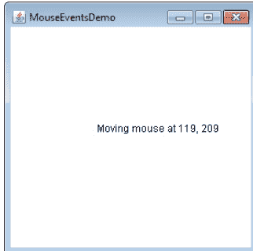

让我们仔细观察这个例子。首先，注意 `MouseEventsDemo` 继承了 `Frame`。因此，它构成了应用程序的顶层窗口。接下来，它实现了 `MouseListener` 和 `MouseMotionListener` 接口。这两个接口包含了用于接收和处理各种类型鼠标事件的方法。注意，`MouseEventsDemo` 既是事件的源也是监听器。这之所以能够实现，是因为 `Frame` 提供了 `addMouseListener()` 和 `addMouseMotionListener()` 方法。对于简单的 GUI 程序来说，事件的源和监听器是同一个对象是不常见的。

在 `MouseEventsDemo` 构造函数内部，程序将自己注册为鼠标事件的监听器。这是通过调用 `addMouseListener()` 和 `addMouseMotionListener()` 实现的。它们所示：

```java
void addMouseListener(MouseListener ml)
void addMouseMotionListener(MouseMotionListener ml)
```

在这里，`ml` 是接收鼠标事件对象的引用。在程序中，两者都使用了同一个对象。`MouseEventsDemo` 实现了 `MouseListener` 和 `MouseMotionListener` 接口定义的所有方法。这些是鼠标事件的事件处理器。每个方法都处理其相应的事件并返回。

注意 `MouseEventsDemo` 构造函数还添加了一个 `WindowListener`。这是为了让程序在用户点击关闭框时能够响应窗口关闭。该监听器使用适配器类来实现 `WindowListener`。适配器类提供了监听器接口的空实现，让你只需要重写感兴趣的方法。这些在本章中会有详细描述，但这里使用它是为了简化关闭程序所需的代码。在这种情况下，重写了 `windowClosing()` 方法。该方法在窗口关闭时由 AWT 调用。在这里，它调用了 `System.exit()` 来结束程序。

现在注意鼠标事件处理器。每当发生鼠标事件时，`msg` 都是描述发生情况的字符串，然后调用 `repaint()`。在这种情况下，`repaint()` 最终导致 AWT 调用 `paint()` 来显示输出。（这一过程在第 26 章中有更详细的解释）。注意 `paint()` 有一个类型为 `Graphics` 的参数。该类描述了程序的图形上下文。它是程序输出所在的环境。程序使用 `Graphics` 的 `drawString()` 方法在指定的 X, Y 窗口中显示字符串。程序中使用的位置所示：

```java
void drawString(String message, int x, int y)
```

在这里，`message` 是从 x, y 开始的字符串。在 Java 窗口中，左上角是 0,0。随着移动，`mouseX` 和 `mouseY` 跟踪鼠标的位置。这些值被传递给 `drawString()`，作为输出显示的位置。

最后，程序通过创建 `MouseEventsDemo` 实例并设置窗口大小、其标题并使窗口可见来启动。这些特性在第 26 章中有更详细的描述。

## 处理键盘事件

要处理键盘事件，你将使用与上一节中鼠标事件示例相同的通用架构。当然，区别在于你将实现 `KeyListener` 接口。

在查看它之前，回顾键事件是如何生成的很有帮助。当按键被按下时，会产生一个 `KEY_PRESSED` 事件。这会导致调用 `keyPressed()` 事件处理器。当按键被释放时，会产生一个 `KEY_RELEASED` 事件并执行 `keyReleased()` 处理器。如果按键产生了字符，则会发送 `KEY_TYPED` 事件并……

## 适配器类

Java 提供了一项特殊特性，即适配器类，它在某些情况下可以简化事件处理器的创建。适配器类提供了事件监听器接口中所有方法的空实现。当你只想接收和处理由特定事件监听器接口处理的部分事件时，适配器类非常有用。你可以通过扩展其中一个适配器类并仅实现你感兴趣的那些事件，来定义一个新类来充当事件监听器。

例如，`MouseMotionAdapter` 类有两个方法：`mouseDragged()` 和 `mouseMoved()`，它们是 `MouseMotionListener` 接口定义的方法。如果你只对鼠标拖动事件感兴趣，可以简单扩展 `MouseMotionAdapter` 并重写 `mouseDragged()`。`mouseMoved()` 的空实现将为你处理鼠标移动事件。

表 25-4 列出了 `java.awt.event` 中常用的适配器类，并注明了每个类所实现的接口。

你已经在前面的示例中见过一个适配器类：`WindowAdapter`。回想一下，`WindowListener` 接口定义了几个方法，但程序只需要其中一个 `windowClosing()`。适配器的使用避免了为未使用的方法提供空实现，从而避免了类中的代码杂乱。正如你预期的那样，其他适配器类也可以采用类似的方式。

下面的程序提供了适配器的另一个示例。如表 25-4 所示，`MouseAdapter` 实现了所有的鼠标监听器接口。因此，可以使用它来处理所有类型的鼠标事件。当然，你只需要重写程序用到的那些方法。在下面的示例中，`MyMouseAdapter` 扩展了 `MouseAdapter` 并重写了 `mouseClicked()` 和 `mouseDragged()` 方法。所有其他鼠标事件都被忽略。注意 `MyMouseAdapter` 构造函数传递了 `AdapterDemo` 实例的引用。该引用被保存，然后用于将字符串赋值给 `msg` 并在接收事件通知的对象上调用 `repaint()`。与之前一样，使用 `WindowAdapter` 来处理窗口关闭事件。

### 表 25-4 适配器类实现的常用接口

| 适配器类 | 监听器接口 |
| :--- | :--- |
| ComponentAdapter | ComponentListener |
| ContainerAdapter | ContainerListener |
| FocusAdapter | FocusListener |
| KeyAdapter | KeyListener |
| MouseAdapter | MouseListener, MouseMotionListener, and MouseWheelListener |
| MouseMotionAdapter | MouseMotionListener |
| WindowAdapter | WindowListener, WindowFocusListener, and WindowStateListener |

```java
// 演示适配器类。
import java.awt.*;
import java.awt.event.*;

public class AdapterDemo extends Frame {
    String msg = "";

    public AdapterDemo() {
        addMouseListener(new MyMouseAdapter(this));
        addMouseMotionListener(new MyMouseAdapter(this));
        addWindowListener(new MyWindowAdapter());
    }

    // 显示鼠标信息。
    public void paint(Graphics g) {
        g.drawString(msg, 20, 80);
    }

    public static void main(String[] args) {
        AdapterDemo appwin = new AdapterDemo();
        appwin.setSize(new Dimension(200, 150));
        appwin.setTitle("AdapterDemo");
        appwin.setVisible(true);
    }

    // 只处理鼠标点击和拖动事件。
    class MyMouseAdapter extends MouseAdapter {
        AdapterDemo adapterDemo;

        public MyMouseAdapter(AdapterDemo adapterDemo) {
            this.adapterDemo = adapterDemo;
        }

        @Override
        public void mouseClicked(MouseEvent e) {
            adapterDemo.msg = "Clicked";
            adapterDemo.repaint();
        }

        @Override
        public void mouseDragged(MouseEvent e) {
            adapterDemo.msg = "Dragged";
            adapterDemo.repaint();
        }
    }

    // 处理窗口关闭事件。
    class MyWindowAdapter extends WindowAdapter {
        @Override
        public void windowClosing(WindowEvent e) {
            System.exit(0);
        }
    }
}
```

*(注：由于原文提供的代码块在某些处存在逻辑错误（如 MyMouseAdapter 构造函数定义不完整），此处在排版时保持了其逻辑结构并对明显的语法错误进行了微调以符合阅读习惯)*


通过观察程序可以看出，不需要实现 `MouseListener`、`MouseMotionListener` 和 `MouseWheelListener` 定义的所有方法节省了大量工作，并防止了代码被空方法充斥。作为一个练习，你可能尝试重写早期的键盘输入示例，使其使用内部类。

## 内部类

在第 7 章中解释了内部类的基础。在这里你将看到它们为什么重要。回想，内部类是定义在另一个类内部、甚至定义在表达式中的类。本节说明了在使用适配器类时如何使用内部类来简化代码。

为了理解内部类带来的好处，请考虑下面的程序。它没有使用内部类。它的目标是在按下鼠标时显示“Mouse Pressed”。与之前的示例类似，使用 `WindowAdapter` 来处理窗口关闭事件。因此，它不再需要传递 `InnerDemo` 的引用来给 `msg` 赋值。注意 `WindowAdapter` 已变成了一个内部类。

```java
// 内部类演示。
import java.awt.*;
import java.awt.event.*;

public class InnerDemo extends Frame {
    String msg = "";

    public InnerDemo() {
        addMouseListener(new MyMouseAdapter());
        addWindowListener(new MyWindowAdapter());
    }

    // 处理鼠标按下的内部类。
    class MyMouseAdapter extends MouseAdapter {
        @Override
        public void mousePressed(MouseEvent e) {
            msg = "Mouse Pressed";
            repaint();
        }
    }

    // 处理窗口关闭事件的内部类。
    class MyWindowAdapter extends WindowAdapter {
        @Override
        public void windowClosing(WindowEvent e) {
            System.exit(0);
        }
    }

    public void paint(Graphics g) {
        g.drawString(msg, 20, 80);
    }

    public static void main(String[] args) {
        InnerDemo appwin = new InnerDemo();
        appwin.setSize(new Dimension(200, 150));
        appwin.setTitle("InnerDemo");
        appwin.setVisible(true);
    }
}
```


## 匿名内部类

匿名内部类是指没有名称的类。本节说明了匿名内部类如何有助于事件处理器的编写。

```java
// 匿名内部类，用于处理鼠标按下事件。
addMouseListener(new MouseAdapter() {
    public void mousePressed(MouseEvent e) {
        msg = "Mouse Pressed.";
        repaint();
    }
});
```

```java
// 匿名内部类，用于处理窗口关闭事件。
addWindowListener(new WindowAdapter() {
    public void windowClosing(WindowEvent e) {
        System.exit(0);
    }
});
```

```java
public void paint(Graphics g) {
    g.drawString(msg, 20, 80);
}
```

```java
public static void main(String[] args) {
    AnonymousInnerClassDemo appwin = new AnonymousInnerClassDemo();
    appwin.setSize(new Dimension(200, 150));
    appwin.setTitle("AnonymousInnerClassDemo");
    appwin.setVisible(true);
}
```


程序中有一个顶类：`AnonymousInnerClassDemo`。它的构造函数调用了 `mouseListener()` 方法。这是一个定义并实例化匿名内部类的表达式。让我们仔细分析这个表达式。`new MouseAdapter(){}` 语法告诉编译器，大括号内的代码是一个继承自 `MouseAdapter` 的匿名内部类。

这个新类没有名称，当执行到此处时它会被实例化。这种语法可以泛化，并且在创建其他匿名类时也是相同的，例如当程序创建一个 `WindowAdapter` 时。

由于这个匿名内部类定义在 `AnonymousInnerClassDemo` 的作用域内，因此它可以访问该类作用域内的所有变量和方法。因此，它可以直接调用 `repaint()` 方法并访问 `msg`。

正如刚才所示，具名内部类和匿名内部类都以一种简单而有效的方式解决了某些问题。它们还允许你创建更高效的代码。

# 第26 章 引入 AWT：与窗口、图形和文本交互

抽象窗口工具包（Abstract Window Toolkit, AWT）是 Java 的第一个 GUI 框架，从 1.0 版本一直是 Java 的一部分。它包含了许多类和方法，允许你创建窗口和简单控件。AWT 在第 25 章中介绍，当时被用于几个演示事件处理的短示例中。本章开始进行更详细的检查。在这里，你将学习如何管理窗口、处理字体、输出文本以及利用图形。第 27 章描述了各种 AWT 控件、布局管理器和菜单。它进一步解释了 Java 事件处理机制的其他方面。第 28 章介绍了 AWT 的成像子系统。

在开始之前，有一点很重要：你很少仅依靠 AWT 创建 GUI，因为 Java 已经开发了更强大的 Java 框架（如本书后部分描述的 Swing）。尽管如此，AWT 仍然是 Java 的重要部分。为了理解为什么，请考虑以下因素：

在撰写期间，最广泛使用的框架是 Swing。Swing 提供了比 AWT 更丰富、更灵活的 GUI 框架，很容易得出结论认为 AWT 不再具有意义——它已经完全被 Swing 取代。然而，这个假设是错误的。相反，理解 AWT 仍然非常重要，因为 AWT 是 Swing 的基础，许多 AWT 类被 Swing 直接或间接地使用。因此，为了有效使用 Swing，仍然需要具备 AWT 的坚实知识。此外，对于某些对 GUI 使用极少的小型程序，使用 AWT 可能仍然合适。因此，尽管 AWT 构成了 Java 最古老的 GUI 框架，但在今天，掌握其基础性知识仍然重要。

在开始之前的最后一点：AWT 非常庞大，完整的描述将轻松填满整本书。因此，不可能详细描述每一个 AWT 类、方法或实例变量。然而，本章及后续章节将解释使用 AWT 所需的基本技术。从那里开始，你能够自己探索 AWT 的其他部分。你也准备好转向 Swing 了。

# AWT 类

AWT 类包含在 `java.awt` 包中。它是 Java 最大的包之一。坦率地说，它在逻辑上按自上而下的分层方式组织，比你起初认为的要容易理解和使用。从 JDK 9 开始，`java.awt` 是 `java.desktop` 模块的一部分。表 26-1 列出了一些 AWT 类。

尽管 AWT 的基本结构自 Java 1.0 以来一直如此，但某些原始方法已被弃用并被新方法取代。为了向后兼容，Java 仍然支持所有原始 1.0 方法。然而，由于这些方法不再用于新代码，本书不再描述它们。

| 类 | 描述 |
|---|---|
| AWTEvent | 封装 AWT 事件。 |
| AWTEventMulticaster | 将事件分发给多个监听器。 |
| BorderLayout | 边界布局管理器。布局使用五个组件：北、南、东、西、中。 |
| Button | 创建一个推按钮。 |
| Canvas | 一个空白的无语义的窗口。 |
| CardLayout | 卡片布局管理器。卡片布局模拟索引卡片。只有最顶部的在显示。 |
| Checkbox | 创建一个复选框。 |
| CheckboxGroup | 创建一组复选控件。 |
| CheckboxMenuItem | 创建一个开启/关闭菜单项。 |
| Choice | 创建一个弹出列表。 |
| Color | 以可移植、平台无关的方式管理颜色。 |
| Component | 所有 AWT 组件的抽象超类。 |
| Container | 可以包含其他组件的 Component 子类。 |
| Cursor | 封装位光标。 |
| Dialog | 创建一个对话框。 |
| Dimension | 指定对象的尺寸。宽度存储在 width，高度存储在 height。 |
| EventQueue | 事件队列。 |
| FileDialog | 创建一个可以选择文件的窗口。 |

表 26-1 AWT 类抽样（续）

| 类 | 描述 |
| --- | --- |
| FlowLayout | 流布局管理器。流布局从左到右、从上到下布局组件。 |
| Font | 封装字体。 |
| FontMetrics | 封装与字体相关的各种信息。帮助你在窗口中显示文本。 |
| Frame | 创建带有标题栏、缩放角和菜单栏的标准窗口。 |
| Graphics | 封装图形上下文。该上下文用于各种输出方法在窗口中显示输出。 |
| GraphicsDevice | 描述图形设备，如屏幕或打印机。 |
| GraphicsEnvironment | 描述 Font 和 Graphics 集合。 |
| GridBagConstraints | 定义与 GridBagLayout 相关的约束。 |
| GridBagLayout | 网格布局管理器。根据 GridBagConstraints 指定约束显示组件。 |
| GridLayout | 网格布局管理器。在二维网格中显示组件。 |
| Image | 封装图像。 |
| Insets | 封装容器的边界。 |
| Label | 创建一个显示字符串的标签。 |
| List | 创建一个用户可以选择的列表。类似于 Windows 列表框。 |
| MediaTracker | 管理媒体对象。 |
| Menu | 创建一个下拉菜单。 |
| MenuBar | 创建一个菜单栏。 |
| MenuComponent | 由各种菜单类的抽象类。 |
| MenuItem | 创建一个菜单项。 |
| MenuShortcut | 封装菜单项的键盘快捷键。 |
| Panel | Container 最简单的具体子类。 |
| Point | 封装笛卡尔坐标对，存储在 x 和 y 中。 |
| Polygon | 封装多边形。 |
| PopupMenu | 封装弹出菜单。 |
| PrintJob | 表示打印作业的抽象类。 |
| Rectangle | 封装矩形。 |
| Robot | 支持基于 AWT 应用程序的自动化测试。 |
| Scrollbar | 创建滚动控件。 |
| ScrollPane | 为其他组件提供水平和/垂直滚动条的容器。 |

| 类 | 描述 |
|---|---|
| SystemColor | 包含 GUI 控件（如窗口、滚动条、文本等）的颜色。 |
| TextArea | 创建一个多行编辑控件。 |
| TextComponent | TextArea 和 TextField 的超类。 |
| TextField | 创建一个单行编辑控件。 |
| Toolkit | AWT 实现的抽象类。 |
| Window | 创建一个没有边框、没有菜单栏也没有标题的窗口。 |

表 26-1 AWT 类的抽样

## 窗口基础

AWT 根据类层次结构定义窗口，每个层级都增加了功能和特殊性。与窗口相关的两个最重要的类是 `Frame` 和 `Panel`。`Frame` 封装了一个顶层窗口，它通常用于创建被认为的标准应用程序窗口。`Panel` 提供了一个容器，可以在其中添加其他组件。`Panel` 也是 `Applet` 的父类（`Applet` 自 JDK 9 以来已被弃用）。`Frame` 和 `Panel` 的大部分功能都源自它们的父类。因此，了解与这两个类相关的类层次结构描述，对于理解它们是至关重要的。图 26-1 显示了 `Panel` 和 `Frame` 的类层次结构。现在让我们来看看这些类。

## Component

AWT 层次结构的顶端是 `Component` 类。`Component` 是一个抽象类，封装了视觉组件的所有属性。除了菜单之外，所有显示在屏幕上与用户交互的用户界面元素都是 `Component` 的子类。

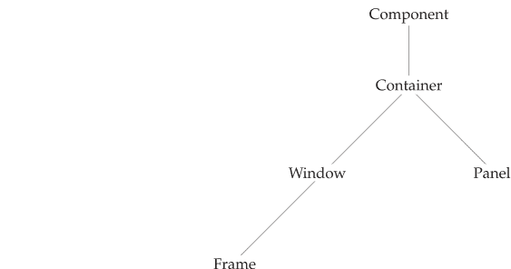

图 26-1 Panel 和 Frame 的类层次结构

`Component` 类负责管理事件，例如鼠标和键盘输入、窗口的位置和大小以及重绘。`Component` 对象负责记住当前的前景颜色、背景颜色以及当前选定的文本字体。

## Container

`Container` 是 `Component` 的子类。它拥有额外的方法，允许其他 `Component` 对象嵌套在其中。其他 `Container` 对象可以存储在 `Container` 中（因为它们本身就是 `Component` 的实例）。这形成了一个多级包含系统。`Container` 负责对其包含的任何对象进行布局（即定位）。它是通过使用各种布局管理器来实现的，你将在第 27 章中学习这些内容。

## Panel

`Panel` 类是 `Container` 的子类。`Panel` 可以被认为是一个递归嵌套的具体屏幕组件。可以通过其对象向 `Panel` 中添加其他组件。

## Window

`Window` 类创建一个顶层窗口。顶层窗口不包含在任何其他对象中；它直接位于桌面上。通常情况下，你不会直接创建 `Window` 对象。相反，你将使用一个名为 `Frame` 的 `Window` 子类（下文将描述）。

## Frame

`Frame` 封装了通常所谓的“窗口”。它是 `Window` 的子类，具有标题栏、菜单栏和可缩放角。`Frame` 的具体外观在不同环境中会有所不同。

## Canvas

虽然它不是 `Panel` 或 `Frame` 层次结构的一部分，但你会发现有一个非常有用的类：`Canvas`。`Canvas` 派自 `Component`，封装了一个可以在其上绘图的空白窗口。你将在本书后面的部分看到 `Canvas` 的示例。

## 使用 Frame 窗口

通常，你最常创建的基于 AWT 的应用程序派自 `Frame`。正如提到的，它创建了一个标准式的顶层窗口，具有所有与应用程序窗口通常相关的功能，如关闭框和标题。

### Frame 构造函数

这里是 `Frame` 的两个 `HeadlessException` 构造函数：

```java
Frame() throws HeadlessException

Frame(String title) throws HeadlessException
```

第一种形式创建一个不包含标题的标准窗口。第二种形式创建一个由 `title` 指定标题的窗口。注意，你不能指定窗口的尺寸。相反，你必须在窗口创建后设置窗口的大小。如果在不支持用户界面的环境中尝试创建 `Frame` 实例，将抛出 `HeadlessException`。

## 设置窗口尺寸

在操作 `Frame` 时，你会使用几个关键方法。要设置窗口的尺寸，你可以使用：

```java
void setSize(int width, int height)

void setBounds(int x, int y, int width, int height)
```

要获取窗口的当前大小，使用：

```java
Dimension getSize()
```

## 隐藏和显示窗口

窗口创建后，在调用 `setVisible()` 之前它是不可可见的。其签名为：

```java
void setVisible(boolean visible)
```

## 设置窗口标题

你可以使用 `setTitle()` 更改窗口标题，其形式为：

```java
void setTitle(String title)
```

## 关闭窗口

为了拦截关闭事件，你必须实现 `WindowListener` 接口。（详情参见第 25 章关于 `WindowListener` 的内容）。要终止程序只需调用 `System.exit()`。

## paint() 方法

每当应用程序需要重绘时，就会调用 `paint` 方法。这可能由于多种原因发生。例如，窗口可能被另一个窗口覆盖后暴露，或者被最小化后恢复。这意味着你的程序必须有某种方式保留其输出，以便在每次执行 `paint` 时重新显示。

```java
void paint(Graphics g)
```

`paint()` 方法有一个 `Graphics` 类型的参数。该参数将包含图形上下文，描述程序运行的图形环境。每当需要输出到窗口时调用。

## 显示字符串

要在 `Frame` 中输出字符串，使用 `drawString()`，它是 `Graphics` 类的成员。它在第 25 章引入，我们将在下一章中大量使用它。我们使用的形式为：

```java
void drawString(String message, int x, int y)
```

在这里，`message` 是从 `x,y` 开始的字符串。在 Java 窗口中，左上角是位置 0,0。`drawString()` 方法不会识别换行符。如果你想在另一行开始文本，你必须手动这样做，指定你希望该行开始的精确位置。

## 设置前景和背景颜色

可以通过 `Frame` 设置前景和背景颜色。要设置背景颜色，使用 `setBackground()`。要设置前景颜色（文本显示的颜色，示例），使用 `setForeground()`。这些方法由 `Component` 定义，它们具有以下通用形式：

```java
void setBackground(Color newColor)

void setForeground(Color newColor)
```

在这里，`newColor` 指定新颜色。`Color` 类定义了此处所示常量，用于指定颜色。（还提供了这些常量的大写版本。）

| Color.black | Color.magenta |
| Color.blue | Color.orange |
| Color.cyan | Color.pink |
| Color.darkGray | Color.red |
| Color.gray | Color.white |
| Color.green | Color.yellow |
| Color.lightGray | |

例如，以下代码将背景颜色设置为绿色，前景颜色设置为红色：

```java
setBackground(Color.green);
setForeground(Color.red);
```

你也可以创建自定义颜色。初始设置前景和背景色的良好位置是在框架的构造函数中。当然，你可以在程序执行期间根据需要更改这些颜色。

你可以通过分别调用 `getBackground()` 和 `getForeground()` 来获取背景和前景色的当前设置。它们也由 `Component` 定义并在此处出：

- `Color getBackground()`
- `Color getForeground()`

## 请求重绘

通常情况下，应用程序只有在 AWT 调用其 `paint()` 方法时才会向窗口写入内容。这引出了一个有趣的问题：程序本身如何导致窗口更新以显示新的输出？例如，如果一个程序显示一个移动的横幅，它使用什么机制在每次横幅滚动时更新窗口？记住，施加在 GUI 上的架构限制之一是它必须快速返回运行时。例如，它不能在 `paint()` 内部创建一个反复滚动横幅的循环。有了这个限制，输出到你的窗口似乎充其量来说是困难的。幸运的是，每当你的程序需要更新窗口中显示的信息时，它只需调用 `repaint()` 即可。

`repaint()` 方法由 `Component` 定义。对于 `Frame`，此方法会导致 AWT 运行时系统执行 `update()` 方法（同样由 `Component` 定义）。然而，`update()` 的默认实现调用了 `paint()`。因此，要向窗口输出，只需存储输出内容并调用 `repaint()`。AWT 将执行对 `paint()` 的调用，这可以显示存储的信息。例如，如果程序的某部分需要输出字符串，它可以将该字符串存储在 `String` 变量中然后调用 `repaint()`。在 `paint()` 内部，你将使用 `drawString()` 输出该字符串。

`repaint()` 方法有四种形式。让我们逐一查看。`repaint()` 最简单的版本如下所示：

```java
void repaint()
```

此版本会导致整个窗口被重绘。以下版本指定了将绘制的区域：

```java
void repaint(int left, int top, int width, int height)
```

在这里，区域的左上角坐标由 `left` 和 `top` 指定，区域的宽度和高度以像素为单位。通过指定要重绘的区域，你可以节省时间。窗口更新在时间上是开销很大的。如果你只需要更新窗口的一小部分，只重绘该区域会更高效。

调用 `repaint()` 本质上是请求窗口在某个时候重绘。如果你的系统运行缓慢或 `update()` 可能不会被立即调用，那么短时间内发生的多次重绘请求可以被 AWT 合并，使得 `update()` 只被零散地调用。这在许多情况下可能会导致问题，包括需要一致更新时间的动画。解决此问题的方法之一是使用以下形式的 `repaint()`：

```java
void repaint(long maxDelay, int x, int y, int width, int height)
```


`maxDelay` 指定了在调用 `update` 之前可以经过的最大毫秒数。

> 注意：可以使用 `paint()` 或 `update()` 的其他方法向窗口输出。要这样做，你必须通过调用 `getGraphics()`（由 `Component` 定义）获取图形上下文，然后使用该上下文向窗口输出。然而，对于大多数应用程序来说，通过 `paint()` 路由窗口输出并在窗口内容变化时调用 `repaint()` 是更好且更容易的。

# 创建基于框架的应用程序

虽然通过创建 `Frame` 实例创建一个窗口很简单，但你很少这样做，因为你无法对它做很多事情。例如，你无法接收或处理发生在其内部的事件，无法向其提供信息。因此，为了创建一个基于框架的应用程序，你通常会创建一个 `Frame` 的子类。

正如第 25 章中的事件处理示例所示，创建一个新的基于框架的应用程序实际上非常简单。通常情况下，你创建一个 `Frame` 的子类，重写 `paint()` 以向窗口提供输出，并实现事件监听器。在所有情况下，你都需要实现 `WindowListener` 接口的 `windowClosing()` 方法。在顶层框架中，你通常会调用 `System.exit(0)` 来终止程序。如果只是从屏幕上移除二级框架，你可以在窗口关闭时调用 `setVisible(false)`。


# 介绍图形

一旦你定义了一个 `Frame` 子类，你就可以创建该类的实例。这会导致窗口产生，但它最初是不可见的。你通过调用 `setVisible(true)` 使其可见。创建时，窗口会被赋予默认的高度和宽度。你可以通过调用 `setSize()` 方法显式设置窗口的大小。对于顶层框架，你将想要设置标题。

AWT 包含了设置位置和大小的方法。窗口的左上角由 `x` 和 `y` 指定。窗口的宽度和高度以像素为单位。你可以通过调用 `setForeground()` 和 `setBackground()` 设置窗口的前景和背景颜色。

# 862 第二部分 Java 库

多边形的端点由包含在 x 数组和 y 数组中的坐标对定义。这些数组定义的点数由 `numPoints` 指定。这些方法还有其他形式，即通过 `Polygon` 对象指定多边形。

## 演示绘图方法

以下程序演示了上述的绘图方法。

```java
// Draw graphics elements.

import java.awt.event.*;
import java.awt.*;

public class GraphicsDemo extends Frame {

    public GraphicsDemo() {
        // 匿名内部类用于处理窗口事件
        addWindowListener(new WindowAdapter() {
            public void windowClosing(WindowEvent we) {
                System.exit(0);
            }
        });
    }

    public void paint(Graphics g) {
        // 绘制线条。
        g.drawLine(20, 40, 100, 90);
        g.drawLine(20, 90, 100, 40);
        g.drawLine(40, 45, 250, 80);

        // 绘制矩形。
        g.drawRect(20, 150, 60, 50);
        g.fillRect(110, 150, 60, 50);
        g.drawRoundRect(200, 150, 60, 50, 15);
        g.fillRect(290, 150, 60, 50, 40);

        // 绘制椭圆和圆形。
        g.drawOval(20, 250, 50, 50);
        g.fillOval(100, 250, 75, 50);
        g.drawOval(200, 260, 100, 40);

        // 绘制弧。
        g.drawArc(20, 350, 70, 70, 0, 180);
        g.fillArc(70, 350, 70, 70, 0, 75);

        // 绘制多边形。
        int[] xpoints = {20, 200, 200, 200};
        int[] ypoints = {450, 450, 650, 650};
        int num = 5;
        g.drawPolygon(xpoints, ypoints);
    }

    public static void main(String[] args) {
        GraphicsDemo appwin = new GraphicsDemo();
        appwin.setSize(new Dimension(370, 700));
        appwin.setTitle("GraphicsDemo");
        appwin.setVisible(true);
    }
}
```

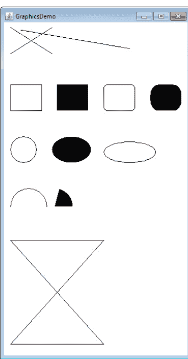

**图 26-1** GraphicsDemo 程序的示例输出

示例输出如图 26-1 所示。

## 调整图形尺寸

通常，你可能希望调整图形对象的大小，以适应其绘制所在的帧的当前大小。要这样做，首先通过调用 `getSize()` 获取帧的当前维度。它作为整数值返回维度，存储在 `Dimension` 实例的 `width` 和 `height` 字段中。然而，`getSize()` 的维度反映了帧的整体，包括边框和标题栏。要获取绘制区域的尺寸，你需要从 `getSize()` 获取的尺寸减去边框/标题栏的尺寸。描述边框/标题区域尺寸的数值称为内边距（insets）。内边距值通过调用 `getInsets()` 获取，在此所示：

```java
Insets getInsets()
```

它返回一个 `Insets` 对象，将内边距维度封装为四个 `int` 值，分别为 `left`、`right`、`top` 和 `bottom`。因此，绘制区域左上角的坐标是 `left`, `top`。右下角的坐标是 `width-right`, `height-bottom`。一旦你拥有了尺寸和内边距，就可以相应地缩放你的图形输出。

为了演示这种技术，有一个程序，其帧初始尺寸为 200×200 像素。每次点击鼠标，宽度和高度都会增加 25，直到其尺寸大于 500×500。此时，下一次点击将其恢复 200×200，过程重新开始。在绘制区域内，会画出一个 X 并填充该区域。

```java
// Resizing to fit the current size of a window.

import java.awt.*;
import java.awt.event.*;

public class ResizeMe extends Frame {

    final int inc = 25;
    int max = 500;
    int min = 200;
    Dimension d;

    public ResizeMe() {
        d = getSize();

        // 匿名内部类用于处理鼠标释放事件。
        addMouseListener(new MouseAdapter() {
            public void mouseReleased(MouseEvent event) {
                d = getSize();
                int w = (d.width + inc) > max ? min : (d.width + inc);
                int h = (d.height + inc) > max ? min : (d.height + inc);
                setSize(new Dimension(w, h));
            }
        });

        // 匿名内部类用于处理窗口事件。
        addWindowListener(new WindowAdapter() {
            public void windowClosing(WindowEvent we) {
                System.exit(0);
            }
        });
    }

    public void paint(Graphics g) {
        Insets i = getInsets();
        g.fillRect(i.left, i.top, d.width - i.left - i.right, d.height - i.top - i.bottom);
        g.drawString("X", i.left + 50, i.top + 50);
    }

    public static void main(String[] args) {
        ResizeMe appwin = new ResizeMe();
        appwin.setSize(new Dimension(200, 200));
        appwin.setTitle("ResizeMe");
        appwin.setVisible(true);
    }
}
```

## 使用颜色

Java 以一种可移植、设备无关的方式支持颜色。AWT 色系统允许你指定任何所需的颜色。你的代码不需要担心各种设备支持颜色方式的差异。`Color` 定义了几个常量（例如 `Color.black`）。你也可以使用 `Color` 构造函数创建你自己的颜色。这里有许多常用的形式：

- `Color(int red, int green, int blue)`
- `Color(int rgbValue)`
- `Color(float red, float green, float blue)`

第一个构造函数接受三个整数，将颜色指定为红、绿、蓝的混合。这些值必须在 0 到 255 之间，如示例所示：

```java
new Color(255, 100, 100); // light red
```

第二个构造函数接受一个整数，该整数包含了打包其中的红、绿、蓝混合。该整数通过位 16 到 23 创建红色，绿色位 8 到 15，以及蓝色位 0 到 7 创建。以下是该构造函数的示例：

```java
int newRed = 0xff0000 | (255 << 16) | (100 << 8) | 100;
Color darkRed = new Color(newRed);
```

第三个构造函数 `Color(float, float, float)` 接受三个 float 值（在 0.0 和 1.0 之间）。

# 第 26 章 介绍 AWT：处理窗口、图形和文本 867

```java
public class ColorDemo extends Frame {

    public ColorDemo() {
        addWindowListener(new WindowAdapter() {
            public void windowClosing(WindowEvent event) {
                System.exit(0);
            }
        });
    }

    // 用不同的颜色绘制。
    public void paint(Graphics g) {
        Color c1 = new Color(255, 100, 100);
        Color c2 = new Color(100, 255, 100);
        Color c3 = new Color(100, 100, 255);

        g.setColor(c1);
        g.drawLine(20, 40, 100, 100);
        g.drawLine(20, 100, 100, 20);

        g.setColor(c2);
        g.drawLine(40, 45, 250, 180);
        g.drawLine(75, 90, 400, 400);

        g.setColor(c3);
        g.drawLine(20, 150, 40, 40);
        g.drawLine(25, 290, 80, 19);

        g.setColor(Color.red);
        g.drawOval(20, 40, 50, 50);
        g.fillOval(70, 90, 140, 100);

        g.setColor(Color.cyan);
        g.fillRect(100, 40, 60, 70);
        g.drawRoundRect(190, 40, 60, 60, 15);
    }

    public static void main(String[] args) {
        ColorDemo appwin = new ColorDemo();
        appwin.setSize(new Dimension(340, 260));
        appwin.setTitle("ColorDemo");
        appwin.setVisible(true);
    }
}
```


# 设置绘制模式

绘制模式决定了对象如何在窗口中被绘制。默认情况下，输出到窗口的新内容会覆盖现有的内容。但可以使用 `setXORMode()` 让新对象以异或（XOR）方式绘制到窗口上，如下：

```java
void setXORMode(Color xor)
```

在这里，`xorColor` 指定了绘制对象时与窗口进行异或运算的颜色。异或模式的优势是，无论对象绘制在什么颜色的上方，新对象保证是可见的。

要恢复覆盖模式（override mode），调用此处所示 `setPaintMode()`：

```java
void setPaintMode()
```

通常情况下，你希望使用覆盖模式进行普通输出，并将异或模式用于特殊目的。例如，程序显示了跟踪鼠标指针的交叉准星。交叉准星以异或方式绘制在窗口上，无论底层颜色如何，它们始终可见。

```java
// 演示异或模式。

import java.awt.*;
import java.awt.event.*;

public class XOR extends Frame {

    int chX = 100, chY = 100;

    public XOR() {
        addMouseMotionListener(new MouseAdapter() {
            public void mouseMoved(MouseEvent me) {
                int x = me.getX();
                int y = me.getY();
                chX = x - 10;
                chY = y - 10;
                repaint();
            }
        });

        addWindowListener(new WindowAdapter() {
            public void windowClosing(WindowEvent we) {
                System.exit(0);
            }
        });
    }

    public void paint(Graphics g) {
        g.setXORMode(Color.white);
        g.drawLine(chX, 0, chX, getSize().height);
        g.drawLine(0, chY, getSize().width, chY);
    }

    public static void main(String[] args) {
        XOR appwin = new XOR();
        appwin.setSize(new Dimension(300, 300));
        appwin.setTitle("XOR Demo");
        appwin.setVisible(true);
    }
}
```


# 第 26 章 介绍 AWT：处理窗口、图形和文本

## 设置绘制模式

绘制模式决定了对象如何在窗口中被绘制。默认情况下，输出到窗口的新内容会覆盖现有的内容。但可以使用 `setXORMode()` 让新对象以异或（XOR）方式绘制到窗口上，如下：

```java
void setXORMode(Color xor)
```

在这里，`xorColor` 指定了绘制对象时与窗口进行异或运算的颜色。异或模式的优势是，无论对象绘制在什么颜色的上方，新对象保证是可见的。

要恢复覆盖模式（override mode），调用 `setPaintMode()`：

```java
void setPaintMode()
```

通常情况下，你希望使用覆盖模式进行普通输出，并将异或模式用于特殊目的。例如，程序显示了跟踪鼠标指针的交叉准星。交叉准星以异或方式绘制在窗口上，无论底层颜色如何，它们始终可见。

```java
// 演示异或模式。

import java.awt.*;
import java.awt.event.*;

public class XOR extends Frame {

    int chX = 100, chY = 100;

    public XOR() {
        addMouseMotionListener(new MouseAdapter() {
            public void mouseMoved(MouseEvent me) {
                int x = me.getX();
                int y = me.getY();
                chX = x - 10;
                chY = y - 10;
                repaint();
            }
        });

        addWindowListener(new WindowAdapter() {
            public void windowClosing(WindowEvent we) {
                System.exit(0);
            }
        });
    }

    public void paint(Graphics g) {
        g.setColor(Color.green);
        g.fillRect(20, 40, 60, 70);

        g.setColor(Color.blue);
        g.fillRect(110, 40, 60, 70);

        g.setColor(Color.black);
        g.fillRect(200, 40, 60, 70);

        g.setColor(Color.red);
        g.fillRect(60, 120, 160, 110);

        // 异或准星
        g.setXORMode(Color.black);
        g.drawLine(chX - 10, chY, chX + 10, chY);
        g.drawLine(chX, chY - 10, chX, chY + 10);
        g.setPaintMode();
    }

    public static void main(String[] args) {
        XOR appwin = new XOR();
        appwin.setSize(new Dimension(300, 260));
        appwin.setTitle("XOR Demo");
        appwin.setVisible(true);
    }
}
```

该程序的示例输出所示：

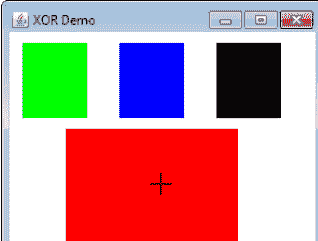

## 使用字体

AWT 支持多种字体族。多年前，字体脱离传统排版领域，成为计算机生成文档和显示的重要组成部分。AWT 通过抽象字体操作并允许动态选择字体，提供了灵活性。

字体具有族名称（family name）、逻辑字体名称（logical font name）和字面名称（face name）。族名称是字体的通用名称，例如 `Courier`。逻辑名称指定了一个名称，如 `Monospaced`，它在运行时关联。字面名称指定了特定的字体，例如 `Courier Italic`。

### 确定字体

| 变量 | 含义 |
|---|---|
| `name` | 字体名称 |
| `size` | 字体大小 |
| `style` | 样式 |
| `isBold` | 如果字体是粗体 |
| `isItalic` | 如果字体是倾斜体 |
| `isPlain` | 如果字体是普通体 |
| `toString` | 字体的字符串表示 |

### Font 定义的方法

| 方法 | 描述 |
|---|---|
| `static Font decode(String str)` | |
| `boolean equals(Object FontObj)` | 如果调用对象包含与 `FontObj` 指定相同的字体，则返回 true。否则，返回 false。 |
| `String getFamily()` | 返回调用字体所属的字体族名称。 |
| `static Font getFont(String property)` | 返回与属性关联的字体。 |
| `String getName()` | 返回字体的名称。 |
| `int getSize()` | 返回字体的大小。 |
| `int getStyle()` | 返回字体的样式。 |
| `boolean isBold()` | 如果字体是粗体，则返回 true。 |
| `boolean isItalic()` | 如果字体是倾斜体，则返回 true。 |
| `boolean isPlain()` | 如果字体是普通体，则返回 true。 |
| `String toString()` | 返回字体的字符串表示。 |

### 创建和选择字体

要创建一个字体，构造一个字体对象。一种构造器具有如下形式：

```java
Font(String fontName, int fontStyle, int pointSize)
```

在这里，`fontName` 指定字体的名称。名称可以通过族名称或字面名称指定。Java 环境支持以下字体：`Dialog`、`SansSerif`、`Serif` 和 `Monospaced`。`Dialog` 是系统对话框使用的字体。如果不显式设置字体，则使用该字体。你也可以使用其他字体，但要小心这些字体并非通用的。

字体的样式由 `fontStyle` 指定。它可以由这三个常量组成：`Font.PLAIN`、`Font.BOLD` 和 `Font.ITALIC`。要组合样式，可以将它们或在一起。例如，`Font.BOLD | Font.ITALIC` 指定了粗倾斜体样式。

字体的大小（点）由 `pointSize` 指定。

要使用新字体，必须通过 `setFont()` 选择，该方法由 `Component` 定义：

```java
void setFont(Font fontObj)
```

在这里，`fontObj` 是包含所需字体的对象。

以下程序输出了每个标准字体的示例。每次你点击窗口，就会选择一个新字体并显示其名称。

（此处代码块已在译文中翻译，此处不再重复，仅保持逻辑结构）


该程序的示例输出如下：


# 使用字体

AWT 支持多种字体族。多年来，字体脱离传统排版领域，成为计算机生成文档和显示的重要组成部分。AWT 通过抽象字体操作并允许动态选择字体，提供了灵活性。

字体具有族名称（family name）、逻辑字体名称（logical font name）和字面名称（face name）。族名称是字体的通用名称，例如 `Courier`。逻辑名称指定了一个名称，如 `Monospaced`，它在运行时关联。字面名称指定了特定的字体，例如 `Courier Italic`。

# 第 26 章 介绍 AWT：处理窗口、图形和文本

## Font 类方法

| 方法 | 描述 |
|---|---|
| `static Font decode(String str)` | |
| `boolean equals(Object FontObj)` | 如果调用对象包含与 `FontObj` 指定相同的字体，则返回 true。否则，返回 false。 |
| `String getFamily()` | 返回调用字体所属的字体族名称。 |
| `static Font getFont(String property)` | 返回与系统属性关联的字体。 |
| `String getName()` | 返回字体的名称。 |
| `int getSize()` | 返回字体的大小。 |
| `int getStyle()` | 返回字体的样式。 |
| `boolean isBold()` | 如果字体是粗体，则返回 true。 |
| `boolean isItalic()` | 如果字体是倾斜体，则返回 true。 |
| `boolean isPlain()` | 如果字体是普通体，则返回 true。 |
| `String toString()` | 返回字体的字符串表示。 |

## Font 类常用字段

| 变量 | 含义 |
|---|---|
| `name` | 字体名称 |
| `size` | 字体大小 |
| `style` | 样式 |
| `isBold` | 如果字体是粗体 |
| `isItalic` | 如果字体是倾斜体 |
| `isPlain` | 如果字体是普通体 |
| `toString` | 字体的字符串表示 |

### 创建和选择字体

要创建一个字体，构造一个 `Font` 对象。一种构造器具有如下形式：

```java
Font(String fontName, int fontStyle, int pointSize)
```

在这里，`fontName` 指定字体的名称。名称可以通过族名称或字面名称指定。Java 环境支持以下字体：`Dialog`、`SansSerif`、`Serif` 和 `Monospaced`。`Dialog` 是系统对话框使用的字体。如果不显式设置字体，则使用该字体。你也可以使用其他字体，但要小心这些字体并非通用的。

字体的样式由 `fontStyle` 指定。它可以由这三个常量组成：`Font.PLAIN`、`Font.BOLD` 和 `Font.ITALIC`。要组合样式，可以将它们或在一起。例如，`Font.BOLD | Font.ITALIC` 指定了粗倾斜体样式。

字体的大小（点）由 `pointSize` 指定。

要使用新字体，必须通过 `setFont()` 选择，该方法由 `Component` 定义：

```java
void setFont(Font fontObj)
```

在这里，`fontObj` 是包含所需字体的对象。

以下程序输出了每个标准字体的示例。每次你点击窗口，就会选择一个新字体并显示其名称。

```java
public SampleFonts() {
    f = new Font("Dialog", Font.PLAIN, 12);
    msg = "Dialog";
    setFont(f);
}
```

```java
addMouseListener(new MouseAdapter(this));
```

```java
addWindowListener(new WindowAdapter() {
    public void windowClosing(WindowEvent we) {
        System.exit(0);
    }
});
```

```java
public void paint(Graphics g) {
    g.drawString(msg, 10, 60);
}
```

```java
public static void main(String[] args) {
    SampleFonts appwin = new SampleFonts();
    appwin.setSize(new Dimension(200, 100));
    appwin.setTitle("SampleFonts");
    appwin.setVisible(true);
}
```

```java
class MouseAdapter extends MouseAdapter {
    SampleFonts sampleFonts;

    public MouseAdapter(SampleFonts sampleFonts) {
        this.sampleFonts = sampleFonts;
    }

    public void mousePressed(MouseEvent me) {
        // 每点击一次切换字体。
        sampleFonts.next++;
        switch (sampleFonts.next) {
            case 0:
                sampleFonts.f = new Font("Dialog", Font.PLAIN, 12);
                sampleFonts.msg = "Dialog";
                break;
            case 1:
                sampleFonts.f = new Font("DialogInput", Font.PLAIN, 12);
                sampleFonts.msg = "DialogInput";
                break;
            case 2:
                sampleFonts.f = new Font("SansSerif", Font.PLAIN, 12);
                sampleFonts.msg = "SansSerif";
                break;
            case 3:
                sampleFonts.f = new Font("Serif", Font.PLAIN, 12);
                sampleFonts.msg = "Serif";
                break;
            case 4:
                sampleFonts.f = new Font("Monospaced", Font.PLAIN, 12);
                sampleFonts.msg = "Monospaced";
                break;
        }
        if (sampleFonts.next == 4) sampleFonts.next = -1;
        sampleFonts.setFont(sampleFonts.f);
        sampleFonts.repaint();
    }
}
```

该程序的示例输出如下：

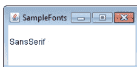

## 获取字体信息

假设你想获取有关当前选择字体的信息。要做到这一点，你必须首先调用 `getFont()` 获取当前字体。该方法由 `Graphics` 类定义，如下：

```java
Font getFont()
```

一旦获取了当前选择的字体，就可以使用 `Font` 类定义的各种方法来检索相关信息。例如，此程序显示了当前选择字体的名称、族、大小和样式：

```java
// 显示字体信息。
import java.awt.event.*;
import java.awt.*;

public class FontInfo extends Frame {
    public FontInfo() {
        addWindowListener(new WindowAdapter() {
            public void windowClosing(WindowEvent we) {
                System.exit(0);
            }
        });
    }

    public void paint(Graphics g) {
        Font f = g.getFont();
        String fontName = f.getName();
        String fontFamily = f.getFamily();
        int fontSize = f.getSize();
        int fontStyle = f.getStyle();

        String msg = "Family: " + fontFamily;
        msg += " Font: " + fontName;
        msg += " Size: " + fontSize + ", Style: ";

        if ((fontStyle & Font.BOLD) == Font.BOLD)
            msg += " Bold ";
        if ((fontStyle & Font.ITALIC) == Font.ITALIC)
            msg += " Italic ";
        if ((fontStyle & Font.PLAIN) == Font.PLAIN)
            msg += " Plain ";

        g.drawString(msg, 10, 60);
    }

    public static void main(String[] args) {
        FontInfo appwin = new FontInfo();
        appwin.setSize(new Dimension(300, 100));
        appwin.setTitle("FontInfo");
        appwin.setVisible(true);
    }
}
```

## 使用 FontMetrics 管理文本输出

如前所述，Java 支持多种字体。对于大多数字体，字符的尺寸并非完全相同——大多数字体是比例宽的。此外，每个字符的高度、降部高度（字母的悬挂部分，例如 y）的长度以及行之间的间距也会随字体而异。此外，字体的字号也可以改变。这些（以及其他）属性的可变性并不至于让 Java 要求你——作为程序员——手动管理所有的文本输出。

考虑到每个字体的大小可能不同，且字体在程序执行期间可能会更改，必须有某种方法来确定当前字体的尺寸和各种属性。例如，为了写一行文本，你必须知道字体有多高以及行之间需要多少像素。为了实现这一点，AWT 包含了 `FontMetrics` 类，它封装了关于字体的信息。让我们从定义描述字体的术语开始：

| 术语 | 说明 |
|---|---|
| Height (高度) | 一行从顶部到底部的尺寸 |
| Baseline (基线) | 字符对齐的行 |
| Ascent (升部) | 从基线到字符顶部的距离 |
| Descent (降部) | 从基线到字符底部的距离 |
| Leading (行距) | 行与行之间的距离 |

### FontMetrics 类方法

如你所知，我们在许多示例中使用了 `drawString()`。它在当前字体和颜色的指定位置绘制字符串。然而，该位置位于基线的左边缘，而不是左上角。例如，如果你在该处绘制矩形，将看到一个完整的矩形。如果你在该处绘制 "Typography"，你只会看到 y、p 和 g 的尾部（降部）。正如你所看到的，通过字体度量，你可以确定字符串的正确位置。`FontMetrics` 定义了几个帮助输出的方法。常用的方法如下表所示。`FontMetrics` 最常见的用途是确定行间距。第二个常见用途是确定所显示字符串的长度。通常，为了在窗口中显示多行，你的程序必须跟踪当前位置。每当换行时，Y 坐标必须移动到下一行的开始。每当显示字符串时，X 坐标必须设置为字符串结束的位置。这允许下一个字符串从上一个的结束处开始。

| 方法 | 说明 |
|---|---|
| `int bytesWidth(byte[] b, int start, int numBytes)` | 返回数组 b 从开始的 numBytes 个字节的宽度 |
| `int charsWidth(char[] c, int start, int numChars)` | 返回数组 c 从开始的 numChars 个字符的宽度 |
| `int charWidth(char c)` | 返回 c 的宽度 |
| `int charWidth(int c)` | 返回 c 的宽度 |
| `int getAscent()` | 返回字体升部 |
| `int getDescent()` | 返回字体降部 |
| `Font getFont()` | 返回字体 |
| `int getHeight()` | 返回一行文本的高度。此值可以用于在窗口中输出多行文本 |
| `int getLeading()` | 返回行间距 |
| `int getMaxAdvance()` | 返回最宽字符的估计宽度。如果该值不可用则返回 -1 |
| `int getMaxAscent()` | 返回最大升部 |
| `int getMaxDescent()` | 返回最大降部 |
| `int[] getWidths()` | 返回前 256 个字符的宽度 |
| `int stringWidth(String str)` | 返回由 str 指定字符串的宽度 |
| `String toString()` | 返回对象的字符串表示 |

要确定行间距，你可以使用 `getLeading()` 返回的值。要确定字体的总高度，使用 `getAscent()` 返回的值加上 `getDescent()` 返回的值。然后你可以使用这些值来定位输出的每行文本。在许多情况下，你不需要使用这些单独的值。通常，你只需要知道一行的高度，它是行距加上字体升部和降部之和。获取此值最简单的方法是调用 `getHeight()`。在许多情况下，输出文本时，你只需将 Y 坐标增加跳转到下一行的值。

为了从之前的输出结束处开始，你必须知道你显示的每个字符串的像素长度。要获取此值，调用 `stringWidth()`。你可以使用此值来推进你显示的每行的 X 坐标。

以下程序显示了如何在窗口中输出多行文本。它在同一行上显示多个句子。注意变量 `curX` 和 `curY`。它们跟踪文本输出的位置。

```java
// 演示多行输出。
import java.awt.event.*;
import java.awt.*;

class MultiLine extends Frame {
    int curX = 20, curY = 40; // 当前位置

    public MultiLine() {
        Font f = new Font("SansSerif", Font.PLAIN, 12);
        setFont(f);
        addWindowListener(new WindowAdapter() {
            public void windowClosing(WindowEvent event) {
                System.exit(0);
            }
        });
    }

    public void paint(Graphics g) {
        FontMetrics fm = g.getFontMetrics();
        nextLine("This is on one line.", g);
        nextLine("This is on line two.", g);
        sameLine(" This is on same line.", g);
        sameLine(" This, too.", g);
        nextLine("This is on line three.", g);
        curX = 20; curY = 40; // 每次重复重置坐标
    }

    // 进到下一行。
    void nextLine(String s, Graphics g) {
        FontMetrics fm = g.getFontMetrics();
        curY += fm.getHeight(); // advance到下一行
        curX = 20;
        g.drawString(s, curX, curY);
        curX += fm.stringWidth(s); // advance到行末尾
    }

    // 在同一行显示。
    void sameLine(String s, Graphics g) {
        FontMetrics fm = g.getFontMetrics();
        g.drawString(s, curX, curY);
        curX += fm.stringWidth(s); // advance到行末尾
    }
}
```


public static void main(String[] args) {

    MultiLine appwin = new MultiLine();

    appwin.setSize(new Dimension(300, 120));

    appwin.setTitle("MultiLine");

    appwin.setVisible(true);

}

```

该程序的示例输出所示：

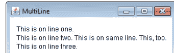

# 第 27 章 使用 AWT 控件、布局管理器和菜单

本章继续我们对抽象窗口工具包（AWT）的概述。首先介绍几种 AWT 控件和布局管理器。然后讨论菜单和菜单栏。本章还包含了对对话框的讨论。

控件是允许用户以各种方式与你的应用程序交互的组件——例如，一种常用的控件是推送按钮。布局管理器会自动在容器内定位组件。因此，窗口的外观由其包含的控件和用于定位这些控件的布局管理器共同决定。

除了控件之外，帧窗口（frame window）还可以包含一个标准式的菜单栏。菜单栏中的每个条目都会激活一个下拉选项菜单，用户可以从中进行选择。这构成了应用程序的主菜单。通常情况下，菜单栏的处理方式与其他控件相同。

虽然可以手动在窗口内为组件定位，但这样做非常繁琐。布局管理器自动处理了这一过程。在本章的第一部分中，我们将介绍各种控件，并使用使用一个简单的布局管理器，它通过按行、从上到下的组织方式在容器中显示组件。在介绍完控件之后，将检查其他一些布局管理器。然后，你将看到如何更好地管理控件的位置。

在继续之前，重要的一点是，今天你将基于 AWT 创建 GUI，因为 Java 已经开发了更强大的 GUI 框架。然而，这里介绍的内容由于以下原因仍然非常重要。首先，与控件和事件处理相关的许多信息和技术可以通用于 Swing。（正如上一章提到的，Swing 是构建在 AWT 之上的。）其次，这里处描述的布局管理器也被 Swing 使用。第三，对于某些小型应用程序，AWT 组件可能是合适的选择。最后，你可能会遇到使用 AWT 的遗留代码。因此，对于所有 Java 程序员来说，对 AWT 有基本的理解是重要的。

## AWT 控件基础

AWT 支持以下类型的控件：

-   标签 (Labels)
-   推送按钮 (Push buttons)
-   复选框 (Check boxes)
-   选择列表 (Choice lists)
-   列表 (Lists)
-   滚动条 (Scroll bars)
-   文本编辑 (Text Editing)

AWT 控件是 `Component` 的子类。虽然 AWT 提供的控件集合并不特别丰富，但对于简单的应用程序（例如供自己使用的短实用程序）来说足够了。它对于介绍与控件事件处理的基本概念和技术也非常有用。然而，需要指出，Swing 提供了一组规模更大、更复杂的控件，更适合商业应用程序。

## 添加和移除控件

要在窗口中包含控件，你必须将其添加到窗口中。要做到这一点，你必须首先创建所需控件的实例，并通过调用 `add()` 方法将其添加到窗口中，该方法由 `Container` 定义。`add()` 方法有多种形式。以下形式是本章第一部分使用的形式：

```java
Component add(Component compRef)
```

在这里，`compRef` 是你想要添加的控件实例的引用。返回的是该对象的引用。一旦添加了控件，只要其窗口显示，它就会自动可见。

有时当控件不再需要时，你可能想从窗口中移除它。要做到这一点，调用 `remove()`。该方法也由 `Container` 定义。这里是它的形式之一：

```java
void remove(Component compRef)
```

在这里，`compRef` 是你想要移除的控件的引用。你可以通过调用 `removeAll()` 所有控件。

## 响应控件

除了被动的标签外，所有其他控件在被用户访问时都会产生事件。例如，当用户点击推送按钮时，会发送一个标识该推送按钮的事件。通常情况下，你的程序只需实现相应的接口，并为每个你需要监控的控件抛出一个事件监听器。正如第 25 章所解释的，一旦安装了监听器，事件就会自动发送它。在随后的章节中，将指定每个控件相应的接口。

## HeadlessException

本章描述的大多数 AWT 控件都有构造函数，当尝试在非交互式环境（例如没有显示器、鼠标或键盘的环境）中实例化 GUI 组件时，可能会抛出 `HeadlessException`。你可以使用此异常来编写可以适应非交互式环境的代码。（当然，这总是可能的。）本章中的程序没有处理此异常，因为需要交互式环境来演示 AWT 控件。

## Labels

最易使用的控件是标签。标签是 `Label` 类型的对象，它包含一个字符串。标签是被动的控件，不支持任何交互。`Label` 定义了以下构造函数：

-   `Label()` throws `HeadlessException`
-   `Label(String str)` throws `HeadlessException`
-   `Label(String str, int alignment)` throws `HeadlessException`

第一个版本创建一个空白标签。第二个版本创建一个字符串 `str` 的标签。第三个版本根据指定的 `alignment` 创建包含字符串 `str` 的标签。`alignment` 的值必须是以下常量之一：`Label.LEFT`、`Label.RIGHT` 或 `Label.CENTER`。

你可以通过 `setText()` 方法设置或更改标签中的文本。通过 `getText()` 可以获取当前标签。这些方法如下：

```java
void setText(String str)

String getText()
```

你可以通过 `setAlignment()` 设置标签内的对齐方式。通过 `getAlignment()` 获取当前对齐方式。方法如下：

```java
void setAlignment(int how)

int getAlignment()
```

以下示例创建了三个标签并将它们添加到 Frame。

```java
// DemonstrateLabels.

import java.awt.*;

import java.awt.event.*;

public class LabelDemo extends Frame {

    public LabelDemo() {

        // 使用流布局。

        setLayout(new FlowLayout());

        Label one = new Label("One");

        Label two = new Label("Two");

        Label three = new Label("Three");

        // 将标签添加到帧。

        add(one);

        add(two);

        add(three);

        addWindowListener(new WindowAdapter() {

            public void windowClosing(WindowEvent we) {

                System.exit(0);

            }

        });

    }

    public static void main(String[] args) {

        LabelDemo appwin = new LabelDemo();

        appwin.setSize(new Dimension(300, 100));

        appwin.setTitle("LabelDemo");

        appwin.setVisible(true);

    }

}
```

这是 `LabelDemo` 程序的示例输出。


注意，标签在窗口中是从左到右组织的。这是由 `FlowLayout` 布局管理器自动处理的，它是 AWT 提供的布局管理器之一。在它的默认配置下，它是按行、从左到右、从上到下并居中布局。正如你在本章晚些时候看到的，它支持多种选项，但目前它的默认行为已经足够了。注意通过使用 `setLayout()` 选择 `FlowLayout` 作为布局管理器。该方法设置与容器关联的布局管理器，在本例中该容器是帧帧。虽然 `FlowLayout` 非常方便且满足我们目前的需求，但它没有让你对窗口内组件的放置进行详细控制。在本章的晚些时候，将对布局管理器主题进行详细检查，那时你将看到如何对窗口的组织获得更多的控制。

## 使用按钮

最广泛使用的控件可能是推按钮。按钮是一个包含标签的组件，并在被按下时产生一个事件。按钮是 `Button` 类型的对象。`Button` 定义了以下两个构造函数：

```java
Button() throws HeadlessException

Button(String str) throws HeadlessException
```

第一个版本创建一个空按钮。第二个版本创建一个包含 `str` 作为标签的按钮。

创建按钮后，你可以通过调用 `setLabel()` 来设置其标签。可以通过调用 `getLabel()` 来获取其标签。这些方法如下：

```java
void setLabel(String str)

String getLabel()
```

在这里，`str` 是按钮的新标签。

## 处理按钮

每当按钮被按下时，就会产生一个动作事件（action event）。这会被发送给之前注册过接收组件动作通知的监听器。每个监听器都使用 `ActionListener` 接口。该接口定义了 `actionPerformed()` 方法，该方法在事件发生时被调用。该方法提供一个 `ActionEvent` 对象作为参数。它包含了指向生成事件的按钮的引用，以及与按钮关联的动作命令字符串（action command string）的引用。按钮引用或动作命令字符串中的任何一个都是按钮的标签。默认情况下，动作命令字符串就是按钮的标签。可以使用按钮引用或动作命令字符串来识别按钮。（你很快就会看到这两种方法的示例。）

下面的示例创建了三个带有标签的按钮："Yes"、"No" 和 "Undecided"。每当其中一个被按下时，就会显示一条消息报告是哪个按钮被按下。在这个版本中，使用按钮的动作命令（默认情况下是标签）来确定哪个按钮被按下。标签是通过调用传递给 `actionPerformed()` 的 `ActionEvent` 对象的 `getActionCommand()` 方法获取的。

```java
// 演示按钮。

import java.awt.*;

import java.awt.event.*;

public class ButtonDemo extends Frame implements ActionListener {

    String msg = "";

    Button yes, no, maybe;

    public ButtonDemo() {

        // 使用流式布局。

        setLayout(new FlowLayout());

        // 创建一些按钮。

        yes = new Button("Yes");

        no = new Button("No");

        maybe = new Button("Undecided");

        // 将它们添加到框架中。

        add(yes);

        add(no);

        add(maybe);

        // 为按钮添加动作监听器。

        yes.addActionListener(this);

        no.addActionListener(this);

        maybe.addActionListener(this);

        addWindowListener(new WindowAdapter() {

            public void windowClosing(WindowEvent event) {

                System.exit(0);

            }

        });

    }

    // 处理按钮动作事件。

    public void actionPerformed(ActionEvent ae) {

        String str = ae.getActionCommand();

        if (str.equals("Yes")) {

            msg = "You pressed Yes.";

        } else if (str.equals("No")) {

            msg = "You pressed No.";

        } else {

            msg = "You pressed Undecided.";

        }

        repaint();

    }

    public void paint(Graphics g) {

        g.drawString(msg, 20, 100);

    }

    public static void main(String[] args) {

        ButtonDemo appwin = new ButtonDemo();

        appwin.setSize(new Dimension(250, 150));

        appwin.setTitle("ButtonDemo");

        appwin.setVisible(true);

    }

}
```

## 图 27-1 ButtonDemo 程序的示例输出

`ButtonDemo` 程序的示例输出如图 27-1 所示。如提到的，除了比较按钮动作命令字符串外，你还可以通过将从 `getSource()` 方法获取的对象与添加到窗口的对象进行比较，来确定哪个按钮被按下。要做到这一点，你必须在添加对象时保留一个对象的列表。以下程序展示了这种方法：

```java
// 识别按钮对象。

import java.awt.*;

import java.awt.event.*;

public class ButtonList extends Frame implements ActionListener {

    String msg = "";

    Button[] bList = new Button[3];

    public ButtonList() {

        // 使用流式布局。

        setLayout(new FlowLayout());

        // 创建一些按钮。

        Button yes = new Button("Yes");

        Button no = new Button("No");

        Button maybe = new Button("Undecided");

        // 在添加时存储按钮的引用。

        bList[0] = (Button) add(yes);

        bList[1] = (Button) add(no);

        bList[2] = (Button) add(maybe);

        // 注册接收动作事件。

        for (int i = 0; i < 3; i++) {

            bList[i].addActionListener(this);

        }

        addWindowListener(new WindowAdapter() {

            public void windowClosing(WindowEvent we) {

                System.exit(0);

            }

        });

    }

}
```

## 应用复选框

复选框是一种用于开启或关闭选项的控件。它由一个可以包含标记或不包含标记的小框组成。每个复选框都有一个关联标签，描述该框代表的内容。你通过点击它来改变复选框的状态。复选框可以单独使用，也可以作为一组的一部分。复选框是 `Checkbox` 类的对象。

`Checkbox` 支持以下构造函数：

```java
Checkbox() throws HeadlessException

Checkbox(String str) throws HeadlessException

Checkbox(String str, boolean on) throws HeadlessException

Checkbox(String str, boolean on, CheckboxGroup cbGroup) throws HeadlessException

Checkbox(String str, CheckboxGroup cbGroup, boolean on) throws HeadlessException
```

第一个形式创建一个复选框，标签初始为空。复选框的状态为未选中。第二个形式创建一个标签由 `str` 指定的复选框。复选框的状态为未选中。第三个形式允许你设置复选框的初始状态。如果 `on` 为 `true`，则复选框初始被选中；否则清除。第四种和第五种形式创建一个标签由 `str` 指定且所属组由 `cbGroup` 指定的复选框。如果此复选框不属于任何组，则 `cbGroup` 必须为 `null`。（复选框组将在下一节介绍）。`on` 的值决定复选框的初始状态。

要获取复选框当前的状态，调用 `getState()`。可以通过调用 `getLabel()` 获取与其关联的标签。要设置标签，调用 `setLabel()`。这些方法如下：

```java
boolean getState()

void setState(boolean on)

String getLabel()

void setLabel(String str)
```


在这里，如果 `on` 为 `true`，则框被选中。如果为 `false`，则清除。传递的字符串 `str` 成为与调用的复选框关联的新标签。

# 处理复选框

每当勾选或取消选中复选框时，都会产生一个项目事件（item event）。该事件会被发送给之前注册了该组件事件通知的监听器。每个监听器都实现了 `ItemListener` 接口。该接口定义了 `itemStateChanged()` 方法。该方法接收一个 `ItemEvent` 对象作为参数，它包含了有关事件的信息（例如，是选中还是取消选中）。

以下程序创建了四个复选框。第一个框的初始状态为选中。每当改变一个复选框的状态时，状态就会更新。

```java
// 演示复选框。

import java.awt.*;
import java.awt.event.*;

public class CheckboxDemo extends Frame implements ItemListener {

    String msg = "";
    Checkbox windows, android, linux, mac;

    public CheckboxDemo() {
        // 使用流式布局。
        setLayout(new FlowLayout());

        // 创建复选框。
        windows = new Checkbox("Windows", true);
        android = new Checkbox("Android");
        linux = new Checkbox("Linux");
        mac = new Checkbox("Mac OS");

        // 将复选框添加到框架中。
        add(windows);
        add(android);
        add(linux);
        add(mac);

        // 添加项目监听器。
        windows.addItemListener(this);
        android.addItemListener(this);
        linux.addItemListener(this);
        mac.addItemListener(this);

        addWindowListener(new WindowAdapter() {
            public void windowClosing(WindowEvent we) {
                System.exit(0);
            }
        });
    }

    public void itemStateChanged(ItemEvent ie) {
        repaint();
    }
}
```

# 第 27 章 使用 AWT 控件、布局管理器和菜单 889

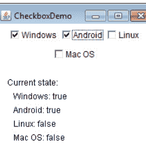

图 27-2 CheckboxDemo 程序的示例输出

```java
// 显示复选框的当前状态。
public void paint(Graphics g) {
    msg = "Current state: ";
    g.drawString(msg, 20, 120);

    msg = "Windows: " + windows.getState();
    g.drawString(msg, 20, 140);

    msg = "Android: " + android.getState();
    g.drawString(msg, 20, 160);

    msg = "Linux: " + linux.getState();
    g.drawString(msg, 20, 180);

    msg = "Mac OS: " + mac.getState();
    g.drawString(msg, 20, 200);
}
```

```java
public static void main(String[] args) {
    CheckboxDemo appwin = new CheckboxDemo();
    appwin.setSize(new Dimension(240, 220));
    appwin.setTitle("CheckboxDemo");
    appwin.setVisible(true);
}
```

示例输出如图 27-2 所示。

# CheckboxGroup

可以创建一组互斥的复选框，组内在任何时候只有一个复选框可以被选中。这些复选框通常被称为单选按钮（radio buttons），作用就像收音机的电台选择器——任何时间只能选择一个电台。要创建一个互斥复选框组，你必须首先定义它们所属的组，并在构造复选框时指定该组。复选框组是 `CheckboxGroup` 类型的对象。它只定义了默认构造函数，用于创建一个空组。

# 890 第二部分 Java 库

你可以通过调用 `getSelectedCheckbox()` 来确定组中当前哪个复选框被选中。你可以通过调用 `setSelectedCheckbox()` 来设置复选框。这些方法如下：

```java
Checkbox getSelectedCheckbox()
void setSelectedCheckbox(Checkbox which)
```

在这里，`which` 是你想设置的复选框。之前选中的复选框将被取消。

这是一个使用复选框组的程序：

```java
// 演示复选框组。

import java.awt.*;
import java.awt.event.*;

public class CBGroup extends Frame implements ItemListener {

    String msg = "";
    Checkbox windows, android, linux, mac;
    CheckboxGroup cbg;

    public CBGroup() {
        // 使用流式布局。
        setLayout(new FlowLayout());

        // 创建复选框组。
        cbg = new CheckboxGroup();

        // 创建复选框并将它们加入组。
        windows = new Checkbox("Windows", cbg, true);
        android = new Checkbox("Android", cbg, false);
        linux = new Checkbox("Linux", cbg, false);
        mac = new Checkbox("Mac OS", cbg, false);

        // 将复选框添加到框架中。
        add(windows);
        add(android);
        add(linux);
        add(mac);

        // 添加项目监听器。
        windows.addItemListener(this);
        android.addItemListener(this);
        linux.addItemListener(this);
        mac.addItemListener(this);

        addWindowListener(new WindowAdapter() {
            public void windowClosing(WindowEvent e) {
                System.exit(0);
            }
        });
    }
}
```

```java
// Add items to os list.
os.add("Windows");
os.add("Android");
os.add("Linux");
os.add("Mac OS");

// Add items to browser list.
browser.add("Edge");
browser.add("Firefox");
browser.add("Chrome");
```

```java
// Add choice lists to window.
add(os);
add(browser);
```

```java
// Add item listeners.
os.addItemListener(this);
browser.addItemListener(this);
```

```java
addWindowListener(new WindowAdapter() {
    public void windowClosing(WindowEvent e) {
        System.exit(0);
    }
});
```

```java
public void itemStateChanged(ItemEvent e) {
    repaint();
}
```

```java
// Display current selections.
public void paint(Graphics g) {
    msg = "Current OS: ";
    msg += os.getSelectedItem();
    g.drawString(msg, 20, 120);

    msg = "Current Browser: ";
    msg += browser.getSelectedItem();
    g.drawString(msg, 20, 140);
}
```

```java
public static void main(String[] args) {
    ChoiceDemo appwin = new ChoiceDemo();
    appwin.setSize(new Dimension(240, 180));
    appwin.setTitle("ChoiceDemo");
    appwin.setVisible(true);
}
```

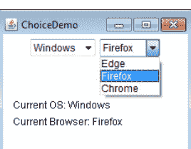

**图 27-4** ChoiceDemo 程序的示例输出

示例输出如图 27-4 所示。

## 使用列表

`List` 类提供了一个紧凑的、多选的、滚动的选择列表。与仅在菜单中显示选中项的 `Choice` 对象不同，`List` 可以构造为在可见窗口中显示任意数量的选项。它还可以创建为允许多选。`List` 提供了这些构造函数：

- `List() throws HeadlessException`
- `List(int numRows) throws HeadlessException`
- `List(int numRows, boolean multipleSelect) throws HeadlessException`

第一种版本创建一个任何时间只允许选择一个项目的 `List`。在第二种形式中，`numRows` 的值指定列表中的条目数。在第三种形式中，如果 `multipleSelect` 为 `true`，则你可以同时选择两个或多个项目。如果为 `false`，则只能选择一个项目。

要向列表添加项，请调用 `add(String name)`。它具有以下形式：

```
add(String name)
add(String name, int index)
```

在这里，`name` 是要添加到列表的项目的名称。第一种形式将项目添加到列表末尾。第二种形式在 `index` 指定的索引处添加项目。索引从零开始。你可以指定 -1 将该项添加到列表末尾。

对于仅允许单选的列表，可以通过调用 `getSelectedItem()` 或 `getSelectedIndex()` 来获取当前选中的项。这些方法显示在此：

```
String getSelectedItem()
int getSelectedIndex()
```

`getSelectedItem()` 返回一个包含项目名称的字符串。如果选择了多个项目，或者没有进行任何选择，则返回 `null`。`getSelectedIndex()` 返回项的索引。第一个项目位于索引 0。如果选择了多个项目，或者还没有进行任何选择，则返回 -1。

对于允许多选的列表，你可以使用 `getSelectedItems()` 或 `getSelectedIndexes()`（如下所示）来确定当前的选择项：

```
String[] getSelectedItems()
int[] getSelectedIndexes()
```

`getSelectedItems()` 返回一个包含当前选中项目名称的数组。`getSelectedIndexes()` 返回一个包含当前选中项目索引的数组。

要获取列表中的项目数量，请调用 `getItemCount()`。你可以使用带有零基数的整数索引的 `select()` 方法来设置当前选中的项。这些方法显示在此：

```
int getItemCount()
void select(int index)
```

给定一个索引，你可以通过调用 `getItem(index)` 获取与该索引项关联的名称，其通用形式为：

```
String getItem(int index)
```

在这里，`index` 指定了目标项的索引。

## 处理列表

要处理列表，你需要实现 `ActionListener` 接口。每当双击 `List` 项目时，就会生成一个 `ActionEvent` 对象。你的 `actionPerformed()` 方法可以用于检索新选中项目的名称。每当通过单击选择或取消选择某个项目时，就会生成一个 `ItemEvent` 对象。`getStateChange()` 方法可以用于确定是由选择还是取消选择触发了此事件。`getItemSelectable()` 返回触发此事件的对象的引用。

这是一个示例，将上一节中的控件使用到 `List` 组件、多选和其他单选控件中：

```java
// 演示列表。

import java.awt.*;
import java.awt.event.*;

public class ListDemo extends Frame implements ActionListener, ItemListener {

    List os, browser;
    String msg = "";

    public ListDemo() {
        // 使用流式布局。
        setLayout(new FlowLayout());

        // 创建一个多选列表。
        os = new List(4, true);

        // 创建一个单选列表。
        browser = new List(4);

        // 向 os 列表添加项。
        os.add("Windows");
        os.add("Android");
        os.add("Linux");
        os.add("Mac OS");

        // 向 browser 列表添加项。
        browser.add("Edge");
        browser.add("Firefox");
        browser.add("Chrome");

        // 向窗口添加选择列表。
        add(os);
        add(browser);

        // 添加项监听器。
        os.addItemListener(this);
        browser.addItemListener(this);

        addWindowListener(new WindowAdapter() {
            public void windowClosing(WindowEvent e) {
                System.exit(0);
            }
        });
    }

    public void itemStateChanged(ItemEvent e) {
        repaint();
    }

    public void actionPerformed(ActionEvent e) {
        repaint();
    }

    // 显示当前选择。
    public void paint(Graphics g) {
        msg = "Current OS: ";
        String[] osItems = os.getSelectedItems();
        if (osItems != null && osItems.length > 0) {
            msg += osItems[0];
        } else {
            msg += "None";
        }
        g.drawString(msg, 20, 120);

        msg = "Current Browser: ";
        msg += browser.getSelectedItem();
        g.drawString(msg, 20, 140);
    }

    public static void main(String[] args) {
        ListDemo appwin = new ListDemo();
        appwin.setSize(new Dimension(240, 180));
        appwin.setTitle("ListDemo");
        appwin.setVisible(true);
    }
}
```


## 使用滚动条

滚动条被用于在指定的最小值和最大值之间选择连续值。滚动条可以是水平的或垂直的。滚动条实际上由多个部分组成。每端都有一个箭头，点击它可以移动滚动条一个单位。滚动条相对于最小值和最大值的当前由滑块（thumb）指示。用户可以拖动滑块到新位置。滚动条会反映这一点。在滑块两侧的背景区域中，用户点击可以按大于 1 的增量进行跳转。通常这对应于翻页或向下页。滚动条由 `Scrollbar` 类封装。

`Scrollbar` 定义了以下构造函数：

```
Scrollbar() throws HeadlessException
Scrollbar(int style) throws HeadlessException
Scrollbar(int initialValue, int thumbSize, int min, int max) throws HeadlessException
```

第一种形式创建一个垂直滚动条。第二种形式允许你指定滚动条的方向。如果 `style` 为 `Scrollbar.VERTICAL`，则创建一个垂直滚动条。如果 `style` 为 `Scrollbar.HORIZONTAL`，则滚动条是水平的。在构造函数的第三种形式中，滚动条的初始值通过 `initialValue` 传入。滑块高度代表的单位数通过 `thumbSize` 传入。滚动条的最小值和最大值由 `min` 和 `max` 指定。

如果你使用前面的构造函数之一构造滚动条，则需要使用 `setValues()` 方法设置其参数，以便在使用之前：

```
void setValues(int initialValue, int thumbSize, int min, int max)
```

这些参数的含义与构造函数中的相同。要获取滚动条的当前值，调用 `getValue()`。它返回当前设置。要设置当前值，调用 `setValue()`。

在这里，`newValue` 指定了滚动条的新值。当您设置一个值时，滚动条内部的滑块框将定位以反映该新值。

你也可以通过 `getMinimum()` 和 `getMaximum()` 获取最小值和最大值，如下所示：

```
int getMinimum()
int getMaximum()
```

它们返回请求的数量。默认情况下，增量为 1，每当滚动条向上或向下滚动一行时，都会增加或减少该增量。你可以通过调用 `setUnitIncrement()` 来更改此增量。默认情况下，向上页和向下页的增量为 10。你可以通过调用 `setBlockIncrement()` 来更改此值。这些方法所示：

```
void setUnitIncrement(int newIncr)
void setBlockIncrement(int newIncr)
```

### 处理滚动条

要处理滚动条，你需要实现 `AdjustmentListener` 接口。每当用户与滚动条交互时，就会生成一个 `AdjustmentEvent`。可以使用 `getAdjustmentType()` 方法确定调整的类型。调整事件的类型如下：

| 常量 | 说明 |
| :--- | :--- |
| `BLOCK_DECREMENT` | 已生成一个向下页事件。 |
| `BLOCK_INCREMENT` | 已生成一个向上页事件。 |
| `TRACK` | 已生成一个绝对跟踪事件。 |
| `UNIT_DECREMENT` | 滚动条中的向下行按钮被按下。 |
| `UNIT_INCREMENT` | 滚动条中的向上行按钮被按下。 |

下面的示例创建了垂直滚动条和水平滚动条。程序将显示滚动条的当前设置。如果你在窗口内拖动鼠标，将使用每个拖动事件的坐标来更新滚动条。在当前拖动位置将显示一个星号。使用 `setPreferredSize()` 设置滚动条的大小。

```java
// 演示滚动条。
import java.awt.*;
import java.awt.event.*;

public class SBDemo extends Frame implements AdjustmentListener {
    String msg = "";
    Scrollbar vertSB, horzSB;

    public SBDemo() {
        // 使用流布局。
        setLayout(new FlowLayout());

        // 创建滚动条并设置首选大小。
        vertSB = new Scrollbar(Scrollbar.VERTICAL, 0, 1, 0, 200);
        vertSB.setPreferredSize(new Dimension(20, 100));
        horzSB = new Scrollbar(Scrollbar.HORIZONTAL, 0, 1, 0, 100);
        horzSB.setPreferredSize(new Dimension(100, 20));

        // 将滚动条添加到框架中。
        add(vertSB);
        add(horzSB);

        // 为滚动条添加 AdjustmentListener。
        vertSB.addAdjustmentListener(this);
        horzSB.addAdjustmentListener(this);

        // 添加 MouseMotionListener。
        addMouseMotionListener(new MouseMotionAdapter() {
            // 更新滚动条以反映鼠标拖动。
            public void mouseDragged(MouseEvent me) {
                int x = me.getX();
                int y = me.getY();
                vertSB.setValue(y);
                horzSB.setValue(x);
                repaint();
            }
        });

        addWindowListener(new WindowAdapter() {
            public void windowClosing(WindowEvent we) {
                System.exit(0);
            }
        });
    }

    public void adjustmentValueChanged(AdjustmentEvent ae) {
        repaint();
    }

    // 显示滚动条的当前值。
    public void paint(Graphics g) {
        msg = "Vertical: " + vertSB.getValue() + " Horizontal: " + horzSB.getValue();
        g.drawString(msg, 20, 160);
        // 显示当前鼠标拖动位置
        g.drawString("*", horzSB.getValue(), vertSB.getValue());
    }

    public static void main(String[] args) {
        SBDemo appwin = new SBDemo();
        appwin.setSize(new Dimension(300, 180));
        appwin.setTitle("SBDemo");
        appwin.setVisible(true);
    }
}
```


**图 27-6** SBDemo 程序的示例输出

## 使用 TextField

**TextField** 类实现了一个单行文本输入区域，通常称为 *编辑控件*（edit control）。文本字段允许用户输入字符串并使用方向键、剪切和粘贴键以及移动选择来编辑文本。**TextField** 是 **Component** 的子类。**TextField** 定义了以下构造函数：

```
TextField() throws HeadlessException
TextField(int numChars) throws HeadlessException
TextField(String str) throws HeadlessException
TextField(String str, int numChars) throws HeadlessException
```

第一个版本创建一个默认文本字段。第二个形式创建一个宽度为 `numChars` 字符的文本字段。第三个形式使用字符串 `str` 初始化文本字段。第四个形式初始化文本字段并设置其宽度。

**TextField** 提供了几个方法允许你利用文本字段。要获取字段中当前包含的字符串，可以使用 `getText()`。要设置字段中的文本，可以使用 `setText()`。这些方法所示：

```
String getText()
void setText(String str)
```

这里，`str` 是要设置的字符串。`getText()` 获取字段中当前包含的字符串。`setText()` 设置字段中的文本。

### 处理 TextField

这里的示例创建了用户名和密码界面：

```java
// 演示文本框。
import java.awt.*;
import java.awt.event.*;

public class TextFieldDemo extends Frame implements ActionListener {
    TextField name, pass;

    public TextFieldDemo() {
        // 使用流布局。
        setLayout(new FlowLayout());

        // 创建控件。
        Label nameLabel = new Label("Name: ", Label.RIGHT);
        Label passLabel = new Label("Password: ", Label.RIGHT);
        name = new TextField(12);
        pass = new TextField(8);
        pass.setEchoChar('?');

        // 将控件添加到框架中。
        add(nameLabel);
        add(name);
        add(passLabel);
        add(pass);

        // 添加动作监听器。
        name.addActionListener(this);
        pass.addActionListener(this);

        // 添加窗口适配监听器。
        addWindowListener(new WindowAdapter() {
            public void windowClosing(WindowEvent we) {
                System.exit(0);
            }
        });
    }

    // 用户按了回车。
    public void actionPerformed(ActionEvent ae) {
        repaint();
    }

    public void paint(Graphics g) {
        g.drawString("Name: " + name.getText(), 20, 100);
        g.drawString("Selected text in name: " + name.getSelectedText(), 20, 120);
        g.drawString("Password: " + pass.getText(), 20, 140);
    }

    public static void main(String[] args) {
        TextFieldDemo appwin = new TextFieldDemo();
        appwin.setSize(new Dimension(380, 180));
        appwin.setTitle("TextFieldDemo");
        appwin.setVisible(true);
    }
}
```


# 使用 TextArea

有时，单行文本输入对于某些任务来说是不够的。为了处理这些情况，AWT 包含一个名为 `TextArea` 的多行编辑器。以下是 `TextArea` 的构造函数：

```
TextArea() throws HeadlessException
TextArea(int numLines, int numChars) throws HeadlessException
TextArea(String str) throws HeadlessException
TextArea(String str, int numLines, int numChars) throws HeadlessException
TextArea(String str, int numLines, int sbars) throws HeadlessException
```

在这里，`numLines` 指定文本区域的高度（以行为单位），`numChars` 指定其宽度。初始文本可以通过 `str` 指定。在第五种形式中，你可以指定想要控制的滚动条。`sbars` 必须是以下值之一：

| SCROLLBARS_BOTH | SCROLLBARS_NONE |
| SCROLLBARS_HORIZONTAL_ONLY | SCROLLBARS_VERTICAL_ONLY |

`TextArea` 是 `TextComponent` 的子类。因此，它支持前节中描述的 `getText()`、`setText()`、`getSelectedText()`、`select()`、`isEditable()` 和 `setEditable()` 方法。

`TextArea` 增加了以下编辑方法：

```
void append(String str)
void insert(String str, int startIndex, int endIndex)
void replaceRange(String str, int startIndex, int endIndex)
```

`append()` 方法将 `str` 指定字符串附加到当前文本的末尾。`insert()` 将传入 `str` 的字符串插入指定的索引处。要替换文本，调用 `replaceRange()`。它会将从 `startIndex` 到 `endIndex-1` 的字符替换为替换文本。

文本区域主要是自包含的控件。你的程序几乎没有管理开销。通常，你的程序只需在需要时获取当前文本。然而，如果你愿意，也可以监听 `TextEvents`。

以下程序创建了一个 `TextArea` 控件：

```java
// Demo TextArea。

import java.awt.*;
import java.awt.event.*;

public class TextAreaDemo extends Frame {
    public TextAreaDemo() {
        // 使用流式布局。
        setLayout(new FlowLayout());
    }

    String val =
        "JDK 17 是最广泛使用的计算机语言之一\n" +
        "用于 Internet 编程的最新版本。\n" +
        "Java 在深厚的传统的基础上，进步了\n" +
        "计算机语言设计的艺术和科学。\n" +
        "Java 持续成功的原因之一是它\n" +
        "不断、稳定的演进状态。Java 从未停滞过\n" +
        "相反，Java 一直在适应网络世界\n" +
        "快速变化的格局。\n" +
        "此外，Java 往往处于领先地位，为其他\n" +
        "者指明道路。";

    TextArea text = new TextArea(10, 30);
    add(text);

    addWindowListener(new WindowAdapter() {
        public void windowClosing(WindowEvent event) {
            System.exit(0);
        }
    });

    public static void main(String[] args) {
        TextAreaDemo appwin = new TextAreaDemo();
        appwin.setSize(new Dimension(300, 220));
        appwin.setTitle("TextAreaDemo");
        appwin.setVisible(true);
    }
}
```

这里是 `TextAreaDemo` 程序的示例输出：

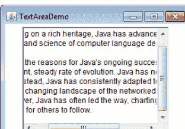

# 理解布局管理器

我们到目前为止展示的所有组件都是通过 `FlowLayout` 布局管理器进行定位的。正如我们在本章开头提到的，布局管理器通过某种算法自动在窗口内安排你的控件。

## 第 27 章 使用 AWT 控件、布局管理器和菜单

虽然手动布局 Java 界面可能的，但由于两个主要原因，你通常不会想这样做。第一，手动布局大量组件非常繁琐。其次，有时在你需要安排某些控件时，宽度和高度信息尚不可用，因为原生工具包组件尚未实现。这是一个“先有鸡还是有蛋”的问题：要发现可以使用给定组件的大小来相对于相对于另一个组件进行定位是允许的，这很令人困惑。

每个 `Container`（容器）都关联着一个布局管理器。布局管理器是实现 `LayoutManager` 接口的任何类的实例。布局管理器通过 `setLayout()` 方法设置。如果没有调用 `setLayout`，则使用默认的布局管理器。当容器调整大小时（或第一次调整大小时时），会使用布局管理器来定位其中的每个组件。

`setLayout()` 方法具有以下通用定义：

```
void setLayout(LayoutManager layoutObj)
```

在这里，`layoutObj` 是布局管理器的引用。如果你想禁用布局管理器并手动定位组件，请为 `layoutObj` 传递 `null`。如果你这样做，你需要使用 `Component` 定义的 `setBounds()` 方法手动确定每个组件的大小和位置。通常，你会想要使用布局管理器。

每个布局管理器都维护一个按名称存储的组件列表。每当你向容器添加组件时，布局管理器都会收到通知。每当容器需要调整大，都会通过其 `minimumLayout()` 和 `preferredLayoutSize()` 咨询布局管理器。每个由布局管理器管理的组件都包含 `getPreferredSize()` 和 `getMinimumSize()` 方法。这些方法返回显示每个组件所需的理想和最小尺寸。如果可能，布局管理器将遵循这些请求，以保持布局的完整性。系统提供了默认值。Java 有几个预定义的 `LayoutManager` 类，接下来将介绍这些。

# FlowLayout

你已经见过 `FlowLayout` 的作用了。它实现了一种简单的布局，类似于文本编辑器中的文字流。布局的方向由容器的定向属性控制，默认是从左到右。因此，默认情况下，组件从左上角开始逐行布局。在所有情况下，当一行满时，布局将进入下一行。组件之间在上下以及左右都有一个小间隔。以下是 `FlowLayout` 的构造函数：

```
FlowLayout()
FlowLayout(int how)
FlowLayout(int how, int horz, int vert)
```


第一种形式创建默认布局，组件之间留有五个像素的空间。第二种形式允许你指定每行的对齐方式。`how` 的有效值如下：

```
FlowLayout.LEFT
FlowLayout.CENTER
FlowLayout.RIGHT
FlowLayout.LEADING
FlowLayout.TRAILING
```

这些值分别指定左、居中、右、起始边缘和结束边缘对齐。第三种构造函数允许你指定组件之间的水平空间（`horz`）和垂直空间（`vert`）。你可以通过替换之前所示 `CheckboxDemo` 程序中的行来查看在 `FlowLayout` 中指定对齐的效果：

```
setLayout(new FlowLayout(FlowLayout.LEFT));
```

进行此更改后，输出将如所示。与图 27-2 的原始输出进行对比。

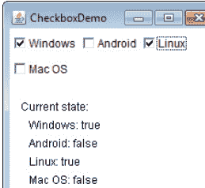

# BorderLayout

`BorderLayout` 实现了一种布局样式，在边缘有四个固定宽度的组件，中心有一个大区域。这四边被称为北、南、东、西。中间区域被称为中心。`BorderLayout` 是 `Frame` 的默认布局。以下是 `BorderLayout` 定义的构造函数：

```
BorderLayout()
BorderLayout(int horz, int vert)
```

第一种形式创建默认边界布局。第二种允许你分别指定组件之间的水平空间（`horz`）和垂直空间（`vert`）。`BorderLayout` 定义了以下使用的常量，用于指定区域：

| BorderLayout.CENTER | BorderLayout.SOUTH |
| BorderLayout.EAST | BorderLayout.WEST |
| BorderLayout.NORTH | |

# 第27章 使用 AWT 控件、布局管理器和菜单 907

在添加组件时，你将使用这些常量配合以下形式的 `add()`，该方法由 `Container` 定义：

```
void add(Component compRef, Object region)
```

在这里，`compRef` 是要添加的组件引用，而 `region` 指定了组件添加的位置。

以下是一个 `BorderLayout` 的示例，在每个布局区域都包含一个组件：

```java
// Demonstrate BorderLayout.

import java.awt.*;
import java.awt.event.*;

public class BorderLayoutDemo extends Frame {
    public BorderLayoutDemo() {
        // 这里，默认使用 BorderLayout。
        add(new Button("This is across the top."),
            BorderLayout.NORTH);
        add(new Label("The footer message might go here."),
            BorderLayout.SOUTH);
        add(new Button("Right"),
            BorderLayout.EAST);
        add(new Button("Left"),
            BorderLayout.WEST);
        String msg = "The reasonable man adapts " + \
                    "himself to the world,\n" + \
                    "the unreasonable one persists in " + \
                    "trying to adapt the world to himself.\n" + \
                    "Therefore all progress depends " + \
                    "on the unreasonable man.\n" + \
                    "- George Bernard Shaw\n\n" + \
                    "";
        add(new TextArea(msg), BorderLayout.CENTER);
        addWindowListener(new WindowAdapter() {
            public void windowClosing(WindowEvent event) {
                System.exit(0);
            }
        });
    }

    public static void main(String[] args) {
        BorderLayoutDemo appwin = new BorderLayoutDemo();
        appwin.setSize(new Dimension(300, 220));
        appwin.setTitle("BorderLayoutDemo");
        appwin.setVisible(true);
    }
}
```

# 908 第二部分 Java 库

`Border` 程序的示例输出所示：

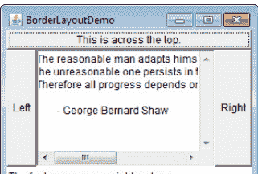

# 使用 Insets（内边距）

有时，你可能希望在存放组件的容器与包含它的窗口之间留出少量的空间。要实现这一点，请重写由 `Container` 定义的 `getInsets()` 方法。该方法返回一个 `Insets` 对象，包含容器显示时使用的顶部、底部、左侧和右侧内边距。这些值被布局管理器用于设置其布局窗口时的内边距。`Insets` 的构造函数所示：

```
Insets(int top, int left, int bottom, int right)
```

传入的 `top`、`left`、`bottom` 和 `right` 值指定了容器与其周围窗口之间的空间大小。

`getInsets()` 方法的标准形式如下：

```
Insets getInsets()
```

在重写此方法时，你必须返回一个包含所需内边距间的 `Insets` 对象。

以下是修改后的 `BorderLayout` 示例，使其组件具有内边距。背景颜色已设置为青色，以便内边距更加可见。

```java
// Demonstrate BorderLayout with insets.

import java.awt.*;
import java.awt.event.*;

public class InsetsDemo extends Frame {
    public InsetsDemo() {
        // 这里，默认使用 BorderLayout。
        // 设置背景颜色以便于观察内边距
        setBackground(Color.cyan);
        setLayout(new BorderLayout());
    }

    String msg = "The reasonable man adapts " +
    "himself to the world,\n" +
    "the unreasonable persists in " +
    "trying to adapt the world to himself.\n" +
    "Therefore all progress depends " +
    "on the unreasonable man.\n\n" +
    "- George Bernard Shaw\n\n";

    add(new TextArea(msg), BorderLayout.CENTER);

    addWindowListener(new WindowAdapter() {
        public void windowClosing(WindowEvent we) {
            System.exit(0);
        }
    });

    // 重写 getInsets 以添加内边距值。
    public Insets getInsets() {
        return new Insets(40, 20, 10, 20);
    }

    public static void main(String[] args) {
        InsetsDemo appwin = new InsetsDemo();
        appwin.setSize(new Dimension(300, 220));
        appwin.setTitle("InsetsDemo");
        appwin.setVisible(true);
    }
}
```

`InsetsDemo` 程序的示例输出所示：

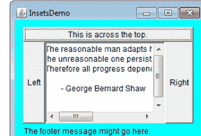

# GridLayout

`GridLayout` 在二维网格中布局组件。当你实例化 `GridLayout` 时，你定义了行数和列数。`GridLayout` 支持的构造函数所示：

```
GridLayout()
GridLayout(int numRows, int numColumns)
GridLayout(int numRows, int numColumns, int horz, int vert)
```


第一种形式创建一个单列网格。第二种形式创建一个具有指定行数和列数的网格布局。第三种形式允许你指定窗口中组件之间的水平和垂直空间。组件之间的水平和垂直空间分别为 `horz` 和 `vert`。`numRows` 或 `numColumns` 均可以为零。

以下是一个创建一个 4x4 网格的示例程序：

```java
// Demonstrate GridLayout

import java.awt.*;

import java.awt.event.*;

public class GridLayoutDemo extends Frame {

    final int n = 4;

    public GridLayoutDemo() {

        setLayout(new GridLayout(n, n));

        for (int i = 0; i < n; i++) {

            add(new Button("Button " + i));

        }

        addWindowListener(new WindowAdapter() {

            public void windowClosing(WindowEvent we) {

                System.exit(0);

            }

        });

    }

    public static void main(String[] args) {

        GridLayoutDemo appwin = new GridLayoutDemo();

        appwin.setSize(new Dimension(300, 220));

        appwin.setTitle("GridLayoutDemo");

        appwin.setVisible(true);

    }

}
```

# 第27章 使用 AWT 控件、布局管理器和菜单

以下是 `GridLayout` 生成的示例输出：


# CardLayout

`CardLayout` 类在布局管理器中是独特的，因为它存储了多个不同的布局。每个布局都可以被认为是在单独页面上。你可以尝试将此示例作为用户界面的起点。

`CardLayout` 提供两个构造函数：

```java
CardLayout()

CardLayout(int horz, int vert)
```

第一种形式创建一个默认布局。第二种形式允许你通过 `horz` 和 `vert` 指定组件之间的水平和垂直空间。一旦你创建了牌组，程序可以通过调用 `CardLayout` 定义的以下方法来激活卡片：

```java
void first(Container deck)

void last(Container deck)

void next(Container deck)

void previous(Container deck)

void show(Container deck, String cardName)
```

在这里，`deck` 是持有卡片的容器（通常是面板）的引用，`cardName` 是卡片的名称。

```java
windows10 = new Checkbox("Windows 10");

android = new Checkbox("Android");

linux = new Checkbox("Linux");

mac = new Checkbox("Mac OS");
```

```java
// 将窗口复选框添加到面板。

Panel winPan = new Panel();

winPan.add(windows7);

winPan.add(windows8);

winPan.add(windows10);
```

```java
// 将其他操作复选框添加到面板。

Panel otherPan = new Panel();

otherPan.add(android);

otherPan.add(linux);

otherPan.add(mac);
```

```java
// 将面板添加到卡片布局面板。

osCards.add(winPan, "Windows");

osCards.add(otherPan, "Other");
```

```java
// 使用 lambda 表达式处理按钮事件。

win.addActionListener((ae) -> cardLO.show(osCards, "Windows"));

other.addActionListener((ae) -> cardLO.show(osCards, "Other"));
```

```java
// 注册鼠标按下事件。

addMouseListener(new MouseAdapter() {

    // 循环切换面板。

    public void mousePressed(MouseEvent me) {

        cardLO.next(osCards);

    }

});
```

```java
addWindowListener(new WindowAdapter() {

    public void windowClosing(WindowEvent we) {

        System.exit(0);

    }

});
```

```java
public static void main(String[] args) {

    CardLayoutDemo appwin = new CardLayoutDemo();

    appwin.setSize(new Dimension(300, 220));

    appwin.setTitle("CardLayoutDemo");

    appwin.setVisible(true);

}
```


这是由 CardLayoutDemo 程序生成的示例输出。每张卡片通过点击其按钮激活。你也可以通过点击鼠标来循环切换卡片。

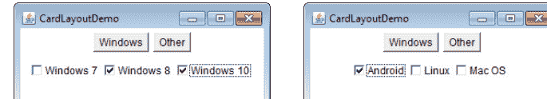

## GridBagLayout

虽然前面的布局对于许多用途来说完全可以，但某些情况需要你对组件的排列方式进行更多控制。实现此点的一种良好方法是使用网格包（grid bag），它由 `GridBagLayout` 类指定。网格包有用之处在于，你可以通过指定组件在网格单元格内的位置来指定组件的相对位置。网格包的关键在于每个组件可以有不同的大小，并且网格中的每一行都有不同的列数。这就是为什么这种布局被称为网格包。它是由许多小网格连接而成的集合。

网格包中每个组件的位置和大小由一组与其相关的约束决定。这些约束在一个类型为 `GridBagConstraints` 的对象中。约束包括单元格的高度和宽度，以及组件的位置、对齐方式和在单元格内的锚点。

使用网格包的一般步骤是创建一个新的 `GridBagLayout` 对象并将其设置为当前布局管理器。然后，设置适用于将添加到网格包的每个组件的约束。最后，将组件添加到布局管理器。`GridBagLayout` 比其他布局管理器稍微复杂，但一旦你理解了它的工作原理，仍然非常容易使用。

```java
GridBagLayout()
```

`GridBagLayout` 定义了几个方法，但其中一些是保护的，不供通用使用。有一个是你必须使用的：`setConstraints()`。显示如下：

```java
void setConstraints(Component comp, GridBagConstraints cons)
```

在这里，`comp` 是应用 `cons` 指定约束的组件。该方法设置适用于网格包中每个组件的约束。
成功使用 `GridBagLayout` 的关键在于正确设置约束，这些约束存储在 `GridBagConstraints` 对象中。`GridBagConstraints` 定义了几个字段，你可以设置它们来控制组件的大小、位置和间距。这些在表 27-1 中所示。随后的讨论将对其中几个进行更详细的描述。

# 第27章 使用 AWT 控件、布局管理器和菜单

| 字段 | 目的 |
| :--- | :--- |
| int anchor | 指定组件在单元格内的位置。默认是 `GridBagConstraints.CENTER` |
| int fill | 如果组件小于其单元格，则指定如何调整组件的大小。有效值为 `GridBagConstraints.NONE`（默认值）、`GridBagConstraints.HORIZONTAL`、`GridBagConstraints.VERTICAL`、`GridBagConstraints.BOTH`。 |
| int gridheight | 以单元格为单位指定组件的高度。默认是 1。 |
| int gridwidth | 以单元格为单位指定组件的宽度。默认是 1。 |
| int gridx | 指定组件要添加到单元格的 X 坐标。默认值为 `GridBagConstraints.RELATIVE`。 |
| int gridy | 指定组件要添加到单元格的 Y 坐标。默认值是 `GridBagConstraints.RELATIVE`。 |
| Insets | 指定内边距。默认内边距均为零。 |
| int padx | 指定单元格内组件周围的额外水平空间。默认是 0。 |
| int pady | 指定单元格内组件周围的额外垂直空间。默认是 0。 |
| double weightx | 指定水平权重分布。 |
| double weighty | 指定垂直权重分布。 |

表 27-1 GridBagConstraints 定义的字段

当组件小于其单元格时，可以使用 `anchor` 字段来指定它在单元格内的位置。

有三种可以传递 `anchor` 的值。第一种是绝对的：

| GridBagConstraints.CENTER | GridBagConstraints.SOUTH |
| GridBagConstraints.EAST | GridBagConstraints.SOUTHEAST |
| GridBagConstraints.NORTH | GridBagConstraints.SOUTHWEST |
| GridBagConstraints.NORTHEAST | GridBagConstraints.WEST |

第二种传递 `anchor` 的值是相对的，这意味着这些值相对于容器的方向，这对于不同的语言可能有所不同。

| GridBagConstraints.FIRST_LINE_END | GridBagConstraints.LINE_END |
| GridBagConstraints.FIRST_LINE_START | GridBagConstraints.LINE_START |
| GridBagConstraints.LAST_LINE_END | GridBagConstraints.PAGE_END |
| GridBagConstraints.LAST_LINE_START | GridBagConstraints.PAGE_START |

第三种传递给 `anchor` 的值允许你相对于行定位组件。这些值显示如下：

| GridBagConstraints.BASELINE | GridBagConstraints.BASELINE_LEADING |
| GridBagConstraints.BASELINE_TRAILING | GridBagConstraints.ABOVE_BASELINE |
| GridBagConstraints.ABOVE_BASELINE_LEADING | GridBagConstraints.ABOVE_BASELINE_TRAILING |
| GridBagConstraints.BELOW_BASELINE | GridBagConstraints.BELOW_BASELINE_LEADING |

水平位置可以居中、相对于领先边缘（LEADING）或相对于尾边缘（TRAILING）。

**weightx** 和 **weighty** 字段都非常重要，且起初相当困惑。通常情况下，它们的值决定了容器内的空间分配给每行每列。默认情况下，这两个值都为零。当行或列中的所有值均为零时，额外空间将均匀分布在窗口边缘。通过增加权重，你可以按照与其他行或列的比例增加该行或列的空间分配。理解这些值如何工作的最好方法是对它们进行一些实验。

`gridwidth` 变量允许你以单元格为单位指定宽度。默认是 1。要让组件使用行的剩余空间，请使用 `GridBagConstraints.REMAINDER`。要让组件使用倒数第二个单元格，使用 `GridBagConstraints.RELATIVE`。高度约束原理相同，使用一个用于增加单元格最小尺寸的填充值。要进行水平填充，给 `ipadx` 赋值。要进行垂直填充，给 `ipady` 赋值。

```java
// 使用 GridBagLayout。

import java.awt.*;

import java.awt.event.*;
```

## 第 27 章 使用 AWT 控件、布局管理器和菜单


```java
addWindowListener(new WindowAdapter() {

  public void windowClosing(WindowEvent we) {

    System.exit(0);

  }

});
```

```java
// Repaint when status of a check box changes.

public void itemStateChanged(ItemEvent ie) {

  repaint();

}
```

```java
// Display current state of the check boxes.

public void paint(Graphics g) {

  msg = "Current state: ";

  g.drawString(msg, 20, 100);

  msg = "Windows: " + windows.getState();

  g.drawString(msg, 30, 120);

  msg = "Android: " + android.getState();

  g.drawString(msg, 30, 140);

  msg = "Linux: " + linux.getState();

  g.drawString(msg, 30, 160);

  msg = "Mac OS: " + mac.getState();

  g.drawString(msg, 30, 180);

}
```

```java
public static void main(String[] args) {

  GridBagDemo demo = new GridBagDemo();

  appwin.setSize(new Dimension(250, 200));

  appwin.setTitle("GridBagDemo");

  appwin.setVisible(true);

}
```


程序生成的示例输出在此。

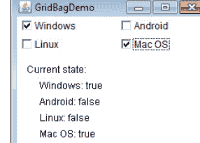

在此布局中，操作系统的复选框被放置在一个 2x2 的网格中。每个单元格具有 200 的水平内边距。每个组件从左侧略微缩进（6 个单位）。列宽设置为 1，这会导致任何额外的水平空间在列之间均匀分布。第一行使用默认权重 0；第二行的权重为 1。这意味着任何额外的垂直空间都会分到第二行。

`GridBagLayout` 是一个强大的布局管理器。值得花一些时间来实验它。一旦你理解了各种设置，就可以使用 `GridBagLayout` 以高精度的位置定位组件。

## 菜单栏和菜单

顶层窗口可以关联一个菜单栏。每个菜单与一个下拉菜单关联。这一概念在 AWT 中通过以下类实现：`MenuBar`、`Menu` 和 `MenuItem`。通常，一个栏包含一个或多个 `Menu` 对象。每个 `MenuItem` 对象代表用户可以选择的内容。由于 `Menu` 是 `MenuItem` 的子类，因此可以创建嵌套菜单的层次结构。还可以包含可检查的菜单项。`CheckboxMenuItem` 在被选中时将有一个勾选标记。

要创建一个栏，首先创建一个 `MenuBar` 实例。该类定义了默认构造函数。接下来，创建 `Menu` 实例来定义显示在栏上的选项。`Menu` 的构造函数如下：

- `Menu()` 抛出 `HeadlessException`
- `Menu(String optionName)` 抛出 `HeadlessException`
- `Menu(String optionName, boolean removable)` 抛出 `HeadlessException`

在这里，`itemName` 指定菜单选择的名称。如果 `removable` 为 true，则菜单可以被移除并浮动。否则，它将保持在菜单栏上。（可移除的菜单取决于实现）。

第一个表单创建 `MenuItem` 类型的项。它定义了这些构造函数：

- `MenuItem()` 抛出 `HeadlessException`
- `MenuItem(String itemName)` 抛出 `HeadlessException`
- `MenuItem(String itemName, MenuShortcut keyAccel)` 抛出 `HeadlessException`

在这里，`itemName` 是在菜单中显示的名称，`keyAccel` 是该项的快捷键。此处所示：

- 你可以使用 `setEnabled()` 来启用或禁用菜单项。其方法签名定义为：
  `void setEnabled(boolean enabledFlag)`

如果参数 `enabledFlag` 为 true，则菜单项被启用。如果为 false，则菜单项被禁用。

你可以通过调用 `isEnabled()` 来确定项的状态。此处显示了方法：
`boolean isEnabled()`

如果调用它的菜单项是启用的，`isEnabled` 返回 true。否则，返回 false。你可以通过调用 `setLabel()` 来更改菜单名称。你可以通过 `getLabel()` 获取当前名称。这些方法如下：

- `void setLabel(String newName)`
- `String getLabel()`


在这里，`newName` 成为调用项的新名称。`getLabel()` 返回当前名称。

你可以使用 `MenuItem` 的子类 `CheckboxMenuItem` 来创建一个可点击的菜单。它具有这些构造函数：

- `CheckboxMenuItem()` 抛出 `HeadlessException`
- `CheckboxMenuItem(String itemName)` 抛出 `HeadlessException`
- `CheckboxMenuItem(String itemName, boolean an)` 抛出 `HeadlessException`

在这里，`itemName` 是在菜单中显示的名称。可检查项作为开关工作。每当一个被选中时，它的状态就会改变。

```java
item4.addActionListener(handler);

item6.addActionListener(handler);

item7.addActionListener(handler);

item8.addActionListener(handler);

item9.addActionListener(handler);

item10.addActionListener(handler);

item11.addActionListener(handler);

item12.addActionListener(handler);

debug.addActionListener(handler);

test.addActionListener(handler);
```

```java
// 使用 lambda 表达式来处理退出选择。
item5.addActionListener(ae -> System.exit(0));
```

```java
addWindowListener(new WindowAdapter() {
    public void windowClosing(WindowEvent e) {
        System.exit(0);
    }
});
```

```java
public void paint(Graphics g) {
    g.drawString(msg, 10, 220);
}
```

```java
if (debug.getState()) {
    g.drawString("Debug is on.", 10, 240);
} else
    g.drawString("Debug is off.", 10, 240);
```

```java
if (test.getState()) {
    g.drawString("Testing is on.", 10, 260);
} else
    g.drawString("Testing is off.", 10, 260);
```

```java
public static void main(String[] args) {
    MenuDemo appwin = new MenuDemo();
    appwin.setSize(new Dimension(250, 300));
    appwin.setTitle("MenuDemo");
    appwin.setVisible(true);
}
```

```java
// 一个用于处理菜单动作事件和项目事件的
// 内部类
class MyMenuHandler implements ActionListener, ItemListener {
```

```java
// 处理动作事件。
public void actionPerformed(ActionEvent e) {
    msg = "You selected";
    String arg = e.getActionCommand();
    if (arg.equals("New..."))
        msg += "New";
    else if (arg.equals("Open..."))
        msg += "Open";
    else if (arg.equals("Close"))
        msg += "Close";
    else if (arg.equals("Edit"))
        msg += "Edit";
    else if (arg.equals("Cut"))
        msg += "Cut";
    else if (arg.equals("Copy"))
        msg += "Copy";
    else if (arg.equals("Paste"))
        msg += "Paste";
    else if (arg.equals("First"))
        msg += "First";
    else if (arg.equals("Second"))
        msg += "Second";
    else if (arg.equals("Third"))
        msg += "Third";
    else if (arg.equals("Debug"))
        msg += "Debug";
    else if (arg.equals("Testing"))
        msg += "Testing";
    repaint();
}

// 处理项目事件。
public void itemStateChanged(ItemEvent ie) {
    repaint();
}
```

`MenuDemo` 程序的示例输出所示如图 27-8。

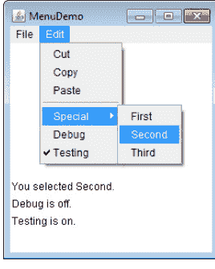

**图 27-8** MenuDemo 程序的示例输出

还有另一种与菜单相关的类，它会产生一个可以在特定位置显示的 `PopupMenu`（弹出菜单）。`PopupMenu` 的工作类似于 `Menu`，为某些类型的菜单场景提供了灵活且实用的替代方案。

# 对话框

通常，你可能想要使用对话框来包含一组相关的控件。对话框主要用于显示用户输入，是顶层窗口的子窗口。对话框没有菜单栏，但在其他方面，它们的功能类似于帧窗口（frame windows）。（你可以通过向帧窗口的方式向它们添加控件。）对话框可以是模态的（modal）或非模态的（modeless）。通俗来说，当模态对话框激活时，在关闭对话框之前你无法访问程序中的其他窗口（对话窗口的子窗口除外）。当非模态对话框激活时，输入可以重定向到程序中的另一个窗口。因此，程序的其他部分仍然保持激活状态并可访问。从 JDK 6 开始，可以通过 `Dialog.Modality` 枚举指定的三个不同类型的模态来创建模态对话框。默认是 `APPLICATION_MODAL`，它防止使用应用程序中的其他顶层窗口。这是传统的模态类型。其他类型是 `DOCUMENT_MODAL` 和 `TOOLKIT_MODAL`。还包含了 `MODELESS`（非模态）。

在 AWT 中，对话框是 `Dialog` 类型。这里展示了两个常用的构造函数：

- `Dialog(Frame parentWindow, boolean mode)`
- `Dialog(Frame parentWindow, String title, boolean mode)`

在这里，`parent` 是对话框的所有者。如果 `mode` 为 true，则对话框窗口使用默认模态性；否则，它是非模态的。对话框的标题可以通过 `title` 传递。通常，你会通过继承 `Dialog` 来派生子类，并添加你的应用程序所需的功能。

以下是对话框的一个修改版本，它在选择 New 选项时显示一个模态对话框。当调用 `dispose()` 时，该方法由 `Window` 定义，并释放与对话框相关的所有系统资源。

```java
// 阐释对话框。
import java.awt.*;
import java.awt.event.*;

class DialogDemo extends Frame {
    String msg = "";
    CheckboxMenuItem debug, test;
    Dialog myDialog;

    DialogDemo() {
        // 创建对话框。
        myDialog = new Dialog(this, "Dialog Box");

        // 创建菜单栏并将其添加到帧。
        MenuBar mbar = new MenuBar();

        MenuItem item1, item2, item3, item4, item5, item6, item7, item8, item9, item10, item11, item12;
        Menu file = new Menu();
        Menu edit = new Menu();

        item1 = new MenuItem("New...");
        item2 = new MenuItem("Open...");
        item3 = new MenuItem("Close");
        item4 = new MenuItem("Edit");
        item5 = new MenuItem("Cut");
        item6 = new MenuItem("Copy");
        item7 = new MenuItem("Paste");
        item8 = new MenuItem("First");
        item9 = new MenuItem("Second");
        item10 = new MenuItem("Third");
        item11 = new MenuItem("Debug");
        item12 = new CheckboxMenuItem("Testing");

        file.add(item1);
        file.add(item2);
        file.add(item3);
        file.add(item4);
        file.add(item5);
        file.add(item6);
        file.add(item7);
        file.add(item8);
        file.add(item9);
        file.add(item10);
        edit.add(item11);
        edit.add(item12);

        mbar.add(file);
        mbar.add(edit);
        setMenuBar(mbar);

        // 创建菜单项。
        item1.addActionListener(handler);
        item2.addActionListener(handler);
        item3.addActionListener(handler);
        item4.addActionListener(handler);
        item5.addActionListener(handler);
        item6.addActionListener(handler);
        item7.addActionListener(handler);
        item8.addActionListener(handler);
        item9.addActionListener(handler);
        item10.addActionListener(handler);
        item11.addActionListener(handler);
        item12.addActionListener(handler);

        // 接收事件。
        debug.addActionListener(handler);
        test.addActionListener(handler);

        // 特殊菜单项。
        item1.addActionListener(handler);
        item2.addActionListener(handler);
        item3.addActionListener(handler);
        item4.addActionListener(handler);
        item5.addActionListener(handler);
        item6.addActionListener(handler);
        item7.addActionListener(handler);
        item8.addActionListener(handler);
        item9.addActionListener(handler);
        item10.addActionListener(handler);
        item11.addActionListener(handler);
        item12.addActionListener(handler);
    }

    public void paint(Graphics g) {
        g.drawString(msg, 10, 220);
        if (debug.getState()) {
            g.drawString("Debug is on.", 10, 240);
        } else
            g.drawString("Debug is off.", 10, 240);
        if (test.getState()) {
            g.drawString("Testing is on.", 10, 260);
        } else
            g.drawString("Testing is off.", 10, 260);
    }
}
```


```java
g.drawString("Testing is off.", 10, 260);
}

public static void main(String[] args) {
    DialogDemo appwin = new DialogDemo();
    appwin.setSize(new Dimension(250, 300));
    appwin.setTitle("MenuDemo");
    appwin.setVisible(true);
}

// 一个用于处理动作事件和项目事件的内部类
class MyHandler implements ActionListener, ItemListener {
    // 处理动作事件。
    public void actionPerformed(ActionEvent e) {
        msg = "You selected";
        String arg = e.getActionCommand();
        if (arg.equals("New...")) {
            msg += "New";
            myDialog.setVisible(true);
        } else if (arg.equals("Open...")) {
            msg += "Open";
        } else if (arg.equals("Close")) {
            msg += "Close";
        } else if (arg.equals("Edit")) {
            msg += "Edit";
        }
    }

    // 处理项目事件。
    public void itemStateChanged(ItemEvent ie) {
        repaint();
    }
}
```

### 928 第二部分 Java 库

以下是 `DialogDemo` 程序的示例输出：

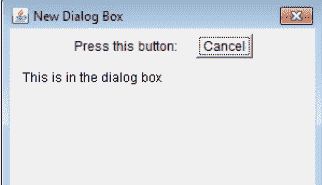

提示：你可以尝试为菜单中提供的其他选项定义对话框。

## 关于重写 `paint()` 的说明

在开始研究 AWT 控件之前，有必要简单说明一下重写 `paint()`。虽然这与书中的 AWT 示例无关，但在重写 `paint()` 时，有时需要调用父类的 `paint()` 实现。因此，对于某些程序，你需要使用此 `paint()` 骨架：

```java
public void paint(Graphics g) {
    // 重绘此窗口的代码
    // 调用父类的 paint()
    super.paint(g);
}
```

在 Java 中，组件通常有两种类型：重量级（heavyweight）和轻量级（lightweight）。重量级组件拥有其原生窗口，被称为它的对应组件（peer）。轻量级组件完全用 Java 代码实现，并使用祖先组件提供的窗口。本章描述和使用的 AWT 控件都是重量级的。然而，如果容器包含任何轻量级组件（即拥有轻量级组件），你对该容器的 `paint()` 重写必须调用 `super.paint()`。通过调用 `super.paint()`，你确保任何轻量级组件作为轻量级控件得到适当绘制。如果你不确定子组件的类型，可以调用 `Component` 定义的 `isLightweight()` 来查找。如果组件是轻量级的，则返回 `true`，否则返回 `false`。

## 第 28 章 图像

本章将研究 `Image` 类和 `java.awt.image` 包。它们共同为图像处理（图形图像的显示和操作）提供了支持。图像简单来说是一个矩形图形对象。图像是 Web 设计中的一个关键组件。事实上，NCSA（国家超级计算机应用中心）的 Mosaic 浏览器中引入 `` 标签是帮助 Web 在 1993 年爆炸式增长的催化剂。该标签用于将图像以内联形式包含超文本流中。Java 扩展了这一基本概念，允许在程序控制下管理图像。由于其重要性，Java 为图像处理提供了广泛的支持。

图像由 `Image` 类支持，该类是 `java.awt.image` 包的一部分。图像使用 `java.awt.image` 包中的类进行操作。定义了大量的图像类和接口，无法一一检查它们。相反，我们将关注那些构成图像处理基础的类。以下是本章讨论的 `java.awt.image` 类：

| CropImageFilter | MemoryImageSource |
| FilteredImageSource | PixelGrabber |
| ImageFilter | RGBImageFilter |

我们将使用的接口是 `ImageConsumer` 和 `ImageProducer`。

## 文件格式

最初，Web 图像只能是 GIF 格式。GIF 格式由 CompServe 在 1987 年创建，为了能够在在线查看图像，同时它适用于互联网。GIF 图像每幅最多只有 256 种颜色。这种局限性导致主要浏览器供应商在 1995 年增加了对 JPEG 图像的支持。JPEG 格式由一组摄影专家创建，用于存储全色域、连续色调图像。这些图像在创建得当时，比相同源图像的 GIF 编码具有更高的保真度且压缩率更高。另一种格式是 PNG。它是 GIF 的替代方案。在几乎所有情况下，你永远不会关心或注意到程序中使用的是哪种格式。Java 图像类通过整洁的接口抽象了背后的差异。

## 图像基础：创建、加载和显示

当你处理图像时，会有三种常见操作：创建图像、加载图像和显示图像。在 Java 中，`Image` 类用于引用内存中的图像以及从外部源加载的图像。因此，Java 提供了让你创建新图像对象的方法以及加载图像的方法。它还提供了显示图像的方法。让我们来看每一个。

## 创建图像对象

你可能认为使用类似下面的代码创建图像对象：

```java
Image test = new Image(200, 100); // 错误，行不可通
```

并非如此。因为图像必须绘制在窗口上才能看到，`Image` 类没有关于其环境的信息来为屏幕创建正确的格式。`java.awt` 中的 `Component` 类有一个名为 `createImage()` 的工厂方法，用于创建 `Image` 对象。请记住，所有的 AWT 组件都是 `Component` 的子类，因此所有组件都支持此方法。

`createImage()` 方法有以下形式：

```java
createImage(ImageProducer imgProd)
createImage(int width, int height)
```

第一种形式返回由 `imgProd` 生成的图像，它是实现 `ImageProducer` 接口的类的对象。（我们稍后会查看图像生产者。）第二种形式返回一个具有指定宽度和高度的空白（即空）图像。这是一个示例：

```java
Canvas c = new Canvas();
Image test = c.createImage(200, 100);
```

这创建了一个 `Canvas` 实例，然后调用 `createImage()` 方法实际创建一个 `Image` 对象。此时，图像是空白的。稍后你将看到如何向它写入数据。

## 加载图像

获取图像的另一种方法是加载它，可以从本地文件系统的文件或从 URL。加载图像最简单的方法是使用 `ImageIO`。以下是一个加载并显示图像的程序：

```java
import java.awt.*;
import java.awt.event.*;
import javax.imageio.*;
import java.io.*;

public class SimpleImageLoad extends Frame {
    Image img;

    public SimpleImageLoad() {
        try {
            File imageFile = new File("Lilies.jpg");
            // 加载图像
            img = ImageIO.read(imageFile);
        } catch (IOException exc) {
            System.out.println("无法加载图像.");
            System.exit(0);
        }

        addWindowListener(new WindowAdapter() {
            public void windowClosing(WindowEvent e) {
                System.exit(0);
            }
        });
    }

    public void paint(Graphics g) {
        g.drawImage(img, 0, 0, null);
    }

    public static void main(String[] args) {
        SimpleImageLoad appwin = new SimpleImageLoad();
        appwin.setSize(new Dimension(400, 365));
        appwin.setTitle("SimpleImageLoad");
        appwin.setVisible(true);
    }
}
```

## 双缓冲

正如我们所示，图像不仅可以存储图片，还可以作为离屏表面。这允许你将任何图像（包括文本和图形）渲染到离屏缓冲区中，稍后显示。这样做的好处是图像只有在完成后才可见。绘制一个复杂的图像可能需要几毫秒或更长时间，这会被用户看到闪烁。这种闪烁会分散注意力，并导致用户认为你的渲染比实际上慢。使用离屏图像来减少闪烁被称为双缓冲，因为屏幕被认为是像素的缓冲区，而离屏图像是第二个缓冲区，因为你可以预先准备要显示的像素。

在本章前面，你学习了如何创建一个空白的 `Image` 对象。现在你将看到如何将屏幕上绘制该图像。正如你从之前的章节记得的，你需要一个空白的 `Graphics` 对象才能使用 Java 的任何渲染方法。方便的是，可以在 `Image` 上绘图的 `Graphics` 对象可以通过 `getGraphics()` 方法获得。这是一个创建一个新图像、获取其图形并用红色像素填充整个图像的代码片段：

```java
Canvas c = new Canvas();
Image test = c.createImage(200, 100);
Graphics gc = test.getGraphics();
gc.setColor(Color.red);
gc.fillRect(0, 0, 200, 100);
```

一旦你构建并填充了离屏图像，它仍然不可见。要实际显示该图像，请调用 `drawImage()`。这里的示例绘制了一幅耗时的图像，以展示双缓冲在感知绘制时间上带来的差异：

```java
// 演示离屏缓冲区的使用。
import java.awt.*;
import java.awt.event.*;

public class DoubleBuffer extends Frame {
    int gap = 3;
    int mx, my;
    boolean flicker = true;
    Image buffer = null;
    int w = 400, h = 400;

    public DoubleBuffer() {
        addMouseMotionListener(new MouseAdapter() {
            public void mouseDragged(MouseEvent me) {
                mx = me.getX();
                my = me.getY();
                flicker = false;
                repaint();
            }

            public void mouseMoved(MouseEvent me) {
                mx = me.getX();
                my = me.getY();
                flicker = true;
                repaint();
            }
        });

        addWindowListener(new WindowAdapter() {
            public void windowClosing(WindowEvent we) {
                System.exit(0);
            }
        });
    }

    public void paint(Graphics g) {
        Graphics screencg = null;
        if (!flicker) {
            screencg = g;
            g = buffer.getGraphics();
        }

        g.setColor(Color.blue);
        g.fillRect(0, 0, w, h);

        g.setColor(Color.red);
        for (int i = 0; i < w; i += gap)
            g.drawLine(i, 0, w - i, h);
        for (int i = 0; i < h; i += gap)
            g.drawLine(0, i, w, h - i);

        g.setColor(Color.black);
        g.drawString("Press mouse button to double buffer", 10, h / 2);

        g.setColor(Color.yellow);
        g.fillOval(mx - gap, my - gap, gap * 2 + 1, gap * 2 + 1);

        if (!flicker) {
            screencg.drawImage(buffer, 0, 0, null);
        }
    }

    public void update(Graphics g) {
        paint(g);
    }

    public static void main(String[] args) {
        DoubleBuffer appwin = new DoubleBuffer();
        appwin.setSize(new Dimension(400, 400));
        appwin.setTitle("DoubleBuffer");
        appwin.setVisible(true);

        // 创建一个离屏缓冲区。
        appwin.buffer = appwin.createImage(appwin.w, appwin.h);
    }
}
```

这个简单的程序完成了一个 `paint()` 方法。它用蓝色填充背景，并在其上方绘制一个红色的网格图案。有时会绘制黑色内容，然后在坐标 `mx, my` 处绘制一个黄色圆圈。重写了 `mouseMoved()` 和 `mouseDragged()` 方法来跟踪鼠标位置。这两个方法完全相同，除了设置 `flicker` 变量。`mouseMoved()` 和 `mouseDragged()` 将 `flicker` 设置为 `true` 或 `false`。产生的效果是：当鼠标移动（但未按下）时调用 `flicker` 为 `true` 的 `repaint()`；当按下任何按钮并拖动鼠标时调用 `flicker` 为 `false` 的 `repaint()`。

当在 `flicker` 为 `true` 时调用 `paint()`，我们可以看到屏幕上每一个绘制操作。在按下按钮并调用 `paint()` 的情况下，我们看到了完全不同的画面。`paint()` 方法将引用的 `Graphics` 上下文切换到我们在 `main()` 中创建的离屏画布 `buffer`。然后所有的绘制操作都是非活跃的。在 `paint()` 结束时，我们只需调用 `drawImage()` 即可一次显示所有绘制方法的结果。

示例输出如图 28-2 所示。左快照是未按下鼠标时的屏幕状态。如你所示，拍摄此快照时图像正在重绘。

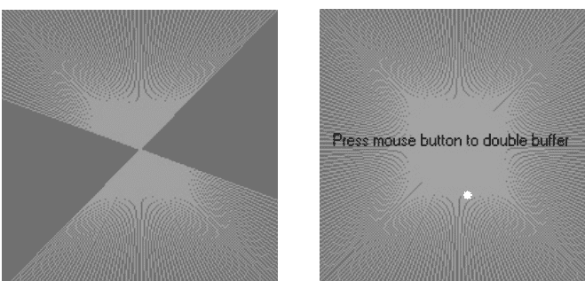

**图 28-2** 未使用（左）和使用（右）双缓冲的 `DoubleBuffer` 输出

## `ImageProducer`

**ImageProducer** 是一个为想要生成图像数据的对象的接口。实现 **ImageProducer** 接口的对象将提供表示图像数据的整数数组或字节数组，并生成 `Image` 对象。正如你之前看到的，`createImage()` 方法的一种形式接受 **ImageProducer** 对象作为参数。`java.awt` 中包含两个生产者：**MemoryImageSource** 和 **FilteredImageSource**。在这里，我们将检查 `MemoryImageSource` 并从生成的数据创建新的 `Image` 对象。


## ImageConsumer

`ImageConsumer` 是一个想要从图像中获取像素数据并将其作为其他类型数据的接口。显然，它是前面描述的 `ImageProducer` 的相反。实现 `ImageConsumer` 接口的对象将创建表示图像中像素的字节数组。我们将检查 `PixelGrabber` 类，它是 `ImageConsumer` 接口的一个简单实现。

## PixelGrabber

`PixelGrabber` 类定义在 `java.lang.image` 中。它是 `MemoryImageSource` 类的逆类。它不是从像素值数组构建图像，而是获取现有的图像并从中提取像素数组。要使用 `PixelGrabber`，你需要创建一个足够大的整数数组来容纳像素数据，然后在你想要提取的矩形区域创建一个 `PixelGrabber` 实例。最后，对它调用 `grabPixels()`。

```
PixelGrabber(Image imgObj, int left, int top, int width, int height, int[] pixel, int offset, int scanLineWidth)
```

### grabPixels()

`grabPixels()` 的定义如下：

```java
boolean grabPixels() throws InterruptedException

boolean grabPixels(long milliseconds) throws InterruptedException
```

这两个方法在成功时返回 true，否则返回 false。在第二种形式中，`milliseconds` 指定了方法等待像素的时间。如果执行被另一个线程中断，它们都会抛出 `InterruptedException`。

示例展示了如何从图像中获取像素并创建像素亮度直方图。直方图仅是对亮度 0 到 255 之间所有特定亮度像素的计数。在程序绘制图像后，它会在上方绘制该直方图。

```java
// 演示 PixelGrabber.
import java.awt.*;
import java.awt.event.*;
import java.awt.image.*;
import java.imageio.*;
import java.io.*;
```

```java
public class HistoGrab extends Frame {
    Dimension d;
    Image img;
    int iw, ih;
    int[] pixels;
    int[] hist = new int[256];
    int max_hist = 0;
    Insets ins;
}
```

```java
public HistoGrab() {
    try {
        File imageFile = new File("Lilies.jpg");

        // 加载图像.
        img = ImageIO.read(imageFile);

        iw = img.getWidth(null);
        ih = img.getHeight(null);
        pixels = new int[iw * ih];
        PixelGrabber pg = new PixelGrabber(img, 0, 0, iw, ih,
                pixels, 0, iw);
        pg.grabPixels();
    } catch (InterruptedException e) {
        System.out.println("Interrupted");
        return;
    } catch (IOException exc) {
        System.out.println("Cannot load image file.");
        System.exit(0);
    }

    for (int i = 0; i < iw * ih; i++) {
        int p = pixels[i];
        int r = 0xff & (p >> 16);
        int g = 0xff & (p >> 8);
        int b = 0xff & (p);
        int y = (int) (.33 * r + .56 * g + .11 * b);
        hist[y]++;
    }

    for (int i = 0; i < 256; i++) {
        if (hist[i] > max_hist)
            max_hist = hist[i];
    }

    addWindowListener(new WindowAdapter() {
        public void windowClosing(WindowEvent event) {
            System.exit(0);
        }
    });
}
```

```java
public void paint(Graphics g) {
    // 获取边框/页眉边距
    ins = getInsets();

    g.drawImage(img, ins.left, ins.top, null);

    int x = (iw - 256) / 2;
    int last = ih - ih * hist[0] / max_hist;

    for (int i = 0; i < 256; i++, x++) {
        int y = last - ih * hist[i] / max_hist;
        g.setColor(new Color(i, i, i));
        g.fillRect(x + ins.left, y + ins.top, 1, ih - y);
        g.setColor(Color.red);
        g.drawLine((x - 1) + ins.left, last + ins.top, x + ins.left, y + ins.top);
    }
}
```

```java
public static void main(String[] args) {
    HistoGrab appwin = new HistoGrab();

    appwin.setSize(new Dimension(400, 380));
    appwin.setTitle("HistGrab");
    appwin.setVisible(true);
}
```

图 28-4 显示了一个示例图像及其直方图。


**图 28-4** HistoGrab 的输出

给定 `ImageProducer` 和 `ImageConsumer` 接口——以及它们的具体类 `MemoryImageSource` 和 `PixelGrabber`——你可以创建一个任意过滤器，它接收像素源、修改它们并将其传递给任意消费者。这种图像模型通过引入 `InputStream`、`OutputStream`、`Reader` 和 `Writer`（在第 22 章中描述）而完成。`java.awt.image` 包中 `ImageFilter` 的某些子类是 `AreaAveragingScaleFilter`、`ScaleFilter` 和 `RGBImageFilter`。还有一个名为 `FilteredImageSource` 的 `ImageProducer` 实现，它接收任意的 `ImageFilter` 并将其封装在 `ImageProducer` 周围以过滤像素，就像 `BufferedInputStream` 可以被用作 `InputStream` 一样。

在本章中，我们检查两个过滤器：`CropImageFilter` 和 `RGBImageFilter`。

## CropImageFilter

`CropImageFilter` 过滤器以提取矩形区域。该过滤器的一个有用场景是你希望从一张较大的图像中使用多个小图像。如果每个图像的大小相同，那么你可以在程序启动后使用 `CropImageFilter` 轻松地提取这些图像。这里有一个从单张图像提取 16 图像的示例。然后通过交换随机图像 32 次来打乱这些块。

```java
// 演示 CropImageFilter.
import java.awt.*;
import java.awt.image.*;
import java.awt.event.*;
import java.imageio.*;
import java.io.*;
```

```java
public class TileImage extends Frame {
    Image img;
    Image[][] cell = new Image[4][4];
    int iw, ih;
    int tw, th;

    public TileImage() {
        try {
            File imageFile = new File("Lilies.jpg");

            // 加载图像.
            img = ImageIO.read(imageFile);

            iw = img.getWidth(null);
            ih = img.getHeight(null);
            tw = iw / 4;
            th = ih / 4;

            CropImageFilter f;
            FilteredImageSource fis;
            for (int y = 0; y < 4; y++) {
                for (int x = 0; x < 4; x++) {
                    f = new CropImageFilter(tw * x, th * y, tw, th);
                    fis = new FilteredImageSource(img.getSource(), f);
                    int i = y * 4 + x;
                    cell[y][x] = createImage(fis);
                }
            }
        } catch (IOException e) {
            System.out.println("Cannot load image file.");
            System.exit(0);
        }

        addWindowListener(new WindowAdapter() {
            public void windowClosing(WindowEvent event) {
                System.exit(0);
            }
        });
    }

    public void paint(Graphics g) {
        for (int y = 0; y < 4; y++) {
            for (int x = 0; x < 4; x++) {
                g.drawImage(cell[y][x], x * tw + getInsets().left,
                        y * th + getInsets().top, null);
            }
        }
    }

    public static void main(String[] args) {
        TileImage appwin = new TileImage();

        appwin.setSize(new Dimension(420, 420));
        appwin.setTitle("TileImage");
        appwin.setVisible(true);
    }
}
```

图 28-5 显示了被 TileImage 打乱的花。

## RGBImageFilter

`RGBImageFilter` 用于将一张图像逐像素转换为另一张图像，在此过程中转换颜色。该过滤器可以用于增强图像、增加其对比度或将其转换为灰度模式。

为了演示 `RGBImageFilter`，我们开发了一个相当复杂的示例，它采用了处理过滤器的动态插件策略。我们为通用的图像过滤创建了一个接口，以便程序可以在运行时直接加载这些过滤器，而不需要提前了解所有的过滤器。这个示例由名为 `ImageFilterDemo` 的主类、名为 `PluginFilter` 的接口以及名为 `LoadedImage` 的工具类组成。还包含了三个过滤器 `Grayscale`、`Invert` 和 `Contrast`——它们仅使用 `RGBImageFilter` 操作源图像的色彩空间，以及两个类 `Blur` 和 `Sharpen`——它们是更复杂的“卷积”过滤器，根据源每个像素周围的像素来改变像素。`Blur` 和 `Sharpen` 是一个名为 `Convolver` 的抽象类的子类。让我们看看每个示例。

## ImageFilterDemo.java

`ImageFilterDemo` 是示例过滤器图像的主类。它采用了默认布局，在南部位置有一个面板用于持有表示每个过滤器的按钮。一个 `Label` 对象占据北部，用于显示过滤器进度信息。中心是放置图像（封装在后来的 Canvas 子类中）的地方。

`actionPerformed()` 方法很有意思，因为它使用按钮的标签作为要加载的类名。如果按钮没有对应实现 `PluginFilter` 的正确类，该方法将采取相应的操作。

```java
// 演示图像过滤器.
import java.awt.*;
import java.awt.event.*;
import java.imageio.*;
import java.io.*;
import java.lang.reflect.*;

public class ImageFilterDemo extends Frame implements ActionListener {
    Image img;
    PluginFilter pif;
    Image find;
    Image curImg;
    LoadedImage lim;
    Label label;
    Button reset;

    // 过滤器的名称.
    String[] filters = { "Grayscale", "Invert", "Contrast",
            "Blur", "Sharpen" };

    public ImageFilterDemo() {
        Panel p = new JPanel();
        add(p, BorderLayout.SOUTH);

        // 创建重置按钮.
        reset = new Button("Reset");
        reset.addActionListener(this);
        p.add(reset);

        // 添加过滤器按钮.
        for (String fstr : filters) {
            Button b = new Button(fstr);
            b.addActionListener(this);
            p.add(b);
        }

        // 创建顶部的标签。
        label = new Label("");
        add(label, BorderLayout.NORTH);

        // 加载图片。
        try {
            File inputFile = new File("Lilies.jpg");
            img = ImageIO.read(inputFile);
        } catch (IOException exc) {
            System.out.println("无法加载图片.");
            System.exit(0);
        }

        // 获取一个加载的图像并将其添加到中心区域。
        lim = new LoadedImage(img);
        add(lim, BorderLayout.CENTER);

        addWindowListener(new WindowAdapter() {
            public void windowClosing(WindowEvent e) {
                System.exit(0);
            }
        });
    }

    public void actionPerformed(ActionEvent ae) {
        String a = "";
    }
}
```


```java
try {
    a = ae.getActionCommand();
    if (a.equals("Reset")) {
        lim.set(img);
        lab.setText("Normal");
    } else {
        // 获取选定的过滤器。
        pif = (PluginFilter) Class.forName(a).getConstructor().newInstance();
        fimg = pif.filter(this, img);
        lim.set(img);
        lab.setText("Filtered: " + a);
    }
    repaint();
} catch (ClassNotFoundException e) {
    lab.setText(a + " not found");
    lim.set(img);
    repaint();
} catch (InstantiationException e) {
    lab.setText("couldn't new " + a);
} catch (IllegalAccessException e) {
    lab.setText("no access: " + a);
} catch (NoSuchMethodException | InvocationTargetException e) {
    lab.setText("Filter creation error: " + e);
}

public static void main(String[] args) {
    ImageFilterDemo appwin = new ImageFilterDemo();

    appwin.setSize(new Dimension(420, 420));
    appwin.setTitle("ImageFilterDemo");
    appwin.setVisible(true);
}
```

图 28-6 显示了程序首次加载时的样子。

# PluginFilter.java

`PluginFilter` 是一个用于抽象图像过滤的简单接口。它只有一个方法 `filter()`，该方法接收帧（`Frame`）和源图像（`Image`），并返回经过某种方式过滤的新图像。

```java
interface PluginFilter {
    java.awt.Image filter(java.awt.Frame f, java.awt.Image in);
}
```

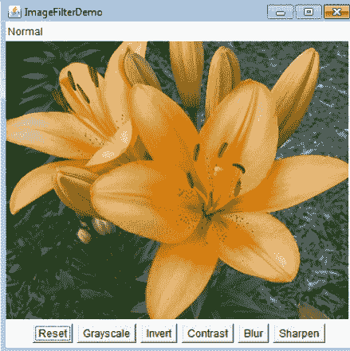

**图 28-6** `ImageFilterDemo` 的示例正常输出

# LoadedImage.java

`LoadedImage` 是 `Canvas` 的便利子类。它在布局管理器的控制下运行良好，重写 `getPreferredSize()` 和 `getMinimumSize()` 方法。它还有一个名为 `set()` 的方法，可以设置一个新的图像并在 `Canvas` 中显示。这就是插件处理完成后显示过滤图像的方式。

```java
import java.awt.*;

public class LoadedImage extends Canvas {
    Image img;

    public LoadedImage(Image i) {
        set(i);
    }

    void set(Image i) {
        img = i;
        repaint();
    }

    public void paint(Graphics g) {
        if (img == null) {
            g.drawString("no image", 10, 30);
        } else {
            g.drawImage(img, 0, 0, this);
        }
    }

    public Dimension getPreferredSize() {
        return new Dimension(img.getWidth(), img.getHeight());
    }

    public Dimension getMinimumSize() {
        return getPreferredSize();
    }
}
```

# Grayscale.java

`Grayscale` 过滤器是 `RGBImageFilter` 的子类，这意味着 `Grayscale` 可以将自己作为 `ImageFilter` 参数传递给 `FilteredImageSource` 的构造函数。然后它所做的重写 `filterRGB` 来更改传入的颜色值。它获取红、绿、蓝值，并使用 NTSC（国家电视标准委员会）颜色到亮度转换因子计算像素的亮度。然后简单地返回一个与颜色源相同亮度的灰色像素。

```java
// 灰度过滤器。
import java.awt.*;
import java.awt.image.*;

class Grayscale extends RGBImageFilter implements PluginFilter {
    public Grayscale() {
    }

    public Image filter(Frame f, Image in) {
        return f.createImage(new FilteredImageSource(in.getSource(), this));
    }

    public int filterRGB(int x, int y, int rgb) {
        int r = (rgb >> 16) & 0xff;
        int g = (rgb >> 8) & 0xff;
        int b = rgb & 0xff;
        int k = (int) (.56 * g + .33 * r + .11 * b);
        return (0xff000000 | k << 16 | k << 8 | k);
    }
}
```

# Invert.java

`Invert` 过滤器也相当简单。它分解红、绿、蓝值，然后通过从 255 中减去这些值来实现反转。这些反转后的值被重新封装回一个像素并返回。

```java
// 反转颜色。
import java.awt.*;
import java.awt.image.*;

class Invert extends RGBImageFilter implements PluginFilter {
    public Invert() {
    }

    public Image filter(Frame f, Image in) {
        return f.createImage(new FilteredImageSource(in.getSource(), this));
    }

    public int filterRGB(int x, int y, int rgb) {
        int r = 0xff - ((rgb >> 16) & 0xff);
        int g = 0xff - ((rgb >> 8) & 0xff);
        int b = 0xff - (rgb & 0xff);
        return (0xff000000 | r << 16 | g << 8 | b);
    }
}
```

图 28-7 显示通过 `Invert` 过滤器后的图像。

# Contrast.java

`Contrast` 过滤器与 `Grayscale` 非常相似，但它的 `filterRGB()` 重写更为复杂。对比增强算法分别获取红、绿、蓝值，如果它们大于 128，则增加 1.2 倍。如果它们小于 128，则除以 1.2。增强后的值通过 `multclamp()` 方法被正确限制在 255。

```java
// 对比过滤器。
import java.awt.*;
import java.awt.image.*;

public class Contrast extends RGBImageFilter implements PluginFilter {

    public Image filter(Frame f, Image in) {
        return f.createImage(new FilteredImageSource(in.getSource(), this));
    }

    private int multclamp(int in, double factor) {
        in = (int) (in * factor);
        return in > 255 ? 255 : in;
    }

    double gain = 1.2;

    private int cont(int in) {
        return (in < 128) ? (int)(in / gain) : multclamp(in, gain);
    }

    public int filterRGB(int x, int y, int rgb) {
        int r = cont((rgb >> 16) & 0xff);
        int g = cont((rgb >> 8) & 0xff);
        int b = cont(rgb & 0xff);
        return (0xff000000 | r << 16 | g << 8 | b);
    }
}
```

图 28-8 显示了按下 `Contrast` 后图像。

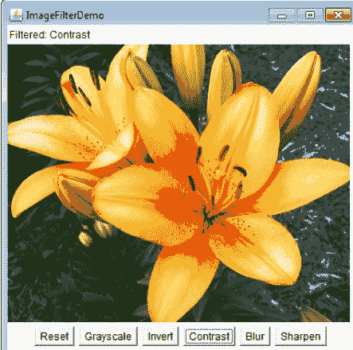

**图 28-8** 在 `ImageFilterDemo` 中使用 `Contrast` 过滤器

# Convolver.java

抽象类 `Convolver` 通过实现 `ImageConsumer` 接口来处理源像素，将其导入名为 `imgpixels` 的数组。它还创建了第二个名为 `newimgpixels` 的数组用于过滤数据。卷积过滤器采样图像中每个像素周围的小矩形，称为*卷积核*。在本演示中，该区域为 3x3 像素。

> 注意：过滤器不能修改 `imgpixels` 数组是因为下次扫描会尝试使用上一个像素的值，而该值已经被过滤掉了。

接下来的两个具体子类实现了 `convolve()` 方法，使用 `imgpixels` 作为源数据并使用 `newimgpixels` 存储结果。

```java
// 卷积过滤器。
import java.awt.*;
import java.awt.image.*;

abstract class Convolver implements ImageConsumer, PluginFilter {
    int width, height;
    int[] imgpixels, newimgpixels;
    boolean imageReady = false;

    abstract void convolve(); // 过滤器在这里...

    public Image filter(Frame f, Image in) {
        imageReady = false;
        in.getSource().startProduction(this);
        waitForImage();
        newimgpixels = new int[width * height];

        try {
            convolve();
        } catch (Exception e) {
            System.out.println("Convolver failed: " + e);
            e.printStackTrace();
        }

        return f.createImage(
            new MemoryImageSource(width, height, newimgpixels, 0, width));
    }

    synchronized void waitForImage() {
        try {
            while (!imageReady)
                wait();
        } catch (Exception e) {
            System.out.println("Interrupted");
        }
    }

    public void setProperties(java.util.Hashtable<?, ?> dummy) {}
    public void setColorModel(ColorModel dummy) {}
    public void setHints(int dummy) { }

    public synchronized void imageComplete(int dummy) {
        imageReady = true;
        notifyAll();
    }

    public void setDimensions(int x, int y) {
        width = x;
        height = y;
        imgpixels = new int[x * y];
    }

    public void setPixels(int x1, int y1, int w, int h,
                          ColorModel model, byte[] pixels, int off, int scansize) {
        int pix, x, y, x2, y2, sy, sx;

        x2 = x1 + w;
        y2 = y1 + h;
        sy = off;
        for (y = y1; y < y2; y++) {
            sx = sy;
            for (x = x1; x < x2; x++) {
                pix = model.getRGB(pixels[sx++]);
                if ((pix & 0xff000000) == 0)
                    pix = 0x00ffffff;
                imgpixels[y * width + x] = pix;
            }
            sy += scansize;
        }
    }

    public void setPixels(int x1, int y1, int w, int h,
                          ColorModel model, int[] pixels, int off, int scansize) {
        int pix, x, y, x2, y2, sx, sy;

        x2 = x1 + w;
        y2 = y1 + h;
        sy = off;
        for (y = y1; y < y2; y++) {
            sx = sy;
            for (x = x1; x < x2; x++) {
                pix = model.getRGB(pixels[sx++]);
                if ((pix & 0xff000000) == 0)
                    pix = 0x00ffffff;
                imgpixels[y * width + x] = pix;
            }
            sy += scansize;
        }
    }
}
```

注意：`java.awt.image` 提供了一个名为 `ConvolveOp` 的内置卷积过滤器。你可能想自己去探索它的功能。

## Blur.java

该过滤器是 `Convolver` 的子类，它只需遍历源图像数组 `imgpixels` 中的每一个像素，并计算其周围 3x3 框的平均值。`newimgpixels` 中对应的输出像素即为该平均值。

```java
public class Blur extends Convolver {
    public void convolve() {
        for (int y = 1; y < height - 1; y++) {
            for (int x = 1; x < width - 1; x++) {
                int rs = 0;
                int gs = 0;
                int bs = 0;

                for (int k = -1; k <= 1; k++) {
                    for (int j = -1; j <= 1; j++) {
                        int rgb = imgpixels[(y + k) * width + x + j];
                        int r = (rgb >> 16) & 0xff;
                        int g = (rgb >> 8) & 0xff;
                        int b = rgb & 0xff;
                        rs += r;
                        gs += g;
                        bs += b;
                    }
                }

                rs /= 9;
                gs /= 9;
                bs /= 9;

                newimgpixels[y * width + x] = (0xff000000 |
                        rs << 16 | gs << 8 | bs);
            }
        }
    }
}
```

图 28-9 显示了经过 `Blur` 处理后的图像。

## Sharpen.java


# Sharpen 过滤器

`Sharpen` 过滤器也是 `Convolver` 的子类，并且在某种程度上是 `Blur` 的逆操作。它遍历源图像数组 `imgpixels` 中的每一个像素，并计算其周围 3x3 框的平均值（不包括中心像素本身）。`newimgpixels` 中对应的输出像素加上中心像素与周围平均值之间的差值。这基本上的意思是：如果一个像素比它的周围环境亮 30 个，就让它再亮 30 个。

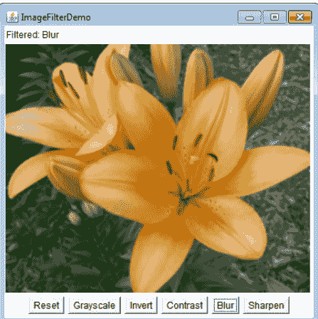

**图 28-9** 在 ImageFilterDemo 中使用 Blur 过滤器

然而，如果它比周围暗 10 个，就让它再暗 10 个。这倾向于增强边缘，同时保持平滑区域不变。

```java
public class Sharpen extends Convolver {
    private final int clamp(int c) {
        return (c > 255) ? 255 : (c < 0 ? 0 : c);
    }

    public void convolve() {
        int r0 = 0, g0 = 0, b0 = 0;

        for (int y = 1; y < height - 1; y++) {
            for (int x = 1; x < width - 1; x++) {
                int rs = 0;
                int gs = 0;
                int bs = 0;

                for (int k = -1; k <= 1; k++) {
                    for (int j = -1; j <= 1; j++) {
                        int rgb = imgpixels[(y + k) * width + x];
                        int r = (rgb >> 16) & 0xff;
                        int g = (rgb >> 8) & 0xff;
                        int b = rgb & 0xff;
                        if (j == 0 && k == 0) {
                            r0 = r;
                            g0 = g;
                            b0 = b;
                        } else {
                            rs += r;
                            gs += g;
                            bs += b;
                        }
                    }
                }
                rs >>= 3;
                gs >>= 3;
                bs >>= 3;
                newimgpixels[y * width + x] = (0xff000000 |
                    clamp(r0 + r0 - rs) << 16 |
                    clamp(g0 + g0 - gs) << 8 |
                    clamp(b0 + b0 - bs));
            }
        }
    }
}
```

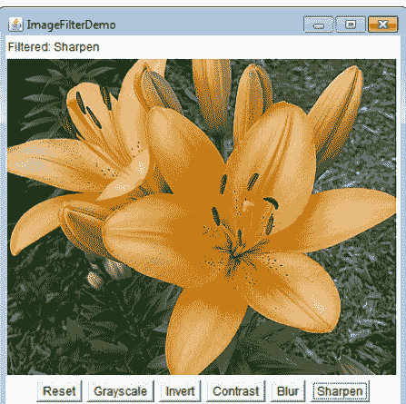

**图 28-9** 在 ImageFilterDemo 中使用 Blur 过滤器

## 其他类

除了本章描述的类之外，`java.image` 中还有许多其他类可用。如果你对图形输出感兴趣，你可能会想探索 `java.awt`。

# 第 29 章 并发工具

注意每个同步器都为特定类型的同步问题提供了解决方案。这使得每个同步器都能针对其预期的用途进行优化。在 Java 早期，这些类型的同步对象必须手工构建。并发 API 将它们标准化，并供所有 Java 程序员使用。

`Executors` 管理线程的执行。层次结构的顶端是 `Executor` 接口，它用于启动线程。`ExecutorService` 提供了管理执行的方法。`ExecutorService` 有三种实现：`ThreadPoolExecutor`、`ScheduledThreadPoolExecutor` 和 `ForkJoinPool`。`java.util.concurrent` 定义了 `Executors` 工具类，它包含许多简化创建各种执行器的静态方法。

与执行相关的是 `Future` 和 `Callable` 接口。`Future` 包含线程执行后返回的值，该值在线程终止时在“未来”中定义。`Callable` 定义了一个返回值的方法。

`java.util.concurrent` 定义了几个集合类，包括 `ConcurrentHashMap`、`ConcurrentLinkedQueue` 和 `CopyOnWriteArrayList`。这些类提供了 Collections Framework 定义的相关类的并发替代方案。

Fork/Join 框架支持并行编程。它的类包括 `ForkTask`、`ForkJoinPool`、`RecursiveTask` 和 `RecursiveAction`。

为了更好地控制线程计时，`java.util.concurrent` 定义了 `TimeUnit` 枚举。从 JDK 9 开始，`java.util.concurrent` 还包含了一种控制数据流的系统。它基于 `Flow` 类及其嵌套接口：`Flow.Subscriber`、`Flow.Publisher`、`Flow.Processor` 和 `Flow.Subscription`。`Flow` 及其嵌套接口支持响应式流规范。虽然 Flow 系统的详细讨论不是本章的重点，但这里有一个简要描述。该规范定义了一种机制，使数据的生产者防止超过消费者处理数据的能力。在这种方法中，数据由生产者产生并由订阅者消费。通过实现背压（backpressure）来实现控制。

## java.util.concurrent.atomic

`java.util.concurrent.atomic` 在不使用锁的情况下在并发环境中使用变量。它提供了一种高效更新变量值的方法。这是通过使用 `AtomicInteger` 和 `AtomicLong` 等类以及 `compareAndSet()`、`decrementAndGet()` 和 `getAndSet()` 等方法实现的。这些方法作为单个、不可中断的操作执行。

## java.util.concurrent.locks

`java.util.concurrent.locks` 为 `synchronized` 方法提供了替代方案。这种替代方案的核心是 `Lock` 接口，它定义了获取和释放对象访问的基本机制。关键方法是 `lock()`、`tryLock()` 和 `unlock()`。使用这些方法的优点是对同步具有更大的控制力。

本章的剩余部分将详细查看并发 API 的组成部分。


### 使用同步对象

同步对象由 `Semaphore`、`CountDownLatch`、`CyclicBarrier`、`Exchanger` 和 `Phaser` 类支持。它们共同让你轻松处理以前困难的同步情况。它们也适用于广泛的程序——甚至是包含有限并发的程序。由于同步对象几乎所有的 Java 程序感兴趣，因此这里对每个对象进行了详细检查。

## Semaphore

许多读者会立即识别出 `Semaphore` 是同步对象，它实现了一个经典的信号量。信号量通过计数器控制对共享资源的访问。如果计数器大于零，则允许访问。如果它为零，则拒绝访问。计数器计算的是允许访问共享资源的许可。因此，要访问资源，线程必须从信号量获得一个许可。

通常，使用信号量时，想要访问共享资源的线程尝试获取许可。如果信号量的计数大于零，则该线程获取许可，这导致信号量的计数减一。否则，线程将被阻塞，直到可以获取许可为止。当线程不再需要访问共享资源时，它释放许可，这导致信号量的计数加一。如果有另一个线程在等待许可，那么该线程将在该时刻获取许可。Java 的 `Semaphore` 类实现了这种机制。

`Semaphore` 有此处所示两个构造函数：

```java
Semaphore(int num)
Semaphore(int num, boolean fair)
```

在这里，`num` 指定初始计数。因此，`num` 指定了任何时刻可以访问共享资源的线程数。如果 `num` 为 1，则一次只有一个线程可以访问资源。默认情况下，等待的线程以未定义的顺序授予许可。通过将 `fair` 设置为 `true`，你可以确保等待线程按照它们请求访问的顺序授予许可。

要获取许可，调用 `acquire()` 方法，它有两种形式：

```java
void acquire() throws InterruptedException
void acquire(int num) throws InterruptedException
```

第一种形式获取一个许可。第二种形式获取 `num` 个许可。通常使用第一种形式。如果在调用时无法授予许可，则调用线程将挂起直到许可可用。

要释放许可，调用 `release()`，它有两种形式：

```java
void release()
void release(int num)
```

第一种形式释放一个许可。第二种形式释放由 `num` 指定数量的许可。

使用信号量控制对资源的访问，每个想要使用资源的线程在访问资源之前必须先调用 `acquire()`。当线程完成资源后，必须调用 `release()`。这里是一个说明信号量使用的简单示例：

```java
import java.util.concurrent.*;

class SemDemo {
    static int count = 0;

    public static void main(String[] args) {
        Semaphore sem = new Semaphore(1);

        new Thread(new IncThread(sem, "A")).start();
        new Thread(new DecThread(sem, "B")).start();
    }

    class IncThread implements Runnable {
        String name;
        Semaphore sem;

        IncThread(Semaphore s, String n) {
            sem = s;
            name = n;
        }

        public void run() {
            try {
                System.out.println("Starting " + name);
                // First, get a permit.
                System.out.println(name + " is waiting for a permit.");
                sem.acquire();
                System.out.println(name + " gets a permit.");

                // Now, access shared resource.
                for (int i = 0; i < 5; i++) {
                    count++;
                    System.out.println(name + ": " + count);
                }

                // Now, allow a context switch -- if possible.
                Thread.sleep(10);
            } catch (InterruptedException e) {
                e.printStackTrace();
            }
            // Release the permit.
            System.out.println(name + " releases the permit.");
            sem.release();
        }
    }

    class DecThread implements Runnable {
        String name;
        Semaphore sem;

        DecThread(Semaphore s, String n) {
            sem = s;
            name = n;
        }

        public void run() {
            try {
                System.out.println("Starting " + name);
                // First, get a permit.
                System.out.println(name + " is waiting for a permit.");
                sem.acquire();
                System.out.println(name + " gets a permit.");

                // Now, access shared resource.
                for (int i = 0; i < 5; i++) {
                    count--;
                    System.out.println(name + ": " + count);
                }
            } catch (InterruptedException e) {
                System.out.println(e);
            }
            // Release the permit.
            System.out.println(name + " releases the permit.");
            sem.release();
        }
    }
}
```

程序的输出显示在此。（线程执行的精确顺序可能会变化。）

```text
Starting A
A is waiting for a permit.
A gets a permit.
A: 1
Starting B
B 正在等待许可。
A: 2
A: 3
A: 4
A: 5
A 释放了许可。
B 获取了许可。
B: 4
B: 3
B: 2
B: 1
B: 0
B 释放了许可。
```

该程序使用了 `Shared` 类。`Shared.count` 在 `IncThread` 的 `run()` 方法中增加了 5 次，在 `DecThread` 中减小了 5 次。为了防止这两个线程同时访问 `Shared.count`，只有从控制信号量中获取许可后才允许访问。访问完成后，会释放许可。这样，同一时间只有一个线程会访问 `Shared.count`，输出结果也证明了这一点。

在 `IncThread` 和 `DecThread` 中，`run()` 内对 `sleep()` 的调用被用于“证明”对 `Shared.count` 的访问是通过信号量进行同步的。在 `run()` 中，`sleep()` 的调用会导致调用线程在每次访问 `Shared.count` 之间暂停。这通常会允许第二个线程运行。然而，由于信号量的存在，第二个线程必须等待第一个线程释放许可，而这只有在第一个线程完成所有访问后才会发生。`Shared.count` 被 `IncThread` 增加了 5 次并减小了 5 次。增加和减小的操作不是交织的。

如果没有信号量，两个线程对 `Shared.count` 的访问将同时发生，增加和减小的操作将交织在一起。若要确认这一点，请移除对 `acquire()` 和 `release()` 的调用。当你运行程序时，你会发现 `Shared.count` 不再是同步的，每个线程在获得执行后会立即访问它。

信号量的许多用法如前面的程序所示那样简单，但也存在更具趣的用法。这里有一个示例。以下程序对第 11 章所示的生产者/消费者程序进行了改进，它使用两个信号量来调节生产者和消费者线程，确保每次对 `put()` 调用都紧跟一个相应的 `get()` 调用：

```java
// 一个生产者和消费者的实现
// 使用信号量来控制同步。
```


```java
import java.util.concurrent.Semaphore;

class Q {
    int n;
    // 开始时消费者信号量可用。
    static Semaphore semCon = new Semaphore(0);
    static Semaphore semProd = new Semaphore(1);

    void get() {
        try {
            semCon.acquire();
        } catch (InterruptedException e) {
            System.out.println("InterruptedException caught");
        }

        System.out.println("Got: " + n);
        semProd.release();
    }

    void put(int n) {
        try {
            semProd.acquire();
        } catch (InterruptedException e) {
            System.out.println("InterruptedException caught");
        }

        this.n = n;
        System.out.println("Put: " + n);
        semCon.release();
    }
}

class Producer implements Runnable {
    Q q;

    Producer(Q q) {
        this.q = q;
    }

    public void run() {
        for (int i = 0; i < 20; i++) q.put(i);
    }
}

class Consumer implements Runnable {
    Q q;

    Consumer(Q q) {
        this.q = q;
    }

    public void run() {
        for (int i = 0; i < 20; i++) q.get();
    }
}

class ProdCon {
    public static void main(String[] args) {
        Q q = new Q();
        new Thread(new Consumer(q), "Consumer").start();
        new Thread(new Producer(q), "Producer").start();
    }
}
```

输出部分显示如下：

- Put: 0
- Got: 0
- Put: 1
- Got: 1
- Put: 2
- Got: 2
- Put: 3
- Got: 3
- Put: 4
- Got: 4
- Put: 5
- Got: 5

正如你看到的，`put()` 和 `get()` 的调用是同步的。也就是说，每次 `put()` 调用都紧跟一个 `get()` 调用，且没有值被丢失。如果没有信号量，多次 `put()` 调用将在没有匹配的 `get()` 调用的情况下发生，导致值丢失。（要证明这一点，请移除信号量代码并观察结果。）

`put()` 和 `get()` 的顺序由两个信号量处理：`semProd` 和 `semCon`。在 `put()` 产生一个值之前，它必须从 `semProd` 获取一个值。在设置值之后，它释放 `semCon`。在 `get()` 消费一个值之前，它获取 `semCon`。在消费值之后，它释放 `semProd`。“给与取”机制确保了每次 `put()` 调用都必须紧随一个 `get()` 调用。

注意 `semCon` 初始化时没有可用许可。这确保了 `put()` 首先执行。设置初始同步状态的能力是信号量最强大的特性之一。

# CountDownLatch

你可能希望等待一个或多个事件发生。为了处理这种情况，并发 API 提供了 `CountDownLatch`。`CountDownLatch` 初始化时，计数为在闸释放之前必须发生的事件数量。每当发生一次事件，计数就会减 1。当计数达到零时，闸打开。

`CountDownLatch` 有以下构造函数：

```java
CountDownLatch(int count)
```

在这里，`count` 指定了闸释放之前必须发生的事件数量。

要在倒计时器上等待，线程调用 `await()`：

```java
void await()
```

每当事件发生时，计数就会减小。当计数达到零时，闸打开。

以下程序演示了 `CountDownLatch`：

```java
// CountDownLatch 的示例
import java.util.concurrent.CountDownLatch;

class CDemo {
    public static void main(String[] args) {
        CountDownLatch cdl = new CountDownLatch(5);

        System.out.println("Starting");

        new Thread(new MyThread(cdl)).start();

        try {
            cdl.await();
        } catch (InterruptedException exc) {
            System.out.println(exc);
        }

        System.out.println("Done");
    }
}

class MyThread implements Runnable {
    CountDownLatch latch;

    MyThread(CountDownLatch c) {
        latch = c;
    }

    public void run() {
        for (int i = 0; i < 5; i++) {
            System.out.println(i);
            latch.countDown();
        }
    }
}
```

程序产生的输出如下：

```
Starting
0
1
2
3
4
Done
```

在 `main()` 中，创建了初始计数为 5 的 `cdl`。接下来，创建了 `MyThread` 实例并启动新线程。注意 `cdl` 被作为参数传递给 `MyThread` 并存储在 `latch` 中。然后，主线程调用 `cdl.await()`，这会导致主线程暂停，直到计数达到零。在 `MyThread` 的 `run()` 方法中，循环执行了 5 次。每次迭代都会调用 `countDown()` 方法。在第五次迭代后，闸打开，允许主线程继续执行。

`CountDownLatch` 是等待一个或多个事件的强大同步对象。

# CyclicBarrier

并发编程中有一种常见的情况：一组两个或多个线程在预定的执行点等待，直到集合中的所有线程到达该点。为了处理这种情况，并发 API 提供了 `CyclicBarrier` 类。它允许你定义一个同步对象，直到指定数量的线程到达屏障点才挂起。

`CyclicBarrier` 有以下构造函数：

- `CyclicBarrier(int numThreads)`
- `CyclicBarrier(int numThreads, Runnable action)`

在这里，`numThreads` 指定了在继续执行之前到达屏障的线程数量。在第二种形式中，`action` 指定了到达屏障时执行的线程。

使用 `CyclicBarrier` 的通用步骤如下。首先，创建一个 `CyclicBarrier` 对象，指定等待的线程数。接下来，当每个线程到达屏障时，它会对该对象调用 `await()`。这将一直执行直到所有线程都调用了 `await()`。一旦指定数量的线程到达屏障，`await()` 将返回并恢复执行。此外，如果你指定了操作，该操作将被执行。

`await()` 方法有以下形式：

```java
int await() throws InterruptedException, BrokenBarrierException
int await(long wait, TimeUnit unit) throws InterruptedException, BrokenBarrierException, TimeoutException
```

第一种形式等待所有线程都到达屏障点。第二种形式仅等待由 `wait` 指定的时间。`wait` 代表的单位由 `TimeUnit` 指定。两者都返回一个值，表示线程到达屏障点的顺序。第一个线程返回的值等于等待的线程数减一。最后一个线程返回零。

这里是 `CyclicBarrier` 的示例。它等待一组三个线程到达屏障点。当这种情况发生时，由 `BarAction` 指定的线程将执行。

```java
// 一个 CyclicBarrier 的示例。
import java.util.concurrent.*;

class BarrierDemo {
    public static void main(String[] args) {
        CyclicBarrier cb = new CyclicBarrier(3, new BarAction());

        System.out.println("Starting");

        new Thread(new MyThread(cb, "A")).start();
        new Thread(new MyThread(cb, "B")).start();
        new Thread(new MyThread(cb, "C")).start();
    }
}
```

```java
// 使用 CyclicBarrier 的执行线程。
class MyThread implements Runnable {
    CyclicBarrier cbar;
    String name;

    MyThread(CyclicBarrier c, String n) {
        cbar = c;
        name = n;
    }

    public void run() {
        System.out.println(name);

        try {
            cbar.await();
        } catch (BrokenBarrierException exc) {
            System.out.println(exc);
        } catch (InterruptedException exc) {
            System.out.println(exc);
        }
    }
}
```

```java
// 当 CyclicBarrier 结束时，会调用此类的实例对象。
class BarAction implements Runnable {
    public void run() {
        System.out.println("Barrier Reached!");
    }
}
```

输出结果如下所示。（线程执行的精确顺序可能会不同）。

- Starting
- A
- B
- C
- Barrier Reached!

`CyclicBarrier` 是可以重用的，因为每当指定数量的线程调用 `await()` 时，它都会释放线程。例如，如果你修改前面的程序中的 `main()`，使其看起来如下：

```java
public static void main(String[] args) {
    CyclicBarrier cb = new CyclicBarrier(3, new BarAction());

    System.out.println("Starting");

    new Thread(new MyThread(cb, "A")).start();
    new Thread(new MyThread(cb, "B")).start();
    new Thread(new MyThread(cb, "C")).start();
    new Thread(new MyThread(cb, "X")).start();
    new Thread(new MyThread(cb, "Y")).start();
    new Thread(new MyThread(cb, "Z")).start();
}
```

将产生以下输出。（线程执行的精确顺序可能会不同）。

- Starting
- A
- B
- C
- Barrier Reached!
- X
- Y
- Z
- Barrier Reached!

如前面的示例所示，`CyclicBarrier` 为以前复杂的问题提供了一个简化的解决方案。

# Exchanger

同步类中最感兴趣的或许是 `Exchanger`。它设计用于简化两个线程之间的数据交换。`Exchanger` 的操作极其简单：它只是等待直到两个独立的线程调用它的 `exchange()` 方法。

当这种情况发生时，它会交换线程提供的数据。这种机制既优雅又易用。`Exchanger` 的用法很容易想象。例如，一个线程可能为通过网络连接接收信息准备一个缓冲区。另一个线程可能用来自连接的信息填充该缓冲区。两个线程共同工作，因此每当需要新缓冲区时，就会进行一次交换。

`Exchanger` 是泛型类，声明如下：

```java
Exchanger<V>
```

在这里，`V` 指定了正在交换的数据类型。

`Exchanger` 定义的方法是 `exchange()`，它具有所示两种形式：

```java
V exchange(V objRef) throws InterruptedException
V exchange(V objRef, long wait, TimeUnit unit) throws InterruptedException
```

在这里，`objRef` 是数据的引用。从另一个线程接收到的数据将被返回。`exchange()` 的第二种形式允许指定一个时间段。`exchange()` 的关键点在于，在它被两个独立的线程调用之前，它不会成功。然后，`exchange()` 同步了数据的交换。这里有一个演示 `Exchanger` 的示例。它创建了两个线程。其中一个创建一个空缓冲区，将接收第二个线程放入的数据。因此，第一个线程用一个空字符串交换一个完整的字符串。

```java
// 一个 Exchanger 的示例。
import java.util.concurrent.Exchanger;

class ExchangerDemo {
    public static void main(String[] args) {
        Exchanger<String> ex = new Exchanger<String>();

        new Thread(new UseString(ex)).start();
        new Thread(new MakeString(ex)).start();
    }
}

// 构造字符串的线程
class MakeString implements Runnable {
    Exchanger<String> ex;
    String str;

    MakeString(Exchanger<String> c) {
        ex = c;
        str = new String();
    }

    public void run() {
        char ch = 'A';

        for (int i = 0; i < 3; i++) {
            // 填充缓冲区
            for (int j = 0; j < 5; j++) {
                str += ch;
            }
            try {
                // 交换
                str = ex.exchange(str);
            } catch (InterruptedException exc) {
                exc.printStackTrace();
            }
        }
    }
}

// 使用 Exchanger 的线程
class UseString implements Runnable {
    Exchanger<String> ex;
    String str;

    UseString(Exchanger<String> c) {
        ex = c;
    }

    public void run() {
        for (int i = 0; i < 3; i++) {
            try {
                // 交换
                str = ex.exchange("");
                System.out.println("Received: " + str);
            } catch (InterruptedException exc) {
                exc.printStackTrace();
            }
        }
    }
}
```

（注：此处补充了 `Exchanger` 示例的逻辑输出描述）

输出如下：

```
Received: ABCDE
Received: FGHIJ
Received: KLMNO
```

## 第 29 章 并发工具类

`Phaser` 类提供了更灵活的同步机制。调用线程的执行。这意味着它不会等待阶段的完成。此方法应由已注册的参与方调用。

如果你想指示一个阶段的完成，然后等待所有注册者都完成该阶段，请使用 `arriveAndAwaitAdvance()`。示例如下：

```java
int arriveAndAwaitAdvance()
```

它会等待直到所有参与者都到达。它返回下一个阶段号，如果阶段已终止，则返回负值。此方法应由已注册的参与方调用。


线程可以通过调用 `arriveAndDeregister()` 来到达并注销自己。示例如下：

```java
int arriveAndDeregister()
```

它返回当前阶段号，如果阶段已终止，则返回负值。它会等待直到阶段完成。此方法应由已注册的参与方调用。

要获取当前阶段号，调用 `getPhase()`，示例如下：

```java
final int getPhase()
```

当创建一个 `Phaser` 时，第一阶段为 0，第二阶段为 1，第三阶段为 2，依此类推。如果 phaser 已终止，则返回负值。

这是一个展示 Phaser 操作的示例。它创建了三个线程，每个线程都有三个阶段。它使用一个 `Phaser` 来同步每个阶段。

```java
// 一个 Phaser 的示例。

import java.util.concurrent.*;

class PhaserDemo {
    public static void main(String[] args) {
        Phaser phaser = new Phaser(1);
        int curPhase;

        System.out.println("Starting");

        new Thread(new MyThread(phaser, "A")).start();
        new Thread(new MyThread(phaser, "B")).start();
        new Thread(new MyThread(phaser, "C")).start();

        // 等待所有线程完成第一阶段。
        curPhase = phaser.getPhase();
        phaser.arriveAndAwaitAdvance();
        System.out.println("Phase " + curPhase + " Complete");

        // 等待所有线程完成第二阶段。
        curPhase = phaser.getPhase();
        phaser.arriveAndAwaitAdvance();
        System.out.println("Phase " + curPhase + " Complete");

        curPhase = phaser.getPhase();
        phaser.arriveAndAwaitAdvance();
        System.out.println("Phase " + curPhase + " Complete");
    }
}
```

```java
// 注销主线程。
phaser.arriveAndDeregister();

if(phaser.isTerminated()) {
    System.out.println("The Phaser is terminated");
}

// 使用 Phaser 的执行线程。
class MyThread implements Runnable {
    Phaser phaser;
    String name;

    MyThread(Phaser p, String n) {
        phaser = p;
        name = n;
        phaser.register();
    }

    public void run() {
        System.out.println("Thread " + name + " Beginning Phase One");
        phaser.arriveAndAwaitAdvance(); // 信号到达。

        // 暂停以防止输出错乱。这仅用于说明。
        // 它不是 phaser 正常运行必需的。
        try {
            Thread.sleep(100);
        } catch (InterruptedException e) {
            System.out.println(e);
        }

        System.out.println("Thread " + name + " Beginning Phase Two");
        phaser.arriveAndAwaitAdvance(); // 信号到达。

        // 暂停以防止输出错乱。
        // 它不是 phaser 正常运行必需的。
        try {
            Thread.sleep(100);
        } catch (InterruptedException e) {
            System.out.println(e);
        }

        System.out.println("Thread " + name + " Beginning Phase Three");
        phaser.arriveAndDeregister(); // 信号到达并注销。
    }
}
```

示例输出所示。（你的输出可能有所不同。）

```
Starting
Thread A Beginning Phase One
Thread C Beginning Phase One
Thread B Beginning Phase One
Phase 0 Complete
Thread B Beginning Phase Two
Thread C Beginning Phase Two
Thread A Beginning Phase Two
Phase 1 Complete
Thread C Beginning Phase Three
Thread B Beginning Phase Three
Thread A Beginning Phase Three
Phase 2 Complete
The Phaser is terminated
```

让我们仔细观察程序的关键部分。首先，在 `main()` 中，创建了一个初始参与方计数为 1（对应于主线程）的名为 `phaser` 的 `Phaser`。然后通过创建三个 `Thread` 对象启动了三个线程。注意 `MyThread` 被传递了 `phaser` 的引用。`MyThread` 对象使用这个 `phaser` 来同步活动。接下来，`main()` 调用 `getPhase()` 获取当前阶段（初始为 0），然后调用 `arriveAndAwaitAdvance()`。这导致 `main()` 挂起直到阶段零完成。在所有 `Thread` 调用 `arriveAndAwaitAdvance()` 之前，这种情况不会发生。当发生时，`main()` 将恢复执行，指出阶段零已完成，并移动到下一个阶段。

```java
// 等待指定数量的阶段完成。
while(!phr.isTerminated()) {
    phr.arriveAndAwaitAdvance();
}
```

```java
System.out.println("The Phaser is terminated");
```

```java
// 使用 Phaser 的执行线程。
class MyThread implements Runnable {
    Phaser phr;
    String name;
}
```

```java
MyThread(Phaser p, String n) {
    phr = p;
    name = n;
    phr.register();
}
```

```java
public void run() {
    while(!phr.isTerminated()) {
        System.out.println("Thread " + name + " Beginning Phase " + phr.getPhase());
    }
}
```

```java
phr.arriveAndAwaitAdvance();
```

```java
// 暂停一会儿以防止输出混乱。这仅用于说明。
// phaser 的正常运行并不需要它。
try {
    Thread.sleep(100);
} catch (InterruptedException e) {
    System.out.println(e);
}
```

程序的输出如下：

Starting

```
Thread B Beginning Phase 0
Thread A Beginning Phase 0
Thread C Beginning Phase 0
Phase 0 completed.
```

```
Thread A Beginning Phase 1
Thread B Beginning Phase 1
Thread C Beginning Phase 1
Phase 1 completed.
```

### 976 第二部分 Java 库

Thread C Beginning Phase 2

Thread B Beginning Phase 2

Thread A Beginning Phase 2

Phase 2 completed.

Thread C Beginning Phase 3

Thread B Beginning Phase 3

Thread A Beginning Phase 3

Phase 3 completed.

The Phaser is terminated

在 `main()` 中，创建了一个 `Phaser` 实例。将 4 作为参数传递它，这意味着它将执行四个阶段并停止。接下来，创建了三个线程，然后执行以下循环：

```java
// 等待指定数量的阶段完成
while(!phaser.isTerminated()) {
    phaser.arriveAndAwaitAdvance();
}
```

这个简单的循环不断调用 `arriveAndAwaitAdvance()`，直到 phaser 终止。在执行指定数量的阶段之前，phaser 不会终止。在这种情况下，循环将继续执行到运行了四个阶段为止。接下来，线程也会在循环调用 `arriveAndAwaitAdvance()`，直到 phaser 终止。这意味着它们将一直执行到完成指定数量的阶段为止。

现在，仔细观察 `onAdvance()` 的代码。每当调用 `onAdvance()` 时，都会传递当前阶段和注册的参与者数量。如果当前阶段等于指定的阶段，或者注册的参与者数量为零，`onAdvance()` 返回 true，从而停止 phaser。这是通过此行代码实现的：

```java
// 如果所有阶段已完成，返回 true
if (p == numPhases || regParties == 0) return true;
```

如你所见，只需要很少的代码就能实现所需的结果。

在继续之前，有用的一点是你不一定像上一个示例那样显式地扩展 `Phaser`。在某些情况下，可以使用匿名内部类来重写 `onAdvance()` 以创建更紧凑的代码。

`Phaser` 还具有在你的应用程序中可能需要的额外功能。你可以通过调用 `awaitAdvance()` 来等待特定的阶段，此处所示：

```java
int awaitAdvance(int phase)
```

在这里，`phase` 表示 `awaitAdvance()` 将等待的阶段数，直到过渡到下一个阶段。如果传递给 `phase` 的参数等于当前阶段，它将立即返回。如果 phaser 已终止，它也会立即返回。然而，如果 `phase` 是当前阶段，则它将等待直到阶段增加。此方法应该只由注册的参与者调用。该方法还有一个可中断的版本，称为 `awaitAdvanceInterruptibly()`。

### 第29 章 并发工具 977

要注册多个参与者，调用 `bulkRegister()`。要获取注册的参与者数量，调用 `getRegisteredParties()`。你还可以通过分别调用 `getArrivedParties()` 和 `getUnarrivedParties()` 获取到达参与者和未到达参与者的数量。要强制 phaser 进入终止状态，调用 `forceTermination()`。

`Phaser` 还允许你创建 phaser 树。这通过两个额外的构造函数支持，它们允许你指定父节点，并提供了 `getParent()` 方法。

### 使用 Executor

并发 API 提供了一个名为 executor（执行器）的功能，用于启动和控制线程的执行。因此，executor 提供了通过 `Thread` 类管理线程的替代方案。

核心是 `Executor` 接口。它定义了以下方法：

```java
execute(Runnable thread)
```

执行由 `thread` 指定的线程。因此，`execute()` 启动该线程。`ExecutorService` 接口通过有助于管理和控制线程执行的方法扩展了 `Executor`。例如，`ExecutorService` 定义了此处所示的 `shutdown()`，它会停止调用的 `ExecutorService`。

```java
shutdown()
```

`ExecutorService` 还定义了 `ScheduledExecutorService` 以支持线程的调度。并发 API 定义了三个预定义的执行器类：`ThreadPoolExecutor` 和 `ForkJoinPool`。`ThreadPoolExecutor` 实现了 `Executor` 和 `ExecutorService` 接口，并为托管线程池的支持。`ScheduledThreadPoolExecutor` 也实现了 `ScheduledExecutorService` 接口，允许对线程池进行调度。`ForkJoinPool` 实现 `Executor` 和 `ExecutorService` 接口，被 Fork/join 框架使用。它将在本章稍后部分描述。

线程池提供一组用于执行各种任务的线程。每个任务不再使用自己的线程，而是使用池中的线程。

### 980 第二部分 Java 库

`V` 表示任务返回的数据类型。`Callable` 只定义了一个方法 `call()`，如下文所示：

```java
V call() throws Exception
```

在 `call()` 内部，你定义了想要执行的任务。当该任务完成后，你返回结果。如果无法计算结果，则 `call()` 必须抛出一个异常。

`Callable` 是通过 `ExecutorService` 执行的，方法是调用其 `submit()` 方法。`submit()` 有三种形式，但只有一种用于执行 `Callable`。如下文所示：

```java
Future<T> submit(Callable<T> task)
```

在这里，`task` 是将在其线程中执行的 `Callable`。结果通过一个类型为 `Future` 的对象返回。

`Future` 是一个泛型接口，代表 `Callable` 对象将返回的值。由于这个值是在未来的某个时间获取的，因此使用 `Future` 是恰合适的。

`Future` 的定义如下：

```java
interface Future<V>
```

在这里，`V` 指定了结果的类型。

要获取返回的值，你将调用 `Future` 的 `get()` 方法，该方法有两种形式：

```java
V get()
throws InterruptedException, ExecutionException
```

```java
V get(long wait, TimeUnit unit)
throws InterruptedException, ExecutionException, TimeoutException
```

第一种形式无限期地等待结果。第二种形式允许你指定指定单位的超时时间。等待的单位通过 `unit` 传入，它是 `TimeUnit` 枚举的一个对象，将在本章后后部分描述。

以下程序通过创建三个执行不同计算的任务说明了 `Callable` 和 `Future`。第一个任务返回一个值的和，第二个任务在给定边长的情况下计算直角三角形斜边的长度，第三个计算一个值的阶乘。所有三个计算同时发生。

```java
// 使用 java.util.concurrent.*; 的示例。

import java.util.concurrent.*;

class CallableDemo {
    public static void main(String[] args) {
        ExecutorService es = Executors.newFixedThreadPool(3);
        Future<Integer> f1;
        Future<Double> f2;
        Future<Integer> f3;

        System.out.println("Starting");
```


```java
f1 = es.submit(new Sum(10));
f2 = es.submit(new Hypot(3, 4));
f3 = es.submit(new Factorial(5));

try {
    System.out.println(f1.get());
    System.out.println(f2.get());
    System.out.println(f3.get());
} catch (InterruptedException exc) {
    System.out.println(exc);
} catch (ExecutionException exc) {
    System.out.println(exc);
}

es.shutdown();
System.out.println("Done");
}
}

// 以下是三个计算线程。

class Sum implements Callable<Integer> {

    int stop;

    Sum(int v) { stop = v; }

    public Integer call() {

        int sum = 0;

        for(int i = 1; i <= stop; i++) {

            sum += i;

        }

        return sum;

    }

}

class Hypot implements Callable<Double> {

    double side1, side2;

    Hypot(double s1, double s2) {

        side1 = s1;
        side2 = s2;

    }

    public Double call() {

        return Math.sqrt((side1*side1) + (side2*side2));

    }

}

class Factorial implements Callable<Integer> {

    int stop;

    Factorial(int v) { stop = v; }

    public Integer call() {

        int fact = 1;

        for(int i = 2; i <= stop; i++) {

            fact *= i;

        }

        return fact;

    }

}
```

输出所示：

```
Starting
55
5.0
120
Done
```

# TimeUnit 枚举

并发 API 定义了几个方法，它们接收 `TimeUnit` 类型的参数，表示超时时间。`TimeUnit` 是一个用于指定计时精粒度（或分辨率）的枚举。`TimeUnit` 定义在 `java.util.concurrent` 中。它可以是以下任意值之一：

- `DAYS`
- `HOURS`
- `MINUTES`
- `SECONDS`
- `MICROSECONDS`
- `MILLISECONDS`
- `NANOSECONDS`

虽然 `TimeUnit` 允许你在调用带有计时参数的方法时指定这些任何值，但不能保证系统能够达到指定的分辨率。

这是一个使用 `TimeUnit` 的示例。上一节所示的 `CallableDemo` 类被修改为使用接受 `TimeUnit` 参数的下一种 `get()` 形式。

```java
try {

    System.out.println(f1.get(10, TimeUnit.MILLISECONDS));

    System.out.println(f2.get(10, TimeUnit.MILLISECONDS));

    System.out.println(f3.get(10, TimeUnit.MILLISECONDS));

} catch (InterruptedException exc) {

    System.out.println(exc);

} catch (ExecutionException exc) {

    System.out.println(exc);

} catch (TimeoutException exc) {

    System.out.println(exc);

}
```

在这个版本中，任何对 `get()` 的调用都不会超过 10 毫秒。

# 第 29 章 并发工具

## 锁 (Locks)

`java.util.concurrent.locks` 包提供了对锁的支持，锁是用于同步访问资源的对象的替代方案。通常，锁的工作方式如下：在访问资源之前，获取该锁。当访问完成后，锁会被释放。如果锁被另一个线程使用，第二个线程将挂起直到锁释放。

`Lock` 接口定义了锁。`Lock` 的方法如表 29-1 所示。通常获取锁，调用 `lock()`。如果锁不可用，`lock()` 将等待。释放锁，调用 `unlock()`。

锁在多个线程需要访问共享数据时特别有用。例如，一个库存应用程序可能有一个线程确认库存并减少物品数量。如果有两个或多个这样的线程运行，在没有某种形式同步的情况下，可能会导致两个线程都假设库存充足，即使库存只满足其中一个。在这种情况下，锁提供了一种处理所需的同步方便方法。

### 表 29-1 锁方法

| 方法 | 说明 |
|---|---|
| `void lock()` | 等待获取调用锁。 |
| `void lockInterruptibly() throws InterruptedException` | 等待调用锁，除非被中断。 |
| `Condition newCondition()` | 返回一个与调用锁关联的 `Condition` 对象。 |
| `boolean tryLock()` | 尝试获取锁。如果锁不可用，此方法不会等待。相反，如果已获取锁则返回 `true`，如果锁由另一个线程使用则返回 `false`。 |
| `boolean tryLock(long wait, TimeUnit unit) throws InterruptedException` | 尝试获取锁。此方法等待的时间不会超过指定的 `wait`（以 `unit` 为单位）。如果已获取锁则返回 `true`，如果在指定时间内无法获取锁则返回 `false`。 |
| `void unlock()` | 释放锁。 |

`java.util.concurrent.locks` 提供了一个名为 `ReentrantLock` 的 `Lock` 实现。`ReentrantLock` 是一种重入锁，当前持有锁的线程可以重复进入它。因此，在线程重入的情况下，对 `lock()` 的调用必须通过相同数量的 `unlock()` 调用来抵消。否则，试图获取锁的线程将挂起，直到锁不再使用。

下面的示例演示了锁的使用。它创建了两个访问共享资源 `count` 的线程。在线程访问 `Shared.count` 之前，它必须获取锁。获取锁后，`Shared.count` 加 1，然后释放锁并进入睡眠。这导致第二个线程尝试获取锁。然而，由于锁仍被第一个线程持有，第二个线程必须等待直到第一个线程停止并释放锁。输出显示对 `Shared.count` 的访问是通过锁进行同步的。

```java
// 一个简单的锁的示例。

import java.util.concurrent.locks.*;

class LockDemo {

    public static void main(String[] args) {

        ReentrantLock lock = new ReentrantLock();

        new Thread(new LockThread(lock, "A")).start();

        new Thread(new LockThread(lock, "B")).start();

    }

}

// 一个共享资源。

class Shared {

    static int count = 0;

}

// 一个递增 count 的执行线程。

class LockThread implements Runnable {

    String name;

    ReentrantLock lock;

    LockThread(ReentrantLock lk, String n) {

        lock = lk;
        name = n;

    }

    public void run() {

        System.out.println("Starting " + name);

        try {

            // 首先，锁 count。

            System.out.println(name + " is waiting to lock count.");

            lock.lock();

            System.out.println(name + " is locking count.");

            Shared.count++;

            System.out.println(name + " : " + Shared.count);

            // 现在，允许上下文切换 -- 如果可能。

            System.out.println(name + " is sleeping.");

            Thread.sleep(1000);

        } catch (InterruptedException exc) {

            System.out.println(exc);

        } finally {

            // 解锁

            System.out.println(name + " is unlocking count.");

            lock.unlock();

        }

    }

}
```

输出在此处。（线程执行的精确顺序可能会有所不同。）

```
Starting A
A is waiting to lock count.
A is locking count.
A: 1
A is sleeping.
Starting B
B is waiting to lock count.
A is unlocking count.
B is locking count.
B: 2
B is sleeping.
B is unlocking count.
```

`java.util.concurrent.locks` 还定义了 `ReadWriteLock` 接口。该接口指定了一个为读取者和写入者维护独立锁的锁。这允许在资源未被写入时，为资源的读取者授予多个锁。`ReentrantReadWriteLock` 提供了 `ReadWriteLock` 的实现。

> 注意：有一种名为 `StampedLock` 的特殊锁。它没有实现 `Lock` 或 `ReadLock` 接口。然而，它提供了一种机制，使其某些可以像 `Lock` 或 `ReadWriteLock` 一样使用。

## 并发集合 (Concurrent Collections)

并发 API 定义了几个专为并发操作设计的类。它们包括：

- `ArrayBlockingQueue`
- `ConcurrentHashMap`
- `ConcurrentLinkedDeque`
- `ConcurrentLinkedQueue`
- `ConcurrentListMap`
- `ConcurrentListSet`
- `CopyWriteArrayList`
- `CopyWriteArraySet`
- `DelayQueue`
- `LinkedDeque`
- `LinkedBlockingQueue`
- `LinkedTransferQueue`
- `PriorityBlockingQueue`
- `SynchronousQueue`

这些集合与其他集合相似，但它们提供了并发支持。熟悉集合框架的程序员可以轻松使用它们。

## 原子操作

`java.util.concurrent.atomic` 在读取或写入某些类型变量的值时提供了其他同步功能的替代方案。该包提供了方法，可以在一个不可中断的（即原子的）操作中获取、设置或比较变量的值。这意味着不需要锁或其他同步机制。

原子操作通过使用类（如 `AtomicInteger` 和 `AtomicLong`）以及诸如 `get()`、`set()`、`compareAndSet()`、`decrementGet()` 和 `getAndSet()` 等方法来实现，这些方法执行其名称所示的操作。

以下示例演示了如何通过使用 `AtomicInteger` 同步对共享整数的访问：

```java
// Atomic 的一个简单示例。

import java.util.concurrent.atomic.*;

class AtomicDemo {

    public static void main(String[] args) {

        new Thread(new AtomicThread("A")).start();

        new Thread(new AtomicThread("B")).start();

        new Thread(new AtomicThread("C")).start();

    }

}

class Shared {

    static AtomicInteger ai = new AtomicInteger(0);

}

// 一个递增 count 的执行线程。

class AtomicThread implements Runnable {

    String name;

    AtomicThread(String n) {

        name = n;

    }
```


```java
public void run() {

    for (int i = 1; i <= 3; i++) {

        System.out.println("Starting " + name + " got: " + Shared.ai.getAndSet(i));

    }

}
```

在程序中，`Shared` 创建了一个 `AtomicInteger ai` 类。然后创建了三个 `AtomicThread` 类型的线程。在 `run()` 内部，通过调用 `getAndSet()` 修改 `Shared.ai`。该方法返回旧值并将值设置为作为参数传递的值。使用 `AtomicInteger` 防止了两个线程同时向 `ai` 写入。

通常，原子操作在涉及单个变量时提供了其他同步功能的便利（且可能高效的）替代方案。沿着其他功能，`java.util.atomic` 提供了支持用户指定操作的类。这些是 `DoubleAccumulator`、`DoubleAdder`、`LongAccumulator` 和 `LongAdder`。累加类支持。

# 通过 Fork/Join 框架实现并行

近年来，软件开发出现了一个重要趋势：并行编程。并行编程通常是指利用包含两个或多个处理器（多核）计算机的技术。正如大多数读者所知，多核计算机已变得普遍。处理器环境提供的优势是能够显著提高性能。因此，需要一种机制让程序员能够简单地利用多个处理器。为了回答这个问题，在 JDK 7 发布时引入了一些新类和接口。它们通常被称为 Fork/Join Framework。Fork/Join Framework 定义在 `java.util.concurrent`。

Fork/Join Framework 从两个重要方面增强了多线程。首先，它简化了线程的创建和使用。其次，它自动利用多个处理器。换句话说，通过使用 Fork/Join Framework，你的应用程序可以扩展到可用处理器的数量。这两个特性使得 Fork/Join Framework 成为并行时的推荐方法。

在继续之前，注意传统多线程和并行编程之间的区别是重要的。过去，大多数计算机只有一个 CPU，多线程主要用于利用空闲时间，例如程序在等待输入时。换句话说，在单 CPU 系统上，多线程被用于允许多个任务共享 CPU。这种类型的多线程通常由 `Thread` 对象（见第 11 章）支持。虽然这种类型的多线程将一直保持有用，但它并没有针对多个 CPU 可用的情况进行优化。

# 第 29 章 并发工具

以下是它们之间的关系。`ForkJoinPool` 管理 `ForkJoinTasks` 的执行。`ForkJoinTask` 是一个抽象类，由抽象类 `RecursiveAction` 和 `RecursiveTask` 继承。通常，你的代码会扩展这些类来创建任务。在详细查看该过程之前，对每个类的关键方面进行概述将会有帮助。

> **注意**：`CountedCompleter` 也继承了 `ForkJoinTask`。然而，对 `CountedCompleter` 的讨论超出了本书的范畴。

## ForkJoinTask<V>

`ForkJoinTask<V>` 是一个抽象类，它定义了一个可以被 `ForkJoinPool` 管理的任务。类型参数 `V` 指定了任务结果的返回类型。`ForkJoinTask` 与 `Thread` 的区别在于，`ForkJoinTask` 代表任务的轻量级抽象，而不是执行线程。`ForkJoinTasks` 由 `ForkJoinPool` 的托管线程池执行。这种机制允许用少量的实际线程管理大量的任务。与线程相比，`ForkJoinTasks` 的效率非常高。`ForkJoinTask` 定义了许多方法，核心是这里所示的 `fork()` 和 `join()`：

```java
final ForkJoinTask<V> fork()
final V join()
```

`fork()` 方法将调用者任务提交进行异步执行。这意味着 `fork()` 的调用会继续运行。在任务被调度执行后，`fork()` 方法就会返回。在 JDK 8 之前，`fork()` 只能在另一个运行于 `ForkJoinPool` 内部的 `ForkJoinPool` 计算部分中执行。然而，在现代 Java 版本中，如果在 `ForkJoinPool` 内部执行时没有调用 `fork()`，则会自动创建一个公共池。`join()` 方法会等待直到被调用的任务完成，并返回结果。通过使用 `fork()` 和 `join()`，你可以启动更多新任务并等待它们完成。

另一个 `ForkJoinTask` 方法是 `invoke()`。它将 `fork` 和 `join` 操作合并为一个调用，因为它会启动一个任务并等待它结束。这里所示：

```java
final V invoke()
```

返回调用者任务的结果。

你可以使用 `invokeAll()` 一次调用多个任务。这里展示了它的两种形式：

```java
static void invokeAll(ForkJoinTask<?> taskA, ForkJoinTask<?> taskB)
static void invokeAll(ForkJoinTask<?>... taskList)
```

在第一种情况下，`taskA` 和 `taskB` 被执行。在第二种情况下，所有指定的任务都被执行。在这两种情况下，原始的 `invoke()` 和 `invokeAll()` 方法只能在运行于 `ForkJoinPool` 内部的另一个 `ForkJoinTask` 计算部分执行。JDK 8 对公共池的引入放宽了这一要求。


## RecursiveAction

`RecursiveAction` 是 `ForkJoinTask` 的子类。该类封装了一个不返回结果的任务。通常，你的代码会扩展 `RecursiveAction` 来创建一个具有 `void` 返回类型的任务。`RecursiveAction` 指定的方法较少，但通常只有一个方法是有用的：抽象方法 `compute()`。当你扩展 `RecursiveAction` 来创建一个具体类时，你将定义任务的代码放在 `compute()` 内部。`compute()` 方法代表任务的计算部分。

`compute()` 方法在 `RecursiveAction` 中的定义如下：

```java
protected abstract void compute()
```

注意 `compute()` 是受保护（`protected`）且抽象（`abstract`）的。这意味着它必须由子类实现（除非子类也是抽象类）。

通常，`RecursiveAction` 用于为不返回结果的任务实现递归的、分治的策略。（参见本章后半部分的“分治策略”）。

## RecursiveTask<V>

`ForkJoinTask` 的另一个子类是 `RecursiveTask<V>`。该类封装了一个返回结果的任务。返回类型由 `V` 指定。通常，你的代码会扩展 `RecursiveTask<V>` 来创建一个返回值的任务。与 `RecursiveAction` 类似，它的抽象方法 `compute()` 往往是最人们感兴趣的，因为它代表了任务的计算部分。当你扩展 `RecursiveTask<V>` 来创建一个具体类时，你的代码在 `compute()` 内部代表任务。这段代码也必须返回任务的结果。

`compute()` 方法在 `RecursiveTask<V>` 中的定义如下：

```java
protected abstract V compute()
```

注意 `compute()` 是受保护且抽象的。这意味着它必须由子类实现。实现后，它必须返回任务的结果。

通常，`ForkJoinTask` 用于为返回结果的任务实现递归的、分治的策略。（参见本章后半部分的“分治策略”）。

## ForkJoinPool

`ForkJoinTask` 的执行发生在 `ForkJoinPool` 内部，它也管理任务的执行。因此，为了执行 `ForkJoinTask`，你必须首先有一个 `ForkJoinPool`。获取 `ForkJoinPool` 有两种方法。首先，你可以通过显式使用创建一个。其次，你可以使用公共池（common pool）。JDK 8 引入的公共池是自动可用的。这里定义了以下几个构造函数：

```java
ForkJoinPool()
ForkJoinPool(int parallelism)
```

第一种创建一个默认池，第二个允许你指定并行度。其值必须大于 0 且小于处理器核心数。并行度决定了可以并发执行的任务数量。虽然不总是必要的，但你可以通过调用 `commonPool()` 获取公共池的引用，它是静态的。

在你创建了 `ForkJoinPool` 实例后，可以以多种方式启动任务。常见的方法是在 `ForkJoinPool` 上调用 `invoke()`。这里所示：

```java
<T> T invoke(ForkJoinTask<T> task)
```

该方法启动指定的任务，并返回任务的结果。如果你想在不等待任务完成的情况下启动任务，可以使用 `execute()`。这是它的形式之一：

```java
void execute(ForkJoinTask<?> task)
```

在这种情况下，任务被启动，但代码不会等待。相反，调用代码将继续执行。

对于现代 Java 版本，没有必要显式构造 `ForkJoinPool`，因为有一个公共池供你使用。通常，如果你没有使用显式创建的池，将自动使用公共池。尽管不总是需要的，你可以通过调用 `commonPool()` 获取公共池的引用，它是 `ForkJoinPool` 定义的。这里所示：

```java
static ForkJoinPool commonPool()
```

返回公共池的引用。公共池提供一个默认的并行度，该值通过使用系统属性设置。（详情参见 API 文档。）通常，默认池是一个很好的选择。当然，你可以构建自己的。

使用公共池启动任务的基本方法有：首先，你可以通过调用 `commonPool()` 获取池的引用，然后用它调用上述的 `invoke()` 或 `execute()`。其次，你可以在任务外部调用 `ForkJoinTask` 方法 `fork()` 或 `invoke()`。在这种情况下，公共池会自动使用。换句话说，如果运行在 `ForkJoinPool` 内部，`fork()` 和 `invoke()` 将启动任务。

`ForkJoinPool` 使用工作窃取（work-stealing）方法管理其线程的执行。每个工作线程维护一个任务队列。如果一个线程的队列为空，它会从另一个工作线程那里窃取一个任务。这增加了整体效率并有助于保持负载。（由于其他进程对 CPU 时间的需求，两个拥有相同任务的工人线程其完成时间可能不同。）

另一点：`ForkJoinPool` 使用守护线程（daemon threads）。当所有线程都终止时，守护线程会自动终止。因此，不需要显式地关闭 `ForkJoinPool`。但是，公共池（common pool）外，可以通过调用 `shutdown()` 来实现。`shutdown()` 方法对公共池没有影响。

## 分治策略

通常情况下，Fork/Join 框架的使用者将采用基于递归的分治策略。这就是为什么 `ForkJoinTask` 的子类被命名为 `RecursiveAction` 和 `RecursiveTask`。预计在创建创建自己的 fork/join 任务时，你会扩展这些类之一。

分治策略是基于递归地将一个任务分成更小的子任务，直到其大小小到可以顺序处理的程度。例如，一个转换包含 N 个整数数组中每个元素的任务可以被拆分为两个子任务，每个子任务转换数组的一半。也就是说，一个子任务转换从 0 到 N/2 的元素，另一个转换从 N/2 到 N 的元素。反之，每个子任务都可以进一步还原为另一组子任务，每个子任务转换剩余元素的一半。这个划分数组的过程将一直持续，直到达到一个阈值，且顺序解决方案比创建另一个划分速度更快。

分治策略的优势是该过程可以并行发生。此外，与其用单个线程循环遍历整个数组，不如同时处理数组的片段。当然，分治方法在许多没有数组（或集合）的情况下也适用，但最常见的用例涉及某种类型的数组、集合或数据分组。

分治策略的关键之一是正确选择使用顺序处理（而不是进一步划分）的阈值。通常，最优阈值是通过对执行特征进行分析（profiling）获得的。然而，即使使用非最优阈值，也会出现显著的速度提升。最好是避免过大或过小的阈值。在本文编写时，`ForkJoinTask` 的 Java API 文档指出，作为经验，一个任务执行的计算步骤应该在 100 到 100,000 之间。

重要的是，要理解最优阈值值也受到计算所需时间短的影响。如果每个计算步骤都相当长，那么较小的阈值可能更好。相反，如果计算步骤非常短，较大的阈值可能会产生更好的结果。对于运行在已知系统上的应用程序，你可以可以使用处理器的数量来对阈值值做出明智决策。然而，对于运行在预先未知能力的各种系统上的应用程序，你无法对执行环境做出任何假设。

另一点：虽然系统上可能有多个处理器，但其他任务（以及操作系统本身）将与你的应用程序竞争 CPU 时间。因此，不要假设你的程序将无限制地访问所有 CPU。此外，由于任务负载的波动，同一个程序的多次运行可能会显示出不同的运行时间特征。

## 一个简单的第一个 Fork/Join 示例

到此为止，一个演示 Fork/Join 框架和分治策略的简单示例将会有帮助。以下是一个将 `double` 数组中的元素转换为其平方根的程序。它是通过 `RecursiveAction` 的子类来实现的。注意，它创建了自己的 `ForkJoinPool`。

```java
// 一个基础分治策略的简单示例。
// 在这种情况下，使用了 RecursiveAction。

import java.util.concurrent.*;
import java.util.*;

// 一个 ForkJoinTask（通过 RecursiveAction），它将
// double 数组中的元素转换为其平方根。
class SqrtTransform extends RecursiveAction {

    // 在此示例中，阈值值被任意设置为 1,000。
    // 在实际代码中，其最优值可以通过
    // 分析和实验来确定。
    final int seqThreshold = 1000;

    // 要访问的数组。
    double[] data;

    // 决定处理数据的哪部分。
    int start, end;

    void SqrtTransform(double[] vals, int s, int e) {
        data = vals;
        start = s;
        end = e;
    }

    // 这是发生并行计算的方法。
    protected void compute() {
        // 如果元素数量低于顺序阈值，
        // 则按顺序处理。
        if ((end - start) < seqThreshold) {
            // 将每个元素转换为其平方根。
            for (int i = start; i < end; i++) {
                data[i] = Math.sqrt(data[i]);
            }
        } else {
            // 否则，继续将数据拆分为更小的片段。
            // 找到中点。
            int middle = (start + end) / 2;
            // 调用新任务，使用划分的数据。
            invokeAll(new SqrtTransform(data, start, middle),
                      new SqrtTransform(data, middle, end));
        }
    }
}

class ForkJoinDemo {
    public static void main(String[] args) {
        // 创建任务池。
        ForkJoinPool fjp = new ForkJoinPool();

        double[] nums = new double[100000];

        // 给一些值。
        for (int i = 0; i < nums.length; i++)
            nums[i] = (double) i;

        System.out.println("原始序列的一部分:");
        for (int i = 0; i < 10; i++)
            System.out.print(nums[i]);

        System.out.println("\n");

        SqrtTransform task = new SqrtTransform(nums, 0, nums.length);

        // 启动主 ForkJoinTask。
        fjp.invoke(task);

        System.out.println("转换后的序列（四位小数）:");

        for (int i = 0; i < 10; i++)
            System.out.format("%.4f ", nums[i]);

        System.out.println();
    }
}
```


程序的输出如下：

原始序列的一部分:
0.0 1.0 2.0 3.0 4.0 5.0 6.0 7.0 8.0 9.0

转换后的序列（四位小数）:
0.0000 1.0000 1.4142 1.7321 2.0000 2.2361 2.4495 2.6458 2.8284 3.0000

## 理解并行度的影响

在继续之前，理解并行度对 fork-join 任务性能的影响以及并行度和阈值是如何交互的很重要。本节的程序让你尝试不同的并行度和阈值。假设你正在使用多核计算机，你可以交互地观察这些值的影响。

在前面的示例中，使用了默认的并行度。然而，你可以指定所需的并行度。一种方法是在创建 `ForkJoinPool` 时指定它：

```java
ForkJoinPool(pLevel);
```

在这里，`pLevel` 指定并行度，它必须大于 0 且小于实现的限制。

以下程序创建一个 fork-join 任务，用于转换 double 数组。该转换是任意的，但设计用于消耗几个 CPU 周期。这是为了确保更改阈值或并行级别的影响能够清晰地显示。要使用该程序，请在命令行上指定阈值和并行级别。该程序会运行任务，它还会显示任务运行所需的时间。为了实现这一点，请使用 `System.nanoTime()`，它返回 JVM 高分辨率计时器的值。

```java
// 一个简单的程序，允许你实验更改
// ForkJoinTask 阈值和并行度带来的效果。
import java.util.concurrent.*;
```

```java
// 一个 ForkJoinTask（通过 RecursiveAction 实现），它对
// double 数组的元素执行转换操作。
class Transform extends RecursiveAction {
```

```java
// 顺序阈值，由构造函数设置。
int seqThreshold;
```

```java
// 要访问的数组。
double[] data;
```

```java
// 确定处理数据的哪部分。
int start, end;
```

```java
Transform(double[] vals, int s, int e, int t) {
    data = vals;
    start = s;
    end = e;
    seqThreshold = t;
}
```

```java
// 这是并行计算发生的方法。
protected void compute() {
```

```java
// 如果元素数量少于顺序阈值，
// 则按顺序处理。
if ((end - start) < seqThreshold) {
```

```java
// 下列代码将偶数索引处的元素赋值为
// 其原始值的平方根。奇数索引处的元素
// 被赋值为立方根。
// 为了简单地计算 CPU 时间，以便让执行
// 效果更容易被拆分。
for (int i = start; i < end; i++) {
    if (data[i] % 2 == 0) {
        data[i] = Math.sqrt(data[i]);
    } else {
        data[i] = Math.cbrt(data[i]);
    }
}
```

```java
// 否则，继续将数据拆分成更小的部分。
```

```java
// 找到中间点。
int middle = (start + end) / 2;
```

```java
// 调用新任务
```

```java
}
```

```java
// 演示并行执行。
class FJExperiment {
```

```java
public static void main(String[] args) {
    int pLevel;
    int threshold;
```

```java
if (args.length != 2) {
    System.out.println("Usage: FJExperiment parallelism threshold ");
    return;
}
```

```java
pLevel = Integer.parseInt(args[0]);
threshold = Integer.parseInt(args[1]);
```

```java
// 这些变量用于给任务计时。
long beginT, endT;
```

```java
// 创建任务池。注意并行级别已设置。
ForkJoinPool fjp = new ForkJoinPool(pLevel);
```

```java
double[] nums = new double[1000000];
for (int i = 0; i < nums.length; i++)
    nums[i] = (double) i;
```

```java
Transform task = new Transform(nums, 0, nums.length, threshold);
```

```java
// 开始计时。
beginT = System.nanoTime();
```

```java
// 开始主 ForkJoinTask。
fjp.invoke(task);
```

```java
// 结束计时。
endT = System.nanoTime();
```

```java
System.out.println("Level of parallelism: " + pLevel);
System.out.println("Sequential threshold: " + threshold);
System.out.println("Elapsed time: " + (endT - beginT) + " ns");
System.out.println();
```

```java
}
```

## 998 第二部分 Java 库

要使用该程序，请指定并行级别，随后是阈值限制。你应该尝试对每个值进行不同的实验，并观察结果。记住，为了产生效果，你必须在至少有两个处理器的计算机上运行代码。此外，要理解由于系统中其他进程消耗 CPU 时间的影响，两次不同的运行可能会（几乎肯定）产生不同的结果。

为了让你了解并行带来的差异，请尝试这个实验。首先，执行程序：

```bash
java FJExperiment 1 1000
```

这请求了 1 级并行（本质上是顺序执行），阈值为 1,000。以下在双核计算机上运行的示例结果：

```
Level of parallelism: 1
Sequential threshold: 1000
Elapsed time: 259677487 ns
```

现在，像这样指定 2 级并行：

```bash
java FJExperiment 2 1000
```

这是双核计算机产生的该运行结果的示例输出：

```
Level of parallelism: 2
Sequential threshold: 1000
Elapsed time: 169254472 ns
```

显而易见，调整并行性显著缩短了执行时间，从而提高了程序的速度。你应该在你的计算机上尝试更改阈值和并行度。结果可能会让你大惊。

在实验 fork/join 程序的执行特性时，你可能会发现其他有用方法。首先，你可以通过调用 `getParallelism()` 获取并行级别，它由 `ForkJoinPool` 定义。所示：
`int getParallelism()`

它返回当前生效的并行级别。记住，对于你创建的池，默认值将等于处理器的数量（要获取公共池的并行级别，可以使用 `getCommonPoolParallelism()`）。其次，你可以通过调用 `availableProcessors()` 获取系统中可用处理器数量，它由 `Runtime` 类定义。所示：
`int availableProcessors()`

由于其他需求，该值可能会在调用之间发生变化。

## 使用 RecursiveTask<V> 的示例

之前的两个示例基于 `RecursiveAction`，这意味着它们并发执行不返回结果的任务。要创建一个返回结果的任务，请使用 `RecursiveTask`。通常，解决方案的设计方式与所示相同。

# 第 29 章 并发工具

关键区别在于 `compute()` 方法返回一个结果。然后，你必须聚合结果，以便当第一次调用结束时，它返回整体结果。另一个区别是，你通常会通过显式调用 `fork()` 和 `join()` 来启动子任务。

```java
compute() 通过返回 sum 结束，当第一次调用返回时，这将是最终总和。
```

处理子任务异步执行还有其他方法。例如，以下序列使用 `fork()` 启动 `subTaskA` 并使用 `invoke()` 启动并等待 `subTaskB`：

```java
subTaskA.fork();
sum = subTaskB.invoke() + subTaskA.join();
```

另一种方案是让 `subTaskA` 直接调用 `compute()`，如下所示：

```java
subTaskA.fork();
sum = subTaskB.compute() + subTaskA.join();
```

## 异步执行任务

前面的程序在 `ForkJoinPool` 上调用 `invoke()` 来启动任务。当调用线程必须等待任务完成时（这通常是情况），通常会使用这种方法，因为 `invoke()` 在任务终止之前不会返回。然而，你可以异步启动任务。在这种方法中，调用线程将继续执行。因此，调用线程和任务将同时执行。要异步启动任务，使用 `execute()`，它也由 `ForkJoinPool` 定义。这里展示了两种形式：

```java
void execute(ForkJoinTask<?> task)
void execute(Runnable task)
```

在两种形式中，`task` 都指定要运行的任务。注意第二种形式允许你为 `ForkJoinTask` 指定一个 `Runnable`。因此，它在 Java 传统的多线程方法与 Fork/Join 框架之间建立了桥梁。需要注意的是，`ForkJoinPool` 使用的线程是守护线程（daemon）。因此它们会在主线程结束时结束，你可能需要保持主线程运行直到任务完成。

## 取消任务

可以通过 `cancel()` 取消任务，该方法由 `ForkJoinTask` 定义。它的通用形式如下：

```java
boolean cancel(boolean interruptOK)
```

如果被取消的任务已取消，则返回 `true`。如果任务已结束或无法取消，则返回 `false`。在这种情况下，默认实现不使用 `interruptOK` 参数。通常，`cancel()` 旨在从外部代码调用，因为任务可以通过返回来轻松取消。

你可以通过调用 `isCancelled()` 来判断任务是否已取消，如下所示：

```java
final boolean isCancelled()
```

如果调用的任务在完成之前已取消，则返回 `true`，否则返回 `false`。

## 确定任务完成状态

除了刚才提到的 `isCancelled()` 之外，`ForkJoinTask` 还包含两个可以使用来确定任务完成状态的方法。第一个是 `isCompletedNormally()`，如下所示：

```java
final boolean isCompletedNormally()
```

如果调用的任务正常完成（即它没有抛出异常且没有通过调用 `cancel()` 取消），则返回 `true`。否则返回 `false`。

第二个是 `isCompletedAbnormally()`，如下所示：

```java
final boolean isCompletedAbnormally()
```

如果调用的任务因为被取消或因为抛出异常而完成，则返回 `true`。否则返回 `false`。

## 重启任务

通常情况下，你不能重新运行任务。换句话说，一旦任务完成，它就无法重启。你可以重新初始化任务的状态（在它完成后），以便再次运行。这是通过调用 `reinitialize()` 实现的，如下所示：

```java
void reinitialize()
```

该方法重置调用的任务状态。对任务操作的任何持久化数据所做的任何修改都不会被撤销。例如，如果任务修改了数组，调用 `reinitialize()` 不会撤销这些修改。

## 探索内容

前面的讨论介绍了 Fork/Join 框架的基础知识，并描述了若干常用方法。然而，Fork/Join 是一个丰富的框架，包含了你可以扩展到并发的额外能力。虽然检查围绕并行编程和 Fork/Join 框架的所有问题和细微差别已远超本书的范围，但这里提到了其他特性的采样。

## 其他任务特性的采样

在某些情况下，你希望确保只在 `ForkJoinTask` 内部调用 `invokeAll()` 和 `fork()`。这通常是简单的问题，但偶尔你可能有任务内部或外部的代码。你可以通过调用 `inForkJoinPool()` 来判断你的代码是否在执行。你可以使用 `ForkJoinTask` 定义的 `adapt()` 方法在任务内部运行 `Runnable` 或 `Callable` 对象。它有三种形式：一种将 `Callable` 转换为 `Runnable`，一种用于不返回结果的 `Runnable`，另一种用于返回结果的任务。在 `Callable` 的情况下，执行 `call()` 方法；在 `Runnable` 的情况下，执行 `run()` 方法。

你可以通过调用 `getQueuedTaskCount()` 获取任务队列中任务数量的近似值。你可以通过调用 `getSurplusQueuedTaskCount()` 获取池中可能“窃取”的任务近似数量。记住，在 Fork/Join 框架中，工作窃取（work-stealing）是实现高效的一种方式。尽管这个过程是自动的，但在某些情况下，信息可能有助于优化吞吐量。

`ForkJoinTask` 定义了以下 `join()` 和 `invoke()` 的变体，如下所示：

| 方法 | 说明 |
| :--- | :--- |
| `final void quietlyJoin()` | 合并任务，但不返回结果或异常 |
| `final void quietlyInvoke()` | 调度任务，但不返回结果或异常 |

从本质上说，这些方法与非静态版本类似——它们不返回值或异常。你可以通过调用 `tryFork()` 尝试“取消”（换句话说，调度）任务。如 `getForkJoinTaskTag()` 和 `setForkJoinTaskTag()` 等方法支持 Tags。Tags 是与任务关联的整数。它们在特殊应用程序中可能有用。`ForkJoinTask` 实现了 `Serializable`。因此它可以被序列化。然而，在执行期间不使用序列化。

## 其他 ForkJoinPool 特性的采样

使用 fork/join 应用时很有用的方法之一是 `ForkJoinPool` 对 `toString()` 的重写。它显示了池状态的“友好摘要”。要看到它的作用，使用以下序列来启动并等待池：

```java
// 异步启动主 ForkJoinTask。
fjp.execute(task);

// 等待时显示池的状态。
while (!task.isDone()) {
    System.out.println(fjp);
}
```

运行程序时，你会看到描述状态的消息：

```
java.util.concurrent.ForkJoinPool@41d68 [Running, parallelism = 2, size = 2, active = 0, submissions = 1]
```


你可以通过 `isQuiescent()` 判断当前是否空闲。如果池空闲，则返回 `true`，否则返回 `false`。

你可以通过 `getPoolSize()` 获取池中的线程数。你可以通过 `getActiveCount()` 获取池中活动线程的近似数量。要关闭池，使用 `shutdown()`。当前活动的任务将执行，但不会启动新任务。要立即停止池，使用 `shutdownNow()`。你可以通过 `isShutdown()` 判断池已关闭。如果池已关闭，则返回 `true`，否则返回 `false`。要判断池已关闭且所有任务已完成，调用 `isTerminated()`。

## Fork/Join 提示

这里有一些可以帮助你避免使用 Fork/Join 框架时常见陷阱的提示。首先，通常高位比低好。如果阈值太低，将消耗更多时间来生成和切换任务。其次，通常最好使用默认的并行级别。如果你使用较小的数字可能会可能会减少使用 Fork/Join 框架的收益。

通常，`ForkTask` 不应该使用 `synchronized` 代码块。你可能也不会希望 `compute()` 方法使用其他类型的同步，例如 `Semaphore`（但在适当且与 fork/join 机制兼容时可以使用 Phaser）。记住，`ForkTask` 背的核心思想是分治策略。这种方法通常不会导致需要外部同步的情况。此外，避免通过 I/O 发生大量的阻塞。通常，`ForkTask` 不执行 I/O。简单来说，为了利用 Fork/Join 框架，任务应该执行可以在没有阻塞或同步的情况下运行的计算。最后一点：除非特殊情况下，否则不要对代码运行的执行环境做出假设。这意味着你不应该假设会有特定数量的处理器可用，或者你的程序的执行特性会受到同时运行的其他进程的影响。

## 并发工具对比 Java 的传统方法

鉴于并发工具中发现的力量和灵活性，自然会问以下问题：它们取代了 Java 传统的多线程和同步方法吗？答案是否！对多线程的原始支持和内置同步功能仍然是许多 Java 程序应该采用的机制。例如，`synchronized`、`wait()` 和 `notify()` 为各种问题提供了优雅的解决方案。然而，当需要额外的控制时，并发工具可以处理这些工作。此外，Fork/Join 框架提供了一种将并行编程技术集成到更复杂的应用程序中的强大方法。

# 第 30 章 Stream API

多年来，Java 一直处于不断演进的过程中，每个版本都添加了扩展语言丰富性和强大性的特性。其中两个具有特殊意义的特性是 lambda 表达式和 stream API。Lambda 表达式在第 15 章中已过。stream API 则在此处进行描述。正如你将看到的，stream API 的设计充分考虑了 lambda 表达式。此外，stream API 为 lambda 给 Java 带来的强大功能提供了一些最重要的演示。

尽管它与 lambda 表达式的设计兼容性令人印象深刻，但 stream API 的关键之处在于它能够执行复杂的操作，对数据进行搜索、过滤、映射或其他处理。例如，使用 stream API，你可以构建出一系列操作，这些操作在概念上类似于你可能使用 SQL 进行的类型数据库查询。此外，在许多情况下，这些操作可以并行执行，提供高水平的效率，尤其是在涉及大型数据集时。简单来说，stream API 提供了一种高效且易用的处理数据的强大手段。

在继续之前，需要说明一个重要点：stream API 使用了一些 Java 最先进的特性。要完全理解并利用它，需要对泛型和 lambda 表达式有深入的理解。还需要对并行执行的基本概念以及 Collections 框架的实用知识。（参见第 14、15、20 和 29 章）。

## Stream 基础

让我们先定义该术语在 stream API 中的含义：stream（流）是数据传输的通道。因此，stream 表示对象的序列。stream 作用于数据源，例如数组或集合。stream 本身从不为数据提供存储。它只是移动数据，并在过程中可能对这些数据进行过滤、排序或其他操作。然而，根据一条一般规则，stream 操作本身不会修改数据源。例如，对流进行排序不会改变源的顺序。相反，对流进行排序会产生一个新的流，该流产生排序后的结果。

> **注意**：必要说明的是，这里使用的 stream 与本书之前描述 I/O 类时使用的 stream 不同。虽然 I/O 流在概念上可以非常像 `java.util.stream` 中定义的流之一，但它们并不是同一种东西。因此，在本章中，当使用 stream 时，它指的是此处描述的流之一上的对象。

## Stream 接口

stream API 定义了多个 stream 接口，这些接口封装在 `java.util.stream` 中，并包含在 `java.base` 模块中。基础是 `BaseStream`，定义了所有流的基本功能。`BaseStream` 是一个声明如下的泛型接口：

```java
interface BaseStream<T, S extends BaseStream<T, S>>
```

在这里，T 指定流中元素的类型，S 指定扩展 `BaseStream` 的流的类型。`BaseStream` 实现了 `AutoCloseable` 接口；因此，可以在 `try-with-resources` 语句中管理流。然而，通常只有数据源需要关闭的流（如连接到文件的流）才需要关闭。在大多数情况下，例如数据源为集合的流，不需要关闭。`BaseStream` 定义的方法如表 30-1 所示。

| 方法 | 描述 |
| --- | --- |
| `void close()` | 关闭调用的流以及任何注册的关闭处理器。（如文中解释，很少有流需要关闭。） |
| `boolean isParallel()` | 如果调用的流是并行的，则返回 true。如果流是顺序的，则返回 false。 |
| `Iterator<T> iterator()` | 获取流的迭代器并返回其引用。（终端操作。） |
| `S onClose(Runnable handler)` | 返回一个带有 handler 指定关闭操作的新流。当流关闭时，将调用此处理器。（中间操作。） |
| `S parallel()` | 根据调用的流返回一个并行流。如果调用的流已经是并行的，则返回该流。（中间操作。） |
| `S sequential()` | 根据调用的流返回一个顺序流。如果调用的流已经是顺序的，则返回该流。（中间操作。） |
| `Spliterator<T> spliterator()` | 获取流的拆分器并返回其引用。（终端操作。） |
| `S unordered()` | 根据调用的流返回一个无序流。如果调用的流已经是无序的，则返回该流。（中间操作。） |

表 30-1 `BaseStream` 定义的方法

从 `BaseStream` 派生了多种类型的 stream 接口。其中最通用的是 `Stream`。它的声明如下所示：

```java
interface Stream<T>
```

在这里，T 指定流中元素的类型。因为它是泛型的，`Stream` 用于所有的引用类型。除了继承自 `BaseStream` 的方法外，`Stream` 接口还增加了它自己的几个方法，其中示例如表 30-2 所示。

| 方法 | 描述 |
| --- | --- |
| `<R, A> R collect(Collector<? super T, A, R> collectorFunc)` | 将元素收集到一个可更改的容器中并返回该容器。这被称为可变归约。R 指定结果容器的类型，T 指定调用流的元素类型。A 指定内部累加类型。`collectorFunc` 指定了收集过程如何工作。（终端操作。） |
| `long count()` | 统计流中的元素数量并返回结果。（终端操作。） |
| `Stream<T> filter(Predicate<? super T> pred)` | 产生一个包含满足谓词的调用流元素的流。（中间操作。） |
| `void forEach(Consumer<? super T> action)` | 对于调用流中的每个元素，执行该操作。（终端操作。） |
| `<R> Stream<R> map(Function<? super T, ? extends R> mapFunc)` | 将 mapFunc 应用于调用流的元素，产生一个新的流。（中间操作。） |
| `DoubleStream mapToDouble(Function<? super T> mapFunc)` | 将 mapFunc 应用于调用流的元素，产生一个 `DoubleStream`。（中间操作。） |
| `IntStream mapToInt(Function<? super T> mapFunc)` | 将 mapFunc 应用于调用流的元素，产生一个 `IntStream`。（中间操作。） |
| `LongStream mapToLong(Function<? super T> mapFunc)` | 将 mapFunc 应用于调用流的元素，产生一个 `LongStream`。（中间操作。） |
| `Optional<T> max(Comparator<? super T> comp)` | 使用 comp 指定的排序，寻找调用流中的最大元素。（终端操作。） |
| `Optional<T> min(Comparator<? super T> comp)` | 使用 comp 指定的排序，寻找调用流中的最小元素。（终端操作。） |

表 30-2 `Stream` 定义的方法示例

| 方法 | 描述 |
| --- | --- |
| `T reduce(T identity, BinaryOperator<T> accumulator)` | 根据流元素返回结果。这被称为归约操作。（终端操作。） |
| `Stream<T> sorted()` | 产生一个按自然顺序排序的调用流元素的流。（中间操作。） |
| `Object[] toArray()` | 从调用流创建数组。（终端操作。） |
| `default List<T> toList()` | 从调用流创建不可变的 List。（终端操作。） |

表 30-2 `Stream` 定义的方法示例（续）

在两个表中，注意许多方法被标记为终端的或中间的。两者之间的区别非常重要。终端操作消耗流，以产生结果，例如找到流中的最小值；或者执行某些操作，如 `forEach()` 方法所示。被消耗的流不能重用。中间操作产生另一个流。中间操作可以用于产生执行一系列操作的流水线。另一点：中间操作不会立即发生。相反，当在新流上执行终端操作时，指定的操作才会执行。这种机制被称为惰性行为，中间操作被称为惰性的。惰性行为使得 stream API 执行效率更高。

流的另一个方面是某些操作是非状态的，某些是有状态的。在有状态操作中，对元素的处理取决于其他元素的值。例如，排序是有状态的操作，因为每个元素的顺序取决于其他元素。因此，`sorted()` 方法是有状态的。然而，根据谓词过滤元素是无状态的，因为每个元素都是单独处理的。因此，`filter()` 是无状态的。无状态和有状态操作之间的区别在处理流时尤为重要，因为状态操作可能需要多次才能完成。

由于 `Stream` 操作于对象引用，它无法操作原始类型。为了处理原始类型，stream API 定义了以下接口：

*   `DoubleStream`
*   `IntStream`
*   `LongStream`

这些都扩展了 `BaseStream`，并具有与 `Stream` 相似的能力，只是它们操作的是原始类型而不是引用类型。它们还提供了一些便利方法，例如 `boxed()`，以方便它们的使用。因为对象的流

## 如何获取 Stream

你可以通过多种方式获取 stream。最常见的方式可能是为集合获取 stream。从 JDK 8 开始，`Collection` 接口扩展并包含了两个从集合获取 stream 的方法。第一个是 `stream()`，如下所示：

```java
default Stream<E> stream()
```

它的实现返回一个顺序流。第二个方法是 `parallelStream()`，如下所示：

```java
default Stream<E> parallelStream()
```

它的实现在可能的情况下返回一个并行流。（如果无法获取并行流，则可能返回顺序流。）并行流支持并行流操作。由于每个集合都实现了 `Collection`，因此这些方法可以用于从任何类（例如 `ArrayList` 或 `HashSet`）获取 stream。

还可以使用 `Arrays` 类中添加的静态方法 `stream()` 从数组获取 stream。其形式之一所示：

```java
static <T> Stream<T> stream(T[] array)
```

该方法返回指向 `array` 中元素的顺序流。例如，给定一个类型为 `Address` 名为 `addresses` 的数组，以下代码获取它的 stream：

```java
Stream<Address> addrStream = Arrays.stream(addresses);
```

还定义了 `stream()` 方法重载，例如处理原始类型数组的方法。它们返回类型为 `IntStream`、`DoubleStream` 或 `LongStream` 的流。

可以通过其他多种方式获取 stream。例如，许多 stream 操作会返回一个新的 stream，并且在 `BufferedReader` 上调用 `lines()` 从 I/O 源获取 stream。无论如何获取，它都可以像任何其他 stream 一样使用。

## 一个简单的 Stream 示例

在继续之前，让我们来看一个使用 stream 的示例。以下程序创建了一个名为 `myList` 的 `ArrayList` 列表，包含一组整数（自动装箱为 `Integer` 类型）。接下来，它获取了一个以 `myList` 为源的 stream。它演示了各种 stream 操作。

```java
// Demonstrate stream operations.

import java.util.*;
import java.util.stream.*;

class StreamDemo {
    public static void main(String[] args) {
        // Create a list of Integer values.
        ArrayList<Integer> myList = new ArrayList<>();
        myList.add(7);
        myList.add(18);
        myList.add(10);
        myList.add(24);
        myList.add(17);
        myList.add(5);

        System.out.println("Original list: " + myList);

        // Obtain a Stream to the array list.
        Stream<Integer> myStream = myList.stream();

        // Obtain the minimum and maximum value by use of min(),
        // max(), isPresent(), and get().
        Optional<Integer> minVal = myStream.min(Integer::compare);

        if (minVal.isPresent()) System.out.println("Minimum value: " + minVal.get());

        // Must obtain a new stream because previous call to min()
        // is a terminal operation that consumed the stream.
        Optional<Integer> maxVal = myList.stream().max(Integer::compare);

        if (maxVal.isPresent()) System.out.println("Maximum value: " + maxVal.get());

        // Sort the stream by use of sorted().
        Stream<Integer> sortedStream = myList.stream().sorted();

        // Display the sorted stream by use of forEach().
        System.out.print("Sorted stream: ");
        sortedStream.forEach(n -> System.out.print(n + " "));
        System.out.println();

        // Display only the odd values by use of filter.
        List<Integer> oddVals = myList.stream().sorted().filter(n -> n % 2 == 1).toList();

        System.out.print("odd values: ");
        oddVals.forEach(n -> System.out.print(n + " "));
        System.out.println();

        // Display only the odd values that are greater than 5. Notice that
    }
}
```


# 第 30 章 Stream API 入门

## 示例代码

```java
// two filter operations are pipelined.

oddVals = myList.stream().filter((n) -> n % 2 == 1)
                .filter((n) -> n > 5);

System.out.print("Odd values greater than 5: ");

oddVals.forEach((n) -> System.out.print(n + " "));

System.out.println();

}
}
```

## 输出结果

- Original list: [7, 18, 10, 24, 17, 5]
- Minimum value: 5
- Maximum value: 24
- Sorted stream: 5 7 10 17 18 24
- Odd values greater than 5: 7 17

## Stream 操作详解

让我们仔细观察每个 stream 操作。在创建一个 `ArrayList` 之后，程序通过调用 `stream()` 获取列表的 stream，如下所示：

```java
Stream<Integer> myStream = myList.stream();
```

如所述，`Collection` 接口定义了 `stream()` 方法。无论如何获取 stream，它都可以像任何其他 stream 一样使用。程序通过使用 `min()`、`max()`、`isPresent()` 和 `get()` 获取最小值和最大值：

```java
Optional<Integer> minVal = myStream.min(Integer::compare);

if(minVal.isPresent()) System.out.println("Minimum value: " + minVal.get());
```

必须获取一个新的 stream，因为之前的 `min()` 调用是一个消耗了 stream 的终结操作。

```java
Optional<Integer> maxVal = myList.stream().max(Integer::compare);

if(maxVal.isPresent()) System.out.println("Maximum value: " + maxVal.get());
```

通过使用 `sorted()` 对流排序。

```java
Stream<Integer> sortedStream = myList.stream().sorted();
```

通过使用 `forEach()` 显示排序后的流。

```java
System.out.print("Sorted stream: ");

sortedStream.forEach(n -> System.out.print(n + " "));

System.out.println();
```

通过使用 `filter` 只显示奇数。

```java
List<Integer> oddVals = myList.stream().sorted().filter(n -> n % 2 == 1);

System.out.print("odd values: ");

oddVals.forEach(n -> System.out.print(n + " "));

System.out.println();
```

仅显示大于 5 的奇数。注意两个 filter 操作是流水线化的。

```java
oddVals = myList.stream().filter((n) -> n % 2 == 1)
                .filter((n) -> n > 5);

System.out.print("Odd values greater than 5: ");

oddVals.forEach((n) -> System.out.print(n + " "));

System.out.println();
```

## filter() 方法详解

如果 `objRef` 所引的对象满足谓词，则返回 true，否则返回 false。传递给 `filter()` 的 lambda 表达式实现了此方法。由于 `filter()` 是一个中间操作，它返回一个包含过滤后值的新流，其中这些值是奇数。这些元素随后通过 `forEach()` 显示如下：

由于 `filter()` 或任何其他操作都会返回一个新的流，因此可以对流进行第二次过滤。下面的代码演示了这一点，它产生了一个仅包含大于 5 的奇值的流：

```java
oddVals = myList.stream().filter((n) -> (n % 2) == 1)
            .filter((n) -> n > 5);
```

注意，lambda 表达式传递给了两个过滤器。

## 归约操作

考虑上一个示例中的 `min()` 和 `max()` 方法。它们都是终端操作，根据流中的元素返回结果。在 Stream API 的语言中，它们代表归约操作，因为每个操作都将流归约为了单个值——在这种情况下是最小值和最大值。Stream API 将这些特殊的归约称为特殊归约，因为它们执行特定的功能。除了 `min()` 和 `max()` 外，还有其他特殊归约，例如 `count()`，它计算流中元素的数量。然而，Stream API 通过提供 `reduce()` 方法泛化了这一概念。使用 `reduce()`，你可以根据任意标准从流中返回一个值。根据定义，所有归约操作都是终端操作。

`Stream` 定义了两个版本的 `reduce()`。我们将使用的两个版本所示：

```java
Optional<T> reduce(BinaryOperator<T> accumulator)

T reduce(T identity, BinaryOperator<T> accumulator)
```

第一种形式返回一个 `Optional` 类型的对象，其中包含结果。流返回一个 `T` 类型的对象（即流的元素）。在这两种形式中，`accumulator` 都是对两个操作数操作并产生结果的函数。在第二种形式中，`identity` 是一个值，使得识别 `identity` 与流中任何元素的累加操作会产生该值。例如，如果操作是加法，那么恒等值将是 0，因为 `0 + x = x`。对于乘法，该值将是 1，因为 `1 * x = x`。

`BinaryOperator` 是声明在 `java.util.function` 中的函数接口，它扩展了 `BiFunction` 接口。`BiFunction` 定义了这个抽象方法：

```java
R apply(T val, U val2)
```

在这里，R 指定结果类型，T 是第一个操作数的类型，U 是第二个操作数的类型。因此，`apply()` 将函数应用于它的两个操作数（`val` 和 `val2`）并返回结果。当 `BinaryOperator` 扩展 `BiFunction` 时，它为所有类型参数指定相同的类型。因此，对于 `BinaryOperator`，`apply()` 看起来如下：

```java
T apply(T val, U val2)
```

此外，涉及 `reduce()` 时，`val` 将包含上一次的结果，而 `val2` 将包含下一个元素。在第一次调用时，`val` 将包含恒等值或第一个元素，取决于使用哪个版本的 `reduce()`。

理解累加操作必须满足三个约束非常重要：

- 无状态
- 无干扰
- 结合律

正如前面解释过的，无状态意味着该操作不依赖于任何状态信息。无干扰意味着数据源不会被操作修改。最后，操作必须具有结合律。在这里，“结合律”一词以其通常的算术意义使用，意味着给定在系列操作中使用的具有结合律运算符，先处理哪一个操作数并不重要。

```
(10*2)*7
```

产生与下面相同的结果：

```
10*(2*7)
```

结合律对于在并行流上使用 `reduce()` 操作特别重要，这将在下一节中讨论。

以下程序演示了上述 `reduce()` 的用法：

```java
// Demonstrate the reduce() method.

import java.util.*;

import java.util.stream.*;

class StreamDemo2 {

    public static void main(String[] args) {

        // 创建一个 Integer 值的列表。

        ArrayList<Integer> myList = new ArrayList<>();

        myList.add(7);

        myList.add(18);

        myList.add(10);

        myList.add(24);

        myList.add(17);

        // 过滤大于 5 的奇数

        myList.stream()
            .filter((n) -> (n % 2) == 1)
            .filter((n) -> n > 5)
            .forEach(System.out::println);

        // 使用 reduce 求元素之和

        int sum = myList.stream().reduce(0, (a, b) -> a + b);

        System.out.println("Sum: " + sum);

    }

}
```

## 并行流中的 reduce()

```java
double productOfSqrRoots = myList.parallelStream().reduce(
    1.0,
    (a,b) -> a * Math.sqrt(b),
    (a,b) -> a * b
);

System.out.println("Product of square roots: " + productOfSqrRoots);
```

注意累加器乘以两个元素的平方根，而合并器相乘部分结果。因此，这两个函数是不同的。此外，为了使此计算正常运行，它们必须保持不同。例如，如果你尝试使用以下语句获取元素平方根的乘积，将导致错误：

```java
// 这不起作用。

double productOfSqrRoots2 = myList.parallelStream().reduce(
    1.0,
    (a,b) -> a * Math.sqrt(b)
);
```

在这个 `reduce()` 版本中，累加器和合并器函数是相同的。当两个部分结果合并时，这会导致错误，因为它们相乘的是平方，而不是部分结果本身。

有趣的一点是，如果将 `reduce()` 处理调用中的流更改为顺序流，该操作将产生正确答案，因为不需要合并两个部分结果。问题发生在使用并行流时。

你可以通过调用 `sequential()` 方法将并行流切换为顺序流，该方法由 `BaseStream` 指定。示例如：

```java
S sequential()
```

通常情况下，流可以根据需要并在并行和顺序之间切换。

在使用并行执行时，关于流的另一个方面需要注意：元素的顺序。流是有序的，也可以是无序的。通常，如果数据源是有序的，那么流也是有序的。然而，在使用并行流时，允许流是无序的可以获得性能提升。当并行流是无序时，流的每个分区都可以独立操作，而无需与其他分区进行协调。在操作顺序不重要的情况下，可以通过调用 `unordered()` 方法指定无序行为，所示：

```java
S unordered()
```

另一个点：`forEach()` 方法可能无法保留并行流的顺序。如果你想在保留顺序的同时对并行流中的每个元素执行操作，请考虑使用 `forEachOrdered()`。它的用法与 `forEach()` 相同。

## 映射

将一个流的元素映射到另一个流是有用的。例如，一个包含姓名、电话和电子邮件地址数据库的流可能只将姓名和电子邮件地址部分映射到另一个流。另一个例子是，你可能想对流中的元素应用某些转换。由于映射操作非常常见，流 API 为它们提供了内置支持。最通用的映射方法是 `map()`。示例如：

```java
<R> Stream<R> map(Function<? super T, ? extends R> mapFunc)
```

在这里，`R` 指定新流的元素类型；`T` 是调用流的元素类型；`mapFunc` 是 `Function` 的实例，用于执行映射。`map` 函数必须是无状态且无干扰的。当返回新流时，`map()` 是一个中间方法。

`Function` 是声明在 `java.util.function` 中的一个函数式接口。它的声明所示：

```java
Function<T, R>
```

与 `map()` 关联，`T` 是元素类型，`R` 是映射的结果。`Function` 具有所示的抽象方法：

```java
R apply(T val)
```

在这里，`val` 是被映射对象的引用。返回映射后的结果。

以下是 `map()` 的示例。它提供了之前示例的变体。和之前一样，程序计算 `ArrayList` 中值平方根的乘积。在这个版本中，元素的平方根首先映射到一个新流。与之前一样，采用 `reduce()` 来计算乘积。

```java
// 将一个流映射到另一个流。

import java.util.*;

import java.util.stream.*;

class StreamDemo {

    public static void main(String[] args) {

        // 一个 double 类型值的列表。

        ArrayList<Double> myList = new ArrayList<>();

        myList.add(7.0);

        myList.add(18.0);

        myList.add(10.0);

        myList.add(24.0);

        myList.add(17.0);

        myList.add(5.0);

        // 将 myList 中元素的平方根映射到一个新流。

        Stream<Double> sqrtRootStrm = myList.stream().map((a) -> Math.sqrt(a));

        // 计算平方根的乘积。

        double productOfSqrRoots = sqrtRootStrm.reduce(1.0, (a,b) -> a*b);

        System.out.println("Product of square roots is " + productOfSqrRoots);

    }

}
```


# 1022 第二部分 Java 库

输出显示此处：

```
Original values in myList: 1.1 3.6 9.2 4.7 12.1 5.0

The ceilings of the values in myList: 2 4 10 5 13 5
```

`mapToInt()` 产生的流包含了 `myList` 中原始元素的值。

在离开映射（mapping）主题之前，有必要指出 Stream API 还提供了支持平映射（flat maps）的方法。这些方法是 `flatMap()`、`flatMapToInt()`、`flatMapLong()` 和 `flatMapToDouble()`。它们的设计用于处理流中的每个元素都被映射为结果流中多个元素的情况。从 JDK 16 开始，Stream 还包含了这些额外的平映射方法：`mapMulti()`、`mapMultiToInt()`、`mapMultiLong()` 和 `mapMultiToDouble()`。

## 收集（Collecting）

正如前面的示例所示，从集合获取流是可能的（事实上也是常见的）。相反的操作也是所需的：从流获取集合。要执行此类操作，你通常会使用 `collect()` 方法。它有两种形式。我们首先使用的形式所示：

```
<R, A> R collect<?super T, A, R> collectorFunc
```

在这里，R 指定结果的类型，T 指定调用流流的元素类型。内部累加类型由 A 指定。`collectorFunc` 指定了收集过程如何工作。`collect()` 方法是一个终端操作。

`Collector` 接口声明在 `java.util.stream` 中，如下所示：

```
interface Collector<T, A, R>
```

T、A 和 R 的含义与上述描述相同。`Collector` 指定了几个方法，但为了本章的目的，我们不需要实现它们。相反，我们将使用 `Collectors` 类（封装在 `java.util.stream` 中）提供的两个预定义收集器。

`Collectors` 类定义了一些可以直接使用的静态方法。我们使用的两个是 `toList()` 和 `toSet()`，如下所示：

```
static Collector<T, ?, List<T>> toList()

static Collector<T, ?, Set<T>> toSet()
```

`toList()` 方法返回一个可以用于将元素收集到 `List` 中的收集器。`toSet()` 方法返回一个可以用于将元素收集到 `Set` 中的收集器。例如，要将元素收集到 `List`，你可以这样调用 `collect()`：

```
collect(Collectors.toList())
```

## 第 30 节 Stream API 1023

以下程序将前面的讨论付诸实践。重写上一节的示例，将名称和电话号码收集到 `List` 和 `Set` 中。

```java
// 使用 collect() 在流中创建一个 List 和一个 Set。

import java.util.*;

import java.util.stream.*;

class NamePhoneEmail {

    String name;

    String phonenum;

    String email;

    NamePhoneEmail(String n, String p, String e) {

        name = n;

        phonenum = p;

        email = e;

    }

}

class NamePhone {

    String name;

    String phonenum;

    NamePhone(String n, String p) {

        name = n;

        phonenum = p;

    }

}

class StreamDemo7 {

    public static void main(String[] args) {

        // 姓名、电话号码和电子邮件地址的列表。

        ArrayList<NamePhoneEmail> myList = new ArrayList<>();

        myList.add(new NamePhoneEmail("Larry", "555-5555",

            "Larry@HerbSchildt.com"));

        myList.add(new NamePhoneEmail("James", "555-4444",

            "James@HerbSchildt.com"));

        myList.add(new NamePhoneEmail("Mary", "555-3333",

            "Mary@HerbSchildt.com"));

        // 将姓名和电话号码映射到一个新的流。

        Stream<NamePhone> nameAndPhone = myList.stream().map(

            (a) -> new NamePhone(a.name,a.phonenum)

        );

        // 使用 collect 创建姓名和电话号码的 List。

        List<NamePhone> nList = nameAndPhone.collect(Collectors.toList());

    }

}
```


```java
System.out.println("Names and phone numbers in a List:");

for (PhoneName e : npList)

    System.out.println(e.name + ": " + e.phonenum);
```

```java
// 获取另一个姓名和电话号码的映射。

nameAndPhone = myList.stream().map(

    (a) -> new PhoneName(a.name, a.phonenum)

);
```

```java
// 现在，通过 collect 创建一个 Set。

Set<PhoneName> npSet = nameAndPhone.collect(Collectors.toSet());
```

```java
System.out.println("Names and phone numbers in a Set:");

for (PhoneName e : npSet)

    System.out.println(e.name + ": " + e.phonenum);
```

输出为：

```
Names and phone numbers in a List:
Larry: 555-5555
James: 555-4444
Mary: 555-3333

Names and phone numbers in a Set:
Larry: 555-5555
James: 555-4444
Mary: 555-3333
```

# 迭代器与流

虽然流（stream）并不是数据对象，但你仍然可以使用迭代器（iterator）来遍历它的元素，就像使用迭代器遍历集合中的元素一样。流 API 支持两种迭代器。第一种是传统的 `Iterator`。第二种是 `Spliterator`，它是由 JDK 8 引入的。在与并行流（parallel streams）配合使用时，它在某些情况下具有显著优势。

## 在流中使用 Iterator

如前所述，你可以像对待集合一样在流中使用迭代器。迭代器将在第 20 章中讨论，但简要的回顾会很有帮助。迭代器对象实现了 `java.util` 中定义的 `Iterator` 接口。它的两个关键方法是 `hasNext()` 和 `next()`。如果还有其他元素可以遍历，`hasNext()` 返回 `true`，否则返回 `false`。`next()` 方法返回下一个元素。

> 注意：还有处理原始类型的迭代器：`PrimitiveIterator`、`PrimitiveIterator.Long` 和 `PrimitiveIterator.Int`。这些迭代器都实现了 `Iterator` 接口，其工作方式与直接基于 `Iterator` 的迭代器相同。

要从流中获取迭代器，请在流上调用 `iterator()`。此处使用的版本所示：

```java
Iterator<T> iterator()
```

在这里，`T` 指定了元素类型。（原始流返回相应原始类型的迭代器）。

下面的程序显示了如何遍历流中的元素。在这种情况下，遍历了 `ArrayList` 中的字符串，但对于任何类型的流，该过程都是相同的。

```java
// 在流中使用迭代器。

import java.util.*;

import java.util.stream.*;

class StreamDemo8 {

    public static void main(String[] args) {

        // 创建一个字符串列表。

        ArrayList<String> myList = new ArrayList<>();

        myList.add("Alpha");

        myList.add("Beta");

        myList.add("Gamma");

        myList.add("Delta");

        myList.add("Phi");

        myList.add("Omega");

        // 获取指向数组列表的流。

        Stream<String> myStream = myList.stream();

        // 获取流的迭代器。

        Iterator<String> itr = myStream.iterator();

        // 遍历流中的元素。

        while (itr.hasNext()) {

            System.out.println(itr.next());

        }

    }

}
```

输出结果所示：

- Alpha
- Beta
- Gamma
- Delta
- Omega

## 使用 Spliterator

`Spliterator` 提供了 `Iterator` 的替代方案，特别是在涉及并行处理时。通常，`Spliterator` 比 `Iterator` 更复杂，关于 `Spliterator` 的讨论可以在第 20 章中找到。然而，回顾它的关键特征是有用的。`Spliterator` 定义了几个方法，但我们只需要使用三个。第一个是 `tryAdvance()`。它对下一个元素执行一个操作，然后移动迭代器。此处所示：

```java
boolean tryAdvance(Consumer<? super T> action)
```

在这里，`actionAdvance` 指定了在迭代的下一个元素上执行的操作。如果存在下一个元素，`tryAdvance()` 返回 `true`。如果没有剩余元素，它返回 `false`。如前所述，`Consumer` 定义了一个名为 `accept()` 的方法，该方法接收一个 `T` 类型的元素并返回 `void`。

由于在没有更多元素需要处理时 `tryAdvance()` 返回 `false`，它使得迭代器的构造变得非常简单，例如：

```java
while(splitItr.tryAdvance( //在此执行操作 ));
```

当 `tryAdvance()` 返回 `true` 时，操作被应用于下一个元素。当 `tryAdvance()` 返回 `false` 时，迭代完成。请注意 `tryAdvance()` 如何将 `Iterator` 提供的 `hasNext()` 和 `next()` 功能合并到一个方法中。这提高了迭代过程的效率。

上述程序的后续版本用 `Spliterator` 替换了 `Iterator`：

```java
// 使用 Spliterator。

import java.util.*;

import java.util.stream.*;

class StreamDemo9 {

    public static void main(String[] args) {

      // 创建一个字符串列表。

      ArrayList<String> myList = new ArrayList<>();

      myList.add("Alpha");

      myList.add("Beta");

      myList.add("Gamma");

      myList.add("Delta");

      myList.add("Phi");

      myList.add("Omega");

      // 获取指向数组列表的流。

      Stream<String> myStream = myList.stream();

      // 获取一个 Spliterator。

      Spliterator<String> splitItr = myStream.spliterator();

      // 遍历流的元素。

      splitItr.tryAdvance((n) -> System.out.println(n));

    }

}
```


输出与之前相同。

在某些情况下，你可能希望对每个元素共同执行某些操作，而不是逐个执行。为了处理这种情况，`Spliterator` 提供了 `forEachRemaining()` 方法，此处所示：

```java
default void forEachRemaining(Consumer<? super T> action)
```

该方法应用于一个未处理的元素然后返回。例如，假设上一个程序，以下显示了流中剩余的字符串：

```java
splitItr.forEachRemaining((n) -> System.out.println(n));
```

注意此方法如何消除了逐个遍历元素的需要。这就是利用了 `Spliterator` 的优势。

一个特别感兴趣的 `Spliterator` 方法是 `trySplit()`。它分割正在迭代的元素，并向分区返回一个新的 `Spliterator`。此处所示：

```java
Spliterator<T> trySplit()
```

如果无法分割 `Spliterator`，则返回 `null`。否则，将返回分区的引用。例如，这里是演示 `trySplit()` 的程序的版本：

```java
// trySplit().

import java.util.*;
import java.util.stream.*;

class StreamDemo {
    public static void main(String[] args) {
        // 创建一个字符串列表。
        ArrayList<String> myList = new ArrayList<>();
        myList.add("Alpha");
        myList.add("Beta");
        myList.add("Gamma");
        myList.add("Delta");
        myList.add("Phi");
        myList.add("Omega");

        // 获取指向数组列表的流。
        Stream<String> myStream = myList.stream();

        // 获取一个 Spliterator。
        Spliterator<String> splitItr = myStream.spliterator();

        // 现在，分割第一个迭代器。
        Spliterator<String> splitItr2 = splitItr.trySplit();

        // 如果 splitItr2 不为空，先使用 splitItr2。
        if (splitItr2 != null) {
            System.out.println("来自 splitItr2: ");
            splitItr2.forEachRemaining((n) -> System.out.println(n));
        }

        // 现在，使用 splitItr。
        System.out.println("\n来自 splitItr: ");
        splitItr.forEachRemaining((n) -> System.out.println(n));
    }
}
```

输出结果所示：

```
来自 splitItr2:
Alpha
Beta
Gamma

来自 splitItr:
Delta
Phi
Omega
```

虽然在这个简单的示例中分割 `Spliterator` 没有实际价值，但在并行处理大型数据集时，分割具有巨大的价值。然而，在许多情况下，最好结合并行流使用其他方法，而不是手动用 `Spliterator` 处理这些细节。

## 进一步探索 Stream API

本章讨论了流 API 的几个关键方面，并引入了使用它们所需的技巧，但流 API 还有更多内容。首先，这里是 `Stream` 提供的一些你会觉得非常有用的方法：

- 要确定流中的一个或多个元素是否满足指定的谓词，使用 `allMatch()`、`anyMatch()` 或 `noneMatch()`。
- 获取流中元素的数量，调用 `count()`。
- 获取仅包含唯一元素的流，使用 `distinct()`。
- 创建包含指定元素的流，使用 `of()`。

最后一点：流 API 是 Java 的一个强大方面。你会想要探索 `java.util.stream` 提供的所有功能。

# 第 31 章 正则表达式与其他包

当 Java 最初发布时，它包含了八个包，被称为*核心* API。随后的每个版本都增加了 API 内容。今天，Java API 包含了大量的包。这些包支持了超出本书范围之外的专业领域。然而，这里有几个包值得在此进行简要介绍。其中四个是 `java.util.regex`、`java.lang.reflect`、`java.rmi` 和 `java.text`。它们分别支持正则表达式处理、反射、远程方法调用（RMI）和文本格式化。本章最后介绍了 `java.time` 中的日期和时间 API 及其子包。

正则表达式包允许你执行复杂的模式匹配操作。本章将提供该包的介绍并附带大量的示例。*反射* 是 Java Beans 技术的重要部分，将在第 35 章中介绍。*远程方法调用（RMI）* 允许你构建分布在多台机器上的 Java 应用。本章提供了一个使用 RMI 的简单客户端/服务器示例。`java.time` 的*文本格式化*功能为处理日期和时间提供了一种更新的方法。

## java.util.regex 正则表达式处理

`java.util.regex` 包支持正则表达式处理。从 JDK 9 开始，`java.util.regex` 位于 `java.base` 模块中。在此处的定义中，正则表达式是一个描述字符序列的字符字符串。这种通用的描述被称为*模式*，可以用于在其他字符序列中查找匹配项。正则表达式可以指定通配符、字符集和量词。因此，如果你指定一个代表可以匹配许多不同字符序列的通用形式的正则表达式，它就能匹配这些序列。

有两个类支持正则表达式的处理：`Pattern` 和 `Matcher`。这两个类协同工作。使用 `Pattern` 定义正则表达式。使用 `Matcher` 将模式与另一个序列进行匹配。

### Pattern

`Pattern` 类没有定义构造函数。相反，通过调用 `compile()` 静态方法来创建模式。其形式之一所示：

```java
static Pattern compile(String pattern)
```

在这里，`pattern` 是你想使用的正则表达式。`compile()` 方法将字符串转换为可以供 `Matcher` 类用于匹配的模式。它返回一个包含该模式的 `Pattern` 对象。

一旦你创建了 `Pattern` 对象，你将使用它来创建一个 `Matcher`。这是通过调用 `Pattern` 定义的 `matcher()` 方法实现的。其所示：

```java
Matcher matcher(CharSequence str)
```

在这里，`str` 是模式将要匹配的字符序列。这被称为输入序列。`CharSequence` 是一个定义只读字符集的接口。它由 `String` 类等实现。因此，你可以将字符串传递给 `matcher()`。

### Matcher

`Matcher` 类没有构造函数。相反，正如前面说明的，通过调用 `Pattern` 定义的 `matcher()` 工厂方法创建一个 `Matcher`。一旦你创建了 `Matcher`，你将使用它的方法执行各种模式匹配操作。这里描述了其中几种。

最简单的模式匹配方法是 `matches()`，它确定字符序列是否匹配模式。其所示：

```java
boolean matches()
```

如果序列和模式匹配，则返回 `true`，否则返回 `false`。请注意，整个序列必须匹配模式，而不仅仅是它的子序列。

要确定输入序列的子序列是否匹配模式，请使用 `find()`。其形式之一所示：

```java
boolean find()
```

如果存在匹配的子序列，则返回 `true`，否则返回 `false`。此方法可以被重复调用，允许它找到所有匹配的子序列。每次调用 `find()` 都从上一次停止的地方开始。

你可以通过调用 `group()` 获取包含最后一个匹配序列的字符串。其形式之一所示：

```java
String group()
```

返回匹配的字符串。如果不存在匹配项，则抛出 `IllegalStateException`。你可以通过调用 `start()` 获取当前匹配在输入序列中的索引。通过调用 `end()` 获取当前匹配结束位置后一个的索引。本章使用的形式所示：

```java
int start()
int end()
```

如果不存在匹配项，这两者都会抛出 `IllegalStateException`。
你可以使用 `replaceAll()` 将匹配序列的所有出现处替换另一个序列。其形式之一所示：

```java
String replaceAll(String newStr)
```

在这里，`newStr` 指定了将替换匹配模式项的新字符序列。更新后的输入序列将作为字符串返回。

## 正则表达式语法

在演示 `Pattern` 和 `Matcher` 之前，有必要解释如何构建表达式。没有任何规则本身是复杂的，但规则数量非常多，完整的讨论超出了本书的范围。然而，这里描述了一些常用的结构。

总的来说，一个正则表达式由普通字符、字符类（字符集）、通配符和量词组成。普通字符按原样匹配。因此，如果模式由 "xy" 组成，唯一能匹配它的输入序列是 "xy"。换行符和制表符等字符使用带有 `\` 的转义序列指定。例如，类 `[wxyz]` 匹配 w、x、y 和 z。在正则表达式的语言中，普通字符也被称为字面量。

字符类是一个字符集。通过将类中的字符放在括号内来指定字符类。例如，`[wxyz]` 匹配 w、x、y 和 z。

## 演示匹配

理解模式匹配如何运行的最佳方法是运行一些示例。第一个所示：

```java
// A pattern pattern demo.
import java.util.regex.*;

class RegExpr {
    public static void main(String[] args) {
        Pattern pat;
        Matcher mat;
        boolean found;

        pat = Pattern.compile("Java");
        mat = pat.matcher("Java");
        found = mat.matches(); // 检查匹配
        System.out.println("Testing Java against Java.");
        if (found) System.out.println("Matches");
        else System.out.println("No Match");

        System.out.println();
        System.out.println("Testing Java against Java SE.");
        mat = pat.matcher("Java SE"); // 创建一个新的 matcher
        found = mat.matches(); // 检查匹配
        if (found) System.out.println("Matches");
        else System.out.println("No Match");
    }
}
```

该程序的输出所示：

```
Testing Java against Java.
Matches

Testing Java against Java SE.
No Match
```

让我们仔细观察这个程序。程序通过创建包含序列 "Java" 的模式开始。接下来，为具有输入序列 "Java" 的创建一个 `Matcher`。接下来，调用 `matches()` 方法来确定输入序列是否匹配模式。因为序列和模式相同，`matches()` 返回 `true`。接下来，为输入序列 "Java SE" 创建一个新的 `Matcher`，并再次调用 `matches()`。在这种情况下，模式和输入序列不同，没有找到匹配项。记住，`matches()` 仅在输入序列精确匹配模式时才返回 `true`。仅仅因为子序列匹配，它也会返回 `false`。

你可以使用 `find()` 来确定输入序列是否包含匹配模式的子序列。考虑以下：

```java
// find() to find a subsequence.
import java.util.regex.*;

class RegExpr2 {
    public static void main(String[] args) {
        Pattern pat = Pattern.compile("Java");
        Matcher mat = pat.matcher("Java SE");
        System.out.println("Looking for Java in Java SE.");
        if (mat.find()) System.out.println("subsequence found");
        else System.out.println("No Match");
    }
}
```

输出所示：

```
Looking for Java in Java SE.
subsequence found
```

在这种情况下，可以使用 `find()` 方法在输入序列中搜索模式的重复出现情况，因为每次调用 `find()` 都会从上一次停止的地方继续查找。例如，程序找到了模式 "test" 的两个出现处：

```java
// 使用 find() 查找多个子序列。
import java.util.regex.*;

class RegExp3 {
    public static void main(String[] args) {
        Pattern pat = Pattern.compile("test");
        Matcher mat = pat.matcher("test 1 2 3 test");
        while (mat.find()) {
            System.out.println("test found at index " + mat.start());
        }
    }
}
```

输出所示：

```
test found at index 0
test found at index 11
```

如输出所示，进行了两次匹配。程序使用 `start()` 方法获取每个匹配的索引。

## 使用通配符和量词

尽管前面的程序展示了使用 `Pattern` 和 `Matcher` 的通用技术，但正则表达式处理的真正益处只有在使用通配符和量词时才能体现出来。首先，考虑以下示例，它使用 `+` 量词来匹配任意长度的 W 序列：

```java
// 使用量词。
import java.util.regex.*;

class RegExp4 {
    public static void main(String[] args) {
        Pattern pat = Pattern.compile("W+");
        Matcher mat = pat.matcher("W WW WWW");
        while (mat.find())
            System.out.println("Match: " + mat.group());
    }
}
```

程序的输出所示：

```
Match: W
Match: WW
Match: WWW
```

如输出所示，正则表达式模式 "W+" 匹配任何任意长度的 W 序列。

下一个程序使用通配符创建一个模式，该模式将匹配任何以 e 开头并以 d 结尾的序列。为此，请使用点字符配合 `+` 量词。

```java
// 使用通配符和量词。
import java.util.regex.*;

class RegExpr5 {
    public static void main(String[] args) {
        Pattern pat = Pattern.compile("e.+d");
        Matcher mat = pat.matcher("extend cup end table");
        while (mat.find())
            System.out.println("Match: " + mat.group());
    }
}
```

你可能会对程序的输出感到惊讶，输出所示：

```
Match: extend cup end
```

只找到了一个匹配，它是以 e 开头并以 d 结尾的最长序列。你可能预期会有两个："extend" 和 "end"。之所以找到更长的序列，是因为模式 "e.+d" 匹配了符合该模式的最长序列。这被称为贪婪行为。你可以通过在模式中添加 `?` 来指定懒惰行为，如该程序的版本所示。这会导致获得最短的匹配模式。

```java
// 使用懒惰量词。
import java.util.regex.*;

class RegExpr6 {
    public static void main(String[] args) {
        // 使用懒惰匹配行为。
        Pattern pat = Pattern.compile("e.+?d");
        Matcher mat = pat.matcher("extend cup end table");
        while (mat.find())
            System.out.println("Match: " + mat.group());
    }
}
```


Matcher mat = pat.matcher("extend cup end table");

while(mat.find()) {
    System.out.println("Match: " + mat.group());
}

```

程序的输出所示：

```
Match: extend
Match: end
```

如输出所示，模式 `.+?` 将匹配以 `e` 开头并以 `d` 结尾的最短序列。找到了两个匹配。

通常，要将贪婪量词转换为懒惰量词，只需添加一个 `?`。例如，你可能想匹配模式 `.+?d` 并观察结果。你还可以使用 `{min, limit}` 来指定匹配次数，它会匹配 `min` 次，最多 `limit` 次。还支持 `{min}` 和 `{min, min}`，它们分别匹配 `min` 次但可能更多。

# 字符类操作

有时，你想要匹配任何包含一个或多个字符的序列，这些字符属于某个字符集，且顺序不固定。为了匹配单词，你想要匹配字母表中字母的任何序列。实现此点的最简单方法之一是使用字符类，它定义了一个字符集。记住字符类是通过将要匹配的字符放在括号之间创建的。例如，匹配 a 到 z 的小写字符，使用 `[a-z]`。以下程序演示了这种技术：

```java
// 使用字符类。

import java.util.regex.*;

class RegExp {
    public static void main(String[] args) {
        // 匹配小写单词。
        Pattern pat = Pattern.compile("[a-z]+");
        Matcher mat = pat.matcher("this is a test.");
        while(mat.find()) {
            System.out.println("Match: " + mat.group());
        }
    }
}
```

输出所示：

```
Match: this
Match: is
Match: a
Match: test
```

# 使用 replace()

`Matcher` 提供的 `replaceAll()` 方法允许你执行强大的搜索操作。例如，以下程序将所有的 `Jon` 替换为 "Eric"：

```java
// 使用 replace()

import java.util.regex.*;

class RegExp8 {
    public static void main(String[] args) {
        String str = "Jon Todd";
        Pattern pat = Pattern.compile("Jon");
        Matcher mat = pat.matcher(str);
        System.out.println("Original sequence: " + str);
        str = mat.replaceAll("Eric");
        System.out.println("Modified sequence: " + str);
    }
}
```

输出所示：

```
Original sequence: Jon Todd
Modified sequence: Eric Todd
```

# 使用 split()

你可以使用 `Pattern` 定义的 `split()` 方法将输入序列还原为单个标记。例如，以下程序通过空格、逗号和叹号找到标记：

```java
// 使用 split()

import java.util.regex.*;

class RegExp9 {
    public static void main(String[] args) {
        Pattern pat = Pattern.compile("[ ..!]+");
        String[] strs = pat.split("one two,alpha912!done.");
        for(int i=0; i < strs.length; i++)
            System.out.println("Next token: " + strs[i]);
    }
}
```

输出所示：

```
Next token: one
Next token: two
Next token: alpha9
Next token: 12
Next token: done
```

# 模式匹配选项

尽管前面的模式匹配技术提供了最大的活性和威力，但在某些情况下，你可能会发现两种替代方案。如果你只需要执行一次性模式匹配，可以使用 `Pattern` 定义的 `matches()` 方法。所示：

```java
static boolean matches(String pattern, CharSequence str)
```

如果 `pattern` 匹配 `str`，则返回 true，否则返回 false。该方法会自动编译模式并查找匹配。如果你将反复使用同一个模式，使用 `matches()` 比之前描述编译模式并使用 `Matcher` 定义的匹配方法效率低。

你还可以使用 `String` 实现的 `matches()` 方法执行模式匹配。所示：

```java
boolean matches(String pattern)
```

如果调用字符串匹配正则表达式 `pattern`，则 `matches()` 返回 true。否则返回 false。

# 探索正则表达式

本节对正则表达式的概述只是冰山一角。由于解析、处理和标记是编程的一部分，你可能会发现 Java 的正则表达式子系统是一个可以利用的强大工具。因此，探索正则表达式的能力是明智的。尝试几种不同类型的模式和输入序列。一旦你理解了正则表达式模式匹配的工作原理，你就会发现它在许多编程活动中非常有用。

# 1040 第二部分 Java 类库

| 类 | 主要功能 |
| --- | --- |
| AccessibleObject | 允许你绕过默认的访问控制检查。 |
| Array | 允许你动态创建和操作数组。 |
| Constructor | 提供关于构造函数的信息。 |
| Executable | 被 `Method` 和 `Constructor` 继承的抽象超类。 |
| Field | 提供关于字段的信息。 |
| Method | 提供关于方法的信息。 |
| Modifier | 提供关于类和访问修饰符的信息。 |
| Parameter | 提供关于参数的信息。 |
| Proxy | 支持动态类。 |
| RecordComponent | 提供关于记录的信息。 |
| ReflectPermission | 允许对类的私有或受保护的成员进行反射。 |

**表 31-1** 定义在 `java.lang.reflect` 中的类

## 反射

反射是软件分析其自身的能力。这通过 `java.lang.reflect` 包和 `Class` 中的元素提供。从 JDK 9 开始，`java.lang.reflect` 是 `java.base` 模块的一部分。反射是一项重要的能力，特别是在使用被称为 Java Beans 的组件时。它允许你分析一个软件组件并在运行时动态描述其功能，而不是在编译时。例如，通过使用反射，你可以确定一个类支持哪些方法、构造函数和字段。反射在第 12 章引入，在这里将进行进一步的检查。

`java.lang.reflect` 包包含了几个接口。特别感兴趣的是 `Member`，它定义了允许你获取类的字段、构造函数或方法信息的方法。该包中有 11 个类。这些类列在表 31-1 中。

该应用程序演示了 Java 反射能力的简单用法。程序查找 `java.awt.Dimension` 类的构造函数、字段和方法。程序首先使用 `Class` 的 `getName()` 方法获取 `java.awt.Dimension` 的类对象。一旦获取了该对象，就使用 `getConstructors()`、`getFields()` 和 `getMethods()` 来分析该类。它们返回 `Constructor`、`Field` 和 `Method` 对象数组，定义了多个可以用于获取对象信息的方法。你想要自己探索这些内容。然而，每个都支持 `toString()` 方法。因此，将 `Constructor`、`Field` 和 `Method` 对象作为 `println()` 方法的参数是简单的，如程序所示。

```java
// 演示反射。

import java.lang.reflect.*;

public class ReflectionDemo {
    public static void main(String[] args) {
        try {
            Class<?> c = Class.forName("java.awt.Dimension");
            System.out.println("Constructors:");

            Constructor<?>[] constructors = c.getConstructors();
            for(int i = 0; i < constructors.length; i++) {
                System.out.println(" " + constructors[i]);
            }

            System.out.println("Fields:");
            Field[] fields = c.getFields();
            for(int i = 0; i < fields.length; i++) {
                System.out.println(" " + fields[i]);
            }

            System.out.println("Methods:");
            Method[] methods = c.getMethods();
            for(int i = 0; i < methods.length; i++) {
                System.out.println(" " + methods[i]);
            }
        }
        catch (Exception e) {
            System.out.println("Exception: " + e);
        }
    }
}
```

这里是该程序的输出。（当你运行程序时看到的输出与所示略有不同。）

```
Constructors:
public java.awt.Dimension(int,int)
public java.awt.Dimension()
public java.awt.Dimension(java.awt.Dimension)
Fields:
public int java.awt.Dimension.width
public int java.awt.Dimension.height
Methods:
public int java.awt.Dimension.hashCode(java.lang.Object)
public boolean java.awt.Dimension.equals(java.lang.Object)
public final java.lang.String toString()
public double java.awt.Dimension.getSize()
public void java.awt.Dimension.setSize(double,double)
public void java.awt.Dimension.setSize(java.awt.Dimension)
public void java.awt.Dimension.setSize(int)
public double java.awt.Dimension.getHeight()
public double java.awt.Dimension.getWidth()
public java.lang.Object clone()
public java.awt.geom.Dimension2D.clone()
public java.awt.geom.Dimension2D.setSize(java.awt.geom.Dimension2D)
public final native void java.lang.Class.getClass()
throws java.lang.InterruptedException
public final void java.lang.Object.wait()
throws java.lang.InterruptedException
public final native void java.lang.Object.wait(long,int)
throws java.lang.InterruptedException
public final native void java.lang.Object.notify()
throws java.lang.InterruptedException
public final native void java.lang.Object.notifyAll()
throws java.lang.InterruptedException
```

# 1042 第二部分 Java 类库

| 方法 | 描述 |
| --- | --- |
| static boolean isAbstract(int val) | 如果 `val` 设置了抽象标记，则返回 true，否则返回 false。 |
| static boolean isFinal(int val) | 如果 `val` 设置了 标记，则返回 true，否则返回 false。 |
| static boolean isInterface(int val) | 如果 `val` 设置了接口标记，则返回 true，否则返回 false。 |
| static boolean isNative(int val) | 如果 `val` 设置了 native 标记，则返回 true，否则返回 false。 |
| static boolean isPrivate(int val) | 如果 `val` 设置了私有标记，则返回 true，否则返回 false。 |
| static boolean isProtected(int val) | 如果 `val` 设置了受保护标记，则返回 true，否则返回 false。 |
| static boolean isPublic(int val) | 如果 `val` 设置了公共标记，则返回 true，否则返回 false。 |
| static boolean isStatic(int val) | 如果 `val` 设置了静态标记，则返回 true，否则返回 false。 |
| static boolean isStrict(int val) | 如果 `val` 设置了 严格性标记，则返回 true，否则返回 false。 |
| static boolean isSynchronized(int val) | 如果 `val` 设置了同步标记，则返回 true，否则返回 false。 |
| static boolean isTransient(int val) | 如果 `val` 设置了瞬态标记，则返回 true，否则返回 false。 |
| static boolean isVolatile(int val) | 如果 `val` 设置了 volatile 标记，则返回 true，否则返回 false。 |

**表 31-2** 由 `Modifier` 定义的确定修饰符的 "is" 方法

下一个示例使用反射能力来获取类的公共方法。程序从实例化类 `A` 开始。`getClass()` 方法返回一个类对象。`getDeclaredMethods()` 返回该类声明的方法数组。不包含继承的方法。

方法数组的每个元素都会被处理。`getModifiers()` 方法返回一个包含哪些修饰符的 `int`。`Modifier` 类提供了一组 isX 方法（如表 31-2 所示），用于检查此值。例如，静态方法 `isPublic()` 如果参数包含公共标记则返回 true。在下面的程序中，如果方法支持公共访问，将通过 `getName()` 方法获取名称并打印。


```java
// 显示公共方法。
import java.lang.reflect.*;
public class ReflectionDemo {
    public static void main(String[] args) {
        try {
            A a = new A();
            Class<?> c = a.getClass();
            System.out.println("Public Methods:");
            Method[] methods = c.getDeclaredMethods();
            for (int i = 0; i < methods.length; i++) {
                int modifiers = methods[i].getModifiers();
                if (Modifier.isPublic(modifiers)) {
                    System.out.println("* " + methods[i].getName());
                }
            }
        } catch (Exception e) {
            System.out.println("*Exception: " + e);
        }
    }
}

class A {
    public void a1() {
    }
    public void a2() {
    }
    protected void a3() {
    }
    private void a4() {
    }
}
```

这里是该程序的输出：

```
Public Methods:
a1
a2
```

`Modifier` 还包含一组静态方法，用于返回可以应用于特定程序元素类型的修饰符类型。这些方法是：

```java
static int classModifiers()
static int constructorModifiers()
static int fieldModifiers()
static int interfaceModifiers()
static int methodModifiers()
static int parameterModifiers()
```

例如，`methodModifiers()` 返回可以应用于方法的修饰符。每个方法都返回一个封装在 `int` 中的标记，指示哪些修饰符是合法的。修饰符值由 `Modifier` 中的常量定义，包括 `PROTECTED`、`PUBLIC`、`PRIVATE`、`STATIC`、`FINAL` 等。

# 远程调用 (RMI)

远程调用 (RMI) 允许执行在一台机器上的 Java 对象调用执行在另一台机器上的 Java 对象的方法。这是一项重要功能，因为它允许你构建分布式应用程序。虽然对 RMI 的完整讨论不在本书的范围之内，但下面这个简化的示例描述了其中涉及的基本原理。RMI 由 `java.rmi` 包提供支持。从 JDK 9 开始，它是 `java.rmi` 模块的一部分。

# 使用 RMI 的简单客户端/服务器应用程序

本节将提供了使用 RMI 构建简单客户端/服务器应用程序的逐步说明。服务器接收来自客户端的请求，对其进行处理并返回结果。在这个示例中，服务器指定了两个数字。服务器将这些数字相加并返回和。

## 第一步：输入并编译源代码

此应用程序使用了四个源文件。第一个文件 `AddServerInt.java` 定义了服务器提供的远程接口。它包含一个接受 `double` 类型参数并返回其和的方法。所有远程接口必须扩展 `Remote` 接口，该接口是 `java.rmi` 的一部分。`Remote` 没有定义任何内容，它的目的是指示该接口使用了远程方法。所有远程方法都可以抛出 `RemoteException`。

```java
import java.rmi.*;

public interface AddServerInt extends Remote {
    double add(double d1, double d2) throws RemoteException;
}
```

第二个文件 `AddServerImpl.java` 实现了远程接口。`add()` 方法的实现非常直接。远程对象通常扩展 `UnicastRemoteObject`，它提供了使对象从远程机器变为可用所需的功能。

```java
import java.rmi.*;
import java.rmi.server.*;

public class AddServerImpl extends UnicastRemoteObject implements AddServerInt {
    public AddServerImpl() throws RemoteException {
    }

    public double add(double d1, double d2) throws RemoteException {
        return d1 + d2;
    }
}
```

第三个源文件 `AddServer.java` 包含了服务器机器的主程序。它的主要功能是更新该机器上的 RMI 注册表。这是通过使用 `Naming` 类（位于 `java.rmi` 中）的 `rebind()` 方法实现的。该方法将一个名称与对象引用关联。`rebind()` 方法的第一个参数是一个字符串，将服务器命名为 "AddServer"。它的第二个参数是指向 `AddServerImpl` 实例的引用。

```java
import java.net.*;
import java.rmi.*;

public class AddServer {
    public static void main(String[] args) {
        try {
            AddServerImpl addServerImpl = new AddServerImpl();
            Naming.rebind("AddServer", addServerImpl);
        } catch (Exception e) {
            System.out.println("Exception: " + e);
        }
    }
}
```

源文件 `AddClient.java` 实现了该分布式应用程序的客户端。`AddClient.java` 需要三个参数。第一个是服务器机器的 IP 地址或名称。第二个和第三个参数是要相加的数字。

应用程序通过形成一个符合语法的字符串开始。该 URL 使用 `rmi` 协议。字符串包含了服务器的 IP 地址或名称以及 "AddServer"。程序调用 `Naming` 类的 `lookup()` 方法。该方法接受一个参数，即 `rmi` URL，并返回一个类型为 `AddServerIntf` 的对象的引用。所有的远程方法调用都可以指向此对象。

程序继续显示其参数并调用 `add()`。和从方法返回并打印出来。

```java
import java.rmi.*;

public class AddClient {
    public static void main(String[] args) {
        try {
            String addServerURL = "rmi://" + args[0] + "/AddServer";
            AddServerIntf addServerIntf = (AddServerIntf) Naming.lookup(addServerURL);
            System.out.println("The first number is: " + args[1]);
            double d1 = Double.valueOf(args[1]).doubleValue();
            System.out.println("The second number is: " + args[2]);
            double d2 = Double.valueOf(args[2]).doubleValue();
            System.out.println("The sum is: " + addServerIntf.add(d1, d2));
        } catch (Exception e) {
            System.out.println("Exception: " + e);
        }
    }
}
```

在输入代码后，使用 `javac` 编译你创建的四个源文件。

## 第二步：根据需要手动生成 Stub

在 RMI 的上下文中，stub 是一个位于客户端机器上的 Java 对象。它的功能是与远程服务器提供相同的接口。由客户端发起的远程方法调用直接指向 stub。stub 与 RMI 系统的其他部分协作，形成发送到远程机器的请求。

远程方法可以接受简单类型或对象的参数。在后者的情况下，对象可能包含对其他对象的引用。所有这些信息必须发送到远程机器。作为参数传递给远程方法的对象必须经过序列化和反序列化。

在 Java 5 之前，stub 需要手动构建。但在现代版本中，不需要这一步。如果你在非常旧的环境中工作，请使用 `rmic`：

```bash
rmic
```

## 第三步：在客户端上安装文件

将 `AddClient.class`、`AddServerImpl.class`（如果需要）和 `AddServer.class` 拷贝到目录中。

## 第四步：在服务器上启动 RMI 注册表

JDK 提供了一个名为 `rmiregistry` 的程序，它可以映射名称到对象。首先，确保 `CLASSPATH` 环境变量包含该目录。然后，从命令行启动它：

```bash
rmiregistry
```

当此命令运行时，你应该会看到一个窗口。在完成之前需要保持此窗口打开。

## 第五步：启动服务器

从命令行启动服务器代码：

```bash
java AddServer
```

## 第六步：启动客户端

`AddClient` 软件需要三个参数：服务器的名称或 IP 地址以及要相加的数字。你可以使用以下格式从命令行调用它：

```bash
java AddClient server1 8 9
java AddClient 11.12.13.14 8 9
```

在第一行中，提供了服务器的名称。第二行使用了其 IP 地址（11.12.13.14）。你可以在没有远程服务器的情况下尝试这个示例。方法是在同一台机器上启动所有程序，启动 `rmiregistry`，启动 `AddServer`，然后使用以下命令行执行 `AddClient`：

```bash
java AddClient 127.0.0.1 8 9
```

在这里，127.0.0.1 是本地机器的回环地址。使用此地址允许你在无需在远程计算机上安装服务器的情况下执行 RMI 方法。（如果你在使用防火墙，则这种方法可能不起作用。）无论何种情况，程序的示例输出所示：

```
The first number is: 8
The second number is: 9
The sum is: 17.0
```

# 使用 java.text 格式化日期时间

`java.text` 包允许你格式化、解析、搜索和处理文本。从 JDK 9 开始，`java.text` 是 `java.base` 模块的一部分。本节检查了两个常用的类：用于日期时间和信息的类。然而，重要的是，本章描述的新日期时间 API 提供了一种处理日期和时间的现代方法，同时也支持格式化。当然，旧代码将在一段时间内继续使用这里的类。

## DateFormat 类

`DateFormat` 是一个抽象类，提供了格式化和解析日期时间的能力。`getDateInstance()` 方法返回一个可以格式化日期信息的 `DateFormat` 实例。它以以下格式可用：

```java
static final DateFormat getDateInstance()
static final DateFormat getDateInstance(int style)
static final DateFormat getDateInstance(int style, Locale locale)
```

`style` 是以下值之一：`DEFAULT`、`SHORT`、`LONG` 或 `FULL`。这些是由 `DateFormat` 定义的 `int` 常量。它们决定了呈现关于日期的不同详细信息。参数 `locale` 指定语言区域（有关 `Locale` 的详情请参见第 20 章）。如果未指定 `style` 和/或 `locale`，则使用默认值。

该类中最常用的方法之一是 `format()`。它有多个重载形式，此处显示了一种：

```java
final String format(Date d)
```

参数是一个要显示的 `Date` 对象。该方法返回一个包含格式化信息的字符串。

以下列表列出了如何格式化日期信息。它首先通过创建一个 `Date` 对象来捕获当前的日期和时间。然后使用不同的样式和语言区域输出日期。

```java
// 演示日期格式化。
import java.text.*;
import java.util.*;

public class DateDateFormat {
    public static void main(String[] args) {
        Date date = new Date();
        DateFormat df;
        df = DateFormat.getDateInstance(DateFormat.SHORT, Locale.JAPAN);
        System.out.println("Japan: " + df.format(date));
        df = DateFormat.getDateInstance(DateFormat.MEDIUM, Locale.KOREA);
        System.out.println("Korea: " + df.format(date));
        df = DateFormat.getDateInstance(DateFormat.LONG, Locale.UK);
        System.out.println("United Kingdom: " + df.format(date));
        df = DateFormat.getDateInstance(DateFormat.FULL, Locale.US);
        System.out.println("United States: " + df.format(date));
    }
}
```

该程序的示例输出显示此处：

```
Japan: 2021/06/30
Korea: 2021. 6. 30.
United Kingdom: 30 June 2021
United States: Wednesday, June 30, 2021
```

`getTimeInstance()` 方法返回一个 `DateFormat` 实例，可以格式化时间信息。它在这些版本可用：

```java
static DateFormat getTimeInstance()
static DateFormat getTimeInstance(int style)
static DateFormat getTimeInstance(int style, Locale locale)
```

# 第 31 章 正则表达式和其他包

在这里，`style` 是以下值之一：`DEFAULT`、`SHORT`、`MEDIUM`、`LONG` 或 `FULL`。这些是由 `DateFormat` 定义的 `int` 常量。它们带有关于呈现的时间的不同详细信息。参数 `locale` 指定语言区域。如果未指定 `style` 和/或 `locale`，则使用默认值。

以下列表说明了如何格式化时间信息。它首先创建一个 `Date` 对象。这捕获了当前的日期和时间信息。然后使用不同的样式和语言区域输出时间信息。

```java
// 演示时间格式化。
import java.text.*;
import java.util.*;

public class TimeDateFormat {
    public static void main(String[] args) {
        Date date = new Date();
        DateFormat df = DateFormat.getTimeInstance(DateFormat.SHORT, Locale.JAPAN);
        System.out.println("Japan: " + df.format(date));
        df = DateFormat.getTimeInstance(DateFormat.LONG, Locale.UK);
        System.out.println("United Kingdom: " + df.format(date));
        df = DateFormat.getTimeInstance(DateFormat.FULL, Locale.CANADA);
        System.out.println("Canada: " + df.format(date));
    }
}
```

该程序的示例输出显示此处：

```
Japan: 13:03
United Kingdom: 13:03:31 GMT-05:00
```


Canada: 1:03:31 PM Daylight Time

```
Date 类也有一个 getTime() 方法，可以格式化日期和时间信息。你可能想亲自对其进行实验。
```

# SimpleDateFormat 类

`SimpleDateFormat` 是 `Date` 的子类。它允许你定义自己的格式化模式，这些模式用于显示日期和时间信息。此处显示了它的构造函数之一：

```
SimpleDateFormat(String dateFormat)
```

参数描述了日期和时间的显示方式。此处给示例：

```
SimpleDateFormat sdf = SimpleDateFormat("dd MMM yyyy hh:mm:ss z")
```

格式化字符串中的符号决定了显示的信息。表 31-3 列出了这些符号并对每个符号进行了描述。SimpleDateFormat 的格式化符号

| 符号 | 描述 |
| :--- | :--- |
| a | AM 或 PM |
| d | 月日 (1–31) |
| h | AM/PM 中的小时 (1–12) |
| k | 一天中的小时 (1–24) |
| m | 小时内的分钟 (0–59) |
| s | 分钟内的秒 (0–59) |
| u | 周几，周一为 1 |
| w | 年中的周 (1–52) |
| y | 年 |
| z | 时区 |
| D | 年中的天 (1–366) |
| E | 星期（例如，星期四） |
| F | 月中的周几 |
| G | 时代（例如，AD 或 BC） |
| H | 一天中的小时 (0–23) |
| K | AM/PM 中的小时 (0–11) |
| L | 月 |
| M | 月 |
| S | 秒中的毫秒 |
| W | 月中的周 (1–5) |
| X | ISO 8601 格式的时区 |
| Y | 跨年 |
| Z | 时区偏移 |


```java
// 解析日期时间。
import java.time.*;
import java.time.format.*;

class DateTimeDemo4 {
    public static void main(String[] args) {

        // 通过解析日期时间字符串获取一个 LocalDateTime 对象。
        LocalDateTime dateTime = LocalDateTime.parse("June 30, 2021 12:01 AM",
                                                    DateTimeFormatter.ofPattern("MMMM d, yyyy hh:':mm a")));

        // 现在，显示解析后的日期和时间。
        System.out.println(dateTime.format(DateTimeFormatter.ofPattern("MMMM d, yyyy h:':mm a")));
    }
}
```

示例输出所示：

2021年6月30日 上午 12:01

# java.time 其他值得探索的内容

虽然你会想要探索所有的日期和时间包，但一个很好的起点是 `java.time`。它包含了许多你可能会非常有用的功能。从检查 `LocalDate`、`LocalTime` 和 `LocalDateTime` 定义的方法开始。每个类都有方法允许你加或减日期和或时间，调整日期和或时间以给定的组件，等等。比较日期和或时间，并基于日期和或组件创建实例，等等。`java.time` 中其他你可能特别感兴趣的类包括 `Instant`、`Duration` 和 `Period`。`Instant` 封装了一个时间点。`Duration` 封装了一个时间长度。你还将想要探索由 JDK 17 添加的新的 `InstantSource` 接口，它由 `Clock` 类实现。

# 章节

# 第三部分：使用 Swing 进行 GUI 编程

## 第 32 章：介绍 Swing

## 第 33 章：探索 Swing

## 第 34 章：介绍 Swing 菜单

# 第 32 章 介绍 Swing

在第二部分中，你学习了如何使用 AWT 类构建简单的用户界面。尽管 AWT 仍然是 Java 的关键部分，但它的组件集已不再被广泛用于创建图形用户界面。今天，程序员通常使用 Swing 实现此目的。Swing 是一个框架，提供了比 AWT 更强大、更灵活的 GUI 组件。因此，它多年来一直是 Java 程序员广泛使用的 GUI。

关于 Swing 的内容分为三个章节。本章介绍了 Swing。它从描述 Swing 的核心概念开始，展示了一个显示 Swing 程序通用形式的简单示例。接着是一个使用事件处理的示例。本章最后通过解释如何在 Swing 中实现绘图来结束。下一章将介绍几个常用的 Swing 组件。第三章介绍了基于 Swing 的菜单。需要理解的是，Swing 包中的类和接口数量非常多，本书并无法涵盖所有内容。（事实上，全面介绍 Swing 需要专门的一整本书。）然而，这三个章节将让你对这一重要主题有一个基本的了解。

> 如需全面介绍 Swing，请参阅由 McGraw Hill 出版（2007年）的《Swing: A Beginner's Guide》。

## Swing 的起源

Swing 在 Java 早期并不存在。相反，它是对 Java 原始 GUI 子系统——抽象窗口工具包（AWT）缺陷的响应。AWT 定义了一组基本的控件、窗口和对话框，支持可用但有限的图形界面。AWT 局限性的原因之一是将其各种组件转换为相应的、特定平台的等效物，即*对等体（peers）*。这意味着组件的外观和感觉是由平台定义的，而不是由 Java 定义。由于 AWT 组件使用原生代码资源，它们被称为*重量型（heavyweight）*。

原生对等体的出现导致了几个问题。首先，由于操作系统之间的差异，组件在不同平台上的外观甚至行为可能不同。这种潜在的可变性威胁了 Java 的核心哲学：编写一次，随处运行。其次，每个组件的外观和感觉是固定的（由平台定义），无法（轻易）更改。第三，重量型组件的使用导致了一些令人沮丧的限制。例如，重量型组件始终是不透明的。

在 Java 原始发布后不久，人们发现 AWT 的限制和约束足够严重，需要一种更好的方法。解决方案就是 Swing。Swing 于 1997 年引入，作为 Java 基金类（JFC）的一部分。Swing 最初作为一个独立库供 Java 1.1 使用。然而，从 Java 1.2 开始（以及 JFC 的其余部分）完全集成到了 Java 中。

## Swing 构建在 AWT 之上

接下来，有必要说明一点：尽管 Swing 消除了 AWT 有的许多限制，但 Swing 并没有取代它。相反，Swing 是构建在 AWT 基础上的。这就是为什么 Swing 是 Java 的关键部分。Swing 也使用与 AWT 相同的事件处理机制。因此，使用 Swing 需要对 AWT 和事件处理有基本的了解。（AWT 见第 26 和 27 章。事件处理描述见第 25 章。）

## 两个关键 Swing 特性

如所述，Swing 的创建是为了解决 AWT 的局限性。它通过两个关键特性实现了这一点：轻量级组件和可插入外观（pluggable look）。它们共同为 AWT 的问题提供了一个优雅、易用的解决方案。最重要的是，是这两个特性定义了 Swing 的本质。每个特性都经过了检查。

## Swing 组件是轻量级的

除少数例外外，Swing 组件都是轻量级的。这意味着它们是用 Java 编写的，不直接映射到原生对等体。因此，它们更高效、更灵活。此外，每个组件的外观和感觉在所有平台上都是一致的。

## Swing 支持可插入的外观和感觉

Swing 支持可插入外观（PLAF）。因为它是由 Java 而非原生对等体渲染的，因此外观和感觉是可控的。将外观与逻辑分离正是 Swing 所做的。可插入外观提供了多种优势。相反，也可以设计自定义的外观。最后，外观可以在运行时动态更改。

Java 提供了多种外观，例如 Metal 和 Nimbus，供所有 Swing 用户使用。Metal 外观也称为 *Java look and feel*。它是平台无关的，并且在所有执行环境中都可用。它是默认的外观。

## MVC 的联系

通常情况下，一个视觉组件是三个方面的组合：

- 组件在屏幕上渲染时的显示样式
- 组件对用户做出的方式
- 与组件关联的状态信息

无论使用什么架构来实现组件，它都必须隐式包含这三个部分。多年来，有一种架构被证明是异常有效的：模型-视图-控制器，简称 MVC。

MVC 架构之所以成功，是因为设计中的每个部分都对应组件的一个方面。在 MVC 术语中，模型（model）对应于组件关联的状态信息。例如，在选择框的情况下，模型包含一个指示框是否被勾选或取消选择的字段。视图（view）决定组件如何在屏幕上显示，包括受模型当前状态影响的任何方面。控制器（controller）处理组件如何对用户做出反应。例如，当用户点击框时，控制器通过更改模型来反映用户的选择（勾选或取消选择）。这导致了视图的更新。通过将组件拆分为模型、视图和控制器，可以更改每个部分的特定实现，而不影响其他两个部分。例如，不同的视图实现可以以不同的方式渲染同一个组件，而不影响模型或控制器。

视图和控制器合并为一个名为 UI 代理（UI delegate）的单一逻辑实体。出于此原因，Swing 的方法被称为模型-代理架构（Model-Delegate）或分离模型架构（Separable Model）。因此，尽管 Swing 的组件架构基于 MVC，但它并没有使用它的经典实现。

Swing 的可插拔外观特性（look and feel）是通过其模型-代理架构实现的。由于视图（外观）和控制器（特性）与模型分离，因此可以更改外观特性，而不影响组件在程序中的使用方式。相反，也可以自定义模型，而不影响组件在屏幕上的显示方式或对用户输入的回应。

为了支持模型-代理架构，Swing 组件包含两个对象。第一个对象表示模型。第二个表示 UI 代理。模型由接口定义。例如，按钮的模型由 `ButtonModel` 接口定义。UI 代理是继承自 `ComponentUI` 的类。例如，按钮的 UI 代理是 `ButtonUI`。通常，程序不会直接与 UI 代理交互。

## 组件与容器

Swing 由两个关键条目组成：组件（components）和容器（containers）。然而，这种区别大部分是概念性的，因为所有容器都是组件。两者之间的区别在于它们的预期用途：通常术语中，组件是一个独立的视觉控件，例如推送按钮或滑动条。容器包含一组组件。因此，容器是一种特殊的组件，设计用于包含其他组件。此外，为了显示组件，它必须被放置在容器中。因此，所有的 GUI 至少都有一个容器。因为容器是组件，所以容器也可以包含其他容器。这使得 Swing 能够定义所谓的“容器层次结构”（container hierarchy），其顶端必须是一个顶层容器（top-level container）。

让我们更仔细地查看组件和容器。

## 组件

通常情况下，Swing 组件派生自 `JComponent` 类（唯一的例外是下一节中描述的四个顶层容器）。`JComponent` 提供了所有组件共有的功能。例如，`JComponent` 支持可插拔的外观。`JComponent` 继承了 AWT 类 `Container` 和 `Component`。因此，一个 Swing 组件构建在 AWT 组件之上并与之兼容。

所有的 Swing 组件都由定义在 `javax.swing` 包中的类表示。下表显示了 Swing 组件的类名（包括用作容器的类）。

| JApplet (已弃用) | JButton | JCheckBox | JCheckBoxMenuItem |
|---|---|---|---|
| JColorChooser | JComboBox | JComponent | JDesktopPane |
| JDialog | JEditorPane | JFileChooser | JFormattedTextField |
| JFrame | JInternalFrame | JLabel | JLayer |
| JLayeredPane | JList | JMenu | JMenuBar |
| JMenuItem | JOptionPane | JPanel | JPasswordField |
| JPopupMenu | JProgressBar | JRadioButton | JRadioButtonMenuItem |
| JRootPane | JScrollBar | JScrollPane | JSeparator |
| JSlider | JSpinner | JSplitPane | JTabbedPane |
| JTable | JTextArea | JTextField | JToolTip |
| JToggleButton | JToolBar | JTree | JViewport |
| JWindow | | | |

并不是所有的组件类都以字母 J 开头。例如，标签的类是 `JLabel`；推送按钮的类是 `JButton`；滚动条的类是 `JScrollBar`。

## 容器

Swing 定义了两种容器。第一种是顶层容器：`JFrame`、`JApplet`、`JWindow` 和 `JDialog`。这些容器不继承 `JComponent`。它们继承了 `Component` 和 `Container`。与其他轻量级（lightweight）的组件不同，顶层容器是重量级的（heavyweight）。这使得顶层容器成为 Swing 组件库中一个特殊的地方。

正如名称所示，顶层容器必须位于容器层次结构的顶端。顶层容器不包含在任何其他容器中。此外，包含层次结构必须从顶层容器开始。应用程序最常用的是 `JFrame`。在过去，用于 applet 的是 `JApplet`。正如第 1 节所示，从 JDK 9 开始，applet 已被弃用，并且现在被标记为移除。因此，`JApplet` 也被标记为移除。此外，从 JDK 11 开始，支持已被移除。

Swing 支持的第二类容器是轻量级容器（lightweight containers）。轻量级容器确实继承 `JComponent`。轻量级容器的一个示例是 `JPanel`，它是一个通用容器。轻量级容器通常用于组织和管理相关组件组，因为轻量级容器可以包含在容器内。因此，你可以使用如 `JPanel` 之类的容器创建位于外部容器内的控件子组。

## 顶层容器面板

每个顶层容器都定义了一组面板（panes）。层次结构的顶端是 `JRootPane` 实例。`JRootPane` 是一个轻量级容器，其目的是管理其他面板。它还管理可选的菜单栏。面板被称为内容面板（content pane）和层面板（layered pane）。

玻璃面板（glass pane）是顶层面板。它位于所有其他面板之上并完全覆盖它们。默认情况下，它是 `JPanel` 的一个透明实例。玻璃面板允许你管理影响整个容器（而不是单个控件）的鼠标事件，或者在任何其他组件上进行绘制。在大多数情况下，你不需要直接使用玻璃面板，但如果你需要，它就在那里。

层面板是 `JLayeredPane` 的实例。层面板允许为组件赋予一个深度值。该值决定了哪个组件覆盖在另一个组件之上。（因此，层面板允许你为组件指定 Z 轴顺序，尽管你可能不需要这样做。）层面板持有内容面板和（可选的）菜单栏。

尽管玻璃面板和层面板对于操作至关重要，但对于顶层容器来说，大部分工作在后台进行。应用程序将交互的面板是内容面板，因为这是你添加视觉组件（如按钮）到顶层容器的面板。默认情况下，面板是 `JPanel` 的一个不透明实例。

## Swing 包

Swing 是一个巨大的子系统，使用了许多包。在编写期间，这些是 Swing 定义的包。

| javax.swing | javax.swing.plaf.basic | javax.swing.text |
| --- | --- | --- |
| javax.swing.border | javax.swing.plaf.metal | javax.swing.text.html |
| javax.swing.colorchooser | javax.swing.plaf.multi | javax.swing.text.html.parser |
| javax.swing.event | javax.swing.plaf.nimbus | javax.swing.text.rtf |
| javax.swing.filechooser | javax.swing.plaf.synth | javax.swing.tree |
| javax.swing.plaf | javax.swing.table | javax.swing.undo |

从 JDK 9 开始，Swing 包是 `java.desktop` 模块的一部分。

核心主包是 `javax.swing`。任何使用 Swing 的程序都必须导入此包。它包含了实现基本 Swing 组件的类，如按钮、标签和复选框。

## 简单的 Swing 应用程序

Swing 程序与书中之前显示的控制台程序和基于 AWT 的程序不同。例如，它们使用了与 AWT 不同的组件集和容器层次结构。Swing 程序在线程方面也有特殊要求。理解 Swing 程序的最佳方法是通过示例。在开始之前，有必要指出过去通常用于 Swing 的程序类型。第一种是桌面应用程序。这种类型的应用非常广泛，也是这里描述的 Swing 程序类型。第二种是 applet。由于 applet 现在已废弃且不适用于新代码，因此书中不再讨论它们。尽管非常简单，接下来的程序展示了如何编写 Swing 应用程序。

在此过程中，它演示了 Swing 的几个关键特性。它使用了两个组件：`JFrame` 和 `JLabel`。`JFrame` 是常用于 Swing 的顶层容器。`JLabel` 是用于创建标签的 Swing 组件，标签是一种用于显示信息的组件。标签是 Swing 中最基础的组件，因为它是被动的。也就是说，标签不会响应用户输入。它只显示输出。程序使用 `JFrame` 容器来包含一个 `JLabel` 实例。标签显示一条简短的文本消息。

```java
// 一个简单的 Swing 应用程序。
import javax.swing.*;

class SwingDemo {
    // 创建一个新的 JFrame 容器。
    JFrame jfrm = new JFrame("A Simple Swing Application");

    // 给帧设置初始大小。
    jfrm.setSize(275, 100);

    // 当用户关闭应用程序时终止程序。
    jfrm.setDefaultCloseOperation(JFrame.EXIT_ON_CLOSE);

    // 创建一个基于文本的标签。
    JLabel jlabel = new JLabel("Swing means powerful GUIs.");

    // 将标签添加到内容面板。
    jfrm.add(jlabel);

    // 显示帧。
    jfrm.setVisible(true);

    public static void main(String[] args) {
        // 在事件分发线程上创建帧。
        SwingUtilities.invokeLater(new Runnable() {
            public void run() {
                new SwingDemo();
            }
        });
    }
}
```

Swing 程序的编译和运行方式与其他 Java 相同。要编译此程序，你可以使用此命令行：

```bash
javac SwingDemo.java
```

要运行程序，请使用此命令行：

```bash
java SwingDemo
```

## 1068 第三部分 使用 Swing 引入 GUI 编程


# 第 32 章 介绍 Swing

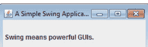

**图 32-1** `SwingDemo` 程序产生的窗口

当程序运行时，它将产生一个与图 32-1 所示类似的窗口。由于 `SwingDemo` 程序展示了 Swing 的核心概念，我们将逐行仔细检查它。程序从导入 `javax.swing` 开始。如前所述，该包包含了 Swing 定义的组件和模型。例如，`javax.swing` 定义了实现标签、按钮、文本控件和菜单的类。它被包含在所有使用 Swing 的程序中。

接下来，程序声明了 `SwingDemo` 类以及该类的构造函数。构造函数是程序大部分操作发生的地方。它通过使用这行代码创建一个 `JFrame` 开始：

```java
jfrm = new JFrame("A Simple Swing Application");
```

这创建了一个名为 `JFrame` 的容器，它定义了一个带有标题栏、关闭、最小化、最大化和恢复按钮以及系统菜单的矩形窗口。因此，它创建了一个标准的顶层窗口。窗口的标题被传递给构造函数。

接下来，使用此语句设置窗口尺寸：

```java
jfrm.setSize(275, 100);
```

`setSize()` 方法（`JFrame` 从 AWT `Component` 继承此方法）设置窗口的尺寸，单位为像素。其通用形式所示如下：

```java
void setSize(int width, int height)
```

在本例中，窗口的宽度设置为 275，高度设置为 100。默认情况下，当顶层窗口关闭时（例如用户点击关闭按钮时），窗口会从屏幕上移除，但应用程序不会终止。虽然这种行为在某些情况下很有用，但并不是大多数应用程序所需的。相反，你通常希望顶层窗口关闭时终止整个应用程序。有几种方法可以实现这一点。简单的方法是调用 `setDefaultCloseOperation()`，正如程序中所做：

```java
jfrm.setDefaultCloseOperation(JFrame.EXIT_ON_CLOSE);
```

调用此方法后，关闭窗口会导致整个应用程序终止。`setDefaultCloseOperation()` 的通用形式所示：

```java
void setDefaultCloseOperation(int what)
```

`what` 的值决定了窗口关闭时发生的情况。除了 `JFrame.EXIT_ON_CLOSE` 之外，还有其他几个选项：

- `DISPOSE_ON_CLOSE`
- `HIDE_ON_CLOSE`
- `DO_NOTHING_ON_CLOSE`

## 事件处理

上一个示例展示了 Swing 程序的各种形式，但它遗漏了一个重要部分：事件处理。因为 `JLabel` 不接受用户输入，所以它不会产生事件，因此不需要事件处理。然而，其他的 Swing 组件会对用户输入做出响应，这些交互需要被处理。事件也可以通过与用户输入直接相关的方式产生。例如，当定时器触发时就会产生事件。无论情况如何，事件处理都是基于 Swing 的应用程序的重要部分。

Swing 使用的事件处理机制与 AWT 使用的相同。这种方法被称为委托事件模型，在第 25 章中描述。在许多情况下，Swing 使用与 AWT 相同的事件，这些事件被封装在 `java.awt.event` 包中。Swing 特有的事件存储在 `javax.swing.event` 包中。

尽管 Swing 中处理事件的方式与 AWT 相同，但通过一个简单的示例来学习仍然是有用的。以下程序处理了 Swing 按钮生成的事件。示例输出如图 32-2 所示。


**图 32-2** `EventDemo` 程序的输出

```java
// 在 Swing 程序中处理事件。

import java.awt.*;
import java.awt.event.*;
import javax.swing.*;

class EventDemo {

    JLabel jlab;

    EventDemo() {

        // 创建一个 JFrame 容器。
        JFrame jfrm = new JFrame("An Event Example");

        // 为布局管理器指定 FlowLayout。
        jfrm.setLayout(new FlowLayout());

        // 给帧设置初始大小。
        jfrm.setSize(220, 90);

        // 当用户关闭应用程序时终止程序。
        jfrm.setDefaultCloseOperation(JFrame.EXIT_ON_CLOSE);

        // 创建两个按钮。
        JButton jbtnAlpha = new JButton("Alpha");
        JButton jbtnBeta = new JButton("Beta");

        // 为 Alpha 添加动作监听器。
        jbtnAlpha.addActionListener(new ActionListener() {
            public void actionPerformed(ActionEvent ae) {
                jlab.setText("Alpha was pressed.");
            }
        });

        // 为 Beta 添加动作监听器。
        jbtnBeta.addActionListener(new ActionListener() {
            public void actionPerformed(ActionEvent ae) {
                jlab.setText("Beta was pressed.");
            }
        });

        // 将按钮添加到内容面板中。
        jfrm.add(jbtnAlpha);
        jfrm.add(jbtnBeta);

        // 创建一个文本标签。
        jlab = new JLabel("Press a button.");

        // 将标签添加到内容面板中。
        jfrm.add(jlab);

        // 显示帧。
        jfrm.setVisible(true);
    }
}

class EventDemoMain {
    public static void main(String[] args) {
        // 在事件分发线程上创建帧。
        SwingUtilities.invokeLater(new Runnable() {
            public void run() {
                new EventDemo();
            }
        });
    }
}
```

首先，注意程序现在同时导入了 `java.awt` 和 `java.awt.event` 包。需要 `java.awt` 包是因为它包含了 `FlowLayout` 类，该类提供了用于在帧中布局组件的标准布局管理器（布局管理器的内容请参阅第 27 章）。需要 `java.awt.event` 包是因为它定义了 `ActionListener` 接口和 `ActionEvent` 类。

`EventDemo` 构造函数首先开始创建一个 `JFrame jfrm`。然后它将 `jfrm` 内容面板的布局管理器设置为 `FlowLayout`。默认情况下，内容面板使用 `BorderLayout` 作为其布局管理器。然而，对于这个示例，`FlowLayout` 更加方便。

在设置了大小和默认关闭操作后，`EventDemo()` 创建了两个按钮，如下：

```java
JButton jbtnAlpha = new JButton("Alpha");
JButton jbtnBeta = new JButton("Beta");
```

第一个按钮将包含文本 "Alpha"，第二个按钮将包含文本 "Beta"。Swing 按钮是 `JButton` 的实例。`JButton` 提供了几个构造函数。这里使用的是：

```java
JButton(String msg)
```

`msg` 参数存储了将显示在按钮内部的字符串。

当按钮被按下时，它会生成一个 `ActionEvent`。然后，`JButton` 提供了 `addActionListener()` 方法，用于添加动作监听器（`JButton` 还提供了 `removeActionListener()` 方法来移除监听器，但程序没有使用该方法）。正如第 25 章解释的，`ActionListener` 接口只定义了一个方法：`actionPerformed(ActionEvent)`。为了方便起见，此处显示如下：

```java
void actionPerformed(ActionEvent ae)
```

当按钮被按下时，该方法会被调用。换句话说，它是当按钮事件发生时被调用的事件处理器。

接下来，通过此处代码为按钮的动作添加事件监听器：

```java
// 为 Alpha 添加动作监听器。
jbtnAlpha.addActionListener(new ActionListener() {
    public void actionPerformed(ActionEvent ae) {
        jlab.setText("Alpha was pressed.");
    }
});

// 为 Beta 添加动作监听器。
jbtnBeta.addActionListener(new ActionListener() {
    public void actionPerformed(ActionEvent ae) {
        jlab.setText("Beta was pressed.");
    }
});
```

在这里，使用了匿名内部类来提供事件处理器。从 JDK 8 开始，可以使用 lambda 表达式来实现某些类型的事件处理器。例如，Alpha 的事件处理器可以写成：

```java
jbtnAlpha.addActionListener((ae) -> jlab.setText("Alpha was pressed."));
```

你可以看到，这样写更短。每次按下按钮时，标签都会改变。

接下来，按钮被添加到 `jfrm` 的内容面板中：

```java
jfrm.add(jbtnAlpha);
jfrm.add(jbtnBeta);
```

最后，将 `jlab` 添加到内容面板并使窗口可见。当你运行程序时，每次按下按钮，标签中都会显示一条消息。

最后一点：记住所有事件处理器（如 `actionPerformed()`）都是在事件分发线程上调用的。因此，事件处理器必须返回以避免阻塞应用程序。如果你的应用程序需要在后台执行某些操作，它必须使用单独线程。

## Swing 中的绘制

尽管 Swing 组件非常强大，但你并不限于此，因为 Swing 还允许你直接绘制帧的显示区域或其他 Swing 组件（如 `JLabel`）。许多（可能是大多数）Swing 的用法并不涉及直接绘制到组件表面，它适用于需要这种能力的应用程序。要直接绘制到组件表面，你将使用 AWT 定义的一个或多个方法，如 `drawLine()` 或 `drawRect()`。因此，第 26 章描述的大部分技术和方法适用于 Swing。但也存在非常重要的区别，本节将讨论。

### 绘制基础

Swing 的绘制构建在原始的 AWT 机制之上，但 Swing 的实现提供了更细粒度的控制。在检查 Swing 绘制的细节之前，回顾一下作为基础的 AWT 机制是有用的。

AWT `Component` 定义了一个 `paint()` 方法，用于直接将输出绘制到组件表面。在大多数情况下，`paint()` 并不由你的程序调用（事实上，只有在极少数异常情况下才会由你调用）。相反，每当组件渲染时，运行时都会调用 `paint()`。这种情况可能由于几个原因发生。例如，显示组件的窗口被另一个窗口覆盖后暴露。或者，窗口可能会被最小化并恢复。在编写基于 AWT 的代码时，需要直接绘制到组件表面时重写 `paint()`。由于 `JLabel` 继承自 `Component`，所有 Swing 轻量级组件都继承了 `paint()` 方法。然而，你不会重写它来绘制到组件表面。这是因为 Swing 使用了稍微复杂的绘制方法，涉及到三个不同的方法：`paintComponent()`、`paintBorder()` 和 `paintChildren()`。

这些方法绘制组件的指定部分，并将绘制过程分为三个不同的逻辑动作。在轻量级组件中，AWT 方法 `paint()` 简单地按照此处所示的顺序执行对这些方法的调用。

要绘制 Swing 组件的表面，你需要创建该组件的子类并重写它的 `paintComponent()` 方法。该方法是用于绘制组件内部的。你通常不需要重写其他的绘制方法。在重写 `paintComponent()` 时，你所做的第一件事是调用 `super.paintComponent()`，以便让父类的绘制过程执行（只有在你对组件的显示方式进行完全的人工控制时，才不需要这样做）。之后，你就可以在表面上进行绘制了。`paintComponent()` 方法签名如下：

```java
protected void paintComponent(Graphics g)
```

参数 `g` 是写入输出内容的图形上下文。

### 计算可绘制区域

在组件表面上绘图时，你必须小心将输出限制在边框区域。虽然 Swing 会自动裁剪任何超出组件边界的输出，但仍然可能绘制到边框内，而这在绘制边框时会被覆盖。为了避免这种情况，你必须计算组件的可绘制区域。该区域由组件的当前尺寸减去边框占据的空间定义。因此，在绘制到组件之前，你必须获取边框宽度并相应地调整你的绘制。

要获取边框宽度，调用 `getInsets()`，如下所示：

```java
Insets getInsets()
```

该方法由 `Container` 定义并被 `JComponent` 重写。它返回一个包含边框尺寸的 `Insets` 对象。可以通过以下字段获取内边距值：

```java
int top;
int bottom;
int left;
int right;
```

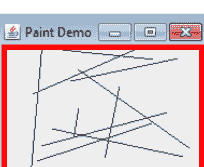

**图 32-3** `PaintPanel` 程序的示例输出

这些值随后被用于根据组件的宽度和高度计算绘制区域。你可以通过在组件上调用 `getWidth()` 和 `getHeight()` 获取组件的宽度和高度。它们如下所示：

```java
int getWidth()
int getHeight()
```

通过减去内边距的值，你可以计算出组件的可用宽度和高度。

### 绘制示例

这是一个将上述讨论付诸实现的程序。它创建了一个名为 `PaintPanel` 的类，该类继承自 `JPanel`。该程序随后使用该类的对象来显示端点随机生成的线条。示例输出如图 32-3 所示。


```java
// 在面板上绘制线条。

import java.awt.*;
import java.awt.event.*;
import javax.swing.*;
import java.util.*;

// 此类继承自 `JPanel`。它重写了
// `paintComponent()` 方法，以便在面板中
// 绘制随机线条。
class PaintPanel extends JPanel {
    Insets insets; // 保存面板的内边距
    Random rand; // 用于生成随机数

    // 构造一个面板。
    PaintPanel() {
        // 在面板周围设置一个边框。
        setBorder(BorderFactory.createLineBorder(Color.RED, 5));
        rand = new Random();
    }

    // 重写 `paintComponent()` 方法。
    protected void paintComponent(Graphics g) {
        // 始终先调用父类方法。
        super.paintComponent(g);

        int x, y, x2, y2;

        // 获取组件的高度和宽度。
        int height = getHeight();
        int width = getWidth();

        // 获取内边距。
        Insets ins = getInsets();

        // 绘制端点为随机生成的线条。
        for (int i = 0; i < 10; i++) {
            // 获取定义每条线条
            // 端点的随机坐标。
            x = rand.nextInt(width - ins.left);
            y = rand.nextInt(height - ins.bottom);
            x2 = rand.nextInt(width - ins.left);
            y2 = rand.nextInt(height - ins.bottom);

            // 绘制线条。
            g.drawLine(x, y, x2, y2);
        }
    }
}

// 演示直接在面板上绘制。
class PaintDemo {
    JLabel jlab;
    PaintPanel pp;

    PaintDemo() {
        // 创建一个新的 `JFrame` 容器。
        JFrame jfrm = new JFrame("Paint Demo");

        // 给帧设置一个初始大小。
        jfrm.setSize(200, 150);

        // 当用户关闭应用程序时终止程序。
        jfrm.setDefaultCloseOperation(JFrame.EXIT_ON_CLOSE);

        // 创建将绘制的面板。
        pp = new PaintPanel();

        // 将面板添加到内容面板中。因为使用了
        // 默认布局管理器，面板将自动
        // 调整以适应中心区域。
        jfrm.add(pp);

        // 显示帧。
        jfrm.setVisible(true);
    }

    public static void main(String[] args) {
        // 在事件分发线程上创建帧。
        SwingUtilities.invokeLater(new Runnable() {
            public void run() {
                new PaintDemo();
            }
        });
    }
}
```


# 第 32 章 介绍 Swing 1077

## 第 33 章 探索 Swing

上一章描述了与 Swing 相关的几个核心概念并展示了 Swing 应用程序的标准形式。本章通过介绍几个 Swing 组件（如按钮、复选框、树和表格）来继续对 Swing 的讨论。Swing 组件提供了丰富的功能并允许高程度的定制化。由于空间限制，无法描述它们的所有特性和属性。相反，本概述的目的是让你对 Swing 组件的能力有所了解。

本章描述的 Swing 组件类所示：

| | | | | |
| --- | --- | --- | --- | --- |

这些都是轻量级的，这意味着它们都派自 `JComponent`。

同样讨论的还有 `JButton` 类，它封装了一组互斥的 Swing 按钮，以及 `ImageIcon` 类，它封装了图形图像。两者都由 Swing 定义并封装在 `javax.swing` 中。

## JLabel 和 ImageIcon

`JLabel` 是 Swing 中最易使用的组件。它创建一个标签并在上一章中介绍过。在这里，我们将更仔细地观察它。`JLabel` 可以显示文本和/或图标。它是一个被动组件，因为它不响应用户输入。`JLabel` 定义了多个构造函数。这里是其中三个：

```java
JLabel(Icon icon)
JLabel(String str)
JLabel(String str, Icon icon, int align)
```

这里 `str` 和 `icon` 是用于标签的文本和图标。`align` 参数指定文本和/或图标在标签尺寸内的水平对齐方式。它必须是以下值之一：`LEFT`、`RIGHT`、`CENTER`、`LEADING` 或 `TRAILING`。这些常量定义在 `SwingConstants` 接口中，以及其他几个 Swing 类使用的常量中。

注意，图标是通过 `Icon` 类型的对象指定的，`Icon` 是 Swing 定义的一个接口。获取图标的最简单方法是使用 `ImageIcon` 类。`ImageIcon` 封装了一个图像。因此，可以将 `ImageIcon` 类型的对象作为参数传递给 `JLabel` 构造函数的 `Icon` 参数。提供图像有多种方式，包括从文件读取或从 URL 下载。这里是本节示例使用的构造函数：

```java
ImageIcon(String filename)
```

它获取名为 `filename` 的文件中的图像。

与标签关联的图标和文本可以通过方法获取：

- `Icon getIcon()`
- `String getText()`

与标签关联的图标和文本可以通过这些方法设置：

```java
void setIcon(Icon icon)
void setText(String str)
```

这里 `icon` 和 `str` 分别是图标和文本。因此，使用 `setText()` 可以在程序执行期间更改标签内部的文本。

下面的程序说明如何创建并显示包含图标和字符串的标签。它首先为文件 `hourglass.png` 创建一个 `ImageIcon` 对象，该文件描述了一个沙漏。这被用作 `JLabel` 构造函数的第二个参数。`JLabel` 构造函数的第一个和最后一个参数是标签和对齐方式。最后，将标签添加到内容面板。

```java
import java.awt.*;
import javax.swing.*;

public class JLabelDemo {
    public JLabelDemo() {
        // 设置 JFrame。
        JFrame jframe = new JFrame("JLabelDemo");
        jframe.setLayout(new FlowLayout());
        jframe.setDefaultCloseOperation(JFrame.EXIT_ON_CLOSE);
        jframe.setSize(260, 210);

        // 创建一个图标。
        ImageIcon ii = new ImageIcon("hourglass.png");

        // 创建一个标签。
        JLabel jl = new JLabel("Hourglass", ii, JLabel.CENTER);

        // 将标签添加到内容面板。
        jframe.add(jl);

        // 显示框架。
        jframe.setVisible(true);
    }

    public static void main(String[] args) {
        // 在事件分发线程上创建框架。
        SwingUtilities.invokeLater(
            new Runnable() {
                public void run() {
                    new JLabelDemo();
                }
            });
    }
}
```

标签示例的输出显示在此：

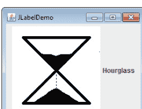

## JTextField

`JTextField` 是最简单的 Swing 文本组件。它也是最广泛使用的文本组件。`JTextField` 允许你编辑一行文本。它继承自 `JComponent`，`JComponent` 提供了 Swing 文本组件共同的基础功能。`JTextField` 使用 `Document` 接口作为其模型。这里显示了 `JTextField` 的三个构造函数：

- `JTextField(int cols)`
- `JTextField(String str, int cols)`
- `JTextField(String str)`

在这里，`str` 是要初始化的字符串，`cols` 是文本的列数。如果没有指定字符串，则文本字段初始为空。如果未指定列数，则文本字段的大小将适应指定的字符串。

`JTextField` 会产生响应用户交互的事件。例如，当用户按下 ENTER 键时，会触发一个 `ActionEvent`。每当光标（即光标位置）改变位置时，都会触发一个 `CaretEvent`（`CaretEvent` 封装在 `javax.swing.event` 中）。也可能发生其他事件。在许多情况下，你的程序不需要处理这些事件。相反，你只需要在需要时获取文本字段中的字符串内容。要获取文本字段当前的文本，调用 `getText()`。

示例说明了 `JTextField`。它创建了一个 `JTextField` 并将其添加到内容面板。当用户按下 ENTER 键时，会生成一个事件。这通过在标签中显示文本来处理。

```java
//  JTextField。
import java.awt.*;
import java.awt.event.*;
import javax.swing.*;

public class JTextFieldDemo {

    public JTextFieldDemo() {

        // 设置 JFrame。
        JFrame jframe = new JFrame("JTextFieldDemo");
        jframe.setLayout(new FlowLayout());
        jframe.setDefaultCloseOperation(JFrame.EXIT_ON_CLOSE);
        jframe.setSize(260, 120);

        // 将文本字段添加到内容面板。
        JTextField jtf = new JTextField(15);
        jframe.add(jtf);

        // 添加一个标签。
        JLabel jlab = new JLabel();
        jframe.add(jlab);

        // 处理动作事件。
        jtf.addActionListener(new ActionListener() {
            public void actionPerformed(ActionEvent ae) {
                // 当用户按下 ENTER 键时显示文本。
                jlab.setText(jtf.getText());
            }
        });

        // 显示框架。
        jframe.setVisible(true);
    }

    public static void main(String[] args) {
        // 在事件分发线程上创建框架。
        SwingUtilities.invokeLater(
            new Runnable() {
                public void run() {
                    new JTextFieldDemo();
                }
            });
    }
}
```

# 第 33 章 探索 Swing 1085

```java
// 创建并将标签添加到内容面板。
jflab = new JLabel("选择一个时钟");
jfrm.add(jflab);
```

```java
// 显示框架。
jfrm.setVisible(true);
}
```

```java
// 处理按钮事件。
public void actionPerformed(ActionEvent ae) {
    jflab.setText("你选择了 " + ae.getActionCommand());
}
```

```java
public static void main(String[] args) {
    // 在事件分发线程上创建框架。
    SwingUtilities.invokeLater(
      new Runnable() {
        public void run() {
          new JButtonDemo();
        }
      });
}
```

此处是按钮示例的输出所示：

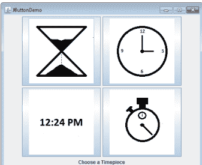

## JToggleButton

推按钮的一种变体称为切换按钮。切换按钮看起来和推按钮一样，但它的行为不同，因为它有两个状态：按下和松开。当你按下一个切换按钮时，它会保持按下状态，而不会像普通的推按钮那样弹回来。当你再次按下切换按钮时，它会释放（弹出）。因此，每当按下切换按钮时，它都会在它的两个状态之间切换。

切换按钮是 `JToggleButton` 类的对象。`JToggleButton` 实现了 `AbstractButton`。除了创建标准的切换按钮外，`JToggleButton` 还是另外两个表示双状态控件的 Swing 组件的父类。这些是 `JCheckBox` 和 `JRadioButton`，它们在本章后面会介绍。`JToggleButton` 定义了所有双状态组件的基本功能。

`JToggleButton` 定义了几个构造函数。本节示例使用的构造函数所示：

```java
JToggleButton(String str)
```

这创建了一个包含 `str` 中文本的切换按钮。默认情况下，按钮处于关闭位置。其他构造函数允许你创建包含图像、或包含图像和文本的切换按钮。

`JToggleButton` 使用由名为 `JToggleButton.ToggleButtonModel` 的嵌套类定义的模型。通常情况下，你不需要直接与模型交互来使用标准的切换按钮。

像 `JButton` 一样，`JToggleButton` 在每次按下时都会生成一个事件。与 `JButton` 不同的是，`JToggleButton` 还生成项目事件。此事件由支持选择概念的组件使用。当 `JToggleButton` 被按下时，它是被选中的。当它弹出时，它是未被选中的。

要处理项目事件，你必须实现 `ItemListener` 接口。回想第 25 章，当生成每个项目事件时，它会被传递给 `ItemListener` 定义的 `itemStateChanged()` 方法。在 `itemStateChanged()` 中，可以在 `ItemEvent` 对象上调用 `getItem()` 方法来获取生成事件的 `JToggleButton` 实例的引用。所示如下：

```java
Object getItem()
```

返回按钮的引用。你需要将此引用转换为 `JToggleButton`。确定切换按钮状态最简单的方法是在生成事件的按钮上调用 `isSelected()` 方法（继承自 `AbstractButton`）。所示如下：

```java
boolean isSelected()
```

如果按钮被选中则返回 `true`，否则返回 `false`。

这里是一个使用切换按钮的示例。注意项目监听器是如何工作的。简单地调用 `isSelected()` 来确定按钮的状态。

```java
// 演示 JToggleButton。
import java.awt.*;
import java.awt.event.*;
import javax.swing.*;

public class JToggleButtonDemo {
    public JToggleButtonDemo() {
        // 设置 JFrame;
        JFrame jfrm = new JFrame("JToggleButtonDemo");
        jfrm.setLayout(new FlowLayout());
        jfrm.setDefaultCloseOperation(JFrame.EXIT_ON_CLOSE);
        jfrm.setSize(200, 100);

        // 创建一个标签。
        JLabel jlab = new JLabel("按钮已关闭.");

        // 创建一个切换按钮。
        JToggleButton jbtn = new JToggleButton("开启/关闭");
    }
}
```


```java
// 为切换按钮添加项目监听器。
jbtn.addItemListener(new ItemListener() {
    public void itemChanged(ItemEvent ie) {
        if (jbtn.isSelected()) {
            jlab.setText("按钮已开启.");
        } else
            jlab.setText("按钮已关闭.");
    }
});
```

```java
// 将切换按钮和标签添加到内容面板。
jfrm.add(jbtn);
jfrm.add(jlab);
```

```java
// 显示框架。
jfrm.setVisible(true);
}
```

```java
public static void main(String[] args) {
    // 在事件分发线程上创建框架。
    SwingUtilities.invokeLater(
        new Runnable() {
            public void run() {
                new JToggleButtonDemo();
            }
        }
    );
}
```

此处是切换按钮示例的输出所示：


# Check Boxes (复选框)

`JCheckBox` 类提供了复选框的功能。它的直接父类 `JToggleButton` 提供了双状态的支持，`JCheckBox` 定义了几个构造函数。示例中使用的所示：

```java
JCheckBox(String str)
```

这创建了一个包含 `str` 中文本的复选框。默认情况下，按钮处于关闭位置。其他构造函数允许你创建包含图像、或包含图像和文本的复选框。

`JCheckBox` 使用由名为 `JToggleButton.ToggleButtonModel` 的嵌套类定义的模型。通常情况下，你不需要直接与模型交互来使用标准的复选框。

像 `JButton` 一样，`JCheckBox` 在每次按下时都会生成一个事件。与 `JButton` 不同的是，`JCheckBox` 还生成项目事件。此事件由支持选择概念的组件使用。当 `JCheckBox` 被按下时，它是被选中的。当它弹出时，它是未被选中的。

要处理项目事件，你必须实现 `ItemListener` 接口。回想第25章，当生成每个项目事件时，它会被传递给 `ItemListener` 定义的 `itemStateChanged()` 方法。在 `itemStateChanged()` 中，可以在 `ItemEvent` 对象上调用 `getItem()` 方法来获取生成事件的 `JToggleButton` 实例的引用。所示如下：

```java
Object getItem()
```

返回按钮的引用。你需要将此引用转换为 `JToggleButton`。确定切换按钮状态最简单的方法是在生成事件的按钮上调用 `isSelected()` 方法（继承自 `AbstractButton`）。所示如下：

```java
boolean isSelected()
```

如果按钮被选中则返回 `true`，否则返回 `false`。

这里是一个使用切换按钮的示例。注意项目监听器是如何工作的。简单地调用 `isSelected()` 来确定按钮的状态。

```java
// 演示 JToggleButton。
import java.awt.*;
import java.awt.event.*;
import javax.swing.*;

public class CheckBoxDemo {
    public CheckBoxDemo() {
```

```java
// 设置 JFrame;
JFrame jfrm = new JFrame("CheckBoxDemo");
jfrm.setLayout(new FlowLayout());
jfrm.setDefaultCloseOperation(JFrame.EXIT_ON_CLOSE);
jfrm.setSize(200, 100);
```

```java
// 创建一个标签。
JLabel jlab = new JLabel("按钮已关闭.");
```

```java
// 创建一个切换按钮。
JToggleButton jbtn = new JToggleButton("开启/关闭");
```

```java
// 为切换按钮添加项目监听器。
jbtn.addItemListener(new ItemListener() {
    public void itemChanged(ItemEvent ie) {
        if (jbtn.isSelected()) {
            jlab.setText("按钮已开启.");
        } else
            jlab.setText("按钮已关闭.");
    }
});
```

```java
// 将切换按钮和标签添加到内容面板。
jfrm.add(jbtn);
jfrm.add(jlab);
```

```java
// 显示框架。
jfrm.setVisible(true);
}
```

```java
public static void main(String[] args) {
    // 在事件分发线程上创建框架。
    SwingUtilities.invokeLater(
        new Runnable() {
            public void run() {
                new CheckBoxDemo();
            }
        }
    );
}
```

# Radio Buttons (单选按钮)

单选按钮是一组互斥的按钮，其中任何时间只能被选中。为了激活它们的互斥性，必须将单选按钮配置到组。按钮组通过 `ButtonGroup` 类创建。其默认构造函数被调用以此目的。元素通过以下方法添加到组：

```java
void add(AbstractButton button)
```

在这里，`button` 是要添加到组的按钮引用。

`JRadioButton` 在每次按钮选择更改时生成动作事件、项目事件和改变事件。通常情况下，处理的是动作事件，这意味着你通常会实现 `ActionListener` 接口。在该方法中，你可以使用多种方法来确定选中了哪个按钮。首先，通过调用 `getActionCommand()` 检查其动作。默认情况下，动作命令与标签相同，但你可以通过在单选按钮上调用 `setActionCommand()` 将动作命令设置为其他值。其次，你可以在 `ActionEvent` 上调用 `getSource()` 来查找当前选中了哪个（通过在每个单选按钮上调用 `isSelected()`）。最后，每个按钮都可以使用作为匿名内部类或 Lambda 表达式实现的事件处理器。记住，每当动作事件发生时，意味着被选中的按钮发生了变化。

以下示例说明了如何使用单选按钮。创建了三个单选按钮。它们随后被添加到按钮组中。正如所解释的，这样做互斥性是必要的。按下单选按钮会生成动作事件，该事件由 `actionPerformed()` 处理。在该处理器中，`getActionCommand()` 方法获取与单选按钮相关的文本，并用它设置标签的文本。

```java
// 演示 JRadioButton
import java.awt.*;
import java.awt.event.*;
import javax.swing.*;

public class RadioButtonDemo implements ActionListener {
    JLabel label;

    public RadioButtonDemo() {
        // 设置 JFrame;
        JFrame jframe = new JFrame("RadioButtonDemo");
        jframe.setLayout(new FlowLayout());
        jframe.setDefaultCloseOperation(JFrame.EXIT_ON_CLOSE);
        jframe.setSize(250, 100);

        label = new JLabel("未选择任何选项");
        
        JRadioButton rb1 = new JRadioButton("选项一");
        JRadioButton rb2 = new JRadioButton("选项二");
        JRadioButton rb3 = new JRadioButton("选项三");

        ButtonGroup group = new ButtonGroup();
        group.add(rb1);
        group.add(rb2);
        group.add(rb3);

        rb1.addActionListener(this);
        rb2.addActionListener(this);
        rb3.addActionListener(this);

        jframe.add(rb1);
        jframe.add(rb2);
        jframe.add(rb3);
        jframe.add(label);

        jframe.setVisible(true);
    }

    @Override
    public void actionPerformed(ActionEvent e) {
        label.setText("选择了: " + e.getActionCommand());
    }

    public static void main(String[] args) {
        new RadioButtonDemo();
    }
}
```

# 第 33 章 探索 Swing 1091

```java
// 创建单选按钮并将它们添加到内容面板。
JRadioButton b1 = new JRadioButton("A");
b1.addActionListener(this);
jfrm.add(b1);
```

```java
JRadioButton b2 = new JRadioButton("B");
b2.addActionListener(this);
jfrm.add(b2);
```

```java
JRadioButton b3 = new JRadioButton("C");
b3.addActionListener(this);
jfrm.add(b3);
```

```java
// 定义一个按钮组。
ButtonGroup bg = new ButtonGroup();
bg.add(b1);
bg.add(b2);
bg.add(b3);
```

```java
// 创建一个标签并将其添加到内容面板。
jlab = new JLabel("Select One");
jfrm.add(jlab);
```

```java
// 显示框架。
jfrm.setVisible(true);
```

```java
// 处理按钮选择。
public void actionPerformed(ActionEvent ae) {
    jlab.setText("You selected " + ae.getActionCommand());
}
```

```java
public static void main(String[] args) {
    // 在事件分发线程上创建框架。
    SwingUtilities.invokeLater(new Runnable() {
        public void run() {
            new JButtonDemo();
        }
    });
}
```

单选按钮示例的输出在此：


# JTabbedPane

`JTabbedPane` 封装了一个标签页面板。它通过将组件与标签连接起来来管理一组组件。选择一个标签会使该标签相关的组件显示在最前面。标签页在现代 GUI 中非常常见，你肯定已经用过很多次了。考虑到标签页的复杂性，它们的创建和使用却出奇地简单。

`JTabbedPane` 定义了三个构造函数。我们将使用它的默认构造函数，它会创建一个空控件，并将标签位于面板的顶部。另外两个构造函数允许你指定标签的位置，可以是四边中的任何一个。`JTabbedPane` 使用 `SingleSelectionModel`。

通过调用 `addTab()` 来添加标签。这里是它的形式之一：

```java
void addTab(String name, Component comp)
```

在这里，`name` 是标签的名称，`comp` 是应该被添加到标签的组件。通常，添加到标签的组件是一个包含一组相关组件的 `JPanel`。这种技术允许你持有一组组件。

使用标签页面板的通用步骤概述如下：

- 创建 `JTabbedPane` 实例。
- 调用 `addTab()` 添加标签。
- 将标签添加到内容面板。


接下来的示例展示了一个标签页面板。第一个标签标题为“Cities（城市）”，包含四个按钮。每个按钮显示城市的名称。第二个标签标题为“Colors（颜色）”，包含三个框。每个框显示颜色的名称。第三个标签标题为“Flavors（口味）”，包含一个组合框。这允许用户从三种口味中选择一种。

```java
// 演示 JTabbedPane。
import javax.swing.*;
import java.awt.*;

public class JTabbedPaneDemo {

    public JTabbedPaneDemo() {
        // 设置 JFrame。
        JFrame frame = new JFrame("JTabbedPaneDemo");
        frame.setLayout(new FlowLayout());
        frame.setDefaultCloseOperation(JFrame.EXIT_ON_CLOSE);
        frame.setSize(400, 200);

        // 创建标签页面板。
        JTabbedPane jtp = new JTabbedPane();
        jtp.addTab("Cities", new CitiesPanel());
        jtp.addTab("Colors", new ColorsPanel());
        jtp.addTab("Flavors", new FlavorsPanel());
        frame.add(jtp);
        // 显示框架。
        frame.setVisible(true);
    }

    public static void main(String[] args) {
        // 在事件分发线程上创建框架。
        SwingUtilities.invokeLater(new Runnable() {
            public void run() {
                new JTabbedPaneDemo();
            }
        });
    }
}

// 创建将被添加到标签页面板的面板。
class CitiesPanel extends JPanel {

    public CitiesPanel() {
        JButton b1 = new JButton("New York");
        add(b1);
        JButton b2 = new JButton("London");
        add(b2);
        JButton b3 = new JButton("Hong Kong");
        add(b3);
        JButton b4 = new JButton("Tokyo");
        add(b4);
    }
}

class ColorsPanel extends JPanel {

    public ColorsPanel() {
        JCheckBox cb1 = new JCheckBox("Red");
        add(cb1);
        JCheckBox cb2 = new JCheckBox("Green");
        add(cb2);
        JCheckBox cb3 = new JCheckBox("Blue");
        add(cb3);
    }
}

class FlavorsPanel extends JPanel {

    public FlavorsPanel() {
        JComboBox<String> jcb = new JComboBox<String>();
        jcb.addItem("Vanilla");
        jcb.addItem("Chocolate");
        jcb.addItem("Strawberry");
        add(jcb);
    }
}
```

# JScrollPane

`JScrollPane` 是一个提供另一个组件的可滚动视图的组件。当组件大于显示区域时使用它。`JScrollPane` 根据组件的大小自动管理滚动条。

`JScrollPane` 定义了几个构造函数。这里使用的构造函数如下：

```java
JScrollPane(Component comp)
```

这创建一个包含 `comp` 指定的组件的 `JScrollPane`。

接下来的示例展示了一个滚动面板：

```java
// 演示 JScrollPane。
import java.awt.*;
import javax.swing.*;

public class JScrollPaneDemo {

    public JScrollPaneDemo() {
        // 设置 JFrame。
        JFrame frame = new JFrame("JScrollPaneDemo");
        frame.setLayout(new BorderLayout());
        frame.setDefaultCloseOperation(JFrame.EXIT_ON_CLOSE);
        frame.setSize(400, 400);

        // 创建一个面板并向其添加 400 个按钮。
        JPanel jp = new JPanel();
        jp.setLayout(new GridLayout(20, 20));

        int b = 0;
        for(int i = 0; i < 20; i++) {
            for(int j = 0; j < 20; j++) {
                jp.add(new JButton("Button " + b));
                ++b;
            }
        }

        // 创建滚动面板。
        JScrollPane jsp = new JScrollPane(jp);

        // 将滚动面板添加到内容面板。
        frame.add(jsp, BorderLayout.CENTER);

        // 显示框架。
        frame.setVisible(true);
    }

    public static void main(String[] args) {
        // 在事件分发线程上创建框架。
        SwingUtilities.invokeLater(new Runnable() {
            public void run() {
                new JScrollPaneDemo();
            }
        });
    }
}
```

滚动面板的输出在此：


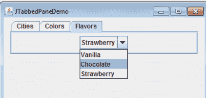


以下是使用滚动面板的步骤：

1. 创建要滚动的组件。
2. 创建 `JScrollPane` 实例，并将组件传递给它。
3. 将滚动面板添加到内容面板。

接下来的示例展示了一个滚动面板。首先，创建一个 `JPanel`，并向其添加了 400 个按钮。由于面板大于视口，因此出现了滚动条。

# JList

在 Swing 中，基本类是 `JList`。它支持从列表中选择一个或多个项。虽然列表通常由字符串组成，但也可以创建任何显示对象的列表。`JList` 在 Java 中被广泛使用。

在过去，`JList` 使用 `Object` 引用。然而，从 JDK 7 开始，`JList` 变为泛型，现在声明方式如下：

```java
class JList<E>
```

在这里 `E` 代表列表项的类型。

`JList` 提供了几个构造函数。这里使用的构造函数如下：

```java
JList(E[] items)
```

创建一个包含由 `items` 指定的项的 `JList`。

## JList 模型与事件处理

`JList` 基于两个模型。第一个是 `ListModel`。该接口定义了如何访问列表数据。第二个模型是 `SelectionModel` 接口，它定义了确定哪些列表项被选中的方法。

虽然 `JList` 本身可以正常工作，但大多数情况下，你会将 `JList` 封装在 `JScrollPane` 中。这个长列表将自动变为可滚动，这简化了 GUI 设计。它还允许轻松更改列表中条目的数量，而无需更改 `JList` 组件的大小。

当用户创建或更改选择时，`JList` 会生成一个 `ListSelectionEvent`。当用户选择某项时，也会生成此事件。该事件通过实现 `ListSelectionListener` 来进行处理。该监听器只指定了一个方法，称为 `valueChanged()`，显示在此：

```java
void valueChanged(ListSelectionEvent e)
```

这里，`e` 是事件的引用。`ListSelectionEvent` 提供了使用它的一些方法，通常你会查询 `JList` 对象来确定发生了什么。`ListSelectionEvent` 和 `ListSelectionListener` 都被封装在 `javax.swing.event` 包中。

默认情况下，`JList` 允许用户选择列表中的多个范围的项，你可以通过调用 `JList` 定义的 `setSelectionMode()` 来更改此行为。显示在此：

```java
void setSelectionMode(int mode)
```

这里，指定选择模式。它必须是 `ListSelectionModel` 定义的值之一：

- `SINGLE_SELECTION`
- `SINGLE_INTERVAL_SELECTION`
- `MULTIPLE_INTERVAL_SELECTION`（默认）

默认的多间距选择（`MULTIPLE_INTERVAL_SELECTION`）允许用户选择列表中多个范围的项。在单间距选择（`SINGLE_INTERVAL_SELECTION`）中，用户可以选择一个范围的项。在单选择（`SINGLE_SELECTION`）中，用户只能选择单个项。

获取选中项索引的方法是 `getSelectedIndex()`：

```java
int getSelectedIndex()
```

索引从零开始。因此，如果选择了第一项，此方法将返回 0。如果没有项被选中，则返回 -1。

与其获取选择项的索引，不如通过调用 `getSelectedValue()` 获取与选择关联的值：

```java
E getSelectedValue()
```

它返回第一个被选中值的引用。如果没有选择任何值，它将返回 `null`。


以下程序演示了 `JList`。每当在列表中选择一个城市时，就会生成一个 `ListSelectionEvent`，它由 `ListSelectionListener` 的 `valueChanged()` 方法处理。它的响应方式是获取所选项的索引，并将选中城市的索引显示在标签中。

```java
// 演示 JList.
import javax.swing.*;
import javax.swing.event.*;
import java.awt.*;
import java.awt.event.*;

public class JListDemo {

    // 创建一个城市数组。
    String[] cities = {"New York", "Chicago", "Houston",
    "Denver", "Los Angeles", "Seattle",
    "London", "Paris", "New Delhi",
    "Hong Kong", "Tokyo", "Sydney" };

    public JListDemo() {
        // 设置 JFrame。
        JFrame frame = new JFrame("JListDemo");
        frame.setLayout(new FlowLayout());
        frame.setDefaultCloseOperation(JFrame.EXIT_ON_CLOSE);
        frame.setSize(200, 200);

        // 创建一个 JList。
        JList<String> jlst = new JList<String>(cities);
        // 设置选择模式为单选。
        jlst.setSelectionMode(ListSelectionModel.SINGLE_SELECTION);
        // 将列表添加到滚动面板中。
        JScrollPane jscroll = new JScrollPane(jlst);
        // 设置滚动面板的首选尺寸。
        jscroll.setPreferredSize(new Dimension(120, 90));

        // 创建一个显示选择的标签。
        JLabel jlab = new JLabel("Choose a City");
        // 为列表添加选择监听器。
        jlst.addSelectionListener(new ListSelectionListener() {
            public void valueChanged(ListSelectionEvent le) {
                // 获取更改项的索引。
                int idx = jlst.getSelectedIndex();

                // 如果选择了项，则显示选择。
                if(idx != -1)
                    jlab.setText("Current selection: " + cities[idx]);
                else // 否则，重新提示。
                    jlab.setText("Choose a City");
            }
        });

        // 将列表和标签添加到内容面板。
        frame.add(jscroll);
        frame.add(jlab);

        // 显示帧。
        frame.setVisible(true);
    }

    public static void main(String[] args) {
        // 在事件分发线程上创建帧。
        SwingUtilities.invokeLater(
            new Runnable() {
                public void run() {
                    new JListDemo();
                }
            }
        );
    }
}
```

列表示例的输出显示在此：

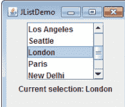

# JComboBox

Swing 通过 `JComboBox` 类提供了一个组合框（下拉列表）。`JComboBox` 通常显示一个项，但它允许用户选择不同的项。在过去，项被表示为 `Object`；从 JDK 7 开始，`JComboBox` 变成了泛型，现在声明如下：

```java
class JComboBox<E>
```

这里 `E` 代表项的类型。除了向组合框传递项数组外，你还可以使用以下代码动态添加项：

```java
void addItem(E obj)
```

这里，`obj` 是要添加到组合框的对象。可变组合框（可以更改项的组合框）使用 `MutableComboBoxModel`。

常用构造函数如下：

```java
JComboBox(E[] items)
```

这里，`items` 是初始化组合框的数组。还有其他构造函数可用。当用户选择或取消选择项时，`JComboBox` 会产生事件。因此，发生了选择变化。在组合框中获取选中项的方法是调用它的 `getSelectedItem()`。它显示在此：

```java
E getSelectedItem()
```


```java
// 演示 JComboBox。
import java.awt.*;
import java.awt.event.*;
import javax.swing.*;

public class JJComboBoxDemo {

    String[] timepieces = { "Hourglass", "Analog", "Digital", "Stopwatch" };

    public JJComboBoxDemo() {
        // 设置 JFrame。
        JFrame frame = new JFrame("JComboBoxDemo");
        frame.setLayout(new FlowLayout());
        frame.setDefaultCloseOperation(JFrame.EXIT_ON_CLOSE);
        frame.setSize(400, 250);

        // 实例化组合框并将其添加到内容面板。
        JComboBox<String> jcb = new JComboBox<String>(timepieces);
        frame.add(jcb);

        // 创建一个标签并添加到内容面板。
        JLabel jlab = new JLabel(new ImageIcon("hourglass.png"));
        frame.add(jlab);

        // 处理选择。
        jcb.addActionListener(new ActionListener() {
            public void actionPerformed(ActionEvent e) {
                String s = (String) jcb.getSelectedItem();
                jlab.setIcon(new ImageIcon(s + ".png"));
            }
        });

        // 显示帧。
        frame.setVisible(true);
    }

    public static void main(String[] args) {
        // 在事件分发线程上创建帧。
        SwingUtilities.invokeLater(new Runnable() {
            public void run() {
                new JJComboBoxDemo();
            }
        });
    }
}
```

组合框示例的输出显示在此：

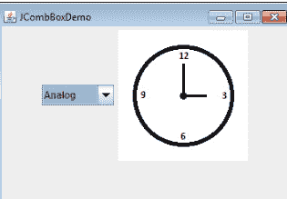

## 树

树是一种以层级视图呈现数据的组件。用户有能力展开或折叠显示中的单个子树。树在 Swing 中通过 `JTree` 类实现。其构造函数的采样显示在此：

```
JTree(Object[] obj)
JTree(Vector<?> v)
JTree(TreeNode node)
```

### 1102 第三部分 使用 Swing GUI 编程

在第一种形式中，树是从数组 `obj` 中的元素构建的。第二种形式从向量 `v` 的元素构建树。在第三种形式中，树根节点由指定树的 `tn` 指定。

尽管 `JTree` 封装在 `javax.swing` 中，但它的支持类和接口封装在 `javax.swing.tree` 中。这是因为支持 `JTree` 的类和接口数量非常多。

`JTree` 依赖于两个模型：`TreeModel` 和 `TreeSelectionModel`。`JTree` 会产生各种事件，但这些事件专门与树相关：当节点展开或折叠时，会发生 `TreeExpansionEvent`、`TreeSelectionEvent` 和 `ModelEvent`。当用户在树中选择或取消选择节点时，会生成 `TreeSelectionEvent`。当数据或树发生变化时，会生成 `ModelEvent`。这些事件的监听器分别是 `TreeExpansionListener`、`TreeSelectionListener` 和 `TreeModelListener`。树事件和监听接口封装在 `javax.swing.event` 中。

本节所示示例程序处理的事件是 `TreeSelectionEvent`。要监听此事件，需要实现 `TreeSelectionListener`。它只定义了一个方法 `valueChanged()`，该方法接收一个 `TreeSelectionEvent` 对象。你可以通过调用事件对象上所示的 `getPath()` 方法获取所选对象的路径：

```
TreePath getPath()
```

它返回一个描述指向更改节点路径的 `TreePath` 对象。`TreePath` 类封装了关于树中特定节点的信息。它提供了几个构造函数和方法。在本书中，只使用了 `toString()` 方法。它返回一个描述路径的字符串。

`TreeNode` 接口声明了关于树节点的信息。例如，可以获取父节点的引用或子节点的枚举。`MutableTreeNode` 接口继承自 `TreeNode`。它声明了可以插入、删除节点或更改父节点的方法。

`DefaultMutableTreeNode` 类实现了 `MutableTreeNode` 接口。它代表树中的一个节点。其构造函数之一所示：

```
DefaultMutableTreeNode(Object obj)
```

在这里，`obj` 是要封装在该树节点中的对象。新的树节点没有父节点或子节点。

要创建 `JTree` 的层级结构，可以使用 `DefaultMutableTreeNode` 的 `add()` 方法。其签名所示：

```
void add(MutableTreeNode node)
```

在这里，`node` 是一个被添加为当前节点节点的可变树节点。`JTree` 本身不提供任何滚动功能。相反，`JTree` 通常被放置在 `JScrollPane` 中。可以通过一个较小的视口滚动这棵大树。以下是使用步骤：

1. 创建 `JTree` 实例。
2. 创建一个 `JScrollPane` 并指定树为要滚动的对象。
3. 将滚动面板添加到内容面板（content pane）。

### 第3章 探索 Swing

以下示例说明了如何创建树并处理选择。程序创建了一个标签为“Options”的 `DefaultMutableTreeNode`。这是树层级结构的顶节点。然后创建额外的树节点，并使用 `add()` 方法将这些节点连接到树。树中顶节点的引用作为 `JTree` 构造函数的参数提供。树作为 `JScrollPane` 面板的参数提供并添加到内容面板。接下来，创建一个标签并将其添加到内容面板。树显示在该标签中。为了接收来自树的选择事件，为树注册了 `TreeSelectionListener`。通过 `valueChanged()` 方法，获取并显示当前选择的路径。

```java
// Demo JTree
import java.awt.*;
import javax.swing.event.*;
import javax.swing.*;
import javax.swing.tree.*;

public class JTreeDemo {

    // 设置 JFrame。使用默认的边界布局。
    JFrame jfrm = new JFrame("JTreeDemo");
    jfrm.setDefaultCloseOperation(JFrame.EXIT_ON_CLOSE);
    jfrm.setSize(200, 250);

    // 创建树的根。
    DefaultMutableTreeNode top = new DefaultMutableTreeNode("Options");

    // 创建 "A" 的子树
    DefaultMutableTreeNode a = new DefaultMutableTreeNode("A");
    top.add(a);
    DefaultMutableTreeNode a1 = new DefaultMutableTreeNode("A1");
    a.add(a1);
    DefaultMutableTreeNode a2 = new DefaultMutableTreeNode("A2");
    a.add(a2);

    // 创建 "B" 的子树
    DefaultMutableTreeNode b = new DefaultMutableTreeNode("B");
    top.add(b);
    DefaultMutableTreeNode b1 = new DefaultMutableTreeNode("B1");
    b.add(b1);
    DefaultMutableTreeNode b2 = new DefaultMutableTreeNode("B2");
    b.add(b2);
    DefaultMutableTreeNode b3 = new DefaultMutableTreeNode("B3");
    b.add(b3);

    // 创建树。
    JTree tree = new JTree(top);

    // 将树添加到滚动面板中。
    JScrollPane jsp = new JScrollPane(tree);

    // 将滚动面板添加到内容面板。
    jfrm.add(jsp);

    // 将标签添加到内容面板。
    JLabel jlab = new JLabel();
    jfrm.add(jlab, BorderLayout.SOUTH);

    // 处理选择事件。
    tree.addSelectionListener(new TreeSelectionListener() {
        public void valueChanged(TreeSelectionEvent tse) {
            jlab.setText("Selection is " + tse.getPathPath());
        }
    });

    // 显示框架。
    jfrm.setVisible(true);
}

public static void main(String[] args) {
    SwingUtilities.invokeLater(new Runnable() {
        public void run() {
            new JTreeDemo();
        }
    });
}
```


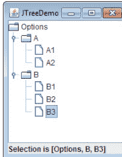

## JTable

`JTable` 是一个显示行和列数据的组件。从概念上说，`JTable` 非常简单。它是一个或多个列组成的组件。每列的顶部都有标题。除了描述列数据外，标题还提供了用户更改列宽的机制。`JTable` 不提供任何滚动功能。相反，你通常将 `JTable` 封装在 `JScrollPane` 中。

`JTable` 依赖于三个模型。第一个与二维格式显示数据有关。`TableModel` 定义了这种格式。第二个是列模型，由 `TableColumnModel` 表示。`JTable` 是根据列定义的。这两个模型封装在 `javax.swing.table` 中。第三个模型决定如何选择项目，它由 `ListSelectionModel` 指定，这在讨论 `JList` 时描述过。

`JTable` 可以产生几种不同的事件。对于表格操作最基本的两个是 `ListSelectionEvent` 和 `TableModelEvent`。当用户在表中选择内容时，会生成 `ListSelectionEvent`。`JTable` 允许选择一个或多个完整行，但你可以更改此行为，允许选择一个或多个列，或者一个或多个单元格。当表格数据发生某种变化时，会触发 `TableModel`。处理这些事件比处理之前几个组件生成的事件要复杂得多，超出了本书的范围。如果你只想使用 `JTable` 显示数据（如下例所示），则不需要处理任何事件。

`JTable` 提供了几个构造函数。这里使用的是：

```
JTable(Object data, Object[] colHeads)
```

在这里，`data` 是要展示的二维信息数组，`colHeads` 是包含列标题的一维数组。

### 1106 第三部分 使用 Swing 介绍 GUI 编程

下面的示例说明了如何创建和使用简单的表格。创建了一个名为 `colHeads` 的字符串一维数组用于列标题。创建了一个名为 `data` 的字符串二维数组用于表格单元格数据。你可以看到，数组中的每个元素都是一个包含三个字符串的数组。这些数组被传递给 `JTable` 构造函数。表格被添加到滚动面板中，然后将滚动面板添加到页面内容中。表格显示 `data` 中的数据。表格配置还允许对单元格内容进行编辑。这将更改底层的数组（在本例中为 `data`）。

```java
// Demonstrate JTable.
import java.awt.*;
import javax.swing.*;

public class JTableDemo {
    // 初始化列标题。
    String[] colHeads = {"Name", "Extension", "ID#" };

    // 初始化数据。
    Object[][] data = {
        {"Gail", "4567", "865"},
        {"Ken", "7566", "555"},
        {"Viviane", "5634", "587"},
        {"Melanie", "7345", "922"},
        {"Anne", "1237", "333"},
        {"John", "5665", "314"},
        {"Matt", "5670", "217"},
        {"Claire", "9023", "519"},
        {"Erwin", "6741", "444"},
        {"Ellen", "1134", "532"},
        {"Jennifer", "5689", "112"},
        {"Ed", "9030", "133"},
        {"Helen", "6751", "145"}
    };

    public JTableDemo() {
        // 设置 JFrame。使用默认的边界布局。
        JFrame jframe = new JFrame("JTableDemo");
        jframe.setDefaultCloseOperation(JFrame.EXIT_ON_CLOSE);
        jframe.setSize(300, 300);

        // 创建表格。
        JTable table = new JTable(data, colHeads);

        // 将表格添加到滚动面板中。
        JScrollPane jsp = new JScrollPane(table);

        // 将滚动面板添加到内容面板。
        jframe.add(jsp);

        // 显示框架。
        jframe.setVisible(true);
    }

    public static void main(String[] args) {
        // 在事件分发线程上创建框架。
        SwingUtilities.invokeLater(
            new Runnable() {
                public void run() {
                    new JTableDemo();
                }
            }
        );
    }
}
```

此示例的输出所示：

| Name | Extension | ID# |
|---|---|---|
| Gail | 4567 | 865 |
| Ken | 7566 | 555 |
| Viviane | 5634 | 587 |
| Melanie | 7346 | 922 |
| Anne | 1237 | 333 |
| John | 5556 | 314 |
| Matt | 5672 | 217 |
| Claire | 6741 | 444 |
| Erwin | 9023 | 519 |
| Ellen | 1134 | 532 |

## 第 34 章 介绍 Swing 菜单

本章介绍了 Swing GUI 环境的另一个基本方面：菜单。菜单是许多应用程序不可或缺的一部分，因为它们向用户展示程序的功能。由于其重要性，Swing 为菜单提供了广泛的支持。这是 Swing 强大之处显而易见的领域。Swing 菜单系统支持几个关键元素，包括：

- 菜单栏（menu bar），应用程序的主菜单。
- 标准菜单，可以包含可选择的项目或其他菜单（子菜单）。
- 弹出菜单（popup menu），通常通过鼠标右键激活。
- 工具栏（toolbar），提供了快速访问程序的功能，通常与菜单项并行。
- 操作（action），允许由单个对象管理两个或多个不同的组件。操作通常与菜单和工具栏配合。

Swing 菜单还支持加速键（accelerator keys），允许无需打开菜单即可选择菜单项；以及助记键（mnemonics），允许在菜单选项显示后通过键盘选择任何菜单项。

### 菜单基础


# Swing 菜单系统

Swing 菜单系统由一组相关类支持。本章使用的类如表 34-1 所示，它们代表了菜单系统的核心。尽管起初看起来可能有些困惑，但 Swing 菜单非常易用。如果需要，Swing 允许高度定制化；然而，通常你会直接使用这些菜单类，因为它们支持了所有最需要的选项。例如，你可以轻松地向菜单添加图像和快捷键。

## 表 34-1 核心 Swing 类

| 类 | 描述 |
| --- | --- |
| `JMenuBar` | 包含应用程序顶层菜单的对象。 |
| `JMenu` | 标准菜单。菜单由一个或多个 `JMenuItem` 组成。 |
| `JMenuItem` | 填充菜单的项。 |
| `JCheckBoxMenuItem` | 复选框菜单项。 |
| `JRadioButtonMenuItem` | 单选按钮菜单项。 |
| `JSeparator` | 菜单项之间的视觉分隔符。 |
| `JPopupMenu` | 通常通过鼠标右键激活的菜单。 |

以下是类之间如何协作的简要概述。要为应用程序创建顶层菜单，首先要创建一个 `JMenuBar` 对象。该类从某种意义上说是菜单的容器。在 `JMenuBar` 实例上添加 `JMenu` 实例。每个 `JMenu` 定义了一个菜单，因为每个 `JMenu` 对象包含一个或多个可选择项目。这些项目由 `JMenuItem` 对象显示。因此，`JMenuItem` 定义了用户可以的选择。

作为替代或补充，你还可以创建独立的弹出菜单。要创建一个弹出式 `JPopupMenu`，然后向其添加 `JMenu`。

## JMenuBar

`JMenuBar` 定义了一些在特殊应用程序中可能认为有用的其他方法。例如，你可以通过 `getSubElements()` 获取指向菜单栏中菜单的引用数组。你可以通过调用 `isSelected()` 来判断某个菜单是否被选中。

一旦创建了菜单栏，通过调用 `JFrame` 实例的 `setMenuBar()` 方法将其添加到 `JFrame` 中。（菜单栏不会被添加到内容面板中）。这里显示了 `setMenuBar()` 方法：

```java
void setMenuBar(JMenuBar mb)
```

在这里，`mb` 是菜单栏的引用。菜单栏将显示在由外观和感觉决定的位置。通常，它位于窗口的顶部。

## JMenu

`JMenu` 封装了一个菜单，它派自 `JMenuItem`。如前提到的，这意味着 `JMenu` 可以作为另一个 `JMenu` 的一个选择项。这使得一个菜单可以成为另一个菜单的子菜单。`JMenu` 定义了许多构造函数。例如，这里是本章使用的一个：

```java
JMenu(String name)
```

此构造函数创建了一个标题由 `name` 指定的菜单。当然，你不需要提供菜单名称。要创建一个未命名的菜单，可以使用默认构造函数：

```java
JMenu()
```

还支持其他构造函数。在每情况下，在向其添加菜单项之前，菜单都是空的。`JMenu` 定义了许多方法。这里是对常用方法的简要描述。要向菜单添加项，请使用 `add()` 方法，它有多种形式，包括此处显示的两种：

```java
JMenuItem add(JMenuItem item)
```

```java
Component add(Component item, int idx)
```

在这里，`item` 是要添加的菜单项。第一种形式将该项添加到菜单末尾。第二种形式将其添加到由 `idx` 指定索引处。如所料，索引从零开始。两者都返回所添加项的引用。有趣的是，你还可以使用 `insert()` 向菜单中添加菜单项。

你可以通过调用 `addSeparator()` 向菜单添加分隔符（类型为 `JSeparator` 的对象），如下所示：

```java
void addSeparator()
```

分隔符被添加到菜单末尾。你可以通过调用 `insertSeparator()` 在菜单中插入分隔符，如下所示：

```java
void insertSeparator(int idx)
```

在这里，`idx` 指定了添加分隔符的零基索引。如果 `enable` 为 true，则菜单项被启用。如果 `enable` 为 false，则该项被禁用且无法被选中。

## 创建主菜单

传统上，最常用的菜单是主菜单。这是由主栏定义的菜单，它是定义了应用程序所有（或几乎所有）功能的菜单。幸运的是，Swing 使创建和管理主菜单变得简单。本节将向你展示如何构建主菜单。后续章节将向你如何向其添加选项。

构建主菜单需要几个步骤。首先，创建存放菜单的 `JMenuBar` 对象。接下来，构建将位于主栏中的每个菜单。通常，菜单的构建是通过先创建一个 `JMenu` 对象并向其添加 `JMenuItem` 完成的。菜单创建后，将其添加到菜单栏中。然后，菜单栏本身必须通过调用 `setMenuBar()` 添加到框架。最后，对于每个菜单项，你必须添加一个动作监听器来处理菜单项被选中时发生的动作事件。

理解创建和管理菜单过程的好方法是运行一个示例。这是一个创建一个包含三个菜单的简单菜单栏的程序。第一个是标准的“文件”菜单，包含“打开”、“关闭”、“保存”和“退出”选择。第二个菜单称为“选项”，包含两个名为“颜色”和“优先级”的子菜单。第三个菜单称为“帮助”，它有一个项：“关于”。当菜单被选中时，选择名称显示在内容面板的标签中。示例输出如图 34-1 所示。

```java
// 展示一个简单的菜单示例。

import java.awt.*;
import java.awt.event.*;
import javax.swing.*;

class MenuDemo implements ActionListener {

    JLabel jlab;

    MenuDemo() {
        // 创建一个新的 JFrame 容器。
        JFrame jfrm = new JFrame("Menu Demo");

        // 为布局管理器指定布局。
        jfrm.setLayout(new FlowLayout());

        // 给框架设置初始大小。
        jfrm.setSize(200, 200);

        // 当用户关闭应用程序时终止程序。
        jfrm.setDefaultCloseOperation(JFrame.EXIT_ON_CLOSE);

        // 创建一个将显示菜单选择的标签。
        jlab = new JLabel();

        // 创建菜单栏。
        JMenuBar jmb = new JMenuBar();

        // 创建文件菜单。
        JMenu jFile = new JMenu("File");
        JMenuItem jmiOpen = new JMenuItem("Open");
        JMenuItem jmiClose = new JMenuItem("Close");
        JMenuItem jmiSave = new JMenuItem("Save");
        JMenuItem jmiExit = new JMenuItem("Exit");
        jFile.add(jmiOpen);
        jFile.add(jmiClose);
        jFile.add(jmiSave);
        jFile.addSeparator();
        jFile.add(jmiExit);
        jmb.add(jFile);

        // 创建选项菜单。
        JMenu jOptions = new JMenu("Options");

        // 创建颜色子菜单。
        JMenu jColors = new JMenu("Colors");
        JMenuItem jmiRed = new JMenuItem("Red");
        JMenuItem jmiGreen = new JMenuItem("Green");
        JMenuItem jmiBlue = new JMenuItem("Blue");
        jColors.add(jmiRed);
        jColors.add(jmiGreen);
        jColors.add(jmiBlue);
        jOptions.add(jColors);

        // 创建优先级子菜单。
        JMenu jPriority = new JMenu("Priority");
        JMenuItem jmiHigh = new JMenuItem("High");
        JMenuItem jmiLow = new JMenuItem("Low");
        jPriority.add(jmiHigh);
        jPriority.add(jmiLow);
        jOptions.add(jPriority);

        // 创建重置菜单。
        JMenuItem jmiReset = new JMenuItem("Reset");
        jOptions.addSeparator();
        jOptions.add(jmiReset);

        // 选项菜单添加到菜单栏。
        jmb.add(jOptions);

        // 创建帮助菜单。
        JMenu help = new JMenu("Help");
        JMenuItem jmiAbout = new JMenuItem("About");
        help.add(jmiAbout);

        // 将帮助菜单添加到菜单栏。
        jmb.add(help);

        // 为每个菜单项添加动作监听器。

        // 帮助菜单项的监听器。
        help.addActionListener(this);

        // 关于菜单项的监听器。
        jmiAbout.addActionListener(this);

        // 打开菜单项的监听器。
        jmiOpen.addActionListener(this);

        // 关闭菜单项的监听器。
        jmiClose.addActionListener(this);

        // 保存菜单项的监听器。
        jmiSave.addActionListener(this);

        // 退出菜单项的监听器。
        jmiExit.addActionListener(this);

        // 红色菜单项的监听器。
        jmiRed.addActionListener(this);

        // 绿色菜单项的监听器。
        jmiGreen.addActionListener(this);

        // 蓝色菜单项的监听器。
        jmiBlue.addActionListener(this);

        // 高优先级菜单项的监听器。
        jmiHigh.addActionListener(this);

        // 低优先级菜单项的监听器。
        jmiLow.addActionListener(this);

        // 重置菜单项的监听器。
        jmiReset.addActionListener(this);

        // 将菜单栏添加到框架。
        jfrm.setJMenuBar(jmb);

        // 将标签添加到内容面板。
        jfrm.add(jlab);

        // 显示框架。
        jfrm.setVisible(true);
    }

    // 处理菜单项被选中时的动作事件。
    public void actionPerformed(ActionEvent ae) {
        // 获取选择的命令。
        String comStr = ae.getActionCommand();

        // 如果选择了退出，则终止程序。
        if (comStr.equals("Exit")) {
            System.exit(0);
        }

        // 否则，显示选择。
        jlab.setText(comStr + " Selected");
    }

    // 在分发线程中创建框架。
    public static void main(String[] args) {
        SwingUtilities.invokeLater(new Runnable() {
            public void run() {
                new MenuDemo();
            }
        });
    }
}
```

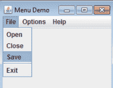

**图 34-1** MenuDemo 程序的示例输出

`actionPerformed()` 方法处理由菜单生成的动作事件。它通过调用事件的 `getActionCommand()` 获取与选择相关的动作命令字符串。它将此字符串的引用存储在 `comStr` 中。然后，如下所示，测试动作命令是否为 "Exit"：

```java
if (comStr.equals("Exit")) System.exit(0);
```

如果动作命令是 "Exit"，则程序通过调用 `System.exit()` 终止。此方法会导致程序立即终止，并将其参数作为状态码传递给调用进程（通常是操作系统）。按照惯例，状态码 0 表示正常终止。任何其他值均表示程序异常终止。对于所有其他菜单，将显示所选内容。

至此，你可能想对 `MenuDemo` 程序进行实验。尝试添加另一个菜单或向某个条目添加更多项。在继续之前，理解基础的菜单概念至关重要，因为这个程序将在本章中不断演变。

## 为菜单项添加助记符和加速器

在前一个示例中创建的菜单具有功能性，但可以使其变得更好。在实际应用中，菜单通常包含对键盘快捷键的支持，以便让经验丰富的用户能够快速选择菜单项。键盘快捷键有两种形式：助记符和加速器。对于菜单而言，助记符定义了一个键，允许你通过该键从活动菜单中选择某项。因此，助记符允许你使用该键从已显示的菜单中选择一个项。而加速器是一个无需先激活菜单即可选择菜单项的按键。

`JMenuItem` 和 `JMenu` 对象都可以指定助记符。为 `JMenuItem` 设置助记符有两种方法。首先，可以在构造对象时使用以下代码进行指定：

- `JMenuItem(String name, int mnemonic)`

在这种情况下，`name` 被传递给 `name` 参数，`mnemonic` 被传递给 `mnem` 参数。其次，你可以通过调用 `setMnemonic()` 来设置助记符。要为 `JMenu` 指定助记符，必须调用 `setMnemonic()`。此方法继承自 `AbstractButton` 类，如下所示：

```java
void setMnemonic(int mnemonic)
```

在这里，`mnemonic` 指定助记符。它应该是 `java.awt.event.KeyEvent` 中定义的常量之一，例如 `KeyEvent.VK_F` 或 `KeyEvent.VK_Z`。（另一个接受 `char` 参数的 `setMnemonic()` 版本被认为是过时的。）助记符不是区分大小写的，因此在 `VK_A` 的情况下，输入 `a` 或 `A` 均有效。

默认情况下，菜单项中的第一个匹配字母将带有下划线。如果你想下划第一个匹配以外的字母，可以将字母的索引作为参数传递给 `setDisplayedMnemonicIndex(idx)`，该方法 `JMenu` 和 `JMenuItem` 均继承自 `AbstractButton`。如下所示：

```java
void setDisplayedMnemonicIndex(int idx)
```

要下划线的字母索引是 `idx`。

加速器可以与 `JMenuItem` 对象关联。它通过调用 `setAccelerator(KeyStroke ks)` 来指定，如下：

```java
void setAccelerator(KeyStroke ks)
```

在这里，`ks` 是选择菜单项时按下的按键组合。`KeyStroke` 是一个包含多个工厂方法的类，用于构建各种类型的按键加速器。以下是三个示例：

- `static KeyStroke getStroke(char ch)`
- `static KeyStroke getStroke(Character ch, int modifier)`
- `static KeyStroke getStroke(int ch, int modifier)`

在这里，`ch` 指定加速器字符。在第一个版本中，字符以 `char` 值指定。在第二个版本中，它作为 `Character` 对象被指定。在第三个版本中，它是之前描述的 `KeyEvent` 值。`modifier` 的值必须是 `java.awt.event.KeyEvent` 中定义的以下常量或多个：

| InputEvent.ALT_DOWN_MASK | InputEvent.GRAPH_DOWN_MASK |
| :--- | :--- |
| InputEvent.CTRL_DOWN_MASK | InputEvent.META_DOWN_MASK |
| InputEvent.SHIFT_DOWN_MASK | |

因此，如果你传递 `VK_A` 作为字符，并将 `InputEvent.CTRL_DOWN_MASK` 作为修饰符，则加速器按键组合为 CTRL-A。

以下序列将为前一节中 `MenuDemo` 程序创建的“文件”菜单添加助记符和加速器。完成此后，你可以通过输入 ALT-F 选择“文件”菜单。然后你可以使用助记符 `o`、`c`、`s` 或 `e` 选择选项。或者，你也可以通过按 CTRL-O、CTRL-C、CTRL-S 或 CTRL-E 直接选择“文件”菜单。图 34-2 显示了该菜单在激活时的外观。


```java
// 创建带有助记符和加速器的文件菜单。
JMenuItem jfile = new JMenu("File");
jfile.setMnemonic(KeyEvent.VK_F);
```

```java
JMenuItem jmiOpen = new JMenuItem("Open", KeyEvent.VK_O);
jmiOpen.setAccelerator(
```

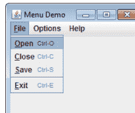

**图 34-2** 添加助记符和加速器后的文件菜单

# 第三部分 使用 Swing 介绍 GUI 编程

```java
KeyStroke.getKeyStroke(KeyEvent.VK_O,
InputEvent.CTRL_DOWN_MASK);
JMenuItem jmiClose = new JMenuItem("Close", KeyEvent.VK_C);
jmiClose.setAccelerator(
```

```java
JMenuItem jmiSave = new JMenuItem("Save", KeyEvent.VK_S);
jmiSave.setAccelerator(
```

```java
JMenuItem jmiExit = new JMenuItem("Exit", KeyEvent.VK_E);
jmiExit.setAccelerator(
```

# 为菜单项添加图像和提示说明

你可以向菜单项添加图像而不是文本。添加图像最简单的方法是使用这些构造函数：

- `JMenuItem(Icon image)`
- `JMenuItem(String name, Icon image)`

第一个创建一个显示图像的菜单项。第二个创建一个带有名称和图像的菜单项。例如：

```java
ImageIcon icon = new ImageIcon("About.gif");
JMenuItem jAbout = new JMenuItem("About", icon);
```

之后，图标将显示在文本旁边。如图 34-3 所示。

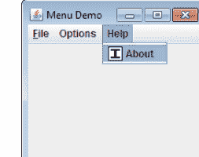

**图 34-3** 带有图标的关于项

# 第34 章 介绍 Swing 菜单

`AbstractButton`。你可以通过 `setHorizontalPosition()` 指定图像相对于文本的水平对齐方式。你可以通过 `setDisabledIcon()` 指定禁用图标。通常，当菜单项被禁用时，将显示该图标。

提示说明是鼠标悬停在项上时出现的小消息。你可以通过对项调用 `setToolTip()` 为菜单项添加提示。如下所示：

```
void setToolTip(String msg)
```

在这种情况下，`msg` 是将显示的字符串。例如：

```java
jAbout.setToolTip("About MenuDemo.");
```

作为一点，`setToolTip` 继承自 `JComponent`。这意味着你可以为其他类型的组件（如按钮）添加提示。

# JMenuItem 和 JCheckBoxMenuItem

虽然前面的示例使用了菜单项类型，Swing 定义了另外两种：复选框和单选框。这些可以简化 GUI，允许菜单提供原本需要额外组件的功能。此外，有时在菜单中包含复选框或单选框似乎是某些特定功能的自然所在。无论出于什么原因，Swing 都能方便在菜单中使用复选框和单选框，本文将检查两者。

要在菜单中添加复选框，创建 `JCheckBoxMenuItem`。它定义了多个构造函数。这里使用的是这个：

```
JCheckBoxMenuItem(String name)
```

在这里，`name` 指定项名称。复选框的初始状态为未选中。如果你想设置初始状态，可以使用此构造函数：

```
JCheckBoxMenuItem(String name, boolean state)
```

在这种情况下，如果 `state` 为 true，则初始为选中；否则，清除。`JCheckBoxMenuItem` 还提供了允许指定图标的构造函数。这里有一个示例：

```
JCheckBoxMenuItem(String name, Icon icon)
```

在这种情况下，`name` 指定项名称，与项相关的图标传递给 `icon`。该项初始为未选中。其他构造函数也受支持。菜单中的复选框与独立的复选框工作类似。例如，它们在状态更改时会生成动作事件和项事件。

## 复选框和单选按钮菜单项的效果

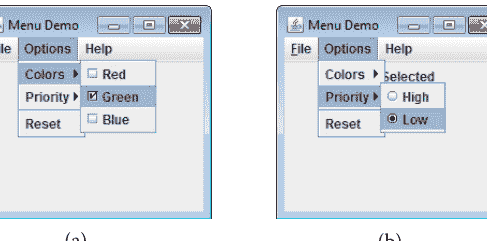

**图 34-4** 复选框 (a) 和单选按钮 (b) 菜单项的效果

可以通过创建 `JRadioButtonMenuItem` 类型的对象向菜单中添加单选按钮。`JRadioButtonMenuItem` 继承自 `JMenuItem`。它提供了丰富的构造函数。本章使用的构造函数所示：

```
JRadioButtonMenuItem(String name)
JRadioButtonMenuItem(String name, boolean state)
```

第一个构造函数创建一个未选中的单选按钮菜单项，该项与传入 `name` 参数的名称关联。第二个构造函数允许你指定按钮的初始状态。如果 `state` 为 `true`，则按钮初始为选中状态；否则，为未选中。其他构造函数允许你指定图标。这里是一个示例：

```
JRadioButtonMenuItem(String name, Icon icon, boolean state)
```

这创建了一个单选按钮菜单项，它与传入 `name` 参数的名称以及传入 `image` 参数的图像关联。如果 `state` 为 `true`，则按钮初始为选中状态；否则，为未选中。还支持其他构造函数。

`JRadioButtonMenuItem` 的工作类似于独立的单选按钮，会生成动作事件。与独立的单选按钮一样，基于菜单的单选按钮必须放入按钮组（`ButtonGroup`）中，才能表现互斥的选择行为。

由于 `JCheckBoxMenuItem` 和 `JRadioButtonMenuItem` 继承自 `JMenuItem`，因此每个都具有 `JMenuItem` 的所有功能。除了具有复选框和单选按钮的额外能力外，它们与其他菜单项的行为无异。

要测试复选框和单选按钮菜单项，首先删除 MenuDemo 示例中创建 `Options` 菜单的代码。然后替换以下代码序列，该序列在 `Colors` 子菜单中使用复选框，在 `Priority` 子菜单中使用单选按钮。替换后，`Options` 菜单将看起来像图 34-4 所示。

```java
// 创建 Options 菜单。
JMenuItem jOptions = new JMenu("Options");

// 创建 Colors 子菜单。
JMenuItem jColors = new JMenu("Colors");

// 使用复选框处理颜色。这允许
// 用户选择多一种颜色。
JCheckBoxMenuItem jmiRed = new JCheckBoxMenuItem("Red");
JCheckBoxMenuItem jmiGreen = new JCheckBoxMenuItem("Green");
JCheckBoxMenuItem jmiBlue = new JCheckBoxMenuItem("Blue");

jColors.add(jmiRed);
jColors.add(jmiGreen);
jColors.add(jmiBlue);
jOptions.add(jColors);

// 创建 Priority 子菜单。
JMenu priority = new JMenu("Priority");

// 优先级设置使用单选按钮。
// 让菜单显示使用了哪个优先级，
// 同时确保任何时间只能选择一个优先级。
// 注意，
// High 单选按钮初始为选中状态。
JRadioButtonMenuItem jmiHigh = new JRadioButtonMenuItem("High", true);
JRadioButtonMenuItem jmiLow = new JRadioButtonMenuItem("Low");

priority.add(jmiHigh);
priority.add(jmiLow);
jOptions.add(priority);

// 为单选按钮菜单项创建按钮组。
ButtonGroup group = new ButtonGroup();
group.add(jmiHigh);
group.add(jmiLow);

// 创建 Reset 菜单项。
JMenuItem jmiReset = new JMenuItem("Reset");
jOptions.addSeparator();
jOptions.add(jmiReset);

// 最后，将整个选项菜单添加到
// 菜单栏
jmb.add(jOptions);
```

# 创建弹出菜单

菜单栏的一种流行替代方案是弹出菜单（Popup Menu）。弹出菜单通过在组件上点击鼠标右键来激活。Swing 通过 `JPopupMenu` 类支持弹出菜单。`JPopupMenu` 有两个构造函数。在本章中使用了默认构造函数：

```
JPopupMenu()
```

它创建一个默认的弹出菜单。另一个构造函数允许你为菜单指定标题。该标题是否显示取决于外观和感觉（look and feel）。

通常情况下，弹出菜单的构建方式与普通菜单类似。创建一个 `JPopupMenu` 对象，然后向其添加菜单。菜单项的处理方式相同。弹出菜单与普通菜单的主要区别在于三个步骤：

1. 创建一个 `JPopupMenu` 对象。
2. 向其添加菜单。
3. 使用 `show()` 方法显示弹出菜单。

要实际显示弹出菜单，调用 `JPopupMenu` 定义的 `show()` 方法，如下：

```
void show(Component invoker, int upperX, int upperY)
```

此处 `invoker` 是产生事件的组件。`upperX` 和 `upperY` 的值定义了相对于 `invoker` 的菜单左上角。

# 第 34 章 引入菜单

上述理论可以通过在本章开头所示的 `MenuDemo` 添加一个弹出菜单来实现。该菜单将包含三个项：Cut（剪切）、Copy（复制）和 Paste（粘贴）。通过向 `MenuDemo` 添加以下实例变量：

```
JPopupMenu jpu;
```

`jpu` 变量将持有弹出菜单的引用。接下来，将以下代码添加到 `MenuDemo` 构造函数中：

```java
// 创建 Edit 弹出菜单。
jpu = new JPopupMenu();

// 创建弹出项。
JMenuItem jmiCut = new JMenuItem("Cut");
JMenuItem jmiCopy = new JMenuItem("Copy");
JMenuItem jmiPaste = new JMenuItem("Paste");

// 将菜单项添加到弹出菜单。
jpu.add(jmiCut);
jpu.add(jmiCopy);
jpu.add(jmiPaste);

// 为弹出触发添加监听器。
jfrm.addMouseListener(new MouseAdapter() {
    public void mousePressed(MouseEvent me) {
        if (me.isPopupTrigger()) {
            jpu.show(me.getComponent(), me.getX(), me.getY());
        }
    }
    public void mouseReleased(MouseEvent me) {
        if (me.isPopupTrigger()) {
            jpu.show(me.getComponent(), me.getX(), me.getY());
        }
    }
});
```

该序列首先构造一个 `JPopupMenu` 并将其存储在 `jpu` 中。然后，按照通常方式创建三个项 Cut、Copy 和 Paste，并将它们添加到 `jpu`。这完成了 Edit 弹出菜单的构建。弹出菜单不会被菜单栏或任何其他对象管理。

与弹出菜单相关的方法有：`mousePressed()` 和 `mouseReleased()`。适配器提供了其他 `MouseListener` 方法的默认实现。注意，鼠标监听器被添加到了 `jfrm` 中。这意味着在内容区域的任何部分点击鼠标右键都会触发弹出菜单。

`mousePressed()` 和 `mouseReleased()` 方法调用 `isPopupTrigger()` 来判断它是否为弹出事件。如果是，则通过调用 `show()` 显示弹出菜单。通过在鼠标事件上调用 `getComponent()` 获取调用者。在这种情况下，调用者将是内容区域。通过调用 `getX()` 和 `getY()` 获取左上角的 X、Y 坐标。这使得菜单在弹出时，其左上角直接位于鼠标点下方。

最后，你还需要将这些动作监听器（action listeners）添加到程序中。它们处理当用户从弹出菜单中选择某项时触发的动作事件。

```java
jmiCut.addActionListener(this);
jmiCopy.addActionListener(this);
jmiPaste.addActionListener(this);
```

在完成这些添加后，可以通过点击应用程序内容区域内的任何地方鼠标右键来激活弹出菜单。图 34-5 显示了结果。

关于前面的示例的另一点。由于弹出菜单的调用者始终是 `jfrm`，在这种情况下，你可以显式地传递它，而不是调用 `getComponent()`。为了这样做，你可以将 `jfrm` 成为 `MenuDemo` 类的实例变量（而不是局部变量），这样内部类就可以访问它。然后你就可以使用此 `show()` 调用来显示弹出菜单：

```
jpu.show(jfrm, me.getX(), me.getY());
```

虽然这在示例中可以运行，但使用 `getComponent()` 的优势在于，弹出菜单将相对于调用者组件自动弹出。因此，可以使用相同的代码相对于其调用者对象显示任何弹出菜单。

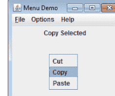

**图 34-5** 一个弹出的编辑（Edit）菜单

# 创建工具栏

工具栏是一种既可以作为菜单的替代方案，也可以作为其补充的组件。工具栏包含一个按钮列表（或其他组件），为用户提供了直接访问各种程序选项的途径。例如，工具栏可能包含选择各种选项的按钮，如**加粗**、高亮或下划线。选择这些选项无需下拉菜单。通常，工具栏按钮显示图标而不是文本，两者或两者兼有都是允许的。此外，基于图标的工具栏按钮还关联有工具提示（tooltips）。可以通过拖动工具栏将其置在窗口的任何侧，也可以将其完全拖出窗口，在这种情况下，它们将变成浮动状态。

在 Swing 中，工具栏是 `JToolBar` 类的实例。它的构造函数允许你创建一个带有标题或不带标题的工具栏。你还可以指定工具栏的布局，可以是水平或垂直的。`JToolBar` 的构造函数显示如下：

```
JToolBar()
JToolBar(String title)
JToolBar(int how)
JToolBar(String title, int how)
```

第一个构造函数创建一个无标题的水平工具栏。第二个创建一个带有 `title` 参数指定标题的水平工具栏。标题仅在工具栏被拖出窗口时显示。第三个创建一个方向由 `how` 决定的工具栏。`how` 的值必须是 `JToolBar.VERTICAL` 或 `JToolBar.HORIZONTAL`。第四个构造函数创建一个带有 `title` 指定标题且方向由 `how` 决定的工具栏。

工具栏通常与使用边界布局（border layout）的窗口一起使用。这有两个原因。首先，它允许工具栏定位在四个边界位置之一。通常使用顶部位置。其次，它允许工具栏被拖动到窗口的任何侧。

# 使用 Action

通常，工具栏和菜单项包含共同点……

除了继承的 `actionPerformed()` 方法外，`Action` 还定义了自己的几个方法。特别感兴趣的是 `putValue()`。它设置与动作相关联的各种属性的值，此处所示：

```
void putValue(String key, Object val)
```

它将 `val` 分配给由 `key` 指定的代表所需属性的属性。虽然接下来的示例没有使用它，但知道 `Action` 还提供了 `getValue()` 方法来获取指定的属性是有帮助的。此处所示：

```
Object getValue(String key)
```

它返回由 `key` 指定的属性的引用。

`putValue()` 和 `getValue()` 使用的键值包括此处：

| 键值 | 描述 |
| :--- | :--- |
| `ACCELERATOR_KEY` | 表示快捷键属性。快捷键以 `KeyStroke` 对象的形式指定。 |


## Swing Action 常量

| 常量 | 说明 |
| :--- | :--- |
| `static Final String ACTION_COMMAND_KEY` | 表示动作命令。动作命令以字符串指定。 |
| `static Final String DISPLAYED_MNEMONIC_INDEX_KEY` | 表示显示为助记符的字符索引。这是一个 `Integer` 值。 |
| `static Final String LARGE_ICON_KEY` | 表示与动作相关的大图标。图标以类型为 `Icon` 的对象指定。 |
| `static Final String LONG_DESCRIPTION` | 表示动作的详细描述。该描述以字符串指定。 |
| `static Final String MNEMONIC_KEY` | 表示助记符属性。助记符以 `KeyEvent` 指定。 |
| `static Final String NAME` | 表示动作的名称（该名称也成为与动作关联的按钮或菜单的名称）。名称以字符串指定。 |
| `static Final String SELECTED_KEY` | 表示选中状态。如果设置，则该项被选中。状态由 `Boolean` 值表示。 |
| `static Final String SHORT_DESCRIPTION` | 表示与动作相关的工具提示文本。工具提示文本以字符串指定。 |
| `static Final String SMALL_ICON` | 表示与动作相关的小图标。图标以类型为 `Icon` 的对象指定。 |

## 第34章 引入 Swing 菜单

例如，要将助记符设置为字母 X，请使用此处的 `putValue()` 调用：

```java
actionOb.putValue(MNEMONIC_KEY, KeyEvent.VK_X);
```

一个无法通过 `putValue()` 和 `getValue()` 设置的属性是启用/禁用状态。为了设置此状态，请使用 `setEnabled()` 和 `isEnabled()` 方法，如下所示：

```java
void setEnabled(boolean enabled)
```

```java
boolean isEnabled()
```

对于 `setEnabled()`，如果 `enabled` 为 `true`，则动作是启用的；否则，被禁用。`isEnabled()` 如果动作被启用则返回 `true`，否则返回 `false`。

虽然你可以自己实现 `Action` 接口，但不需要这样做。相反，Swing 提供了一个名为 `AbstractAction` 的部分实现，你可以扩展它。通过扩展 `AbstractAction`，你只需要实现一个方法：`actionPerformed()`。其他方法由 `AbstractAction` 为你提供。`AbstractAction` 提供了三个构造函数，本章使用的是：

```java
AbstractAction(String name, Icon image)
```

它构造了一个由 `name` 指定名称并由 `image` 指定图标的 `AbstractAction`。

一旦你创建了动作，就可以将其添加到 `JToolBar` 并用于构造 `JMenu`。要向 `JToolBar` 中添加动作，请使用此版本的 `add()`：

```java
JButton add(Action actObj)
```

这里，`actObj` 是正在添加到工具栏的动作。由 `actObj` 定义的属性用于创建工具栏按钮。要从动作创建菜单项，使用 `JMenu` 构造函数：

```java
JMenuItem(Action actObj)
```

这里使用动作根据其属性构造菜单项。

> **注意** 除 `JToolBar` 和 `JMenuItem` 外，动作还被其他几个 Swing 组件支持，例如 `JPopupMenu`、`JButton`、`JRadioButton`、`JCheckBox`、`JRadioButtonMenuItem` 和 `JCheckBoxMenuItem` 都支持所有动作。

为了说明动作的优势，我们将使用它们来管理上一节中的调试工具栏。我们还将在“选项”菜单下添加一个调试子菜单。调试子菜单将包含与调试工具栏相同的选择：设置断点、清除断点和恢复。支持工具栏中这些项的相同动作也将支持菜单中的这些项。因此，不再需要创建重复代码来同时处理工具栏和菜单，两者都由动作来处理。


首先创建一个名为 `DebugAction` 的内部类，它扩展自 `AbstractAction`，如下：

- 名称
- 图标
- 助记符
- 快捷键
- 工具提示

前两个通过 `super` 传递给 `AbstractAction` 的构造函数。其他三个属性通过调用 `putValue()` 设置。

`DebugAction` 的 `actionPerformed()` 方法处理动作的事件。这意味着当使用 `DebugAction` 实例创建工具栏按钮和菜单项时，由其中任一组件生成的事件都由 `DebugAction` 中的 `actionPerformed()` 方法处理。注意，该处理程序在实验室中显示了选择结果。此外，如果选择了“设置断点”选项，则“清除断点”选项被启用，而“设置断点”选项被禁用。

每个助记符都本地化到它自己的菜单中。还要注意清除断点的动作最初是禁用的。只有在设置了断点后它才被启用。接下来，使用动作创建工具栏按钮，然后将这些按钮添加到工具栏，如下：

```java
// 使用动作创建工具栏按钮。
JButton jbtSet = new JButton(setAct);
JButton jbtClear = new JButton(clearAct);
JButton jbtResume = new JButton(resumeAct);
```

```java
// 创建调试工具栏。
JToolBar jtb = new JToolBar("Breakpoints");
```

```java
// 将按钮添加到工具栏。
jtb.add(jbtSet);
jtb.add(jbtClear);
jtb.add(jbtResume);
```

```java
// 将工具栏添加到框架北部。
jfrm.add(jtb, BorderLayout.NORTH);
```

最后，创建调试菜单，如下：

```java
// 现在创建一个位于选项下的调试菜单。使用动作创建项。
JMenuItem jmiDebug = new JMenuItem("Debug");
JMenuItem jmiSetBP = new JMenuItem(setAct);
JMenuItem jmiClearBP = new JMenuItem(clearAct);
JMenuItem jmiResume = new JMenuItem(resumeAct);
jmiDebug.add(jmiSetBP);
jmiDebug.add(jmiClearBP);
jmiDebug.add(jmiResume);
mOptions.add(jmiDebug);
```

```java
// 最初禁用清除断点选项。
clearAction.setEnabled(false);
```

注意设置断点的快捷键是 B，清除断点的快捷键是 L。使用这些键而不是 S 和 C 的原因是这些键已由文件菜单分配。但是，它们仍然可以作为助记符，因为……

在进行了这些更改和添加后，你创建的动作将用于管理调试菜单和工具栏。更改动作中的属性（例如禁用它）将影响该动作的所有用处。程序现在将如图 34-7 所示。

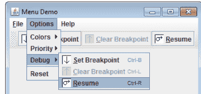

**图 34-7** 使用动作管理调试工具栏和菜单

## 整合整个 MenuDemo 程序

在整个讨论过程中，对章节开头展示的 MenuDemo 程序进行了许多更改和添加。在结束之前，将所有部分组装在一起将非常有帮助。这样做不仅消除了关于这些部分如何组合在一起的任何歧义，还为你提供了一个可以用来进行实验的完整演示程序。

以下版本的 MenuDemo 包含了本章中描述的所有添加和增强。为了清晰起见，程序经过了重新组织，使用了独立的方法来构建各种菜单和工具栏。请注意，几个与菜单相关的变量（如 `jmb`、`jFile` 和 `jtb`）已变为实例变量。


```java
// 完整的 MenuDemo 程序。

import java.awt.*;
import java.awt.event.*;
import javax.swing.*;

class MenuDemo implements ActionListener {

    JLabel jlab;

    JMenuBar jmb;
    JToolBar jtb;

    JPopupMenu jpu;

    DebugAction setAct;
    DebugAction clearAct;
    DebugAction resumeAct;

    MenuDemo() {
        // 创建一个新的 JFrame 容器。
        JFrame jfrm = new JFrame("Complete Menu Demo");

        // 使用默认的布局管理器。

        // 给帧一个初始大小。
        jfrm.setSize(360, 200);

        // 当用户关闭应用程序时终止程序。
        jfrm.setDefaultCloseOperation(JFrame.EXIT_ON_CLOSE);

        // 创建一个显示菜单选择的标签。
        jlab = new JLabel();

        // 创建菜单栏。
        jmb = new JMenuBar();

        // 创建 File 菜单。
        makeFileMenu();

        // 构建 Debug 动作。
        makeActions();

        // 创建工具栏。
        makeToolbar();

        // 创建 Options 菜单。
        makeOptionsMenu();

        // 创建 Help 菜单。
        makeHelpMenu();

        // 创建 Edit 弹出菜单。
        makeEditPopupMenu();

        // 为弹出触发器添加监听器。
        jfrm.addMouseListener(new MouseAdapter() {
            public void mousePressed(MouseEvent me) {
                if (me.isPopupTrigger())
                    jpu.show(me.getComponent(), me.getX(), me.getY());
            }
            public void mouseReleased(MouseEvent me) {
                if (me.isPopupTrigger())
                    jpu.show(me.getComponent(), me.getX(), me.getY());
            }
        });

        // 将标签添加到内容面板的中心。
        jfrm.add(jlab, BorderLayout.CENTER);

        // 将工具栏添加到内容面板的北部。
        jfrm.add(jtb, BorderLayout.NORTH);

        // 将菜单栏添加到帧中。
        jfrm.setJMenuBar(jmb);

        // 显示帧。
        jfrm.setVisible(true);
    }

    // 处理菜单项事件。
    // 这并不处理由 Debug 选项生成的事件。
    public void actionPerformed(ActionEvent ae) {
        // 从菜单选择中获取动作命令。
        String comStr = ae.getActionCommand();

        // 如果用户使用 Exit，则退出程序。
        if(comStr.equals("Exit")) System.exit(0);

        // 否则，显示选择的内容。
        jlab.setText(comStr + " Selected");
    }

    // 用于 Debug 菜单和工具栏的动作类。
    class DebugAction extends AbstractAction {
        public DebugAction(String name, Icon image, int mnem,
                           int accel, String tTip) {
            putValue(Action.NAME, name);
            putValue(Action.SMALL_ICON, image);
            putValue(Action.ACCELERATOR_KEY,
                KeyStroke.getKeyStroke(accel,
                    InputEvent.CTRL_DOWN_MASK));

            putValue(Action.MNEMONIC_KEY, mnem);
            putValue(Action.SHORT_DESCRIPTION, tTip);
        }

        // 处理来自工具栏和 Debug 菜单的事件。
        public void actionPerformed(ActionEvent ae) {
            String comStr = ae.getActionCommand();

            // 切换 Set 和 Clear Breakpoint 选项的状态。
            if(comStr.equals("Set Breakpoint")) {
                clearAct.setEnabled(true);
                setAct.setEnabled(false);
            } else if(comStr.equals("Clear Breakpoint")) {
                clearAct.setEnabled(false);
                setAct.setEnabled(true);
            }
        }
    }

    // 创建带有记忆键和加速键的 File 菜单。
    void makeFileMenu() {
        JMenu jFile = new JMenu("File");
        jFile.setMnemonic(KeyEvent.VK_F);

        JMenuItem jmiOpen = new JMenuItem("Open");
        jmiOpen.setMnemonic(KeyEvent.VK_O);
        jmiOpen.setAccelerator(
            KeyStroke.getKeyStroke(KeyEvent.VK_O,
            InputEvent.CTRL_DOWN_MASK));

        JMenuItem jmiClose = new JMenuItem("Close");
        jmiClose.setMnemonic(KeyEvent.VK_C);
        jmiClose.setAccelerator(
            KeyStroke.getKeyStroke(KeyEvent.VK_C,
            InputEvent.CTRL_DOWN_MASK));

        JMenuItem jmiSave = new JMenuItem("Save");
        jmiSave.setMnemonic(KeyEvent.VK_S);
        jmiSave.setAccelerator(
            KeyStroke.getKeyStroke(KeyEvent.VK_S,
            InputEvent.CTRL_DOWN_MASK));

        JMenuItem jmiExit = new JMenuItem("Exit",
            KeyEvent.VK_E);
        jmiExit.setAccelerator(KeyStroke.getKeyStroke(KeyEvent.VK_E,
            InputEvent.CTRL_DOWN_MASK));

        jFile.add(jmiOpen);
        jFile.add(jmiClose);
        jFile.add(jmiSave);
        jFile.addSeparator();
        jFile.add(jmiExit);

        jmb.add(jFile);
    }

    // 创建工具栏。
    void makeToolbar() {
        jtb = new JToolBar();

        // 假设图标资源存在
        Icon setIcon = new ImageIcon("set.gif");
        Icon clearIcon = new ImageIcon("clear.gif");
        Icon resumeIcon = new ImageIcon("resume.gif");

        setAct = new DebugAction("Set Breakpoint", setIcon,
            KeyEvent.VK_S, KeyEvent.VK_S, "Set Breakpoint");
        clearAct = new DebugAction("Clear Breakpoint", clearIcon,
            KeyEvent.VK_C, KeyEvent.VK_C, "Clear Breakpoint");
        resumeAct = new DebugAction("Resume", resumeIcon,
            KeyEvent.VK_R, KeyEvent.VK_R, "Resume");

        jtb.add(setAct);
        jtb.add(clearAct);
        jtb.add(resumeAct);
    }

    // 创建 Options 菜单。
    void makeOptionsMenu() {
        JMenu jOpt = new JMenu("Options");

        JMenuItem jmiSet = new JMenuItem("Set Breakpoint");
        jmiSet.setMnemonic(KeyEvent.VK_S);

        JMenuItem jmiClear = new JMenuItem("Clear Breakpoint");
        jmiClear.setMnemonic(KeyEvent.VK_C);

        jOpt.add(jmiSet);
        jOpt.add(jmiClear);

        jmb.add(jOpt);
    }

    // 创建 Help 菜单。
    void makeHelpMenu() {
        JMenu jHelp = new JMenu("Help");

        // 添加一个 About 菜单项。
        ImageIcon icon = new ImageIcon("About.gif");

        JMenuItem jmiAbout = new JMenuItem("About");
        jmiAbout.setIcon(icon);
        jmiAbout.setToolTipText("Info about the program.");

        jHelp.add(jmiAbout);
        jmb.add(jHelp);
    }

    // 创建 Edit 弹出菜单。
    void makeEditPopupMenu() {
        jpu = new JPopupMenu();

        JMenuItem jmiCut = new JMenuItem("Cut");
        jmiCut.setMnemonic(KeyEvent.VK_X);
        jmiCut.setAccelerator(KeyStroke.getKeyStroke(KeyEvent.VK_X,
            InputEvent.CTRL_DOWN_MASK));

        JMenuItem jmiCopy = new JMenuItem("Copy");
        jmiCopy.setMnemonic(KeyEvent.VK_C);
        jmiCopy.setAccelerator(KeyStroke.getKeyStroke(KeyEvent.VK_C,
            InputEvent.CTRL_DOWN_MASK));

        JMenuItem jmiPaste = new JMenuItem("Paste");
        jmiPaste.setMnemonic(KeyEvent.VK_V);
        jmiPaste.setAccelerator(KeyStroke.getKeyStroke(KeyEvent.VK_V,
            InputEvent.CTRL_DOWN_MASK));

        jpu.add(jmiCut);
        jpu.add(jmiCopy);
        jpu.add(jmiPaste);

        // 此处逻辑简化，实际实现中会绑定触发
    }

    // 创建 Edit 弹出菜单（备选实现）。
    void makeEditPUMenu() {
        jpu = new JPopupMenu();

        // Create the popup menu items
        JMenuItem jmiCut = new JMenuItem("Cut");
        JMenuItem jmiCopy = new JMenuItem("Copy");
        JMenuItem jmiPaste = new JMenuItem("Paste");

        // Add the menu items to the popup menu.
        jpu.add(jmiCut);
        jpu.add(jmiCopy);
        jpu.add(jmiPaste);

        // Add the edit popup action listeners.
        jmiCut.addActionListener(this);
        jmiCopy.addActionListener(this);
        jmiPaste.addActionListener(this);
    }

    public static void main(String[] args) {
        // Create the frame on the event dispatching thread.
        SwingUtilities.invokeLater(new Runnable() {
            public void run() {
                new MenuDemo();
            }
        });
    }
}
```

# 继续你的 Swing 探索之旅

Swing 定义了一个巨大的 GUI 工具包。它还有许多你想要自己探索的特性。例如，它提供了对话框类，如 `JOptionPane` 和 `JDialog`，你可以使用它们来简化对话框窗口的构建。它提供了第 33 章中引入之外额外控件。你可能想要探索的是 `JSpinner`（创建一个计数器控件）和 `JFormattedTextField`（支持格式化文本）。你可能还会尝试为各种组件定义自己的模型。坦率地说，熟悉 Swing 能力的最佳方法就是对其进行实验。

# 第四部分：应用 Java

## 第 35 章：Java Beans

## 第 36 章：介绍 Servlets

# 第 35 章 Java Beans

本章概述了创建 Java Beans 的方法。Beans 非常重要，因为它们允许你从软件组件构建复杂的系统。这些组件可能由你提供，也由一个或多个不同的供应商提供。Java Beans 使用名为 JavaBeans 的架构，该架构规定了这些构建块如何协同工作。

为了更好地理解 Beans 的价值，请考虑以下内容。硬件设计人员有各种组件，可以集成在一起构建一个系统。电阻、电容器和电感是简单构建块的示例。集成电路提供了更高级的功能。所有这些不同的部分都可以复用。在每次需要用户时，没有必要也没有可能重新构建这些功能。此外，相同的组件可以用于不同类型的电路。这是可能的，因为这些组件的行为已经被理解并记录了。

软件行业也寻求基于组件的架构的复用和互操作性优点。为了实现这些优点，组件允许程序从软件构建块（可能由不同的供应商提供）组装。设计人员还必须能够选择一个组件，理解其功能并将其整合到应用程序中。当组件的新版本可用时，应该很容易地将此功能集成到现有代码中。JavaBeans 提供了这样的架构。

## 什么是 Java Bean？

Bean 是一种软件组件，设计为在各种不同环境中具有可复性。Bean 的能力没有限制。它可以执行简单的函数，例如获取库存值，也可以执行复杂的函数，例如预测股票投资组合的性能。Bean 可能对终端用户可见，其中一个例子是图形用户界面上的一个按钮。Bean 也可能对用户是不可见的。实时解码多媒体信息流的软件就是这种构建块的示例。最后，Bean 可以被设计为在用户的工作站上自主运行，或与一组其他分布式组件协作工作。

从一组数据点生成饼图的软件是一个可以在本地执行的 Bean 示例。然而，一个提供来自股票或商品交易所实时价格信息的 Bean 则需要与其他分布式软件协作以获取其数据。

## Beans 的优点

以下列表列出了 JavaBeans 为组件开发者提供的一些优点：

- Bean 获得了 Java “一次编写，随处运行”范式的所有优点。
- 暴露给另一个应用程序的 Bean 属性、事件和方法可以被控制。
- 可以提供辅助软件来帮助配置 Bean。这种软件仅在设置该组件的设计时参数时才需要。它不需要包含在运行时环境中。
- Bean 的状态可以保存到持久化存储中，并在稍后恢复。
- Bean 可以注册接收来自其他对象的事件，并可以生成发送到其他对象的事件。

## 内省

Bean 编程的核心是**内省**。这是分析 Bean 以确定确定其能力的过程。这是 JavaBeans API 的一项至重要的特性，因为它允许另一个应用程序（如设计工具）获取有关组件的信息。如果没有内省，JavaBeans 技术将无法运行。

Bean 开发者有两种方法来指示哪些属性、事件和方法应该是暴露的。在第一种方法中，使用了简单的命名约定。这些约定允许内省机制推断关于 Bean 的信息。在第二种方法中，提供了一个扩展 `BeanInfo` 接口的额外类，显式地指定了这些信息。在这里介绍了这两种方法。

## 属性的设计模式

属性是 Bean 状态的子集。分配给属性的值决定了该组件的行为和外观。属性通过 *setter* 方法设置。属性通过 *getter* 方法获取。属性有两种类型：简单属性和索引属性。

### 简单属性

简单属性具有单个值。它可以通过以下设计模式识别，其中 N 是属性名称，T 是其类型：

```java
public T getN()

public void setN(T value)
```

读写属性具有 getter 和 setter 方法。只读属性只有 getter 方法。只写属性只有 setter 方法。以下是三个读写属性及其带有 getter 和 setter 方法：

```java
private double depth, height, width;

public double getDepth() {
    return depth;
}

public void setDepth(double d) {
    depth = d;
}

public double getHeight() {
    return height;
}

public void setHeight(double h) {
    height = h;
}

public double getWidth() {
    return width;
}
```


public void setWidth(double w) {
    width = w;
}

> **注意** 对于布尔属性，可以使用 `propertyName()` 形式的方法。

# 索引属性

索引属性由多个值组成。可以通过以下模式识别，其中 N 是属性名称，T 是其类型：

```java
public T getN(int index)
public void setN(int index, T value)
public T[] getN()
```

以下是名为 `data` 的索引属性及其 getter 和 setter 方法：

```java
private double[] data;

public double getData(int index) {
    return data[index];
}

public void setData(int index, double value) {
    data[index] = value;
}

public double[] getData() {
    return data;
}

public void setData(double[] values) {
    data = new double[values.length];
    System.arraycopy(values, 0, data, 0, values.length);
}
```

# 事件的设计模式

Beans 使用在本书之前讨论过的委托方法。Beans 可以生成事件并将其发送到其他对象。这些可以通过设计模式识别，其中 T 是事件类型：

```java
public void addTListener(TListener eventListener)
public void addTListener(TListener eventListener) throws java.util.TooManyListenersException
public void removeTListener(TListener eventListener)
```

这些方法用于添加或删除指定事件的监听器。`addTListener()` 版本不抛出异常并可以广播事件，这意味着多个监听器可以注册该事件。抛出 `TooManyListenersException` 的版本为单播事件，可以将监听器数量限制为一个。在何种情况下，`removeTListener()` 都用于删除监听器。例如，假设有一个事件接口 `TemperatureListener`，监控温度的 Bean 可能会提供以下方法：

```java
public void addTemperatureListener(TemperatureListener tl) {
}

public void removeTemperatureListener(TemperatureListener tl) {
}
```

# 方法设计模式

设计模式不用于命名属性方法。内省机制会发现 Bean 的所有方法。保护和私有方法不会呈现。

# 使用 BeanInfo 接口

如前面的讨论所示，设计模式隐式地决定了 Bean 用户可用信息。`BeanInfo` 接口允许你显式地控制哪些信息是可用的，包括这些：

```java
PropertyDescriptor[] getPropertyDescriptors()
EventSetDescriptor[] getEventSetDescriptors()
MethodDescriptor[] getMethodDescriptors()
```

它们返回提供 Bean 的属性、事件和方法的对象数组。通过实现这些方法，开发者可以设计精确呈现的内容，跳过基于设计模式的内省。

为了简化 `BeanInfo` 的使用，JavaBeans 提供了 `SimpleBeanInfo` 类。它提供了 `BeanInfo` 接口的默认实现，包括你展示的三个方法。你可以扩展此类并重写一个或多个方法，以显式控制 Bean 的哪些方面。如果你不重写某个方法，则将使用设计模式内省。例如，如果你不重写 `getPropertyDescriptors()`，将使用设计模式来发现 Bean 的属性。你将在本章后面的部分看到 `SimpleBeanInfo` 的应用。

## Bean 和受约束属性

具有绑定属性的 Bean 在属性发生变化时会生成事件。该事件的类型为 `PropertyChangeEvent`，并发送给之前注册过寻求此类通知的对象。处理此事件的类必须实现 `PropertyChangeListener`。

具有受约束属性的 Bean 在尝试更改其值时会生成事件。它也会生成类型为 `PropertyChangeEvent` 的事件。该事件同样发送给之前注册过寻求此类通知的对象。然而，其他对象有能力通过抛出 `PropertyVetoException` 来否决建议的更改。这种能力允许 Bean 根据其运行时以不同的方式运行。处理此事件的类必须实现 `VetoableChangeListener`。

## 持久化

持久化是将 Bean 的当前状态（包括 Bean 属性和实例变量的值）保存到非易失性存储器并在以后检索它们的能力。Java 类库提供的对象序列化功能被指定为 Bean 提供持久化。

序列化 Bean 最简单的方法是实现 `java.io.Serializable` 接口。实现 `java.io.Serializable` 会使序列化自动化。Bean 不需要其他操作。自动序列化是可以继承的。因此，如果 Bean 的任何子类实现了 `java.io.Serializable`，就可以获得自动序列化。

使用自动序列化时，可以通过 `transient` 关键字防止字段被保存。因此，Bean 的 transient 数据将不会被序列化。

如果 Bean 没有实现 `java.io.Serializable`，你必须手动执行序列化，例如实现 `java.io.Externalizable`。否则，容器无法保存你组件的配置。

## 自定义器

Bean 开发者可以提供一个自定义器，帮助其他开发者配置 Bean。自定义器可以提供分步指南，指导在特定上下文中使用组件时必须遵循的流程。还可以提供在线文档。Bean 开发者具有极大的灵活性来开发自定义器，使其产品在市场上脱颖而出。


# 1150 第四部分 应用 Java

| 接口 | 描述 |
| --- | --- |
| BeanInfo | 此接口允许设计者指定关于 Bean 的属性、事件和方法的信息。 |
| Customizer | 此接口允许设计者提供图形用户界面，通过该界面可以配置 Bean。 |
| DesignMode | 此接口中的方法决定 Bean 是否在设计模式下执行。 |
| ExceptionListener | 当发生异常时，会调用此接口中的方法。 |
| PropertyChangeListener | 当绑定属性更改时，会调用此接口中的方法。 |
| PropertyEditor | 实现此接口的对象允许设计者更改和显示属性值。 |
| VetoableChangeListener | 当受约束属性更改时，会调用此接口中的方法。 |
| Visibility | 此接口中的方法允许 Bean 在没有图形用户界面的环境中执行。 |

表 35-1 java.beans 中未被弃用的接口

## JavaBeans API

JavaBeans 功能由 `java.beans` 包中的一组类和接口提供。从 JDK 9 开始，该包位于 `java.desktop` 模块中。本节表 35-1 列出了 `java.beans` 中未被弃用的接口，并提供了其功能的简要描述。表 35-2 列出了 `java.beans` 中的类。

| 类 | 描述 |
| --- | --- |
| BeanDescriptor | 此类提供关于 Bean 的信息。它还允许将客户与 Bean 关联。 |
| Beans | 此类用于获取有关 Bean 的信息。 |
| DefaultPersistenceDelegate | PersistenceDelegate 的一个具体子类。 |
| Encoder | 编码一组 Bean 的状态。可将此信息写入流中。 |
| EventHandler | 支持动态事件监听器的创建。 |
| EventSetDescriptor | 此类的实例描述了由 Bean 生成的事件。 |
| Expression | 封装了返回结果的方法调用。 |
| FeatureDescriptor | 这是 `PropertyDescriptor`、`EventSetDescriptor` 和 `MethodDescriptor` 等类的父类。 |

表 35-2 java.beans 中的类（续）

| 类 | 描述 |
| --- | --- |
| IndexedPropertyChangeEvent | `PropertyChangeEvent` 的子类，表示索引属性的更改。 |
| IndexedPropertyDescriptor | 此类的实例描述 Bean 的索引属性。 |
| IntrospectionException | 如果在分析 Bean 时发生问题，则会生成此类型的异常。 |
| Introspector | 此类分析 Bean 并构建一个描述该组件的 `BeanInfo` 对象。 |
| MethodDescriptor | 此类的实例描述 Bean 的方法。 |
| ParameterDescriptor | 此类的实例描述方法参数。 |
| PersistenceDelegate | 处理对象的状态信息。 |
| PropertyChangeEvent | 当绑定或受约束属性更改时会生成此事件。它发送给已注册的对象。 |
| PropertyChangeListenerProxy | 扩展 `EventListener` 并实现 `PropertyChangeListener`。 |
| PropertyChangeSupport | 支持属性的 Bean 可以使用此类通知对象。 |
| PropertyDescriptor | 此类描述属性。 |
| PropertyEditorManager | 此类查找特定的 `PropertyEditor`。 |
| PropertyEditorSupport | 此类提供编辑器。 |
| PropertyVetoException | 当属性被否决时，会生成此异常。 |
| SimpleBeanInfo | 此类提供 `BeanInfo` 接口的默认实现。 |
| Statement | 封装对方法的调用。 |
| VetoableChangeListenerProxy | 扩展 `EventListener` 并实现 `VetoableChangeListener`。 |
| VetoableChangeListenerSupport | 支持受约束属性的 Bean 可以使用此类。 |
| XMLDecoder | 从 XML 文档读取 Bean。 |
| XMLEncoder | 将 Bean 写入 XML 文档。 |

表 35-2 java.beans 中的类

尽管讨论所有类超出了本章范围，但有四个类特别重要：`Introspector`、`PropertyDescriptor`、`EventSetDescriptor` 和 `MethodDescriptor`。这里对它们进行简要检查。

# Introspector

`Introspector` 类提供了几个支持内省的静态方法。最重要的的是 `getBeanInfo()` 返回一个用于获取 Bean 信息的 `BeanInfo` 对象。`getBeanInfo()` 方法有多种形式，包括：

```java
static BeanInfo getBeanInfo(Class<?> bean) throws IntrospectionException
```

返回的对象包含了 Bean 的信息。

# PropertyDescriptor

`PropertyDescriptor` 类描述 Bean 的特征。它支持多种管理和描述属性的方法。例如，你可以通过调用 `isBound()` 判断属性是否是绑定的。通过调用 `isConstrained()` 判断属性是否是受约束的。你可以通过 `getName()` 获取属性名称。

# EventSetDescriptor

`EventSetDescriptor` 类表示一组 Bean 事件。它支持多种方法来获取 Bean 用于添加或删除监听器以及其他事件。例如，调用 `getAddListenerMethod()` 添加监听器。调用 `getRemoveListenerMethod()` 移除监听器。调用 `getListenerType()` 获取监听器类型。你可以通过 `getName()` 获取事件集的名称。

# MethodDescriptor

`MethodDescriptor` 类表示 Bean 方法。调用 `getName()` 获取方法名称。你可以通过 `getMethod()` 获取有关方法的信息，如下：

```java
Method getMethod()
```

类型为 `Method` 的对象描述返回的方法。

# Bean 示例

本章通过示例说明 Bean 编程的各个方面，包括内省和使用 `BeanInfo` 类。它还使用了 `Introspector`、`PropertyDescriptor` 和 `EventSetDescriptor` 类。示例使用了三个类。第一个是一个名为 Bean 的类，所示：

```java
// 一个简单的 Bean。

import java.awt.*;
import java.awt.event.*;
import java.io.Serializable;

public class Colors extends Canvas implements Serializable {

    transient private Color color; // 不持久化
    private boolean rectangular; // 持久化
}
```

```java
public Colors() {
    addMouseListener(new MouseAdapter() {
        public void mousePressed(MouseEvent me) {
            change();
        }
    });
    rectangular = false;
    setSize(200, 100);
    change();
}
```

```java
public boolean getRectangular() {
    return rectangular;
}
```

```java
public void setRectangular(boolean flag) {
    this.rectangular = flag;
    repaint();
}
```

```java
public void change() {
    color = randomColor();
    repaint();
}
```

```java
private Color randomColor() {
    int r = (int)(255 * Math.random());
    int g = (int)(255 * Math.random());
    int b = (int)(255 * Math.random());
    return new Color(r, g, b);
}
```

```java
public void paint(Graphics g) {
    Dimension d = getSize();
    int h = d.height;
    int w = d.width;
    g.setColor(color);
    if (rectangular) {
        g.fillRect(0, 0, w, h - 1);
    } else {
        g.fillOval(0, 0, w - 1, h - 1);
    }
}
```

Colors Bean 类在框架内绘制一个彩色对象。组件的颜色由私有 Color 变量 `color` 决定，其形状由布尔变量 `rectangular` 决定。构造函数定义了一个扩展 `MouseAdapter` 的匿名内部类，并重写了它的 `mousePressed()` 方法。调用 `change()` 方法来响应鼠标点击。它选择一个随机颜色并返回。`getRectangular()` 和 `setRectangular()` 方法提供了对该 Bean 属性的访问。`change()` 方法调用 `randomColor()` 选择颜色，然后调用 `repaint()` 使更改可见。注意，`paint()` 方法使用 `rectangular` 和 `color` 变量来决定如何呈现该 Bean。

下一个类是 `ColorsBeanInfo`。它是 `SimpleBeanInfo` 的子类，提供了关于 Colors 的显式信息。它重写了 `getPropertyDescriptors()` 以指定向用户展示哪些属性。在这种情况下，唯一暴露的属性是 `rectangular`。该方法为 `rectangular` 属性创建并返回一个 `PropertyDescriptor` 对象。这里使用的 `PropertyDescriptor` 构造函数是：

```java
PropertyDescriptor(String property, Class<?> beansCl) throws IllegalArgumentException
```

在这里，第一个参数是属性名称，第二个参数是 Bean 的类。

```java
// 一个 Bean 信息类。

import java.beans.*;
```


public class ColorsBeanInfo extends SimpleBeanInfo {

    public PropertyDescriptor[] getPropertyDescriptors() {

        try {

            PropertyDescriptor rectangular = new PropertyDescriptor("rectangular", Colors.class);

            PropertyDescriptor[] pd = {rectangular};

            return pd;

        } catch (Exception e) {

            System.out.println("Exception caught: " + e);

            return null;

        }

    }

}

最后一个类是 `IntrospectorDemo`。它使用内省来显示 Colors Bean 中可用的属性和事件。

```java
// 显示属性和事件。

import java.awt.*;

import java.beans.*;

public class IntrospectorDemo {

    public static void main(String[] args) {

        try {

            Class<?> c = Class.forName("Colors");

            BeanInfo beanInfo = Introspector.getBeanInfo(c);

            System.out.println("Properties:");

            PropertyDescriptor[] propertyDescriptor = beanInfo.getPropertyDescriptors();

            for (int i = 0; i < propertyDescriptor.length; i++) {

                System.out.println("\t" + propertyDescriptor[i].getName());

            }

            System.out.println("Events:");

            EventDescriptor[] eventDescriptor = beanInfo.getEventSetDescriptors();

            for (int i = 0; i < eventDescriptor.length; i++) {

                System.out.println("\t" + eventDescriptor[i].getName());

            }

        } catch (Exception e) {

            System.out.println("Exception caught. " + e);

        }

    }

}
```

该程序的输出如下：

- Properties（属性）:
  - rectangular
- Events（事件）:
  - mouseWheel
  - mouse
  - mouseMotion
  - component
  - hierarchyBounds
  - focus
  - hierarchy
  - propertyChange
  - inputMethod
  - key

注意输出中的两点。首先，因为 `ColorsBean` 重写了 `getPropertyDescriptors()` 使得返回的唯一属性是 `rectangular`，这并不是因为 `ColorsBean` 没有重写 `getEventSetDescriptors()`，而是使用了设计模式内省（design-pattern introspection），并找到了所有事件，包括 `Colors` 的子类 Canvas 中的事件。请记住，如果你没有重写由 `SimpleBeanInfo` 定义的任何一个 "get" 方法，则将使用默认的设计模式内省。为了观察 `ColorsBean` 带来的差异，请删除其类文件，然后再次运行 `IntrospectorDemo`。这次它将报告更多属性。

# 第 36 章 Servlet 简介

本章将介绍 Servlet 简介。Servlet 是运行在网络连接服务器端的小型程序。Servlet 的主题非常庞大，涵盖所有内容超出了本章的范围。相反，我们将聚焦于核心概念、接口和类，并开发几个示例。

## 背景

为了理解 Servlet 的优势，你必须对浏览器和服务器如何协作向用户提供内容有基本的了解。考虑浏览器和服务器如何协作向用户提供内容。用户在浏览器中输入统一资源定位符 (URL)。服务器接收 HTTP 请求。服务器将请求映射到特定的文件。服务器通过 HTTP 响应返回内容。用户在浏览器中输入 URL。浏览器生成 HTTP 请求。Web 服务器将此请求映射到相应的文件。该文件通过 HTTP 响应返回内容。

在 Web 的早期，可以使用一种被称为通用网关接口 (CGI) 的接口。CGI 允许从请求读取数据。构建 CGI 程序使用了多种语言。这些 C、C++ 和 Perl。

CGI 面临若干性能问题。为每个请求创建一个独立的进程在处理器和内存方面是非常昂贵的。为每个请求打开和关闭数据库连接也是昂贵的。此外，CGI 程序与平台无关。因此，引入了其他技术。Servlet 与 CGI 有许多优势。首先，性能好得多。Servlet 在服务器的地址空间内执行。不需要为每个请求创建一个独立的进程。其次，Servlet 是用 Java 编写的，因此与平台无关。第三，为了保护服务器资源设置了一组限制。最后，Java 类库的所有功能对 Servlet 可用。它可以通过 Socket 和 RMI 机制与其他服务器通信。

首先，用户在浏览器中输入 URL。浏览器随后生成 HTTP 请求。将其发送到相应的 Servlet。其次，Web 服务器接收到 HTTP 请求。服务器将此请求映射到特定的 Servlet。Servlet 被动态加载到服务器的地址空间中。第三，服务器调用 Servlet 的 `init()` 方法。该方法仅在 Servlet 加载到内存时调用。可以向 Servlet 传递初始化参数以便其进行配置。第四，服务器调用 Servlet 的 `service()` 方法。可以看到 Servlet 可以读取请求提供的数据。它还可以为客户端制定 HTTP 响应。Servlet 保留在地址空间中，并处理来自客户端的任何 HTTP 请求。每个 HTTP 请求都会调用 `service()` 方法。最后，服务器可能决定从内存中卸载 Servlet。做出此决定的算法特定的 Servlet。服务器调用 `destroy()` 方法释放分配给 Servlet 的任何资源（如文件句柄）。重要数据可能会保存到持久化存储中。为 Servlet 及其对象分配的内存可以被垃圾回收。

三个方法是 Servlet 生命周期的核心。这些方法是 `init()`、`service()` 和 `destroy()`。每个 Servlet 都实现了这些方法并在特定的时刻由服务器调用。让我们考虑一个典型的用户场景来理解这些方法何时被调用。

为了实验 Servlet，你需要一个 Servlet 容器/服务器。两个流行的有 Glassfish 和 Apache Tomcat。本章使用的是 Tomcat。Apache Tomcat 是由 Apache 软件基金维护的开源产品。虽然 NetBeans 和 Eclipse 等 IDE 非常有用并可以简化 Servlet 的创建，但在本章中并没有使用它们。你开发和部署 Servlets 在不同的 IDE 之间存在差异，本书无法涵盖每种环境。此外，许多读者将使用命令行工具而非 IDE。因此，如果你正在使用 IDE，必须参考该环境关于 servlet 开发和部署的说明。出于此原因，此地以及本章其他地方给出的说明假设仅使用命令行工具。这些说明适用于几乎任何读者。

如前所述，本章的示例使用了 Tomcat。这是一种仅使用命令行工具来实验 servlets 的简单方法。它在各种编程环境中也广泛可用。此外，由于只使用了命令行工具，你不需要下载和安装 IDE 即可实验 servlets。然而，请理解，如果你在运行不同 servlet 容器的环境中开发，这里介绍的概念仍然适用。只是为测试准备 servlet 的具体操作机制会略有不同。

> 记住：本章中开发和部署 servlets 的说明基于 Tomcat 并仅使用命令行工具。如果你正在使用 IDE/或不同的 servlet 容器/服务器，请查阅你所在环境的文档。

## 使用 Tomcat

Tomcat 包含了创建和测试 servlets 所需的类库、文档和运行时支持。有多个版本的 Tomcat 可供选择，在你编写时，最新发布的版本是 10.0.7。接下来的说明也将使用 10.0.7。此处使用此版本的 Tomcat 是因为它是 Tomcat 的现代版本，适用于非常广泛读者。你可以从 tomcat.apache.org 下载 Tomcat。你应该选择一个适合你环境的版本。

本章的示例是在 64 位 Windows 环境下的。假设 64 位版本的 Tomcat 10.0.7 已经从根目录解压，其默认位置为：

```
C:\apache-tomcat-10.0.7
```

这是本书中示例所假设的位置。如果你在不同位置使用 Tomcat（或使用不同版本的 Tomcat），你将需要对示例进行相应修改。你可能需要将环境变量 `JAVA_HOME` 设置为安装 Java Kit 的顶层目录。

> 注意：本节中显示的所有目录均假设使用 Tomcat 10.0.7。如果你安装了不同版本的 Tomcat，则需要调整目录名称和路径以与你的版本保持相匹配。

安装完成后，通过选择 `apache-tomcat-10.0.7` 目录下 `bin` 目录中的 `startup.bat` 来启动 Tomcat。要停止 Tomcat，请执行位于 `bin` 目录中的 `shutdown.bat`。

用于构建 servlets 的类和接口包含在 `servlet-api.jar` 中，位于以下目录：

```
C:\apache-tomcat-10.0.7\lib
```

## 使 servlet-api.jar 可用

```
C:\apache-tomcat-10.0.7\lib\servlet-api.jar
```

或者，你可以在编译 servlets 时指定此文件。例如，以下命令编译了第一个 servlet 示例：

```
javac HelloServlet.java -classpath "C:\apache-tomcat-10.0.7\lib\servlet-api.jar"
```

一旦你编译了 servlet，就必须让 Tomcat 能够找到它。对于我们的目的，是将其放入 Tomcat 的 `webapps` 目录下的一个目录，并将其名称输入 `web.xml` 文件中。为了保持简单，本章的示例使用了 Tomcat 为其示例 servlet 提供的目录和 `web.xml` 文件。这样，你就不需要创建任何文件或目录来实验示例 servlet。这就是你将遵循的步骤。

首先，将 servlet 的类文件复制到以下目录：

```
C:\apache-tomcat-10.0.7\webapps\examples\WEB-INF\classes
```

接下来，将 servlet 的名称和映射添加到目录 `C:\apache-tomcat-10.0.7\webapps\examples\WEB-INF` 中的 `web.xml` 文件中：

例如，假设第一个示例名为 `HelloServlet` 的示例，你将把以下内容添加到定义 servlets 的部分：

```xml
<servlet>
  <servlet-name>HelloServlet</servlet-name>
  <servlet-class>HelloServlet</servlet-class>
</servlet>
```

接下来，将以下映射添加到定义 servlet 映射的部分：

```xml
<servlet-mapping>
  <servlet-name>HelloServlet</servlet-name>
  <url-pattern>/servlets/HelloServlet</url-pattern>
</servlet-mapping>
```

对所有示例都遵循这一简单步骤。

## 一个简单的 Servlet

为了熟悉关键的 servlet 概念，我们将开始构建和测试一个简单的 servlet。基本步骤如下：

1. 创建并编译 servlet 源代码。然后，将 servlet 的类文件复制到正确的目录，并将 servlet 的名称和映射添加到正确的 `web.xml` 文件中。
2. 启动 Tomcat。
3. 启动浏览器并请求该 servlet。

我们将详细检查每一个步骤。

## 创建并编译 Servlet 源代码

首先，创建一个名为 `HelloServlet.java` 的文件，其中包含以下程序：

```java
import java.io.*;

import jakarta.servlet.*;

public class HelloServlet extends GenericServlet {

    public void service(ServletRequest request, ServletResponse response) throws ServletException, IOException {

        response.setContentType("text/html");

        PrintWriter pw = response.getWriter();

        pw.println("Hello!");

        pw.close();

    }

}
```

让我们仔细观察这个程序。首先，注意它导入了 `jakarta.servlet`。接下来，程序定义 `HelloServlet` 为 `GenericServlet` 的子类。这用于创建 servlet。在 `HelloServlet` 中，`service()` 方法处理请求。注意第一个参数是 `ServletRequest`，第二个参数是 `ServletResponse`。这使得 servlet 能够写入一些 HTML。编译此源代码并将 `HelloServlet.class` 按照所述放置在 Tomcat 目录。

## 启动浏览器并请求 Servlet

启动浏览器并输入 URL：

```
http://localhost:8080/examples/HelloServlet
```


你将在浏览器区域观察 servlet 的输出。它将包含加粗的字符串 `Hello!`。

下表总结了 `jakarta.servlet` 包中提供的核心类：

| 类 | 描述 |
| --- | --- |
| `GenericServlet` | 实现了 `Servlet` 和 `ServletConfig` 接口。 |
| `ServletInputStream` | 封装了一个输入流，用于从客户端读取请求。 |
| `ServletOutputStream` | 封装了一个输出流，用于向客户端写入响应。 |
| `ServletException` | 表示发生了 servlet 错误。 |
| `UnavailableException` | 表示 servlet 不可用。 |

让我们详细检查一下这些接口和类。

## Servlet 接口

所有的 servlet 都实现了 `Servlet` 接口。它声明了 `init()`、`service()` 和 `destroy()` 方法，这些方法在 servlet 的生命周期内由服务器调用。它还提供了一个方法，允许 servlet 获取任何初始化参数。Servlet 定义的方法如表 36-1 所示。

`init()`、`service()` 和 `destroy()` 方法是 servlet 的生命周期方法。它们由服务器调用。`getServerConfig()` 方法由服务器调用以获取初始化参数。servlet 开发者通过重写 `getServletInfo()` 方法来提供一个包含有用信息的字符串（例如版本号）。该方法也会由服务器调用。

| 方法 | 描述 |
| --- | --- |
| `void destroy()` | 在 servlet 卸载时调用。 |
| `Servlet getServerConfig()` | 返回一个包含任何初始化参数的 `ServletConfig` 对象。 |
| `String getServletInfo()` | 返回一个描述 servlet 的字符串。 |
| `void init(Servlet sc) throws ServletException` | 在 servlet 初始化时调用。可以从 `sc` 获取 servlet 的初始化参数。如果 servlet 无法初始化，应抛出 `ServletException`。 |
| `void service(ServletRequest req, HttpServletResponse res) throws ServletException` | 调用以处理来自客户端的请求。可以从 `req` 读取来自客户端的请求。对客户端的响应可以写入 `res` 中。如果发生 servlet 或 IO 问题，则会生成异常。 |

表 36-1 由 Servlet 定义的方法

## ServletConfig 接口

`ServletConfig` 接口允许 servlet 在加载时获取配置数据。该接口声明的方法总结在此处：

| 方法 | 描述 |
| --- | --- |
| `ServletContext getServletContext()` | 返回此 servlet 的上下文。 |
| `String getInitParameter(String param)` | 返回初始化参数 `param` 的值。 |
| `Enumeration<String> getParameterNames()` | 返回所有初始化参数名称的枚举。 |
| `String getServletName()` | 返回调用 servlet 的名称。 |

## ServletContext 接口

`ServletContext` 接口允许 servlet 获取有关其环境的信息。它的方法中的几个被总结在表 36-2 中。

## ServletRequest 接口

`ServletRequest` 接口允许 servlet 获取有关客户端请求的信息。它的方法中的几个被总结在表 36-3 中。

## ServletResponse 接口

`ServletResponse` 接口允许 servlet 为客户端制定响应。它的方法中的几个被总结在表 36-4 中。

| 方法 | 描述 |
| --- | --- |
| `Object getAttribute(String attr)` | 返回名为 `attr` 的服务器属性的值。 |
| `String getMimeType(String file)` | 返回文件的 MIME 类型。 |
| `String getPath(String path)` | 返回与相对路径 `path` 对应的（即绝对）路径。 |
| `String getServerInfo()` | 返回有关服务器的信息。 |
| `void log(String s)` | 写入 servlet 日志。 |
| `void log(String attr, Throwable e)` | 将 `e` 的堆栈跟踪写入 servlet 日志。 |
| `void setAttribute(String attr, Object val)` | 将由 `attr` 指定的属性设置为传入的值 `val`。 |

表 36-2 由 ServletContext 定义的各种方法

## 第 36 章 介绍 Servlets

| 方法 | 描述 |
| --- | --- |
| `Object getAttribute(String attr)` | 返回名为 `attr` 的属性的值。 |
| `String getCharacterEncoding()` | 返回请求的字符编码。 |
| `int getContentLength()` | 返回请求的大小。如果大小不可，则返回 -1。 |
| `String getContentType()` | 返回请求的类型。如果无法确定类型，则返回 null。 |
| `ServletInputStream getInputStream() throws IOException` | 返回一个可以从请求中读取二进制数据的 `ServletInputStream`。如果之前在此对象上已调用过 `getReader()`，则抛出 `IllegalStateException`。 |
| `String getParameter(String pname)` | 返回名为 `pname` 的参数的值。 |
| `Enumeration<String> getParameterNames()` | 返回请求参数名称的枚举。 |
| `String[] getParameterValues(String name)` | 返回一个包含与参数名称关联值的数组。 |
| `String getProtocol()` | 返回协议的描述。 |
| `BufferedReader getReader() throws IOException` | 返回一个可以从请求中读取文本的缓冲读取器。如果之前在此对象上已调用过 `getInputStream()`，则抛出 `IllegalStateException`。 |
| `String getRemoteAddr()` | 返回远程地址。 |
| `String getRemoteHost()` | 返回远程主机名。 |
| `String getScheme()` | 返回请求的传输方案（例如 'http', 'ftp'）。 |
| `String getServerName()` | 返回服务器名称。 |
| `int getServerPort()` | 返回端口。 |

表 36-3 由 ServletRequest 定义的各种方法

| 方法 | 描述 |
| --- | --- |
| `String getCharacterEncoding()` | 返回请求的字符编码。 |
| `ServletInputStream getInputStream() throws IOException` | 返回一个可以从响应写入二进制数据的 `ServletInputStream`。如果之前在此对象上已调用过 `getWriter()`，则抛出 `IllegalStateException`。 |
| `PrintWriter getWriter() throws IOException` | 返回一个可以向响应写入字符数据的 `PrintWriter`。如果之前在此对象上已调用过 `getOutputStream()`，则抛出 `IllegalStateException`。 |
| `void setLength(int size)` | 设置响应的内容长度。 |
| `void setContentType(String type)` | 设置响应的内容类型。 |

表 36-4 由 ServletResponse 定义的各种方法

## GenericServlet 类

`GenericServlet` 类提供了 servlet 的生命周期方法。`GenericServlet` 实现了 `Servlet` 和 `ServletConfig` 接口。此外，还提供了将字符串追加到日志的方法。该方法的签名所示：

- `void log(String s)`
- `void log(String s, Throwable e)`

在这里，`s` 是要追加的字符串，`e` 是发生的异常。

## ServletInputStream 类

`ServletInputStream` 类继承 `InputStream`。它由 servlet 容器实现，并允许 servlet 开发者从客户端请求中读取数据。除了继承 `InputStream` 的输入方法外，还提供了一个从流中读取字节的方法。

```java
int readLine(byte[] buffer, int offset, int size) throws IOException
```

在这里，`buffer` 是放置字节的数组。方法返回实际读取的字节数，如果遇到流结束条件，则返回 -1。

## ServletOutputStream 类

`ServletOutputStream` 类继承 `OutputStream`。它由 servlet 容器实现，并允许 servlet 开发者向客户端响应写入数据。除了 `OutputStream` 提供的输出方法外，它还定义了 `print()` 和 `println()` 方法，将数据输出到流。

## Servlet 异常类

`jakarta.servlet` 定义了两个异常。第一个是 `ServletException`，表示发生了问题。第二个是 `UnavailableException`，它继承 `ServletException`。它表示 servlet 不可用。

## 读取 Servlet 参数

`ServletRequest` 接口包含了允许读取客户端请求中参数名称和值的方法。我们将开发一个 servlet 来演示它们的用法。网页定义在 `PostParameters.html` 中，servlet 定义在 `PostParameters.java` 中。

`PostParameters.html` 的 HTML 源代码所示。它定义了一个包含两个标签和两个文本字段的表格。其中一个标签是 Employee，另一个是 Phone。还有一个提交按钮。注意表单标签的 `action` 属性指定了一个 URL。该 URL 标识了处理 HTTP POST 请求的 servlet。

```html
<center>
<form name="Form1"
method="post"
action="http://localhost:8080/examples/servlets/servlet/PostParametersServlet">
<table>
<tr>
<td>Employee:</td>
<td><input type=textbox name="e" size="25" value=""></td>
</tr>
<tr>
<td>Phone:</td>
<td><input type=textbox name="p" size="25" value=""></td>
</tr>
</table>
<input type="submit" value="Submit">
</body>
</html>
```

`PostParametersServlet.java` 的源代码如如下文列表所示。`service()` 方法被重写以处理客户端请求。`getParameterNames()` 方法返回参数名称的枚举。这些参数在循环中被处理。你可以看到参数名和值被输出到客户端。参数值是通过 `getParameter()` 方法获取的。

```java
import java.io.*;
import java.util.*;
import jakarta.servlet.*;

public class PostParametersServlet extends GenericServlet {
    public void service(ServletRequest request, ServletResponse response) throws ServletException, IOException {
        // 获取打印输出器。
        PrintWriter pw = response.getWriter();
        // 获取参数名称的枚举。
        Enumeration<String> e = request.getParameterNames();
        // 显示参数名和值。
        while (e.hasMoreElements()) {
            String pname = e.nextElement();
            pw.print(pname + " = ");
            String pvalue = request.getParameter(pname);
            pw.println(pvalue);
        }
        pw.close();
    }
}
```


# 第四部分

编译 servlet。接下来，将它复制到相应的目录，并按照之前的描述更新 `web.xml` 文件。然后，执行以下步骤来测试此示例：

1. 启动 Tomcat（如果它尚未运行）。
2. 在浏览器中显示网页。
3. 在文本字段中输入员工姓名和编号。
4. 提交网页。

按照这些步骤操作，浏览器将显示由 servlet 动态生成的响应。

# jakarta.servlet.http 包

前面的示例使用了 `jakarta.servlet` 中定义的类和接口，例如 `ServletRequest`、`HttpServletResponse` 和 `GenericServlet`，来说明 servlet 的基本功能。然而，在处理 HTTP 时，你通常会使用 `jakarta.servlet.http` 中的接口和类。正如你所看到的，它的功能使得构建与 HTTP 请求和响应协作的 servlet 变得简单。

下表总结了本章使用的接口：

| 接口 | 描述 |
|---|---|
| `HttpServletRequest` | 使 servlet 从 HTTP 请求读取数据。 |
| `HttpServletResponse` | 使 servlet 向 HTTP 响应写入数据。 |
| `HttpSession` | 允许读写会话数据。 |

下表总结了本章使用的类。其中最重要的是 `HttpServlet`。Servlet 开发者通常扩展此类来处理 HTTP 请求。

| 类 | 描述 |
|---|---|
| `Cookie` | 允许在客户端机器上存储状态信息。 |
| `HttpServlet` | 提供了处理 HTTP 请求和响应的方法。 |

# HttpServletRequest 接口

`HttpServletRequest` 接口允许 servlet 获取有关客户端请求的信息。它的几个方法显示在表 36-5 所示。

# HttpServletResponse 接口

`HttpServletResponse` 接口允许 servlet 为客户端制定 HTTP 响应。定义了几个常量。这些常量对应于分配给 HTTP 响应的不同状态码。例如，`SC_OK` 表示 HTTP 请求成功，而 `SC_NOT_FOUND` 表示请求的资源不可用。该接口的几个方法总结在表 36-6 中。

# HttpServletRequest 的各种方法（表 36-5）

| 方法 | 描述 |
|---|---|
| `String getAuthType()` | 返回身份验证类型。 |
| `Cookie[] getCookies()` | 返回 cookie 数组。 |
| `long getDate(String field)` | 返回字段的日期。 |
| `String getHeader(String field)` | 返回字段的值。 |
| `Enumeration<String> getHeaderNames()` | 返回头部名称的枚举。 |
| `int getIntHeader(String field)` | 返回字段的整数值。 |
| `String getMethod()` | 返回方法。 |
| `String getPathInfo()` | 返回路径信息。 |
| `String getPathTranslated()` | 返回翻译后的路径。 |
| `String getQueryString()` | 返回查询字符串。 |
| `String getRemoteUser()` | 返回请求的用户。 |
| `String getRequestedSessionId()` | 返回会话 ID。 |
| `String getServletPath()` | 返回 servlet 路径。 |
| `HttpSession getSession(boolean create)` | 如果不存在会话则创建并返回会话。 |
| `HttpSession getSession()` | 如果不存在会话则创建新的会话。 |
| `boolean isRequestedSessionIdFromCookie()` | 如果 cookie 包含会话 ID。 |
| `boolean isRequestedSessionIdFromURL()` | 如果 URL 包含会话 ID。 |
| `boolean isRequestedSessionIdValid()` | 如果请求会话 ID 是有效的。 |

# HttpServletResponse 的各种方法（表 36-6）

| 方法 | 描述 |
|---|---|
| `void addCookie(Cookie cookie)` | 将 cookie 添加到响应中。 |
| `boolean containsHeader(String field)` | 如果 HTTP 响应头包含字段名。 |
| `String encodeURL(String url)` | 确定会话 ID 是否编码在 URL 中。如果是，则返回修改后的 URL。否则，返回 URL。所有生成的 URL 都应由此方法处理。 |
| `String encodeRedirectURL(String url)` | 确定会话 ID 是否编码在 URL 中。如果是，则返回修改后的 URL。否则，返回 URL。传递给 `sendRedirect()` 的 URL 应由此方法处理。 |
| `void sendError(int sc)` | 向客户端发送错误码。 |
| `void sendError(int sc, String msg)` | 向客户端发送错误码和消息。 |
| `void sendRedirect(String location)` | 将客户端重定向到 url。 |
| `void setDateHeader(String field, long date)` | 添加日期值为 date（自 1970 年 1 月 1 日以来的毫秒数）的头部。 |
| `void setHeader(String field, String value)` | 添加字段值为 value 的头部。 |
| `void setIntHeader(String field, int value)` | 添加字段值为 value 的头部。 |
| `void setStatus(int sc)` | 设置此响应的状态码为 sc。 |

# HttpSession 接口

`HttpSession` 接口允许 servlet 读写与 HTTP 会话关联的状态信息。它的几个方法总结在表 36-7 中。所有这些方法在会话失效后都会抛出 `IllegalStateException`。

# HttpSession 定义的方法（表 36-7）

| 方法 | 描述 |
|---|---|
| `Object getAttribute(String name)` | 返回与传入的 name 名称关联的值。如果未找到 name，则返回 null。 |
| `Enumeration<String> getAttributeNames()` | 返回与会话关联的属性名称枚举。 |
| `long getCreationTime()` | 返回会话的创建时间（自 GMT 1970 年 1 月 1 日午夜以来的毫秒）。 |
| `String getId()` | 返回会话 ID。 |
| `long getLastAccessedTime()` | 返回客户端上次在会话上发送请求的时间（自 GMT 1970 年 1 月 1 日午夜以来的毫秒）。 |
| `void invalidate()` | 使此会话失效并将其从上下文中移除。 |
| `boolean isNew()` | 如果服务器创建了该会话且客户端尚未访问，则返回 true。 |
| `void removeAttribute(String name)` | 从会话中移除由 name 指定属性。 |
| `void setAttribute(String name, Object value)` | 将传入的 value 值与传入的 name 属性相关联。 |

# Cookie 类

`Cookie` 类封装了 cookie。cookie 存储在客户端上并包含信息。cookie 对于跟踪用户活动非常有价值。例如，假设一个用户访问了在线商店。cookie 可以保存用户的姓名、地址和其他信息。用户不需要每次都重新输入这些信息。通过 `HttpServletResponse` 接口的 `addCookie()` 方法将 cookie 写入客户端。cookie 的数据将包含在发送给浏览器的 HTTP 响应头部中。

每个 cookie 可以保存的一些信息包括：

- Cookie 的名称
- Cookie 的值
- Cookie 的过期日期
- Cookie 的域和路径

过期日期决定此 cookie 何时从用户机器上删除。如果没有为 cookie 明确指定过期日期，它将在当前浏览器会话结束时删除。

cookie 的域和路径决定了它何时被放入 HTTP 请求头。如果用户输入的 URL 域和路径与这些值匹配，则 cookie 会提供给 Web 服务器。否则，不会提供。

`Cookie` 有一个构造函数。其签名如下：

```java
Cookie(String name, String value)
```

这里，cookie 的名称和值作为参数传递给构造函数。`Cookie` 类的方法总结在表 36-8 中。

# Cookie 定义的方法（表 36-8）

| 方法 | 描述 |
|---|---|
| `Object clone()` | 返回此对象的副本。 |
| `String getComment()` | 返回注释。 |
| `String getDomain()` | 返回域。 |
| `int getMaxAge()` | 返回最大年龄（秒）。 |
| `String getName()` | 返回名称。 |
| `String getPath()` | 返回路径。 |
| `boolean getSecure()` | 如果 cookie 是安全的，则返回 true。否则返回 false。 |
| `String getValue()` | 返回值。 |
| `int getVersion()` | 返回版本。 |
| `boolean isHttpOnly()` | 如果 cookie 有 HttpOnly 属性，则返回 true。 |
| `void setComment(String comment)` | 将注释设为 comment。 |
| `void setDomain(String domain)` | 将域设置为 domain。 |
| `void setHttpOnly(boolean httpOnly)` | 如果 httpOnly 为 true，则向 cookie 中添加 HttpOnly 属性。如果 httpOnly 为 false，则移除 HttpOnly 属性。 |
| `void setMaxAge(int expiry)` | 设置 cookie 的最大年龄，在该秒数后 cookie 将被删除。 |
| `void setPath(String path)` | 将路径设置为 path。 |
| `void setSecure(boolean secure)` | 将安全标志设置为 secure。 |
| `void setValue(String value)` | 将值设置为 value。 |
| `void setVersion(int version)` | 将版本设置为 version。 |

# HttpServlet 类

`HttpServlet` 类继承自 `GenericServlet`。它通常用于开发接收并处理 HTTP 请求的 servlet。`HttpServlet` 类定义的方法总结在表 36-9 中。

# HttpServlet 定义的方法（表 36-9）

| 方法 | 描述 |
|---|---|
| `void doDelete(HttpServletRequest req, HttpServletResponse resp)` | 处理 HTTP DELETE 请求。 |
| `void doGet(HttpServletRequest req, HttpServletResponse resp)` | 处理 HTTP GET 请求。 |
| `void doHead(HttpServletRequest req, HttpServletResponse resp)` | 处理 HTTP HEAD 请求。 |
| `void doOptions(HttpServletRequest req, HttpServletResponse resp)` | 处理 HTTP OPTIONS 请求。 |
| `void doPost(HttpServletRequest req, HttpServletResponse resp)` | 处理 HTTP POST 请求。 |
| `void doPut(HttpServletRequest req, HttpServletResponse resp)` | 处理 HTTP PUT 请求。 |
| `void doTrace(HttpServletRequest req, HttpServletResponse resp)` | 处理 HTTP TRACE 请求。 |
| `long getLastModified(HttpServletRequest req)` | 返回请求资源被修改的时间（自 GMT 1970 年 1 月 1 日午夜以来的毫秒）。 |
| `void service(HttpServletRequest req, HttpServletResponse resp)` | 当 HTTP 请求到达此 servlet 时由服务器调用。参数提供了对 HTTP 请求和响应的访问。 |

# 处理 HTTP 请求和响应

`HttpServlet` 类提供了用于处理各种类型 HTTP 请求的专门方法。开发者实现这些方法之一。这些方法是 `doDelete()`、`doGet()`、`doHead()`、`doOptions()`、`doPost()` 和 `doTrace()`。关于不同类型 HTTP 请求的完整描述超出了本书的涵盖范畴。然而，GET 和 POST 请求在处理表单输入时常用。因此，本节展示了每种情况的示例。

## 处理 HTTP GET 请求

在这里我们定义了一个处理 HTTP GET 请求的 servlet。

```html
<!DOCTYPE html>
<html>
<head>
<title>ColorServlet</title>
</head>
<body>
<form action="ColorServlet" method="get">
Color: <input type="text" name="color">
<input type="submit" value="Submit">
</form>
</body>
</html>
```

```java
import java.io.*;
import jakarta.servlet.*;
import jakarta.servlet.http.*;

public class ColorServlet extends HttpServlet {
    protected void doGet(HttpServletRequest request, HttpServletResponse response)
            throws ServletException, IOException {
        String color = request.getParameter("color");
        response.setContentType("text/html");
        PrintWriter pw = response.getWriter();
        pw.println("The selected color is: " + color);
    }
}
```

当你在浏览器中填写表单并提交时，URL 看起来如下：
`http://localhost:8080/ColorServlet?color=red`

浏览器将显示：
The selected color is: red

## 处理 HTTP POST 请求

在这里我们开发了一个处理 HTTP POST 请求的 servlet。

```html
<!DOCTYPE html>
<html>
<head>
<title>ColorServlet</title>
</head>
<body>
<form action="ColorServlet" method="post">
Color: <input type="text" name="color">
<input type="submit" value="Submit">
</form>
</body>
</html>
```

```java
import java.io.*;
import jakarta.servlet.*;
import jakarta.servlet.http.*;

public class ColorServlet extends HttpServlet {
```


```java
protected void doPost(HttpServletRequest request, HttpServletResponse response)
    throws ServletException, IOException {

    String color = request.getParameter("color");

    response.setContentType("text/html");

    PrintWriter pw = response.getWriter();

    pw.println("The selected color is: " + color);

}
```

当你在浏览器中填写表单并提交时，URL 看起来如下：
`http://localhost:8080/ColorServlet`

浏览器将显示：
The selected color is: red

## 第四部分 应用 Java

注意 HTTP POST 请求的参数不包含在发送到 Web 服务器的 URL 中。在本示例中，从浏览器发送到服务器的 URL 是 `http://localhost:8080/examples/servlets/servlet/ColorPostServlet`。参数名和值在 HTTP 请求正体中发送。

## 使用 Cookies

现在，让我们开发一个 servlet 来演示如何使用 cookie。当 Web 上的表单提交时，会调用该 servlet。该示例包含三个文件，总结如下：

| 文件 | 描述 |
|---|---|
| AddCookie.html | 允许用户为名为 MyCookie 的 Cookie 指定值。 |
| AddCookieServlet.java | 处理 AddCookie.html 的提交。 |
| GetCookiesServlet.java | 显示 cookie 值。 |

AddCookie.html 的 HTML 源代码如下列表所示。该页面包含一个可以在其中输入值的文本字段。页面上还有一个按钮。当按下此按钮时，文本框中的值将通过 HTTP POST 请求发送到 AddCookieServlet。

```html
<html>
<body>
<center>
<form name="Form1"
    method="post"
    action="http://localhost:8080/examples/servlets/servlet/AddCookieServlet">
<B>Enter a value for MyCookie:</B>
<input type="text" name="data" size=25 value="">
<input type="submit" value="Submit">
</form>
</center>
</body>
</html>
```

AddCookieServlet.java 的源代码如下列表所示。它获取名为 "data" 的参数值。它创建了一个名为 "MyCookie" 且包含 "data" 参数值的 Cookie 对象。通过 `addCookie()` 方法将 cookie 添加到 HTTP 响应的标头中。向浏览器写入一条反馈消息。

```java
import java.io.*;
import jakarta.servlet.*;
import jakarta.servlet.http.*;

public class AddCookieServlet extends HttpServlet {

    public void doPost(HttpServletRequest request,
        HttpServletResponse response)
        throws ServletException, IOException {

        // 从 HTTP 请求获取参数。
        String data = request.getParameter("data");

        // 创建 cookie。
        Cookie cookie = new Cookie("MyCookie", data);

        // 将 cookie 添加到 HTTP 响应中。
        response.addCookie(cookie);

        // 将输出写入浏览器。
        response.setContentType("text/html");
        PrintWriter pw = response.getWriter();
        pw.println("B=MyCookie has been set to:");
        pw.println(data);
        pw.close();
    }
}
```

GetCookiesServlet.java 的源代码如下列表所示。它调用 `getCookies()` 方法来读取 HTTP GET 请求中包含的任何 cookie。这些 cookie 的名称和值随后被写入 HTTP 响应中。注意调用了 `getName()` 和 `getValue()` 方法来获取这些信息。

```java
import java.io.*;
import jakarta.servlet.*;
import jakarta.servlet.http.*;

public class GetCookiesServlet extends HttpServlet {

    public void doGet(HttpServletRequest request,
        HttpServletResponse response)
        throws ServletException, IOException {

        Cookie[] cookies = request.getCookies();
        response.setContentType("text/html");
        PrintWriter pw = response.getWriter();
        pw.println("<B>");
        if (cookies != null) {
            for (int i = 0; i < cookies.length; i++) {
                String name = cookies[i].getName();
                String value = cookies[i].getValue();
                pw.println("Name: " + name + " Value: " + value + "<br>");
            }
        } else {
            pw.println("No cookies found.");
        }
        pw.close();
    }
}
```

编译 servlet。接下来，将它们复制到适当的目录，并按照之前描述的方法更新 `web.xml` 文件。然后，执行以下步骤测试此示例：

1. 启动 Tomcat（如果它尚未运行）。
2. 在浏览器中显示 AddCookie.html。
3. 为 MyCookie 输入一个值。
4. 提交 Web 页面。

完成这些步骤后，你将看到浏览器显示了一条反馈消息。
接下来，通过浏览器请求以下 URL：

`http://localhost:8080/examples/servlets/servlet/GetCookiesServlet`

观察浏览器中显示的 cookie 名称和值。
在示例中，没有通过 `Cookie` 的 `setMaxAge()` 方法显式地为 cookie 分配过期时间。因此，cookie 在浏览器会话结束时过期。你可以尝试使用 `setMaxAge()` 进行实验，并观察 cookie 是否保存在客户端机器上。

## 会话跟踪

HTTP 是一个无状态协议。每个请求都独立于上一个请求。在某些应用程序中，需要保存状态以便从浏览器与服务器之间的多次交互收集信息。会话（Session）提供了这种机制。

会话通过 `HttpServletRequest` 的 `getSession()` 方法创建。返回一个 `HttpSession` 对象。该对象可以存储一组将名称与对象关联的绑定。使用 `HttpSession` 的 `setAttribute()`、`getAttribute()`、`getAttributeNames()` 和 `removeAttribute()` 方法来管理这些绑定。会话状态由所有与客户端关联的 servlet 共享。

以下 servlet 演示了如何使用状态。`getSession()` 方法获取当前会话。如果不存在会话，则创建一个新会话。调用 `getAttribute()` 方法获取绑定到名称 "date" 的对象。该对象是此页面最后访问时的日期和时间。（当然，第一次访问页面还没有这样的绑定。）然后创建一个封装当前日期和时间的 `Date` 对象。调用 `setAttribute()` 方法将名称 "date" 绑定到该对象。

```java
import java.io.*;
import java.util.*;
import jakarta.servlet.*;
import jakarta.servlet.http.*;

public class DateServlet extends HttpServlet {

    public void doGet(HttpServletRequest request,
        HttpServletResponse response)
        throws ServletException, IOException {

        // 获取 HttpSession 对象。
        HttpSession hs = request.getSession(true);

        // 获取 writer。
        response.setContentType("text/html");
        PrintWriter pw = response.getWriter();
        pw.print("<b>");

        // 显示上次访问的日期/时间。
        Date date = (Date) hs.getAttribute("date");
        if (date != null) {
            pw.print("Last access: " + date + "<br>");
        }

        // 显示当前日期/时间。
        date = new Date();
        hs.setAttribute("date", date);
        pw.println("Current date: " + date);
    }
}
```

当你第一次请求此 servlet 时，浏览器显示包含当前日期和时间信息的一行。随后的调用中，会显示两行。第一行显示上次访问 servlet 的日期和时间。第二行显示当前日期和时间。


## 第五部分 附录

### 附录 A 使用 Java 文档注释

### 附录 B 引入 JShell

### 附录 C 一步编译并运行简单的单文件程序

| 标签 | 含义 |
| --- | --- |
| @provides | 文档一个模块提供的服务。 |
| @return | 文档方法的返回值。 |
| @see | 指定指向另一个主题的链接。 |
| @serial | 文档一个默认的可序列化字段。 |
| @serialData | 文档 `writeObject()` 或 `writeExternal()` 方法写入的数据。 |
| @serialField | 文档一个 `ObjectStreamField` 组件。 |
| @since | 说明引入特定更改的发布版本。 |
| @summary | 文档一个项的摘要。 |
| @systemProperty | 说明某个名称是系统属性。 |
| @throws | 与 `@exception` 相同。 |
| @uses | 文档一个模块所需的服务。 |
| @value | 显示常数的值，该值必须是一个 `static` 字段。 |
| @version | 指定程序元素的版本。 |

以 "at" (@) 开头的文档标签被称为块级标签（也称为独立标签），它们必须用在自己的行开头。以大括号开头的标签（如 `{@code}`）被称为内联标签，它们可以在较大的描述中使用。你还可以在文档注释中使用其他标准 HTML 标签。但是，不应使用某些标签等标签，因为它们会破坏 javadoc 生成的 HTML 文件的布局。

在源代码文档化方面，你可以使用文档注释来记录类、接口、字段、构造函数、包和模块。在所有情况下，文档注释必须紧接在被记录的项之前。如 `@see`、`@since` 和 `@deprecated` 等标签可以用于记录任何元素。其他标签仅适用于相关元素。以下是每个标签的简要说明。

注意：如你所知，javadoc 和文档注释标签的功能随着时间不断演变，通常是为了响应新的 Java 特性。你可能需要参考关于最新 javadoc 特性的 javadoc 文档。

### @author

`@author` 标签文档程序元素的作者。它具有以下语法：

```
@author description
```

在这里，`description` 主要是作者的名字。在执行 javadoc 时，你需要指定 `-author` 选项，以便将 @author 包含在 HTML 文档中。

### {@code}

`{@code}` 标签允许你将文本（例如代码段）嵌入注释中。该文本将以代码字体原样显示，而不进行任何进一步处理（如 HTML 渲染）。它具有以下语法：

```
{@code code-snippet}
```

### @deprecated

`@deprecated` 标签指定某个程序元素已过时。建议包含 `@see` 或 `{@link}` 标签以告知程序员可用的替代方案。语法如下：

```
@deprecated description
```

在这里，`description` 是描述过时信息的消息。`@deprecated` 标签可以用于字段、方法、构造函数、类和接口的文档。

### @docRoot

`{@docRoot}` 指定指向当前文档根目录的路径。

### @exception

`@exception` 标签描述方法的异常。今天，`@throws` 是首选的替代方案，但 `@exception` 仍然受到支持。它具有以下语法：

```
@exception exception-name explanation
```

在这里，`exception-name` 指定异常的完全限定名，`explanation` 是描述异常如何发生的字符串。`@exception` 标签只能用于方法或构造函数的文档。

### @hidden

`@hidden` 标签防止元素出现在文档中。

### @index

`@index` 标签指定一个将被索引的项，在使用搜索功能时可以找到。它具有以下语法：

```
@index term usage-str
```

在这里，`term` 是术语，`usage-str` 是用法字符串。

### @serialField

对于实现 `Serializable` 的类，`@serialField` 标签为 `ObjectStreamField` 组件提供注释。其语法如下：

```
@serialField name type description
```

在这里，`name` 是字段的名称，`type` 是其类型，`description` 是该字段的注释。

### @since

`@since` 标签表示某个元素是在特定的发布中引入的。其语法如下：

```
@since release
```

在这里，`release` 是一个字符串，指定该功能可用的发布或版本。

### {@summary}

`{@summary}` 标签显式指定用于该项的摘要文本。它必须是该项文档中的第一个标签。其语法如下：

```
{@summary explanation}
```

在这里，`explanation` 提供了被标记项的摘要，可以跨多行。如果不使用 `{@summary}`，该项文档的第一行将用作摘要。

### {@systemProperty}

`{@systemProperty}` 标签允许你指明一个系统属性。其通用形式如下：

```
@systemProperty propName
```

在这里，`propName` 是属性的名称。

### @throws

`@throws` 标签的含义与 `@exception` 标签相同，但现在是首选形式。

### @uses

`@uses` 标签记录了模块所需的服务提供者。其语法如下：

```
@uses type explanation
```

在这里，`type` 指定服务提供者的类型，`explanation` 描述该服务。

### {@value}

`{@value}` 有两种形式。第一种显示其所在常量的值，必须是一个静态字段。其形式为：

```
{@value}
```

第二种形式显示指定的静态字段的值。其形式为：
`{@value pkg.class#field}`

在这里，`pkg.class#field` 指定了静态字段的名称。

### @version

`@version` 标签指定程序元素的版本。其语法如下：
`@version info`
在这里，`info` 是一个包含版本信息的字符串，通常是一个版本号，例如 2.2。在执行 javadoc 时，你需要指定 `-version` 选项，以便让 @version 字段被包含在 HTML 文档中。

## 文档注释的通用形式

在 `/**` 之后，第一行或几行成为你的类、接口、字段、构造函数或方法的主描述。之后，你可以包含一个或多个 @ 标签，这些标签位于新行的开头，或者跟在行头的多个星号 (*) 之后。相同类型的多个标签应该组合在一起。例如，如果你有三个 `@see` 标签，将它们连续放置。内联标签（以大括号开头）可以在任何描述中使用。

以下是一个类文档注释的示例：

```java
/**
 * 此类用于绘制柱状图
 * @author Herbert Schildt
 * @version 3.2
 */
```

## javadoc 的输出

javadoc 程序以你的 Java 程序源文件作为输入，并输出几个包含程序的 HTML 文件。每个类的信息将位于其自己的 HTML 文件中。javadoc 还会输出一个索引和一个层次结构树。还可以生成其他的 HTML 文件。从 JDK 9 开始，还包含了搜索框功能。

## 使用文档注释的示例

下面是一个使用文档注释的示例程序。注意每个注释都紧接在其描述的项之前。在经过 javadoc 处理后，关于 SquareNum 类的文档可以在 SquareNum.html 中。

```java
import java.io.*;

/**
 * 此类演示了文档注释。
 * @author Herbert Schildt
 * @version 1.2
 */
public class SquareNum {

    /**
     * 此方法返回 num 的平方。
     */
}
```


* 这是一个多行描述。你可以根据
* 意愿使用任意行。
* @param num 要平方的值。
* @return num 的平方值。

```java
public double square(double num) {
    return num * num;
}
```

```java
/**
 * 此方法从用户处输入一个数字。
 * @return 输入为 double 类型的值。
 * @throws IOException 输入错误。
 * @see IOException
 */
public double getNumber() throws IOException {
    // 使用 System.in 创建一个 BufferedReader;
    InputStreamReader isr = new InputStreamReader(System.in);
    BufferedReader inData = new BufferedReader(isr);
    String str;
    str = inData.readLine();
    return (new Double(str)).doubleValue();
}
```

```java
/**
 * 此方法演示了 square()。
 * @param args 未使用。
 * @throws IOException 输入错误。
 * @see IOException
 */
public static void main(String[] args) throws IOException {
    SquareNum ob = new SquareNum();
    double val;
    System.out.println("Enter value to be squared: ");
    val = ob.getNumber();
    val = ob.square(val);
    System.out.println("Squared value is " + val);
}
```

# 附录 B
## 介绍 JShell

从 JDK 9 开始，Java 包含了一个名为 JShell 的工具。它提供了一个交互式环境，允许你快速方便地实验 Java 代码。这被称为读取-评估-打印循环（REPL）。它允许你测试代码段，而无需编写完整的类或方法。JShell 对于初学者学习语言或资深开发人员进行原型设计特别有用。

## JShell 基础

JShell 是一个命令行工具。要启动 JShell 会话，请在命令行执行 `jshell`。执行后，你会看到 JShell 提示符：

```
jshell>
```

在最简单的形式，JShell 允许你输入语句并立即显示结果。例如，在提示符后输入以下行：

```
int count;
```

执行后你将看到：

```
count == 0
```

这表示 `count` 已被添加到合成类并初始化为零。此外，它已作为合成类的静态变量添加。

你还可以定义方法和类。例如：

```
int add(int a, int b) {
    return a + b;
}
```

然后你可以调用该方法：

```
add(5, 10)
```

输出将是：

```
15
```

JShell 还支持变量、循环和条件。例如：

```
int x = 0;
for (int i = 0; i < 3; i++) {
    System.out.println(x += i);
}
```

输出将是：

```
0
1
3
```

如你所见，JShell 为使用 Java 提供了一种强大且交互式的方式，使其变得更加易于使用且高效。

## 附录 B 介绍 JShell

接下来，通过输入语句给 `count` 赋值 10：

```
count = 10;
```

你将看到此响应：

```
count == 10
```

如你所见，`count` 的值现在是 10。由于 `count` 是静态的，它可以无需引用对象即可使用。

现在 `count` 可以在表达式中使用。例如，这个 `println()` 语句：

```
System.out.println("Reciprocal of count: " + 1.0 / count);
```

JShell 响应为：

```
Reciprocal of count: 0.1
```

在这里，`1.0 / count` 的结果是 0.1，因为 `count` 之前被赋值为 10。在演示变量的使用时，前面的示例说明了 JShell 的另一个重要方面：它维护了状态信息。在这种情况下，`count` 在一个语句中被赋值为 10，而该值在第二个语句的 `println()` 调用中用于表达式 `1.0 / count`。在这两个语句之间，JShell 存储了 `count` 的值。通常，JShell 会维护你输入的代码片段的当前状态和效果。这允许你实验跨多行的较大代码片段。

在继续之前，让我们再尝试一个示例。在这种情况下，我们将创建一个使用 `count` 变量的 `for` 循环。在提示符处输入此行：

```
for(int count = 0; count < 5; count++)
```

此时，JShell 给出以下提示符：

```
...
```

这表示需要额外的代码来完成该语句。在这种情况下，必须提供 `for` 循环。输入以下：

```
System.out.println(count);
```

输入此行后，`for` 语句完成，两行代码都已执行。你将看到以下输出：

```
0
1
2
3
4
```

除了语句和变量声明，JShell 还允许你声明类和方法，并使用 `import` 语句。示例将在后续章节中显示。另一点：任何对 JShell 有效的代码对于 `javac` 编译也是有效的，前提是提供了必要的框架来创建一个完整的程序。那么，如果一个代码片段可以被 JShell 执行，那么该片段就代表 Java 代码。换句话之，JShell 代码就是 Java 代码。

## 列出、编辑和重新运行代码

JShell 支持大量的命令，允许你控制 JShell 的操作。此时，有三个命令特别值得关注，因为它们可以列出你输入的代码、编辑一行代码以及重新运行代码片段。随着后续示例变得越来越多，你会发现这些命令非常有用。

在 JShell 中，所有命令都以 `/` 开头，后跟命令名称。最常用的命令是 `/list`，它列出你输入的代码。假设你已经遵循了上一节所示的示例，现在可以通过输入 `/list` 来列出你的代码。你的 JShell 会话将响应你输入的片段的编号列表。注意显示 `for` 循环的条目。尽管它包含两行内容，但它构成了一个语句。因此，只使用了一个片段。在 JShell 的语言中，这些片段被称为片段 ID（snippet IDs）。除了刚刚所示的 `/list` 的基本形式外，还支持其他形式，包括按名称或数字列出的形式。例如，你可以使用 `/count` 列出 `count`。

你可以使用 `/edit` 命令编辑片段。这会打开一个编辑窗口，你可以在其中修改你的代码。这里有三种你现在会觉得的 `/edit` 命令形式。首先，如果你单独指定 `/edit`，编辑窗口将包含你输入的所有行，并允许你编辑任何部分。其次，你可以使用 `/edit n` 指定要编辑的片段，其中 `n` 指定片段的数字。例如，要编辑片段 3，使用 `/edit 3`。最后，你可以指定一个命名元素，例如变量。例如，要更改 `count` 的值，使用 `/edit count`。

如你所见，JShell 在你编辑时执行代码。然而，你也可以重新运行输入的内容。要重新运行最后输入的片段，使用 `/$`。要重新运行某个片段，使用 `/n` 指定其数字；其中 `n` 指定要重新运行的片段。例如，要重新运行第四个片段，可以通过指定其相对于当前片段的位置或负偏移量来重新运行片段。例如，要重新运行当前片段前三个的片段，使用 `/-3`。

在继续之前，需要说明的是某些命令（包括刚刚显示的）允许你指定名称或数字列表。例如，要编辑第 2 和第 4 行，你可以使用 `/edit 2 4`。对于较新版本的 JShell，有几个命令允许你指定片段范围。这些包括上面描述的 `/list`、`/edit` 和 `/n` 命令。例如，要列出片段 4 到 6，你将使用 `/list 4-6`。

还有一个你需要知道的重要命令：`/exit`。它会终止 JShell。

## 添加方法

如第 6 章所示，方法存在于类内部。然而，使用 JShell 时，可以实验某种方法而无需显式地在类中声明它。正如前面提到的，这是因为 JShell 会自动将代码片段封装在一个合成类（synthetic class）中。因此，你可以快速地编写方法。为了理解这个过程，我们将完成一个示例：

```
double reciprocal(double val) {
  return 1.0 / val;
}
```

JShell 响应如下：

```
created reciprocal(double)
```

如你所见，JShell 知道 `reciprocal()` 尚未定义，但它仍然允许你输入代码。正如你预期的，如果你此时尝试调用 `reciprocal()`，你会看到错误信息，因为该方法尚未定义。

```
void myMethod() {
  reciprocal(10);
}
```

现在你已经添加了方法，可以使用它了。例如，你可以通过此行创建一个 `MyClass` 对象：

```
double result = reciprocal(10.0);
```

JShell 将响应说它添加了类型为 `double` 的变量 `result`。接下来，尝试以下行：

```
System.out.println(reciprocal(4.0));
```

JShell 显示值为 0.1。

## 创建类

除了在方法中使用，你还可以在类的字段初始化器中使用前向引用。

虽然 JShell 提供封装代码片段的合成类，但你也可以在 JShell 中创建自己的类。此外，你可以在 JShell 中实例化你的类的对象。下示例说明了该过程。

启动一个新的 JShell 会话并逐行输入以下类：

```
class MyClass {
  double v;
  MyClass(double d) { v = d; }
  // 返回 v 的倒数。
  double reciprocal() { return 1.0 / v; }
}
```

当你完成代码输入后，JShell 将响应

现在你已经添加了 MyClass，可以使用它了。例如，你可以通过此行创建一个 `MyClass` 对象：

```
MyClass ob = new MyClass(10.0);
```

JShell 将响应说它添加了类型为 `MyClass` 的变量 `ob`。接下来，尝试以下行：

```
System.out.println(ob.reciprocal());
```

JShell 显示值为 0.1。

## 使用接口

JShell 对接口的支持与类相同。因此，你可以在 JShell 中声明接口并由类来实现它。在开始之前，请启动一个新的 JShell 会话。

## 附录 B 引入 JShell 1197

我们将声明一个名为 `isLegalVal()` 的方法，用于判断某个值对于某些目的是否有效。如果值是合法的，返回 `true`，否则返回 `false`。当然，什么算合法将由实现接口的每个类决定。首先在 JShell 中输入以下接口：

```
interface MyIF {
    boolean isLegalVal(double v);
}
```

JShell 响应为：

```
创建接口 MyIF
```

接下来，输入以下实现 MyIF 的类：

```
class MyClass implements MyIF {
    double start;
    double end;
    MyClass(double a, double b) { start = a; end = b; }
    // Determine v 是否在 start 到 end 的范围范围内（包含边界）。
    public boolean isLegalVal(double v) {
        if ((v >= start) && (v <= end)) return true;
        return false;
    }
}
```

JShell 响应为：

```
创建类 MyClass
```

请注意，`MyClass` 通过判断值 v 是否在 `MyClass` 实例变量 `start` 和 `end` 的范围（包含边界）内来实现 `isLegalVal()`。

现在 `MyIF` 和 `MyClass` 均已添加，你可以创建一个 MyClass 对象并在其上调用 `isLegalVal()`，如下所示：

```
MyClass obj = new MyClass(0.0, 10.0);
System.out.println(obj.isLegalVal(5.0));
```

在这种情况下，显示的值为 `true`，因为 5 在 0 到 10 的范围内。

由于 `MyIF` 已经添加到 JShell 中，你也可以创建一个类型为 `MyIF` 的对象的引用。例如，以下代码也是有效的：

```
MyIF obj2 = new MyClass(1.0, 3.0);
boolean result = obj2.isLegalVal(1.1);
```

在这种情况下，`result` 的值将是 `true`，并由 JShell 报告。

另一点是：枚举（enumerations）和注解（annotations）在 JShell 中的支持方式与类和接口相同。


## 计算表达式和使用内置变量

JShell 具备直接评估表达式的能力，而不需要其成为完整 Java 语句的一部分。当你正在尝试代码且不需要在较大的上下文中执行表达式时，这特别有用。这是一个简单的示例。使用新的 JShell 会话，在提示符输入以下内容：

```
3.0 / 16.0
```

JShell 响应为：

```
$ ==> 0.1875
```

如你所示，表达式的结果被计算并显示。但请注意，此值也被赋值给临时变量 `$1`。通常，每当直接评估表达式时，其结果都会存储在相应类型的临时变量中。临时变量都以 `$` 开头后跟数字，数字每次需要新的临时变量就会增加。你可以像使用其他变量一样使用这些临时变量。例如，以下代码显示了 `$1` 的值，在这种情况下它是 0.1875。

```
System.out.println($1);
```

这是另一个示例：

```
double v = $1 * 2;
```

在这里，值 `$1` 乘以 2 被赋值给 v。因此，v 将包含 0.375。

> 你可以更改临时变量的值。例如，这反转了 `$1` 的符号：
>
> ```
> $1 = -1
> ```
>
> JShell 响应为：
>
> ```
> $ ==> -0.1875
> ```

表达式不仅限于数值。例如，这里有一个将字符串与 `Math.abs($1)` 返回的值进行拼接的表达式：

```
"The absolute value of $1 is " + Math.abs($1)
```

这将产生一个包含以下字符串的临时变量：

```
The absolute value of $1 is 0.1875
```

## 导入包

如第 9 章所述，import 语句（`import statement`）用于将包的成员引入可视范围。此外，每当你使用 java.lang 以外的包时，都必须导入它。JShell 的情况非常相似，只是默认情况下，JShell 会自动导入几个使用的包。其中包括 java.io 和 java.util 等。由于这些包已经导入，因此使用它们时不需要显式的 import 语句。

例如，因为 java.io 是自动导入的，可以输入语句：

```
FileInputStream stream = new FileInputStream("myfile.txt");
```

记得 FileInputStream 封装在 java.io 包中。由于 java.io 是自动导入的，可以在不包含显式 import 语句的情况下使用它。假设你当前目录下确实有一个文件 myfile.txt，JShell 将通过添加变量 fin 并打开文件来响应。你可以通过输入这些语句来读取并显示文件：

```
int i;
do {
  i = fin.read();
  if(i != -1) System.out.print((char) i);
} while (i != -1);
```

# 附录
## 一步编译并运行简单的单文件程序

在第 2 章中，你已经学习了如何使用 `javac` 编译器将 Java 程序编译成字节码，然后使用 `java` 启动器运行生成的 .class 文件。这是自 Java 诞生以来编译 Java 程序的方式，也是你在开发应用程序时将使用的方法。然而，使用 JDK 11，可以直接从源文件编译并运行某些类型的简单 Java 程序，而无需先调用 `javac`。要做到这一点，将使用 java 扩展名的文件名传递给 `java`。这会导致 `java` 自动调用编译器并执行程序。

例如，以下命令会自动编译并运行本书中的第一个示例：

```
java Example.java
```


在这种情况下，`Example` 会在一步内完成编译并运行。你不需要使用 `javac`。请注意，此时不会创建 `.class` 文件。相反，编译是在后台完成的。因此，如果你需要重新运行程序，必须执行源文件。你无法执行它的 `.class` 文件，因为不会生成该文件。

源文件启动能力的作用之一是方便在脚本中使用 Java 程序。在某些情况下，当你正在尝试 Java 实验时，这会让运行简单示例变得容易一些。然而，它并不是 Java 正常编译/执行过程的通用替代方案。

尽管这种从源文件直接启动 Java 程序的新方法很有吸引力，但它也有一些限制。首先，整个程序必须包含在一个源文件中。然而，现实世界的程序使用多个源文件。其次，它将执行找到的第一个类，且该类必须包含一个 `main()` 方法。如果文件中的第一个类不包含 `main()` 方法，启动将失败。这意味着如果你希望以其他方式组织代码，也必须遵循严格的结构。第三，由于没有创建 `.class` 文件，使用 `java` 运行单文件程序不会产生可以被其他程序重用的类文件。由于这些限制，使用 `java` 运行单文件源程序是有用的，但它本质上构成了一种特殊技巧。

对于本书而言，可以使用单源文件启动功能来尝试许多示例；只需确保带有 `main()` 方法的类位于你文件的开头即可。尽管如此，它在所有情况下并不适用或恰当。此外，书中的讨论（以及许多示例）都假设你正在使用正常的编译过程，即调用 `javac` 将源文件编译为字节码，然后使用 `java` 运行该字节码。这是现实开发中使用的机制，理解这一过程是学习 Java 的重要部分。出于某些原因，在尝试书中的示例时，强烈建议你彻底熟悉它。在任何情况下，请假设你使用正常的方法编译和运行 Java 程序。这样做可以确保你在 Java 的工作原理方面有坚实的基础。当然，你可能会发现尝试单文件启动选项很有趣！

注意：可以从不使用 `.java` 扩展名的文件执行单个程序。要做到这一点，你必须指定 `--source APIVer` 选项，其中 `APIVer` 指定 JDK 版本号。

# 索引

## 符号

- 位与 (bitwise AND), 72, 73, 74–75
- 布尔逻辑与 (Boolean logical AND), 81, 82, 83
- 以及 边界类型声明, 359
- `&&` (短路与), 81, 83
- `**` 以及 glob 语法, 790–791
- 乘法运算符, 31, 67, 68
- 正则表达式量符, 1033
- 用于 import 语句, 206, 341–342
- 与 `createFilter()` 使用, 761
- `**` (glob 语法), 791
- `@` 注解语法, 27, 295
- 与 tags (javadoc) 使用, 1184, 119
- 位或 (bitwise OR), 72, 73–75
- 布尔逻辑或 (Boolean logical OR), 81, 82
- `|` (短路或), 81, 83
- `[[`, 37, 55, 56, 58, 62, 64, 67
- 字符类规范, 1033
- `^`
- 位异或 (bitwise exclusive OR (XOR)), 72, 73, 74–75
- 布尔逻辑异或 (Boolean logical exclusive OR (XOR)), 81, 82
- 字符类规范, 1033
- `:`
- 与 case 使用, 454, 458
- 与 label 使用, 112
- 构造器引用, 37, 414, 418
- 方法引用, 37, 406, 412
- `,` (逗号), 37, 101–102
- 格式标记, 688, 688
- `,`, 29, 30, 34, 39, 47, 50, 60, 88, 85, 99, 231, 306, 398, 422
- 与 javadoc tags 使用, 1184
- `[...]` 匿名内部类语法, 849
- `$` 用于临时变量, 1198
- `=`, 31, 48, 81, 83–84
- `=` (布尔运算符), 81
- `=` (关系运算符), 32, 80, 81, 278, 284
- `equals()`, 492–493
- `!`, 81, 72, 761
- `!=`, 80, 81
- `/`, 67, 68
- `/*`, 28, 1183
- `/**`, 37, 1183
- `//`, 29, 1183
- `<`, 32, 80
- 参数索引语法, 689–690
- 菱运算符, 382–383
- and 泛型, 350
- `??`, 296, 298, 360
- `<<`, 72, 75–77
- `<<=`, 80, 67
- 格式标记, 886
- `->` lambda 表达式, 18, 67, 85, 392
- 与 case statement 使用, 450, 454–459
- `-`, 34, 67–701
- `%` 用于格式转换, 677
- 模运算符, 67, 69
- 格式标记, 688, 688
- `)`, 29, 37, 86, 121, 131
- 用于 lambda 表达式, 392, 396, 397
- 用于提高操作优先级, 37, 45, 558
- `.` (period) 以及 调用静态方法, 223
- dot 运算符, 85, 119, 125, 154, 180, 223
- 用于 import 语句, 206
- 多级包语句, 200, 206
- `.` (period) 嵌套接口, 213
- 正则表达式通配符, 1033, 1036
- 分隔符 37
- 以及 启用/禁用断言, 339–340
- 变长参数语法, 37, 164, 167
- `+` 加法运算符, 67, 68
- 拼接运算符, 31, 160–161, 487–488
- 格式标记, 686, 687
- 正则表达式量符, 1033, 1035–1037
- 一元加, 67, 70–72
- `#` 格式标记, 686, 688
- 正则表达式量符, 1033, 1036–1037
- 通配符指定, 360, 363, 366, 380, 389, 790
- `?` (if-then-else 运算符), 82, 84
- 块分隔符, 459–460, 461–463
- `>>`, 32
- `>>>`, 77–78
- `>>>=`, 78–79
- `>>=`, 80
- 分号, 30
- 用于 try-with-resources 语句, 332, 722
- `~` (位非运算符), 72, 73, 74–75
- `_` (下划线), 37, 38, 46

## A

- `abs(int)`, 139–150
- `Abstract method()`, 191–194
- 以及 lambda 表达式, 392, 393, 394, 395
- abstract 类型修饰符, 192, 195, 212, 393
- abstract Window Toolkit。见 AWT (Abstract Window Toolkit)
- `AbstractInterface`, 1131, 1132
- `AbstractButton` 类, 1083, 1086, 1110, 1113, 1118, 1121
- `AbstractCollection` 类, 585, 587, 594
- `AbstractList` 类, 585, 637
- `AbstractMap` 类, 612, 614, 616
- 以及 默认访问, 203, 209
- 示例程序, 203–206
- 以及 继承, 150, 152, 173–174
- 以及 模块, 150
- 以及 包, 150, 199, 202–206
- 访问修饰符, 29, 150, 202–203
- `()`, 958–963
- `Action(String)`, 1109, 1129–1134
- `Action` 接口, 1120, 1130, 1131
- `ActionEvent` 类, 822–823, 988, 920, 1072, 1073
- `ActionListener` 类, 833, 883, 895, 920, 1072, 1083, 1090, 1117, 1129
- `actionPerformed()`, 833, 886, 1073, 1074, 1090, 1117
- `Adapter` 类, 840–846
- `add()`, 575, 576, 578, 597, 662, 855, 886, 894, 907, 911, 1025, 1044, 1065, 1090, 1112
- `addActionListener()`, 1073
- `addAll()`, 575, 577, 578, 1025
- `addCookie()`, 1170, 176
- `addElement()`, 563, 561
- `addExports()`, 583, 584, 589, 1025
- `addItem()`, 1100
- `addKeyListener()`, 821
- `addLast()`, 583, 584, 589, 1025
- `addMouseListener()`, 821, 819–840
- `addMouseMotionListener()`, 821, 819–840
- `addOpens()`, 561
- `addReads()`, 561
- `addTab()`, 1092
- `Address`, Internet, 796–799, 802–803
- `addSeparator()`, 1112
- `addTLListener()`, 1148
- `TypeListener()`, 820, 821
- `addUses()`, 561
- `AdjustmentEvent` 类, 823, 824, 898
- `AdjustmentListener` 接口, 833, 834, 898
- `adjustmentValueChanged()`, 833

# 索引 1205

- Algorithms, collection, 573, 625–630, 636
- `areFields` 实例变量, 662
- `allMatch()`, 1030
- `Argument()`, 124, 128
- `allocate()`, 765, 776, 778
- command-line, 29, 162–163
- anchor 约束字段, 915–916
- lambda 表达式传递, 401–403
- AND 表达式，使用 `instanceof`, 474–475
- 以及 重载构造函数, 142
- AND 运算符传递, 144–146
- bitwise(), 72, 73, 74–75
- type. Type(s) 变长. Varargs
- Boolean logical(), 81, 82, 83
- wildcard。见 Wildcards
- Arithmetic 运算符, 67–72
- 以及 边界类型声明(), 359
- `ArithmeticException`, 229, 230, 240, 551
- `Array` 类, 169
- `Array(s)`, 29, 55–62, 155, 196
- bounds 检查, 57
- 以及 collections, 631
- short-circuit(), 81, 83
- 构造器引用 for, 418
- 将 collections 转换为 57, 587–588
- 使用 `arraycopy()` 拷贝, 539, 541
- 使用 `var` , 64, 65
- dynamic, 585–597, 637–641
- 以及 for-each 循环 103–107
- 以及 genetics, 388–389
- 实现为 155
- index, 55, 56
- 初始化, 57, 60–61
- length 变量, 155–157
- didimensional, 58, 62, 105–106
- one-dimensional, 55–58
- serialPersistentFields, 755
- 以及 splititerators, 634
- 以及一个 stream API, 1009
- 使用 byte 的字符串，初始化 a, 485
- 字符串的, 65, 162
- 以及 `valueOf()`, 499
- 以及 varargs, 164
- `Annotated` interface, 301, 303, 316
- `Annotation` interface, 295, 301, 368
- `Annotation` method, 296
- 给其赋值一个值, 295, 304, 305
- 默认值, 302–305
- 获取值, 297, 298
- `Annotation(s)`, 16
- 声明, 305
- JShell, 117
- 获取 all, 300–301
- 反射, 296–301
- 重复, 301–114
- single-member, 304–305
- type, 307–312
- `anyMatch()`, 1030
- `Apache Software Foundation`, 1158
- `Apache Tomcat`, 1158。见 Tomcat
- `APPEND`, 538
- `append()`, 505, 566, 794, 903
- `appendable` 接口, 566, 679, 737, 744, 751
- `Applet`, 8–9
- API 已弃用, 20
- 移除, 11
- `Applet` 类, 854
- `Applet Swing`, 1065, 1071
- Application 启动器),见 java (Java launcher)
- `apply()`, 419, 708, 709, 710, 1013–1014, 1018
- `apAsDouble()`, 708, 709, 1021
- `AreaScalingFilter` 类, 940
- `ArrayBlockingQueue` 类, 983
- `arraycopy()`, 540, 542
- `ArrayDeque` 类, 585, 594, 643
- `ArrayOutOfBoundsException`, 233, 240, 242
- `ArrayList` 类, 585, 604, 638, 637, 809
- 使用一个的示例, 598–599
- 使用 stream API 的示例, 1009–1013, 1018–1022, 1023–1024, 1026–1029
- `Arrays` 类, 631–636, 1009
- `ArrayStoreException`, 240, 632
- 970–971
- Asterisk

# 1206 索引

## B

- `arriveAwait()`, `arriveAdvance()`, 970, 971, 976
- `arriveAndDeregister()`, 16, 67, 973
- 箭头运算符 (`->`), 18, 65, 392
- ASCII 字符集, 43, 44, 47, 494
- 来自互联网的字符串, 485
- `asInstanceOf()`, 637
- `asList()`, 631
- 汇编语言, 4, 5
- `assert` 语句, 16, 337–339
- 断言 (Assertions), 337–340
- `AssertionError`, 337
- 赋值运算符
    - `=`, 31, 81, 83–84
    - 算术复合 (op=), 66, 69–70
    - 位运算复合, 72, 79–80
    - 布尔逻辑, 61
- 原子操作 (Atomic operations), 986–987
- `AtomicInteger` 类, 957
- `AtomicLong` 类, 957
- `AttributeView` 接口, 775
- 自动装箱/拆箱 (Autoboxing/unboxing), 16, 287, 294–351–352
    - 布尔和字符值, 292–293
    - 与集合, 588
        - 定义, 289
        - 错误预防, 293–294
    - 与表达式, 291–292
- `Autocloseable` 接口, 325, 330, 331, 567, 690, 697, 720, 722, 727, 737, 740, 742, 743, 744, 751, 755, 757, 776, 779, 800, 810
- 自动资源管理 (ARM), 228, 330–333, 657, 690
    - `available()`, 725–726, 757
    - `availableProcessors()`, 998
- `await()`, 964, 966, 987
- `arriveAdvance()`, 976
- `arriveAdvanceInterruptibly()`, 976
- AWT (Abstract Toolkit), 819, 836, 851–852
    - 类型的类, 852–854
    - 颜色系统, 865
    - 控件。参见 Controls, AWT
    - 与字体, 869–875
    - 布局管理器. 参见 Layout manager(s)
    - 对图像的支持, 929
    - 对文本和图形的支持, 860
    - 与 Swing, 851, 1061–1062
- `AWTEvent` 类, 822, 852
- B, 4
- `Base6` 类, 706
- `BaseStream` 接口, 1006–1007, 1018, 1015
    - 方法, 的 106
- BASIC, 4
- 基本多语言平面 (BMP), 528
- `BasicFileAttributes` 类, 773, 774, 775
    - 方法, 的 774
- `BaseFileAttribute` 接口, 776
- BCP 47, 670
- BCPL, 4
- `BeanInfo` 接口, 1146, 1148–1149, 1150
    - 一个 的命名规范
    - 实现, 1148
    - Beans, 参见 Java Beans
- 贝斯曲线, 670
- 贝尔实验室 (Bell Laboratories), 6
- Berkeley UNIX, 795
- Berners-Lee, Tim, 802
- Beyond Photography: The Digital Darkroom (Holmann), 936
- `BiConsumer` 函数式接口, 708, 1025
- `BiFunction` 函数式接口, 708, 1013
- 二进制
    - 指数, 46
    - 字面量, 46
    - 数字和索引, 72–73
- `BinaryOperator<T>` 预定义函数式
- `binarySearch()` 419, 708, 1013
    - Collections 定义的算法, 625
    - `Arrays` 方法, 631
- `Bitset` 类, 655
    - 方法，表, 655–656
- 位运算运算符, 72–80
- Block lamang, 392, 399–
    - 参见 Lambda expression()
- `BLOCKED`, 274
- 代码块。参见 Code codes
- 实体处理器, HTTP Client API, 814, 815, 816, 817, 818
    - `body()`, 815, 816, 817
- 布尔 (Boolean), 39
    - 表达式, 32, 33
    - 字面量, 47
    - 逻辑运算符, 81–83
- `Boolean` 类, 287, 529
    - 与自动装箱/拆箱, 292–293
    - 方法，常用的, 531
    - 布尔数据类型, 39, 44–47
    - 与关系运算符, 44, 45, 80–81
    - `booleanValue()`, 287, 251
- `BYTES`, 513, 524
- `byteValue()`, 288, 512, 514, 519, 522
- `Border` 接口, 1078
- `BorderFactory` 类, 1078
- `BorderLayout` 类, 852, 906–908, 1073, 1128, 示例, 908–909
- C, 6
    - 与 Java, 3, 5, 13
- C 编程语言 (Kernighan and Ritchie), 5
- 装箱, 289
    - `break` 语句, 90, 91–93, 109–113, 452, 454
    - 与 for-each 循环, 105
    - 历史, 5–6
- C# 和 Java, 8
- `Calendar` 类, 660, 661, 662–666, 660, 1051, 常量, 664
    - 方法定义的, 662–664
- `Buffer` 类, 764–765
    - 方法，表, 764–765
- `BufferInputStream` 类, 317, 732–734, 785
- `BufferOutputStream` 类, 317, 732, 734, 785
- `BufferReader` 类, 318, 319, 320–332, 748–750
- `BufferWriter` 类, 318, 750
    - 缓冲, 932–935
- `Button` 类, AWT, 852, 883
    - `cancel()`, 673, 674, 1001, 1002
    - `canRead()`, 56
    - `canUse()`, 51
- `Canvas` 类, AWT, 852, 855
- `capacity()`, 503, 638, 764
    - `capacityVector` 数据成员, 68
    - 作为事件, 823, 832, 883, , 1192
    - push. Push buttons, AWT; Push buttons, JavaFX; Push buttons, Swing, 1083–1091
- `GridLayout`, 911–914
- `CardLayout` 类, 852, 911–914
- `CareEvent` 类, 1081–1082
    - `constant()`, 91, 92, 95, 40
    - 与 栈, 451, 452
    - 列表, 450, 451–452
    - Swing 菜单项, 1110
    - toggle. Toggle Button, Swing
- `ButtonGroup` 类, 1079, 1090
- `ButtonModel` 接口, 1064, 1083
- `ButtonUI`, 1064
- `byte` 类, 288, 511, 517, 524, 525
    - 方法定义的, 使用的类, 518
    - byte 类型, 39, 40–41, 45
    - 与自动转换, 52
    - 与自动提升, 54, 75–76, 78–79
- 大写敏感与 Java, 27, 29, 36, 20
- `case` 语句, 90–95–452
    - 箭头, 454–458
    - 冒号, 458
    - 与 switch 表达式, 453–454
- 转换, 52–54, 348, 351, 352
    - 与将泛型类的实例转换为另一个, 380
    - 与类型擦除, 351, 384
    - 使用 `instanceof`, 334–336
    - 使用类型交集, 359
- `catch` 子句(), 227, 228, 230–234, 236, 237–238, 246
    - 在内部显示异常描述, 232
    - 与精确 (最终) 重新思考特性, 245, 246
- `ByteArrayInputStream` 类, 317, 729–730
- `ByteArrayOutput` 类, 317, 730–732
- `Buffer` 类, 765, 775, 776, 780
    - `get()` 和 `put()` 方法，表, 766–767
- `Bytecode`, 11, 12, 14, 20, 28, 337, 344, 553, 1157
- catch 子句 (cont.)
    - 功能的, 245–246
    - 与嵌套系统, 231, 234
- CGI (Common Gateway Interface), 127–158
- Channel (s), NIO, 764–768
    - `char` 数据类型, 39, 43–44, 46, 72, 785
    - 与算术运算符, 67
    - 与自动装箱/拆箱, 292–293
    - 方法, 的 527, 530
- Character (s), 39, 43–44
    - 基本多语言 (BMP), 258
    - 改变的, 495–500, 526
    - 码点, 527
    - 转义序列, 328
    - 形成一个, 679
    - 字面量, 475
- `Unicode` 类, 528
    - 特性, 601, 602
- `CharArrayReader` 类, 318, 746–747
- `CharArrayWriter` 类, 318, 748–747 (注意: 在 OCR 范围)
- `Charbuffer` 类, 765
    - 接口, 483, 500, 565, 1063
    - 方法定义的, 值 536
- `CharSet` 类, 486, 738, 752
    - 字符, 319, 753
    - 与 NIO, 768
- `charValue` (s), 287, 526
- `Checkes`, AWT, 880–889
    - 访问 (s), 554
- `Checkbox` 类, 852–889
    - `CheckboxGroup`, 852, 889–891
- `CheckboxMenuItem`, 852, 919, 920
- `checkedCollection()`, 625, 629
- `isChecked()`, 625, 629
- `checkedMap()`, 625, 629
- `setChecked` (s), 626, 629
- `Choice` 类, 852, 891–898
    - 控件, 832, 880–897
- 作为事件源, 823, 827, 832
- `Char` 类, 296–297, 298, 301, 350, 436–437, 59, 545–548, 774, 10140
    - 方法, 的 545–547
- 类文件, 120, 201, 201
- `class` 扩展, 28
- `class` 关键字, 297
- `CLASS` 留策略, 295–296
- `class` (es), 28–117–136
    - 抽象, 191–194, 212
    - 访问级别, 202–203
    - 适配器, 844–846
    - 匿名, 68
    - 字符，正则表达式, 1033, 1037
    - 与 char (s), 27, 117, 202
    - 在收集器中，存储用户定义的, 602–604
    - 构造函数, 300, 301, 569, 1040
    - 访问访问。参见 Access control
    - 作为数据类型, 117, 119, 121, 122, 123, 134
    - 定义的定义, 23
    - 封装的遇到, 223, 134
    - final, 192
    - 通用形式, 117–118
    - 泛型。参见 Generic class
    - 层级, 24, 181–184, 208
- 内部 Inner 类
    - 实例, 23, 117, 119, 122
    - 与接口, 199, 208–213, 371
    - 用于实验的 Shell, 使用 1196
    - 库, 27, 38, 476
    - 字面量, 437
    - 成员。参见 Member class
    - 名字和源文件, 27
    - 嵌套, 157, 159
    - 包, 199, 202, 206
    - 公有, 203
    - 密封, 20, 175, 449, 476, 480
    - 类的, 192, 195, 1192
    - 边界类型, a, 357
    - 基于值的, 345, 512, 558
- `ClassCastException`, 240, 574–577, 580, 584, 605, 619, 621, 633, 634
- `ClassDefinition`, 568
- `ClassFileTransformer`, 568
- `ClassLoader` 类, 548
- `ClassModifiers()`, 1043
- `ClassNotFoundException`, 241, 757
- `CLASP`, 200, 201, 1046
    - 选项, 202
- `ClassValue` 类, 563
- `collect()`, 1007, 1022
- `Collection` 接口, 574–577, 582, 605, 1009, 1011, 1015
    - 方法定义的，表, 575–576
- `Collection-view`, 573, 604, 605, 646
- `Collection` (s), 347, 572–652
    - 算法, 573, 625–630, 636
    - 数组, 676, 578–588
    - 与自动装箱, 588
    - 类, 347, 584–595
    - 并发, 956, 983–984
    - 循环通过, 573, 595–602, 641
    - 动态类型的, a, 529
    - 与 for-each 版本的循环, 103, 579–600, 641
    - 框架.–参见 Framework
    - 接口, 573–584
    - 与接口, 573, 577–599, 602
    - 以及合法类, 635
    - 可修改的除非, 574
    - 以及原始类型, 512
    - 随机访问, 604
- `Collector` 接口, 1022
- `Collectors` 类, 1022
- `Color` aw, 852, 857–867
    - 指定颜色的，表, 885
    - 操作颜色, 886–867
- `Color`, 配合 Swing, 1099–1101
- `ComboBoxModel` 接口, 1100
- 注释 (s), 28, 29
    - 文档, 36–37, 1183–1190
- Common Gateway 接口, 12, 1157–1158
- `commonPool()`, 991, 995
- `Comparable`, 368, 391, 493, 661, 717
- `Comparable<` 接口, 769
- `Comparator` 接口, 413, 414, 574, 609, 614, 617, 1011
- `clone()`, 197, 542–545, 638, 645, 661, 663, 1172
- `Cloneable` 接口, 542–545
- `CloneStopped`, 241, 542, 564
-  {隆和枚举, 564
    - 的, 503
- `codePoint()`, 501, 529
- `codePointBefore()`, 501, 530
- `codePointCount()`, 501
- `collect()`, 1007, 1022

# 1210 索引

- `comparator()`, 580, 594, 609
- 比较ators, 592, 593, 594, 615, 616–624
- 使用 lambda 表达式, 620–621, 624
- `compute()`, 413–414, 514, 515, 518, 519, 520, 522, 531, 565, 617, 619–620, 635, 1011
- `compareAndSet`, 597, 987
- `compareTo()`, 283–285, 493–494, 514, 515, 518, 519, 520, 522, 528, 531, 536, 554, 566, 620, 671
- `compareIgnoreCase()`, 494
- `compareIgnoreOptional()`, 536
- `compareUnsigned()`, 635
- `complying()`, 618–619
- `compareByKey()`, 609
- `compareByValue()`, 609
- `compareDouble()`, 619
- `compareInt()`, 619
- `compareLong()`, 619
- 编译单元, 227
- `compile()`, 1032
- 编译器
    - 提前编译 (head-of-time), 11
    - 即时编译 (JIT), 10, 14
    - 编译器类, 553
    - 编译器, lava, 27–28 (以及 main), 29
- 组件类, 821, 832, 852, 854–857, 858, 859, 860, 872, 880, 905, 928, 930, 1064, 1065, 1068, 1070, 1074, 1075, 1111
- `ComponentAdapter` 类, 845
- `ComponentAdded()`, 823–824, 825, 826
- `ComponentHidden()`, 834
- `ComponentListener` 接口, 833, 834, 845
- `ComponentMoved()`, 834
- `ComponentRemoved()`, 834
- `ComponentResized()`, 834
- AWT 组件, 1061–1062, 1064
    - 轻量级与重量级对比, 928
    - 以及顺序填充 padding(), 928
- 组件与 Java Beans 软件, 1145
- Swing 组件, 1064–1065, 1079–1107
    - 架构, 1063–1064
    - 类型的类名, 1064–1065
    - 以及 Swing 调度线程, 1070
    - 轻量级, 1062
    - 轻量级, 1079
    - 绘制, 1074–1078
    - 以及可插式外观外观 (pluggable and feel), 1062–1063, 1063
    - 以及标签页, 1092–1094
- `componentShown()`, 834
- `ComponentUI`, 1064
- `compute()`, 990, 995, 999, 1001, 1004
- 并发的, 497
- 并发工具类, 16, 955–1004
    - 对传统的多线程和同步, 995, 1004
- 并发 API, 955–956
    - 包, 957–958–967
- 并发集合类, 956, 983–984
    - 列表, 983
- 并发程序, 术语定义, 955
- `ConcurrentHashMap` 类, 957, 983
- `ConcurrentLinkedDeque`, 983
- `ConcurrentLinkedQueue` 类, 957, 983
- `ConcurrentSkipList` 类, 983
- `Condition` 类, 985
- `connect()`, 800
- `Console` 类, 310, 329, 752–754
    - 方法, 753
- 控制台 I/O, 99, 315, 319–324, 752–754
- `console()`, 320, 539, 752–753
- `const` 关键字, 378
- `Constantable` 接口, 502, 513, 517, 528, 529, 564
- `ConstantDesc` 接口, 502, 513, 517
- 常量, 36
- case 语句
    - 使用接口, 216–218
- 构造函数类, 297, 300, 561, 1060
- 构造函数接口, 414–418
    - 用于数组, 418
    - 泛型类, 415–418
- `Constructor()`, 121, 129–132
    - 在类层次中的顺序, 184–185
    - 默认, 121, 131
    - 枚举, 281–283
    - 工厂方法, 797
    - 泛型, 369
    - 参数, 143–144
    - 泛载, 140–142
    - 参数化, 131–132
    - 引用, 见构造函数 (s)
    - 以及 `super()`, 177–180, 184, 344
    - 以及重载的, 342
- `constructorModifiers()`, 1043
- `Consumer<T>` 接口, 419, 567, 600, 708, 1012
- `Container` 类, 852, 855, 887, 980, 907, 1064, 1065, 1079, 1111
    - 轻量级与重量级, 1065
    - 顶层, 1064, 1065
- `ContainerAdapter` 类, 825
- `ContainerEvent` 类, 823, 825
- `ContainerListener` 接口, 1064, 833, 834
- `Container` 层次, 1064, 1065
    - `contains()`, 501, 527, 576, 590, 645
    - `containsAll()`, 575, 576
- 内容页, 1065, 1069–1070, 1078, 1092, 1095, 1112
    - 添加 JFrame, 1069–1073
- 上下文切换, 247, 263, 276
    - 规则, 249
- `CONTINUE`, 793
- `continue` 语句, 113–114
- 控制语句, 822
- 控制(s), AWT, 879, 884
    - 使用内部类或 lambda 表达式处理, 886–887
    - 添加, 880
    - 移除, 880
    - 响应, 880–881
- `convert()`, 983
- `ConvolveOp` 在卷积过滤器, 951
- 卷积过滤器, 943, 949, 951
- `Code` 类, 1168, 1170–1171, 1176, 1178
    - 方法, 1172
- `CodeHandler` 类, 808
- `CodeManager` 类, 808
- `CookiePolicy` 接口, 808
- `Cookies`, 808, 1170–1171
    - 使用, 1176–1178
- `CookieStore` 接口, 804
- `copy()`, 771, 784
- `copyOf()`, 578, 580, 595, 596, 600, 631–632
- `copyRange()`, 632
- `CopyOnWriteArrayList` 类, 957, 983
- `CopyOnWriteArraySet` 类, 983
- `count()`, 42, 549, 1007, 1013, 1030
- `countDown()`, 964–965
- `CountDownLatch` 类, 956, 958, 963–965
- `CountedComple`, 889
- `stackFrames()`, 554
- `createFilter()`, 761
- `createImage()`, 930, 935, 936, 940
- `createLineBorder()`, 1078
- `CropImage` 类, 940–942
- `Currency` 类, 675–676
    - 方法, 675
- `CurrentThread()`, 251, 554
- `currentTimeMillis()`, 539, 540–541
- `CycleBarrier` 类, 958, 965–970
- 数据
    - 类型, 31. 见类型 (s); 原始类型 (Primitive)
- 不信的, 754
- `DatagramPacket` 类, 809, 811
    - 方法列表, 811
- `Datagrams`, 796, 809–812
    - 服务器/客户端示例, 811–813
- `DataSocket` 类, 767, 809, 810, 812
- `DataInput` 接口, 714, 741, 742, 757
- `InputStream` 类, 317, 714, 740, 742
- `DataObject` 接口, 714, 740, 742, 755
- `DataOutputStream` 类, 317, 740, 742
- `Date` 类, 660, 662, 1048
    - 以及时间, 见 Date 和 API
    - 方法, 661
- `DateFormat` 类, 670, 1047–1049, 1054
- `DateTimeFormatter` 类, 1053–1056
- 死锁, 270, 254, 1070
- `Decoder` 类, 768
    - 减运算符, 34, 64, 70–71
- `decrementAndGet()`, 957, 987
- `deepEquals()`, 632–636
- `deepHashCode()`, 635
- `deepToString()`, 635
- `delete` 运算符, 133
- `delete()`, 507, 717, 571
- `deleteOnExt()`, 717
- `delimiter()`, 700
- `dimeters`, 653–654
- `dispatch`, 188, 191
- 已弃用, 术语定义, 11
- `deque` 接口, 574, 583, 184, 589, 594
    - 方法, 583–584
- 降序, 581, 583, 584
- `deserializeConstructor`, 564
- 反序列化过滤器, 760
- `destroy()`, 532, 533, 554
- 以及 servlets, 1158, 1161, 1163
- 对话框, 924–928
- `Dialog` 类, 852, 924
- 对话窗口, 1141
- 菱形运算符 `<>`, 353, 382–383
- `dictionary` 类, 572, 636, 643–644
    - 抽象方法, 643
- `digit()`, 528
- `Dimension` 类, 852, 856, 863
    - 使用反射的示例, 1040–1041
- 作为 File 对象的目录, 715, 717–718
    - 创建, 720
- 目录与包, 文件系统, 200
- 目录, 列出内容
    - 使用 `list()`, 717–719
    - 使用 `listFiles()`, 719–720
    - 使用 NIO, 789–792
- 目录树, 获取目录中的文件列表, 792–794
- `DirectoryStream<Path>` 类, 1089
- `DirectoryStream.Filter` 接口, 771
- `DISCARD`, 538
- `dispose()`, 924
- `distinct()`, 1030
- `do-while` 循环, 97–99
    - 以及 continue, 113
    - 使用实例进行模式匹配的, 476
- `Document` 接口, 1081
    - 内置注解, 305, 306
- `doDelete()`, 1172, 1173
- `doGet()`, 1172, 1174
- `doPost()`, 1173, 1175
- `doPut()`, 1173
- `dosFileAttributes` 类, 773, 774, 789
    - 视图, 775
- `Operator()`, 85, 119, 125, 154, 206
- `doTrace()`, 1173
- `double` 缓冲, 932–935
- `double` 类, 287, 288–512, 524
    - 方法, 515–516
    - 数据类型, 39, 42, 46
    - 以及自动转换, 552
    - 以及自动类型产生, 54–55
- `doubleAccumulator` 类, 987
- `doubleBinaryOperator` 接口, 634
- `doubleBuffer` 类, 765
- `double()`, 672
- `doubleStream` 接口, 1008, 1009
- `doubleStatistics` 类, 706
- `doubleValue()`, 288, 357, 512, 514, 515, 518, 519, 520
- `arc()`, 861
- `drawImage()`, 931, 934
- `drawLine()`, 860, 1074
- `drawOval()`, 861
- `drawPolygon()`, 862–862
- `drawRoundRect()`, 669, 1074
- `drawString()`, 840, 857, 858, 875, 876
- `duration` 类, 983, 1057
- `dynamic` 方法, 188, 191, 208, 211, 212

## E

- E
    - (Math) 构造, 548
    - 早期绑定, 194
    - 字符集 `echoCharSet()`, 901
    - Eclipse IDE, 1158
    - 控制, 900
- `element()`, 582
- `elementAt()`, 638
- `elementCount` 成员, 638, 643, 644, 645
- `elementData` 成员, 638, 643, 644, 645
- 枚举, 306
- `elementType.FIELD`, 311
- `elementType.METHOD`, 311
- `elementType.TYPE_USE`, 308
- `else`, 87–90
- `empty()`, 641, 642, 639
- `EMPTY_LIST` 静态变量, 629
- `EMPTY_MAP` 静态变量, 629
- `EMPTY_SET` 静态变量, 629
- `emptyStackException`, 641, 643
- Encapsulation, 5, 22, 24, 134, 177
    - 以及访问控制, 149
    - 以及规则, 50
- `Encoder` 类, 706
- `end()`, 1032–1033
- `endsWith()`, 492, 769
- `ensureCapacity()`, 504, 508, 637
- `ensureSet()`, 605, 600, 619, 634
- `enum`, 278, 595, 616
- `enum` 类, 283, 564
    - 方法, 564
- `enum.EnumDesc` 类, 564
- `enumerate()`, 556, 560
- 枚举接口, 636–637, 639–641, 644, 653, 654, 736
- 枚举(s), 16, 277–286
    - 关系运算符 `=`, 278, 254
    - 作为类型类, 277, 281–283
    - 常量 consts, 277, 278, 279, 280, 281, 282, 283
    - 构造函数, 281–283
    - 以及 JShift(), 197
    - 限制, 283
    - 语句中的值, 278–280
    - 变量,声明, 278
- `enumMap` 类, 612, 615
- `enumSet` 类, 585, 595
    - 工厂方法, 596
- 环境属性列表, 542
- `equals()`, 161, 197, 284–285, 295, 464, 466, 491, 514, 515, 516, 518, 519, 520, 522, 528, 531, 536, 543, 563, 564, 565, 575, 577, 606, 611, 617, 620, 632, 644, 655, 658, 661, 663, 698, 780
    - 对比 `=`, 492–499
- `equalityEqualsCase()`, 491
- `equalityIfNotOptional()`, 536
- erase, 351–383
    - 以及歧义错误, 386–387
    - 桥接方法以及, 384–385
- `err`, 318, 538. 见 `System.err`
- `Error` 类, 228, 229, 237, 254
- `onError()`, 531
- Errors
    - 以及歧义, 360–387
    - 断言用于, 337–339
    - 拆箱/装箱和防止, 293–294
    - 自动类型提升和编译时, 354
    - 编译时与运行时, 354
    - 泛型和防止, 352
    - 原始类型和运行时, 374
    - 运行时, 13, 14, 227, 334
    - 见异常处理
- 不可类, 115, 233

# 1214 索引

事件处理（继续）
- 键盘, 840–844
以及 lambda 表达式, 228–887, 1073–1074
- 鼠标, 835–840
以及 Swing, 822, 1062–1071
- 事件监听器接口, 833–836
以及适配器类, 844–886
常用方法表, 833
- `EventListener` 接口, 706
- `EventListenerProxy` 类, 706
- `ObjectDescriptor`, 706, 822
- `EventSetDescriptor` 类, 1148, 1150, 1152
- `Exception` 类, 228, 229, 241, 243, 244
- 异常类
以及与泛型, 389
内置异常的层级结构, 228–229
- 异常处理, 14, 99, 109–227–326–330
块, 一般形式, 228
以及链式异常, 16–245
以及创建自定义异常, 241–243
以及默认异常处理器, 229–230
以及 lambdas, 404–405
以及更精确的（最终）重抛功能, 245
多异常捕获 (multi-catch), 245
以及被抑制异常, 242, 333
以及未捕获异常, 229–230, 567
- 异常 (Exception)
该术语定义, 227
以及 JShell, 199
- 异常，内置, 240–241
检出的异常 (checked)，表, 241
运行时异常，构造函数, 237
未检出的异常 (unchecked)，表, 240
- 异常, I/O, 721
- 交换 (exchange), 967, 968, 969
- `Exanger` 类, 955, 956, 967–969
- `exec()`, 529, 533–535
- `execute()`, 977, 999, 1001
- 执行点, 563
- `Executor` 接口, 957, 977
- 执行器 (Executors), 956, 957
使用, 977, 779
- `Executors` 类, 957, 977
- `ExecutorService` 接口, 957, 977, 980
- 存在 (exists), 715, 711, 787
- `exit()`. 参见 `System.exit()`
- `exit()`, 532, 534
- `export`, 上下文敏感关键字, 37, 38, 422
- `exports` 语句, 422, 426, 428
以及限定导出, 430–431
- 表达式 lambda (Expression lambda), 397.
另见 Lambda 表达式
- 表达式
以及自动装箱/拆箱, 291–292
在其中的自动类型提升, 54–55
使用 JShell 评估, 198
正则。参见 正则表达式
- 条目 (entries), 171, 218, 218, 357, 375
以及泛型通配符参数, 363, 366
- 可外部化接口 (Externalizable interface), 755, 1149

## F

- `false`, 38, 44, 45, 47, 81, 82, 131
- `FALSE`, 529
- FAT 文件系统, 773, 775, 789
- 功能发布 (Feature release), 12,5
- `feature()`, 535–536
- `Field` 类, 297, 300, 561, 1060
- `Field` 接口, 154–155
- `fieldModifiers()`, 103
- `fields` 数组 (Calendar 类), 662
- 文件属性
访问文件, 使用, 715–720, 787
接口, 773–777
使用 NIO 访问, 774–777–789
视图接口, 777
- `File` 类, 691–715, 723, 728, 744, 752, 787
转换为 Path 实例的实例, a
方法, 717–769–724
文件系统目录和包, 200
- `file()`, 538
- 文件 (File)
映射到 map, a, 769, 780–782–783
使用 `close()` 关闭一个, 325–330, 728
I/O, 334–715–720. 另见 NIO:
IO 和基于通道的 I/O
一个文件的路径，获取, 769, 772–773, 776
指针, 742
源。参见 源文件
系统访问，自动关闭一个,
try-resources 使用, 325–330, 728
- `FileChannel` 类, 767–768, 776, 779, 780, 783
- `flatMapToInt()`, 1022
- `FileDialog` 类, 852
- `flatMapToLong()`, 1022
- `FileFilter` 接口, 720
- `flip()`, 655, 764, 782
- `FileInputStream` 类, 317, 324–325, 723–726, 767
- `Float` 类, 287, 288, 512–515, 516–517, 524
- `Filename` 接口, 718–719, 720
方法, 常用, 514–515
- `FileNotFoundException`, 324, 328, 721, 727, 744
- `float` 数据类型, 39, 46
- `OutputStream` 类, 317, 324–325, 329, 727–729
以及类型提升, 54–55
浮点数 (Floating-point), 39, 42–43
`Reader` 类, 318, 691, 744,
字面量, 46–47
`File` 类, 715, 767, 770–774, 775, 784, 785, 789
方法的表, 271–772
控制流, 957
由 Collections 定义的算法, 626
- `Arrays` 类, 633
- `FocusAdapter` 类, 848
- `FocusEvent` 类, 823, 825–836
- `FocusGained()`, 834
- `fillRect()`, 861
- `filter()`, 658, 660, 1007, 1008, 1012–1013
- `Float.Lost()`, 834
- `FilteredImage` 类, 935, 950
- `follows()`, 814
- `FileInputStream` 类, 317, 732, 740
- `Float` 类, AWT, 850, 871, 872, 874
方法, 某些, 870
- `OutputStream` 类, 317, 732, 740
- `FileWriter` 类, 313, 155, 244, 246
- 可用, 871–872
- 信息, 774–775
- 防止继承, 195
- 防止重写, 194
- 管理文本输出, 使用, 875–778
- `finally` 块, 227, 238, 239–328, 321–328
- `find()`, 779, 1032–1034
- `final()`, 700, 701
- `addLine()`, 701
- `for` 循环, 33, 44–99,
以及 continue, 113
- `first()`, 580, 911
- `firstElement()`, 638
- `firstKey()`, 609
- 形式, 475–476
- `flatMap()`, 658, 660, 1022
- `flatMapDouble()`, 1022
- 变体, 102–103
- For-each 版本的循环, 66, 99, 103–107
数组, 103–107
以及 `break` 语句, 105
以及 collections, 103, 107, 574, 599–600
以及 `Iterable`, 566–567, 574, 599
以及 maps, 604
- `forDigit()`, 528
- `forEach()`, 567, 597, 1007, 1008, 1012, 1017
- `forOrdered()`, 1017
- `forRemaining()`, 596, 597, 600–602, 1028
- Fork/Join Framework, 17, 18, 249, 270, 307, 955–956, 977, 988–1004
    - 使用的优势, 998, 1004
    - 类, main, 998–992
    - 使用的技巧, 1004
- Fork/Join Framework-and-conquer 策略, 392, 992–995,
与顺序处理交互的并行性, 995–998
- Fork/Join Framework , 989
    - 异步执行, 1001
    - 取消, 1001
    - 完成状态, 1002
    - 以及并行性级别, 991, 1004
    - 重启, 1002
    - 开始, 991, 1001
    - 以及子任务, 991
    - 且不返回值, 990, 994–998
- `fork()`, 989, 995, 999, 1000
- `ForkJoinpool` 类, 95, 977, 988, 889, 990–992, 993, 995, 998–1001
    - 公共池, 991, 995, 998
- `ForkJoinTask` 类, 97, 888, 889, 990, 994, 995, 1001–1002
- `ForkJoinTask<T>` 类, 992
- 标志, 686–688
- 格式说明符 (转换), 676, 777–690
- 参数索引, 689–690
- 以及指定宽度, 683–684
- 以及指定精度, 685
- 表, 681–682
- 大写版本, 688–889
- `format()`, 501, 677–779, 689, 739, 740, 752, 753, 1048, 1053
- `FormatStyle` 枚举, 1054
- `Formatable` 接口, 706
- `FormatableFlags` 类, 706
- 格式化输入, 使用 Scanner, 691–701
- `Formatter` 类, 676–691, 738, 739
    - 实例, 690–691
    - 构造函数, 676–777
    - 方法表, 777
- `forName()`, 545, 1040
- 前引用
- `Frame` 类, 832, 833, 837, 839, 853, 854, 857, 906
- `Frame()`, 855–860
    - 创建基于 Frame 的应用程序, 859–860
    - Frame 的默认布局管理器, 906
    - 与之工作的方法, 856–858
    - 需要重绘的, 858–859
- `front()`, 538, 661, 666
- FTP (文件传输协议), 796, 802
- `Function-T`, 定义的函数接口, 419, 638, 608
- Functional 接口, 18, 307, 391, 392, 393, 394, 396, 887
    - 它们的抽象方法表, 708–710
    - 泛型的, 399–401
    - 以及作为 lambda 表达式, 401–403
    - 预定义的, 418–419
- `FunctionalInterface` 构建注解, 305, 307
- `Future` 接口, 957, 980–982

## G

- 垃圾回收, 113, 137, 149, 558
以及强制转换, 380
该术语定义, 348
一个类型参数的示例程序, 348–352
两个类型参数的示例程序, 355–356
- 泛型类, 369
层级, 378–384
以及 `instanceof`, 378–380
在类中重写方法, 380–381
以及原始类型, 372–374
接口, 382–383
- 泛型构造函数, 369
- 泛型接口, 348, 370–372
以及类, 371
- 泛型方法, 368, 360–366–369
- 泛型 (Generics), 16, 289–349
以及注解, 314
以及歧义错误, 386–387
以及数组, 388–391
以及转换, 381, 352, 354
以及集合框架, 347
以及与泛型代码的兼容性, 372–374, 383
以及异常类, 389
使用的限制, 387–389
检查以及安全性, 351, 352–354, 373–389
- 泛型类, 1161, 1163, 1166, 1171
- `get()`, 577, 578, 590, 605, 643, 644, 655, 658, 669, 710, 722, 773–775, 780, 808, 982–983, 1011, 1025
以及缓冲区, 766
- `getAction()`, 823, 883, 995, 1090, 110
- `getActiveCount()`, 1003
- `getListenerMethod()`, 1152
- `getAdjustable()`, 824
- `getType()`, 824, 898
- `getAllAlignment()`, 881
- `getAllByName()`, 797, 798
- `getAllFonts()`, 871
- `getAndSet()`, 957, 988
- `getAnnotation()`, 297, 312, 545, 560, 562
- `getDeclarationsByType()`, 301, 313, 546, 562
- `getDeclaredMethods()`, 546, 1042
- `getDescent()`, 876, 877
- `getAsInt()`, 660
- `getLong()`, 660
- `getAttribute()`, 1164, 1165, 1171, 1178
- `getAttributeNames()`, 1171, 1178
- `getBackground()`, 858
- `getBeanInfo()`, 1152
- `getBlue()`, 866
- `getByAddress()`, 798
- `getByName()`, 797, 798
- `getBytes()`, 490, 727
- `getCase()`, 242, 244
- `getChannel()`, 767
- `getChars()`, 489, 505, 745
- `getChild()`, 825

# 1218 索引

- `getForkTask()`, 1003
- `getFreeSpace()`, 717
- `getGraphics()`, 858, 932
- `getGreen()`, 866
- `getHeader()`, 805
- `getHeaderFields()`, 805, 808
- `getHeight()`, 876, 876
- `getHost()`, 799
- `getHostName()`, 799
- `getHour()`, 1056
- `getIcon()`, 1080
- `getID()`, AWTEvent 类方法, 822
- `getIntAddress()`, 800
- `getIntParameter()`, 1164
- `getIntNames()`, 1164
- `getIntStream()`, 532, 535, 800
- `getIntSets()`, 864, 908, 1075
- `getInstance()`, 564, 663, 665
- `getISOCountry()`, 670
- `getItemCount()`, 827, 892, 920, 1086, 1088
- `()`, 892, 895
- `getSelectable()`, 828, 895
- `getKer()`, 611, 613
- `getChar()`, 828
- `getCode()`, 828
- `getKeyStroke()`, 1119
- `Label()`, 833, 887, 919–920
- `getLS()`, 583, 589
- `Layer()`, 562
- `getLeading()`, 876, 877
- `getListerType()`, 1152
- `getLocalGraphicsEnvironment()`, 871
- `getLocalHost()`, 797, 798
- `getLocalPort()`, 800, 810
- `getLocationOnScreen()`, 830
- `getLogger()`, 539, 542
- `getMaximum()`, 898
- `getMenuComponent()`, 1113
- `getMenuComponents()`, 1113
- `getMenuCount()`, 1113
- `getMessage()`, 227, 242
- `getMethod()`, 297, 299, 546, 1169
- `getMethodDescriptors()`, 1148
- `getMethods()`, 547, 1040
- `getMinimum()`, 898
- `getMinimumSize()`, 905
- `getModifiers()`, 823, 827, 1042
- `getModifiersEx()`, 827
- `getModule()`, 545, 572
- `getMonth()`, 1056
- `getN()`, getter 方法设计模式, 1146, 1147
- `getName()`, 250, 350, 547, 554, 557, 561, 562, 715, 769, 877, 880, 1042, 1172, 1177
- `getNameCount()`, 769
- `getHost()`, 548
- `getMembers()`, 548
- `NewState()`, 832
- `getObject()`, 758
- `getOldState()`, 832
- `getOppositeComponent()`, 826
- `getOppositeWindow()`, 832
- `getOutputStream()`, 532, 535, 816
- `getTags()`, 361, 562
- `getParallelism()`, 998
- `getParameter()`, 1165, 1167, 1174, 1175
- `getParameterNames()`, 1165, 1167
- `getParent()`, 555, 715, 769, 977
- `Path()`, 1102, 1172
- `getPermittedSubclasses()`, 548
- `get()`, 971, 973
- `Point()`, 829
- `PoolSize()`, 1003
- `getPort()`, 800, 810
- `getPreciseWheelRotation()`, 831
- `PreferredSize()`, 905
- `getPriority()`, 250, 261, 905
- `getters()`, 539, 647
- `getProperty()`, 539, 642–648
- `getPropertyDescriptors()`, 1148, 1149, 1154, 1155
- `getQueuedTaskCount()`, 1002
- `getComponents()`, 548
- `getRed()`, 866
- `RegisteredParty()`, 977
- `removeListenerMethod()`, 1152
- `getResourceStream()`, 562
- `getRGB()`, 866
- `Runtime()`, 532, 533
- `getScript()`, 670
- `getScrollAmount()`, 831
- `getSelectedType()`, 831
- `getSelectedCheckbox()`, 890
- `getSelectedItemIndex()`, 892, 894, 1097
- `getSelectedIndexes()`, 895
- `SelectedItem()`, 892, 894, 1100
- `getSelectedItems()`, 895
- `getSelectedText()`, 900–901, 903
- `getSelectedValue()`, 1097
- `getServletConfig()`, 1163

# 索引 1219

- `getServletContext()`, 1164
- `getServletInfo()`, 1163
- `getServletName()`, 1164
- `getSession()`, 816, 1178
- `getSize()`, 856, 863, 870
- `getSource()`, 822, 885, 1090
- `getTrace()`, 242, 254, 564
- `getState()`, 274, 275, 554, 887
- `setState()`, 828, 895
- `getSubElements()`, 1112
- `getSuperClass()`, 547, 538
- `getSuppressed()`, 242
- `getPlusQueueCount()`, 1002, 1003
- `getInstantiated()`, 1046, 1049
- `getText()`, 881, 900, 905, 1080, 1082, 1083
- `getParties()`, 977
- `getTotalSpace()`, 717
- `getUsableSpace()`, 717
- `getValue()`, 611, 623, 849, 1170–1131, 1172, 1177
- `getWheelRotation()`, 830–831
- `getWhen()`, 823
- `getWidth()`, 1076
- `getWindow()`, 832
- `getWriter()`, 1161, 1165
- `getX()`, 829, 1124, 1126
- `getOnScreen()`, 830, 1124, 1126
- `getY()`, 829
- `getYear()`, 1056
- `getOnScreen()`, 830, 1124, 1126
- GIF image, 929–930
- Glass pane, 1066, 1068
- Glassfish, 1158
- Globo, 790–791
- Gosling, 6
- `Goto` keyword, 37, 38
- `Goto` statement, using break form, 111–113
- `grabPixels()`, 937, 938
- Graphics User Interface, context, 840, 857, 859, 860, sizing, 863–865
- `Graphics` class, 840, 853, 857, 860, 874, 931, 932, drawing methods, 860–863
- `Graphics2D` class, 860
- `GraphicsEnvironment` class, 853, 871
- Greedy behavior (regular pattern), 1036, 1037
- `GregorianCalendar` class, 662, 666–670, 1051
- Grid layouts, 914–919
- `GridConstraints` class, 853, 914–916
    - constraint fields, table of, 915
- `GridLayout` class, 853, 915, 919, 853, 910–915
- `right` constraint field, 915, 916
- `width` constraint field, 915, 916
- `group()` class method, 1032
- GUI (Graphical User Interface), 315, 851, 879
    - frameworks, Java’s three, 836–837
    - programs, handling events generated, 819–848
- GZIP file format, 717

## H

- `Hare`, C.A., 250
- `Holmann`, J., 936
- HotSpot technology, 10
- HSB brightness, 865
- HTML (Hypertext Markup Language), 1157, 1161
- `javac`, 1183, 1184, 1189
- HTTP, 796
    - GET requests, handling, 1173–1174
    - and URL class, 806
    - port, 796
    - POST requests, handling, 1173–1175
    - request, 1157, 1158, 1167
    - request, 1157, 1158, 1169
- HTTP Client API, 19, 795–813
    - and asynchronous communication, 813, 818
- HTTP session, 808
    - tracking, 1178–179
- `HttpClient` class, 813
- `HttpClient.Builder` interface, 814
- `HttpClient.Redirect` enumeration, 814
- `HttpCookie` class, 808
- `HttpHeaders` class, 816
- `HttpRequest`, 813, 815
- `HttpRequest.Builder`, 815
- `HttpResponse` interface, 813, 815–816
- `HttpResponse.BodyHandler` interface, 816
- `HttpResponse.BodyHandler` class, 914, 816
- `HttpServlet` class, 1167, 1171
    - methods of servlet, 1172–1173
- `HttpServletRequest` interface, 1168, 1174, 1175
    - methods of servlet, 1169
- `HttpServletResponse` interface, 1168, 1169
    - methods of servlet, 1170
- `HttpSession` interface, 1168, 1169
    - methods of servlet, 1171
- `URLConnection` class, 806–808, 813
    - methods of, 807

## I

- `Icon` interface, 1080
- Icons
    - Swing button, 883, 1127
    - Swing label, 1080
- Identifiers, 29, 36, 38, 49
- `IdentityHashMap` class, 612, 616
- `if` statement, 32–33, 34, 44–90
    - Boolean object used to control the, 293
    - boolean variable used to control the 88, 293
    - `instanceof` used with the pattern of, 474, 475
    - nested, 893
    - and recursive methods, 148
    - switch statement versus, 94–95
- `if-else` ladder, 89–90
- `IllegalAccessException`, 237, 241
- `IllegalArgumentException`, 240, 575–576, 577, 582, 584, 595, 605, 608, 632
- `IllegalIllegalArgumentException`, 679
- `IllegalStateException`, 240, 576, 582, 1032, 1033, 1169
- `Image` class, 853, 929, 930, 931, 932, 935, 937
- `Imageconsumer`, 937–939
- `ImageFilter` class, 940, 942
- `ImageIcon` class, 1079, 1080, 1128
- `ImageO` class, 930
- Image observer, 931
- `ImageObserver` interface, 931
- `ImageProducer` interface, 930, 935, 970
- Images (awt), 929–954
    - creating, loading, displaying, 930–932
    - double buffering, and 932–935
    - file formats for web, 929–930
    - filters for, 940
    - stream for model, 940
- Imaging, 929
- `implements` clause, 210
    - and generic interfaces, 371, 372
- `import` statement, 206–207, 1199
    - and static, 340–342
- `in`, 318, 535, 538, 691, 752
- Increment operator (`++`), 34, 60–72
- `indexOf()`, 494–496, 508, 509, 577
- `IndexOutOfBoundsException`, 240, 577
- `InetAddress` class, 799
- `Inet6Address` class, 799
- `InetSocket` class, 797–799
- infinity (IEEE floating-point) value, 516

## INHERIT

- `InheritableLocal`, class, 560
- Inheritance, 5, 22, 23–24, 26–27, 150, 152, 171–195
    - and annotations, 314
    - and enumerations, 283
    - and final, 194–195
    - and interfaces, 199, 218–219, 222–223, 244
    - and local variable type, 195–196
- Instance variables
    - accessing, 119, 124, 125, 128
    - default values of, 131
    - definition of the term, 23, 118
    - and interfaces, 220
    - static, 153–154
    - transient, 333
    - as unique to their object, 119, 120–121
    - using super to access hidden, 180–181
- `instanceof` operator, 67, 334–336, 604
    - and generic classes, 378–380
    - and pattern matching, 20, 334, 336, 473–476
- `Instant` class, 661, 1057
- `InstantSource` interface, 1057
- `Instrumentation` interface, 568
- `int`, 31, 40, 41
    - and automatic type conversion, 52
    - and automatic type promotion, 54–55, 75–76, 78
    - and integer literals, 45
- `Intuffer` class, 675
- `Integer` class, 267, 288, 289, 292, 517, 511, 524–525, 1011
    - constructors, 288
    - methods, of commonly used, 520–522
- `Integer(s)`, 39, 40–72, 773
    - literals, 45–46, 52
- `interface` keyword, 199, 208
    - and annotations, 295

- Interface methods
    - default, 18, 19, 209–223, 391, 393
    - extension, 219
    - private, 19, 209–225
    - static, 209, 223–224
    - traditional, 208, 210, 393
- Interface(s), 199–208
    - functional. See Functional interfaces
    - form of, 209
    - generic. See Generic interfaces
    - implementing, 210–212
    - inheritance hierarchy, 208
    - instance of, 218–219, 223
    - and IShell, 1196–1197
    - member, 212
    - methods. See Interface methods
    - twized, 213
    - reference variables, 210–212, 216
    - sealed, 20, 37, 449, 478–480, 548
    - and state information, 220

# 1222 索引

Internet协议 (IP)
地址, 796
术语定义, 795
nic, 800

`InterruptedException`, 241, 252, 938
Interruption, 1146–1149, 1152, 1154–1155
`Introspect` 类, 1151, 1152
`ints`, 672

`IntStream` 接口, 1008, 1009, 1021
`IntStatistics` 类, 706
`intValue()`, 288, 289, 512, 514, 515, 518, 519, 520

`InvalidPathException`, 772
`invoke()`, 898, 991, 995, 1001, 1003
`invokeAll()`, 899, 995, 999, 1002
`invokeAndWait()`, 1070, 1071
`invokeLater()`, 1070

I/O, 315–333, 762–另见 NIO:
I/O 和非 I/O
基于通道的, 15, 316, 763.
类的, 714
conio, 305, 399, 319–324, 752
错误处理, 326–330
异常, 721

file, 324, 335–720
格式化的。参见 I/O formatted,
接口的, 714
以及 Java 的 GUI 框架, 315
新 SEO, 539
重定向, 568
流, 见 Streams/O

I/O, 格式化的
格式说明符。参见 formatter
使用格式化, 676–691.
另见 Formatter
使用 `print()`, 163, 738–740
使用 Scanner, 691–701.
另见 Scanner 类

io 包。参见 java.io 包
`IOException`, 753
`IOException`, 999, 320, 324, 325, 328, 329, 721,
723, 724, 735, 743, 744, 745, 751, 756, 757,
778, 789, 792, 800, 804

`ipaddr` 约束字段, 915, 916
`ipady` 约束字段, 915, 916
IPv4 (Internet协议, 版本 4), 796, 797, 798, 799

IPv6 (Internet协议, 版本 6), 796, 797, 798, 799

# 索引 1225

- `java.swing` 包, 1066, 1066, 1068, 1069, 1072, 1102
- 类，列表, 1064–1065
- `java.swing.event` 包, 1071, 1082, 1097, 1120
- `java.swing.table` 包, 1105
- `java.swing.tree` 包, 1102
- `BButton` 类, 1065, 1079, 1083–1085, 1110, 1113, 1131
- `CheckBox` 类, 1079, 1083, 1086, 1088–1089, 1131
- `CheckBoxMenuItem` 类, 1110, 1121, 1122–1123, 1131
- `JComboBox` 类, 1079, 1099–1101
- `JComponent` 类, 1064, 1065, 1074, 1075, 1079, 1083, 1111, 1122
- `JDialog` 类, 1065, 1141
- `FormattedText` 类
- `Jframe` 类, 1066, 1067, 1068, 1070–1078
    - 向其添加菜单, 1112, 1114, 1117
    - 内容面板布局管理器, 1069, 1072–1073
- JIT (即时) 编译器, 10
- `Jabel` 类, 1065, 1066, 1069, 1079, 1074, 1078–1081, 1117
- `JLayered` 类, 1066
- `Jlink` 工具, 11, 18, 446–448
- `Jlist` 类, 1079, 1096–1099
- `JMenuItem` 类, 1110, 1111, 1112, 1113
- `mnomic`, 1118
- `JMenuBar` 类, 1110, 1111, 1112, 1114, 1121, 1122
- `JMenuItem` 类, 1110, 1111, 1112, 1113, 1121, 1122
    - 加速键, 1119
    - 创建动作, 使用, 113
    - 动作事件, 1113, 1114, 1117, 1118
    - `mnomic`, 1118, 1120
- `JMOD` 文件, 18, 446, 447
- `join()`, 255, 258–260, 501–505, 983, 989, 999, 1000, 1033
- `JOptionPane` 类, 1141
- `Joy`, Bell, 6
- `Jpackage` 工具, 11, 20, 448
- `JPanel` 类, 1065, 1066, 1076, 1078, 1092, 1094
- JPEG 图像格式, 929
- `JPopupMenu` 类, 1120, 1123–1126
    - 鼠标事件, 1124, 1125–1126
- `JRadioButton` 类, 1079, 1083, 1086, 1089–1091, 1131
- `JRadioButtonMenuItem` 类, 1110, 1122–1123, 1131
- `RootPane` 类, 1065
- `JScrollBar` 类, 1065
- `JSeparator` 类, 1110, 1112
- `ScrollPane` 类, 1079, 1094–1096, 1097, 1102, 1103, 1105
- `shell`, 1191
- `Shell`, 19, 1191–1200
    - 命令, 1194–1200
    - 状态信息, 1191, 1193
- `Jspanner` 类, 1141
- `TabbedPane` 类, 1079, 1092–1094
- `Table` 类, 1079, 1105–1107
- `JTextComponent` 类, 1081
- `JTextField` 类, 1079, 1081–1083
- `ToggleButton` 类, 1083, 1085–1087, 1089
- `ToggleButtonModel` 类, 1086
- `Toolbar` 类, 1110, 1127–1129
    - 向其添加动作, 1131
- `Jtree` 类, 1079, 1110–1111
- 跳跃开始, 87, 109–115
- 即时 (JIT) 编译器, 10, 4
- JVM (Java 虚拟机), 10, 11, 14, 15, 20, 28, 29, 532, 554, 568
- `Window` 类, 1065

## K

- `Kerninghan`, 4
- 虚拟键码, 822, 842
- 键盘事件,处理, 840–846
- `KeyAdapter` 类, 845, 846
- `KeyEvent` 类, 823, 825, 826, 828, 1119
- `KeyListenerListener`, 833, 834–835, 840–844, 845
- `keyPressed()`, 834–835, 840, 842
- `keyReleased()`, 834–835, 840
- `keys()`, 643, 644, 645
- `keySet()`, 605, 607, 646, 704, 808
- `KeyStroke` 类, 1119
- `keyTyped()`, 834–835, 840, 842
- 关键字，内容敏感, 37, 68, 422 表, 38

## L

- `Label` AWT 标准控件, 880, 881–882
- `Label` Swing, 1067, 1079–1081
- 与 `break` 语句使用, 113–113
- 与 `continue` 语句使用, 114
- `Label` 类, 853, 881
- Lambda 表达式(s), 18, 391–408, 418–419
- Lambda 参数, 401–403
- Lambda 体, 392, 397–398
- Lambda 比较器, 620, 621, 642
- Lambda 异常, 394, 404–405
- Lambda 处理动作事件, 886–887, 1073–1074, 1090, 1111
- Lambda 流 API, 392, 393, 394, 401, 403
- Lambda 类型, 392, 403
- Lambda 捕获, 405
- Lambda 顺序, 67, 85, 92, 580, 912
- `lastElement()`, 638
- `lastIndexOf()`, 494, 495, 508, 509, 577, 578, 639
- `lastKey()`, 609
- 晚绑定, 194
- Layered 面板, 1066
- 布局管理器,默认, 779, 882, 904–919
- `LayoutManager` 接口, 1095
- Lazy 行为 (API 流), 1008
- Lazy 实例变量, 155–157
- `length()`, 161, 486, 503, 565, 666
- `Lexer` 分析器, 653
- `Lindenholm`, 6
- `LineNumberInputStream` 已用, 541
- `LineNumberReader`, 318
- `lines()`, 502, 749, 770
- `LinkedBlockingDeque` 类, 983
- `LinkedBlockingQueue` 类, 612, 615–616
- `LinkedHashSet` 类, 585, 591–592
- `LinkedList` 类, 585, 589–590
- `LinkedList` 使用, 603–604
- `LinkedTransferQueue` 类, 983
- `List` 控制, 880, 894–897
- `List` 源, 823, 827, 832, 895
- `List` 弹出, 891
- `List` 类 (java.util), 853, 894, 895
- `List` 接口 (java.util), 574, 577–579, 585, 589, 590, 597, 598, 631, 638
    - 从流 API 获取实例, 1022–1024
- `List` 获取不可修改的, 1025
- `List` Swing, 1096–1099
- `list()`, 648, 770
- `list` 目录, 715, 717–719
- `listfile()`, 719–720
- `Listiterator` 接口, 574, 595, 597–600
- `Listiterator` 方法, 597
- `Listiterator`, 597
- `ListModel` 接口, 1097
- `ListBundle` 类, 704–706
- `ListSelectionEvent` 类, 1097, 1098
- `ListSelectionListener` 接口, 1097, 1098
- `ListSelectionModel` 接口, 1097, 1105
- `Literals`, 36, 45–48
- `Literal` 类, 298
- `Literal` 正则表达式, 103
- 字符串字面量 `load()`, 436–437, 441–442, 534, 640, 650–662
- `LocalDeTime` 类, 1052, 1053, 1056
- `Local` 类, 500, 669–670, 1048
- 本地标记语言 (LDML), 770
- `Local.Builder` 类, 670
- `Local.IsoCountryCode`, 770
- 本地时间, 1052, 1053, 1056
- `Lock` 接口, 957, 984, 986
- `Lock` 方法, 94
- `lock()`, 957, 984, 985
- `locks()`, 984–986
- 重入锁, 985, 986
- `Log`,程序, 542
- `log()` 数学方法, 549
- `log()` 节点方法, 1164, 1166
- 逻辑运算符位运算, 73–75
- Boolean, 81–83

# 索引 1227

- `long`, 39, 40, 41–42, 45
- `long` 自动转换, 52
- `long` 自动提升, 54
- `Long` 类, 287, 288, 511, 517, 524
- `Long` 方法,常用使用, 522–524
- 长期支持 (LTS) 发布, 12
- `LongAccumulator` 类, 987
- `LongBuffer` 类, 765
- `long()`, 672
- `LongStream` 接口, 1008, 1009
- `longValue()`, 288, 512, 514, 518, 519, 520
- `Look` 感觉, 1062–1063
- `lookup()`, 1045
- Boolean 对象控制, 使用, 293
- 与 `break` 语句, 110
- 与 `continue` 语句, 113–114
- 无限循环, 100, 111, 112–113
- 嵌套循环, 109
- 轮询事件, 248
- while 循环: 见 while loop
- 代理类, 529
- `main` (线程的定义), 252
- `main()`, 29–31, 117, 120, 150
- 命令行参数, 29, 162–163
- `main` 启动器, 1201, 1202
- `major()`, 536
- `MalformedURLException`, 803
- `Map` 接口, 605–608, 609, 612, 616, 643, 646
- `Map` 方法, 606–608
- `map()`, 659, 660, 778, 779, 780, 816
- 从流获取 Map, 1007, 1018–1022
- `Map(s)`, 573, 604–616
- `Map` 集合视图, 获取, 573, 604, 605
- `Map.Entry` 接口, 605, 609, 613
- `Map` 非静态方法, 611
- `MapMode.PRIVATE`, 779, 780
- `MapMode.READ_ONLY`, 779, 780
- `MapMode.WRITE`, 779, 780, 883
- `mapMulti()`, 1022
- `mapToDouble()`, 1007, 1021–1022
- `mapToToInt()`, 1007, 1021–1022
- `mapToLong()`, 1007, 1021–1022
- `ByteBuffer` 类, 765, 780
- `mapToDouble()`, 1007, 1021–1022
- `mapToToInt()`, 1007, 1021–1022
- `mapToLong()`, 1007, 1021–1022
- `mark()`, 723, 724, 729, 733, 736, 743, 749, 765
- `mark()`, 723, 724, 733, 736, 743
- `Matcher` 类, 1031, 1032, 1034, 1038
- `MAX.EXPONENT`, 153
- `MAX.PRIORITY`, 260–261
- `MAX.RADIX`, 526
- `MAX_VALUE`, 513, 524, 526
- `MediaTracker` 类, 83, 213
- `Member` 类, 23, 118
- `Member` 继承访问, 173–177
- `Member` 访问, 149–152, 202–206
- `Member` 静态, 153–154
- `Member` 接口, 569, 1040
- 使用 `new` 分配内存, 56, 571–122
- 内存释放, 133, 325, 720
- Java 内存管理, 14, 133
- `MemorySource` 类, 935, 937, 940
- 菜单栏和 AWT, 778, 919–924
- `Menu` 命令字符串, 920
- 菜单作为形式, 891
- `Menu` 类 AWT, 853, 919, 920
- `Menu(s)`, Swing, 1110–1141
- 菜单项作为事件源, AWT, 823, 827, 832, 920
- 菜单加速键, 1110, 1118, 1119–1230, 1223–1226
- 菜单命令字符串, 1110, 1111, 1118
- 菜单多个组件, 使用, 1110, 1129, 1134
- 菜单复选框, 1221–1222
- 菜单核心交互, 1110–1111
- 菜单事件, 1111, 1113, 1114, 1117, 1221, 1222, 1224–1226
- 菜单弹出, 1110
- 菜单和单选按钮,1221–1222
- 菜单子菜单, 1110, 1112, 1113, 1114
- 菜单工具栏, 1110, 1127–1129
- 菜单提示, 1221, 1227, 1228
- 菜单栏 AWT, 853, 919, 920
- 菜单拖拽事件, 1111
- `MessageHandler` 类, 568
- `MethodModifiers()`, 1043
- `MethodType` 类, 568

# 索引 1229

- `MIN_NORMAL`, 513
- `MIN_PRIORITY`, 260–261, 554
- `MIN_RADIX`, 526
- `MIN_VALUE`, 513, 524, 526
- `mismatch()`, 635
- `mkdir()`, 720
- `mkdir()`, 720

模型-委托组件架构, 1064
模型-视图-控制器 (MVC) 组件架构, 1063–1064

修饰类 (Modifier class), 1040, 1042, 1043
“is” 方法，表 1042
模块类 (Module class), 561
`module`-context-sensitive 关键字, 37, 38, 422
模块(s), 18–19, 321, 448
以及访问控制, 150, 421, 422, 428, 430–431, 445

自动的, 444
基于其编译和运行代码, 426–427
创建代码库, 022–426
声明, 421–422
术语定义, 421
描述, 422
图, 444–445

Java API 库类以及, 18, 421, 429
层和遗留, 429–430
以及多模块编译模式, 431, 435
命名规范, 423
打开, 445
以及包, 201
路径, 201, 426, 427, 430, 446
平台, 429, 447
以及服务和服务服务提供者，示例应用程序演示, 437–444
无名的, 429

`module-info.java`, 422, 426, 427, 428
模块描述符类 (ModuleDescriptor class), 562, 569
模块查找器接口 (ModuleFinder interface), 569
模块层类 (ModuleLayer class), 562
`ModuleLayer.Controller` 类, 562
模块读取器接口 (ModuleReader interface), 569
模块引用类 (ModuleReference class), 569
模块运算符 (%), 67, 69
监视器/锁 (Monitor), 250, 261, 264, 265, 271
鼠标处理, 837–840

鼠标适配器类 (MouseAdapter class), 844, 845, 849, 1124, 1125–1126, 1153
`mouseClicked()`, 835, 844, 1124
`mouseDragged()`, 835, 843, 934
`mouseEntered()`, 835, 844, 1124
鼠标事件类 (MouseEvent class), 823, 825, 826–829–830
`MouseExited()`, 835, 1124
鼠标监听器接口 (MouseListener interface), 833, 835, 837–840, 845, 1124, 1125–1126
鼠标移动类 (MouseMotion class), 844, 852
鼠标移动监听器接口 (MouseMotionListener interface), 821, 833, 835, 837–840, 844, 845
`mouseMoved()`, 835, 844, 934
`mousePressed()`, 835, 844, 1127, 1163
`mouseReleased()`, 835, 1124, 1126
鼠标事件监听类 (MouseEventListener class), 823, 830, 831
鼠标轮监听器接口 (MouseWheelListener interface), 833, 835, 837, 845
`mouseWheled()`, 835
多核系统, 17–18, 248, 276, 391, 956, 998, 992, 1015
多任务处理, 247
基于进程对比基于线程的, 247
多线程编程, 8, 14, 247–276, 553
有效地地, 276
以及多核对比单核系统, 248
以及唤醒, 266
以及 StringBuilder 类, 509
以及同步工具, 传统的, 955, 1004
以及并行编程, 988
对比单线程系统, 248
可变模型 (MutableModel), 1100
模块树接口 (ModuleTree interface), 1102
MVC (模型-视图-控制器) 组件架构, 1063–1064

变量与...之间的命名空间冲突, 133
包以及, 199, 207, 342
以及静态的, 342

# 索引 1230

命名类, 1044, 1045
`NaN()`, 513, 516
`nanoTime()`, 540, 541, 996
原生内置注解 (Native built-annotation), 305
原生修饰符 (native modifier), 337
自然排序, 566, 616
`naturalOrder()`, 617
自然有序映射接口 (naturalMap interface), 605, 609, 614, 表 610–611
自然集接口 (naturalSet interface), 574, 581–582, 592, 593, 表 581
Java 中的负数, 72–77
`NEGATIVE_INFINITY`, 513
负数组大小, 240, 632
嵌套 (Nest), 548
`NetFramework`, 8
`NetBeans`, 1158
基础, 795–796
双向通信, 813
类以及接口，列表 796–797
`new`, 57, 151, 121–122, 129, 147, 192, 237, 465
    - 构造函数引用, 414, 418
    - 以及枚举, 278, 281
- `new()`, 520
- `newBuilder()`, 814, 815
- `newByteBuffer()`, 767, 771, 776, 778, 779, 783
- `newCachedThreadPool()`, 977
- `newCondition()`, 984, 985
- `newDirectoryStream()`, 771, 789, 792
- `newFileSystem()`, 775
- `newFixedThreadPool()`, 977–978
- `newHttpClient()`, 814
- `newInputStream()`, 772, 785–786
- 新插入的, 683
- `newOutputStream()`, 772, 785, 787
- `newScheduledThreadPool()`, 977, 978
- `next()`, 596, 597, 600, 694, 912, 1026
- `nextBoolean()`, 670, 671, 694
- `nextBytes()`, 670, 671
- `nextDouble()`, 218, 671, 694, 696
- `nextElement()`, 637, 654, 737
- `nextFloat()`, 670, 671, 694
- `nextGaussian()`, 670–672
- `nextInt()`, 670, 671, 694, 699
- `nextLong()`, 670, 671, 694
- `nextToken()`, 654
- `nextX()`, Scanner 方法, 692, 694–695, 696, 699
    - 表 694
- IO, 713, 763–794
    - 缓冲区, 764–767
    - 通道, 764, 767–768
    - 字符集, 768
    - 以及目录, 789–794
    - 包，列表 763
    - 以及文件系统操作，使用, 768
    - 以及流 API, 770
    - 基于流的 I/O，使用, 775, 787–790
    - 基于通道的 I/O
        - 拷贝文件, 784
        - 读取文件, 776–780
        - 写入文件, 780–783

- IO.2, 776, 777, 787
- 非密封的 (non-sealed), 关键字, 20, 38, 477, 479
- `match()`, 1030
- `NORM_PRIORITY`, 261, 554
- `NoSuchElementException`, 580, 582, 584, 608, 637, 659, 701
- `NoSuchMethodException`, 241, 297
- IO 运算符位取反 (`~`), 72, 73–75
- 逻辑取反 (`!`), 81, 82
- `NotDirectoryException`, 789
- `notify()`, 197, 265–268–272, 274, 543, 955, 985, 1004
- `notifyAll()`, 197, 265–264
- `now()`, 1052–1053
- `null`, 338, 131
- 空语句, 966
- `NullPointerException`, 230, 245, 577, 580, 582, 594, 595, 608, 609, 632, 644, 702, 737
    - 使用以防止, 658, 660
- `nullFirst()`, 617–618
- `nullLast()`, 617–618

# 索引 1231

- 数字类 (Number class), 288, 357, 511, 512
- `NumberFormatException`, 240, 288
- 数字, 679–680, 683–889
- 同义的, 670
- 对象类 (Object class), 196–197, 265, 348, 350, 384, 542–554
    - 作为数据类型，问题 352–354
- Object 方法
    - 以及函数式接口, 392
- Object 引用变量
    - 123
    - 以及抽象类, 192–193, 194
    - 参数传递, 144, 145–146
    - 以及克隆, 121
    - 以及动态派发, 188–191
    - 子变量, 176, 180
- 面向对象编程 (OOP), 5, 21–27, 117
- Object(s), 23, 117–122
    - 创建/声明, 119, 的 542–543
    - 带有构造函数的初始化, 129–132
    - 到方法, 145–146
    - 监视器, 250, 264
    - 返回, 146–147
    - 序列化的。参见 Serialization
    - 在时间确定, 334–336
- `Object.notify()`. 参见 `notify`
- `Object.wait()`. 参见 `wait`
- `ObjectInput` 接口, 757
    - 表 757
- `ObjectInputFilter`, 758
- `ObjectInputFilter.Config`, 758, 761
- `ObjectInputFilter.Info`, 758
- `ObjectInputFilter.Status`, 758
- `ObjectInputStream` 类 (ObjectInputStream class), 317, 757–758
    - 方法，表 757
- `ObjectOutput` 接口, 755–756
    - 方法，表 755
- `OutputStream` 类 (OutputStream class), 317, 756–757
    - 方法，表 756
- 可观察类 (Observable class), 653
- 观察者接口 (Observer interface), 653
- 八进制, 45
- 字符串字面量, 48
- `of()`, 577, 578–589, 595–596, 605, 607, 608, 639, 669, 769, 770, 773, 776, 779, 1030
- `of()`, 528, 583
- `offsetFirst()`, 583, 584
- `offsetLast()`, 583, 584, 589
- `offline()`, 616
- `offByCodePoints()`, 502, 508
- `ofInputStream()`, 816, 817
- `localizedDate()`, 1053, 1054
- `localizedDateTime()`, 1053
- `localizedTime()`, 659, 660
- `ofNullable()`, 1054–1056
- `ofPattern`, 1055
- `ofString()`, 816, 818
- `onAdvance()`, 973–974, 976

# 索引 1233

- `open`
    - 上下文敏感关键字, 38, 422
    - 修饰符, 445
- `open()`, 768
- `openConnection()`, 804, 805–806
- `Open` 接口, 772
- `opens` 上文敏感关键字, 38, 422
- 语句, 445
- 运算符(s)
    - 算术, 67–72
    - 逻辑与, 83
    - 逻辑或, 83
    - 菱 (`<`), 382–383
    - 括号以及, 45, 85–86
    - 优先级，表 85
    - 关系, 32, 44, 80–81
    - 三元运算符 if-then-else (`;`), 82, 84
- `Optional` 类 (Optional class), 658–660, 1011, 1012
    - 方法，的 658–659
- `optional()`, 536
- `OptionalDouble` 类, 658, 660
- `OptionalInt` 类, 658, 660
- `OptionalLong` 类, 658, 660
- `bitwise()`, 72, 73, 74–75
- 按位异或 (`^`), 72, 73, 74–75
- 逻辑 (`()`), 81, 82
- 逻辑异或 (`^`), 81, 82
- 短路 (`()`), 81, 82
- `Boolean`,`or` (`()`), 659, 660
- 有序值，枚举的, 283, 284
- `ordinal()`, 283, 284–285
- `ordinalElse()`, 659, 1011
- 输出流, 30, 38, 319, 322, 323–334, 535, 538
- 输出或 (`()`), 677, 679
- `OutputStream` 类 (OutputStream class), 316, 317, 722, 723, 726, 732, 738, 740, 752, 756, 762, 785, 1186
    - 方法，的，类型
- `outputWriter()`, 531
- 重写方法, 142, 166, 187, 386
- `@Override` 内置注解, 305
- 重写，方法, 185–191
    - 以及抽象类, 192–194
    - 以及动态派发, 188–189
    - 191
    - 使用以防止, 199
    - 一个泛型类, 380–381
    - 运行时多态, 188, 191
- 运行时, 999
- `System`, Java 虚拟机 (JVM) 类型, 15, 334, 378–380
- `run()`, 250, 253, 294, 352, 555, 633, 1002, 1070
- 重写, 255, 256, 673
- 使用 `while` 带有标记, 272–274
- `RUNNABLE`, 227
- `Runtime`, 250, 252, 393, 552–554, 673, 955, 1002, 1070
- 实现, 574, 582
- `Runtime`, 250, 252, 393, 552–554, 673, 955, 1002, 1070
- 运行时, 999

# 索引 1237

- 服务与服务提供者，436–444
  - 术语定义，436
  - 基于模块的示例应用
    - 演示，以及437
- `Servlet` 接口，1162, 1163, 1166
    - 方法，1163
- `Servlet(s)`，12, 1157–1179
    - 优势，1158
    - API，1162
    - 开发选项型，1158–1160
    - 简单的示例程序，1160–1162
    - 生命周期周期，1158
    - 参数，读取，1166–1168
    - 以及会话跟踪，1178–1179
    - 使用 Tomcat 开发，1158, 1159–1162
- `ServletConfig` 接口，1162, 1164, 1166
- `ServletContext` 接口，1162, 1164
    - 方法，1165
- `ServletException` 类，1163
- `ServletInputStream` 类，1163, 1166
- `ServletOutputStream` 类，1163, 1166
- `ServletRequest`，1161, 1162, 1164
    - 方法，1165
- `ServletResponse` 接口，1161, 1162, 1164
    - 方法，1165
- 会话跟踪，1178, 1179
- `Set` 接口，574, 579–580, 595, 605, 609
    - 从流 API 流中获取实例，1022–1024
    - 获取 Set 视图，613, 646
- `set()`,577, 578, 590, 597, 656, 663, 987
- `setAccelerator()`,111
- `setCommand()`,886, 920, 1083–1084, 1090
- `setAlignment()`,881
- `setAll()`,634
- `setAttribute()`,1161, 1178
- `setBackground()`,857, 865
- `setIncrement()`,898
- `setOrder()`,1078
- `setBounds()`,855, 905
- `setCharAt()`,504–505
- `setColor()`,866
- `setConstraints()`,914
- `setContentType()`,1161, 1165
- `setDefault()`,668, 669
- `setDefaultCloseOperation()`,1068–1069
- `setDisabledIcon()`,1083, 1121
- `setDisplayMnemonic()`,1118
- `setEchoChar()`,901
- `Editable()`,901, 903
- `setEnabled()`,919, 1113, 1131
- `setFont()`,872
- `setForeground()`,857, 865
- `setForkJoinTask()`,1003
- `setHorizontalTextPosition()`,1121
- `setCon()`,1080, 1120–1121
- `setMenuBar()`,1112, 1114
- `setLabel()`,883, 887, 919–920
- `setModified()`,717
- `setLayout()`,882, 905, 1070
- `setLength()`,704, 542
- `setLocation()`,855
- `setMaxAge()`,1172, 1178
- `setMainMenu()`,1118
- `n()` 到 setter 设计模式，1146, 1147
- `setName()`,251, 252, 555
- `setObjectFilter()`,758
- `setPaintModel()`,868
- `setPreferredSize()`,855, 898
- `setPressedCon()`,1083
- `setPriority()`,260–261, 555
- `setOnly()`,717
- `setRolloverIcon()`,1083
- `setSelectedCheckbox()`,890
- `setSelectedIcon()`,1083, 1083
- `setSelectionMode()`,1097
- `setFilter()`,761
- `setCursor()`,639, 855, 856, 1060
- `setState()`,887, 920
- `setText()`,881, 903, 1080, 1083
- `setTile()`,856
- `setToolTip()`,1121
- `setUnitIncrement()`,898
- `setValue()`,611, 898, 1172
- `Values()`,897
- `Visible()`,856, 859, 1070
- `setXModel()`,868–869
- `Sheridan`, Mike
- `shift` 运算符，72, 75–79
- `Short` 类，287, 288, 511, 517, 524, 525
    - 常用的方法，519
    - `short` 类型，39, 40
    - 自动转换，52
    - 自动提升，54
- `ShortBuffer`,765
- `shortValue()`,288, 512, 514, 516, 518, 523

# 索引 1238

- `show()`,912, 1124, 1124, 1126
- `shuffle()` 算法，627, 628, 630
- `shutdown()`,977, 979, 992, 1003–1004
- `shutdownNow()`,1003–1004
- `Sign` 扩展，75–79
- `signal()`,985
- `SimpleBean` 类，1149, 1154, 1155
- `SimpleDateFormat` 类，670, 1049–1051, 1055
    - 字符串格式同步，1050
- `SimpleVisitor` 类，793, 794
- `SimpleTimeZone` 类，668, 669
    - `size()`,52, 549
- `SimpleSelectionModel`,1092
- `SIZE`,513, 524
- `size()`,575, 576, 609, 638, 639, 644, 645, 656, 772, 774, 780
- `skip()`,701, 725–726, 733, 743, 757
- `SKIP_SIBLINGS`,793
- `SKIP_SUBTREE`,793
- `sleep()`,250, 251–252, 257, 258
- `slice()`,765
- `Slider` 箱，897
- `Snippet` code(),1191, 1193, 1194, 1196, 1199
- `socket` 类，767, 799–802, 809
    - `socket()` 数据报，809–810
    - `socket` 视图，795–796
    - 以及服务，1158
- TCP/IP 客户端，799–802
- TCP/IP 服务器，799, 809
- `socketAddress` 类，810
- `socketChannel` 类，767, 768
- `socketException`,810
- `sort()`,577, 578, 633
    - Collections 定义的，628
- `sorted()`,1002, 1018
- `SortedMap` 接口，605, 608–609
    - 方法表，609
- `SortedSet` 接口，574, 580, 581
    - 方法表，580
- 源文件名 a，27
- 源文件，27–28
    - 符号，294
    - 直接从 a 编译并运行，28, 1201–1202
    - 命名 a，27
- `SOURCE` 保留策略，295–296
- `split()`,502, 1038–1039
- `Spliterator`，567, 573, 577, 600–602
    - 以及数组，634
    - 特性，602
- `Spliterator` 接口，567, 573, 574, 595, 600–602
    - 定义的方法表，601
    - 以及 apiStreams，1026, 1027–1029
- `Spliterator()`,567, 577, 634, 636
- `Spliterator.OfDouble` 接口，602
- `Spliterator.OfInt` 接口，602
- `Spliterator.OfLong` 接口，602
- `Spliterator.OfPrimitive` 接口，602
- `sqrt()`,42, 49, 340–342
- `stack`
    - 定义，25
    - 栈帧，563, 564
    - 轨迹跟踪，229, 230, 236
    - 遍历，
    - 实现方法，213
- `Stack` 类，572, 585, 631–641
    - 方法表，642
- `StackElement` 类，242, 563
- `StackWalker` 类，564
- `StackWalker.StackFrame`，564
- `StampedLock` 接口，986
- `StandardCopyOption.COPY_ATTRIBUTES`，784
- `StandardCopyOption.REPLACE_EXISTING`，784
- `StandardOpenOption` 枚举，772, 785, 786
    - 表，773
- `StandardOpenOption.CREATE`, 773, 781, 786
- `StandardOpenOption.TRUNCATE_EXISTING`，773, 781, 786
- `StandardOpenOption.WRITE`，773, 781, 786
- `Standard Template Library (STL)`，573
- `start()`,250, 253, 255, 529, 538, 556, 1032–1035
- `startsWith()`,492, 270
- `Statement` 枚举，31, 44
- 迭代，85–99
- 跳跃，109–115

# 索引 1239

- `static`，29, 153–154, 157, 340
    - 成员限制，387–388
- 静态导入，16, 340–342
- `Stream` API，18, 1005–1030
    - 集合，652, 1005, 1006, 1009, 1011, 1024
    - 以及 lambda 表达式，1005
    - 以及 NIO，770
    - 接口，1006–1009
    - 接口，577, 634, 749, 770, 1007–1008, 1022, 1030
        - 部分方法表，109
    - 以及基本数据类型，1008
    - 流上的中间操作，108
    - 创建流水线，1008, 1020–1021
    - 懒性行为，100
    - 状态变量，108
    - 累加器操作，1013, 1014, 1016–1017
    - 来自集合的，1022–1025
    - 合并操作，1016–1017, 1019, 1025
    - 迭代器以及，1026–1029
    - 术语定义，1005–1006
    - 获取，1009
    - 流上的终结操作
    - 无序的，101
    - 流的并行处理，1005, 1008, 1009, 1015–1017, 1024, 1029
    - 并行，使用，1015–1019
    - 归约操作，1013–1015
- `stream()`,576, 577, 634, 656, 659, 1009, 1011, 1021
- `Stream(s)`，由，316–317, 319, 320, 323, 324, 732–743
    - 缓冲的，732–736
    - java.io 中的类表，317
- `Stream(s)`，字符，316–317, 318, 320, 324, 723, 742–752
    - java.io 中的类表，318
    - 缓冲的，732–748–751
    - 顶级类，722–723
    - 关闭，721–722
    - 拼接到，736–737
    - 术语定义，316, 743
    - 过滤的，762
    - 刷新，720
    - 以及 NIO，775, 785–787
    - 预定义的，318–319
    - 响应，957
    - 变量，预定义的，318–319
    - 与 Stream APIs 相比，1006
- 严格的，37, 38, 336
- `StringMath` 类，555
- `String` 类，29, 65, 160–162, 483, 502, 565, 691, 1032
    - 构造函数，484–486
    - 部分方法表，501–502
    - 字字面量，47–48, 463, 586
    - 见文本
- `String(s)`
    - 数组，65, 162
    - 某些类情况，494–488, 499, 526–528
    - 比较，161, 490–494
    - 拼接，316, 160–181, 488, 497, 500
    - 常量，65, 160
    - 转换为 a，488–489, 999
    - 创建，160, 484–486
    - 从中提取字符，489–490
    - 格式化的，777–779
    - 不变性，160, 483, 496, 502
    - 组合，501
    - 长度，161, 486
    - 可修改的创建与使用，502–509
    - 修改，496–498
    - 数字以及从中创建，524–526
    - 搜索，494–496

# 索引 1240

- `StringBuffer` 类，160, 483, 485, 496, 502–509, 565
    - 方法表，714
- `StringBuilder` 类，160, 483, 485, 509, 565, 676, 777
    - 同步，209
- `StringJoiner` 类，706
- `StringReader` 类，318
- `Tokenizer` 类，635–655
    - 方法表，654
- `StringWriter` 类，318
    - `strip()`,498
- `stringIndent()`,499, 498
- `stringLeading()`,499, 498
- `stringTrailing()`,498, 499
- `Stroustrup`, Bjarne，6
- `Subclass`，24, 171–189, 199
    - 抽象，191–194
    - 泛型，374–376
- `subList()`,577, 578
- `subMap()`,618, 609, 611
- `getSub()`,980
- `subSequence()`,502, 508, 565
- `subSet()`,580, 581, 593
- `substring()`,496–497, 508
- `Supplier<T>` 预定义接口，419, 719–1025
- `@SuppressWarnings` 内建注解，305, 307
- `suspend()`,15, 272, 554
- `synchronized`，249–250, 261–265
    - 以及原子操作，986–987
    - 以及集合，584, 629, 636
    - 以及死锁，270–271
    - 以及进程间，265–270
    - 对象，958–977
    - 竞态条件以及，263
    - 以及 `StringBuilder` 类，509, 512
    - 以及基于值的类，263–265, 269
    - 通过同步方法，250, 261–262
    - 通过传统的并发工具，391, 953–1004
- `synchronized` 修饰符，261, 955, 984, 1004
- 用于方法使用，261–263
- 与对象使用，263–265
- `synchronizedList()`,628, 629
- `synchronizedSet()`,628, 629
- `sSynchronizers`,955, 957
- `sSynchronousQueue` 类，983

# 索引 1241

- `System` 类，30, 38, 318, 538–542
    - 方法，非弃用方法表，539–540
- `System.console()`, 320, 539, 752–753
- `System.err` 和错误错误流，318, 319, 538
- `System.exit()`, 539, 837, 840, 857, 8918
- `System.getLogger()`, 539, 542
- `System.getProperty()`, 539, 647
- `System.in` 标准输入流，318, 319, 535, 538, 691, 752
- `System.in.read()`, 99
- `System.Logger` 接口，542
- `System.LoggerFactory` 类，542
- `System.nanoTime()`, 540, 541, 996
- `System.standard` 输出流，30, 38, 319, 322, 323, 324, 535, 638, 791, 739, 752 以及静态导入，342

## T

- 选项页面板 (Tabbed panes)，1092–1094
- 表 (Table)，1105–1107
- `TableColumnModel`，1105
- `TableModel`，1105
- `TableModelEvent` 类，1105
- `tailMap()`, 608, 609, 611
- `tailSet()`, 580, 581
- `@Target` 目标注解，305, 306, 308
- TCP/IP，14, 796
    - 客户端套 (client sockets)，799–802
        - 缺点，799, 809
- 参见 传输控制协议 (TCP)
- `TemporalAccessor`，681
- `TERMINATE`，793
- `TERMINATED`，274
- 三元运算符 (`?`)，82, 84
- `test()`, 419, 708, 709, 710, 1012–1013

## Text 文本

- 区域 (area)，831, 835, 903–904
    - 作为事件源，831, 832
    - 编辑时钟，880, 900–904
    - 使用文本类进行格式化，1031, 1047–1052
    - 使用字体度量的输出，管理，875–878
- 文本块 (Text blocks)，20, 48, 449, 459–463
    - 转义序列，459, 462–463
    - 空格符，460–462
- 文本字段 (Text fields)，831
- AWT，900–902
    - Swing，1081–1083
- `TextArea` 类，AWT，854, 903–904
- `TextComponent` 类，854, 900–903
- `TextEvent` 类，823, 831, 903
- `TextField` 类，AWT，854, 900–901
- `TextListener` 接口，833, 835
- `valueChanged()`,835, 618, 623–624
    - `thenComparing()`,618
    - `thenComparingDouble()`,618
    - `thenComparingInt()`,618
    - `thenComparingLong()`,618
    - 132–133, 135
    - lambda 表达式，405
    - 类型注解，307, 308, 311), 342–344
- `Thomson`, Ken，4
- `Thread` 类，15, 250, 251, 256, 272, 274, 555–556
    - 构造函数，253, 256, 553–554
    - 继承，255–256
    - 非弃用方法，554–556
- 线程池 (Thread pool)，955, 977–979, 989, 990–992, 998
    - 通用，890, 991, 992, 995, 1004, 1003–1004
- 线程 (Thread)
    - 之间的通信，265–270
    - 252–257 创建并启动线程，275–276
    - 调试数学，673, 992, 1001
    - 与死锁，270–271, 5540
    - 术语定义
    - 使用执行器管理，957, 977–979
    - 局部变量，560
    - `main`，250–252, 254, 257, 1070
    - 消息，249
    - 优先级，249, 260–261, 554
    - 竞态条件，263
    - 恢复，272–274, 556–557 以及 Swing，1070
    - `UncaughtExceptionHandler` 接口，567
    - `ThreadGroup` 类，553, 556–560
    - 非弃用方法
    - `ThreadPoolExecutor` 类，957, 977
    - `Throwable` 类，228, 229, 232, 236, 241, 333, 389, 562, 563
    - 方法表，242
    - 抛出，227–238, 240
    - `Thumb`，897
    - `time` 类，681–682, 1031–1047, 1053–1056
    - 字符串，162, 1031, 1041, 1057
    - 时间 API，662, 1031, 1047
    - `TIMED_WAIT`，274
    - `Timer` 类，672–674
    - 方法表，674
    - `TimerTask` 类，672–674
    - 方法表，673
    - `TimeUnit` 枚举，957, 980, 982–983
    - `TimeZone` 类，667–668
    - 方法表，667–668
    - `to` 子句，445
    - `toAbsolutePath()`,770, 787
    - `toArray()`,576, 588, 1008
    - `toBinaryString()`,521, 523, 524, 525–526
    - `toChronoUnit()`,983
    - `toDays()`,983
    - `toDegrees()`,552–553
    - `toFile()`,769
    - `toManyListenersException`，1148
    - `toPath()`,717, 769, 787
    - `toRadius()`,552–553
    - `toSeconds()`,983
    - `toSet()`,1022
    - `toString()`,197, 232, 241, 242, 288, 295, 301, 323, 464, 488, 499, 515, 516, 518, 519, 521, 524, 525, 541, 537, 554, 561, 562, 563, 564, 565, 587, 632, 634, 639, 645, 657, 659, 661, 665, 675, 677, 679, 738, 752, 770, 799, 822, 870, 876, 1003, 1040, 1120
    - `toAdvantages`，197–488
    - `toUpperCase()`,499–500
    - `toZonedDate()`,666
    - `Transient` 修饰符，313, 349
    - `transitive` 上敏感关键字，37, 48, 422, 432–436
    - `toPoint()`,829
    - `toEscape()`,499
    - 传输控制协议 (TCP)，795–796
    - 基于流的 I/O，796
    - `TreeView` 类，1102
    - `Expansion` 接口，1102
    - `TreeMap` 类，612, 614–615, 662
    - 使用比较器，621–624
    - `TreeModel`，1102
    - `TreeEvent` 类，1102
    - `TreeListener` 接口，1102
    - `TreeNode` 接口，1102
    - `TreePath` 类，1002
    - Swing 中的 Trees，1001–1004
    - `SelectionEvent` 类，1102
    - `SelectionListener` 接口，1102, 1003
    - `SelectionModel`，1102
    - `TreeSet` 类，585, 591, 592–593, 616, 652
    - 实例，619–621
    - `trim()`,467
    - `trimSize()`,508, 587, 639
    - `true`，38, 44, 47, 83, 529
    - Java 中的 `false`，47, 81
    - `try` 块，23, 227, 230–236, 237–239
    - `try-with-resources` 语句，17, 228, 245, 330–333, 567, 690, 720–722, 768, 776, 800, 810, 1006
        - 使用优势，330, 332
        - 局部变量接口，332
    - `tryAdd()`,600–1027
    - `tryLock()`,957, 984–985
    - `trySplit()`,1028–1029
    - `tryFork()`,1003
    - `Two` 的组件，72–73
    - `TYPE`，513, 524, 526
    - `Type` 接口，569
    - 类型参数 (Type parameters)
    - 边界类型，356–359, 371–372
    - 创建 a 的实例，387
    - 类层次结构，375–378
    - 擦除，351, 384
    - 原始类型，352
    - 静态成员，382
    - 类型安全，352
    - 与类一起使用，350, 355–359
    - 与方法一起，350, 366–369
    - 泛型参数，359–368
- 类型安全 (Type safety)
    - 集合，629
    - 泛型方法，369
    - 泛型，347, 348, 351–352
    - 原始类型，372–374
    - 泛型参数，352–362, 363
- `type()`,538
- 类型 (Types)，31
- 聚合，464
    - 注解，18, 30–312
    - 边界，357–359
    - 转换，52–54
    - 检查，13, 17, 39, 351, 352, 373, 389
    - 作为类 a，117, 119, 121, 122, 123, 134
    - 接口，368, 382–383, 396, 399, 405
    - 局部变量接口。参见 接口，359
    - 不可重标识的，307
    - 提升，41, 54–55
    - 类型（简单），39–40, 122, 144, 286, 352, 512
    - 自动装箱/拆箱，289–292, 294, 588
    - 集合，588
    - 迭代器，573
    - 转换为字符串表示，487, 488, 499
    - 或从字节序列转换，740–742
    - 包装器，288–294, 292, 351–529

- 类型安全的集合视图，629
- `value( )`,295
- 基于值的类，345, 512, 658, 1052
- `valueChanged()`,1097, 1098, 1102
- `valueOf()`,280–281, 287, 288, 499, 513, 516, 517, 518, 519, 522, 524, 531, 564
- `values()`,280–281, 605, 608
- `van Hoff`, Arthur，6
- `var` 上敏感关键字，19, 38, 63–68, 108, 199, 352, 338
    - 限制，64–65, 330
    - 歧义，167–168
    - 方法重载，166–167
- 变量 (Variables)，48–52
    - 捕获，405–406
    - 声明，31, 48, 49, 50, 62–65
    - 术语定义，30, 48
    - 动态初始化，49
    - 有效 final，405–406
    - `final`，277
    - 实例。参见 变量
    - 接口，209, 216–218
    - 接口引用，210–212
    - 与 JShell，1192–1193
    - 循环控制，99–102
    - 成员，22
    - 对象引用。参见 变量
    - 模式，473–476
    - 范围和生命周期，49–52
    - 临时，1198
    - 类型引用，参见 局部变量
    - `volatile`，334
- `Vector` 类，572, 585, 604, 636, 637–641
    - 遗留方法表，638–639
- 版本信息，535–536
- `versioni()`,533, 536
- `VetoableChangeListener` 接口，1149, 1150
- `Viewport`，滚动面板，1094, 1095
- `visitFile()`,793, 794
- `void`，29, 123
- `Void` 类，329
- `volatile` 修饰符，334

## U

- `UDP` 协议，706, 899
- `UI` 委托，1064
- `ul()`,550, 551
- `UnaryOperator<T>` 函数式接口，419, 710
- `UnavailableException`，1163, 1166
- 拆箱，289
- `UnExceptionHandlerHandler` 接口，567
    - `uncaught()`,567
- 未检查类型和原始类型，374
- `UnicateObject`，1044
- `Unicode`，43, 44, 47, 316, 317, 485, 486, 490, 528, 742
    - 码点表，部分 `Character`
    - 提供支持的方法，530
    - 支持，348–529
- `Unicode` 标准 (UTS)，37, 670
- 统一资源标识符 (URI)，808
- 统一资源定位符 (URI)。参见 (Uniform Resource Locator)
- `UNIX`，5, 575
- `UnknownHostException`，798
- `lock()`,957, 984, 885
- 不可修改集合方法，628–629
- `undeof()`,1006, 1017
- 不可代码，115, 233
- `unread()`,735–750
- `UnsupportedOperationException`，222, 240, 574, 577, 595, 629, 774
- `update()`,535–536, 858, 860
- `URI` 资源标识符，808
- `URI` 类，808
- `URI` (统一资源定位符)，802–803, 808, 1157, 1158
    - 查询字符串，117
    - 规范格式，802–803
- `URL` 类，802–804, 805, 806
- `URLConnection`，804–807, 808
    - 方法列表，804–805
- 用户数据协议 (UDP)，786, 809
- `useDelimiter()`,699–700

## W

# 索引 1245

- `wait(I)`, 197, 265–266, 268–269, 272–274, 543, 955, 983, 985, 1004
- `waitFor()`, 532, 534
- `WAITING`, 274
- `WALL`, 564, 770
- `walk(I)`, 6
- `walkFileTree()`, 792–794
- `Warth`, Chris, 6
- `Watchable` interface, 769
- `WeakHashMap` class, 612
- `Web`. 世界范围网
- `Web browser`, 802, 1157, 1158, 1160, 1161
    - 在其中执行 `append`, 81
- `Web server` and servlets, 1158
- `Web Start`. Java Web Start
- `WebSocket`
    - `class`, 818
    - `protocol`, 813
- `weight` constraint field, 915, 916
- `while` loop, 95–97
    - and `break`, 110
    - and `continue`, 113
    - 与 `instanceof` 使用, 模式匹配形式, 476
- `Whitespace`, 368
    - `characters`, 653
    - 从字符串中 移除. 498–499
    - 和 text blocks, 460–462
    - 它们的, 796, 800–802
- `Wildcard` arguments, 355–369, 380
    - `bounded`, 362–366
    - 用于创建数组, 389
- `Window`, 基于 AWT 的
    - `class hierarchy`, 854–855
    - `close event`, 837, 840, 857
    - 作为事件源, 831, 832
    - `frame`. Frame Window 窗口与图形, 860
    - `paint mode`, 设置的, 868–869
    - `top-level`, 855
    - `Window` class, 832, 854, 855, 924
- `Window` Swing `JFrame`, 1068
    - `activated()`, 836
- `WindowAdapter`, 844, 845
    - `windowClosed()`, 836
    - `windowClosing()`, 836, 840, 844, 859
- `WindowListener` interface, 1069
    - `windowDeactivated()`, 836
    - `windowIconified()`, 836
- `WindowEvent` class, 823, 825, 831–832
- `WindowFocusListener`, 833, 835, 845
    - `windowGainedFocus()`, 835
    - `windowIconified()`, 836
- `WindowListener` interface, 833, 836, 840, 844, 847, 859
    - `windowLostFocus()`, 836
    - `windowOpened()`, 836
- `WindowState` interface, 845
- `with`, 上下文关键字, 37, 382, 423
- `WorkRegion`, 991, 1003
- `World Wide Web (WWW)`, 6, 7, 13, 20, 803
- `wrap`, 775
- `Wrappers`, 原原始类型, 286–289, 294, 352, 512–529

## WRITE

- `write()`, 317, 318, 329–330, 720, 735, 744, 755, 756, 781, 782, 786
- `writeBoolean()`, 740, 756
- `writeDouble()`, 740, 756
- `writeExternal()`, 755
- `writeInt()`, 740, 756
- `writeObject()`, 755, 756, 799
- `Writer` class, 317–318, 722, 723, 742, 743–744, 745
    - 定义的方法, 表格, 744
- `writeString()`, 770
- `writeTo()`, 732

## X

- `XOR` (异或) 运算符 (`^`)
    - 位运算, 72, 73, 74–75
    - 布尔逻辑, 81, 82
- `XOR` paint mode, 868–869

## Y

- `Yellin`, Frank, 6
- `yield`
    - 上下文关键字, 37, 38, 452
    - `statement`, 450–452, 455, 457

## Z

- `Zero crossing`, 73
- `ZIP` file format, 711
